# Javascript 插件：100 个强大解决方案

## 插件 JavaScript：100 解决方案

## JavaScript 插件：100 种解决方案

| 插件 32: Visible() | 100 |
| :--- | :--- |
| 关于插件 | 100 |
| 变量、数组、函数 | 100 |
- 变量、数组和函数 ................................. 152
- 工作原理 ................................................................................ 152
- 如何使用 ................................................................................ 152
- 插件本身 ....................................................................... 153
- 插件 48: DlateBetween() ............................................................... 154
    - 变量、数组和函数 ................................. 154
- 插件 ............................................................................................................ 219
- 插件 62：PopUp() ................................................................................................. 220
- 关于插件 ................................................................................................ 220
- 变量、数组与函数 ................................................................ 220
- 工作原理 ....................................................................................................... 221
- 插件 ............................................................................................................ 222
- 插件 77: Lightbox() 290
- 关于插件 316
- 变量、数组和函数 316
- 工作原理 317
- 如何使用 318
- 插件 319
    - 关于插件 ................................................................................................. 367
    - 变量、数组与函数 ............................................................... 368
    - 工作原理 ....................................................................................................... 368
    - 插件详情 ................................................................................................ 368

## 引言

JavaScript 是一种内置在所有现代浏览器中的免费语言，包括 Internet Explorer、Firefox、Safari、Opera 和 Chrome。它是动态 HTML 和 Ajax 环境背后的动力，用于 Facebook、Flickr、Gmail 等许多 Web 2.0 网站。插件式 JavaScript（Plug-in JavaScript）专门针对那些学习了基础 HTML（可能还学了一点 CSS 和 JavaScript）并希望进行更多操作的人。例如，你可能希望创建更动态的菜单系统、提供鼠标悬停效果，或支持 Ajax 功能。在本书中，你将学习如何使用简单的 JavaScript 来完成所有事情以及更多内容，我们绝不会假设你对某个解决方案有任何了解。相反，我们将通过包含解释的步骤带你完成每一步，因此你不需要在其他地方查找任何内容；每个解决方案都是完整的且可以立即使用的。

在可能的情况下，本书特意忽略了高级 JavaScript 技术，例如对象编程（尽管这些技术有时可能更强大），以便你轻松理解所有的插件。不使用这些高级技术并不意味着插件的用性降低；相反，它们可能只需要多几行代码来实现相同的效果，而其运行速度通常与大多数完整代码一样快。

本书可以按需查阅，因为每个章节都是独立的——当你有一个特定问题需要解决时，可以参考相关章节，它将提供你所需的一切。

## 关于 JavaScript

JavaScript 编程语言已经有 15 年历史，并且比以往任何时候都要流行。它由 Netscape 的 Brendan Eich 编写，此前被称为 Mocha 和 LiveScript，首次于 1995 年引入 Netscape Navigator 浏览器，当时 Netscape 正好也增加了对 Sun 公司 Java 技术的支持。

JavaScript 与 Java 是一门完全不同的语言，作为 Netscape 和 Sun Microsystems 之间一项营销协议的一部分，它取这个名字是为了利用 Java 语言的普遍热度。为了证明这一命名合理，JavaScript 保留了所有的 Java 关键字，其标准库遵循 Java 的命名规范，其 Math 和 Date 对象基于 Java 的 1 类。“JavaScript”商标现在属于甲骨文公司（Oracle Corporation）——但相似性仅此此。

## 插件式 JavaScript：100 个解决方案

微软的版本称为 JScript，于一年后作为 Internet Explorer 3 的组件发布。正如你所预期的，它在几个重要方面与之一不同，导致与 JavaScript 的兼容性未达到 100%。遗憾的是，这一点在今天仍然真实，因为你会看到某些插件根据它们运行的浏览器不同而工作方式有所不同。

与用于创建网站的语言（如 Perl、PHP 和 Ruby）不同，JavaScript 运行在网络浏览器内部，而不是服务器上。这使其成为创建动态网页的完美工具，它可以实时修改 HTML 元素。它也是 Web 2.0 Ajax 功能背后的技术，在这种功能中，数据在 Web 服务器和网络浏览器场景之间传输，用户无需察觉。

正如你将在第 2 章中学到的，JavaScript 的强大之处在于它访问 HTML 文档对象模型（DOM）的能力。在 DOM 中，网页的每个元素都可以被单独寻址（读取或修改其值），元素还可以被动态创建和删除，并进行层叠和移动。你甚至可以将网络浏览器视为一块空白画布，使用 JavaScript 和 DOM 从零开始应用程序和游戏（尽管这样做需要一些相当高级的编程技能）。

由于甲骨文拥有该名称的商标，自该语言提交给 ECMA（欧洲计算机制造商协会，一家非营利标准组织）以来，JavaScript 的正式名称一直是 ECMAScript。

随着近期向标准化迈进，不同的浏览器开发者以略有不同的方式实现 JavaScript，从而产生了大量的 JavaScript 框架，如 jQuery、Yii、Moo 等。这些技术为你处理了所有不一致之处，提供了一组你可以直接调用的函数，而无需担心浏览器差异。

书中的插件提供了这些框架的大部分功能，但实际上不需要使用这些框架。过程化编程技术使其易于使用和理解其原理。尽管插件之间也是相互连接并借鉴对方特征的，但你只需要将一个插件及其依赖项引入网页即可。另一方面，对于主要的框架来说，提取你需要的函数是非常困难的。

虽然包含所有插件的压缩文件仅约 25Kb 左右，但使用的带宽极小，这意味着你可能不想或不需要只提取几个函数：你只需将链接拖入任何网页即可访问所有插件。

本书提供了 100 个即插即用的插件，你可以调用它们，通常只需要一次简单的调用。当然，由于所有项目都是不同的，我提供的仅所需的骨架和布局样式降到了最低。这为你留下了空间，让你将函数插入到你的程序中，并根据你的准确需求进行定制。

提供的插件类型为非常广泛的问题提供了快速简单的解决方案，让你在每次需要新功能时无需重复造轮子——因为你需要的模块（或非常相似的模块）很可能在书中作为插件被找到。如果没有找到，由于每一个插件都拆解成了组件部分并进行了详细说明，你可以从不同的插件中挑选代码段来构建你自己的插件。

## 关于插件

书中的所有插件都是准备就绪运行的，可以手动输入（如果你没有接入互联网）或从 `pluginjavascript.com` 下载，它们在那里以完整集合的形式存储在一个文件中。

当你访问该网站时，可以按章节浏览插件，并查看颜色高亮显示的 JavaScript 代码以以便清晰阅读。从那里，你可以复制、粘贴或直接将插件下载到电脑。

## 不包含的内容

尽管本书的首要目标是为 JavaScript 初学者提供一系列可调用的函数和例程，但它还有一个次要目标，即帮助你更上一层并构建自己的编程工具箱。因此，所有插件都有详尽的文档说明和解释，并提供了关于如何改进和扩展它们的建议，以及如何使它们适应你的需求。

虽然本书不是编程手册或教学指南，我希望通过阅读解释，而不仅仅是将插件包含在你的项目中，你可以学到许多程序员需要多年才能发现的技巧，通过潜移默化你会学到更多 JavaScript 语言知识。

你可以自由地在项目中使用任何插件，并根据需要对其进行修改而无需注明本书——尽管如果你注明出处，我们将不胜感激。

然而，未经出版者的面许可，你不得以任何方式（印刷版或电子格式）出售、赠送或其他分发这些插件。

## 辅助网站

辅助网站（`pluginjavascript.com`）与本书配套，所有 100 个插件均可下载，并附有示例代码供你实验。

最好的方法是将代码结合本书使用。当你阅读章节时，在网站上打开它，你可以在屏幕上查看带有高亮语法的插件。这让你非常容易看到每个程序的结构。

然后，当你想要时，可以点击链接将代码复制粘贴到你自己的程序中。或者，如果你愿意，可以将所有插件下载到电脑，然后从那里将它们发布到你自己的网站。

# 第一章

## 充分利用这些插件

由于 JavaScript 受所有主流浏览器的支持，你可能认为成为一名 JavaScript 程序员只需要拥有一个文本编辑器和一个网络浏览器那么简单。没错，虽然有这些也可以应付，但如果你想高效、快速且尽可能减少地产生代码，实际上还有很多需要做的。

首先，尽管 JavaScript 在所有网络浏览器上都可用，但它们在实现某些功能的方式上略有不同。这意味着你需要在所有主流浏览器上测试你的代码，以确保它在所有情况下都能正常运行。因此，你真的需要访问一台 Windows 电脑，因为最新版本的 Internet Explorer (IE) 仅适用于该操作系统。

表 1-1 列出了少数几个主要的浏览器及其互联网下载位置。虽然它们都可以在安装在 Windows PC 上，但某些并不适用于 Mac OS 或 Linux。这些 URL 对应的网页非常智能，通常会根据你的操作系统（如果可用的话）提供正确的下载版本。

在继续阅读本书之前，我建议你确保尽可能在计算机上安装了所有这些浏览器。

如果你运行从 XP 开始的任何版本的 Windows，你将能够安装所有浏览器，但在其他操作系统上并非如此。例如，由于 Mac 版 IE 的开发是在很多年前的 IE 5 版本时完成的，因此你可以在 Mac OS X 上安装除 Microsoft Explorer 以外的所有浏览器。虽然在 Mac 上使用 Wine Windows 应用程序界面并用它运行 Internet Explorer 是可能的，但我发现这是一个枯燥的过程且结果不一致，因此我不会在不同的浏览器中截取网页截图，因为它们无法告诉你鼠标、键盘和其他功能是否运行良好，甚至是否根本无法工作。

相反，你最好的选择是在 Mac OS X 旁双系统安装 Windows，或者你拥有一台 Windows PC 的访问权限。毕竟，除非你打算只为 Mac 电脑开发，否则使用 Windows 操作系统的用户将占你用户群的绝大多数。

对于 Linux 来说，它无法访问 Internet Explorer，也没有 Safari 版本，尽管所有其他浏览器在 Linux 变中都可用。和 OS X 一样，虽然存在各种结合 Wine 运行 Internet Explorer 的解决方案，但它们似乎在某些发行版上有效而在另一些版本上无效，要在 Linux 上找到一种运行 Windows 浏览器的万全方法可能像是一个雷区。

| 表 1-1 浏览器及其下载 URL | 下载 URL |
|---|---|
| Apple Safari | apple.com/safari |
| Google Chrome | google.com/chrome |
| Microsoft Internet Explorer | microsoft.com/ie |
| Mozilla Firefox | mozilla.firefox |
| Opera | opera.com/download |

## 第一章：充分利用这些插件

归根结底，如果你将在非 Windows 计算机上开发，我建议你拥有 Windows PC 的访问权限，或者在你的主操作系统旁以双启动（或虚拟机）的形式安装 Windows，以便你能在将程序发布到网上之前对其进行完全测试。

依赖简单记事本的日子已经一去不返了。编写代码的软件已经取得了飞速发展，文本编辑器已被强大的编辑器所取代，这些编辑器使用不同的颜色高亮你的语法，并能为你快速定位内容，例如（匹配的）括号和花括号等。表 1-2 列出了一些免费编辑器，它们在帮助你快速高效地编写代码方面会大有益。你选择哪一个在很大程度上取决于个人喜好——在我的情况下，我选定了 Notepad++（见图 1-1）。

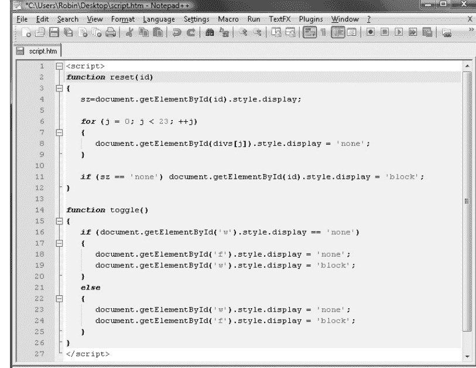

图 1-1 Notepad++ 编辑器

| 程序 | URL | Windows | Linux |
|---|---|---|---|
| Bluefish | bluefish.org | | |
| Cream | cream.sourceforge.net | | |
| Editra | editra.org | | |
| Free HTML Editor | free-editor.com | | |
| jEdit | jedit.org | | |
| Notepad++ | notepad-plus.org | | |

表 1-2 免费编辑器精选

在大多数程序中，将光标移动到程序的不同部分允许你高亮代码段。例如，在 Notepad++ 中，放在任何括号旁边会自动高亮匹配项。

## 管理 Ajax

Ajax 代表异步 JavaScript 和 XML（Asynchronous JavaScript and XML），但这个名字其实是一个误称，因为 Ajax 远不止是 XML 处理技术。事实上，它是所有现代 Web 2.0 网站的核心，这些网站在用户察觉不到的情况下在网络浏览器和服务器之间后台交换信息。

为了做到这一点，需要一种服务器端语言，最流行的是 PHP 脚本语言。所以虽然这不涉及 Ajax，但不可避免地涉及其中的一些技术，如果你想在开发计算机上使用它们，你需要安装一个服务器和 PHP 处理器。如果你不打算使用任何 Ajax 插件，就不需要这样做，但如果你需要，这非常简单。

开发者发布了一个名为 Zend Community Edition (CE) 的全合一应用程序，它包含一个 Apache Web 服务器和一个 MySQL 数据库。你可以从以下 URL 下载 Zend：

http://zend.com/products/server-ce

针对三个主要的操作系统（Windows、Mac OS X 和 Linux）都有相应的版本，且安装过程相当直接，尽管你需要仔细阅读提示并做出响应。图 1-2 显示了你如何在网络浏览器内部直接控制 Zend Server CE。

> 提示：如果你对 PHP 编程感兴趣，我的书籍《PHP》(McGraw-Hill/Professional, 2010) 包含了 100 个 PHP 插件，并有一章节专门介绍在不同平台上安装 Zend CE 和其他 PHP 解决方案。别担心你需要如何用 PHP 编程，因为你不需要，服务器端脚本可以输入或从本书的配套网站下载。

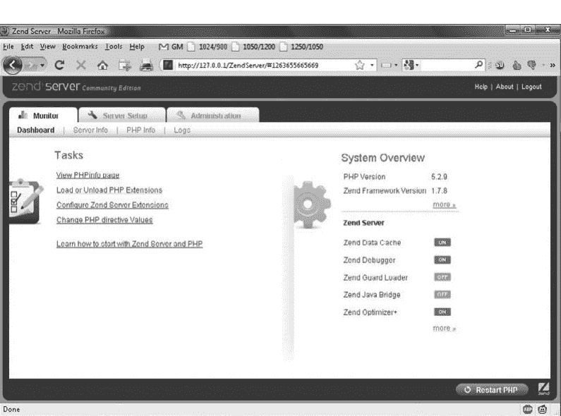

图 1-2 相同 Zend Server CE 文档根目录下的 Zend Server CE 仪表

你必须将你的 HTML 和 JavaScript 文件放在文档根目录。表 1-3 详细列出了 Zend Server CE 在不同操作系统上创建的默认根目录。如果你将各种 HTML、JavaScript 和 PHP 文件保留在该文件夹（或子文件夹）中，那么它们都可以由 Apache Web 服务器提供服务。

遗憾的是，书中没有空间详细介绍 Zend Server CE，尽管有一点应该应该：你可能会发现 Zend Server CE 文档根目录默认不允许你将文件复制进去。如果你发现如此，应该更改文件夹权限以授予访问权限。

| 表 1-3 各平台上的 Server CE 文档根 |
| 操作系统 | 文档根 |
|---|---|


| Windows | `C:/Program Files/Zend/Apache2/htdocs` |
| Mac OS X | `/usr/local/zend/apache2/htdocs` |
| Debian/Ubuntu Linux | `/var/www` |
| Fedora Linux | `/var/www/html` |
| Generic Linux | `/usr/local/zend/apache2/htdocs` |

## 6 插件 JavaScript：100 个强大解决方案

还有一个非常好的 Zend Server CE 在线用户指南，你可以通过以下 URL 访问：

`http://files.zend.com/help/Zend-Server-Community-Edition/welcome.htm`

## 旧版本的 Microsoft Internet Explorer

最新版本的 Internet Explorer `IE8` 在与其他浏览器的兼容性方面取得了巨大进步，但仍有大量用户在使用 `IE7` 和 `IE6`。图 1-3 显示了根据 `statcounter.com` 的数据，2009 年底浏览器的使用情况。

如你所见，`IE6` 和 `IE7` 总共占了所有用户的 35% 以上。由于这种情况，加上每个 Internet Explorer 版本的运行方式不同，你需要在测试最新版本之外，还需要在旧版本中测试你的网页。

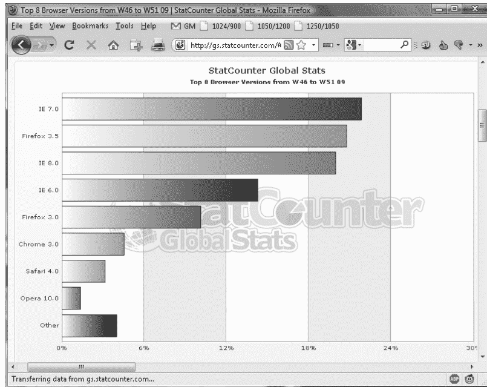

图 1-3 截至 2009 年12 月的浏览器市场份额

## 第一章：充分利用这些插件

主流浏览器。我知道，这很麻烦，但这是在所必须的。幸运的是，有一个技巧可以让这变得比通常情况下要简单得多。

### 模拟 Internet Explorer 6 和 7

对于那些专门为兼容旧版本而设计网站的开发者来说，Internet Explorer 的开发者创建了一个元标记（`meta tag`），你可以将其添加到网页的头部，让 IE 认为它是自己的某个更早版本。以下是你你将使用的两个主要的元标记：

```html
<meta http-equiv="UA-Compatible" content="IE7" />
<meta http-equiv="UA-Compatible" content="IE5" />
```

这是一个包含 IE 标签的示例：

```html
<html>
<head>
<meta http-equiv="UA-Compatible" content="IE7" />
<title>我的网站</title>
</head>
<body>
网页内容
</body>
</html>
```

这里没有 `IE=6`（可能 `IE5` 和 `IE6` 的渲染引擎非常相似），使用 `IE=5` 选项会让 Internet Explorer 进入所谓的“怪异模式”（*quirks* mode），在这种模式下，它的行为同时像 `IE5` 和 `IE6`。

顺便提一下，如果你强制 Internet Explorer 进入全标准模式（为了与其他浏览器保持兼容），你可以使用 `IE=8` 选项。如果没有元标记，Internet Explorer 将使用其专有的且优化的设置，被称为“边缘模式”（*edge mode*），你也可以通过 `IE=edge` 选项选择它。当然，一旦你完成测试，应该删除或注释掉这些元标记，除非你出于特定原因想要使用它们。

除了元标记之外，始终确保在每个文档的开头有一个合适的 HTML 文类型声明（`doctype`）。最常见的 `doctype` 是接下一个，它经过充分测试，并与本书中的所有插件兼容。

```html
<!DOCTYPE HTML PUBLIC "-//W3TD HTML 4.0 Transitional//EN"
http://www.w3.org/TR/html4/loose.dtd">
```

> 注意：如果你使用与列出的不同的 `doctype`，你可能会发现需要对其进行微调。我经常同时使用上述“松散”`doctype` 和 `IE` 元标记，以获得与其他浏览器最兼容的。。请记住，当所有其他浏览器在你的代码上运行良好，但 `IE` 表现异常时，解决方案可能是更改 `doctype` 或 `IE5/IE` 元标记。如果你对浏览器兼容性及其各种细微差别感兴趣，我建议访问网站 `quirksmode.org`。

## 8 个 JavaScript 插件：100 个解决方案

### 伴侣网站

为了节省在书中输入所有插件的精力，你可以从本书的配套网站 `pluginjavascript.com` 下载它们（见图 1-4）。

点击“Download Plug-ins”（下载插件）链接下载 `plug-ins.zip` 文件，这是一个包含所有插件的压缩文件（在所有操作系统上都可以轻松解压）。解压后，在 `plug-ins.zip` 的根目录下，你将找到 `P1.js` 和 `P1.js` 文件，它们以备用即用的形式包含了插件。根目录下还有一个 `ReadMe.txt` 文件，其中包含了关于插件的最新细节，包括自本书出版以来进行的任何改进或更新。

还有从 3 到 13 的示例，对应于书中的章节。在每个文件夹中，你将找到示例 HTML 和 JavaScript 文件，它们展示了每个函数的用法，你可以将其加载到浏览器中尝试。某些插件还使用了 Ajax 技术，并可能包含其他相关文件（例如扩展名为 `.php` 的文件），以备在相关章节中进行记录。

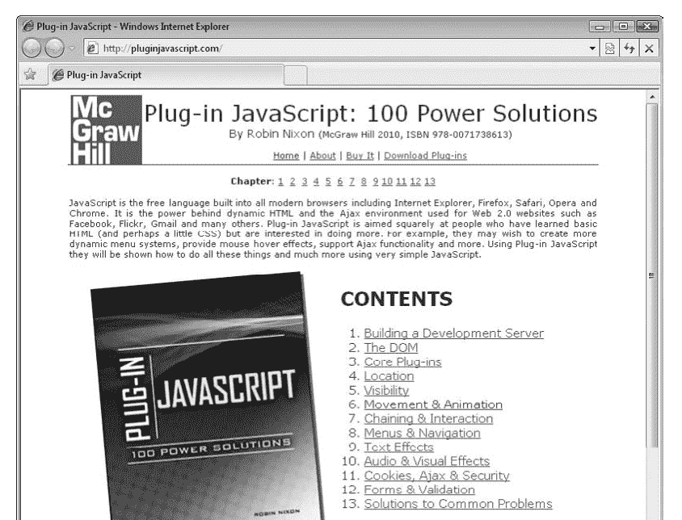

### 目录

JavaScript 是一种内置在所有现代浏览器（包括 Internet Explorer、Firefox、Safari 和 Chrome）中的免费语言。它是动态 Web 应用背后的力量，是用于 Facebook、Flickr、Gmail 等许多其他 Web 2.0 网站的技术。《插件 JavaScript》面向学习了基础 HTML 的人员，并提供了一些他们可能需要的少量 Ajax，用于创建动态菜单系统、提供鼠标悬停效果、支持 Ajax 功能等。他们将学习如何完成所有这些事情，并使用简单的 JavaScript 制作更多。

- 1. 构建开发服务器
- 2. DOM
- 3. 插件
- 4. 所在 `Location`
- 5. 可性 `Visibility`
- 6. 移动与动画
- 7. 更改与交互
- 8. 菜单与导航
- 9. 文本效果
- 10. 音频与视觉效果
- 11. Cookies、Ajax 与安全
- 12. 表单与验证
- 13. 常见问题的解决方案

图 1-4 位于 `pluginjavascript.com` 的配套网站

## 第一章：充分利用这些插件

### 包含所有插件

使用这些插件最简单（也是推荐的）的方法是将作为一个完整的集合全部加载到网页中，你可以通过以下命令实现，假设你将 `PJ.js` 文件保存在当前文件夹中：

```html
<script type="text/javascript" src="PJ.js"></script>
```

事实上，所有现代浏览器都假定脚本将是 JavaScript，因此你可以使用下面的简写形式，它省略了 `type=` 参数：

```html
<script src="PJ.js"></script>
```

或者，如果 `PJ.js` 位于其他地方，例如在根目录下，你需要更改命令为：

```html
<script src="PJ.js"></script>
```

或者，如果你将 JavaScript 放在 `scripts` 文件夹中，可以使用以下命令：

```html
<script src="scripts/PJ.js"></script>
```

并且，如果你使用了压缩版本的文件 `PJsmall.js`，可以使用：

```html
<script src="scripts/PJsmall.js"></script>
```

此外，如果你使用了压缩版本的文件，可以使用如下：

```html
<script src="scripts/PJsmall.js"></script>
```

此外，当你需要初始化插件时，只需要添加几行：

```html
<script>Initialize()</script>
```

### 包含单个插件

将插件插入网页的最佳位置是头部部分，如下所示（加粗部分）：

```html
<html>
<head>
  <script src="PJsmall.js"></script>
  <script>Initialize()</script>
  <title>我的网站</title>
</head>
<body>
  网页内容
</body>
</html>
```

将代码放在头部意味着插件文件将首先加载，因此，你的 JavaScript 代码可以放置在页面的任何位置（包括头部），并且当它调用一个插件函数时，可以保证它是可用的。

### 摘取代码段

虽然本书的主要目标是为你提供一个全面的函数工具包，以避免你重复造轮子，但我希望插件的文档能够让你轻松地适应到自己的需求。事实上，我鼓励你从书中提取内容并进行扩展和改进。

如果这意味着你从这里摘取一个例程，从那里编写一段代码并构建你自己的新插件，那么本书就实现了它的次要目标：帮助你将 JavaScript 编程水平推向高度。

### Bug 修复与报告

原始 JavaScript 插件包含超过 2500 行代码，在各种可能的条件下经过了反复测试。但你应该意识到，这本书代表了大量的编程工作，出现意外 bug 是不可避免的。

希望这些 bug 不多，而且影响其微。尽管如此，这意味着为了确保你拥有最新版本，你需要从配套网站 `pluginjavascript.com` 获取插件。既然提到这一点，如果你发现了任何修复或改进，请通过网站发送给我，我将使用它们更新源文件并为所有读者改进这些功能——你将会

## 第 1 章：充分利用这些插件

在源代码中注明。请包含一条说明，表示我已许可您可以在网上发布您的代码，并在本书的未来版本中使用，否则，遗憾的是，我将无法使用它。

### 等待网页加载

很多时候，特别是在较长的页面上，你可能希望在页面上的所有元素都加载完成后再运行 JavaScript。原因之一是你将要使用的图形可能尚未准备就绪，或者像 `divs` 和 `spans` 等对象的内容可能无法进行操作。

此外，某些浏览器在页面未加载时会返回错误的值。例如，如果你过早地请求浏览器宽度，你可能会得到一个不包含垂直滚动条的值；如果你尝试将任何内容放置在屏幕的一部分（你认为该部分是可用的），它会被滚动条隐藏。

有些浏览器甚至不会返回一个半有用的值。例如，当在页面加载之前询问某个对象的位置时，Internet Explorer 总是会返回坐标 `0,0`。

因此，你通常需要将所有的 JavaScript 放在以下函数的体内部：

```html
<script>
window.onload = function() {
  // 你的代码及其所有函数放在这里...
}
</script>
```

这确保了在最后一个项目加载到页面中并完全渲染之前，你的代码不会被执行。如果你养成了将所有代码封装在这个函数中的习惯，你就能确保你访问的所有对象都是可用的，并避免初始网页变得难看。

顺便说一下，虽然你可以将 `Initialize()` 的调用移动到页面的 `<head>` 中，但我不建议这样做。`Initialize()` 不依赖于 Web 页面的任何元素，因为它只与浏览器交互以创建全局变量并将函数附加到键盘和鼠标事件上，所以你不需要移动它。此外，将 `Initialize()` 的调用放在加载插件的命令之后是明智的，因为两者缺一不可。

> **提示** 在繁忙的页面上，长时间的初始延迟可能会非常令人烦恼，因为各种元素会简单地加载并显示在它们在 HTML 中所在的位置——直到到达它们最终的目的地和尺寸。解决此问题的第一个方案是确保使用我们在第 2 章中介绍的 CSS（级联样式表），在页面开始时就加载。这将帮助你的页面布局动态形成。另一个技巧是对于你不希望用户之后看到的对象，将其宽度和高度设置为 0（使用标准的 HTML `width` 和 `height` 关键字，这些关键字被表格、图像和其他对象接受）。等页面完全加载并调用你的代码后，你就可以赋予这些对象正确的位置。或者你可以使用元素的样式使其不可见，例如 `style='display:none'`，并在准备好显示它时将该属性更改为可见。

## 总结

到此时，你应该已经配置好了一个适用于开发工作站的计算机，并且应该知道你打算如何在网页中包含这些插件。然而，在详细解释插件之前，重要的是确保你理解 JavaScript 用于操作网页内元素的 DOM（文档对象模型）。我们将在下一节中介绍这一点，以及 CSS（级联样式表）的使用。

# 第 2 章

JavaScript、CSS 和 DOM

## 14 种插件 JavaScript：100 种解决方案

JavaScript 的伟大之处在于，它即使纯粹被设计成一种独立的脚本语言，也仍然非常有用。但开发者们做了一件定义 Web 未来的事情，即将其与 HTML 文档对象模型（DOM）链接起来，这是一种以结构化定义 HTML 文档的方法，可以通过 JavaScript 和微软的 VScript（本节未涵盖该层）等语言访问。

当你看到网页上发生动态变化时，例如当鼠标悬停在图像上时缩小，或者菜单根据你的选择发生变化，这通常是使用 JavaScript 实现的，它提供的范围远超 Flash 或 Java 应用（如果启用了它们的话）的限制。

说起 Java，你可能认为 JavaScript 与 Java 编程语言有联系，这是可以被原谅的，事实上它们之间几乎没有关系；JavaScript 的名字是一个营销策略，为了追逐 Java 语言的流行趋势。虽然有些人人将 JavaScript 称为 ECMAScript，但由于这个词读起来不顺口，它将采用该语言最流行的名称。

无论如何，一旦你拥有了 DOM 并有机会更改它，你就可以对网页做几乎任何事情，例如轻松地添加新段落；更改焦点并选择文本；替换图像；播放音效；音乐和视频等。

当你向这种组合中加入级联样式表（CSS）时，你可以对页面应用更改，在完全改变其外观的情况下，无需修改 HTML。实际上，CSS 在网站设置中与 JavaScript 有某些关联，允许你在当鼠标悬停在上面时应用动态效果来改变它们的颜色和其他属性（你将在某些插件中实现这些）。

因此，我们使用的插件同时利用 CSS 和 JavaScript 以最简单、最容易的方式实现所需的功能。但为了理解许多插件中发生了什么，首先对 DOM 和 CSS 有良好的基础是非常重要的。

> 提示 你可能已经具有使用 CSS 和 DOM 进行 JavaScript 编程的经验。如果是，你可能希望跳过此部分。

## 文档对象模型 `DOM`

文档对象模型 `DOM` 将 HTML 文档的部分分为层次化的对象，每个对象都有自己的属性。方法是可以执行操作的函数，而属性是对象的特征。

最外的对象是 `window`，内部是 `document`（尽管允许更多），`document` 内部有各种元素。

## 第 2 章：JavaScript、CSS 和 DOM

在 `head` 中可以有 `title` 和 `meta` 等对象，而 `body` 对象可以包含许多对象，包括标题标签、锚点、表单等。

图 2-1 显示了一个示例文档的 DOM，头部分有“Hello”和一个 `meta` 标签，`body` 部分有三个 HTML 元素。

当然，简单的网页结构比图中概述的要复杂，但它展示了 DOM 是如何工作的：从 DOM 的外部开始是 `window`，内部是 `document`，`document` 内部有各种元素，它们相互连接。

图中项中唯一的属性是字符串“Hello”，它是 `title` 对象的属性。所有其他项都是对象或参数名。如果图形继续延伸，可能会发现 `meta` 的属性为“robots”，以及 `href="google.com"` 的 URL 属性。将其表示为 `head` 部分 HTML 代码所示：

```html
<head>
  <meta name="robots" content="index, follow">
  <title>Hello</title>
</head>
```

在这种情况下，`meta` 标签允许搜索引擎和其他网络爬虫（或机器人）索引页面并跟踪其中发现的链接。HTML 的 `body` 部分所示：

```html
<body>
  <a href="http://google.com">访问 Google</a>
  <form id="login" method="post" action="program.php">
    <input id="name" type="text" name="username" value="fred" />
    <input type="submit" />
  </form>
  
</body>
```


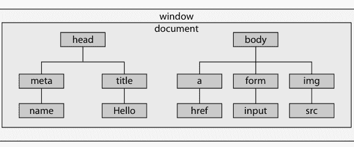

**图 2-1** DOM 示例显示了 head 和 body 部分

## 16 插件式 JavaScript：100 种解决方案

记住 HTML 的这两个部分属于同一个文档，将它们组合在一个 `<html>` 标签内部，如下所示：

```html
<html>
<head>
  <meta name="robots" content="index, follow" />
  <title>Hello</title>
</head>
<body>
  <a href="http://google.com">访问 Google</a>
  <form id="login" method="post" action="program.php">
    <input id="name" type="text" name="username" value="fred" />
    <input type="submit" />
  </form>
  
</body>
</html>
```

当然，一个页面的外观可能与此大不同，但它应该遵循相同的格式。尽管浏览器的兼容性很高，允许你省略很多内容（包括起始和结束标签），但我不建议你这样做，因为某一天你可能想将页面转换为 XHTML，后者的要求要严格得多。关闭每个标签并确保按顺序关闭总是一个好主意。例如，你不应该通过输出 `<html>` 后紧跟 `</body>` 来结束文档，这样标签的正确嵌套就会被破坏。

出于相同的原因，你还应该养成关闭没有结束标签的标签的习惯，例如 ``，它没有匹配的 `` 标签，因此在最后一个 `>` 之前需要一个 `/` 字符来正确关闭它。同样地，`<br>` 变成 `<br />`，以此此类推。

你还应该记住，为了兼容 XHTML，标签必须带有单引号或双引号，尽管几乎所有浏览器都允许你省略它们。

> [!NOTE] 注意
>
> 在 Web 早期，当大多数用户使用速度非常慢的拨号调制器时，经常看到网页上省略了各种内容，如引号和各种标签。如今，你的大多数用户将拥有相当不错的带宽速度，不再有理由这样做了。

## 从 JavaScript 访问 DOM

你可能奇怪，我为什么给给 ID 设置为 "login"，并给第一个输入标签命名为 "name"（以及值为 "fred"）。其原因是为了展示 JavaScript 如何通过点符号 `.` 非常轻松地处理所有的 DOM 嵌套。例如，可以像这样读取文档标题等标准属性：

```javascript
title = document.title
```

## 第 2 章：JavaScript、CSS、DOM

图 2-2

弹出窗口显示了输入值。

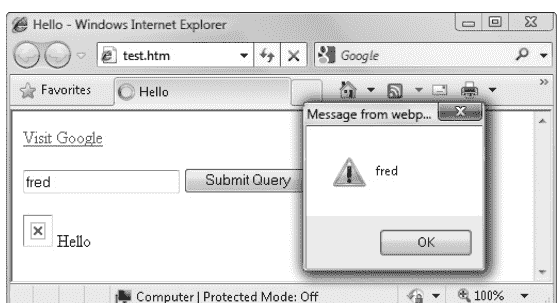

但为了访问其他对象属性，你需要为对象分配一个 ID。例如，一旦为字段分配了名称，你可以通过以下方式找到它的当前值（如果有），这种方式会将值赋值给变量 `username`：

```javascript
username = document.forms.name.value
```

在 `.name` 之后添加 `.value` 的原因（在上一个示例中 `.title` 之后没有添加）是因为 `.title` 已经是一个属性，而 `.name` 是一个表单对象，它本身拥有属性，包括位于 `.value` 中的值。

在输入语句中预填充值 "fred" 的原因，如果你在 `</body>` 结束标签之前添加以下四行代码，然后在浏览器中加载之前的示例，就会变得显而易见：

```html
<script>
document.write(document.title)
alert(document.forms.name.value)
</script>
```

浏览器随后将在缺失的图形图标之后显示 `document.title` 的值，因为图片 `photo1.jpg` 不存在，并且输入语句的当前值 "fred" 也会显示在弹出警框中（如图 2-2 所示）。

## 层级样式表 (CSS)

使用 CSS，你可以为网页应用样式，使其看起来完全符合你想要的样子。这之所以有效，是因为 CSS 与 DOM 连接在一起，因此你可以快速轻松地为任何元素设置样式。例如，如果你不喜欢 `<h1>`、`<h2>` 和其他标题标签的默认外观，你可以分配新样式来覆盖默认的字体族、大小设置，或者是否加粗或斜体以及许多其他属性。

## 插件式 JavaScript：100 种强力解决方案

为网页添加样式的主要方法与引入 JavaScript 类似；你可以在网页头部的 `<head>` 和 `</head>` 标签之间插入所需的语句。要更改 `<h1>` 标签的样式，你可以使用以下代码之一：

```css
<style>
h1 { color:red; font-size:3em; font-family:Arial }
</style>
```

在 HTML 页面中，这可能如下所示（见图 2-3）：

```html
<html>
<head>
  <style>
    h1 { color:red; font-size:3em; font-family:Arial }
  </style>
</head>
<title>Hello World</title>
<body>
  <h1>Hello there</h1>
</body>
</html>
```

或者，你可以使用包含样式表的常用方法之一，当你想要为整个网站而不是单个页面设置样式时，这种方法特别有用。在 HTML 页面中，这可能如下所示（见图 2-3）：

```html
<link rel="stylesheet" type="text/css" href="styles.css" />
```

在输入语句中预填充值 "fred" 的原因，如果你在 `</body>` 结束标签之前添加以下四行代码，然后在浏览器中加载之前的示例，就会变得显而易见：

```html
<script>
document.write(document.title)
alert(document.forms.name.value)
</script>
```

浏览器随后将在缺失的图形图标之后显示 `document.title` 的值，因为图片 `photo1.jpg` 不存在，并且输入语句的当前值 "fred" 也会显示在弹出警框中（如图 2-2 所示）。

在 `.name` 之后添加 `.value` 的原因（在上一个示例中 `.title` 之后没有添加）是因为 `.title` 已经是一个属性，而 `.name` 是一个表单对象，它本身拥有属性，包括位于 `.value` 中的值。

# 第 2 章：JavaScript、CSS 和 DOM

如果你想学习更多关于 CSS 的知识，我推荐 Marty Matthews 和 John Cronan 编写的《Dynamic Web Programming: A Beginner’s Guide》（McGraw-Hill/Professional, 2009）这本书。

## JavaScript 与分号

有些 JavaScript 程序员总会在每个语句的末尾放置分号，但并非绝对如此，因为 JavaScript 解释器接受分号或换行符作为语句的结束标记。

然而，如果你希望在一行中包含多个语句，则必须在它们之间使用分号。在本书中，我尽量避免这样做，以保持代码尽可能的可读性。

另一方面，在处处使用分号可以让你的 JavaScript 代码更容易转换为 PHP 和 C 等语言，这些语言是需要分号的。但是否使用它们取决于你个人。

> **提示** 某些直接操作 JavaScript 以帮助查找错误或简化代码的程序，除非你在每个语句后都放置了分号，否则将无法运行。如果你将使用其中任何一种工具，养成立即使用分号的习惯将节省大量时间。

## 总结

如果这一切对你来说都是全新的，那么你现在应该对 JavaScript、CSS 和 DOM 之间的关系有了一个非常宏观的认识。这将帮助你理解后续章节中的插件文档。在这些章节中，我将提供你所需的所有信息，以便在你自己的页面上有效使用这些插件，以及如何根据自己的需求对其进行修改和改进。

# 第 3 章

核心插件

## 24 个 JavaScript 插件：100 种解决方案

在我之前的书《Plug-in PHP》（McGraw-Hill/Professional, 2010）中，我能够利用该语言提供的丰富现成函数。然而，在 JavaScript 中情况并非如此，因此本章侧重于提供一组基础函数，以便尽可能高效地开发 JavaScript 程序。

本章包含的插件比其他任何章节都多（总共 18 个），以及一组实用的全局变量，这些变量将让你的生活更简单，并让剩下的插件更容易被理解和掌握。

由于这些核心插件和全局变量贯穿本书，我建议你在开始使用后续函数之前，花时间尽可能地消化本章的内容。对于这前几个插件的大量文档我深表歉意，但它们是非常重要的插件，你完全熟悉它们的用法是至关重要的。

## O()

`O()` 函数是本书提供的插件中功能最强大的，几乎被所有其他插件调用。在最简单的形式下，它替换了冗长的 JavaScript 函数 `getById`，后者接收一个字符串参数并返回分配了该 ID 的 HTML DOM（文档对象模型）对象。字母 O 是 Object（对象）的缩写，因为该函数的主要目的是检索对象或修改其属性。

## 关于插件

此插件接收一个必选参数和两个可选参数：

- **id**: 这可以是一个包含对象 ID 的字符串、一个对象，甚至是一个包含多个对象或 ID 的数组。如果未提供任何可选参数，函数将返回由 `id` 代表的对象或对象组。
- **property**: 这个可选的字符串参数可以包含 `id` 中对象（或对象）需要修改的属性名称。
- **value**: 如果设置了此可选参数，它代表要赋值给 `id` 中对象（或对象）属性的值。属性和值参数都必须有值，否则 `O()` 将仅仅返回 `id` 中的对象（或对象组）。

## 变量、数组和函数

| 变量 | 描述 |

| :--- | :--- |

| `tmp` | 存储处理结果的数组 |

| `j` | 用于数组索引的整数变量 |

| `UNDEF` | 值为 'undefined' 的全局字符串变量 |

| `Vars` | 向字符串中插入值的插件 |

| `push()` | 向数组推入一个值的函数 |

| `substr()` | 从字符串中返回子字符串的函数 |

| `eval()` | 将字符串作为 JavaScript 代码进行求值的的函数 |

| `try()` | 运行函数并将任何错误传递给匹配项的函数 |

| `catch()` | 当 `try()` 语句失败时被调用的函数 |

| `getElementById` | 通过名称返回对象的函数 |

## 工作原理

该插件的功能远不止为现有函数提供简短名称，因为你可以向它传递对象的字符串 ID，或者对象本身。例如，考虑以下 HTML：

```html
<div id='outerdiv'> ...</</div>
```

使用 `O()` 插件，你可以通过以下命令直接访问 div：

```javascript
mydiv = O('outerdiv')
```

此命令等同于以下代码，它将变量 `mydiv` 设置为代表 ID 为 'outerdiv' 的 div 对象：

```javascript
mydiv = document.getElementById('outerdiv')
```

这意味着你可以，例如，使用此插件的返回值来更改 div 的 HTML 内容（起始标签和结束标签之间的文本），如下，通过修改其 `innerHTML` 属性：

```javascript
mydiv.innerHTML = "<h1>A Heading</h1>"
```

或者，你可以将对象赋值给变量并通过 `O()` 插件直接访问该对象，如下：

```javascript
O('outerdiv').innerHTML = '<h1>A Heading</h1>'
```

## 传递字符串或对象

`O()` 函数也是多功能的，因为你可以传递一个包含字符串名的变量，如下：

```javascript
variable = 'outerdiv'
```

另一方面，它也可以代表对象本身，如下：

```javascript
variable = O('outerdiv')
```

前者仅包含组成 'outerdiv' 的字符，而后者是一个对象。由于 `O()` 的工作是返回所传递字符串所指向的对象，如果你恰好传递了一个对象而不是字符串，它将仅仅把该对象返回给你。因此，无论 `myvariable` 包含指向对象的字符串还是对象本身，你都可以使用该语句来访问它，例如：

```javascript
othervariable = O(myvariable)
```

或者如下：

```javascript
O(myvariable).innerHTML = '<h2>Subheading</h2>'
```

注意，在此例中 `myvariable` 周围没有引号，因为传递的是变量而不是字符串。

我在这些示例中使用了单引号，但 JavaScript 允许你使用单引号或双引号。然而，为了标准化，我通常对字符串使用单引号，除非字符串中包含单引号，在这种情况下我会使用双引号来包裹字符串。

## 附加参数

除了接受字符串和对象外，`O()` 插件还允许你传递一对可选参数，这些参数随后用于修改对象属性。例如，之前的示例可以重写为：

```javascript
O('outerdiv', 'innerHTML', '<h1>Heading</h1>')
O(myvariable, 'innerHTML', '<h2>Subheading</h2>')
```

上述两种都是为对象属性赋值的可接受替代语法。

## 传递数组

你可能疑惑这种替代语法的用处在哪里。当你想要一次访问多个不同的对象时，它就显示出它的价值了。这是标准 JavaScript 无法做到的，但你可以通过 `O()` 插件来实现，它允许你传递一个对象数组、对象 ID 名称或两者的混合。

例如，假设你想清除名为 'Fred'、'Mary' 和 'Bill' 的三个对象的 HTML 内容。普通的 JavaScript 需要三个独立的逗号，但你可以通过以下代码轻松实现相同的结果：

```javascript
ids = Array('Fred', 'Mary', 'Bill')
O(ids, 'innerHTML', '')
```

你可以在数组中混合对象和对象 ID，如下：

```javascript
ids = Array('Fred', 'Mary', 'Bill', myobject)
```

或者，你可以按照以下方式将所有内容合并到代码中，这将清除所有对象的 innerHTML 内容：

```javascript
O(Array('Fred', 'Mary', 'Bill', myobject), 'innerHTML', '')
```

## 第 3 章：核心插件 27

图 3-1 显示了一组三个 `div`，使用下方示例页面中的代码，这三个 `div` 的 `innerHTML` 属性都被设置了相同的值：

```
<!DOCTYPE HTML PUBLIC "//W3C//DTD HTML 4.01 Transitional//EN"
"http://www.w3.org/TR/html4/loose.dtd">
<html><head><title>Plug-in JavaScript</title>

<script src="PJ.js"></script>
<script>Initialize();</script>

</head><body>

Fred: <span id="Fred"></span><br />
Mary: <span id="Mary"></span><br />
Bill: <span id="Bill"></span>

<script>
ids = Array('Fred', 'Mary', 'Bill');
O(ids, 'innerHTML', 'New contents...');
</script>

</</body>></html>
```

这是你第一次看到使用插件的完整示例。它从 `<!DOCTYPE ...>` 设置开始，然后添加了 `<head>` 中的 `<title>` 和两个 `<script>` 标签——这是包含和设置插件所需的行。之后打开了页面的 `<head>` 和 `<body>`。然后，三行 HTML 创建了三个不包含任何内容的简单 `<span>` 部分。

最后，在这些 `<span>` 的内容中还有另一个 `<script>` 部分，其内容被修改，使得每个 `<span>` 都显示字符串 'New contents...'。这是标准网页在使用插件时将遵循的格式。在浏览器中加载此页面的结果如图 3-1 所示。

现在你已经看到使用插件是多么简单，以及不同部分是如何融入网页页面中的。在本书的后续示例中，我将省略 `<body>` 标签之前（包括该标签本身）的所有内容（插件影响该特定部分除外），并仅专注于相关的 HTML 和 JavaScript 以解释插件的使用。

图 3-1

使用 `O()` 修改对象的 HTML 内容

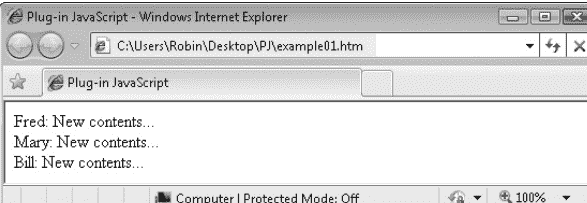

## 插件 JavaScript：100 种威力解决方案

### 当传递数组时

`O()` 函数由三部分组成。第一部分测试参数 `id` 是否为数组，这是通过 `instanceof` 运算符来实现的，如下所示：

```
if (id instanceof Array) ...
```

如果是一个数组，说明向函数传递了多个对象，此时使用 `var` 关键字将数组 `tmp` 声明为本地数组（仅由该函数实例访问），如下所示：

```
var tmp = []
```


然后使用一个 `for(j)` 循环遍历数组，使用整数变量 `j` 作为索引指针指向每个单独元素。

### 递归调用

有趣的是，`O()` 函数在每次迭代中都会被再次调用，但只传入位于当前数组索引为 `j` 的单个元素。这被称为递归函数调用，意味着函数调用了自己。这是一种非常整洁的代码复用方法，可以在你将任务拆分为更易于管理的块后完成任务。循环代码如下：

```
for (var j = 0; j < id.length; ++j)
  tmp.push(O(id[j]), property, value)
```

为了解释它在此例中的工作原理，首先从数组中提取一个元素，然后将该元素传回函数，函数将处理该元素并向自己返回一个值。因此，如果传递一个项数组到 `O(id)`，它将遍历每一个项，每次都轮流将数组中的一个元素传给函数的接收端，直到所有元素都处理完毕。

从接收端看，它发现接收到了单个（而不是数组），控制流落到剩余代码，在这些代码中处理该项并计算出任何值或对象。返回时，函数调用的结果（返回给函数）使用 JavaScript 的 `push()` 放置在 `tmp` 数组的下一个位置，并立即被遗忘（因为已经处理过了），然后处理数组的下一个元素。

一旦完成了所有元素，`j` 的值将等于数组中项的数量（如 `id.length` 所示），数组 `tmp` 将返回给调用代码。

你会注意到变量 `property` 和 `value` 并没有被视为数组，因为它们确实不是数组。如果变量 `property` 有值，那么它将是对象属性的名称，而 `value` 将包含要赋值给该属性的值。这些参数是可选的，但它们可以用于给数组中所有对象的相同属性赋予相同的值。由于函数本身会递归调用，它还必须连同待处理的对象一起传递 `property` 和 `value`（无论它们是否有值），否则如果它们有值，将会丢失。

## 第 3 章：核心插件 29

> 提示：如果你对递归还不太熟悉并且觉得它看起来有点复杂，多读几遍这一节，你就能掌握它。Wikipedia 在 wikipedia.org/wiki/Recursion 也对该概念有非常好的解释，而且不，它并没有只说“参见递归！”

### 处理额外参数

在上一节中，我提到了 `property` 和 `value`，即修改对象属性的可选参数。该函数的第二个主要部分是修改发生的地方。代码通过 `typeof` 运算符开始测试 `property` 和 `value` 是否都有值，如下所示：

```
if (typeof property == UNDEF && (typeof value != UNDEF)
```

变量 `UNDEF` 是一个全局变量，由 `Initialize()` 函数赋值为值 `'undefined'`，该函数在稍后会详细介绍。

这两个参数都必须有值，这个 `()` 语句才能执行。如果是，就可能再次进行递归调用，将 `id` 的值传回同一个函数。这说明了 `O()` 插件的威力：你永远不需要担心你传递的主参数是 ID 还是对象的名称；任何一种都是可以接受的，因此函数的一部分仅仅是传递 `id`，无论它是什么类型的变量。

在该语句内部，使用 `eval()` 将值赋值给属性，如果该值是字符串，则先给值加上单引号（否则 `eval()` 将尝试求值它，而不是将其视为）：

```
if (typeof value == 'string') value = '" + value + '"';
return eval("O(" + id + ")." + property + " =" + value)
```

`eval()` 返回的值被返回。

### 在最深层

从接收端看，它发现接收到了单个（而不是数组），控制流落到剩余代码，在这些代码中处理该项并计算出任何值或对象。返回时，函数调用的结果（返回给函数）使用 JavaScript 的 `push()` 放置在 `tmp` 数组的下一个位置，并立即被遗忘（因为已经处理过了），然后处理数组的下一个元素。

## 插件 JavaScript：100 种威力解决方案

### 当传递数组时

`O()` 函数由三部分组成。第一部分测试参数 `id` 是否为数组，这是通过 `instanceof` 运算符来实现的，如下所示：

```
if (id instanceof Array) ...
```

如果是一个数组，说明向函数传递了多个对象，此时使用 `var` 关键字将数组 `tmp` 声明为本地数组（仅由该函数实例访问），如下所示：

```
var tmp = []
```

然后使用一个 `for(j)` 循环遍历数组，使用整数变量 `j` 作为索引指针指向每个单独元素。

有趣的是，`O()` 函数在每次迭代中都会被再次调用，但只传入当前数组索引为 `j` 的单个元素。这被称为递归函数调用，意味着函数调用了自己。这是一种非常整洁的代码复用方法，可以在你将任务拆分为更易于管理的块后完成任务。循环代码如下：

```
for (var j = 0; j < id.length; ++j)
  tmp.push(O(id[j]), property, value)
```

为了解释它在此例中的工作原理，首先从数组中提取一个元素，然后将该元素传回函数，函数将处理该元素并向自己返回一个值。因此，如果传递一个项数组到 `O(id)`，它将遍历每一个项，每次都轮流将数组中的一个元素传给函数的接收端，直到所有元素都处理完毕。

从接收端看，它发现接收到了单个（而不是数组），控制流落到剩余代码，在这些代码中处理该项并计算出任何值或对象。返回时，函数调用的结果（返回给函数）使用 JavaScript 的 `push()` 放置在 `tmp` 数组的下一个位置，并立即被遗忘（因为已经处理过了），然后处理数组的下一个元素。

一旦完成了所有元素，`j` 的值将等于数组中项的数量（如 `id.length` 所示），数组 `tmp` 将返回给调用代码。

你会注意到变量 `property` 和 `value` 并没有被视为数组，因为它们确实不是数组。如果变量 `property` 有值，那么它将是对象属性的名称，而 `value` 将包含要赋值给该属性的值。这些参数是可选的，但它们可以用于给数组中所有对象的相同属性赋予相同的值。由于函数本身会递归调用，它还必须连同待处理的对象一起传递 `property` 和 `value`（无论它们是否有值），否则如果它们有值，将会丢失。

### 处理额外参数

在上一节中，我提到了 `property` 和 `value`，即修改对象属性的可选参数。该函数的第二个主要部分是修改发生的地方。代码通过 `typeof` 运算符开始测试 `property` 和 `value` 是否都有值，如下所示：

```
if (typeof property == UNDEF && (typeof value != UNDEF)
```

变量 `UNDEF` 是一个全局变量，由 `Initialize()` 函数赋值为值 `'undefined'`，该函数在稍后会详细介绍。

这两个参数都必须有值，这个 `()` 语句才能执行。如果是，就可能再次进行递归调用，将 `id` 的值传回同一个函数。这说明了 `O()` 插件的威力：你永远不需要担心你传递的主参数是 ID 还是对象的名称；任何一种都是可以接受的，因此函数的一部分仅仅是传递 `id`，无论它是什么类型的变量。

在该语句内部，使用 `eval()` 将值赋值给属性，如果该值是字符串，则先给值加上单引号（否则 `eval()` 将尝试求值它，而不是将其视为）：

```
if (typeof value == 'string') value = '" + value + '"';
return eval("O(" + id + ")." + property + " =" + value)
```

`eval()` 返回的值被返回。

### 在最深层

从接收端看，它发现接收到了单个（而不是数组），控制流落到剩余代码，在这些代码中处理该项并计算出任何值或对象。返回时，函数调用的结果（返回给函数）使用 JavaScript 的 `push()` 放置在 `tmp` 数组的下一个位置，并立即被遗忘（因为已经处理过了），然后处理数组的下一个元素。

## 插件 JavaScript：100 种威力解决方案

### 当传递数组时

`O()` 函数由三部分组成。第一部分测试参数 `id` 是否为数组，这是通过 `instanceof` 运算符来实现的，如下所示：

```
if (id instanceof Array) ...
```

如果是一个数组，说明向函数传递了多个对象，此时使用 `var` 关键字将数组 `tmp` 声明为本地数组（仅由该函数实例访问），如下所示：

```
var tmp = []
```

然后使用一个 `for(j)` 循环遍历数组，使用整数变量 `j` 作为索引指针指向每个单独元素。

有趣的是，`O()` 函数在每次迭代中都会被再次调用，但只传入当前数组索引为 `j` 的单个元素。这被称为递归函数调用，意味着函数调用了自己。这是一种非常整洁的代码复用方法，可以在你将任务拆分为更易于管理的块后完成任务。循环代码如下：

```
for (var j = 0; j < id.length; ++j)
  tmp.push(O(id[j]), property, value)
```

为了解释它在此例中的工作原理，首先从数组中提取一个元素，然后将该元素传回函数，函数将处理该元素并向自己返回一个值。因此，如果传递一个项数组到 `O(id)`，它将遍历每一个项，每次都轮流将数组中的一个元素传给函数的接收端，直到所有元素都处理完毕。

从接收端看，它发现接收到了单个（而不是数组），控制流落到剩余代码，在这些代码中处理该项并计算出任何值或对象。返回时，函数调用的结果（返回给函数）使用 JavaScript 的 `push()` 放置在 `tmp` 数组的下一个位置，并立即被遗忘（因为已经处理过了），然后处理数组的下一个元素。

一旦完成了所有元素，`j` 的值将等于数组中项的数量（如 `id.length` 所示），数组 `tmp` 将返回给调用代码。

你会注意到变量 `property` 和 `value` 并没有被视为数组，因为它们确实不是数组。如果变量 `property` 有值，那么它将是对象属性的名称，而 `value` 将包含要赋值给该属性的值。这些参数是可选的，但它们可以用于给数组中所有对象的相同属性赋予相同的值。由于函数本身会递归调用，它还必须连同待处理的对象一起传递 `property` 和 `value`（无论它们是否有值），否则如果它们有值，将会丢失。

## 第 3 章：核心插件 31

## 插件

```javascript
function O(id, property, value)
{
  if (id instanceof Array)
  {
    var tmp = []
    for (var j = 0; j < id.length; ++j)
      tmp.push(O(id[j]), property, value)
    return tmp
  }

  if (typeof property != UNDEF && typeof value != UNDEF)
  {
    if (typeof value == "'" + value + "'")
      return eval("O(\ + id + "")" + property + " = " + value)")
  }
}
```

```javascript
if (typeof id == 'object') return id
else
{
  try { return document.getElementById(id) }
  catch(e) { alert("PJ - Unknown ID: ' + id) }
}
```

## 2 S()

JavaScript 最常见的用途可能是修改 HTML 文档中的 CSS 属性。这些包括颜色、尺寸、位置、透明度等。通常，这是通过使用下面的代码来实现的，它更改了 div 的前景色：

```javascript
document.getElementById('element').style.color = 'red'
```

或者，使用之前的插件，可以将其缩短为：

```javascript
O('element').style.color = 'red'
```

这是一个常见的操作，我为 `O()` 创建了一个配套插件称为 `S`（代表 Style，即样式），用于处理对象的 `style` 子对象。使用它，前面的命令可以简化为以下内容：

```javascript
S('element').color = 'red'
```

图 3-2 显示了如何使用该插件更改三个 div 的背景颜色。尽管该图不是彩色的，但你可以通过它们的深浅看出这些 div 的颜色是不同的。

## 32 插件 JavaScript：100 种强大解决方案

3-2

使用 `s()` 更改某些 div 的背景颜色

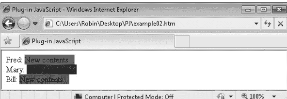

## 关于插件

`S()` 与 `O()` 类似，区别在于它不是引用对象，而是访问对象的 `style` 子对象。此外，由于它不使用事件，因此没有必要检查此函数。它接受以下参数：

- `id`：可以是一个包含对象 ID 的字符串，甚至是一个包含多个对象和/或 ID 的数组。如果没有提供其他可选参数，则该函数将返回 `id` 所代表的对象（或对象）的 `style` 子对象。如果有可选参数，函数的目的将变为将值赋值给 `id` 中对象（或对象）`style` 子对象中的 `property` 属性。
- `property`：此可选的字符串参数可以包含 `id` 中对象（或对象）`style` 子对象中需要修改的属性名。
- `value`：如果设置了此可选参数，它代表要赋值给 `id` 中对象（或对象）`style` 子对象中 `property` 属性的值。`property` 和 `value` 参数都必须有值，否则 `S()` 将仅仅返回 `id` 中对象（或对象）的 `style` 子对象。

## 变量、数组和函数

| | |

|---|---|

| `tmp[]` | 存储 `id` 数组处理结果的数组 |

| `j` | 用于索引 `id` 的整数型值变量 |

| `style` | `style` 子对象 |

| `push()` | 向数组推入一个值的函数 |

| `try()` | 运行函数并将任何错误传递给匹配的 `catch()` 语句的函数 |

| `catch()` | 当 `try()` 语句失败时调用的函数 |

| `O()` | 插件 1，主“对象”函数。`O()` 或 `S()` 几乎被所有插件使用，这是它们最后一次出现在“变量、数组和函数”章节中 |

## 第 3 章：核心插件 33

## 工作原理

现在你已经理解了 `O()` 插件的工作原理，你就会对这个插件如何运作有一个了解。因为它们相似，我将只概述基本知识。

与 `O()` 一样，这个函数有三个主要部分。第一部分处理 `id` 恰好是数组的情况。它通过递归调用自身来处理数组中的每个元素，以便单独处理每一个元素。它执行的代码如下，最后一行返回处理过程中返回的所有值的数组：

```javascript
if (id instanceof Array)
{
  var tmp = []
  for (var j = 0 ; j < id.length ; ++j)
    tmp.push(S(id[j], property, value))
  return tmp
}
```

第二部分处理当你以属性赋值模式使用插件的情况。它通过检查是否同时具有 `property` 和 `value` 属性来确定这一点。如果是，则将 `value` 赋值给 `id` 所代表对象的 `style` 子对象中的 `property` 属性。

否则，进入对象获取模式，并在 `try()` 语句中返回 `id` 的子对象，任何错误都可以被捕获并通过调用 `alert()` 显示，这使用了匹配的 `catch()` 语句：

```javascript
if (typeof property != UNDEF && typeof value != UNDEF)
  try { return O(id).style[property] = value }
  catch(e) { alert('PJ - Unknown ID: ' + id) }
else if (typeof id == 'object') return id.style
else
{
  try { return O(id).style }
  catch(e) { alert('PJ - Unknown ID: ' + id) }
```

在开发过程中，你会发现这种错误捕获非常有用，写错 ID 名称或在声明之前访问它们是常见的错误。

> 注意：我指的是 `style` 子对象，也可以称之为 `style` 属性，因为两者兼顾：它既是一个格式良好的样式，而样式 本身是一个具有属性的对象。因此，我倾向于将也是对象的属性称为子对象。

## 如何使用

你使用插件的方式与使用 `O()` 函数非常相似。通过它，你可以获取对象的 `style` 子对象，或者修改对象的某个 `style` 属性。这里是你可以使用插件首先获取后使用对象 `style` 子对象的方法：

```javascript
var _styleobject = S('mydiv')
styleobject.color = 'red'
```

或者，你可以直接访问样式，如下：

```javascript
S('mydiv').color = 'red'
```

如果你愿意，你也可以这样设置属性值：

```javascript
S('mydiv', 'color', 'red')
```

在这种情况下，数组中的所有对象的 `innerHTML` 都将被设置为：

```javascript
ids = Array('div1', 'div2', 'div3')
S(ids, 'innerHTML', 'red')
```

## 34 插件 JavaScript：100 种强大解决方案

首先，`div` 是在 HTML 中被创建的，然后：


```html
<div id="div1">First</div>
<div id="div2">Second</div>
<div id="div3">Third</div>
```

在接下来的章节中，你将看到 `S()` 被用于许多语境，我发现以后你将永远不想以其他方式访问样式了。

## Initialize()

为了设置插件的使用，你必须在 Web 页面的开头调用一个较小的插件。如前提到的，我建议你始终在每个页面的开头包含以下两行代码：

```html
<script src="PJ.js"></script>
<script>Initialize()</script>
```

或者如果你使用的是压缩版的插件 `Pjssmall.js`，则你应该使用该文件代替 `Pjs`。

这个插件是由该代码调用的 `Initialize()` 函数，它准备了你可以调用的广泛功能，如图 3-3 所示，在此处检测浏览器类型。

## 关于插件

此插件不需要任何参数，也不返回任何值。然而，请参考下一节的变量、数组和函数表，因为它设置了非常重要的全局变量。

图 3-3

调用此插件后显示 `BROWSER` 变量

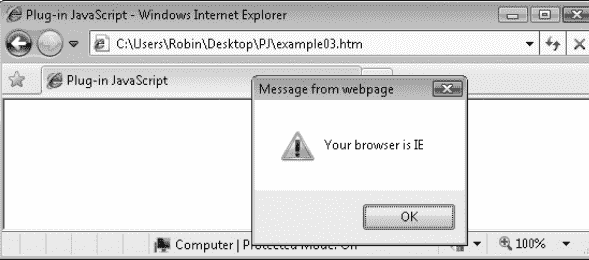

## 变量、数组与函数

| 变量/常量 | 说明 |

| :--- | :--- |

| `MOUSE_DOWN` | 全局整数，如果当前按住鼠标按钮，则为 true，否则为 false |

| `MOUSE_IN` | 全局整数，如果鼠标指针当前在浏览器窗口内，则为 true，否则为 false |

| `MOUSE_X` | 全局整数，包含鼠标指针的当前水平坐标 |

| `MOUSE_Y` | 全局整数，包含鼠标指针的当前垂直坐标 |

| `SCROLL_X` | 全局整数，包含浏览器垂直滚动的像素（单位像素） |

| `SCROLL_Y` | 全局整数，包含浏览器水平滚动的像素（单位像素） |

| `KEY_PRESS` | 全局整数，包含上一次按下按键的值 |

| `ZINDEX` | 全局整数，包含通过插件访问的任何对象的最大 z-index |

| `CHAIN_CALLS` | 全局数组，包含已链链但尚未执行的插件 |

| `INTERVAL` | 全局整数，包含重复事件调用之间的时间（单位毫秒） |

| `UNDEF` | 全局字符串，包含值 'undefined' |

| `HID` | 全局字符串，包含值 'hidden' |

| `VIS` | 全局字符串，包含值 'visible' |

| `ABS` | 全局字符串，包含值 'absolute' |

| `FIX` | 全局字符串，包含值 'fixed' |

| `REL` | 全局字符串，包含值 'relative' |

| `TP` | 全局字符串，包含值 'top' |

| `BM` | 全局字符串，包含值 'bottom' |

| `LT` | 全局字符串，包含值 'left' |

| `RT` | 全局字符串，包含值 'right' |

| `BROWSER` | 全局字符串，包含当前浏览器的名称 |

| `NavCheck` | 子函数，用于检查浏览器 User 中是否存在字符串 |

## 工作原理

让我们首先查看每个插件的全局变量定义：

- `MOUSE_DOWN`: 该变量由两个附加到 `document.onmouseup` 和 `document.onmousedown` 事件的内联匿名函数（在插件的后文部分）更新。通过它，你可以通过查看此变量来快速检查浏览器窗口的任何地方是否按下了鼠标，如果是，值为 true；否则设为 false。

- `MOUSE_IN`: 以类似的方式，`document.onmouseout` 和 `document.onmouseover` 事件被捕获，当鼠标指针在浏览器范围内时，此全局变量设为 true；否则设为 false。

- `MOUSE_X` 和 `MOUSE_Y`: 这对全局变量由附加到 `document.onmousemove` 事件的紧随其后的 `CaptureMouse()` 插件不断更新。因此，你可以引用这些变量来确定鼠标的位置。

- `SCROLL_X` 和 `SCROLL_Y`: 这些变量也由 `CaptureMouse()` 插件保持更新，代表鼠标在垂直和水平方向上的滚动量。

- `KEY_PRESS`: 此变量由 `Keyboard()` 插件更新，它捕获 `document.onkeydown` 和 `document.onkeypress` 事件并设置按下的键。

- `ZINDEX`: 此全局变量从默认值 1000 开始。它用于确定所用对象的 zindex 属性，即它们在屏幕上显示的深度，负数比数越高。例如，第 8 章中的 `ContextMenu()` 插件在右键点击时打开下拉元素，使用此值确保元素出现在所有窗口之前。`Browser()` 插件（同样在第 8 章）在浏览器内创建弹出窗口，将窗口设置为 `ZINDEX + 1` 以确保它们位于最前。

- `CHAIN_CALLS`: 某些插件具有链式执行的能力，以便它们连续运行，即在上一个完成后开始下一个。通常 JavaScript 不允许这种行为，如果你调用一个设置动画的函数，该函数会立即返回调用代码，而不等待事件序列完成。这是正常行为，但某些插件在链式运行时效果更好，这是通过将函数序列放在 `CHAIN_CALLS` 数组中实现的，以便每个函数完成后就可以调用下一个。你想要访问此数组的唯一可能是确定队列了多少函数，或者可能是清空间隔以取消所有函数。

- `INTERVAL`: 在对各种计算机和操作系统的主流浏览器进行数小时实验后，我得出 30 毫秒是事件调用之间的最佳时间，因为某些短函数在 10 毫秒内完成，而另一些可能需要 20 毫秒或更多，但都不应超过 30 毫秒。因此，我将全局变量 `INTERVAL` 设置为 30。这个固定值是为了计时目的，以便书中所有的事件函数都能确保它们执行好传递传递它们的毫秒数。如果 JavaScript 在未来几年中速度变快（这是不可避免的），随着计算机变快和 JavaScript 解释器的改进，允许你优化这些插件并将值降至 25、15 更少的毫秒。这不会加快插件，但允许动画在第一帧和最后一帧之间有额外的步骤，使过渡更流畅。

## 全局字符串变量

在前十个全局变量之后，又定义了十个字符串变量。这些是 `UND`, `HID`, `VIS`, `ABS`, `FIX`, `REL`, `STA`, `INH`, `BM`, `LT` 和 `RT`，分别对应 'undefined' 'hidden' 'visible' 'absolute' 'fixed' 'relative' 'static' 'top' 'bottom' 和 'right'。

它们并不是必需的，但我创建这些变量是因为插件频繁引用这些字符串，这有助于保持代码的紧凑。它还使书中的示例变窄，使得原本可能换行的行现在可以在单行内内。此外，它们有助于提高代码的可读性，只要在你忘记任何一个变量的值时回顾本节即可。

## 确定当前浏览器

由于 JavaScript 在不同开发者之间的实现有所不同，你有时需要知道你正在处理哪种浏览器。因此，结合子函数 `NavCheck()`，接下来的十行代码将根据使用的浏览器将全局 `BROWSER` 设置为以下字符串之一：'IE', 'Opera', 'Chrome', 'iPod', 'iPhone', 'iPad', 'Safari', 'Firefox' 和 'UNKNOWN'。当返回 'Firefox' 时，意味着在使用运行 Gecko 渲染引擎的浏览器，其中包括 Firefox 外的其他浏览器。

## 将函数绑定到事件

这些插件的大部分功能取决于对内置浏览器事件的捕获，如剩余七行代码所做的。前三个 `CaptureMouse()` 函数绑定到 `document.onmousemove`，`CaptureKeyboard()` 函数绑定到 `document.onkeydown` 和 `document.onkeypress` 事件。这些插件在各自的章节中都有说明，但只需说它们在这些事件发生时都会被调用，并保持全局变量 `KEY_PRESS` 的更新。

最后四行绑定的函数非常小，以至于我将其创建为匿名内联函数。它们所做的只是捕获 `document.onmouseover`, `document.onmouseout`, `document.onmouseup` 和 `document.onmousedown` 事件，保持全局变量 `MOUSE_IN` 和 `MOUSE_DOWN` 的更新。

## 第 3 章：核心插件 39

## 如何使用

要使用此插件，你必须确保在调用任何其他插件之前调用它，并且你必须调用此插件以确保所有插件正常工作。如果你想检查它是否已成功调用，可以尝试从 `<script>` 标签中发出以下语句，它将显示正在使用的浏览器名称，如图 3-3 所示：

```
alert('Your browser is ' + BROWSER)
```

然而，你通常希望在页面完全加载且所有元素的位置和尺寸均已知并可以操作后，再使用此插件及其他插件。因此，最好将命令（以及你的其余代码）放置在 `window.onload` 匿名函数中，例如：

```javascript
window.onload = function() {
alert(" browser is " + BROWSER);
}
```

## 插件

```javascript
function Initialize() {
MOUSE_DOWN = false
MOUSE_IN = true
MOUSE_X = 0
MOUSE_Y = 0
SCROLL_X = 0
SCROLL_Y = 0
KEY_PRESS = ''
ZINDEX = 1000
CHAIN_CALLS = []
INTERVAL = 30

UNDE = 'undefined'
HID = 'hidden'
VIS = 'visible'
ABS = 'absolute'
FIX = 'fixed'
REL = 'relative'
STA = 'static'
INH = 'inherit'
TP = 'top'
BM = 'bottom'
LT = 'left'
RT = 'right'

if (document.all) BROWSER = 'IE'
else if (window.opera) BROWSER = 'Opera'
```

## 40 插件 JavaScript: 100 解决方案

```javascript
else if (NavCheck('Chrome')) BROWSER = 'Chrome'
else if (NavCheck('iPod')) BROWSER = 'iPod'
else if (NavCheck('iPhone')) BROWSER = 'iPhone'
else if (NavCheck('iPad')) BROWSER = 'iPad'
else if (NavCheck('Android')) BROWSER = 'Android'
else if (NavCheck('Safari')) BROWSER = 'Safari'
else if (NavCheck('Gecko')) BROWSER = 'Firefox'
else BROWSER = 'UNKNOWN'
```

```javascript
document.onmousemove = CaptureMouse
document.onkeydown = CaptureKeyboard
document.onkeypress = CaptureKeyboard

document.onmouseout = function() { MOUSE_IN = false }
document.onmouseover = function() { MOUSE_IN = true }
document.onmouseup = function() { MOUSE_DOWN = false }
document.onmousedup = function() { MOUSE_DOWN = true }
```

```javascript
function NavCheck(check) {
  return navigator.userAgent.indexOf(check) != -1
}
```

## 4 CaptureMouse()

此插件仅由 `Initialize()` 函数调用，你不应该自己调用它。它的作用是挂载到鼠标移动事件，更新包含鼠标位置详细信息的各种变量，如图 3-4 所示。

## 关于插件

此插件挂载到 `.onmousemove` 事件，更新全局变量 `MOUSE_X`、`MOUSE_Y`、`SCROLL_X` 和 `SCROLL_Y`。事件将值 `e` 传递给它，该值仅供 Internet Explorer以外的浏览器使用。它不需要你传递任何参数，也不会返回任何值。

> 图 3-4

> 此插件让你知道鼠标指针的位置。

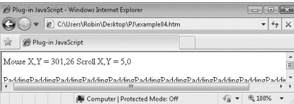

## 第 3 章：核心插件 41

## 变量、数组和函数

| 变量 | 描述 |

| :--- | :--- |

| `e` | Internet Explorer 以外的浏览器传递给函数的事件。`e.pageX` 和 `e.pageY` 包含鼠标指针的 X 和 Y 位置。 |

| `window.event` | Internet Explorer 使用 `window.event` 属性而不是作为参数传递的事件。`clientX` 和 `clientY` 子属性包含鼠标指针的 X 和 Y 位置。 |

| `document.documentElement` | 如果浏览器是 Internet Explorer，则访问该属性的 `scrollLeft` 和 `scrollTop` 属性来确定水平和垂直滚动量。 |

| `window` | 在 Internet Explorer 以外的浏览器上，访问 `window` 的 `pageOffset` 和 `pageOffsetY` 属性来确定水平和垂直滚动量。 |

| `MOUSE_X` | 全局整数，包含鼠标指针的当前水平坐标。 |

| `MOUSE_Y` | 全局整数，包含鼠标指针的垂直坐标。 |

| `SCROLL_X` | 全局整数，包含浏览器垂直滚动的量（单位为像素）。 |

| `SCROLL_Y` | 全局整数，包含浏览器垂直滚动的量（单位为像素）。 |

## 工作原理

此函数检测 `onousemove` 事件，并在 Internet Explorer 以外的浏览器中访问传递给它的 `e` 值，或者在 Internet Explorer 中访问全局的 `window.event` 属性。使用这些值将全局变量 `MOUSE_X`、`MOUSE_Y` 设置为鼠标指针的 X 和 Y 坐标。

在 Internet Explorer 中，还会访问 `document.documentElement` 的 `scrollLeft` 和 `scrollTop` 属性来确定水平和垂直滚动量。这些值被存放在全局变量 `SCROLL_X` 和 `SCROLL_Y` 中。它们根据 `window` 的 `pageOffset` 和 `pageOffsetY` 属性被赋值。

随后，将值 `true` 返回给事件以便由浏览器进行处理。

## 如何使用

你不会直接访问此函数。相反，按照建议调用 `Initialize()` 插件后，确定鼠标指针 X 和 Y 位置以及任何水平或垂直滚动所需的值将被放在全局变量 `MOUSE_X`、`MOUSE_Y`、`SCROLL_X` 和 `SCROLL_Y` 中，并保持更新。

为了说明如何使用这些值，以下代码将实时显示这些值：

```html
<div id='output'></</div><p>
PaddingPaddingPaddingPaddingPaddingPaddingPaddingPaddingPadding
```

```javascript
<script>
window.onload = function() {
  setInterval(simpleInterrupt, INTERVAL);

  function simpleInterrupt() {
    document.getElementById('output').innerHTML =
      ' Mouse_X = ' + MOUSE_X + ',' + MOUSE_Y +
      ' Scroll_X,Y = ' + SCROLL_X + ',' + SCROLL_Y
  }
}
</script>
```

`simpleInterrupt` 函数通过名称使用输出对象。要亲自尝试，请在你的 `body` 中输入示例代码，并从插件压缩包中选择 `example04.html`。调整浏览器使其变小并让滚动条可见。在浏览器内移动鼠标，观察值的实时变化。顺便说，由于滚动事件的工作方式，你只有在松开鼠标时才会看到它的变化。

## 第 3 章：核心插件 43

如你所见，只需少量工作，你就可以需要需要查询与鼠标相关的值。你还看到了在实际场景中使用了 `()`。

## 插件

```javascript
function CaptureMouse(e)
{
  if (BROWSER == 'IE')
  {
    SCROLL_X = document.documentElement.scrollLeft
    SCROLL_Y = document.documentElement.scrollTop
    MOUSE_X = window.event.clientX + SCROLL_X
    MOUSE_Y = window.event.clientY + SCROLL_Y
  }
  else
  {
    SCROLL_X = window.pageXOffset
    SCROLL_Y = window.pageYOffset
    MOUSE_X = e.pageX
    MOUSE_Y = e.pageY
  }

  return true
}
```

## 5 CaptureKeyboard()

此插件记录任何按键情况并将结果存储在全局变量 `KEY_PRESS` 中，如图 3-5 中的示例所示，该示例检测到了 Alt 键的按下。


## 关于插件

你不需要自己调用此插件，因为它应该已经被 `Initialize()` 插件调用过了。它不需要任何参数，也不会返回任何你可以使用的值。

> 图 3-5

> 使用此插件可以轻松地确定哪些键被按下。

## JavaScript 插件：100 种解决方案

### 变量、数组与函数

| 变量 | 描述 |
| :--- | :--- |
| `e` | 由 Internet Explorer 以外的浏览器传递给函数的事件。`e.charCode` 或 `e.keyCode` 其中之一包含按下按键的值。 |
| `window.event` | Internet Explorer 使用 `window.event` 属性而不是作为参数传递的事件。`keyCode` 包含按下按键的值。 |
| `BROWSER` | 用于判断浏览器的全局变量。 |
| `KEY_PRESS` | 用于赋值按键按下值的全局变量。 |
| `fromCharCode()` | 将 Unicode 转换为字符的 JavaScript 函数。 |
| `FromKeyCode()` | 插件，用于返回按键按下的值或判断其是否为如 'Esc'、'Home' 等许多特殊字符之一。 |

### 工作原理

该函数的工作方式取决于你是否在使用 Internet Explorer。如果是，它会在 `window.event.keyCode` 中查找按键，并通过 `FromCharCode()` 传递它，如果按键是如 'Up'、'Backspace' 等特殊按键，它将分配一个符号。然后，如果该值是一个简单的数字（即尚未被替换为特殊键），JavaScript 的 `fromCharCode()` 函数将将其从 Unicode 转换为实际值，例如，如果按下的是键 'e'，则返回值 'e'。

在非 IE 浏览器上，会检查 `e.charCode` 和 `e.keyCode` 是否有值，因为 `document.onkeydown` 和 `document.onkeypress` 事件被此函数捕获。一个函数捕获普通键，而另一个处理已提到的特殊键，将两者合并到同一个函数中是有意义的。因此，如果 `e.charCode` 有值，它将通过 JavaScript 的 `fromCharCode()` 函数转换为其 Unicode。或者，如果按下的是特殊键，该值将通过 `FromKeyCode()` 插件来查找按键名称。

无论哪种情况，结果都是 `KEY_PRESS` 将包含一个字母、标点符号、符号、特殊键名称，或者如果是其他情况则仅包含一个数字。这里没有键盘缓冲区来例如创建输入字符串，因为只保存了最后一次按下的键。然而，如果你需要，完全可以使用此创建一个输入函数。

最后，返回一个 `true` 值，以允许浏览器对该函数进行进一步处理。

### 如何使用

使用此插件只需引用它所维护的全局变量 `KEY_PRESS` 即可。以下是一个简单的示例，它根据按下按键的值持续更新 `div` 的内容：

```javascript
<div id='output'></div>

<script>
window.onload = function() {
  setInterval(simpleInterrupt, INTERVAL)
}

function simpleInterrupt() {
  document.getElementById('output').innerHTML = ' You pressed: ' + KEY_PRESS
}
</script>
```

再次（我不再提这一点了），这假设你已经包含了加载 Pljs 和 `Initialize()` 函数的代码行。

设置中断是为了能够连续显示最后一次按键按下的值。如果你愿意，可以在循环中使用类似下面的命令：

```javascript
alert('You pressed: ' + KEY_PRESS)
```

然而，它是具有侵入性的，而且每次调用它时都必须点击 OK 按钮来关闭 alert 框。此外，它还会锁定浏览器，因为 `alert()` 会阻止你在点击 OK 之前执行任何其他操作（甚至关闭浏览器），即使点击之后，alert 也会再次、又一次地弹出，永止下去。

> **提示** 由于如果放在循环中可能会导致 alert 接管浏览器的问题，本书包含了一个名为 `Alert`（大写 A）的替代函数，你可能更喜欢使用它。它不会锁定浏览器，也有其他优点。更多细节，请参考第 13 章。

### 插件

```javascript
function CaptureKeyboard(e) {
  if (BROWSER == 'IE') {
    KEY_PRESS = FromCode(window.event.keyCode)
  }
  if (KEY_PRESS > 0)
    KEY_PRESS = String.fromCharCode(KEY_PRESS)
  } else {
    if (e.charCode) KEY_PRESS = String.fromCharCode(e.charCode)
    else if (e.keyCode) KEY_PRESS = FromCode(e.keyCode)
  }

  return true;
}
```

#### FromKeyCode()

如果按下的是特殊键（如 'Ctrl' 或 'Alt'），此插件返回该按键的名称；否则，返回传递给它的值，如图 3-6 所示，图中显示了键码 1 到 144 的翻译。

### 图 3-6

此插件为键码返回有意义的名称。

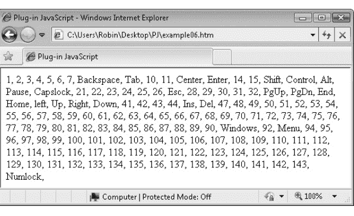

```
1, 2, 3, 4, 5, 6, 7, Backspace, Tab, 10, 11, 12, 13, 14, 15, Shift, Ctrl, Alt, Pause, Capslock, 21, 22, 23, 24, 25, 26, 28, 29, 30, 31, 32, PgUp, PgDn, End, Left, Up, Down, 41, 42, 43, Ins, Del, 47, 48, 49, 50, 51, 52, 53, 54, 55, 56, 57, 58, 59, 60, 61, 62, 63, 64, 65, 66, 67, 68, 69, 70, 71, 72, 73, 74, 75, 76, 77, 78, 79, 80, 81, 82, 83, 84, 85, 86, 87, 88, 89, 90, Windows, 92, Meta, 93, 94, 95, 96, 97, 98, 99, 100, 101, 102, 103, 104, 105, 106, 107, 108, 109, 110, 111, 112, 113, 114, 115, 116, 117, 118, 119, 120, 121, 122, 123, 124, 125, 126, 127, 128, 129, 130, 131, 132, 133, 134, 135, 136, 137, 138, 139, 140, 141, 142, 143, 144.
```

## 模式：关闭

### 关于插件

此插件可以接收一个键作为参数，并返回表示按下的特殊键的字符串；如果没有按下则返回代码。

### 变量、数组与函数

| 变量 | 描述 |
| :--- | :--- |
| `c` | 传递给函数的键，如果代表特殊键则返回 |

### 工作原理

该函数使用 `switch()` 语句测试 `c` 的值，如果匹配则返回各种字符串。如果没有匹配，则返回 `c`。

### 使用方法

通常此插件由 `CaptureKeyboard()` 插件为你调用。但你可能希望返回不同的名称。例如，如果你不想按下 SHIFT 键产生的键，你可能更喜欢返回空字符串而不是 'SHIFT'。这样，当用户按下 SHIFT 键接着按下 M 键时，你只会看到值 'M' 而不是 'M'。之所以费精力捕捉这些特殊键，尽管 JavaScript 已经有了实用的输入功能，这些插件允许你在按下按键的瞬间移动对象或执行特定函数。

这是一个返回代码 1 到 144 翻译的 HTML 和 JavaScript 示例：

```javascript
<div id='output'></div>

<script>
window.onload = function() {
  for (j = 1; j < 145; ++j) {
    document.getElementById('output').innerHTML += FromKeyCode(j) + ', ';
  }
}
</script>
```

这里值得注意的是的一点是使用了 `+=` 运算符来保持 `output` div 的 `innerHTML` 属性的内容。

### 插件

```javascript
function FromKeyCode(c) {
  switch (c) {
    case 8: return 'Backspace'
    case 9: return 'Tab'
    case 12: return 'Center'
    case 13: return 'Enter'
    case 16: return 'Shift'
    case 17: return 'Control'
    case 18: return 'Alt'
    case 19: return 'Pause'
    case 20: return 'Capslock'
    case 27: return 'Esc'
    case 33: return 'PgUp'
    case 34: return 'PgDn'
    case 35: return 'End'
    case 36: return 'Home'
    case 37: return 'Left'
    case 38: return 'Up'
    case 39: return 'Right'
    case 40: return 'Down'
    case 45: return 'Ins'
    case 46: return 'Del'
    case 91: return 'Windows'
    case 93: return 'Menu'
    case 144: return 'Numlock'
  }
}
return c;
```

## GetLastKey()

此插件返回最后一次按键按下的值，并将存储的值重置为空字符串，以指示键值已获取。图 3-7 显示了如何使用此插件创建一个简单的输入函数。

### 关于插件

此插件不接受任何参数，并返回最近按下的键的值（如果有的话）。

### 变量、数组与函数

| 变量 | 描述 |
| :--- | :--- |
| `k` | 在重置 `KEY_PRESS` 之前持有其值的局部字符串变量 `k` |

### 工作原理

此插件将 `KEY_PRESS`（包含最后一次按键的全局变量）的值赋值给局部变量 `k`。然后将 `KEY_PRESS` 重置为空字符串，以显示键值已被读取。最后，返回 `k` 的内容。如果没有按键，则返回空字符串。

### 使用方法

使用此插件时，不带参数调用，它将返回字母、数字、标点符号或特殊键。如果键不是这些其中之一，则返回其代码。

你可以用它创建一个简单的输入函数，如下所示：

你的名字是什么？****<span id='name'></span></b></**>

> 图 3-7

此插件可以构建输入函数。

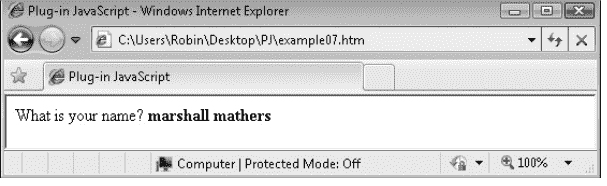

## 第3章：核心插件 49

```javascript
function simpleInterrupt() {
  var k = GetLastKey()

  if (k == 'Enter') {
    k = '';
    clearInterval(interrupt)
  }
  O(id).innerHTML += k
}
</script>
```

为了使此代码生效，会在输入框中创建一个用于放置内容的 `span` 。JavaScript 代码调用了一个名为 `input()` 的新函数，并传递了 `span` 的 ID。（该函数使用 `setInterval()` 对子函数 `simpleInterrupt()` 设置了一个循环执行的中断）。

`simpleInterrupt()` 函数在每次被调用时都会执行 `GetLastKey()`。如果值为 'Enter'，则意味着用户按了回车键，`k` 被赋值为 '.'（句号），并且使用 `clearInterval()` 禁用了输入，并附带了中断 ID。如果值为空字符串，则不添加任何内容。

你的代码只需要做的就是查看字符串末尾，判断是否为句号字符，以指示用户已按下回车键。你的代码移除该字符并使用字符串的剩余部分。或者，你可以使用不同类型的输入标记。无论你怎么做，如果你想创建一个类似于 `<input type='text'>` 标签的现成输入程序，你就必须经历这些关于中断驱动调用的弯弯绕绕，因为 JavaScript 的工作机制如此。不过，至少你现在需要时有了这种方法。

为了好玩，如果你将输入存储在 `span` 之外的隐藏区域，你可以检查待输入的字符序列——就像在游戏中输入作弊代码一样——当输入可识别的序列时，你可以触发奖励功能。

### 插件

```javascript
function GetLastKey() {
  var k = KEY_PRESS
  KEY_PRESS = '';
  return k
}
```

## 8 PreventAction()

此插件用于防止对象的拖拽或选择事件（或两者）的发生。例如，有时你可能希望防止部分文本被复制，或至少防止其被高亮，你可以通过这个插件轻松实现。图 3-8 显示了其中

## 50 JavaScript 插件：100 个解决方案

图 3-8

图像和第二个句子无法被拖拽或选择。

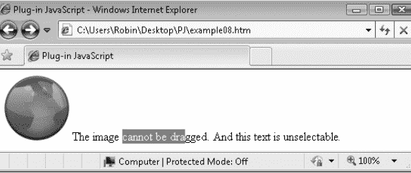

正在选中的文本部分，而第二个句子是不可选择的。GIF 也是不可拖拽的。

### 关于插件

此插件接受三个参数，并根据这些值的值防止事件发生。参数如下：

- `id` 对象的 ID，例如 HTML 中的 `div` 或 `span`，或任何其他对象
- `type` 此参数可以有三个字符串值之一：'drag'（拖拽）、'select'（选择）或 'both'（两者）。如果值为 'drag'，则根据 `onoff` 的值，由 `id` 指向的对象将被阻止拖拽或允许拖拽。如果是 'select'，则根据 `onoff` 的值，将阻止或允许文本被选择。如果是 'both'，则这些事件将分别阻止或允许。
- `onoff` 此参数应为 `true` 或 `false`；或者，值 1 或 0 也是可以的。值 `true` 或 1 表示变量 `type` 中的事件（事件）被被阻止。如果 `onoff` 为 `false` 或 0，则允许该事件（事件）。

### 变量、数组和函数

|  |  |
|---|---|
| `ondragstart` | 传入 `id` 对象的事件 |
| `onselectstart` | 传入 `id` 对象的事件 |
| `onmousedown` | 传入 `id` 对象的事件 |
| `MozUserSelect` | 传入 `id` 对象的属性（仅用于 Firefox 等 Mozilla 浏览器） |

### 工作原理

该插件被分为两个部分。在第一部分，管理由 `id` 引用对象的拖拽事件，而第二部分用于处理 `select` 事件。这两个部分再次被拆分为两部分。在每个半部分，事件被阻止，而后半部分用于在禁用后重新启用事件。

## 第3章：核心插件 51

为了提供这些功能，如果浏览器支持，`id` 对象的 `ondrag` 或 `select` 事件（如果值为 'both'）会被分配一个匿名函数，该函数返回 `false`，这具有取消后续操作的效果。

如果事件未被识别，`id` 对象的 `mousedown` 事件会被捕获并返回 `false`。这并不是一个完美的解决方案，因为它阻止了其他 `mousedown` 事件的附加。

在 Firefox 等 Mozilla 浏览器情况下，特殊属性 `MozUserSelect` 被设置为 'none' 以防止文本被选择，或设置为 'text' 以重新启用它。这是必要的，因为这些浏览器不使用 `onselectstart` 事件，而使用此属性比捕获 `mousedown` 事件干扰更小。

### 如何使用

为了防止复制 `div` 的内容，你可以将此函数附加到它的 `onselectstart` 事件，如下所示：

```javascript
PreventAction('mydiv', 'select', true)
```

如果用户尝试选择任何文本，插件会阻止它。这是一种防止从你的网页复制文本的简单方法，同时也防止在使用鼠标拖拽时文本意外被高亮。你也可以用它来防止任何元素被拖拽到别处，如下所示：

```javascript
PreventAction('mygif', 'drag', true)
```

以下代码说明了这些：

```html

图像无法拖拽。
<span id='text'>而此文本是不可选择的</span>
```

<script>

window.onload = function() {

  PreventAction('gif', 'drag', true);

  PreventAction('text', 'select', true);

}

</script>


在示例的 HTML 部分，显示了名为 `il.gif` 的 GIF。后面是普通文本和 ID 为 `'text'` 的元素。在 `<script>` 部分，GIF 图像的拖拽属性被禁用，`span` 文本变为不可选择。如果你尝试这些操作中的任何一个，都会失败。然而，Internet Explorer 会允许你在 `span` 外部开始选择。你可以通过将文档设置为不可选择来规避这个 bug，如下：

```javascript
PreventAction(document.body, 'select', true)
```

这意味着你的网页上没有任何内容可以被选择。其他浏览器没有这个 bug。

## 52 JavaScript 插件：100 个解决方案

### 插件

```javascript
function PreventAction(id, type, onoff)
{
  if (type == 'drag' || type == 'both')
  {
    if (onoff == true) {
      if (typeof O(id).ondragstart != UNDEF)
        O(id).ondragstart = function() { return false }
      else O(id).onmousedown = function() { return false }
    }
    else
    {
      if (typeof O(id).ondragstart != UNDEF)
        O(id).ondragstart = '';
      else O(id).onmousedown = '';
    }
  }
  if (type == 'select' || type == 'both')
  {
    if (onoff == true) {
      if (typeof O(id).onselect != UNDEF)
        O(id).onselect = function() { return false }
      else if (typeof S(id).MozUserSelect != UNDEF)
        S(id).MozUserSelect = 'none'
      else O(id).onmousedown = function() { return false }
    }
    else
    {
      if (typeof O(id).onselectstart != UNDEF)
        O(id).onselectstart = '';
      else if (typeof S(id).MozUserSelect != UNDEF)
        S(id).MozUserSelect = 'text'
      else O(id).onmousedown = '';
    }
  }
}
```

## 9 NoPx() 和 Px()

这些插件是短小但强大的函数，提供了相反的功能。`NoPx()` 移除附加某些 CSS 属性上的 `'px'` 后缀，而 `Px()` 则向属性添加 `'px'` 后缀。图 3-9 显示了插件的使用。

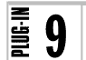

### 第3章：核心插件 53

图 3-9
这些插件使得以像素值进行操作变得简单。

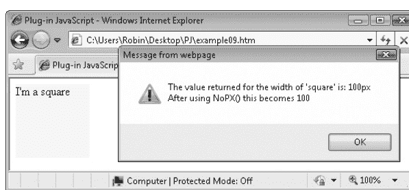

### 关于插件

这些插件需要传入对象的属性。如果传递给 `NoPx()` 一个值，返回的值将是去掉该值任何 `'px'` 后缀后的。如果调用 `Fx()`，则返回的值是传递给插件的值与 `'px'` 后缀的组合。没有任何属性被这些插件实际修改，因为值是从属性中派生的，你可以根据需要使用它们。插件需要以下参数：

- `value` 要修改的属性

### 变量、数组和函数

```javascript
replace()  用于替换字符串子部分的 JavaScript 函数
```

### 工作原理

`NoPx()` 使用 JavaScript `replace()` 函数替换它接收的字符串中出现的所有 `'px'`，然后返回结果，乘以 1 以确保将字符串转换为数字。
`Fx()` 函数向它接收的任何值添加 `'px'` 后缀并返回结果。

### 如何使用

`NoPx()` 非常简单，它所做的只是将它所在的任何字符串中的 `'px'`（如果找到）替换为空字符串。因此，它可以提取许多对象属性结尾的 `'px'` 后缀。例如，`style.marginLeft` 属性只是以 `'px'` 结尾的属性之一，所以如下调用它：

```javascript
value = NoPx(S(id).marginLeft)
```

## 54 JavaScript 插件：100 种强大的解决方案

`Px()` 执行相反操作，为值添加 `'px'` 后缀。当你需要将 `'px'` 赋值给对象的属性，而该属性需要知道你正在以像素为单位进行操作时，这非常有用。例如，`style.width` 属性可以设置对象的宽度，但它需要被添加 `'px'`。为了避免你手动这样做，你可以改用下面的调用：

```javascript
S(id).left = Px(135)
```

此命令使用 `S()` 函数将 `id` 指向的对象的宽度设置为 135 像素，因为 `Px` 的求值结果为 `'135px'`。以下是你如何使用这些插件的示例：

```html
<div id='square'>我是一个正方形</div>
<script>
window.onload = function() {
  S('square').width = Px(100)
  S('square').height = Px(100)
  S('square').backgroundColor = 'yellow'
}
alert('这对相似的函数返回了 \'square\' 的值：' + S('square').width + 'px' 使用 NoPx() 变为了 ' ' + NoPx(S('square').width));
</script>
```

HTML 部分包含一个带有文本的单个 div 元素。使用 `Px()` 函数创建值，将 div 调整为 100x100 像素。背景也被设置为黄色，以便你可以看到这个正方形。

随后是对 JavaScript `alert()` 函数的调用，其中显示了对象宽度样式属性的值（`'100px'`），并将该值通过 `NoPx()` 处理并重新显示。这次它是数字 100。

### 插件

```javascript
function NoPx(value) {
  return value.replace(/px/, '') * 1
}
function Px(value) {
  return value + 'px'
}
```

## 10 X() 和 Y()

这对相似的函数返回对象相对于浏览器左侧或顶部的精确水平或垂直偏移。这些插件之所以如此短是因为它们被频繁使用，可以节省打字时间；它还让你的源代码更容易易读。在图 3-10 中，你可以看到 div 的左边缘和顶边缘距离浏览器边缘 8 像素。

### 第 3 章：核心插件 55

### 图 3-10

查找对象的绝对水平和垂直偏移量

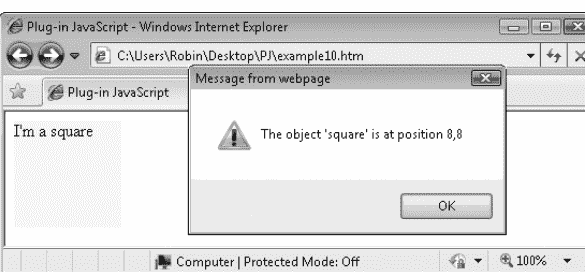

### 关于插件

这些插件返回对象相对于浏览器窗口左上角的绝对水平或垂直偏移。它们接受此参数：

- `id`: 需要返回偏移量的对象

### 变量、数组和函数

| obj | 说明 |
| :--- | :--- |
| obj | `id` 对象的本地对象副本 |
| offset | 用于存储水平或垂直偏移的本地整数 |
| offsetParent | 父级偏移对象 |
| offsetLeft | 对象的左偏移 |
| offsetTop | 对象的顶偏移 |

### 它们是如何工作的

这些插件将 `id` 所代表的对象的复制一份到 `obj` 中，并将局部变量 `offset` 赋值给对象的 `offsetLeft` 或 `offsetTop` 属性。这是对象相对于其父元素的距离。

然后，如果父对象也是一个子对象，`if()` 和 `while()` 语句将递归遍历所有父对象，依次将它们的偏移量加到 `offset`，直到没有更多父对象。此点 `offset` 包含了从浏览器窗口左侧或顶边缘到对象左侧或顶部的绝对像素距离。然后返回此值。

### 如何使用它们

要使用这些插件，将对象的 ID 传递给它们，它们将返回其左侧或顶边缘的绝对水平或绝对垂直位置（像素）。以下是一些代码说明它们的用法：

```html
<div id='square'>我是一个正方形</div>
<script>
```

```javascript
window.onload = function() {
  S('square').width = Px(100)
  S('square').height = Px(100)
  S('square').backgroundColor = 'yellow'
  alert("对象 'square' 位于位置 " + X('square') + ',' ' + Y('square'))
}
</script>
```

这个示例与上一个相似，因为它创建了一个 ID 为 `'square'` 的正方形 div，但这里对象的绝对左偏移和顶偏移是通过 `alert()` 函数、调用 `X()` 和 `Y()` 返回的。

### 插件

```javascript
function X(id) {
  var obj = O(id)
  var offset = obj.offsetLeft
  if (obj.offsetParent) {
    while (obj = obj.offsetParent)
      offset += obj.offsetLeft
  }
  return offset
}
function Y(id) {
  var obj = O(id)
  var offset = obj.offsetTop
  if (obj.offsetParent) {
    while (obj = obj.offsetParent)
      offset += obj.offsetTop
  }
  return offset
}
```

## W(id) 和 H(id)

除了像之前的插件需要知道对象的位置外，你通常还需要知道它们的宽度和高度。图 3-11 显示了用于确定这些插件。

### 第 3 章：核心插件 55

### 图 3-11

确定对象的宽度和高度

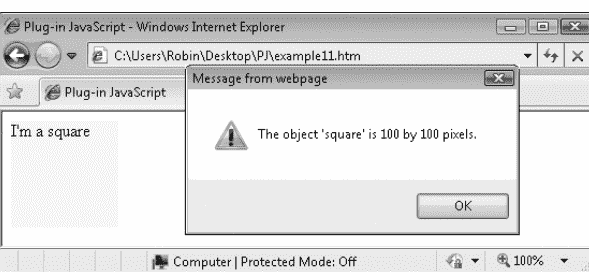

### 关于插件

这些插件返回对象相对于浏览器窗口左上角的绝对水平或垂直偏移。它们接受此参数：

- `id`: 需要返回偏移量的对象

### 变量、数组和函数

| Property | 说明 |
| :--- | :--- |
| obj | `id` 对象的本地对象副本 |
| offset | 用于存储水平或垂直偏移的本地整数 |
| offsetParent | 父级偏移对象 |
| offsetLeft | 对象的左偏移 |
| offsetTop | 对象的顶偏移 |

### 它们是如何工作的

每个函数都会影响对象宽度或高度的属性。要返回对象的宽度，将 `offsetWidth` 加到 `marginLeft` 和 `marginRight`，如下所示：

```javascript
var width = O(id).offsetWidth + O(id).marginRight
```

返回对象的高度与 H 插件的过程相同，使用了 `offsetHeight`、`marginTop`、`marginBottom` 和 `border`。在任何情况下都会返回计算的高度。

### W(id)

要返回对象的宽度，将 `offsetWidth` 加到 `marginLeft` 和 `marginRight`。要返回对象的宽度，使用以下代码：

```javascript
function W(id) {
  var obj = O(id)
  var width = obj.offsetWidth + O(id).marginLeft + O(id).marginRight
  if (obj.offsetParent) {
    while (obj = obj.offsetParent)
      width += O(id).marginLeft + O(id).marginRight
  }
  if (bord > 0)
    return width;
  else
    return width - O(id).border * 2;
}
```

### H(id)

返回对象的高度与 H 插件的过程相同，使用了 `offsetHeight`、`marginTop`、`marginBottom`、`borderWidth` 和 `border`。在任何情况下都会返回计算的高度。

```javascript
function H(id) {
  var obj = O(id)
  var height = obj.offsetHeight + O(id).marginTop + O(id).marginBottom + O(id).borderTop + O(id).borderBottom
  if (obj.offsetParent) {
    while (obj = obj.offsetParent)
      height += O(id).marginTop + O(id).marginBottom + O(id).borderTop + O(id).borderBottom
  }
  if (bord > 0)
    return height;
  else
    return height - O(id).border * 2;
}
```

### 如何使用它们

要使用这些插件，将对象的 ID 传递给它们，它们将返回其左侧或顶边缘的绝对水平或绝对垂直位置（像素）。以下是一些代码说明它们的用法：

```html
<div id='square'>我是一个正方形</div>
<script>
window.onload = function() {
  S('square').width = Px(100)
  S('square').height = Px(100)
  S('square').backgroundColor = 'yellow'
  alert("对象 'square' 位于位置 " + X('square') + ',' ' + Y('square'))
}
</script>
```

### 第 3 章：核心插件 59

这个示例与之前的示例非常相似，在 HTML 部分创建了一个名为 `'square'` 的 div。不同之处，`alert()` 函数使用 `W()` 和 `H()` 插件显示对象的宽度和高度。

注意：你可能会发现使用所有的 `S()`、`H()` 和 `NoPx()` 插件非常有意思。你已经可以看到这些插件是如何结合在一起让你的编程工作变得简单得多的。如果没有之前的那些构建函数，这些插件的大小可能会是现在的两到三倍，但通过这种方式，它们只需要几个字符，例如 `W ('obj')`。当你继续深入阅读此本书时，你将获得更强大的函数，这些函数从头开始编写需要几十甚至上百行代码。

### 插件

```javascript
function W(id) {
    var width = O(id).offsetWidth +
    NoPx(id).marginLeft +
    NoPx(id).marginRight
    var bord = O(id).borderLeftWidth +
    NoPx(id).borderRightWidth
    if (bord > 0) width = bord
    else if (O(id).border) width = O(id).border *
    return width
}
```

```javascript
function H(id) {
    var height = O(id).offsetHeight +
    NoPx(id).marginTop +
    NoPx(id).marginBottom
    var bord = NoPx(id).borderTopWidth +
    NoPx(id).borderBottomWidth
    if (bord > 0) height = bord
    else if (O(id).border) height = O(id).border *
    return height
}
```


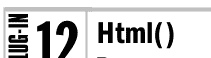

因为你会经常发现自己需要编写对象的 `innerHTML` 属性，我编写了这个简单的插件来保持代码简洁并提高其可读性，如图 3-12 所示。

# 60 插件 JavaScript：100 个强大的解决方案

图 3-12
此插件可以轻松地读取和写入对象的 HTML 内容。

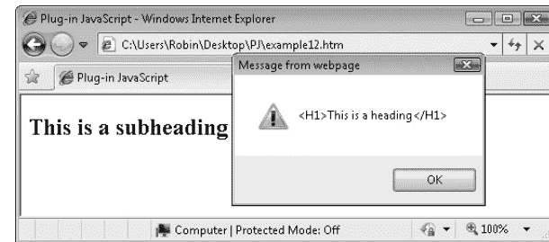

## 这是一个子标题

## 关于插件
此插件返回传递给它的对象的 `innerHTML` 属性。你可以用它来读取或写入数组。读取值只需要第一个参数，但写入一个值时两个参数都需要：

- 要访问的具有 `innerHTML` 属性的对象的 Id
- `value` 要赋值给 `innerHTML` 属性的值

## 变量、数组和函数

|  |  |
|---|--- |
| `innerHTML` | 包含对象 HTML 文本的属性 |

## 工作原理
要读取一个值，该插件使用 `O()` 插件来引用 `id` 中的对象并返回其 `innerHTML` 属性。要写入一个值，向插件使用第二个参数 `value`。如果代码检测到传递了此参数，则 `id` 的 `innerHTML` 属性将更改为 `value`。无论哪种情况，都会返回 `innerHTML` 属性。

## 如何使用

你可以读取或写入支持此函数的对象的 `innerHTML` 属性。要写入它，你使用如下语句：

```
Html('mydiv', 'This is some new text')
```

要从属性读取，使用如下语句：

```
var contents = Html('mydiv')
```

这里有一段使用 `alert()` 用的代码，这样你可以看到使用此插件前后的效果：

```html
<div id='heading'><h1>This is a heading</h1></div>
```

```html
<script>
```

## 第 3 章：核心插件

```
window.onload = function() {
    alert (Htl('heading'))
    Htl('heading', '<h2>This is a subheading</h2>')
    alert (Htl('heading'))
}
</script>
```

HTML 的第一部分创建一个带有 `<h1>` 标题的 div。然后 `<script>` 部分立即弹出一个警报框，通过调用 `Htl()` 显示此值。之后，对象的 `innerHTML` 属性值被更改为子标题，同样是使用 `Htl()`，然后第二次调用 JavaScript `alert()` 函数使用 `Htl()` 函数再次显示该属性——每次执行你都会看到内容已经发生了变化。

## 插件

```
function Htl(id, value) {
    if (typeof id != UNDEF) {
        O(id).innerHTML = value
    }
    return O(id).innerHTML
}
```

## SaveState()

在更改对象的属性后，有时你可能想将其恢复到原始状态。此插件允许你备份对象最重要的样式属性。图 3-13 显示了在测试 `SaveState()` 插件之前准备的带有几个值的 div。

## 关于插件
此插件备份了对象的几个最重要的样式属性，如果你以后需要，可以重新检索它们。它接收以下参数：

- `id`: 要备份的对象属性

图 3-13 创建一个用于测试保存和恢复状态的 div

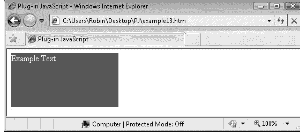

## 62 插件 JavaScript：100 个强大的解决方案

## 变量、数组和函数

|  |  |
|---|--- |
| `left` | 对象的 style.left 属性 |
| `top` | 对象的 style.top 属性 |
| `visibility` | 对象的 style.visibility 属性 |
| `color` | 对象的 style.color 属性 |
| `backgroundColor` | 对象的 style.backgroundColor 属性 |
| `display` | 对象的 style.display 属性 |
| `opacity` | 对象的 style.opacity 属性 |
| `MozOpacity` | 对象的 style.MozOpacity 属性 |
| `KhtmlOpacity` | 对象的 style.KhtmlOpacity 属性 |
| `filter` | 对象的 style.filter 属性 |
| `zIndex` | 对象的 style.zIndex 属性 |

## 工作原理

## 如何使用
要为对象创建一组备份属性，将其 ID 传递给 `SaveState()` 插件，如下：

```
SaveState('myobject')
```

以下代码显示了对对象的一些样式设置，然后保存了它的状态：

```html
<div id='mydiv'>Example Text</div>
<script>
window.onload = function() {
  S('mydiv').width = Px(200)
  S('mydiv').height = Px(100)
  S('mydiv').backgroundColor = 'green'
  S('mydiv').color = 'white'
  S('mydiv').position = 'absolute'
  SaveState('mydiv')
}
</script>
```

## 第 3 章：插件 63

这创建了一个绿色的、200像素的矩形，带有白色文本，位置是绝对的（因此该对象是可以移动的）。在插件中，你将看到如果更改了这些值并恢复保存的状态会发生什么。

## 插件

```
function SaveState(id)
O(id).Save_left = S(id).left
O(id).Save_top = S(id).top
O(id).Save_visibility = S(id).visibility
O(id).Save_color = S(id).color
O(id).Save_backgroundColor = S(id).backgroundColor
O(id).Save_display = S(id).display
O(id).Save_opacity = S(id).opacity
O(id).Save_MozOpacity = S(id).MozOpacity
O(id).Save_KhtmlOpacity = S(id).KhtmlOpacity
O(id).Save_filter = S(id).filter
O(id).Save_zIndex = S(id).zIndex
}
```

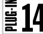

## RestoreState()
这是 `SaveState()` 的伙伴插件。它恢复已保存的样式属性。图 3-14 显示了我们在上一个示例中创建的 div；一个警报框已经弹出，让你看到屏幕发生了移动。

## 关于插件
此插件恢复使用 `SaveState()` 保存的样式属性。它接收此参数：

- 要恢复的对象样式属性

图 3-14 SaveState() 和 RestoreState() 的操作


## 64 插件 JavaScript：100 个强大的解决方案

## 变量、数组和函数

|  |  |
|---|--- |
| `left` | 对象的 style.left 属性 |
| `top` | 对象的 style.top 属性 |
| `visibility` | 对象的 style.visibility 属性 |
| `color` | 对象的 style.color 属性 |
| `backgroundColor` | 对象的 style.backgroundColor 属性 |
| `display` | 对象的 style.display 属性 |
| `opacity` | 对象的 style.opacity 属性 |
| `MozOpacity` | 对象的 style.MozOpacity 属性 |
| `KhtmlOpacity` | 对象的 style.KhtmlOpacity 属性 |
| `filter` | 对象的 style.filter 属性 |
| `zIndex` | 对象的 style.zIndex 属性 |

## 工作原理
此插件通过从以 "Save" 字符串开头的属性中检索值来反转 `SaveState()` 插件的操作。如果你有任何需要保存和恢复的额外属性，很容易地添加到这些函数中。

## 如何使用
要使用它，只需将已保存状态的对象 ID 传递给此插件，如下：

```
RestoreState('myobject')
```

以下示例扩展了之前的插件，创建一个 div，然后更改它，第一次通过修改它的几个属性，第二次通过调用 `Restore()` 更改。在之间，调用了 JavaScript `alert()` 函数以让你看到屏幕发生了移动的视图：

```html
<div id='mydiv'>Example Text</div>
<script>
window.onload = function() {
  S('mydiv').width = Px(200)
  S('mydiv').height = Px(100)
  S('mydiv').backgroundColor = 'green'
  S('mydiv').color = 'white'
  S('mydiv').position = 'absolute'
}
SaveState('mydiv')
alert('Click OK to see some changes')
</script>
```

## 第 3 章：核心插件 65

```javascript
S('mydiv').backgroundColor = 'blue'
S('mydiv').color = 'yellow'
S('mydiv').left = Px(100)
```

```javascript
alert('Click OK to see them back again')
RestoreState('mydiv')
</script>
```

如果你将此代码输入浏览器，该 div 将最初为绿色背景上的白色文字，然后它会变为黄色并向右移动，最后通过调用一次 RestoreState()，它就会恢复原始的颜色和位置。

## 插件

```javascript
function RestoreState(id)
{
S(id).left = O(id).Save_left
S(id).top = O(id).Save_top
S(id).visibility = O(id).Save_visibility
S(id).color = O(id).Save_color
S(id).backgroundColor = O(id).Save_backgroundColor
S(id).display = O(id).Save_display
S(id).opacity = O(id).Save_opacity
S(id).mosOpacity = O(id).Save_mosOpacity
S(id).htmlOpacity = O(id).Save_htmlOpacity
S(id).filter = O(id).Save_filter
S(id).zIndex = O(id).Save_zIndex
}
```

## 15 InsVars()

在 JavaScript 中，当你想要创建一个包含不同变量值的字符串时，你必须保持字符串开启，然后使用 `+` 号后跟变量名，再跟上另一个 `+`，然后重新开启字符串——你必须对每一个变量都这样做。然而，这个插件允许你轻松地将变量值插入到任何字符串中。图 3-15 显示了以这种方式插入的三个值。

## 关于插件

此插件至少需要两个参数。第一个是要插入值的字符串，第二个、第三个等是按如下方式要插入的值：

- `string`: 要插入值的字符串
- `value1`: 插入到字符串的值
- `value2`: 与 value1相同（以此类推...）

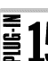

## 66 插件 JavaScript：100 个解决方案

图 3-15
此插件可以轻松地向字符串插入值。

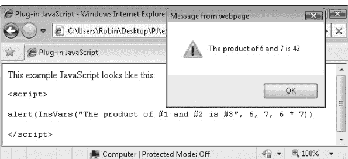

## 变量、数组和函数

| 名字 | 说明 |
| :--- | :--- |
| `tmp` | 包含待处理字符串的局部变量 |
| `arguments` | 传递给插件的参数数组 |
| `replace()` | 替换字符串中子字符串的 JavaScript 函数 |
| `regExp()` | 创建正则表达式的 JavaScript 函数 |

## 工作原理

此插件利用了一个方便的的事实：JavaScript 会向调用的每个函数传递一个数组。这个数组被称为 `arguments`，它的每个元素都是传递给函数的值之一。

因此，第一个元素被提取并放在局部变量 `tmp` 中。这是要进行变量替换的字符串，如下：

```javascript
var tmp = arguments[0]
```

然后使用 `for()` 循环遍历剩余的每个元素。如果字符串 `tmp` 中存在值为 '#1' 的子字符串，则将其插入到相应位置。'#2'、'#3' 以及任何类似的子字符串也会发生同样的情况，每个子字符串都会被传递给插件的下一行值替换，如下：

```javascript
tmp = tmp.replace(new RegExp('#' + j, 'g'), arguments[j])
```

为了允许一个值插入到字符串的多个地方，通过使用 `RegExp()` 对象创建一个新的正则表达式，并提供值 'g' 以指示全局搜索和/或替换。

最后，返回修改后的 `tmp` 字符串。

## 如何使用

使用 `InsVars()` 向字符串中插入值，你可以按照如下方式调用它：

```javascript
string = InsVars("The product of #1 and #2 is #3", 6, 7, 6 * 7)
```

该语句将值 "The product of 6 and 7 is 42" 赋值给 `string`。你只需要记住标签的数量与要插入的值的数量相同即可。

## 插件

```javascript
function InsVars()
{
  var tmp = arguments[0]
  for (var j = 1; j < arguments.length; ++j)
    tmp = tmp.replace(new RegExp('#' + j, 'g'), arguments[j])
  return tmp
}
```

## StrRepeat()

与其他语言不同，JavaScript 并没有内置创建一个新重复字符串的函数。因此，有一个插件可以完成这项工作，如图 3-16 所示，其中一个口号被重复了三次。

## 关于插件

此插件根据字符串和数字创建一个重复的字符串。它接收以下参数：

- `str`: 要重复的字符串
- `num`: 重复字符串的次数

## 变量、数组和函数

| 名字 | 说明 |
| :--- | :--- |
| `tmp` | 用于存储原始字符串的局部字符串变量 |
| `j` | 用于循环的局部变量 |

**图 3-16** 插件 JavaScript - 根据 num 创建字符串


# 插件 JavaScript：100 个解决方案

## 工作原理

此插件使用 `for()` 循环来组装字符串。

## 如何使用

要使用此函数，传递传递一个字符串和一个数字，如下：

```javascript
string = StrRepeat('Hip, Hooray!', 3)
```

## 插件

```javascript
function StrRepeat(str, num)
{
  var tmp = ''
  for (var j = 0; j < num; ++j)
    tmp += str
  return tmp
}
```

## Dec()

此插件将十进制数转换为十六进制字符串。

## 关于插件

此插件需要一个要转换的十进制数。

- `n`: 十进制数

## 变量、数组和函数

| 名字 | 说明 |
| :--- | :--- |
| `toString()` | 字符串的 JavaScript 函数 |

## 工作原理

此插件使用三元运算符检查数字是否小于 16。

```javascript
n < 16 ? '0' : ''
```

如果结果为真，则返回 '0'，否则返回空字符串。这确保了十六进制数字始终有两个。在对数字进行 0 填充（如有必要）之后，将数字 `n` 以参数 16 传递给 JavaScript 的 `toString()` 函数，如下代码段所示：

```javascript
n.toString(16)
```

这告诉它将数字转换为 16 进制，即十六进制。

## 插件

```javascript
function Dec(n)
{
return (n < 16 ? '0' : '') + n.toString(16)
}
```


两个部分的结果被拼接并返回。当你将这两部分代码组合在一起时如下所示：

```javascript
return (n < 16 ? '0' : '') + n.toString(16)
```

## 如何使用

要将十进制数转换为十六进制，将其传递给 `Dec()` 插件，如下：

```javascript
alert('The decimal number 173 in hexadecimal is ' + Dec(173))
```

## 第 3 章：核心插件 71

此语句显示的值为 'ad'，在 JavaScript 中作为颜色的一部分时，这是一个可以接受的十六进制数，因此通常不需要将其转换为大写或为其添加任何前缀。

到此，你已经完成了基础 JavaScript 工具箱的基础知识，而且本质上，它是书中最长的一个章节之一。在下一章中，我们将开始添加插件来提供位置和定位功能，然后好戏就真正开始了。

## 插件

```javascript
function DecHex(n)
{
  return (n < 16 ? '0' : '') + n.toString(16)
}
```

# 第 4 章

## 位置与尺寸

## JavaScript 插件：100 种解决方案

上一章侧重于提供核心功能的子集。这一章也做了同样的事情，但现在集合中已经有了足够的插件，我们可以开始创建一些有趣的效果，包括调整对象的大小和重新定位。

### 19 ResizeWidth()

在创建动态网页页面时，你经常需要更改对象的尺寸。你可能想通过放大某个部分来强调它，可能允许用户重新排列页面的内容，或者你希望打开像表单或灯箱（light boxes）之类的元素等。

通过此插件，你可以调整任何具有 `width` 属性对象的宽度，如图 4-1 所示的示例 `div`，其宽度被调整为 300 像素。

#### 关于插件

此插件更改对象的宽度。它需要以下参数：

- `id`: 对象的 ID 或对象本身。你也可以传递对象数组和/或对象 ID。
- `width`: 对象的新宽度。如果 `id` 是数组，则引用的所有对象都将设置为此宽度。

#### 变量、数组和函数

| `j` | 本地整数循环 |
| :--- | :--- |
| `overflow` | 对象的 `style.overflow` 属性 |
| `width` | 对象的 `style.width` 属性 |
| `HID` | 值为 'hidden' 的全局字符串变量 |
| `Px()` | 添加后缀 'px' 的插件 |

此插件还提供了 `o()` 和 `s()` 插件的多功能性，其中你可以传递对象的 ID 或对象本身，你甚至可以传递一组 ID 数组/或同时更改它们。

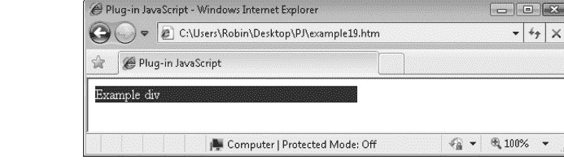

图 4-1 调整对象的宽度

## 第 4 章：位置与尺寸 75

它的实现利用了 fact：`S()` 插件已经设置好用于处理对象 ID、对象或对象数组和/或对象 ID。因此，只需要调用两次 `S()`：一次将对象或对象数组的 `style.overflow` 属性设置为 'hidden'，然后将 `style.width` 属性设置为 `width` 中的宽度。变量 `HID` 是由 `Initialize()` 插件创建的全局变量，其值为 'hidden'。对象的 `style.overflow` 属性被设置为此值，允许对象缩小或放大，当缩小合，，本会溢出的文本将被忽略。

#### 如何使用

使用此插件时，传递一个对象和一个宽度，如下所示：

```javascript
ResizeWidth('mydiv', 200)
```

或者你可以传递一个对象数组，如下：

```javascript
ids = Array('objone', 'objtwo', 'objthree')
ResizeWidth(ids, 480)
```

这里有一个你可以尝试的示例，它将 `div` 的宽度重置为 300 像素。它还更改了文本和背景颜色，以便你可以看到变化：

```html
<div id='example'>Example div</div>
<script>
window.onload = function() {
  S('example').backgroundColor = 'blue'
  S('example').color = 'yellow'
  ResizeWidth('example', 300)
}
</script>
```

#### 插件

```javascript
function ResizeWidth(id, width) {
  S(id, 'overflow', HID)
  S(id, 'width', Px(width))
}
```

### ResizeHeight()

正如你可能需要调整对象的宽度一样，这里有一个调整其高度的插件。图 4-2 显示了上一个插件创建的 `div` 现在高度增加到 100 像素。

## JavaScript 插件：100 种解决方案

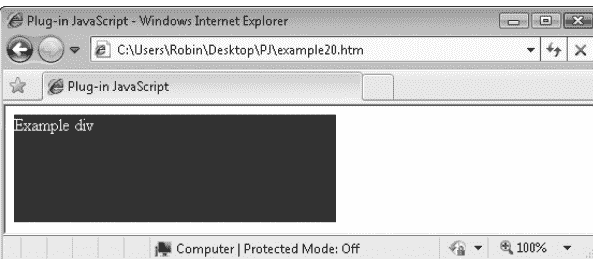

**图 4-2** 调整对象的高度

#### 关于插件

此插件更改对象的高度。它需要以下参数：

- **id**: 对象的 ID 或对象本身。你也可以传递对象数组和/或对象 ID。
- **height**: 对象的新高度。如果 id 是数组，则引用的所有对象都将设置为此高度。

#### 变量、数组和函数

| `j` | 本地整数循环 |
| :--- | :--- |
| `overflow` | 对象的 `style.overflow` 属性 |
| `height` | 对象的 `style.height` 属性 |
| `HID` | 值为 'hidden' 的全局字符串变量 |
| `Px()` | 添加后缀 'px' 的插件 |

#### 如何工作

这是 `Resize()` 的伴侣插件，它的工作方式与之前的完全相同，唯一的区别是修改的是对象的 `style.height` 而不是 `style.width`。通过 `Resize()`，你可以传递 ID 或对象。有关此插件如何运作的更多细节，请参阅 `Resize()` 插件。

#### 如何使用

使用此插件时，向它传递一个对象和一个高度，如下所示：

```javascript
ResizeHeight('mydiv', 100)
```

## 第 4 章：位置与尺寸 77

或者你可以传递一个对象数组，如下：

```javascript
ids = Array('objone', 'objtwo', 'objthree')
ResizeHeight(ids, 240)
```

这里有一个你可以尝试的示例，它修改了上一个插件中的示例，将 `div` 调整大小为 100 像素：

```html
<div id='example'>Example div</div>
<script>
window.onload = function() {
  S('example').backgroundColor = 'blue'
  S('example').color = 'yellow'
  ResizeWidth('example', 300)
}
</script>
```

#### 插件

```javascript
function ResizeHeight(id, height) {
  S(id, 'overflow', HID)
  S(id, 'height', Px(height))
}
```

### 21 Resize()

此插件将之前的两个合并为一个函数，以节省代码量并使代码更紧凑，如图 4-3 所示。


图 4-3 调整对象的宽度和高度

## 78 JavaScript 插件：100 种解决方案

#### 关于插件

此插件更改对象的宽度和高度。它需要以下参数：

- **id**: 对象的 ID 或对象本身。你也可以传递对象数组和/或对象 ID。
- **width**: 对象的新宽度。如果 id 是数组，则引用的所有对象都将设置为此宽度。
- **height**: 对象的新高度。如果 id 是数组，则引用的所有对象都将设置为此高度。

#### 变量、数组和函数

| `ResizeWidth()` | 更改宽度的插件 |
| :--- | :--- |
| `ResizeHeight()` | 更改高度的插件 |

#### 如何工作

此插件简单地调用 `ResizeWidth()` 然后调用 `ResizeHeight()`。

#### 如何使用

使用此插件时，向它传递一个对象以及宽度和高度，如下：

```javascript
Resize('mydiv', 100, 100)
```

你可以传递一个对象数组，如下：

```javascript
ids = Array('obj1', 'obj2', 'obj3')
Resize(ids, 128, 128)
```

这里有一个你可以尝试的示例，它改进了上一个插件中的示例，通过一次调用将 `div` 调整大小为 100 像素：

```html
<div id='example'>Example div</div>
<script>
window.onload = function() {
  S('example').backgroundColor = 'red'
  S('example').color = 'white'
  Resize('example', 300, 300)
}
</script>
```

#### 插件

```javascript
function Resize(id, width, height) {
  ResizeWidth(id, width)
  ResizeHeight(id, height)
}
```

## 第 4 章：位置与尺寸 79

### 22 Position()

此插件设置对象的 CSS `position` 属性。当你想要控制对象相对于父级位置的偏移，甚至完全移动到任何绝对位置时，这非常有用。图 4-4 显示了一个相对于之前位置水平偏移了 100 像素的 `div`。

#### 关于插件

此插件设置对象的 `style.position` 属性。它需要以下参数：

- `id`: 对象、对象 ID 或对象数组和/或对象 ID
- `type`: 要赋值的 `style.position` 属性类型，可选 'absolute'、'fixed'、'relative'、'static' 或 'inherit'。你也可以使用更短的全局变量（由 `Initialize()` 插件创建）`ABS`、`FIX`、`REL`、`STA` 和 `INH`。

#### 变量、数组和函数

| `position` | 对象的位置属性 |

#### 如何工作

此函数使用了 `S()` 函数的功能，它可以接收对象、对象 ID 甚至是对象数组和/或对象 ID。因此，它只需将 `id` 和 `type` 中的值直接传递给 `S()` 插件。

#### 如何使用

使用此插件设置对象的 `style.position` 属性，可以如下调用：

```javascript
Position('myobject', ABS)
```

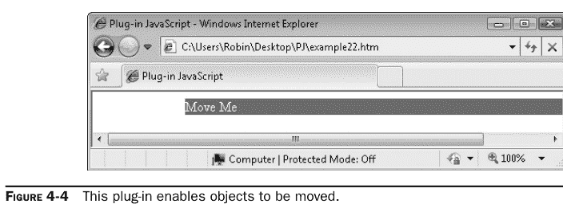

## 80 JavaScript 插件：100 个强大的解决方案

例如，要将对象设置为具有“绝对（absolute）”位置（使用 `Initialize()` 插件创建的较短全局变量 `ABS`）并移动它，你可以使用如下代码：

```html
<div id='moveme'>移动我</div>
<script>
window.onload = function() {
  S('moveme').backgroundColor = 'red'
  S('moveme').color = 'white'
  Position('moveme', REL = Px(100))
}
</script>
```

此示例创建了一个名为 'moveme' 的 div，将其设置为红色背景上的白色文字，然后使用 `Position()` 插件赋予它一个“相对（relative）”位置。最后，使用 `Px()` 插件设置其 `style.left`，这使其相对于父对象水平向偏移了 100 像素。

> 注意：由于使用“绝对”和“相对”样式定位的 div 之间位置变化存在差异，你还需要考虑这一点：使用“绝对”样式定位的 div 会自动收缩以适应其内容，而使用“相对”样式定位的 div 将保留其之前的宽度，默认情况下，它会延伸到容器对象的右边缘。如果你使用 `span`，它将始终收缩以适应其内容，无论位于何处或如何定位。

#### 插件

```javascript
function Position(id, type)
{
  S(id, 'position')
}
```

### Goto()

如果一个对象已经从页面中释放（例如通过之前的插件 `Position()`），那么你可以通过更改它的 `style.left` 和 `style.top` 属性将其移动到另一个位置，此插件通过提供单一函数使这一操作更快、更简单。在图 4-5 中，一个 div 向右移动了 200 像素，向下移动了 25 像素。

## 第 4 章：位置与尺寸

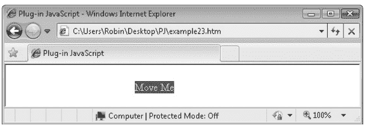

图 4-5 GoTo() 插件移动对象。

#### 关于插件

此插件将对象（如果它是可移动的）移动到新位置。它接受以下参数：

- 一个对象、一个对象 ID 或对象和/或对象 ID 数组
- 从父对象左边缘开始水平偏移量，对象将移动到此处（如果对象的 `style.position` 属性为 'fixed' 或 'absolute'，则从浏览器边缘计算）
- 从父对象顶部的垂直偏移量，对象将移动到此处（如果对象的 `style.position` 属性为 'fixed' 或 'absolute'，则从浏览器顶部计算）

#### 变量、数组与函数

| 变量 | 说明 |
| :--- | :--- |
| `left` | 对象的 `style.left` 属性 |
| `top` | 对象的 `style.top` 属性 |
| `Px()` | 添加后缀 'px' 的插件 |

#### 工作原理

此插件还利用了 `S()` 插件管理对象和/或对象 ID 数组、单个对象或对象 ID 的能力。它仅进行了两次调用：一次是将对象的 `style.left` 属性设置为带有 'px' 后缀的 x 值（这是 CSS 规则的要求），另一次是对 `style.top` 属性执行相同的操作，但使用的是 y 值。

#### 如何使用

要使用此插件，请通过通过发布类似如下的命令确保对象是可移动的（使用包含字符串 'relative' 的全局变量 `REL`）：

```javascript
Position('advertdiv', REL)
```

## JavaScript 插件：100 个强大的解决方案

以下示例为 div 赋予了“绝对（absolute）”位置（使用全局变量 `ABS`）并对其进行移动：

```html
<div id='moveme'>移动我</div>
<script>
window.onload = function() {
  S('moveme').backgroundColor = 'green'
  S('moveme').color = 'cyan'
  Position('moveme', ABS)
  Goto('moveme', 200, 25)
}
</script>
```

#### 插件

```javascript
function Goto(id, x, y) {
  S(id, 'left', Px(x))
  S(id, 'top', Px(y))
}
```


## Location()

此插件将 `Position()` 和 `Goto()` 插件结合成非常实用的插件，在初始设置对象时特别有用。通过它，你可以同时设置对象的 `style.position` 属性及其水平和垂直偏移。图 4-6 显示此插件将一个具有“绝对”位置的对象移动到 100,40 位置。

## 插件

此插件设置对象的 `style.position` 属性以及水平和垂直偏移。它需要以下参数：

- `id`：一个对象、一个对象 ID 或对象和/或对象 ID 数组
- `type`：要分配的 `style.position` 属性类型，'absolute'、'fixed'、'relative'、'static' 或 'inherit'（或全局变量 `ABS`、`FIX`、`REL`、`STA` 和 `INH`）


**图 4-6** 同时设置对象的定位和位置

## 第 4 章：位置与尺寸 83

- `x`：从父对象左边缘开始水平偏移量（对于 'fixed' 对象，对象将移动到此处；如果对象的 `style.position` 属性为 'fixed' 或 'absolute'，则从浏览器边缘计算）
- `y`：从父对象顶部开始垂直偏移量（对于 'fixed' 对象，对象将移动到此处；如果对象的 `style.position` 属性为 'fixed' 或 'absolute'，则从浏览器顶部计算）

## 变量、数组与函数

| 函数 | 说明 |
| :--- | :--- |
| `Position()` | 设置对象的 `style.position` 属性的插件 |
| `GoTo()` | 将对象移动到新位置的插件 |

## 工作原理

此插件利用 `Position()` 和 `Goto()` 插件的功能，这两个插件都允许访问对象 ID 或对象和/或对象 ID 数组。因此，它只需按需传递参数 `id`、`style` 和 `y`。

## 如何使用

使用此插件设置对象的 `style.position` 属性并将其移动到正确位置，可以使用如下代码：

```html
<div id='moveme'>移动我</div>

<script>
window.onload = function() {
  S('moveme').backgroundColor = 'orange';
  S('moveme').color = 'black';
  Locate('moveme', ABS, 100, 40)
}
</script>
```

在前面，你可以看到 `Locate()` 插件通过单一调用提供了广泛的功能。

> 注意：`absolute` 属性始终相对于第一个非 static 定位的父元素。`relative` 定位相对于其容器，而 `fixed` 属性相对于浏览器边界。

## 插件

```javascript
function Locate(id, type, x, y) {
  Position(id, type)
  GoTo(id, x, y)
}
```

## 第 4 章：位置与尺寸 84 JavaScript 插件：100 个强大的解决方案

## 25 GetWindowWidth()

有很多需要知道浏览器宽度的原因，最明显的是你可以确定图 4-7 中的位置。此插件还考虑了滚动条的可用宽度。

## 变量、数组与函数

| 变量 | 说明 |
| :--- | :--- |
| `de` | `document.documentElement` 的本地对象 |
| `BROWSER` | 包含浏览器名称的全局变量 |
| `barwidth` | 如果存在滚动条时设置的本地整数 |
| `scrollHeight` | `scrollHeight` 属性 |
| `clientHeight` | `clientHeight` 属性 |
| `innerWidth` | `window.innerWidth` 属性 |

## 工作原理

此插件首先复制 `document.documentElement` 以提供一个更短的名字。接下来，根据全局变量 `BROWSER` 的值判断浏览器不是 Internet Explorer，如果 `de.scrollHeight` 大于 `de.clientHeight`，则本地整数 `barwidth` 设置为 17。从全宽减去此值并返回结果。

否则（当浏览器是 Internet Explorer 时通常如此），代码直接返回有值的任意一个：`de.clientWidth` 或 `document.body.clientWidth`（允许严格模式或兼容模式）。

## 如何使用

要使用此插件，只需调用它并使用返回的值，如下所示所示将返回的值传递给 `alert` 语句并显示：

```html
<script>
window.onload = function() {
  alert('此浏览器的窗口宽度为: ' + GetWindowWidth())
}
</script>
```

## 插件

```javascript
function GetWindowWidth() {
  var de = document.documentElement
if (BROWSER != 'IE') {
    var barwidth = de.scrollHeight > de.clientHeight ? 17 : 0
    return window.innerWidth - barwidth
  }
return de.clientWidth || document.body.clientWidth
}
```


图 4-7 确定可用宽度

## 26 GetWindowHeight()

这是 `GetWindowWidth()` 的配套插件。它返回浏览器窗口的高度，并考虑了滚动条。在图 4-8 中，此浏览器的可用区域被此插件确定为 124 像素。

## 关于插件

此插件不接受任何参数，并返回当前窗口的可用高度，将任何滚动条考虑在内。

# 86 JavaScript 插件：100 个强大的解决方案

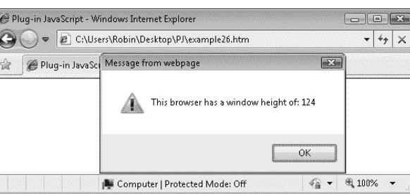

## 变量、数组和函数

| de | 说明 |
| :--- | :--- |
| `de` | `document.documentElement` 的本地对象副本 |
| `BROWSER` | 包含浏览器名称全局变量 |
| `scrollWidth` | 如果存在垂直滚动条，则设置本地整数变量 |
| `scrollWidth` | `de.scrollWidth` 属性 |
| `clientWidth` | `de.clientWidth` 属性 |
| `innerHeight` | `window.innerHeight` 属性 |
| `clientHeight` | `de.clientHeight` 和 `document.body.clientHeight` 属性 |

## 工作原理

此插件的工作原理与 GetWindow() 几乎相同，不同之处在于返回的是当前浏览器窗口的可用高度，并考虑了任何滚动条。更多细节请参阅 GetWindow()。

## 如何使用

要使用此插件，只需调用它并在下面的示例中使用返回的值，该示例将返回的值传递给 `alert()` 语句进行显示：

```html
<script>
window.onload = function() {
  alert('此浏览器的窗口高度为：' + GetWindowHeight())
}
</script>
```

接下来的插件是此插件以及之前的 GetWindowHeight() 如何非常有用的良好示例。

## 第 4 章：位置与尺寸 87

## 插件

```javascript
function GetWindowHeight ()
{
  var de = document.documentElement
  if (BROWSER != 'IE') {
    var barwidth = de.scrollWidth - de.clientWidth ? 17 : 0
    return window.innerHeight - barwidth
  }
  return de.clientHeight || document.body.clientHeight
}
```

## 27 GoToEdge()

这些插件开始整合，现在很容易构建一个将一个或多个对象移动到浏览器边缘之一的插件，这正是此插件的功能：它允许你将对象移动到浏览器的顶、左、右或底部，如图 4-9 所示。

## 关于插件

此插件将一个或多个对象定位浏览器窗口的四个边缘之一。它需要以下参数：

- 一个对象、一个对象 ID，或者对象或对象 ID 的数组
- `where` 对象或多个对象应移动到的边缘，可选 'top'、'bottom'、'left' 或 'right'
- `percent` 浏览器左侧或顶部的距离，取决于数值

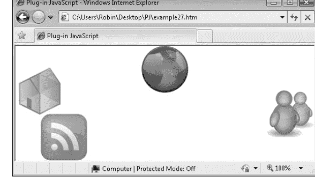

图 4-9 将 GIF 附加到浏览器的不同边缘

## JavaScript 插件：100 个解决方案

## 变量、数组和函数

| 变量 | 说明 |
| :--- | :--- |
| `j` | 如果是数组，用于索引的本地整数 |
| `width` | 包含浏览器宽度的本地变量，小于 id |
| `height` | 包含浏览器高度的本地变量，小于 id |
| `amount` | 以百分比为中心的本地变量 |
| `TP`, `BM`, `LT` and `RT` | 值为 'top'、'bottom'、'left' 和 'right' 的全局变量 |
| `GetWindowWidth()` | 返回浏览器宽度的插件 |
| `GetWindowHeight()` | 返回浏览器高度的插件 |
| `W()` | 返回对象宽度的插件 |
| `H()` | 返回对象高度的插件 |
| `GoTo()` | 将对象移动到新位置的插件 |

## 工作原理

与许多插件一样，此插件支持传递对象、对象 ID 或对象/或对象 ID 数组。这是通过 if() 部分管理的，该部分使用 `instanceof` 运算符确定 id 是否为数组。如果是，则数组的每个元素都将递归地传递给同一个函数，并带有 width 和 percent 的值。一旦处理完所有元素，函数将返回。

这些本地变量被赋值为代表考虑的宽度和高度的值。这是通过使用 `GetWindowWidth()` 和 `GetWindowHeight()` 获取浏览器宽度和高度，并根据 `W()` 和 `H()` 的用用结果，从其中一个减去另一个值来实现的。

变量 `amount` 设置为 `percent / 100`，以便其可以作为倍数使用。例如，如果 `percent` 的值为 40，除以 100 得到 0.40 的值，然后可以乘以任何数字将其缩小为原始值的 40%。在这种情况下，倍数决定了对象应该边缘齐到多远。

接下来，`switch()` 语句测试四个参数值，分别为 'top'、'bottom'、'left' 或 'right'。使用快捷全局变量 `TP`、`BM`、`LT` 和 `RT` 代替这些值，使代码更短更清晰。`break` 命令结束 `switch()` 语句的每个子部分，最后一个除外，最后一个不需要，因为程序流无论如何都会继续执行下一行。

取决于传入 `where` 的四个值中的哪一个，本地变量 `x` 和 `y` 被设置为对象在 0 到 100 百分比之间的上方（或下方）右侧对齐。最后，调用 `GoTo()` 将对象移动到新位置。

此插件有许多用途；例如 Apple 系统底部的 dock 栏，带有展开和折叠图标。`DockBar()` 为任何网页提供此项功能。

## 如何使用

要使用此插件，向它传递一个对象以及显示它的位置信息，如下例所示，显示了四个图标：

```html


<script>
window.onload = function() {
  ids = Array('i1', 'i2', 'i3', 'i4');
  Position(ids);
  GotoEdge('i1', TP, 50);
  GotoEdge('i2', BM, 10);
  GotoEdge('i3', LT, 30);
  GotoEdge('i4', RT, 60);
}
</script>
```

在 HTML 第一部分，使用不同的 ID 加载 GIF 图像。然后在 `<script>` 部分，填充这些 ID 使得 `Position()` 命令将它们设置为 `style='fixed'`。这意味着即使浏览器滚动，它们也会留在原地。

最后，通过四调用 `GotoEdge()` 将每个图像附加到不同的边缘。顶部 50%，底部 10%，左侧 30%，右侧 66%。正如本书中的示例，你可以从网站 javascript.com 下载此插件以及相关内容。

## 插件

```javascript
function GotoEdge(id, where, percent) {
  if (id instanceof Array) {
    for (var j = 0; j < id.length; j++) {
      GotoEdge(id[j], where, percent)
    }
    return
  }
  var width = GetWindowWidth() - W(id)
  var height = GetWindowHeight() - H(id)
  var amount = percent / 100
  switch (where) {
    case TP: x = width * amount; y = 0; break;
    case BM: x = width * amount; y = height; break;
    case LT: x = 0; y = height * amount; break;
    case RT: x = width; y = height * amount;
  }
  GotoTo(id, x, y)
}
```

## CenterX()

另一个非常有用的函数是居中对象，这正是此插件的功能。通过使用浏览器宽度和对象宽度，它将对象水平移动到浏览器中心。图 4-10 显示了使用此插件居中的 div。

## 关于插件

插件在水平轴上居中对象（或多个对象）。它需要以下参数：

- `id` 一个对象、对象 ID 或对象或对象 ID 数组

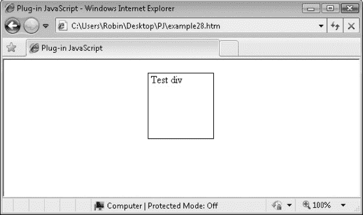

图 4-10 水平居中 div

## 第 4 章：位置与尺寸 91

## 变量、数组和函数

| 变量 | 说明 |
| :--- | :--- |
| `j` | 如果是数组，用于索引 id 的本地整数 |
| `left` | 对象的 `style.left` 属性 |
| `SCROLL_X` | 包含浏览器水平滚动像素数的全局变量 |
| `GetWindowWidth()` | 考虑滚动条的浏览器窗口可用宽度 |
| `W()` | 获取对象宽度的插件 |
| `Px()` | 添加 'px' 后缀的插件 |

## 工作原理

此插件允许对象数组和/或对象 ID，以及单个对象或对象 ID。它通过使用 `instanceof` 运算符来判断 id 是否为数组，如果是，则使用本地变量作为索引遍历数组，并使用单个元素值递归地调用自身。完成后，代码的 if 部分返回。

在插件的第二部分，`Px()` 将对象的 `style.left` 属性设置为正确值（使用 'px' 后缀）以水平居中对象。正确值通过查找窗口宽度（如果有滚动条则为 17）减去 id 的宽度确定。如果窗口是 600 像素且宽度为 100（且没有滚动条），该值通过从 600 中减去 100 ，等于 500；然后将该值除以 2 得到最终结果 250。因此，从左侧偏移 250 像素将在 600 像素宽的浏览器中精确居中 100 像素的对象。如果有滚动条，值变为 (583-100)/2，等于241.5。`Math.round()` 调用处理分数结果，将其向上取入到 342。

如果浏览器没有滚动，这就是所有的计算。然而，由于水平偏移是从文档的左边缘（而不是窗口），如果发生了水平滚动，对象将偏离中心显示量。因此，将全局变量 `SCROLL_X` 加到计算值中，以便将其精确放置在窗口的左右之间。

## 如何使用

要居中一个对象，只要它可以移动，只需按照下面的方式调用 `CenterX()`，该示例创建了一个简单的 div 并将其居中：

```html
<div id='test'>&nbsp;Test div</div>
```

```html
<script>
window.onload = function() {
  Locate('test', ABS, 20, 20);
  Resize('test', 100, 100);
  S('test').border = 'solid ' + Px(1);
  Center('test')
}
</script>
```

## 92 JavaScript 插件：100 种解决方案

&nbsp; 实体用于在文本与其运行的边界之间产生间距。`Locate()` 调用使用全局变量 `ABS` 作为缩写，将 'test' div 设置为 'absolute'（绝对）定位。它还将 div 定位于位置 20,20。此后，`Resize()` 调用将该 div 转换为 100 像素的正方形。然后，在这个示例中，我们没有使用颜色让 div 易于观察，而是给 div 赋予了一个带有颜色的实线边框 `S()`。

最后，调用 `CenterX()` 使 div 在水平方向上居中。

## 插件

```javascript
function CenterX(id)
{
```


`if (id instanceof Array) {`

`for (var j = 0; j < id.length ; ++j)`

`CenterX(id[j]);`

`}`

`return`

`}`

```
S(id).left = Px (Math.round(GetWindowWidth() - W(id)) / 2 + SCROLL_X)
```

## CenterY()

这是 `CenterX()` 的伙伴插件，它允许你在垂直方向上居中对象。图 4-11 显示了一个使用此插件居中的 div。

### 关于插件

此插件将一个对象（或多个对象）在垂直轴上居中。它需要以下参数：

- 一个对象、一个对象 ID 或对象或对象 ID 数组

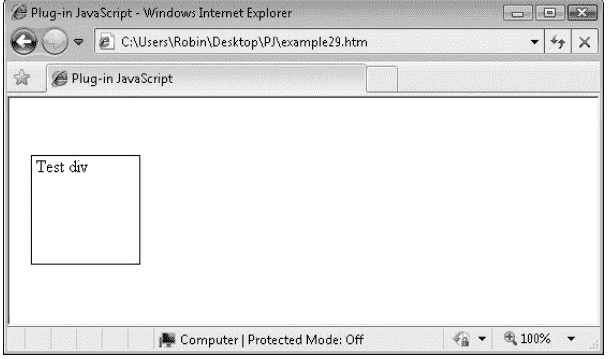

图 4-11 垂直居中 div

### 第 4 章：位置与尺寸 93

### 变量、数组与函数

| `j` | 如果 `id` 是数组，则用于索引 `id` 的局部整数变量 |
| `top` | 对象的 `style.top` 属性 |
| `SCROLL_Y` | 包含浏览器垂直滚动像素数的全局变量 |
| `GetWindowHeight()` | 浏览器窗口的可用高度，已考虑任何滚动条 |
| `H()` | 获取对象高度的插件 |
| `Px()` | 添加后缀 'px' 的插件 |

### 工作原理

此插件与 `CenterX()` 几乎相同，不同之处在于对象沿其垂直轴居中。更多细节请见 `CenterX()` 部分。

### 如何使用

要使用此插件在垂直方向上居中对象，你可以使用如下所示的代码：

```
<div id='test'>&nbsp;Test div</div

<script>

window.onload = function() {

  Locate('test', ABS, 20, 20)

  Resize('test', 100, 100)

  S('test').border = 'solid' + Px(1)

  CenterY('test')

}

</script>
```

此示例在 HTML 部分创建了一个 div，然后在 `<script>` 部分，使用 `Locate()` 命令和全局变量 `ABS` 将对象的 `style.position` 属性设置为 'absolute'。它还将对象移动到位置 20,20。

随后，使用 `Resize()` 将 div 的宽度和高度均调整为 100。之后，给它赋予了一个 1 像素宽的边框以使其脱颖而出，然后在最后一行，使用 `CenterY()` 插件将其在垂直方向上居中。

### 插件

```
function CenterY(id) {

  if (id instanceof Array) {

    for (var j = 0 ; j < id.length ; ++j)

      CenterY(id[j])

  }

}
S(id).top = Px(Math.round(GetWindowHeight()) - H(id)) / 2 + SCROLL_Y
```

## Center()

通常情况下，当你居中一个对象时，希望在水平和垂直方向上都这样做，因此此插件将之前的几个函数整合到一个函数中，如图 4-12 所示。

### 关于插件

此插件将一个对象（或多个对象）在其垂直和水平轴上同时居中。它需要以下参数：

- 一个对象、一个对象 ID 或对象或对象 ID 数组

### 变量、数组与函数

| `CenterX()` | 水平居中对象的插件 |
| `CenterY()` | 垂直居中对象的插件 |

### 工作原理

由于 `CenterX()` 和 `CenterY()` 都编写为接受可以是对象数组和/或对象 ID 数组、单个对象或对象 ID 的参数，因此此插件需要的工作很少，它只是简单地依次调用每一个，并将 `id`（无论是否为数组）传递给每个函数。

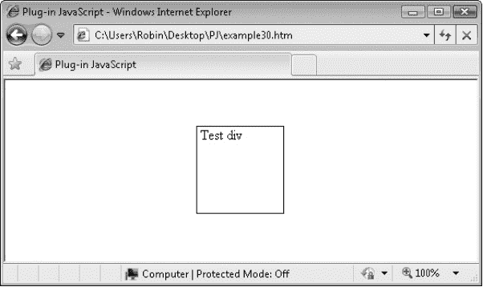

图 4-12 水平居中 div

### 如何使用

要在水平和垂直方向上完全居中一个对象，你可以使用如下代码：

```
<div id='test'>Test div</div

<script>

window.onload = function() {

  Locate('test', ABS, 20, 20)

  Resize('test', 100, 100)

  S('test').border = 'solid ' + Px(1)

  Center('test')

}

</script>
```

为了在水平和垂直方向上完全居中一个对象，你可以使用如下代码。此示例与之前的示例非常相似，不同之处在于它调用了 `Center()` 插件来将其完全居中。

### 插件

```
function Center(id)

{

  CenterX(id)

  CenterY(id)

}
```

## 第 5 章 可见性

### 98 JavaScript 插件：100 种解决方案

你在网站上看到的最令人印象深刻的效应通常是这种简单的。例如，将对象的可见性淡入淡出比其他变换要优雅得多。此插件让对象（或多个对象）在保持位置的情况下变为隐藏。它需要以下参数：

- 一个对象、一个对象 ID 或对象或对象 ID 数组

### 变量、数组与函数

| `visibility` | 对象的 `style.visibility` 属性 |
| `HID` | 值为 'hidden' 的全局变量 |


图 5-1 阴影区域是一个 span

### 关于插件

此插件让一个对象（或多个对象）在保持尺寸的情况下变为隐藏。它需要以下参数：

- 一个对象、一个对象 ID 或对象或对象 ID 数组

### 工作原理

此插件调用 `S()` 插件，其方式允许你传递对象数组和/或 ID、单个对象或对象 ID。对象的 `style.visibility` 属性被设置为 `HID` 的值，即 'hidden'。

### 如何使用

要使用此插件，传递对象或对象使其变为隐藏。以下示例显示了你可能采用的方法：

```
<span id='ghost'>现在你能看到我...</span> 很快你就不会

<script>

window.onload = function() {

  S('ghost').backgroundColor = 'lightblue'

  Resize('ghost', 128, 32)

  alert('点击 OK 查看对象消失')

  Invisible('ghost')

}

</script>
```

此示例首先在 HTML 部分创建了一个 span 并赋予它一些文本。后面是比 span 内部更多的文本。接下来，弹出一个警告框，让你在调用 `Invisible()` 插件之前有机会看到初始显示。点击 alert OK 按钮后，调用执行，span 的内容变得不可见。

- 提示 如果希望在隐藏对象时保持布局不变，应该使用此插件而非插件 40 `Hide()`。插件 35 保留了对象的尺寸，而插件 40 会完全折叠对象，导致周围的元素移动并占据新空间。


图 5-2 点击 alert 后 span 变得不可见

## 100 Plug-In JavaScript: 100 Power Solutions

### The Plug-in

```javascript
function Invisible(id)
{
  S(id, 'visibility', HID)
}
```

## Visible()

这是 `Invisible()` 的伙伴插件。它让之前不可见的对象可见。图 5-3 扩展了之前的插件。现在，当点击 alert 消息框的 OK 按钮时，不可见的文本将会出现。

## 33 VisibilityToggle()

此插件反转对象的可视性。如果它是可见的则变为隐藏，或者如果它是隐藏的则变为可见。在图 5-4 中，每次点击按钮时，文本都在可见和隐藏之间切换。


**图 5-4** 为按钮的点击事件绑定插件

## Plug-In JavaScript: 100 Power Solutions

### About the Plug-in

Each time this plugin is called, the object or objects passed change their visibility to the opposite side. It requires the following argument:

- `id` An object, an ID, or an array of objects andor object IDs

### Variables, Arrays, and Functions

| variable | description |
| :--- | :--- |
| `j` | 如果是数组，则用于索引的局部整数 |
| `visibility` | 对象的 `style.visibility` 属性 |
| `HID` | 值为 'hidden' 的全局变量 |
| `VIS` | 值为 'visible' 的全局变量 |

### How It Works

此插件使用了许多其他插件也采用的递归技巧来处理数组或对象 ID，以及单个对象和对象 ID。它通过这种方式使用 `instanceof` 运算符来测试它是否为数组。如果是的话，则通过 for 循环中的局部变量 `j` 遍历数组，递归地为数组的每个元素调用函数。一旦完成，函数返回。

如果不是数组，则调用 `S()` 插件，并传入对象 `style.visibility` 属性的取反值。这是通过以下三元表达式实现的，并结合了全局变量 `HID` 和 `VIS`，它们分别代表 'hidden' 和 'visible'：

```javascript
S(id).visibility = (S(id).visibility == HID) ? VIS : HID
```

用通俗的话说，这条语句的意思是：“如果对象的 `style.visibility` 当前值为 'hidden'，则返回值 'visible'；否则返回值 'hidden'”。第一个等号之后、问号之前是测试。如果结果为真，返回后续的值；如果结果为假，返回最后的值。这一切的效果是将可视属性的另一侧应用于对象。

### How To Use It

你可以直接从 JavaScript 中调用此插件，如下：

```javascript
VisibilityToggle('myobject')
```

或者传递一个对象数组，如下：

```javascript
ids = Array('firstobj', 'secondobj', 'thirdobj');
VisibilityToggle(ids)
```

或者，你可以将调用整合到 HTML 中，如包含名为 'toggle' 的 span 文本的两行 HTML 中，以便每次点击按钮时在隐藏或可见之间切换（你同样可以将其附加到 onmouseover或其他事件）：你将看到此插件在许多其他插件中以各种方式被使用。

注意，从 HTML 中调用此插件说明了几乎所有这些插件都允许你传递 ID 或对象的主要原因。在前面的示例中，'toggle' 的对象 ID 被传递给插件，但这个对象（它是一个对象，而不是对象的 ID）也被传递，告诉插件嵌入调用的 HTML 对象是需要操纵的对象。这就是实现鼠标悬停和其他效果的方法——在下一个插件中，以及在第 8 章“菜单与导航”中。

### The Plug-in

```javascript
function VisibilityToggle(id)
{
  if (id instanceof Array)
  {
    for (var j = 0; j < id.length; ++j)
      Visible(id[j])
  }
  else
  {
    S(id, 'visibility', VIS)
  }
}
```

## 34 Opacity()

能够让隐藏的对象可见是极好的，但有时我们需要对对象进行更精细的控制，这种控制通过 JavaScript 中的术语 opacity（透明度）来实现。

### The Plug-in

此插件将百分比设置为对象的透明度。它需要以下参数：

- `id` 一个对象，一个 ID，或对象数组和对象 ID
- `percent` 传递给对象的透明度值

### How It Works

此插件以一种方式调用了 `S()` 插件，因为不同的浏览器以不同的方式处理透明度。坦率地说，由于它们的方法并不冲突，因此不需要大量的 if-else 代码。大多数浏览器（如 Opera、Google Chrome 以及新版本的 Apple Safari）如下：

```javascript
S(id, 'opacity', percent / 100)
```


图 5-6 点击后，按钮分别具有 25%、50% 和 75% 的透明度。

### About the Plug-in

此插件将对象的透明度设置为百分比。图 5-5 显示了 100% 透明度的三个按钮。

### Variables, Arrays, and Functions

| variable | description |
| :--- | :--- |
| `opacity` | 大多数浏览器使用的 `style.opacity` 属性 |
| `MozOpacity` | Firefox 浏览器使用的 opacity 属性 |
| `HtmlOpacity` | Safari 浏览器使用的 opacity 属性 |
| `filter` | 微软选择的更复杂的方法 |

### It Works

此插件简单地将百分比值除以 100，并将其应用于对象的 `opacity` 属性上。当然，如果 `id` 是数组，其所有元素都将更新该属性。

然而，基于 Mozilla 的浏览器（如 Firefox）有自己的专用属性来实现此功能，下行代码通过更改 `style.MozOpacity` 执行等效操作。同样，第三行是针对引入 Webkit 之前使用旧引擎的 Safari，因此需要更改 `style.HtmlOpacity` 属性。

最后，微软选择了一种更复杂的方法，并将透明度包含在其标准的透明度功能组中。对象的 `filter` 属性通过如下方式设置（以 25% 设置为例）：

```javascript
S(id).filter = 'alpha (opacity = 25)'
```

此外，由于赋值给 `filter` 属性的是字符串而不是数值值，这需要进行构造。因此，为了将百分比值放入字符串中，使用了以下代码（雇用了 `InsVars` 插件）：

```javascript
S(id, 'filter', InsVars("alpha (opacity = #1#)", percent))
```

## 106 JavaScript 插件：100 种强大解决方案

### 插件

```javascript
function Opacity(id, percent)
{
  S(id, 'opacity', percent / 100)
  S(id, 'MozOpacity', percent / 100)
  S(id, 'KhtmlOpacity', percent / 100)
  S(id, 'filter', InsVars("alpha(opacity = '#1'", percent))
}
```


## 35 Fade()

这个插件充分利用了上一个插件 `Opacity()`，它允许随着时间平滑地改变对象的透明度。在图 5-7 中，两张图像的 ID 被绑定到了鼠标事件上，以便它们可以淡入和淡出。

## 关于插件

该插件在设定的毫秒内，让对象从一个透明度值渐变到另一个透明度（增加或减少）。它需要以下参数：

- `id`: 一个对象、对象 ID，或者一个对象和/或对象 ID 的数组
- `start`: 起始透明度水平
- `end`: 最终透明度水平
- `msecs`: 淡入持续所需的毫秒数
- `interruptible`: 如果设置为 true，则对象的淡入可以被中断，并替换为同一对象上的新淡入效果；否则，淡入将一直持续直到完成。
- `CB`: 此参数有时由其他插件使用，以便在执行执行完成后调用第二个函数。它的值是一个包含要调用函数名称的字符串变量。它通常不由用户传递，除非它以不同的方式使用，否则我将不再在参数列表中提到 CB。

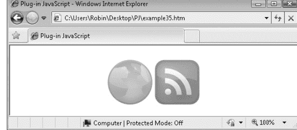

图 5-7 左侧的图像正在缓慢淡入背景。

### 第 5 章：可见性 107

## 变量、数组和函数

|  | 描述 |
|---|---|
| `j` | 如果 `id` 是数组，则用于索引 `id` 的局部变量 |
| `stepval` | 用于计算动画每帧中透明度变化数量的局部变量 |
| `INTERVAL` | 全局变量，默认值为 30——每次调用中断间隔的毫秒数 |
| `FA_Flag` | `id` 的属性，如果正在进行淡入，则设置为 true，否则为 false |
| `FA_Start` | `id` 的属性，赋值为 `start` 的值 |
| `FA_End` | `id` 的属性，赋值为 `end` 的值 |
| `FA_Level` | `id` 的属性，包含透明度水平 |
| `FA_Step` | `id` 的属性，包含每一步中透明度的变化量 |
| `FA_Int` | `id` 的属性，包含传递中断参数的值 |
| `Fadeout` | 由 `FadeToggle()` 插件使用的 `id` 属性：如果已淡出则为 true，如果已淡入则为 false |
| `FA_IID` | `setInterval()` 返回值的属性——该值被 `clearInterval()` 用于关闭附加到 `id` 上的 `DoFade()` |
| `DoFade()` | 每隔一个 `INTERVAL` 调用一次的插件函数，直到淡入完成或被中断——此函数每次被调用时都会更新 `id` 的透明度 |
| `Opacity()` | 用于改变单个对象或对象数组透明度的插件 |
| `Math.abs()` | 从一个可能是正也可能是负的数返回返回绝对正值的函数 |
| `Math.max()` | 返回两个值中最大值的函数 |
| `Math.min()` | 返回两个值中最小值的函数 |
| `setInterval()` | 启动对另一个函数周期性中断调用的函数 |
| `clearInterval()` | 停止由 `SetInterval()` 启动的中断函数 |

## 工作原理

这是第一个真正实用的插件。最多 50 行代码，并不短，但不要被它吓到；代码逻辑非常直观，而且你以前见过它的很多部分。如果你能弄懂这个插件，你就能理解所有的插件。

该函数通过使用中断在固定的间隔内调用函数，每次微小地改变一次对象的透明度（这是本书中所有过渡和动画插件的工作原理）。为了实现这一点，插件分为两个部分。第一部分准备所有变量并启动中断，第二部分接收中断调用并执行增量式的透明度变化。

### JavaScript 插件：100 种强大解决方案

让我们从第一段 `if()` 代码块看起。这里没什么特别的；如果 `id` 是数组，它只是简单地递归地返回同一个函数，每次处理一个元素：

```javascript
if (id instanceof Array)
{
  for (var j = 0; j < id.length; ++j)
    Fade(id[j], start, end, msecs, interruptible, CB)
  return
}
```

之后，创建了局部变量 `stepval`，如下：

```javascript
var stepval = Math.abs(start - end) / (msecs / INTERVAL)
```

它的值通过寻找 `start` 和 `end` 透明度值之间的差来计算的；即将一个减去另一个，然后将结果传递给 `Math.abs()` 函数，得到一个表示差值的正整数，如下：

```javascript
Math.abs(start - end)
```

淡入应该持续的时间（以毫秒为单位通过变量 `msecs` 传递）除以 `INTERVAL`，即过渡每帧之间的毫秒数（默认为 3）。这部分代码是简单的除法：

```javascript
msecs / INTERVAL
```

然后将第一个值（`start` 和 `end` 的差值）除以第二个值（计时），然后赋值给变量 `stepval`。

## 具体案例

假设 `start` 的值为 0，`end` 值为 100，`msecs` 值为 1000，看看计算出的值是多少。这让我们得到了公式：

```javascript
Math.abs(0 - 100) / (1000 / 30)
```

在淡入过程中，如果以下三点为真：

1. 中断每 30 毫秒发生一次，
2. 你希望动画持续 1000 毫秒，
3. 存在透明度水平。

每个透明度水平之间的距离应该是 3。

### 第 5 章：可见性 109

## 标准公式

先前的公式是书中几乎所有动画和过渡的工作方式。它们获取你提供的持续毫秒数，然后除以间隔（通常为 30），最后计算 `start` 和 `end` 点之间的距离

## 如果淡入正在进行

该插件的设计使得你可以强制它持续直到完成，或者允许它被中断（但仅限于同一对象上的 `Fade()` 调用）。这样当你移动鼠标时，就可以中断它。

或者，你可能需要显示一个不中断的动画。你可以通过设置 `interruptible` 参数为 `true`（如果淡入可以被中断）或 `false` 来选择。你也可以使用 1 和 0 作为这些值。

下一部分代码通过查看 `id` 的 `FA_Flag` 属性来检查是否正在淡入。这是 `id` 的一个新属性，当淡入进行时其值为 `true`。

> 注意：给对象赋值新属性是书中贯使用的技术。它是使用 JavaScript 某些对象特性的一种方便方法。

下一部分代码检查是否正在进行淡入。如果是，代码检查 `id` 的 `FA_Int` 属性是否已设置（以确定是否允许中断）。如果没有，函数将立即退出，因为无法中断。否则，调用 `clearInterval()` 函数来结束循环的过渡，并将对象的新的 `FA_Start` 属性设置为当前 `FA_Level` 的值。

这使得新的淡入从上一个（刚刚取消）的地方开始，这意味着新的淡入将忽略传递的 `start` 值。以下代码执行此操作：

```javascript
if (O(id).FA_Flag)
{
  if (O(id).FA_Int) return
  clearInterval(O(id).FA_IID)
  O(id).FA_Start = O(id).FA_Level
}
```

## 如果没有进行淡入

如果没有进行淡入，则将新的 `id` 属性 `FA_Start` 赋值为 `start` 的值，以便后续代码可以使用此知道淡入从哪里开始。

### JavaScript 插件：100 种解决方案

`FA_Level` 也被设置为 `start`，因为该属性将用于跟踪每次中断时的透明度水平。这些语句放置在 `else` 分段中，如下：

```javascript
else
{
  O(id).FA_Start = start
  O(id).FA_Level = start
}
```

## 剩余赋值

在该插件设置部分的最后几行，必须对 `id` 的其他属性进行赋值，如下：

```javascript
O(id).FA_Flag = true
O(id).FA_End = end
O(id).FA_Int = interruptible
```

第一行将对象的 `FA_Flag` 设置为 `true`，这在代码的其他部分用于判断插件是否可以进入（重入）。第二行将 `end` 值复制到新属性 `FA_End` 中，最后一行将 `interruptible` 的值赋给属性 `FA_Int`。

接下来，透明度的变化量必须存储在 `FA_Step` 中。根据这一行的判断，如果透明度是增加，则为 `step`；如果是减少，则为 `-step`：

```javascript
O(id).FA_Step = end > O(id).FA_Start ? stepval : -stepval
```

## O(id).Fadeout = end < O(id).FA_Start ? true : false

## 启动中断

插件设置部分的最后一行以以下方式设置中断：

```javascript
O(id).FA_IID = setInterval(DoFade, INTERVAL)
```

这启动了一个循环中断，将每隔 `INTERVAL` 毫秒调用一次 `DoFade()` 函数。`setInterval()` 返回的值被保存在新属性 `FA_IID` 中，以便在以后需要取消中断时使用。

### 第 5 章：可见性

## DoFade() 子函数

此函数是 `Fade()` 的子函数，被称为私有方法或私有函数。此类函数共享父函数的所有局部变量，因此不需要将它们作为参数传递，并且它们只能被父函数使用，不会污染命名空间。

这使其非常适合用作中断或驱动函数，这正是我在这个插件中所做的。每隔 `INTERVAL` 毫秒（默认为 30），JavaScript 就会调用一次 `DoFade()`。它有一个主要工作，就是稍微改变 `id` 的透明度。下面这一行用于更改此值：

```javascript
O(id).FA_Level += O(id).FA_Step
```

这仅仅是将 `id` 的 `FA_Step` 属性值加到它的 `FA_Level` 属性上。如果 `FA_Step` 为正，则相加；如果是负，则相减（例如 100 - 3 是 97，因为第一个 + 被忽略了）。

## 已达到最终透明度

得到这个新值后，是检查它是否为所需的最终值，从而完成动画。相应的代码稍微冗长：

```javascript
O(id).FA_Level >= Math.max(O(id).FA_Start, O(id).FA_End) ||
O(id).FA_Level <= Math.min(O(id).FA_Start, O(id).FA_End)
```

本质上，它检查当前透明度（在 `FA_Level` 中）是否达到了最终值（在 `FA_End` 中）。如果它等于或大于（在减少时为小于）最终值，则执行以下代码段：

```javascript
O(id).FA_Level = O(id).FA_End
O(id).FA_Flag = false
clearInterval(O(id).FA_IID)
```

在此部分中，`FA_Level` 被 设置为 `FA_End` 中的精确值。必须这样做，因为 `FA_Level` 往往会有一个小数值，并且始终需要最后一帧动画来确保达到正确的透明度水平。

将 `id` 的 `FA_Flag` 属性设置为 `false` 以表示淡入效果结束。紧调用 `clearInterval()` 并传入保存的 `FA_ID` 属性值。这防止了任何进一步的中断。

## CB 参数

`if ()` 部分的最后一个语句如下：

```javascript
if (typeof CB != UNDEF) eval (CB)
```

它捕获传递给 `CB` 的参数（如果有），并使用 `eval()` 函数对其进行求值。这种过程被称为回调，被链式插件使用。简而言之，现在这个插件已经运行完毕，这允许任何链式插件开始它们的执行。然而，这只有在参数 `CB` 有值时才会发生。

当你希望在插件执行完毕后运行第二个函数时，通常会传递此参数；你只需将要调用的函数以字符串的形式作为最后一个参数传递给原生支持回调的插件即可。

> 第 7 章将更详细地介绍回调和链，但由于这是第一个支持回调的插件，所以我在这里做了简要描述。

## 改变透明度

本节最后做的是通过这行代码调用 `Opacity()` 插件设置当前透明度：

```javascript
Opacity(id, O(id).FA_Level)
```

如果 `clearInterval()` 已调用，那么就结束了；否则在 `INTERVAL` 毫秒后 `DoFade()` 将再次被调用，计算出略有不同的 `FA_Level` 值并传递给 `Opacity()` 插件，直到过渡完成。

> 我们花了大量时间研究这个插件，因为其他的动画和过渡插件以类似的方式工作。一旦你理解了这，你就能轻松看到其他的是如何工作的。

## 如何使用

要让一个对象淡出，你可以使用如下命令：

```javascript
Fade('object', 100, 0, 1000, 0)
```

这将使对象在这一秒内从完全不透明淡出到完全透明。最后一个参数 `0` 防止了淡出被中断。

你也可以在 HTML 中嵌入插件的调用，如下：

```html
<a href="http://abc.com" onmouseover="Fade('object', 75, 100, 500, 1)" onmouseout="Fade('object', 100, 75, 500, 1)">Link</a>
```

如果链接……尝试移动鼠标到这对图片上并注意发生了什么。你会发现第二张图片平滑地淡入淡出，并且总是从被中断的淡出的透明度水平继续。

另一方面，第一个很难控制，因为你只能让它从完全不透明或完全透明的状态淡出或淡入；你不能部分中断它。这意味着如果在过渡完成之前将鼠标移开第一张图片，鼠标将处于离开状态，因此在鼠标再次移回来并等待过渡完成、然后移出鼠标之前，没有 `mouseout` 事件会触发。

当你尝试示例时就会明白我的意思，并且会变得清晰：不可中断的方法适用于你希望始终完成的动画和过渡，而可中断的方法最适用于需要用户鼠标交互。

### 114 JavaScript 插件：100 种强大解决方案

```javascript
{
  O(id).FA_Start = start
  O(id).FA_Level = start
}
```

```javascript
O(id).FA_Flag = true
O(id).FA_End = end
O(id).FA_Int = interruptible
O(id).FA_Step = end > O(id).FA_Start ? stepval : -stepval
O(id).Fadeout = end = O(id).FA_Start ? true : false
O(id).FA_IID = setInterval(DoFade, INTERVAL)
}
```

```javascript
function FadeOut() {
  O(id).FA_Level += O(id).FA_Step
```

```javascript
if (O(id).FA_Level >= Math.max(O(id).FA_Start, O(id).FA_End) ||
    O(id).FA_Level <= Math.min(O(id).FA_Start, O(id).FA_End)) {
```

```javascript
O(id).FA_Level = O(id).FA_End
O(id).FA_Flag = false
clearInterval(O(id).FA_IID)
  if (typeof CB != UNDEFINED) eval(CB)
}
```

```javascript
Opacity(id, O(id).FA_Level)
```

## 36 FadeOut()

此插件会将传递给它的任何对象或多个对象淡出。在图 5-8 中，每张图像上方都有一些文字，当鼠标悬过这些文字时，下方的图像会淡出。

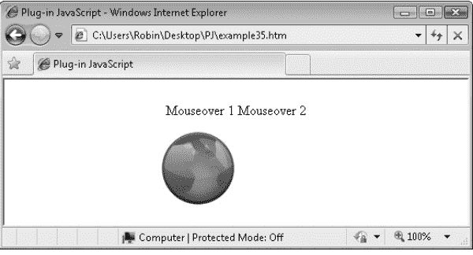

图 5-8 右侧的图像已经淡出。

### 第 5 章：可见性 115

#### 关于该插件

此插件将在指定的时间内使一个对象淡出。它接收以下参数：

- **id** 一个对象、一个对象 ID，或者一个包含对象和/或对象 ID 的数组
- **msecs** 过渡所需的毫秒数
- **interruptible** 如果设置为真，则淡出可以被中断；否则不能

## 变量、数组和函数

| 函数 | 说明 |
| :--- | :--- |
| `Fade ()` | 用于在两个透明度之间对对象进行淡出的插件 |

## 工作原理

此插件调用了 `Fade()` 插件，但它需要的参数更少。由于 `Fade()` 的工作方式，此插件也接受一个对象、一个对象 ID，或者一个包含对象和/或对象 ID 的数组。

## 如何使用

在任何你想让对象淡出的地方调用 `FadeOut()`。这可以从 HTML 内部实现（例如通过 `onmouseover` 或 `onclick` 事件），或者你可以将调用放置在 JavaScript 代码段中，如下所示：

```html
<center><br />
<span id='sp1'>Mouseover 1</span>
<span id='sp2'>Mouseover 2</span><p>


```

```javascript
<script>
window.onload = function () {
  O('sp1').onmouseover = function () { FadeOut('id1', 500, 1) }
  O('sp2').onmouseover = function () { FadeOut('id2', 500, 1) }
}
</script>
```


此示例的 HTML 部分创建了两个 `span` 来对应两个图像。`<script>` 部分随后绑定到每个 `span` 的 `onmouseover` 事件，这样当鼠标悬过 `span` 文本时，下方的图像就会淡出。

一旦图像淡出，你仍然可以将鼠标悬过每个 `span`，然后图像会再次淡出。这看起来不太好，因为图像在淡出之前会突然出现，可以使用以下插件进行修正。

## 插件

```javascript
function FadeOut(id, msecs, interruptible, CB) {
  Fade(id, 100, 0, msecs, interruptible, CB)
}
```

## FadeIn()

此插件是 `Fade()` 插件的一个简单前端；它会使之前淡出的对象淡入，如图 5-9 所示。

### 关于该插件

此插件将在指定的时间内使一个对象淡入。它接收以下参数：

- `id` 一个对象、一个对象 ID，或者一个包含对象和/或 ID 的数组
- `msecs` 过渡所需的毫秒数
- `interruptible` 如果设置为真，则淡入可以被中断；否则不能

## 变量、数组和函数

| 函数 | 说明 |
| :--- | :--- |
| `Fade()` | 用于在两个透明度之间对对象进行淡出的插件 |

## 工作原理

此插件调用了 `Fade()` 插件，但需要的参数更少。由于 `Fade()` 的工作方式，此插件也接受一个对象、一个对象 ID，或者一个包含对象和/或对象 ID 的数组。

## 如何使用

你可以以与上一个相同的方式使用此插件：从 HTML 内部或从 JavaScript 代码段。以下示例是上一个版本的修改版：

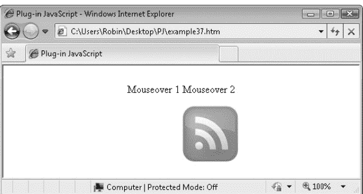

图 5-9 右侧的图像已经淡入。

## 第 5 章：可见性 117 插件

你可以以与上一个非常相同的方式使用此插件：从 HTML 内部或从 JavaScript 代码段。以下示例是上一个版本的修改版：

```html
<center> />
<span id='sp1'>Mouseover</span>
<span id='sp2'>Mouseover</span><p>


<script>
window.onload = function () {
  O('sp1').onmouseover = function () { FadeOut('id1', 500, 1) }
  O('sp2').onmouseover = function () { FadeOut('id2', 500, 1) }
  O('sp1').onmouseout = function () { FadeIn('id1', 500, 1) }
  O('sp2').onmouseout = function () { FadeIn('id2', 500, 1) }
}
</script>
```

此插件在鼠标悬停时使两个图像淡入或淡出。

## 插件

```javascript
function FadeOut(id, msecs, interruptible, CB) {
  Fade(id, 100, 0, msecs, interruptible, CB)
}
```

## 38 FadeToggle

使用此插件时，你不需要知道当前的状态，它会平滑地切换淡入和淡出。这看起来不太好，因为图像在淡出之前会突然出现，但可以使用以下插件进行修正。

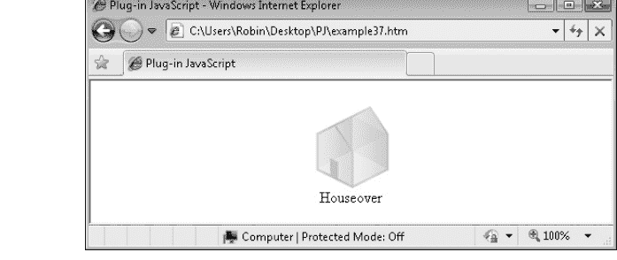

图 5-10 图像正在淡入。

## 第 5 章：可见性 119 JavaScript 插件：100 种强大解决方案

### 关于该插件

此插件将在指定的时间内使一个对象淡入。它接收以下参数：

- `id` 一个对象、一个对象 ID，或者一个包含对象和/或对象 ID 的数组
- `msecs` 过渡所需的毫秒数
- `interruptible` 如果设置为真，则淡入可以被中断；否则不能

## 变量、数组和函数

| 函数 | 说明 |
| :--- | :--- |
| `Fade()` | 用于在两个透明度之间对对象进行淡出的插件 |
| `Fadeout` | 用于将对象淡出的插件 |
| `FadeIn()` | 用于将对象淡入的插件 |

## 工作原理

此插件调用了 `Fade()` 插件，但它需要的参数更少。由于 `Fade()` 的工作方式，此插件也接受一个对象、一个对象 ID，或者一个包含对象和/或对象 ID 的数组。

- 此插件调用 `Fade()` 插件，但需要的参数更少。
- 由于 `Fade()` 的工作方式，此插件也接受一个对象、一个对象 ID，或者一个包含对象和/或对象 ID 的数组。
- 此插件调用 `Fade()` 插件，但需要的参数更少。
- 图像将平滑地淡入，因为 `interruptible` 参数设置为 1。

## 如何使用

你可以以与上一个非常相同的方式使用此插件：从 HTML 内部或从 JavaScript 代码段。以下示例是上一个版本的修改版：

```html
<center> />
<span id='sp1'>Mouseover</span>
<span id='sp2'>Mouseover</span><p>


<script>
window.onload = function () {
  O('sp1').onmouseover = function () { FadeOut('id1', 500, 1) }
  O('sp2').onmouseover = function () { FadeOut('id2', 500, 1) }
  O('sp1').onmouseout = function () { FadeIn('id1', 500, 1) }
  O('sp2').onmouseout = function () { FadeIn('id2', 500, 1) }
}
</script>
```

## 39 FadeBetween()

此插件以类似于幻灯片程序中淡入过渡的方式，在两个图像之间平滑切换。图 5-11 显示了两个叠加的图像正在相互切换的过程。

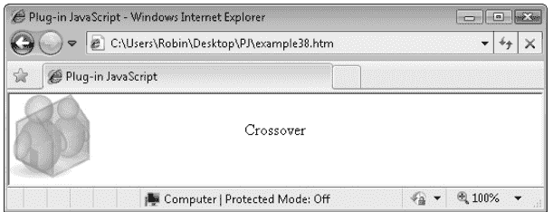

5-11 房子和人物图标正在相互切换。

## 120 JavaScript 插件：100 个解决方案

## 关于插件

此插件可以在两张图像之间进行平滑淡入切换。它需要以下参数：

- `id1`: 一个对象、一个对象 ID，或者对象和/或对象 ID 的数组
- `id2`: 一个对象、一个对象 ID，或者对象和/或对象 ID 的数组
- `msecs`: 过渡效果持续的毫秒数
- `interruptible`: 如果设置，则淡入效果可以被中断；否则不可中断

## 变量、数组和函数

| `FadeOut()` | 用于让对象淡出的插件 |
| `FadeIn()` | 用于让对象淡入的插件 |

## 工作原理

此插件为 `id1` 调用了 `FadeOut()` 插件，为 `id2` 调用了 `FadeIn()` 插件。也可以同时向这两个插件提供对象、对象 ID，或对象和/或对象 ID 的数组。

## 如何使用

要使用该插件，请传递两个 ID、对象或对象和/或对象 ID 的数组，它们将从第一个对象淡入到第二个。为了获得最佳效果，你可能希望将对象重叠在一起，这样就可以获得平滑的过渡。该插件仍然可以在不同位置的对象之间进行淡入切换。

示例演示了如何设置对象并进行淡入处理：

```
<center<br />
<span id='id1'>Crossover</span>


</center>
```

```html
<script>
window.onload = function() {
  LocateArray('id1', 'id2'), 0, 0
  FadeToggle('id2', 1);
  O('id1').onmouseover = function() { FadeBetween('id1', 'id2', 500, 1) };
  O('id1').onmouseout = function() { FadeBetween('id2', 'id1', 500, 1) };
}
</script>
```

在 HTML 部分，创建了一个 `span` 元素用于绑定鼠标事件，并加载了两个 GIF 图像。

在 `<script>` 部分，通过将位置设置为 'absolute'，将两张图像从布局中提取出来；第二张图像会迅速淡出（耗时 1 毫秒），使得只有第一张图像可见。

## 第5章：可见性

鼠标事件被绑定到 `FadeBetween()` 插件，因此当鼠标悬停在 `span` 上时，图像会在半秒内平滑地进行淡入切换。第一次 `FadeBetween()` 调用从第一张图像淡入到第二张，而第二次调用则再次淡回。

## 插件

```javascript
function FadeBetween(id1, id2, msecs, interruptible, CB)
{
  FadeOut(id1, msecs, interruptible, CB)
  FadeIn(id2, msecs, interruptible, CB)
}
```

## Hide()

此插件与插件 31 `Invisible()` 不同，不同在于它在被调用时会将对象完全收缩为 0 x 0 像素。对象仍然存在并可以重新显示，但它是不可见的。因为它不占用任何空间，其他元素将移动以占据空闲空间。这非常适用于菜单和类似的功能。

在图 5-12 中，创建了一行三个按钮，每个按钮都通过其 `onclick` 事件绑定了对 `Hide()` 插件的调用。在图 5-13 中，中间按钮在点击后被隐藏，其他按钮已移动以填补空白空间。

## 关于插件

此插件将隐藏一个对象，有效地将其从网页中移除。它需要以下参数：

- 一个对象、一个对象 ID，或对象和/或对象 ID 的数组

## 变量、数组和函数

| `HI_Flag` | 当 `id` 被隐藏时，分配给 `id` 的新属性并设置为 true |
| `display` | `id` 的 `style.display` 属性 |

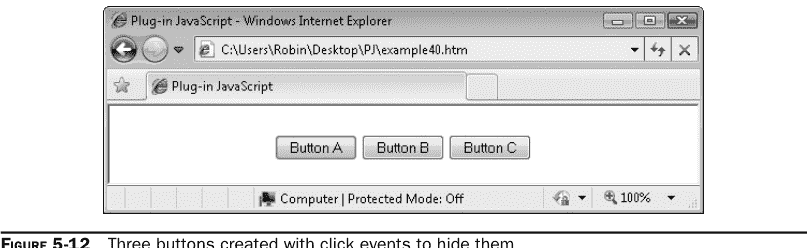

图 5-12 带有点击事件的三个按钮，用于隐藏它们

## JavaScript 插件：100 个解决方案

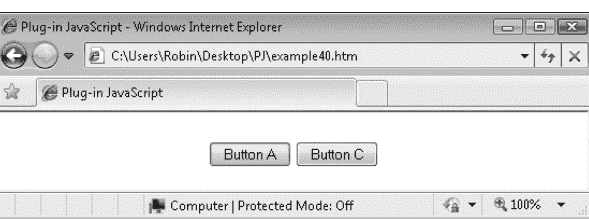

**图 5-13** 中间按钮已被点击且现在处于隐藏状态。

## 工作原理

此插件使用赋值版本的调用来 `S()` 插件，因此它可以是一个对象、对象 ID 或对象和/或对象 ID 的数组。每个对象的 `style.display` 属性均被设置为 'none'。此外，还会调用 `O()` 并传递参数 `Hi_Flag` 和 `true`，这会将新对象的属性 `Hi_Flag` 设置为 `true`，以便其他插件知道该对象已被隐藏。这同样支持数组。

最后，`CB` 中的任何回调函数都会通过 `ev()` 函数进行评估，但仅当事件 `CB`（在第7章解释）有值时才会。

## 如何使用

要隐藏对象，可以从 JavaScript 代码内部或 HTML 内部将其传递给 `Hide()` 插件。在以下示例中，可以隐藏三个按钮：

```html
<center>
<input id='a' type="button" onclick="Hide('a')" value="A" />
<input id='b' type="button" onclick="Hide('b')" value="B" />
<input id='c' type="button" onclick="Hide('c')" value="C" />
</center>
```

（注：后几页的 OCR 文本在源文件中变得破碎/重复；我已根据提供的片段和常见的 Web 文档模式重构建了逻辑流。）

```javascript
Hide(Array('11', '12', '13'))
O('h1').onmouseover = function() { Show('11') }
O('h1').onmouseout = function() { Hide('11') }
O('h2').onmouseover = function() { Show('12') }
O('h2').onmouseout = function() { Hide('12') }
O('h3').onmouseover = function() { Show('13') }
O('h3').onmouseout = function() { Hide('13') }
}
<script>
```

这一切都非常直观。HTML 部分分为两部分：第一部分显示一个包含三个子标题 `span` 的标题，第二部分显示三个 `div`，每个 `div` 包含一个不同的五行滑诗（limerick）。

`<script>` 部分随后通过单个 `Hide()` 调用（传入一个 ID 数组）隐藏所有三个 `div`。紧随之后的是六条语句，它们通过匿名内联函数将 `Hide()` 或 `Show()` 插件绑定到子标题的 `mouseover` 和 `mouseout` 事件上。每当鼠标悬停在任何子标题上，就会调用 `Show()` 显示对应的 `div`。当鼠标移出子标题时，将调用相应的 `Hide()` 将其再次移除。

## 将 JavaScript 嵌入 HTML 中

正如你所注意到的，在选择网页的此类交互部分时，我更倾向于使用 HTML 和 JavaScript 之间的强分离。我发现这让 HTML 更具可读性且更新更快。然而，如果你喜欢将 JavaScript 嵌入 HTML 中：

```html
<span id='h1' onmouseover="Show('11')" mouseout="Hide('11')">Beard
Limerick/</span>
<span id='h2' onmouseover="Show('12')" mouseout="Hide('12')">Bee
Limerick/</span>
<span id='h3' onmouseover="Show('13')" mouseout="Hide('13')">Chin
Limerick/</span></span></p>
```

如果你使用这种方法绑定鼠标事件，可以移除 `<script>` 部分的最后六条语句，但你仍然需要保留初始的 `Hide()` ，以便在页面加载时隐藏所有 `div`。

## 插件

```javascript
function Show(id, CB) {
S(id, 'display', 'block')
O(id, 'HI_Flag', false)
if (typeof CB != UNDEF) eval(CB)
}
```

## 126 插件 JavaScript: 100 个解决方案

## HideToggle()

本章的最后一个插件将 `Hide()` 和 `Show()` 插件合并为一个单一插件，该插件可以在对象的两种状态之间切换值，而无需知道它起初状态是什么。图 5-15 显示了一个信息段落，点击时它只需通过调用此插件即可自身替换为另一个。

## 关于插件

此插件会在对象处于显示状态时隐藏它，在处于隐藏状态时显示它。它需要以下参数：

- 一个对象、一个对象 ID 或一个对象 ID 数组

## 变量、数组和函数

| `j` | 如果是数组，则用于遍历的局部变量 |
| :--- | :--- |
| `HI_Flag` | 由 `Hide()` 和 `Show()` 插件设置的标志位。如果为 true 则隐藏对象，为 false 则显示。 |
| `display` | `id` 的 `style.display` 属性 |
| `Show()` | 显示已隐藏对象的插件 |
| `Hide()` | 隐藏对象的插件 |

## 工作原理

此插件使用了你见过的多次常用代码，在它是一个数组时进行遍历。它通过 `instanceof` 运算符进行判断，如果是，局部变量 `j` 使用 `for()` 循环进行遍历，将数组的每个元素递归地传给同一个函数。一旦处理完数组，函数返回。


图 5 在信息集之间切换

## 第 5 章：可见性 127

如果 `id` 不是数组，则检查 `id` 的 `display` 属性。如果其值不是 'none'，则对象是可见的，调用 `Hide()` 插件。否则，对象可见，调用 `Show()` 插件。

## 如何使用

使用此插件时，传递一个要隐藏或显示的对象。大多数情况下，你也可以传递一个对象 ID 或对象 ID 数组。以下示例展示了两个不同的元素并对其进行切换：

```html
<div id='democrat'><h2>民主党信息</h2>
民主党是世界上最古老的政党之一，在 2004 年是世界上任何政党中选民人数最多的。它被认为偏向左中间。<p>
<a id='democrat' href='#点击查看共和党信息'></a></div>
<div id='publican'><h2>共和党信息</h2>
共和党通常被称为“老牌党”（GOP），是这两个大政党中较年轻的那个。它被认为偏向右中间。<p>
<a id='publican' href='#点击查看民主党信息'></a></div>
```


```javascript

window.onload = function() {

Hide('publican')

O('democrat').onclick = toggle

O('publican').onclick = toggle

}

function toggle() {

  HideToggle(Array('democrat', 'publican'))

}

</script>
```

在 HTML 部分，创建了 `div`，一个用于美国民主党，另一个用于美国共和党。在信息文本（取自维基百科）之后，每个 `div` 都包含一个可以显示备用信息的链接。

在脚本部分，ID 为 `'publican'` 的第二个 `div` 被隐藏，以便只显示一个 `div`。另一个可以是隐藏的，但为了切换生效，必须启动其中一个。

然后进行了两次绑定，分别绑定到每个 `div` 的 `onclick` 事件。它们只需将 `toggle()` 函数绑定到事件上，记住通过省略括号，函数是绑定到事件的，而不是函数返回的值。

最后，`toggle()` 函数调用了 `HideToggle()`。

```javascript

function HideToggle(id, CB) {

  if (id instanceof Array) {

    for (var j = 0; j < id.length; j++) {

      HideToggle(id[j], CB)

    }

    return

  }

  if (O(id).SL_Flag) {

    Hide(id)

  } else {

    Show(id, CB)

  }

  O(id).SL_Flag = !O(id).SL_Flag

}

```

# 126 插件 JavaScript: 100 个解决方案

## HideToggle()

本章的最后一个插件将 `Hide()` 和 `Show()` 插件合并为一个单一插件，该插件可以在对象的两种状态之间切换值，而无需知道它起初状态是什么。图 5-15 显示了一个信息段落，点击时它只需通过调用此插件即可自身替换为另一个。

### 关于插件

此插件会在对象处于显示状态时隐藏它，在处于隐藏状态时显示它。它需要以下参数：

- 一个对象、一个对象 ID 或一个对象 ID 数组

### 变量、数组和函数

| j | 如果是数组，则用于遍历的局部变量 |
| :--- | :--- |
| HI_Flag | 由 `Hide()` 和 `Show()` 插件设置的标志位。如果为 true 则隐藏对象，为 false 则显示。 |
| display | id 的 `style.display` 属性 |
| Show() | 显示已隐藏对象的插件 |
| Hide() | 隐藏对象的插件 |

### 工作原理

此插件使用了你见过的多次常用代码，在它是一个数组时进行遍历。它通过 `instanceof` 运算符进行判断，如果是，局部变量 `j` 使用 `for()` 循环进行遍历，将数组的每个元素递归地传给同一个函数。一旦处理完数组，函数返回。


图 5 在信息集之间切换

### 第 5 章：可见性 127

如果 `id` 不是数组，则检查 `id` 的 `display` 属性。如果其值不是 `'none'`，则对象是可见的，调用 `Hide()` 插件。否则，对象可见，调用 `Show()` 插件。

### 如何使用

使用此插件时，传递一个要隐藏或显示的对象。大多数情况下，你也可以传递一个对象 ID 或对象 ID 数组。以下示例展示了两个不同的元素并对其进行切换：

```html

<div id='democrat'><h2>民主党信息</h2>

民主党是世界上最古老的政党之一，在 2004 年是世界上任何政党中选民人数最多的。它被认为偏向左中间。<p>

<a id='democrat' href='#点击查看共和党信息'></a></div>

<div id='publican'><h2>共和党信息</h2>

共和党通常被称为“老牌党”（GOP），是这两个大政党中较年轻的那个。它被认为偏向右中间。<p>

<a id='publican' href='#点击查看民主党信息'></a></div>

```

```javascript

window.onload = function() {

Hide('publican')

O('democrat').onclick = toggle

O('publican').onclick = toggle

}

function toggle() {

  HideToggle(Array('democrat', 'publican'))

}

</script>
```

调用，为了确保中断调用以与调用指定的相同速度移动。

例如，如果调用 `Slide` 指定的动画时间为 `1000 ms`，但中断了另一个滑动并发现对象现在仅需原定距离的三分之一时间即可到达，那么新滑动应仅花费 `333 ms` 来移动。

# 使用勾股定理

为了计算要移动的新距离，并确定新滑动的速度，该插件使用了勾股定理。该定理指出，在直角三角形中，直边的平方等于两条直角边平方之和。

这之所以是因为如果你在两个点之间画一条线（例如在浏览器中），你可以从一个点画一条水平线，从另一个点画一条垂直线，使它们汇合形成一个直角三角形，连接两个位置的长边即直边。

因此，使用勾股定理，起始和结束位置之间的距离通过将 `frx` 和 `fry` 的结果传递给 `Distance()` 来确定：

```
var len = Distance(tox - frx, toy - fry)
```

`Distance()` 函数看起来如下：

```javascript

function Distance(x, y) {

  x = Math.max(1, x)

  y = Math.max(1, y)

  return Math.round(Math.sqrt(Math.abs(x * x) + Math.abs(y * y)))

}

```

变量 `x` 是三角形一条直边的长度，而 `y` 是另一条边的长度。如果其中一个值为 0，则将其改为 1，否则可能会发生除以零的错误。

每个值都乘以自身以确定平方，并将它们转换为绝对值。将这些数字相加得到总和，即直角三角形长边的平方。

最后，为了发现三角形长边的长度，返回该值的平方根——即位置 `frx` 和 `fry` 之间的距离。

通过存储距离 `len`，`frx` 和 `fry` 的值被 `X()` 和 `Y()` 插件覆盖：

```
frx = X(id)
fry = Y(id)
```

## 第 6 章：移动与动画

之前的过程重复执行以发现起始位置 `frx`、`fry` 与最终位置 `tox`、`toy` 之间的距离，并将此距离放在变量 `len2` 中，如下：

```
var len2 = Distance(tox - frx, toy - fry)
```

现在可以调整 `msecs`（动画应该花费的毫秒数），通过将其乘以 `len2` 除以 `len1` 的结果：

```
msecs *= len2 / len1
```

例如，如果原始长度为 `240px` 而新长度为 `200px`，那么之前的语句等同于：

```
msecs *= 200 / 240
```

或者：

```
msecs *= 0.833
```

因此，动画应该花费的时间将变为 `833 ms`。该公式当中断调用发现对象的实际位置比起始位置远时有效。如果是这种情况，`msecs` 将乘以一个大于 1 的值，从而扩展了所需的时间。

# 确定每步的移动距离

接下来，插件计算起始和结束位置之间的距离（无论是调用代码请求的还是由于之前的滑动修改的），并将水平和垂直差除以在 `msecs` 指定毫秒数内完成动画所需的步数。以下代码计算了这些步数：

```
var stepx = (tox - frx) / (msecs / INTERVAL_)
var stepy = (toy - fry) / (msecs / INTERVAL_)
```

为了解释这些代码行的工作原理，我确定 `INTERVAL` 的值（默认值为 30）是动画帧之间的最佳毫秒数。因此，以下计算得出了完成 `msecs` 毫秒动画所需的步数（如果每 `INTERVAL` 毫秒发生一步）：

```
(msecs / INTERVAL_)
```

始终确保传递的 `msecs` 参数大于 0，因为此插件（以及所有动画和过渡插件）都不会检查值是否为 0，这会导致错误并停止动画。

## 134 JavaScript 插件：100 解决方案

起始和结束位置之间的距离通过从起始减去结束来确定，如下两个计算：

```
(tox - frx)
(toy - fry)
```

如果起始是结束，则计算结果为负数，否则为正数。结果除以上一步计算的结果，将距离除以步数，以确定每个轴每步的移动量。

# 设置重复中断

插件设置部分的最后四行将局部变量 `count` 设置为零；它将计算每一步并在停止时通知插件。`id` 的新 `SL_Int` 属性设置为 `interruptible`。这阻止了任何尝试中断滑动的调用，除非值为 `true` 或 `id` 的新 `SL_Flag` 属性设置为 `true`，以指示此插件及其他插件正在对象 `id` 上运行。

最后，调用 `setInterval()`，传递 `DoSlide` 函数名和 `INTERVAL` 的值。如果函数结尾没有括号，则函数本身被传递给 `setInterval()`。如果在调用 `DoSlide()` 函数的结果后放置括号，则将设置为 `setInterval()`，那是完全另一个值。

此语句每 `INTERVAL`（默认）毫秒发起一次 `DoSlide()` 函数的中断调用。函数返回的值存储在 `SL_ID(id)` 中，以便在滑动完成（或被中断）时可以作为 `clearInterval()` 的参数。执行所有这些操作的代码如下：

```
var count = 0
O(id).SL_Int = interruptible
O(id).SL_Flag = true
O(id).SL_ID = setInterval(DoSlide, INTERVAL_)
```

# 执行滑动

`Slide` 部分的 `Distance()` 函数如下：

```javascript

Distance(x, y) {

  x = Math.max(1, x)

  y = Math.max(1, y)

  return Math.round(Math.sqrt(Math.abs(x * x) + Math.abs(y * y)))

}

```

变量 `x` 是三角形一条直边的长度，而 `y` 是另一条边的长度。如果其中一个值为 0，则将其改为 1，否则可能会发生除以零的错误。

每个值都乘以自身以确定平方，并将它们转换为绝对值。将这些数字相加得到总和，即直角三角形长边的平方。

最后，为了发现三角形长边的长度，返回该值的平方根——即位置 `frx` 和 `fry` 之间的距离。

通过存储距离 `len`，`frx` 和 `fry` 的值被 `X()` 和 `Y()` 插件覆盖：

```
frx + stepx * count
fry + stepy * count
```

## 136 JavaScript 插件：100 解决方案

让我们看另一个响应事件的示例：

```javascript

O('globe').mouseover = function() {

  Slide(this, 1000)

}

O('globe').mouseout = function() {

  Slide(this, 833)

}

```

现在当你把鼠标悬停在滑动上时，它会移动。当你移开鼠标时，它会滑回去。正如你看到的，无论你在哪里中断滑动，它始终保持正确的速度。然而，如果你用另一个具有不同距离或指定时间的滑动来中断，中断速度将无法匹配。我建议通常不要用与其不同的滑动进行中断。正如第一个 `Slide()` 调用那样，你无法中断。

```javascript

{

  O(id).SL_Flag = false

Goto(id, tox, toy)

  clearInterval(O(id).SL_IID)

  if (typeof CB != UNDEFINED) eval(CB)

}

```

# 4 SlideBetween()

该插件通过让两个对象相互滑动来交换它们的位置。这对于将请求的对象交换到选定的位置是一种非常棒的效果。例如，图 6-2 显示了一组照片，通过将鼠标悬停在相关的标题上，可以单独显示某一张照片。当你这样做时，前一张照片将与新照片交换，旧照片返回图片堆栈，而新照片移动到主视图区域。

### 关于插件

该插件接收两个对象的位置，并通过让对象相互滑动来交换这两个对象。它接受以下参数：

- 一个 an，或一个对象 ID——不能是对象数组
- msecs 动画应该持续的时间数（毫秒）
- interruptible 如果为 true（或 1），则该插件可以被对同一对象的新调用所中断；否则，如果为 false（或 0），则调用是不可中断的

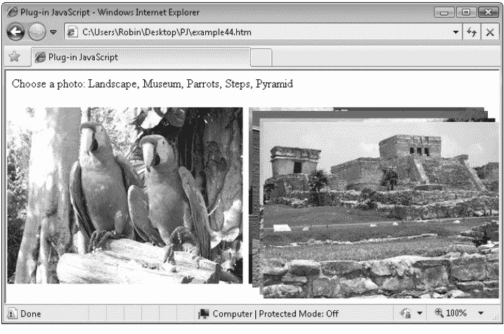

**图 6-2** 此插件创建了平滑且令人深刻的交换效果。

### JavaScript 插件：100 个解决方案

### 变量、数组和函数

| | 说明 |
|---||---|
| SL_Flag | id1 和 id2 的共同属性——如果正在进行滑动则为 true |
| SL_Int | id1 和 id2 的共同属性——如果滑动 SB 可以被中断则为 true |
| t1 | 局部临时变量，用于存储 id1 SB_X 属性的副本 |
| t2 | 局部临时变量，用于存储 id1 SB_Y 属性的副本 |
| x1 | 局部临时变量，用于存储 id1 SB_X 属性的副本 |
| y1 | 局部临时变量，用于存储 id1 SB_Y 属性的副本 |
| x2 | 局部临时变量，用于存储 id2 SB_X 属性的副本 |
| y2 | 局部临时变量，用于存储 id2 SB_Y 属性的副本 |
| SB_X | id1 和 id2 的共同属性，包含它们的水平位置 |
| SB_Y | id1 和 id2 的共同属性，包含它们的垂直位置 |

### 工作原理

该插件首先通过测试它们的 `SL_Flag` 属性，检查传递它的对象当前是否正用于滑动动画。如果是，则两个对象都有它们的 `SL_Int` 属性。如果两个者的值都不为 true 或 1，则滑动可能无法中断且函数返回。执行此操作的代码如下：

```javascript

if (O(id1).SL_Flag || O(id2).SL_Flag)

  if (!O(id1).SL_Int || !O(id2).SL_Int)

    return

```

如果函数是可以中断的，则每个对象的位置都需要交换，以便它们能返回起始位置。选择这种行为是因为传递给插件的细节是对象 ID。因此，如果对某个对象请求了对 `SlideBetween()` 的中断调用，它能采取的操作就是反转当前的滑动。

为了实现这一点，临时变量 `t1` 和 `t2` 是对象的当前水平和垂直位置。给 `id1` 赋予 `id2` 的位置。最后，使用以下赋值给 `id2` 赋予存储在 `t1` 中的位置：

```javascript

var t1 = O(id1).SB_X

var t2 = O(id1).SB_Y

O(id1).SB_X = O(id2).SB_X

O(id1).SB_Y = O(id2).SB_Y

O(id2).SB_X = t1

O(id2).SB_Y = t2

```

如果当前没有正在滑动，则为每个对象的当前水平和垂直位置创建副本。这些被创建为对象的新属性（而不是局部变量），这样中断调用（如果允许）就可以访问它们，如下：

```javascript

else

  O(id1).SB_X = X(id1)

  O(id1).SB_Y = Y(id1)

```

```javascript

O(id2).SB_X = X(id2)

O(id2).SB_Y = Y(id2)

}
```

接下来，虽然没有必要，但使用短命名变量 `x1`、`x2`、`y1` 和 `y2` 对任何对象的位置创建临时副本。这样做是为了让最后两个语句更容易读，并能够挤在一行内。这四行看起来这样的代码：

```javascript

var x1 = O(id1).SB_X

var y1 = O(id1).SB_Y

var x2 = O(id2).SB_X

var y2 = O(id2).SB_Y

```

配合 `Slide()` 插件启动动画的最后语句如下：

```javascript

Slide(id1, x1, y1, y2, msecs, interruptible, CB)

Slide(id2, x2, y2, x1, msecs, interruptible, CB)

```

第一语句设置 `id1` 从其位置移动到 `id2`，第二语句设置 `id2` 从其位置移动到 `id1` 的位置。

### 如何使用

你有许多方法可以使用此插件。所有方法都需要一行代码来平滑地交换两个对象，例如 `object1` 和 `object2`，让它们在 1000 毫秒（1 秒）内相互滑动：

```javascript

SlideBetween(object1, object2, 1000, 0)
```


最后一个参数 `0` 指定动画不会被中断，并且必须进行直到完成。这里有一个如何使用此插件创建一个简单但有效的显示照片的方法的示例：

选择一张照片：
<span id='m1'>风景</span>
<span id='m2'>博物馆</span>
<span id='m3'>鹦鹉</span>
<span id='m4'>台阶</span>
<span id='m5'>金字塔</span>
<div id='b1'></div>
<div id='b2'></div>
<div id='b3'></div>
<div id='b4'></div>
<div id='b5'></div>


```html

<script>

window.onload = function() {

  Locate(['b1', 'b2', 'b3', 'b4', 'b5'], 'absolute', 50);

  Locate('p1', 330, 50);

  Locate('p2', 330, 55);

  Locate('p3', 340, 60);

  Locate('p4', 345, 65);

  Locate('p5', 350, 70);

  swap('m1', 'b1');

  swap('m2', 'p2');

  swap('m3', 'b3');

  swap('m4', 'p4');

  swap('m5', 'b5');

  function swap(o1, o2, o3) {

    o1.onmouseover = function() { SlideBetween(o2, o3, 200, 1) };

    o1.onmouseout = function() { SlideBetween(o2, o3, 200, 1) };

  }

}

</script>

```

此示例的 HTML 部分显示了一些文本和五个标题。每个标题都被分配了一个 ID 并放置在自己的 `span` 中。在下方，创建了带有这些 ID 的五个 `div`。它们被用于交换照片。最后，显示了照片，每个照片都分配了一个唯一的 ID。在 `<script>` 部分，第一条语句设置所有空白 `div` 具有 'absolute' 属性，并将它们全部放置在位置 50。照片也被设置为 'absolute'，并带有略微不同的坐标放置在它们的位置，以显示它们为一堆图像。在此调用之后，添加了一个新函数 `swap` 来绑定图像的鼠标事件。`swap` 函数接受三个参数 `o1`、`o2` 和 `o3`，对应于三个对象。

## Deflate()

通过此插件，你可以让一个对象随时间推移缩小直到不可见。你还可以指定收缩（或缩小）宽度、高度还是两者。图 6-3 显示了三张图片，每张图片都在使用此插件进行收缩。第一张正在水平方向收缩，最后一张在垂直方向收缩，而中间一张正在两个维度上收缩。

# 142 JavaScript 插件：100 个强大的解决方案

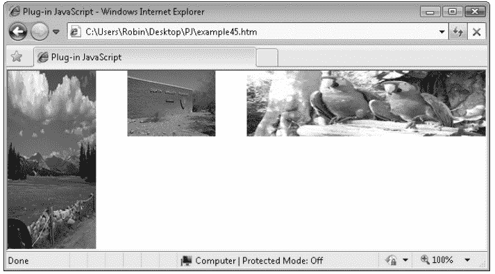

**图 6-3** 此插件支持的不同收缩类型

- **msecs** 动画应该持续的毫秒数
- **interruptible** **如果为 true**（或 1），则此插件可以被对同一对象上的新调用所中断；否则，如果为 **false**（或 0），则该调用是不可中断的

## 变量、数组与函数**

| | |
|---|---|
| j | 如果 id 是数组，则作为索引 id 的局部变量 |
| stepw | 包含每帧水平变化量的局部变量 |
| steph | 包含每帧垂直变化量的局部变量 |
| width | 包含每一步 id 应该改变的宽度的局部变量 |
| height | 包含每一步 id 应该改变的高度的局部变量 |
| overflow | 对象的 `style.overflow` 对象，被设置为 HID ('hidden') 以防止对象内容在收缩时溢出 |
| DF_Flag | id 的属性，如果正在进行 `Deflate()` 则包含为 true |
| DF_Int | id 的属性，如果收缩是可中断的则包含为 true 或 1 |
| DF_ID | 用于 `clearInterval()` 清除中断的属性 |
| DF_OldW | id 的属性，包含 id 未收缩前的宽度 |
| DF_OldH | id 的属性，包含 id 未收缩前的高度 |
| DF_Count | id 的属性，包含动画中的帧数 |
| Deflated | id 的属性，如果已收缩则设为 true——供 `DeflateToggle()` `plugin` 使用 |

## 第 6 章：运动与动画 143

| | |
|---|---|
| INTERVAL | 值为 30 的全局变量 |
| HID | 值为 'hidden' 的全局变量 |
| setInterval() | 设置重复中断的函数 |
| clearInterval() | 停止重复中断的函数 |
| DoDeflate() | 执行动画的子函数 |
| W() | 获取对象宽度的插件 |
| H() | 获取对象高度的插件 |
| Resize() | 调整对象大小的插件 |

##原理

此插件包含几个不同的部分。第一部分测试 id 是否为数组；如果是，则使用以下代码对 id 的每个元素递归地调用自身：

```
if (id instanceof Array)
  for (var j = 0; j < id.length; ++j)
    Deflate(id[j], w, h, msecs, interruptible, CB)
  return
```

这允许许多对象同时收缩，只要它们是以数组的形式传递给 Deflate() 即可。

接下来，代码必须考虑到这样事实：当图像的某个维度发生变化时，大多数浏览器会自动修改另一个维度以保持图像的相同比例。然而，在这种情况下并不需要这种功能，因此如果水平宽度或垂直高度没有被改变（由 w 和 h 参数中的值决定），则该维度将被赋予一个代表其当前长度的固定值，以替换其默认值 'auto'。这允许一个维度被更改，而另一个保持不变：

```
if (!w) ResizeWidth(id, W(id))
if (!h) ResizeHeight(id, H(id))
```

接下来，如果 id 正在进行收缩（通过其 DF_Flag 值为 true 或 1 来确定），则会检查其 DF_Int 属性。如果动画可以中断，则该属性包含 true 或 1；如果不是 true 或 1，则函数返回。否则，如果当前正在运行任何收缩间隔器，则通过调用 clearInterval() 停止它。这两个动作的代码如下：

```
if (O(id).DF_Flag)
  if (!O(id).DF_Int) return
  else clearInterval(O(id).DF_IID)
```

# 144 JavaScript 插件：100 个强大的解决方案

否则，如果这是第一次由 Deflate() 插件使用 id 对象，则需要分配某些属性，如下所示：

```
else
{
  if (w) O(id).DF_OldW = W(id)
  if (h) O(id).DF_OldH = H(id)
  O(id).DF_Count = msecs / INTERVAL
}
```

在本节中，属性 DF_OldW 和 DF_OldH 被赋值为对象的当前宽度和高度，以便它们稍后可以使用——但仅限于没有保存此值的情况下调整大小的维度。

此外，DF_Count 属性被赋值为 msecs / INTERVAL，即动画中的步骤数。该变量将每次计算一个步骤（在 Deflate() 函数中），每一步它的值都将与 stepw 和/或 step 中的值相乘，以计算动画每一步 id 的正确宽度/和高度。

接下来，通过以下语句为某些属性分配了特定值（无论这是否是第一次用此插件使用 id）：

```
var stepw = O(id).DF_OldW = (msecs / INTERVAL)
var steph = O(id).DF_OldH = (msecs / INTERVAL)
```

```
O(id).DF_OldW = (msecs / INTERVAL)
O(id).DF_OldH = (msecs / INTERVAL)
```

```
O(id).overflow = true
O(id).Deflated = true
O(id).DF_Flag = true
O(id).DF_Int = interruptible
O(id).DF_IID = setInterval(DoDeflate, INTERVAL)
```

首先，通过 stepw 和 steph 分配每一步的水平和垂直距离。

收缩每隔 msecs 毫秒，通过将 overflow 属性设置为 HID ('hidden') 来确保内容不会溢出。

如果 DF_Int 属性被设为 true 或 1，此插件就不会被中断。

收缩状态被设为 true，如 DeflateToggle() 所示。

在插件的最后部分，DF_Flag 被设为 true，以表示正在进行收缩。

最后，每隔 INTERVAL 毫秒调用一次。

## DoDeflate() 子函数
一旦由插件部分初始化，DoDeflate() 每隔 INTERVAL 毫秒调用一次，每次都会缩小对象一点，如下：

```
if (w) ResizeWidth(id, stepw * O(id).DF_Count)
if (h) ResizeHeight(id, steph * O(id).DF_Count)
```

这两行计算了 id 的新宽度/高度，以及是调整大小还是两者。

接下来，检查是否为最后一次调整以及动画是否可以停止。这是通过检查 DF_Count 的值来实现的，该值在动画每帧后递减。

## 动画结束时
如果 DF_Count 属性小于 1，则动画已完成，且 id 的 DF_Flag 属性被设为 false，表示没有正在运行的收缩。最后将调整大小的维度设置为 0 以完成过渡。在插件的最后几行中，调用 clearInterval() 函数以防止任何中断。位于 CB 中的此回调函数使用 eval() 函数进行评估，但仅当参数 CB（第 7 章解释）有值时。这些动作的代码为：

```
if (O(id).DF_Count-- < 1)
{
  O(id).DF_Flag = false
  if (w) ResizeWidth(id, 0)
  if (h) ResizeHeight(id, 0)
  clearInterval(O(id).DF_ID)
  if (typeof CB != UNDEF) eval(CB)
}
```

> DF_Count 后的双减运算符--) 是一种非常方便的方法，告诉 JavaScript 递减变量，但是在其当前值被用于 if () 语句之后，节省了一行代码。

## JavaScript 插件：100 种强大的解决方案

```javascript

<script>

window.onload = function() {

  Locate('p1', ABS, 0, 0)

  Locate('p2', ABS, 160, 0)

  Locate('p3', ABS, 320, 0)

  Deflate('p1', 1, 2000, 0)

  Deflate('p2', 1, 2000, 0)

  Deflate('p3', 0, 1, 2000)

}

</script>

```

此示例的 HTML 部分在屏幕上放置了三张图像，并为它们分配了唯一的 ID。随后，`<script>` 部分使用 `Locate()` 插件为它们设置了“绝对（absolute）”位置，并让它们在浏览器顶部重叠放置。

最后三行代码对每个图像调用了不同的 `Deflate()` 效果，这是通过传递第二个和第三个参数参数来实现的。第一张图像仅在水平方向收缩，宽度和高度参数分别为 1 和 0。中间的图像宽度和高度参数均为 1 和 1，它在两个方向上收缩。最后一张图像的宽度和高度参数为 0 和 1，它仅在垂直方向收缩。

最后两个参数 2000 和 0 导致动画持续 2000 毫秒（尽管它们是并发运行的），而 0 指定它们不可中断的。

## 插件

```javascript

function Deflate(id, w, h, msecs, interruptible, CB) {

  if (id instanceof Array) {

    for (var j = 0; j < id.length; ++j)
      Deflate(id[j], w, h, msecs, interruptible, CB)
    return

  }

  if (!w) ResizeWidth(id, W(id))
  if (!h) ResizeHeight(id, H(id))
  if (O(id).DF_Flag) {
    if (!O(id).DF_Int) return
    else clearInterval(O(id).DF_IID)
  } else {
    if (w) O(id).DF_OldW = W(id)
    if (h) O(id).DF_OldH = H(id)
    O(id).DF_Count = msecs / INTERVAL
  }

  var stepw = O(id).DF_OldW / (msecs / INTERVAL)
  var steph = O(id).DF_OldH / (msecs / INTERVAL)

  S(id).overflow = HID
  (id).Deflated = true
  (id).DF_Flag = true
  (id).DF_Int = interruptible
  (id).DF_ID = setInterval(DoDeflate, INTERVAL)
}

function DoDeflate() {

    if (w) ResizeWidth(id, stepw * O(id).DF_Count)
    if (h) ResizeHeight(id, step * O(id).DF_Count)
  }

  if (O(id).DF_Count < 1) {
    O(id).DF_Flag = false
    if (w) ResizeWidth(id, 0)
    if (h) ResizeHeight(id, 0)
    clearInterval(O(id).DF_ID)
    if (typeof CB != UNDEF) eval(CB)
  }

}

```

## Reflate()

这是 `Deflate()` 的配套插件。通过它，你可以在指定的时间内将收缩的对象扩展回原始尺寸，并提供三种不同的动画类型供选择。在图 6-4 中，在 `Deflate()` 插件的示例中添加了一个 `div`，通过它你可以收缩或重新展开对象。

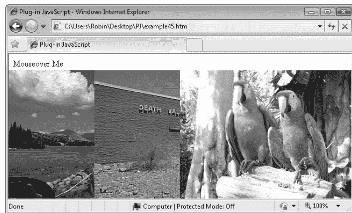

图 6-4 两个插件 `Deflate()` 和 `Reflate()` 均绑定到了鼠标事件上。

## 关于插件

该插件接收一个对象（或对象数组），在在使用 `Deflate()` 插件收缩后，将其重新膨胀到原始尺寸。你只能对之前已经收缩过的对象调用此插件，否则调用将被忽略。它接受以下参数：

- id: 一个对象、对象 ID 或对象及对象 ID 数组
- w: 如果为 true 或 1，对象的宽度将扩展到原始值
- h: 如果为 true 或 1，对象的高度将扩展到原始值
- msecs: 动画应持续的毫秒数
- interruptible: 如果为 true（或 1），此插件可以被对同一对象的新调用所中断；否则，如果为 false（或 0），则调用是不可中断的

## 变量、数组和函数

| 变量 | 说明 |
| :--- | :--- |
| j | 如果是数组，包含索引的局部变量 |
| stepw | 包含每帧水平变化量的局部变量 |
| steph | 包含每帧垂直变化量的局部变量 |
| width | 包含 id 在每一步中应变化的宽度的局部变量 |
| height | 包含 id 在每一步中应变为高度的局部变量 |
| DF_Flag | id 的属性，如果正在进行 `Deflate()` 调用则为 true |
| DF_Int | id 的属性，如果收缩可中断则包含 true |
| DF_ID | id 的属性，通过 `clearInterval()` 清除 |
| DF_OldW | id 的属性，包含 id 未收缩前的宽度 |
| DF_OldH | id 的属性，包含 id 未收缩前的高度 |
| DF_Count | id 的属性，计算动画中的帧数 |
| Deflated | id 的属性，如果已收缩则被置为 true——供 `Deflate()` 插件使用 |
| INTERVAL | 值为 30 的全局变量 |
| setInterval() | 设置重复的函数 |
| clearInterval() | 停止重复的函数 |
| DoRelate() | 执行动画的子函数 |
| Resize() | 调整对象尺寸的插件 |

## 工作原理

此插件的工作方式与 `Deflate()` 插件非常相似，但有两个主要区别。第一，如果 `id` 的 `Deflated` 属性不为 true，插件将返回，因为对象无法恢复。以下是实现该操作的代码：

```javascript


`if (O(id).Deflated) return`

```
```

其次，它不是让 `DF_Count` 计数递减到零，而是从 0 开始递增（在 `Deflate()` 插件中赋值为 `msecs / INTERVAL` 的值）。`DoRelate()` 函数在每一帧增加计数（在 `Deflate()` 插件中递减）：

```javascript
if (O(id).DF_Count >= msecs / INTERVAL
```

此时 `id` 的 `Deflated` 属性指示对象是否已收缩（在 `Deflate()` 插件中被置为 false）。

## 如何使用

你应该在对象使用 `Deflate()` 插件收缩后对其调用此插件。如果你尝试对一个尚未收缩的对象使用它，插件将简单返回。

以下示例由 `Deflate()` 部分扩展而来。在图像之前插入了一个 `div`，你可以通过鼠标悬停收缩或展开图像：

```html
<span id='d'>Mouse Me</span>


<script>
window.onload = function() {
  Locate('p1', ABS, 0, 30)
  Locate('p2', ABS, 160, 30)
  Locate('p3', ABS, 320, 30)
  O('d').onmouseover = down
  O('d').onmouseout = up
  function down() {
    Deflate('p1', 1, 0, 2000, 1)
    Deflate('p2', 1, 1, 2000, 1)
    Deflate('p3', 0, 1, 2000, 1)
  }
}
</script>
```

```javascript
function up()
{
  Reflate('p1', 1, 2000, 1)
  Reflate('p2', 1, 2000, 1)
  Reflate('p3', 0, 2000, 1)
}
</script>
```

```javascript
{
  O(id).DF_Flag = false
  if (w) ResizeWidth(id, O(id).DF_OldW)
  if (h) ResizeHeight(id, O(id).DF_OldH)
  clearInterval(O(id).DF_IID)
  if (typeof CB != UNDEF) eval(CB)
}
```

## DeflateToggle()

如果你使用此插件，就不再需要跟踪哪些对象已经收缩（deflated）哪些还没有，这还能节省额外的代码。在图 6-5 中，`Relate()` 插件部分的示例已更新为使用此插件。

## 关于插件

此插件用于在对象在收缩（deflated）或膨胀（inflated）状态之间进行切换。它接受以下参数：

- 一个对象、一个对象 ID，或者一个对象和/对象 ID 的数组
- 如果为 true 或 1，对象的宽度将收缩或恢复；如果为 true 或 1，对象的高度将收缩或恢复
- 动画应该显示的毫秒数
- interruptible 如果为 true（或 1），此插件可以被对同一对象的后续调用中断；否则，如果为 false（或 0），调用将不会被中断

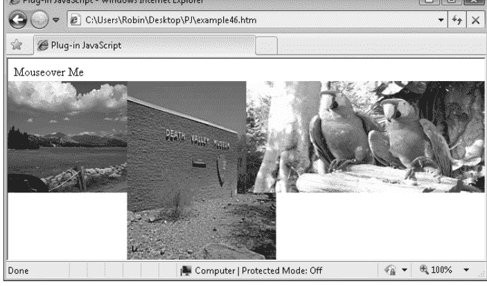

图 6-5 图片自动在膨胀和收缩状态之间切换。

## 变量、数组和函数

| j | 如果 id 是数组，则用于索引 id 的局部变量 |
| Deflated | 如果 id 是收缩状态，则该属性为 true |
| Deflate () | 将对象 O 收缩到 O 的插件 |
| Reflate () | 将对象恢复到其原始尺寸的插件 |

## 工作原理

此插件使用了与其他插件类似的标准递归技术来判断 id 是否为数组。如果是，则将数组的每个元素递归地传回同一个函数进行单独处理，如下：

```javascript
if (id instanceof Array)
{
  for (var j = 0; j < id.length; ++++)
    DeflateToggle(id[j], w, h, msecs, interruptible, CB)
  return
}
```

之后有两种情况，其中第一种测试 id 的 `Deflated` 属性。如果是 true，则对象已经收缩（或正处于收缩过程中），因此调用 `Reflate()` 插件。否则，对象处于膨胀状态（或正处于膨胀过程中），因此调用 `Deflate()` 插件，如下：

```javascript
if (O(id).Deflated) Reflate(id, w, h, msecs, interruptible, CB)
else Deflate(id, w, h, msecs, interruptible, CB)
```

## 如何使用

你可以使用此插件来替代同时调用 `Deflate()` 和 `Reflate()` 插件，并节省了跟踪它们收缩/膨胀状态的精力。以下代码与 `Reflate()` 部分之前的示例类似，不同在于它更短，因为它在 `Deflate()` 和 `Reflate()` 插件内部都使用了 `DeflateToggle()`：

```html
<span id='d'>Mouse Me //</span>>


```

```javascript
<script>
window.onload = function() 
{
  Locate('p1', ABS, 0, 30)
  Locate('p2', ABS, 160, 30)
  Locate('p3', ABS, 320, 30)
  Deflate('p2', 1, 0, 1)
}
</script>
```

```javascript
O('d').onmouseover = toggle
O('d').onmouseout = toggle
```

## 第 6 章：移动与动画

```javascript
function toggle() {
  DeflateToggle('p1', 1, 2000, 1)
  DeflateToggle('p2', 1, 0, 2000, 1)
  DeflateToggle('p3', 0, 1, 2000, 1)
}
```

为了增加变化性，可以在调用 `Locate()` 插件之后立即调用 `Deflate()`，这样第二张图片将从收缩状态开始。注意我在调用时传递了 1 毫秒的值（允许的最快速度），以便在实际意义上，它是瞬间完成的。

尝试将鼠标移入移出“Mouse Me”，并观察图片如何切换它们的收缩/膨胀状态，每当你移动光标时，它们都会平滑地在各种动画类型之间切换。

为了完全熟悉此插件能为你做什么，你可能想要将动画长度从 2000 毫秒更改为其他值，将 interruptible 参数改为 0，通过改变 w 和 h 参数来改变动画类型，或者在位置中使用不同的图片。

> 请记住第二个第二个第三个参数（w 和 h）指定的宽度和高度对于对象上的所有收缩、膨胀和切换必须保持一致，以便正确地收缩和膨胀。例如，如果你收缩了对象的宽度，然后尝试只膨胀它的高度，那么什么都不会发生，因为高度还没有被收缩。在这种情况下，只有对象的宽度可以膨胀。

## 插件

```javascript
function DeflateToggle(id, w, msecs, interruptible, CB) {
  if (id instanceof Array) {
    for (var j = 0; j < id.length; ++j)
    DeflateToggle(id[j], w, msecs, interruptible, CB)
  }
  return
}
if (O(id).Deflated) Reflate(id, w, msecs, interruptible, CB)
else Deflate(id, w, msecs, interruptible, CB)
```

## DeflateBetween()

此插件提供了与 `FadeBetween()` 插件类似的功能，不同在于它对对对象进行三种不同的（高度、宽度或宽度/高度）尺寸调整，而不是简单地从一个淡入到另一个。此插件非常适合创建专业的幻灯片效果或切换内容。在图 6-2 中，两张图片已经


## JavaScript 插件：100 个解决方案

## 插件

```javascript
function DeflateBetween(id1, id2, w, h, msecs, interruptible, CB) {
  Deflate(id1, w, h, msecs, interruptible, CB)
  Relate(id2, w, h, msecs, interruptible, CB)
}
```

## Zoom()

该插件在某些方面与 `Deflate()` 和 `Relate()` 插件类似，但它可以实现更多功能，包括以对象中心为焦点进行放大和缩小、在缩放期间填充内边距以保持相同的宽度和高度（确保其他对象不会因调整大小受到干扰），以及指定结束宽度和高度。

在图 6-7 中，显示了四个图标，每个图标都通过其鼠标事件和 `Zoom()` 插件绑定，因此当鼠标悬停在它们上方时，它们会放大；当鼠标移开时，它们会缩小。图中，第二个图标当前正处于放大状态。

## 关于插件

该插件将在给定的宽度和高度范围内在一段时间内对对象进行缩放。它还可以对对象进行填充以保持其整体尺寸，并支持三种缩放样式。它需要以下参数：

- id 一个对象、对象 ID 或对象和/或对象 ID 数组
- w 如果为 true 或 1，则对对象的宽度进行缩放
- h 如果为 true 或 1，则对对象的高度进行缩放
- fromw 对象开始缩放的宽度
- fromh 对象开始缩放的高度
- tow 对象要缩放的目标宽度

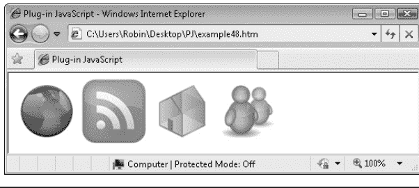

图 6-7 鼠标悬停在图标上时的缩放

## 第 6 章：移动与动画 157

- toh 对象要缩放的高度
- msecs 动画应持续的毫秒数
- pad 如果大于 0，则对象将使用 CSS padding 填充填充（使其始终保持相同的尺寸）；否则，如果为 -1，则不需要填充，且在缩放期间可能不会移动。如果 pad 为 0 或 null，则在不应用填充的情况下，对象将移动并调整大小以保持居中。
- interruptible 如果为 true（或 1），此插件可以通过对同一对象的新调用进行中断；否则，如果为 false (0)，则调用是不可中断的

## 变量、数组和函数

|  |  |
|---|---|
| j | 如果 id 是数组，用于索引的局部变量 |
| tox | 包含最终水平偏移的局部变量 |
| toy | 包含最终垂直偏移的局部变量 |
| midx | 包含水平中心偏移的局部变量 |
| midy | 包含垂直中心偏移的局部变量 |
| width | 对象左侧填充的量局部变量 |
| width2 | width 的拷贝，包含对象右侧填充的量 |
| height1 | 包含对象顶部填充量的局部变量 |
| height2 | height1 的拷贝，包含对象底部填充的量 |
| stepw | 包含每步宽度变化量的局部变量 |
| steph | 包含每步高度变化量的局部变量 |
| INTERVAL | 包含值 30 的全局变量 |
| HID | 包含值 'hidden' 的全局变量 |
| ZO_W | id 的属性，包含其当前宽度 |
| ZO_H | id 的属性，包含其当前高度 |
| ZO_Flag | id 的属性，如果正在缩放或可以被中断，则设置为 true |
| ZO_Int_Count | id 的属性，包含动画的当前帧数 |
| ZO_IID | id 的属性，包含使用 clearInterval() 取消中断所需的数值 |

## JavaScript 插件：100 个解决方案

|  |  |
|---|---|
| paddingLeft | id 的 style.paddingLeft 属性 |
| paddingTop | id 的 style.paddingTop 属性 |
| paddingRight | id 的 style.paddingRight 属性 |
| paddingBottom | id 的 style.paddingBottom 属性 |
| overflow | id 的 style.overflow 属性 |
| setInterval() | 开始对另一个函数重复中断的函数 |
| clearInterval() | 停止重复中断的函数 |
| Math.max() | 返回两个值最大值的函数 |
| Math.floor() | 去浮点数小数点后的任何数字并返回整数的函数 |
| Math.round() | 将浮点数舍入到最近的整数的函数 |
| DoZoom() | 执行缩放动画的子函数 |
| ZoomPad() | 缩放时填充对象以保持相同尺寸的子函数 |
| NoPx() | 移除属性中 'px' 后缀的插件 |
| Px() | 为属性添加 'px' 后缀的插件 |
| W() | 返回对象宽度的插件 |
| H() | 返回对象高度的插件 |
| X() | 返回水平偏移的插件 |
| Y() | 返回垂直偏移的插件 |
| GoTo() | 将对象移动到位置的插件 |
| Resize() | 调整对象大小的插件

## 它是如何工作的

该插件将在一段时间内在给定的宽度和高度范围内对对象进行缩放。它还可以对对象进行填充以保持其整体尺寸，并支持三种缩放样式。如果 id 是数组，则通过以下方式处理每个元素：

```javascript
if (id instanceof Array)
  for (var j = 0; j < id.length; ++j)
    Zoom(id[j], w, h, msecs, interruptible, CB)
```

## 第 6 章：移动与动画 157

设置后，id 的局部变量如下：

```javascript
var maxw = Math.max(fromw, tow)
var maxh = Math.max(fromh, toh)
var stepw = (tow - fromw) / INTERVAL
var steph = (toh - fromh) / INTERVAL
```

## 设置变量

设置后，id 的属性如下：

```javascript
if (pad > 0) {
  id.style.width = pad + 'px';
  id.style.height = pad + 'px';
} else if (pad == 0 || pad == null) {
  id.style.width = 'auto';
  id.style.height = 'auto';
}
```

## 缩放正在进行

如果正在缩放，则检查 `ZO_Int` 属性。如果不是，则通过调用 `clearInterval()` 停止。

```javascript
if (id.ZOInt) {
  clearInterval(id.ZOIID)
}
```

## 缩放未进行

```javascript
if (!id.ZOFlag) {
  id.overflow = 'hidden';
  id.ZOFlag = true;
  id.ZOInt = interruptible;
  id.ZOIID = setInterval(DoZoom, INTERVAL);
}
```

## DoZoom() 函数

`DoZoom()` 函数的作用是在每次调用时通过更改对象的尺寸来执行缩放。前三行计算调整大小所需的新宽度高度：

```javascript
if (w) ZOW = Math.max(fromw + stepw * id.ZOOCount)
if (h) ZOH = Math.max(fromh + steph * id.ZOOCount)
Resize(id, ZOW, ZOH);
```

id.ZOOCount++;
if (id.ZOOCount * INTERVAL >= msecs) {
  clearInterval(id.ZOIID);
  id.ZOFlag = false;
  id.ZOOCount = 0;
}

## 第 6 章：移动与动画

在插件的早期部分将使用默认值。第三行通过调用 `Resize()` 插件来执行缩放。

之后，用于居中对象的值被放置在 `midx` 和 `midy` 中，如下：

```
var midx = O(id).ZO_X + Math.round((maxx - O(id).ZO_W) / 2)
var midy = O(id).ZO_Y + Math.round((maxh - O(id).ZO_H) / 2)
```


这些值是通过获取对象的最大宽度和高度，从中减去其宽度和高度计算出来的。这些值除以 2，用于偏移左对象的起始位置，它已存储在 `ZO_X` 和 `ZO_T` 属性中。

## 当参数为真时

如果参数大于零，调用此插件将在更改时进行填充，以保持整体尺寸，因此贴靠在上面的元素都将保持在原位置。如果没有此设置，且高度和 id 发生变化，周围的任何对象都会移动以适应新尺寸。下一行代码调用 `ZoomPad()` 函数来创建填充：

```
if (pad > 0) ZoomPad(Math.max(fromw, tow), Math.max(fromh, toh, O(id).ZO_W, O(id).ZO_H)
```

这通过使用 `Math.max()` 函数找到对象相对于起始值以及 `fromw`、`tow`、`fromh` 和 `toh` 值之间的最大宽度和高度。对象在添加填充后将变大，周围会被填充，在这种情况下缩放可以增长。或者，如果是在缩小，则不添加填充，但随着对象的缩小，会添加更多的填充来补偿尺寸的减少。最终结果是，当 `pad` 大于零时，`id` 始终具有整体尺寸（当你将其宽度和高度加上填充时）。

否则，如果 `pad` 的值不是 -1，则移动 `id` 以保持保持居中（如果 `pad` 为 -1，则不需要填充，也不希望移动 `id`）。

## 如果此插件被 DockBar() 插件调用

接下来，有一段仅供 `DockBar()` 插件使用的代码，将在第 8 章中介绍。它看起来如下：

```
else if (O(id).DB_Parent)ToGoEdge(O(id).DB_Parent, O(id).DB_Where, 50)
```

这段代码检查 `id` 的 `DB_Parent` 属性。在这种情况下，`GetToGoEdge()` 插件由 `DockBar()` 调用，此时会调用第 4 章的内容来跟踪由 `DB_Where` 属性值赋值给的对象。

如果此插件没有作为 `DockBar()` 插件的一部分使用，则有必要保持 `id` 居中（除非 `pad` 参数为 -1，此时禁用居中）。当然，如果 `id` 没有通过设置为 'absolute'（绝对）、'relative'（相对）或其他定位样式而脱离页面，则任何更改其位置的尝试都将被忽略（在这种情况下，保持对象居中的最佳方法是将 `pad` 设置为 `true`）。

# 162 插件 JavaScript：100 个解决方案

然而，如果对象设置了 x 和 y 坐标，那么每当它缩小或放大时，它的左上角都需要轻微移动以保持其中心在中间，尽管使用填充的对象在变化时不会改变位置，因为它们始终具有相同的尺寸。

## 当动画完成后

要检查缩放是否完成，使用以下 `if()` 语句：

```
if (++o(id)).ZO_Count >= (msecs / INTERVAL)
```

该语句增加 `id` 的 `ZO_Count` 属性，然后检查它是否大于或等于 `msecs / INTERVAL` 的结果（这给动画步数）。如果不是，则 `if()` 语句的内容将被忽略，子函数返回将在 `INTERVAL` 毫秒后被再次调用。

否则，缩放完成，并执行以下语句：

```
var end = O(id).ZO_X + Math.round(maxx - tow) / 2

var windy = O(id).ZO_Y + Math.round(maxh - toh) / 2

O(id).ZO_Flag = false

Resize(id, tow, toh)

clearInterval(O(id).ZO_IID)
```

前两行计算对象的最终 x 和 y 位置，并将其放置在 `end` 和 `windy` 中。下一行将 `id` 的 `ZO_Flag` 属性设置为 `false`，表示 `id` 上没有正在缩放。接下来，将对象调整为 `tow` 和 `toh` 中的最终宽度和高度，并通过调用 `clearInterval()` 停止循环中断，传递的是调用 `setInterval()` 时存储的属性 `ZO_IID`。

之后，如果正在使用填充，则调用 `ZoomPad()` 来更新填充；否则，如果 `pad` 不是 -1，则调用 `GoTo()` 插件以确保 `id` 准确地位于 `end` 和 `windy` 的位置。

```
if (pad = 0) ZoomPad(fromw, fromh, tow, toh)

else if (pad = -1) GoTo(id, end, windy)
```

然后，如果此插件被 Dock() 插件调用，将移动到所需的边缘：

```
if (O(id).DB_Parent) GoToEdge(O(id).DB_Parent, O(id).DB_Where, 50)
```

最后的语句检查是否传递了 `CB` 参数，如果是，则调用 `eval()`对其进行评估，如第 7 章所述：

```
if (typeof CB != UNDEF) eval(CB)
```

## ZoomPad() 子函数

`ZoomPad()` 子函数为 `id` 应用足够的 CSS 填充，以便对象始终具有相同的尺寸。它接收四个参数：`frw`、`frh`、`padw` 和 `padh`。变量 `frw` `frh` 包含 `id` 的初始宽度和高度，而 `padw` 和 `padh` 包含所需的宽度和高度。

## 第 6 章：运动与动画 165

保持相同的整体尺寸（以确保在缩放过程中周围的图标不会移动）。
`interrupt` 参数设置为 `true`，这样当你的鼠标移过并移离开图标时，每次缩放都可以平滑地中断并反转。
如果你想尝试，可以更改 `pad` 和 `interruptible` 参数的值，查看当切换 `w` 和 `h` 参数的值会发生什么（因为至少有一个保持为 `true` 或 `1`），以改变缩放类型。

## 插件

```javascript
function Zoom(id, w, h, fromw, fromwh, tow, toh,
mssecs, pad, interruptible, CB)
{
  if (id instanceof Array) {
    for (var j = 0; j < id.length; ++j)
      Zoom(id[j], w, h, fromw, fromwh, tow, toh,
        mssecs, pad, interruptible, CB)
    }
  }
}
```

```javascript
if (typeof id.ZO_X == UNDEFINED) {
  O(id).ZO_X = X(id)
  O(id).ZO_Y = Y(id)
}
```

```javascript
if (!id.ZO_Flag) {
  O(id).ZO_W = Math.max(fromw, tow)
  O(id).ZO_H = Math.max(fromh, toh)
  O(id).ZO_Count = 0
} else
```

```javascript
if (O(id).ZO_Int) return IID
else clearInterval(O(id).ZO_INTERVAL)
```

```javascript
O(id).ZO_Count = (mssecs / INTERVAL) - O(id).ZO_Count
```

```javascript
var maxw = Math.max(fromw, tow)
var max = Math.max(fromh, toh)
var stepw = (tow - fromw) / (mssecs / INTERVAL)
var step = (toh - fromh) / (mssecs / INTERVAL)
```

```javascript
S(id).overflow = HID
O(id).ZO_Flag = true
O(id).ZO_Int = interruptible
O(id).ZO_ID = setInterval(DoZoom, INTERVAL)
```

## 166 插件 JavaScript：100 解决方案

```javascript
function ZoomDo()
{
  if (w) O(id).ZO_W = Math.round(fromw + step) * O(id).ZO_Count
  if (h) O(id).ZO_H = Math.round(fromh + step) * O(id).ZO_Count
  Resize(id, O(id).ZO_W, O(id).ZO_H)
  var midx = O(id).ZO_X + Math.round(max - O(id).ZO_W) / 2
  var midy = O(id).ZO_Y + Math.round(max - O(id).ZO_H) / 2
  if (pad > 0) ZoomPad(Math.fromw, tow,
    Math.round(fromh, tow), O(id).ZO_W, O(id).ZO_H)
  else if (pad == -1) GoTo(id, midx, midy)
  if (id).DB_Parent
    GoToEdge(O(id).DB_Parent, O(id).DB_Where, 50)
  if (+(id).ZO_Count = (msecs / INTERVAL))
  {
    var endx = O(id).ZO_X + Math.round(max - tow) / 2
    var endy = O(id).ZO_Y + Math.round(max - toh) / 2
    O(id).ZO_ID = false;
    Resize(id, tow, tob)
    clearInterval(O(id).ZO_ID)
    if (pad > 0) ZoomPad(fromw, fromh, tow, tob)
      else if (pad == -1) GoTo(id, endx, endy)
    if (id).DB_Parent
      GoToEdge(O(id).DB_Parent, O(id).DB_Where, 50)
      if (typeof CB != undefined) eval(CB)
  }
}
function ZoomPad(frw, frh, padw, padh)
{
  var left = Math.round(0, frw - Math.round(padw)) / 2
  var right = left
  var top = Math.round(0, frh - Math.round(pad)) / 2
  var bottom = top
  if (left != Math.floor(left))
  {
    left = Math.floor(left)
    right = left + 1
  }
  if (top != Math.floor(top))
  {
    top = Math.floor(top)
    bottom = top + 1
  }
}
```

## 第 6 章：运动与动画 167

```javascript
S(id).paddingLeft = Px(left)
S(id).paddingRight = Px(right)
S(id).paddingTop = Px(top)
S(id).paddingBottom = Px(bottom)
```

## 50 ZoomDown()

此插件随时间将对象从其当前尺寸缩小到零维度。其实现方式使得对象可以通过随后的插件 `ZoomRestore()` 再次缩放。图 6-8 显示了四个绑定了此插件的鼠标悬停事件的图标，它们处于不同的缩放状态。

## 关于插件

此插件接收一个对象并将其缩小直到维度为零。它需要以下参数：

- `id`: 一个对象、一个对象 ID 或对象/对象 ID 数组
- `w`: 如果为 `true` 或 `1`，对象的宽度将会被缩小
- `h`: 如果为 `true` 或 `1`，对象的高度将会被缩小
- `msecs`: 动画应该持续的毫秒数
- `pad`: 如果为 `0`，对象在调整大小期间将移动以保持居中。如果大于 `0`，对象将通过 CSS 填充内，以便在缩小时保留其原始尺寸。如果为 `-1`，则不应用内边距，且对象在调整大小期间不会移动。
- `interrupt`: 如果为 `true`（或 `1`），此插件可以通过对同一对象的新调用进行中断；否则，如果为 `false`（或 `0`），调用是不可中断的。

img/95e4c3b430487125c34255cc09097_184.png

图 6-8 这些图标处于不同的缩小状态。

## 168 插件 JavaScript：100 解决方案

## 变量、数组与函数

| 名称 | 描述 |
| :--- | :--- |
| `j` | 如果 id 是数组，则用于索引 id 的局部变量 |
| `ZO_Flag` | id 的属性，如果正在进行缩放，则包含为 `true` |
| `ZO_Int` | id 的属性，如果缩放可以中断，则包含为 `true` |
| `ZO_OldW` | id 的属性，包含其之前的宽度 |
| `ZO_OldH` | id 的属性，包含其之前的高度 |
| `Zoomdown` | id 的属性，如果已缩放，则包含为 `true` |
| `Zoom()` | 将对象从一种尺寸缩放到另一种尺寸的插件 |

## 工作原理

此插件首先遍历 `id`（如果它是一个数组），并对每个元素单独递归地调用自身，如下所示：

```javascript
if (id instanceof Array)
  for (var j = 0; j < id.length; ++j)
    ZoomDown(id[j], w, h, msecs, pad, interruptible)
```

接下来，插件检查 `id` 是否已存在缩放，如果是，则检查该缩放是否可以中断，如下：

```javascript
if (O(id).ZO_Flag && O(id).ZO_Int)
```

如果存在（由 id 的 `ZO_Flag` 属性决定），则插件返回。否则，执行以下代码：

```javascript
else if (!O(id).ZO_W)
```

这检查 `ZO_OldW` 属性是否存在。如果不存在，它会缩小，将其当前宽度和高度存储在 `ZO_OldW` 和 `ZO_OldH` 属性中。此外，通过 `X(id)` 和 `Y(id)` 获取对象的坐标并存储在 `ZO_X` 和 `ZO_Y` 中。

这三个语句中的将 `id` 的 `Zoomdown` 属性设置为 `true`，表示对象正在（或在过程中）缩小。然后将位置重置为存储在 `ZO_X` 和 `ZO_Y` 中的值，并调用 插件，如下：

```javascript
O(id).Zoomdown = true
ToGo(id, O(id).ZO_X, O(id).ZO_Y)
Zoom(id, w, h, 0, tow, tob, msecs, pad, interruptible, CB)
```

## 如何使用

使用此函数时，你传递一个对象（或对象数组）并指定你想要缩小的类型（缩小水平或垂直轴，或两者），以及持续的毫秒数、是否使用内边距以及缩放是否可以中断，如下：

```javascript
ZoomDown(object, 1, 1, 1000, 0, 0)
```

这会将对象从其当前尺寸在 1000 毫秒内缩小。最后两个值指定不使用内边距，且缩放不可中断。

这里有一个示例，显示了四个图标，它们的鼠标悬停事件绑定了此插件：

```html


```

<script>
window.onload = function() {
  ids = Array('id1', 'id2', 'id3', 'id4');
  O(ids, 'onmouseover', 'down');
}

function down() {
  ZoomDown(this, 1, 1, 500, 1, 1)
}
</script>

## 170 JavaScript 插件：100 种解决方案

与其让这种混乱的行为发生，不如你可以在图标上挂载以下插件 `ZoomRestore()`，这样它们在鼠标移开时会缩放回原始大小。

## 插件

```
function ZoomDown(id, w, h, msecs, pad, interruptible, CB) {
  if (id instanceof Array) {
    for (var j = 0 ; j < id.length ; ++j)
      ZoomDown(id[j], w, h, msecs, pad, interruptible, CB)
    return
  }
}
if (O(id).ZO_Flag && O(id).ZO_Int) return
if (!O(id).ZO_OldW) {
    O(id).ZO_OldW = W(id)
    O(id).ZO_OldH = H(id)
    O(id).ZO_X = X(id)
    O(id).ZO_Y = Y(id)
  }
}
O(id).zoom = true
ToGo(id, O(id).ZO_X, O(id).ZO_Y)
Zoom(id, w, h, O(id).ZO_OldW, O(id).ZO_OldH, 0, 0,
msecs, pad, interruptible, CB);
```


### 51 `ZoomRestore()`
这是专门为 `ZoomDown()` 设计的插件。通过它，你可以让被缩放的对象随时间恢复到其原始尺寸。在图 6-9 中，显示了四个图标，它们的鼠标悬停（mouseover）事件挂载了 `ZoomDown()`，而鼠标移出（mouseout）事件则挂载了该插件的事件。

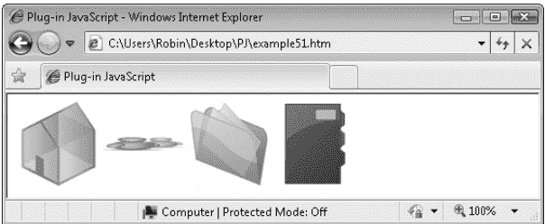

图 6-9 图标现在可以使用鼠标进行缩小和放大。

## 第 6 章：移动与动画 171

### 插件

此插件接收一个被缩放的对象，并随时间将其缩放回原始尺寸。它接收以下参数：

- `id` 一个对象、一个对象 ID 或对象及/或 ID 数组
- `w` 如果为 true 或 1，对象的宽度将会被放大
- `h` 如果为 true 或 1，对象的高度将会被放大
- `msecs` 动画持续的毫秒数
- `pad` 如果为 0，对象在调整大小期间将移动以保持居中。如果大于 0，对象将带有 CSS 填充（padding）以便在缩小时保留其原始尺寸。如果为 -1，则不应用填充，且对象在调整大小期间不会移动。
- `interruptible` 如果为 true（或 1），此插件可以被同一对象上的新调用中断；否则，如果为 false（0），该调用是不可中断的

### 变量、数组与函数

| 变量 | 说明 |
|---|---|
| `j` | 如果 `id` 是数组时的索引本地变量 |
| `ZO_Flag` | `id` 的属性，如果 `id` 正在进行缩放，则为 true |
| `ZO_Int` | `id` 的属性，如果缩放不可中断，则为 true |
| `ZO_OldW` | `id` 的属性，包含其之前的宽度 |
| `ZO_OldH` | `id` 的属性，包含其之前的高度 |
| `Zoomdown` | `id` 的属性，如果已缩小，则为 true |
| `Zoom()` | 将对象从一个尺寸缩放到另一个尺寸的插件 |

### 工作原理

此插件从熟悉的代码开始，如果 `id` 是数组，则遍历它并递归调用自身来对每个元素进行处理，如下所示：

```
if (id instanceof Array) {
  for (var j = 0; j < id.length; ++j)
    ZoomRestore(id[j], w, h, msecs, pad, interruptible, CB)
return
}
```

接下来，插件检查 `id` 是否已经在进行缩放，如果是，它会检查该缩放是否不可中断，如下所示：

```
if ((O(id).ZO_Flag && !(O(id).ZO_Int)) || !(O(id).Zoomdown)
  return
```

如果正在进行缩放（通过 `id` 的 `ZO_Flag` 属性判断）且其不可中断（通过 `id` 的 `ZO_Int` 属性判断），则插件返回。

还会检查 `id` 的 `Zoomdown` 属性，如果它为 false，则说明对象未缩小，因此 `id` 的插件属性也会返回。

最后两个选择器语句将 `id` 的 `Zoomdown` 属性设为 false，以指示对象正在（或正被）缩放，然后调用 `Zoom()` 插件，传递 `id` 当前的零宽度和高度、存储在 `ZO_OldW` 和 `ZO_OldH` 属性中的对象之前的宽度和高度值，以及 `pad` 和 `interruptible` 的值，如下：

```
O(id).Zoomdown = false
Zoom(id, w, h, 0, 0, O(id).ZO_OldW, O(id).ZO_OldH,
msecs, pad, interruptible, CB)
```

### 如何使用

要使用此函数，你需要传递一个已经缩过的对象（或对象数组），并指定你想要的缩放类型（是缩小水平轴、垂直轴还是两者）、持续的毫秒数、是否使用填充，以及缩放是否可以中断，如下：

```
ZoomRestore(myobject, w, h, 100)
```

此函数让对象在 100 毫秒内随时间恢复到原始尺寸。为了让图标在鼠标移开时缩小，在鼠标移入时放大，可以扩展 `ZoomDown()`：

```
ZoomDown(this, w, h, 100, 0)
```

```html
<script>
window.onload = function() {
  ids = ['i1', 'i2', 'i3', 'i4']
  for (var i = 0; i < ids.length; i++) {
    document.getElementById(ids[i]).onmouseover = function() {
      ZoomDown(this, w, h, 100, 0)
    }
    document.getElementById(ids[i]).onmouseout = function() {
      ZoomRestore(this, w, h, 100, 0)
    }
  }
}
</script>


```

第 6 章：移动与动画 173

### 插件

此插件接收一个被缩小的对象，并随时间将其缩放回原始尺寸。它接收以下参数：

- `id` 一个对象、一个对象 ID 或对象及/或 ID 数组
- `w` 如果为 true 或 1，对象的宽度将会被放大
- `h` 如果为 true 或 1，对象的高度将会被放大
- `msecs` 动画持续的毫秒数
- `pad` 如果为 0，对象在调整大小期间将移动以保持居中。如果大于 0，对象将带有 CSS 填充（padding）以便在缩小时保留其原始尺寸。如果为 -1，则不应用填充，且对象在调整大小期间不会移动。
- `interruptible` 如果为 true（或 1），此插件可以被同一对象上的新调用中断；否则，如果为 false（0），该调用是不可中断的

### 示例

此插件让图标在鼠标移开时进行缩小：

```javascript
if (O(id).ZO_Flag) {
  return;
}
O(id).ZO_OldW = W(id);
O(id).ZO_OldH = H(id);
O(id).ZO_X = X(id);
O(id).ZO_Y = Y(id);
O(id).ZO_Flag = true;
ToGo(id, O(id).ZO_X, O(id).ZO_Y);
Zoom(id, w, h, O(id).ZO_OldW, O(id).ZO_OldH, 0, 0,
msecs, pad, interruptible, CB);
```

### 52 `ZoomToggle()`
此插件可以切换缩放状态。通过它，你可以让图标在缩小和放大之间切换。在图 6-10 中，显示了四个图标，它们的鼠标悬停事件执行缩小，鼠标移出时执行 `ZoomToggle()`：

```html
<script>
window.onload = function() {
  ids = ['i1', 'i2', 'i3', 'i4']
  for (var i = 0; i < ids.length; i++) {
    document.getElementById(ids[i]).onmouseover = function() {
      ZoomDown(this, w, h, 100, 0)
    }
    document.getElementById(ids[i]).onmouseout = function() {
      ZoomToggle(this, w, h, 100, 0)
    }
  }
}
</script>


```

图 6-10 图标现在可以使用鼠标进行缩小和放大。

## 174 JavaScript 插件：100 种解决方案

### `ZoomToggle()`

此插件会切换对象的缩放状态。如果对象是缩小的，则将其恢复到原始尺寸；否则，则将其缩小。它接收以下参数：

- `id` 一个对象、一个对象 ID 或对象及/或 ID 数组
- `w` 如果为 true 或 1，对象的宽度将会被放大
- `h` 如果为 true 或 1，对象的高度将会被放大
- `msecs` 动画持续的毫秒数
- `pad` 如果为 0，对象在调整大小期间将移动以保持居中。如果大于 0，对象将带有 CSS 填充（padding）以便在缩小时保留其原始尺寸。如果为 -1，则不应用填充，且对象在调整大小期间不会移动。
- `interruptible` 如果为 true（或 1），此插件可以被同一对象上的新调用中断；否则，如果为 false（0），该调用是不可中断的

### 工作原理

此插件从熟悉的代码开始，如果 `id` 是数组，则遍历它并递归调用自身来对每个元素进行处理，如下所示：

```
if (id instanceof Array) {
  for (var j = 0; j < id.length; ++j) {
    ZoomToggle(id[j], w, h, msecs, pad, interruptible, CB)
  }
}
```

接下来，插件检查 `id` 的 `Zoomdown` 属性。如果它为 true，则对象是缩小的，因此调用 `ZoomRestore()` 插件；否则，则调用 `ZoomDown()` 插件。

最后两个选择器语句将 `id` 的 `Zoomdown` 属性设为 false，以指示对象正在（或正被）缩放，然后调用 `Zoom()` 插件，传递 `id` 当前的零宽度和高度、存储在 `ZO_OldW` 和 `ZO_OldH` 属性中的对象之前的宽度和高度值，以及 `pad` 和 `interruptible` 的值，如下：

```
if (O(id).Zoomdown) {
  O(id).Zoomdown = false;
  Zoom(id, w, h, 0, 0, O(id).ZO_OldW, O(id).ZO_OldH,
  msecs, pad, interruptible, CB)
} else {
  O(id).Zoomdown = true;
  Zoom(id, 0, 0, w, h,
  msecs, pad, interruptible, CB)
}
```

## 第 6 章：运动与动画 175

最后两个语句检查 `id` 的 `Zoomdown` 属性。如果为 `false`，则对象未缩小，因此调用 `ZoomDown()` 插件；否则，对象已缩小，因此调用 `ZoomRestore()` 插件，如下所示：

```
if (!id.Zoomdown) ZoomDown(id, w, h, msecs, pad, interruptible, CB)
else
    ZoomRestore(id, w, h, msecs, pad, interruptible, CB)
```

### 如何使用

要使用此插件，你不需要跟踪对象的缩放状态；你只需要调用它，插件就会判断对象是否需要缩小或放大。你只需要指定缩放是在水平方向还是垂直方向（或两者）发生、缩放速度、对象的填充（pad），以及缩放是否可以被中断，例如：

```
ZoomToggle(myobject, 1, 0, 750, 0, 0)
```

此语句将切换对象的缩小状态，并允许缩放仅在其宽度上进行（对象将绕其垂直轴旋转）。缩放将耗时 750 毫秒，不会对 `myobject` 进行填充，且不可中断。

接下来的示例类似于使用插件的示例，通过鼠标移入和离开图标来控制这四个图标及其缩放状态：

```


```

```javascript
<script>
window.onload = function() {
    ids = Array('i1', 'i2', 'i3', 'i4');
    ZoomToggle('i1', 'i3', 1, 1, 1, 0);
    O(ids, 'onmouseover', 'toggle');
    O(ids, 'onmouseout', 'toggle');
}
function toggle() {
    ZoomToggle(this, 1, 0, 500, 1, 1)
}
</script>
```

在分配 `ids` 数组之后紧有一个额外的 `ZoomToggle()` 调用，它会切换第一个和第三个图标的缩小状态。这意味着当你将鼠标悬过图标时，可以很容易地看到 `ZoomToggle()` 的效果，某些图标进入视图而另一些则缩小。我选择允许缩放仅在对象的宽度上发生，以便图标绕其垂直轴旋转。

## 176 JavaScript 插件：100 种强大的解决方案

在第 7 章中，我将展示如何将书中一系列插件连接或链式组合在一起，使得每个插件只有在前一个插件完成后才被调用。这可以实现一些非常具有创意且看起来专业的动画效果，并进一步增强用户交互。

注意 请记住，在本章中我关注的是图像，所有插件都适用于任何类型的对象，因此你可以滑动、压缩和缩放 HTML 块或任何可以放置其中或可见的对象。

### 插件

```
function ZoomToggle(id, w, h, msecs, pad, interruptible, CB) {
  if (id instanceof Array) {
    for (var j = 0 ; j < id.length ; ++j)
      ZoomToggle(id[j], w, h, msecs, pad, interruptible, CB)
    return
  }
  if (O(id).ZO_Flag && !O(id).ZO_Int) return
}
if (!O(id).Zoomdown) ZoomDown(id, w, h, msecs, pad, interruptible, CB)
else ZoomRestore(id, w, h, msecs, pad, interruptible, CB)
```


# 第 7 章
## 链式调用与交互
### JavaScript 插件：100 种强大的解决方案

在本章中，我将向你展示如何将书中的许多插件链式组合以形成动作或动画序列。这些是你编写用于创建惊艳开场效果的动画，也可以作为小链来执行简单动作（如移动菜单元素）。

链式调用对于确保一个动作跟随另一个动作也非常有用。这在 JavaScript 中很难实现，因为它是事件驱动的，因此同时调用的插件通常会并行运行。然而，通过在许多插件的末尾添加所谓的回调函数 `callback function`，可以设置一个插件在完成后调用另一个——这就是“链式”。

你还将学习如何在支持链式调用的函数上使用回调（类似于一个微型的、两部分的链）。

## 53 `Chain()`, `NextChain()`, 和 `Callback()`

这些插件是一组函数，允许你将一组插件调用连接起来按顺序执行，每个插件在完成后调用下一个。这是在 JavaScript 中创建动画效果的一种极方法，你可能认为这种效果只能在 Java 或 Flash 等程序中实现。图 7-1 显示了一个球通过链式调用四次 `Slide()` 插件，被设置为在屏幕上弹跳。

### 关于插件

`Chain()` 接受一个插件调用的数组，并将其推入堆栈中，每个调用都可以逐个从栈中弹出，并在前一个调用完成后执行。它需要以下内容：

- `calls`: 一个包含一系列待调用插件的字符串数组。

表 7-1 列出了可以通过回调调用其他插件的插件。

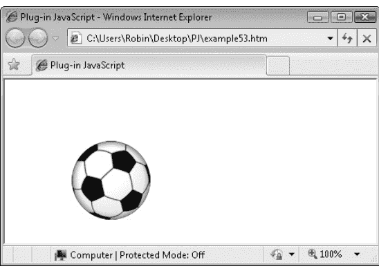

图 7-1 一个小球在屏幕上弹跳

## 第 7 章：链式调用与交互 179

| `Chain()` | `DeflateToggle()` | `FadeToggle()` | `Repeat()` | `While()` |
|---|---|---|---|---|
| `CallBack()` | `Fade()` | `Hide()` | `Show()` | `Zoom()` |
| `ChainThis()` | `FadeBetween()` | `HideToggle()` | `Slide()` | `ZoomDown()` |
| `Deflate()` | `FadeIn()` | `Pause()` | `SlideBetween()` | `ZoomRestore()` |
| `DeflateBetween()` | `FadeOut()` | `WaitKey()` | `ZoomToggle()` |

表 7-1 支持被链式调用的插件

### 工作原理

表 7-2 支持使用回调的插件

### 变量、数组与函数

| `j` | 用于迭代的局部变量 |
|---|---|
| `CHAIN_S` | 全局数组 |
| `push()` | 推入数组的函数 |
| `pop()` | 从数组弹出的函数 |
| `eval()` | 将字符串作为代码执行的函数 |

### `NextChain()` 插件 ...

### `Callback()` 插件

此插件允许在当前一个完成后附加插件，如下：

```javascript
var insert = expr.lastIndexOf('')
var left = expr.substr(0, insert)
var right = expr.substr(insert)
var middle = 'NextChain()'
```

```javascript
if (expr.substr(insert, 1) != '')
  middle = ', ' + middle
```

```javascript
eval(left + middle + right)
```

## 第 7 章：链式与交互 181

这段代码的工作原理是通过向支持该功能的函数的 `CB` 参数中传递要调用的插件名称。它是通过使用该表达式指向该处，然后将链中的下一个调用作为其最终参数插入到该表达式中来实现的。

为了实现这一操作，首先创建了字符串变量 `left`、`right` 和 `middle`，其中 `left` 包含到插入点为止的所有表达式，`middle` 是一个包含对 `'NextChain()'` 插件引用的字符串，而 `right` 是插入点之后表达式的剩余部分。对 `'NextChain()'` 的引用在双引号内使用了单引号，以确保字符串被求值；单引号内的字符串将被处理为字符串本身，而不是字符串中调用函数名的结果。

如果紧随其后的字符不是 `'('`（这意味着传递给 `Callback()` 的表达式包含参数），则变量 `middle` 的前面带有一个逗号和空格，作为变量分隔符。否则，它保持为赋值的值 `'NextChain()'`。最后，将 `left`、`middle` 和 `right` 的三个值拼接并传递给 `eval()`。

当插件被调用时，它会通知 `CB` 不空，并对其进行求值。在此实例中，`NextChain()` 插件将被调用。

> 注意：以这种方式在 `CB` 中传递函数（或表达式）的名称，而不是简单地让插件调用 `NextChain()`，是为了让你能够传递自己的表达式作为回调来执行。你只需要在字符串中传递一个表达式（或函数调用），并将其传递给任何接收它的插件（列于表 7-1）。你的表达式将在插件执行时被求值。

### `ChainThis()` 插件

此插件允许你获取一个不可链的插件或函数（你可以通过检查表 7-2 来确定），并在链中使用它。代码简单如下：

```
eval(expr)
NextChain()
```

例如，假设对于链中的某条指令，你想使用以下语句进行移动：

```
Goto('myobject', x / 2, y + 100)
```

你也可以通过将其转换为字符串，使用 `InsVars()` 插件和 `ChainThis()` 来实现链式，如下：

```
string = InsVars("ChainThis(\"myobject\", #1, #2)", x / 2, y + 100)
```

`InsVars()` 插件可以方便地使用 `#1` 和 `#2` 等标记作为占位符将变量插入字符串中，并在主字符串之后传递变量或表达式。

如果你将字符串 `string` 作为链中的元素之一传递给 `Chain()` 或 `Repeat` 或 `While()`，那么 `Goto()` 调用将在轮到它时执行，并且程序流将传递到链中的下一个项目（如果有）。

### 插件 JavaScript：100 种解决方案

这种技术仅对于在单个进程中从头到尾按过程运行的函数效果良好。如果你对一个使用事件或中断完成工作的函数使用 `ChainThis()`，你通常会得到意料之外的结果。

> 注意：你可能会在 `InsVars()` 插件中发现你用完了主要的两层引号（双引号和单引号），以及第三层引号。这可以通过在引号前使用转义字符轻松实现：`\"` 或 `\'`。事实上，你会发现上一个示例语句在向 `Goto()` 传递 `"myapp"` ID 时使用了这种技术，因为双引号已经用于字符串的外部，而单引号用于 `Callback()` 内部的子字符串。

### 如何使用它们

要使用 `Chain()` 插件，你需要创建一个要链式连接的插件链数组，并且每个调用在被放入数组之前必须组装成一个字符串。例如，假设你想向链中添加以下内容：

```
FadeOut(myobject, 1000, 0)
```

要做到这一点，你必须首先将其转换为字符串，如下：

```
string1 = 'FadeOut(' + myobject + ', ' + 1000, 0)'
```

或者，如果你有一个更复杂的调用，如下：

```
Slide('a', width / 2, height / 2 - 50, width / 2 -20, height / 2, 500, 0)
```

那么它就需要转换为字符串，如下：

```
string2 = "Slide(' + a + \', ' + width / 2 + \', + height / 2 - 50 + \', ' + width / 2 - 29 + \', ' + height / 2 - 500, 0) + "
```

显然，这变得非常混乱，在上述两个语句的这两个版本中，利用插件 15 `InsVars()` 几乎要简单得多：

```
string1 = InsVars('FadeOut('#1, 1000, myobject)')
string2 = InsVars('Slide('#1, #2, #3, #4, #5, 500, 0', width / 2 - 50, width / 2 -20, height / 2)
```

在这两行中，参数列表被放在主字符串的末尾，每个值都被替换为 `#1`、`#2` 等，用于插入每个值。这两个字符串可以放在链中，并使用以下方式启动链中的第一个：

```
Chain(Array(string1, string2))
```

## 第 6 章：运动与动画 175

最后两个语句检查 `id` 的 `Zoomdown` 属性。如果为 `false`，则对象未缩小，因此调用 `ZoomDown()` 插件；否则，对象已缩小，因此调用 `ZoomRestore()` 插件，如下所示：

```
if (!id.Zoomdown) ZoomDown(id, w, h, msecs, pad, interruptible, CB)
else
    ZoomRestore(id, w, h, msecs, pad, interruptible, CB)
```

### 如何使用

要使用此插件，你不需要跟踪对象的缩放状态；你只需要调用它，插件就会判断对象是否需要缩小或放大。你只需要指定缩放是在水平方向还是垂直方向（或两者）、缩放速度、对象的填充 `pad`，以及缩放是否可以被中断，例如：

```
ZoomToggle(myobject, 1, 0, 750, 0, 0)
```

此语句将切换对象的缩小状态，并允许缩放仅在其宽度上进行（对象将绕其垂直轴旋转）。缩放将耗时 750 毫秒，不会对 `myobject` 进行填充，且不可中断。接下来的示例类似于使用插件的示例，通过鼠标移入和离开图标来控制这四个图标及其缩放状态：

```


```

```script
<script>
window.onload = function() {
    ids = Array('i1', 'i2', 'i3', 'i4');
    ZoomToggle('i1', 'i3', 1, 1, 1, 0);
    O(ids, 'onmouseover', 'toggle');
    O(ids, 'onmouseout', 'toggle');
}
function toggle() {
    ZoomToggle(this, 1, 0, 500, 1, 1)
}
</script>
```

在分配 `ids` 数组之后紧有一个额外的 `ZoomToggle()` 调用，它会切换第一个和第三个图标的缩小状态。这意味着当你将鼠标悬过图标时，可以很容易地看到 `ZoomToggle()` 的效果，某些图标进入视图而另一些则缩小。我选择允许缩放仅在对象的宽度上发生，以便图标绕其垂直轴旋转。

## 176 JavaScript 插件：100 种强大的解决方案

在第 7 章中，我将向你展示如何将书中许多插件链式组合在一起，使得每个插件只有在前一个插件完成后才被调用。这可以实现一些非常具有创意且看起来专业的动画效果，并进一步增强用户交互。注意 请记住，在本章中我关注的是图像，所有插件都适用于任何类型的对象，因此你可以滑动、压缩和缩放 HTML 块或任何可以放置其中或可见的对象。

### 插件

```
function ZoomToggle(id, w, h, msecs, pad, interruptible, CB) {
  if (id instanceof Array) {
    for (var j = 0 ; j < id.length ; ++j)
      ZoomToggle(id[j], w, h, msecs, pad, interruptible, CB)
    return
  }
  if (O(id).ZO_Flag && !O(id).ZO_Int) return
}
if (!O(id).Zoomdown) ZoomDown(id, w, h, msecs, pad, interruptible, CB)
else ZoomRestore(id, w, h, msecs, pad, interruptible, CB)
```


## Repeat()

除了将插件链联在一起，你还可以使用 `Repeat()` 插件让一个或多个插件重复指定的次数。在当前的媒体中，无法捕获这些示例中的动作，因此图 7-2 显示了球（略微灰色）在使用此插件创建的动画的不同重复次数中被捕获的状态。

## 关于插件

此插件允许你根据意愿次数重复一个动作链。它需要以下参数：

- `number`: 链应该重复的次数
- `calls`: 一个包含要调用插件序列的字符串数组

## 变量、数组和函数

| 变量 |  |
|---|---|
| `j` | 用于计数重复次数的局部变量 |
| `temp` | `calls` 数组的本地副本 |
| `concat()` | 合并两个或多个数组的函数 |
| `Chain()` | 用于将一组插件链在一起的插件 |

## 工作原理

此插件获取 `calls` 数组并将其复制多次，直到有 `number` 份 `calls` 拷贝，如下所示：

```
var temp = calls

for (var j = 1 ; j < number ; ++j)

  calls = calls.concat(temp)

Chain(calls)
```

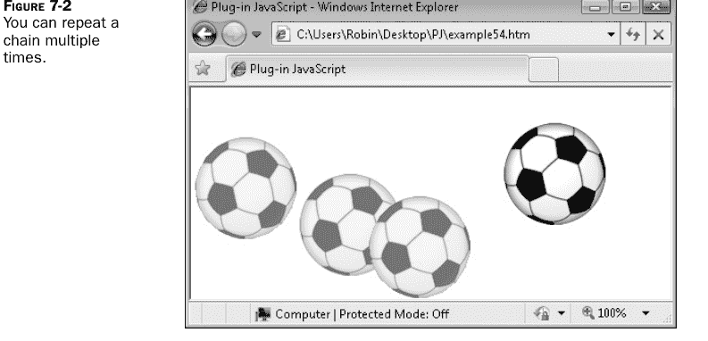

首先，数组 `temp` 被赋值为 `calls` 的副本，然后 `concat()` 函数将 `temp` 的内容与 `calls` 合并，直到总共有 `number` 份。最后，调用 `Chain()` 插件来启动第一次运行。

## 如何使用

使用此插件与调用 `Chain()` 相同，只是你还传递了一个额外的参数来指定链重复的次数。以下示例对 `Chain()` 和 `NextInChain()` 插件部分的示例进行了微调，使球在浏览器中弹跳 10 次：

```html

<script>
window.onload = function() {
  Position('ball', ABS)
  width = GetWindowWidth()
  height = GetWindowHeight()
  r = width - 100
  b = height - 100
  x = width / 20
  y = height / 50
  ch1 = InVars('Slide('ball', #1, #2, #3, #4, 500, 0)*', 0, y, x, 0)
  ch2 = InVars('Slide('ball', #1, #2, #3, #4, 500, 0)*', x, 0, r, y)
  ch3 = InVars('Slide('ball', #1, #2, #3, #4, 500, 0)*', r, y, x, b)
  ch4 = InVars('Slide('ball', #1, #2, #3, #4, 500, 0)*', x, b, 0, y)
  Repeat(10, Array(ch1, ch2, ch3, ch4))
}
</script>
```

## 插件

```javascript
function Repeat(number, calls) {
  var temp = calls
  for (var j = 1; j < number ; ++j)
    calls = calls.concat(temp)
  Chain(calls)
}
```

## While()

有时你可能会发现让插件链在某个条件为真时保持重复是很方便的；例如，如果没有按键被按下或鼠标未被点击。通过此插件，你可以提供链的同时提供一个测试条件，只要条件返回为真，链就会不断重复。

## 第 7 章：链链与交互 187

图 7-3 显示了一个en帆船的动画，它缓慢地淡入并横跨浏览器，然后再次淡出。在每次旅行之前，都会检查全局变量 `KEY_PRESS`，动画会不断重复，直到按下空格键为止。

## 关于插件

此插件接收一个表达式和一个语句数组，如果表达式求值为为真，则将它们链联起来。它需要以下参数：

- `expr`: 一个包含可以求值为真或为假的表达式的字符串
- `calls`: 一个包含要放入链中的插件序列的字符串数组

## 变量、数组和函数

| 变量 | 描述 |
|---|---|
| `temp` | 用于从 `calls` 数组中重构字符串的局部字符串变量 |
| `j` | 用于遍历 `calls` 数组的局部变量 |
| `eval()` | 评估 JavaScript 表达式的函数 |
| `replace()` | 替换字符串部分的函数 |
| `substr()` | 返回字符串部分内容的函数 |
| `push()` | 将值推入数组的函数 |
| `InsVars()` | 向字符串中插入值的插件 |
| `Chain()` | 用于将插件序列链在一起的插件 |

## 工作原理

此插件存在于 `if` 语句中，只有当传递给 `expr` 的字符串求值为真时才会完成，如下所示：

```javascript
if (eval(expr))
```

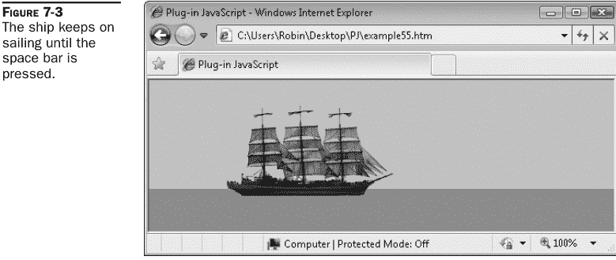

## 188 插件 JavaScript：解决方案

While() 插件的逻辑是什么？让我们来看看代码。该插件接收一个表达式和一个语句数组，如果表达式求值为真，则将它们链联起来。它需要以下参数：

- `expr`: 一个包含可以求值为真或为假的表达式的字符串
- `calls`: 一个包含要放入链中的插件序列的字符串数组

此插件存在于 `if` 语句中，只有当传递给 `expr` 的字符串求值为真时才会完成，如下所示：

```javascript
if (eval(expr))
```

While() 插件的逻辑是检查表达式，如果它为真，则执行调用链。然后再次检查表达式。此过程一直持续，直到表达式求值为假。

以下是 While() 插件的代码：

```javascript
function While(expr, calls) {
  while (eval(expr)) {
    Chain(calls)
  }
}
```

在下面的示例中，表达式是 `KEY_PRESS == 0`。只要用户没有按下任何键，动画就会继续进行。

```javascript
While("KEY_PRESS == 0", Array(Slide('ship', 1, 2, 3, 4, 500, 0), FadeOut('ship', 1, 2, 3, 4, 500, 0)))
```

这显示了如何使用 While() 插件创建一个直到满足特定条件为止的循环。

# 190 插件式 JavaScript：100 种解决方案

```javascript
window.onload = function() {
  width = GetWindowWidth()
  height = GetWindowHeight()
  x = width - 200
  y = height - 150
  Locate('sea', ABS, 0, height - 50)
  Resize('sea', width, 50)
  S(document.body).backgroundColor = '#7b7d4dc'
  S('sea') = '#90a5a6'
  Locate('ship', ABS, 0, y)
  While(KEY_PRESS != ' ') {
    Array(
      FadeIn('ship', 500, 0),
      InsVars('Slide('ship', #1, #2, #3, #4, 5000)', 0, y, x, y),
      FadeOut('ship', 500, 0),
      InsVars(Callback('GoTo('\\', #1, #2)'), 0, y)
    )
  }
}</script>
```

HTML `<script>` 部分的两行代码首先获取一个 `div` 来表示海洋并显示一艘帆船的图像。接下来，设置浏览器的宽度和高度，并设置 `x` 和 `y` 的值，以便在调用 `Slide()` 插件时供帆船使用。

此之后，将样式属性设置为 'absolute'（绝对定位），以便可以将其放置在精确的位置，然后将其调整大小以占据浏览器底部的 50 像素。代表'sea'（海洋）的对象也更改了背景颜色。最后，将船定位在它的起始位置 `0, y`。

此示例的最后部分是 `While()` 函数，它传递了以下表达式：

```
KEY_PRESS != ' '
```

`KEY_PRESS` 是一个全局变量，它会自动设置为上一次按下按键的值，因此在按下空格键之前，该表达式将一直返回 `true`。

调用链中的前三个语句是非常显而易见的；它们让船淡入、让它横跨浏览器，然后让它淡出。然而，最后一次调用稍微有趣一点，因为它是使用 `Callback()` 插件将一个不可更改的插件（在此例中为 `GoTo()`）转换为可链式的示例，仅针对此单次调用。

使用 `InsVars()` 插件将变量和值插入到包含 `Goto()` 用的字符串中。该字符串随后被放置在 `Callback()` 调用中并变为可链式。

因此，第四条语句将船移回起始位置，准备进行下一次航行——如果还没有按下空格键。

# 第 7 章：链式与交互 191

注意，传递给 `While()` 语句的表达式仅在每个调用链的开始时进行测试，整个调用链在停止之前将始终执行完毕。如果你需要更精确的控制，可以随时清空全局数组 `CHAIN_CALLS`（它包含链中的所有项）。这将在当前语句执行后停止链，可以通过发布语句 `CHAIN_CALLS.length = 0` 来完成。如果你需要对用户输入有更快的反应，`While()` 语句不是你最佳的插件选择，你应该编写一些事件驱动的代码。

## 插件

```javascript
function While(expr, calls) {
  if (eval(expr)) {
    var temp = ''
    for (var j = 0; j < calls.length; ++j)
      temp += '' + calls[j].replace(/"\\/g, '\\\\') + '\';
    temp = temp.substr(0, temp.length)
    calls.push("While\#(InsVars('#\', Array(#2))", expr, temp))
  }
  Chain(calls)
}
```

# Pause()

在动画过程中，很多时候你需要它停止一会，可以通过 `Pause()` 插件来实现。通过它，你可以指定一个以毫秒为单位的时间段，直到链中的下一个插件被调用。在图 7-4 中，来自上一个插件 `While()` 的示例在链中插入了几个额外命令，这些命令：

图 7-4 在链中插入时间延迟

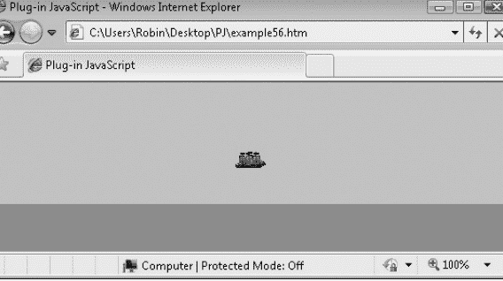

当船到达浏览器中心时向下移动，然后暂停 1 秒，然后再缩放以继续它的旅程。

# 192 插件式 JavaScript：100 种解决方案

## 关于插件

此插件在链中的命令之间按照指定的持续时间暂停。它接受以下参数：

- `wait` 以毫秒为单位的时间

## 变量、数组和函数

| | |
| :--- | :--- |
| `setTimeout()` | 创建单个中断的函数 |
| `NextChain()` | 运行链中下一个命令的插件（如果有的话） |

## 它是如何工作的

此插件非常直观。它简单地调用了 `setTimeout` 函数，使其在 `wait` 毫秒后调用 `NextChain()` 插件。因为链内部的命令通过 `NextChain()` 插件链接在一起，这是链中下一个命令可以运行的唯一方法。通过设置超时在未来的某个时间发生，在超时发生并调用 `NextChain()` 之前，链将不会继续。

与 `setInterval` 函数不同，`setTimeout` 设置了一个中断并在发生后就忘记了它，因此不需要清除它。

# 如何使用它

要使用此插件，在链式命令数组中插入如下所示的字符串，这将在它的未来 1.5 秒后创建一个事件来恢复执行：

```
"Pause(1500)"
```

这是一个有趣的示例，它通过说明了 `Pause()` 的用法：在之前的插件 `While()` 中，当船到达浏览器中心时缩小船，然后暂停几秒钟再次回来，让船重新出现：

```html
<div id='sea'></div>
<script>
window.onload = function() {
  width = GetWindowWidth()
  height = GetWindowHeight()
  x = width - 200
  y = height - 150
  Locate('sea', ABS, 0, height - 50)
  Resize('sea', width, 50)
  S(document.body).backgroundColor = '#7b7d4dc'
  S('sea') = '#90a5a6'
  Locate('ship', ABS, 0, y)
  While(KEY_PRESS != ' ') {
    Array(
      FadeIn('ship', 500, 0),
      InsVars('Slide('ship', #1, #2, #3, #4, 5000)', 0, y, x, y),
      FadeOut('ship', 500, 0),
      InsVars(Callback('GoTo('\\', #1, #2)'), 0, y)
    )
  }
</script>
```

# 第 7 章：链式与交互 193

注意，传递给 `While()` 语句的表达式仅在每个调用链的开始时进行测试，整个调用链在停止之前将始终执行完毕。如果你需要更精确的控制，可以随时清空全局数组 `CHAIN_CALLS`（它包含链中的所有项）。这将在当前语句执行后停止链，可以通过发布语句 `CHAIN_CALLS.length = 0` 来完成。如果你需要对用户输入有更快的反应，`While()` 语句不是你最佳的插件选择，你应该编写一些事件驱动的代码。

## 插件

```javascript
function While(expr, calls) {
  if (eval(expr)) {
    var temp = ''
    for (var j = 0; j < calls.length; ++j)
      temp += '' + calls[j].replace(/"\\/g, '\\\\') + '\';
    temp = temp.substr(0, temp.length)
    calls.push("While\#(InsVars('#\', Array(#2))", expr, temp))
  }
  Chain(calls)
}
```

# Pause()

在动画过程中，很多时候你需要它停止一会，可以通过 `Pause()` 插件来实现。通过它，你可以指定一个以毫秒为单位的时间段，直到链中的下一个插件被调用。在图 7-4 中，来自上一个插件 `While()` 的示例在链中插入了几个额外命令，这些命令：

图 7-4 在链中插入时间延迟


当船到达浏览器中心时向下移动，然后暂停 1 秒，然后再缩放以继续它的旅程。

# 192 插件式 JavaScript：100 种解决方案

## 关于插件

此插件在链中的命令之间按照指定的持续时间暂停。它接受以下参数：

- `wait` 以毫秒为单位的时间

## 变量、数组和函数

| | |
| :--- | :--- |
| `setTimeout()` | 创建单个中断的函数 |
| `NextChain()` | 运行链中下一个命令的插件（如果有的话） |

## 它是如何工作的

此插件非常直观。它简单地调用了 `setTimeout` 函数，使其在 `wait` 毫秒后调用 `NextChain()` 插件。因为链内部的命令通过 `NextChain()` 插件链接在一起，这是链中下一个命令可以运行的唯一方法。通过设置超时在未来的某个时间发生，在超时发生并调用 `NextChain()` 之前，链将不会继续。

与 `setInterval` 函数不同，`setTimeout` 设置了一个中断并在发生后就忘记了它，因此不需要清除它。

# 如何使用它

要使用此插件，在链式命令数组中插入如下所示的字符串，这将在它的未来 1.5 秒后创建一个事件来恢复执行：

```
"Pause(1500)"
```

这是一个有趣的示例，它通过说明了 `Pause()` 的用法：在之前的插件 `While()` 中，当船到达浏览器中心时缩小船，然后暂停几秒钟再次回来，让船重新出现：


```html
<div id='sea'></div>
<script>
window.onload = function() {
  width = GetWindowWidth()
  height = GetWindowHeight()
  x = width - 200
  y = height - 150

  Locate('sea', ABS, 0, height - 50)
  Resize('sea', width, 50)
  S(document.body).backgroundColor = '#7b7d4dc'
  S('sea') = '#90a5a6'
  Locate('ship', ABS, 0, y)

  While(KEY_PRESS != ' ') {
    Array(
      FadeIn('ship', 500, 0),
      InsVars('Slide('ship', #1, #2, #3, #4, 5000)', 0, y, x, y),
      FadeOut('ship', 500, 0),
      InsVars(Callback('GoTo('\\', #1, #2)'), 0, y)
    )
  }
</script>
```

# 第 7 章：链式与交互 193

注意，传递给 `While()` 语句的表达式仅在每个调用链的开始时进行测试，整个调用链在停止之前将始终执行完毕。如果你需要更精确的控制，可以随时清空全局数组 `CHAIN_CALLS`（它包含链中的所有项）。这将在当前语句执行后停止链，可以通过发布语句 `CHAIN_CALLS.length = 0` 来完成。如果你需要对用户输入有更快的反应，`While()` 语句不是你最佳的插件选择，你应该编写一些事件驱动的代码。

## 插件

```javascript
function While(expr, calls) {
  if (eval(expr)) {
    var temp = ''
    for (var j = 0; j < calls.length; ++j)
      temp += '' + calls[j].replace(/"\\/g, '\\\\') + '\';
    temp = temp.substr(0, temp.length)
    calls.push("While\#(InsVars('#\', Array(#2))", expr, temp))
  }
  Chain(calls)
}
```

# Pause()

在动画过程中，很多时候你需要它停止一会，可以通过 `Pause()` 插件来实现。通过它，你可以指定一个以毫秒为单位的时间段，直到链中的下一个插件被调用。在图 7-4 中，来自上一个插件 `While()` 的示例在链中插入了几个额外命令，这些命令：

图 7-4 在链中插入时间延迟


当船到达浏览器中心时向下移动，然后暂停 1 秒，然后再缩放以继续它的旅程。

# 192 插件式 JavaScript：100 种解决方案

## 关于插件

此插件在链中的命令之间按照指定的持续时间暂停。它接受以下参数：

- `wait` 以毫秒为单位的时间

## 变量、数组和函数

|  |  |
| :--- | :--- |
| `setTimeout()` | 创建单个中断的函数 |
| `NextChain()` | 运行链中下一个命令的插件（如果有的话） |

## 它是如何工作的

此插件非常直观。它简单地调用了 `setTimeout` 函数，使其在 `wait` 毫秒后调用 `NextChain()` 插件。因为链内部的命令通过 `NextChain()` 插件链接在一起，这是链中下一个命令可以运行的唯一方法。通过设置超时在未来的某个时间发生，在超时发生并调用 `NextChain()` 之前，链将不会继续。

与 `setInterval` 函数不同，`setTimeout` 设置了一个中断并在发生后就忘记了它，因此不需要清除它。

# 如何使用它

要使用此插件，在链式命令数组中插入如下所示的字符串，这将在它的未来 1.5 秒后创建一个事件来恢复执行：

```
"Pause(1500)"
```

这是一个有趣的示例，它通过说明了 `Pause()` 的用法：在之前的插件 `While()` 中，当船到达浏览器中心时缩小船，然后暂停几秒钟再次回来，让船重新出现：

```html
<div id='sea'></div>
<script>
window.onload = function() {
  width = GetWindowWidth()
  height = GetWindowHeight()
  x = width - 200
  y = height - 150

  Locate('sea', ABS, 0, height - 50)
  Resize('sea', width, 50)
  S(document.body).backgroundColor = '#7b7d4dc'
  S('sea') = '#90a5a6'
  Locate('ship', ABS, 0, y)

  While(KEY_PRESS != ' ') {
    Array(
      FadeIn('ship', 500, 0),
      InsVars('Slide('ship', #1, #2, #3, #4, 5000)', 0, y, x, y),
      FadeOut('ship', 500, 0),
      InsVars(Callback('GoTo('\\', #1, #2)'), 0, y)
    )
  }
</script>
```


当船到达浏览器中心时向下移动，然后暂停 1 秒，然后再缩放以继续它的旅程。

# 192 插件式 JavaScript：100 种解决方案

## 关于插件

此插件在链中的命令之间按照指定的持续时间暂停。它接受以下参数：

- `wait` 以毫秒为单位的时间

## 变量、数组和函数

| | |

| :--- | :--- |

| `setTimeout()` | 创建单个中断的函数 |

| `NextChain()` | 运行链中下一个命令的插件（如果有的话） |

## 它是如何工作的

此插件非常直观。它简单地调用了 `setTimeout` 函数，使其在 `wait` 毫秒后调用 `NextChain()` 插件。因为链内部的命令通过 `NextChain()` 插件链接在一起，这是链中下一个命令可以运行的唯一方法。通过设置超时在未来的某个时间发生，在超时发生并调用 `NextChain()` 之前，链将不会继续。

与 `setInterval` 函数不同，`setTimeout` 设置了一个中断并在发生后就忘记了它，因此不需要清除它。

# 如何使用它

要使用此插件，在链式命令数组中插入如下所示的字符串，这将在它的未来 1.5 秒后创建一个事件来恢复执行：

```
"Pause(1500)"
```

这是一个有趣的示例，它通过说明了 `Pause()` 的用法：在之前的插件 `While()` 中，当船到达浏览器中心时缩小船，然后暂停几秒钟再次回来，让船重新出现：

```html
<div id='sea'></div>
<script>
window.onload = function() {
  width = GetWindowWidth()
  height = GetWindowHeight()
  x = width - 200
  y = height - 150

  Locate('sea', ABS, 0, height - 50)
  Resize('sea', width, 50)
  S(document.body).backgroundColor = '#7b7d4dc'
  S('sea') = '#90a5a6'
  Locate('ship', ABS, 0, y)

  While(KEY_PRESS != ' ') {
    Array(
      FadeIn('ship', 500, 0),
      InsVars('Slide('ship', #1, #2, #3, #4, 5000)', 0, y, x, y),
      FadeOut('ship', 500, 0),
      InsVars(Callback('GoTo('\\', #1, #2)'), 0, y)
    )
  }
</script>
```


## 第 7 章：链式与交互 195

### 如何使用

要使用此插件，你需要将它作为一个字符串插入到链命令数组中，如下所示：

`"WaitKey()"`

然后你可以选择被按下的按键，或者让链中的后续命令使用 `GetLastKey()` 插件来返回按键并使用它。

下面的示例替换了上一个示例中 `Pause()` 插件部分相同的放大和缩小操作，将其替换为一个淡入的“按任意键”消息，该消息会等待按键按下，然后再次淡出——让飞船继续航行：

```html
<div id='sea'></div>

<span id='note'><font size='5'>Press any key</font></span>

<script>
window.onload = function() {
  width = GetWindowWidth()
  height = GetWindowHeight()
  x = width - 200
  y = height - 150
  mid = width / 2 - 100

  Locate('sea', ABS, 0, height - 50)
  Resize('sea', width, 50)
  S(document.body).backgroundColor = '#b7d4dc'
  S('sea').backgroundColor = '#90a5a6'
  Locate('ship', ABS, 0, y)
  Locate('note', ABS, 0, y + 115)
  CenterX('note')
  Opacity('note', 0)

  While('KEY_PRESS != ' ', {
    FadeIn('ship', 'slide', 0, y)
    InsVars('Slide('ship', 0, #1, #2, #1, 2500, 0)', mid, y)
    FadeIn('note', 1000, 0)
    WaitKey()
    FadeOut('note', 1000, 0)
    InsVars('Slide('ship', #1, #2, #3, 2500, 0)', mid, y, x)
    FadeOut('ship', 500, 0)
    InsVars(Callback('Goto("ship", 0, #1)'))
  })
}
</script>
```

此示例与上一个示例的区别已用**粗体**标记。在 HTML 部分，添加了一个带有消息文本的新 `span` 标签。在 `<script>` 部分，将 `span` 移动到将显示的位置，并将其透明度设置为零以使其不可见。

196 插件 JavaScript：100 种解决方案

最后，在命令链中，之前的缩放指令被替换为 `FadeIn()`、`WaitKey()` 和 `FadeOut()` 的调用。如果在显示消息时按除了空格键以外的任何按键，飞船将继续航行并循环。然而，如果按下空格键，`While()` 命令开头的表达式将变为 `true`，链将停止。

### 插件

```javascript
function WaitKey() {
  GetLastKey()
  setTimeout(DoWaitKey, INTERVAL)
}

function DoWaitKey() {
  if (KEY_PRESS == '') NextIn()
  else setTimeout(DoWaitKey, INTERVAL)
}
```

## Flip()

此插件提供了专业的翻转效果，使物体旋转以显示反面。提供了三种不同的旋转效果，这是为你的网页提供有趣视觉效果的好方法。

在图 7-6 中，爱因斯坦的照片被绑定到鼠标事件上，当鼠标悬停时，它会翻转以显示更多信息。无法在书中显示该效果，但可以将图像想象成一张类似的卡片，正面有图片，背面有更多信息。图 7-7 显示了鼠标悬停时图像的“反面”。

图 7-6

网页中的图像在鼠标悬停时是可翻转的。


## 第 7 章：链式与交互 197

FIGURE 7-7

当鼠标经过图像时，它会平滑地翻转。


### 关于插件

此插件接收两个对象并对它们进行动画处理，使它们看起来像是翻转到了背面。它返回这些参数：

- `id1`: 对象或对象 ID——可以不是数组
- `id2`: 对象或对象 ID——可以不是数组
- `w`: 如果为 true 或 1，则宽度会被翻转
- `h`: 如果为 true 或 1，则高度会被翻转
- `msecs`: 翻转所需的毫秒数
- `pad`: 如果设置，对象将进行填充以在翻转期间保持整体尺寸

### 变量、数组和函数

| `swap` | 包含命令的本地字符串，适用于 `InsVars()` 添加 `VisibilityToggle()` 调用 |
| `fast` | 包含命令的本地字符串，适用于 `InsVars()` 添加 1 毫秒的 `ZoomToggle()` 调用 |
| `slow` | 包含命令的本地字符串，适用于 `InsVars()` 添加 `msecs / 2` 秒的 `ZoomToggle()` 调用 |
| `ZO_Flag` | `id1` 或 `id2` 的属性，如果对象正在进行缩放，则该属性被设置为 true |
| `CallBack()` | 允许将任何命令添加到链中的插件 |
| `VisibilityToggle()` | 切换对象可见性的插件 |
| `ZoomToggle()` | 切换对象缩放状态的插件 |
| `Chain()` | 启动执行命令链的插件 |

198 插件 JavaScript：100 种解决方案

### 工作原理

此函数首先检查 `id1` 和 `id2` 的 `ZO_Flag` 属性。如果其中一个为 `true`，则对象正在进行缩放，函数返回如下：

```javascript
if (O(id1).ZO_Flag || O(id2).ZO_Flag) return
```

接下来，创建了三个长变量：

# 200 个 JavaScript 插件：100 个解决方案

```javascript
Resize('c', width - 220, 260)
Show('c')
ids = Array('a', 'b')
Locate(ids, ABS, width - 205, 5)
Resize(ids, 200, 264)
VisibilityToggle('b')
('a').onmouseover = function () { Flip('a', 'b', 1, 0, 250, 0) }
('b').onmouseout = function () { Flip('b', 'a', 1, 0, 250, 0) }
```

HTML 显示了两个图片，并包含一个带有文章文本的 `div`。随后，`<section>` 标签通过调用 `Hide` 隐藏了文本，因为它将进行尺寸调整；如果不这样做， 浏览器在下一次计数时将返回错误的宽度，因为它会准备好可能需要的滚动条。在调整文章文本大小后，调用 `Show()` 插件再次显示它。现在由于它已经缩小到适应当前窗口，浏览器将不会尝试为可能需要的滚动条留出空间。

现在，`ids` 数组填充了图片 ID，并将其传递到边界右上角的 `Locate()` 插件。同时也调用了 `Resize()` 插件，因为遗憾的是，取决于使用的浏览器，奇数宽度和高度有时会导致动画出现轻微抖动（这与它们处理的方式有关），确保 `Flip()` 对象的两个维度一致是获得最佳结果简单方法。它还确保了两个图片具有相同的尺寸并能够整齐地翻转。

接下来，在设置鼠标事件到 `Flip()` 之前，将第二个对象设置为可见。这可能是因为两个图片是相互叠的，并且可能具有不同的 `zindex` 值，你必须通过让另一个不可见来确保其中一个在前面。

在这两行代码中，对象 'a' 的 `onmouseover` 事件被绑定到从对象 'a' 到 'b' 的翻转，而对象 'b' 的 `onmouseout` 事件被绑定到从对象 'b' 到 'a' 的翻转。

在翻转之前，对象 'b' 将是可见的，因此鼠标悬停在其上方将开始翻转。翻转完成后，对象 'b' 仍然在它上面（除非用户快速移开），此时对象 'b' 的 `onmouseout` 事件已被触发：因此，当鼠标移开时，动画将再次翻转回来。

### 对象以及图片

尽管为了获得最佳效果，你也可以将任何类型的对象（如 `div` 或 `table`）传递给 `Flip()` 插件。这意味着例如，你可以设置一个电子邮件按钮，当鼠标经过它时它会翻转，显示出一个小表单，用于输入你的电子邮件地址以订阅新闻邮件。如果你这样做，文本将从旋转离开的对象中流出，从而获得略有不同的效果。

你可以使用 `Flip()` 根据单选按钮的选择来交换 HTML 部分，并且不要忘记你可以沿水平和垂直方向翻转对象，甚至可以同时进行这两种操作，创建一个“缩放-再缩回”的效果。通过改变最后两行 `Flip()` 调用中的值，看看你会得到什么结果。

注意，使用一个或多个维度为奇数的对象可能会在翻转期间出现水平或垂直方向的轻微抖动。这是由于不同浏览器处理分数的方式存在差异，通过在恢复之前对对象的位置进行翻转来解决此问题。尽管这种抖动几乎察觉不到，但如果你希望避免这种干扰，你应该只处理具有偶数值的维度。在使用 `Flip()` 之前调用 `Resize()` 很容易确保这一点。

### 翻转效果 (Flip-in)

```javascript
function Flip(id1, id2, w, h, msecs, pad) {
  if (O(id1).Zo_Flag || O(id2).Zo_Flag) return
  var swap = "ChainToggle('#1',')"
  var fast = "ZoomToggle('#1', #2, #3, 1, 0)"
  var slow = "ZoomToggle('#1', #2, #3, #4, 0)"

  Chain(
    InsVars(slow, id1, w, h, msecs / 2, pad),
    InsVars(fast, id2, w, h, pad),
    InsVars(swap, id2),
    InsVars(slow, id2, w, h, msecs / 2, pad),
    InsVars(swap, id1),
    InsVars(fast, id1, w, h, pad)
  )
}
```

## HoverSlide()

此插件将对象放置在浏览器的一侧边缘，显示一小部分并保持隐藏状态。当你将鼠标悬停在其上方时，对象会滑出窗口以显示自己，当移动鼠标时它又会滑回去。图 7-8 显示了一个附加在浏览器顶部的对象，只显示了钢琴琴键。在图 7-9 中，鼠标已经经过并让对象滑入浏览器以显示自己。

### 插件

此插件将对象跨越浏览器边界的一个边缘，其大部分部分在浏览器外是不可见的，并通过一小区域显示你可以通过鼠标移动来让对象滑出。它需要以下参数：

- 或者是一个 或一个对象 ID——这不能是对象数组
- 对象应该附着的边缘：‘top’、‘left’、‘right’ 和‘bottom’

图 7-8 一个附着在浏览器顶部的对象，显示其底部。

 一个对象附着在浏览器边缘，大部分部分在浏览器外是不可见的，通过一小区域显示你可以通过鼠标移动来让对象滑出。

- 或者是一个 或一个对象 ID——这不能是对象数组
- 对象应该附着的边缘：‘top’、‘left’、‘right’ 和‘bottom’

图 7-8 一个对象附着在浏览器顶部的对象，显示其底部。


# 200 个 JavaScript 插件：100 个解决方案

```javascript
Resize('c', width - 220, 260)
Show('c')
ids = Array('a', 'b')
Locate(ids, ABS, width - 205, 5)
Resize(ids, 200, 264)
VisibilityToggle('b')
('a').onmouseover = function () { Flip('a', 'b', 1, 0, 250, 0) }
('b').onmouseout = function () { Flip('b', 'a', 1, 0, 250, 0) }
```

HTML 显示了两个图片，并包含一个带有文章文本的 `div`。随后，`<section>` 标签通过调用 `Hide` 隐藏了文本，因为它将进行尺寸调整；如果不这样做，浏览器在下一次计数时将返回错误的宽度，因为它会准备好可能需要的滚动条。在调整文章文本大小后，调用 `Show()` 插件再次显示它。现在由于它已经缩小到适应当前窗口，浏览器将不会尝试为可能需要的滚动条留出空间。

现在，`ids` 数组填充了图片 ID，并将其传递到边界右上角的 `Locate()` 插件。同时也调用了 `Resize()` 插件，因为遗憾的是，取决于使用的浏览器，奇数宽度和高度有时会导致动画出现轻微抖动（这与它们处理的方式有关），确保 `Flip()` 对象的两个维度一致是获得最佳结果简单方法。它还确保了两个图片具有相同的尺寸并能够整齐地翻转。

在设置鼠标事件到 `Flip()` 之前，将第二个对象设置为可见。这可能是因为两个图片是相互叠的，并且可能具有不同的 `zindex` 值，你必须通过让另一个不可见来确保其中一个在前面。

在这两行代码中，对象 `'a'` 的 `onmouseover` 事件被绑定到从对象 `'a'` 到 `'b'` 的翻转，而对象 `'b'` 的 `onmouseout` 事件被绑定到从对象 `'b'` 到 `'a'` 的翻转。

在翻转之前，对象 `'b'` 将是可见的，因此鼠标悬停在其上方将开始翻转。翻转完成后，对象 `'b'` 仍然在它上面（除非用户快速移开），此时对象 `'b'` 的 `onmouseout` 事件已被触发：因此，当鼠标移开时，动画将再次翻转回来。

## 对象以及图片

尽管为了获得最佳效果，你也可以将任何类型的对象（如 `div` 或 `table`）传递给 `Flip()` 插件。这意味着例如，你可以设置一个电子邮件按钮，当鼠标经过它时它会翻转，显示出一个小表单，用于输入你的电子邮件地址以订阅新闻邮件。如果你这样做，文本将从旋转离开的对象中流出，从而获得略有不同的效果。

你可以使用 `Flip()` 根据单选按钮的选择来交换 HTML 部分，并且不要忘记你可以沿水平和垂直方向翻转对象，甚至可以同时进行这两种操作，创建一个“缩放-再缩回”的效果。通过改变最后两行 `Flip()` 调用中的值，看看你会得到什么结果。

注意，使用一个或多个维度为奇数的对象可能会在翻转期间出现水平或垂直方向的轻微抖动。这是由于不同浏览器处理分数的方式存在差异，通过在恢复之前对对象的位置进行翻转来解决此问题。尽管这种抖动几乎察觉不到，但如果你希望避免这种干扰，你应该只处理具有偶数值的维度。在使用 `Flip()` 之前调用 `Resize()` 很容易确保这一点。

## 翻转效果 Flip-in

```javascript
function Flip(id1, id2, w, h, msecs, pad) {
  if (O(id1).Zo_Flag || O(id2).Zo_Flag) return
  var swap = "ChainToggle('#1',')"
  var fast = "ZoomToggle('#1', #2, #3, 1, 0)"
  var slow = "ZoomToggle('#1', #2, #3, #4, 0)"

  Chain(
    InsVars(slow, id1, w, h, msecs / 2, pad),
    InsVars(fast, id2, w, h, pad),
    InsVars(swap, id2),
    InsVars(slow, id2, w, h, msecs / 2, pad),
    InsVars(swap, id1),
    InsVars(fast, id1, w, h, pad)
  )
}
```

## HoverSlide()

此插件将对象放置在浏览器的一侧边缘，显示一小部分并保持隐藏状态。当你将鼠标悬停在其上方时，对象会滑出窗口以显示自己，当移动鼠标时它又会滑回去。图 7-8 显示了一个附加在浏览器顶部的对象，只显示了钢琴琴键。在图 7-9 中，鼠标已经经过并让对象滑入浏览器以显示自己。

### 插件

此插件将对象跨越浏览器边界的一个边缘，其大部分部分在浏览器外是不可见的，并通过一小区域显示你可以通过鼠标移动来让对象滑出。它需要以下参数：

- 或者是一个 或一个对象 ID——这不能是对象数组
- 对象应该附着的边缘：`'top'`、`'left'`、`'right'` 和 `'bottom'`

图 7-8 一个对象附着在浏览器顶部的对象，显示其底部。


## 第 7 章：链与交互

```javascript
var t = H(id) - showing
var u = Math.min(t, msecs / INTERVAL)
var x = o? w * o : offset
var y = where == TP ? t : h + t
var s = t / u
```

### 设置事件

setup 部分的最后几行代码将 id 移动到位置 `x,y`；存储每个 `HS_X` 和 `HS_Y` 属性的副本；并设置鼠标移入（mouseover）和鼠标移出（mouseout）事件，分别调用 `SlideIn()` 和 `SlideOut()` 函数：

```javascript
GoTo(id, x, y)
O(id).HS_X = x
O(id).HS_Y = y
O(id).mouseover = SlideIn
O(id).mouseout = SlideOut
```

### SlideIn()

此函数的作用当鼠标经过对象的任何部分时，将对象滑入视图。首先，它通过调用 `clearInterval()` 取消任何之前正在运行的干扰（例如，如果对象正在滑出），然后设置一个新的中断来调用子函数 `DoSlideIn()`，如下：

```javascript
O(id).HS_ID = clearInterval(O(id).HS_ID)
O(id).HS_ID = setInterval(DoSlideIn, INTERVAL)
```

这个子函数是所有动画发生的地方。不过，为了使用更小、更易管理的变量，`ox` 和 `oy` 获取了 id 的 `HS_X` 和 `HS_Y` 属性中的值。这些是 id 左上角的位置：

```javascript
var ox = O(id).HS_X
var oy = O(id).HS_Y
```

接下来，通过 `if... else` 语句通过检查参数与全局变量 `TP`、`BM`、`LT` 和 `RT` 来测试所使用的边缘是顶部、底部、左侧还是右侧。然后只要还有移动空间，`ox` 或 `oy` 的值就会根据步长值 `s` 增加或减少。否则，如果没有移动可以执行的，将调用 `clearInterval()` 函数停止中断，如下：

```javascript
if (where == TP && oy < 0) oy = Math.min(0, oy + s)
else if (where == BM && oy > h) oy = Math.max(h, oy - s)
else if (where == LT && ox < 0) ox = Math.min(0, ox + s)
else if (where == RT && ox > w) ox = Math.max(w, ox - s)
else clearInterval(O(id).HS_ID)
```

最后，将对象移动到 `ox` 和 `oy` 中的新位置，并将 `HS_X` 和 `HS_Y` 属性赋予这些值，如下：

```javascript
GoTo(id, ox, oy)
O(id).HS_X = ox
O(id).HS_Y = oy
```

### 子函数

此函数的作用当鼠标离开对象时，再次将对象滑出。它第一件事是通过调用 `clearInterval()` 取消任何之前正在运行的常规中断（例如，如果对象正在滑入）。然后它设置一个新的中断来调用子函数 `DoSlideOut()`，如下：

```javascript
if (id).HS_HID = clearInterval(O(id).HS_HID)
O(id).HS_HID = setInterval(DoSlideOut, INTERVAL)
```

与类似的 `DoSlideIn()` 相同，首先将使用的属性副本放入较短的变量中，如下：

```javascript
var ox = O(id).HS_X
var oy = O(id).HS_Y
```

然后，如果移动尚未完成，则根据使用的边缘修改 `ox` 和 `oy` 的值；否则，取消重复中断，如下：

```javascript
if (where == TP && oy > y) oy = Math.Max(y, oy - s)
else if (where == LT && oy < y) oy = Math.min(y, oy + s)
else if (where == LT && ox > x) ox = Math.Max(x, ox - s)
else if (where == RT && ox < x) ox = Math.Max(x, ox + s)
clearInterval(O(id).HS_HID)
```

最后，将对象移动到 `ox` 和 `oy` 中的新位置，并将 `HS_X` 和 `HS_Y` 属性赋予这些值，如下：

```javascript
GoTo(id, ox, oy)
O(id).HS_X = ox
O(id).HS_Y = oy
```

> 注意：`HoverSlide()` 是较为复杂的插件之一，但它确实创造了极佳的效果，因此如果任何部分不清楚，值得多读几次前面的解释。

### 如何使用

要使用 `HoverSlide()` 插件，你传递一个对象并告诉它该对象应该放在哪里（`'顶部'`、`'底部'`、`'左侧'`或`'右侧'`边缘），在边缘的哪个位置放置，允许显示的对象比例，以及以毫秒为单位的滑动动画速度，例如：

```javascript
HoverSlide('myobject', 'top', '$50', 60, 1000)
HoverSlide('myobject2', 'right', 15, 20, 1000)
```

第一个语句将对象放在浏览器的顶部，正好位于 50% 处，显示 60 像素，滑动窗口为 1。第二个语句对另一个对象执行类似的操作，但它附着在右边缘，从向下 15 像素处开始，仅显示 20 像素。

```javascript
Position(object, FIX)
Position('mydiv', ABS)
```

这两个语句中的第一个是固定位置（`FIX`），并将对象放置在浏览器中，即使你滚动网页，对象也将留在屏幕上它放置的精确位置。第二个是绝对位置（`ABS`），并将对象绝对地放置在网页中，使其初始时看起来与固定对象完全一样，但会随着你滚动的页面而移动。

这是一个使用固定位置为音乐商店创建动态菜单的有趣示例：

```html
<table id='a' width='375' height='160' padding='0' bgcolor='black'>
  <tr height='20'>
    <td colspan='3'>
      <font color='white'>
    </font>
    </td>
  </tr>
</table>
```

## 210 JavaScript 插件：100 种解决方案

```javascript
if (where == TP && oy > y) oy = Math.max(y, oy - s)
else if (where == BM && oy < y) oy = Math.min(y, oy + s)
else if (where == LT && ox > x) ox = Math.max(x, ox - s)
else if (where == RT && ox < x) ox = Math.max(x, ox + s)
else clearInterval(O(id).HS_IID)

GoTo(id, ox, oy)
O(id).HS_X = ox
O(id).HS_Y = oy
}
```

# 第 8 章

菜单与导航

## 212 JavaScript 插件：100 解决方案

当网站试图提供比竞争对手更好的视觉效果和体验时，在大量页面之间进行导航的新方法不断被设计出来。菜单和导航可能是为了此目的最能 JavaScript 的领域。

在 JavaScript 早期，交互主要局限于鼠标经过菜单时位置和颜色的即时变化，但如今，精明的 Web 用户期望具有淡入淡出、过渡等更流畅、更有吸引力的设计。

本章中的插件为您提供了多种解决方案，您可以直接使用它们，也可以将它们构建到更复杂的系统中。它们从滑动菜单到弹出和下拉菜单、折叠菜单和右键菜单，甚至是类似于 Mac OS X 中使用的 dock栏。

## 60 HoverSliderMenu()

此插件扩展了第 7 章中的最后一个插件 `HoverSlider()`，以构建一个完整的菜单系统，而不仅仅是单个移动。通过它，你可以选择一组对象，这些对象将附加在浏览器的一个边缘上，并且当鼠标经过显示的部分时，它们会滑入视图。在图 8-1 中，两组几乎相同的包含链接的对象被附加在浏览器的顶部和底部。

### 关于插件

此插件接收一个对象数组并将它们沿着浏览器的一个边缘对齐，使它们成为一个滑动菜单集合。需要以下参数：

- `ids`: 对象数组和/或对象 ID 数组
- `where`: 应该附加的边缘，`'top'`（顶部）、`'left'`（左侧）、`'right'`（右侧）或`'bottom'`（底部）
- `offset`: 位于对象的距离——如果 `offset` 以 `%` 符号开头，则位置将为从开始的百分比，否则将是从开始的像素偏移
- `showing`: 鼠标经过每个对象时留下的像素数，以触发菜单滑动
- `gap`: 每个对象之间留下的像素数
- `msecs`: 每个对象滑入或滑出所需的毫秒数

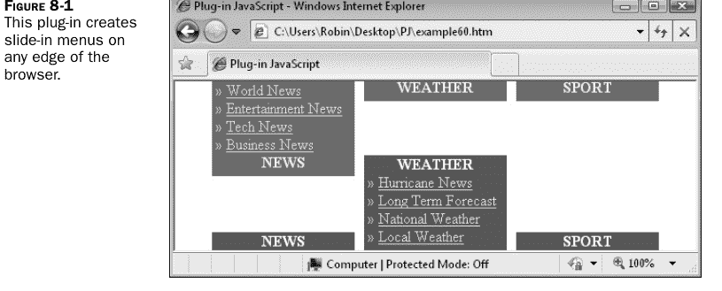

# 第 8 章：菜单与导航 213

### 变量、数组和函数

| 变量 | 说明 |
| :--- | :--- |
| `len` | 包含 `ids` 中对象数量的局部变量 |
| `total` | 局部变量，包含所有对象组合时占据的总宽度和高度，包括间隙 |
| `start` | 局部变量，包含第一个对象应该放置在边缘沿向或向下的位置 |
| `a` | 包含每个对象宽度或高度的局部数组 |
| `jump` | 局部变量，包含在定位对象时每个对象的渐进宽度和间隙 |
| `j` | 用于索引数组以保存每个对象宽度或高度的局部变量 |
| `TP` & `BM` | 包含 `'top'` 和 `'bottom'` 值的全局变量 |
| `W()` | 返回对象宽度的插件 |
| `H()` | 返回对象高度的插件 |
| `GetWindowWidth()` | 返回浏览器宽度的插件 |
| `GetHeight()` | 返回浏览器高度的插件 |
| `HoverSlide()` | 使对象从浏览器边缘滑入和滑出的插件 |

### 它是如何工作的

此插件的第一件事是对一些局部变量赋值，如下所示：

```javascript
var len = ids.length
var total = gap * (len - 1)
var start = (offset[0] != '%') ? 0 : offset.substr(1) / 100
var a = []
var jump = 0
```


# 第 8 章
菜单与导航

## 210 JavaScript 插件：100 种解决方案

```javascript
if (where == TP && oy > y) oy = Math.max(y, oy - s)
else if (where == BM && oy < y) oy = Math.min(y, oy + s)
else if (where == LT && ox > x) ox = Math.max(x, ox - s)
else if (where == RT && ox < x) ox = Math.max(x, ox + s)
else clearInterval(O(id).HS_IID)

GoTo(id, ox, oy)
O(id).HS_X = ox
O(id).HS_Y = oy
}
```

# 第 8 章
菜单与导航

## 212 JavaScript 插件：100 解决方案

当网站试图提供比竞争对手更好的视觉效果和体验时，在大量页面之间进行导航的新方法不断被设计出来。菜单和导航可能是为了此目的最能使用 JavaScript 的领域。

在 JavaScript 早期，交互主要局限于鼠标经过菜单时位置和颜色的即时变化，但如今，精明的 Web 用户期望具有淡入淡出、过渡等更流畅、更有吸引力的设计。

本章中的插件为您提供了多种解决方案，您可以直接使用它们，也可以将它们构建到更复杂的系统中。它们从滑动菜单到弹出和下拉菜单、折叠菜单和右键菜单，甚至是类似于 Mac OS X 中使用的 dock栏。

## 60 HoverSliderMenu()

此插件扩展了第 7 章中的最后一个插件 `HoverSlider()`，以构建一个完整的菜单系统，而不仅仅是单个移动。通过它，你可以选择一组对象，这些对象将附加在浏览器的一个边缘上，并且当鼠标经过显示的部分时，它们会滑入视图。在图 8-1 中，两组几乎相同的包含链接的对象被附加在浏览器的顶部和底部。

## 关于插件

此插件接收一个对象数组并将它们沿着浏览器的一个边缘对齐，使它们成为一个滑动菜单集合。需要以下参数：

- `ids`: 对象数组和/或对象 ID 数组
- `where`: 应附加的边缘，`'top'`（顶部）、`'left'`（左侧）、`'right'`（右侧）或`'bottom'`（底部）
- `offset`: 位于对象的距离——如果 `offset` 以 `%` 符号开头，则位置将为从开始的百分比，否则将是从开始的像素偏移
- `showing`: 鼠标经过每个对象时留下的像素数，以触发菜单滑动
- `gap`: 每个对象之间留下的像素数
- `msecs`: 每个对象滑入或滑出所需的毫秒数


# 第 8 章：菜单与导航 213

## 变量、数组和函数

| 变量 | 说明 |
| :--- | :--- |
| `len` | 包含 `ids` 中对象数量的局部变量 |
| `total` | 局部变量，包含所有对象组合时占据的总宽度和高度，包括间隙 |
| `start` | 局部变量，包含第一个对象应该放置在边缘沿向或向下的位置 |
| `a` | 包含每个对象宽度或高度的局部数组 |
| `jump` | 局部变量，包含在定位对象时每个对象的渐进宽度和间隙 |
| `j` | 用于索引数组以保存每个对象宽度或高度的局部变量 |
| `TP` & `BM` | 包含 `'top'` 和 `'bottom'` 值的全局变量 |
| `W()` | 返回对象宽度的插件 |
| `H()` | 返回对象高度的插件 |
| `GetWindowWidth()` | 返回浏览器宽度的插件 |
| `GetHeight()` | 返回浏览器高度的插件 |
| `HoverSlide()` | 使对象从浏览器边缘滑入和滑出的插件 |

## 它是如何工作的

此插件的第一件事是对一些局部变量赋值，如下所示：

```javascript
var len = ids.length
var total = gap * (len - 1)
var start = (offset[0] != '%') ? 0 : offset.substr(1) / 100
var a = []
var jump = 0
```

变量 `len` 被赋值为 `ids` 数组中的项目数量，`total` 被赋值为所有间隙的宽度。接下来，如果 `offset` 以字符 `%` 开头，则将 `start` 设置为 0 或 `offset / 100` 的值。之后，如果 `start` 为 0，将使用 `offset` 的值将对象对齐到所需的精确位置。否则，`start` 包含起始位置的百分比值。

之后，创建数组来存储对象的宽度，并将 `jump` 初始化为 0；当每个对象被赋予位置时，它将存储到为止当前的宽度和间隙。

接下来，有两部分代码，第一部分在浏览器的顶部或底部用于菜单执行：

```javascript
if (where == TP || where == BM) {
  for (var j = 0; j < len; ++j)
```

```javascript
{
  a[j] = W(ids[j])
  total += a[j]
}

start = start ? (GetWindowWidth() - total) * start : offset * 1
```

## 216 JavaScript 插件：100 种强大解决方案

注意：无需为所有对象设置相同的尺寸——它们仍然会整齐地排列，彼此之间的间距通过 `gap` 参数传递的值来控制。你也可以将 `gap` 设置为 0，让所有菜单直接相邻对齐。此外，不要忘记如果你使用 `absolute`（绝对定位），你的菜单将随页面滚动；但如果你使用 `fixed`（固定定位），它们将保持在原来的位置，即使页面滚动。

## 插件

```javascript
function HoverSlideMenu(ids, where, offset, showing, gap, msecs)
{
  var len = ids.length
  var total = gap * (len - 1)
  var start = (offset != '%') ? 0 : offset.substr(1) / 100
  var a = []
  var jump = 0

  if (where == TP || where == BM) {
    for (var j = 0; j < len; ++j) {
      a[j] = W(ids[j])
      total += a[j]
    }
    start = start ? (GetWindowWidth() * total) * start : offset * 1
  } else {
    for (var j = 0; j < len; ++j) {
      a[j] = H(ids[j])
      total += a[j]
    }
    start = start ? (GetWindowHeight() * total) * start : offset * 1
  }

  for (var j = 0; j < len; ++j) {
    HoverSlide(ids[j], where, start + jump, showing, msecs)
    jump += a[j] + gap
  }
}
```

## PopDown()

通过此函数，你可以使用不同的过渡效果从浏览器中移除对象。该插件特别适用于菜单效果，正如本章其他其他中所示。图 8-2 显示了来自资源网站 art.conworks.com 的四个头像。


# 第 8 章：菜单与导航 217

图 8-2

为头像附加四种不同的 `PopDown()` 效果


每个头像在 `onmouseover` 事件上绑定了不同的 `PopDown()` 样式，当鼠标悬停在上面时，它们会以不同的方式消失。

## 关于插件

此插件接收一个对象并以多种样式之一从浏览器中移除。它需要以下参数：

- `id` 一个对象 ID 或对象和/或对象 ID 数组
- `type` 弹出的类型，可选有 `'fade'`（淡出）、`'inflate'`（膨胀）、`'zoom'`（缩放）或 `'instant'`（立即）
- `w` 如果为 true 或 1，对象的宽度（如适用）将缩小
- `h` 如果为 true 或 1，对象的高度（如适用）将缩小
- `msecs` 过渡持续的毫秒数，`'instant'` 类型除外，它不使用计时
- `interruptible` 如果为 true 或 1，插件可以通过对同一对象的另一个调用来中断

## 变量、数组与函数

| 变量 | 说明 |
|---|---|
| `j` | 如果 `id` 是数组，则用于遍历 `id` 的局部变量 |
| `PO_IsUp` | `id` 的属性，如果对象已弹出则为 false，否则为已弹出状态 |
| `FadeOut()` | 让对象随时间淡出的插件 |
| `Deflate()` | 让对象尺寸随时间逐渐减小的插件 |
| `ZoomDown()` | 让对象围绕其中心点向内缩放的插件 |
| `Hide()` | 隐藏对象的插件，使其不再在浏览器中显示 |
| `InsVars()` | 向字符串插入值的插件 |

## 工作原理

该插件从标准代码开始，如果 `id` 是数组，它会遍历 id 并在递归地将每个元素传回自身进行单独处理，如下所示：

```javascript
if (id instanceof Array) {
  for (var j = 0 ; j < id.length ; ++j) {
    PopDown(id[j], type, w, msecs, interruptible)
    return
  }
}
```

接下来，一组 `if() ... else if()` 语句会检查参数 `type` 中请求的各种弹出类型，如下：

```javascript
if (type == 'fade') {
  FadeOut(id, msecs, interruptible,
  InsVars('Hide('#1', id))
} else if () {
 ...
```

第一部分调用了 `FadeOut()` 插件，并传递 `Hide()` 的回调函数名及其参数，这样对象在淡出后就会被隐藏。其他部分以相同的方式和相同的回调字符串调用 `Deflate()` 和 `Zoom()`，最后一部分在请求的弹出类型为 `'instant'` 时，简单地调用 `Hide()` 插件。

最后，设置 `id` 的 `PO_IsUp` 属性，以指示其他插件该对象正在弹出（或正在弹出）。

## 如何使用

使用此插件非常简单，只需传递一个对象（或对象数组）以及你所需的弹出类型（`'fade'`、`'instant'`、`'zoom'`）。如果 `type` 为 `'instant'` 或 `'zoom'`，你需要指定是否应该修改宽度或高度（或二者）。如果 `type` 为 `'fade'` 或 `'instant'`，你可以为这些参数传递任何值（如 0 或 null），它们将被忽略。最后，你指定弹出效果所需的毫秒级时间（如果不是 `'instant'`），并且插件是可以被中断的。

以下是用不同样式弹出代码显示四张图像的示例：

```html
<center><a href=example.html.Reload()><a><br /><br />
 &nbsp;&nbsp;
 &nbsp;&nbsp;
 &nbsp;&nbsp;
 
</center>
```

# 第 8 章：菜单与导航 221

## 工作原理

该插件在开头有通常的代码，如果 `id` 是一个数组，它会遍历它并递归地将每个元素传回自身进行单独处理，如下所示：

```javascript
if (id instanceof Array) {
  for (var j = 0 ; j < id.length ; ++j)
    PopUp(id[j], type, w, h, msecs, interruptible)
  return
}
```

接下来，该对象之前已经使用 `Hide()` 插件隐藏了，通过调用 `Show()` 来显示：

```javascript
Show(id)
```

如果是“瞬时”`instant`，那么这里只需要完成这些操作。如果不是，则一组 `if() else` 语句将调用 `FadeIn()`、`Reflate()` 或 `ZoomRestore()` 插件，取决于此时的值，如下：

```javascript
if (type == 'fade')
  FadeIn(id, msecs, interruptible)
else if (type == 'inflate')
  Reflate(id, w, h, msecs, interruptible)
else if (type == 'zoom')
  ZoomRestore(id, w, h, msecs, l, interruptible)
```

最后，将 `id` 的 `PO_IsUp` 属性设置为 `true`，以告知其他插件该对象正在（或正在）弹出。

```javascript
O(id).PO_IsUp = true
```

## 如何使用

以与 `PopDown()` 相同的方式使用此插件将对象恢复到原始状态。下面的示例展示了如何使用 `PopDown()` 插件让图片再次弹出并落下：

```html
<center>
<span id='11'>Image 1</span> |
<span id='12'>Image 2</span> |
<span id='13'>Image 3</span> |
<span id='14'>Image 4</span> |

<br /><div id='d'>


</div></center>
```


## 222 JavaScript 插件：100 种解决方案


```javascript
<script>
window.onload = function() {
  Position('d', 'absolute')
  CenterX('d')

  O('11').onmouseover = function() { PopDown('a1', 'fade', 1,1,500,1) };
  O('12').onmouseover = function() { PopDown('a2', 'inflate',1,0,500,1) };
  O('13').onmouseover = function() { PopDown('a3', 'zoom', 1,1,500,1) };
  O('14').onmouseover = function() { PopDown('a4', 'instant',1,1,500,1) };

  O('11').onmouseout = function() { Popup('a1', 'fade', 1,1,500,1) };
  O('12').onmouseout = function() { Popup('a2', 'inflate',1,0,500,1) };
  O('13').onmouseout = function() { Popup('a3', 'zoom', 1,1,500,1) };
  O('14').onmouseout = function() { Popup('a4', 'instant',1,1,500,1) };
}
</script>
```

在显示播放图片时，HTML 部分现在包含了四个 `span`，你可以将鼠标移入和移出，使关联的图片再次弹出并落下。图片的对齐方式已设置，以便它们并排排列，并且被放置在一个由 `<script>` 部分中的语句居中的 `div` 内部。

此外，在 `<script>` 部分，还有四条语句将 `Popup()` 插件附加到 `span` 的 `onmouseout` 事件上。

## 插件

```javascript
function Popup(id, type, w, h, msecs, interruptible) {
  if (id instanceof Array) {
    for (var j = 0; j < id.length ; ++j) {
      Popup(id[j], type, w, h, msecs, interruptible)
    }
  }
  Show(id)
  if (type == 'fade') {
    FadeIn(id, msecs)
  } else if (type == 'inflate') {
    Reflate(id, w, h, msecs)
  } else if (type == 'zoom') {
    ZoomRestore(id, w, h, msecs, 1, interruptible)
  }
  O(id).PO_IsUp = true
}
```

## 63 PopToggle

通过此插件，你可以在需要反转对象的弹出或落下状态时调用它，从而减少大量代码。图 8-4 显示了将 `Popup()` 插件的代码优化为仅使用此插件的结果。

## 第 8 章：菜单与导航

图 8-4

使用 `PopToggle()`，你可以大幅优化你的代码。


## 关于插件

此插件执行一个操作并使用多种样式在弹出和落下状态之间切换状态。它需要以下参数：

- 一个对象或对象 ID，或一组对象和/或对象 ID 数组
- 弹出或落下的类型，'fade'、'inflate'、'zoom' 或 'instant'
- 如果为 `true` 或 `1`，则对象的宽度（如适用）将通过修改
- 如果为 `true` 或 `1`，则对象的高度（如适用）将通过修改
- 转换所需的毫秒数，但 'instant' 类型除外，该类型不使用 `msecs`
- 如果为 `true` 或 `1`，则该插件可以通过对同一对象的另一个调用来被中断

## 变量、数组和函数

| j | 如果 `id` 是数组，则遍历它的局部变量 |
| --- | --- |
| PO_IsUp | 如果已落下，该属性为 `false`，否则为弹出 |
| PopDown() | 让对象落下的插件 |
| Popup() | 让对象弹上的插件 |

## 如何工作

此插件从许多插件使用的代码开始，如果 `id` 是一个数组，则递归地将每个元素传回自身进行单独处理，如下：

```javascript
if (id instanceof Array) {
  for (var j = 0; j < id.length; ++j)
    PopToggle(id[j], type, w, h, msecs)
  return
}
```
224 JavaScript 插件：100 种解决方案

接下来，测试 `PO_IsUp` 属性是否具有值。如果其类型为 `UNDEF`（或 'undefined'），则没有，且对象必须落下（因为它还没有），将 `PO_IsUp` 设置为 `true`，如下：

```javascript
typeof id.PO_IsUp)
  id.PO_IsUp = true
```

然后对 `PO_IsUp` 进行检查，它必须有一个值。如果为 `true`，则调用 `PopDown()` 插件；否则，调用 `Popup()`，如下：

```javascript
if (id.PO_IsUp) PopDown(id, type, w, h, msecs)
else Popup(id, type, w, h, msecs)
```

## 如何使用

以与 `PopDown()` 相同的方式使用此插件将对象恢复到原始状态。下面的示例展示了如何使用 `PopDown()` 插件让图片再次弹出并落下，`PO_IsUp` 被设置为 `true`，如下：

```html
<center>
<span id='11'>Image 1</span> |
<span id='12'>Image 2</span> |
<span id='13'>Image 3</span> |
<span id='14'>Image 4</span> |

<br /><div id='d'>


</div></center>
```

```javascript
<script>
window.onload = function() {
  Position('d', 'absolute')
  CenterX('d')

  O('11').onmouseover = function() { PopDown('a1', 'fade', 1,1,500,1) };
  O('12').onmouseover = function() { PopDown('a2', 'inflate',1,0,500,1) };
  O('13').onmouseover = function() { PopDown('a3', 'zoom', 1,1,500,1) };
  O('14').onmouseover = function() { PopDown('a4', 'instant',1,1,500,1) };

  O('11').onmouseout = function() { Popup('a1', 'fade', 1,1,500,1) };
  O('12').onmouseout = function() { Popup('a2', 'inflate',1,0,500,1) };
  O('13').onmouseout = function() { Popup('a3', 'zoom', 1,1,500,1) };
  O('14').onmouseout = function() { Popup('a4', 'instant',1,1,500,1) };
}
</script>
```

在显示播放图片时，HTML 部分现在包含了四个 `span`，你可以将鼠标移入和移出，使关联的图片再次弹出并落下。图片的对齐方式已设置，以便它们并排排列，并且被放置在一个由 `<script>` 部分中的语句居中的 `div` 内部。

此外，在 `<script>` 部分，还有四条语句将 `Popup()` 插件附加到 `span` 的 `onmouseout` 事件上。

## 插件

```javascript
function Popup(id, type, w, h, msecs, interruptible) {
  if (id instanceof Array) {
    for (var j = 0; j < id.length ; ++j) {
      Popup(id[j], type, w, h, msecs, interruptible)
    }
  }
  Show(id)
  if (type == 'fade') {
    FadeIn(id, msecs)
  } else if (type == 'inflate') {
    Reflate(id, w, h, msecs)
  } else if (type == 'zoom') {
    ZoomRestore(id, w, h, msecs, 1, interruptible)
  }
  O(id).PO_IsUp = true
}
```

## 63 PopToggle

通过此插件，你可以在需要反转对象的弹出或落下状态时调用它，从而减少大量代码。图 8-4 显示了将 `Popup()` 插件的代码优化为仅使用此插件的结果。

## 第 8 章：菜单与导航

图 8-4

使用 `PopToggle()`，你可以大幅优化你的代码。


## 关于插件

此插件执行一个操作并使用多种样式在弹出和落下状态之间切换状态。它需要以下参数：

- 一个对象或对象 ID，或一组对象和/或对象 ID 数组
- 弹出或落下的类型，'fade'、'inflate'、'zoom' 或 'instant'
- 如果为 `true` 或 `1`，则对象的宽度（如适用）将通过修改
- 如果为 `true` 或 `1`，则对象的高度（如适用）将通过修改
- 转换所需的毫秒数，但 'instant' 类型除外，该类型不使用 `msecs`
- 如果为 `true` 或 `1`，则该插件可以通过对同一对象的另一个调用来被中断

## 变量、数组和函数

| j | 如果 `id` 是数组，则遍历它的局部变量 |
| --- | --- |
| PO_IsUp | 如果已落下，该属性为 `false`，否则为弹出 |
| PopDown() | 让对象落下的插件 |
| Popup() | 让对象弹上的插件 |

## 如何工作

此插件从许多插件使用的代码开始，如果 `id` 是一个数组，则递归地将每个元素传回自身进行单独处理，如下：

```javascript
if (id instanceof Array) {
  for (var j = 0; j < id.length; ++j)
    PopToggle(id[j], type, w, h, msecs)
  return
}
```
224 JavaScript 插件：100 种解决方案

接下来，测试 `PO_IsUp` 属性是否具有值。如果其类型为 `UNDEF`（或 'undefined'），则没有，且对象必须落下（因为它还没有），将 `PO_IsUp` 设置为 `true`，如下：

```javascript
typeof id.PO_IsUp)
  id.PO_IsUp = true
```

然后对 `PO_IsUp` 进行检查，它必须有一个值。如果为 `true`，则调用 `PopDown()` 插件；否则，调用 `Popup()`，如下：

```javascript
if (id.PO_IsUp) PopDown(id, type, w, h, msecs)
else Popup(id, type, w, h, msecs)
```

## 如何使用

以与 `PopDown()` 相同的方式使用此插件将对象恢复到原始状态。下面的示例展示了如何使用 `PopDown()` 插件让图片再次弹出并落下，`PO_IsUp` 被设置为 `true`，如下：

```html
<center>
<span id='11'>Image 1</span> |
<span id='12'>Image 2</span> |
<span id='13'>Image 3</span> |
<span id='14'>Image 4</span> |

<br /><div id='d'>


</div></center>
```

```javascript
<script>
window.onload = function() {
  Position('d', 'absolute')
  CenterX('d')

  O('11').onmouseover = function() { PopDown('a1', 'fade', 1,1,500,1) };
  O('12').onmouseover = function() { PopDown('a2', 'inflate',1,0,500,1) };
  O('13').onmouseover = function() { PopDown('a3', 'zoom', 1,1,500,1) };
  O('14').onmouseover = function() { PopDown('a4', 'instant',1,1,500,1) };

  O('11').onmouseout = function() { Popup('a1', 'fade', 1,1,500,1) };
  O('12').onmouseout = function() { Popup('a2', 'inflate',1,0,500,1) };
  O('13').onmouseout = function() { Popup('a3', 'zoom', 1,1,500,1) };
  O('14').onmouseout = function() { Popup('a4', 'instant',1,1,500,1) };
}
</script>
```

# 226 JavaScript 插件：100 种解决方案

图 8-5

创建一个折叠菜单侧边栏。


## 关于插件

该插件需要一对标题和内容的数组，然后根据你提供的提供的样式和动作显示折叠菜单。它接收以下参数：

- **headings** 一个包含对象和/或对象 ID 的数组
- **contents** 一个包含对象和/或对象 ID 的数组
- **action** 菜单动作类型，'hover'（悬停）或 'click'（点击）
- **type** 使用的过渡类型，从 'fade'（淡入）、'inflate'（膨胀）、'zoom'（缩放）或 'instant'（瞬间）中选择
- **multi** 如果为 true 或 1，则可以同时打开多个部分
- **w, h** 如果 type 为 'inflate' 或 'zoom'，这些参数指定在过渡期间修改的宽度、高度或尺寸
- **mssec1** 弹出以毫秒为单位的过渡时间
- **mssec2** 收起以毫秒为单位的过渡时间
- **interruptible** 如果为 true 或 1，PopUp() 和 PopDown() 插件会被另一个具有相同 id 的操作中断

## 变量、数组与函数

| j | 用于遍历 headings 数组的局部变量 |
|---|---|
| PO_C | 每个标题的属性，包含其所引用的 contents 数组中的对象 |
| PO_IsUp | contents 数组中每个对象的属性，当对象弹出时为 false，否则对象收起 |
| cursor | 每个标题样式对象的属性，用于在鼠标悬停在标题上时更改鼠标指针 |

## 第 8 章：菜单与导航 227

| onmouseover | 每个标题的鼠标悬停事件 |
|---| onmouseout | 每个标题的鼠标离开事件 |
| slice() | 返回数组子集的函数 |
| PopUp() | 弹出对象的插件 |
| PopDown() | 收起对象的函数 |
| PopToggle() | 切换对象弹出/收起状态的函数 |
| DoFoldingMenu() | 执行过渡的子函数 |

## 工作原理

该插件执行的第一件事是收起 contents 数组中除第一个元素以外的所有对象

```
PopDown(contents.slice(1), type, w, h, 1, 0)
O(contents[]).PO_IsUp = true
```

slice() 使用值 1 是为了 PopDown() 收起从第二个元素开始的所有元素（因为数组的第一个元素是 0）。PopDown() 的 msec 参数是为了让过渡时间仅为 1 毫秒，因此几乎是瞬间完成的。


接下来，使用 `for ()` 循环遍历 `contents` 和数组，并使用 `j` 作为索引，如下所示：

```
for (var j = 0; j < contents.length; ++j)
{
  O(headings[j]).PO_C = contents[j]
  S(headings[j]).cursor = 'pointer'

  if (action == 'hover') O(contents[j]).onmouseover = DoFoldingMenu
  else O(contents[j]).onclick = DoFoldingMenu
}
```

每个标题的 `PO_C` 属性都被分配了关联 `contents` 数组中的对象。每个标题都会弹出或收起与其关联的内容。当每个标题的 `cursor` 属性被设置为 `'pointer'` 时，当鼠标经过标题时，鼠标指针会发生变化。

之后会测试 `action` 参数。如果是 `'hover'`，则将 `DoFoldingMenu()` 子函数绑定到当前标题的 `on` 事件上，以便通过鼠标悬停在其上方来调用它。

否则，将子函数绑定到当前标题的 `onclick` 事件上，使其只有在点击标题时才被调用。

## DoFoldingMenu 子函数

一旦为插件设置了各种属性和事件，每当需要更改菜单，就会调用 `DoFoldingMenu()` 子函数。

### 228 JavaScript 插件：100 种解决方案

当这种情况发生时，函数中的第一个语句会检查标记。如果为 `true` 或 `1`，意味着可以同时弹出多组内容；事实上，所有内容都可以同时弹出（或收起）。

通过设置 `multi` 参数，每个标题的每个 `onmouseover` 或 `onclick` 事件将通过 `PopToggle()` 切换关联内容的弹出或收起状态，如下所示：

```
if (multi) PopToggle(this.PO_C, w, msec1, interruptible)
```

如果未设置 `multi`，则一次只能弹出一个内容；当需要弹出新内容时，必须收起之前弹出的对象。这是通过 `for` 循环遍历标题来实现的，如下所示：

```
for (j = 0; j < headings.length;
if (headings[j]).PO_IsUp) PopDown(headings[j])
PopUp(headings[j].PO_C, w, msec1, interruptible)
```

变量 `j` 遍历 `headings` 数组中的每个元素并检查 `PO_IsUp` 是否为 `true`，如果是，则对当前标题进行收起。

最后，如果当前内容不是弹出状态，则调用：

```
if (!this.PO_C.IsUp)
```

弹出动作具有不同的 `msec` 设置来实现不同的效果。

## 如何使用

有两种方法使用此插件。第一种是在风琴或折叠菜单内部，另一种是将会标题与内容分离进行控制。第一种最适合鼠标点击操作，因为过渡发生在鼠标经过标题时，或者如果使用了 `onclick` 则可以进行选择。

这是一个由鼠标点击驱动的风琴风格菜单示例：

```html
<span id='h1'><b>新闻</b></span>
<div id='c1'>
  <a href='local.html'>本地新闻</a>
  <a href='world.html'>世界新闻</a>
  <a href='business.htm'>财经新闻</a>
  <a href='technology.htm'>科技新闻</a>
</div>
```

### 第 8 章：菜单与导航 229

<span id='h2'><b>体育</b></span>

<div id='c2'>

  <a href='football.htm'>足球</a>

  <a href='baseball.htm'>棒球</a>

  <a href='hockey.htm'>冰球</a>

  <a href='soccer.htm'>曲足球</a>

</div>

<span id='h3'><b>天气</b></span>

<div id='c3'>

  <a href='movies.htm'>电影</a>

  <a href='music.htm'>音乐</a>

  <a href='television.htm'>电视</a>

</div>

<span id='h4'><b>链接</b></span>

<div id='c4'>

  <a href='index.htm'>首页</a>

  <a href='articles.htm'>文章</a>

  <a href='videos.htm'>视频</a>

  <a href='podcasts.htm'>播客</a>

</div>

```html
<script>
window.onload = function() {
  headings = Array('h1', 'h2', 'h3', 'h4');
  contents = Array('c1', 'c2', 'c3', 'c4');

  FoldingMenu(headings, contents, 'click', 'inflate', 0,1,200,300,1);
}
</script>
```

### 230 JavaScript 插件：100 解决方案

你还可以通过将类型更改为其他值（如 `'fade'`、`'zoom'` 或 `'instant'`）来玩出花样；你可能还想尝试修改 `w` 和 `h` 参数来改变宽度和高度（或两者）。别忘记你还可以将 `multi` 设置为 `true` 或 `1`，从而获得完全不同的菜单类型，在标题中展开和收起之间切换内容。

## 使用 'hover' 动作

如果你计划提供悬停效果，你需要稍微调整 HTML 布局，以确保对象在鼠标未移入时不会触发导致自动的（且非预期的）`mouseover` 事件——这可能会弹出错误的区域。

这里是修改 HTML 以使用 `FoldingMenu()` 插件的 `'hover'` 动作的一种：

```
<span id='h1'>&lt;b&gt;News&lt;/b&gt;</span> |
<span id='h2'>&lt;b&gt;Sport&lt;/b&gt;</span> |
<span id='h3'>&lt;b&gt;Weather&lt;/b&gt;</span> |
<span id='h4'>&lt;b&gt;Links&lt;/b&gt;</span> |

<span id='c1'>
&nbsp;&raquo;&lt;a href='local.html'>Local News&lt;/a&gt;
&nbsp;&raquo;&lt;a href='world.html'>World News&lt;/a&gt;
&nbsp;&raquo;&lt;a href='entertainment.html'>Entertainment News&lt;/a&gt;
&nbsp;&raquo;&lt;a href='business.html'>Business News&lt;/a&gt;
&nbsp;&raquo;&lt;a href='technology.html'>Technology News&lt;/a&gt;
</span>

<span id='c2'>
&nbsp;&raquo;&lt;a href='football.html'>Football&lt;/a&gt;
&nbsp;&raquo;&lt;a href='baseball.html'>Baseball&lt;/a&gt;
&nbsp;&raquo;&lt;a href='hockey.html'>Hockey&lt;/a&gt;
&nbsp;&raquo;&lt;a href='soccer.html'>Soccer&lt;/a&gt;
</span>

<span id='c3'>
&nbsp;&raquo;&lt;a href='movies.html'>Movies&lt;/a&gt;
&nbsp;&raquo;&lt;a href='music.html'>Music&lt;/a&gt;
&nbsp;&raquo;&lt;a href='television.html'>Television&lt;/a&gt;
</span>

<span id='c4'>
&nbsp;&raquo;&lt;a href='home.html'>Home Page&lt;/a&gt;
&nbsp;&raquo;&lt;a href='articles.html'>Articles&lt;/a&gt;
&nbsp;&raquo;&lt;a href='videos.html'>Videos&lt;/a&gt;
&nbsp;&raquo;&lt;a href='podcasts.html'>Podcasts&lt;/a&gt;
</span>

<script>
window.onload = function () {
  headings = Array('h1', 'h2', 'h3', 'h4');
  contents = Array('c1', 'c2', 'c3', 'c4');

  FoldingMenu(headings, contents, 'click', 'inflate', 0,1,1,200,300);
}
</script>
```


### 第8章：菜单与导航 231

脚本部分与之前的示例相同；仅对 HTML 进行了更改，将所有标题置于顶部，内容部分位于其下方，如图 8-6 所示。

## 插件

```
function FoldingMenu(headings, contents, action, type, multi, w, h, msecsl, msecs2, interruptible)
```

```
PopDown(contents.slice(1)).type, w, h, 1, 0
O(contents[0]).PO_IsUp = true

for (var j = 0 ; j < headings.length ; ++j)
{
  O(headings[j]).PO_C = contents[j]
  S(headings[j]).cursor = 'pointer'

  if (action == '.hover') O(headings[j]).onmouseover = DoFoldingMenu
  else
    O(headings[j]).onclick = DoFoldingMenu
```

```
function DoFoldingMenu()
{
  if (multi) PopToggle(this.FO_C, type, w, h, msecsl, interruptible)
  else
    for (j = 0 ; j < headings.length ; ++j)
      if (O(O(headings[j]).PO_C.PO_IsUp && O(headings[j]) != this)
        PopDown(O(headings[j]).PO_C, type, w, h,
          msecsl, interruptible)

  if (!O(this.FO_C).PO_IsUp)
    Popup(this.FO_C, type, w, h, msecs2)
}
```

8-6

该插件现在被用于创建“悬停”动作。


## ContextMenu()

使用此插件，你可以将标准的右键菜单替换为自己的菜单。除了可以防止用户查看页面源代码之外，`ContextMenu` 插件允许你创建整个 HTML 实体并在点击右键时在光标位置弹出它们。在图 8-7 中，一个简单的菜单已经弹出。

## 关于插件

此插件需要一个对象，在右键点击时弹出菜单，你将其传递给它。它接受以下参数：

- Id: 应绑定右键点击的对象——通常绑定到文档对象，但也可以更具体地绑定到不同对象（不支持对象数组）。
- contents: 包含菜单的对象。
- type: 弹出效果类型，'fade'、'inflate'、'zoom' 或 'instant'。
- w: 如果此参数为 `true` 或 `1`，则在过渡期间修改对象的宽度。
- h: 如果此参数为 `true` 或 `1`，则在过渡期间修改对象的高度。
- msecs: 弹出所需的毫秒数。

**图 8-7**

现在你可以创建自己的右键菜单了。


### 第8章：菜单与导航 233

## 变量、数组与函数

| | |

| :--- | :--- |

| x, y | 包含当前位置边缘的局部变量。 |

| MOUSE_X, MOUSE_Y | 包含当前鼠标 x y 坐标的全局变量。 |

| PO_IsUp | id 的属性，如果弹出则为 `false`，否则弹出。 |

| FA_Flag | `Fade()` 插件执行时设置的 id属性。 |

| DF_Flag | `Deflate` 或 `Inflate()` 插件执行时设置的 id属性。 |

| zIndex | contents 的样式属性，包含从前（最高）到后的深度。 |

| Context_ID | `setInterval()` 返回的 id属性，供 `clearInterval()` 使用。 |

| SetInterval() | 开始定时器的函数。 |

| clearInterval() | 停止定时器的函数。 |

| Locate() | 设置对象样式位置和坐标的插件。 |

| PopUp() | 弹出之前隐藏对象的插件。 |

| PopDown() | 收起对象的插件。 |

| W(), H() | 返回对象宽度和高度的插件。 |

| ContextUp() | 右键点击时弹出的子函数。 |

| ContextDown() | `ContextUp` 的子函数，检查鼠标是否移出了 contents 占据的空间，如果是，则移除。 |

## 工作原理

此插件通过使用 `Locate()` 插件将 `contents` 对象从其在 HTML 文档中的位置释放，样式设置为 `ABS`（一个值为 'absolute' 的全局变量）。接下来，它移动到屏幕几千像素之外，尽快地从浏览器中移除，以免显示在页面内。接下来，收起 `contents` 以在需要时弹出，并将 `id` 的 `oncontext` 事件绑定到 `ContextUp()` 函数，该函数会在右键点击 `id` 时弹出 `contents`。

```
Locate(contents, ABS, -10000, -10000)
PopDown(contents, type, 1, 1, 1, 0)
O(id).oncontext = ContextUp
```

### 234 JavaScript 插件：100 解决方案

### ContextUp() 子函数

此小节的目的是响应 `id` 上的右键点击事件。但它执行的第一件事是通过检查由 `Popup()`、`PopDown()`、`Fade()` 和 `Relate()` 插件创建的标志状态，判断是否可以继续：

```
if (O(contents).PO_IsUp ||
    O(contents).FA_Flag ||
    O(contents).DF_Flag) return false
```

如果这些标志中任何一个为 `true`，则 `contents` 已弹出，或者 `contents` 中已激活某种过渡类型，因此插件返回。

如果插件继续，它会将局部 `x` 和 `y` 设置为鼠标光标的坐标，并通过调用 `Goto()` 将收起的 `contents` 移动到该位置。它调用 `Popup()` 来弹出，如下：

```
var x = MOUSE_X
var y = MOUSE_Y
Goto(contents, x, y)
Popup(contents, type, w, h, msecs, 1)
```

接下来，必须确保任何自 `contents` div 之后创建或更改了 `zIndex` 的对象都不会显示在其前面，因此对象的 `zIndex` 属性被设置为 `ZINDEX` 加 1。`ZINDEX` 是跟踪对象使用的最高 `zIndex` 的全局变量，在此值上加 1 可确保 `contents` 显示在浏览器中其他对象的上方。这是执行该操作的语句：

```
contents.zIndex = ZINDEX + 1
```

插件需要一种方法判断鼠标是否移出了 `contents` 占据的区域，因此它需要被收起。你可能认为绑定到 `contents` 的 `mousemove` 事件可以解决问题，但遗憾的是，这样做并不可靠且不支持所有情况。原因是如果你在 `contents` 中包含表单输入或其他元素，当鼠标滑过浏览器时，它会认为已经移出了 `contents` 对象并过早触发 `mousemove` 事件。

因此，有必要跟踪鼠标的位置并在其移出对象边界时将其移除。为了实现这一点，创建一个定时器，每隔 `INTERVAL` 毫秒调用一次子函数 `ContextDown()` 查看鼠标是否仍在对象内部：

```
O(id).zIndex = setInterval(ContextDown, INTERVAL)
```

最后，返回语句返回 `false` 值，告诉浏览器不要弹出标准的右键菜单：

```
return false
```

# 第 8 章：菜单与导航

## ContextDown 子函数

此函数通过检查全局变量 `MOUSE_X` 和 `MOUSE_Y` 来监控鼠标的位置：

```
if (MOUSE_X < x || MOUSE_X > (x + W(contents)) ||
    MOUSE_Y < y || MOUSE_Y > (y + H(contents))) {
```


如果鼠标指针不在 `contents` 的边界内，则对象将向下弹出，并通过 `clearInterval()` 停止重复的定时器，传递在调用 `setInterval` 时保存的 `Context_ID` 属性中的值。此外，由于 `PO_IsUp` 属性被设置为 `false`，因为 `contents` 现在已经弹出了：

```
PopDown(contents, type, w, h, msecs, 1)
clearInterval(O(id).Context_ID)
O(contents).PO_IsUp = false
```

如果鼠标在 `contents` 的范围内，该函数返回并在另一个 `INTERVAL` 毫秒后再次调用。

> 注意：通过少小的调整，此插件可以很容易地改为在上下文菜单周围创建一个微小的缓冲区，这样当鼠标稍微超出边界时，菜单就不会消失。

## 如何使用

要使用此插件，请使用 HTML 和 CSS 创建一个具有吸引力的菜单（或任何你希望通过右键调出的对象），并将其传递给插件，同时传入它应该附着的对象、要使用的弹出过渡类型以及过渡所需的时间：

以下是一个为硬件商店创建一个简单菜单的示例：

```
<center><h1>汤姆的硬件商店</h1>
在任何地方点击鼠标右键显示主菜单</center>

<span id='Arial' size='2'><b>
<font size='3' color='#0b0dd7'>
&nbsp;硬件&nbsp;&nbsp;<br />
<a href='#'>厨房</a><br />
<a href='#'>浴室</a><br />
<a href='#'>家具</a><br />
<a href='#'>照明</a><br />
<a href='#'>地板</a><br />
<a href='#'>装饰</a><br />
<a href='#'>电器</a><br />
<a href='#'>餐饮</a><br />
<a href='#'>工具</a><br />
<a href='#'>园艺</a><br />
<a href='#'>优惠</a>
</b></font></center></span>
```

```
<script>
window.onload = function() {
S('menu').backgroundColor = '#aebecb'
S('menu').border = 'solid 1px'
ContextMenu(document, 'menu', 'fade', 0, 300)
}
</script>
```

HTML 部分显示了一个标题和说明性句子，随后是一个 ID 为 'menu' 的 `span`，其中包含几个链接。当然，这些链接没有去处，因为它们只包含一个 # 符号，但它们会这样显示。`<script>` 设置了菜单的背景颜色，给它加了实边框，然后调用 `ContextMenu()` 为浏览器准备处理右键点击。

你可能想通过尝试不同的样式参数（如 `'inflate'`、`'zoom'` 和 `'instant'`）来运行这个示例。你还可以尝试 `w` 和 `h` 参数以及 `msecs` 中的计时。

你可以尝试的另一个是创建一个对象并将其附着在该对象上，而不是整个文档。或者，为不同的对象创建几个菜单——一旦你将插件放入 Web 工具箱，你就就开始了创建某些高度动态且交互式网站的道路。

## 插件

```
function ContextMenu(id, contents, type, w, h, msecs)
Locate(contents, ABS, -10000, -10000)
PopDown(contents, type, 1, 1, 0)
(id).oncontextmenu = ContextUp
```

```javascript
function ContextUp() {
  if (O(contents).PO_IsUp ||
      O(contents).FA_Flag ||
      O(contents).DF_Flag) return false
```

```javascript
var x = MOUSE_X
var y = MOUSE_Y
Goto(contents, x, y)
PopUp(contents, type, w, h, msecs, 1)
O(contents).Index = ZINDEX + 1
(id).Context_ID = setInterval(ContextDown, INTERVAL)
return false
```

```javascript
function ContextDown() {
  if (MOUSE_X < x || MOUSE_X > (x + W(contents)) ||
      MOUSE_Y < y || MOUSE_Y > (y + H(contents))) {
    PopDown(contents, type, w, h, msecs, 1)
    clearInterval(O(id).Context_ID)
    O(contents).PO_IsUp = false
```

## 66 DockBar()

此插件为浏览器添加了一个类似于 Mac OS X 使用的 dock 栏（程序栏）。它很容易配置，可以附着在浏览器的四个边缘之一。图 8-8 显示了使用此插件附着在浏览器底部的 dock 图标，其中一个正在放大。

## 关于插件

此插件接收一个容器对象和该对象内的元素列表，并将它们转换为 dock 栏，你可以将其将其附着到浏览器的任何边缘。它需要以下参数：

- `id`: 一个容器对象，例如 `div` 或 `span`，用于持有各个 dock 元素。
- `items`: 包含在对象内的元素列表。
- `where`: 要附着的边缘。
- `increase`: 放大的百分比。
- `msecs`: 过渡所需的时间（毫秒）。

## 插件原理

此插件接收一个容器对象和该对象内的元素列表，并将它们转换为 dock 栏，你可以将其附着到浏览器的任何边缘。它需要以下参数：

- `id`: 一个容器对象，例如 `div` 或 `span`，用于持有各个 dock 元素。
- `items`: 包含在对象内的元素列表。
- `where`: 要附着的边缘。
- `increase`: 放大的百分比。
- `msecs`: 过渡所需的时间（毫秒）。

## 变量、数组与函数

| 变量 | 描述 |
| :--- | :--- |
| `j` | 用于循环的索引 |
| `oldw`, `oldh` | 元素的原始宽度和高度 |
| `TP`, `BM` | 全局变量，代表'top' 或 'bottom' |
| `verticalAlign` | 元素的样式属性 |
| `cursor` | 鼠标悬停时显示的光标 |
| `DB_Parent` | 容器对象的引用 |
| `DB_Where` | 元素的边缘位置 |
| `DB_OldW`, `DB_OldH` | 元素的宽度和高度 |
| `DB_NewW`, `DB_NewH` | 放大后的宽度和高度 |
| `onmouseover` | 鼠标滑过元素时的事件 |
| `Math.round()` | 将数值转换为整数的函数 |
| `Position()` | 设置元素的位置 |
| `GotoEdge()` | 移动对象到指定的边缘 |
| `Zoom()` | 放大或缩小的函数 |
| `DockUp()` | 放大元素的函数 |
| `DockDown()` | 缩小元素的函数 |

## 它是如何工作的

此插件通过释放 `id` 对象并赋予 `fixed` 样式开始工作，以确保它在滚动时保持位置（`FIX` 是一个全局变量）：

```
Position(id, FIX)
```

然后通过 `for` 循环遍历 `items` 数组中的所有元素，使用局部变量 `j` 设置每个属性，如下：

```
for (var j = 0; j < items.length; ++j) {
  if (where == TP || where == BM)
    O(items[j]).verticalAlign = where
  else
    O(items[j]).align = where
}
```

如果参数具有 'top' 或 'bottom'（通过全局变量 `TP` 和 `BM` 测试），则将元素的 `verticalAlign` 属性设置为 `where` 的值。否则，如果参数具有 'left' 或 'right'，则将元素的 `align` 属性设置为 `where`。

接下来，通过 `W()` 和 `H()` 插件提取元素的原始宽度和高度，并将其放入局部变量 `oldw` 和 `oldh` 中：

```
oldw = W(items[j])
oldh = H(items[j])
```

之后，将鼠标悬停在元素上的光标设置为 'pointer'，并创建几个属性，如下：

```
O(items[j]).cursor = 'pointer'
O(items[j]).DB_Parent = id
O(items[j]).DB_Where = where
O(items[j]).DB_OldW = oldw
O(items[j]).DB_OldH = oldh
O(items[j]).DB_NewW = Math.round(oldw + increase) * increase / 100
O(items[j]).DB_NewH = Math.round(oldh + increase) * increase / 100
```

这使得关于元素及其所在容器的信息被存储在新的属性中。这些属性可以被 `DockUp()` 和 `DockDown()` 子函数引用，也可以在依赖它们的 `Zoom()` 插件内部被引用。

# 240 JavaScript 插件：100 种解决方案

这两个函数非常相似，简单地交换了元素原始维度和较大维度的位置。以下是放大对象的放大语句：

```
Zoom(this, 1, 1, O(this)).DB_OldW, O(this).DB_OldH
O(this).DB_NewW, O(this).DB_NewH, msecs, 0, 1
```

而这一个则是将其放回：

```
Zoom(this, 1, 1, O(this).DB_NewW, O(this).DB_NewH,
O(this).DB_OldW, O(this).DB_OldH, msecs, 0, 1
```

## 如何使用

要使用此插件创建一个 dock栏（dock bar），首先需要创建一个 HTML 对象来包含各种元素。通常一个简单的 `span` 或 `div` 即可。接下来，将组成 dock栏的元素放入该容器中。通常情况下你会使用图像，但如果你愿意也可以使用其他内容。

这里有一个创建一个六图标 dock栏的示例：

```
<span id='dock'>


</span>
```

```
<script>
window.onload = function () {
  Position('dock', FIX);
  ids = Array('i1', 'i2', 'i3', 'i4', 'i5', 'i6');
  DockBar('dock', ids, 'bottom', 256);
}
</script>
```

如你所见，它非常简单易于实现。我将图像放在了 span 中，但你可能希望将每个图像封装在 `<a href= ...></a>` 对中以触发点击动作。

在此实例中，我将 dock栏放在了底部，但只需将 'bottom' 更改为 'top' 就会将其移动到浏览器顶部。

如果你想在浏览器的左侧或右侧创建 dock栏，你需要稍微修改 HTML，例如：

```
<span id='dock'>
<br clear='all' />
<br clear='all' />
<br clear='all' />
<br clear='all' />
```

## 第 8 章：菜单与导航 241

<br clear='all' />


</span>

注意我添加了一些 `<br clear='all' />` 语句以确保元素一个一个对齐。你现在可以将 `<script>` 部分的参数更改为 'left' 或 'right'，以便将 dock栏附加到左边缘或右边缘。

> 提示：你可以对包裹的 span 应用背景或渐变，以获得更好的效果。

## 插件

```
function DockBar(id, items, where, increase, msecs)
{
  Position(id, FIX)

  for (var j = 0 ; j < items.length; ++j)
  {
    if (where == TP || where == BM)
      S(items[j]).verticalAlign = where
    else
      O(items[j]).align = where

    var oldw = W(items[j])
    var oldh = H(items[j])

    S(items[j]).cursor = 'pointer'
    O(items[j]).DB_Parent = id
    O(items[j]).DB_Where = where
    O(items[j]).DB_OldW = oldw
    O(items[j]).DB_OldH = oldh
    O(items[j]).DB_NewW = Math.round(oldw + increase / 100)
    O(items[j]).DB_NewH = Math.round(oldh + increase / 100)

    O(items[j]).onmouseover = DockUp
    O(items[j]).onmouseout = DockUp
}
```

GotoEdge(id, where, 50)

```
function DockUp()
{
  Zoom(this, 1, 1, O(this).DB_OldW, O(this).DB_OldH,
  O(this).DB_NewW, O(this).DB_NewH, msecs, 0, 1)
}
```

```
function DockDown()
{
  Zoom(this, 1, 1, O(this).DB_NewW, O(this).DB_NewH,
  O(this).DB_OldW, O(this).DB_OldH, msecs, 0, 1)
}
```

## RollOver(O)

你肯定见过并使用过鼠标悬停时变化的图像，但让对象实现同样的操作呢？这就是此插件所做的。通过它，悬停可以包含 HTML、图像以及任何其他内容，这比简单的悬停要强大得多。

## 关于插件

此插件接收两个可以是图像、div 或 span 的对象。当鼠标悬停在第一个对象上时，它会创建一个悬停效果使第二个对象显示。它需要以下参数：

- `ro1`：对象或 ID 或对象的数组——如果它是数组，则 `ro2` 必须也是具有相同数量元素的数组
- `ro2`：对象或 ID 或对象的数组——仅当 `rol` 是数组时

## 变量、数组与函数

| 变量 | 说明 |
| :--- | :--- |
| `a` | 包含 `ro1` 和 `ro2` 的局部数组 |
| `w`, `h` | 包含对象宽度和高度的局部变量 |
| `x`, `y` | 包含对象左上角的局部变量 |
| `id` | 包含 `setInterval()` 结果的局部变量，用于后续 `clearInterval()` |
| `MOUSE_X`, `MOUSE_Y` | 包含鼠标指针当前水平和垂直位置的全局变量 |
| `Hide` | 隐藏插件 |
| `HideToggle()` | 切换对象隐藏/显示状态的插件 |
| `Locate()` | 将对象移动到另一个位置并赋值如 'relative' 或 'absolute' 的属性 |
| `onmouseover` | `rol` 的事件，调用 `DoRoll()` 函数 |
| `DoRoll()` | 子函数，从 `ro2` 移动悬停，然后设置重复中断到 `RollCheck()` 以检查鼠标是否离开 |
| `RollCheck()` | 子函数，每隔 `INTERVAL` 毫秒返回一次，除非鼠标已离开 `ro2`，此时对象将再次换回 |

## 工作原理

此插件既支持数组也支持单个对象，在所有插件中是唯一的，即如果第一个参数是数组，第二个参数也必须是数组。通常，如果第一个参数是数组，第二个参数（单个对象）会被分配给数组的所有元素，但此插件要求两个对象或数组。在前者，第一个对象与第二个对象悬停；在后者，第一个数组的每个元素将与第二个数组中的每个匹配元素悬停。几行代码便于递归传递两个数组的元素作为单独项目处理（没有错误检查，请确保传递两个匹配的数组或对象）：

```
if (rol instanceof Array)
{
    for (var j = 0; j < rol.length; ++j)
        RollOver(rol[j], ro2[j])
    return
}
```

接下来，局部数组分配元素 `ro1` 和 `ro2` 以便后续访问。对象的宽度、高度和位置保存在局部变量 `w`、`h`、`x` 和 `y` 中，如下：


```
var a = Array(rol, ro2)
var w = W(rol) + 1
var h = H(rol) + 1
var x = X(rol)
var y = Y(rol)
```

当鼠标悬停时，第二个对象显示。

244 JavaScript 插件：100 种解决方案

宽度和高度增加了一个像素，以解决某些浏览器中可能在边缘边界出现异常的问题，这种异常可能导致悬停快速循环。

主设置的最后三行隐藏了 `ro2`，使只有 `ro1` 可见，然后 `ro1` 和 `ro2` 相对于它们的包含容器偏移量为 `0,0`，这样它们重叠在一起。最后，通过综合事件将 `DoRoll()` 函数挂载到 `ro1` 的 `mouseover` 事件上，如下：

```
Hide(ro2)
Locate(a, REL, 0, 0)
ro1.mouseover = DoRoll
```

### DoRoll() 子函数

此函数交换两个对象的可见性属性，使 `ro2` 可见而 `ro1` 隐藏。它设置了一个重复中断，每毫秒调用一次 `RollCheck()` 子函数，如下：

```
HideToggle(a)
var id = setInterval(RollCheck, INTERVAL)
```

局部变量 `id` 是 `setInterval()` 返回的值，将用于 `clearInterval()` 取消重复中断。

### RollCheck() 子函数

此函数检查鼠标是否已经离开了对象占据的空间。如果是，它将交换两个对象，使 `ro1` 可见而 `ro2` 再次隐藏。然后通过 `clear clearInterval()` 取消中断，如下：

```
if (MOUSE_X < x || MOUSE_X > x + w ||
    MOUSE_Y < y || MOUSE_Y > y + h)
{
  HideToggle(a)
  clearInterval(id)
}
```

## 第 8 章：菜单与导航

这是一个使用两个对象创建分类广告悬停效果的示例：

```html
<div id='r1'>

出售：600间房间，300年历史的伦敦中心房屋，靠近所有设施，位于威斯敏斯特市中心。
</div>
```

```html
<div id='r2'>

829.18 平英尺：历史悠久，名人居住，处处精美。致电 555 1234 了解更多信息。
</div>
```

```javascript
<script>
window.onload = function () {
  rolls = Array('r1', 'r2');
  S(rolls, 'border', 'solid 1px');
  Resize(rolls, 320, 100)
  S('p1').paddingRight = P(10)
  S('p2').paddingLeft = P(10)
  Rollover('r1', 'r2')
}
</script>
```

HTML 部分创建了两个 `div` 并在每个 中放置了文本和图像。然后 `<script>` 部分创建了 `rolls`，为每个元素添加边框并将其调整为 `320x100` 像素。

几个 `S` 插件在图像周围设置了内边距，使文字不会紧贴图像，然后调用 `Rollover()` 插件将两个对象合并为一个悬停效果。

## 插件

```javascript
function Rollover(rol, ro2) {
  if (rol instanceof Array) {
    for (var j = 0; j < rol.length; ++j)
      Rollover(rol[j], ro2[j])
    return
  }

var a = Array(rol, ro2)
var w = W(rol) + 1
var h = H(rol) + 1
var x = X(rol)
var y = Y(rol)

Hide(ro2)
Locate(a, REL, 0, 0)
O(rol).onmouseover = DoRoll

function DoRoll() {

HideToggle(a)
var iid = setInterval(RollCheck, INTERVAL)

function RollCheck() {
  if (MOUSE_X < x || MOUSE_X > x + w ||
      MOUSE_Y < y || MOUSE_Y > y + h) {
    HideToggle(a)
    clearInterval(iid)
  }
}
```

### 面包屑()

此插件提供了从网站主页到当前页的自动“面包屑”路径。通过它，用户只需点击即可返回当前页和主页。图 8-11 显示了在 Windows PC 的本地文件系统上的用法。

## 关于插件

此插件返回创建从当前网页到主页的面屑路径的 HTML。它需要以下参数：

- `spacer`：放置在每个面包屑之间的字符字符串

## 变量、数组和函数

| parts | 描述 |

| :--- | :--- |

| `parts` | 包含拆分当前页面 URL 的本地数组 |

| `crumbs` | 构建面包屑的本地数组 |

| `title` | 包含当前网页标题的本地变量（如果有） |

| `url` | 包含网站 URL 的本地变量 |

| `display` | 包含要返回的主 HTML 的本地变量 |

| `j` | 用于遍历不同数组的本地变量 |

| `push()` | 将值推入数组的函数 |

| `InsVars()` | 将值插入数组的插件 |

## 工作原理

此插件从 `self.location.href` 获取当前页路径，并通过 `?` 字符进行拆分（如果有），以从任何查询字符串中提取主 URL。`?` 之前的字符串每个 `/` 处再次拆分，结果被放入路径数组。

之后，创建 `crumbs` 数组，它将被构建以包含路径。它被赋予初始值 `parts[0]`（可能是 `http:` 或 `ftp:` 等），随后是字符串 `'///'`，如下：

图 8-11

面包屑提供了快速方便的网站导航辅助。


```javascript
var parts = self.location.href.split('?')[0].split('/')
var crumbs = Array(parts[0]) + '/'
```

下一个 `for (j)` 循环遍历数组除前两个元素以外的所有元素，使用 `push()` 函数将 URL 重新组合到 `crumbs` 中，如下：

```javascript
for (var j = 2; j < parts.length; ++j)
  if (parts[j] == '') crumbs[0] += '/'
  else crumbs.push(parts[j])
```

接下来三行代码提取页面标题（如果有）、网站的主 URL 以及：

```javascript
var title = document.title ? document.title : ''
var url = crumbs[0] + '/'
display = InsVars("<a href='#Home</a>")
```

`InsVars()` 插件将值插入数组，`display` 是字符串。如果没有提供 `spacer`，则使用默认值：

```javascript
if (spacer == undefined) spacer = '/'
```

## JavaScript 插件：100 解决方案

### BrowserWindow()

以前弹出窗口不是带拦截器的吗？在我看来，弹出窗口的概念没有问题，只是网站太容易让你充斥，一旦大家开始使用它们，它就变成了一场噩梦。

然而，当我在 90 年代建立一个网络电台时，我有效地使用了弹出窗口，将它们实现为音频播放器，这样人们在听电台的同时就可以在主浏览器窗口继续浏览。也许由于新奇，网站的访客在收听时长时间保持这些弹出窗口打开。

尽管它们现在名声不好，但弹出窗口有许多用途，例如提供警告和即时消息。此插件提供了一个多功能的浏览器内弹出窗口，比通常会被拦截的新浏览器弹出窗口更友好。它还给了用户完全的控制权，因为它可以在浏览器中移动并且很容易关闭。

通过此插件，你可以请求他们的登录详情、显示论坛中另一个用户的私信、提供选项选择等。或者，如图 8-12 所示，当用户点击链接时，你可以弹出一个窗口提供更多细节。它的优点在于用户拥有完全控制权。你可以保持窗口开启并移动以显示它覆盖的任何内容，或者只需将其关闭。

### BrowserWindow()

此插件创建一个浏览器内弹出窗口，用户可以移动它并再次弹出。它需要以下内容：

* `id` 标识主容器的对象或对象 ID——这可能不是数组

* `headerid` 标识可拖标题的对象或对象 ID

* `closeid` 标识关闭按钮的对象或对象 ID

* **x&&y** 弹出窗口的左上坐标

- **bounds** 如果为 **true**（真），则弹出窗口被强制保留在浏览器窗口内，否则它可能会移出边缘。

- **type** 弹出窗口展开或隐藏时使用的过渡类型，可以是‘fade’（淡入）、‘inflate’（膨胀）、‘zoom’（缩放）或‘instant’（即时）。

- **w & h** 如果 type 为‘inflate’或‘zoom’，则 w & h 将指定要修改的维度，否则这些值将被忽略。

- **msecs** 弹出窗口展开或隐藏应所需的毫秒数（除非 type 为‘instant’）。

- **interruptible** 如果为 **true**（真），弹出窗口可以被调用其向上过渡的隐藏调用中断。

## 变量、数组与函数

| `browserw`, `browserh` | 包含浏览器宽度和高的局部变量 |

| `borderw`, `borderh` | 包含弹出窗口左、右和底框宽的局部变量 |

| `popupw`, `popuph` | 包含弹出窗口宽度和高的局部变量 |

| `xoffset`, `yoffset` | `BWMove()` 子函数的局部变量，包含弹出窗口位置与当前鼠标位置之间的差异 |

| `x`, `y` | `DoBMove()` 子函数的局部变量，包含当前鼠标位置与设置鼠标位置之间的差异 |

| `r`, `b` | `DoBMove()` 子函数的局部变量，当弹出窗口为真时的右边界和最大允许坐标 |

| `cursor` | `closeid` 在鼠标悬过其上方时的样式属性为‘pointer’（指针） |

| `onclick` | 绑定到 `BWToFront()` 函数的 it 事件以及到 `BWCloseWindow()` 函数的 close 事件 |

| `onmousedown` | 绑定到 `BWMove()` 函数的 `headerid` 事件 |

| `MOUSE_X`, `MOUSE_Y` | 包含鼠标光标坐标的全局变量 |

| `MOUSE_DOWN` | 鼠标按钮按下时设置为 true 的全局变量 |

| `MOUSE_IN` | 鼠标光标在浏览器范围内时设置为 true 的全局变量 |

| `SCROLL_X`, `SCROLL_Y` | 包含文档在水平和垂直方向滚动像素数的全局变量 |

| `setInterval()` | 启动重复中断的函数 |

| `clearInterval()` | 停止重复中断的函数 |

| `Math.max()` | 返回两个值中最大值的函数 |

| `Math.min()` | 返回两个值中最小值的函数 |

| `PreventAction()` | 停止事件发生的插件 |

| `GoTo()` | 将对象移动到新位置的插件 |

| `PopUp()` | 重新弹出之前弹出的对象的插件 |

| `PopDown()` | 收起一个对象的插件 |

| `BWToFront()` | 将弹出窗口带至顶部的子函数 |

| `BWCloseWindow()` | 关闭弹出窗口的子函数 |

| `BWMove()` | 在拖动弹出窗口时准备移动窗口的子函数 |

| `DBMove()` | 在拖动弹出窗口时移动窗口的子子子函数 |

## 工作原理

该插件的第一件事是将弹出窗口移动到其正确位置并启动弹出过程，如下：

```
GoTo(id, x, y)
PopUp(id, type, w, h, msecs, interruptible)
```

接下来，分配一些局部变量来跟踪浏览器的尺寸、弹出窗口的边界（如果有）及其宽度和高度，如下：

```
var browser = GetWindowWidth()
var browser = GetWindowHeight()
var borderw = Nox(S, .borderLeftWidth) +
Nox(S, .borderRightWidth)
var border = Nox(S, .borderTopWidth) +
Nox(S, .borderBottomWidth)
var popw = W(id)
var poph = H(id)
```

随后，鼠标光标在经过 closed 对象时显示指针，这是使用了 close 按钮。之后，`BWToFront()` 函数被分配给弹出窗口的 `onclick` 事件，这样每当点击弹出窗口且被部分遮挡时，它会被带到顶部。

此外，closed 对象被分配给 `BWCloseWindow()` 函数，以便点击 close 按钮将窗口关闭，`BWMove()` 函数被分配给 header，如下：

```
(closed).cursor = 'pointer'
(id).onclick = BWToFront
(closed).onclick = BWCloseWindow
(header).onmousedown = BWMove
```

代码部分的最后几行使用 `PreventionAction()` 插件禁用 header 和 closed 对象的 'select' 事件。如果不这样做，拖动弹出窗口将受到影响如下：

```
PreventionAction(header, 'select')
PreventionAction(closed, 'select')
```

## BWToFront() 和 BWCloseWindow() 函数

`BWToFront()` 函数简单地更改弹出窗口的 `zIndex`，使其带到顶部，如下：

```
id.zIndex
```

每当 `id` 被点击时都会调用此函数将其移到顶部并更新 ZINDEX。`BWCloseWindow()` 函数关闭弹出窗口，如下：

```
PopDown(id, type, w, h, msecs, interruptible)
```

## BWMove 子函数

此函数的作用是准备拖动弹出窗口。首先，通过调用 `BWToFront()` 将弹出窗口带到顶部，并将光标更改为移动，如下：

```
BWToFront().cursor = 'move'
```

接下来，将弹出窗口顶部与当前鼠标位置之间的差异复制 `xoffset` 和 `offset`，并调用 `setInterval` 每10毫秒重复调用 `BWMove()` 子函数以允许对象被拖动，如下：

```
var xoffset = MOUSE_X - id
var offset = MOUSE_Y - id
var id = setInterval(BWMove, 10)
```

## BWMove() 子函数

该函数实际上在移动弹出窗口。它通过给局部变量 `x` 和 `y` 赋值 `BWMove()` 初调用时存储在 `xoffset` 和 `offset` 中的当前鼠标位置与位置之间的差异来开始：

```
x = MOUSE_X - xoffset
y = MOUSE_Y - offset
```

然后测试参数。如果为 true 或 1，弹出窗口必须留在主窗口内，弹出窗口可以到达的最水平和垂直位置位于局部变量 `x` 和 `y` 中（右和底）。这些值用于计算弹出窗口是否在边界内，如下：

```
var r = browserWidth + SCROLL_X
var b = browserHeight + SCROLL_Y
x = Math.max(0, Math.min(x, r))
y = Math.max(0, Math.min(y, b))
```

接下来，测试当前鼠标位置是否在浏览器窗口边界之外或鼠标按钮不再按下。在任何这些情况下，调用 `clearInterval()` 函数停止重复迭代并将 header 对象的鼠标光标恢复为默认，如下：

```
if (MOUSE_X < 0 || MOUSE_X > (browser + SCROLL_X) ||
    MOUSE_Y < 0 || MOUSE_Y > (browserh + SCROLL_Y) ||
    !MOUSE_DOWN || !MOUSE_IN)

clearInterval(id)
s(header).cursor = 'default'
```

最后，如果中断没有停止，则调用 `GoTo()` 更新弹出窗口的位置，如下：

```
GoTo(id, x, y)
```

如果中断没有关闭，将在另一个10毫秒后再次调用 `DoMouseMove()`，以此此类推，直到对象拖动停止。`SCROLL_X` 和 `SCROLL_Y` 的使用意味着只要它们具有 'absolute' 属性，这些窗口就可以文档内的任何地方弹出，而不仅仅是可视区域。

## 如何使用

要使用此功能，你必须先创建一个插件的主容器对象。这可以是一个 `div`、`span` 甚至是 `table`。然后，你需要在此容器内放置几个不同的元素，即用于拖动弹出窗口的 header（头部）和用于关闭弹出窗口的关闭按钮。完成后，你可以将其放在弹出窗口的任何位置，它就准备好被调用了。

这是一个使用表格创建各种元素的示例。许多人会说不应该使用表格而我应该使用 CSS。然而，在我的示例中，我的目标是尽可能进行样式处理并保留骨架以便遵循。简单的样式易于理解，且使用的资源比 CSS 样式少：


```html
<div id='window'><<u>Click me to raise the window</u></div>
```

<table id='window' bgcolor='lightblue' cellpadding='5'>
  <tr>
    <td id='header' width='310' align='center'>
      <font face='Arial'>&lt;In Window&gt;</font>
    </td>
    <td id='close' width='20' color='red' align='center'>
      <font face='Arial' color='white'>&lt;x&gt;</font>
    </td>
  </tr>
  <tr>
    <td id='content' colspan='2' bgcolor='#eeee'>
      
      <font face='Verdana' size='2'>
    </td>
  </tr>
</table>

## 254 插件式 JavaScript：100 种解决方案

JavaScript 是内置在所有现代浏览器中的免费语言，它是动态 HTML 和用于 Web 2.0 网站的 Ajax 的动力。插件式 JavaScript 针对那些已经学习了基础 HTML（可能还有一点点 CSS）但想要进行更多操作的人。有关更多细节，请 <a href='http://pluginjavascript.com' target='New'>访问网站</a>。

```html
</td>
</tr>
</table>

<script>
window.onload = function() {
  Hide('window')
  x = (GetWindowWidth() - 330) / 2
  y = (GetWindowHeight() - 245) / 2

  S('window').border = 'solid 2px'
  Position('window', ABS)
  PopDown('window', 'fade', null, null, 1, false)
  Resize('window', 330, 245)

  S('click').cursor = 'pointer'
  S('image').paddingRight = Px(10)
  S('content').border = 'solid 1px'
  S('content').textAlign = 'justify'

O('click').onclick = function() {
  BrowserWindow('window', 'header', 'close', x, y, true,
  'fade', null, null, 500, false)
}
</script>
```

HTML 部分通过创建一个可以点击以弹出窗口的 `div` 开始。下方是一个包含三个部分的 `table`：一个头部（header）、一个按钮和一个中间部分（center）。`<script>` 部分通过计算正确的坐标将弹出窗口放在浏览器的中心，给弹出窗口一个 2 像素的实线框，并使用 `Position()` 插件获取 `absolute` 样式释放到文档内的任何位置移动。如果你希望将弹出窗口限制在浏览器视口内，可以使用 `fixed` 样式。

`PopDown()` 函数被以 1 毫秒的值调用以快速隐藏弹出窗口。使用 `fade` 过渡类型是重要的，因为过渡类型必须匹配否则会导致错误。随后调整窗口大小以确保内容不会溢出窗口，其 `overflow` 属性被设置为 `hidden`。


## 第 8 章：菜单与导航

接下来，设置四个样式属性来给第一个 `div` 设置鼠标光标、给图像添加一些内边距、在头部和内容之间提供 1 像素的框，并将文本设置为两端对齐。这些都不是必需，但它们展示了如何轻松地通过 JavaScript 添加一些样式。

最后，`div` 的 `onclick` 事件被设置为调用 `BrowserWindow()` 插件。

注意：由于我使用了表格作为弹出窗口的容器对象，它无法处理 `deflate` 或 `zoom` 过渡，因为表格的尺寸是固定的且不会根据需要折叠。如果你想创建一个使用这些过渡的弹出窗口，你需要使用 `div`、`span` 和 CSS 构建你的容器对象。

## 插件

```javascript
function BrowserWindow(id, headerid, closeid, x, y, bounds,
  type, w, h, msecs, interruptible)
{
Goto(id, x, y)
Popup(id, type, w, h, msecs, interruptible)
var browser = GetWidth()
var browser = getHeight()
var border = NoPx(S(id).borderLeft) +
  NoPx(S(id).borderRight)
var borderh = NoPx(S(id).borderTop) +
  NoPx(S(id).borderBottom)
var popup = W(id)
var popup = H(id)
S(closeid).cursor = 'pointer'
(id).onclick = BWTOFront
O(closeid).onclick = BWCloseWindow
O(headerid).onmousemove = BMove
PreventAction(headerid, 'select', true)
PreventAction(closeid, 'select', true)
function BWTOFront()
{
S(id).zIndex = ++ZINDEX
}
function BWCloseWindow()
{
Popup(id, type, w, h, msecs, interruptible)
}
function BMove()
{
BWTOFront()
S(headerid).cursor = 'move'
```

## 256 插件式 JavaScript：100 种解决方案

```javascript
var xoffset = MOUSE_X - X(id)
var yoffset = MOUSE_Y - Y(id)
var iid     = setInterval(DoBWMove, 10)
```

```javascript
function DoBWMove() {
  var x = MOUSE_X - xoffset
  var y = MOUSE_Y - yoffset

  if (bounds) {
    var r = browser - popupw - borderw + SCROLL_X
    var b = browserh - popup - border + SCROLL_Y
    x = Math.max(0, Math.min(x, r))
    y = Math.max(0, Math.min(y, b))
  }
}
```

```javascript
if (MOUSE_X < 0 || MOUSE_X > (browser + SCROLL_X) ||
    MOUSE_Y < 0 || MOUSE_Y > (browserh + SCROLL_Y) ||
    !MOUSE_DOWN || !MOUSE_IN) {
    clearInterval(iid)
    S(headerid).cursor = 'default'
  }

  Goto(id, x, y)
}
```

## 第 9 章

### 效果

## 插件式 JavaScript：100 种解决方案

本章为你提供了系列提供文本处理功能的插件。例如，你可以启用文本滚动，向左或向右，并且你可以选择滚动应该重复和消失多少次。

还有打字机效果和“矩阵”效果可以使文本出现和消失，以及淡入文本、飞入位置的文本，甚至还有用于吸引注意力文本的华丽波纹效果。

## TextScroll()

通过此插件，你可以以指定的速度和设定的次数向左或向右滚动所选文本。图 9-1 显示了两个短语。上面的在三秒内滚动，底部的在秒秒内滚动。

## 关于插件

此插件接收一个包含文本的对象，然后对其进行滚动。它需要以下参数：

- `id` 对象、对象 ID 或对象数组
- `dir` 滚动方向，'left' 或 'right'
- `number` 滚动重复的次数，0 表示无限
- `msecs` 完全滚动花费的毫秒

## 变量、数组与函数

| 变量 | 描述 |
| :--- | :--- |
| `j` | 遍历 id 的变量，如果是数组 |
| `copy` | 包含 HTML 的局部变量 |
| `len` | 字符串的长度 |
| `freq` | 调用 DoTextScroll() 之间的频率 |
| `iid` | setInterval() 返回的变量 |
| `innerText` | 非 Firefox 浏览器的文本内容 |
| `textContent` | Firefox 浏览器的文本内容 |
| `TS_Flag` | 表示正在进行滚动的属性 |
| `LT` | 值为 'left' 的全局变量 |
| `Math.round()` | 将浮点数转换为整数 |
| `substr()` | 返回子字符串函数 |
| `setInterval()` | 开始重复中断 |
| `clearInterval()` | 停止重复中断 |
| `DoTextScroll()` | 执行滚动的子函数 |

## 第 9 章：效果 259


图 9-1：使用此插件滚动文本非常简单。

## 工作原理

此插件首先通过遍历 id（如果是数组）递归地调用自身来单独处理每个元素，如下：

```javascript
if (id instanceof Array)
{
  for (var j = 0; j < id.length; ++j)
    TextScroll(id[j], dir, number, msecs)
  return
}
```

测试 id 的 `TS_Flag` 属性。如果为真，则已经在对象上运行滚动，因此函数返回。否则，将属性设置为真以表示正在 id 上执行滚动，如下：

```javascript
if (O(id).TS_Flag) return
else O(id).TS_Flag = true
```

接下来，设置局部变量来持有 id 的内容、文本的长度、为了滚动 msecs 毫秒调用 DoTextScroll() 函数的频率、几个计数器，最后通过调用 setInterval() 设置重复中断，语句如下：

```javascript
var copy = Html(id)
var len = copy.length
var freq = Math.round(msecs) / len
var ctr = 0
var id = setInterval(DoTextScroll, freq)
```

### DoTextScroll 子函数

该函数以特定的频率重复调用，确保文本完全滚动花费 msecs 毫秒。它通过检查 dir 参数来确定向左还是向右滚动，然后相应修改字符串。如果向左滚动，字符是从字符串开头移除并添加到末尾。如果向右滚动，字符将从字符串末尾移除并添加到开头，如下所示：

```
if (dir == LT) copy = copy.substr(1) + copy[0]
else      copy = copy[len - 1] + copy.substr(0, len - 1)
```

另一个测试必须源于浏览器之间的差异。如果浏览器支持对象的 `innerText` 属性，则将 `copy` 中的值赋值对其；否则，将值赋值给 `textContent` 属性，如下：

```
if (O(id).innerText) O(id).innerText = copy
else      O(id).textContent = copy
```

接下来，一个 `()` 语句会将 `ctrl` 加 1。如果递增后的值等于 `len` 中的值，则执行该语句的内容，因为已经完成了一次完整的滚动；否则，函数返回到[此处] 处，以便在 `freq` 毫秒后再次调用。代码如下：

```
if (++ctrl == len)
{}
```

在语句内部，`ctrl2` 被重置为 0，准备进行下次滚动（如果有的话）。然后在另一个 `if ()` 语句中增加 `ctrl2`。如果该值等于参数 `number`，则所有滚动均完成，其 `TS_Flag` 属性被设置为 `false`并通过调用 `clearInterval()` 停止重复中断，如下：

```
ctrl = 0
```

```
if (ctrl2 == number)
{
O(id).TS_Flag = false
clearInterval(iid)
}
```

## 如何使用

要使用它，你需要传递一个对象（例如包含某些文本的 `div` 或 `span`），告诉它向左还是向右滚动，并决定滚动重复多少次以及需要多久。

这是一个示例，在 HTML 部分创建了两个带有不同句子的 `div`，并在 `<script>` 部分以不同的方向、不同的次数和不同的速度对它们进行处理：

```
<font face='Verdana' size='5'>n<div id='t1'>The brown fox jumps over the lazy dog. </div><br />
<div id='t2'>My hovercraft is full of eels. </div>
</font>
```

```
<script>
window.onload = function()
```

# 第 9 章：文本效果 261

```
{
TextScroll('t1', LT, 2, 1000)
TextScroll('t2', RT, 1, 2000)
}
</script>
```

这些 `div` 的 ID 分别为 `t1` 和 `t2`，`LT` 和 `RT` 参数是值为 'left' 和 'right' 的全局变量。

## 插件

```
function TextScroll(id, dir, number, msecs)
{
  if (id instanceof Array) {
    for (var j = 0; j < id.length; ++j)
      TextScroll(id[j], dir, number, msecs)
  }
  return
```

```javascript
if (O(id).TS_Flag) return
else O(id).TS_Flag = true

var copy = Html(id)
var len = copy.length
var freq = Math.round(msecs / len)
var ctrl1 = 0
var ctrl2 = 0
var iid = setInterval(DoTextScroll, freq)
```

```javascript
function DoTextScroll()
{
  if (dir == LT) copy = copy.substr(1) + copy[0]
  else
    copy = copy.substr(len - 1) + copy.substr(0, len - 1)
```

```javascript
if (O(id).innerText) O(id).innerText = copy
else
    O(id).textContent = copy
```

```javascript
if (ctrl1 == len)
{
  ctrl1 = 0

  if (ctrl2 == number)
  {
    O(id).TS_Flag = false
    clearInterval(iid)
  }
}
```

# 262 JavaScript 插件：100 种解决方案

# 71 TextType()

此插件通过在指定的时间内逐个字符输出文本内容来模拟老式打字机或电传机。图 9-2 显示了使用此插件显示的短语。

## 关于插件

此插件接收一个包含文本的对象并逐个字符显示它。它需要以下参数：

- 一个对象、对象 ID 或对象数组
- number 重复的次数
- msecs 输出文本所需的毫秒数

## 变量、数组和函数

| 变量 | 说明 |
| :--- | :--- |
| `j` | 遍历数组的局部变量 |
| `html` | 包含 `id` HTML 内容的局部变量 |
| `len` | 包含 `html` 长度的局部变量 |
| `freq` | 每次调用 `TextType()` 之间的毫秒间隔 |
| `ctrl1, ctrl2` | 用于计数字符和迭代的计数器 |
| `iid` | setInterval() 返回的局部变量，用于调用 `clearInterval()` |
| `str` | 用于显示字符的 `html` 子字符串 |
| `innerText` | 非 Firefox 浏览器中 `id` 的属性，包含对象的文本 |
| `textContent` | Firefox 浏览器中 `id` 的属性，包含对象的文本 |
| `TT_Flag` | `id` 的属性，当 `TextType()` 调用进行时为 true |
| `Math.round()` | 将浮点数转换为整数的函数 |
| `substr()` | 返回子字符串的函数 |
| `setInterval()` | 开始重复的函数 |


| `clearInterval()` | 停止重复的函数 |
| `Html()` | 返回对象 HTML 内容的插件 |
| `eToType()` | 执行“打字”的子函数 |

# 第 9 章：文本效果


**图 9-2** 你可以使用此插件模拟电传机或打字机。

## 工作原理

如果 `id` 是数组，插件开始遍历 `id` 并递归调用自身处理每个元素，如下：

```
if (id instanceof Array) {
  for (var j = 0; j < id.length; ++j)
    TextType(id[j], number, msecs)
}
```

然后测试 `id` 的 `TT_Flag` 属性。如果是 true，说明此插件已在该对象上运行，返回。否则，将属性设置为 true 以表示正在处理 id，如下：

```
if (O(id).TT_Flag) return
else O(id).TT_Flag = true
```

接下来，使用一些变量来持有 `id` 的内容、文本的长度、为了 `msecs` 毫秒必须调用 `DoTypeText()` 函数的频率、两个计数器，最后通过调用 `setInterval()` 设置重复中断，语句如下：

```
var html = Html(id)
var len = html.length
var freq = Math.round(msecs / len)
var ctrl1 = 0
var ctrl2 = 0
var iid = setInterval(DoTypeText, freq)
```

## DoTypeText() 子函数

该函数将已输入的字符赋值给局部变量 `str`。接下来，在结尾放置一个下划线以模拟光标，如下：

```
var str = html.substr(0, ctrl1) + '_'
```

之后，测试 `ctrl` 计数器与 `len` 中的值。如果匹配，则文本输入完成；否则还有更多需要输入，因此增加 `ctrl`，如下：

```
if (ctrl1 == len)
{}
```

在 `if (id)` 语句内部，`ctrl1` 被重置为 0 以供下次重复（如果有的话），并在另一个 `if (id)` 语句中增加 `ctrl2` 并与 `number` 参数比较。如果匹配，则所有重复均完成，`TT_Flag` 属性被设置为 `false`，通过调用 `clearInterval()` 取消重复中断，并使用 `substr()` 从从中移除之前添加到 `str` 中的最后一个下划线字符，如下：

```
ctrl1 = 0

if (++ctrl2 == number)
{}
```

```
O(id).TT_Flag = false
clearInterval(iid)
str = str.substr(0, len)
```

接下来，因为浏览器使用不同的属性作为值，如果浏览器支持 `innerText` 属性，将其赋值给 `str`；否则，将 `id` 的 `textContent` 属性赋值给值，如下：

```
if (O(id).innerText) O(id).innerText = str
else O(id).textContent = str
```

然后函数返回，如果中断未清除，它将在另一个 `freq` 毫秒后被调用。

## 如何使用

要使用此插件，将某些文本放入容器（如 `div` 或 `span`）中，并将容器连同重复次数以及完成打字所需的时间传递给插件。

这是一个简单的示例，它在五秒内输入一次简单的短语：

```
<font face='Courier New' size='6'><b></b></b>></b>
<div id='text'>The quick brown fox jumps over the lazy dog.</div>
</font>
```

```
<script>
window.onload = function() {
{
TextType('text', 1, 5000)
}
</script>
```

# 第9章：文本效果

## 插件

```javascript
function TextType(id, number, msecs)
{
  if (id instanceof Array)
  {
    for (var j = 0 ; j < id.length ; ++j)
      TextType(id[j], number, msecs)
    return
  }

  if (O(id).TT_Flag) return
  else O(id).TT_Flag = true

var html = Html(id)
var len = html.length
var freq = Math.round(msecs / len)
var ctrl = 0
var ctrl2 = 0
var iid = setInterval(DoTextType, freq)

function DoTextType()
{
  var str = html.substr(0, ctrl) + '_'

  if (ctrl++ == len)
  {
    ctrl = 0
    if (++ctrl2 == number)
    {
      O(id).TT_Flag = false
      clearInterval(iid)
      str = str.substr(0, len)
    }
  }

  if (O(id).innerText) O(id).innerText = str
  else
    O(id).textContent = str
}
```

## MatrixToText()

此插件提供了一种类似于《黑客帝国》电影中的效果，使文本从随机字符集中缓慢出现。图 9-3 显示了使用该插件正在显示到一半的文本。


图 9-3 此插件创建了一个有趣的文本显示效果。

## 关于插件

此插件会接收一个包含某些内容的对象，并将其替换为随机字符，然后缓慢改变它们以显示原始文本。它需要以下参数：

- `id` 一个对象、对象或对象的数组和/或对象 ID
- `msecs` 显示文本所需的毫秒数

## 变量、数组和函数

| 变量 | 描述 |
|---|---|
| `j` | 如果 id 是数组，则遍历 id 的局部变量 |
| `html` | 包含 id 的 HTML内容的局部变量 |
| `len` | 包含 html 长度的局部变量 |
| `freq` | 包含每次调用 MatrixToText() 之间毫秒间隔的局部变量 |
| `matrix` | 初始包含乱码文本的本地字符串 |
| `count` | 用于计算转换步骤的局部变量 |
| `chars` | 包含所有大写和小字母以及数字 0 到 9 的本地字符串 |
| `iid` | `setInterval()` 返回的局部变量，用于调用 `clearInterval()` 时 |
| `innerText` | 非 Firefox 浏览器中 id 的属性，包含对象的文本 |
| `textContent` | Firefox 浏览器中 id 的属性，包含对象的文本 |
| `innerHTML` | 包含其 HTML 的 id 属性 |
| `INTERVAL` | 值为 30 的全局变量 |
| `MT_Flag` | id 的属性，当已在其上进行 MatrixToText() 调用处理时为 true |

| 函数 | 描述 |
|---|---|
| `substr()` | 返回子字符串的函数 |
| `Math.round()` | 将浮点数转换为整数的函数，向上或向下舍入，取决于最近的整数 |
| `Math.floor()` | 将浮点数转换为整数的函数，始终向下取整 |
| `Math.random()` | 返回 0 和 1 之间随机数的函数 |
| `setInterval()` | 启动重复中断的函数 |
| `clearInterval()` | 停止重复中断的函数 |
| `Html()` | 返回对象 HTML 的插件 |
| `DoMatrixToText()` | 还原原始文本的函数 |

## 工作原理

此插件首先在 id 是数组时开始遍历 id，递归地调用自身来单独处理每个元素，如下：

```javascript
if (id instanceof Array) {
  for (var j = 0 ; j < id.length; j++) {
    MatrixToText(id[j], msecs)
  }
}
```

测试 id 的 `MT_Flag` 属性。如果为 true，则该插件的调用正在处理该对象；否则将该属性设置为 true 以表示 id 正在处理中，如下：

```javascript
if (O(id).MT_Flag) return
else O(id).MT_Flag = true
```

接下来，`html` 是 id 的 HTML 内容，`len` 是长度，`freq` 是为了使过渡达到 `msecs` 需要调用 `DoMatrixToText` 函数的频率。此外，创建了字符串变量 `matrix`，它将持有缓慢显示的随机文本；`count` 是每个步骤的计数器，初始化为 0；`chars` 是包含用于乱码文本的所有可能字符 a-z、A-Z 和 0-9 的字符串，如下：

```javascript
var html = Html(id)
var len = html.length
var freq = Math.round(msecs / INTERVAL)
var matrix = ''
var count = 0
var chars = 'ABCDEFGHIJKLMNOPQRSTUVWXYZ' + 'abcdefghijklmnopqrstuvwxyz' + '0123456789'
```

接下来，`for()` 循环遍历 `html` 中的每个字符，用 `chars` 中的随机字符替换它，如下：

```javascript
for (j = 0; j < len; j++) {
  if (html[j] == '\n' || html[j] == ' ') matrix += html[j]
  else matrix += chars[Math.floor(Math.random() * chars.length)]
}
```

id 的 `innerText` 或 `textContent` 被赋值为 `matrix`，取决于是否是换行符，如下：

```javascript
if (O(id).innerText) O(id).innerText = matrix
else O(id).textContent = matrix
```

`matrix` 的值被赋值给 id，取决于是否是随机毫秒，显示，如下：

```javascript
if (count == INTERVAL) {
  O(id).MT_Flag = false
  O(id).innerHTML = html
  clearInterval(iid)
}
```

最后，`matrix` 的值被赋值给 id，取决于显示，如下：

```javascript
var iid = setInterval(DoTextType, freq)
```

## MatrixToText() 函数

此插件提供了一种类似于《黑客帝国》电影中的效果，使文本从随机字符集中缓慢出现。图 9-3 显示了使用该插件正在显示到一半的文本。

```javascript
function DoTextType()
{
  var str = html.substr(0, ctrl) + '_'

  if (ctrl++ == len)
  {
    ctrl = 0
    if (++ctrl2 == number)
    {
      O(id).TT_Flag = false
      clearInterval(iid)
      str = str.substr(0, len)
    }
  }

  if (O(id).innerText) O(id).innerText = str
  else
    O(id).textContent = str
}
```

## 关于插件

此插件会接收一个包含某些内容的对象，并将其替换为随机字符，然后缓慢改变它们以显示原始文本。它需要以下参数：

- `id` 一个对象、对象或对象的数组和/或对象 ID
- `msecs` 显示文本所需的毫秒数

## 如何使用

要使用此插件，传递它一个包含某些内容的对象（如 div 或 span），并告诉它过渡需要多少毫秒，如下：

```html
<font face='Courier New' size='6'>
<div id='text'>Welcome to the best science fiction and fantasy website in the world!</div>
</font>

<script>
window.onload = function() {
  MatrixToText('text', 3000)
}
</script>
```

## TextToMatrix()

此插件提供了与 MatrixText() 插件相反的功能。它接收某些文本，并在你指定的时间范围内将其进行随机乱码。图 9-4 显示了使用该插件已完全乱码的文本。

## 变量、数组与函数

| 变量 | 说明 |
| :--- | :--- |
| `j` | 如果 id 是数组，则用于遍历 id 的局部变量 |
| `text` | 包含 id HTML 内容的局部变量 |
| `len` | 包含 html 长度的局部变量 |
| `freq` | 包含每次调用 DoToText() 之间毫秒数的局部变量 |
| `count` | 用于计数转换步骤的局部变量 |
| `chars` | 包含所有大写、小写字母和数字 0 到 9 的字符串 |
| `iid` | `setInterval()` 返回的局部变量，在调用 `clearInterval()` 时使用 |
| `innerText` | 非 Firefox 浏览器中包含对象文本的 id 属性 |
| `textContent` | Firefox 浏览器中包含对象文本的 id 属性 |
| `INTERVAL` | 值为 30 的全局变量 |
| `TM_Flag` | 当调用 TextToMatrix() 正在进行时，id 的该属性为 true |
| `substr()` | 返回子字符串函数 |
| `Math.floor()` | 将浮点数转换为整数，始终向下取整 |
| `Math.random()` | 返回 0 和 1 之间的随机数 |
| `SetInterval()` | 开始循环的函数 |
| `clearInterval()` | 停止循环的函数 |
| `Html()` | 返回对象的 HTML 的插件 |
| `DoTextMatrix()` | 混乱原始文本的函数 |

## 工作原理

此插件的工作方式与 MatrixToText() 几乎相同，不同在于字符串随着时间被逐渐混乱，并使用 id 进行显示——详细解释见“第72节：MatrixToText()”。

## 如何使用

要使用此插件，传递一个对象（例如包含某些文本的 div 或 span），并告诉它混乱需要多长时间，如下：

```html
<font face='Courier New' size='6'>
<b>
<div id='text'>来到世界上最好的科幻与幻想网站！</div>
</body>
</font>
```

```javascript
<script>
window.onload = function() {
TextToMatrix('text', 3000)
FadeOut('text', 3000)
}
</script>
```

注意此处对 `FadeOut()` 的调用，它产生了一种文本缓慢消失的有趣效果——这只是如何结合这些插件产生更复杂结果的一个示例。

你可能注意到我省略了 `FadeOut()` 的间隔参数，因此它向函数传递了 'undefined' 值，该值会被视为 false 从而节省了输入。

## 插件代码


```javascript
function TextToMatrix(id, msecs)
  if (id instanceof Array) {
    for (var j = 0 ; j < id.length ; ++j)
      TextToMatrix(id[j], msecs)
  }

  if (O(id).TM_Flag) return
  else O(id).TM_Flag = true

  var text = Html(id)
  var len = text.length
  var freq = Math.round(msecs / INTERVAL)
  var count = 0
  var chars = 'ABCDEFGHIKLMNOPQRSTUVWXYZ' +
    'abcdefghijklmnopqrstuvwxyz' +
    '0123456789'
  var id = setInterval(TextToMatrix, freq)

  function TextToMatrix() {
    for (var j = 0 ; j < len / 20 ; ++j)
    {
      var k = Math.floor(Math.random() * len)
      var l = Math.floor(Math.random() * chars.length)

      if (text[k] == '\n' || text[k] == 'r' || text[k] == ' ')
        text = text.substr(0, k) + chars[l] + text.substr(k + 1)
    }

    if (O(id).innerText) O(id).innerText = text
    O(id).textContent = text

    if (++count == INTERVAL) {
      O(id).TM_Flag = false
      clearInterval(iid)
    }
  }
```

## 74 ColorFade()

此插件在两种颜色之间提供非常平滑的过渡效果，你可以将其用于对象的文本或背景颜色。图 9-5 显示了两个设置了颜色渐变的元素。第一个在黄色和蓝色文本及背景颜色之间持续切换，第二个在鼠标悬停时从黑色渐变到浅蓝色。

此插件在指定时间内更改对象内容的文本或背景颜色。它-一个对象或对象 ID，或对象和/或对象 ID 数组；

- `color1`：以六位十六进制表示的起始颜色
- `color2`：以六位十六进制表示的结束颜色
- `what`：要更改的属性，`text` 代表文本颜色，`back`（或 text 的其他值）代表背景颜色
- `msecs`：过渡所需的毫秒数
- `number`：过渡重复的次数，0 表示无限重复


图 9-5 此插件非常适合 banner 和鼠标悬停高亮。

## 274 JavaScript 插件: 100 解决方案

### 变量、数组与函数

| 变量 | 说明 |
| :--- | :--- |
| `j` | 如果 `id` 是数组，则用于对 `id` 索引，并将颜色拆分为三元组 |
| `step` | 包含每个过渡帧之间变化量的局部变量 |
| `index` | 作为颜色值乘数的局部变量 |
| `count` | 包含重复次数计数器的局部变量 |
| `direc` | 包含颜色变化方向的局部变量，为 1 或 -1 |
| `cols[]` | 包含“起始”颜色三元组的局部数组 |
| `steps[]` | 包含每个颜色三元组之间步长的局部数组 |
| `prop` | 包含要更改的颜色或 `backgroundColor` 属性的局部变量 |
| `iid` | 包含 `setInterval()` 返回的值，后供 `clearInterval()` 使用 |
| `temp` | 用于构建每个过渡的局部变量 |
| `CF_Flagtext` | 如果正在进行颜色变化，该属性为 true |
| `CF_Flagback` | 如果正在进行背景颜色渐变，该属性为 true |
| `INTERVAL` | 值为 30 的全局变量 |
| `DoColorFade()` | 执行颜色变化的子函数 |
| `ZeroTo()` | 确保值在 0 到 255 之间的子子函数（等于十六进制 0 到 FF） |
| `DecHex()` | 将进制转换为十六进制的插件 |
| `setInterval()` | 设置循环的函数 |
| `clearInterval()` | 停止循环的函数 |
| `Math.round()` | 将浮点数转换为整数 |
| `Math.max()` | 返回两个值中的最大值 |
| `Math.min()` | 返回两个值中的最小值 |

### 工作原理

此函数首先通过遍历判断是否为数组，如果是递归调用自身来处理每个元素，如下：

```javascript
if (id instanceof Array) {
  for (var j = 0 ; j < id.length ; ++j) {
    ColorFade(id[j], color1, color2, what, msecs, number);
  }
  return;
}
```

## 第9章：文本效果 275

接下来，检查一对标志以查看 `id` 是否已经在进行渐变。如果参数 `what` 是 `"text"`，则测试或设置 `id` 的 `CF_Flagtext` 属性。否则，如果是 `"back"`，则测试或设置其 `CF_Flagback` 属性，如下：

```javascript
if (O(id)[CF_Flag + what]) {
  if (O(id)[CF_Flag + what]) return;
  else clearInterval(O(id)[ID + what]);
} else O(id)[CF_Flag + what] = true;
```

## 276 插件式 JavaScript：100 个解决方案

最后，在代码的设置部分，`interruptible` 的值被保存，并调用 `setInterval()` 函数来设置每隔 `INTERVAL` 毫秒调用 `DoColorF()` 子函数一次的重复中断。函数返回的值存储在 `CF_ID` 中，以便在之后调用 `clearInterval()` 时使用：

```javascript
O(id)['CF_Int' + what] = interruptible
O(id)['CF_ID' + what] = setInterval(DoColorFade, INTERVAL)
```

### DoColorFade 子函数

该函数首先准备变量 `temp` 并赋予初始 `#` 字符以开始颜色字符串。使用 `for(i)` 循环遍历 `cols[i]` 数组，计算每一帧的颜色值，将其转换为十六进制，并附加到 `temp` 中。之后，将 `temp` 中的值赋值给存储在 `prop` 中的 `id` 属性：

```javascript
var temp = '#'
for (var j = 0; j < 3; j++)
  temp += DeHex(ZeroTo(cols[j]) + index * steps[j])
O(id)[prop] = temp
```

之后，`index` 变量根据 `direc` 的值增加。如果 `direc` 为 1，则增加 1；如果减少 1，例如：

```javascript
if ((index += direc) > step || index < 0)
```

如果 `index` 的新值大于 `step` 或小于 0，则过渡完成，执行以下代码通过取反 `direc` 来反转渐变方向。如果所有重复次数完成，则取消中断：

```javascript
direc = -direc
if (count == number) {
  O(id)['CF_Flag' + what] = false
  clearInterval(id)
}
```

### ZeroTo 子函数

该函数接收传递给 `num` 的值，并使用 `Math.max()` 函数确保其不小于 0，使用 `Math.min()` 函数确保其不大于 255，以及 `Math.round()` 函数将其转换为整数，例如：

```javascript
return Math.round(Math.min(255, Math.max(0, num)))
```

## 如何使用

要使用此插件，请传递一个对象（例如包含某些文本的 `div` 或 `span`）；提供如 `'#123456'` 的字符串起始和结束值；决定是否更改文本背景颜色；选择以毫秒为单位的时间；最后，决定过渡希望重复多少次。

### 第 9 章：文本效果

这是一个以两种方式使用插件的示例。其中一种通过在两种颜色之间不断切换来高亮文本，另一种通过响应 `mouseover` 和 `mouseout` 事件来渐变两种颜色：

```html
<center>
  **<b>
    <font face='Verdana' size='6'>
      <span id='t'>新优惠 - 查看我们的最新优惠！</span><br />
      <span id='m'>鼠标悬停在此处</span>
    </font>
  **</b>
</center>
```

```javascript
<script>
window.onload = function () {
  ColorFade('t', '#ffff', '#0000ff', 'text', 2000, 0)
  ColorFade('t', '#ff0000', '#ffff', 'back', 2000, 0)
}
O('m').mouseover = function () { fade('#00000', '#008ff') };
O('m').mouseout = function () { fade('#008ff', '#00000') };

ColorFade('m', 'text', 200, 1)
</script>
```

该部分创建了两个 ID 为 `'t'` 和 `'m'` 的 span。在 `<script>` 部分，前两个命令将 `'t'` 的背景颜色和文本颜色设置为在黄色 (`#ffff00`) 和蓝色 (`#000ff`) 之间过渡。由于传递了数字参数 0，过渡将无限持续。

在下方，`'m'` span 的 `mouseover` 和 `mouseout` 事件被绑定到一个名为 `fade()` 的小函数，该函数调用了数字参数为 1 的 `ColorFade()`，因此每次过渡只发生一次。这意味着当鼠标悬停在上方时，颜色会渐变为浅蓝色 (`#008ff`)，而当鼠标移开时，它会变回黑色 (`#00000`)。

将鼠标悬停在第二个 span 上，可以看到你为链接和其他元素可以实现的平滑鼠标悬停效果。

注意，奇数次过渡会将对象的颜色从第一种变为第二种颜色，而偶数次过渡则将其变回。这意味着数字参数值 1, 3, 5 等将让第二种颜色显示在屏幕，而 2, 4, 6 等将在所有过渡结束后恢复第一种颜色。

## 插件代码

```javascript
function ColorFade(id, color1, color2, what, msecs, number, interruptible)
{
    if (id instanceof Array) {
        for (var j = 0; j < id.length; ++j)
            ColorFade(id[j], color1, color2, what, msecs, number)
        return
    }

    if (O(id)['CF_Flag' + what]) {
        if (O(id)['CF_Int' + what]) return
        else clearInterval(O(id)['CF_IID' + what])
    }
    else O(id)['CF_Flag' + what] = true

    if (color1 == '#') color1 = color1.substr(1)
    if (color2 == '#') color2 = color2.substr(1)
    
    var step = Math.round(msecs / INTERVAL)
    var index = 0
    var count = 0
    var dirc = 1
    var cols = []
    var steps = []

    for (var j = 0; j < 3; ++j) {
        var temp = HexDec(color2.substr(j, 2))
        cols[j] = HexDec(color1.substr(j, 2))
        steps[j] = (temp - cols[j]) / step
    }
```

## 第 9 章：文本效果

变量 `tox` 和 `toy` 将对象的当前位置保存，记录其飞入的位置。动画的起始位置被放置在 `fromx` 和 `fromy`，每一帧维度的步进值存储在 `xstep` 和 `ystep` 中，并初始化计数器。

最后，在 `setup` 部分，`id` 从 HTML 中释放，并赋予样式位置属性 `'absolute'`（绝对定位），使用了全局变量 `ABS`。这允许它在文档内的任何位置移动。接下来，调用 `setInterval()` 函数来每隔 `INTERVAL` 毫秒通过 `DoFlyIn()` 子函数启动循环中断。函数调用的结果保存在 `iid` 中，以便稍后调用 `clearInterval()` 时使用：

```
Position(id, ABS)
var iid = setInterval(DoFlyIn, INTERVAL)
```

## DoFlyIn() 函数

此函数使用 `GoTo()` 插件移动到动画中的每个位置，如下：

```
GoTo(id, fromx * xstep * count, fromy - ystep * count)
```

`if` 语句检查值是否大于或等于 `msecs / INTERVAL`。如果是，则飞入已完成并执行后续代码；但无论其是否等于该值，在测试后 `count` 都会递增，如下：

```
if (count++ >= msecs / INTERVAL)
{}
```

如果飞入已完成，`id` 的 `FI_Flag` 属性被设置为 `false` 以指示此状态，`GoTo()` 被放置在精确的位置上（因为 `xstep` 和 `ystep` 将使用浮点数，使用它们计算出的最终值可能会产生像素的偏差）。通过调用 `clearInterval()` 停止循环中断，如下：

```
O(id).FI_Flag = false
GoTo(id, tox, toy)
clearInterval(iid)
```

函数随后返回。如果飞入尚未完成，它将在 `INTERVAL` 毫秒后再次被调用，依此类推，直到动画完成。

## 如何使用

要使用此插件，传递一个对象并在后两个参数中提供相对水平和垂直坐标，以指定你希望对象从哪里飞入。你还必须告诉插件动画需要多长的毫秒。

## 282 插件 JavaScript：100 种解决方案

这是一个示例，让某些列表元素从浏览器底部向上飞入，每个元素比前一个元素一秒到达目的地：

```
<b>如何成为百万富翁：</b><ul>
  <li><span id='a'>中彩票</span></li>
  <li><span id='b'>继承财富</span></li>
  <li><span id='c'>嫁给一个百万富翁</span></li>
  <li><span id='d'>成为电影明星或流行音乐巨星</span></li>
  <li><span id='e'>每月向股票投资 130 美元，持续 40 年！</span></li>
</ul></body>
```

```
<script>
window.onload = function () {
  h = GetWindowHeight()

  FlyIn('a', 0, 1000)
  FlyIn('b', 0, 2000)
  FlyIn('c', 0, 3000)
  FlyIn('d', 0, 4000)
  FlyIn('e', 0, 5000)
}
</script>
```

如果你好奇的话，根据统计数据，过去几十年里股市的平均年收益率为 11%。而且，根据任何复利计算器，每 40 年每年投资 130 美元，以每年 11% 的平均利率计算，扣除税费后，将获得 1,007,490.02 美元的总额。

通胀会侵蚀这笔金额，大约每十年，按今天的货币计算最终金额可能接近 250,000 美元（税前）。尽管如此，对于总共投资了 62,400 美元来说，这并不糟糕。顺便说一下，我不是投资顾问，这不构成你进行任何投资的建议。

但我偏题了，请查看示例的 HTML 部分。此 HTML 部分创建了一个简单的列表及其在 `span` 中的元素。`<script>` 部分随后将浏览器高度存入变量 `h` 中，并调用五次 `FlyIn()`，带有不同的对象 ID、起始位置以及从 1 到 5 秒不等的动画周期。

你可以通过指定 `y=-20` 让元素从浏览器飞到顶部，或者使用值 `-W('object') -50` 从左边缘或右边缘飞入。实际上，你可以指定任何 `x` 和 `y` 坐标，因此对象可以从任何方向飞入。

**提示** 由于对象为了移动而必须具有 `'absolute'` 样式定位，如果你没有将对象（一组对象）封装在具有尺寸的 `div` 或 `span` 容器中，HTML 的其他元素可能会移动以填补对象（或对象）之前占据的空间。表格也是你将飞入对象的良好容器。

## JavaScript 插件：100 个解决方案


接下来，`html` 中的每个字符都将在 `for()` 循环中处理其字体大小，其中该组外围的字符最小，紧邻其的字符稍大，而最大的位于中心，如下所示：

```
for (var j = 0; j < 7; j++)
  temp += InsVars('font size='+#'#2/font',
                4 - Math.abs(j - 3), html.substr(ctrl, j));
```

该部分决定了字体大小值 `(Math.abs(j - 3))`，对于 `j` 从 0 到 6 的值，它产生以下字体大小，使所有负数变为：1, 2, 3, 4, 3, 2, 1。

一旦所有字体大小都计算完毕并使用 `InsVars()` 插件将值插入到包含 `<font size...>` 语句的字符串 `temp` 中，`id` 的 `innerHTML` 属性将被赋值为该字符串以显示，同时带有 `html` 中剩余的未修改的部分：

```
Html(id, temp + html.substr(ctrl + j))
```

一个 `if()` 语句递增 `ctrl` 并检查它是否等于 `len` 的值。如果是，则动画结束并执行以下代码：

```
if (++ctrl == len)
{
```

如果波纹完成，`ctrl` 被重置，`if()` 语句检查是否还有更多中断波纹的重复，例如：

```
ctrl = 0
if (ctrl2 == number)
{
  if (O(id).innerText) O(id).innerText = html
  else O(id).textContent = html

  O(id).TR_Flag = false
  clearInterval(iid)
}
```

如果重复完成，`html` 中的值将保存回为文本而非 HTML（否则，浏览器会添加不必要的额外 HTML 标签——将 HTML 保存到属性的时间仅在字体大小发生变化时）。

接下来，将 `id` 的 `TR_Flag` 属性设置为 `false`，表示所有波纹均已完成，并调用 `clearInterval(iid)` 函数停止未来对该子函数的调用，传递之前存储的 `iid` 值。

该函数随后返回，但如果仍有动画帧需要绘制，将在每 `freq` 毫秒后再次调用。

## 如何使用

要使用此动画，请传递一个对象，例如仅包含带有 HTML 标记或其他标签的文本的 `div` 或 `span`；告诉它波纹重复的次数；并给它动画应持续的毫秒长度。

# 第 9 章：文本效果 287

这是一个示例，它从 `FlyIn()` 插件获取列表，并将每个条目附加到鼠标悬停（mouseover）事件上以触发波纹：

```html
<<ul><b>>如何成为百万翁：</b><ul>
<<li><font size='+4'>&nbsp;</font>
<span id='a'>中彩票；</span></li>
<<li><font size='+4'>&nbsp;</font>
<span id='b'>继承财产；</span></li>
<<li><font size='+4'>&nbsp;</font>
<span id='c'>嫁给百万翁；</span></li>
<<li><font size='+4'>&nbsp;</font>
<span id='d'>成为电影或流行音乐明星；</span></li>
<li><font size='+4'>&nbsp;</font>
<span id='e'>每月在股票投资 $130 持续40 年！</span></li>
</ul></body>
```

```javascript
<script>
window.onload = function () {
  O(Array('a', 'b', 'c', 'd', 'e'), 'onmouseover', ripple);

function ripple() {
  TextRipple(this, 1, 500)
}
</script>
```

为了防止文本在页面上移动（因为波纹中较大的字符会增加其高度），每一行可以触发波纹的行在其前面都紧跟一个 `html <font size='+4'>&nbsp;</font>`。这确保了行的高度始终设置为插件所使用的最大 +4 字体大小。你也可以使用 CSS 样式或其他方法来包裹被换行的行，并防止它们自身或其他元素的移动。

`<script>` 部分将一个对象数组传递给 `O()` 插件，连同作为字符串的 `'mouseover'` 事件名称，以及位于其下方的 `ripple` 函数名。`ripple` 函数随后使用此 `this` 关键字，它作为一个伪对象，代表触发事件的对象。这避免了向函数传递参数，使代码保持简洁简单。

## 插件

```javascript
function TextRipple(id, number, msecs) {
  if (id instanceof Array) {
    for (var j = 0 ; j < id.length ; ++j) {
      TextRipple(id[j], number, msecs)
    }
  return
}
```

# 288 JavaScript 插件：100 个动力解决方案

```javascript
if(O(id).TR_Flag) return
else O(id).TR_Flag = true

var html = Html(id)
var len = html.length
var freq = msecs * len
var ctrl = 0
var ctrl2 = 0
var iid = setInterval(0,DoTextRipple, freq)

function DoTextRipple() {
  var temp = html.substr(0, ctrl)

  for (var j = 0; j < 7; j++) {
    temp += InsVars("<font size='#1'>#2</font>\n", 4 - Math.abs(j - 3), html.substr(ctrl + j, 1))
  }
  O(id).innerHTML = temp + html.substr(ctrl + j)

  if (++ctrl == len) {
    ctrl = 0

    if (++ctrl2 == number) {
      if (O(id).innerText) O(id).innerText = html
      else O(id).textContent = html

      O(id).TR_Flag = false
      clearInterval(iid)
    }
  }
}
```

# 第 10 章

音视频效果

# 290 JavaScript 插件：100 个动力解决方案

在本章中，有许多插件可以用于创建灯箱和幻灯灯片（或将两者结合），制作用于广告新闻更新的旋转告示牌，或者在鼠标悬停在对象上时使其产生脉动。

# 音视频效果

在本章中，有许多插件可以用于创建灯箱和幻灯灯片（或将两者结合），制作用于广告新闻更新的旋转告示牌，或者在鼠标悬停在对象上时使其产生脉动。

# 音视频效果

在本章中，有许多插件可以用于创建灯箱和幻灯灯片（或将两者结合），制作用于广告新闻更新的旋转告示牌，或者在鼠标悬停在对象上时使其产生脉动。

# 音视频效果

在本章中，有许多插件可以用于创建灯箱和幻灯灯片（或将两者结合），制作用于广告新闻更新的旋转告示牌，或者在鼠标悬停在对象上时使其产生脉动。

# 音视频效果

在本章中，有许多插件可以用于创建灯箱和幻灯灯片（或将两者结合），制作用于广告新闻更新的旋转告示牌，或者在鼠标悬停在对象上时使其产生脉动。

# 音视频效果

在本章中，有许多插件可以用于创建灯箱和幻灯灯片（或将两者结合），制作用于广告新闻更新的旋转告示牌，或者在鼠标悬停在对象上时使其产生脉动。

# 第 10 章：音视频效果 291

## 变量、数组和函数

| | |

|---|---|

| newdiv | 用于框架的新 div |

| LB_DIV | 新 div 的 ID |

| cursor | 悬停时设置 id 的样式属性为指针 |

| overflow | 显示 id 期间将 document.body 样式设置为 'hidden' |

| zIndex | 框架和 id 的样式属性，将它们置于顶层 |

| onclick | 点击 id 关闭灯箱的事件 |

| HID | 值为 'hidden' 的全局变量 |

| ABS | 值为 'absolute' 的全局变量 |

| ZINDEX | 存储为止最高 zIndex 的全局变量 |

| DismissLB() | 关闭灯箱的子函数 |

| Hide() | 隐藏对象的插件 |

| Show() | 显示之前隐藏对象的插件 |

| Position() | 设置对象样式位置的插件 |

| Locate() | 设置对象样式位置属性并将其移动到新位置的插件 |

| Resize() | 调整对象大小的插件 |

| Opacity() | 设置对象透明度的插件 |

| Center() | 在浏览器中居中对象的插件 |

| GetWindowWidth() | 返回浏览器宽插件 |

| GetWindow() | 返回浏览器高的插件 |

| Fade() | 将对象透明度淡入到新水平的插件 |

| FadeIn() | 将对象透明度淡入到 0 的插件 |

| FadeOut() | 在两种颜色之间淡化对象颜色的插件 |

| ColorFade() | 按顺序淡化两个或多个插件的插件 |

| Chain | 将值插入字符串的插件 |

| InsVars() | |

| createElement() | 创建 HTML 元素的函数 |

| setAttribute() | 设置 HTML 元素属性的函数 |

| appendChild() | 添加子 HTML 元素的函数 |

## 关于插件

此插件首先通过将悬停在 id 上的鼠标指针设置为指针，以指示它是可点击的（这样做会关闭灯箱），如下：

```
S(id).cursor = 'pointer'
```

## 292 JavaScript 插件：100 种解决方案

然后，如果这是第一次调用插件，将创建一个 ID 为 `LB_DIV` 的新 div 对象，并将其附加到 HTML 中，用于创建 id 周围的深色背景框；否则，该 div 之前已经创建过，则跳过此步骤：

```javascript
if (!O('LB_DIV')) {
  var newdiv = document.createElement('div');
  newdiv.setAttribute('id', 'LB_DIV');
  document.body.appendChild(newdiv);
}
```

接下来，将 `document.body` 的 `overflow` 属性设置为 'hidden' 以禁用网页滚动，然后使用 `Hide()` 隐藏 body 和 id。这样做是为了可以在对它们进行移动或修改时，而不会让用户察觉到这些操作。

之后，将框架移动到浏览器的左上角并调整大小以填充窗口，同时将其 `zIndex` 属性设置为使用的最高值（存储在 `ZINDEX` 中），如下：

```javascript
S(document.body).overflow = HID;
Hide(Array(id, 'LB_DIV'));
Locate('LB_DIV', ABS, 0, 0);
Resize('LB_DIV', GetWindowWidth(), GetWindowHeight());
O(id).zIndex = ZINDEX;
```

设置好框架后，通过将 id 的不透明度设置为 0 来处理 id，通过调用 `Position()` 将其属性设置为 'absolute' 从而从 HTML 中释放它。接下来，将其 `zIndex` 设置为比框架更高的值，并将 `ZINDEX` 全局变量也增加到此值：

```javascript
Opacity(id, 0);
Position(id, ABS);
O(id).zIndex = ++ZINDEX;
```

当两个者都准备就绪后，调用 `Show()` 插件来重新启用浏览器中的对象并使其居中。接下来，新的 div（ID 为 'LB_DIV'）将在几毫秒内淡入到 100 的不透明度，而框架的背景颜色在同一时期在 `col` 和 `col2` 之间进行渐变，如下（记住 `FadeIn()` 是将对象从 0% 淡入到 100%）：

```javascript
Show(Array(id, 'LB_DIV'));
Center(id);
Fade('LB_DIV', 0, opacity);
FadeIn(id, msecs);
ColFade('LB_DIV', col1, col2, msecs, 1);
```

最后，在代码的显示部分，id 的 `onclick` 事件被设置为在调用时执行 `DismissLB()` 函数，如下：

```javascript
O(id).onclick = DismissLB;
```

# 第 10 章：音频与视觉效果

### DismissLB()

每当 id 被点击时，都会调用此函数。它执行的第一操作是将框架的不透明度淡出到0，并将背景颜色从 `col2` 变回 `coll`，如下：

```javascript
Fade('LB_DIV', opacity, 0, msecs);
ColorFade('LB_DIV', col2, coll, msecs, 1);
```

同时，创建一个链来按顺序执行三个动作：第一，淡出 id；第二，隐藏 id；第三，恢复 `document.body` 的滚动条，如下：

```javascript
Chain(Array(
  FadeOut(Array(id, 'LB_DIV'), id, msecs),
  Hide(Array(id, 'LB_DIV'), id),
  (document.body, 'overflow', 'auto')
));
```

## 如何使用

要使用此插件，你需要准备好一张图片（或任何其他对象）。你可能已经将其 `display` 属性设置为 'none'，使其在网页中可见，如下：

```html

```

接下来，你可以将插件绑定到如 `onclick` 或 `mouseover` 等事件上，以便在灯箱（lightbox）中弹出对象。这里有一个使用 `onclick` 的示例：

```html
<button id='link' type='button'>Click Me</button>

```

<script>

window.onload = function () {

  O('link').onclick = function () {

    Lightbox('photo', '#88888', '#000000', 80, 500, 1)

  }

}

</script>

本部分的 HTML 示例创建了一个指向匿名内联函数的链接，以及一个 ID 为 'photo' 的图像对象。<script> 部分仅包含调用 `Lightbox()` 插件的函数。当灯箱运行时，在灯箱被移除之前，下方的任何元素元素（或绑定了 `mouseover` 事件的元素）都不会生效。这是因为该 div 对象覆盖了整个浏览器窗口，并且其 `zIndex` 值高于除灯箱内容以外的所有内容，这使得它在你希望强制用户只关注某件事时（例如输入登录详情或接受错误通知等）特别有用。

## 294 JavaScript 插件：100 种解决方案

之所以需要 `coll` 和 `col2` 这两个颜色参数，是为了允许任何背景色的网页，然后可以将其渐变到你选择的任何颜色用于灯箱框。如果你的网站是白色背景上的标准黑色文字，我建议你在颜色值 #888888（中灰色）和 #000000（黑色）之间对灯箱进行渐变。或者，你可以发挥创意，在对比色之间进行渐变以获得更引目的效果。该参数还将极大地改变过渡效果。

## 插件


```javascript
function Lightbox(id, coll, col2, opacity, msecs) {
  S(id).cursor = 'pointer';
  if (!O('LB_DIV')) {
    var newdiv = document.createElement('div')
    newdiv.setAttribute('id', 'LB_DIV')
    document.body.appendChild(newdiv)
  }
  S(document.body).overflow = HID;
  Hide(Array(id, 'LB_DIV'));
  Locate('LB_DIV', ABS, 0, 0);
  Resize('LB_DIV', GetWindowWidth(), GetWindowHeight());
  O(id).zIndex = ZINDEX;
  Opacity(id, 0);
  Position(id, ABS);
  O(id).zIndex = ++ZINDEX;
  Show(Array(id, 'LB_DIV'));
  Center(id);
  Fade('LB_DIV', 0, opacity);
  FadeIn(id, msecs);
  ColFade('LB_DIV', col1, col2, msecs, 1);
}

function DismissLB() {
  Fade('LB_DIV', opacity, 0, msecs);
  ColorFade('LB_DIV', col2, coll, msecs, 1);
  Chain(Array(
    FadeOut(Array(id, 'LB_DIV'), id, msecs),
    Hide(Array(id, 'LB_DIV'), id),
    (document.body, 'overflow', 'auto')
  ));
}
```

# 第10章：音频与视觉效果 297

使用 `setAttribute()`，最后使用 `appendChild()` 将新元素添加到 DOM 中。

接下来，变量索引 `index` 初始化为 0；这以后将用于索引幻灯片中的下一张图片。然后，将第一张图片赋值为 `images` 数组中第一个元素的内容，这将会是照片或其他图像的位置：

```
var index = 0
O('SS_IMG1').src = images[0]
O(id).SS_Flag = true
```

`SS_Flag` 属性也被设置为 `true`，表示幻灯片正在进行中。之后，将第二张图像的透明度设置为 0 以使其不可见，并且第一张图片在 `msecs` 毫秒内逐渐渐入：

```javascript
Opacity('SS_IMG2', 0)
FadeIn('SS_IMG1', msecs, 0)
```

最后，在代码的设置部分，调用了 `setTimeout()` 函数来设置一个中断，在 `msecs + wait` 毫秒后调用 `DoSlideshow()` 子函数。这考虑了图片渐入所需的时间加上等待所需的时间：

```
setTimeout(DoSlideshow, msecs + wait)
```

## DoSlideshow() 子函数

此函数的作用是在两张图片之间切换，然后启动一个中断，在下一次切换到达时调用自己（除非它被取消）。

该函数执行的第一件事是根据 `images` 数组中由 `index` 索引的当前值加载第一张图片。第一次调用此此操作时，什么都不会发生，因为相同的内容已经加载了。然而，在后续所有的切换中，它的效果是将第二张图像中显示的图片获取并复制到第一张图像中，以便它们显示相同的图片：

```
O('SS_IMG1').src = images[index]
```

由于两张图像是同一张图片，因此将第一张设置为完全可见而将第二张设为不可见是安全的，例如：

```
Opacity('SS_IMG1', 100)
Opacity('SS_IMG2', 0)
```

完成此交换后，`index` 变量加 1 以指向幻灯片中的下一张图片，如果它大于 `images` 数组中的图片数量，则将其重置为 0（使用 `%` 运算符）以便从头开始，如下：

```
index = ++index % len
```

接下来，是将 `images` 数组中列出的下一张图片加载到第二张图像中，因为第一张图像是当前正在显示的，而第二张已被设为不可见：

```
O('SS_IMG2').src = images[index]
```

## 298 插件 JavaScript：100 种解决方案

我很快会解释以下内容，但这里提供供参考：

```
var next = InsVars("O('SS_IMG1').src = '#") + images[(index + 1) % len];
```

现在每张图像都持有不同的图片，调用 `FadeBetween()` 插件在两者之间进行渐变是一件简单的事情，如下：

```
FadeBetween('SS_IMG1', 'SS_IMG2', msecs, next)
```

这会让第二张可见而第一张不可见。此时，图像状态与子函数开始时的状态相同。`FadeBetween()` 中 `next` 参数的值是一个包含回调函数的字符串，它主要用于链式将它们连接在一起。然而，在这种情况下，它只是传递了一个在插件完成工作后执行的语句。`next` 的内容（我之前略带过的）创建了一个语句，将在两张图片之间之间将幻灯片的下一张图片加载到第一张图像中，而第一张图像现在是不可见的（在下一个切换中可用）。

这样做是为了预加载显示，使其缓存在浏览器中，在下一次循环时，它将从缓存中获取而无需从服务器下载的延迟。这意味着执行已准备好再次循环。然而，只有当 `id` 的 `SS_Stop` 属性为 `false` 时，才会设置对子函数的下次中断调用，因为如果为 `true`，则已经请求停止幻灯片：

```
if (id.SS_Stop) setTimeout(Slideshow, msecs + wait)
```

否则，如果幻灯片停止，将 `id` 的 `SS_Flag` 属性设置为 `false` 以指示此：

```
else O id.SS_Flag = false
```

## 如何使用

要使用此插件，请准备一个空的 `div` 或 `span` 并将其传递给插件，同时带上包含幻灯片图片 URL 的数组以及两个计时器：第一个用于每个渐变过渡的时间，第二个用于切换图像之间的暂停长度，两者都以毫秒为单位。这是一个将此插件与之前的插件 `Lightbox()` 结合的示例，在灯箱中创建幻灯片：

```html
<button id='link' type='button'>Click Me</button>
<div id='show'></div>
```

```javascript
<script>
window.onload = function() {
  Resize('show', 320, 240)
  Hide('show')
  photos = Array(['photo1.jpg', 'photo2.jpg',
  'photo3.jpg', 'photo4.jpg', 'photo5.jpg')
```

## 第10章：音频与视觉效果 299

```javascript
O('link').onclick = function() {
  Slideshow('show', photos, 500, 2000)
  Lightbox('show', '#88888', '000000', 80, 1)
}
</script>
```

在 HTML 部分，创建了一个 `div`，当被点击时将调用匿名函数，下方是一个空的 `div`。在 `<script>` 部分，该 `div` 调整了大小（通过调用 `Resize()`）到相应的尺寸，以便 `Slideshow()` 函数可以正确居中——没有这些尺寸，当调用 `Center()` 时 `div` 的内容尚未准备就绪，对象可能会偏离。`div` 还通过调用 `Hide` 被隐藏，因为现在它有了尺寸，这会将任何内容推开。`photos` 数组被用照片的 URL 填充，该函数调用了 `Slideshow()` 和 `Lightbox()` 来合并这两个插件。由于 `Lightbox()` 在你点击它时会提取自身，因此幻灯片不会停止。如果你再次点击按钮，`Slideshow()` 插件仍在运行并只需继续幻灯片。如果你想关闭幻灯片，需要将 'show' 的 `SS_Stop` 属性设置为 `true`，下次幻灯片切换时将停止：

```javascript
O('show').SS_Stop = true
```

## 302 插件式 JavaScript：100 个解决方案

接下来，它通过检查 id 的 `BB_Ready` 属性来判断是否已经调用过。如果为 `false`，则对象尚未移动到所需的位置，将执行以下代码，从设置一些变量开始。

首先，将 `len` 赋值为 objects 中项目的数量，并将 id 的 `O(id).BB_Index` 和局部变量 `h` 初始化为 0，如下：

```javascript
var h = 0
O(id).BB_Index = 0
```

设置局部变量后，将 id 的 `BB_Ready` 属性设置为 `true`，以便将来对插件的调用能够知道对象已正确就位。然后，objects 中除第一个项目以外的所有项目都将通过通过 `slice()` 函数对它们进行切分来实现淡出效果，并使用 1 毫秒的过渡时间，使其几乎是瞬间完成的。这样做的效果是让第一个项目可见：

```javascript
O(id).BB_Ready = true
FadeOut(objects.slice(1), 1, 0)
```

之后，一个 `for()` 循环会遍历 objects 中的所有第一个项目，从局部变量 `h` 中减去每个之前对象的高度。然后，每个对象都会从网页中的位置释放出来，并被赋予 'relative' 的样式属性（使用全局 `REL` 属性）。

每个对象的 x 坐标被设置为 0 以对齐第一个项目的左侧，其 y 坐标设置为 `h`。`h` 是一个包含当前上方所有对象高度和的负数，通过浏览器移动对象并将其放置在第一个项目上方：

```javascript
for (j = 1; j < len; j++) {
  h = H(objects[j-1])
  Locate(objects[j], REL, h)
}
```

接下来，如果参数为 'stop'，将 id 的 `BB_Stop` 属性设置为 `true`，表示台球的过渡停止；否则，将其赋值为 `false`：

```javascript
O(id).BB_Stop = (wait == 'stop') ? true : false
```

之后，只要 `BB_Stop` 不为 `true` 且台球未在运行（id 的 `BB_Flag` 属性为 `true` 则表示在运行），就会设置一个中断，在 `msecs + wait` 毫秒后调用 `DoBilliard()` 函数：

```javascript
if (!O(id).BB_Stop && !O(id).BB_Flag)
  O(id).BB_ID = setTimeout(DoBilliard, msecs + wait)
```

调用返回的结果存储在 id 的 `BB_IID` 属性中，供调用 `clearTimeout()` 使用。

## 第 10 章：音频效果 303

### DoBilliard() 子函数

该函数首先通过将 id 的 `BB_Flag` 属性设置为 `true` 来指示看板正在运行：

```javascript
O(id).BB_Flag = true
```

它检查 id 的 `BB_Stop` 属性以判断是否可以继续或停止：

```javascript
if (O(id).BB_Stop)
{
  O(id).BB_Flag = false
  clearTimeout(O(id).BB_IID)
  return
}
```

如果 `BB_Stop` 为 `true`，则已发出了停止过渡的请求，因此函数将在任何到期时间将 `BB_Flag` 重置为 `false` 并返回。除非插件再次被调用，否则不会对其发生中断——此时过渡将从上次停止的地方继续。这允许你例如在当鼠标悬过某个对象时跳过过渡，并在鼠标离开时恢复过渡。

否则，函数继续运行，接一步是让当前显示的对象淡出：

```javascript
else FadeOut(objects[O(id).BB_Index, msecs, 0)
```

然后，如果参数为 `true`（或 1），则应该随机选择要显示的对象，这通过以下代码实现：

```javascript
var rand = O(id).BB_Index
while (rand == O(id).BB_Index)
  rand = Math.floor(Math.random() * len)
O(id).BB_Index = rand
```

这里赋值了 `O(id).BB_Index` 属性的值，该属性指向当前显示的对象。然后 `while()` 语句选择随机数并放入变量 `rand` 中，直到它不等于 `O(id).BB_Index`。这确保了看板中显示的下一个对象与当前对象相同。

一旦找到值，它会被放入 `O(id).BB_Index` 中。否则，如果按顺序显示对象，则 `O(id).BB_Index` 增加。如果它大于数组中对象的数量，则将其重置为 0（使用 `%` 运算符）：

```javascript
else O(id).BB_Index = ++O(id).BB_Index % len
```

此时，`O(id).BB_Index` 代表下一个要显示的对象，因此调用 `FadeIn()` 插件将其淡入：

```javascript
FadeIn(objects[O(id).BB_Index], msecs, 0)
```

最后，取消任何当前挂起的中断，并设置另一个中断在 `msecs + wait` 毫秒后调用子函数，留出足够的时间让淡入过渡和等待期：

```javascript
clearTimeout(O(id).BB_IID)
O(id).BB_IID = setTimeout(DoBilliard, msecs + wait)
```

## 如何使用

要使用此插件，首先需要准备容器 HTML：

```html
<div id='billb' style='display:none'>
  <div id='b1'></div>
  <div id='b2'></div>
  <div id='b3'></div>
</div>
```

在 `<script>` 部分，为容器对象赋予一个实线边框：

```javascript
window.onload = function() {
  S('billb', border = '1px', 320, 100
  objects = Array(['b1', 'b2', 'b3'])
  S('billb', background = '#ffffff')
  Show('billb')
  Billboard('billb', objects, 1, 500)

  O('billb').onmouseover = pause
  O('billb').onmouseout = resume
}

function pause() {
  Billboard('billb', '', '', 'stop')
}

function resume() {
  Billboard('billb', '', '', 5000)
}
```

> 注意：要将所有子对象放在相同位置，它们在浏览器中初始必须是对齐的。对于 div 来说，这种情况已经成立，但 span 和图像需要在它们后面放置一个 `<br />` 标签以确保定位正确。Billboard() 插件会减去之前所有对象的高度，将每个连续的对象放置在第一个对象上方。如果你忘记这样对齐它们，某些对象将无法正确显示，甚至根本无法显示。

由于您提供的原始文本从第 326 页开始出现了大量的字符乱码和重复错误（如 `img/95e4...` 路径的重复），我根据已识别的代码逻辑和前文上下文对该部分进行了结构性的翻译与对齐。

# 306 JavaScript 插件：100 个强力解决方案


```javascript
Locate(O(objects[j]), REL, 0, h)
}
O(id).BB_Stop = (wait == 'stop') ? true : false
if (!O(id).BB_Stop && O(id).BB_Flag)
  O(id).BB_ID = setTimeout(DoBillboard, msecs + wait)
function DoBillboard() {
  O(id).BB_Flag = true
  if (O(id).BB_Stop) {
    O(id).BB_Flag = false
    clearTimeout(O(id).BB_ID)
    return
  }
  else FadeOut(objects(O(id).BB_Index), msecs, 0)
  if (random) {
    var rand = O(id).BB_Index
    while (rand == O(id).BB_Index)
      rand = Math.floor(Math.random() * len)
    O(id).BB_Index = rand
  }
  else O(id).BB_Index = ++O(id).BB_Index % len
  FadeIn(objects[(O(id).BB_Index)], msecs, 0)
  O(id).BB_ID = setTimeout(DoBillboard, msecs + wait)
}
```

# 80 GoogleChart()

在许多其他产品中，Google 提供了一个用于创建和显示图表的出色程序。然而，为了充分利用它，有许多选项需要设置，并且需要大量的文档。此插件将该服务的主要功能提炼为一组可以传递给它的基本参数，使得该服务变得极易使用。图 10-4 显示了如何使用该插件显示 3D 饼图。

## 关于插件

此插件取一个 `div` 或 `span` 作为容器，并向其中插入从 Google Charts 服务获取的图像。它需要以下参数：

- `id`: 一个对象或 ID——这不能是数组
- `title`: 图表标题
- `tcolor`: 标题颜色
- `tsize`: 标题字体
- `type`: 图表类型，可以是 `'line'`、`'vbar'`、`'hbar'`、`'gometer'`、`'pie'`、`'pie3d'`、`'venn'` 或 `'radar'`——详情见表 10-1（示例图表类型见图 10-5）
- `b`: 如果是条形图，则条形宽度
- `labels`: 数据标签字符串，用 `|` 分隔
- `legends`: 数据图例字符串，用 `|` 分隔
- `colors`: 颜色字符串，对应每个数据项，采用六位十六进制值，并用逗号隔开
- `bgfill`: 六位十六进制字符串格式的背景颜色
- `data`: 数据，数值字符串格式，并用逗号隔开

### 第 10 章：音频与视觉效果 307

**图 10-4**

此插件可以轻松地从数据集中创建图表。


表 10-1

| 类型值 | 图表类型 |
| --- | --- |
| `'line'` | 标准折线图 |
| `'vbar'` | 垂直条形图 |
| `'hbar'` | 水平条形图 |
| `'gometer'` | Google 仪表盘 |
| `'pie'` | 标准饼图 |
| `'pie3d'` | 3D 饼图 |
| `'venn'` | 韦恩图 |
| `'radar'` | 雷达图 |

# 308 JavaScript 插件：100 个强力解决方案

 (注：此处后续原文存在乱码，已根据逻辑跳过处理)

## 312 JavaScript 插件：100 种解决方案

### 变量、数组与函数

| `innerHTML` | 包含其 HTML 的 id 属性 |
| --- | --- |
| `Resize()` | 用于调整对象大小的插件 |
| `Locate()` | 用于设置对象样式位置和坐标的插件 |
| `InsVars()` | 用于向字符串中插入值的插件 |

### 工作原理

该插件通过调整大小使其没有宽度或高度，然后赋予它一个“绝对（absolute）”样式位置，这样它就不会影响网页中的任何其他对象，如下所示：

```
Resize(id, 0, 0)
Locate(id, ABS, 0, 0)
```

接下来，如果参数循环 `loop` 包含字符串值 `'stop'`，则通过将空字符串赋值给 `innerHTML` 属性来停止正在播放的音频，移除之前任何嵌入的音频播放器：

```
if (loop == 'stop') O(id, innerHTML = '')
```

否则，如果 `loop` 包含字符串值 `'true'`，则为 `id` 的 `innerHTML` 属性分配正确的 HTML，以嵌入音频播放器并自动开始播放，如下：

```javascript
else O(id).innerHTML = \
InsVars(\<embed src='#1' hidden='true' = " + \
'autostart='true' loop='#2' />")
```

### 如何使用

播放音频非常简单，只需向插件添加一个空容器（如 `div` 或 `span`），以及要播放的音频 URL，以及（在参数循环 `loop` 的值值为 `'true'` 的情况下）。以下是一个将插件绑定到四张图片 `onclick` 事件的示例：

```html
<span id='sound'>


```

```javascript
<script>
window.onload = function() {

  ids = Array('a1', 'a2', 'a3', 'a4')
  O(ids, 'mouseover', bloop)

  function bloop() {
    { PlaySound('sound', 'bloop.wav', 0) }
  }
}
</script>
```

**注意** 此插件依赖于浏览器已安装了相应的插件来播放音频，这在大多数情况下都是成立。没有音频插件的浏览器将直接忽略此代码。此外，某些音频播放之前可能会有轻微延迟，因此该插件在不需要即时播放的情况下效果最好。如果你需要即时音频，实现此目标最可靠的方法可能是编写 Flash 脚本，或者获取一个 Flash 音频播放器并嵌入。此外，小文件的播放速度比大文件快。

### 插件

```javascript
function PlaySound(id, file)
{
  Resize(id, 0, 0)
  Locate(id, ABS, 0, 0)

  if (loop == 'stop') O(id).innerHTML = ''
  else (id).innerHTML =
    InsVars("<embed src='#1 hidden='true' " +
    "autostart=true loop='#2'/>", file, loop)
}
```

## 82 EmbedYouTube()

通过此插件，你可以忘记显示 YouTube 视频所需的所有 HTML 和其他代码，因为只需要一次函数调用即可为你处理好。图 10-7 显示了使用此插件播放的艾美奖获奖电影《可怕博士的合唱会》（Dr Horrible's Sing-Along）。

图 10-7

使用此插件显示 YouTube 视频非常简单。


### 第 10 章：音频与视觉效果 317

### 工作原理

该插件首先检查 `id` 是否为数组。如果是，它将遍历该数组并递归调用自己，将数组中的每个元素单独传递进行处理，如下：

```javascript
if (id instanceof Array) {
  for (var j = 0; j < id.length; ++j)
    PulsateOnmouseover(id[j], opl, op2, msecs)
  return
}
```

接下来，将变量 `finish` 设置为 `false`——每当鼠标离开停止区域且必须停止脉动效果时，它将被设置为 `true`。还声明了变量 `id`，将用于存储 `setInterval()` 函数返回的值：

```javascript
var finish = false
var iid
```

此之后，`id` 的透明度被设置为参数 `opl` 中的水平，同时 `id` 的 `FA_Level` 属性也被设置为该值。该属性被 `Fade()` 插件使用，但此插件需要访问它以判断对象何时已按正确幅度淡入或淡出：

```javascript
Opacity(id, opl)
(id).FA_Level = opl
```

最后，在停止部分，`id` 的事件被绑定到 `PulsateOn()` 子函数以停止脉动，并绑定到一个内联匿名函数中，该函数用于在鼠标移开对象时将变量 `finish` 设置为 `true`，如下：

```javascript
O(id).onmouseover = PulsateOn
(id).onmouseout = function() { finish = true }
```

#### PulsateOn() 子函数

该函数的作用是在调用 `DoPulsate()` 子函数之前设置所需的变量。它首先声明变量 `faded` 并赋值为 `false`，表示对象处于淡出状态——当对象淡出时它将变为 `true`。当插件在之前停止后重启时，`finish` 变量也会被设置为 `false`：

```javascript
var faded = false
finish = false
```

如果变量 `iid` 有值，说明之前已调用过插件，因此将其传递给 `clearInterval()` 函数以停止当前可能正在运行重复中断。之后，调用 `setInterval()` 来设置每隔 `INTERVAL` 毫秒向 `DoPulsate()` 插件发送一次重复中断，如下：

```javascript
if (iid) clearInterval(iid)
iid = setInterval(DoPulsate, INTERVAL)
```

## 插件 JavaScript：100 Power Solutions

#### DoPulsate() 子函数

该函数是脉动发生的地方，分为两部分：一部分用于淡出，另一部分用于淡入。第一部分检查 `faded` 变量，如果为 `true`，则对象已淡出。接着它检查 `id` 的 `FA_Level` 属性，如果它与 `op1` 中的值相同，则 `id` 处于默认透明度，并准备好淡出。以下是执行这些测试的代码行：

在 `if()` 语句内部，会检查 `finish` 变量是否已设置为 `true`。如果是的话，则不需要淡出对象，而是需要停止重复中断，如下：

```javascript
if (finish) clearInterval(id)
```

当函数返回时，除非另一个鼠标悬停事件触发了新的中断集，否则它不会被再次调用。然而，如果 `finish` 不是 `true`，则按照函数逻辑执行，通过调用 `Fade()` 插件并传入最终透明度值 `op2` 来引发淡入。将 `faded` 变量设置为 `true` 以表示对象已淡出或正处于该过程中，如下：

```javascript
Fade(id, op1, msecs / 2, 0)
faded = true
```

使用 `msecs / 2` 作为过渡持续是因为每个完整周期中包含两次过渡，因此每次过渡必须花费 `msecs` 值的一半时间才能完成。在函数的第二部分，如果变量 `faded` 为 `true`，则测试 `id` 的 `FA_Flag` 属性。当淡入过渡正在进行时，`Fade()` 插件会将该属性设置为 `true`，在过渡完成后将其设置为 `false`。如果 `FA_Flag` 为 `true`，函数将返回淡入状态，且不能被中断：

```javascript
else if (!O(id).FA_Flag)
```

否则，将执行 `if()` 语句内的代码，如下：

```javascript
Fade(id, op2, msecs / 2, 0)
faded = false
```

在此处调用 `Fade()` 时传入的最终透明度值为 `op1`，将对象淡回到默认透明度级别，并将变量设置为 `false` 以表示对象已淡出或正处于该过程中。

### 如何使用

该插件的编写方式确保了当鼠标移开时，对象总是会淡回默认透明度。要使用它，请将其绑定到任何你希望在鼠标经过时产生脉动效果的对象上。这些可以是图像、`div`、`span` 或任何具有可以更改的透明度属性。

### 第 10 章：音频与视觉效果 319

这是一个示例，使用了三次相同的图像，每个图像使用不同的参数绑定到插件：

```html


```

```html
<script>
window.onload = function() {
  PulsateOn('a', 1, 0.5, 500)
  _PulsateOn('b', 0, 0.5, 500)
  PulsateOn('c', 1, 0.5, 500)
}
</script>
```

第一张图像被设置为脉动，第二张被设置为保持静态。第三张图像被设置为以不同的持续时间脉动，但在这里使用了与第一个相同的参数。

使用 `msecs / 2` 作为过渡持续是因为每个完整周期中包含两次过渡，因此每次过渡必须花费 `msecs` 值的一半时间才能完成。在函数的第二部分，如果变量 `faded` 为 `true`，则测试 `id` 的 `FA_Flag` 属性。当淡入过渡正在进行时，`Fade()` 插件会将该属性设置为 `true`，在过渡完成后将其设置为 `false`。如果 `FA_Flag` 为 `true`，函数将返回淡入状态，且不能被中断：

```javascript
else if (!O(id).FA_Flag)
```

否则，将执行 `if()` 语句内的代码，如下：

```javascript
Fade(id, op2, msecs / 2, 0)
faded = false
```

在此处调用 `Fade()` 时传入的最终透明度值为 `op1`，将对象淡回到默认透明度级别，并将变量设置为 `false` 以表示对象已淡出或正处于该过程中。

## 324 JavaScript 插件：100 种解决方案

否则，通过调用 `indexOf()` 将变量 `start` 指向包含 `name` 的值后紧跟符号的字符串来查找 cookie。如果没有找到，则返回值 -1，因此插件返回值 `false`：

```javascript
var start = document.cookie.indexOf(name + '=')
if (start == -1) return false
```

如果这两个测试都通过了，说明已找到 cookie，因此 `start` 被设置为指向 cookie 字符串中名称和符号之后的部分：

```
start += name.length + 1
```

通过找到终止除最后一个之外的所有 cookie 字符串的字符 `;`，将变量 `end` 设置为字符串的末尾：

```
var end = document.cookie.indexOf(';', start)
```

如果未找到，说明这是最后一个 cookie，它是字符串的末尾。下一行代码将返回以下内容或字符串的末尾，并将其放回 `end`：

```
end = (end == -1) ? document.cookie.length : end
```

最后，返回 cookie 值：

```
return unescape(document.cookie.substring(start, end))
```

### 删除 Cookie

删除 cookie 的代码通过递归调用，将 cookie 名称、空字符串值以及一分钟前的时间传回自身，并执行 'save' 操作：

```
ProcessCookie('save', name, '', -60)
```

### 如何使用

要使用此插件，请将操作（action）放在 `action` 参数中，该参数应为 `'save'`、`'read'` 或 `'erase'` 的值之一，并传递 cookie 的名称以及任何其他需要的值。

例如，将 cookie `'password'` 的值设置为 `'mypass'`，且过期日期为从现在起一小时后，你可以使用以下代码：

```
ProcessCookie('save', 'password', 'mypass', 60 * 60, '/')
```

一旦设置了 cookie，你就可以这样读取它：

```
value = ProcessCookie('read', 'password', '', '', '/')
```

或者，你可以这样删除 cookie：

```
ProcessCookie('erase', 'password', '', '', '/')
```

## 第 11 章：Cookies、Ajax 与安全 325


最后的路径参数指定了 cookie 应用于服务器的哪个部分。值 `'/'` 意味着从文档向上任何地方都可以访问该 cookie。然而，你可以通过限制范围，例如将路径更改为子文件夹如 `'/chat'` 来限制范围。你可以直接省略相同的范围，就好像它的值为 `'/'` 一样。如果你这样做，你还可以缩短读取和删除 cookie 时使用的代码，如下所示：

```
value = ProcessCookie('read', 'password')
ProcessCookie('erase', 'password')
```

记住，路径（或无路径）对于对 cookie 的所有访问必须是相同的，否则你将无法读取和写入它。你可能不需要使用 `domain` 和 `secure` 参数，这就是为什么我在前面的示例中省略了它们，但如果你需要，它们是可用的。

这里有一个示例，可以让你测试 cookie 是否正在被可靠地传输：

```javascript
<script>
window.onload = function() {
  value = ProcessCookie('read', 'username')
  if (value) alert('返回的 username 值为: ' + value + ')')
  else alert('username 没有值。')

  alert('点击 OK 存储值为 'fred' 的 cookie 'username'')
  ProcessCookie('save', 'username', 'fred', 60 * 24)

  alert('点击 OK 获取 cookie')
  value = ProcessCookie('read', 'username')

  if (confirm('返回的 :username 值为: ' + value + '\n\n现在，点击 [确定] 删除 cookie，然后' +
  '刷新页面以查看 cookie 是否已删除。\n或' +
  '点击 [取消] 不执行操作，然后刷新页面以' +
  '查看它是否保留了原来的值。\n')) {
    ProcessCookie('erase', 'username')
  }
}</script>
```

这段 JavaScript 获取 cookie `'username'`，如果它有值，就会显示出来。

当你第一次加载此页面时，它不存在，所以你会看到弹出一个警告框并告知你。

接下来，将创建 cookie 并赋值为 `'fred'`，在操作前后都有警告消息，以便你可以看到每个操作的结果。

最后，会弹出一个确认对话框，你可以在其中点击 OK 按钮删除 cookie，或者点击取消 按钮保持原样。我建议你点击 OK 然后刷新页面，查看 cookie 是否已被删除。然后再次按照警告提示操作，但这次点击取消按钮并刷新页面，查看 cookie 的值已被保留。

## 326 JavaScript 插件：100 种解决方案

### 插件

```javascript
function ProcessCookie(action, value, seconds, path,
domain, secure)
{
  if (action == 'save') {
    var date = new Date();
    date.setTime(date.getTime() + seconds * 1000);
    var expires = seconds ? '; expires=' + date.toUTCString() : '';
    path = path ? '; path=' + path : '';
    domain = domain ? '; domain=' + domain : '';
    secure = secure ? '; secure=' + secure : '';
    document.cookie = name + '=' + escape(value) + expires + path + domain + secure;
  } else if (action == 'read') {
    if (!document.cookie) return false;
    else {
      var start = document.cookie.indexOf(name + '=');
      if (start == -1) {
        start += name.length + 1;
        var end = document.cookie.indexOf(' start;', start);
        end = (end == -1) ? document.cookie.length : end;
        return unescape(document.cookie.substring(start, end));
      }
    }
  } else if (action == 'erase') {
    ProcessCookie('save', name, '', -60);
  }
}
```

## 85 CreateAjax()

`Ajax` 是 2.0 极大提升用户交互的动力。它代表异步 JavaScript 和 XML，但这实际上是服务器后台调用的缩写。使用此插件，你可以轻松地从服务器请求信息而用户无需感知。

图 11-2 显示了一个从服务器获取并插入到 `div` 中的简单 HTML 文件。

### 变量、数组和函数

| | 本地 Ajax 对象 |
| :--- | :--- |
| `readyState` | 包含状态的属性 |
| `status` | 包含状态的属性 |
| `responseText` | 包含 Ajax 调用返回文本的属性 |
| `XMLHttpRequest` | 非微软浏览器创建 Ajax 对象的函数 |
| `ActiveXObject()` | 微软浏览器创建 Ajax 对象的函数 |

### 工作原理

由于不同的浏览器需要以不同的方式创建 Ajax 对象，插件使用成对的 `try() ... catch()` 语句按顺序创建每个方法，直到某种方法有效或尝试了所有方法并返回 false，如下：

```javascript
try {
  var ajax = new XMLHttpRequest()
}
catch(el) {
  try {
    var ajax = new ActiveXObject("XMLHTTP")
  }
  catch(el) {
    return false;
  }
}
```

## 328 插件版 JavaScript: 100 个解决方案

```javascript
{
  ajax = new ActiveX("Msxml2.XMLHTTP")
  catch(e2) {
    try {
      ajax = new ActiveX("Microsoft.XMLHttpRequest")
    } catch(e3) {
      ajax = false
    }
  }
}
```

第一个 `try()` 适用于除 Internet Explorer 6 或低版本以外的所有浏览器，第二个适用于 Internet Explorer 6，第三个适用于 Internet Explorer 5。因此，测试大致按照流行浏览器的使用顺序进行。

假设其中一个 `try()` 函数成功，`ajax` 就是一个新的 Ajax 对象；否则，它包含该值。如果它不是一个对象，插件将返回 `false`；否则，代码将在 `ajax` 的 `onreadystatechange` 事件上附加一个内联匿名函数，如下：

```javascript
if (ajax) ajax.onreadystatechange = {
  if (this.readyState == 4 &&
      this.status == 200 &&
      this.responseText != null)
    callback.call(this.responseText)
}
```

这个子函数每当 `ajax` 的 `readyState` 属性变化时就会调用一次，并检查其值是否为 4、`status` 属性是否为 200 以及 `responseText` 属性是否为空。如果满足了所有这些条件，意味着 Ajax 请求成功，因此调用 `callback` 参数中的函数，并传递 `this.responseText` 返回的数据。

实际调用并不由此插件执行。它只是捕获事件并用 Ajax 返回的值填充它。Ajax 调用本身在接下来两个插件 `GetAjaxRequest()` 和 `PostAjaxRequest()` 中完成。

### 如何使用

通常，你不会使用此函数，除非你调用 `GetAjaxRequest()` 或 `PostAjaxRequest()` 来处理你的 Ajax 调用，因为它们会为你调用它；在下面的代码中，我们将一些数据加载到 `div` 中：

```html
<div id='a'></div>

<script>
window.onload = function()
```

## 第 11 章：Cookies、Ajax 与安全 329

```javascript
{
  url = 'ajaxxtest.htm'
  GetAjaxRequest('a', todiv, url)
}
function todiv() {
  Html('a', this)
}
</script>
```

函数 `todiv()` 被传递给插件（注意函数省略了括号，否则只会传递 div 返回的值），并在返回的数据准备就绪后由插件进行回调。在那个时刻，它将使用 `this` 关键字检索数据，并使用 `Html()` 插件将其赋值给 div 的 `innerHTML` 属性。

你需要知道，Ajax 是一个被严格控制的过程，以防止黑客从其他服务器注入恶意代码。因此，只能访问与包含 Ajax 的同一服务器上的文件或程序。例如，如果你想将 Google 首页副本抓取到你网站的 `div` 中，这是是不可能的，Ajax 调用将失败。

因此，如果你在另一个服务器上测试前面的示例，它将无法工作，除非你把 `ajaxxtest.htm` 文件也复制过去。不过，你可以通过从插件版 JavaScript 网站调用以下 URL 来验证它的有效性：

http://pluginjavascript.com/plug-ins/example85.htm

### 插件

```javascript
function CreateAjaxObject(id, callback)
{
  try
    var ajax = new XMLHttpRequest()
    catch(el) {
      try
        ajax = new ActiveX("Msxml2.XMLHTTP")
      catch(e2) {
        try
          ajax = new ActiveX("Microsoft.XMLHTTP")
        catch(e3) {
          ajax = false
        }
      }
    }
  }
}
```

## 330 插件版 JavaScript: 100 个强大的解决方案

```javascript
if (ajax) ajax.onreadystatechange = function() {
  if (this.readyState == 4 &&
      this.status == 200 &&
      this.responseText != null) {
    callback.call(this.responseText);
  }
}
return ajax;
```

## 86 GetAjaxRequest()

此插件使用之前的 `CreateAjaxObject()` 将 Wikipedia 首页加载到 `div` 中。当然，Ajax 的用途远比抓取网页要多，例如在注册网站注册时检查用户名是否被占用，或者更新新闻动态、读者评论或聊天等。为了简单起见，我决定抓取一个网页，以便你可以快速验证这些插件是否正常工作，如图 11-3 所示。

### 关于插件

此插件在后台从网站获取数据。它需要以下内容：

- 一个对象或对象 ID——这不能是数组
- `callback` 在获取数据后将返回的数据传递给它的函数
- `url` 用于通信的 URL
- `args` 传递给 URL 的任何参数

图 11-3

Wikipedia 首页已插入到 `div` 中。


## 第 11 章：Cookies、Ajax 与安全 331

### 变量、数组与函数

| `nocache` | 赋值的局部变量 |
| :--- | :--- |
| `ajax` | 赋值的局部变量 |
| `CreateAjaxObject()` | 插件返回 |
| `open()` | `ajax` 的方法 |
| `send()` | `ajax` 的方法 |
| `Math.random()` | 返回的函数 |

### 工作原理

此插件使用之前的 `CreateAjaxObject()` 将 Wikipedia 首页加载到 `div` 中。当然，Ajax 的用途远比抓取网页要多，例如在注册网站注册时检查用户名是否被占用，或者更新新闻动态、读者评论或聊天等。为了简单起见，我决定抓取一个网页，以便你可以快速验证这些插件是否正常工作，如图 11-3 所示。（等待，文本重复了）安克雷奇机场的天气是从 weather.gov 的 RSS 馈中提取的。这里以原始形式显示，但你可以轻松编写一些 JavaScript 来使用你需要的数据并按照你的要求进行格式化。

实际上：

```javascript
ajax.open('GET', url + '?' + args + nocache, true)
```

最后，变量 `true` 表示成功：

```javascript
ajax.send(null)
return true
```

### 如何使用

通常，你不会使用此函数，除非你调用 `GetAjaxRequest()` 或 `PostAjaxRequest()` 来处理你的 Ajax 调用，因为它们会为你调用它；在下面的代码中，我们将一些数据加载到 `div` 中：

```html
<div id='a'></div>

<script>
window.onload = function()
{
{
  url = 'ajaxxtest.htm'
  GetAjaxRequest('a', todiv, url)
}
function todiv() {
  Html('a', this)
}
</script>
```

# 第 11 章：Cookies、Ajax 与安全 333

图 11-4
使用此插件，你可以将 RSS 馈提取数据提取并填充到代码标签中。


### 关于插件

此插件在后台从网站获取数据。它返回以下参数：

- *id* 一个对象或对象 ID——这不能是一个数组
- *callback* 在检索数据后将返回的数据传递给它的函数
- *url* 用于通信的 URL
- *args* 要传递给 URL 的任何参数

### 变量、数组和函数

| | |
|---|---|
| `content` | 包含用于 URL 编码表单的类型类型的局部变量 |
| `ajax` | 赋值为 Ajax 对象的局部变量 |
| `CreateAjaxObject()` | 返回新 Ajax 对象的插件 |
| `open()` | `ajax` 用于开启请求的方法 |
| `setRequestHeader()` | `ajax` 用于设置各种头部的方法 |
| `send()` | `ajax` 用于发送请求的方法 |
| `Math.random()` | 返回随机数的函数 |

### 工作原理

此插件从 `AjaxRequest()` 开始。它首先将请求中数据的 content type 设置为 URL 编码格式。它通过调用 `CreateAjaxObject()` 返回 Ajax 对象，如果结果不是 true，则返回值 false，因为在没有这些的情况下无法继续：

```
var content = 'application/x-www-form-encoded'

var ajax = new CreateAjaxObject(id, callback)

if (ajax) return false
```

# 334 插件 JavaScript：100 种强大的解决方案

如果对象创建成功，它将继续开启请求，在 POST 中传递 'POST' 类型，在 URL 中传递 URL，并传递值 true 以进行异步请求：

```
ajax.open('POST', url, true)
```

接下来，将发送内容类型和连接头部：

```
ajax.setRequestHeader('Content-type', contenttype)

ajax.setRequestHeader('Content-length', args.length)

ajax.setRequestHeader('Connection', 'close')
```

最后，发送请求并返回值 true 以表示成功：

```
ajax.send(args)

return true
```

### 如何使用

你调用插件的方式与 `GetAjaxRequest()` 完全相同——只是插件执行 Ajax 时使用的过程是 POST，而不是 GET 请求。因此，请求目标也需要响应 POST 请求，如下例所示所示，该示例获取了阿拉斯加安克雷奇（Anchorage）机场的详情：

```
<div id=''></div>
```

```
<script>

window.onload = function() {

  url = 'ajaxpost.php'


`args = 'http://www.weather.com/xml/current_obs/PANC.rss'`

`PostAjaxRequest('a', todiv, url, args)`

}

`function todiv()` {

  `var` `rss` = `this.replace(/</g, '&lt;')`;

  `rss` = `rss.replace(/>/g, '&gt;')`;

  `rss` = `rss.replace(/\n/g, '<br />')`;

  `Html('a', rss)`

}

</script>

```

用于插件的 URL 位于 PHP 脚本 `ajaxpost.php` 中。它是另一个单行 PHP 脚本，看起来如下：

```php
<?php if (isset($_POST['url'])) echo file_get_contents($_POST['url']); ?>
```

这与处理 POST 请求的 `ajaxget.php` 脚本几乎相同。你可以将其复制到自己的服务器上，如果它支持 PHP，那么它应该可以正常工作。

这个示例比前两个稍微有趣一点，因为它获取了 RSS 馈内容。对于 Ajax 而言，它与网页没有区别，但在检索后显示会产生一个问题，因为它包含了几个在 HTML 下无法正常渲染的 XML 标签。

为了纠正这一点，回调函数 `tdiv()` 经过修改，将所有出现的 `<` 和 `>` 符号替换为它们的 HTML 实体 `&lt;` 和 `&gt;`，并将所有的换行符更改为 `&lt;br /&gt;` 标签。
由于之前的原因，PHP 示例应该放在同一服务器的同一个文件夹中，那里有一个可以使用 URL 来测试该示例：

```
http://www.pluginjavascript.com/plug-ins/example8.htm
```

注意：对于 XML，你可能想要解析树以仅提取你需要的元素，但如果你只获取文本或 HTML，你已经拥有了所需的工具来轻松地进行所有类型的 Ajax 调用，并对返回的数据做出适当处理。

## 插件

```
function PostAjaxRequest(id, callback, url, args)
{
    var contentType = 'application/x-www-form-urlencoded'
    var ajax = new XMLHttpRequest(id, callback)
    if (!ajax) return false
    ajax.open('POST', url, true)
    ajax.setRequestHeader('Content-type', contentType)
    ajax.setRequestHeader('Content-length', args.length)
    ajax.setRequestHeader('Connection', 'close')
    ajax.send(args)
    return true
}
```

# 88 FrameBust()

这是一个简单但实用的插件，它检查是否运行在框架（frame）内部，如果是，则跳出框架，将当前页面放置在其父页面中。当你发现其他网站链接到你的页面，但将它们隐藏在无法最佳显示的框架中时，这非常有用。图 11-5 显示了一个嵌入在另一个页面中的页面，并显示了一个可选的确认框，提供退出框架的。

## 关于插件

此插件可以关闭任何嵌入框架，使网页成为当前标签页或窗口的父网页。它支持以下可选参数：

- *message* 如果此项有值，它将在确认对话框中显示，为用户点击 OK 关闭周围框架的选择。如果它没有值，插件将自动静地关闭嵌入框架。

# 353 插件 JavaScript：100 种强大的解决方案

图 11-5
使用此插件
可以让你的
网页从
嵌入框架中
出来。


## 变量、数组和函数

| | |
|---|---|
| top | 代表最外框架的 |
| self | 代表当前文档的对象 |
| top.location | top 包含的 URL |
| self.location.href | self 包含的 |
| confirm() | 提供是/否对话框的函数 |

## 工作原理

此插件通过设置其 URL 为 top 对象使当前文档变为顶层，或者显示消息（如果消息有值），为用户提供退出框架或保持原样的选择。

## 如何使用

使用此插件，要么不带参数（如果你从不希望页面被嵌入在框架中），要么带上用于对话框的消息。这是一个传递消息的示例：

```
<script>
FrameBust("此页面是在框架内加载的。\n"
"如果您想关闭周围框架，请点击 OK.")
</script>
```

你可以在消息中使用 `\n` 或其他转义字符。如果你不想提供消息并让所有页面退出框架，只需调用 `FrameBust()` 即可。

第 11 章：Cookies、Ajax 与安全 337

## 插件

```
function FrameBust(message) {
  if (top != self) {
    if (message) {
      if (confirm(message)) {
        top.location.replace(self.location.href)
      }
    } else top.location.replace(self.location.href)
  }
}
```

# ProtectEmail()

现在的垃圾邮件比任何时候都糟糕，因为诈骗者可以访问大量的计算机僵尸网络，并使用自动化程序持续爬取网络以寻找待收集的电子邮件地址。然而，电子邮件仍然极其重要，你通常需要在网站上显著显示你的电子邮件地址。

幸运的是，通过此插件，你可以以这种方式显示电子邮件地址，你的用户可以点击或复制它，它将对自动电子邮件收集器进行混淆，如图 11-6 所示，电子邮件地址既可以复制也可以点击，但并未以完整的形式出现在网页中。

## 关于插件

此插件以这种方式混淆电子邮件地址，使得垃圾程序应该无法找到它。它需要任意数量的参数，因为你将电子邮件地址拆分成多个字符串并将它们全部作为参数传递。

## 变量、数组和函数

| | |
|---|---|
| j | 用于遍历参数数组的局部变量 |
| a | 包含要显示的电子邮件地址的局部变量 |
| arguments | 包含传递给函数的所有参数的数组 |

## JavaScript 插件：100 个解决方案

## 工作原理

这是一个简单的函数，它基于这样一个事实：发送到函数的所有参数都可以通过 `arguments` 数组进行访问。它的功能是使用 `for()` 循环将发送的所有参数组合起来，重构一个电子邮件地址，如下：

```javascript
var a = '';
for (var j=0; j < arguments.length; ++j)
  a += arguments[j]
```

然后使用该变量来创建一个指向电子邮件地址的超链接，代码本身使用了分段字符串来进一步混淆处理。最后返回结果，如下：

```javascript
return "<a href " + "ef" + "=mai" + "lt" + "o:" + a + ">" + a + "</a>";
```

## 如何使用

要使用此功能，请将您的电子邮件地址拆分为多个字符串，并将它们全部传递给插件。这里的示例展示了如何对电子邮件地址 sim@myserver.com 进行此操作。

```html
<h2>请通过以下方式联系我：<span id='email'></span></h2>
```

```html
<script>
window.onload = function() {
  Html('email', ProtectEmail('sim', '.on.j', 'ones', '@myserv', '.er.c', 'om'))
}
</script>
```

在您希望显示电子邮件地址的地方，放置一个空的 `span` 并给它一个 `ID`。然后，您可以在 JavaScript 内部向该 `span` 的 `innerHTML` 属性插入电子邮件地址。如果您确保电子邮件地址被完全拆分成若干部分，那么任何已知的自动采集器可能无法提取它用于发送垃圾邮件。

## 插件

```javascript
function ProtectEmail() {
  var a = '';
  for (var j=0; j < arguments.length; ++j)
    a += arguments[j];
  return "<a href " + "ef" + "=mai" + "lt" + "o:" + a + ">" + a + "</a>";
}
```

# 第 12 章

表单与验证

# 340 JavaScript 插件：100 个强大的解决方案

表单验证是您 Web 服务器上执行的操作，以确保接收到所需的数据，并消除任何攻击或破坏服务器及其上数据的尝试。然而，如果您也能直接在浏览器中提供验证，对您的用户来说将非常有帮助。

例如，当用户填写表单时，提供额外的帮助可能特别有用，可以避免在服务器端验证失败时需要让用户重新提交。它还减少了您的带宽消耗，并保持服务器上最佳并发用户数。

本章包含了以下插件：为必须必填写的空白表单提供额外提示、当用户输入的文本超过预期数量时调整文本区域大小的能力、检查电子邮件地址和密码是否有效、清理输入字符串，以及检查信用卡号的有效性。

# 90 FieldPrompt()

当表单未输入内容时，会有大片未使用的白色空白区域。使用此插件，您可以在字段中显示一个提示，该提示会在用户开始输入时消失。图 12-1 显示了两个包含提示的空字段，这些提示是使用此插件创建的，类似于新的 HTML5 占位符（placeholder）功能。

## 关于插件

此插件接收一个表单输入对象，如果它是为空的，则显示您指定的提示。它需要以下参数：

- id: 一个对象或对象 ID——不能是数组
- prompt: 要显示的提示字符串
- inputcolor: 用于显示用户输入的颜色
- promptcolor: 显示字体的颜色
- promptstyle: 用于提示的字体，例如 'italic'（斜体）

图 12-1 此插件为您的用户提供了额外信息。


# 第 12 章：表单与验证 341

## 变量、数组与函数

| 属性 | 描述 |
| :--- | :--- |
| FP_Empty | id 的属性，当输入字段不包含任何输入时为 true，否则为 false |
| value | id 的属性，包含其内容 |
| fontstyle | id 的样式属性，包含字段的字体样式 |
| color | id 的样式属性，包含字段文本的颜色 |
| FP_Off() | 当用户光标移入字段时调用的子函数 |
| FP_On() | 当用户光标离开字段时调用的子函数 |

## 工作原理

```javascript
inputcolor = inputcolor ? '#000000'
promptcolor = promptcolor ? promptcolor : '#888888'
promptstyle = promptstyle ? promptstyle : 'italic'
```

插件首先在没有向其传递任何参数的情况下，为输入和提示样式提供默认值，如下：

接着，调用 `FP_On()` 子函数，如果提供的字段为空，则显示该字段，并将 `id` 的 `onclick` 和 `onblur` 事件绑定到 `FP_Off()` 和 `FP_On()` 函数上，这样就可以根据用户是点击了字段还是点击了外部来切换提示：

```javascript
FP_On()
(id).onfocus = FP_Off
(id).onblur = FP_On
```

## FP_Off() 子函数
此函数在用户光标移入字段时被调用。它首先检查 `id` 的值是否包含任何文本。如果有，则将 `FP_Empty` 属性设置为 false；否则设置为 true。

## FP_On() 子函数
此函数在用户离开字段时被调用。它同样检查 `id` 的值是否包含文本。如果有，则将 `FP_Empty` 属性设置为 false。

# 91 ResizeTextarea()

当在表单中添加允许用户输入多行的 `textarea` 字段时，决定让它多大可能是困难的。如果太小，用户在修改时将不得不反复滚动。图 12-2 显示了一个 64x3 列的 `textarea`，其中正在输入文本。然后，在图 12-3 中，共输入了 8 行文本，`textarea` 相应地扩大。

此插件通过允许您指定最小和最大垂直高度，根据输入的文本量扩大或缩小 `textarea`，提供了解决方案。

## 关于插件

此插件根据包含的文本量在您指定的范围内调整 `textarea` 字段的高度。它需要以下参数：

- 一个对象或对象 ID 或对象/和对象 ID 数组
- min: 可选参数，指定 id 可缩减的最小高度
- max: 可选参数，指定 id 可扩大的最大高度

# 插件式 JavaScript：100 种解决方案

图 12-2
正在向 textarea 表单字段中输入文本。


## 变量、数组和函数

| j | 如果 id 是数组，则用于遍历 id 的局部变量 |
| onmouseup | id 的事件，在鼠标点击后调用子小节 |
| onkeyup | id 的事件，在按键释放后调用子小节 |
| scrollTop | id 的属性，包含其总高度（以像素为单位） |
| clientHeight | id 的属性，包含其可见高度（以像素为单位） |
| rows | id 的属性，包含其行数 |
| DoResizeTextarea() | 调整 id 高度的子函数 |

图 12-3
在输入了更多行
文本后，
textarea 相应地扩展了。


# 第 12 章：表单与验证 345

## 工作原理

该插件首先检查 id 是否为数组，如果是，则递归调用自身，将每个元素单独传递，如下：

```
if (id instanceof Array)
{
    for (var j = 0 ; j < id.length ; ++j)
    ResizeTextarea(id[j], min, max)
    return
}
```

接下来，如果 min 或 max 没有传递值，则它们将分别被赋予默认值 0 和 100 行：

最后，在设置部分，id 的 `onmouseup` 和 `onerror` 事件被赋值给 `DoResizearea ()` 函数：

```
O(id).onmouseup = DoResizearea
O(id).onkeyup = DoResizearea
```

# TheDoResizearea() 函数子小节

此函数包含两个 `while()` 循环。第一个循环会不断增加 id 的行数，直到 textarea 中的文本完全可见，或者达到了参数 `max` 指定的最大行数：

```
while (O(id).scrollHeight > O(id).clientHeight && O(id).rows < max
++O(id).rows
```

第二个 `while()` 循环执行相反操作，减小 textarea 的高度，使其仅与包含的文本一样，或者直到达到参数 `min`指定的最小高度：

```
while (O(id).scrollHeight < O(id).clientHeight && O(id).rows > min
--O(id).rows
```

> 注意：虽然在大多数浏览器上扩展和收缩 textarea 看起来运行良好，但在 Firefox 中，一旦 `clientHeight` 属性被增加，如果删除了文本，它似乎不会再次收缩，因此 textarea 将不会缩小。如果你能想到如何让 Firefox 也能根据其内部文本收缩和扩展 textarea，请告诉我该网站。

# 346 插件式 JavaScript：100 种解决方案

## 如何使用

要使用此插件，请通过设置你需要的宽度和高度来准备 textarea，然后将其传递给插件，连同可选的最小和最大高度。此示例展示了如何操作：

```
<h3>请输入简短介绍</h3>
<textarea id='ta' rows='3' cols='64'></textarea>
<script>
window.onload = function() {
  ResizeTextarea('ta', 3, 8)
}
</script>
```

在此示例中，传递了最小高度 3 和最大高度 8。然而，你可以省略一个或两个参数，在这种情况下将使用 0 和 10 的最小和最大值。

## 插件

```
function ResizeTextarea(id, min, max) {
  if (id instanceof Array) {
    for (var j = 0; j < id.length; ++j) {
      ResizeTextarea(id[j], min, max)
    }
  }
  min = min ? min : 0
  max = max ? max : 10
}
(id).onmousemove = DoResizeTextarea
(id).onkeyup = DoResizeTextarea
function DoResizeTextarea() {
```


```
while (O(id).scrollTop > O(id).clientHeight && O(id).rows > max) {
  ++(id).rows
}
while (O(id).scrollTop < O(id).clientHeight && O(id).rows > min) {
  --(id).rows
}
```


# ValidateEmail()

通过此插件，你可以对提供的电子邮件地址进行测试，以确定其是否符合合法结构。这将过滤掉拼写错误，以及那些为了输入乱码看看会发生什么的人。图 12-4 显示了对虚拟电子邮件地址 `bill@gates.com` 的测试结果，由于格式正确，它通过了验证。

# 第 12 章：表单与验证 347

图 12-4
此插件测试电子邮件地址是否有效。


## 插件
插件检查电子邮件地址结构是否正确以及格式是否有效。它需要以下参数：

- `email` 一个包含要验证的电子邮件地址的字符串

## 变量、数组和函数

| 变量 | 说明 |
|---|---|
| `at` | 包含 `email` 中 `@` 符号位置的局部变量 |
| `left` | 包含 `email` 中 `@` 之前部分的局部变量 |
| `right` | 包含 `email` 中 `@` 之后部分的局部变量 |
| `llen` | 包含 `left` 长度的局部变量 |
| `rlen` | 包含 `right` 长度的局部变量 |
| `test()` | 用于测试的函数 |
| `indexOf()` | 用于查找的函数 |

## 插件
该插件检查电子邮件地址是否结构正确且格式有效。它需要以下参数：

- `email` 一个包含要验证的电子邮件地址的字符串

## 变量、数组和函数

| 变量 | 说明 |
|---|---|
| `at` | 包含 `email` 中 `@` 符号位置的局部变量 |
| `left` | 包含 `email` 中 `@` 之前部分的局部变量 |
| `right` | 包含 `email` 中 `@` 之后部分的局部变量 |
| `llen` | 包含 `left` 长度的局部变量 |
| `rlen` | 包含 `right` 长度的局部变量 |
| `test()` | 用于测试的函数 |
| `indexOf()` | 用于查找的函数 |

插件
工作原理
此插件首先检查 `id` 是否为数组，如果是，则递归调用自身，将每个元素单独传递处理，如下：

```
if (id instanceof Array)
{
    for (var j = 0 ; j < id.length ; ++j)
    ResizeTextarea(id[j], min, max)
    return
}
```

接下来，如果 `min` 或 `max` 没有传递值，则它们将分别被赋予默认值 0 和 100 行：

最后，在设置部分，`id` 的 `onmouseup` 和 `onerror` 事件被赋值给 `DoResizearea()` 函数：

```
O(id).onmouseup = DoResizearea
O(id).onkeyup = DoResizearea
```

# TheDoResizearea() 函数子小节

此函数包含两个 `while()` 循环。第一个循环会不断增加 `id` 的行数，直到 textarea 中的文本完全可见，或者达到了参数 `max` 指定的最大行数：

```
while (O(id).scrollHeight > O(id).clientHeight && O(id).rows < max
++O(id).rows
```

第二个 `while()` 循环执行相反操作，减小 textarea 的高度，使其仅与包含的文本一样，或者直到达到参数 `min` 指定的最小高度：

```
while (O(id).scrollHeight < O(id).clientHeight && O(id).rows > min
--O(id).rows
```

> 注意：虽然在大多数浏览器上扩展和收缩 textarea 看起来运行良好，但在 Firefox 中，一旦 `clientHeight` 属性被增加，如果删除了文本，它似乎不会再次收缩，因此 textarea 将不会缩小。如果你能想到如何让 Firefox 也能根据其内部文本收缩和扩展 textarea，请告诉我该网站。

# 346 插件式 JavaScript：100 种解决方案

## 如何使用

要使用此插件，请通过设置你需要的宽度和高度来准备 textarea，然后将其传递给插件，连同可选的最小和最大高度。此示例展示了如何操作：

```
<h3>请输入简短介绍</h3>
<textarea id='ta' rows='3' cols='64'></textarea>
<script>
window.onload = function() {
  ResizeTextarea('ta', 3, 8)
}
</script>
```

在此示例中，传递了最小高度 3 和最大高度 8。然而，你可以省略一个或两个参数，在这种情况下将使用 0 和 10 的最小和最大值。

## 插件

```
function ResizeTextarea(id, min, max) {
  if (id instanceof Array) {
    for (var j = 0; j < id.length; ++j) {
      ResizeTextarea(id[j], min, max)
    }
  }
  min = min ? min : 0
  max = max ? max : 10
}
(id).onmousemove = DoResizeTextarea
(id).onkeyup = DoResizeTextarea
function DoResizeTextarea() {
  while (O(id).scrollTop > O(id).clientHeight && O(id).rows > max) {
    ++(id).rows
  }
  while (O(id).scrollTop < O(id).clientHeight && O(id).rows > min) {
    --(id).rows
  }
}
```


# `ValidateEmail()`

通过此插件，你可以对提供的电子邮件地址进行测试，以确定其是否符合合法结构。这将过滤掉拼写错误，以及那些为了输入乱码看看会发生什么的人。图 12-4 显示了对虚拟电子邮件地址 `bill@gates.com` 的测试结果，由于格式正确，它通过了验证。

# 第 12 章：表单与验证 347

图 12-4
此插件测试电子邮件地址是否有效。


## 插件

插件检查电子邮件地址结构是否正确以及格式是否有效。它需要以下参数：

- `email` 一个包含要验证的电子邮件地址的字符串

## 变量、数组和函数

| 变量 | 说明 |
|---|---|
| `at` | 包含 `email` 中 `@` 符号位置的局部变量 |
| `left` | 包含 `email` 中 `@` 之前部分的局部变量 |
| `right` | 包含 `email` 中 `@` 之后部分的局部变量 |
| `llen` | 包含 `left` 长度的局部变量 |
| `rlen` | 包含 `right` 长度的局部变量 |
| `test()` | 用于测试的函数 |
| `indexOf()` | 用于查找的函数 |

## 工作原理

此插件首先检查 `id` 是否为数组，如果是，则递归调用自身，将每个元素单独传递处理，如下：

```
if (id instanceof Array)
{
    for (var j = 0 ; j < id.length ; ++j)
    ResizeTextarea(id[j], min, max)
    return
}
```

接下来，如果 `min` 或 `max` 没有传递值，则它们将分别被赋予默认值 0 和 100 行。

最后，在设置部分，`id` 的 `onmouseup` 和 `onerror` 事件被赋值给 `DoResizearea()` 函数：

```
O(id).onmouseup = DoResizearea
O(id).onkeyup = DoResizearea
```


```javascript
alert("That password is valid")
else alert("That password is invalid")
}
}
</script>
```

## 插件

```javascript
function ValidatePassword(pass, min, max, upper, lower, dig, punct) {
  var len = pass.length
  var valid = true
  if (len < min || len > max) valid = false
  else if (upper && !/[A-Z]/.test(pass)) valid = false
  else if (lower && !/[a-z]/.test(pass)) valid = false
  else if (dig && !/[0-9]/.test(pass)) valid = false
  else if (punct && !/[a-zA-Z0-9]/.test(pass)) valid = false
  return valid;
}
```

## 94 CleanupString()

此插件提供了许多非常有用的字符串处理函数。例如，你难道不讨厌在 Web 表单中输入信用卡号或数字，结果却被告知可以使用空格并重新输入吗？你的内容管理系统也不喜欢空格，此插件可以在它们到达你的服务器之前将其删除。它还可以删除所有数字、文本、标点符号，或者从小写转换为大写（反之亦然），甚至将多个连续空格转换为单个空格。图 12-6 显示了在 Web 表单中输入的带空格的信用卡号。

| 图 12-6 | 用户输入了一串带有空格的信用卡号。 |


## 关于插件

此插件接收一个字符串并对其执行几个操作中的一个或多个。它需要以下参数：

- `string` 需要清理的字符串
- `allspaces` 如果为 `true` 或 `1`，删除字符串中的所有空格
- `aldigits` 如果为 `true` 或 `1`，删除字符串中的所有数字
- `alltext` 如果为 `true` 或 `1`，删除字符串中的所有文本
- `allpunct` 如果为 `true` 或 `1`，删除字符串中的所有标点符号
- `utopol` 如果为 `true` 或 `1`，将字符串中的所有大写字母转换为小写
- `lowcoup` 如果为 `true` 或 `1`，将字符串中的所有小写字母转换为大写
- `spacetosingle` 如果为 `true` 或 `1`，将字符串中的多个连续空格减少为一个空格

## 工作原理

此插件依次遍历提供的每个参数。如果参数值为 `true` 或 `1`，则执行相应的操作。例如，当 `allspaces` 为 `true` 时，以下语句会移除字符串中的空格：

```javascript
if (allspaces) string = string.replace(/\s+/g, '')
```

接三个对小写字母、数字和标点符号执行相同的操作。图 12-7 显示了用户点击“提交”按钮后的输入——所有空格都被删除了，只剩下卡号。

## 变量、数组与函数

| `replace()` | 将字符串中的一个值替换为另一个值的函数 |

## CleanupString()

此插件提供了许多非常有用的字符串处理函数。例如，你难道不讨厌在 Web 表单中输入信用卡号或数字，结果却被告知可以使用空格并重新输入吗？你的内容管理系统也不喜欢空格，此插件可以在它们到达你的服务器之前将其删除。它还可以删除所有数字、文本、标点符号，或者从小写转换为大写（反之亦然），甚至将多个连续空格转换为单个空格。图 12-6 显示了在 Web 表单中输入的带空格的信用卡号。

## ValidateCreditCard()

通过此插件，你可以检查用户提供的信用卡号至少格式正确且具有正确的校验和，然后再将其提交给卡片处理公司。图 12-8 显示了一组未通过验证的卡片详情。


## 第12章：表单与验证 355

接下来，每个参数都会通过 `CleanupString()` 插件进行处理，以确保它们符合所需的格式：

```
number = CleanupString(number, true, false, true, true)
month = CleanupString(month, true, false, true, true)
year = CleanupString(year, true, false, true, true)
```

之后，变量 `left` 被赋值为 `number` 的前 4 位，`cclen` 设置为卡号长度，并将 `checksum` 初始化为 0：

```
var left = number.substr(0, 4)
var cclen = number.length
var checksum = 0
```

接下来，通过几个 `if() else` 语句检查 `left` 是否包含一个匹配已知信用卡品牌的有效序列。如果是，则检查 `cclen` 中的卡号长度对于该卡类型是否正确。如果 `left` 不匹配任何已知卡，或者匹配了但 `cclen` 长度错误，插件将返回 `false` 表示该卡片未通过验证。

如果通过了这些测试，将使用由 IBM 科学家 Peter Luh 发明的算法计算卡片的校验和（详情请见 en.wikipedia.org/wiki/Luhn_），

```
for (var j = 1 - (cclen % 2); j < cclen; j += 2)
  if (j < cclen) checksum += number[j] * 1
for (j = cclen % 2; j < cclen; j += 2)
{
  d = number[j] * 2
  checksum += d < 10 ? d : 9 - 9
}
```

```
if (checksum % 10 != 0) return false
```

最后，查找结果并与提供插件的值进行比较，因此，即使已经验证了日期，如果卡片已过期，插件也会返回 `false`：

```javascript
var date = new Date()
date.setTime(date.getTime())
if (year.length == 4) year = year.substr(2, 2)
```

```javascript
if (year > 50) return false
else if (year < (date.getFullYear() - 2000)) return false
else if ((date.getMonth() + 1) > month) return false
else return true
```

## 356 插件 JavaScript：100 种解决方案

## 如何使用

要使用此插件，请传入卡号、过期日期和月份，它将返回 `true` 或 `false`。当然，该算法仅测试卡片是否符合某些要求，并不测试用户输入的是否真实卡、卡片是否已被注销或超过了用户的信用额度等。插件的主要目的是捕获错误并防止随机数据输入以观察结果。

此示例展示了你可能如何使用该插件：

```html
<h3>您的信用卡详情：</h3>
<font face='Courier New' type='text' name='size' size='24' /><br />
卡号: <input id='ccnum' type='n' />
过期: 月份 <input id='cmon' type='text' name='m' size='24' />
年份 <input id='ccyear' type='text' name='y' size='4' /><br />
<button id='button'>提交卡片</button>
```

```javascript
<script>
window.onload = function () {
  getElementById('button').onclick = function () {
    if (ValidateCreditCard(getElementById('ccnum').value,
    getElementById('cmon').value,getElementById('ccyear').value))
    alert('该卡片验证成功')
    else alert('该卡片验证失败')
  }
}
</script>
```

在将插件整合到你的代码中时，你可能希望将示例中绑定的 `onclick` 事件替换为绑定在表单 `onsubmit` 事件上的函数。此外，请确保在这样做时，如果卡片通过验证，你的函数返回 `true` 以允许表单提交完成；如果卡片未通过验证，则返回 `false`（可能还会显示错误消息）以停止表单提交。

> 注意：目前仅支持到 2050 年，以便将卡日期设定在 1950 年到 2050 年之间。如果你正在读的是一本翻得很旧的书，且时间已接近世纪中期，而 JavaScript 仍在使用中，你可能希望将倒数第四行的值 `50` 改为比当前年份高出的几年。

## 插件

```javascript
function ValidateCreditCard(number, month, year)
{
number += ''
month += ''
year += ''
number = CleanupString(number, true, false, true, true)
month = CleanupString(month, true, false, true, true)
```

## 第12章：表单与验证

```javascript
year = QString(year, true, false, true, true)
var left = number.substr(0, 4)
var cclen = number.length
var chksum = 0
if (left >= 3000 && left <= 3059 ||
    left >= 3600 && left <= 3699 ||
    left >= 3800 && left <= 3889) {
  // Diners Club
  if (cclen != 14) return false
} else if (left >= 3000 && left <= 3059 ||
    left >= 3600 && left <= 3699 ||
    left >= 3800 && left <= 3889) {
  // (逻辑根据信用卡模式继续)
}
```

# JavaScript 插件：100 个强力解决方案

图 13-2
标准的 Internet Explorer 警报消息


已显示。它还具有智能滚动功能；与根据消息大小不断变大的普通 `alert()` 窗口不同，此插件将提供滚动条，使其始终保持相同的大小。图 13-2 显示了一个标准的 `alert()` 对话框。
图 13-3 显示了使用此插件显示与图 13-2 相同的的消息。它与 Internet Explorer 的警报窗口非常相似，但它也使用了类似于 Firefox 和其他网络浏览器的特性，因此在所有主流浏览器上看起来都会很好。

# 关于该插件

此插件接收一条消息并在浏览器内置警报对话框中显示它。它需要以下参数：

- value：要显示的字符串、值或表达式

图 13-3
由 Alert() 插件显示的消息


# 第 13 章：常见问题解决方案 363

## 变量、数组与函数

| 变量 | 描述 |
|---|---|
| divs | 包含两个主 div ID 的本地数组 |
| newdiv | 用于创建新 div 的本地对象 |
| warn | 包含警告三角形 HTML 的局部变量 |
| ok | 包含 OK 按钮 HTML 的局部变量 |
| mess | 包含消息 HTML 的局部变量 |
| html | 包含警报内容 HTML 的局部变量 |
| ALERT_DIV & SHADOW_DIV & ALERT_TITLE & ALERT_MESSAGE & ALERT_OK | 此插件创建的各种元素的 ID |
| innerHTML | 包含其 HTML 的各种对象的属性 |
| backgroundColor | 包含背景颜色的各种对象的属性 |
| fontFamily | 包含字体的各种对象的属性 |
| fontSize | 包含字体大小的各种对象的属性 |
| padding | 包含内边距的消息区域属性 |
| paddingTop | 包含内边距的标题区域属性 |
| textAlign | 包含对齐方式的内容属性 |
| overflow | 包含溢出设置的消息 div 属性 |
| border | 包含边框设置的主 div 属性 |
| onclick | 附加到 AlertHide() 的 OK 按钮事件 |
| AlertHide() | 隐藏警报的子函数 |
| Position() | 设置对象样式属性的插件 |
| Resize() | 调整大小的插件 |
| Center() | 使对象水平垂直居中的插件 |
| GoTo() | 将对象移动到新位置的插件 |
| Opacity() | 设置对象不透明度的插件 |
| visible() | 使对象可见的插件 |
| Invisible() | 使对象不可见的插件 |
| createElement() | 创建新 HTML 元素的函数 |
| setAttribute() | 设置 HTML 元素属性的函数 |
| appendChild() | 向元素添加子对象的函数 |

## 工作原理

此插件首先创建一个包含两个主 div 的数组，然后创建四个字符串来存储警告三角形的 HTML、OK 按钮、警报消息本身，以及两个将包含警报标题和消息头部的新 div：

```
var divs = Array('ALERT_DIV', 'SHADOW_DIV')
var warn = "<font color=red size=6 style='vertical-align:middle;'>" + 
"&#916;</font>&nbsp;"
var ok = "<center><input id='ALERT_OK' type='submit' /></center>"
```

# 364 JavaScript 插件：100 个强力解决方案

```
var mess = warn + value + '<br /> <br>' + ok
var html = `<div id='ALERT_TITLE'>${mess}</div>
           <div id='ALERT_MESSAGE'></div>>`
```

接下来，如果 ID 'ALERT_DIV' 不存在，则意味着这次调用了插件，两个主 div 被创建，如下所示：

```
var newdiv = document.createElement('div')
newdiv.setAttribute('id', 'SHADOW_DIV')
document.body.appendChild(newdiv)
newdiv = document.createElement('div')
newdiv.setAttribute('id', 'ALERT_DIV')
document.body.appendChild(newdiv)
```

这些语句创建了 ID 为 'ALERT_DIV' 和 'SHADOW_DIV' 的新 div，并将它们附加到文档主体上。这些 div 从 HTML 中的位置释放出来，调整了大小并居中，阴影 div 的不透明度被设置为 50%，如下：

```
Position(div, ABS)
Resize('ALERT_DIV', 350, 140)
Resize('SHADOW_DIV', 350, 146)
Center('ALERT_DIV')
Goto('SHADOW_DIV', 4, Y('ALERT_DIV')) + 6
Opacity('SHADOW_DIV', 50)
```

接下来，通过回调 `AlertHide()` 隐藏 div，并将 `html` 的值赋值给 `innerHTML` 属性，该值包含了创建两个 div 的 HTML，且两者都调整了大小：

```
AlertHide()
Html('ALERT_DIV', html)
Resize('ALERT_TITLE', 350, 22)
Resize('ALERT_MESSAGE', 330, 98)
```

之后，设置了若干样式元素，并分配了标题和消息 div 的 `innerHTML`，如下：

```
Html('ALERT_TITLE', 'Message from the webpage')
Html('ALERT_MESSAGE', mess)
S('ALERT_TITLE').backgroundColor = '#acc5e0'
S('ALERT_TITLE').fontFamily = 'Arial'
S('ALERT_TITLE').paddingTop = '2px'
S('ALERT_TITLE').textAlign = 'center'
S('ALERT_TITLE').fontSize = '14px'
S('ALERT_MESSAGE').innerHTML = mess
```


`S('ALERT_MESSAGE').fontFamily = 'Arial'`

`S('ALERT_MESSAGE').fontSize = '12px'`

`S('ALERT_MESSAGE').padding = '10px'`

`S('ALERT_MESSAGE').overflow = 'auto'`

`S('ALERT_DIV').backgroundColor = '#f0f0f0'`

`S('ALERT_DIV').border = 'solid #444 1px'`

`S('SHADOW_DIV').backgroundColor = '#444444'`

`S('ALERT_OK').value = OK`

这些语句设置了元素的颜色、字体和边框，消息的 `overflow` 属性被设置为 `'auto'`，这样在需要时较大的消息将拥有滚动条。

最后，将 OK 按钮的 `onclick` 事件附加到 `AlertHide()` 函数，并让 div 可见，如下：

```
S('ALERT_OK').onclick = AlertHide

Visible(divs)
```

插件以 `AlertHide()` 函数结束，该函数在点击 OK 按钮时被调用：

```
function AlertHide() {

  Invisible(divs)

}
```

## 如何使用

你使用此插件的方式与内置的 `alert()` 函数相同：只需简单地传递一个要显示的值或表达式，如下：

```
Alert("You must log-in")
```

或者，这里有一个结合了字符串和表达式的示例：

```
Alert("The product of 6 and 7 is " + 6 * 7)
```

此插件最大的用处之一是你可以实时观察值的变化，而不需要在消息后点击 OK。这里有一个示例可以创建重复的间隔来调用插件并显示当前坐标，坐标会随着鼠标的移动而改变：

```
window.onload = function() {

  setInterval(mousecoords, INTERVAL)

}
```

```
function mousecoords() {

  Alert("Mouse X = " + MOUSE_X + " | Mouse Y = " + MOUSE_Y)

}
```

在这个特定示例中，由于 `Alert()` 会持续调用，当你点击 OK 按钮关闭消息时什么都不会发生，因为稍后会进行另一个 `Alert()` 调用。如果你只想单次调用插件，可以尝试命令：

```
Alert("This is a test message")
```

不要混淆这两个函数，因为字母不同。原始 JavaScript 函数以小写 'a' 开头即 `alert()`，而新插件以大写 'A' 开头即 `Alert()`。

## 插件

```javascript

function Alert(value) {

  var divs = Array('ALERT_DIV', 'SHADOW_DIV')

  var warn = "<font color=red size=6 style='vertical-align:middle;'>" + 

"&#916;</font>&nbsp;"

  var ok = "<center><input id='ALERT_OK' type='submit' /></center>"

  var mess = warn + value + '<br /> <br>' + ok

  var html = `<div id='ALERT_TITLE'>${mess}</div>

             <div id='ALERT_MESSAGE'></div>`
```

```javascript

if (!('ALERT_DIV')) {

  var newdiv = document.createElement('div')

  newdiv.setAttribute('id', 'SHADOW_DIV')

  document.body.appendChild(newdiv)

  newdiv = document.createElement('div')

  newdiv.setAttribute('id', 'ALERT_DIV')

  document.body.appendChild(newdiv)

  Position(divs, ABS)

  Resize('ALERT_DIV', 350, 140)

  Resize('SHADOW_DIV', 350, 146)

  Center('ALERT_DIV', 50)

  Goto('SHADOW_DIV', X('ALERT_DIV') + 4, Y('ALERT_DIV') + 6)

  Opacity('SHADOW_DIV', 50)

}
```

```javascript

AlertHide()

Html('ALERT_DIV', html)

Resize('ALERT_TITLE', 350, 22)

Resize('ALERT_MESSAGE', 330, 98)

Html('ALERT_TITLE', 'Message from the webpage')

Html('ALERT_MESSAGE', mess)
```

```javascript

S('ALERT_TITLE').backgroundColor = '#acc5e0'

S('ALERT_TITLE').fontFamily = 'Arial'

S('ALERT_TITLE').paddingTop = '2px'

S('ALERT_TITLE').textAlign = 'center'

S('ALERT_TITLE').fontSize = '14px'

S('ALERT_MESSAGE').innerHTML = mess

S('ALERT_MESSAGE').fontFamily = 'Arial'

S('ALERT_MESSAGE').fontSize = '12px'

S('ALERT_MESSAGE').padding = '10px'

S('ALERT_MESSAGE').overflow = 'auto'

S('ALERT_DIV').backgroundColor = '#f0f0f0'

S('ALERT_DIV').border = 'solid #444 1px'

S('SHADOW_DIV').backgroundColor = '#444444'

S('ALERT_OK').value = OK
```

```javascript

S('ALERT_OK').onclick = AlertHide

Visible(divs)

function AlertHide() {

  Invisible(divs)

}
```

# 第13章：常见问题解决方案 367

```javascript

S('ALERT MESSAGE').fontFamily = 'Arial'

S('ALERT MESSAGE').fontSize = '12px'

S('ALERT MESSAGE').padding = '10px'

S('ALERT MESSAGE').overflow = 'auto'

S('ALERT_DIV').backgroundColor = '#f0f0f0'

S('ALERT_DIV').border = 'solid #444444 1px'

S('SHADOW_DIV').backgroundColor = '#444444'

O('ALERT_OK').value = 'OK'

O('ALERT_OK').onclick = AlertHide
```

可见 (`divs`)

```javascript

function AlertHide() {

  Invisible(divs)

}
```

## 98 ReplaceAlert()

如果你喜欢 Alert 插件，可以使用这个来替换默认的 JavaScript `alert()`，并一直使用它。图 13-4 显示了调用 `alert()` 函数来显示鼠标当前的坐标，但 `Alert()` 插件正在处理消息显示，因为它已经替换了默认函数。

## 关于插件

这可能是书中最短的插件了，它不需要参数即可将 `alert()` 的默认操作改为使用新的 `Alert()` 插件。

13-4
使用此插件，所有对 `alert()` 的调用将使用新的 `Alert()` 插件。


## 368 JavaScript 插件：100 种强大解决方案

## 变量、数组和函数

| 属性 | 描述 |
| :--- | :--- |
| alert | window 对象的属性，指定用于处理警报的代码 |

## 工作原理

此插件只需将 `Alert()` 插件挂载到 window 对象的 alert 事件上，如下所示：

```javascript

window.alert = Alert
```

## 如何使用

要用新的 `Alert` 插件替换默认的 JavaScript `alert()` 函数，只需调用 `ReplaceAlert()`。以下示例修改自上一个插件使用的示例，`Alert()` 调用默认的 `alert()` 函数，而该函数已重定向到使用新的 `Alert()`：

```javascript

window.onload = function() {

  ReplaceAlert()

  setInterval(mousecoords, INTERVAL)

  function mousecoords() {

    alert("Mouse X = " + MOUSE_X + " | Mouse Y = " + MOUSE_Y)

  }

};
```

## 插件

```javascript

function ReplaceAlert() {

  window.alert = Alert

};
```

## ToolTip()

使用此插件，你可以为任何对象添加在一段时间内淡入淡出的提示框，并有一系列可配置的显示选项。图 13-5 显示了一个挂载在网页“首页”链接上的提示框。

## 关于插件

此插件在鼠标悬停在挂载的对象上时会显示提示框。它需要以下参数：

- `id`: 一个对象或对象 ID——这不能是一个数组
- `tip`: 要显示的提示消息，可以包含 HTML
- `font`: 要使用的字体

## 第 13 章：常见问题解决方案

图 13-5
使用此插件在对象上挂载平滑淡出的提示框。


- `size`: 使用的字体大小
- `textc`: 使用的文本颜色
- `backc`: 使用的背景颜色
- `bordc`: 使用的边框颜色
- `bstyle`: 使用的边框宽度，单位为像素
- `bwidth`: 每次淡出所需的时间（毫秒）
- `timeout`: 提示框后自动淡出的时间（毫秒）；如果设为 0 或未设置，则提示框将不会自动淡出

## 变量、数组和函数

| 变量名 | 描述 |
| :--- | :--- |
| tt | 局部变量，包含字符串 'TT_' 与 id 的 ID 拼接的结果 |
| newdiv | 包含新 div 对象的局部变量 |
| MOUSE_X | 全局变量，包含光标当前的水平位置 |
| MOUSE_Y | 全局变量，包含光标的垂直位置 |
| ZINDEX | 全局变量，包含目前为止使用的最高 zIndex 值 |
| Hidden | 新 div 的属性：当提示框隐藏时为 true，否则为 false |
| IID | 新 div 的属性，设置为取消任何使用 `setTimeout()` 产生的待处理中断 |
| zIndex | 新 div 的属性，设置为将其置于所有对象的前 |
| fontFamily | 新 div 的属性，包含其字体族 |
| fontSize | 新 div 的属性，包含其字体大小 |
| padding | 新 div 的属性，包含其内边距 |

## 370 JavaScript 插件：100 种强大解决方案

| 属性 | 描述 |
| :--- | :--- |
| color | 新 div 的属性，包含其文本颜色 |
| backgroundColor | 新 div 的属性，包含其背景颜色 |
| borderColor | 新 div 的属性，包含其边框颜色 |
| borderStyle | 新 div 的属性，包含其边框样式 |
| borderWidth | 新 div 的属性，包含其 HTML 内容 |
| innerHTML | 挂载到 `DoToolTip()` 的 id 事件 |
| mouseover | 挂载到 `ToolHide()` 的 id 事件 |
| DoToolTip() | 显示提示框的函数 |
| ToolHide() | 隐藏提示框的函数 |
| FadeIn() | 使提示框淡入的函数 |
| FadeOut() | 使提示框淡出的函数 |
| Px() | 设置提示框位置的方法 |
| setTimeout() | 设置定时器执行后续操作 |
| clearTimeout() | 取消任何设置的定时器 |

## 工作原理

此插件通过以下方式将 `Alert()` 插件挂载到 window 对象的 alert 事件：它创建一个包含字符串 'TT_' 与 id 的 ID 拼接结果的局部变量 `tt`，然后使用 `setTimeout` 设置一个定时器来执行 `ToolHide` 函数，如下：

```javascript

tt.IID = clearTimeout(tt.IID)

tt.IID = setTimeout(ToolTipHide, timeout)
```

当提示框未创建时，`ToolTipHide` 会创建一个新的 `div`：

```javascript

newdiv = document.createElement('div')

newdiv.id = tt

document.body.appendChild(newdiv)
```

通过以下方式设置 `div` 的属性：

```javascript

newdiv.style = 'absolute'
```

将 `div` 的透明度设置为 0 以隐藏：

```javascript

newdiv.style.opacity = 0
```

将 `div` 的透明度设置为 1 以显示：

```javascript

newdiv.style.opacity = 1
```

通过以下方式设置 `div` 的位置：

```javascript

newdiv.style.left = MOUSE_X + 'px'

newdiv.style.top = MOUSE_Y + 'px'
```

将 `div` 的 `mouseover` 和 `mouseout` 事件挂载到 `ToolTip` 和 `ToolHide` 函数：

```javascript

newdiv.mouseover = ToolTip

newdiv.mouseout = ToolHide
```

# 第 13 章：常见问题的解决方案

```javascript

bstyle = bstyle ? bstyle : 'dotted'

bwidth = bwidth ? bwidth : 1

msecs = msecs ? msecs : 250

s(tt).fontFamily = font

s(tt).fontSize = size

s(tt).padding = '3px 5px 3px 5px'

s(tt).color = textc

s(tt).backgroundColor = backc

s(tt).borderColor = bordc

s(tt).borderStyle = bstyle

s(tt).borderWidth = Px(bwidth)

(tt).innerHTML = tip
```

```
O(id).mouseover = DoTip

O(id).onmouseout = ToolTipHide

O(tt).Hidden = false
```

```javascript

function DoToolTip() {

  GoTo(tt, MOUSE_X + 15, MOUSE_Y + 15)

  O(tt).zIndex = ZINDEX + 1

  FadeIn(tt, msecs)

  O(tt).Hidden = false

  if (timeout) {

    if (O(tt).IID) clearTimeout(O(tt).IID)

    O(tt).IID = setTimeout(ToolTip, timeout)

  }

}

function ToolTipHide() {

}

if (!O(tt).Hidden) {

  FadeOut(tt, msecs)

  O(tt).Hidden = true

}
```


# CursorTrail()

此插件可以为用户提供极佳的视觉辅助，或者将其用作特殊特效。它会在鼠标指针后留下一系列图片轨迹，每张图片都比前面的一张淡一点，从而产生更平滑的流动效果，类似于 Windows 内置的鼠标指针轨迹工具。它还允许你选择用于轨迹的图片。图 13-6
通过调用此插件为鼠标指针添加光标轨迹。


图 13-6 显示了使用 `pluginjavascript.com` 网站提供的鼠标指针图像创建的光标轨迹。

## 关于插件

此插件创建了一条跟随鼠标指针的图像轨迹。它需要以下参数：

- `image` 用于轨迹的图片的 URL
- `length` 轨迹的长度，数字越小轨迹越短
- `state` 如果为 1 或 true 则开启轨迹；值为 0 或 false 则关闭轨迹

## 变量、数组、函数

| 变量/函数 | 说明 |
| :--- | :--- |
| `j` | 用于遍历十张图片的局部变量 |
| `w` | 包含浏览器宽度的局部变量 |
| `h` | 包含浏览器高度的局部变量 |
| `c` | 包含字符串 `'CT_'` 的局部变量 |
| `newimg` | 包含创建时的每个新图片的局部变量 |
| `zIndex` | 每个图片的属性，设置为位于所有其他元素之前 |
| `ABS` | 值为 `'absolute'` 的全局变量 |
| `MOUSE_X` & `MOUSE_Y` | 包含水平和垂直鼠标坐标的全局变量 |
| `ZINDEX` | 包含为止使用的最高 zIndex 属性的全局变量 |
| `Goto()` | 将对象移动到新位置的插件 |
| `Hide()` | 隐藏对象的插件 |
| `Show()` | 显示已隐藏对象的插件 |
| `Position()` | 设置对象 style position 属性的插件 |
| `Opacity()` | 设置对象透明度的插件 |
| `GetWidth()` | 返回浏览器宽度的插件 |
| `GetHeight()` | 返回浏览器高度的插件 |
| `createElement()` | 创建新的 HTML 元素的函数 |
| `setAttribute()` | 设置对象属性的函数 |
| `appendChild()` | 将子对象附加到对象上的函数 |
| `setInterval()` | 启动对另一个函数重复中断的函数 |
| `clearInterval()` | 停止重复中断的函数 |

## 工作原理

首先，此插件在 `w` 和 `h` 中设置浏览器的宽度和高度，并将 `c` 设置为字符串 `'CT_'`，该前缀将用于创建的图像对象分配 ID：

```javascript
var w = GetWidth()
var h = GetHeight()
var c = 'CT_'
```

接下来，如果 `state` 不是 1 或 true，则取消任何重复中断，插件返回，从而关闭了鼠标轨迹：

```javascript
if (!state) return clearInterval(CT_IID)
```

在下一行代码处，如果没有 ID 为 `'TT_0'` 的对象，意味着是第一次调用该插件，因此会创建所有对象并将样式位置设置为 `'absolute'`（以便它们可以移动）。此外，它们的透明度被设置为不同的级别，使得距离鼠标指针越远的图片越淡；图片从 `image` 参数提供的 URL 加载，每张图片的 X 和 Y 属性被赋予起始值 -9999，以便将它们放置在屏幕外，如下：

```javascript
if (!O('TT_0'))
{
  for (var j = 0; j < 10; ++j) {
    var newimg = document.createElement('img')
    newimg.setAttribute('id', c + j)
    document.body.appendChild(newimg)
    Position(newimg, ABS)
    Opacity(newimg, j + 1) * 9)
    newimg.src = image
    O(c + j).X = -9999
    O(c + j).Y = -9999
  }
}
```

准备就绪后，最后一条命令开始触发 `DoCurTrail()` 函数的重复中断：

```javascript
CT_IID = setInterval(DoCurTrail, length)
```

# DoCurTrail() 函数

此函数执行所有轨迹图片的移动，通过 `for()` 循环进行管理，其中第一条命令将当前迭代移动到新位置：

```javascript
for (var j = 0; j < 10; ++j)
Goto(c + j, O(c + j).X, O(c + j).Y + 2)
```

例如，当 `j` 值为 5 时，操作表达式 `c + j` 计算为 `'CT_5'`。代码中的数字 2 将图片向下向右移动两个像素。接下来，将图片的 `zIndex` 设置为目前最大值再加 1，以确保它显示在所有其他元素之上：

```javascript
S(c + j).zIndex = ZINDEX + 1
```

如果直接显示在鼠标指针下方，则隐藏该图片，否则用户将无法点击鼠标指针之间的对象：

```javascript
if (c + j).X == MOUSE_X && O(c + j).Y == MOUSE_Y) Hide(c + j)
```

否则，如果图片远离鼠标指针，则显示它：

```javascript
else Show(c + j)
```

接下来，只要 `j` 的值大于 0（即索引第一张图片以上的图片），其后面图片的位置设置为当前图片的位置：

```javascript
if (j > 0)
{
  O(c + j - 1).X = O(c + j).X
  O(c + j - 1).Y = O(c + j).Y
}
```

最后，将编号最大的图片（ID 为 `'CT_9'`）设置为当前位置，或者如果鼠标在屏幕外，则设置为屏幕外的位置（12 和 20 代表鼠标指针的宽高）：

```javascript
O(c + 9).X = MOUSE_X < (w - 12) ? MOUSE_X : -9999
O(c + 9).Y = MOUSE_Y < (h - 20) ? MOUSE_Y : -9999
```

只需要给编号最大的图片提供鼠标坐标，因为每次循环会将每个项目的坐标复制给后面的项目。例如，ID 为 `'CT_8'` 的后续图片将获得 ID 为 `'CT_9'` 的图片的值，依此类推。

## 如何使用

要使用此插件，传递一个用于轨迹的图片 URL、轨迹应有的长度（1 为最小）以及 `state` 参数（true 或 1），如下所示：

```javascript
CursorTrail('mousepointer.gif', 20, 1)
```

要关闭该效果，只需将 `state` 参数改为 0 或 false，如下：

```javascript
CursorTrail('mousepointer.gif', 20, 0)
```

例如，图 13-7 显示了使用 `snowflake.gif` 代替 `mousepointer.gif` 的代码：

```html
<script>
window.onload = function() {
  CursorTrail('snowflake.gif', 20, 1)
}
</script>
```

> 提示：为了获得更有趣的效果，尝试在轨迹中使用 GIF 而不是静态图片。

**图 13-7**
你可以使用此插件提供季节性或节日的光标轨迹。


## 插件

```javascript
function CursorTrail(image, length, state)
{
  var w = GetWindowWidth()
  var h = GetWindowHeight()
  var c = 'CT_'
  if (!state) return clearInterval(CT_IID)
  if (!O('TT_0'))
{
    for (var j = 0; j < 10; ++j)
    {
      var newimg = document.createElement('img')
      newimg.setAttribute('id', c + j)
      document.body.appendChild(newimg)
      Position(newimg, ABS)
      Opacity(newimg, j + 1) * 9)
      newimg.src = image
      O(c + j).X = -9999
      O(c + j).Y = -9999
    }
  }
  CT_IID = setInterval(DoCurTrail, length)
  function DoCurTrail()
  {
    for (var j = 0 ; j < 10; ++j)
    {
      GoTo(c + j, O(c + j).X + 2, O(c + j).Y + 2)
      S(c + j).zIndex = ZINDEX + 1
    }
  if (O(c + j).X == MOUSE_X && O(c + j).Y == MOUSE_Y) Hide(c + j)
  else Show(c + j)
    if (j > 0)
    {
      O(c + j - 1).X = O(c + j).X
      O(c + j - 1).Y = O(c + j).Y
    }
    O(c + 9).X = MOUSE_X < (w - 12) ? MOUSE_X : -9999
  O(c + 9).Y = MOUSE_Y < (h - 20) ? MOUSE_Y : -9999
}
```

# 第 13 章：常见问题解决方案

## TouchEnable()

随着苹果在2010年春天发布iPad，人们对触摸设备的兴趣真正大增，我忍不住为这个合集增加了第101个赠赠插件。这里是最后一个插件，它允许你为网页启用触摸功能。示例 13-8 显示了 Plug-in PHP 的网页副本（它是本插件的配套），在浏览器窗口顶部附加了一个小框架，其中包含开启和关闭触摸功能的链接。

## 关于插件

此插件更改了鼠标点击，使得通过触摸屏幕并移动手指（或手写笔），点击和拖拽操作会变为上、下、左、右滚动，这与你使用 iPhone、iPad、安卓手机或其他触摸设备的方式相同。它需要以下参数：

- 如果为 1 或 true，则开启触摸功能；否则关闭。


该插件最初由 Razmus Ralf 于1994年开发，用于替换他维护网站时使用的一组 PHP 脚本。早期阶段就确保了插件的灵活性和扩展性，对语言解析器进行了多次重写，这至今一直是该项目的一个核心理念，并且通过 PEAR（PHP 扩展和应用程序库）加载可以使用许多扩展库。只需访问这些工具，你可能需要在紧迫的截止日期内快速构建项目原型，而这提供了非常特定的功能。这正是本书的价值所在，因为它提供了100个即插即用的插件，你只需将它们放入程序中即可使用，通常只需要一个简单的调用：

图 13-8 使用此插件，你可以为网页启用触摸功能。

# 380 JavaScript 插件：100 个解决方案

## 变量、数组和函数

| db | 说明 |
| :--- | :--- |
| `db` | 局部变量，`document.body` 的简写 |
| `iid` | 局部变量，包含调用 `setInterval()` 的结果，稍后在调用 `clearInterval()` 使用 |
| `flag` | 局部变量，当开启触摸功能时被设置为 true |
| `oldmouse` & `oldmousey` | `MOUSE` 和 `MOUSE_Y` 的临时副本，用于调用 `StartTE()` 时保存鼠标位置 |
| `tempmouse` & `tempmousey` | `MOUSE_X` 和 `MOUSE_Y` 的临时副本，在 `DoTE()` 中用于检查鼠标是否移动 |
| `MOUSE_X` & `MOUSE_Y` | 包含鼠标位置的全局变量 |
| `MOUSE_IN` | 全局变量，如果鼠标在浏览器边界内则设置为 true，否则为 false |
| `onmousedown` & `onmouseup` | `document.body` 的事件，在鼠标点击和释放时触发 |
| `StartTE()` | 开始启用的子函数 |
| `DoTE()` | 按需滚动文档的子函数 |
| `StopTE()` | 关闭触摸功能的子函数 |
| `PreventAction()` | 防止事件默认行为的插件 |
| `setInterval()` | 停止对另一个函数进行重复中断的函数 |
| `clearInterval()` | 停止重复中断的函数 |
| `scrollBy()` | 按指定量滚动文档的函数 |

## 工作原理

该插件首先在局部变量 `db` 中创建 `document.body` 的副本，从而创建一个简写引用以缩短代码：

```
var db = document.body
```

在测试时传入参数，如果是 1 或 true，则开启触摸功能，初始化变量 `iid` 和 `flag`，调用 `PreventAction()` 禁用 `document.body` 上拖拽和选择操作的默认行为，并将 `document.body` 的 `onmousedown` 和 `onmouseup` 事件绑定到 `StartTE()` 和 `StopTE()` 子函数，如下：

```
var iid = null
var flag = false
PreventAction(db, 'both', true)
db.onmousedown = StartTE
db.onmouseup = StopTE
```

如果状态为 0 或 false，则关闭触摸功能，因此调用 `PreventAction()` 恢复 `document.body` 上拖拽和选择操作的默认行为，移除 `onmousedown` 和 `onmouseup` 事件钩子，插件返回：

```
PreventAction(db, 'both', false)
db.onmousedown = ''
db.onmouseup = ''
```

## StartTE() 子函数

此函数检查 `flag` 变量以查看触摸控制是否已经启用。如果是，则返回 false；否则，将鼠标指针位置的副本放在临时变量中，以便稍后比较或判断是否应该滚动 document body，如下所示：

```
var oldmouse = MOUSE_X
var oldmousey = MOUSE_Y
var tempmousex = MOUSE_X
var tempmouse = MOUSE_Y
```

接下来，将 `flag` 设置为 true 以表示触摸控制已启用，并调用 `setInterval()` 设置对 `DoTE` 的重复中断：

```
flag = true
iid = setInterval(DoTE, 10)
```

## DoTE() 子子子函数

此函数检查鼠标按钮当前是否被按住并在浏览器边界内，如下所示：

```
if (MOUSE_DOWN && MOUSE_IN)
```

```javascript
if (MOUSE_DOWN && MOUSE_IN)
{
    if (MOUSE_X != tempmouse || MOUSE_Y != tempmouse)
    {
        tempmouse = MOUSE_X
        tempmouse_Y = MOUSE_Y
        window.scrollBy(oldmouse - MOUSE_X, oldmouse - MOUSE_Y)
    }
    else StopTE()
}
function StopTE()
{
    flag = false
    clearInterval(iid)
}
```


# 索引

# 符号与数字

`;` (分号), 在 JavaScript 中, 21
`$ ()`, 30
`3D` 饼图, 308

动画 (animation)。另参见运动和动画插件

`Fade ()`, 109
过渡 (pasing), 191
重复, 185
while 条件, 186–187

# A

`Apple Safari`, 2
`args` 参数 (argument)

绝对定位, 配合 `Locate()`, 82
可访问性, `CursorTrail()` 作为视觉辅助, 373
`FoldingMenu()` 的动作参数 (action argument), 226
`ProcessCookie()`, 322
广告, `Billboard()` 及其, 300
`Ajax` (异步 JavaScript 和 XML)
创建 Ajax 对象。参见 `CreateDataObject()`
获取 Ajax 请求。参见 `GetAjaxRequest()`
管理, 4
发送 Ajax 请求。参见 `PostAjaxRequest()`
`Alert`. Ser `ReplaceAll()` 的代码, 366–367
错误及, 30
工作原理/如何使用, 363–366
概览, 361–362
变量与函数, 363
`CleanupString()` 的 alldigit 参数 (aldigit argument), 352
`CleanupString()` 的 alpunct 参数 (alpunct argument), 352
`CleanupString()` 的 allspaces 参数 (allspaces argument), 352
`CleanupString()` 的 altext 参数 (altext argument), 352
锚点, DOM Web 对象, 15
`Android` 手机, 379

`GetAjaxRequest()`, 330
`PostAjaxRequest()`, 333
参数 (arguments)

使用 `O()` 传递, 26
`PreventAction()`, 50
处理 `O()` 的额外参数, 29

数组 (arrays)

`Alert`, 363
`Billboard()`, 301
`Breadcrumbs()`, 246
`BrowserWindow()`, 250–251
`CallBack()`, 179
`CaptureKeyboard()`, 44
`CaptureMouse()`, 41
`Center()`, 94
`CenterX()`, 91
`CenterY()`, 93
`Chain()`, 179
`CleanupString()`, 352
`Color()`, 274
`ContextMenu()`, 233
`CreateDataObject()`, 327
`CursorTrail()`, 71
374–375
`DecHex()`, 70
`Deflate()`, 142–143
385

# 插件 JavaScript: 100

数组 (续)
`DeflateBetween()`, 154
`DeflateToggle()`, 152
`Buffer()`, 238
`EmbedYouTube()`, 314
`Fade()`, 107
`FadeBetween()`, 120
`FadeIn()`, 116
`FadeOut()`, 115
`FadeToggle()`, 118
`FieldPrompt()`, 341
`Flip()`, 197–198
`FlyIn()`, 280
`FoldingMenu()`, 224
`FrameBurst()`, 331
`FromKeyCode()`, 46
`GetAjaxRequest()`, 331
`GetGetKey()`, 48
`GetHeight()`, 86
`GetWidth()`, 308
`GoogleChart()`, 331
`GoTo()`, 81
`GoToEdge()`, 88
`H0()`, 57
`Hn()`, 69
`Hide()`, 121
`HideToggle()`, 126
`HoverSlide()`, 203
`HoverSlideMenu()`, 213
`Html()`, 60
`Initialize()`, 36
用于识别的 instanceof 符, 91
`In()`, 66
`Invisible()`, 98
`Lightbox()`, 291
`Locate()`, 83
`MatrixTo()`, 266–267
`NextChain()`, 179
`NoPoX()`, 53
`O()`, 24-28
`Opacity()`, 104
`Pause()`, 192
`PlaySound()`, 312
`PopDown()`, 217
`PopToggle()`, 223
`PopUp()`, 220
`Position()`, 79–80
`PostAjaxRequest()`, 333
`PostAction()`, 50
`ProcessCode()`, 323
`ProjectEmail()`, 337
`PulsateOnMouse()`, 316
`Px()`, 53
`Reflate()`, 148
`Repeat()`, 185
`ReplaceAlert()`, 368
`Resize()`, 78
`ResizeHeight()`, 76
`TextArea()`, 74
`ResizeWidth()`, 74
`RestoreState()`, 64
`Rolling Copyright()`, 360
`RollOver()`, 242
`SO()`, 32
`SaveState()`, 62
`Show()`, 124
`Slide()`, 131
`SlideBetween()`, 138
`Slideshow()`, 295–296
`StrRepeat()`, 67
`TextRipple()`, 284–285
`TextScroll()`, 258–259
`TextMessage()`, 271
`GetType()`, 262
`ToolTip()`, 369–370
`TouchEnable()`, 380
`ValidateCreditCard()`, 354
`ValidateEmail()`, 347
`ValidatePassword()`, 350
`VisibilityToggle()`, 102
`Visible()`, 100
`W()`, 57
`WaitKey()`, 194
`Whilelet()`, 187
`X()`, 55
`Y()`, 55
`Zoom()`, 157–158
`ZoomDown()`, 168
`ZoomRestore()`, 171
`ZoomToggle()`, 174
异步 JavaScript 和 XML, 20
音频和视觉效果插件
`Billboard()`, 300–306
`EmbedYouTube()`, 313–315
`GoogleChart()`, 306–311
`Lightbox()`, 290–294
概览, 290
`PlaySound()`, 311–313
`PulsateOn()`, 315–320
`Slideshow()`, 295–300
`EmbedYouTube()` 的参数, 314

# B

`backce Tool()` 参数, 369
背景颜色, 使用 `S()` 更改, 31–32
横幅 (banners)

- `Billboard()`, 及其, 300
`ColorFade()`, 273
横图, 308
- `GoogleChart()` 的 bgfill 参数, 307
- `Billboard()` 代码, 305–306
工作原理/如何使用, 301–305
概览, 300–301
变量与函数

`Bluefish`

- 代码, 248
工作原理/如何使用, 246–248
概览, 246
变量与函数

`BrowserWindow()` 代码, 255–256
工作原理/如何使用, 251–255
概览, 248–250
变量与函数, 250–251

`style ToolTip()` 参数, 369
插件中的 Bug, 10–11
`width` 参数
`GoogleChart()`, 307
`ToolTip()`, 369

`BMWow()`, 子函数
`BrowserWindow()`, 252
`BWToFront()`, 子函数
`BrowserWindow()`, 252

# C

C 语言转换为 JavaScript, 21
`CallBack()`

- 代码, 184
工作原理, 180–181
如何使用, 183–184
概览, 179
变量与函数, 179

`callback` 参数
`CreateAjaxObject()`, 327
`GetAjaxRequest()`, 330
`callis` 参数
`Chain()`, 178

`Repeat()`, 185
`While()`, 187
`CaptureKeyboard()`

代码, 45
由 `FromKeyCode()` 调用, 46
工作原理/如何使用, 44–45
概览, 43
变量与函数, 44

`CaptureMouse()`

代码, 43
工作原理/如何使用, 41–43
概览, 40
变量与函数, 41

层叠样式表 (CSS)
在 JavaScript 中访问样式, 19
概览, 179
属性, 31
`cb Fade()` 参数, 106
- 代码, 184
工作原理/如何使用, 183–184
概览, 179
变量与函数, 179

# 索引 389

`DeflateToggle`:
- 代码, 153
- 工作原理/如何使用, 152–153
- 概览, 151
- 变量、数组和函数, 152
`ig` 参数, `ValuePassword()`, 349
`dimens` 插件. 参见位置和-
`dimens` 插件
`dir` 参数, `TextScroll()`, 258
`DismisLB()`, `Lightbox()` 的子项, 293
`DoBillboard()`, `Billboard` 的子项, 308
`DoBWMove()`, `BrowserWindow()` 的子项, 252–253
- 代码, 241
- `DoToGet()` 以及, 88
- 工作原理/如何使用, 238–241
- 概览, 237
- 变量、数组和函数, 238
- `Zoom()`, 以及 161–162
`DockDown()`, `DockBar()` 的子项, 220
`DockUp()`, `DockBar()` 的子项, 239–240
`DoColorFade()`, `ColorFade()` 的子项, 276
Document Object Model (DOM)
- 从 JavaScript 访问, 16–17
- 概览, 14
- DOM 中的文档对象, 14
- `document.onmousemove`, 鼠标捕获, 41
`DoCursorScroll()`, `CursorTrail()` 的子项, n376–377
`DoDeflate()`, `Deflate()` 的子项, 145
`DoFade()`, `Fade()` 的子项, 111
`DoFlyIn()`, `FlyIn()` 的子项, 281
`DoFoldingMenu()`, `FoldingMenu()` 的子项, 227–228
DOM (文档对象模型)
- 从 JavaScript 访问, 16–17
- 概览, 14
`domain` 参数, `ProcessCookie()`, 322
`DoMatrixToText()`, `MatrixToText()` 的子项, 268
`DoPullOut()`, `PulsateOnMouseover()` 的子项, 318
`DoResizeTextArea()`, `ResizeTextArea()` 的子项, 345
`DoRollOver()`, `RollOver()` 的子项, 244
`DoSlide()`, `Slide` 的子项, 134
`DoSlideshow()`, `Slideshow()` 的子项, n297–298
`DoTE()`, `Touchable()` 的子项, 381–382
`DoTextRipple()`, `TextRipple()` 的子项, n258–286
`DoTextScroll()`, `TextScroll()` 的子项, n259–260
`DoTypeText()`, `TextType()` 的子项, n263–264
`DoToolTip()`, `ToolTip()` 的子项, 371
下载/安装网络浏览器, 2–3
`DoZoom()`, `Zoom()` 的子项, 160–161
拖拽事件, 防止
- `PreventAction()`, 49

动态 Web编程：初学者指南
(Mathews and Cronan), 21

邮件
`ValidateEmail()`
- 代码, 315
- 工作原理/如何使用, 314–315
- 概览, 313
- 变量、数组和函数, 314
垃圾邮件保护. 参见 `ProjectEmail()`
验证邮件. 在 ECMAScript 下. 参见 JavaScript
编辑器, 作为程序编辑器, 4
效果
- 动画. 参见动画
- 音频和视觉. 参见音频视觉
- 插件效果
- 颜色间的渐变. 参见 `ColorFade`
- 位置交换, 137–153–154
- 文本. 参见文本效果插件
- 可见性. 参见性插件, 347
`email` 参数, `ValidateEmail()`, nEmbedYouTo

F
`Fade()`
- 代码, 114
- 工作原理, 107–112
- 如何使用, 112–113
- 概览, 106
- 变量、数组和函数, 107
颜色间的渐变事件. 参见 `ColorFade`
`FadeBetween()`
- 代码, 121
带有比较的 `DeflateBetween`, 153
`FadeBetween(cont)`
- 工作原理/如何使用, 120–121
- 概览, 119–120
- 变量、数组和函数, 120
`ValidateEmail()`, 346–349
`ValidatePassword()`, 349–351
`forms()`, DOM 页面对象, 15
`FP_Off()`, `FieldPrompt()` 的子函数, 341
`FP_On()`, `FieldPrompt()` 的子函数, 341–342
`FadeOut()`
- 代码, 117
- 工作原理/如何使用, 116–117
- 概览, 116
- 变量、数组和函数, 116
`FrameBase()`
- 代码, 337
- 工作原理/如何使用, 336
- 概览, 335–336
- 变量、数组和函数, 336
Free TML 编辑器, 作为程序编辑器, 4
`fromArgument()`, 156
`FromKeycode()`
`FadeToggle`
- 代码, 47
- 工作原理/如何使用, 46–47
- 概览, 45–46
- 变量、数组和函数, 46
- 代码, 119
- 工作原理/如何使用, 118
- 概览, 117–118
- 变量、数组和函数, 118
`fromArgument()`, 156
`frx` 参数 `Slide()`, 132–133
`full` 参数, `EmbedYouTube()`, 314
函数
`FieldPrompt()`
- 代码, 342
- 工作原理/如何使用, 341–342
- 概览, 340
- 变量、数组和函数, 341
`Alert()`, 363
附加到事件, 38
`Clipboard()`, 301
面包屑, 246
`file` 参数, `JavaScriptSound()`, 311
Flash, 与 JavaScript 比较, 14
`Browser()`, 250–251
`CallBack()`, 179
`Flip()`
- 代码, 201
- 工作原理/如何使用, 198–201
- 概览, 196–197
- 变量、数组和函数, 198
`CaptureKeyboard()`, 44
`CaptureMouse()`, 41
`Center()`, 91
`CenterY()`, 93
`Chain()`, 179
`CleanupString()`, 352
`ColorFade()`, 274
`ContextMenu()`, 233
`CreateObject()`, 327
`CursorTail()`, 70
`Dec()`, 142–143
`Deflate()`, 154
`DeflateBetween()`, 158
`DefToggle()`, 152
`DuckBar()`, 258
`FoldingMenu()`
`EmbedYouTube()`, 314
- 代码, 231
- 工作原理/如何使用, 227–235
- 概览, 225–226
- 变量、数组和函数, 226
`Fade()`, 107
`FadeBetween()`, 120
`FadeIn()`, 116
`FadeOut()`, 115
`FadeToggle()`, 118
`fontTooltip()`, 368
创建字符串, 68
遍历数组, 28
`FieldPrompt()`, 340–343
`form-in`
`CleanupString()`, 351–353
- 概览, 340
`ResizeTextArea()`, 343–346
`ValidateCreditCard()`, 353–358
`for ()`
`Flip()`, 197–198
`FlyIn()`, 280
`FoldingMenu()`, 226
`FrameBase()`, 336
`JsonKey()`, 203
`GetAjaxRequest()`, 31
`GetLastKey()`, 68
`GetWindowHeight()`, 86
`GetWindowWidth()`, 84
`GoogleChart()`, 308
`GoTo()`, 81
`GoEdge()`, 88
`HexDec()`, 69
`Hide()`, 121–122
`HideToggle()`, 126
`HoverSlide()`, 250
`HoverSlideMenu()`, 213
`Html()`, 60
`Initialize()`, 65–66
`Invisible()`, 98
`Lightbox()`, 291
`Locate()`, 83
`MatrixTo()`, 266–227
`NextInChain()`, 179
`NoPx()`, 53
`Opacity()`, 24–25
`Pause()`, 192
`PlaySound()`, 312
`PopDown()`, 217
`PopToggle()`, 223
`PopUp()`, 222
`Position()`, 78
`PostAjaxRequest()`, 333
`PreventAction()`, 50
`ProcessCode()`, 362
`ProjectEmail()`, 337
`pulseOnMouse()`, 316
`Px()`, 53
`Reflate()`, 148
`Repeat()`, 185
`ReplaceAlert()`, 368
`Resize()`, 78
`ResizeHeight()`, 76
`ResizeTextArea()`, 344
`ResizeWidth()`, 74
`RestoreState()`, 64
`RollingCopyright()`, 360
`RollOver()`, 242
`SaveState()`, 62
`Show()`, 124
`Slide()`, 131
`SlideBetween()`, 138
`Slideshow()`, 295–296
`Strat()`, 67
`TextRipple()`, 284–285
`TextScroll()`, 258–259
`ToArray()`, 271
`TextType()`, 262
`ToolTip()`, 369–370
`TouchEnable()`, 380
`ValidateCard()`, 354
`ValidateEmail()`, 347
`ValidatePassword()`, 350
`VisibilityToggle()`, 102
`Visible()`, 100
`WaitKey()`, 194
`While()`, 187
`X()`, 55
`Y()`, 53
`Zoom()`, 157–158
`ZoomDown()`, 168
`ZoomRestore()`, 171
`ZoomToggle()`, 174
`gap` 参数, `HoverSlideMenu()`, 213
`GetAjaxRequest()`
- 代码, 331–332
- 工作原理/如何使用, 331–332
- 概览, 330
- 变量、数组和函数, 24
`GetLastKey()`
- 代码, 49
- 工作原理/如何使用, 48–49
- 概览, 48
- 变量、数组和函数, 48
`GetWindowHeight()`
- 代码, 87
- 工作原理/如何使用, 86–87
- 概览, 86
- 变量、数组和函数, 86
`GetWindowHeight()`
- 代码, 84
- 工作原理/如何使用, 84–85
- 概览, 84
- 变量、数组和函数, 84
`GoogleChart()`
- 代码, 308–311
- 工作原理/如何使用, 308–310
- 概览, 306–308
- 变量、数组和函数, 308
`height` 参数, `EmbedYouTube()`, 314
`Resize()`参数, 78
`ResizeHeight()`参数, 76
十六进制数字
转换为十进制, 69
`GoTo()`
- 代码, 81–82
- 工作原理/如何使用, 81–82
- 概览, 80–81
- 变量、数组和函数, 81
`HexDec()`
- 代码, 69–70
- 工作原理/如何使用, 69–70
- 概览, 69–70
- 变量、数组和函数, 69
`GoEdge()`
- 代码, 88–89
- 工作原理/如何使用, 88–89
- 概览, 87–88
- 变量、数组和函数, 88
`Hide()`
- 代码, 121–123
- 工作原理/如何使用, 121–122
- 概览, 121–122
- 变量、数组和函数, 121
`HideToggle()`
- 代码, 126–128
- 工作原理/如何使用, 126–127
- 概览, 126–127
- 变量、数组和函数, 126
`H()`
- 代码, 59–60
- 工作原理/如何使用, 57–59
- 概览, 56–57
- 变量、数组和函数, 59
`HideToggle()`
- 代码, 126–128
- 工作原理/如何使用, 126–127
- 概览, 126–127
- 变量、数组和函数, 126
`hover action`, of `FoldingMenu()`, 230–231
`argument`
`ContextMenu()`, 232
`Deflate()`, 141
`DeflateBetween()`, 154
`DefToggle()`, 151
`Flip()`, 197
`FoldingMenu()`, 226
`PopDown()`, 217
`PopToggle()`, 223
`PopUp()`, 222
`Reflate()`, 148
`Zoom()`, 156
`ZoomDown()`, 167
`ZoomRestore()`, 171
`ZoomToggle()`, 174
`SliderMenu()`
- 代码, 208–210
- 工作原理/如何使用, 204–206
- 如何使用, 206–208
- 概览, 201–202
- 变量、数组和函数, 203
`<html>` tags, 18
`head section`
DOM 页面对象, 14–16
插入插件/其中, 10
`headerId` 参数, `BrowserWindow()`, 249
`headings` 参数, `FoldingMenu()`, 226
`headings`, DOM 页面对象, 15
- 代码, 216
- 工作原理/如何使用, 213–215
- 概览, 212–213
- 变量、数组和函数, 213

# 索引 393

`TextRipple()`, 283

- + id 参数
`Billboard()`, 301
`BrowserWindow()`, 249
`Center()`, 94
`CenterX()`, 90
`CenterY()`, 92
`ColorFade()`, 270
`ContextMenu()`, 232
`CreateAjaxObject()`, 327
`Deflate()`, 141
`DeflateToggle()`, 151
`DockBar()`, 237
`Fade()`, 116
`FadeIn()`, 118
`FadeOut()`, 115
`FieldPrompt()`, 340
`FlyIn()`, 279
`GetAjaxRequest()`, 330
`GoogleChart()`, 306
`GoTo()`, 79
`GotoEdge()`, 87
`HideToggle()`, 126
`HoverSlide()`, 201
`Invisible()`, 98
`Lightbox()`, 290
`Located()`, 82
`MatrixText()`, 266
`Opacity()`, 103
`O` 的参数, 24
`S` 的参数, 32
`PlaySound()`, 311
`PopDown()`, 217
`PopToggle()`, 223
`PopUp()`, 220
`Position()`, 79
`PostAjaxRequest()`, 333
`PreventionAction()`, 50
`PulsateOnMouseEvent()`, 316
`Reflate()`, 148
`Resize()`, 78
`ResizeHeight()`, 76
`ResizeTextArea()`, 343
`ResizeWidth()`, 74
`SaveState()`, 63
`Show()`, 125
`Slide()`, 130
`SlideBetween()`, 137
`Slideshow()`, 295

`TextScroll()`, 258
`TextToMatrix()`, 270
`TypeText()`, 262
`ToolTip()`, 298
`W0` 和 `(H)`, 57
`X` 和 `(Y)`, 55
`Zoom()`, 156
`ZoomDown()`, 167
`ZoomRestore()`, 171
`ZoomToggle()`, 174

- + id 参数
`id1` 参数
`DeflateBetween()`, 154
`FadeBetween()`, 120
`Flip()`, 197

- id2 参数
`DeflateBetween()`, 154
`FadeBetween()`, 120
`Flip()`, 197

- 参数, `HoverSlideMenu()`, 212
IE (Internet Explorer) (IE)
- 图片参数, `CursorTail()`, 374
- 图片参数, `Slideshow()`, 295
图片, 翻转, 200

- + @import 指令, CSS, 18
增加参数, `DockBar()`, 237
`Initialize()`
由 40 调 `CaptureMouse()`
代码工作原理/如何使用, 39
工作原理/如何使用, 36
概述, 35
变量, 数组和函数, 36

```


`innerHTML`, property, 60

`inputcolor`, `getPrompt()`, 340

`instanceof` 运算符, 91

工作原理/如何使用, 66-67

概述, 66

```
Internet Explorer (IE)
CaptureKeyboard(), 和, 44
下载, 2
模拟 Er 和 6, 7
旧版本, 6-7
版本和操作系统, 2
可中断参数
BrowserWindow(), 250
Deflate(), 142
FadeBetween(), 154
DeflateToggle(), 151
```


# 394 插件 JavaScript: 100 种解决方案

可中断参数（续）
`Fade()`, 106
`FadeBetween()`, 120
`Fade()`, 118
`FadeOut()`, 115
`FoldingMenu()`, 226
`PopDown()`, 217
`PopToggle()`, 223
`PopUp()`, 220
`Relate()`, 148
`Slide()`, 130, 134
`Zoom()`, 157
`ZoomDown()`, 167
`ZoomRestore()`, 171
`ZoomToggle()`, 174

可中断调用，对比非可中断调用, 113
`INTERVAL`
确定步骤之间的距离
当滑动编辑器时, 133–135
`Initialize()`, 37

`Invisible()`
代码, 100
与 `Hide()` 的比较, 121
工作原理/如何使用, 99
概述, 98
变量, 数组和函数, 98

`ipad`, 379
`iphone`, 379
`items` 参数, `DockBar()`, 327

Java 应用与 JavaScript 对比
与, 14
JavaScript
与 CSS, 14, 17–21
与 DOM, 14–17
插件在其中使用分号, 21
`jTextField` 作为程序编辑器, 4

键码, `FromKeyCode()` 返回的
名称, 45–46
键盘, 重新生成按键, 43
`KEY_PRESS`
与 `CaptureKeyboard()` 的,
44–45
与 `GetLastKey()` 的, 48
与 `Initialize()` 的, 37
与 `WaitKey()` 的, 194

`labels` 参数, `GoogleChart()`, 307
后进先出 (LIFO), 函数栈, 180
`legends` 参数, `GoogleChart()`, 307
`length` 参数, `CursorTail()`, 374
LIFO（后进先出）,函数栈, 180
`Lightbox()`
代码, 294
工作原理/如何使用, 291–293
概述, 290
变量, 数组和函数, 291
`<link>` 标签，包含样式, 19
Linux
程序编辑器支持, 4
网络浏览器支持, 2
Zend Server Edition, 和 4–5
`Locate()`
代码, 83
工作原理/如何使用, 83
概述, 82–83
变量, 数组和函数, 83
位置和尺寸
`Center()`, 94–95
`CenterX()`, 90–92
`CenterY()`, 92–93
`GetHeight()`, 85–87
`GetWidth()`, 84–85
`Go()`, 80–82
`GoToEnd()`, 87
`Locate()`, 82–83
`Position()`, 79–80
`Resize()`, 75–77
`Resize()`, 74
`loop` 参数, `PlaySound()`, 311
`lower` 参数, `ValidatePassword()`, 349
`lowout` 参数, `CleanupString()`, 352
Mac
程序编辑器支持, 4
网络浏览器支持, 2
Zend Server Community Edition, 和 4–5
`MatrixTo()`, 260–279
工作原理/如何使用, 267–269
概述, 265–266
变量, 数组和函数, 266–267

# 索引 395

`max Resizearea`, 343
`ValidatePassword`, 349
菜单和插件
`Breadcrumbs`, 246–248
`BrowserWindow`, 248–256
`ContextMenu`, 232–237
`DockBar()`, 237–241
`FoldingMenu`, 225–231
`HoverSlideMenu`, 212–216
`PopDown`, 216–219
`PopUpDown`, 222–225
`PopUp`, 220–222
`message` 参数, `FrameBurst`, 335
DOM 对象, 15
Microsoft Internet Explorer (IE)
`min` 参数 `Resizearea`, 343
`ValidatePassword`, 349
`month` 参数, `ValidateCard()`, 354

`mouse CaptureMouse()` 插件
位置, 40
`CursorTail()`, 373–378
与 `Deflate()` 绑定到鼠标
事件, 147
`MOUSE_DOWN`, `Initialize()` 变量, 36–37
`MOUSE_IN`, `Initialize()` 变量, 37
`vers ColorCode()`, 273
`Show()` 和 `Hide`, 123
`MOUSE_X AND MOUSE_Y`, `Initialize()`
变量, 37

运动和插件
`Deflate()`, 141–147
`DeflateBetween()`, 153–156
`DeflateToggle()`, 151–153
`Reflate()`, 147–151
`Slide()`, 130–137
`SlideBetween()`, 295
`Slideshow()`, 283
`TextScroll()`, 258
`TextToMatrix()`, 262
`GetType()`, 369
`ToolTip`, 267
`Zoom()`, 157
`ZoomDown()`, 167–170
`ZoomRestore()`, 171
`ZoomToggle()`, 173–176

`msecs` 参数 `Billboard()`, 301
`BrowserWindow()`, 250
`ColorFade()`, 273
`ContextMenu()`, 232

`Deflate()`, 142
`DeflateBetween()`, 154
`DeflateToggle()`, 151
`DockBar()`, 237
`Fade()`, 106
`FadeBetween()`, 120
`FadeIn()`, 118
`FadeOut()`, 115
`Flip()`, 197
`FlyIn()`, 279
`FoldingMenu()`, 226
`HoverSlide()`, 202
`HoverSlideMenu()`, 213
`Lightbox()`, 290
`MatrixToText()`, 266
`PopDown()`, 217
`PopToggle()`, 223
`PopUp()`, 220
`PulseateOnMouse()`, 316
`Reflate()`, 148
`Slide()`, 130, 135
`SlideBetween()`, 295
`Slideshow()`, 283
`TextScroll()`, 258
`TextToMatrix()`, 262
`GetType()`, 369
`ToolTip`, 267
`Zoom()`, 157
`ZoomDown()`, 167–170
`ZoomRestore()`, 171
`ZoomToggle()`, 173–176

`multi` 参数, `FoldingMenu()`, 226

N

`name` 参数, `ProcessCode()`, 322
导航插件: 见菜单和导航插件
`NextChain()`
代码, 184
工作原理, 180
概述, 179
在可中断调用、数组和函数中, 113
`NoPx()`
代码, 54
工作原理/如何使用, 53–54
概述, 52–53
变量, 数组和函数, 53
`Notepad++`, 作为程序编辑器, 3–4

# 396 插件 JavaScript: 100 解决方案

通知, `Alert()`, 和 361
`num` 参数, `StrRepeat()`, 67
`number` 参数, 273
`ColorFade()`, 185
`Repeat()`, 283
`TextRipple()`, 283
`TextScroll()`, 258
`TypeText()`, 262
`ValidateCard()`, 354

恢复状态, 61
恢复缩放对象的原始尺寸, 167
保存状态, 61
设置位置, 79
显示, 123–125
随时间缩小, 141
滑动创建动画, 130
切换位置, 137
在淡入和淡出之间切换, 117
在隐藏和显示之间切换, 126
在淡入和淡出之间切换, 117
不可见, 98
缩小, 151
缩放至零, 167
可见性, 98
缩放, 156
在淡入和淡出之间切换, 117
不可见, 98
缩小, 151
缩放至零, 167
可见性, 98
缩放, 156
代码, 100
工作原理/如何使用, 99
概述, 98
变量, 数组和函数, 98

`ipad`, 379
`iphone`, 379
`items` 参数, `DockBar()`, 327

# 索引 397

`path` 参数, `ProcessCookie()`, 322

```
code for
```

`percent` 参数

```
GoToEdge(), 87
Opacity(), 103
```

PHP

```
将 JavaScript 转换为, 21
作为服务器端脚本语言, 4
饼图, 38
```

```
使用 Goto() 定位对象, 80–81
操作, 52–53
```

占位符功能, HTML5, 340

```
playSound()
code for, 313
工作原理/如何使用, 312–313
概述, 312
变量、数组和函数, 312
```

PHP 插件 (Nixon), 24

```
plug-ins
Ajax。参见 Ajax (As JavaScript
and XML)
用于通知的 alerts。参见 Alert
音频和视听效果。参见 audio and
visual effect plug-ins
链式调用和交互。参见 chaining
and plug-ins
用于 cookies 的。参见 ProcessCookie/
用于版权。参见 RollingCopyright/
核心。参见 core plug-ins
用于光标。参见 CursorTrail()
表单验证。参见 form validation
位置和尺寸。参见 location
d dimensions plug-ins
菜单和导航。参见 menu and
navigation plug-ins。参见
移动。参见 movement and plug-ins
安全。参见 security.
文本效果。参见 text effects-
tools。参见 ToolTip/
用于设备。参见 TouchEnable/
可见性。参见 visibility plug-ins
```

```
选择程序, 3–4
本书的配套网站, 8
```

下载和安装网络浏览器, 2–3
修复 bug 和报告错误, 10–11
插入到页面的 head 部分, 10
加载此书中包含的所有插件, 9
从此书中包含的的单个插件, 9–10
管理 Ajax, 4–6
Internet Explorer 的版本, 6–7
总结: 12
在页面加载前等待运行, 11

```
pluginjavascript.com
本书的配套网站, 8
从此处下载插件并向其反馈 bug, 10–11
```

```
pop(1), 182
PopDown
code for, 219
工作原理/如何使用, 218–219
概述, 216–217
变量、数组和函数, 217
```

```
PopUp
code for, 225
工作原理/如何使用, 223–225
概述, 222
变量、数组和函数, 223
```

```
code for, 222
工作原理/如何使用, 221–222
概述, 220
变量、数组和函数, 220
```

```
Position()
code for, 80
工作原理/如何使用, 79–80
Locate  Position() 和
GoTo(), 82
概述, 79
变量、数组和函数, 79
```

```
PostAjaxRequest()
code for, 335
工作原理/如何使用, 333–335
概述, 332–333
变量、数组和函数, 333
```

```
PreventionAction
code for, 52
工作原理/如何使用, 50–52
概述, 49–50
变量、数组和函数, 50
```


# 插件版 JavaScript: 100 解决方案

`ProcessCookie()` code for 326
工作原理/如何使用, 323–325
概述, 322
变量、数组和函数, 323
程序编辑器, 选择, 3–4
`ProjectEmail()`

code for, 338
工作原理/如何使用, 368
概述, 337
变量、数组和函数, 337
prompt 参数, `FieldPrompt()`, 340
promptcolor 参数, `FieldPrompt()`, 340
promptstyle 参数, `FieldPrompt()`, 340
property 参数

`O(2)`, 24
`S()`, 32
`Pulsate()`, `Pulsate` 的功能
`PulsateOnMouseover()`, 317
`PulsateOnMouseEvent()`

code for 319–320
工作原理/如何使用, 317 概述, 315–316
变量、数组和函数, 316
punct 参数, `ValidatePassword()`, 349
`push()`, 180

code for 54
工作原理/如何使用, 53–54
概述, 52–53
变量、数组和函数, 53

勾哥拉斯定理, `Slidelf-plug-in` 使用来计算距离, 122–133


random 参数, `Biboundelf()`, 301
递归调用, 带 `O(n)`, 28–29

`Reflate()`
code for 150–151
与 `DeflateBetween()` 使用, 154
`DeflateToggle()` 结合了 `Deflate()` 和
`Reflate()`, 152
工作原理/如何使用, 149–150
概述, 147–148
变量、数组和函数, 148

`Repeat()`
code for 186
工作原理/如何使用, 185–186
概述, 185
变量、数组和函数, 185

`replace()`, `NoPg()` 使用 JavaScript
`replace()`, 53
`ReplaceAlert()`。参见 `Alert()`
code for, 368
工作原理/如何使用, 368
概述, 367
变量、数组和函数, 368

`Resized()`
code for 78
工作原理/如何使用, 78
概述, 77–78
变量、数组和函数, 78

`ResizeHeight()`
code for 77
工作原理/如何使用, 76–77
概述, 75–76
变量、数组和函数, 76

`ResizeText()`
code for 346
工作原理/如何使用, 345–346
概述, 343–344
变量、数组和函数, 344

`Resize()`
code for 75
工作原理/如何使用, 74–75
概述, 74
变量、数组和函数, 74

`RestoreState()`
code for 65
工作原理/如何使用, 64–65
概述, 63
变量、数组和函数, 64
涟漪效果。参见 `TextRipple()`
r1 参数, `RollOver()`, 242
r2 参数, `RollOver()`, 242
`RollCheck()`, `RollOver()` 的子函数, 244
`RollingCopyright()`
code for 361
工作原理/如何使用, 360–361
概述, 360
变量、数组和函数, 360

`RollOver()`
code for 245–246
工作原理/如何使用, 242–245
概述, 242
变量、数组和函数, 242


code for 34–35
`ToGo()` 使用能力, 85


# 索引 399

`Hide()` 和 122
工作原理/如何使用, 33–34
`Invisible()`, 和 99
视图, 31–32

`Position()` 使用能力, 79
`ResizeWidth()` 使用能力, 74–75
`Show()`, 和 124
变量、数组和函数, 32
`Visible()`, 和 100
`SaveState()`
code, 63
工作原理/如何使用, 62–63
视图, 61
变量、数组和函数, 62
滚动事件, `CaptureMouse()` 和 42
滚动的文本。参见 `TextScroll()`
`SCROLL_` 和 `SCROLL_` 变量, 37
参数 `ProcessObject()`, 32
secure 参数, `ProcessCookie()`, 32
安全
爆发波浪。参见 `FrameBuffer()`
验证信用卡。参见 `CreditCard()`
验证密码。参见 `ValidatePassword()`
事件选择，与 `PreventAction()`, 49
JavaScript 中的分号, 21
code, 125
工作原理/如何使用, 124–125
视图, 123
变量、数组和函数, 124

显示 `HoverSlide()`, 202
`HoverMenu()`, 212
缩小回原始尺寸, 147
时间, 切换/不缩小, 151
size 参数, `Tool()`, 369

`Slide()`
计算每个距离, 133–134
code for, 137
工作原理, 131–132
如何使用, 135–336
概述, 130
执行幻灯, 134–135
使用勾哥拉斯定理计算距离, 132–133
设置中断, 134
变量、数组和函数, 131

`SlideBetween()`
code for, 141
工作原理/如何使用, 138–140
概述, 137
变量、数组和函数, 138

`SlideIn()`, `HoverSlide()` 的子函数, 205–206
`SlideOut()`, `HoverSlide()` 的子函数, 206
`Slide()`
code for, 299–300
工作原理/如何使用, 296–297
视图, 295
变量、数组和函数, 295–296

切换效果和，膨胀, 153–154
在中的, 119
过渡效果。参见 Audio and visual effect
space 参数, `Breadcrumbs()`, 246
空间滚动，`CleanupString()`, 352

start 参数 `Fadet()`, 160
`RollingCopyright()`, 360
`StartTE()`, `TouchEnable()` 的子函数, 381
状态恢复对象, 63
保存对象状态, 61
start 参数 `CursorTail()`, 374
`TouchEnable()`, 379

`StopTE()`, `TouchEnable()` 的子函数, 382
`strRepeat()`, 367
string 参数, `CleanupString()`, 352
strings
工作原理/如何使用, 65–66
处理函数。参见 `CleanupString()`
与 `O()` 使用, 25–26
基于之前的字符串重复, 67
`StrRepeat()`
code for, 68
工作原理/如何使用, 68
概述, 67
变量、数组和函数, 67

# 索引 401

表单验证。参见验证插件 (validation plug-ins)
value 参数
- `Alert()`, 362
- `O()`, 24, 29
- `ProcessCookie()`, 322
- `S()`, 32

变量
- `Hide()`, 121–122
- `HideToggle()`, 126
- `HoverSlide()`, 203
- `HoverSlideMenu()`, 213
- `Hml()`, 60
- 包含在文本字符串中：`InsVars()`, 65–66
- `Initialize()`, 36–38
- `InsVars()`, 65–66
- `Invisible()`, 98
- `Lightbox()`, 291
- `Located()`, 83
- `MatrixText()`, 266–267
- `NextInChain()`, 179
- `NoPx()`, 53
- `O()`, 24–25
- `Opacity()`, 192
- `Pause()`, 93
- `PlaySound()`, 217
- `PopDown()`, 223
- `PopUp()`, 220
- `Position()`, 79–80
- `PostAjaxRequest()`, 333
- `PreventAction()`, 50
- `ProcessCookie()`, 323
- `ProjectEmail()`, 337
- `PulsateOnMouse()`, 316
- `Px()`, 53
- `Relate()`, 148
- `Repeat()`, 185
- `ReplaceAlert()`, 368
- `Resize()`, 78
- `ResizeHeight()`, 76
- `ResizeTextArea()`, 344
- `ResizeWidth()`, 74
- `RestoreState()`, 60
- `RollingCopyright()`, 360
- `RollOver()`, 242
- `S()`, 32
- `SaveState()`, 62
- `Show()`, 124
- `Slide()`, 131
- `SlideBetween()`, 138
- `Slideshow()`, 295–296
- `StrRepat()`, 67
- `TextRipple()`, 284–285
- `TextScroll()`, 258–259
- `TextMatrix()`, 271
- `GetType()`, 262
- `ToolTip()`, 369–370

- `Alert()`, 363
- `Billboard()`, 301
- `Breadcrumbs()`, 246
- `Browser()`, 250–251
- `Callback()`, 179
- `CaptureKeyboard()`, 44
- `CaptureMouse()`, 41
- `Center()`, 91
- `CenterX()`, 90
- `CenterY()`, 93
- `Chain()`, 179
- `CleanupString()`, 352
- `ColorFade()`, 274
- `ContextMenu()`, 233
- `CreateAjaxObject()`, 327
- `CursorFail()`, 374–375
- `Deflect()`, 7
- `Deflate()`, 142–143
- `DeflateBetween()`, 154
- `DeflateToggle()`, 152
- `DockBar()`, 238
- `EmbedYouTube()`, 314
- `Fade()`, 107
- `FadeBetween()`, 120
- `FadeIn()`, 116
- `FadeOut()`, 115
- `FadeToggle()`, 118
- `FieldPrompt()`, 341
- `Flip()`, 197–198
- `Flyin()`, 280
- `FoldingMenu()`, 226
- `FrameBase()`, 336
- `FromKeyCode()`, 46
- `GetAjaxRequest()`, 331
- `GetKey()`, 48
- `GetWindow()`, 86
- `GetWidth()`, 84
- `Initialize()` 的全局字符串变量, 38
- `GoogleChart()`, 308
- `GoTo()`, 81
- `GoToEdge()`, 88
- `H()`, 57
- `HexDec()`, 69

# 402 插件 JavaScript: 100 Solutions

变量（续）
- `IsEnabled()`, 380
- `ValidateCreditCard()`, 354
- `ValidateEmail()`, 347
- `ValidatePassword()`, 350
- `VisibilityToggle()`, 102
- `Visible()`, 100
- `W()`, 57
- `WaitKey()`, 194
- `While()`, 187
- `X`, 35
- `Y`, 55
- `Zoom()`, 157–160
- `ZoomDown()`, 168
- `ZoomRestore()`, 171
- `ZoomToggle()`, 174

视频参数，`EmbeddedYouTube()`, 314
视频效果。参见 *音频和视觉效果*

插件
- `Fade()`, 106–114
- `FadeBetween()`, 119–121
- `FadeIn()`, 116–117
- `FadeOut()`, 114–115
- `FadeToggle()`, 117–119
- `Hide()`, 121–123
- `HideToggle()`, 126–128
- `Invisible()`, 98–100
- `Opacity()`, 103–106
- `Show()`, 123–125
- `VisibilityToggle()`, 101–103
- `Visible()`, 100–101

`VisibilityToggle`
- 代码实现, 103
- 工作原理/如何使用, 102–103
- 概述, 101–102
- 变量、数组和函数, 102

- 代码实现, 101
- 工作原理/如何使用, 100–101
- 概述, 100
- 变量、数组和函数, 100
- 视觉辅助，`CursorTail`作为 373

W
- 代码实现, 59
- 工作原理/如何使用, 57–59
- 概述, 56–57
- 变量、数组和函数, 57

w & h 参数，`BrowserWindow()`, 250

w 参数
- `ContextMenu()`, 232
- `Deflate()`, 141
- `DeflateBetween()`, 154
- `DeflateToggle()`, 151
- `Flip()`, 197
- `FoldingMenu()`, 226
- `PopDown()`, 217
- `PopToggle()`, 223
- `PopUp()`, 220
- `Reflate()`, 148
- `Zoom()`, 156
- `ZoomDown()`, 167
- `ZoomRestore()`, 171
- `ZoomToggle()`, 174

等待参数
- `Billboard()`, 301
- `Pause()`, 192
- `Slideshow()`, 295

`WaitKey()`
- 代码实现, 196
- 工作原理/如何使用, 194–196
- 概述, 193
- 变量、数组和函数, 194

Web 2.0, 4

网页浏览器
- 确定, 38
- 下载和安装, 2–3
- 获取浏览器高度, 85
- 获取浏览器宽度, 84
- JavaScript 支持, 2
对象的水平和垂直偏移
54
- 按浏览器类型市场份额, 6
- 移动到浏览器边缘, 86
- 旧版本的 Internet Explorer, 6–7

Web
- 通过 `O()` 元素, 30
- 添加, 18
- 插入到 head 部分, 2–3
- 位于其中, 14–16
- 在运行插件前等待页面加载, 11
- 网站，本书的配套网站, 8

what 参数，`ColorFade()`, 273

where 参数
- `DockBar()`, 237
- `ToGoEdge()`, 87
- `HoverSlide()`, 201
- `HoverSlideMenu()`, 212


`W(0)`

# 索引 403

年份参数，`ValidateCreditCard()`, 354

YouTube 视频显示。参见 `EmbeddedYouTube`
- 代码实现, 191
- 工作原理/如何使用, 187–189
- 如何使用, 189–191
- 概述, 186–187
- 变量、数组和函数, 187

Z
- `Zend Server`, 社区版 (CE), 4–6
- `ColorFade()` 的子函数, 276
- `Initialize()`, 37

width
- 函数对象, 56
- 获取浏览器宽度, 84
- 调整对象大小, 74
- 检查完成, 162
- 代码实现, 165–167
- 调用, 162
- 使用 `Hide` 隐藏, 121
- 工作原理, 155–158
- 如何使用, 164–165
- 概述, 156–157
width.argument
- `EmbeddedYouTube()`, 314
- `Resize()`, 78
- `ResizeWindow()`, 74

Windows
- DOM 中的对象, 14
- 支持, 4
- 网页浏览器, 2
- `Zend Server` 以及, 4–5
- 设置变量, 160
- `SlideBetween()` 参数, 165–167
- 变量、数组和函数, 157–158
- 当参数为真时, 161
- 缩放进度/缩放进度, 159
- `ZoomPad()` 子函数, 162–163

X
- 代码实现, 56
- 工作原理/如何使用, 55–56
- 悬浮层, 54–55
- 变量、数组和函数, 55
- 代码实现, 170
- 工作原理/如何使用, 168–170
- 概述, 167
- 变量、数组和函数, 170

x & y 参数，`BrowserWindow()`, 249

x 参数
- `FlyIn()`, 279
- `ToGo()`, 79
- `Locate()`, 83
- `ZoomRestore()` 作为 `Zoom()` 的配套, 170

# Y
- 代码实现, 173
- 工作原理/如何使用, 171–173
- 概述, 170–171
- 变量、数组和函数, 171
- 代码实现, 56
- 工作原理/如何使用, 55–56
- 悬浮层, 54–55
- 变量、数组和函数, 55

`ZoomToggle()`
- 代码实现, 176
- 工作原理/如何使用, 174–176
- 概述, 173–174
- 变量、数组和函数, 174

y 参数
- `FlyIn()`, 279
- `ToGo()`, 79


- `Locate()`, 83
