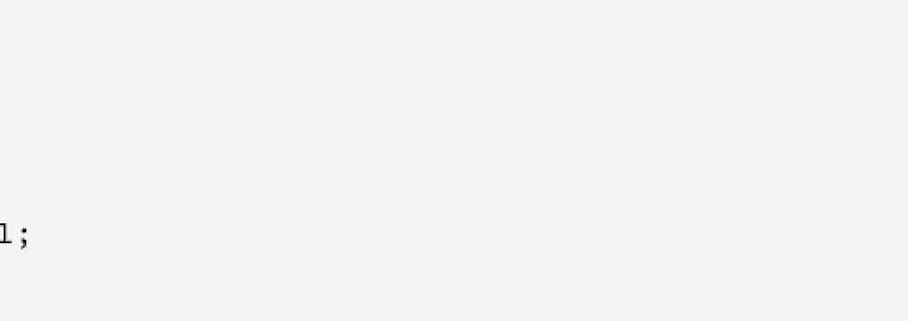

# C++ 指针和引用：C++ 学习第五步


UPP Ray

FUCODING

Gordon Ray

### C++ 中的指针和引用


Din Asotic

### C++ 中的指针和引用


第一版

本书由 Reedsy 专业排版

了解更多信息请访问 [reedsy.com](https://reedsy.com)


- 指针和引用的介绍
- 指针声明
- 指针解引用
- 指针算术
- 空指针
- 指针和数组
- 指针的指针
- 引用
- 引用初始化
- 引用和函数参数
- 指针 vs. 引用
- 指向常量的指针
- 常量指针
- 指向常量的指针 vs. 常量指针
- 指针作为函数返回值
- 引用作为函数返回值
- 指针和动态内存分配
- 引用和函数重载
- 指向函数的指针
- 指向成员变量的指针
- 指向成员函数的指针
- 指向成员函数与多态
- 指向函数与回调
- 指针和数组的动态内存分配
- 结构体中的指针和引用
- 类中的指针和引用
- 函数重写中的指针和引用
- 指向常量成员变量的指针
- 指向成员变量的常量指针
- 指向常量成员函数的指针
- 指向成员函数的常量指针
- 继承中的指针和引用
- 指针和引用类型转换
- 模板中的指针和引用
- 指向常量 Lambda 的指针
- 指向常量 Lambda 的引用
- Lambda 捕获中的指向成员变量的指针
- Lambda 捕获中的指向成员变量的引用
- Lambda 捕获中的指向成员函数的指针
- Lambda 捕获中的指向成员函数的引用
- 函数重载中的指向成员变量的指针和 Lambda
- 函数重载中的指向成员函数的指针和 Lambda
- 函数重载中的指向成员变量的指针和引用
- 函数重载中的指向成员函数的指针和引用
- 异常处理中的指针和引用
- 指向函数与变长参数列表
- 指向函数与变长参数列表的引用
- 指向成员函数与变长参数列表
- 指向成员函数与变长参数列表的引用
- 多线程中的指针和引用
- 智能指针中的指针和引用
- 智能指针中的指向成员变量的指针和 Lambda
- 智能指针中的指向成员变量的引用和 Lambda
- 智能指针中的指向成员函数的指针和 Lambda
- 异常处理中的指向函数的指针
- 异常处理中的指向函数的引用

---

## 指针和引用的介绍

编程世界涉及数据的管理——创建、转换和移动数据。为了高效地完成这些工作，程序员经常需要直接处理内存。这就是指针和引用等概念发挥作用的地方。它们是许多编程语言的基础，特别是那些允许低级内存管理的语言，如 C++。虽然对于初学者来说这个概念可能令人望而生畏，但指针和引用是强大的工具，能够实现高效灵活的编程。

### 什么是指针？

指针是一个变量，它保存另一个变量的内存地址。指针指向内存中实际数据存储的位置。指针的强大之处在于能够直接操作内存。

考虑一下宝藏地图的物理类比。地图（指针）并不持有宝藏（数据）；相反，它持有关于宝藏所在位置的信息（地址）。通过遵循地图上的指示，你可以找到宝藏。

### 什么是引用？

引用是一个别名，或已存在变量的另一个名称。一旦引用用一个变量初始化，就可以使用变量名或引用名来引用该变量。

回到物理类比，如果宝藏有两个名字（例如“埃尔多拉多的失落黄金”和“沉没的战利品”），这两个名字都指向同一个宝藏。它们是对同一底层实体的不同标识符。

### 编程中理解指针和引用

指针和引用在编程中出于以下几个原因使用：

- 1. 实现动态数据结构：指针提供了一种构建复杂数据结构（如链表、树和图）的方法。这些结构中的每个节点都包含一个指向下一个节点的指针。
- 2. 节省内存和计算资源：有时传递指向大量数据（如数组或大型对象）的指针比复制整个数据更高效。这是函数调用中指针的常见用途。
- 3. 直接操作对象：指针允许直接修改内存，可用于在没有直接访问变量的情况下更改变量和数据。
- 4. 实现面向对象编程（OOP）中的多态行为：引用和指针用于在处理继承时实现多态。

### C++ 中的指针和引用

C++ 是一种大量使用指针和引用的语言。理解它们对于有效的 C++ 编程至关重要。

### C++ 中的指针

在 C++ 中，指针是通过在指针变量名之前使用星号 (*) 运算符来声明的。指针的类型必须与指针指向的变量类型相同。例如，对于整数变量，我们声明一个整数指针。

```cpp
int *pointer_to_int; // declares a pointer to an integer
```

虽然指针和引用的语法和概念最初可能看起来令人困惑，但通过练习，它们会变得自然而然。它们是内存管理、优化性能以及提供灵活数据操作方式的强大工具。请记住，指针保存一个地址，它们指向的变量可以被更改；引用是变量的第二个名称，并且永久绑定到该变量。理解这些概念是掌握编程，特别是 C++ 等语言的重要一步。

---

## 指针声明

以下是 C++ 中演示指针变量声明和初始化的示例程序：

```cpp
#include <iostream>

int main() {
    int number = 10; // Integer variable
    int* pointer;    // Pointer variable declaration

    pointer = &number; // Assigning address of 'number' to the pointer

    std::cout << "Value of number: " << number << std::endl;
    std::cout << "Address of number: " << &number << std::endl;
    std::cout << "Value of pointer: " << pointer << std::endl;
    std::cout << "Value pointed by pointer: " << *pointer << std::endl;

    return 0;
}
```

在此程序中，我们声明了一个整数变量 number 和一个指针变量 pointer。指针变量 pointer 使用星号 (*) 符号声明，表示它将存储一个整数变量的内存地址。

要将 number 变量的地址分配给指针，我们使用取地址运算符（&）。表达式 &number 获取 number 变量的内存地址，并将此地址使用赋值运算符（=）分配给指针。

程序随后打印 number 变量的值和地址，以及指针中存储的值和它指向的值。行 *pointer 中的指针前面的星号 (*) 是解引用运算符，用于访问指针指向的值。

C++ 中的指针是存储内存地址的变量。它们允许你间接访问和操作内存中存储的数据。当你声明一个指针变量时，你需要通过使用适当的类型说明符（例如 int* 表示整数指针）来指定它将指向的数据类型。

要将变量的地址分配给指针，你使用取地址运算符（&）后跟变量名。结果值是变量的内存地址，可以使用赋值运算符（=）存储在指针中。

通过解引用指针（使用星号 (*) 运算符），你可以访问指针指向的内存地址中存储的值。这允许你间接读取或修改该值。

在提供的示例中，*pointer 通过指针间接给出 number 变量的值。

请注意在使用指针时要小心，因为不当使用可能导致内存错误或未定义行为。


## 指针解引用

下面是一个用 C++ 编写的示例程序，演示了指针解引用：

```cpp
#include <iostream>

int main() {
    int number = 42;
    int* pointer = &number; // pointer holds the memory address of 'number'

    std::cout << "Value of 'number': " << number << std::endl;
    std::cout << "Value stored at the memory address held by 'pointer': " << *pointer << std::endl;

    return 0;
}
```

在这个程序中，我们有一个名为 `number` 的整型变量，其初始值为 42。我们还声明了一个名为 `pointer`、类型为 `int*` 的指针，这意味着它可以存储一个整型变量的内存地址。

要将 `number` 的内存地址赋给 `pointer`，我们使用与号（`&`）运算符，后跟变量名（`&number`）。此操作被称为“获取 number 的地址”。现在，`pointer` 中包含了 `number` 所存储的内存地址。

要访问 `pointer` 所持有的内存地址处存储的值，我们使用解引用运算符（`*`）。在 `cout` 语句中，`*pointer` 用于检索该内存位置的值并将其打印出来。它本质上是在“跟随”指针找到内存中实际存储的值。

程序的输出将是：

```
Value of 'number': 42
Value stored at the memory address held by 'pointer': 42
```

解引用运算符（`*`）在访问存储在内存地址中的值方面起着至关重要的作用。它允许我们利用指针中存储的地址从内存中检索值。如果没有解引用运算符，我们只能获得内存地址本身，而不是存储在该地址中的值。解引用指针实际上就是“指向”它所引用的值，从而使我们能够操作和交互内存中存储的实际数据。

## 指针算术

下面是一个用 C++ 编写的示例程序，演示了对指针变量进行的算术运算：

```cpp
#include <iostream>

int main() {
    int numbers[] = {1, 2, 3, 4, 5};
    int* ptr = numbers;  // Pointer to the first element of the array

    // Increment the pointer and access the next element
    ptr++;  // Moves the pointer to the next integer in the array
    std::cout << "Next element: " << *ptr << std::endl;

    // Decrement the pointer and access the previous element
    ptr--;  // Moves the pointer back to the previous integer in the array
    std::cout << "Previous element: " << *ptr << std::endl;

    // Perform arithmetic operations on the pointer
    ptr += 2;  // Moves the pointer two positions forward
    std::cout << "Element at index 2: " << *ptr << std::endl;

    ptr -= 1;  // Moves the pointer one position back
    std::cout << "Element at index 1: " << *ptr << std::endl;

    return 0;
}
```

在上述程序中，我们有一个名为 `numbers` 的整型数组，并声明了一个指针 `ptr`，它指向数组的第一个元素。

要递增指针，我们使用 `++` 运算符。这会根据所指向数据类型的大小，将指针移动到下一个元素。在本例中，由于 `ptr` 是 `int*` 类型，递增它会将指针移动到数组中的下一个整数。

要递减指针，我们使用 `--` 运算符。这会根据所指向数据类型的大小，将指针移动到前一个元素。同样，由于 `ptr` 是 `int*` 类型，递减它会将指针移回数组中的前一个整数。

指针算术基于所指向数据类型的大小，因为这允许编译器正确计算指针在递增或递减后应指向的内存地址。当你递增或递减指针时，编译器会自动考虑指针所指向的数据类型的大小。这确保了指针移动到正确的内存位置。

在示例程序中，我们使用指针算术来访问数组的不同元素，方法是根据 `int` 的大小（通常为 4 字节）向前或向后移动指针。你可以看到指针如何递增或递减 1 个或多个位置，以访问数组中的不同元素。

注意：在执行指针算术时，务必小心谨慎，避免访问数组有效范围之外的内存，因为这可能导致未定义行为甚至程序崩溃。

## 空指针

下面是一个用 C++ 编写的示例程序，它向指针变量赋空值并检查其是否为空：

```cpp
#include <iostream>

int main() {
    int* ptr = nullptr;  // Assigning null value to the pointer

    if (ptr == nullptr) {
        std::cout << "Pointer is null." << std::endl;
    } else {
        std::cout << "Pointer is not null." << std::endl;
    }

    return 0;
}
```

在这个程序中，我们声明了一个类型为 `int*` 的指针变量 `ptr`。我们将其初始化为 `nullptr`，这是 C++ 中用于表示空指针的关键字。空指针是指不指向任何有效内存地址的指针。

为了检查是否为空，我们使用 `if` 语句将指针 `ptr` 与 `nullptr` 进行比较。如果两个值相等，则说明指针为空，我们打印信息“Pointer is null.”。否则，如果指针不为空，我们打印信息“Pointer is not null.”。

空指针的概念非常重要，因为它允许我们表示不存在有效内存地址的情况。这是一种指示指针当前不指向任何有效对象或内存位置的方式。空指针在编程中常用于处理指针可能未被分配有效地址的情况，或用于表示数据结构的结束（例如，以空字符结尾的字符串）。

通过检查空值，我们可以避免对空指针进行解引用，因为这可能导致段错误或崩溃等运行时错误。在尝试使用指针访问内存或操作数据之前，检查指针是否为空是一种良好的实践。

## 指针与数组

下面是一个用 C++ 编写的示例程序，演示了使用指针访问数组元素：

```cpp
#include <iostream>

int main() {
    int arr[] = {1, 2, 3, 4, 5};
    int* ptr = arr; // Pointer initialized to the start of the array

    // Accessing array elements using pointer
    std::cout << "Array elements: ";
    for (int i = 0; i < 5; i++) {
        std::cout << *ptr << " "; // Dereference the pointer to get the value
        ptr++; // Increment the pointer to access the next element
    }

    std::cout << std::endl;

    return 0;
}
```

在这个程序中，我们有一个包含整数的数组 `arr`。我们声明了一个指针 `ptr`，并将其初始化为数组第一个元素（`arr`）的地址。这是因为当数组被赋值给指针时，它会退化为指向其第一个元素的指针。因此，`ptr` 实际上指向 `arr[0]` 的内存位置。

然后我们使用指针 `ptr` 访问数组的元素。在 `for` 循环内部，我们使用 `*` 运算符解引用指针，以获取其指向的内存位置处的值。在每次迭代中，我们打印该值，然后使用 `ptr++` 递增指针，使其指向数组的下一个元素。

通过利用指针算术，我们可以遍历和操作数组元素。指针算术允许我们对指针执行算术运算，例如使其递增或递减一定数量的元素。在上面的示例中，我们使用 `ptr++` 将指针移动到下一个元素。

需要注意的是，当对数组使用指针算术时，我们需要确保始终保持在数组的边界内，以避免访问无效的内存位置。否则，可能导致未定义行为或段错误。

指针算术还使我们能够高效地对数组执行各种操作，如排序、搜索或修改元素，而无需显式使用数组索引。

## 指向指针的指针

下面是一个用 C++ 编写的示例程序，演示了指向指针的指针的用法：

```cpp
#include <iostream>

int main() {
    int value = 42;
    int* ptr = &value;             // Pointer to an integer
    int** ptrToPtr = &ptr;         // Pointer to a pointer

    std::cout << "Value: " << value << std::endl;
    std::cout << "Pointer: " << *ptr << std::endl;
    std::cout << "Pointer to Pointer: " << **ptrToPtr << std::endl;

    return 0;
}
```

在上述代码中，我们声明了一个值为 42 的变量 `value`。然后声明了一个指向 `value` 内存位置的指针 `ptr`。接下来，我们声明了一个指向指针的指针 `ptrToPtr`，并将 `ptr` 的地址赋给它。要声明一个指向指针的指针，只需在指针变量名之前多加一个星号（`*`）。在


在这种情况下，`int**` 表示一个指向 `int*` 的指针。

要解引用指向指针的指针，需要使用两次解引用运算符（`*`）。在代码中，`**ptrToPtr` 解引用指向指针的指针，并获取 `value` 的值。

指向指针的指针的应用，如动态内存分配，包括需要为多维数组分配内存，或为链表、树等数据结构动态分配内存的场景。指向指针的指针允许你创建一层间接寻址，使你能够操作原始指针并访问其指向的底层数据。

例如，在动态内存分配中，可以使用指向指针的指针来动态分配一个二维数组：

```cpp
int rows = 3;
int cols = 4;

// 为二维数组动态分配内存
int** array2D = new int*[rows];
for (int i = 0; i < rows; i++) {
    array2D[i] = new int[cols];
}

// 访问并修改数组的元素
array2D[1][2] = 5;

// 释放内存
for (int i = 0; i < rows; i++) {
    delete[] array2D[i];
}
delete[] array2D;
```

在上面的代码中，`array2D` 是一个指向指针的指针。我们动态分配内存，创建一个具有 `rows` 行和 `cols` 列的二维数组。通过使用指向指针的指针，我们可以使用索引语法 `array2D[row][col]` 访问和修改数组的各个元素。最后，我们释放动态分配的内存以防止内存泄漏。

指向指针的指针提供了一种灵活的方式来管理和操作复杂的数据结构，并根据运行时需求动态分配内存。

## 引用

下面是一个 C++ 示例程序，演示了引用变量的使用：

```cpp
#include <iostream>

int main() {
    int original = 42;
    int& ref = original;

    std::cout << "Original value: " << original << std::endl;
    std::cout << "Reference value: " << ref << std::endl;

    ref = 100;  // 修改引用也会修改原始变量

    std::cout << "Modified value: " << original << std::endl;
    std::cout << "Reference value: " << ref << std::endl;

    return 0;
}
```

在这个程序中，我们声明了一个名为 `original` 的整数变量，并将其初始化为 42。然后我们声明了一个名为 `ref` 的引用变量，使用 `&` 符号将其绑定到 `original`。声明语句 `int& ref = original;` 创建了对 `original` 的引用，使 `ref` 成为 `original` 的别名。

当我们修改引用 `ref` 时，等同于修改原始变量 `original`。在上面的示例中，我们将 100 赋值给 `ref`，因此 `original` 也变成了 100。这是因为引用 `ref` 和原始变量 `original` 指向相同的内存位置。

引用提供了访问变量的另一种语法，因为它们的表现类似于原始变量的别名。对引用执行的任何操作都会直接反映在原始变量上，反之亦然。这允许我们在不显式解引用的情况下，用引用变量代替原始变量。

在希望将变量按引用传递给函数，以便在函数作用域内修改原始变量的场景中，使用引用尤其有用。

总的来说，引用提供了一种方便且简洁的方式来处理变量，避免了显式指针解引用的需要，并提供了一种访问和修改值的替代语法。

## 引用初始化

在 C++ 中，引用必须在声明时初始化，并且不能重新赋值以引用另一个变量。下面是一个演示引用初始化的示例程序：

```cpp
#include <iostream>

int main() {
    int num1 = 5;
    int num2 = 10;

    int& ref = num1; // 用 'num1' 初始化引用变量 'ref'

    std::cout << "num1: " << num1 << std::endl; // 输出：5
    std::cout << "num2: " << num2 << std::endl; // 输出：10
    std::cout << "ref: " << ref << std::endl;   // 输出：5

    // 尝试将引用重新赋值给另一个变量
    // 这将导致编译错误
    // ref = num2; // 取消注释此行将导致编译错误
```

```cpp
return 0;
}
```

在上述程序中，我们有两个整数变量 `num1` 和 `num2`。我们声明了一个引用变量 `ref`，并使用语法 `int& ref = num1;` 用 `num1` 的值对其进行初始化。

初始化之后，引用 `ref` 与 `num1` 指向相同的内存位置，对 `ref` 所做的任何更改也会影响 `num1` 的值。这意味着 `ref` 充当 `num1` 的别名。

尝试将引用 `ref` 重新赋值给另一个变量（如 `num2`）将导致编译错误，因为引用在初始化后不能重新赋值。一旦引用被初始化，它将在其整个生命周期内保持绑定到同一个对象。因此，示例中注释掉了 `ref = num2;` 这一行，以避免编译错误。

通过在声明时强制执行引用初始化，C++ 确保引用始终具有有效且一致的值，防止意外的重新赋值，并提供更安全的编程体验。

## 引用与函数参数

下面是一个 C++ 示例程序，演示了引用作为函数参数的用法：

```cpp
#include <iostream>

// 使用引用参数修改变量值的函数
void modifyValue(int& num) {
    num += 10;
}

int main() {
    int number = 5;

    std::cout << "Original value: " << number << std::endl;

    modifyValue(number); // 按引用传递 'number'

    std::cout << "Modified value: " << number << std::endl;

    return 0;
}
```

在这个程序中，我们定义了一个名为 `modifyValue` 的函数，它接受一个整数引用参数。该函数将参数的值增加 10。在 `main` 函数中，我们声明了一个初始值为 5 的整数变量 `number`。然后我们调用 `modifyValue` 函数，将 `number` 作为参数传入。

程序的输出将是：

```
Original value: 5
Modified value: 15
```

### 在 C++ 中按引用传递变量的优点：
- 1. 修改原始变量：当变量按引用传递给函数时，函数内对该变量所做的任何修改都会直接影响调用代码中的原始变量。在上面的示例中，`modifyValue` 函数修改了原始变量 `number`，我们可以在 `main` 函数中看到这些更改。
- 2. 效率：当按值传递大型对象或结构时，会复制整个对象，这在内存使用和性能方面可能效率较低。然而，按引用传递避免了这种开销，因为只传递对象的引用，而不是创建新的副本。
- 3. 避免不必要的对象复制：某些对象可能无法复制，例如由于没有拷贝构造函数或复制操作代价昂贵。通过按引用传递此类对象，我们可以完全避免复制的需要。
- 4. 多个返回值或输出值：函数只能返回一个值，但通过按引用传递变量，我们可以有效地在单个函数调用中返回多个值或修改多个变量。

5. **与调用代码的一致性：** 通过按引用传递变量，调用代码不需要改变其变量访问语法。这可以使代码更具可读性和可维护性，尤其是在处理复杂的数据结构时。

将引用用作函数参数提供了一种在 C++ 中传递变量和对象的强大机制，提供了灵活性、效率以及修改原始变量的能力。

## 指针与引用的对比

下面是一个演示 C++ 中指针和引用之间区别的程序：

```cpp
#include <iostream>

void manipulateValue(int* ptr, int& ref) {
    (*ptr)++;    // 递增 ptr 指向的值
    ref++;       // 递增 ref 引用的值
}

int main() {
    int value = 5;
    int* ptr = &value;  // 指向 value 的指针
    int& ref = value;   // 对 value 的引用

    // 打印初始值
    std::cout << "Initial value: " << value << std::endl;
    std::cout << "Pointer value: " << *ptr << std::endl;
    std::cout << "Reference value: " << ref << std::endl;

    // 修改值
```


```
manipulateValue(ptr, ref);

// Print modified values
std::cout << "Modified value: " << value << std::endl;
std::cout << "Modified pointer value: " << *ptr << std::endl;
std::cout << "Modified reference value: " << ref << std::endl;

return 0;
}
```

现在，让我们讨论 C++ 中指针和引用的相似之处和不同之处：

## Memory Usage:
- Pointers: Pointers hold memory addresses as their values. They require additional memory to store the address they are pointing to.
- References: References are aliases for variables. They do not occupy additional memory because they refer directly to the object they are referencing.

## Syntax:
- Pointers: Pointers are declared using the asterisk (*) symbol. They need to be dereferenced using the asterisk symbol to access the value they are pointing to.
- References: References are declared using the ampersand (&) symbol. They do not require any special syntax to access the value they refer to.

## Behavior:
- **Pointers:** Pointers can be reassigned to point to different objects or be set to a null value (`nullptr`). They can also be used for pointer arithmetic.
- **References:** References cannot be reseated to refer to a different object once initialized. They must be initialized with an object and cannot be null. References do not support pointer arithmetic.

## Nullability:
- **Pointers:** Pointers can be null, which means they do not point to any valid object.
- **References:** References cannot be null and must be initialized with a valid object.

## Initialization:
- **Pointers:** Pointers can be declared without initialization or be initialized later. They can be assigned to the address of an existing object using the address-of operator (`&`) or by using the `new` keyword to dynamically allocate memory.
- **References:** References must be initialized at the time of declaration. They cannot be assigned to a different object after initialization.

## Function Parameters:
- **Pointers:** Pointers can be passed as function parameters to allow modification of the original object or to achieve pass-by-reference semantics.
- **References:** References can also be passed as function parameters to achieve pass-by-reference semantics. They provide a more intuitive syntax and avoid the need for pointer dereferencing.

在提供的示例中，`manipulateValue` 函数同时接受指针和引用作为参数。它递增它们所指向/引用的值。调用函数后，你可以观察到指针和引用都修改了原始的 value 变量。

## Pointer to Constant

下面是一个 C++ 程序，演示了指向常量的指针的概念以及它如何强制只读访问：

```
#include <iostream>

int main() {
    int value = 5;
    const int* ptr = &value;  // Pointer to a constant integer

    std::cout << "Value: " << *ptr << std::endl;

    // Attempting to modify the value pointed by the pointer
    *ptr = 10;  // Compilation error: assignment of read-only location

    return 0;
}
```

在这个程序中，我们声明一个整型变量 value 并将其初始化为 5。然后，我们声明一个类型为“指向常量整型的指针”的指针 ptr，使用 const 关键字。指针声明中的 const 关键字

表示不能通过该指针修改指针所指向的值。

当我们尝试使用 `*ptr = 10` 赋值来修改值时，程序无法编译。它会生成一个编译错误，提示“assignment of read-only location”。此错误发生的原因是指针 ptr 指向一个常量值，尝试修改常量值违反了指针强制的只读访问。

指向常量的指针提供了一种机制来强制对它所指向的数据进行只读访问。它确保不能使用该指针修改指针所指向的值。这在你想将数据传递给函数或在代码的多个部分共享数据，同时确保其保持不变的场景中很有用。

通过将指针声明为 `const int*`，你向编译器做出承诺，不会通过该指针修改值。这允许编译器执行额外的优化并保证常量数据的完整性。

## Constant Pointer

下面是一个 C++ 示例程序，声明了一个常量指针并尝试修改它所指向的内存地址：

```
#include <iostream>

int main() {
    int number = 5;
    int* const ptr = &number;  // Declare a constant pointer and initialize it with the address of 'number'

    std::cout << "Value of number: " << *ptr << std::endl;
    std::cout << "Memory address stored in ptr: " << ptr << std::endl;

    // Attempt to modify the memory address stored in ptr
    // Uncommenting the line below will cause a compilation error
    // ptr = nullptr;

    // Modify the value stored at the memory address pointed by ptr
    *ptr = 10;
}
```
```cpp
std::cout << "Modified value of number: " << *ptr << std::endl;

return 0;
}
```

在这个程序中，我们使用 int* const 语法声明了一个名为 ptr 的常量指针。这意味着 ptr 是一个指向整数的指针 int*，并且是常量 const。它使用 & 运算符初始化为变量 number 的内存地址。

常量指针 ptr 强制使用固定的内存位置，因为一旦初始化，就不能修改它以指向不同的内存地址。此限制由 const 限定符强制执行。

在程序中，如果你取消注释行 ptr = nullptr;，你会遇到编译错误，因为这是尝试修改常量指针 ptr 的值。然而，你仍然可以使用解引用运算符 * 修改 ptr 所指向的内存地址处存储的值。在示例中，我们通过赋值 *ptr = 10; 修改了 number 的值。这是可以的，因为常量指针 ptr 只强制固定的内存位置，而不是该位置存储的值。

运行程序时，你会看到 number 的值已通过常量指针 ptr 成功修改。

## Pointer to Constant vs. Constant Pointer

下面是一个 C++ 程序，演示了指向常量的指针和常量指针之间的区别：

```
#include <iostream>

int main() {
    int value = 10;
    int anotherValue = 20;

    // Pointer to a constant
    const int* ptrToConst = &value;
    std::cout << "Pointer to a constant:" << std::endl;
    std::cout << "Memory Address: " << ptrToConst << std::endl;
    std::cout << "Pointed Value: " << *ptrToConst << std::endl;

    // Uncomment the line below to see the compilation error
    // *ptrToConst = 5; // Error: Assignment of read-only location

    // Constant pointer
    int* const constPtr = &value;
    std::cout << "\nConstant pointer:" << std::endl;
```
```
std::cout << "Memory Address: " << constPtr << std::endl;
std::cout << "Pointed Value: " << *constPtr << std::endl;

// Uncomment the line below to see the compilation error
// constPtr = &anotherValue; // Error: Assignment of read-only variable

return 0;
}
```

## Explanation:
- 1. Pointer to a constant (const int* ptrToConst): This means that the value being pointed to is constant and cannot be modified through the pointer. The pointer itself is not constant and can be reassigned to point to different memory addresses. In the example, ptrToConst points to the memory address of value. The pointed value can be accessed but not modified through this pointer. If you uncomment the assignment *ptrToConst = 5;, it will result in a compilation error because it attempts to modify the value.
- 2. Constant pointer (int* const constPtr): This means that the pointer itself is constant and cannot be reassigned to point to a different memory address. However, the value being pointed to can be modified. In the example, constPtr is a constant pointer that points to the memory address of value. The pointed value can be accessed and modified through this pointer. If you uncomment the assignment constPtr = &anotherValue;, it will result in a compilation error because it attempts to reassign the constant pointer.

In summary, a pointer to a constant allows you to modify the pointer itself but not the pointed value, while a constant pointer allows you to modify the pointed value but not the pointer itself.


## 指针作为函数返回值

下面是一个 C++ 示例程序，演示了如何定义一个返回指针的函数，并解释了在函数内声明、初始化和返回指针的过程：

```cpp
#include <iostream>

// Function that returns a pointer to an integer
int* createIntegerPointer()
{
    // Declare a pointer variable
    int* ptr;

    // Allocate memory for an integer using the 'new' keyword
    ptr = new int;

    // Initialize the value of the integer
    *ptr = 42;

    // Return the pointer to the caller
    return ptr;
}
```

指针存储在 myPointer 变量中。我们可以通过使用 `*` 运算符解引用指针来访问整数的值。

使用完指针后，务必释放内存以避免内存泄漏。在这种情况下，我们使用 `delete` 关键字释放通过 `new` 分配的内存。

请记住，使用指针时，正确管理内存以避免内存泄漏和未定义行为至关重要。

## 引用作为函数返回值

在 C++ 中，可以通过将函数的返回类型指定为引用类型来定义一个返回引用的函数。下面是一个演示此操作的示例程序：

```cpp
#include <iostream>

int& increment(int& num) {
    num++;
    return num;
}

int main() {
    int value = 5;
    std::cout << "Initial value: " << value << std::endl;

    int& result = increment(value);
    std::cout << "After increment: " << result << std::endl;

    result = 10;
    std::cout << "Modified value: " << value << std::endl;

    return 0;
}
```

在此程序中，`increment` 函数接受一个整数引用作为参数，并将其加一。`increment` 函数的返回类型为 `int&`，表示它返回一个整数的引用。

在 `increment` 函数内部，参数 `num` 被修改，然后通过 `return` 语句返回。返回的引用指向作为参数传入的同一个对象。

在 `main` 函数中，我们声明了一个整数变量 `value`，并将其初始化为 5。然后，我们调用 `increment` 函数，将 `value` 作为参数传入。返回的引用被赋值给 `result` 变量。

我们可以观察到，修改 `result` 也会修改 `value`。这是因为 `result` 是 `value` 的引用，因此通过 `result` 所做的任何更改都会反映在原始对象中。

从函数返回引用的影响如下：

- 1. **避免不必要的复制：** 返回引用可以避免复制被返回的对象。这可以提高效率，尤其是在处理大型对象或需要修改原始对象时。
- 2. **支持函数链式调用：** 返回引用支持函数链式调用，即可以在单个表达式中对同一个对象进行多次函数调用。例如，如果 `increment` 返回一个引用，则 `increment(a).increment(b)` 是可行的。
- 3. **生命周期管理：** 返回引用假设被引用的对象在函数作用域之外仍然有效。确保正确管理对象的生命周期以防止访问无效内存至关重要。例如，返回对局部变量的引用将导致未定义行为。
- 4. **潜在别名问题：** 返回引用可能会引入别名（aliasing）的可能性，即多个引用指向同一个对象。务必谨慎处理别名，以避免意外的副作用并确保行为的正确性。

从函数返回引用时，必须考虑这些影响，并谨慎使用引用，以保持代码的正确性和可读性。

## 指针与动态内存分配

下面是一个 C++ 示例程序，演示了使用 `new` 关键字进行动态内存分配以及通过指针访问所分配内存的过程：

```cpp
#include <iostream>

int main() {
    // Dynamically allocate memory for an integer
    int* dynamicInt = new int;

    // Assign a value to the allocated memory
    *dynamicInt = 42;

    // Access the allocated memory through the pointer
    std::cout << "Value: " << *dynamicInt << std::endl;

    // Deallocate the memory
    delete dynamicInt;

    return 0;
}
```

在此程序中，我们使用 `new` 关键字为整数动态分配内存，并将内存地址赋给指针变量 `dynamicInt`。然后，我们通过使用 `*` 运算符解引用指针，将值 42 赋给所分配的内存。

为了释放动态分配的内存，我们使用 `delete` 关键字，后跟指针变量（`delete dynamicInt`）。这会释放先前分配的内存，并确保它可以被系统重新使用。

当动态分配的内存未被正确释放时，就会发生内存泄漏。如果你忘记使用 `delete` 释放内存，或者在未释放内存的情况下丢失了所有对已分配内存的引用，就可能导致内存泄漏。内存泄漏会导致内存使用效率低下，并可能使程序随着时间的推移消耗越来越多的内存，最终导致程序崩溃或内存耗尽。

正确的释放操作要求确保每一个 `new` 都有对应的 `delete`。当内存不再需要时，及时释放内存以防止内存泄漏非常重要。在更复杂的程序中，良好的做法是尽快释放不再需要的内存，而不是等到程序结束。这有助于避免累积不必要的内存使用。

值得注意的是，C++ 还提供了其他内存管理技术，例如智能指针（如 `std::unique_ptr`、`std::shared_ptr`），它们可以自动处理内存释放，从而降低内存泄漏的可能性。在可能的情况下，通常推荐使用智能指针，而不是原始指针和手动内存管理。

## 引用与函数重载

下面是一个 C++ 示例程序，演示了使用引用作为参数进行函数重载：

```cpp
#include <iostream>

// Function overload for integers
void printValue(int& value) {
    std::cout << "Integer value: " << value << std::endl;
}

// Function overload for floats
void printValue(float& value) {
    std::cout << "Float value: " << value << std::endl;
}

// Function overload for strings
void printValue(std::string& value) {
    std::cout << "String value: " << value << std::endl;
}

int main() {
    int intValue = 10;
    float floatValue = 3.14;
    std::string stringValue = "Hello, World!";

    printValue(intValue);
    printValue(floatValue);
    printValue(stringValue);

    return 0;
}
```

在此程序中，我们有三个名为 `printValue` 的重载函数，它们将引用作为参数。每个函数负责打印特定数据类型的值。

当使用特定类型的参数调用 `printValue` 函数时，编译器会根据参数的类型将函数调用匹配到相应的重载函数。引用为编译器提供了一种区分不同数据类型的方式。

在 `main` 函数中，我们声明了变量 `intValue`、`floatValue` 和 `stringValue`，它们的类型分别为 `int`、`float` 和 `std::string`。然后，我们分别将这三个变量作为参数调用 `printValue` 函数。

由于每个函数重载都将引用作为参数，因此引用允许重载函数接收实际的变量作为参数。这使得函数可以直接操作原始变量，而不是创建副本，对于大型数据类型来说这更高效。

当程序执行时，每个 `printValue` 函数重载都会以相应的参数类型被调用，并将相应的值打印到控制台。

输出：


```text
Integer value: 10
Float value: 3.14
String value: Hello, World!
```

通过将引用作为参数，重载的函数可以区分不同的数据类型，并为每种类型提供专门的行为，从而提供灵活性和代码可重用性。

## Pointers to Functions

在 C++ 中，你可以声明和使用指向函数的指针。这允许你存储函数的地址并通过指针间接调用它。下面是一个演示此功能的示例程序：

```cpp
#include <iostream>

// Function declaration
int Add(int a, int b)
{
    return a + b;
}

int Subtract(int a, int b)
{
    return a - b;
}

int main()
{
    // Declare a pointer to a function that takes two int parameters and returns an int
    int (*pFunc)(int, int);

    // Initialize the pointer with the address of the Add function
    pFunc = Add;

    // Call the function through the pointer
    int result = pFunc(5, 3);
    std::cout << "Result: " << result << std::endl;

    // Change the pointer to point to the Subtract function
    pFunc = Subtract;

    // Call the function through the pointer again
    result = pFunc(5, 3);
    std::cout << "Result: " << result << std::endl;

    return 0;
}
```

在该程序中，我们使用语法 `return_type (*pointer_name)(parameter_types)` 声明指向函数的指针。在此例中，返回类型为 int，函数接受两个 int 参数。

要初始化指针，我们将其赋值为函数的地址。例如，`pFunc = Add;` 将 Add 函数的地址赋给指针 pFunc。这使得 pFunc 指向 Add 函数。

要通过指针调用函数，我们只需使用指针名称后跟括号并提供必要的参数即可。例如，`result = pFunc(5, 3);` 调用 pFunc 指向的函数，参数为 5 和 3，并将结果赋给 result 变量。

在示例中，我们首先通过指针调用 Add 函数执行加法，然后将指针改为指向 Subtract 函数。我们通过指针调用 Subtract 函数执行减法，并再次获得结果。

请注意，函数指针可用于实现动态分派，并且在需要根据某些条件或用户选择在运行时选择并调用不同函数的情况下特别有用。

## Pointer to Member Variable

下面是一个演示 C++ 中指向成员变量的指针用法的示例程序：

```cpp
#include <iostream>

class MyClass {
public:
    int myVariable;
};

int main() {
    MyClass obj;
    obj.myVariable = 42;

    int MyClass::*ptr = &MyClass::myVariable;  // Declare a pointer to a member variable

    // Accessing the member variable directly
    std::cout << "Value of myVariable (direct access): " << obj.myVariable << std::endl;

    // Accessing the member variable through the pointer
    std::cout << "Value of myVariable (pointer access): " << obj.*ptr << std::endl;

    // Modifying the member variable through the pointer
    obj.*ptr = 100;

    std::cout << "Modified value of myVariable: " << obj.myVariable << std::endl;

    return 0;
}
```

在该程序中，我们有一个名为 MyClass 的类，其中包含一个公共成员变量 myVariable。在 main() 函数内部，我们创建了一个名为 obj 的 MyClass 实例，并将 myVariable 的值设置为 42。

要声明指向成员变量的指针，我们使用语法 `type_of_member Class::*ptr_name`。在此例中，我们声明 `int MyClass::*ptr`，表示 ptr 是指向 MyClass 类的整数成员变量的指针。

要直接访问成员变量，我们使用对象名 obj 后跟成员变量名 myVariable。这是访问成员变量的常规方式。

要通过指针访问成员变量，我们使用对象名 obj 后跟指针名 ptr 和指针到成员运算符 `.*`。这种语法允许我们通过指针间接访问成员变量。

在程序中，我们演示了直接和通过指针访问及修改成员变量。最后，我们打印 myVariable 的修改后值以验证修改是否成功。

程序的输出为：

```text
Value of myVariable (direct access): 42
Value of myVariable (pointer access): 42
Modified value of myVariable: 100
```

正如你所见，直接访问和通过指针访问产生相同的结果。语法上的区别在于访问成员变量时使用指针到成员运算符 `.*`。

## Pointer to Member Function

下面是一个演示如何在 C++ 中声明和使用指向成员函数的指针的示例程序：

```cpp
#include <iostream>

class MyClass {
public:
    void myFunction() {
        std::cout << "Hello from myFunction!" << std::endl;
    }
};

int main() {
    // Declare a pointer to member function
    void (MyClass::*functionPtr)() = &MyClass::myFunction;

    // Create an instance of MyClass
    MyClass obj;

    // Access member function through the pointer
    (obj.*functionPtr)();

    // Call member function directly
    obj.myFunction();

    return 0;
}
```

在该程序中，我们有一个类 MyClass，其中包含成员函数 myFunction()。

要声明指向成员函数的指针，你需要指定类类型和函数签名。声明指向成员函数的指针的语法如下：

```cpp
return_type (Class::*pointer_name)(arguments);
```

在我们的示例中，我们声明了一个名为 functionPtr 的指针，指向 MyClass 的成员函数，该函数不带参数且返回 void。

要将成员函数的地址赋给指针，你使用 & 运算符后跟类名和函数名：

```cpp
functionPtr = &MyClass::myFunction;
```

要通过指针访问成员函数，你需要使用 `.*` 或 `->*` 运算符。在我们的例子中，由于我们有一个 MyClass 的实例 obj，因此我们使用 `.*` 运算符：

```cpp
(obj.*functionPtr)();
```

当通过指针调用成员函数时需要这种语法，因为它明确指定了应调用该成员函数的对象。

另一方面，直接调用成员函数不需要使用指针，并遵循调用成员函数的常规语法：

```cpp
obj.myFunction();
```

程序的输出为：

```text
Hello from myFunction!
Hello from myFunction!
```

对 myFunction() 的两次调用产生相同的结果，但一次是通过指向成员函数的指针 ((obj.*functionPtr)()) 进行的，另一次是直接调用 (obj.myFunction())。语法上的差异是由于通过指针调用成员函数时需要明确指定对象。

## Pointer to Member Function and Polymorphism

在 C++ 中，你可以使用指向成员函数的指针来实现运行时多态。运行时多态允许你通过基类指针调用派生类成员函数，从而在运行时实现函数的动态绑定。下面是一个演示此概念的示例程序：

```cpp
#include <iostream>

class Base {
public:
    virtual void display() {
        std::cout << "This is the Base class" << std::endl;
    }
};

class Derived : public Base {
public:
    void display() override {
        std::cout << "This is the Derived class" << std::endl;
    }
};

int main() {
    Base baseObj;
    Derived derivedObj;

    Base* ptr = nullptr;

    // Point the base class pointer to the derived class object
    ptr = &derivedObj;

    // Call the display() function using the pointer to achieve polymorphism
    ptr->display();

    return 0;
}
```

在此示例中，我们有一个基类 Base 和一个从 Base 继承的派生类 Derived。display() 函数在基类中声明为 virtual，并在派生类中被重写。

在 main() 函数中，我们创建了基类和派生类的对象。我们还声明了一个类型为 Base 的指针 ptr。

通过将派生类对象 derivedObj 的地址赋给 ptr 指针 (ptr = &derivedObj;)，我们可以实现多态。这是因为 display() 函数在基类中声明为 virtual，允许根据指针在运行时指向的对象的实际类型调用正确的函数。

当我们使用 ptr->display() 调用 display() 函数时，程序将调用派生类的 display() 函数而不是基类的函数，因为指针指向的是派生类对象。

此程序的输出为：

```text
This is the Derived class
```


通过以这种方式使用指向成员函数的指针，我们可以实现运行时多态，并根据基类指针所指向的实际对象类型实现函数的动态绑定。

```
int main()
{
    int value = 42;

    // Pass the callback function as a parameter to performOperation
    performOperation(value, callback);

    return 0;
}
```

在此示例中，我们定义了一个 typedef CallbackFunction，它表示一个指向函数的指针，该函数接受一个整数参数并返回 void。回调函数的实际函数将在回调被调用时被调用。它只是打印作为参数接收到的值。

performOperation 函数接受两个参数：一个整数值和一个 CallbackFunction 指针。它对给定值执行某些操作，然后通过使用指针调用回调函数。在这种情况下，我们将回调作为要调用的回调函数传递。

在 main 函数中，我们定义了一个整数值，并使用该值和回调作为回调参数调用 performOperation。当调用 performOperation 时，它执行其操作，然后调用提供的回调函数，这会导致回调函数以该值为参数被调用。

当你运行此程序时，它将输出：

```
Performing operation with value: 42
Callback function called with value: 42
```

这演示了如何将指向函数的指针作为参数传递给另一个函数，并在接收函数中调用它，从而有效地实现回调机制。

## 指针和数组的动态内存分配

下面是一个 C++ 示例程序，演示了使用 new 关键字为数组进行动态内存分配，并通过指针访问已分配的内存：

```cpp
#include <iostream>

int main() {
    int size;
    std::cout << "Enter the size of the array: ";
    std::cin >> size;

    // Dynamically allocate memory for the array
    int* dynamicArray = new int[size];

    // Access and modify the elements of the array through the pointer
    for (int i = 0; i < size; i++) {
        dynamicArray[i] = i + 1;
    }

    // Print the elements of the array
    std::cout << "Array elements: ";
```

```
for (int i = 0; i < size; i++) {
    std::cout << dynamicArray[i] << " ";
}
std::cout << std::endl;

// Deallocate the dynamically allocated memory
delete[] dynamicArray;

return 0;
}
```

在此程序中，提示用户输入数组的大小。然后使用 new 关键字为整数数组动态分配内存。数组的大小由用户提供。

接下来，使用循环通过指针 dynamicArray 访问和修改数组的元素。在此示例中，我们将数组初始化为从 1 到 size 的值。

之后，再使用另一个循环打印数组的元素。

最后，使用 delete[] 运算符释放数组的动态分配内存。由于我们为数组分配了内存，因此使用 delete[] 而不是 delete，delete[] 可确保数组所有元素的内存都被正确释放。

在处理动态内存分配时，必须牢记以下最佳实践：

- 1. 始终释放动态分配的内存：未能释放内存可能导致内存泄漏，即内存被分配但未被释放，从而导致内存资源浪费。使用 delete 或 delete[] 运算符在不再需要时释放内存。
- 2. 注意内存分配错误：如果可用内存不足，动态内存分配可能会失败。始终检查内存分配是否成功，并在分配失败时优雅地处理，以防止程序意外崩溃。new 运算符在分配失败时会抛出 std::bad_alloc 异常，因此你可以使用异常处理技术来处理这种情况。
- 3. 分配正确数量的内存：确保你分配了足够的内存来容纳打算存储在动态分配数组中的数据。访问超出已分配范围的内存可能导致未定义行为并可能导致程序崩溃。
- 4. 按正确顺序释放内存：如果按特定顺序分配了内存，请确保按相反顺序释放它，以避免内存泄漏或访问已释放的内存。

遵循这些最佳实践，你可以有效地管理动态分配数组时的内存，并最大限度地减少 C++ 程序中与内存相关问题的可能性。

## 结构体中的指针和引用

下面是一个示例程序，演示了 C++ 中结构体内部指针和引用的使用：

```
#include <iostream>
using namespace std;

struct Person {
    string name;
    int age;
    int* height;
    int& weight;
};

int main() {
    int heightVal = 170;
    int weightVal = 65;

    Person person;
    person.name = "John";
    person.age = 30;
    person.height = &heightVal;  // Assign the address of heightVal to the pointer member
```

```
person.weight = weightVal;  // Assign the reference of weightVal to the reference member

cout << "Name: " << person.name << endl;
cout << "Age: " << person.age << endl;
cout << "Height: " << *(person.height) << endl;  // Access the value using the pointer
cout << "Weight: " << person.weight << endl;      // Access the value using the reference

*person.height = 175;  // Modify the value through the pointer
person.weight = 70;    // Modify the value through the reference

cout << "\nAfter modification:" << endl;
cout << "Height: " << *(person.height) << endl;
cout << "Weight: " << person.weight << endl;

return 0;
}
```

在上面的程序中，我们定义了一个名为 Person 的结构体。它有多个成员，包括指针 height 和引用 weight。以下是如何在结构体中声明和访问指针和引用成员的方式：

声明一个结构体，并在其中包含所需的指针和引用成员。例如：

```
struct Person {
    // ...
    int* height;  // Pointer member
    int& weight;  // Reference member
};
```

通过在结构体中使用指针和引用，你可以间接且高效地操作和访问值。指针允许你存储变量的内存地址，而引用提供了一种方便的方式来为现有变量创建别名，而不会引入额外的内存开销。

## 类中的指针和引用

下面是一个示例程序，定义了一个包含指针和引用成员的类，演示了它们的使用，并解释了如何在类中声明和访问它们：

```
#include <iostream>

class MyClass {
private:
    int* pointer;
    int& reference;

public:
    // Constructor
    MyClass(int value) : reference(value) {
        pointer = new int(value);
    }

    // Destructor
    ~MyClass() {
        delete pointer;
    }
}
```

```
void displayValues() {
    std::cout << "Pointer value: " << *pointer << std::endl;
    std::cout << "Reference value: " << reference << std::endl;
}
};

int main() {
    int value = 10;
    MyClass obj(value);

    obj.displayValues();

    value = 20;
    obj.displayValues();

    return 0;
}
```

在此程序中，我们有一个名为 MyClass 的类，它有两个成员变量：pointer 和 reference。

指针成员声明为 int*，这意味着它是指向整数的指针。在 MyClass 的构造函数中，我们使用 new 动态分配内存来存储传递给构造函数的 value。在析构函数中，我们使用 delete 释放动态分配的内存以避免内存泄漏。

引用成员声明为 int&，这意味着它是指向整数的引用。在构造函数初始化列表中，我们将引用绑定到传递给构造函数的 value。请注意，引用必须在声明时初始化，并且之后不能更改为引用另一个对象。

displayValues() 函数只是输出指针和引用成员中存储的值。


```
This is the derived class.
This is the derived class.
```

正如你所见，即使我们使用指向基类的指针和引用，由于函数重写，派生类的函数也会被调用。

## 指向常量成员变量的指针

下面是一个演示 C++ 中指向常量成员变量的指针用法的示例程序：

```cpp
#include <iostream>

class MyClass {
public:
    int myVariable;

    MyClass(int value) : myVariable(value) {}
    int getVariable() const { return myVariable; }
};

int main() {
    MyClass obj(42);
    const MyClass* ptr = &obj;  // Pointer to a constant object

    std::cout << "Value of myVariable: " << ptr->getVariable() << std::endl;

    // Accessing the constant member variable through the pointer
    std::cout << "Accessing constant member variable: " << ptr->myVariable << std::endl;

    // Attempting to modify the constant member variable
    // ptr->myVariable = 10;  // This would result in a compilation error

    return 0;
}
```

在上面的程序中，我们有一个名为 MyClass 的类，其中包含一个成员变量 myVariable。getVariable() 函数返回 myVariable 的值，并声明为 const，以表示它不会修改对象。

在 main() 函数中，我们创建了 MyClass 的一个对象 obj 并用 42 初始化它。然后我们声明一个类型为 const MyClass* 的指针 ptr，即指向 MyClass 常量对象的指针。这意味着我们不能修改 ptr 所指向的对象。

要通过指针访问常量成员变量，我们使用箭头运算符 (->)。在程序中，ptr->myVariable 用于通过指针 ptr 访问 myVariable 的值。

常量的含义是它确保成员变量的值不能通过指向常量的指针进行修改。在示例中，如果取消注释行 ptr->myVariable = 10;，它将导致编译错误，因为你试图修改一个常量成员变量。

使用指向常量成员变量的指针允许你在无法修改它的情况下访问成员变量的值。当你想提供对类某些数据成员的只读访问，确保它们保持不变时，这很有用。

## 指向成员变量的常量指针

下面是一个演示 C++ 中指向成员变量的常量指针用法的示例程序：

```cpp
#include <iostream>

class MyClass {
public:
    int myVariable;
};

int main() {
    MyClass obj;
    obj.myVariable = 42;

    // Declare a constant pointer to a member variable
    const int MyClass::*ptr = &MyClass::myVariable;

    // Access member variable through the constant pointer
    int value = obj.*ptr;

    std::cout << "Value: " << value << std::endl;

    // Attempt to modify the member variable through the constant pointer (error)
    // obj.*ptr = 50;  // This line will cause a compilation error

    return 0;
}
```

在这个程序中，我们定义了一个名为 MyClass 的类，其中只有一个成员变量 myVariable。然后我们声明了 MyClass 的一个对象 obj 并将 myVariable 的值赋为 42。

接下来，我们使用语法 const int MyClass::*ptr 声明一个指向成员变量的常量指针。这里，ptr 是一个常量指针，只能指向类 MyClass 的整数成员变量。

要通过常量指针访问成员变量，我们使用语法 obj.*ptr，它解引用指针并给出 myVariable 的值。

然而，由于指针被声明为 const，任何通过常量指针修改成员变量的尝试，例如 obj.*ptr = 50，都会导致编译错误。这是因为指针的常量性意味着它所指向的成员变量不能被修改。

在此上下文中，常量性的含义是成员变量可以通过常量指针读取但不能修改。这在你想将对成员变量的访问限制为只读操作，同时仍允许通过指针进行间接访问时很有用。它有助于强制不可变性并防止在使用指针时意外修改变量。

```cpp
(obj.*ptr)();  // Call the constant member function through the pointer

// Trying to call a non-constant member function through the same pointer will result in a
compilation error

// ptr = &MyClass::nonConstFunc;  // Compilation error: assigning non-const member function to const
member function pointer

return 0;
}
```

在这个示例中，我们有一个类 MyClass，其中有两个成员函数：nonConstFunc() 和 constFunc()。constFunc() 使用 const 关键字声明为常量成员函数，表示它不会修改对象的状态。nonConstFunc() 是一个非常量成员函数。

在 main() 函数中，我们首先使用 typedef 定义类型 FuncPtr，它表示指向 MyClass 的常量成员函数的指针。然后我们声明一个类型为 FuncPtr 的变量 ptr 并将常量成员函数 constFunc() 的地址赋给它。

要通过指针访问和调用常量成员函数，我们使用 .* 运算符。在这种情况下，obj.*ptr 解引用指针并在 obj 对象上调用常量成员函数。

需要注意的是，指向常量成员函数的指针只能被赋予常量成员函数的地址。尝试将非常量成员函数的地址赋给类型为 FuncPtr 的指针将导致编译错误，确保你不能通过常量成员函数指针意外调用非常量成员函数。

在此上下文中，常量性的含义是常量成员函数只能访问类内的其他常量成员函数和变量，确保它不会修改对象的状态。这提供了调用常量成员函数不会改变对象的数据成员的保证，在不希望进行数据突变的情况下允许安全且可预测的使用。

## 指向成员函数的常量指针

下面是一个演示 C++ 中指向成员函数的常量指针用法的示例程序：

```cpp
#include <iostream>

class MyClass {
public:
    void func() {
        std::cout << "Regular member function." << std::endl;
    }

    void constFunc() const {
        std::cout << "Constant member function." << std::endl;
    }
};

int main() {
    typedef void (MyClass::*MemberFuncPtr)() const;

    MemberFuncPtr ptr = &MyClass::constFunc; // Declare and initialize a constant pointer to a member function

    MyClass obj;
    (obj.*ptr)(); // Access the member function through the constant pointer

    return 0;
}
```

在这个程序中，我们有一个名为 MyClass 的类，它有两个成员函数：func() 和 constFunc()。constFunc() 函数使用 const 关键字声明为常量成员函数，这意味着它承诺不会修改调用它的类对象状态。

要声明指向成员函数的常量指针，我们使用 typedef 关键字。在这种情况下，MemberFuncPtr 被定义为指向一个不带参数、返回 void 且使用 const 关键字声明为常量成员函数的成员函数的指针。

在 main() 函数中，我们创建了一个名为 obj 的 MyClass 实例。然后我们声明并初始化常量指针 ptr，使其指向 constFunc() 成员函数。要通过常量指针访问成员函数，我们使用指针到成员运算符 .* 并使用函数调用语法 (obj.*ptr)() 调用该函数。

指针的常量性的含义是它只能用于访问常量成员函数。它确保通过指针访问的成员函数不会修改调用它的对象状态。这在你想确保在调用特定成员函数时对象状态保持不变的情况下很有用。

如果你尝试将非常量成员函数赋给常量指针或尝试通过常量指针调用非常量成员函数，将会导致编译错误。这有助于强制 const 正确性并防止在使用指向成员函数的常量指针时意外修改对象。

注意：示例中显示的 typedef 方法是在 C++ 中声明指向成员函数指针的传统方式。


在 C++11 及更高版本中，您可以使用 `using` 关键字代替 `typedef`，以提高清晰度和可读性。

# SegFormer：基于 Transformer 的简单高效语义分割设计

Enze Xie, Wenhai Wang, Zhiding Yu, Anima Anandkumar, Jose M. Alvarez, Ping Luo

## 摘要

语义分割是计算机视觉中的一项基础任务。我们提出了 SegFormer，一种简单、高效且强大的语义分割方法，它将 Transformer 与轻量级多层感知机（MLP）解码器统一起来。SegFormer 有两个吸引人的特性：1) 分层设计，无需位置编码即可提取多尺度特征；2) 解耦的编码器-解码器，支持任意分辨率的高效表示。

## 1 引言

语义分割是计算机视觉中长期存在的问题，也是许多应用中的关键组成部分。现有方法通常依赖于基于距离或基于顺序的方法...



```
void displayDerived() {
    cout << "Derived variable: " << derivedVar << endl;
}
};

int main() {
    // Create objects
    Base baseObj;
    Derived derivedObj;

    // Access base class member using object
    baseObj.baseVar = 10;
    baseObj.displayBase();

    // Access derived class member using object
    derivedObj.derivedVar = 20;
    derivedObj.displayDerived();

    // Access base class member using derived class object
    derivedObj.baseVar = 30;
    derivedObj.displayBase();

    // Access base class member using pointer
    Base* basePtr = &derivedObj;
    basePtr->baseVar = 40;
    basePtr->displayBase();

    // Access derived class member using pointer
    Derived* derivedPtr = &derivedObj;
    derivedPtr->derivedVar = 50;
    derivedPtr->displayDerived();

    // Access base class member using reference
    Base& baseRef = derivedObj;
    baseRef.baseVar = 60;
    baseRef.displayBase();

    // Access derived class member using reference
    Derived& derivedRef = derivedObj;
    derivedRef.derivedVar = 70;
    derivedRef.displayDerived();

    return 0;
}
```

在这个程序中，我们有一个基类 `Base` 和一个继承自 `Base` 的派生类 `Derived`。下面说明如何使用指针和引用来访问基类和派生类的成员：

## 使用对象访问基类成员：

- 我们创建基类 `Base` 的一个对象（`baseObj`），并直接访问其成员变量 `baseVar` 和成员函数 `displayBase()`。

## 使用对象访问派生类成员：

- 我们创建派生类 `Derived` 的一个对象（`derivedObj`），并直接访问其成员变量 `derivedVar` 和成员函数 `displayDerived()`。

## 使用派生类对象访问基类成员：

## 指针和引用转换

下面是一个示例程序，演示了在 C++ 中不同类型指针和引用之间的转换：

```
#include <iostream>

class Base {
public:
    virtual void display() {
        std::cout << "Base class" << std::endl;
    }
};

class Derived : public Base {
public:
    void display() override {
        std::cout << "Derived class" << std::endl;
    }
};

int main() {
    // Casting between pointers
    Derived derivedObj;
    Base* basePtr = &derivedObj;
    Derived* derivedPtr = static_cast<Derived*>(basePtr);
    derivedPtr->display();  // Outputs "Derived class"

    // Casting between references
    Derived derivedObj2;
    Base& baseRef = derivedObj2;
    Derived& derivedRef = static_cast<Derived&>(baseRef);
    derivedRef.display();  // Outputs "Derived class"

    // static_cast
    float f = 3.14;
    int i = static_cast<int>(f);  // Converts float to int

    // dynamic_cast
    Base* basePtr2 = new Derived();
    Derived* derivedPtr2 = dynamic_cast<Derived*>(basePtr2);
    if (derivedPtr2 != nullptr) {
        derivedPtr2->display();  // Outputs "Derived class"
    }

    // reinterpret_cast
    int* intPtr = new int(10);
    double* doublePtr = reinterpret_cast<double*>(intPtr);
    std::cout << *doublePtr << std::endl;  // Undefined behavior, dangerous cast!

    // const_cast
    const int constant = 5;
    int& nonConstRef = const_cast<int&>(constant);
    nonConstRef = 10;
    std::cout << constant << std::endl;  // Outputs "10"

    delete basePtr2;
    delete intPtr;

    return 0;
}
```

不同类型的转换说明：

- **1. static_cast**：用于基本类型转换，例如在数值类型之间进行转换，或在继承层次结构中执行向上转换和向下转换。它也可用于相关类型之间的隐式转换。它在编译时执行检查，但不执行运行时类型检查。
- **2. dynamic_cast**：用于更复杂的类型转换，特别是在多态场景中。它允许在继承层次结构中进行向上转换和向下转换。与 static_cast 不同，dynamic_cast 执行运行时类型检查，如果转换失败则返回空指针。它要求涉及的类至少有一个虚函数。
- **3. reinterpret_cast**：用于无关类型之间的底层不安全转换。它允许你将一种类型的位模式重新解释为另一种类型。使用这种转换时应谨慎，因为它绕过了类型系统，可能导致未定义行为。
- **4. const_cast**：用于为变量添加或移除 const/volatile 限定符。它通常用于移除变量的 const 属性以修改其值。通过 const_cast 获得的非 const 引用或指针修改 const 变量会导致未定义行为。

根据具体需求选择合适的转换方式非常重要，并且要理解每种转换的含义和局限性。

## 模板中的指针和引用

下面是一个示例程序，演示了模板类和模板函数中指针和引用的用法：

```
#include <iostream>

// Template class with a pointer member
template <typename T>
class PointerClass {
public:
    PointerClass(T* ptr) : ptr_(ptr) {}

    T* getPointer() const {
        return ptr_;
    }

private:
    T* ptr_;
};

// Template function that accepts a reference
template <typename T>
void referenceFunction(T& ref) {
    std::cout << "Value: " << ref << std::endl;
}

int main() {
    // Template class with a pointer member
    int* intValue = new int(42);
    PointerClass<int> intPtrClass(intValue);
    std::cout << "Pointer value: " << *(intPtrClass.getPointer()) << std::endl;

    // Template function that accepts a reference
    int intValueRef = 10;
    referenceFunction(intValueRef);

    delete intValue;
    return 0;
}
```

在这个程序中，我们有两个示例：模板类 `PointerClass` 和模板函数 `referenceFunction`。

模板类 `PointerClass` 有一个构造函数，它接受一个指针 `ptr` 作为参数并初始化 `ptr_` 成员变量。它还提供了一个成员函数 `getPointer()`，用于返回存储的指针。

在 `main()` 函数中，我们创建了一个 `int*` 指针 `intValue`，并用动态分配的整数值初始化它。然后，我们创建模板类 `PointerClass<int>` 的一个实例 `intPtrClass`，并将 `intValue` 指针传递给其构造函数。最后，我们使用 `getPointer()` 函数打印指针中存储的值。

模板函数 `referenceFunction` 接受一个引用 `ref` 作为其参数并打印其值。在 `main()` 函数中，我们创建了一个 `int` 变量 `intValueRef`，并以值 10 初始化它。然后调用模板函数 `referenceFunction`，并将 `intValueRef` 作为参数传递。

():
```
(*lambdaPtr)(42);
```

### 下面是一个演示完整用法的示例：

```
#include <iostream>

int main() {
    auto myLambda = [](int x) const {
        std::cout << "The value is: " << x << std::endl;
    };

    auto* lambdaPtr = &myLambda;
    (*lambdaPtr)(42);

    return 0;
}
```

在此示例中，lambda 函数接受整数参数 `x` 并打印其值。该 lambda 使用 `const` 限定符声明为常量。然后我们声明一个指针 `lambdaPtr`，指向该常量 lambda。最后，我们通过解引用该指针并传入参数 42 来调用 lambda 函数。

请注意，lambda 函数不应从周围作用域捕获任何可能在指针创建后发生变化的变量。否则，尝试通过指针调用该 lambda 可能导致未定义行为。


## 对常量 Lambda 的引用

在 C++ 中，你可以按如下方式声明并使用对常量 lambda 函数的引用：

```
#include <iostream>

int main() {
    const auto& lambdaRef = [](int x, int y) {
        return x + y;
    };

    int result = lambdaRef(3, 4);
    std::cout << "Result: " << result << std::endl;

    return 0;
}
```

让我们分解这段代码：

- 1. 我们声明了一个名为 lambdaRef 的引用，它引用一个常量 lambda 函数。
- 2. 该 lambda 函数接收两个整数参数 x 和 y 并返回它们的和。
- 3. lambda 函数使用 [] 语法定义并用大括号 {} 包围。在此例中，它将两个参数相加并返回结果。
- 4. lambda 函数通过 auto 关键字推导 lambda 的类型赋给 lambdaRef，并且 const 限定符确保 lambda 函数是常量且不能通过 lambdaRef 被修改。
- 5. 要通过引用调用 lambda 函数，我们使用与调用普通函数相同的语法。在此示例中，我们向 lambdaRef 传递参数 3 和 4，并将返回的结果存储在 result 变量中。
- 6. 最后，我们将结果打印到控制台。

运行程序时，它会输出：

```
Result: 7
```

这演示了如何在 C++ 中通过引用声明、初始化和调用常量 lambda 函数。

```
int main() {
    MyClass obj;
    obj.lambdaExample();

    return 0;
}
```

在上面的示例中，我们有一个名为 MyClass 的类，其中包含一个成员变量 myVariable。在 lambdaExample() 函数内部，我们创建一个指针 ptr 并将其赋值为 myVariable 的地址。

然后我们定义一个 lambda 函数 lambda，使用 [ptr] 在 lambda 捕获列表中按值捕获 ptr。这意味着 lambda 函数将拥有 ptr 的一个副本，该指针指向 lambda 外部的 myVariable。

在 lambda 函数内部，我们可以通过解引用捕获的指针 ptr 来访问成员变量 myVariable。在此示例中，我们使用 *ptr 通过指针打印 myVariable 的值。

最后，我们将 myVariable 设置为 42 并调用 lambda 函数 lambda()。这将通过捕获的指针输出 myVariable 的值，在此例中为 42。

请注意，通过指针捕获成员变量允许你在 lambda 函数内部访问和修改该变量，就像按值或按引用捕获一样。然而，你需要确保指针在 lambda 函数的生命周期内保持有效。

## 在 Lambda 捕获中引用成员变量

下面是一个示例程序，演示如何通过引用在 lambda 函数中捕获类的成员变量：

```
#include <iostream>

class MyClass {
public:
    MyClass(int value) : myMember(value) {}

    void doOperation() {
        int multiplier = 2;
        auto lambda = [this, &multiplier]() {
            myMember *= multiplier;
            std::cout << "Inside lambda: myMember = " << myMember << std::endl;
        };

        lambda();
        std::cout << "After lambda: myMember = " << myMember << std::endl;
    }
}
```

```
private:
    int myMember;
};

int main() {
    MyClass obj(5);
    obj.doOperation();

    return 0;
}
```

在此示例中，我们有一个名为 MyClass 的类，其中包含一个成员变量 myMember。在 doOperation 成员函数内部，我们定义了一个名为 lambda 的 lambda 函数。lambda 函数通过捕获列表 [this] 捕获成员变量 myMember，并通过捕获列表 &multiplier 按引用捕获局部变量 multiplier。

通过 [this] 捕获 myMember，lambda 函数获得了对调用它的类实例的 myMember 变量的访问权限。[this] 捕获列表按值捕获类的所有非静态成员变量。

通过 &multiplier 按引用捕获 multiplier，lambda 函数可以访问并修改在 doOperation 函数内定义的 multiplier 变量。

在 lambda 函数内部，我们将 myMember 乘以 multiplier 并输出更新后的值。然后，我们在 lambda 函数调用后再次输出 myMember 的值。

执行程序时，输出将为：

```
Inside lambda: myMember = 10
After lambda: myMember = 10
```

