# PowerShell Studio：全面指南


> “太棒了……它对人们来说将价值连城！
>
> 这些代码示例将是无价之。”

— Don Jones，PowerShell.org 总裁/首席执行官


Jeff Holder

# 前言

许多 PowerShell 脚本编写人员会告诉你，为 PowerShell 脚本创建 GUI 应用的想法是荒谬的，而且违背了脚本的本质。然而，你必须记住，尽管你的脚本对你来说可能合逻辑且易于使用，但对于许多不熟悉 PowerShell 语言或处于系统管理之外职位的人来说，它们可能并不容易理解，也不那么易于使用。


脚本的目的是为信息技术每天涉及的许多重复过程提供更高效、更稳健、自动化且可定制的解决方案。创建 PowerShell GUI 程序的目的是将你或他人创建的相同的 PowerShell 脚本通过非常易于使用和易于理解的 GUI 呈现出来，让没有脚本经验的人也能快速部署和使用。这节省了培训成本，减少了人为错误，提高了生产力，并有助于降低整体开销。

PowerShell 脚本编写已成为任何 Windows 系统管理员的必备技能。我们比过去任何时候都能更高效、更可靠地获得重复的结果，并在本地和远程系统中获得了前所未有的力量。然而，许多责任也转移到了系统管理员身上，而这些责任大部分由帮助台人员处理，因为许多人并不理解 PowerShell 脚本的使用和参数要求。这种工作负载的失平衡导致具有脚本经验的管理员寻找利用急需的 PowerShell 脚本的方法，同时也赋予技术水平较低的人员使用开发者大量产脚本的能力。这导致了向 PowerShell GUI 应用的转变。

多年来我一直广泛使用 PowerShell Studio，并开发了许多企业级应用，以及为公司和政府机构开发了数百个较小的应用程序。当我开始时，在 SAPIEN Technologies 之外几乎没有培训文档，尽管他们在记录 PowerShell Studio 中无数功能中的许多项做得非常出色，但查找信息非常繁琐，而且仍然存在一些未记录的区域。

直到我深入编写这本书时，我才退后一步意识到这将会是一个巨大的挑战。我已经投入得太深了，无法回头，所以我唯一能做的就是向前努力，因为我必须这样做。

我写这本书是为了提供一种我在学习 PowerShell Studio 时，我一直想要阅读的工具。希望你们喜欢！

# 致谢

首先，重要的是，本书献给我的妻子 Kathleen 以及我的孩子们：Haley, Aaron 和 Candice。没有我妻子非凡的耐心和支持，这本书是不可能实现的。孩子们是我的生命，他们是我每天起床的理由。他们代表了未来，我知道有他们在，未来将是美好的。父母无法用语言表达对孩子的感受。我想留一些遗产，而我的孩子们就是我最伟大的遗产。我对他们每一个人感到无比自豪。感谢我的孩子们牺牲了玩游戏的时间，让爸爸有了完成这本书的时间。

我想感谢我的父亲和母亲（愿她的灵魂安息），他们教会了我坚韧和韧性，并从小培养了我工作的价值观和家庭的重要性。他们都是我每天的灵感。还要感谢我的妹妹 Sandy，她一直激励我要坚强、在最艰难时刻坚持、热爱生活并做自己。

我想感谢 SPIEN 团队：Ferdinand Rios (CEO)、David Corrales (首席工程师) 和 Alexander Riedel (CTO)，他们对评审书中材料起到了至关重要的作用。我特别感谢 David Corrales，他总是花时间回答我的许多问题，并且从未未能在这方面提供我所需的指导。特别感谢 Riedel，在我刚开始写这本书时，他曾花时间与我进行了多次交流。

特别感谢 Don Jones，他是 PowerShell 社区的传奇，本身也是一位出色的作者。Jones 评审了这本书并提供了他卓越的技术见解，他总是能够以作者的身份给我提供建设性的建议，这对于本书的问世至关重要！Don Jones 是微软业务技术平台世界领先的专家之一。他编写了 45 多本书，并担任 PowerShell.org 的总裁/首席执行官。

感谢 June Blender，第一次联系她寻求对这本书的专业意见和建议时，她并不认识我。她毫不犹豫地为我评审这本书。对于不认识 June Blender 的人，她是微软 MVP，曾是微软公司的高级程序作家，在 PowerShell 团队负责帮助系统并编写 PowerShell 1.0 到 3.0 的 Get-help 帮助主题。她的其他作品还包括为 Azure Active Directory SDK、Azure PowerShell Help、Windows Driver Kits、Windows Support Tools 和 Windows Resource Kits 编写内容。June 目前在 SPIEN 担任技术布道者和培训师。

# 关于作者

Jeff Holder 拥有超过三十年的高级系统管理员经验，专长虚拟化和远程系统管理。在此之前，Jeff 曾在美国海军服役，在“刘易斯与克拉克纳号”（U.S.S. Lewis and Clark）和“宾夕法尼亚号”（U.S.S. Pennsylvania）潜艇担任导航电子技术员。在过去的 30 年里，Jeff 积累了丰富的经验，担任过 Active Directory 架构师、VMware 虚拟化专家、Cisco 统一通信系统专家、PowerShell 脚本开发者以及五本技术及户外书籍的作者。

在空闲时间，他喜欢与家人在一起并享受户外活动。作为一名热衷钓鱼爱好者，他经常出现在南加州的湖泊及其周边，或者在周围的山中徒步。Jeff 和 Kathleen 已经结婚了 13 个年，他们有两个孩子，Haley 和 Matthew。

# 目录

## 4.8 数据网格和数据网格控件

### 4.8.3 重要方法

### 6.7.2 重要事件

## 7.1 进度条和进度条叠加

## 7.7 分割器控件

### 8.0.1 重要事件

## 8.1 表格布局面板控件

## 8.2 文本框控件

## 8.3 定时器控件

# 示例项目

- IP 范围扫描器
- 远程显示并杀死运行进程
- 共享文件夹分析器
- 从远程机器导出缓存
- 导入缓存文件
- 远程脚本执行引擎 (RSEE)
- 单线程单元 (STA)
- PSSCRIPTANALYZER
- 主机中的脚本路径
- 转换十六进制颜色数字
- 需要管理员权限
- 控件属性
- 按钮
- 图表
- 复选框
- 已勾选列表框
- 颜色选择
- 组合框
- 上文菜单条
- 数据网格和数据网格视图
- 日期选择器
- 域数值控件
- 错误提供程序
- 文件系统监视器
- 流布局面板
- 现代文件夹浏览器对话框
- 字体对话框
- 分组框
- 帮助提供程序
- 图像列表
- 标签
- 链接标签
- 列表框
- 列表视图
- 掩码文本框
- 菜单条
- 月历
- 通知图标
- 数值控件
- 打开文件对话框
- 面板
- 图像框
- 进度条和进度条覆盖层
- 属性网
- 单选按钮
- 富文本框
- 保存对话框
- 分割容器
- 分隔器
- 状态栏
- 状态条
- 选项卡控件
- 表格布局面板
- 文本框


- 计时器...............................................................................................510
- 工具栏.....................................................................................511
- 工具条...............................................................................................519
- 提示.....................................................................................524
- 轨道条..................................................................................525
- 树视图..................................................................................530
- 垂直滚动条..................................................................................536
- 浏览器..........................................................................................540

# 第 1 章 开始使用 POWERSHELL STUDIO


为程序员内置！


## 开始使用 POWERSHELL STUDIO

PowerShell Studio 由 SAPIEN Technologies, Inc 开发，是为 Windows PowerShell 脚本设计的最顶级集成开发环境（IDE）之一。它结合了功能强大的 PowerShell 编辑器、功能丰富的 GUI 设计器以及当今最强大的脚本调试器。

在 PowerShell 社区中，没有人不认识 Don Jones、Jeff Hicks 和 Jason Hamilton，他们都曾是 SAPIEN 的员工。Don Corrales 是 SAPIEN 的首席开发者，June Blender 目前是 SAPIEN 的技术培训师，她在 Windows PowerShell 团队工作时编写了原始的 PowerShell 帮助文件。他们都是 PowerShell 社区的传奇人物，他们共同让 PowerShell Studio 变成了今天的模样——一个由脚本编写者的集成开发环境！

那是几乎 11 年前的事了，从那时起 PowerShell 继续进化和成长，成为系统管理员使用的最强大的脚本语言之一。2016 年 8 月，微软宣布 PowerShell 采用开源，并支持 Windows、OS X、CentOS 和 Ubuntu。在 PowerShell 源码发布到 GitHub 不久，PowerShell Core 随着 .NET Core 出生并在 Windows Server 2016 Nano Server 上启动。

多年来，PowerShell 迅速成为全球管理员管理 Windows 的事实脚本语言。今天，PowerShell 已成为一项必会技能，并且是雇主在招聘任何 IT 系统管理员职位时首选的技能之一。

系统管理员编写脚本多年，证明了它们非常高效、可靠并能提供一致的结果。唯一的缺点是许多脚本非常复杂，如果没有脚本知识，其他人（包括帮助台人员）很难使用。

幸运的是，通过 PowerShell Studio，非常复杂的 PowerShell 脚本可以集成到用户友好的 GUI 中，使用不需要任何脚本知识。

您可以通过 PowerShell Studio 首页下载完全免费的试用版。目前的许可费用为 389 美元（包含社区支持），额外支付 99 美元即可获得高级支持（SAPIEN 的直接支持，响应时间保证为 24 小时）。

当您在书中看到此内容时，意味着 SAPIEN 在其网站上针对该主题创建了文章，请查看脚注中的引用。

激活 PowerShell Studio 后，您还将获得免费赠送的效率包（Productivity Pack），包括：

- PowerRegEx: PowerShellEx 允许您将表达式导出供 PowerShell 使用。
- PowerShell Help: 按照预期方式获取 PowerShell 帮助。
- PowerShell Profile Editor: 用于管理和编辑 PowerShell 个人配置文件的专用工具。
- PrimaPad：适用于 VBScript、Jscript、HTML、C#、SQL 和 PowerShell 的单文件颜色编码编辑器。

# 16 | PowerShell Studio - 全方位指南

## 1.1 POWERSHELL STUDIO 2017 的新特性

在编写这本书的过程中，SAPIEN 发布了 PowerShell Studio 2017，因此我认为向您介绍这些新变化非常重要。SAPIEN 不会等到每年才发布一次重大更新，而是在准备就绪时发布，让您能够无需长时间等待或购买最新的主版本即可接收到改进和新功能。

### 1.1.1 更新的控制辅助函数

需要指出的重要变化之一是，2017 版本中 SAPIEN 更改了控制辅助函数的动词。

- 2017 版本 5.4.134 – 控制辅助函数现在以“Update”开头，例如 `Update-DataGridView`
- 2016 版本及更早版本 – 控制辅助函数以“Load”开头，例如 `Load-DataGridView`

此更改的原因是为了符合 PScriptAnalyzer 的最佳实践，该规范一直认为 Load 是一个未被批准的动词。

### 1.1.2 更新的编辑器字体和颜色设置对话框

“编辑器字体和颜色设置”对话框中增加了语言选择。该对话框现在可以区分文本文件和 PowerShell 文件的语法着色。

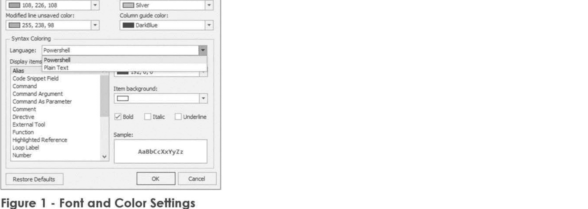

图 1 - 字体和颜色设置

### 1.1.3 新 Office 2016 主题

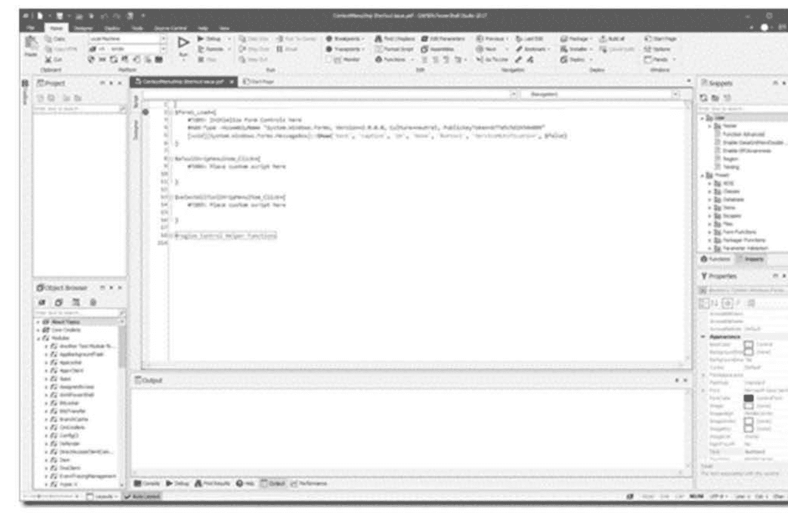

图 2 - Office 2016 彩色

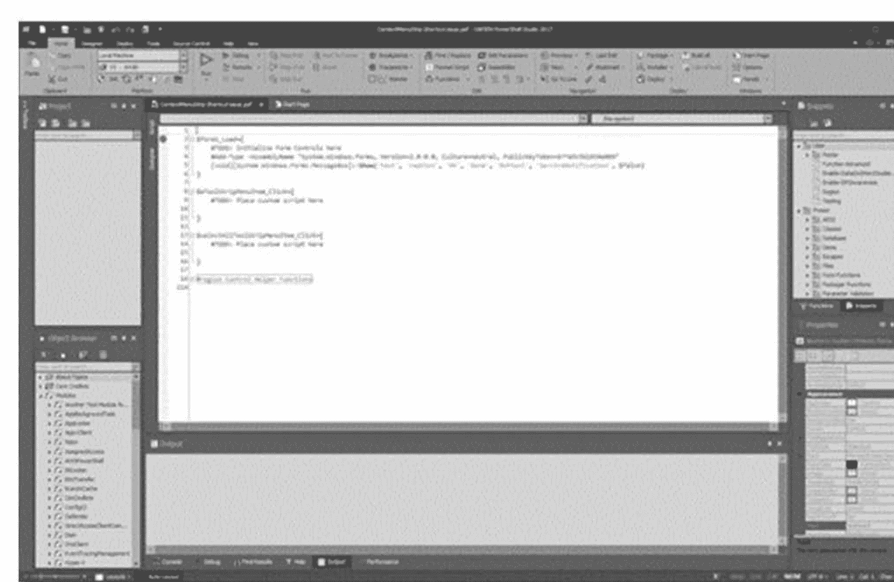

图 3 - Office 2016 深色

### 1.1.4 PrimalSense 性能改进

此版本的 PrimalSense 响应时间已提高。当您为 .NET 类型触发 PrimalSense 或使用通用代码补全时，您可能会注意到这种改进。

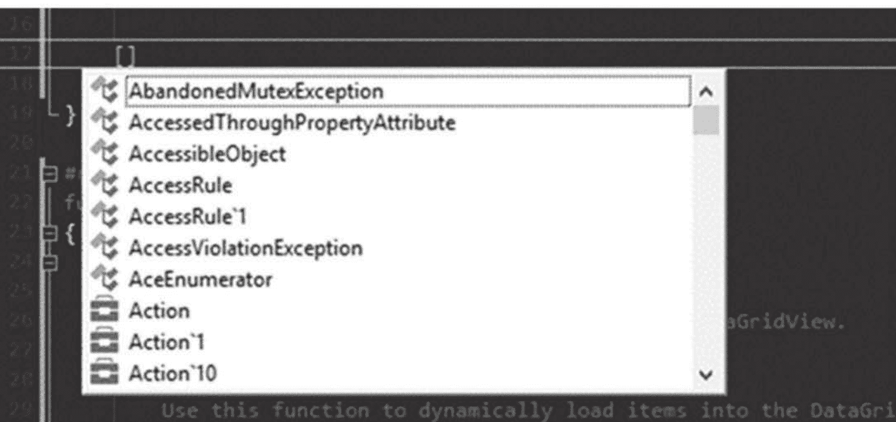

图 4 - 代码补全

## 1.2 要求

正如所有软件一样，安装 PowerShell Studio 有最低要求：

- Windows Server 2008 R2
- Windows Server 2012
- Windows 7
- Windows 8
- Windows 8.1
- .NET Framework 4.5
- 至少 200MB 磁盘空间
- 2GB 内存
- 可运行该程序的处理器
- 运行时（Runtime）

## 1.3 安装

三种安装类型：

- 典型（Typical）：大多数用户的推荐选择，将安装 PowerShell Studio
- 自定义（Custom）：允许您选择要安装的功能。此选项仅建议高级用户使用。
- 完全（Complete）：将安装所有组件。

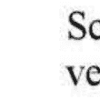

# 20 | PowerShell Studio - 全方位指南

## 1.4 防墙考虑

PowerShell Studio 可以安装一个小服务来支持远程脚本执行。这在尝试打开端口时会导致防火墙警告。端口可以在调试器选项中配置。

PowerShell Studio 偶尔会访问 sapien.com 网站上的文件。该文件包含当前 Studio 版本号；当 PowerShell Studio 首次读取此文件时，您的防火墙可能会发出警告。PowerShell Studio 在进行此类检查时不会传输任何个人身份信息，目的是通知您可用更新。

许多人询问如何在自己的 GUI 中添加此类更新检查，方法如下：

首先，在您的网站服务器上的文件夹中创建一个 `index.html` 文件。在 `Index.html` 内部输入您应用程序的最新版本（例如 2.2.1），或您想要检查的任何特定文字。

```powershell
Try {
    # 参考网络服务器上 index.html 文件的文件夹位置
    $URL = "http://www.postcamp.com/update/"
    # 在此处对 URL 发请求并读取 index.html 文件的内容
    $data = Invoke-WebRequest -Uri $URL
    If ($data -notmatch "2.2.1") {
        # 如果在线版本不匹配 2.2.1，我们可以显示
        # 通知图标、设置关于可用更新的图片，或在此处执行的任何其他过程。
        $update_pic.Visible = $true
    } else {
        # 如果版本相同，我们什么都不做，在这种情况下我
        # 确保我的更新图片不可见。
        $update_pic.Visible = $false
    }
} catch {
    # 如果网站不可用或没有互联网连接，我们可以
    # 什么都不做，或者在此处执行您喜欢的任何过程。
    $update_pic.Visible = $false
}
```

# PowerShell Studio – 介绍 PowerShell Studio | 21

PowerShell Studio 会访问网络以显示其产品注册页面（在初始安装后），并在您点击“信息浏览器”（Info Browser）中的链接时显示 Web 页面。

## 1.5 激活您的许可证

1. 输入您的 SAPIEN ID。
2. 输入你的密码。
3. 输入您的许可证号（License No.），该数字与您的订阅数字号相同。
4. 点击“激活”（Activate）。

每个许可证均允许两次激活，这在您经常在家里工作时非常有用，因为它可以允许您同时在工作电脑和家里电脑上使用 PowerShell Studio。

> 如果您正在进行离线激活，则无需输入 SAPIEN ID 或密码。

离线激活 – 如果您由于网络限制等原因无法在线激活授权的 PowerShell Studio 副本，可以请求离线激活密钥。登录您在 SAPIEN 网站上的账户，进入“我的账户/已注册产品”（My Account/Registered Products），在页面右侧寻找“点击请求离线密钥”（Click to request an offline key）链接。您需要填写一份标准的联系表单，并说明您需要进行离线激活的原因。

许多政府限制不允许离线激活注册/授权，因此需要离线密钥。该过程非常简单：联系 SAPIEN 请求离线密钥，他们通常会在几分钟内通过邮件回复，离线激活密钥将显示在您的“已注册软件订阅”（Registered Software Subscriptions）页面中。我们希望微软的离线激活也能如此简单。

## 1.6 注销许可证

好了，您可能在想：“为什么要注销您的许可证呢？”一种情况可能是您换了新电脑，并想要安装您的 PowerShell Studio 副本。您首先需要对该许可证进行注销。

### 现实场景

1. 您的公司购买了几个许可证，员工在 SAPIEN 上创建了自己的账户并在这些账户下激活了许可证，但这些团队成员中的一个或多个成员已离开公司，您可以重用这些激活次数吗？是的，可以。您应该将许可证信息发送到 `sales@sapien.com` 并说明您的问题，他们将与您讨论方案。
2. 您在电脑上安装了 PowerShell Studio，但硬盘崩溃导致您无法进行注销？联系 SAPIEN 的支持部门，他们将为您重置其中一个激活状态。

# 22 | PowerShell Studio – 全方位指南

如何在 PowerShell Studio 中注销许可证：

1. 点击 PowerShell Studio 应用程序右上角的许可证信息（License information）。

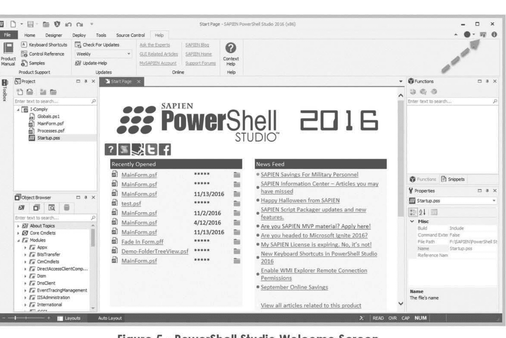

图 5 - PowerShell Studio 欢迎界面

2. 在“许可证信息”框内，点击“注销许可证”（Deactivate License）。

在 5.3.131 版本之前，您可以点击 PowerShell Studio 窗口右上角的“关于”（About）图标。

# PowerShell Studio – 介绍 PowerShell Studio | 23

“注销许可证”和“复制信息”（copy info）按钮已在 5.3.131 版本发布时移除。

- 从 SAPIEN 产品列表中选择您的 PowerShell Studio 许可证。列出所有当前安装的 SAPIEN 产品，以确保您选择了 PowerShell Studio 的安装项。

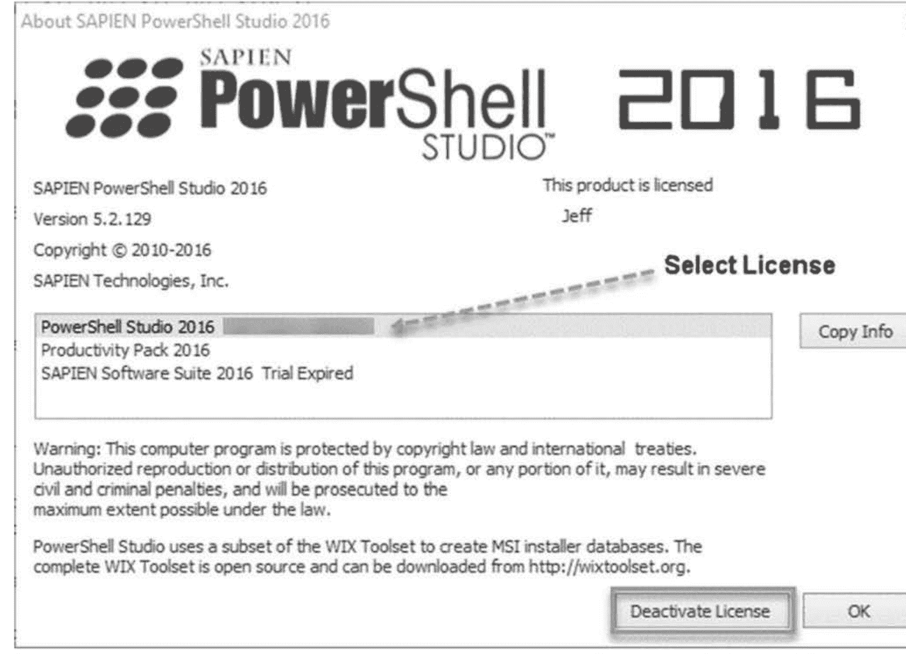

- 点击“注销许可证”（Deactivate License）。现在，您可以使用原始许可证信息在另一台电脑上安装并激活 SAPIEN PowerShell Studio。

图 7 - 注销许可证


“太简单了！”

# 24 | PowerShell Studio – 全方位指南

## 1.7 选项与自定义

SAPIEN 在设计选项时充分考虑了灵活性，我们将概述介绍各种可用选项及其作用。

### 1.7.1 通用设置（General Settings）

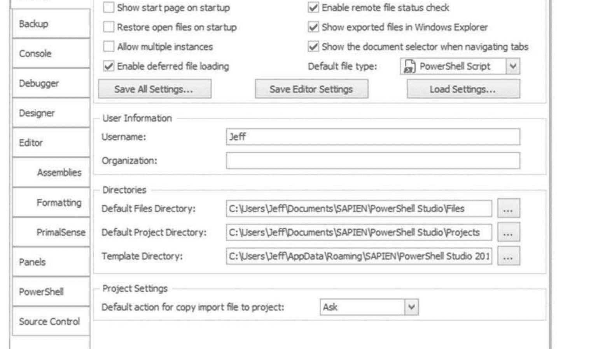

图 8 - 通用设置

- 显示启动页（Show start page）：显示启动页。
- 启动时恢复文件（Restore files on startup）：在启动时恢复上次打开的文件。
- 允许多实例（Allow multiple instances）：允许同时运行多个实例。
- 启用延迟加载（Enable deferred loading）：在需要时加载文件。延迟加载可以提高性能。
- 启用文件状态检查（Enable file status）：当文件被修改时警告您。启用此项会影响 PowerShell Studio 的。
- 在 Windows 资源管理器中显示导出文件（Show exported files in Windows Explorer）：在 Windows 资源管理器中显示已导出的文件。
- 在导航标签页时显示文档选择器（Show the document selector when navigating tabs）：在标签页间切换时显示选择器。如果不需要每次都出现，可以取消勾选此。
- 默认文件类型（Default file type）：选择要保存的文件类型。
- 用户名和组织（Username and Organization）：在此输入详细信息。
- 默认文件目录（Default Files Directory）：PowerShell Studio 用于存储文件的目录。
- 默认项目目录（Default Project Directory）：PowerShell Studio 用于存储项目的目录。
- 模板目录（Template Directory）：PowerShell Studio 用于存储模板的目录。
- 导入文件到项目的默认操作（Default action for import to project）：当导入现有文件到项目时，PowerShell Studio 会创建一个副本。


图 9 - 应用程序设置

- 保存所有设置（Save All Settings）：此按钮保存所有设置。
- 保存编辑器设置（Save Editor Settings）：此按钮仅保存编辑器设置。

> 如果发生意外导致丢失您的配置，那将非常令人沮丧。配置文件存储在下列位置；强烈建议您在安全的地方备份这些文件。

`%HOMEPATH%\Documents\SAPI\PowerShell Studio 2016\Files\PowerShellStudio.Settings.xml`

`%HOMEPATH%\Documents\SAPI\PowerShell Studio 2016\Files\PowerShellStudio.Editor.xml`

加载设置（Load Settings）：用于加载以前保存的设置文件。加载文件后您需要重启应用程序。

### 1.7.2 备份设置（Backup Settings）

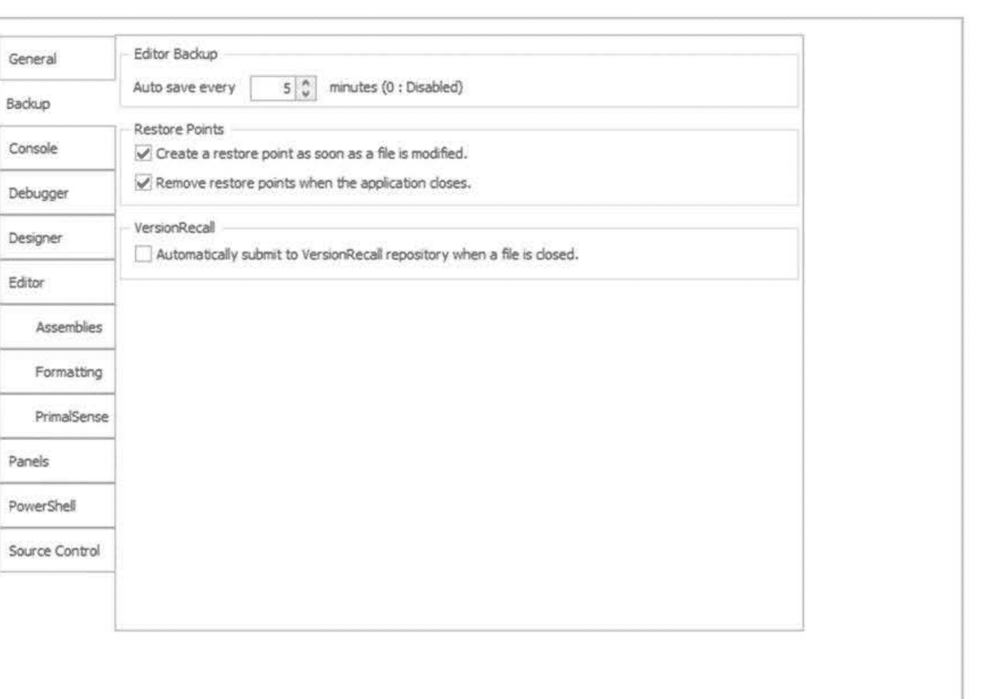

- 每 [x] 分钟自动保存（Auto save every [x] minutes）：自动保存文件的频率（分钟）。我个人设置为 5 分钟，尽管许多人认为这过度了，但我丢失过数据，大家体会那种感受。


- **文件被修改后立即创建还原点（Create a restore point as soon as a file is modified）**：在修改文件时创建还原点，以便轻松撤销更改。自动还原点仅创建一次，即首次编辑时（会话开始时）。这困扰很多人，有些人可能认为这意味着每次修改项目或文件都会创建一个还原点，但事实并非如此！当创建一个永久还原点时，它只存储一个。这旨在作为一个快速恢复工具，而不是版本控制工具。因此，如果您对脚本进行了长时间的操作并需要使用此方法恢复，那么您将恢复到会话的开始。您将丢失之后的所有内容。

- **应用程序关闭时删除还原点（restore points when the application closes）**：如果您正准备对脚本进行某些可能想要回滚的操作，请点击工具栏“还原点”菜单上的“创建”按钮。

- 关闭 `PowerShell Studio` 时，还原点将被移除。

- **关闭文件时自动提交到 VersionRecall 仓库（Automatically submit to VersionRecall repository when a file is closed）**：`VersionRecall` 是 `SAPIEN` 的版本控制系统。此选项允许您在关闭文件时将其保存到 `VersionRecall`。这是一个独立的 `SAPIEN` 应用程序，不包含在 `PowerShell Studio` 中。

# PowerShell Studio – 介绍

## 1.7.3 控制台设置

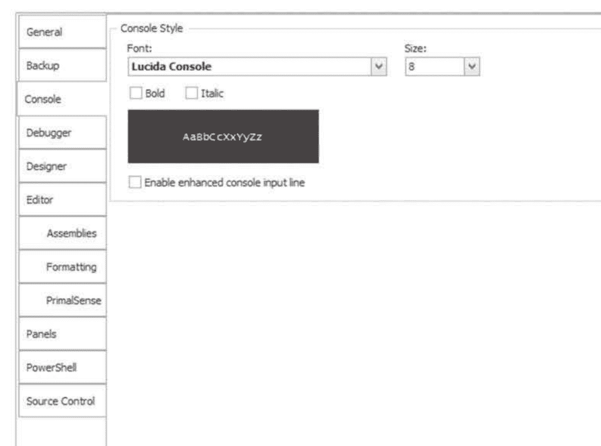

图 11 - 控制台设置

- **字体**

  为 `PowerShell` 控制台设置您首选的字体。

- **测试颜色、大小、粗体、斜体**

  配置 `PowerShell` 控制台的显示属性。

- **启用增强控制台输入行**

  创建一个独立的输入框进行输入，而不是直接在控制台中输入。

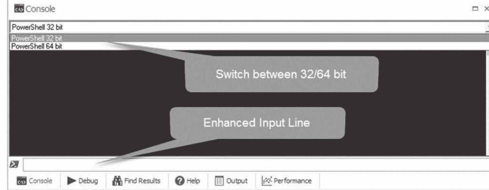

图 12 - 在 32 位和 64 位 `PowerShell` 之间切换

## 1.7.4 调试器设置

这些设置配置了 `PowerShell Studio` 用于连接到远程脚本执行引擎（RSEE）远程安装版的网络端口。在任何想要支持远程执行的计算机上，您必须使用相同的端口号。在决定使用哪些端口时，咨询您的网络和安全团队非常重要，因为他们能够建议您哪些端口是安全的，并在需要时重新配置任何端口。端口号在运行 RSEE 的机器注册表中指定。

| 通用 | 远程端口 | 9988 | RSEE 发送: | 9987 |
|---|---|---|---|---|
| 备份 | RSEE 接收: | 9966 | 调试器发送: | 9985 |
| 控制台 |  |  |  |  |
| 调试器 |  |  |  |  |
| 注意：入站和出站端口在服务器端是反的。这里的出站端口是服务器端的入站端口，反之亦然。 |  |  |  |  |
| 设计器 |  |  |  |  |
| 编辑器 |  |  |  |  |
| 程序集 |  |  |  |  |
| 格式化 |  |  |  |  |
| PrincipalSense |  |  |  |  |
| 面板 |  |  |  |  |
| PowerShell |  |  |  |  |
| 版本控制 |  |  |  |  |

图 13 - 调试器设置

关键项是 `HKEY_LOCAL_MACHINE\Policies\SAPIEN`（入站端口）和 `OutPort`（出站端口）。注意，这些值通过组策略对象（GPO）配置最为方便。`SAPIEN` 可以提供一个模板（ADM 文件），该模板可以导入到 GPO 中以配置 RSEE。

远程脚本执行引擎（RSEE）是一个企业级的脚本执行环境。它由两个部分组成：内置在 `PowerShell Studio` 中的客户端，以及必须部署到运行脚本的每台计算机上的远程服务。RSEE 能够将脚本从 `PowerShell Studio` 部署到远程计算机并在那里执行，并将脚本的输出和结果带回 `PowerShell Studio` 供您审核。

RSEE 是一个复杂的工具，与 Windows 脚本子系统紧密交互。建议仅供经验丰富的 Windows 员使用 RSEE，他们必须完全理解服务部署和管理、跨计算机安全和身份验证，以及在域环境下的组策略对象和 Active Directory 管理。除了本手册中的指南外，`SAPIEN Technologies` 无法帮助您解决由配置不当引起的安全问题，也无法协助处理 Active Directory、组策略或本地计算机配置任务。请参阅第 1.7 节获取 RSEE 的详情。

## 1.7.5 设计器设置

| 通用 | 设计器设置 |  |  |
|---|---|---|---|
|  | 布局模式: | 对齐线 |  |
| 备份 | ☑ 显示网格 | 网格大小: 8 |  |
| 控制台 | 控制设置 |  |  |
| 调试器 | ☑ 同步控件名称与控件 | 在新事件中插入 TODO 注释 |  |
|  | 同步控件名称与文本 | 插入事件结束控件 |  |
| 设计器 | ☑ 自动插入默认事件 | 插入控件辅助函数 |  |
| 编辑器 | 导出 |  |  |
| 程序集 | ☑ 在导出的脚本中嵌入恢复数据 | 启用 PowerShell V2 程序集兼容性 |  |
| 格式化 | 源文件 |  |  |
|  | 文件加载的默认操作: | 询问 |  |
|  | 文件搜索的默认操作: | 询问 |  |

图 14 - 设计器设置

- **布局模式（Layout Mode）**

  控制控件添加到表单时的对齐方式。

  - **对齐线（SnapLines）**

    允许您精确对齐控件。当您在表单上移动控件时，将出现对齐线显示控件如何与其相邻控件对齐。

  - **对齐网格（Snap to Grid）**

    将控件对齐到表单上的网格覆盖层。您可以使用网格大小根据需要增加或减少网格大小。

- **缺失事件的默认操作（Default action for missing events）**

  这控制当 `PowerShell Studio` 无法在脚本中找到预期的事件处理代码时发生的情况。它可以防止意外删除代码。有三个选项：询问（Ask）、插入（Insert）或删除（Remove）。

  - **询问（Ask）**

    显示缺失事件对话框。您可以从此界面插入、删除或忽略缺失的事件。

- **插入（Insert）**

  将自动创建事件处理代码。

- **删除（Remove）**

  将删除控件属性中的事件绑定。

- **在事件中插入 TODO 注释（Insert TODO comments in events）**

  启用后，`PowerShell Studio` 将为每个事件处理程序添加注释，提醒您提供代码正文。

- **插入事件结束注释（Insert end of event comments）**

  在每个事件处理程序的末尾添加注释。

- **插入控件辅助函数（Insert control helper functions）**

  取消勾选此选项以防止插入辅助函数。

# PowerShell Studio – 编辑器设置

- **自动插入右括号**

  在输入时自动补全括号。

- **自动插入右方括号**

  在输入时自动补全方括号。

- **启用代码折叠**

  允许代码编辑器中的函数体被折叠为单行。

- **启用修订跟踪**

  用黄色和绿色条纹对源代码进行标记，用以指示当前编辑会话中进行的更改。

- **为已使用的模块自动插入导入命令**

- **显示行号**

  在代码编辑器的左侧显示行号。

- **显示空白字符**

  显示包括制表符和换行符内的空白字符。

当你输入脚本中未导入的模块的命令（cmdlet）时，`PowerShell Studio` 将自动插入 `Import-Module` 语句。

| 行号 | 代码 |
| :--- | :--- |
| 23125 | `$buttonScanIPRange_Click:: {` |
| 23126 | `->` |
| 23127 | `->function Invoke-TIPSweep` |
| 23128 | `-> {` |
| 23129 | `->` |
| 23130 | `->Param(Mandatory='-.*',true,` |
| 23131 | `->[parameter...Position='0']],` |
| 23132 | `->...Position=],` |
| 23133 | `->[ValidatePattern("b\d(1,3)\.\d(1,3)\.\d(1,3)\.\d(1,3)b")],` |
| 23134 | `->[string]$StartAddress],` |
| 23135 | `->[parameter(Mandatory='-.*',true,` |
| 23136 | `->...Position='1']],` |
| 23137 | `->[ValidatePattern("b\d(1,3)\.\d(1,3)\.\d(1,3)\.\d(1,3)b")],` |
| 23138 | `->[string]$EndAddress],` |
| 23139 | `->[switch]$ResolveHost,` |
| 23140 | `->[switch]$ScanPort,` |

图 20 - 显示空白

```powershell
23125 $buttonScanIPRange_Click = {
23126
23127 function Invoke-TSPISweep
23128 {
23129
23130 Param (
23131 [parameter(Mandatory) = $true,
23132 Position = 0])
23133 [ValidatePattern("b\d(1,3)\.\d(1,3)\.\d(1,3)\.\d(1,3)")
23134 [string]$StartAddress,
23135 [parameter(Mandatory) = $true,
23136 Position = 1])
23137 [ValidatePattern("b\d(1,3)\.\d(1,3)\.\d(1,3)\.\d(1,3)")
23138 [string]$Address,
23139 [switch]ResolveHost,
23140 [switch]$ScanPort,
```

- **加载时折叠区域**

  这将在加载文件时将所有区域处于折叠。

- **自动插入右引号**

  在输入时自动补全字符串引号。

- **自动插入右大括号**

  在输入时自动补全大括号。

- **列**

  指定显示列指南的列数。

- **Tab 尺寸**

  指定制表符大小。

- **插入基于注释的帮助**

  提供 2 个选项：

  - 函数之前
  - 函数内部

图 21 - 未显示空白

| Grid-View |
| :--- |
| 1 of 2 Get Item (Path<String>[-Filter<String>][-Include<String>][-Include<String>][-Exclude<String>][-Force][-Credential<PSCredential>[-UseTransaction][-Stream<String>][<String>][<CommonParameters>) |
| 按 TAB 输入参数。 |
| 按 Shift-TAB 输入强制性参数。 |

图 22 - Tab 自动补全

这将允许你显示并控制参数集。一旦找到你所需的参数集，就可以按 `[TAB]` 将其自动插入命令中。

## 字体与颜色

`PowerShell Studio` 在设计自定义方面非常灵活，无论你是喜欢更传统的颜色样式，还是有独特的个人风格，它都可以定制以适应几乎任何人的风格。编辑器字体和颜色设置让你有机会通过自定义 `PowerShell Studio` 编辑器的字体和颜色来展示你的个人风格。

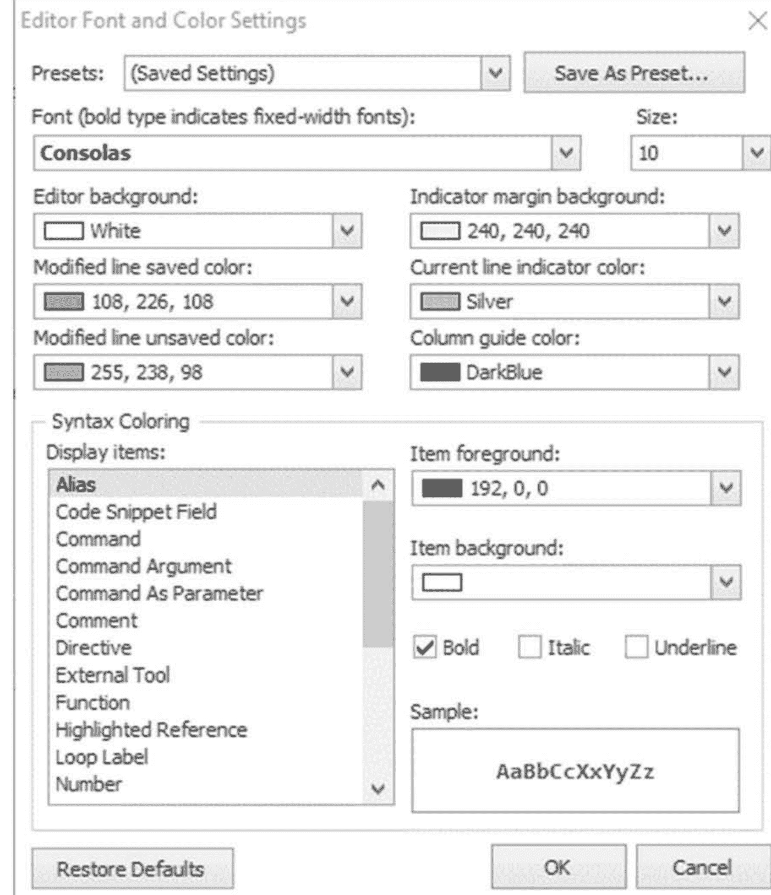

图 23 - 显示默认颜色

## 预设

如果你更倾向传统，或者没有时间配置编辑器字体和颜色，可以从预设主题列表中进行选择，允许你快速更改当前的颜色主题。

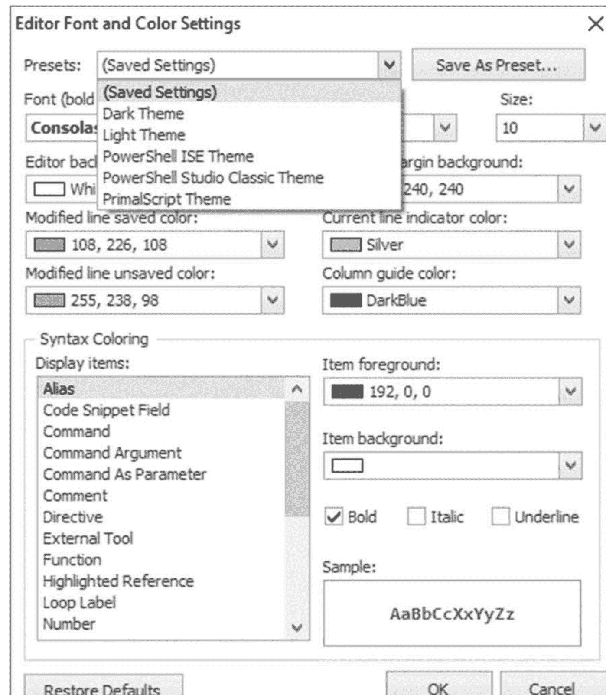

图 24 - 编辑器方案

如果你盯着电脑屏幕看了几个小时，可能会发现深色方案对眼睛更友好。

```powershell
#Region TextChanged
$Global:OldText = ""
$TextBox.Add("TextChanged", {
    if ($Global:OldText -ne "" and $EventObject.Text -ne "") {
        # logic here
    }
#endregion

#Region TextChanged_Changed {
    if ($Global:OldText -ne "" and $EventObject.Text -ne "") {
        # logic here
    }
#endregion

#Region TextBox_Click
$TextBox.Add("Click", {
    # logic here
})
#endregion

function Get-IPAddress {
    param(
        [Parameter(Mandatory=$true)]
        [string]$Address,
        [Parameter(Mandatory=$true)]
        [string]$Mask
    )
    # logic
}
```

图 25 - 深色编辑器方案

```powershell
#Region TextChanged
$Global:OldText = ""
$TextBox.Add("TextChanged", {
    if ($Global:OldText -ne "" and $EventObject.Text -ne "") {
        # logic here
    }
#endregion

#Region TextChanged_Changed {
    if ($Global:OldText -ne "" and $EventObject.Text -ne "") {
        # logic here
    }
}
#endregion

#Region TextBox_Click
$TextBox.Add("Click", {
    # logic here
})
#endregion

function Get-IPAddress {
    param(
        [Parameter(Mandatory=$true)]
        [string]$Address,
        [Parameter(Mandatory=$true)]
        [string]$Mask
    )
    # logic
}
```

图 26 - 浅色编辑器方案

当你选择预设时，字体和颜色设置将更新为预设。只需点击 `Apply` 按钮，`PowerShell Studio` 将使用新的颜色方案。你也可以创建自己的预设并与同事共享。只需配置颜色设置然后按 `Save As Preset...` 按钮。将弹出一个对话框。

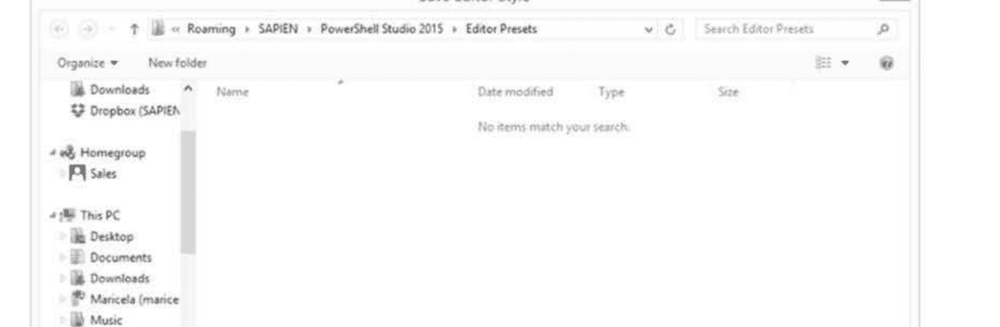

图 27 - 保存编辑器样式

为预设命名并点击 `Save` 按钮。现在预设将显示在下拉列表中：

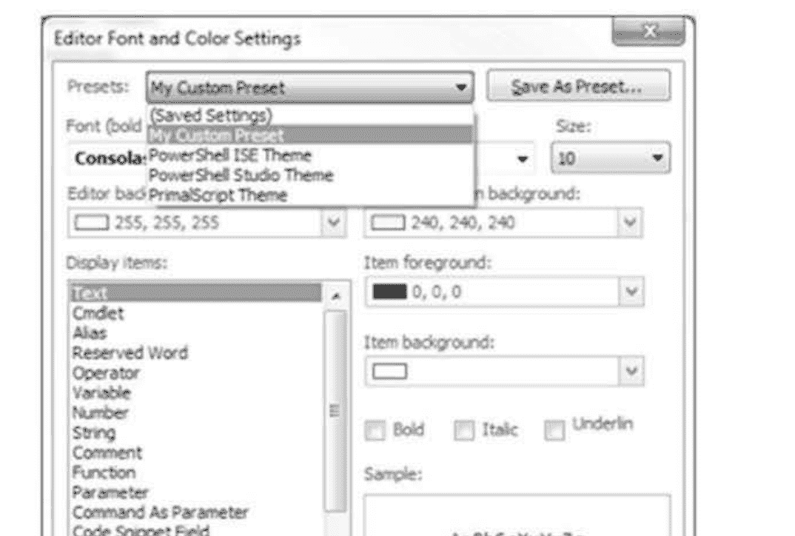

图 28 - 自定义预设

## 包装命令（WRAP COMMANDS）

你可以使用以下快捷键快速在编辑器中将选中文本包裹在括号、引号或圆括号中。

| 快捷键 | 包裹 |
| :--- | :--- |
| `Ctrl + Shift + 9` | `()` |
| `Ctrl + [` | `[]` |
| `Ctrl + Shift + [` | `{}` |
| `Ctrl + '` | `"` |
| `Ctrl + Shift + '` | `" "` |


## 1.7.7 程序集设置


这些程序集用于为类型和 `.NET` 对象提供 IntelliSense 支持。你可以将程序集添加到 Default Assemblies 中，以确保每次启动 `PowerShell Studio` 时都加载它们。

## 1.7.8 格式设置

你是否尝试过从互联网或文档复制/粘贴代码，但它们在代码编辑器中从未正确缩进？`PowerShell Studio` 通过自动格式化粘贴的代码来解决这个问题。你甚至根据需要自定义格式化。

格式设置有两个部分，第一部分的选项作为自动格式化的触发器，这些告诉 `PowerShell Studio` “何时”格式化脚本。第二部分选项告诉 `PowerShell Studio` “如何”格式化脚本。


# PowerShell Studio – 介绍 PowerShell Studio

| 通用 | 触发器 (Triggers) | |
| :--- | :--- | :--- |
| | ☑ 在新行自动格式化语句 | ☑ 在 ; 后自动格式化语句 |
| 备份 | ☑ 在 { 后自动格式化完成块 | ☑ 粘贴时自动格式化 |
| | ☑ 自动缩进新行 | |
| 控制台 | | |
| 调试器 | 格式化 (Formatting) | |
| | ☑ 将左大括号放在新行 | ☑ 留在同一行 |
| 设计器 | ☑ 将语句关键字放在新行 | 在参数类型后插入新行 |
| 编辑器 | ☑ 在参数属性后插入新行 | ☑ 自动对齐为 |
| 程序集 | ☑ 在行延续符处对齐参数参数 * | 将弯引号转换为直引号 |
| | 参数间距 (0: 禁用): | 1 |
| 格式化 | 参数块缩进: | 1 |
| IntelliSense | 属性参数缩进: | 2 | ☑ 对齐属性参数 |

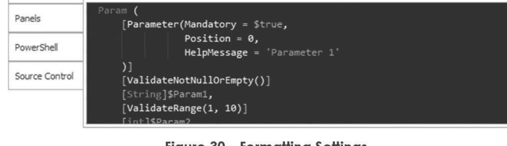

可以启用以下触发器：

- 在新行自动格式化语句

  当按下 `<enter>` 时格式化该行。如果文本已经格式化过，你可能不会注意到任何变化。

- 在 { 后自动格式化完成块

  当输入右大括号时格式化代码块。

- 自动缩进新行

  在通过 `<enter>` 插入新行时，自动缩进相应的制表深度。

- 在 ; 后自动格式化语句

  当输入分号时格式化语句。

- 粘贴时自动格式化

  当代码粘贴到脚本时进行格式化。

# 42 | PowerShell Studio – 全面指南

## 格式规则

第二组选项允许你自定义 PowerShell Studio 2015 的格式规则。

- 将左大括号置于新行

将新的左大括号放在新行上。

| 启用 | 禁用 |
| :--- | :--- |
| `if ($value)` | |
| `{` | `Out-Default 'True'` |
| `}else` | |
| `{` | `Out-Default 'False'` |

- 在 Parameter 属性后插入新行

将每个参数属性放在单独的一行。

```powershell
48 function Load-MyChart
49 {
50 Param ([Parameter(Position = 1, Mandatory = $true)][Alias('Control')][System.Windows.Forms.DataVisualization.Charting.Chart]$ChartControl,[Parameter(Position = 2, Mandatory = $true)]SXPoints,[Parameter(Position = 3, Mandatory = $true)]$YPoints,[Parameter(Position = 4, Mandatory = $false)][string]XTitle,[Parameter(Position = 5, Mandatory = $false)][string]YTitle]
```

图 31 – 之前

```powershell
48 function Load-MyChart
49 {
50 Param ([Parameter(Position = 1, Mandatory = $true)]
51 Alias('Control')
52 [System.Windows.Forms.DataVisualization.Charting.Chart]$ChartControl,
53 [Parameter(Position = 2, Mandatory = $true)]
54 SXPoints,
55 [Parameter(Position = 3, Mandatory = $true)]
56 YPoints,
```

图 32 - 之后

- 在行延续处对齐参数参数

当参数参数使用反引号（`）行延续字符延续到新行时，它们将在相同的列对齐。

# PowerShell Studio –介绍 PowerShell Studio | 43

### 启用

```powershell
Get-Service -ComputerName 'Server' -Name 'WinRM' -Verbose
```

### 禁用

```powershell
Get-Service -ComputerName 'Server' -Name 'WinRM' -Verbose
```

- 将语句关键字置于新行

将每个语句关键字放在新行上，例如 `if/else` 语句中的 `if` 和 `else`。

### 启用

```powershell
if ($value) {
    Out-Default 'True'
}
else {
    Out-Default 'False'
}
```

### 禁用

```powershell
if ($value) {
    Out-Default 'True'
} else {
    Out-Default 'False'
}
```

# 44 | PowerShell Studio – 全面指南

- 在 Parameter 类型后插入新行

在参数类型之后插入新行

之前

| | | `Param (` |
| :--- | :--- | :--- |
| 50 | `[Parameter(Position = 1, Mandatory = $true)][Alias('Control')]` |
| 51 | `[System.Windows.Forms.DataVisualization.Charting.Chart]$ChartControl,` |
| 52 | `[Parameter(Position = 2, Mandatory = $true)]` |
| 53 | `$XPoints,` |
| 54 | |

之后

| | | `Param (` |
| :--- | :--- | :--- |
| 50 | `[Parameter(Position = 1, Mandatory = $true)]` |
| 51 | `[Alias('Control')]` |
| 52 | `[System.Windows.Forms.DataVisualization.Charting.Chart]` |
| 53 | `$ChartControl,` |
| 54 | |

- 参数行间距（0禁用）

控制参数之间的行间距。如果设置为大于零的值，PowerShell Studio将在参数之后放置指定数量的新行。要禁用此选项（保持间距不变），请将值设置为零。

| 之前 | 之后 |
| :--- | :--- |
| 48 `function-Load-MyChart` | 48 `function-Load-MyChart` |
| 49 `{` | 49 `{` |
| 50 `Param (` | 50 `Param (` |
| 51 `[Parameter(Position = 1, Mandatory = $true)]` | 51 `[Parameter(Position = 1, Mandatory = $true)]` |
| 52 `[Alias('Control')]` | 52 `[Alias('Control')]` |
| 53 `[System.Windows.Forms.DataVisualization.Charting.Chart]` | 53 `[System.Windows.Forms.DataVisualization.Charting.Chart]` |
| 54 `$ChartControl;` | 54 `$ChartControl;` |
| 55 `[Parameter(Position = 2, Mandatory = $true)]` | 55 `[Parameter(Position = 2, Mandatory = $true)]` |
| 56 `$XPoints;` | 56 `$XPoints;` |
| 57 `[Parameter(Position = 3, Mandatory = $true)]` | 57 `[Parameter(Position = 3, Mandatory = $true)]` |
| 58 | 58 |
| 59 `[Parameter(Position = 4, Mandatory = $false)]` | 59 `[Parameter(Position = 4, Mandatory = $false)]` |
| 60 | 60 |
| 61 `$Title;` | 61 `$Title;` |
| 62 `[Parameter(Position = 5, Mandatory = $false)]` | 62 `[Parameter(Position = 5, Mandatory = $false)]` |
| 63 `[string]` | 63 `[string]` |
| 64 `$Title; }` | 64 `$Title; }` |

- 参数块缩进

代码块将缩进多少空格。

# 50 | PowerShell Studio – 全方位指南

- * 更改执行策略

允许你通过简单的 GUI 界面重新配置 32 位和 64 位 shell 的执行策略。

- * 本地存储区中的证书

PowerShell Studio 将用于代码签名的证书名称。

- * PFX 证书

指定一个存储在 PFX 格式中的证书。

- * 密码

访问存储在 PFX 格式中的证书所需的密码。

- * 时间戳 URL

用于在脚本的签名块中添加时间戳。这提供了额外的安全层保障；PowerShell 可以确定用于签名脚本的证书在脚本签名时是否有效。

- * 外部签名工具

提供替代代码签名工具的名称。

- * 保存时自动对 .ps1 脚本签名

启用此项确保所有脚本都经过签名。

## 1.7.11 版本控制设置

| 通用 | 设置 | |
| --- | --- | --- |
| 备份 | [x] 启用版本控制 | [ ] 提示检入 |
| 自动检入: | 禁用自动检入 [ ] | |
| 控制台 | 编辑时检出: | 自动检出 [ ] |
| 调试器 | 直接信息输出: | 抑制信息消息 [ ] |
| 设计器 | 提供程序 | |
| 编辑器 | | |
| 程序集 | | |
| 格式化 | | |
| PrimalSense | | |
| 面板 | | |
| PowerShell | | |
| 版本控制 | | |

图 35 - 版本控制设置

> 在为 PowerShell Studio 配置版本控制之前，你必须先安装你的版本控制软件的客户端。

2 http://info.sapien.index.php/manuals/manual-powershell-studio/powershell-studio-chapter-10-source-control-integration

# PowerShell Studio – 介绍 PowerShell Studio | 51

你的版本控制软件必须是 SAPIEN Technologies 的 VersionRecall，或者你的版本控制提供商必须提供兼容 SSAPI 的客户端（例如 Microsoft Visual Source Safe）。在与 PowerShell Studio 集成之前，你需要根据制造商说明进行安装和配置。

勾选“启用版本控制”复选框以启用版本控制。请注意，你的版本控制提供商必须显示在“提供程序”列表中，如果没有，说明版本控制未正确安装，PowerShell Studio 将无法使用。

PowerShell Studio 会检测版本控制客户端的存在并自动显示在“提供程序”列表框中。如果你的版本控制客户端没有出现在此框中，请关闭 PowerShell Studio，重启后它应该出现；如果仍然没有，可能意味着你没有正确安装和配置源提供程序，或者它不是兼容 SSAPI 的客户端。

> GIT 版本控制没有兼容 SSAPI 的客户端，你必须使用自定义菜单在 PowerShell Studio 中使用 GIT，我们将在 2.2.5 中进一步讨论此。

启用版本控制后，你可以按照意愿配置选项，包括在检出文件之前提示以及自动检入。

- * 启用版本控制

如果可用版本控制，允许 PowerShell Studio 使用版本控制。

- * 提示检入

此选项与自动检入配合工作：

| 提示检入 | 自动检入 | 行为 |
|------|---|---|
| 已勾选 | 文件关闭时检入 | 用户被提示检入文件 |
| 未勾选 | 文件关闭时检入 | 自动检入文件 |
| 任意值 | 禁用自动检入 | 用户必须手动检入文件 |

- * 自动检入

这控制检入行为并有两个选项：

- * 禁用自动检入

由你决定何时应该检入文件。

- * 文件关闭时检入

自动化检入过程。

- * 编辑时检出

这控制检出行为并有以下两个选项：

- * 自动检出

PowerShell Studio 将在你编辑文件时立即检出该文件。

- * 提示检出

PowerShell Studio 将显示一个文件选择框，你可以在其中选择想要检出的文件。你当前正尝试编辑的文件将被自动选中。

- * 提供程序

显示可用版本控制提供程序的列表并允许用户在它们之间切换。


# 第 2 章

# 基础引导


不知道从哪里开始，就无法到达！

# 基础引导

如果你不知道路，就无法到达任何地方。在我们开始构建表单和项目的核心内容之前，对 PowerShell Studio 的布局有良好的理解是至关重要的，毕竟你不会在不知道自己在哪里的情况下就去森林里徒足，对吧？令人惊讶的是，许多用户几乎只停留在使用工具箱中的控件，而明明有许多棒的功能被错过了。这本书将带你了解所有这些功能！

好了，你第一次启动了 PowerShell Studio，正盯着屏幕想：“好了，我该先从哪里开始？”。这本书是一个完美的起点，继续读下去！SAPIEN 在通过文档资源管理器（Document Explorer）向 PowerShell Studio 直接添加大量信息方面做得非常好。

## 2.1 文档资源管理器

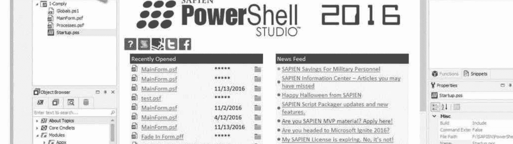

图 36 - 文档资源管理器

- 1. 从 PowerShell Studio 导航到顶部的“帮助”选项卡。

- 2. 在“帮助”类别的最左侧点击“产品手册”。

- 3. 这将打开文档资源管理器。

文档资源管理器包含了大量的信息，包括 PowerShell 命令定义、模块、手册、教程视频、在线社区和其他资源的链接，以及最新的文章。

你会发现文档资源管理器非常有用的功能之一是在文档资源管理器中直接添加自己的笔记。

# 56 | PowerShell Studio – 全方位指南

有许多关于 PowerShell、VBScript、PowerShell GUI 等更多脚本示例。这是熟悉 PowerShell Studio 功能的好极方法。入门

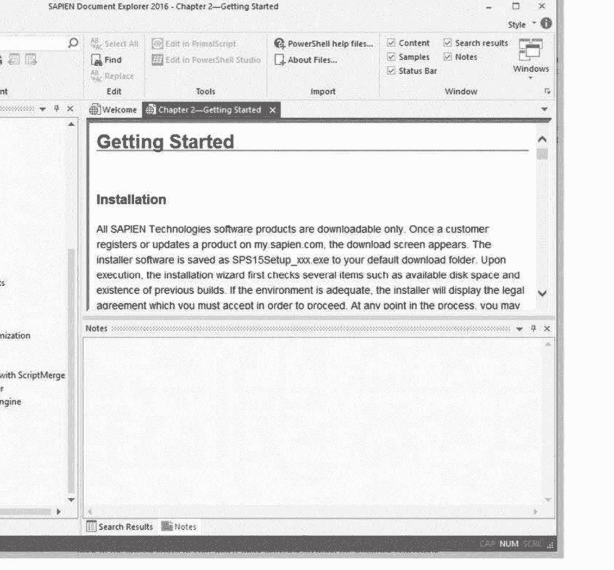

文档资源管理器占用多少空间？没有你想象的那么多。软件安装程序包含 99 个文件，占用 7.82 MB，对于它占用的空间来说非常值得。如果我想删除文档资源管理器怎么办？

- 1. 在开始菜单（Windows 8 右键点击左下角），点击“控制面板”，然后在“程序”下执行以下操作：

    - Windows 7/8：卸载程序。

    - Windows XP：添加或删除程序。

- 2. 当找到 SAPIEN 文档管理器程序时，点击它，然后执行以下操作：

    - Windows 7/8：卸载。

    - Windows XP：点击“删除”选项卡（程序右侧）。

- 3. 按照提示操作。进度条将显示删除 SAPIEN 文档管理器需要多长时间。

# PowerShell Studio – 基础引导 | 57

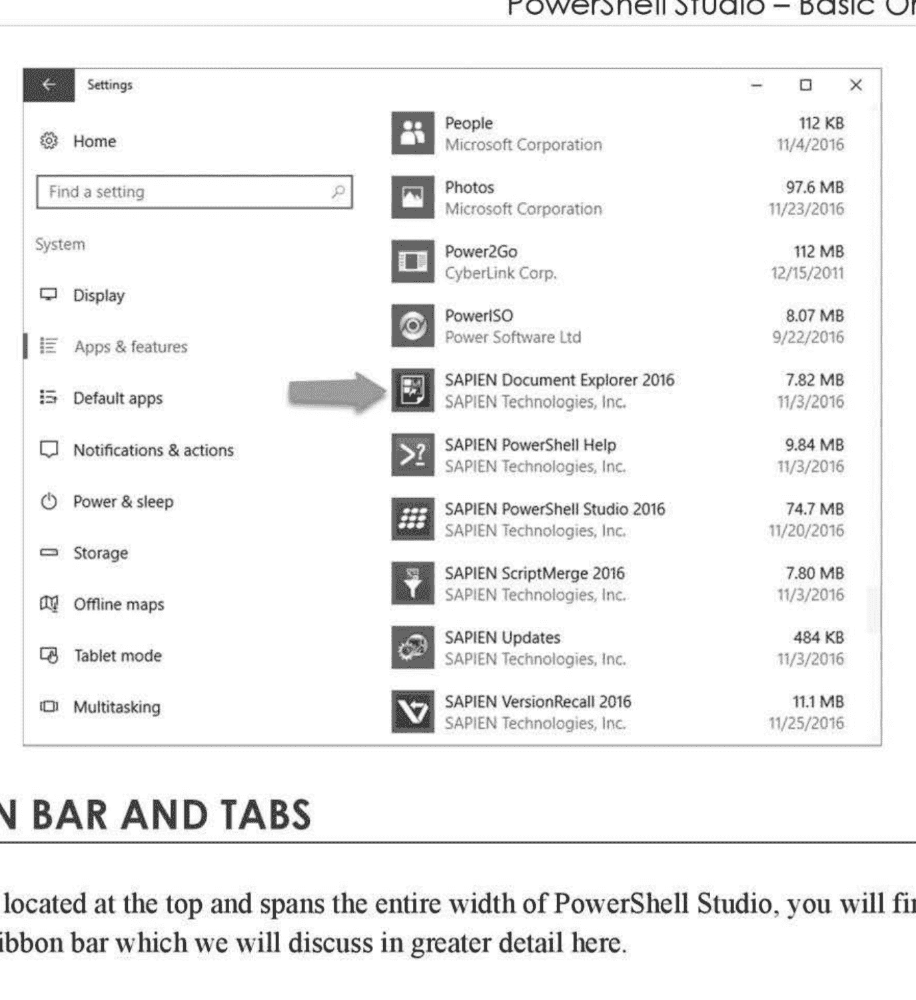

## 功能区和选项卡

功能栏位于顶部并跨越 PowerShell Studio 的宽度，你会在功能栏看到七个选项卡，我们在这里详细讨论。

### 2.2.1 首页选项卡

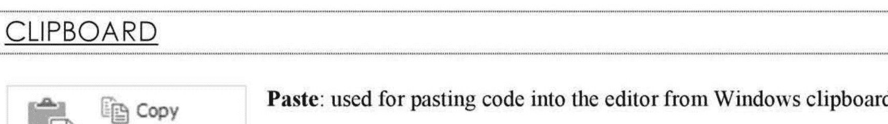

包含了编写脚本时常用的函数，它是 PowerShell Studio 的默认选项卡。

## 剪贴板

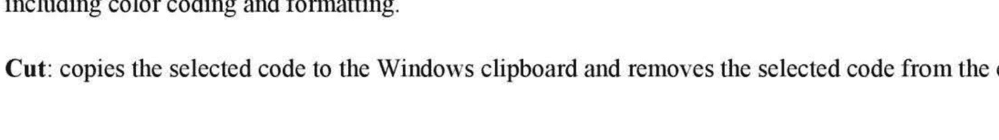

**粘贴**：用于从 Windows 剪贴板将代码粘贴到编辑器。

**复制**：将选中的代码复制到 Windows 剪贴板。

**复制 HTML**：复制选中的代码并将其格式化为 HTML 代码。如果你写博客这很快会成为你最常用的工具，它提供了包含颜色编码和格式的完美 HTML。

**剪切**：将选中的代码复制到 Windows 剪贴板并从编辑器中删除选中的代码。

# 58 | PowerShell Studio - 全方位指南

## 平台 (PLATFORM)

**版本与平台：** PowerShell 同时支持 32 位和 64 位平台，你可以根据脚本的需要和平台需求，选择脚本运行所需的 PowerShell 版本。在左侧的示例中，选择了 PowerShell 版本 5 和 32 位平台。

取决于你运行 PowerShell Studio 的系统上安装的 PowerShell 版本，你会有相应的选项供选择。如果你运行的是 Windows 10，你可能会发现只显示可用的 V5 (32位和 64位)，而没有 V3 或 V4。这是因为当 PowerShell 版本升级时，之前的版本会被卸载且不再可用。


**权限提升（盾牌图标）：** PowerShell 以当前用户的权限运行你的脚本。尽可能避免以管理员账户身份登录被认为是一种安全最佳实践。有时，你的脚本需要执行需要更高权限的操作；PowerShell 通过允许你在权限提升模式（elevated mode）下运行脚本来实现这一点。平台（Platform）菜单为脚本执行提供了提升模式和非提升模式。

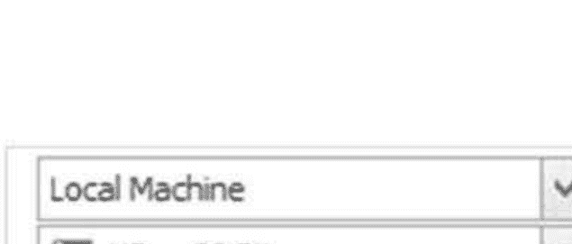

**STA：** 单线程公寓模式。STA（Single Threaded Apartment）和 MTA（Multi-Threaded Apartment）决定了进程如何管理传统的 COM 对象以及它们与多个线程之间的通信。我将不会展开细节，但你不需要关心 COM 对象的内部运作，只需记住某些 GUI 控件的正常运行需要 STA 即可。更多请参见 2.2.3。

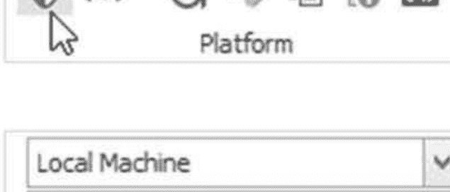

**本地缓存 (Local Cache)：** 刷新 PowerShell 命令行（cmdlets）和模块的缓存。如果你编辑了已经加载的任何模块（例如重命名函数或编辑模块内部内容），你应该刷新本地缓存，否则对模块的更改在模块加载后将无法生效；系统将使用本地缓存的副本。

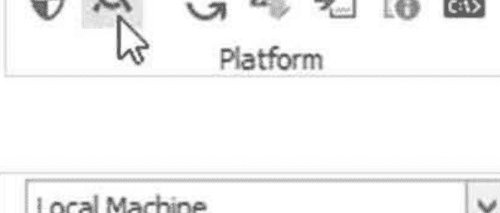

**编辑缓存 (Edit Cache)：** 添加/删除包含在缓存配置（profile）中的模块。点击后，将打开一个新窗口显示所有当前模块以及它们是否属于当前缓存配置。如果你想将模块添加到当前缓存配置中，请勾选所需模块旁的方框；取消勾选则从当前缓存配置中移除。

# PowerShell Studio – 基础介绍 | 59

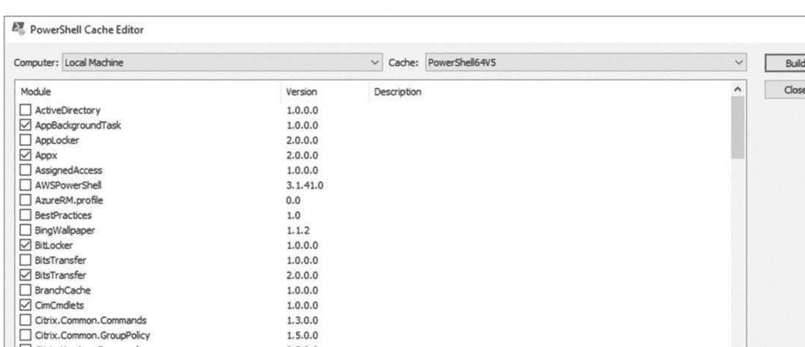

**图 38 - 缓存编辑器**

**导入远程缓存 (Import Remote Cache)：** 导入在另一台计算机上导出的安装模块集 (IMS)。开发 PowerShell 脚本时面临的挑战之一是目标平台上的模块在你的本地计算机上不可。*有关导出和导入远程缓存的详细信息，请参见参考章节。*

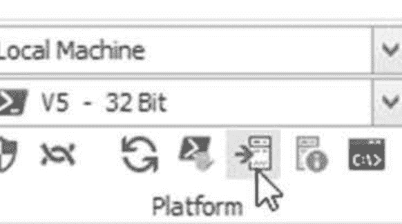

**编辑远程连接 (Edit Remote Connection)：** 编辑远程缓存的连接设置。这些设置定义了你想使用的远程连接类型；Windows PowerShell Remoting 或 RSEE Remoting。Windows PowerShell Remoting 可能需要用户名/密码凭据，而 RSEE 不需要凭据，但远程目标系统必须运行运行 RSEE 服务。*更多信息请参见参考章节。*

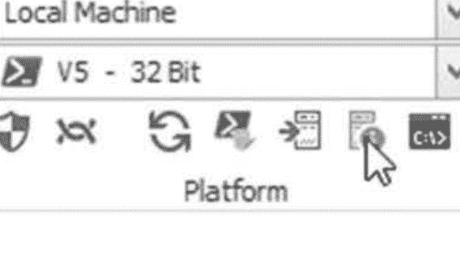

**远程控制台 (Remote Console)：** 将打开一个到所选机器的远程控制台（需要 Windows Remoting）。如果你使用 RSEE 作为远程连接类型，此功能将无法工作。

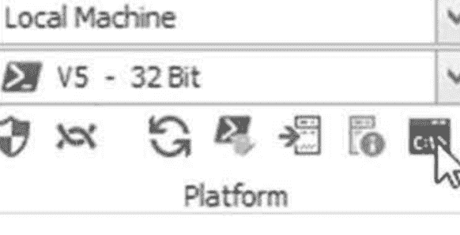

# 60 | PowerShell Studio - 全方位指南

## 运行 (RUN)

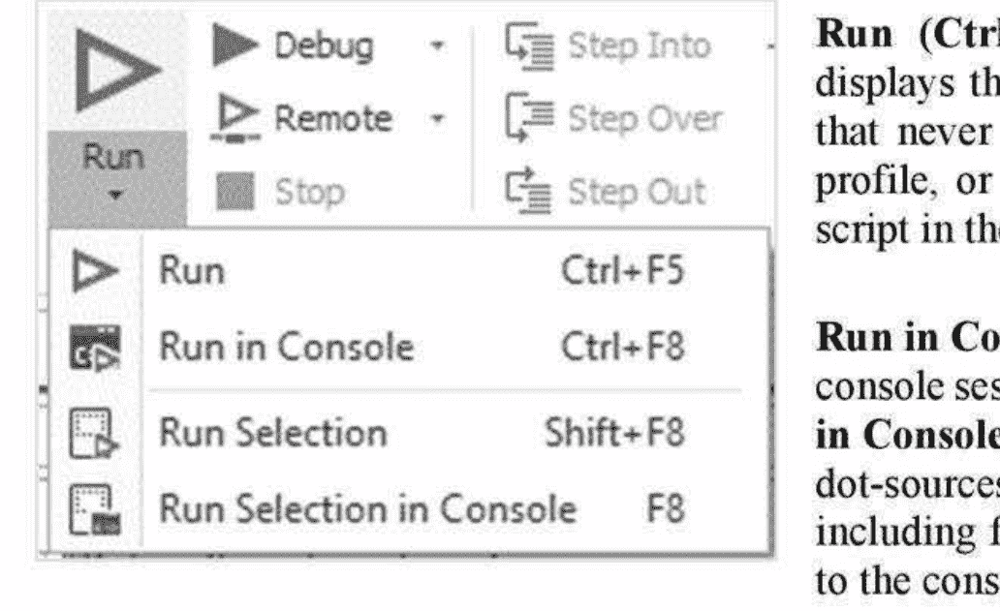

- **运行 (Ctrl+F5)：** 执行当前文档或项目并在输出面板中显示结果。运行（Run）创建一个不包含本地产物（如你的 PowerShell 配置）或会话特定项（如变量）的新会话，然后在干净状态下运行脚本。

- **在控制台中运行 (Ctrl+Shift+F5)：** 在控制台会话中执行脚本或项目并在控制台面板中显示结果。在控制台中运行的功能不仅是在控制台面板中运行脚本——它还会进行加载（source）。点排序（Dot-sorting）会将项添加到脚本中。

- **运行选择 (Ctrl+F8)：** 在控制台面板中运行选中的内容。

- **在控制台中运行 (Ctrl+Shift+F5)：** 在控制台中运行脚本。

- **预览 (Shift+F4)：** 预览脚本将如何呈现。

## 调试 (DEBUGGING)

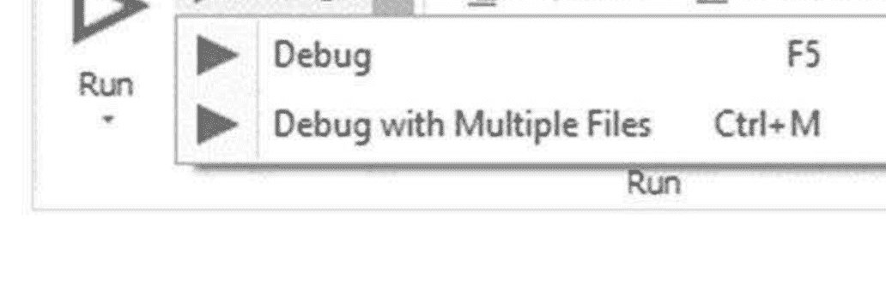

- **调试 (F5)：** 调试当前脚本并在输出面板中显示结果。

- **远程运行 (Ctrl+Shift+R)：** 使用 PowerShell Remoting 在远程目标上运行脚本。

- **调试文件 (Ctrl+M)：** 调试文件。

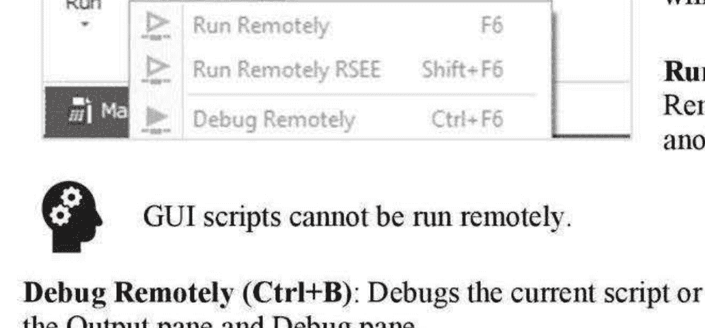

# 61 | PowerShell Studio – 基础介绍

PowerShell Studio 还提供了通过设置断点来调试脚本的能力。断点允许你在特定的代码行处停止。

## 断点 (BREAKPOINTS)

- **切换断点 (F9)：** 启用或禁用光标处的断点。

- **删除所有断点 (Ctrl+Shift+F9)：** 脚本中的所有断点。

- **编辑断点：** 修改现有断点的属性。

激活的断点显示为实心红圈。禁用的断点显示为红环。

## 跟踪点 (TRACEPOINTS)

- **切换跟踪点 (Ctrl+F9)：** 启用或禁用光标处的跟踪点。

- **删除所有跟踪点 (Ctrl+Alt+F9)：** 脚本中的所有跟踪点。

跟踪点会在执行特定代码行时导致 PowerShell Studio 向调试窗口写入消息。跟踪点在编辑器边距中显示为实心蓝圈。

# 62 | PowerShell Studio - 全方位指南

| 功能 | 描述 |
|---|---|
| 开始 (Begin) | 脚本开始块。 |
| 处理 (Process) | 脚本的主处理块。 |
| 结束 (End) | 脚本结束块。 |

## 编辑 (EDIT)

- **查找 / 替换：** 如名所示这些工具将在编辑器内查找和/替换文本。

- **格式化脚本：** 通过标准脚本格式化美化你的脚本。这不会扩展别名，如果你想扩展脚本中的别名，请按 `Ctrl + Shift + A`。这将帮助你通过良好的格式消除错误，并让你的脚本更专业。

- **函数：** 这里有三个不同的工具：
    - a. 插入新函数
    - b. 编辑函数和
    - c. 导入函数

- **编辑参数：** 又称为参数生成器（Parameter Builder），用于插入新的参数块或编辑现有的脚本参数。

# PowerShell Studio – 基础介绍

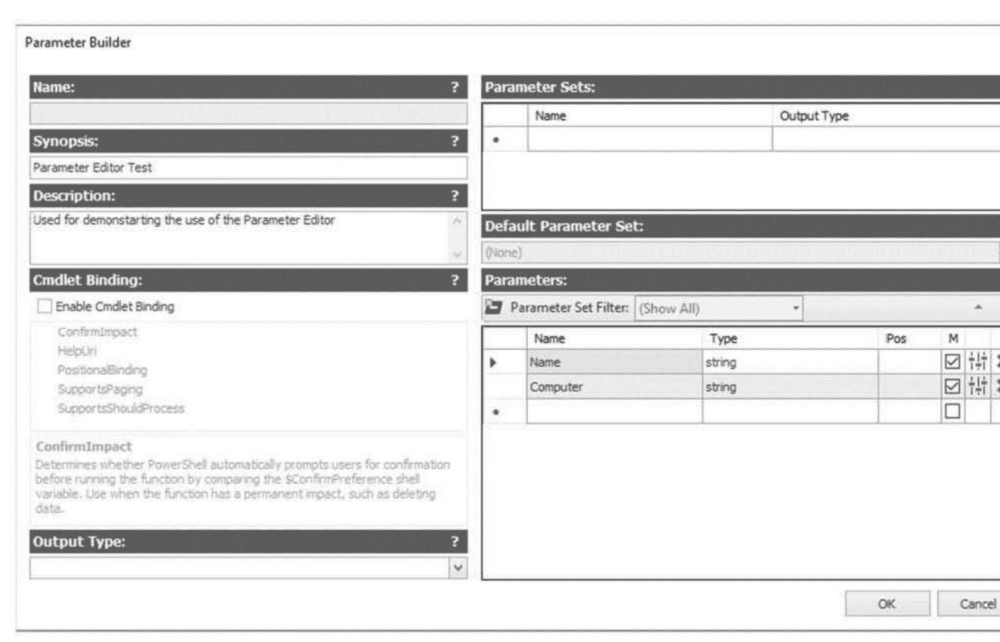

图 39 - 参数生成器

输入参数信息后，点击“OK”，生成的代码将插入到编辑器中，如下所示。

```powershell
## SYNOPSIS
## 参数编辑器测试

## DESCRIPTION
## 用于演示参数编辑器的用法

## PARAMETER Name
## 参数名称的描述。
## PARAMETER Computer
## Computer 参数的描述。

## EXAMPLE
PS C:\ -Name 'Value1' 'Value2'

## NOTES
## 关于文件的额外信息。
param(
    [Parameter(Mandatory) = $true]
    [string]$Name,
    [Parameter(Mandatory) = $true]
    [string]$Computer
)
```

可以通过点击每个参数的选项按钮来设置参数选项：

# 64 | PowerShell Studio – Comprehensive指南

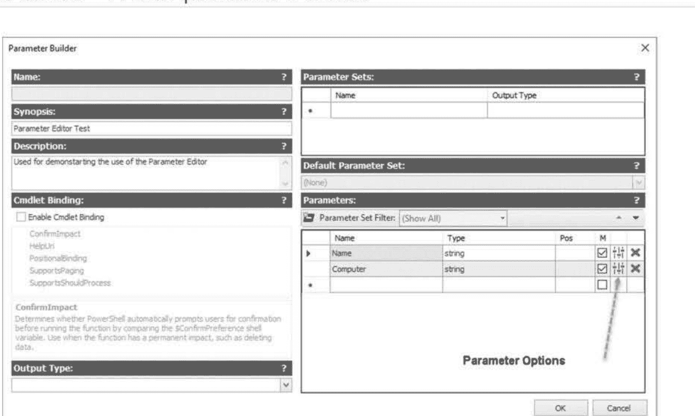

图 40 - 参数选项

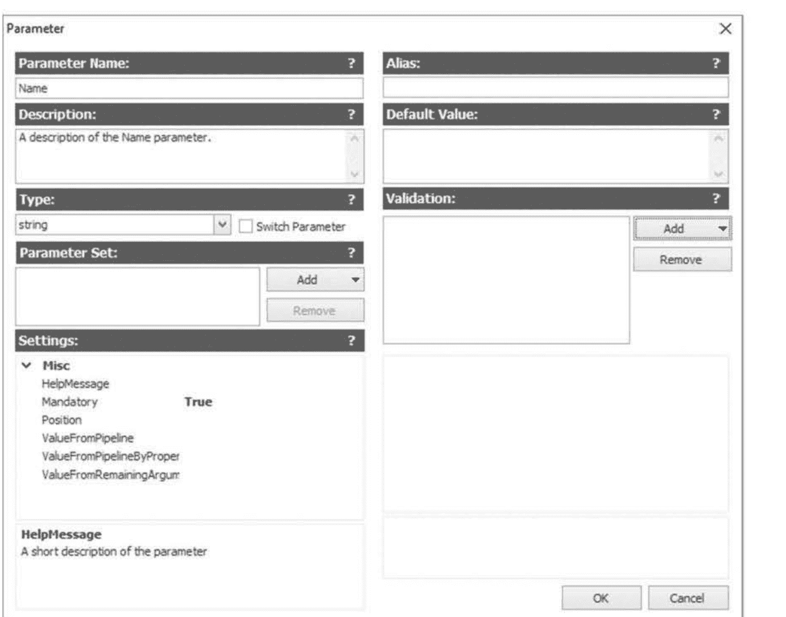

图 41 - 参数

# PowerShell Studio – 基础介绍 | 65

注释与区域：这些工具用于注释或取消选定行代码的注释，或者执行下文讨论的区域功能：

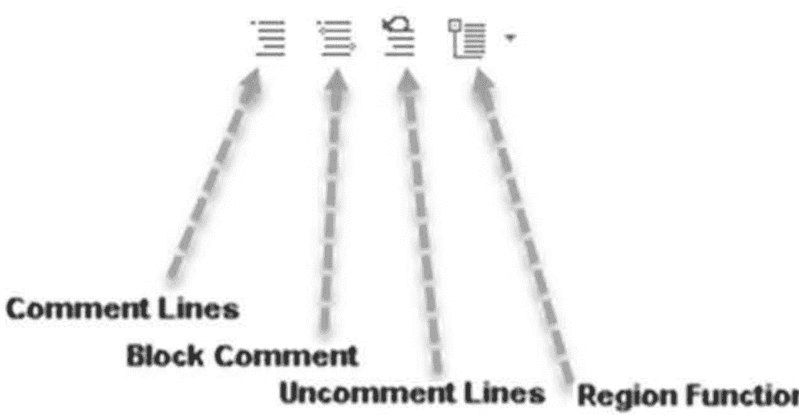

## 导航

- 上一个更改（Previous Change）：跳转到活动文档中的上一次更改。

- 上一个函数（Previous Function）：从活动文档的当前位置跳转到上一个函数。

- 上一个出现（Previous Occurrence）：跳转到活动文档中匹配所选文本的上一个出现位置。

- 下一个更改（Next Change）：从活动文档中的当前位置跳转到下一次更改。

- 下一个函数（Next Function）：从当前位置跳转到下一个函数声明。

- 下一个出现（Next Occurrence）：跳转到活动文档中匹配所选文本的下一个出现位置。

- 转到行（Go To Line）：跳转到当前活动文档中输入的任何特定行。

- 最后编辑（Last Edit）：转到当前活动文档最后一次编辑的位置。

- 切换书签（Toggle Bookmark）：在当前选中行设置书签。

- 清除所有书签（Clear all Bookmarks）：顾名思，它将清除当前活动文档中的所有书签。

- 上一个/下一个书签（Previous/Next Bookmark）：在活动文档中前后跳转到书签。

## 部署 (DEPLOY)

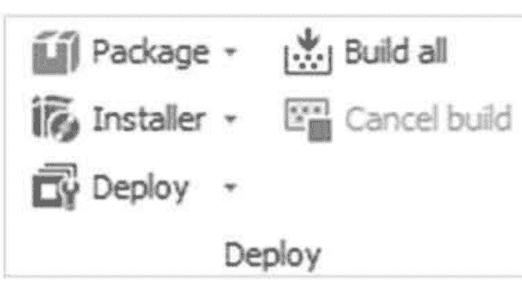

此部分包含了常用的部署工具，从构建包（即 EXE 文件）到创建安装文件（即 MSI 文件），再到如 CD/DVD 或电子邮件等部署方法。

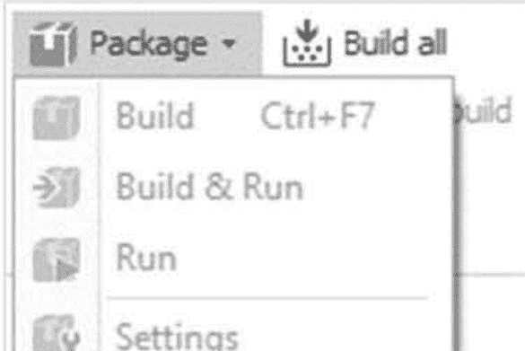

- 构建（Build）：这将从活动文档创建一个可执行文件 (EXE)。

- 构建并运行（Build and Run）：与 Build 相同，并将运行该可执行文件。

- 运行（Run）：这将运行活动文档的可执行文件。

- 设置（Settings）：这是脚本打包器（Script Packager）设置的一部分，将在后面的章节中详细讨论。

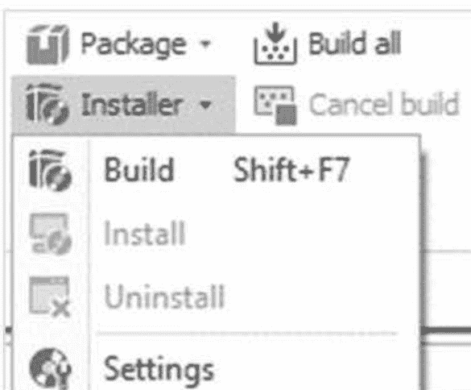

- 构建（Build）：这将从活动文档创建一个安装文件 (MSI)。

- 安装（Install）：安装活动文档的 MSI。

- 卸载（Uninstall）：如果版本匹配，则卸载活动文档的应用程序。

- 设置（Settings）：这是 MSI 设置的一部分，将在后面的章节详细讨论。

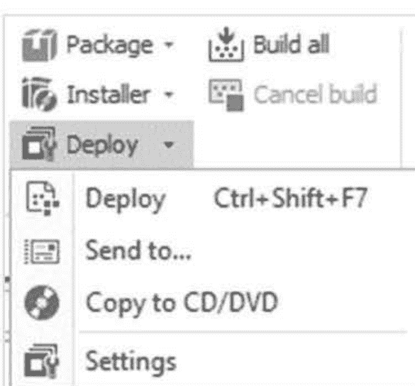

- 部署（Deploy）：部署活动文件并执行命令。

- 发送到（Send To）：将活动文档的部署压缩包发送给邮箱。

- 复制到 CD/DVD（Copy to CD/DVD）：将活动文档的部署文件刻录到 CD/DVD。

- 设置（Setting）：这是部署设置的一部分，将在后面的章节详细讨论。

- 构建所有（Build all）：构建 MSI 安装程序并运行部署命令。

- 取消构建（Cancel build）：取消正在运行的构建命令。


# 68 | PowerShell Studio – Comprehensive指南

WINDOWS


- 首页（Start Page）：打开 PowerShell Studio 首页。

- 选项（Options）：打开 PowerShell Studio 选项页。

- 面板（Panels）：有 16 个不同的面板可在表单设计、脚本编写和调试期间使用。蓝色显示的面板为当前显示。只需点击即可显示，再次点击隐藏。记住只打开当前工作所需的面板，这将减少每个面板占用的内存。版本 5.3 支持。

## 设计标签页 (Designer Tab)

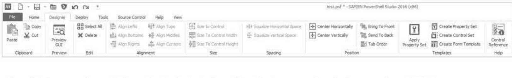

设计标签页包含与表单创建相关的函数。

# PowerShell Studio – 基础介绍 | 69

## 剪贴板 (CLIPBOARD)

- 粘贴（Paste）：将剪贴板中的对象粘贴到当前设计器。

- 复制（Copy）：将设计器中的选中对象复制到剪贴板。

- 剪切（Cut）：从当前设计器剪切对象。

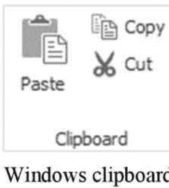

## 预览 (PREVIEW)

- 预览 GUI（Preview GUI）：允许在不运行任何脚本的情况下预览 GUI 设计。

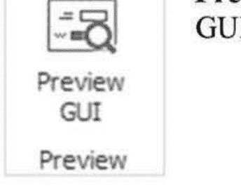

## 编辑 (EDIT)

- 全选（Select All）：选择活动表单上的所有控件。

- 删除（Delete）：删除活动表单上的所有选中控件。使用此功能要小心，没有撤销按钮！

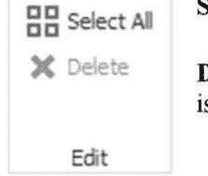

## 对齐 (ALIGNMENT)

这些工具用于对齐表单上的两个或多个控件。

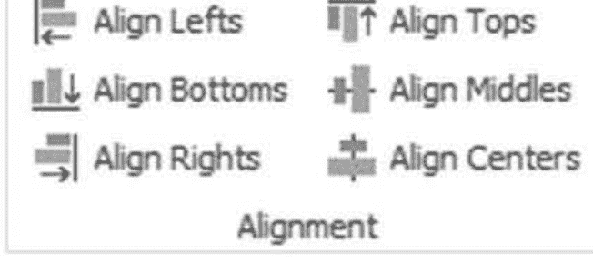

# 70 | PowerShell Studio – Comprehensive指南

## 大小 (SIZE)

这些工具用于调整控件的大小以适应内容。注意到它们也可以用于使一个或多个控件的大小相同。这取决于你选择控件的顺序。

- 控件（Size to Control）
- 控件宽度（Size To Control Width）
- 控件高度（Size To Control Height）

在例例中，我们先选择较小的按钮，然后是第二个按钮。注意第一个控件被白色框包围，其后选的每个控件都被黑色框包围。

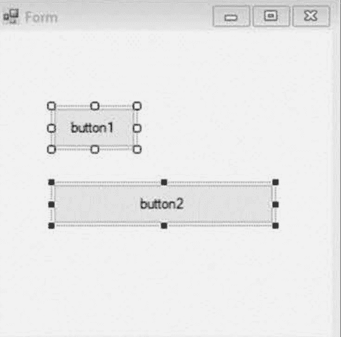

点击“控件大小”，注意 button2 变得与 button1 一大。

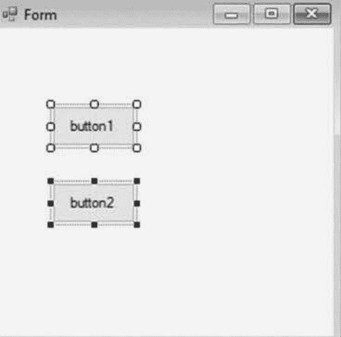

在此例中，你会发现 button1 的高度比 button2 高。在这里我们先选择了 button2，后选择了 button1。通过这样做，我们基本上是在说我们希望 button1 像 button2。我们可以通过相反顺序选择控件来反向操作。

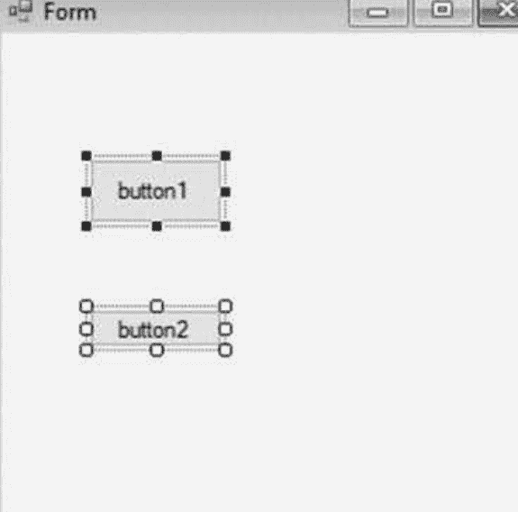

# PowerShell Studio – 基础介绍

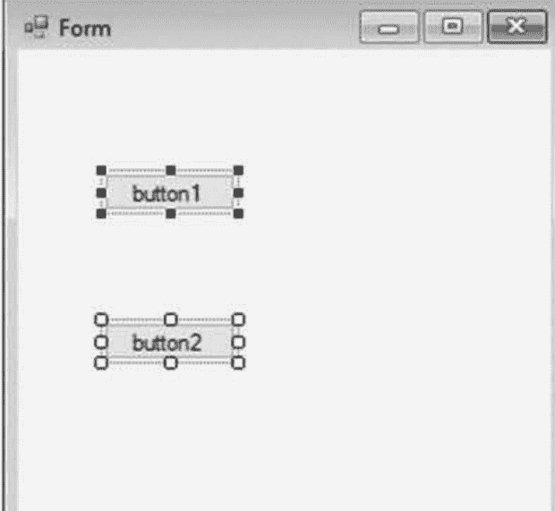

如果我们然后点击“控件高度”，注意 button1 现在的高度与 button2 相同。我们可以通过“控件宽度”进行相同类型的操作。

## 间距 (SPACING)

这些工具用于平衡两个或多个表单控件之间的水平或垂直间距。

- 均分水平空间（Equalize Horizontal Space）
- 均分垂直空间（Equalize Vertical Space）

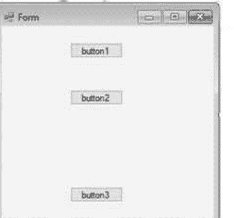

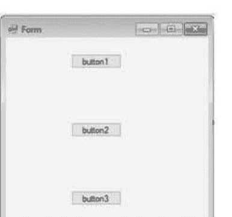

## 位置 (POSITION)

这些工具用于操作活动表单上的一个或多个控件。

- 水平居中（Center Horizontally）
- 垂直居中（Center Vertically）
- 置于顶（Bring To Front）
- 置于底（Send To Back）
- 标签顺序（Tab Order）

# 72 | PowerShell Studio – Comprehensive指南

水平居中


垂直居中


- 置于顶/置于底（Bring to Front/Bring to Back）：用于将控件放在其他控件的前面后面。

- 标签顺序（Tab Order）：标签顺序帮助你设置 Tab 遍历单元素的顺序。当你在表单中按下 **Tab** 键时，每个元素都会按顺序高亮。

标签顺序按钮是一个切换按钮。这意味着点击一次开启，再次点击则关闭。要显示表单项目的标签顺序，只需点击标签顺序按钮，表单上的每个元素左侧都会显示其标签顺序。


点击元素

# PowerShell Studio – 基础入门 | 73

只需循环遍历可用的标签 顺序。当你点击某个元素时，数字将会增加。一旦到达可用标签 顺序的末尾，它将从零重新开始。

标签顺序也可以在每个控件的控制属性中设置；但是，使用标签顺序（Tab Order）控制工具要简单得多。

## 模板 (TEMPLATES)

可以通过选择表单上的一个或多个控件、点击设计器丝带上的“应用属性集”（Apply Property Set）按钮、按下 `Ctrl+L`，或者右键点击控件并从菜单中选择“应用属性集”来应用属性集。

| | 创建属性集 |
| :--- | :--- |
| | 创建控件集 |
| 应用属性集 | 创建表单模板 |


属性集是属性设置的集合，可以一起应用于一个或多个控件。属性集允许你为 GUI 创建一致的外观和视觉体验；它们作用类似于 Web 开发中的 CSS 文件概念。属性集可以是通用的，也可以是针对特定控件类型的。

## 应用属性集

应用属性集：这将显示一个可以应用于所选控件的预设样式列表。该列表将根据所选的控件而更改。如下一页示例所示，按钮和文本框有不同的属性集。


# PowerShell Studio – 全方位指南


如果你在将属性集应用于控件后修改了它，则必须对这些控件重新应用。你的更改不会自动生效。

## 创建属性集

你可以创建自己的属性集，封装本地品牌需求或其他有用设置。要执行此操作，首先设置你想要捕获的所有控件属性。然后选择一个控件，点击设计器丝带上的“创建属性集”按钮，或按下 Ctrl+Shift+L。


当出现“创建属性集模板”时，选择应由属性集捕获的属性。使用“限制到：”选择器指定你的新属性集是可以用于任何控件，还是仅用于与源控件相同类型的控件。在保存之前，你还必须添加描述：

- **控件图标**

  当控件在工具箱中显示时，选择你想要与其关联的图标。

- **公司**

  输入你的公司名称；此字段的默认值取自你的 SAPIEN 名称。

- **控件集描述**

  为你的控件集提供描述。

- **控件插入**

  如果你包含了任何非视觉化控件，可以使用“控件插入”部分来定义当你的自定义控件添加到表单时会发生什么。如下文所示，你有三个选择。

### a. 始终添加你的非视觉控件

如果你将新的自定义控件添加到 PowerShell Studio 中具有名为 `timer1` 控件的表单中，PowerShell Studio 将重命名该计时器并修改你自定义控件中的代码以使用新名称。

### b. 使用现有类型

如果目标表单已有一个相同类型的控件（示例中的 `Timer`），则 PowerShell Studio 将不会添加新控件，而是修改代码以引用现有控件。

### c. 使用现有类型（匹配名称）

如果目标表单已有一个相同类型的控件（示例中的 `Timer`），且名称与你自定义控件中的名称匹配，则 PowerShell Studio 的行为将同于 b——即使用现有控件。

如果名称不匹配，PowerShell Studio 将把你自定义控件中的所有内容添加到表单中，即行为将同于 a。


当你按下“下一步”时，选择应由属性集捕获的属性。使用“限制到：”选择器指定你的新属性集是可以用于任何控件，还是仅用于与源控件相同类型的控件。在保存之前，你还必须添加描述。

# PowerShell Studio – 基础入门 | 77


## 容器

容器标签帮助你指定哪些功能应该被包含。


## 创建属性集

PowerShell Studio 带有了一些预设模板，如果都不符合你的需求，你可以创建自己的。


# PowerShell Studio – 全方位指南 | 78


创建属性集：

- **名称**

  给你的模板一个名称。

- **类型**

  PowerShell Studio 支持两种类型。

- **网格**

  当你打包时，此选项将出现。

- **创建者**

  该值取自“通用（General）”选项卡。

- **公司**

  该值取自“通用（General）”选项卡。

- **描述**

  该模板的描述。

- **目标**

  如果你打包了整个表单，此选项将出现。

# PowerShell Studio – 基础入门 | 79


## 控件引用

这是一个查找 PowerShell Studio 中每个控件属性的极佳资源。当你安装 PowerShell Studio 时，该 PDF 保存在 `C:\ProgramData\SAPIEN\Content\Quick Guides\WinForms.pdf`，你可以直接访问。

## 2.2.3 部署

| 文件 | 首页 | 设计 | 部署 | 工具 | 视图 |
| :--- | :--- | :--- | :--- | :--- | :--- |
| 导出到文件 | 导出到剪贴板 | 设置 | 生成、运行 | 设置 | 安装、卸载 |
| 部署到…… | 复制到 CD/DVD | 导出 | | 安装程序 | 部署 |

包含创建打包可执行文件、MSI 安装程序和部署程序的工具。

## 导出

- **导出到文件**：将当前脚本导出为 `.ps1` 文件。
- **导出到剪贴板**：将当前脚本导出到 Windows 剪贴板。

# PowerShell Studio – 基础介绍

- **Windows Form**：仅用于 Windows 应用程序的 PowerShell 引擎。标准的 PowerShell 输出会被抑制。所有用户交互必须在表单内进行。这可能是你最频繁使用的类型。
- **Windows**：你的脚本将作为无控制台 Windows 应用程序执行。输入和输出以对话框和消息框的形式呈现，且无法重定向。

```text
Microsoft Windows 32 Bit
Microsoft Windows 64 Bit
Microsoft Windows 32 and 64 Bit
Microsoft Windows Native
```

- **Microsoft Windows 32 bit**：将生成一个 32 位可执行文件。
- **Microsoft Windows 64 bit**：将生成一个 64 位可执行文件。
- **Microsoft Windows 32 and 64 bit**：将生成一个 32 位和一个 64 位的可执行文件。
- **Microsoft Windows Native**：操作与上述相同（命名不同），但还会创建一个启动执行文件，该启动程序将为你启动正确的版本。

## 原生 Windows 平台

原生 Windows 平台（Native Windows Platform），我们将详细介绍目标选择，因为这可能会令人困惑。（SAPIEN Technologies, Inc., 2016）

选择此目标会将所有文件放在名为 `bin\Any platform` 的文件夹中。你会创建一个 `MyApp.exe`、`MyAppx86` 和 `MyAppx64.exe`。此外，还会为你选择的每个文件生成配置文件。

`MyApp86` 和 `MyAppx64` 文件是你实际的封装脚本。`MyApp.exe` 文件是一个启动程序，将为当前平台执行正确的包。为了让你的应用程序运行，你必须一起安装或部署三个文件。

启动程序接收与封装文件相同的数字签名和清单，因此指向该文件的快捷方式将创建相同的体验。

## STA 模式

STA 模式表示单线程单元，默认为多线程单元。

STA（单线程单元）和 MTA（多线程单元）决定了进程如何管理 COM 对象以及它们与多个线程的通信。我将不再深入细节，但你不需要担心 COM 对象的内部机制，只需记住某些 GUI 控件需要 STA 才能正常工作。

以下控件需要 STA 模式，否则它们将不会显示：

- `FolderBrowserDialog`（文件夹浏览器对话框）
- `SaveFileDialog`（保存文件对话框）
- `OpenFileDialog`（打开文件对话框）
- 带有 `AutoCompleteSource` 的 `TextBox`（文本框）
- 带有 `AutoCompleteSource` 的 `ComboBox`（组合框）
- 支持通过 Ctrl+C 复制单元格文本的 `DataGridView`（数据网格）
- `Form` 的 `TopMost` 属性设置为 `True`

以下控件功能需要 STA 模式。

STA 模式通常是你编写脚本时不需要考虑的，但如果你在使用 GUI 工具，应该意识到这一点。大多数 GUI 在 MTA 模式下运行良好，但根据原则，你应该始终在 STA 下运行你的 GUI 脚本。

# PowerShell Studio – 全指南

你可以确保你的 Windows PowerShell 脚本在运行时需要 STA。如果你在脚本中添加以下注释，PowerShell Studio 和 PrimalScript 将在 STA 模式下运行：

`# %ForceSTA%= True`

## 输出设置


图 50 - 输出设置

- **输出文件（Output File）**：可执行文件的文件名。由于封装器现在可以生成同名的多个目标，它无法再将这些文件与你的脚本并排放置。相反，可执行文件生成在公共文件夹下的特定平台文件夹中。公共文件夹可以在封装器选项中指定，默认为 `bin`。
- **图标文件（Icon File）**：你可以为可执行文件指定自定义图标（`.ico`）。
- **解析并包含外部脚本（Resolve and include external scripts）**：许多用户表示他们会点源（dot source）包含常用函数的文件。由于这些文件是封装脚本外部的，它们需要与可执行文件一起部署。这导致了需要为原本简单的应用程序创建安装程序，需要检查或更改脚本执行策略，并最终允许用户通过编辑外部脚本文件进行人工干预。

SAPIEN 添加了一个选项，用于在封装时解析点源文件。如果启用了该选项，在构建可执行文件时，外部脚本的代码将注入到封装脚本中。

- 支持带单引号或双引号指定的文件。不存在的文件会发出警告。如果你在注释块内部有数据源语句，该文件将插入到注释块中。
- 使用行注释将防止文件被解析。
- 如果你只需要解析某些而不是所有外部文件，可以使用不同的文件扩展名（区分大小写）。
- `../include/lib.ps1` 将被封装器解析。
- `../include/lib.PS1` 将不会被解析。

- **清单创建（Manifest Creation）**：清单文件的选项，包括自定义清单。这是一个可执行清单，而不是 Windows PowerShell 清单。
- **备用凭据（Alternate Credentials）**：使用指定用户的身份在可执行文件中运行脚本。
- **签名（Signing）**：对于脚本签名，我建议阅读 Jeffery Hicks 写的《Script Signing Made Simple》。你可以在“文档资源”的“快速指南”下找到它的链接。


## 执行限制


执行限制允许你限制包运行的环境，包括：操作系统、特定用户名、MAC 地址、计算机名称或域。


每个字段都接受分号分隔，因此你可以限制多个。例如；用户名 `"John;Bill;Tom"` 将要求登录用户必须是列出的用户之一，否则用户将无法执行该包。

`MAC` 地址、计算机名称和域也是如此。

你一小时内就需要那个脚本……？？


## 版本信息


图 52 - 版本信息

如果你处理过任何应用程序，这些字段中的大多数不会让你感到意外。文件版本（`File version`）需要 `x.x.x.x` 格式，这意味着你必须提供四位版本号，例如 `2.2.1.0`。如果你熟悉 `Visual Basic`，“自动递增文件版本”对你来说并不陌生。


# PowerShell Studio – 全指南

## 构建选项 (BUILD OPTIONS)


图 53 - 构建选项

如果你需要脚本的预处理器或者你想对最终的可执行文件进行某些操作，这就是并行定义的。

构建 (`Build`)：应用你的所有设置并创建可执行文件。运行 (`Run`)：执行该文件。如果你选择了命令行，这将是普通的窗口。

MSI 设置 (`MSI Settings`)：为创建 Windows 安装文件 (`MSI`) 提供所需的设置。API MSI 向导使用 `Wix Toolkit` 创建 Windows 安装程序。完整的 `Wix Toolkit`可以在此处找到：`http://wixtoolset.org/`

- 安装 (`Install`)

- 卸载 (`Uninstall`)

> `https://www.sapien.com/blog/2014/03/25/from-script-to-server-deploying-solutions-with-primscript-2014-part-1/`

# PowerShell Studio – 带有当前用户的 64 位操作系统

下表显示了选择当前用户的安装位置：

| 产品类型 | 32 位 | 64 位 |
| --- | --- | --- |
| Windows 应用程序 | `C:\Program Files (x86)\Program Name` | `C:\Program Files\Program Name` |
| 脚本应用程序 | `%HomePath%\Script Applications\Product Name` | `%HomePath%\Script Applications\Product Name` |
| PowerShell 模块 | `%HomePath%\WindowsPowerShell\Modules\Product Name` | `%HomePath%\WindowsPowerShell\Modules\Product Name` |

**图标：** 此图标文件将嵌入 `MSI` 文件中，并在“程序和功能”中与您的产品一起。

**64 位安装程序：** 勾选此选项将防止在 32 位操作系统上安装。它还将 `COM` 组件注册为 64 位组件，并按指示更改某些文件夹名称。

**为所有用户安装：** 将为系统上的所有用户安装应用程序及其快捷方式。在大多数情况下，此选项需要管理员权限。它还会影响某些产品类型的安装位置。

**需要管理员权限：** 勾选此选项将导致 Windows 安装程序在 Windows Vista 或更高版本上请求提升权限。提示类型取决于您的本地 `UAC`（用户账户控制）设置和当前登录用户。

**所需的最低 PowerShell 版本：** 选择您的应用程序运行所需的最低 `PowerShell` 版本，如果检测到任何低于该版本的版本，将显示安装最低版本的提示，并中止安装。

如果您使用如 `InstallShield` 等安装程序，可以将最低 `PowerShell` 版本的文件作为先决条件包含在内。我曾用此来为应用程序安装所需的 `PowerShell` 模块。

> ^另一种有趣的方法是创建一个具有提升权限的 `exe`，将模块复制到正确的文件夹中。在您的主 `exe` 或应用程序中（在代码的最开始部分）编写“`if (!(test-path $module_path){start elevated.exe}`”。如果用户需要安装模块，这将向用户显示提升权限的提示。一旦安装过一次，下次运行时它将跳过提升权限安装，因为 `test-path` 为真。


脚本编写者对“零日漏洞”的定义

^4 `https://www.sapien.com/forums/viewtopic.php?t=7894`

## 文件和文件夹


文件：这些是您安装的文件。请按照您希望在目标机器上安装的方式对它们进行排序和命名。请确保此文件夹中没有残留的临时文件，因为这里的任何内容都将包含在 `MSI` 文件中。如果您有 `COM` 对象 `DLL`，也也将文件放在这里。它们将被识别为此类文件，并在构建时提取注册信息。

创建快捷方式到：在 Windows 启动菜单中选择您想要创建快捷方式的文件。目前，您只能选择一个文件。通常，这是您的主可执行文件或脚本文件。对于 `PowerShell` 模块，您可以链接到帮助文件等。

MSI 名称：您的 `MSI` 文件名。这仅影响实际的 `MSI` 文件，而不影响任何内部名称。不要使用存放文件夹作为您的软件目录，否则之前的 `MSI` 文件将包含在下次重新构建中。如果您没有从某处加载向导设置文件，将创建一个与您指定的 `MSI` 名称基准相同的 `.mzw` 文件，该文件包含您在向导对话框中输入的所有设置。

存放文件夹：这是您想要安装的所有文件的位置。

# PowerShell Studio – 全面指南

## 签名


图 56 - MSI 设置（签名）

证书：证书可以是安装在本地存储中的代码签名证书，也可以您在这些字段中指定的 `PFX` 文件。您可以使用文件浏览按钮或证书按钮来浏览 `PFX` 文件。

密码：如果您为代码签名指定了 `PFX` 文件，可能需要使用密码。如果是的话，请在此处输入密码。

时间戳 URL：此 `URL` 用于为签署文件的签名创建时间戳。记录时间允许 `MSI` 文件签名在证书过期后仍然保持有效。

使用签名向导对文件进行签名：如果您的证书不符合上述条件，或者您需要在每次构建 `MSI` 时都使用不同的签名进行签名，可以使用向导。上述的任何条目都将被忽略，向导将引导您完成该过程。

- 生成：根据设置创建 `MSI` 包。

- 安装：这将安装当前 `MSI`。

- 卸载：这将卸载当前包（如果版本相同）。

## 部署

部署：根据您配置的设置创建部署。

发送到：将活动文档的部署文件的压缩包发送到电子邮件。

复制到 CD/DVD：将活动文档的部署文件刻录到介质。


图 57 - 部署文件

要部署的主文件：必须至少有一个要部署的文件，从示例下拉框中，您会注意到四个选项：

- 无：这是默认值，您无法使用此项进行部署。

- 源：这将使用源进行部署。

- 可执行文件：这将使用执行文件进行部署。

- 文件：这将使用文件进行部署。

额外的文件：这是要部署的文件。

部署到：这是您想要保存的位置。

# PowerShell Studio – 全面指南

部署：根据您配置的设置创建部署。

发送到：将活动文档的部署文件的压缩包发送到电子邮件。

复制到 CD/DVD：将活动文档的部署文件刻录到介质。


要部署的主文件：必须至少有一个要部署的文件，从示例下拉框中，您会注意到四个选项：

- 无：这是默认值，您无法使用此项进行部署。

- 源：这将使用源进行部署。

- 可执行文件：这将使用执行文件进行部署。

- 文件：这将使用文件进行部署。

额外的文件：这是要部署的文件。

部署到：这是您想要保存的位置。

## PowerShell Studio – 部署命令

部署：根据您配置的设置创建部署。

发送到：将活动文档的部署文件的压缩包发送到电子邮件。

复制到 CD/DVD：将活动文档的部署文件刻录到介质。

# PowerShell Studio – 基础导向

查找：在这里您可以选择当前文档、所有文档、当前目录或任何目录。

在子文件夹中搜索：这如其言，将搜索主路径的所有子文件夹。

文件类型：如果您在“查找”选项中选择了特定文件夹，将启用此项。它将搜索 `*.ps` `*.pss` `*.ps1` `*.psd1` `*.psml` `*.pff` `*.pfs` `*.csproj` 或任何文件。

使用：您可以在搜索中使用正则表达式或通配符。

比较文件：这使用 `ScriptMerge` 查找活动文档与您选择的任何文件之间的差异。当您点击“比较文件”时，将出现文件浏览窗口，选择要与 `PowerShell Studio` 中当前活动文档比较的文件。一旦选择 `ScriptMerge`，它将打开两个文件并突出显示任何差异，如下例所示。


图 58 - 文件比较

左侧的文件是活动文档，右侧是选择的进行比较的文件。

您想将从一个文件的更改合并到另一个文件中吗？按行合并还是合并所有差异？这是 `ScriptMerge` 中的一个隐藏宝 `gem`，可以节省您在文件之间反复复制粘贴行所花费的大量时间。

只需选择您想要合并的行，然后点击“右”或“左”将行复制到另一个文件，或者如果您想复制所有差异，只需点击“全部右”或“全部左”按钮。没有比这更简单的了！

# 94 | PowerShell Studio – 综合指南

1. 创建一个文本文件。

2. 按行列出你的文件对；`File1|File2`（用管道符号 `|` 分隔）。示例：`C:\Users\SAPIEN\Scripts\File1.ps|C:\Users\SAPIEN\Scripts\File2.ps`

3. 以 `.smgrp` 扩展名保存文件（例如 `Myfiles.smgrp`）

4. 每当你双击一个 `smgrp` 文件时，`ScriptMerge` 都会打开它并比较这两个文件。

如果你点击左上角的 `File`（文件）选项卡，将看到一个包含其他颜色功能的菜单，允许你比较文件夹和比较组。


你还可以通过使用“`File`”选项卡底部的“`Settings`”（设置）来编辑比较工具的颜色选项。

**自定义工具（`Custom Tool`）：** 这是另一个我认为经常被忽视的隐藏宝藏。`PowerShell Studio` 中提供了大量的工具，但我们想要的往往比拥拥有的更多，不是吗？`SAPIEN` 预先增加了一个强大的功能，允许你构建自己的自定义工具，这太棒了！

**我可以在自定义工具中使用哪些命令？**

你可以运行任何命令，包括 `cmd.exe` 命令、Windows PowerShell 命令和脚本，以及执行文件的命令，如 `robocopy.exe`、`netstat.exe` 和 `git.exe`。

- **`Cmd.exe`：** 要运行 `cmd.exe` 内部的命令，请在命令前加‘`cmd`’或‘`cmd.exe`’。

- **可执行文件（`Executables`）：** 要运行可执行文件中的命令（例如 `robocopy.exe`、`git.exe` 或 `ipconfig.exe`），只需输入带有任何有效开关的命令即可。

- **`PowerShell`：** 要运行 `PowerShell` `cmdlet`、函数或脚本，请在命令前加‘`powershell`’或‘`powershell.exe`’。运行脚本时，请确保包含脚本文件的完整路径。此外，验证你的执行策略允许你运行脚本。

# PowerShell Studio – 基础介绍 | 95

在命令中，除了使用有效参数、参数和开关外，你还可以包含变量，`PowerShell Studio` 在将命令发送到编辑器之前对其进行解析。

| 变量 | 说明 |
| :--- | :--- |
| `SProjectFolder` | 当前项目目录的路径。仅在项目打开时有效。 |
| `SPowerShellS` | 在功能带上选择的 `PowerShell` 版本号。 |
| `SPlatforms` | 当前平台（`x86` 或 `x64`）。 |
| `SWinDir` | Windows 目录的路径（例如 `C:\Windows`）。 |
| `SWinSystems` | Windows 系统目录的路径（例如 `C:\Windows\System32`）。 |
| `SSelectionS` | 当前选的内容（如果有）。可能包含回车/换行符。 |
| `SFiles` | 当前文件的完整路径（如果有）。 |
| `SFileName` | 当前文件的名称（不含路径）。 |
| `SFileDir` | 当前文件目录的路径（不含文件名）。 |
| `SDirS` | `PowerShell Studio` 安装目录的完整路径。 |
| `SLineS` | 活动文件中的当前行号。 |
| `SColS` | 活动文件中的当前列号。 |

你可以提示一个参数值并创建一个特定目录的自定义菜单。我将在下面向你展示，但在构思你的自定义工具时请记住这些功能。

## 如何创建自定义工具

要创建一个自定义工具，从一个名为 `CustomMenu` 的文本文件开始。将该文件放在 `PowerShell Studio` 或 `PrimalScript` 的 `ProgramData` 目录下。

例如：

```
..\ProgramData\SAPIEN\PowerShell Studio 2016
..\ProgramData\SAPIEN\PrimalScript 2016
```

文件内容的语法为：

```
[Menu]
1=Command Name 1,command line 1
2=Command Name 2,command line 2
[Application]
1=Command Name 1,command line 1
2=Command Name 2,command line 2
```

你可以添加额外的编号命令行。数字表示一条命令行。它们并不决定命令在文件中的顺序。如果文件包含多个具有相同数字的命令行，则每个数字对应的第一个命令行是有效的。

## 示例：

对于每个命令，此行输入命令名称、一个分号（`;`）和命令本身。

例如，此行创建了一个 '`Run Get-Acl`' 命令，它在当前文件（`File$`）上运行 `Get-Acl` `cmdlet`；然后以列表格式化输出的所有属性。

```
1=Run Get-Acl;powershell Get-Acl -Path $File$| Format-List -Property *
```

## CustomMenu.inf 中的部分

有两个部分：`[Menu]` 和 `[Application]`

- 在 `[Menu]` 部分中，添加运行后会退出的命令，例如 `PowerShell` `cmdlet`。自定义菜单会等待命令完成。

- 在 `[Application]` 部分中，添加不会退出的命令，例如显示你可能想要保持打开的文件或 `UI` 的命令。自定义菜单运行这些命令并退出，而不等待它们完成。

- 有一个你可能听过的 `[CommandLine]` 部分，但它与使用 `[Menu]` 相同。


例如，`[Application]` 部分中的命令会在记事本中打开 `CustomMenu.inf`，以及 `[Menu]` 部分中的 `Run Get-ACL` 命令。从上一页的菜单可以看出，`[Menu]` 部分和 `[Application]` 部分是用行分隔的。

```
[menu]
1=Run Get-Acl;powershell Get-Acl -Path $File$ | Format-List -Property *
[Application]
1=OpenCustomMenu.inf;Notepad 'C:\ProgramData\SAPIEN\PowerShell Studio 2016\CustomMenu.inf
```

5 `https://www.sapien.com/blog/2016/05/23/add-custom-tools-to-the-menu/`

# PowerShell Studio – 基础介绍 | 97

为了更好地组织菜单，可以在两个项目之间输入一行 "-" 字符。例如：

```
[menu]
1=Run Get-Acl;powershell Get-Acl -Path $File$ | Format-List -Property *
-
2=GetUserName
3=IPConfig
```


## 文件夹特定自定义工具

为了更好地组织菜单，可以在两个项目之间输入一行 "-" 字符。例如：

```
[menu]
1=Run Get-Acl;powershell Get-Acl -Path $File$ | Format-List -Property *
-
2=GetUserName
3=IPConfig
```

## 分析

- 在 `[Menu]` 部分中，添加运行后会退出的命令，例如 `PowerShell` `cmdlet`。自定义菜单等待命令完成。

- 在 `[Application]` 部分中，添加不会退出的命令，例如显示你可能想要保持打开的文件或 `UI` 的命令。自定义菜单运行这些命令并退出，而不等待它们完成。

- 有一个你可能听过的 `[CommandLine]` 部分，但它与使用 `[Menu]` 相同。你可以提示一个参数值并创建一个特定目录的自定义菜单。我将在下面向你展示，但在构思你的自定义工具时请记住这些功能。


在`[Menu]`部分中，添加运行后会退出的命令，例如 PowerShell cmdlet。自定义菜单等待命令完成。

在`[Application]`部分中，添加不会退出的命令，例如显示你可能想要保持打开的文件或 UI 的命令。自定义菜单运行这些命令并退出，而不等待它们完成。

有一个你可能听过的`[CommandLine]`部分，但它与使用`[Menu]`相同。

在`[Menu]`部分中，添加运行后会退出的命令，例如 PowerShell cmdlet。自定义菜单等待命令完成。

在`[Application]`部分中，添加不会退出的命令，例如显示你可能想要保持打开的文件或 UI 的命令。自定义菜单运行这些命令并退出，而不等待它们完成。

有一个你可能听过的`[CommandLine]`部分，但它与使用`[Menu]`相同。

在`[Menu]`部分中，添加运行后会退出的命令，例如 PowerShell cmdlet。自定义菜单等待命令完成。

在`[Application]`部分中，添加不会退出的命令，例如显示你可能想要保持打开的文件或 UI 的命令。自定义菜单运行这些命令并退出，而不等待它们完成。

有一个你可能听过的`[CommandLine]`部分，但它与使用`[Menu]`相同。

在`[Menu]`部分中，添加运行后会退出的命令，例如 PowerShell cmdlet。自定义菜单等待命令完成。

在`[Application]`部分中，添加不会退出的命令，例如显示你可能想要保持打开的文件或 UI 的命令。自定义菜单运行这些命令并退出，而不等待它们完成。

有一个你可能听过的`[CommandLine]`部分，但它与使用`[Menu]`相同。

在`[Menu]`部分中，添加运行后会退出的命令，例如 PowerShell cmdlet。自定义菜单等待命令完成。

在`[Application]`部分中，添加不会退出的命令，例如显示你可能想要保持打开的文件或 UI 的命令。自定义菜单运行这些命令并退出，而不等待它们完成。

有一个你可能听过的`[CommandLine]`部分，但它与使用`[Menu]`相同。

在`[Menu]`部分中，添加运行后会退出的命令，例如 PowerShell cmdlet。自定义菜单等待命令完成。

在`[Application]`部分中，添加不会退出的命令，例如显示你可能想要保持打开的文件或 UI 的命令。自定义菜单运行这些命令并退出，而不等待它们完成。

有一个你可能听过的`[CommandLine]`部分，但它与使用`[Menu]`相同。

在`[Menu]`部分中，添加运行后会退出的命令，例如 PowerShell cmdlet。自定义菜单等待命令完成。

在`[Application]`部分中，添加不会退出的命令，例如显示你可能想要保持打开的文件或 UI 的命令。自定义菜单运行这些命令并退出，而不等待它们完成。

有一个你可能听过的`[CommandLine]`部分，但它与使用`[Menu]`相同。

# 98 | PowerShell Studio – 综合指南

- PrimalScript
- PowerShell Regex
- PrimalSQL
- PrimalXML
- PowerShell HelpWriter
- VersionRecall
- WMI Explorer
- SAPIEN

**PrimalScript：** PrimalScript 2016 是通用脚本 (USE) 的下一代。作为系统、数据库或网络管理员、Web 开发人员或终端用户，你需要处理多种技术、语言和文件格式。

**PrimalSQL：** 你可以连接任何数据库：从 Microsoft SQL 到 Oracle 或 Microsoft Access 甚至 Excel。PrimalSQL 用于构建丰富复杂的查询。在应用程序内部，你可以使用并精炼查询，生成多种语言的代码。其现代化的界面使 PrimalSQL 易于使用。

**PrimalXML：** 一个专为编辑、处理和创建 XML 文件设计的工具。

**PowerShell HelpWriter：** PowerShell HelpWriter 2016 是所有命令、函数、工作流和 CIM 命令的 XML 帮助文件的顶级编辑器。

**VersionRecall：** VersionRecall 2016 自动化了最常用的创建备份和维护多个文件版本的手动过程。

**WMI Explorer：** Windows 管理工具数据库庞大宇宙的下一代工具。WMI 数据库代表了系统或网络管理员每天需要使用的服务器和客户端的海量信息。

**PowerRegex：** PowerRegex 是让正则表达式创建和发现变得简单的工具，通过按类别分组正则表达式，并提供构造说明和示例。

编辑器：PowerShell 配置让设置工作环境变得更容易，允许你在启动时预加载最常用的加载项或模块、定义函数、设置变量以及你需要的其他内容。

7 https://www.sapien.com/software/primalcript

8 https://www.sapien.com/software/primalsql

9 https://www.sapien.com/software/primalxml

10 https://www.sapien.com/software/powershell_helpwriter

11 https://www.sapien.com/software/versionrecall

12 https://www.sapien.com/software/wmiexplorer

13 https://www.sapien.com/software/productivity_pack

# PowerShell Studio – 基础介绍

## POWERSHELL

- PowerShell Console：打开 PowerShell 控制台窗口。
- PowerShell ISE：打开 Windows PowerShell (x86) ISE 控制台。
- Update-Help：这将您的帮助文件更新到最新的可用版本。


图 60 - 安装帮助文件

如果你在执行`Update-help`期间收到这个不太友好的错误信息，意味着微软尚未提供相应的帮助文件下载。我同意这个错误信息并不直观，但它是由微软生成的，而不是 SAPIEN 生成。

示例：

`'https://technet.microsoft.com/en-us/library/jj657534.aspx'` 无法解析为容器。

## 2.2.5 版本控制标签页

| 文件 | 首页 | 设计器 | 部署 | 工具 | 版本控制 | 帮助 | 撤销检出 | 属性 |
| --- | --- | --- | --- | --- | --- | --- | --- |
| + 恢复 | | 提交文件 | 添加到... | 属性 | | | |
| 删除 | | | 文件 | 检入 | 最新 最新 | 比较 | |
| 版本回 | 启动 | 检出 | 查看历史 | 刷新 | | |
| 回滚 | 获取最新 | 版本控制 | | |

这些控件提供了一个系统，可以将你的脚本恢复到之前的状态，并为你的脚本提供版本控制，特别是当你与其他团队成员共同编写同一个脚本时。

## 恢复点

这让我想起了微软 Windows 的恢复点，具有类似的行为，但它是在脚本级别运行的。这将帮助你在向脚本中注入错误或错误代码时，从“自残”中救回自己。


创建：在进行任何重大脚本更新之前，我强烈建议养成创建恢复点的习惯，总有一天你会感谢自己这样做。目前似乎没有迹象显示恢复点已创建，这可能会误导你认为什么都没有发生。我更倾向于看到某种类型的消息或状态指示来显示恢复点已成功创建。然而，如果是创建的第一个恢复点，启用“恢复”和“删除”按钮至少算是一种指示，但之后很难知道后续创建的恢复点是否成功。系统目前只会保留最后一个创建的恢复点，暂没有历史记录。


恢复：这将你的脚本恢复到你创建的最后一个恢复点。在恢复之前，你会收到一个确认窗口。

删除：这将删除你的最后一个恢复点。

回滚：用于将脚本恢复到当前会话的开始。如果你已经在脚本上工作了很长时间，请谨慎使用此功能，因为它将擦除当前会话开始的所有更改。

- 在修改文件后立即创建恢复点。
- 在应用程序关闭时移除恢复点。

恢复点选项可在“备份”标签页可用。

## VERSIONCALL（版本回）

简单快速的设置允许你选择一个由 VersionRecall 管理的文件夹，以及一个存储旧版本的“备份位置”（通常在外部驱动器或网络驱动器上）。从那时起，像往常一样在本地保存文件，当你准备好时，只需使用 VersionRecall Explorer 提交文件。你必须在系统中安装了 SAPIEN 的 VersionRecall，否则 PowerShell Studio 中的控件将被禁用。与其他版本控制系统不同，SAPIEN 的 VersionRecall 永远不会更改文件或其扩展名，恢复非常简单，就像打开文件的旧版本一样容易。它也没有锁定机制，因此没有检入或检出——这对于单个人来说是很好的。

VersionRecall 本身是 PowerShell Studio 的全功能产品，因此我们在这里不深入探讨。如果你想了解更多关于 VersionRecall 的信息：


VersionRecall Explorer：这将启动与活动文档对应的存储库的 VersionRecall Explorer。

提交文件：将活动文件提交到对应的 VersionRecall 仓库。

恢复文件：用 VersionRecall 仓库中提交的最新版本覆盖活动文件。

获取最新：用对应 VersionRecall 仓库中的较新版本覆盖活动文件。

## 版本控制

VersionRecall 是一个版本控制提供者。然而，出于几个原因，SAPIEN并不希望它刻意使用任何 API，特别是微软的版本控制接口。微软版本控制接口的规范可以在不通知的情况下更改，而且这是一个非常过时的 API，导致开发团队需要花费大量精力来适配。要启用源工具，你必须首先设置版本控制提供者，并在 PowerShell 选项的“版本控制”标签页下启用版本控制。

| 设置 | |
| --- | --- |
| 启用版本控制 | 提示检入 |
| 自动检入 | 禁用检入 |
| 检出 | 自动检出 |
| 直接信息输出 | 抑制信息消息 |

- 启动：启动版本控制软件。
- 添加到：将文档添加到版本控制数据库。
- 检入：将当前文档的更改检入版本控制数据库。
- 检出：检出当前文档进行编辑。
- 撤销检出：恢复到上次检入的文件。
- 获取最新：从版本控制数据库获取文件的最新版本。
- 查看历史：查看文档的历史版本。
- 属性：查看文档的版本控制属性。
- 比较：将活动文档与之前的版本进行比较。
- 刷新：刷新版本控制状态。


GIT 是一个免费开源分布式版本控制系统，旨在处理从小型到非常大的项目，可能是全球使用最广泛的版本控制系统之一。

目前与 PowerShell Studio 集成 GIT 的支持仅通过自定义菜单实现。遗憾的是，GIT 没有 API。为了在 SAPIEN 产品中使用版本控制解决方案，它必须具有 MSSCCI 提供者，那里有几个 GIT MSSCCI 提供者。

如果你正在使用项目，可以通过自定义菜单运行`git add`，它会将你仓库中已修改的文件提交。

## 自定义 GIT 菜单

```
[Menu]
1=GIT - 暂存: C:\Program Files\Git\bin\Git.exe "$file$"
2=GIT - 提交到本地仓库;C:\Program Files\Git\bin\Git.exe "$fileName$" -a -m
"Prompt[Enter comment|Commit from PowerShell Studio $Date $Time$"]
3=GIT 提交所有到本地仓库;C:\Program Files\Git\bin\Git.exe commit -a -m
"Prompt[Enter comment|Commit from PowerShell Studio $Date $Time$"]
4=
5=GIT - 状态;C:\Program Files\Git\bin\Git.exe status
6=
7=GIT - 推送到远程仓库;C:\Program Files\Git\bin\Git.exe push Remote
8=GIT - 从远程仓库获取;C:\Program Files\Git\bin\Git.exe fetch Remote
9=GIT - 从远程仓库拉取;C:\Program Files\Git\bin\Git.exe pull Remote master
[Application]
1= GUI;C:\Program Files\Git\cmd\git-gui.exe
```

## 2.2.6 帮助标签 (Help Tab)

PowerShell Studio – 基础引导


帮助标签包含检查更新、产品手册和参考、示例以及指向支持区域的外部链接。

### 产品支持

| 特性 | 描述 |
| :--- | :--- |
| 产品手册 | 我们在起始章节“引导指南”中引入了产品手册，并带有文档资源管理器（Document Explorer）。任何新接触 PowerShell Studio 的人都应该阅读产品手册，因为它包含了许多非常有用的信息。 |
| 键盘快捷键 | 将打开位于`C:\Program Files (x86)\SAPIEN Technologies, Inc\PowerShell Studio 2016`的键盘快捷键 PDF 文件，其中列出了 PowerShell Studio 2016 的所有可用键盘快捷键。这些快捷键也列在本书末的参考章节中。 |
| 控件引用 | |
| 示例 | |

**控件引用 (Control Reference):** 这将打开 WinForms 控件引用文档，其中包含 PowerShell Studio 中的所有控件及其属性函数。这是你在学习 PowerShell Studio 时会经常参考的的一份非常有用的指南。这些内容也列在本书末的参考章节中。

**示例 (Samples):** 这将打开文档资源管理器，列出所有可用示例脚本和表单。SAPIEN 为用户提供了一个坚实的示例基础，帮助他们快速学习。

在以下主题中提供了可用示例：

- 批处理文件 (Batch Files)
- .NET
- HTA
- PowerShell
- PowerShell Studio
- Windows 脚本主机 (Windows Script Host)

### 更新 (UPDATES)

**检查更新 (Check for Updates):** 在线检查 SAPIEN 产品更新。

**更新频率 (Update Frequency):** 选择你希望 PowerShell Studio 自动在线检查可用更新的频率。

**Update-Help:** 这将向微软检查 Windows 的更新。


### 在线 (ONLINE)


包含指向 SAPIEN 在线支持资源、最新信息、文章、论坛的链接。当你尝试解决问题或获取关于使用脚本或表单最佳方法的建议时，这非常有用。

### 帮助 (HELP)

这让许多人感到困惑，我看到过抱怨说它没有任何作用，问题通常在于它没有被正确使用。上下文帮助是根据光标位置触发的，而不是实际的区域，因此你需要将光标置于命令（cmdlet）的开头，然后点击“上下文帮助”按钮。如果该命令有帮助信息，它将显示在脚本下方窗口的底部；或者如果是在线帮助资源，你的浏览器将打开并显示帮助页面。


在下一张截图中，你可以看到光标位于第 23 行属性“Parameter”的开头。点击“上下文帮助”后，帮助信息出现在窗口中。

## 2.2.2 视图标签 (View Tab)

```
文件 编辑 设计 标签 工具 控件 帮助 视图
水平标签组 启动页 输出 查找 结果 函数资源管理器 属性
垂直标签组 选项 调试 性能 代码片段 工具箱 对象 设计 布局
选择 调试 变量 控制台 布局
```

视图标签包含多个面板，用于查看 PowerShell Studio 的不同区域，包括：输出、设计、调试、布局等。它还包含显示启动页和 PowerShell Studio 选项的按钮。

提供了各种可选的布局模板，例如：默认 (Default)、调试 (Debug)、控制台 (Console)、设计 (Designer)、编辑器 (Editor) 和 仅编辑器 (Editor Only)。


图 61 - 控制台布局 (Console Layout)


图 62 - 调试布局 (Debug Layout)


图 63 - 设计布局 (Designer Layout)


图 64 - 编辑器布局 (Editor Layout)

如果预定义的布局都不符合你的需求，你还可以创建并保存符合你需求的自定义布局。

## 2.3 面板 (PANES)

PowerShell Studio 2016 中提供了 16 个不同的面板。

### 2.3.1 调用堆栈面板 (Call Stack Pane)

- 调用堆栈 (Call Stack)
- 控制台 (Console)
- 调试 (Debug)
- 调试控制台 (Debug Console)
- 查找结果 (Find Results)
- 函数资源管理器 (Function Explorer)
- 帮助 (Help)
- 对象浏览器 (Object Browser)
- 输出 (Output)
- 性能 (Performance)
- 项目 (Project)
- 属性 (Property)
- 代码片段 (Snippets)
- 工具箱 (Toolbox)
- 监视 (Watch)

调用堆栈面板显示你通过脚本到达当前断点的执行路径。除了第一行外，每一行都代表你的脚本调用的点。

### 2.3.2 控制台面板 (Console Pane)

这将打开资源管理器显示所有可用示例脚本和表单。SAPIEN 为用户提供了一个坚实的示例基础，帮助他们快速学习。

在以下主题中提供了示例：

- 批处理文件
- `.NET`
- `HTA`
- `PowerShell`
- `PowerShell Studio`
- Windows 脚本主机

### 更新 (UPDATES)

**检查更新 (Check for Updates)：** 在线检查 SAPIEN 产品更新。

**更新频率 (Update Frequency)：** 选择你希望 PowerShell Studio 自动在线检查可用更新的频率。

`Update-Help`：这将向微软检查 Windows 的更新。

### 2.3.3 调试面板 (Debug Pane)

调用堆栈面板显示你通过脚本到达当前断点的执行路径。除了第一行外，每一行都代表你的脚本调用的点。

### 2.3.4 调试控制台面板 (Debug Console)

在调试控制台中，你可以与断点进行交互。这将显示调试信息。

### 2.3.5 查找结果面板 (Find Results Pane)

你在 PowerShell Studio 中进行搜索时，无论是“在文件中查找”还是“查找引用”，结果将显示在查找结果面板中。

### 2.3.6 函数资源管理器面板 (Function Explorer Pane)

函数资源管理器将显示当前脚本中的所有函数和事件。对于在大型脚本中查找特定函数，这是一个非常有用的工具。

# PowerShell Studio - 全面指南

```powershell
<#.SYNOPSIS
    关于 Update-Log 函数的简要描述。

.DESCRIPTION
    关于 Update-Log 函数的详细描述。

.PARAMETER logging
    logging 参数的描述。

.EXAMPLE
    PS C:\Update-Log -logging 'Value'

.NOTES
    关于该函数的附加信息。
#
Function Update-Log
{
    $currentdir = "C:\ProgramFiles\VAMS\scc"
    $logging = Get-Date -Format 'yyyy-MM-dd HH:mm:ss': ' ' + $logging
    Add-Content -Path $logFile -value $logging
    $Status.Refresh()
    $progressbar_scc_health.Refresh()
    System.Windows.Forms.Application]::DoEvents()
}
```

编辑：打开所选函数的函数生成器。

复制：将函数定义复制到剪贴板。

重命名：重命名所选函数并更新脚本或项目中的引用以反映更改。

图 69 - 示例基于注释的帮助

### 2.3.7 帮助面板

面板显示有关代码编辑器窗口中输入的 `cmdlet`、别名或 WMI 对象的上下文 Windows PowerShell 帮助。


如果 PowerShell Studio 配置为使用外部帮助，则帮助将在 SAPIEN 文档管理器中显示。

# PowerShell Studio – 基础入门 | 11

为了确保帮助项目出现在帮助面板中，你必须按照如下方式配置两个选项：

1. 选项编辑器设置：在输入时显示 `cmdlet` 帮助。

| 通用 | 编辑器设置 | |
| --- | --- | --- |
| 备份 | [x] 启用自动语法检查 | [x] 启用代码折叠 |
| [x] 启用当前行高亮 | [x] 启用跟踪更改 | |
| 控制台 | 使用空格代替制表符 | [ ] 显示行号 |
| 调试器 | [x] 在输入时显示 `cmdlet` 帮助 | [ ] 显示空白 |
| 设计器 | [x] 启用括号高亮 | [ ] 加载时折叠区域 |
| 编辑器 | | [ ] 显示列指南 |
| `Tab Size` | 插入基于注释的帮助：函数之前 | |
| 程序集 | 自动插入字体和颜色... | |
| `PrimarySense` | [x] 自动插入括号 | [ ] 为已用模块自动插入导入命令 |
| 面板 | [x] 自动插入方括号 | |
| PowerShell | [x] 自动插入大括号 | |
| 源代码控制 | [x] 自动插入字符串引号 | |
| 分析 | 运行时自动分析脚本 | |

图 70 - Cmdlet 帮助

2. 选项 PowerShell 设置：在文档管理器中显示帮助。

| 通用 | PowerShell 设置 | |
| --- | --- | --- |
| 备份 | [x] 在文档管理器中显示帮助 | [x] 导出模块时更新缓存 |
| [x] 启用执行策略警告 | | |
| 控制台 | Windows PowerShell 安全性 | |
| 调试器 | 更改执行策略 | |
| 设计器 | 本地存储中的证书：（留空以使用第一个可用代码证书） | |
| 编辑器 | PFX 证书： | |
| 程序集 | 密码： [x] http://timestamp.global.com/scripts/timestamp.dl | |
| 格式化 | 时间戳 URL： | |
| 外部签名工具： | （使用外部工具将覆盖所有其他设置。为要签名的脚本指定 `%path%`。） | |
| `PrimarySense` | [ ] 保存时自动签名 `.ps1` 脚本 | |
| 面板 | | |
| 源代码控制 | | |

图 71 - 文档管理器帮助

### 2.3.8 对象浏览器

对象浏览器包含以下所有面板：


- **PowerShell 浏览器**：用于通过帮助程序浏览 PowerShell 对象，包括 `cmdlet`、别名、模块和函数。
- **NET 对象浏览器**：显示计算机可用的 `.Net` 程序集。可以打开每个程序集以显示其中包含的命名空间和类型。可以打开单个类型以显示其内容——属性、方法等。
- **WMI 浏览器**：显示计算机上 WMI 数据库的命名空间和对象。当你点击此面板中的节点时，PowerShell Studio 将在帮助面板中显示有关该节点的信息和代码示例。
- **数据库浏览器**：允许你浏览数据库并生成数据。在使用数据库浏览器之前，你需要创建一个数据库连接。PowerShell Studio 支持以下连接：Access、SQL Server、MySQL、ODBC、OLEDB、Oracle、PostgreSQL 和 Sybase。

点击“创建新数据库连接”图标。配置好连接后，按保存将向数据库浏览器添加新节点。点击节点将列出数据库的内容，并允许你深入到表、视图、存储过程等。

每个面板还包含一个自定义右键菜单，帮助你将对象集成到代码中。它可能会直接插入代码段，也可以指向 PowerShell 帮助或 MSDN 帮助。

你还可以从对象浏览器将对象拖到脚本编辑器中以插入到代码中。

# PowerShellStudio – 基础入门 | 11

右键点击数据库对象提供这些选项：

**插入**：生成一个使用 ADO.NET 的 PowerShell 函数。

**复制**：将函数定义复制到剪贴板。

**生成表单**：根据对象创建 PowerShell 表单。

**生成查询**：根据对象创建 PowerShell 查询。

### 2.3.9 输出面板

输出面板显示你运行的命令的结果。它还显示任何错误消息或警告。

PowerShell Studio 允许你实时监控脚本的输出。


### 2.3.10 性能面板

性能面板显示脚本的 CPU 和内存占用。它可以帮助你识别代码中的瓶颈。


### 2.3.11 项目面板

项目面板显示项目的文件夹结构。它允许你轻松地组织文件和脚本。


### 2.3.12 属性面板 (Property Pane)

此面板显示表单编辑器或项目面板中当前选中控件、对象或表单的所有属性。


表单属性：左侧截图是表单对象的属性面板示例。表单属性包含以下部分：

- 辅助功能（Accessibility）——用于为辅助功能客户端提供信息。
- 外观（Appearance）——控制表单的整体外观，如背景颜色、图像、字体、边界样式等。
- 行为（Behavior）——控制表单的行为方式，例如启用或禁用、上下文菜单栏（右键菜单）、验证等。
- 数据（Data）——允许对表单进行数据绑定。
- 设计（Design）——在此处可以为对象命名，以及锁定或解锁表单对象的尺寸调整。
- 焦点（Focus）——配置组件是否触发验证事件。
- 布局（Layout）——决定缩放、表单的最大和最小尺寸、位置、填充和窗口属性。
- 其他（Misc）——控制接受和取消按钮的触发器。
- 窗口大小（Window Size）——控制表单外观的各种选项，包括外观、菜单栏、图标等。

属性面板会根据选中的控件或对象而变化，某些属性可能比其他少。在“控件”章节中，我们将深入讨论每个控件对象的每个属性。

你可以通过脚本操作对象的属性，允许你在执行时在 GUI 中提供交互，例如开启/关闭控件、更改文本、操作数据等。

你可以右键点击任何属性以获取该选项的 MSDN 在线帮助，或者在选择属性后按 F1。

# 120 | PowerShell Studio - 全面指南


你也可以使用属性面板顶部的对象选择器下拉菜单在表单控件之间切换，或者通过在设计器中选择控件。

某些控件支持名为“智能标签”（smart tags）的另一种修改控件属性的方法。当控件在设计器中被选中时，它们会显示为控件右上角的小图标。

点击智能标签将显示特定于控件的选项，并提供另一种以任务为导向的方法修改属性。


左侧两个按钮允许你在按功能分组查看属性或简单按字母顺序列出属性之间进行切换。

右侧两个按钮：此对按钮允许你在查看对象支持的属性或它可以触发的事件之间切换。

### 2.3.13 代码片段面板 (Snippets Pane)

如果你熟悉代码片段（snippets），它们是小段可重用的代码，可以轻松插入脚本中；代码片段可以是完整的函数或单行语句。代码片段面板包含可以在脚本使用的各种片段，以完成许多常见任务。默认片段包含在 `%ProgramData%\SAPIEN\PowerShell Studio 2016\snippets` 文件夹中。你也可以在“选项”对话框的“面板”选项卡上指定文件夹路径，为代码片段浏览器添加自己的额外文件夹。该文件夹在代码片段浏览器中始终被称为“custom”。

- 这将重新扫描代码片段文件夹并刷新代码片段面板。
- 在 Windows 资源管理器中打开当前选的代码片段文件夹。
- 启动代码片段编辑器以便创建自己的代码片段。也可以使用右键菜单编辑或删除现有代码片段。


# 代码片段编辑器 (SNIPPET EDITOR)

当你在 PowerShell Studio 中编辑现有代码片段或创建新代码片段时，将启动代码片段编辑器。这是一个独立的程序，支持多种编程语言。代码片段是可以添加到 PowerShell 脚本中的可重用代码块，可以节省时间并减少错误。代码片段可以包含占位符，当使用片段时，PowerShell Studio 会提示你为这些占位符提供值。

当你第一次点击创建新片段时，会弹出的窗口要求你为片段文件命名，默认情况下，片段将保存到：`%ProgramData%\SAPIEN\PowerShell Studio 2016\Snippets\`


标题（Title）：片段名称。

快捷键（Shortcut）：在代码编辑器中输入该文本将调用代码片段。

描述（Description）：对片段作用的简短描述。

作者（Author）：你的详细信息。

帮助 URL（Help URL）：如果你有关于片段的帮助信息，请在此提供链接。

语言（Language）：如果你想在 PowerShell Studio 中使用该片段，必须设置为“PowerShell”。

类型（Type）：这定义了片段的预期用途，以及 PowerShell Studio 显示该片段的位置。

- 扩展（Expansion）——如果你的片段旨在直接插入代码中，则使用此。
- 包围（Surrounds With）——如果你的片段旨在包裹现有代码，则使用此。
- 两者（Both）——如果你的片段既可以用于扩展，也可以用于包裹。

如果你选择“包裹”或“两者”，你必须在片段代码体的某处包含占位符 `$selected`，否则在使用你的片段时可能会覆盖用户代码。

# PowerShell Studio - 基础引导 | 12


图 75 - 类型（两者）

引用（References）：此部分帮助 PowerShell Studio 理解你的片段的依赖项。

导入（Imports）：此处列出的程序将加载到片段中。

变量详情（Variable Details）：此部分用于配置片段中的占位符。当你在代码编辑器中右键点击并选择“添加变量”。

一旦你命名了变量，它将以 `<变量名>` 的形式出现在片段中，你可以配置变量属性。

- ID：变量名称。
- 默认（Default）：默认值。
- 函数（Function）：未用于代码片段。
- 类型（Type）：未用于代码片段。
- 种类（Kind）：未用于代码片段。
- 可编辑（Editable）：未用于代码片段。
- 提示（ToolTip）：提供有关变量用途的文本。这帮助用户在片段中导航占位符。

提供了两个内置变量：

- `$selected`：允许在使用片段时将编辑器中的代码合并到片段中。
- `$send`：指定片段插入时光标所在的位置。


# 125

## 2.3.14 工具箱面板 (Toolbox Pane)

工具箱面板是使用设计器时常用的面板之一，它是用于创建功能表单的所有控件所在地。

工具箱面板由三个选项卡组成：

- 控件（Controls）：添加到表单的所有 GUI 控件。
- 控件集（Control Sets）：像普通表单控件一样从工具箱面板拖放的自定义控件。它们由具有定义的属性值、事件处理程序和函数的单个或多个控件组成。
- 选择（Select）：这是你的格式中所有控件的列表，方便选择。

我们将要介绍每个控件及其基本功能，在后面的章节中，我们将为每个控件提供更深入的功能和示例。

> SAPIEN 为许多控件创建了亮点（Spotlights），可用时我们将提供参考。

### 控件对象 – 概览

- 18 按钮（BUTTON）——创建一个点击的按钮。用于启动或结束操作。
- 19 图表（CHART）——创建一个带有可用服务器类型的图表。
- 20 复选框（CHECKBOX）——创建一个代表真/假条件的窗口复选框控件。
- 21 复选列表框（CHECKLISTBOX）——创建一个多项目列表复选框，允许你列出一个项目集合，每个项目都有其自己的复选框。

# 126 | PowerShell Studio – 全方位指南

- COLORDIALOG - 创建一个颜色选择器，允许表单用户为表单选择颜色。
- COMBOBOX - 为多个项目创建一个下拉列表。项目列表可以是静态的，也可以是动态构建的。


# PowerShell Studio – 基础方向


`FLOWLAYOUTPANEL` - 用于在表单上创建一个区域，您可以自动控制控件的对齐和流向。流向选项有“从左到右”、“从右到左”、“从上到下”和“从下到上”。


`FOLDERBROWSERDIALOG` - 用于提示用户选择文件夹。


`FOLDERBROWSERMODERNDIALOG` - 使用 Windows 较后版本提供的这种现代版文件夹浏览器对话。


`FONTDIALOG` - 该控件提示用户从本地计算机安装的字体中选择字体。


`GROUPBOX` - 在表单上创建一个区域，允许您将不同的控件分组在一起，以优化表单内的设计流程。


`HELPPROVIDER` - 允许您为表单上的控件设置弹出或在线帮助。


`HSCROLLBAR` – 这代表标准的 Windows 水平滚动条，可用于触发操作其他控件的事件。


`ImageList` - 使用 `ImageList` 存储一组图像，供其他控件（如 `ListView`、`TreeView`、`TabControl` 或 `Toolbar`）访问。

- `CONTEXTMENSTRIP` - 在右键点击上下文菜单中创建命令菜单。为了方便起见，当您在 PowerShell Studio 中拖入 `ContextMenuStrip` 时，它将自动将 `ContextMenuStrip` 分配给您将其放置在上面的任何控件上。若要手动将 `ContextMenuStrip` 分配给控件，需要将控件的 `ContextMenuStrip` 属性设置为所需的 `ContextMenuStrip` 控件。

- `DATAGRID` - 创建一种精美的网格样式用于显示数据，类似于 Excel 电子表格的样式。`DataGrid` 已经过时，建议使用 `DataGridView`，因为它具有更强大的功能。保留 `DataGrid` 是为了向后兼容。

- `DATAGRIDVIEW` - `DataGridView` 是最新的网格样式数据表。

- `DATETIMPICKER` - 创建一个可视的日历日期选择器。您可以选择长日期或短日期、时间，或者创建自己的自定义格式。

- `DOMAINUPDOWN` - 这个控件初看起来具有误导性，因为您认为它只与网络域有关，但事实并非如此。它将创建一个带有向上/向下控制的列表类型控件。想象一个可以点击向上或向下选择器的下拉框。它用于您需要在表单上展示多个项目但表单区域有限的场景。

- `ERRORPROVIDER` - 如果您想通过在输入控件旁闪烁图标来通知用户存在输入错误，请使用 `ErrorProvider`。您可以为多个控件使用单个 `ErrorProvider`。在希望显示不同图标或样式的情况下，您将需要使用多个 `ErrorProvider` 控件。

- `FILESYWATCHER` - 此用于监控特定目录或文件；任何更改都将触发事件。这不是一个添加到表单上的可见控件，您可以将其视为一个事件控件。

21 [http://info.sapien.com/php/gui/gui-controls/spotlight-on-the-combobox-control](http://info.sapien.com/php/gui/gui-controls/spotlight-on-the-combobox-control)

22 [http://info.sapien.com/php/gui/gui-controls/spotlight-on-the-contextmenustrip-control](http://info.sapien.com/php/gui/gui-controls/spotlight-on-the-contextmenustrip-control)

23 [https://msdn.microsoft.com/en-us/library/ms17128(v=vs.110).aspx](https://msdn.microsoft.com/en-us/library/ms17128(v=vs.110).aspx)

24 [http://info.sapien.com/php/gui/gui-controls/spotlight-on-the-errorprovider-control](http://info.sapien.com/php/gui/gui-controls/spotlight-on-the-errorprovider-control)


25 [http://info.sapient.com/index.php/gui/gui-controls/the-folderbrowsermoderialog-control](http://info.sapient.com/index.php/gui/gui-controls/the-folderbrowsermoderialog-control)
26 [http://msdn.microsoft.com/en-us/library/System.Windows.FontDialog.aspx](http://msdn.microsoft.com/en-us/library/System.Windows.FontDialog.aspx)
27 [http://msdn.microsoft.com/en-us/library/System.Windows.HelpProvider.aspx](http://msdn.microsoft.com/en-us/library/System.Windows.HelpProvider.aspx)
28 [http://msdn.microsoft.com/en-us/library/System.Windows.ScrollBar.aspx](http://msdn.microsoft.com/en-us/library/System.Windows.ScrollBar.aspx)
29 [http://info.sapient.com/index.php/gui/gui-controls/spotlight-on-the-imagem](http://info.sapient.com/index.php/gui/gui-controls/spotlight-on-the-imagem)

# PowerShell Studio - 指南

`LABEL` - 创建文本框，用于显示文本。

`LINK` - 创建可点击的超链接。

`LISTBOX` - 创建显示多个项目的框。可以是手动填充，也可以是动态填充。

`ListView` - 这是一个更复杂的控件，允许以网格方式显示项目。它与 `ListBox` 类似，但可以以网格形式显示文本。

`MASKEDTEXTBOX` - 使用掩罩区分用户输入。

`MENSTRIP` - 在您的表单内创建菜单。

`MONTHCALENDAR` - 用于创建日历。

`NOTIFYICON` - 使用图标通知用户特殊事件。

30 [http://info.sapient.com/index.php/gui/gui-controls/spotlight-on-the-label](http://info.sapient.com/index.php/gui/gui-controls/spotlight-on-the-label)
31 [http://info.sapient.com/index.php/gui/gui-controls/spotlight-on-the-listview](http://info.sapient.com/index.php/gui/gui-controls/spotlight-on-the-listview)
32 [http://info.sapient.com/index.php/gui/gui-controls/spotlight-on-the-maskedtextbox](http://info.sapient.com/index.php/gui/gui-controls/spotlight-on-the-maskedtextbox)

# PowerShell Studio – 基础方向

`NUMERICUPDOWN` - 此控件与 `DomainUpDown` 非常相似，但支持数值。

`OPENFILEDIALOG` - 提示用户打开文件。

`PANEL` - 创建可以自定义颜色、边框和背景的面板。

`PICTUREBOX` - 用于插入您的图形。接受的文件类型包括 `.bmp`, `.gif`, `.jpg`, `.jpeg`, `.png`, `.ico`, `.emf`, `.wmf`。

`PROGRESSBAR` - 显示正在进行的操作，例如复制文件。

`PROGRESSBAROVERLAY` - 此进度控件的功能与进度条完全相同，但增加了显示文本的能力。

`PROPERTYGRID` - 提供浏览属性的用户界面。

`RADIOBUTTON` - 当您希望展示多个选择但只允许选择一个时，使用单选按钮。单选按钮的行为与 `CheckBox` 相似，但与其他单选按钮协同工作。

34 [http://info.sapient.com/index.php/gui/gui-controls/spotlight-on-the-progressbar](http://info.sapient.com/index.php/gui/gui-controls/spotlight-on-the-progressbar)
35 [http://info.sapient.com/index.php/gui/gui-controls/spotlight-on-the-radiobutton](http://info.sapient.com/index.php/gui/gui-controls/spotlight-on-the-radiobutton)

# 130 | PowerShell Studio – 全方位指南

`RichTextBox` - 创建支持多行和字体自定义的 Windows 富文本框。

`SaveFileDialog` - 提示用户选择保存文件的位置。

`SplitContainer` - 创建由可调整大小的划分的设计区域，水平或垂直。

`Splitter` - 代表一个允许用户调整停靠控件大小的分割器。已被 `SplitContainer` 取代，仅用于向下兼容。

`StatusBar` - 使用 `StatusBar` 控件向用户显示状态信息。`StatusBar` 也可以用于用户交互，但通常起信息作用。

`StatusStrip` - 使用 `StatusStrip` 控件向用户显示状态信息。`StatusStrip` 作为 `StatusBar` 的替代品，通过允许添加按钮、进度条和其他控件提供了更多的交互支持。

`TabControl` - 当您希望展示一组分离到独立页面中的相关控件时，使用 `TabControl`。

`TableLayoutPanel` - 代表一个由行和列组成的网格中动态布局其内容的面板。

36 [http://info.sapient.com/index.php/gui/gui-controls/spotlight-on-the-statusbar](http://info.sapient.com/index.php/gui/gui-controls/spotlight-on-the-statusbar)
37 [http://info.sapient.com/index.php/gui/gui-controls/spotlight-on-the-statusstrip](http://info.sapient.com/index.php/gui/gui-controls/spotlight-on-the-statusstrip)
38 [http://info.sapient.com/index.php/gui/gui-controls/spotlight-on-the-tab-control](http://info.sapient.com/index.php/gui/gui-controls/spotlight-on-the-tab-control)

# PowerShell Studio – 基础介绍 | 131


**39 `TEXTBOX`** - 创建用于显示文本和收集文本格式用户输入的文本框。


**40 `TIMER`** - 创建一个定时器，可按你指定的间隔触发事件。当你需要按照指定的间隔重复运行代码时，请使用 `Timer` 事件。例如，你可以使用 `Timer` 控制每秒检查一次进程状态。


**`TOOLBAR`** - 代表 Windows 工具栏。已被 `TOOLBARSTRIP` 取代，但为了向下兼容而保留。


**`TOOLSTRIP`** - 为 Windows 工具栏对象提供容器。


**41 `TOOLTIP`** - 代表一个小矩形弹出窗口，通常用于显示功能的帮助信息。当鼠标悬停在控件上时，提示框会出现。


**`TRACKBAR`** – 创建标准的 Windows 轨道条。


**42 `TREEVIEW`** - 显示带有标签的项目的分层级集合，每个项目由一个 `TreeNode` 表示。


**`VSCBAR`** - 创建标准的 Windows 垂直滚动条。

- 39 [文本框控件](http://info.sapient.com/index.php/guis/gui-controls/spotlight-on-the-textbox-control)
- 40 [定时器控件](http://info.sapient.com/index.php/guis/gui-controls/spotlight-on-the-timer-control)
- 41 [提示框控件](http://info.sapient.com/index.php/guis/gui-controls/spotlight-on-the-tooltip-control)
- 42 [树形视图控件](http://info.sapient.com/index.php/guis/gui-controls/spotlight-on-controls-the-treeview-control)

# PowerShell Studio - Comprehensive指南

`WEBBROWSER` - 允许用户在你的表单内浏览网页。

## 控件集 – 基础概述

- `BUTTON` - 菜单按钮
插入一个显示可配置的可展开菜单的按钮。

- `BUTTON` – 运行进程
插入一个使用 `Process Tracker` 启动进程的按钮，并在进程完成前显示忙碌图像。使用“Form – Process Tracker”控件集。

- `BUTTON` – 单击
插入一个防止多次点击的按钮。

- `BUTTON` – 开始作业
插入一个使用 `Job Tracker` 启动作业的按钮，并在作业完成前显示忙碌图像。使用“Form – Job Tracker”控件集。

- `CHART` – 磁盘空间
插入一个显示所有驱动器本地磁盘情况的图表，也可用于显示远程磁盘空间。

- `CHART` – 内存使用
插入一个显示物理和虚拟内存占用最高进程的图表，也可用于显示远程内存使用。

- `CHART` – 顶级进程
插入一个显示工作集最大的顶级进程的图表，也可用于显示远程顶级进程。

- `COMBOBOX AUTOCOMPLETE`
插入一个具有自动补全功能的组合框。根据组合框集合中列出的项目进行自动补全。

- `COMBOBOX` – 国家
插入一个包含所有世界国家的组合框。

- `COMBOBOX` – 美国州 - 插入一个包含所有美国各州的组合框。

- `ELEMENT HOST` – WPF 控件主机
创建一个 `ElementHost` 控件，允许你在 `WinForms` 内部托管 WPF 控件。

- `FORM` – 淡入效果
当表单首次出现时应用表单淡入效果。

## `FORM` – 作业跟踪
添加在 GUI 中管理作业的框架，用于创建响应式表单。

## `FORM` – 进程跟踪
添加在 GUI 中管理进程的框架，用于创建响应式表单。

- `LISTVIEW` – 列表
插入一个 `ListView`，显示特定应用程序安装状态列表。

- `LISTVIEW` – 排序列
插入一个 `ListView`，当点击列时对项目进行排序。

- `PROGRESSBAR` – 响应式循环
插入一个带有开始和取消按钮并运行响应式循环的进度。

- `TEXTBOX` – 浏览文件
插入一个带有文件浏览功能的文本框。

- `TEXTBOX` – 浏览文件夹
插入一个带有文件夹浏览功能的文本框。

- `TEXTBOX` – 获取进程
插入一个显示结果的文本框。

- `TEXTBOX` – 验证出生日期
插入一个验证出生日的掩码文本框。

- `TEXTBOX` – 验证电子邮件
插入一个验证电子邮件的掩码文本框。

- `TEXTBOX` – 验证 IP
插入一个验证 IP 的掩码文本框。

- `TEXTBOX` – 验证电话
插入一个验证电话的掩码文本框。

- `TEXTBOX` – 水印
插入一个在文本框被选中时显示水印的文本框。

# PowerShell Studio – 基础介绍 | 134


# PowerShell Studio – 基础介绍 | 135

## 表单设计与项目


> “生活其实很简单，但我们坚持要让变得复杂。”

# PowerShell Studio – 基础介绍 | 136

## 标题栏

## 窗口控件

ARMS (自动化修复系统)

## 自动化修复系统

- 网络工具
- 文件工具
- 系统
- 更新
- 审计
- 主要
- 帮助
- 用户
- 其他

## SCCM 客户端健康检查
对 SCCM 执行所有可能的健康检查：
- 1. 检查 WMI 和存储的状态
- 2. 检查 SCCM 分发
- 3. 检查组件
- 4. 检查证书有效期

## 更新 SCCM 证书
如果需要，将更新证书。这解决了许多导致客户端失效的问题。

## 卸载 SCCM 客户端
将卸载 SCCM 客户端：
- 1. 删除本地 scc 文件
- 2. 从安装软件中删除注册表项
- 3. 重建存储并执行 WMI 修复

## SCCM 客户端修复
执行 SCCM 客户端修复。修复过程有 5 分钟超时限制，工具会自动终止以防止消耗资源。

## 检查缺失更新
该函数将显示所有缺失的更新


| 作业 ID | 状态 | 日期 |
|---|---|---|
| 计算机 | | |

## 历史日志

## 状态栏

## 数据网

版本 2.2.1

# PowerShell Studio – 基础介绍 | 137

# 表单设计与项目


图 76 - 自动化修复控制台 (ARMS)

## 3.1 表单简介

如果说地板是房屋的基础，那么表单就是所有应用程序的基础。在开始构建你的杰作之前，准确地了解什么是表单、它与表单模板的区别，以及根据你想要用新表单完成的任务何时使用每种模板是至关重要的。

这听起来可能很困难，但 SAPIEN 已经为你准备了许多常用的表单模板！我们稍后就会讨论这些。

# PowerShell Studio - 全方位指南

新建 PowerShell 脚本 (New PowerShell Script)——当你想创建一个不需要 GUI 的简单 PowerShell 脚本时使用。你会发现这种类型没有“设计 (Designer)”选项卡，且工具箱中的控件呈灰色状态。

- 新建 PowerShell 脚本
  创建一个新的 PowerShell 脚本 (`.ps1`)。

- 新表单 (New Form)
  创建一个基于 GUI 的脚本 (`.psf`)。

新建表单 (New Form)——这会启动一个对话框，用于选择你想使用的特定表单模板。共有 11 种不同的表单模板和一个空表单供选择。

- 新项目 (New Project)
  项目用于处理多个文件。

- 新项目 (New Project)
  创建一个新的 GUI 项目。

我们将在下一节中讨论项目和模块（Modules），现在我们将重点关注表单，因为它是你在 PowerShell Studio 中执行的几乎所有操作的基础。在处理模块时，我们还会提供一些技巧，包括它们应该何时使用，以及什么情况下不使用它们会更好。

- 新模块 (New Module)
  创建一个新的 PowerShell 脚本模块。

- 从函数新建模块 (New Module From Functions)
  通过从现有脚本中选择函数创建脚本模块。

- 从帮助文件新建模块 (New Module From Help File)
  通过从 PowerShell 文件派生函数创建脚本模块。

## 3.1.1 被阻塞的表单 (Blocked Forms)

如果你曾经从朋友、同事那里获取或从互联网下载过表单，你可能对表单被锁定而感到沮丧。这是为了防止并非来自你计算机的未知文件在你不不知情的情况下被阻止并执行。

在打开的表单名称旁边：

> 解锁文件 (Unblock File)

## 3.2 表单模板 (FORM TEMPLATES)

虽然不可能创建出 PowerShell Studio 自带的、适用于所有场景或每个用户需求的预定义模板，但 SAPIEN 在整合了一些起点模板方面做得非常好。

共有 11 种不同的表单模板供选择，如果包含空表单模板则是 12 种。表单模板在你创建新表单或项目时为你提供了一个快速的起点。

幸运的是，SAPIEN 预先提供了这种功能：如果预定义模板不能满足你的需求，你可以创建并保存自己的模板。

PowerShell Studio – 表单设计与项目 | 139

## 3.2.1 表单边框样式 (Form Border Styles)

你还可以为表单选择 7 种不同的边框样式，以赋予其独特的视觉感受。

### 无 (None)
是的，你没看错，字面上就是如此！没有办法在杀死运行进程的情况下关闭表单。如果你正在构建一个用户不应该退出的应用程序（例如自助终端 Kiosk），这种样式非常有用。


### 固定单线 (Fixed Single)

这种边框样式提供了整洁、利利的风格，带有标题栏、图标和控制框。这可能是最常用的边框样式之一。


### 固定3D (Fixed 3D)

根据操作系统，某些样式可能看起来是一样的，例如在 Windows 10 系统上，它看起来与固定单线样式相同。


### 固定对话框 (Fixed Dialog)

你能看出区别吗？除了没有图标外，它基本上与固定单线和固定 3D 样式相同。

### 可调整大小 (Sizable)

这种样式在表单右下角添加了大小控制，允许用户调整你的表单大小。这很棘手，除非你正确设计了表单，否则这会导致所有的表单控件错位，你的设计将看起来非常难看。


### 固定工具窗口 (Fixed Tool Window)

这种样式移除了图标以及最小化和最大化按钮。关闭按钮的设计略有不同。


### 可调整大小工具窗口 (Sizable Tool Window)

这种样式具有固定工具窗口的相同特征，但它不是固定的，而右下角有一个大小控制，允许用户调整窗口大小。


## 3.2.2 空表单 (Empty Form)

生成一个基本的 300x300 像素空白表单。一旦你精通创建 GUI 表单，这可能是你选择的默认类型。


图 77 - 空表单

虽然它看起来可能是你使用的最无趣的模板，但它将成为你未来构建 GUI 表单最常用的起点。随着你对 PowerShell Studio 知识的加深，你可能会创建自己的模板，我们在这一章中也涵盖了这一点。

所有表单都包含带有标题栏、图标和控制框（最小化、最大化）的基本设计。

PowerShell Studio – 表单设计与项目 | 142

## 3.2.3 对话表单 (Dialog Form)

生成一个固定的 300x300 像素表单。一旦你精通创建 GUI 表单，这可能是你选择的默认类型。

| 属性 | |
| :--- | :--- |
| `UseMnemonic` | True |
| `UseStyle` | False |
| `Wait` | |


图 78

## 3.2.4 资源管理器表单 (Explorer Form)

生成一个左侧为 `TreeView`、右侧为 `ListView` 的资源管理器样式。它可以显示节点和子节点。


图 79 - 资源管理器表单

当在 `TreeView` 中选择节点时，你放在 `AfterSelect` 事件中的代码将被执行。在打开的表单名称旁边：

## 3.2.5 全网格搜索模板 (Full Grid Search Template)

生成一个适用于许多搜索（包括安装软件）的表单。该模板使用了以下控件：`Textbox`、`Button` 和 `DataGridView`。


- `Update-DataGridView`：此函数将数据加载到 `DataGridView`。
- `ConvertDataTable`：将对象转换为 `DataTable`。
- `SearchGrid()`：此函数在 `DataGridView` 中搜索指定的字符串。
- `ColumnHeaderClick`：允许列排序。
- `KeyUp` 事件：在文本框输入每个值后搜索 `DataGridView`。

## 3.2.6 网格作业模板 (Grid Job Template)

生成一个与全网格搜索模板相当的表单，但在该模板中，数据通过 `Job` 加载到 `DataGridView` 中。


图 81 - 网格作业模板

在学习如何向表单中实现 `Job` 时，这是一个很容易入门的模板。创建表单后，切换到代码编辑器并进入 `SbuttonStartJob_Click` 事件，输入你想运行的代码。

## 3.2.7 网格搜索模板 (Grid Search Template)

生成一个与网格作业模板基本相同的表单，不同之处在于它在收集数据时不使用 `Job`。如果查询超过几秒钟，GUI 将冻结并在标题栏中显示（无响应）消息。


# PowerShell Studio – 表单设计与项目 | 147


## 3.2.8 网格模板 (Grid Template)

生成一个包含 `DataViewGrid` 控件和两个按钮控件（加载和退出）的基础表单。与网格搜索和全网搜索模板不同，它没有在 `DataViewGrid` 内提供搜索功能，但它是基础的起点。


图 83 - 网格模板

PowerShell Studio 的初学者会将此作为学习操作 `DataGridView` 基本的绝佳示例。要深入了解 `DataGrid` 控件，请阅读关于控件的深度解析章节。

## 3.2.9 菜单模板 (Menu Template)

生成一个表单，为需要可展开菜单的表单提供一个起点。


图 84 - 菜单模板

每个菜单项都是自定义的，可以包含多个子项。你可以为每个菜单项配置热键（Hotkeys）和图标（Icons）。

## 3.2.10 选项卡控件模板 (Tab Control Template)

```


# 选项卡控件模板

创建一个带有选项卡控件和导航按钮的表单。

生成一个带有选项卡控件和导航按钮的表单，如下所示。


我们将选项卡比作网络浏览器中的标签时，它们是最容易理解的。它们允许将不同的控件放在同一个表单内的不同页面中，这不仅允许我们组织不同的表单功能，还能在单个表单中添加比通常情况下更多的控件。

此示例中的导航按钮用于在选项卡页之间来回，而不是点击选项卡本身。

## 3.2.10 文本框模板（Text Box Template）

生成一个带有只读文本框的表单。


在此示例中，创建了几个事件和一个名为`load-text`的函数。当你点击加载（Load）按钮时，会执行`load-text`函数。`load-text`函数中的示例命令`richtextbox1.Text = Get-Process -Out-String`将查询本地系统所有运行进程并将列表输出到文本框。

复制按钮简单使用点击事件并执行一系列命令：

- `richtextbox1.SelectAll()` # 选择所有文本
- `richtextbox1.Copy()` # 将选中的文本复制到剪贴板
- `richtextbox1.Select(0,0)` # 取消所有文本

## 3.2.11 带有搜索的文本框模板（Text Box with Search Template）

生成一个与之前的文本框模板基本相同的表单，但它还包含了结果中的搜索功能。


图 87 - 带有搜索的文本框模板

此模板与标准文本框表单的区别在于增加了`FindText`函数，该函数用于搜索由`Load-Text`函数填充的文本框。这是如何在表单中实现搜索功能的良好示例。

## 3.2.12 向导模板（Wizard Template）

生成一个带有导航按钮的向导样式表单。


基本上，此表单的工作原理是：在满足当前选项卡（步骤）的要求之前，不允许继续进入下一个选项卡（步骤）。然而，一旦进入下一步，它将允许你返回上一个已完成的步骤。这是利用验证功能的典型示例。

## 3.3 表单属性（FORM PROPERTIES）

使用 IDE 的伟大之处在于设计表单时可以提供的灵活性，而 PowerShell 在表单设计方面表现出色。因此，在创建表单之前，让我们过一遍所有可用于自定义表单的属性。

> 你无疑经常单独听到“表单（form）”和“控件（control）”这两个词，但记住……

### 3.3.1 可访问性（Accessibility）

| 属性 | 说明 |
| :--- | :--- |
| `AccessibleDescription` | 向辅助功能报告。 |
| `AccessibleRole` | 向辅助功能报告。 |
| `AccessibleName` | 向辅助功能报告。 |
| `AccessibleState` | 向辅助功能报告。 |
| `AccessibleValue` | 向辅助功能报告。 |
| `AccessibleHelp` | 向辅助功能报告。 |
| `AccessibleEvent` | 向辅助功能报告。 |
| `AccessibleObject` | 向辅助功能报告。 |
| `Enabled` | 向辅助功能报告。 |
| `Text` | 向辅助功能报告。 |

当设置`RightToLeft`属性时，该属性指示控件布局是否是从右到左的。

### 3.3.2 外观（Appearance）

| 属性 | 说明 |
| :--- | :--- |
| `BackColor` | 从系统或自定义中选择。 |
| `BackgroundImage` | 将使用的图像。 |
| `BackgroundLayout` | 有五种选择。 |
| `Cursor` | 有许多选择。 |
| `Font` | 有许多可用选项。 |


### 3.3.3 拖放

`AllowDrop` – [True/False] 决定用户拖放到表单上的数据是否可被接受。请注意，`AllowDrop`需要 STA（单线程单元）模式才能正常工作，我们已经在脚本引擎选项中讨论过 STA 模式。

`AutoValidate` – 这将决定当焦点改变时，表单上的控件是否会自动进行验证（如果控件支持验证）。有四种选项：`Inherit`（继承）、`Disable`（禁用）、`EnablePreventFocusChange`（阻止焦点改变）和`EnableFocusChange`（允许焦点改变）。

`ContextMenuStrip` – 用户点击表单时显示选定的右键菜单。在使用之前，必须先从工具箱向表单添加`ContextMenuStrip`控件。如果表单上有多个`ContextMenuStrip`控件，下拉选择器将允许你选择使用哪一个。

`DoubleBuffered` – [True/False] 表示表单上支持双缓冲的控件是否启用双缓冲。这通常用于防止在`DataGridView`或其他控件中滚动大量数据时出现闪烁。双缓冲使用内存缓冲区来避免与多次绘制操作相关的问题。当启用双缓冲时，所有的绘制操作都会先渲染到内存缓冲区，而不是直接画在屏幕上。

`Enabled` – [True/False] 决定表单是否可用。如果你将表单的此设置为`False`，它将无法运行并报错：

`ERROR: Exception calling "ShowDialog" with "0" argument(s): "未启用的表单无法作为模态对话框显示。在调用 show 之前请将表单的 enabled 属性设置为 true。"`

`IMode` – 决定选中表单时使用的输入法编辑器（IME）。IME 是一种允许用户使用标准键盘输入复杂字符和符号（如日语汉字）的程序。

## 3.3.4 数据

`DataBindings` – 数据绑定在底层可能非常复杂，但最终通过防止手动操作控件为脚本编写人员/开发者提供了便利。这通常与表单以及接受绑定的控件（如`TextBox`或`DataGridView`）结合使用。它可以绑定到外部源，例如 SQL 数据库表。

`Data Binding and Windows Forms` - https://msdn.microsoft.com/en-us/library/c8aebh9k(v=vs.110).aspx

Windows Forms 支持的数据源 - https://msdn.microsoft.com/en-library/f3y6b0c0(v=vs.110).aspx

## 3.3.5 设计

- 设计（Design）
- `(Name)`
  - 锁定（Locked）
- 焦点（Focus）
  - 无效引起（CausedByInvalid）
- 布局（Layout）
  - 自动缩放模式（AutoScaleMode）
  - 自动滚动（AutoScroll）
  - 自动滚动边距（AutoScrollMargin）
  - 自动大小（AutoSize）
  - 自动滚动模式（AutoScrollMode）
- 位置（Location）
  - 最大尺寸（MaxSize）
  - 最小尺寸（MinimumSize）
  - 内边距（Padding）
- 大小（Size）
  - 起始（StartPosition）
  - 窗口状态（WindowState）
- 其他（Misc）
  - 接受标题（AcceptCaption）
  - 取消标题（CancelCaption）
  - 键预览（KeyPreview）
- 窗口样式（Window Style）
  - 控件（Controls）
  - 帮助按钮（HelpButton）
- 图标（Icon）
  - 是否为图标容器（IsIconContainer）
  - 菜单栏（MenuStrip）
  - 最大化框（MaximizeBox）
  - 最小化框（MinimizeBox）
  - 透明度（Opacity）
  - 显示图标（ShowIcon）
  - 在任务栏中显示（ShowInTaskbar）
  - 尺寸样式（SizeStyle）
  - 透明键（TransparencyKey）

`(Name)` – 这是脚本代码中用于识别该对象（表单）的名称。如果你更改了对象名称，PowerShell Studio 会自动更新脚本代码中的名称。

`Locked` – [True/False] 锁定对象无法移动或调整大小。这对于表单本身没有锁定效果。

## 3.3.6 焦点

`CausesValidation` – [True/False] 决定组件是否引发事件。

验证事件通常是在发生特定事件时触发并执行的项。例如，你可能希望在“关闭”事件时运行某些代码，或者你可能希望在特定控件获得焦点或失去焦点（意味着鼠标移出（焦点）或离开（失去）特定控件）时触发验证事件。

还有与验证（validation）、验证中（validating）和已验证（validated）相关的事件，将在后面的章节中介绍。

## 3.3.7 布局

`AutoScale` – 决定当屏幕分辨率或字体更改时，表单或控件将如何缩放。有四种选项：`None`（无）、`Font`（字体）、`Dpi`、`Inherit`（继承）。

| 选项名称 | 说明 |
| :--- | :--- |
| `None` | 禁用自动缩放 |
| `Font` | 控件相对于类的大小进行缩放，通常使用系统字体 |
| `Dpi` | 控件相对于显示分辨率缩放。常见的分辨率是 96 和 120 DPI。 |
| `Inherit` | 控件根据父类的缩放模式进行缩放。如果没有父类，则禁用自动缩放。 |

大多数业务应用程序使用`Font`自动缩放模式。`Dpi`缩放模式对于图形类应用程序非常有用，并且与 .NET Compact Framework 使用的默认缩放兼容。这是因为当用户可能存在视力问题并需要增大字体时，你会使用字体自动缩放，你不希望手动控制每个子控件的调整。然而，自动缩放会影响所有控件，即使是不显示字体的控件（如图片控件）。

如果你希望控件或表单根据操作系统的字体大小进行拉伸或缩小，则字体缩放非常有用，并且当控件或表单的绝对大小不时不应该使用。当你希望相对于屏幕调整控件或表单的大小时，`Dpi`缩放非常有用。例如，你可能希望“True”让它占据屏幕的某个比例。

`AutoScroll` – [True/False] 决定当控件大于可见区域时是否出现滚动条。

在右侧的示例中，表单调整了大小，“按钮”到了底部。在左侧的示例中，表单调整了大小，“按钮”到了右侧。

`AutoScrollMargin` – [宽度/高度] 决定控件周围的边距。

`AutoScrollSize` – [宽度/高度] 决定滚动的最小尺寸。

`AutoSize` – [True/False] 决定控件是否根据其内容自动调整大小。例如，使用按钮，结果如下：

```powershell
$button.Text = '按钮将自动调整大小'
```

`AutoSizeMode` – [GrowOnly/Shrink] 决定控件是只能增大适应内容，还是也可以缩小。

# PowerShell Studio – 表单设计与项目 | 159

通过以下代码使控件的大小与背景图像相同：`Form.Size = Form.BackgroundImageSize`。

`StartPosition` – 决定表单在执行后首次出现的起始位置，共有五种位置：`Manual`（手动）、`CenterScreen`（居中屏幕）、`WindowsDefaultLocation`（Windows 默认位置）、`WindowsDefaultBounds`（Windows 默认边界）和`CenterParent`（居中父级）。

|  | 说明 |
| :--- | :--- |
| `CenterParent` | 表单在其父表单边界内居中。 |
| `CenterScreen` | 表单在当前显示器上居中，并具有表单尺寸指定的维度。 |
| `Manual` | 表单的位置由`Location`属性决定。 |
| `WindowsDefaultBounds` | 表单位于 Windows 默认位置，边界由 Windows 默认决定。 |
| `WindowsDefaultLocation` | 表单位于 Windows 默认位置并具有表单尺寸指定的维度。 |

`WindowState` – [正常/最小化/最大化] 决定表单在执行时的初始视觉状态。

## 3.3.8 杂

`AcceptButton` – 通过在表单上选择按钮控件，如果用户按下键盘上的“enter”键，它的反应将就像所选按钮被“点击”一样。

`CancelButton` – 通过在表单上选择按钮控件，如果用户按下键盘上的“esc”键，它的反应将就像所选按钮被“点击”一样。

`KeyPreview` – [True/False] 决定表单上控件的键盘事件是否由表单注册。该属性继承自 Visual Basic 6 时代，当时你需要使用`KeyPreview`来实现快捷键，但在 Windows Forms 中已不再需要了。`KeyPreview`的核心意义是允许 UI 响应快捷键。通常，键盘消息会发送给获得焦点的控件。将其设置为 True 不会引起任何问题，表单的 Down 事件将会运行，但如果没有与之关联的代码，则它不会产生任何影响。

## 3.3.9 窗口样式

`ControlBox` – [True/False] 决定表单是否具有控件/系统菜单框，这包括最小化、最大化和关闭按钮，以及表单图标。

> 48 https://msdn.microsoft.com/en-us/library/system.windows.forms.form.keypreview(v=vs.110).aspx

# PowerShell Studio - 全方位指南 | 160

`HelpButton` – [True/False] 决定表单标题栏上是否有一个帮助按钮。为了使其正常工作，必须将`MaximizeBox`和`MinimizeBox`属性都设置为“FALSE”。这将在标题栏的 (X) 关闭按钮左侧显示一个小小的 (?) 标记。

```powershell
9 $MyForm_HelpRequested=[System.Windows.Forms.HelpEventHandler{

10 #事件参数: $_ = [System.Windows.Forms.HelpEventArgs]

11 #TODO: 在此处放置自定义脚本

12

13 }
```

你可以使用像这样的`HelpRequested`事件处理程序，在点击 (?) 帮助按钮时执行代码。


- 按照以下步骤轻松地将`HelpRequested`事件代码添加到你的表单中：
  1. 在设计器面板（Designer Pane）中选中表单，点击表单属性面板中的“闪电”图标，这将切换到表单的可用事件视图。
  2. 双击`HelpRequested`事件，这会自动在脚本编辑器中添加代码。
  3. 要切换回表单属性，只需点击闪电图标（事件）左侧的属性图标即可。

> `Icon` - 决定显示在表单标题栏最左侧的图标（`.ico`）图像。

`IsContainer=[True/False]`决定表单是否为 MDI 容器（多文档界面容器）。这是一种多个窗口驻留在单个父窗口下的 GUI。这允许你创建一个在单个容器表单内维护多个表单的应用程序。MDI 的示例包括 Microsoft Excel 和 Microsoft Word。

在下面的示例中，我创建了一个简单的表单（`Test_MDI.psf`），对象名为（`form1`）。`IsContainer`设置为 True，并添加了`MenuStrip`（`menusrip1`），其中包含一个（`Forms`）菜单和一个名为（`Child Form`）的子菜单项。

通过在设计器中双击菜单项，系统为该子菜单项（`Child Form`）生成了事件代码（`$childToolStripMenuItem`）。


*Note*

# PowerShell Studio – 表单设计与项目 | 16

```powershell
$childToolStripMenuItem_Click{

$child = New-Object System.Windows.Forms.Form

$child.MDIOParent = $form1

$child.Text='Child Form'

$child.Show()

}
```


如你所见，我添加了四行不同的代码：

- 第 1 行 – 生成一个新的窗口表单。
- 第 2 行 – 指定子表单的父级。
- 第 3 行 – 命名。
- 第 4 行 – 显示表单。

结果所示，现在父表单内显示了一个子表单：


在此示例中，有两个表单，一个是打开的，另一个是最小化的。


# 162 | PowerShell Studio - 全方位指南

尽管多年前 MDI 曾盛行，但 Tab 是首选方法。PowerShell Studio 不支持 MDI，因为它需要代码。


SAPI 主开发人员 – David Corrales

PowerShell Studio 不支持 MDI，因为它需要代码。有趣的是，你可以使用这种方法显示多个表单（非模式）。

- 确保表单变量超出作用域
- 将表单的 `ShowDialog()` 改为 `Show()`
- 将 MDI 父传递给脚本以便进行分配

`MenuStrip` - 如果你在表单上添加了菜单控件，它将被选中。这指定了哪个菜单将是表单的主要。用于键盘激活和自动合并 MDI。

`MaximizeBox` - [True/False] 决定表单标题栏上是否有一个最大化控件。

`MinimizeBox` - [True/False] 决定表单标题栏上是否有一个最小化控件。

`Opacity` - [0%–100%] 决定表单的透明度（不透明度）。

`ShowIcon` - 决定标题栏最左侧是否显示图标。

`ShowTaskbar` - [True/False] 决定执行时的表单是否出现在 Windows 任务栏中。

`SizeGripStyle` – [Auto/Show/Hide] 决定表单上是否显示调整大小的手。

`TopMost` - [True/False] 设置后表单将始终显示在不具有此属性的窗口之上。通常设置为 False 以避免用户沮丧。

`TransparencyKey` - 设置绘制到表单上时显示为透明的颜色。默认为白色。

## 3.4 创建空白表单

在本节中，我们将介绍创建第一个表单、配置表单属性、添加控件、事件和脚本代码以创建一个功能表单的过程。如果你已经安装了 PowerShell Studio，可以边学边操作。

首先创建一个新的空白表单。


选择“新建表单”后，将出现表单选择对话框。


# 164 | PowerShell Studio – 全方位指南

从模板对话框中选择“Empty Form”（空表单）。
新表单将被生成，你的屏幕应如下所示：


92 - 生成的空表单

要更改新表单顶部的默认文本“Text”，请在“Appearance”（外观）下的属性中，将“Text”属性更改为你想要的内容。在图 4 中，名称已更改为“My Form”（我的表单）。


93 - 修改表单名称

表单的背景颜色、背景图像、默认字体设置和表单框样式都可以通过表单属性进行设置。你还可以使用鼠标按住并拖动表单右边缘、右下角或底部来调整表单的大小。在图 7 中，你可以看到我们更改了背景图像并放大了表单尺寸。


图 94 - 背景图像和调整后的尺寸

## 3.5 表单项目 (FORM PROJECTS)

什么是表单项目？这是一个简单的问题，但答案相对复杂！在底层，我们可以说表单项目是将多个表单集合在一个具有多个窗口的单个 GUI 应用程序中。

不要与 MDI（多文档界面）表单混淆，MDI 可以在父表单内包含多个子表单。在表单项目中，我们把这些称为模态窗口，一个表单可以打开另一个表单，而该表单可以打开另一个表单，以此类推。由上一个表单打开的每个新表单被称为“子”，如果该“子”又打开了另一个表单，它就会变成“父”表单，同时也是其父表单的“子”。感到困惑了吗？

在模态窗口结构中，当子表单打开时，父表单将变为禁用状态，直到子表单关闭，这是控制权从父级传递给子级，然后在子级关闭时传回父级的方法。

打开子表单时使用 `ShowDialog` 方法，当子表单关闭时，它会将 `(DialogResult)` 返回给父表单，`DialogResult` 告诉你是使用子表单上的哪个按钮关闭的。

### 3.5.1 多表单项目

要创建一个新表单项目（New Form Project），点击 File（文件）> New（新建）> New Form Project（新表单项目）


由于我们正在创建一个由多个表单组成的项目，请选择“Multi-Form Project”（多表单项目），输入项目名称并点击“Create”（创建）。


另一种方法是点击 File（文件）> New（新建）> New Project（新项目）


选择“Multi-Form Project”（多表单项目），输入项目名称并点击“Create”（创建）。


现在，PowerShell Studio 将创建四个文件并在编辑器中打开它们：

- `MainForm.psf`
- `ChildForm.psf`
- `Globals.ps1`
- `Startup.pss`

运行、调试或将项目打包为可执行文件 (.exe) 时，


- `ChildForm.psf`
- `Globals.ps1`
- `MainForm.psf`
- `My Form Project.csproj`
- `My Form Project.csproj`
- `Startup.pss`

Microsoft 安装文件 (.msi)，所有四个文件以及你可能添加到项目的任何其他 (.psf) 文件将合并成一个 (.ps1) 文件，其中包含了你在表单中编写的所有代码以及 PowerShell 生成的使 GUI 应用程序运行的代码。通过这种方式，PowerShell 可以轻松地共享各种表单。


如果你想查看所有生成并加载到单个 .ps1 文件中的代码，可以点击“Export to File”（导出到文件），这会将你的整个项目导出为单个 .ps1 文件，你可以将其放入 Deploy（部署）选项卡，或用任何编辑器打开查看内容。

在脚本文件生成时，内部会创建几个区域。如果你还没有看，我建议你尝试一下，你可以获得关于 PowerShell Studio 如何生成你的应用程序的优质信息。

Assemblies（程序集）——这些命令加载了你在 `System.Windows.Forms` 中使用的程序集

```powershell
#region Import Assemblies

[void][reflection.assembly]::load('System.Windows.Forms,Version=2.0.0, Culture=neutral, PublicKeyKey=b7a5c5619342e89')

[void][reflection.assembly]::load('System.Windows.Forms,Version=2.0.0, Culture=neutral, PublicKeyKey=b7a5c5619342e89')
```

Form Objects（表单对象）——这些命令加载了你在 `System.Windows.Forms` 中使用的对象

```powershell
#region Assemblies

[void][reflection.assembly]::load('System.Windows.Forms,Version=2.0.0, Culture=neutral, PublicKeyKey=b7a5c5619342e89')

[void][reflection.assembly]::load('System.Windows.Forms,Version=2.0.0, Culture=neutral, PublicKeyKey=b7a5c5619342e89')
```

```powershell
#region Assemblies

[void][reflection.assembly]::load('System.Windows.Forms,Version=2.0.0, Culture=neutral, PublicKeyKey=b7a5c5619342e89')

[void][reflection.assembly]::load('System.Windows.Forms,Version=2.0.0, Culture=neutral, PublicKeyKey=b7a5c5619342e89')
```

```powershell
#region Assemblies

[void][reflection.assembly]::load('System.Windows.Forms,Version=2.0.0, Culture=neutral, PublicKeyKey=b7a5c5619342e89')

[void][reflection.assembly]::load('System.Windows.Forms,Version=2.0.0, Culture=neutral, PublicKeyKey=b7a5c5619342e89')
```

```powershell
#region Assemblies

[void][reflection.assembly]::load('System.Windows.Forms,Version=2.0.0, Culture=neutral, PublicKeyKey=b7a5c5619342e89')

[void][reflection.assembly]::load('System.Windows.Forms,Version=2.0.0, Culture=neutral, PublicKeyKey=b7a5c5619342e89')
```

```powershell
#region Assemblies

[void][reflection.assembly]::load('System.Windows.Forms,Version=2.0.0, Culture=neutral, PublicKeyKey=b7a5c5619342e89')

[void][reflection.assembly]::load('System.Windows.Forms,Version=2.0.0, Culture=neutral, PublicKeyKey=b7a5c5619342e89')
```

```powershell
#region Assemblies

[void][reflection.assembly]::load('System.Windows.Forms,Version=2.0.0, Culture=neutral, PublicKeyKey=b7a5c5619342e89')

[void][reflection.assembly]::load('System.Windows.Forms,Version=2.0.0, Culture=neutral, PublicKeyKey=b7a5c5619342e89')
```

```powershell
#region Assemblies

[void][reflection.assembly]::load('System.Windows.Forms,Version=2.0.0, Culture=neutral, PublicKeyKey=b7a5c5619342e89')

[void][reflection.assembly]::load('System.Windows.Forms,Version=2.0.0, Culture=neutral, PublicKeyKey=b7a5c5619342e89')
```

```powershell
#region Assemblies

[void][reflection.assembly]::load('System.Windows.Forms,Version=2.0.0, Culture=neutral, PublicKeyKey=b7a5c5619342e89')

[void][reflection.assembly]::load('System.Windows.Forms,Version=2.0.0, Culture=neutral, PublicKeyKey=b7a5c5619342e89')
```

```powershell
#region Assemblies

[void][reflection.assembly]::load('System.Windows.Forms,Version=2.0.0, Culture=neutral, PublicKeyKey=b7a5c5619342e89')

[void][reflection.assembly]::load('System.Windows.Forms,Version=2.0.0, Culture=neutral, PublicKeyKey=b7a5c5619342e89')
```

```powershell
#region Assemblies

[void][reflection.assembly]::load('System.Windows.Forms,Version=2.0.0, Culture=neutral, PublicKeyKey=b7a5c5619342e89')

[void][reflection.assembly]::load('System.Windows.Forms,Version=2.0.0, Culture=neutral, PublicKeyKey=b7a5c5619342e89')
```

```powershell
#region Assemblies

[void][reflection.assembly]::load('System.Windows.Forms,Version=2.0.0, Culture=neutral, PublicKeyKey=b7a5c5619342e89')

[void][reflection.assembly]::load('System.Windows.Forms,Version=2.0.0, Culture=neutral, PublicKeyKey=b7a5c5619342e89')
```

```powershell
#region Assemblies

[void][reflection.assembly]::load('System.Windows.Forms,Version=2.0.0, Culture=neutral, PublicKeyKey=b7a5c5619342e89')

[void][reflection.assembly]::load('System.Windows.Forms,Version=2.0.0, Culture=neutral, PublicKeyKey=b7a5c5619342e89')
```

```powershell
#region Assemblies

[void][reflection.assembly]::load('System.Windows.Forms,Version=2.0.0, Culture=neutral, PublicKeyKey=b7a5c5619342e89')

[void][reflection.assembly]::load('System.Windows.Forms,Version=2.0.0, Culture=neutral, PublicKeyKey=b7a5c5619342e89')
```

```powershell
#region Assemblies

[void][reflection.assembly]::load('System.Windows.Forms,Version=2.0.0, Culture=neutral, PublicKeyKey=b7a5c5619342e89')

[void][reflection.assembly]::load('System.Windows.Forms,Version=2.0.0, Culture=neutral, PublicKeyKey=b7a5c5619342e89')
```

```powershell
#region Assemblies

[void][reflection.assembly]::load('System.Windows.Forms,Version=2.0.0, Culture=neutral, PublicKeyKey=b7a5c5619342e89')

[void][reflection.assembly]::load('System.Windows.Forms,Version=2.0.0, Culture=neutral, PublicKeyKey=b7a5c5619342e89')
```


```powershell
[void...assembly.load('System.Windows..,.=2.0.0,.=neutral,..=b....55.........
```

```powershell
#region Assemblies

[void][reflection.assembly]::load('System.Windows.Forms,Version=2.0.0, Culture=neutral, PublicKeyKey=b7a5c5619342e89')

[void][reflection.assembly]::load('System.Windows.Forms,Version=2.0.0, Culture=neutral, PublicKeyKey=b7a5c5619342e89')
```

```powershell
#region Assemblies

[void][reflection.assembly]::load('System.Windows.Forms,Version=2.0.0, Culture=neutral, PublicKeyKey=b7a5c5619342e89')

[void][reflection.assembly]::load('System.Windows.Forms,Version=2.0.0, Culture=neutral, PublicKeyKey=b7a5c5619342e89')
```

```powershell
#region Assemblies

[void][reflection.assembly]::load('System.Windows.Forms,Version=2.0.0, Culture=neutral, PublicKeyKey=b7a5c5619342e89')

[void][reflection.assembly]::load('System.Windows.Forms,Version=2.0.0, Culture=neutral, PublicKeyKey=b7a5c5619342e89')
```

```powershell
#region Assemblies

[void][reflection.assembly]::load('System.Windows.Forms,Version=2.0.0, Culture=neutral, PublicKeyKey=b7a5c5619342e89')

[void][reflection.assembly]::load('System.Windows.Forms,Version=2.0.0, Culture=neutral, PublicKeyKey=b7a5c5619342e89')
```

```powershell
#region Assemblies

[void][reflection.assembly]::load('System.Windows.Forms,Version=2.0.0, Culture=neutral, PublicKeyKey=b7a5c5619342e89')

[void][reflection.assembly]::load('System.Windows.Forms,Version=2.0.0, Culture=neutral,.Key=b7a5c5619342e89')
```

```powershell
#region Assemblies

[void][reflection.assembly]::load('System.Windows.Forms,Version=2.0.0, Culture=neutral,.Key=b7a5c5619342e89')

[void][reflection.assembly]::load('System.Windows.Forms,Version=2.0.0, Culture=neutral, PublicKeyKey=b7a5c5619342e89')
```

```powershell
#region Assemblies

[void][reflection.assembly]::load('System.Windows.Forms,Version=2.0.0, Culture=neutral, PublicKeyKey=b7a5c5619342e89')

[void][reflection.assembly]::load('System.Windows.Forms,Version=2.0.0, Culture=neutral, PublicKeyKey=b7a5c5619342e89')
```

```powershell
#region Assemblies

[void][reflection.assembly]::load('System.Windows.Forms,Version=2.0.0, Culture=neutral, PublicKeyKey=b7a5c5619342e89')

[void][reflection.assembly]::load('System.Windows.Forms,Version=2.0.0, Culture=neutral, PublicKeyKey=b7a5c5619342e89')
```

```powershell
#region Assemblies

[void][reflection.assembly]::load('System.Windows.Forms,Version=2.0.0, Culture=neutral, PublicKeyKey=b7a5c5619342e89')

[void][reflection.assembly]::load('System.Windows.Forms,Version=2.0.0, Culture=neutral, PublicKeyKey=b7a5c5619342e89')
```

```powershell
#region Assemblies

[void][reflection.assembly]::load('System.Windows.Forms,Version=2.0.0, Culture=neutral, PublicKeyKey=b7a5c5619342e89')

[void][reflection.assembly]::load('System.Windows.Forms,Version=2.0.0, Culture=neutral, PublicKeyKey=b7a5c5619342e89')
```

```powershell
#region Assemblies

[void][reflection.assembly]::load('System.Windows.Forms,Version=2.0.0, Culture=neutral, PublicKeyKey=b7a5c5619342e89')

[void][reflection.assembly]::load('System.Windows.Forms,Version=2.0.0, Culture=neutral, PublicKeyKey=b7a5c5619342e89')
```

```powershell
#region Assemblies

[void][reflection.assembly]::load('System.Windows.Forms,Version=2.0.0, Culture=neutral, PublicKeyKey=b7a5c5619342e89')

[void][reflection.assembly]::load('System.Windows.Forms,Version=2.0.0, Culture=neutral, PublicKeyKey=b7a5c5619342e89')
```

```powershell
#region Assemblies

[void][reflection.assembly]::load('System.Windows.Forms,Version=2.0.0, Culture=neutral, PublicKeyKey=b7a5c5619342e89')

[void][reflection.assembly]::load('System.Windows.Forms,Version=2.0.0, Culture=neutral, PublicKeyKey=b7a5c5619342e89')
```

```powershell
#region Assemblies

[void][reflection.assembly]::load('System.Windows.Forms,Version=2.0.0, Culture=neutral, PublicKeyKey=b7a5c5619342e89')

[void][reflection.assembly]::load('System.Windows.Forms,Version=2.0.0, Culture=neutral, PublicKeyKey=b7a5c5619342e89')
```

```powershell
#region Assemblies

[void][reflection.assembly]::load('System.Windows.Forms,Version=2.0.0, Culture=neutral, PublicKeyKey=b7a5c5619342e89')

[void][reflection.assembly]::load('System.Windows.Forms,Version=2.0.0, Culture=neutral, PublicKeyKey=b7a5c5619342e89')
```

```powershell
#region Assemblies

[void][reflection.assembly]::load('System.Windows.Forms,Version=2.0.0, Culture=neutral, PublicKeyKey=b7a5c5619342e89')

[void][reflection.assembly]::load('System.Windows.Forms,Version=2.0.0, Culture=neutral, PublicKeyKey=b7a5c5619342e89')
```

```powershell
#region Assemblies

[void][reflection.assembly]::load('System.Windows.Forms,Version=2.0.0, Culture=neutral, PublicKeyKey=b7a5c5619342e89')

[void][reflection.assembly]::load('System.Windows.Forms,Version=2.0.0, Culture=neutral, PublicKeyKey=b7a5c5619342e89')
```

```powershell
#

 Assemblies

[void][reflection.assembly.load('System.Windows.Forms,Version=2.0.0, Culture=neutral, PublicKey,=b7a5c5619342e89')

[

][reflection.assembly.load('System.Windows.Forms,.=2.0.0, Culture,neutral,.,.b7a5c5619342e89')
```

```powershell
#

 Assemblies

[void

reflection.assembly.load('System.Windows.Forms,Version.2.0.0, Culture=neutral,.Key=b7a5c5619342e89')

[void][reflection.assembly.load('System.Windows.Forms,Version=2.0.0, Culture=neutral,.Key=b7a5c5619342e89')
```

```powershell
#region Assemblies

[void][reflection.assembly.load('System.Windows.Forms,Version=2.0.0, Culture.neutral,.Key=b7a5c5619342e89')

[void][reflection.assembly]::load('System.Windows.Forms,Version=2.0.0, Culture=neutral, PublicKeyKey=b7a5c5619342e89')
```

```powershell
#region Assemblies

[void][reflection.assembly]::load('System.Windows.Forms,Version=2.0.0, Culture=neutral, PublicKeyKey=b7a5c5619342e89')

[void][reflection.assembly]::load('System.Windows.Forms,Version=2.0.0, Culture=neutral, PublicKeyKey=b7a5c5619342e89')
```

```powershell
#region Assemblies

[void][reflection.assembly]::load('System.Windows.Forms,Version=2.0.0, Culture=neutral, PublicKeyKey=b7a5c5619342e89')

[void][reflection.assembly]::load('System.Windows.Forms,Version=2.0.0, Culture=neutral, PublicKeyKey=b7a5c5619342e89')
```

```powershell
#region Assemblies

[void][reflection.assembly]::load('System.Windows.Forms,Version=2.0.0, Culture=neutral, PublicKeyKey=b7a5c5619342e89')

[void][reflection.assembly]::load('System.Windows.Forms,Version=2.0.0, Culture=neutral, PublicKeyKey=b7a5c5619342e89')
```

```powershell
#region Assemblies

[void][reflection.assembly]::load('System.Windows.Forms,Version=2.0.0, Culture=neutral, PublicKeyKey=b7a5c5619342e89')

[void][reflection.assembly]::load('System.Windows.Forms,Version=2.0.0, Culture=neutral, PublicKeyKey=b7a5c5619342e89')
```

```powershell
#region Assemblies

[void][reflection.assembly]::load('System.Windows.Forms,Version=2.0.0, Culture=neutral, PublicKeyKey=b7a5c5619342e89')

[void][reflection.assembly]::load('System.Windows.Forms,Version=2.0.0, Culture=neutral, PublicKeyKey=b7a5c5619342e89')
```

```powershell
#region Assemblies

[void][reflection.assembly]::load('System.Windows.Forms,Version=2.0.0, Culture=neutral, PublicKeyKey=b7a5c5619342e89')

[void][reflection.assembly]::load('System.Windows.Forms,Version=2.0.0, Culture=neutral, PublicKeyKey=b7a5c5619342e89')
```

```powershell
#region Assemblies

[void][reflection.assembly]::load('System.Windows.Forms,Version=2.0.0, Culture=neutral, PublicKeyKey=b7a5c5619342e89')

[void][reflection.assembly]::load('System.Windows.Forms,Version=2.0.0, Culture=neutral, PublicKeyKey=b7a5c5619342e89')
```

```powershell
#region Assemblies

[void][reflection.assembly]::load('System.Windows.Forms,Version=2.0.0, Culture=neutral, PublicKeyKey=b7a5c5619342e89')
```


`[void][reflection.assembly]::load('System.Windows.Forms,Version=2.0.0, Culture=neutral, PublicKeyKey=b7a5c5619342e89')`

```powershell
#region Assemblies

[void][reflection.assembly]::load('System.Windows.Forms,Version=2.0.0, Culture=neutral, PublicKeyKey=b7a5c5619342e89')

[void][reflection.assembly]::load('System.Windows.Forms,Version=2.0.0, Culture=neutral, PublicKeyKey=b7a5c5619342e89')
```

```powershell
#region Assemblies

[void][reflection.assembly]::load('System.Windows.Forms,Version=2.0.0, Culture=neutral, PublicKeyKey=b7a5c5619342e89')

[void][reflection.assembly]::load('System.Windows.Forms,Version=2.0.0, Culture=neutral, PublicKeyKey=b7a5c5619342e89')
```

```powershell
#region Assemblies

[void][reflection.assembly]::load('System.Windows.Forms,Version=2.0.0, Culture=neutral, PublicKeyKey=b7a5c5619342e89')

[void][reflection.assembly]::load('System.Windows.Forms,Version=2.0.0, Culture=neutral, PublicKeyKey=b7a5c5619342e89')
```

```powershell
#region Assemblies

[void][reflection.assembly]::load('System.Windows.Forms,Version=2.0.0, Culture=neutral, PublicKeyKey=b7a5c5619342e89')

[void][reflection.assembly]::load('System.Windows.Forms,Version=2.0.0, Culture=neutral, PublicKeyKey=b7a5c5619342e89')
```

```powershell
#region Assemblies

[void][reflection.assembly.load('System.Windows.Forms,Version=2.0.0, Culture=neutral,.Key=b7a5c5619342e898

[void][reflection.assembly.load('System.Windows.Forms,Version=2.0.0, Culture=neutral,.Key=b7a5c5619342e89')
```

```powershell
#region Assemblies

[void][reflection.assembly.load('System.Windows.Forms,Version=2.0.0, Culture=neutral,.Key=b7a5c5619342e89')

[void][reflection.assembly.load('System.Windows.Forms,Version=2.0.0, Culture=neutral, PublicKeyKey=b7a5c5619342e89')
```

```powershell
#region Assemblies

[void][reflection.assembly]::load('System.Windows.Forms,Version=2.0.0, Culture=neutral, PublicKeyKey=b7a5c5619342e89')

[void][reflection.assembly]::load('System.Windows.Forms,Version=2.0.0, Culture=neutral, PublicKeyKey=b7a5c5619342e89')
```

```powershell
#region Assemblies

[void][reflection.assembly]::load('System.Windows.Forms,Version=2.0.0, Culture=neutral, PublicKeyKey=b7a5c5619342e89')

[void][reflection.assembly]::load('System.Windows.Forms,Version=2.0.0, Culture=neutral, PublicKeyKey=b7a5c5619342e89')
```

```powershell
#region Assemblies

[void][reflection.assembly]::load('System.Windows.Forms,Version=2.0.0, Culture=neutral, PublicKeyKey=b7a5c5619342e89')

[void][reflection.assembly]::load('System.Windows.Forms,Version=2.0.0, Culture=neutral, PublicKeyKey=b7a5c5619342e89')
```

```powershell
#region Assemblies

[void][reflection.assembly]::load('System.Windows.Forms,Version=2.0.0, Culture=neutral, PublicKeyKey=b7a5c5619342e89')

[void][reflection.assembly]::load('System.Windows.Forms,Version=2.0.0, Culture=neutral, PublicKeyKey=b7a5c5619342e89')
```

```powershell
#region Assemblies

[void][reflection.assembly]::load('System.Windows.Forms,Version=2.0.0, Culture=neutral, PublicKeyKey=b7a5c5619342e89')

[void][reflection.assembly]::load('System.Windows.Forms,Version=2.0.0, Culture=neutral, PublicKeyKey=b7a5c5619342e89')
```

```powershell
#region Assemblies

[void][reflection.assembly]::load('System.Windows.Forms,Version=2.0.0, Culture=neutral, PublicKeyKey=b7a5c5619342e89')

[void][reflection.assembly]::load('System.Windows.Forms,Version=2.0.0, Culture=neutral, PublicKeyKey=b7a5c5619342e89')
```

```powershell
#region Assemblies

[void][reflection.assembly]::load('System.Windows.Forms,Version=2.0.0, Culture=neutral, PublicKeyKey=b7a5c5619342e89')

[void][reflection.assembly]::load('System.Windows.Forms,Version=2.0.0, Culture=neutral, PublicKeyKey=b7a5c5619342e89')
```

```powershell
#region Assemblies

[void][reflection.assembly]::load('System.Windows.Forms,Version=2.0.0, Culture=neutral, PublicKeyKey=b7a5c5619342e89')

[void][reflection.assembly]::load('System.Windows.Forms,Version=2.0.0, Culture=neutral, PublicKeyKey=b7a5c5619342e89')
```

```powershell
#region Assemblies

[void][reflection.assembly]::load('System.Windows.Forms,Version=2.0.0, Culture=neutral, PublicKeyKey=b7a5c5619342e89')

[void][reflection.assembly]::load('System.Windows.Forms,Version=2.0.0, Culture=neutral, PublicKeyKey=b7a5c5619342e89')
```

```powershell
#region Assemblies

[void][reflection.assembly]::load('System.Windows.Forms,Version=2.0.0, Culture=neutral, PublicKeyKey=b7a5c5619342e89')

[void][reflection.assembly]::load('System.Windows.Forms,Version=2.0.0, Culture=neutral, PublicKeyKey=b7a5c5619342e89')
```

```powershell
#region Assemblies

[void][reflection.assembly]::load('System.Windows.Forms,Version=2.0.0, Culture=neutral, PublicKeyKey=b7a5c5619342e89')

[void][reflection.assembly]::load('System.Windows.Forms,Version=2.0.0, Culture=neutral, PublicKeyKey=b7a5c5619342e89')
```

```powershell
#region Assemblies

[void][reflection.assembly]::load('System.Windows.Forms,Version=2.0.0, Culture=neutral, PublicKeyKey=b7a5c5619342e89')

[void][reflection.assembly]::load('System.Windows.Forms,Version=2.0.0, Culture=neutral, PublicKeyKey=b7a5c5619342e89')
```

Forms（表单对象）——这些命令加载了你在 `System.Windows.Forms` 中使用的对象

Properties（控件属性）——这些是表单控件的设置

Microsoft 安装文件 (`.msi`)，所有四个文件以及你可能添加到项目的任何其他 (`.psf`) 文件将合并成一个 (`.ps1`) 文件，其中包含了你在表单中编写的所有代码以及 PowerShell 生成的使 GUI 应用程序运行的代码。通过这种方式，PowerShell 能够轻松地共享各种表单。

如果你想查看所有生成并加载到单个 `.ps1` 文件中的代码，可以点击“Export to File”（导出到文件），这会将你的整个项目导出为单个 `.ps1` 文件，你可以将其放入 Deploy（部署）选项卡，或用任何编辑器打开查看内容。

在脚本文件生成时，内部会创建几个区域。如果你还没有看，我建议你尝试一下，你可以获得一些关于你的应用程序如何通过 PowerShell Studio 生成的非常有价值的信息。

Assemblies（程序集）——这些命令加载了你在 `System.Windows.Forms` 中使用的程序集

Forms（表单对象）——这些命令加载了你在 `System.Windows.Forms` 中使用的对象

Properties（控件属性）——这些是表单控件的设置

Microsoft 安装文件 (`.msi`)，所有四个文件以及你可能添加到项目的任何其他 (`.psf`) 文件将合并成一个 (`.ps1`) 文件，其中包含了你在表单中编写的所有代码以及 PowerShell 生成的使 GUI 应用程序运行的代码。通过这种方式，PowerShell 能够轻松地共享各种表单。

### 3.5.2 作用域变量

让我们来探索与 PowerShell 相关的不同作用域类型，以及如何使用作用域来隔离脚本的修改。当我们谈论 PowerShell 时，“作用域”是指脚本或命令 shell 运行的当前环境。作用域可以保护某些对象不被脚本或其他函数无意中修改，除非显式地选择这样做。

以下内容不会被从另一个作用域运行的命令所修改：

- 别名 (Aliases)
- 函数 (Functions)
- PSDrives

当执行脚本或创建 PowerShell 新会话或实例时，会创建新的作用域。某些作用域具有特殊含义：

- 全局作用域 (Global Scope) – 当 PowerShell 启动时创建的作用域，包括 PowerShell 内置的变量、别名、函数和 PSDrives，以及通过你的 PowerShell 配置文件定义的内容。
- 本地作用域 (Local Scope) – 指当前的作用域。当 PowerShell 启动时，它指的是全局作用域；当你执行脚本时，它指的是脚本内部的脚本作用域。
- 脚本作用域 (Script Scope) – 运行时创建。在该作用域内操作的唯一命令是脚本内部的命令。
- 私有作用域 (Private Scopes) – 定义在当前作用域内，以防止其他作用域中的命令读取或修改你不希望它们访问的项目。

如所述，在一个作用域内执行的命令不会影响另一个作用域中的项目，除非明确指示它们这样做。例如，如果我们在全局作用域中创建一个名为 `$ThisVar` 的变量，并执行一个运行命令更改 `$ThisVar` 值的脚本，则会在脚本作用域中创建一个 `$ThisVar` 的副本并更改其值。如果我在脚本中检查 `$ThisVar` 的值，看起来该值已经改变了；但一旦脚本结束，你检查 `$ThisVar` 的值时，你会发现该值保持不变。

这是为什么？因为记住，当你使用脚本作用域时，除非显式请求，否则全局作用域变量不受脚本命令的影响。要从本地作用域更改全局作用域变量（记住当脚本执行时，本地作用域指的是脚本作用域），你只需要在变量名中添加作用域，并在作用域和变量名之间加上冒号即可。

```powershell
$global:ThisVar

$script:ThisVar

$local:ThisVar
```


脚本中的此命令将更改全局作用域的`$ThisVar`值：

- `$global:ThisVar = 'Changed the global scope variable value'`

## PowerShell Studio – 表单设计与项目 | 17

父表单从子表单收集数据是非常常见的操作，PowerShell Studio 对此处理得非常出色。

例如，主表单打开一个子表单，用户在文本框输入数据并点击子表单上的 OK，关闭子表单，控制权返回给主表单。但你需要用户输入的文本框数据（`text`属性的值）。

当你将子表单的引用函数（`Call-ChildForm ps`）添加到`MainForm.ps`脚本时，PowerShell Studio 将自动管理主表单可用的子表单控件属性值。

你可以在子表单中创建脚本作用域变量，例如，为 TextBox 中的文本创建一个脚本作用域变量，你可以使用类似的代码：`$script:ChildForm_Text = $textbox.text.trim()`

> 6 月 49 日，Blender of SAPIEN 写了一篇关于多表单项目的优秀文章，其中包含了对脚本作用域和返回变量非常好的解释。

## 5.3.3 集合项目（Collection Project）

集合项目是在 PowerShell Studio 2014 中引入的，允许你创建一个新项目来跟踪一组文件，包括`ps1`脚本文件。

| 新项目 | 项目类型 |
| :--- | :--- |
| 集合项目（Collection Project） | 创建一个允许分组文件的项目。 |
| 空项目（Empty Project） | 创建空项目。用于创建脚本应用程序。 |
| 表单项目（Form Project） | 创建单个表单项目。用于创建脚本应用程序。 |
| 模块项目（Module Project） | 创建 PowerShell 脚本模块。 |

图 95 - 集合项目


49 `http://info.sapien.com/index.php?option=com_content&view=article&id=246:how-do-multi-form-projects-work&catid=27&itemId=2656`

# PowerShell Studio – 全指南

集合项目不会生成`Startup.ps1`，因为每个文件都被视为独立内容，不需要入口点。每个文件都可以使用 Ribbon 栏上的“运行（Run）”命令单独运行。

集合项目新增了选项，以便通过整体或单独文件控制打包程序（Packager）、MSI 和部署来满足你的部署需求。

新增了两个项目属性：


### 部署方式（Deploy As）

这决定了项目整体的部署行为。有两种部署方式可供选择：

- （文件）（File）——告诉项目在部署时单独处理每个文件。每个文件将保持其独立的设置。

  **何时使用：**当你使用集合项目对互不交互的单独文件分组时，使用此设置。通过此设置，你可以独立地打包和部署（发布）每个脚本。

  

- （项目）（Project）——告诉项目处理所有文件的部署。你必须定义一个主文件。

  **何时使用：**当你有一组相互交互的文件时，使用此设置。在这种情况下，主文件将转换为可执行文件。项目作为整体发布。

## 主文件（Primary File）

此属性在“部署方式”设置为“项目”时，告诉项目哪个文件是主文件。其他文件将被视为“内容（Content）”。

以前集合项目中没有提供这些部署选项。现在，这些新的部署设置允许集合项目适应你的部署需求。

## 3.5.4 模块项目（Module Projects）

脚本模块是一个包含函数的`.psm1`文件。本质上，脚本模块只是扩展名不同的 PowerShell 脚本，允许导入、导出和管理。在 PowerShell Studio 中，你还可以添加`psf`文件，它是需要生成的。

模块由四个组件组成：

- 代码文件（`.ps1`）——脚本或代码文件。
- 支持文件（Support Files）——模块可能需要的其他文件。
- 清单（`.psd1`）——描述代码文件和支持文件，以及存储作者和版本等元数据。
- 目录（Directory）——PowerShell 可以找到文件的位置。

这些组件本身并不是所必需的。例如，模块技术上可以是存储在`.ps1`文件中的脚本。你也可以拥有一个仅包含清单文件的模块，它主要用于组织目的。你还可以编写创建模块的脚本，因此不需要目录来存储任何内容。在该文件夹中，你还可以放置任何所需的资源，以及描述 PowerShell 如何运行该模块的清单文件。

构建模块时可能会令人困惑，因为项目内的所有`.ps1`文件将被合并并插入模块`.ps1`文件中。再次，这是由于添加`ps`表单文件，该文件由 PowerShell Studio 生成以创建表单的所有代码。

由于某些原因，你不希望文件被合并，可以将文件的生成属性设置为“内容（Content）”而不是“包含（Include）”。通过在文件面板中选择此项，然后在属性面板更改文件设置。将文件设置为内容将确保在导出模块时包含该文件。

将文件设置为包含（Include）将确保它在构建模块时被合并。


# PowerShell Studio - 全方位指南 | 174

## 新模块功能

| 文件 | 新 PowerShell 脚本 |
|---|---|
| 新建 | 创建一个新的 PowerShell 脚本（`.ps1`） |
| 打开 | 创建一个新的模块脚本（`.psm1`） |
| 打开项目 | |
| 新建项目 | 项目用于处理多个脚本和模块... |
| 保存 | |
| 另存为 | |
| 保存所有 | |
| 创建模板... | |
| 创建文件组... | |
| 新建模块 | 通过选择函数来创建脚本模块... |
| 从函数新建模块 | 通过从 PowerShell 模块中移除函数（注：此处原文可能意为提取函数）来创建脚本模块... |
| 打印 | |
| 关闭 | |

在很多时候，我们发现脚本在不断重复使用我们从之前的项目中编写的函数。通常，我们将代码从一个脚本复制/粘贴到另一个脚本，但有更好的方法。你可以根据函数创建一个新模块，这样你所有的脚本都可以在本地位置引用该模块。

这允许你从各种`ps`脚本导入函数并将它们合并到单个脚本模块中。


当你首次选择一个文件时（如果尚未打开任何文件），将通过对话框呈现函数，让你选择将哪些函数包含在新的模块中，并能够为你的模块命名。

- 模块名称——在此处输入你想要使用的模块名称。不建议使用包含空格的模块名称。
- 位置——你可以指定保存模块的位置，默认情况下，它将保存在 PowerShell 项目目录。
- 创建模块文件夹——此选项将使用模块名称创建一个新文件夹，并将该模块的所有相关文件放置在该目录中。
- 源文件——你已添加的用于导入函数的全部文件列表。
- 删除文件——用于从源文件列表中移除所选文件。
- 函数——以节点列表的形式呈现，该列表由源文件列表编译而成。你可以勾选想要导入的函数，并取消勾选不希望导入的函数。任何包含引用函数的勾选也会一并导入。

如果发现任何重复的相同函数，只会导入其中一个。如果发现同名但代码不同的函数，所有函数都将被导入，但 PowerShell Studio 将重命名所有重复项并在输出面板中显示错误。

一旦点击“创建模块”，PowerShell Studio 将生成三个文件：

- `.psd1`——包含模块函数。
- `.psm1`——包含所有导入的函数以及列出所有导入函数的`Export-ModuleMember`语句。
- `.help.xml`——包含模块的 PowerShell XML 文件，由导入的函数生成。

# PowerShell Studio – 表单设计与项目 | 175

有时，我们不希望与用户共享特定的函数、别名、变量或命令行（cmdlets）。`Export-ModuleMember`可以让你指定哪些函数是对用户可见的。

例如，假设模块中有两个函数：`Get-UserInfo`和`Get-Processes`。如果我们只想让用户看到`Get-Processes`函数，我们应该在包含这些函数的模块中使用如下代码：

```powershell
Export-ModuleMember Get-Processes
```

如果我们希望两个函数都可见，则使用：

```powershell
Export-ModuleMember Get-Processes, Get-UserInfo
```

# 从帮助文件新建模块


# 第 4 章：表单控件


设计表单并不是为了单一使用某个控件，而是为了让许多控件协同工作！控件是任何 GUI 表单的核心，从表单本身到它包含的控件（如按钮、列表视图、数据网格等）都是如此。

- 一个常见的错误是不当使用（`=`）和`-eq`，所以让我们在继续之前澄清这一点：

  `If ($box.checked = True)`←这是给`$box.checked`赋值为`true`的值。  
  `If ($box.checked -eq true)`←这是在评估`$box.checked`的当前值。

## 4.1 按钮控件

按钮是最常用的控件之一，它提供了用户与表单之间的交互性，通常用于启动或停止特定的流程。

你可以使用许多属性的组合来自定义按钮，以适应你寻找的任何设计。无论是更改按钮样式、字体样式、字体颜色、背景颜色、背景图像，还是为按钮添加图标，你都会发现通过练习，你可以为你的表单创建一些非常吸引人的按钮。

当你创建一个按钮时，它会使用默认的命名约定`$Button1`，其中 1 是按钮控件可用的下一个数字。如果……会发生什么？

（注：OCR 文本从该点开始似乎变得重复/损坏，我已根据提供的片段进行了相应处理。）

# PowerShell Studio - 全方位指南 | 182

| 行号 | 代码 |
|---:|---|
| 1 | `#为 Click 和 TextChanged 事件注册处理程序` |
| 2 | `$button1.add_TextChanged($button1_TextChanged)` |
| 3 | `$button1.add_Click($button1_Click)` |

你将看到为你添加了以下脚本代码：

```powershell
$button1_Click={
    #TODO: 在此处放置自定义脚本
}

$button1_TextChanged={
    #TODO: 在此处放置自定义脚本
}
```

既然可以手动编写脚本，为什么还要使用像 PowerShell Studio 这样的 IDE 呢？

当然，你可以手动编写一切来创建自己的脚本文件，而不使用 IDE。现在我们已经揭开了面幕，揭示了背后的魔法，你会发现即使使用 IDE，脚本也必须符合 PowerShell 脚本标准。IDE 可以让你在几分钟内完成过去需要几个小时才能完成的工作！通过 PowerShell Studio，你只需要将控件拖放到表单上，放在你喜欢的位置，设置控件属性，添加你需要的事件，并插入在特定事件触发时想要执行的特定代码。真的这么简单！大部分编码工作都由 PowerShell Studio 为你完成。是的，我完全预计这会让硬核 PowerShell 脚本编写者大头爆炸，但话说回来，C# 的哥们在拥抱微软 Visual Studio 之前也有同样的感受！

## 4.1.2 按钮操作

`$button1`


在脚本编辑器中，当你开始输入点（`.`）输入控件名称时，会弹出一个列表，显示你可以应用于该控件的所有方法和属性。


控件操作必须直接执行或间接通过触发的事件执行才能生效。左侧的示例演示了`ButtonText`命令在 Load Form 事件（直接）或在由`button1_click`事件调用的函数内（间接）如何工作，但如果没有触发的事件作用于它（如中间示例所示），它将不会执行。

```powershell
$form1Load={

    #TODO: 在此处初始化表单控件

    $button1.Text = "Does Work"

    $button1.Text = "Does Not Work"

    function Change-Button
    (
        $button1.Text = 'Does Work'

        $button1_Click=(Change-Button)
    )
}
```


当你在编辑器中输入控件名称并输入点（`.`）时，你会看到弹出的菜单，显示该控件的所有可用属性和方法。

`$buttonMyButton.`

| AccessibilityObject | AccessibleDefaultActionDescription | AccessibleDescription | AccessibleName | AccessibleRole | add_AutoValueChanged | add_BackgroundColorChanged | add_BackgroundImageChanged | add_BackgroundImageLayoutChanged | add_BindingContextChanged |
| :--- | :--- | :--- | :--- | :--- | :--- | :--- | :--- | :--- | :--- |

`$buttonMyButton.text`

| Size | SuspendLayout | TabIndex | TabStop | Tag | Text | TextAlign | TextImageRelation | Top | TopLevelControl |
| :--- | :--- | :--- | :--- | :--- | :--- | :--- | :--- | :--- | :--- |

| property Text class System.String | 在浏览器中查看 | 查看 MSDN 帮助 |
| :--- | :--- | :--- |

输入属性或方法后，会出现另一个弹出窗口，提供关于该属性或方法的更多信息，并带有指向各种资源的链接。

# 184 | PowerShell Studio - 全方位指南

## 更改按钮文本

你的按钮

`$sbuttonMy.Text = "Your Button"`

## 更改按钮文本颜色

我的按钮

`$sbuttonMyButton.ForeColor = 'DarkRed'`

## 启用或禁用按钮

我的按钮

`$sbuttonMyButton.Enabled = $false`

## 按钮显示或隐藏

我的按钮

`$sbuttonMyButton.Visible = $true`

当然，如果按钮是不可见的，将很难向你展示，但命令将是：

`$sbuttonMyButton.Visible = $false`

## 更改按钮文本颜色

我的按钮

`$sbuttonMyButton.BackColor = 'White'`

## 常见按钮操作

向按钮添加图像：

我的按钮

1. 在设计器中选择按钮控件。
2. 在右侧的属性面板中，你将使用的两个属性是“Image”和“ImageAlign”。
3. 点击“Image”属性中的浏览按钮，选择想要使用的图像文件。记住，图像的大小很重要，图像不应大于你的按钮控件。
4. 使用“ImageAlign”属性在按钮控件中选择图像对齐方式。

我的按钮

文本在前在前

我的按钮

图像在前

我的按钮

图像在文本上方

你还可以使用“TextImageRelation”属性将图像显示在文本之前、之后、上方或下方。

我的按钮

文本在图像上方

# PowerShell Studio – 表单控件 | 18

## 4.2 图表控件

图表在比较数据时非常有用，很容易添加到任何表单，但在填充数据时可能会非常困惑。

当你第一次向表单中插入图表（拖放）时，它看起来像左侧所示的图表。初始创建了一个列图类型的系列。


PowerShell Studio 生成了两个辅助函数：`Update-Chart` 和 `Clear-Chart`。

`Update-Chart` 将你提供的点绘制到图表上。

`Clear-Chart` 帮助清除图表上的所有点。

许多图表属性可以在设计器的图表属性面板中设置，也可以在脚本中动态设置。这取决于你希望图表有多灵活，可能需要让用户选择图表类型，这可以通过下拉列表完成。

### 4.2.1 示例

首先，向空表单添加图表控件，然后添加图表的几个属性：


1. 点击“Add”创建一个新标题，你可以留下“Title”。
2. 编辑“text”属性，输入“Processes”，这将显示在图表的顶部。
3. 点击“Ok”。


1. 选择图表控件。
2. 打开“ChartAreas”属性。


3. 打开“Axes”集合。
4. 选择“X axis”。
5. 在属性下输入“Process”。
6. 点击“OK”关闭轴集合。
7. 点击“OK”关闭 ChartArea 集合。


# PowerShell Studio – 表单控件 | 187

1. 选择图表。
2. 打开“Series”集合。


1. 将系列更改更改为“Process”。


1. 在属性下将 Drawing Style 更改为“Cylinder”。
2. 点击 OK 关闭系列集合。


# 188 | PowerShell Studio – 全方位指南

1. 现在从工具箱拖放 ComboBox 控件到表单区域添加它。
2. 在设计器中选择 ComboBox，然后在它的属性中打开“Items”集合。


1. 输入不同图类型的名称，在我们的示例中使用了：`StackedBar`、`StackedArea` 和 `Pie`。
2. 点击 OK 保存项目。


表单现在应该像下面：

你可以通过拖动角来调整表单大小。


我们还没有完成，现在需要添加脚本来让图表运行。

在编辑器中，你会发现 PowerShell Studio 已经为你生成了函数（`Update-Chart` 和 `Clear-Chart`）。这是在你将图表控件添加到表单时自动完成的。

我们将添加一个函数来检查运行表单的机器是否存在 Microsoft Chart Controls，因为表单的正常运行需要这些控件，并且必须提前安装。

# PowerShell Studio – 表单控件 | 189

## 检查本地机器 Microsoft Chart Control 的函数

```powershell
function OnApplicationLoad() {

    # 注意：此函数在项目中未调用

    # 注意：此函数在表单创建之前运行

    # 注意：在 Packager 中获取目录使用：Split-Path

    $hostinvocation.MyCommand.path

    # 注意：在 Packager (Windows Mode) 中获取控制台输出使用：

    $ConsoleOutput(Type:System.Collections.ArrayList)

    # 重要：在此函数中无法访问图表控件

    #TODO: 添加快照和自定义代码验证应用程序加载

    if([[Reflection.Assembly]::LoadWithPartialName("System.Windows.Forms.DataVisualization") -eq $null) {

        # 未安装 Microsoft Chart Controls

        [void][reflection.assembly]::Load("System.Windows.Forms,Version=2.0.0.0,")

        Culture=neutral,PublicKey=b7a7ac5c619324e089")

        [void][System.Windows.Forms.MessageBox]::Show("需要 .NET 3.5 Framework 的 Microsoft Chart Controls")

        #"需要 Chart Controls"

        # URL

        [System.Diagnostics.Process]::Start("http://www.microsoft.com/downloads/en/details.aspx?familyid=130F7986-BF49-4FE5-9CA8-90AE6442C4&lang=en");

        return $false

    }

    return $true #成功返回 true，失败返回 false
}
```

## 使用数据点加载图表的函数

我们为 ComboBox 添加 `SelectedIndexChanged` 事件，以便检测用户是否从 ComboBox 中选择了项目。在设计器中，右键点击 ComboBox 控件并选择“编辑默认事件”，然后在编辑器的事件块中添加以下代码。

# 190 | PowerShell Studio – 全面指南

```powershell
$combobox1_SelectedIndexChanged={
    Update-ProcessChart
}
```

每当触发 `SelectedChanged` 事件时，`Update-ProcessChart` 函数就会执行。现在，当你运行表单并在组合框（ComboBox）中选择 `Stackedbar`（堆柱图），你的表单应该像下面所示。恭喜！你创建了你的第一个图表！


## 4.3 复选框控件（CHECKBOX CONTROL）

当你想要提供多个选择或启用/禁用其他控件时，复选框控件非常有用。

- 已选中（Checked）
- 未选中（Unchecked）

它有两种可能的状态：已选中或未选中。除非通过代码或在 CheckBox 属性中勾选，否则默认状态为未选中。

```powershell
$checkbox.checked = $true （已选中）

$checkbox.checked = $false （未选中）
```

复选框在控件中的默认位置是中间靠左（Middle Left），如果你需要更改位置，可以使用 `CheckAlign` 属性。


顶部居中（Top Center）


顶部靠左（Top Left）


顶部靠右（Top Right）


中间居中（Middle Center）


中间靠左（Middle Left）


中间靠右（Middle Right）


底部居中（Bottom Center）


底部靠左（Bottom Left）


底部靠右（Bottom Right）


`TextAlign` 属性可用于确定复选框控件中文本的对齐位置，可用值与 `CheckAlign` 相同。

> https://www.sapien.com/blog/2011/06/29/primalforms-2011-spotlight-on-the-checkbox-control/

### 4.3.1 复选框示例

默认事件是 `CheckChanged`，用于响应用户勾选或取消勾选复选框的操作。

你可以看到下方此示例中使用的不同控件。


在此示例中，我们使用复选框来控制用户名（Username）和密码（Password）框的启用/禁用。我们添加了默认的 `CheckChanged` 事件来监控用户是否勾选或取消选择“使用管理员凭据”（Use Admin Credentials）复选框。

脚本代码为：

```powershell
$Checkbox_Admin_Creds_CheckedChanged={

    # 启用或禁用 TextBox 控件

    $Username.Enabled = $Checkbox_Admin_Creds.Checked
    $Password.Enabled = $Checkbox_Admin_Creds.Checked
}
```

当复选框被勾选时，用户名和密码框均被启用：


基本上，这段代码的意思是：当 `$Checkbox_Admin_Creds.Checked` 为 `true` 时，控件 `$Username` 和 `$Password` 应该处于启用状态。

在更复杂的表单中，复选框可以用于启用/禁用控件，还可以确定特定变量的值，例如在 ARMS 中，我们使用它来允许选择使用 Microsoft Update 服务器、提供 Windows 注册表键值以及禁用自定义 WSUS 服务器配置框。


我们通过一些 `CheckChanged` 事件来实现这一点：

```powershell
$checkboxUseMicrosoftUpdateSe_CheckedChanged = {

    If ($checkboxUseMicrosoftUpdateSe.Checked -ne $true)
    {
        $WSUS_Server.Enabled = $true
        $port.Enabled = $true
        $usewsusserver = "2"
    }
    else
    {
        $WSUS_Server.Enabled = $false
        $port.Enabled = $false
        $usewsusserver = "1"
    }
}
```


当“Microsoft Update Server”被勾选时，将禁用 WSUS 服务器文本框并提供 Windows 注册表键：`HKLM\SOFTWARE\Wow6432\Policies\Windows\Update`。当你熟悉 PowerShell 后，你将学习到许多使用复选框来提供更多交互功能的方法。

请记住正确使用（`=`），这是一种会让你抓狂（scratching your head）的判断错误的类型！

如果`($box.checked = $true)`是赋值给`$box.checked`。  
如果`($box.checked -eq $true)`是评估`$box.checked`的值。

## 4.4 复选列表控件（CHECKLIST CONTROL）

`CheckListBox`通常用于当你想要提供多个选择或启用/禁用其他控件时。

### 4.4.1 CheckListBox 示例

`CheckListBox`通常用于当你想要提供多个选择或启用/禁用其他控件时。

- 提供不同的控件。
- 独立地（independently）。
- 动态地（dynamically）。
- 禁用其他控件（disable other controls）。

# PowerShell Studio – 表单控件 | 197

```powershell
$array = @()

# 定义用于存储已安装程序位置的变量
$UninstallRegKeys = @(
    "SOFTWARE\\Microsoft\\Windows\\CurrentVersion\\Uninstall",
    "SOFTWARE\\Wow6432Node\\Microsoft\\Windows\\CurrentVersion\\Uninstall"
)

# 注意我们使用卸载注册表位置而不是 WMI
foreach ($UninstallRegKey in $UninstallRegKeys) {
    $Hive = [Microsoft.Win32.RegistryHive]::LocalMachine
    $regKey = [Microsoft.Win32.RegistryKey]::OpenRemoteBaseKey($Hive, $computer)
    $ref = $regKey.OpenSubKey($UninstallRegKey)

    if ($ref) {
        # 创建注册表对象的实例并打开 HKLM 基键
        $reg = [microsoft.win32.registrykey]::('LocalMachine', $computer)

        # 使用 OpenSubKey 方法深入到卸载键
        $registry = $reg.OpenSubKey($UninstallRegKey)

        # 获取包含所有子项名称的字符串数组
        $subkeys = $registry.GetSubKeyNames()

        # 打开每个子项并使用 GetValue 方法返回字符串值
        foreach ($key in $subkeys) {
            $64check = "SOFTWARE\\Wow6432Node\\Microsoft\\Windows\\CurrentVersion\\Uninstall"
            $regKey = [Microsoft.Win32.RegistryHive]::OpenRemoteBaseKey($Hive, $computer)
            $ref = $regKey.OpenSubKey($64check)

            if ($ref) {
                if ($UninstallRegKey -match "Wow6432Node") {
                    $Softwarearchitecture = "x86"
                }
                else {
                    $Softwarearchitecture = "x64"
                }
            }
            else {
                $Softwarearchitecture = "x86"
            }

            $thisKey = $UninstallRegKey + "\\" + $key
            $AppGUID = $key
            $thisSubKey = $reg.OpenSubKey($thisKey)
            $app = $thisSubKey.GetValue("DisplayName")
        }
    }
}
```

现在，让我们把它们全部整合在一起：

```powershell
$buttonsoftlist_Click({
    $soft.computers.Text = $soft.computers.Text -replace " "
})
```

# PowerShell Studio – 表单控件 | 199


该表单现在运行时看起来应该是这样的。你可以看到，我们能够从指定的计算机中收集所有安装软件的列表，并且每个软件应用程序都可以勾选/取消勾选。这可以进一步扩展，添加一个“卸载”按钮，以及一些允许卸载所有已勾选应用程序的代码。我们可以通过使用应用程序的 GUID 轻松实现这一点，如果你注意到，我们已经将其存储在`$Key`变量中了。

类似于下面：

```powershell
$checkedlistbox1.CheckedItems |
ForEach-Object({
    $soft_computers.Text = $soft_computers.Text -replace("*", "") -replace("(?s)(\n){2}", "") -replace(",", "")
    $computer = $soft_computers.Text.Split("|") % ${_.trim()}
    $uninstall = $key
    $classname = $_
    $returnval = ([WMICLASS]$)$computer\\CIMV2\\ROOT\\CIMV2\\win32_process).Create("msiexec /x$uninstall /norestart /qn")
})
```

*这只是一个示例，你需要首先为每个应用程序捕获`$Key`变量。*

## 4.5 颜色对话框控件

`ColorDialog`控件为用户更改表单、控件或字体颜色提供了一种简单方法。每种颜色都可以用十六进制表示，因为红色、绿色和蓝色的每个值都可以从 0 到 255（256 种可能的值），因此有 16,777,216 种颜色供选择。

你可以定义几个属性来控制对话框的显示方式，以及是否仅可以选择基本颜色或可以使用所有颜色。

- `FullOpen`：决定自定义颜色部分是否默认打开。
- `AllowFullOpen`：决定用户是否可以使用自定义颜色部分。
- `AnyColor`：指明对话框是否显示基本颜色集中的所有可用颜色。
- `SolidColorOnly`：指明对话框是否将限制用户仅使用纯色。


完全打开（False）　　完全打开（True）

### 4.5.1 ColorDialog 示例

在这个示例中，我创建了一个带按钮的简单表单，允许用户更改背景颜色。相同的概念也可以用于更改其他控件或字体。


```powershell
$buttonChangeColor_Click = {
    # 打开颜色对话框
    $colorDialog1.Show()

    # 获取用户选择的颜色
    $BackColor = $colorDialog1.Name

    # 将 HEX 转换为表单颜色
    $BackColor = [System.Drawing.ColorTranslator]::Html('#')
}
```

# ComboBox 控件

| 行号 | 内容 |
|---:|---|
| 8 | 将颜色应用到表单 |
| 9 | `$form1.BackColor = $BackColor` |
| 10 |  |
| 11 |  |

如果只选择了基本颜色，则不需要 HEX 转换，因为你无法确定将选择哪种颜色，颜色选择器无法正常工作。`ComboBox`和`ComUpDown`基本上相同，只是`ComboBox`更像是下拉样式，而`ComUpDown`更像是一个选择器。

有三种不同的下拉样式供选择：


注意：`Simple`和`DropDown`都允许用户手动输入值，如果你只想从列表中选择，则应该使用`DropDown`。

## 4.6.1 ComboBox 示例

这是一个关于`ComboBox`如何工作的基本示例。我们在左侧有一个`ComboBox`，右侧有一个文本框。当从`ComboBox`选择项时，结果将显示在框中。你需要为`ComboBox`创建默认的`IndexChanged`事件。

```powershell
$comboBox1.SelectedIndexChanged = {
    $textBox1.Text = $comboBox1.SelectedItem
}
```


https://www.sapien.com/blog/2011/06/21/primforms-2011-spotlight-on-the-combobox-control/

# PowerShell Studio –指南

前面的代码演示了如何通过检查`comboBox1.SelectedItem`获取`ComboBox`的项，然后更改`TextBox1`的文本。你也可以通过多种方式使用`ComboBox`选择的结果来操作其他控件或数据。

如果组合框的`DropStyle`不是`DropDown`而你要接受新值，建议使用`text`属性而不是`selected`。

例如，我们有一个`DropStyle`设置为`"Dropdown"`或`"Simple"`的`ComboBox`。集合中有三个项：苹果、橘和桃。然而，这两种`ComboBox`样式都允许用户输入自己的值。假设他们选择输入“梨”。

如果我们执行：
`ComboBox1.SelectedItem`
它将返回`NULL`，这是正确的，因为没有从列表中选择内容。

然而，如果我们执行以下：
`ComboBox1.Text`
它将具有“梨”的值。

当你向表单添加`ComboBox`时会生成以下辅助函数，允许你为`ComboBox`动态加载项：

```powershell
function Update-ComboBox
{
    #
    .SYNOPSIS
    此函数帮助向 ComboBox 加载项。
    .DESCRIPTION
    使用此函数动态加载 ComboBox 控件。
    .PARAMETER ComboBox
    要添加项的 ComboBox 控件。
    .PARAMETER Items
    希望加载到 ComboBox 项集合中的对象或对象。
    .PARAMETER DisplayMember
    指定此控件中项的属性。
    .PARAMETER Append
    在不清除 Items 集合的情况下将项添加到 ComboBox。
#>
    Param (
        [Parameter(Mandatory=$true)]
        [System.Windows.Forms.ComboBox]$ComboBox,
        [Parameter(Mandatory=$true)]
        $Items,
        [Parameter(Mandatory=$false)]
        [string]$DisplayMember,
        [switch]$Append
    )
    if(-not $Append)
    {
        $ComboBox.Items.Clear()
    }
    if($Items -is [Array])
    {
        $ComboBox.Items.AddRange($Items)
    }
    else
    {
        $ComboBox.Items.Add($Items)
    }
    $ComboBox.DisplayMember = $DisplayMember
}
```

手动加载多个项到`ComboBox`的示例：

`Update-ComboBox $comboBox1 "item1", "item2", "item3"`

使用`append`参数向现有`ComboBox`列表添加额外项：

`Update-ComboBox $comboBox1 "item4" -Append`

使用脚本通过加载`ComboBox`：

`Update-ComboBox $comboBox1 (Get-Process) "ProcessName"`

# 4.7 CONTEXTMENSTRIP 控件

`ContextMenu`用于为你选择的控件创建右键点击菜单。为了方便起见，当你向设计器中的任何控件上方放置`ContextMenuStrip`时，它会自动分配给该控件。

- Behavior
- AllowDrop False
- AutoEllipse False
- ContextMenu1
- DialogResult(none)
- Enabled ContextMenu1
- TabIndex

要手动将`ContextMenuStrip`分配给控件，需要将控件的`ContextMenuStrip`属性设置为所需的`ContextMenuStrip`控件。

https://www.sapien.com/blog/2011/12/16/primforms-2011-spotlight-on-the-contextmenustrip-control/

# 204 | PowerShell Studio - 全方位指南

你也可以将`ContextMenuStrip`赋值给脚本编辑器中的控件，例如：`$button1.ContextMenuStrip = $contextmenusrip1`

## 4.7.1 ShowCheckMargin 和 ShowImageMargin

`ShowCheckMargin`属性决定了在`ToolStripMenuItem`的左边缘是否显示一个用于勾选标记的空间。

`ShowImageMargin`属性决定了是否为每个菜单项显示图像的空间。


如果你启用了`ShowCheckMargin`，还需要将每个菜单项的`Behavior/OnClick`属性设置为`"True"`，否则选中的菜单项将不会显示勾选框。这通常用于创建一个在用户取消选择之前保持启用状态的选项。如果你只是创建一个每次被选中时执行一次的右键菜单项，则不需要使用勾选框。

## 4.7.2 ContextMenuStrip 示例

在这个示例中，我们将添加一个按钮控件（Button Control），添加一个`ContextMenuStrip`控件，添加三个菜单项，并将其分配给按钮。


1. 将按钮控件添加到你的空表单中。
2. 将`ContextMenuStrip`控件直接拖到按钮控件上方，这将自动将菜单与按钮控件关联。注意：菜单将出现在表单下方的面板中，不会直接显示在表单上。

点击`ContextMenuStrip`右角的小三角形，然后勾选`"ShowImageMargin"`和`"ShowCheckMargin"`。

然后点击`"Edit Items"`（编辑项）。


1. 将项目类型保持`MenuItem`，然后点击`Add Button`（添加按钮）添加三个新的工具提示菜单项。
2. 你现在应该看到一个父级菜单项和三个子菜单项。
3. 点击每个工具提示菜单项的`Text`属性并名称。这将是菜单项项的文本。在此示例中，我们使用了`"Disable Changes"`（禁用更改）、`"Stop"`（停止）和`"Timer"`（计时）。

| Items Collection | ToolStripMenuItem | tooltipmenu1 | | | | |
|---|---|---|---|---|---|---|
| Menu | 1 | Add | | | | |
| contextmenu1 | 2 | | | | | |
| tooltipmenu1 | | | | | | |
| tooltipmenu2 | | | | | | |
| tooltipmenu3 | | | | | | |
| Right To Left Mirror | False | | | | | |
| ShortcutKey/DisplayKey | | | | | | |
| Text | | | | | | |
| Direction | | | | | | |
| Center | | | | | | |
| ImageBeforeText | | | | | | |
| Behavior | | | | | | |
| AutoSize | | | | | | |
| AutoTip Tool | | | | | | |
| CheckOnClick | True | | | | | |
| DoubleClick/Enabled | False | | | | | |
| Enabled | True | | | | | |
| ToolTipText | | | | | | |
| Visible | True | | | | | |
| Data | | | | | | |
| Drop Down | (none) | | | | | |

# 206 | PowerShell Studio - 全方位指南

4. 如果你勾选在每个菜单项被点击时勾选标记的出现或消失，那么你可以将`CheckOnClick`属性设置为`TRUE`。
完成后，你的右键菜单应该看起来像左侧的示例一样。

| Disable Changes |
| Stop Timer |

所有菜单项都可以使用`Items Collection`编辑器（见下文）为它们分配图像。`"Disable Changes"`菜单项的`Behavior/CheckOnClick`被设置为`True`，这样当用户选中此菜单项时，它将保持勾选状态，直到用户再次选择以取消勾选。`"Stop"`和`"Timer"`菜单项的`Behavior/OnClick`属性被设置为`False`，因为它们每个用户只需执行一次。

### 4.7.3 重要事件

### ItemClicked
当菜单项被点击时触发此事件。此事件作为菜单项的通用捕获事件。它允许你对菜单项点击做出响应，而无需设置每个单独菜单项的点击事件。

你可以通过访问事件的参数`ClickItem`属性来获取被点击的项目：

`$_ClickedItem`

以下是如何响应`ItemClicked`事件的示例：

```powershell
1 $contextMenustripService_ItemClicked=[System.Windows.Forms.ToolStripItemClickedEventHandler]{
2   #Event Argument: $_ = [System.Windows.Forms.ToolStripItemClickedEventArgs]
3 
4   if($_ClickedItem -eq $startToolStripMenuItem)
5   {
6       Write-Host 'Start'
7   }
8   else if($_ClickedItem.Text -eq 'Stop')
9   {
10      Write-Host 'Stop'
11  }
12 }
3
```

### Opening
当`ContextMenuStrip`打开时触发此事件。使用此事件作为触发器来初始化菜单项，例如启用/禁用或隐藏菜单项。

你可以阻止`ContextMenuStrip`的打开。

以下是如何响应`Opening`事件的示例：

```powershell
1 $contextMenustripService_Opening=[System.Windows.Forms.ToolStripItemEventHandler]{
2   #Event Argument: $_ = [System.Windows.Forms.ToolStripItemEventArgs]
3 
4   if($_ClickedItem -eq $startToolStripMenuItem)
5   {
6       Write-Host 'Start'
7   }
8   else if($_ClickedItem.Text -eq 'Stop')
9   {
10      Write-Host 'Stop'
11  }
12 }
3
```

# 210 | PowerShell - 全方位指南

更改单元格、行、列和标题外观及行为的多种选项

`DataGridView`控件允许你以多种方式与单个网格组件进行交互。例如，你可以冻结行和列以防止其滚动；隐藏行、列和标题；更改行、列和标题的大小调整；更改用户进行选择的方式；并为单个单元格、行和列提供工具提示（`ToolTips`）和快捷菜单。

保留`DataGrid`控件是为了向后兼容以及满足特殊需求。对于几乎所有的用途，你都应该使用`DataGridView`控件。`DataGrid`控件中唯一可用而`DataGridView`不具备的功能是：在单个控件中对来自两个表进行层级显示。如果你需要显示具有主/从关系（master/detail relationship）的两个表的信息，必须使用两个`DataGridView`控件。

## 4.8.1 动态填充示例

我将使用我几年前设计的`ARMS`应用程序中的示例，因为它展示了如何动态加载`DataGridView`、在运行时构建列，并作为`DataGridView`结果中的可选择项。


在示例中，左侧是`DataGridView`，右侧是显示系统信息的`RichTextBox`。中间的`TextBox`供用户输入计算机名称，因为这不仅适用于本地，也适用于远程系统。

| 控件 | 名称 |
| --- | --- |
| DataGridView | datagridview_software |
| TextBox | soft_computers |
| Button | buttonsoftlist |
| Button | buttonDeleteSelectedSoftwa |
| RichTextBox | richtext_soft |

这分为两个部分完成；首先，我们使用下面的代码扫描系统中的所有已安装软件，创建一个可以使用来填充我们`DataGridView`的数组。

```powershell
$array = @()

# 定义存储已安装程序位置的变量
$UninstallRegKeys = @("SOFTWARE\Microsoft\Windows\CurrentVersion\Uninstall")
"SOFTWARE\Wow6432Node\Microsoft\Windows\CurrentVersion\Uninstall"
```

# PowerShell Studio – 表单控件 | 211

5 # 注意我们搜索的是`Uninstall`注册表位置，我们不使用`WMI`，因为这会导致已知的

```powershell
foreach ($UninstallKey in $UninstallRegistryKeys)
{
    $Hive = [Microsoft.Win32.RegistryHive]::LocalMachine
    $regKey = [Microsoft.Win32.Registry]::OpenRemoteBaseKey($Hive, $computer):
    $ref = $regKey.OpenSubKey($UninstallKey)
    If ($ref)
    {
        # 创建注册表对象的实例并打开 HKLM 基键
        $reg = [microsoft.win32.registry]::OpenRemoteBaseKey('LocalMachine',$computer)
        # 使用 OpenSubKey 方法进入 Uninstall 键
        $subkey = $regKey.OpenSubKey($UninstallRegistry)
        # 获取包含所有子键名称的字符串数组
        $subkeys = $regkey.GetSubKeyNames()
        # 打开每个子键并使用 GetValue 返回 DisplayName 的字符串值
        foreach ($subkey in $subkeys)
        {
            $64check = "SOFTWARE\\Wow6432Node\\Microsoft\\Windows\\CurrentVersion\\Uninstall"
            $Hive = [Microsoft.Win32.RegistryHive]::LocalMachine
            $regKey = [Microsoft.Win32.Registry]::OpenRemoteBaseKey($Hive,$computer);
            $ref = $regKey.OpenSubKey($64check);
            If ($ref)
            {
                if ($UninstallKey-match "Wow6432Node")
                { $Softwarearchitecture = "x86" }
                else
                { $Softwarearchitecture = "x64" }
                $thisKey = $UninstallKey + "\\" + $key
                $AppGUID = $key
                $thisSubKey = $reg.OpenSubKey($thisSubKey)
                $obj = New-Object PSObject
                $obj | Add-Member -MemberType Property -Name "ComputerName" -Value $computer
```


# 212 | PowerShell Studio - 全方位指南

```powershell
Name "Application" -Value $($thisSubKey.GetValue("DisplayName"))

$obj | Add-Member -MemberType Property -Name "Version" -Value $($thisSubKey.GetValue("DisplayVersion"))
```

```powershell
| 42 | $obj | Add-Member -MemberType NoteProperty |
| 43 | Name "Vendor" -Value $($thisSubKey.GetValue("Publisher")) |
| 44 | $obj | Add-Member -MemberType NoteProperty |
| 45 | Name "GUID" -Value $AppGUID |
| 46 | $obj | Add-Member -MemberType NoteProperty |
| 47 | Name "Architecture" -Value $softwarearchitecture |
| 48 | $array += $obj |
| 49 | } |
| 50 | else |
| 51 | { |
| 52 | $apps = $array | Where-Object { $_GUID -like "*" } | Where-Object {
| 53 | $_Application } | select Application, Version, Vendor, Architecture, GUID | Sort-Object |
```

在第二步中，我们获取刚刚收集的数据并调用`Update-DataGridView`函数。

```powershell
54 Update-datagrid_software -Item $apps
55 function Update-datagrid_software {
56 param($Item)
57 $datagridview_software.Rows.Clear()
58 foreach ($item in $Item) {
59     $datagridview_software.Rows.Add($item.ComputerName, $item.Application, $item.Version, $item.Vendor, $item.Architecture, $item.GUID)
60 }
61 }
```

# 213 | PowerShell Studio - 表单控件

结果整齐地排列在`DataView`的五列中：

| Application | Version | Vendor | GUID |
|---|---|---|---|
| Wireless Card | 3.02 | Realtek | 7742-B5C8-F7 |
| Adobe DC | 15.20.2004 | Adobe Inc. | 45F7-F2D2-E6 |
| Adobe Reader | 15.20.2004 | Adobe Inc. | 0992-A403-E2 |
| Adobe Creative Suite | 10.2.51 | Adobe Inc. | 55F8-E1D4-14 |
| Adobe Media Player | 11.0.192 | Adobe Inc. | 74E6-D5C5-B9 |
| Adobe Photoshop CS | 10.1 | Adobe Inc. | B5C8-E7A6-D5 |
| Adobe Flash II | 11.0.112 | Adobe Inc. | D3C5-B9F4-E7 |
| Adobe Flash Tool | 11.0 | Adobe Inc. | A732-70A4-B5 |
| Advancing Color | 10.2.1 | NewSoft | F2D9-495F-C0 |
| Ant Drivers | 2.4 | Gamit Ltd | E1D4-14B2-C6 |
| ARMS | | | B2D2-F5A4-9B |
| DSDT | 14.2598.0002 | | AC48-B8E1-F7 |
| Desktop Measure | 9.5 | Microsoft | E342-F5F9-E2 |
| DirectX Managed Code | 9.02.2504 | Microsoft, Inc. | DC71-C2D7-41 |
| Dropbox Update Helper | 1.58.9 | Dropbox, Inc. | 0992-A403-E2 |
| Elevated List | 4.5 | Gamit Ltd | E4B6-14E2-D3 |
| Excel Fat Utility | 1.10.00 | SEIKO EPSON CORP. | DCEB-C32B-9 |
| Excel Print CD | 2.42.00 | SEIKO EPSON CORP. | A163-F179-D2 |
| ExcelNet Pro | | SEIKO EPSON CORP. | D631-49D0-E4 |

在上一个示例中，我们查看当前选中的行。

```powershell
$datagridview.software.SelectedRows | 
ForEach-Object{
  $soft_objects.Text=$soft_objects.Text.replace("""
```

*Note*

# 214 | PowerShell Studio - 全 Comprehensive指南

```powershell
$softname = $_.Cells[0].Value
$returnValue = ((WMCLASS:\computer\ROOT\CIMV2:win32_process).Create("msiexec" /x$uninstall /norestart" "qn"))
```

* 这应该被封装在一个事件中，例如一个带有点击事件的卸载按钮。`$button1_Click={}`

## 4.8.2 手动填充示例

很多时候你可能想要手动定义`DataGridView`的列，可以通过点击`DataGridView`右角的小三角形，然后选择“编辑列”（Edit Columns）轻松实现。


这将打开“编辑列”窗口。

- Header Text – 这是列的可见名称。
- ContextMenuStrip – 用于为列启用右键菜单，它有许多可能的用途。
- MaxLength – 限制可以插入列单元格中的字符数量。
- Read-Only – [True/False] 如果你不希望列中的数据可被编辑，则设置为 true。
- Resizable – [True/False] 允许用户调整列宽。
- SortMode – 允许列具有自动、程序化或无排序功能。

列类型：

| 列类型 | 说明 |
| --- | --- |
| DataGridViewTextBoxColumn | 用于文本值。在绑定到数字和字符串时自动生成。 |
| DataGridViewCheckBoxColumn | 用于 Boolean 和 CheckState 值。在绑定到这些类型的值时自动生成。 |
| DataGridViewImageColumn | 用于显示图像。在绑定到数组、Image 对象或 Icon 对象时自动生成。 |
| DataGridViewButtonColumn | 用于在单元格中显示按钮。绑定时不自动生成。通常作为非绑定列使用。 |

# PowerShell Studio – 表单控件 | 25

| 列类型 | 说明 |
| --- | --- |
| DataGridViewComboColumn | 用于在单元格中显示下拉列表。绑定时不自动生成。通常手动进行绑定数据。 |
| DataGridViewLinkColumn | 用于在单元格中显示链接。绑定时不自动生成。通常手动进行绑定数据。 |

要向`DataGridView`添加一行数据；你的名称和变量显然会与示例不同。

```powershell
$datagridview.Rows.Add("computer", "lps", "OSVersion")
# 三列的 DataGridView
```

```powershell
$datagridview.Rows.Add("computer", "lps", "OSversion")
# 四列的 DataGridView，最后一列为空
```

## 4.8.3 重要方法

这些是你在向`DataGridView`添加行数据时最常用的命令：

- `$datagridview.rows.add` – 用于向现有的`DataGridView`添加一行数据。
- `$datagridview.refresh()` – 用于刷新屏幕上显示的`DataGridView`，通常这是首选的命令，因为它调用了控件的`Invalidate`（使区域无效并需要重绘），然后调用`Update`强制绘制控件以同步。
- 基本上与`refresh`命令相同，但速度可能较慢，因为它会进入队列直到接收到下一个`WM_PAINT`消息。
- `$datagridview.rows.clear()` – 清除指定`DataGridView`中的所有数据。
- `$datagridview.SuspendLayout()` – 用于在调整多个属性时临时挂起多个布局事件。
- `$datagridview.ResumeLayout()` – 与之前的`SuspendLayout`命令配合使用，恢复并使更改生效。
- `$datagridview.DataSource = $xxxx` – 包含`DataGridView`显示数据的对象。

## 4.9 DATETIMEPICKER 控件

`DateTimePicker`控件允许用户在 GUI 表单中选择特定的日期。


*Note*

# 216 | PowerShell Studio - 全指南

该控件显示日历式的表单，以便用户选择特定的日期，默认日期/时间始终为当前日期/时间。

## 4.9.1 DateTimePicker 示例

在此示例中，我们在空表单上添加了一个`DateTimePicker`，并添加了几个文本框以演示如何从选定的日期/时间获取不同的值。


日期/时间 `$datetimepicker1.value`
日期 `$datetimepicker1.value.date` (显示为 12/26/2016 00:00:00) 注意时间全为零。
天 `$datetimepicker1.value.Day`
时间 `$datetimepicker1.value.TimeOfDay`
星期 `$datetimepicker1.value.DayOfWeek`
一年中的第 `$datetimepicker1.value.DayOfYear`
月份 `$datetimepicker1.value.Month`
年 `$datetimepicker1.value.Year`
小时 `$datetimepicker1.value.Hour`
分钟 `$datetimepicker1.value.Minute`
秒 `$datetimepicker1.value.Second`
毫秒 `$datetimepicker1.value.Millisecond`
Ticks `$datetimepicker1.value.ticks` (此属性的值表示自 0001 年 1 月 1 日 00:00:00 UTC经过的纳秒间隔数)

如果你需要向选定的日期添加天、月、小时或秒，可以使用：

- 天 `$datetimepicker1.value.Day`
- 时间 `$datetimepicker1.value.TimeOfDay`
- 星期 `$datetimepicker1.value.DayOfWeek`
- 一年中的第 `$datetimepicker1.value.DayOfYear`
- 月份 `$datetimepicker1.value.Month`
- 年 `$datetimepicker1.value.Year`
- 小时 `$datetimepicker1.value.Hour`
- 分钟 `$datetimepicker1.value.Minute`
- 秒 `$datetimepicker1.value.Second`
- 毫秒 `$datetimepicker1.value.Millisecond`

*Note*

# PowerShell Studio – 表单控件 | 29

| RightToLeft | 获取或设置一个值，指示组件是否在支持从右到左字体的语言区域中使用。 |
| Site | 获取或设置组件的 Site。 |
| Tag | 获取或设置一个包含组件数据的对象。 |

## Icon

使用此属性可以更改用于指示错误的图标。

默认图标：

⚠️

### BlinkRate

此属性控制错误图标闪烁的频率（以毫秒为单位）。使用此属性可以增加或减少图标的闪烁速率。注意：1000 毫秒 = 1 秒。

默认值：250

### Blink Style

此属性控制在设置错误时错误图标是否闪烁。

取值：（默认为`BlinkDifferentError`）

- `BlinkDifferentError`: 当图标已显示且为控件设置了新的错误字符串时，图标进行闪烁。
- `AlwaysBlink`: 当错误图标首次显示时，或者为控件设置了错误描述字符串且错误图标已显示时，图标始终闪烁。
- `NeverBlink`: 永远不闪烁错误图标。

### 5.1.2 重要方法

### SetError

此方法为指定的控件设置错误描述字符串。

`SetError`方法用于在目标控件旁边显示错误图标，并在用户将鼠标悬停在错误图标上时显示指定的错误消息。要清除错误消息，请向该方法传递空字符串，并使用相同的控件作为参数。

在验证`TextBox`时使用`SetError`方法：

```powershell
1 $textBoxName_Validating=[System.ComponentModel.CancelEventHandler{
2 # 事件参数：$_ = [System.ComponentModel.CancelEventArgs]
3 # 检查 Name 字段是否为空
4 if($textBoxName.Text.Trim()=="") {
5 # 显示错误消息
6 $errorProvider1.SetError($textBoxName,"Please enter your name.");
8 } # 清除错误
9 $errorprovider1.SetError($textboxName, "")
10 }}
```

表单中显示的`ErrorProvider`：


## SetIconAlignment

此方法设置错误图标相对于控件放置的位置。默认对齐方式：

`MiddleRight`

- 注意：你必须为每个单独的控件设置对齐。
- 注意：你也可以在设计器中通过设置目标控件的“IconAlignment on errorprovider1”属性来设置图标对齐。

`SetIconAlignment`方法的使用示例，将错误图标设置在`TextBox`控件的左侧：

```powershell
$errorprovider1.SetIconAlignment($textboxName)
[System.Windows.Forms.ErrorIconAlignment]::MiddleLeft
```

生成的表单：


## TopLeft

图标与控件的顶部对齐，并位于控件的左侧。


## TopRight

图标与控件的顶部对齐，并位于控件的右侧。


## MiddleLeft

图标与控件的中间对齐，并位于控件的左侧。


## MiddleRight

图标与控件的中间对齐，并位于控件的右侧。


## BottomLeft

图标与控件的底部对齐，并位于控件的左侧。


## BottomRight

图标与控件的底部对齐，并位于控件的右侧。


### SetIconPadding

设置指定控件与错误图标之间额外空间的大小。

> 注意：你必须为每个单独的控件设置内边距。

内边距设置为 1 的`ErrorProvider`：


内边距设置为 10 的`ErrorProvider`：


```powershell
$errorprovider1.SetIconPadding($textBoxName, 1)
```

### 5.1.3 使用示例

SAPIEN 提供了一个 ErrorProvider 示例，很好地演示了 ErrorProvider 控件的使用。在这个示例中，我们将创建一个表单来演示 `SetAlignment` 和 `SetPadding` 的使用。

在空表单添加以下控件：

1. Label
2. Combobox (`combobox1`)
3. Label
4. NumericUpdown (`numericupdown1`)
5. Label
6. Textbox (`textbox`)
7. Button (`buttonOK`)


Label 控件名称在这些示例中并不重要，可以任意命名。然而，对于其他控件，我们提供的名称以匹配脚本代码。

在 `FormEvent_Load` 部分添加以下代码行并将其锁定下方：

```powershell
1 $FormEvent_Load={
2   #TODO: 初始化
3   $errorprovider1.SetIconAlignment($textboxName)
4   [System.Windows.Forms.ErrorIconAlignment]::MiddleLeft
5   $errorprovider1.SetIconPadding($textBoxName, 1)
6   $combobox1.Alignment = "MiddleRight"
7   $errorprovider1.SetError($textboxName)
8   }
```

# PowerShell Studio – 表单控件 | 225

`IncludeSubdirectories` 属性表示是否应该监控根目录下的子目录。如果该属性设置为 `true`，组件将监控子目录中的变化，这些变化与组件正在监控的主目录中的变化相同。

将 `Filter` 属性设置为空字符串（`""`）以监控所有文件的更改。要监控特定文件，请将 `Filter` 属性设置为文件名 `"samp.txt"`。你也可以监控特定类型文件的更改。例如，要监控文档文件的更改，请将 `Filter` 属性设置为 `"*.doc"`。

通过将 `NotifyFilter` 属性设置为 `NotifyFilters` 的值之一，你可以跟踪多种类型的更改，例如属性（Attributes）、最后写入日期和时间（LastWrite date and time）以及文件或目录的大小（Size），或者当对文件或目录的访问发生变化时。这些值都是 `NotifyFilters` 枚举的一部分。你可以使用 `|` 运算符来同时监控多种更改。

你的 `FileSystemWatcher` 组件具有接收海量事件的可能性，特别是当你将其设置为监控极高流量目录时。这可能会导致问题，因为 `FileSystemWatcher` 组件只能以可控的速率接收通知。系统向组件通知文件更改，它将这些更改存储在缓冲区组件中，该组件创建并发布到 Win32 应用程序接口（APIs）。如果短时间内发生许多更改，缓冲区可能会溢出。这会导致组件丢失对目录更改的跟踪，它将仅提供“概要”通知，且组件会抛出异常。

默认大小为 4KB，你可以使用 `InternalBufferSize` 增加缓冲区大小，但增加缓冲区的大小是昂贵的，因为它来自无法交换到磁盘的非分页内存，因此请尽可能保持缓冲区较小。4 KB 的缓冲区可以跟踪目录内约 80 个文件的更改。每个事件在缓冲区中占用 16 字节，加上存储发生事件的文件名的 Unicode 名称（每个字符 2 字节）所需的字节数。你可以使用这些信息来估算所需的缓冲区大小。

为了避免缓冲区溢出，请使用 `NotifyFilter` 和 `IncludeSubdirectories` 属性，以便过滤掉不需要的通知。

除了使用 `FileSystemWatcher` 组件立即监控特定目录外，你还可以使用 `WaitChanged` 方法等待事件发生，然后继续执行。例如，如果你正在开发一个基于 Web 的新闻应用程序，你可能会为网站创建一个管理员部分，让用户上传新闻故事。你可以使用 `WaitChanged` 方法监控该目录，直到最后访问日期更改，然后开始处理该目录中的新文章。

你通过设置 `WatcherType` 枚举的值来指定要监控的更改类型。可能的值如下：

# 226 | PowerShell Studio – 全方位指南

| 成员名称 | 描述 |
|---|---|
| All | 文件或文件夹的创建、删除、更改或重命名。文件或文件夹的更改。更改类型包括：大小、属性、安全设置、最后写入和最后时间的更改。 |
| Created | 文件或文件夹的创建。 |
| Deleted | 文件或文件夹的删除。 |
| Renamed | 文件或文件夹的重命名。 |

`WaitForChanged` 是一个同步方法，返回一个 `WaitChangedResult` 类型的对象。该类包含有关目录中发生的更改类型的特定信息。你可以访问此对象上的 `Name`、`OldName` 和 `Timeout` 等信息，以获取更多关于更改的信息。`Timeout` 是在超时之前等待的时间（以毫秒为单位）。

如果你在 Windows Form 应用程序中使用它，如果在 UI 线程而不是工作线程上使用该方法，应用程序将停止响应。

尽管某些情况（如复制或移动文件）并不直接对应于事件，但这些情况会导致事件的产生。当你复制文件时，系统会在文件被复制到的目录中触发 `Created` 事件，但不会在原始目录中触发任何事件。当你移动文件时，服务器会触发两个事件：源目录中的 `Deleted` 事件，随后是目标目录中的 `Created` 事件。

`FileSystemWatcher` 有四个不同的可以添加和配置的事件，你可以通过在设计器中右键点击 `FileSystemWatcher` 控件来访问这些事件。


# 5.3 FLOWLAYOUTPANEL 控件

`FlowLayoutPanel` 是一种简单易地组织控件的极佳方法。只需将 `FlowLayoutPanel` 拖到表单上，然后根据需要调整控件大小。当你将其他控件拖放到 `FlowLayoutPanel` 之上时，它将根据你在 `FlowLayoutPanel` 属性中选择的 `FlowDirection` 自动对齐控件。

有四种不同的流方向：`LeftToRight`（从左到右）、`TopDown`（从上到下）、`RightToLeft`（从右到左）、`BottomUp`（从下到上）。


使用 `FlowLayoutPanel` 时注意它会自动对齐你的控件。

# 5.4 FOLDERBROWSER（文件夹浏览器）

`FolderBrowser` 是现代版本的前身。如果你运行的是 Windows 7，它将显示原始。


在此示例中，我为“浏览”按钮使用了一个点击事件：

```powershell
if ($folderbrowser1.ShowDialog() -eq 'OK') {
$textBoxPath.Text = $folderbrowser1.SelectedPath
}
```

# 5.5 FONTDIALOG（字体对话框）控件

`FontDialog` 用于用户为特定控件选择字体、样式、颜色和大小。

### 5.5.1 FontDialog 示例

在此示例中添加了 `FontDialog` 控件、两个按钮和一个富文本。


通过点击“更改字体”按钮，将弹出一个字体对话框允许你自定义字体。该字体将应用于文本框中的以及“更改我”按钮的文本。这演示了如何同时使用 `FontDialog` 修改不同的控件。

对于此控件，编辑器中没有自动生成代码，但有些你需要手动添加。在此示例中，我为“更改字体”按钮使用了一个点击事件：

```powershell
$buttonChangeFont_Click={
  $fontdialog1.ShowDialog()
  $font = $fontdialog1.Font
  $richtbox1.Font = $font
  $buttonChangeMe.Font = $font
}
```

# 230 | PowerShell Studio – 全方位指南

# 5.6 GROUPBOX（分组框）控件

`GroupBox` 用于设计目的，以组织和布局表单的功能，使用户户更容易遵循。

例如，如左图所示，在一个大分组框内使用了多个分组框来组织不同的设置。这使用户能够更容易遵循可用选项的组织结构。


你可以在右图中看到最终结果。这是一种极 de 表单设计方法。


# PowerShell Studio – 表单控件 | 23

## 5.7 HELPPROVIDER 控件

`HelpProvider` 控件是一个独特的工具，允许你为任何控件提供弹出帮助。

首先，将 `HelpProvider` 控件拖入到你的表单中，你会发现它关联的属性很少，而且在编辑器中没有生成任何代码。然而，让它运行起来非常简单。

在这个示例中，我创建了一个包含一个按钮和一个组合框（`combobox`）的简单表单，以演示如何设置 `HelpProvider`，这适用于任何控件。


首先，你需要告诉表单你正在为哪个控件启动 `HelpProvider`：

- `1 $helpprovider1.SetHelp($button1)`

其次，你需要设置当用户点击控件并按下 F1 时想要显示的字符串：

- `1 $helpprovider1.SetHelpString($button1, "Help for button 1")`

在示例 1 中使用了四行代码：

- `1 $helpprovider1.SetHelp($button1)`
- `2 $helpprovider1.SetHelpString($button1, "Help for button 1")`
- `3 $helpprovider1.SetHelpString($combobox1)`
- `4 $helpprovider1.SetHelpString($combobox1, "Help for combobox1")`


## 5.8 IMAGELIST 控件

(1) `ImageList` 用于存储一组可以供其他控件访问的。包含在 `ImageList` 中的图像以二进制数据的形式存储在表单中。示例所示：

```powershell
# imagelist
$formatter_binaryFormatter = New-Object System.Runtime.Serialization.Formatters.Binary.BinaryFormatter
#region Binary Data
$System_IO_MemoryStream = New-Object System.IO.MemoryStream
([Byte[]]$System.Convert]::ToBase64String(
AAAAAAA//AAAAAAAAAMAAAFdTeXN0ZW0vLG2uZ93GcG5Gb3JtcywgvMyc2cvlbJ00lAA
uMC4lBCDDwDx0wJIPW5cDkYRwywF1IJmYpoltEVRra2vuPWI3N2E1YuztKzNGUWodFQAQA
DAcTeXZN0ZW0vLG2uZ93GcG5Gb3Jtcy5JBWFNZuxpc3RTDJIHYW1lcGAAAAERGF0YQCCAGAAAAAAK
AAAAWAAAAACAIktRNQBSFQMAWEBAIAQCAEARABAAEAQQE/WEJAQI/wfc
AUDBGEEE
BgABnGEEEAgKAMAAUDAAEEQAWBAEQaGGAAEGAGAIAAYADAAKAAQGBMAAMYA
BAAGAAQ
GAAAAAABAAADwAAEAFByGgaQABMwJATBAEAAZQAWMwEEAJMCAAMWQAHDDA
AEAYJBAAMF
IQADQEEA00ANCAAQADOQEEAYAFBAH/ACQUAH/AQQBwWEaADYBAAH/AWbZEAACYY
IhQAAB
ItlnNaQAKgPA0CAAH/ATMDAFMaAwBQMMAACcwAAEZAWacCMwLAATMBZGIAATBMQM
ATMBZIA
ATM/wAAAYYWDAFMATCAAJMAgBGGZGAGZGHGMAQZBMWLAAZKG
AAkPcC
AcaWAQMAHEBBWBAwQCAENAEHBBWBCAAQCHAAH/BGAGL)
$imagelist1.ImageList =
$formatter_binaryFormatter.Deserialize($System_IO_MemoryStream)
$formatter_binaryFormatter = $null
$System_IO_MemoryStream = $null
$imagelist1.TransparentColor='Transparent'
#endregion Generated Form Code
```

`ImageList` 中的图像五种位深可以选择：4Bit、8Bit、16Bit、24Bit 和 32Bit。

### 5.8.1 比较图像位深

位深是指存储在图像中的颜色信息。图像的位深越高，能够存储的颜色就越多。最简单的 1 位图像只能显示两种颜色：黑色和白色。这是因为 1 位只能存储两个值中的一个：0（白色）和 1（黑色）。8 位图像可以存储 256 种可能的颜色，而 24 位图像则可以显示约 1600 万种颜色。请注意，图像的位深和尺寸越大，生成的 `.psf` 或 `.ps1` 文件就越大，我建议使用能够满足需求的最低位深。

| 每个像素的位数 | 可用颜色数量 |
|---|---|
| 4 | 16 |
| 8 | 256 |
| 16 | 65,536 |
| 24 | 16,777,216 |
| 32 | 16,777,216 + 透明度 |

人眼只能分辨大约 1000 万种不同的颜色，因此保存高于 24 位的图像是多余的，如果仅[此处缺失]

## 5.9 LABEL 控件

`Label` 控件用于在表单上显示文本。它可以标记其他控件，或仅向用户显示静态信息。

## 6.0 LINKLABEL 控件

`LinkLabel` 控件与我们刚刚讨论的 `Label` 非常相似，不同在于它是点击的。`LinkLabel` 有许多可能，包括：

- 打开网页
- 打开文件夹
- 启动应用程序
- 发送电子邮件
- 用于标记

## 6.1 LISTBOX 控件

`ListBox` 控件用于显示多个项目，这些项目可以手动在控件中填充，也可以通过脚本代码进行程序填充。`ListBox` 还提供了 `MultiColumn` 属性，允许以列的形式而不是直的垂直列表显示项目。通过这种方式，控件可以显示更多项目，用户不再需要滚动。

### 6.1.2 ListBox 控件示例

在此示例中，我们在顶部有一个 `ListBox` 控件，我们已经在控件的属性窗口的集合中为它填充了项。


中心有一个按钮，用于对 `ListBox` 中的每个选定项执行操作。

底部的最终控件是一个 `RichTextBox`，用于提供视觉上的确认，以显示操作已执行。

- 我包含了五个计算机名称，其中最后一个是真实的机器名称，用以演示操作正在执行。

我在示例中使用的代码列于下方：

| 1 | `function checkonline` |
|---|---|
| 2 | `{` |
| 3 | `# 检查计算机是否在线` |
| 4 | `if (test-Connection -ComputerName $_ -Count 1 -Quiet)` |
| 5 | `${richTextBox1.AppendText(\$_ is online 'n')}` |
| 6 | `else` |
| 7 | `${richTextBox1.AppendText(\$_ is offline 'n')}` |
| 8 | `}` |
| 9 |  |
| 10 | `$buttonProcessSelectedComp_Click = {` |
| 11 | `# 清空文本框` |
| 12 | `$richTextBox1.Text = ""` |
| 13 | `# 为每个选定项调用 CheckOnline 函数` |
| 14 | `$ListBox1.SelectedItems | % {` |
| 15 | `checkonline $_}` |
| 16 | `}` |

## 6.2 ListView 控件

`ListView` 是一种混合显示方式。它比 `ListBox` 更复杂，但也可以像网格一样显示数据。`ListView` 控件允许你显示带有项文本的项列表，并可选带有用于识别项类型的图标。例如，你可以使用 `ListView` 以类似于 Windows 窗口资源管理器的方式显示图标。


此信息来自 SPIEN 的 David Corrales，他创建了一个关于 `ListView` 控件的非常棒的三部分 Spotlight 专题系列。

## 6.2.1 重要属性

### View（视图）

此属性指示项在控件中的显示方式。使用此属性设置 `ListView` 控件的样式或视图。

从以下视图中选择：

#### LargeIcon（大图标）

每个项以完整尺寸图标的形式出现，下方带有标签。


#### Details（详细信息）

每个项单独占一行显示，关于每个项的更多信息按列排列。最左侧的列包含一个小图标和标签，随后的列包含应用程序指定的子项。列显示一个头部，头部可以显示该列的标题。用户可以在运行时调整每列的大小。

| Product（产品） | Status（状态） |
|---|---|
| ChangeVue | Installed |
| PrimalForms | Installed |
| PrimalScript | Installed |
| PrimalSQL | Installed |
| PrimalXML | Installed |

> https://www.sapien.com/blog/2012/04/04/spotlight-on-the-listview-control-part-1/

#### SmallIcon（小图标）

每个项以小图标的形式出现，右侧带有标签。


#### List（列表）

每个项以小图标的形式出现，右侧带有标签。项按列排列，没有列头部。


#### Tile（平铺）

每个项以完整尺寸图标的形式出现，项标签和子项信息位于其右侧。显示的子项信息由应用程序指定。此视图仅在 Windows XP 和 Windows Server 2003 系列上可用。在较早的操作系统上，此值被忽略，`ListView` 控件将以 `LargeIcon` 视图显示。


### Alignment（对齐）

某些属性仅适用于特定视图。兼容视图将在每个属性描述中列出。

此属性指示项在 `ListView` 内部的对齐方式。

兼容视图：`SmallIcon`、`LargeIcon`

默认值：`Top`

- `Default`（默认）

  当用户移动项时，它将留在释放的位置。

- `Top`（顶部）

  项对齐到 `ListView` 控件的顶部。

- `Left`（左侧）

  项对齐到 `ListView` 控件的左侧。

- `SnapToGrid`（对齐网格）

  项对齐到控件中不可见的网格。当用户移动项时，它会移动到网格中最最近的点。

### AllowColumnReorder（允许重排序列）

此属性指示用户是否可以在 `Details` 视图中重新排列列头部。将此属性设置为 `True`，用户可以通过将头部拖动到所需位置来重新排列列头部。

兼容视图：`Details`

默认值：`False`

### CheckBoxes（复选框）

此属性指示控件中的每个项旁边是否出现复选框。

兼容视图：除 `Tile` 外的所有视图

默认值：`False`

当 `CheckBoxes` 设置为 `True` 时，使用 `ItemChecked` 事件来响应项的勾选状态。

| Product（产品） | Status（状态） |
|---|---|
| ChangeView | Installed |
| PrimalForms | Installed |
| PrimalScript | Installed |
| PrimalSQL | Installed |
| PrimalXML | Installed |

### Columns（列）

此属性包含在 `Details` 视图中显示的列头部。

兼容视图：`Details`

你可以通过设计器访问列头部编辑器：`img/84a96a8d5cb2867f2d7358890deb7481_240.png`

或者你可以通过属性面板访问列头部编辑器：`img/84a96a8d5cb2867f2d7358890deb7481_241.png`

列头部编辑器允许你添加/删除列：`img/84a96a8d5cb2867f2d7358890deb7481`

`Columns` 集合由以下项组成：

| 属性 | 描述 |
|---|---|
| `DisplayIndex` | 此属性指示列相对于当前项的顺序。 |
| `ImageIndex` | 此属性指示在头部中显示的图像索引。 |
| `Text` | 此属性包含显示在头部的文本。 |
| `TextAlign` | 此属性决定显示在头部文本的水平对齐方式。值（默认：`Left`）： |
| `Left` | 文本对齐到控件的左侧。 |
| `Right` | 文本对齐到控件的右侧。 |
| `Center` | 文本对齐到控件的中间。 |
| `Width` | 此属性决定列的宽度。设置 `Width = -1` 为最宽项的宽度。设置 `Width = -2` 为标题宽度。注意：设置这些特殊值时，控件会自动替换 `Width`。 |

### FullRowSelect（全行选择）

此属性指示在选中项时，是否所有子项都高亮显示。

兼容视图：`Details`

默认值：`False`

未启用 `FullRowSelect` 时：

| Product（产品） | Status（状态） |
|---|---|
| ChangeView | Installed |
| PrimalForms | Installed |
| PrimalScript | Installed |
| PrimalSQL | Installed |
| PrimalXML | Installed |

启用 `FullRowSelect` 时：

| Product（产品） | Status（状态） |
|---|---|
| ChangeView | Installed |
| PrimalForms | Installed |
| PrimalScript | Installed |
| PrimalSQL | Installed |
| PrimalXML | Installed |

### GridLines（网格线）

此属性指示控件中包含项和子项的行与列之间是否出现网格线。网格线仅在 `Details` 视图下显示。

兼容视图：`Details`

| Product（产品） | Status（状态） |
|---|---|
| ChangeVue | Installed |
| PrimalForms | Installed |
| PrimalScript | Installed |
| PrimalSQL | Installed |
| PrimalXML | Installed |

### Groups（组）

此属性包含供控件使用的 `ListViewGroup` 对象。组在 `ListView` 中分类显示项非常有用。

> 如果定义了组且项没有设置组，它将进入“Default”默认组。

兼容视图：除 `List` 外的所有视图

### HeaderStyle（头部样式）

此属性指示 `Details` 视图中列头部的样式。当你希望防止用户点击头部的选项时，使用此属性。通常，你希望在用户点击头部时对项进行排序。你可以使用 `ListView` 的 `ColumnClick` 事件响应头部点击。

兼容视图：`Details`

值（默认：`Clickable`）：

- 在报告视图中不显示列头部。
- 不可点击

  - 列标题对鼠标点击没有响应。

- 可点击

  - 列标题功能像按钮一样，在点击时可以执行操作，例如排序。

# 244 | PowerShell Studio - 全面指南

## HideSelection

此属性指示当控件失去焦点时，控件中的选中项是否保持高亮状态。

兼容视图：所有

## HotTracking

此属性指示当指针悬停在项目或子项目上时，文本是否具有链接的外观。

启用热跟踪将导致 `Activation` 属性设置为 `OneClick`，并将 `HoverSelection` 属性设置为 `true`。此外，启用热跟踪时不允许进行运行时的标签编辑。

兼容视图：所有

默认值：`False`

## LabelEdit

此属性指示用户是否可以编辑控件中项的标签。使用 `BeforeEditLabel` 和 `AfterEditLabel` 事件在用户更改标签时做出响应。

兼容视图：所有

默认值：`False`

## LargeImageList

此属性包含 `ListView` 在“大图标”视图中使用的 `ImageList` 控件。请参阅“ImageList控件焦点”博客文章以获取更多关于 `LargeImageList` 的信息。


> 相应 `SmallImageList` 的索引应与之一相同。

兼容视图：`LargeIcon`

## SmallImageList

此属性包含 `ListView` 在除大图标视图外的所有视图中使用的 `ImageList` 控件。

兼容视图：`SmallIcon`、`Detail`、`Tile`

## ImageList

此属性包含 `ListView` 用于自定义状态的 `ImageList` 控件。

# PowerShell Studio – 表单控件 | 245

如果在 `StateImageList` 属性中指定了 `ImageList` 且 `CheckBoxes` 属性设置为 `true`，则索引中位置 0 和 1 的图像将代替复选框显示。位置 0 的图像将代替未选中的复选框。

兼容视图：所有

## MultiSelect

此属性指示是否可以选择多个项。如果此属性设置为 `true`，则使用 `SelectedItems` 属性来确定哪些项被选中。

兼容视图：所有

默认值：`True`

## ShowItemToolTips

此属性指示 `ListView` 中包含的 `ListItem` 对象是否显示工具提示。

兼容视图：所有

默认值：`False`

## Sorting

此属性指示项的排序方式。

默认值：`None`

- `None`：项不排序。
- `Ascending`（升序）：项按升序排序。
- `Descending`（降序）：项按降序排序。

兼容视图：所有

## SelectedItems

此属性包含 `ListView` 中所有被选中的项。每个项都是 `ListItem` 对象，因此必须使用 `Text` 属性来显示名称。

```powershell
# 显示项
foreach($item in$listView1.SelectedItems)
  { Write-Host $item.Text }
```

## Items

此属性包含 `ListView` 中所有项的集合。`ListView` 中的所有项都由 `System.Windows.Forms.ListItem` 表示：

# 246 | PowerShell Studio – 全面指南

| 属性 | 说明 |
|---|---|
| `Checked` | 此属性指示项是否选中。 |
| `Text` | 此属性包含项的显示文本。 |
| `ToolTip` | 此属性包含鼠标悬停在 `ListView` 上时显示的文本。 |
| `Group` | 此属性指向项所属的组。将其设置为任何现有组。所有项都将显示在“Default”（默认）组中。 |
| `ImageIndex` | 此属性指示项显示的图像索引。 |
| `StateIndex` | 此属性指示项状态的索引（例如选中的或清除的复选框），用于项显示。 |
| `SubItems` | 此属性包含项的所有子项的集合。兼容视图：`Details`、`Tile` |

## 向 ListView 添加项

你可以通过设计器访问 `Items` 集合：


或者通过属性面板：

| 属性 | 值 |
|---|---|
| `HideSelection` | `True` |
| `HotTracking` | `False` |
| `HoverSelection` | `False` |
| `InMode` | `Control` |
| `Item` | `(Collection)` |
| `LabelEdit` | `False` |
| `LabelWrap` | `True` |

`Items` 集合允许你添加/删除项以及设置其属性：

# PowerShell Studio – 表单控件


通过脚本编辑器：

`[ListView] Add ([ListView] value)`

将现有 `ListView` 添加到集合。

公共方法：

`[ListView] Add ([String] text)`

创建一个具有指定文本的项并添加到集合。

`[ListView] Add ([String] text, [Int] imageIndex)`

创建一个具有指定文本和图像的项并添加到集合。

`[ListView] Add ([ListView] text, [String] imageKey)`

创建一个具有指定文本和图像的项并添加到集合。

`[ListView] Add ([String] key, [String] text, [Int] imageIndex)`

创建一个具有指定键、文本和图像的项并添加到集合。

`[ListView] Add ([String] key, [String] text, [String] imageKey)`

创建一个具有指定键、文本和图像的项并添加到集合。

示例用法：

- `1 $listitem = $listView1.Add('PrimalForms', 2)`

### 添加子项

在需要向 `ListView` 添加 `SubItems` 的情况下，你可以使用以下方法添加。

通过 `ListView Item` 编辑器：

# 248 | PowerShell Studio - 全面指南

通过点击 `ListViewItem` 编辑器中的 `SubItems` 属性，将出现 `ListItems` 集合。

| 属性 | 值 |
|---|---|
| `ImageIndex` | `2` |
| `ImageKey` | `(none)` |
| `StateIndex` | `0` |
| `Data` | |
| `SubItems` | `(Collection)` |
| `Tag` | |
| `Display` | |
| `IndentCount` | `0` |

对于 `ListViewSubItems`，你需要设置的唯一重要属性是 `Text`。

通过脚本编辑器：

`SubItems` 属性具有以下方法来添加子项：

- `[ListViewSubItem] Add ([ListViewSubItem] item)`

  将现有 `ListItem.ListViewSubItem` 添加到集合。

- `[ListViewSubItem] Add ([String] text)`

  向集合添加具有指定文本的项。

- `[ListViewSubItem] Add ([String] text, [Color]Color, [Color] backColor, [Font] font)`

  向集合添加具有指定文本、前景颜色、背景颜色和字体的项。

示例用法：

```powershell
1 $subItem = $listItem.SubItems.Add('Installed')
```


## 6.2.2 重要方法

### Clear

此方法从 `ListView` 中删除所有项和列。

```powershell
1 $listView1.Clear()
```

### BeginUpdate

此方法在调用 `EndUpdate` 方法之前阻止控件绘制。当你更新或添加大量项时，使用此方法。

```powershell
1 $listView1.BeginUpdate()
```

### EndUpdate

此方法在 `BeginUpdate` 方法暂停绘图后恢复列表视图的绘图。

```powershell
1 $listView1.EndUpdate()
```

### BeginUpdate 和 EndUpdate 的示例用法

| 代码 |
|---|
| `1 $listView1.BeginUpdate()` |
| `2 $listView1.Items.Clear();` |
| `3 foreach ($itemin$array)` |
| `4 {` |
| `5 [void]$listView1.Items.Add($item.Text)` |
| `6 }` |
| `7 $listView1.EndUpdate();` |

## 6.2.3 重要事件

### AfterLabelEdit

当项的标签被用户编辑时发生此事件。必须启用标签编辑才能调用此事件（参见 `LabelEdit` 属性）。

`AfterLabelEdit` 使用以下参数，可以通过 `$_` 变量访问：

`[System.Windows.Forms.LabelEditEventHandler]`

| 属性 | 说明 |
|---|---|
| `CancelEdit` | 获取或设置一个值，指示编辑是否已取消。 |
| `Label` | 获取分配给 `ListViewItem` 标签的新名称。 |
| `Item` | 获取包含要编辑标签的 `ListItem` 的从零的索引。 |

使用此事件对名称更改做出响应。例如，如果它代表一个文件，你可以将此事件作为重命名文件的触发器。你还应该进行任何验证，并在失败时拒绝更改更改。


```powershell
$listview1_AfterLabelEdit = [System.Windows.Forms.LabelEditEventHandler]{
  # 事件参数: $_ = [System.Windows.Forms.LabelEditEventArgs]
  if (-not (Validate-FileName $_.Label))
  {
    $_.CancelEdit = $true
  }
  else
  {
    # 重命名文件
  }
}
```

## BeforeLabelEdit

当用户开始编辑项的标签时发生此事件。

`BeforeLabelEdit` 使用 `[System.Windows.Forms.LabelEditEventHandler]` 参数。有关此参数的更多信息，请参阅 `AfterLabelEdit`。

使用此事件防止用户重命名特定项目。

```powershell
$listview1_BeforeLabelEdit = [System.Windows.Forms.LabelEditEventHandler]{
  # Event Argument: $_ = [System.Windows.Forms.LabelEditEventArgs]
  if (-not $listview1.Items[$_.Item])
  {
    $_.CancelEdit = $true
  }
}
```

## ColumnClick

当用户点击列表视图控件中的列标题时，发生此事件。通常你会使用此事件根据所选列对列表进行排序。

`ColumnClick` 事件使用以下参数，可以通过 `$_` 变量访问：

`[System.Windows.Forms.ColumnClickEventArgs]`

```powershell
$listview1_ColumnClick = [System.Windows.Forms.ColumnClickEventHandler]{
  # Event Argument: $_ = [System.Windows.Forms.ColumnClickEventArgs]
  Write-Host "Column {0} was clicked" -f $this.Column.Text
}
```

## Item Activate

当项目被激活时，发生此事件。取决于 `Activate` 属性，用户可以激活一个或多个项目。

> 激活项目与选择项目并不相同。例如，当用户激活 `ListView` 中的某个项目时，你可能想要显示一个网页。使用 `SelectedItems` 或 `SelectedIndices` 属性来引用被激活的项目。

```powershell
$listview1_ItemActivate = {
  Write-Host "Activate Item" $listview1.SelectedItems[0].Text
}
```

## Item Checked

当 `ListView` 项目的 `Checked` 属性更改时，发生此事件。

`ItemChecked` 事件使用以下参数，可以通过 `$_` 变量访问：

`[System.Windows.Forms.ItemCheckedEventArgs]`

```powershell
$listview1_ItemChecked = [System.Windows.Forms.ItemCheckedEventHandler]{
  # Event Argument: $_ = [System.Windows.Forms.ItemCheckedEventArgs]
  if ($_.Item.Checked)
  {
    Write-Host "Checked Item: $($_.Item.Text)"
  }
  else
  {
    Write-Host "Unchecked Item: $($_.Item.Text)"
  }
}
```

## SelectedIndexChanged

当 `SelectedIndex` 集合更改时，发生此事件。当你想要对选择的变化做出反应时，请使用此事件。

```powershell
$listview1_SelectedIndexChanged = {
  Write-Host "Selection Changed"
}
```

## ItemSelectionChanged

当项目的选择状态更改时，发生此事件。当你想要知道哪个项目被选中或未选中时，使用此事件代替 `SelectedIndexChanged`。

`ItemSelectionChanged` 事件使用以下参数，可以通过 `$_` 变量访问：

`[System.Windows.Forms.ListItemSelectionChangedEventArgs]`

```powershell
$listview1_ItemSelectionChanged = [System.Windows.Forms.ListItemSelectionChangedEventArgs]{
  # Event Argument: $_ = [System.Windows.Forms.ListItemSelectionChangedEventArgs]
  if ($_.IsSelected)
  {
    Write-Host "Selected: $($_.Item.Text)"
  }
  else
  {
    Write-Host "Unselected: $($_.Item.Text)"
  }
}
```

# 6.3 MaskedTextBox

`MaskedTextBox` 是一种增强型文本框控件，支持使用声明式语法来接受或拒绝用户输入。使用 `MaskedTextBox` 可以区分正确和不正确的输入。

## 6.3.1 重要属性

### Mask

此属性设置了该控件的输入字符串。

#### 为什么要使用 Mask？

使用 `Mask` 属性可以限制文本框的特定格式。你可以定义自定义掩码，也可以从预定义集中选择。设计器有一组实用的预定义掩码，如日期格式、电话号码和邮政编码。你可以通过属性面板或点击 `MaskedTextBox` 控件右上角的三角形来访问重新设计的掩码。

| Mask 描述 | 验证类型 |
| --- | --- |
| 数字 (numeric) | 12345 (none) |
| 电话号码 (Phone number) | (574) 555-0123 (none) |
| 无区号电话号码 (Phone number no code) | 555-0123 (none) |
| 短期时间 (Short date and time) | 12/11/2003 11:20 (DateTime) |
| 社会安全号码 (Social security number) | 000-00-1234 (DateTime) |
| 时间 (Time US) | 11:20 (DateTime) |
| 邮政编码 Zip <Custom> | 90852-6399 (none) |
|  | ValidatingType |

如果你需要创建自己的格式，请参考以下内容：

| 掩码元素 | 描述 |
| --- | --- |
| `0` | 数字 (Digit)，必需。此元素将接受 0 到 9 之间的任何数字。 |
| `9` | 数字或空格 (Digit or space)，可选。 |
| `#` | 数字或空格 (Digit or space)，可选。如果此掩码位置为空，将在 `Text` 属性中渲染为空格。允许加号和 (-)。 |
| `L` | 字母 (Letter)，必需。限制为 a-z 和 A-Z 的 ASCII 字母。此掩码元素等于正则表达式中的 `[a-zA-Z]`。 |
| `?` | 字母 (Letter)，可选。限制为 a-z 和 A-Z 的 ASCII 字母。此掩码元素等于正则表达式中的 `[a-zA-Z]?`。 |
| `&` | 字符 (Character)，必需。如果 `ASCII` 属性设置为 `true`，此元素的行为类似于 `L` 元素。 |

https://www.sapien.com/blog/2011/09/27/primalforms-2011-spotlight-on-the-maskedtextboxcontrol/

| 掩码元素 | 描述 |
| --- | --- |
| `C` | 字符 (Character)，可选。任何非控制字符。如果 `AsciiOnly` 设置为 `true`，此元素的行为类似于 `?` 元素。 |
| `A` | 字母数字 (Alphanumeric)，必需。如果 `AsciiOnly` 设置为 `true`，此元素的行为类似于 `?` 元素。 |
| `a` | 字母数字 (Alphanumeric)，必需。如果 `AsciiOnly` 设置为 `true`，此元素的行为类似于 `?` 元素。 |
| `.` | 字符 (Character)，可选。任何非控制字符。如果 `AsciiOnly` 设置为 `true`，此元素的行为类似于 `?` 元素。 |
| `,` | 字符 (Character)，可选。任何非控制字符。如果 `AsciiOnly` 设置为 `true`，此元素的行为类似于 `?` 元素。 |
| `:` | 字符 (Character)，可选。任何非控制字符。如果 `AsciiOnly` 设置为 `true`，此元素的行为类似于 `?` 元素。 |
| `/` | 字符 (Character)，可选。任何非控制字符。如果 `AsciiOnly` 设置为 `true`，此元素的行为类似于 `?` 元素。 |
| `$` | 字符 (Character)，可选。任何非控制字符。如果 `AsciiOnly` 设置为 `true`，此元素的行为类似于 `?` 元素。 |
| `<` | 字符 (Character)，可选。任何非控制字符。如果 `AsciiOnly` 设置为 `true`，此元素的行为类似于 `?` 元素。 |
| `>` | 字符 (Character)，可选。任何非控制字符。如果 `AsciiOnly` 设置为 `true`，此元素的行为类似于 `?` 元素。 |
| `\` | 字符 (Character)，可选。任何非控制字符。如果 `AsciiOnly` 设置为 `true`，此元素的行为类似于 `?` 元素。 |
| `|` | 字符 (Character)，可选。任何非控制字符。如果 `AsciiOnly` 设置为 `true`，此元素的行为类似于 `?` 元素。 |

## MaskCompleted

此属性指示所有必需的输入是否已输入到掩码中。

`MaskCompleted` 属性在验证数据时非常有用。请参见 `MaskFull` 属性示例。

## MaskFull

此属性指示所有必需和可选的输入是否已输入到掩码中。

此属性与 `MaskCompleted` 类似，不同在于它还包含了 `Mask` 中指定的可选输入。为了比较这些属性并演示它们在验证方面的用处，我们将查看电话号码。美国电话号码的预定义掩码指定区号（前三个数字）是可选的，其余七位是强制的。

以下示例将帮助演示这两个属性之间的区别：

部分完成的电话号码：


| 属性 | 值 |
| --- | --- |
| `MaskCompleted` | False |
| `MaskFull` | False |

没有区号的电话号码：


| 属性 | 值 |
| --- | --- |
| `MaskCompleted` | True |
| `MaskFull` | False |

已完成的电话号码：


| 属性 | 值 |
| --- | --- |
| `MaskCompleted` | True |
| `MaskFull` | False |

### Text

该属性获取或设置当前显示给用户的文本。

返回的值可能包含 `Mask` 属性中指定的格式字符。更多信息请参阅 `TextMaskFormat`。

## TextMaskFormat

此属性决定由 `Text` 属性返回的字符串是否包含字面量和/或提示符字符。

如果你需要修改由 `MaskedTextBox` 控件的 `Text` 属性返回的字符串格式，请使用 `TextMaskFormat`。

值（默认值：`IncludeLiterals`）：

显示的示例值基于以下 `MaskTextBox`：

电话：`( )555-5555`

- `IncludePrompt`
  - 将用户输入的文本作为提示符的任何实例返回。
  - `Text: "_55555555"`
- `IncludeLiterals`
  - 将用户输入的文本作为掩码中定义的任何字面字符返回。
  - `Text: "( )555-5555"`
- `IncludePromptAndLiterals`
  - 将用户输入的文本作为掩码中定义的任何字面字符和提示符的任何实例返回。
  - `Text: "( )555-5555"`
- `ExcludePromptAndLiterals`
  - 仅返回用户输入的文本。
  - `Text: " 55555555"`

## ValidatingType

此属性包含用于验证用户输入的数据类型。

你通常不需要设置此属性，因为预设的 `Mask` 已经适当设置了此属性。这确保了数据类型在正确的范围内。例如，“77/77/7777”是一个日期的有效格式，但该值本身无效。

你必须将 `ValidatingType` 属性设置为某种类型，在 PowerShell 中，该类型由括号括起来全类名定义。例如，要将 `ValidatingType` 设置为 `DateTime`，你需要执行以下操作：

```powershell
$maskedtextboxBirthDate.ValidatingType = [System.DateTime]
```

## 6.3.3 重要方法

### ValidateText

此方法将用户输入的字符串转换为验证类型的实例。

使用此方法判断 `TextBox` 的内容是否有效。此方法要求在 `ValidatingType` 属性中设置兼容类型。如果 `ValidateText` 失败，它将返回 `$null` 值，否则它将返回对应类型的对象。

示例：

```powershell
if ($maskedtextboxBirthDate.ValidatingType -ne $null)
{
  if ($maskedtextboxBirthDate.ValidateText() -eq $null)
  {
    # 验证失败
  }
  else
  {
    # 验证成功
  }
}
```

`TextBox` 在失去焦点时将自动验证文本。

## 6.3.3 重要事件

### MaskInputRejected

当用户输入或分配的字符与输入掩码的对应格式元素不匹配时，发生此事件。

当你需要对无效输入做出响应时，使用此事件：

```powershell
$maskedtextboxPhone_MaskInputRejected = [System.Windows.Forms.MaskInputRejectedEventArgs]

# 事件参数：$_ = [System.Windows.Forms.MaskInputRejectedEventArgs]

$labelError.Text = "Failed input-Position ((0)): (1)" -f $_.Position, $_.RejectionHint.ToString()
```

该事件传递一个参数变量 `$_`。使用它访问以下属性：

- `$_.Position`
  - 返回掩码中对应无效输入字符的位置。
- `$_.RejectionHint`
  - 返回一个枚举值 `[System.ComponentModel.MaskedTextResultHint]`，描述输入字符被拒绝的原因。更多信息请参见 MSD `MaskTextResultHelp` 页面。

### TypeValidationCompleted

当 `TextBox` 使用 `ValidatingType` 属性完成解析当前值时，发生此事件。

在验证失败或成功时使用此事件。当调用 `ValidateText` 方法时也会触发此事件。

```powershell
$maskedtextboxBirthDate_TypeValidationCompleted = [System.Windows.Forms.TypeValidationEventHandler]{
  # 事件参数：$_ = [System.Windows.Forms.TypeValidationEventArgs]

  if ($_.IsValidInput -eq $false)
  {
    $_.Cancel = $true # 将焦点留在控件上
    $errorprovider1.SetError($maskedtextboxBirthDate, "无效日期格式")
  }
  else
  {
    $errorprovider1.SetError($maskedtextboxBirthDate, "")
  }
}
```


`TypeValidationCompleted` 传递参数变量`$_`。以下是你可以使用该变量访问的重要属性：

- `$_['Cancel']`
  - 此属性指示是否应取消事件。将其设置为`$true`可保留`MaskTextBox`上的焦点。
- `$_['IsValidInput']`
  - 此属性指示格式化后的输入字符串是否成功转换为验证类型。
- `$_['ReturnValue']`
  - 此属性返回格式化后的输入字符串转换结果对象。

## 6.4 `MenuStrip` 控件

`MenuStrip`控件允许你在表单上放置下拉样式菜单，并带有自定义的父级和子菜单项。

默认停靠位于顶部，如左侧示例所示。


输入菜单项有两种方法，你可以直接在控件的文本框中输入，或者可以点击`MenuStrip`控件右上角的小三角形来访问。


一旦你输入了父级和子菜单项，它看起来就像右侧的示例所示。

每个菜单项的默认事件是`Click`事件。要添加`Click`事件，只需双击相应的菜单项。

例如，如果我们双击`Printer`菜单项，PowerShell Studio 将为该菜单项创建一个`Click`事件并在编辑器中添加以下代码：

```powershell
$printerToolStripMenuItem_Click = {
    # 放置自定义脚本
}
```

### 6.4.1 为菜单项添加图标

很多时候，你可能需要为菜单项添加图像使其看起来更专业。通过以下方式可以轻松实现：

很多时候，你可能需要为菜单项添加图像使其看起来更专业。通过以下方式可以轻松实现：

在此示例中，我们添加了图像。


然后在左侧面板中选择图像。

在此示例中，我们添加了图像。


### 6.4.2 添加标准项

每个菜单项的默认事件是`Click`事件。要添加`Click`事件，只需双击相应的菜单项。

例如，如果我们双击`Printer`菜单项，PowerShell Studio 将为该菜单项创建一个`Click`事件并在编辑器中添加以下代码：

```powershell
$printerToolStripMenuItem_Click = {
    # 放置自定义脚本
}
```

## 6.5 `MonthCalendar` 控件

`MonthCalendar`控件用于提供：

# 262 | PowerShell – 全面指南

## 6.6 `NotifyIcon`（通知图标）控件

> 使用`NotifyIcon`控件提醒用户特殊事件，例如任务完成时。通常，此控件用于提供信息目的，但也可以作为用户交互的源。

### 6.6.1 重要属性

#### `BalloonTipText`

| | |
|---|---|
| 这是气泡的文本。 |
| 🔊 10:35 |

此属性设置与气泡工具提示（`ToolTip`）关联的文本。使用此属性在气泡工具提示中显示消息。

在脚本编辑器中设置`BalloonTipText`：

#### `BalloonTipTitle`

| 气泡标题 ✗ |
|---|
| 这是气泡的文本。 |
| 🔊 ❐ 10:37 |

此属性设置气泡工具提示的标题。文本标题显示在气泡文本上方。

#### `BalloonTipIcon`

此属性设置与气泡工具提示关联的图标。换句话说，显示在提示框内部的图标。

注意：必须设置`BalloonTipTitle`才能查看气泡图标。

| 图标：无 ✗ BalloonIcon | 图标：信息 ✗ BalloonIcon | 图标：错误 ✗ BalloonIcon | 图标：警告 ✗ BalloonIcon |
|---|---|---|---|
| 🔊 ❐ 2:0 | 🔊 ❐ 2:04 | 🔊 ❐ 2:04 P | 🔊 ❐ 20:04 PM |

- 无 – 无图标
- 信息图标
- 错误图标
- 警告图标

#### `Icon`

此设置显示在系统托盘中的图标。

重要：必须设置此属性；否则工具提示气泡将不会显示！

设计器允许您浏览并选择一个在显示工具提示时要显示的图标。

> https://www.sapien.com/blog/2012/05/08/spotlight-on-the-notifyicon-control/

# PowerShell Studio – 表单控件 | 26

点击属性面板中的浏览按钮：


使用设计器中的菜单：

注意：如果关闭表单后系统托盘中仍残留“幻影”图标，建议在关闭表单前将`Visible`属性设置为`False`以清除图标。


### `ContextMenuStrip`（鼠标右键菜单）

此属性设置当用户右键点击图标时显示的快捷菜单。

将此属性设置为现有的`ContextMenuStrip`，以便为系统托盘图标分配菜单。

### `Visible`（可见性）

此属性指示图标在任务栏通知区域中是否可见。

值（默认：`True`）：`True` / `False`

### 6.6.2 重要事件

#### `BalloonTipClicked`

当点击气泡提示时发生此事件。使用此事件对用户在工具提示中的点击做出响应。

```powershell
$notifyicon1_BalloonTipClicked = {
    -Host 'The Balloon Tip was Clicked'
}
```

# 264 | PowerShell Studio – 全面指南


#### `Clicked` & `DoubleClicked`（点击与双击）

当点击系统托盘图标时发生这些事件。如果您需要更多信息（例如使用了哪个鼠标键），建议使用`MouseClick`事件（见下文）。

#### `MouseClick`（鼠标点击）

当用户点击系统托盘图标时发生此事件。

`[System.Windows.Forms.LabelEditEventHandler]`

| 属性 | 描述 |
|---|---|
| `Button` | 获取按了哪个鼠标键。 |
| `Clicks` | 获取鼠标按钮按下和释放的次数。 |
| `Delta` | （不适用） |
| `Location` | 获取生成鼠标事件期间鼠标的位置。 |
| `X` | 获取生成鼠标事件期间鼠标的 x 坐标。 |
| `Y` | 获取生成鼠标事件期间鼠标的 y 坐标。 |

#### `MouseDoubleClick`（鼠标双击）

当用户双击系统托盘图标时发生此事件。此事件与`MouseClick`事件具有相同的参数。

```powershell
$notifyicon1_MouseDoubleClick = [System.Windows.Forms.MouseEventHandler]{
    # 事件参数：$_ = [System.Windows.Forms.MouseEventArgs]
    Write-Host "System Tray Icon Mouse Double Click: ${_.Button} Clicks: ${_.Clicks}"
}
```

### 6.6.3 重要方法

#### `ShowBalloonTip`（显示气泡提示）

此方法在指定的时间范围内在任务栏显示气泡提示。

该方法使用`NotifyIcon`的属性来显示气泡提示。因此，在调用此方法之前必须设置这些属性。

- `1 $NotifyIcon.ShowBalloonTip(0)`

此变体在指定的时间范围内在任务栏显示具有指定标题、文本和图标的气泡提示。如果您使用此变体，无需设置`NotifyIcon`的属性。

- `1 $NotifyIcon.ShowBalloonTip($Timeout, $BalloonTipTitle, $BalloonTipText, $BalloonTipIcon)`

# 辅助函数

以下是一个允许您显示`NotifyIcon`的辅助函数。该函数还分配了调用的执行文件。

```powershell
function Show-Icon {
    .SYNOPSIS
        显示图标。

    .DESCRIPTION
        带有参数显示气泡提示。

    .PARAMETER NotifyIcon
        NotifyIcon 控件。

    .PARAMETER BalloonTipText
        气泡的文本。

    .PARAMETER BalloonTipTitle
        气泡的标题。

    .PARAMETER BalloonTipIcon
        气泡的图标。

    .PARAMETER Timeout
        气泡持续的时间。

    param(
        [object]$NotifyIcon,
        [string]$BalloonTipText,
        [string]$BalloonTipTitle,
        [object]$BalloonTipIcon,
        [int]$Timeout
    )

    $NotifyIcon.ShowBalloonTip($Timeout, $BalloonTipTitle, $BalloonTipText, $BalloonTipIcon)
}
```

# 266 | PowerShell Studio – 全面指南

```powershell
if ($notifyIcon -eq $null) {
    # 无图标
}

$notifyIcon.Icon = [System.Drawing.Icon]::Extract("C:\path\to\icon.ico")
$notifyIcon.ShowBalloonTip($Timeout, $BalloonTipTitle, $BalloonTipText, $BalloonTipIcon)
```

示例用法：

- `1 Show-Icon -NotifyIcon $notifyicon1`

在 SAPIEN 的下载部分有一个示例表单：

https://www.sapien.com/blog/2012/05/08/spotlight-on-the-notifyicon-control/

# PowerShell Studio – 表单控件 | 267

## 6.7 `NumericUpDown`（数值递减控件）控件

`NumericUpDown`控件类似于`DomainUpDown`控件，但在这种情况下我们只处理数值。

### 6.7.1 重要属性

| | |
|---|---|
| `DataBindings` | |
| `DecimalPlaces` | 0 |
| `Increment` | 1 |
| `Maximum` | 100 |
| `Minimum` | 0 |
| `Tag` | |
| `ThousandsSeparator` | `False` |

```powershell
0.00 Decimal Places

(0) Decimal Places
```

#### 6.7.2 重要事件

`ValueChanged`

要发生`ValueChanged`事件，可以通过代码更改`Value`属性、点击向上或向下按钮，或者由用户输入控件读取的新值。如果用户输入新值然后点击向上或向下按钮，`ValueChanged`事件将发生两次。

## 6.8 `OpenFileDialog`（文件打开对话框）控件

`OpenFileDialog`控件的工作原理与`FolderBrowserDialog`相同，但它不是用于文件夹位置，而是用于选择特定的文件（多个）。如果启用，`OpenFileDialog`可以允许选择多个文件。

### 6.8.1 `OpenFileDialog` 示例

在示例中，我们创建了一个包含文本框和按钮的新表单，看起来很眼熟吧。然后我们通过从工具箱将`OpenFileDialog`控件拖放到表单上将其添加到表单中。


非常简单对吧！

# 268 | PowerShellStudio - 全方位指南

现在，右键点击按钮并添加“`Click`”事件。生成该事件和几行代码：

```powershell
1 $button1_Click = { }
```

但它本身什么也做不了，我们需要插入一些代码来让一切运行起来。

```powershell
1 $button1_Click = {
2     # 此处在寻找 OpenFileDialog 窗口是否成功关闭，这意味着已选择了有效文件
3     # 并点击了 OPEN。
4     if ($openfiledialog1.ShowDialog() -eq 'OK')
5     # 这会将选中的文件填充到文本框中。
6     $textbox1.Text = $openfiledialog1.FileName
7 }
8 }
```

如果你想让用户选择多个文件：

- 2) 将`OpenFileDialog`控件的`MultiSelect`属性设置为`TRUE`。
- 3) 与`TextBox`相比，我建议使用`RichTextBox`。
- 4) 添加一个按钮并为按钮创建一个`CLICK`事件。
- 5) 插入类似于上面示例的代码，将`OpenFileDialog`插入到`CLICK`事件中。这次你不再使用`openfiledialog1.FileName`，而是使用`$OpenFileDialog.Filenames`（←注意结尾的 s）。

```powershell
1 $button1_Click = {
2     if ($openfiledialog1.ShowDialog() -eq 'OK')
3     {
4         $filenames = $openfiledialog1.filenames
5         foreach ($file in $filenames) {
6             $textbox1.AppendText($file 'n')
7         }
8     }
```

`ForEach`循环用于收集选定的每个文件名，每个文件名都会添加到`RichTextBox`中，`'n'`用于插入换行符。


完成后，它看起来应该像上面的示例！

## 6.9 `Panel` 控件（面板控件）

`Panel`控件类似于`GroupBox`控件，它们都用于其他控件的分组。区别在于`Panel`控件可以带有滚动条，而`GroupBox`在顶部有一个标题。当你在表单上移动`Panel`控件时，`Panel`内部的所有控件都会随之移动。

在这个示例中，你可以看到`Panel`控件（深灰色框），其中包含三个不同的控件。如果你不需要像`GroupBox`那种顶部的标题，那么`Panel`通常是最佳选择，尤其是在给面板添加颜色时。


然而，如果`GroupBox`的背景与表单背景相同，它可以作为组织控件的一种极方法，并提供标题功能。

注意下一页中的表单，在显示`BackColor`之前和之后，`GroupBox`上的颜色往往会溢到`GroupBox`顶部，这使得设计看起来并不专业。


请记住，对于`Panel`控件或`GroupBox`控件，如果你通过设置`$enable = false`来禁用控件，那么`Panel`或`GroupBox`内部的所有控件也将被禁用。你可以利用这一点，通过一条命令禁用或启用整组控件。

## 7.0 `PictureBox` 控件（图片框控件）

> 代表一种用于显示图像的 Windows 表单控件。当你需要显示位于磁盘或互联网上的图像时，请使用`PictureBox`。与其他控件类似，你也可以通过`PictureBox`在表单中嵌入图像。

`Image`和`ImageLocation`这两个属性之间的区别取决于你计划如何加载图像。

`Image`属性将图像嵌入表单中，这样在显示图像时它是自给自足的，不需要互联网或文件共享连接。图像被转换为`Base64String`，然后嵌入表单中。它看起来类似于下面的代码：

```powershell
$pictureBox.Image = [System.Convert]::Base64String("n9jP4AAAAAAHAAAAQJRBAQQIAAD/7QAAQVRRyMyJAAAAAA/B+EnVE4wWAAEINoCoAAAAAAACBCFeGADAAQAAAAAAABgAAAAAAAAQAAAAAAQAABOKDAAAAAAAAAAQAMBAQAAAAAAHAAAAHAAAAAAABEFkBJIJFoB3Rv2hhcCBzUGv2zUG93cw3wYMDE1OaJjOjJyDEOM1J0IAWAAAAAAACoAAIAAAAAAAAAEAAAMMDAAAAAAAAEAL0A0AAAAAAAAAAAAAYBWABAAAAIAAAAA/AGQAAAAAAQAAAAARQCAFAAAAAAAAXMEAAAAAAAAASASAAAAAAAAAEIAAAAAAAY/0+DEFEXJKIKONNAH/7QAAQVRRyMyJAAAAAA/sAHAMCAIGcQcGMKMEQs5cEvVVwMDwMDAJYEXEMYQWMDAWWMDAMDADAWWMDAWMDAWMDAWMDAWMDAWMDAWMDAZ/aWAARCACXCADASIA====")
```


`ImageLocation` 属性用于从网站或磁盘位置异步加载图像，这主要用于减少表单的总体文件大小，或者如果你希望以后有编辑图像的能力，而下次将显示控件的时间。

`Initialimage` 指在主图像加载期间你想要显示的图像，如果你使用 `ImageLocation` 且主图像下载可能需要几秒钟，则可以使用它。

`ErrorImage` 指在加载过程中发生错误或加载取消时你想要显示的图像。

配合 `ImageLocation` 属性，`SizeMode` 属性控制 `PictureBox` 如何处理位置和大小。共有五种设置：

- 1. Normal：图像位于 `PictureBox` 的左上角。如果图像大于其所在的 `PictureBox`，则会被裁剪。
- 2. Stretch：`PictureBox` 内部的图像拉伸或缩小以适应 `PictureBox` 的大小。
- 3. AutoSize：`PictureBox` 的大小调整为包含的图像的大小。
- 4. Center：如果 `PictureBox` 大于图像，图像显示在中心。如果图像大于 `PictureBox`，图像将放置在 `PictureBox` 的中心且边缘被裁剪。
- 5. Zoom：图像被拉伸或缩小以保持其纵横比，同时适应 `PictureBox`。

# PowerShell Studio – 表单控件 | 273

```powershell
if($folderbrowserdialog1.ShowDialog() -eq 'OK')
{
    $selectedPath = $folderbrowserdialog1.SelectedPath
    # 获取文件夹中所有的文本文件
    $files = Get-ChildItem $selectedPath -Filter *.txt
    if($files -eq null or $files.Count -eq 0)
    {
        # 没有文件需要备份
        return
    }
    # 初始化进度条
    $progressbar1.Maximum = $files.Count
    $progressbar1.Step = 1
    $progressbar1.Value = 0
    # 创建备份文件夹
    $destination = '{0}\Backup' -f $selectedPath
    [System.IO.Directory]::CreateDirectory($destination)
    # 复制文件并更新进度条
    foreach ($file in $files){
        Copy-Item '{0}\{1}' -f $selectedPath, $file -Destination $destination
        $progressbar1.PerformStep()
    }
}
```

## 7.2 属性格控件 (PROPERTYGRID CONTROL)

img/8496a8d5cb2867f2d735889deb7481_273.png

属性格控件设计用于编辑另一个控件的属性。在右侧，我们有一个 `SelectedObject` 设置为“Button1”的属性格控件。这提供了编辑表单内 `Button1` 的能力。

这是为任何表单添加自定义功能的极佳方法，而无需重建并重新加载表单。但如果你尝试更改许多不同的控件，这样做就不够明智了，因为你为每个想要编辑的控件都需要一个属性格。你可以使用 `ReadOnly` 属性来防止特定属性被编辑。`Browsable` 属性决定了控件的属性是显示还是隐藏。

## 7.3 PowerShell – 全方位指南

**DescriptionAttribute**（描述属性）设置在属性下方描述面板中显示的属性文本。这是为活动属性（具有焦点的属性）提供帮助文本的实用方法。将此属性应用 `Max` 属性上。

**CategoryAttribute**（类别属性）设置属性所属的类别。当你希望按类别名称对属性进行分组时，这非常有用。如果属性没有指定类别，它将被分配到 Misc（杂项）类别。将此属性应用到所有属性。

**BrowsableAttribute**（浏览属性）指示网格中是否显示属性。当你想从网格中隐藏属性时，这非常有用。默认情况下，公共属性始终网格中显示。将此属性应用到 `Settings` 属性上。

**ReadOnlyAttribute**（只读属性）指示属性是否只读。当你希望防止属性在网格中启用时，这非常有用。默认情况下，具有设置函数的公共属性在网格中是可以编辑的。将此属性应用到 `Version` 属性上。

**DefaultValueAttribute**（默认值属性）标识属性的默认值。当你想要为属性提供默认值，并在以后判断属性值是否与默认值不同时，这非常有用。

**DefaultPropertyAttribute**（默认属性属性）标识类的默认属性。当网格中选中类时，类的默认属性将获得焦点。将此属性应用到类上。

现在我知道你在想什么，为什么不添加第二个属性格(2) 控件并将其 `SelectedObject` 设置为第一个属性格(1) 控件，这样你就可以更改属性格(1) 的 `SelectedObject` 然后切换到其他控件呢？那样不是很好吗！遗憾的是，事实并非如此；事实上，你可以控制除 `SelectedObject` 属性外的每一个其他属性。如下面的示例所示，`SelectedObject` 中可选择只有（无）。

img/8496a8d5cb2867f2d735889deb7481_274_0.png

## 7.3 单选按钮控件 (RADIOBUTTON CONTROL)

当你想向用户呈现多个选择但只允许选择一个时，使用单选按钮控件。单选按钮与同一容器（可以是表单、分组框或面板）内的其他单选按钮协同工作。

img/8496a8d5cb2867f2d735889deb7481_275_0.png

### 示例 #1

在示例中，有两个分组框，每个分组框内有三个单选按钮。每个分组框中的单选按钮之间是相互独立的。用户在每个分组框中只能选择选项 A、B 或 C。

img/8496a8d5cb2867f2d735889deb7481_275_1.png

### 示例 #2

左侧有一个带有三个单选按钮的面板控件，右侧有一个带有三个单选按钮的分组框控件，表单本身还有三个额外的单选按钮。

面板控件、分组框控件以及表单上的单选按钮是相互独立工作的。这允许你以三种不同的方式将单选按钮组合在一起。

在这种情况下，用户可以从三个不同的区域各做出一次选择，总共三次选择。

### 7.3.1 重要属性

**Checked**（已选中）：指示单选按钮是否被选中。使用 `Checked` 属性来确定特定单选按钮的状态，或者当你想要选中/取消选中单选按钮时使用。当你将此属性设置为 `True` 时，组中之前选中的单选按钮将被取消选中。

```powershell
$radioButton.checked = True
```

### 7.3.2 重要属性

**CheckedChanged**（已改变）：每当 `Checked` 属性的值发生变化时就会触发。当你希望响应用户选中单选按钮的操作时，使用此属性。当用户选中另一个单选按钮导致之前选中的单选按钮被取消选中时，此事件也会触发。

## 276 PowerShell - 全方位指南

在此示例中，我们演示了如何通过鼠标移动过控件时检查每个单选按钮的状态来使用单选按钮的选中属性。如果选择了选项 A、B 或 C，我们将为 `Label` 控件设置文本。

img/8496a8d5cb2867f2d735889deb7481_276_0.png

```powershell
$radioButtonA_MouseMove=[System.Windows.Forms.MouseEventHandler](
    if($radioButtonA.Checked -eq $true){
        $labelA.Text = "Option A Selected"
    }
    $progressbar1.PerformStep()
)
# ... 根据模式遵循 B 和 C
```

## 7.4 富文本控件 (RICHTEXT CONTROL)

`RichTextBox` 提供多行文本显示，允许对文本的不同部分设置不同的格式，并包含图像、表格或其他文本内容。这与标准的 `TextBox` 只允许一种字体、颜色和格式不同。类似的比较可以是记事本（`TextBox`）和记本文档（`RichTextBox`）之间的区别。

几乎每个人都会告诉你 `RichTextBox` 的格式设置非常困难，这就是为什么行业倾向于使用 `Out-GridView`，或者如果需要更大的灵活性，则使用 HTML 报告。然而，虽然有一个 `WebView` 控件，但遗憾的是它是工具箱中未提供的控件之一。

`RichTextBox` 最棒的一点是，格式正确的 RTF 文档可以加载到 `RichTextBox` 中，而不会丢失任何格式。

img/8496a8d5cb2867f2d735889deb7481_276_1.png

# PowerShell Studio – 表单控件 | 277

## 自动滚动

如果你有一个 `RichTextBox` 并希望它在显示文本时自动滚动到最后一条目，此示例可以实现该功能：

```powershell
$richtextbox1_TextChanged={
$richtextbox1.SelectionStart = $richtextbox1.TextLength;
$richtextbox1.ScrollToCaret()
$richtextbox1.Focus()
}
```

## 新行

如果你想在向 `RichTextBox` 发送文本时换行，请使用反引号 `n`

```powershell
$richtextbox1.text = "Start a new line after this text`n"
```

# 将 RichTextBox 内容发送到 Wordpad

```powershell
$filename = [System.IO.Path]::GetTempFileName()
$richtextbox30.SaveFile($filename)
Start-Process notepad $filename -ErrorAction 'Stop'
```

# 将 RichTextBox 内容复制到 Windows 贴板

```powershell
function Add-ClipBoard($text)
{
Add-Type -AssemblyName System.Windows.Forms
$tb = New-Object System.Windows.Forms.Text
$tb.Multiline = $true
$tb.Text = $text
$tb.SelectAll()
$tb.Copy()
}
# 调用函数
$text = $richtextbox1.text
Add-Clipboard -text $text
```

## 7.5 SAVEFIALOGOG控件

`SaveFileDialog` 控件经常被误解，它只保存文件，而不会创建要保存的文件。
你必须先输出要保存的文件。

例如，假设你有一个包含在变量 `$report` 中的报告并将其保存到文件，你可以使用 `SaveFileDialog` 的 `FileOk`：

```powershell
$saveFileDialog1.FileOk=$[System.ComponentModel.CancelEventHandler]{
$report | Out-File $saveFileDialog1.FileName
}
```

# 278 | PowerShell Studio - Comprehensive指南

要显示对话框以便使用户可以选择要保存的文件目录和文件名，你需要：

```powershell
$savefiledialog1.ShowDialog()
```


这是最简单的方法，适用于几乎所有情况。

```powershell
$buttonSave_Click={
$report=$textbox1.Text # 将文本放入变量，但在这种情况下我们可以直接使用
$textbox1.text 而不需要变量。
$savefiledialog1.ShowDialog() # 打开对话框
}
$savefiledialog1_FileOk={System.ComponentModel.CancelEventHandler{
$report | Out-File $savefiledialog1.FileName
}}
```


## 7.6 SPLITCONTAINER 分割容器控件

`SplitContainer` 在表单上创建两个面板，可以以水平或垂直方式呈现。我在很多讨论中看到 `SplitContainer` 只支持两个面板，但你可以通过简单向表单拖入更多的 `SplitContainer` 控件来添加更多面板。


在左侧的示例中，我们在空表单上添加了 `SplitContainer` 控件，你可以看到两个面板：`Panel1` 和 `Panel2`。你可以通过将鼠标悬停在两个面板之间的分割线上并拖动调整大小，来轻松调整面板的百分比。

你还可以点击控件右上角的小箭头在水平和垂直方向之间切换。


这是一个向空表单拖入两个 `SplitContainer` 控件并产生三个面板的示例。


在示例 A 中，我们将一个新的容器拖入 `Panel2`，这导致 `Panel2` 被拆分为两个面板，示例 B。


## 7.7 SPLITTER 分割器控件

Windows Forms `Splitter` 控件用于运行时调整控件的大小。`Splitter` 控件通常用于具有不同长度数据的表单，例如 Windows 资源管理器，其数据窗具有不同的宽度。

当用户将鼠标悬留在可以通过 `splitter` 控件调整大小的非停靠边缘时，指针的外观会指示该控件可以调整大小。`splitter` 控件允许用户调整停靠控件。因此，为了让用户调整停靠控件，请将控件停靠在一个边缘，然后在同一侧停靠 `splitter` 控件。


在左侧的示例中，我们创建一个文本框（白色区域）并将其停靠在左侧。表单其余部分是空的（灰色区域）。我们将 `splitter` 控件拖到 `TextBox` 上，并确保它也停靠在左侧。

现在当我们运行表单时，你会发现如果将鼠标移动到分割条上，可以按住并拖动调整 `TextBox`。这适用于任何你想让用户调整非停靠边的控件。

为了确保 `splitter` 控件不会将控件调整到过小的尺寸，使用 `MinSize` 属性确定停靠的左侧（或底部）。如果表单上停靠 `splitter` 的控件显示特定的边界，可以使用 `BorderRadius` 来匹配控件的边界。

你可能发现为停靠 `splitter` 的控件设置最大限制。你可以使用 `SplitterMoved` 事件处理程序确定控件的大小。

## 7.8 STATUSBAR 状态栏控件

使用 `StatusBar` 控件向用户显示状态信息。`StatusBar` 也可以交互，但通常起到提示作用。

使用 `StatusBar` 时有两种选项，你可以只显示 `StatusBar` 文本，也可以显示添加的面板。这由 `ShowPanels` 属性控制。

- `ShowPanels` 设置为 `True` – 显示设置的面板。
- `ShowPanels` 设置为 `False` – 只显示 `StatusBar` 文本。

左侧的示例将 `ShowPanels` 设置为 `false`，只显示 `StatusBar` 控件的文本。如果你只需要显示一行信息，这非常有用。

<https://www.sapien.com/blog/2012/07/05/spotlight-on-the-statusbar-control/>

在此示例中，`ShowPanels` 设置为 `True`，我们添加了三个面板。


每个面板的文本可以通过以下方式控制：

- `$statusbarpanel1.Text = "Version 2.2.1"`
- `$statusbarpanel2.Text = "Author: Your Name"`
- `$statusbarpanel3.Text = "Processing Tasks..."`

## 7.9 STATUSSTRIP 状态条控件

使用 `StatusStrip` 控件向用户显示状态信息。`StatusStrip` 作为 `StatusBar` 的替代品，通过允许添加按钮、进度条和其他控件提供了比 `StatusBar` 更丰富的交互支持。这就像加强版的 `StatusBar`！

注意：`statusstrip` 中的进度不包含刷新属性。`StatusStrip` 不支持新的 `ProgressBarOverlay`。


<https://www.sapien.com/blog/2012/09/12/spotlight-on-the-statusstrip-control/>

### 7.9.1 重要属性

`AllowItemReorder` - 此属性允许在按下 ALT 键时重新排列 `StatusStrip` 中的项。

`SizingGrip` - 此属性指示在控件的右下角是否显示调整大小柄（握柄）。此属性主要是外观性的，在使用固定大小的表单时（例如表单的 `FormBorderStyle` 样式设置为 `FixedDialog`），应将其设置为 `False`。

`ShowItemTips` - 此属性指示是否为 `StatusStrip` 显示工具提示。当你想为 `StatusStrip` 中的项提供帮助信息时，将此属性设置为 `True`。

`Layout Style` - 此属性指示 `StatusStrip` 如何布局项。

值（默认：`Table`）：

- `StackWithOverflow` - 指定项自动布局。
- `HorizontalStackWithOverflow` - 指定项按水平排列并在需要时溢出。
- `VerticalStackWithOverflow` - 指定项按垂直排列，在控件内居中，并在需要时溢出。
- `Flow` - 指定项按需要水平或垂直流动。
- `Table` - 指定项左对齐。


如果你想确保即使在表单调整大小时状态栏上的所有项都可见，可以使用 `Flow` 布局样式。

`Dock` - 此属性指示 `StatusStrip` 的哪些边界停靠在父控件上，并决定 `StatusStrip` 如何随父控件调整大小。

值（默认：`Bottom`）：

- `None` - 不停靠。`StatusStrip` 变成浮动控件，用户无法移动。
- `Top` - 控件的顶部停靠在父控件的顶部。
- `Bottom` - 控件的底部停靠在父控件的底部。
- `Left` - 控件的左侧停靠在父控件的左侧。
- `Right` - 控件的右侧停靠在父控件的右侧。
- `Fill` - 控件的所有边缘停靠在父控件的所有边缘并相应调整大小。

## 7.9.2 重要事件

### ItemClicked

当点击 `ToolStripItem` 时，会发生此事件。此事件允许你在一个位置处理所有的点击事件，但如果你有 `DropDownButtons`（下拉按钮）或 `SplitButtons`（拆按钮），则不建议使用此事件。相反，你应该使用每个 `ToolStripItem` 独立的事件处理器。

```powershell
$statusstrip1_ItemClicked = [System.Windows.Forms.ToolStripItemClickedEventHandler(

# Event Argument: =[System.Windows.Forms.ToolStripItemClickedEventArgs]

Write-Host $_ClickedItem.Text

if ($_ClickedItem -eq $tooltipstatustatuslabel)
{
    Write-Host "You clicked the label"
}
```

## 8.0 TABCONTROL（选项卡控件）

> 当你想展示一组相关的控件，且这些控件被分成独立的页面并可以通过标签进行选择时，请使用 `TabControl`。


打开 `TabControl` 的 `TabPages` 属性以添加新标签页。每个页面都是可自定义的，你还可以为每个 `TabPage` 项添加图标。

1. 为表单添加一个 `ImageList` 控件，然后用你将使用的图标填充 `imagelist`。（参见 `ImageList 5.8`）
2. 在 `TabControl` 的 `ImageList` 属性中选择你想要使用的 `imagelist`。
3. 在每个 `TabPage` 的 `ImageAlign` 属性中，选择你想出现在标签页标题左侧的项目。

带有 18 个页面的 `TabControl`

<https://www.sapien.com/blog/2011/10/28/primalforms-2011-spotlight-on-the-tabcontrol/>


### 8.0.1 重要事件

### SelectedIndexChanged

当 `SelectedIndex` 属性的值发生变化时，会发生此事件。

如果你希望在当前标签页切换时做出响应，请使用此事件。例如，你可以使用此事件触发数据验证，或启用/禁用某些取决于当前标签页的控件。

> 按 Ctrl + Tab 将选择 `TabControl` 中的下一个 `TabPage`。

```powershell
$tabcontrol1_SelectedIndexChanged = {
    if ($tabcontrol1.SelectedTab -eq $tabpageProcess)
    {
        # 我们在进程标签页上
    }
    else
    {
        # 我们在另一个标签页上
    }
}
```

## 8.1 TABLELAYOUTPANEL（表格布局面板）

`TableLayoutPanel` 就像你用过的其他表格一样，它基本上就是一个带有列和行的表格。一旦你练习了使用 `TableLayoutPanel`，就可以用它快速创建易于调整大小的对话框。

这是一个带有 `TableLayoutPanel` 的表单示例。添加了两个标签（`Label`）、两个文本框（`TextBox`）和两个按钮（`Button`）。


注意，当我们缩放表单时，布局保持不变。


要重新创建此示例，请执行以下步骤：

1. 创建一个新的空表单。
2. 将表单的填充（内边）设置为 `12,12,12,12,12`。你以后可能想更改数值，但现在使用这个值。
3. 向表单添加一个 `TableLayoutPanel`。将 `Dock` 设置为 `Fill`（填充）。它初始有两个列和两行。现在，该做决定了：标签应该在左侧还是上方（假设语言是英语）？

   > <https://blogs.msdn.com/jpricket/2006/04/05/windows-autolayout-basics-tablelayout/>

按钮应该在底部还是右侧？目前，我想让标签在控件上方，按钮在底部。

4. 保持两列并添加 4 行。你应该如何添加行？在设计器中，有两种主要方法：使用 Add Row 菜单项或使用 `TLP` 任务菜单上的 Edit Columns and Rows 菜单。现在，简单地选择四次 Add Row 即可。`TLP` 添加了四带有 `AbsoluteRowStyles`（绝对行样式）的行（我们稍后会修复这一点，让任何没有任何内容的行自动调整大小，这样它们将从设计器中消失）。
5. 在第 0 行第 0 列放置一个 `label`。将文本设置为“Name”。将 `Anchor` 设置为 `Left` 和 `Right`。将 `Margin` 设置为 `0,0,0,0`。
6. 在第 1 行第 0 列放置一个 `TextBox`。将名称设置为“tbName”。将 `Anchor` 设置为 `Left` 和 `Right`。将 `Margin` 设置为 `0,5,0,0`。
7. 在第 2 行第 0 列放置一个 `label`。将文本设置为“Description”。将 `Anchor` 设置为 `Left` 和 `Right`。将 `Margin` 设置为 `0,6,0,0`。
8. 在第 3 行第 0 列放置一个 `TextBox`。将名称设置为“tbDescription”。将 `Anchor` 设置为 `Top` 和 `Bottom`。将 `Margin` 设置为 `0,5,0,0`。将 `MultiLine` 设置为 `True`。
9. 在第 4 行留空。
10. 在第 5 行第 0 列放置一个按钮。将文本设置为“OK”。将名称设置为“buttonOK”。将 `Anchor` 设置为 `Bottom` 和 `Right`。将 `Margin` 设置为 `0,0,0,0`。将 `DialogResult` 设置为 `OK`。
11. 在第 5 行第 1 列放置一个按钮。将文本设置为“Cancel”。将名称设置为“buttonCancel”。将 `Anchor` 设置为 `Bottom` 和 `Right`。将 `Margin` 设置为 `0,6,0,0`。将 `DialogResult` 设置为 `Cancel`。
12. 现在控件已到位，我们可以设置 `RowStyles` 和 `ColumnStyles`。选择 `TLP` 并选择 Edit Columns and Rows。
13. 默认显示列。第二列仅用于取消按钮。我们需要它尽可能小，让其他控件跨越。将第二列的样式设置为 `AutoSize`。这会导致列缩小到 Cancel 按钮的宽度（仅这一列）。
14. 在下拉菜单中选择 Rows。我们希望包含 Description 文本的行随对话框扩展。将第四行（上面的第 3 行）样式设置为 `Percent`（百分比）。将第五行设置为 `Absolute`（绝对），并设置为 10。所有其他行应根据内容自动调整大小。将第一、第三和六行设置为 `AutoSize`。
15. 一旦点击 OK，你的表单应该符合预期。
16. 对于标签和文本框，将 `ColumnSpan` 设置为 2。这将使其跨越整个 `TLP` 宽度。
17. 最后，完成表单外观。选择表单。将 `Text` 设置为“Edit”。将 `AcceptButton` 设置为 `buttonOK`。将 `CancelButton` 设置为 `cancel`。关闭 `ShowIcon`、`MinimizeBox` 和 `MaxBox`。

## TEXTBOX 控件

> 创建一个用于显示文本和收集用户输入的文本框。`TextBox` 和 `RichTextBox` 的区别在于，`TextBox` 只允许一种字体、一种颜色和一种格式。


如果你不需要大量的格式，那么 `TextBox` 是最佳选择。然而，通常我使用 `RichTextBox`，以防我决定添加任何额外的格式。在可以使用 `RichTextBox` 的情况下，我认为没有使用 `TextBox`。

通过将 `TextBox` 的 `MultiLine` 属性设置为 `TRUE`，文本框将支持多行。

### 清空文本框

要清除文本框的内容，使用：

```powershell
$textbox1.text = ""
```

### 复制到剪贴板

将文本框的内容复制到 Windows 剪贴板，使用：

```powershell
function Add-Clipboard ($text) {
    Add-Type -Assembly System.Windows.Forms

    $tb = New-Object System.Windows.Forms.TextBox

    $tb.MultiLine = $true

    $tb.Text = $text

    $tb.SelectAll()

    $tb.Copy()
}

$text = $textbox1.text

Add-Clipboard $text
```

<https://www.sapien.com/blog/2011/06/13/pinfforms-2011-spotlight-on-the-textbox-control/>

### 复制到 WordPad

将文本框的内容复制到 WordPad，使用：

```powershell
$filename = [System.IO.Path]::GetTempFileName()

$textBox1.SaveFile($filename)

Start-Process wordpad $filename -ErrorAction 'Stop'
```


注意：你可以改为`Start-Process winword $filename -ErrorAction 'Stop'`以在 Microsoft Word 中打开。

## 8.3 TIMER 控件

创建一个按指定间隔触发事件的计时器。当你需要按指定间隔重复运行代码时，使用 Timer 事件。例如，你可以使用 Timer 控件每秒检查一次进程状态。

### 应用程序淡入效果

#### 8.3.1 重要事件

##### Tick

当指定的间隔结束且计时器启用时，会发生此事件。

> 如果按钮点击等事件正在处理缓慢脚本，Timer 的 Tick 事件将在该事件处理完成之前触发。

警告：如果处理 Tick 事件的时间超过了间隔时间，可能会导致重叠问题。请确保为每个 Tick 事件的处理留出足够的时间。另一种解决方案是在处理 Tick 事件时停止计时器：

```powershell
$timer1_Tick={

  # 临时停止计时器

  $timer1.Stop()

  # 在此处处理 Tick 事件...

  # 恢复计时器

  $timer1.Start()

}
```

78 https://www.sapien.com/blog/2011/08/09/primalforms-2011-spotlight-on-the-timer-control/

79 https://www.sapien.com/blog/2011/08/11/primalforms-2011-create-an-awesome-fade-in-form/

# 290 | PowerShell Studio - 全面指南

警告：计时器可能会导致长时间运行脚本出现内存错误。使用计时器的`Stop`方法可以帮助释放分配内存并防止内存错误。

在下面的示例中，我们创建了一个 60 秒的倒计时计时器，该计时器利用计时器的 Tick 事件来更新显示（标签）中的剩余时间。

```powershell
$Totaltime = 60 # 秒

$buttonStart_Click={

    $buttonStart.Enabled = $false

    # 将 TotalTime 加到当前时间

    $script:StartTime = (Get-Date).AddSeconds($Totaltime)

    # 启动计时器

    $timerUpdate.Start()

}

$timerUpdate_Tick={

    # 使用 Get-Date 保证时间准确

    [TimeSpan]$span = $script:StartTime - (Get-Date)

    # 更新显示

    $formSampleTimer.Text = $label.Text = "(0:N0)"-f $span.TotalSeconds

    if($span.TotalSeconds -le 0) {

        $timerUpdate.Stop()

    }

}
```

#### 8.3.2 计时器示例 1

在这个示例中，我们将创建一个每秒更新一次当前时间的按钮。我们使用了按钮控件，但你也可以轻松使用文本框、标签或其他许多控件来实现相同的功能。


左侧屏幕显示了显示当前日期/时间的控件，它是通过计时器控件进行更新的。我们将计时器控件的间隔设置为 1000（毫秒或 1 秒）。

`Button = $button1`  
`Timer = $timer1`

我们还通过右键点击计时器控件并选择“编辑默认事件 (Tick)”，向编辑器添加了计时器 tick 事件。

| 行号 | 代码 |
| :--- | :--- |
| 1 | `$formMyForm_Load={` |
| 2 | |
| 3 | `$button1.Text = [DateTime]::Now` |
| 4 | `$timer.Start()` |
| 5 | |
| 6 | `$timer1_Tick={` |
| 7 | `$button1.Text = [DateTime]::Now` |
| 8 | |

#### 8.3.3 计时器示例 2


在这个示例中，我们创建了一个基于当前日期/时间的带有启动/停止按钮的计时器。

`Label = $label1`  
`Start Button = $buttonSTART`  
`Stop Button = $buttonSTOP`

点击“Start”和“Stop”按钮来启动和停止计时器。

| 行号 | 代码 |
| :--- | :--- |
| 1 | `$formMyForm_Load={` |
| 2 | |
| 3 | `$label1.Text = [DateTime]::Now` |
| 4 | `$timer1.Start()` |

# 292 | PowerShell – 全面指南

```powershell
$run = 1

}

$timer1_Tick = {$label1.Text = [DateTime]::Now}

$buttonStart_Click={$timer1.Start()}

$buttonSTOP_Click={

    $timer1.Stop()

}
```

## 8.4 工具栏控件 (TOOLBAR CONTROL)

工具栏控件允许你为表单添加一个简单易于访问的工具栏菜单。工具栏项有选择：切换按钮 (Togglebutton) 和下拉菜单 (DropDown)。


- 每个工具栏项有三种不同的显示选项：
  1. 仅文本
  2. 文本和图像
  3. 仅图像

左侧的示例演示了每个显示选项。

要添加图像，你首先需要添加一个 Image 控件并填充图像。详参见第 5.8 节。然后在工具栏的属性“ImageList”中选择你添加的图像列表控件。

要根据用户选择的按钮启用不同的操作，请使用工具栏默认事件 (Button_Click)。

按钮点击事件的示例脚本代码：

```powershell
$toolbar1_ButtonClick={System.Windows.Forms.ToggleButtonEventHandler{

    if ($toolbarbutton1.Pushed = $true) {

        # 插入执行代码

    }

    if ($toolbarbutton2.Pushed = $true) {

        # 插入执行代码

    }

    if ($toolbarbutton4.Pushed = $true) {

        # 插入执行代码

    }

    if ($toolbarbutton5.Pushed = $true) {

        # 插入执行代码

    }

}
```

## 8.5 工具条控件 (TOOLSTRIP CONTROL)

ToolStrip 控件类似于 StatusStrip 控件，不同之处 ToolStrip 可以添加更多类型的菜单项，例如按钮 (Button)、标签 (Label)、拆按钮 (SplitButton)、下拉按钮 (DropDownButton)、分隔符 (Separator)、组合框 (ComboBox)、文本框 (TextBox) 和进度条 (ProgressBar，后者通常位于 StatusStrip 而非 ToolStrip)。

按钮、拆按钮和下拉按钮可以以仅文本、图像和文本或仅图像等不同方式显示。


# 294 | PowerShell – 全面指南

> 注意：Windows Forms 中的 ToolStrip 有一个已知 bug。问题是使用渲染器时，ToolStrip 周围会出现一个白色边框。微软表示不会修复此 bug。


你可能在大多数应用程序中使用上述类似的 ToolStrip 控件。

## 8.6 提示控件 (TOOLTIP CONTROL)

代表一个小矩形弹出窗口，通常用于显示功能帮助。当鼠标悬停在控件上时显示提示。

如何为控件创建提示：

1. 在设计器中添加你想创建提示的控件。
2. 将添加提示的控件拖到表单上。
3. 选择 ToolTip 属性。
4. 在 ToolTip 属性中输入你想显示的文本。
5. 当鼠标悬停在控件上时，提示将出现。
6. 你还可以更改提示的外观。
7. 你还可以设置提示出现前的延迟。


## 8.7 轨道条控件 (TRACKBAR CONTROL)

用于从范围中选择值。TrackBar 提供一个你指定的范围。左侧的示例显示了如何使用它。


# PowerShell Studio – 表单控件

```powershell
42 $FrequencyTrackBar.Orientation = "Horizontal"

43 $FrequencyTrackBar.Width = 350

44 $FrequencyTrackBar.Height = 40

45 $FrequencyTrackBar.TickFrequency = 1000

46 $FrequencyTrackBar.TickStyle = "TopLeft"

47 $FrequencyTrackBar.SetRange(37, 32767)

48 $FreqTrackBarValue = 2000

49 $FrequencyTrackBar.Value = 2000

50 $FrequencyLabel.Location = "200,75"

51 $FrequencyLabel.Size = "120,30"

52 $FrequencyLabel.Text = "Frequency ($FreqTrackBarValue)"

53 # 播放按钮

54 $PlayButton.Location = "120,220"

55 $PlayButton.Size = "75,23"

56 $PlayButton.Text = "Play"

57 $global:DurationValue = 300

58 $global:FrequencyValue = 2000

59 $DurationTrackBar.Location = "70,150"

60 $FrequencyTrackBar.Orientation = "Horizontal"

61 $FrequencyTrackBar.Width = 350

62 $DurationTrackBar.Height = 40

63 $DurationTrackBar.TickFrequency = 200

64 $DurationTrackBar.TickStyle = "BottomRight"

65 $DurationTrackBar.SetRange(1, 2000)

66 $DurationTrackBar.Value = 300

67 $DurationTrackBar.Value = 300
```

```powershell
}

# 播放音音

Function Playit

{

[System.Console]::Beep($global:FrequencyValue, $global:DurationValue)

}
```

```powershell
$FrequencyTrackBar.ValueChanged={

$FrequencyTrackBarValue = $FrequencyTrackBarValue

$FrequencyLabel.Text = "Frequency ($FrequencyTrackBarValue)"

$global:FrequencyValue = $FrequencyTrackBarValue

}

$PlayButton_Click={
```


# 298 | PowerShell – 综合指南

| 行号 | 内容 |
| :--- | :--- |
| 88 | `Playit` |
| 89 | \| |
| 90 | } |
| 91 | \| |
| 92 | `$DurationTrackBar_ValueChanged={` |
| 93 | `$DurationTrackBarValue = $DurationTrackBar.Value` |
| 94 | `$DurationLabel.Text = "Duration($DurationTrackBarValue)"` |
| 95 | `$global:DurationValue = $DurationTrackBarValue` |
| 96 | \| |
| 97 | } |
| 98 | \| |
| 99 | `$ExitButton_Click={` |
| 100 | `$myForm.Close()` |
| 101 | \| |
| 102 | } |
| 103 | \| |
| 104 | `# -结束生成的脚本-` |
| 105 | `#` |
| 106 | `#region 生成事件` |
| 107 | `#` |
| 108 | \| |
| 109 | `$Form_StateCorrection_Load=` |
| 110 | { |
| 111 | `# 修正表单初始状态以防止 .Net 最大化表单问题` |
| 112 | `$myForm.WindowState = $InitialFormWindowState` |
| 113 | } |
| 114 | \| |
| 115 | `$Form_Cleanup_FormClosed=` |
| 116 | { |
| 117 | `# 移除所有控件的事件处理器` |
| 118 | `try` |
| 119 | { |
| 120 | `$ExitButton.remove_Click($ExitButton_Click)` |
| 121 | `$PlayButton.remove_Click($PlayButton_Click)` |
| 122 | } |
| 123 | `$DurationTrackBar.remove_ValueChanged($DurationTrackBar_ValueChanged)` |
| 124 | `$FrequencyTrackBar.remove_ValueChanged($FrequencyTrackBar_ValueChanged)` |
| 125 | `$myForm.remove_load($myForm_Load)` |
| 126 | `$myForm.remove_load($Form_StateCorrection_Load)` |
| 127 | `$myForm.remove_FormClosed($Form_Cleanup_FormClosed)` |
| 128 | } |
| 129 | `catch { Out-Null <# 防止 PSScriptAnalyzer 警告 #> }` |
| 130 | \| |
| 131 | `#endregion 生成事件` |

# PowerShell Studio – 表单控件 | 299

`#`

`#region 生成的表单代码`

`#`

`$FormMyForm.SuspendLayout()`
`$FrequencyTrackBar.BeginInit()`
`$DurationTrackBar.BeginInit()`

`#`

`#formMyForm`

`#`

`$FormMyForm.Controls.Add($DurationLabel)`
`$FormMyForm.Controls.Add($FrequencyLabel)`
`$FormMyForm.Controls.Add($ExitButton)`
`$FormMyForm.Controls.Add($PlayButton)`
`$FormMyForm.Controls.Add($DurationTrackBar)`
`$FormMyForm.Controls.Add($FrequencyTrackBar)`
`$FormMyForm.AutoScaleMode = '6', 13'`
`$FormMyForm.AutoValidate = 'EnableFocus'`
`$FormMyForm.BackColor = 'WhiteSmoke'`
`$FormMyForm.BackgroundImageLayout = 'None'`
`$FormMyForm.ClientSize = '490, 267'`
`$FormMyForm.BorderStyle = 'FixedDialog'`
`$FormMyForm.IsContainer = True`
`$FormMyForm.Location = '200, 200'`
`$System.Windows_Forms_MenuStrip_1 = New-Object 'System.Windows_Forms.MenuStripStrip'`
`$System.Windows_Forms_MenuStrip_1.Location = '0, 0'`
`$System.Windows_Forms_MenuStrip_1.Size = '672, 24'`
`$System.Windows_Forms_MenuStrip_1.TabIndex = 2`
`$System.Windows_Forms_MenuStrip_1.Visible = $False`
`$FormMyForm.MainMenuStrip = $System.Windows_Forms_MenuStrip_1`
`$FormMyForm.MaximizeBox = $False`
`$FormMyForm.MaxSize = '3100, 500'`
`$FormMyForm.MinimizeBox = $False`
`$FormMyForm.Name = 'FormMyForm'`
`$FormMyForm.SizeGStyle = 'Show'`
`$FormMyForm.StartPosition = 'CenterScreen'`
`$FormMyForm.Text = 'Form MyForm'`
`$FormMyForm.Add_Load($FormMy_Load)`

`#`

`# DurationLabel`

`#`

`$DurationLabel.AutoSize = $True`
`$DurationLabel.Location = '293, 113'`
`$DurationLabel.Name = 'DurationLabel'`
`$DurationLabel.Size = '35, 13'`

| 行号 | 内容 |
| :--- | :--- |
| 177 | `$DurationLabel.TabIndex = 6` |
| 178 | `$DurationLabel.Text = 'label1'` |
| 179 | `#` |
| 180 | `# 频率标签` |
| 181 | `#` |
| 182 | `$FrequencyLabel.AutoSize = $True` |
| 183 | `$FrequencyLabel.Location = '62, 113'` |
| 184 | `$FrequencyLabel.Name = 'FrequencyLabel'` |
| 185 | `$FrequencyLabel.Size = '35, 13'` |
| 186 | `$FrequencyLabel.TabIndex = 5` |
| 187 | `$FrequencyLabel.Text = 'label1'` |
| 188 | `#` |
| 189 | `# 退出按钮` |
| 190 | `#` |
| 191 | `$ExitButton.Location = '293, 220'` |
| 192 | `$ExitButton.Name = 'ExitButton'` |
| 193 | `$ExitButton.Size = '75, 23'` |
| 194 | `$ExitButton.TabIndex = 4` |
| 195 | `$ExitButton.Text = 'Exit'` |
| 196 | `$ExitButton.UseVisualBackColor = $True` |
| 197 | `$ExitButton.add_Click($ExitButton_Click)` |
| 198 | `#` |
| 199 | `# 播放按钮` |
| 200 | `#` |
| 201 | `$PlayButton.Location = '95, 220'` |
| 202 | `$PlayButton.Name = 'PlayButton'` |
| 203 | `$PlayButton.Size = '75, 23'` |
| 204 | `$PlayButton.TabIndex = 3` |
| 205 | `$PlayButton.Text = 'Play'` |
| 206 | `$PlayButton.UseVisualBackColor = $True` |
| 207 | `$PlayButton.add_Click($PlayButton_Click)` |
| 208 | `#` |
| 209 | `# 持续滑条` |
| 210 | `#` |
| 211 | `$DurationTrackBar.LargeChange = 20` |
| 212 | `$DurationTrackBar.Location = '62, 148'` |
| 213 | `$DurationTrackBar.Maximum = 100` |
| 214 | `$DurationTrackBar.Name = 'DurationTrackBar'` |
| 215 | `$DurationTrackBar.Size = '350, 45'` |
| 216 | `$DurationTrackBar.SmallChange = 5` |
| 217 | `$DurationTrackBar.TabIndex = 2` |
| 218 | `$DurationTrackBar.TickFrequency = 5` |
| 219 | `$DurationTrackBar.add_ValueChanged($DurationTrackBar_ValueChanged)` |
| 220 | `#` |
| 221 | `# 频率滑条` |

4. `LargeChange` - 当用户点击滚动条两侧的滚动块控件时使用的增量值。

5. `Value` - 滚动条的当前值。此值代表水平滚动条（`HScrollBar`）滚动块顶部的位置以及垂直滚动条（`VScrollBar`）滚动块左侧的位置。

## 9.0 WEBBROWSER 控件

`WebBrowser` 控件允许你在表单上定义一个区域来显示内网或互联网页面。


你想显示的 URL 定义在 `WebBrowser` 控件的“URL”属性中。

该 URL 也可以在脚本代码中定义：

```powershell
$webbrowser1.Url = "http://www.google.com"
```

## 9.0.1 示例

注意：当您第一次将 `WebBrowser` 控件添加到表单时，“Dock”的默认属性为 `FILL`（填充）。这将用 `WebBrowser` 控件填充整个表单。要调整控件的大小，请将“Dock”属性改为 `NONE`（无）。


在此示例中，我们添加了位于右侧的 `WebBrowser` 控件，以及左侧的三个按钮，我们将在 `WebBrowser` 控件中显示不同的网页。

我们为每个按钮标记了相应的网站：Google、Reddit 和 LinkedIn。

```powershell
$buttonGoogle_Click={
    $webbrowser1.Url = "http://www.google.com"
}

$buttonReddit_Click={
    $webbrowser1.Url = "http://www.reddit.com"
}

$buttonLinkedIn_Click={
    $webbrowser1.Url = "http://www.linkedin.com"
}
```

就这些了！

## 第 5 章

# 示例项目


# 示例项目

在本节中，我们将带你通过几个使用 PowerShell Studio 创建的运行示例项目。这将帮助你巩固在前面的章节中已经学知识，以及如何将它们应用于运行中的表单。

## IP 范围扫描器

此工具将扫描用户定义的 IP 地址范围，以识别活动/非活动 IP，并尝试提供设备信息和开放端口。这是一个监控网络状况的绝佳工具。

首先，我们创建一个空表单，并将其命名为 `IP Scanner`，大小为宽度 1349，高度 750。我通常还会将表单的背景颜色设置为“white”（白色）。


现在我们将为表单添加一些控件：

- (1) `GroupBox` (分组框) - `groupbox1`
- (2) `TextBox` (文本框) - `textbox1`, `begin_IP`, `end_IP`
- (3) `Label` (标签) - `label1`, `label2`, `label3`
- (4) `PictureBox` (图片框) - `picturebox1`
- (5) `Button` (按钮) - `buttonScanIPRange`

### IP 扫描器

此工具将扫描指定范围内的所有 IP 地址，以识别活动设备及其其他特定设备信息。

| `textbox1` | `textbox2` | `textbox3` |
| :--- | :--- | :--- |
| 起 IP 地址 | 结束 IP 地址 | |
| 使用格式：`x.xxx.x.xxx` | | |
| `PictureBox1` | 扫描 IP 范围 | `GroupBox1` |
| `Label1` | `Label2` | `Label3` |

...


**`TextBox1` 属性：**
- `MultiLine` (多行) - `TRUE`
- `ReadOnly` (只读) - `TRUE`
- `TabStop` (制停止) - `FALSE`
- `Enabled` (启用) - `TRUE`
- `WordWrap` (自动换行) - `TRUE`

**`TextBox2` 属性：**
- `MultiLine` (多行) - `FALSE`
- `ReadOnly` (只读) - `FALSE`
- `TabStop` (制停止) - `TRUE`
- `Enabled` (启用) - `TRUE`
- `WordWrap` (自动换行) - `FALSE`

**`TextBox3` 属性：**
- `MultiLine` (多行) - `FALSE`
- `ReadOnly` (只读) - `FALSE`
- `TabStop` (制停止) - `TRUE`
- `Enabled` (启用) - `TRUE`
- `WordWrap` (自动换行) - `FALSE`

**`Label1` 属性：**
- `MultiLine` (多行) - `FALSE`
- `ReadOnly` (只读) - `FALSE`
- `TabStop` (制停止) - `FALSE`
- `Enabled` (启用) - `TRUE`
- `WordWrap` (自动换行) - `FALSE`

**`Label2` 属性：**
- `MultiLine` (多行) - `FALSE`
- `ReadOnly` (只读) - `FALSE`
- `TabStop` (制停止) - `FALSE`
- `Enabled` (启用) - `TRUE`
- `WordWrap` (自动换行) - `FALSE`

**`Label3` 属性：**
- `MultiLine` (多行) - `FALSE`
- `ReadOnly` (只读) - `FALSE`
- `TabStop` (制停止) - `FALSE`
- `Enabled` (启用) - `TRUE`
- `WordWrap` (自动换行) - `FALSE`
- `Text` (文本) - 起 IP 地址
- `Text` (文本) - 使用格式：`x.x.x.x`

**`GroupBox1` 属性：**
- `Text` (文本) - IP 扫描器
- `Enabled` (启用) - `TRUE`

**`PictureBox1` 属性：**
- Choose a picture you want (选择你想要的图片)

**`ButtonScanIPRange` 属性：**
- `Text` (文本) - &扫描 IP 范围
- `UseM` - `TRUE`
- `Enabled` (启用) - `FALSE`
- `TabStop` (制停止) - `TRUE`

接下来，我们将添加一个 `DataGridView` 用于显示结果。我们还添加了一个额外的控件在左侧，但这并不是必要的。


此工具将扫描指定范围内的所有 IP 地址以识别活动设备


1. 点击 `DataGridView` 右上角的三角形
2. 通过更改 `Fill` 属性调整宽度
3. `DataGridView` 表头现在看起来像这样

| IP 地址 | 名称 | 开放端口 |
| :--- | :--- | :--- |

使用 PowerShell Studio 填充整个表单的控件


看起来像这样（此处原文存在重复混乱文本，已根据逻辑整理翻译）。

```powershell
62 $IP_data = $scanResult.IPAddress
63 $ports_data = $scanResult.Ports
```


# PowerShell 脚本代码片段

```powershell
64 $datagridview1.Rows.Add("$IP_data", "$host_data", "$ports_data")
65 [System.Windows.Forms.Application]::DoEvents()
66 }
67 catch
68 {
69 $datagridview1.Rows.Add("$a.$b.$c.$d", "Unknown Device", "N/A")
70 [System.Windows.Forms.Application]::DoEvents()
71 }
72 else
73 {
74 [System.Windows.Forms.Application]::DoEvents()
75 $datagridview1.Rows.Add("$IP_No_Ping", "No Response", "N/A")
76 ))}
77 }
78 End
79 {
80 }
81 $datagridview1.Width = 623
82 # 在处理完成前禁用按钮
83 $buttonScanIPRange.Enabled = $false
84 # 按钮文本让用户知道程序正在运行
85 $buttonScanIPRange.Text = "Scanning"
86 # 清空 DataGridView，以防显示之前的扫描结果
87 $datagridview1.Rows.Clear()
88 $datagridview1.Refresh()
89 $startScanIP = $begin_IP_Text
90 $EndScanIP = $End_IP_Text
91 Invoke-TSPingSweep -StartAddress $StartScanIP -EndAddress $EndScanIP -ResolveHost-ScanPort
92 $buttonScanIPRange.Enabled = $true
93 $buttonScanIPRange.Text = "Scan IP Range"
94 }
```

## `[System.Windows.Forms.Application]::DoEvents()`

当你运行 Windows Form（表单）时，它会创建一个表单并等待处理事件。每当表单处理一个事件时，它都会处理与该事件相关的所有代码。所有其他事件都会队列中等待。当你的代码处理事件时，应用程序将不会响应。例如，如果另一个窗口拖过它，该窗口将不会重绘。

如果你在代码中调用`DoEvents`，你的应用程序就可以处理其他事件。例如，如果你有一个向`ListBox`添加数据的表单，并在代码中添加了`DoEvents`，当另一个窗口拖过它时，它能正常工作。如果你从代码中移除`DoEvents`，那么在按钮的点击事件处理程序执行之前，你的表单将不会重绘。此命令可以用于解决表单显示“无响应（Not Responding）”的问题。

# PowerShell Studio – 全面指南（第 314 页）

接下来，我们将为每个`textbox2`和`textbox3`添加一个“TextChanged”事件，这将用于仅在它们不为空时才启用我们的“Scan IP Range”按钮。

在编辑器中，为你刚刚创建的两个“textchanged”事件输入以下代码。

```powershell
95 $begin_IP_TextChanged={
96     $buttonScanIPRange.Enabled = (($begin_IP.Text -ne "")) -and ($End_IP.Text -ne ""))
97 }
98 $End_IP_TextChanged={
100    $buttonScanIPRange.Enabled = (($begin_IP.Text -ne "")) -and ($End_IP.Text -ne ""))
101 }
```


完成！你现在有了一个可以工作的 IP 扫描器！试一下吧！

# PowerShell Studio – 示例项目（第 315 页）

## 远程显示并杀死运行进程

此表单将允许你显示远程计算机上运行的所有进程并杀死任何进程。


首先，你需要在表单上添加以下控件：
- (3) `TextBoxes`
- (3) `Buttons`

对于“Kill Process”按钮及其右侧关联文本框，将属性“Enabled”设置为 FALSE。我们这样做是因为我们不希望用户在获取所有运行进程的列表之前就能使用这些控件。

接下来，我们为每个按钮（“Get Processes”、“Kill Process”和“Refresh”）创建一个点击事件。PowerShell Studio 将在代码编辑器中为你插入事件包装器。

以下是你需要输入的每个按钮的代码：

**Get Process 按钮：**

```powershell
$buttonGetProcesses_Click = {

  $computer = $computer.text

  # 从计算机获取运行进程并显示在 TextBox 中
  $Processes = Get-Process -ComputerName $computer | Out-String

  $process_text = $Processes

  # 启用“Kill Process”按钮和关联的文本框
  $buttonKillProcess.Enabled = $true
  $killbox.Enabled = $true

}
```

# Note（第 316 页）| PowerShell Studio - 全面指南

**Kill Process 按钮：**

```powershell
10 $buttonKillProcess_Click = {
11 $computer = $computer.Text
12 $killbox = $killbox.Text
13 $kill_process = Get-WmiObject -Computer $computer Win32_Process | Where-Object Like "*$killbox.exe"
14 [void]$kill_process.Terminate()
15 $process_text = ""
16 $Processes = Get-Process -ComputerName $computer | Out-String
17 $process_text = $Processes
18 }
```

**Refresh 按钮：**

```powershell
19 $buttonRefresh_Click = {
20 $computer = $computer.Text
21 $Processes = Get-Process -ComputerName $computer | Out-String
22 $process_text = ""
23 }
```


就是这些，运行表单，输入名称并点击“Get Processes”。我为文本框添加了一些标签以向用户说明。错误处理应该包含在每个脚本中。

# PowerShell Studio – 示例项目（第 37 页）

## 文件分析器

在本示例中，我们将创建一个表单，递归地分析你指定的父文件夹和所有子文件夹，以获取每个目录中的文件总数、文件夹的大小、最后访问时间、属性以及所有者（如果存在）。


在本示例中，我们将使用几个控件，如图片所示。

1. 将每个控件拖到新表单上，你可以使用上面的布局或创建自己的。
2. 从位于表单左角的`TextBox`（`textbox50`）开始，用户将输入他们想要分析的文件路径。
   a. 将`BackColor`设置为“MintCream”。
   b. 将`MultiLine`设置为 FALSE。
   c. 留空文本属性。
   d. 创建三个事件（右键点击`textbox`并选择 Events）：“TextChanged”、“Enter”和“Leave”，然后点击 Create。
   e. 在`TextChanged`事件编辑器中插入以下代码：

```powershell
$textbox50_TextChanged={

    If ($textbox50.Text -ne "")

    {

        $buttonAnalyzeFileShares.Enabled = $true

    }

}
```

f. 在`Enter`事件编辑器中插入以下代码：

```powershell
$textbox50_Enter_Event-{

    $WatermarkText_dir = 'Enter Path (example \server\myfiles or v:\myfiles)'

    if ($textbox50.Text -eq $WatermarkText_dir)

    {

    # 清空文本
    $textbox50.Text = ""
    $textbox50.ForeColor = 'WindowText'

    }

}
```

g. 在`Leave`事件编辑器中插入以下代码：

```powershell
$textbox50_Leave_event-{

    $WatermarkText_dir = 'Enter Path (example \server\myfiles or v:\myfiles)'

    if ($textbox50.Text -eq "")

    {

    # 显示水印
    $textbox50.Text = $WatermarkText_dir
    $textbox50.ForeColor = 'DarkGray'
    $buttonAnalyzeFileShares.Enabled = $false

}

}
```

`Enter`和`Leave`事件的设计是在文本框为空时显示“Enter Path (example \server\myfiles or v:\myfiles)”，并禁用“AnalyzeFiles”按钮。在本示例中，我为按钮添加了图片，但这不是必须的，你也可以使用按钮的“Image”属性并调整“ImageAlign”属性来实现。

a. 为按钮创建一个点击事件（右键点击并选择 Edit Default Event）。然后进入编辑器并在`$buttonAnalyzeFileShares_Click`事件中使用以下代码。

```powershell
$buttonAnalyzeFileShares_Click_ = {

    # 首先清空 DataGridView 的内容
    datagridview22.Rows.Clear()

    # 禁用并更改“Analyze Fileshares”按钮的文本
    $buttonAnalyzeFileShares.Enabled = $false
    $buttonAnalyzeFileShares.Text = "...Processing"

    $ErrorActionPreference = 'SilentlyContinue'

    # 设置 ProgressBarOverlay  值为 0
    $progressbaroverlay1.Step = 1
    $progressbaroverlay1.Value = 0

    # 清空状态消息框
}
```

```powershell
39 $richtext81.Text = ""
40 $richtext81.AppendText("Analyzing Directories....Please Wait `n")
41 [System.Windows.Forms.Application]::Events()
42 # 从文本框获取父文件夹文件路径
43 $item = $textbox.Text
44 $every = "Every"
45 $FormatNumbers="FormatNumbers"
46 # 用于 -Total 的脚本级变量
47 [Int64]$script:totalcount = 0
48 [Int64]$script:totalbytes = 0
49 #region Get-Directory
50 function Get-Directory
51 {
52 param($item)
53 if (Test-Path -Path $item -PathType Container)
54 {
55 $item = Get-Item -Path $item -Force
56 }
57 if ($item and $item -is [System.IO.DirectoryInfo])
58 {
59 return $item
60 }
61 #endregion
62 #region Format-Output
63 # 输出格式化数字自定义对象的过滤器。
64 Format-Output
65 {
66 process
67 $_ | Select-Object Path,
68 @{
69 Name = "Files"; Expression = {
70 "{0:N0}" -f $_.Files
71 }
72 Name = "Size"; Expression = {
73 "{0:N0}" -f $_.Size
74 }
75 }
```

```powershell
}

# #endregion
# #region Get Stats
# 输出指定目录的统计信息。使用 -recurse，
# 函数将包含指定目录所有子目录中的文件。
# 使用 -format，输出对象中的数字将通过
# Format-Output 过滤器进行格式化。

function Get-DirectoryStats {

    param ($directory,
          $recurse,
          $format)

    $lastaccess = $directory.LastAccessTime
    $attrib = $directory.attributes
    $dirname = $directory.FullName | Out-String
    $files = $directory | Get-ChildItem -Force -Recurse:$recurse | Where-Object {

        [System.Windows.Forms.Application]::Events()

        if ($files) {

            richtextbox81.Append("Calculating $dirname")
            [System.Windows.Forms.Application]::Events()
            $output = $files | Measure-Object -Sum Property Length |

    }

Name = "Path": Expression = {

    $directory.FullName

}

Name = "Files": Expression = {

    $_Count; script:totalcount += $_Count

}

Name = "Size": Expression = {

    $_Sum; script:totalbytes += $_Sum

}
```

```powershell
{

else

{

    $output = """ | Select-Object \

    @{

        Name = "Path"; Expression = {

$directory.FullName

}}

@{

Name = "Files"; Expression = {

0

}}

@{

Name = "Size"; Expression = {

0

}}

    if (-format)

    {

        $dir = $output.Path
        $File_count = $output.Files
        $Dir_size = [[System.Math]::Round($output.size /1MB, 4))
        $owner = Get-Acl $dir | select-expand Owner

        If ($File_count -eq "0" -and $Dir_size -eq "0")

            $datagridview22.Rows.Add("$dir", "Access Denied or Empty Folder", "")
            $datagridview22.Rows.add("$dir", "$File_count", "$Dir_size MB", "$lastaccess", "$attrib", "$owner")

    [System.Windows.Forms.Application]::DoEvents()

else

{

    $dir = $output.Path
    $File_count = $output.Files
    $Dir_size = [[System.Math]::Round($output.size /1MB, 4))
    $owner = Get-Acl $dir | select-expand Owner
```


```powershell
If ($File_count -eq "0" -and $Dir_size -eq "0")
```

# 322 | PowerShell – 全方位指南

```powershell
{
    $datagridview22.Rows.Add("$dir")

    $progressbaroverlay1.Value = $targets

    $buttonAnalyzeFileShares.Text = "Analyze FileShares"

    $buttonAnalyzeFileShares.Enabled = $true

    $textBox51.Text = "Finished"
}
```


4. 点击 `DataGridView` 右上角的小图标，选择“添加列”。添加以下列：文件共享路径、总文件数、总大小、最后访问时间、属性和所有者。对于每一列，同时勾选“可见（Visible）”和“只读（Read Only）”。


现在，你可以通过进入丝带中的 `HOME` 选项卡并点击 `RUN`（运行）来启动它。表单应该类似于示例所示：

| FileSharePath | Total Files | Total Size | Last Accessed | Attributes | Owner | Status |
| --- | --- | --- | --- | --- | --- | --- |
| \Finance\01Budget-Offers | 4502 | 4.4052 GB | 04/12/2023 02:50:12 | Directory | Jeff-HFF | |
| \Finance\02CashPath | 2468 | 2.468 GB | 04/12/2023 02:50:12 | Directory | Jeff-HFF | |
| \Finance\03_UK_Generic | 53 | 63.7300 MB | 04/12/2023 02:51:05 | Directory | Jeff-HFF | |
| \Finance\04_Marketing | 6 | 87.4954 MB | 04/12/2023 02:51:11 | Directory | Jeff-HFF | |
| \Finance\05_Legal | 501 | 501.5015 MB | 04/12/2023 02:51:18 | Directory | Jeff-HFF | |
| \Finance\06_HumanResources | 4 | 207.9860 MB | 04/12/2023 02:51:24 | Directory | Jeff-HFF | |
| \Finance\07_Accounting | 33 | 248.3463 MB | 04/12/2023 02:55:45 | Read-Only | Jeff-HFF | |
| \Finance\08_Admin | 29 | 169.0124 MB | 04/12/2023 03:00:44 | Directory | Jeff-HFF | |
| \Finance\09_Sales | 71 | 73.3881 MB | 04/12/2023 03:01:10 | Directory | Jeff-HFF | |
| \Finance\10_IT | 75 | 771.7611 MB | 04/12/2023 03:01:45 | Directory | Jeff-HFF | |
| \Finance\11_Archive | 5 | 65.5833 MB | 04/12/2023 03:03:15 | Directory | Jeff-HFF | |
| \Finance\12_Temp | 1 | 1.1988 GB | 04/12/2023 03:04:02 | Directory | Jeff-HFF | |
| \Finance\13_Partner_ | 100 | 415.3428 MB | 04/12/2023 03:04:18 | Directory | Jeff-HFF | |
| \Finance\14_Internal | 22 | 22.0400 MB | 04/12/2023 03:04:25 | Directory | Jeff-HFF | |
| \Finance\15_Template | 6 | 65.5935 MB | 04/12/2023 03:04:39 | Directory | Jeff-HFF | |
| \Finance\16_Other | 357 | 7.4914 GB | 04/12/2023 03:04:45 | Directory | Jeff-HFF | |

# 第 6 章 参考指南


# PowerShell Studio – 参考指南

参考指南包含了关于 `PowerShell Studio` 以及 `Windows` 的重要信息。你还将以易于阅读的格式找到每个控件的相关属性。

## 从远程机器导出缓存

开发任何脚本时面临的挑战之一是本地开发计算机上的模块在运行脚本的目标计算机上可能不可用。第一步，你需要从目标机器获取 `PowerShell` 使用的缓存信息。为了尽可能简单，`PowerShell` 将所有需要的文件封装成 zip 文件。它名为 `CacheExport.zip`，你可以在 `PowerShell Studio` 安装文件夹下的“Redistributables”找到它。将 `CacheExport.zip` 文件拷贝到优盘、网络共享或任何你需要的地方，以便从目标机器访问它，并在拷贝到目标机器后解压文件以避免出现某些对话框。

启动 `CacheExport` 工具（`CacheExport.exe`）。此过程设计为由工具安装任何需要的内容。除非该机器上安装了其他 `PowerShell`，否则 `CacheExport` 将启动 `Register`。由于这需要提升权限，你可能会收到相应的提示。请确保允许其运行，否则工具将无法工作。


你可能会看到上面的状态。如果任何内容缺失，请点击“重建所有缓存文件（Rebuild all cache files）”。如果你在远程机器上保留了 `CacheExport` 工具，以后在该系统安装任何新版本的模块或附加模块时，可以根据需要再次这样做。

一旦执行，状态将变为：


取决于平台安装的 `PowerShell` 版本，此过程需要几分钟完成。完成后，你应该看到这样的界面：


点击“保存（Save）”按钮将新生成的缓存文件保存到导出文件中。默认位置是你的桌面。文件名以你的计算机命名并带有 `.CacheExport` 扩展名。请修改文件名，因为该名称是 `PowerShell Studio` 用于在网络上查找远程机器的。点击“保存”后，`CacheExport` 工具会自动关闭。


将该文件拷贝回你的优盘、网络共享或你可以从开发机器访问的任何位置。

## 导入远程缓存文件

从目标系统导出远程缓存后，下一步是将远程缓存文件导入到位于开发系统上的 `PowerShell Studio` 中。

点击位于丝带栏 `Platform` 区域的“导入远程缓存（Import Remote Cache）”按钮。

一个对话窗口将打开，选择之前导出的远程系统缓存文件。


现在，你有两种方式连接远程系统：`PowerShell` 远程或 `RSEE` 远程。根据你的选择，某些选项对你可能无效。如果你计划使用 `Windows` 远程在该机器上运行脚本，可能需要提供该计算机的用户 ID 和密码。

如果你使用 `RSEE`（远程脚本执行引擎）连接到远程机器，则不需要凭据。如果你计划在远程机器上运行或测试脚本并且已经安装了 `Windows` 远程，则无需在那里安装 `RSEE`。相反，如果 `Windows` 远程不是选项，或者需要在远程计算机上进行调试，建议在目标机器上安装 `RSEE` 服务。

`Windows` 远程（`Windows Remoting`）和 `RSEE` 在远程运行脚本时都会使用可用的最高端点。这意味着即使你本地没有安装 `PowerShell V3`，它也会在远程机器上以 `V3` 版本运行。同样，如果你有一台 32 位机器而远程端是 64 位的，它将在 64 位 `PowerShell` 实例中执行。（`RSEE` 的运行取决于你安装的是 32 位还是 64 版本的服务。）现在，你可以在自己的开发计算机上，舒适地针对远程系统编辑并运行脚本。

## 远程脚本执行引擎 (RSEE)

远程脚本执行引擎™（`RSEE`）是一个企业级的脚本执行环境。它由两个部分组成：内置在 `PowerShell Studio` 中的客户端，以及一个必须部署到你将要在其远程运行脚本的每台计算机上的远程服务。`RSEE` 能够从 `PowerShell Studio` 内部将脚本部署到远程计算机并在其执行，同时将脚本的输出和结果带回 `PowerShell Studio` 供你查看。

`RSEE` 是一个复杂的工具，它与 `Windows` 安全子系统紧密交互。建议经验丰富的 `Windows` 管理员使用 `RSEE`，他们充分理解服务部署与管理、跨计算机安全与身份验证，以及在域环境下的组策略（`GPO`）和活动目录（`Active Directory`）管理。除了手册中的指南外，`SAPIEN Technologies` 无法协助你解决由配置不当引起的安全问题，也无法协助活动目录、组策略或本地计算机配置任务。

`RSEE` 仅用于 `VBS`（`VBScript`）或 `JS`（`JavaScript`）文件的 `Windows` 主机（`WSH`）脚本。它未用于其他 `WSH` 脚本（包括 `WSF`），也不用于用其他语言（如 `bash`、`Kixtart` 等）编写的脚本。

### RSEE 部署

`RSEE` 的服务组件封装在 `Microsoft Windows` 安装程序（`MSI`）文件中，适用于通过组策略进行部署。你可以手动在单独机器上安装它。请记住，一旦安装，需要启动服务才能使用。这将在安装了服务的计算机重启后自动发生（该服务被设置为自动启动）。

部署服务后，你必须执行若干配置步骤，以便在你的环境中正确配置 `RSEE`。

### 身份

`RSEE` 默认安装并在特权 `LocalSystem` 账户下登录。这可能已经足够你的需求。然而，在 `PowerShell Studio` 中部署脚本时，请确保不要在“启动”（Launch）对话框中指定任何凭据。此外请注意，取决于脚本的安全要求，`LocalSystem` 账户可能无法执行某些脚本。

我们建议你配置 `RSEE` 服务使其在本地计算机上具有管理员权限的用户账户下运行。在工作组环境中，这将是一个本地账户，我们建议在所有计算机上创建相同的本地账户（具有相同的密码），以保持一致性。在域环境中，我们建议创建一个在域内所有计算机上都具有管理权限的单一域账户，并使用该账户运行 `RSEE` 服务。每当 `RSEE` 服务以特定用户账户身份运行时，在 `PrimalScript` 中部署脚本时，必须指定该账户（及其密码）。

使用 `RSEE` 时，你可以选择指定脚本执行时应使用的凭据。通常情况下，你需要提供与 `RSEE` 服务登录时使用的相同凭据。

### TCP 端口

`RSEE` 服务默认使用 `TCP` 端口 9987 用于入站连接，并使用 `TCP` 端口 9988 用于出站连接。确保任何本地防火墙允许此端口的流量是你的责任。请记住，`Windows` 防火墙（`Windows XP SP2` 及更高版本，以及 `Windows Server 2003 SP1` 及更高版本）可以通过域组策略对象进行集中配置。

你可以指定不同的端口：

- 通过注册表 - 键路径为 `HKEY_LOCAL_MACHINE\Policies\Sapien`。值为 `InPort`（用于入站端口）和 `OutPort`（用于出站端口）。注意，这些值最易通过组策略对象（`GPO`）进行配置，我们提供了一个可以导入到 `GPO` 的模板（`ADM` 文件）来配置 `RSEE`。

`PowerShell Studio`（作为 `RSEE` 客户端）和 `RSEE` 服务都利用 `InPort` 和 `OutPort`。服务监听 `InPort` 的入站连接，并使用 `OutPort` 将输出传回客户端。客户端则反之：脚本通过 `InPort` 发送，结果在 `OutPort` 接收。上述注册表键为客户端和服务都配置了这些端口。

### 域技巧

虽然在工作组中手动配置几台计算机并不困难，但手动配置整个域的计算机可能会非常繁重。活动目录域环境提供了许多功能，用于通用化和自动化此类配置。虽然本节我们建议如果你需要更多帮助，请使用经验丰富的活动目录管理员或官方文档，但以下技巧应该帮助你更轻松地配置 `RSEE`：

- 创建域账户。将其命名为类似 `RSEEUser`，并为其提供符合你组织密码策略的强密码。
- 部署 `RSEE` 服务。这可以通过链接到域中相应级别的组策略对象（`GPO`）实现。`RSEE` 服务默认在 `LocalSystem` 账户下运行，默认端口为 9987。服务的 `MSI` 位于你 `PrimalScript Enterprise` 安装文件夹下的 `RSEE` 文件夹中。
- 将 `RSEE` 服务账户设为本地管理员。你可以在组策略对象（`GPO`）中执行此操作。导航到 计算机 > 安全设置 > 受限制的组。添加一个组（`Administrators`），然后添加组。
- 配置 `RSEE` 服务账户。你可以在组策略对象（`GPO`）中执行此操作。你需要使用创建的账户和密码配置 `RSEE` 服务。这可以手动完成，也可以使用脚本完成。例如，《`Windows` 管理员自动化工具包》（`scriptlogic.com`）可以执行相同任务。
- 选择 `TCP` 端口。提供一个组策略对象（`GPO`）模板（`ADM` 文件），你可以将其导入 `GPO` 并使用来集中配置 `RSEE` 使用的端口。该 `ADM` 文件位于你 `PrimalScript Enterprise` 安装文件夹下的 `RSEE` 文件夹中。

### 使用 RSEE

`RSEE` 现在驱动 `PowerShell`。要将当前脚本（仅支持 `VBS` 和 `JS` 文件）部署到一个或多个已安装 `RSEE` 服务的远程计算机，请点击工具栏上的 `RSEE`，或从脚本菜单中选择“在远程计算机上运行”（Run on Remote Computer）。

`RSEE` 对你的脚本进行快速扫描，寻找可能触发图形界面的命令，例如 `VBScript` 的 `MsgBox()` 函数。如果发现任何此类命令，将显示警告消息。请记住，脚本无法与远程计算机上的桌面环境交互，这意味着没有方法响应 `MsgBox()` 或 `InputBox()` 等图形元素。因此，这些元素可能会导致脚本“挂起”并响应。`RSEE` 不会对图形元素进行详尽检查；确保不要在脚本中使用它们是你的责任。`RSEE` 将允许你继续使用图形元素，因为你可能配置了 `RSEE` 服务与远程桌面交互。这取决于你的决定。

接下来是 `RSEE` 启动对话框。启动对话框列出了将部署脚本的计算机。你可以执行以下操作：

- 点击“启动”（Launch）在名称带有复选框的计算机上运行脚本。
- 为一个或多个计算机名称设置或取消勾选框。你可以将名称保留在列表中，但取消勾选将阻止 `RSEE` 尝试在它们上运行脚本。
- 点击“关闭”（Close）退出启动对话框。如果你更改了计算机列表，将提示你保存更改。
- 使用“加载列表”（Load List）和“保存列表”（Save List）从文本文件导入备用计算机名称列表，或将当前列表保存到文本文件。默认情况下，`PrimalScript` 会查找你文档文件夹下 `SPIAPI\RSEE Lists` 中的 `Default.clt` 文件。如果你想在启动 `RSEE` 时预加载列表，则需要自己创建该文件。
- 使用“全选”（Select All）和“取消全选”（Unselect All）清除列表中所有计算机名称的勾选框。
- 选择一个计算机名称并从列表中删除。
- 输入计算机名称（您的计算机必须能够将其解析为 `IP` 地址）或 `IP` 地址，并点击将该计算机添加到列表。
- 指定用户名（用户 ID）和密码。这些信息将用于在远程计算机上运行脚本，并且通常应与 `RSEE` 服务登录时使用的用户名匹配。注意：如果用户名是远程计算机上的本地账户，只需输入用户名即可。如果用户名是域账户，请以 `user@domain` 的格式指定名称。不支持 `domain\user` 格式。

当您点击“启动（Launch）”时，`RSEE` 将在远程计算机（们）上执行脚本。脚本产生的任何输出将显示在 `PowerShell` 窗口内的“输出（Output）”选项中。请注意，“Socket connection failed”（套接连接失败）消息表示 `RSEE` 无法连接到指定计算机上的 `RSEE` 服务（该计算机未连接到网络、防火墙阻止了 `RSEE` 服务端口，或未安装 `RSEE` 服务）。

`RSEE` 异步部署脚本。也就是说，`RSEE` 将脚本发送到远程计算机，然后显示返回的任何结果。如果您的脚本没有产生输出，则您在 `PowerShell Studio` 中看不到任何结果。

远程计算机上的 `RSEE` 服务可能会遇到它无法报告的问题（特别是与安全相关的问题）；在这些情况下，在您看来（查看 `PowerShell Studio`）似乎什么都没有发生。只要可能，您的脚本应该包含错误检查和错误捕获（trapping），并产生适当的输出，以便在脚本正确执行时您能获得某些结果。

`RSEE` 不能用于部署脚本以供以后执行。如果您需要调度脚本在特定时间在远程计算机上执行，请使用 `Windows` 内置的“任务计划程序（Task Scheduler）”而不是 `RSEE`。您甚至可以编写利用 `SCHTAS.EXE` 命令行工具的脚本在多台计算机上创建计划任务。

此外，如果 `PowerShell Studio` 中已经打开了“输出”选项卡，`RSEE` 将利用它而不是创建一个新的。您需要手动选择该选项卡以查看任何 `RSEE` 结果或错误消息。

### RSEE 限制

为了将远程脚本的输出带回您的计算机，`RSEE` 服务会捕获脚本的标准命令行输出。这意味着任何脚本输出必须使用 `WScript.Echo` 方法创建。不要使用如 `MsgBox()` 或 `InputBox()` 等图形用户界面函数。因为 `RSEE` 服务不与桌面交互，没人能看到这些函数的对话框，脚本将挂起。

如果 `RSEE` 服务在 `LocalSystem` 账户下运行，可以配置 `Windows` 允许该服务与桌面交互，但由于 `LocalSystem` 账户通常具有安全限制，这并不是推荐的配置。

此外，避免使用任何如 `WScript.Popup` 等创建图形元素的对象方法。

脚本引用的任何对象必须在 `RSEE` 执行脚本的远程机器上安装、注册并可用。

此时，`RSEE` 仅能用于执行 `Windows Script Host` 脚本。`RSEE` 显式启动的脚本下，`CScript.exe` 必须在远程计算机上可用。

`RSEE` 中的大多数其他限制实际上是 `Windows` 安全限制。当 `RSEE` 服务启动时，它将使用您在 `Windows` 服务管理器中配置的凭据运行。当 `RSEE` 服务接收到脚本时，它将使用您在 `RSEE` 启动对话框中输入的任何凭据创建一个全新的进程。底图插说明了这一过程以及涉及的凭据集：


始终记住，您的脚本是在您提供的安全凭据（图中的凭据 #2）下执行的。此过程确实需要您的关注，因为如果您不小心，可能会出现许多问题：

- 如果在“启动”对话框中，您指定的凭据（图中的 #2）是 `RSEE` 服务账户（图中的 #3）在新的启动中没有权限使用的凭据，则脚本执行将失败。

从实际角度来说，您在“启动”对话框中提供的凭据（图中的 #2）需要与 `RSEE` 服务登录时使用的凭据（图中的 #3）相同。

- 如果 `RSEE` 服务账户（图中的 #3）没有适当的权限（包括“作为服务登录”），则 `RSEE` 将无法启动。
- 如果您的脚本尝试执行启动凭据（图中的 #2）没有权限执行的操作——例如登录数据库或访问文件共享——您将收到一个错误。取决于具体情况，此错误可能在 `PowerShell Studio` 中传回给您，也可能不会。
- 如果您的脚本尝试执行非法操作——例如在 `WMI` 连接中指定备用凭据（这是非法的，因为脚本在远程机器上执行，本地 `WMI` 连接不允许使用备用凭据）——您将收到一个错误。同样，取决于具体情况，此错误可能在 `PowerShell Studio` 中传回给您，也可能不会。


这些和其他类似的情况并不是 `RSEE` 的问题；它们是 `Windows` 及其安全子系统的固有条件。每当您遇到 `RSEE` 错误时，请记住这些条件，并考虑您的脚本尝试执行可能产生的影响。

`RSEE` 在传输期间对脚本进行加密以确保安全。`RSEE` 未实现任何 `IP` 过滤功能（例如，允许您的计算机访问 `RSEE`）。我们建议使用 `Windows` 内置的过滤（作为 `IPSec` 功能的一部分）。使用这种过滤，可以确保只有指定的 `IP` 地址允许通过 `TCP` 端口与 `RSEE` 通信。

## 单线程单元 (STA)

`STA` 模式 - 单线程单元。默认是多线程单元。`STA`（单线程单元）和 `MTA`（多线程单元）决定了进程如何管理 `COM` 对象及其与多个线程的通信。我不会详细介绍 `COM` 对象的原理，只需提到某些 `GUI` 控件需要 `STA` 才能正常工作。

以下控件需要 `STA` 模式，否则它们不会显示：

- `FolderDialog`
- `SaveDialog`
- `OpenFileDialog`
- `TextBox`
- `ComboBox`
- `DataGridView`
- `Form with TopMost = True`

以下控件需要 `STA` 模式，否则它们不会显示：

- `FolderDialog`
- `SaveDialog`
- `OpenFileDialog`
- `TextBox`
- `ComboBox`
- `DataGridView`
- `Form with TopMost = True`

您可以确保 `STA% = True`

## Analyzer

由 `PowerShell` 团队开发的 `PowerShell` 模块根据规则检查 `PowerShell` 代码的质量。

- 检查语法
- 验证脚本
- 分析脚本

当我们点击“分析（Analyze）”时，`PowerShellAnalyzer` 将扫描您的代码，并返回类似下面的发现报告：

```


>> 扫描完成（14 项）：0 错误，9 警告，信息

## 宿主中的脚本

许多 PowerShell 用户使用以下代码来确定运行脚本的位置：

```powershell
function get-scriptdirectory{
    $Invocation=(get-variable MyInvocations -Scope 1).Value
    Split-Path $Invocation.myinvocation.path
}
```

遗憾的是，如果脚本在自定义宿主机中运行（例如 PowerShell Studio 的、许多调试器以及来自 PowerShell 脚本打包器的 SAPIEN PowerShell 宿主机），`MyInvocations` 变量包含一个空的路径成员。

没有办法从自定义宿主机设置 `MyInvocations`，向微软咨询此问题的尝试仅得到目前的确认。即使如此，更改当前行为可能证明是不利的，因为它可能会产生破坏性脚本。

这自然让所有实现自定义宿主机的人面临困境。SAPIEN PowerShell 宿主机现在包含一个名为 `$HostInvocation` 的变量，其接口与 `MyInvocation` 相同并提供所需的信息。

## 338 | PowerShell Studio – 全方位指南

因此，如果你在任何 SAPIEN PowerShell 宿环境中运行脚本，可以使用此类代码来确定脚本所在的位置：

```powershell
function get-scriptdirectory{
    if($hostinvocation -ne null) {
        Split-Path $hostinvocation.MyCommand.path
    }
    else {
        $invocation=(get-variable Myinvocation -Scope 1).Value
        Split-Path $invocation.myinvocation.path
    }
}
```

## 转换 HEX 颜色数字

在某些情况下，特别是当使用 `ColorDialog` 控件时，你需要将 HEX 颜色数字转换为控件和表单可用的格式。如果只使用基本颜色，则不需要从 HEX 转换。要翻译从 `ColorDialog` 控件中取的颜色，请参考以下示例：

```powershell
$buttonChangeColor_Click = {
    # 打开颜色选择对话框
    $colorDialog1.ShowDialog()
    # 获取用户选择的颜色
    $BackColor = $colorDialog1.Color.Name
    # 将 HEX 转换为表单背景的 System Drawing Color
    $BackColor = [System.Drawing.ColorTranslator]::Html('#' + $BackColor)
    # 将颜色应用到表单
    $form1.BackColor = $BackColor
}
```

## 需要管理员权限

在许多情况下，你需要的表单以提升的权限运行。标准方法一直是在脚本的开头或 `Form_Load` 事件的开头遵循以下代码：

```powershell
If (-not
    [[Security.Principal.WindowsPrincipal][Security.Principal.WindowsIdentity]]::GetCurrent()).IsInRole([
    Security.Principal.WindowsBuiltInRole]"Administrator") {
    [void][System.Windows.Forms.MessageBox]::Show("此表单必须以管理员身份运行",
    "错误消息")
    $FORM1.close()
}
```

## PowerShell Studio - 参考指南 | 339

注意：这是极少数情况之一，即代码不需要直接或间接地由事件直接启动。

如果用户没有以管理员身份运行表单，他们将收到错误消息弹出框，并且表单将关闭。此方法适用于所有 PowerShell 版本，并为你提供显示自定义错误消息的方法。从 PowerShell 4.0 开始，你也可以使用：

```powershell
#requires -runasadministrator
```


注意：请记住，这将要求运行你表单的所有用户至少安装了 `PowerShell 4` 版本。

## 控件属性

### 按钮（`BUTTON`）

| 属性 | 说明 |
| --- | --- |
| `AccessibilityObject` | 获取分配给控件的辅助对象。 |
| `AccessibleDefaultAction Description` | 获取或设置控件默认操作描述，供辅助客户端应用程序使用。 |
| `AccessibleDescription` | 获取或设置用于辅助客户端应用程序的控件描述。 |
| `AccessibleName` | 获取或设置用于辅助客户端应用程序的控件名称。 |
| `AccessibleRole` | 获取或设置控件的辅助角色。 |
| `AllowDrop` | 获取或设置指示控件是否可以接受用户拖到上面的数据。 |
| `Anchor` | 获取或设置控件绑定的容器边缘，并决定控件如何与其父容器一起调整大小。 |
| `AutoEllipse` | 获取或设置一个值，指示控件右侧是否出现省略号（`...`），表示控件延伸超过了指定的长度。 |
| `AutoScrollOffset` | 获取或设置此控件在 `ScrollIntoView` 中滚动到的位置。 |
| `AutoSize` | 获取或设置一个值，指示控件是否根据其内容调整大小。 |
| `AutoSizeMode` | 获取或设置按钮自动调整大小的模式。 |
| `BackgroundColor` | 获取或设置控件的背景颜色。 |
| `BackgroundImage` | 获取或设置显示在控件中的背景图像。 |
| `BackgroundImageLayout` | 获取或设置在 `ImageLayout` 枚举中定义的背景图像布局。 |
| `BindingContext` | 获取或设置控件的绑定上下文。 |
| `Bottom` | 获取控件底部与其容器客户区域顶部之间的像素距离。 |
| `Bounds` | 获取控件的尺寸和位置。 |
| `ColorName` | 获取或设置指示控件是否可以的颜色名称。 |
| `CanEnable` | 获取或设置指示控件是否可以启用的值。 |
| `CanFocus` | 获取或设置一个值，指示控件是否可以获得焦点。 |
| `CanRaiseEvents` | 获取或设置指示是否可以引发事件。 |
| `CanSelect` | 获取或设置一个值，指示控件是否可以被选择。 |
| `Capture` | 获取或设置指示控件是否捕获鼠标。 |
| `CausesValidation` | 获取或设置指示控件是否会引起验证。 |
| `ClientRectangle` | 获取控件的客户区域矩形。 |
| `ClientSize` | 获取或设置客户区域的尺寸。 |
| `CompanyName` | 获取或设置控件的公司名称。 |
| `Container` | 获取或设置包含控件的容器。 |
| `ContainsChildren` | 获取一个值，指示控件是否包含子控件。 |
| `Created` | 获取或设置指示控件是否已创建。 |
| `CreateParams` | 获取或设置控件的创建参数。 |
| `Cursor` | 获取或设置控件的光标。 |
| `DataBindings` | 获取或设置控件的数据绑定。 |
| `DefaultCursor` | 获取或设置默认光标。 |
| `DefaultInputMode` | 获取或设置支持的输入法（IME）模式。 |
| `DefaultMargin` | 获取或设置控件之间的默认间距。 |
| `DefaultMaxSize` | 获取或设置 `GetPreferredSize` 可以指定的最大尺寸。 |
| `DefaultMinimumSize` | 获取或设置 `GetPreferredSize` 可以指定的最小尺寸。 |
| `DefaultPadding` | 获取或设置控件的默认内边距。 |
| `DefaultSize` | 获取或设置默认尺寸。 |
| `DesignMode` | 获取或设置指示控件是否处于设计模式。 |
| `DialogResult` | 获取或设置点击按钮时的结果。 |
| `DisplayRectangle` | 获取或设置控件显示区域的矩形。 |
| `Disposing` | 获取或设置指示控件是否正在释放。 |
| `Dock` | 获取或设置停靠样式并决定其如何调整大小。 |
| `DoubleBuffered` | 获取或设置指示控件是否使用二级缓冲区来减少闪烁。 |
| `Enabled` | 获取或设置指示控件是否启用的值。 |
| `Events` | 获取附加到控件的事件。 |
| `FlatAppearance` | 获取或设置控件的外观。 |
| `FlatStyle` | 获取或设置控件样式。 |
| `Focused` | 获取一个值，指示控件是否拥有焦点。 |
| `Font` | 获取或设置控件的字体。 |
| `FontSize` | 获取或设置字体的大小。 |
| `ForeColor` | 获取或设置控件的前景色颜色。 |
| `Handle` | 获取与控件相关的窗口句柄。 |
| `Height` | 获取或设置控件的高度。 |
| `Image` | 获取或设置显示在控件上的图像。 |
| `ImageIcon` | 获取或设置控件上的图标图像。 |
| `ImageIndex` | 获取或设置 `ImageList` 中的图像索引。 |
| `ImageKey` | 获取或设置 `ImageList` 中的图像键值。 |
| `ImageList` | 获取或设置包含图像的 `ImageList`。 |
| `IMEMode` | 获取或设置此控件支持的输入法（IME）模式。 |
| `IMEBase` | 获取或设置控件的输入法模式。 |
| `InvokerRequired` | 获取一个值，指示由于调用者在不同线程，调用控件时是否必须调用方法。 |
| `IsAccessible` | 获取或设置一个值，指示控件对辅助程序是否可见。 |
| `IsDefault` | 获取或设置值，指示按钮是否为默认按钮。 |
| `IsDisposed` | 获取一个值，指示控件是否已释放。 |
| `IsHandleCreated` | 获取一个值，指示控件是否已关联句柄。 |
| `IsMirrored` | 获取一个值，指示控件是否为镜像。 |
| `LayoutEngine` | 获取控件的布局引擎。 |
| `Location` | 获取或设置控件相对于容器左上角的左上角坐标。 |
| `Margin` | 获取或设置控件之间的间距。 |
| `MaximumSize` | 获取或设置 `GetPreferredSize` 可以指定的上限尺寸。 |
| `MinimumSize` | 获取或设置 `GetPreferredSize` 可以指定的下限尺寸。 |
| `Name` | 获取或设置控件的名称。 |
| `Padding` | 获取或设置控件内部的内边距。 |
| `Parent` | 获取或设置控件的父容器。 |

### `CHART`

| 属性 | 描述 |
| --- | --- |
| `AccessibilityObject` | 获取分配给控件的 `AccessibilityObject`。 |
| `AccessibleDefaultDescription` | 获取或设置用于辅助功能客户端程序的控件默认操作描述。 |
| `AccessibleDescription` | 获取或设置用于辅助功能客户端程序的控件描述。 |
| `AccessibleName` | 获取或设置用于辅助功能客户端程序的控件名称。 |
| `AccessibilityRole` | 获取或设置控件的角色。 |
| `AllowDrop` | 获取或设置一个值，表示控件是否可以接受用户拖到其上的数据。 |
| `Anchor` | 获取或设置控件绑定的容器边缘，并决定控件如何与其父级一起调整大小。 |
| `Annotations` | 获取或设置用于辅助功能客户端程序的控件名称。 |
| `AntiAliasing` | 获取或设置一个值，决定在绘制文本和图形时是否使用抗锯齿。 |
| `AutoScrollOffset` | 获取或设置控件在 `ScrollIntoView` 中滚动到的位置。 |
| `AutoSize` | 获取或设置一个值，表示控件是否根据其内容调整大小。 |
| `BackColor` | 获取或设置控件的背景颜色。 |
| `BackGradientStyle` | 获取或设置 `Chart` 控件背景渐变的方向。此外，还了是否使用渐变。 |
| `BackgroundImage` | 获取或设置在控件中显示的背景图像。 |
| `BackgroundImageLayout` | 获取或设置在 `ImageLayout` 枚举中定义的背景图像布局。 |
| `BackHatchStyle` | 获取或设置阴影样式。 |
| `BackImage` | 获取或设置在控件中显示的背景图像。 |
| `BackAlignment` | 获取或设置对齐方式。 |
| `BackTransparentColor` | 获取或设置透明背景颜色。 |
| `BackSecondaryColor` | 获取或设置背景的次要颜色。 |
| `BindingContext` | 此 API 支持产品架构，不打算直接从您的代码中用。获取或设置边框。 |
| `BorderStyle` | 获取或设置样式。 |
| `BorderLine` | 获取或设置样式。 |
| `BorderDash` | 获取或设置样式。 |
| `BorderWidth` | 获取或设置宽度。 |
| `BorderSkin` | 获取或设置一个值，为 `Chart` 提供边框功能。 |

### `CHECKBOX`

| 属性 | 说明 |
| --- | --- |
| `ActualHeight` | 获取元素的高度。 |
| `ActualWidth` | 获取元素的宽度。 |
| `AllowDrop` | 获取或设置一个值，指示元素是否可以作为拖放操作的目标。这是一个依赖属性。 |
| `AnyTouchesCaptured` | 获取一个值，指示至少有一个触摸捕获到此元素。 |
| `AnyTouchesWithin` | 获取一个值，指示至少有一个触摸捕获到此元素或其子元素树。 |
| `AnyTouchesDirectlyOver` | 获取一个值，指示至少有一个触摸按下此元素。 |
| `AnyTouchesOver` | 获取一个值，指示至少有一个触摸按下此元素或其子元素树。 |
| `Background` | 获取或设置描述控件背景的画刷。 |
| `BindingGroup` | 获取或设置用于该元素的 `BindingGroup`。 |
| `BitmapEffect` | 已弃。获取或设置直接应用于该元素渲染内容的位图效果。这是一个依赖属性。 |
| `BitmapEffectInput` | 已弃。获取或设置直接应用于该元素渲染内容的位图效果输入。这是一个依赖属性。 |
| `BorderBrush` | 获取或设置描述控件边框背景的画刷。 |
| `BorderThickness` | 获取或设置控件的边框宽度。 |
| `CacheMode` | 获取或设置 `UIElement` 的缓存表示。 |
| `ClickMode` | 获取或设置 `Click` 事件发生的情况。 |
| `Clip` | 获取或设置定义元素内容轮廓的几何形状。这是一个依赖属性。 |
| `ClipToBounds` | 获取或设置一个值，指示是否将元素内容裁剪以适应元素的大小。这是一个依赖属性。 |
| `Command` | 获取或设置按下此按钮时要调用的命令。 |
| `CommandBindings` | 获取与此元素相关的 `CommandBinding` 对象集合。 |
| `CommandParameter` | 获取或设置传递给 `Command` 属性的参数。 |
| `CommandTarget` | 获取或设置引发指定命令的元素。 |
| `Content` | 获取或设置 `ContentControl` 的内容。 |
| `ContentString` | 获取或设置一个复合字符串，用于指定当 `Content` 属性显示为字符串时的格式化方式。 |
| `ContentTemplate` | 获取或设置用于显示 `ContentControl` 内容的数据模板。 |
| `ContentTemplateSelector` | 获取或设置用于选择内容模板的选择器。 |
| `ContextMenu` | 获取或设置上下文菜单元素。 |
| `Cursor` | 获取或设置当鼠标指针悬停在此元素上时显示的光标。 |
| `DataContext` | 获取或设置元素在参与数据绑定时的数据上下文。 |
| `DefaultKey` | 当定义主题样式时，获取或设置引用此控件样式的键。 |
| `DependencyObjectType` | 获取封装此实例 CLR 类型的 `DependencyObjectType`。 |
| `DesiredSize` | 获取此元素在布局过程的测量阶段组合的尺寸。 |
| `Dispatcher` | 获取关联的 `DispatcherObject`。 |
| `Effect` | 获取或设置应用到 `UElement` 的位图效果。这是一个依赖属性。 |
| `FlowDirection` | 获取或设置元素的流动方向。 |
| `Focusable` | 获取或设置一个值，指示元素是否可以接收焦点。这是一个依赖属性。 |
| `VisualStyle` | 获取或设置元素获得键盘焦点时的外观、效果或其他样式特征。 |
| `FontFamily` | 获取或设置控件的字体族。 |
| `FontSize` | 获取或设置字体大小。 |
| `FontStretch` | 获取或设置字体在屏幕上压缩或扩展的程度。 |
| `FontStyle` | 获取或设置字体样式。 |
| `FontWeight` | 获取或设置此 `FrameworkElement` 的权重或厚度。 |
| `ForceCursor` | 获取或设置一个值，指示此用户界面（UI）是否使用 `Cursor` 属性所声明的光标。 |
| `Foreground` | 获取或设置描述前景颜色的画刷。 |
| `HandlesScrolling` | 获取一个值，指示控件是否支持滚动。 |
| `HasAnimatedProperties` | 获取一个值，指示此元素是否具有任何动画属性。 |
| `HasContent` | 获取一个值，指示 `ContentControl` 是否包含内容。 |
| `HasEffectiveKeyboardFocus` | 获取一个值，指示 `UElement` 是否拥有焦点。 |
| `Height` | 获取或设置元素的建议高度。 |

### `COLORDIALOG`

| 属性 | 说明 |
|---|---|
| `AllowFullOpen` | 获取或设置一个值，指示用户是否可以使用对话框定义自定义颜色。 |
| `AnyColor` | 获取或设置一个值，指示对话框是否显示基本颜色中的所有颜色。 |
| `CanRaiseEvents` | 获取一个值，指示组件是否可以引发事件。 |
| `Color` | 获取或设置用户选择的颜色。 |
| `Container` | 获取包含该组件的容器。 |
| `CustomColors` | 获取或设置在对话框中显示的自定义颜色集。 |
| `DesignMode` | 获取一个值，指示组件当前是否处于设计模式。 |
| `Events` | 获取附加到此组件的事件处理程序列表。 |
| `FullOpen` | 获取或设置一个值，指示打开对话框时，用于创建自定义颜色的控件是否可见。 |
| `Options` | 此 API 支持产品架构，不打算直接从您的代码中调用。用于获取初始化 `ColorDialog` 的值。 |
| `ShowHelp Site` | 获取或设置一个值，表示颜色对话框中是否显示帮助按钮。获取或设置组件的 `ISite`。 |
| `ColorOnly` | 获取或设置一个值，表示对话框将限制用户仅能选择纯色。 |
| `Tag` | 获取或设置一个包含控件数据的对象。 |

底层窗口实例句柄（`HINSTANCE`）。

### `COMBOBOX`

| 属性 | 描述 |
| --- | --- |
| `ActualHeight` | 获取此元素的渲染高度。 |
| `ActualWidth` | 获取此元素的宽度。 |
| `AllowDrop` | 获取或设置一个值，表示此元素是否可以用作拖放操作的目标。这是一个依赖属性。 |
| `AlternationCount` | 获取或设置 `ItemsControl` 中交替项目容器的数量。 |
| `AnyTouchesCaptured` | 获取一个值，表示至少有一个触摸被捕获到该元素。 |
| `AnyTouchesCapturedWith` | 获取一个值，表示至少有一个触摸被捕获到此元素或其视觉树中的任何子元素。 |
| `AnyTouchesDirectlyOver` | 获取或设置一个值，表示至少有一个触摸按在此元素上。 |
| `AnyTouchesOver` | 获取或设置一个值，表示至少有一个触摸按在此元素或其视觉树中的任何子元素上。 |
| `Background` | 获取或设置描述控件背景的画笔。 |
| `BindingGroup` | 获取或设置用于该元素的 `BindingGroup`。 |
| `BitmapEffect` | 已弃。获取或设置直接应用于此元素渲染内容的位图效果。这是一个依赖属性。 |
| `BitmapEffectInput` | 已弃。获取或设置直接应用于此元素渲染内容的位图效果的输入源。这是一个依赖属性。 |
| `Brush` | 获取或设置描述控件边界背景（前景）的画笔。 |
| `BorderRadius` | 获取或设置控件的边界厚度。 |
| `CacheMode` | 获取或设置 `UIElement` 的缓存表示。 |
| `Clip` | 获取或设置用于定义元素内容的几何形状。这是一个依赖属性。 |
| `ClipToBounds` | 获取或设置一个值，表示是否将此元素的内容裁剪以适应包含元素的大小。这是一个依赖属性。 |
| `CommandBindings` | 获取与此元素相关的 `CommandBinding` 对象的集合。 |
| `ContextMenu` | 获取或设置上下文菜单元素。 |
| `Cursor` | 获取或设置当鼠标指针悬停在此元素上时显示的光标。 |
| `DataContext` | 当元素参与数据绑定时，获取或设置元素的上下文。 |
| `DefaultStyleKey` | 当使用或定义主题样式时，获取或设置用于此控件样式的键。 |
| `DependencyObjectType` | 获取封装此实例的 CLR 类型的 `DependencyObjectType`。 |
| `DesiredSize` | 获取此元素在布局过程的测量阶段计算出的尺寸。 |
| `Dispatcher` | 获取与其相关的 `DispatcherObject`。 |
| `DisplayMemberPath` | 获取或设置源对象上的一个值，作为对象的视觉表示。 |
| `Effect` | 获取或设置应用到 `UElement` 的位图效果。这是一个依赖属性。 |
| `FlowDirection` | 获取或设置文本和其他用户界面元素的流向。 |
| `Focusable` | 获取或设置一个值，表示元素是否可以接收焦点。这是一个依赖属性。 |
| `FocusStyle` | 获取或设置元素捕获键盘焦点时的外观、效果或样式特征。 |
| `FontFamily` | 获取或设置控件的字体族。 |
| `FontSize` | 获取或设置字体大小。 |
| `FontStretch` | 获取或设置字体在屏幕上压缩或扩展的程度。 |
| `TextStyle` | 获取或设置字体样式。 |
| `FontWeight` | 获取或设置指定字体的重量或厚度。 |
| `ForceCursor` | 获取或设置一个值，表示此 `FrameworkElement` 是否应强制用户界面按 `Cursor` 属性渲染光标。 |
| `Foreground` | 获取或设置描述前景色的画笔。 |
| `GroupStyle` | 获取一组 `GroupStyle` 对象的集合。 |
| `GroupSelector` | 获取或设置用于 `GroupStyle` 的自定义选择逻辑。 |
| `HandlelessScrolling` | 获取一个值，表示组合框是否支持滚动。 |
| `HasAnimatedProperties` | 获取一个值，表示此元素是否有任何动画属性。 |
| `EffectiveKeyboardFocus` | 获取一个值，表示 `ComboBox` 是否具有焦点。 |
| `HasItems` | 获取一个值，表示 `ItemsControl` 是否包含项目。 |
| `Height` | 获取或设置元素的建议高度。 |

### `CONTEXTMENSTRIP`

| 属性 | 描述 |
|---|---|
| `AccessibilityObject` | 获取分配给控件的可访问对象（`AccessibleObject`）。 |
| `AccessibleDefaultDescription` | 获取或设置控件的默认操作描述，供可访问客户端应用程序使用。 |
| `AccessibleDescription` | 获取或设置用于可访问客户端应用的控件描述。 |
| `AccessibleName` | 获取或设置用于可访问客户端应用的控件名称。 |
| `AccessibleRole` | 获取或设置控件的可访问角色（`AccessibleRole`）。 |
| `AllowDrop` | 获取或设置一个值，表示拖放和项目重排序是否通过你实现的事件处理。 |
| `AllowItemReorder` | 此 API 支持产品架构，不建议直接从代码中使用。 |
| `AllowMerge` | 获取或设置一个值，表示 `ToolStripDropDownMenu`、`ToolStripMenuItem` 以及其他类型是否可以组合。 |
| `AllowTransparency` | 获取或设置一个值，表示是否可以调整表单的透明度。 |
| `Anchor` | 获取或设置一个值，表示 `ToolStripDropDownControl` 在激活时是否应该自动关闭。 |
| `AutoClose` | 此 API 支持产品架构，不建议直接从代码中使用。 |
| `AutoScroll` | 此 API 支持产品架构，不建议直接从代码中使用。 |
| `AutoScrollMargin` | 此 API 支持产品架构，不建议直接从代码中使用。 |
| `AutoScrollMinSize` | 此 API 支持产品架构，不建议直接从代码中使用。 |
| `AutoScrollOffset` | 获取或设置在 `ScrollControlIntoView` 中此控件滚动到的位置。 |

### `DATAGRID` 和 `DATAGRIDVIEW`

| 属性 | 描述 |
| --- | --- |
| `AccessibilityObject` | 获取分配给控件的 `AccessibleObject`。 |
| `AccessibleDefaultActionDescription` | 获取或设置用于辅助功能客户端的控件默认操作描述。 |
| `AccessibleDescription` | 获取或设置用于辅助功能客户端的控件描述。 |
| `AccessibleName` | 获取或设置用于辅助功能客户端的控件名称。 |
| `AccessibleRole` | 获取或设置控件的可访问角色。 |
| `AdjustedTopHeaderBorderStyle` | 获取 `DataGridView` 中左上单元格的边界样式。 |
| `AdvancedCellBorderStyle` | 获取 `DataGridView` 中单元格的边界样式。 |
| `AdvancedColumnHeadersBorderStyle` | 获取 `DataGridView` 列标题单元格的边界样式。 |
| `AdvancedRowHeaders` | 获取 `DataGridView` 行单元的边界样式。 |
| `AllowDrop` | 获取或设置一个值，指示控件是否可以接受用户拖到上面的数据。 |
| `AllowToAddRows` | 获取或设置一个值，指示是否向用户显示添加行的选项。 |
| `AllowToDeleteRows` | 获取或设置一个值，指示是否允许用户从 `DataGridView` 中删除行。 |
| `AllowToOrderColumns` | 获取或设置一个值，指示是否启用手动列重排序。 |
| `AllowToResizeColumns` | 获取或设置一个值，指示用户是否可以调整列宽。 |
| `AllowToResizeRows` | 获取或设置一个值，指示用户是否可以调整行高。 |
| `AlternatingRowsDefaultCellStyle` | 获取或设置应用于 `DataGridView` 中奇数行的默认单元格样式。 |
| `Anchor` | 获取或设置控件绑定的容器边缘，并决定如何调整。 |

### `DATEPICKER`

| 属性 | 描述 |
| --- | --- |
| `AccessibilityObject` | 获取或设置 `AccessibleObject`。 |
| `AccessibilityDefaultAction` | 获取或设置用于辅助访问的默认操作。 |
| `AccessibilityDescription` | 获取或设置用于辅助功能的控件描述。 |
| `AccessibilityName` | 获取或设置用于辅助功能的控件名称。 |
| `AccessibilityRole` | 获取或设置辅助功能的角色。 |
| `AllowDrop` | 获取或设置一个值，指示控件是否可以接受放置的数据。 |
| `Anchor` | 获取或设置控件如何随大小调整。 |
| `AutoScrollOffset` | 获取或设置自动滚动的偏移量。 |

### `ERRORPROVIDER`

| 属性 | 说明 |
| --- | --- |
| `BlinkRate` | 获取或设置错误图标闪烁的速率。 |
| `BlinkStyle` | 获取或设置一个值，指示错误图标何时闪烁。 |
| `CanRaiseEvents` | 获取一个值，指示组件是否可以引发事件。 |
| `Container` | 获取包含组件的容器。 |
| `ContainerControl` | 获取或设置此 `ErrorProvider` 的父控件。 |
| `DataMember` | 获取或设置要监控的数据源列表。 |
| `DataSource` | 获取或设置 `ErrorProvider` 监控的数据源。 |
| `DesignMode` | 获取一个值，指示组件当前是否处于设计模式。 |
| `Events` | 获取附加到此组件的事件处理程序列表。 |
| `Icon` | 获取或设置当控件设置错误描述字符串时显示的图标。 |
| `RightToLeft` | 获取或设置一个值，指示组件是否用于支持从右向左字体的区域。 |
| `Site` | 获取或设置组件的站点。 |
| `Tag` | 获取或设置包含组件数据的对象。 |

### `FILESYSTEMWATCHER`

| 属性 | 说明 |
| --- | --- |
| `CanRaiseEvents` | 获取一个值，指示组件是否可以引发事件。 |
| `Container` | 获取包含组件的容器。 |
| `DesignMode` | 获取一个值，指示组件当前是否处于设计模式。 |
| `EnableRaisingEvents` | 获取或设置一个值，指示组件是否启用。 |
| `Events` | 获取附加到此组件的事件处理程序列表。 |
| `Filter` | 获取或设置用于确定目录中监控哪些文件的过滤字符串。 |
| `IncludeSubdirectories` | 获取或设置一个值，指示指定路径下的子目录是否应该监控。 |
| `InternalBufferSize` | 获取或设置内部缓冲区的大小（单位为字节）。 |
| `NotifyFilter` | 获取或设置要监控的更改类型。 |
| `Path` | 获取或设置要监控的目录路径。 |
| `Site` | 获取或设置 `FileSystemWatcher` 的站点。 |
| `SynchronizingObject` | 获取或设置用于处理目录更改引发的事件处理程序的对象。 |

### `FLOWLAYOUTPANEL`

| 属性 | 说明 |
| --- | --- |
| `AccessibilityObject` | 获取分配给控件的 `AccessibilityObject`。 |
| `AccessibleDefaultAction` | 获取或设置用于辅助功能应用程序的控件默认操作描述。 |
| `AccessibleDescription` | 获取或设置用于辅助功能应用程序的控件描述。 |
| `AccessibleName` | 获取或设置用于辅助功能应用程序的控件名称。 |
| `AccessibleRole` | 获取或设置控件。 |
| `AllowDrop` | 获取或设置一个值，指示控件是否可以接受用户拖到其上的数据。 |
| `Anchor` | 获取或设置控件绑定的容器边缘，并决定其如何与父容器调整大小。 |
| `AutoScroll` | 获取或设置一个值，指示容器是否允许用户滚动到位于边界之外的控件。 |
| `AutoScrollMargin` | 获取或设置滚动边距的大小。 |
| `AutoScrollMinSize` | 获取或设置自动滚动的最小尺寸。 |
| `AutoScrollOffset` | 获取或设置此控件在 `ContentView` 中的滚动位置。 |
| `AutoScrollPosition` | 获取或设置滚动位置的位置。 |
| `AutoSize` | 获取或设置一个值，指示控件是否根据其内容调整大小。 |
| `AutoSizeMode` | 表示控件的自动调整大小行为。 |
| `BackColor` | 获取或设置控件的背景颜色。 |
| `BackgroundImage` | 获取或设置控件中显示的背景图像。 |
| `Layout` | 获取或设置在 `ImageLayout` 中定义的背景图像布局。 |
| `BindingContext` | 获取或设置控件的 `BindingContext`。 |
| `BorderRadius` | 表示控件的边框样式。 |
| `Bottom` | 获取控件底边缘与其客户区顶边缘之间的距离。 |
| `Bounds` | 获取或设置控件的大小和位置。 |
| `CanEnableme` | 获取一个值，指示 IME 属性是否可以设置为活动值以启用 IME 支持。 |
| `CanFocus` | 获取一个值，指示控件是否可以接收焦点。 |
| `CanRaiseEvents` | 决定是否可以在控件上引发事件。 |
| `CanSelect` | 获取一个值，指示控件是否可以被选中。 |
| `Capture` | 获取或设置一个值，指示控件是否捕获了鼠标。 |
| `CausesValidation` | 获取或设置一个值，指示控件在接收焦点时是否会执行验证。 |
| `ClientRectangle` | 获取代表控件客户区的矩形。 |
| `ClientSize` | 获取或设置客户区的高度和宽度。 |
| `CompanyName` | 获取包含控件的应用程序的公司或创建者名称。 |
| `Container` | 获取包含该组件的 `IContainer`。 |
| `ContainsFocus` | 获取一个值，指示该控件或其一个子控件当前是否具有输入焦点。 |
| `ContextMenu` | 获取或设置与控件关联的快捷菜单。 |
| `ContextMenuStrip` | 获取或设置与此控件关联的 `ContextMenuStrip`。 |
| `Controls` | 获取控件内包含的控件集合。 |
| `Created` | 获取一个值，指示控件是否已创建。 |
| `CreateParams` | 在创建控件句柄时所需的创建参数。 |
| `Cursor` | 获取或设置当鼠标指针悬停在控件上时显示的光标。 |
| `DataBindings` | 获取控件的数据绑定。 |
| `DefaultCursor` | 获取或设置控件的默认光标。 |
| `Default` | 获取控件支持的默认输入法编辑器（IME）模式。 |
| `DefaultMargin` | 获取控件之间指定的间距。 |
| `DefaultMaximumSize` | 获取指定的控件默认最大尺寸。 |
| `DefaultgetMinimum` | 获取指定的控件默认最小尺寸。 |
| `DefaultPadding` | 获取控件内容的内部间距。 |
| `DefaultSize` | 获取控件的默认尺寸。 |
| `DesignMode` | 获取一个值，指示组件当前是否处于设计模式。 |
| `DisplayRectangle` | 获取表示控件虚拟显示区域的矩形。 |
| `Disposing` | 获取一个值，指示基类是否处于正在释放过程中。 |
| `Dock` | 获取或设置控件停靠到其父控件的边界。 |
| `DockPadding` | 获取控件所有边缘的停靠填充设置。 |
| `DoubleBuffered` | 获取或设置一个值，指示此控件是否使用二级缓冲区重绘其表面。 |
| `Enabled` | 获取或设置一个值，指示控件是否可以响应用户交互。 |
| `Events` | 获取附加到此组件的事件处理程序列表。 |
| `FlowDirection` | 获取或设置 `LayoutPanel` 控件的流向。 |
| `Focused` | 获取一个值，指示控件是否具有输入焦点。 |
| `Font` | 获取或设置控件显示文本的字体。 |
| `ForeColor` | 获取或设置控件的前景色。 |
| `Handle` | 获取控件所绑定的窗口句柄。 |
| `HasChildren` | 获取一个值，指示控件是否包含一个或多个子控件。 |
| `Height` | 获取或设置控件的高度。 |
| `HorizontalScroll` | 获取与水平滚动条关联的特征。 |
| `HScrollVisible` | 获取一个值，指示水平滚动条是否可见。 |
| `ImeMode` | 获取或设置控件的输入法编辑器（IME）模式。 |
| `ImeModeBase` | 获取或设置控件的 IME 模式。 |
| `InvokeRequired` | 获取一个值，指示调用者在进行方法调用时是否必须调用 `invoke`。 |
| `IsAccessible` | 获取或设置一个值，指示控件对辅助功能应用程序是否可见。 |
| `IsDisposed` | 获取一个值，指示控件是否已释放。 |
| `IsHandleCreated` | 获取一个值，指示控件是否已与其关联的句柄。 |
| `IsMirrored` | 获取一个值，指示控件是否为镜像。 |
| `LayoutEngine` | 获取面板布局引擎的缓存实例。 |
| `Left` | 获取或设置控件左边缘与其容器客户区域左边缘之间的距离。 |
| `Location` | 获取或设置控件左上角相对于其容器左上角的坐标。 |
| `Margin` | 获取或设置控件之间的间距。 |
| `MaximumSize` | 获取或设置 `GetPreferredSize` 可以指定的上限尺寸。 |
| `MinimumSize` | 获取或设置 `GetPreferredSize` 可以指定的下限尺寸。 |
| `Name` | 获取或设置控件的名称。 |

### `FOLDERBROWSERMODNDIALOG`（文件夹浏览器对话框）

| 属性 | 说明 |
| --- | --- |
| `Container` | 获取包含此组件的 `IContainer`。 |
| `Description` | 获取或设置树视图控件上方显示的描述文本。 |
| `RootFolder` | 获取或设置浏览的根文件夹。 |
| `SelectedPath` | 获取或设置用户选择的路径。 |
| `ShowNewButton` | 获取或设置一个值，指示新建文件夹按钮是否出现在浏览器对话框中。 |
| `Site` | 获取或设置组件的站点。 |
| `Tag` | 获取或设置关于控件的对象。 |

### `FONTDIALOG`（字体对话框）

| 名称 | 说明 |
|---|---|
| `AllowScriptChange` | 获取或设置一个值，指示用户是否更改脚本组合框中指定的字符。 |
| `AllowSimulations` | 获取或设置一个值，指示对话框允许图形设备接口（GDI）字体仿真。 |
| `AllowVectorFonts` | 获取或设置一个值，指示对话框允许矢量字体选择。 |
| `AllowVerticalFonts` | 获取或设置一个值，指示对话框是显示垂直和水平字体还是仅显示水平字体。 |
| `CanRaiseEvents` | 获取一个值，指示组件是否可以引发事件。 |
| `Color` | 获取或设置选定的字体颜色。 |
| `Container` | 获取包含此组件的 `IContainer`。 |
| `DesignMode` | 获取一个值，指示组件当前是否处于设计模式。 |
| `Events` | 获取附加到此组件的事件处理程序列表。 |
| `FixedPitchOnly` | 获取或设置一个值，指示对话框是否仅允许选择等宽字体。 |
| `Font` | 获取或设置选定的字体。 |
| `MustExist` | 获取或设置一个值，指示如果用户选择了不存在的字体或样式，对话框是否会指定错误条件。 |
| `MaxSize` | 获取或设置用户可以选择的最大点数大小。 |
| `MinSize` | 获取或设置用户可以选择的最小点数大小。 |
| `Options` | 用于初始化字体对话框（`FontDialog`）。 |
| `ScriptsOnly` | 获取或设置一个值，指示对话框是否允许选择指定字符集的字体。 |
| `ShowApply` | 获取或设置一个值，指示对话框是否包含“应用”按钮。 |
| `ShowColor` | 获取或设置一个值，指示对话框是否显示颜色选择。 |
| `ShowEffects` | 获取或设置一个值，指示对话框是否包含文本效果控件。 |
| `ShowHelp` | 获取或设置一个值，指示对话框是否显示“帮助”按钮。 |
| `Site` | 获取或设置组件的站点。 |
| `Tag` | 获取或设置一个包含控件数据的对象。 |

### `GROUPBOX`（组框框）

| 属性 | 描述 |
|---|---|
| `ActualHeight` | 获取此元素的渲染高度。 |
| `ActualWidth` | 获取此元素的渲染宽度。 |
| `AllowDrop` | 获取或设置一个值，指示此元素是否可以用作拖放操作的目标。这是一个依赖属性。 |
| `AnyTouchesCaptured` | 获取一个值，指示至少有一个触摸被捕获到此元素。 |
| `AnyTouchesDirectlyOver` | 获取一个值，指示至少有一个触摸按下在此元素上。 |
| `AnyTouchesOver` | 获取一个值，指示至少有一个触摸按下此元素或其视觉树中的任何子元素上。 |
| `Background` | 获取或设置描述控件背景的画刷。 |
| `BindingGroup` | 获取或设置用于元素的 `BindingGroup`。 |
| `BitmapEffect` | 已废用。获取或设置一个直接应用于此元素渲染内容的位图效果。这是一个依赖属性。 |
| `BitmapEffectInput` | 已废用。获取或设置位图效果的输入源。 |
| `BorderBrush` | 获取或设置描述控件边框背景的画刷。 |
| `BorderThickness` | 获取或设置控件的边框厚度。 |
| `CacheMode` | 获取或设置 `UIElement` 的缓存表示形式。 |
| `Clip` | 获取或设置用于定义元素内容的几何形状。这是一个依赖属性。 |
| `ClipToBounds` | 获取或设置一个值，指示元素内容是否适应容器元素的大小。 |
| `CommandBindings` | 获取与此元素相关的 `CommandBinding` 对象集合。 |
| `Content` | 获取或设置内容控件的内容。 |
| `ContentStringFormat` | 获取或设置内容显示为字符串时的格式。 |
| `ContentTemplate` | 获取或设置用于显示内容的数据模板。 |
| `ContentTemplateSelector` | 获取或设置内容模板选择器。 |
| `ContextMenu` | 获取或设置上下文菜单元素。 |
| `Cursor` | 获取或设置鼠标指针悬停在此元素上时显示的光标。 |
| `DataContext` | 获取或设置元素的数据上下文。 |
| `DefaultStyleKey` | 获取或设置引用控件样式的键。 |
| `DependencyObjectType` | 获取封装此实例 CLR 类型的 `DependencyObject`。 |
| `DesiredSize` | 获取元素在布局测量阶段计算的大小。 |
| `Dispatcher` | 获取与此关联的 `DispatcherObject`。 |
| `Effect` | 获取或设置应用于 `UI` 的位图效果。 |
| `FlowDirection` | 获取或设置文本和其他用户界面元素的流动方向。 |
| `Focusable` | 获取或设置一个值，指示元素是否可以接收焦点。 |
| `FocusVisualStyle` | 获取或设置元素捕获键盘焦点时的外观和样式。 |
| `FontFamily` | 获取或设置控件的字体族。 |
| `FontSize` | 获取或设置字体大小。 |
| `FontStretch` | 获取或设置字体在屏幕上压缩或扩展的程度。 |
| `FontStyle` | 获取或设置字体样式。 |
| `FontWeight` | 获取或设置字体的重量或厚度。 |
| `ForceCursor` | 获取一个值，指示 `FrameworkElement` 是否强制用户界面渲染 `Cursor` 属性声明的光标。 |
| `Foreground` | 获取或设置描述前景颜色的画刷。 |
| `HandlesScrolling` | 获取一个值，指示控件是否支持滚动。 |
| `HasAnimatedProperties` | 获取一个值，指示元素是否包含动画属性。 |
| `HasContent` | 获取一个值，指示 `ContentControl` 是否包含内容。 |
| `HasEffectiveKeyboardFocus` | 获取一个值，指示 `UIElement` 是否拥有焦点。 |
| `HasHeader` | 获取一个值，指示页头是否为空。 |
| `Header` | 获取用于每个控件头部的数据。 |
| `HeaderStringFormat` | 获取一个复合字符串，指定 `Header` 属性以字符串显示时的格式。 |
| `HeaderTemplate` | 获取用于显示控件内容的模板。 |
| `HeaderTemplateSelector` | 获取或设置用于选择显示模板的数据选择器。 |
| `Height` | 获取或设置元素的建议高度。 |
| `HorizontalAlignment` | 获取当元素在父元素中组合时的水平对齐特征。 |
| `HorizontalContentAlignment` | 获取或设置控件内容的水平对齐方式。 |
| `InheritanceBehavior` | 获取或设置属性继承、资源键查找和资源查找的作用范围。 |
| `InputBindings` | 获取与此元素相关的输入绑定集合。 |
| `InputScope` | 获取或设置框架的输入上下文。 |
| `IsRangeValid` | 获取一个值，指示元素布局区域内子元素的计算大小和位置是否有效。 |
| `IsEnabled` | 获取或设置一个值，指示元素在用户界面中是否可用。 |
| `IsEnabledCore` | 获取派生类中 `IsEnabled` 的返回值。 |
| `IsFocused` | 获取一个值，确定此元素是否具有逻辑焦点。 |
| `HitTestVisible` | 获取一个值，声明此元素是否可能作为命中测试结果返回。 |
| `IsInitialized` | 获取一个值，指示此元素是否已初始化。 |
| `InputIsEnabled` | 获取一个值，指示输入法系统是否启用。 |
| `IsKeyFocused` | 获取一个值，指示此元素是否拥有键盘焦点。 |
| `KeyboardFocusWithin` | 获取一个值，指示键盘焦点是否在元素或其视觉树子元素中。 |
| `IsLoaded` | 获取一个值，指示此元素是否已加载用于显示。 |
| `IsManipulationEnabled` | 获取或设置一个值，指示 `UIElement` 上是否启用了操纵事件。 |
| `IsMeasureValid` | 获取一个值，指示布局测量返回的当前大小是否有效。 |
| `IsMouseCaptured` | 获取一个值，指示鼠标是否被捕获到此元素。 |
| `IsMouseCaptureWithin` | 获取一个值，确定鼠标捕获是否由此元素或其视觉树中的子元素持有。 |
| `IsMouseDirectlyOver` | 获取一个值，指示鼠标指针的位置是否对应于命中测试结果。 |
| `IsMouseOver` | 获取一个值，指示鼠标指针是否位于此元素之上。 |
| `IsSealed` | 获取一个值，指示此实例当前是否处于被封印状态。 |
| `IsStylusCaptured` | 获取一个值，指示手写笔是否被此元素捕获。 |
| `IsStylusCaptureWithin` | 获取一个值，确定手写笔捕获是否由此元素或其视觉树中的元素持有。 |
| `IsStylusDirectlyOver` | 获取一个值，指示手写笔的位置是否对应于命中测试结果。 |
| `IsStylusOver` | 获取一个值，指示手写笔光标是否位于此元素之上。 |
| `TabStop` | 获取或设置一个值，指示控件在标签页导航中是否启用。 |
| `IsVisible` | 获取一个值，指示此元素在用户界面中是否可见。 |
| `Language` | 获取或设置应用于元素的本地化或全球化语言信息。 |
| `LayoutTransform` | 获取或设置在执行布局时应用于此元素的图形变换。 |
| `LogicalChildrenMargin` | 获取一个 `ControlTemplate` 逻辑子元素的枚举器，并获取元素的外部外边距。 |
| `MaxHeight` | 获取或设置元素的最大高度限制。 |
| `MaxWidth` | 获取或设置元素的最大宽度限制。 |
| `MinHeight` | 获取或设置元素的最小高度限制。 |
| `MinWidth` | 获取或设置元素的最小宽度限制。 |
| `Name` | 获取或设置元素的标识名称。 |
| `Opacity` | 获取或设置在用户界面中渲染时应用于整个 `UIElement` 的透明度因子。 |
| `OpacityMask` | 获取或设置透明度掩码，作为 `Brush` 实现应用于元素渲染内容。 |
| `OverridesDefaultStyle` | 获取或设置一个值，指示元素是否包含来自主题样式的属性。 |
| `Padding` | 获取或设置控件内部的内边距。 |
| `Parent` | 获取元素的逻辑父元素。 |
| `PersistId` | 已弃。获取一个唯一标识此元素的值。 |
| `RenderSize` | 获取此元素的最终渲染尺寸。 |
| `RenderTransform` | 获取或设置影响此元素渲染位置的变换。 |
| `RenderTransformOrigin` | 获取或设置渲染变换的中心点。 |
| `Resources` | 获取或设置本地定义的资源字典。 |
| `SnapToDevicePixels` | 获取或设置一个值，决定元素的渲染是否对齐到设备像素。 |
| `Style` | 获取或设置此元素在渲染时使用的样式。 |
| `StylusPlugins` | 获取与此元素关联的手写笔插件集合。 |
| `TabIndex` | 获取或设置用户使用 `TAB` 键导航控件时元素接收焦点的顺序。 |
| `Tag` | 获取或设置一个任意对象值，用于存储有关元素的自定义信息。 |
| `Template` | 获取或设置控件模板。 |
| `TemplatedParent` | 获取此元素的模板父对象的引用。 |
| `ToolTip` | 获取或设置此元素的工具提示对象。 |
| `TouchesCaptured` | 获取所有捕获到此元素的触摸设备。 |
| `TouchesCapturedWithin` | 获取所有捕获到此元素或其视觉树中任何子元素的触摸设备。 |
| `TouchesDirectlyOver` | 获取所有位于该元素上的触摸设备。 |
| `TouchesOver` | 获取所有覆盖在该元素或其视觉树中任何子元素上的触摸设备。 |
| `Triggers` | 获取直接在元素或其子元素上启用的触发器集合。 |
| `Uid` | 获取或设置此元素的唯一标识符。 |
| `UseLayoutRounding` | 获取或设置一个值，指示布局期间是否应用布局舍入。 |
| `VerticalAlignment` | 获取或设置元素的垂直对齐特征。 |
| `VerticalContentAlignment` | 获取或设置控件内容的垂直对齐方式。 |
| `Visibility` | 获取或设置此元素的用户界面可见性。 |
| `VisualBitmapEffect` | 已弃。获取 `Visual` 的 `BitmapEffect` 值。 |
| `VisualBitmapInput` | 已弃。获取 `Visual` 的 `BitmapInputValue`。 |
| `VisualBitmapScalingMode` | 获取或设置 `Visual` 的缩放模式。 |
| `VisualCacheMode` | 获取或设置 `Visual` 的缓存表示。 |
| `VisualChildrenCount` | 获取此元素内视觉子元素的数量。 |
| `VisualClearTypeHint` | 获取或设置决定如何在 `Visual` 中渲染 `ClearType` 的提示。 |
| `VisualClip` | 获取或设置 `Visual` 的裁剪区域。 |
| `VisualEdgeMode` | 获取或设置 `Visual` 的边缘模式。 |
| `VisualEffect` | 获取或设置应用到 `Visual` 的位图效果。 |
| `VisualOffset` | 获取或设置视觉对象的偏移量。 |
| `VisualOpacity` | 获取或设置视觉对象的透明度。 |
| `VisualOpacityMask` | 获取或设置表示视觉对象透明度掩码的画笔。 |
| `VisualParent` | 获取视觉对象的视觉树父对象。 |
| `VisualScrollableAreaClip` | 获取或设置 `Visual` 的裁剪可滚动区域。 |
| `VisualTextHintingMode` | 获取或设置视觉对象的文本提示模式。 |
| `VisualTextRenderingMode` | 获取或设置视觉对象的文本渲染模式。 |
| `VisualTransform` | 获取或设置视觉对象的变换值。 |
| `VisualXSnappingGuidelines` | 获取或设置 x 坐标对齐线集合。 |
| `VisualYSnappingGuidelines` | 获取或设置 y 坐标对齐线集合。 |
| `Width` | 获取或设置元素的宽度。 |

### `LABEL`

| 属性 | 描述 |
| --- | --- |
| `ActualHeight` | 获取此元素的渲染高度。 |
| `ActualWidth` | 获取此元素的渲染宽度。 |
| `AllowDrop` | 获取或设置一个值，指示此元素是否可以用作拖放操作的目标。 |
| `AreAnyTouchesCaptured` | 获取一个值，指示至少有一个触摸被捕获到此元素。 |
| `AreAnyTouchesCapturedWithin` | 获取一个值，指示至少有一个触摸被捕获到此元素或其视觉树中的任何子元素。 |
| `AreAnyTouchesDirectlyOver` | 获取一个值，指示至少有一个触摸按下在此元素上方。 |
| `AreAnyTouchesOver` | 获取一个值，指示至少有一个触摸按下此元素或其视觉树中的任何子元素上方。 |
| `Background` | 获取或设置描述控件背景的画笔。 |
| `BindingGroup` | 获取或设置用于该元素的 `BindingGroup`。 |
| `TextFormField` | 已弃。获取或设置直接应用到此元素渲染内容的位图效果。 |
| `BitmapInput` | 已弃。获取或设置位图效果的输入源。 |
| `BorderBrush` | 获取或设置描述控件边界背景的画笔。 |
| `BorderThickness` | 获取或设置内容的厚度。 |
| `CacheMode` | 获取或设置 `UIElement` 的缓存表示。 |
| `Clip` | 获取或设置定义元素内容轮廓的几何形状。 |
| `ClipToBounds` | 获取或设置是否将元素内容裁剪以适应元素大小。 |
| `CommandBindings` | 获取与此元素相关的 `CommandBinding` 对象集合。 |
| `Content` | 获取或设置 `ContentControl`。 |
| `ContentStringFormat` | 获取或设置 `Content` 属性显示为字符串时的格式。 |
| `ContentTemplate` | 获取或设置用于显示 `ContentControl` 内容的数据模板。 |
| `ContentTemplateSelector` | 获取或设置内容模板选择器。 |
| `ContextMenu` | 获取或设置上下文菜单元素。 |
| `Cursor` | 获取或设置鼠标指针悬停在元素上时显示的光标。 |
| `DataContext` | 获取或设置元素的数据上下文。 |
| `DefaultStyleKey` | 获取或设置引用控件样式的键。 |
| `DependencyObjectType` | 获取封装此实例 CLR 类型的 `DependencyObjectType`。 |
| `DesiredSize` | 获取此元素在布局过程的测量阶段计算出的尺寸。 |
| `Dispatcher` | 获取与 `DispatcherObject` 关联的对象。 |
| `Effect` | 获取或设置应用到 `UIElement` 的位图效果。 |
| `FlowDirection` | 获取或设置用户界面元素的流向。 |
| `Focusable` | 获取或设置一个值，指示元素是否可以接收焦点。 |
| `FocusVisualStyle` | 获取或设置元素获得键盘焦点时的外观、效果或样式。 |
| `FontFamily` | 获取或设置控件的字体族。 |
| `FontSize` | 获取或设置字体大小。 |
| `FontStretch` | 获取或设置字体在屏幕上压缩或扩展的程度。 |
| `FontStyle` | 获取或设置字体样式。 |
| `FontWeight` | 获取或设置指定字体的重量或厚度。 |
| `ForceCursor` | 获取或设置一个值，指示此 `FrameworkElement` 是否强制用户界面渲染由 `Cursor` 属性定义的光标。 |
| `Foreground` | 获取或设置描述前景色的画笔。 |
| `HandleScrolling` | 获取一个值，指示控件是否支持滚动。 |
| `HasAnimatedProperties` | 获取一个值，指示此元素是否有任何动画属性。 |
| `HasContent` | 获取一个值，指示 `ContentControl` 是否包含内容。 |
| `HasEffectiveKeyboardFocus` | 获取一个值，指示 `UIElement` 是否具有焦点。 |
| `Height` | 获取或设置元素的建议高度。 |
| `HorizontalAlignment` | 获取或设置元素的水平对齐方式。 |
| `HorizontalContentAlignment` | 获取或设置控件内容的水平对齐方式。 |
| `InheritanceBehavior` | 获取或设置属性继承、资源查找和祖先查找的范围。 |
| `InputBindings` | 获取与此元素相关的输入绑定集合。 |
| `InputScope` | 获取或设置输入上下文。 |
| `IsRangeValid` | 获取一个值，指示元素布局中子元素的计算尺寸和位置是否有效。 |
| `IsEnabled` | 获取或设置一个值，指示此元素在用户界面中是否启用。 |
| `IsFocused` | 获取一个值，确定此元素是否具有逻辑焦点。 |
| `IsHitTestVisible` | 获取或设置一个值，声明此元素是否可能作为命中测试结果返回。 |
| `IsInitialized` | 获取一个值，指示此元素是否已初始化。 |
| `InputMethodEnabled` | 获取一个值，指示输入法是否启用。 |
| `IsKeyboardFocused` | 获取一个值，指示此元素是否具有键盘焦点。 |
| `IsKeyboardFocusWithin` | 获取一个值，指示键盘焦点是否在元素或其视觉树子元素内。 |
| `IsLoaded` | 获取一个值，指示此元素是否已加载显示。 |
| `IsManipulationEnabled` | 获取或设置一个值，指示此 `UIElement` 是否启用了操作事件。 |
| `IsMeasureValid` | 获取一个值，指示当前布局测量大小是否有效。 |
| `IsMouseCaptured` | 获取一个值，指示鼠标是否被捕获到此元素。 |
| `IsMouseCaptureWithin` | 获取一个值，确定鼠标捕获是否由此元素或其视觉树中的子元素持有。 |
| `IsMouseDirectlyOver` | 获取一个值，指示鼠标指针的位置是否对应命中测试结果。 |
| `IsMouseOver` | 获取一个值，指示鼠标指针是否位于此元素上方。 |
| `IsReadOnly` | 获取或设置一个值，指示控件是否为只读。 |
| `IsSealed` | 获取一个值，指示此实例当前是否被密封。 |
| `IsStylusCaptured` | 获取一个值，指示手写笔是否被此元素捕获。 |
| `IsStylusCaptureWithin` | 获取一个值，确定手写笔捕获是否由此元素或其视觉树中的元素持有。 |
| `IsStylusDirectlyOver` | 获取一个值，指示手写笔位置是否对应于命中测试结果。 |
| `IsStylusOver` | 获取一个值，指示手写笔光标是否位于此元素之上。 |
| `IsTabStop` | 获取或设置一个值，指示控件是否参与 Tab 导航。 |
| `IsVisible` | 获取一个值，指示此元素在用户界面中是否可见。 |
| `Language` | 获取或设置应用于元素的本地化或全球化语言信息。 |
| `LayoutTransform` | 获取或设置在执行布局时应用于此元素的图形变换。 |
| `LogicalChildren` | 获取内容控件的逻辑子元素枚举器。 |
| `Margin` | 获取或设置元素的外部外边距。 |
| `MaxHeight` | 获取或设置元素的最大高度限制。 |
| `MaxWidth` | 获取或设置元素的最大宽度限制。 |
| `MinHeight` | 获取或设置元素的最小高度限制。 |
| `MinWidth` | 获取或设置元素的最小宽度限制。 |
| `Name` | 获取或设置元素的标识名称。 |
| `Opacity` | 获取或设置在用户界面中渲染时应用于元素的透明度因子。 |
| `OpacityMask` | 获取或设置透明度掩码。 |
| `OverridesDefaultStyle` | 获取或设置一个值，指示此元素是否包含来自主题的样式。 |
| `Padding` | 获取或设置控件内部的内边距。 |
| `Parent` | 获取元素的逻辑父元素。 |
| `PersistId` | 已弃。获取唯一标识此元素的值。 |
| `RenderSize` | 获取此元素的最终尺寸。 |
| `RenderTransform` | 获取或设置影响此元素渲染位置的变换。 |
| `RenderTransformOrigin` | 获取或设置渲染变换的中心点。 |
| `Resources` | 获取或设置本地定义的资源字典。 |
| `SnapToDevicePixels` | 获取或设置一个值，决定此元素的渲染是否对齐到设备像素。 |
| `Style` | 获取或设置此元素在渲染时使用的样式。 |
| `TabIndex` | 获取或设置使用 `TAB` 键导航控件时元素接收焦点的顺序。 |
| `Tag` | 获取或设置用于存储元素自定义信息的任意对象值。 |
| `Template` | 获取或设置控件模板。 |
| `ToolTip` | 获取或设置此元素显示的工具提示对象。 |
| `TouchesCaptured` | 获取所有捕获到此元素的触摸设备。 |
| `TouchesCapturedWithin` | 获取所有捕获到此元素或其视觉树中任何子元素的触摸设备。 |
| `TouchesDirectlyOver` | 获取所有位于此元素上的触摸设备。 |
| `TouchesOver` | 获取所有位于此元素或其视觉树中任何子元素上的触摸设备。 |
| `Triggers` | 获取直接在此元素或其子元素上启用的触发器集合。 |
| `Uid` | 获取或设置此元素的唯一标识符。 |
| `UseLayoutRounding` | 获取或设置一个值，指示布局期间是否对元素应用布局舍入。 |
| `VerticalAlignment` | 获取或设置元素的垂直对齐特征。 |
| `VerticalContentAlignment` | 获取或设置控件内容的垂直对齐方式。 |
| `Visibility` | 获取或设置此元素的用户界面可见性。 |
| `VisualBitmapEffect` | 已弃。获取 `Visual` 的 `BitmapEffect` 值。 |
| `VisualBitmapInput` | 已弃。获取 `Visual` 的 `BitmapInput` 值。 |
| `VisualBitmapScalingMode` | 获取或设置 `Visual` 的缩放模式。 |
| `VisualCacheMode` | 获取或设置 `Visual` 的缓存表示。 |
| `VisualChildrenCount` | 获取此元素内视觉子元素的数量。 |
| `VisualClearTypeHint` | 获取或设置决定如何在 `Visual` 中渲染 `ClearType` 的提示。 |
| `VisualClip` | 获取或设置 `Visual` 的裁剪区域。 |
| `VisualEdgeMode` | 获取或设置 `Visual` 的边缘模式。 |
| `VisualEffect` | 获取或设置应用到 `Visual` 的位图效果。 |
| `VisualOffset` | 获取或设置视觉对象的偏移值。 |
| `VisualOpacity` | 获取或设置 `Visual` 的透明度。 |
| `VisualOpacityMask` | 获取或设置代表 `Visual` 透明度掩码的画笔值。 |
| `VisualParent` | 获取视觉对象的视觉树父元素。 |
| `VisualScrollableArea` | 获取或设置视觉对象的可滚动区域。 |
| `VisualTextHintingMode` | 获取或设置视觉对象的文本提示模式。 |
| `VisualTextRenderingMode` | 获取或设置视觉对象的文本渲染模式。 |
| `VisualTransform` | 获取或设置视觉对象的变换值。 |
| `VisualXSnappingGuidelines` | 获取或设置 x 坐标对齐线集合。 |
| `VisualYSnappingGuidelines` | 获取或设置 y 坐标对齐线集合。 |
| `Width` | 获取或设置元素的宽度。 |

### `MASKEDTEXTBOX`

| 属性 | 描述 |
|---|---|
| `AcceptsTab` | 获取或设置一个值，决定在多行配置下是否处理 `TAB` 键。此属性不受 `MaskTextBox` 支持。 |
| `AccessibilityObject` | 获取分配给控件的 `AccessibilityObject`。 |
| `AccessibleDefaultAction Description` | 获取或设置用于辅助功能客户端应用程序的控件默认操作描述。 |
| `AccessibleDescription` | 获取或设置用于辅助功能客户端应用程序的控件描述。 |
| `AccessibleName` | 获取或设置用于辅助功能客户端应用程序的控件名称。 |
| `AccessibleRole` | 获取或设置控件辅助的角色。 |
| `AllowDrop` | 获取或设置一个值，表示控件是否可以接受用户拖到其上的数据。 |
| `AllowPromptInput` | 获取或设置一个值，表示用户是否可以将 `PromptChar` 作为有效数据输入。 |
| `Anchor` | 获取或设置控件绑定的容器边缘，并决定控件如何随其父容器一起调整大小。 |
| `AsciiOnly` | 获取或设置一个值，表示 `TextBox` 是否接受 ASCII 字符集之外的字符。 |
| `AutoGetOffset` | 获取或设置此控件滚动到 `ScrollInto` 的位置。 |
| `AutoSize` | 获取或设置一个值，表示当分配给控件的字体更改时，控件的高度是否会自动调整。 |
| `BackColor` | 获取或设置控件的背景颜色。 |
| `BackgroundImage` | 获取或设置控件的背景图像。 |
| `BackgroundImageLayout` | 获取或设置背景图像布局。 |
| `BeepOnError` | 获取或设置一个值，表示掩码文本控件在每次被拒绝的用户输入时是否响系统提示声。 |
| `BindingContext` | 获取或设置控件的 `BindingContext`。 |
| `BorderStyle` | 获取或设置文本框的边框类型。 |
| `Bottom` | 获取控件底部到其容器区域顶部的距离。 |
| `Bounds` | 获取或设置控件的大小和位置。 |
| `CanEnableMe` | 获取一个值，表示 `ImeMode` 属性是否可以设置为活动值，以启用 IME 支持。 |
| `CanFocus` | 获取一个值，表示控件是否可以接收焦点。 |
| `CanRaiseEvents` | 决定是否可以在控件上触发事件。 |
| `CanSelect` | 获取一个值，表示控件是否可以选中。 |
| `CanUndo` | 获取或设置一个值，表示用户是否可以撤销之前的操作。 |
| `Capture` | 获取或设置一个值，表示控件是否捕获了鼠标。 |
| `CausesValidation` | 获取或设置一个值，表示控件在获得焦点时是否会执行验证。 |
| `ClientRectangle` | 获取代表控件客户区域的矩形。 |
| `ClientSize` | 获取或设置控件客户区域的高度和宽度。 |
| `CompanyName` | 获取包含控件的应用程序创建者或开发者的名称。 |
| `Container` | 获取包含 `Component` 的 `IContainer`。 |
| `ContainsFocus` | 获取一个值，表示控件或其子控件是否具有输入焦点。 |
| `ContextMenu` | 获取或设置与控件相关的快捷菜单。 |
| `ContextMenuStripStrip` | 获取或设置与此控件相关的 `ContextMenuStripStrip`。 |
| `Controls` | 获取包含在控件内的控件集合。 |
| `Created` | 获取一个值，表示控件是否已创建。 |
| `CreateParams` | 获取创建控件句柄时所需的创建参数。 |
| `Culture` | 获取或设置与掩码文本框相关的文化信息。 |
| `Cursor` | 获取或设置鼠标指针悬停在控件上时的光标。 |
| `CutUpMaskFormat` | 获取或设置一个值，决定字面量和提示符是否被复制到剪贴板。 |
| `DataBindings` | 获取控件的数据绑定。 |
| `DefaultCursor` | 获取或设置控件的默认光标。 |
| `DefaultActionMode` | 获取默认的输入法模式。 |
| `DefaultMargin` | 获取控件之间指定的空间。 |
| `DefaultMaxSize` | 获取控件默认最大尺寸。 |
| `DefaultMinimumSize` | 获取控件默认最小尺寸。 |
| `DefaultPadding` | 获取控件内容的空间。 |
| `DefaultSize` | 获取或设置控件的默认大小。 |
| `DesignMode` | 获取一个值，表示 `Component` 当前处于设计模式。 |
| `DisplayRectangle` | 获取代表控件显示区域的矩形。 |
| `Disposing` | 获取一个值，表示基类是否处于释放过程中。 |
| `Dock` | 获取或设置控件停靠的边框。 |
| `DoubleBuffered` | 获取或设置一个值，表示控件是否在缓冲区中进行绘制。 |
| `Enabled` | 获取或设置一个值，表示控件是否可以响应用户交互。 |
| `Events` | 获取附加到此 `Component` 的事件处理程序列表。 |
| `Focused` | 获取一个值，表示控件是否有输入焦点。 |
| `Font` | 获取或设置控件显示文本的字体。 |
| `ForeColor` | 获取或设置控件的前景色。 |
| `FormatProvider` | 获取或设置执行类型验证时使用的 `IFormatProvider`。 |
| `Handle` | 获取控件绑定的窗口句柄。 |
| `HasChildren` | 获取一个值，表示控件是否包含一个或多个子控件。 |
| `Height` | 获取或设置控件的高度。 |
| `HidePromptOnChange` | 获取或设置一个值，表示控件失去焦点时输入掩码中的提示符是否隐藏。 |
| `HideSelection` | 获取或设置一个值，表示控件失去焦点时选中的文本是否保持高亮。 |
| `ImeMode` | 获取或设置控件的输入法编辑器（IME）模式。 |
| `ImeModeBase` | 获取或设置控件的输入法编辑器（IME）模式。 |
| `InsertMode` | 获取或设置掩码文本框控件的插入模式。 |
| `InvokeRequired` | 获取一个值，指示调用者在调用控件时必须调用 `invoke` 方法。 |
| `IsAccessible` | 获取一个值，指示控件是否对辅助功能应用程序可见。 |
| `IsDisposed` | 获取一个值，指示控件是否已销毁。 |
| `IsHandleCreated` | 获取一个值，指示控件是否已关联句柄。 |
| `IsMirrored` | 获取一个值，指示控件是否为镜像。 |
| `OverwriteMode` | 获取一个值，指定新的用户输入是否会覆盖现有输入。 |
| `LayoutEngine` | 获取控件布局引擎的缓存实例。 |
| `Left` | 获取或设置控件左边缘与其容器客户区域左边缘之间的距离。 |
| `Lines` | 获取或设置多行配置中的行数。 |
| `Location` | 获取或设置控件左上角相对于其容器左上角的坐标。 |
| `Margin` | 获取或设置控件之间的空间。 |
| `Mask` | 获取或设置运行时使用的输入掩码。 |
| `MaskCompleted` | 获取一个值，指示所有必需输入是否已输入掩码中。 |
| `MaskedTextProvider` | 获取与此掩码文本控件实例关联的掩码提供者的克隆。 |
| `MaskFull` | 获取一个值，指示所有必需和可选输入是否已输入掩码中。 |
| `MaximumSize` | 获取或设置 `GetPreferredSize` 可以指定的上限尺寸。 |
| `MaxLength` | 获取或设置用户可以输入或粘贴的最大字符数。 |
| `MinimumSize` | 获取或设置 `GetPreferredSize` 可以指定的下限尺寸。 |
| `Modified` | 获取一个值，指示文本框是否被用户修改。 |
| `Multiline` | 获取一个值，指示这是否为多行文本框控件。 |
| `Name` | 获取或设置控件的名称。 |
| `Padding` | 获取或设置控件内容与边缘之间的间距。 |
| `Parent` | 获取或设置控件的父容器。 |
| `PasswordChar` | 获取或设置用于替代用户输入的显示字符。 |
| `PreferredHeight` | 获取文本框的首选高度。 |
| `PreferredSize` | 获取控件可以适应的矩形区域的尺寸。 |
| `ProductName` | 获取包含控件的程序集名称。 |
| `ProductVersion` | 获取包含控件的程序集版本。 |
| `PromptChar` | 获取或设置用于表示缺少用户输入的字符。 |
| `ReadOnly` | 获取或设置一个值，指示框中的文本是否为只读。 |
| `RecreatingHandle` | 获取一个值，指示控件当前正在重新创建其句柄。 |
| `Region` | 获取或设置与控件关联的窗口区域。 |
| `RejectInputOnFailure` | 获取或设置一个值，指示遇到第一个无效字符后是否停止解析用户输入。 |
| `RenderRightToLeft` | 已弃。此属性现在已过时。 |
| `ResetOnPrompt` | 获取或设置一个值，确定如何处理输入字符与提示符字符的匹配。 |
| `ResetOnSpace` | 获取或设置一个值，确定如何处理空格输入字符。 |
| `ResizeRedraw` | 获取或设置一个值，指示控件在调整大小时是否会重绘自身。 |
| `Right` | 获取控件右边缘与其客户区域之间的距离。 |
| `RightToLeft` | 获取或设置一个值，指示控件元素是否支持从右到左字体。 |
| `ScaleChildren` | 获取一个值，确定子控件的缩放。 |
| `SelectedText` | 获取或设置控件中的当前选择内容。 |
| `SelectionLength` | 获取或设置文本框中选中的字符数。 |
| `SelectionStart` | 获取或设置文本框中所选文本的起点。 |
| `ShortcutsEnabled` | 获取或设置一个值，指示定义的快捷键是否启用。 |
| `ShowFocusCues` | 获取一个值，指示控件是否应该显示焦点矩形。 |
| `ShowKeyboardCues` | 获取或设置一个值，指示用户界面是否处于显示或隐藏键盘加速器的适当状态。 |
| `Site` | 获取或设置控件的站点。 |
| `Size` | 获取或设置控件的高度和宽度。 |
| `SkipLiterals` | 获取或设置一个值，指示是否允许用户重新输入字面量值。 |
| `TabIndex` | 获取或设置控件在其所在容器中的顺序。 |
| `TabStop` | 获取或设置一个值，指示用户是否可以使用 `TAB` 键获取此控件的焦点。 |
| `Tag` | 获取或设置包含控件数据的对象。 |
| `Text` | 获取或设置当前显示的文本。 |
| `TextAlign` | 获取或设置文本在掩码控件中的对齐方式。 |
| `TextLength` | 获取文本的长度。 |
| `TextMaskFormat` | 获取或设置一个值，决定格式化字符串是否包含字面量和提示符。 |
| `Top` | 获取或设置控件顶部与其容器客户区域顶边缘之间的距离。 |
| `TopLevelControl` | 获取未由其他 Windows 控件父化的控件。 |
| `UseSystemPasswordChar` | 获取或设置一个值，指示是否使用操作系统提供的密码字符。 |
| `WaitCursor` | 获取或设置一个值，指示是否对当前控件及其所有子控件使用等待光标。 |
| `ValidatingType` | 获取或设置用于验证用户输入的数据类型。 |
| `Visible` | 获取或设置一个值，指示控件及其所有子控件是否显示。 |
| `Width` | 获取或设置控件的宽度。 |
| `WindowTarget` | 此 API 支持产品基础设施，不打算直接从代码中使用。 |
| `WordWrap` | 获取或设置一个值，指示多行文本框是否自动换行。 |

### `TIMER`

| 属性 | 描述 |
|---|---|
| `AutoReset` | 获取或设置一个布尔值，指示计时器是只触发一次 `Elapsed` 事件（`false`）还是反复触发（`true`）。 |
| `CanRaiseEvents` | 获取一个值，指示组件是否可以引发事件。 |
| `Container` | 获取包含该组件的 `IContainer`。 |
| `DesignMode` | 获取一个值，指示组件当前是否处于设计模式。 |
| `Enabled` | 获取或设置一个值，指示计时器是否应该触发 `Elapsed` 事件。 |
| `Events` | 获取附加到此组件的事件处理程序列表。 |
| `Interval` | 获取或设置以毫秒为单位的间隔，达到间隔后触发 `Elapsed` 事件。 |
| `Site` | 获取或设置在设计模式下将计时器绑定到其容器的站点。 |
| `SynchronizingObject` | 获取或设置用于封送间隔结束时发出的事件处理程序的对象。 |

### `TOOLTIP`

| 属性 | 描述 |
|---|---|
| `Active` | 获取或设置一个值，表示 `ToolTip` 当前处于激活状态。 |
| `AutomaticDelay` | 获取或设置 `ToolTip` 的自动延迟。 |
| `AutoPopDelay` | 获取或设置工具提示保持可见的时间。 |
| `BackColor` | 获取或设置工具提示的背景颜色。 |
| `CanRaiseEvents` | 获取一个值，指示组件是否可以引发事件。 |
| `Container` | 获取包含该组件的 `IContainer`。 |
| `CreateParams` | 获取工具提示窗口的创建参数。 |
| `DesignMode` | 获取或设置一个值，指示组件当前是否处于设计模式。 |
| `Events` | 获取或设置附加到此组件的事件处理器列表。 |
| `ForeColor` | 获取或设置工具提示的前景色。 |
| `InitialDelay` | 获取或设置工具提示出现之前的时间。 |
| `IsBalloon` | 获取或设置一个值，指示工具提示是否使用气泡窗口。 |
| `OwnerDraw` | 获取或设置一个值，指示工具提示是由操作系统绘制还是由代码绘制。 |
| `ReshapeDelay` | 获取或设置后续工具提示窗口出现之前必须经过的时间。 |
| `ShowAlways` | 获取或设置一个值，指示即使父控件未激活，是否仍然显示工具提示窗口。 |
| `Site` | 获取或设置组件的站点。 |
| `StripAmpersands` | 获取或设置一个值，决定如何处理和符号（`&`）字符。 |
| `Tag` | 获取或设置包含与工具提示相关数据的对象。 |
| `ToolTipIcon` | 获取或设置工具提示文本旁显示的图标类型。 |
| `ToolTipTitle` | 获取或设置工具提示窗口的标题。 |
| `UseAnimation` | 获取或设置一个值，决定显示工具提示时是否使用动画效果。 |
| `UseFading` | 获取或设置一个值，决定显示工具提示时是否使用淡入效果。 |

### `TRACKBAR`（滚动条）

| 属性 | 描述 |
| :--- | :--- |
| `AccessibilityObject` | 获取分配给控件的 `AccessibleObject`。 |
| `AccessibleDefaultActionDescription` | 获取或设置控件的默认操作描述。 |
| `AccessibleDescription` | 获取或设置用于辅助功能客户端应用程序的控件描述。 |
| `AccessibleName` | 获取或设置用于辅助功能客户端应用程序的控件名称。 |
| `AccessibleRole` | 获取或设置控件的辅助功能角色。 |
| `AllowDrop` | 获取或设置一个值，指示控件是否可以接受用户拖到其上的数据。 |
| `Anchor` | 获取或设置控件绑定的容器边缘，并决定控件如何与其父控件一起调整大小。 |
| `AutoGetOffset` | 获取或设置此控件是否在 `ScrollControlView` 中被滚动。 |
| `AutoSize` | 获取或设置一个值，指示滚动条的高度或宽度是否自动调整大小。 |
| `BackColor` | 获取或设置控件的背景颜色。 |
| `BackgroundImage` | 获取或设置 `TrackBar` 控件的背景图像。 |
| `BackgroundImageLayout` | 获取或设置背景图像布局。 |
| `BindingContext` | 获取或设置控件的 `BindingContext`。 |
| `Bottom` | 获取容器客户区域底部边缘与顶部边缘之间的距离。 |
| `Bounds` | 获取或设置控件的大小和位置。 |
| `CanEnableIME` | 获取一个值，指示 `ImMode` 属性可以设置为活动值，以启用 IME 支持。 |
| `CanFocus` | 获取一个值，指示控件是否可以接收焦点。 |
| `CanRaiseEvents` | 决定控件是否可以引发事件。 |
| `CanSelect` | 获取一个值，指示控件是否可以被选中。 |
| `Capture` | 获取或设置一个值，指示控件是否捕获了鼠标。 |
| `CausesValidation` | 获取或设置一个值，指示控件是否会导致验证。 |
| `ClientRectangle` | 获取代表控件客户区域的矩形。 |
| `ClientSize` | 获取或设置控件客户区域的高度和宽度。 |
| `CompanyName` | 获取包含控件的应用程序的公司或创建者名称。 |
| `Container` | 获取包含该组件的 `IControl`。 |
| `ContainsFocus` | 获取一个值，指示控件或其一个子控件当前是否具有输入焦点。 |
| `ContextMenu` | 获取或设置与控件关联的快捷菜单。 |
| `ContextMenuStrip` | 获取或设置与此控件关联的 `ContextMenuStrip`。 |
| `Controls` | 获取包含在控件内的控件集合。 |
| `Created` | 获取一个值，指示控件是否已创建。 |
| `CreateParams` | 获取创建控件句柄时所需的创建参数。 |
| `Cursor` | 获取或设置鼠标指针悬停在控件上时显示的光标。 |
| `DataBindings` | 获取控件的数据绑定。 |
| `DefaultCursor` | 获取或设置默认光标。 |
| `DefaultMode` | 获取或设置 `TrackBar` 的输入法（IME）模式。 |
| `DefaultMargin` | 获取默认边距。 |
| `DefaultMaxSize` | 获取最大尺寸。 |
| `DefaultMinimumSize` | 获取最小尺寸。 |
| `DefaultPadding` | 获取控件的内部间距。 |
| `DefaultSize` | 获取默认大小。 |
| `DesignMode` | 获取或设置一个值，指示组件是否处于设计模式。 |
| `DisplayRectangle` | 获取代表显示区域的矩形。 |
| `Disposing` | 获取一个值，指示是否正在销毁。 |
| `Dock` | 获取或设置停靠的边界。 |
| `DoubleBuffered` | 获取一个值，指示控件是否使用双缓冲区重绘。 |
| `Enabled` | 获取或设置一个值，指示控件是否可以响应用户交互。 |
| `Events` | 获取附加到此组件的事件处理器。 |
| `Focused` | 获取一个值，指示控件是否具有焦点。 |
| `Font` | 获取或设置控件显示文本的字体。 |
| `FontHeight` | 获取或设置控件字体的高度。 |
| `ForeColor` | 获取或设置滚动条的前景色。 |
| `Handle` | 获取控件绑定的窗口句柄。 |
| `HasChildren` | 获取一个值，指示控件是否包含一个或多个子控件。 |
| `Height` | 获取或设置控件的高度。 |
| `ImeMode` | 获取或设置控件支持的输入法（IME）模式。 |
| `ImeModeBase` | 获取或设置控件的 IME 模式。 |
| `InvokeRequired` | 获取一个值，指示调用控件时是否必须调用 `invoke` 方法。 |
| `IsAccessible` | 获取或设置一个值，指示控件是否对辅助应用程序可见。 |
| `IsDisposed` | 获取一个值，指示控件是否已销毁。 |
| `IsHandleCreated` | 获取一个值，指示控件是否已创建句柄。 |
| `IsMirrored` | 获取一个值，指示控件是否镜像。 |
| `LargeChange` | 获取或设置滚动框大距离移动时的变化值。 |
| `LayoutEngine` | 获取控件布局引擎的缓存实例。 |
| `Left` | 获取或设置控件左边缘与其容器区域左边缘之间的距离。 |
| `Location` | 获取或设置控件左上角相对于其容器左上角的坐标。 |
| `Margin` | 获取或设置控件之间的间距。 |
| `Maximum` | 获取或设置此 `TrackBar` 工作范围的上限。 |
| `Minimum` | 获取或设置此 `TrackBar` 工作范围的下限。 |
| `Name` | 获取或设置控件的名称。 |
| `Orientation` | 获取或设置滚动条的水平或垂直方向。 |
| `Padding` | 获取或设置控件边缘与内容之间的空间。 |
| `PreferredSize` | 获取控件可以适应的矩形区域的大小。 |
| `ProductName` | 获取包含控件的程序集的产品名称。 |
| `ProductVersion` | 获取包含控件的程序集的版本。 |
| `RecreatingHandle` | 获取一个值，表示控件是否正在重新创建句柄。 |
| `Region` | 获取或设置与控件相关的窗口区域。 |
| `RenderRightToLeft` | 已弃用。 |
| `ResizeRedraw` | 获取一个值，表示控件在调整大小时是否会重绘自身。 |
| `RightToLeft` | 获取一个值，表示控件元素是否支持从右到左字体。 |
| `RightToLeftLayout` | 获取一个值，表示 `TrackBar` 内容是否从右向左布局。 |
| `ScaleChange` | 获取一个值，决定控件的缩放。 |
| `ShowFocusCues` | 获取一个值，指示控件是否应该显示焦点矩形。 |
| `ShowKeyboardCues` | 获取一个值，指示用户界面是否处于显示或隐藏键盘加速器的状态。 |
| `Site` | 获取或设置控件的大小。 |
| `Size` | 获取或设置控件的高度和宽度。 |
| `SmallChange` | 获取滚动框小距离移动时的变化值。 |
| `TabIndex` | 获取或设置控件在所在容器中的标签页顺序。 |
| `TabStop` | 获取或设置一个值，表示用户是否可以使用 `TAB` 键将焦点交给此控件。 |
| `Tag` | 获取或设置包含控件数据信息的对象。 |
| `Text` | 获取或设置 `TrackBar` 的文本。 |
| `TickFrequency` | 获取或设置控件上刻度之间的差值。 |
| `TickStyle` | 获取或设置如何在滚动条上显示刻度。 |
| `Top` | 获取或设置控件顶边缘与其父容器区域顶边缘之间的距离。 |
| `TopLevelControl` | 获取不是由 Windows Forms 控件父级的父控件。 |
| `WaitCursor` | 获取或设置一个值，表示是否对当前控件和所有子控件使用等待光标。 |
| `Value` | 获取或设置滚动框在滚动条上的当前位置。 |
| `Visible` | 获取或设置一个值，表示控件及其所有子控件是否已显示。 |
| `Width` | 获取或设置控件的宽度。 |
| `WindowTarget` | 此 API 支持产品架构，不打算从您的代码中直接使用。 |

### `TREEVIEW`（树状视图）

| 属性 | 说明 |
|---|---|
| `AccessibilityObject` | 获取分配给控件的 `AccessibilityObject`。 |
| `AccessibilityDefaultActionDescription` | 获取或设置用于可访问性客户端应用程序的控件默认操作描述。 |
| `AccessibilityDescription` | 获取或设置用于辅助功能应用程序的控件描述。 |
| `AccessibilityName` | 获取或设置用于辅助功能应用程序的控件名称。 |
| `AccessibilityRole` | 获取或设置控件的可访问角色。 |
| `AllowDrop` | 获取或设置一个值，表示控件是否可以接受用户拖到其上的数据。 |
| `Anchor` | 获取或设置控件绑定的容器边缘，并决定控件如何与其父容器调整大小。 |
| `AutoScrollOffset` | 获取或设置在 `ScrollIntoView` 中此控件滚动到的位置。 |
| `AutoSize` | 此 API 支持产品架构，不打算从您的代码中直接使用。 |
| `BackColor` | 获取或设置控件的背景颜色。 |
| `BasicDBObject` | 获取或设置 `TreeView` 控件的背景图像。 |
| `BackgroundImageLayout` | 获取或设置 `TreeView` 控件的背景图像布局。 |
| `BindingContext` | 获取或设置控件的 `BindingContext`。 |
| `BorderStyle` | 获取或设置树形视图控件的边界样式。 |
| `Bottom` | 获取控件底边缘与其客户区区域顶边缘之间的距离。 |
| `Bounds` | 获取或设置控件的大小和位置。 |
| `CanEnable` | 获取一个值，表示 IME 属性是否可以设置。 |
| `CanFocus` | 获取一个值，表示控件是否接收焦点。 |
| `CanRaiseEvents` | 决定是否引发事件。 |
| `CanSelect` | 获取一个值，表示控件是否被选中。 |
| `Capture` | 获取或设置一个值，表示控件是否捕获鼠标。 |
| `CausesValidation` | 获取或设置在接收焦点时是否引起验证。 |
| `CheckBoxes` | 获取或设置是否在树形视图节点旁显示复选框。 |
| `ClientRectangle` | 获取表示控件客户区域的矩形。 |
| `ClientSize` | 获取或设置客户区域的高度和宽度。 |
| `CompanyName` | 获取创建应用程序的名称。 |
| `Container` | 获取包含控件的 `IContainer`。 |
| `Contains` | 获取一个值，表示控件或其子控件当前是否具有焦点。 |
| `ContextMenu` | 获取或设置与控件相关的快捷菜单。 |
| `ContextMenuStrip` | 获取或设置与此控件相关的 `ContextMenuStrip`。 |
| `Controls` | 获取控件中的控件集合。 |
| `Created` | 获取一个值，表示控件是否已创建。 |
| `CreateParams` | 获取控件创建所需的参数。 |
| `Cursor` | 获取或设置鼠标悬停在控件上时显示的光标。 |
| `DataBindings` | 获取控件的数据绑定。 |
| `DefaultCursor` | 获取或设置控件的默认光标。 |
| `DefaultInputMode` | 获取支持的默认输入编辑器（IME）模式。 |
| `DefaultMargin` | 获取控件之间指定的间隔。 |
| `DefaultMaxSize` | 获取控件默认最大尺寸。 |
| `DefaultMinSize` | 获取控件默认最小尺寸。 |
| `DefaultPadding` | 获取控件内容的间距。 |
| `DefaultSize` | 获取控件的大小。 |
| `DesignMode` | 获取一个值，表示组件当前处于设计模式。 |
| `DisplayRectangle` | 获取控件显示区域的矩形。 |
| `Disposing` | 获取一个值，表示基类正在处理过程中。 |
| `Dock` | 获取或设置控件边界停靠在其父控件上，并决定控件如何与其父容器调整大小。 |
| `DoubleBuffered` | 获取一个值，表示控件是否使用辅助缓冲区重绘表面。 |
| `DrawMode` | 获取或设置绘制控件的模式。 |
| `Enabled` | 获取一个值，表示控件是否可以响应用户交互。 |
| `Events` | 获取附加到此组件的事件处理器列表。 |
| `Focused` | 获取一个值，表示控件是否具有输入焦点。 |
| `Font` | 获取或设置控件显示文本的字体。 |
| `FontWeight` | 获取或设置控件字体的高度。 |
| `ForeColor` | 获取或设置控件的前景颜色。 |
| `FullRowSelect` | 获取或设置选择是否高亮整个树视图控件的宽度。 |
| `Handle` | 获取控件所绑定的窗口句柄。 |
| `HasChildren` | 获取一个值，表示控件是否包含一个或多个子节点。 |
| `Height` | 获取或设置控件的高度。 |
| `HidesSelection` | 获取或设置一个值，表示视图失去焦点时选中的树节点是否保持高亮。 |
| `HotTracking` | 获取或设置一个值，表示鼠标悬停在树节点标签上时是否显示超链接外观。 |
| `ImageIndex` | 获取或设置树节点显示的默认图像索引。 |
| `ImageKey` | 获取或设置节点未选中状态下的默认图像键值。 |
| `Image` | 获取或设置包含树节点使用的 `Image` 对象的 `IList`。 |
| `ImeMode` | 获取或设置控件的输入法编辑器（IME）模式。 |
| `ImeModeBase` | 获取或设置控件的 IME 模式。 |
| `Indent` | 获取或设置每个树节点级别的缩进距离。 |
| `InvokeRequired` | 获取一个值，表示调用者调用控件时是否必须调用 `invoke` 方法。 |
| `IsAccessible` | 获取一个值，表示控件是否对辅助功能应用程序可见。 |
| `IsDisposed` | 获取一个值，表示控件是否已释放。 |
| `IsHandleCreated` | 获取一个值，表示控件是否具有与其关联的句柄。 |
| `IsMirrored` | 获取一个值，表示控件是否为镜像。 |
| `ItemHeight` | 获取或设置树控件中每个树节点的高度。 |
| `LabelEdit` | 获取或设置一个值，表示树节点的标签文本是否可以编辑。 |
| `LayoutEngine` | 获取控件布局引擎的缓存实例。 |
| `Left` | 获取或设置控件左边缘与其容器客户区域左边缘之间的距离。 |
| `LineColor` | 获取或设置节点之间连接线的颜色。 |
| `Location` | 获取或设置控件左上角相对于其容器左上角的坐标。 |
| `Margin` | 获取或设置控件之间的间距。 |
| `MaximumSize` | 获取或设置 `PreferredSize` 可以指定的上限尺寸。 |
| `MinimumSize` | 获取或设置 `PreferredSize` 可以指定的下限尺寸。 |
| `Name` | 获取或设置控件的名称。 |
| `Nodes` | 获取分配给树视图控件的树节点集合。 |
| `Padding` | 获取或设置 `TreeView` 控件与其边缘之间的间距。 |
| `Parent` | 获取或设置控件的父容器。 |
| `PathSeparator` | 获取或设置节点路径使用的分隔符字符串。 |
| `PreferredSize` | 获取控件可以容纳的矩形区域的大小。 |
| `ProductName` | 获取包含控件的程序集名称。 |
| `ProductVersion` | 获取包含控件的程序集版本。 |
| `RecreatingHandle` | 获取一个值，表示控件当前正在重新创建其句柄。 |
| `Region` | 获取或设置与控件关联的窗口区域。 |
| `RenderRightToLeft` | 已弃。 |
| `SizeRedraw` | 获取或设置一个值，表示控件在调整大小时是否会重绘自身。 |
| `Right` | 获取控件右边缘与其容器区域左边缘之间的距离。 |
| `RightToLeft` | 获取或设置一个值，表示控件元素是否支持从右到左字体。 |
| `RightToLeftLayout` | 获取或设置一个值，表示 `TreeView` 是否应该从右到左布局。 |
| `ScaleChildren` | 获取一个值，决定子控件的缩放。 |
| `Scrollable` | 获取或设置一个值，表示树形控件在需要时是否显示滚动条。 |
| `SelectedIndex` | 获取或设置选中树节点时显示的图像索引。 |
| `SelectedKey` | 获取或设置 `TreeNode` 处于选中状态时显示的默认图像键值。 |
| `SelectedNode` | 获取或设置树视图控件中当前选中的树节点。 |
| `ShowFocusCues` | 获取一个值，表示控件是否应该显示焦点矩形。 |
| `ShowKeyboardCues` | 获取一个值，表示用户界面是否处于显示或隐藏键盘快捷键的状态。 |
| `Lines` | 获取或设置是否绘制树节点之间的线条。 |
| `ShowNodeToolTips` | 获取或设置鼠标指针悬停在 `TreeNode` 上时是否显示工具提示。 |
| `ShowPlusMinus` | 获取或设置节点旁是否显示加号（`+`）和减号（`-`）按钮。 |
| `ShowRootLines` | 获取或设置是否在根部绘制线条。 |
| `Site` | 获取或设置控件的大小。 |
| `Size` | 获取或设置控件的宽度和高度。 |
| `Sorted` | 获取一个值，表示节点是否经过排序。 |
| `ImageList` | 获取或设置用于节点的图像列表。 |
| `TabIndex` | 获取或设置控件在容器中的制表顺序。 |
| `TabStop` | 获取或设置是否可以使用 `TAB` 键聚焦此控件。 |
| `Text` | 获取或设置控件顶部与其容器客户区域顶部之间的距离。 |
| `TopLevelControl` | 获取由另一个父级的控件。 |
| `TopNode` | 获取或设置视图中第一个完全可见的树节点。 |
| `TreeSorter` | 获取或设置用于对节点进行自定义排序的 `IComparer` 实现。 |
| `WaitCursor` | 获取或设置一个值，表示控件及其所有子控件是否使用等待光标。 |
| `Visible` | 获取可见节点的数量。 |
| `Width` | 获取或设置控件的宽度。 |

### `VSCROLLBAR`

| 属性 | 说明 |
| --- | --- |
| `AccessibilityObject` | 获取分配给控件的 `AccessibilityObject`。 |
| `AccessibilityDefaultAction` | 获取或设置辅助功能应用程序的控件默认操作描述。 |
| `AccessibilityDescription` | 获取或设置用于辅助功能应用程序的控件描述。 |
| `AccessibilityName` | 获取或设置用于辅助功能应用程序的控件名称。 |
| `AccessibilityRole` | 获取或设置控件的可访问角色。 |
| `AllowDrop` | 获取或设置一个值，表示控件可以接受用户拖到其上面的数据。 |
| `Anchor` | 获取或设置控件绑定的容器边缘，决定控件如何随父容器调整大小。 |
| `AutoScrollOffset` | 获取此控件在 `ScrollInto` 中的位置。 |
| `AutoSize` | 获取或设置一个值，表示滚动条是否自动调整大小以适应内容。 |
| `BackColor` | 获取或设置控件的背景颜色。 |
| `BackgroundImage` | 获取或设置显示在控件中的背景图像。 |
| `BackgroundImageLayout` | 获取或设置在 `ImageLayout` 枚举中定义的背景图像布局。 |
| `BindingContext` | 获取或设置控件的 `BindingContext`。 |
| `Bottom` | 获取控件底部与其容器客户区域顶部的距离。 |
| `Bounds` | 获取或设置控件相对于父控件的大小和位置。 |
| `EnableIME` | 获取一个值，表示 IME 属性是否可以设置为活动值以启用 IME 支持。 |
| `CanFocus` | 获取一个值，指示控件是否可以获得焦点。 |
| `CanRaiseEvents` | 确定控件上是否可以触发事件。 |
| `CanSelect` | 获取一个值，指示控件是否可以被选中。 |
| `Capture` | 获取或设置一个值，指示控件是否已捕获鼠标。 |
| `CausesValidation` | 获取或设置一个值，指示控件在接收焦点时是否会引起验证。 |
| `ClientRectangle` | 获取表示控件客户区域的矩形。 |
| `ClientSize` | 获取或设置控件客户区域的高度和宽度。 |
| `CompanyName` | 获取包含该控件的应用程序的公司或创建者名称。 |
| `Container` | 获取包含该组件的 `IContainer`。 |
| `ContainsFocus` | 获取一个值，指示控件或其任一控件当前是否具有输入焦点。 |
| `ContextMenu` | 获取或设置与控件关联的快捷菜单。 |
| `ContextMenuStrip` | 获取或设置与此控件关联的 `ContextMenuStrip`。 |
| `Controls` | 获取控件内包含的控件集合。 |
| `Created` | 获取一个值，指示控件是否已创建。 |
| `CreateParams` | 获取控件句柄创建时所需的参数。 |
| `Cursor` | 获取或设置鼠标指针悬停在控件上时显示的光标。 |
| `DataBindings` | 获取控件的数据绑定。 |
| `DefaultCursor` | 获取或设置控件的默认光标。 |
| `DefaultMode` | 获取由此控件支持的默认输入法编辑器（IME）模式。 |
| `DefaultMargin` | 获取滚动条边缘与控件之间的默认距离。 |
| `DefaultMaximumSize` | 获取控件默认最大尺寸。 |
| `DefaultMinimumSize` | 获取控件默认最小尺寸。 |
| `DefaultPadding` | 获取控件内容的内部间距。 |
| `DefaultSize` | 获取控件的默认大小。 |
| `DesignMode` | 获取一个值，指示组件当前是否处于设计模式。 |
| `DisplayRectangle` | 获取表示控件显示区域的矩形。 |
| `Disposing` | 获取一个值，指示基类是否正处于处理过程。 |
| `Dock` | 获取或设置哪些控件边界停靠到其父控件上，并决定控件如何与其父控件一起调整大小。 |
| `DoubleBuffered` | 获取或设置一个值，指示控件是否使用二级缓冲区重绘其表面。 |
| `Enabled` | 获取或设置一个值，指示控件是否可以响应用户交互。 |
| `Events` | 获取附加到此组件的事件处理程序列表。 |
| `Focused` | 获取一个值，指示控件是否具有输入焦点。 |
| `Font` | 获取或设置控件显示文本的字体。 |
| `FontSize` | 获取或设置控件字体的高度。 |
| `ForeColor` | 获取或设置滚动条的前景颜色。 |
| `Handle` | 获取控件绑定的窗口句柄。 |
| `HasChildren` | 获取一个值，指示控件是否包含一个或多个子控件。 |
| `Height` | 获取或设置控件的高度。 |
| `ImeMode` | 获取或设置控件支持的输入法编辑器（IME）模式。 |
| `ImeModeBase` | 获取或设置控件的 IME 模式。 |
| `InvokeRequired` | 对控件进行方法调用时必须调用 `invoke`。 |
| `IsAccessible` | 获取或设置一个值，指示控件是否对辅助功能应用程序可见。 |
| `IsDisposed` | 获取一个值，指示控件是否已处理。 |
| `HandleCreated` | 获取或设置一个值，指示控件是否具有与其关联的句柄。 |
| `IsMirrored` | 获取或设置一个值，指示控件是否为镜像。 |
| `Change` | 当滚动框移动较大距离时，从 `Value` 属性中增加或减去的值。 |
| `LayoutEngine` | 获取控件布局引擎的缓存实例。 |
| `Left` | 获取控件左边缘与其容器客户区域左边缘之间的距离。 |
| `Location` | 获取或设置控件左上角相对于其容器左上角的坐标。 |
| `Margin` | 获取或设置控件之间的间距。 |
| `Maximum` | 获取或设置滚动范围取值的上限。 |
| `Minimum` | 获取或设置滚动范围取值的下限。 |
| `Name` | 获取或设置控件名称。 |
| `Padding` | 获取或设置控件的内边距。 |
| `Parent` | 获取或设置控件的父容器。 |
| `PreferredSize` | 获取控件可以容纳的矩形区域的大小。 |
| `ProductName` | 获取或设置包含控件的产品名称。 |
| `ProductVersion` | 获取包含控件的产品版本。 |
| `RecreatingHandle` | 获取或设置一个值，指示控件正在重新创建句柄。 |
| `Region` | 获取或设置与控件关联的区域。 |
| `ResizeRedraw` | 获取一个值，指示控件在调整大小时是否重绘自身。 |
| `Right` | 获取控件右边缘与其容器客户区域左边缘之间的距离。 |
| `RightToLeft` | 获取一个值，指示元素是否使用从右向左的字体。 |
| `ScaleChildren` | 获取决定控件缩放的值。 |
| `Show FocusCues` | 获取一个值，指示控件是否应该显示焦点矩形。 |
| `ShowKeyboardCues` | 获取一个值，指示用户界面是否处于显示键盘快捷键的状态。 |
| `Site` | 获取或设置控件的位置。 |
| `Size` | 获取或设置控件的高度和宽度。 |
| `SmallChange` | 当滚动框移动较小距离时，从 `Value` 属性中增加或减少的值。 |
| `TabIndex` | 获取或设置控件在容器中的选项顺序。 |
| `TabStop` | 获取一个值，指示用户是否可以使用 `TAB` 键给滚动条控件赋予焦点。 |
| `Tag` | 获取或设置包含控件数据的对象。 |
| `Text` | 获取或设置与此控件关联的文本。 |
| `Top` | 获取或设置控件顶边缘与其容器客户区域顶边缘之间的距离。 |
| `TopLevelControl` | 获取不是另一个 Windows Forms 控件的父控件。 |
| `UseCursor` | 获取或设置一个值，指示是否对当前控件及其所有子控件使用光标。 |
| `Value` | 获取或设置滚动框在控件上的当前位置。 |
| `Visible` | 获取或设置一个值，指示控件及其所有子控件是否显示。 |
| `Width` | 获取或设置控件的宽度。 |
| `WindowTarget` | 此 API 支持产品基础设施，不打算从您的代码中直接使用。 |

### `WEBBROWSER`

| 属性 | 描述 |
| --- | --- |
| `AccessibilityObject` | 获取分配给控件的 `AccessibilityObject`。 |
| `AccessibleDefaultAction` | 获取或设置控件的默认操作描述，供辅助功能应用程序使用。 |
| `AccessibleDescription` | 获取或设置用于辅助功能应用程序的控件描述。 |
| `AccessibleName` | 获取或设置用于辅助功能应用程序的控件名称。 |
| `AccessibleRole` | 获取或设置控件的辅助功能角色。 |
| `ActiveXInstance` | 获取底层的 ActiveX `WebBrowser` 控件。 |
| `AllowDrop` | 此控件不支持此属性。 |
| `AllowNavigation` | 获取或设置一个值，指示控件在初始页面加载后是否可以导航到另一个页面。 |
| `AllowBrowserDrop` | 获取或设置一个值，指示 `WebBrowser` 控件是否导航到拖放到其上的文档。 |
| `Anchor` | 获取或设置控件绑定的容器边缘，并决定控件如何与其父容器一起调整大小。 |
| `AutoScrollOffset` | 获取或设置此控件在 `ScrollControlIntoView` 中滚动到的位置。 |
| `AutoSize` | 此属性与此类无关。 |
| `BackColor` | 此属性对此控件没有意义。 |
| `BackgroundImage` | 此控件不支持此属性。 |
| `BackgroundImageLayout` | 此控件不支持此属性。 |
| `BindingContext` | 获取或设置控件的 `BindingContext`。 |
| `Bottom` | 获取控件底部与其容器客户区域顶部之间的距离。 |
| `Bounds` | 获取或设置控件的大小和位置。 |
| `CanEnableIME` | 获取一个值，指示 `IMEMode` 属性是否可以设置为活动值以启用支持。 |
| `CanFocus` | 获取一个值，指示控件是否可以接收焦点。 |
| `CanGoBack` | 获取一个值，指示导航历史中是否存在之前的页面。 |
| `CanGoForward` | 获取一个值，指示导航历史中是否存在后续页面。 |
| `CanRaiseEvents` | 决定是否可以在控件上引发事件。 |
| `CanSelect` | 获取一个值，指示控件是否可以被选中。 |
| `Capture` | 获取或设置一个值，指示控件是否捕获了鼠标。 |
| `CausesValidation` | 获取或设置一个值，指示控件在接收焦点时是否对控件执行验证。 |
| `ClientRectangle` | 获取表示控件客户区域的矩形。 |
| `ClientSize` | 获取或设置控件客户区域的高度和宽度。 |
| `CompanyName` | 获取包含控件的应用程序公司或创建者的名称。 |
| `Container` | 获取包含 `Component` 的 `IContainer`。 |
| `ContainsFocus` | 获取一个值，指示控件或其一个子控件当前是否具有输入焦点。 |
| `ContextMenu` | 获取或设置与控件关联的快捷菜单。 |
| `ContextMenuStrip` | 获取或设置与此控件关联的 `ContextMenuStrip`。 |
| `Controls` | 获取控件包含的控件集合。 |
| `Created` | 获取一个值，指示控件是否已创建。 |
| `CreateParams` | 获取控件句柄创建时所需的创建参数。 |
| `Cursor` | 此控件不支持此属性。 |
| `DataBindings` | 获取控件的数据绑定。 |
| `DefaultCursor` | 获取或设置控件的默认光标。 |
| `DefaultMode` | 获取控件支持的默认输入法编辑器（IME）模式。 |
| `DefaultMargin` | 获取控件之间指定的空间。 |
| `DefaultMaximumSize` | 获取控件默认最大尺寸。 |
| `DefaultMinimumSize` | 获取控件默认最小尺寸。 |
| `DefaultPadding` | 获取控件内容的内部间隔。 |
| `DefaultSize` | 获取控件的默认大小。 |
| `Mode` | 获取一个值，指示 `Component` 当前是否处于设计模式。 |
| `DisplayRectangle` | 获取表示控件显示区域的矩形。 |
| `Disposing` | 获取一个值，指示基类是否处于处置过程中。 |
| `Dock` | 获取或设置哪些控件边界停靠到其父控件，并决定控件如何与其父控件一起调整大小。 |
| `Document` | 获取表示在 `WebBrowser` 控件中显示的网页的 `HtmlDocument`。 |
| `DocumentStream` | 获取或设置包含在 `WebBrowser` 控件中显示的网页内容的流。 |
| `DocumentText` | 获取或设置 `WebBrowser` 控件中显示页面的 HTML 内容。 |
| `DocumentTitle` | 获取当前在 `WebBrowser` 控件中显示的文档标题。 |
| `DocumentType` | 获取当前在 `WebBrowser` 控件中显示的文档类型。 |
| `DoubleBuffered` | 获取或设置一个值，指示控件是否使用二级缓冲区重绘表面。 |
| `Enabled` | 此控件不支持此属性。 |
| `EncryptionLevel` | 获取 `WebBrowser` 控件中显示文档的加密级别。 |
| `Events` | 获取附加到此控件的事件列表。 |
| `Focused` | 获取一个值，指示控件或其子窗口是否具有焦点。 |
| `Font` | 此属性对此控件没有意义。 |
| `FontFamily` | 获取或设置字体。 |
| `ForeColor` | 此属性对此控件没有意义。 |
| `Handle` | 获取控件绑定的窗口句柄。 |
| `HasChildren` | 获取一个值，指示控件是否包含一个或多个控件。 |
| `Height` | 获取或设置控件的高度。 |
| `IMode` | 此属性对此控件没有意义。 |
| `ImodeBase` | 获取或设置控件的 IME 模式。 |
| `InvokeRequired` | 获取一个值，指示在调用控件时是否必须调用方法。 |
| `IsAccessible` | 获取或设置一个值，指示控件对辅助应用程序是否可见。 |
| `IsBusy` | 获取一个值，指示 `WebBrowser` 控件正在加载新文档。 |
| `IsHandled` | 获取一个值，指示控件是否有句柄。 |
| `IsMirrored` | 获取一个值，指示控件是否镜像。 |
| `IsOffline` | 获取一个值，指示 `WebBrowser` 是否处于离线模式。 |
| `IsBrowserContextMenuEnabled` | 获取或设置一个值，指示 `WebBrowser` 控件的快捷菜单是否启用。 |
| `LayoutEngine` | 获取控件布局引擎的缓存实例。 |
| `Left` | 获取控件左边缘与其容器客户区域左边缘之间的距离。 |
| `Location` | 获取或设置控件相对于其容器左上角的左上角坐标。 |
| `Margin` | 获取或设置控件之间的空间。 |
| `MaximumSize` | 获取或设置 `PreferredSize` 可以指定的上限尺寸。 |
| `MinimumSize` | 获取或设置 `PreferredSize` 可以指定的下限尺寸。 |
| `Name` | 获取或设置控件的名称。 |
| `ObjectForScripting` | 获取或设置供网页脚本代码访问的对象。 |
| `Padding` | 此属性对此控件没有意义。 |
| `Parent` | 获取或设置控件的容器。 |
| `PreferredSize` | 获取控件可以容纳的矩形区域的大小。 |
| `ProductName` | 获取包含控件的程序集名称。 |
| `ProductVersion` | 获取包含控件的程序集版本。 |
| `ReadyState` | 获取一个值，指示 `WebBrowser` 控件的当前状态。 |
| `RecreatingHandle` | 获取一个值，表示控件当前是否正在重新创建句柄。 |
| `Region` | 获取或设置与控件相关的窗口区域。 |
| `RenderToLeft` | 已废用。 |
| `ResizeRedraw` | 获取一个值，表示控件在调整大小时是否会重绘自身。 |
| `Right` | 获取控件右边缘与其容器客户区域左边缘之间的距离。 |
| `RightToLeft` | 此控件不支持此属性。 |
| `ScaleChildren` | 获取一个值，决定子控件缩放比例。 |
| `ScriptErrorsSuppressed` | 获取一个值，表示 `WebBrowser` 是否将脚本错误消息显示为对话框。 |
| `ScrollBarsEnabled` | 获取或设置一个值，表示是否显示滚动条。 |
| `ShowFocusCues` | 获取一个值，表示控件是否应该显示焦点矩形。 |
| `ShowKeyboardCues` | 获取一个值，表示用户界面是否处于显示或隐藏键盘加速器的状态。 |
| `Site` | 获取或设置控件的站点。 |
| `Size` | 获取控件的高度和宽度。 |
| `StatusText` | 获取 `WebBrowser` 控件的状态文本。 |
| `TabIndex` | 获取或设置控件在容器内部的选项卡顺序。 |
| `TabStop` | 获取或设置一个值，表示用户是否可以使用 `TAB` 键赋予此控件焦点。 |
| `Tag` | 获取或设置包含控件数据的对象。 |
| `Text` | 此控件不支持此属性。 |
| `Top` | 获取或设置控件顶边缘与其容器客户区域顶边缘之间的距离。 |
| `TopLevelControl` | 获取未由其他 Windows Forms 控件父化的控件。 |
| `Url` | 获取或设置当前文档的 URL。 |
| `UseWaitCursor` | 此控件不支持此属性。 |
| `Version` | 获取已安装的 Internet Explorer 版本。 |
| `Visible` | 获取或设置一个值，表示控件及其所有子控件是否显示。 |
| `WebBrowserShortcutsEnabled` | 获取或设置一个值，表示 `WebBrowser` 控件内是否启用键盘快捷键。 |
| `Width` | 获取或设置控件的宽度。 |
| `WindowTarget` | 此属性与此类无关。 |

## 索引

- `.NET` 对象浏览器：114
- 辅助功能（`ACCESSIBILITY`）：119、153、357
- 允许放置（`ALLOWDROP`）：155、339、343、347、352、357、363、374、378、380、395、401、405、410、417、422、427、432、438、448、451、457、462、470、480、487、498、503、510、518、525、530、535、540
- 备凭据（`ALTERNATE CREDENTIALS`）：83
- 程序集设置（`ASSEMBLY SETTINGS`）：40
- 自动缩放（`AUTOSCALE`）：156、299、378、432、452、470
- 自动滚动（`AUTOSROLL`）：157、363、379、422、452、470、488、498
- 自动滚动边距（`AUTOSROLLMARGIN`）：157、363、379、422、432、452、478、498
- 自动滚动最小尺寸（`AUTOSROLLMINSIZE`）：157、363、379、422、432、452、470、488、498
- 自动模式（`AUTOSIMODE`）：157
- 自动验证（`AUTOVALIDATE`）：155、299、379、432、452
- 背景颜色（`BACKCOLOR`）：153、168、200、261、299、338、339、343、352、363、374、379、401、417、422、427、433、448、452、471、488、493、494、498、519、524、530
- 背景图像（`BACKGROUNDIMAGE`）：153、159、339、343、352、363、369、374、379、401、417、422、427、433、448、452、457、488、494、498、519、525、530
- 位深（`BIT-DEPTH`）：233
- 断点（`BREAKPOINTS`）：61
- 生成选项（`BUILD OPTIONS`）：86
- 按钮（`BUTTON`）：125、132、179
- 按钮事件（`BUTTON EVENTS`）：180
- 缓存（`CACHE`）：327、329
- 调用堆栈面板（`CALL STACK PANE`）：107
- 验证（`VALIDATION`）：156、340、344、352、364、367、375、379、401、418、423、428、433、448、453、458、471、488、494、499、519、526、530
- 图表（`CHART`）：125、182、185
- 语法（`CHECK SYNTAX`）：97
- 复选框（`CHECKBOX`）：191
- 检查列表（`CHECKLIST`）：125
- 剪贴板（`CLIPBOARD`）：57
- 集合（`COLLECTION`）：171、172
- 颜色对话框（`COLORDIALOG`）：126、189、202、203、208、293、336、361
- 组合框（`COMBOBOX`）：126、132
- 比较文件（`COMPARE FILES`）
- 控制台布局（`CONSOLE LAYOUT`）：105
- 控制台面板（`CONSOLE PANE`）：27
- 控制台设置（`CONSOLE SETTINGS`）：27
- 右键菜单（`CONTEXTMENU`）：126、155、203、204、205、214、263、340、344、353、364、370、375、380、402、418、428、433、438、449、453、458、472、488、494、499、519、526、532、536
- 控制引用（`CONTROL REFERENCE`）：79
- 控件（`CONTROLS`）：125
- 创建模板（`CREATE TEMPLATE`）：77
- 创建属性集（`CREATE PROPERTY SET`）：74
- 自定义菜单（`CUSTOMMENU.INF`）：96
- 数据库浏览器（`DATABASE BROWSER`）：114
- 数据绑定（`DATABINDINGS`）：155、340、344、353、364、370、375、380、402、418、423、428、434、449、453、458、472、489、495、499、520、526、531、536、541
- 数据网格（`DATGRID`）：126、209
- 数据网格视图（`DATGRIDVIEW`）：78、81、126、144、147、155、195、209、210、212、213、214、215、217、336、368、369、370、371、372、373
- 日期时间选择器（`DATETIMEPICK`）：126、215
- 激活许可证（`DEACTIVATE LICENSE`）：21
- 调试控制台面板（`DEBUG CONSOLE PANE`）：108
- 调试布局（`DEBUG LAYOUT`）：105
- 调试面板（`DEBUG PANE`）：107
- 调试器设置（`DEBUGGER SETTINGS`）：28
- 调试（`DEBUGGING`）：60
- 声明（`DECLARATION`）：111
- 部署（`DEPLOY`）：66、79
- 部署（`DEPLOYMENT`）：91
- 设计器布局（`DESIGNER LAYOUT`）：106
- 设计器设置（`DESIGNER SETTINGS`）：29
- 设计器标签（`DESIGNER TAB`）：68
- 对话样式表单（`DIALOG STYLE FORM`）：142
- 文档管理器（`DOCUMENT EXPLORER`）：55
- 事件处理（`DOEVENTS`）：312、313、319、320、321、332
- 域边界（`DOMAINUPBOUND`）：126、217
- 双重缓冲（`DOUBLEBUFFER`）：155、340、345、353、365、370、376、380、402、418、424、429、434、449、454、459、472、490、495、500、521、527、532、537、542
- 编辑器布局（`EDITOR LAYOUT`）：106
- 编辑器设置（`EDITOR SETTINGS`）：32
- 提升权限（`ELEVATED PRIVILEGE`）：338
- 空表单（`EMPTY FORM`）：126
- 错误提供者（`ERRORPROVIDER`）：126
- 执行限制（`EXECUTION RESTRICTIONS`）：84
- 资源管理器样式表单（`EXPLORER STYLE FORM`）：143
- 导出（`EXPORT`）：79
- 文件和文件夹（`FILES AND FOLDERS`）：89
- 文件系统（`FILESYSTEM`）：126、224
- 查找面板（`FIND RESULTS PANE`）：110
- 防火墙（`FIREWALL`）：20
- 布局面板（`FLOWLAYOUTPANE`）：127、227
- 文件夹浏览器对话框（`FOLDERBROWSERDIALOG`）：81、228、236
- 文件夹浏览器现代对话框（`FOLDERBROWSERMODERDIALOG`）：127
- 字体对话框（`FONTDIALOG`）：127、229
- 字体和颜色（`FONTS AND COLORS`）：35
- 表单顺序样式（`FORM ORDER STYLE`）：139
- 表单设计（`FORM DESIGN`）：135、137
- 表单项目（`FORM PROJECTS`）：165
- 表单属性（`FORM PROPERTIES`）：153
- 格式设置（`FORMATTING SETTINGS`）：40
- 全网格搜索模板（`FULL GRID SEARCH TEMPLATE`）：144
- 函数资源管理器面板（`FUNCTION EXPLORER PANE`）：111
- 常规设置（`GENERAL SETTINGS`）：24
- `Git`：51、102
- 全局作用域（`GLOBAL SCOPE`）：170
- 全局变量（`GLOBALS.PS1`）：166、168、169
- 网格任务面板（`GRID JOB PANE`）：145
- 网格搜索模板（`GRID SEARCH TEMPLATE`）：146
- 网格模板（`GRID TEMPLATE`）：147
- 组合框（`GROUPBOX`）：127、230、275、307
- `IMEMODE`：155、340、341、344、352、354、364、365、369、371、375、376、379、381、401、403、417、419、423、425、427、429、433、435、448、449、452、454、458、459、471、473、488、491、494、496、499、500、519、521、525、527、530、532、536、537、543
- 通知状态图标：129
- 数字向上/向下调节按钮：126
- 安装
  - 对象浏览器窗格：114
  - 离线激活：21
  - `OPENFIELADOG`：81、129、267、268
  - 输出文件夹：89
  - 输出面板：115
  - 输出设置：82
  - 完成：19
  - 自定义：19
  - 类型：19
- `ISMIDCONTAINER`：160
- 打包器：80
- 打包：158、343、341、346、350、354、361、366、372、377、381、393、399、403、409、415、420、425、430、435、450、455、460、466、474、485、491、496、501、507、516、522、528、533、544
- 标签：128、166、172、222、234、235、249、276、291、296、307、401、403、404
- 链接标签：128、235
- 列表框：128、236
- 列表视图：128、133、238
- 本地缓存：58
- 本地作用域：170
- 面板：129、269
- 面板设置：48
- 窗格：107
- 性能面板：116
- 图像框：129、270、271、307、444、445、447
- 平台：58
- `PowerRegex`：98
- PowerShell 浏览器：114
- PowerShell 帮助写入器：98
- PowerShell 设置：49
- 预设：36
- `PrimalScript`：82、95、98、332、333
- `PrimalSQL`：98
- `PrimalXL`：98
- 清单：83、173
- 掩码文本框：128、252
- 最大尺寸：158、299、341、345、354、366、372、377、381、403、420、425、429、435、450、455、460、473、491、496、501、502、528、533、538、543
- MDI 表单：165
- 菜单模板：128、257
- 最小化：158、341、345、354、366、372、377、381、403、420、425、429、435、450、460、473、491、496、501、502、528、533、543
- 私有作用域：170
- 编辑器：98
- 进度条：129、133、271
- 进度条叠加：129、271
- 项目窗格：117
- 属性窗格：19
- 属性网格：129、273
- 项目：172
- 结束：128、260
- MSI 设置：86
- 多表单项目：166、171
- 通知图标：20、129、262、266
- 单选按钮：130、275
- 恢复数据：30、167
- 远程缓存：59、329
- 远程连接：59
- 远程控制台：59
- 远程脚本执行：20
- 恢复点：100
- 回退：100
- 右键文件：154、377、430、450、497、528、534
- 远程部署：331
- 远程限制：334
- 保存文件：81、277、278、336
- 作用域变量：170
- 脚本设置：80
- 脚本模块：172、173
- 脚本解析器：19、93、94
- 签名作用域：92
- 签名：83
- 签名向导：90
- 单线程部署：81、155、336
- 代码段编辑器：121
- 代码段窗格：50
- 源码控制设置：50
- 源码控制选项卡：99
- 分割容器：130、278
- 分割器：130、280
- 状态：81、82、155、336
- 暂存文件夹：89
- 起始位置：158、159、299
- 启动 PSS：166、168、169、172
- 状态栏：130、281
- 状态字符串：130、282
- 选项卡控制模板：149
- 选项卡顺序：72、73
- 选项卡控制：130、284
- 表格布局：131、286
- 模板：73、138
- 文本框模板：150
- 文本框：81、167、192、196、208、210、219、220、222、228、268、276、277、280、281、287、288、293、307、315、317、336、361、507
- 计时器：131、289
- 工具栏：131、292
- 工具箱窗格：125
- 工具选项卡：92
- 工具条：131、293
- 提示：131、294
- 追踪点：61
- 滚动条：131、295
- 树形视图：131、301
- 更新：104
- 使用助记符：142、342、404、461
- 使用等待光标：154、342、347、356、367、374、378、383、404、421、426、431、436、451、456、461、475、493、498、502、523、529、535、539、545
- 验证脚本：97
- 版本信息：85
- 版本回溯：26、51、98、100
- 视图选项卡：104
- 垂直滚动条：132、302
- 浏览器：132、303、303、540、542、543、544、545
- 向导模板：152
- WMI 浏览器：114
- WMI 资源管理器：98
- 包装命令：39
