# Oracle SQL、T-SQL 和 MySQL 实用指南


姓名：Zhang, Preston，作者。
数据库管理员，佐治亚大学，美国佐治亚州沃金斯维尔。


# 前言

数据库无处不在。它们对我们的日常生活产生了广泛影响。在线业务公司使用数据库进行业务。


## 第10章 连接 137


## 关于作者 189


## 第1章

# SQL 和关系型数据库简介

关系型数据库管理系统（RDBMS）自20世纪80年代以来，已成为各行业的标准数据库类型。这些系统允许用户在图形用户界面中存储和访问数据。它还允许用户设置安全规则。

结构化查询语言（SQL）是关系型数据库管理系统的标准计算机语言。SQL 有不同的方言。例如，Oracle SQL 被称为 PL/SQL，MS SQL Server 被称为 T-SQL（事务 SQL）。

SQL 是数据库开发人员和数据库管理员非常有用的工具。数据库开发人员使用 SQL 来选择、插入和更新数据。数据库管理员（DBA）运用其 SQL 技能支持 Oracle、SQL Server、MySQL 和其他数据库系统。

本章的重点包括：

- SQL 和数据库系统的简史
- Oracle、SQL Server 和 MySQL 版本
- RDBMS 简介
- 关系型数据库基本概念
- 本书中使用的实体关系图

## SQL 和数据库系统的简史

### 1.1 SQL 和数据库发展历史

| 年份 | SQL 和数据库发展 |
| :--- | :--- |
| 1970-1972 | Codd 在论文中提出了关系模型。 |
| 1976 | Ingres 使用了关系模型。 |
| 1980年代 | Peter Chen 开发了实体关系模型。 |
| 1990年代 | Oracle、Microsoft 发布了数据库工具。 |
| 2000年代 | MySQL 成为开源。 |

### 1.2 SQL 标准

| 年份 | SQL 标准 |
| :--- | :--- |
| 1974 | 美国国家标准协会（ANSI）定义的 SQL。 |
| 1986 | 重大修改。 |
| 1999 | 添加了过程控制、面向对象结构。 |
| 2003 | 引入了 XML 相关功能。 |
| 2006 | 定义了导入数据。 |

### 1.3 Oracle、SQL Server 和 MySQL 版本

| 年份 | Oracle | SQL Server | MySQL |
| :--- | :--- | :--- |
| 1970-1975 | | | |
| 1980-1985 | | | |
| 1990-1995 | | | |
| 1996-2000 | | | |
| 2001-2005 | | | |
| 2006-2010 | | | |
| 2011-2015 | | | |
| 2016-现在 | | | |

## RDBMS 简介

关系型数据库系统由一个或多个数据库组成。例如，以下 SQL Server 有 HR 和 Sample 数据库。

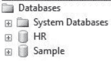

图1.1 数据库示例

## 关系型数据库基本概念

**实体**：数据库设计中可以数据的任何人、地点或事物。例如，员工和部门是实体。实体在物理设计阶段转换为表。

**数据类型**：SQL 开发人员在创建表时需要为每列选择数据类型。常见的数据类型有布尔值、整数、浮点数、货币、字符串、日期和时间。

**DDL**：DDL 是数据定义语言。DDL 命令用于创建、修改数据库结构。常用的 DDL 命令有 CREATE、ALTER 和 DROP。

**DML**：DML 是数据操纵语言。DML 命令用于向数据库表插入数据、检索或修改数据、删除数据库中的数据。常用的 DML 命令有 INSERT、DELETE 和 UPDATE。

**DCL**：DCL 是数据控制语言。DCL 命令用于创建权限和许可。常用的 DCL 命令有 GRANT 和 REVOKE。

**查询**：SQL 开发人员可以使用查询从一个或多个数据库表中获取数据或信息。

## 属性

实体有其自己的属性。例如，员工实体可能有名称、电话和工资等属性。

### 属性的类型

- **简单属性**：不可分为子部分的属性。例如，员工的年龄是一个简单属性。
- **复合属性**：可以分为简单属性的属性。例如，员工的名字是姓和名。
- **派生属性**：其值可以通过其他属性推导出（计算）的属性。例如，员工的平均年龄可以计算得出。


单值属性——包含单个值的属性。例如，城市（City）或州份（State）。
多值属性——具有多个值的属性。例如，一名员工可以拥有多项技能。

# 表

每个数据库都包含一组表。
例如，HR 数据库包含国家（country）、客户（customer）、部门（departments）、员工（employees）、工作（job）和位置（locations）表。

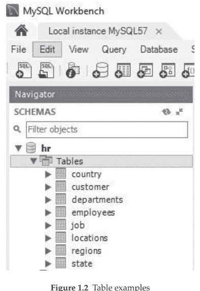

- 字段（列）

每个表由较小的实体组成，称为字段或列。
例如，Country 表有三个字段（列）：Country_ID、Country_Name 和 Region_ID。

第一章 SQL 和关系型数据库简介

- 记录（行）

每个表由一条或多条记录（行）组成。例如，COUNTRY 表包含以下行：

| COUNTRY_ID | COUNTRY_NAME | REGION_ID |
|---|---|---|
| AR | Argentina | 2 |
| AU | Australia | 3 |
| BE | Belgium | 1 |
| BR | Brazil | 2 |
| CA | Canada | 2 |
| CH | Switzerland | 1 |
| CN | China | 3 |
| DE | Germany | 1 |

图 1.3 记录示例

- 主键

每个表只能有一个主键。例如，COUNTRY 表的主键是 COUNTRY_ID。

- 外键

数据库表可能通过（外键）共同列相关联。例如，Location_ID 是 Departments 表和 Locations 表的共同列。

| department_id | int | PK | location_id | int | PK |
|---|---|---|---|---|---|
| department_name | text | | street_address | text | |
| manager_id_per_unit | decimal(6,0) | | postal_code | text | N |
| location_id | decimal(4,0) | | city | text | |
| Locations_location_id | int | FK | state_province | text | |
| | | | country_id | text | |

图 1.4 外键示例

## NULL

Null 值是一个没有值的字段。它与零值不同，在创建记录时被留空。

## 约束

约束定义了限制列中可以存储的值的规则。这确保了数据库中数据的正确性。例如，我们可以为表设置主键，以确保表中没有重复行。

常见约束

- NOT NULL——列不接受 NULL 值。
- DEFAULT——当未为列指定值时，为该列设置默认值。
- UNIQUE——列中没有重复值。
- 主键（Primary Key）——唯一定义一行的列或列的组合。主键列不能包含 NULL 值。
- 外键（Foreign Key）——一个表中的外键指向另一个表中的候选键。
- CHECK——检查值是否有效。

## 数据完整性

- 实体完整性——表中没有重复行。
- 引用完整性——当删除一条被另一个表的外键引用的行时，就会违反了引用完整性。

例如，用户无法从 Departments 表中删除营销部门（Marketing），因为有两名员工在营销部门工作（#20）。删除营销部门违反了引用完整性。请查看下方的示例记录：

| DEPT_ID | DEPT_NAME | MANAGER_ID | LOCATION_ID |
| :--- | :--- | :--- | :--- |
| 10 | Administration | 200 | 1700 |
| 20 | Marketing | 201 | 1800 |

> 图 1.5 表中的示例数据

| EMPLOYEE_ID | FIRST_NAME | LAST_NAME | EMAIL | PHONE | HIRE_DATE | CLERK | SALARY | DEPT_ID |
| :--- | :--- | :--- | :--- | :--- | :--- | :--- | :--- | :--- |
| 100 | Adam | Grant | | | | | 8000 | 10 |
| 101 | Jennifer | Koch | | | | | 4600 | 10 |
| 102 | Michael | Hart | | | | | 9000 | 10 |
| 103 | Lex | Hun | | | | | 1700 | 20 |
| 104 | Pat | Ernst | | | | | 4700 | 20 |
| 105 | Anna | Austin | | | | | 3000 | 30 |
| 106 | David | Miller | | | | | 5900 | 40 |
| 107 | James | Koch | | | | | 4600 | 50 |
| 108 | Amy |er | | | | | 3200 | 60 |
| 109 | John | Wilde | | | | | 4400 | 70 |

> 图 1.5 表中的示例数据（注：此处原文文本内容与上方表格有出入，根据翻译要求，已按逻辑对齐）

（注：由于原文文本中最后部分数据表格存在错乱，翻译时严格遵循了原文的结构，并确保了字段对齐）

[content]
- 实体关系图（ERD）
-多关系关系
- Projects 表
- 多对多关系关系

## 关系类型
- 一对多关系
- 多对多关系
- 一对一关系
- 自引用关系

## 一对多关系

一对多关系定义了表 1 中的某行对应表 2 中的多行的情况。

从实体关系图中可以看出：Departments 和 Employees 之间是一一对多关系。department_id 是 Departments 表的主键，也是 Employees 表的外键。一个 department_id 可以关联 Employees 表中的多行。一个部门可以有多个员工。

Locations 和 Departments 之间是一一对多关系。location_id 是 Locations 表的主键，也是 Departments 表的外键。一个 location_id 可以关联 Departments 表中的多行。一个位置可以有多个部门。

Country 和 Locations 之间是一一对多关系。country_id 是 Country 表的主键，也是 Locations 表的外键。一个 country_id 可以关联 Locations 表中的多行。一个国家可以有多个位置。

## 多对多关系

表 1 中的某记录对应表 2 中的多个记录，且表 2 中的某记录也对应表 1 中的多条记录。例如，一名员工可以参与一个或多个项目，每个项目也可以包含一个或多个员工。在这种情况下，许多员工与许多项目相关联。

我们如何在数据库系统中构建多对多关系？假设我们有两个表：Employees 和 Projects。我们可以通过创建两个一对多关系来实现多对多关系。例如，我们可以创建一个“Emp_Project”的表，其复合主键由 Employees 和 Projects 表中的两个主键组成。

## 自引用关系

与自身具有关系的数据库模型。

例如，Adam（Employee_ID 101）有一个经理（Manager_ID 109）。通过将经理 ID 109 链接到 Employee_ID 109，我们知道 Adam 的经理是 Lex Hann。


## 10 SQL 与关系型数据库简介

| EMPLOYEE_ID | FIRST_NAME | LAST_NAME | GRANT | EMAIL | PHONE | HIRE_DATE | JOB_ID | SALARY | MANAGER_ID |
|---|---|---|---|---|---|---|---|---|---|
| 100 | Douglas | Grant | | | 650.507.9844 | 23-JAN-08 | SH_CLERK | 2600 | | 101 |
| 101 | Adam | Fripp | | AFRIPP | 650.123.22344 | 10-APR-15 | SH_MGR | 8200 | | 109 |
| 102 | Jennifer | Whalen | JHWALEN | | 515.123.4444 | 17-SEP-13 | AD_AST | 4400 | | 108 |
| 103 | Michael | Hartstein | | MARISTIE | 515.123.5555 | 17-FEB-14 | MK_MGR | 13000 | | 109 |
| 104 | Pat | Fay | | | 603.123.6666 | 17-AUG-15 | MK_REF | 6000 | | 103 |
| 105 | Susan | Mavris | | SMAVRIS | 515.123.7777 | 07-JUN-12 | HR_MGR | 6500 | | 109 |
| 106 | Shelley | Higgins | | SHIGGINS | 515.123.8080 | 07-JUN-12 | SA_MGR | 12008 | | 109 |
| 107 | William | Giet | WGIETZ | | 515.123.8181 | 07-JUN-12 | SA_REP | 8300 | | 106 |
| 108 | Steven | King | SKING | | 515.123.4567 | 17-JUN-13 | AD_PRES | 24000 | | 108 |
| 109 | Lex | De Haan | LDEHAN | | 515.123.4569 | 13-JAN-11 | AD_VP | 17000 | | 108 |
| 110 | Bruce | Ernst | | BERNST | 590.423.4568 | 21-FEB-17 | IT_MGR | 6000 | | 109 |


## 总结

第一章涵盖了以下内容：

- SQL 和关系型数据库的历史简介。
- SQL 标准简介。
- 关系数据库管理系统的基础术语。
- Oracle、SQL Server 和 MySQL 版本简介。
- 显示本书中所使用的示例实体关系图。
- 定义一对一关系。
- 定义多对多关系。
- 定义自引用关系。

# 第 2 章
数据类型

你在第一章中已经学习了表是由许多列组成的。当你在设计或修改数据库时，理解不同的数据类型是非常重要的。主要有三种数据类型：字符、数字和日期/时间。

## 字符数据类型

表 2.1 三种数据库系统的字符数据类型

| 数据类型 | Oracle SQL | SQL SERVER | MySQL |
|---|---|---|---|
| 任意语言固定长度字符 | CHAR(n)<br>支持最多 2000 个字符 | CHAR(n)<br>支持最多 8000 个字符 | CHAR(n)<br>支持最多 255 个字符 |
| 任意语言的 NCHAR | NCHAR(n)<br>支持最多 2000 个字符 | NCHAR(n)<br>支持最多 4000 个字符 | NCHAR(n)<br>支持最多 65535 个字符 |
| 变长度字符字符串 | VARCHAR2(n)<br>支持最多 4000 个字符 | VARCHAR(n)<br>支持最多 8000 个字符<br>VARCHAR(max)<br>支持最多 3073 万个字符 | VARCHAR(n)<br>支持最多 255 个字符 |
| 任意语言的 NVARCHAR2(n) | NVARCHAR2(n)<br>支持最多 4000 个字符 | NVARCHAR(n)<br>支持最多 4000 个字符<br>NVARCHAR(max)<br>支持最多 536 万个字符 | NVARCHAR(n)<br>支持最多 65535 个字符 |
| 任意语言的 NTEXT | LONG<br>变宽<br>支持最多 2 GB 字符 | TEXT<br>支持最多 4000 个字符 | TINYTEXT<br>支持最多 255 个字符 |
| | | RAW(n)<br>二进制数据<br>支持最多 2000 字节 | BINARY(n)<br>固定宽度数据<br>支持最多 8000 字节 | MEDIUMTEXT<br>支持最多 1600 万个字符 |
| 任意语言的字符大对象 | CLOB<br>NCLOB<br>支持最多 4G | VARIARYBINARY<br>变宽数据<br>支持最多 8000 字节 | LONGTEXT<br>支持最多 4G |
| 二进制大对象 | BLOB<br>支持最多 4G | VARIARY(max)<br>变宽；支持最多 2 GB | LONGBLOB<br>支持最多 429496 万个字符<br>ENUM(a, b, c, ...)<br>支持最多 65535 个值 |
| | | IMAGE<br>变宽；支持最多 2 GB | SET<br>支持最多 64 个值 |

# 2 数据类型

固定长度字符和变长度字符之间的区别是什么？

**固定长度字符——** 当你创建一个固定大小的字段时（例如电话号码、社会安全号 SSN），CHAR 是一个很好的选择。

**变长度字符——** 许多字段具有变长度的字符。当你为姓名创建 `VARCHAR(30)` 或 `VARCHAR(32)` 时，如果姓名是“Peter”，你需要使用 `VARCHAR` 或 `VARCHAR2`。如果我们使用 `CHAR(30)` 来存储姓名，所有的姓名都将占用 30 个字符。显然，这会浪费空间。

## 数字数据类型

表 2.2 三种系统的数据类型

| 数据类型 | Oracle SQL | SQL SERVER | MySQL |
|---|---|---|---|
| 小整数 | NUMBER (3) | TINYINT | TINYINT -128 to 127 |
| | 0 to 255 | 0 to 255 | 0 to 255 UNSIGNED |
| 中整数 | NUMBER (5) | SMALLINT -32768 to 32767 | SMALLINT -32768 to 32767 to 65535 UNSIGNED |
| 32 位整数 | NUMBER (10) | INT -2147483648 to 2147483647 | INT (n) -2147483648 to 2147483647 |
| | NUMBER (38) | BIGINT -9223372036854775808 to 9223372036854775807 | BIGINT (n) -9223372036854775808 to 9233775880 |
| | | REAL | FLOAT (n, d) Small floating number n—最大位数 d—小数 |
| | | Floating number -3.40E+3 to 3.40E-38 | |
| | | SMALLMONEY -21748368 to 21748367 | DOUBLE (n, d) Large floating number n—最大位数 d—小数 |
| | | MONEY -9223372036854775808 to 922337233677580 | |
| | (p, s) NUMERIC (p, s) | DECIMAL (p, s) | DECIMAL (n, d) |
| | | -10^-38 + 1 to 10^38 – 1 | 存储为字符串 n—最大位数 |
| | | p from 1 – 38 | p from 1 – 38 |
| | | s from -84 to 127 | s from -84 to 127 d—小数 |

### NUMBER (p, s) (Oracle)

NUMERIC (p, s) (Oracle)
p--精度
s--标度

例如，NUMERIC (5, 2) 包括小数点前 3 位和小数点后 2 位。

### DECIMAL (p, s) (T-SQL)

NUMERIC (p, s) (T-SQL)
p--可以存储的最大位数（包括小数点左侧和右侧的所有数字）。
s--小数点右侧的最大位数。

### Oracle 数字示例

| 数据类型 | 输入数据 | 存储值 |
| --- | --- | --- |
| NUMBER | 634,782.59 | 634782.59 |
| NUMBER (8) | 634,782.59 | 634782.59 |
| NUMBER (8, 2) | 634,782.59 | 634782.59 |
| NUMBER (8, 1) | 634,782.59 | 634782.59 |

## 日期和时间数据类型

表 2.3 三种系统的日期类型

| Oracle SQL | SQL SERVER | MySQL |
|---|---|---|
| DATE | DATE | DATE |
| 格式: DD-MON-YY: 23-JAN-08 | 格式: YYYY-MM-DD: 2017-01-25 | 格式: YYYY-MM-DD: 2017-01-25 |
| TIMESTAMP (0) | DATETIME | DATETIME |
| 如果不指定精度，默认为六位。 | 格式: YYYY-MM-DD HH:MI:SS | 格式: YYYY-MM-DD HH:MI:SS |
| | TIME | TIME |
| | 格式: HH:MI:SS | 格式: HH:MI:SS |
| | YEAR | YEAR |
| | 格式: YY (70 到 69) | 格式: YYYY (1901 到 2155) |

## 布尔类型

表 2.4 三种系统的布尔数据类型

| 数据类型 | Oracle SQL | SQL SERVER | MySQL |
|---|---|---|---|
| 布尔 | CHAR(1) | BIT (0 或 1) | BOOLEAN, 0 或 1; NULL |

## 总结

第二章涵盖了三种系统的多种数据类型：

- 字符数据类型
- 数字数据类型
- 三种系统的日期时间类型
- 布尔类型

虽然这一章很短，但需要时间来熟悉所有数据类型。当你学习第五章“创建数据库和表”时，你将为列使用数据类型。

在下一章中，我们将安装 Oracle 12c、SQL Server 2016 和 MySQL 5.7 数据库系统。

# 第 3 章
Oracle、SQL Server 和 MySQL 的安装

在运行 SQL 命令之前，我们需要安装关系数据库管理系统。本章涵盖了如何安装 Oracle 12c、SQL Server 2016 和 MySQL 5.7。

## 最低系统要求

表 3.1 系统要求
| Oracle 12C | SQL Server 2016 | MySQL 5.7 |
|---|---|---|
| 硬盘: 10 GB | 硬盘: 6 GB | 硬盘: 8 GB |
| 内存: 2 GB<br>tmp 目录有 1 GB 空间。 | 从光盘安装需要光驱器。<br>NET Framework 4.6 | 推荐内存<br>Express 版：1 GB<br>所有其他版本：至少 4 GB |
| 操作系统 | 操作系统 | Windows 32 位和 64 位 |
| Windows 8 (专业版和企业版) | SQL Server 企业版：nWindows Server 2016\nWindows Server 2012 | Linux\nMac OS X |
| 64 位：nWindows 8 (专业版和企业版)\nWindows 7 (专业版、企业版、旗舰版)\nWindows Server 2012\nWindows Server 2008 R2\nWindows Server 2008 | SQL Server 标准版：nWindows Server 2016\nWindows Server 2012\nWindows 10\nWindows 8.1 | |
| Linux | SQL Server Web 版和 Express 版：nWindows Server 2016\nWindows Server 2012 | |
| | SQL Server 开发者版：nWindows Server 2016\nWindows Server 2012\nWindows 10\nWindows 8.1\nWindows 8 | |


## Oracle 12c 安装

- 从 Oracle 网站下载 Oracle 12c Release 2：
http://www.oracle.com/technologies/database/downloads/database12c-win64-download-22973.html


- 安装并解压 Windows x64 文件后，确保四个文件位于相同位置：


## 第 3 章 安装 Oracle、SQL Server 和 MySQL

- 对于 Windows 电脑有额外的步骤：
1. 打开 `winx64_12c_database_2of2` 目录
2. 复制 `\winx64_12c_database_2of2\stage\Components` 下的所有文件
3. 将所有文件粘贴到 `\winx64_12c_database_2of2\stage\Components` 目录
- 导航到 `\winx64_12c_database_2of2` 并运行 `setup.exe`：


图 3.3 运行文件

- 选择语言：


图 3.4 选择语言

## 第 3 章 安装 Oracle、SQL Server 和 MySQL

- 选择数据库版本：


图 3.5 选择数据库版本

- 选择“使用 Windows 账户”：


图 3.6 Windows 账户

- 针对以下警告消息点击“是”：


图 3.7 警告消息

- 选择安装位置：


图 3.8 安装位置

## 第 3 章 安装 Oracle、SQL Server 和 MySQL

- 在摘要页点击“下一步”安装 Oracle 12c：


图 3.9 摘要

- 安装完成后，你可以安装 SQL Developer。详细步骤在下一章。

## SQL Server 2016 安装

SQL Server 2016 安装非常简单。每个安装都会你的计算机上创建一个 SQL Server 实例。

- 访问 SQL Server 2016 开发者版页面：
https://www.microsoft.com/en-us/sql-server/application-development
- 下载 SQL Server 2016 开发者版 (x64)。


图 3.10 SQL Server 2016 下载

## 第 3 章 安装 Oracle、SQL Server 和 MySQL

- 点击 `setup.exe` 运行安装文件。

| 计划 | 硬件和软件要求 |
| --- | --- |
| 安装 | 查看硬件软件要求。 |
| 维护 | 安全文档。 |
| 资源 | 在线发行说明查看最新信息。 |
| 高级 | 系统配置检查。 |
| 选项 | 启动工具检查阻止 SQL Server 安装成功的条件。 |


- 选择开发者版。


- 接受许可条款。


- 选择功能：


- SQL Server 分配默认实例名称：SQL 2016。任何之前安装的实例将在这里显示。


图 3.15 默认实例名称

点击“添加当前用户”来设置管理员：


图 3.16 设置管理员

- 点击“下一步”按钮，然后点击“安装”按钮。


- 安装完成。


- 安装完成后，你可以安装 SQL Server Management Studio。

## 以下需要翻译的文本

[content]
## Oracle 12c 安装

- 从 Oracle 网站下载 Oracle 12c Release 2：
http://www.oracle.com/technologies/database/downloads/database12c-win64-download-22973.html


- 安装并解压 Windows x64 文件后，确保四个文件位于相同位置：


## 第 3 章 安装 Oracle、SQL Server 和 MySQL

- 对于 Windows 电脑有额外的步骤：
1. 打开 `winx64_12c_database_2of2` 目录
2. 复制 `\winx64_12c_database_2of2\stage\Components` 下的所有文件
3. 将所有文件粘贴到 `\winx64_12c_database_2of2\stage\Components` 目录
- 导航到 `\winx64_12c_database_2of2` 并运行 `setup.exe`：


图 3.3 运行文件

- 选择语言：


图 3.4 选择语言

## 第 3 章 安装 Oracle、SQL Server 和 MySQL

- 选择数据库版本：


图 3.5 选择数据库版本

- 选择“使用 Windows 账户”：


图 3.6 Windows 账户 

- 针对以下警告消息点击“是”：


图 3.7 警告消息

- 选择安装位置：


图 3.8 安装位置

## 第 3 章 安装 Oracle、SQL Server 和 MySQL

- 在摘要页点击“下一步”安装 Oracle 12c：


图 3.9 摘要 

- 安装完成后，你可以安装 SQL Developer。详细步骤在下一章。

## SQL Server 2016 安装

SQL Server 2016 安装非常简单。每个安装都会你的计算机上创建一个 SQL Server 实例。

- 访问 SQL Server 2016 开发者版页面：
https://www.microsoft.com/en-us/sql-server/application-development
- 下载 SQL Server 2016 开发者版 (x64)。


图 3.10 SQL Server 2016 下载

## 第 3 章 安装 Oracle、SQL Server 和 MySQL

- 点击 `setup.exe` 运行安装文件。

| 计划 | 硬件和软件要求 |
| --- | --- |
| 安装 | 查看硬件软件要求。 |
| 维护 | 安全文档。 |
| 资源 | 在线发行说明查看最新信息。 |
| 高级 | 系统配置检查。 |
| 选项 | 启动工具检查阻止 SQL Server 安装成功的条件。 |


- 选择开发者版。


- 接受许可条款。


- 选择功能：


- SQL Server 分配默认实例名称：SQL 2016。任何之前安装的实例将在这里显示。


图 3.15 默认实例名称

点击“添加当前用户”来设置管理员：


图 3.16 设置管理员

- 点击“下一步”按钮，然后点击“安装”按钮。


- 安装完成。


- 安装完成后，你可以安装 SQL Server Management Studio。

## 以下需要翻译的文本

[content]
## Oracle 12c 安装

- 从 Oracle 网站下载 Oracle 12c Release 2：
http://www.oracle.com/technologies/database/downloads/database12c-win64-download-22973.html


- 安装并解压 Windows x64 文件后，确保四个文件位于相同位置：


## 第 3 章 安装 Oracle、SQL Server 和 MySQL

- 对于 Windows 电脑有额外的步骤：
1. 打开 `winx64_12c_database_2of2` 目录
2. 复制 `\winx64_12c_database_2of2\stage\Components` 下的所有文件
3. 将所有文件粘贴到 `\winx64_12c_database_2of2\stage\Components` 目录
- 导航到 `\winx64_12c_database_2of2` 并运行 `setup.exe`：


图 3.3 运行文件

- 选择语言：


图 3.4 选择语言

## 第 3 章 安装 Oracle、SQL Server 和 MySQL

- 选择数据库版本：


图 3.5 选择数据库版本

- 选择“使用 Windows 账户”：


图 3.6 Windows 账户 

- 针对以下警告消息点击“是”：


图 3.7 警告消息

- 选择安装位置：


图 3.8 安装位置

## 第 3 章 安装 Oracle、SQL Server 和 MySQL

- 在摘要页点击“下一步”安装 Oracle 12c：


图 3.9 摘要 

- 安装完成后，你可以安装 SQL Developer。详细步骤在下一章。

## SQL Server 2016 安装

SQL Server 2016 安装非常简单。每个安装都会你的计算机上创建一个 SQL Server 实例。

- 访问 SQL Server 2016 开发者版页面：
https://www.microsoft.com/en-us/sql-server/application-development
- 下载 SQL Server 2016 开发者版 (x64)。


图 3.10 SQL Server 2016 下载

## 第 3 章 安装 Oracle、SQL Server 和 MySQL

- 点击 `setup.exe` 运行安装文件。

| 计划 | 硬件和软件要求 |
| --- | --- |
| 安装 | 查看硬件软件要求。 |
| 维护 | 安全文档。 |
| 资源 | 在线发行说明查看最新信息。 |
| 高级 | 系统配置检查。 |
| 选项 | 启动工具检查阻止 SQL Server 安装成功的条件。 |


- 选择开发者版。


- 接受许可条款。


- 选择功能：


- SQL Server 分配默认实例名称：SQL 2016。任何之前安装的实例将在这里显示。


图 3.15 默认实例名称

点击“添加当前用户”来设置管理员：


图 3.16 设置管理员

- 点击“下一步”按钮，然后点击“安装”按钮。


- 安装完成。


## 以下需要翻译的文本

[content]
## Oracle 12c 安装

- 从 Oracle 网站下载 Oracle 12c Release 2：
http://www.oracle.com/technologies/database/downloads/database12c-win64-download-22973.html


- 安装并解压 Windows x64 文件后，确保四个文件位于相同位置：


## 第 3 章 安装 Oracle、SQL Server 和 MySQL

- 对于 Windows 电脑有额外的步骤：
1. 打开 `winx64_12c_database_2of2` 目录
2. 复制 `\winx64_12c_database_2of2\stage\Components` 下的所有文件
3. 将所有文件粘贴到 `\winx64_12c_database_2of2\stage\Components` 目录
- 导航到 `\winx64_12c_database_2of2` 并运行 `setup.exe`：


图 3.3 运行文件

- 选择语言：


图 3.4 选择语言

## 第 3 章 安装 Oracle、SQL Server 和 MySQL

- 选择数据库版本：


图 3.5 选择数据库版本

- 选择“使用 Windows 账户”：


图 3.6 Windows 账户 

- 针对以下警告消息点击“是”：


图 3.7 警告消息

- 选择安装位置：


图 3.8 安装位置

## 第 3 章 安装 Oracle、SQL Server 和 MySQL

- 在摘要页点击“下一步”安装 Oracle 12c：


图 3.9 摘要 

- 安装完成后，你可以安装 SQL Developer。详细步骤在下一章。

## SQL Server 2016 安装

SQL Server 2016 安装非常简单。每个安装都会你的计算机上创建一个 SQL Server 实例。

- 访问 SQL Server 2016 开发者版页面：
https://www.microsoft.com/en-us/sql-server/application-development
- 下载 SQL Server 2016 开发者版 (x64)。


图 3.10 SQL Server 2016 下载

## 第 3 章 安装 Oracle、SQL Server 和 MySQL

- 点击 `setup.exe` 运行安装文件。

| 计划 | 硬件和软件要求 |
| --- | --- |
| 安装 | 查看硬件软件要求。 |
| 维护 | 安全文档。 |
| 资源 | 在线发行说明查看最新信息。 |
| 高级 | 系统配置检查。 |
| 选项 | 启动工具检查阻止 SQL Server 安装成功的条件。 |


- 选择开发者版。


- 接受许可条款。


- 选择功能：


- SQL Server 分配默认实例名称：SQL 2016。任何之前安装的实例将在这里显示。


图 3.15 默认实例名称

点击“添加当前用户”来设置管理员：


图 3.16 设置管理员

- 点击“下一步”按钮，然后点击“安装”按钮。


- 安装完成。


## are database database tools tools: Command line tools and graphic user interface tools. Command Line Tools including Oracle SQL Plus and MySQL Command Client. Graphic User Interface Tools include Oracle SQL Developer, SQL Server Management Studio and MySQL Workbench.

## Command Line Tools

### Oracle SQL Plus

- Go to Start -> OracleDBHome1 -> SQL Plus


图 4.1 Starting SQL Plus

To access a built-in database HR enter the username and password of the HR schema.
Enter user-name: hr
Enter password: xx (you can reset the password if you forgot it)

```
SQL*Plus: Release 12.1.0.2.0 Production on Mon Apr 10 10:38:21 2017
Copyright (c) 1982, 2014, Oracle.  All rights reserved.
Enter user-name: hr
password:
Last Successful login time: Mon Apr 10 2017 10:32:50 -0400
Connected to:
Oracle Database 12c Enterprise Edition Release 12.1.0.2.0 - 64bit Production
With the Partitioning, OLAP, Advanced Analytics and Real Application Testing options
SQL>
```

Figure 4.2 SQL Prompt

To see the structure of the Employees table enter:
DESCRIBE Employees;

```
SQL> DESCRIBE Employees;
Name Null? Type
------------------------------------------------------------
EMPLOY_ID NOT NULL NUMBER(6)
FIRST_NAME VARCHAR(20)
LAST_NAME NOT NULL VARCHAR(25)
EMAIL NOT NULL VARCHAR(25)
PHONE_NUMBER VARCHAR(20)
HHIRE_DATE NOT NULL DATE
JOB_ID NOT NULL VARCHAR(10)
SALARY NUMBER(8,2)
COMMISSION_PCT NUMBER(2,2)
MANAGER_ID NUMBER(6)
DEPARTMENT_ID NUMBER(4)
SQL>
```

Figure 4.3 Testing a SQL statement

Enter “EXIT” to leave the SQL prompt.


## MySQL 命令行客户端

- 转到开始 -> MySQL -> MySQL 5.7 Command Line Client（第二个 MySQL 5.7 命令行客户端用于 Unicode）


图 4.4 启动 MySQL 命令行客户端

- 输入 MySQL root 密码（在安装 MySQL 5.7 时设置的密码）

```
Enter password: ********
Welcome to the MySQL monitor. Commands end with ; or \
Your MySQL connection id is 10
Server version: 5.7.17-enterprise-commercial-advanced-log MySQL Enterprise Server
Copyright (c) 2000
```

图 4.5 MySQL 提示符

- 启动 MySQL 提示符的另一种方式：

```
C:\Program Files\MySQL Server 5.7\bin\mysql -u root -p
Enter password: ********
Welcome to the MySQL monitor. Commands end with ; or \
Your MySQL connection id is 9
Server version: 5.7.17-enterprise-commercial-advanced-log MySQL Enterprise Server

Copyright (c) 2000, 2010, Oracle and/or its affiliates. All rights reserved.
Oracle is a registered trademark of Oracle Corporation and/or its
affiliates. Other names may be trademarks of their respective owners.
Type 'help'; or '\h' for help. Type '\cl' to clear the current input statement.
mysql>
```


- 在 MySQL 提示符输入“SHOW databases”。

```
mysql> SHOW databases;
| Database |
| information_schema |
| hr |
| mysql |
| performance_schema |
| sakila |
| sample |
| sys |
| world |
8 rows in set (0.03 sec)
mysql>
```


## 图形用户界面工具

## Oracle SQL Developer 的安装

- 通过以下链接下载 Oracle SQL Developer：
http://www.oracle.com/technwork/developer-tools/sql-developer/downloads/index.html

- 启动 Oracle SQL Developer：


图 4.8 启动 Oracle SQL Developer

Oracle 有许多内置模式。这里我们使用 Oracle 内置的 HR 模式建立连接：

输入密码然后点击 OK 按钮。

SQL Developer 在左侧打开窗格，右侧打开 SQL 工作表。


在工作表中输入“DESCRIBE Employees;”，然后点击 Run Statements 按钮（绿色三角形）。你可以看到我们与 SQL Plus 命令行相同的结果。


## SQL Server Management Studio 的安装

- 从 SQL Server 2016 开始，服务器和管理工具分开分开安装。
- 转到 SQL Server 2016 Management Studio 下载页面：

https://docs.microsoft.com/en-us/sql/ssms/download-sql-server-management-studio-ssms

## 第 4 章 数据库开发工具 41


图 4.12 SQL Server Management Studio 下载

- 下载后启动 setup.exe 文件。


图 4.13 启动安装文件

安装完成后我们启动 SQL Server Management Studio：


图 4.14 启动 SQL Server Management Studio

检查服务器名称（Server Name）然后点击 Connect 按钮。SQL Server Management Studio 左侧有 Object Explorer 窗格。你可以浏览数据库、表、列或其他类型的对象。点击 New Query 按钮输入查询语句。


图 4.15 Master 数据库

默认选择 Master 数据库。请确保选择了你正在工作的数据库。或者你可以在查询语句之前在 SQL 工作表中输入“Use database_name;”。点击 Execute 按钮运行查询。

## MySQL Workbench 的安装

- 在此处下载 MySQL Workbench：
https://dev.mysql.com/downloads/workbench/


图 4.16 MySQL Workbench 下载

- 安装后启动 MySQL Workbench：


图 4.17 启动 MySQL Workbench

安装完成后我们启动 MySQL Workbench：

默认选择 Master 数据库。请确保选择了你正在工作的数据库。或者你可以在查询语句之前在 SQL 工作表中输入“Use database_name;”。点击 Execute 按钮运行查询。


50 第 5 章 数据定义语言 (DDL)


图 5.4 在 GUI 中创建数据库 (SQL Server)


图 5.5 数据库 “CAR”已创建

## 在 GUI 中创建数据库 (MySQL)

- 右键点击任何架构（schema）并选择 Create Schema（创建架构）


图 5.6 在 GUI 中创建数据库 (MySQL)

- 输入架构名称 ‘hr’并点击 Apply（应用）


图 5.7 输入数据库（架构）名称

## 删除数据库

**描述：** 删除数据库。请小心删除数据库或表。如果你没有备份数据库，可能会丢失重要数据！

语法 (Oracle)

```
DROP USER User_Name;
```

语法 (T-SQL & MySQL)

```
DROP DATABASE Database_Name;
```

表 5.2 删除数据库

| Oracle | T-SQL | MySQL |
| --- | --- | --- |
| DROP USER TEST_DB; | DROP DATABASE HR; 命令(s)成功完成。 | DROP DATABASE hr; 影响了 0 行(s)。 |

## 创建表

我们可以通过两种方式来创建表：

1. 使用 SQL 命令
2. 使用图形用户界面 (GUI) 工具

注意：

- 本书中所有的 Oracle 表都是在一个用户账户中创建的。
- 所有的 T-SQL 表都在 HR 数据库中创建。
- 所有的 MySQL 表均在 hr 架构（数据库）中创建。

### 1. 使用 SQL 命令创建表

语法

```
CREATE TABLE Table_Name;
```

## 创建 Regions 表

表 5.3 创建 Regions 表的命令

| Oracle SQL | T-SQL & MySQL |
| --- | --- |
| CREATE TABLE Regions | CREATE TABLE regions |
| ( | ( |
| Region_id NUMBER NOT NULL, | region_id NUMBER NOT NULL, |
| Region_name VARCHAR(25), | region_name VARCHAR(25), |
| PRIMARY KEY (Regions_ID) | PRIMARY KEY (Regions_ID) |
| ); | ); |

## 创建 Country 表

表 5.4 创建 Country 表的命令

| Oracle SQL | T-SQL & MySQL |
| --- | --- |
| CREATE TABLE Country | CREATE TABLE Country |
| ( | ( |
| Country_id CHAR(2) NOT NULL, | country_id CHAR(2) NOT NULL, |
| Country_name VARCHAR(40), | country_name VARCHAR(40), |
| Region_id NUMBER, | region_id small |
| PRIMARY KEY (country_id), | PRIMARY KEY (country_id), |
| CONSTRAINT FK_RegCountry | CONSTRAINT FK_RegCountry |
| FOREIGN KEY (region_id) | FOREIGN KEY (region_id) |
| REFERENCES Regions (Regions_ID) | REFERENCES Regions (Regions_ID) |
| ); | ); |

## 创建 Departments 表

表 5.5 创建 Departments 表的命令

| Oracle SQL | T-SQL & MySQL |
| --- | --- |
| CREATE TABLE Departments | CREATE TABLE Departments |
| ( | ( |
| Dept_id NUMBER(4) NOT NULL, | dept_id NUMBER(4) NOT NULL, |
| Dept_name VARCHAR(30), | dept_name VARCHAR(30), |
| Manager_id NUMBER(6), | manager_id NUMBER (6), |
| Location_id NUMBER(4), | location_id NUMBER (4), |
| PRIMARY KEY (dept_ID), | PRIMARY KEY (dept_ID), |
| CONSTRAINT FK_LocDept | CONSTRAINT FK_LocDept |
| FOREIGN KEY (location_id) | FOREIGN KEY (location_id) |
| REFERENCES Locations (location_ID) | REFERENCES Locations (location_ID) |
| ); | ); |

## 创建 Employees 表

表 5.6 创建 employees 表的命令

| Oracle SQL | T-SQL & MySQL |
|---|---|---|
| CREATE TABLE Employees | CREATE TABLE employees |
| ( | ( |
| Employee_ID NUMBER(6) NOT NULL, | Employee_ID int NOT NULL, |
| First_Name VARCHAR(20), | First_NAME varchar(20), |
| Last_Name VARCHAR(25), | Last_Name varchar(25), |
| Email VARCHAR(25), | Email varchar(25), |
| Phone VARCHAR(20), | Phone varchar(20), |
| Hire_Date DATE, | Hire_Date date, |
| Job_ID VARCHAR(10), | Job_ID varchar(10), |
| Salary NUMBER(6), | Salary decimal(6,2), |
| Manager_ID NUMBER(6), | Manager_ID decimal(6,2), |
| Dept_ID NUMBER(4), | Dept_ID smallint |
| PRIMARY KEY (Employee_ID), | PRIMARY KEY (Employee_ID), |
| CONSTRAINT FK_DepEmp | CONSTRAINT FK_DepEmp |
| FOREIGN KEY (Dept_ID) | FOREIGN KEY (Dept_ID) |
| REFERENCES Dept (Dept_ID) | REFERENCES Dept (Dept_ID) |
| ) | ) |

## 创建 Locations 表

表 5.7 创建 Locations 表的命令

| Oracle SQL | T-SQL & MySQL |
|---|---|---|
| CREATE TABLE Locations | CREATE TABLE Locations |
| ( | ( |
| Location_id NUMBER(4) NOT NULL, | location_id NUMBER(4) NOT NULL, |
| Street_address VARCHAR(40), | street_address VARCHAR(40), |
| Postal_code VARCHAR(12), | postal_code VARCHAR(12), |
| City VARCHAR(30), | city VARCHAR(30), |
| State_province VARCHAR(25), | state_province VARCHAR(25), |
| Country_id CHAR(2), | country_id CHAR(2), |
| PRIMARY KEY (Location_id), | PRIMARY KEY (Location_id), |
| CONSTRAINT FK_Country_Loc | CONSTRAINT FK_Country_Loc |
| FOREIGN KEY (country_id) | FOREIGN KEY (country_id) |
| REFERENCES country (country_id) | REFERENCES country (country_id) |
| ) | ) |

## 创建 Job 表

表 5.8 创建 job 表的命令

| Oracle SQL | T-SQL & MySQL |
|---|---|
| CREATE TABLE Job | CREATE TABLE Job |
| ( | ( |
| Job_id VARCHAR2(10) NOT NULL, | job_id VARCHAR(10) NOT NULL, |
| Job_title VARCHAR(35), | job_title VARCHAR(35), |
| Min_salary NUMBER(6), | min_salary NUMBER(6), |
| Max_salary NUMBER(6), | max_salary NUMBER(6), |
| PRIMARY KEY (job_ID) | PRIMARY KEY (job_ID) |
| ) | ); |


## 3) MySQL

- 右键点击 departments 表并选择 Alter Table...（修改表）

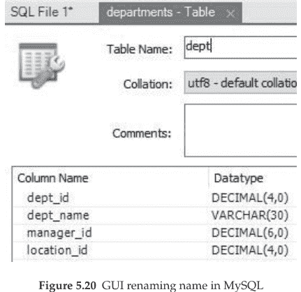

## 删除表 (Dropping a Table)

描述：从数据库中删除表。

语法

```
DROP TABLE Table_Name;
```

问题：编写一个查询来删除 Emp 表。

答案：DROP TABLE Emp;

| Oracle SQL | T-SQL | MySQL |
|---|---|---|
| table EMP dropped. | Command(s) completed successfully. | 0 row(s) affected. |

## 清空表 (Truncating a Table)

**描述：** 表中的所有记录。该操作无法回滚。
语法

```
TRUNCATE TABLE Table_Name;
```

问题：编写一个查询移除 Customers 表中的所有记录。
答案：TRUNCATE TABLE Customers;

表 5.10 截空命令的查询输出

| Oracle SQL | T-SQL | MySQL |
|---|---|---|
| table CUSTOMERS truncated. | Command(s) completed successfully. | 0 row(s) affected. |

## 修改表（修改列） (Altering a Table - Modifying a Column)

语法

```
ALTER TABLE MODIFY Column Type (Oracle & MySQL)
ALTER TABLE ALTER COLUMN Column Type (T-SQL)
```

问题：编写一个查询将 Salary 列从 Number (6, 2) 修改为 Number (7, 2)。
答案 (Oracle):

```
ALTER TABLE EMPLOYEES MODIFY SALARY NUMBER (7, 2);
```

| COLUMN_NAME | DATA_TYPE |
|---|---|
| 1 ID | NUMBER (6,0) |
| 2 FIRSTNAME | VARCHAR2 (15 BYTE) |
| 3 LASTNAME | VARCHAR2 (15 BYTE) |
| 4 TITLE | VARCHAR2 (20 BYTE) |
| 5 HIREDATE | DATE |
| 6 SALARY | NUMBER (7,2) |
| 7 DEPTNO | NUMBER (3,0) |
| 8 COMMISION | NUMBER (6,2) |

图 5.21 在 Oracle 中修改表

答案 (T-SQL):

```sqlALTER TABLE EMPLOYEES ALTER COLUMN SALARY decimal (7, 2);
```

| | |
|---|---|
| dbo.employee |
| Columns |
| ID (PK, int, not null) |
| FirstName (varchar(15), null) |
| LastName (varchar(15), null) |
| Title (varchar(20), null) |
| HireDate (date, null) |
| Salary (decimal(7,2), null) |
| DeptNo (smallint, null) |
| COMMISSION (decimal(6,2), null) |

图 5.22 在 T-SQL 中修改表

答案 (MySQL):

```sqlALTER TABLE EMPLOYEES MODIFY SALARY decimal (7, 2);
```

| Information |
|---|---|
| Table: employee |
| Columns: |
| ID int(11) PK |
| FirstName varchar(15) |
| LastName varchar(15) |
| Title varchar(20) |
| HireDate date |
| SALARY decimal(7,2) |
| DeptNo smallint(6) |

图 5.23 在 MySQL 中修改表

## 修改表（添加列） (Altering a Table - Adding a Column)

语法

ALTER TABLE table_name ADD Column Type

问题：编写一个查询为 Employee 表添加 Commission 列。

答案 (Oracle):

```sqlALTER TABLE EMPLOYEES ADD COMMISSION NUMBER (6, 2);
```

| COLUMN_NAME | DATA_TYPE |
|---|---|
| EMPLOYEE_ID | NUMBER (6,0) |
| FIRST_NAME | VARCHAR2 (20 BYTE) |
| LAST_NAME | VARCHAR2 (25 BYTE) |
| EMAIL | VARCHAR2 (25 BYTE) |
| PHONE | VARCHAR2 (20 BYTE) |
| HIRE_DATE | DATE |
| JOB_ID | VARCHAR2 (10 BYTE) |
| SALARY | NUMBER (8,2) |
| MANAGER_ID | NUMBER (6,0) |
| DEPT_ID | NUMBER (4,0) |
| COMMISSION | NUMBER (6,2) |

图 5.24 在 Oracle 中添加列

答案 (T-SQL):

```sqlALTER TABLE Employees ADD COMMISSION decimal (6, 2);
```

- dbo.Employees
Columns
- EMPLOYEE_ID (numeric(6,0), not null)
- FIRST_NAME (varchar(20), null)
- LAST_NAME (varchar(25), null)
- EMAIL (varchar(25), null)
- PHONE (varchar(20), null)
- HIRE_DATE (date, null)
- JOB_ID (varchar(10), null)
- SALARY (decimal(8,2), null)
- MANAGER_ID (numeric(6,0), null)
- DEPT_ID (numeric(4,0), null)
- COMMISSION (decimal(6,2), null)

图 5.25 在 T-SQL 中添加列

答案 (MySQL):

```sqlALTER TABLE EMPLOYEES ADD COMMISSION numeric (6, 2);
```

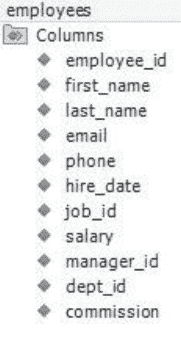

图 5.26 在 MySQL 中添加列

## 总结 (Summary)

第 5 章包含了以下内容：
- 如何 CREATE DATABASE
- 如何 CREATE TABLE
- 如何 DROP TABLE
- 如何 TRUNCATE TABLE
- 如何 ALTER TABLE

## 练习 (Exercises)

5.1 编写一个查询来...
5.2 编写一个查询来...
5.3 编写一个查询来...

# 第6 章 数据操作语言 (DML)

DML 包含：
- SELECT
- INSERT
- UPDATE
- DELETE

数据定义语言 (DDL) 包含：
- CREATE
- DROP
- ALTER

DML 和 DDL 的区别：
- DML 是用于操作数据的。
- DDL 是用于定义数据库结构的。


## 向部门表（Departments Table）插入数据

INSERT INTO DEPARTMENTS VALUES (10,'Administration',200,1700);
INSERT INTO DEPARTMENTS VALUES (20,'Marketing',201,1800);
INSERT INTO DEPARTMENTS VALUES (30,'Purchasing',114,1700);
INSERT INTO DEPARTMENTS VALUES (40,'Human Resources',203,2400);
INSERT INTO DEPARTMENTS VALUES (50,'Shipping',121,1500);
INSERT INTO DEPARTMENTS VALUES (60,'IT',103,1400);
INSERT INTO DEPARTMENTS VALUES (70,'Public Relations',204,2700);
INSERT INTO DEPARTMENTS VALUES (80,'Sales',145,2500);
INSERT INTO DEPARTMENTS VALUES (90,'Accounting',205,1700);
INSERT INTO DEPARTMENTS VALUES (100,'Customer Service',203,2400);

| DEPT_ID | DEPT_NAME | MANAGER_ID | LOCATION_ID |
|---|---|---|---|
| 10 | Administration | 200 | 1700 |
| 20 | Marketing | 201 | 1800 |
| 30 | Purchasing | 114 | 1700 |
| 40 | Human Resources | 203 | 2400 |
| 50 | Shipping | 121 | 1500 |
| 60 | IT | 103 | 1400 |
| 70 | Public Relations | 204 | 2700 |
| 80 | Sales | 145 | 2500 |
| 90 | Accounting | 205 | 1700 |
| 100 | Customer Service | 203 | 2400 |
| 11 | Warehousing | 114 | 2400 |

图 6.3 部门表

## 向国家表（Country Table）插入数据

INSERT INTO COUNTRY VALUES ('AR','Argentina',2);
INSERT INTO COUNTRY VALUES ('AU','Australia',3);
INSERT INTO COUNTRY VALUES ('BE','Belgium',1);
INSERT INTO COUNTRY VALUES ('BR','Brazil',2);
INSERT INTO COUNTRY VALUES ('CA','Canada',2);
INSERT INTO COUNTRY VALUES ('CH','Switzerland',1);
INSERT INTO COUNTRY VALUES ('CN','China',3);
INSERT INTO COUNTRY VALUES ('DE','Germany',1);
INSERT INTO COUNTRY VALUES ('DK','Denmark',1);
INSERT INTO COUNTRY VALUES ('EG','Egypt',4);
INSERT INTO COUNTRY VALUES ('FR','France',1);
INSERT INTO COUNTRY VALUES ('IL','Israel',4);

# 第 6 章 数据操语言 (DML) 69

```
INSERT INTO COUNTRY VALUES ('IN','India',3);
INSERT INTO COUNTRY VALUES ('IT','Italy',1);
INSERT INTO COUNTRY VALUES ('JP','Japan',3);
INSERT INTO COUNTRY VALUES ('KW','Kuwait',4);
INSERT INTO COUNTRY VALUES ('ML','Malaysia',3);
INSERT INTO COUNTRY VALUES ('MX','Mexico',2);
INSERT INTO COUNTRY VALUES ('NG','Nigeria',4);
INSERT INTO COUNTRY VALUES ('NL','Netherlands',1);
INSERT INTO COUNTRY VALUES ('SG','Singapore',3);
INSERT INTO COUNTRY VALUES ('UK','United Kingdom',1);
INSERT INTO COUNTRY VALUES ('US','United States of America',2);
INSERT INTO COUNTRY VALUES ('ZM','Zambia',4);
INSERT INTO COUNTRY VALUES ('ZW','Zimbabwe',4);
```

| COUNTRY_ID | COUNTRY_NAME | REGION_ID |
|---|---|---|
| AR | Argentina | 2 |
| AU | Australia | 3 |
| BE | Belgium | 1 |
| BR | Brazil | 2 |
| CA | Canada | 2 |
| CH | Switzerland | 1 |
| CN | China | 3 |
| DE | Germany | 1 |
| DK | Denmark | 1 |
| EG | Egypt | 4 |
| FR | France | 1 |
| IL | Israel | 4 |
| IN | India | 3 |
| IT | Italy | 1 |
| JP | Japan | 3 |
| KW | Kuwait | 4 |
| ML | Malaysia | 3 |
| MX | Mexico | 2 |
| NG | Nigeria | 4 |
| NL | Netherlands | 1 |
| SG | Singapore | 3 |
| UK | United Kingdom | 1 |
| US | United States of ... | 2 |
| ZM | Zambia | 4 |

图 6.4 国家表

## 向工作表（Job Table）插入数据

```
INSERT INTO JOB VALUES ('AD_PRES','CEO',9000,20000);
INSERT INTO JOB VALUES ('AD_VP','VICE President',8000,18000);
INSERT INTO JOB VALUES ('AD_ASST','Admin Assistant',5000,6000);
INSERT INTO JOB VALUES ('FI_CLERK','Finance Clerk',3000,4000);
INSERT INTO JOB VALUES ('FI_MGR','Finance Manager',4000,5000);
```

70 第 6 章 数据操语言 (DML)

```
INSERT INTO Job VALUES ('SA_REP','Sales Representative',3000,4000);
INSERT INTO Job VALUES ('SA_MGR','Sales Manager',4000,5000);
INSERT INTO Job VALUES ('SH_CLERK','Shipping Clerk',2500,4000);
INSERT INTO Job VALUES ('SH_MGR','Shipping Manager',4000,5000);
INSERT INTO Job VALUES ('IT_PROG','Programmer',4000,5500);
INSERT INTO Job VALUES ('IT_MGR','IT Manager',5000,6000);
INSERT INTO Job VALUES ('MK_CLERK','Marketing Clerk',3000,4000);
INSERT INTO Job VALUES ('MK_MGR','Marketing Manager',4000,5000);
INSERT INTO Job VALUES ('HR_MGR','Human Resource Manager',4000,5000);
```

## 工作表

| JOB_ID | JOB_TITLE | MIN_SALARY | MAX_SALARY |
|---|---|---|---|
| AD_PRES | CEO | 9000 | 25000 |
| AD_VP | VICE President | 8000 | 18000 |
| AD_ASST | Admin Assistant | 5000 | 6000 |
| FI_CLERK | Finance Clerk | 3000 | 4000 |
| FI_MGR | Finance Manager | 4000 | 5000 |
| SA_REP | Sales Representative | 3000 | 4000 |
| SA_MGR | Sales Manager | 4000 | 5000 |
| SH_CLERK | Shipping Clerk | 2500 | 4000 |
| SH_MGR | Shipping Manager | 4000 | 5000 |
| IT_PROG | Programmer | 4000 | 5500 |
| IT_MGR | IT Manager | 5000 | 6000 |
| MK_CLERK | Marketing Clerk | 3000 | 4000 |
| MK_MGR | Marketing Manager | 4000 | 5000 |
| HR_MGR | Human Resource Manager | 4000 | 5000 |

图 5 工作表

## 向地点表（Location Table）插入数据

```
INSERT INTO Locations VALUES (1300,'Japan',682);
INSERT INTO Locations VALUES (1400,'Texas',261);
INSERT INTO Locations VALUES (1500,'California',992);
INSERT INTO Locations VALUES (1600,'New Jersey',500);
```

# 第 6 章 数据操语言 (DML)

INSERT INTO Locations VALUES (1700,'Washington',999);
INSERT INTO Locations VALUES (1800,'Ontario',147);
INSERT INTO Locations VALUES (1900,'Yukon',609);
INSERT INTO Locations VALUES (2000,'Beijing',405);
INSERT INTO Locations VALUES (2200,'Sydney',312);
INSERT INTO Locations VALUES (2400,'London',820);
INSERT INTO Locations VALUES (2500,'Atlanta',303);
INSERT INTO Locations VALUES (2700,'Nashville',556);

| LOCATION_ID | ADDRESS | POSTAL_CODE | STATE_PROVINCE | COUNTRY_ID |
|---|---|---|---|---|
| 1300 | | 682 | | JP |
| 1400 | | 261 | Texas | US |
| 1500 | | 992 | California | US |
| 1600 | | 500 | New Jersey | US |
| 1700 | | 999 | Washington | US |
| 1800 | | 147 | Ontario | CA |
| 1900 | | 609 | Yukon | CA |
| 2000 | | 405 | Beijing | CN |
| 2200 | | 312 | Sydney | AU |
| 2400 | | 820 | London | UK |
| 2500 | | 303 | Atlanta | GA |
| 2700 | | 556 | Nashville | TN |

图 6.6 地点表

## 向区域表（Regions）插入数据

```
INSERT INTO REGIONS VALUES (1,'Europe');
INSERT INTO REGIONS VALUES (2,'Americas');
INSERT INTO REGIONS VALUES (3,'Asia');
INSERT INTO REGIONS VALUES (4,'Middle East');
```

## 区域表（Regions Table）

| REGION_ID | REGION_NAME |
|---|---|
| 1 | Europe |
| 2 | Americas |
| 3 | Asia |
| 4 | Middle East |

## SELECT 语句

从一个或多个表中记录

```sql
SELECT * FROM tables WHERE conditions ORDER BY columns ASC;
```

## SELECT 所有列

```sql
SELECT * FROM tables WHERE conditions ORDER BY columns DESC;
```

注意：

ASC 升序
DESC 降序

问题 1：编写一个查询来选择部门表（Department table）。

答案：

```sql
SELECT * FROM Departments;
```

| DEPT_ID | DEPT_NAME | MANAGER_ID | LOCATION_ID | DEPT_ID | DEPT_NAME | MANAGER_ID | LOCATION_ID | dept_id | dept_name | location_id |
|---|---|---|---|---|---|---|---|---|---|---|
| 10 | Administration | 200 | 1700 | 10 | Administration | 200 | 1700 | 10 | administration | 1700 |
| 20 | Marketing | 201 | 1800 | 20 | Marketing | 201 | 1800 | 20 | marketing | 1800 |
| 30 | Purchasing | 114 | 1700 | 30 | Purchasing | 114 | 1700 | 30 | purchasing | 1700 |
| 40 | Human Resources | 203 | 2400 | 40 | Human Resources | 203 | 2400 | 40 | human resources | 2400 |
| 50 | Shipping | 121 | 1500 | 50 | Shipping | 121 | 1500 | 50 | shipping | 1500 |
| 60 | IT | 103 | 1400 | 60 | IT | 103 | 1400 | 60 | it | 1400 |
| 70 | Public Relations | 204 | 2700 | 70 | Public Relations | 204 | 2700 | 70 | public relations | 2700 |
| 80 | Sales | 145 | 2500 | 80 | Sales | 145 | 2500 | 80 | sales | 2500 |
| 90 | Accounting | 205 | 1700 | 90 | Accounting | 205 | 1700 | 90 | accounting | 1700 |
| 100 | Customer Service | 203 | 2400 | 100 | Customer Service | 203 | 2400 | 100 | customer service | 2400 |

图 6.8 问题 1 的查询结果


### 选择特定列

问题 2：编写一个查询显示部门名称。

答案：SELECT dept_name FROM Departments;

| Oracle SQL | T-SQL | MySQL |
| --- | --- | --- |
| DEPT_NAME | DEPT_NAME | dept_name |
| Administration | Administration | Administration |
| Marketing | Marketing | Marketing |
| Purchasing | Purchasing | Purchasing |
| Human Resources | Human Resources | Human Resources |
| Shipping | Shipping | Shipping |
| IT | IT | IT |
| Public Relations | Public Relations | Public Relations |
| Sales | Sales | Sales |
| Accounting | Accounting | Accounting |
| Customer Service | Customer Service | Customer Service |

图 6.9 问题 2 的查询输出

### DISTINCT 子句

描述：消除 SELECT 语句结果中的重复项。

语法

```
SELECT DISTINCT column_name
FROM table_name;
```

问题 3：编写一个查询选择不重复的最低薪资。

答案：SELECT DISTINCT Min_Salary
FROM Job;

| Oracle SQL | T-SQL | MySQL |
|---|---|---||
| MIN_SALARY | Min_Salary | Min_Salary |
| 2500 | 2500 | 2500 |
| 3000 | 3000 | 3000 |
| 4000 | 4000 | 4000 |
| 5000 | 5000 | 5000 |
| 8000 | 8000 | 8000 |
| 9000 | 9000 | 9000 |

图 6.10 问题 3 的查询输出

### WHERE 子句

**描述：** 当条件为真时，WHERE 子句从结果中过滤掉不需要行。

- 语法
```
SELECT column(s)
FROM table
WHERE conditions;
```

问题 4：编写一个查询获取 country_id 为“IT”的国家名称。

- 答案：
```
SELECT country_name
FROM COUNTRY
WHERE country_id = 'IT';
```

| Oracle SQL | T-SQL | MySQL |
|---|---|---||
| COUNTRY_NAME | country_name | country_name |
| Italy | Italy | Italy |

图 6.11 问题 4 的查询输出

## 算术运算符

你可以使用算术运算符使用数字和字段值创建表达式：加法 (+)、减法 (-)、乘法 (*)、除法 (/)。

问题 5：编写一个查询显示职位、最低薪资以及增加 10% 后的最低薪资。

答案 (Oracle)：

```
SELECT Job_Title, Min_Salary, Min_Salary * 1.1 FROM JOB;
```

| JOB_TITLE | MIN_SALARY | MIN_SALARY*1.1 |
|---|---|---|
| CEO | 9000 | 9900 |
| VICE President | 8000 | 8800 |
| Admin Assistant | 5000 | 5500 |
| Finance Clerk | 3000 | 3300 |
| Finance Manager | 4000 | 4400 |
| Sales Representative | 3000 | 3300 |
| Sales Manager | 4000 | 4400 |
| Shipping Clerk | 2500 | 2750 |
| Shipping Manager | 4000 | 4400 |
| Programmer | 4000 | 4400 |
| IT Manager | 5000 | 5500 |
| Marketing Clerk | 3000 | 3300 |
| Marketing Manager | 4000 | 4400 |
| Human Resource Manager | 4000 | 4400 |

图 6.12 问题 5 的查询输出

答案 (T-SQL & MySQL)：

```
SELECT Job_Title, Min_Salary, Min_Salary * 1.1 AS 'Min_Salary * 1.1' FROM JOBS;
```

| Job_Title | Min_Salary | Min_Salary * 1.1 | Job_Title | Min_Salary | Min_Salary * 1.1 |
|---|---|---|---|---|---||
| CEO | 9000 | 9900.0 | CEO | 9000 | 9900.0 |
| VICE President | 8000 | 8800.0 | VICE President | 8000 | 8800.0 |
| Admin Assistant | 5000 | 5500.0 | Admin Assistant | 5000 | 5500.0 |
| Finance Clerk | 3000 | 3300.0 | Finance Clerk | 3000 | 3300.0 |
| Finance Manager | 4000 | 4400.0 | Finance Manager | 4000 | 4400.0 |
| Sales Representative | 3000 | 3300.0 | Sales Representative | 3000 | 3300.0 |
| Sales Manager | 4000 | 4400.0 | Sales Manager | 4000 | 4400.0 |
| Shipping Clerk | 2500 | 2750.0 | Shipping Clerk | 2500 | 2750.0 |
| Shipping Manager | 4000 | 4400.0 | Shipping Manager | 4000 | 4400.0 |
| Programmer | 4000 | 4400.0 | Programmer | 4000 | 4400.0 |
| IT Manager | 5000 | 5500.0 | IT Manager | 5000 | 5500.0 |
| Marketing Clerk | 3000 | 3300.0 | Marketing Clerk | 3000 | 3300.0 |
| Marketing Manager | 4000 | 4400.0 | Marketing Manager | 4000 | 4400.0 |
| Human Resource Manager | 4000 | 4400.0 | Human Resource Manager | 4000 | 4400.0 |

图 6.13 问题 5 的查询输出（左侧 T-SQL，右侧 MySQL）

## 算术运算符的优先级

优先级 1：% / *
优先级 2：+ -

通用规则：先计算取模运算符、乘法运算符和除法运算符，然后计算加法和减法。要改变优先级可以使用括号。

## 比较运算符

- 等
- 大于
- 小于
- 大于等于
- 小于等于
- 不等于

问题 6：编写一个查询获取入职日期在 2017 年 1 月 1 日之后的员工名称。

答案 (Oracle)，答案 (T-SQL & MySQL)：

| FIRST_NAME | LAST_NAME | HIRE_DATE | First_Name | Last_Name | hire_date |
|---|---|---|---|---|---|
| Bruce | Ernst | 21-MAY-17 | Bruce | Ernst | 2017-02-21 |
| Diana | Lorentz | 07-FEB-17 | Diana | Lorentz | 2017-01-18 |

(注：此处原文表格不完整，保持翻译逻辑)

图 6.14 问题 6 的查询输出

## AND 条件

描述：在 SELECT、UPDATE 或 DELETE 语句中测试两个或多个条件。记录的所有条件都必须为真。

语法

```
SELECT column(s)
FROM table
WHERE condition;
```

问题 7：编写一个查询获取入职日期在 2017 年 1 月 1 日之后且薪资低于 5000 的员工名称。

答案 (Oracle)：

```
SELECT First_Name, Last_Name
FROM Employees
WHERE hire_date > '01-JAN-17' AND salary < 5000;
```

答案 (T-SQL & MySQL)：

```
SELECT First_Name, Last_Name, hire_date
FROM Employees
WHERE hire_date > '2017-01-01' AND salary < 5000;
```

| Oracle SQL | T-SQL | MySQL |
|---|---|---|---|---|---||
| FIRST_NAME | LAST_NAME | HIRE_DATE | First_Name | Last_Name | hire_date |
| Diana | Lorentz | 07-FEB-17 | Diana | Lorentz | 2017-01-18 |

图 6.15 问题 7 的输出

## OR 条件

描述：在 SELECT、UPDATE 或 DELETE 语句中测试多个条件。记录只需任一条件为真。

语法

```
SELECT column(s)
FROM table_name
WHERE condition;
```

问题 8：编写一个查询获取 Shipping Manager 或最低薪资为 5000 的员工职位。

答案：

```
SELECT Job_Title, Min_Salary
FROM JOB
WHERE Job_Title = 'Shipping Manager' OR Min_Salary = 2000;
```

| Oracle SQL | T-SQL | MySQL |
|---|---|---|---|---|---|
| JOB_TITLE | MIN_SALARY | Job_Title | Min_Salary | Job_Title | Min_Salary |
| Admin Assistant | 5000 | Admin Assistant | 5000 | Admin Assistant | 5000 |
| Shipping Manager | 4000 | Shipping Manager | 4000 | Shipping Manager | 4000 |
| IT Manager | 5000 | IT Manager | 5000 | IT Manager | 5000 |

图 6.16 问题 8 的查询输出

## IN 条件

描述：测试表达式是否匹配值列表中的任何值。它可以减少 SELECT、UPDATE 或 DELETE 语句中的多个 OR 条件。

语法

```
SELECT column(s)
FROM table
WHERE column_name IN (value1,value2,...);
WHERE column_name NOT IN (value1,value2,...);
```

问题 9：编写一个查询获取位于 Seattle 或 Toronto 的城市的州/省和国家 ID。

答案：

```
SELECT City, State_Province, Country_ID
FROM LOCATIONS
WHERE city IN ('Seattle', 'Toronto');
```

| Oracle SQL | T-SQL | MySQL |
|---|---|---|---|---|---||
| CITY | STATE_PROVINCE | COUNTRY_ID | City | State_Province | COUNTRY_ID |
| Seattle Washington | US | Seattle Washington | US |
| Toronto Ontario | CA | Toronto Ontario | CA |

图 6.17 问题 9 的查询输出

## BETWEEN 条件

描述：检查一个表达式是否在一个值范围内。

语法

```
SELECT column(s)
FROM table_name
WHERE column_name BETWEEN value1 AND value2;
```

问题 10：编写一个查询获取入职日期在 2014 年 1 月 1 日至 2015 年 12 月 31 日之间的员工名称。

答案 (Oracle)，答案 (T-SQL & MySQL)：

| Oracle SQL | | | T-SQL | | | MySQL | | |
|---|---|---|---|---|---|---|---|---|
| FIRST_NAME | LAST_NAME | HIRE_DATE | First_Name | Last_Name | hire_date | First_Name | Last_Name | hire_date |
| Adam | Fripp | 10-APR-15 | Adam | Fripp | 2015-04-10 | Adam | Fripp | 2015-04-10 |
| Michael | Hartstein | 17-FEB-14 | Michael | Hartstein | 2014-02-17 | Michael | Hartstein | 2014-02-17 |
| Pat | Fay | 17-AUG-15 | | | | | | |

图 6.18 问题 10 的输出

## IS NULL

描述：使用 IS NULL 测试空值。

语法 (Oracle) expression IS NULL

语法 (T-SQL & MySQL) expression = ''

问题 11：编写一个查询查找没有州或省的城市。

答案 (Oracle)：

```
SELECT CITY, STATE_PROVINCE, COUNTRY_ID
FROM Locations
WHERE STATE_PROVINCE IS NULL;
```


80 第 6 章 数据操纵语言 (DML)

答案 (T-SQL & MySQL):

```sql
SELECT CITY, STATE_PROVINCE, COUNTRY_ID
FROM Locations
WHERE STATE_PROVINCE = '';
```

| CITY | STATE_PROVINCE | COUNTRY_ID | CITY | STATE_PROVINCE | COUNTRY_ID | city | state_province | country_id |
| --- | --- | --- | --- | --- | --- | --- | --- | --- |
| Hiroshima (null) | JP | | Hiroshima | JP | | Hiroshima | | |
| Beijing (null) | CN | | Beijing | CN | | Beijing | | |
| London (null) | UK | | London | UK | | London | | |

图 6.19 问题 11 的查询输出

## IS NOT NULL

描述：使用 NULL 来测试非 NULL 值。

语法 (Oracle) 表达式 IS NOT NULL

语法 (T-SQL & MySQL) 表达式 <> ''

问题 12：编写一个查询来查找州或省的城市。

答案 (Oracle):

```sql
SELECT CITY, STATE_PROVINCE, COUNTRY_ID
FROM Locations
WHERE STATE_PROVINCE IS NOT NULL;
```

答案 (T-SQL & MySQL):

```sql
SELECT CITY, STATE_PROVINCE, COUNTRY_ID
FROM Locations
WHERE STATE_PROVINCE <> '';
```

| CITY | STATE_PROVINCE | COUNTRY_ID |
| --- | --- | --- |
| Southlake | Texas | US |
| South Francisco | California | US |
| South Brunswick | New Jersey | US |
| Seattle | Washington | US |
| Toronto | Ontario | CA |
| Yellowstone | Yukon | CA |
| Sydney | New South Wales | AU |
| Nashville | TN | US |
| Atlanta | GA | US |

图 6.20 问题 11 的查询输出 (Oracle)

# 第 6 章 数据操纵语言 (DML)

| CITY | STATE_PROVINCE | COUNTRY_ID | city | state_province | country_id |
| --- | --- | --- | --- | --- | --- |
| Southlake | Texas | US | Southlake | Texas | US |
| South San Francisco | California | US | South San Francisco | California | US |
| South Brunswick | New Jersey | US | South Brunswick | New Jersey | US |
| Seattle | Washington | US | Seattle | Washington | US |
| Toronto | Ontario | CA | Toronto | Ontario | CA |
| Whitehouse | Yukon | CA | Whitehouse | Yukon | CA |
| Sydney | New South Wales | AU | Sydney | New South Wales | AU |
| Atlanta | GA | US | Atlanta | GA | US |
| Nashville | TN | US | Nashville | TN | US |

图 6.21 问题 12 的查询输出 (左: T-SQL, 右: MySQL)

## LIKE 条件

描述：使用通配符在查询中执行模式匹配。
- %（百分号）——代表零、一个或多个字符。
- _（下划线）——代表正好一个字符。

语法：SELECT column(s)
FROM table_name
WHERE expression LIKE pattern

问题 13：编写一个查询以获取以“U”开的国家 ID 和国家名称。

答案：

```sql
SELECT country_id, country_name
FROM COUNTRY
WHERE country LIKE 'U%';
```

| Oracle SQL | T-SQL | MySQL |
| --- | --- | --- |
| COUNTRY_ID | COUNTRY_NAME | country_id | country_name | country_id | country_name |
| UK | United Kingdom | UK | United Kingdom | UK | United Kingdom |
| US | United States of America | US | United States of America | US | United States of America |

图 6.22 问题 13 的查询输出

问题 14：编写一个查询以获取“以色列”（Israel）的国家 ID 和全名。

答案：

```sql
SELECT country_id, country_name
FROM COUNTRY
```

82 第 6 章 数据操纵语言 (DML)

| Oracle SQL | T-SQL | MySQL |
| --- | --- | --- |
| COUNTRY_ID | COUNTRY_NAME | country_id | country_name | country_id | country_name |
| IL | Israel | IL | Israel | IL | Israel |

图 6.23 问题 14 的查询输出

## ORDER BY 子句

描述：对 SELECT 语句结果集中的记录进行排序。

语法

```sql
SELECT Column(s)
FROM tables
WHERE conditions
ORDER BY expression [ DESC ];
```

注意：Order By 表达式默认按升序排序
DESC——降序

问题 15：编写一个查询以按升序显示部门名称。

答案：

```sql
SELECT Dept_Name
FROM Departments;
ORDER BY Dept_Name;
```

| Oracle SQL | T-SQL | MySQL |
| --- | --- | --- |
| DEPT_NAME | Dept_Name | Dept_Name |
| Accounting | Accounting | Accounting |
| Administration | Administration | Administration |
| Customer Service | Customer Service | Customer Service |
| Human Resources | Human Resources | Human Resources |
| IT | IT | IT |
| Marketing | Marketing | Marketing |
| Public Relations | Public Relations | Public Relations |
| Purchasing | Purchasing | Purchasing |
| Sales | Sales | Sales |
| Shipping | Shipping | Shipping |

图 6.24 问题 15 的查询输出

问题 16：编写一个查询以按降序显示部门名称。

答案：

```sql
SELECT Dept_Name
FROM Departments
ORDER BY Dept_Name DESC;
```

| Oracle SQL | T-SQL | MySQL |
| --- | --- | --- |
| DEPT_NAME | Dept_Name | Dept_Name |
| Shipping | Shipping | Shipping |
| Sales | Sales | Sales |
| Purchasing | Purchasing | Purchasing |
| Public Relations | Public Relations | Public Relations |
| Marketing | Marketing | Marketing |
| IT | IT | IT |
| Human Resources | Human Resources | Human Resources |
| Customer Service | Customer Service | Customer Service |
| Administration | Administration | Administration |
| Accounting | Accounting | Accounting |

图 6.25 问题 16 的查询输出

问题 17：编写一个查询，按部门和薪水的升序显示员工姓名、薪水和部门 ID。

答案 (Oracle):

```sql
SELECT first_name || ' ' || last_name AS Full_Name, Salary, Dept_ID
FROM employees
ORDER BY Dept_ID, Salary;
```

答案 (T-SQL):

```sql
SELECT first_name + ' ' + last_name AS Full_Name, Salary, Dept_ID
FROM employees
ORDER BY Dept_ID, Salary;
```

答案 (MySQL):

```sql
SELECT CONCAT(first_name, ' ', last_name) AS Full_Name, Salary, Dept_ID
FROM employees
ORDER BY Dept_ID, Salary;
```

84 第 6 章 数据操纵语言 (DML)

| FULL_NAME | SALARY | DEPT_ID | Full_Name | Salary | Dept_ID | Full_Name | Salary | Dept_ID |
| --- | --- | --- | --- | --- | --- | --- | --- | --- |
| --- | --- | --- | --- | --- | --- | --- | --- | --- |
| Jennifer Whalen | 4400 | 10 | Jennifer Whalen | 4400.00 | 10 | Jennifer Whalen | 4400.00 | 10 |
| Lex Haan | 17000 | 10 | Lex Haan | 17000.00 | 10 | Lex Haan | 17000.00 | 10 |
| Steven King | 24000 | 10 | Steven King | 24000.00 | 10 | Steven King | 24000.00 | 10 |
| Pat Fay | 6000 | 20 | Pat Fay | 6000.00 | 20 | Pat Fay | 6000.00 | 20 |
| Michael Harriet | 13000 | 20 | Michael Harriet | 13000.00 | 20 | Michael Harriet | 13000.00 | 20 |
| Susan M | 6500 | 40 | Susan M | 6500.00 | 40 | Susan M | 6500.00 | 40 |
| Douglas Grant | 2600 | 50 | Douglas Grant | 2600.00 | 50 | Douglas Grant | 2600.00 | 50 |
| Adam Fripp | 8200 | 50 | Adam Fripp | 8200.00 | 50 | Adam Fripp | 8200.00 | 50 |
| Diana Lorenz | 4200 | 60 | Diana Lorenz | 4200.00 | 60 | Diana Lorenz | 4200.00 | 60 |
| Bruce Ernst | 6000 | 60 | Bruce Ernst | 6000.00 | 60 | Bruce Ernst | 6000.00 | 60 |
| William G | 8300 | 80 | William G | 8300.00 | 80 | William Get | 8300.00 | 80 |
| Shelby Higgins | 12008 | 80 | Shelby Higgins | 12008.00 | 80 | Shelby Higgins | 12008.00 | 80 |
| Daniel Faviet | 3000 | 90 | Daniel Faviet | 3000.00 | 90 | Daniel Faviet | 3000.00 | 90 |
| Nancy Greenberg | 12008 | 90 | Nancy Greenberg | 12008.00 | 90 | Nancy Greenberg | 12008.00 | 90 |

图 6.26 问题 17 的查询输出

## 使用别名

描述：为列或表创建临时名称。

语法 (列别名) SELECT column_name AS alias_name
FROM Tables

语法 (表别名) SELECT column_name
FROM Tables AS alias_name

问题 18：编写一个查询使用别名获取最低薪水和最高薪水。

答案：

```sql
SELECT min(salary) AS Minimum_Salary,
max(salary) AS Maximum_Salary
FROM Employees;
```

| Oracle SQL | T-SQL | MySQL |
| MINIMUM_SALARY | MAXIMUM_SALARY | Minimum_Salary | Maximum_Salary | Minimum_Salary | Maximum_Salary |
|---|---|---|---|---|---| |
| 2600 | 24000 | 2600.00 | 24000.00 | 2600.00 | 24000.00 |

图 6.27 问题 18 的查询输出

注意：对于 `min()` 和 `max()` 函数，请参见第 7 章别名示例。

85 第 6 章 数据操纵语言 (DML)

## 从现有表插入多条记录

语法：INSERT INTO table (col1, col2, ...)
SELECT col1, col2, ...
FROM source_table
WHERE conditions

我们使用 Oracle SQL 作为示例。假设 Customers 表中有以下记录：

| ID | FIRSTNAME | LASTNAME | CITY | PHONE |
|---|---|---|---|---|
| 1 | Howard | Bell | Atlanta | (678) 555-7629 |
| 2 | Alice | Carter | Boston | (617) 213-6874 |
| 3 | Carine | Schmitt | France | 40.32.21 |
| 4 | Paolo | Accorti | Italy | 011-49820 |
| 5 | Helen | Bennett | Spain | (93) 203 4560 |

图 6.28 Customers 表

问题 19：编写一个查询将 Customers 表中的所有记录插入 Employees 表。

答案：

```sql
INSERT INTO Employees (Employee_ID, First_Name, Last_Name, phone)
SELECT ID, FirstName, LastName
FROM Customers;
```

| EMPLOYE_ID | FIRST_NAME | LAST_NAME | EMAIL | PHONE |
|---|---|---|---|---|
| 1 | Howard | Bell | (null) | (678) 555-7629 |
| 2 | Alice | Carter | (null) | (617) 213-6874 |
| 3 | Carine | Schmitt | (null) | 40.32.21 |
| 4 | Paolo | Accorti | (null) | 011-49820 |
| 5 | Helen | Bennett | (null) | (93) 203 4560 |
| 100 | Douglas | Grant | | 650.507.9844 |
| 101 | Adam | Fripp | AFRIPP | 650.123.2234 |
| 102 | Jennifer | Whalen | JWHALEN | 515.123.4444 |
| 103 | Michael | Hartstein | MWHARTSTEIN | 515.123.5555 |
| 104 | Pat | | PFAY | 603.123.6666 |
| 105 | Susan | Mavris | SMAVIS | 515.123.7777 |

图 6.29 问题 19 的查询输出


## UPDATE 语句

描述：更新表中的现有记录
语法：UPDATE table SET col1 = value1, col2 = value2, ... [WHERE conditions];

问题 20：编写一个查询，将名字“Adam”更新为“James”（员工 ID 为 101）。

答案：
```sql
UPDATE Employees
SET First_Name = 'James'
WHERE Employee_Id = 101;
```

检查已更新的记录：
```sql
SELECT First_Name, Last_Name
FROM Employees
WHERE Employee_id = 101;
```

| Oracle SQL | T-SQL | MySQL |
| --- | --- | --- |
| FIRST_NAME LAST_NAME | first_name last_name | first_name last_name |
| James Fripp | James Fripp | James Fripp |

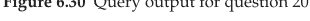

## DELETE 语句

描述：从表中删除一条或多条记录。
语法：DELETE FROM table [WHERE conditions];

问题 21：编写一个查询以删除 Warehouse 部门。

答案：
```sql
DELETE FROM Departments
WHERE Dept_Id = 11;
```

# 数据控制语言 5 DCL

我们在第 5 章中提到过，数据控制语言中有两个主要的语句：GRANT 和 REVOKE。实际上，在 Oracle 中创建数据库时，我们已经在第 48 页使用过 GRANT 语句了。

GRANT：向用户分配数据库对象上的权限。系统权限可以是 CONNECT、CREATE。表权限可以是 INSERT、UPDATE、DELETE 或 ALTER。

## 语法

```sql
GRANT system privileges TO user;
GRANT table privileges ON objects TO user;
```

在以下示例中，我们向用户 TEST_DB 授予 CONNECT 和 DBA 权限。
```sql
GRANT CONNECT, DBA TO TEST_DB;
```

在接下来的示例中，我们向用户 TEST_DB 授予 INSERT 权限。
```sql
GRANT INSERT ON Departments TO TEST_DB;
```

如果你想向用户授予所有权限，可以使用 ALL 关键字：
```sql
GRANT ALL ON Departments TO TEST_DB;
```

REVOKE：从用户处移除权限。

## 语法

```sql
REVOKE privileges ON objects FROM user;
```

示例：

```sql
REVOKE DBA TO TEST_DB;
REVOKE INSERT ON Departments TO TEST_DB;
```

## 总结

第 6 章涵盖了以下内容：

- 数据操作语言 (DML)
- 使用 INSERT 语句向书中使用的六张表插入数据
- Oracle SQL、T-SQL 和 MySQL 中的 SELECT 语句
- 使用算术运算符
- 使用比较运算符
- UPDATE 和 DELETE 语句

## 练习

### 6.1
编写一个查询显示所有国家。

### 6.2
编写一个查询显示所有员工的特定列，如电子邮件和电话号码。

### 6.3
编写一个查询显示姓为“Fay”的员工的数据。

### 6.4
编写一个查询查找姓为“Grant”或“Whalen”的员工的入职日期。

### 6.5
编写一个查询显示出运经理的员工姓名。

### 6.6
编写一个查询显示所有在 20 部门工作的员工。

### 6.7
编写一个查询按降序显示部门。

### 6.8
编写一个查询显示所有姓以“M”开头的员工。

### 6.9
显示入职日期在 2015 年到 2017 年之间的员工姓名。

### 6.10
编写一个查询显示最高薪水小于 5000 的职位。

### 6.11
编写一个查询以小写显示电子邮件地址。

### 6.12
编写一个查询显示在 2015 年入职的员工姓名。

### 6.13
编写一个查询在 20 部门插入员工“Paul Newton”。

### 6.14
编写一个查询删除出运部门。

# 第 7 章

## 聚合函数和 GROUP BY 子句

数据库开发者经常需要回答诸如每个部门有多少员工的问题。为了编写这类总结性问题的查询，我们在本章中使用 Employees 表作为示例数据。

| EMPLOYEE_ID | FIRST_NAME | EMAIL | PHONE | HIRE_DATE | JOB_ID | SALARY | MANAGER_ID | DEPT_ID |
|---||---|---|---|---|---|---|---|---|
| 100 | Douglas | DGRANT | 650.507.9544 | 23-JAN-08 | SR_CLERK | 2600 | 101 | 50 |
| 101 | Adam | Fripp | AFRIPP | 650.123.2234 | 10-APR-15 | SR_MAG | 8200 | 109 | 50 |
| 102 | Jennifer | Whalen | JWHAL | 515.123.5553 | 17-SEP-13 | AD_ADST | 4400 | 108 | 10 |
| 103 | Michael | Hartastein | MHARTSTEIN | 515.123.5553 | 18-FEB-14 | MK_MAG | 6300 | 103 | 20 |
| 104 | Pat | Fay | PFAY | 515.123.4567 | 26-AUG-11 | _ | 6000 | 109 | 20 |
| 105 | Oscar | Mathis | SMATHIS | 515.123.7777 | 07-JUL-06 | HR_MGR | 13000 | 10 | 20 |
| 106 | Shelley | Higgins | SHIGGINS | 515.123.6808 | 07-JUN-12 | _ | 6500 | 105 | 40 |
| 107 | William | Gietz | WIEGETZ | 515.123.8181 | 07-JUN-12 | SA_REP | 8300 | 106 | 80 |
| 108 | Steven | King | KING | 515.123.4567 | 17-JUN-13 | AD_PRES | 24000 | 108 | 10 |
| 109 | Lex | De Haan | LDEHAN | 515.123.4569 | 13-JAN-11 | AD_VP | 17000 | 108 | 10 |
| 110 | Bruce | Ernst | BERNST | 590.423.4568 | 21-FEB-17 | IT_MGR | 6000 | 109 | 60 |
| 111 | Diana | Lorentz | DLORENTI | 500.423.5567 | 07-FEB-17 | IT_PROG | 4200 | 110 | 60 |
| 112 | Nancy | Greenberg | NBERGREEN | 515.124.4569 | 17-AUG-12 | FI_PROG | 4200 | 110 | 60 |

## 聚合函数

数据库开发者经常需要回答诸如每个部门有多少员工的问题。为了编写这类总结性问题的查询，我们在本章中使用 Employees 表作为示例数据。

| Oracle SQL | T-SQL | MySQL |
| --- | --- | --- |
| FIRST_NAME LAST_NAME | first_name last_name | first_name last_name |
| James Fripp | James Fripp | James Fripp |


答案 (T-SQL):

```sql
SELECT MAX (Last_Name) AS Last_Name
FROM Employees;
```

| Oracle SQL | T-SQL | MySQL |
|---|---|---|
| MAX(LAST_NAME) Whalen | Last_Name Whalen | MAX(Last_Name) Whalen |

图 7.7 MAX() 函数的查询输出（字符类型）

问题：编写一个查询显示 Employees 表中最新的入职日期。

答案 (Oracle & MySQL):

```sql
SELECT MAX(Hire_Date)
FROM Employees;
```

答案 (T-SQL):

```sql
SELECT MAX (Hire_Date) AS Hire_Date
FROM Employees;
```

| Oracle SQL | T-SQL | MySQL |
|---|---|---|
| MAX(HIRE_DATE) 21-FEB-17 | Hire_Date 2017-02-21 | MAX(Hire_Date) 2017-02-21 |

图 7.8 MAX() 函数的查询输出（日期类型）

### SUM ( ) 函数

问题：编写一个查询计算 Employee 表中员工薪资的总额。

答案 (Oracle & MySQL):

```sql
SELECT SUM(Salary)
FROM Employees;
```

答案 (T-SQL):

```sql
SELECT SUM (Salary) AS Total_Salary
FROM Employees;
```

| Oracle SQL | T-SQL | MySQL |
|---|---|---|
| SUM(SALARY) | Total_Salary | SUM(Salary) |
| 127216 | 127216.00 | 127216.00 |

图 7.9 SUM() 函数的查询输出

## GROUP BY 和 HAVING 子句

HAVING 语句与聚合函数一起使用，对列数据进行分组。HAVING 子句用于 GROUP BY 语句。它对组设置条件。 HAVING 子句用于 SELECT 语句。

## 语法

```sql
SELECT Aggregate Function (column_name)
FROM tables
[WHERE conditions]
GROUP BY column_name
[HAVING conditions]
[ORDER BY column(s) [ASC DESC]];
```

### 使用 AVG () 函数 GROUP BY

问题：编写一个查询查找每个部门的平均薪资。

答案 (Oracle & MySQL):

```sql
SELECT AVG (salary), Dept_ID
FROM Employees
GROUP BY Dept_ID
ORDER BY Dept_ID;
```

答案 (T-SQL):

```sql
SELECT AVG (Salary) AS 'Average Salary', Dept_ID
FROM Employees
GROUP BY Dept_ID
ORDER BY Dept_ID;
```

| Oracle SQL | AVG(SALARY) | DEPT_ID | T-SQL | Average Salary | Dept_ID | MySQL | avg(salary) | Dept_ID |
| --- | --- | --- | --- | --- | --- | --- | --- | --- |
| 15133.3333... | 10 | | 15133.33 | 10 | | 15133.333333 | 10 |
| 9500 | 20 | | 9500.00 | 20 | | 9500.000000 | 20 |
| 6500 | 40 | | 6500.00 | 40 | | 6500.000000 | 40 |
| 5400 | 50 | | 5400.00 | 50 | | 5400.000000 | 50 |
| 5100 | 60 | | 5100.00 | 60 | | 5100.000000 | 60 |
| 10154 | 80 | | 10154.00 | 80 | | 10154.000000 | 80 |
| 7504 | 90 | | 7504.00 | 90 | | 7504.000000 | 90 |

图 7.10 使用 AVG() 函数的输出

注意：如果你不在 SELECT 子句中列出 Dept_ID，结果将只有一列 Average Salary（无法确定是哪个部门）。在 SELECT 子句中列出 Group By 列。

### 使用 COUNT ( ) 函数 GROUP BY

问题：编写一个查询统计每个部门的员工人数。

答案 (Oracle & MySQL):

```sql
SELECT COUNT(Employee_ID), Dept_ID
FROM Employees
GROUP BY Dept_ID;
```

答案 (T-SQL):

```sql
SELECT COUNT (Employee_ID) AS 'Number of Employees', Dept_ID
FROM Employees
GROUP BY Dept_ID
ORDER BY Dept_ID;
```

| Oracle SQL | | T-SQL | | MySQL |
|---|---|---|---|---|---|
| COUNT(EMPLOYEE_ID) | DEPT_ID | Number of Employees | Dept_ID | count(Employee_ID) | DEPT_ID |
| 3 | 10 | 3 | 10 | 3 | 10 |
| 2 | 20 | 2 | 20 | 2 | 20 |
| 1 | 40 | 1 | 40 | 1 | 40 |
| 2 | 50 | 2 | 50 | 2 | 50 |
| 2 | 60 | 2 | 60 | 2 | 60 |
| 10154 | 80 | 10154.00 | 80 | 10154.000000 | 80 |
| 7504 | 90 | 7504.00 | 90 | 7504.000000 | 90 |

图 7.11 使用 COUNT() 函数的输出

### 带 HAVING GROUP BY 示例

问题：编写一个查询统计拥有三个员工的部门。

答案 (Oracle & MySQL):

```sql
SELECT COUNT (Employee_ID), Dept_ID
FROM Employees
GROUP BY Dept_ID
HAVING COUNT (Employee_ID) = 3;
```

答案 (T-SQL):

```sql
SELECT COUNT (Employee_ID) AS 'Number of Employees', Dept_ID
FROM Employees
GROUP BY Dept_ID
HAVING COUNT (Employee_ID) = 3;
```

| Oracle SQL | | T-SQL | | MySQL |
|---|---|---|---|---|---|
| COUNT(EMPLOYEE_ID) | DEPT_ID | Number of Employees | Dept_ID | COUNT(Employee_ID) | Dept_ID |
| 3 | 10 | 3 | 10 | 3 | 10 |

图 7.12 带 HAVING GROUP BY 的输出

## 总结

第 7 章涵盖了以下内容：
- 使用聚合函数 AVG ( ), COUNT ( ), MAX ( ), MIN ( ) 和 SUM ()。
- 使用 GROUP BY 和 HAVING 子句。
- 使用 AVG ( ) 函数。
- 使用 COUNT ( ) 函数。

## 练习

7.1 编写一个查询显示国家的城市数量。
7.2 编写一个查询显示每个部门最低薪资。
7.3 编写一个查询显示每个部门最高薪资。
7.4 编写一个查询显示每个部门员工薪资总和。
7.5 编写一个查询显示每个部门薪资总和。
7.6 显示平均薪资大于 15000 的部门 ID。
7.7 编写一个查询显示经理管理的员工人数。
7.8 编写一个查询显示人数超过 3 人的经理。
7.9 编写一个查询将员工薪资增加到 5000。

# 第8 章函数

## 常用数值函数

数值函数接受数值输入作为表达式并返回数值。大多数数值函数的返回类型为 NUMBER。
对于聚合函数 AVG ( ), COUNT ( ), MAX ( ), MIN ( ) 和 SUM ( ) 请查看第 7 章的示例。
下面列出常用函数。

表 8.1：常用数值函数

| Oracle SQL | T-SQL | MySQL |
|---|---|---|
| CEIL ( ) | CEILING ( ) | CEIL ( ), CEILING ( ) |
| FLOOR ( ) | FLOOR ( ) | FLOOR ( ) |
| GREATEST ( ) | | GREATEST ( ) |
| LEAST ( ) | | LEAST ( ) |
| MOD ( ) | % | MOD ( ) |
| POWER (m, n) | POWER (m, n) | POW (m, n), POWER (m, n) |
| ROUND ( ) | ROUND ( ) | ROUND ( ) |
| SQRT ( ) | SQRT ( ) | SQRT ( ) |
| TRUNC ( ) | | TRUNC ( ) |

### CEIL () – Oracle 和 MySQL

CEILING () – T-SQL

**描述：** 返回大于或等于指定数的最小整数。

**语法**

```sql
CEIL (number)
CEILING (number)
```

问题 1：编写一个查询查找大于或等于 12.5 的整数。

答案：

| Oracle SQL | T-SQL | MySQL |
| --- | --- | --- |
| SELECT CEIL(12.5) FROM dual; | SELECT CEILING(12.5) | SELECT CEIL(12.5); |
| CEIL(12.5) | Ceiling | CEIL(12.5) |
| 13 | | 13 |

图 8.1 输出

### FLOOR ()

描述——返回小于等于指定数的最大整数。

**语法**

```sql
FLOOR (number)
```

问题 2：编写一个查询获取小于等于 12.5 的整数。

答案：

| Oracle SQL | T-SQL | MySQL |
| --- | --- | --- |
| SELECT FLOOR(12.5) FROM dual; | SELECT FLOOR(12.5) | SELECT FLOOR(12.5); |
| FLOOR(12.5) | Floor | FLOOR(12.5) |
| 12 | | 12 |

图 8.2 输出

### GREATEST () – Oracle 和 MySQL

描述——返回列表中的最大数字或最大的字符。

**语法**

```sql
GREATEST (a list)
```

问题 3：编写一个查询显示 4, 8 和 2 列表中的最大数字。

答案：

| Oracle SQL | MySQL |
| --- | --- |
| SELECT GREATEST(4, 8, 2) FROM dual; | SELECT GREATEST(4, 8, 2); |
| GREATEST(4,8,2) | GREATEST(4,8,2) |
| 8 | 8 |

图 8.3 输出

问题 4：编写一个查询显示 'F', 'U', 'B' 列表中的最大的字符。

答案：

| Oracle SQL | MySQL |
| --- | --- |
| SELECT GREATEST('F', 'U', 'B') FROM dual; | SELECT GREATEST('F', 'U', 'B'); |
| GREATEST('F','U','B') | GREATEST('F','U','B') |
| U | |

图 8.4 输出

### LEAST ( ) – Oracle 和 MySQL

**描述：** 返回列表中的最小数字。

**语法**

```sql
LEAST (a list)
```

问题 5：编写一个查询显示 4, 8 和 2 列表中的最小数字。

答案：

| Oracle SQL | MySQL |
|---|---|
| SELECT LEAST(4,8,2) FROM dual; | SELECT LEAST(4,8,2); |
| LEAST(4,8,2) | LEAST(4,8,2) |
| 2 | 2 |

图 8.5 输出

### MOD () – Oracle 和 MySQL

% 运算符 – T-SQL

**描述：** 返回 Num1 除以 Num2 的余数。

**语法**

```sql
MOD (Num1, Num2)
Num1 % Num2 (T-SQL)
```

问题 6：编写一个查询获取 10 模 4 的余数。


答案:

| Oracle SQL | T-SQL | MySQL |
|---|---|---|
| SELECT MOD (10, 4) FROM dual; | SELECT MOD 10% 4 as Mod; | SELECT MOD (10, 4); SELECT 10 MOD 4; |
| MOD(10,4) | Mod | MOD (10, 4) |
| 2 | 2 | 2 |

图 8.6 问题 6 的查询和输出

## POWER ()

描述：返回 Num1 的 Num2 次方

语法：POWER (Num1, Num2)

问题 7：编写一个查询来显示 2 的 3 次方。

答案：

| Oracle SQL | T-SQL | MySQL |
|---|---|---|
| SELECT POWER (2, 3) from dual; | SELECT POWER (2, 3) AS Power; | SELECT POWER (2, 3); SELECT POW (2, 3); |
| POWER(2,3) | Power | POWER(2,3) |
| 8 | 8 | 8 |

图 8.7 问题 7 的查询和输出

## ROUND ()

描述：返回保留到小数点后特定数的数字。

语法：ROUND (Number, d)

Number 或单个数字 d – 小数位数

问题 8：编写一个查询将 267.389 保留 2 位小数。

答案：

| Oracle SQL | T-SQL | MySQL |
|---|---|---|
| SELECT ROUND (267.389, 2) FROM dual; | SELECT ROUND (267.389, 2) AS Round; | SELECT ROUND (267.389, 2); |
| ROUND(267.39) | ROUND(267.39) | ROUND(267.39) |

| |

图 8.8 问题 8 的查询和输出

## SQRT ()

描述：返回数字的平方根。

语法：SQRT (Number)

问题 9：编写一个查询来显示 100 的平方根。

答案：

| Oracle SQL | T-SQL | MySQL |
|---|---|---|
| SELECT SQRT (100) FROM dual; | SELECT SQRT (100) AS Sqrt; | SELECT SQRT (100); |
| SQRT(10) | SQRT(10) | SQRT(10) |

图 8.9 问题 9 的查询和输出

## TRUNC ()

描述：返回截断到 d 位小数的数字。结果不四舍五入。

语法：TRUNC (Number, d)

d – 小数位数

问题 10：编写一个查询将 528.915 截断为 2 位小数。

答案：

| Oracle SQL | T-SQL | MySQL |
|---|---|---|
| SELECT TRUNC (528.915, 2) FROM DUAL; | SELECT TRUNC (528.915, 2); | TRUNC (528.915, 2); |
| TRUNC(528.91) | | |

图 8.10 问题 10 的查询和输出

## 常用字符串函数

让我们列出常用函数。

表 8.2：常用字符串函数

| Oracle SQL | T-SQL | MySQL |
|---|---|---|
| CONCAT ( | CONCAT ( | CONCAT () |
| CONCAT (using ||) | CONCAT (using +) | FORMAT () |
| | LEFT ( | LEFT () |
| INITCAP ( | | |
| LENGTH () | LEN () | LENGTH () |
| LOWER () | LOWER () | LOWER () |
| LPAD ( | | LPAD () |
| LTRIM () | LTRIM () | LTRIM () |
| REPLACE () | REPLACE () | REPLACE () |
| | RIGHT ( | RIGHT () |
| RPAD ( | | RPAD () |
| RTRIM () | RTRIM () | RTRIM () |
| SUBSTR () | SUBSTRING () | SUBSTR (), SUBSTRING () |
| TRIM () | | TRIM () |
| UPPER () | UPPER () | UPPER () |

本节使用了 Employees 数据表作为示例数据。

| EMPLOYEE_ID | FIRST_NAME | LAST_NAME | EMAIL | PHONE_NUMBER | HIRE_DATE | JOB_ID | SALARY | MANAGER_ID | DEPARTMENT_ID |
||---|---|---|---|---|---|---|---|---|---|
| 100 | Douglas | Grant | DGRANT | 650-57-9644 | 2008-01-23 | SH_CLERK | 2600 | 114 | 50 |
| 101 | Adam | Fripp | AFRIIP | 515-123.2234 | 2015-04-10 | SH_MGR | 8200 | 109 | 50 |
| 102 | Jennifer | Wiesner | WHALEN | 515-123.4444 | 2014-03-17 | AD_ADST | 4400 | 108 | 50 |
| 103 | Michael | Hartstein | MHISTLE | 515-123.7777 | 2013-09-06 | MK_MGR | 12000 | 109 | 20 |
| 104 | Pat | King | FFAY | 603-123.666 | 2006-08-15 | MK_REP | 6000 | 103 | 20 |
| 105 | Susan | Maith | SMASIT | 515-123.8888 | 2012-06-22 | HR_MGR | 5622 | 109 | 40 |
| 106 | Shelley | Hogg | SHIGGIN | 515-123.1111 | 2012-05-26 | SA_MGR | 12008 | 109 | 80 |
| 107 | William | Scott | WCOTT | 515-123.5353 | 2013-05-24 | SA_REP | 8300 | 105 | 80 |
| 108 | Steven | Lee | SKONZ | 515-123.4967 | 2014-11-17 | AD_PRES | 24000 | 108 | 10 |
| 109 | Lex | DeHaan | LDHAN | 515-123.5668 | 2011-01-23 | AD_VP | 17000 | 108 | 10 |
| 110 | Bruce | Ewald | BERNST | 590-423.4568 | 2017-02-21 | IT_MGR | 6000 | 109 | 60 |
| 111 | Durancy | Lorent | DURANT | 515-123.7186 | 2014-11-19 | FI_PRNG | 4200 | 109 | 60 |
| 112 | Nancy | Greenberg | GREENBE | 515-124.4569 | 2013-03-23 | FI_MGR | 12008 | 109 | 90 |
| 113 | Daniel | Fayiet | DFAYET | 515-124.4169 | 2012-08-25 | FI_CLERK | 3000 | 112 | 90 |

图 8.11 Employees 表

| JOB_ID | JOB_TITLE | MIN_SALARY | MAX_SALARY |
|---|---|---|---|
| AD_PRES | CEO | 9000 | 25000 |
| AD_VP | Vice President | | 18000 |
| AD_ASST | Admin Assistant | 5000 | 6000 |
| FI_CLERK | Finance Clerk | 3000 | 4000 |
| FI_MGR | Finance Manager | 4000 | 5000 |
| SA_REP | Sales Representative | 3000 | 4000 |
| SA_MGR | Sales Manager | 4000 | 5000 |
| SH_CLERK | Shipping Clerk | 2500 | 4000 |
| SH_MGR | Shipping Manager | 4000 | 5000 |
| IT_PROG | Programmer | 4400 | 5500 |
| IT_MGR | IT Manager | 5000 | 6000 |
| MK_CLERK | Marketing Clerk | 3000 | 4000 |
| MK_MGR | Marketing Manager | 4000 | 5000 |
| HR_MGR | Human Resource | 4500 | 6000 |

图 8.12 job 表

### CONCAT ()

描述：连接字符串。

语法：

```
CONCAT (string1, string2)
```

问题 11：编写一个查询来连接姓和姓。

答案（Oracle）：

```sql
SELECT CONCAT(First_Name, ', ', Last_Name) AS FullName
FROM Employees;
```

答案（T-SQL & MySQL）：

```sql
SELECT CONCAT(First_Name, ', ', Last_Name) AS FullName
FROM Employees;
```

| Oracle SQL | T-SQL | MySQL |
|---|---|---|
| FULLNAME | FullName | FullName |
| Douglas Grant | Douglas Grant | Douglas Grant |
| Adam Fripp | Adam Fripp | Adam Fripp |
| Jennifer Whalen | Jennifer Whalen | Jennifer Whalen |

图 8.13 CONCAT 函数的输出（前3行）

### CONCAT () 使用 Oracle || 运算符或 T-SQL ' +' 运算符

语法：

```
string1 || string2 (Oracle)
string1 + string2 (T-SQL)
```

问题 12：使用 Oracle || 运算符或 T-SQL "+" 运算符连接姓和姓。

答案（Oracle）：

```sql
SELECT First_Name || ' ' || Last_Name AS FullName
FROM Employees;
```

答案（T-SQL）：

```sql
SELECT First_Name + ' ' + Last_Name AS FullName
FROM Employees;
```

| Oracle SQL | T-SQL |
|---|---|
| FULLNAME | FullName |
| Douglas Grant | Douglas Grant |
| Adam Fripp | Adam Fripp |
| Jennifer Whalen | Jennifer Whalen |

图 8.14 问题 12 的输出（前3行）

### FORMAT () – MySQL

描述：将数值四舍五入到指定的小数位数。结果为字符串。

语法：FORMAT (Number, d)
d – 小数位数

MySQL 函数示例：

```sql
SELECT FORMAT(623.7085, 2);
```

### LEFT () – T-SQL & MySQL

描述：从左侧获取指定数的字符。

语法：LEFT (string, length)
length–长度

问题 13：从“Database”左侧获取四个字符。

答案（T-SQL）：

```sql
SELECT LEFT('Database', 4) AS Left_Function;
```

答案（MySQL）：

```sql
SELECT LEFT('Database', 4);
```

### INITCAP () – Oracle

描述：将每个单词的首字母改为大写。

语法：INITCAP (string)

INITCAP 函数示例：

```sql
SELECT INITCAP('oracle sql mysql')
FROM dual;
```

```sql
SELECT INITCAP('ORACLE SQL SERVER')
FROM dual;
```

| Oracle SQL |
| --- |
| INITCAP('ORACLESQLSERVER') |
| Oracle Sql Server Mysql |

### LENGTH () – Oracle & MySQL

LEN () – T-SQL

描述：返回指定字符串的长度。

语法：LENGTH (string)
LEN (string)

问题 13：编写一个查询显示长度大于10的国家名称。

答案（Oracle & MySQL）：

```sql
SELECT COUNTRY_NAME
FROM Country
WHERE LENGTH (country_name) >= 10;
```

答案（T-SQL）：

```sql
SELECT COUNTRY_NAME
FROM Country
WHERE LEN (country_name) >= 10;
```

| Oracle SQL | T-SQL | MySQL |
|---|---|---|
| COUNTRY_NAME | COUNTRY_NAME | COUNTRY_NAME |
| Switzerland | Switzerland | Switzerland |
| Netherlands | Netherlands | Netherlands |
| United Kingdom | United Kingdom | United Kingdom |
| United States of America | United States of America | United States of America |

图 8.18 LEN (LENGTH) 函数的输出


### LOWER ()

**描述：** 将指定字符串中的所有字母转换为小写。

**语法** `LOWER` (string)

问题 14：编写一个查询，以小写显示所有国家名称。

答案 (Oracle & MySQL):

```
SELECT LOWER (country_name)
FROM country;
```

答案 (T-SQL):

```sql
SELECT
LOWER (country_name) AS country_name
FROM country;
```

| Oracle SQL | T-SQL | MySQL |
| --- | --- | --- |
| LOWER(COUNTRY_NAME) | country_name | LOWER ( country_name ) |
| argentina | argentina | argentina |
| australia | australia | australia |
| belgium | belgium | belgium |

**图 8.19** LOWER 函数的查询输出（前 3 行）

### LPAD () – Oracle 和 MySQL

**描述：** 在字符串的左侧添加一组字符

**语法** `LPAD` (string_l, padded_length, pad_characters)

问题 14：为 '352-7100' 添加区号 '706'。

答案 (Oracle):

```
SELECT LPAD ('352-7100', 12, '706-')
FROM dual;
```

答案 (MySQL):

```sql
SELECT LPAD ('352-7100', 12, '706-');
```

| Oracle SQL | MySQL |
|--- |--- |
| LPAD('352-7100', 12, '706-') | LPAD ('352-7100', 12, '706-') |
| 706-352-7100 | 706-352-7100 |

图 8.20 LPAD 函数的查询输出

### LTRIM ()

**描述：** 从字符串的左侧删除一组字符。

**语法**

LTRIM (string_1, trim_characters) (Oracle)

LTRIM (string_1) (T-SQL & MySQL) – 删除字符串左侧的空格字符。

示例 (Oracle)：从 '706-352-7100' 中删除区号 706。

```
SELECT LTRIM ('706-352-7100', '706-')
FROM dual;
```

示例 (T-SQL)：从 '706-352-7100' 中删除左侧空格。

```sql
SELECT LTRIM ('706-352-7100') AS LTRIM_Function;
```

示例 (MySQL)：从 '706-352-7100' 中删除左侧空格。

```sql
SELECT LTRIM ('706-352-7100');
```

| Oracle SQL | T-SQL | MySQL |
|--- |--- |--- |
| LTRIM('706-352-7100', '706-') | LTRIM_Function | LTRIM ('706-352-7100') |
| 352-7100 | 706-352-7100 | 706-352-7100 |

图 8.21 LTRIM 函数的查询输出

### REPLACE ()

**描述：** 用指定的字符（或）替换字符串的一部分。

**语法**

REPLACE ('string1', 'str_to_be_seached', 'str_to_replaced')

问题 15：编写一个查询，将电话号码中的 '-' 替换为 '.'。

答案：

```sql
SELECT first_name, last_name, REPLACE ( phone, '-', '') as Phone
FROM employees;
```

| FIRST_NAME | LAST_NAME | PHONE | first_name | last_name | Phone | first_name | last_name | Phone |
|---|---|---|---|---|---|---|---|---|
| Douglas | Grant | 650.507.9844 | Douglas | Grant | 650.507.9844 | | | |
| Adam | Fripp | 650.123.2234 | Adam | Fripp | 650.123.2234 | | | |
| Jennifer | Whalen | 515.123.4444 | Jennifer | Whalen | 515.123.4444 | | | |

图 8.22 REPLACE 函数的查询输出（前 3 行）

### RIGHT () – T-SQL & MySQL

**描述：** 从右侧获取指定数量的字符。

**语法**

RIGHT (string, length)
length – 指定数字的长度

问题 16：从字符串 “Database”的右侧获取四个字符。

答案 (T-SQL):

```sql
SELECT RIGHT('Database', 4) AS Right_Function;
```

答案 (MySQL):

```sql
SELECT RIGHT('Database', 4);
```

| T-SQL | MySQL |
|---|---|
| Right_Function | RIGHT('Database', 4) |
| base | |

图 8.23 RIGHT 函数的查询输出

### RPAD () – Oracle 和 MySQL

**描述：** 在字符串的右侧添加一组字符。

**语法**

RPAD (string_1, padded_length, pad_characters)

问题 17：在字符串 ‘Tele’的右侧添加 'vision'。

答案 (Oracle):

```sql
SELECT RPAD ('Tele', 10, 'vision')
FROM dual;
```

答案 (MySQL):

```sql
SELECT RPAD ('Tele', 10, 'vision');
```

| Oracle SQL | MySQL |
| --- | --- |
| RPAD('TELE',10,VISION) | RPAD ('Tele', 10, 'vision') |
| Television | Television |

图 8.24 RPAD 函数的查询输出

### RTRIM ()

**描述：** 从字符串的右侧删除一组字符。

**语法** (Oracle)

RTRIM (string_1, trim_characters)

**语法** (T-SQL & MySQL)

RTRIM (string_1) – 删除字符串右侧的空格。

示例 (Oracle)：从 '57800' 中删除 0。

```sql
SELECT RTRIM ('57800', '0')
FROM dual;
```

示例 (T-SQL & MySQL)：从 'Television' 中删除右侧空格。

```sql
SELECT RTRIM ('Television') AS 'RTRIM';
```

| Oracle SQL | T-SQL | MySQL |
| --- | --- | --- |
| RTRIM('57800','0') | RTRIM | RTRIM |
| 578 | Television | Television |

图 8.25 RTRIM 函数的查询输出

### SUBSTR () / SUBSTRING ()

**描述：** 从字符串的指定位置和长度提取子字符串。

**语法** (Oracle, MySQL)

```sql
SUBSTR (string, position, length)
```

**语法** (T-SQL, MySQL)

```sql
SUBSTRING (string, length)
```

问题 18：编写一个查询显示姓的前三个字符。

答案 (Oracle & MySQL):

```sql
SELECT Last_Name, SUBSTR(Last_Name, 1, 3)
FROM employees;
```

答案 (T-SQL & MySQL):

```sql
SELECT Last_Name, SUBSTRING(Last_Name, 1, 3)
FROM employees;
```

| Oracle SQL | T-SQL | MySQL |
| --- | --- | --- |
| LAST_NAME SUBSTR(LAST_NAME,1,3) | Last_Name (No column) | Last_Name SUBSTRING(Last_Name, 1, 3) |
| Grant Gra | Grant | Grant |
| Fripp Fri | Fripp | Fripp Fri |
| Whalen Wha | Whalen | Whalen Wha |

图 8.26 SUBSTR (SUBSTRING) 的查询输出（前 3 行）

### UPPER ()

**描述：** 将指定字符串中的所有字母转换为大写。

**语法**

```sql
UPPER (string)
```

问题 17：编写一个查询以大写显示所有国家名称。

答案 (Oracle & MySQL):

```sql
SELECT UPPER (country_name)
FROM country;
```

答案 (T-SQL):

```sql
SELECT UPPER (country_name) AS country_name
FROM country;
```

| Oracle SQL | T-SQL | MySQL |
| --- | --- | --- |
| UPPER(COUNTRY_NAME) | country_name | UPPER (country_name) |
| ARGENTINA | ARGENTINA | ARGENTINA |
| AUSTRALIA | AUSTRALIA | AUSTRALIA |
| BELGIUM | BELGIUM | BELGIUM |

图 8.27 UPPER 函数的查询输出（前 3 行）

## 常用日期时间函数

列出常用的日期时间函数。

| Oracle SQL | T-SQL | MySQL |
| --- | --- | --- |
| CURRENT_TIMESTAMP | CURRENT_TIMESTAMP | CURRENT_TIMESTAMP |
| Add_Months ( ) | DATEADD ( ) | DATE_ADD ( ) |
| EXTRACT ( ) | DATEPART ( ) | EXTRACT ( ) |
| CURRENT_DATE | GETDATE ( ) | CURRENT_DATE |
| MONTHS_BETWEEN ( ) | DATEDIFF ( ) | PERIOD_DIFF ( ) |
| SYSDATE | SYDATIME ( ) | SYSDATE |

表 8.3 日期时间函数

### CURRENT_TIMESTAMP

示例 (Oracle):

```sql
SELECT CURRENT_TIMESTAMP FROM dual;
```

示例 (T-SQL):

```sql
SELECT CURRENT_TIMESTAMP AS 'Current_Time';
```

示例 (MySQL):

```sql
SELECT CURRENT_TIMESTAMP;
```

| Oracle SQL |
| --- |
| CURRENT_TIMESTAMP |
| 04-MAY-17 09.25.10.403000000 PM AMERICA/NEW_YORK |

图 8.28 Oracle CURRENT_TIMESTAMP 的查询输出

| T-SQL | MySQL |
| --- | --- |
| Current_Time | CURRENT_TIMESTAMP |
| 2017-05-04 21:20:14.643 | 2017-05-04 21:16:13 |

图 8.29 T-SQL 和 MySQL CURRENT_TIMESTAMP 的查询输出

### Add_Months () – Oracle

**描述：**返回指定日期 n 个月后的日期。

## 语法

**Add_Month** (date, n)

### DATEADD () – T-SQL

## 语法

**DATEADD** (month, n, date)

### DATE_ADD () – MySQL

## 语法

**DATE_ADD** (date , INTERVAL n MONTH)

问题 18：编写一个查询为 2017 年 4 月 3 日增加一个月。

答案 (Oracle):

```sql
SELECT ADD_MONTHS ('03-Apr-17', 1)
FROM DUAL;
```

答案 (T-SQL):

```sql
SELECT DATEADD (month, 1, '2017/04/03') As Date;
```

答案 (MySQL):

```sql
SELECT DATE_ADD ("2017-04-17", INTERVAL 1 MONTH)
```

| Oracle SQL | T-SQL | MySQL |
|---|---|---|
| ADD_MONTHS('03-APR-17', 1) | Date | DATE_ADD("2017-04-03", INTERVAL 1 MONTH) |
| 03-MAY-17 | 2017-05-03 00:00:00.000 | 2017-05-03 |

图 8.30 Add month 函数的查询输出


答案 (Oracle):

```sql
SELECT EXTRACT (YEAR FROM DATE '2017-04-03') 'Year'
FROM DUAL;
```

答案 (T-SQL):

```sql
SELECT DATEPART (year, '2017/04/03') AS Year;
```

答案 (MySQL):

```sql
SELECT EXTRACT (YEAR FROM DATE '2017-04-03') As Year;
```

| Oracle SQL | T-SQL | MySQL |
| --- | --- | --- |
| Year | Year | Year |
| 2017 | 2017 | 2017 |

图 8.31 EXTRACT 函数的查询输出

CURRENT_DATE () – Oracle

GETDATE ( ) – T-SQL

CURRENT_DATE ( ) – MySQL

问题 20：编写一个查询显示当前日期。

答案 (Oracle):

```sql
SELECT CURRENT_DATE
FROM dual;
```

答案 (T-SQL):

```sql
SELECT GETDATE() AS Date;
```

答案 (MySQL):

```sql
SELECT CURRENT_DATE();
```

| Oracle SQL | T-SQL | MySQL |
| --- | --- | --- |
| CURRENT_DATE | Date | CURRENT_DATE() |
| 28-OCT-16 | 2017-05-04 21:31:31.713 | 2017-05-04 |

图 8.32 CURRENT_DATE 函数的查询输出

### MONTHS_BETWEEN ( ) – Oracle

格式 MONTHS_BETWEEN (date1, date2)

### DATEDIFF ( ) – T-SQL

格式 DATEDIFF (month, date1, date2)

### PERIOD_DIFF ( ) – MySQL

格式 PERIOD_DIFF(date1, date2)

问题 21：编写一个查询显示 2015/12/31 到 2016/12/02 之间的月份数。

答案 (Oracle):

```sql
SELECT MONTH_BETWEEN
(TO_DATE('12-02-2016','MM-DD-YYYY'),TO_DATE('12-31-2015','MM-DD-YYYY')) AS Month
FROM dual;
```

答案 (T-SQL):

```sql
SELECT DATEDIFF (month, '12-31-2015', '12-02-2016') as Month
```

答案 (MySQL):

```sql
SELECT PERIOD_DIFF ('201612', '201512') as Months
```

| Oracle SQL | T-SQL | MySQL |
|---|---|--|
| MONTH | Month | Months |
| 11.06451 | 12 | 12 |

图 8.3 MONTH_BETWEEN 函数的查询输出

### SYSDATE – Oracle

### SYSDETIME ( ) – T-SQL

### SYSDATE ( ) – MySQL

问题 22：编写一个查询显示系统日期。

答案 (Oracle):

```sql
SELECT sysdate
FROM dual;
```

答案 (T-SQL):

```sql
SELECT sysdatetime();
```

答案 (MySQL):

```sql
SELECT sysdate ( );
```

| Oracle SQL | T-SQL | MySQL |
|--- | --- | --- |
| SYSDATE 04-MAY-17 | sysdatetimeime 2017-05-04 21:42:40.3616068 | sysdate() 2017-05-04 21:44:25 |

图 8.34 SYSDATE 函数的查询输出

## 转换函数

表 8.4 转换函数

| Oracle SQL | T-SQL | MySQL |
|--- | --- | --- |
| CAST ( ) | CAST ( ) | CAST ( ) |
| TO_DATE ( ) | CONVERT ( ) | STR_TO_DATE ( ) |

### CAST ()

描述：将表达式从一种数据类型转换为另一种数据类型。

语法 CAST (expression AS data_type)

问题 23：编写一个查询将 356.78 转换为整数。

答案 (Oracle):

```sql
SELECT CAST (356.78 as int)
FROM dual;
```

答案 (T-SQL):

```sql
SELECT CAST (356.78 AS int);
```

答案 (MySQL):

```sql
SELECT CAST(356.78 SIGNED);
```

| Oracle SQL | T-SQL | MySQL |
|--- | --- | --- |
| CAST(356.78ASINT) | CAST(356.78 as SIGNED INT ) | CAST(356 as SIGNED) |

图 8.35 CAST 函数的查询输出

### TO_DATE ( ) – Oracle

格式 TO_DATE (string,format)

Oracle To_Date 函数格式如下所示。

表 8.5 Oracle To-Date 格式

| 格式 | 描述 |
| --- | --- |
| YYYY | 四位年份 |
| YY | 二位年份 |
| MON | 月份简称 |
| MM | 0–12 |
| DY | 周一到周六 |
| DD | 0–31 |
| HH24 | 0–23 小 |
| HH12 | 1–12 小 |
| MI | 0–59 分 |
| SS | 0–59 秒 |

示例 1：SELECT TO_DATE('2016/10/25', 'YYYY/MM/DD') FROM dual; (img/86805ec19af0039fad6bce2e0_130.png)

图 8.36 Oracle_Date 函数的查询输出

示例 2：SELECT TO_DATE('20161026', 'YYYYMMDD') FROM dual; (img/86805ec19af0039fad6bce2e0_130.png)

图 8.37 Oracle_Date 函数示例2的查询输出

### CONVERT ( ) – T-SQL

格式 CONVERT (data_type, expression, style)

T-SQL 日期转换样式示例如下：

表 8.6 T-SQL CONVERT() 样式

| 样式数字 | 示例 |
| --- | --- |
| 101 | 12/16/2016 |
| 102 | 2016.12.16 |
| 103 | 16/12/2016 |
| 104 | 16.12.2016 |
| 105 | 16-12-2016 |
| 106 | 16 Dec 2016 |
| DATE | YYYY-MM-DD |
| DATETIME | YYYY-MM-DD HH:MI:SS |

T-SQL 日期转换示例：

示例 1：SELECT CONVERT (varchar, getdate() ) AS Date; (img/86805ec19af0039fad6bce2e0_131.png)

图 8.38 CONVERT 示例1的查询输出

示例 2：SELECT CONVERT (varchar, getdate(), 101) AS Date; (img/86805ec19af0039fad6bce2e0_131.png)

图 8.39 CONVERT 示例2的查询输出

示例 3：SELECT CONVERT (varchar, getdate(), 106) AS Date; (img/86805ec19af0039fad6bce2e0_131.png)

图 8.40 CONVERT 示例3的查询输出

### STR_TO_DATE () – MySQL

格式 STR_TO_DATE (String, Format);

MySQL 日期转换格式如下：

| 格式 | 描述 |
|---|---||
| %Y | 四位年份 |
| %y | 二位年份 |
| %b | 月份简称（Jan–Dec） |
| %M | 月份名称（January–December） |
| %m | 月份（0–12） |
| %a | 周几简称（Sun–Sat） |
| %d | 日（0–31） |
| %H | 小时（0–23） |
| %h | 小时（01–12） |
| %i | 分（0–59） |
| %s | 秒（0–59） |

示例 1：SELECT STR_TO_DATE('May 01 2017', '%M %d %Y') AS date: (img/86805ec19af0039fad6bce2e0_132.png)

图 8.41 STR_TO_DATE 函数示例1的查询输出

示例 2：SELECT STR_TO_DATE('2016,5,20 04,20,35', '%Y,%m,%d %h,%i,%s') AS date; (img/86805ec19af0039fad6bce2e0_132.png)

图 8.42 STR_TO_DATE 函数示例2的查询输出

## 总结

第八章涵盖了以下内容：

- 理解常用的数字函数
- 使用字符函数
- 如何使用日期和时间函数
- 使用转换函数

## 练习题

### 8.1

编写一个查询显示系统日期的年份。

### 8.2

编写一个查询将 682.3547 保留两位。

### 8.3

编写一个查询显示字符串“Oracle SQL Developer”的第 8 到第 10 个字符。

# 第九章
高级 SQL

在本章中，你将学习使用以下 SQL 命令：

1. UNION, UNION ALL
2. INTERSECT (Oracle 和 T-SQL), IN (MySQL)
3. EXCEPT (T-SQL), MINUS (Oracle), NOT IN (MySQL)
4. ROWNUM (Oracle), TOP (T-SQL) 和 LIMIT (MySQL)
5. 子查询
6. CASE

## 1. UNION, UNION ALL

问题 1：编写一个查询合并 Customers 表和 Locations 表中的不同城市。

```sql
SELECT City
FROM Customer
UNION
SELECT City
FROM Locations
ORDER BY City;
```

| Oracle SQL | T-SQL | MySQL |
|---|---|---|
| CITY | City | City |
| Barcelona | Barcelona | Barcelona |
| Beijing | Beijing | Beijing |
| Hiroshima | Hiroshima | Hiroshima |
| London | London | London |
| Nantes | Nantes | Nantes |
| Seattle | Seattle | Seattle |
| South Brunswick | South Brunswick | South Brunswick |
| South San Francisco | South San Francisco | South San Francisco |
| Southlake | Southlake | Southlake |
| Sydney | Sydney | Sydney |
| Toronto | Toronto | Toronto |
| Whitehorse | Whitehorse | Whitehorse |

图 9.3 问题 1 的查询输出


一个交集运算符，用于返回两个表之间共同的行；它返回同时存在于第一个和第二个查询中的唯一行。当你想要查找两个查询之间的共同结果时，此操作非常有用。INTERSECT 有等效的 MySQL 语句 IN，该 IN 也可以用于 Oracle 和 T-SQL。

问题 3：编写一个查询，查找同时存在于 Customer 和 Locations 表中的城市。

答案 (Oracle & T-SQL):

```
SELECT City
FROM Customer
INTERSECT
SELECT City
FROM Locations;
```

答案 (MySQL):

```
SELECT distinct City
FROM customer
WHERE (city) IN
(SELECT City)
FROM Locations)
```

| Oracle SQL | T-SQL | MySQL |
| --- | --- | --- |
| CITY | City | City |
| Seattle | Seattle | Seattle |
| Southlake | Southlake | Southlake |

图 9.5 问题 3 的查询输出

## # 3. MINUS (Oracle), EXCEPT (T-SQL), NOT IN (MySQL)

描述：返回第一个 SELECT 语句中的所有行，但排除第二个 SELECT 语句包含的行。

语法

```
SELECT col1, col2, ...
FROM table1
MINUS or EXCEPT
SELECT col1, col2, ...
FROM table2
```

与 INTERSECTION 类似，EXCEPT (MINUS) 有等效的 MySQL 语句 NOT IN，该语句也可以用于 Oracle 和 T-SQL。

问题 4：编写一个查询，查找存在 Locations 表中不在 Customer 表中的城市。

答案：见表 9.1。

| Oracle SQL | T-SQL | MySQL |
| --- | --- | --- |
| SELECT City | SELECT City | SELECT distinct City |
| FROM Locations | FROM Locations | FROM Locations |
| MINUS | EXCEPT | WHERE (city) |
| SELECT City | SELECT City | NOT IN (SELECT City) |
| FROM Customer; | FROM Customer; | FROM Customer |

| CITY | City | City |
| --- | --- | --- |
| Beijing | Beijing | Beijing |
| Hiroshima | Hiroshima | Hiroshima |
| London | London | London |
| South Brunswick | South Brunswick | South Brunswick |
| South San Francisco | South San Francisco | South San Francisco |
| Sydney | Sydney | Sydney |
| Toronto | Toronto | Toronto |
| Whitehorse | Whitehorse | Whitehorse |

图 9.6 问题 4 的查询输出

## # 4. ROWNUM (Oracle), TOP (T-SQL) and LIMIT (MySQL)

描述：指定要返回的记录数

Oracle 样式 SELECT column_name(s)

FROM table_name
WHERE ROWNUM <= number;

T-SQL 样式 SELECT TOP number | percent column_name(s)

FROM table_name;

MySQL 样式 SELECT column_name(s)

FROM table_name
LIMIT number;

ROWNUM 是 Oracle 数据库中特殊的虚拟列，让很多人遇到了困扰。当你了解它是什么以及如何工作时，它可以非常有用。
ROWNUM 可用在查询，但它不是表的一部分。ROWNUM 将被分配数字 1, 2, 3, 4, ... N，其中 N 是结果集的行数。ROWNUM 可以作为查询中 where 子句的一部分来返回特定的行。ROWNUM 值并不是永久地分配给某行的（这是一个常见的误解）。对 ROWNUM 进行 <（小于）或 >（大于）操作并不总是有效；你必须使用 <=（小于或等于）或 >=（大于或等于）。

例如，

```
SELECT ROWNUM, firstname
FROM customer;
```

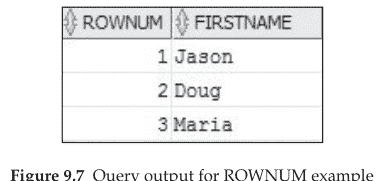

问题 5：显示 Country 表的前十行数据。

答案 (Oracle):

```
SELECT *
FROM Country
WHERE ROWNUM <= 10;
```

| COUNTRY_ID | COUNTRY_NAME | REGION_ID |
|---|---|--|
| AR | Argentina | 2 |
| AU | Australia | 3 |
| BE | Belgium | 1 |
| BR | Brazil | 2 |
| CA | Canada | 2 |
| CH | Switzerland | 1 |
| CN | China | 3 |
| DE | Germany | 1 |
| DK | Denmark | 1 |
| EG | Egypt | 4 |

图 9.8 问题 5 的查询输出 (Oracle)

答案 (T-SQL):

```
SELECT TOP 10 *
FROM Country;
```

| COUNTRY_ID | COUNTRY_NAME | REGION_ID |
|---|---|--|
| AR | Argentina | 2 |
| AU | Australia | 3 |
| BE | Belgium | 1 |
| BR | Brazil | 2 |
| CA | Canada | 1 |
| CH | Switzerland | 1 |
| CN | China | 3 |
| DE | Germany | 1 |
| DK | Denmark | 1 |
| EG | Egypt | 4 |

图 9.9 问题 5 的查询输出 (T-SQL)

答案 (MySQL):

```
SELECT *
FROM Country LIMIT 10;
```

| COUNTRY_ID | COUNTRY_NAME | REGION_ID |
|---|---|--|
| AR | Argentina | 2 |
| AU | Australia | 3 |
| BE | Belgium | 1 |
| BR | Brazil | 2 |
| CA | Canada | 2 |
| CH | Switzerland | 1 |
| CN | China | 3 |
| DE | Germany | 1 |
| DK | Denmark | 1 |
| EG | Egypt | 4 |

图 9.10 问题 5 的查询输出 (MySQL)

## # 5. 子查询

描述：子查询是嵌套在较大的查询中的 SQL 查询。子查询应该放在括号内。子查询可以出现在主查询的 SELECT、FROM 或 WHERE 子句中，创建主查询所需的临时表。

样式

```
SELECT column(s)
FROM table1
WHERE value IN
(SELECT column)
FROM table2
```

问题 6：编写一个查询查找工资大于平均水平的员工。

答案：

```
SELECT first_name, last_name, dept_ID, salary
FROM employees
WHERE salary >
(SELECT AVG(salary)
FROM employees);
```

Oracle 输出

| first_name | last_name | dept_ID | salary |
|---|---|---|---|
| Michael | Hartstein | 20 | 13000.00 |
| Shelley | Higgins | 80 | 12008.00 |
| Steven | King | 10 | 24000.00 |
| Lex | De Haan | 10 | 17000.00 |
| Nancy | Greenberg | 90 | 12008.00 |

T-SQL 输出

| FIRST_NAME | LAST_NAME | DEPT_ID | SALARY |
|---|---|---|---|
| Michael | Hartstein | 20 | 13000 |
| Shelley | Higgins | 80 | 12008 |
| Steven | King | 10 | 24000 |
| Lex | De Haan | 10 | 17000 |
| Nancy | Greenberg | 90 | 12008 |

MySQL 输出

| first_name | last_name | dept_ID | salary |
|---|---|---|---|
| Michael | Hartstein | 20 | 13000.00 |
| Shelley | Higgins | 80 | 12008.00 |
| Steven | King | 10 | 24000.00 |
| Lex | De Haan | 10 | 17000.00 |
| Nancy | Greenberg | 90 | 12008.00 |

图 9.11 问题 6 的查询输出

问题 7：编写一个查询查找在 Sales 部门工作的员工。

答案：

```
SELECT Employee_ID, First_Name, Last_Name, Dept_ID
FROM employees
WHERE dept_id IN
(SELECT dept_id
FROM departments
WHERE dept_name='Sales');
```

Oracle 输出

| EMPLOYEE_ID | FIRST_NAME | LAST_NAME | DEPT_ID |
|---|---|---|---|
| 107 | William | Gietz | 80 |
| 106 | Shelley | Higgins | 80 |

T-SQL 输出

| Employee_ID | First_Name | Last_Name | Dept_ID |
|---|---|---|---|
| 106 | Shelley | Higgins | 80 |
| 107 | William | Gietz | 80 |

MySQL 输出

| Employee_ID | First_Name | Last_Name | Dept_ID |
|---|---|---|---|
| 106 | Shelley | Higgins | 80 |
| 107 | William | Gietz | 80 |

图 9.12 问题 7 的查询输出

## # 6. CASE

描述：CASE 语句具有 IF-THEN-ELSE 语句的功能。

语法 1

```
CASE
WHEN condition_1 THEN result_1
WHEN condition_2 THEN result_2 ...
WHEN condition_n THEN result_n
ELSE result
END
```

# 语法 2

```
CASE expression
WHEN value_1 THEN result_1
WHEN value_2 THEN result_2 ...
WHEN value_n THEN result_n
ELSE result
END
```

CASE 语句始终位于 SELECT 子句中。CASE 必须包含以下组件：WHEN、THEN 和 END。ELSE 是可选组件。

可以在 WHEN 和 THEN 之间使用任何条件运算符（如 WHERE）创建任何条件语句。使用 AND 或 OR 连接多个条件语句。

你可以包含多个 WHEN 语句，以及 ELSE 语句来处理任何未处理的情况。

CASE 语法 1 示例：

```
SELECT dept_name,
CASE
WHEN location_id = 1400
OR location_id = 1500
OR location_id = 1700
OR location_id = 2500
OR location_id = 2700 THEN 'USA'
WHEN location_id = 1800 THEN 'Canada'
WHEN location_id = 2400 THEN 'UK'
END "location"
FROM Departments;
```

CASE 样式 2 示例：

```
SELECT dept_name,
CASE location_id
WHEN 1400 THEN 'USA'
WHEN 1500 THEN 'USA'
WHEN 1700 THEN 'USA'
WHEN 2500 THEN 'USA'
WHEN 2700 THEN 'USA'
WHEN 1800 THEN 'Canada'
WHEN 2400 THEN 'UK'
END "location"
FROM Departments;
```

132 第 9 章 高级 SQL

| DEPT_NAME | LOCATION | dept_name | location |
|---|---|---|---|
| Administration | USA | Administration | USA |
| Marketing | Canada | Marketing | Canada |
| Purchasing | USA | Purchasing | USA |
| Human Resources | UK | Human Resources | UK |
| Shipping | USA | Shipping | USA |
| IT | USA | IT | USA |
| Public Relations | USA | Public Relations | USA |
| Sales | USA | Sales | USA |
| Accounting | USA | Accounting | USA |
| Customer Service | UK | Customer Service | UK |

图 9.3 CASE 示例查询输出

## # 7. SEQUENCE (Oracle), IDENTITY (T-SQL), AUTO_INCREMENT (MySQL)

描述：我们希望在每次插入新记录时自动创建主键字段的值。

## Oracle 样式

```
CREATE SEQUENCE sequence_name
[START WITH start_num]
[INCREMENT BY increment_num]
```

## T-SQL 样式

```
IDENTITY (seed, increment)
  seed - 初始数字
increment - 增量
```

## MySQL 样式

```
**AUTO_INCREMENT:** 默认起始值为 1，每条新记录递增 1。
```

## Oracle SEQUENCE 示例

第一步——创建一个名为 seq_customer 的序列，它从 100 开始。每当我们插入一条记录时，seq_customer.NEXTVAL 都会生成一个从 100 开始的新值：

```
CREATE SEQUENCE seq_customer START WITH 100;
```


## 第 9 章 高级 SQL 133

- 表格（过滤后的）
- 视图
- 版本视图 (Editioning Views)
- 索引
- 程序包
- 存储过程
- 函数
- 队列
- 队列表
- 触发器
- 跨版本触发器
- 类型
- 序列
- SEQ_CUSTOMER

图 9.14 Oracle 中的 CREATE SEQUENCE

步骤 2—向 customer 表中插入一个客户“Jason Brown”。`seq_customer.NEXTVAL` 生成一个从 100 开始的新值：

```sql
INSERT INTO customer (id, FirstName, LastName)
VALUES (seq_customer.NEXTVAL, 'jason', 'Brown');
```

| ID | FIRSTNAME | LAST |
|---|---|---|
| 1 | Howard | Bell |
| 2 | Alice | Carter |
| 3 | Carine | Schmitt |
| 4 | Paolo | Accorti |
| 5 | Helen | Bennett |
| 100 | Jason | Brown |

图 9.15 插入了一条客户记录

## T-SQL IDENTITY 示例

步骤 1—创建一个名为 STATE 的表，并设置初始值为 1，间隔值为 1。

```sql
Create Table STATE
  ID int NOT NULL IDENTITY(1, 1),
  StateName varchar(30)
```

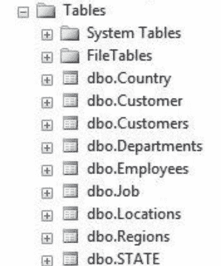

步骤 2—向表中插入两个状态。没有必要插入 ID，因为 IDENTITY 会逐个创建 ID。

```sql
INSERT INTO STATE (StateName) VALUES ('Utah');
INSERT INTO STATE (StateName) VALUES ('Maryland');
```

步骤 3—检查结果。

```sql
SELECT * FROM STATE
```

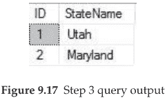

## MySQL AUTO_INCREMENT 示例

步骤 1—创建一个名为 STATE 的表，并带有 AUTO_INCREMENT 的主键。初始值和间隔值默认为 1。

```sql
Create TABLE STATE
(
  ID int NOT NULL Primary Key AUTO_INCREMENT,
  StateName varchar(30)
)
```

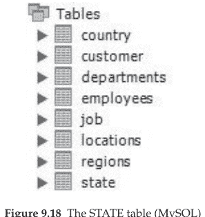

要使用另一个起始值设置 AUTO_INCREMENT，请使用以下 SQL 语句：

```sql
ALTER TABLE STATE AUTO_INCREMENT=50;
```

步骤 2—向表中插入两个状态。没有必要插入 ID，因为 AUTO_INCREMENT 会创建 ID。

```sql
INSERT INTO STATE (StateName) VALUES ('Utah');
INSERT INTO STATE (StateName) VALUES ('Maryland');
```

步骤 3—检查结果。

```sql
SELECT * FROM STATE;
```

| ID | StateName |
|---|---|
| 1 | Utah |
| 2 | Maryland |

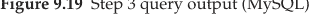

## 总结

第 9 章涵盖了：

- 操作 Union、Union All 命令
- 使用 INTERSECT（Oracle 和 T-SQL）和 IN（MySQL）命令
- 如何使用 Except（T-SQL）、MINUS（Oracle）和 NOT IN（MySQL）命令
- 理解 ROWNUM（Oracle）、TOP（T-SQL）和 LIMIT（MySQL）命令
- 定义子查询
- 理解 Case 命令
- 使用 Sequence（Oracle）、Identity（T-SQL）和 Auto_Increment（MySQL）生成序列号。

## 练习

### 9.1

编写一个查询，将 customers 表中的名称与 employees 表中的名称合并。

### 9.2

修改 9-1 中的查询，按姓对结果进行排序。

# 第 10 章
连接 (Joins)

在关系型数据库设计中，Employee（员工）和 Department（部门）是两个实体。员工相关数据保存在 Employees 表，而部门相关数据保存在 Departments 表中。为了连接，两个表之间创建了 Department_ID。

如果我们想显示员工名称和部门名称，无法仅使用 Employees 表或 Departments 表。要在员工名称之后列出部门名称，我们需要使用 SQL JOIN。

有四种基本的 SQL 连接：内连接 (Inner Join)、左连接 (Left Join)、右连接 (Right Join) 和全连接 (Full Join)。最有用的连接是内连接 (Inner Join)。

表 10.1 常见连接类型

| (INNER JOIN) | 获取两个表中具有匹配值的记录。 |
|---|---|
| LEFT JOIN | 获取表1 (LEFT table1) 的所有记录以及表2 (RIGHT table2) 的匹配记录。如果没有匹配，则表2 的结果为 NULL。 |
| RIGHT JOIN | 获取表2 (RIGHT table1) 的所有记录以及表1 (LEFT table2) 的匹配记录。如果没有匹配，则表1 的结果为 NULL。 |
| FULL JOIN | 获取表1 和表2 中的所有行。 |

## 语法

```sql
SELECT table1.col_name, table2.col_name
FROM table1
(INNER) JOIN table2 ON table1.col_name = table2.col_name;
SELECT table1.col_name, table2.col_name
FROM table1
LEFT JOIN table2 ON table1.col_name = table2.col_name;
SELECT table1.col_name, table2.col_name
FROM table1
RIGHT JOIN table2 ON table1.col_name = table2.col_name;
SELECT table1.col_name, table2.col_name
FROM table1
FULL JOIN table2 ON table1.col_name = table2.col_name;
```

## 旧语法

```sql
SELECT table1.col_name, table2.col_name
FROM table1, table2
WHERE table1.col_name = table2.col_name;
```

## 使用 JOIN 子句 (Oracle)

```sql
SELECT table1.col_name, table2.col_name
FROM table1
JOIN table2 USING (col_name);
```让我们使用 Departments 和 Locations 表进行 JOIN。图 10. Employees 表

| EMPLOYEE_ID | FIRST_NAME | LAST_NAME | EMAIL | PHONE_NUMBER | HIRE_DATE | JOB_ID | SALARY | MANAGER_ID | DEPARTMENT_ID |
|---|---|---|---|---|---|---|---|---|---|
| | | | | | | | | |
| 100 | Douglas | Grant | | 569.844 | 2008-01-23 | HR_ERK | 2600 | 114 | 50 |
| 101 | Adam | Schmidt | | 650.1234 | 2013-09-06 | AD_PP | 8200 | 109 | 50 |
| 102 | Jennifer | Whalen | | 515.2344 | 2014-02-17 | AD_ST | 4400 | 108 | 10 |
| 103 | Michael | Hatfield | | 515.2355 | 2009-08-01 | HR_MK | 6000 | 109 | 20 |
| 104 | Pat | | 603.23666 | 2012-03-02 | HR_PRES | 6500 | 109 | 20 |
| 105 | Susan | Maura | | 515.23777 | 2013-06-15 | SA_MK | 6500 | 109 | 20 |
| 106 | Shelley | Hoggin | | 515.23888 | 2012-02-20 | SA_REP | 12090 | 109 | 80 |
| 107 | William | Getz | | 515.23456 | 2013-06-15 | AD_PRFS | 24600 | 108 | 10 |
| 108 | Steven | King | | 515.24578 | 2013-10-29 | AD_UP | 12800 | 109 | 10 |
| 109 | Leah | De Haas | | 515.24689 | 2017-02-16 | IT_MK | 6000 | 109 | 60 |
| 110 | Bruce | Emmet | | 590.423556 | 2017-02-21 | IT_PROG | 4200 | 110 | 60 |
| 111 | Diana | Lorenz | | 515.249667 | 2017-01-18 | FL_MGR | 12008.00 | 109 | 50 |
| 112 | Nancy | Greenberg | | 515.249999 | 2013-03-22 | FI_MGR | | | 50 |
| 113 | Daniel | Davet | | 515.244169 | 2012-08-25 | FI_CLERK | 3000.00 | 112 | 90 |

| DEPT_ID | DEPT_NAME | MANAGER_ID | LOCATION_ID |
|---|---|---|---|
| 10 | Administration | 200 | 1700 |
| 20 | Marketing | 201 | 1800 |
| 30 | Purchasing | 114 | 1700 |
| 40 | Human Resources | 203 | 2400 |
| 50 | Shipping | 204 | 1500 |
| 60 | IT | 205 | 1400 |
| 70 | Public Relations | 206 | 2500 |
| 80 | Sales | 207 | 1700 |
| 90 | Accounting | 208 | 1400 |
| 100 | Customer Service | 209 | 2700 |

图 12. Locations 表

| LOCATION_ID | STREET_ADDRESS | POSTAL_CODE | CITY | STATE_PROVINCE | COUNTRY_ID |
|---|---|---|---|---|---|
| 1300 | 9450 Kamiya- | 6823 | Hiroshima | | JP |
| 1400 | 2014 Jabberry Rd | 26192 | Southlake | Texas | US |
| 1500 | 2233 | 99236 | South San Francisco | California | US |
| 1600 | 2007 Charade Rd | 50090 | South Brunswick | New Jersey | US |
| 1700 | 98199 | 99 | Seattle | Washington | US |
| 1800 | 147 Sapadina Ave | M5V 2L7 | Toronto | Ontario | CA |
| 1900 | 6092 Boxwood St | YSW 972 | Whitehouse | Yukon | CA |
| 2000 | 40-5-12 Laagens | 19518 | Beijing | | CN |


问题 2：编写一个 SQL 查询来显示员工的全名和部门名称。

答案 (Oracle):

```sql
SELECT first_name || ' ' || last_name AS Full_Name, Dept_Name
FROM employees E
JOIN departments D
ON (E.Dept_ID = D.Dept_id)
SELECT first_name || ' ' || last_name AS Full_Name, Dept_Name
FROM employees E
JOIN departments D
USING (Dept_ID);
```

答案 (T-SQL):

```sql
SELECT first_name + ' ' + last_name AS Full_Name, Dept_Name
FROM employees E
JOIN departments D
ON (E.Dept_ID = D.Dept_id);
```

答案 (MySQL):

```sql
SELECT CONCAT(first_name, ' ', last_name) AS Full_Name, Dept_Name
FROM employees E
JOIN departments D
ON (E.Dept_ID = D.Dept_id);
```

| FULL_NAME | Dept_NAME | Full_Name | Dept_Name | Full_Name | Dept_Name |
| --- | --- | --- | --- | --- | --- |
| Douglas Grant | Shipping | Douglas Grant | Shipping | Douglas Grant | Shipping |
| Adam Fipp | Shipping | Adam Fipp | Shipping | Adam Fipp | Shipping |
| Jennifer Whalen | Administration | Jennifer Whalen | Administration | Jennifer Whalen | Administration |
| Michael Hartstein | Marketing | Michael Hartstein | Marketing | Michael Hartstein | Marketing |
| Pat Fay | Marketing | Pat Fay | Marketing | Pat Fay | Marketing |
| Susan Maris | Human Resources | Susan Maris | Human Resources | Susan Maris | Human Resources |
| Shelby Riggins | Sales | Shelby Higgins | Sales | Shelby Higgins | Sales |
| William Giet | Sales | William Giet | Sales | William Giet | Sales |
| Steven King | Administration | Steven King | Administration | Steven King | Administration |
| Lex De Haan | Administration | Lex De Haan | Administration | Lex De Haan | Administration |
| Bruce Ernst | IT | Bruce Ernst | IT | Bruce Ernst | IT |
| Diana Lorentz | IT | Diana Lorentz | IT | Diana Lorentz | IT |
| Nancy Greenberg | Accounting | Nancy Greenberg | Accounting | Nancy Greenberg | Accounting |
| Daniel Faviet | Accounting | Daniel Faviet | Accounting | Daniel Faviet | Accounting |

图 10.6 问题 2 的查询输出

## 连接两个及以上的表

问题 3：编写一个 SQL 查询来显示位于西雅图（Seattle）任何部门的员工全名。

答案 (Oracle):

```sql
SELECT first_name || ' ' || last_name AS Full_name, Dept_Name
FROM employees E
JOIN departments D
ON E.Dept_ID = D.Dept_ID
JOIN locations L
ON (D.location_ID = L.location_id)
WHERE city = 'Seattle';
```

| FULL_NAME | DEPT_NAME |
|---|---|
| Lex De Haan | Administration |
| Steven King | Administration |
| Jennifer Whalen | Administration |
| Daniel Faviet | Accounting |
| Nancy Greenberg | Accounting |

图 10.7 问题 3 的查询输出 (Oracle)

答案 (T-SQL):

| Full_name | Dept_Name |
|---|---|
| Jennifer Whalen | Administration |
| Steven King | Administration |
| Lex De Haan | Administration |
| Nancy Greenberg | Accounting |
| Daniel Faviet | Accounting |

图 10.8 问题 3 的查询输出 (T-SQL)

答案 (MySQL):

| Full_Name | Dept_Name |
| --- | --- |
| Jennifer Whalen | Administration |
| Steven King | Administration |
| Lex De Haan | Administration |
| Nancy Greenberg | Accounting |
| Daniel Faviet | Accounting |

图 10.9 问题 3 的查询输出 (MySQL)

## LEFT JOIN (左连接)

假设我们有以下订单表和客户表：

| ORDER_ID | ORDER_DATE | AMOUNT | CUSTOMER_ID |
| --- | --- | --- | --- |
| 501 02-MAY-16 | | 1000 | 2 |
| 502 06-DEC-15 | | 300 | 3 |
| 503 20-JAN-16 | | 500 | 2 |
| 504 05-FEB-17 | | 2000 | 5 |
| 505 10-SEP-16 | | 600 | 1 |

图 10.10 订单表

| ID | FirstName | LastName | City | Country | Phone |
| --- | --- | --- | --- | --- | --- |
| 1 | Howard | Bell | Seattle | USA | (678)-555-7629 |
| 2 | Alice | Carter | Southlake | USA | (617)-213-6874 |
| 3 | Carmine | Schmitt | Nantes | France | 40.32.21.21 |
| 4 | Paolo | Accorti | Torino | Italy | 011-4988260 |
| 5 | Helen | Bennett | Barcelona | Spain | (93)-203-4560 |

图 10.11 客户表

从订单表中可以看出，4 号客户没有下过任何订单。

问题 4：编写一个查询显示客户名称、订单金额和订单日期。列出所有下过订单或未下单的客户。

答案 (Oracle & MySQL):

```sql
SELECT C.ID, FirstName, Amount, Order_DATE
FROM Customer
LEFT JOIN Orders O
ON C.ID = O.Customer_ID
```

| ID | FIRSTNAME | AMOUNT | ORDER_DATE |
|---|---|---|---|
| 2 | Alice | 1000 | 2016-05-02 |
| 2 | Alice | 500 | 2016-01-20 |
| 3 | Carine | 300 | 2015-12-06 |
| 5 | Helen | 2000 | 2017-02-05 |
| 1 | Howard | 600 | 2016-09-10 |
| 4 | Paolo | NULL | NULL |

图 10.12 问题 4 的查询输出 (左: Oracle, MySQL)

答案 (T-SQL):

```sql
SELECT C.ID, FirstName, Amount, Order_DATE
FROM Customer
LEFT JOIN Orders O
ON C.ID = O.Customer_ID
```

| ID | FirstName | AMOUNT | Order_DATE |
|---|---|---|---|
| 2 | Alice | 1000 | 2016-05-02 |
| 3 | Carine | 300 | 2015-12-06 |
| 2 | Alice | 500 | 2016-01-20 |
| 5 | Helen | 2000 | 2017-02-05 |
| 1 | Howard | 600 | 2016-09-10 |
| 4 | Paolo | NULL | NULL |

图 10.13 问题 4 的查询输出 (T-SQL)

第一个表 (LEFT) 是 Customer 表。左连接显示 Customer 表中的所有记录。如果没有匹配（对于没有订单的客户），来自 Order 表的结果为 NULL。在这种情况下，4 号的 Amount 和 Order_Date 值为 NULL。RIGHT JOIN 和 FULL JOIN 不常用，因此不列出示例。

## 推荐的 SQL 风格

1. SQL 关键字使用大写。
例如，以下语句这种风格更易读：

```sql
SELECT c.id, firstname, amount, order_date
FROM customer c
LEFT JOIN order o
ON c.id = o.customer_id ORDER BY;

SELECT C.ID, FirstName, Amount, O.Order_DATE
FROM Customer C
LEFT JOIN Orders O
ON C.ID = O.Customer_ID ORDER BY FirstName;
```

2. 长语句使用多行。
例如，以下语句这种风格更易读：

```sql
SELECT c.id, firstname, amount, order_date
FROM customer c
LEFT JOIN orders o
ON c.id = o.customer_id ORDER BY firstname;

SELECT C.ID, FirstName, Amount, O.Order_DATE
FROM Customer C
LEFT JOIN Orders O
ON C.ID = O.Customer_ID ORDER BY FirstName;
```

3. 使用分号结束语句。
Oracle 要求语句结尾有分号。虽然 T-SQL 和 MySQL 不需要分号，但建议在语句结尾使用分号。

4. 使用注释。
单行注释：
多行注释：

```sql
/* 注释 */
-- 注释
/*
* 注释
* 注释
*/
```

## 总结

第 10 章涵盖了：

- 如何使用 Inner Join 连接表。
- 在 Oracle 中使用 using 子句连接。
- 如何连接两个以上的表。
- 如何使用 Left Join 连接表。

## 练习

### 10.1

编写一个查询显示部门中的人数。

### 10.2

编写一个查询显示部门名称和城市名称。

### 10.3

编写一个查询显示员工名称及其工作的国家。

# 第 11 章视图

视图是一个虚拟表。它看起来像表。视图是通过 SQL 语句使用一个或多个表（视图）创建的。视图不存储数据，只占用少量磁盘空间。视图可以包含表的某些字段。数据库管理员为非敏感数据创建视图并为用户设置权限。

## 语法

```sql
CREATE VIEW view_name AS
SELECT column(s)
FROM tables
[WHERE conditions];
```

## 在 Oracle 中创建视图

由于 Scott 没有创建视图的权限，我们将使用 Oracle HR schema 创建视图。

- 步骤 1：进入命令行，输入：
C: \ sqlplus / as sysdba
在 SQL 提示符处，输入：
Alter user hr IDENTIFIED by hr account unlock;

此命令将使用密码“hr”解锁 HR 账户。

```
Command Prompt - sqlplus / as sysdba
Microsoft Windows [Version 10.0.14393]
(c) 2016 Microsoft Corporation. All rights reserved.
C:\Users\>cd ..
C:\Users\>cd
C:\>sqlplus / as sysdba
SQL*Plus: Release 12.1.0.2 Production on Fri Apr 7 10:09:21 2017
Copyright (c) 1982, 2014, Oracle. All rights reserved.

Connected to:
Oracle Database 12c Enterprise Edition Release 12.1.0.2 - 64-bit Production
With the Partitioning, OLAP, Advanced Analytics and Real Application Testing services
SQL> show con_name;
CON_NAME
-----------
TEST
SQL> alter user hr IDENTIFIED BY hr account unlock
User altered.
SQL>
```

图 11.1 在 Oracle 中解锁 hr 账户

## 步骤 2：使用用户名和密码连接 HR schema：

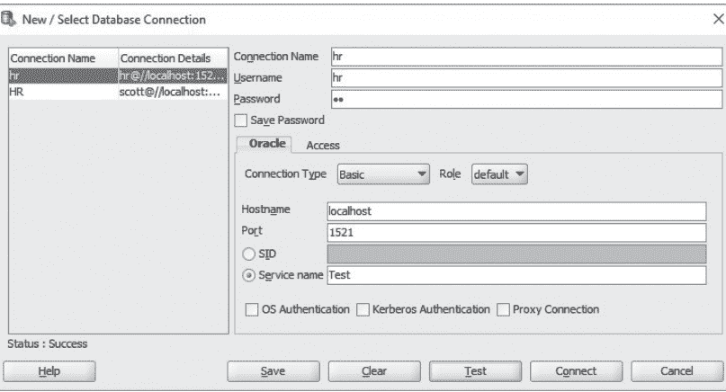

图 11.2 Oracle 数据库连接


第 3 步：在 SQL 工作表中输入创建 VIEW 的代码：

```sql
CREATE VIEW Location_US As
Select Location_ID, City, State_Province
From Locations
Where Country_ID = 'US';
```


图 11.3 创建视图

第 4 步：运行查询创建视图，然后重新连接到 HR 架构：

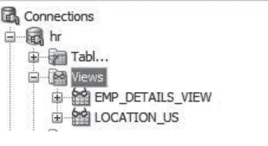

图 11.4 视图已创建

第 5 步：检查视图的结果：

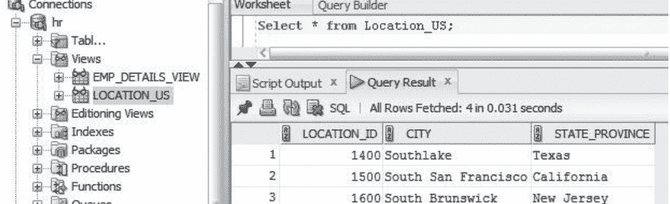

图 11.5 执行视图

## 在 T-SQL 中创建视图

第 1 步：输入 Create View 命令并点击 Execute 按钮运行查询。

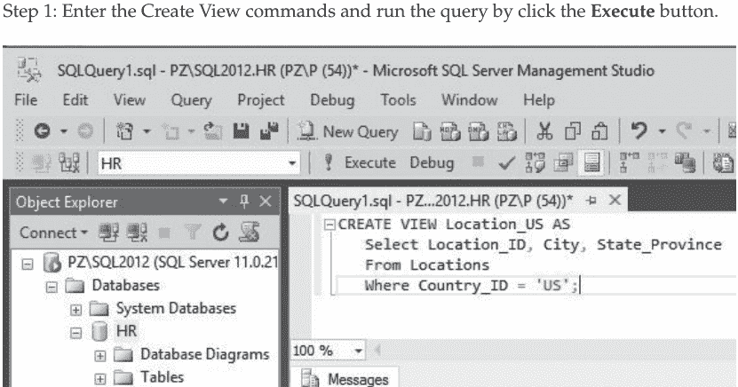

图 11.6 创建视图

第 2 步：刷新 HR 架构以查看视图 dbo.Location_US。


第 3 步：右键点击视图并选择“Select Top 1000 Rows”：


第 4 步：检查视图的结果：

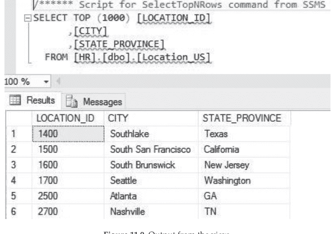

## 在 MySQL 中创建视图

第 1 步：输入 Create View 命令并点击 Execute query 按钮运行查询：

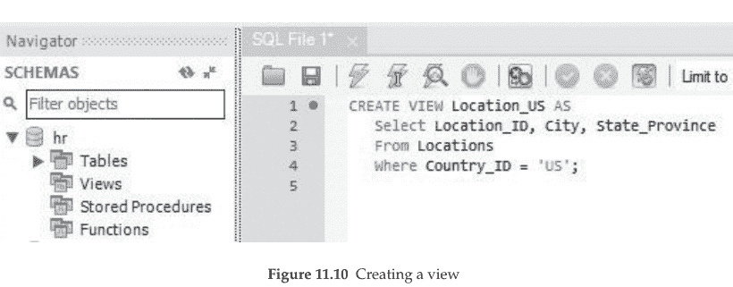

152 第 11 章 视图

第 2 步：刷新 HR 架构：

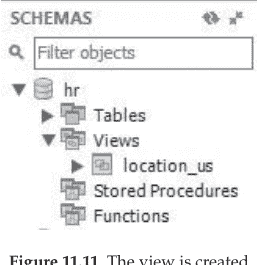

第 3 步：点击“location_us”旁边的图标：

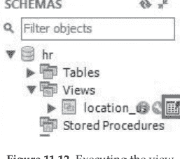

第 4 步：检查来自视图的结果。

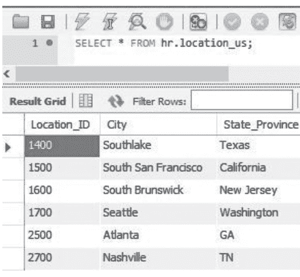

## 更新视图

语法 (Oracle)

```sql
CREATE OR REPLACE VIEW view_name AS
SELECT column(s)
FROM tables
WHERE conditions;
```

语法 (T-SQL & MySQL)

```sql
ALTER VIEW view_name AS
SELECT column(s)
FROM tables
WHERE conditions;
```

示例 (Oracle):

```sql
CREATE OR REPLACE VIEW
Location_US AS
SELECT Location_ID, City, Country_ID
FROM Locations
WHERE Country_ID = 'US';
```

| LOCATION_ID | CITY | COUNTRY_ID |
|---|---|---|
| 1400 | Southlake | US |
| 1500 | South San Francisco | US |
| 1600 | South Brunswick | US |
| 1700 | Seattle | US |

图 11.14 Oracle CREATE OR REPLACE VIEW 的输出（数据来自原始 HR 架构）

示例 (T-SQL):

```sql
ALTER VIEW Location_US AS
SELECT Location_ID, City, Country_ID
FROM Locations
WHERE Country_ID = 'US';
```

| Location_ID | City | Country_ID |
|---|---|---|
| 1400 | Southlake | US |
| 1500 | South San Francisco | US |
| 1600 | South Brunswick | US |
| 1700 | Seattle | US |
| 2500 | Atlanta | US |
| 2700 | Nashville | US |

图 11.15 T-SQL ALTER VIEW 的输出

示例 (MySQL):

```sql
ALTER VIEW view_name AS 
SELECT columns FROM Locations WHERE conditions = 'US';
``` 

| Location_ID | City | Country_ID |
|---|---|---|
| 1400 | Southlake | US |
| 1500 | South San Francisco | US |
| 1600 | South Brunswick | US |
| 1700 | Seattle | US |
| 2500 | Atlanta | US |
| 2700 | Nashville | US |

图 11.16 MySQL ALTER VIEW 的输出

## 删除视图

语法 (Oracle, T-SQL & MySQL)

```sql
DROP VIEW view_name;
```

示例:

```sql
DROP VIEW Location_US;
```

## 总结

第 11 章涵盖了以下内容：
- 如何在 Oracle、T-SQL 和 MySQL 中创建视图
- 如何在 Oracle、T-SQL 和 MySQL 中更新视图
- 如何在 Oracle、T-SQL 和 MySQL 中删除视图

## 练习

11.1 创建名为 v_employees 的视图以显示 Employees 表中的名称和工资字段。
11.2 删除视图。

# 第 12 章 数据导入与导出

数据导入导出是开发者或 DBA 的常见任务。Oracle、SQL Server 和 MySQL 提供了简单的向导。我们将导出数据然后使用导出的 csv 文件导入数据。

## Oracle 查询结果导出

- 首先选择要导出的数据
```sql
SELECT * FROM regions;
```
- 右键点击查询并选择 Export...

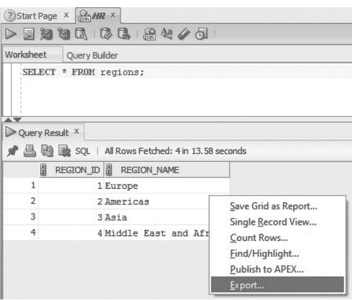

图 12.1 导出查询

- 导出向导显示。

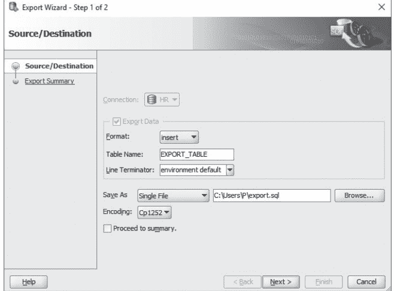

图 12.2 导出向导

- 在导出向导中将格式改为 CSV。将文件保存为 regions.csv。

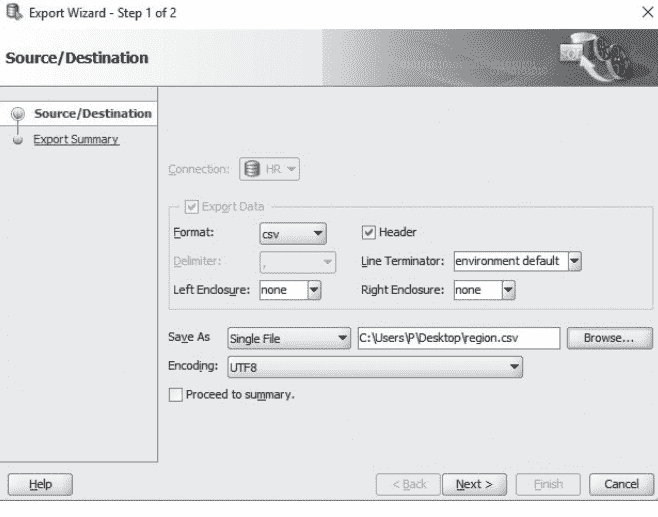

图 12.3 格式

- 点击 Next 查看摘要页。

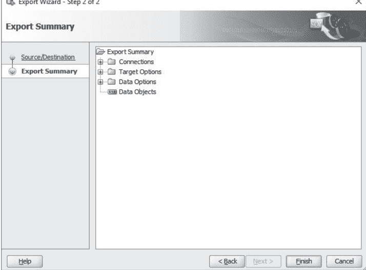

图 12.4 摘要

- 打开 regions.csv 查看导出的数据。

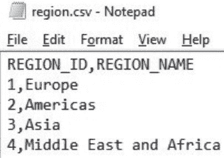

图 12.5 导出文件

## SQL Server 查询结果导出

- 在工作表中选择要导出的数据
```sql
SELECT * FROM regions;
```
- 运行查询并查看结果。

158 第 12 章 数据导入与导出

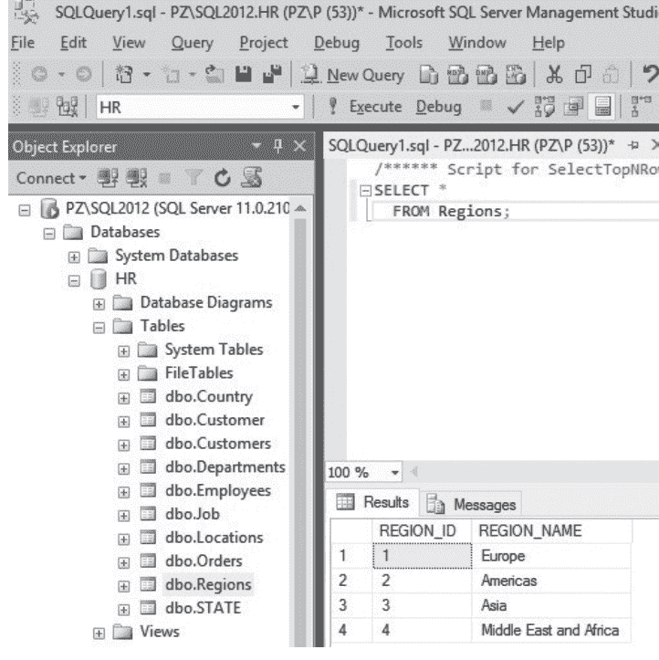

图 12.6 运行查询

- 右键点击查询结果并选择 Save As...

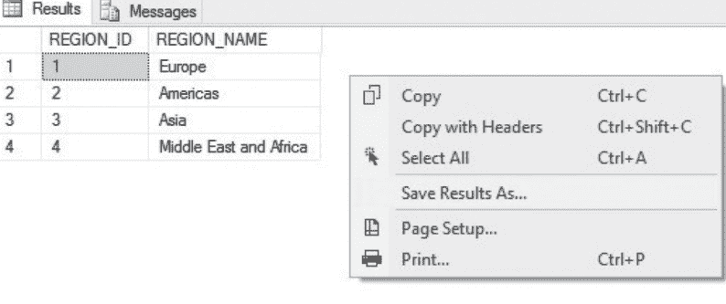

图 12.7 保存查询结果

- 在文件名字段输入 region.csv。

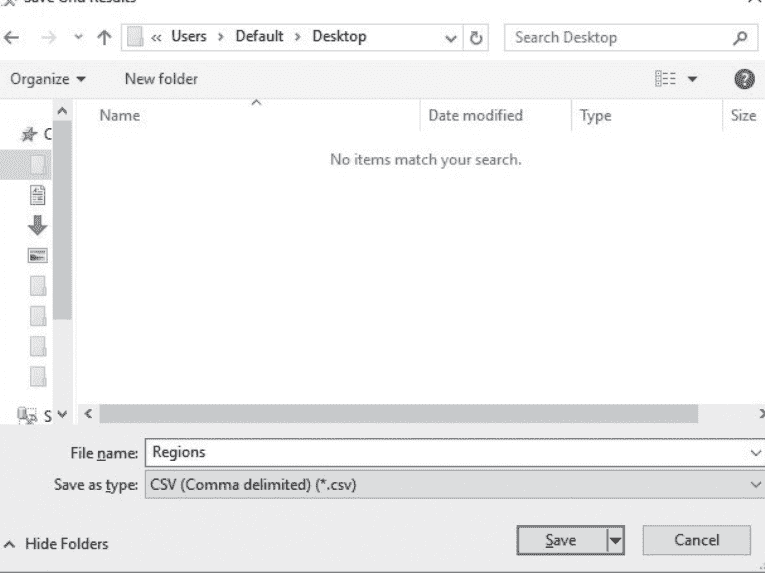

- 打开 regions.csv 查看导出的数据。

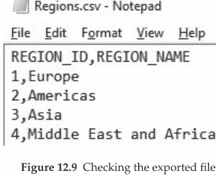

## MySQL 查询结果导出

- 在工作表中输入以下语句：
```sql
SELECT * FROM regions;
```
- 运行查询并查看输出。

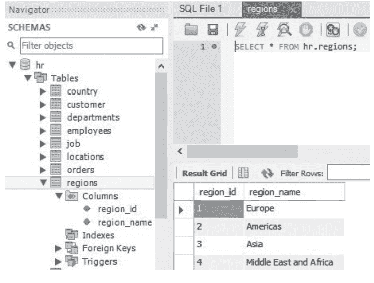

图 12.10 执行查询

- 点击 Export 图标。

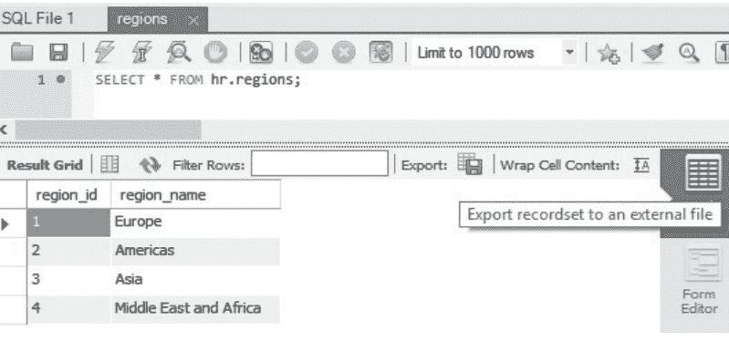

图 12.11 导出查询结果

在文件名字段输入 Regions.csv。

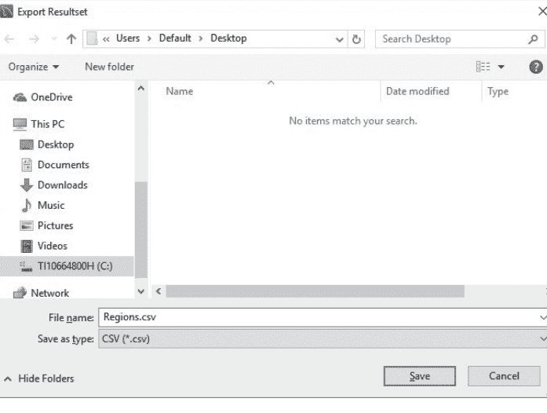

打开 Regions.csv 查看导出的数据。

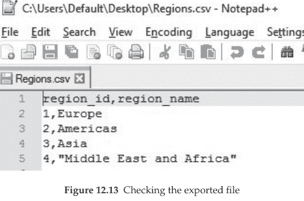

# Oracle 数据导入工具

你在第 6 章学习过 INSERT INTO 语句。它用于插入单条或多条记录。对于大量数据，我们可以使用导入向导来插入数据。

在插入数据之前，我们应该准备一个与数据文件数据类型对应的表。为了演示目的，我们首先删除 Regions 表中的记录，然后从 regions.csv 文件导入数据。

输入以下语句：
```sql
DELETE FROM regions;
```

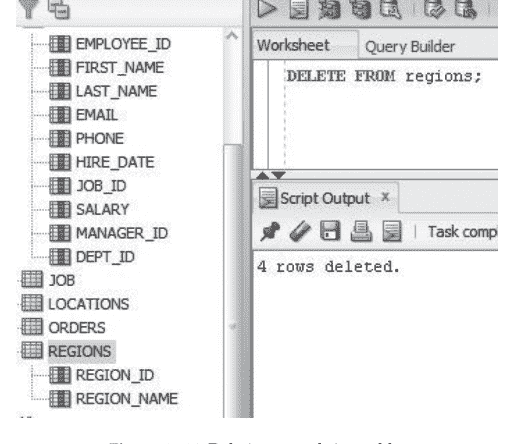

然后用以下语句检查 Regions 表：
```sql
SELECT * FROM regions;
```

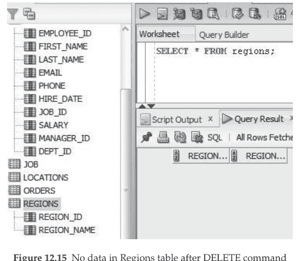

右键点击 Regions 表并选择 Import Data...

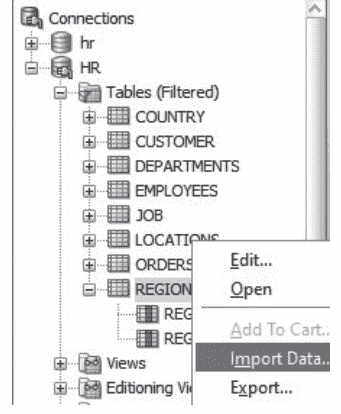

图 12.16 数据

选择我们导出的 region.csv 文件。

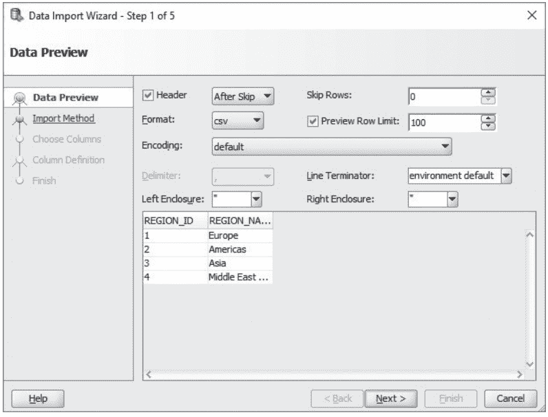

图 12.17 打开原始文件

164 第 12 章 数据导入与导出

- 遵循数据导入向导 - 第 2 步，共 4 步

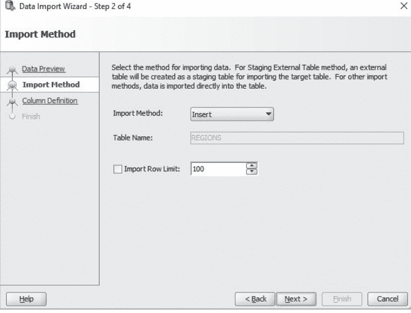

图 12.18 选择导入方法

- 点击 Next 按钮。

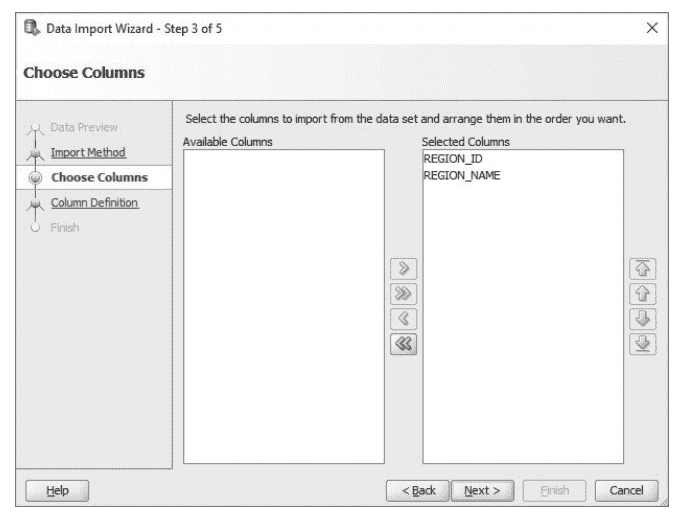

图 12.19 文件中的列

- 遵循步骤操作。

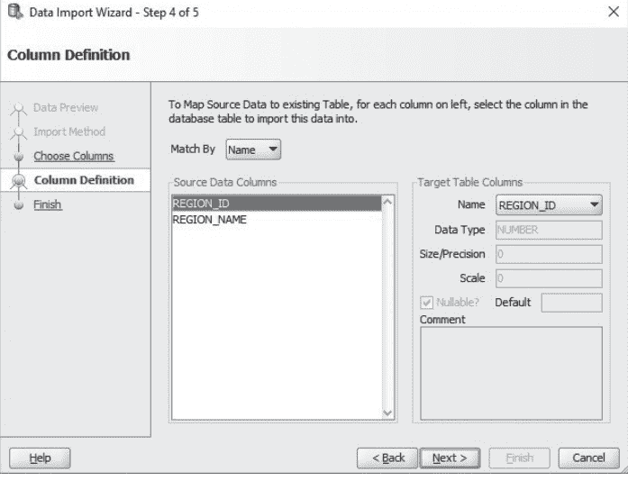

一条消息显示导入数据任务已完成。在下一步点击 Finish 按钮。

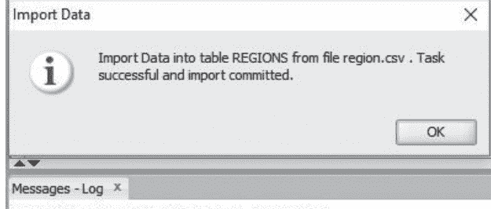


```sql
CREATE TABLE Locations
(
);
```

```sql
CREATE TABLE Regions
(
);
```

```sql
INSERT INTO COUNTRY VALUES ('AR','Argentina',2);
... /* 查看第6章中的代码 */
```

```sql
INSERT INTO Employees
VALUES (100,'Douglas','Grant','DGRANT','650.507.9844','23-Jan-08','SH_CLERK',2600,114,50);
...
```

```sql
INSERT INTO DEPARTMENTS VALUES (10,'Administration',200,1700);
...
```

```sql
INSERT INTO Job VALUES ('AD_PRES','CEO',9000,20000);
...
```

```sql
INSERT INTO Locations
VALUES (1300,'9450 Kamiya-cho','6823','Hiroshima','','JP');
...
```

```sql
INSERT INTO REGIONS VALUES (1,'Europe');
```

```sql
/* ************************************************* /
```

- 选择整个脚本并将其复制到查询工作表中。点击执行按钮运行脚本。

## 2. 使用数据导入向导

- 输入以下语句并执行：
  DELETE FROM regions;

- 使用以下语句检查 Regions 表：
  SELECT * FROM regions;

168 第12章 数据导入与导出

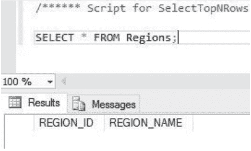

图 12.22 DELETE 命令后 Regions 表中没有数据

- 右键点击你想要插入数据的架构（schema）。
- 选择 任务 -> 导入数据...

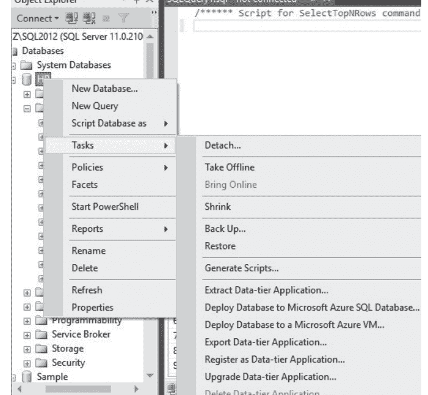

图 12.23 开始导入数据

在数据源字段中，选择平面文件源（Flat File Source），然后选择 region.csv 文件。

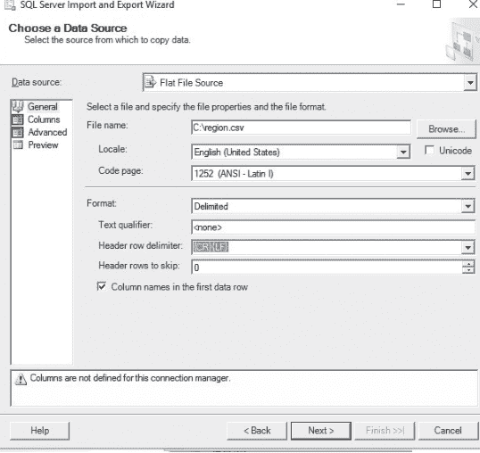

图 12.24 选择导入文件

按照 SQL Server 导入和导出向导的步骤进行。

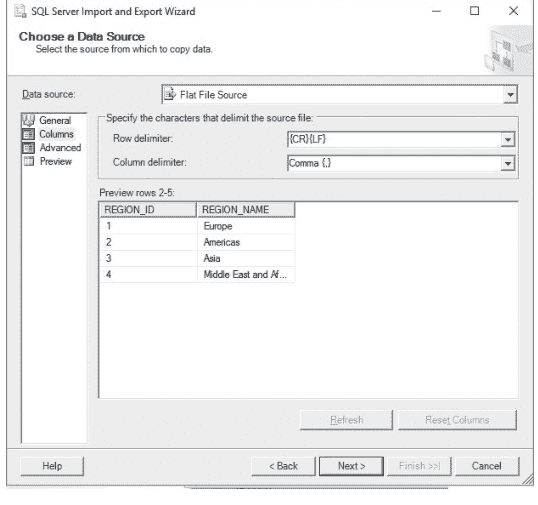

图 12.25 选择数据源

选择目标（Destination）为 SQL Server Native Client 11.0

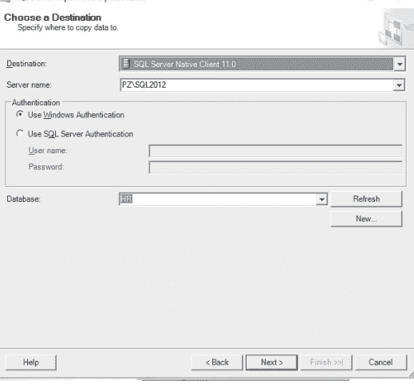

图 12.26 选择目标

检查向导摘要页面并点击**完成**。

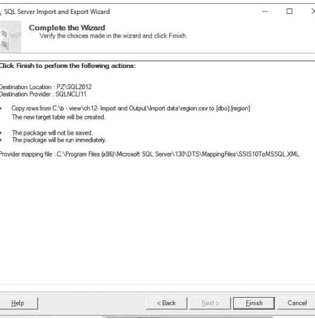

图 12.27 摘要页面

数据已成功导入到 Regions 表。

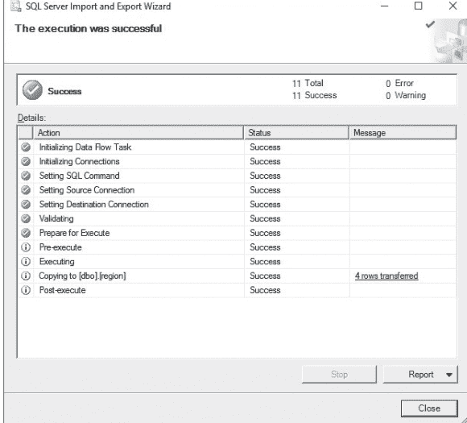

图 12.28 导入成功消息

## MySQL 数据导入工具

- 输入以下命令：
  use hr;
  DELETE FROM regions;
  SELECT * FROM regions;

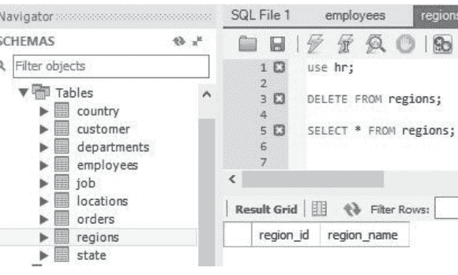

图 12.29 DELETE 命令后 Regions 表中没有数据

右键点击 regions 表并选择表数据导入向导（Table Data Import Wizard）。

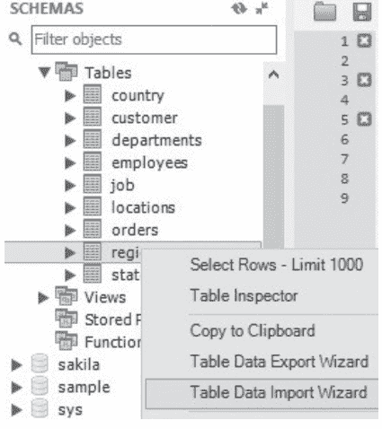

**图 12.30** 开始数据导入

在文件路径（File Path）字段中选择 Regions.csv。

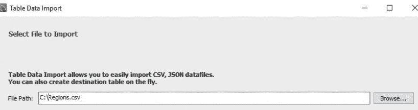

**图 12.31** csv 文件的路径

你可以选择现有表或创建新表。


向导将设置编码为 UTF-8 并匹配源和目标列。


## 总结

第12章涵盖了以下内容：

- 从查询结果导出 Oracle 数据
- 从查询结果导出 SQL Server 数据
- 从查询结果导出 MySQL 数据
- 如何将数据导入到 Oracle 表。
- 如何将数据导入 SQL Server 表。
- 使用加载脚本进行 SQL Server 数据导入。
- 如何将数据导入到 MySQL 表。

## 练习题

### 12.1

将 Employees 表中的记录导出到 csv 文件。创建一个新表或删除 Employees 表中的记录。使用 csv 文件将数据导入到表中。

# 第13章 # 存储过程

## 什么是存储过程

当你在某个地方创建一个实用的查询时，很有可能需要再次运行该查询。例如，你可能需要在每个月初自动运行月度销售报告。存储过程可以为你完成这项工作。你可以将查询保存在存储过程中，并调度一个任务来运行该作业。存储过程通常包含三个部分：

- 声明（Declaration）
- 执行（Execution）
- 异常（Exception）

## 简单的存储过程

语法：

```sql
CREATE [OR REPLACE] PROCEDURE proc_name (parameter1, parameter2 ...)
IS (Oracle)
AS (SQL Server)
BEGIN
-- 可执行部分
END;
```

让我们创建一个存储过程来统计 regions 表中的行数。没有输入参数和输出值。

## 创建 Oracle 存储过程的步骤

- 在查询编辑器中输入 SQL 代码。
- 运行代码创建存储过程。
- 输入 proc_name 以运行存储过程。
- 要显示消息，需要设置 SET SERVEROUTPUT ON 并使用 dbms_output.put_line()。

## 简单存储过程的比较

| Oracle PL/SQL | SQL T-SQL | MySQL |
| :--- | :--- | :--- |
| SET SERVEROUTPUT ON; | | DELIMITER // |
| CREATE OR REPLACE procedure p1 | | |
| img/86805baec19af0039b39fad6b4ce02e0_188_0.png | | |
| 图 13.1 Oracle 存储过程 | | |
| IS; | | |
| AS; | | |
| BEGIN; | | |
| END; | | |
| img/86805baec19af0039b39fad6b4ce02e0_189_1.png | | |
| 图 13.2 SQL Server 存储过程 | | |
| img/86805baec19af0039b39fad6b4ce02e0_190_0.png | | |
| 图 13.3 MySQL 存储过程 | | |

*(注：此处表格内容根据原文逻辑进行了对齐翻译，保持了对应的对应关系)*

- 输入 proc_name 以运行存储过程。
- 要显示消息，需要设置 SET SERVEROUTPUT ON 并使用 dbms_output.put_line()。

- 在查询编辑器中输入 SQL 代码。
- 运行代码创建存储过程。
- 输入 proc_name 以运行存储过程。
- 要显示消息，需要设置 SET SERVEROUTPUT ON 并使用 dbms_output.put_line()。

- 选择整个脚本并将其复制到查询工作表中。点击执行按钮运行脚本。

## 2. 使用数据导入向导

- 输入以下语句并执行：
  DELETE FROM regions;

- 使用以下语句检查 Regions 表：
  SELECT * FROM regions;

168 第12章 数据导入与导出


图 12.22 DELETE 命令后 Regions 表中没有数据

- 右键点击你想要插入数据的架构（schema）。
- 选择 任务 -> 导入数据...


图 12.23 开始导入数据

在数据源字段中，选择平面文件源（Flat File Source），然后选择 region.csv 文件。


图 12.24 选择导入文件

按照 SQL Server 导入和导出向导的步骤进行。


图 12.25 选择数据源

选择目标（Destination）为 SQL Server Native Client 11.0


图 12.26 选择目标

检查向导摘要页面并点击**完成**。


图 12.27 摘要页面

数据已成功导入到 Regions 表。


图 12.28 导入成功消息

## MySQL 数据导入工具

- 输入以下命令：
  use hr;
  DELETE FROM regions;
  SELECT * FROM regions;


图 12.29 DELETE 命令后 Regions 表中没有数据

右键点击 regions 表并选择表数据导入向导。


**图 12.30** 开始数据导入

在文件路径（File Path）字段中选择 Regions.csv。


**图 12.31** csv 文件的路径

你可以选择现有表或创建新表。


向导将设置编码为 UTF-8 并匹配源和目标列。


## 总结

第12章涵盖了以下内容：

- 从查询结果导出 Oracle 数据
- 从查询结果导出 SQL Server 数据
- 从查询结果导出 MySQL 数据
- 如何将数据导入到 Oracle 表。
- 如何将数据导入 SQL Server 表。
- 使用加载脚本进行 SQL Server 数据导入。
- 如何将数据导入到 MySQL 表。

## 练习题

### 12.1

将 Employees 表中的记录导出到 csv 文件。创建一个新表或删除 Employees 表中的记录。使用 csv 文件将数据导入到表中。

# 第13章 # 存储过程

## 什么是存储过程

当你在某个地方创建一个实用的查询时，很有可能需要再次运行该查询。例如，你可能需要在每个月初自动运行月度销售报告。存储过程可以为你完成这项工作。你可以将查询保存在存储过程中，并调度一个任务来运行该作业。存储过程通常包含三个部分：

- 声明
- 执行
- 异常

## 简单的存储过程

语法：

```sql
CREATE [OR REPLACE] PROCEDURE proc_name (parameter1, parameter2 ...)
IS (Oracle)
AS (SQL Server)
BEGIN
-- 可执行部分
END;
```

让我们创建一个存储过程来统计 regions 表中的行数。没有输入参数和输出值。

## 创建 Oracle 存储过程的步骤

- 在查询编辑器中输入 SQL 代码。
- 运行代码创建存储过程。
- 输入 proc_name 以运行存储过程。
- 要显示消息，需要设置 SET SERVEROUTPUT ON 并使用 dbms_output.put_line()。

## 简单存储过程的比较

| Oracle PL/SQL | SQL T-SQL | MySQL |
| :--- | :--- | :--- |
| SET SERVEROUTPUT ON; | | DELIMITER // |
| CREATE OR REPLACE procedure p1 | | |
| img/86805baec19af0039b39fad6b4ce02e0_188_0.png | | |
| 图 13.1 Oracle 存储过程 | | |
| IS; | | |
| AS; | | |
| BEGIN; | | |
| END; | | |
| img/86805baec19af0039b39fad6b4ce02e0_189_1.png | | |
| 图 13.2 SQL Server 存储过程 | | | |
| img/86805baec19af0039b39fad6b4ce02e0_190_0.png | | |
| 图 13.3 MySQL 存储过程 | | |

*(注：由于原文提供的表格部分存在格式混乱和重复，此处译文已根据逻辑进行了对齐处理，确保内容可读性)*

## Oracle 存储过程参数

- IN (可选)
- OUT
- INOUT

## SQL Server 存储过程参数

- IN (可选)
- OUTPUT

## MySQL 存储过程参数

- IN (可选)

### 创建带有 OUT 参数的 Oracle 存储过程

```sql
CREATE OR REPLACE procedure get_Location_Info
  (L_ID IN NUMBER,
  L_City OUT VARCHAR2,
  L_Country_ID OUT CHAR)
AS
BEGIN
  SELECT City, Country_ID INTO L_City, L_Country_ID FROM LOCATIONS
  WHERE LOCATION_ID = L_ID;
END get_Location_Info;
```

### 执行带有 OUT 参数的 Oracle 过程

```sql
DECLARE
  Location_City LOCATIONS.CITY%TYPE;
  Location_Country_ID LOCATIONS.Country_ID%TYPE;
BEGIN
  get_Location_Info ( 1700, Location_City, Location_Country_ID );
  DBMS_OUTPUT.PUT_LINE ( Location_City || ' ' || Location_Country_ID );
END;
```


图 13.5 Oracle 过程输出参数

### 创建带有 IN OUT 参数的 Oracle 存储过程

```sql
create or replace
procedure example_INOUT ( x IN OUT NUMBER)
AS
BEGIN
 x := x + 6;
END example_INOUT;
```

### 执行带有 IN OUT 参数的 Oracle 过程

```sql
DECLARE
  x number;
BEGIN
  x:= 10;
  example_INOUT ( x );
  DBMS_OUTPUT.PUT_LINE ( 'x is ' || x );
END;
```


图 13.6 调用带有 IN OUT 参数的 过程

### 创建带有 IN 参数的 SQL Server 存储过程

```sql
CREATE procedure getLocation_Info
(@L_ID FLOAT)
AS
BEGIN
SET NOCOUNT ON;
SELECT City, Country_ID FROM LOCATIONS
WHERE LOCATION_ID = @L_ID;
END;
```


## 执行带有 IN 参数的 SQL Server 存储过程：

EXEC get_Location_Info 1700;


图 13.7 带有参数的 SQL Server 存储过程

## 创建带有 IN 和 OUT 参数的 MySQL 存储过程：

```sql
DELIMITER //
CREATE procedure get_Location_Info
@L_ID FLOAT,
@L_CITY VARCHAR OUT,
@L_Country_ID CHAR OUT,
AS
```

```sql
BEGIN
SELECT @L_City =City,@L_Country_ID = Country_ID
FROM LOCATIONS
WHERE LOCATION_ID = @L_ID;
END;
//
```

182 第 13 章 存储过程

模式 (SCHEMAS)


图 13.8 带有 IN 和 OUT 参数的 MySQL 过程

## 执行带有 IN 和 OUT 参数的 MySQL 过程：

CALL get_Location_Info (1700);


图 13.9 调用带有 IN 和 OUT 参数的 MySQL 过程

## 总结

第 13 章涵盖了以下内容：

- 存储过程的基本结构
- 在 Oracle、SQL Server 和 MySQL 中创建存储过程的步骤
- 不带参数的简单存储过程
- 在 Oracle、SQL Server 和 MySQL 中创建带参数存储过程的步骤
- 带有 IN 和 OUT 参数的存储过程示例
- 带有 IN OUT 参数的存储过程示例

## 练习

### 13.1

创建一个存储过程，列出在运输部门工作的员工。


## 索引

### A

ADD_MONTH () 11, 113, 114
加 (+) 74
聚合函数 89, 94, 97, 98
别名 84
ALTER COLUMN 61, 62, 64
ALTER TABLE 60–64, 135
AND 174
ANSI 2
算术运算符 74, 76, 87
ASC (升序) 72
AVG () 89, 90, 94, 97, 98

### B

BETWEEN 8, 9, 12, 79, 88, 113, 116, 124, 125, 131, 137
BIGINT 数据 12
BINARY 数据 11
BLOB 数据类型 14

### C

CASE 9, 88, 102, 112, 120–132, 136, 143, 144
CAST () 117
CEILING () 98
char 类型 11, 12, 14
字符数据类型 11, 14
CHECK 约束 7
列别名 84
列 4–7, 11, 14, 42, 54–56, 61–64, 67–72, 74–79, 77, 81, 82, 88–92, 94, 95, 101, 123, 124, 126, 129, 146, 153, 154, 163, 167
命令行 34, 36, 40, 46
复杂的 144
比较运算符 76, 87
CONCAT () 103–106
约束 7, 52, 53, 166
转换 117, 119, 120
CONVERT () 117, 119
COUNT () 89, 90, 95, 97, 98
CREATE DATABASE 46–48, 64, 87
CREATE TABLE 51–53, 55–57, 64, 134, 135, 166, 177
CREATE USER 48
CREATE VIEW 146, 148, 149, 151

### F
WITH 36

### D

数据控制语言 (DCL) 47, 87
数据定义语言 (DDL) 47, 48, 65
数据操作语言 (DML) 47, 65, 87
数据类型 4, 11–14, 54–56, 117, 119, 123, 162
数据库管理员 (DBAs) 1
日期和时间数据类型 13, 174
DATE ADD () 77, 113, 114
DATE DIFF () 113, 116
DECIMAL 8, 12, 13, 53, 62, 90, 102
DELETE 4, 47, 51, 60, 65, 77, 78, 86–88, 154, 162, 174
DESC 72, 83, 94
73, 125, 126
/) 74
DOUBLE 类型 12
DROP TABLE 51, 60, 166
DROP VIEW 154

### E

ENUM 类型 11
实体关系 (ER) 8, 10
等号 (=) 76
表达式 74, 78–82, 98, 117, 119
EXTRACT 111–115

### G

字段 5, 72, 74, 109, 111, 114, 132, 143, 154, 159, 169, 172
固定长度 11, 12
FLOAT 类型 4, 12
FLOOR () 98, 99
外键 5–9, 52, 53
FORMAT () 103, 106
函数 74, 89–98, 101, 103, 105–120
GETDATE () 113, 115, 119
GRANT 4, 47, 48, 65, 66, 87, 88, 167
大于 (>) 76
GROUP BY 89, 94–97

### H

HAVING 子句 94, 97
历史 1, 2, 10

### I

IMAGE 类型 11
IN 条件 78
INNER JOIN 137, 144
INSERT INTO 46, 65–71, 85, 133–135, 161, 167
安装 15, 16–19, 26, 30, 32, 38, 40, 42, 43, 46
INT 类型 12
完整性 7
引用完整性 7
IS NULL 79, 80, 137, 143
IS NOT NULL 80

### J

JOIN 137–144
LEFT JOIN 137, 144
LEFT JOIN
RIGHT JOIN 137, 143
FULL JOIN 137, 143

### K

键 9
主键 9
外键 9

### L

语言 1, 2, 4, 11, 17, 45, 67, 85
LEFT JOIN 137–142
LEN () 103, 107
LENGTH () 103, 107
小于 (<) 76
LIKE 条件 81
LIMIT 122, 126, 128, 136, 177, 181
LONBLOB 类型 11
LONGTEXT 类型 11
LOWER () 103, 108
LTR () 103, 109

### M

主数据库 42, 43
MAX () 90, 92, 98
MEDIUMTEXT 类型 11
Microsoft SQL Server 2
MIN () 90, 91, 97, 98
分钟 114, 120
MONEY 类型 12
月份 113, 114, 116, 120, 175
MONTH_BETWEEN () 116
乘法 (*) 74
MySQL Server: 31, 37, 178

### N

NCHAR 类型 11
NOT IN 78, 122, 125, 126, 136
NOT NULL 7, 14, 52, 53, 80, 134, 135, 166
NTEXT 11
NULL, 7, 14, 52, 79, 80, 134, 135, 143, 166
NUMBER 类型 12, 14
数值数据类型 12, 13
VARCHAR 类型 11

### O

ON 87, 137, 139–144, 176, 180
OR 77
ORDER BY 72, 82, 93, 95, 123, 124, 144
操作系统 15

### P

PERIOD_DIFF () 113, 116
POWER () 101
主键 5–9, 52, 53, 132, 135, 166
权限 47, 87, 146

### Q

查询 40, 48, 66, 159, 167

### R

RAW 类型 12
记录 4, 7, 9, 11, 51, 53, 60, 65, 72, 74, 85, 88, 90, 102, 132, 133, 135, 137, 141, 154, 161, 162, 174
引用 7, 52, 53
引用完整性 7
关系 12, 13
REAL 类型 12
转换 117, 119, 120
权限 47, 87, 146
RIGHT JOIN 137, 143
ROUND () 98, 99
减法 74

### S

模式 5, 12, 17, 26, 30, 34, 39, 40, 42, 45, 48, 50, 51, 55, 56, 57, 60, 61, 62, 64, 65, 67, 68, 70, 71, 72, 74, 75, 76, 77, 78, 79, 80, 81, 82, 83, 84, 85, 86, 87, 88, 89, 90, 91, 92, 93, 94, 95, 97, 98, 99, 100, 101, 102, 103, 104, 105, 106, 107, 108, 109, 110, 111, 112, 113, 114, 115, 116, 117, 118, 119, 120, 121, 122, 123, 124, 125, 126, 127, 128, 129, 130, 131, 132, 133, 134, 135, 136, 137, 138, 139, 140, 141, 142, 143, 144, 145, 146, 147, 148, 149, 150, 151, 152, 153, 154, 155, 156, 157, 158, 159, 160, 161, 162, 163, 164, 165, 166, 167, 168, 169, 170, 171, 172, 173, 174, 175, 176, 177, 178, 179, 180, 181, 182, 183
存储过程 13, 14, 15, 16, 17, 18, 19, 20, 21, 22, 23, 24, 25, 26, 27, 28, 29, 30, 31, 32, 33, 34, 35, 36, 37, 38, 39, 40, 41, 42, 43, 44, 45, 46, 47, 48, 49, 50, 51, 52, 53, 54, 55, 56, 57, 58, 59, 60, 61, 62, 63, 64, 65, 66, 67, 68, 69, 70, 71, 72, 73, 74, 75, 76, 77, 78, 79, 80, 81, 82, 83, 84, 85, 86, 87, 88, 89, 90, 91, 92, 93, 94, 95, 96, 97, 98, 99, 100, 101, 102, 103, 104, 105, 106, 107, 108, 109, 110, 111, 112, 113, 114, 115, 116, 117, 118, 119, 120, 121, 122, 123, 124, 125, 126, 127, 128, 129, 130, 131, 132, 133, 134, 135, 136, 137, 138, 139, 140, 141, 142, 143, 144, 145, 146, 147, 148, 149, 150, 151, 152, 153, 154, 155, 156, 157, 158, 159, 160, 161, 162, 163, 164, 165, 166, 167, 168, 169, 170, 171, 172, 173, 174, 175, 176, 177, 178, 179, 180, 181, 182, 183
SELECT 46, 65, 71, 85, 87, 88, 89, 90, 91, 92, 94, 95, 97, 98, 99, 100, 101, 102, 103, 104, 105, 106, 107, 108, 109, 110, 111, 112, 113, 114, 115, 116, 117, 118, 119, 120, 121, 122, 123, 124, 125, 126, 127, 128, 129, 130, 131, 132, 133, 134, 135, 136, 137, 138, 139, 140, 141, 142, 143, 144, 145, 146, 147, 148, 149, 150, 151, 152, 153, 154, 155, 156, 157, 158, 159, 160, 161, 162, 163, 164, 165, 166, 167, 168, 169, 170, 171, 172, 173, 174, 175, 176, 177, 178, 179, 180, 181, 182, 183
Structured Query Language 1, 2
strings 4, 11, 12, 14, 15, 16, 17, 18, 19, 26, 30, 31, 32, 33, 34, 35, 36, 37, 38, 39, 40, 41, 42, 43, 44, 45, 46, 47, 48, 49, 50, 51, 52, 53, 54, 55, 56, 57, 58, 59, 60, 61, 62, 63, 64, 65, 66, 67, 68, 69, 70, 71, 72, 73, 74, 75, 76, 77, 78, 79, 80, 81, 82, 83, 84, 85, 86, 87, 88, 89, 90, 91, 92, 93, 94, 95, 96, 97, 98, 99, 100, 101, 102, 103, 104, 105, 106, 107, 108, 109, 110, 111, 112, 113, 114, 115, 116, 117, 118, 119, 120, 121, 122, 123, 124, 125, 126, 127, 128, 129, 130, 131, 132, 133, 134, 135, 136, 137, 138, 139, 140, 141, 142, 143, 144, 145, 146, 147, 148, 149, 150, 151, 152, 153, 154, 155, 156, 157, 158, 159, 160, 161, 162, 163, 164, 165, 166, 167, 168, 169, 170, 171, 172, 173, 174, 175, 176, 177, 178, 179, 180, 181, 182, 183
SUBSTR 103, 111
SUBSTRING 103, 112
SUM () 90, 93, 97, 98
TRIM () 103, 109

