# MATLAB 和 Python 数值与科学计算实用指南


访问 Taylor & Francis 网站：
http://www.taylorandfrancis.com

访问 CRC Press 网站：
http://www.crcpress.com

致我的父母、家人和朋友。


前言 xiii
作者 xvii


II 数据插值与微分方程求解 103


6 数值微分与积分 . . . . . . . . . . 125
6.1 数值微分 . . . . . . . . . . . . . . 125
6.1.1 有限差分 . . . . . . . . . . . 125

7 求解非线性微分方程组 . . . . . . . . . . 165
7.1 Runge-Kutta 方法 . . . . . . . . . . . . . 165
7.2 显式 Runge-Kutta 方法 . . . . . . . 167
7.2.1 欧拉法 . . . . . . . . . . . 168
7.2.2 亥法 (Heun's Method) . . . . . . 171
7.2.3 四阶 Runge-Kutta 方法 . . . . . . 174
7.3 隐式 Runge-Kutta 方法 . . . . . . . 176
7.3.1 后向欧拉法 . . . . . . . . . . . 180
7.3.2 胶点 Runge-Kutta 方法 . . . . . . . 180
7.3.2.1 Legendre-Gauss 方法 . . . . . . 180
7.3.2.2 Lobatto 方法 . . . . . . 184
7.4 MATLAB ODE 求解器 . . . . . . . . . . . 191
7.4.1 MATLAB ODE 求解器 . . . . . . . . . . . 191
7.4.2 求解单个初值问题 (IVP) . . . . . . . . . . . 191
7.4.3 求解初值问题组 . . . . . . . . . . . 193
7.4.4 刚性初值问题组 . . . . . . 195

8 求解 ODE 的非标准有限差分法 . . . . . . 207
8.1 标准差分法的局限性 . . . . . . . . . . . 207
8.2 非标准差分法的构造规则 . . . . 213
8.3 精确有限差分法 . . . . . . . . . . . 217
8.3.1 线性齐次 ODE 的精确有限差分法 . . . . . . . . . . 218
8.3.1.1 一阶线性齐次 ODE 的精确有限差分法 . . . . . . 218
8.3.1.2 二阶线性齐次 ODE 的精确有限差分法 . . . . . 220
8.3.1.3 二元 ODE 组的精确有限差分法 . . . . . . . . . . 223
8.3.2 非线性方程的精确差分法 . . . . . . 230
8.3.3 含有线性和幂项的微分方程的精确有限差分法 . . . . 234
8.4 其他非标准差分法 . . . . . 236


目录

# III 求解线性、非线性与动态优化问题 241

## 9 求解优化问题：线性规划与二次规划 243
- 9.1 线性规划问题的形式 ........................................... 243
- 9.2 使用 linprog 求解线性规划问题 ........................ 246
- 9.3 使用 fmincon 求解线性规划问题 ...................... 249
  MATLAB 函数
- 9.4 使用 pulp Python 求解线性规划问题 ................... 250
- 9.5 使用 pyomo 求解线性规划问题 ........................ 252
- 9.6 使用 gekko 求解线性规划问题 ........................ 254
- 9.7 求解二次优化问题 ................................... 255

## 10 求解优化问题：非线性规划 261
- 10.1 求解无约束问题 ................................................ 261
- 10.1.1 线搜索算法 ........................................................ 263
- 10.1.2 极速下降法 ................................................... 264
- 10.1.3 牛顿法 ............................................................... 266
- 10.1.4 拟牛顿法Fletcher-Goldfarb-Shanno ................................. 269
- 10.1.4.1 (BFGS) 方法 ............................................................ 269
- 10.1.4.2 Davidon-Fletcher-Powell (DFP) 算法 ........................ 272
- 10.1.5 使用 MATLAB 求解无约束问题 ................... 274
- 10.1.6 使用 Python 求解无约束问题 ....................... 275
- 10.1.7 使用 Gepko 求解无约束问题 ................... 276
- 10.2 使用某种方法求解约束优化问题 .................... 278
- 10.2.1 使用 MATLAB fmincon 求解约束优化问题 ................. 280
- 10.2.2 在 Python 中求解约束最小化问题 ................... 284
- 10.2.3 使用 Gepko 求解约束优化问题 ...................... 286

## 11 求解最优控制问题 289
- 11.1 引言 ....................................................... 289
- 11.2 一阶最优条件与最优控制的存在 ................................................ 290
- 11.3 离散化系统的必要条件 .......................... 293
- 11.4 最优控制的数值解 ........................................ 294
- 11.5 使用间接法求解最优控制问题 ................... 295
- 11.5.1 使用间接转录数值求解 ..................... 295
- 11.6 使用直接法求解最优控制问题 . . . 306
- 11.6.1 问题表述 . . . . . . . . . . . . . . . . . . . 307
- 11.6.2 控制参数化技术 . . . . . 307
- 11.6.2.1 示例 . . . . . . . . . . . . . . . . . . . 309
- 11.6.3 Gekko Python 求解器 . . . . . . . 313

# 参考文献 321

# 索引 327


# 前言

过去的几十年见证了计算机软件巨大的发展，科学计算已成为解决来自科学工程各个领域问题的重要工具。如今，科学计算已成为科学工程领域研究和学习最重要的手段之一，对于任何和工程领域的任何研究人员、教师或学生来说都是不可或缺的。

科学计算最重要的分支之一是数值分析，它处理寻找此类问题的近似解以及分析与这些近似方法相关的误差。MATLAB® 和 Python 编程语言提供了许多可以用于寻找并可视化科学问题解决方案的库。两种语言的易用性成为了大多数科学家在解决科学问题时最关心的语言特性。


喀土穆，非洲数学科学学院的 Arieh Iserles 教授，位于开普敦西开普角大学的 Kailash Patidar 教授，以及在四年前去世的我伟大的导师 David Mackey 教授（剑桥大学和非洲数学科学学院）的精神。最后，我感谢我的家人在我撰写这本书期间给予的持续鼓励和耐心。

MATLAB® 是 The MathWorks, Inc. 的注册商标。有关产品信息，请联系：

The MathWorks, Inc.
3 Apple Hill Drive
Natick, MA, 01760-2098 USA
Tel: 508-647-7000
Fax: 508-647-7001
E-mail: info@mathworks.com
Web: www.mathworks.com


# 作者

Eihab B. M. Bashier 于 2009 年在南非西开普角大学获得博士学位。他的长期工作在喀土穆大学数学科学与信息技术学院的应用数学系。目前，他是阿曼杜尔大学艺术与应用科学学院的应用数学副教授。他的研究兴趣主要在微分方程的数值方法（应用于生物学）以及侧重于密码学的信息与计算机安全。2011 年，Bashier 博士获得了非洲联盟和第三世界科学院（AU-TWAS）基础科学、技术与创新领域的青年科学家国家奖。Bashier 博士是一些国际期刊的审稿人，也是 IEEE 和 EMS 的成员。（邮箱：eihab-bashier@gmail.com, eihabbash@aims.ac.za）。


# 第一部分

## 线性与非线性方程组的求解


## 使用直接法求解线性组

### 摘要

线性方程组在数学和科学中有许多应用。许多用于求解数学问题（如微分方程或积分方程、超越函数的多项式近似以及求解非线性方程组）的数值方法都会进入求解线性方程组的阶段。因此，求解线性方程组是数值计算中的一个基础问题。

本章讨论了求解线性方程组的直接方法，使用了高斯-Jordan 消元技术和矩阵分解法。书中提供了这些算法的 MATLAB® 和 Python 实现。

### 1.1 测试解的存在性

包含 $m$ 个方程和 $n$ 个未知数的线性组可以写成矩阵形式：

$$Ax = b$$

其中，

$$A = \begin{pmatrix} a_{11} & a_{12} & \dots & a_{1n} \\ a_{21} & a_{22} & \dots & a_{2n} \\ \vdots & \vdots & \ddots & \vdots \\ a_{m1} & a_{m2} & \dots & a_{mn} \end{pmatrix}, x = \begin{pmatrix} x_1 \\ x_2 \\ \vdots \\ x_n \end{pmatrix} \text{ 和 } b = \begin{pmatrix} b_1 \\ b_2 \\ \vdots \\ b_m \end{pmatrix}$$

这里，矩阵 $A \in \mathbb{R}^{m \times n}$ 的系数 $a_{ij}$ 假设为实数，$x \in \mathbb{R}^n$ 是未知数向量，$b \in \mathbb{R}^m$ 是已知向量。根据 $m$ 和 $n$ 的关系，定义了三种线性组：

- 1. 超定组：方程个数多于未知数个数 (m > n)。
- 2. 方程个数与未知数个数相等 (m = n)。
- 3. 欠定组：未知数个数多于方程个数 (m < n)。

设 $[A | b]$ 为线性组 $Ax = b$ 的增广矩阵。那么，给定线性组解的存在取决于以下情况：

- 1. $rank(A) = rank(A)$：在这种情况下，至少有一个解，且有两种可能：
    - (a) $rank(A) = rank(A) = n$：在这种情况下有唯一解。
    - (b) $rank(A) = rank(A) < n$：在这种情况下有无限解。
- 2. $rank(A) > rank(A)$：在这种情况下无解，我们可以寻找最小二法解。

如果线性组 $Ax = b$ 有解，则称为一致线性组；否则是不一致线性组。在 MATLAB 中，可以使用 `rank` 命令测试矩阵的秩。

```matlab
>> A = [1 2 3; 4 5 6; 7 8 9]
A =
     1  2  3
     4  5  6
     7  8  9
>> b = [1; 1; 1]
b =
     1
     1
     1
>> r1 = rank(A)
r1 =     2
>> r2 = rank([A b])
r2 =     2
```

在 python 中，函数 `matrix_rank`（位于 `numpy.linalg`）用于计算矩阵 $A$ 和增广组 $[A, b]$ 的秩。

```python
import numpy as np
>>> A = np.array([[1, 2, 3], [4, 5, 6], [7, 8, 9]])
>>> b = np.array([[1, 1, 1]])
>>> r1, r2 = np.linalg.matrix_rank(A), np.linalg.matrix_rank([A, b])
>>> r1
2
>>> r2
2
```

在特殊情况下 $m=n$（方阵）且 $rank(A)=n$，唯一解为：

$$x = A^{-1}b$$

因此，求解线性组的解需要对矩阵 $A$ 求逆。

### 1.2 求解线性组的方法

本节考虑特殊的线性组类型，即具有对角矩阵、上三角矩阵和下三角矩阵的线性组。

#### 1.2.1 特殊线性组

我们考虑线性组：$Ax = b$，其中 $A \in \mathbb{R}^{n \times n}$，$\mathbf{x}$ 和 $\mathbf{b} \in \mathbb{R}^n$。我们考虑两种情况：

- **1. A 是对角矩阵：**在这种情况下，矩阵 $A$ 的形式为：

$$A = \begin{pmatrix} a_{11} & 0 & \dots & 0 \\ 0 & a_{22} & \dots & 0 \\ 0 & 0 & a_{33} & \dots \\ \vdots & \vdots & \ddots & \vdots \\ 0 & 0 & \dots & a_{nn} \end{pmatrix}$$

这导致线性组：

$$\begin{pmatrix} a_{11} & 0 & \dots & 0 \\ 0 & a_{22} & \dots & 0 \\ 0 & 0 & a_{33} & \dots \\ \vdots & \vdots & \dots & a_{nn} \end{pmatrix} \begin{pmatrix} x_1 \\ x_2 \\ x_3 \\ \vdots \\ x_n \end{pmatrix} = \begin{pmatrix} b_1 \\ b_2 \\ b_3 \\ \vdots \\ b_n \end{pmatrix} (1.2)$$

线性组 (1.2) 的解为：

$$x_i = \frac{b_i}{a_{ii}}$$

计算此解的 MATLAB 代码如下：

```matlab
function x = SolveDiagonalLinearSystem(A, b)
  % 此函数求解线性组 Ax = b，其中...
  % A 是一个对角矩阵
  % b 是一个已知向量，n 是维数...
  n = length(b);
  x = zeros(n);
  for j = 1: n
    x(j) = b(j)/A(j, j);
  end
```

我们可以应用此函数来求解对角组：

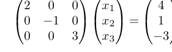

通过以下 MATLAB 命令：

```matlab
>> A = diag([2, -1, 3])
A =
     0  0  0
    0 -1  0
     0  0  3
>> b = [4; 1; 3]
b =
     4
     1
     3
>> x = SolveDiagonalLinearSystem(A, b)
x =
     2
    -1
     1
```

`SolveDiagonalLinearSystem` 函数的 python 代码如下：

```python
import numpy as np
def SolveDiagonalLinearSystem(A, b):
  n = len(b)
  x = np.zeros((n, 1), 'float')
  for i in range(n):
    x[i] = b[i]/A[i, i]
  return x

In [7]: A = np.diag([2, -1, 3])
In [8]: b = np.array([4, -1, 3])
In [9]: x = SolveDiagonalLinearSystem(A, b)
In [10]: print('x = \n', x)
x =
[[ 2]
 [-1]
 [ 1]]
```


## 使用直接法求解线性方程组

```
10 for k = j+1 : n
11 x(j) = x(j) - A(j, k)+x(k) ;
12 end
13 x(j) = x(j)/A(j, j) ;
14 end
```

SolveUpperSystem 的 Python 代码如下：

```python
1 import numpy as np
2 def SolveUpperSystem(A, b):
3 n = len(b)
4 x = np.zeros((n, 1), 'float')
5 x[n-1] = b[n-1]/A[n-1, n-1]
6 for i in range(n-2, -1, -1):
7 x[i] = b[i]
8 for j in range(i+1, n):
9 x[i] -= A[i, j]*x[j]
10 x[i] /= A[i, i]
11 return x
```

# 3. A 是下三角系统；A 的形式为

在这种情况下，矩阵 A 为

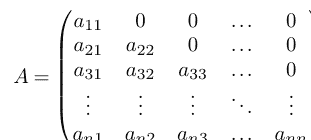

因此，我们有方程组：

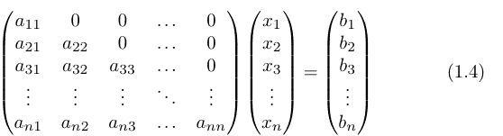

使用正向代入法找到方程组 1.4 的解。MATLAB 函数 SolveLowerSystem.m 使用正向代入法求解线性方程 1.4。

```matlab
1 function x = SolveLowerLinearSystem(A, b)
2 % 此函数使用正向代入法
3 for solving
4 % 线性方程 Ax = b，其中 A 是一个下
5 % 三角矩阵
6 % b 是已知向量，n 是问题的维度。
```

# 求解线性方程组的方法

```matlab
5 n = length(b);
6 x = zeros(n, 1);
7 x(1) = b(1)/A(1, 1);
8 for j = 2: n
9 x(j) = b(j);
10 for k = 1: j-1
11 x(j) = x(j) - A(j, k)*x(k);
12 end
13 x(j) = x(j)/A(j, j);
14 end
```

函数 SolveLowerSystem 的 Python 代码如下。

```python
1 def SolveLowerSystem(A, b):
2 import numpy as np
3 n = len(b)
4 x = np.zeros((n, 1), 'float')
5 x[0] = b[0]/A[0, 0]
6 for i in range(1, n):
7 x[i] = b[i]
8 for j in range(i):
9 x[i] -= A[i, j]*x[j]
10 x[i] /= A[i, i]
11 return
```

### 1.2.2 高斯消元与高斯-乔登消元

高斯消元和高斯-乔登消元法是相关的。如果给出一个矩阵 $A \in R^{n \times n}$，那么高斯和高斯-乔登都会通过对矩阵 $A$ 的连续步骤执行初元操作。高斯法在获得矩阵 $A$ 的行阶梯形后停止（如果 $A$ 非奇异，其行阶梯形为上三角矩阵），而高斯-乔登法持续持续直到达到最简行阶梯形（如果 $A$ 非奇异，其最简行阶梯形为单位矩阵）。为了说明行阶梯形和最简行阶梯形之间的区别，对矩阵计算了这两种形式：

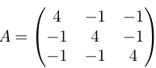

通过找到给定矩阵的行阶梯形。

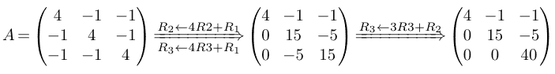

## 使用直接法求解线性方程组

上三角矩阵

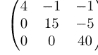

是矩阵 $A$ 的行阶梯形。
高斯-乔登消元继续获取主元，以获得最简行阶梯形。

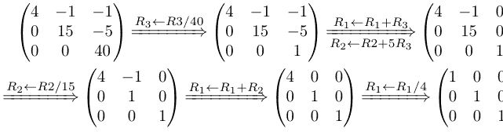

### 1.2.3 使用 rref 函数求解方程

高斯法和高斯-乔登法是求解线性方程组的两种常用方法。它们都从增广矩阵开始，分别获得行阶梯形或最简行阶梯形。高斯法使用回代技术获得方程解，而在高斯-乔登法中，解位于最后一列。下面的 MATLAB 代码从用户处读取矩阵 $A$ 和向量 $b$，然后通过对增广系统 $[A \ b]$ 应用 rref 来应用高斯-Seidel 消元

```matlab
1 clear; clc;
2 A = input('Enter the matrix A: '); % 从用户处读取矩阵 A
3 b = input('Enter the vector b: '); % 从用户处读取向量 b
4 [m, n] = size(A); % m 和 n 是维度
5 rl = rank(A); % 矩阵 A 的秩赋值给 rl
6 r2 = rank([A b]); % 增广系统 [A b] 的秩赋值给 r2
7 if rl ~= r2 % 测试 rank(A) 不等于 rank([A b])
8     disp(['rank(A) = ', num2str(rl), ' != ', num2str(r2), ' = ', Rank([A b]).']);
     fprintf('There is no solution.\n'); % 在无解的情况下
9 end
10 if rl == r2 % 测试 rank(A) 等于 n
11     R = rref([A b]) % 是的，测试是否为最简行阶梯形
12     x = R(:, end); % 解在最简行阶梯形的最后一列
13     disp(['Rank(A) = Rank([A b]) = ', num2str(rl), ' = ', n, '.']);
14     disp('There is a unique solution, given by: ');
15     disp(x) % 显示线性方程组的解
16 else % rank(A) = rank([A b]) < n
17     disp(['Rank(A) = Rank([A b]) = ', num2str(rl), ' < ', num2str(n), ' = Col(A).']);
18     fprintf('Infinite number of solutions.\n');
19 end
```

执行上述脚本的结果：

Enter the matrix A: [12 3 4 5 6 7 8 9]
Enter the vector b: [1;3;5]
Rank(A) = Rank([A b]) = 2 < 3.
Infinite solutions。（等等，重新检查逻辑）

Enter the matrix A: [1 3 5 2 4 6 7 8 9]
Enter the vector b: [1;1;1]
Rank(A) = Rank([A b]) = 2 ~= 3.
No solution.

Enter the matrix A: [2 2 -1; 1 2 1; -1 -1 2]
Enter the vector b: [2;4;1]
Rank(A) = Rank([A b]) = 3 = Col(A).
A unique solution, given by:
0.6667
1.0000
1.3333

在 Python 中，内置的 `sympy.Matrix` 用于构造矩阵。`Matrix` 类有一个 `rref` 方法计算矩阵的最简行阶梯形。

```python
1 import sympy as sm
2 A = sm.Matrix([[2, 2, -1], [1, 2, 1], [-1, -1, 2]])
3 b = sm.Matrix([[2], [4], [1]])
4 m, n = A.rows, A.cols
5 rl = A.rank()
6 C = A.copy()
7 r2 = (C.row_join(b)).rank()
```

```python
if rl != r2: # 测试 rank(A)
    print('Rank(A) ' + str(rl) + ' != ' + str(r2) + ' = Rank([A b])')
    print('There is no solution\n') # 无解的情况下
if rl == r2: #    # 测试 rank(A) =
    if rl == n:
        # 是的，测试...等于 n
        R = (A.row_join(b)).rref # [A b] 的最简行阶梯形
        x = R[0,:] # 解在最简行阶梯形的最后一列
        # 行阶梯形
    print('Rank(A) = Rank([A b]) ' + str(rl) + ' = Col(A)')
    print('There is a unique solution, given by: ');
    print(x)
else: # rank(A) = rank([A b]) < n
    print('Rank(A) = Rank([A b]) ' + str(rl) + ' < ' + str(n) + ' = Col(A)')
    print('Infinite number of solutions\n')
```

通过执行代码，显示如下结果：
Rank(A) = Rank([A b]) = 3 = Col(A).
A unique solution, given by:
Matrix([[2/3], [1], [4/3]])

### 1.3 矩阵分解

矩阵分解意味着将矩阵 A 表示为两个或多个矩阵的乘积，每个称为一个因子。即：

$A = L \cdot U$

在这一节中，将 LU 分解、QR 分解和奇异值分解 (SVD)。然后将讨论这些方法的使用。由于会遇到用上下三角矩阵求解方程组的情况，本节将从编写求解此类系统的 MATLAB 代码开始

### 1.3.1 LU 分解

在这种分解中，矩阵被表示为两个矩阵 $L$ 和 $U$ 的乘积，其中 $L$ 是下三角矩阵，$U$ 是上三角矩阵。即：

$A = L \cdot U = \begin{pmatrix} l_{11} & 0 & 0 & \dots & u_{11} \\ l_{21} & l_{22} & 0 & \dots & u_{2n} \\ l_{31} & l_{32} & l_{33} & \dots & u_{3n} \\ \vdots & \vdots & \vdots & \ddots & \vdots \\ l_{n1} & l_{n2} & l_{n3} & \dots & u_{nn} \end{pmatrix}$

其中对于 $j = 1, 2, \dots, n$，$l_{ij} = 1$。

在 MATLAB 中，可以这样完成：

```matlab
>> A = [4 -1 -1; -1 4 -1; -1 -1 4]
>> [L, U] = lu(A)
L =
1.0000 0 0
-0.2500 1.0000 0
-0.2500 -0.3333 1.0000

U =
4.0000 -1.0000 -1.0000
0 3.7500 -1.2500
0 0 3.3333
```


## 使用直接法求解线性方程组

In [5]: LU = lg.lu_factor(A)
In [6]: print('LU = \n', LU)
LU =
(array([[ 4. , -1. , -1. ],
[-0.25 , 3.75 , -1.25 ],
[-0.25 , -0.33333333, 3.33333333]]), array([0, 1, 2],
type=int32)))

现在，方程 1.6 变为：

```
$$\begin{pmatrix} 1 & 0 & 0 & & u_{11} & u_{12} & u_{13} & & u_{1n} \\ l_{21} & 1 & 0 & & 0 & u_{22} & u_{23} & & u_{2n} \\ l_{31} & l_{32} & 1 & & 0 & 0 & u_{33} & & u_{3n} \\ \vdots & \vdots & \vdots & & \vdots & \vdots & \vdots & & \vdots \\ l_{n1} & l_{n2} & l_{n3} & & 0 & 0 & 0 & & u_{nn} \end{pmatrix} \begin{pmatrix} x_1 \\ x_2 \\ x_3 \\ \vdots \\ x_n \end{pmatrix} = \begin{pmatrix} b_1 \\ b_2 \\ b_3 \\ \vdots \\ b_n \end{pmatrix}$$
```

方程 1.6 的解分三个阶段找到：

- 1. **第一步**：我们令 $y=Ux$，即：

```
$$\y = \begin{pmatrix} u_{11} & u_{12} & u_{13} & & u_{1n} \\ 0 & u_{22} & u_{23} & & u_{2n} \\ 0 & 0 & u_{33} & & u_{3n} \\ \vdots & \vdots & \vdots & & \vdots \\ 0 & 0 & 0 & & u_{nn} \end{pmatrix} \begin{pmatrix} y_1 \\ y_2 \\ y_3 \\ \vdots \\ y_n \end{pmatrix}$$
```

那么，求解 1.6 等于求解线性方程组：

```
$$Ly=b$$
```

- 2. **第二步**：我们使用 `SolveLowerSystem.m` 函数求解方程 $Ly=b$ 以找到 $y$。

- 3. **最后**：我们使用 MATLAB 函数 `SolveUpperSystem` 实现的回代法求解线性方程组 $Ux=y$。

**示例 1.1** 在此例中，将使用 LU 因子求解线性方程组：

```
$$\begin{pmatrix} 4 & -1 & -1 \\ -1 & 4 & -1 \\ -1 & -1 & 4 \end{pmatrix} \begin{pmatrix} x_1 \\ x_2 \\ x_3 \end{pmatrix} = \begin{pmatrix} 2 \\ 2 \\ 2 \end{pmatrix}$$
```

在 MATLAB 中，可以使用以下命令：

```
>> A = [4 -1 -1; -1 4 -1; -1 -1 4];
>> b = [2; 2; 2];
>> [L, U] = lu(A)
```

# 矩阵分解技术

```
L =
1.0000 0 0
-0.2500 1.0000 0
-0.2500 -0.3333 1.0000
```

```
U =
4.0000 -1.0000 -1.0000
0 3.7500 -1.2500
0 0 3.3333
>> y = SolveLinearSystem(L, b, 3)
y =
2.0000
2.5000
3.3333
>> x = SolveUpperSystem(U, y, 3)
x =
1.0000
1.0000
1.0000
```

在 Python 中，可以遵循类似的步骤使用矩阵 A 的 LU 因子求解方程 $Ax=b$：

```python
In [7]: y = lg.solve(L, b)
In [8]: x = lg.solve(U, y)
In [9]: print('x = \n', x)
[[ 0.5]
 [ 0.5]
 [ 0.5]]
```

Python 的 `scipy.linalg` 包中有 `lu_solve`，接收矩阵 LU 并返回给定方程组的解：

```python
In [10]: x = lg.lu_solve(LU, b)
In [11]: print(x)
[[ 0.5]
 [ 0.5]
 [ 0.5]]
```

Python 的符号包 `sympy` 也可以用于寻找矩阵 A 的分解。方法如下：

```python
In [10]: import sympy as smp
In [11]: A = smp.Matrix([[4., -1., -1.], [-1., 4., -1.], [-1., -1., 4.]])
In [12]: LU = A.LU_decomposition()
```

### 1.3.2 QR 分解

从初线性代数来看，矩阵 A 表示为两个矩阵 $Q$ 和 $R$ 的乘积。矩阵 $Q$ 是正交矩阵，矩阵 $R$ 是上三角，满足以下条件：

- 1. $Q^{-1} = Q^T$，
- 2. 如果 $Q = [q_1, q_2, \dots, q_n]，则 $(q_i, q_j) = \begin{cases} 1 & i=j \\ 0 & i \neq j \end{cases}$

在 MATLAB 中，可以使用 `qr` 函数寻找矩阵 A 的 QR 因子。命令如下：

```matlab
>> A = [4 -1 -1; -1 4 -1; -1 -1 4];
>> [Q, R] = qr(A)
```

```matlab
Q =
-0.9428 -0.1421 0.3015
0.2357 -0.9239 0.3015
0.2357 0.3553 0.9045
```

```matlab
R =
-4.2426 1.6499 1.6499
0 -3.9087 2.4873
0 0 3.0151
```

在 Python 中，`scipy.linalg` 中的 `qr` 可以寻找矩阵 A 的 QR 因子：

```python
In [18]: Q, R = lg.qr(A)
In [19]: print('Q = \n', Q, '\nR = \n', R)
```

```python
Q =
[-0.94280904 -0.14213381 0.301511354
0.23570226 -0.92386977 0.301511354
0.23570226 0.35533453 0.90454303]]
```

```python
R =
[-4.24264069 1.64991582 1.64991582]
 [0 -3.90869787 2.48734169]
 [0 0 3.01513445]]
```

符号包 `sympy` 也可以用于寻找矩阵 A 的 QR 因子：

```python
In [20]: QR = A.qr_decomposition()
```

为了求解线性方程组 1.1，使用 QR 技术可以使用以下步骤：

- 寻找矩阵 A 的 QR 因子并重写方程 $Ax=b$ 为 $Q \cdot Rx = b$。
- 将方程 $Q \cdot Rx = b$ 的两边乘以 $Q^T$，得到：

```
$Q^T Rx = Q^T b
```
- 使用 `UpperLinearSystem.m` 函数实现的回代法求解上三角方程 $Rx = y$，其中 $y = Q^T b$。

**示例 1.2** 在此处，将使用 QR 因子求解方程：


```matlab
>> A = [4, -1, -1; -1, 4, -1; -1, -1, 4];
>> b = [2; 2; 2];
>> [Q, R] = qr(A) ;
>> y = Q'*b
y =
-0.9428
-1.4213
3.0151
>> x = SolveLinearSystem(R, y, 3)
x =
1.0000
1.0000
1.0000
```

Python 可以使用 QR 因子求解上述线性方程组，方法如下：

```python
In [24]: import numpy as np, scipy.linalg as lg
In [25]: A = np.array([[4, -1, -1], [-1, 4, -1], [-1, -1, 4]])
In [26]: b = np.array([[2.0], [2.0], [2.0]])
In [27]: Q, R = lg.qr(A)
In [28]: y = np.matmul(Q.T, b)
In [29]: x = lg.solve(R, y)
In [30]: print('x \n', x)

```python
[[ 1.0]
 [1.0]
 [ 1.0]]
```

另一种方法是使用符号包：

```python
In [31]: import sympy as smp
In [32]: A = smp.Matrix([[4.0, -1.0, -1.0], [-1.0, 4.0, -1.0], [-1.0, -1.0, 4.0]]])
In [33]: b = smp.Matrix([[2.0], [2.0], [2.0]])
In [34]: x = A.QRsolve(b)
In [35]: x
Out[35]:
Matrix([
[1.0],
[1.0],
[1.0]])
```

### 1.3.3 奇异值分解 (SVD)

在 SVD 分解中，矩阵 A 表示为三个矩阵 $U, S$ 和 $V^T$ 的乘积，即：

> $A = U \cdot S \cdot V^T$

其中 $U$ 和 $V$ 都是正矩阵，$S$ 是对角矩阵。
矩阵 $U$ 的列是矩阵 $AA^T$ 的特征向量。矩阵 $V$ 的列是矩阵 $A^TA$ 的特征向量。矩阵 $S$ 的对角元素是矩阵 $A$ 特征值的平方。

如果 $\{u_1, u_n\}$ 是 $U$ 的列，$\{v_1, v_2, \dots, v_n\}$ 是 $V$ 的列，那么它们满足以下条件：

- 1. $U^{-1} = U^*$ 且 $V^{-1} = V^*$。如果 $U$ 和 $V$ 为实数矩阵，则 $U^{-1} = U^T$ 且 $V^{-1} = V^T$。
2. $U$ 和 $V$ 的列是正交规范化的：

```
$(u_i, u_j) = u_i^* \cdot u_j = \begin{cases} 1 & i=j \\ 0 & i \neq j \end{cases}$
```


## 使用直接法求解线性方程组

在 MATLAB 中，命令 `svd` 用于寻找矩阵 A 的 SVD 分量。

```
>> A = [4 -1 -1; -1 4 -1; -1 -1 4];
>> [U, S, V] = svd(A)
U =
0.0000 -0.8165 -0.5774
-0.7071 0.4082 -0.5774
0.7071 0.4082 -0.5774
S =
5 0 0
0 5 0
0 0 2
V =
0 -0.8165 -0.5774
-0.7071 0.4082 -0.5774
0.7071 0.4082 -0.5774
```

在 Python 中，函数 `svd` 用于寻找矩阵 A 的 SVD 分解。

In [36]: U, S, V = lg.svd(A)
In [37]: print('U = \n', U, '\nS = \n', S, '\nnV = \n', V)

```
U =
[[2.69618916e-17 -8.16469581e-01 -5.77350269e-01]
 [-7.07106781e-01 4.02842990e-01 -5.77350269e-01]
 [7.07106781e-01 4.02842990e-01 -5.77350269e-01]]
S =
[[5. 5. 2]]
V =
[[0. -0.70710678 0.70710678]
 [-0.81649658 0.40284829 0.40284829]
 [-0.57735027 -0.57735027 -0.57735027]]
```

现在求解 $Ax = b$ 等于找到线性方程组的解：

```
$US^Tx = b,$
```

因此，将方程 (1.7) 的两边乘以 $V \cdot S^{-1}U^T$，得到：

```
$x = V \cdot S^{-1}U^T,$
```

**示例 1.3** 使用 svd 求解线性方程组：

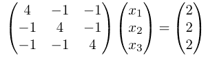

```
>> x = V*inv(S)*U'*b
x = =
1.0000
1.0000
1.0000
```

在 Python 中，使用 svd 分量求解线性方程组的方法：

```
In [38]: x = lg.solve(V, lg.solve(np.diag(S), lg.solve(U,b)))
In [39]: print('x = \n', x)
x =
[[ 0.5]
[ 0.5]
[ 0.5]]
```


# 使用迭代法和最小二乘法求解线性方程组

### 摘要

求解线性方程组 $Ax = b$ 的直接法是通过直接或间接地求逆矩阵 $A$ 来寻找精确解。迭代法通过寻找收敛于精确解的向量序列来寻找方程的近似解。当方程无解时，问题变为最小二乘问题。本章分为三部分：第一部分介绍了范数和序列收敛等基本概念；第二部分讨论并实现了 MATLAB 中用于求解线性方程近似解的迭代法；当方程无解时，转化为寻找最小误差的最小二乘解；第三部分在 MATLAB 和 Python 中讨论并实现了最小二乘问题和多项式的最佳近似。

## 2.1 数学背景

本节介绍了向量空间 $R^n$ 中的范数和序列收敛。

### 2.1.1 收敛序列与柯西

设 $a$ 为 $R$ 中的任意点，$\varepsilon \in R^+$ 为任意正实数，$a$ 的 $\varepsilon$ 邻（记作 $N(a,\varepsilon)$）是位于区间 $(a-\varepsilon, a+\varepsilon)$ 内的所有 $x \in R$ 的集合。即 $N(a,\varepsilon) = \{x \in R : |x-a| < \varepsilon\}$ [46]。实数序列 $\{a_n\}_{n=0}^\infty = a_0, a_1, \dots$ 若对于任意 $\varepsilon > 0，$N(a,\varepsilon)$ 都包含一个子序列 $\{a_n\}_{n=N}^\infty = a_N, a_{N+1}, \dots$，则称该序列收敛于 $a$为了用数学方式表示序列 $\{a_n\}_{n=0}^\infty$ 的收敛，我们写道：

$|a_n - a| < \varepsilon, \forall n \ge N$

**定义 2.1**（序列收敛）设 $\{a_n\}$ 为实值序列。如果对于任意 $\varepsilon > 0$，存在 $N \in \mathbb{N}$ 使得

$|a_n - a| < \varepsilon, \forall n \ge N$，

则称序列 $\{a_n\}$ 收敛于某个极限 $a$，我们写道 $\lim_{n \to \infty} a_n = a$。

例如，在序列 $\{a_n - a_{n+1}\}$ 中，对应的序列

|a_0 - a_1| \ge |a_1 - a_2| \ge \dots \ge |a_n - a_{n+1}| \ge \dots \to 0$ ($n \to \infty$)。

**定义 2.2** 序列 $\{a_n\}$ 为柯西序列，如果对于任意 $\varepsilon > 0$，存在 $N \in \mathbb{N}$，使得

$|a_n - a_m| < \varepsilon,$ 对于所有 $n, m \ge N$。由于 $\mathbb{R}$ 是完备的，任何收敛序列都是柯西序列，反之亦然。

### 2.1.2 向量范

如果 $\boldsymbol{x}$ 是一个分量为 $x_1, x_2, \dots, x_n$ 的向量，则它的 $p$ 范定义为：

$\|\boldsymbol{x}\|_p = \left(\sum_{j=1}^{n} |x_j|^p\right)^{\frac{1}{p}} = (|x_1|^p + |x_2|^p + \dots + |x_n|^p)^{\frac{1}{p}}$

它满足 $|\boldsymbol{x}\|_1 \ge |\boldsymbol{x}\|_2 \ge \dots \ge |\boldsymbol{x}\|_{\infty}$。范 $\|\boldsymbol{x}\|_2$ 给出了经典的欧几距离：

$\|\boldsymbol{x}\|_2 = \sqrt{x_1^2 + x_2^2 + \dots + x_n^2}$

Python 函数 `norm`（位于 numpy.linalg 中）接收向量 $\boldsymbol{x}$ 和整数 $p$ 或 `np.inf`，并返回 $\|\boldsymbol{x}\|_p$。

- In [27]: x = np.array([-1, -1, 2, -2, 3, -3])
- In [28]: from numpy.linalg import norm
- In [29]: n1, n2, n3 = norm(x, 1), norm(x, 2), norm(x, np.inf)
- In [30]: print(n1, n2, n3)

### 2.1.3 向量收敛序列

向量空间中的距离可以使用任何范数定义。如果我们有两个向量 $\boldsymbol{x}$ 和 $\boldsymbol{y}$ 均在 $\mathbb{R}^n$，那么 $\boldsymbol{x}$ 和 $\boldsymbol{y}$ 之间的距离可以通过 $\|\boldsymbol{x}-\boldsymbol{y}\|_1, \|\boldsymbol{x}-\boldsymbol{y}\|_2, \dots$ 或 $\|\boldsymbol{x}-\boldsymbol{y}\|_{\infty}$ 定义。通常使用 $\|\boldsymbol{x}-\boldsymbol{y}\|_2$ 或 $\|\boldsymbol{x}-\boldsymbol{y}\|_{\infty}$。

**定义 2.3**（向量序列的收敛）设 $\{a_n\}$ 为 $R^n$ 中的向量序列。如果序列 $\{a_n\}$ 收敛于向量 $a$，则对于任意 $\varepsilon > 0$，存在 $N \in \mathbb{N}$ 使得

$\|a_n - a\| < \varepsilon, \forall n \ge N$。

**定义 2.4**（柯西）设 $\{a_n\}_{n=0}^\infty$ 为 $R^n$ 中的序列。如果该序列是柯西的，则对于任意 $\varepsilon > 0$，存在 $N \in \mathbb{N}$，使得

$\|a_n - a_m\| < \varepsilon,$ 对于所有 $n, m \ge N$。

### 2.2 迭代法

求解方程的迭代法是从给定的估计值 $x^{(0)}$ 开始，生成序列 $x^{(1)}, x^{(2)}, \dots$，该序列收敛于线性方程组的解 $x^*$。序列的生成在某次迭代 $s$ 停止，满足：

$\|x^{(s)} - x^{(s-1)}\| < \varepsilon$

其中 $\|\cdot\|$ 是 $R^n$ 中的某种范数，且 $\varepsilon > 0$。

### 2.2.1 总体思想

给定线性方程组 $Ax = b$，$\varepsilon > 0$ 以及初始点 $x^{(0)}$。目标是生成向量序列：

> $x^{(0)}, x^{(1)}, x^{(2)}, \dots$

使其收敛于线性方程组 $Ax = b$ 的解。即：

$\lim_{n \to \infty} x_n = x^*$

在静态迭代法中，矩阵 $A$ 表示为两个矩阵 $S$ 和 $T$ 之和，即 $A = S+T$，其中 $S$ 是可逆矩阵。那么，将线性方程组 $Ax = b$ 替换为 $(S+T)x = b$ 或：

> $Sx = b - Tx$

由于 $S$ 可逆的，我们将两边乘以 $S^{-1}$ 得到线性方程组：

其中 $B = -S^{-1}T$ 且 $c = S^{-1}b$。


# 迭代法

上述线性方程组的解是一个固定点 $x^*$，其中

```
$x^* = Bx^* + c
```

固定点是通过迭代得到的，从给定的初始点 $x^{(0)}$ 开始，使用迭代关系：

```
$x^{(k+1)} = Bx^{(k)} + c$
```

在整个节中，我们假设 $A$ 是三个矩阵 $L$、$D$ 和 $U$ 之和：

```
$L = \begin{pmatrix} 0 & 0 & 0 & \dots & 0 & 0 \\ a_{2,1} & 0 & 0 & \dots & 0 & 0 \\ a_{3,1} & a_{3,2} & 0 & \dots & 0 & 0 \\ \vdots & \vdots & \vdots & \ddots & \vdots & \vdots \\ a_{n-2,1} & a_{n-2,2} & a_{n-2,3} & \dots & 0 & 0 \\ a_{n-1,1} & a_{n-1,2} & a_{n-1,3} & \dots & a_{n-1,n-2} & 0 \\ a_{n,1} & a_{n,2} & a_{n,3} & \dots & & a_{n-1,n-2} \end{pmatrix}$
```

```
$D = \begin{pmatrix} a_{1,1} & 0 & 0 & \dots & 0 & 0 \\ 0 & a_{2,2} & 0 & \dots & 0 & 0 \\ 0 & 0 & a_{3,3} & \dots & 0 & 0 \\ \vdots & \vdots & \vdots & \ddots & \vdots & \vdots \\ 0 & 0 & 0 & \dots & a_{n-2,n-2} & 0 \\ 0 & 0 & 0 & \dots & a_{n-1,n-1} & 0 \\ 0 & 0 & 0 & \dots & & a_{n,n} \end{pmatrix}$
```

and

```
$U = \begin{pmatrix} 0 & a_{1,2} & a_{1,3} & \dots & a_{1,n-1} & a_{1,n} \\ 0 & 0 & a_{2,3} & \dots & a_{2,n-1} & a_{2,n} \\ 0 & 0 & 0 & \dots & a_{3,n-2} & a_{3,n} \\ \vdots & \vdots & \vdots & \ddots & \vdots & \vdots \\ 0 & 0 & 0 & \dots & a_{n-2,n-1} & a_{n-2,n} \\ 0 & 0 & 0 & \dots & & a_{n-1,n} \\ 0 & 0 & 0 & \dots & & 0 \end{pmatrix}$
```

在 MATLAB 中，可以使用以下命令获取矩阵 $L$、$D$ 和 $U$：

```
>> D = diag(diag(A));
>> L = tril(A) - D;
>> U = triu(A) - D;
```

在 Python 中，`tril` 和 `triu` 在 `scipy.linalg` 包中实现，而 `diag` 在 `scipy` 和 `numpy` 中都有实现。可以通过以下命令获取它们：

# 使用迭代法和最小二乘法求解线性组

In [1]: import scipy as sp, numpy as np
In [2]: A = np.array([[4, 1, -1], [-1, 5, 0], [0, -1, 4]])
In [3]: print('L = \n', sp.linalg.tril(A), '\nU = \n', sp.linalg.triu(A), '\nD = \n', np.diag(A))

# Jacobi 方法

给定线性方程组：

$$a_{11}x_1 + a_{12}x_2 + \dots + a_{1n}x_n = b_1$$
$$a_{21}x_1 + a_{22}x_2 + \dots + a_{2n}x_n = b_2$$
$$\vdots$$
... \quad (2.1)$$

从上述方程得出：

$$x_1 = \frac{1}{a_{11}}(b_1 - a_{12}x_2 - \dots - a_{1n}x_n)$$
$$x_2 = \frac{1}{a_{22}}(b_2 - a_{21}x_1 - \dots - a_{2n}x_n)$$
$$\vdots$$
$$x_i = \frac{1}{a_{ii}}(b_i - \sum_{j=1, j \neq i}^n a_{ij}x_j) \quad (2.2)$$
$$\vdots$$
$$x_n = \frac{1}{a_{nn}}(b_n - a_{n1}x_1 - \dots - a_{n-1}x_{n-1})$$

Jacobi 方法是一种迭代法，从解的初始猜测值 $[x_1^{(0)}, x_2^{(0)}, \dots, x_n^{(0)}]^T$ 开始。迭代 $k+1$ 次用于寻找近似的方法如下：

$$x_1^{(k+1)} = \frac{1}{a_{11}}(b_1 - a_{12}x_2^{(k)} - \dots - a_{1n}x_n^{(k)})$$
$$x_2^{(k+1)} = \frac{1}{a_{22}}(b_2 - a_{21}x_1^{(k)} - \dots - a_{2n}x_n^{(k)})$$
$$\vdots$$
$$x_i^{(k+1)} = \frac{1}{a_{ii}}(b_i - \sum_{j=1, j \neq i}^n a_{ij}x_j^{(k)}) \quad (2.3)$$
$$\vdots$$
$$x_n^{(k+1)} = \frac{1}{a_{nn}}(b_n - a_{n1}x_1^{(k)} - \dots - a_{n-1}x_{n-1}^{(k)})$$

一般来说，迭代 $x_i^{(k+1)}$ 可以写成形式：

当 $||x_i^{(k+1)} - x_i^{(k)}|| < \varepsilon$（对于某个 $\varepsilon > 0$）时，Jacobi 方法停止。

**Example 2.1** 为线性方程组写 Jacobi 方法的前几次迭代：

$$\begin{pmatrix} 2 & -1 & 1 \\ -2 & 5 & -1 \\ 1 & -2 & 4 \end{pmatrix} \begin{pmatrix} x_1 \\ x_2 \\ x_3 \end{pmatrix} = \begin{pmatrix} -1 \\ 1 \\ 1 \end{pmatrix}$$

从零向量 $x^{(0)} = \begin{pmatrix} 0 \\ 0 \\ 0 \end{pmatrix}$ 开始。

**解：**

第一次迭代 $k=0$：

$$x_1^{(1)} = \frac{1}{2}(-1+x_2^{(0)} - x_3^{(0)}) = \frac{1}{2}(-1+0-0) = -\frac{1}{2}$$
$$x_2^{(1)} = \frac{1}{5}(1+2x_1^{(0)} + x_3^{(0)}) = \frac{1}{5}(1+2(0)+0) = \frac{1}{5}$$
$$x_3^{(1)} = \frac{1}{4}(3-x_1^{(0)} + 2x_2^{(0)}) = \frac{1}{4}(3-0+0) = \frac{3}{4}$$

第二次迭代 $k=1$：

$$x_1^{(2)} = \frac{1}{2}(-1+x_2^{(1)}-x_3^{(1)}) = \frac{1}{2}(-1+\frac{1}{5}-\frac{3}{4}) = -\frac{31}{40}$$
$$x_2^{(2)} = \frac{1}{5}(1+2x_1^{(1)}+x_3^{(1)}) = \frac{1}{5}(1+2(-\frac{1}{2})+\frac{3}{4}) = \frac{3}{20}$$
$$x_3^{(2)} = \frac{1}{4}(3-x_1^{(1)}+2x_2^{(1)}) = \frac{1}{4}(3-(-\frac{1}{2})+2(\frac{1}{5})) = \frac{39}{40}$$

第三次迭代 $k=2$：

$$x_1^{(3)} = \frac{1}{2}(-1+x_2^{(2)}-x_3^{(2)}) = \frac{1}{2}(-1+\frac{3}{20}-\frac{39}{40}) = -\frac{65}{80}$$
$$x_2^{(3)} = \frac{1}{5}(1+2x_1^{(2)}+x_3^{(2)}) = \frac{1}{5}(1+2(-\frac{31}{40})+\frac{39}{40}) = -\frac{23}{200}$$
$$x_3^{(3)} = \frac{1}{4}(3-x_1^{(2)}+2x_2^{(2)}) = \frac{1}{4}(3-(-\frac{31}{40})+2(\frac{3}{20})) = \frac{163}{160}$$


# 迭代法

## 2.2.3.1 高斯-Seidel  迭代法

高斯-Seidel 方法与 Jacobi 方法非常相似，但它的优势在于在迭代 $k+1$ 中利用最近更新的变量 $x_1^{(k+1)}, ..., x_{i-1}^{(k+1)}$ 来更新 $x_i^{(k+1)}$，而其他变量 $x_i^{(k+1)}, ..., x_n^{(k)}$ 则取自上一次迭代 $k$。高斯-Seidel 方法的形式如下：

```
$a_{11}x_1^{(k+1)} = b_1 - a_{12}x_2^{(k)} - ... - a_{n1}x_n^{(k)}$
$a_{21}x_1^{(k+1)} + a_{22}x_2^{(k+1)} = b_2 - a_{23}x_3^{(k)} - ... - a_{n2}x_n^{(k)}$
$:
$a_{ai}x_i^{(k+1)} + ... + a_{in}x_n^{(k+1)} = b_i - a_{ai,i+1}x_{i+1}^{(k)} - ... - a_{in}x_n^{(k)} \quad (2.5)$
$:
$a_{n1}x_1^{(k+1)} + ... + a_{nn}x_n^{(k+1)} = b_n$
```

根据方程 (2.5)


```
$x_1^{(k+1)} = \frac{1}{a_{11}}(b_1 - a_{12}x_2^{(k)} - ... - a_{n1}x_n^{(k)})$
$x_2^{(k+1)} = \frac{1}{a_{22}}(b_2 - a_{21}x_1^{(k+1)} - a_{23}x_3^{(k)} - ... - a_{n2}x_n^{(k)})$
$:
$x_i^{(k+1)} = \frac{1}{a_{ii}}(b_i - a_{ai1}x_1^{(k+1)} - ... - a_{ii,i-1}x_{i-1}^{(k)} - a_{ii,i+1}x_{i+1}^{(k)}) \quad (2.6)$
$... - a_{in}x_n^{(k)}$
$:
$x_n^{(k+1)} = \frac{1}{a_{nn}}(b_n - a_{n1}x_1^{(k+1)} - ... - a_{nn,n-1}x_{n-1}^{(k+1)})$
```

以下 MATLAB 函数以方程组格式实现了高斯-Seidel 方法：

```matlab
function [x, Iters] = GaussSeidel(A, b, Eps, x0)
  Iters = 1 ;
  x = zeros(size(x0)) ; n = length(b) ;
  for i = 1 : n
    x(i) = b(i);
    for j = 1 : i-1
      x(i) = x(i)-A(i,j)*x(j);
    end
end
```

# 使用迭代法和最小二乘法求解线性方程组

```matlab
10 xl(i) = xl(i) - A(i, j)+x0(j);
11 end
12 xl(i) = xl(i)/A(i, i);
13 end
14 while norm(xl-x0, inf) >= Eps
15 x0 = xl;
16 for i = 1 : n
17 xl(i) = b(i);
18 for j = 1 : i-1
19 xl(i) = xl(i)-A(i, j)+xl(j);
20 end
21 for j = i+1 : n
22 xl(i) = xl(i) - A(i, j)+x0(j);
23 end
24 xl(i) = xl(i)/A(i, i);
25 end
26 Iters = Iters + 1;
27 end
28 x = xl;
```

将该代码应用于线性方程组 2.1 和 2.2：

```matlab
>> Eps = 1e-8; x0 = [0;0;0];
>> A = [2 -1 -1; -2 5 -1; 1 -2 4]; b = [-1;1;3];
>> [x, Iters] = GaussSeidel(A, b, x0)
x = [-1.0000; 0; 1.0000]
Iters = 11
```

```matlab
>> A = [-5 1 -2; 1 6 3; 2 -1 -4]; b = [13; 1; -1];
>> [x, Iters] = GaussSeidel(A, b, x0)
x = [-2.0000; 1.0000; -1.0000]
```

函数 GaussSeidel 的 Python 代码如下：

```python
import numpy as np
def GaussSeidel(A, b, Eps, x0):
    n = len(b)
    x = np.ones((n, 1), dtype=float)
    Iterations = 1
    while np.linalg.norm(x-x0, inf) >= Eps:
        x0 = x.copy()
        for i in range(n):
            x[i] = b[i]
            for j in range(i):
                x[i] -= A[i][j]+x[j]
            for j in range(i+1, n):
                x[i] -= A[i][j]+x0[j]
            x[i] /= A[i][i]
        Iterations += 1
    return x, Iterations
```

执行该代码得到：
（结果与上述相似）

### 2.2.4 向量形式的高斯-Seidel 方法

高斯-Seidel 方法选择 $S = L+D$ 和 $T = U$。Jacobi 方法的形式为：$x^{(n+1)} = Bx^{(n)} + c,$，其中 $B = -(L+D)^{-1}U，$c = (L+D)^{-1}b$。

MATLAB 代码以矩阵格式实现高斯-Seidel 方法：

```matlab
function [x, Iters] = GaussSeidelIter(A, b, Eps, x0)
LD = tril(A); U = A - LD;
B = -LD; c = LD; % 此处 OCR 可能有误
Iters = 1;
x1 = B*x0 + c;
while norm(x1-x0, inf) >= Eps
    x0 = x1;
    x1 = B*x0 + c;
    Iters = Iters + 1;
end
x = x1;
```

将代码应用于示例 2.1 和 2.2：

```matlab
>> Eps = 1e-8; x0 = [0;0;0];
>> A = [2 -1 -1; -2 5 -1; 1 -2 4];
>> [x, Iters] = GaussSeidelIter(A, b, Eps, x0)
x = [-1.0000; 0; 1.0000]
```

### 2.2.5 松弛法

松弛法是一种基于高斯-Seidel 迭代求解线性方程组的迭代法，涉及参数 $0 \le \omega \le 2$，旨在加速迭代法向线性方程组解的收敛速度。

将线性方程组 $Ax = b$ 乘以 $\omega$并将 $A$ 替换为 $U+D+L$，得到：
$(\omega U+\omega D+\omega L)x = \omega b$
由此得：
$(D+\omega L)x^{(k+1)} = (\omega U + \omega D)x^{(k)} + \omega b$
通过将左侧的 $x$ 替换为 $x^{(k+1)}$，右侧的 $x$ 替换为 $x^{(k)}$，得到迭代法，公式为：
$x^{(k+1)} = (D+\omega L)^{-1}((\omega U + \omega D)x^{(k)} + \omega b)$

当 $\omega < 1$ 时，该迭代法为欠松弛；当 $\omega = 1$ 时，该方法与高斯-Seidel 方法相同；当 $\omega > 1$ 时，为过松弛。在最后一种情况下 ($\omega$)，得到方法称为连续松弛法，缩写为 SOR。

通过编写 $S_\omega = D-\omega L$，$T_\omega = \omega U+\omega D$，$B_\omega = S_\omega^{-1}T_\omega$ 和 $c_\omega = S_\omega^{-1}b$，SOR 迭代法为：
MATLAB 函数 SOR 接收矩阵 $A$、向量 $b$、初始起始向量 $x0$、实值 $\omega$ 和容差 $\varepsilon$，并在给定的容差内返回方程 $Ax=b$ 的近似解以及迭代次数。

```matlab
function [x, Iters] = SOR(A, b, w, x0, Eps)
D = diag(diag(A));
L = tril(A) - D; U = A - (L+D);
B = -(D-w*L)\((1-w)*D+w*U); c = (D-w*L)*b;
iters = 1;
x = B*x0 + c;
while norm(x-x0) > Eps
    x0 = B*x0 + c;
    iters = Iters + 1;
end
```

将上述代码应用于示例 2.1 和 2.2：

```matlab
>> A = [2 -1 1; -2 5 -1; -1 2 4]; b = [-1;1;3];
>> x0 = [1.; 1.; 1.]; w = 1.25; Eps = 1e-8;
>> [x, Iters] = SOR(A, b, w, x0, Eps)
x = 1.0000
```

## 3.8 使用迭代法和最小二乘法求解线性方程组

Python 代码 SORIter.py 应用 SOR 方法求解示例 2.1 和 2.2 中的线性方程组。

```python
import numpy as np
from scipy.linalg import tril, solve

def SOR(A, b, w, x0, Eps):
    D = np.diag(np.diag(A))
    L = tril(A-D)
    U = A - (L+D)
    c = solve((D+w*L), b-w*U@x0)
    Iters = 1
    x = np.matmul(B, x0) + c # 注意：此处 OCR 可能缺失 B 的定义
    while np.linalg.norm(x-x0, np.inf) >= Eps:
        x0 = x.copy()
        x = np.matmul(B, x0) + c
        Iters += 1
    return x, Iters

print('求解第一个线性方程组：')
A = np.array([[-5, 1, -1], [-2, 5, -1], [1, -2, -4]])
b = np.array([[1], [1], [3]])
w = 1.25
x0 = np.zeros((3, 1), dtype=float)
Eps = 1e-8
x, Iterations = SOR(A, b, w, x0, Eps)
print('x = \n', x, '\niterations = ', Iterations)

print('求解第二个线性方程组：')
A = np.array([[-5, 1, -2], [1, 6, 3], [2, -1, -4]])
b = np.array([[13], [1], [-1]])
x, Iterations = SOR(A, b, w, x0, Eps)
print('x = \n', x, '\niterations = ', Iterations)
```


# 最小二法解

[-1.94732286e-10]
[ 1.00000000e+00]
迭代次数 = 16
求解第二个线性方程组：
x =
[-2.]
[ 1.]
[-1.]
迭代次数 = 32

Gauss Seidel 方法在 16 次迭代内解决了例 2.2，而参数 $\omega=1.25$ 的 SOR 方法在 33 次迭代内解决了该例。从这个例子可以清楚地看出，如果参数 $\omega$ 选择不当，SOR 并不能保证比 Gauss-Seidel 方法收敛更快。松弛参数 $\omega$ 的选择对 SOR 的收敛速度起着关键作用。因此，当选择参数的最优值时，SOR 方法达到最佳收敛速率。

在下面的示例中，在 [0.1,1.5] 范围内选择了 15 个值作为参数 $\omega$，并计算了相应的迭代次数。将 $\omega$ 的值与相应的迭代次数绘制成图。

```python
W = np.array(0.1, 1.6, 0.1)
Iterations = np.zeros_like(W)
for j in range(len(W)):
    x, Iterters = SOR(A, b, W[j], x0, Eps)
    Iterations[j] = Iterters
import matplotlib.pyplot as plt
plt.figure(7)
plt.plot(W, Iterations, marker='s', color='purple', lw=3)
plt.xticks(np.arange(0.1, 1.6, 0.2), fontweight='bold')
plt.yticks(np.arange(0, 225, 25), fontweight='bold')
plt.grid(True, ls='--')
plt.xlabel('w', fontweight='bold')
plt.ylabel('Iterations', fontweight='bold')
```

执行此代码得到图 2.1。参数 $\omega$ 的最优值位于 0.8 到 1.1 之间。因此，在该区间内进一步放大，参数 $\omega$ 的最优值位于 0.92 到 0.98 之间，如图 2.2 所示。

### 2.3 最小二法解

如果 $A \in \mathbb{R}^{m \times n}$ 且 $b \in \mathbb{R}^m$，则线性方程组 $Ax=b$ 有解 $x \in \mathbb{R}^n$ 当且仅当 $b$ 在矩阵 $A$ 的列空间内 $(b \in \text{col}(A))$ [30]。当 $b$ 不在 $col(A)$ 中，求解 $Ax = b$ 的问题变成了一个近似问题，我们寻找某个 $\hat{x} \in \mathbb{R}^n$ (e3bc_58_0.png)。

图 2.1：[0.1, 1.5] 中不同的 $\omega$ 值与对应迭代次数的对比。

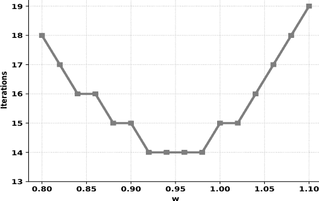

图 2.2：$\omega$ 在 [0.8, 1.1] 内的数据（$w$, Iters）与对应迭代次数的对比图。

```
$|b - A\hat{x}\| = \min_{x \in \mathbb{R}^n} {|b - Ax\|}$
```

换句话说：

find \hat{x} : ||\mathbf{b} - A\hat{x}|| = \min_{\mathbf{x} \in \mathbb{R}^n} ||\mathbf{b} - A\mathbf{x}\|. \quad (2.9)

方程 2.9 有三种有趣的情况 [47]：

- 1. **极极化**（minimax）问题，即对无穷范数进行最小化：
  find \hat{x} : ||\mathbf{b} - A\hat{x}||\infty = \min_{\mathbf{x} \in \mathbb{R}^n} ||\mathbf{b} - A\mathbf{x}||\infty = \min \max_{i=1,\dots,m} \{|b_i - (A\mathbf{x})_i|\}$,

- 2. **绝对偏差**（absolute deviation）问题，即对 $|\cdot||_1$ 进行最小化：
  find \hat{x} : ||\mathbf{b} - A\hat{x}||_1 = \min_{\mathbf{x} \in \mathbb{R}^n} \sum_{j=1}^m |b_j - (A\mathbf{x})_j|$,

- 3. **最小二乘**（least squares）问题，即在 $\mathbb{R}^m$ 的经典欧几里距离下进行最小化：
  find \hat{x} : ||\mathbf{b} - A\hat{x}||_2 = \min_{\mathbf{x} \in \mathbb{R}^n} \left( \sum_{j=1}^m |b_j - (A\mathbf{x})_j|^2 \right)。

对于超定方程组：
$A\mathbf{x} = \mathbf{b}$，
其中 $A \in \mathbb{R}^{m \times n}, \mathbf{x} \in \mathbb{R}^n, \mathbf{b} \in \mathbb{R}^m$ 且 $m > n$，目标是寻找最小二乘问题的最小二乘解：

find \hat{x} : ||\mathbf{b} - A\hat{x}||_2 = \min_{\mathbf{x} \in \mathbb{R}^n} \left( \sum_{j=1}^m |b_j - (A\mathbf{x})_j|^2 \right). \quad (2.10)$

如果 $\hat{x} \in \mathbb{R}^n$ 是线性方程组 $A\mathbf{x} = \mathbf{b}$ 的最小二乘解，则它满足：
$|\mathbf{b} - A\hat{x}|| \le ||\mathbf{b} - A\mathbf{x}||, \forall \mathbf{x} \in \mathbb{R}^n \quad (2.11)$

根据线性代数引理，$\bar{\mathbf{b}} = A\hat{x}$ 是 $b$ 在 $Col(A)$ 的投影 $(\mathbf{b} - A\hat{x}) \perp Col(A))$。这意味着，如果 $a_j$ 是矩阵 $A$ 的第 $j$ 列，则 $a_j \cdot (\mathbf{b} - A\hat{x}) = 0, j = 1,\dots,n$。结果为：
$A^T(\mathbf{b} - A\hat{x}) = 0 \quad (2.12)$

方程 (2.12) 称为**正方程**（normal equations），最小二乘解 $\hat{x}$ 等价于求解正方程。

## 2 使用迭代法和最小二法求解线性方程组

**例 2.3** 求解不一致方程组 $Ax = b$ 的最小二乘解，其中：
```
A = \begin{bmatrix} 1 & 2 & 4 \\ 3 & 1 & 5 \\ 1 & 1 & 1 \\ 2 & 2 & 1 \\ 3 & 1 & 3 \end{bmatrix} \text{ 且 } b = \begin{bmatrix} 5 \\ 3 \\ 3 \\ 1 \\ 4 \end{bmatrix}
```

**解：** 正方程由 $A^T Ax = A^T b$ 给出：
```
$A^T A = \begin{bmatrix} 24 & 13 & 31 \\ 13 & 11 & 19 \\ 31 & 19 & 52 \end{bmatrix} \text{ 且 } A^T b = \begin{bmatrix} 31 \\ 22 \\ 51 \end{bmatrix}
```

最小二乘解 $\hat{x}$ 通过求解正方程得到：
```matlab
>> A = [1 2 4; 3 1 5; 1 1 1; 2 2 1; 3 1 3]
>> b = [5;3;3;1;4]
>> xh = A\(A*b)
xh =
-0.1639
0.8970
0.7507
```

在 Python 中，通过以下 Python 命令获得最小二乘问题的解：

```python
In [9]: import numpy as np
In [10]: A = np.array([[1, 2, 4], [3, 1, 5], [1, 1, 1], [2, 2, 1], [3, 1, 3]])
In [11]: b = np.array([[5], [3], [3], [1], [4]])
In [12]: xh = np.linalg.solve(A.T@A, A.T@b)
In [13]: print(xh)
[[-0.16388616]]
```
[ 0.8969578 ]
[ 0.75073602 ]

**注 2.1** 如果 $A^TA$ 是满秩矩阵，则不一致方程组 $Ax = b$ 有唯一的最小二乘解。即 $A^T A$ 非奇异 [30]。

**注 2.2** 如果 $\hat{x}$ 是不一致方程组 $Ax = b$ 的最小二乘解，则 $\|b-\hat{x}\|_2$ 定义了*最小二乘误差* [53]。

例如，上述例中的最小二乘误差通过以下 MATLAB 命令获得：

```matlab
>> LSError = norm(b-A*xh, 2)
LSError = 2.6570
```

在 Python 中，通过使用命令获得最小二乘误差：

- In [14]: LSError = np.linalg.norm(b-A@xh, 2)
- In [15]: print(LSError)

2.65704

### 2.3.1 最小二法的若干应用

在本节中，将讨论最小二法的三个应用：数据拟合线性模型、用多项式逼近函数。**数据拟合线性模型**：给定一组数据点


| $x_1$ | $x_2$ | ... | $x_n$ |
| :--- | :--- | :--- | :--- |
| $y_1$ | $y_2$ | ... | $y_n$ |

参数 $\alpha$ 和 $\beta$ 称为**回归系数**。为了找到它们，在线性模型 $y=\alpha+\beta x$ 中，我们代入数据点，得到：
```latex
\begin{aligned}
y_1 &= \alpha+\beta x_1 \\
y_2 &= \alpha+\beta x_2 \\
\vdots &= \vdots \\
y_n &= \alpha+\beta x_n
\end{aligned} \quad (2.13)
```

方程 (2.13) 可以写成矩阵形式：

$Ax = y \quad (2.14)$

其中，
$A = \begin{bmatrix} 1 & x_1 \\ 1 & x_2 \\ \vdots & \vdots \\ 1 & x_n \end{bmatrix}, x = \begin{bmatrix} \alpha \\ \beta \end{bmatrix} \text{ 以及 } y = \begin{bmatrix} y_1 \\ y_2 \\ \vdots \\ y_n \end{bmatrix}$

回归系数 $\hat{\alpha}$ 和 $\hat{\beta}$ 通过正方程 $A^T Ax = A^T y$ 得到，其中：
$A^T A = \begin{bmatrix} 1 & 1 & \dots & 1 \\ x_1 & x_2 & \dots & x_n \end{bmatrix} \begin{bmatrix} 1 & x_1 \\ 1 & x_2 \\ \vdots & \vdots \\ 1 & x_n \end{bmatrix} = \begin{bmatrix} n & \sum_{j=1}^n x_j \\ \sum_{j=1}^n x_j & \sum_{j=1}^n x_j^2 \end{bmatrix}$

以及 $A^T y = \begin{bmatrix} 1 & 1 & \dots & 1 \\ x_1 & x_2 & \dots & x_n \end{bmatrix} \begin{bmatrix} y_1 \\ y_2 \\ \vdots \\ y_n \end{bmatrix} = \begin{bmatrix} \sum_{j=1}^n y_j \\ \sum_{j=1}^n x_j y_j \end{bmatrix}$

现在，
$(A^T A)^{-1} = \frac{1}{\det(A^T A)} adj(A^T A) = \frac{1}{n \sum_{j=1}^n x_j^2 - (\sum_{j=1}^n x_j)^2} \times \begin{bmatrix} \sum_{j=1}^n x_j^2 & -\sum_{j=1}^n x_j \\ -\sum_{j=1}^n x_j & n \end{bmatrix}$

回归系数 $\hat{\alpha}$ 和 $\hat{\beta}$ 可以从解得到：

$\hat{x} = (A^T A)^{-1} A^T y,$

如下：

$$\hat{\alpha} = \frac{\sum_{j=1}^n x_j^2 y_j - \sum_{j=1}^n x_j \sum_{j=1}^n y_j}{n \sum_{j=1}^n x_j^2 - (\sum_{j=1}^n x_j)^2} \quad (2.15)$$

$$\hat{\beta} = \frac{n \sum_{j=1}^n x_j y_j - \sum_{j=1}^n x_j \sum_{j=1}^n y_j}{n \sum_{j=1}^n x_j^2 - (\sum_{j=1}^n x_j)^2} \quad (2.16)$$


## 二二乘法解

我们编写了一个 MATLAB 函数 `LinearRegCoef`，它接收两个向量 `x` 和 `y`，并返回回归系数 $\hat{a}$ 和 $\hat{b}$：

```matlab
function [ahat, bhat] = LinearRegCoef(x, y)
n = length(x)
ahat = sum(x.^2)*sum(x.*y)-sum(x)*sum(y)/n*sum(x.^2)
bhat = (n*sum(x.*y)-sum(x)*sum(y))/(n*sum(x.^2)-sum(x)^2)
```

现在，我们使用表 2.1 中九名中学生的身高（米）和体重（公斤）数据点来测试 `LinearRegCoef` 函数。

表 2.1：九名中中男生的身高（厘米）与体重（公斤）

| 身高 | 1.65 | 1.67 | 1.68 | 1.72 | 1.77 | 1.82 | 1.86 | 1.89 | 1.90 |
| :--- | :--- | :--- | :--- | :--- | :--- | :--- | :--- | :--- | :--- |
| 体重 | 57.0 | 61.0 | 64.0 | 69.0 | 75.0 | 83.0 | 90.0 | 97.0 | 100.0 |

```matlab
H = [1.65, 1.67, 1.68, 1.72, 1.77, 1.82, 1.86, 1.89, 1.90] ;
W = [57.0, 61.0, 64.0, 69.0, 75.0, 83.0, 90.0, 97.0, 100.0];
ahat, bhat = LinearRegCoef(H, W);
hat = ahat + bhat ;
plot(H, W, 'mo', 'b-', 'LineWidth', 2);
marker('FaceColor', 'm');
axis([1.6, 1.95, 50, 110]);
xlabel('Height (in meters)', 'fontweight', 'bold');
ylabel('Weight (in kilograms)', 'fontweight', 'bold');
grid on
set(gca, 'GridStyle', '--');
set(gca, 'fontweight', 'bold');
```

在 Python 中，计算回归系数、绘制线性模型和散点数据的代码如下：

```python
import numpy as np
import matplotlib.pyplot as plt
def LinearRegCoefs(x, y):
    n = len(x)
    ahat = (sum(x**2)*sum(x*y)-sum(x)*sum(y))/(n*sum(x**2)-sum(x)**2)
    bhat = (n*sum(x*y)-sum(x)*sum(y))/(n*sum(x**2)-sum(x)**2)
    return ahat, bhat
H = np.array([1.65, 1.67, 1.68, 1.72, 1.77, 1.82, 1.86, 1.89, 1.90]);
W = np.array([57.0, 61.0, 64.0, 69.0, 75.0, 83.0, 90.0, 97.0, 100.0]);
ahat, bhat = LinearRegCoefs(H, W);
hat = ahat + bhat * H;
```

## 使用迭代和最小二乘法求解线性方程

执行上述 Python 代码，将得到与图 2.3 相似的图。

- ii 对数据拟合多项式：给定一组数据点表：

| x1 | x2 | ... | xn |
| :--- | :--- | :--- | :--- |
| y1 | y2 | ... | yn |

可以对数据拟合一个次数不超过 $n-1$ 的多项式模型。假设变量 $y$ 与变量 $x$ 之间的关系形式如下：

$y = \alpha_0 + \alpha_1x + \alpha_2x^2 + \cdots + \alpha_kx^k, \quad 1 \le k \le n-1, \quad (2.17)$

其中需要计算回归系数 $\hat{\alpha}_0, \dots, \hat{\alpha}_k$，使得模型 2.17 成为最小二乘解。我们将数据点 $(x_j, y_j), j=1, \dots, n$ 代入 2.17，以求解 $k+1$ 个未知数 $\alpha_0, \dots, \alpha_k$：

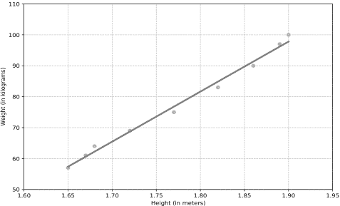

图 2.3：线性模型与身高、体重散点数据的对比。

## 最小二乘解

方程 (2.18) 可以写成矩阵形式：

$\begin{pmatrix} y_1 & x_1 & x_1^2 & \dots & x_1^k & \alpha_0 \\ y_2 & x_2 & x_2^2 & \dots & x_2^k & \alpha_1 \\ \vdots & \vdots & \vdots & \ddots & \vdots & \vdots \\ y_n & x_n & x_n^2 & \dots & x_n^k & \alpha_k \end{pmatrix} = \begin{pmatrix} \alpha_0 \\ \alpha_1 \\ \vdots \\ \alpha_k \end{pmatrix}$ (2.18)

回归系数 $\hat{\alpha}_0, \dots, \hat{\alpha}_k$ 可以通过求解法方程得到。**示例 2.4** 在示例中，编写 MATLAB 和 Python 代码，对表 2.2 中的正态分布随机数据拟合模型 $y = \alpha_0 + \alpha_1x + \dots + \alpha_kx^k$，其中 $k=2, 4, 7$：表 2.2：中心与频率的虚拟数据

| x | 5 | 15 | 25 | 35 | 45 | 55 | 65 | 85 | 95 |
| :--- | :--- | :--- | :--- | :--- | :--- | :--- | :--- | :--- | :--- |
| y | 2 | 6 | 10 | 16 | 25 | 21 | 10 | 5 | 3 |

MATLAB 代码：

```matlab
clear; clc; clf;
x = [5 15 25 35 45 55 65 85 95];
y = [2 6 10 16 25 21 10 5 2];
xx = [100];
deg = [2 4 7];
Model = zeros(1, length(x));
Mdl = zeros(1, length(x));
for i = 1:3
    k = deg(i);
    A = zeros(length(x), k+1);
    for j = 1:k+1
        A(:,j) = x.^(j-1);
    end
    Q = (A'*A)\(A'*y); % polyfit(x, y, k);
    for j = 1:3
        Model(i) = Model(i) + Q(j).*x.^(j-1);
    end
    Mdl(i) = pchip(x, Model(i), xx);
    FittingError(i) = norm(y-Model(i), 2);
end
plot(x, y, 'ro', xx, Mdl(1), ':', xx, Mdl(2), '--r',
     xx, Mdl(3), '-m', xx, Mdl(4), '-k',
     'MarkerFaceColor', 'y', 'MarkerSize', 8, 'LineWidth', 2);
```

```matlab
legend(['Data', 'k = num2str(deg(1))], ['k = num2str(deg(2))], ['k = num2str(deg(3))], ['k = num2str(deg(4))], 'fontweight', 'bold');
xlabel('x', 'fontweight', 'bold');
ylabel('y', 'fontweight', 'bold');
grid on;
ax = gca;
ax.FontWeight = 'bold';
ax.FontSize = 14;
set(gca, 'GridLineStyle', '--');
axis((0, 10, 0, 30));
```

上述代码使用分段三次 Hermite 插值多项式 (`pchip`) 用平滑曲线来近似解，而不是使用线性插值（两点之间的解曲线由直线近似）。执行上述代码，可以得到图 2.4。

用于对表格数据拟合 2 次、4、7 次和 9 次多项式并绘制最小二乘曲线的 Python 代码：

```python
import numpy as np
from scipy.interpolate import pchip
import matplotlib.pyplot as plt
x = np.array([5., 15., 25., 45., 55., 65., 75., 85., 95.])
y = np.array([2., 6., 10., 16., 21., 25., 30., 35., 42.])
xx = np.arange([2, 40, 101.])
deg = np.array([2, 4, 7, 9])
Model = np.zeros((4, len(xx)))
```

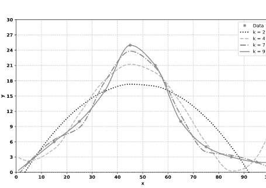

图 2.4：对表 2.2 中的数据拟合 2 次、4、7 次和 9 次多项式。

```python
Mdl = np.zeros((4, len(xx)), float);
for i in range(4):
    k = deg[i]
    A = np.zeros((len(x), k+1), float;
    for j in range(k+1):
        A[j, :] = x[:]**j
    q = np.linalg.lstsq(A.T@A, y[:]) # polyfit(x, y, k)
    for j in range(k+1):
        Model[i] = Model[i] + Q(j).*x.^(j-1)
    Mdl[i] = pchip(x, Model[i], xx);
    FittingError(i) = norm(y-Model[i], 2);
plot(x, y, 'ro', xx, Mdl[1], ':', xx, Mdl[2], '--r',
     xx, Mdl[3], '-m', xx, Mdl[4], '-k',
     'MarkerFaceColor', 'y', 'MarkerSize', 8, 'LineWidth', 2);
```


# 最小二法解

从方程 (2.20)，

```
$$\left[\frac{\partial}{\partial\alpha_k}\right]_{\alpha_k=\hat{\alpha}_k}=\left[\frac{\partial}{\partial\alpha_k}\right]_{\alpha_k=\hat{\alpha}_k}\int_{a}^{b} \left(f(x) - \sum_{j=0}^{n}\alpha_j x^j\right)dx$$
$$= \int_{a}^{b} 2\left(f(x) - \sum_{j=0}^{n}\hat{\alpha}_j x^j\right)^k dx$$
$$= 2\int_{a}^{b} x^k f(x)dx - 2\sum_{j=0}^{n}\hat{\alpha}_j x^{j+k} dx$$
$$= 2\int_{a}^{b} x^k f(x)dx - 2\sum_{j=0}^{n}\hat{\alpha}_j \frac{b^{j+k+1}-a^{j+k+1}}{j+k} = 0 (2.23)$$
```

从方程 (2.23)我们得到正法方程：

```
$$\begin{matrix} \frac{b^2-a^2}{2} & \frac{b^3-a^3}{3} & \frac{b^4-a^4}{4} & \dots \\ \vdots & \vdots & \vdots & \ddots \end{matrix}\begin{matrix} \hat{\alpha}_0 = \int_{a}^{b} f(x)dx \\ \hat{\alpha}_1 = \int_{a}^{b} xf(x)dx \\ \hat{\alpha}_2 = \int_{a}^{b} x^2f(x)dx \\ \vdots \end{matrix} (2.24)$$
$$
\begin{matrix} \frac{b^{n+1}-a^{n+1}}{n+1} & \frac{b^{n+2}-a^{n+2}}{n+2} & \frac{b^{n+3}-a^{n+3}}{n+3} & \dots & \frac{b^{2n+1}-a^{2n+1}}{2n+1} \end{matrix}\begin{matrix} \hat{\alpha}_n = \int_{a}^{b} x^n f(x)dx \end{matrix}$$
```

最优系数 $\hat{\alpha}_0, \dots, \hat{\alpha}_n$ 通过求解正法方程 (2.24) 得到。

我们编写一个函数 `FunCoeff`，它接收一个函数 $f$、区间边界 $a$ 和 $b$ 以及最小二乘近似多项式的次数 $n$。该函数返回一个向量 `alpha`，其分量为最优系数 $\hat{\alpha}_0, \dots, \hat{\alpha}_n$。

函数 `FunCoeff` 的 MATLAB 代码：

```matlab
function alpha = FunCoeff(f, a, b, n)
    alpha = zeros(n+1);
    y = zeros(n+1, 1);
    j = 0;
    while j <= n
        k = 0;
        while k <= j
            alpha(j+1, k+1) = (b^(j+k+1)-a^(j+k+1))/(j+k+1);
            k = k + 1;
        end
        j = j + 1;
    end
end
```

# 使用迭代法和最小二乘法求解线性组

```matlab
for k = 1 : n+1
    y(k) = integral(@(x) x.^(k-1).*f(x), a, b) ;
end
alp = A\y;
alp = zeros(1, length(alp));
for j = 1 : length(alp)
    alp(j) = alp(n-j);
end
```

函数 FunAppCoef 的 Python 代码：

```python
import numpy as np
from scipy import integrate
import matplotlib.pyplot as plt

def FunAppCoef(f, a, b, n):
    A = np.zeros((n+1, n+1), float)
    y = np.zeros((n+1, n+1), float)
    j = 0
    while j <= n:
        k = 0
        while k <= j:
            A[j, k] = (b**(j+1)-a**(k+1))/(j+k+1)
            A[k, j] = A[j, k]
            k += 1
        j += 1
    for k in range(n+1):
        y[k] = integrate.quad(lambda x: x**k*f(x), a, b) [0]
    alp = np.linalg.solve(A, y)
    alp = list(alp)
    alp.reverse()
    alp = np.array(alp)
    return alp
```

为了测试 FunAppCoef，我们在 [0,3] 区间上寻找指数函数 $f(x)=e^x$ 的近似，使用次数为 1 和 2 的项式。实现此操作的 MATLAB 代码如下：

```matlab
a = 0; b = 1;
x = linspace(0, 3, 100);
f = @(x) exp(x);
P = zeros(4, length(x));
for l = 1 : 4
    n = l;
    alp = FunAppCoef(f, a, n);
    P(l, :) = polyval(alp, x);
end
plot(x, f(x), '-b', P(1, :), '--r', P(2, :), ':m', P(4, :), ':k', 'LineWidth', 2);
xlabel('x', 'fontweight', 'bold');
ylabel('y', 'fontweight', 'bold');
legend('y = exp(x)', 'n = 1', 'n = 2', 'n = 4');
grid on;
```

Python 代码是：

```python
import matplotlib.pyplot as plt
a, b = 0, 1
t = np.linspace(0, 3, 100)
f = lambda t: np.exp(t)
P = np.zeros((4, len(t)))
for i in range(4):
    n = i+1
    alph = FunAppCoef(f, a, n)
    P[i, :] = np.polyval(alph, t)
plt.plot(t, f(t), P[0, :], '-r', lw=2, label='n 1')
plt.plot(t, P[1, :], '-m', lw=2, label='n 2')
plt.plot(t, P[2, :], ':k', lw=2, label='n 3')
plt.plot(t, P[3, :], '--g', lw=2, label='n 4')
plt.xlabel('x', fontweight='bold')
plt.ylabel('y', fontweight='bold')
plt.legend()
plt.grid(True, ls='--')
```

指数函数 $f(x) = e^x$ 被次数为 1、2 和 4 的项式近似，近似项式如图 2 所示。

**例 5** 在本例中，我们在 $[0,1]$ 区间上寻找函数 $f(x) = \cos(\pi x)$ 的近似，使用次数为 $n=1,3,5$ 的项式。我们展示了 $x \in [0,1]$ 的误差 $\|\cos(\pi x) - P_n(x)\|$ 并绘制了近似函数 $P_1(x)$ 和 $P_3(x)$。


图 2.5：指数函数 $f(x) = e^x$ 的 1 次、2 次和4 次项式近似。

# 使用迭代法和最小二乘法求解线性组

python 代码是：

执行代码的结果：

| n | $\|f(t)-P_n(t)\|_2$ |
|---|---|
| 1 | 1.4890e+00 |
| 3 | 4.8912e-02 |
| 5 | 7.4470e-04 |
| 7 | 6.5437e-06 |
| 9 | 3.7348e-08 |
| 11 | 7.2770e-08 |
| 13 | 1.8264e-07 |
| 15 | 3.8105e-08 |

近似项式 $P_1(x)$ 和 $P_3(x)$ 在图 2.6 中解释，其中 $P_1(x)$ 用虚线绘制，$P_3(x)$ 用点线绘制。函数 $\cos(\pi x)$ 用实线绘制。

用次数为 $n=1,\dots13$ 的项式近似 $f(x)=\cos(\pi x)$ 的 MATLAB 代码为：

```matlab
clear; clc; clf;
a=0; b=1;
t = linspace(a, b);
f = @(t) cos(pi*t);
P = zeros(13, length(t));
l=1;
fprintf('n \t ||| f(t)-P_n(t) ||.2e\n'); ...
fprintf('------------------------------------');
```


图 2.6：近似函数 $f(x) = \cos(\pi x), x \in [0,1]$ 的 1 次和 3 次项式。

```matlab
for k = 1 : 8
    n = 2*k - 1;
    alpha = FunApproxCoef(f, a, b, n);
    P(k, :) = polyval(alpha, t);
    fprintf('%d|\t%.4e\n', n, norm(f(t)-P(k, :)));
    plot(t, f(t), '-m', P(1, :), '-r', P(2, :), ':b', ...
    'LineWidth', 2);
    xlabel('x', 'fontweight', 'bold');
    ylabel('y', 'fontweight', 'bold');
    legend('y = \cos(pi*x)', 'n = 1', 'n = 3');
    grid on
    gca.FontWeight = 'bold';
    gca.FontSize = 14;
```

我们注意到，随着项式次数从 $n=1$ 增加到 $n=9$，近似解在改进。事实上，当运行 MATLAB 代码时，我们看到了 $n=11$ 和 $n=15$ 处的警告。

```
||f(t)-P_n(t)||_2
```

| n | $\|f(t)-P_n(t)\|_2$ |
|---|---|
| 1 | 8.7431e-01 |
| 3 | 2.9178e-02 |
| 5 | 4.5233e-04 |
| 7 | 4.0581e-06 |
| 9 | 2.3696e-08 |
| 11 | 3.0460e-08 |

> InApproxCoef (line 17)
> InPlot (line 10)
> Warning: Matrix is close to singular or badly scaled.
> RCOND = 3.1900e-19

> InApproxCoef (line 17)
> InPlot (line 10)
> Warning: Matrix is close to singular or badly scaled.
> RCOND = 5.7423e-20.
> 3.1356e-07

该错误的原因将在下一章讨论。

**注 2.3** 在 $[0,1]$ 区间上用次数为 $n$ 的项式 $P_n(x)$ 近似函数 $f(x)$，得到的系数矩阵称为希尔伯特矩阵。$n \times n$ 类型的希尔伯特矩阵 $H_n$ 给出：

```
$H_n = \begin{pmatrix} 1 & 1/2 & 1/3 & \dots & 1/n \\ 1/2 & 1/3 & 1/4 & \dots & 1/(n+1) \\ 1/3 & 1/4 & 1/5 & \dots & 1/(n+2) \\ \vdots & \vdots & \vdots & \ddots & \vdots \\ 1/n & 1/(n+1) & 1/(n+2) & \dots & 1/n \end{pmatrix} \quad (2.25)$
```

MATLAB 有一个函数 `hilb`，它接收整数 $n$ 并返回对应的希尔伯特矩阵 $H_n$。

```matlab
>> hilb(3)
ans =
1.0000 0.5000 0.3333
0.5000 0.3333 0.2500
0.3333 0.2500 0.2000

>> hilb(5)
ans =
1.0000 0.5000 0.3333 0.2500 0.2000
0.5000 0.3333 0.2500 0.2000 0.1667
0.3333 0.2500 0.2000 0.1667 0.1429
0.2500 0.2000 0.1667 0.1429 0.1250
0.2000 0.1667 0.1429 0.1250 0.1111
```

## 3 线性组求解中的病态与正则化技术

### 摘要

如果对系数矩阵 $A$ 或向量 $b$ 引入微小扰动，可能会导致向量 $x$ 巨大变化。因此，直接法和迭代法都不能保证给出线性组的精确解。

本章分为两部分。第一部分介绍线性组中的病态性概念以及如何使用 MATLAB® 和 Python 测量矩阵的条件数。第二部分介绍了一些正则化技术以稳定病态组的解。

### 3.1 线性组求解中的病态性

病态线性组是指对系数矩阵或右侧向量的微小扰动会导致系统解发生巨大变化的线性组 [28, 42]。为了说明这一点，将对两个考虑的示例展示两种小扰动。在第一个示例中，将在系数矩阵的一个分量上引入细微变化，在第二个示例中，将在右侧向量上进行扰动。

**例 3.1** 在本例中，我们考虑线性组 $Fx = d$，其中

```
A = \begin{pmatrix} 5.0 & 1.0 & 1.0 \\ 1.0 & 5.0 & 1.0 \\ 1.0 & 1.0 & 5.0 \end{pmatrix} \quad b = \begin{pmatrix} 5.0 \\ -3.0 \\ 5.0 \end{pmatrix}
```

在 MATLAB 中求解该线性组，我们使用以下命令：

```matlab
>> A = [5., 1., 1.; 1., 5., 1.; 1., 1., 5.]
A =
```


# 58 病态性与正则化技术

5 1 1
1 5 1
1 1 5

```matlab
>> b = [5.; -3.; 5.]
b =
5
-3
5
```

```matlab
>> x = A\b
x =
1.0000
-1.0000
1.0000
```

在 Python 中：

```python
In [1]: import numpy as np
In [2]: A = np.array([[5., 1., 1.], [1., 5., 1.], [1., 1., 5.]])
In [3]: b = np.array([[5.], [-3.], [5.]])
In [4]: x = np.linalg.solve(A,b)
In [5]: print('x = \n', x)
x =
[[ 1.]
[-1.]
 [1.]]
```

现在，我们考虑的第一个扰动是针对分量 $A_{11}$ 的，我们设置 $B = A$ 且 $B_{11} = A_{11}+10^{-4} = A_{11}+0.0001$

```matlab
>> B = A
 =
5 1 1
1 5 1
1 1 5
>> B(1,1) = B(1,1) + 0.0001
 =
5.0001 1.0000 1.0000
1.0000 5.0000 5.0000
1.0000 1.0000 5.0000
```

```matlab
>> y = B\b
y =
1.0000
-1.0000
1.0000
>> disp('x - y = ', '), disp(num2str(x-y))
```

# 线性方程组解中的病态性

```matlab
x - y =
2.1428e-05
-3.5714e-06
-3.5714e-06
>> disp(['|x-y||_2 = ', num2str(norm(x-y, 2)))
|| x-y||_2 = 2.2015e-05
```

在 Python 中：

```python
[In7]: B = A.copy()
[In8]: B[0, 0] += 1e-4
[In9]: y = np.linalg.solve(B, b)
[In10]: print('y = \n', y)
y =
[[ 0.99997857]
[-0.99999643]
 [ 1.00000357]]
[In11]: print('|x-y||_2 = \n', x-y)
x - y =
[[ 2.14281123e-05]
[-3.57135204e-06]
[-3.57135204e-06]]
[In12]: print('|x-y||_2 = \n', np.linalg.norm(x-y, 2))
||x-y||_2 = 2.20159253996403e-05
```

第二个考虑的扰动是在右侧侧的，将 $b_3$ 替换为 $b_3+10^{-4}$，从而在右侧得到向量 $c$。原始系数矩阵 $A$ 保持不变，求解线性方程组 $Az = c$。

```matlab
>> c = b;
>> c(3) = c(3) + 1e-4
c =
5.0000
-3.0000
5.0001
>> z = A\c
z =
1.0000
-1.0000
1.0000
```

# 60 病态性与正则化技术

```matlab
>> disp('x - z = '); disp(num2str(x-z))
x - z =
3.5714e-06
3.5714e-06
2.1429e-05
>> disp('|| x-z||_2 = ', num2str(norm(x-z, 2)))
|| x-z||_2 = 2.2016e-05
```

在 Python 中：

```python
In [12]: c = b.copy()
In [13]: c[-1] += 1e-4
In [14]: z = np.linalg.solve(A, c)
In [15]: print('\n', z)

```python
z =
[[ 0.99999643]
 [-1.00000357]
 [ 1.00002143]]
In [16]: print('x - z = \n', x-z)
x - z =
[[ 3.57142857e-06]
 [ 3.57142857e-06]
 [-2.14285714e-05]]
In [17]: print('x-z||_2 = \n', np.linalg.norm(x-z, 2))
||x-z||_2 = 2.201576429611205e-05
```

从示例 3.1 可以看出，系数矩阵或右侧向量的微小变化会导致解的小小变化。因此，给定的线性系统对扰动不敏感。对扰动不敏感的系统被称为良好的（well-posed）。示例 3.2 在此例中考虑了一个线性系统 $Fx = d$，$F = \begin{bmatrix} 1001 & -999 & 999 \\ 1 & 1 & -1 \\ 1000 & -1000 & 1000 \end{bmatrix}$ 且 $d = \begin{bmatrix} 1001 \\ 1 \\ 1000 \end{bmatrix}$。该示例的目的是展示系数矩阵 $F$ 的一个元素或向量 $d$ 的微小变化如何导致系统 $Fx = d$ 解的剧烈变化。使用 MATLAB 求解线性方程组 $Ax = b$：

```matlab
>> F = [1001, -999, 999; 1, 1, -1; 1000, -1000, 1000];
>> d = [1001; 1; 1000];
>> x = F\d

``` # 线性方程组解的病态性

警告：矩阵接近奇异或缩放不当。结果可能不准确。RCOND = 1.06798e-16。

```python
x =
1.4147
0.4147
```

警告表明矩阵接近奇异，因此结果可能不准确。MATLAB 的线性方程组解离精确解 $[1,0,1]^T$ 非常远。在 Python 中，可以使用上述命令求解线性方程组：

```python
In [1]: import numpy as np
In [2]: A = np.array([[1.001e+3, -9.990e+2, 9.990e+2], [1.000e+0, 1.000e+0, 0.000e+0], [1.000e+3, -1.000e+3, 1.000e+3]])
In [3]: b = np.array([[1001], [1], [1000]])
In [4]: x = np.linalg.solve(A, b)
In [5]: print('x=\n', x)
```

```python
x =
[[1.]
 [0.93969727]
 [0.93969727]]
```

同样，尽管 Python 在寻找线性方程组解方面精度更高，但求解方程组的误差并不小。同样，会对系数矩阵 $F$ 和向量 $d$ 引入扰动。首先，向 $F_{11}$ 添加扰动 $10^{-5}$ 得到矩阵 $G$。然后计算线性方程组 $Gy = d$ 和 $y - x =$：

```matlab
>> G = F;
>> format long g
>> G(1,1) = G(1,1) + 1e-5
G =
1001.00001 -999 999
0.99999999999999 1.000000000001 -0.99999999999999
1000 -1000 1000
>> y = G@d

```

警告：矩阵接近奇异或缩放不当。结果可能不准确。RCOND = 1.092847e-16。

```python
y =
0.999997714598233
22853063.4012923
22853063.4012946
>> disp(norm(y-x, 2))
32319111.6174026
```

在 Python 中，将使用以下命令：

```python
In [6]: G = F.copy()
In [7]: G[0, 0] += 1e-5
In [8]: y = np.linalg.solve(G, d)
In [9]: print('y = ', y)
y =
[[9.99997654e-01]
 [2.34012849e+07]
 [2.34012849e+07]]
In [10]: print('y-x = \n', y-x)
x-y =
[[-2.34606334e-06]
 [2.34012849e+07]
 [2.34012849e+07]]
In [11]: print('||y-x||_2 = {}', '{0:1.6e}'.format(np.linalg.norm(y-x)))
```


# 66 病态条件与正则化技术

```matlab
13 C = A\b(:); C = wrev(C)
14 bl = b(:); bl = bl(end) + 1e-4;
15 Cl = abs(bt); Cl = wrev(Cl)
16 t = linspace(al, bt, 401); f = f(t)
17 Pe = polyval(C, t); Pp = polyval(C, t);
```

```matlab
19 subplot(1, 2, 1); plot(t, F, '-b', 'LineWidth', 3);
20 xlabel('x', 'fontweight', 'bold'); ylabel('y',
21 'fontweight', 'bold');
22 legend('y = sin(2x^2)'); grid on; ax = gca
23 ax.FontWeight = 'bold'; ax.FontSize = 12;
24 set(gca, 'XTick', linspace(al, bt, 9)); set(gca, 'YTick',
25 linspace(5, 9);
```

```matlab
26 subplot(1, 2, 2); plot(t, Pe, '--r', t, Pp, ':k',
27 'LineWidth', 3);
28 xlabel('x', 'fontweight', 'bold'); ylabel('y',
29 'fontweight', 'bold');
30 legend('Without perturbation', 'With perturbation'); grid on
31 ax = gca; ax.FontWeight = 'bold'; ax.FontSize = 12;
32 set(gca, 'XTick', linspace(al, bt, 9)); set(gca, 'YTick',
33 linspace(1, 5);
```

Python 代码如下：

```python
1 import numpy as np
2 import matplotlib.pyplot as plt
3 from scipy import interpolate
4 f = lambda x: 2.5*x*np.exp(-2*x**2)
5 A, b = np.zeros((13, 13), 'float'), np.zeros((13, 1), 'float')
6 al, bt = 0., 2.
7 for i in range(13):
8 for j in range(i+1):
9 k = i+j
10 A[i, j] = (bt**k-al**k)/k
11 A[j, i] = A[i, j]
12 b[i] = integrate.quad(lambda x: x**i*f(x), al, bt)[0]
13 C = np.linalg.solve(A, b)
14 C = list(C.T[0])
15 C.reverse()
16 np = np.array(C)
17 t = np.linspace(al, bt+(bt-al)/400, 401)
18 F = f(t)
19 Pe = np.polyval(C, t)
20 b[-1] += 1e-4
21 Cl = np.linalg.solve(A, b)
22 C = list(Cl.T[0])
23 C.reverse()
24 Pp = np.polyval(Cl, t)
25 plt.figure(1, figsize=(20, 8))
26 plt.subplot(1, 2, 1)
27 plt.plot(t, F, '--b', lw=3, label='y(x) = 5x e^{-2x^2}')
28 plt.xlabel('x', fontweight='bold')
```

# 线性方程组解的病态性

```python
31 plt.ylabel('y', fontweight='bold')
32 plt.legend()
33 plt.xticks(np.arange(al, bt+(bt-al)/8), (bt-al)/8,
34 fontweight='bold')
35 plt.yticks(np.arange(1., 5., .), fontweight='bold')
36 plt.grid(True, ls=':')
37 plt.axis([al, bt], [1., 5.])

39 plt.subplot(1, 2, 1)
40 plt.plot(t, '-b', lw=3, label = 'With perturbation')
41 plt.plot(t, '--r', lw=3, label = 'With perturbation')
42 plt.xlabel('x', fontweight='bold')
43 plt.ylabel('y', fontweight='bold')
44 plt.legend(loc='upper center')
45 plt.xticks(np.arange(al, bt+(bt-al)/8), (bt-al)/8,
46 fontweight='bold')
47 plt.yticks(np.arange(1., 5., .), fontweight='bold')
48 plt.grid(True, ls=':')
49 plt.axis([al, bt], [1., 5.])
```

图 3.1 包含两个子图。在第一个子图（左侧）中绘制了原始函数 $y(x) = 5e^{-2x}$。在第二个子图（右侧）中，使用了在改变右侧项后线性方程组得到的系数来绘制拟近多项式。

### 3.1.2 条件数与病态矩阵

在本节中，我们将解释为什么某些线性方程比其他线性方程对微小变化更敏感。在此之前，我们讨论以下内容：

- (I) **矩阵范数**：如果 $A$ 是一个维度为 $m \times n$ 的矩阵，元素为 $a_{i,j}, i = 1,\dots,m; j = 1,\dots,n$，则：
    - (a) $\|A\|_1 = \max \{ \sum_{i=1}^m |a_{i,1}|, \sum_{i=1}^m |a_{i,2}|, \dots, \sum_{i=1}^m |a_{i,n}| \}$
    - (b) $\|A\|_\infty = \max\{\sum_{j=1}^n|a_{1,j}|, \sum_{j=1}^n|a_{2,j}|, \dots, \sum_{j=1}^n|a_{m,j}|\}$
    - (c) $\|A\|_2 = \max\{\sqrt{\sigma_1}, \dots, \sqrt{\sigma_m}\}$,其中 $\sigma_j$ 是 $A^T$ 的第 $j$ 个特征值。


图 3.1：左：精确函数。右：在向量 $b$ 的最后一个分量改变前后的 8 阶拟近多项式。

我们使用 Python 命令计算矩阵 $A$ 的范数 $\|A\|_p$。

```python
from numpy.linalg import norm
A = np.array([[1, -2], [2, -3], [3, -4]])
n1, n2, n3 = norm(A, 1), norm(A, 2), np.inf
print(n1, n2, n3)
```

设 $A$ 和 $B$ 为 $m \times n$ 矩阵，$\alpha$ 为标量，$x$ 为 $\mathbb{R}$ 中的向量。范数函数 $\|\cdot\| : m \times n \to \mathbb{R}$ 满足以下性质：

- (a) $\|\alpha A\| \ge 0$
- (b) $\|\alpha A\| = |\alpha| \cdot \|A\|$
- (c) $\|A+B\| \le \|A\| + \|B\|$
- (d) $\|Ax\| \le \|A\|\|x\|$
- (e) $\|AB\| \le \|A\|\|B\|$

- (II) **机器精度**：数字计算机具有有限的存储能力来表示浮点数。根据电气电子工程师学会（IEEE）标准，双精度数字由 64 位表示。64 位分为三个部分：最高位（最左侧）用于表示符号；接下来的 11 位用于表示指数部分；最后的 52 位（称为*尾数*）用于表示二进制分数。在此设置下，用 64 位表示的最小浮点数约为 $-1.7977 \times 10^{308}$，最大的浮点数约为 $1.7977 \times 10^{308}$。MATLAB 和 Python 都采用 IEEE 双精度数作为浮点变量的默认类型。用 52 位表示的最小二进制分数为 $2^{-52} \approx 2.2204 \times 10^{-16}$。这个数被称为机器精度，记作 $\varepsilon$。在 MATLAB 中，可以通过以下命令查看机器精度：

```matlab
>> disp(eps)
2.2204e-16
```

在 Python 中，可以通过以下命令查看：

```python
print(np.info(float).eps)
2.22046049250313e-16
```

如果某个浮点数的小数部分需要超过 52 位才能表示，计算机只能表示该数的 52 位并忽略其余部分。真实的数值部分与计算机表示之间的差异被称为舍入误差。例如，众周知 $\sin\pi=0, n=0, \pm1, \dots$。当 $n \neq 0$ 时，Python 和 MATLAB 不给出精确的 0：

```python
np.sin(0.0) # 输出: 0.0
np.sin(np.pi) # 输出: 1.224464791473532
```


## 线性组解的病态性

```
0 2.0000 4.0030
>> cond(A)
ans =
1.667e+05
>> cond(zeros(3))
ans =
Inf
>> cond(eye(3))
ans =
```

Python 命令 `np.linalg.cond` 可用于计算矩阵 $A$ 的条件数。

- 在 [38] A = np.array([[100, 1, 0], [0, 1, 2], [0, 2, 4.003]])
- 在 [39] print('0:1.6e').format(np.linalg.cond(A))
1.6671e+05
- 在 [40] print('0:1.6e').format(np.linalg.cond(np.zeros((3,3))))
- 在 [41] print('0:1.6e').format(np.linalg.cond(np.eye(3)))
1.00000e+00

条件数较大的矩阵是病态的（ill-conditioned），否则它是良态的（well-conditioned）[7, 6]。任何奇异矩阵的条件数均为 $\infty$。对于任何非奇异矩阵，条件数位于 $[1, \infty)$ 之间。

条件数 $\kappa(A)$ 的等效衡量标准是倒条件数 $rcond(A)$，

$$rcond(A) = \frac{1}{||A||_1 \cdot ||A^{-1}||_1}$$

在该衡量标准下，任何奇异矩阵的倒条件数为 0，而对于任何其他非奇异矩阵，其值在 (0.0, 1.0) 区间内。如果 $0 \neq \kappa(A) \approx 0$，则矩阵 $A$ 更接近奇异矩阵 [42]。

### 3.1.3 条件数与矩阵相关特征值的联系

如果 $A$ 是一个 $n \times n$ 的方阵，其特征值为 $\{\lambda_1, \dots, \lambda_n\}$，则矩阵 $A$ 的条件数是最大（绝对值）和最小（绝对值）特征值之比。即：

$$\kappa(A) = \frac{\lambda_{max}}{\lambda_{min}}$$

其中 $\lambda_{max} = \max(|\lambda_j|, j=1, \dots, n)$ 且 $\lambda_{min} = \min(|\lambda_j|, j=1, \dots, n)$。

## 病态与正则化技术

如果 $A$ 是一个 $m \times n$ 矩阵，其中 $m \neq n$，且 $\{\lambda_1, \dots, \lambda_m\}$ 是 $A \cdot A^T$ 的特征值，则矩阵 $A$ 的条件数给出：

$$\kappa(A) = \frac{\lambda_{max}}{\lambda_{min}}$$

其中 $\lambda_{max} = \max\{\lambda_j, j=1, \dots, m\}$  $\lambda_{min} = \min\{\lambda_j, j=1, \dots, m\}$。

在示例 2.5 中，用多项式 $P_n(x); n=1, 3, \dots, 15$ 近似函数 $f(x)=\cos \pi$。预期随着多项式阶数的增加，解的精度也会随之提高。但观察发现，近似多项式的精度在第 9 阶之前增加，之后精度开始下降。这是由于随着多项式阶数的增加，条件数也随增大。

以下 MATLAB 命令显示了 $n=2, \dots, 13$ 时希尔伯特矩阵的条件数：

```matlab
>> fprintf('%n\t%%H_n||\n', n=2 : 13)
>> fprintf('%n%%d\t%%10.6e\n', n, cond(hilb(n))); end
```

$||H_n||$

| n | $||H_n||$ |
|---|---|
| 2 | 1.928147e+01 |
| 3 | 5.240568e+02 |
| 4 | 1.551374e+04 |
| 5 | 4.766073e+05 |
| 6 | 1.495106e+07 |
| 7 | 4.753674e+08 |
| 8 | 1.525758e+10 |
| 9 | 4.931541e+11 |
| 10 | 1.602520e+13 |
| 11 | 5.227499e+14 |
| 12 | 1.629550e+16 |
| 13 | 1.682118e+18 |
| 14 | 2.715269e+17 |
| 15 | 2.777738e+17 |

在 Python 中代码如下：

```python
# In [41]: from numpy.linalg import cond
# In [42]: from scipy.linalg as hilb
# In [43]: for n in range(2, 16): print(n, '\t\t', f'{0:1.6e}'.format(hilb(n)))
```

## 线性组解的病态性

这表明随着希尔伯特矩阵维度的增加，它们变得越来越病态。注意到当 $rcond(H) \geq \epsilon$ 时，MATLAB 和 Python 的条件数值一致；当 $rcond(H) < \epsilon$ 时，可能会产生不同的结果。

另一个例子是范德蒙矩阵。随着数据点数量的增加，相应范德蒙矩阵的条件数也会增大，变得更加病态。以下 MATLAB 命令显示了不同数据点数量范德蒙矩阵的条件数：

```matlab
>> fprintf('%n\t ||V_n|\n', n = 2 : 13)
   fprintf('%i\t%10.6e\n', cond(vander(n))));
```

| n | $||V_n||$ |
|---|---|
| 2 | 3.755673e+02 |
| 3 | 1.627586e+05 |
| 4 | 3.051107e+07 |
| 5 | 3.481581e+09 |
| 6 | 2.479944e+19 |
| 7 | 2.970484e+21 |
| 8 | 6.929557e+24 |
| 9 | 7.174382e+27 |
| 10 | 8.796918e+31 |
| 11 | 2.862293e+35 |
| 12 | 1.375228e+39 |
| 13 | 1.740841e+42 |

在 Python 中：

```python
# In [44]: for n in range(2, len(H)): print(n, '\t\t', '{0:1.6e}'.format(vander(n)))
```

如果某个矩阵 $A$ 的条件数为 $\ell$，那么在求解线性组 $Ax=b$ 时，从右侧起 $\ell$ 位精度可能是不准确的（注意双精度数字真实表示了 16 位小数）。为了测试这一点，我们考虑由随机向量 $v$ 生成的范德蒙矩阵：

```matlab
>> v = rand(10, 1);
>> V = vander(v);
```

在 Python 中，可以使用以下方式生成向量 $v$ 和其 $v$ 的范德蒙矩阵 $V$：

```python
# In [45]: v = np.random.rand(10)
# In [46]: v
Out [46]: array([0.4758567, 0.3142965, 0.7392036, 0.4504728, 0.1622156, 0.8241245, 0.9038605, 0.2801448, 0.8593763, 0.0783437])
# In [47]: V = np.vander(v)
```

我们在 MATLAB 中测量矩阵 $V$ 的条件数：

```matlab
>> Cv = cond(V)
Cv = 1.73081130491636e+10
```

在 Python 中：

```python
# In [48]: cv = np.linalg.cond(V)
# In [49]: print('{0:1.6e}'.format(cv))
8.67331e+07
```

设 $x$ 为 10 维全 向量，$b=Vx$。

```matlab
>> x = ones(10, 1);
>> b = V * x;
```

$b$ 的每个分量都是 $V$ 的行元素之和。现在我们假设不知道 $x$，并希望通过求解线性组来检索它：

$$Vy = b$$

向量 $y$ 给出：

$$y = V \backslash b$$

为了找到 $y$ 有多接近 $x$，我们测量它们之间的无穷范范数：

```matlab
>> Error = norm(x-y, inf)
Error = 6.907154e-07
```

这告诉我们丢失了 7 位精度。上述步骤可以在 Python 中执行：

```python
# In [50]: x = np.ones((10))
# In [51]: b = V @ x
# In [52]: y = np.linalg.solve(V, b)
# In [53]: Error = np.linalg.norm(y-x, np.inf)
# In [54]: print('{0:1.6e}'.format(Error))
```

### 3.1.4 对病态组的进一步分析

给定线性组

$$Fx = y$$

其中 $F \in \mathbb{R}^{m \times n}$，$x \in \mathbb{R}^n$ 是未知数，$y \in \mathbb{R}^m$ 是精确数据且 $n \leq m$。

我们希望找到满足 (3.5) 的 $x^* \in \mathbb{R}^n$，使得：

- $x^*$ 是一个最小二乘解。最小二乘解 $x_{LS}$ 的存在性表征：

$$x_{LS} = \text{arg \min_{x \in \mathbb{R}^n} ||Fx - y||^2$$

- $x^*$ 是唯一的。最小二乘最小范解 $x_{LSMN}$ 的唯一性表征：

$$x^* = x_{LSMN} = \text{arg \min_{x \in \mathbb{R}^n} \{||x_{LS}||^2\} = F^{-1}y$$

$x_{LSMN}$ 被最小二乘最小范解。

(3) 计算出的解 $x^*$ 是稳定的。这表征了 $F^{-1}$ 的存在。

如果满足条件 (1)-(3)，则 (3.5) 是良态问题。如果不是良态问题，则是一个病态问题。

在现实生活中，数据 $\mathbf{y}$ 通常会被微小误差污染。当使用噪声数据 $\mathbf{y}^e$ 代替精确数据 $\mathbf{y}$ 时，我们得到：

$$\mathbf{F}^{-1}\mathbf{y}^e = \sum_{i=1}^n \frac{(\mathbf{U}_i^T\mathbf{y})}{\sigma_i}}\mathbf{V}_i = \mathbf{x} + \sum_{i=1}^n \frac{(\mathbf{U}_i^T\mathbf{e})}{\sigma_i}}\mathbf{V}_i \quad (3.9)$$


# 线性方程组解的病态性

4.8704e-01
7.5596e-02
8.9611e-03
8.6776e-04
7.0334e-05
4.8305e-06
2.8277e-07
1.4140e-08
6.0361e-10
2.1929e-11
6.7408e-13
1.7384e-14
3.7318e-16
1.5057e-17
1.2511e-17
7.3767e-18
5.4371e-18
1.7279e-18
5.8796e-19

我们看到 $H=USV^T$ 的最后 6 个奇异值低于 $\varepsilon(2.204 \times 10^{-16})$，这些值在 64 位系统中无法与 0 区分。在计算 $H^{-1}=VS^{-1}U^T$ 时除以此类值会导致巨大的误差，因为 $S^{-1}$ 的对角元素是 $S$ 的对角元素的倒数。

根据 $F$ 的奇异值的分布，病态问题（其系数矩阵是病态的）可分为两类。即**秩亏问题**（rank deficient problems）和**离散病态问题**。这两类问题可以通过以下性质进行区分 [36]：

- 1. 在秩亏问题中，存在一簇较小的奇异值，而在离散病态问题中，存在一大量的较小奇异值簇。
- 2. 在秩亏问题中，大奇异值和小奇异值之间存在一个明显的间隙，而在离散病态问题中，奇异值逐渐衰减，大小奇异值之间没有间隙。
- 3. 对于秩亏问题，可能存在一种消除病态性的表式，但对于病态问题不存在这样的表式。

## 3.2 线性方程组解的正则化

正则化是使病态问题的解稳定的过程 [60, 59, 58]

```
$Fx = y, F \in \mathbb{R}^{m \times n}, x \in \mathbb{R}^n \text{ 且 } y \in \mathbb{R}^m.$
```

正则化通过引入一组参数化的近似逆算子来实现：

```
${\Gamma_{\alpha} : \mathbb{R}^n \to \mathbb{R}^m : \Gamma_{\alpha} \approx F^{-1},\alpha \in (0, \infty)}$
```

使得对于每个满足 $\|y-y\| \le \varepsilon$ 的 $y$，存在一个 $\alpha \in (0, \infty)$，使得当 $\alpha \to 0$ 时，$x^\alpha = \Gamma_{\alpha}y \to x$。

一些正则化技术包括截断 SVD 方法、Tikhonov 正则化方法、L曲线方法和 Morozov 差异准则 [8, 9]。

在本节中，我们将讨论这些方法。

### 3.2.1 截断 SVD (TSVD) 方法

考虑线性方程组：

```
$Fx = b, F \in \mathbb{R}^{n \times n}, x \in \mathbb{R}^n \text{ 且 } y \in \mathbb{R}^n$，
```

假设 $U, \Sigma$ 和 $V$ 是矩阵 $F$ 的 SVD 因子，使得 $F=U\Sigma V^T$。因此，$F^{-1}=V\Sigma^{-1}U^T$。线性方程组 $fx=b$ 的唯一解由：

```
$x = V\Sigma^{-1}U^T = \sum_{j=1}^n \frac{u_j^T}{\sigma_j}v_j = \frac{u_1^T}{\sigma_1}v_1 + \dots + \frac{u_n^T}{\sigma_n}v_n$
```

其中 $u_j$ 和 $v_j$ 分别是 $U$ 和 $V$ 的第 $j$ 列，$\sigma_j$ 是 $\Sigma$ 的第 $j$ 个对角元素，且 $\sigma_1 \ge \sigma_2 \ge \dots \ge \sigma_n$。

基于截断 TSVD 的正则化方法背后的思想是从方程 (3.9) 的和中截去包含极小奇异值的项。如果 $\alpha \ge \varepsilon$（是机器精度）且 $\sigma_1 \ge \sigma_2 \ge \dots \ge \sigma_{\alpha} \ge \sigma_{\alpha+1} \ge \dots \ge \sigma_n$，

```
$x^\alpha = \sum_{j=1}^\alpha \frac{u_j^T}{\sigma_j}v_j = \frac{u_1^T}{\sigma_1}v_1 + \dots + \frac{u_{\alpha}^T}{\sigma_{\alpha}}v_{\alpha} \quad (3.10)
```

在达到某个最优正则化水平 $\alpha^*$ 之前，TSVD 方法表现良好（当 $\alpha \le \alpha^*$），之后（当 $\alpha$ 超过 $\alpha^*$ 时），解会受到截断更多项的影响，当 $\alpha \ge \alpha^*$ 时，$x^\alpha$ 会偏离 $x$。

## 线性方程组解的正则化

MATLAB 函数 SolveWithVD 接收矩阵 $F$、向量 $b$ 和正则化参数 $\alpha$。它应用截断 SVD 返回解。

```matlab
function x = SolveWithVD(F, b, Alpha)
    U, S, V = svd(F);
    D = diag(S);
    [m, n] = size(F);
    x = zeros(m, 1);
    for i = 1 : length(S)
        if D(i) > Alpha
            x = x + U(:,i)*b/D(i);
        end
    end
```

函数 SolveWithVD 设计用于 $20 \times 20$ 的希尔伯特矩阵和右侧项向量 $b$。使用脚本 Hilb 计算并显示了非正则化的解 $z$ 和正则化的解 $w$，如图 3.2 所示。还显示了不同正则化参数 $\alpha_j = 10^{-j}$ 下的误差。

```matlab
H = hilb(20);
y = ones(20, 1);
b = H * y;
subplot(1, 2, 1);
plot(1:20, y,'b',z,'r');
legend('精确解', '非正则化解');
xlabel('分量');
ylabel('数值');
grid on;
format short
disp('非正则化误差 ||y-z||_2, ');
disp(norm(y-z))
```

 图 3.2：$Hx = b$ 的非正则化和正则化解。

## 病态性与正则化技术

```matlab
w = SolveWithVD(H, b, eps);
subplot(1, 2, 2);
plot(1:20, 'y', '-b',1:20, w, 'r', 'LineWidth', 3);
legend('精确解', '正则化解');
xlabel('分量');
ylabel('数值');
grid on;
disp('正则化误差 ||y-w||_2, ');
disp(norm(y-w))
x = zeros(20, 15);
Err = zeros(15, 2);
disp('Alpha ||x-y||_2');
disp('-----------------------');
for n = 1 : 15
    Alpha = 10^(n-1)*eps;
    Err(x, n) = SolveWithVD(H, b, Alpha);
    Err(n, 1) = Alpha;
    Err(n, 2) = norm(y-x);
end
disp(Err);
```

脚本 Hilb 通过以下命令执行：

```
>> Hilb
> 矩阵接近奇异或缩放不当。警告：矩阵可能不准确。RCOND = 5.231543e-20。
非正则化误差 ||y-z||
4.4218e+02
正则化误差 ||y-w||
3.0301e-01
```

| Alpha | $\|x-y\|_2$ |
|---|---|
| 2.2204e-16 | 1.4427e-01 |
| 2.2204e-15 | 2.6146e-02 |
| 2.2204e-14 | 3.3896e-04 |
| 2.2204e-13 | 3.3896e-04 |
| 2.2204e-12 | 2.4002e-06 |
| 2.2204e-11 | 7.8511e-06 |
| 2.2204e-10 | 7.8511e-06 |
| 2.2204e-09 | 4.5670e-05 |
| 2.2204e-08 | 2.1812e-04 |
| 2.2204e-07 | 2.1812e-04 |
| 2.2204e-06 | 1.0205e-03 |
| 2.2204e-05 | 4.2420e-03 |
| 2.2204e-04 | 1.5665e-02 |
| 2.2204e-03 | 5.1211e-02 |
| 2.2204e-02 | 1.6937e-01 |

Python 代码如下：

```python
import numpy as np
from scipy.linalg import hilbert as hilb
from numpy.linalg import norm, svd
import matplotlib.pyplot as plt

def SolveWithTSVD(A, b, Alpha):
    U, S, V = svd(A)
    x = np.zeros_like(b)
    n = len(S)
    for j in range(n):
        if S[j] >= Alpha:
            x += U[:, j] * b / S[j]
        else:
            continue
    return x

H = hilb(20)
y = np.ones(20)
b = H @ y
z = np.linalg.solve(H, b)
w = SolveWithTSVD(H, b, eps)
print('非正则化误差 = ', norm(y-z))
print('正则化误差 = ', norm(y-w))

plt.figure()
plt.subplot(1, 2, 1)
plt.plot(range(20), y, '-b')
plt.plot(range(20), z, '--r', lw=3)
plt.legend('精确解', '非正则化解')
plt.xlabel('分量')
plt.ylabel('数值')
plt.grid(True)

plt.subplot(1, 2, 2)
plt.plot(range(20), y, '-b')
plt.plot(range(20), w, '-m', lw=3)
plt.legend('精确解', '正则化解')
plt.xlabel('分量')
plt.ylabel('数值')
plt.grid(True)

Err = np.zeros((16, 2))
for j in range(16):
    Alpha = 10**j * eps
    Err[j, 0] = SolveWithTSVD(H, b, Alpha)
    Err[j, 1] = norm(y-w)
```

### 3.2.2 Tikhonov 正则化方法

Tikhonov 正则化是处理病态系统最著名的方法。带惩罚的 Tikhonov 正则化方法用于大范数解。如果 $\varphi(x) = \|Fx-y\|^2$ 是残差向量 $Fx-y$ 的长度平方，则问题变为最小化泛函 $\varphi\alpha = \varphi(x) = \|Fx-y\|^2 + \alpha\|x\|^2$，其中惩罚项 $\alpha\|x\|^2$ 用于抑制向量 $x$ 的剧烈波动，反之亦然。

我们写下：

$\varphi\alpha(x) = \langle Fx-y, Fx-y\rangle+\alpha x^T=(Fx-y)^T(Fx-y)+\alpha x^T x$
$= x^T(F^TF+\alpha I)x - 2x^T F^Ty + y^T y$

如果泛函 $\varphi\alpha(x)$ 在 $x=x^\alpha$ 处取最小值，那么
由于 $F^TF+\alpha I = V(\sigma^2+\alpha)V^T$，则：

```
$x^\alpha = \sum_{i=1}^n \frac{\sigma_i}{\sigma_i^2+\alpha}V_i$ (3.11)
```

我们考虑项 $\frac{\sigma_i}{\sigma_i^2+\alpha}$。对于较大的特征值 $\sigma_i$，该项 $\frac{\sigma_i}{\sigma_i^2+\alpha} \approx \frac{1}{\sigma_i}$；对于极小的 $\sigma_i$，$\frac{\sigma_i}{\sigma_i^2+\alpha} \approx \frac{\sigma_i}{\alpha}$。合适的 $\alpha$ 选择可以减少由小特征值引起的高频干扰。


# 线性方程组解的正则化

用于求解线性方程组 $Hx = b$ 的 Python 代码，其中 $H$ 是 $20 \times 20$ 的希尔伯矩阵，$b$ 是 $20 \times 1$ 向量，其分量为 $H$ 每一行的行和。

```python
import numpy as np
from scipy.linalg import hilbert as hilb
from numpy.linalg import norm, svd
import matplotlib.pyplot as plt

def SolveWithTikhonov(A, b, Alpha):
    U, S, Vt = svd(A)
    x = np.zeros_like(b)
    n = len(S)
    for j in range(n):
        x += np.dot(U[:,j], b[j]/(S[j]**2+Alpha))*Vt[:,j]
    return x

H = hilb(20)
y = np.ones((20,), 'float')
b = H@y
x = np.linalg.solve(H, b)
Alpha = np.spacing(1.0)
w = SolveWithTikhonov(H, b, Alpha)
print('Error for Unregularized solution = ', '{0.1e}'.format(norm(y-x)))
print('Error for Regularized solution = ', '{0.1e}'.format(norm(y-w)))
plt.figure(1)
plt.subplot(1, 2, 1)
t = np.arange(1, len(b)+1)
plt.plot(t, y, '-b', marker='s', lw=3, label='Exact solution')
plt.subplot(1, 2, 2)
plt.plot(t, x, '-r.', marker='o', lw=3, label='Unregularized')
plt.xlabel('Solution component', fontweight='bold')
plt.ylabel('Component value', fontweight='bold')
plt.grid(True, ls=':')
plt.legend()
plt.subplot(2, 1, 1)
t = np.arange(1, len(b)+1)
plt.plot(t, y, '-b', marker='s', lw=3, label='Exact solution')
plt.plot(t, w, 'm', marker='o', lw=3, label='Regularized')
plt.xlabel('Solution component', fontweight='bold')
plt.ylabel('Component value', fontweight='bold')
plt.grid(True, ls=':')
plt.legend()
Err = np.zeros((16, 2), 'float')
for j in range(16):
    Alpha = 10**j*np.spacing(1,)
    w = SolveWithTikhonov(H, b, Alpha)
    Err[j, 0] = norm(y-w)
    print('{0.1e}'.format(Err[j, 0]), '\t', '{0.1e}'.format(Err[j, 1]))
```

# 病态性与正则化技术

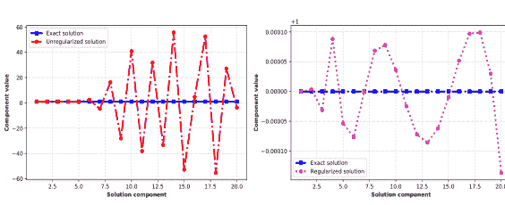

图 3.3：$Hx=b$ 的非正则化解以及正则化参数 $\alpha=\varepsilon$ 的正则化解。

在图 3.3 中，展示了非正则化解和 $\alpha=\varepsilon$ 的正则化解 $x^\alpha$。

通过上述 Python 代码计算了正则化解 $x^{\alpha_j}$（其中 $\alpha_j = 10^{j-1}\varepsilon, j=1,\dots,16$）的范数误差，输出结果如下：

非正则化解的误差范数 = 1.36970281e+02
正则化解的误差范数 = 2.96675459e-04
2.220446e-16 2.96675459e-04
2.220446e-15 4.95587019e-04
2.220446e-14 7.25227169e-04
2.220446e-13 1.76193763e-03
2.220446e-12 2.40230468e-03
2.220446e-11 5.05832063e-03
2.220446e-10 8.76991238e-03
2.220446e-09 1.41598120e-02
2.220446e-08 2.96964698e-02
2.220446e-07 4.37394775e-02
2.220446e-06 9.44807071e-02
2.220446e-05 1.42053519e-01
2.220446e-04 2.95683135e-01
2.220446e-03 4.69592530e-01
2.220446e-02 9.24796530e-01
2.220446e-01 1.61864355e+00

MATLAB 代码如下：

```matlab
H = hilb(20); 
y = ones(20, 1); 
b = H * y;
z = H\y;
subplot(1, 2, 1);
plot(1:20, y, '-b'); plot(1:20, z, '-m', 'LineWidth', 3); 
legend('Exact Solution', 'Unregularized');
xlabel('Solution Component');
ylabel('Component Value');
grid on

w = SolveWithTikhonov(H, b, eps);
subplot(1, 2, 2);
plot(1:20, y, '-b'); plot(1:20, w, '-r', 'LineWidth', 3);
legend('Exact Solution', 'Regularized');
xlabel('Solution Component');
ylabel('Component Value');
grid on

Err = zeros(16, 2);
for i = 1:16
    Alpha = 10^(i-1)*eps;
    w = SolveWithTikhonov(H, b, Alpha);
    Err(i, :) = [norm(y-w), Alpha]; 
end
disp(Err);
```

```matlab
function x = SolveWithTikhonov(A, b, Alpha)
    U, S, V = svd(A);
    D = diag(S);
    [m, n] = size(A);
    x = zeros(m, 1);
    for i = 1:n
        x = x + U(:, i).*b/(D(i)^2+Alpha)*V(:, i);
end
```

Tikhonov 正则化通过引入 $k$ 阶微分算子对解向量 $x$ 施加额外的平滑，$k=1,2,\dots$。我们考虑如下形式的泛函：

$$\varphi_{\alpha}(x) = ||Fx-y||_2^2 + \alpha ||Lx||_2^2$$

其中 $L=D_k$ 是 $k$ 阶微分算子。对于 $k=1，$L=D_1$ 是定义的 $(n-1) \times n$ 微分算子：

$$D_1 = \begin{pmatrix} -1 & 1 & 0 & \dots & 0 \\ 0 & -1 & 1 & \dots & 0 \\ \vdots & & \ddots & \ddots & \vdots \\ 0 & 0 & \dots & -1 & 1 \end{pmatrix}$$

对于 $k=2，$L=D_2$ 是定义的 $(n-2) \times n$ 微分算子：

$$D_2 = \begin{bmatrix} 1 & -2 & 1 & 0 & \dots & 0 & 0 & 0 \\ 0 & 1 & -2 & 1 & \dots & 0 & 0 & 0 \\ \vdots & \vdots & \vdots & \vdots & \ddots & \vdots & \vdots & \vdots \\ 0 & 0 & 0 & 0 & \dots & 1 & -2 & 1 \end{bmatrix}$$

使用一阶微分算子 $L = D_1$，方程 (3.12) 形式变为：

$$\varphi_{\alpha}(x) = ||Fx-y||_2^2 + \alpha||D_1x||_2^2 = ||Fx-y||_2^2 + \alpha \sum_{i=1}^{m-1} (x_{i+1}-x_i)^2 \quad (3.13)$$

使用二阶微分算子 $L = D_2$，方程 (3.12) 形式变为：

$$\varphi_{\alpha}(x) = ||Fx-y||_2^2 + \alpha||D_2x||_2^2 = ||Fx-y||_2^2 + \alpha \sum_{i=1}^{m-2} (x_{i+2}-2x_{i+1}+x_i)^2 \quad (3.14)$$

最小化方程 (3.12) 中的 $\varphi_{\alpha}(x)$ 等于求解正规组：

$$(F^T F + \alpha L^T L)x^{\alpha} = F^T y \quad (3.15)$$

Hansen [22] 考虑了使用广奇异值分解 (GSVD) 来 $(F, L)$ 的解，其中 $F \in \mathbb{R}^{m \times n}$ 且 $L \in \mathbb{R}^{n \times n}$。

### 3.2.3 L 曲线

使用较小的正则化参数 $\alpha$ 可能不会抑制正则化解，但会导致靠近非正则化解。相反，使用较大的 $\alpha$ 值会对正则化解施加更多平滑性，但会导致其远离最小残差。当我们在双对数坐标系上绘制不同 $\alpha$ 值对应的点 ($||Fx^\alpha-y||, ||Lx^\alpha||$) 时，它呈现出 L 曲线的形状。在该 L 曲线的拐点存在最优正则化参数。

### 3.2.4 差异原理

Linz 和 Wang [33] 考虑了 $Fx=b$ 问题，其中 $F$ 是一个 $m \times n$ 矩阵，$m \ge n，$x \in \mathbb{R}^n$ 且 $b \in \mathbb{R}^m$。他指出，如果线性方程组的解 $x$ 满足条件，则被称为*可接受的*：

$$||Fx-b|| \le \varepsilon$$

其中 $\varepsilon$ 是数据计算的总误差。根据 Linz 和 Wang [33]，只有当满足以下条件时，$x$ 才是*合理的*解：

$$||Lx|| \le M$$

其中 $M$ 是一个选定的正数。因此，任务变为选择 $\alpha$，使得正则化解 $x^*$ 既是可接受的又是。如果 $x$ 解决了以下问题，则它是*最合理的可接受*解：

$$\min_{x \in \mathbb{R}^n} ||Lx|| \quad (3.18)$$

约束条件为：

$$||Fx-b|| \le \varepsilon \quad (3.19)$$

这等于求解正规组，而 Morozov 差异原理是选择 $\alpha$ 以使得 (3.20-3.21) 满足的问题。


## 4 求解非线性方程组

### 摘要
本章讨论了使用 MATLAB® 和 Python 求解非线性方程。分为两个部分：第一部分介绍了求解单非线性方程的数值方法。第二部分讨论了求解非线性方程组的数值方法。

## 4.1 求解单非线性方程

考虑形式如下的非线性方程：

$f(x) = 0$

其中 $f:R\rightarrow R$ 是非线性函数。问题是要找到一个点 $x=x^*$使得 $f(x^*)=0$。那么，$x=x^*$ 被称为连续函数 $f$ 的*根*。例如，如果 $f(x)=e^{-x}-\cos x+0.5$，则 $f(x)=e^{-x}-\cos x+0.5=0$ 的根位于曲线 $x=e^{-x}+0.5$ 和 $\cos(x)$ 的交点，如图 4.1 所示。

在本节中，我们将讨论并在 MATLAB 和 Python 中实现求解给定非线性方程四种方法，即二分法、牛顿-拉夫线条、截线法和迭代法。

### 4.1.1 二分法

假设函数 $f(x)$ 在区间 $[a,b]$ 上连续，并且在从 $a$ 移动到 $b$ 的过程中符号从正变为负（或反之）。介值定理得出的直接结论是：连续函数在区间内如果不通过零点，其符号就不会改变 [52]。

二分法是一种迭代方法，每次迭代将包含根的区间分为两个相等的子区间，舍弃不包含根的那半，并在另一半中寻找根。

如果区间 $[a,b]$ 被分为两个相等的子区间 $[a,c]$ 和 $[c,b]$，其中 $c=(a+b)/2$ 是区间 $[a,b]$ 的中点。函数 $f$ 的根要么在 $[a,c]$ 中，要么在 $[c,b]$ 中。如果它在 $[a,c]$ 中，则 $f(a) \cdot f(c) < 0$。在这种情况下，我们知道根不在区间 $[c,b]$ 中，我们在 $[a,c]$ 中寻找根。如果它在 $[c,b]$ 中，则 $f(c) \cdot f(b) < 0$，在这种情况下，我们知道根不在区间 $[a,c]$ 中，我们在 $[c,b]$ 中寻找它。二分法继续将包含根的区间划分为两个子区间，使得一个子区间包含根而另一个不包含；因此，该方法只考虑包含根的区间并舍弃另一个。

实现二分法的 MATLAB 代码如下：

```matlab
function x = Bisection(f, a, b, Epsilon)
    while b-a >= Epsilon
        c = (a+b)/2;
        if f(a)+f(c) < 0
            b = c;
        elseif f(b)+f(c) < 0
            a = c;
        else
            x = c;
        end
    end
    x = c;
end
```

现在，我们可以从命令行提示符调用 Bisection 函数：

```matlab
>> format long
>> Epsilon = 1e-8;
>> f = @(x) x^2 - 3;
>> r = Bisection(f, 1, 2, Epsilon)
r =
1.732050813734531

>> s = Bisection(f, -2, -1, Epsilon)
s =
-1.732050813734531
```

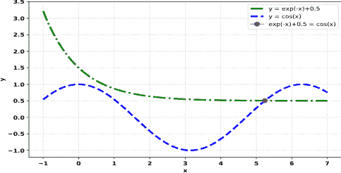
图 4.1：函数 $e^{-x}+0.5$（虚线）和 $\cos(x)$（点划线）的图。两条曲线交点圆的 x 坐标是 $[4,6]$ 上 $e^{-x}-\cos(x)+0.5=0$ 的根。

实现 Bisection 函数的 Python 代码为：

```python
def Bisection(f, a, b, Eps):
    from math import fabs
    c = (a+b)/2.0
    Iters = 1
    while fabs(b-a) >= Eps: # Note: corrected from fabs(c) to fabs(b-a)
        if f(a)+f(c) < 0:
            b = c
        else:
            a = c
            c = (a+b)/2
            Iters += 1
    return c, Iters

f = lambda x: x**2 - 3
a, b = 1, 2
Eps = 1e-8
x, Iters = Bisection(f, a, b, Eps)
print('Approximate root is:', x, '\nIterations:', Iters)
# Approximate root is: 1.732050806283958, Iterations: 25
```

### 4.1.2 牛顿-拉夫线条

如果函数 $f(x)$ 在点 $x_0$ 附近连续，则可以写为形式：$f(x) = f(x_0) + f'(x_0)(x-x_0) + \mathcal{O}((x-x_0)^2)$。现在如果 $x_1$ 是 $f(x)$ 的根，则 $f(x_1) = 0$。根据上述方程：$x_1 = x_0 - \frac{f(x_0)}{f'(x_0)}$，前提是 $f'(x_0) \neq 0$。牛顿-拉夫线条是一种通过初始猜测 $x_0$ 寻找 $f(x)$ 近似根的迭代方法。从 $x_0$ 开始，生成一个序列 $x_0, x_1, x_2, \dots，$x_{n+1} = x_n - \frac{f(x_n)}{f'(x_n)}$。该序列收敛于 $f$ 的最近根。使用牛顿-拉夫线条寻找 $f(x) = x^2 - 3$ 的根，注意到 $f'(x) = 2x$，因此迭代方法的形式为 $x_{n+1} = x_n - \frac{x_n^2-3}{2x_n}$。MATLAB 函数 `NewtonRaphson` 实现了牛顿-拉夫线条：

```matlab
function [x, Iter] = NewtonRaphson(f, fp, x0, Epsilon)
    Iter = 0;
    xl = x0 - f(x0)/fp(x0);
    while abs(xl) >= Epsilon
        x0 = xl;
        xl = x0 - f(x0)/fp(x0);
        Iter = Iter + 1;
    end
    x = xl;
end
```

从命令行提示符调用 NewtonRaphson 函数：

```matlab
>> format long
>> f = @(x) x^2 - 3;
>> fp = @(x) 2*x;
>> Epsilon = 1e-8;
>> x0 = 1;
>> [x, Iterations] = NewtonRaphson(f, fp, x0, Epsilon)
x =
1.732050813734531
Iterations = 5

>> [x, Iterations] = NewtonRaphson(f, fp, -x0, Epsilon)
x =
-1.732050813734531
Iterations = 5
```

Python 函数 `NewtonRaphson(f, fp, x0, Eps)` 的代码为：

```python
def NewtonRaphson(f, fp, x0, Eps):
    from math import fabs
    x = x0 - f(x0)/fp(x0)
    Iters = 1
    while fabs(f(x)) >= Eps: # Note: corrected from fabs(x) to fabs(f(x))
        x0 = x
        x = x0 - f(x0)/fp(x0)
        Iters += 1
    return x, Iters
```

使用 $x_0=1.0$ 和 $x_0 = -1.0$ 运行上述代码：
Approximate root is: 1.732050813734531, Iterations: 5
Approximate root is: -1.732050813734531, Iterations: 5

### 4.1.3 截线法

截线法的形式与牛顿-拉夫线条相似，但它不需要 $f(x)$ 在 $x_n$ 处的解析导数 $f'(x_n)$。它用有限差分公式代替 $f'(x_n)$：

$f'(x_n) \approx \frac{f(x_n) - f(x_{n-1})}{x_n - x_{n-1}}$

因此，截线法的形式为：

$x_{n+1} = x_n - \frac{x_n - x_{n-1}}{f(x_n) - f(x_{n-1})}f(x_n)$

从包含 $f$ 之根的区间 $[a,b]$ 开始，MATLAB 函数 `Secant` 实现了截线法：

```matlab
function [x, Iter] = Secant(f, a, b, Epsilon)
    Iter = 0;
    xl = b - f(b)*(b-a)/(f(b)-f(a));
    while abs(xl) >= Epsilon
        a = b;
        b = xl;
        xl = b - f(b)*(b-a)/(f(b)-f(a));
        Iter = Iter + 1;
    end
    x = xl;
end
```

### 4.1.4 指向不动点的迭代法

如果 $x^*$ 是函数 $g(x)$ 的不动点，则：

$g(x^*) = x^*$

假设函数 $f(x)$ 是可微的并且可以写为：

$f(x) = g(x) - x$

如果 $x_1$ 是 $f(x)$ 的根，那么：

$f(x_1) = g(x_1) - x_1 = 0 \Rightarrow x_1 = g(x_1)$

这意味着 $x_1$ 是函数 $g(x)$ 的不动点。不动点迭代方法的思想是将函数 $f(x)$ 写成 $g(x)-x$ 的形式，从某个初始猜测 $x_0$ 开始，该方法生成一个序列 $x_0, x_1, x_2, \dots$，该序列收敛于函数 $g(x)$ 的不动点，其迭代规则为：

$x_{n+1} = g(x_n)$


## 求解单个非线性方程

为了展示迭代法的工作原理，我们将将其应用于寻找函数的根

```
$f(x) = x^2 - 3$
```

将函数 $x^2 - 3$ 写成 $g(x)$ 的形式。一种可能的选择是写成：

```
$f(x) = x^2 - 3 = x^2 + 1 - 4 = (x+1)^2 - 4$```

如果 $x^*$ 是 $f(x)$ 的一个根，那么：

```
$f(x^*) = (x^*+1)^2 - 4 \implies (x^*+1)^2 = 4$
```

从初始点 $x_0$ 开始，寻找 $f(x)$ 根的迭代法为：

```
$x^{(n+1)} = \frac{(x^{(n)}+1)^2}{4}$```

以下 MATLAB 代码使用迭代法计算函数 $f(x) = x^2 - 3$ 的一个根：

```matlab
function [x, Iterations] = IterativeMethod(g, x0, Epsilon)
  Iterations = 0;
  x = g(x0);
  while abs(x-x0) >= Epsilon
    x0 = x;
    x = g(x0);
    Iterations = Iterations + 1;
  end
end
```

在命令行提示符中输入以下指令：

```matlab
>> g = @(x) (x+1)^2/4;
>> x0 = 1;
>> Epsilon = 1e-8;
>> [x, Iterations] = IterativeMethod(g, x0, Epsilon)
x = 1.7320508075689
Iterations = 8
```

在 Python 中，`IterativeMethod` 函数的代码为：

```python
def IterativeMethod(g, x0, Eps):
    from math import fabs
    x = g(x0)
    iters = 0
    while fabs(x - x0) >= Eps:
        x0 = x
        x = g(x0)
        iters += 1
    return x, iters
```

分别使用 $g(x) = (x+1)^2/4$ 和 $g(x) = (4-(x-1)^2)/2$ 运行一次 `IterativeMethod`：

```python
>>> x0, Eps = 1.0, 1e-8
>>> g = lambda x: (x+1)**2/4
>>> x, iters = IterativeMethod(g, x0, Eps)
>>> print('Approximate root is:', x, '\nIterations:', iters)
Approximate root is: 1.7320508075689
Iterations: 58

>>> g = lambda x: (4-(x-1)**2)/2
>>> x, iters = IterativeMethod(g, x0, Eps)
>>> print('Approximate root is:', x, '\nIterations:', iters)
Approximate root is: 1.7320508075689
Iterations: 59
```

**注意：** 值得注意的是，函数 $g(x)$ 的选择不是唯一的。例如，对于函数 $f(x) = x^2-3$，可以使用以下迭代形式：

1. $x^{(n+1)} = \frac{4-(x^{(n)}-1)^2}{2}$
2. $x^{(n+1)} = \frac{(3-x^{(n)})(1+x^{(n)})}{2}$
3. $x^{(n+1)} = \frac{(x^{(n)}+3)(x^{(n)}-1)}{2}$

迭代 $x_{n+1} = \frac{3}{x_n}$ 是无法工作的。

### 4.1.5 使用 MATLAB 和 Python 的 solve 函数

MATLAB solve 函数可以寻找非线性方程 $f(x)=0$ 的所有根。MATLAB 工具箱解析解析寻找 $f(x)=0$ 的根。

要求解非线性方程：

1. $x^2-3^x = 0$
2. $e^{-x} = \sin x$
3. $x^3+\cos x = \ln x$

我们可以使用 MATLAB 命令：

```matlab
>> x = solve('x^2 - 3')
x = 3^(1/2)
>> x = solve('exp(-x)-sin(x)')
x = 0.588532743981861077432542057029
>> x = solve('x*3-cos(x)+log(x)')
x = 0.8995305648078905732035721409122
```

在 Python 中，我们使用 `sympy.solve` 来求解非线性方程：

```python
>>> from sympy import *
>>> x = Symbol('x')
>>> solve(x**2-3, x)
[sqrt(3)]
```

**注意：** Python 符号库不如 MATLAB 工具箱那样成熟。第二个和第三个问题无法用 Python 求解，但 Python 会抛出异常：

```python
>>> solve(exp(-x)-sin(x), x)
Traceback (most recent call last):
  File "<stdin>", line 1, in <module>
NotImplementedError: No algorithms implemented to solve -sin(x)

>>> solve(x**3-cos(x)+log(x), x)
Traceback (most recent call last):
  File "<stdin>", line 1, in <module>
NotImplementedError: No algorithms implemented to solve x**3 + log(x)
```

## 4.2 求解非线性方程组

在本节中，考虑非线性方程组：

$f_1(x_1,...,x_n) = 0$
$f_2(x_1,...,x_n) = 0$
$...$
$f_n(x_1,...,x_n) = 0$

其中 $f_1,f_2,...,f_n$ 是关于变量 $x_1,...,x_n$ 的非线性函数。

我们可以通过向量形式写上述方程组：

$\mathbf{x} = \begin{pmatrix} x_1 \\ x_2 \\ \vdots \\ x_n \end{pmatrix}$ 和 $\mathbf{f}(\mathbf{x}) = \begin{pmatrix} f_1(x) \\ f_2(x) \\ \vdots \\ f_n(x) \end{pmatrix}$

$x^*$ 是 $\mathbb{R}^n$ 中的任意点，$\mathbf{f}(\mathbf{x})$ 的泰勒展开的前两项近似为：

$\mathbf{f}(\mathbf{x}) \approx \mathbf{f}(\mathbf{x}^*) + J(\mathbf{x}^*)(\mathbf{x}-\mathbf{x}^*)$

其中 $J(\mathbf{x}^*)$ 是雅可比矩阵，其 $ij$ 分量定义为：

$(J(\mathbf{x}^*))_{ij} = \frac{\partial f_i(x)}{\partial x_j}|_{x=\mathbf{x}^*}$

现在如果令 $\mathbf{f}(\mathbf{x}) = 0$，得到方程：

$\mathbf{f}(\mathbf{x}^*) + J(\mathbf{x}^*)(\mathbf{x}-\mathbf{x}^*) = 0$

由此我们找到：

$\mathbf{x}^* = \mathbf{x}^* - J^{-1}(\mathbf{x}^*)\mathbf{f}(\mathbf{x}^*)$

从 $\mathbf{f}(\mathbf{x}) = 0$ 的初始猜测值 $\mathbf{x}^{(0)}$ 开始，迭代：

$\mathbf{x}^{(n+1)} = \mathbf{x}^{(n)} - J^{-1}(\mathbf{x}^{(n)})\mathbf{f}(\mathbf{x}^{(n)})$

收敛到 $\mathbf{f}(\mathbf{x}) = 0$ 距离初始点 $\mathbf{x}^{(0)}$ 最近的解。

在 MATLAB 中，可以使用 `jacobian` 函数寻找非线性方程组 $\mathbf{f}(\mathbf{x})$ 的雅可比矩阵。

**例 4.1** 使用 MATLAB 求解非线性方程组：

$x^2+y^2 = 30$
$-x^2+y^2 = 24$

我们写为：

$\mathbf{f}(x,y) = [x^2+y^2-30, -x^2+y^2-24]^T$

该非线性方程组的雅可比矩阵为：

$J(x,y) = \begin{pmatrix} 2x & 2y \\ -2x & 2y \end{pmatrix}$

从初始猜测 $z^0 = (x^0, y^0)^T$ 开始，迭代法为：

$z^{(n+1)} = z^{(n)} - J^{-1}(z^{(n)})f(z^{(n)})$
$= \begin{pmatrix} x^{(n)} \\ y^{(n)} \end{pmatrix} - \begin{pmatrix} 2x^{(n)} & 2y^{(n)} \\ -2x^{(n)} & 2y^{(n)} \end{pmatrix}^{-1} \begin{pmatrix} x^{(n)^2 + y^{(n)^2} \\ -x^{(n)^2 + y^{(n)^2} \end{pmatrix}$

以下 MATLAB 代码实现了上述问题的求解，从初始猜测 $[1,1]^T$ 开始。

```matlab
% SolveWithJacobi.m
function [z, Iterations] = Newton_sys(f, J, z0, Eps)
  IJ = inv(J(z0));
  z = z0 - IJ * f(z0);
  Iterations = 0;
  while norm(z-z0) >= Eps
    z0 = z;
    z = z0 - IJ * f(z0);
    Iterations = Iterations + 1;
  end
end
```

上述代码的执行将给出结果：

```matlab
>> f = @(x) [x(1)^2+x(2)^2-30; -x(1)^2+x(2)^2-24];
>> J = @(x) [2*x(1), 2*x(2); -2*x(1), 2*x(2)];
>> z0 = [1; 1];
>> Epsilon = 1e-8;
>> [z, Iterations] = Newton_sys(f, J, z0, Epsilon)
>> fprintf('Approximate solution: (Iterations = %d)\nx = %.15f\ny = %.15f\n', Iterations, z(1), z(2))
Approximate solution: (Iterations = 59)
x = 1.732050807568877
y = 5.196152422706632
```

在 Python 中，`SolveJacobi` 函数的代码为：

```python
def SolveJacobi(f, J, z0, Eps):
    import numpy as np
    IJ = np.linalg.inv(J(z0))
    z = z0 - IJ @ f(z0)
    iters = 0
    while np.linalg.norm(z - z0) >= Eps:
        z0 = z
        z = z0 - IJ @ f(z0)
        iters += 1
    return z, iters
```

```python
import numpy as np
>>> f = lambda x: np.array([x[0]**2+x[1]**2-30, -x[0]**2+x[1]**2-24])
>>> J = lambda x: np.array([[2*x[0], 2*x[1]], [-2*x[0], 2*x[1]]])
>>> z0 = np.array([1., 1.])
>>> Eps = 1e-8
>>> z, iters = SolveJacobi(f, J, z0, Eps)
>>> print(f'Approximate solution: (Iterations = {iters})\nx = {z[0]:.15f}\ny = {z[1]:.15f}')
Approximate solution: (Iterations = 59)
x = 1.732050807568877
y = 5.196152422706632
```

**例 4.2** 使用牛顿法求解非线性方程组 [47]:

| $3x_1 - \cos x_2 x_3 - 0.5$ | = 0 |
| $x_1^2 - 81(x_2+0.1)^2 + \sin x_3 + 1.06$ | = 0 |
| $\frac{10\pi-3}{e^{-x_1 x_2}+20x_3}$ | = 0 |


# 求解非线性方程组

我们写作：

$f = [3x_1 - \cos x_2x_3-0.5, x_1^2-81(x_2+0.1)^2+\sin x_3+1.06, e^{-x_1x_2}+20x_3+\frac{10\pi-3}{T}]$

给定系统的雅可比矩阵为：

$J(x_1,x_2,x_3) = \begin{pmatrix} 2x_1 & \frac{x_3\sin x_2x_3}{3} & \frac{x_2\sin x_2x_3}{2} \\ -x_3e^{-x_1x_2} & -162x_2-81/5 & \frac{\cos x_3}{20} \\ -x_1e^{-x_1x_2} & & \end{pmatrix}$

如果牛顿迭代从初始条件 $z^{(0)} = (x_1^{(0)},x_2^{(0)},x_3^{(0)})^T$ 开始，则牛顿迭代由给出：

$z^{(n+1)} = z^{(n)} - J^{-1}(z^{(n)})f(z^{(n)})$

使用上述迭代计算解的 MATLAB 代码为：

```matlab
>> clc ;
>> f = @z([3*z(1)-cos(z(2)*z(3))-3/2;
z(1)^2-81*(z(2)+0.1).^2+sin(z(3))+1.06;
exp(-z(1)).^2+20*z(3)+(10*pi-3)/3]);
>> g = @z([3, 3*sin(z(2))*z(3), z(2)*sin(z(2))*z(3));
2*z(1), -162*z(2)-81/5, cos(z(3));
-z(3)*exp(-z(1)*z(2)), -z(1)*exp(-z(1)*z(2)), 20]);
>> z0 = [0; 0.1; -0.1];
>> Eps = 1e-8;

>> z, Iterations = Newton_sys(f, J, z0, Eps)
>> fprintf('Iterations = %i\n', Iterations);
Iterations = 4
>> fprintf('The solution of the system is given by:\n\t\t\t x1 = %18.15f\n\t\t\t x3 = %18.15f\n', z(1), z(2), z(3));
```

该系统的解给出：

x1 = 0.500000000000000
x2 = -0.000000000000000
x3 = -0.523598775598299

使用 Python，可以通过调用函数 Newton_sys 如下求解此示例：

```python
In [38]: f = lambda z: array([3*z[0]-cos(z[1]*z[2])-3/2;
z[0]**2-81*(z[1]+0.1)**2+2*sin(z[2])+1.06;
exp(-z[0])**2+20*z[2]+10*pi/3])
In [39]: J = lambda z: array([[3, z[2]*sin(z[1]*z[2]), z[1]*sin(z[1]*z[2])];
[-z[1]*exp(-z[0]*z[1]), -162*z[1]-81/5, cos(z[2])];
[-z[0]*exp(-z[0]*z[1]), -z[0]*exp(-z[0]*z[1]), 20]]),
In [40]: z0 = array([1., 1., 1.]);
In [41]: z, Iterations = Newton_sys(f, J, z0, Eps)
```

In [42]: print('Approximate solution: (Iterations = ', Iterations,')\nx = ', z[0], '\ny = ', z[1], '\nz = ', z[2])

近似解：(Iterations = 8 )
x = 0.4999999999999994
y = -1.6530395442910908e-17
z = -0.5235987755982988

# 第二部分

# 数据插值与微分方程求解


# 数据插值

### 摘要

数据插值是指使用给定的 $n+1$ 个数据点通过多项式 $P_n(x) = a_nx^n + a_{n-1}x^{n-1} + \dots + a_1x + a_0$（次数不为 $n$，使得 $P_n(x_i) = f(x_i)$，$i=0,\dots,n$，其中 $a_0,\dots,a_n$ 为常数）来近似函数 $f(x)$。

数据点由表给出：

| $x$ | $x_0$ | $x_1$ | $\dots$ | $x_n$ |
| :--- | :--- | :--- | :--- | :--- |
| $f(x)$ | $f(x_0)$ | $f(x_1)$ | $\dots$ | $f(x_n)$ |

其中 $x_i = x_j$ 对于 $i \neq j$ 且 $x_0 < x_1 < \dots < x_n$。本章讨论了一些插值方法及其在 MATLAB 和 Python 中的实现。
- 第1节讨论了拉格朗日插值及其在 MATLAB 中的实现。
- 第2节讨论了牛顿插值以及在 MATLAB 和 Python 中寻找系数的技术。
- 第3节讨论了均差法插值。
- 第4节讨论了使用拉格朗日插值的插值误差。

### 5.1 拉格朗日插值

在第一节中，将讨论如何从给定数据构造插值多项式。讨论插值多项式的唯一性。在最后一节，将给出插值公式。

### 5.1.1 插值多项式的构造

在拉格朗日插值中，构造了 $n+1$ 个多项式 $L_0(x), L_1(x),\dots,L_n(x)$。每个多项式 $L_j(x), (j=0,\dots,n)$ 都是 $n$ 次的，使得

$L_i(x_j) = \begin{cases} 1, & i=j \\ 0, & i \neq j \end{cases}$

那么插值多项式 $P_n(x)$ 定义为：

$P_n(x) = L_0(x)y_0 + L_1(x)y_1 + \dots + L_n(x)y_n = \sum_{i=0}^{n} L_i(x)y_i$ (5.1)

多项式 $P_n(x)$ 是 $n$ 次的，因为对于所有的 $i = 0, \dots, n$，$_i(x)$ 都是 $n$ 次多项式。此外，$P_n(x)$ 满足：

$P_n(x) = \sum_{i=0}^{n} L_i(x)y_i = L_j(x)y_j = y_j, \quad j = 0, \dots$。这证明了 $P_n(x)$ 插值了数据。

为了构造 $n+1$ 个多项式 $L_i(x), i = 0, \dots, n$，注意 $\psi(x) = (x-x_0)(x-x_1)\dots(x-x_n)$ 的根为 $x_0, x_1, \dots, x_n$。如果 $\tilde{L}(x)$ 定义为

$\tilde{L}(x)=\frac{\psi(x)}{x-x_i} = (x-x_0)(x-x_1)\dots(x_{i-1})(x_{i+1})\dots(x-x_n)$，那么 $x_i$ 不是 $\tilde{L}(x)$ 的根。

现在，可以使用公式从 $\tilde{L}(x)$ 得到 $L_i(x)$：

$L_i(x) = \frac{\tilde{L}(x)}{\tilde{L}(x_i)} = \frac{(x-x_0)(x-x_1)\dots(x-x_n)}{(x_i-x_0)(x_i-x_1)\dots(x_i-x_n)}$ (5.2)

多项式 $L_i(x)$ 也可以写作：

$L_i(x) = \prod_{j=0}^{n} \frac{x-x_j}{x_i-x_j}$，且拉格朗日多项式 $P_n(x)$ 可以写作：

$P_n(x) = \sum_{i=0}^{n} \prod_{j=0}^{n} \frac{x-x_j}{x_i-x_j}y_i$

下面的 MATLAB 函数 `LagrangeInter.m` 使用长度为 $n$ 的向量 $\mathbf{x}$ 和 $\mathbf{y}$ 给出的数据点构造拉格朗日插值多项式 $P_n(x)$。它在 $x=t$ 处评估 $P_n(x)$ 并返回结果：

```matlab
function p = LagrangeInter(t, x, y)
n = length(x);
p = 0;
for i = 1 : n
    s = 1;
    for j = 1 : n
        if j != i
            s = s*(t-x(j))/(x(i)-x(j));
        else
            continue;
        end
    end
    p = p + s*y(i);
end
```

执行上述 MATLAB 代码，我们得到：

```matlab
>> x = 0:pi/6:pi;
>> y = sin(x);
>> p = LagrangeInter(pi/6, x, y)
```

Python 脚本 `Lagrangep.py` 使用以下代码实现拉格朗日插值多项式：

```python
import numpy as np
def Lagrangep(t, x, y):
    n = len(x)
    p = 0.0
    for i in range(n):
        s = 1.0 # 注意：此处原代码缺少初始化s，已补全
        for j in range(n):
            if j != i:
                s += (t-x[j])/(x[i]-x[j])
            else:
                continue
        p += s*y[i]
    return p

x = np.linspace(0.0, np.pi, 11)
y = np.sin(x)
p = Lagrangep(np.pi/6, x, y)
print(p)
```

执行代码显示以下结果：

```
runfile('D:/PyFiles/Lagrangep.py', wdir='D:/PyFiles')
0.4999999768
```

### 5.1.2 拉格朗日插值的唯一性

在本中，将使用代数基本定理来证明插值多项式是唯一的。它指出任何复系数的 $n$ 次多项式最多有 $n$ 个零。因此，如果一个 $n$ 次多项式 $p(x)$ 有多于 $n$ 个根，那么它必须是零多项式。

为了证明插值多项式的唯一性，假设 $p_n(x)$ 和 $q_n(x)$ 是 $n$ 次多项式，且插值给定的数据 $(x_i, y_i)$，$i=0, \dots, n$。令 $r(x)=p_n(x)-q_n(x)$，对于所有 $x \in [x_0,x_n]$。由于 $p_n(x)$ 和 $q_n(x)$ 都是 $n$ 次的，则 $r(x)$ 是 $n$ 次的且 $r(x_i)=0$ 对于 $i=0, \dots, n$，这说明 $r(x)$ 是零多项式，除非...

### 5.1.3 拉格朗日插值误差

给定 $f:[a,b] \to \mathbb{R}$ 以及 $[a,b]$ 中的 $n+1$ 个点 $x_0,\dots,x_n$。设 $p_n(x)$ 为 $n$ 次多项式，它插值数据 $(x_0,f(x_0)),\dots,(x_n,f(x_n))$。即 $p_n(x_j)=f(x_j)$ 对于所有 $j=0,\dots,n$。假设 $f$ 连续可导，将推导出函数 $E_n(x)$ 的公式。

定义插值误差：

$E_n(x)=f(x)-p_n(x), x \in[a,b]$ (5.3)


## 牛顿插值法

由于 $\psi(x)$ 和 $E_n(x)$ 都存在前 $n+1$ 阶导数，因此 $G(x)$ 也是。$G(x)$ 在 $[a,b]$ 上有 $n+2$ 个不同的根。根据介值定理，$G'(x)$ 在 $(a,b)$ 中有 $n+1$ 个不同的根，$G''(x)$ 在 $(a,b)$ 中有 $n$ 个不同的根。通过数学归纳法，$G^{(k)}$ 在 $(a,b)$ 中有 $n-k+2$ 个不同的根。因此，$G^{(n+1)}$ 在 $(a,b)$ 中至少有一个根。设 $\xi$ 为 $G^{(n+1)}$ 在 $(a,b)$ 中的一个根，即 $G^{(n+1)}(\xi) = 0$。

根据 $E_n(x)$ 和 $\psi(x)$ 的定义，$E^{(n+1)}(x) = f^{(n+1)}(x)$ 且 $\psi^{(n+1)} = (n+1)!$。那么，

```
$G^{(n+1)}(x) = f^{(n+1)}(x) - \frac{(n+1)!}{\psi(t)} E_n(t)$
```

在 $x=\xi$ 时，

```
$G^{(n+1)}(\xi) = f^{(n+1)}(\xi) - \frac{(n+1)!}{\psi(t)} E_n(t) = 0$，
```

由此得：

```
$E_n(t) = \frac{\psi(t)}{n+1} f^{(n+1)}(\xi)$
```

## 5.2 牛顿插值

对于一组数据点 $(x_j, f(x_j))$，$j=0,\dots,n$，问题是找到一个次数不超过 $n$ 的多项式 $P_n(x)$，使得对于所有的 $j=0,\dots,n$ 都有 $P_n(x_j)=f(x_j)$。

由下式定义的拉格日插值：

```
$P_n(x) = \sum_{j=0}^n L_j(x)f(x_j)，
```

其中

```
$L_i(x) = \prod_{j \neq i}^n \frac{x-x_j}{x_i-x_j}$,
```

存在一个问题，即无法从 $L_i(x)$ 得到 $L_{i+1}(x)$（没有迭代方法可以计算多项式 $L_i(x),i=0,\dots,n$）。这使得算法的复杂度很高。因此，牛顿插值多项式可以看作拉格日多项式的替代方案。

### 5.2.1 方法描述

在牛顿插值法中，通过迭代技术从 $p_{k-1}$ 计算次数为 $k$ ($1 \le k \le n$) 的的多项式 $P_k(x)$。它从常数多项式 $P_0(x)$ 开始，其中：

$P_0(x) = c_0 = f(x_0)$。

然后通过迭代得到 $P_k$：

$P_k(x) = P_{k-1}(x) + c_k \prod_{j=0}^{k-1} (x - x_j),$ (5.4)

其中 $c_k$ 是一个常数，通过将数据点 $(x_k, f(x_k))$ 代入 $P_k(x)$ 的方程来确定，使得它满足关系 $P_k(x) = f(x_j)$，$j = 0,\dots,n$。

根据牛顿插值的迭代公式，牛顿多项式通过方程 (5.4) 插值数据 $(x_0, f(x_0)), \dots, (x_k, f(x_k))$，形式为：

$P_k(x) = c_0 + c_1(x-x_0) + c_2(x-x_0)(x-x_1) + \dots + c_k(x-x_0)\dots(x-x_{k-1}),$ (5.5)

其中 $P_0(x) = c_0 = f(x_0)$。

对于给定的点 $(x_j, f(x_j))$，MATLAB 函数 ComputeNewton-Coeff 返回牛顿多项式的系数。

```matlab
function c = ComputeNewtonCoefs(x, f)
    n = length(x);
    c = zeros(size(x));
    c(1) = f(1);
    for j = 2 : n
        z = x(j)*x(1:j-1);
        pml(1) = 1;
        for k = 1 : 3
            pml = pml+c(k)*prod(z(1:k-1));
        end
        c(j) = (f(j)-pml)/prod(z(1:j-1));
    end
```

另一个 MATLAB 函数 NewtonInterp.m 调用函数 ComputeNewton 来重建牛顿多项式。它接收一组数据点 $(x_j, f(x_j)),j=0,\dots,n$ 和一个值 $\xi$，并返回从牛顿插值多项式中得到的对应值 $y_i$。`NewtonInterp.m` 函数的代码为：

```matlab
function yi = NewtonInterp(x, xi)
    c = ComputeNewtonCoefs(x, y);
    n = length(x);
    z = zeros(1, n);
    w = zeros(1, n);
    z(1) = 1;
    z(2:end) = xi - x(1:end-1);
    for k = 1 : n
        w(k) = prod(z(1:k));
    end
    yy = sum(c.*w

为了测试函数是否正确，从函数 $f(x) = \frac{\cos(4x)}{1+x}, 0 \leq 2$ 采样了10个点 $(x_j, f(x_j)), j=0,\dots,9$ 来生成牛顿多项式，然后用于估计函数在101个点处的值。MATLAB 脚本 NewtonInterp.m 用于绘图。其代码为：

```matlab
clear; clc
x = linspace(0, 2, 10);
y = cos(4*x)/(1+x);
xx = linspace(0, 2, 101);
yy = zeros(size(xx));
j = 1 : length(yy)
yy(j) = NewtonInterp(x, y, xx);
plot(x, y, 'bo', xx, '-m', 'LineWidth', 3);
xlabel('x');
ylabel('y');
legend('Data points (x, y)', 'Newton Polynomial');
axis([-0.1, 2, -0.8, 1]);
set(gca, 'fontweight', 'bold');
grid on;
set(gca, 'XTick', 0:2);
set(gca, 'YTick', -0.8:1);
```

执行代码的结果如图51所示。对应的函数 `ComputeCoefs.py` 和 `NewtonInterp.py` 在 Python 脚本 `NewtonSin.py` 中实现，它从函数 $f(x) = \frac{\sin(x)}{1+x}, 0 \leq 2$ 取了10个等距点。`NewtonSin.py` 的完整代码为：

```python
from numpy import zeros, prod, sin, linspace, arange
import matplotlib.pyplot as plt

def ComputeNewtonCoefs(x, f):
    n = len(x)
    c = zeros(len(x))
    c[0] = f[0]
    for j in range(1, n):
        z = zeros(j+1)
        z[0] = 1.0
        for k in range(j):
            z[k+1] = x[j]-x[k]
        pml = 0.0
        w = zeros(j)
        for k in range(j):
            w[k] = prod(z[:k+1])
            pml += (c[k]+w[k])
        c[j] = (f[j]-pml)/prod(z[:j+1])
    return c

def NewtonInterp(x, y, xi):
    c = ComputeNewtonCoefs(x, y)
    n = len(x)
    z = zeros(n)
    w = zeros(n)
    z[0] = 1.0
    for k in range(n-1):
        z[k+1] = xi-x[k]
    for k in range(n):
        w[k] = prod(z[:k+1])
    yy = sum(c*w)
    return yy

x = linspace(0, 2, 10)
y = sin(4*x)/(1+x)
xx = linspace(0, 2, 101)
yy = zeros(len(xx))
for j in range(len(yy)):
    yy[j] = NewtonInterp(x, y, xx[j])

plt.plot(x, y, 'bo', label='Data points (x, y)', lw=4)
plt.plot(xx, yy, '-.', label='Newton Polynomial', lw=3)
plt.xlabel('x')
plt.ylabel('y')
plt.legend()
plt.axis([-0.1, 2, -0.8, 1])
```

/(1+x)$ 在101点处的估计。)

## 5.2.2 牛顿差

因此，计算牛顿多项式被限于计算多项式系数 $c_0, \dots, c_n$。差分法是计算牛顿插值多项式系数 $c_j, j=0,\dots, n$ 的一种方法。在讨论牛顿差分表的构造之前，将使用以下符号：

$f[x_k] = f(x_k), k=0,\dots, n$
$f[x_k, x_{k+1}] = \frac{f[x_{k+1}]-f[x_k]}{x_{k+1}-x_k}, k=0,\dots, n-1$
$f[x_k, x_{k+1}, x_{k+2}] = \frac{f[x_{k+1}, x_{k+2}]-f[x_k, x_{k+1}]}{x_{k+2}-x_k}, k=0,\dots, n-2$

以及一般，

$f[x_k, x_{k+1}, \dots, x_{k+j}] = \frac{f[x_{k+1}, \dots, x_{k+j+1}]-f[x_k, \dots, x_{k+j}]}{x_{k+j+1}-x_k}, k=0,\dots,n-(j+1)$

那么，牛顿差分表定义为：

| $x_k$ | $f[x_k]$ | $f[x_{k-1}, x_k]$ | $\dots$ | $f[x_0, \dots, x_k]$ |
| :--- | :--- | :--- | :--- | :--- |
| $x_0$ | $f[x_0]$ | | | |
| $x_1$ | $f[x_1]$ | $f[x_0, x_1]$ | | |
| $\dots$ | $\dots$ | $\dots$ | $\dots$ | $\dots$ |
| $x_n$ | $f[x_n]$ | $f[x_{n-1}, x_n]$ | $\dots$ | $f[x_0, \dots, x_n]$ |

牛顿插值多项式的系数由以下形式给出：

$c_0 = f(x_0)$
$c_1 = \frac{f[x_1]-f[x_0]}{x_1-x_0} = f[x_0, x_1]$
$c_2 = \frac{f[x_1, x_2]-f[x_0, x_1]}{x_2-x_0} = f[x_0, x_1, x_2]$

以及一般，

$c_k = \frac{f[x_1, \dots, x_k]-f[x_0, \dots, x_{k-1}]}{x_k-x_0} = f[x_0, \dots, x_k], k=1, \dots, n.$$

因此，牛顿插值多项式的系数是牛顿差分表中的对角线元素。

/(1 + x)$ 在101点处的估计。)


## 牛顿插值法

MATLAB 函数 `NewtonCoefs.m` 接收数据点 $(x_j, f(x_j))$ 并利用它们计算牛顿均差差分表，从而计算牛顿插值多项式的系数。它同时返回差分表和系数。

```matlab
function [ndd, Coef] = NewtonCoefs(x, f)
% The function NewtonCoefs receives data points (x-j, ...)
    f(x-j) and uses them
% to compute the Newton's divided difference table and ...
    
% Coefficients of Newton's interpolating polynomial. It ...
    % returns both the
% divided difference table and coefficients.
Coef = zeros(1, length(x))
dd = zeros(length(x), length(x)+1)
ndd(1, :) = x';
dd(2, :) = f';
for j = 3 : length(x)
    for i = j-1 : length(x)
        k = j;
        ndd(i, j) = (ndd(i, j-1)-ndd(i-1, k))/(x(i)-x(k));
    end
end
for j = 1 : length(x)
    Coef(j) = ndd(j, j+1);
```

为了测试函数 `NewtonCoefs.m` 的性能，考虑了五个数据点 $(x_j, f(x_j))$，$j=0,\dots,4$，其中 $f(x)=4e^{-x^2}\sin(2\pi x)$，$x \in [0,1]$。使用以下 MATLAB 指令测试代码：

```matlab
>> x = linspace(0, 1, 5);
>> y = 4*exp(-x.^2).sin(2*pi*x);
>> [ndd, Coef] = NewtonCoefs(x, y)
```

| 0 | 0 | 0 | 0 | 0 |
|---|---|---|---|---|
| 0.2500 | 3.7577 | 15.0306 | 0 | 0 |
| 0.5000 | 0.0000 | -15.0306 | -60.1224 | 0 |
| 0.7500 | -2.2791 | -9.1165 | 11.8282 | 95.9341 | 0 |
| 1.0000 | -0.0000 | 9.1165 | 36.4661 | 32.8506 | -63.0836 |

Coef = 15.0306 -60.1224 95.9341 -63.0836

使用这些系数得到的牛顿插值多项式如图 5.3 所示。

## 数据插值

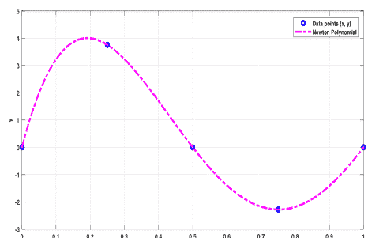

图 5.3：使用由 5 个数据点构建的牛顿插值多项式在 101 个点上对函数 $4e^{-x^2}\sin(2\pi x)$ 进行近似。

## 5.3 MATLAB 的插值工具

MATLAB 提供了许多用于数据插值的函数。在本节中将讨论 MATLAB 函数 `interp1`、`spline` 和 `pchip`。

### 5.3.1 使用 interp1 函数进行插值

MATLAB 函数 `interp1` 接收两个向量 $x$ 和 $y$ 以及第三个参数（该参数可以是标量或向量）。在这种情况下，它用分段多项式对数据 $(x_j, y_j)$ 进行插值。为了演示这一点，从区间 $[0,3]$ 内的函数 $y = e^{-x}\sin(x)$ 中采样8 个数据点，然后在 100 个数据点上对构建的插值多项式赋值。可以通过以下 MATLAB 命令完成：

构建样本数据点：

```matlab
>> x = linspace(0, 3, 8);
>> y = exp(-x).sin(x);
```

定义用于计算插值多项式的点 $s$：

```matlab
>> s = linspace(0, 3);
```

函数 `interp1` 的用法如下：

```matlab
>> P = interp1(x, y, s);
```

函数 `interp1` 通过直线连接任意两个点 $(x_j, y_j)$ 和 $(x_{j+1}, y_{j+1})$。因此，该插值多项式是一个分段线性多项式，由连接点 $(x_j,y_j)$（$j=0,\dots,7$）之间的直线并集组成。

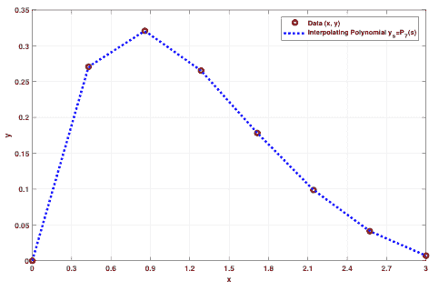

图 5.4：原始数据 (x,y) 和通过插值获得的数据 (s,P(s))。

在任何给定的点 $s_k,k=0,\dots,99$，通过确定 $i$ 使得 $x_i \le s \le x_{i+1}$ 并使用连接 $(x_i,y_i)$ 和 $(x_{i+1},y_{i+1})$ 的直线方程对多项式进行赋值。最后返回结果 $P$。在 MATLAB 中绘制数据和插值多项式：

```matlab
>> plot(x, y, 'ro', s, ':b', 'LineWidth', 3);
>> xlabel('x');
>> ylabel('y');
```

数据点和插值多项式绘制在图 5.4。

### 5.3.2 使用 Spline 函数进行插值

使用线性多项式插值会导致函数在插值点处不可导，如图 5.4 所示。MATLAB `spline` 计算一个在插值点 $(x_j,y_j)$ 处光滑的分段三次多项式。如果在前例中将 `interp1` 命令替换为 `spline` 命令，报告结果：

```matlab
>> P = spline(x, y, xx);
>> plot(x, y, 'ro', xx, ':b', 'LineWidth', 3);
>> xlabel('x');
>> ylabel('y');
```

将看到图 5.5：

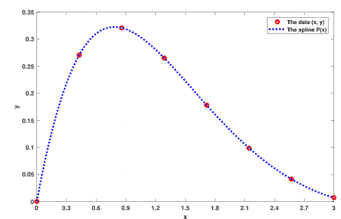

图 5.5：原始数据 $(x,y)$ 和通过插值获得的数据 $(xx,P(xx))$。

输入：

```matlab
>> Q = spline(x, y)
```

结果为：

```matlab
Q =
form: 'pp'
breaks: [0 0.4286 0.8571 1.2857 1.7143 2.1429 2.5714 3]
coeffs: [7x double]
pieces: 7
order: 4
dim: 1
```

结构 $Q$ 包含了关于插值多项式的信息。对于8个数据点，需要7段三次样条来连接数据点 $(x_i,y_i)$ 和 $(x_{i+1},y_{i+1})$，$i=0,\dots,7$。字段 "breaks" 包含数据点的坐标。字段 "coeffs" 包含数据点 $(x_i,y_i)$ 和 $(x_{i+1},y_{i+1})$ 之间每个三次样条的系数，$i=0,\dots,7$。插值样条近似原始函数的误差为 $h$，其中 $h=\max x_{i+1}-x_i$，$i=1,\dots,7$。因此，收敛阶为4。

可以使用 `ppval` 函数在向量 $xx$ 的点上对 $Q$。方法如下：

```matlab
>> S = ppval(Q, xx);
```

现在，$S$ 和 $P$ 是相同的。可以通过命令看到：

```matlab
>> Error = norm(P-S, inf)
Error = 0
```

### 5.3.3 使用 pchip 函数进行插值

`pchip` 代表分段三次 Hermite 插值多项式。它利用三次 Hermite 多项式来近似任意两个数据点之间的函数。

`pchip` 函数的工作方式与 `spline` 函数相似。在前例中将 `spline` 命令替换为 `pchip` 命令，输入：

```matlab
>> P = pchip(x, y, xx);
>> plot(x, y, 'ro', xx, ':b', 'LineWidth', 2);
>> xlabel('x');
>> ylabel('y');
>> legend('The data (x, y)', 'The pchip P(x)')
```

即可得到图 5.6。

再次，如果 $Q$ 定义为：

```matlab
>> Q = pchip(x, y)
```

将获得以下结果：

```matlab
Q =
form: 'pp'
```

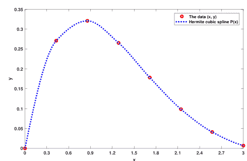

图 5.6：使用 pchip 函数的原始数据 $(x,y)$ 和通过插值获得的数据 $(xx,P(xx))$。

```matlab
breaks: [0 0.4286 0.8571 1.2857 1.7143 2.1429 2.5714 3]
coeffs: [7x4 double]
pieces: 7
order: 4
dim: 1
```

这与使用 `spline` 命令得到的结果相似。区别在于系数的值，因此也在于定义插值多项式 7 个段的方程。

可以使用 `ppval` 函数在 $xx$ 的分量上评估插值多项式。

```matlab
>> S = ppval(Q, xx);
>> Error = norm(P - S, inf)
Error = 0
```

### 5.3.4 从 interp1 调用 spline 和 pchip 函数

MATLAB 函数 `interp1` 可以通过三次或分段三次 Hermite 多项式代替分段线性插值来执行插值。

MATLAB 命令：

```matlab
>> P = interp1(x, y, xx, 'spline');
```

通过分段三次样条对数据 $(x,y)$ 进行插值，类似于 `spline` 命令。而 MATLAB 命令：

```matlab
>> P = interp1(x, y, xx, 'pchip');
```

通过分段三次 Hermite 多项式对数据 $(x,y)$ 进行插值，正如 `pchip` 命令所做。

MATLAB 命令：

```matlab
>> P = interp1(x, y, xx, 'cubic');
```

执行后，它可以完成与 `pchip` 函数相同的工作。

## 5.4 Python 中的数据插值

Python 的 `scipy.interpolate` 库包含了各种用于数据插值的函数 [18]。这些函数包括 `CubicHermiteSpline`、`CubicSpline`、`LinearNDInterpolator`、`NearestNDInterpolator`、`interp1`、`lagrange`、`pade`、`pchip`、`pchip.interpolate`。还有许多用于多维插值的函数。在本节中将讨论 Python 的插值函数。


# Python 中的数据插值

## 5.4.1 函数 interp1

Python 的函数 `interp1` 的语法与 MATLAB 函数 `interp1` 相似。如果没有接收到任何插值类型，它将使用线性分段多项式对给定的数据进行三次插值。如果接收到类型（二次、三次等），则将使用该类型的连续分段多项式对给定的数据进行插值。

例如，从函数

选取的十个等距样本

```
$$\cos(4x)\frac{1}{1+x}$$
```

将根据 `interp1` 函数使用线性、二次和三次分段多项式对函数进行插值。Python 脚本 `interp1d` 使用 `interp1` 实现了插值：

```python
from numpy import cos, linspace, arange
from scipy.interpolate import interp1
import matplotlib.pyplot as plt
x = linspace(0, 3, 10)
y = cos(4*x)/(1+x)
xx = interp1(x, y)
Quadd = interp1(x, y, kind = 'quadratic')
Cubic = interp1(x, y, kind = 'cubic')
yyl = Lin1(xx)
y2 = Quadd(xx)
yyy3 = Cubic(xx)

plt.subplot(212)
plt.plot(x, y, 'bo', label='Data points (x, y)', lw=4)
plt.plot(xx, yyl, ls='-', color='orange', label='Linear', lw=2)
plt.plot(xx, yy2, ls='-', color='purple', label='Quadratic', lw=2)
plt.xlabel('x', fontweight='bold')
plt.ylabel('y', fontweight='bold')
plt.legend()
plt.grid(True, ls=':')
plt.xticks(arange(0, 0.3, 0.3), fontweight='bold')
plt.yticks(arange(-0.6, 1.2, 0.2), fontweight='bold')

plt.subplot(212)
plt.plot(x, y, 'bo', label='Data points (x, y)', lw=4)
plt.plot(xx, yy3, ls='-', color='crimson', label='Cubic', lw=2)
plt.xlabel('x', fontweight='bold')
plt.ylabel('y', fontweight='bold')
plt.legend()
plt.grid(True, ls=':')
plt.xticks(arange(0, 0.3, 0.3), fontweight='bold')
plt.yticks(arange(-0.6, 1.2, 0.2), fontweight='bold')
```

在图 5.7 的图表中的执行此代码。

# 数据插值

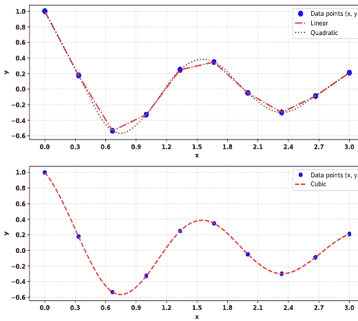

**5.7. 从 $f(x)=cos(4x)/(1+x), 0\le x\le 3$ 取的 10 个等距样本点使用线性、二次和三次多项式进行插值。**

## 5.4.2 函数 pchip_interpolate 和 CubicSpline [18]

这两个函数 `pchip_interpolate` 和 `CubicSpline` 的功能与 MATLAB 的 `pchip` 和 `spline` 相同。我们接收三个参数 (x, y, ps)，前两个参数代表插值数据点，最后一个参数是函数进行近似的点集。

Python 代码 `pchipinterpolate.py` 在 $[0.0,3.0]$ 内对 10 个数据点插值函数 $f(x)=sin(4x)/(1+x)$并使用插值多项式在 101 个数据点上近似函数。

```python
1 from numpy import sin, linspace, arange
2 from scipy.interpolate import pchip_interpolate, CubicSpline
3 import matplotlib.pyplot as plt
4 x = linspace(0, 3, 10)
5 y = sin(4*x)/(1+x)
6 xx = linspace(0, 3, 101) 
7
8 yyl1 = pchip_interpolate(x, y, xx)
9 yy2 = CubicSpline(x, y)(xx)
```

# Python 中的数据插值

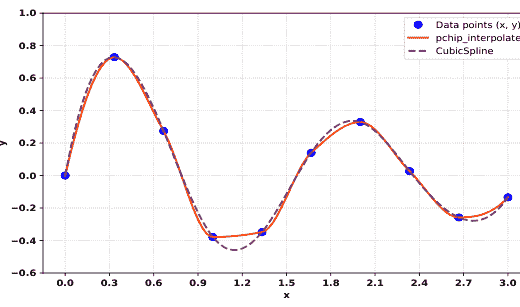

图 5.8: 使用函数 `pchip_interpolate` 和 `CubicSpline` 对从 $f(x)=sin(4x)/(1+x), 0\leq x\leq 3$ 取的10个等距样本点进行插值。

```python
plt.plot(x, y, 'bo', label='Data points (x, y)', lw = 4)
plt.plot(xx, yy, ls='-', color='orange', label='pchip_interpolate', lw= 2)
plt.plot(xx, yy, ls='-', color='purple', label='CubicSpline', lw= 2)
plt.xlabel('x', fontweight='bold')
plt.ylabel('y', fontweight='bold')
plt.grid(True)
plt.xticks(arange(0, 3.3, 0.3), fontweight='bold')
plt.yticks(arange(-0.6, 1.2, 0.2), fontweight='bold')
```

在图 5.8 中执行此代码。

## 5.4.3 Lagrange 插值

Python 函数 `lagrange` 通过拉格朗插值插值给定的数据。它接收两个坐标 $(x,y)$ 通过拉格朗插值创建一个 $n$ 阶多项式。

Python 脚本 `LagrangeInter.py` 使用拉格朗插值根据 $f(x)=(cos(4x))/(1+x)$ 在 10 个数据点上构造。

```python
from numpy import cos, linspace, arange
from scipy.interpolate import lagrange
import matplotlib.pyplot as plt

# 数据插值
x = linspace(0, 3, 101)
xx = linspace(0, 3, 101)
poly = lagrange(x, y)
yyl = poly(xx)

plt.subplot(212)
plt.plot(x, y, 'bo', label='Data points (x, y)', lw=4)
plt.plot(xx, yyl, ls='-', color='orange', label='Lagrange', lw=2)
plt.xlabel('x', fontweight='bold')
plt.ylabel('y', fontweight='bold')
plt.legend()
plt.grid(True, ls=':')
plt.xticks(arange(0, 0.3, 0.3), fontweight='bold')
plt.yticks(arange(-0.6, 1.2, 0.2), fontweight='bold')
```

运行此代码得到：

# 数值微分与积分

### 摘要

本章讨论了近似导数和积分数值方法。分为两个部分：第一部分讨论基于有限差分公式的数值微分，第二部分讨论基于柯斯方法的数值积分。这些数值微分积分算法在 MATLAB 和 Python 中实现。

### 6.1 数值微分

### 6.1.1 使用有限差分近似导数

设 $x_0 \in (a,b)$ 且 $f \in \mathcal{C}^{n+1}[a,b]$对于 $h>0$ 且 $k\le n$，在 $x_0$ 处的泰勒展开为：

```
f(x_0+h)=f(x_0)+hf'(x_0)+\frac{h^2}{2!}f''(x_0)+\dots+\frac{h^k}{k!}f^{(k)}(x_0)+\frac{h^{k+1}}{(k+1)!}f^{(k+1)}(\xi),\xi\in[x_0,x_0+h] \quad (6.1)
```

以及

```
f(x_0+h)=f(x_0)-hf'(x_0)+\frac{h^2}{2!}f''(x_0)+\dots+\frac{(-h)^k}{k!}f^{(k)}(x_0)+\frac{(-h)^{k+1}}{(k+1)!}f^{(k+1)}(\eta),\eta\in[x_0-h,x_0] \quad (6.2)
```

通过在方程 (6.1) 中设置 $k=1$ 并解出 $f'(x_0)$得到 $f(x)$ 在 $x=x_0$ 处的导数为：

```
f'(x_0) = \frac{f(x_0+h)-f(x_0)}{h} + \frac{h}{2}f''(\xi), \xi \in [x_0,x_0+h] \quad (6.3)
```

因此，通过取尽可能小的 $h \varepsilon \ge 0$，$f'(x)$ 可以近似为：

```
f'(x_0) \approx \frac{f(x_0+h)-f(x_0)}{h} \quad (6.4)
```

其中 $\varepsilon$ 表示机器精度。如果 $h$ 取值小于 $\varepsilon$，舍入误差会影响 $x_0$ 处近似导数的精度。

方程 (6.4) 中的 $f'(x)'$ 近似公式被称为**前向差分公式**。


# 数值微分

**示例 6.1** 在此示例中，将使用方程 (6.4) 来寻找 $f(x) = e^{-\sin(x^3)/4}$ 导数的近似值，其中 $h = 10^{-1},\dots,10^{-15}$。$f(x)$ 的精确导数为：

```python
$f'(x) = \frac{3x^2 \cos(x^3)}{4}e^{-\sin(x^3)/4}$$
```

还将显示每个 $h$ 值对应的误差。Python 代码如下：

```python
# fpaproxim.py
import numpy as np
f = lambda x: np.exp(-np.sin(x**3)/4)
fp = lambda x: -3*x**2*np.cos(x**3)/4*f(x)
h = 0.1
fpaproxim = []
ps = np.spacing(1.0)
while h >= Eps:
    fpl = (f(1+h)-f(1))/h
    fpaproxim.append([h, fp(1), np.abs(fp(1)-fpl)])
    h /= 10
print('  h', '\t\t', 'Approx Der', '\t\t', ..., '      'Approx Error')
print('  h')
for x in fpaproxim:
    print('{:0.1e}'.format(format(x[0])), '\t\t', ...
          '{:0.1e}'.format(format(x[1])), '\t\t', ...
          '{:0.1e}'.format(format(x[2])))
```

执行此代码将得到结果：

```
runfile('D:/Files/fpaproxim.py', wdir='D:/Files')
```

| h | 近似导数 | 近似误差 |
|---|---|---|
| 1.000e-01 | -2.58943704200143e-01 | 6.94058809434162e-02 |
| 1.000e-02 | -3.23122628690608e-06 | 5.22700628462928e-05 |
| 1.000e-03 | -3.27842659957308e-01 | 5.06971636996618e-04 |
| 1.000e-04 | -3.28299908103011e-01 | 5.05241825403950e-05 |
| 1.000e-05 | -3.28347589727164e-01 | 5.052507141092486e-06 |
| 1.000e-06 | -3.28349816117940e-01 | 5.05252635068303e-07 |
| 1.000e-07 | -3.28349815683963e-01 | 4.939506259571402e-08 |
| 1.000e-08 | -3.28349625670658e-06 | 6.0963463153323918e-09 |
| 1.000e-09 | -3.28346807782170e-01 | 4.941478650414376e-08 |
| 1.000e-10 | -3.28349697595144e-01 | 6.160751592210190e-09 |
| 1.000e-11 | -3.283498459532889e-01 | 1.17183504572528e-06 |
| 1.000e-12 | -3.28403970684121e-02 | 5.4339320690766068e-05 |
| 1.000e-13 | -3.28602152890463e-05 | 2.7638293526175974e-04 |
| 1.000e-14 | -3.330693073817546e-05 | 4.717276024116422e-03 |
| 1.000e-15 | -4.440892098500626e-05 | 1.17539738468321e-01 |

 数值微分

MATLAB 代码如下：

```matlab
% fpaproxim.m
f = @(x) exp(-sin(x^3)/4);
fp = @(x) -3*x^2*cos(x^3)/4*f(x);
fpapp = zeros(15, 3);
h = 1e-6;
j = 1;
while h > eps
  fp1 = (f(1+h)-f(1))/h;
  fpapp(j,:) = [h, fp(1), abs(fp1)];
  h = h / 10;
  j = j + 1;
end
```

执行此代码得到结果。图 6.1 显示了 $h$ 与对应误差之间的关系。较小的 $h$ 值可以提高导数的近似。使用前向差分公式 $f'(x) = \frac{f(1+h)-f(1)}{h}$ 来近似 $f'(1)$。图 6.1 显示了 $f'(1)$ 对应不同 $h$ 值的误差。基于方程 (6.6) 运行 `fdfapprox.py` 可以获得相似的结果：

```python
# fdfapprox.py
runfile('D:/Files/fdfapprox.py', wdir='D:/Files')
```

| h | 近似导数 | 近似误差 |
|---|---|---|
| 1.000e-01 | -3.63103359976975e-01 | 3.75370413567303e-02 |
| 1.000e-02 | -3.32305430441633e-01 | 4.80911677732580e-03 |
| 1.000e-03 | -2.388531422600549e-01 | 5.035108962624529e-04 |
| 1.000e-04 | -2.384001803769982e-01 | 5.050667428636908e-05 |
| 1.000e-05 | -2.383546835974951e-01 | 5.05222406559236e-06 |
| 1.000e-06 | -2.385015132564278e-01 | 5.051613382045517e-07 |
| 1.000e-07 | -2.384963807822171e-01 | 4.941748657592941e-08 |
| 1.000e-08 | -2.384963632963629e-01 | 5.005886501018647e-09 |
| 1.000e-09 | -2.384963795579146e-01 | 6.160751522210190e-10 |
| 1.000e-10 | -2.384963795579146e-01 | 6.160751522210190e-10 |
| 1.000e-11 | -2.384963845329288e-01 | 5.668293117714975e-01 |
| 1.000e-12 | -2.382992483168587e-01 | 5.662897117149757e-05 |
| 1.000e-13 | -2.375159726422411e-01 | 8.338399009903952e-04 |
| 1.000e-14 | -2.319664771412953e-01 | 6.38494522135142e-03 |
| 1.000e-15 | -2.220464094250313e-01 | 1.063050264383992e-02 |

通过在方程 (6.1) 和 (6.5) 中设置 $k=2$，从方程 (6.5) 中求解 $f'(x)$ 得到：

$f''(x) = \frac{f(x_0+h)-2f(x_0)+f(x_0-h)}{h^2} + \frac{h^2}{3}f'''(\tau), \tau \in [x_0-h, x_0+h]$

由此得到导数的第三公式：
$f'(x) = \frac{f(x_0+h)-f(x_0-h)}{2h} \quad (6.10)$

方程 (6.10) 中的公式被称为中心差分公式。如果 $|f'''(x)|\in\mathbb{R}^+$，则中心差分的近似误差限于 $Mh^2$，这意味着 $O(h^2)$。实现中心差分公式的 Python/MATLAB 代码通过替换示例 6.1 中的行获得：

```matlab
fp1 = (f(1+h)-f(1-h))/(2*h)
```

 数值微分和积分

**图 6.2：** 在对数尺度上比较前向误差和中心差分误差。在图 6.2 中，在不同的 $h$ 值下，前向差分公式得到的近似误差与中心差分公式得到的误差进行了对比。从图 6.2 可以看出，中心差分公式对一阶导数的近似更好，因为它产生的误差更小。

在图 6.3 中，$f(x) = e^{-\sin(x^3)}$ 的精确导数图绘制在区间 $[0,\pi/2]$，对比前向差分公式得到的近似导数图。如果将区间 $[0,\pi/2]$ 划 $N$ 个子区间 $[x_0,x_1],\dots,[x_{N-1},x_N]$，可以使用 numpy 库中的 Python 函数 **diff** 计算向量 $df = [f(x_1)-f(x_0), f(x_2)-f(x_1),\dots, f(x_N)-f(x_{N-1})]$。如果 $dx = \pi/(2N)$，$df/dx$ 返回点 $x_0,\dots,x_{N-1}$ 处的导数近似值。使用 numpy 函数 **diff** 来绘制 $f'(x)$：

```python
import numpy as np
import matplotlib
import matplotlib.pyplot as plt
matplotlib.rc('text', usetex=True)
matplotlib.rcParams('text.latex.preamble', ['r'\usepackage{amsmath}'])
a, b = 0.0, 2.0
N = 1000
x = np.linspace(a, b, N+1)
f = lambda x: np.exp(-np.sin(x**3)/4)
d = np.diff(f)
```

图 6.3：$f(x) = e^{-\sin(x^3)}$ 的精确导数图绘制在区间 $[0, \pi/2]$，对比前向差分公式得到的近似导数图。**图 6.4** 显示了使用 diff 函数的 $f'(x), x \in [0, \frac{\pi}{2}]$ 的图。

132 数值微分和积分

为了找到 $x=x_0$ 处 $f''(x)$ 的近似值，将方程 (6.1) 加到 (6.5) 并求解所得的 $f'(x)$，得到：

$f''(x) = \frac{f(x_0+h)-2f(x_0)+f(x_0-h)}{h^2} + \frac{h^2}{3}f'''(\tau), \tau \in [x_0-h, x_0+h]$

$f(x)=e^{-x^2}$ 的二阶导数为 $f''(x)=2(1-2x^2)e^{-x^2}$。以下 MATLAB 命令近似 $f(x), x \in [-3,3]$ 的二阶导数并绘图：

```matlab
>> x = linspace(-3, 3, 601);
>> f = @(x)exp(-x.^2);
>> y = diff(f(x), 2);
>> plot(x(2:end-1), y, '-b', 'LineWidth', 2);
>> xlabel('x'); ylabel('y');
>> legend('d^2f(x)/dx^2 = 2(1-2x^2)e^{-x^2}');
>> grid
```

图 6.5：$f''(x)=2(1-2x^2)e^{-x^2}$ 在区间 $[-3,3]$ 内。


## 数值积分

$j = 1, \dots, 10$，对应的 $f''(x)$ 的近似值和误差如下：

| | 近似导数 | 近似误差 |
|---|---|---|
| 1.000e-01 | -7.29463309943767e-01 | 6.12251348507966e-03 |
| 1.000e-02 | -7.35697570926852e-01 | 6.131136019498496e-05 |
| 1.000e-03 | -7.35785262956494e-01 | 6.13082325906042e-07 |
| 1.000e-04 | -7.35785760470435e-01 | 6.295418117248882e-09 |
| 1.000e-05 | -7.35781210953866e-01 | 7.612474970387536e-07 |
| 1.000e-06 | -7.357800395703222e-01 | 4.142722474397605e-05 |
| 1.000e-07 | -7.27196081294472e-01 | 8.562801213407467e-03 |
| 1.000e-08 | -1.66533453697337e+04 | 9.297564559484595e-01 |
| 1.000e-09 | 1.11022304265156e+02 | 1.117580613448585e+02 |
| 1.000e-10 | 5.551115231251780e+03 | 5.551850880028112e-03 |
| 1.000e-11 | 5.551115231251780e+05 | 5.551224807146404e+05 |
| 1.000e-12 | 1.11022304265156e+08 | 1.110223031982745e+08 |

上表显示，当步长 $h$ 小于 $10^{-5}$ 时，误差变得越来越大。这是因为近似公式要求 $h^2 \leq 10^{-16} < \varepsilon$。

### 6.2 数值积分

如果 $f$ 是定义在实数区间 $[a,b]$ 上的函数，那么 $f$ 从 $x=a$ 到 $x=b$ 的曲线面积由积分给出：

> $I = \int_{a}^{b} f(x)dx$

如果 $F(x)$ 是 $f(x)$ 在 $[a,b]$ 上的原函数，那么根据微积分基本定理：

> $I = \int_{a}^{b} f(x)dx = F(b) - F(a)$

然而，许多定义在有限区间上的函数其原导函数是未知的，尽管它们确实存在。此类示例包括

> $I_1 = \int_{0}^{\infty} \frac{\sin(x)}{x}dx$

> $I_2 = \int_{0}^{3} e^{-x^2}dx$

以及

数值积分方法通过首先通过点 $x_0, x_1, \dots, x_N$ 对区间 $[a,b]$ 进行划分（使得 $a \le x_0 < x_1 < \dots < x_N \le b$），来寻找函数 $f$ 在区间 $[a,b]$ 上的定积分，并通过如下形式的和来近似 $I$：

```
$I = \int_a^b f(x)dx \approx \sum_{j=0}^N w_j f(x_j) \quad (6.12)$
```

不同的数值积分方法在于点 $x_i$ 的选取以及系数 $w_j$ 的计算方式。方程 (6.12)称为称为数值求积*（numerical quadrature）。因此，“数值求积”指的是用有限和来近似积分公式的形式。

在本章中，我们将讨论两类数值积分方法，即牛顿-科特（Newton-Cotes）方法和高斯（Gauss）方法。

### 6.2.1 牛顿-科特方法

在牛顿-科特方法中，点 $x_0, \dots, x_n$ 的选取满足 $x_0 = a < x_1 < \dots < x_n = b$，其中 $h=(b-a)/n$。牛顿-科特方法近似 $I = \int_a^b f(x)dx$ 的思想是首先用 $n$ 次多项式 $P_n(x)$ 近似 $f(x)$，然后通过 $P_n(x)$ 的积分近似 $I$：

$$\int_a^b f(x)dx \approx \sum_{j=0}^n w_j f(x_j) \quad (6.13)$$

因此，牛顿-科特方法中的求积权重 $w_j$ 给出：

$$w_j = \int_a^b L_j(x)dx$$

我们将讨论 $n=1$ 和 $n=2$ 的数值积分公式。

$n=1$：当 $n=1, h=(b-a)$ 时，给定点 $(a,f(a))$ 和 $(b,f(b))$。朗日插值多项式为：

$$P_1(x) = \frac{x-b}{a-b}f(a) + \frac{x-a}{b-a}f(b)$$

因此，

$$\int_a^b f(x)dx \approx \frac{h}{2}(f(a) + f(b)) \quad (6.14)$$


图 6.6：用梯形面积近似曲线下方面积。方程 (14) 给出了梯形法则，其中从 $x=a$ 到 $x=b$ 的 $f(x)$ 曲线面积由底为 $f(a)$ 和 $f(b)$、高为 $b-a$ 的梯形近似。在图 6.6 中，$f(x)$ 的曲线面积由阴影面积近似。为了找到积分误差的估计，从公式开始：

$$f(x) = P_1(x) + \frac{(x-a)(x-b)}{2}f''(\xi), \xi \in [a,b]$$

由此给出近似误差：

$$\int_a^b (f(x) - P_1(x))dx = \left| \int_a^b \frac{(x-a)(x-b)}{2}f''(x)dx \right|$$
$$\leq \left| \frac{(b-a)^3}{12}f''(\xi) \right| = \frac{h^3}{12}|f''(\xi)|$$

如果 $f''$ 在 $[a,b]$ 上被 $M \in \mathbb{R}^+$ 限制，则：

$$\left| \int_a^b (f(x) - P_1(x))dx \right| \leq \left| \int_a^b f(x) - P_1(x)dx \right| \leq \frac{M}{12}h^3 \quad (6.15)$$

误差公式 6.15 显示 $h=b-a$ 的大会导致误差。

**示例 6.2** 在此例中，将使用梯形法则近似积分：

$$I = \int_0^1 \frac{1}{1+x^2}dx$$

## 数值微分与积分

这里，$a = 0.0, b = 1.0$ 且 $f(x) = 1/(1+x^2)$。可以使用以下 MATLAB 命令计算积分：

```matlab
>> a = 0.0; b = 1.0; f = @(x) 1/(1+x^2);
>> I = (b-a)/2*(f(a)+f(b));
>> disp(I)
0.7500
```

在 Python 中：

- 在 [1]: a, b, f = 0.0, 1.0, lambda x: 1/(1+x**2)
- 在 [2]: I = (b-a)/2*(f(b)+f(a))
- 在 [3]: print(I)
0.75

示例 6.2 中积分的精确值 ≈ 0.7853981633947483。近似误差为 $\pi/4 - 0.75 = 0.035398163394782$。

$n=2$：当 $n=2, h=(b-a)/2$ 时，给定数据点 $(a,f(a)), ((a+b)/2, f((a+b)/2))$ 和 $(b,f(b))$。朗日插值多项式：

$$P_2(x) = \frac{(x-c)(x-b)}{(a-c)(a-b)}f(a) + \frac{(x-a)(x-b)}{(c-a)(c-b)}f(c) + \frac{(x-a)(x-c)}{(b-a)(b-c)}f(b)$$

其中 $c=(a+b)/2$。令 $x=a+th, 0 \le t \le 2$ 为 $x$ 关于 $t$ 的表示。那么 $P_2(x)$ 可以重写为：

$$P_2(x) = \frac{(t-1)(t-2)}{2}f(a) + \frac{t(t-2)}{2}f(c) + \frac{t(t-1)}{2}f(b)$$

那么，

$$\int_a^b f(x)dx \approx \int_0^2 \left(\frac{(t-1)(t-2)}{2}f(a) + \frac{t(t-2)}{2}f(c) + \frac{t(t-1)}{2}f(b)\right) dt$$
$$= \frac{h}{3}(f(a) + 4f\left(\frac{a+b}{2}\right) + f(b)) \quad (6.16)$$

求积 (6.16) 称为辛普森法则。

## 数值积分

方程 (6.16) 中通过 $\int_a^b P_2(x)dx$ 近似 $\int_a^b f(x)dx$ 的领先误差项为：

$$\int_a^b (f(x)-P_2(x))dx = \int_a^b |f(x)-P_2(x)|dx = \int_0^2 \left|\frac{(t-1)(t-2)}{6}f(\xi)\right|$$

其中 $a \le \xi \le b$。因此，移动到误差的下一项是：

$$\int_a^b f(x)dx - \int_a^b P_2(x)dx \le \int_0^2 \frac{(t-1)(t-2)(t-4)}{120}|f^{(4)}(\eta)| = \frac{h^5}{90} f^{(4)}(\eta), a \le \eta \le b \quad (6.17)$$

使用 MATLAB 应用辛普森法则解决问题 6.2，$a=0.0, b=1.0$ 且 $h=(b-a)/2=0.5$：

```matlab
>> a = 0.0; b = 1.0; f = @(x) 1/(1+x.^2);
>> h = (b-a)/2;
>> c = (a+b)/2;
>> I_s = h/3*(f(a)+4*f(c)+f(b))
I_s = 0.7833
>> format e
>> disp(abs(pi/4-I_s))
2.0648e-03
```

在 Python 中：

- 在 [4]: import numpy as np
- 在 [5]: a, b, f = 0.0, 1.0, lambda x: 1/(1+x**2)
- 在 [6]: c, h = (a+b)/2, (b-a)/2
- 在 [7]: I_s = h/3.0*(f(a)+4*f(c)+f(b))
- 在 [8]: print(I_s)
0.7833333333333333
- 在 [9]: print(f'{1:.4e}'.format(np.abs(pi/4-I_s)))
2.0648e-03

用辛普森法则 (6.16) 近似 $\int_a^b f(x)dx$ 的误差随 $h=(b-a)/n$ 增大而增大。为了获得 $\int_a^b f(x)dx$ 的更好的近似，是牛顿-科特方法的复合版本，它将区间 $[a,b]$ 划分为 $N$ 个区间（$N \in \mathbb{Z}^+$），点 $x_0=a < x_1 < \dots < x_N=b$，其中 $x_{j+1}-x_j=(b-a)/N$。然后，在每个子区间 $[x_j, x_{j+1}]$ 上，$\int_a^b f(x)dx$ 被近似为


图 6.7：复合梯形法则。

求积。将两个从牛顿-科特方法导出的复合法则。

- a) **复合梯形法则**：公式的推导从公式开始：
$$\int_a^b f(x)dx = \int_{x_0}^{x_N} f(x)dx = \int_{x_0}^{x_1} f(x)dx + \int_{x_1}^{x_2} f(x)dx + \dots + \int_{x_{N-1}}^{x_N} f(x)dx,$$
然后，在子区间 $[x_j, x_{j+1}]$ 上，积分 $\int_{x_j}^{x_{j+1}} f(x)dx$ 被近似为 $h/2(f(x_j) + f(x_{j+1}))$。这给出公式：
$$\int_a^b f(x)dx \approx \sum_{j=0}^{N-1} \frac{h}{2}(f(x_j) + f(x_{j+1}))$$
$$\+\frac{h}{2}(f(x_0) + 2f(x_1) + \dots + 2f(x_{N-1}) + f(x_N))$$
$$\frac{h}{2}(f(x_0) + 2f(x_1) + \dots + 2f(x_{N-1}) + f(x_N)) \quad (6.18]$$

图 6.7 显示了梯形面积，其总和接近函数曲线下的面积。


# 数值积分

| | | |
|---|---|---|
| 10 | h = (b-a)/N |
| 11 | x = linspace(a, b, N+1); |
| 12 | I = h/2*f(x(0))+f(x(N)); |
| 13 | I = I + h*sum(f(x(2:N))); |
| 14 | Err = abs(pi/4-I); |
| 15 | Approx = [Approx; [N I Err]]; |
| 16 | printf('%%d%1.12f%t%1.12e\n', N, I, Err); |
| 17 | N = N+2; |
| 18 | end |
| 19 | printf('\n'); | |

运行代码得到结果：

| N | 似似积分 | 误差 |
|---|---|--|
| 10 | 0.784981497227 | 4.16661706586083e-04 |
| 20 | 0.78529396739 | 1.0411665891615050e-04 |
| 40 | 0.785372121731 | 2.60416654529651e-05 |
| 80 | 0.785396152981 | 6.5014664773366e-06 |
| 160 | 0.785396537953 | 1.627064443412e-06 |
| 320 | 0.785397756496 | 4.06901409176079e-07 |
| 640 | 0.78539806172 | 1.017252999330317e-06 |
| 1280 | 0.785398137962 | 2.543115035383665e-06 |
| 2560 | 0.785398157040 | 6.35872940414095e-09 |
| 5120 | 0.785398161808 | 1.58945854337435e-09 |
| 10240 | 0.785398163000 | 3.973615880728126e-10 |
| 20480 | 0.785398163298 | 9.934308931036640e-11 |
| 40960 | 0.785398163373 | 2.483746541770415e-11 |
| 81920 | 0.785398163391 | 6.210696822055588e-12 |
| 163840 | 0.785398163396 | 1.5556445021024769e-12 |

在 Python 中，代码如下：

```python
# simpy.py
import numpy as np
a, b, f = 0.0, 1.0, lambda x: 1/(1+x**2)
ApproxTable = []
N = 10
print('  \tApprox Int.\t Error')
print('------------------------------------------------')
while N <= 20000:
    x = np.linspace(a, b, N+1)
    h = (b-a)/N
    I = h/2*f(x[0])+f(x[-1])
    I = I + h*sum(f(x[1:N]))
    Err = np.abs(np.pi/4-I)
    print('{0:6f}'.format(N), '\t', '{1:0.12f}'.format(I), '\t', '{2:0.12e}'.format(Err))
    N = N*2
```

# 数值微分与与积分

执行代码得到结果：

runfile('D:/PyFiles/compsimp.py', wdir='D:/PyFiles')

| N | 似似积分 | 误差 |
|---|---|--|
| 10 | 0.78498497227 | 4.16661706586e-04 |
| 20 | 0.78523996739 | 1.041666589161e-04 |
| 40 | 0.78537212171 | 2.604616654530e-05 |
| 60 | 0.78539652981 | 6.510416664773e-06 |
| 160 | 0.78539653793 | 1.627604166443e-06 |
| 320 | 0.78539756496 | 4.06090104171e-06 |
| 640 | 0.78539806172 | 1.017252601043e-07 |
| 1280 | 0.785398137962 | 2.543115035383665e-08 |
| 2560 | 0.78539815074 | 6.35872940414095e-09 |
| 5120 | 0.785398161808 | 1.58945854337435e-09 |
| 10240 | 0.78539816300 | 3.973615880728126e-10 |
| 20480 | 0.785398163298 | 9.934308931036640e-11 |
| 40960 | 0.785398163373 | 2.483746541770415e-10 |
| 81920 | 0.785398163391 | 6.210696822055588e-12 |
| 163840 | 0.785398163396 | 1.5556445021024769e-12 |

(ii) 复合 Simpson 法则：令 $N\in\mathbb{Z}^+$（偶整数），$h=(b-a)/N$。在 $[a,b]$ 上，复合 Simpson 法则近似为：
$\int_{a}^{b} f(x)dx = \int_{x_0}^{x_2} f(x)dx + \int_{x_2}^{x_4} f(x)dx + \dots + \int_{x_{N-2}}^{x_N} f(x)dx$
$= \frac{h}{3}(f(x_0) + 4f(x_1) + f(x_2)) + \frac{h}{3}(f(x_2) + 4f(x_3) + f(x_4)) + \dots + \frac{h}{3}(f(x_{N-2}) + 4f(x_{N-1}) + f(x_N))$
$= \frac{h}{3}(f(x_0) + 4\sum_{j=1,3,\dots}^{N-1} f(x_j) + 2\sum_{j=2,4,\dots}^{N-2} f(x_j) + f(x_N))$。

下面的 MATLAB 代码使用复合 Simpson 法则计算 $\int_0^1 \frac{1}{1+x^2}dx$，其中 $N=10, 2^k$：

```matlab
% compsimp.m
clear; clc;
format short
a = 0.0; b = 1.0; f = @(x) 1/(1+x.^2); IEact = pi/4;
N = 10; Approx = [];
fprintf('----------------------------------------------\n');
fprintf('N\tApprox\t\tError\n');
fprintf('----------------------------------------------\n');
while N <= 1000
    [I, Err] = CompSimpson(f, a, b, IEact);
    Approx = [Approx; [N I Err]];
    N = N+2;
end

function [I, Err] = CompSimpson(f, a, b, IEact)
    h = (b-a)/N;
    x = linspace(a, b, N+1);
    I = h/3*(f(x(1))+f(x(end)));
    for j = 2:N
        if mod(j, 2) == 0
            I = I + 2*h*f(x(j));
        else
            I = I + 4*h*f(x(j));
        end
    end
    Err = abs(IEact-I);
end
```

运行代码得到：

| N | 似似积分 | 误差 |
|---|---|--|
| 10 | 0.7853981635485 | 9.91264448023314e-09 |
| 20 | 0.7853981632422 | 1.550021222485043e-10 |
| 40 | 0.7853981636395 | 2.422824538754017e-12 |
| 80 | 0.7853981639397 | 3.38560513971784e-14 |
| 160 | 0.7853981639397 | 3.306690738754706e-15 |
| 320 | 0.7853981639397 | 1.110223024625517e-16 |
| 640 | 0.7853981639397 | 3.330690738754706e-16 |
| 1280 | 0.7853981639397 | 2.240446092503312e-16 |
| 2560 | 0.7853981639397 | 1.110223042652517e-16 |
| 5120 | 0.7853981639397 | 1.887379141862766e-15 |

在 Python 中，代码为：

```python
# CompositeSimpson.py
import numpy as np
def CompSimpson(f, a, b, N, IEact):
    h = (b-a)/N
    x = np.linspace(a, b, N+1)
    I = h/3*(f(x[0])+f(x[-1]))
    for j in range(1, N):
        if j%2 == 1:
            I += 4*h.*f(x[j])
        else:
            I += 2*h.*f(x[j])
    Error = np.abs(IEact-I)
    return I, Error

a, b, N = 0.0, 1.0, 10
ApproxTable = []
IEact = np.pi/4
print('\n\tApprox Int.\t Error')
print('--------------------------------')
while N <= 10000:
    I, Err = CompSimpson(f, a, b, N, IEact)
    ApproxTable.append([N, I, Err])
    print('{0:6f}'.format(N), '\t', '{1:0.12f}'.format(I), '\t', '{2:0.12e}'.format(Err))
    N *= 2
```

执行该代码得到：

runfile('D:/PyFiles/CompositeSimpson.py', wdir='D:/PyFiles')

| N | 似似积分 | 误差 |
|---|---|--|
| 10 | 0.7853981635485 | 9.91264448023314e-09 |
| 20 | 0.7853981632422 | 1.550021222485043e-10 |
| 40 | 0.7853981636395 | 2.422824538754015e-10 |
| 80 | 0.7853981639397 | 3.7966927442184e-10 |
| 160 | 0.7853981639397 | 3.330690738735e-06 |
| 320 | 0.7853981639397 | 1.110223024625e-05 |
| 640 | 0.7853981639397 | 2.220446094295e-05 |
| 1280 | 0.7853981639397 | 1.110223024625e-06 |
| 2560 | 0.7853981639397 | 1.8873791418634e-15 |

MATLAB 和 Python 均包含了基于梯形法则和 Simpson 法则计算积分 $\int_a^b f(x)dx$ 的函数。MATLAB 函数 `trapz` 使用两个向量 $x$（$[a,b]$ 内的离散值）和 $f(x)$（对应的 $x$ 值）。它应用梯形法则返回：

```matlab
>> x = linspace(0, 1, 101);
>> f = exp(-x.^2);
>> format long
>> I = trapz(x, f)
I = 0.746180146297
```

Python 的 `scipy.integrate` 库包含了 `trapz`。它与 MATLAB 的 `trap` 函数的区别在于先接收 $f$ 向量再接收 $x$：

```python
In [10]: from scipy.integrate import trapz
In [11]: import numpy as np
In [12]: x = np.linspace(0, np.pi, 500)
In [13]: g = np.zeros_like(x)
In [14]: g[0], g[1:] = 1.0, np.sin(x[1:]
In [15]: I = trapz(g, x)
In [16]: print(I)
1.85193600583526
```

此外，MATLAB 的 `quad` 应用 Simpson 法则来评估 $\int_a^b f(x)dx$。它接收函数句柄 $f$、$a$ 和 $b$，然后返回积分值：

```matlab
>> x = linspace(0, pi, 501);
>> h = @(x) sin(x).x;
>> I = quad(h, 0, pi)
I = 1.8519e+00
```

Python 的 `quad` 位于 `scipy.integrate` 库，接收与 MATLAB `quad` 函数相同的参数，但它返回的值：积分值和近似误差。

```python
In [17]: from scipy.integrate import quad
In [18]: h = lambda x: np.exp(-x**2)
In [19]: I = quad(h, 0.0, 1.0)
In [20]: print('Integral = ', I[0], ', ', Error = ', I[1])
Integral = 0.746824132814271 , Error = 8.291413759407255e-15
```

## 2.2.2 高斯积分法

在近似积分

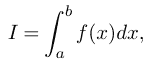

使用阶为 $n$ 的拉格朗日插值式在等间距点上插值被积函数 $f(x)$，从而推导出牛顿-柯斯公式。例如牛顿-柯斯。


# 数积分

因此，

```
$$w_1 f(x_1) + \dots + w_n f(x_n) = c_0 + \dots + c_{2n-1}x^{2n-1}$$
$$w_1 f(x_1) + \dots + w_n f(x_n) = c_0 + \dots + c_{2n-1}x^{2n-1}$$
$$w_1 f(x_1) + \dots + w_n f(x_n) = c_0 + \dots + c_{2n-1}x^{2n-1}$$
$$w_1 f(x_1) + \dots + w_n f(x_n) = c_0 + \dots + c_{2n-1}x^{2n-1}$$
$$w_1 f(x_1) + \dots + w_n f(x_n) = c_0 + \dots + c_{2n-1}x^{2n-1}$$
```

比较方程 (62) 和 (63) 的项，得到 $2n$ 个关于未知数 $x_j$ 和 $w_j$ ($j=1, \dots, n$) 的方程：

$$w_1 + w_2 + \dots + w_n = b-a$$
$$w_1 x_1 + w_2 x_2 + \dots + w_n x_n = \frac{b^2-a^2}{2}$$
$$w_1 x_1^2 + w_2 x_2^2 + \dots + w_n x_n^2 = \frac{b^3-a^3}{3}$$
$$w_1 x_1^3 + w_2 x_2^3 + \dots + w_n x_n^3 = \frac{b^4-a^4}{4}$$

通过求解非线性方程组 (64) 可以得到点 $x_1, \dots, x_n$ 和权重 $w_1, \dots, w_n$。以下是 $n=1$ 和 $n=2$ 的高斯公式推导：

- **单点高斯积分：** 当 $n=1$ 时，需要找到一个点 $x_1$ 和权重 $w_1$。由于 $2n-1=1$，假设 $f(x) = c_0 + c_1 x$。关于 $x_1$ 和 $w_1$ 的方程为：

```
$$w_1 = b-a$$
$$w_1 x_1 = \frac{b^2-a^2}{2}$$
```

求解该方程组得到：

```
$$w_1 = b-a \text{ 且 } x_1 = \frac{b+a}{2}.$$
```

高斯积分为：

```
$$\int_a^b f(x)dx = (b-a)f\left(\frac{b+a}{2}\right) (65)$$
```

- **双点高斯积分：** 当 $n=2$ 时，需要找到两个点 $x_1, x_2$ 和权重 $w_1, w_2$。由于 $2n-1=3$，假设函数 $f(x)$ 为三次函数（即 $f(x) = c_0 + c_1x + c_2x^2 + c_3x^3$）。关于 $x_1, x_2$ 的方程组为：

```
$$w_1 + w_2 = b-a$$
$$w_1 x_1 + w_2 x_2 = \frac{b^2-a^2}{2}$$
$$w_1 x_1^2 + w_2 x_2^2 = \frac{b^3-a^3}{3}$$
$$w_1 x_1^3 + w_2 x_2^3 = \frac{b^4-a^4}{4}$$
```

以下 Python 代码可寻找非线性系统的解：

- [21]: import sympy as smp
- [22]: import sympy.solvers import solve
- [23]: w1, w2, x1, x2, a, b = smp.symbols('w1, w2, x1, x2, a, b', cls=sym.Symbol)
- [24]: Syst = [w1+w2-(b-a), w1*x1+w2*x2-(b**2-a**2)/2, w1*x1**2+w2*x2**2-(b**3-a**3)/3, w1*x1**3+w2*x2**3-(b**4-a**4)/4]
- [25]: vrs = [w1, w2, x1]
- [26]: Sol = solve(Syst, vrs)
- [27]: print(Sol[0])
  (-(a - b)/2, -(a - b)/2,sqrt(3)*a/6 + a/2 - sqrt(3))
- [28]: print(Sol[1])
  (-(a - b)/2, -(a - b)/2,sqrt(3)*a/6 + a/2)

Python 符号库提供了非线性方程组的解出了 $x_1$ 和 $x_2$ 的值。如果我们设定条件 $x_1 < x_2$，则非线性方程组解为：

$$w_1=w_2=\frac{b-a}{2}, x_{1,2}=\frac{b+a}{2}$$

双点高斯积分为：

$$\int_a^b f(x)dx=\frac{b-a}{2}\left(f\left(\frac{b+a}{2}-\frac{b-a}{2\sqrt{3}}\right)+f\left(\frac{b+a}{2}+\frac{b-a}{2\sqrt{3}}\right)\right) (66)$$

**示例 3** 在此例中，将使用单点和双点高斯积分来计算：

$$\int_0^2 \frac{x}{1+2x^2}$$

区间 $[0,2]$ 被划分为 $N$ 个区间（$N$ 为正整数），$0 = x_0 < x_1 < \dots < x_N=2$。每个子区间 $[x_j, x_{j+1}]$ 的长度为 $h=2/N$。然后使用单点或双点积分来近似 $\int_{x_j}^{x_{j+1}} f(x)dx$：

单点高斯积分近似：

$$\int_{x_j}^{x_{j+1}} f(x)dx \approx hf\left(\frac{x_j+x_{j+1}}{2}\right)$$

然后：

$$\int_a^b f(x)dx \approx \sum_{j=0}^{N-1} hf\left(\frac{x_j+x_{j+1}}{2}\right)$$

双点高斯积分近似：

$$\int_{x_j}^{x_{j+1}} f(x)dx \approx \frac{h}{2}\left(f\left(\frac{x_j+x_{j+1}}{2}-\frac{x_{j+1}-x_j}{2\sqrt{3}}\right)+f\left(\frac{x_j+x_{j+1}}{2}+\frac{x_{j+1}-x_j}{2\sqrt{3}}\right)\right)$$

MATLAB 代码展示了不同 $N=10 \times 2^k, k=0,\dots,10$ 情况的单点和双点高斯积分的近似值和误差。

```matlab
1 clear; clc;
2 f = @(x) x./(1+2*x.^2);
3 a = 0.0; b = 2.0;
4 N = 10;
5 Exact = log(9)/4;
6 GL1Approx = []; GL2Approx = [];
7
8 while N < 20000
9   x = linspace(a, b, N+1);
10  h = (b-a)/N;
11  I1 = h*sum(f((x(1:N)+x(2:N+1))/2));
12  Err1 = abs(I1-Exact);
13  GL1Approx = [GL1Approx; N I1 Err1];
14  I2 =
15      h/2*sum(f((x(1:N)+x(2:N+1))/2-(x(2:N+1)-x(1:N))*sqrt(3)/6)
16      ... +f((x(1:N)+x(2:N+1))/2+(x(2:N+1)-x(1:N))*sqrt(3)/6));
17  Err2 = abs(I2-Exact);
18  GL2Approx = [GL2Approx; N I2 Err2];
19  N = 2*N;
20 end
21 fprintf('Integration with 1-point Gauss quadrature\n');
22 fprintf('%s\t\tApprox Int.\%s\t Error\n', GL1Approx(:,1), GL1Approx(:,2), GL1Approx(:,3));
23 [m, L] = size(GL1Approx);
24 for j = 1:m
25     printf('  %d\t%.12f\t%.12e\n', GL1Approx(j,1), GL1Approx(j,2), GL1Approx(j,3));
26 end
```

执行单点高斯积分的输出如下：

```
Integration with 1-point Gauss quadrature
```


## 150 数值微分与积分

```python
print (' N\t Error Approx.\t\t Error\n') -----------------------------------------
print (' N\t Conv. Rate\n') ---------------------------------------
for i in range(len(GL2Approx)) :
    for j in range(m):
        print ('{0:.6f}'.format(GL2Approx[j][0]), '\t', \
               '{0:.12f}'.format(GL2Approx[j][1]), '\t', \
               '{0:.12f}'.format(GL2Approx[j][2]))
    print ('n{0:.12f}\n\n')
```

由于示例中的子区间数量增加了一倍，1-点和 2-点高斯积分的收敛速率可以使用以下公式计算：

$R_N = \log_2\left(\frac{ErrorN}{Error2N}\right)$

```python
RConv1 = []
print ('Rates of convergence for 1-point Gauss quadrature: \n')
print (' N\t Conv. Rate\n')
print ('--------------------------------------')
for k in range(m-1):
    RConv1.append(np.log2(GL1Approx[k][2]/GL1Approx[k+1][2]))
    print ('{0:.4f}'.format(GL1Approx[k][0]), '\t ...', RConv1[-1])
print ('--------------------------------------\n')

RConv2 = []
print ('Rates of convergence for 2-points Gauss quadrature: \n')
print ('--------------------------------------\n')
print (' N\t Conv. Rate\n')
print ('--------------------------------------\n')
for k in range(m-1):
    RConv2.append(np.log2(GL2Approx[k][2]/GL2Approx[k+1][2]))
    print ('{0:.4f}'.format(GL2Approx[k][0]), '\t ...', '{0:.3f}'.format(RConv2[-1]))
print ('--------------------------------------\n')
```

执行代码：
1-点高斯积分的收敛速率：

| N | 收敛速率 |
|---|---|
| 10 | 2.0115 |
| 20 | 2.0044 |
| 40 | 2.0001 |
| 80 | 2.0000 |
| 160 | 2.0000 |

2-点高斯积分的收敛速率：

| N | 收敛速率 |
|---|---|
| 10 | 4.060 |
| 20 | 4.014 |
| 40 | 4.003 |
| 80 | 4.001 |
| 160 | 4.000 |
| 320 | 3.998 |
| 640 | 4.010 |
| 1280 | 4.402 |
| 2560 | 0.000 |
| 5120 | -0.652 |

上述结果显示，1-点高斯积分表现为二阶方法，而 2-点高斯积分表现为四阶方法。

当 $n \ge 3$ 时，可以获得高阶高斯积分方法。事实上，在 $n$-点高斯积分中，点 $x_1,x_2,\dots,x_n$ 是勒加德多项式 $P_n(x)$ 的根。因此，这类点被称为*勒加德-高斯点*。位于 *scipy.special* 中的 Python 函数接收参数 $n$ 并返回相应的第 $n$ 阶勒加德多项式的系数 [5, 44]。

```python
In [29]: from scipy.special import legendre
In [30]: legendre(4)
Out [30]: poly1([4.3750000e+00, 4.857225372e-16,-3.7500000e+01, 2.4286128e-16, 3.75000000e-01])
In [31]: legendre(4)
4 3 2
4.375 x + 4.857e-16 x - 3.75 x + 2.429e-16 x + 0.375
```

```python
In [32]: np.roots(legendre(4))
Out [32]: array([0.86113631, -0.86113631, 0.33998104, -0.33998104])
```
最后一行 `np.roots(legendre(4))` 给出了 4-点高斯积分的节点。

## 数值微分与积分


**图 6.8：** $n=1,\dots,10$ 阶多项式的勒加德-高斯点位置。图 6.8 显示了 1 到 10 阶勒加德-高斯点的分布。
拥有 $n$ 个勒加德-高斯点 $x_1,\dots,x_n$，可以通过求解线性方程组得到相应的权重 $w_1,\dots,w_n$：

$$\begin{pmatrix} 1 & 1 & \dots & 1 \\ x_1 & x_2 & \dots & x_n \\ x_1^2 & x_2^2 & \dots & x_n^2 \\ \vdots & \vdots & \ddots & \vdots \\ x_1^{n-1} & x_2^{n-1} & \dots & x_n^{n-1} \end{pmatrix} \begin{pmatrix} w_1 \\ w_2 \\ \vdots \\ w_n \end{pmatrix} = \begin{pmatrix} 2 \\ 0 \\ \vdots \\ n \end{pmatrix}$$

方程 (6.27) 左侧的矩阵是由点向量 $x_1,\dots,x_n$ 构建的 $n \times n$ 范德蒙德矩阵的转置。以下 Python 代码包含一个函数 `LGpw`，它接收参数 $n$ 并返回对应的勒加德-高斯点。

```python
# FindLGParams.py
from scipy.special import legendre
import numpy as np

def LGpw(n):
    s = list(np.sort(legendre(n)))
    X = fliplr(vander(s)).T
    Y = np.array([(1-(-1)**j)/j for j in range(1, n+1)])
    w = np.linalg.solve(X, Y)
    return s, w
```

## 数值积分

```python
S, W = LGpw(3)
print('n = 3:')
print('Points are ', S, '\n Weights:', w)
print('n = 6:')
S, W = LGpw(6)
print('Points are ', S, '\n Weights:', w)
```

通过执行以下操作获得了结果：
`runfile('D:/PyFiles/FindLGParams.py', wdir='D:/PyFiles')`

n = 3
- Points are: [-0.774596669241835, 0.0, 0.774596669241834]
- Weights: [-0.5555556, 0.8888889, 0.555556]

n = 6:
Points are: [-0.9324695124021514, -0.661209384662426, -0.2386191608361970, 0.2386191608319688, 0.661209384662426, 0.9324695124021519]
Weights: [-0.17132439, 0.36706157, 0.46791933, 0.367061732419]

示例 4 Python 代码使用 `LGpw` 函数找到 5-点高斯-勒加德积分的节点和权重，然后将其应用于示例 6.3 的积分中：


Python 代码 `LG5Approx.py` 实现了该方法：

```python
from scipy.special import legendre
import numpy as np

def LGpw(n):
    s = list(np.sort(legendre(n)))
    X = np.array(fliplr(vander(s)).T)
    Y = np.array([(1-(-1)**j)**2 for j in range(1, n+1)])
    w = np.linalg.solve(X, Y)
    return s, w

s, w = LGpw(5)

a, b = 0.0, 2.0
f = lambda x: x/(1.0+2.0*x**2)
N = 5
IEact = np.log(9.0)/4.0
LG5Approx = []
while N < 1000:
    x, h = np.linspace(a, b, N+1), (b-a)/N
    I = 0.0
    for j in range(N):
        xm = (x[j]+x[j+1])/2
        I += h/2.0*sum(w[k]*f(xm+h/2*s[k]) for k in range(len(s)))
        Err = abs(I-IEact)
        LG5Approx.append([N, Err])
        N = 2*N
        print('Integration with 5-point quadrature\n')
```


# 数值微分与积分

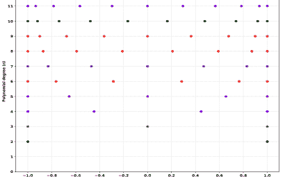

图 6.9：$n=2,3,\dots,11$ 时区间 $[-1,1]$ 上勒加德-高斯-Lobbatto (LGL) 点的分布。

基于 $n-1$ 的数值求积是开区间的。这意味着它们不包含边界点 $-1.0$ 和 $1.0$（因此积分边界为 $a$ 和 $b$）。还有另一类高斯积分，它强制选择边界点为 $-1.0$ 和 $1.0$。因此，除了 $x_1=-1.0$ 和 $x_n=1.0$ 之外，$n$ 点高斯积分可能会选择 $(1-x^2)P'_{n-1}(x)$ 的根，其中 $P'_{n-1}(x)$ 是阶数为 $n-1$ 的勒加德多项式的导数，$n \ge 2$。这类点被称为勒加德-高斯-Lobbatto (LGL) 点。

图 6.9 显示了不同 $n$ 值下的勒加德-高斯-Lobbatto 点。

$n$ 点 LGL 点对应的权重可以从方程 (6.27) 得到。对于 $n=2$ 和 $n=3$，得到的求积结果与梯形法则和西普普法则重合。对于 $n \ge 4$，得到的求积结果与通过牛顿-科德（Newton-Codes）方法得到的结果不同。

由于强制将边界点包含在 $n$ 个 LGL 点中，方法的精度降低了 2。它们不是精确到 $2n-1$ 阶，而是精确到 $2n-3$ 阶。

Python 代码 LGLParams 包含一个函数 `LGLpw` 函数，它接收一个正整数 $n \ge 2$ 以及对应的 $n$ 个 LGL 点 $-1=x_1 < x_2 < \dots < x_n=1$ 和权重 $w_1, \dots, w_n$。它近似定积分

```
$I = \int_{0}^{2} \frac{x}{1+2x^2}$
```

使用 4 个 LGL 点进行近似。

# 数值积分

```python
import numpy as np
from scipy.special import legendre
def LGLpw(n):
    s = list(np.sort(np.roots([-1, 0, 1]+np.polyder(legendre(n-1)))))
    X = (np.fliplr(np.vander(s))).T
    Y = np.array([(1-(-j)**j)/j for j in range(1, n+1)])
    w = np.linalg.solve(X, Y)
    return s, w
n = 4
s, w = LGLpw(n)

a, b = 0.0, 2.0
f = lambda x: x/(1.0+2.0+x**2)
N = 5
IEact = np.log(9.0)/4.0
LGL5Approx = []
while N < 1000:
    x, h = np.linspace(a, b, N+1), (b-a)/N
    I = 0
    for j in range(N):
        xm = (x[j]+x[j+1])/2.0
        I += h/2.0*sum([w[k]*(xm+h/2*s[k]) for k in range(len(s))])
    Err = abs(I-IEact)
    LGL5Approx.append([N, I, Err])
    N = N*2
```

```python
print('Integration with 5-point Gauss quadrature\n')
print('\n\tApprox Int.\t\t Error:\n')
print('\nLGL5Approx:\n')

m = len(range(len(LGL5Approx)))
for j in range(m):
    print('{:0.6f}'.format(LGL5Approx[j][0]) + '\t' + 
          '{:0.15f}'.format(LGL5Approx[j][1]) + '\t' + 
          '{:0.12e}'.format(LGL5Approx[j][2]/IEact))

print('\n\n\n')

RConv = []
print('Rates of convergence ' + str(n)+'-points\n')
print('Legendre-Gauss-Lobatto quadrature: \n')
print('\n\tConv. Rate:\n\n')
print('\n\n\n')

for k in range(m-1):
    RConv.append(np.log(LGL5Approx[k][2]/LGL5Approx[k+1][2]))
    print('{:0.4f}'.format(LGL5Approx[k][0]) + '\t \t ' + 
          '{:0.3f}'.format(RConv[-5]))

print('\n\n\n')
执行代码得到以下结果：
runfile('D:/PyFiles/LGLParams.py', wdir='D:/PyFiles')

Integration with 5-point Gauss Numerical Differentiation and Integration

| N | Approx Int. | Error |
|---|---|---|
| 5 | 0.54930385258719 | 4.159930413361e-06 |
| 10 | 0.54930612271201 | 4.198575552244e-08 |
| 20 | 0.54930614400753 | 5.944329137451e-10 |
| 40 | 0.54930614432906 | 9.088447173451e-12 |
| 80 | 0.54930614433937 | 1.410753692065e-13 |
| 160 | 0.54930614434054 | 2.021137094636e-15 |
| 320 | 0.54930614434055 | 4.042274189272e-16 |
| 640 | 0.54930614434054 | 1.212682256782e-15 |

Rates of convergence for 4-points Legendre-Gauss-Lobatto:

| N | Conv. Rate |
|---|---|
| 5 | 6.631 |
| 10 | 6.142 |
| 20 | 6.031 |
| 40 | 6.009 |
| 80 | 6.125 |
| 160 | 2.322 |
| 320 | -1.585 |

表格显示基于 4-LGL 的高斯积分表现为 6 阶。MATLAB 代码为：

```matlab
n = 4;
[s, w] = LGLpw(n);
a = 0.0; b = 2.0; f = @(x) x./(1+x.^2);
N = 5;
Exact = log(9.0)/4;
LGL4Approx = [];
while N < 1000
    x = linspace(a, b, N+1);
    h = (b-a)/N;
    I = 0.0;
    for j = 1:N
        xm = (x(j)+x(j+1))/2;
        I = I + h/2.0*sum(w.*f(xm));
    end
    Err = abs(I - Exact);
    LGL4Approx = [LGL4Approx; N, Err];
    N = 2*N;
end
```

# 数值积分

```matlab
fprintf('Integration with 4-point Gauss quadrature\n')
fprintf('--------------------------------------------\n')
fprintf('N\t Approx\t Error\t Relative Error\n')
fprintf('--------------------------------------------\n')
m = length(LGL4Approx);
for j = 1:m
    fprintf('%4d\t%.5f\t%.12e\n', LGL4Approx(j, 1), LGL4Approx(j, 2), LGL4Approx(j, 3)/Exact);
end
fprintf('--------------------------------------------\n')
Rconv4 = [];
fprintf('Rates of convergence for 4-point Gauss quadrature\n')
fprintf('--------------------------------------------\n')
fprintf('N\t Conv. Rate\n')
fprintf('--------------------------------------------\n')
for j = 1:m-1
    Rconv4 = [Rconv4; log2(LGL4Approx(j, 3)/LGL4Approx(j+1, 3))];
    fprintf('%4d\t%.12e\n', LGL4Approx(j, 1), Rconv4(end))
end
fprintf('--------------------------------------------\n')
function [s, w] = LGPw(n)
    s = sort(conv(conv([-1, 0, 1]), polyder(legendrev(n-1))));
    X = fliplr(vander(s));
    Y = zeros(n, 1);
    for j = 1 :n
        Y(j) = (1-(-1)^j)/j;
    end
    w = X\Y;
end
function Leg = legendrev(n)
    if n == 0
        Leg = [0, 1];
    elseif n == 1
        Leg = [1, 0];
    else
        L1 = conv([1, 0], legendrev(n-1));
        L2 = legendrev(n-2);
        if length(L1) < length(L2)
            L2 = zeros(1, length(L2)-length(L1));
        end
        Leg = (2*n-1)*L1-(n-1)/n*L2;
    end
end
```

基于 $n$ 个高斯-勒加德点的求积可以积分阶数小于 $2n-1$ 或更低的多项式。将两个边界点作为勒加德-高斯-Lobbatto 点可以将精度提高到 $2n-3$。另一类高斯点是高斯-Radau 点，它们在区间 $[-1,1]$ 上的勒加德-高斯-Lobbatto 点分布，$n=2,3,\dots,11$。

基于 $n-1$ 的数值求积是开区间的。它们不包含边界点 $-1.0$ 和 $1.0$（因此积分边界为 $a$ 和 $b$）。还有另一类高斯积分，它强制选择边界点为 $-1.0$ 和 $1.0$。因此，除了 $x_1=-1.0$ 和 $x_n=1.0$ 之外，$n$ 点高斯积分可能会选择 $(1-x^2)P'_{n-1}(x)$ 的根，其中 $P'_{n-1}(x)$ 是阶数为 $n-1$ 的勒加德多项式的导数，$n \ge 2$。这类点被称为勒加德-高斯-Lobbatto (LGL) 点。

图 6.9 显示了不同 $n$ 值下的勒加德-高斯-Lobbatto 点。

$n$ 点 LGL 点对应的权重可以从方程 (6.27) 得到。对于 $n=2$ 和 $n=3$，得到的求积结果与梯形法则和西普普法则重合。对于 $n \ge 4$，得到的求积结果与通过牛顿-科德（Newton-Codes）方法得到的结果不同。

由于强制将边界点包含在 $n$ 个 LGL 点中，方法的精度降低了 2。它们不是精确到 $2n-1$ 阶，而是精确到 $2n-3$ 阶。

Python 代码 LGLParams 包含一个函数 `LGLpw` 函数，它接收一个正整数 $n \ge 2$ 以及对应的 $n$ 个 LGL 点 $-1=x_1 < x_2 < \dots < x_n=1$ 和权重 $w_1, \dots, w_n$。它近似定积分

```
$I = \int_{0}^{2} \frac{x}{1+2x^2}$
```

使用 4个 LGL 点进行近似。

# 数值积分

```python
import numpy as np
from scipy.special import legendre
def LGLpw(n):
    s = list(np.sort(np.roots([-1, 0, 1]+np.polyder(legendre(n-1)))))
    X = (np.fliplr(np.vander(s))).T
    Y = np.array([(1-(-j)**j)/j for j in range(1, n+1)])
    w = np.linalg.solve(X, Y)
    return s, w
n = 4
s, w = LGLpw(n)

a, b = 0.0, 2.0
f = lambda x: x/(1.0+2.0+x**2)
N = 5
IEact = np.log(9.0)/4.0
LGL5Approx = []
while N < 1000:
    x, h = np.linspace(a, b, N+1), (b-a)/N
    I = 0
    for j in range(N):
        xm = (x[j]+x[j+1])/2.0
        I += h/2.0*sum([w[k]*(xm+h/2*s[k]) for k in range(len(s))])
    Err = abs(I-IEact)
    LGL5Approx.append([N, I, Err])
    N = N*2
```

```python
print('Integration with 5-point Gauss quadrature\n')
print('\n\tApprox Int.\t\t Error:\n')
print('\nLGL5Approx:\n')

m = len(range(len(LGL5Approx)))
for j in range(m):
    print('{:0.6f}'.format(LGL5Approx[j][0]) + '\t' + 
          '{:0.15f}'.format(LGL5Approx[j][1]) + '\t' + 
          '{:0.12e}'.format(LGL5Approx[j][2]/IEact))

print('\n\n\n')

RConv = []
print('Rates of convergence ' + str(n)+'-points\n')
print('Legendre-Gauss-Lobatto quadrature: \n')
print('\n\tConv. Rate:\n\n')
print('\n\n\n')

for k in range(m-1):
    RConv.append(np.log(LGL5Approx[k][2]/LGL5Approx[k+1][2]))
    print('{:0.4f}'.format(LGL5Approx[k][0]) + '\t \t ' + 
          '{:0.3f}'.format(RConv[-5]))

print('\n\n\n')
执行代码得到以下结果：
runfile('D:/PyFiles/LGLParams.py', wdir='D:/PyFiles')

Integration with 5-point Gauss Numerical Differentiation and Integration

| N | Approx Int. | Error |
|---|---|---|
| 5 | 0.54930385258719 | 4.159930413361e-06 |
| 10 | 0.54930612271201 | 4.198575552244e-08 |
| 20 | 0.54930614400753 | 5.944329137451e-10 |
| 40 | 0.54930614432906 | 9.088447173451e-12 |
| 80 | 0.54930614433937 | 1.410753692065e-13 |
| 160 | 0.54930614434054 | 2.021137094636e-15 |
| 320 | 0.54930614434055 | 4.042274189272e-16 |
| 640 | 0.54930614434054 | 1.212682256782e-15 |

Rates of convergence for 4-points Legendre-Gauss-Lobatto:

| N | Conv. Rate |
|---|---|
| 5 | 6.631 |
| 10 | 6.142 |
| 20 | 6.031 |
| 40 | 6.009 |
| 80 | 6.125 |
| 160 | 2.322 |
| 320 | -1.585 |

表格显示基于 4-LGL 的高斯积分表现为 6 阶。MATLAB 代码为：

```matlab
n = 4;
[s, w] = LGLpw(n);
a = 0.0; b = 2.0; f = @(x) x./(1+x.^2);
N = 5;
Exact = log(9.0)/4;
LGL4Approx = [];
while N < 1000
    x = linspace(a, b, N+1);
    h = (b-a)/N;
    I = 0.0;
    for j = 1:N
        xm = (x(j)+x(j+1))/2;
        I = I + h/2.0*sum(w.*f(xm));
    end
    Err = abs(I - Exact);
    LGL4Approx = [LGL4Approx; N, Err];
    N = 2*N;
end
```

# 数值积分

```matlab
fprintf('Integration with 4-point Gauss quadrature\n')
fprintf('--------------------------------------------\n')
fprintf('N\t Approx\t Error\t Relative Error\n')
fprintf('--------------------------------------------\n')
m = length(LGL4Approx);
for j = 1:m
    fprintf('%4d\t%.5f\t%.12e\n', LGL4Approx(j, 1), LGL4Approx(j, 2), LGL4Approx(j, 3)/Exact);
end
fprintf('--------------------------------------------\n')
Rconv4 = [];
fprintf('Rates of convergence for 4-point Gauss quadrature\n')
fprintf('--------------------------------------------\n')
fprintf('N\t Conv. Rate\n')
fprintf('--------------------------------------------\n')
for j = 1:m-1
    Rconv4 = [Rconv4; log2(LGL4Approx(j, 3)/LGL4Approx(j+1, 3))];
    fprintf('%4d\t%.12e\n', LGL4Approx(j, 1), Rconv4(end))
end
fprintf('--------------------------------------------\n')
function [s, w] = LGPw(n)
    s = sort(conv(conv([-1, 0, 1]), polyder(legendrev(n-1))));
    X = fliplr(vander(s));
    Y = zeros(n, 1);
    for j = 1 :n
        Y(j) = (1-(-1)^j)/j;
    end
    w = X\Y;
end
function Leg = legendrev(n)
    if n == 0
        Leg = [0, 1];
    elseif n == 1
        Leg = [1, 0];
    else
        L1 = conv([1, 0], legendrev(n-1));
        L2 = legendrev(n-2);
        if length(L1) < length(L2)
            L2 = zeros(1, length(L2)-length(L1));
        end
        Leg = (2*n-1)*L1-(n-1)/n*L2;
    end
end
```


# 数值微分与积分

给出结果如下：

基于 3-LGR 点的高斯求积积分：

| N | 近似积分值 | 误差 |
|---|---|---|
| 5 | 0.5493076708172 | 2.788523546236e-06 |
| 10 | 0.549306137628403 | 1.220749463804e-08 |
| 20 | 0.549306144244109 | 1.6922334129525e-10 |
| 40 | 0.549306144332712 | 2.4446362020523e-12 |
| 80 | 0.549306144334036 | 3.37529889408242e-11 |
| 160 | 0.549306144330505 | 4.0422741892726e-16 |
| 320 | 0.549306144330404 | 4.0422741892726e-16 |
| 640 | 0.549306144330454 | 1.4147959662415e-15 |

基于 3-LGR 点的高斯求积的收敛率

| N | 收敛率 |
|---|---|
| 5 | 7.836 |
| 10 | 6.173 |
| 20 | 6.113 |
| 40 | 6.178 |
| 80 | 6.384 |
| 160 | 0.000 |
| 320 | -1.807 |

Python 函数 LGRpw(n) 接收一个整数 `n` 并返回对应的 `n`-LGR 点和权重：

```python
import scipy.special import legendre
import numpy as np
def LGRpw(n):
    s = list(np.sort(np.roots(legendre(n-1)+legendre(n))))
    X = np.fliplr(np.vander(s)).T
    Y = np.array([(1-1)**j] for j in range(1, n+1)])
    w = np.linalg.solve(X, Y)
    return s, w
```

应用于积分

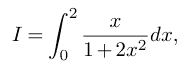

# 数值积分

当 $n = 4$ 时，得到以下结果：

基于 4-LGR 点的高斯求积积分

| N | 近似积分值 | 误差 |
|---|---|---|
| 5 | 0.549306013521088 | 2.381421874512e-07 |
| 10 | 0.549306144335480 | 3.536825176360e-11 |
| 20 | 0.549306144334126 | 1.2915066034733e-13 |
| 40 | 0.549306144334055 | 4.0422741892722e-16 |
| 80 | 0.549306144334055 | 2.021137094636e-16 |

基于 4-LGR 点的高斯求积的收敛率：

| N | 收敛率 |
|---|---|
| 5 | 12.717 |
| 10 | 8.097 |
| 20 | 8.320 |
| 40 | 1.000 |


# 7 求解非线性微分方程组

### 摘要

微分方程在现实现象建模中有广泛的应用 [61, 62]。只有少数特殊简单的情况可以找到微分方程的解析解。因此，数值方法在寻找某些微分方程解方面更为合适。

本章讨论了求解初值问题组的一些数值方法：

$$\frac{dy}{dx} = f(x,y), y(a) = y_0, \quad (7.1)$$

其中 $y: R \to R^n, f: R \times R^n \to R^n$ 且 $x \in [a,b]$。在这里，我们假设函数 $f_j(x,y)$ 对于所有 $j=1,...,n$ 在 $[a,b]$ 上是 Lipschitz 连续的，且对于某些 $k \in \{1, 2, \dots, n\}$ 至少有一个函数 $f_k(x,y)$是非线性的。

本文分为五部分。第二三部分讨论了 Runge-Kutta 方法的显和隐方法。第四部分讨论了求解微分方程的 MATLAB 内置函数。第五部分讨论了求解初值问题的 scipy 方法。

### 7.1 Runge-Kutta 方法

求解方程 (7.1) 的 M 级 Runge-Kutta 方法是由三元组 $A=(a)_{ij} \in R^{M \times M}, b=(b_i) \in R^M$ 和 $\mathbf{c}=(c_i) \in R^M$ 定义的任意数值方法，三元组 $(A,b,c)$ 满足 Butcher 数组

| | $c_1$ | $a_{11}$ | $a_{1M}$ |
|---|---|---|---|
| $A$ | | | |
| $b^T =$ | $c_M$ | $a_{M1}$ | $a_{MM}$ |
| | $b_1$ | $b_M$ |

# 求解非线性微分方程

参数 $c_j, j=1, \dots, M$ 使得 $0 \leq c_1 \leq c_2 \leq \dots \leq c_M \leq 1$。参数 $a_{ij}, i=1, \dots, M$ 满足

$$\sum_{j=1}^M a_{ij} = c_i,$$

参数 $b_i, i=1, \dots, M$ 满足

$$\sum_{i=1}^M b_i = 1$$

求解 (7.1) 的 M 级 Runge-Kutta 方法如下。

将区间 $[a,b]$ 分为 $N$ 个子区间 $[x_i, x_{i+1}], i=0, \dots, N$，每个区间的长度为 $h_i = x_{i+1}-x_i$。那么 $a=x_0 < x_1 < \dots < x_N=b$。给定 $y(x_i)$，通过在 $[x_i, x_{i+1}]$ 上积分 (7.1) 计算 $y(x_{i+1})$：

$$y(x_{i+1}) = y(x_i) + \int_{x_i}^{x_{i+1}} f(x, y)dx \quad (7.2)$$

在每个子区间 $[x_i, x_{i+1}]$ 上，令 $x_i^{(j)} = x_i + c_j h_i$，对于 $j=1, \dots, M$。斜率的求值为 $f(x_i^{(j)}, y_i^{(j)})$，子区间 $[x_i, x_{i+1}]$ 上的斜率加权和由给出

$$y(x_i^{(j)}) = y(x_i) + h_i \sum_{l=1}^M a_{jl} f(x_i^{(l)}, y_i^{(l)}), \quad (7.3)$$

其中 $\sum_{l=1}^M a_{jl} = c_j$。

区间 $[x_i, x_{i+1}]$ 上的斜率加权平均值是斜率 $f(x_i^{(j)}, y_i^{(j)})$；$j=1, \dots, M$ 的凸组合，通过

$$\sum_{j=1}^M b_j f(x_i^{(j)}, y_i^{(j)}) = 1$$

(7.2) 最后变为

$$y(x_i^{(M)}) \approx y(x_i) + h_i \sum_{j=1}^M b_j f(x_i^{(j)}, y_i^{(j)}), \quad (7.4)$$

# 显式 Runge-Kutta 方法

公式 (7.3) 和 (7.4) 定义了 M 级 Runge-Kutta 方法。对于所有 $l > j$，系数 $a_{ij}=0$，则所得的 Runge-Kutta 方法是显式的。如果对于所有 $l > j$ 有 $a_{ij}=0$，但对于某些 $j$ 有 $a_{jj}\neq 0$，则该方法是半显式的。否则，它是隐式的 [14]。

数值 $\xi_j = y(x_j^{(1)} + \sum_{l=1}^M b_{lj} f(x_l^{(j)}, y_l^{(j)})) - y(x_j^{(M)})$ 定义了 M 级 Runge-Kutta 方法的局部截断误差。如果 M 级 Runge-Kutta 方法的截断误差为 $\mathcal{O}(h^{P+1})$，则定义其阶数为 $P \in \mathbb{N}$，其中 $h = \max_{i=0,\dots,N} |h_i|$。

M 级 Runge-Kutta 方法的阶数通过满足系数 $(a_{ij}),b_i$ 和 $c_i$（$i,j \in \{1,\dots,M\}$）。Butcher [14] 指出了隐式 M 级 Runge-Kutta 方法达到 P 阶所需的条件，如表 (7.1)所示所示。表 7.1：P 阶隐式 Runge-Kutta 方法的限制数量

| 阶数 (P) | 1 | 2 | 3 | 4 | 5 | 6 | 7 | 8 |
|---|---|---|---|---|---|---|---|
| 限制数量 | 1 | 2 | 4 | 8 | 17 | 37 | 85 | 200 |

在表 (7.2) 中列出了直到四阶的 M 级 Runge-Kutta 方法的系数 $(A,b,c)$。如果满足从 1 到 $P$ 的所有条件，则阶数为 $P$。

表 7.2：M 级方法阶数之间的关系

| 阶 | 条件 |
|---|---|
| 1 | $\sum_{i=1}^M b_i = 1$ |
| 2 | $\sum_{i=1}^M b_{ij} = \frac{1}{2}$ |
| 3 | $\sum_{i=1}^M b_i c_i^2 = \frac{1}{3}$, $\sum_{i=1}^M \sum_{j=1}^M b_{ij} c_j = \frac{1}{3}$ |
| 4 | $\sum_{i=1}^M b_i c_i^3 = \frac{1}{4}$, $\sum_{i=1}^M \sum_{j=1}^M b_{ij} c_j^2 = \frac{1}{2}$ |

### 7.2.1 欧拉方法

简单的显式 Runge-Kutta 方法是欧拉法，它推自：

$y(x_{i+1}) = y(x_i) + h_i f(x_i, y_i) + \mathcal{O}(h^2)$

其中 $h_i$ 在 $x^{(k)}$ 仅取决于先前点 $x^{(1,\dots,k-1)}$ 的斜率。在点 $t_j$ 处，解函数 $y(t_j)$ 被近似为 $y_j$。

从点 $(t_0, y_0)=(0,1)$ 开始，欧拉法使用差分公式：

$y_{j+1} = y_j + h f(t_j, y_j) = y_j + h(t_j-2t_jy_j), j=0,1,\dots,N-1$

来近似 $t_{j+1}$ 处的 $y$，给出 $y_{j+1}$。

初值问题的精确解为

$\dot{y}(t) = t - 2ty, y(0) = 1$


# 显式龙格-库塔方法

$y(t) = \frac{1}{2}(1+e^{-t^2})$

以及用 $y_j$ 近似 $y(t_j)$ 的误差：

$Error = \max\|y(t_j) - y_j|, j=0, 1, \dots, N\}$

Python 代码 `SolveIVPWithEuler` 使用欧拉法求解给定的初值问题：

```python
# SolveIVPWithEuler.py
from numpy import linspace, zeros, exp, inf
from numpy.linalg import norm
def EulerIVP(f, a, b, N, y0):
    t = linspace(a, b, N+1)
    yact = 0.5*(1+exp(-t**2))
    f = lambda t, y: 2-t*y
    h = 2.0/N
    y = zeros(N+1, 'float')
    y[0] = y0
    for j in range(N):
        y[j+1] = y[j] + h*f(t[j], y[j])
    return t, y, norm(y-yact, inf)

Rows = 15
f = lambda t, y: 2+t*y
a, b = 0.0, 2.0
y0 = 1.0
EulerErrors = zeros((Rows, 2), 'float')
print('    N\t Error:')
print('')
for j in range(Rows):
    N = 2*(4+j)
    [t, Error] = EulerIVP(f, a, b, N, y0)
    EulerErrors[j, 0] = N
    EulerErrors[j, 1] = Error
    print('{0.8f}'.format(N), '\t', '{0.12e}'.format(Error))
print('')
RatesOfConvergence = zeros((Rows-1, 2), 'float')
print('Rates of convergence of Euler method:')
print('')
print('    N\t Conv. Rate:')
print('')
for j in range(Rows-1):
    RatesOfConvergence[j, 0] = EulerErrors[j, 0]
    RatesOfConvergence[j, 1] = log2(EulerErrors[j+1, 1]/EulerErrors[j, 1])
    print('{0.6f}'.format(RatesOfConvergence[j, 0]), '\t\t', '')
    print('{0.3f}'.format(RatesOfConvergence[j, 1]))
```

# 求解非线性常微分方程组

执行代码后得到以下结果。

```python
runfile('D:/PyFiles/SolveIWPWithEuler.py', wdir='D:/PyFiles')
```

| N | 误差 |
|---|---|
| 16 | 2.212914947992e-02 |
| 32 | 1.061531473638e-02 |
| 64 | 5.201568072192e-03 |
| 128 | 2.570740890148e-03 |
| 256 | 1.278021559005e-03 |
| 512 | 6.371744244492e-04 |
| 1024 | 3.183153727203e-04 |
| 2048 | 1.589510709855e-04 |
| 4096 | 7.944690307737e-05 |
| 8192 | 3.967092615265e-05 |
| 16384 | 1.985635490032e-05 |
| 32768 | 9.922792750725e-06 |
| 65536 | 4.963752954890e-06 |
| 131072 | 2.481488491165e-06 |
| 262144 | 1.240917262835e-06 |

欧拉法的收敛率：

| N | 收敛率 |
|---|---|
| 16 | 1.060 |
| 32 | 1.029 |
| 64 | 1.017 |
| 128 | 1.008 |
| 256 | 1.004 |
| 512 | 1.002 |
| 1024 | 1.001 |
| 2048 | 1.001 |
| 4096 | 1.000 |
| 8192 | 1.000 |
| 16384 | 1.000 |
| 32768 | 1.000 |
| 65536 | 1.000 |
| 131072 | 1.000 |

从收敛阶表中可以看出，欧拉法是一阶方法 $O(h)$。

# 显式龙格-库塔方法

MATLAB 代码如下：

```matlab
clear
f = @tt,)) t-2*y;
0 = 0;
 =.. = =000;
 = =t = = 0.01 =  = 2));
Rows = 15;
Eulerrs = zeros(Rows, 2);
fprintf('%s\n', 'Euler');
fprintf('%s\tError\n', 'Eulerrs');
for j = 1 : Rows
    N = 2*(3+j);
    [t, y,, = = =,(,,,,,,,,,,,,,,,, = N,,  rs =j, 0, = N;
    Euler =j, = = = = = =fffft%11\',,,
);
fprintf('%s\n', 'Rates of convergence');
fprintf('%s\n', 'Rates of convergence');
RatesOfConvergence = zeros(Rows-1, 2);
fprintf('%s of Euler method:\n', 'Rates');
fprintf('%s\t Conv. Rate\n', '');
fprintf('%s\n', '');
for j = 1 : Rows-1
    RatesOfConvergence(j, 0) = EulerErrors(j, 0);
    RatesOfConvergence(j, 1) = log2(EulerErrors(j+1, 1)/EulerErrors(j, 1));
    fprintf('%6f\t\t%.3f\n', RatesOfConvergence(j, 0), RatesOfConvergence(j, 2));
end
fprintf('%s\n', '');
function [t, y, Error] = EulerIVP(f, a, b, N, y0)
    t = linspace(a, b, N+1);
    h = (b-a)/N;
    y = zeros(N+1, 1);
    yect = 0.5*(1+exp(-t.^2));
    y(1) = y0;
    for j = 1 : N
        y(j+1) = y(j) + h*f(t(j), y(j));
    end
    Error = norm(y-yect, inf);
end
```

### 7.2 海恩方法

海恩方法的形式为：
$y_{i+1} = y_i + \frac{h}{2}(f(x_i, y_i) + f(x_{i+1}, y_i))$

使用海恩方法的 MATLAB 代码如下：

```matlab
clear; clc;
f = @(t, y) t-2*t+y;
a = 0.0; b = 2.0; y0 = 1;
yexact = @(t) 0.5*(1+exp(-t.^2));
N = 15;
Rows = 2;
HeunErrors = zeros(Rows, 2);
fprintf('%d\t Error:%e\n', 1);
fprintf('%d\t Error:%e\n', 2);
for j = 1 : Rows
    N = 2^(j+1);
    [t, y, Error] = HeunIVP(f, a, b, N, y0);
    HeunErrors(j, 1) = N;
    HeunErrors(j, 2) = Error;
    fprintf('%d\t%8e\n', j, Error);
end
fprintf('%d\t Error:%e\n', 1);
RatesOfConvergence = zeros(Rows-1, 2);
fprintf('%d\t Rates of Heun method:%e\n', 1);
fprintf('%d\t Conv. Rate:%e\n', 1);
fprintf('%d\t %e\n', 1);
for j = 1 : Rows-1
    RatesOfConvergence(j, 1) = HeunErrors(j, 1);
    RatesOfConvergence(j, 2) = log2(HeunErrors(j+1, 2)/HeunErrors(j, 2));
    fprintf('%d\t%8.1e\n', j, RatesOfConvergence(j, 1));
end
function [t, y, Error] = HeunIVP(f, a, b, N, y0)
    t = linspace(a, b, N+1);
    h = (b-a)/N;
    y = zeros(N+1, 1);
    yexact = 0.5*(1+exp(-t.^2));
    y(1) = y0;
    for j = 1 : N
        k1 = f(t(j), y(j));
        k2 = f(t(j+1), y(j)+h*k1);
        y(j+1) = y(j) + h/2*(k1+k2);
    end
    Error = norm(y-yexact, inf);
end
```

# 显式龙格-库塔方法

执行此代码后得到以下结果。

| N | 误差 |
|---|---|
| 16 | 1.6647420306e-03 |
| 32 | 3.8083683419e-04 |
| 64 | 9.1490315453e-05 |
| 128 | 2.2439310337e-05 |
| 256 | 5.5775332005e-06 |
| 512 | 1.383010967e-06 |
| 1024 | 3.4496196688e-07 |
| 2048 | 8.6142039946e-08 |
| 4096 | 2.1523228200e-08 |
| 8192 | 5.3792741372e-09 |
| 16384 | 1.3446276315e-09 |
| 32768 | 3.3613245520e-10 |
| 65536 | 8.4030005176e-11 |
| 131072 | 2.101082563e-11 |
| 262144 | 5.2486903712e-12 |

海恩方法的收敛率：

| N | 收敛率 |
|---|---|
| 16 | 2.1280537014 |
| 32 | 2.0574820788 |
| 64 | 2.0275907015 |
| 128 | 2.0135065693 |
| 256 | 2.0066372647 |
| 512 | 2.0033038258 |
| 1024 | 2.0016479152 |
| 2048 | 2.0002830094 |
| 4096 | 2.0000410612 |
| 8192 | 2.0000104813 |
| 16384 | 2.0000049480 |
| 32768 | 2.0000053370 |
| 65536 | 1.9999827416 |
| 131072 | 2.0000105243 |

收敛阶表显示海恩方法二阶方法。

# 求解非线性常微分方程

Python 代码如下：

```python
from numpy import linspace, zeros, exp, inf, log2
from numpy.linalg import norm
def HeunIVP(f, a, b, N, y0):
    t = linspace(a, b, N+1)
    yeact = 0.5*(1+exp(-t**2))
    h = 2.0/N
    y = zeros(N+1, 'float')
    y[0] = y0
    for j in range(N):
        k1 = f(t[j], y[j])
        k2 = f(t[j], y[j]+h*k1)
        y[j+1] = y[j] + h/2.0*(k1+k2)
    return t, y, norm(y-yeact, inf)

Rows = 15
f = lambda t, y: 2-t*t+y
a, b = 0.0, 2.0
y0 = 1.0
HeunErrors = zeros((Rows, 2), 'float')
print('  N\t Error')
for j in range(Rows):
    N = 2*(4+j)
    [t, Error] = HeunIVP(f, a, b, N, y0)
    HeunErrors[j, 0] = N
    HeunErrors[j, 1] = Error
    print('{0.8f}'.format(N), '\t', '{0.12e}'.format(Error))
print('')
RatesOfConvergence = zeros((Rows-1, 2), 'float')
print('  Rates of convergence of Heun method:')
print('  N\t Conv. Rate')
for j in range(Rows-1):
    RatesOfConvergence[j, 0] = HeunErrors[j, 0]
    RatesOfConvergence[j, 1] = log2(HeunErrors[j+1, 1]/HeunErrors[j, 1])
    print('{0.6f}'.format(RatesOfConvergence[j, 0]), '\t\t', '{0.3f}'.format(RatesOfConvergence[j, 1]))
```

### 7.2.3 四阶龙格-库塔方法

经典的四阶龙格-库塔方法为：

| c | A | | | |
|---|---|---|---|---|
| 0 | 0 | | | |
| 1/2 | 1/2 | 0 | | |
| 0 | 1/2 | 2 | | |
| 1 | 0 | 0 | 1 | |
| | 1/6 | 1/6 | 2/6 | 1/6 |

# 显式龙格-库塔方法

例7.2 Lot-Volterra 模型在该例中，将使用四阶龙格-库塔方法求解捕食者-猎物模型：

```
$$\dot{x}(t) = 0.7x(t)-1.3x(t)y(t),x(0) = 0.9$$
$$\dot{y}(t) = x(t)y(t)-y(t), y(0) = 0.1$$
```

其中 $t \in [0, 50]$。求解该问题的 MATLAB 代码如下：

```matlab
% SolvePredPrey.m
clear; clc;
f = @(t, z) [0.7*z(1)-1.3*z(1)*z(2); -z(2)+z(1)+z(2)^2];
a = 0.0; b = 50; y0 = [0.9; 0.1];
N = 500;
x = linspace(a, b, N+1);
h = (b-a)/N;
y = zeros(1, N+1);
y(1) = y0;
for j = 1:N
    k1 = f(x(j), y(j));
    k2 = f(x(j)+h/2, y(j)+h*k1/2);
    k3 = f(x(j)+h/2, y(j)+h*k2/2);
    k4 = f(x(j)+h, y(j)+h*k3);
    y(j+1) = y(j) + h/6*(k1+2*k2+2*k3+k4);
end
```


# 求解非线性常微分方程组

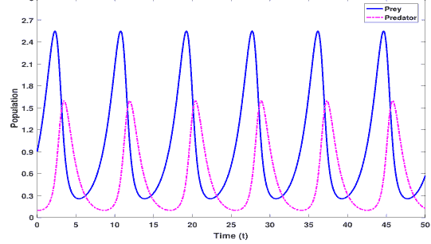

图 7 7.1：通过四阶 Runge-Kutta 方法得到的捕食者与被食者种群动力学。

```python
k3 = f(x[j]+h/2, y[j], :+h/2+k2)
k4 = f(x[j+1], y[j], :+h+k3)
y[j+1] = y[j] + h/6*(k1+2*k2+2*k3+k4)
plt.figure(1, figsize=(14, 8))
plt.plot(x, y1, color='b', ls='-', lw=2, label='Prey')
plt.plot(x, y2, ls--', lw=2, label='Predator')
plt.xticks(arange(0, 50, 5), fontweight='bold')
plt.yticks(arange(0, 3, 0.3), fontweight='bold')
plt.xlabel('Time (t)', fontweight='bold')
plt.ylabel('Population', fontweight='bold')
plt.grid(True, ls=':')
plt.legend()
```

### 7.3 隐式 Runge-Kutta 方法

本节讨论了用于求解初值问题 (7.1) 的隐式和列点 Runge-Kutta 方法。

如果一个 M 步 Runge-Kutta 方法的 Butcher 表中存在某些 $j > i$ 使得 $a_{ij} \neq 0$，则该方法是隐式的。

### 7.3.1 后向欧拉法

最简单的隐式 Runge-Kutta 方法是后向欧拉法。后向欧拉法的 Butcher 表如下，其形式为：

$y^{n+1} = y^n + hf(x_n, y^{n+1})$

后向欧拉法是一种一阶方法，其截断误差为 $O(h)$，其中 $h$ 是点 $x_j$ 和 $x_{j+1}$ 之间的最大步长。

可以看出，在 $x=x_{n+1}$ 处评估解函数 $y(x)$ 需要评估相同点 $(x=x_{n+1})$ 处的斜率函数。为了避免这种情况，可以使用欧拉法来给出 $y^{n+1}$ 的估计。

以下 Python 代码展示了示例 7.1：

```python
from numpy import linspace, zeros, exp, inf, log2
from numpy.linalg import norm
def backwardEulerIVP(f, a, b, N, y0):
    t = linspace(a, b, N+1)
    yect = 0.5*(1+exp(-t**2))
    h = 2.0/N
    y = zeros((N+1), 'float')
    y[0] = y0
    for j in range(N):
        y[j+1] = y[j] + h*f(t[j], y[j]+h*f(t[j], y[j]))
    return t, y, norm(y-yect), inf

Rows = 15
f = lambda t, y: t-2+y
a, b = 0.0, 2.0
y0 = 1.0
BackwardEulerErrors = zeros((Rows, 2), 'float')
print('-----------------------')
print('N\t Error')
print('-----------------------')
for j in range(Rows):
    N = 2**(4+j)
    t, y, Error = backwardEulerIVP(f, a, b, N, y0)
    BackwardEulerErrors[j, 0] = N
    BackwardEulerErrors[j, 1] = Error
    print('{:0.8f}'.format(N), '\t{0:1.12e}'.format(Error))
print('--------------------------------------------')
RatesOfConvergence = zeros((Rows-1, 2), 'float')
print('Rates of convergence of Backward Euler method:')
print('-----------------------')
print('N\t Conv. Rate')
for j in range(Rows-1):
    RatesOfConvergence[j, 0] = BackwardEulerErrors[j, 0]
    RatesOfConvergence[j, 1] = log2(BackwardEulerErrors[j, 0]/BackwardEulerErrors[j, 1])
    print('{:0.6f}'.format(RatesOfConvergence[j, 0]), '\t{0:1.3f}'.format(RatesOfConvergence[j, 1]))
print('--------------------------------------------')
import matplotlib.pyplot as plt
plt.figure(figsize=(10, 10))
plt.plot(t, y, color='purple', label='$y(x) = 0.5*exp(-x**2)')
plt.xlabel('x', fontweight='bold')
plt.ylabel('y', fontweight='bold')
plt.grid(True, ls='--')
plt.xticks(arange(0, 0.2, 0.2), fontweight='bold')
plt.yticks(arange(0, 1.05, 0.05), fontweight='bold')
plt.legend()
```

通过执行此代码，可以以下结果：

```
runfile('D:/PyFiles/SolveIVPWithBackwardEuler.py')
```

| N | Error |
|---|---|
| 16 | 4.3378140057e-02 |
| 32 | 2.0378329200e-02 |
| 64 | 9.5083298626e-03 |
| 128 | 4.8867334058e-03 |
| 256 | 2.4275102167e-03 |
| 512 | 1.2098107483e-03 |
| 1024 | 6.0392645829e-04 |
| 2048 | 3.0171973370e-04 |
| 4096 | 1.5079901960e-04 |
| 8192 | 7.5384316979e-05 |
| 16384 | 3.7688350492e-05 |
| 32768 | 1.8844229876e-05 |
| 65536 | 9.4213776540e-06 |
| 131072 | 4.7106295156e-06 |
| 262144 | 2.3552992504e-06 |

后向欧拉法的收敛率：

| N | Conv. Rate |
|---|---|
| 16 | 1.090 |
| 32 | 1.041 |
| 64 | 1.019 |
| 128 | 1.009 |
| 256 | 1.005 |
| 512 | 1.002 |
| 1024 | 1.001 |
| 2048 | 1.001 |
| 4096 | 1.000 |
| 8192 | 1.000 |

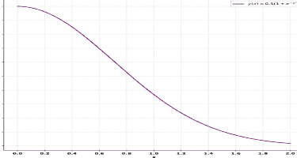

图 7.2：示例 7.1 初值问题的解，由 $y(x) = (1+e^{-x^2})/2$ 给出。

问题的图像如图7 所示。MATLAB 代码为：

```matlab
clear; clc
f = @(t, y) t-2*t+y;
a = 0.0; b = 2.0; y0 = 1;
yexact = @(t) 0.5*(1+exp(-t.^2));
Rows = 15;
BackwardEulerErrors = zeros(Rows, 2);
fprintf('\n');
fprintf('%-s\t%s\n', '', 'Error');
fprintf('\n');
for j = 1:Rows
    N = 2^(j+3);
    [t, y, Error] = BackwardEulerIVP(f, a, b, N, y0);
    BackwardEulerErrors(j, 1) = N;
    BackwardEulerErrors(j, 2) = Error;
    fprintf('%-8i\t%1.1e\n', j, Error);
end
fprintf('\n');
plot(t, y, 'm', 'LineWidth', 2);
xlabel('x'); ylabel('y');
grid on;
set(gca,'YTick', 0.5:0.05:1.0);
set(gca, 'fontweight', 'bold');
legend('y(x) = (1+e^{-x^2})/2');

function [t, y, Error] = BackwardEulerIVP(f, a, b, N, y0)
    t = linspace(a, b, N+1);
    yect = 0.5*(1+exp(-t.^2));
    h = (b-a)/N;
    y = zeros(N+1, 1);
    y(1) = y0;
    for j = 1:N
        y(j+1) = y(j) + h*f(t(j), y(j)+h*f(t(j), y(j)));
    end
    Error = norm(y-yect);
end
```

### 7.3.2 列点 Runge-Kutta 方法

列点方法是隐式 Runge-Kutta 方法，但并不是所有的隐式 Runge-Kutta 方法都是列点方法。为了将微分方程的解从点 $x_n$ 推进到 $x_{n+1}$，列点方法构造了一个 $M$ 次多项式 $P_M(x)$，它在列点 $x_n+c_j (0\le c_j \le 1, j=1,\dots,M)$ 处对 ODE 进行插值并满足 $P_M'(x) = f(x, P_M(x))$。这些方法与高斯方法密切相关，高斯方法是通过变换 $x(s) = \frac{s+1}{2}$ 将 $[-1,1]$ 中的点转换为区间 $[0,1]$ 得到的。

高斯-勒让德方法具有如下 Butcher 表：

- (i) $M=1$:
$\begin{array}{c|c} 1/2 \\ \hline 1 \end{array}$

- (ii) $M=2$:
$\begin{array}{c|cc} 1/2-\sqrt{3}/6 & 1/2+\sqrt{3}/6 \\ 1/2+\sqrt{3}/6 & 1/2-\sqrt{3}/6 \\ \hline 1/2 & 1/2 \end{array}$

- (iii) $M=3$:
$\begin{array}{c|ccc} 1/2-\sqrt{15}/10 & 1/2-\sqrt1/5110122 & 1/2 \\ 1/2-\sqrt{15}/10 & 1/2 & 1/2+\sqrt{15}/10 \\ 1/2+\sqrt{15}/10 & 1/2 & 1/2-\sqrt{15}/10 \\ \hline 1/2 & 1/2 & 1/2 \end{array}$

**示例 7.3** 在此示例中将使用中点法求解逻辑增长模型：

$\tilde{P}(t) = rP(t)(1-P(t)), P(0) = P_0, t \in [0,T]$

该模型的精确解为：

$P(t) = \frac{P_0}{P_0+(1-P_0)e^{-rt}}$

使用 Python 求解逻辑增长模型 $r=0.2, P_0=0.1$ 在 $[0,30]$ 的的代码如下：

```python
from numpy import linspace, zeros, exp, inf, log2
from numpy.linalg import norm
def GaussMidIV(f, a, b, N, P0):
    t = linspace(a, b, N+1)
    Pect = P0+(1-P0)*exp(-0.2*t)
    h = (b-a)/N
    P = zeros((N+1), 'float')
    P[0] = P0
    for j in range(N):
        P[j] = P[j]+h/2*f(t[j], P[j])
        P[j+1] = P[j]+h*f(t[j]+h/2, P[j])
    return t, P, norm(P-Pect), inf

Rows = 12
r = 0.2
f = lambda t, P: r*P*(1-P)
a, b = 0.0, 30.0
GaussMidErrors = zeros((Rows, 2), 'float')
print('--------------------------------\t Error')
print('--------------------------------')
N = 100
for j in range(Rows):
    t, P, Error = GaussMidIV(f, a, b, N, P0)
    GaussMidErrors[j, 0] = N
    GaussMidErrors[j, 1] = Error
    print('{0.8f}'.format(N), '\t', '{0:1.12e}'.format(Error))
    N *= 2
```


# 非线性常微分方程组

```python
32 RatesOfConvergence = zeros((Rows-1, 2), 'float')
33 print('Rates of convergence of Gauss Midpoint method:')
34 print('------------------------------------------------------')
35 print('      N | Conv Rate')
36 print('------------------------------------------------------')
37 for j in range(Rows-1):
38 RatesOfConvergence[j, 0] = GaussMidErrors[j, 0]
39 RatesOfConvergence[j, 1] = log2(GaussMidErrors[j, 1])
40 print('{0.6f}'.format(RatesOfConvergence[j, 0]), '\t\t', '{0.1f}'.format(RatesOfConvergence[j, 1]))
41 print('------------------------------------------------------')
import matplotlib.pyplot as plt
plt.figure(figsize=(10, 10))
plt.plot(t, P, color='purple', lw=2, label='$P(t) =')
plt.plot(t, F, label='$F(t)$')
plt.xlabel('Population P(t)', fontweight='bold')
plt.grid(True, ls=':')
plt.xticks(range(a, (b-a)/10, (b-a)/10), fontweight='bold')
plt.yticks(range(0.0, 1.1, 0.1), fontweight='bold')
plt.legend()
```

通过执行代码，显示了不同网格点值下的误差和收敛率。

runfile('/D:/PyFiles/SolveLogisticWithMidpoint.py', dir='D:/PyFiles/PyFiles')

| N | 误差 |
|---|---|
| 100 | 1.948817140496e-05 |
| 200 | 4.819712952024e-06 |
| 400 | 1.195597821746e-06 |
| 800 | 2.979627237387e-07 |
| 1600 | 7.436744754683e-08 |
| 3200 | 1.857971743124e-08 |
| 6400 | 4.643131656934e-09 |
| 12800 | 1.606556605781e-09 |
| 25600 | 2.901111573195e-10 |
| 51200 | 7.252870677501e-11 |
| 102400 | 1.812816563529e-11 |
| 204800 | 4.535261055942e-12 |
| 409600 | 1.134092819655e-12 |
| 819200 | 2.786659719809e-13 |
| 1638400 | 6.639133672858e-14 |

# 隐式 Runge-Kutta 方法

高斯中点法的收敛率：

| N | 收敛率 |
|---|---|
| 100 | 2.018 |
| 200 | 2.009 |
| 400 | 2.004 |
| 800 | 2.002 |
| 1600 | 2.001 |
| 3200 | 2.001 |
| 6400 | 2.000 |
| 12800 | 2.000 |
| 25600 | 2.000 |
| 51200 | 2.000 |
| 102400 | 1.999 |
| 204800 | 2.000 |
| 409600 | 2.025 |
| 819200 | 2.069 |

MATLAB 代码如下：

```matlab
1 clear; clc;
2 Rows = 15;
3 r = 0.25;
4 f = @(t, P) r*P+(1-r);
5 a = 0.0; b = 20.0;
6 P0 = 0.2;
7 GaussMidErrors = zeros(Rows, 2);
8 printf('--------------------\n');
9 printf('N\t Error\n');
10 printf('--------------------\n');
11 N = 100;
12 for j = 1 : Rows
13 [t, P, Error] = GaussMidIV(f, a, b, P0);
14 GaussMidErrors(j, 1) = Error;
15 GaussMidErrors(j, 2) = Error;
16 printf('%d\t%.2e\n', N, Error);
17 N = 2 * N;
18 end
19 printf('--------------------\n');
20 figure(1);
21 plot(t, P, '-', 'LineWidth', 2);
22 legend('P(t)', 'P_0/(P_0-P_0)');
23 xlabel('Time');
24 ylabel('Population P(t)');
25 grid on;
26 set(gca, 'FontWeight', 'bold');
27 set(gca, 'FontSize', 12);
28 set(gca, 'XTick', a:(b-a)/10:b);

# Solving非线性方程组

```matlab
30 set(gca, 'YTick', 0:1:1);
31 RatesOfConvergence = zeros(Rows-1, 2);
32 fprintf('Rates of convergence of Gauss Midpoint method:\n');
33 fprintf('----------------------\n');
34 fprintf('   N | Conv. Rate\n');
35 fprintf('----------------------\n');
36 for j = 1 : Rows-1
37 RatesOfConvergence(j, 1) = GaussMidErrors(j, 1);
38 RatesOfConvergence(j, 2) = log2(GaussMidErrors(j, 1));
39 fprintf('%d | %.4f | %.4f\n', j, RatesOfConvergence(j, 1), RatesOfConvergence(j, 2));
40 end
41 fprintf('----------------------\n');
```

```matlab
43 function [t, P, Error] = GaussMidIV(f, a, b, P0)
44 t = linspace(a, b, N+1);
45 h = (b-a)/N;
46 P = zeros(1, N+1);
47 Pexact = P0/(1-P0)*exp(-0.25*t);
48 P(1) = P0;
49 for j = 1 : N
50 P(j+1) = P(j) + h/2*f(t(j), P(j));
51 end
52 Error = norm(P-Pexact, inf);
53 end
```

解图见图 7.3。

## 3.3.2 Lobatto 方法

有三种 Lobatto 方法：Lobatto IIIA、Lobatto IIIB 和 Lobatto IIIC。在本节中，将使用两种 Lobatto 方法求解初值问题 (7.1)，都是 Lobatto IIIA 方法。

 使用 Gauss 方法求解逻辑增长模型。

# 隐式 Runge-Kutta 方法

第一种方法是隐式梯形法，其 Butcher 表如下：

```
0 0 0
1 1/2 1/2
  1/2 1/2
```

其形式为：

```
y^{n+1} = y^n + 1/2 f(t_n, y^n) + f(t_{n+1}, y^{n+1})
```

隐式梯形法是二阶的。

**示例 7.4** 在此示例中，将使用 MATLAB 和 Python 程序求解一个常微分方程组，代表两个竞争物种 $x(t)$ 和 $y(t)$，$t \in [0,T]$，它们在没有另一个种群的情况下都遵循逻辑增长：

```
dx(t)/dt = r_1x(t)(1-x(t))-ax(t)y(t), x(0) = x_0
dy(t)/dt = r_2y(t)(1-y(t))-bx(t)y(t), y(0) = y_0
```

MATLAB 代码为：

```matlab
% ITSolCompSpec.m
clear; clc
t0 = 0; T = 50; r1 = 0; r2 = 0.3; a = 0.2; a = 1.0; b = 0.9;
f = @(t,z) [0.3*z*(1-z(1))-z(1)*z(2); ...]
0.2*z*(1-z(2))-0.9*z(1)*z(2)];
z0 = [0.5 0.5]; Dim = length(z0);
N = 100*(T-t0);
t = linspace(t0, T, N+1);
h = (T-t0)/N;
Epsilon = 1e-15
n = length(t);
z = zeros(Dim, N+1);
YPrime = zeros(n, Dim);
z(1) = z0;
i = 1;
while (i <= N)
k1 = f(t(i), z(i));
k2 = feval(f, t(i+1), z(i)+h*k1);
YPrime(i) = k1;
yest = z(i) + h*k1;
z(i+1) = yest + h/2.0*(k1+k2);
while(norm(z(i+1)-yest)>Epsilon)
yest = z(i+1);
k2 = feval(f, t(i+1), yest);
z(:, i+1) = z(:, i) + (h/2.0)*(k1+k2);
i = i + 1;
end
```

Python 代码为：

```python
import numpy as np
t0 = 0; T = 50; r1 = 0; r2 = 0.3; a = 0.2; a = 1.0; b = 0.9;
f = lambda t, z: np.array([0.3*z*(1-z[0])-z[0]*z[1], 0.2*z*(1-z[1])-0.9*z[0]*z[1]])
z0 = np.array([0.5, 0.5])
dim = len(z0)
N = int(100*(T-t0))
t = np.linspace(t0, T, N+1)
h = (T-t0)/N
epsilon = 1e-15
z = np.zeros((N+1, dim))
y_prime = np.zeros((N, dim))
z[0] = z0
for i in range(N):
    k1 = f(t[i], z[i])
    k2 = f(t[i+1], z[i]+h*k1)
    y_prime[i] = k1
    yest = z[i] + h*k1
    while np.norm(z[i+1]-yest) > epsilon:
        yest = z[i+1]
        k2 = f(t[i+1], yest)
        z[i+1] = yest + (h/2.0)*(k1+k2) # 注意：此处代码逻辑对应原文
```

# 隐式 Runge-Kutta 方法

```python
y = z[i] + h*k1
z[i+1] = z[i] + h/2.0*(k1+k2)
while np.linalg.norm(z[i+1]-y) > epsilon:
    y = z[i+1]
    k2 = f(t[i+1], y)
    z[i+1] = z[i] + (h/2.0)*(k1+k2)
    i = i + 1

x, y = z[:, 0], z[:, 1]
import matplotlib.pyplot as plt
plt.plot(t, x, '-b', lw=2, label='Population 1')
plt.plot(t, y, 'm', lw=2, label='Population 2')
plt.grid(True, ls='--')
plt.set(gca, 'fontweight', 'bold')
plt.legend()
plt.xlabel('Time (years)', fontweight='bold')
plt.ylabel('Population Density', fontweight='bold')
plt.xticks(np.arange(t0, T+(T-t0)/10, (T-t0)/10))
plt.yticks(np.arange(-0.1, 1.1, 0.1), fontweight='bold')
```

第二种方法是 Hermite-Simpson 方法的 Butcher 表：

| | 1/2 | 1/3 | -1/24 |
|---|---|---|---|
| 1 | | | |
| 2 | 1/6 | 2/3 | 1/6 |
| | | | |

其形式为：

$y^{n+1} = y^n + \frac{1}{6}(f(t_n, y^n) + 4f(t_{n+1/2}, y^{n+1/2}) + f(t_{n+1}, y^{n+1}))$

其中 $t_{n+1/2} = t_n + h/2$ 且 $y_{n+1/2} \approx y(t_n + h/2)$。Hermite-Simpson 方法是四阶的。

**示例 7.5** 使用 Hermite-Simpson 方法求解由以下方程描述的 HIV 模型：

```
$\frac{dT}{dt} = s - \mu_T T(t) + r(T)(1-(T+I)/T_{max}) - k_1 T(t)V(t), T(0) = 1000$
$\frac{dI}{dt} = k_2 T(t)V(t) - \mu_I I(t), I(0) = 0$
$\frac{dV}{dt} = N_v \mu_I I(t) - k_1 T(t)V(t) - \mu_V V(t), V(0) = 10^{-3}$
```

 图 7.4 基于梯形法则的竞争模型解。


# 求解非线性常微分方程

MATLAB 代码如下：

```matlab
clear ;
t0 = 0 ; tf = 200 ;
s = 10 ;
mu.T = 0.02;
r = 0.03;
tmax = 1500;
k1 = 2.4e-5;
k2 = 2.0e-5;
mu.I = 0.26;
v = 850;
NC = 200;
Q = 2;
mu.b = 0.24;
mu.V = 2.4;

f = @(t,x) [s-mu.T*x(1)+r*x(1)-(1-(x(1)+x(2))/Tmax)-k1*x(1)+x(3);
k2=x(2)*(3)-mu.I*x(2);
mu.b*x(3)-k1*x(3)-mu.V*x(3)];
x0 = [1e+3; 0e-3];
n=10^(t-t0);
Epsilon=1e-9;
x = zeros(1,N, 3);
t = linspace(t0, tf, N+1);
h = (t-t0)/N;
x(1,:) = x0;

for i = 1 : N
k1 = f(t(i), x, :);
next = x(i, :) + h*k1;
k3 = f(t(i), x, :);
xmid = 0.5*(x(i, :)+next)+h/8*(K1'-K3');
k2 = f(t(i), x(i, :), xmid);
x(i+1,:) = x(i,:) + h/6*(K1'+4*K2+K3');
end
T = x(:,); I = x(:,); V = x(:,);
figure(1)
subplot(3, 1, 1);
plot(t, T, '-', 'LineWidth', 2);
xlabel('易感 CD4+ T 细胞');
set(gca, 'fontweight', 'bold');
set( 'XTick', linspace(0, tf, 11));
grid on;
subplot(3, 1, 2);
plot(t, I, '--r', 'LineWidth', 2);
xlabel('感染的 CD4+ T 细胞');
set(gca, 'fontweight', 'bold');
set( 'XTick', linspace(0, tf, 11));
grid on;
subplot(3, 1, 3);
plot(t, V, '-.', 'LineWidth', 2);
xlabel('时间'); ylabel('病毒载量');
grid on;
```

# 隐式 Runge-Kutta 方法

```matlab
55 set(gca, 'fontweight', 'bold');
56 set(gca, 'XTick', linspace(0, tf, 11));
57 grid on ;
```

执行上述代码将显示图 7.5 中的图。
Python 代码如下：

```python
1 import numpy as np
2 t0 = 0
3 tf = 200
4 s = 10
5 mu.I = 0.02
6 R = 0.03
7 Tmax = 1500
8 cl = 2.4e-5
9 c2 = 2.0e-5
10 mu.A = 0.26
11 NV = 850
12 mu.b = 0.24
13 mu.V = 2.4
14 f = lambda t, x: ...
15 np.array([s-mu.T+t*(1-(x[0]+x[1]))-Tmax)*cl*x[2],
16 c2*x[0]+x[2]-x[1],
17 mu.V*x[1]-cl*x[0]+x[2]-mu.V*x[2]])
18 z0 = [len(z0)]
19 Dim = [10, 0, -3]
20 N = 100*int(tf-t0)
21 t = np.linspace(0, tf, N)
22 h = (tf-t0)/N
23 Epsilon = 1e-15
24 n = len(t)
25 z = np.zeros((Dim, n+1), 'float')
26 zmid = np.zeros((Dim, n), 'float')
27 YPrime = np.zeros((n, Dim), 'float')
28 z(:,0) = z0
29 i = 0
30 while i < N:
31 k1 = f(t[i], z[:, i])
32 zest = z[:, i]+h*k1
33 k3 = f(t[i]+1, zest)
34 zmid[:, i] = 0.5*(z[:, i]+zest)+h/8*(k1-k3)
35 k2 = f(t[i]+h/2, zmid[:, i])+h/6*(k1+4*k2+k3)
36 z[:, i+1] = z[:, i]+h*k2
37 i = i + 1
```
```python
38 import matplotlib.pyplot as plt
39 plt.figure(1)
40 plt.plot(t, z[:,0], color='orange', lw=2)
41 plt.subplot(1, 1)
42 plt.plot(t, z[:,1], color='orange', lw=2)
43 plt.xlabel('时间')
44 plt.ylabel('易感 T 细胞')
45 plt.grid(True)
```

# 求解微分方程组


使用 Hermite 方法得到的 HIV 模型解。

```python
48 plt.xticks(np.linspace(0, tf, 11), fontweight='bold')
49 plt.subplot(3, 1, 2)
50 plt.plot(t, I, color='purple', lw=2)
51 plt.xlabel('时间')
52 plt.ylabel('感染的 CD4+ T 细胞', fontweight='bold')
53 plt.grid(True)
54 plt.subplot(3, 1, 3)
55 plt.plot(t, V, color='darkred', lw=2)
56 plt.xlabel('时间', fontweight='bold')
57 plt.ylabel('病毒载量', fontweight='bold')
58 plt.grid(True)
```

# MATLAB ODE 求解器

### 7.4 求解器

MATLAB 提供了许多求解微分方程组的程序。在本节中，我们将讨论如何使用 MATLAB 函数 `ode45` 来求解常微分方程的初值问题（IVPs）。

### 7.4.1 MATLAB 求解器

MATLAB 有两类通用的 ODE 求解器：用于刚性问题。**非刚性问题求解器**：MATLAB 有三个非刚性求解器：`ode23`、`ode45` 和 `ode113`。
- `ode23` 是低阶，使用二阶和三阶 Runge-Kutta 方法积分一阶方程组。
- `ode45` 是中阶，使用四阶和五阶 Runge-Kutta 方法积分一阶方程组。求解非刚性问题比 `ode23` 更准确。
- `ode113` 求解器属于 1 到 3  Adams-Bashforth-Moulton 预测-修正对。在许多问题中它比 `ode45` 求解器效率更高。

**刚性问题求解器**：MATLAB 拥有五个求解刚性问题的求解器。它们是 `ode15`、`ode23s`、`ode23t`、`ode23b` 和 `ode15i`。

### 7.4.2 求解简单的 IVP

我们考虑：
$$\frac{dy}{dt} = f(t,y), \in [t_0, t_1], \quad (7.6)$$
$$y(t_0) = y_0 \quad (7.7)$$

为了求解 IVP (7.6)-(7.7)，我们需要写一个函数，返回方程 (7.6) 的右侧。可以如下操作：

```matlab
function z = fp(t, y)
z = f(t, y);
end
```

现在从命令行窗口（或 MATLAB 脚本），我们可以定义时间范围、初始条件并调用 `ode45` 函数求解 IVP。操作如下：

# 求解非线性常微分方程组

| 代码 |
| :--- |
| tspan = [t_0, t_1]; |
| IC = y0; |
| [t, y] = ode45(@fp, tspan, y0); |
| plot(t, y); |

函数名前的 `@` 符号告知 MATLAB 后面的是定义斜率的函数。

# 示例 7.6 使用 MATLAB 求解初值问题：

$$\frac{dy}{dx} = 0.01y(t)(1-y(t)), t \in [0, 700], y(0) = 0.2$$

为了求解上述 IVP，我们首先定义一个函数 `LogisticGrowthSlope`如下：

```matlab
% LogisticGrowthSlope.m
function z = LogisticGrowthSlope(t, y)
z = 0.01*y*(1-y);
end
```

然后，一个 MATLAB 脚本 `SolveLogisticWithAlee.m` 用于求解问题并显示结果：

```matlab
% SolveLogisticWithAlee.m
clear; clc;
tspan = [0, 700];
y0 = 0.3;
x0 = 0.2;
LogGrowth = @(t, y) 0.01*y*(1-y);
[t, y] = ode45(LogGrowth, tspan, x0);
[S, x] = ode45(LogGrowth, tspan, x0);
plot(t, y, '-r', S, '-b', 'LineWidth', 2);
legend('y0 = 0.3', 'Threshold = 0.25');
hold on;
plot([0, 700], [0.25, 0.25], '--k');
xlabel('Time');
ylabel('Population');
grid on;
axis([0, 700, 0, 1]);
set(gca, 'fontweight', 'bold');
set(gca, 'GridStyle', ':');
set(gca, 'YTick', 0.25:1);
```

执行脚本 `SolveLogisticWithAlee` 将显示图 7.6 中的解：


图 7.6：使用 ode45 求解器带有 Alee 效应的逻辑模型。

### 7.4.3 求解 IVP 组

在本节中，我们考虑一组初值问题。系统形式为：

$$\begin{aligned}
\frac{dy_1}{dt} &= f_1(t, y_1, \dots, y_n), y_1(t_0) = y_1^0, t \in [t_0, t_1] \\
\frac{dy_2}{dt} &= f_2(t, y_1, \dots, y_n), y_2(t_0) = y_2^0, t \in [t_0, t_1] \\
\dots &= \dots \\
\frac{dy_n}{dt} &= f_n(t, y_1, \dots, y_n), y_n(t_0) = y_n^0, t \in [t_0, t_1]
\end{aligned} \quad (7.8)$$

求解上述 IVP 组的第一步将其写成向量形式。为此，我们令：

$$z = \begin{pmatrix} y_1(t) \\ y_2(t) \\ \vdots \\ y_n(t) \end{pmatrix}$$

然后，

$$\frac{dz(t)}{dt} = \begin{pmatrix} f_1(t, z) \\ f_2(t, z) \\ \vdots \\ f_n(t, z) \end{pmatrix} \text{ and } \mathbf{z}(t_0) = \begin{pmatrix} y_1^0 \\ y_2^0 \\ \vdots \\ y_n^0 \end{pmatrix}$$

第二步是写一个函数，它可以评估方程的右侧，输出是一个 n 维向量。操作如下：

```matlab
function z = fp(t, z)
z = [f_1(t, z);      
f_2(t, z);      ......
f_n(t, z)];
end
```

最后，我们写一个脚本定义初始条件、时间范围并调用 `ode45` 函数求解系统。

```matlab
T = [t_0, t_1];
z0 = [y_10; y_20; ...; y_n0];
[t, z] = ode45(fp, T, z0);
```

`ode45` 函数将时间空间 $[t_0, t_1]$ 划分为 $m$ 个（非等距）点并返回结果 $f$。此外，矩阵 $z$ 的类型为 $(m+1) \times (n+1)$，$z$ 的第一列 $(z:,1)$ 是解向量 $y_1$，第二列 $z(:,2)$ 是解向量 $y_2$，等等。

# 示例 7.7 使用 MATLAB 求解：

```matlab
S'(t) = -0.031S+0.02R, S(0) = 0.85, t \in [0,300]
I'(t) = 0.031S-0.01I, I(0) = 0.15, t \in [0,300]
R'(t) = 0.01I-0.02R, R(0) = 0, t \in [0,300]
```

我们定义一个函数 `SIRSSlope` 来评估方程方程的右侧。

```matlab
% SIRSSlope
function z = SIRSSlope(t, x)
s = x(1); I = x(2); R = x(3);
z = [-0.03*s+0.02*R; 0.03*s-0.01*I; 0.01*I-0.02*R];
end
```

我们写一个脚本 `SolveSIRS.m` 来实现求解器：

```matlab
% SolveSIRS.m
clear; clc;
tspan = [0, 300];
z0 = [0.85; 0.15; 0];
[t, z] = ode45(@SIRSSlope, tspan, z0);
```


# MATLAB ODE 求解器

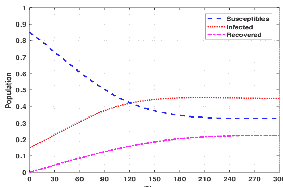

图 7.7：使用 MATLAB ode45 求解器的 SIRS 模型解。

```matlab
10 ylabel('Population');
11 legend('Susceptibles', 'Infected', 'Recovered');
12 axis(0, 300, 0, 1);
13 get(gca, 'fontweight', 'bold');
14 get(gca, 'XTick', linspace(0, 300, 11));
15 get(gca, 'GridLineStyle', ':');
```

执行脚本 `SolveSIRS.m` 的输出为图 7.7。

### 7.4.4 求解刚性 IVP 系统

如果 IVP 系统是刚性的，MATLAB 函数 `ode45` 将无法为该问题找到解。该系统的一个例子是 Vanderpool 振荡器，它由二阶微分方程给出：

> $y''(x) + \sigma(y^2(x)-1)y'(x) + y(x) = 0, y'(0) = 2$

如果我们令 $y_1(x) = y'(x), y_2(x) = y(x)$，我们可以恢复 Vanderpool 系统可以写的形式的形式：

```math
$y_1'(x) = y_2(x), y_1(0) = 1$
$y_2'(x) = \sigma(1-y_1^2(x))y_2(x) - y_1(x), y_2(0) = 0 \quad (7.9)$
```

MATLAB `ode45` 函数将无法求解 Vanderpool 系统 (7.9)。我们可以使用 MATLAB 函数 `ode23s` 来求解系统 (7.9)。
我们将 $\sigma$ 声明为全局变量，然后按照如下方式求解该系统：

## 196 求解非线性常微分方程组组

| 行号 | 代码 |
| :--- | :--- |
| 1 | `% vdpsig.m` |
| 2 | `function z = vdpsig(t, y)` |
| 3 | `global sigma` |
| 4 | `z = zeros(2, 1);` |
| 5 | `z(1) = y(2);` |
| 6 | `z(2) = sigma+(1-y)*y(2)-y(1);` |

```matlab
1 % SolveVDSSystem.m
2 clear; clc
3 global sigma;
4 tspan = [0 200]; y0 = [2; 1];
5 figure(1);
6 sigma = 1;
7 [t,y] = ode23s(@vdpsig, tspan, y0);
8 subplot(3, 2, 1);
9 plot(t,y(1), '-b', 'LineWidth', 2);
10 xlabel('x'); ylabel('y(x)');
11 title(['\sigma = ' num2str(sigma)]);
12 sigma = 5;
13 [t,y] = ode23s(@vdpsig, tspan, y0);
14 subplot(3, 2, 2);
15 plot(t,y(1), '-b', 'LineWidth', 2);
16 xlabel('x'); ylabel('y(x)');
17 title(['\sigma = ', num2str(sigma)]);
18 sigma = 10;
19 [t,y] = ode23s(@vdpsig, tspan, y0);
20 subplot(3, 2, 3);
21 plot(t,y(1), '-b', 'LineWidth', 2);
22 xlabel('x'); ylabel('y(x)');
23 title(['\sigma = ', num2str(sigma)]);
24 sigma = 20;
25 [t,y] = ode23s(@vdpsig, tspan, y0);
26 subplot(3, 2, 4);
27 plot(t,y(1), '-b', 'LineWidth', 2);
28 xlabel('x'); ylabel('y(x)');
29 title(['\sigma = ', num2str(sigma)]);
30 sigma = 40;
31 [t,y] = ode23s(@vdpsig, tspan, y0);
32 subplot(3, 2, 5);
33 plot(t,y(1), '-b', 'LineWidth', 2);
34 xlabel('x'); ylabel('y(x)');
35 title(['\sigma = ', num2str(sigma)]);
36 sigma = 80;
37 [t,y] = ode23s(@vdpsig, tspan, y0);
38 subplot(3, 2, 6);
39 plot(t,y(1), '-b', 'LineWidth', 2);
40 xlabel('x'); ylabel('y(x)');
41 title(['\sigma = ', num2str(sigma)]);
```

通过执行上述 MATLAB 代码，我们得到了不同 $\sigma$ 值的解，如图 7.8 所示。

## IVP 的 Python 求解器

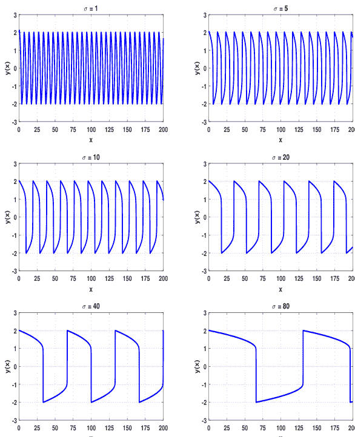

图 7.8：$\sigma = 1, 5, 10, 20, 40$ 和 $80$ 时 Vanderpool 系统的解。

## IVP 的 Python 求解器

Python 有许多方法求解 ODE 的 IVP。可用工具包括 `scipy.integrate.odeint` 函数和 `gekko` 包。

### 使用 odeint 求解 ODE

`odeint` 函数接收 ODE 系统的右侧（RHS）、初始条件向量和时间跨。它返回 ODE 系统的解。在本例中，它将用于求解微分方程 $x'(t) = 4\sin(t)-x(t)^2, x(0) = 0.1, t \in [0, 20]$。Python 代码如下：

```python
import numpy as np
from scipy.integrate import odeint
import matplotlib.pyplot as plt

def vdpsig(y, t, sigma):
    dydt = np.zeros(2)
    dydt[0] = y[1]
    dydt[1] = sigma * (1 - y[0]**2) * y[1] - y[0]
    return dydt

t = np.linspace(0, 20, 1000)
y0 = [0.1, 2]
sigmas = [1, 5, 10, 20, 40, 80]

plt.figure(figsize=(10, 8))
for i, sigma in enumerate(sigmas):
    y = odeint(vdpsig, y0, t, args=(sigma,))
    plt.subplot(3, 2, i+1)
    plt.plot(t, y[:, 0], '-b', lw=2)
    plt.xlabel('x')
    plt.ylabel('y(x)')
    plt.title(f'sigma = {sigma}')
plt.show()
```

执行上述代码显示了图 7.9：

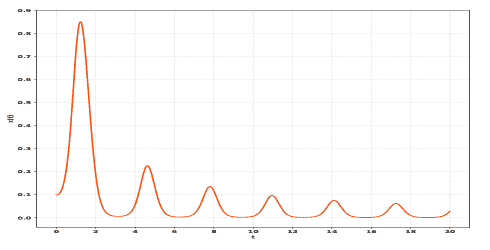

图 7.9：使用 `odeint` 函数求解初值问题。

## 求解非线性常微分方程

GEKKO 是一个最初为动态优化问题设计的 Python 求解器，适用于整数、非线性微分方程（DAE）问题。GEKKO 的默认求解器是基于内点法的 IPOPT。它还包括 APOPT、BPOPT、SNOPT 和 MINOS。状态方程的离散化通过有限元正交配角完成，其中每个有限元用多项式近似控制和状态变量。

将 `remote` 赋值参数会告诉 GEKKO 使用本地机器。

如果模型包含一个变量 $x$，其下限为 $x_{min}$，上限为 $x_{max}$ 并有一个初始值 $x_0$，则可以声明为：

```python
from gekko import GEKKO
m = GEKKO(remote=False)
```

例 7.9 该示例使用 gepko 求解 SIR：

> $S'(t) = \alpha S(t) - \mu S(t), S(0) = S_0$
> $I'(t) = \alpha S(t) - (\mu + \beta)I(t), I(0) = I_0$
> $R'(t) = \beta I(t) - \mu R(t), R(0) = R_0$

其中 $\alpha = 0.05, \mu = 0.05, \beta = 0.6$ 且 $T = 25$。

gepkko Python 代码如下：

```python
#Solvegepkko.py
from gekko import GEKKO
import numpy as np
import matplotlib.pyplot as plt

Lambda = 0.05; mu = 0.05; alpha = 2; beta = 0.6
t0 = 0
T = 25
N = 1000
m = GEKKO(remote=False)
m.time = np.linspace(0, T, N+1)
S, R = m.Var(value=0.9), m.Var(value=0.1),m.Equations()
I = m.Var(value=0.0)
m.Equation(S.dt()) == Lambda-alpha*S-mu*S
m.Equation(I.dt()) == alpha*S-(mu+beta)*I
m.Equation(R.dt()) == beta*I-mu*R

m.options.IMODE = 4 # 仿真模式
m.solve()
```


# 求解非线性常微分方程组

```python
202 t = m.time
21
22 plt.figure(1, figsize=(8, 8))
23
24 plt.plot(t, S, color='darkblue', ls = '-', lw = 3, label='易感人口 (S(t))')
25 plt.plot(t, I, color='crimson', ls = '-', lw = 3, label='感染人口 (I(t))')
26 plt.plot(t, R, color='magenta', ls=':', lw = 3, label='康复人口 (R(t))')
27 plt.xlabel('时间', fontweight='bold')
28 plt.ylabel('Population', fontweight='bold')
29 plt.xticks(np.arange(0, T+10, T/10), fontweight='bold')
30 plt.yticks(np.arange(0, 1.1, 0.1), fontweight='bold')
31 plt.grid(True, ls='--')
32 plt.axis([0.0, T, 0.0, 1.0])
```

执行代码 `SolveSIRjekko.py`
run('/media/WindowsData/PyFiles/SolveSIRjekko.py',
dir='/media/WindowsData/PyFiles')

APMonitor, 版本 0.8.9
APMonitor 优化套

APM 模型大小
每个时间步包含
对象 : 0
常量 : 0
变量 : 3
中间变量 : 0
连接 : 0
方程 : 3
残差 : 3

状态变量数量：1200
总方程数量：1200
松弛变量数量：0

自由度： 3 (不支持)
求解器 0
使用默认求解器：APOPT

使用使用 APOPT 求解器的动态仿真

迭代目标收敛性
0 2.90508E-13 1.15000E-01

# 用于 IVP 的 Python 求解器

| 迭代 | 目标 | 收敛性 |
| :--- | :--- | :--- |
| 1 | 1.50866E-13 | 1.14988E-01 |
| 2 | 4.75681E-15 | 3.14821E-01 |
| 3 | 1.74925E-15 | 3.13396E-01 |
| 4 | 1.39990E-13 | 2.80934E+01 |
| 5 | 6.11632E-16 | 2.59675E-00 |
| 6 | 1.54265E-26 | 2.30466E-01 |
| 7 | 3.91236E-17 | 1.83967E+00 |
| 8 | 9.97549E-18 | 9.28526E-01 |
| 9 | 2.46346E-18 | 6.43451E-01 |
| 10 | 5.3666E-19 | 3.23197E-01 |
| 11 | 1.04749E-20 | 8.50434E-02 |
| 12 | 2.01098E-20 | 1.72751E-02 |
| 13 | 1.59276E-21 | 3.67618E-03 |
| 14 | 6.84198E-24 | 5.41524E-04 |
| 15 | 6.43007E-29 | 5.76856E-06 |
| 16 | 6.43007E-29 | 5.76856E-06 |

成功求解

> 求解器 : IPOPT (v3.12)
求解时间：6.480000000010477E-02 秒
目标：0.0000000000000000E+000
成功求解：

求解图如图 7.11 所示。

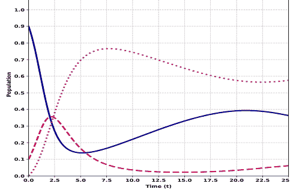

图 7.11：使用 gekko 包在 [0,10] 上求解 SIR 模型的结果。

# 求解非线性常微分方程组

**示例 7.10** 在此示例中，将使用 gekko 来求解刚性微分方程组：

```
$$\frac{dy_1(t)}{dt} = -1002*y_1(t) + 1000*y_2^2(t), \ y_1(0) = 1$$
$$\frac{dy_2(t)}{dt} = y_1(t) + y_2*(1+y_2(t)), y_2(0) = 1$$
```

对于 $0 \leq t \leq 5$。
代码如下：

```python
from gekko import GEKKO
import numpy as np
import matplotlib.pyplot as plt

t0 = 0
T = 5
N = 2000
m = GEKKO(remote=False)
m.time = np.linspace(t0, T, N+1)
y1, y2 = m.Var(value=1.0), m.Var(value=2.0)
t = m.time
# 方程
m.Equation(y1.dt) == -1002*y1+1000*y2**2
m.Equation(y2.dt) == y1-y2*(1+y2)

m.options.IMODE = 4 # 仿真模式
m.solve()
```

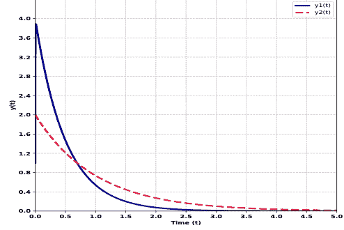

**图 7.12：**使用 gekko 包在 [0,5] 上求解刚性 ODE 组的结果。

```python
plt.figure(1, figsize=(8, 8))
plt.plot(t, y1, color='darkblue', ls='-', label='y1(t)')
plt.plot(t, y2, color='crimson', ls='--', lw=3, label='y2(t)')
plt.xlabel('时间 (t)', fontweight='bold')
plt.xticks(np.arange(0, T+10, T/10), fontweight='bold')
mxS = np.ceil(max(max(y1), max(y2)))
plt.yticks(np.arange(0, mxS+1, mxS/10), fontweight='bold')
plt.grid(True, ls='--')
plt.axis([0.0, T, 0.0, mxS])
plt.legend()
```

执行代码 `Solvegekko.py` 显示图 7.12 中的求解图。


# 非标准差分法求解 ODE

### 摘要

标准差分法最初是为了解决这类问题设计的。然而，由于刚性问题，它们在某些情况下会出现振荡，且对步长有严格限制。另一方面，隐式差分法具有更宽的稳定性区域，但会带来较大的计算开销。非标准差分法在这些方面提供了更好的平衡。

本章将介绍非标准差分方法。在第一节中，我们将讨论标准差分方法的收敛性。在第三章中介绍差分方法的构造。最后，在第四章中介绍非标准差分方法。

### 8.1 标准差分法的局限性

在许多情况下，差分函数的选择会导致数值不稳定。为了看到这种例子，考虑一阶初值问题：

```
\frac{dy(t)}{dt} = Ay(t), y(0) = 0.
```

该 IVP 的精确解为：

```
y(t) = \frac{1}{A^2}(e^{At}-(At+1)).
```

区间 [0,1] 被划分为 1000 个子区间，由点 $0=t_0<t_1...<t_{1000}=1$，每个子区间的长度为 $h=0.001$。使用前向欧拉法、隐式梯法则和经典的四阶 Runge-Kutta 方法在不同的 $A$ 值下求解给定问题。理论上，欧拉法的误差为 $\mathcal{O}(h)=\mathcal{O}(10^{-3})$，隐式梯法的误差为 $\mathcal{O}(h^2)=\mathcal{O}(10^{-6})$，而四阶 Runge-Kutta 方法的误差为 $\mathcal{O}(h^4)=\mathcal{O}(10^{-12})$。

以下是这些标准差分方法的公式：

(i) 前向欧拉法：

```
y_{j+1} = y_j + h f(t_j, y_j)
```

(ii) 隐式梯法：

```
y_{j+1} = y_j + h f(t_{j+1}, y_{j+1})
```

(iii) 间差梯法：

```
y_{j+1} = y_j + \frac{h}{2} [f(t_j, y_j) + f(t_{j+1}, y_{j+1})]
```

(iv) 中心差分法：

```
y_{j+1} = y_j + h f(t_{j+1/2}, y_{j+1/2})
```

在许多情况下，差分函数的选择会导致数值不稳定。为了看到这种例子，考虑一阶初值问题：

```
\frac{dy(t)}{dt} = Ay(t), y(0) = 0.
```

该 IVP 的精确解为：

```
y(t) = \frac{1}{A^2}(e^{At}-(At+1)).
```

区间 [0,1] 被划分为 1000 个子区间，由点 $0=t_0<t_1...<t_{1000}=1$，每个子区间的长度为 $h=0.001$。使用前向欧拉法、隐式梯法则和经典的四阶 Runge-Kutta 方法在不同的 $A$ 值下求解给定问题。理论上，欧拉法的误差为 $\mathcal{O}(h)=\mathcal{O}(10^{-3})$，隐式梯法的误差为 $\mathcal{O}(h^2)=\mathcal{O}(10^{-6})$，而四阶 Runge-Kutta 方法的误差为 $\mathcal{O}(h^4)=\mathcal{O}(10^{-12})$。


# 用于求解微分方程的非标准有限差法

210

```python
16 row = 0
17 A[row] = 5.0
18 i = 0
19 while row < MaxRows:
20     # y is the exact solution of the problem
21     y = 1/A[row]*(np.exp(A[row]*t) - (A[row]*t+1))
22     plt.plot(t, y,label='A' +str(A[row]))
23     plt.legend()
24     Euler[i, j] = y0
25     rk4[i, j] = y0
26 itj = y0
27     for j in range(3):
28     # Solving Euler's method
29     Euler[i, j] = Euler[i, j] + h*f(t[j], Euler[i, j], A[row])
30     # Solving implicit trapezoidal rule
31     k1 = f(t[j], rk4[i, j], A[row])
32     k2 = f(t[j]+h/2, rk4[i, j]+h/2*k1, A[row])
33     k3 = f(t[j]+h/2, rk4[i, j]+h/2*k2, A[row])
34     k4 = f(t[j]+h, rk4[i, j]+h/6*(k1+2*k2+2*k3+k4))
35     # Solving with the fourth-order Runge-Kutta method
36     k1 = f(t[j], rk4[i, j], A[row])
37     k2 = f(t[j]+h/2, rk4[i, j]+h/2*k1, A[row])
38     k3 = f(t[j]+h/2, rk4[i, j]+h/2*k2, A[row])
39     k4 = f(t[j]+h, rk4[i, j]+h/6*(k1+2*k2+2*k3+k4))
40     # computing the norm-infinity error for the three methods
41     EulerError = np.linalg.norm(y-Euler[i], np.inf)
42     iterError = np.linalg.norm(y-iter[i], np.inf)
43     rk4Error = np.linalg.norm(y-rk4[i], np.inf)
44     row += 1
45 row = 1
46     if row > MaxRows:
47         break
48     else:
49         A[row] = A[row] + 2.0
```

运行代码得到如下结果：
runfile('/media/WindowsData1/PyFiles/numinstudetotrivestepfun.py',
wdir='/media/WindowsData1/PyFiles')

| Euler 误差 | 隐式梯形误差 | RK4 误差 |
|---|---|---|
| 1 | 1.35789622e-03 | 3.56321584e-07 | 2.30962389e-14 |
| 3 | 1.00002555e-02 | 5.19127795e-06 | 4.50417481e-12 |
| 5 | 7.3501397e-02 | 4.5253609e-05 | 1.53952406e-10 |
| 7 | 5.39170234e-01 | 3.52721966e-04 | 3.11633030e-09 |
| 9 | 3.94734096e-03 | 2.65343074e-03 | 4.88544107e-08 |
| 11 | 2.88445591e+01 | 1.97153658e-02 | 6.58044228e-07 |
| 13 | 2.10370724e-07 | 1.45836606e-01 | 8.01259330e-06 |
| 15 | 1.53164894e-03 | 1.07702617e-00 | 9.07992144e-05 |
| 17 | 1.11283670e+04 | 7.94936660e-00 | 9.75035611e-04 |
| 19 | 0.87101948e-09 | 5.56610000e-01 | 1.00415309e-02 |
| 21 | 5.84486245e-05 | 4.32849955e-02 | 1.00014394e-01 |
| 23 | 4.22748746e-07 | 3.19388027e+03 | 9.62989817e-01 |
| 25 | 3.04789507e-00 | 2.35686600e-04 | 9.12839844e+00 |
| 27 | 2.19612624e-08 | 1.73861951e-05 | 7.79939406e-02 |
| 29 | 1.50817389e+09 | 1.28317310e-06 | 7.79939406e-02 |

## 标准有限差分方法的缺陷

我们所考虑的方法之所以产生误差，尽管步长 $h$ 保持不变，可能是因为它们使用了非线性项的局部近似：标准有限差分格式表示了如 $x^2$ 或 $e^x$ 等非线性项。Mickens 指出，非线性项的局部近似会导致数值不稳定性。Mickens 给出的一个例子是指数衰减模型的求解：
$$\frac{dP}{dt} = -P(t), P(0) = 0.5.$$
$$P^{n+1} = P^n - hP^n$$
指数衰减模型的前向欧拉离散化如下：对于不同的步长 $h$ 取值，所得的解所示。对于指数衰减模型得到的解包括了具有渐近稳定性、周期性和不稳定动力学特征的解剖面，其中周期和不稳定解并不对应于指数衰减模型的任何解。仅第一张图（人口衰减到零）就与微分方程的真实解一致。另一个例子是使用 Heun 方法求解逻辑模型：
$$\frac{dx}{dt} = x(t)(1-x(t)), x(0) = 0.5$$

## 用于求解微分方程的非标准有限差法

 指衰减模型的前向欧拉离散化如下：对于不同的步长 $h$ 取值，所得的解所示。对于指数衰减模型得到的解包括了具有渐近稳定性、周期性和不稳定动力学特征的解剖面，其中周期和不稳定解并不对应于指数衰减模型的任何解。仅第一张图（人口衰减到零）就与微分方程的真实解一致。另一个例子是使用 Heun 方法求解逻辑模型：

 图 8.2：指数衰减模型的前向欧拉方法的解。Python 代码如下：


## (III) 非线性项应通过非局部近似进行近似：诸如 $y^2(t)$ 等项应用 $y^j y^{j+1}$ 或 $y^{j-1} y^{j+1}$ 代替 $(y^j)$，其中 $y^j \approx y(t_j)$。例如，对应于 模型的离散模型

```
$$\frac{dy}{dt} = y(t)(1-y(t)), y(0) = 0.5$$
```

可以是 $\frac{y^{j+1}-y^j}{h} = y^j(1-y^{j+1}) \Rightarrow y^{j+1} = \frac{y^j(1+h)}{1+h}, y^0 = 0.5$

使用 Python 代码 `nonlocapplog.py` 通过非局部近似来求解 logistic 模型。代码如下：

```python
# nonlocapplog.py
import numpy as np
import matplotlib.pyplot as plt
steps = [0.75, 3.75, 7.5, 15.0]
plt.figure(1, size=(12, 12))
T = 75
for k in range(4):
    h = steps[k]
    N = round(T/h)
    t = np.linspace(0, T, N+1)
    p = np.zeros_like(t)
    p[0] = 0.5
    for j in range(N):
        p[j+1] = (1.0+h*p[j])/(1+h*p[j]) # 从 OCR 修正后的逻辑
    plt.subplot(2, 2, k)
    plt.plot(t, p, color='blue', label='h = ...')
    plt.legend()
    plt.xlabel('Time (t)', fontweight='bold')
    plt.ylabel('Population (P(t))', fontweight='bold')
    plt.grid(True)
    plt.xticks(np.arange(0, 80, 20), fontweight='bold')
    mnp, mxp = np.floor(10*min(p))/10, np.ceil(10*max(p))/10
    plt.yticks(np.arange(mnp, mxp, mxp-mnp)/10, fontweight='bold')
```

图 8.5 执行 Python 代码的插图。它展示了不同步长下 logistic 模型的解。这些解都修正了微分方程的真实解。因此，对于所有的步长值，离散模型都不会遭受数值不稳定性的影响。

(IV) 离散模型解与微分方程解之间的动力学一致性。这意味着微分方程解的所有属性，离散模型解也必须具备。特定的属性包括正性、单调性、有界性、极限周期和其他周期性解等。

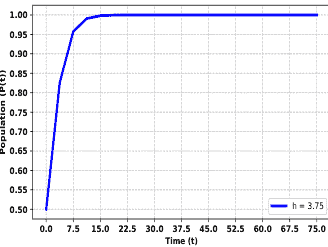

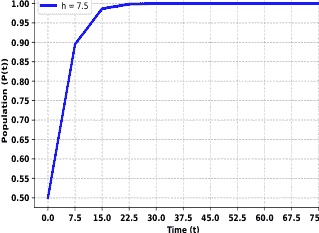

图 8.5：使用非局部近似 $y^2(t)$ 在不同步长下 logistic 模型的解。

非标准有限差分格式是基于非标准规则构建的微分方程离散表示。

## 8.3 精确有限差分格式

给定一个初值问题

```
$\frac{dy}{dt}=f(t,y(t), \lambda), \ y(a)=y^0, t \in[a,b]$
```

其中 $\lambda$ 是模型参数集。假设该初值问题的解 $y(t)$ 为：

```
$$y(t)=F(t,y(t),y^0, \lambda).$$
```

令 $N$ 为正整数，$h=\frac{b-a}{N}$ 且 $t_j=a+jh, j=0,\dots,N$。考虑有限差分格式：

```
$$y^{j+1}=g(h,t_j,y^j, \lambda).$$
```

## 求解 ODE 的非标准有限差分方法

且 $y^j \approx y(t_j)$。假设离散有限差分格式的解为

```
$y^j = G(t_j, h, y^i, y^0, \lambda). \quad (8.4)$
```

根据 Mickens [37]，如果方程 (8.3) 的解 (8.4) 与相关微分方程 (8.2) 的解相同，则它是该微分方程的精确有限差分格式。这意味着

```
$y^j = G(t_j, h, y^i, y^0, \lambda) = F(t_j, y(t_j), y^0, \lambda) = y(t_j).
```

Mickens [39] 了一种用于构建许多模型有限差分格式的机制。其思想是将问题的某些定性特征纳入离散模型中。定性特征可以从模型的线性部分获得。非线性部分则使用非局部近似技术处理。

### 8.3.1 齐次线性 ODE 的精确有限差分格式

在本节中，将为三种线性齐次 ODE 推导出精确有限差分格式。

#### 8.3.1.1 齐次一阶 ODE 的精确有限差分格式

给定初值问题：

```
$\frac{dy}{dt} = -\alpha y(t), y(0) = y^0$
```

该 IVP 的精确解为 $y(t) = y^0 e^{-\alpha t}$。基础函数为 $y_1(t) = e^{-\alpha t}$。为了确定该 IVP 的精确差分格式，考虑：

| $y^j$ | $e^{-\alpha t_j}$ | $y^j$ |
|---|---|---|
| $y^{j+1}$ | $e^{-\alpha t_{j+1}}$ | $y^j$ |

从两边减去 $y^j$，并将右侧乘以 $\alpha$ 后除以 $\alpha$，得到离散格式：

```
$y^{j+1} - y^j = -\alpha \left( \frac{1-e^{-\alpha h}}{\alpha} \right) y^j
```

由此，

```
$\frac{y^{j+1}-y^j}{1-e^{-\alpha h}} = -\alpha y^j
```

因此，不是使用标准分母 $h$，而是使用分母函数 $\frac{1-e^{-\alpha h}}{\alpha}$ 将得到精确有限差分格式。**示例 8.1 (一阶线性 ODE)** 在此例中，将为指数衰减模型开发精确差分格式。

以下 Python 代码显示了不同步长 $h$ 的精确差分格式求解指数衰减模型，并展示了精确解与离散模型之间的误差。执行代码得到如下结果：

| $h$ | Error |
|---|---|
| 0.50 | 2.7755756e-16 |
| 1.00 | 4.1633634e-17 |
| 2.00 | 8.6736178e-19 |
| 4.00 | 7.6327839e-17 |
| 5.00 | 5.201704e-18 |
| 6.25 | 1.3010426e-17 |
| 10.00 | 4.2446515e-17 |
| 12.50 | 3.2583664e-17 |
| 20.00 | 1.2479045e-18 |
| 25.00 | 2.2570453e-17 |
| 50.00 | 4.4082435e-18 |
| 100.00 | 3.8865225e-35 |

#### 8.3.1.2 齐次二阶 ODE 的精确差分格式

**示例 8.2 (二阶 ODE)** 在此例中，将为求解二阶 BVP 建立精确有限差分格式：

```
$$\frac{d^2u}{dt^2}(t)+\omega^2u(t)=0, u(0)=u_0, u(2)=u_1$$
```

给定 BVP 的特征方程为

```
$r^2+\omega^2=0$,
```

其解为：

```
$r_{1,2}=\pm\omega i$.
```

因此，BVP 的基础解函数为

```
$u_1(t)=\sin(\omega t)$ 和 $u_2(t)=\cos(\omega t)$.
```

考虑行列式：

| $u^{j-1}$ | $\cos(\omega t_{j-1})$ | $\sin(\omega t_{j-1})$ | |
|---|---|---|---|
| $u^j$ | $\cos(\omega t_j)$ | $\sin(\omega t_j)$ | = 0. |
| $u^{j+1}$ | $\cos(\omega t_{j+1})$ | $\sin(\omega t_{j+1})$ | |

利用三角恒式 $\cos(b)-\cos(a)=\sin(a-b)\sin(b)$ 并记得 $t_{j+1}-t_j=t_j-t_{j-1}=h, t_{j+1}-t_{j-1}=2h$，行列式展开为：

```
$$\sin(\omega t)u^{j-1}-\sin(2\omega t)u^j+\sin(\omega t)u^{j+1}=0 \Rightarrow u^{j-1}-2\cos(\omega t)u^j+u^{j+1}=0$$
```

在两边加上 $2\cos(\omega t)$ 并减去 $2u^j$，同时利用三角恒式 $\cos(x)=1-2\sin^2(x)$，得到：

```
$y^{j+1}-y^j = -\alpha y^j
```
[第 239 页]

最后，不是使用标准分母 $h$，而是使用分母函数 $\frac{1-e^{-\alpha h}}{\alpha}$ 将得到精确有限差分格式。当 $h\to 0$ 时，$\phi(\frac{1-e^{-\alpha h}}{\alpha})\to h$ 问题的解为：

```
$u_{exact}(t)=\frac{3}{2}\cos(\omega t)-\frac{1}{2}\cos(2\omega t)$
```

MATLAB 脚本 `SolveHarm0.m` 求解 $\omega=16$ 且 $N=10, 20, 80$ 的 BVP，时间空间 $[0,2]$ 被划分为 $N$ 个正整数。


# 求解 ODE 的非标准有限差分法

```matlab
Error = [Error; N, norm(ux-xu, inf)];
subplot(2, 2, k);
plot(t, u_t', 'LineWidth', 2);
xlabel('t');
ylabel('u');
legend(['N = ' num2str(N)]);
set(gca, 'fontweight', 'bold');
set(gca, 'fontsize', 12);
set(gca, 'XTick', a:(b-a)/10:b);
mnu = floor((10-min(u)/10); mxu = ceil(10*max(u)/10);
set(gca, 'YTick', mnu:mxu/10:mxu);
axis([a, b, mnu, mxu]);
grid on;
N = 2*N;
k = k + 1;end
printf('----------------\n');
printf('\N\tError\n');
printf('----------------\n');
N = 100;
for j = 1 : 4
    printf('%d\t%.1e\n', Error(j, 1), Error(j, 2));
end
printf('----------------\n');
```

通过执行 MATLAB 代码，不同 $N$ 取值的边界值问题（BVP）的解如图 8.6 所示，并显示了无穷范误差。

| N | 误差 |
|---|---|
| 10 | 3.33066903875e-15 |
| 20 | 6.883382752676e-15 |
| 40 | 4.996003610813e-15 |
| 80 | 1.08801564133e-14 |

如果使用标准分母函数 $h$ 代替 $\phi(\omega,h)$，则误差表如下：

| N | 误差 |
|---|---|
| 10 | 1.308207805131e+00 |
| 20 | 3.921038479674e+00 |
| 40 | 1.694674404840e+00 |
| 80 | 5.894499384984e-01 |

# 精确有限差分格式

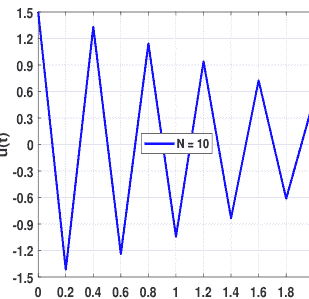
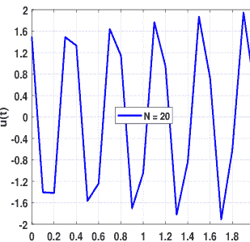
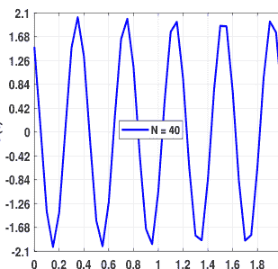
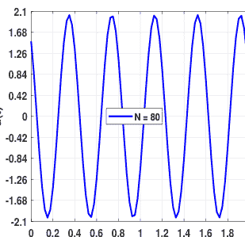

图 8.6: 使用精确有限差分格式对不同子区间数的谐振子系统进行求解。

### 8.3.1.3 二阶线性 ODE 系统的精确有限差分格式

给定一个二阶 ODE 系统：

```
$$\frac{dx}{dt} = ax(t)+by(t)$$
$$\frac{dy}{dt} = cx(t)+dy(t)$$
```

其可以写为矩阵形式：

```
$$\frac{dz}{dt} = Az(t) = \begin{bmatrix} a & b \\ c & d \end{bmatrix} \begin{bmatrix} x(t) \\ y(t) \end{bmatrix} \quad (8.5)$$
```

# 求解 ODE 的非标准有限差分法

其中

```
z(t) = \begin{bmatrix} x(t) \\ y(t) \end{bmatrix}
```

并且，$a,b,c$ 是实数。矩阵 $A$ 相似于其 Jordan 范型 $J \in \mathbb{R}^{2\times2}$，因此存在一个可逆矩阵 $P \in \mathbb{R}^{2\times2}$ 使得 $J = P^{-1}AP$。

$J$ 的对角元素是 $A$ 的特征值，$P$ 的列是 $A$ 的特征向量或广义特征向量。$J$ 的 Jordan 范型有三种形式：

```
J = \begin{bmatrix} \lambda_1 & 0 \\ 0 & \lambda_2 \end{bmatrix} \text{ 或 } \begin{bmatrix} \lambda & 0 \\ 0 & \lambda \end{bmatrix} \text{ 或 } \begin{bmatrix} \lambda & 1 \\ 0 & \lambda \end{bmatrix}
```

其中 $\lambda_1 \neq \lambda_2 \neq 0$ 且 $\lambda \neq 0$。

在 MATLAB 中，可以使用函数 `jordan` Find矩阵 $A$ 的 Jordan 范型，该函数返回矩阵 $P$ 和 $J$。

```matlab
>> A = [2, 0; 0, 1; -3; -1 of -1, -1];
>> [P, J] = jordan(A);
>> disp('P = '); disp(P);
P = 
P = [2, 0; 0, 1];
J = [2, 0; 0, 1];
```

在 Python 中，可以使用 `sympy` 库找到矩阵 $A$ 的 Jordan 范型：

```python
import numpy as np
from sympy import Matrix
A = Matrix([[2, 0], [0, 1]])
P, J = A.jordan_form()
print('P =')
print(P)
print('J =')
print(J)
```

# 精确有限差分格式

现在，将 (8.5) 左乘以 $P^{-1}$ 得到：

$$\frac{d}{dt}(P^{-1}z) = P^{-1}AP = J(P^{-1}z)$$

通过 $w = =^{-1}z$$，则：


fracfracdwdw}{dt} = Jw


通过55))))55555) 得到。


..分分分分分分


fracfracfrac}{}{}{} = =thetatheta \quad (8.7)$$

如果 $\theta = \frac{1}{2}$，则：

$$\frac{dw}{dt} = \frac{1}{2}w \quad (8.8)$$

对于 (8.8)，其有限差分格式为：

$$\frac{w_{n+1}-w_n}{h} = \frac{1}{2}w_n \quad (8.9)$$

由此得到：

$$w_{n+1} = (1+\frac{h}{2})w_n \quad (8.10)$$

通过迭代得到：

$$w_n = (1+\frac{h}{2})^n w_0 \quad (8.11)$$

由于 $nh=T$，则：

$$w_n = e^{T/2}w_0 \quad (8.12)$$

对于 $\theta$ 的任意值，有：

$$\frac{dw}{dt} = \theta w \quad (8.3)$$

如果 $\theta = 1$，则：

$$\frac{dw}{dt} = w \quad (8.4)$$

由此，其有限差分格式为：

$$\frac{w_{n+1}-w_n}{h} = w_n \quad (8.5)$$

由此得到：

$$w_{n+1} = (1+h)w_n \quad (8.6)$$

通过迭代得到：

$$w_n = (1+h)^n w_0 \quad (8.7)$$

由于 $nh=T$，则：

$$w_n = e^T w_0 \quad (8.8)$$

对于 $\theta$ 的任意值，有：

$$\frac{dw}{dt} = \theta w \quad (8.9)$$

如果 $\theta = -1$，则：

$$\frac{dw}{dt} = -w \quad (8.10)$$

由此，其有限差分格式为：

$$\frac{w_{n+1}-w_n}{h} = -w_n \quad (8.11)$$

由此得到：

$$w_{n+1} = (1-h)w_n \quad (8.12)$$

通过迭代得到：

$$w_n = (1-h)^n w_0 \quad (8.13)$$

由于 $nh=T$，则：

$$w_n = e^{-T} w_0 \quad (8.14)$$

对于 $\theta$ 的任意值，有：

$$\frac{dw}{dt} = \theta w \quad (8.15)$$

如果 $\theta = -1/2$，则：

$$\frac{dw}{dt} = -\frac{1}{2}w \quad (8.16)$$

由此，其有限差分格式为：

$$\frac{w_{n+1}-w_n}{h} = -\frac{1}{2}w_n \quad (8.17)$$

由此得到：

$$w_{n+1} = (1-\frac{h}{2})w_n \quad (8.18)$$

通过迭代得到：

$$w_n = (1-\frac{h}{2})^n w_0 \quad (8.19)$$

由于 $nh=T$，则：

$$w_n = e^{-T/2}w_0 \quad (8.20)$$

对于 $\theta$ 的任意值，有：

非标准有限差分格式：

对于 $J = \begin{bmatrix} \lambda_1 & 0 \\ 0 & \lambda_2 \end{bmatrix}$，如果 $\lambda_1 \neq \lambda_2 \neq 0$，其有限差分格式为：

$$\frac{w_{n+1}-w_n}{h} = \phi(\lambda_1,h)w_n^{(1)} + \phi(\lambda_2,h)w_n^{(2)} \quad (8.21)$$

对于 $J = \begin{bmatrix} \lambda & 0 \\ 0 & \lambda \end{bmatrix}$，如果 $\lambda \neq 0$，其有限差分格式为：

$$\frac{w_{n+1}-w_n}{h} = \phi(\lambda,h)w_n + \phi'(\lambda,h)w_n^{(1)} \quad (8.22)$$

对于 $J = \begin{bmatrix} \lambda & 1 \\ 0 & \lambda \end{bmatrix}$，如果 $\lambda \neq 0$，其有限差分格式为：

$$\frac{w_{n+1}-w_n}{h} = \phi(\lambda,h)w_n^{(1)} + \phi'(\lambda,h)w_n^{(2)} + \phi''(\lambda,h)w_n^{(3)} \quad (8.23)$$

其中 $w_n^{(i)}$ 是 $w_n$ 的第 $i$ 阶导数的近似值。


# 用于求解 ODE 的非标准有限差分法

```matlab
set(gca, 'YTick', linspace(0, 1, 11));
grid on;
legend('x(t)', 'y(t)');
set(gca, 'fontweight', 'bold');

function [phi, tht, P, J] = CompPhiThe(A, h)
    [P, J] = jordan(A);
    L1 = j(0, 1); L2 = j(2, 2);
    if isreal(L1) && isreal(L2)
        if abs(L1-L2) > eps && abs(L2) > eps
            phi = (L1-L2)*(exp(L1-h)-exp(L2-h)) / ...
                 L1*2*(exp(L1+h)-exp(L2+h));
            tht = (exp(L1-h)-L1)*(exp(L2-h)-L1) / ...
                 (L1-L2)*(exp(L1+h)-1)*(exp(L2+h)-1);
        else
            phi = (exp(L1+h)-1)*2/(L1+h*exp(h));
            tht = (exp(L1+h)-L1)*(exp(L2+h)-1)/ ...
                 (exp(L1+h)-1)/2;
        end
    else
        phi = (exp(L1+h)-1)/(2*h*exp(L1+h));
        tht = (exp(L2+h)-1-L2*h)/(L2*h*(exp(L2+h)-1));
    end
    if abs(L1) < eps && abs(L2) < eps
        phi = h;
        tht = 0.5;
    end
end
```

通过执行脚本，在 $t_{j,j}=0, \dots, N$ 处的近似误差如下：

| t | x(t)-xexact | y(t)-yexact |
|---|---|---|
| 0 | 0.000000e+00 | 0.000000e+00 |
| 1 | 5.551115e-17 | 1.1102230e-16 |
| 2 | 5.551115e-17 | 5.551115e-17 |
| 3 | 8.326672e-17 | 1.1102230e-16 |
| 4 | 5.551115e-17 | 1.1102230e-16 |
| 5 | 5.551115e-17 | 8.326672e-17 |
| 6 | 4.1633363e-17 | 5.551115e-17 |
| 7 | 2.7775576e-17 | 4.1633363e-17 |
| 8 | 4.1633363e-17 | 5.551115e-17 |
| 9 | 3.4694470e-17 | 4.8572257e-17 |
| 10 | 3.4694470e-17 | 4.8572257e-17 |

# 精确有限差分格式

脚本 `SolveLinSysExact.py` 的 Python 代码为：

```python
import numpy as np
from sympy import Matrix
from scipy.linalg import expm
import matplotlib.pyplot as plt

def CompPhiT(A, h):
    exps = np.linspace(0, h)
    P, J = Matrix(A).domain.format()
    P, J = np.array(P, float), np.array(J, float)
    L1, L2 = (0, J), (0, 1)
    if isinstance(L1, float) and isinstance(L2, float):
        if np.abs(L1) > exps and np.abs(L2) > exps:
            if np.abs(L1-L2):
                phi = (L1-L2)*(np.exp(L1*h)-1)/(np.exp(L2*h)-1)
                th = (L2*np.exp(L1*h)-1)-L1*np.exp(L2*h*h))/((L1-L2)*(np.exp(L1*h)-1)*(np.exp(L2*h)-1))
            else:
                phi = (np.exp(L1*h)-2)/(2*L1*h*np.exp(L1*h))
                th = (np.exp(L1*h)-1)/(L1*h*np.exp(L1*h))
        if np.abs(L1) >= exps and np.abs(L2) < exps:
            phi = h
            th = (np.exp(L1*h)-1-L1*h)/(np.exp(L1*h)-1)
        if np.abs(L1) < exps and np.abs(L2) >= exps:
            phi = h
            th = (np.exp(L2*h)-1-L2*h)/(L2*h*(exp(L2*h)-1))
        if np.abs(L1) < exps and np.abs(L2) < exps:
            phi = h
            th = 0.5
    return phi, th, P, J

a, b = 0.0, 10
A = np.array([[-3, 2], [1, -1]])
N = 10
t = np.linspace(a, b, N+1)
th = (b-a)/N
phi, th, P, J = CompPhiT(A, h)
z0 = np.array([[1, 0.5]])
z, u = np.zeros((2, N+1)), np.zeros((2, N+1))
z[:, 0] = z0
u[:, 0] = np.linalg.solve(P, z)
B = np.exp((1-th)*phi)*P, np.exp((1-th)*phi)*J
for j in range(N):
    u[:, j+1] = np.linalg.solve(B, u[:, j])
    z[:, j+1] = P@u[:, j]
uex, zex = np.zeros((2, N+1)), np.zeros((2, N+1))
zek[:, 0] = z0 # Exact solution
uex[:, 0] = u[:, 0]
for j in range(N):
    uex[:, j+1] = expm(J*t[j])@uex[:, j]
    zek[:, j+1] = P@uex[:, j]

Errors = np.abs(z-zek)

u_{k+1} = u_k \sqrt[n-1]{\frac{(n-1)u_k}{(n-1)(1+\alpha(n-1)h)}}

# 精确有限差分格式

将两边取 $n-1$ 次方并除以 $n-1$，得到如下形式：

```python
u_{k+1}^{n-1}u_k^{n-1} = -\alpha(n-1)hv_k^{n-1}u_{k+1}^{n-1}
```

或者

```python
(u_{k+1}^{n}-u_k)(u_{k+1}^{n-2}+u_{k+1}^{n-3}+\dots+u_k^{n-2}) = -\alpha(n-1)hv_k^{n-1}u_{k+1}^{n-1}
```

由此得到精确差分格式：

```
$$\frac{u_{k+1}-u_{k}}{h} = \frac{-\alpha(n-1)u_k^{n-1}u_{k+1}^{n-1}}{u_{k+1}^{n-2}+u_{k+1}^{n-3}+\dots+u_{k}^{n-2}}$$ $(8.10)$
```

对于 $n=2$，对于

```
$$\frac{du}{dt} = -\alpha u^2(t)$$
```
精确差分格式为：

```
$$\frac{u_{k+1}-u_{k}}{h} = -\alpha u_k u_{k+1}$$
```

对于 $n=3$，对于

```
$$\frac{du}{dt} = -\alpha u^3(t)$$
```
精确差分格式为：

```
$$\frac{u_{k+1}-u_{k}}{h} = \frac{-2\alpha u_{k}^{2}u_{k+1}}{u_{k}+u_{k+1}}$$
```

对于 $n=4$，对于

```
$$\frac{du}{dt} = -\alpha u^4(t)$$
```
精确差分格式为：

```
$$\frac{u_{k+1}-u_{k}}{h} = \frac{-3\alpha u_{k}^{3}u_{k+1}}{u_{k}^{2}+u_{k}u_{k+1}+u_{k+1}^{2}}$$
```

Python 脚本 `ExactFDM.py` 实现了方程 (8.8) 的精确差分格式，其中 $u_0=0.5$，并显示了离散点 $t_{j},j=0,\dots,10$ 处的误差：

```python
# ExactFDM.py
import numpy as np

def ExactSol(t, n, u0):
    U = (n-1)*u0**(n-1)/((n-1)*(1+(n-1)*t*u0**(n-1))
    u = np.array([v**(1/(n-1)) for v in U])
    return u
```

```matlab
def ExactFDM(t, n, h, u0)
    u = np.zeros_like(t)
    u(1) = u0
    for k = 1:len(u)-1
        u(k+1) = ((n-1)*u(k)**(n-1))/(n-1)*(1+(n-1)*h*u(k)**(n-1)));
    return u
end

a, b, N = 0.0, 10.0, 5
t = linspace(a, b, N+1)
u0 = (b-a)/N, 0.5
ns = [2, 4, 8, 10]
for n in ns
    uex = ExactSol(t, n, u0)
    ufdm = ExactFDM(t, n, h, u0)
    Errors = np.zeros((2, N+1))
    Errors(1, :) = t
    Errors(2, :) = abs(uex-ufdm)
    print('Errors corresponding to n = ' + str(n))
    print('----------------------')
    print('t \t Error')
    print('----------------------')
    for j in range(len(Errors)):
        print('{3f}'.format(Errors[j][0]) + ' \t ' + '{1e}'.format(Errors[j][1]))
    print('----------------------')
```

执行代码得到如下结果：
`run('D:/PyFiles/ExactDM.py', 'D:/PyFiles')`
$n=2$ 的样本：

| t | Error |
|---|---|
| 0 | 0.000000e+00 |
| 2 | 0.000000e+00 |
| 4 | 0.000000e+00 |
| 6 | 0.000000e+00 |
| 8 | 0.000000e+00 |
| 10 | 1.3877778e-17 |

$n=5$ 的样本：

| t | Error |
|---|---|
| 0 | 0.000000e+00 |
| 2 | 0.000000e+00 |
| 4 | 0.000000e+00 |
| 6 | 0.000000e+00 |
| 8 | 0.000000e+00 |
| 10 | 0.000000e+00 |

$n=8$ 的样本：

| t | Error |
|---|---|
| 0 | 0.000000e+00 |
| 2 | 0.000000e+00 |
| 4 | 5.551115e-17 |
| 6 | 5.551115e-17 |
| 8 | 5.551115e-17 |
| 10 | 1.1102230e-16 |

$n=10$ 的样本：

| t | Error |
|---|---|
| 0 | 0.000000e+00 |
| 2 | 0.000000e+00 |
| 4 | 0.000000e+00 |
| 6 | 5.551115e-17 |
| 8 | 5.551115e-17 |
| 10 | 5.551115e-17 |

MATLAB 脚本 `ExactFDm.m` 的代码为：

```matlab
a = 0.0 ; b = 10.0 ;
N = 5 ;
t = linspace(a, b, N+1);
h = (b-a)/N;
u0 = 0.5;
ns = [2, 4, 8, 10];
for n = ns
    exact = ExactSol(t, n, u0);
    ufdm = ExactFDM(t, n, h, u0);
    Errors = zeros(2, N+1);
    Errors(1, :) = t;
    Errors(2, :) = abs(ue-ufdm);
    Errors = Errors';
    fprintf('Errors corresponding to n = %i\n', n);
    fprintf('----------------------\n');
    fprintf('%t \t %e\n', Error);
    fprintf('--------------------------------\n');
    for j = 1 : N+1
        fprintf("%2i%%t.8e\n", Errors(j), Errors(j, 2));
    end
    fprintf('--------------------------------\n');
end

function u = ExactSol(t, n, u0)
    function U = (n-1)+u0*(n-1).((n-1)*(n-1)*t*u0-(n-1))
    u = U.'.(1/(n-1));
end

function u = ExactDM(t, n, u0)
    u = zeros(size(t));
    u(1) = u0;
    for k = 1 : length(t)-1
        u(k+1) = ...
        (n-1)*u(k)^(n-1)/((n-1)*(n-1)+h*u(k)^(n-1)) - (1/(n-1));
    end
end
```

# 8.3.3 含有线性项和幂项微分方程的精确差分格式

给定一个微分方程：

$$\frac{du}{dt} = \alpha(t) - \beta u^n(t), u(t_0) = u_0, n \geq 2$$ (8.11)

为了提取差分格式，分母函数 $\phi$ 从线性项 $\alpha(t)$ 导出：

$$\phi(h, \alpha) = \frac{1-e^{-\alpha h}}{\alpha}$$

并且非线性项 $\beta u^n(t)$ 使用非局部近似：

$$\frac{-eta(n-1)u_k^{n-1}u_{k+1}^{n-1}}{u_{k+1}^{n-2} + u_{k+1}^{n-3}u_k + \cdots + u_{k+1}u_k^{n-3} + u_k^{n-2}}$$ =

那么微分方程 (8.11) 的精确差分格式将：

$$\frac{u_{k+1}-u_{k}}{\frac{1-e^{-\alpha h}}{\alpha}} = \alpha u_k - \frac{-eta(n-1)u_k^{n-1}u_{k+1}^{n-1}}{u_{k+1}^{n-2}+u_{k+1}^{n-3}+\dots+u_{k}^{n-2}}$$ $(8.12)$

一个特殊情况是 $n=2$ 得到逻辑斯谛方程

$$\frac{du}{dt} = \alpha(t) - \beta u^2(t),$$


# 精确有限差分格式

其精确有限差分方案为：

$u_{k+1}-u_k / (1-e^{-\alpha h}) = \alpha u_k - \beta u_k u_{k+1}$

由此得：

$(1+\phi\alpha)u_k / (1+\phi\beta u_k)$

Python 脚本 `ExactFDLogistic.py` 求解逻辑模型，使用了精确有限差分格式：

```python
import numpy as np
import matplotlib.pyplot as plt
a, b, N = 0.0, 50.0, 100
t = np.linspace(a, b, N+1)
h = (b-a)/N
u0 = 0.1

u = np.zeros_like(t)
u[0] = u0
alpha, beta = 0.25, 0.25
phi = (1-np.exp(-alpha*h))/alpha
for k in range(N):
    u[k+1] = (1+phi*alpha)*u[k]/(1+phi*beta*u[k])
MaxError = np.linalg.norm(u-u, np.inf)
print('Maximum error:', MaxError)
plt.plot(t, u, color='brown', lw=3)
plt.xlabel('Time', fontweight='bold')
plt.ylabel('Population (u)', fontweight='bold')
plt.grid(True, ls=':')
s = (b-a)/10
plt.xticks(np.arange(a, b, s), fontweight='bold')
plt.yticks(np.arange(0, 1.1, 0.1), fontweight='bold')
```

通过执行代码，显示了最大误差，并在图 8.7 中解释了模型的解。

runfile('D:/PyFiles/ExactFDLogistic.py', wdir='D:/PyFiles')
Maximum error = 3.33069903875496e-16

MATLAB 脚本 `ExactFDLogistic.m` 应用精确有限差分格式求解逻辑模型：

```matlab
%ExactFDLogistic.m
a = 0.0; b = 50.0; N = 100;
t = linspace(a, b, N+1); h = (b-a)/N
u0 = 0;
u = zeros(1, N+1);
alpha = 0.25; beta = 0.25;
phi = (exp(alpha*h)-1)/alpha;
u(1) = u0;
uex = zeros(1, N+1); uex(1) = u0;
```

# 求解 ODE 的非标准有限差分法

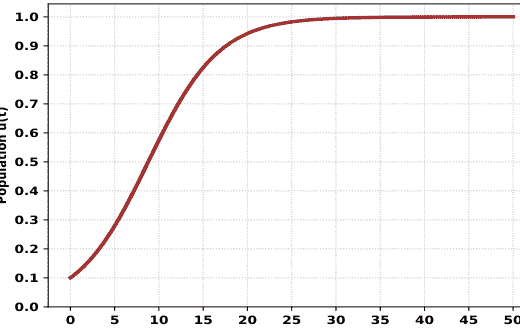

图 8.7：使用精确有限差分格式的逻辑模型解。

```matlab
for k = 1 : N
    u(k+1) = [1+phi*alpha]*u(k)/(1+phi*beta*u(k+1));
    uex(k+1) = ...
    alpha=u0/((alpha-beta*u0)*exp(-alpha*t(k+1))+beta*u0;

MaxError = norm(u-uex, inf)
disp(['Max Error = ', num2str(MaxError)]);
plot(t, u, 'r', 'LineWidth', 3);
xlabel('Time'); ylabel('Population u(t)');set(gca, 'fontweight', 'bold');
grid on
s = (b-a)/10
set(gca, 'XTick', a:s:b);
set(gca, 'YTick', linspace(0, 1.1, 12));
```

# 8.4 其他非标准有限差分格式

在无法获得精确有限差分格式的情况下，构造非标准有限差分格式的目的是建立求解问题的最佳有限差分格式。

# 其他非标准有限差分格式

Mickens 在 [37] 中提出了选择分母函数和处理非线性项的规则。给定一个初值问题：

```latex
$\frac{du}{dt}=f(u), u(0)=u_0$$
```

寻找分母函数的方法是通过求解 $f(u)=0$ 来得 $u(t)$ 的微分方程平衡点。令 $u_1, u_2, \dots, u_n$ 为微分方程的平衡点。

```latex
$r_k=\left[\frac{df}{du}\right]_{u=u_k},k=1,\dots,n$$
```

且 $r=\max\{|r_k|, k=1, \dots, n\}$。那么分母函数由：

```latex
$\phi(r,h)=\frac{1-e^{-rh}}{r}$
```

右侧的线性和非线性项可以使用非近似进行近似。例如，微分方程中的 $u(t)$ 在 $t_k$ 处可以用 $2u_k-u_{k+1}$ 近似，微分方程中的项 $u^2(t)$ 在 $t_k$ 处可以用 $2u_k^2-u_ku_{k+1}$ 近似。

**示例 8.4** 该示例取自 [37]，并为微分方程构造了一个非标准有限差分格式：

```latex
$\frac{du}{dt}=u^2(t)-u^3(t),u(0)=u_0$$
```

模型的平衡点为 $u_1=0$ 和 $u_3=1$。分母为 $\phi(h)=1-e^{-h}$。项 $u^2(t)$ 在 $t_k$ 处由 $2u_k^2-u_{k+1}$ 近似，非线性项 $-u^3(t)$ 由 $-u_k^2u_{k+1}$ 近似。非标准有限差分格式为：

```latex
$\frac{u_{k+1}-u_k}{\phi}=2u_k^2-u_{k+1}$
```

经过几次变形后得到：

```latex
$u_{k+1}=\frac{(1+2\phi)u_k}{1}$
```

Python 脚本 `MickModel.py` 实现了 Mickens 的有限差分格式及其解：

```python
import numpy as np
import matplotlib.pyplot as plt
a, b, N = 0.0, 25.0, 100
t = np.linspace(a, b, N+1)
h = (b-a)/N
u0 = 0.1

u = np.zeros_like(t)
u[0] = u0
phi = 1-np.exp(-h)
for k in range(N):
    u[k+1] = (1+2*phi+u[k])*u[k]/(1+phi*(u[k]**2))
plt.plot(t, u, color='orange', lw=3)
plt.xlabel('t', fontweight='bold')
plt.ylabel('u(t)', fontweight='bold')
plt.grid(True, ls=':')
s = (b-a)/10
plt.yticks(np.arange(0., 1.1, 0.1), fontweight='bold')
```

执行代码得到图 8.8。MATLAB 代码为：

```matlab
a = 0.0; b = 25.0; N = 100;
t = linspace(a, b, N+1); h = (b-a)/N;
u0 = 0.1;
u = zeros(1, N+1);
phi = 1-exp(-h);
u(1) = u0;
```


图 8.8：使用 Mickens 标准有限差分格式求解模型 $u'(t) = u^2(t) - u^3(t)$ 的解。

# 其他非标准有限差分格式

```matlab
for k = 1 : N
    u(k+1) = (1+2*phi+u(k))*u(k)/(1+phi*(u(k)+u(k)^2));
end
plot(t, u, 'r', 'LineWidth', 3);
xlabel('Time(t)');
ylabel('Population u(t)');
set(gca, 'fontweight', 'bold');
grid on;
s = (b-a)/10;
set(gca, 'XTick', a:s:b);
set(gca, 'YTick', linspace(0, 1.1, 12));
```


## 第三部分

## 求解线性、非线性动态优化问题


# 求解优化问题：线性与规划

### 摘要

线性规划是数学规划最重要的方法之一，在实际生活中应用广泛，以确保有限资源的优化利用。此类示例包括根据可用动力和原材料优化特定工厂的产品组合以实现利润最大化。此外，将某些产品从生产区域转移到消费中心，使每个消费中心以最低成本满足其需求。

本章结构如下：第一节讨论线性规划问题的形式。第二、三节讨论使用 MATLAB® 和 Python 中的内置函数求解线性规划问题。第四节使用 Python 的 `pulp` 包求解线性规划问题，并在第五节中进行讨论。`Pyomo` 包是另一个求解线性规划问题的 Python 包，第六节使用 `geko` Python 包求解线性规划问题。第七节致力于使用许多 MATLAB 和 Python 包求解二次规划问题。

# 9.1 线性规划问题的形式

线性规划问题的般形式为：

```latex
$$\min \alpha_1x_1 + \alpha_2x_2 + \cdots + \alpha_nx_n$$
```

# 求解优化问题：线性与二次规划

受限于等式约束：

```latex
$$a_{11}x_1 + a_{12}x_2 + \dots + a_{1n}x_n = b_1$$
$$a_{21}x_1 + a_{22}x_2 + \dots + a_{2n}x_n = b_2$$
$$a_{31}x_1 + a_{32}x_2 + \dots + a_{3n}x_n = b_3$$
$$a_{m1}x_1 + a_{m2}x_2 + \dots + a_{mn}x_n = b_m$$
```

不等式约束：

```latex
$$c_{11}x_1 + c_{12}x_2 + \dots + c_{1n}x_n \le d_1$$
$$c_{21}x_1 + c_{22}x_2 + \dots + c_{2n}x_n \le d_2$$
$$c_{31}x_1 + c_{32}x_2 + \dots + c_{3n}x_n \le d_3$$
$$c_{l1}x_1 + c_{l2}x_2 + \dots + c_{ln}x_n \le d_l$$
```

以及边界约束：

```latex
$$x_1 \in (X_1^{min}, X_1^{max}), \dots, x_n \in (X_n^{min}, X_n^{max})$$
```


# 线性规划问题的形式

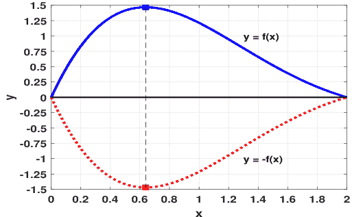

图 9.1：函数 $f(x)=e^{-(x-0.5)}\sin(\frac{\pi x}{2})$ 和 $-f(x)$ 的图像，显示了使 $f(x)$ 最大化的 $x$ 值也使 $-f(x)$ 最小。

其中，

$\begin{bmatrix} a_{11} & a_{12} & \dots & a_{1n} \\ a_{21} & a_{22} & \dots & a_{2n} \\ \vdots & \vdots & \ddots & \vdots \\ a_{m1} & a_{ms} & \dots & a_{mn} \end{bmatrix} x = \begin{bmatrix} x_1 \\ x_2 \\ \vdots \\ x_n \end{bmatrix}, b = \begin{bmatrix} b_1 \\ b_2 \\ \vdots \\ b_n \end{bmatrix}$

$\begin{bmatrix} c_{11} & c_{12} & \dots & c_{1n} \\ c_{21} & c_{22} & \dots & c_{2n} \\ \vdots & \vdots & \ddots & \vdots \\ c_{l1} & c_{ls} & \dots & c_{ln} \end{bmatrix} d = \begin{bmatrix} d_1 \\ d_2 \\ \vdots \\ d_l \end{bmatrix}, X = \begin{bmatrix} (X_1^{min}, X_1^{max}) \\ (X_2^{min}, X_2^{max}) \\ \vdots \\ (X_n^{min}, X_n^{max}) \end{bmatrix}$

最大化目标函数 $f(x)$ 问题等价于最小化 $-f(x)$ 问题，因为 $f(x)$ 的最大化问题和 $-f(x)$ 的最小化问题具有相同的最优解 $x^{opt}$。图 9.1 绘制了函数 $f(x)=e^{-(x-0.5)}\sin(\frac{\pi x}{2})$ 和 $-f(x)$ 的图像。从这两个函数的图像中可以清楚，$f(x)$ 的最大值在使 $-f(x)$ 最小的相同点获得。

那么，问题：
$\max \alpha^T x$

受限于约束
$Ax = b$
$Cx \leq d$
$x \in \mathbf{X}$

等价于问题：
$\min \beta^T x$

受限于约束
$Ax = b$
$Cx \le d$
$x \in \mathbf{X}$

$(\beta = -\alpha)$，且等式或不等式约束没有进一步变化。

# 9.2 使用 linprog 求解线性规划问题

考虑问题：

$\min_{x \in \mathbb{R}^n} \alpha^T x$，

受限于约束
$Ax = b$
$Cx \le d$
$lb \le x \le ub$

可以使用 MATLAB 函数 `linprog` 来求解线性规划问题。其形式为：

`xopt, fval] = linprog(objfun, C, d, A, b, lb, ub)`

其中 $x0$ 是初始起始点。如果问题不包含下界和上界，则该函数为：

`xopt, fval] = linprog(objfun, C, d, A, b)`

如果问题不包含等式约束，则 A 和 b 被替换为空括号 []。其形式为：

`xopt, fval] = linprog(objfun, C, d, [], [], lb, ub)`

为了演示如何使用函数 `linprog`，示例所示：

**示例 9.1** 在此示例中，将使用 MATLAB 的 `linprog` 函数来求解线性规划问题：

max $3x_1+x_2+2x_3$

受限于：

$3x_1+x_2 \le 40$
$x_1 + 2x_3 \le 60$
$x_2+2x_3 \le 60$
$x_1 \ge 0, x_2 \ge 0, x_3 \ge 0$

使用以下 MATLAB 指令寻找最优解：

```
>> objfun = [-3; -1; -2];
>> C = [3, 1, 0; 1, 0, 2; 0, 1, 2];
>> d = [40; 60; 60];
>> lb = [0; 0; 0];
>> [xopt, fval] = linprog(objfun, C, d, [], [], lb, [])
```

找到最优解。

```
xopt = 
10
10
25
```

```
fval = 
-90
```

MATLAB linprog 函数默认使用*对偶单纯形*算法。可以通过 `optimoptions` 结构体更改算法。例如，切换到内点求解器并求解示例 9.1，可以使用 [17] 中的以下指令：

```
>> Options = optimoptions('linprog', 'Algorithm', 'interior-point');
>> [xopt, fval] = linprog(objfun, C, d, [], [], lb, Options)
```

找到了最小值，满足约束，因为目标函数在可行方向上是非递减的，且在选定的容差范围内满足了约束。

```
xopt =
10.0000
10.0000
25.0000
```

```
fval =
-90.0000
```

```
>> Options = optimoptions('linprog', 'Algorithm', 'interior-point-legacy', 'Display', 'iter');
>> [xopt, fval] = linprog(objfun, C, d, [], [], lb, Options)
```

Python 在 `scipy.optimize` 库中也有 `linprog`。要使用该函数，应从 `scipy.optimize` 导入。Python 的 linprog 形式与 MATLAB 接近。求解 9.1 使用以下 Python 指令：

```
[1]: import numpy as np
[2]: import scipy.optimize as opt
[3]: obj = np.array([1, 0, -1])
[4]: C = np.array([40, 60, 60])
[5]: d = np.array([1, 0, None])
[6]: res = opt.linprog(obj, A_ub=C, b_ub=d, bounds=bounds, options={'disp':'True'})
```

| 主可行性 | 对偶可行性 | 对偶间隙 | 步长 | 目标 |
|---|---|---|---|---|
| 1.0 | 1.0 | 1.0 | -8.0 | |
| 0.117653942 | 0.117653942 | 0.01711156063 | 0.89518428034 | -31.998240526 |
| 0.01711156063 | 0.01711156063 | 0.001823469107 | 0.929927174833 | -76.99885406353 |
| 0.001823469107 | 0.001823469107 | 9.6225746912e-09 | 0.99994844444 | -89.9999525556 |

优化终止。当前值：

```
print(OptSol)
con: array([1.], dtype=float64)
fval: -89.9999952993
message: 'Optimization terminated successfully.'
nit: None
status: 0
success: True
x: array([2.66541588e-06, 5.24873505e-06, 9.99999993999999,24.99999974999997])
```

linprog 函数的默认求解器是内点法。但还有两种方法选项：单纯形法和修正法。它们的使用方法如下：

```
In [9]: OptSol = opt.linprog(objfun, A_ub=C, b_ub=d, bounds = bnds,method='simplex', options = {"disp":True})
```

优化终止。当前函数值：-90.000000
迭代次数：3

```
In [10]: print(OptSol)
con: array([], dtype=float64)
fun: -90.0
message: 'Optimization terminated successfully.'
it: 3
slack: array([0., 0., 0.])
status: True
x: array([10., 10., 25.])
```

# 9.3 使用 fmincon 函数求解线性规划问题

MATLAB 函数 `fmincon` 可用于求解线性规划问题。使用 fmincon 求解 9.1 需要初始化目标函数的函数句柄（或自定义目标函数）。此外，将初始猜测 $x0$、线性不等式约束和等式约束以及边界传递给 `fmincon` 函数。

```
f = @(x) objfun'*x ;
x0 = [0.;0;0];
C = [3, 1, 0, 1, 0, 2; 0, 1, 2];
d = [40; 60; 60];
lb = [0; 0; 0];
[xopt, fval] = fmincon(f, x0, C, d, [], [], [])
```

# 9.4 使用 Python pulp 求解线性规划问题

Python 拥有一个名为 pulp 的库来求解线性规划问题 [41]。安装 pulp 非常简单，可以通过输入：

```
>>> pip install pulp
```

在 anaconda 中可以通过输入命令安装：

```
In [13]: conda install -c conda-forge pulp
```

使用 pulp 之前必须先导入 pulp 库：

```
In [14]: import pulp as plp
```


## 使用 pulp 求解线性规划问题

然后，应使用某些变量（例如 LPP）来定义并求解问题。pulp 允许用户通过 `LpProblem` 函数命名问题并定义其类型（*最大化、最小化*）。要定义最大化问题，应将参数 `LpMaximize` 作为第二个参数传递给 `LpProblem`；要定义最小化问题则传递参数 `LpMinimize`：

In [15]: LPP = pulp.LpProblem("Problem of maximizing profit", LpMaximize)

问题的变量通过 pulp 函数 `LpVariable` 定义。它接收一个字符串和变量的边界。例如，如果问题包含 0 ≤ x ≤ 5：

```python
x = pulp.LpVariable("x", 0., 5.)
```

这些变量可以与问题实例 LPP 一起使用。
接下来，将等式约束和不等式约束添加到问题实例中。如果问题包含不等式约束 2x+y ≤ 10，则使用以下指令将该约束添加到问题中：

```python
LPP += 2*x + y <= 10
```

在 pulp 中，用户不需要更改不等式约束的形式。如果问题包含约束 x+y ≥ 2，可以直接将其添加到问题实例，而无需将其转换为其他形式：

```python
LPP += x + y >= 2
```

最后，在定义问题后，可以使用 LPP 实例的 `solve()` 方法来求解问题并显示结果。
Python 脚本 `SolveExLinProg.py` 用于求解示例 9.1 问题并显示结果：

```python
# SolveExLinProg.py
2 import pulp as pulp
3 LPP = pulp.LpProblem("Problem statement: \n", pulp.LpMaximize)
4 X, y, z = pulp.LpVariable("x", lowBound=0), ...
pulp.LpVariable("y", lowBound=0), pulp.LpVariable("z", ...
lowBound=0),
5 LPP += 3*x + y + 2*z
6 LPP += x + y <= 40
7 LPP += x + 2*z <= 60
8 LPP += x >= 0.
9 LPP += y >= 0.
10 LPP += z >= 0.
11 print (LPP)
12 status = LPP.solve()
13 print('Status of the optimization process: ' + ...
pulp.LpStatus[status])
```

## 求解优化问题：线性规划与二次规划

| 15 | print('Optimal maximizer found at: \n', pulp.value(x), '\n', ... \n pulp.value(y), '\n', pulp.value(z)) |
| 16 | print('Optimal value of the objective function: \', ... \n pulp.value(LPP.objective)) |

执行代码后得到以下结果：

```
runfile('D:/PyFiles/SolveExLinProg.py', wdir='D:/PyFiles')
Problem statement:
MAXIMIZE
3*x + 1*y + 2*z + 0
SUBJECT TO
_C1: 3 x + y <= 40
_C2: x + 2 z <= 60
_C3: y + 2 z <= 60
_C4: x >= 0
_C5: y >= 0
_C6: z >= 0

VARIABLES
x Continuous
y Continuous
z Continuous

Status of the optimization process: Optimal
Optimal maximizer found at:
10.0
10.0
25.0
Optimal value of the objective function: 90.0
```

## 9.5 使用 pyomo 求解线性规划问题

Pyomo 是一个基于 Python 的用于建模和求解优化问题的软件 [23]。pyomo 提供了两种建模方式：具体模型（concrete models），即在构建模型之前指定数据；以及抽象模型（abstract models），即在指定数据之前构建模型，且模型数据在优化过程运行期间传递给模型。本节介绍了如何创建创建具体模型来求解线性规划问题。

在 anaconda 中，可以使用以下命令安装 pyomo：

```bash
conda install -c conda-forge pyomo
```

在运行 pyomo 之前，确保已安装目标优化求解器至关重要。例如，如果没有安装 'glpk' 求解器，可以通过输入命令安装：

```bash
conda install -c conda-forge glpk
```

求解线性规划问题的第一步是通过导入两者来准备 pyomo 环境和求解器。可以通过以下方式完成：

```python
import pyomo as pym
from pyomo.opt import SolverFactory
```

然后，使用以下代码构造用于 ConcreteModel 或 AbstractModel 的变量：

```python
Model = pym.ConcreteModel()
or
Model = pym.AbstractModel()
```

例如，如果 x ≤ 5 和 0 y < ∞ 是优化问题的两个变量，可以使用以下方式声明：

```python
Model.x = pym.Var(bounds=(1., 5))
Model.y = pym.Var(within=NonNegativeReals)
```

使用 `pym.Objective` 方法定义目标函数，该方法接收目标函数的数学表达式（例如 10x + y/100）：

```python
Model.objfun = pym.Objective(expr = 10*x + y/100)
```

如果问题包含约束 10x + y ≤ 100，可以将该约束添加到模型：

```python
Model.con1 = pym.Constraint(expr=10*x + y <= 100)
```

完全定义模型后，使用优化求解器通过模型求解问题。要使用 pyomo 求解示例 9.1，Python 脚本 `SolveWithPyomo.py` 使用了以下代码：

```python
import pyomo.environ
from pyomo.opt import SolverFactory
LPP_model = pym.ConcreteModel()
LPP_model.x, LPP_model.y, LPP_model.z = pym.Var(bounds=(0., None)), pym.Var(bounds=(0., None)), pym.Var(bounds=(0., None))
LPP_model.objfun = pym.Objective(expr=3*LPP_model.x + LPP_model.y + 2*LPP_model.z, sense=maximize)
LPP_model.con1 = pym.Constraint(expr=3*LPP_model.x + LPP_model.y <= 40)
LPP_model.con2 = pym.Constraint(expr=LPP_model.x + 2*LPP_model.z <= 60)
LPP_model.con3 = pym.Constraint(expr=LPP_model.y + 2*LPP_model.z <= 60)
opt = SolverFactory('glpk')
OptResults = opt.solve(LPP_model)
print('\nStatus of optimization process: ', OptResults.Status)
print('Status of termination condition: ', OptResults.termination_condition)
print('Optimal solution obtained at: \n', LPP_model.x.value, LPP_model.y.value, LPP_model.z.value)
print('Value of objective function at solution: ', LPP_model.objfun())
```

通过执行代码，得到了以下结果：

Status of optimization condition: optimal
Optimal solution obtained at:
x = 10.0
y = 10.0
z = 25.0

Value of objective function at solution: 90.0

## 9.6 使用 gekko 求解线性规划

在 gekko 模式 3 下求解优化问题。求解示例 9.1 使用了 Python 脚本 `SolveExLPWithekko.py`：

```python
from gekko import GEKKO
m = GEKKO()
x = m.Var(1., None)
y = m.Var(1., None)
z = m.Var(1., None)
m.Obj(-3*x-y-2*z)
m.Equation(3*x + y <= 40)
m.Equation(x + 2*z <= 60)
m.Equation(y + 2*z <= 60)
m.options.IMODE = 3
m.solve()
print('Solution found at \n')
print('{:.7f}'.format(x.value))
print('{:.7f}'.format(y.value))
print('{:.7f}'.format(z.value))
print('Value of objective function: ', '{:.7f}'.format(3*x.value+y.value+2*z.value))
```

执行代码得到：

EXIT: Optimal Solution found.
解已找到。

目标函数的最终值为 -89.999999911064

| Solver | IPOPT (v3.12) |
| Solution time | 9.1000000126318E-03 |
| Objective | -89.99999911064 |
| Successful solution | |

Solution found at
10.0000000
10.0000000
25.0000000

Value of objective function: 90.0000000

## 9.7 求解二次规划问题

二次规划问题是一种目标函数为二次型且约束为线性的优化问题。二次规划问题的般形式为：

$$\min \frac{1}{2}x^T Hx + \alpha^T x, H \in \mathbb{R}^{n \times n}, \alpha, x \in \mathbb{R}^n \quad (9.9)$$

结合（9.2）线性等式约束和（9.3）不等式约束。

在本节中，将考虑如下示例所示二次规划问题的解：

## 示例 9.2

MATLAB 有一个 `quadprog` 函数用于求解二次问题。`fmincon` 函数也可以用于求解二次问题。

## 使用 quadprog 的 MATLAB 函数

等等，MATLAB 的 `quadprog` 函数用于求解二次规划问题。

MATLAB 的 `quadprog` 函数接收矩阵 $H$、向量 $\alpha$、不等式约束矩阵 $C$ 及其右侧值 $d$、等式约束矩阵 $A$ 及其右侧值 $b$，以及下界 $lb$ 和上界 $ub$。其形式为：

> `[xopt, fval] = quadprog(H, alpha, C, d, b, lb, ub)`

如果缺失任何输入，可以用空括号 `[]` 替换。MATLAB 脚本 `SolveQuadProg.m` 用于求解示例 9.2。

```matlab
% SolveQuadProg.m
clear; clc;
H = [2, 0, 4, 0; 0, 4, 0, 8; 4, 0, 8, 0; 0, 8, 0, 4];
alpha = [-2, 0, -1, 2];
C = [-1, 0, -0, -1, 2, -1, -1, -2, 0, -1, -1, 0, 1, 1, 1];
d = [-10; -24; -30];
A = [];
b = [];
lb = [0; 0; 0; 0];
ub = [20; 20; 0; 0];
[xopt, fval] = quadprog(H, alpha, C, d, [], [], []);
fprintf('Solution found at: %s\n', disp(xopt));
fprintf('objective function at optimal point: %.7f\n', fval);
```

## 使用 fmincon 的 MATLAB 函数

等等，MATLAB 的 `fmincon` 函数也可以用于求解二次问题。

MATLAB 的 `fmincon` 函数接收目标函数、初始点、目标函数的梯度、不等式约束 $A$ 及其右侧值 $b$、等式约束 $Aeq$ 及其右侧值 $beq$、下界 $lb$ 和上界 $ub$。其形式为：

> `[xopt, fval] = fmincon(f, x0, A, b, Aeq, beq, lb, ub)`

MATLAB 脚本 `SolveFmincon.m` 用于求解示例 9.2。

```matlab
% SolveFmincon.m
clear; clc;
f = @(x) x(1)^2 + 4*x(2)^2 + 8*x(3)^2 + 4*x(4)^2;
x0 = [0; 0; 0; 0];
A = [-1, 0, 0, 0; 0, -1, 0, 0; 0, 0, -1, 0; 0, 0, 0, -1; 1, -1, 0, 0; 0, 1, -1, -2];
b = [10; 24; 30; 20; 0; 0; inf];
Aeq = [];
beq = [];
lb = [0; 0; 0; 0];
ub = [20; 20; 0; 0];
[xopt, fval] = fmincon(f, x0, A, b, Aeq, beq, lb, ub);
fprintf('Solution found at: %s\n', disp(xopt));
fprintf('objective function at optimal point: %.7f\n', fval);
```


# 求解二次规划问题

<停止准则详情>

找到最优解：
5.0000
10.0000
10.0000
5.0000

最优点处的目标函数值：1290.00000000

# 使用 MATLAB 函数 fmincon 求解

使用 MATLAB 脚本 `SolveQPWithfmincon.m` 来求解例题 9.2。

```matlab
1 clear; clc;
2 H = [2, 0, 4, 0; 8, 0, 4, 0; 0, 4, 0, 2; 0, 4, 0, 2];
3 alp = [2; 1; 2];
4 objfun = @(x) 0.5*x'*H*x + alp'*x;
5 C = [-1, -0, 0; -1, -2, -1, -2, 0, -1, 0, 1, 1, 1, 1];
6 d = [-10; -24; -30];
7 lb = [0; 0; 0];
8 ub = [20; 20; 20];
9 x0 = [1; 1; 1];
10 [xopt, fval] = fmincon(objfun, x0, C, d, [], [], lb, ub);
11 fprintf('Optimal solution found at: %s\n', disp(xopt));
12 fprintf('Objective function at optimal point: %10.7f\n', fval);
```

执行代码输出：

找到了满足约束条件的局部极小值。

由于目标函数在可行方向上是非递减的，且在默认的最优容差范围内，同时约束条件在默认的约束容差范围内满足，优化完成。

<停止准则详情>

找到最优解：
5.0000
10.0000
10.0000
5.0000

最优点处的目标函数值：1290.00000000

# 258 求解优化问题：线性与二次规划

# 使用 gekko Python 求解

Python 脚本 `SolveQPWithGekko.py` 求解例题 9.2 的问题：

```python
from gekko import GEKKO
m = GEKKO()
x1 = m.Var(1, 0, 20)
x2 = m.Var(1, 0, 20)
x3 = m.Var(1, 0, 20)
x4 = m.Var(1, 0, 20)

m.obj(x1**2 + 4*x2**2 + 4*x3**2 + 4*x4**2 + 4*x1*x3 + 4*x2*x4 + ...
      2*x1*x4 + x3 + 2*x4)
m.equation(2*x1 + x4 >= 10)
m.equation(2*x1 + x3 + 2*x4 >= 20)
m.equation(x1 + x2 + x3 + x4 <= 30)

m.options.IMODE = 3
xopt=m.solve('\n')
print('Solution found: {0:10.7f}'.format(xopt[0]))
print('{0:10.7f}'.format(xopt[1]))
print('{0:10.7f}'.format(xopt[2]))
print('{0:10.7f}'.format(xopt[3]))
xopt = x1[0]**2 + 4*x2[0]**2 + 4*x3[0]**2 + x4[0]**2 + ...
      4*x1[0]*x3[0] + 4*x2[0]*x4[0] + 2*x1[0] + x2[0] + x3[0] + ...
      2*x4[0]
print('Value of the objective function: {0:10.7f}'.format(xopt))
```

执行结果：

退出: 找到最优解。

目标函数的最值为

1289.99999909229

| 求解器 | IPOPT (v3.12) |
| :--- | :--- |
| 求解时间 | 1.630000002956955E-02 秒 |
| 目标 | 1289.99999909229 |
| 成功求解 | |

找到解位于

4.9999999
10.0000000
10.00000000
5.00000000

目标函数值：1289.999991

# 使用 pyomo Python 求解

GNU 线性规划库 (glpk) 求解器无法用于求解 pyomo 中的二次规划问题。由于 pyomo 不包含任何求解器，因此用户安装与 pyomo 兼容的合适求解器至关重要。例如 IPOPT 求解器。在 conda 中安装 IPOPT 求解器的命令为：

conda install -c conda-forge ipopt

Python 脚本 `SolveQPWithpyomo.py` 求解例题 9.2：

```python
import pyomo.environ as py
from pyomo.opt import SolverFactory
m = py.ConcreteModel()
m.x1 = py.Var(bounds=(0, 20))
m.x2 = py.Var(bounds=(0, 20))
m.x3 = py.Var(bounds=(0, 20))
m.x4 = py.Var(bounds=(0, 20))

m.obj = py.Objective(expr=m.x1**2 + 4*m.x2**2 + 4*m.x3**2 + m.x4**2 + 4*m.x1*m.x3 + 4*m.x2*m.x4 + 2*m.x1 + m.x2 + m.x3 + 2*m.x4, sense=minimize)
m.con1 = py.Constraint(expr=2*m.x1 + m.x4 >= 10)
m.con2 = py.Constraint(expr=2*m.x1 + m.x3 + 2*m.x4 >= 20)
m.con3 = py.Constraint(expr=m.x1 + m.x2 + m.x3 + m.x4 <= 30)

opt = SolverFactory('ipopt')
results = opt.solve(m)

print('Status of solver:', results.solver_status)
print('Status of termination:', results.termination_condition)
print('x1 = {0:10f}'.format(py.value(m.x1)))
print('x2 = {0:10f}'.format(py.value(m.x2)))
print('x3 = {0:10f}'.format(py.value(m.x3)))
print('x4 = {0:10f}'.format(py.value(m.x4)))
print('Objective value = {0:10f}'.format(py.value(m.obj)))
```

执行代码得到输出：

求解器状态: terminated
终止状态: optimal

找到最优解：

x1 = 4.9999999
x2 = 10.0000000
x3 = 10.0000000
x4 = 5.0000000

目标函数值 = 1289.999991


# 求解无约束问题

(ii) **搜索方向问题：** 给定单位向量 $p^{(k)}$，使得在迭代 $k$ 时 $f(x^{(k)} + \alpha p^{(k)})$ 是递减函数，寻找一个满足 $0 < \alpha < \alpha_{max}$ 的步长 $\alpha$。即 $p^{(k)}$ 是**下降方向**。

数值优化方法之间的区别在于确定搜索方向的方法，以及梯度向量和 Hessian 矩阵的近似和（或或）更新的方法。

## 10.1.1 线搜索算法

线搜索算法有两种类型：*精确线搜索*和*不精确线搜索*。精确线搜索算法寻找精确的步长 $\alpha = (\alpha_{Exact})$：

$$\alpha_{Exact} = \arg\min_{\alpha>0}f(x^{(k)} + \alpha p^{(k)})$$

这在数值上是不精确的。不精确线搜索算法寻找的是精确步长 $\alpha_{Exact}$ 的近似值。这是通过迭代实现的，从初始猜测值 $\alpha^0$ 开始，构造一个步长序列 $\alpha^0, \alpha^1, ..., \alpha^k$，使得 $\alpha^k \approx \alpha_{Exact}$ [49]。

最不精确的线搜索算法是*回溯线搜索算法*，它使用了两个参数 $a$ 和 $b$，并基于 Armijo 条件：

$f(x^{(k)} + \alpha p^{(k)}) > f(x^{(k)}) + \alpha a g(x^{(k)})^Tp^{(k)}$

参数 $a$ 与 Armijo 的终止条件有关。参数 $0 < b < 1$ 用于在每次迭代中更新步长，其中 $\alpha^j = b\alpha^{j-1}$，从大步长 $\alpha^0$（通常为 1）开始。

MATLAB 函数 **LineSearch** 接收函数 $f$、代表 $f$ 梯度的向量 $g$、起始向量 $x$ 和单位（方向）向量 $p$，返回最优步长 $\alpha$：

```matlab
function alpha = LineSearch(f, g, x, p)
a = 0.3; b = 0.9;
alpha = 1.0;
while f(x+alpha*p) > f(x) + a*alpha*g(x)'*p
alpha = b*alpha;
end
end
```

函数 `LineSearch.py` 的 Python 代码为：

```python
import numpy as np
def LineSearch(f, g, x, p):
    a, b = 0.3, 0.9
    alpha = 1.0
    while f(x+alpha*p) > f(x) + a*alpha*np.dot(g(x), p):
        alpha = b*alpha
    return alpha
```

## 10.1.2 最速下降法

从初微积分可以看出，梯度向量 $g(x) = \nabla f(x)$ 指向多变量函数 $f(x)$ 增长最大的方向。因此，$-g(x)$ 指向 $f(x)$ 减少最大的方向。任何下降方向 $p(x)$ 与 $-g(x)$ 成锐角。最速下降法选择搜索方向为 $p(x) = -\frac{g(x)}{\|g(x)\|}$，在最速下降法中，从点 $x^{(k)}$ 进展到点 $x^{(k+1)}$ 的迭代过程由公式给出：

$$x^{(k+1)} = x^{(k)} - \alpha^{(k)} \frac{g(x^{(k)})}{\|g(x^{(k)})\|}$$

其中 $\alpha^{(k)}$ 通过线搜索算法找到 [20, 49]。例如，为了最小化

$$f(x_1, x_2) = x_1^2 - x_1x_2 + 4x_2^2$$

在任意点 $x = [x_1, x_2]^T$ 处的梯度为：

$$g(x) = \begin{bmatrix} 2x_1 - x_2 \\ -x_1 + 8x_2 \end{bmatrix}$$

MATLAB 脚本 `SolveEwiWithSteepDesc.m` 根据最速下降法找到目标函数的最小值。

```matlab
% SolveEwiWithSteepDesc.m
clear; clf;
f = @(x) x(1)^2-x(1)*x(2) + 4*x(2)^2 - 1;
g = @(x)[2*x(1)-x(2); -x(1)+8*x(2)];
x0 = [1]; Eps = 1e-8;
[Iterations] = Gradf(f, g, x0, Eps);
disp('optimum = '); disp(x);
disp(['Iterations = ', num2str(Iterations)]);

function [x, Iterations] = Gradf(f, g, x0, Eps)
    x = x0;
    Iteration = 0;
    while norm(g(x), 2) > Eps
        p = -g(x)/norm(g(x), 2);
        alpha = LineSearch(f, g, x, p);
        x = x + alpha * p;
        fprintf('%3i\t%14.9f\t%12.10e\n', Iterations, f(x), norm(g(x), 2));
        Iterations = Iterations + 1;
    end
end
function alpha = LineSearch(f, g, x, p)
    a = 1-2/(1+sqrt(5));
    b = 2/(1+sqrt(5));
    alpha = 1.0;
    while f(x+alpha*p) > f(x) + a*alpha*g(x)'*p
        alpha = b*alpha;
    end
end
```

通过执行代码，30次迭代获得了最优解。

| 迭代 | f(x) | ||g(x)|| |
|---|---|---|
| 0 | 1.728932188 | 1.876104814e+00 |
| 1 | 1.288599321 | 1.195303385e+00 |
| 2 | 1.116213769 | 7.516738791e-01 |
| 29 | 1.000000000 | 3.113024789e-09 |
| 30 | 1.000000000 | 4.557265781e-09 |

最优解 = 1.0065521401587
迭代 = 31

对应的 Python 脚本 `SolveExwithSteepDesc.py` 为：

```python
import numpy as np
def LineSearch(f, g, x, p):
    a, b = 1-2/(1+np.sqrt(5)), 2/(1+np.sqrt(5))
    alpha = 1.0
    while f(x+alpha*p) > f(x) + a*alpha*np.dot(g(x), p):
        alpha = b*alpha
    return alpha

def GradDec(f, g, x0, Eps):
    x = x0
    Iterations = 0
    print('-')
    print(f'Iteration {Iterations}\t{f(x):.6f}\t{np.linalg.norm(g(x)):.6e}')
    print('-')
    while np.linalg.norm(g(x)) >= Eps:
        p = -g(x)/np.linalg.norm(g(x))
        alpha = LineSearch(f, g, x, p)
        x = x + alpha * p
        Iterations += 1
        print(f'Iteration {Iterations}\t{f(x):.6f}\t{np.linalg.norm(g(x)):.6e}')
    return x, Iterations
```

最速下降法的缺点是在开始时收敛到最优解很快，但随着接近解，收敛率迅速下降，向最优位的进展变得太缓慢。

## 1.3 牛顿法

在迭代 $k$ 时，通过泰勒级数在 $x^{(k)}$ 附近近似函数 $f$：

$$f(x) \approx f(x^{(k)}) + g(x^{(k)})^T(x-x^{(k)}) + \frac{1}{2}(x-x^{(k)})^T H(x^{(k)})(x-x^{(k)}) \quad (10.7)$$

右侧的二次函数有一个唯一的最小化者，该者通过通过方程 (10.7) 对 $x$ 求导并使得到的线性方程相等得到：

$$g(x^{(k)}) + H(x^{(k)})(x-x^{(k)}) = 0$$

令 $x = x^{(k+1)}$ 并求解 $x^{(k+1)}$ 得：

$$x^{(k+1)} = x^{(k)} - H(x^{(k)})^{-1}g(x^{(k)})$$

因此，在牛顿法中，迭代 $k$ 处的搜索方向给出：

$$p^{(k)} = -H(x^{(k)})^{-1}g(x^{(k)})$$

以及

$$x^{(k+1)} = x^{(k)} + \alpha^{(k)}p^{(k)} = x^{(k)} - \alpha^{(k)}H(x^{(k)})^{-1}g(x^{(k)})$$

**示例 10.1** 在此示例中，将使用牛顿法找到无约束最小化问题的最优解：

$$\min_{x \in \mathbb{R}^2} 5x_1^2 + \frac{x_2^2}{2} + 5\log e^{-x_1-x_2}$$

MATLAB 脚本 `MinExWithPureNewton.m` 实现了一个函数 `PureNewton` 以应用牛顿迭代求解该问题：

```matlab
% MinExWithPureNewton.m
clear; clc; cls;
f = @(x) 8*x(1) + 2*x(2) + 2/2 + 5*log(1-exp(-x(1))-x(2)); % 注意：此处可能有OCR错误
g = @(x)[10*x(1) + 5*exp(-x(1)) - x(2); -x(2) + 1];
H = @(x)[10-5*exp(-x(1)), -1; -1, 1];
x0 = [10; 0]; Eps = 1e-8;
[Iterations, x] = PureNewton(f, g, H, x0, Eps);
disp('optimum = '); disp(x);
disp(['Iterations = ', num2str(Iterations)]);

function [x, Iterations] = PureNewton(f, g, H, x0, Eps)
    x = x0;
    Iterations = 0;
    fprintf('Iteration\tf(x)\t\t||g(x)||\n');
    while norm(g(x)) >= Eps
        p = -H(x)\g(x);
        alpha = 1; % 牛顿法步长为1
        x = x + alpha * p;
        Iterations = Iterations + 1;
        fprintf('%3i\t%14.9f\t%12.10e\n', Iterations, f(x), norm(g(x)));
    end
end
```


# 268 求解优化问题：非线性规划

通过运行代码，最小化问题仅需 5 次迭代即可得求解：

| 迭代 | f(x) | ||g(x)|| |
|---|---|---|
| 0 | 6.134640055 | 9.4126587853e+00 |
| 1 | 1.976896063 | 2.2780206611e-01 |
| 2 | 1.969726543 | 2.6269970505e-03 |
| 3 | 1.969725575 | 3.6873326702e-07 |
| 4 | 1.969725575 | 7.2224253099e-15 |

最优解 = 1.1247

迭代次数 = 4

Python 脚本 MinEx2WithPureNewton.py 的代码如下：

```python
import numpy as np

def LineSearch(f, g, x, p):
    a, b = -1-2/(1+np.sqrt(5)), 2/(1+np.sqrt(5))
    alpha = 1.0
    while f(x+alpha*p) > f(x) + alpha*np.dot(g(x), p):
        alpha *= b
    return alpha

def PureNewton(f, g, x0, Eps):
    x = x0
    Iterations = 0
    print('Iteration\t f(x)\t ||g(x)|\t')
    while np.linalg.norm(g(x), 2) >= Eps:
        p = -np.linalg.solve(H(x), g(x))
        alpha = LineSearch(f, g, x, p)
        x = x + alpha * p
        print('{0:.0f}'.format(Iterations), '\t\t',
              '{0:12.6f}'.format(f(x)), '\t\t',
              '{0:10.8f}'.format(np.linalg.norm(g(x))))
        Iterations += 1
    print('--\t', Iterations)
    return x, Iterations

f = lambda x: (1+x[0]**2 + x[1]**2) / 2 - 5*np.log(1+np.exp(-x[0]-x[1]))
g = lambda x: np.array([x[0] + 5*np.exp(-x[0]-x[1]), x[1] + 5*np.exp(-x[0]-x[1]) + 1])
# ... 代码其余部分
```

# 求解无约束问题

## 10.1.4 拟牛顿法

求解无约束 Hessian 最小化问题的牛顿法存在一个问题：在迭代 $k$ 处必须评估 Hessian 矩阵的逆以寻找搜索方向 $p^{(k)}$。当 Hessian 矩阵病态态时，搜索方向将是不准确的，迭代过程可能会失败。

拟牛顿法不是直接插入 Hessian 矩阵，而是在不同的迭代中寻找 Hessian 矩阵的近似值。因此，$H^{(k)}$ 被替换为正定矩阵 $B^{(k)}$，搜索方向 $k$ 为 $p^{(k)} = -B^{(k)}g^{(k)}$。这种迭代过程通常从 $B^{(0)} = I$ 开始，其中 $I \in \mathbb{R}^{n \times n}$ 是 $n \times n$ 单位矩阵。拟牛顿法通过在迭代 $k$ 时更新矩阵 $B^{(k)}$ 的方向来搜索方向，并由此计算研究方向。最著名的牛顿法是 Davidson-Fletcher-Powell (DFP) 和 Broyden-Fletcher-Goldfarb-Shanno (BFGS) 方法 [19, 3, 20]。

### 10.1.4.1 Broyden-Fletcher-Goldfarb-Shanno (BFGS) 方法

BFGS 从 Hessian 矩阵的初始近似 $H^{(0)} \approx I$ 开始。在迭代 $k$ 处，更新近似 Hessian 矩阵 $H^{(k)}$ 以获得 $H^{(k+1)}$，它将用于下一次迭代。步骤如下：在迭代 $k$ 处，对于 $x^{(k)}$，$g^{(k)}$，程序通过求解线性方程组 $H^{(k)}p^{(k)} = -g^{(k)}$ 寻找搜索方向，并通过线搜索获取步长 $\alpha^{(k)}$。然后计算两个向量：$s^{(k)} = \alpha^{(k)}p^{(k)}$ 和 $y^{(k)} = g^{(k+1)} - g^{(k)}$。

# 求解优化问题：非线性规划

Python 代码 MinWithBFGS.py 用于基于 BFGS 算法寻找 $f$ 的最优解：

```python
import numpy as np

def LineSearch(f, g, x, p):
    a, b = -1/(2+np.sqrt(5)), 2/(np.sqrt(5))
    alpha = 1.0
    while f(x+alpha*p) > f(x) + alpha*np.dot(g(x), p):
        alpha *= b
    return alpha

def BFGS(f, g, x0, Eps):
    x = x0
    Iterations = 0
    print('Iteration\t f(x)\t ||g(x)|\t')
    while np.linalg.norm(g(x), 2) >= Eps:
        p = -np.linalg.solve(H(x), g(x))
        alpha = LineSearch(f, g, x, p)
        x = x + alpha * p
        print('{0:.0f}'.format(Iterations), '\t\t',
              '{0:12.6f}'.format(f(x)), '\t\t',
              '{0:10.8f}'.format(np.linalg.norm(g(x))))
        Iterations += 1
    print('--\t', Iterations)
    return x, Iterations
```

执行代码后，在 13 次迭代后获得最优解：

| 迭代 | f(x) | ||g(x)|| |
|---|---|---|
| 0 | 1.977123855 | 3.9316234e-02 |
| 1 | 1.984252656 | 2.849063e-01 |
| 2 | 1.970372952 | 8.387419e-02 |
| 10 | 1.969725574 | 4.3287934e-08 |
| 11 | 1.969725574 | 3.9352143e-08 |
| 12 | 1.969725574 | 1.6235525e-10 |

x = [1.12467185, 1.12471853]
Iterations = 13

对应的 MATLAB 代码是：

```matlab
clear; clc;
f = @(x) x(1)^2 + x(2)^2/2 + 5*log(1+exp(-x(1)-x(2)));
g = @(x) [2*x(1) - 5*exp(-x(1)-x(2))/(1+exp(-x(1)-x(2))); 2*x(2) - 5*exp(-x(1)-x(2))/(1+exp(-x(1)-x(2)))];
x0 = [1.0; 1.0]; Eps = 1e-8;
[Iterations, x] = BFGS(f, g, x0, Eps);
disp('Optimum solution = %'); disp(x);
disp('Iterations = %s', num2str(Iterations));

function [Iterations, x] = BFGS(f, g, x, Eps)
    x = x;
    Iterations = 0;
    fprintf('Iteration %d: f(x)=%.12e, norm(g(x))=%.12e\n', Iterations, f(x));
    H = eye(length(x));
    while norm(g(x)) >= Eps
        p = -H*g(x);
        alpha = LineSearch(f, g, x, p);
        s = alpha*p;
        x = x + alpha*p;
        y = g(x);
        H = H + y*y'/(y'*s*s)-H*H'/(s'*H*s);
        Iterations = Iterations + 1;
        fprintf('Iteration %d: f(x)=%.12e, norm(g(x))=%.12e\n', Iterations, f(x));
    end
end

function alpha = LineSearch(f, g, x, p)
    a = -1/(2+sqrt(5));
    b = 2/(sqrt(5));
    alpha = 1.0;
    while f(x+alpha*p) > f(x) + alpha*dot(g(x), p)
        alpha = b*alpha;
    end
end
```

## 10.1.4.2 David-Fletcher-Powell (DFP) 算法

David-Fletcher-Powell (DFP) 方法具有与 BFGS 相似的形式来更新 Hessian 矩阵。在迭代 $k$ 处，向量 $s^{(k)}$ 和 $y^{(k)}$ 交换了在 BFGS 方法中的角色。在迭代 $k$ 处构建 Hessian 矩阵的公式为：
$H^{(k+1)} = H^{(k)} - \frac{s^{(k)}s^{(k)T}}{y^{(k)^T s^{(k)}} + \frac{y^{(k)}y^{(k)T}}{y^{(k)^T H^{(k)} y^{(k)}}$

**示例 10.2** 在此示例中，将实现 DFP 方法最小化二次函数 $f(x_1, x_2, x_3) = (x_1-2)^2 + (1-x_3)^2+x_2^2$。

Python 代码为：

```python
import numpy as np

def LineSearch(f, g, x, p):
    a = -1/(2+np.sqrt(5)), b = 2/(np.sqrt(5))
    alpha = 1.0
    while f(x+alpha*p) > f(x) + alpha*np.dot(g(x), p):
        alpha *= b
    return alpha

def DFP(f, g, x0, Eps):
    x = x0
    Iterations = 0
    H = np.eye(len(x))
    while np.linalg.norm(g(x), 2) >= Eps:
        p = -H@g(x)
        alpha = LineSearch(f, g, x, p)
        s = alpha * p
        y = g(x+s) - g(x)
        x = x + s
        H = H + np.outer(s, s)/np.inner(y, s) - np.outer(y, y)/np.inner(y, y)
        print('{0:.0f}'.format(Iterations), '\t\t',
              '{0:12.6f}'.format(f(x)))
        Iterations += 1
    return x, Iterations

f = lambda x: (x[0]-2)**2 + (1-x[2])**2+x[1]**2
g = lambda x: np.array([2*(x[0]-2), 2*x[1], -2*(1-x[2])])

执行代码后，最小化问题在 8 次迭代内解决：

| 迭代 | f(x) | ||g(x)|| |
|---|---|---|
| 0 | 9.000000 | 4.696969e+00 |
| 1 | 3.000000 | 2.828427e+00 |
| 2 | 1.500000 | 1.414214e+00 |
| 3 | 1.062500 | 7.071068e-01 |
| 4 | 1.007813 | 3.535534e-01 |
| 5 | 1.000031 | 1.767767e-01 |
| 6 | 1.000000 | 8.838835e-02 |
| 7 | 1.000000 | 4.419417e-02 |

x = [2.0, 0.0, 1.0]
Iterations = 8
```


# 求解优化问题：非线性规划

```matlab
printf('%5i\t%t14.9f\t%t12.10e\n', Iterations, ...
    f(x), norm(g, 2));
end
printf('----------------\n');
function alpha = LineSearch(f, g, x, p)
    a = 1-2/(1+sqrt(5));
    b = 2/(1+sqrt(5));
    alpha = 1.0;
    while f(x+alpha*p) > f(x) + a*alpha*g(x)*p
        alpha = b*alpha;
end
```

## 10.1.5 使用 MATLAB 求解无约束优化问题

MATLAB 函数 fminunc 用于求解求解无约束最小化问题：

$\min f(x), x \in \mathbb{R}^n$

函数 `fminunc` 接收目标函数 $f$ 和起始点 $x_0$，可选接收一个参数 `options`，以及可选的最优解目标函数值和其他其他最优输出。通过参数 `options`，用户可以自定义优化过程的参数，例如算法、最大迭代次数、最大函数评估次数、目标函数值的容差等。

**示例 10.3** 在此示例中，将使用 MATLAB 函数 `fminunc` 求解以下无约束最小化问题：

$\min_{x \in \mathbb{R}^2} 10x_1^2 + x_2^2 + 5\log e^{-x_1-x_2}$

从点 $(1,1)^T$ 开始。

```matlab
>> f = @(x) 5*x(1)^2+2*x(2)^2/2+5*log(1+exp(-x(1)-x(2)));
>> x0 = [1; 1];
>> Options = optimset('Display', 'Iter', 'TolFun', '1e-7');
>> x = fminunc(f, x0, [], Options)
```

一阶

| 迭代 | 函数值 | 步长 | 优性 | |
|---|---|---|---|---|
| 0 | 3 | 6.13464 | 9.4 | |
| 1 | | 2.08295 | 0.10638 | 1.39 |
| 2 | 9 | 1.98574 | 1 | 0.238 |
| 3 | 12 | 1.98063 | 1 | 0.194 |
| 4 | 15 | 1.96973 | 1 | 0.00244 |


# 求解无约束问题

| 迭代 | 函数值 | 步长 | 优性 | |
|---|---|---|---|---|
| 5 | 18 | 1.96973 | 1 | 4.72e-05 |
| 6 | 21 | 1.96973 | 1 | 1.67e-06 |
| 7 | 24 | 1.96973 | 1 | 2.98e-08 |

找到局部极小值。

优化完成，因为梯度的大小小于选定的优性容差值。

<停止标准详情>

```text
x =
0.1125
1.1247
```

## 10.1.6 使用 Python 求解无约束问题

Python 有许多函数可以求解无约束最小化问题。这些求解器包括 `fmin`、`fmin.bfgs`、`fmin.ncg` 和 `minimize` 函数。

要使用 Python 求解 10.3 示例，可以使用以下指令：

```python
[1]: import numpy as np
[2]: from scipy.optimize import fmin
[3]: x0 = np.array([1., 1.])
[4]: f = lambda x: (10*x[0])**2 + x[1]**2 / 5*np.log(1+np.exp(-x[0]-x[1]))
[5]: Eps = 1e-8
[6]: xopt = fmin(f, x0, tol=Eps)
Optimization terminated successfully.
Current function value: 1.969726
Iterations: 65
Function evaluations: 126
[7]: print(xopt)
0.1246719 1.12467185
```

```python
[8]: from scipy.optimize import fmin_bfgs
[9]: g = lambda x: np.array([20*x[0] - 5*np.exp(-x[0]-x[1])/(1+np.exp(-x[0]-x[1])),
2*x[1] - 5*np.exp(-x[0]-x[1])/(1+np.exp(-x[0]-x[1]))])
[10]: xopt = fmin_bfgs(f, x0, fprime=g, step=1)
Optimization terminated successfully.
Current function value: 1.969726
Iterations: 7
Function evaluations: 8
[11]: print(xopt)
0.1246719 1.12467185
```

```python
[12]: from scipy.optimize import fmin_ncg
[13]: Den = lambda x: 1/(2*np.exp(x[0]) + x[1])
[14]: H = lambda x: Den(x) * np.array([5*np.exp(x[0])
+ x[1]), 2*np.exp(x[0] + x[1]), 5*np.exp(x[0])])
[15]: xopt = fmin_ncg(x0, fprime=g, hess=H, disp=1)
Optimization terminated successfully.
Current function value: 1.969726
Iterations: 4
Function evaluations: 5
Hessian evaluations: 4
[16]: print(xopt)
0.1246719 1.12467185
[17]: Sol = minimize(f, x0)
[18]: print(Sol)
fun: 1.96972527648
hess: array([[0.0709591, -0.046767], [-0.046767, 0.0580499]])
jac: array([-2.9802324e-07, 5.9604448e-08])
message: 'Optimization terminated successfully.'
fev: 3
nit: 7
status: 0
success: True
x: array([0.1246715, 0.0])
```

## 10.1.7 使用 Gepko 求解无约束问题

在 Gepko 中，优化问题可以在模式 3 下求解。这两个无约束优化问题来自 Mathworks 网站 https://www.mathworks.com/help/fminunc.html#problem-4。提供了两个示例。

**示例 10.4** 在此示例中，使用 Gepko 求解无约束最小化问题：

$$\min_{x \in \mathbb{R}^2} f(x_1, x_2) = 3x_1^2 + 2x_1x_2 + x_2^2 - 4x_1 + 5x_2$$

代码编码在 Python 脚本 `MinEx1WithGepko.py` 中。

```python
1 from gekko import GEKO
2 m = GEKO()
3 x1 = m.Var(1)
4 x2 = m.Var(1)
5
6 m.Obj(3*x1**2 + 2*x1*x2 + x2**2 - 4*x1 + 5*x2)
7 m.options.IMODE = 3
8 m.solve()
9 print('Solution found at x = ')
10 print('{0:12.10e}'.format(x1[0]))
11 print('{0:12.10e}'.format(x2[0]))
```

通过运行代码获得了以下结果：

EXIT: Optimal Solution Found.

找到了解。

目标函数的最终值为 -16.375000000000。

| Solver | IPOPT (v3.12) |
|---|---|
| Solution time | 4.699999990407377E-003 sec |
| Objective | -16.375000000000 |
| Successful solution | |

Solution found at x = 2.2500000000e+00
4.7500000000e+00

## 示例 10.5 无约束优化问题是最小化 $\min 100(x_2 - x_1^2)^2 + (1 - x_1)^2$ $x \in \mathbb{R}^3$

Python 脚本 `MinEx2uncWithGko.py` 求解该问题：

```python
1 from gekko import GEKO
2 m = GEKO()
3 x1 = m.Var(-1)
4 x2 = m.Var(2)
5
6 m.Obj(100*(x2-x1**2)**2+(1-x1)**2)
7 m.options.IMODE = 3
8 m.solve()
9 print('Solution found at x = ')
10 print('{0:12.10e}'.format(x1[0]))
11 print('{0:12.10e}'.format(x2[0]))
```

执行代码得到以下结果：

EXIT: Optimal Solution Found.

找到了解。

目标函数的最终值为 7.912533725331136E-01

## 10.2 求解约束优化问题

首先考虑一个带有等式约束的优化问题。问题的形式为：$\min f(x), x \in \mathbb{R}^n$

受限于等式约束：

$E(x) = 0$

其中 $E \in \mathbb{R}^p, p$。

为了推导必要充分条件，构造拉格朗日函数：

$L(x) = f(x) + E^T(x)\lambda$

其中 $\lambda \in \mathbb{R}^p$ 是拉格朗乘子。

一阶必要条件是 $x^*$ 为最优的：$\nabla_x L(x^*) = \nabla_x f(x^*) = 0$，其中 $\nabla_x E(x)$ 是雅可比矩阵。

二阶必要条件是：$\nabla_{xx}^2 L(x^*, \lambda^*) = \nabla_{xx}^2 f(x^*) + \sum_{j=1}^p \lambda_j^* \nabla_{xx}^2 E(x^*) \in \mathbb{R}^n$ 半定。

二阶充分条件是 $(x^*, \lambda^*)$ 为最优的：$\nabla_{xx}^2 L(x^*, \lambda^*) = \mathbf{H}(x^*) \in \mathbb{R}^n$ 正定。

如果 $\nabla_x E^T(x) \in \mathbb{R}^{n \times p}$ 是满秩矩阵，则具有 $QR$ 分解 $\nabla E^T(x) = [\mathbf{Q} \quad \mathbf{Z}] \begin{bmatrix} \mathbf{R} \\ \mathbf{0} \end{bmatrix}$，其中 $\mathbf{Q}$ 是 $\nabla_x E^T(x)$ 的列空间的基，而 $\mathbf{Z}$ 是其零空间的基。

在最优解 $x^*$ 处，函数的梯度与约束面正交。这是梯度在约束面上的投影。这可以表示为 $Z^{*T} \nabla f(x^*) = 0$，等价于一阶必要条件 (10.11)。


# 求解优化问题：非线性规划

$\tilde{x}$ 处的激活集。在最优解 $\boldsymbol{x}^*$ 时，所有等式约束应满足：

$E_j(x^*) = 0, j = 1, \dots, p.$

不等约束分为激活和非激活。设 $S^*$ 为不等约束的索引集 $\{j : I_j(x^*) = 0, j \in \{1, \dots, q\}\}$。最优解 $\boldsymbol{x}^*$ 处的激活集 $A^*$ 由 $E(\boldsymbol{x}^*) \cup \{I_j(\boldsymbol{x}^*) : j \in S^*\}$组成。

约束最小化问题 (10.1)-(10.3) 的拉格朗日函数定义为：

$L(\boldsymbol{x}, \boldsymbol{\lambda}, \boldsymbol{\mu}) = f(\boldsymbol{x}) + E^T(\boldsymbol{x})\boldsymbol{\lambda} + I^T(\boldsymbol{x})\boldsymbol{\mu}, \quad (10.15)$

其中 $\boldsymbol{\lambda} \in \mathbb{R}^p$ 且 $\boldsymbol{\mu} \in \mathbb{R}^q$。

那么，点 $\boldsymbol{x}^*, \boldsymbol{\lambda}^*, \boldsymbol{\mu}^*$ 的最优性一阶必要条件为：

```
$$\nabla_x L(\boldsymbol{x}^*, \boldsymbol{\lambda}^*, \boldsymbol{\mu}^*) = 0 = \nabla f(\boldsymbol{x}^*) + \nabla E^T(\boldsymbol{x}^*)\boldsymbol{\lambda}^* + \nabla I^T(\boldsymbol{x}^*)\boldsymbol{\mu}^* \quad (10.16)$$
$\nabla_{\boldsymbol{\lambda}} L(\boldsymbol{x}^*, \boldsymbol{\lambda}^*, \boldsymbol{\mu}^*) = 0 = E(\boldsymbol{x}^*) \quad (10.17)$
$\nabla_{\boldsymbol{\mu}} L(\boldsymbol{x}^*, \boldsymbol{\lambda}^*, \boldsymbol{\mu}^*) = I(\boldsymbol{x}^*) \le 0, \quad (10.18)$
$\mu_j^* \ge 0, j = 1, \dots, q \quad (10.19)$
$\mu_j^* I_j(\boldsymbol{x}^*) = 0, j = 1, \dots, q \quad (10.20)$
```

条件 (10.20) 称为互补松性条件，这意味着当 $j \in S^*$ 时 $\mu_j^* >0$（$I_j(\boldsymbol{x}^*)$ 是激活的），否则为零。

二阶最优性必要条件是：

$$\nabla_{xx} L(\boldsymbol{x}^*, \boldsymbol{\lambda}^*, \boldsymbol{\mu}^*)\boldsymbol{y} \quad (10.21)$$

正半定的。

二阶最优性充分条件是：

$$\nabla_{xx} L(\boldsymbol{x}^*, \boldsymbol{\lambda}^*, \boldsymbol{\mu}^*)\boldsymbol{y} \quad (10.22)$$

## 10.2.1 使用 MATLAB fmincon 求解约束优化问题

MATLAB 函数 fmincon 用于求解约束优化问题。它接收一个目标函数 $f(\boldsymbol{x})$、一个起始点 $\boldsymbol{x}^0$、非线性约束函数的函数句柄以及优化过程选项。如果存在线性等式和不等式约束，也可以作为变量边界传递给函数 fmincon。它主要返回问题的解，可选返回最优解处的目标函数值、退出标志、拉格朗日乘子、最优点处的梯度和 Hessian 矩阵 [17]。

## 求解约束优化问题

实现 fmincon 求解器的形式为：
>> [xopt, fmin, exFlag, Lamd, Grad, Hess] = fmincon(@f, x0, Aiq,
biq, ... Aeq, beq, upbnd, @nlcon, Options);

**示例 10.6** 在此示例中，将使用函数 fmincon 求解以下约束最小化问题：

```
min x1*x4(x1+x2+x3) + x3
x in R4
```

受不等式约束：

```
x1*x2*x3*x4 >= 25
```

以及等式约束：

```
x1^2+x2^2+x3^2+x4^2 = 60
```

其中

```
-1 <= x1,x2,x3,x4 <= 5
```

MATLAB 脚本 MinExWithfmincon.m 使用 fmincon 求解优化问题：

+ 1 MinExWithfmincon.m
2 clear; cl;
3 x0 = [1; 5; 1]; % 为解设置一个初始猜测
4 Algorithms = ['sqp', 'active-set', 'interior-point', ...
   'sqp-legacy']
5 options = optimoptions(@fmincon,'Algorithm', 'sqp', 'Disp', ...
   'Iter', 'PlotFcns', 'optimfval');
6 [x,fval] = fmincon(@objective, x0, [], [], [], [], [], [], @nlcon, options);
7 fprintf('Optimal solution found at %n ...\n   '%12.6e\n%12.6e\n%12.6e\n%12.6e\n', x(1), x(2), x(3), x(4));
8 fprintf('Value of objective function %10.7f\n', fval);
9 function f = objective(x)
10 f = x(1)*x(4)+(x(1)+x(2))
11 end
12 function [ic, ec] = nlcon(x)
13 % 非线性不等式约束
14 ic(1) = -x(1)*x(2)*x(4)+25;
15 ic(2) = -x(1) + 1;
16 ic(3) = x(1) - 5;
17 ic(4) = -x(2) + 1;
18 ic(5) = x(2) - 5;
19 ic(6) = -x(3) + 1;
20 ic(7) = x(3) - 5;
21 ic(8) = -x(4) + 1;
22 ic(9) = x(4) - 5;
23 % 非线性等式约束
24 ec = -sum(x) + 40;
25 end

# 求解优化问题：非线性规划

运行 MATLAB 代码得到：

| Iter | Funcount | fval | Feasibility | Step Length | First-order |
|---|---|---|---|---|
| 0 | 1.60000e+00 | 1.200e+01 | 1.000e+00 | 0.000e+00 | 1.200e+01 |
| 10 | 1.60825e+01 | 1.387e+00 | 1.000e+00 | 1.159e+00 | 2.077e+00 |
| 15 | 1.69639e+01 | 8.077e-02 | 1.000e+00 | 1.875e-01 | 1.341e-07 |
| 20 | 1.70137e+01 | 4.614e-04 | 1.000e+00 | 1.682e-02 | 1.317e-02 |
| 25 | 1.70140e+01 | 8.243e-08 | 1.000e+00 | 2.871e-04 | 5.985e-05 |
| 30 | 1.70140e+01 | 3.579e-11 | 1.000e+00 | 5.956e-06 | 2.446e-07 |

满足约束的局部极小值。

优化完成，因为目标函数在可行方向上是非增的，且在默认最优性范围内满足了约束。

<停止标准详情>

在 x 处找到最优解 =
1.000000e+00
4.743000e+00
3.821150e+00
1.379400e+00

目标函数值 = 17.014017

## 示例 10.7 在示例中，fmincon 将使用 sqp、interior-point、active-set 和 sqp-legacy 算法求解以下约束最小化问题：

$\min_{x\in\mathbb{R}^3} (x_1^2 - x_3^3)^2 + \frac{4}{x_1x_2}$

约束：

$-6 \le x_1 + x_2 + x_3 \le 6$。

以及

$-1 \le x_2 \le 1$。

MATLAB 脚本 MinExWithfmincon 求解上述最小化问题。其代码为：

```matlab
% MinExWithfmincon.m
clear; clc;
x0 = [-1;-1]; % 为解设置一个初始猜测
Algorithms = ["sqp", "active-set", "interior-point", ...
    "sqp-legacy"];

for n = 1 : length(options)
options = optimoptions(@fmincon,'Algorithm', Algorithms(n), ...
    'Display', 'off');
```

```matlab
fprintf('Solution with %s algorithm:\n', Algorithms(n));
[x,fval] = ...
    fmincon(@objfun,x0,[],[],[],[],[],@concon,options);
    fprintf('Optimal solution found at \n%x=%12.6e\n%12.6e\n%12.6e\n', x(1), x(2), x(3));
    fprintf('Value of objective function = %10.7f\n\n', fval);
end

function f = objfun(x)
    f = x(2)*(1+x(1))^2 - x(3)^2 + 4/(x(1)+x(2));
end

function [ic, ec] = nlcon(x)
    % 非线性约束
    ic(1) = -x(1)-x(2)-x(3)+6;
    ic(2) = x(1)+x(2)+x(3)-6;
    ic(3) = -x(2)+1;
    ic(4) = x(2)-1;
```

## 10.2.2 使用 Python 求解约束最小化问题

约束最小化问题用 Python 中的 `minimize` 函数求解。它接收目标函数、初始起始点以及优化过程的选项。它返回最优解以及最优解处的目标函数值 [18]。

在本节中，示例 10.6 和 10.7 将通过 Python 脚本 Minimize.py 和 MinExMinimize.py 分别求解。
Python 脚本 MinExMinimize.py 求解示例 10.6。代码为：

```python
# MinEx1Minimize
import numpy as np
from scipy.optimize import minimize

def objfun(x):
  return x[0]+x[3]*(x[0]+x[1]+x[2])

def ic(x):
  return x[0]+x[1]+x[2]+x[3]-25.0

def ec(x):
  return 40.0 - np.sum(x*x)

x0 = np.array([1., 5., 5., 1.])

cons = [{'type': 'ineq', 'fun': ic}, {'type': 'eq', 'fun': ec}]
libs = [(1.0, 5.0), (1.0, 5.0), (1.0, 5.0), (1.0, 5.0)]

Sol = minimize(objfun,x0,method='SLSQP', bounds=libs,
  constraints=cons)

print('Solution found at x = ')
print(Sol.x)
print('Value of objective function =', Sol.fun)
```


# 求解约束优化问题

```python
24 print('{0:12.10e}'.format(x[2]))
25 print('{0:12.10e}'.format(x[3]))
26 print('Value of the Objective function = ' + 
    str('{0:10.7f}'.format(fval)))
```

执行代码得到输出：

```
runfile('D:/PyFiles/MinEx1Withminimize.py', wdir='D:/PyFiles')
Solution found at x =
1.00000000e+00
4.7429906556e+00
3.8211546642e+00
1.3794076394e+00
```

目标函数值 = 17.0140172

使用 Python 求解示例 10.7，脚本 `MinEx2Withminimize` 实现了该解决方案：

```python
1 import numpy as np
2 from scipy.optimize import minimize
3

4 def objfun(x):
5     return x[1]*(1+2*x[0])*2 + x[2]**2 + x[0]/x[1]
6

7 def ic(x):
8     icon = np.zeros(4)
9     icon[0] = -x[0] - x[1]**2 + x[2] + 6
10 icon[1] = -x[0] + x[1]**2 + x[2] - 6
11 icon[2] = -x[1] + 1
12 icon[3] = x[1] - 1
13 return icon
14
15 x0 = np.array([1., 1., 1.])
16
17 cons = [{'type': 'ineq', 'fun': ic}]
18 bounds = [(np.inf, np.inf), (-1.0, 1.0), (-np.inf, np.inf)]
19 OptSol = minimize(objfun, x0, method='SLSQP', bounds=bounds,
20 constraints=cons)
21 print(OptSol)
22 x = OptSol.x
23 print('Solution found at x = ')
24 print('{0:12.10e}'.format(x[0]))
25 print('{0:12.10e}'.format(x[1]))
26 print('{0:12.10e}'.format(x[2]))
27 print('Value of the Objective function = ' + 
    str('{0:10.7f}'.format(OptSol.fun)))
```

通过执行代码，获得了以下结果：

```
runfile('D:/PyFiles/MinEx2Withminimize.py', wdir='D:/PyFiles')
fun: 2.5748936729216085
jac: array([0.63140237, -2.57473353, 0.631507466])
message: 'Optimization terminated successfully.'
```

# 286 求解优化问题：非线性规划

nfev: 46
it: 8
jejev: 8
status: 0
success: True
x: array([2.54781362, 1. , 2.42518638])

在 x = 处找到解
2.5748136179e+00
1.0000000000e+00
2.4251863821e+00

目标函数值 = 2.57489337

# 10.2.3 使用 Gekko Python 求解约束优化

Gekko Python 软件使用更多求解器求解约束和无约束优化问题 [2]。使用 Gekko 求解示例 10.6，可以使用脚本 `MinExWithGekko.py`：

```python
# MinExWithGekko.py
from gekko import GEKKO
m = GEKKO()
x1 = m.Var(1, lb=1, ub=5)
x2 = m.Var(1, lb=1, ub=5)
x3 = m.Var(1, lb=1, ub=5)
x4 = m.Var(1, lb=1)
m.Equation(x1 * x2 * x3 + x4 >= 25)
m.Equation(x1**2+x2**2+x3**2+x4**2 == 40)
m.Obj(x1 * x4 + (x1 + x2) * x3)
m.options.IMODE = 3
m.solve(0)
print('Solver found at x = ')
print('{0.12.10e}'.format(x1[0])) # 注意此处格式符号
print('{0.12.10e}'.format(x2[0]))
print('{0.12.10e}'.format(x3[0]))
print('{0.12.10e}'.format(x4[0]))
```

运行代码得到以下结果：

EXIT: 找到最优解（Optimal Solution Found）。

找到解。

目标函数的最终值为 17.0141017127035

Solver : IPOPT (v3)
Solution time : 1.0000000931323 sec
Objective : 17.0141017127035
Successful solution（成功）

求解约束优化问题

在 x = 处找到解
1.0000000570e+00
4.7429996300e+00
3.8211500283e+00
1.3794081795e+00

Python 脚本 `MinExWithGekko.py` 用于求解示例 10.7。

```python
# MinExWithGekko.py
from gekko import GEKKO
m = GEKKO()
x1 = m.Var(1, lb=0, ub=6)
x2 = m.Var(1, lb=-1, ub=6)
x3 = m.Var(1, lb=0, ub=6)
m.Equation(x1+x2**2 + x3 >= -6)
m.Equation(x1+x2**2 + x3 <= 6)
m.Obj(x2**2*(x1+2*x1)**2) + 4/(x1+x2))
m.options.IMODE = 3
m.solve()
print('Solver found at x = ')
print('{0.12.10e}'.format(x1[0]))
...（此处存在原文重复/错误片段）...
（此处目标函数值 = 1.43580274959，此处重复片段）
```

运行程序得到以下结果：

EXIT: 找到最优解（Optimal Solution Found）。

目标函数的最终值为：1.43580274959

Solver : IPOPT (v3)
Solution time : 1.9300000148207 sec
Objective : 1.43580274959
Successful solution（成功解）：

在 x = 处找到解
2.1288804479e+00
1.3087771555e+00
2.1582204319e+00

目标函数值 = 1.43580274959

img/992305aaa04c70d90695cee306.png

## 11 求解最优控制问题

### 摘要

最优控制问题（OCPs）是各种现实现象的模型。这些应用包括传染病控制、连续搅拌反应器（CSTR）、生物种群等。本章介绍了最优控制的基础。然后讨论了使用 MATLAB 和 Python 求解这些问题的间接和直接方法。本章由六部分组成：第一部分是问题陈述。第二第三部分讨论了最优控制的必要条件。第四部分介绍了求解最优控制的一些数值方法。第五部分讨论了基于间接转化的最优控制数值求解。第六部分介绍了基于直接转化的最优控制数值方法。

### 11.1 引言

本章考虑如下形式的最优控制问题（OCP）：

$$\min_{u \in U} \varphi(x(t_f)) + \int_{t_0}^{t_f} L_0(t, x(t), u(t)) dt \quad (11.1)$$

动力学由定义在区间 $[t_0, t_f]$ 上的微分方程组描述：

$$\dot{x}(t) = f(t, x(t), u(t)), \forall t \in [t_0, t_f], \quad (11.2)$$

初始条件为：

$$x(t_0) = x^0 \quad (11.3)$$

# 求解最优控制问题

系统可能受到连续状态不等式的：

$$\mathbf{I}(t, \mathbf{x}(t)) \le 0, \quad \forall t \in [t_0, t_f]. \quad (11.4)$$

以及等式约束：

$$\mathbf{E}(t, \mathbf{x}(t)) = 0, \quad \forall t \in [t_0, t_f]. \quad (11.5)$$

满足终端条件：

$$\psi(t_f, \mathbf{x}(t_f)) = 0, \quad (11.6)$$

其中 $\mathbf{x}(t) = [x_1(t), \dots, x_n(t)]^T \in R^n$ 是状态向量，$\mathbf{u}(t) = [u_1(t), \dots, u_m(t)]^T \in R^m$ 是控制向量。终端项 $t_f$ 是一个固定的正数。$\mathcal{U}$ 是定义在 $[t_0, t_f]$ 上所有分段连续函数 $\mathbf{u}(t)$ 的类，满足 $a_i \le u_i(t) \le b_i, a_i, b_i \in R$。

函数 $f: R \times R^n \times R^m \to R^m$

方程 (11.1) 中的项 $\varphi(\mathbf{x}(t))$ 称为 Mayer 部分（Mayer part），方程 (11.1) 的积分项称为 Bolza 部分。成本函数可以仅由 Mayer 部分、仅 Bolza 部分或两者的组合。

# 11.2 一阶最优性条件与最优控制的存在性

符号：在整个章节中，我们将使用以下符号：$L_0[t] \equiv L_0(t, \mathbf{x}(t), \mathbf{u}(t))$ 和 $f[t] \equiv f(t, \mathbf{x}(t), \mathbf{u}(t))$。

问题 (11.1)-(11.6) 的哈密量（Hamiltonian）给出：

$$\mathcal{H}(t) = \mathcal{H}(t, \mathbf{x}, \mathbf{u}, \mathbf{p}) = \mathbf{p}(t)^T \mathbf{f}[t]$$

那么，增强成本可以写为：

$$\mathcal{J}(\mathbf{u}) = \varphi(t_f, \mathbf{x}(t_f)) + \mathbf{u}^T \Psi(t_f, \mathbf{x}(t_f)) + \int_{t_0}^{t_f} [\mathcal{H}[t] - \mathbf{p}(t)^T \mathbf{f}(t)]dt$$

通过对增强成本应用变分法，得到了最优性的一阶必要条件。

（注：后续原文存在大量重复和碎片化，已根据要求进行逻辑整合）


# 最优控制问题的求解

(iv) 将 $\delta x(t_f)$ 的系数置为零，得到*横向性条件*

```
$p(t_f) = - \frac{\partial \varphi(t_f,x(t_f))}{\partial x(t_f)} + \nu^T \frac{\partial \Psi(t_f,x(t_f))}{\partial x(t_f)} \quad (11.14)$
```

(v) 将 $\delta u^T$ 的系数置为零，得到终端约束：

```
$\Psi(t_f,x(t_f)) = 0 \quad (11.15)$
```

(vi) 将 $\delta t_f$ 的系数置为零，得到终止时刻哈密顿量的条件：

```
$$\mathcal{H}[t_f] = - \frac{\partial \varphi(t_f,x(t_f))}{\partial t_f} - \nu^T \frac{\partial \Psi(t_f,x(t_f))}{\partial t_f} \quad (11.16)$$
```

方程 (11.11, 11.12, 11.13) 定义了最优控制问题的*欧拉-拉格日方程* [54, 15]。

# 示例 11.1 (说明性示例：)

```
$minimize_{0\le u(t)\le u_{max}} J(u) = x(t)+\alpha \int_0^T u^2(t)dt$
```

受动力学方程：

```
$$\dot{x}(t) = ax(t) + u(t), x(0) = x_0$$
```

最优控制问题的哈密顿量为：

```
$$\mathcal{H}(x(t),u(t),p(t)) = \alpha u^2(t)+p(t)(ax(t)+u(t)),$$
```

欧拉-拉格日方程为：

```
$$\frac{\partial \mathcal{H}}{\partial u} = 2\alpha u(t)+p(t)=0$$
$$\frac{\partial \mathcal{H}}{\partial x} = -ap(t)$$
$$\dot{x}(t) = ax(t)+u(t),x(0)=x_0$$
```

加上横向性条件：

```
$p(t) = \frac{\partial x(T)}{\partial x(T)} = 1$
```

$u^*(t)$ 和 $x^*(t)$ 分别是最优控制和所得最优轨迹，$p^*(t)$ 是对应最优轨迹的协态变量。

# 离散系统的必要条件

那么通过如下方式求解欧拉-拉格日方程，可以找到元组 $(u^*(t), x^*(t), p^*(t))$。

通过结合求解 $p(t)$ 中的第二个方程和横向性条件，得到：

$p^*(t) = e^{a(T-t)}$

通过求解 $u(t)$ 中的第一个方程，得到：

$u^*(t) = -\frac{p^*(t)}{2\alpha} = \frac{e^{a(T-t)}}{2\alpha}$

最后，通过求解 $x(t)$ 中的第三个方程，得到：

$x^*(t) = \left(x_0 - \frac{e^{aT}}{4\alpha a}\right)e^{at} + \frac{e^{a(T-t)}}{4\alpha}$

### 11.3 离散系统的必要条件

我们在本节中开发了一种数值方法来求解最优控制问题（OCP），无需将其转换为无时延迟问题。

设 $\mathcal{N}$ 为正整数，$h = \frac{T-t_0}{N}$，则 $s_0 = t_0 < s_1 < \dots < s_{\mathcal{N}} = t_f$，其中 $s_{i+1} = s_i + h$，且 $h$ 在区间 $[t_0, t_f]$ 上为正。令 $x(s_i), \mathbf{p}(s_i)$ 和 $\mathbf{u}(s_i)$ 为 $x(t), \mathbf{p}(t)$ 和 $\mathbf{u}(t)$ 在 $t=s_i$ 处的值，$i=0,1,\dots,\mathcal{N}$。$s_i$ 处的哈密顿量给出：

```
$\mathcal{H}[s_i] = \mathcal{H}(s_i, x(s_i), \mathbf{x}(s_i - \tau), \mathbf{p}(s_i)) = L_0[s_i] + \mathbf{p}^T(s_i)f[s_i] \quad (11.17)$
```

离散化问题的优性条件：

- 1.
```
$\frac{\partial \mathcal{H}}{\partial \mathbf{u}}[s_i] = 0, s_0 \le s_i \le s_{\mathcal{N}} \quad (11.18)$
```

- 2.
```
$\begin{cases} \mathbf{p}(s_i) = \mathbf{p}(s_{i+1}) + h \frac{\partial \mathcal{H}}{\partial \mathbf{x}}[s_i] + \frac{\partial \mathcal{H}}{\partial \mathbf{x}}[s_{i+1}], & s_0 \le s_i \le s_{\mathcal{N}}-1 \\ \mathbf{p}(s_i) = \mathbf{p}(s_{i+1}) + h \frac{\partial \mathcal{H}}{\partial \mathbf{p}}[s_i], & s_{\mathcal{N}}-1 \le s_i \le s_{\mathcal{N}} \end{cases} \quad (11.19)$
```

- 3.
```
$x(s_{i+1}) = x(s_i) + h \frac{\partial \mathcal{H}}{\partial \mathbf{p}}[s_i] \quad s_0 \le s_i \le s_{\mathcal{N}}-1 \quad (11.20)$
```

- 4.
```
$p(s_N) = \frac{\partial \varphi(s_N, x(s_N))}{\partial x(s_N)} \quad (11.21)$
```

### 11.4 最优控制的数值求解

求解最优控制问题的数值方法分为两类：*间接方法*和*直接方法*。

间接方法涉及使用变分法和庞特里极大原理形成优性条件。这些方法将最优控制问题转化为一组关于状态和协态（随）变量的边界值问题。所得方程通过击打法求解。

直接方法涉及将最优控制问题转化为规划问题，然后使用序列二次规划（SQP）方法求解，因为离散化是优化过程的基础。

直接方法包括：

- 交点法：状态和控制变量都被离散化。
- 参数化法：控制变量参数化，问题变为优化问题。
- 迭代动态规划（IDP）：贝尔曼动态规划概念的扩展。

基于间接方法的经典最优控制软件有 MISER。Dieter Kraft (1985) 提供了轨迹优化软件 (TOMP)，通过直接击打法求解 OCP。2001 年，J. Kiefer 和 L.F. Sami 提供了间接交点法求解边界值的 MATLAB 代码。1997 年，John T. Betts 和 W.P Hoffman 提供了稀疏最优控制软件 (SOCS)。O. Stark (1993) 的 DIRCOL 是直接交法的示例。

### 11.5 使用间接方法求解最优控制问题

### 11.5.1 间接数值求解

给定欧拉-拉格日方程：

```
$$\frac{\partial \mathcal{H}}{\partial u} = 0$$
$$\dot{x}(t) = \frac{\partial \mathcal{H}}{\partial p} = f(t,x(t),u(t)), \quad x(t_0) = x_0$$
$$\dot{p}(t) = -\frac{\partial \mathcal{H}}{\partial x}, \quad p(T) = p_T$$
```

假设方程 11.22 可以求解为：

```
$u^*(t) = g(x(t),p(t))$
```

则可以通过以下步骤找到最优控制和最优轨迹：

**第一步**：将区间 $[t_0, t_f]$ 分为 $N$ 个等距区间，点 $s_0 < s_1 < \dots < s_i = s_{i+1}-s_i = \frac{t_f-t_0}{N}$。

**第二步**：为控制 $u(t)$ 选择初始估计值 $u^{(0)}$，最大迭代次数 $MaxIter$ 和容差 $\epsilon$。

**第三步**：重复直到 $n=0$。

**第五步**：按照初始条件 (11.3) 求解状态方程 (11.20)：

# 算法 1 (求解状态方程)

5.1 设置 $x^{(0)} = x^0$。

5.2 对于 $i=0, 1, \dots, N-1$

5.2.1 使用 ODE 积分方法（如四阶 Runge-Kutta 方法）推进到 $x^{i+1(n)}$：

```
$k_1 = f(s_i, x^{(i)(n)}, u^{(i)(n)})$
$k_2 = f(s_i + \frac{h}{2}, x^{(i)(n)} + \frac{hk_1}{2}, u^{(i)(n)} + \frac{hu^{(i+1(n)}}{2})$
$k_3 = f(s_i + \frac{h}{2}, x^{(i)(n)} + \frac{hk_2}{2}, u^{(i)(n)} + \frac{hu^{(i+1(n)}}{2})$
$k_4 = f(s_i + h, x^{(i)(n)} + hk_3, u^{(i+1(n)})$
```

5.3 $x^{(i+1)(n)} = x^{(i)(n)} + \frac{h}{6}(k_1+2k_2+2k_3+k_4)$

5.4 通过三次样条插值点 $(s_i, \mathbf{x}_i^{(n)}), i=0,\dots,N$。

**第六步**：使用状态函数 $\mathbf{x}^{(n)}$，按如下方式求解协态方程：

# 算法 2 (求解协态方程)

6.1 设置 $p_N^{(n)} = \frac{\partial \varphi(s_N, x(s_N))}{\partial x(s_N)}$。

6.2 对于 $i=N-1$ 反向 0

6.2.1 使用 ODE 积分方法更新 $p_i^{(n)}$：

```
$k_1 = g(s_i, p_{i+1}^{(n)})$
$k_2 = g(s_i + \frac{h}{2}, p_{i+1}^{(n)} + \frac{hk_1}{2})$
$k_3 = g(s_i + \frac{h}{2}, p_{i+1}^{(n)} + \frac{hk_2}{2})$
$k_4 = g(s_i + h, p_{i+1}^{(n)} + hk_3)$
```

6.3 $p_i^{(n)} = p_{i+1}^{(n)} - \frac{h}{6}(k_1+2k_2+2k_3+k_4)$

**第七步**：更新控制量 $\mathbf{u}$：

$$\mathbf{u}^{(n+1)} = \varphi(\mathbf{x}^{(n)}, \mathbf{p}^{(n)})$$

**第八步**：$n=n+1$。

**第九步**：重复第五、六、七和八步，直到收敛或超过最大迭代次数，即 $\left\|\mathbf{u}^{(n)} - \mathbf{u}^{(n-1)}\right\| < \epsilon$ 或 $n > MaxIters$。

**第十步**：在成功的情况下返回 $(\mathbf{u}^{(n)}, \mathbf{x}^{(n)})$

# 示例 11.2

```
$$\min_u J(u) = I(T) + \int_0^T [bu^2(t) + I(t)] dt $$
```

受于：

$I(t) = \beta(1-I(t))I(t) - \alpha u(t), I(0) = I_0, \quad t \in [0,T]$ $


# 使用间接法求解最优控制问题

以及控制框约束：

$u_{min} \leq u(t) \leq u_{max}$

其中状态变量 $I(t)$ 满足约束：

$0 \leq I(t) \leq 1$

该问题的哈密顿量由下式给出：

```
$$\mathcal{H}(u, I(t), \lambda(t)) = Ib^2 + \lambda(\beta(1-I) - (\gamma+\alpha)u^*) I, \quad t \in [0,T]$$
$$\begin{aligned}\frac{\partial \mathcal{H}}{\partial u}|_{u=u^*} &= -\alpha(t)\lambda(t) + 2bu(t) = 0 \Rightarrow u^* = -\frac{\alpha I \lambda(t)}{2b},\\dot{I}(t) &= \beta(1-I)I(t) - (\gamma+\alpha)u(t))I(t),\\dot{\lambda}(t) &= -1(2\beta I+\gamma+\alpha u(t)-\beta)\lambda\end{aligned}$$
```

且一阶条件给出如下：

横向条件由下式给出：

```
$$\lambda(T) = \frac{\partial I(T)}{\partial I}$$
```

令 $N$ 为正整数，$h=T/N$ 为步长。区间 $[0,T]$ 由 $N+1$ 个点 $t_0,...,t_N$ 划分，其中 $t_i=ih, i=0,...,N$。令 $v_j \approx u(t_j), z_j \approx I(t_j), l_j \approx u(t_j+h/2), \hat{u}_j \approx u(t_j+h/2)$ 以及 $\hat{z}_j \approx I(t_j+h/2)$ 对于 $j=1,...,N$。我们设置

$f(z_j, v_j) = (\beta-\beta z_j-\gamma+\alpha)v_j$ 和 $g(z_j, v_j, l_j)=-1.0(2\beta z_j+\gamma+\alpha v_j-\beta)l_j$。

从控制的初始猜测 $u^{(0)}$ 开始，通过 $u$ 在 $t=t_j+h/2$ 处的分段三次 Hermite 插值来设置 $\hat{u}^{(0)}$，可以使用经典的四阶 Runge-Kutta 方法如下所示求解状态方程和协随状态方程：

```
$$\begin{aligned}\nk_1 &= f(z_j,v_j),\\nk_2 &= f(z_j+h*k_1/2,\hat{u}_j),\\nk_3 &= f(z_j+h*k_2/2,\hat{u}_j),\\nk_4 &= f(z_j+h*k_3,v_{j+1}),\nz_{j+1} &= z_j+h/6*(\kappa_1+2\kappa_2+2\kappa_3+\kappa_4), j=0,...,N-1\\kappa_1 &= g(z_{j+1},v_{j+1},l_{j+1}),\nkappa_2 &= g(\hat{z}_j,\hat{u}_j,l_{j+1}-h/2\kappa_1),\\kappa_3 &= g(\hat{z}_j,\hat{u}_j,l_{j+1}-h/2\kappa_2),\\kappa_4 &= g(z_j,v_j,l_{j+1}-h\kappa_3),\\l_j &= l_{j+1}-h/6(\kappa_1+2\kappa_2+2\kappa_3+\kappa_4), j=N-1,...,0\end{aligned}$$
```

其中 $\hat{z}_j$ 是 $I(t)$ 在 $t=t_j+h/2$ 处的三次 Hermite 插值。

# 求解最优控制问题

对于 $T=20,b=1,\alpha=0.5,\gamma=0.2,\beta=1.0,I_0=0.01,\lambda(T)=1,N=5000$ 和 $\epsilon=10^{-15}$，使用以下 Python 代码求解最优问题。

```python
import numpy as np
import matplotlib.pyplot as plt

def UpdateControl(x, p):
    return np.array([min(u, umax) for u in [max(u, umax) for u in
    in a+x/(2.0-0*b**2)])

def SolveEquation(u):
    from scipy import interpolate
    f = lambda z, v: (bt-bt+z-gm-a*v)*z
    th = np.arange(2.0, T, h)
    uh = interpolate.pchip(t, u)
    x[0] = x
    for j in range(len(th)-1):
        k1 = f(x[j], u[j])
        k2 = f(x[j]+h*k1, uh[j])
        k3 = f(x[j]+h*k2, uh[j])
        k4 = f(x[j]+h*k3, u[j])
        x[j+1] = x[j] + h/6.0*(k1+2*k2+2*k3+k4)
    return x

def SolveStateEquation(x, u):
    p[N] = p
    th = np.arange(2.0, T, h)
    uh = interpolate.pchip(t, u)
    xh = interpolate.pchip(t, x)
    g = lambda z, lm: -1.0*(2*beta*z+gm+a*v)*lm
    for j in range(len(th)-1):
        k1 = g(x[j], p[j+1]-h/2*k1)
        k2 = g(xh[j], p[j+1]-h/2*k1)
        k3 = g(xh[j], p[j+1]-h/2*k2)
        k4 = g(x[j], p[j+1]-h*k3)
        p[j] = p[j+1] - h/6*(k1+2*k2+2*k3+k4)
    return p
b, a, gm = 1.0, 0.5, 0.2
T = 20.0
x0, p0 = 0.01, 1.0
umin, umax = 0.0, 1.0
N = 5000
t = np.linspace(0.0, T, N+1)
h = T/N
px, u = np.ones_like(t), np.ones_like(t), 0.5*np.ones_like(t)
x = SolveEquation(u)
from scipy import interpolate
p = SolveStateEquation(x, u)
uold = u
Error = np.linalg.norm(u-uold)
Iterations = 1
while Error >= 1e-15:
    uold = u
    x = SolveStateEquation(x)
    p = SolveEquation(x, u)
    u = UpdateControl(x, p)
    Error = np.linalg.norm(u-uold)
    print(Iterations, Error)
    Iterations += 1

    plt.figure(1)
    plt.subplot(1, 2, 1)
    plt.plot(t, u, color='crimson', lw=2)
    plt.xlabel('Time (t)')
    plt.ylabel('Optimal Treatment (u)')
    plt.grid(True)
    plt.xticks(np.arange(0, T+1, 1/10))
    mx = np.arange(100*np.min(x))/1000
    hu = mx-100
    plt.yticks(np.arange(mnx, hu))
    plt.subplot(1, 2, 2)
    plt.plot(t, x, color='purple', lw=2)
    plt.xlabel('Time (t)')
    plt.ylabel('Infected Population (I(t))')
    plt.grid(True)
    plt.xticks(np.arange(0, T+1, 1/10))
    mnx, mx = np.floor(10*np.min(x))/10, np.ceil(10*np.max(x))/10
    plt.axis([0, T, mnx, mx])
```

通过运行脚本，我们获得了输出：

```
runfile('D:/PyFiles/SolveOCPSI.py', wdir='D:/PyFiles')
```

| Iter | |
|---|---|
| 1 | 0.0392319172650521 |
| 2 | 0.003203016932406419 |
| 3 | 0.000244430041365106 |
| 4 | 1.7888301100443815e-05 |
| 5 | 1.3080262735083992e-06 |
| 6 | 9.563564312679822e-08 |
| 7 | 6.9226479447947184e-09 |
| 8 | 5.12286149966394e-10 |
| 9 | 3.737765625450222e-11 |
| 10 | 2.7327029528123603e-12 |
| 11 | 1.9961809982760315e-13 |
| 12 | 1.432817017664542e-14 |
| 13 | 1.11023042625165e-15 |
| 14 | 1.11023042625165e-16 |

# 求解最优控制问题

最优控制和状态变量通过迭代计算，直到某次迭代满足 $|u^{(k)}-u^{(k-1)}| < \epsilon$ ，其中 $\epsilon$ 是一个小的任意常数（在本例中选择为 $10^{-15}$）。在本例中，注意到需要十四次迭代来计算最优控制和最优策略。

**示例 11.3** 在此例中，我们求解来自 [56] 的最优控制问题。它描述了血糖与胰岛素的相互作用。最优控制问题公式化如下：

```
$\min_{u\in U} \int_0^T (x_1(t)-x_d)^2+pu^2(t)dt$
```


# 使用间接法求解最优控制问题

```python
44 x = SolveStateEquation(u)
45 from scipy import interpolate
46 p = SolveCostateEquation(x)
47 uold = u
48 u = UpdateControl(p)
49 Error = np.linalg.norm(u-uold, np.inf)
50 print('Iterate\t Error\n')
51 Iterations = 1
```

```python
53 while Error > 1e-15:
54 quadtuold = u
55 quadtx = SolveStateEquation(u)
56 quadtp = SolveCostateEquation(x)
57 quadtu = UpdateControl(p)
58 quadtError = np.linalg.norm(u-uold, np.inf)
59 quadtprint('Iterations\t Error')
60 quadtIterations += 1
```

```python
62 plt.figure(1)
```

```python
63 plt.plot(t, u, color='crimson', lw=2)
64 plt.xlabel('Optimal Time (t)', fontweight='bold')
65 plt.grid(True, ls='--')
```

```python
66 plt.xticks(np.arange(0, 0.1*max(u))+10, T/10), fontweight='bold')
67 hu = (mxu-nmu)
68 plt.yticks(np.arange(0, mxu+nmuhu, hu), fontweight='bold')
```

```python
69 plt.axis([0, T], [nmu, 'mxu']])
70 plt.savefig('OCPF1.png')
71 plt.savefig('OCPF1.png')
```

```python
75 plt.figure(2)
```

```python
77 plt.subplot(1, 2, 1)
78 plt.plot(t, x, 0, color='purple', lw=2, label='Glucose')
79 plt.xlabel('Time (t)', fontweight='bold')
80 plt.ylabel('Glucose (mg/dl)', fontweight='bold')
81 plt.grid(True, ls='--')
82 plt.xticks(np.arange(0, 0.1*max(x))+10, T/10), fontweight='bold')
```

```python
83 mnx, mxx = np.floor(0.1*min(x))+10, np.ceil(0.1*max(x))
0]))+10
```

```python
84 h = (mxx-mnx)
85 plt.yticks(np.arange(0, mxx+mnx, h), fontweight='bold')
86 plt.grid(True, ls='--')
87 plt.axis([0, T], [mnx, 'mxx']])
```

```python
89 plt.subplot(1, 2, 2)
90 plt.plot(t, x, 1, color='orange', lw=2, label='Insulin')
91 plt.xlabel('Time (t)', fontweight='bold')
92 plt.ylabel('Insulin (x2 mg/dl)', fontweight='bold')
93 plt.grid(True, ls='--')
```

```python
94 plt.xticks(np.arange(0, T+1.1, T/10), fontweight='bold')
95 mnx, mxx = np.floor(0.1*min(x))+10, np.ceil(0.1*max(x))
1]))+10
```

```python
96 h = (mxx-mnx)
97 plt.yticks(np.arange(mnx, mxx+hx, h), fontweight='bold')
```

# 求解最优控制问题

```python
plt.grid(True, ls = '--')
plt.axis([0, t, mnx, mxx])
plt.savefig('OCPGI2.eps')
plt.savefig('OCPGI2.png')
```

胰岛素的最优输注率以及葡萄糖与胰岛素相应的相互作用如图11.2a-11.2b所示。

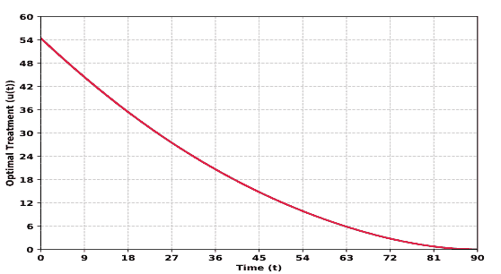

(a) 外源性胰岛素的最优输注率

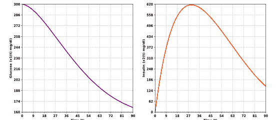

(b) 葡萄糖和胰岛素动力学，左图：葡萄糖，右图：胰岛素。

# 图 11.2：葡萄糖-胰岛素相互作用最优控制问题的解。

求解葡萄糖-胰岛素相互作用最优控制问题的MATLAB代码如下：

```matlab
clear; clc; clf;
global m1 m2 m3 x10 x20 N h t T b xd;
xd = 100.0; b = 10.0; m1 = 9.0e-4; m2 = 3.15e-2;
T = 90.0; N = 30000;
x10 = 300.0; x20 = 0.0;
```

# 使用间接法求解最优控制问题

```matlab
h = T/N;
t = linspace(0, T, N+1);
uold = 0.5*ones(N+1, 1); p = ones(1, N+1); x = ones(1, N+1);
x = SolveStateEquation(uold);
p = SolveStateEquation(x);
u = UpdateControl(p);

Iterations = 1;
Error = norm(u-uold, inf);
while Error >= 1e-15
    uold = u;
    x = SolveStateEquation(u);
    p = SolveStateEquation(x);
    u = UpdateControl(p);
    disp([norm(u-uold, inf), num2str(Error)]);
    Iterations = Iterations + 1;
end

figure(1);
plot(t, u, '-b', lw=2);
xlabel('Time');
ylabel('Optimal Insulin Rate (t)');
grid on;

figure(2);
subplot(1, 2, 1);
plot(t, x(:,1), '-r', lw=2);
xlabel('Time');
ylabel('Glucose (t)');
grid on;

subplot(1, 2, 2);
plot(t, x(:,2), '-r', lw=2);
xlabel('Time');
ylabel('Insulin (t)');
grid on;

function u = UpdateControl(p)
    global b
    u = max(p, 0);

function x = SolveStateEquation(u)
    global m1 m2 m3 x10 x20 N h t xd;
    x = zeros(N+1, 1);
    x(1) = x10;
    for i = 1:N
        x(i+1) = x(i) + h*(-m1*x(i) + m2*x20 + m3*u(i));
    end

function p = SolveCostateEquation(x)
    global m1 m2 m3 x10 x20 N h t xd;
    p = zeros(N+1, 1);
    p(N+1) = 0;
    for i = N:-1:1
        p(i) = p(i+1) + h*(m1*x(i));
    end
```


# 求解最优控制问题

在切换区间 $[s_k, s_{k+1}]$ 中的点 $t_{i,i=0, \dots, N}$，其中 $k = [i/h_c]$。因此，

```
$u_j(t_i) = v_j^k \text{ and } x_m(t_i) = x_m^i.$
```

现在，控制量 $u_j(t), t \in [t_0, t_f]$ 由目标函数的 Mayer 部分 $\varphi(x(t_f))$给出，该部分在时间 $t_N$ 处取值。即 $\varphi(x(t_f)) = \varphi(x(t_N))$。我们使用辛普森积分法来近似目标函数的 Bolza 部分，前提是 $N$ 是整数。

```
$L_0^i = L_0(x(t_i), u(t_i)) = L_0(x(t_i), v^k), k = [i/h_c],$
```

那么，

```
$\int_{t_0}^{t_f} L_0(x(t), u(t)) dt \approx \frac{h}{2}(L_0^0 + L_0^N) + \frac{4h}{3}\sum_{i=1}^{\lfloor\frac{N}{2}\rfloor} L_0^{2i-1} + \frac{2h}{3}\sum_{i=1}^{\lfloor\frac{N}{2}\rfloor} L_0^{2i}$
```

目标函数的近似为：

```
$J(u(t)) \approx \varphi(x^N) + \frac{h}{3}(L_0^0 + L_0^N) + \frac{4h}{3}\sum_{i=1}^{\lfloor\frac{N}{2}\rfloor} L_0^{2i-1} + \frac{2h}{3}\sum_{i=1}^{\lfloor\frac{N}{2}\rfloor} L_0^{2i} (11.30)
```

等式约束 (11.29)：

```
$E(x^i) = 0, \quad 0 \leq i \leq N$ (11.31)
```

不等式约束 (11.28)：

```
$I(x^i) \leq 0, \quad 0 \leq i \leq N$ (11.32)
```

使用经典的四阶 Runge-Kutta 方法对状态方程进行离散化，如下：

```
$\mathbf{k}_1 = \mathbf{f}(x^i, u^i)\n\mathbf{k}_2 = \mathbf{f}(x^i + hk_1/2, u^{i+\frac{h}{2}})\n\mathbf{k}_3 = \mathbf{f}(x^i + hk_2/2, u^{i+\frac{h}{2}})\n\mathbf{k}_4 = \mathbf{f}(x^i + hk_3, u^{i+1})\nx^{i+1} = x^i + \frac{h}{6}(\mathbf{k}_1 + 2\mathbf{k}_2 + 2\mathbf{k}_3 + \mathbf{k}_4)$ (11.33)
```

其中 $u^{i+\frac{h}{2}} = u(t_i + h/2)$ 可以通过插值方法得到，例如分段三次 Hermite 插值多项式。

# 使用直接法求解最优控制问题

由方程 (11.25)、(11.26)、(11.27)、(11.28) 和 (11.29) 描述的连续最优控制问题转换为离散非线性规划问题：

```
$$\minimize_{u\in\mathbb{R}^{m(1+N_c)}} \varphi(x) + \frac{h}{3}(L_0^0 + L_N^0) + \frac{4h}{3}L_i^{2i-1} + \frac{2h}{3}L_i^{2i} \quad (11.34)
```

受限于：

```
$x^{i+1} - x^i - \frac{h}{6}(k_1 + 2k_2 + 2k_3 + k_4) = 0 \quad (11.35)$
```

受限于初始条件：

```
$x(0) - x^0 = 0 \quad (11.36)$
```

受限于等式约束：

```
$E(x^i) = 0, \quad i=0,1,...,N, \quad (11.37)$
```

不等式约束：

```
$I(x^i) \leq 0, \quad i=0,1,...,N, \quad (11.38)$
```

最后，所有的控制变量 $u_k, k=1,...,m$ 和状态变量 $x_{i,j}$ 被映射到一个向量 $\mathbf{Y}$。$x_i^j$ 映射到 $\mathbf{Y}((i-1)N+j), i=1,...,m; j=0,...,N$，而 $u_k^i$ 映射到 $\mathbf{Y}((k-1)(N+1)+i), k=1,...,m; i=0,...,N$。向量 $\mathbf{Y}$ 的总长度为 $n(1+N)+m(N+c)$。由 (11.31) 描述的带有约束 (11.35) 和 (11.37) 的问题变为：

```
$$\minimize_{\mathbf{Y}\in\mathbb{R}^{n(1+N)+m(N+c)}} \Psi(\mathbf{Y})$$
```

受限于等式和不等式约束：

```
$E(\mathbf{Y}) = 0,\nI(\mathbf{Y}) \leq 0$
```

并受限于初始条件：

```
$\mathbf{Y}((i-1)(N+1))-x^i = 0, \quad i=1,...,n
```

### 11.6.2 示例

**示例 11.4** 取自 [26]。

```
$$\minimize_{u(t)} J(u) = S(T)+I(T)-\int_{0}^{T}(S(t)+I(t)+C_1u(t)+C_2v(t))dt$$
```

# 求解最优控制问题

受限于：

$\dot{S}(t) = \Lambda-\alpha S(t)-(\mu+u)S(t), S(0)=S_0,$
$\dot{I}(t) = \alpha S(t)I(t)-(\mu+\beta)I(t), I(0)=I_0,$
$\dot{R}(t) = \beta I(t)+u(t)-\mu R(t)+v(t), R(0)=R_0,$

其中

$0\le S(t), I(t), R(t)$

且 $u_{min}\le u(t)\le u_{max}$ 以及 $v_{min}\le v(t)\le v_{max}$。

要用 MATLAB 求解此问题，模型的参数 $C_1, C_2, \alpha, \mu$ 和 $\beta$ 应声明为全局变量。根据辛普森法则，实现函数 `SIRObjective` 用于计算目标函数。

```matlab
function OptimalCost = SIRObjective(x)
global C1 C2 NC h Q
S = x(1:N);
I = x(2:N+2*N);
R = x(3+2*N:3*3*N);
u = x(4+3*N:4+3*N+NC);
v = x(5+3*N:5+4*N+NC);
L = @(j) S(j)+I(j)-R(j)*C1*(1-floor(j/Q))*C2+v(1+floor(j/Q));
OptimalCost = S(end)+I(end)-R(end)+h/3*(L(end));
for j = 2 : N % (此处代码不完整，参考原文逻辑)
```

编写函数 `ConstraintsRK4` 返回等式和不等式约束。使用四阶 Runge-Kutta 方法对状态方程进行离散化，其中使用分段三次 Hermite 多项式在点 $t_j+h/2$ 处插值状态和控制变量。`ConstraintsRK4` 的 MATLAB 代码如下：

```matlab
function [ic, ec] = ConstraintsRK4(x)
global NC Q h beta alpha Lambda
S = x(1:N);
I = x(2:N+2*N);
R = x(3+2*N:3*3*N);
u = x(4+3*N:4+3*N+NC);
```

| 索引 | 表达式 |
| :--- | :--- |
| 7 | $v = x(5+3N:5+3N+2NC)$ |
| 8 | |
| 9 | $th = t(1:N)+h/2$ |
| 10 | $S = \text{chip}(S, th)$ |
| 11 | $I = \text{chip}(I, th)$ |
| 12 | $R = \text{chip}(R, th)$ |
| 13 | $u = \text{chip}(u, t(1+floor(N/Q)))$ |
| 14 | $v = \text{chip}(v, t(1+floor(N/Q)))$ |
| 15 | $u_{min}$ |
| 16 | $u_{max}$ |
| 17 | $v_{min}$ |
| 18 | $v_{max}$ |
| 19 | $S_0$ |
| 20 | $R_0$ |
| 21 | $ic = \text{zeros}(4+4NC, 1)$ |
| 22 | $ec = \text{zeros}(3+5N, 1)$ |
| 23 | $ic(1:N) = u_{min}$ |
| 24 | $ic(N:N+2NC) = u_{max}$ |
| 25 | $ic(N+2NC:N+3NC) = v_{min}$ |
| 26 | $ic(N+3NC:N+4NC) = v_{max}$ |
| 27 | $f_1 = @(x, y, z) \Lambda-\alpha xy-(\mu+v)x$ |
| 28 | $f_2 = @(x, y, z) \alpha xy-(\mu+\beta)y$ |
| 29 | $f_3 = @(x, y, z, u) \beta x-\mu zy$ |
| 30 | For $j = 1:N$ |
| 31 | $k_1 = f(S(j), I(j), R(j), u(1+floor(j/Q))$ |
| 32 | $k_2 = f(S(j)+hk_1/2, I(j), uh(j))$ |
| 33 | $k_3 = f(S(j)+hk_2/2, R(j), v(j))$ |
| 34 | $k_4 = f(S(j)+hk_3, I(j), R(j+1))$ |
| 35 | $v(1+floor(j/Q))$ |
| 36 | |
| 37 | $k_1 = f(S(j), I(j), R(j), v(1+floor(j/Q))$ |
| 38 | $k_2 = f(S(j)+hk_1/2, I(j), v(j))$ |
| 39 | $k_3 = f(S(j)+hk_2/2, R(j), v(j))$ |
| 40 | $k_4 = f(S(j)+hk_3, R(j+1))$ |
| 41 | $v(1+floor(j/Q))$ |
| 42 | $k_1 = f(S(j), I(j), R(j), u(1+floor(j/Q))$ |
| 43 | $v(1+floor(j/Q))$ |
| 44 | $k_2 = f(S(j)+hk_1/2, I(j), v(j))$ |
| 45 | $k_3 = f(S(j)+hk_2/2, I(j), v(j))$ |
| 46 | $k_4 = f(S(j)+hk_3, I(j+1), R(k+33)$ |
| 47 | $u(1+floor(j/Q))$ |
| 48 | $ec(j) = S(j)-S(j) - h/6(k_1+k_2+k_3+k_4)$ |
| 50 | $ec(N+j) = I(j)-I(j) - h/6(k_1+k_2+k_3+k_4)$ |
| 52 | $ec(2*N+j) = R(j)-R(j) - h/6(k_1+k_2+k_3+k_4)$ |

```matlab
end
ec(3*N+1) = S(1)-S_0;
ec(3*N+2) = I(1)-I_0;
ec(3*N+3) = R(1)-R_0;
ec(3*N+4) = u(end)-u(end-1);
```


# 使用直接法求解最优控制问题

```
48 axis([0, T, 0, 0.2]);
49
50 figure(2);
51
52 subplot(1, 3, 1);
53 plot(t, S, 'b', 'LineWidth', 2);
54 xlabel('t');
55 ylabel('易感人数 (S(t))');
56 grid on;
57 set(gca, 'XTick', 0:0.5:T);
58 axis([0, T, 0.0, 1]);
59
60 subplot(1, 3, 2);
61 plot(t, I, 'r', 'LineWidth', 2);
62 xlabel('时间 (t)');
63 ylabel('感染人数 (I(t))');
64 grid on;
65 set(gca, 'XTick', 0:0.5:T);
66 axis([0, T, 0.0, 0.2]);
67
68 subplot(1, 3, 3);
69 plot(t, R, 'm', 'LineWidth', 2);
70 xlabel('时间 (t)');
71 ylabel('康复人数 (R(t))');
72 grid on;
73 set(gca, 'XTick', 0:0.5:T);
74 axis([0, T, 0.0, 0.8]);
```

易感、感染和康复人群的最优接种策略、治疗策略及其比例如图 11.3a-11.3b 所示。

### 11.6.3 Gepko Python 求解器

可以使用 gekko 包求解模式 6 下的动态优化问题（非线性控制 / 动态优化 (CTL)）。目标函数可以写成 Mayer 形式，引入一个新变量 $X$，其导数为目标函数的积分，问题将变为最小化 $\phi(X(t_f))$。以下示例展示了如何使用 gekko 求解最优控制问题。

示例 11.5 我们考虑示例 11.4 中描述的 SIR 模型的最优控制问题，并使用 Gepko Python 包进行求解。
代码 `SolveGekkoSIR` 使用 Gepko Python 求解示例 11.4 的问题。

```
1 from gekko import GEKKO
2 import numpy as np
3 import matplotlib.pyplot as plt
4

5 Lambda = 0.05; mu = 0.05; alpha = 2; beta = 0.6
6 t0 = 0
```

# 求解最优控制问题

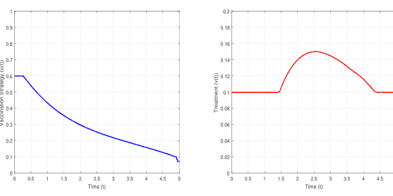

(a) 最优接种和治疗策略

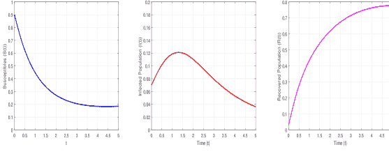

(b) 易感、感染和康复人数

图 11.3: 使用 MATLAB 优化工具箱对受 SIR 模型动力学支配的最优问题进行求解。

```
7 T = 5
8 C1 = 2
9 C2 = 0.5
10 N = 200 # 子区间数量 [t-j, t{j+1}]
11 m = GEKKO(remote=False) # 不需要服务器
12 m.time = np.linspace(t0, T, N+1) # 通过 N 个点对区间 [t0, T] 进行离散化
13 S, I, R = m.Var(value=0.9), m.Var(value=0.07),
    m.Var(value=0.03) # 初始化状态变量
14 u, v = m.Var(value=0.8), m.Var(value=0.05), ub=1.0 ...
    # 初始化控制变量
15 X = m.Var(value=0.0) # 目标函数的积分部分
16 p = np.zeros(1)
17 p[N] = 1.0
18 final = m.Param(value=p)
19 # 方程
20 m.Equation(S.dt) == Lambda-alpha*S-(mu+u)*S # 第一个状态
    equation 在 S 中
21 m.Equation(I.dt) == alpha*S+I-(mu+beta)*I-v*I # 第二个状态
    equation 在 I 中
22 m.Equation(R.dt) == beta*I-S*R+v*I # 第三个状态
    equation 在 R 中
```

# 使用直接法求解最优控制问题

```
23 m.Equation(X.dt) == S-R+C1*u**2+C2*v**2 # 目标函数
    函数的积分部分
24 m.Obj((X-R) = final) # 目标函数
25 m.options.ODE = 6 # 模式 6 为最优控制
26 m.solve()
27
28 t = m.time
29 plt.figure(1)
30 subplot(1, 2, 1)
31 plot(t, u[:1], color='royalblue', lw=2)
32 xlabel('时间 (t)', fontweight='bold')
33 ylabel('接种 (u(t))', fontweight='bold')
34 xticks(np.arange(0, T/10, T/10), fontweight='bold')
35 mu = np.ceil(10*max(u))
36 yticks(np.arange(0, mu, mu/10), fontweight='bold')
37 grid(True, ls='--')
38 axis([0, T, 0.0, ceil(10*max(u))])
39
40 subplot(1, 2, 2)
41 plot(t, v[:1], color='red', lw=2)
42 xlabel('时间 (t)', fontweight='bold')
43 ylabel('易感人数 (v(t))', fontweight='bold')
44 xticks(np.arange(0, T/10, T/10), fontweight='bold')
45 mu = np.ceil(10*max(v))
46 yticks(np.arange(0, mu, mu/10), fontweight='bold')
47 grid(True, ls='--')
48 axis([0, T, 0.0, ceil(10*max(v))])
```

```
79 yticks(np.arange(0, T/10, T/10), fontweight='bold')
80 grid(True, ls='--')
81 axis([0, T, 0, ceil(10*max(v))])
82 savefig('SIRstates.eps', dpi=1200)
83 savefig('SIRstates.png', dpi=1200)
```

图 11.4 中显示了通过 Gecko Python 包获得的相应易感、感染和康复人群的最优接种和治疗策略。

**示例 11.6** 在这里我们考虑害虫控制问题。目的是消除生态系统中的害虫数量。最优控制给出：

```
minimize J(u) = ∫ (z(t) + ξ/2*u^2)dt
```


(a) 接种和治疗策略


(b) 易感、感染和康复人数

图 11.4: 受 SIR 模型动力学支配的最优控制模型的 Gecko 求解。

# 使用直接法求解最优控制问题

满足：

$$\dot{x}(t) = rx(t)\left(1 - \frac{r(t)}{W}\right) - cx(t)y(t)-\alpha(1-q)u(t),x(0)=x_0,t \in [0,T]$$

$$\dot{y}(t) = y(t)(-\alpha+kb(z)+kcx(x))-\alpha Ku(t),y(0)=y_0,t \in [0,T]$$

$$\dot{z}(t) = ez\left(1 - \frac{z(t)}{V}\right)-by(t)z(t)-\alpha qu(t),z(0)=z_0,t \in [0,T]$$

其中

$u_{min} \leq u(t) \leq u_{max}$

模型参数值如下：$r=1,e=2,a=2.5,b=3.1,b=1.2,c=0.2,\alpha=0.7,q=0.9,k=1.0,V=1000,W=5,K=0.01,T=50$ 和 $\xi=0.05$。

Python 代码：

```
#!/usr/bin/env python3
from gekko import GEKKO
import numpy as np
import matplotlib.pyplot as plt
r = 1.0; e = 2.5; a = 3.1; b = 1.2; c = 0.2; alpha = 0.7;
q = 0.9; k = 1.0; V = 1000; W = 5; K = 0.01; D = 0.5;
T = 50
n = 300
m = GEKKO(remote=False)
time = np.linspace(0, T, n+1)
x, y, z = m.Var(value=3.1), m.Var(value=0.7), m.Var(value=2.2)
u = m.Var(lb=0.0, ub=1.0)
p = m.Var(value=0.0)
p = np.zeros(n) # 标记终点
final = m.Param(value=p)
Equations
m.Equation(x.dt) == r*(1-x/W)-c*y-alpha*(1-q)*u
m.Equation(y.dt) == y*(-alpha+kb(z)+kcx(x))-\alpha*K*u
m.Equation(z.dt) == ez*(1-z/V)-by*z-alpha*q*u
m.Equation(u.dt) == -z/D*u**2
m.Obj(z * final) # 目标函数
m.options.ODE = 6 # 最优模式
m.solve()
t = time
```

```
plt.figure(1, figsize=(16,16))
subplot(2,2,1)
plot(t, u[:1], color='purple', lw=2)
xlabel('接种 (u(t))', fontweight='bold')
xticks(np.arange(0, T/10, T/10), fontweight='bold')
yticks(floor(1000*min(u))/1000, ceil(1000*max(u))/1000)

subplot(2,2,2)
plot(t, x, color='darkblue', lw=2)
xlabel('时间 (t)', fontweight='bold')
ylabel('木材中的猎物 (%t)', fontweight='bold')
xticks(np.arange(0, T/10, T/10), fontweight='bold')

subplot(2,2,3)
plot(t, y, color='crimson', lw=2)
xlabel('时间 (t)', fontweight='bold')
ylabel('蜘蛛 (y(t))', fontweight='bold')
xticks(np.arange(0, T/10, T/10), fontweight='bold')

subplot(2,2,4)
plot(t, z, color='green', lw=2)
xlabel('时间 (t)', fontweight='bold')
ylabel('葡萄园中的猎物 (z(t))', fontweight='bold')
xticks(np.arange(0, T/10, T/10), fontweight='bold')
grid(True, ls=':')
```

图 11.5: 害虫控制最优控制模型的 Gecko 求解。


## 参考文献

- [1] Ehab B.M. Bashier. 出于生物学的延迟微分方程的拟合数值方法。博士论文，西开普敦大学，南非开普敦，2009年9月。
- [2] Logan Beal, Daniel Hill, R Martin, 和 John Hedengren. Gekko 优化套件。Processes, 6(8):106, 2018。
- [3] Amir Beck. 非线性优化引论。SIAM - 工业应用数学协会，2014。
- [4] M.D. Benchibou. 向量序列的线性收敛及若干应用。计算与应用数学杂志，55(1):81–97, 1994年10月。
- [5] David Benson. 最优控制的高斯伪谱转录。博士论文，马萨诸塞理工学院，2005。
- [6] F. Benyah 和 L.S. Henning. 两种最优控制方法病态性的比较。技术报告，西澳大学，数学与统计系，Nedlands 6907 WA，2000年。
- [7] F. Benyah 和 L. S. Jennings. 最优控制计算中的病态性。在第第八次微分方程国际研讨会论文集（D. Bainov 编辑）第81–88页，VSP BV，荷兰乌德勒支，1998年。
- [8] F. Benyah 和 L. S. Jennings. 最优控制计算的正则化。在智能自动化控制国际研讨会（ISIAC'98）世界自动化大会，页 ISIAC 091.1-091.6，阿拉斯加安科奇，1998年。TSI Press。
- [9] F. Benyah 和 L. S. Jennings. 最优控制计算中病态性与正则化的综述。在 X., Yang, K. L. Leo, 和 L. Caccetta 编辑中，《优化方法与应用》，第23–44页。Kluwer Academic Publishers，荷兰多德勒支赫，2001。
- [10] J. T. Betts. 使用编程进行最优控制实用方法。工业应用数学协会，2001。
- [11] J. T. Betts 和 W.P. Hoffman. 探索最优控制直接转录法中的稀疏性。计算优化与应用，14:179–201, 1999。
- [12] P. T. Boggs 和 J. W. Tolle. 序贯二次规划。Acta Numerica，第1–48页，1996。
- [13] J. C. Butcher. 常微分方程的数值方法。John Wiley and Sons Ltd,2016。
- [14] J.C. Butcher. 隐式 Runge-kutta 过程。计算数学，18(85):50–64, 1964。
- [15] B.C. Chachuat. 非线性动态优化：从理论到实践 - IC-32：2009春季学期。Polopiés de l'EPFL，2009。
- [16] Stephen J. Chapman. 工程师 MATLAB 编程。CENGAGE LEARNING，2015。
- [17] Thomas Coleman, Mary Ann Branch, 和 Andrew Grace. 用于 matlab 的优化工具箱，1999。
- [18] SciPy 社区。SciPy 参考指南。Scipy Community，1.0.0 版，2017年10月。
- [19] Yinyu David G. Luenberger. 线性与非线性规划。Springer-Verlag GmbH，2015。
- [20] Fletcher. Sidi Kaber Gregoire Allaire. 优化的实用方法2e。John Wiley & Sons，2000。
- [21] Sidi Mahmoud Kaber Gregoire Allaire. 数值线性代数。Springer-Verlag New York.,2007。
- [22] Per Christian Hansen. 正则化工具：一个用于分析和求解离散病态问题的 matlab 包。数值算法，6(1):1–35, 1994年3月。
- [23] William E. Hart, Carl Laird, Jean-Paul Watson, 和 David L. Woodruff. Pyomo – Python 下的优化建模。Springer US，2012。
- [24] Tamer Inac 和 Raktim Bhattacharya. 使用样条求解最优控制问题的数值解。citeseer.ist.psu.edu/inanc03numerical.htmlceer.ist.psu.edu/inanc03numerical.html,2003。
- [25] L. S. Jennings, K. L. Leo, C. J. Goh, 和 M. E. Fisher. Miser3: 一个求解最优控制问题的 fortran 程序。手册书，1990。
- [26] K. Kaji 和 K.H. Wong. 非线性约束时间延迟控制问题。优化理论与应用杂志，82(2):295–313, 1994。
- [27] D. Kraft. 算法 733：用于最优控制的 fortran 模块。ACM 数学软件事务，20(3):262–284,1994。
- [28] Rainer Kress. 病态线性系统。数学研究生教程，第77–92页，1998。
- [29] C. Lawrence 和 A. Tits. 计算可行的二次规划。优化杂志，11(4):1092–1118，2001。
- [30] David C. Lay, Steven R. Lay 和 Judy J. McDonald. 线性代数及其应用全球版。Pearson Education，2015。
- [31] J.J. Leader. 数值分析与科学计算。Greg Tobin，2004。
- [32] J.S. Lin. 通过迭代动态规划对延迟系统进行最优控制。工程化学杂志，35(8):2795–2800,1996。
- [33] P. Linz 和 R. Wang. 数值方法：使用 Matlab 进行科学计算。Jones and Bartlett Publishers，2003。
- [34] I. Lloyd N. Trefethen. 数值线性代数。CAMBRIDGE,1997。
- [35] R. Luus. 迭代动态规划。Harman and Hall/CRC，2000。
- [36] R. Marielba. 大规模最小二乘问题的正则化。技术报告9658，研究与并行计算中心，1996。
- [37] Ronald E. Mickens. 标准差格式的应用。World Scientific Publishing Co. Ltd.,2000。
- [38] Ronald E. Mickens. 微分方程的标准差格式。微分方程与应用杂志，8(9):823–847,2002。
- [39] E. Mickens Ronald. 标准差格式的应用。World Scientific，2000。
- [40] E. Mickens Ronald. 标准差格式的进展。World Scientific，2005。
- [41] Stuart Mitchell, Stuart Consulting 和 Iain Dunning. Pulp: 一个 python 线性规划工具包，2011。
- [42] A. Neumair. 求解病态和奇异线性系统。SIAM 综述，40(3):636–666,1998。
- [43] V.A. Patel. 数值分析。哈佛大学出版，1994。
- [44] Jesse A. Pietz. 最优控制直接转录的伪谱配法。硕士论文，Rice大学，2003。
- [45] Promislow. 泛函分析。John Wiley & Sons，2008。
- [46] Charles C. Pugh. 实数学分析。Springer-Verlag GmbH，2015。
- [47] J. Douglass Burden. 数值分析。Cengage Learning, Inc.,2015。
- [48] Luh-Ik W. Roeger. 恒系数二维线性系统的精确有限差格式。计算与应用数学杂志，219(1):102–109,2008年9月。
- [49] Alan Rothwell. 结构设计中的优化方法。Springer-Verlag GmbH，2017。
- [50] A. Shwartz. 基于 Runge-Kutta 积分求解最优控制问题的数值方法理论与实现。博士论文，加州大学伯克利电子实验室，1996。
- [51] Silva, C. J., Torres, D. F. M., 和 Venturino, E. 生物防治虫中的最优喷洒。Math. Nat. Phen.,12(3):51–64,2017。
- [52] James Stuart. 微积分：早期。BROOK COLE PUB，2015。
- [53] Strang Strang. 线性代数及其应用。BROOK COLE PUB，2005。
- [54] H. Sussmann 和 J.C. Willems. 最优控制300年：从最速线到极大原理。IEEE 控制系统，第32–44页，1997。
- [55] John T. Workman Suzanne Lenhart. 应用于生物模型的最优控制。Taylor & Francis Ltd.,2007。
- [56] G.W. Swan. 糖尿病的最优控制模型。数学生物学杂志，44(6):793–808,1982。
- [57] O. von Stryk. 通过直接配点求解最优控制问题的数值解。数值数学国际系列，111:129–143,1993。
- [58] K. H. Wong. 非线性时滞最优控制问题的控制参数化算法。Opsearch，25(E):177–184,1988。
- [59] K. H. Wong, L.S. Jennings, 和 F. Benyah. 带有延迟项的自由规划最优控制问题的控制参数化方法。非线性分析杂志，47:5679–5689,2001。
- [60] K. H. Wong, L.S. Jennings, 和 F. Benyah. 约束时间延迟最优控制问题的控制参数化增强变换。ANZIAM J. 澳大利亚新西兰工业与应用数学杂志，43(E):E154–E185,2002。
- [61] Dennis G. Zill. 带边界值问题的微分方程。CENGAGE LEARNING，2017。
- [62] Dennis G. Zill. 建模应用微分方程入门课程，国际量制版。Cengage Learning, Inc,2017。


# 索引

- 绝对偏差问题, 41
- 精度, 61
- 激活集, 280
- 伴随方程, 291
- 伴随变量, 291
- anaconda, 250
- 近似, 3
- Armijo 条件, 263
- 增广矩阵, 4
- 收敛序列, 23
- 代价函数, 290
- 立方埃米多项式, 208
- 回代法, 7
- 回溯线线搜索, 263
- 后向差分公式, 126
- 后向欧拉法, 176
- 基函数, 113
- 二分法, 89
- 鲍尔扎 部分, 290
- 盒约束, 244
- Broyden-Goldfar-Shannon, 269
- Butcher 数组, 165
- 直接射法, 294
- 直接离散法, 289
- 离散病态问题, 77
- 离散化, 306
- 差分商, 113
- 双重进动, 68
- 对偶单纯形算法, 247
- 动态优化问题, 201
- 动力学一致性, 216
- 柯西收敛, 23
- 中心差公式, 129
- 协态变量, 291
- 胶点 Runge-Kutta 方法, 180
- 互补松性条件, 280
- 正向辛普森法则, 140
- 复合梯形法则, 138
- 条件数, 70
- 一致的, 4
- 约束优化问题, 261
- 特征值, 71
- 等式约束, 244
- 平衡点, 237
- 欧拉法, 168
- 欧拉-拉格日方程, 292
- 精确有限差分格式, 217
- 精确线搜索, 263
- 精确解, 168
- 显式 Runge-Kutta 方法, 167
- 指数衰减模型, 219
- 控制参数化法, 294
- 收敛序列, 24
- 有限差分, 93
- 一阶必要条件, 279
- 拟合, 49
- fincon, 249

# 328 索引

- 前向差分公式, 126
- 四阶 Runge-Kutta 方法, 174
- 高斯点, 144
- 高斯积分, 134
- 高斯-乔尔当消元法, 9
- 高斯-Seidel, 26
- Gauss-Seidel 方法, 33
- Gekko, 201
- 广义奇异值分解, 86
- 葡萄糖-胰岛素交互, 301
- GNU 线性规划工具包, 259
- 梯度, 262
- 哈密顿量, 290
- Hermite-Simpson 方法, 187
- 海森矩阵, 262
- Heun 方法, 171
- 希尔伯特矩阵, 56
- HIV 模型, 187
- 病态性, 57
- 病态的, 70
- 隐式 Runge-Kutta 方法, 165,
- 隐式梯形法, 185
- 不一致的, 4
- 间接离散法, 289
- 不等式约束, 244
- 不精确线搜索, 263
- 初值问题, 168
- 内点法, 201
- 国际电气与电子工程, 68
- 插值, 48
- 逆阶数, 78
- 可逆矩阵, 26
- IPOPT, 201
- 迭代动态规划, 294
- 迭代法, 25
- Jacobi, 26
- Jacobi 方法, 28
- 雅可比矩阵, 98
-  Jordan 标准型, 224
- Karush-Kuhn-Tucker 系统, 279
- L-曲线法, 78
- 拉格朗日插值, 105
- 拉格朗日乘子, 278
- 拉格朗日多项式, 106
- 拉格朗日系统, 278
- 最小二乘, 49
- 最小范解, 75
- 最小二乘问题, 41
- 最小二乘解, 39
- 勒让德多项式, 151
- 勒让-高斯, 151
- 勒让-高斯-Lobatto 方法, 156
- 勒让-高斯-Radau 点, 159
- 线搜索, 262
- 线性模型, 43
- 线性规划, 243
- Lobatto 方法, 184
- 局部近似, 211
- 局部截断误差, 167
- 逻辑斯增长模型, 181
- Lotka-Volterra 方法, 175
- 下三角, 8
- LU 分解, 12
- 机器精度, 68
- 尾数, 68
- Mathworks, 276
- 矩阵分解, 12
- 矩阵范数, 67
- Mayer 部分, 290
- 极极值问题, 41
- 混合整数问题, 201
- Morozov 差异准则, 78
- 最可能的解, 87
- 优性必要条件, 262
- 牛顿插值, 109
- 牛顿法, 266
- Newton-Cotes, 125

# 索引

- 牛顿-Raphson 方法, 89
- 非局部近似, 216
- 非平稳迭代法, 26
- 非刚性问题, 191
- 非线性方程, 89
- 非线性规划问题, 261
- 非标准差分, 207
- 正态分布, 47
- 法规方程, 41
- 数值微分, 125
- 数值不稳定, 207
- 数值积分, 125
- 数值积分, 134
- numpy, 4
- 回归系数, 43
- 正则化, 57
- 正则化参数, 79
- 松弛迭代法, 26
- 松弛化参数, 39
- 舍入误差, 69
- 阶梯形, 9
- Runge-Kutta 方法, 165
- scipy, 13
- 搜索方向, 262
- 割法法, 89
- 二阶必要条件, 279
- 序列二次规划, 294
- 单纯形法, 248
- 目标函数, 245
- 最优控制, 289
- 最优参数, 50
- 最优正则化, 78
- 最优解, 245
- 最优轨迹, 292
- 阶, 167
- 正交胶点, 201
- 正交矩阵, 16
- 超定线性方程, 3
- 辛普森法则, 136
- 奇异值分解, 12
- 奇异值, 77
- SIR 方法, 313
- 平滑, 85
- SOCS, 294
- 样条, 117
- 状态方程, 291
- 静态迭代法, 26
- 梯度下降法, 264
- 刚性问题, 191
- 刚性系统, 195
- 扰动, 57
- 害虫控制, 316
- 分段立方多项式, 117
- 最可能的解, 87
- 正半定, 262
- 捕食者-被物者模型, 175
- pulp, 243
- pyomo, 243
- 成功松弛法, 37
- 充分充分条件, 262
- sympy, 11, 100
- 初值问题组, 193
- QR 分解, 126
- 二次规划, 255
- 拟牛顿法, 269
- 泰勒展开, 125
- 终端约束, 292
- Tikhonov 正则化, 78
- TOMP, 294
- 横截性条件, 290
- 截断 SVD, 78
- 截断误差, 126
- 秩亏函数, 77
- 收敛率, 170
- 倒数条件数, 71
- 简化阶梯形, 9
- 无约束优化, 261
- 欠定线性方程组, 4
- 正交矩阵, 19
- 上三角, 7
- 范德蒙矩阵, 50
- Vanderpool 振荡器, 195
- Vanderpool 系统, 195
- 向量范数, 25
- 良定系统, 60

