# 图书馆实用开源软件 (Chandos 信息专业人士系列)

丛编辑：Ruth Rikowski
(邮箱：Rikowskigr@aol.com)

NICOLE C. ENGARD

致 Chris，感谢你做我的开源导师，
感谢整个 Koha 社区培养了我对开源的热爱

# 前序

当我第一次与 Nicole 通信时，她是刚从图书馆学院毕业并在一家法律图书馆工作。她已经意识到自由软件（自由中的自由）和开源软件（FOSS）工具的技术优势，并使用 FOSS 工具重新设计并构建了工作单位的内网。她当时刚刚开始学习自由软件背后的哲学。我工作的自由软件项目 Koha (http://koha-community.org) 是这一社区运作的良好实例。一个在波兰为库克群岛国家图书馆的小型修道院工作的程序员，能够添加一项改善图书员日常生活的各项，这正是 FOSS 的意义。作为一名图书员，Nicole 很快理解了自主的力量以及运行良好的自由开源软件项目之美。事实上，可以说图书员的主要功能是促进知识传递，从而赋能他们的社区，这与自由软件扮演的角色完全相同。

在我有幸与 Nicole 为朋友的短短几年里，我见证了她从一名新手成长为自由软件项目中一个不可或缺的重要组成部分。她举办开源研讨会，进行演讲，

她几乎每天都发布博客，现在还就该主题编写书籍。她对知识永无止境的渴望以及让世界变得更好的愿望让她成为一名出色的老师；她的热情会感染周围的每一个人。

在这本书几乎就像她的历程中，妮尔（Nicole）带我们学习什么是开源，并通过审查和破除一些关于开源的流行迷思，告诉我们开源不是什么。随后，书籍将引入图书馆如何充分利用开源的主题，章节中充满了具体的现实世界案例。每一章都环环相扣，读到最后时，你将对 FOSS（自由开源软件）有更深入的理解，并明白我们为什么如此喜爱它。

## 克里斯斯·科马马克 (Chris Cormack)

克里斯托弗·科马马克拥有计算机科学学士学位以及数学和毛利人研究文学学士学位。在 Katipo Communications 工作期间，他是 Koha 原始版本的首席开发人员，该版本于 2000 年 1 月 5 日在 Horowhenua 图书馆上线。从那时起，他在社区担任过发布经理、质量保证（QA）经理等多种角色，目前担任翻译经理。克里斯托弗相信自由软件，并允许用户拥有新的自由。

## 关于作者

妮尔·C·恩加德（Nicole C. Engard）是 ByWater Solutions 的开源教育总监。她负责公司的开源教育工作。除了日常职责外，妮尔通过她的网站“我今天学了什么……”（http://www.web2learning.net）让图书馆社区了解网络技术的动态。

妮尔对图书馆技术的兴趣始于费城的杰ins 法律图书馆，她在那里担任网络经理。除了网络开发方面的经验外，妮尔还担任过元数据管理员和图书馆员培训师。由于她在图书馆中创新的技术应用，妮尔在 2007 年被评为《图书馆杂志》（Library Journal）的“推动时代变革者”（Movers & Shakers）之一。

妮尔在宾夕法尼亚州亨廷顿的朱尼亚塔学院获得文学研究和计算机编程学士学位，并在宾夕法尼亚州费城的德雷塞尔大学获得图书与信息科学硕士学位（MLIS）。她还是特殊图书馆协会的活跃成员。

妮尔的作品曾在几本图书馆期刊上发表，还为卡罗尔·斯莫伍德（Carol Smallwood）编辑的《跳出书本：创新图书馆员论文》（Thinking Outside the Book: Essays for Innovative Librarians）和《写作与出版：图书馆员手册》（Writing and Publishing: The Librarian's Handbook）撰写了章节。2009 年，她与 Information Today Inc 合作出版了她的本编辑著作《图书馆融合：探索交付数据的新方法》（Library Mashups: Exploring New Ways To Deliver Library Data）。

你可以通过电子邮件 nengard@gmail.com 联系妮尔。

## 关于网站

这本书配有专属网站。该网站将用于向读者提供开源新闻、书籍活动以及书中提到的软件更新。

更重要的是，书中列出的每个链接在网站上都可用。这意味着你不需要输入后续章节中看到的每一个链接。只需访问 http://opensource.web2learning.net 并点击那里的在线链接即可。

如果你发现任何认为发布在书籍网站的内容，请随时发送邮件到 nengard@gmail.com 联系作者。

## 致谢

没有哪一书是在许多人的支持下写成的。首先，我要感谢克里斯·科马马克带我进入了开源世界；如果没有他，这本书将由另一位图书馆员来写。

我感谢整个开源图书馆社区；没有你们的贡献和帮助，这本书就无法成为我所认为的如此实用的指南。最后，感谢我的丈夫布莱恩（Brian），在我花费无数个夜晚和周末进行研究和写作时给予我的支持。

xxi

### 引言

我对开源软件的了解源于 Koha（http://koha-community.org）开源集成图书馆系统的原始开发人员之一——克里斯·科马马克。正因于这个原因，我请求他为这本书撰写序言，这样他就能看到他教了我多少，并参与到对未来图书馆员普及开源软件本质的教育中。

随着全球图书馆预算的削减，图书馆员正在寻找削减支出的方法。这就是图书馆对学习更多开源软件感兴趣的原因。他们可能没有意识到，虽然开源软件不需要支付许可费用，并且可能会为他们节省资金，但开源软件的意义远不止价格标签。

正如克里斯教我的那样，开源关乎开放、共享和协作。它既是一种哲学，也是一种软件开发方法。正如后续章节将详细阐述的，在最初，所有软件都是开源的；所有软件都在公开环境下开发，并在朋友和同事之间免费分发。我们习惯处理图书馆和家庭事务的传统软件许可证，并不是第一批开发人员为软件未来设想的形式。

然而，仅仅知道这些是不够。我主张，图书馆拥抱开源背后的哲学并通过参与开源社区来付诸行动是重要的。多年来，我看到许多图书馆采用了开源应用，但继续表现得像在使用专有系统一样。使用开源软件是规则的改变者。你不再需要供应商的批准即可为系统添加功能，你不再需要依赖任何单一供应商的支持，你再也不必在自己的图书馆泡泡里工作。

我的什么意思是？嗯，正如我所说，开源软件关乎社区，这意味着开源应用生存的唯一方法就是其背后有一个活跃的社区。这个社区可以由开发者、软件用户、测试人员和手册编写者的任何组合组成。

图书馆员（以及许多其他人）的一个误解是，要参与开源社区，他们必须学会如何写代码；事实并非如此。如果一个软件应用没有经过测试，就无法进入生产，而谁比计划每天使用它的人更适合测试这些软件呢？如果没有良好的文档，没有任何软件应用是易于使用的，而谁比熟悉这些软件的人更适合编写文档呢？而且，谁比图书馆员更懂得如何组织事物呢？

图书馆员为开源软件提供了很多贡献，我希望在读完这本书后，你会对开源软件感到兴奋，并开始与其他使用和开发开源软件的人交流。

这本书分为两个部分。第一部分将简要概述开源的历史和定义。它包含了事实和数据，以反驳围绕开源的恐惧、不确定（通常被称为 FUD），并解释为什么开源软件与图书馆是完美契合的。第二部分将为你提供目前正在使用的开源应用工具箱。这些每个应用都包含来自经常使用该应用的图书馆员的第一手故事。希望这些见解能帮助你判断某个应用是否适合你。

当你读完这本书后，你将能够向同事介绍开源软件，并为图书馆软件改进提出实用的建议。记住，并不是每个应用都适合每个图书馆，但你应该能够带走一些让你的工作流程更高效或让你为读者提供更好服务的应用。

## 什么是开源？

开源倡议（Open Source Initiative）将开源软件定义为分发人类可读源代码的软件，以便允许用户自由为任何目的运行、审查、更改和修改代码。但开源的意义远不仅是背后的代码；它关乎社区、协作和创新。

在今天产品竞争的世界里，可能很难相信所有应用都是开源的。唐纳德·罗森堡（Donald Rosenberg）解释得很好，他说：“开源不是一种新方法——它是原始的计算机方法。”同时，埃里克·雷蒙德（Eric Raymond）提醒我们，被称为“黑客”的爱好者、艺术家、极客、问题解决者和专家构建了互联网、万维网、Unix 和 Linux。成为黑客并不是要成为威胁，这在早期区分这一点是非常重要的，因为许多开源开发者都自豪地称自己为黑客。

在互联网出现之前是 ARPANET，这是一种只有美国国防部、大学和承包商可以访问的跨大陆网络。这项发明让来自各地的黑客聚集在一起，通过网络进行协作，创造让他们的生活（最终是我们所有人的生活）变得更容易的应用。正是这种连接促进了世界上第一批开源应用的开发。

# 针对图书馆的实用开源软件

本书的重点不在于深入探讨开源的历史——关于这一点，你可以参考许多优秀绝伦的著作——但我认为，至少谈论开源历史中的某些里程碑式事件是非常重要的，这可以让你对开源和自由软件周围的理念有更深层次的理解。

## 解决手痒（Scratching at an itch）

开源应用通常始于开发者“顺手而为”，或者解决一个可能困扰着他们或同事的问题。大多数应用程序最初都是由个人或一个小本地小组启动的项目，旨在解决某个存在 Bug 的问题。在这些项目中，最著名的可能过于 Linux 的发明。

那是 1991 年，来自芬兰的学生林纳斯·托瓦尔斯（Linus Torvalds）正试图寻找一个可以在他的个人电脑上运行的操作系统。当发现没有什么能满足他的需求时，他决定自己写一个操作系统，实际上就是一种在“顺手而为”。在完成工作（仅仅是为了满足自己的需求）后，林纳斯将他的操作系统（后来被称为 Linux）发布给了他的黑客们，以收集意见、建议，甚至可能获得一些改进产品的帮助。这个项目最初只是一个爱好，现在已成为当今世界上最知名、被报道最多且最受欢迎的开源项目——而这一切都始于一次“手痒”。

## 属于所有人的自由

林纳斯将 Linux 发布给互联网上的每一个人，这导致了一个关于开源和自由软件的常见误解：认为“free（免费）”一词指的是价格。事实上，在 2009 年的一项调查中，36% 的图书馆专业人士认为所有开源软件都是免费的。虽然确实存在免费成本的开源应用，但这并不是开源和自由软件许可协议要求的。目前有 60 多种此类许可证，但其中两种占了所有开源软件的近 90%：GNU 通用公共许可证（GPL）和伯尔恒软件分发版（BSD）。

GPL 开头声明，“free”一词指的是“自由（freedom）”而非价格：

“大多数软件和其他实用作品的许可协议设计目的是是为了剥夺你分享和更改作品的自由。相比之下，GNU 公共许可证旨在保证你分享和更改程序所有版本的自由——使其对所有用户都保持为自由软件。我们，自由软件基金会在大多数软件中使用 GNU 通用公共许可证；它也适用于作者以这种方式发布的任何其他作品。你也可以将其应用于你的程序。”

当我们谈论自由软件时，我们指的是自由，而不是价格。我们的通用公共许可证旨在确保你有自由分发自由软件副本的自由（如果你愿意，可以为此收取费用），确保你有权获得源代码或在想要时获取它，确保你可以更改软件或在新的自由程序中使用它的部分，并且你清楚自己正在做这些事情。⁸

GPL 由自由软件基金会（http://fsf.org）编写。这里需要注意的是，开源软件和自由软件软件的定义之间存在某些差异。尽管有这些差异，就本资源而言，两者可以互换使用，因为我同意斯考特·科洛德（Scott Colord）所说：“从实际应用角度来看，它们在图书馆或信息科学环境中提供了相同的基本优势（以及挑战）。”⁹ 事实上，这就是为什么许多作者在谈论自由和/或开源软件时会使用 FOSS 或 F/OSS 缩写。

虽然本书后面讨论的所有应用程序都可以免费下载，但重要的是，选择开源应用时可能会产生货币成本。

### 1.1 自由软件的定义

自由软件关乎用户运行、复制、分发、研究、更改和改进软件的自由。更准确地说，这意味着程序的用户拥有四种基本的自由：

- 为任何目的运行程序的自由（自由 0）。
- 研究程序如何工作并对其进行更改以实现你意图的自由（自由 1）。访问源代码是此的前提条件。
- 重新分发副本的自由，以便帮助你的邻居（自由 2）。
- 改进程序的自由；并将你的改进（通常是修改版本）发布给公众，以便整个社区受益（自由 3）。访问源代码是此的前提条件。

> 来源：Free Software Foundation, Inc., The Free Software Definition, 2009, http://www.gnu.org/philosophy/free-sw.html.

### 1.2 开源软件的定义

### 引言

开源不仅仅意味着可以访问源代码。开源软件的分发条款必须符合以下标准：

- 1. 免费重新分发
许可不应限制任何一方作为包含来自不同来源程序的聚合软件分发的组件来销售或赠送软件。许可不应就此类销售收取版税或其他费用。

- 2. 源代码
程序必须包含源代码，并且必须允许以源代码形式和编译形式进行分发。如果产品的某些部分未随源代码分发，则必须有一种广为人知的方式可以获取源代码，且成本不高于合理的复制成本，最好是通过互联网免费下载。源代码必须是程序员修改程序时的首选形式。不允许故意混淆源代码，但允许将中间形式作为输出。

- 3. 派生作品
许可必须允许修改和派生作品，并允许其按照原始软件相同的条款进行分发。

- 4. 作者源代码的完整性
只有在许可允许它们携带不同的名称或版本号时，许可才可能限制源代码以修改后的形式分发。

- 5. 不歧视个人
许可不得歧视任何个人或群体。

- 6. 不歧视努力领域
许可不得限制任何人在特定领域制作该程序。例如，它不能限制程序用于商业领域，或将其用于研究。

> 来源：Free Software Foundation, Inc., The Free Software Definition, 2009, http://www.gnu.org/philosophy/free-sw.html.

# 针对图书馆的实用开源软件

本书的重点不在于深入探讨开源的历史——关于这一点，你可以参考许多优秀绝伦的著作——但我认为，至少谈论开源历史中的某些里程碑式事件是非常重要的，这可以让你对开源和自由软件周围的理念有更深层次的理解。

## 解决手痒（Scratching at an itch）

开源应用通常始于开发者“顺手而为”，或者解决一个可能困扰着他们或同事的问题。大多数应用程序最初都是由个人或一个小本地小组启动的项目，旨在解决某个存在 Bug 的问题。在这些项目中，最著名的可能过于 Linux 的发明。

那是1991 年，来自芬兰的学生林纳斯·托瓦尔斯（Linus Torvalds）正试图寻找一个可以在他的个人电脑上运行的操作系统。当发现没有什么能满足他的需求时，他决定自己写一个操作系统，实际上就是一种“顺手而为”。在完成工作（仅仅是为了满足自己的需求）后，林纳斯将他的操作系统（后来被称为 Linux）发布给了他的黑客们，以收集意见、建议，甚至可能获得一些改进产品的帮助。这个项目最初只是一个爱好，现在已成为当今世界上最知名、被报道最多且最受欢迎的开源项目——而这一切都始于一次“手痒”。

## 属于所有人的自由

林纳斯将 Linux 发布给互联网上的每一个人，这导致了一个关于开源和自由软件的常见误解：认为“free（免费）”一词指的是价格。事实上，在 2009 年的一项调查中，36% 的图书馆专业人士认为所有开源软件都是免费的。虽然确实存在免费成本的开源应用，但这并不是开源和自由软件许可协议要求的。目前有 60 多种此类许可证，但其中两种占了所有开源软件的近 90%：GNU 通用公共许可证（GPL）和伯尔恒软件分发版（BSD）。

GPL 开头声明，“free”一词指的是“自由（freedom）”而非价格：

“大多数软件和其他实用作品的许可协议设计目的是是为了剥夺你分享和更改作品的自由。相比之下，GNU 公共许可证旨在保证你分享和更改程序所有版本的自由——使其对所有用户都保持为自由软件。我们，自由软件基金会在大多数软件中使用 GNU 通用公共许可证；它也适用于作者以这种方式发布的任何其他作品。你也可以将其应用于你的程序。”

当我们谈论自由软件时，我们指的是自由，而不是价格。我们的通用公共许可证旨在确保你有自由分发自由软件副本的自由（如果你愿意，可以为此收取费用），确保你有权获得源代码或在想要时获取它，确保你可以更改软件或在新的自由程序中使用它的部分，并且你清楚自己正在做这些事情。⁸

GPL 由自由软件基金会（http://fsf.org）编写。这里需要注意的是，开源软件和自由软件软件的定义之间存在某些差异。尽管有这些差异，就本资源而言，两者可以互换使用，因为我同意斯考特·科洛德（Scott Colord）所说：“从实际应用角度来看，它们在图书馆或信息科学环境中提供了相同的基本优势（以及挑战）。”⁹ 事实上，这就是为什么许多作者在谈论自由和/或开源软件时会使用 FOSS 或 F/OSS 缩写。

虽然本书后面讨论的所有应用程序都可以免费下载，但重要的是，选择开源应用时可能会产生货币成本。

### 1.1 自由软件的定义

自由软件关乎用户运行、复制、分发、研究、更改和改进软件的自由。更准确地说，这意味着程序的用户拥有四种基本的自由：

- 为任何目的运行程序的自由（自由 0）。
- 研究程序如何工作并对其进行更改以实现你意图的自由（自由 1）。访问源代码是此的前提条件。
- 重新分发副本的自由，以便帮助你的邻居（自由 2）。
- 改进程序的自由；并将你的改进（通常是修改版本）发布给公众，以便整个社区受益（自由 3）。访问源代码是此的前提条件。

> 来源：Free Software Foundation, Inc., The Free Software Definition, 2009, http://www.gnu.org/philosophy/free-sw.html.

### 1.2 开源软件的定义

### 引言

开源不仅仅意味着可以访问源代码。开源软件的分发条款必须符合以下标准：

- 1. 免费重新分发
许可不应限制任何一方作为包含来自不同来源程序的聚合软件分发的组件来销售或赠送软件。许可不应就此类销售收取版税或其他费用。

- 2. 源代码
程序必须包含源代码，并且必须允许以源代码形式和编译形式进行分发。如果产品的某些部分未随源代码分发，则必须有一种广为人知的方式可以获取源代码，且成本不高于合理的复制成本，最好是通过互联网免费下载。源代码必须是程序员修改程序时的首选形式。不允许故意混淆源代码，但允许将中间形式作为输出。

- 3. 派生作品
许可必须允许修改和派生作品，并允许其按照原始软件相同的条款进行分发。

- 4. 作者源代码的完整性
只有在许可允许它们携带不同的名称或版本号时，许可才可能限制源代码以修改后的形式分发。

- 5. 不歧视个人
许可不得歧视任何个人或群体。

- 6. 不歧视努力领域
许可不得限制任何人在特定领域制作该程序。例如，它不能限制程序用于商业领域，或将其用于研究。

> 来源：Free Software Foundation, Inc., The Free Software Definition, 2009, http://www.gnu.org/philosophy/free-sw.html.

# 针对图书馆的实用开源软件

本书的重点不在于深入探讨开源的历史——关于这一点，你可以参考许多优秀绝伦的著作——但我认为，至少谈论开源历史中的某些里程碑式事件是非常重要的，这可以让你对开源和自由软件周围的理念有更深层次的理解。

## 解决手痒（Scratching at an itch）

开源应用通常始于开发者“顺手而为”，或者解决一个可能困扰着他们或同事的问题。大多数应用程序最初都是由个人或一个小本地小组启动的项目，旨在解决某个存在 Bug 的问题。在这些项目中，最著名的可能过于 Linux 的发明。

那是1991 年，来自芬兰的学生林纳斯·托瓦尔斯（Linus Torvalds）正试图寻找一个可以在他的个人电脑上运行的操作系统。当发现没有什么能满足他的需求时，他决定自己写一个操作系统，实际上就是一种“顺手而为”。在完成工作（仅仅是为了满足自己的需求）后，林纳斯将他的操作系统（后来被称为 Linux）发布给了他的黑客们，以收集意见、建议，甚至可能获得一些改进产品的帮助。这个项目最初只是一个爱好，现在已成为当今世界上最知名、被报道最多且最受欢迎的开源项目——而这一切都始于一次“手痒”。

## 属于所有人的自由

林纳斯将 Linux 发布给互联网上的每一个人，这导致了一个关于开源和自由软件的常见误解：认为“free（免费）”一词指的是价格。事实上，在 2009 年的一项调查中，36% 的图书馆专业人士认为所有开源软件都是免费的。虽然确实存在免费成本的开源应用，但这并不是开源和自由软件许可协议要求的。目前有 60 多种此类许可证，但其中两种占了所有开源软件的近 90%：GNU 通用公共许可证（GPL）和伯尔恒软件分发版（BSD）。

GPL 开头声明，“free”一词指的是“自由（freedom）”而非价格：

“大多数软件和其他实用作品的许可协议设计目的是是为了剥夺你分享和更改作品的自由。相比之下，GNU 公共许可证旨在保证你分享和更改程序所有版本的自由——使其对所有用户都保持为自由软件。我们，自由软件基金会在大多数软件中使用 GNU 通用公共许可证；它也适用于作者以这种方式发布的任何其他作品。你也可以将其应用于你的程序。”

当我们谈论自由软件时，我们指的是自由，而不是价格。我们的通用公共许可证旨在确保你有自由分发自由软件副本的自由（如果你愿意，可以为此收取费用），确保你有权获得源代码或在想要时获取它，确保你可以更改软件或在新的自由程序中使用它的部分，并且你清楚自己正在做这些事情。⁸

GPL 由自由软件基金会（http://fsf.org）编写。这里需要注意的是，开源软件和自由软件软件的定义之间存在某些差异。尽管有这些差异，就本资源而言，两者可以互换使用，因为我同意斯考特·科洛德（Scott Colord）所说：“从实际应用角度来看，它们在图书馆或信息科学环境中提供了相同的基本优势（以及挑战）。”⁹ 事实上，这就是为什么许多作者在谈论自由和/或开源软件时会使用 FOSS 或 F/OSS 缩写。

虽然本书后面讨论的所有应用程序都可以免费下载，但重要的是，选择开源应用时可能会产生货币成本。

### 1.1 自由软件的定义

自由软件关乎用户运行、复制、分发、研究、更改和改进软件的自由。更准确地说，这意味着程序的用户拥有四种基本的自由：

- 为任何目的运行程序的自由（自由 0）。
- 研究程序如何工作并对其进行更改以实现你意图的自由（自由 1）。访问源代码是此的前提条件。
- 重新分发副本的自由，以便帮助你的邻居（自由 2）。
- 改进程序的自由；并将你的改进（通常是修改版本）发布给公众，以便整个社区受益（自由 3）。访问源代码是此的前提条件。

> 来源：Free Software Foundation, Inc., The Free Software Definition, 2009, http://www.gnu.org/philosophy/free-sw.html.

### 1.2 开源软件的定义

### 引言

开源不仅仅意味着可以访问源代码。开源软件的分发条款必须符合以下标准：

- 1. 免费重新分发
许可不应限制任何一方作为包含来自不同来源程序的聚合软件分发的组件来销售或赠送软件。许可不应就此类销售收取版税或其他费用。

- 2. 源代码
程序必须包含源代码，并且必须允许以源代码形式和编译形式进行分发。如果产品的某些部分未随源代码分发，则必须有一种广为人知的方式可以获取源代码，且成本不高于合理的复制成本，最好是通过互联网免费下载。源代码必须是程序员修改程序时的首选形式。不允许故意混淆源代码，但允许将中间形式作为输出。

- 3. 派生作品
许可必须允许修改和派生作品，并允许其按照原始软件相同的条款进行分发。

- 4. 作者源代码的完整性
只有在许可允许它们携带不同的名称或版本号时，许可才可能限制源代码以修改后的形式分发。

- 5. 不歧视个人
许可不得歧视任何个人或群体。

- 6. 不歧视努力领域
许可不得限制任何人在特定领域制作该程序。例如，它不能限制程序用于商业领域，或将其用于研究。

> 来源：Free Software Foundation, Inc., The Free Software Definition, 2009, http://www.gnu.org/philosophy/free-sw.html.

事实是，开源运行着超过互联网一半的业务。Netcraft 发现，2010 年 1 月份 Apache 运行了 52.32% 的活跃网站，而微软仅运行了 17.66%.¹¹¹）O'Reilly 也指出，运行在互联网上的开源项目远不止 Apache：

开源在互联网开发中扮演的许多角色是广为人知的：最广泛使用的 TCP/IP 协议实现是作为伯克利项目的一部分开发的；BIND 运行 DNS，没有它，我们依赖的任何网站都将无法访问；sendmail 是互联网骨干的核心；Apache 是主导地位的 Web 服务器；Perl 是创建动态网站的主导语言，等等。¹²

虽然开源软件对于图书馆和图书员来说是一个全新的、热门关注领域，但正如我们所看到的，开源是一种处理问题的新方式。

## 共享

开源的标志之一是自由协作理念。正如前面提到的，开源不仅仅关乎代码以及修改代码的自由。这就是为什么我建议你与员工和同事交谈，看看哪些技能可能隐藏在显眼处。作为图书员，我们从小被教导要协作工作，将这一教训带到开源工作中是非常重要的。

在随后的章节中，我将更详细地讨论开源中共享和社区的理念。

## 注释

- 1. Free Software Foundation, Inc. 'GNU General Public License version 3 (GPLv3).' Open Source Initiative, 2007年6月29日.. http://www.opensource.org/licenses/gpl-3.0.html.
- 2. Howe, Jeff. Crowdsourcing: why the power of the crowd is drawing the future of business. New York: Crown Business, 2008. http://crowdsourcing.timhow.com/
- 3. Rosenberg, Donald K. Open Source: the unauthorized white papers. Hungry Minds, 2000.
- 4. Raymond, Eric S. The Cathedral and the Bazaar: musings on Linux and open source by an accidental revolutionary. O'Reilly & Associates, Inc., 2001.
- 5. Weber, Steve. The Success of Open Source. Cambridge, MA: Harvard University Press, 2004.
- 6. Wayner, Peter. For All: how Linux and the free software movement undercut the high-tech titans. New York: Harper Business, 2000.
- 7. Linton about his Linux experience in Just for For: the story of an accidental revolutionary.
- 8. Free Software Foundation, Inc. 'GNU General Public License version 3 (GPLv3).' Open Source Initiative, 2007年6月29日. http://www.opensource.org/licenses/gpl-3.0.html.
- 9. Oxford, Sean. Explaining Free and Open Source Software. Bulletin of the American Society for Information & Technology 35, no. 2 (2008年12月): 10–14.
- 10. O'Reilly, Tim. 'Open Source Paradigm Shift.' O'Reilly Media, 2004年6月. http://www.oreillynet.com/pub/oreilly/tim/articles/paradigmshift_0504.html.
- 11. 'January 2010 Web Server Survey.' Netcraft, 2010年1月7日. http://www.netcraft.com/archives/2010/01/07/january_2010_web_server_survey.html.
- 12. O'Reilly, Tim. 'Open Source Paradigm Shift.' O'Reilly Media, 2004年6月. http://www.oreillynet.com/pub/oreilly/tim/articles/paradigmshift_0504.html.

## 社区与开源

最适合做某工作的人是最想做那项工作的人；而评估他们表现的最佳人他们的朋友和同伴，顺便说一下，他们会热情地投入其中改进最终产品，仅仅是为了互相帮助的纯粹快乐，以及创造出所有人受益的美的东西。¹¹

开源的意义远不止代码和程序员；它还关乎社区以及群体产生惊产品的力量。每一个成功的（关键词是“成功的”）开源项目都有一个开发者和应用用户组成的社区支持，他们保持着项目的生命力。虽然有方法可以通过参与开源赚钱，但你会发现许多社区成员履行职责是因为对产品的热爱以及对社区的责任感，为了持续学习和分享知识。²

Peter Lawyer 涵盖了开源开发者拥有的各种动机：

些人贡献源代码是因为它能帮助他们的日常工作。有些人通宵写代码是因为他们痴迷其中。有些人认为其为一种慈善行为，一种贵族的义务。有些人想要修复困扰他们的漏洞。有些人想要名声、荣誉以及所有其他计算机程序员的尊重。有成千上万个理由解释了为什么要编写新的开源软件……³

在关于极客文化的那个章节中，Russell Pavlice 试图帮助我们理解开源社区的动机。他提醒我们，如果我们想要理解开源，就必须理解其背后的人和文化。⁴

## 为开源工作

作为专业人士，我们对层级制度和公司结构都很熟悉。而正是这些知识让它难以理解。

开源社区是自治和自组织的，因为没有高管负责方向。重要的是记住，当一个新功能出现时，它会被提交给社区。

Audric Mockus 指出，许多开源项目是由大量的志愿者（数百甚至数千名）构建的。通常被提到的主要区别如下：

- 工作不是被分配的；人们承担他们选择的工作。
- 没有规则进行约束，但一旦你成为活跃成员，你就会发现开源社区遵循一系列不成文的规则，无论他们正在进行哪个项目。

### 规则 1：沟通是关键

由于大多数开源项目都是由社区完成的，每个人都沟通至关重要。如果没有频繁的沟通，项目可能会导致一个功能由多个开发者分别实现，而不是共同工作。事实上，正如 Clay Shirley 所开启的，邮件列表从不休眠。开源社区沟通的一种方式是共享正在进行的开发（通过错误数据库、论坛、维基等），这样每个人都知道正在开发什么，从而避免了多人在同一件事情上工作而浪费时间。³

### 规则 2：诚实至关重要（或直出胸臆）

如果社区成员之间不能保持开放和诚实，事情就会被遗漏，项目可能会失败。Pavlice 说得对：

> 在一个人们不断交换想法、评估概念和提出改进的世界里，每个人都如实所说真相是至关重要的。如果有人不说真话，软件创建的过程将受到严重损害。⁸

这在沟通中也是如此；如果一个开发者对社区不完全诚实，可能会导致项目在开发和规划上浪费数百小时的成本，而且由于许多开源开发者是在业余时间工作这些项目，这可能是毁灭性的。

### 规则 3：互相尊重

在任何社区中，不可避免会有分歧，但记住尊重对于成功合作是至关重要的。正如大多数沟通一样，在发送给社区成员的信息中保持情绪化很重要，并意识到并不是每个人的思考方式都和你一样。拥有开发的自由也意味着拥有不同意见的自由。

### 规则 4：每个人都可以老师

为了让开源社区成长，新成员需要学习这些门道。我根据个人经验说，跳入其中可能会非常可怕

## 社区与开源

一个项目能够存在多年并蓬勃发展，如果社区成员不愿意教导新人来提供帮助，那么项目就永远不会有新想法加入，事物也会变得停滞。埃斯瑟·辛迪勒（Esther Schindler）写过开源社区中导师制的重要性（并包含了来自 Chris 和我的引言）：

一些软件开发者对“一对一帮助”这种想法感到嗤之以鼻。在许多（也许是大多数？很难说）和自由开源软件（FOSS）社区中，默认行为是阅读代码和文档、尝试运行、清理并重复。人们自己提高技能；如果他们需要帮助，就会在论坛上发帖或在 IRC [互联网中继聊天] 中提问。为什么非要如此呢？

然而，我们学习的学习方式都是不同的。你可能想静下心来读读编程书，而我更倾向于参加面对面的课程。如果你的项目想要吸引新的贡献者，你就应该跳出“直接跳入深水区”的文化。文章随后讨论了几个不同开源项目中的导师制，并提供了来自学员和导师的第一手记录。

## 规则 5：保持透明

将所有规则联系在一起的是简单的规则：透明化。确保你所做的一切和所说的一切都是公开的，这样每个人都能从你的意见、经验和技能中受益。如果你在就项目进行交流，请记录讨论内容以便那些未在线的人查看。如果你在编写代码，请确保将其提交到公共仓库，或记录在当前项目的共享数据库中，以避免工作重复；如果你教给了别人一些新知识，请将其记录下来并分享给其他人，以便他们将来也能学习。

## 开源治理

即使有这种乌托邦式的治理社区参与，斯蒂芬·韦伯（Steven Weber）也提醒我们，开源并不全是关于快乐、光鲜的人：

开源软件过程并不是一个每个人都有平等权力和影响的混乱状态。它绝不是一个志同道合的朋友组成的田园式社区，在那里共识治，达成一致很容易。事实上，冲突在这个社区中并不稀奇；它是开源过程中固有且固有的。

这就是为什么这些项目中至少有一个（通常更多）人负责批准代码进入项目。这个人会在补丁提交时审查所有补丁（常用术语指代码更新），并确保它们为大多数用户改进了产品。

在我活跃的一个开源社区中（Koha 集成库系统；http://www.koha-community.org），我们的发布团队有几位成员。审查所有补丁的人被称为发布经理（release manager，在其他社区中也称为发布协调员）。在他之下至少有一名质量保证人员，确保所有补丁都符合社区的编程指南，并且不会引入新的漏洞或安全泄漏。发布团队还有一名文档经理，负责维护和编写项目文档；一名翻译经理，负责与全球翻译人员协调，以确保应用程序可以在范围内使用；以及一名界面设计经理，与开发者合作，使他们的界面对使用软件的用户更具吸引力。

其他开源项目由基金会或某种董事会运行；像开源中的一切事物一样，你可以自由选择最适合你的产品和社区的治理类型。韦伯表示：“在开源环境中，对于复杂性的协调和非权威治理，并没有现成的模板。”

相反，社区选择选择来治理自己的行为，但他们从不阻止他人加入。开源和社区的核心理念是我们尽可能地互相帮助。因此，尽管我在 Koha 社区中的角色是文档经理，但我也被认为测试过新代码，甚至写过几个补丁来修复漏洞或添加新功能，就像其他人也被认为写过文档一样。

## 社区健康状况

我在教授开源时一直强调的一点之一，是确保你正在评审的产品背后有一个活跃且健康的社区。正如前面提到的，开源远不仅仅是运行良好的代码：

在考虑一个 FLOSS（自由自由开源软件）项目时，请在熟悉代码的同时，务必了解该社区。订阅并浏览邮件列表，找到列表存档，并查看项目的网站。如果该项目有互联网中继聊天 [IRC] 频道，可以在那里呆一会儿——IRC 的非正式性可以揭示参与者是否真的互相喜欢。

## Notes

- 1. Howe, Jeff. Crowdsourcing: why the power of the crowd is driving the future of business. New York: Crown Business, 2008. http://crowdsourcing.typepad.com/.
- 2. Lakhani, Karim R and Bob Wolf. ‘Why Hackers Do What Do: understanding motivation and effort in free/open source software projects.’ In J. Feller, J. Fitzgerald, S. Hissam, and K. R. Lakhani (eds), Perspectives on Free and Open Source Software. MIT Press, 2003. http://opensource.mit.edu/papers/pdf/
- 3. Wayner, Peter. Free for All: how Linux and the free software movement undercut the high-tech titans. New York: Harper Business, 2000.
- 4. Pavleck, Russell. Embracing Insanity: open source software development. Indianapolis, IN: SAMS, 2000.
- 5. Ibid.
- 6. Mockus, Audris, Roy Fielding, and James Herbsleb. “Two Case Studies of Open Source.” ACM Transactions on Software Engineering, 11, no. 3 (July 2005): 29–64.
- 7. Shirky, Clay. Here Comes Everyday. New York: Penguin Press, 2008.
- 8. Pavleck, Russell. Embracing Insanity: open source development. Indianapolis, IN: SAMS, 2000.
- 9. Schindler, Esther. Mentoring in Open Source: what works? ITWorld, 2009.
- 10. Weber, Steve. The Success of Open Source. Cambridge, MA: Harvard University, 2004.
- 11. Ibid.
- 12. Crowston, Kevin, and James. ‘Assessing the Health of Open Source.’ IEEE Computer, 39, no. 5 (2006): 89–91. http://syr.edu/Presentations/oscon2006/AssessingtheHealthofsource.pdf

正如卡内基大学 James Herbsleb 教授等通过精细审查的实证数据所示³，长尾软件开发者群体帮助 Apache 和 Mozilla 等复杂系统更快地实现功能里程碑，缺陷更少，且修复速度也比同类专有软件开发项目更快。这一实证证据充分证明了哈佛商学院 Carliss Baldwin 教授开发的博弈论模型所预测的相同结果：在广泛范围内，自由软件比专有体制提供了更好的架构，并为开发和创新提供了更好的经济（奖励）。2009 年，这些发现得到了红帽公司（Red Hat）的进一步证实，该公司在 IPO（首次公募）后不到 10 年就成功加入了标普 500 指数。开源软件开发为数字恢复提供了一种全新的、可行且稳健的模式。

# 安全与开源

正如人们担心自由软件没有昂贵的软件好，关于“开源软件选项不如其专有对应品安全”的常见迷言也并非基于事实，而是出于恐惧。研究表明，尽管人们认为开源软件没有专有软件安全，但事实上开源软件的安全性往往与之相当，有时甚至更安全。

自 2000 年起一直为《华盛顿邮报》编写技术和计算机安全的 Brian Krebs 在 2006 年进行了一项独立研究，显示 Internet Explorer (IE) 在一年 365 天中有 284 天是不安全的，而 Firefox（最接近的开源竞争对手）在当年仅有 9 天是不安全的：

2006 年共有 284 天（或一年中超过九个月的时间），针对浏览器在 IE 7 之前的版本中已知且未修补的关键漏洞的利用代码在互联网上公开可用。同样，去年至少有 98 天，微软没有提供任何软件修复程序来修复 IE 的漏洞，而犯罪分子正积极利用这些漏洞从用户处窃取个人和财务数据……相比之下，市场份额上接近 Internet Explorer 的对手——Mozilla 的 Firefox 浏览器——去年仅经历了一个持续 9 天的时期，在 Mozilla 发布补丁修复问题之前，一个严重安全漏洞的利用代码被发布。⁵

同样重要的是，Firefox 和 Internet Explorer 都是免费的，但只有 Firefox 是开源的。
正如第 1 章提到的，开源服务器 Apache 被几乎近一半的网站使用⁶。这不仅仅是因为 Apache 免费；它还与该工具固有的安全性、易用性以及它所提供的功能有关。

## 不值得冒险

除了对开源软件不安全的恐惧外，还有观点认为开源带有太多的风险。这总是让我付之一笑，因为现如今什么软件会不产生某种风险呢？我们生活在一个计算机承载着我们所有的个人信息、记忆、工作历史、财务状况等多的世界里。我们信任计算机以及计算机上的软件来维持我们生活的井条紊，你想想——这其实相当危险了！

那么问题在于，开源软件关联了哪些你在专有世界中并看不见的风险？答案是：没有。事实上，我认为（其他人也持有相同观点）开源携带的风险实际上比许多专有选项更小。

关于开源风险，我最喜欢的引言之一来自 2008 年美国通用服务管理局（GSA）的首席信息官 Casey Coleman。Coleman 表示：“你获得了更多的透明度和互操作性，这降低了你的风险。”她还提到，通过选择开源软件，GSA 不受限于与专有供应商的合同，这赋予了他们所有所暗示的灵活性。

在我们经济处于动荡、公司被风险投资和其他公司淘汰的时代，无法保证你正在使用的软件明年仍能支持。转向开源，你知晓将永远能够使用该软件，即使你支付支持费的公司被收购或关门。你还有权聘佣独立开发者来帮助进行定制和升级。

## 注释

- 1. 'January 2010 Web Server Survey.' Netcraft, 2010 年 1 月 7 日. http://news.netcraft.com/archives/2010/01/07/january_2010_web_server_survey.html.
- 2. 'Top 5 Browsers from Jan 09 to Feb 10.' StatCounter Global Stats, 2010 年 2 月 19 日. http://gs.statcounter.com/#browser-ww-monthly-200901-200102-bar.
- 3. Mockus, Audris, Roy Fielding, and James Hersbleb. 'Two Case Studies of Open Source Software Development: Apache and Mozilla.' ACM Transactions on Software Engineering and Methodology 11, no. 3 (July 2002): 309–346.
- 4. Tiemann, Michael. ‘From Free to Recovery.’ Open Source Initiative, 2009 年 9 月 28 日. http://www.opensource.org/node/471.
- 5. Krebs, Brian. ‘Internet Explorer Unsafe for 284 Days in 2006.’ The Washington Post: Security Fix, 2007 年 1 月 4 日. http://blog.washingtonpost.com/securityfix/2007/01/internet_explorer_unsafe_for_2.html.
- 6. ‘January 2010 Web Server Survey.’ Netcraft, 2010 年 1 月 7 日. http://news.netcraft.com/archives/2010/01/07/january_2010_web_server_survey.html.
- 7. 引自 Jackson, Joab. ‘GSA Makes the Case for Open Source.’ Government Computer News, 2008 年 4 月 16 日. http://gcn.com/blogs/tech-blog/2008/04/gsa-makes-the-case-for-open-source.aspx.

# 开源与图书馆

有人建议图书馆在伦理上有义务使用、开发和支持开源软件¹。图书馆与开源之间的相似之处很容易发现，只需将开源定义（或或自由软件定义）与几乎所有图书馆协会的规则进行对比即可。这两个组织都以自由使用为核心，事实甚至非图书员也能注意到：

> 图书员推崇与自由软件相同的许多理念。他们协作和交流；分享他们的成果。他们理解自由并认为这是一项重要的价值观。图书员没有积极使用和宣传自由软件，是对我们的一种指责。²

美国图书馆协会的道德准则规定，我们保护每个用户对寻求或接收、咨询、借阅、获取或传输信息的隐私和机密性③简单来说，美国图书馆协会的成员应该向其读者传递信息，而不询问 Practical Open Software for Libraries 打算如何使用这些信息或与谁分享。Eric Lease Morgan 用另一种方式解释了开源社区与图书馆的关系：

开源软件的许多方面与图书馆的原则相似。我脑中首要考虑的是交付物的预期用途——无。在第一情况下，交付物是软件。在第二种情况下，它是数据和信息。在这两种情况下，对于人们如何处理这些信息几乎没有预期。你可以按照自己的任何意愿使用和修改程序……你为什么想知道这个特定参考问题的答案或借阅那本书与我无关。⁴

## 图书馆预算

图书馆考虑开源作为其现有系统的替代方案的最明显的原因之一是预算缩减。开源软件的入门和拥有成本通常为零或很低由于开源许可证的性质，大多数开源应用程序为软件用户提供了演示产品的方法，没有任何时间限制或费用。

一旦你决定使用开源产品，就不需要为每台计算机购买许可证。

这将运行的软件，对图书馆来说是另一个巨大的成本节约。如果该软件涉及任何费用，通常是用于支持和/或开发，如果图书馆认为他们内部具备必要的技能来管理这些工作，他们可以选择放弃这些费用。

此外，随着越来越多的图书馆采用开源替代方案，开发合作伙伴关系的潜力正成为现实。开发合作伙伴关系将允许图书馆集资资金对产品进行增强，甚至共享技术技能的人员，为伙伴关系中的所有图书馆开发新功能。

## 馈赠文化

当 Horowhenua 图书信托（http://www.library.org.nz）决定将他们新的集成图书馆系统作为开源软件发布时，他们将其命名为 Koha，这是毛利语中意为“礼物”的。这是他们送给图书馆的礼物，一个供所有人受益的开源集成图书馆系统。这非常符合馈赠文化，馈赠文化是指那些提供产品和/或服务作为馈赠，而没有任何明确要求付费或报答服务的社会。

Eric Morgan 对馈赠文化、图书馆和开源进行了沉思：“开源软件开发与图员工作有许多相似之处——两者都是馈赠文化的例子。”他继续解释了图书馆如何被视为一种馈赠文化。最重要的是，图员以提供信息和研究访问而闻名，而不期待金回报。正如我们所知，大多数图员分享信息是因为他们热爱自己的工作并促进他人教育。这是他们送给社区的礼物。

开源社区遵循非常相似的模式，社区成员参与并分享知识是为了最终产品的乐趣，而不是为了金钱支付。Christina Garsten 和 Helena Wulff 解释说这种馈赠是开源软件背后的力量：

开源社区中的工作、协作和知识共享在文化上是围绕“馈赠”的概念组织的。馈赠创造了知识的流动，并使得在全球范围内创新和完善软件开发过程成为可能.^8

图书馆和开源向其社区提供馈赠的方式上的这种相似性，只是长长列表中的另一个原因，解释了为什么使用和开发开源软件对图书馆来说是一个逻辑选择。

## 前瞻性思考

我在费城的 Jenkins 法律图书馆（http://www.jenkinslaw.org）工作时，我做了很多开发来满足图书馆员工的燃眉之急。我使用了开源语言 PHP 和开源数据库 MySQL，但我认为不会会有其他人想用我开发的产品，因此我没有考虑过如何与世界分享它们。多年后，我是开源图书馆社区的活跃成员，我希望我能回到过去，预见到这一刻，以及我的工具能为其他图书馆提供的益处。

在法律图书馆工作期间，我开发了一个强大的内容管理系统来维护图书馆的内网，^9，现在图书馆正在探索如 Drupal 等选项。

# 开源与图书馆

Drupal (http://www.drupal.org) 和 Joomla (http://www.joomla.org) 来管理他们的网站。我还写了一个专门针对该图书馆的馆际借阅和计费系统，我现在认为这个系统如果能集成到 Koha (http://www.koha-community.org) 或 Evergreen (http://www.open-ils.org) 中将很有用。（注：原文此处存在断句衔接）

我提到这一点是因为图书馆在开始开发项目时需要具有前瞻性。他们需要坐下来说：“这是我们要开发的；它有没有可能对其他像我们这样的机构有所帮助？” 正是因为因为有了这样的问题，我们才有了如此丰富的特定开源应用选择。

## 注释

- 1. Crawford, Richard. 'Open Source Solutions for Library Needs' presented at the Linux Users Group of Davis, December 5, 2003. http://www.lugod.org/presentations/oss4lib.pdf.
- 2. Eyler, Pat. 'Koha: a gift to libraries from New Zealand.' Linux Journal 106 (2003): 1.
- 3. ALA. 'Code of Ethics of the American Library Association.' American Library Association, January 22, 2008. http://www.ala.org/alalatalaloffices/oif/statements/codeethics/codeethics.cfm
- 4. Morgan, Elise. 'Open Source Software: controlling your computing environment,' March 28, 2009. http://infomotions.com/musings/loss4/index.shtml
- 5. Corrado, Edward M. 'The Importance of Access, Open Source, and Open Standards for Libraries.' Issues in Science and Technology Librarianship 42 (Spring 2005). http://asil.org/05-spring/article2.html.
- 6. Eyler, Pat. 'Koha: a gift to libraries from New Zealand.' Linux Journal 106 (2003): 1.
- 7. Morgan, Eric. 'Gift Cultures, Librarianship, and Open Source Software Development,' November 14, 2004. http://infomotions.com/musings/gift-cultures/
- 8. Garsten, Christina, and Helena Wulff. New Technologies at Work: people, screens, and social virtuality. Oxford, New York: Berg, 2003.
- 9. Engard, Nicole C. and RayAna M. Park. ‘Intranet 2.0: fostering collaboration.’ Online 30, no. 3 (2006): 16. http://www.web2learning.net/publications-presentations/intranet-20-fostering-collaboration-with-a-bonegrown-intranet.

# 日常运营中的开源

每个业务都有一组必须完成的操作。在当今世界，这些操作通常包括使用计算机。这意味着工作场所中的每个人其机器上必须有相同或相似的应用程序，以便他们方便地互相共享信息。

## 操作系统

你机构中每台计算机上需要的唯一一种软件是操作系统。涉及到操作系统时，我们已经听过所有的（可能还体验过）Microsoft Windows™。Windows 在操作系统市场上非常盛行，以至于有人认为它驱动了所有计算机。然而，正如我们在前面的章节中所学习到的，Windows 并不是操作系统的终点；它只是个人电脑用户的可用选项之一。其他选项包括各种 Linux (http://www.linux.org) 版本。

由于与 Linux 操作系统相关的开源许可证，开发者能够获取原始代码并开发出几种 Linux 操作系统

### 5.1 现实世界中的开源：Ubuntu

Jessamyn West，MetaFilter 社区管理员图书馆技术专家，美国特布里

你为什么决定在你的图书馆里使用 Ubuntu？
其实这是理而易见的事。任何处理过重装操作系统的人都知道那是件多么头疼的事。能够重装损坏的操作系统或升级到最新版本，让对公共电脑的顾虑消失了殆尽。我们可以让读者使用他们想要的机器，而且我们知道坏了可以修复，这非常好。对于新手电脑用户来说，他们的体验不再充满恐惧和不确定是非常意义的。

你们在图书馆是如何使用 Ubuntu 的？
主要作为公共访问系统。我们在上面运行 Firefox 和 OpenOffice —— 有时它们运行良好。

你们在图书馆使用 Ubuntu 多久了？
这大约是从年前开始的。

你在图书馆实施 Ubuntu 遇到过什么困难吗？
并不。。我很惊讶实施如此简单。它并不是一个非常精通技术的社区，切换操作系统并不是大问题。人们只想知道“我如何获取？”

从专有软件转向开源的过程是怎样的？
没有，我阅读了支持小组的网站并自己完成了操作。最大的障碍是让图员同意这个想法，以及找一个安全的地方让他们存放管理员密码以便我们能找到，但这对读者来说是不可用的。

你现在如何看待 Ubuntu？
当人们抱怨 XP 或 Vista 时，我会向他们推荐它。我认为它是 Linux 成为公共计算真正选项的光明典范。

你图书馆的其他人如何看待 Ubuntu？
在某些方面，他们甚至不知道自己在使用它。他们喜欢它是免费的。他们喜欢开源的想法，尽管他们并没有深陷这种文化。在许多方面，图书馆一直一直是关于自由文化的，这只是推进这一理想的另一种方式。

### 适用于图书馆的实用开源软件

关于 Ubuntu 或你们切换到 Ubuntu 的过程，还有什么想让我们知道的吗？

我宁愿每天都在与新操作系统作斗争，也不愿整天继续抱怨微软。

了解更多

Jessamyn 在 http://www.vimeo.com/4169783 安装了 Ubuntu。

这一切都是为了服务不同的群体。虽然这些迭代版本中的任何一个都可以在图书馆中使用，但我选择了 Ubuntu (http://www.ubuntu.com)，因为它的易用性，以及它在图书管理员和教育工作者中的流行普及程度。

为什么不选择 Ubuntu 操作系统呢？当我们看 Windows 时，我们知道这个名字的来源——源于你可以打开和关闭的所有查看应用程序和文档的窗口。Ubuntu 是一个非洲词汇，意为“对他人的仁爱”或“因为有了你们，我才成为我”¹ 在本书提到的许多开源产品中，你会发现一些体现了开源精神的名字，而 Ubuntu 就是其中之一。

在职业生涯中，我安装过几个不同的操作系统——有从头安装的也有升级的——我必须说，没有哪一次像安装 Ubuntu 一样简单。安装完成后，你不仅可以访问操作系统，还可以获得几个必要的应用程序，如完整的 OpenOffice 套件、即时消息软件、游戏、记事本和其他必要的应用程序。如果你缺少某个应用程序，只需从在 Ubuntu 软件中心（见图 5.1）找到的 Ubuntu 兼容应用程序内置目录中搜索即可。

正是由于这些原因，当然还有因为 0 美元的价格标签，图书馆和教育机构正在将它们的公共机器（甚至包括一些员工机器）切换到 Ubuntu。

### 图 5.1 Ubuntu 软件中心

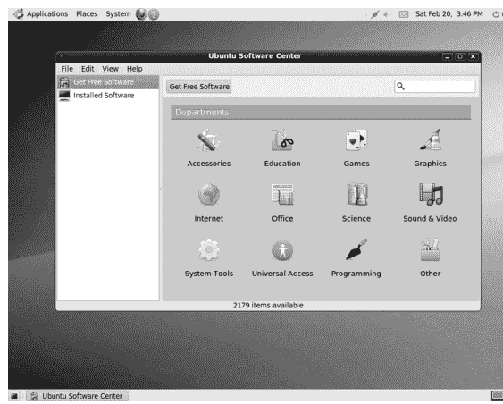

在开源应用中，Ubuntu 是文档最完善的选项之一。你可以轻松在网上找到并打印指南，帮助你安装和日常使用该操作系统。活跃的在线社区在需要寻找快速答案时也是一个极佳的来源。

## 虚拟机

作为一个从一个操作系统迁移到另一个操作系统的人，我知道进行切换可能会是非常可怕的。这就是为什么我使用 VirtualBox (http://www.virtualbox.org/) 在切换之前测试不同的操作系统。在我的这台（也是唯一的）电脑上，我有能力在五个不同的操作系统中工作，无论是同时还是不同时间（见图 5.2）。

### 适用于图书馆的实用开源软件

### 图 5.2 在 VirtualBox 中打开的四个操作系统

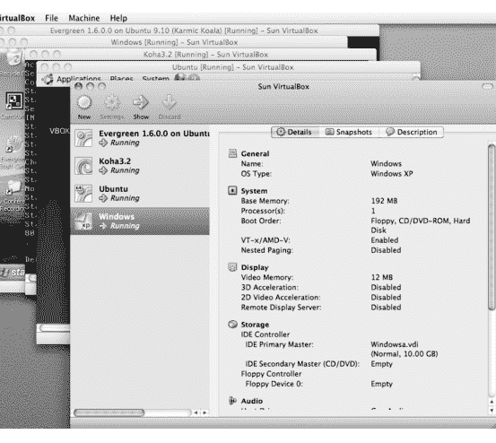

VirtualBox 允许你创建多个虚拟机，这些虚拟机在运行不同软件应用程序的同时可以利用你主机的硬件。这意味着你可以在 Windows 或 Mac OS 上安装 VirtualBox，然后在上面安装 Ubuntu，以便在盲目切换之前学习如何使用不同的操作系统。这也意味着，如果你切换到 Ubuntu，你仍然可以使用 VirtualBox 运行 Windows 或 Mac OS。

这将允许那些开设课程的图书馆教读者如何使用在图书馆机器上运行的多个操作系统。正如 Heather 在她对 VirtualBox 的总结中提到的，这并不是你一直都会使用的应用程序，但它是一个非常好的节省时间的工具。

## 日常运营的开源软件

### 5.2 现实世界中的开源：VirtualBox

Heather Braun，技术图书馆管理员
东北堪萨斯图书馆系统
美国堪萨斯州劳伦斯

### 为什么你决定在你的图书馆使用 VirtualBox？

IT 部门和许多员工一直使用 Mac，但我们仍然需要方便地访问 Windows 工作，因为我们图书馆提供的技术支持和工作都是基于 PC 的。如果只是想并排使用 Mac 和 PC（以及其他操作系统），BootCamp 是行得通的。但 BootCamp 是一个单系统解决方案，你一次只能运行一个。

我们的网络管理员 Liz Rea 需要能够在她的 Mac 后台运行多个虚拟机。起初，我们购买了 Parallels 软件的许可，但该程序被证明非常笨拙、缓慢且多 错误。当启动软件时，我们的电脑会冻结 10 分钟，其他成员非常讨厌它。虽然有新版本，但我们经常需要重启。我们讨厌它，其他员工也讨厌它，我们不想在每次发布新版本时都为软件付费升级，特别是当该软件根本没有运行得好的时候！

然后我们发现了 VirtualBox。我们在 NK 已经在使用许多开源软件（Koha, WordPress, Firefox 和 OpenOffice），所以 VirtualBox 对我们来说是非常自然的契合。在我们需要它的时候，它就是好用。不需要冻结或重启。

### 你们在图书馆是如何使用 VirtualBox 的？

我们用它在 Mac 上模拟 Windows、Linux 发行版和 Linux 服务器发行版。Liz Rea 用它在她的 iMac 上运行 Koha 测试系统，以便她进行一些测试并熟悉系统。

### 你们在图书馆使用 VirtualBox 多久了？

我们使用 VirtualBox 大约一年了。我们不经常用它，也许一个月一两次，但在我们需要时，它非常有帮助。

### 你们在图书馆实施 VirtualBox 遇到过困难吗？

部署软件本身没有。在 VirtualBox 内部部署操作系统可能容易也可以困难。这取决于版本，以及 VirtualBox 的驱动对不同操作系统的支持程度。[作者注：Windows 和 Ubuntu 都受支持且易于安装]

### 从专有软件切换到开源的过程是怎样的？

部署软件本身没有。在 VirtualBox 内部部署操作系统可能容易也可以困难。这取决于版本，以及 VirtualBox 的驱动对不同操作系统的支持程度。[作者注：Windows 和 Ubuntu 都受支持且易于安装]

### 你们其他同事对 VirtualBox 怎么看？

Liz Rea，NEKS 系统管理员，也非常喜欢它。她是目前另一个一个使用它的人。

### 你们对现在的 VirtualBox 怎么看？

我非常喜欢。

### 关于 Ubuntu 或你们切换到 Ubuntu 的过程，还有什么想让我们知道的吗？

如果你是 Mac 用户，并且有一个你必须使用的应用程序，可以尝试改用 VirtualBox 看看。

## 办公套件

一旦你安装了操作系统，你需要一个办公套件来帮助处理文档和计算需求。Ubuntu 预装了 OpenOffice 套件 (http://www.openoffice.org)。如果你没有使用 Ubuntu，你仍然可以使用 OpenOffice。

| 5.3 现实世界中的开源：OpenOffice |
| :--- |
| Kate，志愿者，女性集体图书馆，英国伦敦 |

### 为什么你决定在你的图书馆使用 OpenOffice？

我必须承认，这主要是一个财务决定。我们是一家由志愿者运营的小型图书馆，商业办公软件的许可费用并不是一个现实的选择。我们考虑过在办公室的一些旧 PC 上安装 Linux，但现在还没有准备好采取那一步。使用跨平台套件为我们以后留了空间。

### 你们在图书馆是如何使用 OpenOffice 的？

我们使用 OpenOffice 处理女性集体图书馆的大部分行政工作。最近，由于我们将目录迁移到了图书馆管理系统，并正处于大型编目录项目中，我们一直在创建收藏部分的索引，并使用 CALC 表格将数据转换为 MARC 记录以导入新目录。

### 你们在图书馆使用 OpenOffice 多久了？

基本上，自从我们从 2008 年年中恢复图书馆运营以来，我们一直在用。我不确定在我的之前的之前的图书馆版本中是否使用过它。

### 你们在图书馆实施 OpenOffice 遇到过困难吗？

在与其他组织共享文档时出现过细小故障，但 OpenOffice 的界面非常用户友好，我们的格式需求并不复杂。所以，虽然并不是所有的志愿者都像其他人那样极客，但在实施上并没有什么困难，每个人都适应得很快。

## 从私有软件转向开源软件（OSS）的流程是怎样的？

转向 OpenOffice 的过程非常直接，因为文字处理和其他生产力软件的基础功能非常相似。此外，我们中的一些人已经在家里或其他项目中使用它，这有助于使过渡变得更容易。OpenOffice 也证明了自己是通往其他自由/开源软件（F/OSS）的垫石，我现在感到我们向开源的转变对我们来说既是一个伦理选择也是一个财务选择。

## 你们在安装、迁移或设置 OpenOffice 时得到过帮助吗？

我在图书馆的角色主要是志愿者图书管理员，所以我负责软件的安装、设置和维护工作在迁移到 OpenOffice 的唯一担心是迁移旧的私有文件格式文档，但事实证明这并没有什么问题。

## 你现在觉得 OpenOffice 如何？

我仍然认为它很棒，没有理由回到私有软件。我们的工作方式如此依赖可移植性和非中心化方法（如果能有更好的描述的话），以至于我们无法真正依赖仅在一种类型的计算机、一种情况下访问文件。而且，正如我之前提到的，我认为 OpenOffice 是进入 F/OSS 世界的一大第一步。

## 你们图书馆的其他人对 OpenOffice 怎么看？

管理集体中的每个人都乐于使用 OpenOffice，现在我们更多人在家里也使用它，这并不是一个巨大的转变。适应略有不同的界面需要一点时间，但事实证明这不是问题。图书馆的志愿者在系统方面有不同程度的兴趣和经验，使用自由和开源系统有助于增加兴趣，即使只有了一点点。

# 图书馆实用的开源软件

OpenOffice 是一个完整的办公套件，包含文字处理、电子表格、数据库、图像编辑和演示文稿，所有这些菜单都与其他办公套件非常相似（见图 5.3）；这使得过渡变得非常容易。在在此之前经过 20 多年的开发，OpenOffice 非常稳定且充满了出色的功能。

就像 Ubuntu 是一个需要安装在公共工作站上的应用程序，允许社区成员访问强大的应用程序，而无需为每台计算机支付许可费用。从其他办公套件将信息引入 OpenOffice 也非常容易，因为它可以读取和写入多种格式——我最喜欢的 OpenOffice 功能之一就是将文档保存为 PDF。

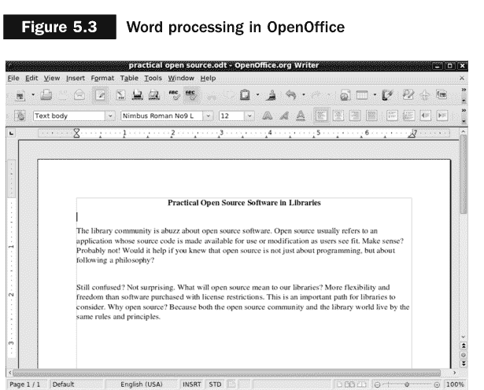

48

## 统计与数据收集

许多图书馆发现对日常运营进行统计很有用。在某些图书馆，这是用纸笔完成的，另一些使用简单的电子表格，而一些使用开源的 Libstats (http://code.google.com/p/libstats/) 应用。

### 5.4 现实世界中的开源：Libstats

Kelly M. Broughton，研究与教育服务助理院长
俄亥州大学图书馆
美国俄亥州亚特兰斯

你们为什么决定在图书馆使用 Libstats？
我们选择 Libstats 是为了促进和减轻数据收集的工作，并开展跨服务点的标准化工作。

你们在图书馆是如何使用 Libstats 的？
我们使用 Libstats 来跟踪图书馆的咨询、技术和方向性问题（数量、持续多长时间、来自哪个服务点以及通过何种通信方式——人工、电子邮件、电话、即时消息等）。

你们在图书馆使用 Libstats 已经多久了？
我们从 2009 年 5 月开始试点，并在 2009 年夏天全面实施。

你们在图书馆实施 Libstats 时遇到过困难吗？
我们的技术人员可以克服的困难没有。

# 图书馆实用的开源软件

> ### 你们在安装、迁移或设置 Libstats 时得到过帮助吗？

图书馆 IT 员工和咨询工作人员共同开展了实施和定制。

### 你现在觉得 Libstats 如何？
全是好评。

### 你们图书馆的其他人对 Libstats 怎么看？

真的很简单！前台的学生们比我们以前使用的井号更喜欢它。

Libstats 是一个非常简单的应用程序（见图 5.4），旨在帮助图书管理员对咨询查询进行统计，并建立常见问题库。通过使用存储在 Libstats 数据库中的数据，图书管理员可以轻松生成关于问题数量、问题来自哪里（电子邮件、电话、访客）以及问了什么类型（通用咨询、数据库相关等）的报告。

收集数据的另一种方法是对你的读者群体进行调查。有很多流行的 Web 应用可用于此任务，但存在限制和成本问题

## 在 Libstats 知识库中添加问题

## 图书馆统计演示：添加问题

| 地点 | 读者类型 | 问题类型 | 耗时 | 格式 | 电子邮件 | 补日期 | |
|---|---|---|---|---|---|---|---|
| 咨询台 | 成人 | 咨询 | < 5 min | key | | | |
| 咨询台 | 教职/职员工 | 咨询 | < 10 min | phone | | | |
| 咨询台 | 学生 | 咨询 | < 30 min | email | | | |
| 问题 | 本科生 | 技术 | | | | | | |

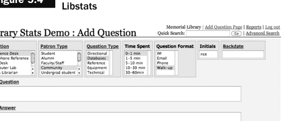

50

### 5.5 现实世界中的开源：Limestats

Vin Kwong，网络服务主管
法兰克林 D. 印第安纳大学
美国南本德

你们为什么决定在图书馆使用 Libstats？
成本，灵活性。

你们在图书馆是如何使用 Libstats 的？
目前，我们使用 Libstats 从学生收集信息。

你们在图书馆使用 Libstats 已经多久了？
超过一年了；我们从 2008 年 8 月开始。

你们在图书馆实施 Libstats 时遇到过困难吗？
在安装之前，我发现我们的服务器不满足系统要求。我们能够导出数据，但问题最终通过升级解决了。

# 图书馆实用的开源软件

### 你们在安装、迁移或设置 Libstats 时得到过帮助吗？
我们从校园部门和 LimeSurvey 论坛获得了安装软件的帮助。

### 你现在觉得 Libstats 如何？
我们喜欢 LimeSurvey，但如果创建调查的用户界面能更直观会更好。

### 你们图书馆的其他人对 Libstats 怎么看？
经常使用 LimeSurvey 的图书管理员告诉我它很好用。

虽然它确实需要一点时间来学习如何为你的图书馆更好地创建调查，但该产品的文档非常出色且易于理解。

使用 LimeSurvey，你可以设置调查询问读者对图书馆的看法、他们希望从图书馆看到什么，或者他们最喜欢的书籍或电影类型是什么。它还为你提供了创建多种语言投票的功能，让你接触到更广泛的受众。由于应用程序运行在你自己的服务器上，你可以控制调查的外观以及调查开放回答的时间。

## 改进日常服务

本章中的应用程序旨在取代那些你可能花费了太多时间和金钱的应用程序，或者为你的图书馆提供你以前可能认为无法负担的服务。全球范围内的图书馆正在将此类应用程序转向开源，以便为读者提供更优质的服务，并为员工提供他们无法负担的功能。

## 开源网页访问

图书馆员没有一天不是以这种或那种方式访问互联网。我们需要在网上进行研究，通过电子邮件回答参考性问题，并从供应商处在线购买书籍。正如我们的电脑不需要使用专有软件一样，我们访问网页也不需要专有软件。

## 开源网页浏览器

如果你只想在本书提到的开源应用中切换到仅此一种（尽管我希望情况并非如此），那么 Firefox (http://www.firefox.com) 绝对是你的不之选（见图 6.1）。Firefox 已经将网络浏览器从一种阅读网页的工具转变为一种与网页进行充分交互的方式。Firefox 的强大之处在于它的开源架构；因为任何人都可以看到 Firefox 在幕后的工作原理，他们可以通过编写扩展和对整体代码改进提出建议来轻松地扩展它。

与大多数开源应用一样，Firefox 也以能够在发布周期之间通过发布微型更新来修复漏洞和安全漏洞而闻名。图书馆管理员对切换到 Firefox 的最大且最误导的担忧之一就是安全。

Security Fix (http://voices.washingtonpost.com/securityfix/) 的 Brian Krebs 在 2006 年进行的一项研究显示，在 2006 年期间至少有 98 天，“微软没有提供软件修复来修复 [Internet Explorer] 的漏洞，犯罪分子正利用这些漏洞从用户那里窃取个人和财务数据。”¹ 相比之下，Firefox 只有一个只有九天的时间没有针对严重的安全漏洞提供补丁。

有了这些数据，很难相信 Firefox 比 Internet Explorer 更安全。作为其默认框架的一部分，Firefox 包含了诸如拦截弹出、反恶意软件、反钓鱼、家长控制和无痕浏览等安全功能。如果这些不够，你可以扩展 Firefox 以为你和你的读者提供更多保护。

### 6.1 现实世界中的开源：Firefox

Greg Johnson，数字倡议与系统管理员
州长州立大学
美国伊利诺斯州大学帕克市

**你为什么决定在图书馆中使用 Firefox？**

我们之前在使用 Internet Explorer 崩溃的问题实在太多了。此外，学生们似乎更喜欢它。

**你们在图书馆是如何使用 Firefox 的？**

我们将 Firefox 设为所有图书馆电脑的默认网络应用程序。

**你们在图书馆使用 Firefox 多久了？**

大约一年。

**你们在图书馆实施 Firefox 时遇到过困难吗？**

学生花了一段时间才停止寻找那个无处不在的 Internet Explorer 图标，那之后，我们没有遇到过任何问题。

**从专有切换到开源的过程是怎样的？**

很容易。

**你们在安装、迁移或设置 Firefox 时得到过帮助吗？**

由于它下载后是完全加载并准备就绪的，我们所做的只是将图书馆主页设置为主页，并将其镜像到所有电脑上。

**你现在觉得 Firefox 怎么样？**

它是目前个人电脑可用的最好的浏览器之一。

**你们图书馆的其他人对 Firefox 怎么看？**

很大程度上，图书馆员并不是 Firefox 的粉丝。其他技术人员更倾向于使用 Firefox 或 Google Chrome，这两者都是开源选项。

除了高效的开发流程和内置安全性外，Firefox 还提供了许多实用的扩展来增加隐私、安全整体效率。这些是图书馆将公共终端（如果不是图书馆所有的电脑）切换到使用 Firefox 作为默认浏览器的原因之一。在成千上万的可用扩展中，我最喜欢的是 AdBlockPlus (http://adblock.plus)。AdBlockPlus 每天尽早阻止网页在你的浏览器中加载。另一种保护自己的方法是防止脚本在未询问你的情况下运行。许多图书馆员使用的扩展是 FlashBlock (https://addons.mozilla.org/en-US/firefox/addon/433)，它可以防止所有 Flash 脚本在点击“播放”按钮之前在你的浏览器中运行。另一个防止脚本运行的扩展是 NoScript (https://addons.mozilla.org/en-US/firefox/addon/7722)。安装后，NoScript 防止在没有你明确许可的情况下运行可执行内容。

要寻找 Firefox 的更多安全扩展，你可以浏览它的安全扩展部分 (https://addons.mozilla.org/en-US/firefox/browse/type:cat12)。

### 扩展 Firefox

图 6.1 Firefox 浏览器

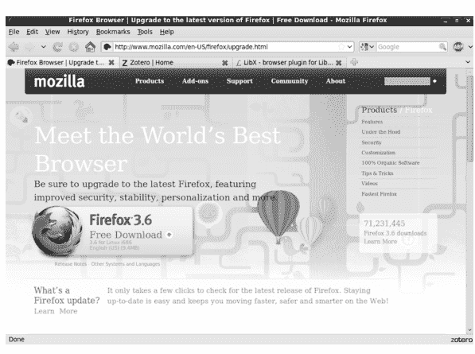

我之前提到过，Firefox 已经远远不仅仅是一个网页浏览器；它还可以协助你进行研究。图书馆中流行的工具之一是 LibX (http://libx.org)。

LibX 是一个开源浏览器工具栏，你可以自定义它来帮助读者（以及工作人员）在浏览时寻找图书馆资源。一旦使用 LibX 工具栏，它会在用户的浏览器顶部放置一个图书馆目录的搜索框（无需访问图书馆目录网站）。

### 6.2 现实世界中的开源：LibX

Chris Keene，技术开发经理
萨塞克斯大学图书馆
英国东萨塞克斯郡布莱顿

**你为什么决定在图书馆中使用 LibX？**

觉得它很有意思，并决定在有大约一小时空闲时间时设置它。

**你们在图书馆是如何使用 LibX 的？**

我们有一个公共 LibX 工具栏，但推广得不是很好。它可以搜索我们的本地目录（我们使用两个，Aquabrowser 和 Talis Prism）、在线期刊和链接解析器，并允许校园通过 EZproxy 重新加载页面。它还搜索当地公共图书馆目录，我们对此得到了一些良好的反馈。

此外，我们还有一个工作人员工具；这在一定是为了简化我们的书单。工作人员可以右键点击书名或 ISBN 并搜索我们的目录，更重要的是 Coutts Oasis（一种书籍供应商在线订购系统，它与我们的图书馆管理系统 EDI Quotes 对接——用于创建订单）。我们经常使用 OCLC 的 xISBN，这样工作人员就可以右键点击 ISBN 就能发现无论版本如何我们是否有该书，等。我们目前正尝试整合 xISBN 和 Coutts Oasis。

**你们在图书馆使用 LibX 多久了？**

我们有一个公共工具栏已经几年了，但最近才开始使用它。

**你们在图书馆实施 LibX 时遇到过困难吗？**

配置网站非常好，但确实有一些小问题。访问它很慢。我们没有遇到过真正的问题。

**从专有切换到开源的过程是怎样的？**

我不会说这是一个切换。这不是一个核心需求，我偶然发现了它，花了几个小时设置，展示给几个人看，然后安静地将其公开，并在随后对其进行完善。我们已经在使用开源应用（EPrints）和基础设施（Apache）等，并且会为其他需求再次使用它（例如 VuFind）。

**你们在安装、迁移或设置 Firefox 时得到过帮助吗？**

没有，但网站上的帮助很好。而且我有计算机科学背景。

**你现在觉得 LibX 怎么样？**

非常棒且非常实用。我想看到它进一步开发。

**你们图书馆的其他人对它怎么看？**

工作人员非常喜欢它，特别是我们资源部门（书单、采购、编目）的人，他们一直面临提高效率的压力。它证明是节省时间的。用户似乎也喜欢它，尽管我们收到很少的反馈。我希望它能提供每个图书馆的下载量等使用统计数据。

# 图书馆实用开源软件

图 6.2 LibX VT 工具栏

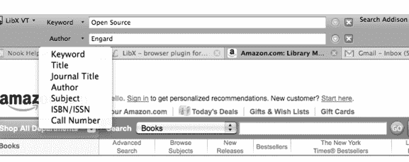

一旦安装了你的工具，你可能希望在图书馆的每台电脑上都安装它，并在你的图书馆网站上推广它，以便你的读者可以在家里下载并使用它。

另一个受欢迎的、集成到 Firefox 中的开源工具是 Zotero (http://zotero.org)，它是一个引用管理工具，允许你将参考文献保存到计算机中，以便于访问和创建参考文献。

一旦安装了 Zotero，你就可以通过状态栏中出现的按钮，一键从许多流行的研究网站和数据库保存引用。在 Zotero 中，你可以使用文件夹、标签和笔记来组织资源。你还可以按照选择的引用格式，将资源直接导出到许多文字处理应用程序（包括 OpenOffice）。Zotero 允许你直接在浏览器中的各种文件夹中存储所有的研究材料（见图 6.3）。

### 图 6.3 在 Zotero 上搜索“Koha”

| 标题 | 创建者 | 信息 | 备注 | 标签 | 相关 |
|---|---|---|---|---|---|
| Implementing an Open L | Derby | | 1 | | |
| Internet... | | | 1 | | |
| Introduction to Print Soft | | | 1 | | |
| Library Services... | Gonzalez B. | | 1 | | |
| Issues and lesson learn... | Raifa | | 1 | | |
| Web design... | | | 1 | | |
| Base homepress... | Random | | 1 | | |
| A library checks it... | | | 1 | | |

Zotero 还具有通过网络与其他 Zotero 用户共享资源的能力，这让所有参与者的小组项目和图书书员研究都变得简单得多。通过 Zotero 账户，你可以将计算机上的资源与网络同步。这既可以作为备份，也是与同事或研究人员共享资源的方法.³

### 6.3 现实世界中的开源：Zotero

Jason Puckett，佐治亚州立大学图书馆用户教育技术、新闻与演讲联络员
美国佐治亚州亚特兰大

你为什么决定在你的图书馆使用 Zotero？

当我发现 Zotero 的时候，我已经教了多年 EndNote。在我的家里的笔记本电脑上安装 Linux 之前，我并没有真正用过它，当然 Linux 可以运行 Zotero 但不能运行 EndNote。它如此易用，而且融入研究过程是如此简单，这让我大为观止。我立即放弃了 EndNote，并编写了一份网络指南和一个工作讨会计划。我是 GSU 图书馆第一个推广它的人，自从去年我来到这里，看到兴趣度直线上升，我感到非常欣慰。

我是开源软件普遍益处的粉丝，在其他条件相同的情况下，我倾向于在可能的情况下使用它，但现实中，某些 OSS 产品并不像它们的商业等效产品那样流畅易用。Zotero 并不是这样。它比我尝试过的任何其他引用管理器都更好用，而且最新版本比 EndNote 多功能且功能强大得多。就像它是由学术研究人员为学术研究人员设计的，因为开发者们似乎真的理解人们是如何使用它的。

它的安装也容易得多，这听起来是一件小事，但对于我们这些在 GSU 提供 EndNote 支持的人来说是一个大头疼的问题。我们有 EndNote 的站点许可，所以我们提供下载，但用户必须登录，在完全身份验证的安装过程中，他们必须在安装期间遵循某些特定步骤。尽管提供了说明和教程视频，这仍然是我们用户在使用 EndNote 时面临的首要问题。使用 Zotero 则没有困难。

# 你在图书馆里是如何使用 Zotero 的？

我有一个流量很大的网络指南。我一直在图书馆举办定期的插班工作讨会。我为学生和教职员工提供大量的一对一帮助。我曾在校内的一些部门做过演示。我将在几周后开始举办一些在线工作讨会，我以前为 EndNote 做过这些，我认为它们对 Zotero 效果也会很好。

# 你在图书馆使用 Zotero 有多久了？

我担任这份工作大约有一年了。我推测在上一家图书馆时我已经使用它两三年了，所以总共三到四年。

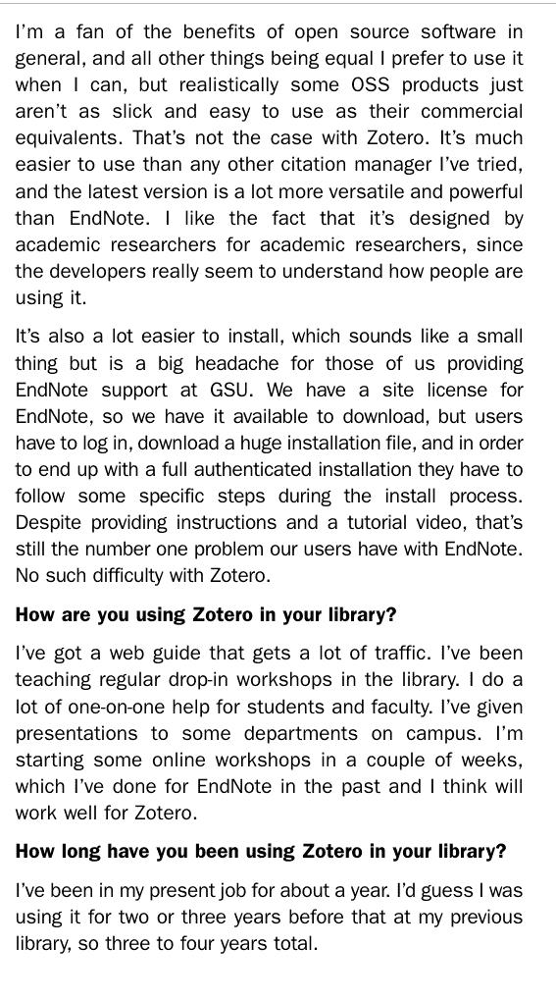

# 你在图书馆实施 Zotero 时遇到过困难吗？

只有几个小插曲。其中一个是我们的电脑上同时安装了 EndNote 和 Zotero，因为其中一个程序可能会从另一个手中夺取下载的引用，但临时禁用 Zotero 非常容易，不至于成为问题。（不过，在大型教室的每台电脑上这可能需要一点时间。）

另一个是它只支持 Firefox，但我甚至说服了那几个人切换到 Firefox，仅仅是为了他们能使用 Zotero。

### 从专有切换到开源的过程是怎样的？

我不能说我们已经完全切换了，据我所知，我们也不可能停止使用 EndNote。（注：原文 OCR 文本存在重复或伪影，已根据去重 OCR 噪声进行了逻辑清理）。

## 适用于图书馆的开源软件

### 你们在图书馆中是如何使用 Thunderbird 的？

我们几乎所有的管理员桌面电脑上都安装了 Thunderbird，以便通过 SMTP 从我们的邮件服务器访问电子邮箱。

### 你们在图书馆中使用 Thunderbird 多久了？

我们从 2003 年底开始一直使用 Thunderbird。

### 在图书馆中实施 Thunderbird 遇到过什么困难吗？

我们遇到的唯一问题是初始配置问题。为了安全起见，我们使用了 TLS，有时 Thunderbird 会拒绝正常连接到我们的邮件服务器。坦率地说，这些问题似乎随着程序新版本的发布得到了解决。

### 从专有软件切换到开源软件的过程是怎样的？

我们之前使用过 Netscape，然后是 Mozilla 作为电子邮件客户端，所以切换过程相对顺利。这个过程只涉及配置客户端，以及从之前的客户端中导入联系人列表。

## 你们在安装、迁移或设置 Thunderbird 时得到过任何帮助吗？

没有，我们都是在内部完成的。

### 你们现在认为 Thunderbird 如何？

我认为 Thunderbird 是一个很棒程序，但随着优秀的网页版电子邮件出现，它不像以前那么重要了。我们的邮件服务器目前运行在 Zimbra 上，因此我们的管理员可以选择使用 Thunderbird 或网页界面来检查邮件。大多数管理员仍然选择使用 Thunderbird。

### 你们图书馆的其他人对 Thunderbird 怎么看？

我们的我们的管理员只是很高兴能使用一个几乎总是能够运行稳定且正确的电子邮件客户端。

## 开源网页访问

### 关于 Thunderbird 或你们切换到 Thunderbird 的过程，还有什么想知道的吗？

使用 SMTP 而不是 POP3 作为标准电子邮件协议会让客户端之间的切换变得容易得多，因为不需要导出和导入消息本身。

许多管理员习惯了 Microsoft Outlook 或 Novell Groupwise 等电子邮件客户端，而从熟悉的界面切换到陌生的界面的想法可能会令人恐惧。然而，Thunderbird 的设计与其他电子邮件工具非常相似，提供了多个面板来查看您的消息、任务等更多内容（见图 6.4）。

Thunderbird 甚至允许使用 Lightning 插件（http://www.mozilla.org/projects/calendar/lightning/）创建个人和共享日历。Lightning 允许

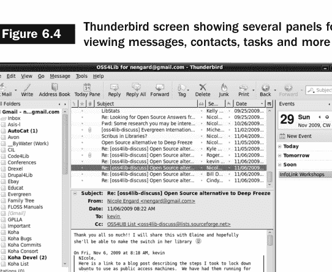

您可以在本地机器上创建日历，或通过网络访问共享日历，对于任何办公室工作的人来说这是一个重要功能（见图 6.5）。

如果您的图书馆使用 Google Apps 处理邮件和日历需求，您可以通过安装 Provider for Google Calendar 插件（https://addons.mozilla.org/en-US/thunderbird/addon/4631）和 GmailAP Account Setup 插件（https://addons.mozilla.org/en-US/thunderbird/addon/6381）来继续使用 Thunderbird。这些工具直接从 Google 获取您的内容并将其发布到 Thunderbird。

除了简单的界面外，Thunderbird 还有内置的垃圾邮件过滤器、下载其他服务插件的选项（https://addons.mozilla.org/en-US/thunderbird/browse/type:1/cat66）、强大的邮件搜索功能以及同时检查多个电子邮件账户的能力（包括 Gmail 和 Yahoo! 等流行的网页版邮箱账户！）。

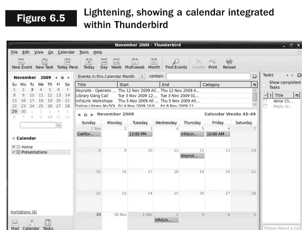

## 即时消息

虽然我们都同意电子邮件并未消亡，但这并不意味着它是我们在线唯一的通信手段。许多图书馆已经开始提供即时消息参考服务，作为一种让读者联系他们的额外方式。Pidgin (http://www.pidgin.im) 是一款开源即时消息工具，它可以让与读者的交流变得简单得多。Pidgin 可以同时连接并保持您的联系人有序，以便快速通信。

Pidgin 允许您一次性登录所有流行的消息客户端 - AIM、Yahoo!、GTalk、Windows Live

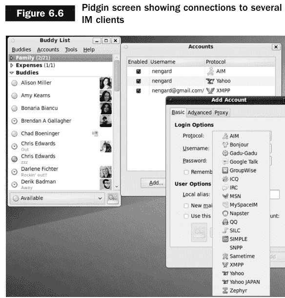

Messenger 等——与其他许多其他开放应用程序一样，Pidgin 还有可用插件（http://developer.pidgin.org/wiki/ThirdPartyPlugins），这些插件将添加对 Facebook 和 Twitter 等其他可选即时消息网络的访问。这个单一界面允许管理员同时监控通信通道，而无需安装和运行多个应用程序（见图 6.6）。

### 6.5 现实世界中的开源：Pidgin

Jennifer M. Turner，支持与培训专家
PALS，明尼苏达州立学院与大学项目
美国明尼苏达州曼卡托

### 你们为什么决定在图书馆中使用 Pidgin？

Pidgin 可以与各种不同的 IM 程序配合，连接到专业的 IRC 通道，并保存对话/讨论日志。此外，它是免费且易于使用的！

### 你们在图书馆中是如何使用 Pidgin 的？

与同事交流——我们为明尼苏达州大多数学院使用的图书馆系统提供技术支持和培训，通常给同事发送一个链接比让他们尝试在自己那边重现问题要容易得多。当有人在远程位置工作对另一位员工有问题或疑问时，它也派上了用。

### 你们在图书馆中使用 Pidgin 多久了？

大约六个月（非常不估计）。

## 你们在图书馆中实施 Pidgin 遇到过什么困难吗？

软件本身没有问题，但很少员工在使用。在使用的人很满意。

## 你们在安装、迁移或设置 Pidgin 时得到过任何帮助吗？

没有。

### 你们现在认为 Pidgin 如何？

它太棒了！我了解得越多，就越喜欢它！

### 你们图书馆的其他人对 Pidgin 怎么看？

使用它的人已经接受并将其用于专业和个人通信。不使用的人没怎么说，因为他们不熟悉（而且他们通常也不使用聊天服务）。

## 选项之网

我简要讨论了您的图书馆可用的开源选项。还有更多开源应用程序可以让您的在线体验更高效、更安全。给本章中的应用程序一个机会，如果发现你不满意，请搜索其他开源替代方案；那里多的是。

## 备注

- 1. Krebs, Brian. 'Internet Explorer Unsafe for 284 Days in 2006.' The Washington Post: Security Fix, January 4, 2007. http://blog.washingtonpost.com/securityfix/2007/01/internet_explorer_unsafe_for_284_days/.
- 2. 若要查找支持 Zotero 的完整列表，可以查看他们的兼容站点（http://www.zotero.org/translators）。您还可以在兼容软件列表中查找哪些图书馆软件支持 Zotero（http://www.zotero.org/support/compatible_standards_and_software）。
- 3. 我的公共 Zotero 图书可以通过 http://www.zotero.org/nengard 获取。

# 开源媒体应用

许多学术图书馆为学生提供图书馆内的媒体中心。常见的误解是小型图书馆没有预算为他们的读者提供此类服务，但有许多开源应用程序可以填充任何图书馆的媒体中心。

## 照片编辑

在照片编辑和创作方面，许多图书馆一直习惯于使用文字处理程序附带的剪贴画，因为他们认为那是他们负担得起的。实际上，有很多强大的开源工具可以让您的照片看起来更专业。这些工具中第一个且可能最为人知的是 GIMP (http://gimp.org)。

GIMP 是一个照片编辑套件，曾被与 Adobe® Photoshop 进行比较。Photoshop® 是为专业艺术家设计的，对于普通图书馆来说往往大过其实。GIMP 为图书馆提供了一种负担得起的替代方案。根据 GIMP 官方网站：

## 7.1 现实世界中的开源软件：GIMP

Chauncey G. Montgomery，总监
社区图书馆
美国俄亥俄州桑伯里

你们为什么决定在图书馆中使用 GIMP 呢？

员工和客户需要一个图形处理程序，而像 Adobe Photoshop 这样的产品对于资金有限的小型图书馆来说太贵了。从我们的观察来看，GNU 图像处理程序（GIMP）提供了与 Photoshop 类似的全方位功能，并且看起来足够直观，可以在图书馆内实施。

你们在图书馆里是如何使用 GIMP 的？

客户使用 GIMP 进行一些轻量级的照片编辑。他们编辑的图像往往会被上传到照片网站，或发送到当地冲印店进行打印。

图书馆人员使用 GIMP 进行更高级的图像处理。用于网页、显示器、海报、书签和各种宣传材料的图像通常先使用 GIMP 进行编辑；它已主要成为图书馆的图像处理工具。

GIMP 在图书馆的一些常见用途包括但不限于裁剪、调整大小和调整色阶。在调整或构建更复杂的图像时，我们还会使用图层功能。

图 7.6 显示了我们构建的一幅图像样本。该图像用于图书馆当地历史照片期刊的页眉。图 7.6 显示了一个在 GIMP 中创建的图像，用于图书馆当地历史照片期刊的页眉。

### 你们在图书馆使用 GIMP 多久了？

我们使用 GIMP 大约已经用了。

# 你们在图书馆实施 GIMP 时遇到过困难吗？

我们在向客户实施 GIMP 时没有遇到任何问题，因为之前公众无法使用图像处理程序。很多时候，我们需要协助客户进行编辑，因为他们不熟悉 GIMP 中的工具以及如何正确使用它们。

对于大多数员工来说，我们得到的反应和对公众的一样。在使用 GIMP 之前，大多数员工没有接触过图像处理应用程序。他们能够成功地使用该程序完成简单任务。

我们有一位个人一直使用旧版本的 Photoshop® Elements，并且不愿意使用 GIMP。另一方面，我被迫使用 GIMP 来满足图书馆所有的编辑需求，因为我使用的是 Linux 工作站，而这是我唯一可用的工具。

我经常在个人使用时用 Photoshop®，而使用 GIMP 对我对 Photoshop® 留下了两个印象。首先，GIMP 的强大和功能令我印象深刻。我在 Photoshop® 中做的几乎任何事情都可以在 GIMP 中完成。尽管如此，我的第二个印象是 GIMP 没有 Photoshop 那么直观。同样，由于有三个独立的窗口，与 Photoshop 的单一界面相比，它有些繁琐。但总的来说，我认为它足够简单，人们可以坐下来无需过多的培训或学习就能进行图像处理。

### 从专有软件转向开源的过程是怎样的？

这比我年前开始朝这个方向发展时想象的要容易得多。高质量、强大软件的可用性令我非常深刻。每当我需要一个应用程序时，通常都能找到一个开源解决方案。安装总是和专有软件一样简单，而且大多数情况下，使用也同样直观。

开源有大量的支持。你只需要更有耐心一点。应用程序很可能可以你想实现的功能，但你需要花时间搜索论坛、发送电子邮件，或者只是尝试一下来发现如何完成所需的任务。

# 你们在安装、迁移或设置 GIMP 时得到过帮助吗？

我们在安装和迁移到 GIMP 时没有得到任何帮助；然而，它安装非常容易。

# 你们现在怎么看 GIMP？

我认为它和 Photoshop Elements 一样好，从未用过 Elements 或 Photoshop 全完整版的人进入 GIMP 并使用它也不会有困难。

### 你们图书馆的其他人对 GIMP 怎么看？

大多数觉得它能胜任。那位使用 Photoshop Elements 的员工可能对接受 GIMP 稍微顾虑一些，但没有对它说什么坏话；她只是不使用它（可能因为她有选择）。

# 有什么想让我们知道关于 GIMP 或你们切换到 GIMP 的过程吗？

只需安装并开始使用即可。你应该不会遇到任何问题。如果你无法弄如何做某事，请保持耐心。阅读网站、论坛，必要时阅读书籍，你就会找到答案。

这是一个非常优秀的程序。

## 开源媒体应用程序

[GIMP] 有许多功能。它可以被用作简单的画图程序、专家级照片修饰程序、在线批处理系统、批量生产图像渲染器、图像格式转换器等。

GIMP 是可扩展和可延伸的。它的设计为可以通过插件和扩展进行增强，以完成几乎任何操作。高级脚本界面允许从简单的任务到最复杂的图像处理过程都能轻松编写脚本。

简而言之，GIMP 可以满足你所有的图形需求，如果 GIMP 缺少某个功能，你可以浏览 http://registry.gimp.org/list_content 插件列表来扩展 GIMP 的功能。

对于以前没有用过照片编辑包的人来说有一个学习曲线，即使对于那些可能习惯了其他处理包的人也是如此（如图 7.1 所示）。

**图 7.1** 在 GIMP 中编辑照片的选项

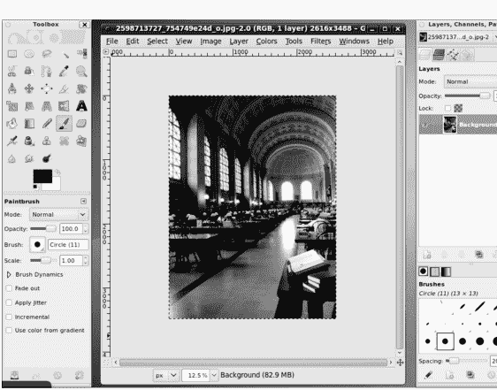

## 7.2 现实世界中的开源媒体：Scribus

Clay Fouts，Lion & Serpent 编辑
Sekhet-Maat Lodge，代表美国波特兰 Ordo Templi Orientis

你们为什么决定在组织中使用 Scribus？

由于预算限制以及我们许多成员的意识偏好，我们倾向于使用 FOSS [自由开源软件] 项目来满足技术需求。我们的网站整合了 MediaWiki、Apache、MySQL、WordPress 以及其他软件包来管理和交付内容。

当我们需要桌面出版软件时，这种趋势持续下去。我们对适当色彩管理、高质量字体渲染和矢量图形的需求，使我们在 Scribus 和 TeX 之间做出了选择。虽然 TeX 的描述性语言和成熟度吸引了我们程序员的思维，但我们认为 Scribus 的图形界面以及与其他桌面出版（DTP）软件的相似性会让未来的其他人更容易上手这项工作。

### 你们在组织里是如何使用 Scribus 的？

我们最初开始用它制作我们的期刊《Lion & Serpent》的排版。然而，自从用于该目的之后，我们也用它来设计各种印刷材料，包括名片、仪式礼拜等。

### 你们在组织中使用 Scribus 多久了？

九个月。

# 你们在组织中实施 Scribus 时遇到过困难吗？

它仍然年轻，所以功能不如 InDesign 丰富。因为更强大的功能位于新的开发版本中（我们目前使用 1.3.5.1 版本），我们往往也会遇到不稳定性和前沿软件中常见的偶尔 Bug。不过，我没有遇到过任何致命障碍。

### 从专有软件转向开源的过程是怎样的？

我们之前的排版人员使用 Adobe 的 InDesign，而没有工具可以将用于创建早期期刊卷的文件转换为 Scribus 格式。这意味着我们多程度上必须从头开始，在新格式中重建了我们的模板集。

## 7.2 Scribus

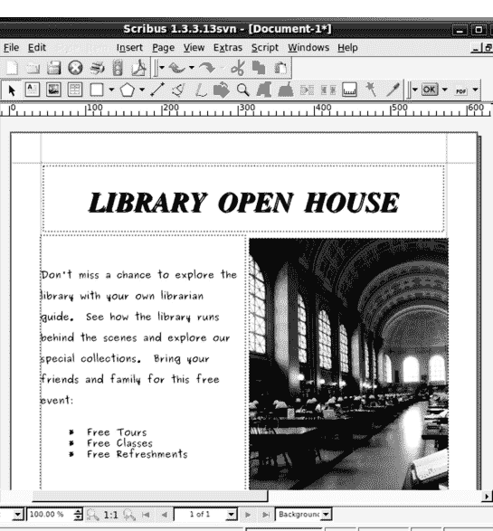

# 开源媒体应用

然而，由于 Scribus 将文档存储在结构化的 XML 文件中，现在可以使用像 Git 这样的版本控制工具来存储文档的分支和检查点修订，而无需任何费麻烦。我们可以尝试某种特定的布局，如果我们决定不喜欢它，以后可以轻松地恢复到之前的版本。

你是否在安装、迁移或设置 Scribus 方面考虑过任何帮助？

我是一位 IT 专业人士，我们有一位非常有帮助的成员，他曾在一家数字打印店工作过，负责指导我们如何处理准备打印文档时那极其令人困惑的流程。

# 你对 Scribus 有什么看法？

使用它实际上非常令人愉快，我现在很高兴我们选择了 Scribus 而不是 LaTeX。作为其支持邮件列表的一员，开发团队成员似乎很好地管理着 Scribus 的演进。这个规模小但不断增长社区对用户的查询响应非常迅速。我们现在不必担心因为依赖昂贵的专有软件而导致无法获取模板和其他 DTP（桌面出版）材料。

# 你所在机构的其他人对 Scribus 如何看？

除了我们的本地会员外，我们还有来自世界的订阅者阅读《狮子与蛇》（Lion & Serpent）。尽管我们免费发布在线版，但人们会专门订购纸质版，以便对我们出版的美术作品进行精细的复制。对布局、设计和制作质量的反馈一律是积极的。

是否有关于你们在线或在图书馆期刊中使用 Scribus 的截图、文档或功能，是我们应该查看的？

你可以在 http://sekhetmaat.com/Journal/ 找到我们的在线期号存档。第 14 卷的所有都是用 Scribus 设计的。

需要记住的是，在线数字版本中的图像经过了压缩，以节省艺术家的带宽，并保护我们视觉艺术家的作品不以适合大生产的格式分发。

# 关于 Scribus 或切换到 Scribus 的过程你还有什么想知道的

技术专业知识虽然有用，但成功使用 Scribus 并非必须。然而，一些非常标准的 DTP 功能（字体管理和拼版——最显而易见的）Scribus 尚未直接支持，需要使用其他工具。使用这些不够精细且通常是命令行的程序，对于技术不太精通的人来说，可能是一个挑战。

Scribus 在大型出版行业中仍然相对不为人知，但越来越多的非营利和商业组织正使用它出版各种文档，包括杂志、书籍和营销材料。EASTight 杂志使用 Scribus 出版每月递送到伦敦 15,000 户的杂志。《Full Circle》是 Ubuntu 用户（一种基于 Linux 的操作系统）的电子杂志每月以交互式 PDF 发布到网上。使用该软件出版的其他标题列表在 Scribus 公共 Wiki 上在不断增加中。²

与本书中列出的其他应用程序一样，在你的读者的工作站上安装 Scribus 是提供此前读者无法获得（且负担不起）的服务的绝佳方式。

## 音频编辑

打印产品不是扩展我们馆藏提供的唯一方式；为什么不制作播客呢？全球各地的图书馆已开始向其读者提供免费播客，以推广他们的藏品、图书馆活动和社区。纽约公共图书馆在图书馆制作播客方面取得了惊人的成就（见 http://www.nypl.org/voices/audio-video），但你不必是一个大型图书馆系统也能制作你自己的图书馆节目。

### 7.3 现实世界中的开源：Audacity

Robin Stiles，图书馆媒体专家，和 Kristin Veenema，英语教师
Staples 高中图书馆媒体中心
美国康涅狄格州威斯特波特

### 你们为什么决定在图书馆使用 Audacity？

它是免费的。它被我们的信息和技术素养（ITL）部门推广、下载和支持。

### 你们在图书馆如何使用 Audacity？

它安装在图书馆中心一楼的 29 台台式电脑上。安装在图书馆媒体中心的 60 多台笔记本电脑上。我们提供麦克风和耳机，学生可以借用使用。当老师要求学生做演示时，可以告诉他们可以通过多种方式交流自己的知识和研究。其中一个选项就是使用 Audacity。

### 你们在图书馆使用 Audacity 多久了？

我们已经使用 Audacity 三年了。它三年前在我们的“夏季 ITL 学院”上首次引入，每位参加者都在座位下像“奥普拉式”一样收到了一个麦克风！

# 你们在图书馆实施 Audacity 时遇到过困难吗？

我们需要下载 LAME MP3 编码器并将其保留在 audacity 中中以便将文件导出为 .mp3 文件。

### 从专有切换到开源的过程是怎样的？

我们实际上只用过 Audacity。

# 你们在安装、迁移或设置 Audacity 时得到过帮助吗？

我们的技术部门员工在我们所有的机器上安装了软件，并随时提供培训和支持。

# 你对 Audacity 有什么看法？

我觉得它很酷。它在我的夏季待办事项上，用来录制年长辈及其记忆，留给我的孩子。在我最近教的一个班级中，我看到他们听到自己的声音时神态发生了变化，从字面上还是比喻上都是。

### 你们图书馆的其他人对 Audacity 如何？

Mac 用户当然偏好 Mac 软件，但 Staples 主要使用 PC 进行教学。在教室里制作播客的老师使用 Audacity (PC) 或 Podcast Capture (Mac)，并将文件上传到他们的网站、Wiki 或 Blackboard 上。对于大多数技术来说，真正重要的不是你使用的工具，而是

# 是否关于你们在线或在图书馆期刊中使用 Audacity 的截图、文档或功能，是我们应该查看的？

学生被要求选取《炼狱记》（The Crucible）的一幕，并编写一个剧本，用他们认为角色真实想法和感受的回应每句台词。他们要将自己的台词穿插在想法中进行录制，并将播客链接到他们的。他们使用 Audacity 改变他们的语调、音深等。有些人根据所读的角色让女声听起来像男声或反之。小组合作增强了问题导学习：深入研究角色具有挑战性且与众不同。

你真的应该尝试将播客保存为 .mp3 以压缩文件大小，因为 .wav 文件可能很大，有时取决于你想保存它们的地方，可能太大了。

馆员兼教授 Michael Stephens 向馆员介绍了如何使用 Audacity 制作播客 (http://audacity.sourceforge.net)：

Audacity 提供了一种免费的音频录制解决方案，包括直观的界面和较短的学习曲线。在 Audacity 中录制的音频文件可以保存为 MP3（标准的播客文件格式）或根据需要保存为其他格式。MP3 可以在 iPhone 和许多其他便携媒体播放器和 CD 播放器上运行，是一种允许合理质量和合理大小的文件类型。

Audacity 是许多播客主的首选工具，是因为其强大的功能以及它是免费开源的。

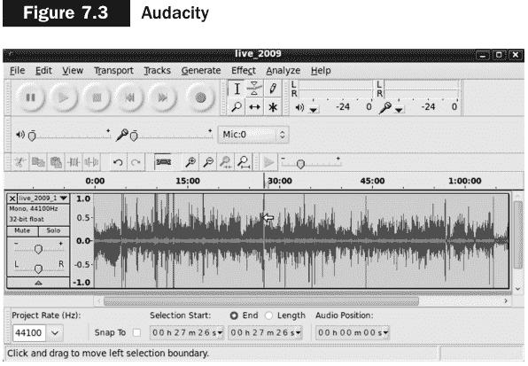

使用 Audacity 你可以录制、编辑、拼接和增强你的播客。这意味着你只需要一个工具就可以录制并准备播客。Audacity 为你提供了创建播客所需的所有工具；见图 7.3。

## 屏录

作为一个视觉学习者，我发现视频教程在学习新软件或任何新事物时非常有帮助。为你的读者提供屏录是帮助你图书馆的视觉学习者了解图书馆提供的各种产品的绝佳方式。

屏录简单来说是对计算机屏幕的视频录制，例如使用图书馆网站的教程。你开启录屏软件，然后浏览图书馆网站并旁白你的操作。

# 开源媒体应用

录屏软件可以捕捉你的动作和声音，并创建一个你随后可以发布到网络上的视频。

CamStudio (http://camstudio.org) 是一款开源应用程序，可以帮助你在 Windows 上创建这些录屏视频；而如果你使用的是 Linux 操作系统，recordmydesktop (http://recordmydesktop.sourceforge.net) 就是解决方案。这两个应用程序都非常易于使用。只需启动程序，选择你在屏幕上想要录制的区域，然后点击录制按钮（参见图 7.4 和 7.5）。视频录制完成后，你可以在应用程序的查看器中对其进行预览。

东北堪萨斯州图书馆系统 (NEKLS) 充分利用录屏（http://www.nxpresslibrary.org/category/tutorial/）作为其成员图书馆的培训工具。这些视频与他们编写的文本文档相结合，以便所有类型的学习者都能轻松从他们的开源集成图书馆系统 Koha (http://koha-community.org) 中获益最大化。

> 图 7.4 RecordDesktop 在你操作电脑时录制你的动作

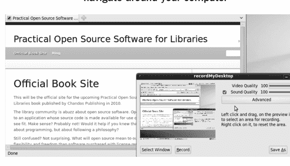

# 图书实用开源软件

图 7.5 CamStudio 在你录制动作时为你提供有关录制的详细信息

# 图书实用开源软件

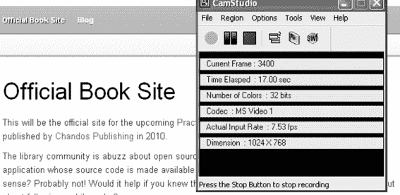

# 官方书籍网站

这将是由 Chandos Publishing 于 2010 年出版的新书的官方网站。
图书馆社区关于开源应用程序代码的可用是有意义的？可能没有！如果你了解遵循某种哲学，会有帮助吗？

# 7.4 现实世界中的开源：RecordMyDesktop

Mark Osborne，副校长
奥尔巴尼高中图书馆
新西兰，北岸市

你为什么决定在图书馆中使用 RecordMyDesktop？
我们想录制录屏视频，向用户展示如何使用目录的功能。

你们在图书馆是如何使用 RecordMyDesktop 的？
为联机检索目录 (OPAC) 和学校正在使用的软件应用程序录制录屏视频。

你在图书馆中使用 RecordMyDesktop 多久了？
大约 12 个月。

在图书馆实施 recordMyDesktop 遇到过困难吗？
没有。一旦我们确保麦克风连接恰当，就很简单。

你们在安装、迁移或设置 recordMyDesktop 时得到过帮助吗？
没有。是我自己安装的。

你现在对 recordMyDesktop 怎么看？
它很好。我会继续使用它。

你们图书馆的其他人对 recordMyDesktop 怎么说？
这些录屏视频非常有帮助，而且是大多数人学习某项技能的首选方式。

在线查看使用 recordMyDesktop 创建的录屏视频：
http://wikieducator.org/Albany_Senior_High_School/ICTs.

# 结论

使用本章中的工具，你可以以极低或零成本在图书馆内建立一个公共媒体站。使用运行 Ubuntu 的旧机器或捐赠机器，你可以轻松安装这里列出的所有应用程序（以及更多），并让你的读者开始创建他们自己的电影、播客和新闻简。

## 注释

+ 1. 《GIMP 简介》。。GIMP, 2009. http://www.gimp.org/about/introduction.html.

+ 2. Harper, Eliot. 〈Scribus：开源桌面出版。〉。Seybold Report: Analyzing Publishing Technologies 9, no. 1 (2009 年 1 月 8 日): 7–14.

+ 3. Stephens, Michael. 〈关于播客的一切〉。Library Media Connection 25, no. 5 (2007 年 2 月): 54–57.

+ 4. 请注意，虽然 NEKLS 充分利用录屏，但他们并没有使用本章中提到的任何一种工具。

# 网络上的开源

越来越多的图书馆员被要求加入信息技术人员的行列。当我开始在图书馆工作时，我负责图书馆网站。在当时，图书馆员拥有处理此类任务的技能、愿望或时间是不可想象的。现在，随着技术的普及和图书馆预算的不断缩减，越来越多的图书馆员正承担网站管理员的角色，而为了做好工作，你需要正确的工具。

从好的一方面来说，随着读写网络的出现，有很多非开发人员可以使用工具来帮助他们创建网站，其中许多是开源的。

# 将文件上传到网络

在开始你的网站之前，你至少需要一个工具来帮助你将文件从计算机传输到 Web 服务器。这个过程被称为 FTP 或文件传输协议。对于这个过程，你需要一个 FTP 程序；FileZilla (http://filezilla-project.org) 是图书馆流行的选择之一。它很受欢迎是因为它可以安装在几乎所有的操作系统上，让你很容易为你的环境找到合适的版本。

### 8.1 现实世界中的开源：FileZilla

Rick Mason，采购助理
首都大学 Blackmore 图书馆
美国，俄亥俄州，哥伦布斯

你为什么决定在图书馆中使用 FileZilla？
我们想录制录屏视频，向用户展示如何使用目录的功能。

你们在图书馆是如何使用 FileZilla 的？
为联机检索目录 (OPAC) 和学校正在使用的软件应用程序录制录屏视频。

你在图书馆中使用 FileZilla 多久了？
大约 12 个月。

在图书馆实施 recordMyDesktop 遇到过困难吗？
没有。一旦我们确保麦克风连接恰当，就很简单。

你们在安装、迁移或设置 recordMyDesktop 时得到过帮助吗？
没有。是我自己安装的。

你现在对 recordMyDesktop 怎么看？
它很好。我会继续使用它。

你们图书馆的其他人对 recordMyDesktop 怎么说？
这些录屏视频非常有帮助，而且是大多数人学习某项技能的首选方式。

在线查看使用 recordMyDesktop 创建的录屏视频：
http://wikieducator.org/Albany_Senior_High_School/ICTs.

# 结论 

使用本章中的工具，你可以以极低或零成本在图书馆内建立一个公共媒体站。使用运行 Ubuntu 的旧机器或捐赠机器，你可以轻松安装这里列出的所有应用程序（以及更多），并让你的读者开始创建他们自己的电影、播客和新闻简。

## 注释
（此处重复内容已根据指令要求去重或处理...）

# 网络上的开源
（此处重复内容已根据指令要求去重或已处理...）

# 将文件上传到网络
（此处重复内容已根据指令要求去重或已处理...）

### 8.1 现实世界中的开源：FileZilla
（此处重复内容已根据指令要求去重或已处理...）

## 内容管理

现在你已经可以将文件上传到网络了，你需要一些东西来上传。许多图书馆都选择使用内容管理系统来设计它们的图书馆网站。内容管理系统几乎就像一个装在箱里的网站；它包含了构建和维护网站所需的所有工具，无需任何正式的培训或开发技能。目前图书馆界有两个热门的开源内容管理系统：Joomla (http://www.joomla.org) 和 Drupal (http://www.drupal.org)。你的基础内容管理系统为你提供了创建网站页面的必要工具，而无需了解 HTML 或任何其他编程语言。

### 8.2 现实世界中的开源：Joomla

Jason Griffey，图书馆信息技术负责人
田纳西州大学查塔加诺加分校 卢普顿图书馆
美国田纳西州查塔加诺加

**你为什么决定在你的图书馆中使用 Joomla？？**

我们当时正在进行网站重新设计，关于内容管理系统的决定在 Joomla 或 Drupal 之间做出。选择使用 Joomla 的原因是，对于一个单人兼职开发者（我我）来说，创建一个主题并将内容移动其中更容易。Drupal 虽很好，但考虑到时间限制，它超出了我的能力范围。Joomla 的开发速度快得多。

**你在你的图书馆是如何使用 Joomla 的？**

我们正在使用 Joomla 驱动图书馆的网站，但数据库页面和目录除外。

**你在你的图书馆使用 Joomla 多久了？**

我们从 2007 年初就开始全面使用 Joomla 了。

**你在你的图书馆实施 Joomla 时遇到过困难吗？**

除了时间限制外，没有。作为一所学术图书馆，当然有委员会参与，但我能够讨论开源的益处，并说服任何持怀疑的人。

**从专有软件转向开源软件的过程是怎样的？**

非常简单。虽然注重细节，但整个过程非常顺畅。

**在安装、迁移或设置 Joomla 时得到过任何帮助吗？**

没有，开发、安装等工作都是由我独立完成的。其他管理员协助了迁移，但我们没有寻求外部帮助。

**你现在对 Joomla 怎么看？**

我仍然更喜欢它而不是我们旧的静态文件解决方案，但它也有自己的问题。它处理内容和菜单的方式对于不习惯在 Joomla 上开发的人来说可能并不直观。但它仍然是一个健壮的平台。

**你图书馆的其他人对 Joomla 怎么说？**

他们大多对它很满意。在创建网站全新板块时存在一些问题……更新现有信息很容易，但创建新板块可能不那么直观。

## 网页上的开源

使用 Drupal，网站的不同区域被划分为“任务”（tasks）和“模块”（modules）（见图 8.2）。任务本质上是页面的功能，即页面的作用。模块不仅仅是网站的一个区域，例如“活动”、“博客”或“用户”。在 Joomla 中，内容被分类为“菜单”（Menus）、“内容”（Content）和“组件”（Components）（见图 8.3）。这些领域中的每一个都容纳了你可以修改和自定义的网站板块。在这两者中，导航方面各有胜秋，但都需要管理员的润色。最终，两者都有其优缺点；我的建议是尝试使用 openopensource 网站 (http://opensourcecms.com) 上的演示版本，找到适合你需求的那个。

要查看这些工具的功能，Joomla 和 Drupal 都维护着使用其产品之网站的展示案例（http://community.jooomla.org/showcase/ 和 http://drupal.org/cases）。

> 图 8.2 GPLLA.org 的管理区域，由 Drupal 驱动

## 图书馆实用开源软件

### 图 8.3 Joomla 管理区域

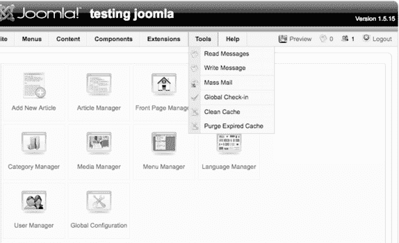

### 8.3 现实世界中的开源：Drupal

Paula Gray-Overtoom，信息系统管理员
蒙罗伊县公共图书馆
美国印第安纳州布鲁明顿

**你为什么决定在你的图书馆中使用 Drupal？**

我们希望为我们的内网拥有一个内容管理系统。我们之前使用 Macromedia/Adobe Contribute 配合模板来指导员工创建内容，但它还不够动态。我们希望不同部门都有员工博客，并允许所有员工为内网做出贡献。有了 Drupal，我们不需要担心无法为所有员工支付许可证费用。

**你在你的图书馆是如何使用 Drupal 的？**

我们使用 Drupal 构建我们的内网。我们有部门博客、发布文档和员工会议信息。它是我们在服务区域内部以及区域之间交流的方式。

**你在你的图书馆使用 Drupal 多久了？**

我们安装 Drupal 大约一年了，但将所有员工迁移到我们新内网界面大约有一个月了。

**你在你的图书馆实施 Drupal 时遇到过困难吗？**

我学习如何安装模块以及 Drupal 的其他技术方面花了一些时间，但在线文档很好且易于获取。员工们学会 Drupal 非常快。我们为大多数员工举办了一小时的培训课程，介绍了更新账户信息和发布博客文章的基础知识。员工过渡到 Drupal 遇到的问题很少。大多数人现在非常高兴，他们现在可以编辑页面而无需再使用 Utilize 了。

**从专有软件转向开源软件的过程是怎样的？**

无论如何，我们的 Web 服务器都使用开源软件，所以 Drupal 的过渡相当容易。由于许可费的原因，我们的 Contribute 版本一直处于落后，所以能够迁移到更新的软件要好得多。从使用 Red Hat 开始，我就打算在网上寻找问题的答案，实际上我发现我更喜欢这种，而不是去一家专有公司并希望他们能响应我的需求。

**在安装、迁移或设置 Drupal 时得到过任何帮助吗？**

是我自己设置的 Drupal。

**你现在对 Drupal 怎么看？**

我非常喜欢它。它很好地满足了我们的需求，通常我有软件需求时，会在 Drupal 的贡献模块中搜索并找到一个实现我要求的模块。我认为这是最有趣的特点之一。

## 图书馆实用开源软件

开源的特点在于总有人在开发东西来满足需求。

**你图书馆的其他人对 Drupal 怎么说？**

大家似乎都喜欢它。有些员工起初对此并不感，但我得到了非常积极的反馈。员工们很高兴能够轻松搜索网站并找到他们的内容。

**关于 Drupal 或你切换到 Drupal 的过程还有什么想知道的吗？**

Drupal 对于内网确实非常好。我们用它来创建各种手册书籍以组织文档，使用表单向 IT 或设施部门发送工作请求，并通过博客轻松交流。Drupal 展示中最近的一个热门案例是白宫官方网站 (http://www.whitehouse.gov)，另一个显而易组合是 Linux.com (http://www.linux.com) 使用 Joomla，因为其关注开源。

图书馆内容管理领域的新动态是 MaiaCMS (http://maiacms.org)，由美国马里兰州的霍华德县图书馆系统设计。MaiaCMS 是由管理员为管理员设计的，这使其成为图书馆网站的一个非常有前景的选择。我用过 Joomla 和 Drupal，我唯一的抱怨是管理用户界面看起来比实际需要的要复杂。这就是为什么 MaiaCMS 让我感到兴奋；它是一个专为管理员设计的工具，所以菜单系统美观且易于导航（见图 8.4），而且管理员需要的模块是标准安装的一部分，而不是仅作为插件可用。

# 网页上的开源

图 8.4 图书员创建的 MaiaCMS 管理区域

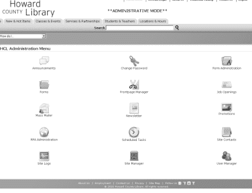

### 8.4 现实世界中的开源：MaiaCMS

Danny Bouman，Web 开发者
霍华县立图书馆
美国马里兰州哥伦比亚亚亚

你为什么决定为你的图书馆开发 MaiaCMS？

我决定开发 MaiaCMS 是因为图书馆对设计一个新网站感兴趣，并且需要一个内容管理系统，让非技术人员能够为网站内容的贡献并进行维护。我探索了几个现有的 CMS 选项，如 Joomla 和 Drupal，但当时我对它们的复杂性，以及为了方便我们的用户而简化这些系统需要进行大量的调整感到并不满意。从零开始创建 MaiaCMS 为我提供了一个创建一个真正定制系统的平台，该系统能够很好地满足霍华县图书馆的确切需求。

### 你们在图书馆是如何使用 MaiaCMS 的？

MaiaCMS 目前是我们的公共网站（http://hclibrary.org），完全由我们的市场部门维护。

### 你们在图书馆使用 MaiaCMS 有多久了？

我们使用 MaiaCMS 已经有一多年了。

### 从专有系统转向开源的过程是怎样的？

我们之前没有专有系统。虽然它是由一家外部网络设计公司开发的，但我们一直有权根据需要修改网站。

### 你们现在对 MaiaCMS 怎么看？

MaiaCMS 对霍华县图书馆来说继续运行得非常好，这很大程度上是因为它是为霍华县图书馆开发的。如果让我重头来一次，我会选择以 Joomla 或 Drupal 为基础，而不是从零开始开发新系统。我发现，当我向公众发布 MaiaCMS 时，我被迫复制许多 Joomla 和 Drupal 中已经存在的功能。

### 你们图书馆的其他人对 MaiaCMS 怎么说？

市场部门提到，他们发现它非常易用。许多员工评论说，简约的设计使其易于导航。

从开发者的角度来看，我认为由于目前缺乏文档，安装和配置非常困难。

## 是否有任何在线或图书馆期刊中关于你们使用 MaiaCMS 的截图、文档或功能是我们应该关注的？

文档（编写完成后）和截图可以在 http://maiacms.org 找到。

# 网页上的开源

MaiaCMS 的功能包括：

- 简单直观的设计
- 能够轻松创建和管理表单
- 管理网站联系人的创新系统
- 用于发送新闻稿、添加促销项目、发布公告和添加职位空缺组件

关于 MaiaCMS 或你们切换到 MaiaCMS 的过程，还有什么想知道的吗？

所有代码都在 http://maiacms.org 向任何想要使用它的人免费提供。由于项目仍处于婴儿阶段，网站管理员需要熟悉 PHP 才能安装和配置该产品。

MaiaCMS 的缺点是它目前仅在图书馆使用，没有活跃的社区来寻求支持，也没有在线文档。我建议图书管理员们关注 MaiaCMS，但在它周围有更多活动之前，不要跳到实施它的这一步。

WordPress (http://wordpress.org) 经常作为内容管理系统被忽视。它最初被用作博客平台，WordPress 最近的升级使其成为通常被认为是顶级源内容管理系统的可行替代方案（请参见表 8.1 进行基础 CMS 比较）。WordPress 拥有一个优秀的开源应用程序的所有的所有特征：活跃的社区、强大的基础、详尽的文档以及通过用户开发的插件扩展功能的能力。事实上，WordPress 在大型网站上的数量几乎是 Drupal 的三倍²（而 Drupal 比 Joomla 多使用三倍）。³

# 图书馆实用开源软件

## 表 8.1 内容管理系统比较

| | Joomla | Drupal | MaiaCMS | WordPress |
|---|---|---|---|---|
| 预制模板 | 是 | 是 | 否 | 是 |
| Wiki 功能 | 带插件 | 带插件 | 否 | 带插件 |
| 博客功能 | 是 | 是 | 否 | 是 |
| 支持选项 | 论坛 | 论坛 | 邮件列表 | 论坛 |
| 图书馆社区 | 是 | 是 | 否 | 是 |
| 扩展 | 是 | 是 | 是 | 是 |
| 多用户访问 | 是 | 是 | 是 | 是 |
| OPAC 插件 | 否 | SOPAC2 | 是 | Scriblo |
| 内置搜索 | 是 | 是 | 是 | 是 |
| RSS Feed | 是 | 是 | 是 | 是 |

对于不熟悉安装 Web 应用的人来说，WordPress 卖点之一是它的五秒安装。你会被问几个问题，点击提交，你的 WordPress 网站就会运行起来。你可以浏览易于理解的“设置”部分，并自定义人们与你的新网站交互的方式。最花时间的是找到你最喜欢的主题。在向同事图书员教授 WordPress 时，这是课程中总是持续最长的部分，这充分证明了学习 WordPress（见图 8.5）并使用它管理整个网站是多么容易。

## 与同事咨询

在选择使用新或不熟悉的工具时，能够接触先走过的同事总是很有帮助的

# 网页上的开源

图 8.5 MaiaCMS 的管理区域

### 8.5 现实世界中的开源：WordPress

Susan Bryant，外联
Morill 公立图书馆
美国 Hiawatha

你为什么决定使用 WordPress？

WordPress 给了我们对网站的控制权。

你使用 WordPress 多久了？

从 2006 年开始。

从专有系统转向开源的过程是怎样的？

对于想进一步了解 Drupal 的人，有 Drupalib (http://drupalib.interoperating.info) 社区。该网站对于使用或想使用 Drupal 管理图书馆网站的人来说也是信息的宝库。在这里，你可以通过参与邮件列表或论坛访问其他 Drupal 图书馆，你可以在展示中心看到其他使用 Drupal 的图书馆。

你现在对 WordPress 怎么看？

我很喜欢它。用户界面非常简单，我每天都登录仪表板。我们可以有多名员工参与贡献。

你们图书馆的其他人对 WordPress 怎么说？

我们的员工认为我们的网站是回答问题的资源，建议添加新链接并删除未使用的链接以使网站更有用，我认为他们喜欢他们的建议可以立即实施。

关于 WordPress 或你们切换到 WordPress 的过程，还有什么想让我们知道的吗？

KLOW 团队的帮助和持续支持对我们决定使用 WordPress 重大。

你们非常成功。这就是为什么在选择内容管理系统之前你应该了解三个社区。

如果你对 Joomla 感兴趣，你可能想查看 Joomla in Libraries (http://www.joomlainlibrary.com) 社区。该网站专注于使用或想使用 Joomla 管理网站或内网的图书馆。该网站上的有用内容非常惊人。你可以找到教程、其他图书馆的示例、讨论板等。

最后，如果你对 WordPress 感兴趣，你的社区是 wp4jlib (http://www.webjunction.org/706)。该社区由公告板、wiki 和讨论列表组成。有了已经实施了 WordPress 的图书馆可以参考，你的迁移将变得得多。

## Wikis

一些库馆会放弃内容管理系统，转而使用 wiki。wiki 简单来说就是多个人都可以编辑的网站。最著名的开源 wiki 应用之一是 MediaWiki (http://www.mediawiki.org)，它是支持 Wikipedia (http://www.wikipedia.org) 的软件。MediaWiki 在处理高流量网站方面拥有悠久记录，这也就是为什么图书馆员经常使用它来构建他们的内网、学科指南，有时也用于用于官方网站。

### 8.6 现实世界中的开源：MediaWiki

| Garry Collum, 肯顿县公立图书馆系统协调员 | 美国肯塔基州科文斯顿 |
| :--- | :--- | :--- |

**你为什么决定在你的图书馆中使用 MediaWiki？**

肯顿县公立图书馆 (KCPL) 曾将“现查类”问题和经常被问到的参考性问题（问答对）存储在 ILS 供应商的电子版“社区资源”中。

该产品难以更新，并且使用 MARC 记录作为其数据格式。IT 部门希望找到一种易于更新且所有员工都能访问的产品。

我们选择了 MediaWiki，最初只包含这些信息源。然而，在使用 MediaWiki 几周后，将内网迁移到 wiki 格式似乎是一个自然而然。

在安装 MediaWiki 之前，KCPL 的员工会将他们所有的文档发送给 IT 部门以放在内网中。IT 部门希望找到一种消除“中间人”的方法。

**你如何在你的图书馆中使用 MediaWiki？**

我们使用 MediaWiki 构建我们的内网。

**你在你的图书馆使用 MediaWiki 多久了？**

我们在 2006 年 10 月 11 日安装了 MediaWiki。

**在图书馆实施 MediaWiki 时遇到过困难吗？**

安装非常简单，但你需要一个对 Apache、MySQL 和 Linux 权限熟悉的人。安装中最困难的部分是配置 wiki 选项。不是配置本身，而是如何配置以及配置什么（命名空间、用户等）。

**从专有切换到开源的过程是怎样的？**

切换到 MediaWiki 最耗时的过程是将文档移动到 wiki 中。我们实际上并没有从专有切换到开源；而是从网页或 MS Office 文档切换到 wiki 格式。

**你在安装、迁移或设置 MediaWiki 时得到过帮助吗？**

我们使用在线文档来设置和配置 wiki。

**你现在觉得 MediaWiki 怎么样？**

它完美契合需求。

**你图书馆的其他人对 MediaWiki 怎么看？**

使用 MediaWiki 更新页面或创建了自己部门页面的员工都很喜欢它。MediaWiki 易于使用，但并不直观。不经常更新页面的员工似乎需要复习如何创建或更新页面以及用于格式化的标签。

# 图书馆实用的开源软件

MediaWiki 提供了一系列设置，允许你决定人们如何与你网站上的 wiki 交互。有一种误解认为所有 wiki 都对所有人开放编辑；作为网站管理员，你可以决定编辑时是否需要密码。由于 wiki 保了完整的编辑历史，通常的做法是给每个成员自己的登录账号，这样他们所有的编辑都会被记录。这使得如果你对特定编辑有疑问，很容易找到正确的联系人。此外，由于保留了完整的历史，恢复到页面的旧版本始终是一个，这使得允许任何员工编辑页面不再那么令人畏畏：见图 8.6。

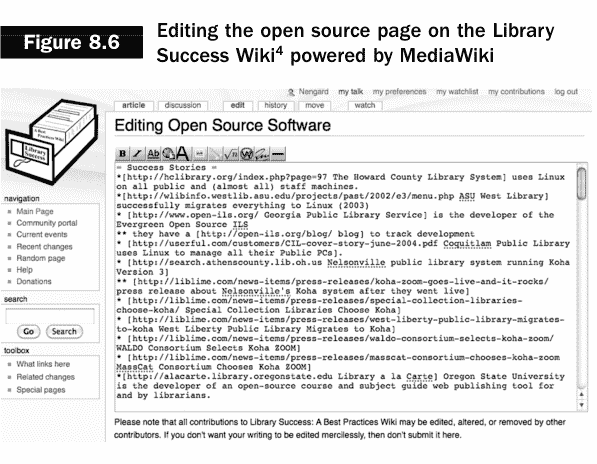

请注意，对“Library Success”的所有贡献都可能被其他贡献者编辑、更改或删除。如果你不希望你的内容被编辑或修改，请不要在此提交。

112

## 结论

这些 Web 应用程序只是管理图书馆网站的可用开源方案的一个小样本。关键是在做选择之前尝试几个选项，并始终记得联系世界各地的同事，看看他们如何使用这些应用程序、为什么选择它们，以及他们是否对选择感到满意。还请记住开源 CMS (http://opensourcecms.com) 以及类似的平台。

## 适用于图书馆的开源软件

## 你现在对 Greenstone 怎么看？

它是一个稳健、可靠的产品。

## 你图书馆的其他人对 Greenstone 怎么看？

在我们选择使用 Greenstone 的地方，他们非常满意。然而，由于其他工作任务的限制，我们还没有进行定制开发。

全文使用了国际 Unicode 字符集，因此可以任何语言和字符编码的文档（事实上，Greenstone 可以自动检测大多数文档的语言和编码）。阿拉伯语、中文、西里尔语、英语、法语、西班牙语、印地语和毛利语的文档集已公开。新西兰数字图书馆网站（http://nzdl.org/）托管了其中许多内容，Greenstone 网站也链接了包含更多示例的站点。

如果一个合集的内容是中文或俄语，但其支持性文本——说明、导航按钮、标签、图像、帮助文本等——却是英语，将是毫无意义的。因此，整个 Greenstone 界面已翻译成多种语言，用户可以在从“偏好”页面浏览时更改界面。

除了组织多媒体合集的自由度外，Greenstone 还提供了界面和元数据格式的自定义。默认情况下，Greenstone 的用户界面具有非常简洁的外观，但许多图书馆出于品牌考虑，希望他们的数字图书馆网站看起来更像他们传统的图书馆网站（见图 9.2）。要了解进行了哪些类型的定制，您可以查看 Greenstone 官方网站（http://www.greenstone.org/examples）上的示例合集列表。怀凯托大学

## 开源合集

## 图 9.2 怀凯托大学网站上的《插图伦敦新闻报》 ²

1842 年 - 1902 年间的新西兰内容

| 帮助引用 | 日期 | 页码 |
| :--- | :--- | :--- |
| | | 439 (11 页) |

奥克兰陆的人口普查显示，在过去的十年中人口增加了 350%，从 10,000 人增加到 36,000 人。1890 年的牛数量仅为 40,000 头，在 1871 年达到顶峰。1846 年发生在惠灵顿附近的哈特河因土地问题引发暴力冲突，导致人员和财产损失。羊的数量从 275,000 头增加到 522,000 头，马增加到 1600 头。劳动力数量的增加缓解了劳动力短缺。

该大学在 Greenstone 管理其《插图伦敦新闻报》数字档案（http://digital.lib.waikato.ac.nz）；见图 9.2。

## 机构库

虽然 Greenstone 可用于任何类型的数字集合，但涉及到存储由机构内部发布的数据时，DSpace（http://dspace.org）似乎是一个受欢迎的选择。

DSpace 软件最常见的用途是学术和研究型图书馆作为开放库，管理其教职工和学生的产出。也有许多机构使用该软件来托管和管理基于主题、数据集或基于媒体的库。

不，但我们很幸拥有处理此类项目所需的人员。

### 从专有切换到开源的过程是怎样的？

我们没有从专有软件切换。我们从一开始就开始使用开源软件建立库。我们的部门——桌面网络服务部，在使用开源软件方面非常有经验。

### 在安装、迁移或设置 DSpace 时你得到过帮助吗？

我们的系统管理员在其中一台图书馆服务器上安装了 DSpace，我们这里的一位技术水平丰富的图书员对其进行了配置。他们使用了 DSpace 网站上的现有文档，在实施过程中没有遇到困难。DSpace 邮件列表为他们在那期间遇到的问题提供了解答。

## 你现在对 DSpace 怎么看？

我们对这个系统非常满意。部分原因是因为 DSpace 用户社区以及正在创建的升级和插件。它们满足了库管理员和系统用户的需求。

## 你图书馆的其他人对 DSpace 怎么看？

大多数人都非常支持。他们理解机构库的必要性。我们的一些管理员非常积极推广这项服务。

除了能够存储各种不同类型（文档、图像、视频、音频录制等）的内容外，DSpace 还提供了一系列插件（http://dspace.org/add-ons-and-extensions/addons/）来扩展应用程序的功能。以真正的开源方式来看，DSpace 还允许对外观、感受和元数据格式进行自定义（见图 9.3）。

## 适用于图书馆的实用开源

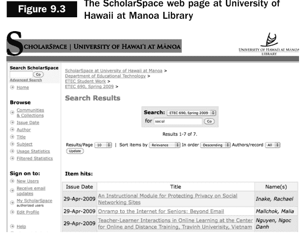

与 Greenstone 一样，DSpace 也允许创建多个不同的合集，用户可以进行浏览或搜索。这种灵活性是开源应用程序的标志，也是该程序成为许多机构选择的原因之一。

## 社区构建合集

Greenstone 和 DSpace 是与外部世界分享数字集合的成熟工具，但外部世界如何与我们分享他们的合集呢？Kete (http://kete.net) 允许图书馆让社区添加内容。

### 9.3 现实世界中的开源：Kete

Joann Ransom，代理馆长
Horowhenua 图书馆
新西兰莱文

### 你们为什么决定在图书馆使用 Kete？

在 2005 年，我们对地区内的艺术、文化资源进行了审计。我们发现大量私有手中的材料，“床下的箱子”就是我们看待它们的方式。我们需要一个让公众能够添加内容的数字存储库。

### 你们在图书馆是如何使用 Kete 的？

- 1. Kete 为我们的遗产部门提供了一种将其集合数字化并公开的方式，而不损害原始件。
- 2. Kete 还让我们能够全天候数字化我们的收藏。
- 3. 它让以前隐藏或私有的内容变得可用。
- 4. Kete 是我们图书馆极佳的营销工具。我们进行了大量的公开演讲，解释小组和组织如何使用 Kete 进行搜索和贡献。
- 5. Kete 为我们提供了吸引人们进入图书馆并教授他们 技能的理由。我们定期举办工作坊，让志愿者在下班后将照片收藏数字化。

### 适用于图书馆的实用开源软件

### 你们在图书馆使用 Kete 有多久了？

我们在 2006 年下半年开发了 Kete，并在 2007 年 3 月进行了软启动，这让我们在正式发布前获得获得了一些“种子内容”。

## 你现在对 Kete 怎么看？

很爱它——每当我向人们分享并看到他们的反应时，我都会再次爱上它。

# 你的图书馆其他人对 Kete 如何看？

那些接受该项目、投入资源在社区中进行推广，并积极鼓励和支持内容创建的人，从 Kete 中获得的远比那些期望它自动生成内容的人多。建立一个在线社区需要时间和精力。我确保回复每一个新贡献者，并通过评论对他们向 Kete 的添加表示感谢，提出温和建议或编辑掉明显的错误。我也喜欢通过将提交的内容设为首页特色主题来庆祝它们。Kete 并不是万灵妙药，但它是一个极佳的借口，让你去与镇上的每一个组织、俱乐部和社区小组交流——并在此期间建立一个出色的本地资源。

Joann Ransom 写了为这个社区建设数字图书馆选择“Kete”作为名称的过程：

> 呼应毛利人关于代表知识的三个篮子（kete）的谚言，我们将我们的概念命名为 Kete。我们非常喜欢 kete 所代表的意义。我们喜欢它们是“诚实的”、实用的物品，由发现的材料编织而成，而且任何人都可以学会编织一个。我们喜欢它们由亚麻制成，亚麻生长于大地母亲 Patapatuanuku。我们喜欢亚麻与编织者之间的联系——那个抚摸并塑造亚麻将其制成美丽或有用物体的人。我们喜欢 kete 通常是由一个人送给另一个人的，因此将人们联系在一起，而且它们通常是为了纪念某个场合而赠送的，因此围绕一个 kete 有许多故事。当 kete 被使用并从一个场合带到另一个场合时，故事正在被述说，历史正得以保留。kete 是我们数字图书馆及其包含的各种材料的恰当比喻。4

# 图书馆实用开源软件

通过 Kete，图书馆可以在其服务器上安装软件，然后向社区成员开放添加内容的工具。托管 Kete 实例的图书馆可以定义谁是“社区成员”。如果你在公共图书馆工作，你的社区可以是任何持有借卡的人，或者是世界上任何地方的人。如果你在学术或学校图书馆，你的社区可能只由学生和教授组成。

社区决定向数字图书馆添加什么类型的内容（见图 9.4）。这是收集读者藏在阁楼里的所有宝藏的绝佳方法。家庭历史的碎片每天都在流；有了这样的工具，社区成员可以分享他们的宝藏而无需将其让给图书馆。Kete Horowhenua (http://horowhenua.kete.net.nz) 是社区如何聚集在一起分享历史的完美示例。Kete Horowhenua 是一个由社区成员管理的数字资源集；见图 9.4。

## 知识的篮子

在图书馆和社区之间，有很多值得与他人分享的精彩集合。这些工具中的一个或全部可用于通过图书馆网站向更广泛的世界开放集合。

## 笔记

- 1. Witten, Ian H., Matt Jones, David Bainbridge, Polly Cantlon, and Sally Jo Cunningham. ‘Digital Libraries for Creative Communities.’ Digital Creativity 15, no. 2 (2004年6月): 110–125.
- 2. 见 http://digital.liby.waikato.ac.nz.
- 3. ‘DSpace 用例示例.’ DSpace. http://dspace.org/use-case-examples/DSpace-Use-Cases.html.
- 4. Ransom, Joann. ‘Kete Horowhenua: 由其人民讲述的地区故事.’ Kete.net.nz, 2008年2月. http://kete.net.nz/blog/documents/show/33-kete-horowhenua-the-story-of-the-district-as-told-by-its-people.

# 开源研究工具

除了数字集合，图书馆还有许多其他资源来分享主题。许多图书馆网站提供特定主题的链接列表、学科指南和在线研讨会，以帮助教育他们的读者。与图书馆的其他任何领域一样，也有开源技术帮助我们高效地提供这些指南和课程。

## 学科指南

在我图书馆的第一份工作中，我负责管理图书馆的研究收藏。我们网站的这个区域与学术图书馆所谓的“学科指南”的页面非常相似。无论你如何称呼它们，如果不使用正确的工具，维护这些页面将非常枯燥。在我的图书馆，我们只是使用一系列静态 HTML 页面，必须定期更新，这种做法在世界各图书馆并不少见。

图书馆创建的用于解决问题的两个开源工具是 SubjectsPlus (http://www.subjectplus.com) 和 Library à la Carte™ (http://alacarte.library.orestate.edu)。

### 10.1 现实世界中的开源：SubjectsPlus

Bryan P Carson，电子服务图书员及语言学院技术联络员
Middlebury 学院
Middlebury VT. USA

**你为什么决定在你的图书馆中使用 SubjectsPlus？**

它是开源的。它易于实施、轻量级且由数据库驱动，并与其他平台良好集成。

**你如何在图书馆中使用 SubjectsPlus？**

我们用它来制作图书馆学科指南，并将图书员的联系信息与特定学科的内容相关联。我们还将其用于 EZ 资源。

**你在图书馆中使用 SubjectsPlus 多久了？**

我们从 2007 年 11 月开始使用。

**在实施 SubjectsPlus 时遇到过困难吗？**

并没。Andrew Darby（首席开发者）非常有帮助。

**你现在觉得 SubjectsPlus 怎么样？**

我觉得它非常棒。现在我们有了大量的记录，SubjectsPlus 的分发能力让我们能够快速创建指南。

**你的图书馆其他人对 SubjectsPlus 如何看？**

每个看到界面的人都喜欢它的外观、感觉和易用性。此外，内容创建者发现它很容易使用。

**关于 SubjectsPlus 或你的切换过程还有什么想知道的吗？**

如果你要实施 SubjectsPlus，你必须精通 HTML 和 CSS。你必须掌握基础 PHP 并知道如何管理 MySQL 数据库。这些技能用于定制和安装。除了服务器设置，大部分工作都是我自己完成的。任何“技术大牛”都能做到。

**在安装、迁移或设置 SubjectsPlus 时得到过帮助吗？**

我们的网络管理员为它设置了服务器，所以它不会带来安全问题。我们的一位网页程序员检查了代码中明显的安全问题并回回给了 Darby。所有的定制和其他微调都是我完成的。

**从商业软件切换的过程是怎样的？**

我们发现商业软件虽然昂贵，但能节省员工时间。成本降低了。用户满意度提高了。我们能够满足用户的需求。我们的网页程序员为网站创建了馈送。从商业软件切换受到了热烈反响。

# 了解更多

在 Middlebury 查看 SubjectsPlus 的运行情况：http://www.middlebury.edu/academics/lib/research/db-subject.

SubjectsPlus 由 Ithaca 图书馆开发，作为图书员方便组织和展示数据的方法（见图 10.1）。它允许存储学科指南、A–Z 列表以及带有专长的员工列表。所有这些都发布在网上，使其

图 10.1 Ithaca 图书馆制作的计算机科学研究指南

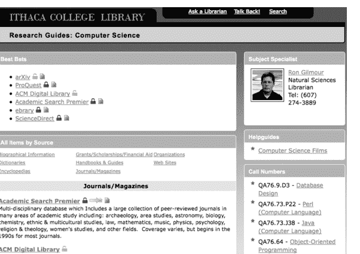

开源研究工具

更更容易研究特定主题，例如计算机科学（http://www.ithacacalibrary.com/sp/subjects/cs/）。

管理静态 HTML 页面的一个问题是，你通常希望链接出现在多个页面上，但这意味着在更新时，你需要在多个地方进行查找。SubjectsPlus 允许你只需向系统添加一次资源，它就会出现在多个指南中。SubjectsPlus 还允许你将每位学科馆员与一位“专家”关联起来，这样读者对他们正在研究的主题有额外问题时，就知道在图书馆或校园内应该联系谁了。

来自俄勒冈州立大学图书馆的 Library à la Carte™ 是使用静态 HTML 页面制作你主题指南的另一种替代方案。与 SubjectsPlus 类似，它允许轻松创建动态主题指南。与 SubjectsPlus 不同，Library à la Carte™ 不处理你的 A–Z 列表和员工目录，但它允许你创建课程页面和教程。

### 10.2 现实世界中的开源：Library à la Carte™

| Kim Griggs，程序分析师；Margaret Mellinger，科学馆员；Jane Nichols，社会科学/人文馆员。美国俄勒冈州科林瓦斯，俄勒冈州立大学图书馆。 |

**你们为什么决定在图书馆中使用 Library à la Carte™？**

在我们开发 Library à la Carte™ 期间，市场上只有少数软件产品可以创建图书馆课程和主题网页。我们评估了现有的产品，认为那些“面向图书馆的实用开源软件”并没有像我们预期的那样样，满足向指南中添加 Web 2.0 功能的需求。LibGuides 当时尚未推出。因此，我们转而开发了一个内部解决方案。

**你们在图书馆是如何使用 Library à la Carte™ 的？**

学科馆员使用它来创建和管理课程作业页面以及主题指南。教学馆员正在使用它来构建教程。

**你们在图书馆使用 Library à la Carte™ 有多久了？**

自 2006/07 年作为交互式课程作业页面（ICAP）工具的最初版本以来。

**从专有软件转向开源的过程是怎样的？**

我们之前的做法是使用 Dreamweaver 和 Contribute 模板用 html 创建课程和主题页面。转换过程主要是为了理解网络内容管理系统的运作方式与使用 html 模板何不同。馆员需要培训以充分利用 Library à la Carte™ 的所有功能。当馆员将内容移动到 Library à la Carte 时，他们在呈现这些内容方面有了更多选择。

**你们现在怎么看 Library à la Carte™？**

我们喜欢它，并计划继续开发它。我们目前的重点是使用它制作教程，并通过云计算环境托管 Library à la Carte™。

**你们图书馆的其他人对 Library à la Carte™ 怎么说？**

反馈是积极的，馆员和图书馆管理员参与并支持它的持续开发。

**关于 Library à la Carte™ 或你们切换到 Library à la Carte™ 的过程，还有什么想知道的吗？**

自 2007 年发布以来，源代码已被下载了数百次。该工具目前正被我们所知的 20 多家图书馆使用：里德学院、波特兰社区学院、加利福尼亚州立大学（多个校区）、亚利桑那大学、蒙特利尔大学和谢菲德哈拉姆大学。

Library à la Carte™ 为你的员工提供了一种易于管理专业领域指南的方法，而无需任何网页设计或开发知识（见图 10.2）。在 Library à la Carte™ 管理区域，你可以通过点击“创建新主题指南”链接来轻松创建你的指南。你的指南可以由多个标签组成，每个标签都包含信息。像 SubjectsPlus 一样，你需要选择一个专家并包含他们的信息，以便研究人员能够轻松找到合适的人来提问。一旦页面创建完成，你只需点击“发布”按钮，你的页面就会出现在图书馆的网站上（见图 10.3）。

10.2 Library à la Carte™ 管理区域

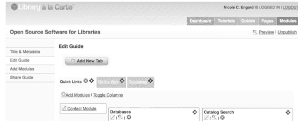

图 10.3 一个基于开源软件的 Library à la Carte™ 主题示例

面向图书馆的开源软件

馆员导出：Nicole C. Engard

| RSS | 网络链接 | 网页链接 |
| :--- | :--- | :--- |
| 图书馆中的开源：调查结果第 2 部分 [开源] 2013/05/24 | 面向图书馆的实用开源办公时间：上午 7 点-下午 6 点 | |
| 让图书馆学习如何使用开源软件来源及 | 开源供应商可能支持供应商广告 | |
| 图书馆中的开源：调查结果第 3 部分 [开源] 2013/05/24 | 一个可使用的免费工具 |
| 图书馆中的开源：调查结果第 3 部分 [开源] 2009/10/02 | | |

关于指南
本指南提供了资源，帮助你了解更多关于图书馆开源软件的信息。

那么，如何在这两者以及许多其他可用方案之间进行选择呢？尝试它们；两者都提供了尝试演示的选项。看看哪一个最符合你图书馆的需求。正如书中提到的许多开源产品一样，SubjectsPlus (http://groups.google.com/group/subjectsplus) 和 Library à la Carte™ (http://carte.library.oregonstate.edu/forum) 也是如此。

所以，你们如何在这两者以及许多其他可用方案之间进行选择呢？尝试它们；两者都提供了尝试演示的选项。看看哪一个最符合你图书馆的需求。正如书中提到的许多开源产品一样，SubjectsPlus (http://groups.google.com/group/subjectsplus) 和 Library à la Carte™ (http://carte.library.oregonstate.edu/forum) 也是如此。

### 10.3 现实世界中的开源：工具

er

### 10.3 现实世界中的开源：工具

| Kim Griggs，程序分析师；Margaret Mellinger，科学馆员；Jane Nichols，社会科学/人文馆员。美国俄勒冈州科林瓦斯，俄勒冈州立大学图书馆。

**你们为什么决定在图书馆中使用它？**

在我们开发它的期间，市场上只有少数软件产品可以创建图书馆课程和主题网页。我们评估了现有的产品，认为那些产品并没有像我们预期的那样，满足我们向指南中添加 Web 2.0 功能的需求。LibGuides 当时尚未推出。因此，我们转而开发了一个内部解决方案。

**你们在图书馆是如何使用它的？**

学科馆员使用它来创建和管理课程作业页面和主题指南。教学馆员正在使用它来构建教程。

**你们在图书馆使用它有多久了？**

自 2006/07 年作为交互式课程作业页面（ICAP）工具的最初版本以来。

**从专有软件转向开源的过程是怎样的？**

我们之前的做法是使用 Dreamweaver 和 Contribute 模板用 html 创建课程和主题页面。转换过程主要是为了理解网络内容管理系统的运作方式与使用 html 模板何不同。馆员需要培训以充分利用它的所有功能。当馆员将内容移动进去时，他们在呈现这些内容方面有了更多选择。

**你们现在怎么看它？**

我们喜欢它，并计划继续开发它。我们目前的重点是使用它制作教程，并通过云计算环境托管它。

**你们图书馆的其他人对它怎么说？**

反馈是积极的，馆员和图书馆管理员参与并支持它的持续开发。

**关于它或你们切换到它的过程，还有什么想知道的吗？**

自 2007 年发布以来，源代码已被下载了数百次。该工具目前正被我们所知的 20 多家图书馆使用：里德学院、波特兰社区学院、加利福尼亚州立大学（多个校区）、亚利桑那大学、蒙特利尔大学和谢菲德哈拉姆大学。

它为你的员工提供了一种易于管理专业领域指南的方法，而无需任何网页设计或开发知识（见图 10.2）。在管理区域，你可以通过点击“创建新主题指南”链接来轻松创建你的指南。你的指南可以由多个标签组成，每个标签都包含信息。像 SubjectsPlus 一样，你需要选择一个专家并包含他们的信息，以便研究人员能够轻松找到合适的人来提问。一旦页面创建完成，你只需点击“发布”按钮，你的页面就会出现在图书馆的网站上（见图 10.3）。

10.2 管理区域

图 10.3 一个基于开源软件的主题示例

面向图书馆的开源软件

馆员导出：Nicole C. Engard

| RSS | 网络链接 | 网页链接 |
| :--- | :--- | :--- |
| 图书馆中的开源：调查结果第 2 部分 [开源] 2013/05/24 | 面向图书馆的实用开源办公时间：上午 7点-下午 6 点 | |
| 让图书馆学习如何使用开源软件来源及 | 开源供应商可能支持供应商广告 | |
| 图书馆中的开源：调查结果第 3 部分 [开源] 2013/05/24 | | |
| 图书馆中的开源：调查结果第 3 部分 [开源] 2009/10/02 | | |

关于指南
本指南提供了资源，帮助你了解更多关于图书馆开源软件的信息。

那么，你们如何在这两者以及许多其他可用方案之间进行选择呢？尝试它们；两者都提供了尝试演示的选项。看看哪一个最符合你图书馆的需求。正如书中提到的许多开源产品一样，SubjectsPlus (http://groups.google.com/group/subjectsplus) 和 Library à la Carte™ (http://carte.library.oregonstate.edu/forum) 也是如此。

## 开源研究工具

reSearch 是由西蒙弗莱泽大学图书馆开发的，旨在帮助小型和贫困图书馆降低电子资源管理领域的门槛。reSearch 套件中提供的工具让用户访问电子资源，而无需支付与服务相关的常规许可费用。

reSearch 包含了用于期刊管理的 CUFTS (http://researcher.sfu.ca/cfts)、用于联合检索的 GODOT (http://researcher.sfu.ca/godot) 和 dbWiz (http://researcher.sfu.ca/dbwiz)，以及用于管理期刊标题和出版商开放数据库的 [Open-knowledge-base](http://researcher.sfu.ca/openkb)（开放知识库），该数据库将在 CUFTS 中使用（见图 10.4）。

reSearch 套件中包含的每个工具都旨在与其他工具协同工作，为所有相关人员提供更好的服务。

西蒙弗莱泽大学图书馆技术与运营管理的 CUFTS 页面

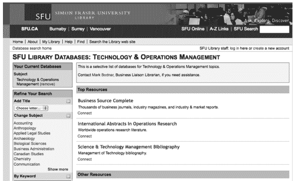

Kevin Stranack 在其对 reSearcher 套件的精彩概述中写道：

从早期开始，reSearcher 及其前身就依赖于图书馆的合作精神、创新能力和领导力，以及他们愿意在人员和资金方面整合有限的资源，以为客户创建更好的技术和。。reSearcher 的协作精神延续到今天，这得到了两个主要图书馆联盟 COPPUL 和 BCELN 的持续支持，以及各个图书馆愿意为新倡议提供启动资金，这些新倡议将增强项目并最终造福更广泛的图书馆社区。reSearcher 是开源和图书馆协作价值的一个重要示例.¹

若想了解更多关于该套件以及每个模块如何相互作用的信息，我强烈建议你阅读 Kevin 的文章以及 reSearcher 官方网站 (http://researchers.sfu.ca/documents) 上列的其他文章。

## 在线课程管理

随着越来越多的教育材料可以在网上获取，图书馆需要开始思考新模式，通过图书馆使用、新技术、研究实践以及许多其他主题来教导读者。在困难时期，我们看到人们可能更倾向于转向图书馆免费访问互联网、免费获取求职材料以及免费参加研讨会⁴。此同时，图书馆也面临着同样的经济困境，因此提供额外的免费服务可能是困难的。

一种在不需要过多投资且无需在图书馆提供更多空间的情况下为读者提供额外福利的方法是开始提供在线研讨会。Moodle (http://www.moodle.org) 是一个开源课程管理系统，可帮助管理你的课程材料、在线讲座、研究参考文献等内容。

### 10.4 现实世界中的开源：Moodle

Georgia Katsarou，图书管理员
希腊和地中海研究国际中心及雅典学年学院图书馆
希腊，雅典

**你们为什么决定在图书馆使用 Moodle？**

我们想使用课程管理系统，以便为我们的教职工提供更实时的教学设施，并促进教职工与学生之间的交流。我们的 IT 支持建议使用 Moodle，因为他们熟悉它，并且知道它运行良好且符合我们的需求。

**你们在图书馆是如何使用 Moodle 的？**

我们是管理员，简而言之，我们创建新课程、更新数据、添加和删除资源、创建和删除用户账户、为用户分配角色，并培训教职工如何使用它。

**你们在图书馆使用 Moodle 有多久了？**

两年。

**你们在图书馆实施 Moodle 时遇到过困难吗？**

没有。

**你们在安装、迁移或设置 Moodle 时得到过任何帮助吗？**

我们的 IT 支持完成了安装。由于我们之前没有课程管理系统，所以不需要进行数据迁移。

我负责设置，只在一次我想增加文件上传大小限制时请求过一次 IT 部门的帮助。它非常易用，而且提供的文档清晰且全面。

**你们现在对 Moodle 怎么看？**

它是一个非常优秀且实用的软件，具有实用且易于使用的功能。到为止，我们没有遇到过任何问题，我很惊讶我们没有因为 Bug 遇到任何问题。绝对向其他用户推荐它。

**你们图书馆的其他人对 Moodle 怎么看？**

大家似乎对它很满意。重要的是，他们不需要花大量时间来学习如何使用它。

**关于 Moodle 或你们切换到 Moodle 的过程，还有什么想知道的吗？**

就像任何开源应用一样，管理员必须彻底阅读文档。

通过 Moodle，图书管理员可以创建与他们社区相关的主题课程，并提供信息的在线访问（见图 10.5），例如，他们可以举办一系列关于困难时期房地产的研讨会。图书管理员可以同时在图书馆和在线举办研讨会，或者完全在线（这样图书馆就不需要提供大型公共会议空间）。

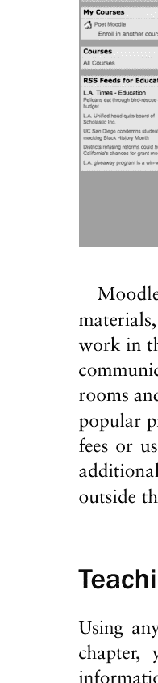

Moodle 允许教师上传材料、链接和课程表，以便学生可以在自己的时间学习。它还让学生方便地使用聊天室和留言板进行交流。所有这些服务在热门产品中都能找到，但不需要额外的许可费用。

## 教导我们的读者

使用本章列出的任何一种（或组合）工具，你的图书馆都可以提供更方便的信息获取方式。与其为你最新的研讨会打印讲义，为什么不在信息存储在网上让参会者自己查看呢？在图书馆，我们经常陷入成规。我们继续做一直以来做的事情是因为我们不知道有更好的选择。现在你了解了四种可以协助提供信息的开源工具。

## 注释

- 若想了解更多关于研究链接，可以阅读我的文章《沿着黄砖路通往简化管理》，网址为 http://www.web2learning.net/publications/following-the-yellowbrick-road-to-simplified-management。
- 参见 http://cufts.lib.sfu.ca/CRDB/BVAS/browsefacets/594。
- Stranack, Kevin. 'The researcher Software Suite: a case of library collaboration and open source development.' Serials Librarian 55, no. 2 (2008): 117–139.
- Rettig, Jim. 'Libraries Stand Ready to Help in Tough Economic Times.' The Huffington Post, December 11, 2008. http://www.uffingtonpost.com/jim-rettig-libraries-stand-ready-to_b_150268.html.

## 开源图书馆自动化

我记得我的图书馆第一次引入自动化目录时，那是一台带有亮绿色文字的黑屏电脑。令我惊讶的是，我现在可以搜索我想要的书籍，而不需要翻阅卡片目录。从那时以后，我们进步了很大，有了许多选择。最近变得更可行的选择之一是开源集成图书馆系统。

## Scriblio

第一个进入网络的大型开源 OPAC 是 WPopac，现在称为 Scriblio (http://scriblio.net)，它

《图书馆实用型开源软件》

由 Casey Bisson 在 2006 年就职普普茅斯州立大学拉姆森图书馆期间开发。¹Scriblio 吸收了 WordPress 内容管理系统的功能，并将在线公共书检索目录（OPAC）整合到其中。使用 Scriblio 的图书馆只需使用 WordPress 设计其整个图书馆网站，读者就可以从图书馆首页搜索书籍（见图 11.1），而完全察觉不到自己已经离开了图书馆网站进入了 OPAC。

| 11.1 现实世界中的开源：Scriblio |
| :--- |
| Brett Bonfield，Collingswood 公立图书馆院长，美国新泽西州科林斯伍德 |

### ### 为什么你决定在图书馆中使用 Scriblio？

对我来说，最初决定使用 Scriblio 以及一直坚持使用它的决定，既是困难的，又显而易见的。我非常喜欢使用 WordPress 并对它非常熟悉——在参加目前工作的第一次面试之前，我就创建了一个非常基础的 Scriblio 站点，设置它只用了几个小时——而且我非常喜欢 Casey Bisson 这个人以及他的 Web开发者：我们对图书馆的愿景非常相似。例如，Scriblio 创建了统一的网站：对于使用 Scriblio 的图书馆，目录和网站的其他部分看起来完全一样，并且运行在完全相同的软件上。最终促成合作的是 Scriblio 获得资金的能力，以及它决定将部分资金用于 CollingswoodLib.org（以及类似的图书馆）的免费托管服务。

### ### 你们在图书馆是如何使用 Scriblio 的？

作为我们的网站。

### ### 你在图书馆中使用 Scriblio 多久了？

网站已经上线快一年了，尽管我大约在 18 个月前就开始接触 Scriblio（与其开发者 Casey Bisson 合作）。

### ### 你在图书馆实施 Scriblio 时遇到过困难吗？

确实遇到过问题。其中很多已经解决了，但还有几个悬而解决的问题。

### ### 从专有切换到开源的过程是怎样的？

我们并没有真正切换。Millennium 仍然在那里，包括它的网页 OPAC 接口。Scriblio 只是对它的补充。

### ### 你们在安装、迁移或设置 Scriblio 时得到过帮助吗？

我直接与主开发者 Casey Bisson 合作。

### ### 你对 Scriblio 怎么看？

Scriblio 并不完美，但我用起来很舒服，并对它的发展方向感到兴奋。虽然如果有更大的开发者社区、更多内部对标准的关注以及更好的文档，我会更得开心心，但我有能力帮助实现这些改变。

### ### 你们图书馆的其他人对 Scriblio 怎么说？

很多人喜欢它；也有人更倾向于旧系统。德威说：大多数深入了解它的人对它产生了好感。而其他地方的人想要一个像 Google 一样工作的网站，以及一个像巴诺书（Barnes & Noble）一样工作的书架系统。

### ### 关于 Scriblio 或你们切换到 Scriblio 的过程，还有什么想知道的吗？

我在这里写了一篇关于我决定的文章：http://www.inthelibrarywiththeleadpipe.org/2009/we-b-s-i-t-e-find-out-what-it-means-to-me/。

## 图馆实用型开源软件

## 图 11.1 科林斯伍德公立图书馆的 Scriblio

| 首页 | 浏览 | 联系 | 活动 | 朋友 | 研究 | 图籍、电影等 | 搜索 |
|---|---|---|---|---|---|---|---|

科林斯伍德公立图书馆
科林斯伍德（新泽西州）公立图书馆的网站和目录

浏览我们的馆藏
我们有 19 个包含以下所有术语的项目：

- 主题：“图书馆”（4)

点击 (a) 展开术语，或使用侧边栏的分类（facets）缩小搜索范围。结果如何？结果按添加到收藏的日期排序。

美国国会图书馆：美国记忆

> Carol M. Highmith 和 Ted Landclair（James H. Billington 序言）
书籍，出版，1994

标签 美国国会图书馆：历史，国家图书馆
Highmith, Carol M., 1996 - Landclair, Ted, 1992

可用性

开放时间
周一至周五：上午 9:30 至晚上 8:30
周六：上午 9:00 至下午 3:30
周日：中午 12:00 至下午 5:00

按主题缩小
可用资源
档案资源
书籍数字化中心
国会数字版
德威 (Cal) 家族史
谱系
历史 历史
图书馆建筑
图书馆建筑

美国国会图书馆
密苏里大学
儿童图书馆资源 Mackenzie
博物馆 国家
图书馆 私立图书馆

## VuFind

开源 OPAC 版本于 2007 年随 VuFind（http://www.vufind.org）发布。VuFind 由维乡村大学发布，“旨在通过支持个性化和社交网络服务（如标签和点对点评论共享）来能用户”，¹² 其简单的界面在 OPAC 批评者中变得非常流行（见图 11.2）。

## Blacklight

在 VuFind 发布后不久，Blacklight（http://rubyforge.org/projects/blacklight/）问世。发布于 2008 年³

## 图 11.2 维拉尼亚大学 Falveyl 纪念图书馆的 VuFind

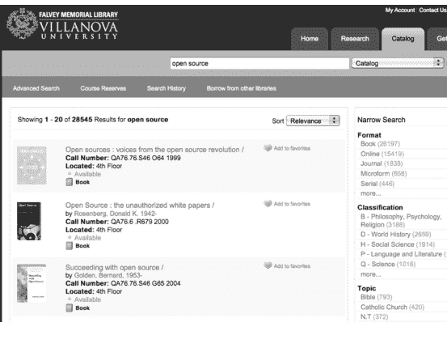

## 11.2 现实世界中的开源：VuFind
| :--- |
| Joel Harbottle, LCG, 澳大利亚朗斯斯顿 |

### ### 为什么你决定在图书馆中使用它？

我们决定使用 VuFind 是因为我们发现它比我们的 OPAC 界面更简单。

### ### 你们在图书馆是如何使用 VuFind 的？

我们使用 VuFind 作为主要的 OPAC，它是与图书馆管理系统（LMS）一起的。

### ### 你在图书馆中使用 VuFind 多久了？

VuFind 在我们图书馆已经有了一年半了。

### ### 你在图书馆实施 VuFind 时遇到过困难吗？

没有，我们在图书馆实施 VuFind 没有遇到任何困难。大部分工作是对我们的……进行一些更改。

### ### 从专有切换到开源的过程是怎样的？

我们切换到 VuFind 的过程并不复杂。因为我们的 LMS 不是专有系统，我们使用的是 Evergreen，这是一个开源的图书馆系统（ILS）。

### ### 你们在安装、迁移或设置 VuFind 时得到过帮助吗？

没有，我们在安装、迁移或设置 VuFind 时没有得到太多帮助。但在过程中，如果我们理解某个部分，我们会经常参考 VuFind 网站。

### ### 你现在对 VuFind 怎么看？

今天，VuFind 出色的界面和极好的易用性依然让我们惊叹，就像我在 2008 年初看到它时一样。

### ### 你们图书馆的其他人对 VuFind 怎么说？

我们不断从图书馆读者那里获得 VuFind 及其易用性的反馈。

### ### 关于 VuFind 或你们切换到 VuFind 的过程，还有什么想知道的吗？

我会向任何考虑使用 VuFind 的图书馆强烈推荐它，它是一个真正出色的 Web 2.0 OPAC。

Blacklight 是一个通过升级图书馆 OPAC 来改进图书馆服务的项目。Blacklight 建立在现有的集成图书馆系统之上，并以易于理解、具有视觉吸引力的界面将数据呈现给读者（见图 11.3）。

## 图 11.3 弗吉尼亚亚大学图书馆的 Blacklight

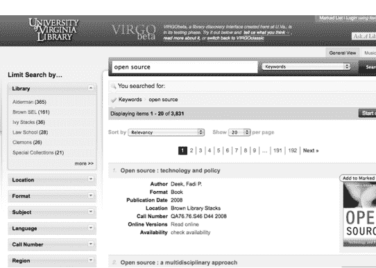

# 11.3 现实世界中的开源：Blacklight

Tom Kramer，数字图书馆系统与服务副总监
斯坦福大学图书馆与学术信息资源
美国加利福尼亚州斯坦福

## 为什么你们决定在图书馆中使用 Blacklight？

我们选择 Blacklight 是出于几个方面的考虑。

- 1. 技术策略和可维护性。斯坦福大学图书馆在2008年年底做了一项战略选择，采用 Ruby on Rails (RoR) 作为其面向终端用户的应用程序开发语言。到目前为止，我们对 RoR 和 Blacklight 的经验符合我们的预期。我们培训了六名没有 RoR 经验的开发者，他们在不到一个月内就成为了胜任的开发者，而且 Blacklight 的测试覆盖率超过了其代码库的 70%。

- 2. 架构、功能和特性集。Blacklight 展示了对三个关键功能的支持，我们认为这些功能对于下一代搜索应用至关重要。这些功能是：支持非 MARC 数据、针对特定对象的行为以及定制化视图。

- 3. 社区。Blacklight 拥有一个坚实的机构和专家核心群体，他们致力于并为代码库做出贡献。早期，弗吉尼亚大学该项目的主要利益相关者就表明，他们渴望接收来自其他机构和个人的代码贡献、想法和支持（多种形式）。这鼓励了我们自己采用 Blacklight，并给了我们信心：如果我们采纳它，我们就有机会进一步帮助完善公共代码库，而无需为我们所有的本地修改和增强承担长期支持。

## 你们在图书馆中是如何使用 Blacklight 的？

我们目前将 Blacklight 用于：

- 下一代目录系统（参见 http://searchworks.stanford.edu）
- 各种 Fedora 仓库的前端
- 专门数字图书馆应用的搜索、浏览和查看界面（例如，数字化的中世纪手稿）。

## 你们在图书馆中使用 Blacklight 有多长时间了？

我们于 2008 年12 月正式采用了 Blacklight。

## 你们在图书馆实施 Blacklight 时遇到过困难吗？

在采用 Blacklight 后的前三个三个季度里，我们与其核心提交者团队合作重构了代码库，使其更具移植性、测试更充分且功能更丰富。这项工作在 2009 年春季的 Blacklight 2.0 发布中达到了顶峰。在此工作之后，我们发现实施新的 Blacklight 实例是一项非常直观的任务。设置 Blacklight 实例最挑战的任务是设计和填充底层的 solr 索引。

## 从专有系统转向开源的流程是怎样的？

我们在采用开源软件方面有其他经验，这些经验是我们在决定采用 Blacklight 时对其社区、架构和可维护性给予如此高权重的关键因素。在支付了采用新技术（RoR）和新应用（Blacklight）的前期成本后，我们发现在一个开源代码库上工作是种解脱。我们的图书管理员员对新系统中数据和功能的工作方式提出了一些非常特殊的要求，而能够根据我们的需求对底层数据和应用程序进行操作，是一种极具成就感的体验，特别是与大多数专有系统相比时。

## 你们在安装、迁移或设置 Blacklight 时得到过任何帮助吗？

我们发现 Blacklight 开发者列表是获取技术支持的最佳资源（我们从贡献者那里获得了很多帮助）。

## 你们认为 Blacklight 怎么样？

它是一个优秀的工具，也是我们数字图书馆战略的核心部分之一。

## 你们图书馆的其他人对 Blacklight 怎么看？

他们很欣赏其特性集和灵活性，并渴望尽快添加更多功能和数据类型。

了解更多：

参见 http://searchworks.stanford.edu。

特别值得注意的是：

- 高级搜索功能（在斯坦福开发，很快将提交到公共代码库），可在 http://searchworks.stanford.edu/advanced 获取
- 索书号附近功能
- 实时可用性显示，在搜索结果页面上一目了所有物品的位置和状态。

## SOPAC2

最后，John Blyberg 和 Darien 图书馆于2008年发布了 SOPAC2 (http://thesocialopac.net)。^4 SOPAC2 比之前的两个选项更进一步，并遵循 Scriblio 模式，将 OPAC（在线图书检索系统）直接集成到内容管理系统中，区别在于 SOPAC2 是集成到 Drupal 而不是 WordPress 中。这意味着图书馆现在可以拥有无缝的外观和体验，读者可以同时搜索图书馆网站和 OPAC（见图 11.4）。

## 选择 OPAC

有四种免费开源 OPAC 供你选择，那么如何做选择呢？你的决定的一部分将取决于个人偏好，因为它们提供的服务非常相似。另一部分（这非常重要）是确定对于你特定的图书馆系统是否已经有了 OPAC 连接器。如果 OPAC 无法与之通信，它就无法……

> 图 11.4 Darien 图书馆的 SOPAC2

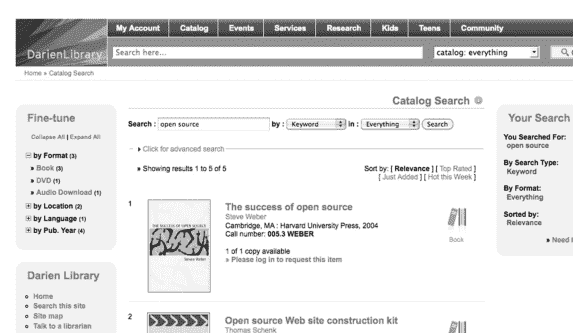

# 11.4 现实世界中的开源：SOPAC

John Blyberg，创新与用户体验助理总监
Darien 图书馆
美国康涅狄格州 Dari

## 为什么你们决定在图书馆中使用 SOPAC？

市场上不存在的产品能满足我们数字战略的要求，即把所有电子资源统一到一个单一的交互式门户中。

## 你们在图书馆中是如何使用 SOPAC 的？

我们将其作为完整的 OPAC 替代品，以及面向用户的额外在线服务。我们的员工还利用它进行馆藏发展、信息服务读者推荐。

## 你们在图书馆中使用 SOPAC 有多长时间了？

自 2008 年 9 月以来。

## 从专有系统转向开源的流程是怎样的？

非常简单。

## 你们现在觉得 SOPAC 怎么样？

我们喜欢它！

## 你们图书馆的其他人对 SOPAC 怎么看？

他们非常喜欢它！

供你选择。话虽如此，一直会有新的开发，如果你更喜欢其中某一个，只需联系开发者看看为你的图书馆系统编写连接器需要什么。这四种工具都提供了一个高效、易懂的搜索框。虽然我们图书管理员倾向于执行更复杂的搜索，但普通互联网用户喜欢 Google 模式，即关键词搜索。所有工具都考虑到了这一点。事实上，Scriblio 和 Blacklight 提供了单搜索框选项，因此没有高级搜索。⁵ SOPAC 提供了一个稍微高级的搜索页面，而 VuFind 提供了一个传统的图书馆搜索页面。虽然所有的搜索系统各不相同，但它们都提供了通过不同的标题和物品类型过滤结果的选择，从而轻松缩小到正确的子集。

除了简单的搜索界面外，所有选项都提供了文献记录和搜索结果的永久链接。这意味着作为图书管理员，你可以从浏览器地址栏复制 URL 发给读者。所有选项都考虑了现代网页功能，如 RSS 馈送和评论。VuFind 和 SOPAC2 更进一步，允许读者添加标签。SOPAC2 还允许读者对目录记录进行评分和评论。所有这些额外数据都存储在集成图书馆系统之外，以防干扰管理员提供的数据，同时让读者以更多方式对图书馆产生归属感。

# 开源一切

如果你的图书馆计划改变整个图书馆的集成图书馆系统体验，而不仅仅针对读者，那么开源集成图书馆系统可能是你的正确选择。目前市场上有两种主要的可能性：Koha (http://koha-community.org) 和 Evergreen

(http://open-ils.org)。除了这两个，还有许多其他值得关注的小项目。

# Koha

Koha 的开发始于 1999 年的新西兰。新西兰 Horowhenua 图书信托（http://www.library.org.nz）的成员决定，在外包集成图书馆系统开发后，他们希望将代码开源，供全球所有图书馆使用。2000年1月，Koha 的第一个版本发布¹¹十年后，该系统在全球已有至少 945 家图书馆在使用。²

## 11.5 现实世界中的开源：Koha

Owen Leonard，Web 开发人员
内尔逊维公共图书馆
美国俄亥俄州内尔逊维

**你为什么决定在你的图书馆中使用 Koha？**
当我们开始对正在使用的 ILS（集成图书馆系统）产生疑虑时，我们开始研究开源图书馆系统。我们对收到的支持质量感到失望。我们希望升级该系统，但他们告诉我们，如果想这样做，必须花费数千美元购买新硬件。

与此同时，我们还兴趣通过 OPAC（在线公共检索目录）向公众提供额外服务，并使用数据库中的数据。遗憾的是，这两者我们都无法轻松实现：没有自定义 OPAC 内容或外观的选项，也无法使用 MySQL 等常用工具连接到系统的数据库。

当时，Koha 是可用最成熟的开源 ILS，其社区也非常活跃且乐于助人。当我们查看为了切换到该系统而它必须满足的服务列表时，Koha 并没有满足所有要求，但我们知道自己有能力将其变成我们想要的样子。

## 你们在图书馆是如何使用 Koha 的？

我们使用了 Koha 的所有功能，仅有几个例外：采购、连续期刊管理和原始书目编目。从历史角度来看，采购和连续期刊管理不是我们之前付费的商业 ILS 的组成部分，因此我们在迁移到 Koha 时，工作流并未包含这些方面。然而，随着 Koha 中连续期刊管理的改进，它作为我们的一种可行解决方案正变得越来越具有吸引力。

## 你们在图书馆使用 Koha 多久了？

我们于 2003 年 9 月 2 日正式上线 Koha。

## 你们在图书馆实施 Koha 时遇到“困难”了吗？

无论我们在实施 Koha 时遇到了什么“困难”，我们都是在充分理解任务的情况下面对的。当我们决定迁移到 Koha 时，软件尚未达到 2.0 版本。我们知道在切换之前，我们必须赞助添加 MARC 支持。我们知道我们将不得不手动进行一些数据导入，并修复一些漏洞。

## 从专有到开源的切换过程是怎样的？

从专有供应商系统切换到开源系统的过程是正确的决定。我们当时使用的软件并不方便我们导出数据。当需要导出某些数据时，我们尝试使用系统中的某一个工具，但它并不起作用。我们联系了供应商询问为什么它坏了，他们告诉我们：“你付钱是让我们开启那个功能的。”

适用于图书馆的实用开源软件

## 你们在安装、迁移或设置 Koha 时有得到任何帮助吗？

我们都是由内部员工完成的，并经常得到 Koha 邮件列表和 IRC 通道的支持。

## 你们现在觉得 Koha 怎么样？

Koha 对我们来说继续运行良好。我们非常喜欢直接访问数据库来执行自定义报告。能够发现漏洞、开发修复程序并提交包含在下一个版本中，这种感觉非常有授权。我喜欢我们可以在 OPAC 上展示自己的内容，并对其进行自定义以匹配我们的网站。

## 你们图书馆的其他人对 Koha 怎么看？

成为 Koha 的经历教会了许多员工，我们有权修改自己的软件。员工们会向我报告漏洞并帮助诊断问题，因为他们知道我们实际上可以改变现状。这与那种生活在专有供应商之下、担心报告永远不会被听到的的心态相比是一个巨大的转变。

## 关于 Koha 或你们迁移到 Koha 的过程还有什么想知道的吗？

我们从专有供应商系统到 Koha 的迁移完全不典型：我们是美国第一个使用 Koha 的公共图书馆，我们付出了很多努力才使其运行起来。我认为这项工作为今天采用 Koha 的图书馆铺了道路。软件的改进以及专业 Koha 托管和支持公司的出现，使得迁移到 Koha 的过程在精力投入上与迁移到任何其他 ILS 都无异。

我们今年学到的是，迁移到 Koha 后，我们处于更好的位置，可以选择我们需要的付费支持。现在 Koha 支持市场上出现了多种选择，使用 Koha 的图书馆不再受限于单一供应商的支持和开发。这对于一个对供应商不满的图书馆来说，这是一个巨大的改变。对于专有 ILS，更换供应商意味着更换 ILS，这需要一次全面的迁移。如果你正在使用 Koha 且没有得到理想的支持，你有权选择另一家支持公司。知道自己拥有这种选择权是非常令人振奋的。

与许多传统的图书馆系统不同，Koha 是完全基于 Web 的。在当前版本中，Koha 提供了运行所需的许多模块访问权限：读者管理、编目和借阅。还有报告和工具可以帮助流程自动化。

## 在安装、迁移或设置过程中你们得到任何帮助吗？

Alpha-G Consulting (http://www.alphagconsulting.com) 为我们完成了从 Horizon 到 Evergreen 的迁移，Equinox Software (http://esilibrary.com) 为我们提供持续的托管和支持。

你们现在对 Evergreen 怎么看？

我们热爱 Evergreen。对自己的决定感到非常满意。

你们图书馆的其他人对 Evergreen 怎么看？

资深人员非常喜欢基础搜索界面中的单一搜索框——简单易用！青少年也喜欢这个单一搜索框，因为用起来像 Google 一样！所有读者都有能力在线管理自己的账户和预订借书。

关于 Evergreen 或你们切换到 Evergreen 的过程，还有什么想让我们知道的吗？

我们相信开源和公共图书馆有很多共同的价值观和目标，例如信息自由、平等开放的获取以及以社区为导向的实践。我们乐意支持公共图书馆的开源，并将继续敦促其他公共图书馆做出同样的选择。

收集数据。虽然它没有提供所有的采购或连续期刊模块，¹ 但这些模块正在开发中，应该在 Evergreen 的未来版本中可用。

Evergreen 的 OPAC 为读者提供了他们一直从现代网站中期待的整洁视觉效果（见图 11.8）。Evergreen OPAC 允许读者使用分面（也称为检索词目）缩小搜索范围，浏览正在查看的标题周围书架上的馆物品，通过创建“书包”与其他读者共享物品，并将任何 URL 复制并粘贴到电子邮件和网站中。

### 图 11.7 Evergreen 员工客户端中的流通和目录管理

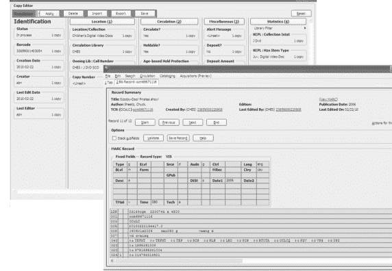

### 图 11.8 肯特公共图书馆的 Evergreen OPAC

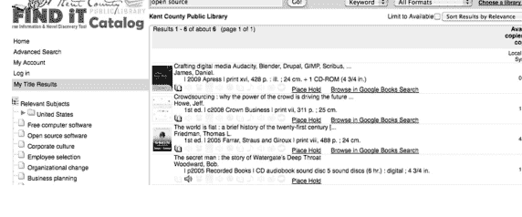

## 相似点与差异

两个 OPAC 都提供了来自服务的增强内容。这意味着它们利用了来自 Amazon.com、Google Books (http://books.google.com) 和 LibraryThing (http://librarything.com) 等网站的图书封面和评论。这些新增的服务让你在浏览馆藏时，OPAC 对读者来说更有吸引力。

与其他四个开源 OPAC 一样，Koha 和 Evergreen 在许多方面是的，但在某些方面又不同。Evergreen 在开发时考虑了联盟机构，因此虽然 Koha 可以且确实可以在联盟环境中工作，但 Evergreen 能够更好地处理联盟规则和权限。相反，Koha 对于大型和特种图书馆来说更有意义，因为它具有管理图书馆采购和连续期刊的能力。尽管如此，随着连续期刊和采购支持的日趋完善，以及 Koha 开发者正致力于创建系统组和类联盟的权限功能，这些细微的差异正在逐渐消失。

开源集成图书馆系统的美之处在于，使用该系统的图书馆越多，可用的新功能和改进功能就越丰富。当 Koha 开发时，它是为了一个图书馆及其特定需求而设计的。当 Evergreen 开发时，它是为了在一个特定的图书馆联盟环境中运行的。多年来，这两个系统都被与原始受众不同的图书馆所采用，而从这些采用中产生的开发使得工具变得更加强大且更有价值。

与任何开源应用程序一样，在做出决定之前，测试所有可用的系统是至关重要的。Evergreen 和 Koha 都提供了在线公共演示（通常在多个处），你可以在决定之前进行尝试。一旦做出决定，你可以自己处理迁移，也可以寻求全球任何数量的支持公司¹¹²

## 跨出这一步

决定改变像集成图书馆系统或 OPAC 这样图书馆运行的基础组成部分可能是令人恐惧的，就像选择书中的任何应用程序一样，这对你的图书馆可能不是正确的步骤。在查看传统资源的同时查看开源替代方案是非常重要的，这样你就可以对你的自动化需求做出明智的决定。与任何软件决策一样，务必咨询全球的同事，看看他们的经历是什么以及他们建议什么。

## 注释

- 1. Bisson, Casey. ‘Designing an OPAC for Web 2.0’ 报告于 ALA Midwinter, 2006年1月20日, http://homepage.mac.com/misterbisson/Presentations/ALAmidwinter-2006jan20.pdf.
- 2. Lucia, Joe. ‘Villanova University Releases VUHFIND, an Open Source Next Generation Library Catalog.’ Library Technology Journal, http://www.librarytechnology.org/displaytext.php?rc=12664.
- 3. Saller, Bess. ‘First Release!’ RubyForge: Blacklight, 2008年1月26日. http://rubyforge.org/forum/phpforum.php?forum_id=21035.
- 4. Blyberg, John. ‘OPAC 2 Released: 2008年9月25日. http://www.blyberg.net, blyberg.net/2008/09/25/opac-2-released-theocialpacnet-launched/.
- 5. 在写作时，斯坦福大学已为 Blacklight 开发了一种高级搜索方法，但尚未加入代码库供使用。
- 6. Koha 是毛利语中“礼物”的意思，但不仅仅是一种礼物；它是一份被送出的礼物。
- 7. Eyler, Pat. ‘Koha: a gift from New Zealand.’ Linux Journal 106 (2003): 1.
- 8. 该数字是通过搜索网络播找到的 (http://www.librarytechnology.org/webcasts/).
- 9. 'Georgia's 252 Public Libraries Preparing Debut of Evergreen Software.’ Library Technology, 2006年8月21日. http://www.librarytechnology.org/ltg-displaytext.pl?RC=12162.
- 10. 该数字是通过搜索网络播找到的 (http://www.librarytechnology.org/webcasts)。
- 11. 截至2010年5月1日，已有版本供测试。要了解更多采购的信息，可以阅读我在2010年会议上的总结，http://www.weblearning.net/archives/3770；Ian Walls 也有关于连续期刊的精彩总结，http://bywatersolutions.com/?tp=474.
- 12. Eric Lease Morgan 汇总了一份曾与图书馆合作的开源支持公司列表，http://infomotions.com/tmp/oss/support.html。正如他所说的，这份列表并不完整，但它是研究的一个很好的开始。

将此指南作为一个起点；始终记住要与你的同事交流，看看他们做过什么、正在做什么以及经历过什么。同时请注意，书中还有很多内容未包含在内。如果你不喜欢我给出的某个建议，可能有其他方案可以满足你图书馆的特定需求。

最后，请记住帮助我们的馆员同事了解开源的真实本质。如果我们的同事在外面传播他们从周围的人那里学到的恐惧、不确定和怀疑（FUD），我们就无法向前发展并取得成功。

## 附录 1 调查结果

全球范围内共有 977 人回答了这项调查。表 A1 显示了贯穿全书使用的原始结果（仅进行了细微的拼写修正）；你会注意到，并不是每个问题都由每个人回答的。

每个问题都提供了一个进一步说明的字段；然而，出于空间考虑，本附录未提供所有的全文答案。如需查看调查的完整全文结果，请参阅官方书籍网站 https://opensource.weblearning.net。

| 你在什么种类型的图书馆工作？ | 总计 | % |
|---|---|---|
| 学术图书馆 | 395 | 42.93 |
| 特殊图书馆 | 116 | 12.61 |
| 大型公共图书馆 | 63 | 6.85 |
| 中型公共图书馆 | 138 | 15.00 |
| 小型公共图书馆 | 80 | 8.70 |
| 单人图书馆 | 10 | 1.09 |
| 学校图书馆 | 6 | 0.65 |
| 我是学生 | 16 | 1.74 |
| 我目前失业状态 | 5 | 0.54 |
| 我不在图书馆工作（但我与图书馆有业务） | 62 | 6.74 |
| 其他 | 29 | 3.15 |
| 总计 | 920 | |

# 图书馆实用开源软件

## 图 A1 受访者工作的图书馆类型

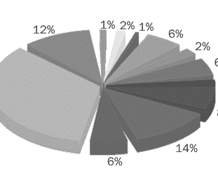

- 小型公共图书馆 (80)
- 中型公共图书馆 (138)
- 大型公共图书馆 (63)
- 学术图书馆 (115)
- 单人图书馆 (10)
- 我是学生 (10)
- 我目前失业状态 (5)
- 我不在图书馆工作（但我与图书馆有业务） (62)
- 其他 (24)
- 未回答 (57)
- 未完成 (14)

## 表 A2 受访者居住或工作的国家

| 你住在/工作在哪个国家？ | 总计 | % |
|---|---|---|
| 阿根廷 | 5 | 0.55 |
| 亚美尼亚 | 1 | 0.11 |
| 澳大利亚 | 15 | 1.65 |
| 奥地利 | 2 | 0.22 |
| 巴巴多斯 | 1 | 0.11 |
| 白俄罗斯 | 1 | 0.11 |
| 比利时 | 4 | 0.44 |
| 贝宁 | 1 | 0.11 |
| 巴西 | 2 | 0.22 |
| 加拿大 | 52 | 5.72 |
| 中国 | 1 | 0.11 |
| 罗地其亚 | 2 | 0.22 |
| 捷克克 | 11 | 1.24 |
| 丹麦 | 5 | 0.55 |
| 埃及 | 2 | 0.22 |
| 爱沙尼亚 | 1 | 0.11 |
| 埃俄比亚 | 1 | 0.11 |
| 芬兰 | 1 | 0.11 |
| 法国 | 5 | 0.55 |
| 格鲁吉亚 | 1 | 0.11 |
| 德国 | 34 | 3.74 |
| 加纳 | 1 | 0.11 |
| 希腊 | 4 | 0.44 |
| 香港 | 2 | 0.22 |
| 匈牙利 | 1 | 0.11 |
| 印度 | 11 | 1.21 |
| 印度尼西亚 | 10 | 1.10 |
| 伊朗 | 3 | 0.11 |
| 爱尔兰 | 4 | 0.44 |
| 以色列 | 1 | 0.11 |
| 意大利 | 3 | 0.33 |
| 卡拉马陶 | 1 | 0.11 |
| 肯尼亚 | 1 | 0.11 |
| 科威特 | 1 | 0.11 |
| 马拉维 | 4 | 0.44 |
| 墨西哥 | 2 | 0.22 |
| 荷兰 | 4 | 0.44 |
| 荷兰安提列群 | 1 | 0.11 |
| 新西兰 | 9 | 0.99 |
| 尼日利亚 | 1 | 0.11 |
| 挪威 | 2 | 0.22 |
| 巴基斯坦 | 3 | 0.33 |
| 巴勒斯坦 | 1 | 0.11 |
| 波兰 | 4 | 0.44 |
| 葡萄牙 | 1 | 0.11 |
| 萨摩亚 | 3 | 0.33 |
| 新加坡 | 2 | 0.22 |
| 南非 | 6 | 0.66 |
| 西班牙 | 3 | 0.33 |
| 瑞典 | 5 | 0.55 |
| 台湾 | 1 | 0.11 |
| 泰国 | 5 | 0.55 |
| 土耳其 | 2 | 0.22 |
| 英国 | 13 | 1.43 |
| 美国 | 645 | 70.96 |
| 委内瑞拉 | 0 | 0.11 |
| 津巴韦韦 | 1 | 0.11 |
| 总计 | 909 | |

## 表 A3 受访者工作的部门类型

| 你在哪个部门工作？ | 总计 | % |
|---|---|---|
| 参考服务部 | 318 | 16.21 |
| 编目 | 236 | 12.03 |
| 采购 | 171 | 8.72 |
| 借阅 | 165 | 8.41 |
| 期号 | 118 | 6.01 |
| 信息技术 | 477 | 24.31 |
| 开发 | 138 | 7.03 |
| 管理 | 221 | 11.26 |
| 培训 | 16 | 0.82 |
| 规划 | 76 | 3.87 |
| 无 | 26 | 1.33 |
| 总计 | 1962 |

## 图 A2 受访者工作的部门类型

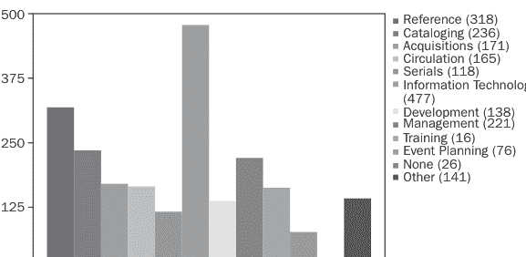

# 图书馆实用开源软件

- 并没有像你想象中那样节省时间
- 被广泛误解
- 集成化图书馆系统尚未成熟
- 像小狗一样免费
- 可能与现有系统不兼容，且需要特殊编程
- 工作量巨大
- 变性极大：有些非常稳健，有些则不然
- 成本较低，尽管考虑到本地支持时，它并不是完全免费的
- 对于那些有自己的 IT 人员来运行它的人来说非常不错
- 安全
- 耗时但有用，就像养宠物一样
- 极佳的投资回报率 (ROI)
- 利用率低
- 需要排错故障
- 实现自给自足的辅助
- 我们希望采取的发展方向
- 人力成本过高
- 往往需要内部专业知识
- 有时对公众来说太令人困惑
- 重造轮子
- 赞助者不知道如何使用
- 如果能利用它，就是盈利的
- 一个值得考虑的选项
- 以上以上之

- 凭运气碰运气
- 在项目没有软件预算的情况下，这是向前发展的唯一方式
- 对我来说这是唯一现实的方案，因为我买不起其他软件，但我没有资金进行定制或获得我所希望的大量支持——乞丐没得挑，而且这让我的服务变得可行！
- 如果有强大的用户和开发者社区提供适当支持，将具有巨大潜力
- 被高估了
- 我们机构不允许使用，但这并不意味着我不认为这是正确的方向
- 简直太棒了……
- 被严重误解了！
- 还没尝试，但认为这是一个很棒的选项
- 有趣！
- 我们财联盟不支持的东西
- 有些支持
- 我的组织不允许
- 受一个响应速度很快（1-2 天）的社区支持
- 能够快速演进
- 与自由软件（free software）不是一样
- 不一定经过管理层的批准
- 显而易见的选择
- 用户驱动且灵活
- 并非完全免费，但比专有软件限制更少。

# 图书馆实用开源软件

| 表格 A5 | 回访者在家使用的开源软件类型 | 总计 | 百比 |
|---|---|---|---|
| 无 | 66 | 6.7 |
| Firefox | 745 | 76.25 |
| Thunderbird | 183 | 18.73 |
| Gimp | 282 | 28.86 |
| VLC | 201 | 20.57 |
| FileZilla | 139 | 14.23 |
| Pidgin | 115 | 11.77 |
| OpenOffice | 422 | 43.19 |
| Adium | 55 | 5.63 |
| Zotero | 196 | 20.06 |
| Linux (Ubuntu 或其他变) | 251 | 25.69 |
| 其他 | 151 | 15.46 |
| **总计** | **2806** | |

图 A4 回访者在家使用的开源软件类型 
- Firefox (745)
- Thunderbird (183)
- Gimp (282)
- VLC (201)
- FileZilla (139)
- Pidgin (115)
- OpenOffice (422)
- Adium (55)
- Zotero (196)
- Linux (Ubuntu 或其他变体) (251)
- 其他 (151)

在 66 名表示在家不使用开源软件的人中，有 39 人给出了理由：

- 我印象中开源软件（OSS）只是给电脑高手准备的，所以一直用 IE
- 在家不管理电脑。
- 现有软件已经满足了需求。
- 我丈夫是 PC 技术人员，没我那么精通。他负责家庭网络，所以决定了我们用什么。
- 目前没有需求，但如果有的话我不会犹豫。
- 我在家里没有需求。
- 没有足够的时间来研究、设置和学习。但我计划很快研究开源软件。
- 在家里最不想做的事情就是看电脑。
- 除了 Firefox 和 Linux，从没听过这些。
- 在家没有大量的繁重计算需求，因为我工作一整天都在盯着屏幕。
- 在家没有需求。
- 没有时间或兴趣。
- 我买电脑时，它附带了 IE 专业套件。我习惯使用这些产品，尽管我支持开源，但没有动力去改变。
- 没有互联网连接。
- 不精通。
- 不了解它的好处。
- 没有时间，没什么兴趣——下班回家用电脑是我最不想做的事了！
- 我正在使用的工具对于我的需求。

- 我喜欢 IE。
- 我不精通。
- 我没有需求。我会用 Firefox，但我运行的很多网站在 IE 上运行得更好。
- 家里没有互联网了……再负担不起了。
- 在家不使用互联网。
- 与我住在一起的人不使用开源软件比处理他们的挫败情绪要容易得多。
- 我被引导使用 OpenOffice，但我不知道它的可靠性如何。
- 受到一个响应速度很酷（1-2 天）的社区支持。
- 能够快速演进。
- 并不等同于自由软件。
- 并不一定得到管理层的批准。
- 显而易见的选择。
- 用户驱动且灵活。
- 并非完全免费，但比专有软件限制更少。

# 图书馆实用开源软件

| 表格 A5 | 回访者在家使用的开源软件类型 | 总计 | 百比 |
|---|---|---|---|
| 无 | 66 | 6.7 |
| Firefox | 745 | 76.25 |
| Thunderbird | 183 | 18.73 |
| Gimp | 282 | 28.86 |
| VLC | 201 | 20.57 |
| FileZilla | 139 | 14.23 |
| Pidgin | 115 | 11.77 |
| OpenOffice | 422 | 43.19 |
| Adium | 55 | 5.63 |
| Zotero | 196 | 20.06 |
| Linux (Ubuntu 或其他变) | 251 | 25.69 |
| 其他 | 151 | 15.46 |
| **总计** | **2806** | |

图 A5 为什么回访者在家使用开源软件而非专有软件 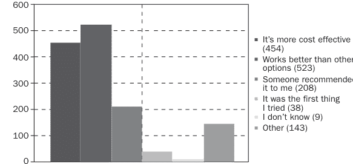

| 为什么在家使用开源软件而非专有软件？ | 总计 | 百比 |
|---|---|---|
| 成本效益 | 454 | 46.47 |
| 比其他选项好用 | 523 | 53.53 |
| 是人推荐的 | 208 | 21.29 |
| 这是我第一次尝试 | 38 | 3.89 |
| 我不知道 | 9 | 0.92 |
| 其他 | 143 | 14.64 |
| 总计 | 1375 | |

# 图书馆实用开源软件

| 表格 A7 | 回访者在工作使用的开源软件类型 | 总计 | 百比 |
|---|---|---|---|
| 你在工作哪些开源软件？ | 无 | 70 | 7.16 |
| Firefox | 715 | 73.18 |
| Thunderbird | 161 | 16.48 |
| Gimp | 282 | 28.86 |
| VLC | 201 | 20.57 |
| FileZilla | 139 | 14.23 |
| Pidgin | 115 | 11.77 |
| OpenOffice | 422 | 43.19 |
| Adium | 55 | 5.63 |
| Zotero | 196 | 20.06 |
| Linux (Ubuntu 或其他变体) | 251 | 25.69 |
| 其他 | 151 | 15.46 |
| 总计 | 3226 | |

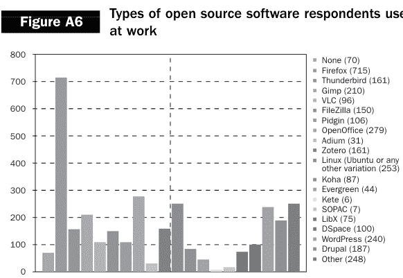

在 70 名表示在工作时不使用开源软件的人中，有 49 人给出了理由：

- 没有人要求。
- 目前网络限制太多。
- 提供的软件工具已经满足了需求。
- IT 不允许安装除 Firefox 外的任何操作系统软件。然而，我们的整个网站下个月将迁移到 Drupal。
- 没有管理员权限无法下载软件，集成到当前的 ILS [集成图书馆系统] 中太困难。
- 他们不让我们用——我想他们害怕它。
- IT 人员对于“他们的”机器上运行什么非常挑剔。

用于图书馆的实用开源软件

- 我不知道任何对我有用的软件。目前尝试安装能将地图比例尺转换为比例的软件，还没有成功。
- 我更喜欢使用 IE，而且我们有一套价值 100,000 美元的 ILS [集成图书馆系统]！
- 不可靠、未经证明，且使用的系统提供支持。
- 由于网络原因存在一些限制。
- 我们正在考虑将开源软件用于流通业务。
- 未经公司总部批准。
- 最近毕业，尚未就业。
- 管理层担心这有风险。对它缺乏了解。不愿改变或尝试新事物。
- 愚蠢的高层管理和其他机构性的阻力。
- 维护太困难。缺乏文档支持。缺乏本地知识。
- 我们的 IT 部门不支持。
- 太麻烦了。
- 我们的图书馆由政府控制。
- 我们使用的工具由 IT 部门监管。用户不做这些决策。
- 为了读者使用，像 OpenOffice 这样的产品需要额外操作才能兼容 MS Office，而后者在学校和企业中无处不在（你必须知道或被告知以 Office 格式保存文档，以便于传输）。ILS [集成图书馆系统]：这些系统尚未成熟，且需要并非所有图书馆都具备的专业知识。
- 那里的电脑上没有安装这些软件。

- 不是我的决定；不允许。
- 电子邮件还没有更改。对于流通和目录管理系统，我们属于一个较大的图书馆集团，使用一家价格昂贵的供应商。
- 因为我只能使用雇主安装的软件，而他们不使用开源软件。
- 因为非常重视安全（可能太严格了），而且我们以前的数据处理中心（Rechenzentrum）被外包了，现在所有的 IT 服务都来自外部服务供应商。标准工作站仅在 Windows 上运行，对于标准软件的任何例外，你必须填写申请并给出解释……就在几个月前，我的 Firefox 浏览器还从桌面上被正式删除了。
- 公司政策。
- 我探索过一些——对于进入程序的问题，缺乏数据库提供商的技术支持，以及对下载未经授权软件的机构规定。
- IT 不让我们用。
- 考虑过开源目录管理系统；不支持。有其他可用选项。
- 我们正在调查，但尚未做出决定。
- 我们的 IT 部门不会允许，所以我从未考虑过。
- 我对实施 Koha 2 软件不够了解。软件和网络管理是在整个办公室/公司层级管理的。
- 还没有机会……
- 我的公司规定我可以使用什么，到目前为止我们还没有采用开源程序。

## 用于图书馆的实用开源软件

- 公司的 IT 部门控制我们使用什么。
- 我们的 IT 部门对未经授权下载内容有严格的规定。
- 不确定他们是否会允许，这里非常政治正确（PC）。
- 只使用公司 IT 部门允许并批准的程序。

为什么受访者在工作中使用开源软件而非专有选项

| 表格 A8 | | | |
| :--- | :--- | :--- |
| 为什么在工作中使用这些应用程序而不是专有选项？ | 总计 | % |
| 更具成本效益 | 463 | 47.39 |
| 比其他选项更好用 | 521 | 53.33 |
| 有人向我推荐 | 166 | 16.99 |
| 这是我尝试的第一个 | 25 | 2.56 |
| 工作要求我使用 | 95 | 9.72 |
| 其他 | 150 | 15.35 |
| 总计 | 1,420 | |

图 A7 为什么受访者在工作中使用开源软件而非专有选项

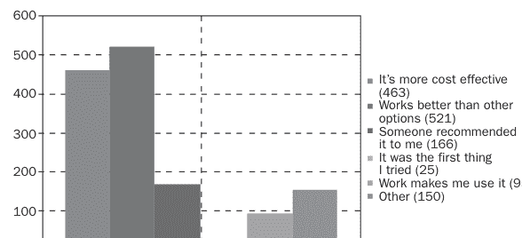

最后意见和引用：

- 为图书提供学习使用开源软件的巧妙方法，并鼓励社区让初学者更容易学习，即使没有编程技能。
- 我们目前正在认真（尝试在 8 月之前上线）考虑启动 VuFind 作为门户。我们还在认真考虑 Koha 和 Evergreen。
- 我承认对开源软件有偏见，因为它的可靠性差异很大。有时开源是免费的，有时它具有最新强大的功能，有时人们喜欢对其进行调整。我不关心这些——最重要的是，我有图书馆和或业务要经营，而可靠性是首要因素。
- 我认为档案馆使用非专有软件特别为重要。这是一个长期可访问性的问题，而我们应该致力于此。
- 也许再过十年，开源将会有更易安装的程序。让我们如此吧。
- 鉴于列出的开源软件，我认为图书馆 IT人员不是你们这项调查的目标受众。
- 遗憾的是，我们在工作中没有机会选择和尝试操作系统。是与否由 IT 决定。
- 我使用开源应用程序已经快 20 年了。某些应用程序需要投入本地精力进行定制，但大多数可以开箱即用。
- 我们结合使用专有软件和开源软件。我们是一个较小的图书馆，只有一个程序员和一个网页设计师，所以我们能做的事情有限。随着时间的推移，开源变得完善，我们可能会使用。
- Senayan 图书自动化系统 (http://senayan.diknas.go.id) 对我和我的图书馆非常有用，我在我的 Ubuntu 服务器上使用它。
- 研究一些文档管理软件（类似于个人图书馆可能会很好）。我使用 Benubrid PDF，它只是免费软件而非开源软件。
- 注意研究各种自由开源软件运动的历史，并区分它们的各种动机。免费 != 不显而易见、公共许可证许可等。我希望这并非显而易见，但许多记者和研究人员混淆了属于完全不同群体的不同伦理体系。这对任何人都没有帮助。
- 开源对图书馆来说是一个非常令人兴奋的方向，我觉得它已经成熟，可以快速采纳。英国似乎落后了，我希望一旦我们有了 VuFind 的“概念证明”，就可以探索下一个逻辑步骤，即全功能的 OSS 图书管理系统（LMS），可能是 Koha，更有可能是 Evergreen。
- 我相信图书馆管理层和 IT 部门对开源软件的使用支持不足。我的目标是某天将所有员工电脑切换到 Linux。开源与闭源似乎是一个虚假的二元对立。关键问题是：是否有支持。

可用吗？我们是否有现职开发人员准备好/能够在需要时扩展产品？产品成熟如何？社区活跃度如何？这些“总拥有成本”考量在闭源和开源之间是共通的。考虑开放数据标准同样重要。这是一个比版本控制更广泛的问题。

- 我们的图书馆似乎聘佣了开发者并将开源软件（OSS）用于新兴应用（数字存储库、保护），并在稳固的后台任务（Web 服务器等）中使用，但当涉及到我们的 ILS [集成图书馆系统] 时，我认为目前考虑的只有专有选项。开源软件无法解决现有的招标流程，我们似乎也没有采用新的流程来评估开源和专有解决方案，以确定哪种来源能提供最佳价值。该大学还试图转向一个基于 Windows 的通用计算环境——这是一个非常短视的举。我们应该更多关注互操作性，而不是规定员工和学生使用什么系统。我认为许可方面阻碍了许多机构开发和发布开源软件。目前没有多多的支持来提供帮助，尽管英国的 OSS Watch 小组现在能够提供更多指导。JISC 认为他们可以做更多工作来鼓励英国的 HE 和 FE [高等教育和职业教育] 机构使用它。

- 我最近参加了一个会议，Amy de Groff 担任主旨演讲者（讲述了她在图书馆使用 Ubuntu），并有关于印第安纳州使用的开源 ILS 的演示。该州（KY）的学术图书馆正在考虑开源 ILS 作为 Voyager 的可能替代方案，Voyager 是目前州资助高等教育机构使用的系统。

- 我很幸运在蒙特利尔的 StudioXX 上上了一门开源课程，那里价格负担得起，并且真心相信使用 OS 而非专有软件。参见 http://www.studioxx.org/en/courses。

- 我相信开源是一项重要的运动，特别是在学术出版领域。我不热衷于使用电脑，也不喜欢浏览网页：我使用 PC 并在家里上网，是因为没有其他办法可以完成工作。个人隐私对我来说很重要；我不可能下载任何应用程序，而且我绝不会在互联网上进行购买。欢迎随时联系这个“不情愿的用户”。

- 开源和 Windows 都会长久存在。两者都不会被淘汰出去。微软（MS）提供现成的支持。开源将继续增长，因为它对公众的初始成本为零。许多人觉得比尔（Bill）拥有过多的市场份额（将其理解为控制权和金）。我觉得他实之名归，并通过微软产品提供了伟大的公共服务。开源很好，是免费的，只是在某些情况下需要花费大量时间。

- 开源不是为意志胆小的人准备的。然而，所有技能水平的人都可以使用并贡献开源软件。它让我们我们所有人都成为了先驱。

- 我喜欢开源 ILS 软件的想法，但对于它是否能以相同或更少的资金提供我们目前拥有的所有支持和功能非常怀疑。我希望 Koha 不会一直是这种情况。

- 我们正在调查 Koha 是否作为我们非常昂贵且功能不佳的 ILS Symphony 的可能替代方案。

- 我预测这项调查不会产生任何真正惊喜的结果，即那种可能需要重新考虑正在测试的一个或多个假设的结果。一个仅仅为了证实自己假设而构建的调查（即使不是主观意为），在学术研究价值方面属于“谎言、该死的线条和统计数据”的范畴。

- ■ 我用 Dyscape，但我喜欢 Drupal 和 CUFTS。并非所有的开源都是同等的。

- ■ 我们正在使用 Classic Dynix，并寻找一种用于 2010 年集成的新 ILS。我们已经完成了 RFP 并通过了董事会，现在到了市政律师处，之后将进行招标。

- ■ 不确定这有多大的指示意义——它有点泛泛，没有质疑公司/机构对开源的态度/接受程度。

- ■ 开源能为图书馆提供很多东西；信息的自由交换与软件的自由交换非常契合。

- ■ 我愿意在工作中使用更多开源软件，但我们的 IT 部门非常喜欢微软。

- ■ 此外，还使用开源的 VOIP 软件和视频会议软件。正在考虑使用 Kete，但可能会对数字项目使用 Fedora。

- ■ 我们对开源这一想法非常感兴趣，但也意识到它永远不是“免费”的。我们希望为用户寻找最好的支持/可持续的性能，无论它是开源的还是专有的。在其他条件相同的情况下，我们更倾向于开源。

- ■ 我不使用更多开源软件的唯一原因是我曾是一个企业 IT 小兵，他们使用的产品是我必须支持的，因此我的我的时间花在他们已经选好的东西上更有价值。

- 开源 = 公共良地。

- 我对未来的开源 ILMS 系统感兴趣。我们是校园内唯一的开放计算机实验室（信息中心），对任何可以节省我们学生和图书馆预算的软件感兴趣。

- 我们正处于理解和使用 Drupal 进行网站后端内容管理的早期阶段。尚未发布，现在评价还很为时过早。我很喜欢通过各种模块提供的定制选项。每想出一个想法，就会有一个模块出来可以使用！在线和本地都有良好的社区支持。我们所在地区有很多图书馆正在尝试或将使用它。

- Open Disc Project 太棒了！http://www.theopendisc.com。

- 我觉得自己完全不熟悉开源技术，但我知道得够不够以至于我错过了什么？

- 我认为这是一个非常棒的主意。希望你们不要出实体书，因为出版耗时太长了。

- 我很想使用 Koha，并努力达到那个水平，尽管没有本地支持。

- 开源具有成本效益，但需要大量的定制。许多图书馆可能没有程序员或开发者来开发定制代码。

- 我在使用的任何开源软件都没有完全的支持。如果出现问题，IT 部门不会提供帮助并经常要求我卸载它。

- 我的网络正在寻找一种开源 ILS 作为下一个系统。我感到很兴奋。

- 我喜欢 openoffice.org。

- 索诺马州立大学多年前在一些图书馆电脑上使用过 OSS。这包括 Linux、浏览器和简单的工具。出于某种原因，他们回到了专有软件世界。太遗憾了……

- 我在单位（place of work）提过使用开源选项的建议。这些建议几乎被立即拒绝，理由是安装和定制的“复杂性”以及“安全问题”。呸。

- 我在一个拥有 12,000 册书的同性恋导向图书馆担任志愿者。我们展示 Winnebago Spectrum 作为我们的在线目录。该程序不再由软件所有者 Follett 支持。升级到 Follett 目前的产品 Destiny 至少需要 2000 美元，我们负担不起。我迫切需要一个仅用于编目和流通的软件；我们没有采购预算，因此不需要采购功能。我刚刚发现 Koha，但还没有时间调查。

-   我对这个主题非常感兴趣。很高兴看到有人在研究它。

-   针对 MS 应用和其他商业应用有更多培训可用。我想学习 Joomla 的培训，可能还包括其他我甚至不知道的培训。

-   我负责新服务委员会。根据我们委员会的建议，如果分馆经理需要，就在所有地点的一台媒体 PC 上安装 GIMP.ORG。我们确实担心无法控制客户在程序中编辑了什么。之所以推荐它是因为它具有成本效益。我们还为每个安装了软件的 PC 提供了一张教程光盘。

-   开源确实很棒，尽管我很惊讶自己在家里实际使用的开源软件竟然这么少。我关注开源才一年了，所以我还有很多东西在使用中，因为……嗯，我用它们熟悉了。

-   我们考虑过开源 ILS（集成检索系统），但还没有还没有专业知识来采用它们（而且必须满足加利福尼亚州的无障碍访问要求）。

-   这是一个非常酷的主意。我一直在思考图书馆和开源是如何相辅相成的。

-   我们的图书馆目前正致力于让 Drupal 运行起来作为我们的 CMS [内容管理系统]，但我们遇到了一些障碍，所以花费的时间比我们希望的要长。

-   在印度尼西亚，有一种在图书馆使用的软件名为 Senayan，你可以在 http://senayan.diknas.ac.id 查看。

-   开源在图书馆及其他领域确实有的一席之地。很多时候，那些本该支持实施开源方案的人会被过度狂热的支持者所吓跑，这些人对开源提出的声明是值得怀疑的。

## 图书馆实用开源软件

解决方案。生活中的大多数事情一样，在开源模型中可以合理支持的内容与那些确实需要商业/专利解决方案的内容之间需要一种平衡。在许多情况下，随着时间的推移选择哪种模型，是在开源与否之间做出决策的最棘手部分。

-   祝项目好运！我希望它有助于开源软件获得更广泛的认可。

-   我稍微关注过笔记本电脑市场，因为我父亲经常旅行，我认为这是一个会随着开源操作系统而繁荣的市场。此外，我使用运行 Android 系统的 Google 手机，这是他们正尝试为笔记本电脑配置的操作系统。我觉得 Google 的那段他们进入时代广场询问人们“什么是浏览器？”的视频非常有启发性……当然，大多数人没有使用 Firefox、chrome 或浏览器产品？随着越来越多的人了解开源产品，会有越来越多的人使用它们。我向许多读者推荐了 OpenOffice 和 Firefox。

-   开源太棒了。如果能在某个地方讨论如何教学和宣传开源就太好了。

-   祝好运！请不要在这项事业上放弃。许多图书馆正在寻找开源产品以更好地利用他们的 OPACS（公共自动目录系统）。我们不想被强制使用 OCLC 的 WorldCat.local……谢谢！

-   应该指出的是，我不认为开源总是是“最佳解决方案”。有时，专利软件确实有最佳解决方案。然而，它经常能击中成本、可控性和足够的功能集之间的平衡点。权衡在于，弄清楚问题通常是困难的（但通常可以解决，如果是闭源你只需要走开即可），事物可能处于糟糕状态，并且取决于发行版的更新，其风险似乎比其他一些闭源软件更高。我使用的开源软件列表非常大。刚想起另一个，imagemick。我想，如果你真的想要一个列表，我可以列出我的包，尽管这并不能告诉你在我我从源码编译的某些东西……

-   我希望在图书馆里探索和使用更多的开源应用，但我们的主管并不相信有足够的支持。此外，人们还担心 MS Office 2007 与 OpenOffice 的兼容性。随着密歇根州的其他图书馆转向 Evergreen 以节省成本，我希望我们也能这样做，因为我们目前的 Siris/Dynix 系统充满了漏洞和不一致之处。由于 Evergreen 在佐治亚州和其他州多年来已证明了自己是一个稳定且准确的系统，我希望更多图书馆将开源软件视为商业系统软件的可行替代方案。

-   看看我们的开源搜索引擎 'Summa'：http://www.statsbiblioeket.dk/summa。右侧列提供了一些英文信息。

-   我是以个人身份发言的，不代表我工作的图书馆。

-   在 Koha 的案例中，最困难的是维护（升级）和跟上新版本具有挑战性。另一点是公司要求的支持 Koha 的费用非常高。这超出了我们的预算。非洲没有 Koha 的支持。最近的是印度。

## 图书馆实用开源软件

-   在工作中我们通常使用 MS Office，因为我们收到的大多数文档是 PDF 或 MS Office 文档。在工作中并不经常使用 OpenOffice。在家里我只用 OpenOffice，不幸的是这也可以，因为它可以完成我的一切。不幸的是，Internet Explorer 被用于我们新的图书馆软件；通常在工作中我们使用 Firefox。OPUS 是用于我们出版服务器的软件，MILES 也是如此，用于特殊用途。

-   看到你没有将 NewGenLib 列为开源产品之一令人震惊。我希望你了解该领域的所有进展。

-   我觉得，让 Linux / 开源软件变得更容易用是有用的。因此，易用性因素需要提高。

-   我是开源软件的坚定支持者。目前大学正参与 OLE（开放库环境）项目，以创建一个开源 IL。我参加了创建该系统的初始工作讨会，但我的工作职责发生了变化，我没有那么参与了。

-   我讨厌处理许可证问题。

-   我喜欢听到别人使用开源 ILSes 的经验，真的希望我们的图书馆联盟在我们切换 IL 时，如果/何时能考虑开源选项。

-   我鼓励尽可能使用开源软件。如果你手头有一位技术专长的人，支持的成本并不可重负。我发现使用 Linux、Apache 和 PHP 作为 Web 服务器是最容易维护和设置的。

-   大多数机构都不支持离开微软路线，即使员工愿意转向开源，所以我们被困于 MS 产品。

-   我们的图书馆正在寻找 Photoshop® 的廉价、低性能备选品。

-   我喜欢开源的想法。当涉及到图书馆应用时，我们没有人手——我们有一个半职职位负责系统，那里的人本质上首先是图书员，其次才是技术人员，他没有时间去学习和支持开源。

-   我希望能在我们图书馆里使用更多的开源解决方案（并经常向管理层推荐），我们的主管并不相信有足够的支持。我们意识到开源并不是完全免费的——它需要的人力和资金，而我们正缺乏这些。

-   我们的学术图书馆对使用开源软件感到兴奋……问题是很难让我们的 IT 同事们加入。

-   区分不同类型和质量的开源项目是重要的。存在巨大的差异。

-   事件，如预算缺口，通常迫使图书馆采取创新行为。就像会计师一样，图书馆经理认为任何免费的东西都不是没有代价。没有人因为购买 ContentDM 或 Encore 而受到过批评。开源桌面已经变得与 相当甚至更好，但很少图书馆尝试通过使用 KDE 或 XFCE 来节省成本。通用开源软件很容易进行调整或定制，但很少有图书馆员或 IT 支持人员具备良好此类工作所需的技能。专门的图书馆开源软件将需要一个非免费的支持组件。在州和地方政府主管开始使用并相信开源之前，开源不会被图书馆接受，但就像负责任的医疗保健政策一样，我们尚未接受工作场所的任何欧洲创新。

- 我使用许多开源的网页和教学应用程序，包括但不限于 SlideRoll、Slideshow Maker、Poweroff 3.0、Google Chrome 等。

- 如果问问人们是否在认真使用其他开源产品会很好。我们正在考虑使用 ILS（Koha），但仍在对比系统，尚未实施任何一个。

- Kuali 是一个针对大学的财务界面，比购买 Banner 这样的商业产品便宜得多。你们的问卷似乎针对的是开源软件的个人使用，而不是机构级应用。

- 我喜欢 LimeSurvey。

- 在工作中，我们正越来越多地向开源转型，正在更换开源的帮助台软件，计划尝试开源的发现层，并探索未来使用开源 ILS 的可能性。

- 我们喜欢 Drupal。非常喜欢。我们还喜欢 Linux (CentOS)、MySQL、Apache、PHP、Subversion 和 Margaritas（这不是软件）。

- 不知道为什么 WordPress 没有被列为首页选项。此外，如果你能问更多关于人口统计学的问题——比如图书馆规模、国家地区，以及如果是图书馆而不是个人使用了 OSS（例如 Apache 等），稍后可能会更好的分析。

- 仅仅是，我是一个信奉为任务寻找合适工具的人。有时那个工具是开源的，而有时使用商业产品更好。

- 因为，FOSS 与图书馆有共同的目标——信息共享。两者结合具有巨大的潜力。

- 我不知道没有便携式开源软件我该怎么办，因为内部限制阻止我安装许多需要的软件。我喜欢先尝试软件，看看它是否真的有用。如果有用，我愿意向社区贡献或捐赠资金来帮助它持续下去。

- 我是一个 Mac 用户，但我最近买了一台（不幸的是）预装了 Windows XP 的笔记本电脑。我从移动介质上运行 Ubuntu 仅仅是为了学习新物的挑战。我希望对 Ubuntu 变得足够熟练/自信，以便我可以将笔记本电脑重新格式化为仅运行 Ubuntu 的机器。为什么？因为我非常喜欢他们的哲学：Ubuntu 和开源软件让所有用户无论财务或身体状况如何，都能获取技术、接入信息。

- 我是开源的新手，我觉得这非常令人。比尔·盖斯已经赚了足够的钱了。

- 我们使用很多 Google 的产品，如 Docs 和日历。

- 图书馆低估了支持开源所需的人力成本。购买或维护上的任何成本节省只是转嫁到了人员身上。对于一个拥有年轻、渴望技术的员工的小型农村图书馆来说，这可能不成立。但我好奇当他成家需要更有竞争力的薪水并可能搬走时会发生什么。作为大都市的大型图书馆，我们的 IT 薪水必须与大公司竞争。我们无法负担由整个供应商团队支持和开发我们的 IBS 所需的知识。

- 图书员已经足够“技术化”，可以在没有某种支持的情况下考虑开源。我们中许多人都是 50 多岁，大学时代几乎没有用过电脑，所以我们不愿意将整个自动化流程转移到我们不理解的东西上。

图书馆的实用开源软件

- 开源软件是为读者提供“更多”……更多选项、更多服务等的绝方法。我们在公共互联网电脑上安装了 Firefox 为读者提供选择，同样为了配合 Microsoft 安装了 OpenOffice。我使用 Firefox 作为我的主要浏览器，因为……我想给更多图书馆提供开源软件，特别是那些面临预算削减的图书馆。

- 另见我们的网站 http://meadvillelibrary.org/os 获取我们在多次会议上做的演示信息、我写的文章等。

- 关于开源的“成本”的信息不足。软件/代码是免费的，但确实存在与使用和维护相关的成本。

- 我很想用开源替代 Microsoft Office，但需要更多员工时间来说服习惯了 MS 的读者（大多数人经验有限，对他们来说改变很难）。我在公共电脑上尝试过 Firefox，但发现它并不适合那个环境。但是我私选的浏览器……比 IE 好得多。

- 在决定使用 Drupal 之前，查看了几个替代的 CMS（内容管理系统）选项：Joomla、Plone 和 Alfresco。如果你想了解图书馆中的 Plone，我建议咨询 Plinkit Collaborative 的人员，网址为 http://www.plinkit.org/（他们中的一些也曾在过去的 Code4Lib 上做过演讲，可以查看会议存档）。

- 过去几年，目睹了开源运动在图书馆中爆发并成为主流。许多开源程序拥有如此繁荣的用户社区，对程序进行持续的改进和更新，使其成为同类中的最佳——例如 Firefox！ILSs 似乎也朝着这个方向发展，在未来几年中观察这将会非常有趣！

# 附录 1 调查结果

- 这只是我的个人经验，我确定这不是这里使用的软件的完整清单。

- 我们学校实际上没有图书馆，也没有建立图书馆的计划。我教技术，觉得我的工作之一是作为教学技能资源、验证信息以及通往互联网信息的某种门户。

- 抱歉，我甚至不知道免费源码是什么意思。我是多米尼根大学的研究生，我觉得我应该知道它的意思是……

- 对于没有技术专员的小型图书馆来说，系统的支持是一个问题。

- 我对开源事物最大的问题是通常获取帮助非常困难。

- DokuWiki 作为我们员工的微内网非常好用，而 Request Tracker 让处理请求变得容易得多。

- 我喜欢开源的想法。然而，Joomla 用起来很困难。我希望其他开源软件不要那么困难。

- 我认为开源很棒，但我为一个拥有75个成员的联盟图书馆工作，他们目前对探索它感兴趣。

- 我们幸运有一位极其优秀且精通的网络管理员，他在网络上安装了 Ubuntu 并为我们定制了 Koha。作为一家小型公共图书馆的院长，我无法抽出时间自己学习这些操作。

- 我们目前正在转换为 Koha，我尝试通过阅读许多博客来保持对开源的知识，所以我是一个门外者，尽管真的是一个信者。Koha 将成为我们五个图书馆的 LMS 系统，所以我们学得很快。

- 我认为使用开源是图书馆领域的一个趋势。在预算有限且需求增加的情况下，开源是图书馆的很好的解决方案。

- 我们的图书馆属于一个小型政府机构，软件类型波动剧烈。我们每四年举行选举，导致新的管理和不同的办事方式。首先，IT 负责人是一个巨大的微软粉丝。实际上与微软自己进行了一些前沿开发。下一任 IT 负责人非常**开源**是政府开源的倡导者之一。然后，天平摆了回来，我们再次变成了微软商店，但我们听从指挥，不创新也不要求任何东西。一碗微软粥就够我们吃了。好运！

- 随着开源使用的增加而产生的原型供应商支持模式的报酬，将如何演变成我们非常熟悉的：专有的、公司拥有和开发的、封闭的、昂贵的……

- 我想使用开源软件，但法院对安全非常严格，这本该如此。

# 附录 2 网络链接

本附录按字母顺序列出了每一章的链接。这些链接可以在官方书籍网站 http://opensource.web2learning.net 上找到。

## 第一章

- [众包](http://crowdsourcing.typepad.com)
- [Firefox 狐火网络浏览器](http://firefox.com)
- [自由软件基金会](http://www.fsf.org)
- [GNU 通用公共许可证第 3 版 (GPLv3)](http://www.opensource.org/licenses/gpl-3.0.html)
- [2010年1月Web服务器调查 – Netcraft](http://news.netcraft.com/archives/2010/01/07/january_2010_web_server_survey.html)
- [开源范式转移](http://www.oreilly.com/pub/aoreillytimshift/articles/paradigmshift_0504.html)
- [OpenOffice.org](http://www.openoffice.org)
- [自由软件定义](http://www.gnu.org/philosophy/free-sw.html)

## 第二章

- [评估开源社区的健康](http://floss.syr.edu/Presentations/oscon2006/2_Crowston2006 Assessing%20the%20health%20of%20open%20source%20communities.pdf)
- [众包](http://crowdsourcing.typepad.com)
- [Koha 开源集成管理系统 (ILS)](http://koha-community.org)
- [开源社区中的导师制：哪些有效？哪些无效？](http://www.itworld.com/open-source/78271/mentoring-open-source-communities-what-works-what-doesntnt)
- [黑客为何这样做他们所为：理解自由/开源项目中的动机与努力](http://opensource.mit.edu/papers/lakhaniwolf.pdf)

## 第三章

- [从自由到恢复](http://www.opensource.org/node/471)
- [GSA 为开源辩护](http://gcn.com/blogs/tech-blog/2008/04/gsa-makes-the-case-for-open-source.aspx)
- [2006 年 Internet Explorer 不安全持续了 284 天](http://blog.washingtonpost.com/securityfix/2007/01/internet_explorer_unsafe_for_2.html)
- [2010年1月Web服务器调查 – Netcraft](http://news.netcraft.com/archives/2010/01/07/january_2010_web_server_survey.html)
- [2009年1月至2010年2月前 5 大浏览器](http://gs.statcounter.com/#browser-uw-monthly-200901-201002-bar)

## 第四章

- [美国图书馆协会伦理守](http://www.ala.org/ala/aboutala/offices/oif/statementspols/codeethics/codeethics.cfm)
- [Drupal](http://drupal.org)
- [Evergreen 开源图书馆系统](http://open-ils.org)
- [馈赠文化、图书馆学与开源软件开发](http://infomotions.com/musings/gift-cultures/)
- [新西兰图书馆协会](http://www.library.org.nz)
- [内网 2.0：通过自建的内网促进协作](http://www.web2learning.net/publications-presentations/intranet-20-fostering-collaboration-with-a-homegrown-intranet)
- [Jenkins 法律图书馆](http://www.jenkinslaw.org)
- [Joomla](http://www.joomla.org)
- [Koha 开源集成管理系统 (ILS)](http://koha-community.org)
- [开源软件：控制你的计算环境](http://infomotions.com/musings/oss4cil/index.shtml)
- [满足图书馆需求的开源解决方案](http://www.lugod.org/presentations/oss4lib.pdf)
- [开放获取、开源和开放标准对图书馆的重要性](http://ist.org/05-spring/article2.html)

## 第五章

- [Jessayn 安装 Ubuntu](http://www.vimeo.com/41697883)
- [Libstats](http://code.google.com/p/libstats/)
- [LimeSurvey](http://www.lime.org)
- [Linux Online](http://www.linux.org)
- [OpenOffice.org](http://www.openoffice.org)
- [Ubuntu](http://www.ubuntu.com)
- [VirtualBox](http://www.virtualbox.org)
- [VirtualBox 论坛](http://forums.virtualbox.org)
- [什么是 Ubuntu?](http://www.ubuntu.com/products/what-is-ubuntu)
- [为什么选择 OpenOffice.org](http://wby.openoffice.org)

## 第六章

- [Adblock Plus](http://adblockplus.org)
- [Amazon.com](http://www.amazon.com)
- [Barnes & Noble](http://www.barnesnoble.com)
- [Firefox 的 Flashback 插件](https://addons.mozilla.org/en-US/addon/)
- [Thunderbird 的 Gmail IMAP 账户插件](https://addons.mozilla.org/en-US/addon/)
- [Google Scholar](http://google.com)
- [Internet Explorer 不安全持续了 284 天](http://blog.washingtonpost.com/securityfix/2007/01/internet_explorer_unsafe_for_2.html)
- [LibX](http://libx.org)
- [Lightning](http://www.mozilla.org)
- [GIMP](http://www.gimp.org)
- [Firefox 扩展列表](https://addons.mozilla.org/en-US/addon/)
- [Firefox 的 NoScript 插件](https://addons.mozilla.org/en-US/addon/)
- [Firefox 的 Ghost 插件](https://addons.mozilla.org/en-US/addon/)
- [Mozilla 项目](http://mozilla.org)
- [mozilla.org]
- [Firefox 的隐私保护插件](https://addons.mozilla.org/en-US/addon/)
- [Thunderbird 的隐私保护插件](https://addons.mozilla.org/en-US/addon/)
- [Zotero](http://www.zotero.org)
- [Zotero 使用指南](https://www.zotero.org/support)
- [Zotero 软件](https://www.zotero.org/download)
- [Zotero 博客](https://www.zotero.org/blog)
- [Zotero 教程](https://www.zotero.org/support)
- [Zotero 社区](https://www.zotero.org/community)
- [Zotero](http://otero.org)

## 第七章

- [Audacity](http://audacity.org)
- [Audio & Video](http://nypl.org)
- [CamStudio](http://camstudio.org)
- [GIMP](http://www.gimp.org)
- [GIMP 插件库](http://registry.gimp.org)
- [GIMPshop](http://www.gimps.com)
- [Introduction to GIMP](http://www.gimp.org)
- [Koha](http://koha-community.org)
- [Serpent Journal](http://serpentjournal.com/)
- [Tutorials](http://www.npress.com/)
- [RecordMyDesktop](http://recordmydktop.sourceforge.net)
- [Scribus Desktop Publishing](http://www.scribus.net)

## 第八章

- [Alexa Web Information Company](http://www.alex.com)
- [Drupal](http://drupal.org)
- [Drupal Case Studies](http://drupal.org/cases)
- [Drupal Runs Three Times as Many Top Sites the Next CMS](http://tomgeller.com/content/drupal-runs-three-times-many-top-sites)
- [Drupalib](http://drupalib.info)
- [FileZilla](http://filezilla-project.org)
- [Howard County Library](http://bclibrary.org)
- [Joomla](http://www.joomla.com)
- [Joomla in Libraries](http://www.joomlainlibrary.com)
- [Joomla! Community Showcase](http://community.joomla.org/showcase/)
- [Library Success Wiki](http://www.libsuccess.org/index.php?title=Open_Source_Software)
- [Linux.com](http://www.linux.com)
- [MaiaCMS – Home](http://maiacms.com)
- [MediaWiki](http://www.mediawiki.org)
- [My Kansas Library on the Web](http://www.mykansansaslibrary.org)
- [NEKLS](http://www.nekls.org)
- [OpensourceCMS](http://php.opensourcecms.com)
- [Practical Open Source Software for Libraries: Official Book Site](http://opensource.web2learning.net)
- [The White House](http://www.whitehouse.gov)
- [Whitehouse.gov using Drupal](http://www.whitehouse.gov/using-drupal.html)
- [Wikipedia](http://www.wikipedia.org)
- [WordPress](http://wordpress.org)
- [WordPress for Libraries](http://www.weibunction.org/706)

- [Kete.net.nz](http://kete.net.nz)
- [新西兰数字图书馆](http://www.nzdl.org/cgi-bin/library.cgi)
- [夏威夷大学马诺亚分校 ScholarSpace](http://scholarspace.manoa.hawaii.edu)
- [怀卡托大学图书馆新西兰馆藏](http://digital.lib.waikato.ac.nz)

## 第 10 章

- [CUF](http://researcher.sfu.ca/cufts)
- [技术与运营管理 CUF 页面](http://cufts2.lib.sfu.ca/CRDB/BVAS/browse/facets/subject/S94)
- [dbWIZ](http://researcher.sfu.ca/dbwiz)
- [沿着黄油砖路通往简化的链接管理](http://www.web2learning.net/publications-presentations/following-the-yellow-brick-road-to-simplified-link-management)
- [GODOT](http://researcher.sfu.ca/godot)
- [伊萨卡学院图书馆研究指南：计算机科学](http://www.ithacalibrary.com/sp/subjects/cs)
- [图书馆在困难经济时期准备好提供帮助](http://www.buffingtonpost.com/jim-rettig/libraries-stand-ready-to-b_150268.html)
- [点点图书馆 (Library à la Carte)](http://alcarte.library.oregonstate.edu)
- [点图书馆论坛](http://alcarte.library.oregonstate.edu/forum)
- [Moodle](http://moodle.org)
- [开放知识库](http://researcher.sfu.ca/openkb)
- [reSearch](http://researcher.sfu.ca)
- [查普曼大学的 reSearch](http://cufts2.lib.sfu.ca/CRDB/COU)
- [reSearch 文档](http://researcher.sfu.ca/documents)
- [SubjectsPlus](http://www.subjectsplus.com)
- [中德伯里学院 SubjectsPlus](http://www.middlebury.edu/academics/lib/research/db-subject)
- [Google Groups  SubjectsPlus](http://groups.google.com/group/subjectsplus)
- [惠蒂尔学院 Moodle](http://cms.whittier.edu)

## 第 11 章

- [Amazon.com](http://www.amazon.com)
- [雅典斯县公共图书馆目录](http://search.athenscounty.lib.oh.us)
- [Blacklight：项目信息](http://rubyforge.org/projects/blacklight/)
- [科林斯伍德图书馆](http://collingswoodlibrary.org)
- [达里恩图书馆目录](http://www.darienlibrary.org/catalog)
- [为 Web 2.0 设计 OPAC](http://homepage.mac.com/misterbisson/Presentations/ALAMidwinter-2006Jan20.pdf)
- [Evergreen 开源图书馆系统](http://open-ils.org)
- [首次发布！](http://rubyforge.org/forum/forum.php?id=21035)
- [佐治亚 PINES 目录](http://gapines.org)
- [佐治亚 252 个 PINES 公共图书馆准备发布 Evergreen 软件及 Web 端目录](http://www.librarytechnology.org/ltg-displaytext.pl?RC=12162)

图书馆实用的开源软件

- [谷歌图书](http://books.google.com)
- [Horowenua 图馆](http://www.library.org.nz)
- [肯特郡公共图书馆目录](http://catalog.kentcountylibrary.com)
- [Koha 开源 ILS](http://koha-community.org)
- [lib-webcats](http://www.librarytechnology.org/libwebcats/)
- [LibraryThing](http://www.librarything.com)
- [图书馆的开源支持](http://infomotions.com/tmp/support.html)
- [Search Works](http://searchworks.stanford.edu)
- [Search Works – 高级搜索](http://searchworks.stanford.edu/edu/advanced)
- [SOPAC 2 发布。theosialopac.net 上线](http://www.blyberg.net/2008/09/25/sopac-2-released-thesocialopacnet-launched/)
- [SOPAC2：社交化 OPAC](http://thesocialopac.net)
- [弗吉尼亚大学图书馆目录](http://blacklight.btech.virginia.edu)
- [维拉诺瓦 Falvey 纪念图书馆目录](https://library.villanova.edu/Find/)
- [大学发布 VUFIND，一种开源下一代图书馆目录](http://www.librarytechnology.org/ltg-displaytext.pl?rc=12664)
- [VuFind](http://vufind.org)
- [W-E-B-S-I-T-E，它对我意味着什么](http://www.inthelibrarywiththeleadpipe.org/2009/w-e-b-s-i-t-e-find-out-what-means-me/)

## 附录 3 参考文献

- “Actuate 年度开源调查包括；吸引了创纪录的响应数量，”2009年6月22日。http://www.actuate.com/news/press-release?articleId=1792.
- Abel, Rob. “开源会成为高等教育中的重要战略吗？”高等教育竞争力联盟，2005年5月25日。http://www.aec.org/media/files/open_source_0505.
- Bello, Richard. “向开源开放。”ABA Journal 第94卷第6期（2008年6月）。
- 美国图书馆协会。“美国图书馆协会伦理守。”2008年1月22日。http://www.ala.org/about/offices/statements/code.
- “一个秘密。”Economist 第37卷第8期（2005年10月），12-14页。
- Appleton, Karen, Dorothy Lampe 和 Cheryl Carruthers。“使用 Moodle：农村图书员如何保持联系。”School Library Monthly 第26卷第2期（2009年10月），14-16页。
- Arne, Paul H., 和 John C. Yates。“开源软件许可：终端用户和开发者的视角。”Computer & Internet 第22卷第8期（2005年），1-13页。

图书馆实用的开源软件

- Balas, Janet L. “考虑开源。”Computers in Libraries 第24卷第8期（2004年），36-39页。
- “无需恐惧开源。”Computers in Libraries 第25卷第5期（2005年5月），36-38页。
- Bell, E. “开源图书馆系统：多维度评估。”Australian Academic and Research Libraries 第39卷第1期（2008年），1-13页。
- Banner, Kyle。“通过开源数据库更好地交付。”Libraries 第25卷（2005年），16-22页。
- Barker, Stephen。“使用你的 Moodle。”Times Supplement 第47卷（2008年6月），30页。
- Beatty, Brian, Connie Ulicz。“教师对从 Blackboard 转向 Moodle 学习系统的观点。”TechTrends 第50卷第4期（2006年7月），36-45页。
- Bessel, Gerhard。“在伦敦皇家医院实施开源图书馆管理：Koha 3.0 的经验。”Program: Electronic Library & Information Systems 第42卷第3期（2008年7月），303-314页。
- Bisson, Casey。“为 Web 2.0 设计 OPAC。”ALA Winter，2006年1月20日。http://homepage.mac.com/misterbisson/Presentations/ALAMidwinter-2006jan20.pdf.
- Bisson, Casey, Jessayn West 和 Ryan Eby。“图书馆开源软件。”Library Technology Reports 第43卷第3期（2007年），http://www.alatech.org/ltr/open-source-for-libraries.
- Blyberg, John。“OPAC 2 发布。社交 OPAC上线。”blyberg.net，2008年9月25日，http://www.blyberg.net/2008/09/25/sopac-2-released-thesocialopac-launched/

## 附录 3 参考文献

- Bonfield, Brett。“W-E-B-S-I-T-E，它对我意味着什么。”In Library with the Lead Pipe，2009年7月22日。http://www.inthelibrarywiththeleadpipe/2009/w-e-b-s-i-t-e-find-out-what-it-means-to-me.
- Love, Frank J.“使用开源工具创建基于数据库的页面。”Portal: Libraries and the Academy 第7卷第3期（2007年7月），385页。
- Boyce, Janus 和 Tony Byrne。“开源门户。”EContent 第29卷第6期（2006年6月），38-42页。
- Branburg, Jeffrey。“使用 Moodle 课程管理系统。”Technology & Learning 第26卷第1期（2005年），40页。
- Dried, Marshall。“开源 ILS 更新。”Computers in Libraries 第27卷第3期（2007年3月），27-29页。
- “为开源 ILS 制定商业案例。”Computers in Libraries 第28卷第3期（2008年3月），36-39页。
- “开源与 ILS。”Library Technology Reports 第40卷第1期（2004年1月），84-85页。
- “开源 ILS 的可行性。”Bulletin of the American Society for Information Science & Technology 第35卷第2期（2008年12月），20-25页。
- Bretthauer, David。“图书馆中的开源软件。”Library Hi Tech News 第18卷第5期（2001年6月），8-9页。
- “图书馆中的开源软件：更新。”Library Hi Tech News 第19卷第5期（2002年6月），20-22页。
- Buyaert, D.“Whitehouse.gov 使用 Drupal。”Dries Buyaert，2009年10月25日。http://buytaert.net/white-house-using-drupal.
- Caldwell, Tracey。“开源道路的乐趣吗？”Information World Review 第238（2007年），18-20页。
- Cervone, Frank。“开源选项。”Library Journal 第19卷（2003年），8页。
- Cervone, H. Frank。“支持远程学习图书馆服务的开源软件。”Internet Reference Services Quarterly 第9卷第3/4期（2004年7月），147-158页。

- Chavan, Abhijeet, and Shireen Pavri. 《基于 Moodle 的开源学习管理系统》。》Linux Journal 128 (2004年12月): 66–70.

- Chawner, Brenda. 《Koha：一个开源成功故事》。》Library Link, 2002年11月. http://mustafa.emerald.insight.com/vl=12220074/cl=48/nw=1/rpsv/librarylink/technology/nov02.htm.

- Chawner, Daniel, and Nicole C. Engel. 《自由/许可及开源软件与库书目》。》2010. http://zotero.org/groups/freelibre_and_open_source_software_and_libraries_bibliography.

- Chudnov, Daniel. 《计算机中的图书馆：图书员对开源并不了解的》。》Computers in Libraries 28, no. 3 (2008): 40.

- 《开源软件：图书馆系统的未来吗？》》Library Journal 124, no. 13 (1999年8月1日): 40.

- Clark, John. 《互联网连接：开源软件——准备好进入主流市场了吗？》》Behavioral & Social Scientists Librarian 27, no. 4 (2008年12月): 211–213.

- Clarke, Kevin S. 《开源软件与图书馆社区》。》北卡罗来纳大学 – 帕勒希尔，信息与图书馆科学学院，2000.

- Coffe, Peter. 《开源模型开启更多选择》。》eWeek 22, no. 7 (2005年2月14日): D4.

- Colford, Scot. 《解释自由和开源软件》。》Bulletin of the American Society for Information Science & Technology 35, no. 2 (2008年12月): 10–14.

- Corrado, Edward M. 《开放获取、开源和开放标准对图书馆的重要性》。》Issues in Science and Technology Librarianship 42 (2005年春季). http://istl.org/03-spring/article2.html.

- Corrado, Edward M., and Kathryn A. Frederick. 《创建数据库驱动主题指南的自由和开源选项》。》The Code4Lib Journal, 2008年4月10日. http://journal.code4lib.org/articles/47.

- Crawford, Richard. 《针对图书馆需求的开源解决方案》，发表于 戴维斯 Linux 用户组，2003年12月5日. http://www.lugod.org/presentations/osslib.pdf.

- Critz, Lori, and Larry Hansard. 《发现工具 VUFind：佐治亚理工学院的实施增强了资源的可发现性》，发表于 GUGM (GIL 用户组会议)，佐治亚州福特谷谷，2008年5月15日. http://smartech.gatech.edu/handle/1853/21586.

- Crowston, Kevin, and James Howison. 《评估开源社区的健康状况》。》IEEE Computer 39, no. 5 (2006): 89–91.

- Darby, Andrew. 《在大学图书馆中实施开源应用：ECU 的“海盗版”源码》。》College & Undergraduate Libraries 13, no. 1 (2006年6月): 41.

- 《Koha 项目整个历史的发展统计数据》。http://stats.workbuffer.org/koha-combined-history/index.html.

- DiBona, Chris, Samckman, and Mark Stone, 编选。《开源：来自开源革命的声音》。》加利福尼亚州塞巴斯波尔：O’Reilly Media, Inc.,1999.

- 《DSpace 用例示例》。》DSpace. http://dspace.org/use-examples/DSpace-Use-Cases.html.

- Duffett-Smith, James. 《如何自信地使用开源》。》Computer Weekly (2006年4月25日): 22.

- Economides, Nicholas, and Evangelos Katsakamaras. 《专有与开源技术平台的双边竞争及其对软件行业的影响》。》Management Science 52, no. 7 (2006年7月): 1057–1071.

- Ellaway, Rachel, and Ross D. Martin. 《我的即是你的：开源作为可持续医疗保健教育的新范式》。》Medical Teacher 30, no. 2 (2008年3月): 175–179.

- Engard, Nicole C, and RayAna M Park. 《内网 2.0：促进协作》。》Online 30, no. 3 (2006): 16.

- Eyler, Pat. 《Koha：来自新西兰送给图书馆的礼物》。》Linux 106 (2003): 1.

- Fontana, Richard. 《自由软件之道》。》Groklow, 2010年1月26日. http://www.groklaw.net/article.php?stories=2010012613536214.

- Fox, Robert. 《数字图书馆：系统分析视角》。》OCLC Systems & Services 22, no. 2 (2006年5月): 100.

- Free Software Foundation, Inc. 《GNU 公用许可证第 3 版 (GPLv3)》。》开源倡议，2007年6月29日. http://www.opensource.org/licenses/gpl-3.0.html.

- Garsten, Christina, and Helena Wuff. 《工作中的新技术：人、屏幕与社交虚拟》。》牛津和纽约：Berg, 2003.

- Geller, Tom. 《Drupal 的运行次数达到顶级网站，作为下一个 CMS》。》Tom Geller’s Latest Thing, 2010年1月18日. http://tomgeller.com/content/drupal-runs-three-times-many-top-sites-next-cms.

- 《佐治亚州 252 个 PINES 公立图书馆准备发布 Evergreen 软件》，》基于网络的图书馆技术指南，2006年8月21日. http://www.librarytechnology.org/ltg-displaytext.pl?RC=1216.

- Goldsborough, Reid. 《切换到开源吗？》在高等教育中的问题 22, no. 10 (2005年6月): 33.

- González-Barahona, Jesús M., Joaquín Seoane, and Gregorio Robles. 《自由软件导论》。》第3版。加泰罗尼亚大学，2009.

- González-Barahona, Jesús M., Joaquín Seoane, and Pascual. 《创建数据库驱动主题指南的开源选项》。》The Code4Lib Journal, 2008年4月10日. http://journal.code4lib.org/articles/47.

...

- Good, Sarah. 《作为学习系统的 WordPress：让 Blackboard 靠边站》。》wpmu.org, 2008年2月1日.

- Gordon, Rachel, and Jessamyn West. 《你用什么开源？》在 28, no. 3 (2008): 44.

- Gley,,... Source::: 20 9): 40.

- Briggs, Kim, and Jane Nichols. 《图书馆制作的订单》。在图书馆 29, no. 2 (2009): 47.

- Hars, Alexander, and Shaosong Qu. 《参与项目的免费工作动机》。》国际电子商业杂志 6, no. 3 (2002年春季): 25.

- Hassett, Robert. 《帕勒希尔 Linux 实验室：一个案例研究》。》北卡罗来纳大学 – 帕勒希尔，信息与图书馆科学学院，2002.

- Herrington, Vee. 《开源信息与军事》。》军事专业杂志 31, no. 4 (2005年10月): 30.

- Horner, Perry C. 《用于公共工作站的 Linux》。在 LITA 国家论坛。密苏州圣路易斯，2004. http://www.ala.org/al/litaevents/2004/CS_Linux_Client.pdf, http://www.ala.org/al/litaevents/2004/CS_Linux_West.pdf and http://www.ala.org/al/litaevents/2004/CS_Linux_Final.pdf.

- Horton, Glen. 《用于图书馆的开源软件》，发表于图书馆会议，华盛顿特区，2006. http://www.infotoday.com/cil2006/presentations/303_Horton.html.

- Houser, John. 《图书馆中的开源操作系统》。》图书馆技术报告 45, no. 3 (2009年4月): 8.

- 《图书馆中的开源工作站》。卷45。图书馆技术报告。芝加哥：ALA，2009. http://www.alaster.ada/detail.asp?ID=2830.

- 《维纳大学的 VuFind 实施》。》Library Hi Tech 27, no. 1 (2009): 93–105.

- 《为什么现在关注开源？》在图书馆领导力网络，2009年7月28日, http://ln.lyras.org/model/374.

- Howe, Jeff. 《众包：群众的力量如何驱动业务未来》。纽约：Crown Business, 2008. http://crowdsourcing.typepad.com.

- Huwe, Terence. 《构建数字图书馆：开源遇到用户生成科学》。》Computers in Libraries 29, no. 2 (2009): 19.

- 《GIMP 简介》。》GIMP, 2009. http://www.gimp.org/about/introduction.html.

# 附录 3 参考文献

Jackson, Joab. 《GSA为开源软件辩护》.《政府计算机新闻》，2008年4月16日。http://gcn.com/blogs/tech-blog/2008/04/gsa-makes-the-case-for-open-source.aspx。

《2010年Web服务器调查》.Netcraft, 2010年1月7日。http://news.netcraft.com/archives/2010/01/07/january_2010_web_server_survey.html。

Jasisch, Scott. 《下一次开源运动》.《Inside Higher Ed》，2009年7月6日。http://www.insidehighered.com/news/2009/07/kuali.

Jones, Richard, and Theo Andrew. 《开放获取、开源与电子化书书：爱丁堡研究库的发展》.《Program: Electronic Library & Information Systems》第39卷，第3期（2005年7月）:198–212。

Jordan, Elizabeth. 《LibStars》.《Performance Measurement and Metrics》第9卷，第1期（2008年）:18。

Kachmar, Diane. 《开源软件与库：一场革命正在酝酿吗？》.《Information Technology & Libraries》第18卷，第4期（1999年12月）:

Kapor, Mitchell. 《开源有何特殊？》.《Educate Review》第40卷，第2期（2005年3月）:72–73。

Kaufman, Nicole. 《Moodle为高科技课堂学习及讨论提供模型》.《Herald-Times》，2006年12月18日。

Kidman, Angus. 《新西兰学校放弃完全开源：教育、Linux、linux.conf.au、微软 – CIO》.2010年1月25日。http://www.cio.com.au/article/333686/nz_school_ditches_microsoft_goes_totally_open_source?pp=1。

King, David, Jessica Kopecky Tipton, and Heather Hill. 《KResearch：使用开源技术创建研究门户》.《Public Library Quarterly》第24卷，第3期（2003年7月）:63–73。

面向图书馆的实用开源软件

Koontz, Brian. 《开源技术：满足IT未来的需求》.《Community College Week》第18卷，第16期（2006年3月13日）:6。

Krebs, Brian. 《2006年Internet Explorer已不安全284天》.《《华盛顿邮报：安全修复》，2007年1月4日。http://blog.washingtonpost.com/securityfix/2007/01/internet_explorer_unsafe_for_2.html。

Krichel, T. 《从开源到开放图书馆》.《Bulletin: American Society for Information Science and Technology》第35卷，第2期（2009年）:39–46。

Krill, Paul. 《喜爱开源》.《InfoWorld》第26卷，第47期（2004年11月22日）:18。

Krishnamurthy, M. 《开放获取、开源与数字图书馆：全球大学的当前趋势》.《Program: Electronic Library & Information Systems》第42卷，第1期（2008年2月）:48–55。

Lakhani, Karim R and Bob Wolf. 《黑客为何行其所为：理解自由/开源软件项目的动机和努力》.《Free/Open Research Community》，2009年9月。http://opensource.mit.edu/papers/lakhaniowolf.pdf。

Laubani, Tarek, Alison Sinclair, Sally Murray, Claire Kendall, Anita Palepu, Anne Marie Todkill, and John Willinsky. 《无预算，无忧：生物医学出版中的自由开源出版软件》.《Open Medicine》第2卷，第4期（2008年）。http://www.openmedicine.ca/article/viewArticle/276211。

Lerner, J., and J. Tirole. 《开源的某些简单经济学》.《Journal of Industrial Economics》第50卷，第2期（2002年）:197–234。

Lewis, Paul H. 《为什么Linux适用于图书馆》.《Computers in Libraries》第22卷，第10期（2002年）:28–30, 32–35。

Library and Information Technology Association. 《面向图书馆的开源软件：面向图书馆的开源协作》。芝加哥：LITA,2002年。

Library and Information Technology Association. 《面向馆员的主要开源网页搜索工具和数字图书馆系统》。加利福尼亚州棕榈沙漠：美国图书馆协会，2002年。

Library of Congress. 《美国图书馆探索发布开源软件的方法》.《Library Technology Guides》，2010年1月14日。http://www.library.org/displaytext.Rc=1449。

Villanova, Joe. 《印第安纳大学发布开源软件：green》.《Library Technology Guides》，2010年1月15日。在亚治那州亚特兰大的国际会议报告。http://www.slideshare.net/evergreen-song-of-the-road。

http://www.library.org/displaytext.Rc=12664。

Madden, Maryna. 《今日的开源服务》.《Aslib》第60卷（2009年）:55。

Mahlin, Colin. 《联邦搜索》.《Smart Libraries》第23卷，第4期（2005年12月）:49。

Carmion, Dan. 《开源运动》.《Library and Information Technology》第20卷（2001年）:171。

Maurer, Stephen, and Suzanne. 《开源：新的范式》.《Free/Open Research Community》，2006年3月。

http://opensource.mit.edu/papers/lakhaniowolf.pdf.

Wait, Robert. 《开源软件在图书馆的经济替代性》..《Online Computing》第17卷，第5期（2006年3月）:12。

Mitchell, Erik, and Kevin Gilbertson. 《使用开源软件作为界面》.《D-Lib Magazine》第14卷，第3期（2003年6月）。http://www.dlib.org/dlib/mitchell.

Mockus, Audris, and James Herbs. 《开源开发的两个案例研究》.《ACM Transactions on Software Engineering and Methodology》第11卷，第3期（2002年7月）:309–346。

Moe, Tammi. 《图书馆的开源软件》.《Public Libraries》第43卷，第5期（2004年）:291。

# 附录 3 参考文献

Mohamed, Arif. 《Forrester：用户需要与开源社区密切合作》.《Computer Weekly》（2005年10月18日）:26。

Molyneux, Robert. 《背景下的Evergreen》.《Bulletin of American Society for Information Science and Technology》第35卷，第2期（2009年12月）:26–30。

Morgan, Eric. 《礼物文化、馆员工作与开源开发》，2004年11月14日。http://infomotions.com/musings/gift-cultures/.

引言：图书馆中的开源软件。.《Bulletin of American Society for Information Science and Technology》第35卷，第2期（2009年12月）:8–9。

开源软件：控制你的计算环境，2009年3月28日。http://infomotions.com/musings/oss4cil/index.shtml。

图书馆开源软件的可能性。.《Information Technology & Libraries》第21卷，第1期（2002年3月）:12。

Moses, Donald, and Jennifer Richard. 《主题指南的解决方案》.《Partnership: The Canadian Journal of Library Information Practice and Research》第3卷，第2期（2008年12月21日）。http://journal.lib.uogph.ca/index.php/perli/articleview/907/1351。

NewGenLib：面向发展中国家图书馆的开源IL。.《Smart Libraries》第28卷，第3期（2008年）:3

简讯：PINES联盟。.《Advanced Technology Libraries》第33卷，第9期（2004年）:11。

Nichols, Jake. 《点餐图书馆》..《College & Research Libraries News》第70卷，第5期（2009年5月）:280。

O’Reilly, Tim. 《开源开发的教训》..《Communications of the ACM》第42卷，第4期（1999年4月）:32–37。

# 针对图书馆的实用开源软件

—— “开源范式转移。” O’Reilly Media，2004年6月。http://www.oreillyn.com/pub/aoreilly/tim/articles/paradigmshift_0504.html。

O’Reilly, Tim, 以及图书馆与信息技术协会。图书馆开源软件的实用解决方案。伊利诺伊州芝加哥：美国图书馆协会。

‘开源ILS 在学术图书馆的增长。’ Smart Libraries 28, no. 2 (2008): 1.

‘学术大学图书馆中的开源。’ Online 25, no. (2001): 21.

‘开源世界。’ Focus, 2010年2月。http://www.focus.com/fyi/information-technology/open-source-world.

‘开源在英国大学的流行。’ Educate Review 41, no. 5 (2006年9月): 6–8。

Owen, G. W. Brian 和 Kevin Stranack. ‘公共知识项目与西蒙·弗雷泽大学图书馆：开源与开放获取的伙伴。’ Serials Librarian 55, no. 1/2 (2008): 140–167。

Pace, Andrew K. ‘免费与自由。’ American Libraries 38, no. 8 (2007年9月): 44.

Parry, Merry. ‘在目录中流失用户后，图书馆找到了检索软件。’ The Education Digest 75, no. 6 (2010年2月): 54.

Pavlick, Russell. ‘拥抱疯狂：开源开发。’ 印第纳波利斯，载于 SAMS, 2000。

Perens, B. ‘开源定义。’ Open Sources: 源自开源革命的声音 (1999): 171–188。

Poynder, Richard. ‘开源运动。’ Information Today 18, no. 9 (2001年10月): 1.

Proffitt, Brian. ‘Koha：一个图书馆借出的开源软件，’2002年9月4日。http://www.linuxplanet.com/linux/planet/reports/4408/1.

# 附录 3 参考文献

Puckett, Jason. ‘使用 LibX 和 Zotero 赋予浏览器超能力。’ College & Research Libraries News 71, no. 2 (2010年2月): 70–97。

.’Zotero 研究指南。’ 乔治州立大学图书馆研究指南，http://research.library.gsu.edu/zotero。

Rafiq, M. ‘巴基斯坦图书馆采用开源的问题与教训。’ Electronic Library 27, no. 4 (2009): 601–610.

Rafiq, Muhammad. ‘LIS（图书馆与信息科学）社区对图书馆采用开源的看法。’ International Information & Library Review 41, no. 3 (2009): 137.

Ranson, Joanne. ‘Kete Horowhenua’发表于2008年10月17日在新加坡举办的桥接世界会议。Kete.net.nz, 2008年10月。http://kete.net.nz/site/documents/show/42-kete-horowhenua-presented-at-the-bridging-worlds-conference-held-in-singapore-on-the-17th-october-2008.

.’Kete Horowhenua：当地人讲述的地区故事。’ Kete.net.nz, 2008年2月。http://kete.net.nz/blog/documents/show/33-kete-horowhenua-the-story-of-the-district-told-by-its-people.

.’开源对HLT（健康人文技术）的成本效益。’ Library Matters, 2009年12月4日。http://library-matters.blogspot.com/2009/12/cost-effectiveness-of-open-source-for.html.

Rapazo, Jim. ‘开源支持。’ eWeek 21, no. 16 (2004年4月19日): 52.

Raymond, Eric S. 教堂与集市：一位偶然革命者对 Linux 和开源的沉思。O’Reilly & Associates, Inc., 2001.

Rettig, Jim. ‘图书馆在困难时期准备好提供帮助。’ The Huffington Post, 2008年12月11日。http://www.huffingtonpost.com/jim-rettig/libraries-stand-ready-to_b_150268.html.

Rhyno, Art. 使用开源系统构建数字图书馆。科罗拉多州威斯特波和伦敦：Libraries Unlimited, 2003。

Riley, John. ‘开源被白厅政府视为可行的替代方案。’ Computer Weekly (2005年6月28日): 10.

Rosen, Franca. ‘Evergreen：为联盟构建。’ Library Journal 130 (2005年春季): 7.

Rosenberg, Donald K. 开源：未经授权的白皮书。匈利心灵, 2000。

Sadler, Bess. ‘首次发布！’ RubyForge: Blacklight, 2008年1月26日。http://rubyforge.org/forum/forum.php?id=10305.

Sadler, Elizabeth (Bess). ‘Project Blacklight：下一代大学目录。’ Library Tech 27, no. 1 (2009): 55–67.

Schindler, Einstein. ‘开源社区中的导师指导：效果如何？’ uworld (2009年9月).

Schneider, K. ‘风暴中心：本世纪第一个十年的开源软件。’ 美国科学技术学会公告 35, no. 2 (2008年12月): 15–19.

Schrock, Thomas. ‘开源程序对比基于付费的应用：孰优孰劣？’ Smart Computing 18, no. 3 (2007年3月): 33–36.

Sheahan, Kate. ‘创建开源。’ Computers in Libraries 29, no. 2 (2009年2月): 8–11.

Shirky, Clay. 人如此：组织的力量。纽约：Penguin Press, 2008.

Slicer, Eric. ‘图书馆中的 Linux？’ Library Journal (2001年秋季): 12–14.

Sonker, Sharad Kumar 和 Francis Jayanth. ‘Koha：开源集成图书馆自动化系统。’ Journal of Information Management 40, no. 2 (2003): 135–146.

Stencel, Mark. ‘开放的桌面。’ Governing 20, no. 4 (2007年1月): 52.

Stevens, Michael. ‘关于播客的一切。’ Media Connection 25, no. 5 (2007年2月): 54–57.

Stewart, Brian, Derek Briton, Mike Gismondi, Bob Heller, Dietmar Kennohl 和 Christine Nelson. ‘选择 Moodle：亚塔巴斯学习管理系统的评估。’ International Journal of Distance Technologies 5, no. 3 (2007年7月): 1–7.

Stranack, Kevin. ‘CUF：期刊管理的开源替代方案。’ Serials Librarian 55, no. 2 (2006): 29–40.

‘Researcher Suite：图书馆协作与开源开发的案例研究。’ Serials Librarian 55, no. 1/2 (2008): 117–139.

‘高等教育中的开源现状调查。’ Educause Review 41, no. 3 (2006年5月): 6.

Yang, Sharon, Meghan Weeks 和 Melissa A. Hofmann. ‘Koha, Evergreen 和 Voyager：OPAC 的比较，发表于 VALE, NJ ACRL 和 NJLA’

236

CUS 第十届用户会议，2009年1月。
http://valenews.files.wordpress.com/2009/01/opacs.ppt.
Young, Jeffrey R. ‘开源的五个挑战.’ Chronicle of Higher Education (2004年9月24日)。http://chronicle.com/article/5-Challenges-for-Open-Source/18715/
Zhao, Luyin, Fadi P. Deek.’开源软件开发中的用户协作.’ Electronic Markets 14,2 (2004年6月):89–103。

# 索引

AdBlockPlus, 57
Adobe Contribute, 100, 134
Adobe Dreamweaver, 134
美国图书馆协会, 29–30
Apache, 10, 24–5, 60, 82, 111
安全, 26
Aquabrow, 59
ARPANet, 3
Audacity, 85–8
播客制作工具, 88

DSpace, 119–22
ScholarSpace 网页, 122
EASTight, 84
EndNote, 63–6
EPrints, 60
Evergreen, 33, 150, 162–5
vs Kola, 165–6
eVols, 120

Berkeley软件发行版, 5
Blacklight, 148, 151–4
弗吉尼亚大学图书馆, 151
BootCamp, 43

文件传输协议, 93, 95
FileZilla, 93–6
Firefox浏览器, 8, 24–5, 58–66
插件, 57–8
浏览器, 58
安全, 25–6, 55–6
FlashBlock, 57–8
自由软件, 5, 25
定义, 6

CamStudio, 88–91
示例应用, 90
协作, 15–18
交流, 15
诚实, 16
指导, 16–17
尊重, 16
透明度, 17–18
交流, 15

自由软件基金会, 5
FreeBSD, 9
FTP 见文件传输协议
Full Circle, 84

CUFTS, 139
dbWiz, 139
深蓝, 120
Drupal, 32–3, 100–2, 109
管理区域, 99

GIMP 见 GNU 图像处理程序
Git, 83
Gmail IMAP 账户设置, 70
GNU 通用许可证, 5
GNU 图像处理程序, 75–80

# 图书馆实用开源软件

GODOT, 139
Google, 9
Google 学术, 61
治理, 18-19
Greenstone, 115-19
都林核心编辑, 116
《伦敦新闻画报 100

Libstats, 49–50
添加问题, 50
LibX, 58–62
工具栏, 62
Lightning, 69–70
LimeSurvey, 51–53
示例结果显示, 52
Linux, 4, 9, 24–5, 37
红帽, 25
Ubuntu, 38–41
软件中心, 40

黑客, 3
自建系统, 23–24
Horowenua 图书信托, 31

Internet 浏览器, 25,26
网络相对聊天 (IRC), 20

MaiaCMS, 102–5
管理区域, 103
MarcEdit, 92
MediaWiki, 110–13

Jenkins 法律图书馆, 32
Joomla, 33, 97–8, 109
管理区域, 100

开源页面编辑, 112
指导, 16–17
微软, 26
Microsoft Outlook, 69
Microsoft Windows, 37
Moodle, 14–13

Kete, 622
Kete Horowenua 网页, 126
Koha, 18, 31, 33, 158–62
亚特兰县公共图书馆的 OPAC, 162
vs Evergreen, 165–6
基于 Web 的客户端, 161

Whistler College, 143
Web 上的我的堪萨斯图书馆, 108
MySQL, 32, 111

东北堪萨斯州图书馆系统, 89
NoScript, 58
Novell Groupwise, 69

LAME3 编码器, 86
图书馆,
以及开源, 29–33
预算, 30–1
礼物文化, 31–2
平移, 32–3
Librà à la Carte, 133–6
管理区域, 125
示例主题指南, 136
图书馆自动化, 145–67
集成图书馆系统, 157–66
开源 OPACs, 145–57
图书馆预算, 30–1
在线, 145–57
开源知识库, 139
开源, 3–10
“所有人的自由，” 4
图书馆, 29–33
预算, 30–1
礼物文化, 31–2
平移, 32–3

# 索引

社区, 13–20
协作, 15–18
开发过程, 15
治理, 18–19
状态, 19–20
成本, 8
天天的运营, 37
改进服务, 53
操作系统, 37–41
数据收集, 49
自建系统, 23–24
揭露神话, 26
黑客, 3
对比对手, 24–5
治理, 18–19
集成图书馆系统, 157–66
开源软件, 7–15
红帽, 25
Ubuntu, 38–41
软件中心, 40
黑客, 3
自建系统, 23–24
Horowenua 图书信托, 31

Internet 浏览器, 25,26
网络相对聊天 (IRC), 20

MaiaCMS, 102–5
管理区域, 103
MarcEdit, 92
MediaWiki, 110–13

Jenkins 法律图书馆, 32
Joomla, 33, 97–8, 109
管理区域, 100

开源页面编辑, 112
指导, 16–17
微软, 26
Microsoft Outlook, 69
Microsoft Windows, 37
Moodle, 14–13

Kete, 622
Kete Horowenua 网页, 126
Koha, 18, 31, 33, 158–62
亚特兰县公共图书馆的 OPAC, 162
vs Evergreen, 165–6
基于 Web 的客户端, 161

Whistler College, 143
Web 上的我的堪萨斯图书馆, 108
MySQL, 32, 111

东北堪萨斯州图书馆系统, 89
NoScript, 58
Novell Groupwise, 69

LAME3 编码器, 86
图书馆,
以及开源, 29–33
预算, 30–1
礼物文化, 31–2
平移, 32–3
Librà à la Carte, 133–6
管理区域, 125
示例主题指南, 136
图书馆自动化, 145–67
集成图书馆系统, 157–66
开源 OPACs, 145–57
图书馆预算, 30–1
在线, 145–57
开源知识库, 139
开源, 3–10
“所有人的自由，” 4
图书馆, 29–33
预算, 30–1
礼物文化, 31–2
平移, 32–3

# 索引

社区, 13–20
协作, 15–18
开发过程, 15
治理, 18–19
状态, 19–20
成本, 8
天天的运营, 37
改进服务, 53
操作系统, 37–41
数据收集, 49
自建系统, 23–24
揭露神话, 26
黑客, 3
对比对手, 24–5
治理, 18–19
集成图书馆系统, 157–66
开源软件, 7–15
红帽, 25
Ubuntu, 38–41
软件中心, 40
黑客, 3
自建系统, 23–24
Horowenua 图书信托, 31

Internet 浏览器, 25,26
网络相对聊天 (IRC), 20

MaiaCMS, 102–5
管理区域, 103
MarcEdit, 92
MediaWiki, 110–13

Jenkins 法律图书馆, 32
Joomla, 33, 97–8, 109
管理区域, 100

开源页面编辑, 112
指导, 16–17
微软, 26
Microsoft Outlook, 69
Microsoft Windows, 37
Moodle, 14–13

Kete, 622
Kete Horowenua 网页, 126
Koha, 18, 31, 33, 158–62
亚特兰县公共图书馆的 OPAC, 162
vs Evergreen, 165–6
基于 Web 的客户端, 161

Whistler College, 143
Web 上的我的堪萨斯图书馆, 108
MySQL, 32, 111

东北堪萨斯州图书馆系统, 89
NoScript, 58
Novell Groupwise, 69

LAME3 编码器, 86
图书馆,
以及开源, 29–33
预算, 30–1
礼物文化, 31–2
平移, 32–3
Librà à la Carte, 133–6
管理区域, 125
示例主题指南, 136
图书馆自动化, 145–67
集成图书馆系统, 157–66
开源 OPACs, 145–57
图书馆预算, 30–1
在线, 145–57
开源知识库, 139
开源, 3–10
“所有人的自由，” 4
图书馆, 29–33

# 索引 

社区, 13–20
协作, 15–18
开发过程, 15
治理, 18–19
状态, 19–20
成本, 8
天天的运营, 37
改进服务, 53
操作系统, 37–41
数据收集, 49
自建系统, 23–24
揭露神话, 26
黑客, 3
对比对手, 24–5
治理, 18–19
集成图书馆系统, 157–66
开源软件, 7–15
红帽, 25
Ubuntu, 38–41
软件中心, 40
黑客, 3
自建系统, 23–24
Horowenua 图书信托, 31

Internet 浏览器, 25,26
网络相对聊天 (IRC), 20

MaiaCMS, 102–5
管理区域, 103
MarcEdit, 92
MediaWiki, 110–13

Jenkins 法律图书馆, 32
Joomla, 33, 97–8, 109
管理区域, 100

开源页面编辑, 112
指导, 16–17
微软, 26
Microsoft Outlook, 69
Microsoft Windows, 37
Moodle, 14–13

Kete, 622
Kete Horowenua 网页, 126
Koha, 18, 31, 33, 158–62
亚特兰县公共图书馆的 OPAC, 162
vs Evergreen, 165–6
基于 Web 的客户端, 161

Whistler College, 143
Web 上的我的堪萨斯图书馆, 108
MySQL, 32, 111

东北堪萨斯州图书馆系统, 89
NoScript, 58
Novell Groupwise, 69

LAME3 编码器, 86
图书馆,
以及开源, 29–33
预算, 30–1
礼物文化, 31–2
平移, 32–3
Librà à la Carte, 133–6
管理区域, 125
示例主题指南, 136
图书馆自动化, 145–67
集成图书馆系统, 157–66
开源 OPACs, 145–57
图书馆预算, 30–1
在线, 145–57
开源知识库, 139
开源, 3–10
“所有人的自由，” 4
图书馆, 29–33

# 图书馆实用开源软件

GODOT, 139
Google, 9
Google 学术, 61
治理, 18-19
Greenstone, 115-19
都林核心编辑, 116
《伦敦新闻画报 100

Libstats, 49–50
添加问题, 50
LibX, 58–62
工具栏, 62
Lightning, 69–70
LimeSurvey, 51–53
示例结果显示, 52
Linux, 4, 9, 24–5, 37
红帽, 25
Ubuntu, 38–41
软件中心, 40
黑客, 3
自建系统, 23–24
Horowenua 图书信托, 31

Internet 浏览器, 25,26
网络相对聊天 (IRC), 20

MaiaCMS, 102–5
管理区域, 103
MarcEdit, 92
MediaWiki, 110–13

Jenkins 法律图书馆, 32
Joomla, 33, 97–8, 109
管理区域, 100

开源页面编辑, 112
指导, 16–17
微软, 26
Microsoft Outlook, 69
Microsoft Windows, 37
Moodle, 14–13

Kete, 622
Kete Horowenua 网页, 126
Koha, 18, 31, 33, 158–62
亚特兰县公共图书馆的 OPAC, 162
vs Evergreen, 165–6
基于 Web 的客户端, 161

Whistler College, 143
Web 上的我的堪萨斯图书馆, 108
MySQL, 32, 111

东北堪萨斯州图书馆系统, 89
NoScript, 58
Novell Groupwise, 69

LAME3 编码器, 86
图书馆,
以及开源, 29–33
预算, 30–1
礼物文化, 31–2
平移, 32–3
Librà à la Carte, 133–6
管理区域, 125
示例主题指南, 136
图书馆自动化, 145–67
集成图书馆系统, 157–66
开源 OPACs, 145–57
图书馆预算, 30–1
在线, 145–57
开源知识库, 139
开源, 3–10
“所有人的自由，” 4
图书馆, 29–33

# 索引 

社区, 13–20
协作, 15–18
开发过程, 15
治理, 18–19
状态, 19–20
成本, 8
天天的运营, 37
改进服务, 53
操作系统, 37–41
数据收集, 49
自建系统, 23–24
揭露神话, 26
黑客, 3
对比对手, 24–5
治理, 18–19
集成图书馆系统, 157–66
开源软件, 7–15
红帽, 25
Ubuntu, 38–41
软件中心, 40
黑客, 3
自建系统, 23–24
Horowenua 图书信托, 31

Internet 浏览器, 25,26
网络相对聊天 (IRC), 20

MaiaCMS, 102–5
管理区域, 103
MarcEdit, 92
MediaWiki, 110–13

Jenkins 法律图书馆, 32
Joomla, 33, 97–8, 109
管理区域, 100

开源页面编辑, 112
指导, 16–17
微软, 26
Microsoft Outlook, 69
Microsoft Windows, 37
Moodle, 14–13

Kete, 622
Kete Horowenua 网页, 126
Koha, 18, 31, 33, 158–62
亚特兰县公共图书馆的 OPAC, 162
vs Evergreen, 165–6
基于 Web 的客户端, 161

Whistler College, 143
Web 上的我的堪萨斯图书馆, 108
MySQL, 32, 111

东北堪萨斯州图书馆系统, 89
NoScript, 58
Novell Groupwise, 69

LAME3 编码器, 86
图书馆,
以及开源, 29–33
预算, 30–1
礼物文化, 31–2
平移, 32–3
Librà à la Carte, 133–6
管理区域, 125
示例主题指南, 136
图书馆自动化, 145–67
集成图书馆系统, 157–66
开源 OPACs, 145–57
图书馆预算, 30–1
在线, 145–57
开源知识库, 139
开源, 3–10
“所有人的自由，” 4
图书馆, 29–33

# 图书馆实用开源软件

GODOT, 139
Google, 9
Google 学术, 61
治理, 18-19
Greenstone, 115-19
都林核心编辑, 116
《伦敦新闻画报 100

Libstats, 49–50
添加问题, 50
LibX, 58–62
工具栏, 62
Lightning, 69–70
LimeSurvey, 51–53
示例结果显示, 52
Linux, 4, 9, 24–5, 37
红帽, 25
Ubuntu, 38–41
软件中心, 40
黑客, 3
自建系统, 23–24
Horowenua 图书信托, 31

Internet 浏览器, 25,26
网络相对聊天 (IRC), 20

MaiaCMS, 102–5
管理区域, 103
MarcEdit, 92
MediaWiki, 110–13

Jenkins 法律图书馆, 32
Joomla, 33, 97–8, 109
管理区域, 100

开源页面编辑, 112
指导, 16–17
微软, 26
Microsoft Outlook, 69
Microsoft Windows, 37
Moodle, 14–13

Kete, 622
Kete Horowenua 网页, 126
Koha, 18, 31, 33, 158–62
亚特兰县公共图书馆的 OPAC, 162
vs Evergreen, 165–6
基于 Web 的客户端, 161

Whistler College, 143
Web 上的我的堪萨斯图书馆, 108
MySQL, 32, 111

东北堪萨斯州图书馆系统, 89
NoScript, 58
Novell Groupwise, 69

LAME3 编码器, 86
图书馆,
以及开源, 29–33
预算, 30–1
礼物文化, 31–2
平移, 32–3
Librà à la Carte, 133–6
管理区域, 125
示例主题指南, 136
图书馆自动化, 145–67
集成图书馆系统, 157–66
开源 OPACs, 145–57
图书馆预算, 30–1
在线, 145–57
开源知识库, 139
开源, 3–10
“所有人的自由，” 4
图书馆, 29–33

# 索引 

社区, 13–20
协作, 15–18
开发过程, 15
治理, 18–19
状态, 19–20
成本, 8
天天的运营, 37
改进服务, 53
操作系统, 37–41
数据收集, 49
自建系统, 23–24
揭露神话, 26
黑客, 3
对比对手, 24–5
治理, 18–19
集成图书馆系统, 157–66
开源软件, 7–15
红帽, 25
Ubuntu, 38–41
软件中心, 40
黑客, 3
自建系统, 23–24
Horowenua 图书信托, 31

Internet 浏览器, 25,26
网络相对聊天 (IRC), 20

MaiaCMS, 102–5
管理区域, 103
MarcEdit, 92
MediaWiki, 110–13

Jenkins 法律图书馆, 32
Joomla, 33, 97–8, 109
管理区域, 100

开源页面编辑, 112
指导, 16–17
微软, 26
Microsoft Outlook, 69
Microsoft Windows, 37
Moodle, 14–13

Kete, 622
Kete Horowenua 网页, 126
Koha, 18, 31, 33, 158–62
亚特兰县公共图书馆的 OPAC, 162
vs Evergreen, 165–6
基于 Web 的客户端, 161

Whistler College, 143
Web 上的我的堪萨斯图书馆, 108
MySQL, 32, 111

东北堪萨斯州图书馆系统, 89
NoScript, 58
Novell Groupwise, 69

LAME3 编码器, 86
图书馆,
以及开源, 29–33
预算, 30–1
礼物文化, 31–2
平移, 32–3
Librà à la Carte, 133–6
管理区域, 125
示例主题指南, 136
图书馆自动化, 145–67
集成图书馆系统, 157–66
开源 OPACs, 145–57
图书馆预算, 30–1
在线, 145–57
开源知识库, 139
开源, 3–10
“所有人的自由，” 4
图书馆, 29–33

# 图书馆实用开源软件

GODOT, 139
Google, 9
Google 学术, 61
治理, 18-19
Greenstone, 115-19
都林核心编辑, 116
《伦敦新闻画报 100

Libstats, 49–50
添加问题, 50
LibX, 58–62
工具栏, 62
Lightning, 69–70
LimeSurvey, 51–53
示例结果显示, 52
Linux, 4, 9, 24–5, 37
红帽, 25
Ubuntu, 38–41
软件中心, 40
黑客, 3
自建系统, 23–24
Horowenua 图书信托, 31

Internet 浏览器, 25,26
网络相对聊天 (IRC), 20

MaiaCMS, 102–5
管理区域, 103
MarcEdit, 92
MediaWiki, 110–13

Jenkins 法律图书馆, 32
Joomla, 33, 97–8, 109
管理区域, 100

开源页面编辑, 112
指导, 16–17
微软, 26
Microsoft Outlook, 69
Microsoft Windows, 37
Moodle, 14–13

Kete, 622
Kete Horowenua 网页, 126
Koha, 18, 31, 33, 158–62
亚特兰县公共图书馆的 OPAC, 162
vs Evergreen, 165–6
基于 Web 的客户端, 161

Whistler College, 143
Web 上的我的堪萨斯图书馆, 108
MySQL, 32, 111

东北堪萨斯州图书馆系统, 89
NoScript, 58
Novell Groupwise, 69

LAME3 编码器, 86
图书馆,
以及开源, 29–33
预算, 30–1
礼物文化, 31–2
平移, 32–3
Librà à la Carte, 133–6
管理区域, 125
示例主题指南, 136
图书馆自动化, 145–67
集成图书馆系统, 157–66
开源 OPACs, 145–57
图书馆预算, 30–1
在线, 145–57
开源知识库, 139
开源, 3–10
“所有人的自由，” 4
图书馆, 29–33

# 索引 

社区, 13–20
协作, 15–18
开发过程, 15
治理, 18–19
状态, 19–20
成本, 8
天天的运营, 37
改进服务, 53
操作系统, 37–41
数据收集, 49
自建系统, 23–24
揭露神话, 26
黑客, 3
对比对手, 24–5
治理, 18–19
集成图书馆系统, 157–66
开源软件, 7–15
红帽, 25
Ubuntu, 38–41
软件中心, 40
黑客, 3
自建系统, 23–24
Horowenua 图书信托, 31

Internet 浏览器, 25,26
网络相对聊天 (IRC), 20

MaiaCMS, 102–5
管理区域, 103
MarcEdit, 92
MediaWiki, 110–13

Jenkins 法律图书馆, 32
Joomla, 33, 97–8, 109
管理区域, 100

开源页面编辑, 112
指导, 16–17
微软, 26
Microsoft Outlook, 69
Microsoft Windows, 37
Moodle, 14–13

Kete, 622
Kete Horowenua 网页, 126
Koha, 18, 31, 33, 158–62
亚特兰县公共图书馆的 OPAC, 162
vs Evergreen, 165–6
基于 Web 的客户端, 161

Whistler College, 143
Web 上的我的堪萨斯图书馆, 108
MySQL, 32, 111

东北堪萨斯州图书馆系统, 89
NoScript, 58
Novell Groupwise, 69

LAME3 编码器, 86
图书馆,
以及开源, 29–33
预算, 30–1
礼物文化, 31–2
平移, 32–3
Librà à la Carte, 133–6
管理区域, 125
示例主题指南, 136
图书馆自动化, 145–67
集成图书馆系统, 157–66
开源 OPACs, 145–57
图书馆预算, 30–1
在线, 145–57
开源知识库, 139
开源, 3–10
“所有人的自由，” 4
图书馆, 29–33

# 图书馆实用开源软件

GODOT, 139
Google, 9
Google 学术, 61
治理, 18-19
Greenstone, 115-19
都林核心编辑, 116
《伦敦新闻画报 100

Libstats, 49–50
添加问题, 50
LibX, 58–62
工具栏, 62
Lightning, 69–70
LimeSurvey, 51–53
示例结果显示, 52
Linux, 4, 9, 24–5, 37
红帽, 25
Ubuntu, 38–41
软件中心, 40
黑客, 3
自建系统, 23–24
Horowenua 图书信托, 31

Internet 浏览器, 25,26
网络相对聊天 (IRC), 20

MaiaCMS, 102–5
管理区域, 103
MarcEdit, 92
MediaWiki, 110–13

Jenkins 法律图书馆, 32
Joomla, 33, 97–8, 109
管理区域, 100

开源页面编辑, 112
指导, 16–17
微软, 26
Microsoft Outlook, 69
Microsoft Windows, 37
Moodle, 14–13

Kete, 622
Kete Horowenua 网页, 126
Koha, 18, 31, 33, 158–62
亚特兰县公共图书馆的 OPAC, 162
vs Evergreen, 165–6
基于 Web 的客户端, 161

Whistler College, 143
Web 上的我的堪萨斯图书馆, 108
MySQL, 32, 111

东北堪萨斯州图书馆系统, 89
NoScript, 58
Novell Groupwise, 69

LAME3 编码器, 86
图书馆,
以及开源, 29–33
预算, 30–1
礼物文化, 31–2
平移, 32–3
Librà à la Carte, 133–6
管理区域, 125
示例主题指南, 136
图书馆自动化, 145–67
集成图书馆系统, 157–66
开源 OPACs, 145–57
图书馆预算, 30–1
在线, 145–57
开源知识库, 139
开源, 3–10
“所有人的自由，” 4
图书馆, 29–33

# 索引 

社区, 13–20
协作, 15–18
开发过程, 15
治理, 18–19
状态, 19–20
成本, 8
天天的运营, 37
改进服务, 53
操作系统, 37–41
数据收集, 49
自建系统, 23–24
揭露神话, 26
黑客, 3
对比对手, 24–5
治理, 18–19
集成图书馆系统, 157–66
开源软件, 7–15
红帽, 25
Ubuntu, 38–41
软件中心, 40
黑客, 3
自建系统, 23–24
Horowenua 图书信托, 31

Internet 浏览器, 25,26
网络相对聊天 (IRC), 20

MaiaCMS, 102–5
管理区域, 103
MarcEdit, 92
MediaWiki, 110–13

Jenkins 法律图书馆, 32
Joomla, 33, 97–8, 109
管理区域, 100

开源页面编辑, 112
指导, 16–17
微软, 26
Microsoft Outlook, 69
Microsoft Windows, 37
Moodle, 14–13

Kete, 622
Kete Horowenua 网页, 126
Koha, 18, 31, 33, 158–62
亚特兰县公共图书馆的 OPAC, 162
vs Evergreen, 165–6
基于 Web 的客户端, 161

Whistler College, 143
Web 上的我的堪萨斯图书馆, 108
MySQL, 32, 111

东北堪萨斯州图书馆系统, 89
NoScript, 58
Novell Groupwise, 69

LAME3 编码器, 86
图书馆,
以及开源, 29–33
预算, 30–1
礼物文化, 31–2
平移, 32–3
Librà à la Carte, 133–6
管理区域, 125
示例主题指南, 136
图书馆自动化, 145–67
集成图书馆系统, 157–66
开源 OPACs, 145–57
图书馆预算, 30–1
在线, 145–57
开源知识库, 139
开源, 3–10
“所有人的自由，” 4
图书馆, 29–33

# 图书馆实用开源软件

GODOT, 139
Google, 9
Google 学术, 61
治理, 18-19
Greenstone, 115-19
都林核心编辑, 116
《伦敦新闻画报 100

Libstats, 49–50
添加问题, 50
LibX, 58–62
工具栏, 62
Lightning, 69–70
LimeSurvey, 51–53
示例结果显示, 52
Linux, 4, 9, 24–5, 37
红帽, 25
Ubuntu, 38–41
软件中心, 40
黑客, 3
自建系统, 23–24
Horowenua 图书信托, 31

Internet 浏览器, 25,26
网络相对聊天 (IRC), 20

MaiaCMS, 102–5
管理区域, 103
MarcEdit, 92
MediaWiki, 110–13

Jenkins 法律图书馆, 32
Joomla, 33, 97–8, 109
管理区域, 100

开源页面编辑, 112
指导, 16–17
微软, 26
Microsoft Outlook, 69
Microsoft Windows, 37
Moodle, 14–13

Kete, 622
Kete Horowenua 网页, 126
Koha, 18, 31, 33, 158–62
亚特兰县公共图书馆的 OPAC, 162
vs Evergreen, 165–6
基于 Web 的客户端, 161

Whistler College, 143
Web 上的我的堪萨斯图书馆, 108
MySQL, 32, 111

东北堪萨斯州图书馆系统, 89
NoScript, 58
Novell Groupwise, 69

LAME3 编码器, 86
图书馆,
以及开源, 29–33
预算, 30–1
礼物文化, 31–2
平移, 32–3
Librà à la Carte, 133–6
管理区域, 125
示例主题指南, 136
图书馆自动化, 145–67
集成图书馆系统, 157–66
开源 OPACs, 145–57
图书馆预算, 30–1
在线, 145–57
开源知识库, 139
开源, 3–10
“所有人的自由，” 4
图书馆, 29–33

