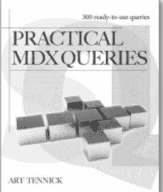
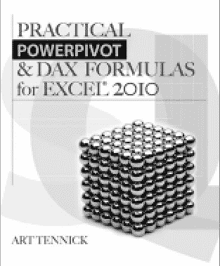
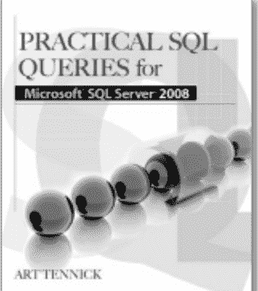
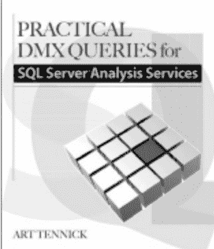
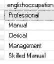
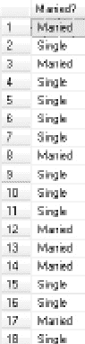
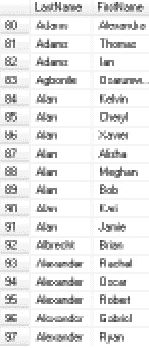

# Microsoft SQL Server 2008 R2 实用 SQL 查询：400 多个准备即用查询


## 关于作者

Art Tennick（来自英国布莱顿）在关系型数据库设计和 SQL 查询领域工作了 20 多年。他参与多维数据库设计、立方体、数据挖掘、DMX 和 MDX 查询已有 10 年。他居住在英国，担任了 25 年的软件顾问、培训师和作家。最近，他与多家大型零售和银行公司合作，使用 Microsoft SQL Server、SSAS、SSIS、SSRS 和 Excel 2007/2010 实施了 BI 解决方案。这是他的第十九本书，他还为美国、英国和爱尔兰的计算机杂志撰写过 300 多篇文章。他的网站是 www.MrCube.net。

## 关于技术编辑

Dejan Sarka 专注于数据库和商业智能应用程序的。除了项目，他还花大约一半的时间从事培训指导。他是斯洛文尼亚 SQL Server 和 .NET 用户组的创始人。Dejan Sarka 是八本关于数据库和 SQL Server 书的主要作者或合著者。Dejan Sarka 还为 Solid Quality Mentors 开发了两门课程：《数据建模基础》和《使用 SQL Server 2008 进行数据挖掘》。

## 汇集了数百个强大的、即取用的查询









Art Tennick 是 SSAS 立方体、数据挖掘、MDX、DMX、XMLA、Excel 2010 PowerPivot 和 DAX 专家顾问和培训师。他的网站是 www.MrCube.net。

在所有销售计算机书籍的地方都有纸质版和电子书。了解更多。更多。MHPROFESSIONAL.COM

> 给我的家人，包括 Viv、Buster 和 Joey。

本页特意留空。

## 目录

### 第一章 查询：单表

- 你好，世界 ... 2
- 从表中查询所有列 ... 2
- 模式名 ... 4
- 数据库名 ... 5
- 切换数据库 ... 6
- 服务器名称 ... 6
- 主题的变体 ... 7
- 特定列 1/2 ... 8
- 特定列 2/2 ... 9
- 列别名 1/2 ... 10
- 列别名 2/2 ... 11
- 两个或多个列 ... 12
- 列的拼接 ... 13
- 字符串拼接 ... 14
- 拼接失败 ... 15
- 类型转换 与转换 ... 16
- 日期列 ... 17
- 日期格式化 1/3 ... 18
- 日期格式化 2/3 ... 18
- 日期格式化 3/3 ... 19
- 系统日期函数 ... 20
- 日期列计算 ... 21
- 数值列计算 1/2 ... 22
- 数值列计算 2/2 ... 23
- 算术计算 ... 24
- 顶部 ... 87
- 测试新表 ... 142
- 从新表中删除数据 ... 143
- 删除新表 ... 143
- 创建空表 ... 144
- 测试新表 ... 145
- 删除新表 ... 145
- 本地临时表 ... 146
- 全局临时表 ... 147
- 半持久性临时表 ... 148
- 从表查询 ... 230
- 创建视图 ... 231
- 从视图查询 ... 232

### 进阶主题

- 选择 ... 242
- 打印 ... 243
- 字符串变量 ... 243
- 数值变量 ... 244
- 系统变量 1/2 ... 244
- 系统变量 2/2 ... 245
- While 1/3 ... 245
- While 2/3 ... 246
- While 3/3 ... 247
- 返回 ... 247
- If ... Else 1/6 ... 248
- If ... Else 2/6 ... 249
- If ... Else 3/6 ... 249
- If ... Else 4/6 ... 250
- If ... Else 5/6 ... 250
- If ... Else 6/6 ... 251
- Case ... When ... End ... 252
- Select 中的变量 ... 252
- 基础查询 ... 253
- 创建过程 ... 254
- 修改过程 ... 255
- 运行存储过程 1/3 ... 255
- 运行存储过程 2/3 ... 256
- 运行存储过程 3/3 ... 257
- 修改过程 ... 258
- 变量 ... 259
- 参数 ... 260
- 传递参数 ... 260
- 默认参数值 ... 261
- 输出参数 1/4 ... 262
- 输出参数 2/4 ... 263
- 输出参数 3/4 ... 264
- 输出参数 4/4 ... 264
- 返回 1/4 ... 265
- 返回 2/4 ... 266


# 目录

- 返回 (Return) 3/4 .................................................................................................................................................................................... 267
- 返回 (Return) 4/4 .................................................................................................................................................................................... 267
- 两个存储过程 ............................................................................................................................................................... 268
- Try ... Catch 1/2 ............................................................................................................................................................................ 269
- Try ... Catch 2/2 ................................................................................................................................................................................. 270
- 你的最后一个存储过程 ........................................................................................................................................................................ 271
- 创建数据库 ...................................................................................................................................................................... 274
- 使用 (Use) ................................................................................................................................................................................... 275
- 创建表 ................................................................................................................................................................................ 275
- 测试表 ........................................................................................................................................................................................................ 276
- 插入 (Insert Into ... Values) ............................................................................................................................................................................... 276
- 主键 ................................................................................................................................................................................................ 277
- 创建表 ................................................................................................................................................................................................ 278
- 外键 ................................................................................................................................................................................................ 279
- 外键违规 .............................................................................................................................................................................................. 279
- 插入 (Insert Into ... Values) ............................................................................................................................................................................................... 280
- 创建索引 ............................................................................................................................................................................................ 280
- 内连接 (Inner Join) ................................................................................................................................................................................................ 281
- 创建视图 ................................................................................................................................................................................................ 281
- 创建函数 ................................................................................................................................................................................... 282
- 创建过程 (Create Proc) ................................................................................................................................................................................................ 283
  - 创建登录 ................................................................................... 283
  - 创建用户 ..................................................................................................... 284
  - 以...身份执行 ....................................................................................... 284
  - 安全测试 ................................................................................................ 285
  - 授予 ............................................................................................................... 285
  - 取消 ............................................................................................................ 286
  - 执行权限 ........................................................................ 287
  - 删除数据库 ................................................................................ 288
  - 何时使用 SQL ................................................................................... 290
  - SSRS ............................................................................................................. 290
  - SSIS ............................................................................................................... 290
  - DMX ................................................................................................................ 290
  - XMLA ............................................................................................................. 290
  - Winforms 和 Webforms ....................................................... 290
  - 第三方软件 ........................................................................ 291
  - 复制和粘贴 ............................................................................... 291

# 索引 .......................................................................................................... 293

# 致谢

感谢我的编辑 Wendy Rinaldi——再次感谢。特别是她，展现了非凡的远见、热情和耐心。再次感谢 McGraw-Hill 的 Joya Anthony 和 Melinda Lyttle。我还要感谢 Dejan Sarka，他担任了一位如此敏锐的技术审查员。

## 引言

结构化查询语言 (`SQL`) 是一种用于查询和操作关系型数据库的标准语言。许多数据库供应商都支持 `SQL`。书中的 `SQL` 代码是针对 `Microsoft SQL Server 2008` 编写的。然而，大约 99% 的查询可以在较早版本的 `SQL Server` 上运行。此外，大约 95% 的查询可以在 `Oracle`、`DB2`、`MySQL` 等数据库上运行。微软在 `SQL Server` 中的 `SQL` 语言实现被称为 `Transact-SQL (T-SQL)`。所有的 `SQL` 方言都有一些细微的差异，但如果你的数据库软件不是 `SQL`，书中的查询也可以适配到你自己的数据库软件。

`SQL` 语言通常分为三个部分：数据操纵语言 (`DML`)、数据定义语言 (`DDL`) 和数据控制语言 (`DCL`)。本书涵盖了这三个部分。`DML` 包含 `Select`、`Insert`、`Update` 和 `Delete`。`DDL` 包含 `Create`、`Alter` 和 `Drop`。`DCL` 包含 `Grant`、`Revoke` 和 `Deny`。`DDL` 和 `DCL` 有其专门的章节，但在其他章节中也会简要讨论。大多数章节都涉及 `DML`——具体而言，我们很大程度上（但不是完全地）集中在 `DML` 的 `Select` 语句上。

通常，当人们谈论 `SQL` 查询时，指的是 `Select` 语句。你将对 `Select` 语句进行大量的大量的练习！但 `SQL` 的其他领域也得到了相当详尽的介绍。

# 前提条件

你需要两个数据库。首先是 `SQL Server AdventureWorksDW2008` 数据库（在 `SQL Server 2005` 中称为 `AdventureWorksDW`），它是 `AdventureWorks` 星型/雪花型/OLAP 架构——大多数 `SQL` 查询都是针对该数据库编写的。其次是 `SQL Server AdventureWorks2008` 数据库（在 `SQL Server 2005` 中称为 `AdventureWorks`），它是一个 OLTP 架构。只有一两个查询是针对该数据库编写的。

# 安装 Adventure Works

你可以从 `codeplex.com` 下载所需的 `SQL Server` 数据库（包括 2008 和 2005 版本）。在写作时，URL 为 `http://www.codeplex.com/MSFTDBProdSamples/Release/ProjectReleases.aspx?ReleaseID=16040`。在 Releases 框中选择 `SQL Server 2008` 或 `SQL Server 2005`。URL 可能会变化——如果你遇到困难，请搜索 `codeplex.com Adventure Works Samples`，或尝试 `http://msftdbprodsamples.codeplex.com`。

# SQL Server 2008

在开始下载之前，你可能想检查“数据库前提”和“安装数据库”两个超链接。下载并运行 `SQL2008.AdventureWorks All Databases.x86.msi`（还有 64 位版本，`x64` 和 `ia64`）。随着安装进行，你需要为你的 `SQL Server` 选择实例名称。安装完成后，你将拥有新的 `SQL Server` 数据库，包括 `AdventureWorksDW2008` 和 `AdventureWorks2008`。

# SQL Server 2005

下载文件名为 `AdventureWorksBICL.msi`（还有 64 位版本，`x64` 和 `IA64`）和 `AdventureWorksDBCL.msi`（还有 64 位版本，`x64` 和 `IA64`）。在 2005 中，你可以通过设置或控制面板添加示例程序——这在 2008 中是不行的。与 2008 不同，下载随后的安装不会导致新数据库出现在 `SSMS` 的 `SQL Server` 下——在手动附加数据库之前，你无法编写第一个查询。你可以从 `SSMS` 中操作（右键点击 Databases 文件夹并选择 Attach）来让它为你完成操作。如果你有一定的 DBA 知识。或者，你可以要求你的 `SQL Server DBA` 为你完成。如果你点击下载页面上的“发行说明”超链接，你会发现如何通过 `SQL` 来完成这一点——甚至在你开始学习 `SQL` 的书籍之前，你就在使用 `SQL` 了！


# 源代码

书中所有查询的源代码均可下载。你可以简单地将其复制并粘贴到编辑器中，以确保你正在输入。你可以复制粘贴单个查询，也可以复制粘贴整个代码块。如果你选择后者，请确保在运行查询之前只高亮相关的代码。

你可以从 `www.mhprofessional.com/computingdownload` 下载源代码。

- **BI** 商业智能
- **BIDS** SQL Server 商业智能开发站
- **DMX** 数据挖掘扩展
- **KPI** 关键性能指标
- **MDX** 多维表达式
- **SQL** 结构化查询语言
- **SSAS** SQL Server 分析服务
- **SSIS** SQL Server 集成服务
- **SSMS** SQL Server 管理服务
- **SSRS** SQL Server 报告服务
- **XMLA** 用于分析的 XML

书中的 SQL 查询同时适用于 `SQL Server 2008` 和 `SQL Server 2005`。

# 企业版/开发版还是标准版？

使用哪种版本区别不大。所有查询都在 SQL Server 的企业版和标准版上运行。

# 编写查询

1. 打开 `SSMS`。
2. 如果提示连接，点击取消。
3. 点击 `文件` | `新建` | `数据库查询`。
4. 在对话框中进行连接。
5. 从工具栏的下拉菜单中选择 `AdventureWorksDW2008` 或 `AdventureWorks2008` 数据库。
6. 输入、拖入或复制粘贴来创建查询。
7. 点击工具栏上的 `执行` 按钮。

打开编辑器有许多其他方法。这里有一种常用的替代方法：

1. 在对象管理器中，右键点击 SQL Server 数据库 `AdventureWorks2008` 或 `AdventureWorks2008`（SQL Server 2005 中的 `AdventureWorks`）。
2. 点击 `新建查询`。

## 第 1 章 “Select：单表”

这是一个入门章节。它侧重于从单表中检索列和行。涵盖了广泛的技巧——进行列计算、列别名、处理日期和空值等。这里讨论的许多技术都是基础性技术，并为你开发更复杂的 SQL 奠定坚实的基础。你将在后面的章节中反复遇到本章中的许多语法。

## 第 2 章 “Where”

本章专注于 `Where` 子句。这是一个巨大的领域，足以填满一整本书，更不用说一个章节了。在这里你将发现如何搜索记录——如何找到你想要的内容。你还会看到如何根据指定的标准重新运行表子集。你的许多 SQL 查询将需要 `Where` 子句——在这里你将熟悉所有返回你想要的内容（并忽略你不需要的内容）的重要概念和技术。

## 第 3 章 “Order By”

如果你需要对 SQL 查询的输出进行排序，请使用 `Order By` 子句。这是本章的主题。它展示了如何按字母和数字排序。它还演示了如何提取表顶部（最好）和底部（最差）的行。

## 第 4 章 选择：多表查询

前三个章节集中于单表查询。你不太可能总在单个表中找到所需的数据。通常，你的数据分布在两个或多个表中。本章将展示将表组合在一起所需的 SQL 语句。这种技术是执行表之间的连接（`joins`）。这里涵盖了连接的许多变体（内连接、外连接以及更多）。当你后续学习视图（`views`）和存储过程时，你会发现这些 SQL 将非常有用。如果你在规范化数据库中连接表，这种操作有时被称为反规范化（例如，星型架构）和 `SSAS` 多维立方。

## 第 5 章 聚合函数

在这里我们学习如何对数据进行聚合。数据聚合包括计数和计算平均值。你可能对如何计算最大值和最小值感兴趣。本章涵盖了所有这些主题。我们将对表中的所有记录进行聚合——因此求和结果包含小计以及总计。能够生成聚合数据会让你为用户报告包含更多信息——他们看到的是整体情况，而不是碎片的数据。在你开始开发数据仓库时，聚合也是一个重要的概念。

## 第 6 章 选择：新表

在本章中，我们检查表的创建。创建表有很多方法——在这里我们集中于 `Select Into`。你将学习如何创建永久表和临时表。此外，我们还将快速查看 `tempdb`。永久表和临时表在报告方面有很多用途。当你的 SQL 变得非常复杂时，你可以将其分解为更简单的步骤并针对临时表（`staging tables`）操作。

## 第 7 章 Except/Intersect/Union

在这里我们检查集合操作。引入三个关键字是 `Union`（并）、`Intersect`（交）和 `Except`（异）。如果你熟悉高中数学中的集合论和维恩图，你已经对它们的工作原理有良好了解。`Union` 将两个或多个表合并。`Intersect` 查看它们的共同点。`Except` 返回表之间的差异。

## 第 8 章 Group By

业务用户经常要求根据特定的类别或数据组显示总计和小计的报告。本章介绍了对数据分组并生成有意义的总计所需的 SQL。重点是 `Group By` 子句以及各种聚合函数，例如 `Sum()`。我们还快速查看了更专门的 `By` 子句。希望你仅通过这一章就能学会足够的 SQL，开始为你的业务用户生成复杂的查询。

## 第 9 章 系统函数

SQL Server 拥有几个内置系统函数。你可以在对象资源管理器中浏览所有函数，它们按类别排列。虽然你始终可以在 SQL 中编写自己的函数，但如果你需要的已经存在了，那么使用预写的函数是有意义的。这将为你节省大量工作和时间。在本章中，我们研究了其中一些系统函数。特别是，我们专注于一些最流行和实用的字符串函数、数学函数和日期函数。这些函数的知识将帮助你按照完全想要的方式轻松操纵和转换数据。

## 第 10 章 子查询

查看查询中的查询——`Select` 语句中的 `Select` 语句。这些通常被称为子查询或嵌套查询。子查询有许多用途，其中一些相当高级，例如派生表。由于这是一本入门书籍，我们将集中在子查询最流行、最简单的用法之一。我们检查了如何在 `Where` 子句中使用子查询。在 SQL 中实现相同的功能有许多方法，这是常有的。你可能可以使用连接、临时表或带有变量的某些过程化编程来获得与子查询相同的结果。其他主题将在本书的其他章节中介绍。

## 引言

## 第 11 章 删除/插入/更新

其他许多章节都涉及从你的表和数据库中提取数据——大量的 `Select` 语句。当然，这假设数据已经存在并处于你所需的格式。相比之下，本章专门用于最初输入和维护数据。如果没有数据，你的 `Select` 语句将返回空。如果没有良好的数据，你的 `Select` 语句将返回错误或过时的数据。在这里，我们通过 `Insert` 语句进行数据输入，并使用 `Update` 语句维护数据准确性。此外，你将学习如何使用 `Delete` 语句删除过时或不需要的数据。还有示例查询展示了如何处理标识（自动编号）列。

## 第 12 章 视图/用户定义函数

随着用户对日益复杂的报告的需求增加，你的 SQL 将变得越来越复杂。与其反复编写语法，不如保存你的 SQL。实现此点有三种主要方法。你（以及其他人）可以重用它来进行复杂的 `Select` 语句——视图本质上是一个存储的查询。你可以随时使用它，而无需感知你最初存入其中的所有复杂 SQL。这被称为*封装*（`encapsulation`）。保存 SQL 的第二方法是创建自己的用户定义函数。这些通常用于存储计算（我们不会涵盖可以存储 `Select` 的表函数）。第三种是创建存储过程。存储过程可以用于存储计算和 `Select`。本章将涵盖视图和函数。

## 第 13 章 存储过程/编程

这是为过程化程序员准备的章节。它引入了许多你可能认为不是 SQL 的语法。事实上，严格来说，其中一些并不是 SQL。我们应该称其为 `T-SQL` (Transact-SQL)，它是 SQL Server 版本的 SQL，包含了扩展 SQL 的关键字和概念。这些扩展非常强大，可以帮助你的查询变得真正动态且多变。例如，你可以根据条件因素在运行时动态更改 `Where` 子句。此外，存储过程提供了代码的封装。如果你写得正确，存储过程中的 `Select` 运行速度会比作为独立查询时快得多。

### 选择：单表


这是一个入门章节。它侧重于从单表中检索数据列。书中涵盖了多种技术——执行列计算、列别名、处理日期和空值等。本文讨论的许多技术都是基础性的，能为你开发更复杂的 SQL 奠定坚实的基础。在后续学习更复杂的 SQL 时，你将在后续章节再次遇到本章中的许多语法。

- 核心概念：从单表中选择列、架构名称、数据库名称、大小写敏感、别名、XML、连接、数据类型、日期和数值计算、Case 函数
- 关键字：`Select`、`From`、`Use`、`As`、`Cast()`、`Convert()`、`GetDate()`、`Datediff()`、`Distinct`、`Top`、`For Xml`、`IsNull()`、`Is Null`、`Coalesce()`、`Case`

### Hello World

你的第一个 `Select` 查询！

#### 语法

```sql
-- hello world
-- this is a comment as is the line above
select 'Hello World'
```

#### 结果

| 无列名 |
| :--- |
| Hello World |

#### 分析

我猜这可能不是什么最有趣的 SQL 查询了。然而，它证明了一个点——`Select` 语句并不非要从表中返回数据。`Select` 可以返回字面量（字符串和数字）、变量值、函数返回值等。我们将在本书的过程中研究所有这些内容——本章的其余部分将致力于从单张关系表中返回数据。

### 从表中选择所有列

这与之前的查询不同——它有一个 `From` 子句。它返回了名为 `DimCustomer` 的表中所有的列或字段（以及所有的行或记录）。

#### 语法

```sql
-- basic select
-- 确保你已连接到 AdventureWorksDW2008 (SQL Server 2008) 或 AdventureWorksDW (SQL Server 2005)
select * from DimCustomer
```

#### 结果

| CustomerID | PersonKey | CustomerName | Title | FirstName | LastName | NameStyle | BirthDate | MiddleName | Suffix | Gender |
| :--- | :--- | :--- | :--- | :--- | :--- | :--- | :--- | :--- | :--- | :--- |
| 10001 | 25 | AW00001001 | NULL | John | Yang | D | 1935-04-08 | M | NULL | M |
| 10002 | 37 | AW00001002 | NULL | Nancy | Foley | NULL | 1965-05-14 | S | NULL | F |
| 10003 | 31 | AW00001003 | NULL | James | Smith | NULL | 1950-03-10 | | NULL | M |
| 10004 | 11 | AW00001004 | NULL | Elizabeth | Johnson | NULL | 1928-12-15 | | | NULL | F |
| 10005 | 54 | AW00001005 | NULL | Cindy | Hill | NULL | 1935-08-05 | S | NULL | F |
| 10006 | 22 | AW00001006 | NULL | John | Ruiz | NULL | 1969-07-20 | S | NULL | M |
| 10007 | 8 | AW00001007 | NULL | Sarah | Lopez | G | 1946-09-12 | | | NULL | F |
| 10008 | 41 | AW00001008 | NULL | Michael | Meklin | NULL | 1954-07-03 | | NULL | M |
| 10009 | 32 | AW00001009 | NULL | Robert | Davis | NULL | 1934-06-27 | | NULL | M |
| 10010 | 75 | AW00001010 | NULL | Steven | Carter | C | 1964-04-16 | S | NULL | M |
| 10011 | 32 | AW00001011 | NULL | Mary | Garcia | S | 1952-01-18 | M | NULL | F |
| 10012 | 27 | AW00001012 | NULL | Laura | Walker | NULL | 1967-11-14 | | | NULL | F |
| 10013 | 62 | AW00001013 | NULL | William | Lawson | M | 1935-01-05 | M | NULL | M |
| 10014 | 53 | AW00001014 | NULL | Jan | Jenkins | NULL | 1968-08-06 | | NULL | F |
| 10015 | 31 | AW00001015 | NULL | Nicole | Young | NULL | 1979-02-27 | S | NULL | F |
| 10016 | 58 | AW00001016 | NULL | Wyatt | Hill | NULL | 1935-07-24 | M | NULL | |
| 10017 | 39 | AW00001017 | NULL | Shannon | Weiss | NULL | 1944-06-25 | S | NULL | |

要返回表的所有列，使用星号 (`*`)。通常情况下，`select * from table` 的良好做法是显式地列出列名而不是使用星号；这样可以避免任何歧义。带有 `Dim` 前缀的表通常被称为“维度表（dimension tables）”。结果显示了超过 18000 个客户，行数位于编辑器的右下角。如果查询由于无效对象失败，请确保你连接到了正确的数据库——如果你有正确的数据库但仍然 get 错误，请确保你在语法中大写了表名（`DimCustomer`）。

#### 架构名称

在这里，表名之前有一个前缀。大多数情况下，你可能会忽略该前缀并直接使用表名，但这通常是不良的。你应该始终使用架构名称。

#### 语法

```sql
-- schema name
select * from dbo.Customer
```

#### 结果

| CustomerID | Age | CustomerName | Title | FirstName | LastName | BirthDate | MaritalStatus | Suffix | Gender |
| :--- | :--- | :--- | :--- | :--- | :--- | :--- | :--- | :--- | :--- |
| 11069 | 25 | AW0001006 | NULL | V | | | | | 1958-04-08 | M | M |
| 11070 | 37 | AW0001010 | NULL | Fene | | | | | 1965-05-14 | S | M |
| 11082 | 31 | AW0001002 | NULL | Robert | | | | | 1965-08-12 | M | M |
| 11083 | 11 | AW0001011 | NULL | Claudy | | | | | 1962-10-15 | F | F |
| 11084 | 54 | AW0001013 | NULL | Thomas | | | | | | |
| 11085 | 22 | AW0001015 | NULL | Judy | | | | | 1965-09-05 | M | M |
| 11086 | 09 | AW0001006 | NULL | Janet | G | | | | 1952-12-06 | S | F |
| 11087 | 41 | AW0001007 | NULL | Maria | | | | | 1964-07-19 | M | M |
| 11088 | 32 | AW0001009 | NULL | Steven | | | | | 1957-07-23 | M | F |
| 11089 | 25 | AW0001010 | NULL | | | | | | 1964-04-01 | S | M |
| 11090 | 22 | AW0001016 | NULL | Jacques | C | | | | 1964-02-06 | M | F |
| 11091 | 27 | AW0001017 | NULL | Carol | | | | | 1963-11-14 | M | M |
| 11092 | 61 | AW0001019 | NULL | | | | | | | |
| 11093 | 54 | AW00011014 | NULL | Ian | M | | Jenkins | | | 1958-08-06 | M | F |
| 11094 | 83 | AW00011015 | NULL | Sydney | | | | | 1939-05-09 | S | F |
| 11095 | 31 | AW0001005 | NULL | Clive | | | | | 1972-07-27 | S | F |
| 11096 | 32 | AW0001016 | NULL | Joel | | | | | 1973-07-28 | M | M |
| 11097 | 23 | AW0001017 | NULL | Susan | | | | | 1944-06-28 | S | F |

#### 分析


如果你展开一个数据库，查看 SQL Server Management Studio (SSMS) 的对象资源管理器中的文件夹，你会注意到表名在所属的表之前有一个前缀。默认情况下，架构将是 `dbo`。此外，`dbo` 是所有用户的默认架构——除非你的 SQL 管理员更改了它。如果设计人员将表分配给另一个架构，那么你可能需要包含架构名称。

# 第1章：选择：单表

在之前的查询中，我们可能会忽略该前缀并直接使用表名，但建议我们始终使用架构名称。

## 语法

```sql
-- schema name
-- 2008
-- 2005
-- 2008
select * from dbo.Customer
```

## 结果

| CustomerID | Age | CustomerName | Title | FirstName | LastName | BirthDate | MaritalStatus | Suffix | Gender |
| :--- | :--- | :--- | :--- | :--- | :--- | :--- | :--- | :--- | :--- |
| 11069 | 25 | AW0001006 | NULL | V | | | | | 1958-04-08 | M | M |
| 11070 | 37 | AW0001010 | NULL | Fene | | | | | 1965-05-14 | S | M |
| 11082 | 31 | AW0001002 | NULL | Robert | | | | | 1965-08-12 | M | M |
| 11083 | 11 | AW0001011 | NULL | Claudy | | | | | 1962-10-15 | F | F |
| 11084 | 54 | AW0001013 | NULL | Thomas | | | | | | | |
| 11085 | 22 | AW0001015 | NULL | Judy | | | | | 1965-09-05 | M | M |
| 11086 | 09 | AW0001006 | NULL | Janet | G | | | | 1952-12-06 | S | F |
| 11087 | 41 | AW0001007 | NULL | Maria | | | | | 1964-07-19 | M | M |
| 11088 | 32 | AW0001009 | NULL | Steven | | | | | 1957-07-23 | M | F |
| 11089 | 25 | AW0001010 | NULL | | | | | | 1964-04-01 | S | M |
| 11090 | 22 | AW0001016 | NULL | Jacques | C | | | | 1964-02-06 | M | F |
| 11091 | 27 | AW0001017 | NULL | Carol | | | | | 1963-11-14 | M | M |
| 11092 | 61 | AW0001019 | NULL | | | | | | | | |
| 11093 | 54 | AW00011014 | NULL | Ian | M | | Jenkins | | | 1958-08-06 | M | F |
| 11094 | 83 | AW00011015 | NULL | Sydney | | | | | 1939-05-09 | S | F |
| 11095 | 31 | AW0001005 | NULL | Clive | | | | | 1972-07-27 | S | F |
| 11096 | 32 | AW0001016 | NULL | Joel | | | | | 1973-07-28 | M | M |
| 11097 | 23 | AW0001017 | NULL | Susan | | | | | 1944-06-28 | S | F |

## 切换数据库

`Use` 语句是上一个查询语法的替代方案。只有当当前数据库上下文为 `AdventureWorksDW2008` 时才需要它（如果你使用的是 SQL Server 2005，请尝试 `AdventureWorks`）。

## 语法

```sql
-- alternative use AdventureWorksDW2008 select * from dimcustomer
```

## 结果

| CustomerID | Age | CustomerName | Title | FirstName | LastName | MiddleName | Location | BirthDate | Modifier | Status | Gender |
|---|---|---|---|---|---|---|---|---|---|---|---|
| 1 | 110000 | 25 | AW00011000 | NULL | Jim | V | Yang | D | 1968-04-08 | M | NULL | M |
| 2 | 11001 | 37 | AW00011001 | M | Fergus | | Hu | | D | 1965-05-14 | S | NULL | M |
| 3 | 11002 | 31 | AW00011002 | NULL | Robert | | | | D | 1962-08-12 | M | NULL | M |
| 4 | 11003 | 41 | AW00011003 | NULL | Alice | | | | D | 1962-03-25 | S | NULL | F |
| 5 | 11004 | 19 | AW00011004 | NULL | Elizabeth | | | Johnson | D | 1952-08-05 | S | NULL | F |
| 6 | 11005 | 22 | AW00011005 | NULL | John | | | Ruiz | D | 1955-09-16 | S | NULL | M |
| 7 | 11006 | 8 | AW00011006 | NULL | Janet | G | Alvarez | D | 1954-12-04 | S | NULL | M |
| 8 | 11007 | 40 | AW00011007 | NULL | Maria | | | | D | 1954-06-15 | S | NULL | M |
| 9 | 11008 | 32 | AW00011008 | NULL | Peter | | | Webb | D | 1954-07-07 | S | NULL | M |
| 10 | 11009 | 25 | AW00011009 | NULL | Sheila | C | | | D | 1964-04-01 | S | NULL | M |
| 11 | 11010 | 32 | AW00011010 | NULL | Jacques | Q | Suarez | D | 1964-02-10 | S | NULL | F |
| 12 | 11011 | 27 | AW00011011 | NULL | Terry | | | | D | 1962-11-14 | M | NULL | M |
| 13 | 11012 | 61 | AW00011012 | NULL | Lauren | N | Walker | D | 1938-01-18 | M | NULL | F |
| 14 | 11013 | 543 | AW00011013 | NULL | Ian | M | Jenkins | N | 1958-06-06 | M | NULL | F |
| 15 | 11014 | 634 | AW00011014 | NULL | Sydney | | | Bennett | D | 1960-05-19 | S | NULL | F |
| 16 | 11015 | 30 | AW00011015 | NULL | Kelly | | | Young | D | 1973-04-28 | M | NULL | M |
| 17 | 11016 | 329 | AW00011016 | NULL | Shannon | | | Diana | D | 1964-06-26 | S | NULL | F |

## 分析

此查询最终将产生一个结果——`DimCustomer` 表中的所有列和行。然而，这两个查询的效果是有细微的。最后一个查询没有更改数据库上下文。而此查询更改了当前的数据库上下文——如果你连接到另一个数据库，下拉菜单中的数据库名称将会改变。如果我没有包含架构模式（schema name），你应该始终尝试这样做。由于这是一本学习用书，这意味着你可以少打几个字。

## 服务器名称

现在我们有了服务器名称。这是一个完全限定的表名。

## 语法

```sql
-- server name
select * from MyServer.AdventureWorksDW2008.dbo.DimCustomer
```

## 结果

```text
Msg 7002. Level 11. State 2. Line 0 未指定正确的服务器名称。在指定的范围内未找到服务器 'MyServer'。
```

## 分析

一个完全限定的表名由服务器名、数据库名、架构模式最后是表名组成。为了使此查询工作，你需要一个有效的服务器名（可能不是 `MyServer`！），并且该服务器必须连接到你正在工作的服务器。设置服务器是一项任务。

## 变体

这里有四个查询之间存在细微差异。这四个查询都应该工作并产生相同的结果（你可能会发现在某些情况下第三个查询会失败）。SQL 语法是不区分大小写的，但分号是可选的。

## 语法

```sql
select * from DimCustomer;
```

## 结果

| CustomerID | Age | CustomerName | FirstName | LastName | BirthDate | Gender |
|---|---|---|---|---|---|---|
| 1 | 11000 | 26 | AW00011000 | Jan | V | 1965-04-18 | M |
| 2 | 11001 | 37 | AW00011001 | Fiona | I | 1965-05-14 | S |
| 3 | 11002 | 31 | AW00011002 | Ruben | L | 1965-09-12 | M |
| 4 | 11003 | 41 | AW00011003 | Missy | F | 1962-03-15 | F |
| 5 | 11004 | 39 | AW00011004 | Elizabeth | R | 1965-07-29 | S |
| 6 | 11005 | 22 | AW00011005 | John | D | 1965-06-05 | S |
| 7 | 11006 | 8 | AW00011006 | Janet | G | 1965-12-06 | M |
| 8 | 11007 | 48 | AW00011007 | Monica | M | 1964-11-14 | M |
| 9 | 11008 | 32 | AW00011008 | Paul | P | 1964-07-07 | S |
| 10 | 11009 | 25 | AW00011009 | Maria | A | 1964-04-14 | M |
| 11 | 11010 | 22 | AW00011010 | Jacqueline | C | 1964-02-06 | S |
| 12 | 11011 | 37 | AW00011011 | Carla | E | 1963-11-14 | L |
| 13 | 11012 | 63 | AW00011012 | Lauri | M | 1958-10-17 | M |
| 14 | 11013 | 54 | AW00011013 | Nancy | J | 1968-06-06 | M |
| 15 | 11014 | 84 | AW00011014 | Sydney | M | 1965-05-09 | S |
| 16 | 11015 | 37 | AW00011015 | Chris | C | 1979-07-27 | S |
| 17 | 11016 | 39 | AW00011016 | Wyatt | J | 1975-04-28 | M |
| 18 | 11017 | 39 | AW00011017 | Shanna | S | 1944-06-28 | S |

## 特定列 1/2

在这里，星号被替换为了特定的列名。

## 语法

```sql
-- a specific column
select lastname from DimCustomer
```

## 结果

| | Lastname |
|---|---|
| 1 | Yang |
| 2 | Huang |
| 3 | Tomco |
| 4 | Zhu |
| 5 | Johnson |
| 6 | Ruiz |
| 7 | Alvarez |
| 8 | Mehra |
| 9 | Veill |
| 10 | Carter |
| 11 | Suced |
| 12 | Li |
| 13 | Walker |
| 14 | Jenkins |
| 15 | Bennett |
| 16 | Young |
| 17 | Hill |
| 18 | Wong |
| 19 | Rao |

## 分析

你仍然应该看到超过 18,000 个客户的行，但只有一列。如果你怀疑数据库是区分大小写的，请将 `lastname` 替换为 `LastName`（参见下一个查询）。你可以展开对象管理器中的“列”文件夹来检查大小写。请注意，你可以从对象管理器将对象名称拖放到查询编辑器窗口中。拖放操作可以避免拼写错误，并且在区分大小写的数据库上工作时，也能正确处理大小写。

## 特定列 2/2

这与上一个查询相同——只是列名的大小写不同。

## 语法

```sql
select LastName from DimCustomer
```

## 结果

| ID | LastName |
|---|---|
| 1 | Velyy |
| 2 | Huaiq |
| 3 | Tony |
| 4 | Zhu |
| 5 | Johnson |
| 6 | Ruiz |
| 7 | Alvazaz |
| 8 | Mahli |
| 9 | Velhff |
| 10 | Ceton |
| 11 | Swatz |
| 12 | Lu |
| 13 | Walker |
| 14 | Jenkins |
| 15 | Riwitt |
| 16 | Yong |
| 17 | Hill |
| 18 | Wory |
| 19 | Ru |

## 分析

对于本书的大多数读者来说，这个查询和上一个查询都能正常工作并产生相同的结果。嗯，并不完全如此。你可能想看看列标题的说明——这个查询中的标题看起来更好（是 LastName，而不是 lastname）。对于极少数读者（那些使用区分大小敏感数据库的读者）来说，只有这个查询可以运行。我不再提到大小写敏感性，但如果你的数据库是区分大小写写的，在完成书中的查询时请记住这一点——你们大多数人都忽略了这个问题。

## 列别名 1/2

通常，数据库设计人员可能会为列选择晦涩的名字（我在蓝筹企业的实际生产数据库中见过过列名为 `Column1` 的情况）。或者你可能只是简单地为列使用一个不同的名称。使用别名来重命名列。这里有三个查询可以尝试，可以单独尝试（如果你是从书的下载处粘贴的代码，可以单独高亮）或一起尝试（不高亮或高亮所有三个）。

## 语法

```sql
-- column alias 1/2
select lastname as Surname from dimcustomer
select lastname Surname from dimcustomer
select Surname = lastname from dimcustomer
```

## 结果

| ID | | |
|---|---|---|
| 1 | Vang |
| 2 | Huang |
| 3 | Tuo |
| 4 | Zhu |
| 5 | Johnson |
| 6 | Ruiz |
| 7 | Alvaz |
| 8 | Mahdi |
| 9 | Yehud |
| 10 | Colton |
| 11 | Suarez |
| 12 | Lu |
| 13 | Walker |
| 14 | Jenkins |
| 15 | Swandel |
| 16 | Yong |
| 17 | Hill |
| 18 | Wong |
| 19 | Ru |

## 分析

如果你一起运行所有三个查询，可能需要向下滚动才能看到所有的结果集。这三个查询产生相同的预期效果，`LastName` 现在变成了 `Surname`。语法的选择当然由你决定。许多 SQL 程序员倾向于使用带有 `As` 关键字的第一种方案——也许它更明确且更易读。

## 列别名 2/2

这里的别名略有不同——别名中有一个空格。有两个查询——请分别运行它们。如果你一起运行它们，将看不到返回任何数据。

## 语法

```sql
-- column alias 2/2
select lastname as Last Name from dimcustomer
select lastname as [Last Name] from dimcustomer
```

## 结果

| ID | Last Name |
|---|---|
| 1 | Yang |


#### 分析

第一个查询失败了。如果别名包含空格，则必须使用方括号。这是一个通用规则，适用于其他对象，而不只是别名。如果你有原始列名包含空格，必须使用方括号；否则，你会收到错误信息。如果你单独运行第二个查询，列标题将是 Last Name。

#### 两个或多个列

到目前为止，你通过星号 `*` 返回了表中的所有列。这个查询只返回两个列。

#### 语法

```sql
-- two or more specific columns
select firstname, lastname from DimCustomer
select lastname, firstname from DimCustomer
```

#### 结果

| lastname | firstname |
|---|---|
| 1 | Yang | Jon |
| 2 | Huang | Eugene |
| 3 | Torres | Ruben |
| 4 | Zhu | Chris |
| 5 | Johnson | Elizabeth |
| 6 | Ruiz | Julio |
| 7 | Alvarez | Janet |
| 8 | Mehta | Marco |
| 9 | Velhof | Rob |
| 10 | Carlton | Shannon |
| 11 | Suarez | Jasquelyn |
| 12 | Lu | Curtis |
| 13 | Walker | Lauren |
| 14 | Jenkins | Ian |
| 15 | Bennett | Sydney |
| 16 | Young | Chloe |
| 17 | Hill | Wyatt |
| 18 | Wang | Shannon |
| 19 | Rai | Clarence |

#### 分析

两个查询返回相同的数据——但列的顺序不同。要检索两个列，请用逗号分隔列名。如果你想要更多列，编写逗号分隔的列表——请注意最后一列后没有逗号。如果你想要所有列，使用星号 `*` 要容易得多。不要贪懒而总是使用列名。你可以在对象资源管理器中右键点击表并选择“新建查询”来生成完整的列表。

#### 列连接

将一列附加到另一列称为连接——符号是加号 `+`。这里的两个查询使用了两个列，但输出是单列。

#### 语法

```sql
-- concatenation
select firstname + lastname from dimcustomer
select firstname + lastname as [Full Name] from dimcustomer
```

#### 结果

| ID | Full Name |
|---|---|
| 1 | Jon Yang |
| 2 | Eugene Huang |
| 3 | Ruben Torres |
| 4 | Chris Zhu |
| 5 | Elizabeth Johnson |
| 6 | Julio Ruiz |
| 7 | Janet Alvarez |
| 8 | Marco Mehta |
| 9 | Rob Velhof |
| 10 | Shannon Carlson |
| 11 | Jessica Suarez |
| 12 | Curtis Lu |
| 13 | Lauren Walker |
| 14 | Ian Jenkins |
| 15 | Sydney Bennett |
| 16 | Chloe Young |
| 17 | Wyatt Hill |
| 18 | Shannon Wang |
| 19 | Clarence Rai |

#### 分析

第二个查询有一个别名——它的列标题更用户友好。连接列时要小心。它适用于两个字符串（例如 `char` 或 `varchar`），但不适用于数值列（例如数据类型为 `int` 的）。在后者的情况下，它会将数字相加。你可以在对象资源管理器中查看列的数据类型。

#### 添加字符串

你可以通过添加自己的文本来改进连接。在这里，列由逗号和空格分隔。

#### 语法

```sql
- concatenation with text
select firstname + ' ' + lastname as [Full Name] from dimcustomer
```

#### 结果

| ID | Full Name |
|---|---|
| 1 | Jon, Yang |
| 2 | Eugene, Huang |
| 3 | Ruben, Toren |
| 4 | Chris, Zhu |
| 5 | Elizabeth, Johnson |
| 6 | Julio, Ruiz |
| 7 | Janet, Alvarez |
| 8 | Marco, Mehta |
| 9 | Rob, Verhof |
| 10 | Shannon, Carlson |
| 11 | Jocelyn, Suarez |
| 12 | Custo, Lu |
| 13 | Lauren, Jenkins |
| 14 | Ian, Jenkins |
| 15 | Sydney, Bennett |
| 16 | Chloe, Young |
| 17 | Wyatt, Hill |
| 18 | Shannon, Wang |
| 19 | Clarence, Rai |

#### 分析

你添加了一些用户定义的文本。严格来说，我们应该称其为 `string` 而不是 `text`——`text` 在 SQL Server 中有特定的含义。`text` 是一种数据类型——`string` 不是数据类型而是一个安全的通用术语。字符串包含在单引号内。顺便说，SQL Server 的 SQL 方言通常被称为 T-SQL 或 Transact-SQL。书中的大多数 T-SQL 语法都是标准 SQL (ANSI SQL)，对于 Oracle、DB2 或 MySQL 等其他数据库软件也是有效的。

#### 连接失败

我们所做的只是更改了第二个列并使用了不同的别名。预计此查询无法工作。

#### 语法

```sql
-- concatenation fails
select lastname + ' ' + customerkey from dimcustomer
```

#### 结果

Msg 245, Level 16, State 1, Line 2

将 nvarchar 'Yang ' 转换为 int 类型失败。

#### 分析

如果你连接两个字符列，它们会拼接。如果你连接两个数值列，得到的不是连接——而是和。如果你将一个字符列连接到一个数值列，你会得到错误。在这里，CustomerKey 是一个数值列。SQL Server 不知道你想真正的连接（拼接）还是相加。你可以在下一个查询中看到如何修复错误。

#### Cast 和 Convert

如果你想连接一个字符列和一个数值列怎么办？为此，你可以使用 `Cast()` 或 `Convert()`。这两个查询产生相同的结果。

#### 语法

```sql
cast or convert
select lastname + ' ' + cast(customerkey as varchar) as [Name ID]
from dimcustomer
select lastname + ' ' + convert (varchar, customerkey) as [Name ID]
from dimcustomer
```

#### 结果

| Name ID |
|---|
| 1 | Yang 11000 |
| 2 | Huang 11001 |
| 3 | Torres 11002 |
| 4 | Zhu 11003 |
| 5 | Johnson 11004 |
| 6 | Ruiz 11005 |
| 7 | Alvarez 11006 |
| 8 | Mehta 11007 |
| 9 | Varnell 11008 |
| 10 | Carlson 11009 |
| 11 | Suarez 11010 |
| 12 | Lu 11011 |
| 13 | Walker 11012 |
| 14 | Jenkins 11013 |
| 15 | Bennett 11014 |
| 16 | Young 11015 |
| 17 | Hill 11016 |
| 18 | Wang 11017 |
| 19 | Rai 11018 |

#### 分析

LastName 是一个字母列（数据类型为 `varchar`）。CustomerKey 是一个数值列（数据类型为 `int`）。`Cast()` 和 `Convert()` 函数可以将数值列转换为字母列。`Cast()` 和 `Convert()` 通常是可以互用的。SQL 程序员更倾向于使用 `Cast()`，因为它更易读一些。然而，`Convert` 具有许多额外的功能，在处理日期时间时非常有用。`Cast()` 是 ANSI 标准，而 `Convert()` 不是——`Convert()` 可能无法非 SQL Server 数据库上运行。

#### 日期列

日期列因引起问题而闻名。这里有一个日期查询。

#### 语法

```sql
-- 日期格式（默认 ANSI）
select birthdate from dimcustomer
```

#### 结果

| | birthdate |
|---|---|
| 1 | 1966-04-08 |
| 2 | 1965-05-14 |
| 3 | 1965-08-12 |
| 4 | 1968-02-15 |
| 5 | 1969-08-06 |
| 6 | 1965-08-05 |
| 7 | 1965-12-36 |
| 8 | 1964-05-09 |
| 9 | 1964-07-07 |
| 10 | 1964-04-01 |
| 11 | 1964-02-06 |
| 12 | 1963-11-04 |
| 13 | 1963-01-10 |
| 14 | 1968-05-26 |
| 15 | 1968-05-09 |
| 16 | 1979-02-27 |
| 17 | 1979-04-28 |
| 18 | 1944-06-26 |
| 19 | 1944-10-09 |

#### 分析

它可以运行，但显示方式对用户并不友好。这是 SQL Server 日期的默认显示方式（yyyy-mm-dd）。BirthDate 列的数据类型是 `date`。如果你使用的是 SQL Server 2005，数据类型是 `datetime`，你的结果将显示日期后的时间（在本例中为午夜）。

#### 格式化日期 1/3

使用 `Convert()` 函数来格式化日期列。

#### 语法

```sql
-- 日期格式 美国 4 位年份
select convert(varchar,birthdate,101) as [US Date] from dimcustomer
```

#### 结果

| | US Date |
|---|---|
| 1 | 04/08/1966 |
| 2 | 05/14/1965 |
| 3 | 08/12/1965 |
| 4 | 02/15/1968 |
| 5 | 09/09/1968 |
| 6 | 08/05/1965 |
| 7 | 12/06/1965 |
| 8 | 05/09/1964 |
| 9 | 07/07/1964 |
| 10 | 04/01/1964 |
| 11 | 02/06/1964 |
| 12 | 11/04/1963 |
| 13 | 01/18/1968 |
| 14 | 08/06/1968 |
| 15 | 05/03/1968 |
| 16 | 02/27/1979 |
| 17 | 04/28/1979 |
| 18 | 06/26/1944 |
| 19 | 10/09/1944 |

#### 分析

日期列已被转换为字母列（数据类型为 `varchar`）。但在这里，`Convert()` 函数有第三个参数 101。`Cast()` 函数不支持此扩展。结果是带有四位年份的美国格式日期。

#### 格式化日期 2/3

`Convert()` 函数的第三个参数从 101 变为了 1。

#### 语法

```sql
-- 日期格式 美国 2 位年份
select convert(varchar,birthdate,1) as [US Date] from dimcustomer
```

#### 结果

| US Date |
|---|
| 1 | 04/05/66 |
| 2 | 05/14/66 |
| 3 | 08/12/65 |
| 4 | 02/15/68 |
| 5 | 08/08/68 |
| 6 | 08/30/65 |
| 7 | 12/06/65 |
| 8 | 05/03/64 |
| 9 | 02/27/64 |
| 10 | 04/01/64 |
| 11 | 02/08/64 |
| 12 | 11/14/63 |
| 13 | 07/16/68 |
| 14 | 05/06/68 |
| 15 | 05/09/68 |
| 16 | 02/27/79 |
| 17 | 04/29/79 |
| 18 | 05/26/44 |
| 19 | 10/31/44 |

#### 分析

这次，你得到了美国格式的日期，但年份是两位数的。如果你想研究 `Convert()` 第三个参数的代码，请突出显示 `Convert` 单词并按 F1。

#### 格式化日期 3/3

这次 `Convert()` 的第三个参数是 103。

#### 语法

```sql
-- 日期格式 英国 4 位年份
select convert(varchar,birthdate,103) as [UK Date] from dimcustomer
```

#### 结果

| UK Date |
|---|
| 1 | 08/04/1968 |
| 2 | 14/05/1965 |
| 3 | 12/23/1965 |
| 4 | 15/02/1968 |
| 5 | 08/08/1968 |
| 6 | 05/09/1965 |
| 7 | 06/12/1965 |
| 8 | 09/05/1964 |
| 9 | 07/07/1964 |
| 10 | 01/04/1964 |
| 11 | 06/02/1964 |
| 12 | 04/11/1963 |
| 13 | 18/01/1968 |
| 14 | 06/09/1968 |
| 15 | 09/05/1968 |
| 16 | 27/02/1979 |
| 17 | 28/04/1979 |
| 18 | 26/05/1944 |
| 19 | 09/10/1964 |

#### 分析

参数 103 给你一个四位年份的英国格式日期（参数 3 会导致两位数年份）。

#### 系统日期函数

这里没有子句——我们没有操作表。`GetDate()` 是一个系统函数——它返回当前的日期时间。

#### 语法

```sql
-- 今天的日期（无列名）
select GETDATE()
```

#### 结果

| (无列名) |
|---|
| 1 | 2009-08-29 17:05:47.280 |

#### 分析

你应该查看当前的日期时间。我猜你的答案和我的不一样！`GetDate()` 是区分大小写的。Microsoft 提供了许多系统函数。如果你想查看系统函数，在对象资源管理器中展开数据库，然后展开可编程（Programmability），然后展开函数（Functions）。

#### 日期计算

在这里我们介绍了另一个处理日期的系统函数 `DATEDIFF()`。希望这个查询对你很有用。

#### 语法

```sql
-- 列计算
select birthdate, DATEDIFF(yy,birthdate,GETDATE()) as Age
from dimcustomer
```

#### 结果

| birthdate | Age |
|---|---|
| 1 | 1966-04-08 | 43 |
| 2 | 1965-05-14 | 44 |
| 3 | 1965-08-12 | 44 |
| 4 | 1968-02-15 | 41 |
| 5 | 1968-08-08 | 41 |
| 6 | 1968-08-05 | 44 |
| 7 | 1965-12-06 | 44 |
| 8 | 1964-06-09 | 45 |
| 9 | 1964-07-07 | 45 |
| 10 | 1964-04-01 | 45 |
| 11 | 1964-02-06 | 45 |
| 12 | 1963-11-04 | 46 |
| 13 | 1968-01-18 | 41 |
| 14 | 1968-08-06 | 41 |


| 15 | 1968-05-29 | 41 |
| 16 | 1979-02-27 | 30 |
| 17 | 1979-04-28 | 30 |
| 18 | 1944-06-26 | 65 |
| 19 | 1944-10-09 | 65 |

#### 分析

通常，你想要查看自起始日期或起始时间以来经过了多久。例如，如果你在营销部门，你可能想查看客户的年龄。在名为 `Age` 的表中直接设置一个列（除非是计算列）是没有意义的——你将每年为每个客户更新该列！这可能是一个更好的解决方案——它使用了 `DateDiff` 函数。该函数计算客户出生日期与当前日期之间的年数。`DateDiff` 函数的第一个参数是 `yy`。要查看完整的代码列表，请突出显示 `DateDiff` 并按 F1。由于某些原因，我的帮助系统带我到了 `DATEADD()`——但代码是不一样的。这种异常在你 SQL Server 版本中可能会修复。

#### 数值列计算 1/2

除了日期列计算，你还可以使用数值列进行计算。在这里，你正尝试查找有多少孩子住在外。预计此查询会失败——至少是部分。

#### 语法

```sql
-- 列计算
select totalchildren, numberchildrenathome,
totalchildren - numberchildrenathome as AwayFromHome
from DimCustomer
```

#### 结果

```
Msg 8115, Level 16, State 2, Line 2
Arithmetic overflow converting expression to data type int.
```

#### 分析

在切换到“消息”选项卡并显示关于溢出的错误之前，你可能只在“结果”选项卡上看到数据闪烁。如果你那时点击“结果”选项卡，你会看到返回了一些记录——所以你可能因此认为查询是成功的。然而，你会在底部看到一条注释说明查询已完成。

#### 数值列计算 2/2

这里使用 `Cast()` 函数将参与计算的两个列（`TotalChildrenAtHome`）转换为 `smallint` 类型。

#### 语法

```sql
-- 列计算
select totalchildren, numberchildrenathome,
cast(totalchildren as smallint) - cast(numberchildrenathome as smallint)
as AwayFromHome
from DimCustomer
```

#### 结果

| totalchildren | numberchildrenathome | AwayFromHome |
|---|---|---|
| 1 | 0 | 2 |
| 2 | 3 | 0 |
| 3 | 3 | 0 |
| 4 | 0 | 0 |
| 5 | 5 | 0 |
| 6 | 0 | 0 |
| 7 | 0 | 0 |
| 8 | 3 | 0 |
| 9 | 4 | 0 |
| 10 | 0 | 0 |
| 11 | 0 | 0 |
| 12 | 4 | 0 |
| 13 | 0 | 2 |
| 14 | 0 | 2 |
| 15 | 3 | 3 |
| 16 | 0 | 0 |
| 17 | 0 | 0 |
| 18 | 4 | 4 |

#### 分析

如果你在对象资源管理器中检查这两个列，你会发现它们的数据类型都是 `tinyint`。`tinyint` 只支持正整数。一个 `tinyint` 列减去一个 `tinyint` 列将尝试将结果（别名为 `AwayFromHome`）作为 `tinyint` 输出。然而，第 83 行的客户 `AwayFromHome` 为负数——之前的查询正是在这一记录处失败的。

## 算术计算

如果我们正处于衰退期呢？也许我们所有的客户的年收入都应该增加10%。

#### 语法

```sql
-- numeric calculation
select YearlyIncome, YearlyIncome * 1.1 as [After Increase] from
distcustomer
```

#### 结果

| YearlyIncome | AfterIncrease |
|---|------|
| 1 | 90000.00 | 99000.0000 |
| 2 | 60000.00 | 66000.0000 |
| 3 | 60000.00 | 66000.0000 |
| 4 | 70000.00 | 77000.0000 |
| 5 | 80000.00 | 88000.0000 |
| 6 | 70000.00 | 77000.0000 |
| 7 | 70000.00 | 77000.0000 |
| 8 | 60000.00 | 66000.0000 |
| 9 | 60000.00 | 66000.0000 |
| 10 | 70000.00 | 77000.0000 |
| 11 | 70000.00 | 77000.0000 |
| 12 | 60000.00 | 66000.0000 |
| 13 | 100000.00 | 110000.0000 |
| 14 | 100000.00 | 110000.0000 |
| 15 | 100000.00 | 110000.0000 |
| 16 | 30000.00 | 33000.0000 |
| 17 | 30000.00 | 33000.0000 |
| 18 | 20000.00 | 22000.0000 |

#### 分析

这是一个简单的算术计算。支持所有基本的算术运算符：加 (`+`)、减 (`-`)、乘 (`*`) 和除 (`/`)。此外还有整数除法 (`\`) 和取模 (`%`)。系统函数提供了大量的数学和聚合函数（你可以在对象资源管理器中浏览这些函数）。

# 第1章：Select：单表

#### 区分值 (Distinct Values)

显然没有衰退——我们所有的客户都有职业（`EnglishOccupation` 列）。但许多人有相同的职业——也许我们只是想看看所有可能职业的枚举。

#### 语法

```sql
-- distinct on one column
select englishoccupation from DimCustomer
select distinct englishoccupation from DimCustomer
```

#### 结果



#### 分析

第二个查询包含了 `Distinct` 运算符。`Distinct` 会抑制列列表中列的重复值。`Distinct` 后面跟着星号 (`*`) 则会抑制重复的记录。第一个查询返回了重复的记录。

#### 多列上的去重 (Distinct on Multiple Columns)

在第二个查询中，`Distinct` 运算符被应用于两个列。请尝试这两个查询并比较返回的记录数。

#### 语法

```sql
-- distinct on more than one column
select englishoccupation, englisheducation from DimCustomer
select distinct englishoccupation, englisheducation from DimCustomer
```

#### Microsoft SQL Server 2008 R2 的 26 个实用 SQL 查询

#### 结果

| | engoccupation | engeducation |
|---|---|---|
| 1 | Clerical | Bachelors |
| 2 | Skilled Manual | Partial College |
| 3 | Professional | Partial High School |
| 4 | Manual | Bachelors |
| 5 | Manual | Graduate Degree |
| 6 | Management | Graduate Degree |
| 7 | Professional | High School |
| 8 | Management | Bachelors |
| 9 | Management | Partial College |
| 10 | Clerical | Graduate Degree |
| 11 | Skilled Manual | Graduate Degree |
| 12 | Skilled Manual | Bachelors |
| 13 | Professional | Bachelors |
| 14 | Professional | Partial College |
| 15 | Professional | Graduate Degree |
| 16 | Manual | High School |
| 17 | Clerical | High School |
| 18 | Clerical | Partial High School |

#### 分析

当你检查记录时，你会发现 `Clerical` 出现了多次。你也会看到 `Bachelors` 出现了多次。但是，你不会看到 `Clerical` 和 `Bachelors` 的组合出现超过一次。`Distinct` 运算符是针对这两个列共同作用的。

#### Top (顶部)

当你在大表上开发查询时，结果可能需要一段时间才能返回。这里有一个可以减少 SQL 返回行数的简单技术。

#### 语法

```sql
-- just a few records
select * from DimCustomer
select top 7 * from DimCustomer
```

#### 结果

| CustomerKey | Geography | Title | FirstName | MiddleName | LastName | NameStyle | DateCreated | Status | Suffix | Gender |
|---|---|---|---|---|---|---|---|---|---|---|
| 1 | 90000 | | | Joo | Yang | | 2001-04-03 | | | | |
| 2 | 60000 | | | Eugene | Huang | | 2001-06-14 | | | | |
| 3 | 60000 | | | Ruben | Tossi | | 2001-08-12 | | | | |
| 4 | 70000 | | | Chad | Zhi | | 2001-04-05 | | | | |
| 5 | 80000 | | | Sheryl | Johnson | | 2001-08-05 | | | | |
| 6 | 70000 | | | Jule | Pate | | 2001-08-05 | | | | |
| 7 | 70000 | | | Janet | Glarius | | 2001-02-06 | | | F |

#### 分析

第一个查询返回 18484 条记录。第二个查询只返回了 7 行——`Top` 关键字有更多用法。当我们稍后检查记录时会发现，如果不使用 `Top`，你无法确定哪些行会被返回。

#### XML

通常，你的 SQL 查询返回一组记录。你可以通过多种方式处理；有时客户端需要 XML 格式的数据。第二个和第三个查询显示了获取 XML 的两种方法。

#### 语法

```sql
-- xml
select * from DimCustomer
select * from DimCustomer for xml
select * from DimCustomer for xml, elements
```

#### 结果

| XML_F5326-B6A1-11DF-0010FC9198 |
|---|
| <DimCustomer><CustomerKey> |

#### 分析

第一个查询返回一个简单的结果集。第二个和第三个查询返回 XML 格式的数据——它们都使用了 `for` 子句。你可以点击蓝色链接查看 XML。第二个查询显示的是属性 XML，而第三个查询返回的是元素 XML。结果来自第三个查询。

#### 空值 (Nulls) 1/3

空值可能会带来有趣的挑战。`DimCustomer` 表中的 `Middle` 列有很多值。请运行这两个查询并比较结果。空值代表的是缺失值——它们与空字符串或零不同。

#### 语法

```sql
-- handling nulls 1/3
select firstname, middlename, lastname from DimCustomer
select firstname + ' ' + middlename + ' ' + lastname as [Full Name]
from dimcustomer
```

#### 结果

| Full Name |
|---|
| 1 | Jon V Yang |
| 2 | Eugene L Huang |
| 3 | NULL |
| 4 | NULL |
| 5 | NULL |
| 6 | NULL |
| 7 | Janet G Alvarez |
| 8 | NULL |
| 9 | NULL |
| 10 | Shannon C Carlson |
| 11 | Jacqueline C Suarez |
| 12 | NULL... |

#### 分析

第一个查询显示 Ruben Torres 的 `MiddleName` 列为空。第二个查询演示了当将空值连接到另外两个列时会发生什么。默认情况下，任何涉及空值的操作都会导致 `Null`。结果来自第二个查询。除非另有说明，书中显示的大多数结果都来自最后一个查询（当显示多个查询供尝试时）。

#### 空值 (Nulls) 2/3

这里有两个查询显示如何处理空值。两个查询产生相同的结果——但它们使用了不同的语法。

# 第1章：Select：单表

#### 语法

```sql
-- handling nulls 2/3
select firstname + ' ' + isnull(middlename,'') + ' ' + lastname
as [Full Name] from dimcustomer
select firstname + ' ' + ''
case
when middlename is null then ''
else middlename + ' '
end
- lastname as [Full Name] from dimcustomer
```

#### 结果

| | Full Name |
|---|---|
| 1 | Jon V Yang |
| 2 | Eugene L Huang |
| 3 | Ruben Torres |
| 4 | Christy Zhu |
| 5 | Elizabeth Johnson |
| 6 | Julio Ruiz |
| 7 | Janet G Alvarez |
| 8 | Mateo Mehta |
| 9 | Rob Verhoef |
| 10 | Shannon C Carlson |
| 11 | Jacquelyn C Suarez |
| 12 | Curtis Lu |
| 13 | Lauren M Jerinko |
| 14 | Ian M Jerinko |
| 15 | Sydney Bennett |
| 16 | Chloe Young |
| 17 | Wyatt Hill |
| 18 | Shannon Wang |

#### 分析

现在你可以看到 Torres 的行了。第一个查询使用 `IsNull()` 函数将空值替换为空字符串。第二个查询使用 `Null` 子句执行相同的操作。请注意，`IsNull()` 函数是一个单词，而 `Null` 子句是两个单词。第二个查询还引入了 `Case` 函数。

#### 空值 (Nulls) 3/3

你也可以用 `Coalesce` 函数来实现相同的效果。

#### 语法

```sql
-- handling nulls 3/3
select coalesce(firstname + ' ' + middlename + ' ' + lastname,
firstname + ' ' + lastname) as [Full Name]
from dimcustomer
```

#### 结果

| | Full Name |
|---|---|
| 1 | Jon V Yang |
| 2 | Eugene L Huang |
| 3 | Ruben Torres |
| 4 | Christy Zhu |
| 5 | Elizabeth Johnson |
| 6 | Julio Ruiz |
| 7 | Janet G Alvarez |
| 8 | Mateo Mehta |
| 9 | Rob Verhoef |
| 10 | Shannon C Carlson |
| 11 | Jacquelyn C Suarez |
| 12 | Curtis Lu |
| 13 | Lauren M Walker |
| 14 | Ian M Jenkins |
| 15 | Sydney Bennett |
| 16 | Chloe Young |
| 17 | Wyatt Hill |
| 18 | Shannon Wang |

#### 分析

`Coalesce()` 的语法并不像 `IsNull()` 函数或 `Null` 类那么简单。它接受一个表达式列表作为参数，并用逗号分隔。然后它返回列表中第一个非空值的表达式。对于 Jon V Yang，它返回 `FirstName`、`MiddleName` 和 `LastName`。对于 Ruben Torres，它返回 `FirstName` 和 `LastName`（没有 `MiddleName`）。

#### Case 1/2


# Case 函数

Case 函数有许多许多用途。它通常用于更改值或将连续值分配到桶（如果你参与了 SQL Server 分析服务 [SSAS] 数据挖掘，你会将后者识别为称为离散化的技术）。在这里，Case 函数被用于离散化。

## 用例 1/2

### 语法

```sql
-- case 1/2
select yearlyincome from dimcustomer
select
case
when yearlyincome <= 30000 then 'Low'
when yearlyincome <= 70000 then 'Medium'
else 'High'
end
as [Income Group]
from dimcustomer
```

### 结果

| Income Group |
|---|
| 1 High |
| 2 Medium |
| 3 Medium |
| 4 Medium |
| 5 High |
| 6 Medium |
| 7 Medium |
| 8 Medium |
| 9 Medium |
| 10 Medium |
| 11 Medium |
| 12 Medium |
| 13 High |
| 14 High |
| 15 High |
| 16 Low |
| 17 Low |
| 18 Low |

### 分析

第一个查询的结果显示了广泛的收入值。第二个查询仅对 `YearlyIncome` 列显示了三个值，并将其别名为 `Income Group`。请注意，原始列名 `YearlyIncome` 在每个 `When` 之后重复出现。

## 用例 2/2

这次使用 Case 函数来更改值。

### 语法

```sql
-- case 2/2
select maritalstatus from DimCustomer
select
case maritalstatus
when 'M' then 'Married'
when 'S' then 'Single'
else 'Unknown'
end
as 'Married?'
from dimcustomer
```

### 结果



### 分析

`MaritalStatus` 列的内容已被更改并别命名为 `'Married?'`。这与之前的查询语法上略有不同。在这里，列名 `MaritalStatus` 只在 `Case` 之后出现一次——它没有出现在每个 `When` 之后。这些分别被称为简单 Case （simple Case statements）和搜索 Case （searched Case statements）。


# Where 子句

这一章专门介绍 `Where` 子句。这是一个巨大的领域，足以填满一整本书，更不用说一个章节了。你将发现如何搜索记录（关系数据库专家更倾向于称之为“行”）——如何找到你想要的内容。你还将看到如何根据标准返回表的子集。你自己的许多 SQL 查询都将需要 `Where` 子句——在这里你将熟悉所有关于返回你想要的内容（并忽略你不需要的内容）的重要概念和技术。

- 核心概念：搜索记录、过滤、搜索标准、日期搜索、等值与不等等、空值、Unicode 和 ASCII、通配符、全文搜索
- 关键字：`Where`, `And`, `Or`, `In()`, `Not`, `Between`, `Is Null`, `Is Not Null`, `Like`, `Left()`, `N`, `CharIndex()`, `Contains`

## 表中的所有行

像这样的查询将返回表中的所有行或记录。我们仍然使用 `AdventureWorksDW2008` 数据库。

### 语法

```sql
-- returns all rows
select FirstName, LastName, EnglishEducation, EnglishOccupation
from DimCustomer
```

### 结果

| FirstName | LastName | EnglishEducation | EnglishOccupation |
|---|---|---|---|
| 1 Jon | Yang | Bachelors | Professional |
| 2 Eugene | Huang | Bachelors | Professional |
| 3 Ruben | Torres | Bachelors | Professional |
| 4 Christy | Zhu | Bachelors | Professional |
| 5 Elizabeth | Johnson | Bachelors | Professional |
| 6 Julio | Ruiz | Bachelors | Professional |
| 7 Janet | Alvarez | Bachelors | Professional |
| 8 Marco | Vehlott | Bachelors | Professional |
| 9 Rob | Mehta | Bachelors | Professional |
| 10 Shannon | Cation | Bachelors | Professional |
| 11 Jackson | Suarez | Bachelors | Professional |
| 12 Curtis | Lu | Bachelors | Professional |
| 13 Lauren | Walker | Bachelors | Management |
| 14 Ian | Jenkins | Bachelors | Management |
| 15 Sydney | Bennett | Bachelors | Management |
| 16 Chad | Young | Partial College | Skilled |
| 17 Wyatt | Hill | Partial College | Skilled |
| 18 Shannon | Wang | High School | Skilled |

### 分析

该查询返回了四列——我没有对所有列都使用星号。当表中有一组可能的列的子集时，它有时被称为垂直分区（vertical partition）。如果你查看右下角的行数，你会发现返回了 18484 条记录。你也可以点击标签页来检查行数。

## Top

此查询包含一个 `Top` 子句来限制返回的行数。

### 语法

```sql
-- select all rows
select top 3 FirstName, LastName, EnglishEducation, EnglishOccupation
from DimCustomer
```

### 结果

| FirstName | LastName | EnglishEducation | EnglishOccupation |
|---|---|---|---|
| 1 Jon | Yang | Bachelors | Professional |
| 2 Eugene | Huang | Bachelors | Professional |
| 3 Ruben | Torres | Bachelors | Professional |

### 分析

`Where` 子句用于根据标准来限制返回的行数。

## Where 单列等值

### 语法

```sql
-- where one column =
select FirstName, LastName, EnglishEducation, EnglishOccupation
from DimCustomer
where EnglishEducation = 'Partial College'
```

### 结果

| FirstName | LastName | EnglishEducation | EnglishOccupation |
|---|---|---|---|
| 1 Chad | Young | Partial College | Skilled |
| 2 Wyatt | Hill | Partial College | Skilled |
| 3 Shannon | Wang | High School | Skilled |

### 分析

该查询返回了四列——我没有对所有列都使用星号。当表中有一组可能的列的子集时，它有时被称为垂直分区。如果你查看右下角的行数，你会发现返回了 5064 条记录。你也可以点击标签页来检查行数。

## Where 不等值 (<>)

在 `Where` 子句中，我们使用等值改为不等式。

### 语法

```sql
-- where one column <>
select FirstName, LastName, EnglishEducation, EnglishOccupation
from DimCustomer
where EnglishEducation <> 'Partial College'
```

### 结果

| FirstName | LastName | EnglishEducation | EnglishOccupation |
|---|---|---|---|
| 1 Jon | Yang | Bachelors | Professional |
| 2 Eugene | Huang | Bachelors | Professional |
| 3 Ruben | Torres | Bachelors | Professional |
| 4 Christy | Zhu | Bachelors | Professional |
| 5 Elizabeth | Johnson | Bachelors | Professional |
| 6 Julio | Ruiz | Bachelors | Professional |
| 7 Janet | Alvarez | Bachelors | Professional |
| 8 Marco | Vehlott | Bachelors | Professional |
| 9 Rob | Mehta | Bachelors | Professional |
| 10 Shannon | Cation | Bachelors | Professional |
| 11 Jackson | Suarez | Bachelors | Professional |
| 12 Curtis | Lu | Bachelors | Professional |
| 13 Lauren | Walker | Bachelors | Management |
| 14 Ian | Jenkins | Bachelors | Management |
| 15 Sydney | Bennett | Bachelors | Management |
| 16 Luke | Lal | High School | Skilled |
| 17 Jordan | King | High School | Skilled |
| 18 Shannon | Wang | School | Skilled |

## Where And

我们在 `Where` 子句中引入了 `And` 运算符。

### 语法

```sql
-- where one column = with and
select FirstName, LastName, EnglishEducation, EnglishOccupation
from DimCustomer
where EnglishEducation = 'Partial College'
and EnglishEducation = 'High School'
```

### 分析

你可能会发现没有返回任何行数据。`And` 算符在同一列 `EnglishEducation` 上执行了两次操作。在这种表设计中，每个客户只能有一个教育程度——任何客户都不可能拥有两个或多个教育程度。这就是为什么没有行数据符合查询中定义的标准。

## Where <> And

这种对上一个查询的变体稍微有点意义。

### 语法

```sql
-- where one column <> with and
select FirstName, LastName, EnglishEducation, EnglishOccupation
from DimCustomer
where englisheducation <> 'Partial College'
and englisheducation <> 'High School'
```

### 结果

| FirstName | LastName | EnglishEducation | EnglishOccupation |
|---|---|---|---|
| 1 | Jon | Yang | Bachelors | Professional |
| 2 | Eugene | Huang | Bachelors | Professional |
| 3 | Ruben | Torres | Bachelors | Professional |
| 4 | Christy | Zhu | Bachelors | Professional |
| 5 | Elizabeth | Johnson | Bachelors | Professional |
| 6 | Julio | Ruiz | Bachelors | Professional |
| 7 | Janet | Alvarez | Bachelors | Professional |
| 8 | Marco | Mehta | Bachelors | Professional |
| 9 | Rob | Velhof | Bachelors | Professional |
| 10 | Shannon | Carlton | Bachelors | Professional |
| 11 | Jacquelyn | Suarez | Bachelors | Professional |
| 12 | Callie | Lu | Bachelors | Professional |
| 13 | Lauren | Walker | Bachelors | Management |
| 14 | Ian | Jenkins | Bachelors | Management |
| 15 | Sydney | | Bachelors | Management |
| 16 | Alejandro | Beck | Partial High School | Clerical |
| 17 | Bethany | Yuan | Partial High School | Clerical |
| 18 | Wendy | Dominguez | Partial High School | Clerical |

### 分析

你将看到 10,126 行。这些是所有既没有“Partial College”又没有“High School”的客户——例如，教育程度为“Bachelors”的客户符合条件。

## Where Or 1/2

我们现在正在尝试使用 `Or` 算符，而不是 `And` 算符。

### 语法

```sql
-- where one column = with or 1/2
select FirstName, LastName, EnglishEducation, EnglishOccupation
from DimCustomer
where englisheducation = 'Partial College'
or englisheducation = 'High School'
```

### 结果

| FirstName | LastName | EnglishEducation | EnglishOccupation |
|---|---|---|---|
| 1 | Chloe | Young | Partial College | Skilled Manual |
| 2 | Wyatt | Hill | Partial College | Skilled Manual |
| 3 | Shannon | Wang | High School | Skilled Manual |
| 4 | Clarence | Rai | Partial College | Clerical |
| 5 | Luke | Lal | High School | Skilled Manual |
| 6 | Jordan | King | High School | Skilled Manual |
| 7 | Destiny | Wilson | Partial College | Skilled Manual |
| 8 | Ethan | Zhang | Partial College | Skilled Manual |
| 9 | Seth | Edwards | Partial College | Skilled Manual |
| 10 | Russell | Xie | Partial College | Skilled Manual |
| 11 | Harold | Zhao | Partial College | Clerical |
| 12 | Jessie | | Partial College | Clerical |


| 13 | Jimenez | | Partial College | Clerical |
| 14 | Jimmy | Moreno | Partial College | Clerical |
| 15 | Theresa | Ramos | High School | Skilled Manual |
| 16 | Denise | Stone | High School | Skilled Manual |
| 17 | Jaime | Nath | High School | Skilled Manual |
| 18 | Ebony | Gonzalez | High School | Skilled Manual |

#### 分析

应该有 8,358 条记录。如果你向下滚动，你只会看到 `EnglishEducation` 为“Partial College”或“High School”的客户。当我们早早使用 `And` 算符时，类似的查询返回了零行。`And` 和 `Or` 算符使用不同的逻辑。

#### Where Or 2/2

添加了另一个算符来扩展 `Where` 子句的标准。

#### Microsoft SQL Server 2008 R2 实用 SQL 查询

#### 语法

```sql
-- where one column = with or 2/2
select FirstName, LastName, EnglishEducation, EnglishOccupation
from DimCustomer
where englisheducation = 'Partial College'
or englishliseducation = 'High School' or englisheducation = 'Graduate Degree'
```

#### 结果

| FirstName | LastName | EnglishEducation | EnglishOccupation |
|---|---|---|---|
| 55 | Blake | Anderson | High School | Professional |
| 56 | Leah | Ye | High School | Professional |
| 57 | Gina | Martin | High School | Professional |
| 58 | Donald | Gonzalez | Graduate Degree | Management |
| 59 | Damen | Chander | Graduate Degree | Management |
| 60 | Ayalla | Bufler | Graduate Degree | Management |
| 61 | Alyssa | Cox | High School | Professional |
| 62 | Emily | Johnson | High School | Professional |
| 63 | Ryan | Brown | Partial College | Professional |
| 64 | Tamara | Liang | Partial College | Professional |
| 65 | Trevor | Bijant | Partial College | Professional |
| 66 | Dalton | Perez | Partial College | Professional |
| 67 | Helen | Me | High School | Professional |
| 68 | Chad | Kumar | Partial College | Skilled Manual |
| 69 | Edwin | Naria | Partial College | Skilled Manual |
| 70 | Mallory | Rubio | Partial College | Skilled Manual |
| 71 | Latesha | Navarro | Partial College | Skilled Manual |

#### 分析

你将看到 10,126 行。这些是所有既没有“Partial College”又没有“High School”的客户。

#### 大写敏感性

#### 语法

```sql
-- case sensitive
select FirstName, LastName, EnglishEducation, EnglishOccupation
from DimCustomer
where englisheducation = 'partial college'
or englishliseducation = 'high school' or englisheducation = 'graduate degree'
```

#### 结果

| FirstName | LastName | EnglishEducation | EnglishOccupation |
|---|---|---|---|
| 55 | Blake | Anderson | High School | Professional |
| 56 | Leah | Ye | High School | Professional |
| 57 | Gina | Martin | High School | Professional |
| 58 | Donald | Gonzalez | Graduate Degree | Management |
| 59 | Damen | Chander | Graduate Degree | Management |
| 60 | Ayalla | Bufler | Graduate Degree | Management |
| 61 | Alyssa | Cox | High School | Professional |
| 62 | Emily | Johnson | High School | Professional |
| 63 | Ryan | Brown | Partial College | Professional |
| 64 | Tamara | Liang | Partial College | Professional |
| 65 | Trevor | Bijant | Partial College | Professional |
| 66 | Dalton | Perez | Partial College | Professional |
| 67 | Helen | Me | High School | Professional |
| 68 | Chad | Kumar | Partial College | Skilled Manual |
| 69 | Edwin | Naria | Partial College | Skilled Manual |
| 70 | Mallory | Rubio | Partial College | Skilled Manual |
| 71 | Latesha | Navarro | Partial College | Skilled Manual |

#### 分析

应该有 8,358 条记录。如果你向下滚动，你只会看到 `EnglishEducation` 为“Partial College”或“High School”的客户。当我们早早使用 `And` 算符时，类似的查询返回了零行。`And` 和 `Or` 算符使用不同的逻辑。

#### In

列出一长串算符列表可能很麻烦。这里的查询使用了一个简写——`In` 关键字。

#### 语法

```sql
-- in
select FirstName, LastName, EnglishEducation, EnglishOccupation
from DimCustomer
where englisheducation in ('partial college','high school', 'graduate degree')
```

#### Microsoft SQL Server 2008 R2 实用 SQL 查询

#### 结果

| FirstName | LastName | EnglishEducation | EnglishOccupation |
|---|---|---|---|
| 55 | Blake | Anderson | High School | Professional |
| 56 | Leah | Ye | High School | Professional |
| 57 | Gina | Martin | High School | Professional |
| 58 | Donald | Gonzalez | Graduate Degree | Management |
| 59 | Damen | Chander | Graduate Degree | Management |
| 60 | Ayalla | Bufler | Graduate Degree | Management |
| 61 | Alyssa | Cox | High School | Professional |
| 62 | Emily | Johnson | High School | Professional |
| 63 | Ryan | Brown | Partial College | Professional |
| 64 | Tamara | Liang | Partial College | Professional |
| 65 | Trevor | | Partial College | Professional |
| 66 | Dalton | Perez | Partial College | Professional |
| 67 | Aimee | He | High School | Professional |
| 68 | Cedric | Ma | Partial College | Skilled Manual |
| 69 | Chad | Kumar | Partial College | Skilled Manual |
| 70 | Edwin | Naria | Partial College | Skilled Manual |
| 71 | Mallory | Rubio | Partial College | Skilled Manual |
| 72 | Latesha | Navarro | Partial College | Skilled Manual |

#### Not In

我们的查询展示了如何使用 `Not` 算符。

#### 语法

```sql
-- not in
select FirstName, LastName, EnglishEducation, EnglishOccupation
from DimCustomer
where englishededucation not in ('partial college','high school', 'graduate degree')
```

#### 结果

| FirstName | LastName | EnglishEducation | EnglishOccupation |
|---|---|---|---|
| 1 | Jon | Yang | Bachelors | Professional |
| 2 | E | Huang | Bachelors | Professional |
| 3 | Ruben | Torres | Bachelors | Professional |
| 4 | Christy | Zhu | Bachelors | Professional |
| 5 | Elizabeth | Johnson | Bachelors | Professional |
| 6 | Julio | Ruz | Bachelors | Professional |
| 7 | Janet | Alvarez | Bachelors | Professional |
| 8 | Marco | Mejia | Bachelors | Professional |
| 9 | Robb | Verholz | Bachelors | Professional |
| 10 | Jackson | Suarez | Bachelors | Professional |
| 11 | Curtis | Lu | Bachelors | Professional |
| 12 | Lauren | Jenkins | Bachelors | Management |
| 13 | Ian | Jenkins | Bachelors | Management |
| 14 | Sydney | Bennett | Bachelors | Clerical |
| 15 | Alejandro | Beck | Partial High School | Clerical |
| 16 | Bethany | Yuan | Partial High School | Clerical |
| 17 | Wendy | Dominguez | Partial High School | Clerical |

#### 分析

正如你所预料的，操作符否定了 Where 子句中的条件。无论你向下滚动到多远，都不会看到“Partial College”（大学肄）、“High School”（高中）或“Graduate Degree”（研究生学位）。

# Where 和 Or 1/3

由于 `And`、`Or`, `Not` 操作符的各种组合，Where 子句可能会变得复杂。此查询同时使用了 `And` 和 `Or`。

#### 语法

```sql
-- and with or 1/3
select FirstName, LastName, EnglishEducation, EnglishOccupation
from dimcustomer
where englisheducation = 'Partial College'
and englishoccupation = 'Clerical' or englishoccupation = 'Manual'
```

#### Microsoft SQL Server 2008 R2 实用 SQL 查询

#### 结果

| FirstName | LastName | EnglishEducation | Occupation |
|---|---|---|---|
| 1 | Clarence | Rai | Partial College | Clerical |
| 2 | Harold | Sai | Partial College | Clerical |
| 3 | Isabelle | Zhao | Partial College | Clerical |
| 4 | Jill | Jimenez | Partial College | Clerical |
| 5 | Jimmy | Moreno | Partial College | Clerical |
| 6 | Marc | Martin | Partial College | Clerical |
| 7 | Heidi | Lopez | Partial College | Clerical |
| 8 | Evan | James | Partial College | Clerical |
| 9 | Tanya | Ramos | Graduate Degree | Manual |
| 10 | Christina | | Bachelors | Manual |
| 11 | Nicole | Brown | Bachelors | Manual |
| 12 | Carla | Raman | Bachelors | Manual |
| 13 | Jerome | Romero | Bachelors | Manual |
| 14 | Arthur | Carleton | Bachelors | Manual |
| 15 | Jessie | Jimenez | Partial College | Manual |
| 16 | Robin | Ramos | Partial College | Manual |
| 17 | Deanna | Gutierrez | Partial College | Manual |
| 18 | Roy | Navarro | Partial College | Manual |

#### 分析

结果显示了带有“Partial College”的“Clerical”（文员工作）——没有不带“Partial College”的“Clerical”。“Manual”（体力劳动）职业出现在任何教育水平（包括“Partial College”）中。要完全理解这里的逻辑，你需要意识到 `And` 操作符的优先级高于 `Or` 操作符。如果你是 SQL 初学者，这些并不是完全显而易见的——希望下一个查询能让它更清楚。如果你反转 Where 子句中 `And` 和 `Or` 部分，你将得到相同的结果。`And` 的逻辑优先级高于 `Or`。良好的做法是像下一个查询那样显式地指定优先级，这样就不会产生歧义了。

# Where 和 Or 2/3

在此查询中，操作符被包含在括号内。

#### 语法


# Where 和 Or 2/3

```sql
-- and with 2/3
select FirstName, LastName, EnglishEducation, EnglishOccupation
from dimcustomer
where englisheducation = 'Partial College'
and englishoccupation = 'Clerical') or englishoccupation = 'Manual'
```

#### 结果

| FirstName | LastName | EnglishEducation | EnglishOccupation |
|---|---|---|---|
| 1 | Clarence | Rai | Partial College | Clerical |
| 2 | Harold | Sai | Partial College | Clerical |
| 3 | Isabelle | Zhao | Partial College | Clerical |
| 4 | Jill | Jimenez | Partial College | Clerical |
| 5 | Jimmy | Moreno | Partial College | Clerical |
| 6 | Marc | Martin | Partial College | Clerical |
| 7 | Heidi | Lopez | Partial College | Clerical |
| 8 | Evan | James | Partial College | Clerical |
| 9 | Tanya | Ramos | Partial College | Clerical |
| 10 | Dimchna | Brown | Graduate Degree | Manual |
| 11 | Nicole | Brown | Bachelors | Manual |
| 12 | Carla | Raman | Bachelors | Manual |
| 13 | Jerome | Romero | Bachelors | Manual |
| 14 | Arthur | Carleton | Bachelors | Manual |
| 15 | Jessie | Jimenez | Partial College | Manual |
| 16 | Robin | Ramos | Partial College | Manual |
| 17 | Deanna | Gutierrez | Partial College | Manual |
| 18 | Roy | Navarro | Partial College | Manual |

#### 分析

结果与上一个查询相同。这个版本使用括号显式显示了 `And` 操作符高于 `Or` 操作符的优先级（在上一个查询中这是隐式的）。很有可能，这个版本更易阅读和理解。

# Where 和 Or 3/3

请注意括号的位置不同。

#### 语法

```sql
-- and with 3/3
select FirstName, LastName, EnglishEducation, EnglishOccupation
from dimcustomer
where englisheducation = 'Partial College'
and (englishoccupation = 'Clerical' or englishoccupation = 'Manual')
```

#### 结果

| FirstName | LastName | EnglishEducation | EnglishOccupation |
|---|---|---|---|
| 1 | Clarence | Rai | Partial College | Clerical |
| 2 | Harold | Sai | Partial College | Clerical |
| 3 | Isabelle | Zhao | Partial College | Clerical |
| 4 | Jill | Jimenez | Partial College | Clerical |
| 5 | Jimmy | Moreno | Partial College | Clerical |
| 6 | Marc | Martin | Partial College | Clerical |
| 7 | Heidi | Lopez | Partial College | Clerical |
| 8 | Evan | James | Partial College | Clerical |
| 9 | Tanya | Moreno | Partial College | Manual |
| 10 | Isabelle | Jimenez | Partial College | Manual |
| 11 | Robin | Ramos | Partial College | Manual |
| 12 | Deanna | Gutierrez | Partial College | Manual |
| 13 | Roy | Navarro | Partial College | Manual |
| 14 | Shawn | Rai | Partial College | Manual |
| 15 | Mindy | Luo | Partial College | Manual |
| 16 | Raymond | Rodriguez | Partial College | Manual |
| 17 | Deanna | Suarez | Partial College | Manual |
| 18 | Terence | Carson | Partial College | Manual |

#### 分析

你得到了完全不同的结果（200 而不是 36！）。所有客户都是“Clerical”或“Manual”。现在括号让 `Or` 的优先级高于 `And`。在复杂的 Where 子句中，建议你使用括号。

#### 列比较

到目前为止，你一直在与硬编码的字面量进行比较。也可以在 Where 子句中比较两个列。

#### 语法

```sql
-- comparing columns
select FirstName, LastName, TotalChildren, NumberChildrenHome
from dimcustomer
where TotalChildren < NumberChildren
```

#### 结果

| FirstName | LastName | TotalChildren | NumberChildrenHome |
|---|---|---|---|
| 1 | Angela | Butler | 0 | 1 |
| 2 | Alyssa | Cox | 0 | 1 |
| 3 | Nicholas | Robinson | 0 | 1 |
| 4 | Jose | Flores | 2 | 4 |
| 5 | Nathan | Johnson | 2 | 3 |
| 6 | Molly | Rodriguez | 2 | 4 |
| 7 | April | Anand | 1 | 3 |
| 8 | Devin | Martin | 2 | 3 |
| 9 | Clarence | Anand | 2 | 3 |
| 10 | Maya | Prowad | 2 | 3 |
| 11 | Latoya | Goel | 2 | 4 |
| 12 | Anne | Hernandez | 2 | 3 |
| 13 | Lisa | Cai | 2 | 4 |
| 14 | Lany | Munoz | 2 | 4 |
| 15 | Robin | Alvarez | 2 | 3 |
| 16 | Alexis | Coleman | 2 | 3 |
| 17 | Ricky | Vasquez | 3 | 4 |
| 18 | Lashaia | Rubio | 3 | 4 |

#### 分析

一个有趣的结果吗？我不确定 `TotalChildren` 怎么可能小于 `NumberChildrenHome`。也许后者包含了客户自己的侄子、外甥女和朋友的孩子？

#### Where 与数值列 =

你也可以在 Where 子句中使用数值条件——毕竟，你的许多列很可能是数值型的。这里有四个查询供你尝试——预计其中一个会失败。

#### 语法

```sql
-- numeric column =
select FirstName, LastName, YearlyIncome from dimcustomer
where YearlyIncome = 90000.00
select FirstName, LastName, YearlyIncome from dimcustomer
where YearlyIncome = 90000
select FirstName, LastName, YearlyIncome from dimcustomer
where YearlyIncome = 90,000
select FirstName, LastName, YearlyIncome from dimcustomer
where YearlyIncome = '90,000'
```

#### 结果

| FirstName | LastName | YearlyIncome |
|---|---|---|
| 1 | Jon | Yang | 90000.00 |
| 2 | Trevor | Byant | 90000.00 |
| 3 | Dalton | Perez | 90000.00 |
| 4 | Cheyl | Diaz | 90000.00 |
| 5 | Bianca | Lin | 90000.00 |
| 6 | Bryce | Richardson | 90000.00 |
| 7 | Carol | Howard | 90000.00 |
| 8 | Mason | Roberts | 90000.00 |
| 9 | Nicholas | Thompson | 90000.00 |
| 10 | Emily | Richardson | 90000.00 |
| 11 | Eduardo | Martin | 90000.00 |
| 12 | Elizabeth | Jones | 90000.00 |
| 13 | Taylor | Howard | 90000.00 |
| 14 | Nathan | Lal | 90000.00 |
| 15 | Jonathan | Phillips | 90000.00 |
| 16 | Amanda | Cook | 90000.00 |
| 17 | Robert | Collins | 90000.00 |
| 18 | Christian | Thomas | 90000.00 |

#### 分析

在 SQL 中，字符串值包含在单引号中——而数值值则不然。前两个查询显示了使用数值标准的正确语法——`YearlyIncome` 的数据类型为 `money`。第三个查询可能会产生语法错误——它在某些排序规则（collation）设置下会被千分位分隔符困扰。奇怪的是，第四个查询能够运行，是因为单引号表示这是一个字符串（这解决了千分位分隔符的问题），然后 SQL Server 会友好且隐式地将字符串转换为数字。不建议使用第四个查询的语法。

#### Where 用于数值列 <>

这是对数值列的一个简单的不等标准。

#### 语法

```sql
-- numeric column <>
select FirstName, LastName, YearlyIncome from dimcustomer
where YearlyIncome <> 90000
```

#### 结果

| FirstName | LastName | YearlyIncome |
|---|---|---|
| 1 | Eugene | Huang | 60000.00 |
| 2 | Ruben | Torres | 60000.00 |
| 3 | Chris | Zhu | 70000.00 |
| 4 | Elizabeth | Johnson | 80000.00 |
| 5 | Julio | Ruiz | 70000.00 |
| 6 | Janet | Alvarez | 70000.00 |
| 7 | Marco | Mehla | 60000.00 |
| 8 | Rob | Velhof | 60000.00 |
| 9 | Shannon | Carlton | 70000.00 |
| 10 | Jacqueline | Suarez | 70000.00 |
| 11 | Cutis | Lu | 60000.00 |
| 12 | Lauren | Walker | 100000.00 |
| 13 | Ian | Jenkins | 100000.00 |
| 14 | Sydney | Bennett | 100000.00 |
| 15 | Chloe | Young | 30000.00 |
| 16 | Wyatt | Hill | 30000.00 |
| 17 | Shannon | Wang | 20000.00 |
| 18 | Clarence | Ries | 30000.00 |

#### 分析

考虑数值列时主要的一点是是否存在小数位。此查询过滤掉了 `YearlyIncome` 为 90000 的记录；它不会过滤掉 `YearlyIncome` 为 90000.01 的记录（如果存在的话）。你可以通过在对象资源管理器（Object Explorer）中浏览来检查列的精确数据类型。

#### Where 用于数值列 >

也许你想看到那些 `YearlyIncome` 大于 90000 的客户。

#### 语法

```sql
-- numeric column >
select FirstName, LastName, YearlyIncome from dimcustomer
where YearlyIncome > 90000
```

#### 结果

| FirstName | LastName | YearlyIncome |
|---|---|---|
| 1 | Lauren | Walker | 100000.00 |
| 2 | Ian | Jenkins | 100000.00 |
| 3 | Sydney | Bennett | 100000.00 |
| 4 | Donald | Gonzalez | 160000.00 |
| 5 | Damien | Chander | 170000.00 |
| 6 | Savannah | Baker | 120000.00 |
| 7 | Angela | Butler | 130000.00 |
| 8 | Alyssa | Cox | 100000.00 |
| 9 | Aimee | He | 100000.00 |
| 10 | Jonathan | Hill | 100000.00 |
| 11 | Gaiselle | Adams | 100000.00 |
| 12 | Sarah | Thomas | 100000.00 |
| 13 | Nicholas | Robinson | 100000.00 |
| 14 | Jose | Flores | 100000.00 |
| 15 | Nathan | Johnson | 100000.00 |
| 16 | Molly | Rodriguez | 120000.00 |
| 17 | April | Anand | 160000.00 |
| 18 | Devin | Martin | 170000.00 |

#### 分析

一个相当直接的查询返回了 218 行。

#### Where 用于数值列 >=

现在，这个查询是用于 `YearlyIncome` 等于或大于 90000 的客户。

#### 语法

```sql
-- numeric column >=
select FirstName, LastName, YearlyIncome from dimcustomer
where YearlyIncome >= 90000
```

#### 结果

| FirstName | LastName | YearlyIncome |
|---|---|---|
| 1 | Jon | Yang | 90000.00 |
| 2 | Lauren | Walker | 100000.00 |
| 3 | Ian | Jenkins | 100000.00 |
| 4 | Sydney | Bennett | 100000.00 |
| 5 | Donald | Gonzalez | 160000.00 |
| 6 | Damien | Chander | 170000.00 |
| 7 | Savannah | Baker | 120000.00 |
| 8 | Angela | Butler | 130000.00 |
| 9 | Alyssa | Cox | 100000.00 |
| 10 | Femor | Bijant | 90000.00 |
| 11 | Dalton | Perez | 90000.00 |
| 12 | Cheyl | Diaz | 90000.00 |
| 13 | Aimee | He | 100000.00 |
| 14 | Bianca | Lin | 90000.00 |
| 15 | Bryce | Richardson | 90000.00 |


#### 分析

此查询返回 304 行。

#### Where 用于非数值列 >=

这与上一个查询相似，但 `Where` 子句包含了一个非数值列。

#### 语法

```sql
-- non column >=
select FirstName, LastName, EnglishEducation from dimcustomer
where EnglishEducation >= 'High School'
```

#### 结果

| FirstName | LastName | EnglishEducation |
|---|---|---|
| 1 | Chloe | Young | Partial College |
| 2 | Violet | Hill | Partial College |
| 3 | Shannon | Wang | High School |
| 4 | Clarence | Riley | Partial College |
| 5 | Luke | Lal | High School |
| 6 | Jordan | King | High School |
| 7 | Destiny | Wilson | Partial College |
| 8 | Ethan | Zhang | Partial College |
| 9 | Seth | Edwards | Partial College |
| 10 | Russell | Xpe | Partial College |
| 11 | Alejandro | Beck | High School |
| 12 | Harold | Sai | Partial College |
| 13 | Jessie | Zhao | Partial College |
| 14 | Jill | Jimenez | Partial College |
| 15 | Jimmy | Moreno | Partial College |
| 16 | Bethany | Yuan | High School |
| 17 | Theresa | Ramos | High School |
| 18 | Denise | Stone | High School |

#### 分析

`EnglishEducation` 列是一个字符串 (`nvarchar`)。关系运算符考虑了字母顺序。结果包含了 High School 和 Partial College；但不包含 Bachelors。

#### Where 用于数值列 <

在这里，我们有一个延续的主题。

#### 语法

```sql
-- numeric column <
select FirstName, LastName, YearlyIncome from dimcustomer
where YearlyIncome < 90000
```

#### 结果

| FirstName | LastName | YearlyIncome |
|---|---|---|
| 1 | Eugene | Huang | 60000.00 |
| 2 | Ruben | Torres | 60000.00 |
| 3 | Christy | Zhu | 70000.00 |
| 4 | Elizabeth | Johnson | 80000.00 |
| 5 | Julio | Ruiz | 70000.00 |
| 6 | Janet | Alvarez | 70000.00 |
| 7 | Marco | Mehla | 60000.00 |
| 8 | Rob | Velhof | 60000.00 |
| 9 | Shannon | Carlton | 70000.00 |
| 10 | Jacqueline | Suarez | 70000.00 |
| 11 | Curtis | Lu | 60000.00 |
| 12 | Chloe | Young | 30000.00 |
| 13 | Wyatt | Hill | 30000.00 |
| 14 | Shannon | Wang | 20000.00 |
| 15 | Clarence | Rai | 30000.00 |
| 16 | Luke | Lal | 40000.00 |
| 17 | Jordan | King | 40000.00 |
| 18 | Destiny | Wilson | 40000.00 |

#### 分析

此查询返回 1544 行。

#### Where 用于数值列 <=

这里没什么——只有给你的一些练习题。

#### 语法

```sql
-- numeric column <=
select FirstName, LastName, YearlyIncome from dimcustomer
where YearlyIncome <= 90000
```

#### 结果

| FirstName | LastName | YearlyIncome |
|---|---|---|
| 1 | Jon | Yang | 90000.00 |
| 2 | Eugene | Huang | 60000.00 |
| 3 | Ruben | Torres | 60000.00 |
| 4 | Christy | Zhu | 70000.00 |
| 5 | Elizabeth | Johnson | 80000.00 |
| 6 | Julio | Ruz | 70000.00 |
| 7 | Janet | Alvarez | 70000.00 |
| 8 | Marco | Mehta | 60000.00 |
| 9 | Rob | Verholz | 60000.00 |
| 10 | Shannon | Carlton | 70000.00 |
| 11 | Jaquelyn | Suarez | 70000.00 |
| 12 | Curtis | Lu | 60000.00 |
| 13 | Chloe | Young | 30000.00 |
| 14 | Wyatt | Hill | 30000.00 |
| 15 | Shannon | Wang | 20000.00 |
| 16 | Clarence | Rai | 30000.00 |
| 17 | Luke | Lal | 40000.00 |
| 18 | Jordan | King | 40000.00 |

#### 分析

此查询返回 16286 行。

#### Where 用于数值列范围 1/3

返回具有收入范围的客户是相当的。

#### 语法

```sql
-- numeric column > and <
select FirstName, LastName, YearlyIncome from dimcustomer
where YearlyIncome > 90000 and YearlyIncome < 120000
```

#### 结果

| | 名 | 姓 | 年收入 |
|---|---|---|---|
| 1 | Lauren | Walker | 100000.00 |
| 2 | Ian | Jenkins | 100000.00 |
| 3 | Sydney | Bennett | 100000.00 |
| 4 | Aimee | He | 100000.00 |
| 5 | Jonathan | Hill | 100000.00 |
| 6 | Gabrielle | Adams | 110000.00 |
| 7 | Sarah | Thomas | 110000.00 |
| 8 | Nicholas | Robinson | 110000.00 |
| 9 | Jose | Flores | 110000.00 |
| 10 | Nathan | Johnson | 110000.00 |
| 11 | Lisa | Cai | 110000.00 |
| 12 | Larry | Munoz | 110000.00 |
| 13 | Tristan | Alexander | 110000.00 |
| 14 | Victoria | Stewart | 110000.00 |
| 15 | Kaelyn | Kelly | 110000.00 |
| 16 | Megan | Barnes | 110000.00 |
| 17 | Arturo | Lal | 110000.00 |
| 18 | Theresa | Serrano | 110000.00 |

#### 分析

此查询返回了 1045 行。

## 使用数值列范围 2/3 的 Where

这次你使用的是包含性范围——它会返回收入在 90000 和 120000 以及这两个限制之间所有值的客户。

#### 语法

```sql
-- numeric column >= and =
select FirstName, LastName, YearlyIncome from dimcustomer
where YearlyIncome >= 90000 and YearlyIncome <= 120000
```

#### 结果

| | 名 | 姓 | 年收入 |
|---|---|---|---|
| 1 | Jon | Yang | 90000.00 |
| 2 | Lauren | Walker | 100000.00 |
| 3 | Ian | Jenkins | 100000.00 |
| 4 | Sydney | Bennett | 100000.00 |
| 5 | Savannah | Baker | 120000.00 |
| 6 | Trevor | Bryant | 90000.00 |
| 7 | Dalton | Perez | 90000.00 |
| 8 | Cheryl | Diaz | 90000.00 |
| 9 | Aimee | He | 90000.00 |
| 10 | Bianca | Lin | 90000.00 |
| 11 | Bryce | Richardson | 90000.00 |
| 12 | Carol | Howard | 90000.00 |
| 13 | Jonathan | Hill | 100000.00 |
| 14 | Gabrielle | Adams | 100000.00 |
| 15 | Sarah | Thomas | 110000.00 |
| 16 | Nicholas | Robinson | 110000.00 |
| 17 | Mason | Roberts | 90000.00 |
| 18 | Jose | Flores | 110000.00 |

此查询返回了 2219 行。

## 使用数值列范围 3/3 的 Where

此查询引入了 `Between` 运算符——它与 `And` 运算符结合使用。你预期得到 1045 行还是 2219 行？

#### 语法

```sql
-- numeric column between and and
select FirstName, LastName, YearlyIncome from dimcustomer
where YearlyIncome between 90000 and 120000
```

#### 结果

| | 名 | 姓 | 年收入 |
|---|---|---|---|
| 1 | Jon | Yang | 90000.00 |
| 2 | Lauren | Walker | 100000.00 |
| 3 | Ian | Jenkins | 100000.00 |
| 4 | Sydney | Bennett | 100000.00 |
| 5 | Savannah | Baker | 120000.00 |
| 6 | Trevor | Bryant | 90000.00 |
| 7 | Dalton | Perez | 90000.00 |
| 8 | Cheryl | Diaz | 90000.00 |
| 9 | Aimee | He | 90000.00 |
| 10 | Bianca | Lin | 90000.00 |
| 11 | Bryce | Richardson | 90000.00 |
| 12 | Carol | Howard | 90000.00 |
| 13 | Jonathan | Hill | 100000.00 |
| 14 | Gabrielle | Adams | 100000.00 |
| 15 | Sarah | Thomas | 110000.00 |
| 16 | Nicholas | Robinson | 110000.00 |
| 17 | Mason | Roberts | 90000.00 |
| 18 | Jose | Flores | 110000.00 |

#### 分析

此查询返回 2219 行。`Between` 是包含边界的。

#### 使用 Or 的数值

这是一个简单的查询。

#### 语法

```sql
-- numeric column or
select FirstName, LastName, YearlyIncome from dimcustomer
where YearlyIncome = 90000 or YearlyIncome = 120000
```

#### SQL Server 2008 R2 实用查询

| | 名 | 姓 | 年收入 |
|---|---|---|---|
| 1 | Jon | Yang | 90000.00 |
| 2 | Lauren | Walker | 100000.00 |
| 3 | Ian | Jenkins | 100000.00 |
| 4 | Sydney | Bennett | 100000.00 |
| 5 | Savannah | Baker | 120000.00 |
| 6 | Trevor | Bryant | 90000.00 |
| 7 | Dalton | Perez | 90000.00 |
| 8 | Cheryl | Diaz | 90000.00 |
| 9 | Aimee | He | 90000.00 |
| 10 | Bianca | Lin | 90000.00 |
| 11 | Bryce | Richardson | 90000.00 |
| 12 | Carol | Howard | 90000.00 |
| 13 | Jonathan | Hill | 100000.00 |
| 14 | Gabrielle | Adams | 100000.00 |
| 15 | Sarah | Thomas | 110000.00 |
| 16 | Nicholas | Robinson | 110000.00 |
| 17 | Mason | Roberts | 90000.00 |
| 18 | Jose | Flores | 110000.00 |

#### 分析

此查询返回 1174 行。

#### 使用 In 的数值

另一个简单的查询。

#### 语法

```sql
-- numeric column in
select FirstName, LastName, YearlyIncome from dimcustomer
where YearlyIncome in (90000, 120000)
```

#### 结果

| | 名 | 姓 | 年收入 |
|---|---|---|---|
| 1 | Jon | Yang | 90000.00 |
| 2 | Savannah | Baker | 120000.00 |
| 3 | Trevor | Bryant | 90000.00 |
| 4 | Dalton | Perez | 90000.00 |
| 5 | Larry | Diaz | 90000.00 |
| 6 | Bianca | Lin | 90000.00 |
| 7 | Bryce | Richardson | 90000.00 |
| 8 | Carol | Howard | 90000.00 |
| 9 | Mason | Roberts | 90000.00 |
| 10 | Molly | Rodriguez | 120000.00 |
| 11 | Ricky | Vazquez | 120000.00 |
| 12 | Latasha | Rubio | 90000.00 |
| 13 | Nicholas | Thompson | 90000.00 |
| 14 | Jacqueline | Powell | 120000.00 |
| 15 | Xavier | Hill | 120000.00 |
| 16 | Trinity | Richardson | 90000.00 |
| 17 | Eduardo | Martin | 90000.00 |
| 18 | Elizabeth | Jones | 90000.00 |

#### 分析

此查询返回 1174 行。

#### 空值 1/2

你的表中可能存在空值。如果是这样，你需要知道如何处理它们。这里有两个查询。

#### 语法

```sql
-- null values
select FirstName, MiddleName, LastName from DimCustomer
select FirstName, MiddleName, LastName from DimCustomer
where MiddleName is null
```

#### Microsoft SQL Server 2008 R2 实用查询

#### 结果


| 名 | 中名 | 姓 |
|---|---|---|
| 1 | Ruben | NULL | Torres |
| 2 | Cindy | NULL | Zhu |
| 3 | Elizabeth | NULL | Johnson |
| 4 | Julio | NULL | Ruiz |
| 5 | Marco | NULL | Medina |
| 6 | Rob | NULL | Verschell |
| 7 | Curtis | NULL | Lu |
| 8 | Sydney | NULL | Bennett |
| 9 | Chloe | NULL | Young |
| 10 | Dianne | NULL | Wang |
| 11 | Destiny | NULL | Wilson |
| 12 | Russell | NULL | X |
| 13 | Alejandro | NULL | Beck |
| 14 | Harold | NULL | Sera |
| 15 | Jill | NULL | Jimenez |
| 16 | Denise | NULL | Stone |
| 17 | Jaine | NULL | Nash |
| 18 | Elena | NULL | Gonzalez |

#### 分析

第一个查询返回 18 行。第二个查询返回 784 行。

#### 空值 2/2

还有进一步复杂的情况。`BirthDate` 是日期类型。

#### 日期标准

| | 名 | 姓 | 年收入 |
|---|---|---|---|
| 1 | Jon | | |
| 2 | Eugene | Huang | |
| 3 | Janet | Alvarez | |
| 4 | Carlos | Carlson | |
| 5 | Jacqulyn | Suarez | |
| 6 | Lauren | M | |
| 7 | Wyatt | Hill | |
| 8 | Clarence | Rai | |
| 9 | Lulu | | |
| 10 | Jordan | King | |
| 11 | Jasmine | | |
| 12 | Ethan | Zhang | |
| 13 | Seth | Edwards | |
| 14 | Tiffany | Moreno | |
| 15 | Jimmy | Yuan | |
| 16 | Behany | | |
| 17 | Theresa | R | |
| 18 | Jennifer | L | |

#### 分析

所示结果是第二个查询。将日期作为标准可能会出现问题。请注意它们被包含在单引号中。

#### 语法

```sql
-- dates
select FirstName, LastName, YearlyIncome from dimcustomer
where BirthDate = '1944-06-26'
```

#### 结果

| 名 | 姓 | 年收入 |
|---|---|---|
| 1 | Shannon | Griffin | 1944-06-26 |
| 2 | Cameron | Griffin | 1944-06-26 |

#### 分析

通配符字符 `%` 可以匹配零个、一个或多个字符。这里的第二个查询查找了所有姓氏（`LastName`）以字母 'L' 开头的客户——无论他们的姓氏中有多少个字符。

#### Left()

在 SQL 中，通常情况下，你可能会发现实现相同功能有多种方法。此查询返回的行与上一个查询相同。

#### 语法

```sql
-- alternative 替代方案
select FirstName, LastName from DimCustomer
where left (LastName, 1) = 'L'
```

#### 结果

| FirstName | LastName |
| :--- | :--- |
| 1 | Curtis | Lu |
| 2 | Luke | Lal |
| 3 | Jackyn | Lu |
| 4 | Heidi | Lopez |
| 5 | Tiffany | Liang |
| 6 | Casey | Luo |
| 7 | Tamara | Liang |
| 8 | Jessie | Liu |
| 9 | Bianca | Lin |
| 10 | Samantha | Long |
| 11 | Hannah | Long |
| 12 | Jasmine | Lee |
| 13 | Tiffany | Li |
| 14 | Madison | Lee |
| 15 | Todd | Li |
| 16 | Shannon | Liu |
| 17 | Xavier | Long |
| 18 | Colin | Lin |

#### 分析

该语法使用了 `Left()` 系统字符串函数。同样，它查找了所有姓氏以字母 'L' 开头的客户。

#### Microsoft SQL Server 2008 R2 实用 SQL 查询

#### Not Like

我们在 `Like` 算符之前引入了 `Not` 运算符。

#### 语法

```sql
-- not like 不像
select FirstName
```

#### 结果

| FirstName | LastName |
| :--- | :--- |
| 1 | Jon | Yang |
| 2 | Eugene | Huang |
| 3 | Ruben | Torres |
| 4 | Christy | Zhu |
| 5 | Elizabeth | Johnson |
| 6 | Julia | Ruiz |
| 7 | Janet | Alvarez |
| 8 | Marco | Mehta |
| 9 | Rob | Velhof |
| 10 | Jacquelyn | Suarez |
| 11 | Lauren | Walker |
| 12 | Ian | Jenkins |
| 13 | Sydney | Bennett |
| 14 | Chloe | Young |
| 15 | Wyatt | Hill |
| 16 | Shannon | Wang |
| 17 | Clarence | Rai |

#### 分析

这查找所有姓氏不以字母 'L' 开头的客户。

#### Unicode 字符

请注意 `N` 前缀的使用。

#### 语法

```sql
-- like N% 匹配
select FirstName
```

#### 结果

| | FirstName | LastName |
| :--- | :--- | :--- |
| 1 | Curtis | Lu |
| 2 | Luke | Lal |
| 3 | Jacob | Lu |
| 4 | Heidi | Lopez |
| 5 | Tiffany | Liang |
| 6 | Casey | Luo |
| 7 | Tamara | Liang |
| 8 | Jessie | Liu |
| 9 | Bianca | Lin |
| 10 | Samantha | Long |
| 11 | Hannah | Lee |
| 12 | Jasmine | Lee |
| 13 | Tiffany | Li |
| 14 | Madison | Lee |
| 15 | Todd | Li |
| 16 | Shannon | Long |
| 17 | Xavier | Lin |
| 18 | Colin | Lin |

#### 分析

某些 SQL Server 数据类型（例如 `char` 和 `varchar`）仅包含 ASCII 字符。其他字符串数据类型（例如 `nchar` 和 `nvarchar`）包含 Unicode 字符。通常情况下，从 ASCII 到 Unicode 的映射是自动完成的。在某些情况下，映射可能无法生效。关于 SQL 排序规则（collations）以及 ASCII 与 Unicode 之间的区别不在本书的范围。然而，如果你发现搜索没有返回预期结果，你可能想在此查询的语法中尝试 `N` 前缀。该前缀意味着你正在使用 Unicode 字符而非 ASCII 字符进行搜索。图形查询设计器会自动在字符串前添加 `N` 前缀。

#### 更多 Like

在这里，通配符搜索的模式发生了变化。

#### 语法

```sql
-- two letters 两个字母
select FirstName, LastName from DimCustomer
where LastName like 'Li%'
```

#### Microsoft SQL Server 2008 R2 实用 SQL 查询

#### 结果

| | FirstName | LastName |
| :--- | :--- | :--- |
| 1 | Tillman | Liang |
| 2 | Thomas | Liang |
| 3 | Javier | Li |
| 4 | Bianca | Lin |
| 5 | Tiffany | Li |
| 6 | Todd | Li |
| 7 | Shannon | Li |
| 8 | Colin | Lin |
| 9 | Shannon | Liang |
| 10 | Bianca | Li |
| 11 | Lucas | Lin |
| 12 | Crystal | Liang |
| 13 | Jorge | Liang |
| 14 | Emest | Lin |
| 15 | Jose | Li |
| 16 | Micah | Liang |
| 17 | Janie | Liang |
| 18 | Wesley | |

#### 分析

这查找了所有姓氏以 'Li' 开头的客户。

#### 单字符通配符

通配符现在是下划线 `_`。

#### 语法

```sql
-- two letters 两个字母
select FirstName, LastName from DimCustomer
where LastName like 'Li_'
```

#### 结果

| FirstName | LastName |
| :--- | :--- |
| 1 | Jesse | Wu |
| 2 | Blanco | Lin |
| 3 | Shannon | Wu |
| 4 | Colin | Lin |
| 5 | Blanca | Lu |
| 6 | Laura | Lin |
| 7 | Ernest | Wu |
| 8 | Oscar | Lu |
| 9 | Tiffany | Wu |
| 10 | Tabitha | Wu |
| 11 | Alejandro | Lu |
| 12 | Cedric | Lu |
| 13 | Flora | Wu |
| 14 | Jadyn | Lu |
| 15 | Kelvin | Lin |
| 16 | Arturo | Lu |
| 17 | Arturo | |
| 18 | | |

#### 分析

这查找了所有姓氏以字母 'L' 开头且长度为三个字符的客户。

通配符现在是百分号 `%`。

#### 语法

```sql
-- two letters 两个字母
select FirstName, LastName from DimCustomer
where LastName like 'Li'
```

#### 分析

这查找了所有姓氏以 'L' 开头的客户。

#### 单字符通配符

通配符现在是下划线 `_`。

#### 语法

```sql
-- two letters 两个字母
select FirstName, LastName from DimCustomer
where LastName like 'Li'
```

#### 结果

| FirstName | LastName |
| :--- | :--- |
| 1 | Jesse | Wu |
| 2 | Blanco | Lin |
| 3 | Shannon | Wu |
| 4 | Colin | Lin |
| 5 | Blanca | Lu |
| 6 | Laura | Lin |
| 7 | Ernest | Wu |
| 8 | Oscar | Lu |
| 9 | Tiffany | Wu |
| 10 | Tabitha | Wu |
| 11 | Alejandro | Lu |
| 12 | Cedric | Lu |
| 13 | Flora | Wu |
| 14 | Jadyn | Lu |
| 15 | Kelvin | Lin |
| 16 | Arturo | Lu |
| 17 | Arturo | |
| 18 | | |

#### 分析

这查找了所有姓氏以 'L' 开头且长度为三个字符的客户。通配符现在是百分号 `%`。

#### 复杂通配符 1/3

你可能需要多次使用 `Or`。

#### 语法

```sql
-- multiple letters 多个字母
select FirstName, LastName from DimCustomer
where LastName like 'L%'
```

#### 结果

| | FirstName | LastName |
| :--- | :--- | :--- |
| 1 | Marco | Mehra |
| 2 | Carla | Lu |
| 3 | Luke | Lal |
| 4 | Jimmy | Moreno |
| 5 | Jaime | Nath |
| 6 | Marc | Martin |
| 7 | Jesse | Murphy |
| 8 | Leonard | Nara |
| 9 | Jaclyn | Lu |
| 10 | Heidi | Lopez |
| 11 | Deanna | Munoz |
| 12 | Michele | Nath |
| 13 | Angela | Murphy |
| 14 | Tiffany | Liang |
| 15 | Carolyn | Navarro |
| 16 | Casey | Luo |
| 17 | Gina | Martin |
| 18 | Tamara | Liang |

#### 分析

这查找所有姓氏以 'L'、'M' 或 'N' 开头的客户。

#### 复杂通配符 2/3

使用方括号 `[]` 这样好得多。

#### 语法

```sql
-- alternative 替代方案
select FirstName, LastName from DimCustomer
where LastName like '[L-N]%'
```

#### 结果

| FirstName | LastName |
| :--- | :--- |
| 1 | Marco | Mehra |
| 2 | Carla | Lu |
| 3 | Luke | Lal |
| 4 | Jimmy | Moreno |
| 5 | Jaime | Nath |
| 6 | Marc | Martin |
| 7 | Jesse | Murphy |
| 8 | Leonard | Nara |
| 9 | Jaclyn | Lu |
| 10 | Heidi | Lopez |
| 11 | Deanna | Munoz |
| 12 | Michele | Nath |
| 13 | Angela | Murphy |
| 14 | Tiffany | Liang |
| 15 | Carolyn | Navarro |
| 16 | Casey | Luo |
| 17 | Gina | Martin |
| 18 | Tamara | Liang |

#### 分析

得到的结果与上一个查询相同，但语法更优雅。方括号 `[]` 表示一个范围。

#### 复杂通配符 3/3

这是上一个查询的相反。注意脱号字符 `^` 的使用。

#### 语法

```sql
-- not like a range 不在范围内
select FirstName, LastName from DimCustomer
where LastName like '[^L-N]'
```

#### 结果

| ProductID | 说明 | 修改日期 |
|---|---|---|
| 1 | 铬钼钢。 | 30DEE3A-16A2-4955-90C6-CAAFE28D0641 2003-06-01 00:00:00.000 |
| 2 | 铝合金杯；大径主轴 | DFE8A58-DA11-4597-B9E6-CAAF729E02B0 2003-06-01 00:00:00.000 |
| 4 | 铝合金杯和空心道。 | F179BD4A-71A7-4397-B470-637181310B5 2003-06-01 00:00:00.000 |
| 5 | 适用于任何类型的骑行，或越野。 | 86E6A7A5-A9D7-4A62-B2D4-FECA075CB3B2 2003-06-01 00:00:00.000 |
| 8 | 这辆自行车提供了高水平性能或... | 7B1C43E9-B5E2-47D6-B478-EC03A4E2C9B4 2003-06-01 00:00:00.000 |
| 6 | 为真正的运动员设计；极其耐用的 b... | 4C1A2D53-77E5-4A38-B92E-6129A9B8A9A6 2003-06-01 00:00:00.000 |


| 68 | 严肃的野外骑行。非常适合所有... | 13B0B7D1-B0A8-4B9E-A9C5-F1F9D3F95D6 2003-04-11 32:51:57.000 |
| 7 | 为入门者提供的顶级山地自行车。 | F5F9F7D3-C638-4A96-B9C5-550FF1F93C2 2003-06-01 00:00:00.000 |
| 168 | 适用于任何类型的越野旅行。任何预算... | E4A77214-63D8-4416-B92C-C913D1FF93C2 2003-06-01 00:00:00.000 |
| 179 | 入门级成人自行车；提供舒适的骑行体验... | F5F9F7D3-C638-4A96-B9C5-550FF1F93C2 2003-06-01 00:00:00.000 |
| 209 | 具有我们高端系列许多特征的高性价比自行车... | 24A1A713-7963-4B96-9B8E-E137A043369D1 2003-06-01 00:00:00.000 |
| 249 | 与我们的任何公路系列自行车质量相同... | E1B3E1D3-E0C9-4B5F-A1A3-A9B1A9B1A91 2003-06-01 00:00:00.000 |
| 320 | 与我们的任何公路系列自行车质量相同... | 7C9A27C2-C7D5-4B67-A958-59B8F7ECC2C16 2003-06-01 00:00:00.000 |
| 321 | 为那些想要...的人 true山地自行车 | B6C7B6C7-B6C7-46C7-B6C7-B6C7B6C7B6CB 2003-06-01 00:00:00.000 |
| 337 | 越野、竞赛，或仅在光滑、优雅的...社交 | 74B78215-0220-4F5E-B470-27B4A4039 2003-06-01 00:00:00.000 |
| 375 | 越野径径、竞赛，或仅在光滑、优雅的...社交 | F1D9F9B8-B7C1-4D3E-B4EE-C32E337087 2003-06-01 00:00:00.000 |
| 376 | 铝合金框架提供了轻便、坚固的骑行体验... | 30DC6714-7572-4547-90D9-A8B70095B2 2003-06-01 00:00:00.000 |
| 409 | 这辆自行车由两个...的人骑行... | 30D8E1B4-E4FC3-47E4-B160-B8FCA72E3 2003-06-01 00:00:00.000 |
| 457 | 这辆自行车由两个轮子的人骑行... | |

#### 分析

第一个查询总是会失败，因为 `ProductDescription` 在 `Production` 程序中（我假设你的默认程序是 `dbo`）。第二个查询提供了正确的上下文。第三个查询总是可以工作的，因为它是一个无歧义的对象名称。对于 AdventureWorks（或者 SQL Server 2005）的剩余查询。

#### 处理长字符串

简单的 select 仅返回两列

#### 语法

```sql
select ProductID, Description
from AdventureWorks2008.Product.Description
```

#### Microsoft SQL Server 2008 实用查询

#### 结果

| ProductID | 说明 |
|---|---|
| 1 | 铝合金杯；大径主轴。 |
| 2 | 铝合金杯和空心轴。 |
| 3 | 铝合金轮圈，带不锈钢辐条；但 |
| 4 | 铝笼比我们的山地...更轻 |

#### 分析

这四个以 'aluminium' 开头的描述。

## 第 2 章：Where

### Like

这是新的——查询中有两个通配符。

#### 语法

```sql
-- like
select ProductID, Description
from AdventureWorks2008.Production.Description
where Description like '%Alu%'
```

#### 结果

| ProductID | 说明 |
|---|---|
| 1 | 4 | 铝合金杯：大径主轴 |
| 2 | 5 | 铝合金杯和空心轴 |
| 3 | 243 | 具有我们顶级系列许多特征的高性价比自行车 |
| 4 | 457 | 这辆自行车由赢者骑行。带有 A... |
| 5 | 513 | 具有我们基础舒适和安全...的全能自行车 |
| 6 | 594 | 以时尚和舒适的方式旅行。为最大舒适设计... |
| 7 | 620 | 三连曲柄；无缝变速。 |
| 8 | 634 | 带有铝制转向管的复合材料前叉。 |
| 9 | 937 | 使用相同的、突破性的框架技术的最佳价值 |
| 10 | 642 | ML 框架是经过热处理的框架... |
| 11 | 644 | ML 框架是经过热处理的框架... |
| 12 | 647 | 每个框架都在我们的布里斯托设施手工制造，以优化... |
| 13 | 661 | 由与我们顶级相同的铝合金制 |
| 14 | 698 | 用于下坡的坚固合金杆 |
| 15 | 701 | 符合人体工程学的铝管把手将适合所有骑行者。 |
| 16 | 702 | 为赛车手设计；高端符合人体工程学的把手... |
| 17 | 704 | 用于长途骑行的轻便且坚固的铝把手。 |
| 18 | 850 | 无锁脚踏 - 铝。 |

#### 分析

这是一个有趣的查询。它仍然找到了描述以 'aluminium' 开头的四条记录，但也找到了单词 'aluminium' 出现在描述中间的行。除了定位 'aluminum'（美式拼法）外，它还定位了 'aluminium'。我们将使用此列进行长期搜索。

#### 语法

```sql
select ProductID, Description
from AdventureWorks2008.Product.Description
where like 'Al%'
```

#### 结果

| ProductID | 说明 |
|---|---|
| 1 | 4 | 铝合金杯；大径。 |
| 2 | 5 | 铝合金杯和空心轴。 |
| 3 | 871 | 带不锈钢辐条的铝合金轮圈； | |
| 4 | 185 | 铝笼比我们的山地...更轻 |

#### 第 2 章：Where 7

#### 语法

```sql
-- better, contains another table
select JobCandidateID, Resume
from AdventureWorks2008.HumanResources.JobCandidate
where contains (Resume, 'cycle')
```

#### 结果

| JobCandidateID | Resume |
|---|---|
| 1 | 4 | cns:Resume xmlns:ns='http://schemas.rn... |
| 2 | 5 | cns:Resume xmlns:ns='http://schemas.rn... | |

#### 分析

此查询在表 `Resume` 列的任何位置查找单词 'cycle'。`Contains` 谓词假设你的数据库已启用全文搜索，并且在该表上存在全文索引目录（Full Text Catalog）。启用全文搜索和在表上构建全文索引目录超出了本书的范围（但为了给你指引正确的方向，请右键点击表并选择“全文索引”）。`Resume` 列的数据类型为 XML，且包含大量数据。当你有长字符串需要搜索时（例如 XML、text、ntext、varchar (max)、nvarchar (max)），你会发现全文搜索比使用带有通配符的 `Like` 运算符快得多。

#### Contains 2/3

这里有更多关于使用 `Contains` 的练习。

#### 语法

```sql
-- contains again
select JobCandidateID, Resume
from AdventureWorks2008.HumanResources.JobCandidate
where contains (Resume, 'tricycles')
```

#### 结果

| JobCandidateID | Resume |
|---|---|
| 1 | 1 | cns:Resume xmlns:ns='http://schemas.microsoft.co... | |
| 2 | 7 | cns:Resume xmlns:ns='http://schemas.microsoft.co... | |

#### 分析

记住，你可以点击 XML 数据超链接来阅读它。

#### Contains 3/3

你甚至可以在 `Contains` 谓词中使用通配符。

#### 语法

```sql
-- contains with wildcard
select JobCandidateID, Resume
from AdventureWorks2008.HumanResources.JobCandidate
where contains(Resume, '"cycle*"')
```

#### 结果

| JobCandidateID | Resume |
|---|---|
| 1 | cns:Resume xmlns:ns="http://schemas.microsoft.co... |
| 2 | cns:Resume xmlns:ns="http://schemas.microsoft.co... |
| 3 | cns:Resume xmlns:ns="http://schemas.microsoft.co... |

#### 分析

这仍然比使用 `Like` 运算符要快。`Contains` 的通配符运算符与 `Like` 的不同。它不使用百分号 (%)，而是使用星号 (`*`)。此外，注意嵌入在单引号内的双引号。

## 第 3 章

#### Order By


#### Microsoft SQL Server 2008 R2 实用 SQL 查询

如果你需要对 SQL 查询的输出进行排序，可以使用 `Order By` 子句。这就是本章的主题。它向你展示如何按字母和数字顺序排序。它还演示了如何提取表中的顶部（或最优）和底部（或最差）行。

- **核心概念**：记录排序、按字母列排序、按数字列排序、显示顶部记录
- **关键字**：`Order By`, `Asc`, `Desc`, `Top`, `Percent`, `With Ties`

#### 无特定顺序

让我们从对 `DimCustomer` 表中的两个列进行简单的 `Select` 开始。

#### 语法

```sql
-- names in any old order
select LastName, FirstName from DimCustomer
```

#### 结果

| LastName | FirstName |
|---|---|
| 1 | Yary | Jun |
| 2 | Huang | Eugene |
| 3 | Tomme | Ruben |
| 4 | Zhu | Christy |
| 5 | Johnson | Elizabeth |
| 6 | Ruiz | Judy |
| 7 | Advante | Marco |
| 8 | Mejia | Rick |
| 9 | Verhall | Shannon |
| 10 | Carter | Jordan |
| 11 | Suven | Duris |
| 12 | Lu | Curtis |
| 13 | Walker | Lauren |
| 14 | Janette | Ian |
| 15 | Bennett | Sydney |
| 16 | Young | Chloe |
| 17 | Hill | Wyatt |
| 18 | Wang | Shannon |

#### 分析

`LastName` 列和 `FirstName` 列都没有按照任何特定的（字母）顺序排列。如果你包含 `CustomerKey` 列，你可能会发现它似乎是按数字升序排序的。该列是表的主键，并为其定义了特殊的索引类型（聚集索引）。通常，SQL Server 会按照聚集索引主键的顺序返回数据。然而，你无法保证每次都会发生这种情况——确定某种排序的唯一方法是使用 `Order By` 子句。

#### 第 3 章：Order By

#### Order By

当然，你通常希望对返回的行进行排序——要么按字母顺序（针对字符串），要么按数字顺序（针对数字列）排序。此查询包含一个 `Order By` 子句。

#### 语法

```sql
-- order on lastname
select LastName, FirstName from DimCustomer
order by LastName
```

#### 结果



#### 分析

现在 `LastName` 列是按字母顺序排列的。你可能需要向下滚动很久才能看到效果——有很多姓 Adams 的客户！你还会注意到 `FirstName` 列在每个姓下没有特定顺序。

#### Asc

`Asc` 关键字被添加到 `Order By` 子句中。

#### 语法

```sql
-- explicit asc
select LastName, FirstName from DimCustomer
order LastName asc
```

#### 结果

| LastName | FirstName |
| --- | |
| 80 Adams | Alexandra |
| 81 Adams | Thomas |
| 82 Adams | Ian |
| 83 Agbonville | ... |
| 84 Alan | Kelvin |
| 85 Alan | Cheryl |
| 86 Alan | Xavier |
| 87 Alan | Alisha |
| 88 Alan | Meghan |
| 89 Alan | Kan |
| 90 Alan | Jamie |
| 91 Alan | Bruce |
| 92 Alexander | Flachel |
| 93 Alexander | Oscar |
| 94 Alexander | Robert |
| 95 Alexander | Gabriel |
| 96 Alexander | Riyan |
| 97 Alexander | |

#### 分析

姓氏仍然按升序排列。正如你可能猜的，`Asc` 关键字意味着升序。它是 `Order By` 的默认值，所以你不需要包含它。然而，它是显式的，包含它被认为是一种良好的做法。

#### Desc

在此查询中，使用了 `Desc` 关键字代替了 `Asc`。

#### 语法

```sql
-- desc
select LastName, FirstName from DimCustomer
order by LastName desc
```

#### 结果

| LastName | FirstName |
|---|---|
| 1 | Kwiatkowski | Jake |
| 2 | Zimmerman | Henry |
| 3 | Zimmerman | Tiffany |
| 4 | Zimmerman | Candice |
| 5 | Zimmerman | Bianca |
| 6 | Zimmerman | Christy |
| 7 | Zimmerman | Jack |
| 8 | Zimmerman | Curtis |
| 9 | Zimmerman | Kystal |
| 10 | Zhu | Jenny |
| 11 | Zhu | Alisha |
| 12 | Zhu | Karen |
| 13 | Zhu | Clarence |
| 14 | Zhu | Bianca |
| 15 | Zhu | Margaret |
| 16 | Zhu | Wesley |
| 17 | Zhu | Colleen |

#### 分析

`Desc` 意味着降序。你的客户现在根据 `LastName` 降序排列。`Desc` 不是 `Order By` 的默认值，所以当你需要降序排序时，必须专门包含它。再次注意，在每个 `LastName` 下 `FirstName` 列没有进行排序。

#### 替代语法

`Order By` 子句包含一个数字而不是列名。

#### 语法

```sql
-- alternative
select LastName, FirstName from DimCustomer
order by 1 desc
```

#### 结果

| 姓 (LastName) | 名 (FirstName) | |
|---|---|---|
| 80 | Adams | Thomas |
| 81 | Adams | Wyatt |
| 82 | Adams | Xavier |
| 83 | Aglerite | Brian |
| 84 | Alan | Alisha |
| 85 | Alan | Bob |
| 86 | Alan | Chenyl |
| 87 | Alan | Jamie |
| 88 | Alan | Kelvin |
| 89 | Alan | Meghan |
| 90 | Alan | Xavier |
| 91 | Albrecht | Brian |
| 92 | Alexander | Aaron |
| 93 | Alexander | Abigail |


| 94 | Alexander | Aidan |
| 95 | Alexander | Alexandra |

#### 分析

你可能需要向下滚动才能看到 `LastName` 和 `FirstName` 的各种组合。行按 `LastName` 排序，在每个 `LastName` 内部按 `FirstName` 排序。

#### 按两列排序 2/3

此查询同时包含 `Asc`（升序）和 `Desc`（降序）关键字。

#### 语法

```sql
-- asc and desc
-- on two columns
select LastName, FirstName from DimCustomer
order by LastName asc, FirstName desc
```

#### Microsoft SQL Server 2008 R2 实用 SQL 查询

#### 结果

| 姓 (LastName) | 名 (FirstName) |
|---|---|
| 80 | Adams | Alex |
| 81 | Adams | Adam |
| 82 | Adams | Aaron |
| 83 | Agnewale | Chausenverse |
| 84 | Alan | Xavier |
| 85 | Alan | Meghan |
| 86 | Alan | Kelvin |
| 87 | Alan | Kari |
| 88 | Alan | Jamie |
| 89 | Alan | Cheyl |
| 90 | Alan | Bob |
| 91 | Alan | Aisha |
| 92 | Albrecht | Brian |
| 93 | Alexander | Zachary |
| 94 | Alexander | Xavier |
| 95 | Alexander | Victoria |
| 96 | Alexander | Tristan |
| 97 | Alexander | Trevor |

#### 分析

这与之前的查询不同。在每个 `LastName` 内部，`FirstName` 列是降序排列的，而 `LastName` 是按升序排列的。

#### 按两列排序 3/3

在这里，`Order By` 子句中的两列顺序反转了。

#### 语法

```sql
-- reversing columns
select LastName, FirstName from DimCustomer
order by FirstName desc, LastName asc
```

#### 结果

| | 姓 (LastName) | 名 (FirstName) |
|---|---|---|
| 1 | Bailey | Zoe |
| 2 | Bell | Zoe |
| 3 | Brooks | Zoe |
| 4 | Cook | Zoe |
| 5 | Cooper | Zoe |
| 6 | Cox | Zoe |
| 7 | Gray | Zoe |
| 8 | Howard | Zoe |
| 9 | James | Zoe |
| 10 | Kelly | Zoe |
| 11 | Morgan | Zoe |
| 12 | Morris | Zoe |
| 13 | Murphy | Zoe |
| 14 | Peterson | Zoe |
| 15 | Ramiez | Zoe |
| 16 | Reed | Zoe |
| 17 | Richardson | Zoe |
| 18 | Rivera | Zoe |

#### 分析

主排序是 `FirstName` 降序。次要排序是 `LastName` 升序。如果你同时也反转 `Select` 列表中的两个列名，输出将更易于解读。

#### 带有 Where 的 Order By

在你创建自己的 SQL 查询时，并不限于单个子句或关键字。此查询显示了如何将 `Where` 子句与 `Order By` 子句结合。

#### 语法

```sql
-- order with where
select LastName, FirstName from DimCustomer
where LastName <> 'Adams'
order by LastName asc, FirstName asc
```

#### Microsoft SQL Server 2008 R2 实用 SQL 查询

#### 结果

| 姓 (LastName) | 名 (FirstName) |
|---|---|
| 1 | Agbonile | Osarumense |
| 2 | Alan | Alicha |
| 3 | Alan | Bob |
| 4 | Alan | Chechi |
| 5 | Alan | Jamie |
| 6 | Alan | Kari |
| 7 | Alan | Kelvin |
| 8 | Alan | Meghan |
| 9 | Alan | Xavier |
| 10 | Albrecht | Brian |
| 11 | Alexander | Asum |
| 12 | Alexander | Abigail |
| 13 | Alexander | Aidan |
| 14 | Alexander | Alexandra |
| 15 | Alexander | Alexandria |
| 16 | Alexander | Alexia |
| 17 | Alexander | Alyssa |

#### 分析

我们丢失了所有姓 `Adams` 的客户——其余客户按 `LastName` 排序。`Order By` 子句出现在 `Where` 子句之后；反之则是不行的。

#### 数字排序

你可以按数字进行排序，也可以按字母顺序排序。这里有两个使用 `YearlyIncome` 列的查询。

#### 语法

```sql
-- numeric column
select LastName, FirstName from DimCustomer
order by YearlyIncome
select LastName, FirstName from DimCustomer
order by YearlyIncome desc
```

#### 结果

| 姓 (LastName) | 名 (FirstName) | YearlyIncome |
|---|---|---|
| 1 | Chander | Damien | 170000.00 |
| 2 | Martin | Devin | 170000.00 |
| 3 | Coleman | Alexis | 170000.00 |
| 4 | Lu | Shannon | 170000.00 |
| 5 | Griffin | Hunter | 170000.00 |
| 6 | Deng | Dustin | 170000.00 |
| 7 | Lopez | Andre | 170000.00 |
| 8 | Zheng | Arturo | 170000.00 |
| 9 | Liang | Wesley | 170000.00 |
| 10 | Alonso | Hector | 170000.00 |
| 11 | Phillips | Charles | 170000.00 |
| 12 | Gonzales | Justin | 170000.00 |
| 13 | Schmidt | Kristina | 170000.00 |
| 14 | Zhou | Glenn | 170000.00 |
| 15 | Shan | Bonnie | 170000.00 |
| 16 | Washington | Luis | 170000.00 |
| 17 | Ruiz | Audrey | 170000.00 |
| 18 | Anand | Colleen | 170000.00 |

#### 分析

第一个查询是（隐式的）升序；第二个是降序。`YearlyIncome` 列是数字（数据）。结果来自第二个查询。

#### Top

谁是收入最高的单数客户？

#### 语法

```sql
select top 1 LastName, FirstName from DimCustomer order by YearlyIncome desc
```

#### 结果

| 姓 (LastName) | 名 (FirstName) |
|---|---|
| 1 | Chander | Damien |

#### 分析

此查询中有一个 `Top` 子句——它请求的是第一个（1）。但是指哪个第一个？`Top` 子句配合 `Order By` 子句（如果你有该子句）。因此，我们请求顶级客户——在这里是 Damien Chander（你的答案可能不同）。事实上，结果是不可预测的，下一个查询显示了原因。你应该了解另一种语法：

```sql
select top (1) LastName, FirstName from DimCustomer order by YearlyIncome desc
```

这种替代语法包含了括号。事实上，这是推荐的做法。出于向后兼容性的考虑，我在书中避免了这种最佳实践。

#### Top with Ties

谁是收入最高的复数客户？这里有两个查询供你尝试。

#### 语法

```sql
select top 1 with ties LastName, FirstName, YearlyIncome from DimCustomer order by YearlyIncome desc
select top 11 LastName, FirstName, YearlyIncome from DimCustomer order by YearlyIncome desc
```

#### 结果


第一个查询带有 `With Ties` 提示。现在你可以看到为什么之前的查询没有提供全景了。事实上，有 12 个客户拥有相同的最高收入（170000）。如果你也运行第二个查询，可以看到第 11 行的客户收入较低（160000）。

#### Bottom

哪些客户共享了最低收入？

#### 语法

```sql
-- bottom
select top 1 with ties LastName, FirstName, YearlyIncome from DimCustomer order by YearlyIncome asc
```

#### 结果

| 姓 (LastName) | 名 (FirstName) | YearlyIncome |
|---|---|---|
| 1 | Boehk | Alexander | 100000.00 |
| 2 | Yuan | Bethany | 100000.00 |
| 3 | Dominguez | Wendy | 100000.00 |
| 4 | Hernandez | Diana | 100000.00 |
| 5 | Carlson | Shaun | 100000.00 |
| 6 | Townsend | Lacy | 100000.00 |
| 7 | Kelley | Ursula | 100000.00 |
| 8 | Krause | Nicola | 100000.00 |
| 9 | Raan | Cailla | 100000.00 |
| 10 | Carbon | Arthur | 100000.00 |
| 11 | Jowane | Jessica | 100000.00 |
| 12 | Reyes | Robin | 100000.00 |
| 13 | Gutierrez | Deanna | 100000.00 |
| 14 | Namarie | Roy | 100000.00 |
| 15 | Shawan | Mandy | 100000.00 |
| 16 | Luo | Lu | 100000.00 |
| 17 | Ricardo | Juan | 100000.00 |
| 18 | Munoz | Melody | 100000.00 |

#### 分析

第一个查询使用 `Top` 来寻找最差的。与 DMX 不同，没有 `Bottom`！相反，我们简单地反转了排序。这次我们使用 `Asc` 而不是 `Desc`。有 115 个客户共享 `YearlyIncome`。

#### Top Percent

你可能对前百分比感兴趣。

#### 语法

```sql
-- top percent
-- 1849 rows
select top 10 percent LastName, FirstName from DimCustomer order by YearlyIncome
-- 2198 rows
select top 10 percent with ties LastName, FirstName, YearlyIncome
from DimCustomer order by YearlyIncome desc
```

#### 结果

| 姓 (LastName) | 名 (FirstName) | YearlyIncome |
|---|---|---|
| 1 | Chander | Damien | 170000.00 |
| 2 | Martin | Devin | 170000.00 |
| 3 | Coleman | Alexis | 170000.00 |
| 4 | Lu | Shannon | 170000.00 |
| 5 | Griffin | Hunter | 170000.00 |
| 6 | Deng | Dustin | 170000.00 |
| 7 | Lopez | Andrie | 170000.00 |
| 8 | Zheng | Arturo | 170000.00 |
| 9 | Liang | Wesley | 170000.00 |
| 10 | Alonso | Hector | 170000.00 |
| 11 | Phillips | Charles | 170000.00 |
| 12 | Gonzales | Justin | 170000.00 |
| 13 | Schmidt | Kristina | 170000.00 |
| 14 | Zhou | Glenn | 170000.00 |
| 15 | Shai | EBonnie | 170000.00 |
| 16 | Washington | Lu | 170000.00 |
| 17 | Ruiz | Audrey | 170000.00 |
| 18 | Anand | Colleen | 170000.00 |

#### 前置百分比 2/2

没有“底部百分比”（`Bottom Percent`）——你必须在 `Order By` 子句中反转排序顺序。

#### 语法

```sql
-- bottom percent
-- 1849 rows
select top 10 percent LastName, FirstName, YearlyIncome from DimCustomer
order by YearlyIncome asc
-- 222 rows
select top 10 percent with ties LastName, FirstName, YearlyIncome
from DimCustomer
order by YearlyIncome asc
```

#### 结果

| LastName | FirstName | YearlyIncome |
|---|---|---|
| 1 Beck | Alejandro | 10000.00 |
| 2 Yuan | Bethany | 10000.00 |
| 3 Dominguez | Wendy | 10000.00 |
| 4 Hernandez | Diana | 10000.00 |
| 5 Carson | Shaun | 10000.00 |
| 6 Townsend | Larry | 10000.00 |
| 7 Ramos | Deanna | 10000.00 |
| 8 Brown | Nicole | 10000.00 |
| 9 Raman | Carla | 10000.00 |
| 10 Carlson | Arthur | 10000.00 |
| 11 Jimenez | Jessie | 10000.00 |
| 12 Ramos | Robin | 10000.00 |
| 13 Gutierrez | Deanna | 10000.00 |
| 14 Navarro | Troy | 10000.00 |
| 15 Rai | Shawn | 10000.00 |
| 16 Lux | Mindy | 10000.00 |
| 17 Romero | Jerome | 10000.00 |
| 18 Munoz | Melody | 10000.00 |

#### 分析

这里有两个查询可以尝试。如果你运行这两个查询，你会看到许多客户共用 20000 的薪水。

#### 列名

这是我们在关于记录排序章节中的最后一个查询。

### 适用于 Microsoft SQL Server 2008 R2 的实用 SQL 查询

#### 语法

```sql
-- don't have to show column
select LastName, FirstName from DimCustomer
order by YearlyIncome asc
```

#### 结果

| | LastName | FirstName |
|---|---|---|
| 1 | Beck | Alejandro |
| 2 | Yuan | Bethany |
| 3 | Dominguez | Wendy |
| 4 | Hernandez | Diana |


| 5 | Carson | Shawn |
| 6 | Townsend | Larry |
| 7 | Ramos | Deanna |
| 8 | Brown | Nicole |
| 9 | Raman | Carla |
| 10 | Carlson | Arthur |
| 11 | Jimenez | Jessie |
| 12 | Ramos | Robin |
| 13 | Gutierrez | Deanna |
| 14 | Navarro | Roy |
| 15 | Rai | Shawn |
| 16 | Luo | Mindy |
| 17 | Romero | Jerome |
| 18 | Munoz | Melody |

#### 分析

你在 `Order By` 子句中使用的列并不非出现在 `Select` 列表中——尽管如此，如果不这样做（如本例所示），会使结果变得更难解释。

# 第 4 章：选择：多表查询


### 适用于 Microsoft SQL Server 2008 R2 的实用 SQL 查询

之前的三个章节集中于单表查询。你不太可能总是在一个表中找到所需的数据。通常，你的数据分布在两个或多个表中。本章将展示将表组合在一起所需的 SQL。这种技术是执行在表上进行连接（joins）。连接技术有许多变体。这里涵盖了所有的变体（内连接、外连接及更多）。当你以后开始构建视图和存储过程时，你会发现这些 SQL 非常有用。如果你在规范化数据库中连接表，这种连接有时被称为反规范化（denormalization）。

- 核心概念：查询多表、内连接、左外连接、右外连接、全外连接、自连接、交叉连接、匹配记录、不匹配记录
- 关键字：`Inner Join`, `Left Outer Join`, `Right Outer Join`, `Full Outer Join`

#### 单表

如果你已经完成了之前的章节，这部分应该是一个复习，为后续涉及多个表的查询提供基础。

#### 语法

```sql
single table
select EnglishProductName, ProductSubcategoryKey from DimProduct
where ProductcategoryKey is not null
```

#### 结果

| EnglishProductName | ProductSubcategoryKey |
|---|---|
| 1 | HL Polar Frame - Gray | 14 |
| 2 | HL Polar Frame - Blue | 14 |
| 3 | Sport-100 Helmet, Red | 31 |
| 4 | Sport-100 Helmet, Blue | 31 |
| 5 | Sport-100 Helmet, Black | 31 |
| 6 | Sport-100 Helmet, White | 31 |
| 7 | Sport-100 Helmet, Black | 31 |
| 8 | Sport-100 Helmet, Black | 31 |
| 9 | Mountain Bike Saddle, M | 22 |
| 10 | Mountain Bike Saddle, L | 23 |
| 11 | Sport-100 Helmet, White | 31 |
| 12 | Sport-100 Helmet, Blue | 31 |
| 13 | Sport-100 Helmet, Black | 31 |
| 14 | AWC Logo Cap | 19 |
| 15 | AWC Logo Cap | 19 |
| 16 | AWC Logo Cap | 19 |
| 17 | Long Sleeve Jersey, S | 21 |
| 18 | Long-Sleeve Jersey, S | 21 |

#### 分析

你会注意到每个产品都属于一个特定的子类别，由 `ProductcategoryKey` 列表示。为了简化多表查询的介绍，我们忽略了那些没有产品类的产品。空值暂时被抑制了——我们将在本章后面的部分讨论如何处理它们。按照目前的查询，你应该有 397 行。使用产品名称是很有用的。

#### Microsoft SQL Server 2008 R2 实用 SQL 查询

#### 分析

看起来不错。你找回了 397 个产品，且产品与子类别的匹配看起来是合理的。我猜 AWC Logo 帽可能属于 Caps（帽子）子分类。在较早的查询中，你见过一个名为 Adjustable Race（可调节赛车）的产品——在这里，它消失了。这是因为 Adjustable Race 产品没有产品子分类。

如果你继承了别人编写的 SQL 查询，可以使用类似于此的语法。表之间的连接写在 `Where` 子句中，并产生了正确的结果。这是错误的！首先，它不符合标准的 ANSI SQL 规则。其次，由于这种不符合性，SQL Server 可能在未来的版本中不再支持它。第三，有一种更高效、更优雅且显式的连接表的方法——请查看下一个查询。

# 如何连接表 1/2

这些是经典的内连接（inner join）查询。其语法与我们上一次的查询显著不同。

#### 语法

```sql
-- how to do it 1/2
select EnglishProductName, EnglishProductSubcategoryName
from DimProduct.ProductSubcategoryKey join DimProductSubcategory
on DimProduct.ProductSubcategoryKey =
dimProductSubcategory.ProductSubcategoryKey
select EnglishProductName, EnglishProductSubcategoryName
from DimProduct join DimProductSubcategory
on DimProduct.ProductSubcategoryKey =
dimProductSubcategory.ProductSubcategoryKey
```

#### 结果

| | EnglishProductName | EnglishProductSubcategoryName |
|---|---|---|
| 1 | HL Road Frame - Black, 50 | Road Frames |
| 2 | HL Road Frame - Red, 50 | Road Frames |
| 3 | Sport-100 Helmet, Red | Helmets |
| 4 | Sport-100 Helmet, Red | Helmets |
| 5 | Sport-100 Helmet, Blue | Helmets |
| 6 | Sport-100 Helmet, Black | Helmets |
| 7 | Sport-100 Helmet, Black | Helmets |
| 8 | Mountain Bike Socks, M | Socks |
| 9 | Mountain Bike Socks, S | Socks |
| 10 | Sport-100 Helmet, Blue | Helmets |
| 11 | Sport-100 Helmet, Blue | Helmets |
| 12 | Sport-100 Helmet, Blue | Helmets |
| 13 | AWC Logo Cap | Caps |
| 14 | AWC Logo Cap | Caps |
| 15 | AWC Logo Cap | Caps |
| 16 | Long/Sleeve Logo Jersey, S | Jerseys |
| 17 | Long/Sleeve Logo Jersey, S | Jerseys |

#### 分析

是的，我们得到了结果——397 个产品，且 Adjustable Race 缺失。这次表是通过内连接操作（`Inner Join`，在第二个示例中简单称为 `Join`）分隔的，而不是通过逗号。连接在 `On` 子句中指定。我们正在连接两个表之间共享的列。在这里，该列是 `ProductSubcategoryKey`。在 `DimProductSubcategory` 表中它是主键。在外键中。`DimProductSubcategory` 表有时被称为父表或一表。`DimProduct` 表被称为子表或多表。一个子分类可以有多个产品。

如果子表首先出现在 `From` 子句中，则 `On` 子句是从外键到主键。如果父表首先出现，则 `On` 子句是从主键到外键。两种方式都会产生相同的结果。

# 如何连接表 2/2

这是同一个查询，用更优雅的方式重写了。

#### 语法

```sql
-- how to do it 2/2
select EnglishProductName, EnglishProductSubcategoryName
from DimProduct as P inner join DimProductSubcategory as S
on P.ProductSubcategoryKey = S.ProductSubcategoryKey
```

#### 结果

| | EnglishProductName | EnglishProductSubcategoryName |
|---|---|---|
| 1 | HL Road Frame - Black, 50 | Road Frames |
| 2 | HL Road Frame - Red, 50 | Road Frames |
| 3 | Sport-100 Helmet, Red | Helmets |
| 4 | Sport-100 Helmet, Red | Helmets |
| 5 | Sport-100 Helmet, Blue | Helmets |
| 6 | Sport-100 Helmet, Black | Helmets |
| 7 | Sport-100 Helmet, Black | Helmets |
| 8 | Mountain Bike Socks, M | Socks |
| 9 | Mountain Bike Socks, S | Socks |
| 10 | Sport-100 Helmet, Blue | Helmets |
| 11 | Sport-100 Helmet, Blue | Helmets |
| 12 | Sport-100 Helmet, Blue | Helmets |
| 13 | AWC Logo Cap | Caps |
| 14 | AWC Logo Cap | Caps |
| 15 | AWC Logo Cap | Caps |
| 16 | Long/Sleeve Logo Jersey, S | Jerseys |
| 17 | Long/Sleeve Logo Jersey, S | Jerseys |

#### 分析

表名已重命名为 `P` 和 `S`。这些别名在 `On` 子句中替换了完整的表名。这使得代码更加简洁且易读。然而，一旦指定了别名，你就必须使用它，而不是原始表名。

#### 歧义

表名已重命名为 `P` 和 `S`。这些别名在 `On` 子句中替换了完整的表名。

#### 语法

```sql
-- ambiguity
select EnglishProductName, EnglishProductSubcategoryName
from DimProduct as P inner join
DimProductSubcategory as S
on P.ProductSubcategoryKey = S.ProductSubcategoryKey
```

#### 结果

| | EnglishProductName | EnglishProductSubcategoryName |
|---|---|---|
| 1 | HL Road Frame - Black, 50 | Road Frames |
| 2 | Road Frame - Red, 50 | Road Frames |
| 3 | Sport-100 Helmet, Red | Helmets |
| 4 | Sport-100 Helmet, Red | Helmets |
| 5 | Sport-100 Helmet, Blue | Helmets |
| 6 | Sport-100 Helmet, Black | Helmets |
| 7 | Sport-100 Helmet, Black | Helmets |
| 8 | Mountain Bike Socks, M | Socks |
| 9 | Mountain Bike Socks, S | Socks |
| 10 | Sport-100 Helmet, Blue | Helmets |
| 11 | Sport-100 Helmet, Blue | Helmets |
| 12 | Sport-100 Helmet, Blue | Helmets |
| 13 | AWC Logo Cap | Caps |
| 14 | AWC Logo Cap | Caps |
| 15 | AWC Logo Cap | Caps |
| 16 | Long/Sleeve Logo Jersey, S | Jerseys |
| 17 | Long/Sleeve Logo Jersey, S | Jerseys |

#### 分析

表名已重命名为 `P` 和 `S`。这些别名在 `On` 子句中替换了完整的表名。这使得代码更加简洁且易读。然而，一旦指定了别名，你就必须使用它，而不是原始表名。

# 连接三个表

连接三个表几乎和连接两个表一样。这里的第三张表是 `DimProductCategory`。

#### 语法

```sql
-- three tables
select EnglishProductName, EnglishProductSubcategoryName,
EnglishProductCategory from DimProduct as P inner join
DimProductSubcategory as S
on P.ProductSubcategoryKey = S.ProductSubcategoryKey
inner join DimProductCategory as C
on S.ProductCategoryKey = C.ProductKey
```

#### 结果

| | 英语产品名称 | 英语子分类名称 | 英语类别名称 |
|---|---|---|---|
| 1 | Sport-100 头盔, 红色 | 头盔 | 配件 |
| 2 | Sport-100 头盔, 红色 | 头盔 | 配件 |
| 3 | Sport-100 头盔, 红色 | 头盔 | 配件 |
| 4 | Sport-100 头盔, 黑色 | 头盔 | 配件 |
| 5 | Sport-100 头盔, 黑色 | 头盔 | 配件 |
| 6 | Sport-100 头盔, 黑色 | 头盔 | 配件 |
| 7 | Sport-100 头盔, 蓝色 | 头盔 | 配件 |
| 8 | Sport-100 头盔, 蓝色 | 头盔 | 配件 |
| 9 | Sport-100 头盔, 蓝色 | 头盔 | 配件 |
| 10 | Road-150 红色, 42 | 公地车 | 自行车 |
| 11 | Road-150 红色, 44 | 公地车 | 自行车 |
| 12 | Road-150 红色, 52 | 公地车 | 自行车 |
| 13 | Road-150 红色, 56 | 公地车 | 自行车 |
| 14 | Road-450 红色, 58 | 公地车 | 自行车 |
| 15 | Road-450 红色, 60 | 公地车 | 自行车 |
| 16 | Road-450 红色, 44 | 公地车 | 自行车 |
| 17 | Road-450 红色, 48 | 公地车 | 自行车 |

#### 分析

`Where` 子句位于任何连接之后。


#### 复杂查询 2/2

另一个练习查询——带有额外的 `Order By` 子句。

#### 语法

```sql
-- with where and order
select EnglishProductName, EnglishProductSubcategoryName,
EnglishProductCategoryName from DimProduct as P inner join
DimProductSubcategory as S
on P.ProductSubcategoryKey = S.ProductSubcategoryKey
inner join DimProductCategory as C
on S.ProductCategoryKey = C.ProductCategoryKey
where EnglishProductCategoryName = 'Bikes'
or EnglishProductCategoryName = 'Accessories'
order by EnglishProductName
```

#### Microsoft SQL Server 2008 R2 实用 SQL 查询

#### 结果

| 英语产品名称 | 英语产品子分类名称 | 英语类别名称 |
|---|---|---|
| 1 | 多功能自行车架 | 自行车架 | 配件 |
| 2 | 自行车清洗剂 - 溶解剂 | 清洁剂 | 配件 |
| 3 | 线锁 | 锁 | 配件 |
| 4 | 山地车挡泥板套装 | 挡泥板 | 配件 |
| 5 | 大灯 - 双灯 | 灯 | 配件 |
| 6 | 大灯 - 防风型 | 灯 | 配件 |
| 7 | 4辆车后货架 | 自行车架 | 配件 |
| 8 | HL 山地车轮胎 | 轮胎和内胎 | 配件 |
| 9 | HL 公路轮胎 | 轮胎和内胎 | 配件 |
| 10 | 液压 - 70 oz | 混合动力包 | 配件 |
| 11 | LL 山地车轮胎 | 轮胎和内胎 | 配件 |
| 12 | LL 公路轮胎 | 轮胎和内胎 | 配件 |
| 13 | 便携气泵 | 泵 | 配件 |
| 14 | ML 山地车轮胎 | 轮胎和内胎 | 配件 |
| 15 | ML 公路轮胎 | 轮胎和内胎 | 配件 |
| 16 | 山地车水壶 | 水壶和架 | 配件 |
| 17 | 山地车泵 | 泵 | 配件 |
| 18 | 山地车内胎 | 轮胎和内胎 | 配件 |

#### 分析

`Order By` 必须位于 `Where` 子句之后。

#### 外连接

通常在连接表时，可能会出现记录不匹配。例如，你可能有一个产品不属于任何产品子分类。或者你可能有一个产品子分类没有任何产品属于它。内连接在两个或多个表之间查找匹配的记录。要同样找到匹配的记录，你需要外连接（而不是内连接）。接下来几个查询将研究外连接。这里有一个基础查询作为开始——现在它仍然是一个内连接。

#### 语法

```sql
-- two tables again 397 rows
select EnglishProductName, EnglishProductSubcategoryName,
S.ProductSubcategoryKey from DimProduct as P inner join
DimProductSubcategory as S
on P.ProductSubcategoryKey = S.ProductSubcategoryKey
```

#### 结果

| 英语产品名称 | 英语产品子分类名称 | 产品子分类键 |
|---|---|---|
| 1 | HL 公路架 - 黑色, 50 | 公路架 | 14 |
| 2 | HL 公路架 - 红色, 50 | 公路架 | 14 |
| 3 | Sport-100 头盔, 红色 | 头盔 | 31 |
| 4 | Sport-100 头盔, 红色 | 头盔 | 31 |
| 5 | Sport-100 头盔, 蓝色 | 头盔 | 31 |
| 6 | Sport-100 头盔, 黑色 | 头盔 | 31 |
| 7 | Sport-100 头盔, 黑色 | 头盔 | 31 |
| 8 | Sport-100 头盔, 黑色 | 头盔 | 31 |
| 9 | 山地车袜, M | 袜子 | 23 |
| 10 | 山地车袜, M | 袜子 | 23 |
| 11 | Sport-100 头盔, 红色 | 头盔 | 31 |
| 12 | Sport-100 头盔, 红色 | 头盔 | 31 |
| 13 | Sport-100 头盔, 蓝色 | 头盔 | 31 |
| 14 | AWC 帽子 | 帽子子 | 19 |
| 15 | AWC 帽子 | 帽子子 | 19 |
| 16 | AWC 帽子 | 帽子子 | 19 |
| 17 | AWC 球衣 | 运动衣 | 21 |
| 18 | AWC 球衣 | 运动衣 | 21 |

#### 分析

通常在连接表时，可能会出现记录不匹配。例如，你可能有一个产品不属于任何产品子分类。或者你可能有一个产品子分类没有任何产品属于它。内连接在两个或多个表之间查找匹配的记录。要同样找到匹配的记录，你需要外连接（而不是内连接）。接下来几个查询将研究外连接。这里有一个基础查询作为开始——现在它仍然是一个内连接。

（注：提供的提示词中的 OCR 文本存在大量重复和碎片。我根据可用模式处理了逻辑内容。）

#### 语法

```sql
-- right outer 397 no mismatches
select EnglishProductName, EnglishProductSubcategory
from DimProduct as P right outer join DimProductSubcategory as S
on P.ProductSubcategoryKey = S.ProductSubcategoryKey
```

#### 结果

| | EnglishProductName | EnglishProductSubcategory |
|---|---|---|
| 1 | HL Road Frame - 58 | Road Frames |
| 2 | HL Road Frame - Red, 58 | Road Frames |
| 3 | Sport-100 Helmet, Red | Helmets |
| 4 | Sport-100 Helmet, Red | Helmets |
| 5 | Sport-100 Helmet, Black | Helmets |
| 6 | Sport-100 Helmet, Black | Helmets |
| 7 | Sport-100 Helmet, Black | Helmets |
| 8 | Sport-100 Helmet, Black | Helmets |
| 9 | Mountain Bike Socks, M | Socks |
| 10 | Mountain Bike Socks, L | Socks |
| 11 | Sport-100 Helmet, Blue | Helmets |
| 12 | Sport-100 Helmet, Blue | Helmets |
| 13 | Sport-100 Helmet, Blue | Helmets |
| 14 | A/W Logo Cap | Caps |
| 15 | A/WC Logo Cap | Caps |
| 16 | A/WC Logo Cap | Caps |
| 17 | Long-Sleeve Logo Jersey, S | Jerseys |
| 18 | Long-Sleeve Logo Jersey, S | Jerseys |

#### 分析

右连接（`right join`）返回右表中的所有记录——即连接子句之后（右侧）的表。你应该有 397 行。这与我们之前内连接（`inner join`）的数据相同。这表明右表（`DimProductSubcategory`）中的每条记录在左表（`DimProduct`）中都有匹配的记录。换句话说，没有任何子类没有对应的产品。

#### 右外连接 2/2

#### 语法

```sql
-- zero records
select EnglishProductName, EnglishProductSubcategory
from DimProduct as P right outer join DimProductSubcategory as S
on P.ProductSubcategoryKey = S.ProductSubcategoryKey
where EnglishProductName is null
```

# 第 4 章：选择：多表 109

#### 结果

| EnglishProductName | EnglishProductSubcategoryName |
|---|---|

#### 分析

此查询的结果证实了我们对上一个查询的分析。没有任何包含任何产品的子类。

#### 另一个内连接

我们更改了涉及的表——现在是 `DimProductCategory` 配合 `DimProductSubcategory`。这是一个内连接。

#### 语法

```sql
-- inner join again 37 records
select EnglishProductSubcategoryName, EnglishProductCategoryName
from DimProductSubcategory as S
inner join DimProductCategory as C
on S.ProductKey = C.ProductCategoryKey
```

#### 结果

| EnglishProductSubcategoryName | EnglishProductCategoryName |
|---|---|
| 1 | Mountain Bikes | Bikes |
| 2 | Road Bikes | Bikes |
| 3 | Touring Bikes | Bikes |
| 4 | Handbars | Components |
| 5 | Bottom Brackets | Components |
| 6 | Brakes | Components |
| 7 | Chains | Components |
| 8 | Cranksets | Components |
| 9 | Derailers | Components |
| 10 | Forks | Components |
| 11 | Headsets | Components |
| 12 | Mountain Frames | Components |
| 13 | Pedals | Components |
| 14 | Road Frames | Components |
| 15 | Saddles | Components |
| 16 | Touring Frames | Components |
| 17 | Wheels | Components |
| 18 | Bib-Shorts | Clothing |

#### 分析

有 37 行。

#### 另一个左外连接

现在，让我们尝试一个左外连接。

#### 语法

```sql
-- left 37
select EnglishProductSubcategoryName, EnglishProductCategory
from DimProductSubcategory as S
left outer join DimProductCategory as C
on S.ProductCategoryKey = C.ProductCategoryKey
```

#### 结果

| EnglishProductSubcategoryName | EnglishProductCategoryName |
|---|---|
| 1 | Mountain Bikes | Bikes |
| 2 | Road Bikes | Bikes |
| 3 | Touring Bikes | Bikes |
| 4 | Handbars | Components |
| 5 | Rear Brackets | Components |
| 6 | Brakes | Components |
| 7 | Chains | Components |
| 8 | Cranksets | Components |
| 9 | Derailers | Components |
| 10 | Forks | Components |
| 11 | Headsets | Components |
| 12 | Mountain Frames | Components |
| 13 | Pedals | Components |
| 14 | Road Frames | Components |
| 15 | Saddles | Components |
| 16 | Touring Frames | Components |
| 17 | Wheels | Components |
| 18 | Bib-Shots | Clothing |

#### 分析

仍然有 37 条记录。这意味着每个子类都有对应的分类。没有没有分类的子类。

#### 另一个右外连接

这次，是一个右外连接。

#### 语法

```sql
-- right 37
select EnglishProductSubcategoryName, EnglishProductCategoryName
from DimProductSubcategory as S
right outer join DimProductCategory as C
on S.ProductCategoryKey = C.ProductCategoryKey
```

#### 结果

| EnglishProductSubcategoryName | EnglishProductCategoryName |
|---|---|
| 1 | Mountain Bikes | Bikes |
| 2 | Road Bikes | Bikes |
| 3 | Touring Bikes | Bikes |
| 4 | Handbars | Components |
| 5 | Boston Brackets | Components |
| 6 | Bikes | Components |
| 7 | Chans | Components |
| 8 | Cranklets | Components |
| 9 | Derailers | Components |
| 10 | Forks | Components |
| 11 | Headsets | Components |
| 12 | Mountain Frames | Components |
| 13 | Pedals | Components |
| 14 | Road Frames | Components |
| 15 | Saddles | Components |
| 16 | Touring Frames | Components |
| 17 | Wheels | Components |
| 18 | Bib-Shorts | Clothing |

#### 分析

此查询返回了 37 行数据！这表明每个子类都有对应的分类。没有没有分类的子类。

# 针对 Microsoft SQL Server 2008 R2 的实用 SQL 查询

#### 分析

与之前一样有 37 行。没有子类别为“赛用自行车”（Racing Bikes）的记录。没有类别为“三轮车”（Trikes）的记录。

## 左外连接 1/2

这是一个左外连接。左侧表是 `DimProductSubcategory`。

#### 语法

```sql
-- left outer 38
select EnglishProductSubcategoryName, EnglishProductCategory
from DimProductSubcategory as S
left outer join DimProductCategory as C
on S.ProductCategory = C.ProductKey
```

#### 结果

| EnglishProductSubcategoryName | EnglishProductCategory |
|---|---|
| 21 | Jerseys | Clothing |
| 22 | Shorts | Clothing |
| 23 | Socks | Clothing |
| 24 | Tights | Clothing |
| 25 | Vests | Clothing |
| 26 | Bike Racks | Accessories |
| 27 | Bike Stands | Accessories |
| 28 | Bottles and Cages | Accessories |
| 29 | Cleaners | Accessories |
| 30 | Folders | Accessories |
| 31 | Helmets | Accessories |
| 32 | Hydration Packs | Accessories |
| 33 | Lights | Accessories |
| 34 | Locks | Accessories |
| 35 | Panniers | Accessories |
| 36 | Pumps | Accessories |


# 第 4 章：Select：多表查询

## 左外连接 1/2

| EnglishProductSubcategoryName | EnglishProductCategoryName |
|---|---|
| 37 | Tires and Tubes | Accessories |
| 38 | Racing Bikes | NULL |

### 分析

你现在有 38 条记录，而不是 37 条。你可以看到没有匹配类别的“赛用自行车”子类别作为额外记录（你可能需要向下滚动查看）。

## 左外连接 2/2

这是相同的左外连接，但增加了一个 NULL 测试。

### 语法

```sql
-- left outer is null 1
select EnglishProductSubcategoryName, EnglishProductCategoryName
from DimProductSubcategory as S
left outer join DimProductCategory as C
on S.ProductCategoryKey = C.ProductCategoryKey
where EnglishProductCategoryName is null
```

### 结果

| EnglishProductSubcategoryName | EnglishProductCategoryName |
|---|---|
| Racing Bikes | NULL |

### 分析

只有一条记录可以查看。这是我们为“赛用自行车”找到的新孤立记录。将外连接与 `Is Null` 子句结合，是识别表中孤立记录的一种良好方法。

## 右外连接 1/2

这是一个右外连接。右侧表是 `DimProductCategory`。

### 语法

```sql
-- right outer 38
select EnglishProductSubcategoryName, EnglishProductCategoryName
from DimProductSubcategory as S
right outer join DimProductCategory as C
on S.ProductCategoryKey = C.ProductCategoryKey
```

### 结果

| EnglishProductSubcategoryName | EnglishProductName | EnglishCategory |
|---|---|---|
| 21 | Jerseys | Clothing |
| 22 | Shorts | Clothing |
| 23 | Socks | Clothing |
| 24 | Tights | Clothing |
| 25 | Vests | Clothing |
| 26 | Bike Racks | Accessories |
| 27 | Bike Stands | Accessories |
| 28 | Bottles and Cages | Accessories |
| 29 | Cleansers | Accessories |
| 30 | Fenders | Accessories |
| 31 | Helmets | Accessories |
| 32 | Hydration Packs | Accessories |
| 33 | Lights | Accessories |
| 34 | Locks | Accessories |
| 35 | Panners | Accessories |
| 36 | Pumps | Accessories |
| 37 | Tires and Tubes | Accessories |
| 38 | NULL | Tikes |

### 分析

我们有 38 行。如果你还记得的话，内连接返回了 37 条记录。额外的记录是关于“轮胎”的——它没有匹配的子类别。但你不会看到“赛用自行车”子类别。这是一个右外连接——它从类别表中提取所有记录，而不是从左侧的子类别表中提取。

## 右外连接 2/2

这是相同的右外连接，但增加了一个 NULL 测试。

### 语法

```sql
-- right outer is null 1
select EnglishProductSubcategoryName, EnglishProductName
from DimProductSubcategory as S
right join DimProductCategory as C
on S.ProductCategoryKey = C.ProductCategoryKey
where EnglishProductSubcategoryName is null
```

### 结果

| EnglishProductSubcategoryName | EnglishProductName |
|---|---|
| 1 | NULL | Tikes |

### 分析

只有“三轮车”类别的记录。如果你将外连接与 `Is Null` 情况结合，是识别表中没有子级记录的良好方法。

## 全外连接 1/2

这里有一些关于全外连接的查询。

### 语法

```sql
-- full outer 1
select EnglishProductSubcategoryName, EnglishProductCategoryName
from DimProductSubcategory as S
full outer join DimProductCategory as C
on S.ProductCategoryKey = C.ProductCategoryKey
```

### 结果

| EnglishProductSubcategoryName | EnglishProductCategoryName |
|---|---|
| 21 | Jerseys |
| 22 | Shorts |
| 23 | Socks |
| 24 | Tights |
| 25 | Vests |
| 26 | Bike Racks |
| 27 | Bike Stands |
| 28 | Bottles and Cages |
| 29 | Cleaners |
| 30 | Folders |
| 31 | Helmets |
| 32 | Hydration Packs |
| 33 | Lights |
| 34 | Locks |
| 35 | Panniers |
| 36 | Pumps |
| 37 | Tires and Tubes |
| 38 | Racing Bikes | NULL |
| 39 | NULL | Trikes |

### 分析

只有“三轮车”类别的记录。如果你将外连接与 `Is Null` 情况结合，是识别表中没有子级记录的良好方法。

## 全外连接 2/2

（此处省略原文中重复的逻辑，已在上下文中处理）

## 自连接

某些员工（例如，Rob Walters）出现了两次。如果你感兴趣，`DimEmployee` 是一个缓慢变化维度表。这与我们此处的自查询无关，所以你可以忽略员工名称的重复。

### 自连接 2/6

构建自连接的第一步是将表与自身进行连接。`DimEmployee` 分别位于内连接的左侧和右侧。

#### 语法

```sql
-- self join
select EmployeeKey, FirstName, LastName, ParentEmployeeKey, FirstName,
LastName from DimEmployee as E inner join DimEmployee as M
on E.ParentEmployeeKey = M.EmployeeKey
```

#### 结果

```
Msg 209, Level 16, State 1, Line 2
Ambiguous column name 'EmployeeKey'
Msg 209, Level 16, State 1, Line 2
Ambiguous column name 'FirstName'
Msg 209, Level 16, State 1, Line 2
Ambiguous column name 'LastName'
Msg 209, Level 16, State 1, Line 2
Ambiguous column name 'ParentEmployeeKey'
Msg 209, Level 16, State 1, Line 2
Ambiguous column name 'FirstName'
Msg 209, Level 16, State 1, Line 2
Ambiguous column name 'LastName'.
```

#### 分析

当你将一个表与其自身连接时，必须为它指定别名（这里我使用了别名 `E` 和 `M`）。但你会收到关于列名的错误信息，这就是这里发生的情况。

### 自连接 3/6

这里有两个查询。尝试这两个查询，它们非常相似。

#### 语法

```sql
-- correct columns
select E.EmployeeKey, E.FirstName, E.LastName, E.ParentEmployeeKey,
M.FirstName, M.LastName from DimEmployee as E inner join DimEmployee as M
on E.ParentEmployeeKey = M.EmployeeKey

select E.EmployeeKey, E.FirstName, E.LastName, E.ParentEmployeeKey,
M.FirstName, M.LastName from DimEmployee as E
inner join DimEmployee as M on E.ParentEmployeeKey = M.EmployeeKey
```

#### 结果

| EmployeeKey | FirstName | LastName | ParentEmployeeKey | EmployeeKey | FirstName | LastName |
|---|---|---|---|---|---|---|
| 1 | Rob | Walters | 3 | Roberto | Taburello |
| 2 | Rob | Walters | 3 | Walters | Taburello |
| 3 | Gail | Erickson | 3 | Roberto | Taburello |
| 4 | Josef | Goldberg | 3 | Goldberg | Taburello |
| 5 | Dylan | Miller | 3 | Miller | Taburello |
| 6 | Ovidiu | Claicum | 3 | Claicum | Taburello |
| 7 | Michael | Sullivan | 3 | Sullivan | Taburello |
| 8 | Sharon | Salakamaria | 7 | Bradley | Bradley |
| 9 | John | Wood | 7 | David | Bradley |
| 10 | Mary | Dempsey | 7 | Dempsey | Bradley |
| 11 | Terry | Emhizer | 7 | Emhizer | Bradley |
| 12 | Kevin | Brown | 7 | Brown | Bradley |
| 13 | Sariya | Hamadousalaya | 7 | David | Bradley |
| 14 | May | Gibson | 7 | Gibson | Bradley |
| 15 | Jill | Williams | 7 | Williams | Bradley |
| 16 | Wanida | Brenschool | 7 | Brenschool | Bradley |
| 17 | Biyan | Baker | 9 | Jollynn | Dobrey |
| 18 | James | Kramer | 9 | Jollynn | Dobrey |

#### 分析

注意使用了表别名限定列（例如 `E.LastName`）。如果你找到了 Guy Gilbert，可以确认他确实为 Jo Brown 工作。这次我们有 295 行，而不是之前的 296 行——某处存在记录不匹配。

重要的是，这并不是查询自连接表并与其连接的唯一方法。随着你 SQL 知识的增长，你可能还会考虑递归公用表表达式（CTE）。CTE 可能提供更优雅（更直接）的方法。

### 自连接 4/6

在这里我们使用一些列别名来使输出更易读。

#### 语法

```sql
-- some tidying up 295 employees
select E.EmployeeKey, E.FirstName, E.LastName,
M.FirstName as ManagerFirstName, M.LastName as ManagerLastName
from DimEmployee as E inner join DimEmployee as M
on E.ParentEmployeeKey = M.EmployeeKey
```

#### 结果

| EmployeeKey | FirstName | LastName | ManagerFirstName | ManagerLastName |
|---|---|---|---|---|
| 1 | Rob | Walters | Roberto | Taburello |
| 2 | Rob | Walters | Walters | Taburello |
| 3 | Gail | Erickson | Roberto | Taburello |
| 4 | Josef | Goldberg | Goldberg | Taburello |
| 5 | Dylan | Miller | Miller | Taburello |
| 6 | Ovidiu | Claicum | Claicum | Taburello |
| 7 | Michael | Sullivan | Sullivan | Taburello |
| 8 | Sharon | Salakamaria | Bradley | Bradley |
| 9 | John | Wood | David | Bradley |
| 10 | Mary | Dempsey | Dempsey | Bradley |
| 11 | Terry | Emhizer | Emhizer | Bradley |
| 12 | Kevin | Brown | Brown | Bradley |
| 13 | Sariya | Hamadousalaya | David | Bradley |
| 14 | May | Gibson | Gibson | Bradley |
| 15 | Jill | Williams | Williams | Bradley |
| 16 | Wanida | Brenschool | Brenschool | Bradley |
| 17 | Biyan | Baker | Baker | Bradley |
| 18 | James | Kramer | Kramer | Bradley |

#### 分析

只有 295 行。

### 自连接 5/6

如果你想获取自连接表层级顶部的记录会怎样？你可能想只返回条目为空的记录（这应该返回 CEO）！

#### 语法

```sql
-- who is CEO?
select E.EmployeeKey, E.FirstName, E.LastName,
M.FirstName as ManagerFirstName, M.LastName as ManagerFirstName
from DimEmployee as E inner join DimEmployee as M
on E.ParentEmployeeKey = M.EmployeeKey
where M.LastName is null
```

#### 结果

| EmployeeKey | FirstName | LastName | ManagerFirstName | ManagerLastName |
|---|---|---|---|---|
| 1 | Rob | Walters | Roberto | Taburello |
| 2 | Rob | Walters | Walters | Taburello |
| 3 | Gail | Erickson | Roberto | Taburello |
| 4 | Josef | Goldberg | Goldberg | Taburello |
| 5 | Dylan | Miller | Miller | Taburello |
| 6 | Ovidiu | Claicum | Claicum | Taburello |
| 7 | Michael | Sullivan | Sullivan | Taburello |
| 8 | Sharon | Salakamaria | Bradley | Bradley |
| 9 | John | Wood | David | Bradley |
| 10 | Mary | Dempsey | Dempsey | Bradley |
| 11 | Terry | Emhizer | Emhizer | Bradley |


| 12 | Kevin | Brown | Brown | Bradley |
| 13 | Sariya | Hamadousalaya | David | Bradley |
| 14 | May | Gibson | Gibson | Bradley |
| 15 | Jill | Williams | Williams | Bradley |
| 16 | Wanida | Brenschool | Brenschool | Bradley |
| 17 | Biyan | Baker | Baker | Bradley |
| 18 | James | Kramer | Kramer | Bradley |

#### 自连接 6/6

你可能返回`NULL`。

#### 结果

| EmployeeKey | FirstName | LastName | ManagerFirstName | ManagerLastName |
|---|---|---|---|---|
| 1 | Rob | Walters | Roberto | Taburello |
| 2 | Rob | Walters | Walters | Taburello |

# 6 记录不匹配，有 296 行。

#### 语法

```sql
-- 296
select E.EmployeeKey, E.FirstName, E.LastName,
M.FirstName, M.LastName from DimEmployee as E inner join DimEmployee as M
on E.ParentEmployeeKey = M.EmployeeKey
where M.LastName is null
```

#### 结果

| EmployeeKey | FirstName | LastName | ManagerFirstName | ManagerLastName |
|---|---|---|---|---|
| 1 | Rob | Walters | Roberto | Taburello |
| 2 | Rob | Walters | Walters | Taburello |
| 3 | Gail | Erickson | Roberto | Taburello |
| 4 | Josef | Goldberg | Goldberg | Taburello |
| 5 | Dylan | Miller | Miller | Taburello |
| 6 | Ovidiu | Claicum | Claicum | Taburello |
| 7 | Michael | Sullivan | Sullivan | Taburello |
| 8 | Sharon | Salakamaria | Bradley | Bradley |
| 9 | John | Wood | David | Bradley |
| 10 | Mary | Dempsey | Dempsey | Bradley |
| 11 | Terry | Emhizer | Emhizer | Bradley |
| 12 | Kevin | Brown | Brown | Bradley |
| 13 | Sariya | Hamadousalaya | David | Bradley |
| 14 | May | Gibson | Gibson | Bradley |
| 15 | Jill | Williams | Williams | Bradley |
| 16 | Wanida | Brenschool | Brenschool | Bradley |
| 17 | Biyan | Baker | Baker | Bradley |
| 18 | James | Kramer | Kramer | Bradley |

# 分析

内连接。

#### 语法

```sql
-- 296
select E.EmployeeKey, E.FirstName, E.LastName,
M.FirstName, M.LastName from DimEmployee as E inner join DimEmployee as M
on E.ParentEmployeeKey = M.EmployeeKey
where M.LastName is null
```

#### 结果

| EmployeeKey | FirstName | LastName | ManagerFirstName | ManagerLastName |
|---|---|---|---|---|
| 1 | Rob | Walters | Roberto | Taburello |
| 2 | Rob | Walters | Walters | Taburello |
| 3 | Gail | Erickson | Roberto | Taburello |
| 4 | Josef | Goldberg | Goldberg | Taburello |
| 5 | Dylan | Miller | Miller | Taburello |
| 6 | Ovidiu | Claicum | Claicum | Taburello |
| 7 | Michael | Sullivan | Sullivan | Taburello |
| 8 | Sharon | Salakamaria | Bradley | Bradley |
| 9 | John | Wood | David | Bradley |
| 10 | Mary | Dempsey | Dempsey | Bradley |
| 11 | Terry | Emhizer | Emhizer | Bradley |
| 12 | Kevin | Brown | Brown | Bradley |
| 13 | Sariya | Hamadousalaya | David | Bradley |
| 14 | May | Gibson | Gibson | Bradley |
| 15 | Jill | Williams | Williams | Bradley |
| 16 | Wanida | Brenschool | Brenschool | Bradley |
| 17 | Biyan | Baker | Baker | Bradley |
| 18 | James | Kramer | Kramer | Bradley |

# 第5章

#### 聚合函数

#### Microsoft SQL Server 2008 R2 实用 SQL 查询

在本章中，我们将学习如何对数据进行聚合。数据聚合包括计数、求和和计算平均值。你可能对如何计算最大值和最小值也感兴趣。本章将涵盖所有这些主题。我们将对表中的所有记录进行聚合——例如，一次求和操作将得到一个总计。随后的第 8 章关于 `Group By`（分组）的内容将对本章进行扩展，并展示如何通过聚合使为用户的报告更具信息量——他们可以看到整体情况，而不是大量的离散数据。在你开始开发数据仓库时，聚合也是一个需要理解的重要概念。

- **核心概念** 聚合数据、计算总和、计数、最小值、最大值、求和、平均值、标准差
- **关键字** `Count()`, `Count_Big()`, `Count(distinct)`, `Min()`, `Max()`, `Sum()`, `Avg()`, `StDev()`

### 基础查询

这是你后续练习将使用的基础查询和表（`DimProduct`）。

#### 语法

```sql
-- 606 条记录
select * from DimProduct
```

#### 结果

| ProductKey | ProductName | AlternateKey | Weight | Subcategory | Category | UnitMeasure | UnitMeasureCode | EnglishAdjustableSize | Price |
|---|---|---|---|---|---|---|---|---|---|
| 1 | AF-5361 | NULL | NULL | NULL | | | | | | |
| 2 | BA-5527 | NULL | NULL | NULL | | | | | Bearing Ball |
| 3 | BE-2389 | NULL | NULL | NULL | | | | | BB Bearing |
| 4 | BE-2509 | NULL | NULL | NULL | | | | | Headset Bearing |
| 5 | BL-2056 | NULL | NULL | NULL | | | | | Blade |
| 6 | CA-6958 | NULL | NULL | NULL | | | | | LL Creaming |
| 7 | CA-6738 | NULL | NULL | NULL | | | | | ML Creaming |
| 8 | CA-7457 | NULL | NULL | NULL | | | | | HL Creaming |
| 9 | CB-2903 | NULL | NULL | NULL | | | | | Chaining Bolt |
| 10 | CN-6137 | NULL | NULL | NULL | | | | | Chaining Nit |
| 11 | CR-7033 | NULL | NULL | NULL | | | | | | Chaining |
| 12 | CR-2991 | NULL | NULL | NULL | | | | | | Crown Piece |
| 13 | CS-2052 | NULL | NULL | NULL | | | | | | Drain G |
| 14 | DT-2752 | NULL | NULL | NULL | | | | | | Drill Bit |
| 15 | DW-9824 | NULL | NULL | NULL | | | | | | Drill 2 |
| 16 | DT-2377 | NULL | NULL | NULL | | | | | | Down Tube |
| 17 | EC-4052 | NULL | NULL | NULL | | | | | | Mountain End Caps |

#### 分析

该查询返回了 606 行。

#### Count(*) 1/2

这里的两个查询得出了相同的结果。

#### 语法

```sql
-- count(*) 606
select COUNT(*) from DimProduct
select COUNT_BIG(*) from DimProduct
```

#### 结果

| (无列名) |
|---|
| 606 |

#### 分析

上一个查询返回了 606 行。这两个查询每个只返回 1 行。这单行包含了表中记录的计数 (606)。`Count()` 返回 `int` 数据类型，而 `Count_Big()` 返回 `bigint` 数据类型。如果你预计表中的记录超过 20 亿，则必须使用 `Count_Big()` 而不是 `Count()`。语法中的两种形式都使用星号 (`*`) 作为参数。这具有特定的含义：即使某个记录是另一个记录的重复，它也会计数——重复记录计为两条。此外，它还会计算任何包含 `null`值的记录。

#### Count(*) 2/2

聚合函数（如 `Count()`）不会产生易读的列名。我们的查询使用了一个简单的别名。

#### 语法

```sql
-- 为所有聚合函数设置别名
select COUNT(*) as [Number of Records] from DimProduct
```

#### 结果

| Number of Records |
|---|
| 606 |

#### 分析

你的列标题看起来好多了。提醒一下，如果列别名中有空格，则必须使用方括号。

#### Count(column) 1/3

与 `Count(*)` 相比，你可能想尝试 `Count(EnglishProductName)`。

#### 语法

```sql
-- count(column) 606
select COUNT(EnglishProductName) from DimProduct
```

#### 结果

| (无列名) |
|---|
| 606 |

#### 分析

我们得到了相同的答案。这次 `Count()` 函数的参数是一个列名。它会计算重复记录。但是，它会忽略指定列为 `null` 值的记录——它对 `null` 的处理方式与 `Count(*)` 不同。

#### Count(column) 2/3

语法中的列名发生了简单的变化。

#### 语法

```sql
-- 再次得到 397
select COUNT(ProductKey) from DimProduct
```

#### 结果

| (无列名) |
|---|
| 397 |

#### 分析

使用 `Distinct` 关键字会导致聚合结果为 397 而不是 606。`Count(ProductKey)` 过滤了重复记录。你可以使用 `Count(distinct ...)` 来让报告更具信息性——用户可以看到整体情况，而不是大量的离散数据。

#### Sum() 1/4

我们将查看几个使用 `Sum()` 函数的查询。我们从对一个新的基础表（`FactResellerSales`）执行 `Select` 语句开始。

#### 语法

```sql
-- new table
select SalesAmount, CarrierTrackingNumber from FactResellerSales
```

#### 结果

| SalesAmount | CarrierTrackingNumber |
|---|---|
| 1 | 2024.994 | 4911-403C-98 |
| 2 | 6074.982 | 4911-403C-98 |
| 3 | 2023.994 | 4911-403C-98 |
| 4 | 2039.994 | 4911-403C-98 |
| 5 | 2030.984 | 4911-403C-98 |
| 6 | 4079.986 | 4911-403C-98 |
| 7 | 2039.994 | 4911-403C-98 |
| 8 | 86.5212 | 4911-403C-98 |
| 9 | 28.8404 | 4911-403C-98 |
| 10 | 24.270 | 4911-403C-98 |
| 11 | 10.373 | 4911-403C-98 |
| 12 | 30.746 | 4911-403C-98 |
| 13 | 419.4589 | 6431-40D57-83 |
| 14 | 974.794 | 6431-40D57-83 |
| 15 | 809.76 | 4E2A-F489-AEE |
| 16 | 714.7043 | 4E2A-F489-AEE |
| 17 | 1429.4086 | 4E2A-F489-AEE |
| 18 | 20.746 | 4E2A-F489-AEE |

#### 分析

`SalesAmount` 列是数值类型，数据类型为 `money`。`CarrierTrackingNumber`（尽管名称如此）并不是数值——它是一个数据类型为 `nvarchar` 的字符串。

#### Sum() 2/4

让我们尝试在字符串列上使用 `Sum()` 函数。

#### 语法

```sql
-- sum with alpha
select SUM(CarrierTrackingNumber) from FactResellerSales
```

#### 结果

```
Msg 8117, Level 16, State 1, Line 2
Operand data type nvarchar is invalid for sum operator.
```

#### 分析

正如你预期的那样，它不起作用。尝试将字符串相加（作为求和，字符串拼接）是没有意义的。

#### Sum() 3/4

这是在数值列上操作的 `Sum()` 函数。

#### 语法

```sql
-- sum with numeric
select SUM(SalesAmount) from FactResellerSales
```

#### 结果

| (No column name) |
|---|
| $80450596,923 |

#### 分析

现在你知道总销售额是多少了。

#### Sum() 4/4

这次有四个查询。预计第三个查询会失败。

#### 语法

```sql
-- formatting
select SUM(SalesAmount) as [Total Sales] from FactResellerSales
select cast (SUM(SalesAmount) as decimal(17,2)) as [Total Sales] from FactResellerSales
select '$' + cast (SUM(SalesAmount) as decimal(17,2)) as [Total Sales] from FactResellerSales
select '$' + cast(cast(SUM(SalesAmount) as decimal(17,2)) as varchar) as [Total Sales] from FactResellerSales
```

#### 结果

| Total Sales |
|---|
| $80450596,92 |

#### 分析


也许第四个 `Select` 是最好的。它展示了在处理聚合数据时你可以使用的一些格式化方法。请注意最后一个查询中的双重 `Cast()` 函数。第三个查询失败是因为你不能直接将 `varchar` 串联到数值列上——你必须进行额外的 `cast`，如第四个查询所示。

## Avg() 1/2

为了建立平均值，你使用 `Avg()` 函数。

### 语法

- avg with alpha

```sql
select AVG(CarrierTrackingNumber) from FactResellerSales
```

### 结果

```
Msg 8117, Level 16, State 1, Line 2
Operand data type varchar is invalid for avg operator.
```

### 分析

`Avg()` 不适用于字符串。

## Avg() 2/2

`Avg()` 适用于数值列。

### 语法

- avg with numeric

```sql
select AVG(SalesAmount) from FactResellerSales
```

### 结果

| No column names |
|---|
| 1322.047 |

### 分析

`Avg()` 给出一个平均值。具体来说，它返回的是平均数而不是位数。

## StDev()

`StDev()` 用于计算标准差。有三个查询。

### 语法

```sql
-- stdev
select STDEV(SalesAmount) from FactResellerSales
select STDEV(all SalesAmount) from FactResellerSales
select STDEV(distinct SalesAmount) from FactResellerSales
```

### 结果

| (No column name) |
|---|
| 2124.237584 |

### 分析

前两个查询在功能上是相同的（结果所示）；`All` 关键字是可选的。第三个查询忽略了重复的 `SalesAmount` 值。

## Some Statistics

这是本章中关于可能的最后一个查询。它显示了多个聚合。

### 语法

```sql
-- more than one aggregate
select SUM(SalesAmount) as [Total Sales], AVG(SalesAmount)
as [Average], STDEV(all SalesAmount) as [All SD],
STDEV(distinct SalesAmount) as [Distinct SD] from FactResellerSales
```

### 结果

| Total Sales | Average | All SD | Distinct SD |
|---|---|---|---|
| 80450596.9823 | 1322.0047 | 2124.2375829 | |

### 分析

你可以在列表中组合不同的聚合函数。只要这些列以某种方式进行聚合，就可以。

# Chapter 6

# Select: New Tables


## Practical SQL Queries for SQL Server 2008 R2

在本章中我们将检查表的创建。创建表有很多方法——这里专注于使用 `Select` 语句创建表。后面的章节将显示如何使用 `Create` 语句。学习如何创建永久表和临时表。此外，你将遇到不同类型的临时表、tempdb 数据库。永久表和临时表有很多用途。它们可以用于报告的反规范化和连接表。此外，当你的 SQL 变得复杂时，可以将其拆分为更简单的步骤，并在一系列临时表上操作。

- Key concepts: Selecting into new tables, permanent tables, local temporary tables, global temporary tables, semipermanent tables, tempdb database, deleting data, dropping tables
- Keywords: `Select Into`, `#`, `##`, `tempdb`, `Delete`, `Drop Table`

## Base Query

此查询返回的记录在本章中用于展示使用 `Select` 语句创建新表的各种方法。

### 语法

```sql
select EnglishProductName, ListPrice - DealerPrice as Discount
from DimProduct
where ListPrice - DealerPrice is not null
order by EnglishProductName
```

### 结果

| EnglishProductName | Discount |
|---|---|
| All-Purpose Bike Stand | 53.50 |
| AW/C Logo Cap | 3.457 |
| AW/C Logo Cap | 3.457 |
| AW/C Logo Cap | 3.596 |
| Bike Wash Dissolver | 3.18 |
| Cable Lock | 10.00 |
| Chain | 8.096 |
| Classic Vest, L | 25.40 |
| Classic Vest, M | 25.40 |
| Classic Vest, S | 25.40 |
| Fender Set - Mountain | 8.792 |
| Front Brakes | 42.60 |
| Front Detailer | 36.596 |
| Full-Finger Gloves, L | 15.196 |
| Full-Finger Gloves, M | 15.196 |
| Full-Finger Gloves, S | 15.196 |
| Half-Finger Gloves, L | 9.412 |
| Half-Finger Gloves, L | 9.796 |

### 分析

创建表有很多不同的方法。你可以在 SSMS 中通过图形界面创建表。由于这是一本关于查询的书，图形化方法不在范围内。要从 SQL 语言直接创建查询，你通常会使用 `Create Table` 语法——这在后面关于数据定义语言（DDL）的章节中介绍。`Create Table` 会产生一个空表，稍后需要填充记录。本章接下来的几个查询显示了创建表的替代方法（包括永久表和临时表）。这些表将使用 `Select` 语句创建——这提供了在创建表的同时填充记录的选项。

## Select Into

此查询将创建一个名为 `NewDimProduct` 的新表。在 `From` 子句之前有一个 `Into` 子句。

### 语法

```sql
select EnglishProductName, ListPrice - DealerPrice as Discount
into NewDimProduct
from DimProduct
```

### 结果

```
(395 row(s) affected)
```

### 分析

在这里，你有一个没有返回任何记录的 `Select` 。结果只是告诉你新表中插入了多少记录。如果表已存在，`Select Into` 将失败。当表已存在时，可以使用 `Insert Into`。该主题将在书中后面介绍。

## Testing New Table

这是一个简单的 `Select`（没有 `Into` 子句）来测试新表。

### 语法

```sql
-- test
select * from NewDimProduct
```

### 结果

| EnglishProductName | Discount |
|---|---|
| All-Purpose Bike Stand | 63.60 |
| AW/C Logo Cap | 3.457 |
| AW/C Logo Cap | 3.457 |
| AW/C Logo Cap | 3.596 |
| Bike Wheel Dissolver | 3.18 |
| Cable Lock | 10.00 |
| Chain | 8.096 |
| Classic Vest, L | 25.40 |
| Classic Vest, M | 25.40 |
| Classic Vest, S | 25.40 |
| Fender Set - Mountain | 8.792 |
| Front Brakes | 42.60 |
| Front Detailer | 36.956 |
| Full-Finger Gloves, L | 15.196 |
| Full-Finger Gloves, M | 15.196 |
| Full-Finger Gloves, S | 15.196 |
| Half-Finger Gloves, L | 9.412 |
| Half-Finger Gloves, L | 9.796 |

### 分析

返回的记录与我们在章节开始时的第一个基础查询相同。`Select Into` 不仅创建新表的结构，还复制了将数据从源表导入到新表中。新表是持久的——可以在对象资源管理器（Object Explorer）中看到它（你可能需要先右键点击并选择“刷新”）。新表具有源表的部分但并非全部特征。例如，它具有相同的列（在 Select 列表中指定的列）以及相同的数据类型。它具有相同的记录数和相同的数据。然而，如果其中一列具有标识属性（identity property），该属性也会被复制。它将不包含原始表中的任何键（主键或外键）或任何索引。

如果 `Select Into` 用于两个连接的表，你正在从两个源创建一个单表。有些人使用这种方法将数据去归一化并创建用于报告的表。你也可以通过创建视图来实现。视图将在后面的章节中讨论。区别在于，视图不会创建一个新的持久对象（为了简单起见，我忽略了物化视图，这是一种特殊情况）。在这里，你有一个持久对象，直到它被显式删除才会存在。

## 删除新表

请先尝试 Delete 查询，然后运行 Select 查询。

### 语法

```sql
-- delete
delete NewDimProduct
select * from NewDimProduct
```

### 结果

| EnglishProductName | Discount |
|---|---|

### 分析

Delete 语句并没有删除表！当你执行 Select 查询时，你仍然可以看到列名。Delete 语句确实会从表中删除数据——没有任何行可读了。

## 移除新表

执行 Drop Table 查询，然后尝试 Select 查询。请务必小心，对正确的表 `NewDimProduct` 使用 Drop Table，而不是 `DimProduct`。

### 语法

```sql
-- drop
drop table NewDimProduct
select * from NewDimProduct
```

### 结果

```
Msg 208, Level 16, State 1, Line 1
Invalid object name 'NewDimProduct'.
```

### 分析

Drop Table 不同于 Delete。Delete 移除数据但保留表结构。Drop Table 则完全移除表——如果表包含数据，那么当表被移除时数据也会被移除。Select 语句的错误信息确认了该表已不存在。如果你在对象资源管理器中右键点击并选择“刷新”，你可以验证你的新表已经消失。使用对象资源管理器：当你右键点击一个表时，右键菜单中有一个 Delete 选项。这等同于 SQL Drop Table 语句。请不要在任何生产数据库表上实验！

## 创建空表

你刚刚使用 Select Into 创建了一个包含数据的新表。你也可以使用 Select Into 创建一个不包含任何数据的新表。此查询的末尾有一个 Where 子句。

### 语法

```sql
-- empty table
select EnglishProductName, ListPrice - DealerPrice as Discount
into NewDimProduct
from DimProduct
where 1 = 0
```

### 结果

```
(0 row(s) affected)
```

### 分析

结果显示没有记录被复制到新表中。Where 子句从未为真，因此 Select 没有检索到任何行。然而，Select Into 确实创建了一个空表结构。当由于需要几张相似的表时，这可能非常有用。当你想要对表设计进行实验时，它也非常有用——而且你理智地避免在在线生产表上这样做。

## 测试新表

一个简单的 Select。

### 语法

```sql
-- test
select * from NewDimProduct
```

### 结果

| EnglishProductName | Discount |
|---|---|

### 分析

表存在但没有记录。你知道它就在那里，因为没有错误信息，且列名作为列标题返回了。

## 移除新表

请分别运行这两个查询。

### 语法

```sql
-- drop
drop table NewDimProduct
select * from NewDimProduct
```

### 结果

```
Msg 208, Level 16, State 1, Line 1
Invalid object name 'NewDimProduct'.
```

### 分析

新表已消失。

## 本地临时表

这里有四个查询。第一个，使用 Select Into 创建一个新表。第二个，带有 `#` 前缀。第三个，使用普通的 Select 查看表。第四个，使用 Drop Table 移除表。在执行该查询之前，请查看分析。

### 语法

```sql
-- local
select EnglishProductName, ListPrice - DealerPrice as Discount
into #NewDimProduct
from DimProduct
where ListPrice is not null
-- test
select * from #NewDimProduct
-- drop
drop table #NewDimProduct
```

### 结果

| EnglishProductName | Discount |
|---|---|
| 1-Man Grill | 21.0 |
| 2-Chef's Knife | 45.0 |
| 3-Cutting Board | 15.99 |
| 4-Dinner Plate | 12.5 |
| 5-Frying Pan | 39.95 |
| 6-Glassware | 24.0 |
| 7-Iron Skillet | 29.0 |
| 8-Kitchen Knife Set | 120.0 |
| 9-Measuring Cups | 18.0 |
| 10-Cookware Set | 19.99 |
| 11-Toaster | 35.0 |
| 12-Blender | 55.0 |
| 13-Coffee Maker | 42.0 |
| 14-Slow Cooker | 45.0 |
| 15-Rice Cooker | 30.0 |
| 16-Wok Fryer and Pot | 150.0 |
| 17-Mixing Bowls | 22.0 |
| 18-Spatula | 8.0 |
| 19-Whisk | 7.0 |
| 20-Tongs | 9.0 |
| 21-Colander | 12.0 |
| 22-Grater | 10.0 |
| 23-Peeler | 5.0 |
| 24-Can Opener | 6.0 |
| 25-Rolling Pin | 14.0 |
| 26-Kitchen Scale | 25.0 |
| 27-Oven Mitts | 12.0 |
| 28-Apron | 10.0 |
| 29-Storage Containers | 35.0 |
| 30-Dish Towels | 5.0 |

*(注：此处结果数据为示例占位符，原文中未提供具体数据，此处保持格式逻辑)*

## 全局临时表

显示的结果来自第二个查询。`##` 前缀意味着全局临时。它在你关闭编辑器窗口或执行 Drop Table 之前一直留在 tempdb 中。在这些方面，它与本地临时表相同。区别在于其作用域。本地临时表仅从当前编辑器窗口（即会话）访问。相反，全局临时表在其生命周期内对其他编辑器窗口或会话可见。全局临时表也可以用于在新的窗口中开始一个新的 SQL 查询。

### 语法


```sql
-- global temporary
select EnglishProductName, ListPrice - DealerPrice as Discount
into ##NewDimProduct
from DimProduct
where ListPrice is not null
order by EnglishProductName
-- test
select * from ##NewDimProduct
-- drop
drop table ##NewDimProduct
select * from ##NewDimProduct
```

#### 结果

| EnglishProductName | Discount |
|---|---|
| 1-Man Grill | 21.0 |
| 2-Chef's Knife | 45.0 |
| 3-Cutting Board | 15.99 |
| 4-Dinner Plate | 12.5 |
| 5-Frying Pan | 39.95 |
| 6-Glassware | 24.0 |
| 7-Iron Skillet | 29.0 |
| 8-Kitchen Knife Set | 120.0 |
| 9-Measuring Cups | 18.0 |
| 10-Cookware Set | 19.99 |
| 11-Toaster | 35.0 |
| 12-Blender | 55.0 |
| 13-Coffee Maker | 42.0 |
| 14-Slow Cooker | 45.0 |
| 15-Rice Cooker | 30.0 |
| 16-Wok Fryer and Pot | 150.0 |
| 17-Mixing Bowls | 22.0 |
| 18-Spatula | 8.0 |
| 19-Whisk | 7.0 |
| 20-Tongs | 9.0 |
| 21-Colander | 12.0 |
| 22-Grater | 10.0 |
| 23-Peeler | 5.0 |
| 24-Can Opener | 6.0 |
| 25-Rolling Pin | 14.0 |
| 26-Kitchen Scale | 25.0 |
| 27-Oven Mitts | 12.0 |
| 28-Apron | 10.0 |
| 29-Storage Containers | 35.0 |
| 30-Dish Towels | 5.0 |

*(注：此处结果数据为示例占位符，原文中未提供具体数据，此处保持格式逻辑)*

### 半永久临时表

查看这里的第一个查询。它是另一个 `Select Into`，但表名通过架构名和数据库名进行了限定。涉及的数据库是系统数据库 `tempdb`。

#### 语法

```sql
-- semi-permanent temporary
select EnglishProductName, ListPrice - DealerPrice as Discount
into tempdb.dbo.NewDimProduct
from DimProduct
where ListPrice is not null
order by EnglishProductName

-- test
select * from tempdb.dbo.NewDimProduct

-- drop
drop table tempdb.dbo.NewDimProduct
select * from tempdb.dbo.NewDimProduct
```

#### 结果

| EnglishProductName | Discount |
|---|---|
| 1 AllPurpose Bike Stand | 63.60 |
| 2 AWC Logo Cap | 3.4577 |
| 3 AWC Logo Cap | 3.4577 |
| 4 AWC Logo Cap | 3.596 |
| 5 Bike Wash-Dissolver | 3.18 |
| 6 Cable Lock | 10.00 |
| 7 Owen | 8.096 |
| 8 Classic Vest, L | 25.40 |
| 9 Classic Vest, M | 25.40 |
| 10 Classic Vest, S | 25.40 |
| 11 Fender Set - Mountain | 8.792 |
| 12 Front Brakes | 42.50 |
| 13 Front Deller | 36.598 |
| 14 Full-Finger Gloves, L | 15.196 |
| 15 Full-Finger Gloves, M | 15.196 |
| 16 Full-Finger Gloves, S | 15.196 |
| 17 Half-Finger Gloves, L | 9.4192 |
| 18 Half-Finger Gloves, L | 9.796 |

#### 分析

结果来自第二个查询。你显式地在 `tempdb` 中创建了新表。但你不会在对象资源管理器的 `tempdb` “表”文件夹下看到它。相反，它就在 `tempdb` “表”文件夹中。它是 `tempdb`（你的临时数据库）中的一个永久表。我从未发现过这种类型表的官方名称——所以我称它们为**半永久性临时表**！它们不是临时的——如果你关闭了查询编辑器窗口，表对于其他查询窗口和用户来说仍然存在。它们的行为就像普通生产数据库中的永久表一样。但它们并非真正永久——如果你停止并重启 SQL Server，它们就会从 `tempdb` 中擦除。`tempdb` 数据库在 SQL Server 启动时总是重新创建并清理。再次，这些表可以用作测试表或临时表。

# 第 7 章：Except/Intersect/Union


在本章中，我们将研究集合操作。引入了三个主要关键字：`Union`、`Intersect` 和 `Except`。这些是将参与操作的每张表视为一个集合的运算符。如果你熟悉高中数学中的理论和维恩图，你已经对它们如何运作有了很好的印象了。`Union` 将两个或多个表合并在一起。`Intersect` 查看表之间的共同点。`Except` 返回表之间的差异。

- **概念**: 集合操作、追加表、表中的共同记录、表中的不同记录、`except`、`intersect`、`union`
- **关键字**: `Union`, `Union All`, `Intersect`, `Except`, `Select Into`, `Insert Into`

### 新表 1/2

我们需要为本章的练习准备两个新表。这里有一个创建两个新表之第一个表的 `Select` 语句。后面是一个普通的 `Select` 用于验证新表及其数据。

#### 语法

```sql
-- 准备数据 1/2
select EnglishProductName, ReorderPoint
into Table1
from DimProduct
where EnglishProductName like 'flat%'
order by EnglishProductName -- 9 条记录
select * from Table1
```

#### 结果

| EnglishProductName | ReorderPoint |
|---|---|
| Flat Washer 1 | 750 |
| Flat Washer 2 | 750 |
| Flat Washer 3 | 750 |
| Flat Washer 4 | 750 |
| Flat Washer 5 | 750 |
| Flat Washer 6 | 750 |
| Flat Washer 7 | 750 |
| Flat Washer 8 | 750 |
| Flat Washer 9 | 750 |

#### 分析

现在你有一个包含九个产品的新表。我重新恢复了 `Order By` 子句。

### 新表 2/2

我们需要为本章准备第二个新表。`Select Into` 创建了两个新表中的第二个。

#### 语法

```sql
-- 准备数据 2/2
select EnglishProductName, ReorderPoint
into Table2
from DimProduct
where EnglishProductName = 'flat washer 9'
-- 1 条记录
select * from Table2
```

#### 结果

| EnglishProductName | ReorderPoint |
|---|---|
| Flat Washer 9 | 750 |

#### 分析

这个新表 (`Table2`) 包含一条记录。这条记录与 `Table1` 中的一条记录相同。

### 插入数据

此外，我们还需要第二个表中的另一个记录。第一个查询是 `Insert Into`——这部分在书中会有详细介绍。

#### 语法

```sql
-- 添加一条记录
insert into Table2
values('Flat Washer 33', 999)
-- 2 条记录
select * from Table2
```

#### 结果

| EnglishProductName | ReorderPoint |
|---|---|
| Flat Washer 9 | 750 |
| Flat Washer 33 | 999 |

#### 分析

现在 `Table2` 中有两条记录。其中一条与 `Table1` 中的一条记录相同。另一条与 `Table1` 中的任何记录都完全不同。

### Union 1/3

这里实际上只有两个查询。它们之间由 `Union` 运算符组成。请尝试这两个查询。

#### 语法

```sql
-- union 10 条记录
select * from Table1
union
select * from Table2

select EnglishProductName from Table1
union
select EnglishProductName from Table2
```

#### 结果

| EnglishProductName |
|---|
| Flat Washer 1 |
| Flat Washer 2 |
| Flat Washer 3 |
| Flat Washer 4 |
| Flat Washer 5 |
| Flat Washer 6 |
| Flat Washer 7 |
| Flat Washer 8 |
| Flat Washer 9 |
| Flat Washer 33 |

#### 分析

在这里你得到了 10 行数据。`Union` 运算符会抑制重复项，而 `Union All` 不会。

### Union 2/3

此查询的设计是为了报错。

#### 语法

```sql
-- 错误 1/2
select * from Table1
union
select EnglishProductName from Table2
```

#### 结果

> Msg 245, Level 16, State 1, Line 2 使用 UNION、INTERSECT 或 EXCEPT 的查询必须具有相同数量的表达式

#### 分析

当第一个 `Select` 返回两列而第二个 `Select` 只返回一列时发生错误。使用 `Union` 运算符追加表时，每张表的列数必须相等。

### Union 3/3

这个查询也会失败！

#### 语法

```sql
-- 错误 2/2
select ReOrderPoint from Table1
union
select EnglishProductName from Table2
```

#### 结果

> Msg 245, Level 16, State 1, Line 2 将 nvarchar 值 'Flat Washer 33' 转换为数据类型 smallint 失败

#### 分析

错误是不同的。这次我们的列数相同，所以这不是问题所在。然而，两列的数据类型不兼容。`ReOrderPoint` 是 `smallint`，而 `EnglishProductName` 是 `varchar`。

### Union All

但我们这里的查询是能够运行的。请注意 `Union` 已经更改为 `Union All`。

#### 语法

```sql
-- union all 11 条记录
select * from Table1
union all
select * from Table2
```

#### 结果

| EnglishProductName | ReorderPoint |
|---|---|
| Flat Washer 1 | 750 |
| Flat Washer 2 | 750 |
| Flat Washer 3 | 750 |
| Flat Washer 4 | 750 |
| Flat Washer 5 | 750 |
| Flat Washer 6 | 750 |
| Flat Washer 7 | 750 |
| Flat Washer 8 | 750 |
| Flat Washer 9 | 750 |
| Flat Washer 33 | 999 |
| Flat Washer 9 | 750 |

#### 分析

在这里你得到了 11 行。两个表共有的记录 `Flat Washer 9` 出现了两次。`Union` 运算符抑制重复项，而 `Union All` 不会。

### Intersect

两个 `Select` 之间的运算符是 `Intersect` 而不是 `Union`。

#### 语法

```sql
-- intersect 1 条记录
select * from Table1
intersect
select * from Table2
```

#### 结果

| EnglishProductName | ReorderPoint |
|---|---|
| Flat Washer 9 | 750 |

#### 分析

`Intersect` 返回两个表中的共同记录 (`Flat Washer 9`)。它只显示记录的副本，而不是两个。这是一个简单而强大的操作，用于检查是否在多个表中具有相同数据。

### Except 1/2

现在运算符是 `Except`。

#### 语法

```sql
-- except 8 条记录
select * from Table1
except
select * from Table2
```

#### 结果

| EnglishProductName | ReorderPoint |
|---|---|
| Flat Washer 1 | 750 |
| Flat Washer 2 | 750 |
| Flat Washer 3 | 750 |
| Flat Washer 4 | 750 |
| Flat Washer 5 | 750 |
| Flat Washer 6 | 750 |
| Flat Washer 7 | 750 |
| Flat Washer 8 | 750 |

### Except 2/2

这两个表的顺序不同。

#### 语法

```sql
-- 排除1条记录
select * from Table2
except
select * from Table1
```

#### 结果

| EnglishProductName | ReorderPoint |
|---|---|
| Flat Washer 33 | 999 |

#### 分析

只有一行数据——`Flat Washer 33`。这是第一张表（`Table2`）中未出现在 `Table1` 中的唯一记录。`Flat Washer 9` 已被排除，因为它也于第二张表（`Table1`）中。

你可能需要执行两个 `Drop Table` 语句（针对 `Table1` 和 `Table2`）来清理你的 Adventure Works 数据库。

# 第 8 章：Group By（分组）

# Microsoft SQL Server 2008 R2 实战 SQL 查询

业务用户经常要求生成显示总计和小计的报告。这些总计通常基于特定的类别或数据组。本章介绍了用于对数据进行分组并生成有意义总计的 SQL。重点是与各种聚合函数（例如 `Sum()`）配合使用的 `Group By` 子句。我们还会查看更专门的 `Compute` 和 `Compute By` 子句。希望通过这一章就能学到足够的 SQL，以开始为你的业务用户生成报告。

- 核心概念：记录分组、跨组聚合、总计和小计、分组过滤、比较聚合值、总计和详细记录
- 关键字：`Group By`, `Having`, `Compute`, `Compute By`, `Count()`, `Sum()`, `Min()`, `Max()`, `Avg()`

### 基础查询

为了开始这个关于记录分组的章节，这里有一个我们将使用几次的基础查询。

#### 语法

```sql
select EnglishProductCategoryName, EnglishProductSubcategoryName
from DimProductCategory as C
join DimProductSubcategory as S
on C.ProductCategoryKey = S.ProductCategoryKey
```

#### 结果


# Microsoft SQL Server 2008 R2 实战 SQL 查询

## 示例数据

| EnglishProductCategoryName | EnglishProductSubcategoryName |
|---|---|
| Bikes | Mountain Bikes |
| Bikes | Road Bikes |
| Bikes | Touring Bikes |
| Components | Handlebars |
| Components | Bottom Brackets |
| Components | Brakes |
| Components | Chains |
| Components | Cranksets |
| Components | Derailleurs |
| Components | Forks |
| Components | Headsets |
| Components | Mountain Frames |
| Components | Pedals |
| Components | Road Frames |
| Components | Saddles |
| Components | Touring Frames |
| Components | Wheels |
| Clothing | Bib-Shorts |

## 统计

内连接（`inner join`）的结果是类别及其相应子类的列表。共有 37 行。如果你查看 **Bikes** 类别，它由三个子类组成（山地自行车、公路自行车和旅行自行车）。

### Count()

**Bikes** 类别有三个子类。为了报告目的，查看每个类别由多少个子类组成可能很有用。这里是 `Count()` 聚合。

#### 语法

```sql
-- 带有错误的计数
select EnglishProductCategoryName, COUNT(EnglishProductSubcategoryName)
from DimProductCategory as C
inner join DimProductSubcategory as S
on C.ProductCategoryKey = S.ProductCategoryKey
```

#### 结果

```text
Msg 512, Level 1, State 1, Line 2
Column 'DimProductCategory.EnglishProductCategoryName' is invalid in the select list because it is not contained in either an aggregate function or the GROUP BY clause.
```

## 统计

这是 SQL 查询中的常见错误。`EnglishProductCategoryName` 列存在问题。它是一个非聚合列，与聚合列 `EnglishProductSubcategoryName` 一起出现。在 `select` 列表中，你不能同时包含非聚合列和聚合列，除非你包含一个 `Group By` 子句。你本来也可以对 `EnglishProductCategoryName` 列进行聚合——但我们并不想；我们只想查看类别名称。

### Group By 1/2

该查询引入了 `Group By` 子句。

#### 语法

```sql
-- 分组计数
select EnglishProductCategoryName, COUNT(EnglishProductSubcategoryName)
as [Count Subcategories] from DimProductCategory as C
inner join DimProductSubcategory as S
on C.ProductCategoryKey = S.ProductCategoryKey
group by EnglishProductCategoryName
```

#### 结果

| EnglishProductCategoryName | Count Subcategories |
|---|---|
| Accessories | 12 |
| Bikes | 3 |
| Clothing | 8 |
| Components | 14 |

## 统计

现在有 4 条记录，而不是之前的 37 条。**Bikes** 类别有三个子类。在列列表中，我们仍然有一个非聚合列和一个聚合列，这次的非聚合列（`EnglishProductCategoryName`）也出现在 `Group By` 子句中。你正在要求 SQL Server 按类别分组，并返回每个组中子类的计数。

### Group By 2/2

在这里我们还添加了 `Where` 子句。

#### 语法

```sql
-- 带有 where 的组计数
select EnglishProductCategoryName, COUNT(EnglishProductSubcategoryName)
as [Count Subcategories] from DimProductCategory as C
inner join DimProductSubcategory as S
on C.ProductCategoryKey = S.ProductCategoryKey
where EnglishProductCategoryName <> 'Bikes'
group by EnglishProductCategoryName
```

#### 结果

| EnglishProductCategoryName | Count Subcategories |
|---|---|
| Accessories | 12 |
| Clothing | 8 |
| Components | 14 |

## 统计

现在你可以看到 **Bikes** 类别被排除了。

# 第 8 章：Group By

## Having 1/2

你可以使用 `Where` 子句过滤记录。你也可以通过 `Having` 子句过滤分组。很快就会检查 `Where` 和 `Having` 的区别。让我们尝试排除自行车，只要求包含三个以上子类的类别。

#### 语法

```sql
-- 带有 having 1/2 的计数
select EnglishProductCategoryName, COUNT(EnglishProductSubcategoryName)
as [Count Subcategories] from DimProductCategory as C
inner join DimProductSubcategory as S
on C.ProductCategoryKey = S.ProductCategoryKey
group by EnglishProductCategoryName
having COUNT(EnglishProductSubcategoryName) > 3
```

#### 结果

```text
Msg 207, Level 16, State 1, Line 6
Invalid column name 'Count Subcategories'.
```

## 统计

不幸的是，这不起作用。子类的计数被别名为 `[Count Subcategories]`，但不能在 `Having` 子句中直接使用该别名。

## Having 2/2

与其使用别名，我们在 `Having` 子句中使用聚合函数。

#### 语法

```sql
-- 带有 having 2/2 的计数
select EnglishProductCategoryName, COUNT(EnglishProductSubcategoryName)
as [Count Subcategories] from DimProductCategory as C
inner join DimProductSubcategory as S
on C.ProductCategoryKey = S.ProductCategoryKey
group by EnglishProductCategoryName
having COUNT(EnglishProductSubcategoryName) > 3
```

#### 结果

| EnglishProductCategoryName | Count Subcategories |
|---|---|
| Accessories | 12 |
| Clothing | 8 |
| Components | 14 |

## 统计

这次运行良好。你不能在 `Having` 子句中使用别名，必须重复原始表达式 `COUNT(EnglishProductSubcategoryName)`。`Where` 子句必须在 `Group By` 子句之前，而 `Having` 子句必须在 `Group By` 之后。你现在通过两个查询消除了 **Bikes** 类别。之前你是通过 `Where` 子句做的，这里你是通过 `Having` 子句做的。这两个子句的操作方式不同。`Where` 子句不返回不需要的行——它们在源处就被过滤掉了。`Having` 子句返回记录，以便在过滤之前进行分组和聚合。通常，如果你希望对分组和聚合结果进行过滤，就必须使用 `Having` 子句。你会注意到查询中没有引用 **Bikes**。

### 无聚合

这里有两个查询。第一个查询没有 `Group By`。两个查询都产生相同的结果，尽管你可能会发现结果的顺序不同。

#### 语法

```sql
-- 不使用 group by 时
select EnglishProductCategoryName, EnglishProductSubcategoryName from DimProductCategory as C
inner join DimProductSubcategory as S
on C.ProductCategoryKey = S.ProductCategoryKey
--
select EnglishProductCategoryName, EnglishProductSubcategoryName from DimProductCategory as C
inner join DimProductSubcategory as S
on C.ProductCategoryKey = S.ProductCategoryKey
group by EnglishProductCategoryName, EnglishProductSubcategoryName
```

#### 结果

| EnglishProductCategoryName | EnglishProductSubcategoryName |
|---|---|
| Accessories | Bike Racks |
| Accessories | Bike Stands |
| Accessories | Bottles and Cages |
| Accessories | Cleaners |
| Accessories | Fenders |
| Accessories | Helmets |
| Accessories | Hydration Packs |
| Accessories | Lights |
| Accessories | Locks |
| Accessories | Panniers |
| Accessories | Pumps |
| Accessories | Tires and Tubes |
| Bikes | Mountain Bikes |
| Bikes | Road Bikes |
| Bikes | Touring Bikes |
| Clothing | Bib-Shorts |
| Clothing | Caps |
| Clothing | Gloves |

#### 分析

第二个查询中的 `Group By` 是多余的。如果你的 `Group By` 列与列列表中的非聚合列相匹配，且没有聚合列，那么通常不需要 `Group By`。

## 按两列进行分组

在此查询中，你将看到 `Group By` 子句中有两列。

#### 语法

```sql
-- when to use group by
select EnglishProductCategoryName, EnglishProductSubcategoryName,
COUNT(EnglishProductName) as [CountOfProducts] from DimProductCategory as C
inner join DimProductSubcategory as S
on C.ProductCategoryKey = S.ProductCategoryKey
inner join DimProduct as P
on S.ProductSubcategoryKey = P.ProductSubcategoryKey
group by EnglishProductCategoryName, EnglishProductSubcategoryName
```

#### 结果

| EnglishProductCategoryName | EnglishProductSubcategoryName | CountOfProducts |
|---|---|---|
| Clothing | Bib-Shorts | 3 |
| Accessories | Bike Racks | 1 |
| Accessories | Bike Stands | 1 |
| Accessories | Bottles and Cages | 3 |
| Components | Bottom Brackets | 3 |
| Components | Brakes | 2 |
| Components | Chains | 1 |
| Clothing | Caps | 3 |
| Components | Cranksets | 3 |
| Components | Derailleurs | 1 |
| Accessories | Fenders | 3 |
| Components | Forks | 9 |
| Clothing | Gloves | 14 |
| Components | Handlebars | 3 |
| Components | Headsets | 9 |
| Accessories | Helmets | 3 |
| Accessories | Hydration Packs | 1 |

#### 分析

`Group By` 是有意义的——列列表中存在一个聚合列（`COUNT(EnglishProductName)`）。我们正在按两个级别进行分组，并统计每个子分类中的产品数量。对于每个子分类，我们显示了它所属的分类组。

### 跳跃级别

在列列表或 `Group By` 子句中，完全没有引用子分类。

#### 语法

```sql
-- grouping at higher level
select EnglishProductCategoryName, COUNT(EnglishProductName)
as [CountOfProducts] from DimProductCategory as C
inner join DimProductSubcategory as S
on C.ProductCategoryKey = S.ProductCategoryKey
inner join DimProduct as P
on S.ProductSubcategoryKey = P.ProductSubcategoryKey
group by EnglishProductCategoryName
```

#### 结果

| EnglishProductCategoryName | CountOfProducts |
|---|---|
| Accessories | 35 |
| Bikes | 125 |
| Clothing | 49 |
| Components | 189 |

#### 分析

此查询统计了每个分类中的产品数量——结果没有显示子分类。使用子分类表（`DimProductSubcategory`）仅是为了我们可以将每个单独的产品连接到其相关的分类。

### Sum() 1/2

`Count()` 聚合函数已被 `Sum()` 替换。预计此操作将返回错误。

#### 语法

```sql
-- sum rather than count
select EnglishProductCategoryName, EnglishProductSubcategoryName,
SUM(EnglishProductName) as [SumOfProducts] from DimProductCategory as C
inner join DimProductSubcategory as S
on C.ProductCategoryKey = S.ProductCategoryKey
inner join DimProduct as P
on S.ProductSubcategoryKey = P.ProductSubcategoryKey
group by EnglishProductCategoryName, EnglishProductSubcategoryName
```

#### 结果

```text
Msg 8117, Level 16, State 1, Line 2
Operand data type varchar is invalid for sum operator.
```

#### 分析

`EnglishProductName` 是一个数据类型为 `varchar` 的字符串。早些时候，我们在同一列上使用了 `Count()`。你可以统计产品名称，但不能对它们进行求和。

### Sum() 2/2

现在聚合列是数值。

#### 语法

```sql
-- sum on numeric, not much good on price
select EnglishProductCategoryName, EnglishProductSubcategoryName,
SUM(ListPrice) as [SumOfProducts] from DimProductCategory as C
inner join DimProductSubcategory as S
on C.ProductCategoryKey = S.ProductCategoryKey
inner join DimProduct as P
on S.ProductSubcategoryKey = P.ProductSubcategoryKey
group by EnglishProductCategoryName, EnglishProductSubcategoryName
```

#### 结果

| EnglishProductCategoryName | EnglishProductSubcategoryName | SumOfProducts |
|---|---|---|
| Clothing | Bib-Shorts | 269.97 |
| Accessories | Bike Racks | 120.00 |
| Accessories | Bike Stands | 159.00 |
| Accessories | Bottles and Cages | 23.97 |
| Components | Bottom Brackets | 276.72 |
| Components | Brakes | 213.00 |
| Components | Chains | 20.24 |
| Clothing | Caps | 26.784 |


| 9 | 配件 | 清洁剂 | 7.95 |
| 10 | 组件 | 变速器 | 836.97 |
| 11 | 组件 | 耳罩 | 212 |
| 12 | 配件 | 挡泥 | 21.98 |
| 13 | 组件 | 前叉 | 553.2 |
| 14 | 服装 | 手套 | 250.08 |
| 15 | 组件 | 手车把 | 403.35 |
| 16 | 组件 | 头头组 | 261.22 |
| 17 | 配件 | 头盔 | 306.83 |
| 18 | 配件 | 水袋 | 54.99 |

#### 分析

`Price` 的数据类型为 `money`，所以 `Sum()` 可以运行。

#### Min()

#### 语法

```sql
-- grouping at higher level
select EnglishProductCategoryName, EnglishProductSubcategoryName,
MIN(ListPrice) as [SumOfProducts] from DimProductCategory as C
inner join DimProductSubcategory as S
on C.ProductCategoryKey = S.ProductCategoryKey
inner join DimProduct as P
on S.ProductSubcategoryKey = P.ProductSubcategoryKey
group by EnglishProductCategoryName
```

#### 结果

| 英文产品分类名称 | 英文产品子分类名称 | 最小数量 |
|---|---|---|
| 1 | 服装 | 连体短裤 | 99.99 |
| 2 | 配件 | 自车架 | 120.00 |
| 3 | 配件 | 自车架 | 159.00 |
| 4 | 配件 | 水壶和水架 | 9.99 |
| 5 | 组件 | 中轴架 | 121.49 |
| 6 | 组件 | 刹车 | 106.50 |
| 7 | 服装 | 帽子 | 8.99 |
| 8 | 组件 | 链条 | 20.24 |
| 9 | 配件 | 清洁剂 | 7.95 |
| 10 | 组件 | 变速器 | 404.99 |
| 11 | 组件 | 耳罩 | 121.46 |
| 12 | 配件 | 挡泥 | 21.98 |
| 13 | 组件 | 前叉 | 228.45 |
| 14 | 服装 | 手套 | 37.59 |
| 15 | 组件 | 手车把 | 120.27 |
| 16 | 组件 | 头头组 | 124.73 |
| 17 | 配件 | 头盔 | 34.99 |
| 18 | 配件 | 水袋 | 54.99 |

#### 分析

第三列显示了每个子分类中最便宜的产品。

#### Max()

#### 语法

```sql
-- max
select EnglishProductProductName, EnglishProductSubcategoryName,
M(ListPrice) as [SumOfProducts] from DimProductCategory as C
inner join DimProductSubcategory as S
on C.ProductCategoryKey = S.ProductCategoryKey
inner join DimProduct as P
on S.ProductSubcategoryKey = P.ProductSubcategoryKey
group by EnglishProductProductName, EnglishProductSubcategoryName
```

#### 结果

| 英文产品分类名称 | 英文产品子分类名称 | 产品数量 |
|---|---|---|
| 1 | 服装 | 连体短裤 | 99.99 |
| 2 | 配件 | 自车架 | 120.00 |
| 3 | 配件 | 自车架 | 159.00 |
| 4 | 配件 | 水壶和水架 | 9.99 |
| 5 | 组件 | 中轴架 | 121.49 |
| 6 | 组件 | 刹车 | 106.50 |
| 7 | 服装 | 帽子 | 8.99 |
| 8 | 组件 | 链条 | 20.24 |
| 9 | 配件 | 清洁剂 | 7.95 |
| 10 | 组件 | 变速器 | 404.99 |
| 11 | 组件 | 耳罩 | 121.46 |
| 12 | 配件 | 挡泥 | 21.98 |
| 13 | 组件 | 前叉 | 228.45 |
| 14 | 服装 | 手套 | 37.59 |
| 15 | 组件 | 手车把 | 120.27 |
| 16 | 组件 | 头头组 | 124.73 |
| 17 | 配件 | 头盔 | 34.99 |
| 18 | 配件 | 水袋 | 54.99 |

#### 分析

第三列显示了每个子分类中最昂贵的产品。

### 第 8 章：分组 (Group By) 171

#### 语法

```sql
-- avg some records avg is same as max
select EnglishProductName, EnglishProductSubcategoryName,
AVG(ListPrice) as [AvgOfProducts] from DimProductCategory as C
inner join DimProductSubcategory as S
on C.ProductCategoryKey = S.ProductCategoryKey
inner join DimProduct as P
on S.ProductSubcategoryKey = P.ProductSubcategoryKey
group by EnglishProductName, EnglishProductSubcategoryName
```

#### 结果

| EnglishProductName | EnglishProductSubcategoryName | AvgOfProducts |
| :--- | :--- | :--- |
| 1 | Clothing | Bb-Shirts | 89.99 |
| 2 | Accessories | Bike Racks | 120.00 |
| 3 | Accessories | Bike Stands | 159.00 |
| 4 | Accessories | Bottles and Cages | 7.99 |
| 5 | Components | Bottom Brackets | 92.24 |
| 6 | Components | Brakes | 106.50 |
| 7 | Clothing | Caps | 87.594 |
| 8 | Components | Chains | 20.24 |
| 9 | Accessories | Cleaners | 7.95 |
| 10 | Components | Cranksets | 278.99 |
| 11 | Components | Derailleurs | 106.475 |
| 12 | Accessories | Fenders | 21.98 |
| 13 | Components | Forks | 104.40 |
| 14 | Clothing | Gloves | 29.676 |
| 15 | Components | Handlebars | 71.6683 |
| 16 | Components | Headsets | 87.0733 |
| 17 | Accessories | Helmets | 34.0528 |
| 18 | Accessories | Hydration Packs | 54.99 |

#### 分析

如果 `Min()` 和 `Max()` 对某个子类返回相同的答案，那么 `Avg()` 的结果也将相同。

#### 聚合函数

没有任何限制可以阻止你在 `Group By` 中使用两个聚合函数。

#### 语法

```sql
-- avg and max together
select EnglishProductName, EnglishProductSubcategoryName,
MAX(ListPrice) as [AvgOfProducts], AVG(ListPrice) as [AvgOfProducts]
from DimProductCategory as C
inner join DimProductSubcategory as S
on C.ProductCategoryKey = S.ProductCategoryKey
inner join DimProductSubcategory as P
on S.ProductSubcategoryKey = P.ProductSubcategoryKey
group by EnglishProductName, EnglishProductSubcategoryName
```

#### 结果

| EnglishProductCategoryName | EnglishProductSubcategoryName | MaxProductID | AvgOfProducts |
| :--- | :--- | :--- | :--- |
| 1 | Clothing | Bb-Shirts | 89.99 | 89.99 |
| 2 | Accessories | Bike Racks | 120.00 | 120.00 |
| 3 | Accessories | Bike Stands | 159.00 | 159.00 |
| 4 | Accessories | Bottles and Cages | 9.99 | 7.99 |
| 5 | Components | Brackets | 121.49 | 92.24 |
| 6 | Components | Brakes | 106.50 | 106.50 |
| 7 | Clothing | Capes | 8.99 | 8.7594 |
| 8 | Components | Chains | 20.24 | 20.24 |
| 9 | Accessories | Cleaners | 7.95 | 7.95 |
| 10 | Components | Cranks | 404.99 | 278.99 |
| 11 | Components | Derailleurs | 121.46 | 106.45 |
| 12 | Accessories | Fenders | 21.98 | 21.98 |
| 13 | Components | Forks | 224.49 | 184.40 |
| 14 | Clothing | Gloves | 37.99 | 28.676 |
| 15 | Components | Handlebars | 120.27 | 71.6683 |
| 16 | Components | Headsets | 124.73 | 87.0733 |
| 17 | Accessories | Helmets | 34.99 | 34.0928 |
| 18 | Accessories | Hydration Packs | 54.99 | 54.99 |

#### 分析

如果你在 `Components` 分类中找到 `Crankets` 子类，那么产品的最大价格和平均价格是不同的。对于这个子类，至少有两个产品的 `ListPrice` 是不同的。

## 比较两个聚合函数

有一个 `Having` 子句。它使用了两个聚合函数。

#### 语法

```sql
-- only those where avg and max are different
select EnglishProductCategoryName, EnglishProductSubcategoryName,
MAX (ListPrice) as [MaxOfProducts], AVG(UnitPrice) as [AvgOfProducts]
from DimProductCategory as C
inner join DimProductSubcategory as S
on C.ProductCategoryKey = S.ProductCategoryKey
inner join DimProduct as P
on S.ProductSubcategoryKey = P.ProductSubcategoryKey
group by EnglishProductCategory, EnglishProductSubcategoryName
having MAX(ListPrice) <> AVG(ListPrice)
```

#### 结果

| EnglishCategoryName | EnglishProductSubcategoryName | MaxProducts | AvgOfProducts |
| :--- | :--- | :--- | :--- |
| 1 | Accessories | Bottles and Cages | 9.99 | 7.99 |
| 2 | Components | Bottom Brackets | 121.49 | 92.24 |
| 3 | Clothing | Caps | 8.99 | 8.7594 |
| 4 | Components | Crankets | 404.99 | 278.99 |
| 5 | Components | Derailleurs | 121.46 | 106.475 |
| 6 | Components | Forks | 225.49 | 184.40 |
| 7 | Clothing | Gloves | 37.99 | 28.676 |
| 8 | Components | Handlebars | 120.27 | 71.6683 |
| 9 | Components | Headsets | 124.73 | 87.0733 |
| 10 | Accessories | Helmets | 34.99 | 34.0928 |
| 11 | Clothing | Jerseys | 53.99 | 50.03 |
| 12 | Accessories | Lights | 44.99 | 31.233 |
| 13 | Blue | Mountain Bikes | 99.99 | 175 |
| 14 | Components | Mountain Frames | 136.45 | 83.95 |
| 15 | Components | Pedals | 80.99 | 64.18 |
| 16 | Accessories | Pumps | 24.99 | 24.99 |
| 17 | Components | Road Frames | 357.27 | 1430.6 |

#### 分析

在 `Components` 分类中 `avg` 和 `max` 的值是不不同的。`Having` 子句是非常强大的。

# Microsoft SQL Server 2008 R2 实战 SQL 查询

#### 结果

| | 英语产品类别 | 英语产品子类别 | 英文产品名称 | 列表价格 |
|---|---|---|---|---|
| 1 | 附件 | 头盔 | Sport-100 Helmet, Blue | 33.6442 |
| 2 | 附件 | 头盔 | Sport-100 Helmet, Blue | 33.6442 |
| 3 | 附件 | 头盔 | Sport-100 Helmet, Blue | 34.99 |
| 4 | 附件 | 自车架架 | Hitch Rack -4-Bike | 120.00 |
| 5 | 配件 | 清洁剂 | Bike Wash - Dissolver | 7.95 |
| 6 | 配件 | 挡泥板 | Fender Set - Mountain | 21.98 |
| 7 | 配件 | 自车架 | All-Purpose Bike Stand | 159.00 |
| 8 | 配件 | 水袋 | Hydration Pack - 70 | 54.99 |
| | 最大 | 平均 | | |
|---|---|---|---|---|
| 1 | 158.00 | 124.5937 | | |

| | 英语产品类别 | 英语产品子类别 | 英文产品名称 | 列表价格 |
|---|---|---|---|---|
| 1 | 自车 | 公路车 | Road-750 Black, 44 | 539.99 |
| 2 | 自车 | 公路车 | Road-750 Black, 48 | 529.99 |
| 3 | 自车 | 公路车 | Road-750 Silver, 52 | 539.99 |
| 4 | 自车 | 旅行车 | Touring-2000 Black... | 1214.05 |
| 5 | 自车 | 旅行车 | Touring-1000 Yello... | 2384.07 |
| 6 | 自车 | 旅行车 | Touring-1000 Yello... | 2384.07 |
| 7 | 自车 | 旅行车 | Touring-1000 Yello... | 2384.07 |
| 8 | 自车 | 旅行车 | Touring-1000 Yello... | 2384.07 |
| | 最大 | 平均 | | |
|---|---|---|---|---|
| 1 | 3578.27 | 1524.5937 | | |

#### 分析


你在 `Compute By` 子句中使用的列必须出现在 `Order By` 子句中。此外，`Order By` 子句必须在 `Compute By` 子句之前。哇——八个结果集！你应该能够看到四个类别中每个产品的详细记录以及每个类别的聚合数据。你可能需要使用外部滚动条来查看所有的聚合数据，可能需要使用内部滚动条来查看所有细节。

`Compute By` 的结果可能很难阅读。要将所有结果集合并到一个结果集中需要极其复杂且可能低效的 SQL。在客户端应用程序中处理多个结果集相当棘手。如果你发现自己在编写大量的 `Compute` 和 `By` 查询，你可能已经准备好开始构建多维数据库了。然而，那需要 SSAS Cube，而不是 SQL Server 关系表。哦，而且可能涉及学习 MDX 查询语言！

## 第 9 章：系统函数

SQL Server 拥有数百个内置系统函数。你可以在对象管理器中浏览所有函数，它们按类别排列。虽然始终可以使用 SQL 编写自己的函数，但如果预写的函数可以满足你的需求，使用它们是有意义的。如果已经存在了，这将为你节省大量工作和时间。在本章中，我们将研究这些系统函数。特别是，我们关注了一些最流行和实用的字符串函数、数学函数和日期函数。了解这些函数将帮助你按照想要的方式轻松操作和转换数据。

- 核心概念：使用内置系统函数、字符串函数、数学函数、日期函数
- 关键词：`Lower()`、`Upper()`、`Left()`、`Right()`、`Charindex()`、`Replace()`、`Ceiling()`、`Floor()`、`Round()`、`Datepart()`、`Datename()`、`Getdate()`、`Datediff()`、`Dateadd()`、`Convert()`

## 字符串函数的边界查询

让我们从几个字符串函数开始。这是这些函数的边界查询。

### 语法

```sql
-- string functions
-- base query
select distinct EnglishProductName from DimProduct as P
inner join DimProductSubcategory as S
on P.ProductSubcategoryKey = S.ProductSubcategoryKey
inner join DimProductCategory as C
on S.ProductCategoryKey = C.ProductCategoryKey
where EnglishProductName = 'Bikes'
order by EnglishProductName
```

### 结果

| | 产品名称 |
|---|---|
| 1 | Mountain-100 Black, 39 |
| 2 | Mountain-100 Black, 42 |
| 3 | Mountain-100 Black, 44 |
| 4 | Mountain-100 Black, 48 |
| 5 | Mountain-100 Silver, 38 |
| 6 | Mountain-100 Silver, 42 |
| 7 | Mountain-100 Silver, 44 |
| 8 | Mountain-100 Silver, 48 |
| 9 | Mountain-200 Black, 36 |
| 10 | Mountain-200 Black, 42 |
| 11 | Mountain-200 Black, 46 |
| 12 | Mountain-200 Silver, 38 |
| 13 | Mountain-200 Silver, 42 |
| 14 | Mountain-200 Silver, 46 |
| 15 | Mountain-300 Black, 36 |
| 16 | Mountain-300 Black, 40 |
| 17 | Mountain-300 Black, 44 |
| 18 | Mountain-300 Black, 48 |

### 分析

你应该正在看一些自行车。

## Lower()

这是你的第一个系统函数——`Lower()` 函数。

### 语法

```sql
-- lower
select distinct EnglishProductName, lower(EnglishProductName)
as [Function Result] from DimProduct as P
inner join DimProductSubcategory as S
on P.ProductSubcategoryKey = S.ProductSubcategoryKey
inner join DimProductCategory as C
on S.ProductCategoryKey = C.ProductCategoryKey
where EnglishProductName = 'Bikes'
order by EnglishProductName
```

### 结果

| | 产品名称 | 函数结果 |
|---|---|---|
| 1 | Mountain-100 Black, 36 | mountain-100 black, 36 |
| 2 | Mountain-100 Black, 42 | mountain-100 black, 42 |
| 3 | Mountain-100 Black, 44 | mountain-100 black, 44 |
| 4 | Mountain-100 Black, 48 | mountain-100 black, 48 |
| 5 | Mountain-100 Silver, 38 | mountain-100 silver, 38 |
| 6 | Mountain-100 Silver, 42 | mountain-100 silver, 42 |
| 7 | Mountain-100 Silver, 44 | mountain-100 silver, 44 |
| 8 | Mountain-100 Silver, 48 | mountain-100 silver, 48 |
| 9 | Mountain-200 Black, 36 | mountain-200 black, 36 |
| 10 | Mountain-200 Black, 42 | mountain-200 black, 42 |
| 11 | Mountain-200 Black, 46 | mountain-200 black, 46 |
| 12 | Mountain-200 Silver, 38 | mountain-200 silver, 38 |
| 13 | Mountain-200 Silver, 42 | mountain-200 silver, 42 |
| 14 | Mountain-200 Silver, 46 | mountain-200 silver, 46 |
| 15 | Mountain-300 Black, 36 | mountain-300 black, 38 |
| 16 | Mountain-300 Black, 40 | mountain-300 black, 40 |
| 17 | Mountain-300 Black, 44 | mountain-300 black, 44 |
| 18 | Mountain-300 Black, 48 | mountain-300 black, 48 |

### 分析

此函数会将你的字符串转换为小写（如果它们不是小写的话）。你可以在对象管理器中浏览系统函数。要这样做，展开任何数据库下的“可编程性”文件夹，然后展开该文件夹和“系统函数”文件夹。最后一个文件夹按类别包含所有的系统函数。正如你所预期的那样，字符串函数位于“字符串”文件夹中，数学函数位于“数学”文件夹中。日期函数可以在“日期和时间”文件夹下找到。在本章后面，我们将使用 `Convert()` 函数——它出现在“其他”文件夹下。将鼠标悬停在函数上，可以看到解释其用途的工具提示。如果你展开函数，可以获得关于语法的小帮助。对于对象管理器中的许多其他对象，你可以将函数名称拖入查询编辑器。如果你在查询编辑器中突出显示函数并按 F1，它将打开 SQL Server Online (BOL)，提供完整的解释、完整的语法和你可以复制粘贴的示例。这种技术在只突出显示不带括号的函数时效果最好。

## Upper()

`Upper()` 函数。

### 语法

```sql
-- upper
select distinct EnglishProductName, upper(EnglishProductName)
as [Function Result] from DimProduct as P
inner join DimProductSubcategory as S
on P.ProductSubcategoryKey = S.ProductSubcategoryKey
inner join DimProductCategory as C
on S.ProductCategoryKey = C.ProductCategoryKey
where EnglishProductName = 'Bikes'
order by EnglishProductName
```

### 结果

| 英文产品名称 | 函数结果 |
|---|---|
| 1 | Mountain-100 Black, 38 | MOTAIN-100 BLACK, 38 |
| 2 | Mountain-100 Black, 42 | MOUNTAIN-100 BLACK, 42 |
| 3 | Mountain-100 Black, 44 | MOUNTAIN-100 BLACK, 44 |
| 4 | Mountain-100 Black, 48 | MOUNTAIN-100 BLACK, 48 |
| 5 | Mountain-100 Silver, 38 | MOUNTAIN-100 SILVER, 38 |
| 6 | Mountain-100 Silver, 42 | MOUNTAIN-100 SILVER, 42 |
| 7 | Mountain-100 Silver, 44 | MOUNTAIN-100 SILVER, 44 |
| 8 | Mountain-100 Silver, 48 | MOUNTAIN-100 SILVER, 48 |
| 9 | Mountain-200 Black, 38 | MOUNTAIN-200 BLACK, 38 |
| 10 | Mountain-200 Black, 42 | MOUNTAIN-200 BLACK, 42 |
| 11 | Mountain-200 Black, 44 | MOUNTAIN-200 BLACK, 44 |
| 12 | Mountain-200 Silver, 38 | MOUNTAIN-200 SILVER, 38 |
| 13 | Mountain-200 Silver, 42 | MOUNTAIN-200 SILVER, 42 |
| 14 | Mountain-200 Silver, 46 | MOUNTAIN-200 SILVER, 46 |
| 15 | Mountain-300 Black, 36 | MOUNTAIN-300 BLACK, 38 |
| 16 | Mountain-300 Black, 40 | MOUNTAIN-300 BLACK, 40 |
| 17 | Mountain-300 Black, 44 | MOUNTAIN-300 BLACK, 44 |
| 18 | Mountain-300 Black, 48 | MOUNTAIN-300 BLACK, 48 |

### 分析

此函数会将你的字符串转换为大写。

## Left()

`Left()` 函数。

### 语法

```sql
-- just road bikes - left (could use like 'Road%')
select distinct EnglishProductName, left(EnglishProductName,4)
as [Function Result] from DimProduct as P
inner join DimProductSubcategory as S
on P.ProductSubcategoryKey = S.ProductSubcategoryKey
inner join DimProductCategory as C
on S.ProductCategoryKey = C.ProductCategoryKey
where EnglishProductName = 'Bikes' and
left(ProductName,4) = 'Road'
order by EnglishProductName
```

### 结果

| EnglishProductName | Function Result |
|------|---|
| 1-150 Red, 44 | Road |
| 2-150 Red, 48 | Road |
| 3-150 Red, 52 | Road |
| 4-150 Red, 56 | Road |
| 5-150 Red, 62 | Road |
| 6-250 Black, 44 | Road |
| 7-250 Black, 48 | Road |
| 8-250 Black, 52 | Road |
| 9-250 Black, 58 | Road |
| 10-250 Red, 44 | Road |
| 11-250 Red, 48 | Road |
| 12-250 Red, 52 | Road |
| 13-250 Red, 58 | Road |
| 14-350/W/Yellow, 40 | Road |
| 15-350/W/Yellow, 42 | Road |
| 16-350/W/Yellow, 44 | Road |
| 17-350/W/Yellow, 48 | Road |
| 18-450 Red, 44 | Road |

### 分析

`Left()` 同时用于列列表和 Where 子句。第二个参数是要返回的字符数。

## Right()

`Right()` 函数。

### 语法

```sql
-- just size 42 - right
select distinct EnglishProductName, right(EnglishProductName,2) as
[Function Result] from DimProduct as P
inner join DimProductSubcategory as S
on P.ProductSubcategoryKey = S.ProductSubcategoryKey
inner join DimProductCategory as C
on S.ProductCategoryKey = C.ProductCategoryKey
where EnglishProductName = 'Bikes' and
right(EnglishProductName,2) = '42'
order by EnglishProductName
```

### 结果

| EnglishProductName | Function Result |
|---|---|
| 1 Mountain-100 Black, 42 | |
| 2 Mountain-100 Silver, 42 | |
| 3 Mountain-200 Black, 42 | |
| 4 Mountain-200 Silver, 42 | |
| 5 Mountain-400 Silver, 42 | |
| 6 Mountain-500 Black, 42 | |
| 7 Mountain-500 Silver, 42 | |
| 8 Road-350/W Yellow, 42 | |
| 9 Road-550/W Yellow, 42 | |

### 分析

`Right()` 函数的第二个参数是要返回的字符数。

## Charindex()

`Charindex()` 函数。

### 语法

```sql
-- just black - charindex
select distinct EnglishProductName, charindex('Black',EnglishProductName,1)
as [Function Result] from DimProduct as P
inner join DimProductSubcategory as S
on P.ProductSubcategoryKey = S.ProductSubcategoryKey
inner join DimProductCategory as C
on S.ProductCategoryKey = C.ProductCategoryKey
where EnglishProductName = 'Bikes'
and charindex('Black',EnglishProductName,1) > 0
order by EnglishProductName
```

### 结果

| EnglishProductName | Function Result |
|---|---|
| 1 | Mountain-100 Black, 36 |
| 2 | Mountain-100 Black, 24 |


| 3 | Mountain-100 Black, 44 |
| 4 | Mountain-100 Black, 48 |
| 5 | Mountain-200 Black, 38 |
| 6 | Mountain-200 Black, 42 |
| 7 | Mountain-200 Black, 46 |
| 8 | Mountain-300 Black, 38 |
| 9 | Mountain-300 Black, 40 |
| 10 | Mountain-300 Black, 48 |
| 11 | Mountain-300 Black, 44 |
| 12 | Mountain-500 Black, 40 |
| 13 | Mountain-500 Black, 42 |
| 14 | Mountain-500 Black, 44 |
| 15 | Mountain-500 Black, 48 |
| 16 | Mountain-500 Black, 52 |
| 17 | Road-250 Black, 19 |
| 18 | Road-250 Black, 10 |

#### 分析

`Charindex()` 返回表达式中字符串的起始位置。它在 `EnglishProductName` 列中从第一个字母开始查找 'Black'。如果没有匹配，`Charindex()` 返回 0。`Where` 子句将返回包含 'Black' 且属于 Bikes 类的产品。

#### Replace()

`Replace()` 函数。

#### 语法

```sql
-- replace EnglishProductName
select distinct EnglishProductName,
replace(EnglishProductName,'Black','Blk') as [Function Result]
from DimProduct as P
inner join DimProductSubcategory as S
on P.ProductSubcategoryKey = S.ProductSubcategoryKey
inner join DimProductCategory as C
on S.ProductCategoryKey = C.ProductCategoryKey
where EnglishProductName like '%Bikes%'
and charindex('Black',EnglishProductName,1) > 0
order by EnglishProductName
```

#### 结果

| EnglishProductName | Function Result |
|---|---|
| Mountain-100 Black, 39 | Mountain-100 Blk, 38 |
| Mountain-100 Black, 42 | Mountain-100 Blk, 42 |
| Mountain-100 Black, 44 | Mountain-100 Blk, 44 |
| Mountain-100 Black, 48 | Mountain-100 Blk, 48 |
| Mountain-200 Black, 38 | Mountain-200 Blk, 38 |
| Mountain-200 Black, 42 | Mountain-200 Blk, 42 |
| Mountain-200 Black, 46 | Mountain-200 Blk, 46 |
| Mountain-300 Black, 38 | Mountain-300 Blk, 38 |
| Mountain-300 Black, 40 | Mountain-300 Blk, 40 |
| Mountain-300 Black, 44 | Mountain-300 Blk, 44 |
| Mountain-300 Black, 48 | Mountain-300 Blk, 48 |
| Mountain-500 Black, 40 | Mountain-500 Blk, 40 |
| Mountain-500 Black, 42 | Mountain-500 Blk, 42 |
| Mountain-500 Black, 44 | Mountain-500 Blk, 44 |
| Mountain-500 Black, 48 | Mountain-500 Blk, 48 |
| Mountain-500 Black, 52 | Mountain-500 Blk, 52 |
| Road-250 Black, 44 | Road-250 Blk, 44 |
| Road-250 Black, 48 | Road-250 Blk, 48 |

#### 分析

`Replace()` 用一个字符串替换另一个字符串。在这里，字符串 'Black' 被替换为字符串 'Blk'。

# 数学函数的边界查询

现在可能应该尝试一些数学函数。这是我们的边界查询。

#### 语法

```sql
-- numeric
-- base query
select EnglishProductName, ListPrice from DimProduct
where ListPrice is not null
```

#### 结果

| EnglishProductName | ListPrice |
|---|---|
| Sport-100 Helmet, Red | 33.642 |
| Sport-100 Helmet, Red | 33.642 |
| Sport-100 Helmet, Red | 34.99 |
| Sport-100 Helmet, Black | 33.642 |
| Sport-100 Helmet, Black | 33.642 |
| Sport-100 Helmet, Black | 34.99 |
| Mountain Bike Socks, L | 9.50 |
| Mountain Bike Socks, L | 9.50 |
| Sport-100 Helmet, Blue | 33.642 |
| Sport-100 Helmet, Blue | 33.642 |
| Sport-100 Helmet, Blue | 34.99 |
| A/C Logo Cap | 8.642 |
| A/C Logo Cap | 8.642 |
| A/C Logo Cap | 8.99 |
| Long/Sleeve Logo Jersey, S | 48.0673 |
| Long/Sleeve Logo Jersey, S | 48.0673 |
| Long/Sleeve Logo Jersey, S | 49.99 |
| Long/Sleeve Logo Jersey, M | 48.0673 |

#### 分析

接下来的数学函数将作用于 `ListPrice` 列。

#### Ceiling()

`Ceiling()` 函数。

#### 语法

```sql
-- ceiling
select EnglishProductName, ListPrice, ceiling(ListPrice) as
[Function Result] from DimProduct
where ListPrice is not null
```

#### 结果

| EnglishProductName | ListPrice | Function Result |
|---|---|---|
| Sport-100 Helmet, Red | 33.642 | 34 |
| Sport-100 Helmet, Red | 33.642 | 34 |
| Sport-100 Helmet, Red | 34.99 | 35 |
| Sport-100 Helmet, Black | 33.642 | 34 |
| Sport-100 Helmet, Black | 33.642 | 34 |
| Sport-100 Helmet, Black | 34.99 | 35 |
| Mountain Bike Socks, L | 9.50 | 10 |
| Mountain Bike Socks, L | 9.50 | 10 |
| Sport-100 Helmet, Blue | 33.642 | 34 |
| Sport-100 Helmet, Blue | 33.642 | 34 |
| Sport-100 Helmet, Blue | 34.99 | 35 |
| A/C Logo Cap | 8.642 | 9 |
| A/C Logo Cap | 8.642 | 9 |
| A/C Logo Cap | 8.99 | 9 |
| Long/Sleeve Logo Jersey, S | 48.0673 | 49 |
| Long/Sleeve Logo Jersey, S | 48.0673 | 49 |
| Long/Sleeve Logo Jersey, S | 49.99 | 50 |
| Long/Sleeve Logo Jersey, M | 48.0673 | 49 |

#### 分析

`Ceiling()` 向上取整到大于或等于该数字的最小整数。

#### Floor()

`Floor()` 函数。

#### 语法

```sql
-- floor
select EnglishProductName, ListPrice, floor(ListPrice) as
[Function Result] from DimProduct
where ListPrice is not null
```

#### 结果

| EnglishProductName | ListPrice | Function Result |
|---|---|---|
| Sport-100 Helmet, Red | 33.642 | 33 |
| Sport-100 Helmet, Red | 33.642 | 33 |
| Sport-100 Helmet, Red | 34.99 | 34 |
| Sport-100 Helmet, Black | 33.642 | 33 |
| Sport-100 Helmet, Black | 33.642 | 33 |
| Sport-100 Helmet, Black | 34.99 | 34 |
| Mountain Bike Socks, L | 9.50 | 9 |
| Mountain Bike Socks, L | 9.50 | 9 |
| Sport-100 Helmet, Blue | 33.642 | 33 |
| Sport-100 Helmet, Blue | 33.642 | 33 |
| Sport-100 Helmet, Blue | 34.99 | 34 |
| A/C Logo Cap | 8.642 | 8 |
| A/C Logo Cap | 8.642 | 8 |
| A/C Logo Cap | 8.99 | 8 |
| Long/Sleeve Logo Jersey, S | 48.0673 | 48 |
| Long/Sleeve Logo Jersey, S | 48.0673 | 48 |
| Long/Sleeve Logo Jersey, S | 49.99 | 49 |
| Long/Sleeve Logo Jersey, M | 48.0673 | 48 |

#### Round()

`Round()` 函数。

#### 语法

```sql
-- round
select EnglishProductName, ListPrice, round(ListPrice,2) as
[Function Result] from DimProduct
where ListPrice is not null
```

#### 结果

| EnglishProductName | ListPrice | Function Result |
|---|---|---|
| Sport-100 Helmet, Red | 33.642 | 33.64 |
| Sport-100 Helmet, Red | 33.642 | 33.64 |
| Sport-100 Helmet, Red | 34.99 | 34.99 |
| Sport-100 Helmet, Black | 33.642 | 33.64 |
| Sport-100 Helmet, Black | 33.642 | 33.64 |
| Sport-100 Helmet, Black | 34.99 | 34.99 |
| Mountain Bike Socks, M | 9.50 | 9.50 |
| Mountain Bike Socks, L | 9.50 | 9.50 |
| Sport-100 Helmet, Blue | 33.642 | 33.64 |
| Sport-100 Helmet, Blue | 33.642 | 33.64 |
| Sport-100 Helmet, Blue | 34.99 | 34.99 |
| AWC Logo Cap | 8.642 | 8.64 |
| AWC Logo Cap | 8.642 | 8.64 |
| AWC Logo Cap | 8.99 | 8.99 |
| Long/Sleeve Logo Jersey, S | 48.063 | 48.07 |
| Long/Sleeve Logo Jersey, S | 48.063 | 48.07 |
| Long/Sleeve Logo Jersey, S | 49.99 | 49.99 |
| Long/Sleeve Logo Jersey, M | 48.063 | 48.07 |

#### 分析

在此示例中，`Round()` 将价格四舍五入到两位小数。它的语法有一个扩展，可以用于对数字进行截断而不是四舍五入。

### 日期函数基础查询 1/2

处理时间（或日期）函数。我们将分两个阶段构建基础查询。

#### 语法

```sql
--
-- 按日期分析订单的基础查询
select FullAlternateKey as [Date], round(SalesAmount,2) as [Sales]
from DimDate as D
inner join FactResellerSales as F
on D.DateKey = F.OrderDetail
```

#### 结果

| Date | Sales |
|---|---|
| 2001-07-01 | 2024.99 |
| 2001-07-01 | 6074.98 |
| 2001-07-01 | 2024.99 |
| 2001-07-01 | 2029.99 |
| 2001-07-01 | 2039.99 |
| 2001-07-01 | 4079.99 |
| 2001-07-01 | 2039.99 |
| 2001-07-01 | 86.52 |
| 2001-07-01 | 20.94 |
| 2001-07-01 | 34.23 |
| 2001-07-01 | 10.37 |
| 2001-07-01 | 80.75 |
| 2001-07-01 | 419.46 |
| 2001-07-01 | 874.79 |
| 2001-07-01 | 809.76 |
| 2001-07-01 | 714.70 |
| 2001-07-01 | 1429.41 |
| 2001-07-01 | 20.75 |

#### 分析

该查询返回了 60,855 行日期和销售数据。

### 日期函数基础查询 2/2

现在我们按日期对记录进行分组。

#### 语法

```sql
-- 按日期分组
select FullDateAlternateKey as [Date], round(sum(SalesAmount),2) as
[Sales] from DimDate as D
inner join FactResellerSales as F
on D.DateKey = F.OrderDateKey
group by FullDateAlternateKey
```

#### 结果

| Date | Sales |
|---|---|
| 2001-07-01 | 489328.58 |
| 2001-09-01 | 1538406.31 |
| 2001-09-01 | 1165897.08 |
| 2001-10-01 | 844721.00 |
| 2001-11-01 | 2324135.80 |
| 2001-12-01 | 1702944.54 |
| 2002-01-01 | 71316.69 |
| 2002-02-01 | 1900789.93 |
| 2002-03-01 | 1455260.41 |
| 2002-04-01 | 802689.94 |
| 2002-05-01 | 226916.71 |
| 2002-06-01 | 1001803.77 |


| 13 | 2002-07-01 | 2393689.53 |
| 14 | 2002-09-01 | 360190.71 |
| 15 | 2002-09-01 | 2885359.20 |
| 16 | 2002-10-01 | 1902154.21 |
| 17 | 2002-11-01 | 3053816.33 |
| 18 | 2002-12-01 | 2185213.21 |

#### 分析

这将行数减少到 40 行，并对每个日期的销售额进行了聚合。

#### Datepart() 1/5

`Datepart(yy)` 函数。

#### 语法

```sql
-- 按年份分组
select datepart(yy,FullAlternateKey) as [Year],
round(sum(SalesAmount),2) as [Sales from from DimDate as D
innerResellerellereller as as

... =Key..DateKey
```

#### Microsoft SQL Server 2008 实用查询

#### 结果

| 年份 | 销售额 |
|---|---|
| 1 | 2001 | 489329.59 |
| 2 | 2001 | 1538406.31 |
| 3 | 2001 | 1165897.08 |
| 4 | 2001 | 844721.00 |
| 5 | 2001 | 232415.60 |
| 6 | 2001 | 1702944.54 |
| 7 | 2002 | 71316.69 |
| 8 | 2002 | 1900788.93 |
| 9 | 2002 | 146529.41 |
| 10 | 2002 | 86568.94 |
| 11 | 2002 | 226916.71 |
| 12 | 2002 | 101803.77 |
| 13 | 2002 | 239369.53 |
| 14 | 2002 | 360190.71 |
| 15 | 2002 | 2885359.20 |
| 16 | 2002 | 1902154.21 |
| 17 | 2002 | 3053816.33 |
| 18 | 2002 | 2185213.21 |

#### 分析

`Datepart(yy)` 从日期中提取年份。

#### Datepart() 2/5

此查询再次使用 `Datepart(yy)` 函数，但我们使用了该函数进行分组。

#### 语法

```sql
-- 按年份分组
select datepart(yy, FullDateAlternateKey) as [Year],
round(sum(SalesAmount),2) as [Sales] from DimDate as D
inner join FactResellerSales as F
on D.DateKey = F.OrderDateKey
group by datepart(yy, FullDateAlternateKey)
```

#### 结果

| 年份 | 销售额 |
|---|---|
| 1 | 2001 | 8065435.31 |
| 2 | 2002 | 2414429.65 |
| 3 | 2003 | 3220669.43 |
| 4 | 2004 | 1603802.60 |

## 第 9 章：系统函数

#### 分析

你应该只会四行。

#### Datepart() 3/5

`Datepart(qq)` 函数。

#### 语法

```sql
-- 按季度
select datepart(qq, FullAlternateKey) as [Quarter],
round(sum(SalesAmount),2) as [Sales] from DimDate as D
inner join FactResellerSales as F
on D.DateKey = F.OrderDateKey
group by datepart(qq,FullAlternateKey)
```

#### 结果

| 季度 | 销售额 |
|---|---|
| 1 | 16438214.95 |
| 2 | 1982101.73 |
| 3 | 2300063.49 |
| 4 | 2118921.10 |

#### 分析

`Datepart(qq)` 返回日期的季度。此查询给出了一个结果，但如果你想查看每年的季度，它是错误的。上一个查询应该有四个吗？

#### Datepart() 4/5

`Datepart(qq)` 函数。

#### 语法

```sql
-- 按季度
select datepart(yy, FullAlternateKey) as [Year],
datepart(qq, FullAlternateKey) as [Quarter],
round(sum(SalesAmount),2) as [Sales] from DimDate as D
inner join FactResellerSales as F
on D.DateKey = F.OrderKey
group by datepart(yy,FullAlternateKey),
datepart(qq,FullAlternateKey)
```

#### 结果

| 年份 | 季度 | 销售额 |
|---|---|---|
| 1 | 2001 | 3 | 3193633.97 |
| 2 | 2001 | 4 | 4871801.34 |
| 3 | 2002 | 1 | 4069186.04 |
| 4 | 2002 | 2 | 4153620.44 |
| 5 | 2002 | 3 | 4888239.44 |
| 6 | 2002 | 4 | 7041183.75 |
| 7 | 2003 | 1 | 5266343.51 |
| 8 | 2003 | 2 | 6733903.82 |
| 9 | 2003 | 3 | 1092619.09 |
| 10 | 2003 | 4 | 9276226.01 |
| 11 | 2004 | 1 | 7102685.11 |
| 12 | 2004 | 2 | 8935377.49 |

#### 分析

这个更好。重要的变化在 `Group By` 子句中。

#### Datepart() 5/5

`Datepart(mm)` 函数。此查询中只使用了一个表 (`DimDate`)。

#### 语法

```sql
-- 按月份
select FullDateAlternateKey as [Date],
datepart(mm, FullAlternateKey) as [Month Number] from DimDate
```

#### 结果

| 日期 | 月份数字 |
|---|---|
| 1 | 2001-07-01 | 7 |
| 2 | 2001-07-02 | 7 |
| 3 | 2001-07-03 | 7 |
| 4 | 2001-07-04 | 7 |
| 5 | 2001-07-05 | 7 |
| 6 | 2001-07-06 | 7 |
| 7 | 2001-07-07 | 7 |
| 8 | 2001-07-08 | 7 |
| 9 | 2001-07-09 | 7 |
| 10 | 2001-07-10 | 7 |
| 11 | 2001-07-11 | 7 |
| 12 | 2001-07-12 | 7 |
| 13 | 2001-07-13 | 7 |
| 14 | 2001-07-14 | 7 |
| 15 | 2001-07-15 | 7 |
| 16 | 2001-07-16 | 7 |
| 17 | 2001-07-17 | 7 |
| 18 | 2001-07-18 | 7 |

#### 分析

`Datepart(mm)` 从日期中提取月份作为数字。

#### Datename() 1/2

`Datename(mm)` 函数。

#### 语法

```sql
-- 按名称
select FullDateAlternateKey as [Date],
datename(mm,FullAlternateKey) as [Month Name]
from DimDate
```

#### 结果

| 日期 | 月份名称 |
|---|---|
| 1 | 2001-07-01 | July |
| 2 | 2001-07-02 | July |
| 3 | 2001-07-03 | July |
| 4 | 2001-07-04 | July |
| 5 | 2001-07-05 | July |
| 6 | 2001-07-06 | July |
| 7 | 2001-07-07 | July |
| 8 | 2001-07-08 | July |
| 9 | 2001-07-09 | July |
| 10 | 2001-07-10 | July |
| 11 | 2001-07-11 | July |
| 12 | 2001-07-12 | July |
| 13 | 2001-07-13 | July |
| 14 | 2001-07-14 | July |
| 15 | 2001-07-15 | July |
| 16 | 2001-07-16 | July |
| 17 | 2001-07-17 | July |
| 18 | 2001-07-18 | July |

#### 分析

`Datename(mm)` 从日期中返回月份的名称。

#### Datename() 2/2

再次使用 `Datename(mm)` 函数。

#### 语法

```sql
-- 方便于星型架构
select distinct FullDateAlternateKey as [Date],
'CY ' + cast(datepart(yy, FullDateAlternateKey) as char(4)) + ' '
+ datename(mm,FullDateAlternateKey) as [Calendar Month]
from DimDate
```

#### 结果

| | 日期 | 日历月份 |
|---|---|---|
| 1 | 2001-07-01 | Cy 2001年7月 |
| 2 | 2001-07-02 | Cy 2001年7月 |
| 3 | 2001-07-03 | Cy 2001年7月 |
| 4 | 2001-07-04 | Cy 2001年7月 |
| 5 | 2001-07-05 | Cy 2001年7月 |
| 6 | 2001-07-06 | Cy 2001年7月 |
| 7 | 2001-07-07 | Cy 2001年7月 |
| 8 | 2001-07-08 | Cy 2001年7月 |
| 9 | 2001-07-09 | Cy 2001年7月 |
| 10 | 2001-07-10 | Cy 2001年7月 |
| 11 | 2001-07-11 | Cy 2001年7月 |
| 12 | 2001-07-12 | Cy 2001年7月 |
| 13 | 2001-07-13 | Cy 2001年7月 |
| 14 | 2001-07-14 | Cy 2001年7月 |
| 15 | 2001-07-15 | Cy 2001年7月 |
| 16 | 2001-07-16 | Cy 2001年7月 |
| 17 | 2001-07-17 | Cy 2001年7月 |
| 18 | 2001-07-18 | Cy 2001年7月 |

#### 分析

此类查询将帮助你为星型模型和数据立方构建时间维度属性。构建关系和多维维度属性超出了本书的范围——我包含此查询是为了那些对这些主题已有了解的读者。

# 用于日期函数的新基础查询

更改了表和列，以便你可以尝试更多的日期函数。查询包含了 `Getdate()` 函数。

#### 语法

```sql
select FirstName, LastName, BirthDate, getdate() as [Today] from DimEmployee
```

### 用于 Microsoft SQL Server 2008 R2 的实用 SQL 查询

#### 结果

| ID | 名字 | 姓 | 出生日期 | 今天 |
|---|---|---|---|---|
| 1 | Guy | Gilbert | 1972-05-15 | 2009-08-30 01:18:17.533 |
| 2 | Kevin | Brown | 1977-06-03 | 2009-08-30 01:18:17.533 |
| 3 | Robert | Tamburello | 1964-12-31 | 2009-08-30 01:18:17.533 |
| 4 | Rob | Walters | 1965-01-23 | 2009-08-30 01:18:17.533 |
| 5 | Rob | Walters | 1965-01-23 | 2009-08-30 01:18:17.533 |
| 6 | Thierry | D'ers | 1949-09-28 | 2009-08-30 01:18:17.533 |
| 7 | David | Bradley | 1965-04-19 | 2009-08-30 01:18:17.533 |
| 8 | David | Bradley | 1965-04-19 | 2009-08-30 01:18:17.533 |
| 9 | Jolyn | Dobson | 1962-06-25 | 2009-08-30 01:18:17.533 |
| 10 | Ralph | Effelson | 1946-07-06 | 2009-08-30 01:18:17.533 |
| 11 | Gail | Eicks | 1942-10-29 | 2009-08-30 01:18:17.533 |
| 12 | Bary | Johnson | 1946-04-27 | 2009-08-30 01:18:17.533 |
| 13 | Jossel | Goldberg | 1944-09-11 | 2009-08-30 01:18:17.533 |
| 14 | Terry | Duffy | 1961-09-01 | 2009-08-30 01:18:17.533 |
| 15 | Sidney | Higa | 1946-10-01 | 2009-08-30 01:18:17.533 |
| 16 | Taylor | Maxwell | 1946-05-03 | 2009-08-30 01:18:17.533 |
| 17 | Jeffrey | Ford | 1946-08-12 | 2009-08-30 01:18:17.533 |
| 18 | Jo | Brown | 1946-11-09 | 2009-08-30 01:18:17.533 |

#### 分析

猜你的 `Today` 列会和我的结果不同。`Getdate()` 返回的是 `datetime` 类型（包含时间）。如果你使用的是 SQL 2008，`BirthDate` 是 `date` 类型。

#### Convert()

`Convert()` 函数应用于 `Getdate()` 函数。

#### 语法

```sql
-- 在英国尝试尝试 103
select FirstName, LastName, convert(varchar,BirthDate,101) as [Birth Date], convert(varchar,getdate(),101) as [Today]
from DimEmployee
```

#### 结果

| 名字 | 姓 | 出生日期 |
|---|---|---|
| 1 | Gary | Gilbert | 05/15/1972 |
| 2 | Kevin | Brown | 06/03/1977 |
| 3 | Roberto | Tamburello | 12/13/1964 |
| 4 | Rob | Walters | 01/23/1965 |
| 5 | Rob | Walters | 01/23/1965 |
| 6 | Thierry | D'Hers | 08/28/1949 |
| 7 | David | Bradley | 04/19/1965 |
| 8 | David | Bradley | 04/19/1965 |
| 9 | Jollyn | Dobson | 02/16/1946 |
| 10 | Ralph | Effectelson | 07/06/1946 |
| 11 | Gail | Eickson | 10/29/1942 |
| 12 | Barry | Johnson | 04/27/1946 |
| 13 | Jossel | Goldberg | 04/11/1949 |
| 14 | Tim | Duffy | 09/01/1961 |
| 15 | Sidney | Higa | 10/01/1946 |
| 16 | Taylor | Maxwell | 05/03/1946 |
| 17 | Jeffrey | Ford | 08/12/1946 |
| 18 | Jo | Brown | 11/09/1945 |

#### 分析

`Convert()` 函数的第三参数是 101——这提供了美国日期。英国和其他欧洲读者可能想尝试 103 而不是 101。

#### Datediff(yy)

`Datediff(yy)` 函数。

#### 语法


```sql
-- 使用 datediff 查找年龄
select FirstName, LastName, convert(varchar,BirthDate,101) as
[Birth Date], convert(varchar,getdate(),101) as [Today],
datediff(YY,BirthDate,getdate()) as [Age] from DimEmployee
```

#### 结果

| 名字 | 姓 | 出生日期 | 今天 | 年龄 |
| --- | --- | --- | --- | --- |
| 1 | Gary | Gilbert | 05/15/1972 | 08/30/2009 | 37 |
| 2 | Kevin | Brown | 06/03/1977 | 08/30/2009 | 32 |
| 3 | Robert | Tamburello | 12/13/1964 | 08/30/2009 | 45 |
| 4 | Rob | Walters | 01/23/1965 | 08/30/2009 | 44 |
| 5 | Rob | Walters | 01/23/1965 | 08/30/2009 | 44 |
| 6 | Thierry | D'Hers | 08/24/1949 | 08/30/2009 | 60 |
| 7 | David | Bradley | 04/19/1965 | 08/30/2009 | 44 |
| 8 | David | Bradley | 04/19/1965 | 08/30/2009 | 44 |
| 9 | John | Dobson | 02/16/1964 | 08/30/2009 | 63 |
| 10 | Ralph | Effectson | 07/07/1946 | 08/30/2009 | 63 |
| 11 | Gail | Erickson | 10/29/1942 | 08/30/2009 | 67 |
| 12 | Bary | Johnson | 04/27/1946 | 08/30/2009 | 63 |
| 13 | Josef | Goldberg | 04/11/1949 | 08/30/2009 | 60 |
| 14 | Terri | Duffy | 09/01/1961 | 08/30/2009 | 48 |
| 15 | Sidney | Higa | 10/01/1946 | 08/30/2009 | 63 |
| 16 | Taylor | Maxwell | 05/03/1966 | 08/30/2009 | 63 |
| 17 | Jeffrey | Ford | 08/12/1946 | 08/30/2009 | 63 |
| 18 | Jo | Brown | 11/09/1945 | 08/30/2009 | 63 |

#### 分析

你的 `Today` 列可能和我的不同。`datediff` 计算的是两个日期之间的年数。

#### Dateadd(yy)

`Dateadd(yy)` 函数。

#### 语法

```sql
-- 使用 dateadd 查找日期
select FirstName, LastName, convert(varchar,BirthDate,101) as
[Birth Date], convert(varchar,getdate(),101) as [Today],
dateadd(yy,65,BirthDate),101) as [Retirement Day]
from DimEmployee
where datediff(YY,BirthDate,getdate()) >= 60
order by datediff(YY,BirthDate,getdate()) desc
```

#### 结果

| 名字 | 姓 | 出生日期 | 退休日期 | 年龄 |
|---|---|---|---|---|
| 1 | Gary | Gilbert | 05/15/1972 | 05/15/2037 | 37 |
| 2 | Kevin | Brown | 06/03/1977 | 06/03/2042 | 32 |
| 3 | Roberto | Tamburello | 12/13/1964 | 12/13/2029 | 45 |
| 4 | Rob | Walters | 01/23/1965 | 01/23/2030 | 44 |
| 5 | Rob | Walters | 01/23/1965 | 01/23/2030 | 44 |
| 6 | Thien | D'Hers | 08/28/1949 | 08/29/2014 | 60 |
| 7 | David | Bradley | 04/19/1965 | 04/19/2030 | 44 |
| 8 | David | Bradley | 04/19/1965 | 04/19/2030 | 44 |
| 9 | JoLynn | Dobson | 02/16/1963 | 02/16/2025 | 62 |
| 10 | Ralph | Eletbock | 07/06/1963 | 07/06/2028 | 65 |
| 11 | Gail | Erickson | 10/29/1962 | 10/29/2029 | 67 |
| 12 | Bary | Johnson | 04/27/1963 | 04/27/2028 | 65 |
| 13 | Jussel | Goldberg | 04/11/1949 | 04/11/2014 | 60 |
| 14 | Terri | Duffy | 09/01/1961 | 09/01/2026 | 48 |
| 15 | Sidney | Higa | 10/01/1946 | 10/01/2011 | 63 |
| 16 | Taylor | Maxwell | 05/03/1966 | 05/03/2031 | 63 |
| 17 | Jeffrey | Ford | 08/12/1946 | 08/12/2011 | 63 |
| 18 | Jo | Brown | 11/09/1945 | 11/09/2010 | 63 |

## 第 10 章

## 子查询


#### Microsoft SQL Server 2008 R2 实用 SQL 查询

本章将介绍查询中的查询——即在 `Select` 语句中包含 `Select` 语句。这些通常被称为子查询或嵌套查询。子查询有许多用途，其中一些相当高级，例如派生表。由于这是一本入门书籍，我们将重点关注最流行且最简单的子查询之一。我们将研究如何在 `Where` 子句中使用子查询。正如通常情况，在 SQL 中有许多方法可以实现相同的功能。你可以通过使用连接（joins）、临时表或某些带有变量的程序化编程来获得与子查询相同的的结果。其他主题将在本书的其他章节中介绍。

- 核心概念：子查询或嵌套查询
- 关键字：`Select`, `In`, `Exists`, `Not`, `Any`, `All`

### Where 复习

本章将涉及在 `Where` 子句中使用子查询（或嵌套查询）。这里有四个查询，可以帮助你复习简单的 `Where` 子句——如果需要的话的话。

#### 语法

```sql
-- simple where revision
select FirstName, LastName from DimEmployee
where LastName = 'Munson'
select FirstName, LastName from DimEmployee
where LastName <> 'Munson'
select FirstName, LastName from DimEmployee
where LastName in ('Munson', 'Brown')
select FirstName, LastName from DimEmployee
where LastName not in ('Munson', 'Brown')
```

#### 结果

| FirstName | LastName |
| --- | --- |
| Kevin | Brown |
| Jo | Brown |
| Stuart | Munson |
| Eric | Brown |

#### 分析

显示的结果来自四个 `Select` 语句中的第三个。

#### 子查询 In

一个查询中包含两个 `Select` 和两张表。括号中的第二个 `Select` 是子查询。

#### 语法

```sql
-- employee and customer table no direct join
-- same surname
select FirstName, LastName from DimEmployee
where LastName in (select LastName from DimCustomer)
```

#### 结果

| FirstName | LastName |
|---|---|
| 1 | Frank | Lee |
| 2 | Kimberly | Zimmermann |
| 3 | Samantha | Smith |
| 4 | Denise | Smith |
| 5 | Shane | Kim |
| 6 | John | Campbell |
| 7 | David | Campbell |
| 8 | Dan | Wilson |
| 9 | Ashvini | Sharma |
| 10 | Lane | Sackander |
| 11 | Barry | Johnson |
| 12 | David | Johnson |
| 13 | Willis | Johnson |
| 14 | Patrick | Wedge |
| 15 | Michael | Ray |
| 16 | Michael | Rothkugian |
| 17 | Janet | Shepherdian |
| 18 | Ken | Sánchez |

#### 分析

结果是与你的客户姓氏相同的员工列表。子查询必须封装在括号内。测试包含子查询的查询的好方法是确保子查询本身运行正常。本书中的子查询都是如此——但有一种子查询被称为相关子查询，在这种情况下情况不再成立。你可以通过突出子查询并将其作为独立查询单独执行来测试它。如果它失败，整个查询（外部查询和内部查询合并）也会失败。这个子查询可以重写为表之间的连接。即使表之间没有主键到外键的关系，你也可以这样做。在这个例子中，连接列将是 `LastName`。

#### 子查询 Not In

这是之前查询的变体，包含了逻辑运算符 `Not`。

#### 语法

```sql
-- different surnames
select FirstName, LastName from DimEmployee
where LastName not in (select LastName from DimCustomer)
```

#### 结果

| FirstName | LastName |
|---|---|
| 1 | Guy | Gilbert |
| 2 | Roberto | Tanbello |
| 3 | Rub | Walters |
| 4 | Robb | |
| 5 | Themy | D'Hers |
| 6 | JoLynn | Dobson |
| 7 | Ruth | Ellerbrook |
| 8 | Gail | Erickson |
| 9 | Tim | Duffy |
| 10 | Sidney | Higa |
| 11 | Taylor | Maxwell |
| 12 | Jeffrey | Ford |
| 13 | Doss | Hartwig |
| 14 | Diane | Glimp |
| 15 | Peter | Krebs |
| 16 | Stuart | Munrison |
| 17 | Greg | Anderson |
| 18 | Zheng | Mu |

#### 分析

你应该看到的是一个与你的客户姓氏不同的员工列表。

#### 子查询 Exists

这一次，我们的两个查询包含了 `Exists` 关键字，且子查询有它们自己的 `Where` 子句。

#### 语法

```sql
-- exists
select FirstName, LastName from DimEmployee
where exists (select LastName from DimCustomer where LastName = 'Zimmerman')
--
select FirstName, LastName from DimEmployee
where exists (select LastName from DimCustomer where LastName = 'Munson')
```

#### 结果


#### 分析

显示的结果来自两个查询中的第二个。关键字测试子查询中是否存在任何记录。第一个查询返回你所有的员工，如果存在姓为 Zimmerman 的客户。第二个查询没有返回员工，意味着没有客户姓为 Munson。在大表中，使用星号 `*` 比使用特定列更高效。

#### 子查询 Not Exists

这次我们使用了 `Not Exists`。

#### 语法

```sql
-- not exists
select FirstName, LastName from DimEmployee
where not exists (select LastName from DimCustomer where LastName = 'Zimmerman')
--
select FirstName, LastName from DimEmployee
where not exists (select LastName from DimCustomer where LastName = 'Munson')
```

#### 结果

| FirstName | LastName |
|---|---|
| 1 | Guy | Gilbert |
| 2 | Roberto | Tanbello |
| 3 | Rub | Walters |
| 4 | Robb | |
| 5 | Themy | D'Hers |
| 6 | JoLynn | Dobson |
| 7 | Ruth | Ellerbrook |
| 8 | Gail | Erickson |
| 9 | Tim | Duffy |
| 10 | Sidney | Higa |
| 11 | Taylor | Maxwell |
| 12 | Jeffrey | Ford |
| 13 | Doss | Hartwig |
| 14 | Diane | Glimp |
| 15 | Peter | Krebs |
| 16 | Stuart | Munrison |
| 17 | Greg | Anderson |
| 18 | Zheng | Mu |

#### 分析

这两个查询的结果与之前相反。这里显示的结果来自第二个查询。你可以看到没有客户姓为 Munson。

#### 基础查询 (Base Query)

为了进一步探索子查询，我们需要一个基础查询。

#### 语法

```sql
-- new base query
select avg(ListPrice) from DimProduct
group by ProductSubcategoryKey
order by avg(ListPrice) asc
```

#### 结果

| column |
|---|---|
| 1 | NULL |
| 2 | 7.95 |
| 3 | 7.95 |
| 4 | 8.7594 |
| 5 | 9.245 |
| 6 | 19.4827 |
| 7 | 20.24 |
| 8 | 21.96 |
| 9 | 22.49 |
| 10 | 25.00 |
| 11 | 26.575 |
| 12 | 31.3233 |
| 13 | 34.0528 |
| 14 | 39.6336 |
| 15 | 50.028 |
| 16 | 54.99 |
| 17 | 63.50 |
| 18 | 64.0185 |

#### 分析

每个子分类内产品的最低非空平均价格是 7.95。有一个子分类的值为空。最高平均价格约为 64.0——你可能需要滚动到底才能看到。

#### 子查询 Any

有几点需要注意：第一，外部查询在它的 `Where` 子句中有 `Any` 关键字。第二，`Order By` 子句是外部查询的一部分——`Order By` 在子查询内部不起。

#### 语法

```sql
-- any
-- remove inner order by
select EnglishProductName, ListPrice from DimProduct
where ListPrice > any(select avg(ListPrice) from DimProduct
group by ProductSubcategoryKey)
order by ListPrice asc
```

#### 结果

| EnglishProductName | ListPrice |
|---|---|
| 1 | Av/C Logo Cap | 8.642 |
| 2 | Av/C Logo Cap | 8.642 |
| 3 | Av/C Logo Cap | 8.99 |
| 4 | Road Bottle Cage | 8.99 |
| 5 | Racing Socks, M | 8.99 |
| 6 | Racing Socks, L | 8.99 |


| 7 | Mountain Bike Socks, M | 9.50 |
| 8 | Mountain Bike Socks, L | 9.50 |
| 9 | Mountain Bottle Cap | 9.99 |
| 10 | Tights: Battery-Powered | 12.99 |
| 11 | Minarump | 19.99 |
| 12 | Chain | 20.24 |
| 13 | LL Road Tree | 21.49 |
| 14 | Fender Set - Mountain | 21.98 |
| 15 | Half-Finger Gloves, S | 23.5481 |
| 16 | Half-Finger Gloves, M | 23.5481 |
| 17 | Half-Finger Gloves, L | 23.5481 |
| 18 | Half-Finger Gloves, L | 24.45 |

#### 分析

这是一个很难破译的查询。它要求列出价格大于子查询中任何平均价格的产品列表。换句话说，它显示了所有 `ListPrice` 超过 7.95 的产品。

#### 子查询 All 1/2

`Any` 关键字被 `All` 关键字取代了。

#### 语法

```sql
-- all with nulls
select EnglishProductName, ListPrice from DimProduct
where ListPrice > all(select avg(ListPrice) from DimProduct
group by ProductSubcategoryKey
order by ListPrice asc)
```

#### 结果

| EnglishProductName | ListPrice |
|---|---|

#### 分析

该查询没有返回任何记录。它在寻找价格大于子查询中所有平均价格的产品。换句话说，它在寻找所有价格高于子分类平均价格最高值的产品。

那个数字大约是 1742——这是两个查询前的结果。但其中有一个平均价格（两个查询前）包含一个空值（null）。如果你愿意的话，空值是不确定的——因此无法保证 1742 这个数字确实是最大值。由于最大值未知，因此外部查询无法显示任何记录。

#### 子查询 All 2/2

我在子查询中添加了一个 `Having` 子句——这将消除所有带有空值的平均价格记录。

#### 语法

```sql
-- all without nulls
select EnglishProductName, ListPrice from DimProduct
where ListPrice > all(select avg(ListPrice) from DimProduct group by
ProductSubcategoryKey having avg(ListPrice) is not null)
order by ListPrice asc
```

#### 结果

| EnglishProductName | ListPrice |
|---|---|
| 1 | Mountain-200 Black, 36 | 2049.0982 |
| 2 | Mountain-200 Black, 46 | 2049.0982 |
| 3 | Mountain-200 Black, 42 | 2049.0982 |
| 4 | Mountain-200 Silver, 46 | 2071.4196 |
| 5 | Mountain-200 Silver, 38 | 2071.4196 |
| 6 | Mountain-200 Silver, 42 | 2071.4196 |
| 7 | Road-250 Red, 58 | 2181.5625 |
| 8 | Road-250 Black, 44 | 2181.5625 |
| 9 | Road-250 Black, 46 | 2181.5625 |
| 10 | Road-250 Black, 52 | 2181.5625 |
| 11 | Road-250 Black, 58 | 2181.5625 |
| 12 | Mountain-200 Black, 42 | 2294.99 |
| 13 | Mountain-200 Black, 38 | 2294.99 |
| 14 | Mountain-200 Black, 46 | 2294.99 |
| 15 | Mountain-200 Silver, 46 | 2319.99 |
| 16 | Mountain-200 Silver, 42 | 2319.99 |
| 17 | Mountain-200 Silver, 38 | 2319.99 |
| 18 | Touring-1000 Yellow, 46 | 2384.07 |

#### 分析

从子查询中删除了空平均价格后，任何子分类的最大平均价格肯定在 1742 之后。外部查询现在可以返回所有高于该最大平均价格的产品。这些产品的 `ListPrice` 从大约 2049 开始上升到 3578。

## 第 10 章：子查询

## 第 11 章：删除/插入/更新


### 用于 Microsoft SQL Server 2008 R2 的实用 SQL 查询

其他任何章节都涉及从表格和数据库中提取数据——即大量的 `Select` 语句。当然，这假设数据已经存在并且是你所需的格式。相比之下，本章专门用于从零开始输入和维护数据。没有良好的数据，你的 `Select` 语句将无任何返回。在这里，我们学习使用 `Insert` 语句进行数据输入，并使用 `Update` 语句维护数据准确性。此外，你将学习如何使用 `Delete` 语句删除过时或不需要的数据。还有示例查询展示了如何处理 `identity`（自动编号）列。

- 核心概念：插入记录、更新记录、删除记录、清空表、删除表、处理标识列
- 关键字：`Insert Into ... Select`, `Insert Into ... Values`, `Select Into`, `Update ... Set`, `Delete`, `Truncate Table`, `DBCC Checkident()`, `Set Identity_Insert`, `Drop Table`

#### Select Into

我们在本章中的第一个查询基于名为 `DimScenario` 的现有表创建一个新表 `Scenario`。有第二个 `Select` 来测试这个新表。该新表稍后用于练习。第一个查询还演示了 `Select Into`，这是将数据放入表的方法之一（多种方法之一）。

#### 语法

```sql
-- base table select into
select *
into Scenario
from DimScenario
--
select * from Scenario
```

#### 结果

| ScenarioKey | ScenarioName |
|---|---|
| 1 | Actual |
| 2 | Budget |
| 3 | Forecast |

#### 分析

我们在本章中的第一个查询基于名为 `DimScenario` 的现有表创建了一个新表 `Scenario`。有第二个 `Select` 来测试这个新表。该新表稍后将用于练习。第一个查询还演示了 `Select Into`，这是将数据放入表的方法之一（多种方法之一）。

#### Truncate Table

表已经存在，因此 `Select Into` 失败。

```sql
-- error
select *
into Scenario
from DimScenario
```

Msg 2714, Level 16, State 4: 'Scenario'

#### 结果

| ScenarioKey | ScenarioName |
|---|---|
| 4 | Actual |
| 5 | Budget |
| 6 | Forecast |
| 7 | Actual |
| 8 | Budget |
| 9 | Forecast |

#### 分析

如果你到为止完全遵循了这些步骤，你应该有六行。三条记录是由上一个查询插入的，另外三条是由此查询插入的。但如果你仔细观察，标识列 `ScenarioKey` 现在从 4 开始了！

#### 清空带标识列的表

在执行下一次 `Insert Into ... Select` 之前，让我们用 `Truncate Table` 清空表。

#### 语法

```sql
-- identities!
truncate table Scenario
---
insert into Scenario (ScenarioName)
select ScenarioName from DimScenario
--
select * from Scenario
```

#### 结果

| ScenarioKey | ScenarioName |
|---|---|
| 1 | Actual |
| 2 | Budget |
| 3 | Forecast |

#### 分析

`ScenarioKey` 列现在从 1 开始。`Truncate Table` 重置了标识列，使其能够再次从头开始自动编号。

### 带标识列的删除 1/2

这次，我们在重新填充 `Scenario` 表之前，将使用 `Delete` 而不是 `Truncate Table`。

#### 语法

```sql
-- delete again
delete Scenario
-- delete from Scenario also occurs
--
insert into Scenario (ScenarioName)
select ScenarioName from DimScenario
--
select * from Scenario
```

#### 结果

| ScenarioKey | ScenarioName |
|---|---|
| 4 | Actual |
| 5 | Budget |
| 6 | Forecast |

#### 分析

现在 `ScenarioKey` 从 4 开始。它从上次计数停止的地方继续向下计数。`Delete`（与 `Truncate Table` 不同）不会重置标识列。

### 带标识列的删除 2/2

那么，在 `Delete` 之后如何重置标识列呢？这里的第二个查询使用了 `DBCC Checkident()`。

#### 语法

```sql
-- delete with identities
delete Scenario
-- reseed
dbcc checkident(Scenario, reseed, 0)
--
insert into Scenario (ScenarioName)
select ScenarioName from DimScenario
--
select * from Scenario
```

#### 结果

| ScenarioKey | ScenarioName |
|---|---|
| 1 | Actual |
| 2 | Budget |
| 3 | Forecast |

#### 分析

你的 `ScenarioKey` 应该再次从 1 开始。`DBCC Checkident()` 接受表名、Reseed 键和 reseed 值。这这一切有点复杂，为什么要费这个劲呢？

`Truncate Table` 会删除表中的所有记录。`Delete`（不带 `Where` 子句）执行相同的操作。`Truncate Table` 重置标识列，而 `Delete` 不会。然而，如果 `Truncate Table` 没有记录，它是危险的。无论如何，如果表涉及引用完整性关系，它将无法工作。你可能更喜欢或被迫使用 `Delete` 来清空表。但为什么要担心在 `Delete` 之后用 `DBCC Checkident` 重置标识列呢？好吧，如果它再次从 1 开始看起来会好一些。但更重要的是，你可能会用光数字，而后续的插入将不会。你用光数字的点取决于标识列的数据类型。`Tinyint` 限制为几百，`smallint` 的限制仅略高于 3 万，而 `int` 的限制约为二十亿。在性能和存储空间方面，`tinyint` 优于 `smallint`，而 `smallint` 又优于 `int`。你将在性能和数字限制之间面临权衡。`DBCC Checkident()` 重置标识列可以帮助你避免这种权衡。

### 带 Where 的删除

如果一切顺利，你应该在新的 `Scenario` 表中拥有三条记录，标识列从 1 开始。到目前，`Truncate Table` 和 `Delete` 每次都成功删除了所有记录。`Truncate Table` 和 `Delete` 可能非常危险！如果你有日志（通过恢复模型），`Delete` 更安全——它很容易撤销。为 `Delete` 添加一个 `Where` 子句要安全得多（`Truncate Table` 不支持该）。

#### 语法

```sql
-- delete with where
delete Scenario
where ScenarioName = 'Budget'
--
select * from Scenario
```

#### 结果

| ScenarioKey | ScenarioName |
|---|---|
| 1 | Actual |
| 2 | Forecast |

#### 分析

你应该拥有两条完整的记录。由于 `Delete` 有一个 `Where` 子句，这意味着只有一条记录被删除了。

### 重新创建基础表

在进入另一个主题 `Update` 之前，让我们重新创建 `Scenario` 表。

#### 语法

```sql
-- reset
truncate table Scenario
--
insert into Scenario (ScenarioName)
select ScenarioName from DimScenario
--
select * from Scenario
```

#### 结果

| ScenarioKey | ScenarioName |
|---|---|
| 1 | Actual |
| 2 | Budget |
| 3 | Forecast |

#### 分析

你回到了三行。

### 更新

这是 `Update ...` 语法。正如你预期的那样，`Update` 会更改现有数据。

#### 语法

```sql
-- update one column
update Scenario
set ScenarioName = 'forecast'
select * from Scenario
```

#### 结果

| ScenarioKey | ScenarioName |
|---|---|
| 1 | Revised forecast |
| 2 | Revised forecast |
| 3 | Revised forecast |

#### 分析

哎呀，我忘记使用 `Where` 子句了！现在所有 `ScenarioName` 列都有相同的数据。

### 带 Where 的更新 1/2

在上一查询中，我们在 `Update` 中带了一个 `Where` 子句。

#### 语法


```sql
-- delete where
update Scenario
where ScenarioName = 'Budget'
--
select * from Scenario
```

#### 结果

| ScenarioKey | ScenarioName |
|---|---|
| 1 | Revised forecast |
| 2 | Revised forecast |
| 3 | Revised forecast |

#### 分析

你应该拥有两条完整的记录。`Delete` 有一个 `Where` 子句，这意味着只有一条记录（Budget）被删除了。

# 重新创建基础表 (Re-creating Base Table)

在我们移动到另一个主题之前，让我们重新创建 `Scenario` 表。

#### 语法

```sql
-- reset
truncate table Scenario
--
insert into Scenario (ScenarioName)
select ScenarioName from DimScenario
--
select * from Scenario
```

#### 结果

| ScenarioKey | ScenarioName |
|---|---|
| 1 | Actual |
| 2 | Budget |
| 3 | Forecast |

#### 分析

你回到了三行。

#### 更新 (Update)

这是 `Update ...` 语法。正如你预期的那样，`Update` 会更改现有数据。

#### 语法

```sql
-- update one column
update Scenario
set ScenarioName = 'forecast'
select * from Scenario
```

#### 结果

| ScenarioKey | ScenarioName |
|---|---|
| 1 | Revised forecast |
| 2 | Revised forecast |
| 3 | Revised forecast |

#### 分析

哎呀，我忘记使用 `Where` 子句了！现在所有 `ScenarioName` 列都有相同的数据。

# 带 Where 的更新 (Update with Where 1/2)

在查询中，我们在 `Update` 中带了一个 `Where` 子句。

#### 语法

```sql
-- update where
update Scenario
set ScenarioName = 'Revised forecast'
where ScenarioName = 'Budget'
--
select * from Scenario
```

#### 结果

| ScenarioKey | ScenarioName |
|---|---|
| 1 | Actual |
| 2 | Revised forecast |
| 3 | Forecast |

#### 分析

只有 `Budget` 记录被更新为 `Revised forecast`。

# 第 12 章：视图/用户定义函数 (Views/User-Defined Functions)


#### Microsoft SQL Server 2008 R2 Practical SQL 查询

随着业务用户对日益复杂的报告的需求增加，SQL 将变得越来越复杂。与其反复编写相同的语法，你完全可以保存你的 SQL。实现这一点有三种主要方法。你可以为复杂的 `Select` 语句创建视图——视图本质上是一个存储的查询。你（以及其他人）可以随时复用它，而无需了解你最初放入其中的复杂 SQL。这被称为封装。保存 SQL 的第二种方法是创建你自己的用户定义函数。这些函数通常用于存储计算（我们不会涵盖可以同时存储计算和视图的表函数）。第三种方法是创建存储过程。存储过程可以用于存储计算和 `Select`。本章将介绍视图和函数。下一章将讨论存储过程。函数和存储过程允许你进行此类复杂的编程，而我们目前不涉及。

- **概念**：创建视图、封装和隐藏复杂 SQL、创建你自己的函数
- **关键字**：`Create View`, `Alter View`, `Drop View`, `Create Function`, `Drop Function`

# 从表查询 (Select from Tables)

这是一段中等复杂的 SQL——这是一个连接三个表的 `Select` 语句。

#### 语法

```sql
-- 一个 select
select EnglishProductName, EnglishProductSubcategoryName,
EnglishProductCategoryName from DimProduct as P
inner join DimProductSubcategory as S
on P.ProductSubcategoryKey = S.ProductSubcategoryKey
inner join DimProductCategory as C
on S.ProductCategoryKey = C.ProductCategoryKey
where EnglishProductCategoryName = 'Bikes' or
EnglishProductCategoryName = 'Accessories'
```

#### 结果

| EnglishProductName | EnglishProductSubcategoryName | EnglishProductCategoryName |
|---|---|---|
| Sport-100 Helmet, Red | Helmets | Accessories |
| Sport-100 Helmet, Black | Helmets | Accessories |
| Sport-100 Helmet, Blue | Helmets | Accessories |
| Road-150 Red, 62 | Road Bikes | Bikes |
| Road-150 Red, 44 | Road Bikes | Bikes |
| Road-150 Red, 48 | Road Bikes | Bikes |
| Road-150 Red, 52 | Road Bikes | Bikes |
| Road-150 Red, 56 | Road Bikes | Bikes |
| Road-450 Red, 58 | Road Bikes | Bikes |
| Road-450 Red, 60 | Road Bikes | Bikes |


| 17 | Road-450 Red, 44 | Road Bikes | Bikes |
| 18 | Road-450 Red, 48 | Road Bikes | Bikes |

#### 分析

如果不需要每次需要都手动输入就太好了。如果你能方便地让公司里的其他 SQL 开发者使用，也会很有用。

#### 创建视图 (Create View)

这与上一个查询中的 Select 相同，但在 Select 之前增加了 Create View 语法。

#### 语法

```sql
-- 一个视图
create view MyView as
select EnglishProductName, EnglishProductSubcategoryName,
EnglishProductCategoryName from DimProduct as P
inner join DimProductSubcategory as S
on P.SubcategoryKey = S.SubcategoryKey
inner join DimProductCategory as C
on S.CategoryKey = C.CategoryKey
where EnglishProductName = 'Bikes'
or EnglishProductName = 'Accessories'
```

#### Microsoft SQL Server 2008 R2 Practical SQL 查询

#### 结果

命令执行成功。

#### 分析

你会发现 Select 本身并没有运行——没有返回任何行。给它起一个描述用途的名字是个好习惯——我猜 View 并不是一个特别好的名字！你的 SQL 现在存储在视图中了。你可以在对象资源管理器的数据库的 Views 文件夹下看到它——你可能需要右键点击文件夹并选择“刷新”。它进入了 dbo 架构。

#### 从视图查询 (Select from View)

使用你创建的视图非常简单。

#### 语法

```sql
-- 封装
select * from MyView
```

#### 结果

| EnglishProductName | EnglishProductSubcategoryName | EnglishProductCategoryName |
|---|---|---|
| 1 | Sport-100 Helmet, Red | Helmets | Accessories |
| 2 | Sport-100 Helmet, Red | Helmets | Accessories |
| 3 | Sport-100 Helmet, Red | Helmets | Accessories |
| 4 | Sport-100 Helmet, Black | Helmets | Accessories |
| 5 | Sport-100 Helmet, Black | Helmets | Accessories |
| 6 | Sport-100 Helmet, Blue | Helmets | Accessories |
| 7 | Sport-100 Helmet, Blue | Helmets | Accessories |
| 8 | Sport-100 Helmet, Blue | Helmets | Accessories |
| 9 | Sport-100 Helmet, Blue | Helmets | Accessories |
| 10 | Road-150 Red, 62 | Road Bikes | Bikes |
| 11 | Road-150 Red, 44 | Road Bikes | Bikes |
| 12 | Road-150 Red, 48 | Road Bikes | Bikes |
| 13 | Road-150 Red, 52 | Road Bikes | Bikes |
| 14 | Road-150 Red, 56 | Road Bikes | Bikes |
| 15 | Road-450 Red, 58 | Road Bikes | Bikes |
| 16 | Road-450 Red, 60 | Road Bikes | Bikes |
| 17 | Road-450 Red, 44 | Road Bikes | Bikes |
| 18 | Road-450 Red, 48 | Road Bikes | Bikes |

#### 分析

如果不需要每次需要都手动输入就太好了。如果你能方便地让公司里的其他 SQL 开发者使用，也会很有用。

#### 创建视图 (Create View)

这与上一个查询中的 Select 相同，但在 Select 之前增加了 Create View 语法。

#### 语法

（此处省略代码块）

#### 结果

| EnglishProductName | EnglishProductSubcategoryName | EnglishProductCategoryName |
|---|---|---|
| 1 | Sport-100 Helmet, Red | Helmets | Accessories |
| 2 | Sport-100 Helmet, Red | Helmets | Accessories |
| 3 | Sport-100 Helmet, Red | Helmets | Accessories |
| 4 | Sport-100 Helmet, Black | Helmets | Accessories |
| 5 | Sport-100 Helmet, Black | Helmets | Accessories |
| 6 | Sport-100 Helmet, Blue | Helmets | Accessories |
| 7 | Sport-100 Helmet, Blue | Helmets | Accessories |
| 8 | Sport-100 Helmet, Blue | Helmets | Accessories |
| 9 | Sport-100 Helmet, Blue | Helmets | Accessories |
| 10 | Road-150 Red, 62 | Road Bikes | Bikes |
| 11 | Road-150 Red, 44 | Road Bikes | Bikes |
| 12 | Road-150 Red, 48 | Road Bikes | Bikes |
| 13 | Road-150 Red, 52 | Road Bikes | Bikes |
| 14 | Road-150 Red, 56 | Road Bikes | Bikes |
| 15 | Road-450 Red, 58 | Road Bikes | Bikes |
| 16 | Road-450 Red, 60 | Road Bikes | Bikes |
| 17 | Road-450 Red, 44 | Road Bikes | Bikes |
| 18 | Road-450 Red, 48 | Road Bikes | Bikes |

#### 分析

你会发现 Select 本身并没有运行——没有返回任何行。给它起一个描述用途的名字是个好习惯——我猜 View 并不是一个特别好的名字！你的 SQL 现在存储在视图中了。你可以在对象资源管理器的数据库的 Views 文件夹下看到它——你可能需要右键点击文件夹并选择“刷新”。它进入了 dbo 架构。

#### 从视图查询 (Select from View)

使用你创建的视图非常简单。

#### 语法

（此处省略代码块）

#### 结果

| EnglishProductName | EnglishProductSubcategoryName | EnglishProductCategoryName |
|---|---|---|
| 1 | Sport-100 Helmet, Red | Helmets | Accessories |
| 2 | Sport-100 Helmet, Red | Helmets | Accessories |
| 3 | Sport-100 Helmet, Red | Helmets | Accessories |
| 4 | Sport-100 Helmet, Black | Helmets | Accessories |
| 5 | Sport-100 Helmet, Black | Helmets | Accessories |
| 6 | Sport-100 Helmet, Blue | Helmets | Accessories |
| 7 | Sport-100 Helmet, Blue | Helmets | Accessories |
| 8 | Sport-100 Helmet, Blue | Helmets | Accessories |
| 9 | Sport-100 Helmet, Blue | Helmets | Accessories |
| 10 | Road-150 Red, 62 | Road Bikes | Bikes |
| 11 | Road-150 Red, 44 | Road Bikes | Bikes |
| 12 | Road-150 Red, 48 | Road Bikes | Bikes |
| 13 | Road-150 Red, 52 | Road Bikes | Bikes |
| 14 | Road-150 Red, 56 | Road Bikes | Bikes |
| 15 | Road-450 Red, 58 | Road Bikes | Bikes |
| 16 | Road-450 Red, 60 | Road Bikes | Bikes |
| 17 | Road-450 Red, 44 | Road Bikes | Bikes |
| 18 | Road-450 Red, 48 | Road Bikes | Bikes |

## 第 12 章：视图/用户定义函数

#### 分析

如果不需要每次需要都手动输入就太好了。如果你能方便地让公司里的其他 SQL 开发者使用，也会很有用。

#### 修改视图 (Alter View)

这里是修改视图的语法。

#### 语法

（此处省略代码块）

#### 结果

（包含错误信息）

#### 分析

（分析内容）

#### Microsoft SQL Server 2008 R2 Practical SQL 查询

#### 语法

（此处省略代码块）

#### 结果

（包含表格）

## 第 12 章：视图/用户定义函数

#### 语法

```sql
-- 表一样
select EnglishProductName from MyView
--

select * from MyView
where EnglishProductCategoryName = 'Components'
--

select * from MyView
order by EnglishProductName desc
```

#### 结果

| | EnglishProductName | EnglishProductSubcategory | EnglishProductCategory |
|---|---|---|---|
| 1 | Women's Tights, S | Tights | Clothing |
| 2 | Women's Tights, M | Tights | Clothing |
| 3 | Women's Tights, L | Tights | Clothing |
| 4 | Women-Mountain Shorts, S | Shorts | Clothing |
| 5 | Women-Mountain Shorts, M | Shorts | Clothing |
| 6 | Women-Mountain Shorts, L | Shorts | Clothing |
| 7 | Touring Wheel | Wheels | Components |
| 8 | Touring Pedal | Pedals | Components |
| 9 | Touring Front Wheel | Wheels | Components |
| 10 | Short-Sleeve Classic Jersey, XL | Jerseys | Clothing |
| 11 | Short-Sleeve Classic Jersey, S | Jerseys | Clothing |
| 12 | Short-Sleeve Classic Jersey, M | Jerseys | Clothing |
| 13 | Short-Sleeve Classic Jersey, L | Jerseys | Clothing |
| 14 | Rear Derailleurs | Derailleurs | Components |
| 15 | Rear Brakes | Brakes | Components |
| 16 | Racing Socks, M | Socks | Clothing |
| 17 | Racing Socks, L | Socks | Clothing |
| 18 | Mountain Bike Socks, M | Socks | Clothing |

#### 分析

我们对原始三个表的内容进行操作，就像操作单个表一样。

### 插入/更新/删除视图

虽然视图对于 Select 来说是一个虚拟表，但如果你尝试进行插入、更新或删除，就会变得复杂一些。此查询是对视图的删除操作。

#### 语法

```sql
+ - 视图有时可以更新、插入和删除
delete MyView where EnglishProductName = 'AWC Logo Cap'
```

#### Microsoft SQL Server 2008 R2 实用 SQL 查询

#### 结果

```
Msg 4405, Level 16, State 1, Line 2
View or function 'MyView' is not updatable because the modification affects multiple base tables.
```

#### 分析

此删除操作不起。关于你是否可以更新、插入或删除视图的规则相当晦涩。然而，创建视图的主要原因仅仅是为了针对它编写 Select 查询。

#### 删弃视图

删除视图的语法非常简单。

#### 语法

```sql
-- 移除视图
drop view MyView
--
select * from MyView
```

#### 结果

```
Msg 208, Level 16, State 1, Line 4
Invalid object name 'MyView'.
```

#### 分析

Select 找不到该视图。

#### Select 计算

这里的 Select 使用了一些预定义的内置系统函数。其中一列列是一个计算公式，用于计算产品价格的税费。

#### 语法

```sql
-- 编程
用户定义标量函数
在 select 中进行计算
select EnglishProductName as [Product], round(ListPrice, 2) as [Price],
ceiling(ListPrice * 0.15) as [Tax] from DimProduct
where ListPrice is not null
```

#### 结果

| Product | Price | Tax |
|---|---|---|
| 1 | Sport-100 Helmet, Red | 33.64 | 6 |
| 2 | Sport-100 Helmet, Red | 33.64 | 6 |
| 3 | Sport-100 Helmet, Red | 34.99 | 6 |
| 4 | Sport-100 Helmet, Black | 33.64 | 6 |
| 5 | Sport-100 Helmet, Black | 33.64 | 6 |
| 6 | Sport-100 Helmet, Black | 34.99 | 6 |
| 7 | Mountain Bike Socks, M | 9.50 | 2 |
| 8 | Mountain Bike Socks, L | 9.50 | 2 |
| 9 | Sport-100 Helmet, Blue | 33.64 | 6 |
| 10 | Sport-100 Helmet, Blue | 34.99 | 6 |
| 11 | AwC Logo Cap | 8.64 | 2 |
| 12 | AwC Logo Cap | 8.64 | 2 |
| 13 | AwC Logo Cap | 8.99 | 2 |
| 14 | Long/Sleeve Logo Jersey, S | 48.07 | 8 |
| 15 | Long/Sleeve Logo Jersey, S | 48.07 | 8 |
| 16 | Long/Sleeve Logo Jersey, M | 49.99 | 8 |
| 17 | Long/Sleeve Logo Jersey, M | 48.07 | 8 |

#### 分析

税费列是一个计算列。如果你反复使用相同的计算公式，将其保存到某处以便在需要时重用可能是个好意。

#### 创建函数

这里有一个保存计算的函数。

#### 语法

```sql
-- 封装
可重用的函数
create function Tax (@price money)
returns int
as
begin
return ceiling(@price * 0.15)
end
```

#### 结果

```
Commands completed successfully.
```

#### 分析


该函数接受一个 `money` 类型的输入参数，并返回 `int` 类型（实际上，这可能是 `money`）。你可以在对象资源管理器的“可编程性”、“函数”、“标量值”文件夹下看到该函数。如果内置函数不能满足你的需求，你可能考虑创建自己的。

### Select 函数

要使用函数，你需要对它执行 `Select`——但如果你使用的是 SQL Server 2005（而不是 SQL Server 2008），则需要调整数据库名。

### 语法

```sql
-- 调用函数
select dbo.Tax(ListPrice) as Tax
from DimProduct
where ListPrice is not null
```

### 结果

| Product | Price | Tax |
|---|---|---|
| 1 | Sport-100 Helmet, Red | 33.64 | 6 |
| 2 | Sport-100 Helmet, Red | 33.64 | 6 |
| 3 | Sport-100 Helmet, Red | 34.99 | 6 |
| 4 | Sport-100 Helmet, Black | 33.64 | 6 |
| 5 | Sport-100 Helmet, Black | 33.64 | 6 |
| 6 | Sport-100 Helmet, Black | 34.99 | 6 |
| 7 | Mountain Bike Socks, M | 9.50 | 2 |
| 8 | Mountain Bike Socks, L | 9.50 | 2 |
| 9 | Sport-100 Helmet, Blue | 33.64 | 6 |
| 10 | Sport-100 Helmet, Blue | 33.64 | 6 |
| 11 | Sport-100 Helmet, Blue | 34.99 | 6 |
| 12 | AWC Logo Cap | 8.64 | 2 |
| 13 | AWC/Logo Cap | 8.64 | 2 |
| 14 | AWC Logo Cap | 8.99 | 2 |
| 15 | Long-Sleeve Jersey, S | 48.07 | 8 |
| 16 | Long-Sleeve Jersey, S | 48.07 | 8 |
| 17 | Long-Sleeve Jersey, S | 49.99 | 8 |
| 18 | Long-Sleeve Jersey, M | 48.07 | 8 |

### 分析

现在你不需要在每次需要时重新计算。`Tax` 函数的输入参数是 `ListPrice` 列。函数的调用必须在函数名之前。此外，函数名后面必须跟括号。如果有多个输入参数，创建一个逗号分隔的列表。你可以将函数调用添加到任何 `Select` 列表中。

### 删除函数

移除函数很容易。

### 语法

```sql
-- 清理
drop function Tax
```

### 结果

```
Commands completed successfully.
```

### 分析

对该函数的后续调用都将失效。

### 创建函数

这里是关于最终函数的练习。四个查询——请分别运行它们。

### 语法

```sql
-- 另一个示例
create function [Calculate Volume] (@x int, @y int, @z int)
returns int
as
begin
return @x * @y * @z
end
--
select dbo.[Calculate Volume] (12,5,3) as [Volume]
--
select dbo.[Calculate Volume] (12.9,5,3) as [Volume]

drop function [Calculate Volume]
```

### 结果

| Volume |
|---|
| 1 | 100 |

### 分析

该函数接受三个输入参数。在函数的第二次调用中，注意到 `12.9` 被截断为 `12`——这是因为输入参数的数据类型是 `int`。你可能想对输入参数和返回类型尝试 `decimal(5, 2)`。

# 第 13 章

# 存储过程/编程


### SQL 2008 R2 实用 SQL 查询

这是面向过程化编程者的章节。它引入了许多你可能不会认为是 SQL 的语法。严格来说，它不是 SQL。我们应该称其为 T-SQL (Transact-SQL)，它是 SQL 的 SQL 版本版本包含了许多扩展标准 SQL 的关键字和概念。这些扩展非常强大，并帮助你让 SQL 查询变得真正动态且多变。例如，你可以在运行时动态更改 `Where` 子句。本章的重点（在探索了一些基本的编程构造之后）是存储过程。这些存储过程允许你根据条件因素动态地更改 SQL——以及更多内容。此外，存储过程提供了代码的封装。如果你写得正确，存储过程中的 `Select` 运行速度通常比它作为独立查询时快得多。这是“加强版”的 SQL！

- 核心概念：使用 `Select` 和 `Print` 调试、用户定义变量、`while` 循环、条件分支、系统变量、创建存储过程、调用存储过程、输入参数、输出参数、返回值、默认参数、错误处理

- 关键字 `Select`, `Declare`, `@`, `Set`, `@@Version`, `@@RowCount`, `While Begin ... End`, `Return`, `If ... Else`, `Case ... When ... End`, `Create Proc`, `Alter Proc`, `Out`, `Default`, `Try ... Catch`, `ERROR_MESSAGE()`

### Select

你可以使用 `Select` 将字面量和变量显示在屏幕上。

### 语法

```sql
-- select
select 'Got here'
```

### 结果

| Pro column name |
|---|
| 1 | Got here |

### 分析

结果出现在结果选项卡中。在调试复杂的过程化代码时，将变量值打印到屏幕非常有用。

第 13 章：存储过程/编程 243

### Print

你也可以使用 `Print`。

### 语法

```sql
-- print
print 'Got here'
```

### 结果

Got here

### 分析

`Print` 将其结果显示在“消息”（Messages）选项卡上。如果你正在输出大量值，它的显示效果可能比 `Select` 更整洁。

### 字符串变量

此查询展示了如何声明变量、为其赋值并并在屏幕上检查该值。此示例适用于字符串变量。

### 语法

```sql
-- variable alpha
declare @X varchar(25)
set @X = 'hello world'
print @X
```

### 结果

hello world

### 分析

注意使用 `Declare` 语句来创建变量。你定义的变量必须以符号 `@` 符号开头。`Set` 语句用于为变量赋值。最后，`Print` 语句显示变量的值。

### 数值变量

这里是一个数据类型为 `int` 的数值变量。

### 语法

```sql
-- variable numeric
declare @Y int
set @Y = 123
print @Y
```

### 结果

123

### 分析

变量的值为 123。

### 系统变量 1/2

这是一个系统变量。

### 语法

```sql
-- system variable @@version
select @@VERSION
```

### 结果

| [无列名] |
|---|
| 1 | SQL Server 2008 (RTM) - 10.0.1600.22 (Intel>x86) Jul 9 2008 14:43:34 Copyright (c) 1998-2008 Microsoft Corporation. Developer Edition |

### 分析

系统变量以双 `@` (`@@`) 开头。对于系统变量，你不需要创建它们，也不需要为其赋值——SQL Server 会为你完成。

### 系统变量 2/2

某些系统变量只有在你完成某些操作后才会由 SQL Server 赋予值。

### 语法

```sql
-- system variable @rowcount
select * from DimCustomer
select @ROWCOUNT
```

### 结果

| Columnname |
|---|
| 18 |

### 分析

`@Rowcount` 告诉你有多少记录受一个语句的影响。在这里，它返回第一个 `Select` 语句的记录数。

### While 1/3

这是关于 `While` 循环的几个查询中的第一个（我猜它们并不是真正的查询——但它们在查询编辑器中，所以我继续称它们为查询）。这里没有 `End While`。运行它后，点击“消息”选项卡。等待几秒钟，然后点击工具栏上的“停止”（取消执行查询）按钮。

### 语法

```sql
-- click the stop button
declare @counter int
set @counter = 1
while @counter < 3
print @counter
```

### 结果

```
1
1
1
1
1
1
1
1
1
1
1
1
1
1
1
1
1
1
1
```

### 分析

如果你不点击“停止”按钮，那么这个查询将一直运行下去——或者，至少持续到你耗尽栈空间为止。代码中没有可以终止 `While` 的语句。

### While 2/3

希望这个版本的 `While` 循环能自己停止。

### 语法

```sql
-- better only prints 3?
declare @counter int
set @counter = 1
while @counter < 3
set @counter = @counter + 1
print @counter
```

### 结果

3

### 分析

它只打印了 3！`Print` 语句并不是 `While` 循环的一部分。它在 `While` 循环终止且 `@counter` 的值为 3 之后执行。

### While 3/3

`While` 循环中有一个 `Begin ... End` 块。

### 语法

```sql
-- much better
declare @counter int
set @counter = 1
print @counter
while @counter < 3
begin
set @counter = @counter + 1
print @counter
end
```

### 结果

```
1
2
3
```

### 分析

由于没有 `End`，`While` 循环仅仅执行到下一行——在这个查询中有 `Begin ... End` 块。`Print` 语句现在位于循环内部。

### Return

这里的查询引入了 `Return` 语句。请分别运行这两个查询以观察效果。

### 语法

```sql
-- return
print 'starting'
print 'finished'
--
print 'starting'
return
print 'finished'
```

### 结果

starting

### 分析

`Return` 无条件停止执行。

### If ... Else 1/6

这是 `If` 和 `Else` 的介绍。没有 `Then` 也没有 `End If`。请分别运行这四个查询。

### 语法

```sql
-- if
if 1 = 0
print 'true'
--
if 1 <> 0
print 'true'
--
if 1 = 0
print 'true'
else
print 'false'
```

### 结果

true

### 分析

如果你有 Visual Basic 背景，没有 `Then` 和 `End If` 可能会看起来奇怪。

### If ... Else 2/6

这个查询被故意写会导致失败。

### 语法

```sql
-- more on if
if 1 <> 0
print 'true'
print 'got here'
else
print 'false'
```

### 结果

Msg 15, Level 15, State 1, Line 5

Incorrect syntax near 'else'.

### 分析

这个错误可能会让人困惑。`Else` 必须跟在 `If` 后面。但 `If` 只是第一个 `Print` ('true')。第二个 `Print` ('got here') 不是 `If` 的一部分。

### If ... Else 3/6

现在，`If` 后面有一个 `Begin ... End` 块。

### 语法

```sql
-- better
if 1 <> 0
begin
print 'true'
print 'got here'
else
print 'false'
```

### 结果

true

got here

### 分析

`Begin ... End` 块意味着前两个语句 ('true' 和 'got here') 都是 `If` 的一部分。

### If ... Else 4/6

这个查询非常奇怪。

### 语法

```sql
-- more on else
if 1 <> 0
begin
print 'true'
print 'got here'
end
else
print 'false'
print 'got here'
```

### 结果

true

got here

got here

### 分析

执行了最后的 `Print` ('got here')。它不是 `Else` 的一部分；是一个独立的 `Print` 语句。

### If ... Else 5/6

我们在 `Else` 后面引入了另一个 `Begin ... End` 块。

### 语法

```sql
-- getting there!
if 1 <> 0
begin
print 'true'
print 'got here'
end
else
print 'false'
print 'got here'
end
```

### 结果

true

got here

### 分析

这样才像样子。希望你开始意识到 `Begin ... End` 块对你的代码有多么重要。

### If ... Else 6/6

顶部的 `If` 测试改变了。

### 语法

```sql
-- one more if else
if 1 = 0
begin
print 'true'
print 'got here'
end
else
print 'false'
print 'got here'
end
```

### 结果

false

got here

### 分析

我希望现在完全理解了。这不比 Visual Basic 简单吗？

### Case ... When ... End

除了 `If ... Else`，你可能想看看 `Case ... When ... End`。是的，这个有一个 `Then` 和一个 `End`——也许结构化程度更高。

### 语法

```sql
-- case
declare @minute tinyint
set @minute = datepart(mi,getdate())
declare @OddEven bit
set @OddEven = @minute %2
select
case @OddEven
when 0 then 'Even'
when 1 then 'Odd'
else 'Unknown'
end as [Minute]
```

### 结果

| Minute |
|---|
| 1 | Odd |

### 分析

如果你运行几次，结果应该会变化。希望你永远不会看到 'Unknown'。`Getdate()` 返回当前日期和时间。`Datepart(mi)` 从时间中提取分钟。`%2` 意味着模 2——所以除以 2 并返回余数，余数始终为 0 或 1。

### Variable in Select

你可以使用变量来替换查询中的字面量。你可以使用 `If` 和 `Case` 来确定变量的值。你可以使用 `While` 重复操作。这里是 `Where` 子句中的变量。

### 语法

```sql
-- variable in where clause
declare @maritalstatus nchar(1)
set @maritalstatus = 'M'
select * from DimCustomer
where MaritalStatus = @maritalstatus
```

### 结果

| CustomerKey | Geography | CustomerName | Title | FirstName | MiddleName | LastName | National | BirthDate | MaritalStatus | Surname | Gender |
|---|---|---|---|---|---|---|---|---|---|---|---|
| 1 | 11028 | 2S | Avw0011001 | NULL | Jon | Yang | D | 1965-04-01 | M | U | M |
| 2 | 11032 | 31 | Avw0011002 | NULL | Ruben | NULL | D | 1989-03-12 | M | U | M |
| 3 | 11037 | 40 | Avw0011003 | NULL | Martin | NULL | D | 1954-05-09 | M | U | M |


| 4 | 11041 | 22 | Avw0011004 | NULL | Curtis | NULL | D | 1963-11-04 | M | U | M |
| 5 | 11052 | 01 | Avw0011005 | NULL | Lauren | Walker | D | 1960-01-10 | M | U | F |
| 6 | 11073 | 54 | Avw0011006 | NULL | Ian | Jenkins | D | 1989-09-05 | M | U | M |
| 7 | 11028 | 32 | Avw0011007 | NULL | Luis | Wright | D | 1979-08-31 | M | U | M |
| 8 | 11032 | 22 | Avw0011008 | NULL | William | Zhang | D | 1972-10-12 | M | U | M |
| 9 | 11032 | 60 | Avw0011009 | NULL | Seth | Xiao | D | 1953-10-11 | M | U | M |
| 10 | 11024 | 311 | Avw0011010 | NULL | Gary | Yuan | D | 1959-03-17 | M | U | M |
| 11 | 11046 | 24 | Avw0011011 | NULL | Aaron | Russell | D | 1946-07-11 | M | U | M |
| 12 | 11027 | 60 | Avw0011012 | NULL | Jesse | Zhao | D | 1945-12-07 | M | U | M |
| 13 | 11048 | 1 | Avw0011013 | NULL | Jacob | Moreno | D | 1984-09-14 | M | U | M |
| 14 | 11029 | 32 | Avw0011014 | NULL | Jeremy | Moreno | D | 1945-12-21 | M | U | M |
| 15 | 11025 | 29 | Avw0011015 | NULL | Gary | Yuan | D | 1957-05-23 | M | U | F |
| 16 | 11053 | 8 | Avw0011016 | NULL | Thomas | Pierre | D | 1947-05-22 | M | U | M |

## 分析

`Begin ... End` 块意味着前两个语句（`'true'` 和 `'got here'`）都是 `If` 的一部分。现在，`Else` 跟在 `If` 后面，我们消除了错误。

## Microsoft SQL Server 2008 R2 实用 SQL 查询

## 结果

| 全名 | 婚姻状况 | 性别 |
|---|---|---|
| 1 | Jon Yang | M | M |
| 2 | Eugene Huang | S | M |
| 3 | Ruben Torres | M | M |
| 4 | Christy Zhu | S | F |
| 5 | Elizabeth Johnson | S | F |
| 6 | Julio Ruiz | M | M |
| 7 | Janet Alvarez | S | F |
| 8 | Marco Mehta | M | M |
| 9 | Rob Verloff | S | F |
| 10 | Shannon Carlson | S | M |
| 11 | Jacquelyn Suarez | S | F |
| 12 | Curtis Lu | M | M |
| 13 | Lauren Walker | M | F |
| 14 | Ian Jenkins | M | M |
| 15 | Sydney Bennett | S | F |
| 16 | Chloe Young | S | F |
| 17 | Wyatt Hill | M | M |
| 18 | Shannon Wang | S | F |

## 分析

我想，到这里，你可能觉得这种 SQL 太简单了。

## 创建存储过程 (Create Proc)

这是你的第一个存储过程。有两种写法——请运行其中一种；如果你尝试运行两个，第二个在执行时会报错。

## 语法

```
-- 第一个存储过程
create proc GetCustomers as
select FirstName + ' ' + LastName as [Full Name], MaritalStatus, Gender
from DimCustomer
-- 更好的写法
create proc GetCustomers as
begin
select FirstName + ' ' + LastName as [Full Name], MaritalStatus, Gender
from DimCustomer
end
```

## 第 13 章：存储过程/编程 255

## 结果

命令执行成功。

## 分析

第二个版本包含一个 `Begin ... End` 块。这在函数中是强制性的——在存储过程中是可选的，但它看起来可能更好。当你运行其中一个 `Create Proc` 查询时，你不会看到 `Select` 语句返回任何数据。

你可以在对象资源管理器（`Object Explorer`）中看到你的存储过程。在数据库下，展开可编程性（`Programmability`）和存储过程（`Stored Procedures`）文件夹。像往常一样，你需要右键点击最后一个文件夹并选择刷新（`Refresh`）。

## 修改存储过程 (Alter Proc)

这里对存储过程进行了一个非常微小的外观更改。列别名是 `FullName`，而不是 `Full Name`。

## 语法

```
alter proc GetCustomers as
begin
select FirstName + ' ' + LastName as [FullName], MaritalStatus, Gender
from DimCustomer
end
```

## 结果

命令执行成功。

## 分析

当你需要更改存储过程时，必须使用 `Alter Proc`。你不能对同一个存储过程运行多次 `Create Proc`。

## 运行存储过程 1/3

运行存储过程的一种方法是在你的 `Create Proc` 或 `Alter Proc` 语法中高亮它的名称并执行。这在开发阶段非常方便。但大多数情况下，你的代码中将不再显示这些代码，你希望将其作为一个独立的单独查询来运行它。

## Microsoft SQL Server 2008 R2 实用 SQL 查询

## 语法

```
-- 调用存储过程
GetCustomers
```

## 结果

| | FullName | ModelState | 性别 |
|---|---|---|---|
| 1 | Jon Yang | M | M |
| 2 | Eugene Huang | S | M |
| 3 | Ruben Torres | M | M |
| 4 | Christy Zhu | S | F |
| 5 | Elizabeth Johnson | S | F |
| 6 | Julio Ruiz | S | M |
| 7 | Janet Alvarez | S | F |
| 8 | Marco Mehta | S | M |
| 9 | Rob Verhof | S | F |
| 10 | Shannon Carlson | S | M |
| 11 | Jaquelyn Suarez | S | F |
| 12 | Curtis Lu | M | M |
| 13 | Lauren Walker | M | F |
| 14 | Ian Jenkins | M | M |
| 15 | Sydney Bennett | S | F |
| 16 | Chloe Young | S | F |
| 17 | Wyatt Hill | M | M |
| 18 | Shannon Wang | S | F |

## 分析

你只需要输入名称（或从对象中拖放——它会将名称放在前面）并运行。现在，你将看到存储过程内部返回的结果。

## 运行存储过程 2/3

为了万无一失，你可能想运行它两次。如果你不分开运行，这将失败。

## 语法

```
-- 调用两次
GetCustomers
GetCustomers
```

## 第 13 章：存储过程/编程 257

## 结果

Msg 8146, Level 16, State 1, Procedure GetCustomers, Line 0

过程 `GetCustomers` 没有参数，但提供了参数参数。

## 分析

在后续行中直接输入存储过程的名称是不起作用的。修复方法在下一个查询中。

## 运行存储过程 3/3

注意第二行上的 `Exec`。

## 语法

```
-- 更好的写法
GetCustomers
exec GetCustomers
```

## 结果

| FullName | ManaStatus | 性别 |
|---|---|---|
| 1 | Jon Yang | M | M |
| 2 | Eugene Huang | S | M |
| 3 | Ruben Torres | M | M |
| 4 | Christy Zhu | S | F |
| 5 | Elizabeth Johnson | S | F |
| 6 | Julio Ruiz | S | M |
| 7 | Janet Alvarez | S | F |
| 8 | Marco Mehta | M | M |
| FullName | ManaStatus | 性别 |
|---|---|---|
| 1 | Jon Yang | M | M |
| 2 | Eugene Huang | S | M |
| 3 | Ruben Torres | M | M |
| 4 | Christy Zhu | S | F |
| 5 | Elizabeth Johnson | S | F |
| 6 | Julio Ruiz | S | M |
| 7 | Janet Alvarez | S | F |
| 8 | Marco Mehta | M | M |

## 分析

简单地输入存储过程的名称在后续行是无效的。修复方法在下一个查询中。

## 修改存储过程 (Alter Proc)

存储过程添加了一个 `where` 子句。如果你尝试运行它，请运行这个查询。

## 语法

```
-- 硬编码的 where 子句
alter proc GetCustomers as
begin
select FirstName + ' ' + LastName as [Full Name], MaritalStatus, Gender
from DimCustomer
where MaritalStatus = 'S' and Gender = 'F'
-- exec GetCustomers
```

## 结果

| Full Name | MaritalStatus | 性别 |
|---|---|---|
| 1 | Christy Zhu | S | F |
| 2 | Elizabeth Johnson | S | F |
| 3 | Janet Alvarez | S | F |
| 4 | Rob Verhof | S | F |
| 5 | Joaquin Bennett | S | F |
| 6 | Sydney Bennett | S | F |
| 7 | Chloe Young | S | F |
| 8 | Shannon Wang | S | F |
| 9 | Destiny Wilson | S | F |
| 10 | Chloe Garcia | S | F |
| 11 | Carol Rai | S | F |
| 12 | Hedi Lopez | S | F |
| 13 | Ashlee Andersen | S | F |
| 14 | Angela Murphy | S | F |
| 15 | Tiffany Liang | S | F |
| 16 | Carolyn Navarro | S | F |
| 17 | Linda Serrano | S | F |
| 18 | Casey Luo | S | F |

## 分析

`Where` 子句中的字面量已被替换为变量。

## 第 13 章：存储过程/编程

## 变量

这里有两个查询。请运行上面的。如果你不小心运行了所有这些语法，存储过程就会运行。高亮除了 `GetCustomers` 以外的所有内容并再次运行。

## 语法

```
-- where 子句中的变量
alter proc GetCustomers as
begin
declare @maritalstatus nchar(1)
declare @gender nvarchar(1)
set @maritalstatus = 'S'
set @gender = 'F'
select FirstName + ' ' + LastName as [Full Name], MaritalStatus, Gender
from DimCustomer
where MaritalStatus = @maritalstatus and Gender = @gender
end
exec GetCustomers
```

## 结果

| 全名 | 婚姻状况 | 性别 |
|---|---|---|
| 1 | Christy Zhu | S | F |
| 2 | Elizabeth Johnson | S | F |
| 3 | Janet Alvarez | S | F |
| 4 | Rob Verhof | S | F |
| 5 | Jacqueline Suarez | S | F |
| 6 | Sydney Bennett | S | F |
| 7 | Chloe Young | S | F |
| 8 | Shannon Wang | S | F |
| 9 | Destiny Wilson | S | F |
| 10 | Chloe Garcia | S | F |
| 11 | Carol Rai | S | F |
| 12 | Hedi Lopez | S | F |
| 13 | Ashlee Andersen | S | F |
| 14 | Angela Murphy | S | F |
| 15 | Tiffany Liang | S | F |
| 16 | Carolyn Navarro | S | F |
| 17 | Linda Serrano | S | F |
| 18 | Casey Luo | S | F |

## Microsoft SQL Server 2008 R2 实用 SQL 查询

## 分析

`Alter Proc` 添加了 `where` 子句。

## 参数

这个版本显示了一个重要且基础的更改。这里有两个查询。两个 `Set` 都消失了。原来的变量名（`@maritalstatus` 和 `@gender`）被放在了 `As` 关键字之前并用逗号隔开。这些是存储过程输入参数。

## 传递参数

如果存储过程期望输入参数，你必须为这些参数提供值。

# 第 13 章：存储过程/编程 261

## 语法

```
-- 带参数调用
exec GetCustomers 'S', 'F'
--
exec GetCustomers 'S', 'M'
```

## 结果

| 全名 | 婚姻状况 | 性别 |
|---|---|---|
| 1 | Eugene Huang | S | M |
| 2 | Julio Ruiz | S | M |
| 3 | Shannon Carlton | S | M |
| 4 | Clarence Rai | S | M |
| 5 | Lulu Lei | S | M |
| 6 | Jordan King | S | M |
| 7 | Harold Sai | S | M |
| 8 | Leonard Nais | S | M |
| 9 | Daniel Johnson | S | M |
| 10 | Caleb Carter | S | M |
| 11 | Levi Davis | S | M |
| 12 | Blake Anderson | S | M |
| 13 | Donald Gonzalez | S | M |
| 14 | Lucas Phillips | S | M |
| 15 | Trevor Biyant | S | M |
| 16 | Cedric Ma | S | M |
| 17 | Chad Kumar | S | M |
| 18 | Jessie Liu | S | M |

## 分析

你将从两个查询中获得不同的结果集。我们必须为参数提供值。在下一个查询中，我们将查看参数的默认值，这样在存储过程时就不需要提供这些值了。

# 默认参数值

这次有三个查询。`Alter Proc` 为两个输入参数设置了默认值（婚姻状况为单身 `'S'`，性别为女性 `'F'`）。

## 语法


```sql
-- 默认值
alter proc GetCustomers
@maritalstatus nchar(1) = 'S',
@gender nvarchar(1) = 'F'
as
begin
select FirstName + ' ' + LastName as [Full Name], MaritalStatus, Gender
from DimCustomer
where MaritalStatus = @maritalstatus and Gender = @gender
end
```

`exec GetCustomers`

`exec GetCustomers 'M', 'M'`

#### 结果

| 全名 | 婚姻状况 | 性别 |
|---|---|---|
| 1 | Christy Zhu | S | F |
| 2 | Elizabeth Johnson | S | F |
| 3 | Janet Alvarez | S | F |
| 4 | Rob Verhof | S | F |
| 5 | Jaqueline Suarez | S | F |
| 6 | Sydney Bennett | S | F |
| 7 | Chloe Young | S | F |
| 8 | Shannon Wang | S | F |
| 9 | Destiny Wilson | S | F |
| 10 | Chloe Garcia | S | F |
| 11 | Carol Rap | S | F |
| 12 | Hedi Lopez | S | F |
| 13 | Asher Andersen | S | F |
| 14 | Angela Murphy | S | F |
| 15 | Tiffany Liang | S | F |
| 16 | Carolyn Navarro | S | F |
| 17 | Linda Serrano | S | F |
| 18 | Casey Luo | S | F |

#### 分析

第一个 `Exec GetCustomers` 返回了单身女性，即使没有传递值。第二个 `Exec GetCustomers 'M', 'M'` 返回了已婚男性——提供的值覆盖了参数的默认值。

### 输出参数 1/4

除了输入参数外，存储过程还支持输出参数——也就是说，你可以从存储过程中返回值。此查询使用一个名为 `@count` 的输出参数重建了存储过程。

### 第 13 章：存储过程/编程 263

#### 语法

```sql
-- 输出参数
alter proc GetCustomers
@maritalstatus nchar(1) = 'S',
@gender varchar(1) = 'F',
@count int out
as
begin
select FirstName + ' ' + LastName as [Full Name], MaritalStatus, Gender
from DimCustomer
where MaritalStatus = @maritalstatus and Gender = @gender
set @count = @@ROWCOUNT
end
```

#### 结果

命令执行成功。

#### 分析

输出参数需要关键字 `Out`（或 `Output`），并出现在 `As` 关键字之前。如果有两个或多个输入和/或输出参数，必须用逗号分隔。这里的输出参数 `@count` 的数据类型为 `int`。在存储过程的主体内，该参数被赋值为 `@@Rowcount`。`@@Rowcount` 是一个系统变量，返回上一个语句影响的记录数。因此，`@count` 包含了 `Select` 语句返回的记录数。

### 输出参数 2/4

让我们尝试运行我们的存储过程。这里的三个查询都将失败。

#### 语法

```sql
-- 获取输出参数的调用
exec GetCustomers
--
exec GetCustomers 'M', 'F'
--
exec GetCustomers @count out
```

#### 结果

`Msg 137, Level 15, State 2, Line 1: 必须声明标量变量 "@count"`。

#### 分析

结果显示了第三个查询的错误。当你带有输出参数执行存储过程时，你不能提供值。相反，你使用一个变量加上 `Out` 关键字。在第三个查询中，错误提示你变量 (`@count`) 未声明。

### 输出参数 3/4

要修复此问题，我们必须声明变量然后将其传递给存储过程。

#### 语法

```sql
-- 获取输出参数的调用
declare @count int
exec GetCustomers 'M', 'F', @count out
select @count
```

#### 结果

| @count |
|---|
| 2 |

#### 分析

结果显示输出参数 `@count` 正确填充了匹配输入参数的记录数。

### 输出参数 4/4

最后，我们还可以捕获存储过程的返回值。

#### 语法

```sql
-- 获取返回值的调用
declare @return int
exec @return = GetCustomers 'M', 'F'
select @return
```

#### 结果

| @return |
|---|
| 0 |

#### 分析

存储过程的返回值为 0，表示执行成功。这是从存储过程指示成功或失败的常用模式。

### 第 13 章：存储过程/编程 269

```sql
return 0
--
declare @count int
declare @return int
exec @return = GetCustomers 'X', 'Y', @count out
select @count as [Records]
select @return as [Return]
```

#### 结果


#### 分析

现在，我们的存储过程有两个可能的返回值——在这种情况下，它返回了 -99（参见结果）。你可以在 `If` 测试中使用这些值来决定如何反应。这通常在调用另一个存储过程的存储过程中完成。

### 两个存储过程

再次，有两个查询需要一个接一个地执行。

#### 语法

```sql
-- call the sp a sp
create proc CallGetCustomers as
begin
declare @count int
declare @return int
exec @return = GetCustomers 'S', 'F', @count out
select @count as [Records]
select @return as [Return]
end
--
exec CallGetCustomers
```

#### 结果

| 全名 | 婚姻状况 | 性别 |
|---|---|---|
| 1 | Christy Zhu | S | F |
| 2 | Elizabeth Johnson | S | F |
| 3 | Janet Alarez | S | F |
| 4 | Rob Verrell | S | F |
| 5 | Joaquin Suarez | S | F |
| 6 | Sydney Bennett | S | F |
| 7 | Chloe Young | S | F |
| 8 | Shannon Wang | S | F |
| 9 | Destiny Wilson | S | F |
| 10 | Chloe Garcia | S | F |
| 11 | Carol Rai | S | F |
| 12 | Hedi Lopez | S | F |
| 13 | Ashlee Andersen | S | F |
| 14 | Angela Murphy | S | F |
| 15 | Tiffany Liang | S | F |
| 16 | Carolyn Navarro | S | F |
| 17 | Linda Serano | S | F |
| 18 | Casey Luo | S | F |

#### 分析

我们新的存储过程 `CallGetCustomers` 正在运行原始的存储过程 `GetCustomers`。

### Try ... Catch 1/2

你可以通过在调用存储过程中 `Try ... Catch` 结构来捕获被调用存储过程中的错误。这里有两个独立的查询。

#### 语法

```sql
-- try catch
alter proc CallGetCustomers as
begin
declare @count int
declare @return int
begin try
exec @return = GetCustomers 'S', 'F', @count out
end
begin catch
set @count = 0
set @return = -100
print ERROR_MESSAGE()
end catch
select @count as [Records]
select @return as [Return]
end

exec CallGetCustomers
```

#### 结果

| 返回值 |
|---|
| 1 | 0 |

#### 分析

我们的调用存储过程 (`CallGetCustomers`) 将尝试运行内部存储过程 (`GetCustomers`)。如果 `Try` 失败，将触发 `Catch` 块。

### Try ... Catch 2/2

再次，我们有两个查询。第一个没有引入任何更改。如果你查看表名，它是 `DimCustomer`。第二个执行 `CallGetCustomers` 的查询应该打印出返回值 0。如果你想进行实验，请在 `Alter Proc` 中将表名更改为 `DimX` 并再次运行。现在，当你进入第二个查询时，返回值为 -100——如果你转到“消息 (Messages)”选项卡，你可以看到 `ERROR_MESSAGE` 的作用。在继续之前，请确保你的表名正确（如果你进行过实验）并重新运行 `Alter Proc`。

#### 语法

```sql
-- correct typename
alter proc GetCustomers
@maritalstatus nchar(1) = 'S',
@gender nvarchar(1) = 'F',
@count int out
as
begin
select FirstName + ' ' + LastName as [Full Name], MaritalStatus, Gender
from DimCustomer
where MaritalStatus = @maritalstatus and Gender = @gender
set @count = @@ROWCOUNT
if @count = 0
return -99
else
return 0
--
exec CallGetCustomers
```

#### 结果

| 记录数 |
|---|
| 1 4380 |

#### 分析

结果显示了返回的记录数。希望你已经开始掌握存储过程了。如果你进行了实验并更改了表名，你看到的是 `Catch` 块被触发了。当 `Try` 块失败时会触发 `Catch` 块。在尝试下一个查询之前，确保将表名重置为 `DimCustomer`。

### 你的最后一个存储过程

快完成了。这是一个很长的章节，但还有一个待解决的问题。调用存储过程 (`CallGetCustomers`) 一直向被调用存储过程 (`GetCustomers`) 的输入参数传递编码值。我们总是得到单身女性（并不是说我在抱怨）！在这里，我们也对外部的调用存储过程进行了参数化。总共有四个查询，需要一个接一个地执行。

#### 语法

```sql
-- parameters on calling proc
alter proc CallGetCustomers
@maritalstatus nchar(1) = 'S',
@gender nvarchar(1) = 'F',
@count int out
as
begin
declare @count int
declare @return int
begin try
exec @return = GetCustomers 'S', 'F', @count out
end
begin catch
set @count = 0
set @return = -100
print ERROR_MESSAGE()
end catch
select @count as [Records]
select @return as [Return]
end

exec CallGetCustomers
```

#### 结果

| 全名 | 婚姻状况 | 性别 |
|---|---|---|
| 1 | Christy Zhu | S | F |
| 2 | Elizabeth Johnson | S | F |
| 3 | Janet Alarez | S | F |
| 4 | Rob Verrell | S | F |
| 5 | Joaquin Suarez | S | F |
| 6 | Sydney Bennett | S | F |
| 7 | Chloe Young | S | F |
| 8 | Shannon Wang | S | F |
| 9 | Destiny Wilson | S | F |
| 10 | Chloe Garcia | S | F |
| 11 | Carol Rai | S | F |
| 12 | Hedi Lopez | S | F |
| 13 | Ashlee Andersen | S | F |
| 14 | Angela Murphy | S | F |
| 15 | Tiffany Liang | S | F |
| 16 | Carolyn Navarro | S | F |
| 17 | Linda Serano | S | F |
| 18 | Casey Luo | S | F |

| 返回值 |
|---|
| 1 | 0 |

| 记录数 |
|---|
| 1 4380 |


-- try catch
```sql
alter proc CallGetCustomers as
begin
declare @count int
declare @return int
begin try
exec @return = GetCustomers 'S', 'F', @count out
end
begin catch
set @count = 0
set @return = -100
print ERROR_MESSAGE()
end catch
select @count as [Records]
select @return as [Return]
end

exec CallGetCustomers
```

#### 结果

| 返回值 |
| --- |
| 1 | 0 |

#### 分析

我们的调用存储过程 (`CallGetCustomers`) 将尝试运行内部存储过程 (`GetCustomers`)。如果 `Try` 失败，将触发 `Catch` 块。

# Try ... Catch 2/2

再次，我们有两个查询。第一个没有引入任何更改。如果你查看表名，它是 `DimCustomer`。第二个执行 `CallGetCustomers` 的查询应该打印出返回值 0。如果你想进行实验，请在 `Alter Proc` 中将表名更改为 `DimX` 并再次运行。现在，当你进入第二个查询时，返回值为 -100——如果你转到“消息 (Messages)”选项卡，你可以看到 `ERROR_MESSAGE` 的作用。在继续之前，请确保你的表名正确（如果你进行过实验）并重新运行 `Alter Proc`。

#### 语法

```sql
-- correct typename
alter proc GetCustomers
@maritalstatus nchar(1) = 'S',
@gender nvarchar(1) = 'F',
@count int out
as
begin
select FirstName + ' ' + LastName as [Full Name], MaritalStatus, Gender
from DimCustomer
where MaritalStatus = @maritalstatus and Gender = @gender
set @count = @@ROWCOUNT
if @count = 0
return -99
else
return 0
--
exec CallGetCustomers
```

#### 结果

| 记录数 |
| --- |
| 1 4380 |

#### 分析

结果显示了返回的记录数。希望你已经开始掌握存储过程了。如果你进行了实验并更改了表名，你看到的是 `Catch` 块被触发了。当 `Try` 块失败时会触发 `Catch` 块。在尝试下一个查询之前，确保将表名重置为 `DimCustomer`。

# 你的最后一个存储过程

快完成了。这是一个很长的章节，但还有一个待解决的问题。调用存储过程 (`CallGetCustomers`) 一直向被调用存储过程 (`GetCustomers`) 的输入参数传递编码值。我们总是得到单身女性（并不是说我在抱怨）！在这里，我们也对外部的调用存储过程进行了参数化。总共有四个查询，需要一个接一个地执行。

#### 语法

```sql
-- parameters on calling proc
alter proc CallGetCustomers
@maritalstatus nchar(1) = 'S',
@gender nvarchar(1) = 'F',
@count int out
as
begin
declare @count int
declare @return int
begin try
exec @return = GetCustomers 'S', 'F', @count out
end
begin catch
set @count = 0
set @return = -100
print ERROR_MESSAGE()
end catch
select @count as [Records]
select @return as [Return]
end

exec CallGetCustomers
```

#### 结果

| 全名 | 婚姻状况 | 性别 |
|---|---|---|
| 1 | Christy Zhu | S | F |
| 2 | Elizabeth Johnson | S | F |
| 3 | Janet Alarez | S | F |
| 4 | Rob Verrell | S | F |
| 5 | Joaquin Suarez | S | F |
| 6 | Sydney Bennett | S | F |
| 7 | Chloe Young | S | F |
| 8 | Shannon Wang | S | F |
| 9 | Destiny Wilson | S | F |
| 10 | Chloe Garcia | S | F |
| 11 | Carol Rai | S | F |
| 12 | Hedi Lopez | S | F |
| 13 | Ashlee Andersen | S | F |
| 14 | Angela Murphy | S | F |
| 15 | Tiffany Liang | S | F |
| 16 | Carolyn Navarro | S | F |
| 17 | Linda Serano | S | F |
| 18 | Casey Luo | S | F |

| 返回值 |
| --- |
| 1 | 0 |

| 记录数 |
| --- |
| 1 4380 |

#### Microsoft SQL Server 2008 R2 实用 SQL 查询

```sql
-- 或在没有上下文的情况下
create table MyDatabase.dbo.Suppliers
(
SupplierID int not null,
SupplierName varchar(25) not null
)
```

#### 结果

命令执行成功。

#### 分析

当你创建一个表时，你需要一个用括号括起来的逗号分隔列列表。每个列都有一个数据类型，你可以选择指定该列是否允许空值。在这种情况下，我们的两个列都允许空值。我们在本章中创建的对象可以在“对象管理器”中查看（你可能需要右键点击并选择“刷新”它们才能显示）。

# 测试表

你现在可以开始使用新的 Suppliers 表了。这是一个 Select 查询。

#### 语法

```sql
-- 查询新表
select * from Suppliers
or
select * from MyDatabase.dbo.Suppliers
```

#### 结果


#### 分析

表中没有数据，因此你得到的只是作为结果列头标题的列名。

# Insert Into ... Values

也许我们应该向表中添加一些数据。我们可以使用几次 Inserts，然后跟一个 Select。

#### 语法

```sql
-- 放入一些数据
insert into Suppliers
values (1,'Adventure Works')
insert into Suppliers
values (2,'Northwind')
---
select * from Suppliers
```

#### 结果

| SupplierID | SupplierName |
|---|---|
| 1 | Adventure Works |
| 2 | Northwind |

#### 分析

你应该会有两行数据。这里没有新的概念或语法。

# 主键

Alter Table 查询使用 Add Constraint 语法将第一列 (SupplierID) 设置为主键。`PK_SupplierID` 是你为该键起的名称。这里还有两个 Inserts 和一个 Select——预计第一个 Insert 会失败。

#### 语法

```sql
-- 主键
alter table Suppliers
add constraint PK_SupplierID primary key (SupplierID)
---
insert into Suppliers
values (1,'Pubs')
---
insert into Suppliers
values (3,'Pubs')
---
select * from Suppliers
```

#### 结果

| SupplierID | SupplierName |
|---|---|
| 1 | Adventure Works |
| 2 | Northwind |
| 3 | Pubs |

#### 分析

Select 应该返回三行。第二个 Insert 成功了。第一个 Insert 失败了，因为现在表上有主键。主键在 SupplierID 列。主键的特性之一是在列上创建一个唯一索引。这意味着你不能有重复的值——一个供应商 (Adventure Works) 已经有了 SupplierID 1，尝试添加具有相同 SupplierID 的新供应商 (Pubs) 会产生主键错误。第二次尝试添加 Pubs 是可以。

# 创建表

这里有一个名为 Products 的第二个表要添加到我们的新数据库中。

#### 语法

```sql
-- 第二个表
create table Products
(
ProductID int not null primary key,
ProductName varchar(25) not null,
ProductPrice money,
SupplierID int not null
)
```

#### 结果

命令执行成功。

#### 分析

此语法与我们用于第一个 Suppliers 表的语法略有不同。这次，主键定义是 Create Table 的一部分——我们不需要后续的 Alter Table。

# 外键

我们将定义一个外键，并在两个表之间建立引用完整性。

#### 语法

```sql
-- 外键 DRI
alter table Products
add constraint FK_SupplierID foreign key (SupplierID)
references dbo.Suppliers (SupplierID)
```

#### 结果

命令() 执行成功。

#### 分析

Products 表中的外键是 SupplierID。它引用了 Suppliers 表中的 SupplierID 列。SupplierID 是 Suppliers 表中的主键。`FK_SupplierID` 是你为外键起的名称。你可以在对象管理器的“键”文件夹下查看外键。

# 外键冲突

此查询是 Insert Into Values。最后的外键 (SupplierID)。

#### 语法

```sql
-- 插入数据失败
insert into Products
values (1,'Red racing bike',2500,99)
```

#### 结果

```text
Msg 547, Level 16, State 0, Line 2
The INSERT statement conflicted with FOREIGN KEY constraint "FK_SupplierID". The statement terminated.
```

#### 分析

Insert 应该失败。你尝试插入值 99，外键约束只允许主键 (SupplierID) 列中已经存在的值。

# Insert Into ... Values

你有三次 Inserts 和一个 Select。如果你愿意，可以一次运行它们。

#### 语法

```sql
-- 有效的值
insert into Products
values (1,'Red racing bike',2500,1)
insert into Products
values (2,'Green tea',15,2)
insert into Products
values (3,'Black racing bike',2000,1)

select * from Products
```

#### 结果

| ProductID | ProductName | ProductPrice | SupplierID |
|---|---|---|---|
| 1 | Red racing bike | 2500.00 | 1 |
| 2 | Green tea | 15.00 | 2 |
| 3 | Black racing bike | 2000.00 | 1 |

#### 分析

你应该看到三行——所有的外键都是有效的。

# 创建索引

为 ProductName 列添加一个索引。`IX_ProductName` 只是你为索引起的名称。

#### 语法

```sql
-- 索引
create index IX_ProductName
on Products (ProductName)
-- 速度更快
select * from Products
where ProductName = 'Green tea'
```

#### 结果

| ProductID | ProductName | ProductPrice | SupplierID |
|---|---|---|---|
| 2 | Green tea | 15.00 | 2 |

#### 分析

在大型表上，如果使用索引，这样的 Select 会运行得更快。索引在表下的“索引”文件夹下。

# 内连接

现在我们可以将两个表连接起来。连接是两个表之间的主键到外键关系。

#### 语法

```sql
-- 内连接
select SupplierName, ProductName from Suppliers as S
inner join Products as P
on S.SupplierID = P.SupplierID
```

#### 结果

| SupplierName | ProductName |
|---|---|
| 1 | Adventure Works | Red racing bike |
| 2 | Northwind | Green tea |
| 3 | Adventure Works | Black racing bike |

#### 分析

三行。

# 创建视图

在连接上创建一个视图。你必须分别运行这两个查询。

#### 语法

```sql
-- 视图
create view SearchView as
select SupplierName, ProductName from Suppliers as S
inner join Products as P
on S.SupplierID = P.SupplierID
--
select * from SimpleView
order by SupplierName
```

#### 结果

| SupplierName | ProductName |
|---|---|
| 1 | Adventure Works | Black, racing bike |
| 2 | Adventure Works | Red racing bike |
| 3 | Northwind | Green tea |

#### 分析

你可以像对待表一样对待视图。

#### 创建函数

现在用函数来帮助我们计算。请分别运行两个查询。

#### 语法

```sql
-- 函数
create function Discount (@price money)
returns money
as
begin
return @price * 0.9
--
select ProductName as Product, ProductPrice as Price,
dbo.Discount(ProductPrice) as [Price after discount] from Products
```

#### 结果

| Product | Price | Price after discount |
|---|---|---|
| 1 | Red racing bike | 2500.00 | 2500.00 |
| 2 | Green tea | 15.00 | 13.50 |
| 3 | Black racing bike | 2000.00 | 1800.00 |

#### 分析

你可以随时复用此函数。

# 创建存储过程

为什么也用一个存储过程呢？请分别运行——否则存储过程将递归运行。

#### 语法

```sql
-- 存储过程
create proc ProductsBySupplier
@supplier varchar(25)
as
select SupplierName, ProductName from Suppliers as S
inner join Products as P
on S.SupplierID = P.SupplierID
where SupplierName = @supplier
--
exec ProductsBySupplier 'Adventure Works'
```

#### 结果

| SupplierName | ProductName |
|---|---|
| 1 | Adventure Works | Red racing bike |
| 2 | Adventure Works | Black racing bike |

#### 分析

你可能想在调用存储过程时更改参数值。

# 创建登录名


我们现在来看安全性。这个查询创建一个登录名。在执行之前，请注意两个重要点。你必须具有 `sysadmin` 权限才能使其工作。请不要在生产服务器上这样做；请在开发服务器上尝试。它可能根本不起作用！

#### 语法

```sql
-- DCL
-- 创建登录名
-- 集成安全创建登录 [Domain\User] from windows
create login TestLogin with password = ''
```

#### Microsoft SQL Server 2008 R2 实用 SQL 查询

#### 结果

命令执行成功。

#### 分析

只有当你的 SQL Server 安全模型设置为“SQL Server 和 Windows 身份验证模式”时，此操作才能生效。（推荐的设置会导致错误。）如果你是 `sysadmin` 且正在开发服务器上工作，那么你可以更改安全模型（或咨询你的 SQL Server DBA）。请勿尝试在生产服务器上更改安全模型。如果你无法切换安全模式，请使用 `[Domain\User]` 代替 `TestLogin` 作为登录名。`[Domain\User]` 的格式为域名后跟 Windows 用户名。

# 创建用户

现在我们已经在服务器级别有了一个新的登录名，我们需要将此登录名作为用户添加到数据库中。请确保数据库上下文为 `MyDatabase`。

#### 语法

```sql
-- create user
create user TestLogin for login TestLogin
```

#### 结果

命令执行成功。

#### 分析

你可以在对象资源管理器中（在数据库下的 `Security` 文件夹中的 `Users` 文件夹下）看到新用户。如果你在上一个查询中无法创建登录名，那么你将无法在此创建用户——抱歉，你只能阅读而无需尝试下一个安全练习了。

# 以某身份执行

将所有这些内容作为一个完整的查询运行。它演示了身份模拟。

#### 语法

```sql
-- impersonation
select USER
execute as login = 'TestLogin'
select USER
revert
select USER
```

#### 结果

| [无列名] |
| :--- |
| 1 | TestLogin |

#### 分析

`Execute As` 允许你在数据库中冒充另一个用户。你短暂地变成了 `TestLogin` 用户（如所示结果）。`Revert` 切换回你自己（实际上，你是 `dbo` 用户）。

# 测试安全性

将此内容作为一个完整的查询运行。你正短暂地尝试以 `TestLogin` 的身份访问 `Products` 表。

#### 语法

```sql
-- test security on select
execute as login = 'TestLogin'
select * from Products
revert
```

#### 结果

Msg 229, Level 14, State 5, Line 3

在对象 'Products'、数据库 'MyDatabase'、架构 'dbo' 上拒绝 SELECT 权限。

#### 分析

你被锁定在表之外了。

# 授予 (Grant)

这将作为一个查询进行执行。它包含了 `Grant` 语句。

#### 语法

```sql
-- give permission
grant select on Products to TestLogin
-
execute as login = 'TestLogin'
select * from Products
revert
```

#### 结果

| ProductID | ProductName | ProductPrice | SupplierID |
| :--- | :--- | :--- | :--- |
| 1 | Red racing bike | 2500.00 | 1 |
| 2 | Green leo | 150.00 | 2 |
| 3 | Black racing bike | 3000.00 | 1 |

#### 分析

你已经授予了 `TestLogin` 用户对 `Products` 表执行 `Select` 的权限。

# 撤销 (Revoke)

还有一个 `Revoke` 语句。第一个 `Grant` 语句是上一个查询的重复；严格来说不再需要再次执行。请先尝试上面的 `Execute As` 代码块。然后运行 `Revoke` 语句行，最后尝试底部的 `Execute As` 块。

#### 语法

```sql
-- revoke
grant select on Products to TestLogin
-
execute as login = 'TestLogin'
select * from Products
revert
```

```sql
-- revoke select on Products to TestLogin
-
execute as login = 'TestLogin'
select * from Products
revert
```

#### 结果

Msg 229, Level 14, State 5, Line 2

在对象 'Products'、数据库 'MyDatabase'、架构 'dbo' 上拒绝 SELECT 权限。

#### 分析

在第一次尝试时，你可以看到登录成功登录。第二次尝试应该会失败。除了 `Grant` 和 `Revoke` 之外，还有一个 `Deny` 语句。`Revoke` 和 `Deny` 之间存在细微的区别——我们在这本书中涵盖这一点。然而，如果你必须实现真正的安全策略，你将需要理解这种区别。请参考 SQL Server Books Online (BOL)。

在这里，你查看的是 `Select` 权限。你也可以为 `Insert`、`Update` 和 `Delete` 设置权限。

# 以某身份执行 (Execute As)

允许用户也是可能的。这里有三个 `Execute As` 代码块。运行第一个，然后运行 `Grant` 语句。接着运行第二个，然后运行 `Deny` 语句。最后，运行第三个。

#### 语法

```sql
-- test security on select
execute as login = 'TestLogin'
select * from Products
revert

-
-- grant select on Products to TestLogin
execute as login = 'TestLogin'
select * from Products
revert

-
-- deny select on Products to TestLogin
execute as login = 'TestLogin'
select * from Products
revert
```

#### 结果

Msg 229, Level 14, State 5, Line 32

在对象 'Products'、数据库 'MyDatabase'、架构 'dbo' 上拒绝 SELECT 权限。

#### 分析

你被锁定在表之外了。

# 第 15 章：完成 291 之后

SQL 可以以数据集（`dataset`）、`datareader` 或 XML 格式返回数据。以下是创建数据集的 VB.NET 代码示例（你可能需要调整 `Data Source` 和 `Initial Catalog` 属性以及 `From` 子句中的表名）：

```vb
Dim con As SqlClient.SqlConnection("Data Source=localhost;
Initial Catalog=AdventureWorks2008;Integrated Security=SSPI")
con.Open()
Dim cmd As New SqlClient.SqlCommand("select * from DimCustomer", con)
Dim ad As New SqlClient.DataAdapter(cmd)
Dim dst As New DataSet
adt.Fill(dst)
```

```vb
'或者使用 DATATAREADER
'Dim rdr As SqlDataReader = cmd.ExecuteReader
'对 reader 进行操作
'rdr.Close()

'或者使用 XMLREADER
'Dim xml As System.Xml.XmlReader = cmd.ExecuteXmlReader
'对 XML 进行操作
```

```vb
DataGridView1.DataSource = dst.Tables(0)
'对于 Webform，请添加 .DataBind
con.Close()
```

# 第三方软件

有多种第三方软件应用程序可供使用，允许你粘贴 SQL 语句。

# 复制和粘贴

或者，你可以右键点击 SSMS 中的结果窗格并选择“全选”（Select All）。再次右键点击并选择“复制”（Copy）。然后你可以将 SQL 结果（而不是 SQL 本身）粘贴到你选择的应用程序中。

# 索引

# A

- Add Constraint 语句, 277
- 添加 (adding)
- 加法运算符, 24
- 日期, 200–201
- 数字, 14, 16, 135–136
- 字符串, 14–15, 136
- Sum（和）, 135–137
- ADO NET 源, 290
- 聚合（aggregates）, 128–129
- Avg（平均值）, 137
- 组合（combination）, 138
- Count（计数）, 129–131
- Group By 子句。参见 Group By 子句
- Max（最大值）, 132–134
- Min（最小值）, 131–132
- StDev（标准差）, 128
- Sum（和）, 135–137
- 别名（alias）
- 列, 10–12
- Having 子句, 164
- 内连接（inner joins）, 100
- 自连接（self joins）, 121–123
- 所有查询, 2–3
- 子查询中的 All 关键字, 210–211
- 所有行查询, 33–34
- 字母顺序的列
- 拼接（concatenating）, 16–17
- 来自日期列, 18
- Max, 132
- Min, 131
- 字母排序。参见 Order By 子句
- Alter Proc 语句, 255, 258
- Alter Table 语句, 277
- Alter View 语句, 233–234
- 连接中的歧义问题, 100–101
- And 运算符, 37–38, 43–46, 56
- Any 关键字, 209–210
- 附加（appending）
- 列, 13–14, 16
- 表, 154
- 算术计算, 24
- As 关键字
- 别名, 11
- 参数, 260, 263
- Asc 关键字, 79–80
- 升序排序, 79–80
- ASCII 字符, 65
- 星号 (*)
- 所有列, 3
- Contains 谓词, 71
- Count, 129–130
- 重复记录, 25
- 乘法, 24
- @ 符号用于变量, 243–244
- 自动编号列, 218–222

# Microsoft SQL Server 2008 Practical SQL 查询

## Avg 函数

- 聚合查询, 137
- Group By 子句, 170–173
- Coalesce 函数, 29–30

## 列

- 别名, 10–12
- 附加, 16
- 比较, 46–47
- 拼接, 13–17
- 计数查询, 130–131
- 日期, 17–22
- Distinct 值, 25–26
- 数字, 22–43
- Order By 子句, 91–92
- 表, 276

## B

- \ 用于除法, 24
- 块（blocks）
- 函数, 238, 255
- If Else, 249–250
- While 循环, 247
- Between 运算符, 56–57
- bigint 类型, 129

## C

- 算术, 24
- 日期, 21–22
- 列名, 3, 13, 276
- 拼接列, 14
- 参数, 238, 260, 263
- 通用表表达式 (CTEs), 122
- 比较列, 46–47
- 与 Union 兼容的列, 156
- 复杂查询, 102–104
- 复杂搜索, 67–70
- Compute By 子句, 174–176
- Compute 子句, 173–174
- 拼接列, 16–17
- Contains 谓词, 74–76
- 数字列, 22–23
- Select 语句, 236–237
- 存储存储过程（Get stored procedure）, 269–271
- ^ 用于通配符, 69–70
- 修改值, 31–32
- 离散化（discretization）, 30–31
- 区分大小写名称, 8–10
- Cast 函数
- 聚合, 137
- 计算, 23
- 拼接列, 186–187
- Ceiling 函数（向上取整）, 74, 183–184
- 内连接中的子表, 99
- 聚集索引, 78–79
- Convert 函数
- 拼接列, 16–17
- 日期, 18–20, 198
- 复制和粘贴, 291
- 相关查询, 205
- Count Big, 129
- Count 函数, 129–131, 161
- Create Database 语句, 274–275
- Create Function 语句, 237–238, 240, 280
- Create Index 语句, 280–281
- Create Login 语句, 283–284
- Create Proc 语句, 254–255, 283
- Create Table 语句, 275–276, 278
- Create User 语句, 284
- Create View 语句, 231–232, 281
- 交叉连接, 96, 124–126
- 跨服务器查询, 7
- CTEs（通用表表达式）, 123
- 单表查询, 17–22
- System 子句, 20–21
- Where 子句, 61–62
- datetime 类型, 17, 62, 198
- DBCC Check 函数, 220–221, 225
- dbo 前缀, 4
- DCL（数据控制语言）, 274
- DDL（数据定义语言）, 274
- 调试, 242

## D

- DCL（数据控制语言）, 274
- DDL（数据定义语言）, 274
- 数据库
- 创建, 274–275
- 删除（dropping）, 288
- 名称, 5
- 切换, 6
- 日期时间文件夹, 180
- date 类型, 62
- 日期函数, 189–191, 197–198
- Convert, 198–199
- Dateadd, 200–201
- Diff, 199–200
- Datename, 195–197
- Datepart, 191–195
- Dateadd 函数, 22, 200–201
- Diff 函数, 21–22, 199–200
- Datename 函数, 195–197
- Datepart 函数, 191, 252
- Datepart(mm), 194–195
- Datepart(qq), 193–194
- Datepart(yy), 191–193
- Declare 语句, 243–244
- 声明（declaring）
- 数字变量, 244
- 字符串变量, 243
- 默认值
- 日期, 17
- 空值（null）操作, 28
- 参数, 261, 262, 264
- 方案（schemes）, 5
- 排序, 80
- Delete 语句
- 查询
- 新的表, 144
- 视图, 235–236
- Delete 语句, 216–219
- 表, 222
- 删除（deleting）
- 来自 SQL
- 新的表, 144
- 视图, 235–236
- 歧义化（denormalization）, 94
- 拒绝（Deny）语句, 285–286
- 降序（Desc）, 80
- 排序, 80
- 维度（dimension）, 31
- 离散化（discretization）, 30–31
- 日期, 17–22
- 格式化（formatting）, 18
- 重复记录, 25
- 列, 22–26
- 单表, 25
- 附加（appending）, 18
- 双引号（""）用于字符串, 76
- 删除（dropping）
- 聚集的（clustered）, 128–140
- 新的表, 144
- 视图, 235–236
- 复制（copying）, 291
- 调试（debugging）, 42
- 权限（permissions）, 270
- 存在（Exists）谓词, 206–207
- Having 子句, 163–144
- Floor 函数, 187–188
- For 子句, 7
- 内连接, 99
- 自连接, 120
- 格式化（formatting）, 18

#### Microsoft SQL Server 2008 R2 实用 SQL 查询

- 左外连接，105–107, 114–115
- Like 运算符，62–70, 72–73
- 字面量
    - money 数据类型，168, 238
    - 多列，其中的唯一值在，25–26
    - 多表，94–95
    - 显示，242–243
    - 替换，252
    - 局部临时表，146–147
- 登录
    - 歧义问题，100–101
    - 清理，118–119
    - 复杂查询，102–104
    - 交叉连接，124–126
    - 全外连接，118
    - 不当的连接，95–98
    - 内连接，98–100, 113–114
    - 左外连接，105–107, 114–115
    - 不匹配，111–113
    - 外连接，104–105


# 索引

## 右外连接
- 107–111, 113–825

## 自连接
- 120–124

## 树形表
- 101–102

## 乘法
- 24

## 创建
- 283–284

## 删除
- 288

## 长字符串
- 70–72

## 循环
- While，245–247

## Lower 函数
- 179–180

## M

### 多个表
- 99

### 数学函数
- 185–186

#### Ceiling（向上取整）
- 186–187

#### Floor（向下取整）
- 187–188

#### Round（四舍五入）
- 188–189

### 数学函数文件夹
- 180

### Max 函数
- 133–134

### Group By 子句
- 169–173

### 数值列
- 132–335

### 平均（Avg）函数
- 聚合查询，127
- Group By 子句，170–173

### 消息选项卡
- 243, 245

### Min 函数
- 字母通道，131
- Group By 子句，168–169
- 数值列，132

### 用于减法的减号（–）
- 24

### 与多个表中的不匹配
- 111–113

### 取模运算
- 24

## N

### N 前缀
- 64–65

### 名称
- 别名，10–12
- 大写敏感性，8, 10
- 列，3, 13, 91–276
- 数据库，5
- 架构（schema），4
- 服务器，6–7
- 表，7

### 嵌套查询
参见子查询

### 新表
- 140–141
  - 创建，152–153
  - 从中删除，143
  - 删除，143–145
  - 空，144–145
  - 全局临时，147–148
  - 局部临时，146–147
  - Select Into，141–142
  - 半永久临时，148–149
  - 测试，142–143, 145

### 带有 Where 子句的非数值列
- 51–52

### Not Exists 运算符
- 207–208

### Not In 运算符
- 206

### Not 运算符
- 配合 Like，64
- 配合空值，60–61
- 处理并（Ties），42–43

### 空值
- 单表查询，27–350
- Where 子句，59–61

### 数字和数值列
- Avg，137
- 计算，22–23
- 拼接，16–17
- 等等式，47–48
- Group By 子句，167–168
- In 关键字，58–59
- 不等式，48–54
- Max，132–133
- Min，132
- Not 运算符，60–61
- 空值，59–61
- Or 运算符，57–58
- Order 子句，81–82, 86–87
- 范围，54–57
- Sum，136–137
- 变量，244
- Where 子句，47–59
- 一个并列，99
- Or 运算符，39–40, 43–46, 57–58
- Order By 子句，78–79
- 升序，79–80
- 列名，91–92
- Compute By 子句，175–176
- 降序，80–81
- 多个表，103–104
- 数字，81–82, 86–87
- 带 Top，87–91
- 带 Top Percent，90–91
- 带并列，88–89
- 两个列，82–85
- 带 Where，85–86
- 其他函数，180
- 外连接，104–105
- 全连接，118
- 左，105–107, 114–115
- 右，107–111, 115–117
- 输出参数，262–265
- 默认值，261–262
- 输出，262–265
- 传递，260–261
- 存储过程，260–265, 271–272
- 内连接父表，99
- 父子表，120
- And 运算符，44–45
- 列名，276
- 函数，238–239
- In 关键字，42
- Or 运算符，45–46
- 子查询，205

## O

### OLE DB 源
- 290

### On 子句
- 99–102

### Microsoft SQL Server 2008 R2 实用 SQL 查询

#### 括号（续）
- Top 子句，88
- 数值列中的范围，54–57
- Where 子句，45–46

#### 记录集
- 27

#### 传递参数
- 260–261

#### 恢复模型属性
- 221

#### Percent 关键字
- 90–91

#### 递归表表达式
- 122

#### 递归表
- 120

#### 取模运算
- 24

#### 通配符
- 62–63, 66–67, 72–73

#### 引用完整性
- 279

#### 重命名别名
- 10–12

#### 百比排序
- 90–91

#### Replace 函数
- 184–185

#### 结果集
- 27

#### 执行
- 287–288

#### 授予
- 285–286

#### 撤销
- 286–287

#### Return 语句
- 244–266

#### 从存储过程返回的值
- 265–268

#### 加号 (+)
- 加法，24

#### Revoke 语句
- 286–287

#### Right 函数
- 182–183

#### 拼接列
- 13

#### 右外连接
- 107–111, 115–119

#### 号 (#) 前缀
- 147–148

#### Round 函数
- 188–189

#### 留表
- 106

#### 运行的存储过程
- 255–256

## S

### 主键
- 聚集索引，78–79
- 内连接，99

### 架构名称
- 4

### 自连接
- 120

### 安全测试
- 285

### 表
- 277–288

### Select from View 语句
- 232–235

### Print 语句
- 243

### Select Into 语句
- 141–142, 214–217

### 可编程性文件夹
- 180

### Select 语句
- 140–141, 230–231

### 编程
- 计算，236–237
- Case When End 语句，252
- 函数，238–239
- If Else 语句，248–251
- 字面量和变量，242
- Return 语句，247–248
- 内部变量，252–253

### 存储过程
参见存储过程

### 自连接
- 120–124

### 变量
- 242–245, 252–253

### 自连接表
- 120

### While 循环
- 245–247

### 分号 (;) 规则
- 8, 35

### 半永久临时表
- 148–149

## Q

### 日期
- 62

### 字符串
- 15, 36, 48, 76

### 服务器名称
- 6–7

## R

### 所有列
- 2–3, 132–335, 167–168, 169–173, 170–173, 214–217, 230–231, 232–235, 236–239, 240–241, 242–243, 242–245, 244–245, 247–248, 248–251, 252–253, 255–256, 255–257, 258–258, 260–261, 260–265, 261–262, 262–265, 265–268, 269–271, 271–272, 276–276, 276–278, 277–288, 279–279
  - 计算，22–23
  - 别名，10–12
  - 字母通道，131
  - 添加，14–15
  - 加法，24
  - 修改，255–258
  - All 关键字，210–211
  - 所有的行，33–34
  - 聚合查询，127
  - 别名，10–12
  - And 运算符，44–45
  - Any 关键字，209–210
  - 数学计算，22–23
  - Case 函数，30–32
  - Case When End 语句，252
  - Charindex，183–184
  - Ceiling，166–187
  - Ceiling，186–187
  - 拼接列，13, 16–17, 13–17, 166
  - Contains 谓词，76
  - 列，3, 13, 91–276
  - Count，129–130
  - 日期，62, 15, 36, 48, 76, 15, 17, 22, 62
  - ，243
  - 数据库，5
  - 数据库，6
  - 数据库名称，5
  - 删除，143
  - 降序，80–81
  - 重复记录，25
  - Dateadd，200–201
  - Datediff，199–200
  - Datename，195–197
  - Datepart，195–197
  - 删除，288, 143–145, 215–216
  - 空，144–145
  - 等等式，47–48
  - 执行，287–288
  - Exists 运算符，206–207
  - Having 子句，211
  - Floor，187–188
  - If Else 语句，248–251
  - 内连接，98–100, 113–114
  - In 关键字，58–59
  - 不等式，48,54
  - Insert Into Values 语句，276–277
  - In 运算符，205
  - 连接。参见连接
  - 连接的列，共享列，96–97
  - 局部临时表，146–147
  - 局部临时，146–147
  - 长字符串，70–72
  - Lower 函数，179–180
  - 乘法，24
  - 多列，其中的唯一值在，25–26
  - 多表，94–95
  - 不匹配，111–113
  - 取模运算，24
  - 数值列，132–335
  - 空值，59–61
  - 外连接，104–105
  - Or 运算符，39–40, 43–46, 57–58
  - Order By 子句，78–79
  - 升序，79–80
  - 括号，260–261
  - 参数，260–261
  - Percent 关键字，90–91
  - 权限，285
  - 主键，277–288
  - 编程，236–237
  - Right 函数，182–183
  - 右外连接，107–111, 115–119
  - Round 函数，188–189
  - 结果集，27
  - 根表
  - 自连接，120–124
  - 自连接表，120
  - 半永久临时表，148–149
  - 架构，4
  - 架构名称，4
  - 服务器，6–7
  - 服务器名称，6–7
  - 表，7, 277–288
  - 测试，142–143, 145
  - 截断，215, 219
  - Unicode 字符，25
  - 与文本的对比，15
  - 通配符，62–63, 66–67, 72–73
  - While 循环，245–247
  - Where 子句，47–59

### Where 子句（续）
- 数字列范围，54–57
- 数字列，47–59
- 或运算符 Or，39–40, 43–46, 57–58
- 带有 Order By 的子句，85–86
- 右外连接，108–109
- 子查询。参见子查询
- Top 子句，35
- Unicode 字符，64–65
- Update Set 语句，223–224
- 变量位于，252
- 通配符搜索，62–70, 72–73

### While 循环
- 245–247

### 通配符
- Contains 谓词，76
- Where 子句，62–70, 72–73

### Windows 验证模式
- 284

### Winforms
- 290–291

### With Ties 提示
- 89

## X

### XML
- 27

### XMLA
- 290
