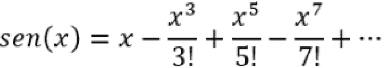
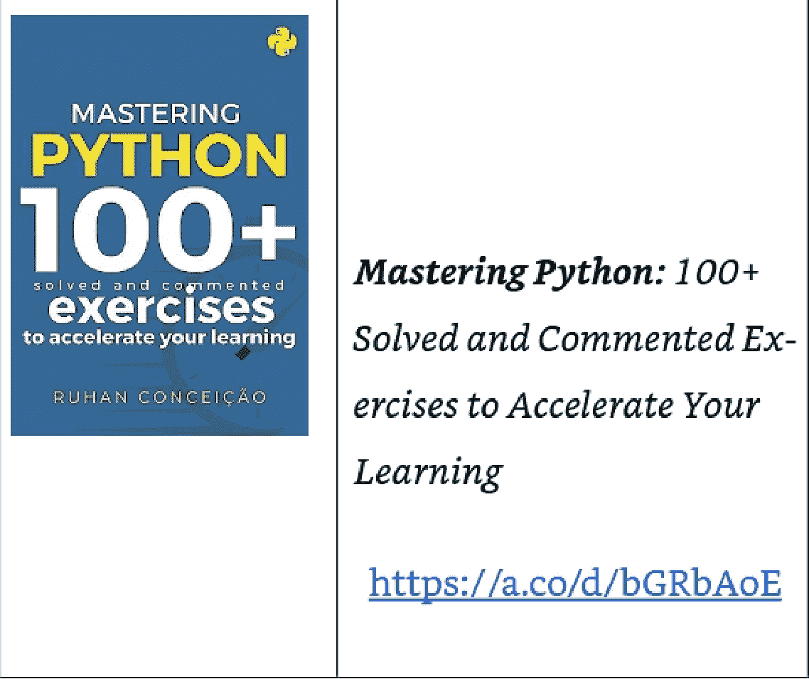
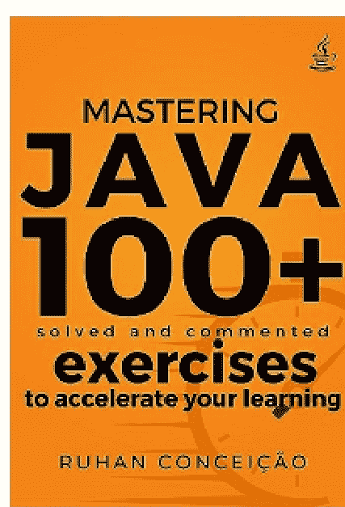

# C++ 实践指南：160 个解析练习加速你的学习

## 前言

欢迎阅读本书，书中介绍了许多附带答案和注释的 C++ 练习题。在本书中，你将找到超过 160 道练习题，旨在帮助你提高在这门强大语言中的编程技能。

学习编程不仅涉及理解理论概念，还涉及将这些概念应用于现实场景中。这正是你将在书中发现的内容：从基础性知识到更复杂的挑战的各种问题。

随着练习的进行，你将面临涉及数学公式操作、字符串、条件判断、循环、向量操作、矩阵等更多任务的挑战。

本书的主要目标是为寻求进步的程序员提供一份实用且全面的资源。无论你是一个想要巩固知识的 C++ 初学者，还是希望加深专业知识的经验丰富的程序员，这些练习都将作为极佳的学习指南和参考。这本书也适用于那些希望拥有丰富的编程逻辑练习题集，以便为学生创建题目的老师们。

享受这段学习旅程，深入探索这些带答案和注释的 C++ 练习吧。准备好迎接刺激的挑战、创造性的解决方案，以及提升编程技能的独特机会。

阅读愉快，学习进步，并在探索 C++ 编程奇妙世界中获得乐趣。

Ruhan Avila da Conceição.

## 引言

如果你购买了这本书，说明你想尽快开始编程并接受逻辑挑战，而不想听布教山上的大篇大论。但在开始之前，强调几点是非常重要的。

尽管许多练习可能被认为是简单的，但如果你是这段编程旅程的新手，那么在看答案之前，首先尝试自己解决问题是非常关重要的。同一个问题可能有多种解决方案，你只需要思考并开发出自己的方案。然后，你就可以将其与书中提出的方案进行比较，识别各自的优点，并尝试多学一点。

如果练习太难且你无法解决，请跳到下一个，并在第二天再次尝试。即使无法解决，也不要立即跳到答案，更不要在没有尝试解决的情况下直接看答案。

学习编程逻辑不在于得到答案，而在于你通往答案所经历的历程。

话如此，本书的其余章节将根据建议练习中涵盖的编程主题进行划分。

从现在起，这一切取决于你！

## 基础练习

### 1. 编写一个程序在屏幕上打印 "Hello World!"。

```cpp
#include <iostream>

int main() {
    std::cout << "Hello World!" << std::endl;
    return 0;
}
```

### 2. 编写一个程序，使用两个不同的命令在一行打印 "Hello"，在底部打印 "World!"。

```cpp
#include <iostream>

int main() {
    std::cout << "Hello" << std::endl;
    std::cout << "World!" << std::endl;
    return 0;
}
```

### 3. 编写一个程序，仅使用一个打印命令在一行打印 "Hello"，在底部打印 "World!"。

```cpp
#include <iostream>

int main() {
    std::cout << "Hello" << std::endl << "World!" << std::endl;
    return 0;
}
```

### 4. 编写一个程序在一行打印 "Hello"，在底部打印 "World!" 并留出一个空行。

```cpp
#include <iostream>

int main() {
    std::cout << "Hello" << std::endl << std::endl << "World!" << std::endl;
    return 0;
}
```

### 5. 编写一个程序在一行打印 "Hello"，并在最后打印 "World!"。

```cpp
#include <iostream>

int main() {
    std::cout << "Hello" << "\nWorld!" << std::endl;
    return 0;
}
```

### 6. 编写一个程序在屏幕上打印 "HellonWorld!"。

```cpp
#include <iostream>

int main() {
    std::cout << "Hello" << std::endl << "World!" << std::endl;
    return 0;
}
```

### 7. 编写一个程序要求用户输入姓名。

```cpp
#include <iostream>
#include <string>

int main() {
    std::string name;
    std::cout << "Enter your name: ";
    std::cin >> name;
    std::cout << "Hello " << name << "!" << std::endl;
    return 0;
}
```

### 8. 编写一个程序顺序读取三个人的姓名，然后是相应的年龄，并以表格格式输出。

```cpp
#include <iostream>
#include <iomanip>
#include <string>

int main() {
    std::string name1, name2, name3;
    int age1, age2, age3;

    // 第一个人的
    std::cout << "Enter the name of the first person: ";
    std::getline(std::cin, name1);
    std::cout << "Enter the age of " << name1 << ": ";
    std::cin >> age1;
    std::cin.ignore(); // 清除换行符

    // 第二个人的人的
    std::cout << "Enter the name of the second person: ";
    std::getline(std::cin, name2);
    std::cout << "Enter the age of " << name2 << ": ";
    std::cin >> age2;
    std::cin.ignore(); // 清除换行符

    // 第三个人的
    std::cout << "Enter the name of the third person: ";
    std::getline(std::cin, name3);
    std::cout << "Enter the age of " << name3 << ": ";
    std::cin >> age3;
    std::cin.ignore(); // 清除换行符

    // 以表格格式输出
    std::cout << std::endl;
    std::cout << std::left << std::setw(20) << "Name" << std::setw(5) << "Age" << std::endl;
    std::cout << "--------------------------------" << std::endl;
    std::cout << std::left << std::setw(20) << name1 << std::setw(5) << age1 << std::endl;
    std::cout << std::left << std::setw(20) << name2 << std::setw(5) << age2 << std::endl;
    std::cout << std::left << std::setw(20) << name3 << std::setw(5) << age3 << std::endl;

    return 0;
}
```

### 9.

```cpp
std::cout << std::left << std::setw(20) << name2
          << std::setw(5) << age2
          << std::setw(10) << height2 << std::endl;
std::cout << std::left << std::setw(20) << name3
          << std::setw(5) << age3
          << std::setw(10) << height3 << std::endl;

return 0;
}
```

### 10. 写一个程序，顺序读取三个人的名字，然后读取各自的年龄和身高，并以表格格式在屏幕上打印数据，使用横线 (-) 分隔行，使用竖线 (|) 分隔列。

```cpp
#include <iostream>
#include <iomanip>
#include <string>

int main() {
    std::string name1, name2, name3;
    int age1, age2, age3;
    float height1, height2, height3;

    // 读取第一个人的信息
    std::cout << "Enter the name of the first person: ";
    std::getline(std::cin, name1);
    std::cout << "Enter the age of " << name1 << ":";
    std::cin >> age1;
    std::cout << "Enter the height (in meters) of " << name1 << ":";
    std::cin >> height1;
    std::cin.ignore(); // 清除上次输入留下的换行符

    // 读取第二个人的信息
    std::cout << "Enter the name of the second person: ";
    std::getline(std::cin, name2);
    std::cout << "Enter the age of " << name2 << ":";
    std::cin >> age2;
    std::cout << "Enter the height (in meters) of " << name2 << ":";
    std::cin >> height2;
    std::cin.ignore(); // 清除上次输入留下的换行符

    // 读取第三个人的信息
    std::cout << "Enter the name of the third person: ";
    std::getline(std::cin, name3);
    std::cout << "Enter the age of " << name3 << ":";
    std::cin >> age3;
    std::cout << "Enter the height (in meters) of " << name3 << ":";
    std::cin >> height3;
    std::cin.ignore(); // 清除上次输入留下的换行符

    // 以表格格式输出信息
    std::cout << std::endl;
    std::cout << std::left << std::setw(20) << "| Name"
              << std::setw(5) << "| Age"
              << std::setw(10) << "| Height(m) |" << std::endl;
    std::cout << "|-------------------|---|----------" << std::endl;
    std::cout << std::left << std::setw(20) << "|" + name1
              << std::setw(5) << "|" + std::to_string(age1)
              << std::setw(10) << "|" + std::to_string(height1) + "|" << std::endl;
    std::cout << "|-------------------|---|----------" << std::endl;
    std::cout << std::left << std::setw(20) << "|" + name2
              << std::setw(5) << "|" + std::to_string(age2)
              << std::setw(10) << "|" + std::to_string(height2) + "|" << std::endl;
    std::cout << "|-------------------|---|----------" << std::endl;
    std::cout << std::left << std::setw(20) << "|" + name3
              << std::setw(5) << "|" + std::to_string(age3)
              << std::setw(10) << "|" + std::to_string(height3) + "|" << std::endl;
    std::cout << "|-------------------|------------|"

    return 0;
}
```

## 数学公式

### 11. 写一个程序，提示用户输入两个数字，并显示它们的加法、减法、乘法和除法。

```cpp
#include <iostream>

int main() {
    double num1, num2;

    // 提示用户输入两个数字
    std::cout << "Enter the first number: ";
    std::cin >> num1;

    std::cout << "Enter the second number: ";
    std::cin >> num2;

    // 显示结果
    std::cout << "Addition: " << num1 + num2 << std::endl;
    std::cout << "Subtraction: " << num1 - num2 << std::endl;
    std::cout << "Multiplication: " << num1 * num2 << std::endl;
    std::cout << "Division: " << num1 / num2 << std::endl;
    return 0;
}
```

### 12. 写一个程序，计算用户输入的两个数字的平均值。

```cpp
#include <iostream>
int main() {
    double num1, num2;

    // 提示用户输入两个数字
    std::cout << "Enter the first number: ";
    std::cin >> num1;

    std::cout << "Enter the second number: ";
    std::cin >> num2;

    // 计算平均值
    double mean = (num1 + num2) / 2;

    // 显示结果
    std::cout << "The arithmetic mean of " << num1 << " and " << num2 << " is: " << mean << std::endl;

    return 0;
}
```

### 13. 创建一个程序，计算并显示用户输入的三个数字的平均值。

```cpp
#include <iostream>

int main() {
    double num1, num2, num3;

    // 提示用户输入三个数字
    std::cout << "Enter the first number: ";
    std::cin >> num1;

    std::cout << "Enter the second number: ";
    std::cin >> num2;

    std::cout << "Enter the third number: ";
    std::cin >> num3;

    // 计算平均值
    double mean = (num1 + num2 + num3) / 3;

    // 显示结果
    std::cout << "The arithmetic mean of " << num1 << ", " << num2 << " and " << num3 << " is: " << mean << std::endl;

    return 0;
}
```

### 14. 写一个程序，读取两个数字（第一个为底数，第二个为指数），然后打印第一个数的幂。


```cpp
#include <iostream>
#include <cmath> // 使用 pow() 函数

int main() {
    double base, exponent;

    // 提示用户输入底数的指数
    std::cout << "Enter the base: ";
    std::cin >> base;

    std::cout << "Enter the exponent: ";
    std::cin >> exponent;

    // 计算幂
    double result = std::pow(base, exponent);

    // 显示结果
    std::cout << base << " raised to the power of " << exponent << " is: " << result << std::endl;

    return 0;
}
```

## 15. 写一个程序，读取一个数字并在屏幕上打印该数字的平方根。

```cpp
#include <iostream>
#include <cmath> // 使用 sqrt() 函数

int main() {
    double number;

    // 提示用户输入一个数字
    std::cout << "Enter a number: ";
    std::cin >> number;

    // 确保数字非负
    if (number < 0) {
        std::cout << "The number is negative, and its square root is not real." << std::endl;
        return 1;
    }

    // 使用 sqrt() 函数计算平方根
    double sqrt_value = std::sqrt(number);

    // 显示结果
    std::cout << "The square root of " << number << " is: " << sqrt_value << std::endl;

    return 0;
}
```

# 16. 写一个程序，计算用户输入的三个数字的几何平均值 -> GeoMean = $\sqrt[3]{n_1 \times n_2 \times n_3}$

```cpp
#include <iostream>
#include <cmath> // 使用 cbrt() 和 pow() 函数

int main() {
    double num1, num2, num3;

    // 提示用户输入三个数字
    std::cout << "Enter the first number: ";
    std::cin >> num1;

    std::cout << "Enter the second number: ";
    std::cin >> num2;

    std::cout << "Enter the third number: ";
    std::cin >> num3;

    // 计算几何平均值
    double product = num1 * num2 * num3;
    double geometric_mean = std::cbrt(product);
    // 或者，你可以使用 pow() 函数
    // double geometric_mean = std::pow(product, 1.0 / 3.0);

    return 0;
}
```

## 17. 写一个程序，计算个人的 BMI，使用公式 BMI = weight / height²

```cpp
#include <iostream>
#include <cmath> // 使用 pow()

int main() {
    double weight, height;

    // 提示用户输入体重和身高
    std::cout << "Enter your weight in kilograms: ";
    std::cin >> weight;

    std::cout << "Enter your height in meters: ";
    std::cin >> height;

    // 计算 BMI
    double bmi = weight / std::pow(height, 2);

    // 显示 BMI
    std::cout << "Your BMI is: " << bmi << std::endl;

    return 0;
}
```

## 18. 创建一个程序，计算并显示圆的周长，提示用户输入半径，使用公式 P = 2πr

```cpp
#include <iostream>
#include <cmath> // 使用 M_PI 常量

int main() {
    double radius;

    // 提示用户输入半径
    std::cout << "Enter the radius of the circle: ";
    std::cin >> radius;

    // 计算周长
    double perimeter = 2 * M_PI * radius;

    // 显示结果
    std::cout << "The perimeter (circumference) of the circle with radius " << radius << " is: " << perimeter << std::endl;

    return 0;
}
```

```cpp
perimeter << std::endl;

return 0;
}
```

# 19. 写一个程序，根据半径使用公式 A = πr² 计算圆的面积

```cpp
#include <iostream>
#include <cmath> // 用于 M_PI 常量

int main() {
    double radius;

    // 提示用户输入半径
    std::cout << "Enter the radius of the circle: ";
    std::cin >> radius;

    // 计算面积
    double area = M_PI * std::pow(radius, 2);

    // 显示结果
    std::cout << "The area of the circle with radius " << radius << " is:" << area << std::endl;

    return 0;
}
```

## 20. 写一个程序，计算一元方程的判别式（Δ = b² - 4ac）。

```cpp
#include <iostream>
#include <cmath>

int main() {
    double a, b, c;

    // 提示用户输入二次方程的系数
    std::cout << "Enter the coefficient a: ";
    std::cin >> a;

    std::cout << "Enter the coefficient b: ";
    std::cin >> b;

    std::cout << "Enter the coefficient c: ";
    std::cin >> c;

    // 计算判别式 (Δ)
    double delta = std::pow(b, 2) - 4 * a * c;

    // 显示结果
    std::cout << "The delta (Δ) of the equation is: " << delta << std::endl;

    return 0;
}
```

# 21. 写一个程序，根据公式 P = 2(w + l) 和 A = wl 计算矩形的周长和面积，其中 w 是宽，l 是长

```cpp
#include <iostream>

int main() {
    double width, length;

    // 提示用户输入矩形的宽和长
    std::cout << "Enter the width of the rectangle: ";
    std::cin >> width;

    std::cout << "Enter the length of the rectangle: ";
    std::cin >> length;

    // 计算周长和面积
    double perimeter = 2 * (width + length);
    double area = width * length;

    // 显示结果
    std::cout << "The perimeter of the rectangle is: " << perimeter << std::endl;
    std::cout << "The area of the rectangle is: " << area << std::endl;

    return 0;
}
```

# 22. 写一个程序，根据公式 P = a + b + c 和 A = (b * h) / 2 计算三角形的周长和面积，其中 a, b 和 c 是三角形的边，h 是对应边 b 的高。

```cpp
#include <iostream>

int main() {
    double a, b, c, h;

    // 提示用户输入三角形的边和高
    std::cout << "Enter the length of side a: ";
    std::cin >> a;

    std::cout << "Enter the length of side b: ";
    std::cin >> b;

    std::cout << "Enter the length of side c: ";
    std::cin >> c;

    std::cout << "Enter the height relative to side b: ";
    std::cin >> h;

    // 计算周长和面积
    double perimeter = a + b + c;
    double area = (b * h) / 2;

    // 显示结果
    std::cout << "The perimeter of the triangle is: " << perimeter << std::endl;
    std::cout << "The area of the triangle is: " << area << std::endl;

    return 0;
}
```

# 23. 写一个程序，根据公式 v = Δs/Δt 计算物体的平均速度，其中 Δs 是位移，Δt 是时间间隔

```cpp
#include <iostream>

int main() {
    double delta_s, delta_t;

    // 提示用户输入位移和时间间隔
    std::cout << "Enter the space variation (Δs) in meters:";
    std::cin >> delta_s;

    std::cout << "Enter the time variation (Δt) in seconds:";
    std::cin >> delta_t;

    // 计算平均速度
    double average_velocity = delta_s / delta_t;

    // 显示结果
    std::cout << "The average velocity (v) is: " << average_velocity << " m/s";

    return 0;
}
```

# 24. 写一个程序，根据公式 E = mv² / 2 计算运动物体的动能，其中 m 是质量，v 是速度。

```cpp
#include <iostream>
#include <cmath> // 用于 pow()

int main() {
    double mass, velocity;

    // 提示用户输入物体的质量和速度
    std::cout << "Enter the mass of the object (in kg):";
    std::cin >> mass;

    std::cout << "Enter the velocity of the object (in m/s): ";
    std::cin >> velocity;

    // 计算动能
    double kinetic_energy = (mass * std::pow(velocity, 2)) / 2;

    // 显示结果
    std::cout << "The kinetic energy of the object is: " << kinetic_energy << " Joules";

    return 0;
}
```

# 25. 写一个程序，根据公式 W = F * d 计算作用于物体的力功，其中 F 是作用力，d 是位移。

```cpp
#include <iostream>

int main() {
    double force, distance;

    // 提示用户输入作用力和位移
    std::cout << "Enter the force applied on the object (Newtons):";
    std::cin >> force;

    std::cout << "Enter the distance traveled by the object (in meters):";
    std::cin >> distance;

    // 计算功
    double work = force * distance;

    // 显示结果
    std::cout << "The work done by the force is: " << work << " Joules";

    return 0;
}
```

# 26. 写一个程序，给定第一项、公差以及从用户输入的 n，计算等差数列的第 n 项，a_n = a_1 + (n - 1) * r

```cpp
#include <iostream>

int main() {
    double a1, d;
    int n;

    // 提示用户输入第一项、公差和 n
    std::cout << "Enter the first term of the arithmetic progression: ";
    std::cin >> a1;

    std::cout << "Enter the common difference of the arithmetic progression: ";
    std::cin >> d;

    std::cout << "Enter n:";
    std::cin >> n;

    // 计算第 n 项
    double a_n = a1 + (n - 1) * d;

    // 显示结果
    std::cout << "The n-th term of the arithmetic progression is: " << a_n << std::endl;

    return 0;
}
```

# 27. 写一个程序，读取笛卡尔平面上两个点的 x y 位置，并计算它们之间的距离

```cpp
#include <iostream>
#include <cmath> // 用于 sqrt() 和 pow() 函数

int main() {
    double x1, y1, x2, y2;

    // 提示用户输入第一个点的坐标
    std::cout << "Enter the x and y coordinates of the first point (separated by space): ";
    std::cin >> x1 >> y1;

    // 提示用户输入第二个点的坐标
    std::cout << "Enter the x and y coordinates of the second point (separated by space): ";
    std::cin >> x2 >> y2;

    // 计算两点间的距离
    double distance = sqrt(pow(x2 - x1, 2) + pow(y2 - y1, 2));

    // 显示结果
    std::cout << "The distance between the two points is: " << distance << std::endl;

    return 0;
}
```

# 28. 创建一个程序，提示用户输入球体半径并计算且显示其体积。


```cpp
#include <iostream>
#include <cmath> // 用于 pow() 函数

const double PI = 3.14; // Pi 的值

int main() {
    double radius;

    // 提示用户输入球体半径
    std::cout << "Enter the radius of the sphere: ";
    std::cin >> radius;

    // 计算球体体积
    double volume = (4.0 / 3.0) * PI * pow(radius, 3);

    // 显示结果
    std::cout << "The volume of the sphere with radius " << radius << " is: " << volume << " cubic units" << std::endl;

    return 0;
}
```
# 29. 写一个程序，读取两个电阻的阻值，并显示串联时的等效电阻（值相加）以及并联时的公式 (R1 * R2) / (R1 + R2)

```cpp
#include <iostream>

int main() {
    double R1, R2;

    // 提示用户输入两个电阻的阻值
    std::cout << "Enter the resistance of the first resistor (in ohms):";
    std::cin >> R1;

    std::cout << "Enter the resistance of the second resistor (in ohms):";
    std::cin >> R2;

    // 计算串联时的等效电阻
    double series_resistance = R1 + R2;

    // 计算并联时的等效电阻
    double parallel_resistance = (R1 * R2) / (R1 + R2);

    // 显示结果
    std::cout << "Resulting resistance when connected in series: " << series_resistance << " ohms" << std::endl;
    std::cout << "Resulting resistance when connected in parallel: " << parallel_resistance << " ohms" << std::endl;

    return 0;
}
```

## 30. 编写一个程序，读取产品价值和税率（百分比），并计算其最终价值。

```cpp
#include <iostream>
```
```cpp
int main() {
    double productValue, taxRate;

    // 提示用户输入产品价值
    std::cout << "Enter the value of the product: ";
    std::cin >> productValue;

    // 提示用户输入税率（百分比）
    std::cout << "Enter the tax rate (in percentage): ";
    std::cin >> taxRate;

    // 计算税额
    double taxAmount = (taxRate / 100) * productValue;

    // 计算包含税的最终产品价值
    double finalValue = productValue + taxAmount;

    // 显示结果
    std::cout << "Final value of the product after applying the tax: " << finalValue << std::endl;

    return 0;
}
```

## 条件判断

### 31. 编写一个程序，询问人的年龄，并显示其是否已成年（年龄 >= 18）。

```cpp
#include <iostream>

int main() {
    int age;

    // 提示用户输入年龄
    std::cout << "Please enter your age:";
    std::cin >> age;

    // 检查人是否已成年
    if (age >= 18) {
        std::cout << "You are of legal age." << std::endl;
    } else {
        std::cout << "You are not of legal age." << std::endl;
    }

    return 0;
}
```

### 32. 编写一个程序，读取一个数字并报告它是奇数还是偶数。

```cpp
#include <iostream>

int main() {
  int number;

  // 提示用户输入一个数字
  std::cout << "Please enter a number: ";
  std::cin >> number;

  // 判断数字是奇数还是偶数
  if (number % 2 == 0) {
    std::cout << "The number is even." << std::endl;
  } else {
    std::cout << "The number is odd." << std::endl;
  }

  return 0;
}
```

### 33. 编写一个程序，读取一个数字并报告它是正数、负数还是零。

```cpp
#include <iostream>

int main() {
    double number;

    // 提示用户输入一个数字
    std::cout << "Please enter a number: ";
    std::cin >> number;

    // 判断数字是正数、负数还是零
    if(number > 0) {
        std::cout << "The number is positive." << std::endl;
    } else if (number < 0) {
        std::cout << "The number is negative." << std::endl;
    } else {
        std::cout << "The number is zero." << std::endl;
        return 0;
    }
}
```

# 34. 创建一个程序，读取三个数字，并检查它们的和是正数、负数还是等于零

```cpp
#include <iostream>

int main() {
    double num1, num2, num3;

    // 提示用户输入三个数字
    std::cout << "Enter the first number: ";
    std::cin >> num1;
    std::cout << "Enter the second number: ";
    std::cin >> num2;
    std::cout << "Enter the third number: ";
    std::cin >> num3;

    // 计算三个数字之和
    double sum = num1 + num2 + num3;

    // 判断和是正数、负数还是零
    if (sum > 0) {
        std::cout << "The sum is positive." << std::endl;
    } else if (sum < 0) {
        std::cout << "The sum is negative." << std::endl;
    } else {
        std::cout << "The sum is zero." << std::endl;
    }

    return 0;
}
```

## 35. 编写一个程序，读取两个数字并告诉哪个更大。

```cpp
#include <iostream>

int main() {
    double num1, num2;

    // 提示用户输入两个数字
    std::cout << "Enter the first number: ";
    std::cin >> num1;
    std::cout << "Enter the second number: ";
    std::cin >> num2;

    // 判断并显示哪个更大
    if (num1 > num2) {
        std::cout << "The first number (" << num1 << ") is bigger." << std::endl;
    } else if (num1 < num2) {
        std::cout << "The second number (" << num2 << ") is bigger." << std::endl;
    } else {
        std::cout << "Both numbers are equal." << std::endl;
    }

    return 0;
}
```

## 36. 编写一个程序，询问用户三个数字并显示最大的那个。

```cpp
#include <iostream>

int main() {
    double num1, num2, num3;

    // 提示用户输入三个数字
    std::cout << "Enter the first number: ";
    std::cin >> num1;
    std::cout << "Enter the second number: ";
    std::cin >> num2;
    std::cout << "Enter the third number: ";
    std::cin >> num3;

    // 判断并显示最大的数字
    if (num1 >= num2 && num1 >= num3) {
        std::cout << "The largest number is: " << num1 << std::endl;
    } else if (num2 >= num1 && num2 >= num3) {
        std::cout << "The largest number is: " << num2 << std::endl;
    } else {
        std::cout << "The largest number is: " << num3 << std::endl;
    }

    return 0;
}
```

## 37. 编写一个程序，读取三个数字，并告知它们的和是否被 5 整除。

```cpp
#include <iostream>

int main() {
    double num1, num2, num3;

    // 提示用户输入三个数字
    std::cout << "Enter the first number: ";
    std::cin >> num1;
    std::cout << "Enter the second number: ";
    std::cin >> num2;
    std::cout << "Enter the third number: ";
    std::cin >> num3;

    // 计算数字之和
    double sum = num1 + num2 + num3;

    // 检查是否被 5 整除
    if (static_cast<int>(sum) % 5 == 0) {
        std::cout << "The sum of the numbers is divisible by 5." << std::endl;
    } else {
        std::cout << "The sum of the numbers is not divisible by 5." << std::endl;
    }

    return 0;
}
```

## 38. 编写一个程序，询问一个整数并检查它是否同时被 3 和 5 整除。

```cpp
#include <iostream>

int main() {
    int number;

    // 提示用户输入一个整数
    std::cout << "Enter an integer: ";
    std::cin >> number;

    // 检查是否被 3 和 5 整除
    if (number % 3 == 0 && number % 5 == 0) {
        std::cout << "The number is divisible by 3 and 5." << std::endl;
    } else {
        std::cout << "The number is not divisible by 3 and 5." << std::endl;
    }

    return 0;
}
```

## 39. 编写一个程序，询问两个数字并显示第一个是否被第二个整除。

```cpp
#include <iostream>

int main() {
    double num1, num2;

    // 提示用户输入两个数字
    std::cout << "Enter the first number: ";
    std::cin >> num1;
    std::cout << "Enter the second number: ";
    std::cin >> num2;

    // 在尝试除法前确保第二个数字不为零
    if (num2 == 0) {
        std::cout << "The second number cannot be zero (division by zero is undefined)." << std::endl;
    } else if (static_cast<int>(num1) % static_cast<int>(num2) == 0) {
        std::cout << "The first number is divisible by the second number." << std::endl;
    } else {
        std::cout << "The first number is not divisible by the second number." << std::endl;
    }

    return 0;
}
```

## 40. 编写一个程序，读取两次测试的分数，并报告学生在每次测试中及格（分数大于等于 6）还是不及格（分数小于 6）。

```cpp
#include <iostream>

int main() {
    double test1Score, test2Score;

    // 提示用户输入两次测试的分
    std::cout << "Enter the score for the first test: ";
    std::cin >> test1Score;
    std::cout << "Enter the score for the second test: ";
    std::cin >> test2Score;

    // 判断并显示第一次测试的结果
    if (test1Score >= 6) {
        std::cout << "Passed in the first test." << std::endl;
    } else {
        std::cout << "Failed in the first test." << std::endl;
    }

    // 判断并显示第二次测试的结果
    if (test2Score >= 6) {
        std::cout << "Passed in the second test." << std::endl;
    } else {
        std::cout << "Failed in the second test." << std::endl;
    }

    return 0;
}
```

## 41. 编写一个程序，读取两次测试的成绩，计算简单算术平均值，并告知学生及格（平均分大于等于 6）还是不及格（平均分小于 6）。

```cpp
#include <iostream>

int main() {
    double test1Grade, test2Grade;

    // 提示用户输入两次测试的成绩
    std::cout << "Enter the grade for the first test: ";
    std::cin >> test1Grade;
    std::cout << "Enter the grade for the second test: ";
    std::cin >> test2Grade;

    // 计算简单算术平均值的
```

```cpp
grades
```


`double average = (test1Grade + test2Grade) / 2;`

// 显示平均分

`std::cout << "Average grade: " << average << std::endl;`

// 根据平均分判断并显示结果

```cpp
if (average >= 6) {
    std::cout << "学生通过。" << std::endl;
} else {
    std::cout << "学生未通过。" << std::endl;
}
return 0;
}
```

## 42. 写一个程序，读取三个人的年龄，并判断其中有多少人达到了成年年龄（18 岁或以上）。

```cpp
#include <iostream>

int main() {
    int age1, age2, age3;
    int countLegalAge = 0;
    // 提示用户输入三个人的年龄
    std::cout << "Enter the age of the first person: ";
    std::cin >> age1;
    if(age1 >= 18) countLegalAge++;
    std::cout << "Enter the age of the second person: ";
    std::cin >> age2;
    if (age2 >= 18) countLegalAge++;
    std::cout << "Enter the age of the third person: ";
    std::cin >> age3;
    if (age3 >= 18) countLegalAge++;
    // 显示结果
    std::cout << countLegalAge << " of them are of legal age (18 or older)." << std::endl;
    return 0;
}
```

## 43. 写一个程序，读取三个数字，并按升序在屏幕上显示它们。

```cpp
#include <iostream>

int main() {
    double num1, num2, num3;
    // 提示用户输入三个数字
    std::cout << "Enter the first number: ";
    std::cin >> num1;
    std::cout << "Enter the second number: ";
    std::cin >> num2;
    std::cout << "Enter the third number: ";
    std::cin >> num3;
    // 按升序显示数字
    if (num1 <= num2 && num1 <= num3) {
        std::cout << num1 << ", ";
        if (num2 <= num3) {
            std::cout << num2 << ", " << num3;
        } else {
            std::cout << num3 << ", " << num2;
        }
    } else if (num2 <= num1 && num2 <= num3) {
        std::cout << num2 << ", ";
        if (num1 <= num3) {
            std::cout << num1 << ", " << num3;
        } else {
            std::cout << num3 << ", " << num1;
        }
    } else {
        std::cout << num3 << ", ";
        if (num1 <= num2) {
            std::cout << num1 << ", " << num2;
        } else {
            std::cout << num2 << ", " << num1;
        }
    }
    std::cout << std::endl;
    return 0;
}
```

## 44. 写一个程序，读取三个数字，并判断它们是否可以构成三角形的三边（任意两边之和必须始终大于第三边）。

```cpp
#include <iostream>

int main() {
  double side1, side2, side3;
  // 提示用户输入三条边
  std::cout << "Enter the first side:";
  std::cin >> side1;
  std::cout << "Enter the second side:";
  std::cin >> side2;
  std::cout << "Enter the third side:";
  std::cin >> side3;
  // 检查三角形不等式条件
  if (side1 + side2 > side3 && side1 + side3 > side2 && side2 + side3 > side1) {
      std::cout << "The given sides can form a triangle." << std::endl;
  } else {
      std::cout << "The given sides cannot form a triangle." << std::endl;
  }
  return 0;
}
```

## 45. 写一个程序，读取一个人的出生年份，并告知其是否有投票资格（16 岁或以上）。

```cpp
#include <iostream>
#include <ctime> // 获取当前年份

int main() {
    int birthYear;
    int currentYear;
    // 获取当前年份
    time_t now = time(0);
    tm *ltm = localtime(&now);
    currentYear = 1900 + ltm->tm_year;
    // 提示用户输入出生年份
    std::cout << "Enter year of birth: ";
    std::cin >> birthYear;
    int age = currentYear - birthYear;
    // 检查是否有投票资格
    if (age >= 16) {
        std::cout << "You are eligible to vote." << std::endl;
    } else {
        std::cout << "You are not eligible to vote." << std::endl;
    }
  return 0;
}
```

## 46. 写一个程序，询问一个人的年龄，并显示其是儿童（0-12 岁）、青少年（13-17 岁）、成年（18-59 岁）还是老年（60 岁及以上）。使用嵌套判断。

```cpp
#include <iostream>

int main() {
    int age;
    // 提示用户输入年龄
    std::cout << "Enter your age: ";
    std::cin >> age;
    // 使用嵌套判断检查范围
    if (age < 13) {
        std::cout << "You are a child." << std::endl;
    } else {
        if (age < 18) {
            std::cout << "You are a teenager." << std::endl;
        } else {
            if (age < 60) {
                std::cout << "You are an adult." << std::endl;
            } else {
                std::cout << "You are elderly." << std::endl;
            }
        }
    }
  return 0;
}
```

## 47. 写一个程序，询问一个人的年龄，并显示其是儿童（0-12 岁）、青少年（13-17 岁）、成年（18-59 岁）还是老年（60 岁及以上）。使用逻辑运算符，不使用 `else` 语句。

```cpp
#include <iostream>

int main() {
    int age;
    // 提示用户输入年龄
    std::cout << "Enter your age: ";
    std::cin >> age;
    // 使用 if 语句和逻辑运算符检查年龄范围
    if (age >= 0 && age <= 12) {
        std::cout << "You are a child." << std::endl;
    }
    if (age >= 13 && age <= 17) {
        std::cout << "You are a teenager." << std::endl;
    }
    if (age >= 18 && age <= 59) {
        std::cout << "You are an adult." << std::endl;
    }
    if (age >= 60) {
        std::cout << "You are elderly." << std::endl;
    }
  return 0;
}
```

## 48. 写一个程序，读取一个人的年龄，并告知其没有投票资格（年龄小于 16 岁）、有投票资格但不是强制（16、17 岁或 70 岁及以上），或者强制投票（18-69 岁）。

```cpp
#include <iostream>

int main() {
    int age;
    // 提示用户输入年龄
    std::cout << "Enter your age: ";
    std::cin >> age;
    // 检查年龄并显示相应的投票状态
    if (age < 16) {
        std::cout << "You are not able to vote." << std::endl;
    } else if (age == 16 || age == 17 || age >= 70) {
        std::cout << "You are able to vote, but it's not obligatory." << std::endl;
    } else {
        std::cout << "Voting is obligatory for you." << std::endl;
    }
  return 0;
}
```

## 49. 写一个程序，从学生处读取三个成绩，并报告其是通过（最终成绩大于或等于 7）、未通过（最终成绩小于 4）还是补考（最终成绩在 4 到 7 之间）。

```cpp
#include <iostream>

int main() {
    double grade1, grade2, grade3, average;
    // 从用户处读取三个成绩
    std::cout << "Enter the first grade: ";
    std::cin >> grade1;
    std::cout << "Enter the second grade: ";
    std::cin >> grade2;
    std::cout << "Enter the third grade: ";
    std::cin >> grade3;
    // 计算平均分
    average = (grade1 + grade2 + grade3) / 3.0;
    // 判断并显示学生状态
    if (average >= 7) {
        std::cout << "You passed!" << std::endl;
    } else if (average < 4) {
        std::cout << "You failed." << std::endl;
    } else {
        std::cout << "You are in recovery." << std::endl;
    }
  return 0;
}
```

## 50. 写一个程序，询问一个人的身高和体重并计算其体重指数（BMI），显示相应的类别（体重减轻、正常、超重、肥胖、严重肥胖）。

```cpp
#include <iostream>

int main() {
    double height, weight, bmi;
    // 从用户处获取身高和体重
    std::cout << "Enter your height in meters: ";
    std::cin >> height;
    std::cout << "Enter your weight in kilograms: ";
    std::cin >> weight;
    // 计算 BMI
    bmi = weight / (height * height);
    // 显示 BMI 和类别
    std::cout << "Your BMI is: " << bmi << std::endl;
    if (bmi < 18.5) {
        std::cout << "You are underweight." << std::endl;
    } else if (bmi >= 18.5 && bmi < 24.9) {
        std::cout << "You are of normal weight." << std::endl;
    } else if (bmi >= 24.9 && bmi < 30) {
        std::cout << "You are overweight." << std::endl;
    } else if (bmi >= 30 && bmi < 35) {
        std::cout << "You are obese." << std::endl;
    } else {
        std::cout << "You are severely obese." << std::endl;
    }
  return 0;
}
```

## 51. 编写一个程序，要求用户输入成绩（0-100），并打印出对应的字母等级（90-100 为 A，80-89 为 B，70-79 为 C，60-69 为 D，60以下为 F）。

```cpp
#include <iostream>

int main() {
    int grade;
    // 询问用户成绩
    std::cout << "Enter your grade (0-100):";
    std::cin >> grade;
    // 确定并打印字母等级
    if (grade >= 90 && grade <= 100) {
        std::cout << "Your letter grade is: A" << std::endl;
    } else if (grade >= 80 && grade < 90) {
        std::cout << "Your letter grade is: B" << std::endl;
    } else if (grade >= 70 && grade < 80) {
        std::cout << "Your letter grade is: C" << std::endl;
    } else if (grade >= 60 && grade < 70) {
        std::cout << "Your letter grade is: D" << std::endl;
    } else if (grade < 60) {
      std::cout << "Your letter grade is: F" << std::endl;
    } else {
      std::cout << "Invalid grade input." << std::endl;
    }
  return 0;
}
```

## 52. 编写一个程序，读取二次方程系数 a、 b 和 c 的值，并判断函数的根是实数还是虚数。


```cpp
#include <iostream>

int main() {
  double a, b, c, discriminant;

  // 读取系数
  std::cout << "Enter the value of a: ";
  std::cin >> a;

  std::cout << "Enter the value of b: ";
  std::cin >> b;

  std::cout << "Enter the value of c: ";
  std::cin >> c;

  // 计算判别式
  discriminant = b*b-4*a*c;

  // 根据判别式检查根的性质
  if (discriminant > 0) {
      std::cout << "The roots are real and distinct." << std::endl;
  } else if (discriminant == 0) {
      std::cout << "The roots are real and the same." << std::endl;
  } else {
      std::cout << "The roots are imaginary." << std::endl;
  }

  return 0;
}
```

# 53. 创建一个程序读取产品价格。如果价格超过 200 美元，税率为 5%；如果价格超过 500 美元，税率为 7.5%。200 美元及以下的产品不收税。在屏幕上打印产品的最终价格。

```cpp
#include <iostream>
#include <iomanip>

int main() {
    double price, tax, finalPrice;

    // 读取产品价格
    std::cout << "Enter the price of the product: ";
    std::cin >> price;

    // 根据价格确定税率
    if (price > 500) {
        tax = 0.075; // 7.5%
    } else if (price > 200) {
        tax = 0.05; // 5%
    } else {
        tax = 0; // 无税
    }

    // 计算最终价格
    finalPrice = price + (price * tax);

    // 打印最终价格
    std::cout << std::fixed << std::setprecision(2);
    std::cout << "The final price of the product (including tax) is: " << finalPrice << std::endl;

    return 0;
}
```

# 54. 编写一个程序，读取年份（四位数字）并检查其是否为闰年。

```cpp
#include <iostream>

int main() {
    int year;
    // 提示用户输入
    std::cout << "Enter a year (four digits): ";
    std::cin >> year;
    // 检查年份是否为闰年
    if ((year % 4 == 0 && year % 100 != 0) || (year % 400 == 0)) {
        std::cout << year << " is a leap year." << std::endl;
    } else {
        std::cout << year << " is not a leap year." << std::endl;
    }
    return 0;
}
```

# 55. 输入三个代表二次方程系数的数字 (a, b, c) 并求它的根，同时说明它们是实数还是复数。

```cpp
#include <iostream>
#include <cmath>

int main() {
    double a, b, c, discriminant, realPart, imaginaryPart, root1, root2;

    // 读取二次方程的系数
    std::cout << "Enter coefficients a, b and c separated by spaces: ";
    std::cin >> a >> b >> c;

    // 计算判别式
    discriminant = b * b - 4 * a * c;

    if (discriminant > 0) {
        // 两个不相等的实根
        root1 = (-b + sqrt(discriminant)) / (2 * a);
        root2 = (-b - sqrt(discriminant)) / (2 * a);
        std::cout << "Roots are real and distinct." << std::endl;
        std::cout << "Root 1: " << root1 << std::endl;
        std::cout << "Root 2: " << root2 << std::endl;
    } else if (discriminant == 0) {
        // 两个相等的实根
        root1 = -b / (2 * a);
        std::cout << "Roots are real and equal." << std::endl;
        std::cout << "Root 1: " << root1 << std::endl;
    } else {
        // 复根
        realPart = -b / (2 * a);
        imaginaryPart = sqrt(-discriminant) / (2 * a);
        std::cout << "Roots are complex." << std::endl;
        std::cout << "Root 1: " << realPart << " + " << imaginaryPart << "i" << std::endl;
        std::cout << "Root 2: " << realPart << " - " << imaginaryPart << "i" << std::endl;
    }

    return 0;
}
```

# 重复 # 56. 编写一个程序使用 while 循环显示 1 到 10 的数字。

```cpp
#include <iostream>

int main() {
    int i = 1;

    while (i <= 10) {
        std::cout << i << std::endl;
        i++;
    }

    return 0;
}
```

# 57. 编写一个程序使用 for 循环显示 1 到 10 的数字。

```cpp
#include <iostream>

int main() {
    for (int i = 1; i <= 10; i++) {
        std::cout << i << std::endl;
    }

    return 0;
}
```

# 58. 编写一个程序使用 while 循环显示 1 到 100 的数字。

```cpp
#include <iostream>

int main() {
    int i = 1; // 初始化计数器为 1

    while (i <= 100) {
        std::cout << i << "";
        i++; // 计数器自增
    }
    return 0;
}
```

# 59. 编写一个程序使用 for 循环显示 1 到 100 的数字。

```cpp
#include <iostream>

int main() {
    for (int i = 1; i <= 100; i++) {
        std::cout << i << "";
    }
    return 0;
}
```

# 60. 编写一个程序使用 do-while 循环显示 1 到 100 的数字。

```cpp
#include <iostream>

int main() {
    int i = 1;

    do {
        std::cout << i << "";
        i++;
    } while (i <= 100);

    return 0;
}
```

# 61. 编写一个程序使用 while 循环和循环内的 if 语句打印 1 到 100 的所有偶数。

```cpp
#include <iostream>

int main() {
    int i = 1;

    while (i <= 100) {
        if (i % 2 == 0) { // 检查是否为偶数
            std::cout << i << " ";
        }
        i++;
    }

    return 0;
}
```

# 62. 编写一个程序使用 while 循环且不用 if 语句打印 1 到 100 的所有偶数。

```cpp
#include <iostream>

int main() {
    int i = 2;

    while (i <= 100) {
        std::cout << i << "";
        i += 2; // 增加 2 获取下一个偶数
    }

    return 0;
}
```

# 63. 编写一个程序循环显示 1 到 50 的偶数和 51 到 100 的奇数。

```cpp
#include <iostream>

int main() {
    // 显示 1 到 50 的偶数
    for (int i = 2; i <= 50; i += 2) {
        std::cout << i << "";
    }

    std::cout << std::endl; // 为了更好的区分

    // 显示 51 到 100 的奇数
    for (int i = 51; i <= 100; i += 2) {
        std::cout << i << "";
    }

    return 0;
}
```

# 64. 创建一个程序提示用户输入一个数字并使用循环显示该数字的乘法表。

```cpp
#include <iostream>

int main() {
    int number;

    // 询问用户一个数字
    std::cout << "Enter a number: ";
    std::cin >> number;

    // 显示该数字的乘法表
    for (int i = 1; i <= 10; i++) {
        std::cout << number << " x " << i << " = " << number*i << std::endl;
    }

    return 0;
}
```

# 65. 创建一个程序显示 1 到 10 所有数字的乘法表。

```cpp
#include <iostream>

int main() {
    for (int number = 1; number <= 10; number++) {
        std::cout << "Table of " << number << ":" << std::endl;

        for (int i = 1; i<= 10; i++){
            std::cout << number << "x" << i << " = " << number*i << std::endl;
        }

        std::cout << std::endl; // 分隔表格
    }

    return 0;
}
```

# 66. 编写一个程序，使用循环计算并显示用户输入的基数相对于用户输入的指数的幂。

```cpp
#include <iostream>

int main() {
    double base, result = 1.0;
    int exponent;

    // 从用户处输入
    std::cout << "Enter the base: ";
    std::cin >> base;

    std::cout << "Enter the exponent (positive or negative integer): ";
    std::cin >> exponent;

    if (exponent > 0) {
        for (int i = 1; i <= exponent; i++) {
            result *= base;
        }
    }
    else if (exponent < 0) {
        for (int i = 1; i <= -exponent; i++) {
            result /= base;
        }
    } // 如果指数为 0，结果保持为 1.0
    std::cout << base << "raised to the power " << exponent << " is:" << result << std::endl;
    return 0;
}
```

# 67. 编写一个程序，使用循环显示前 N 个完全平方数，N 由用户指定。

```cpp
#include <iostream>
int main() {
    int N;

    // 从用户处输入
    std::cout << "Enter the value of N: ";
    std::cin >> N;

    for (int i = 1; i <= N; i++) {
        std::cout << "Square of " << i << " is:" << i*i<< std::endl;
    }

    return 0;
}
```

# 68. 编写一个程序，询问用户一个数字 N，并判断它是否为质数。

```cpp
#include <iostream>

int main() {
    int N, i;

    // 从用户处输入
    std::cout << "Enter a number N:";
    std::cin >> N;

    if (N <= 1) {
        std::cout << N << " is not a prime number." << std::endl;
        return 0;
    }

    for (i = 2; i*i <= N; i++) {
        if (N % i == 0) {
            std::cout << N << " is not a prime number." << std::endl;
            return 0; // 如果找到任何因数，跳循环并打印非质数信息
        }
    }

    std::cout << N << " is a prime number." << std::endl;
    return 0;
}
```

# 69. 编写一个程序，提示用户输入 N 并显示所有小于 N 的质数。

```cpp
#include <iostream>

int main() {
  int N;

  // 从用户处输入
  std::cout << "Enter a number N: ";
  std::cin >> N;

  // 打印小于 N 的质数
  std::cout << "Prime numbers less than " << N << "are: ";

  for (int num = 2; num < N; num++) {
    bool isPrime = true;

    for (int i = 2; i*i <= num; i++) {
      if (num % i == 0) {
        isPrime = false;
        break;
      }
    }
    if (isPrime) {
      std::cout << num << " ";
    }
  }

  std::cout << std::endl;
  return 0;
}
```

# 70. 编写一个程序，使用循环显示前 N 个质数，N 由用户指定。


```cpp
#include <iostream>
int main() {
    int N;

    // 从用户处输入
    std::cout << "Enter the number of prime numbers you want: ";
    std::cin >> N;

    std::cout << "The first " << N << " prime numbers are: ";

    int count = 0; // 找到的质数数量
    for (int num = 2; count < N; num++) {
      bool isPrime = true;
      for (int i = 2; i*i <= num; i++) {
        if (num % i == 0) {
          isPrime = false;
          break;
        }
      }
      if (isPrime) {
        std::cout << num << " ";
        count++;
      }
    }

    std::cout << std::endl;
    return 0;
}
```

# 71. 编写一个程序，提示用户输入数字 A 和 B 并显示 A 和 B 之间的数字。

```cpp
#include <iostream>

int main() {
    int A, B;

    // 从用户处获取数字
    std::cout << "Enter the value of A: ";
    std::cin >> A;

    std::cout << "Enter the value of B: ";
    std::cin >> B;
    if (A > B) {
        std::cout << "A should be less than equal to B.\n";
        return 1; // 退出
    }

    // 显示 A 和 B 之间的数字
    std::cout << "Numbers between " << A << " and " << B << " are:\n";

    for (int i = A; i <= B; i++) {
        std::cout << i << " ";
    }

    std::cout << std::endl; // 输出所有数字后换行
    return 0;
}
```

# 72. 编写一个程序，从用户处读取数字直到输入负数，并打印所有正数的和。

```cpp
#include <iostream>

int main() {
    double number, total = 0;

    std::cout << "Enter numbers (enter a negative number to stop):" << std::endl;

    while (true) {
        std::cin >> number;

        if (number < 0) {
            break; // 输入负数退出循环
        }
        total += number;
    }

    std::cout << "Sum of the positive numbers: " << total << std::endl;
    return 0;
}
```

# 73. 编写一个程序，询问用户一个数字 N 并显示所有数字的和。

```cpp
#include <iostream>

int main() {
  int N, sum = 0;

  std::cout << "Enter a number N:";
  std::cin >> N;

  for (int i = 1; i <= N; i++) {
    sum += i;
  }

  std::cout << "Sum of numbers up to " << N << " is:" << sum;
  return 0;
}
```

# 74. 编写一个程序，计算并显示偶数的和。

```cpp
#include <iostream>

int main() {
  int N, sum = 0;

  std::cout << "Enter a number N:";
  std::cin >> N;

  for (int i = 1; i <= N; i++) {
    if (i % 2 == 0) {
      sum += i;
    }
  }

  std::cout << "Sum of even numbers up to " << N << " is:" << sum;
  return 0;
}
```

# 75. 编写一个程序，提示用户输入数字并显示到该数字的斐波那契数列。

```cpp
#include <iostream>

int main() {
    int n, t1 = 0, t2 = 1, nextTerm = 0;

    std::cout << "Enter the number of terms: ";
    std::cin >> n;

    std::cout << "Fibonacci Series: ";

    for (int i = 1; i <= n; i++) {
        std::cout << t1 << " ";
        nextTerm = t1 + t2;
        t1 = t2;
        t2 = nextTerm;
    }
    return 0;
}
```

# 76. 编写一个程序，从用户处读取数字直到输入零，并显示数字的平均值。

```cpp
#include <iostream>

int main() {
  double sum = 0.0;
  int count = 0;
  double num;

  std::cout << "Enter numbers (enter 0 to stop):" << std::endl;

  do {
    std::cin >> num;
    if (num != 0) {
      sum += num;
      count++;
    }
  } while (num != 0);

  if (count != 0) {
    double average = sum / count;
    std::cout << "Average of the numbers: " << average << std::endl;
  } else {
    std::cout << "No numbers were entered." << std::endl;
  }

  return 0;
}
```

# 77. 编写一个程序，提示用户输入一组数字，直到用户输入零，并显示列表中的最大和最小数字。

```cpp
#include <iostream>
#include <limits>

int main() {
    double largest = std::numeric_limits<double>::lowest();
    double smallest = std::numeric_limits<double>::max();
    double num;

    std::cout << "Enter numbers (enter 0 to stop): ";

    do {
      std::cin >> num;

      if (num != 0) {
        if (num > largest) {
          largest = num;
        }
        if (num < smallest) {
          smallest = num;
        }
      }
    } while (num != 0);

    if (largest != std::numeric_limits<double>::lowest() && smallest != std::numeric_limits<double>::max()) {
      std::cout << "Largest number: " << largest << std::endl;
      std::cout << "Smallest number: " << smallest << std::endl;
    } else {
      std::cout << "No numbers were entered." << std::endl;
    }

    return 0;
}
```

# 78. 编写一个程序，提示用户输入一个数字并显示其因数。

```cpp
#include <iostream>

int main() {
    int num;

    std::cout << "Enter a number: ";
    std::cin >> num;

    std::cout << "Divisors of " << num << " are: ";

    for (int i = 1; i <= num; i++) {
        if (num % i == 0) {
            std::cout << i << "";
        }
    }
}
```
```cpp
}
    std::cout << std::endl;

    return 0;
}
```

# 79. 编写一个程序，确定用户输入的两个数字之间的公约数 (GCD)。

```cpp
#include <iostream>

int main() {
    int a, b;

    // 获取用户输入
    std::cout << "Enter two integers: ";
    std::cin >> a >> b;

    // 使用欧几里算法计算 GCD
    while (b != 0) {
        int remainder = a % b;
        a = b;
        b = remainder;
    }

    // 打印结果
    std::cout << "The GCD of the numbers is: " << a << std::endl;

    return 0;
}
```

# 80. 编写一个程序，确定用户输入的两个数字之间的最小公倍数 (LCM)。

```cpp
#include <iostream>

int main() {
    int a, b, lcm, gcd, temp_a, temp_b;

    // 获取用户输入
    std::cout << "Enter two integers: ";
    std::cin >> a >> b;

    // 存储原始值供以后使用
    temp_a = a;
    temp_b = b;

    // 使用欧几里算法计算 GCD
    while (b != 0) {
        int remainder = a % b;
        a = b;
        b = remainder;
    }

    gcd = a;

    // 计算 LCM
    lcm = (temp_a * temp_b) / gcd;

    // 打印结果
    std::cout << "The LCM of " << temp_a << " and " << temp_b << " is " << lcm << "." << std::endl;

    return 0;
}
```

# 81. 编写一个程序，计算以下级数直到第十个项：

$e^x = 1 + x + \frac{x^2}{2!} + \frac{x^3}{3!} + \frac{x^4}{4!} + \dots$

```cpp
#include <iostream>

int main() {
    double x;
    double e_to_x = 1.0; // 初始化第一项 (1)

    // 获取用户输入
    std::cout << "Enter the value of x: ";
    std::cin >> x;

    double power_of_x = x; // 第一项初始化为 x
    double factorial = 1.0; // 第一项初始化为 1

    // 使用直到第十项的级数计算 e^x
    for (int i = 1; i <= 10; i++) {
        e_to_x += power_of_x / factorial;
        power_of_x *= x; // 计算 x^(i+1)
        factorial *= (i + 1); // 计算 (i+1)!
    }

    // 打印结果
    std::cout << "The value of e^" << x << " using the series up to the tenth element is:" << e_to_x << std::endl;

    return 0;
}
```

# 82. 重写上一个练习的代码，直到项与项之间的差小于 0.001。

```cpp
#include <iostream>

int main() {
    double x;
    double e_to_x = 1.0; // 初始化第一项 (1)

    // 获取用户输入
    std::cout << "Enter the value of x: ";
    std::cin >> x;

    double power_of_x = x; // 第一项初始化为 x
    double factorial = 1.0; // 第一项初始化为 1
    double term = power_of_x / factorial; // 项的值

    // 使用直到项与项差小于 0.001 的级数计算 e^x
    while (term >= 0.001) {
        e_to_x += term;
        factorial *= (factorial + 1); // 计算 (i+1)!
        power_of_x *= x; // 计算 x^(i+1)
        term = power_of_x / factorial; // 计算新项
    }

    // 打印结果
    std::cout << "The approximated value of e^" << x << " using the series until the difference between terms is less than 0.001 is: " << e_to_x << std::endl;

    return 0;
}
```

# 83. 编写一个程序，根据下面的方程使用泰勒级数计算正弦值，直到项与项之间的差小于 0.001。



```cpp
#include <iostream>
#include <cmath>

int main() {
    double x;
    double sine_of_x = 0.0;

    // 获取用户输入
    std::cout << "Enter the value of x (in radians): ";
    std::cin >> x;

    double power_of_x = x; // 第一项初始化为 x
    double factorial = 1.0; // 第一项初始化为 1
    double term = power_of_x / factorial; // 项的值
    int n = 0; // n 从 0 开始

    // 使用直到项差小于 0.001 的级数计算 sin(x)
    while (term >= 0.001) {
        sine_of_x += term; // 将项加到结果中
        n++;
        factorial *= (2 * n) * (2 * n + 1); // 计算 (2n+1)!
        power_of_x *= x * x; // 计算 x^2
        term = power_of_x / factorial; // 计算新项
        if (n % 2 != 0) { // 切换符号
            term = -term;
        }
    }

    // 打印结果
    std::cout << "The approximated value of sin(" << x << ") using the Taylor series until the difference between terms is less than 0.001 is: " << sine_of_x << std::endl;

    return 0;# 84. 编写一个程序，根据下面的方程使用泰勒级数计算余弦值，直到项与项之间的差小于 0.001。

$cos(x) = 1 - \frac{x^2}{2!} + \frac{x^4}{4!} - \frac{x^6}{6!} + \frac{x^8}{8!} - \frac{x^{10}}{10!} \cdots$

```cpp

#include <iostream>

#include <cmath>

int main() {

    double x;


```cpp
    double cosine_of_x = 1.0;

    // 获取用户输入

    std::cout << "Enter the value of x (in radians): ";

    std::cin >> x;

    double power_of_x = 1.0; // 第一项初始化为 1

    double factorial = 1.0; // 第一项初始化为 1

    double term = 1.0; // 项的值

    int n = 0; // n 从 0 开始

    // 注意：第一项是1，我们从第二项开始

    power_of_x = x * x; 

    factorial = 2;

    term = power_of_x / factorial;

    while (term >= 0.001) {

        cosine_of_x += term; // 将项加到结果中

        n++; // n 增加 1

        power_of_x *= x * x; // 计算 x^2n

        factorial *= (2 * n - 1) * (2 * n); // 计算 (2n)!

        term = power_of_x / factorial; // 计算新项

        if (n % 2 == 0) { // 切换符号

            term = -term;

        }

    }

    // 打印结果

    std::cout << "The approximated value of cos(" << x << ") using the Taylor series until the difference between terms is less than 0.001 is: " << cosine_of_x << std::endl;

    return 0;

}
```

# 85. 编写一个程序，从0 到 6.3 显示所有数字的正弦和余弦值，步长为 0.1，使用泰勒级数计算相应的正弦和余弦。

```cpp
#include <iostream>
#include <cmath>
int main() {
    const double STEP_SIZE = 0.1;
    const double END_POINT = 6.3;
    for(double x = 0; x <= END_POINT; x += STEP_SIZE) {
        // 使用泰勒级数计算正弦
        double sine_of_x = x;
        double term = x;
        double power_of_x = x;
        double factorial = 1;
        int n = 1;
        while (fabs(term) >= 0.001) {
            power_of_x *= x * x;
            factorial *= (2 * n) * (2 * n + 1);
            term = power_of_x / factorial;
            if (n % 2 != 0) {
                term = -term;
            }
            // 注意：OCR 中的循环逻辑略显破碎
            // 遵循标准的泰勒展开逻辑。
        }
        // 使用泰勒级数计算余弦
        double cosine_of_x = 1.0;
        term = 1.0;
        power_of_x = 1.0;
        factorial = 1.0;
        n = 0;
        while (fabs(term) >= 0.001) {
            n++;
            power_of_x *= x * x;
            factorial *= (2 * n - 1) * (2 * n);
            term = power_of_x / factorial;
            if (n % 2 != 0) {
                term = -term;
            }
        }
        std::cout << "x = " << x << ", sine = " << sine_of_x << ", cosine = " << cosine_of_x << std::endl;
    }
    return 0;
}
```

# 数组

## 86. 编写一个程序读取整数数组并逆序显示元素。

```cpp
#include <iostream>
int main() {
    int n;
    // 提示用户数组的大小
    std::cout << "Enter the number of elements:";
    std::cin >> n;
    // 为数组分配内存
    int* arr = new int[n];
    // 提示用户输入元素
    std::cout << "Enter " << n << " integers:" << std::endl;
    for(int i = 0; i < n; i++) {
        std::cin >> arr[i];
    }
    // 逆序显示元素
    std::cout << "Elements in reverse order:" << std::endl;
    for (int i = n - 1; i >= 0; i--) {
        std::cout << arr[i] << " ";
    }
    std::cout << std::endl;
    // 释放内存
    delete[] arr;
    return 0;
}
```

## 87. 创建一个程序读取整数数组并显示所有元素的和。

```cpp
#include <iostream>
int main() {
    int n, sum = 0;
    // 提示用户数组的大小
    std::cout << "Enter the number of elements: ";
    std::cin >> n;
    // 为数组分配内存
    int* arr = new int[n];
    // 提示用户输入元素
    std::cout << "Enter " << n << " integers:" << std::endl;
    for(int i = 0; i < n; i++) {
        std::cin >> arr[i];
        sum += arr[i];
    }
    std::cout << "The sum of the elements is: " << sum << std::endl;
    delete[] arr;
    return 0;
}
```

```cpp
// 计算元素的和
for (int i = 0; i < n; i++) {
    sum += arr[i];
}
// 显示和
std::cout << "The sum of the elements is: " << std::endl;
// 释放分配的内存
delete[] arr;
return 0;
}
```

## 88. 编写一个程序，读取整数数组并显示元素的平均值。

```cpp
#include <iostream>
int main() {
    int n;
    double sum = 0.0; // 使用 double 来处理可能的浮数结果
    // 提示用户输入数组的大小
    std::cout << "Enter the number of elements: ";
    std::cin >> n;
    // 为数组分配内存
    int* arr = new int[n];
    // 提示用户输入数组元素
    std::cout << "Enter " << n << " integers:" << std::endl;
    for (int i = 0; i < n; i++) {
      std::cin >> arr[i];
    }
    // 计算元素的和
    for (int i = 0; i < n; i++) {
      sum += arr[i];
    }
    // 计算平均值
    double average = sum / n;
    // 显示平均值
    std::cout << "The average of the elements is: " << average << std::endl;
    // 释放分配的内存
    delete[] arr;
    return 0;
}
```

## 89. 编写一个程序，读取整数数组并显示数组中的最大元素。

```cpp
#include <iostream>
int main() {
    int n;
    // 提示用户输入数组的大小
    std::cout << "Enter the number of elements: ";
    std::cin >> n;
    // 为数组分配内存
    int* arr = new int[n];
    // 提示用户输入数组元素
    std::cout << "Enter " << n << " integers:" << std::endl;
    for (int i = 0; i < n; i++) {
        std::cin >> arr[i];
    }
    // 找到最大元素
    int max = arr[0];
    for (int i = 1; i < n; i++) {
        if (arr[i] > max) {
            max = arr[i];
        }
    }
    // 显示最大元素
    std::cout << "The largest element is: " << max << std::endl;
    // 释放分配的内存
    delete[] arr;
    return 0;
}
```

# 90. 创建一个程序，读取两个相同大小的整数向量，并显示新向量，其元素为两个向量对应元素之和。

```cpp
#include <iostream>
int main() {
  int n;
  // 提示用户输入向量的大小
  std::cout << "Enter the number of elements: ";
  std::cin >> n;
  // 为向量分配内存
  int* vec1 = new int[n];
  int* vec2 = new int[n];
  int* sumVec = new int[n];
  // 提示用户输入第一个向量的元素
  std::cout << "Enter elements of the first vector:" << std::endl;
  for (int i = 0; i < n; i++) {
    std::cin >> vec1[i];
  }
  // 提示用户输入第二个向量的元素
  std::cout << "Enter elements of the second vector:" << std::endl;
  for (int i = 0; i < n; i++) {
    std::cin >> vec2[i];
  }
  // 计算对应元素的和
  for (int i = 0; i < n; i++) {
    sumVec[i] = vec1[i] + vec2[i];
  }
  // 显示结果向量
  std::cout << "Resulting vector:" << std::endl;
  for (int i = 0; i < n; i++) {
    std::cout << sumVec[i] << " ";
  }
  std::cout << std::endl;
  // 释放分配的内存
  delete[] vec1;
  delete[] vec2;
  delete[] sumVec;
  return 0;
}
```

# 91. 编写一个程序，读取两个相同大小的整数数组，并显示新数组，其元素为两个数组对应元素乘积的结果。

```cpp
#include <iostream>
int main() {
    int n;
    // 提示用户输入数组的大小
    std::cout << "Enter the number of elements: ";
    std::cin >> n;
    // 为数组分配内存
    int* arr1 = new int[n];
    int* arr2 = new int[n];
    int* productArr = new int[n];
    // 提示用户输入第一个数组的元素
    std::cout << "Enter elements of the first array:" << std::endl;
    for (int i = 0; i < n; i++) {
        std::cin >> arr1[i];
    }
    // 提示用户输入第二个数组的元素
    std::cout << "Enter elements of the second array:" << std::endl;
    for (int i = 0; i < n; i++) {
        std::cin >> arr2[i];
    }
    // 计算对应元素的乘积
    for (int i = 0; i < n; i++) {
        productArr[i] = arr1[i] * arr2[i];
    }
    // 显示结果数组
    std::cout << "Resulting array:" << std::endl;
    for (int i = 0; i < n; i++) {
        std::cout << productArr[i] << " ";
    }
    std::cout << std::endl;
    // 释放分配的内存
    delete[] arr1;
    delete[] arr2;
    delete[] productArr;
    return 0;
}
```

## 92. 编写一个程序，读取整数数组并显示特定数字在数组中出现的次数。

```cpp
#include <iostream>
int main() {
    int n, count = 0, searchValue;
    // 提示用户输入数组的大小
    std::cout << "Enter the number of elements: ";
    std::cin >> n;
    // 为数组分配内存
    int* arr = new int[n];
    // 提示用户输入数组元素
    std::cout << "Enter the elements:" << std::endl;
    for (int i = 0; i < n; i++) {
      std::cin >> arr[i];
    }
    // 提示用户要查找的数字
    std::cout << "Enter the number to search for: ";
    std::cin >> searchValue;
    // 检查数组中的每个元素
    for (int i = 0; i < n; i++) {
      if (arr[i] == searchValue) {
        count++;
      }
    }
    // 显示结果
    std::cout << "The number " << searchValue << " appears " << count << " times in the array." << std::endl;
    // 释放分配的内存
    delete[] arr;
    return 0;
}
```

## 93. 编写一个程序，读取整数数组并检查它们是否升序。

```cpp
#include <iostream>
int main() {
    int n;
    bool isAscending = true;
    // 提示用户输入数组的大小
    std::cout << "Enter the number of elements: ";
    std::cin >> n;
    // 为数组分配内存
    int* arr = new int[n];
    // 提示用户输入数组元素
    std::cout << "Enter the elements:" << std::endl;
    for (int i = 0; i < n; i++) {
```


```
      std::cin >> arr[i];

    }

    // 检查数组是否升序

    for (int i = 1; i < n; i++) {

      if (arr[i] < arr[i - 1]) {

        isAscending = false;

        break;

      }

    }

    // 显示结果

    if (isAscending) {

      std::cout << "The array is in ascending order." << std::endl;

    } else {

        std::cout << "The array is not ascending order." << std::endl;

    }

    // 释放分配的内存

    delete[] arr;

    return 0;

}
```

# 94. 创建一个程序，读取整数数组并找到数组中的第二大元素。

```cpp
#include <iostream>
#include <limits> // 用于 std::numeric_limits
int main() {
    int n;
    // 提示用户输入数组的大小
    std::cout << "Enter the number of elements:";
    std::cin >> n;
    // 验证输入
    if (n < 2) {
        std::cout << "You need at least two elements to determine the second largest." << std::endl;
        return 0;
    }
    // 为数组分配内存
    int* arr = new int[n];
    // 提示用户输入数组元素
    std::cout << "Enter the elements:" << std::endl;
    for (int i = 0; i < n; i++) {
        std::cin >> arr[i];
    }
    int largest = std::numeric_limits<int>::min();
    int secondLargest = std::numeric_limits<int>::min();
    // 找到最大和第二大的元素
    for (int i = 0; i < n; i++) {
        if (arr[i] > largest) {
            secondLargest = largest;
            largest = arr[i];
        } else if (arr[i] > secondLargest && arr[i] != largest) {
            secondLargest = arr[i];
        }
    }
    // 显示结果
    std::cout << "The second largest element is: " << secondLargest << std::endl;
    // 释放分配的内存
    delete[] arr;
    return 0;
}
```

# 95. 给定一个数组，找到其中第 k 大和最小最小的元素。

```cpp
#include <iostream>
#include <algorithm> // 用于 std::sort
int main() {
    int n, k;
    // 提示用户输入数组的大小
    std::cout << "Enter the number of elements: ";
    std::cin >> n;
    // 提示 k 的值
    std::cout << "Enter the value of k: ";
    std::cin >> k;
    // 验证输入
    if (k > n || k <= 0) {
        std::cout << "Invalid value of k." << std::endl;
        return 0;
    }
}
```

```cpp
// 为数组分配内存
int* arr = new int[n];
// 提示用户输入数组元素
std::cout << "Enter the elements:" << std::endl;
for (int i = 0; i < n; i++) {
  std::cin >> arr[i];
}
// 对数组排序
std::sort(arr, arr + n);
// 显示第 k 小和第 k 大的元素
std::cout << "The " << k << "th smallest element is: " << arr[k - 1] << std::endl;
std::cout << "The " << k << "th largest element is: " << arr[n - k] << std::endl;
// 释放已分配内存
delete[] arr;
return 0;
}
```

# 96. 编写一个检查数组是否包含重复元素的程序。

```cpp
#include <iostream>
int main() {
    int n;
    // 获取数组大小
    std::cout << "Enter the number of elements: ";
    std::cin >> n;
    int arr[n];
    // 输入元素
    std::cout << "Enter the elements of the array:\n";
    for (int i = 0; i < n; i++) {
        std::cin >> arr[i];
    }
    bool hasDuplicate = false;
    // 检查重复项
    for (int i = 0; i < n; i++) {
      for (int j = i + 1; j < n; j++) {
        if (arr[i] == arr[j]) {
          hasDuplicate = true;
          break;
        }
      }
      if (hasDuplicate) {
        break;
      }
    }
    if (hasDuplicate) {
      std::cout << "The array contains duplicates.\n";
    } else {
      std::cout << "The array does not contain duplicates.\n";
    }
    return 0;
}
```

# 97. 给定一个大小为 n 的数组，找到一个出现次数超过 n/2 次的元素。（该元素被称为多数元素。）

```cpp
#include <iostream>
int main() {
    int n;
    // 获取数组大小
    std::cout << "Enter the number of elements:";
    std::cin >> n;
    int arr[n];
    // 输入元素
    std::cout << "Enter the elements of the array:\n";
    for (int i = 0; i < n; i++) {
        std::cin >> arr[i];
    }
    // Boyer-Moore 投票算法
    int candidate = -1;
    int count = 0;
    for (int i = 0; i < n; i++) {
      if (count == 0) {
        candidate = arr[i];
      }
      if (arr[i] == candidate) {
        count++;
      } else {
        count--;
      }
    }
    // 验证候选元素确实是多数元素
    count = 0;
    for (int i = 0; i < n; i++) {
      if (arr[i] == candidate) {
        count++;
      }
    }
    if (count > n / 2) {
        std::cout << "The majority element is: " << candidate << std::endl;
    } else {
        std::cout << "There is no majority element.\n";
    }
    return 0;
}
```

# 98. 创建一个程序读取整数数组并检查所有元素是否为偶数。

```cpp
#include <iostream>
int main() {
    int n;
    // 获取数组大小
    std::cout << "Enter the number of elements: ";
    std::cin >> n;
    int arr[n];
    // 输入元素
    std::cout << "Enter the elements of the array:\n";
    for (int i = 0; i < n; i++) {
        std::cin >> arr[i];
    }
    // 检查所有元素是否为偶数
    bool allEven = true;
    for (int i = 0; i < n; i++) {
        if (arr[i] % 2 != 0) {
            allEven = false;
            break; // 发现奇数时退出循环
        }
    }
    if (allEven) {
        std::cout << "All elements in the array are even.\n";
    } else {
        std::cout << "Not all elements in the array are even.\n";
    }
    return 0;
}
```

# 99. 编写一个检查数组是否包含重复元素的程序。

```cpp
#include <iostream>
int main() {
    int n;
    // 获取数组大小
    std::cout << "Enter the number of elements:";
    std::cin >> n;
    int arr[n];
    // 输入元素
    std::cout << "Enter the elements of the array:\n";
    for (int i = 0; i < n; i++) {
        std::cin >> arr[i];
    }
    // 检查重复项
    bool hasDuplicate = false;
    for (int i = 0; i < n - 1; i++) {
      for (int j = i + 1; j < n; j++) {
        if (arr[i] == arr[j]) {
          hasDuplicate = true;
          break;
        }
      }
      if (hasDuplicate) break; // 发现重复时退出外层循环
    }
    if (hasDuplicate) {
      std::cout << "The array contains duplicate elements.\n";
    } else {
      std::cout << "The array does not contain duplicate elements.\n";
    }
    return 0;
}
```

# 100. 给出一个随机数组，在不改变顺序的情况下将所有零推到末尾。

```cpp
#include <iostream>
#include <vector>
int main() {
    int n;
    std::cout << "Enter the number of elements: ";
    std::cin >> n;
    std::vector<int> nums(n);
    std::cout << "Enter the elements of the array:\n";
    for (int i = 0; i < n; i++) {
        std::cin >> nums[i];
    }
    int count = 0; // 非零元素计数
    // 遍历数组，如果元素非零，则将其放在下一个可用位置
    for (int i = 0; i < n; i++) {
      if (nums[i] != 0) {
        nums[count++] = nums[i];
      }
    }
    // 将剩余位置置为零
    while (count < n) {
      nums[count++] = 0;
    }
    std::cout << "Array after pushing zeros to the end:\n";
    for (int num : nums) {
      std::cout << num << " ";
    }
    std::cout << std::endl;
    return 0;
}
```

# 101. 给出一个无排序整数数组，找到最长元素序列的长度。

```cpp
#include <iostream>
#include <unordered_set>
#include <vector>
int main() {
    std::vector<int> nums;
    std::unordered_set<int> set;
    int n, input, longestStreak = 0;
    std::cout << "Enter the number of elements: ";
    std::cin >> n;
    std::cout << "Enter the elements of the array:\n";
    for (int i = 0; i < n; i++) {
        std::cin >> input;
        nums.push_back(input);
        set.insert(input);
    }
    for (int num : nums) {
      // 检查此数字是否为序列的起点
      if (set.find(num - 1) == set.end()) {
        int currentNum = num;
        int currentStreak = 1;
        // 检查序列中的后续元素
        while (set.find(currentNum + 1) != set.end()) {
          currentNum += 1;
          currentStreak++;
        }
        // 更新最长长度
        if (currentStreak > longestStreak) {
          longestStreak = currentStreak;
        }
      }
    }
    std::cout << "The length of the longest consecutive sequence is: " << longestStreak << std::endl;
    return 0;
}
```

# 102. 给定一个整数数组，找到数组中所有和等于指定值的数对。

```cpp
#include <iostream>
#include <unordered_set>
#include <vector>
int main() {
    std::vector<int> nums;
    std::unordered_set<int> set;
    int n, input, longestStreak = 0;
    std::cout << "Enter the number of elements: ";
    std::cin >> n;
    std::cout << "Enter the elements of the array:\n";
    for (int i = 0; i < n; i++) {
      std::cin >> input;
      nums.push_back(input);
```


```cpp
set.insert(input);
}

// ... 后面是寻找数对的逻辑 ...

return 0;
}
```

# 103. 写一个算法，读取一个 个位置的数组，然后创建一个新的 vector，计算每个元素与下一个元素之间的差。

```cpp
#include <iostream>
#include <vector>
int main() {
    int n;
    std::cout << "Enter the number of elements: ";
    std::cin >> n;
    if (n < 2) {
        std::cout << "请输入大于1的值以计算差值。" << std::endl;
        return 1;
    }
    std::vector<int> nums(n);
    std::vector<int> differences(n - 1);
    std::cout << "Enter the elements of the array:\n";
    for (int i = 0; i < n; i++) {
        std::cin >> nums[i];
    }
    for (int i = 0; i < n - 1; i++) {
        differences[i] = nums[i] - nums[i + 1];
    }
    return 0;
}
```

```cpp
std::cout << "相邻元素之间的差异是:\n";
for (int diff : differences) {
    std::cout << diff << " ";
}
std::cout << std::endl;
return 0;
}
```

# 104. 给定一个整数数组，找到给定长度且平均值最小的子数组。

```cpp
#include <iostream>
#include <vector>
int main() {
    int n, k;
    std::cout << "Enter the number of elements: ";
    std::cin >> n;
    std::vector<int> nums(n);
    std::cout << "Enter the elements of the array:\n";
    for (int i = 0; i < n; i++) {
        std::cin >> nums[i];
    }
    std::cout << "Enter the length of the subarray: ";
    std::cin >> k;
    if (k > n) {
        std::cout << "子数组长度大于数组大小!" << std::endl;
        return 0;
    }
    // 计算前 'k' 个元素的和
    int sum = 0;
    for (int i = 0; i < k; i++) {
        sum += nums[i];
    }
    int min_sum = sum;
    int start_index = 0; // 最小和子数组的起始索引
    // 滑动窗口法
    for (int i = k; i < n; i++) {
        sum += nums[i] - nums[i - k];
        if (sum < min_sum) {
            min_sum = sum;
            start_index = i - k + 1;
        }
    }
    std::cout << "平均值最小的长度为 " << k << "的子数组是:\n";
    for (int i = start_index; i < start_index + k; i++) {
        std::cout << nums[i] << " ";
    }
    std::cout << std::endl;
    return 0;
}
```

# 105. 给定两个排序数组，将它们合并为一个单一排序数组。

```cpp
#include <iostream>
#include <vector>
int main() {
    int n1, n2;
    // 读取第一个数组
    std::cout << "Enter the number of elements in the first array: ";
    std::cin >> n1;
    std::vector<int> arr1(n1);
    std::cout << "Enter the sorted elements of the first array:\n";
    for (int i = 0; i < n1; i++) {
        std::cin >> arr1[i];
    }
    // 读取第二个数组
    std::cout << "Enter the number of elements in the second array: ";
    std::cin >> n2;
    std::vector<int> arr2(n2);
    std::cout << "Enter the sorted elements of the second array:\n";
    for (int i = 0; i < n2; i++) {
        std::cin >> arr2[i];
    }
    // 合并数组
    int i = 0, j = 0;
    std::vector<int> merged(n1 + n2);
    int k = 0; // 合并数组的索引
    while (i < n1 && j < n2) {
        if (arr1[i] <= arr2[j]) {
            merged[k++] = arr1[i++];
        } else {
            merged[k++] = arr2[j++];
        }
    }
    // 如果 arr1 中还有剩余元素
    while (i < n1) {
        merged[k++] = arr1[i++];
    }
    // 如果 arr2 中还有剩余元素
    while (j < n2) {
        merged[k++] = arr2[j++];
    }
    // 打印合并后的数组
    std::cout << "Merged sorted array is:\n";
    for (int m = 0; m < k; m++) {
        std::cout << merged[m] << " ";
    }
    std::cout << std::endl;
    return 0;
}
```

# 字符串

## 106. 编写一个程序读取两个单词并将它们拼接，显示生成的单词。

```cpp
#include <iostream>
#include <string>
int main() {
    std::string word1, word2;
    // 读取第一个单词
    std::cout << "Enter the first word: ";
    std::cin >> word1;
    // 读取第二个单词
    std::cout << "Enter the second word: ";
    std::cin >> word2;
    // 拼接单词
    std::string concatenatedWord = word1 + word2;
    // 显示生成的单词
    std::cout << "Resulting word: " << concatenatedWord << std::endl;
    return 0;
}
```

## 107. 编写一个程序获取一个单词并单独显示每个字母。

```cpp
#include <iostream>
#include <string>
int main() {
    std::string word;
    // 读取单词
    std::cout << "Enter a word: ";
    std::cin >> word;
    // 单独显示每个字母
    for (int i = 0; i < word.length(); i++) {
        std::cout << word[i] << std::endl;
    }
    return 0;
}
```

## 108. 编写一个程序获取一个句子并将所有的 "a" 替换为 "e"。

```cpp
#include <iostream>
#include <string>
int main() {
    std::string sentence;
    // 获取整行
    std::cout << "Enter a sentence: ";
    std::getline(std::cin, sentence);
    // 将每个 'a' 替换为 'e'
    for (int i = 0; i < sentence.length(); i++) {
        if (sentence[i] == 'a') {
            sentence[i] = 'e';
        }
    }
    // 显示修改后的句子
    std::cout << "Modified sentence: " << sentence << std::endl;
    return 0;
}
```

## 109. 编写一个程序获取一个句子并将所有的空格替换为换行。

```cpp
#include <iostream>
#include <string>
int main() {
    std::string sentence;
    // 获取整行
    std::cout << "Enter a sentence: ";
    std::getline(std::cin, sentence);
    // 将每个空格替换为换行
    for (int i = 0; i < sentence.length(); i++) {
        if (sentence[i] == ' ') {
            sentence[i] = '\n';
        }
    }
    // 显示修改后的句子
    std::cout << "Modified sentence:\n" << sentence << std::endl;
    return 0;
}
```

## 110. 编写一个程序接收一个名字并检查它是否以字母 "A" 开头。

```cpp
#include <iostream>
#include <string>
int main() {
    std::string name;
    // 获取名字输入
    std::cout << "Enter a name: ";
    std::getline(std::cin, name);
    // 检查名字的首字母
    if (name[0] == 'A' || name[0] == 'a') {
        std::cout << "The name starts with the letter 'A'." << std::endl;
    } else {
        std::cout << "The name does not start with the letter 'A'." << std::endl;
    }
    return 0;
}
```

## 111. 编写一个程序读取一个单词并检查它是否为回文（即反读也一样）。

```cpp
#include <iostream>
#include <string>
#include <algorithm>
int main() {
    std::string word;
    // 获取单词输入
    std::cout << "Enter a word: ";
    std::cin >> word;
    std::string reversedWord = word;
    std::reverse(reversedWord.begin(), reversedWord.end());
    // 检查单词及其反转版本是否相同
    if (word == reversedWord) {
        std::cout << word << " is a palindrome." << std::endl;
    } else {
        std::cout << word << " is not a palindrome." << std::endl;
    }
    return 0;
}
```

## 112. 编写一个程序读取两个单词并检查第二个单词是否是第一个单词的变位词（anagram）。

```cpp
#include <iostream>
#include <string>
#include <algorithm>
int main() {
  std::string word1, word2;
  // 获取单词输入
  std::cout << "Enter the first word: ";
  std::cin >> word1;
  std::cout << "Enter the second word: ";
  std::cin >> word2;
  // 如果长度不同，则不可能是变位词
  if (word1.length() != word2.length()) {
    std::cout << "The words are not anagrams." << std::endl;
    return 0;
  }
  // 对两个单词排序
  std::sort(word1.begin(), word1.end());
  std::sort(word2.begin(), word2.end());
  // 检查排序后的单词是否相同
  if (word1 == word2) {
    std::cout << "The words are anagrams." << std::endl;
  } else {
    std::cout << "The words are not anagrams." << std::endl;
  }
  return 0;
}
```

## 113. 编写一个程序获取全名并仅显示名。

```cpp
#include <iostream>
#include <string>
int main() {
    std::string fullName;
    // 获取全名输入
    std::cout << "Enter the full name: ";
    std::getline(std::cin, fullName);
    // 找到名字中的第一个空格
    size_t spacePosition = fullName.find(' ');
    std::string firstName;
    // 如果找到了空格，提取名
    if (spacePosition != std::string::npos) {
        firstName = fullName.substr(0, spacePosition);
    } else {
        // 如果没有找到空格，假设整个输入为名
        firstName = fullName;
    }
    std::cout << "First name: " << firstName << std::endl;
    return 0;
}
```

## 114. 制作一个程序，接收一个句子并显示其中存在的空格数量。

```cpp
#include <iostream>
#include <string>
int main() {
    std::string sentence;
    int count = 0;
    // 获取句子输入
    std::cout << "Enter a sentence: ";
    std::getline(std::cin, sentence);
    // 遍历每个字符并计数空格
    for (char c : sentence) {
        if (c == ' ') {
            count++;
        }
    }
    std::cout << "Number of blank spaces: " << count << std::endl;
    return 0;
}
```

## 115. 编写一个程序读取一个单词并显示其中存在的元音数量。

```cpp
#include <iostream>
#include <string>
```

```cpp
int main() {
```


# 116. 编写一个程序读取一个单词并显示其中包含元音和辅音的数量。

```cpp
#include <iostream>
#include <string>
#include <cctype>
int main() {
    std::string word;
    int vowelCount = 0, consonantCount = 0;
    // 获取输入的单词
    std::cout << "Enter a word: ";
    std::cin >> word;
    // 遍历每个字符并统计元音和辅音
    for (char c : word) {
        // 将字符转换为小写以统一处理
        c = std::tolower(c);
        if (c == 'a' || c == 'e' || c == 'i' || c == 'o' || c == 'u') {
            vowelCount++;
        } else if (std::isalpha(c)) { // 确保字符是字母
            consonantCount++;
        }
    }
    std::cout << "Number of vowels: " << vowelCount << std::endl;
    std::cout << "Number of consonants: " << consonantCount << std::endl;
    return 0;
}
```

# 117. 编写一个程序，获取全名并先显示姓（last name）。

```cpp
#include <iostream>
#include <string>
#include <sstream>
int main() {
    std::string fullName, word, lastName;
    std::cout << "Enter your full name: ";
    std::getline(std::cin, fullName);
    std::stringstream ss(fullName);
    // 提取单词直到结束，保留最后一个单词
    while (ss >> word) {
        lastName = word;
    }
    std::cout << "Last name first: " << lastName << ", " << fullName.substr(0, fullName.rfind(lastName)) << std::endl;
    return 0;
}
```

# 118. 实现一个方法，使用重复字符的计数进行基础字符串压缩。例如，字符串 `aabcccccaaa` 将变为 `a2b1c5a3`。

```cpp
#include <iostream>
#include <string>
#include <sstream>
int main() {
    std::string input;
    std::cout << "Enter a string: ";
    std::cin >> input;
    if (input.empty()) {
        std::cout << "Compressed string: " << input << std::endl;
        return 0;
    }
    std::stringstream compressed;
    char currentChar = input[0];
    int count = 1;
    for (int i = 1; i < input.length(); i++) {
        if (input[i] == currentChar) {
            count++;
        } else {
            compressed << currentChar << count;
            currentChar = input[i];
            count = 1;
        }
    }
    // 加上最后一个字符及其计数
    compressed << currentChar << count;
    std::string result = compressed.str();
    if (result.length() < input.length()) {
        std::cout << "Compressed string: " << result << std::endl;
    } else {
        std::cout << "Compressed string: " << input << std::endl;
    }
    return 0;
}
```

# 119. Rawwords：编写一个算法检查一个单词是否为“rawword”（原始单词）。如果一个单词的字母值之和（'a' = 1, 'b' = 2, 等）是一个质数，则该单词被视为“质词”。

```cpp
#include <iostream>
#include <string>
int main() {
    std::string word;
    std::cout << "Enter a word: ";
    std::cin >> word;
    int sum = 0;
    for(char c : word) {
        // 确保字符是小写字母
        if(c >= 'a' && c <= 'z') {
            sum += (c - 'a' + 1); // 'a' = 1, 'b' = 2, 等.
        }
    }
    // 检查是否为质数。质数只能被1和它整除。
    bool isPrime = true;
    // 边界情况：0和1不是质数
    if(sum <= 1) {
        isPrime = false;
    }
    // 检查从2到根(sum)的整除性
    for(int i = 2; i*i <= sum; i++) {
        if(sum % i == 0) {
            isPrime = false;
        }
    }
    if(isPrime) {
        std::cout << word << " is a rawword." << std::endl;
    } else {
        std::cout << word << " is not a rawword." << std::endl;
    }
    return 0;
}
```

# 120. 给定字符串列表，写一个函数确定最公共前缀。

```cpp
#include <iostream>
#include <vector>
#include <string>
#include <algorithm>
int main() {
    // 示例字符串列表
    std::vector<std::string> strs = {"flower", "flow", "flight"};
    if (strs.empty()) {
        std::cout << "No common prefix" << std::endl;
        return 0;
    }
    // 取最短字符串作为候选前缀
    std::string prefix = *std::min_element(strs.begin(), strs.end(), [](const std::string &s1, const std::string &s2) {
        return s1.size() < s2.size();
    });
    for (const std::string &str : strs) {
        // 将当前前缀与字符串比较
        // 如果不匹配，缩小前缀长度并重试
        while (str.substr(0, prefix.size()) != prefix) {
            prefix = prefix.substr(0, prefix.size() - 1);
            if (prefix.empty()) {
                std::cout << "No common prefix" << std::endl;
                return 0;
            }
        }
    }
    std::cout << "Longest Prefix: " << prefix << std::endl;
    return 0;
}
```

# 矩阵

## 121. 编写一个程序，由用户填充3x3矩阵并显示其主对角线之和。

```cpp
#include <iostream>
int main() {
    int matrix[3][3];
    int diagonalSum = 0;
    std::cout << "Enter the values for 3x3 matrix:" << std::endl;
    // 将值读入矩阵
    for (int i = 0; i < 3; i++) {
        for (int j = 0; j < 3; j++) {
            std::cout << "Enter value for [" << i << "," << j << "]: ";
            std::cin >> matrix[i][j];
        }
    }
    // 计算主对角线之和
    for (int i = 0; i < 3; i++) {
        diagonalSum += matrix[i][i];
    }
    std::cout << "The sum of the main diagonal is: " << diagonalSum << std::endl;
    return 0;
}
```

## 122. 编写一个程序，用随机值填充4x4矩阵并显示转置矩阵。

```cpp
#include <iostream>
#include <ctime>
#include <cstdlib>
int main() {
    int matrix[4][4];
    int transposed[4][4];
    // 随机数器种子
    std::srand(static_cast<unsigned int>(std::time(nullptr)));
    std::cout << "Original Matrix:" << std::endl;
    // 填充随机值并显示
    for (int i = 0; i < 4; i++) {
        for (int j = 0; j < 4; j++) {
            matrix[i][j] = std::rand() % 100; // 填充0到99之间的随机值
            std::cout << matrix[i][j] << "\t";
        }
        std::cout << std::endl;
    }
    // 转置矩阵
    for (int i = 0; i < 4; i++) {
        for (int j = 0; j < 4; j++) {
            transposed[j][i] = matrix[i][j];
        }
    }
    std::cout << "\nTransposed Matrix:" << std::endl;
    // 显示转置矩阵
    for (int i = 0; i < 4; i++) {
        for (int j = 0; j < 4; j++) {
            std::cout << transposed[i][j] << "\t";
        }
        std::cout << std::endl;
    }
    return 0;
}
```

## 123. 编写一个程序，用整数填充5x5矩阵，并显示矩阵中的最大值及其位置。

```cpp
#include <iostream>
#include <climits>
int main() {
    int matrix[5][5];
    int largestValue = INT_MIN; // 初始化为可能的整数
    int rowIndex = 0, colIndex = 0;
    std::cout << "Enter the values for the 5x5 matrix:" << std::endl;
    // 用用户输入填充矩阵
    for (int i = 0; i < 5; i++) {
        for (int j = 0; j < 5; j++) {
            std::cout << "Enter value for [" << i << "," << j << "]: ";
            std::cin >> matrix[i][j];
            // 检查当前值是否最大
            if (matrix[i][j] > largestValue) {
                largestValue = matrix[i][j];
                rowIndex = i;
                colIndex = j;
            }
        }
    }
    // 显示最大值及其位置
    std::cout << "The largest value in the matrix is " << largestValue << " at position [" << rowIndex << "][" << colIndex << "]" << std::endl;
    return 0;
}
```

## 124. 统计矩阵中的负数

```cpp
#include <iostream>
int main() {
    int matrix[5][5];
    int negativeCount = 0;
    std::cout << "Enter the values for the 5x5 matrix:" << std::endl;
    // 使用用户输入的值填充矩阵
    for (int i = 0; i < 5; i++) {
        for (int j = 0; j < 5; j++) {
            std::cout << "Enter value for [" << i << "][" << j << "]: ";
            std::cin >> matrix[i][j];
        }
        // 检查当前值是否为负数
        if (matrix[i][j] < 0) {
            negativeCount++;
        }
    }
    // 显示负数的个数
    std::cout << "The number of negative values in the matrix is:" << negativeCount << std::endl;
    return 0;
}
```

## 125. 编写一个程序读取 3x3 矩阵，并计算矩阵偶数位置（偶数索引之和）上值的平均值。

```cpp
#include <iostream>
int main() {
    int matrix[3][3];
    int sum = 0;
    int count = 0;
    std::cout << "Enter the values for the 3x3 matrix:" << std::endl;
    // 使用用户输入的值填充矩阵
    for (int i = 0; i < 3; i++) {
        for (int j = 0; j < 3; j++) {
```


```cpp
std::cout << "Enter value for [" << i << "][" << j << "]:";
std::cin >> matrix[i][j];
// 检查行和列索引是否均为偶数
if (i % 2 == 0 && j % 2 == 0) {
    sum += matrix[i][j];
    count++;
}
}
// 计算平均值
double average = static_cast<double>(sum) / count;
// 显示偶数位置值的平均值
std::cout << "The average of values in the even positions is: " << average << std::endl;
return 0;
}
```

## 126. 计算矩阵边界元素之和。

```cpp
#include <iostream>
int main() {
    int M, N;
    // 询问用户矩阵维度
    std::cout << "Enter number of rows (M): ";
    std::cin >> M;
    std::cout << "Enter number of columns (N): ";
    std::cin >> N;
    int matrix[M][N];
    int boundarySum = 0;
    // 输入矩阵元素
    std::cout << "Enter the elements of the matrix:" << std::endl;
    for (int i = 0; i < M; i++) {
        for (int j = 0; j < N; j++) {
            std::cout << "matrix[" << i << "][" << j << "]: ";
            std::cin >> matrix[i][j];
        }
    }
    // 边界求和逻辑将在此处
    return 0;
}
```

## 127. 编写一个程序判断给定矩阵是否为对角矩阵。

```cpp
#include <iostream>
int main() {
    const int SIZE = 4;
    int matrix[SIZE][SIZE];
    bool isDiagonal = true;
    // 输入矩阵元素
    std::cout << "Enter the elements of the 4x4 matrix:" << std::endl;
    for (int i = 0; i < SIZE; i++) {
        for (int j = 0; j < SIZE; j++) {
            std::cout << "matrix[" << i << "][" << j << "]: ";
            std::cin >> matrix[i][j];
        }
    }
    // 检查矩阵是否为对角矩阵
    for (int i = 0; i < SIZE; i++) {
        for (int j = 0; j < SIZE; j++) {
            if (i != j && matrix[i][j] != 0) {
                isDiagonal = false;
                break;
            }
        }
        if (isDiagonal) {
            break;
        }
    }
    if (isDiagonal) {
        std::cout << "The matrix is a diagonal matrix." << std::endl;
    } else {
        std::cout << "The matrix is not a diagonal matrix." << std::endl;
    }
    return 0;
}
```

## 128. 编写一个程序判断给定矩阵是否为对称矩阵。

```cpp
#include <iostream>
int main() {
    const int SIZE = 4; // 你可以更改任何所需的尺寸
    int matrix[SIZE][SIZE];
    // 输入矩阵元素
    std::cout << "Enter the elements of the " << "x" << SIZE << " matrix:" << std::endl;
    for (int i = 0; i < SIZE; i++) {
        for (int j = 0; j < SIZE; j++) {
            std::cout << "matrix[" << i << "][" << j << "]: ";
            std::cin >> matrix[i][j];
        }
    }
    // 检查矩阵是否对称
    bool isS = true;
    for (int i = 0; i < SIZE; i++) {
        for (int j = 0; j < SIZE; j++) {
            if (matrix[i][j] != matrix[j][i]) {
                isS = false;
                break;
            }
        }
        if (!isS) {
            break;
        }
    }
    if (isS) {
        std::cout << "The matrix is symmetric." << std::endl;
    } else {
        std::cout << "The matrix is not symmetric." << std::endl;
    }
    return 0;
}
```

## 129. 编写一个程序，用随机数填充 4x4 矩阵，并显示每行和每列值的和。

```cpp
#include <iostream>
#include <ctime>
#include <cstdlib>
int main() {
    const int SIZE = 4;
    int matrix[SIZE][SIZE];
    int rowSum[SIZE] = {0};
    int colSum[SIZE] = {0};
    // 设置随机数生成器
    srand(time(0));
    // 用随机数填充矩阵
    std::cout << "Matrix:\n";
    for (int i = 0; i < SIZE; i++) {
        for (int j = 0; j < SIZE; j++) {
            matrix[i][j] = 1 + rand() % 100; // 1 到 100 之间的随机数
            std::cout << matrix[i][j] << "\t";
            rowSum[i] += matrix[i][j];
            colSum[j] += matrix[i][j];
        }
        std::cout << "\n";
    }
    // 显示每行的和
    std::cout << "Row sums:\n";
    for (int i = 0; i < SIZE; i++) {
        std::cout << "Row " << i + 1 << ": " << rowSum[i] << "\n";
    }
    // 显示每列的和
    std::cout << "Column sums:\n";
    for (int j = 0; j < SIZE; j++) {
        std::cout << "Column " << j << ": " << colSum[j] << "\n";
    }
    return 0;
}
```

## 130. 编写一个程序读取 3x3 矩阵并计算其行列式。

```cpp
#include <iostream>
int main() {
    const int SIZE = 3;
    double matrix[SIZE][SIZE];
    // 读取矩阵
    std::cout << "Enter elements of 3x3 matrix:\n";
    for (int i = 0; i < SIZE; i++) {
        for (int j = 0; j < SIZE; j++) {
            std::cout << "Element[" << i + 1 << "][" << j + 1 << "]: ";
            std::cin >> matrix[i][j];
        }
    }
    // 计算行列式
    double determinant = matrix[0][0] * (matrix[1][1] * matrix[2][2] - matrix[1][2] * matrix[2][1]) -
                          matrix[0][1] * (matrix[1][0] * matrix[2][2] - matrix[1][2] * matrix[2][0]) +
                          matrix[0][2] * (matrix[1][0] * matrix[2][1] - matrix[1][1] * matrix[2][0]);
    // 显示行列式
    std::cout << "The determinant of the matrix is:" << determinant << "\n";
    return 0;
}
```

## 131. 编写一个程序读取两个 2x2 矩阵并显示它们的和。

```cpp
#include <iostream>
int main() {
    const int SIZE = 2;
    double matrix1[SIZE][SIZE], matrix2[SIZE][SIZE], result[SIZE][SIZE];
    // 读取第一个矩阵
    std::cout << "Enter elements of first 2x2 matrix:\n";
    for (int i = 0; i < SIZE; i++) {
        for (int j = 0; j < SIZE; j++) {
            std::cout << "Element [" << i + 1 << "][" << j + 1 << "]: ";
            std::cin >> matrix1[i][j];
        }
    }
    // 读取第二个矩阵
    std::cout << "Enter elements of second 2x2 matrix:\n";
    for (int i = 0; i < SIZE; i++) {
        for (int j = 0; j < SIZE; j++) {
            std::cout << "Element[" << i + 1 << "][" << j + 1 << "]: ";
            std::cin >> matrix2[i][j];
        }
    }
    // 计算和
    for (int i = 0; i < SIZE; i++) {
      for (int j = 0; j < SIZE; j++) {
        result[i][j] = matrix1[i][j] + matrix2[i][j];
      }
    }
    // 显示结果
    std::cout << "Sum of the two matrices:\n";
    for (int i = 0; i < SIZE; i++) {
        for (int j = 0; j < SIZE; j++) {
            std::cout << result[i][j] << " ";
        }
        std::cout << "\n";
    }
    return 0;
}
```

## 132. 编写一个程序读取两个矩阵并返回它们的乘积作为结果。程序应该观察是否可以对这两个矩阵进行乘法。

```cpp
#include <iostream>
#include <vector>
int main() {
    int rows1, cols1, rows2, cols2;
    // 获取第一个矩阵的维度
    std::cout << "Enter the number of rows and columns for the first matrix: ";
    std::cin >> rows1 >> cols1;
    // 读取第一个矩阵
    std::vector<std::vector<double>> matrix1(rows1, std::vector<double>(cols1));
    std::cout << "Enter elements of the first matrix: \n";
    for (int i = 0; i < rows1; i++) {
        for (int j = 0; j < cols1; j++) {
            std::cin >> matrix1[i][j];
        }
    }
    // 获取第二个矩阵的维度
    std::cout << "Enter the number of rows and columns for the second matrix: ";
    std::cin >> rows2 >> cols2;
    // 读取第二个矩阵
    std::vector<std::vector<double>> matrix2(rows2, std::vector<double>(cols2));
    std::cout << "Enter elements of the second matrix: \n";
    for (int i = 0; i < rows2; i++) {
        for (int j = 0; j < cols2; j++) {
            std::cin >> matrix2[i][j];
        }
    }
    if (cols1 != rows2) {
        std::cout << "Multiplication is not possible." << std::endl;
    } else {
        std::vector<std::vector<double>> result(rows1, std::vector<double>(cols2, 0));
        for (int i = 0; i < rows1; i++) {
            for (int j = 0; j < cols2; j++) {
                for (int k = 0; k < cols1; k++) {
                    result[i][j] += matrix1[i][k] * matrix2[k][j];
                }
            }
        }
        std::cout << "Resultant matrix:\n";
        for (int i = 0; i < rows1; i++) {
            for (int j = 0; j < cols2; j++) {
                std::cout << result[i][j] << " ";
            }
            std::cout << "\n";
        }
    }
    return 0;
}
```

```cpp
std::cout << "输入第二个矩阵的元素：\n";
for (int i = 0; i < rows2; i++) {
  for (int j = 0; j < cols2; j++) {
    std::cin >> matrix2[i][j];
  }
}
```

```cpp
// 检查是否可以乘
if (cols1 != rows2) {
  std::cout << "矩阵无法相乘...";
  return 0;
}
```


## 133. 螺旋顺序打印一个矩阵。

```cpp
#include <iostream>
#include <vector>

int main() {
    int rows, cols;

// 读取矩阵维度
std::cout << "输入行数和列数：";
std::cin >> rows >> cols;

// 读取矩阵值
std::vector<std::vector<int>> matrix(rows, std::vector<int>(cols));
std::cout << "输入矩阵：\n";
for (int i = 0; i < rows; i++) {
    for (int j = 0; j < cols; j++) {
        std::cin >> matrix[i][j];
    }
}

int top = 0, bottom = rows - 1, left = 0, right = cols - 1;

// 螺旋顺序打印矩阵
while (top <= bottom && left <= right) {
    // 打印顶行
    for (int i = top; i <= right; i++) {
        std::cout << matrix[top][i] << " ";
    }
    top++;

    // 打印最右侧列
    for (int i = top; i <= bottom; i++) {
        std::cout << matrix[i][right] << " ";
    }
    right--;

    // 打印底行（如果还有行需要处理）
    if (top <= bottom) {
        for (int i = right; i >= left; i--) {
            std::cout << matrix[bottom][i] << " ";
        }
        bottom--;
    }

    // 打印最左侧列（如果还有列需要处理）
    if (left <= right) {
        for (int i = bottom; i >= top; i--) {
            std::cout << matrix[i][left] << " ";
        }
        left++;
    }
}
return 0;
}
```

## 134. 一个一个程序读取 m x n 矩阵，用 0 表示中立区域，1 表示地雷位置，该程序应返回一个矩阵，标明每个位置相邻房屋中的地雷数量。

```cpp
#include <iostream>
#include <vector>

int main() {
    int m, n;
    // 读取矩阵维度
    std::cout << "输入行数和列数： ";
    std::cin >> m >> n;

    // 读取矩阵值
    std::vector<std::vector<int>> matrix(m, std::vector<int>(n));
    std::cout << "输入元素（0 表示中立，1 表示地雷）：\n";
    for (int i = 0; i < m; i++) {
        for (int j = 0; j < n; j++) {
            std::cin >> matrix[i][j];
        }
    }

    std::vector<std::vector<int>> result(m, std::vector<int>(n, 0));
    for (int i = 0; i < m; i++) {
        for (int j = 0; j < n; j++) {
            // 如果该位置有地雷，跳过计数
            if (matrix[i][j] == 1) continue;

            // 检查 8 个单元格
            for (int x = -1; x <= 1; x++) {
                for (int y = -1; y <= 1; y++) {
                    if (x == 0 && y == 0) continue; // 跳过当前单元格
                    int new_i = i + x;
                    int new_j = j + y;

                    if (new_i >= 0 && new_i < m && new_j >= 0 && new_j < n && matrix[new_i][new_j] == 1) {
                        result[i][j]++;
                    }
                }
            }
        }
    }

    // 输出结果矩阵
    std::cout << "结果矩阵：\n";
    for (int i = 0; i < m; i++) {
        for (int j = 0; j < n; j++) {
            if (matrix[i][j] == 1)
                std::cout << "M ";
            else
                std::cout << result[i][j] << " ";
        }
        std::cout << "\n";
    }

    return 0;
}
```

## 135. 编写一个函数接收一个代表井井棋游戏的 3x3 矩阵，并检查是否有胜者、是否平局或游戏尚未结束。

```cpp
#include <iostream>
#include <vector>

enum class GameState {
    X_Wins,
    O_Wins,
    Tie,
    Ongoing
};

GameState checkTicTacToe(std::vector<std::vector<char>>& board) {
    // 检查行、列、对角线
    for (int i = 0; i < 3; i++) {
        if (board[i][0] == board[i][1] && board[i][1] == board[i][2]) {
            return board[i][0] == 'X' ? GameState::X_Wins : GameState::O_Wins;
        }
        if (board[0][i] == board[1][i] && board[1][i] == board[2][i]) {
            return board[0][i] == 'X' ? GameState::X_Wins : GameState::O_Wins;
        }
    }
    if (board[0][0] == board[1][1] && board[1][1] == board[2][2]) {
        return board[0][0] == 'X' ? GameState::X_Wins : GameState::O_Wins;
    }
    if (board[0][2] == board[1][1] && board[1][1] == board[2][0]) {
        return board[0][2] == 'X' ? GameState::X_Wins : GameState::O_Wins;
    }

    bool tie = true;
    for (int i = 0; i < 3; i++) {
        for (int j = 0; j < 3; j++) {
            if (board[i][j] == ' ') {
                tie = false;
                break;
            }
        }
    }
    return tie ? GameState::Tie : GameState::Ongoing;
}
```

## 136. 编写一个计算数字阶乘的递归函数。

```cpp
#include <iostream>
long long factorial(int n) {
    if (n <= 1) return 1;
    return n * factorial(n - 1);
}

int main() {
    int num;
    std::cout << "输入数字：";
    std::cin >> num;
    std::cout << num << " 的阶乘是 " << factorial(num) << std::endl;
    return 0;
}
```

## 137. 实现一个递归函数计算到某项的斐波那契序列。

```cpp
#include <iostream>
int fibonacci(int n) {
    if (n <= 1) return n;
    return fibonacci(n - 1) + fibonacci(n - 2);
}

int main() {
    int num;
    std::cout << "输入项数：";
    std::cin >> num;
    std::cout << "前 " << num << "项斐波那契序列：" << std::endl;
    for (int i = 0; i < num; i++) {
        std::cout << fibonacci(i) << " ";
    }
    std::cout << std::endl;
    return 0;
}
```

## 138. 创建一个递归函数检查数字是否为质数。

```cpp
#include <iostream>
bool isPrimeRecursive(int n, int i = 2) {
    if (n <= 1) return false;
    if (n % i == 0) return false;
    if (i * i > n) return true;
    return isPrimeRecursive(n, i + 1);
}

int main() {
    int num;
    std::cout << "输入数字：";
    std::cin >> num;
    if (isPrimeRecursive(num)) {
        std::cout << num << " 是质数。" << std::endl;
    } else {
        std::cout << num << "不是质数。" << std::endl;
    }
    return 0;
}
```

## 139. 开发一个递归函数计算整数各位数字之和。

```cpp
#include <iostream>
int sumOfDigits(int n) {
  if (n < 10) return n;
  return n % 10 + sumOfDigits(n / 10);
}

int main() {
  int num;
  std::cout << "输入数字：";
  std::cin >> num;
  std::cout << "数字之和：" << sumOfDigits(num) << std::endl;
  return 0;
}
```

```cpp
int result = sumOfDigits(num);
std::cout << "Sum of digits of " << num << " is:" <<
result << std::endl;

return 0;
}
```

## 140. 编写一个递归函数来计算整数的指数方幂。

```cpp
#include <iostream>
int power(int base, int exponent) {
  // 基础情况：如果指数为 0，结果为 1
  if (exponent == 0) return 1;
  // 递归情况：将基数乘以指数减1后调用函数的结果
  return base * power(base, exponent - 1);
}

int main() {
    int base, exponent;
    std::cout << "Enter base: ";
    std::cin >> base;
    std::cout << "Enter Exponent: ";
    std::cin >> exponent;
    int result = power(base, exponent);
    std::cout << base << " raised to the power " << exponent << " is: " << result << std::endl;
    return 0;
}
```

## 141. 实现一个递归函数来找到两个数的最大公约数 (GCD)。

```cpp
#include <iostream>
int gcd(int a, int b) {
  // 基础情况：如果 b 为 0，则 a 是最大公约数
  if (b == 0) return a;
  // 递归情况：找到 b 和余数的最大公约数
  return gcd(b, a % b);
}

int main() {
    int num1, num2;
    std::cout << "Enter first number: ";
    std::cin >> num1;
    std::cout << "Enter second number: ";
    std::cin >> num2;
    int result = gcd(num1, num2);
    std::cout << "GCD of " << num1 << " and " << num2 << " is: " << result << std::endl;
    return 0;
}
```

## 142. 创建一个递归函数来反转字符串。

```cpp
#include <iostream>
#include <string>
std::string reverseString(const std::string &str) {
    // 基础情况：如果字符串为空或仅一个字符
    if (str.length() <= 1) return str;
    // 递归情况：反转不包含第一个字符的子字符串并将第一个字符拼接到末尾
    return reverseString(str.substr(1)) + str[0];
}

int main() {
    std::string input;
    std::cout << "Enter a string: ";
    std::cin >> input;
    std::string reversed = reverseString(input);
    std::cout << "Reversed string: " << reversed << std::endl;
    return 0;
}
```

## 143. 开发一个递归函数来找到数组中的最小值。

```cpp
#include <iostream>
#include <climits>
int findSmallest(int arr[], int n, int index = 0, int smallest = INT_MAX) {
  // 基础情况：如果 index 等于 n，返回目前找到的最小值
  if (index == n) return smallest;
  // 如果当前元素小于最小值，更新最小值
  if (arr[index] < smallest) smallest = arr[index];
  // 移动到下一个元素
  return findSmallest(arr, n, index + 1, smallest);
}

int main() {
    int n;
    std::cout << "Enter the number of elements:";
```


```cpp
    std::cin >> n;

    int arr[n];

    std::cout << "Enter " << n << " numbers:" << std::endl;

    for (int i = 0; i < n; i++) {

        std::cin >> arr[i];

    }

    int smallest = findSmallest(arr, n);

    std::cout << "Smallest value: " << smallest << std::endl;

    return 0;

}
```

# 144. 编写一个递归函数来判断单词是否为回文。

```cpp
#include <iostream>
#include <string>
bool isPalindrome(const std::string& word, int start, int end) {
  // 基础情况：如果 start 大于或等于 end，返回 true（该单词是回文）
  if (start >= end) return true;
  // 如果当前索引处的字符不匹配，返回 false
  if (word[start] != word[end]) return false;
  // 移动到下一组字符
  return isPalindrome(word, start + 1, end - 1);
}
int main() {
    std::string word;
    std::cout << "Enter a word: ";
    std::cin >> word;
    if (isPalindrome(word, 0, word.length() - 1)) {
        std::cout << word << " is a palindrome." << std::endl;
    } else {
        std::cout << word << " is not a palindrome." << std::endl;
    }
    return 0;
}
```

# 145. 实现一个递归函数来计算数组的和。

```cpp
#include <iostream>
int sumArray(int arr[], int size) {
    // 基础情况：如果 size 为 0，返回 0
    if (size == 0) return 0;
    // 递归地计算剩余元素的和并加上当前元素
    return arr[size - 1] + sumArray(arr, size - 1);
}
int main() {
  int n;
  std::cout << "Enter the number of elements: ";
  std::cin >> n;
  int *arr = new int[n];
  std::cout << "Enter the elements:" << std::endl;
  for (int i = 0; i < n; i++) {
    std::cin >> arr[i];
  }
  std::cout << "Sum of the array: " << sumArray(arr, n) << std::endl;
  delete[] arr; // 不要忘记释放分配的内存
  return 0;
}
```

# 正则表达式

## 46. 编写一个正则表达式来验证电子邮件地址，确保它包含 @ 和 .

```cpp
#include <iostream>
#include <regex>
#include <string>
int main() {
    std::string email;
    std::cout << "Enter email: ";
    std::cin >> email;
    // 检查包含 @ 和 .
    std::regex pattern(R"(^[^@]+@[^@]+\.[^@]+$)");
    if (std::regex_match(email, pattern)) {
        std::cout << "Valid email!" << std::endl;
    } else {
        std::cout << "Invalid email!" << std::endl;
    }
    return 0;
}
```

## 47. 从字符串中提取格式为 YYYY-MM-DD 或 DD/MM/YYYY 的所有日期。

```cpp
#include <iostream>
#include <regex>
#include <string>
int main() {
    std::string input;
    std::cout << "Enter text: ";
    std::getline(std::cin, input);
    // 正则表达式用于匹配两种日期的格式
    std::regex pattern(R"((\d{4}-\d{2}-\d{2})|(\d{2}/\d{2}/\d{4}))");
    std::smatch matches;
    while (std::regex_search(input, matches, pattern)) {
        std::cout << "Found date: " << matches[0] << std::endl;
        input = matches.suffix().str();
    }
    return 0;
}
```

## 48. 检查给定字符串是否为有效的信用卡号（通常为 16 位，有时由 - 或空格隔开）。

```cpp
#include <iostream>
#include <regex>
#include <string>
int main() {
    std::string input;
    std::cout << "Enter credit card: ";
    std::getline(std::cin, input);
    // 信用卡号格式的正则表达式
    std::regex pattern(R"(\d{4}-\d{4}-\d{4}-\d{4}|\d{4} \d{4} \d{4} \d{4}|\d{16})");
    if (std::regex_match(input, pattern)) {
        std::cout << "Valid credit card!" << std::endl;
    } else {
        std::cout << "Invalid credit card!" << std::endl;
    }
    return 0;
}
```

## 49. 验证密码，确保它们至少包含一个大写字母、一个小写字母、一个数字和一个特殊字符，并且长度至少为 8 位。

```cpp
#include <iostream>
#include <regex>
#include <string>
int main() {
    std::string input;
    std::cout << "Enter password: ";
    std::getline(std::cin, input);
    // 密码验证的正则表达式
    std::regex pattern(R"((?=.*[a-z])(?=.*[A-Z])(?=.*\d)(?=.*[\W_]).{8,})");
    if (std::regex_match(input, pattern)) {
        std::cout << "Valid password!" << std::endl;
    } else {
        std::cout << "Invalid password!" << std::endl;
    }
    return 0;
}
```

## 150. 将文本中的多个空格替换为单格。

```cpp
#include <iostream>
#include <regex>
#include <string>
int main() {
  std::string input;
  std::cout << "Enter the text: ";
  std::getline(std::cin, input);
  std::regex pattern(R"(\s+)");
  std::string replacement(" ");
  std::string result = std::regex_replace(input, pattern, replacement);
  std::cout << "Processed text: " << result << std::endl;
  return 0;
}
```

```cpp
std::smatch matches;
std::string::const_iterator searchStart(input.cbegin());
while (std::regex_search(searchStart, input.cend(), matches, pattern)) {
    std::cout << "Found currency value: " << matches[0] << '\n';
    searchStart = matches.suffix().first;
}
return 0;
```

# 152. 编写一个正则表达式从文本中提取所有的 URL。

```cpp
#include <iostream>
#include <regex>
#include <string>
int main() {
    std::string input;
    std::cout << "Enter the text: ";
    std::getline(std::cin, input);
    std::regex pattern(R"(bhttps?://[^\s<>"]+|www\.[^\s<>"]+)");
    std::smatch matches;
    std::string::const_iterator searchStart(input.begin());
    while (std::regex_search(searchStart, input.end(), matches, pattern)) {
        std::cout << "Found URL: " << matches[0] << '\n';
        searchStart = matches.suffix().first;
    }
    return 0;
}
```

# 153. 从文本中提取所有的十六进制颜色代码（例如，#AABBCC 或 #ABC）。

```cpp
#include <iostream>
#include <regex>
#include <string>
int main() {
    std::string input;
    std::cout << "Enter the text: ";
    std::getline(std::cin, input);
    std::regex pattern(R"(#([A-Fa-f0-9]{6}|[A-Fa-f0-9]{3}))");
    std::smatch matches;
    std::string::const_iterator searchStart(input.begin());
    while (std::regex_search(searchStart, input.end(), matches, pattern)) {
        std::cout << "Found hex color. " << matches[0] << '\n';
        searchStart = matches.suffix().first;
    }
    return 0;
}
```

# 154. 从文本中提取所有有效的 IPv4 地址。

```cpp
#include <iostream>
#include <regex>
#include <string>
int main() {
    std::string input;
    std::cout << "Enter the text: ";
    std::getline(std::cin, input);
    std::regex pattern(R"(\b(25[0-5]|2[0-4][0-9]|[01]?[0-9][0-9]?)\.(25[0-5]|2[0-4][0-9]|[01]?[0-9][0-9]?)\.(25[0-5]|2[0-4][0-9]|[01]?[0-9][0-9]?)\b)");
    std::smatch matches;
    std::string::const_iterator searchStart(input.cbegin(), input.cend());
    while (std::regex_search(searchStart, input.cend(), matches, pattern)) {
        std::cout << "Found IPv4 address: " << matches[0] << '\n';
        searchStart = matches.suffix().first;
    }
    return 0;
}
```

# 155. 使用捕获组重新排列日期格式（将 YYYY-MM-DD 转换为 DD-MM-YYYY）。

```cpp
#include <iostream>
#include <regex>
#include <string>
int main() {
    std::string input;
    std::cout << "Enter the date in format YYYY-MM-DD:";
    std::getline(std::cin, input);
    std::regex pattern(R"((\d{4})-(\d{2})-(\d{2}))");
    std::string replacement("$3-$2-$1");
    std::string newFormat = std::regex_replace(input, pattern, replacement);
    std::cout << "Reformatted date: " << newFormat << '\n';
    return 0;
}
```

# 排序算法

## 156. 实现冒泡排序算法

```cpp
#include <iostream>
void bubbleSort(int arr[], int n) {
  for (int i = 0; i < n-1; i++) { // 遍历每个元素
    for (int j = 0; j < n-i-1; j++) { // 遍历未排序部分
      if (arr[j] > arr[j+1]) { // 比较相邻元素
        // 交换 arr[j] 和 arr[j+1]
        int temp = arr[j];
        arr[j] = arr[j+1];
        arr[j+1] = temp;
      }
    }
  }
}
int main() {
    int arr[] = {64, 34, 25, 12, 22, 11, 90};
    int n = sizeof(arr) / sizeof(arr[0]);
    std::cout << "Original array: \n";
    for (int i = 0; i < n; i++) {
        std::cout << arr[i] << " ";
    }
    std::cout << "\n";
    bubbleSort(arr, n);
    std::cout << "Sorted array: \n";
    for (int i = 0; i < n; i++) {
        std::cout << arr[i] << " ";
    }
    std::cout << "\n";
    return 0;
}
```

## 157. 实现选择排序算法

```cpp
#include <iostream>
void selectionSort(int arr[], int n) {
    for (int i = 0; i < n-1; i++) {
        int min_idx = i; // 在未排序数组中寻找最小值
        for (int j = i+1; j < n; j++) {
            if (arr[j] < arr[min_idx]) {
                min_idx = j;
            }
        }
        // 将找到的元素与第一个元素交换
        int temp = arr[min_idx];
        arr[min_idx] = arr[i];
        arr[i] = temp;
    }
}
int main() {
```


## 157. 实现选择排序算法

```cpp
int arr[] = {64, 25, 12, 22, 11};

int n = sizeof(arr) / sizeof(arr[0]);

std::cout << "Original array: \n";

for (int i = 0; i < n; i++) {
    std::cout << arr[i] << " ";
}

std::cout << "\n";

selectionSort(arr, n);

std::cout << "Sorted array: \n";

for (int i = 0; i < n; i++) {
    std::cout << arr[i] << " ";
}

std::cout << "\n";

return 0;
}
```

## 158. 实现插入排序算法

```cpp
#include <iostream>

void insertionSort(int arr[], int n) {
    for (int i = 1; i < n; i++) {
        int key = arr[i];
        int j = i - 1;
        // 将 arr[0..i-1] 中大于 key 的元素移动到当前位置
        while (j >= 0 && arr[j] > key) {
            arr[j + 1] = arr[j];
            j = j - 1;
        }
        arr[j + 1] = key;
    }
}

int main() {
    int arr[] = {12, 11, 13, 5, 6};
    int n = sizeof(arr) / sizeof(arr[0]);
    std::cout << "Original array: \n";
    for (int i = 0; i < n; i++) {
        std::cout << arr[i] << " ";
    }
    std::cout << "\n";
    insertionSort(arr, n);
    std::cout << "Sorted array: \n";
    for (int i = 0; i < n; i++) {
        std::cout << arr[i] << " ";
    }
    std::cout << "\n";
    return 0;
}
```

## 159. 实现归并排序算法

```cpp
#include <iostream>

void merge(int arr[], int l, int m, int r) {
  int n1 = m - l + 1;
  int n2 = r - m;
  // 创建临时数组
  int L[n1], R[n2];
  // 将数据拷贝到临时数组 L[] 和 R[]
  for (int i = 0; i < n1; i++) {
    L[i] = arr[l + i];
  }
  for (int j = 0; j < n2; j++) {
    R[j] = arr[m + 1 + j];
  }
  int i = 0;
  int j = 0;
  int k = l;
  // 将临时数组合并回 arr[l..r]
  while (i < n1 && j < n2) {
    if (L[i] <= R[j]) {
      arr[k] = L[i];
      i++;
    } else {
      arr[k] = R[j];
      j++;
    }
    k++;
  }
  // 如果 L[] 还有剩余元素，将其拷贝
  while (i < n1) {
    arr[k] = L[i];
    i++;
    k++;
  }
  // 如果 R[] 还有剩余元素，将其拷贝
  while (j < n2) {
    arr[k] = R[j];
    j++;
    k++;
  }
}

void mergeSort(int arr[], int l, int r) {
  if (l >= r) {
    return; // 递归返回
  }
  int m = l + (r - l) / 2;
  mergeSort(arr, l, m);
  mergeSort(arr, m + 1, r);
  merge(arr, l, m, r);
}

int main() {
  int arr[] = {12, 11, 13, 5, 6, 7};
  int n = sizeof(arr) / sizeof(arr[0]);
  std::cout << "Original array: \n";
  for (int i = 0; i < n; i++) {
    std::cout << arr[i] << " ";
  }
  std::cout << "\n";
  mergeSort(arr, 0, n - 1);
  std::cout << "Sorted array: \n";
  for (int i = 0; i < n; i++) {
    std::cout << arr[i] << " ";
  }
  std::cout << "\n";
  return 0;
}
```

## 160. 实现快速排序算法

```cpp
#include <iostream>

// 交换两个元素
void swap(int* a, int* b) {
    int t = *a;
    *a = *b;
    *b = t;
}

// 使用最后一个元素作为基值的划分函数
int partition(int arr[], int low, int high) {
    int pivot = arr[high];
    int i = (low - 1);
    for (int j = low; j <= high - 1; j++) {
        if (arr[j] < pivot) {
            i++;
            swap(&arr[i], &arr[j]);
        }
    }
    swap(&arr[i + 1], &arr[high]);
    return (i + 1);
}

void quickSort(int arr[], int low, int high) {
    if (low < high) {
        // pi 是划分索引
        int pi = partition(arr, low, high);
        // 分别排序划分前后的元素
        quickSort(arr, low, pi - 1);
        quickSort(arr, pi + 1, high);
    }
}

int main() {
    int arr[] = {10, 7, 8, 9, 1, 5};
    int n = sizeof(arr) / sizeof(arr[0]);
    std::cout << "Given array: \n";
    for (int i = 0; i < n; i++) {
        std::cout << arr[i] << " ";
    }
    std::cout << "\n";
    quickSort(arr, 0, n - 1);
    std::cout << "Sorted array: \n";
    for (int i = 0; i < n; i++) {
        std::cout << arr[i] << " ";
    }
    std::cout << "\n";
    return 0;
}
```


# 练习完整列表

## 基础练习

- 1. 写一个程序，在屏幕上打印“Hello World!”。
- 2. 写一个程序，使用两个不同的命令在第一行打印“Hello”，第二行打印“World!”。
- 3. 写一个程序，仅使用一个打印命令在第一行打印“Hello”，第二行打印“World!”。
- 4. 写一个程序，在第一行打印“Hello”，第二行打印“World!”，并在两个词之间留一个空行。
- 5. 写一个程序，在屏幕上打印“Hello World!”（在同一行），使用一个命令打印“Hello”，另一个命令打印“World”。
- 6. 写一个程序，在屏幕上打印“Hello World!”（在同一行），使用一个命令打印“Hello”，另一个命令打印“World”，再一个打印“!”。
- 7. 编写一个程序询问用户的姓名，并立即在屏幕上打印该姓名。
- 8. 编写一个程序，顺序读取三个人的名字，然后是各自的年龄，并在屏幕上打印每个名字及其相应的年龄。
- 9. 编写一个程序，顺序读取三个人的名字，然后是各自的年龄和身高，并在屏幕上以表格格式打印这些数据。
- 10. 编写一个程序，顺序读取三个人的名字，然后读取各自的年龄和身高，并使用横线 `-` 分隔行、竖线 `|` 分隔列，以表格格式打印这些数据。

## 数学公式

- 11. 写一个程序提示用户输入两个数字，并显示它们之间的加、减、乘、除结果。
- 12. 写一个程序，计算用户输入的两个数的算术平均值。
- 13. 创建一个程序，计算并显示用户输入的三个数的算术平均值。
- 14. 写一个程序读取两个数字，第一个是底数，第二个是指数，然后打印第一个数的第二个数的次方。
- 15. 写一个程序，读取一个数字并在屏幕上打印该数的平方根。
- 16. 写一个程序，计算用户输入的三个数的几何平均值 → `GeoMean=ⁿ√(n1*n2*n3)`
- 17. 写一个程序，计算个体的 BMI，使用公式 `BMI = weight / height²`
- 18. 创建一个程序，计算并显示圆的周长，提示用户输入半径，使用公式 `P = 2πr`
- 19. 写一个程序，根据半径计算圆的面积，使用公式 `A = πr²`
- 20. 写一个程序计算二次方程的判别式 `Δ = b² - 4ac`。
- 21. 写一个程序，计算矩形的周长和面积，使用公式 `P = 2(w + l)` 和 `A = wl`，其中 `w` 是宽度，`l` 是长度。
- 22. 写一个程序计算三角形的周长和面积，使用公式 `P = a + b + c` 和 `A = (b*h) / 2`，其中 `a`、`b` 和 `c` 是三角形的边，`h` 是对应边 `B` 的高。
- 23. 写一个程序计算物体的平均速度，使用公式 `v = Δs/Δt`，其中 `v` 是平均速度，`Δs` 是位移，`Δt` 是时间变化。
- 24. 写一个程序计算运动物体的动能，使用公式 `E = (mv²) / 2`，其中 `E` 是动能，`m` 是物体质量，`v` 是速度。
- 25. 写一个程序计算作用在物体上的力所做的功，使用公式 `W = F * d`，其中 `W` 是功，`F` 是施力，`d` 是物体移动的距离。
- 26. 写一个程序，给定首项值、公差（比例）和从用户处读取的 `n`，计算等差数列的第 `n` 项 → `an=a1+(n-1)r`
- 27. 写一个程序，读取笛卡尔平面上两点的 `x` 和 `y` 位置，计算它们之间的距离。
- 28. 创建一个程序，提示用户输入球的半径，并计算并显示其体积。
- 29. 编写一个程序读取两个电阻的阻值，并显示串联时的阻值（相加）以及并联时的阻值（使用公式 `(R1 * R2) / (R1 + R2)`）。
- 30. 编写一个程序读取产品金额和税率（百分比），计算其最终价值。

## 条件判断

- 31. 编写一个程序询问人的年龄，并显示其是否已成年（年龄 >= 18）。
- 32. 写一个程序读取一个数字，并报告它是奇数还是偶数。
- 33. 写一个程序读取一个数字，并报告它是正数、负数还是零。
- 34. 创建一个程序读取三个数字并检查它们的和是正数、负数还是等于零。
- 35. 写一个程序读取两个数字并告诉你哪一个更大。
- 36. 写一个程序询问用户三个数字并显示最大的那个。
- 37. 编写一个程序读取三个数字，并告知它们的和是否能被 5 整除。
- 38. 写一个程序读取一个整数，并检查它是否同时被 3 和 5 整除。
- 39. 编写一个程序询问两个数字并显示第一个是否能被第二个整除。
- 40. 编写一个程序读取两次考试的分数，并报告学生在每次考试中是及格（分数大于或等于 6）还是不及格（分数小于 6）。
- 41. 编写一个程序读取两次考试的成绩，计算简单算术平均值，并告知学生是及格（平均分大于或等于 6）还是不及格（平均分小于 6）。
- 42. 编写一个程序读取三个人的年龄以及其中有多少人已成年（18 岁或以上以上）。
- 43. 编写一个程序读取三个数字，并在屏幕上按升序显示它们。
- 44. 写一个程序读取三个数字并告诉你它们能否组成三角形（两边之和大于第三边）。
- 45. 编写一个程序读取出生年份并告知其是否已成年（年龄大于或等于 16 岁）。
- 46. 创建一个程序读取年龄并告知其是否是儿童（0-12 岁）、青少年（13-17 岁）、成年（18-59 岁）或老年人（60 岁及以上），使用嵌套条件，不使用逻辑运算符。
- 47. 编写一个程序读取年龄并告知其是否可以投票（年龄小于 16 岁，或者可以投票但年龄小于 70 岁），使用逻辑运算符，不使用 `else`、`elif` 等。
- 48. 编写一个程序读取三个分数并报告学生是及格（总分大于或等于 7）、不及格（总分小于 4）还是补考（分数在 4 到 7 之间）。
- 49. 编写一个程序读取身高和体重并计算体重质量指数（BMI），显示相应的类别（体重过轻、正常、重、肥胖、严重肥胖）。
- 50. 写一个程序要求用户输入成绩（0-100），并打印其字母等级（90-100 分为 A，80-89 分为 B，70-79 分为 C，60-69 分为 D，以下为 F）。
- 51. 写一个程序读取二次方程的系数 `a`、`b` 和 `c`，判断函数的根是实数还是虚数。
- 52. 创建一个程序读取产品价格。如果价格超过 200 美元，税率为 5%；如果超过 500 美元，税率为 7.5%。200 美元以下的产品不交税。在屏幕上打印最终价格。
- 53. 写一个程序读取一个年份（四位数字）并检查其是否为闰年。
- 54. 输入代表二次方程的三个数字（`a, b, c`），求出它的根并说明根是实数还是复数。

## 重复循环

- 56. 使用 `while` 循环循环打印 1 到 10 的数字。
- 57. 使用 `for` 循环打印 1 到 10 的数字。
- 58. 使用 `while` 循环打印 1 到 100 的所有数字。
- 59. 使用 `for` 循环打印 1 到 100 的所有数字。
- 60. 编写一个程序，使用 `do-while` 循环显示 1 到 100 之间的所有数字。
- 61. 编写一个程序，使用 `while` 循环打印 1 到 100 之间所有的偶数，并在循环内部使用 `if` 语句检查该数字是否为偶数。
- 62. 编写一个程序，使用 `while` 循环打印 1 到 100 之间所有的偶数，且不使用任何 `if` 语句。
- 63. 编写一个程序，使用重复循环显示 1 到 50 的偶数和 51 到 100 的奇数。
- 64. 创建一个程序，提示用户输入一个数字并使用循环显示该数字的乘法表。
- 65. 创建一个程序，显示 1 到 10 所有数字的乘法表。
- 66. 编写一个程序，使用重复循环计算用户输入的数字对输入的指数的幂。
- 67. 创建一个程序，使用循环显示前 `N` 个完全平方数，其中 `N` 由用户指定。
- 68. 编写一个程序，询问用户输入数字 `N` 并判断它是否为质数。
- 69. 编写一个程序，提示用户输入一个数字 `N` 并显示小于 `N` 的所有质数。
- 70. 创建一个程序，使用循环显示前 `N` 个质数，其中 `N` 由用户指定。
- 71. 编写一个程序，提示用户输入两个数字 `A` 和 `B` 并显示 `A` 和 `B` 之间的所有数字。
- 72. 编写一个程序，从用户处读取数字，直到输入负数为止，并打印所有正数的和。
- 73. 编写一个程序，询问用户输入数字 `N` 并显示从 1 到 `N` 所有数字之和。
- 74. 编写一个程序，使用重复循环计算并显示 1 到 100 之间偶数的和。
- 75. 编写一个程序，提示用户输入一个数字并使用重复循环显示直到该数字的斐波那契数列。
- 76. 编写一个程序，从用户处读取数字，直到输入零为止，并显示输入数字的平均值。
- 77. 编写一个程序，提示用户输入一组数字，直到用户输入零为止，并显示列表中的最大值和最小值。
- 78. 编写一个程序，提示用户输入一个数字并显示其约数。
- 79. 编写一个程序，确定用户输入的两个数字之间的最大公约数 `GCD`。
- 80. 编写一个程序，确定用户输入的两个数字之间的最小公倍数 `LCM`。
- 81. 编写一个程序，计算以下级数直到第十项：
- 82. 重写上一个练习的代码，直到项之间的差小于 0.001。
- 83. 编写一个程序，根据下面的方程使用泰勒级数计算正弦值，直到项之间的差小于 0.001。
- 84. 编写一个程序，根据下文使用泰勒级数计算余弦值。
- 89. 编写一个程序，读取一个整数数组并显示数组中的最大元素。
- 90. 创建一个程序，读取两个大小相同的整数向量，并显示一个包含这两个向量对应元素之和的新向量。
- 91. 编写一个程序，读取两个大小相同的整数数组，并显示一个包含两个数组对应元素相乘结果的新数组。
- 92. 编写一个程序，读取一个整数数组并显示特定数字在数组中出现的次数。
- 93. 编写一个程序，读取一个整数数组并检查它们是否按升序排列。
- 94. 创建一个程序，读取一个整数数组并找到数组中的第二大元素。
- 95. 给定一个数组，找到其中第 `k` 大和最小的元素。
- 96. 编写一个程序，检查数组是否包含重复元素。
- 97. 给定一个大小为 `n` 的数组，找到一个出现次数超过 `n/2` 的元素。（该元素被称为多数元素。）
- 98. 创建一个程序，读取一个整数数组并检查所有元素是否为偶数。
- 99. 编写一个程序，检查数组是否包含重复元素。
- 100. 给定一个随机数数组，将数组中所有的 0 推到末尾，而不改变非零元素的顺序。
- 101. 给定一个无序的整数数组，找到最长连续元素序列的长度。
- 102. 给定一个整数数组，找到数组中所有和等于指定值的元素对。
- 103. 编写一个算法，读取一个包含 `n` 个位置的数组，然后创建一个新向量，计算每个元素与下一个元素之间的差。
- 104. 给定一个整数数组，找到平均值最小的给定长度子数组。
- 105. 给定两个排序后的数组，将它们合并为一个单一的排序数组。

## 字符串

- 106. 创建一个程序，读取两个单词并拼接，显示生成的单词。
- 107. 编写一个程序，获取一个单词并单独显示每个字母。
- 108. 创建一个程序，获取一个句子并将所有字母 "a" 替换为 "e"。
- 109. 创建一个程序，读取两个单词并拼接，显示生成的单词。
- 110. 编写一个程序，获取一个句子并检查它是否以 "A" 开头。
- 111. 编写一个程序，读取一个单词并检查它是否是回文。
- 112. 创建一个程序，读取两个单词并检查第二个是否是第一个字母位词。
- 113. 编写一个程序，读取一个句子并只显示元音。
- 114. 一个程序，接收一个句子并显示空格的数量。
- 115. 创建一个程序，读取一个单词并显示元音的数量。
- 116. 创建一个程序，读取一个单词并显示辅音的数量。
- 117. 编写一个程序，获取一个句子并显示最后一个单词。
- 118. 实现一种使用字符计数进行基本字符串压缩的方法。例如 `aabcccc` 会变成 `a2b15`。
- 119. 编写一个算法检查一个单词是否为“质数”，如果值的和（'a'=1, 'b'=2 等）是一个质数。
- 120. 给定一个字符串列表，写一个函数确定最长前缀。

## 矩阵

- 121. 编写一个程序，用用户输入填充 3x3 矩阵并显示主角线的和。
- 122. 编写一个程序，用随机值填充 4x4 矩阵并显示转置矩阵。
- 123. 编写一个程序，用整数填充 5x5 矩阵并显示矩阵最大值及其位置。
- 124. 统计矩阵中的负数。
- 125. 编写一个程序，读取 3x3 矩阵并计算偶数位置（偶数索引）处值的平均值。
- 126. 计算矩阵边界元素的和。
- 127. 编写一个程序，读取一个 4x4 矩阵并检查它是否为对角矩阵，即主角线之外的所有元素是否为零。
- 128. 编写一个程序判断给定矩阵是否对称。
- 129. 编写一个程序，用随机数填充 4x4 矩阵，并显示每行和每列值的和。
- 130. 编写一个程序，读取一个 3x3 矩阵并计算其行列式。
- 131. 编写一个程序，读取两个 2x2 矩阵并显示这两个矩阵的和。
- 132. 编写一个程序，读取两个矩阵并返回它们的乘积。程序应观察是否可以对这两个矩阵进行乘法。
- 133. 按螺旋顺序打印矩阵。
- 134. 编写一个程序，读取一个 `m x n` 矩阵，指示扫雷游戏中地雷的位置（中性区域为 0，有雷的位置为 1），程序应返回一个矩阵，指示每个位置相邻的地雷数量。
- 135. 编写一个函数接收一个表示井棋游戏的 3x3 矩阵，并检查是否有胜者、是否为平局或游戏仍在进行。

## 递归函数

- 136. 编写一个递归函数计算数字的阶乘。
- 137. 实现一个递归函数计算到给定数字的斐波那契数列。
- 138. 创建一个递归函数检查一个数字是否为质数。
- 139. 开发一个递归函数来计算整数各位数字之和。
- 140. 编写一个递归函数来计算整数的指数幂次。
- 141. 实现一个递归函数来寻找两个数的最大公约数 `GCD`。
- 142. 创建一个递归函数来反转字符串。
- 143. 开发一个递归函数来找到数组中的最小值。
- 144. 编写一个递归函数来判断一个单词是否是回文。
- 145. 实现一个递归函数来计算数组中元素之和。

## 正则表达式

- 146. 编写一个正则表达式来验证电子邮件地址，确保它包含 `@` 和 `.` 符号。
- 147. 从字符串中提取所有格式为 `YYYY-MM-DD` 或 `DD/MM/YYYY` 的有效日期。
- 148. 检查给定的字符串是否为有效的信用卡号（通常为 16 位数字，有时由 `-` 或空格分隔）。
- 149. 验证密码以确保它们至少包含一个大写字母、一个小写字母、一个数字、一个特殊字符，且长度至少为 8 位。
- 150. 将文本中的多个空格替换为单个空格。
- 151. 验证并提取文本中的货币值（例如，`$100.25`）。
- 152. 编写一个正则表达式从文本中提取所有 URL。
- 153. 从文本中提取所有十六进制颜色代码（例如，`#AABBCC` 或 `#ABC`）。
- 154. 从文本中提取所有有效的 IPv4 地址。
- 155. 使用捕获组调整日期格式（将 `YYYY-MM-DD` 转换为 `DD-MM-YYYY`）。

## 排序算法

- 156. 实现冒泡排序算法
- 157. 实现选择排序算法
- 158. 实现插入排序算法
- 159. 实现合并排序算法
- 160. 实现快速排序算法

# 附加内容

如果你想访问所有练习的代码，可以通过下链接获取：

`https://forms.gle/FbhMBdTEfocC3zsSt5`

每个文件以练习编号命名，扩展名为 `.cpp`

## 关于作者


Ruhan Avila da Conceição (`@ruhanconce-icao`，见社交媒体)拥有佩尔托拉斯斯联邦大学的计算机工程学学位（2015年）以及该大学的计算科学硕士学位（2016年）。自2018年以来，他一直是教育、科学与技术联邦学院信息领域的教授，在并在他还教授面向对象编程、视觉化编程和移动设备编程等课程。

2014年，即便作为一名本科生，Ruhan 因其在大学期间的学术和科学成就，获得了里约格兰德·南苏州“青年创新者”类别的研究员称号。他的研究主题一直与实时视频编码高效解决方案的算法开发有关。在科学研究方面，Ruhan 在国家和国际会议上发表了数十部著作，并在重要的科学期刊上发表了文章，还并在国家知识产权局注册了两个计算机程序。

Ruhan Conceição 从 C 语言开始接触编程，对 JavaScript 语言及其库和框架 ReactJS、React Native、NextJS 以及 Java 拥有丰富的知识。此外，作者还开发过 Python、C#、Matlab、Google-Script 和 C++ 的项目。

## 精通 Python



Mastering Python：100+ 已解答与注释的练习，加速你的学习

`https://a.co/d/bGRbAoE`

## 精通 Java



Mastering Java：100+ 已解答与注释的练习，加速你的学习

`https://a.co/d/0w0Hcs2`
