# JavaScript 实用指南（Pragmatic Guides）


# 读者对《JavaScript 实用指南》的评价

我希望自己在刚开始学习 JavaScript 时就拥有这本书！《JavaScript 实用指南》通过展示流行 JavaScript 库背后的运作机制，提供直截了当的建议和背景信息，让你在编写真实世界的 JavaScript 程序时领先一大步。这本书凝聚了一位顶级 JavaScript 开发者多年的经验，是日常 JavaScript 任务的必读参考。

Thomas Fuchs
script.aculo.us 框架的创建者

这是一本令人印象深刻的实用技巧合集，能够帮助你在当今的浏览器中充分发挥 JavaScript 的作用，内容涵盖从表单验证、JSON 处理等基础主题，到 mashup 和地理位置等应用示例。我强烈推荐任何希望在 Web 应用中更高效地使用 JavaScript 的人阅读此书。

Dylan Schiemann
SitePen 首席执行官，Dojo Toolkit 联合创始人

如今市面上有很多 JavaScript 书籍，但大多数都面向新手或经验不足的程序员。Porteneuve 没有这样做，而这本《实用指南》反而因此更好。如果你是新手，请先去别处学习，等掌握了一些脚本知识后再回来；如果你以前接触过 JavaScript，那么《JavaScript 实用指南》会把你可能听说过或见到过的一系列技巧变得对你真正有用。强烈推荐。

Stuart Langridge
kryogenix.org，@sil


# 献词

献给埃洛迪，我的妻子，我命中的星辰。
献给埃洛迪，我的妻子，永远为我闪耀的星辰。

# 致谢

写一本书从来都不是易事。技术书籍不需要情节，也让作者免于面对空白页的煎熬，但它让作者承受来自同行的巨大压力，并肩负着技术准确和传递最佳实践的责任。这就是为什么写书始终是一项重大工程，也是为什么作者需要尽可能多的帮助。

在写作本书时，我首先要感谢我提及和使用的各框架的杰出创造者。他们不仅以令人赞赏的工作造福了世界，还有许多人抽出时间审阅本书，确保我不会无意中辱没了他们的心血。我衷心感谢 Sam Stephenson、Thomas Fuchs、John Resig、Alex Russell、Jack Slocum，以及众多核心开发者和贡献者，可惜篇幅有限，无法在此一一列举。我更要感谢 Prototype 核心团队的成员们。他们是一群乐于助人、技艺高超的人，我从他们身上学到了很多，尤其是 Andrew Dupont、Tobie Langel 和 Juriy Zaytsev。

为了追求技术准确性和整体改进本书，许多人（其中一些我已提到）欣然同意审阅本书，以减少我出丑的可能。我确实有幸得到了一份杰出的审阅者名单！我满怀敬意和感激之情向 Dion Almaer、Arnaud Berthomier、Aaron Gustafson、Christian Heilmann、Dylan Schiemann 和 Sam Stephenson 鞠躬致意。

这是我与 Pragmatic Programmers 合作的第二本书。Dave Thomas 和 Andy Hunt 再次向我敞开虚拟之门，让我与他们出色的团队合作，共同打造这套名为“Pragmatic Guides”的新系列书籍。与系列编辑 Susannah Davidson Pfalzer 合作令人兴奋；还有我的编辑 David McClintock（这是他首次在 Pragmatic 亮相）；眼光敏锐的 Kim Wimpsett 负责文字编辑；才华横溢的 Sara Lynn Eastler 制作了 Pragmatic 水准的索引；以及技艺精湛的 Steve Peter，他的排版让这本书看起来赏心悦目。


最后但同样重要的是，我永远感激我挚爱的妻子Élodie。过去五年里，她忍受了四本书的写作过程，始终给予我支持与关爱。我是地球上最幸运的人，无法想象有比她更好的伴侣。这本书，再一次，献给她。

## 引言

如果你在过去几年里对JavaScript哪怕只有一点点关注，你一定听过这样的话：它是下一个大语言。曾经，它只是半成品实现和无用滚动消息的领域，如今它已成为一种世界级的、动态的、面向对象的语言，在客户端和服务器端都有超快的实现。

一方面，JavaScript的设计者通过ECMAScript 5（ES5）规范为其注入了新的强大活力。另一方面，出色的引擎（如V8、JavaScriptCore、SpiderMonkey、Rhino和Carakan）以及新兴的标准和技术（以CommonJS[^1]和Node[^2]为首）使其既能在浏览器中使用，也能作为服务器上独立的、强大的架构。甚至即将推出的Internet Explorer 9也通过承诺大幅提升速度来增强其JavaScript能力。

JavaScript不仅是一种强大、动态的语言，而且现在拥有丰富的专业级开发工具、基础设施、框架和工具包生态系统。它功能多样、速度快，非常适合各种编程任务，尤其是在基于Web的应用程序和服务方面。

是时候深入探索了！

## 这本书讲什么，适合谁读？

这本书并不是真的要教你“JavaScript这门语言”。一方面，语言本身并不复杂，所以如果你有编程任何常见语言的经验——哪怕只是基础知识（变量、循环等）——你就能轻松上手。你不需要已经掌握一些JavaScript（尽管会有帮助），当然也不需要成为某种编程大师。

实际上，如果你正在寻找JavaScript的实质内容和硬核技术细节，你最好阅读专门的资源，例如Opera出色的Web标准课程中的“JavaScript核心技能”部分。[^3] 如果你需要更复杂、实现级别的细节，那么你可以查阅该语言的官方规范或诸如David Flanagan的《JavaScript权威指南》[Fla06]等大部头“圣经”书籍。

本书旨在为你提供常见客户端JavaScript任务的快速而优质的解决方案，从底层内容（如获取DOM元素的引用）到复杂功能（如基于Ajax的自动补全）。这意味着我们将涉及JavaScript、CSS、DOM、Ajax、JSON等。我们不会深入服务器端；本书主要关注客户端（通常是浏览器）。你会遇到一些微小的PHP脚本，用于说明目的，但你可以用任何喜欢的方式编写服务器端——例如，用JavaScript，甚至可以用Node！

这本书也不仅仅是让你复制粘贴。每个任务的文章都会着重强调关键概念、潜在陷阱以及你应该从任务中领悟的技术技巧。最终，当你读完这本书时，你应该成为一名更好的JavaScript程序员。

## 这本书与JavaScript库

让我们直说吧。如果你在做任何不平凡的JavaScript编程，却没有重度依赖良好、成熟的框架，那你就错了。在浏览器端，有效地实现网页脚本是一项挑战。你会遇到来自各方面的障碍：DOM不一致、语言实现的缺陷、CSS怪癖、奇怪的Ajax错误等等。在服务器端，一旦你准备好了运行时，你仍然面临组装应用服务器基本组件的巨大任务，比如数据存储、网络栈、模块系统等等。

幸运的是，伟大的人们已经为你解决了这些挑战。还有很多选择，尤其是在客户端；请查看第116页的附录C，了解主要JavaScript框架的详细信息。

因为任何称职且务实的JavaScript开发者都会依赖一个或多个优秀的框架，所以本书注重在我认为是“基本”的任务中展示所有主要的客户端框架。我选择了Prototype、jQuery、MooTools、YUI、Dojo和ExtJS，这些应该能覆盖本行业大部分“开发者心智份额”。

对于“非基本”任务，我主要使用我个人最喜欢的Prototype，[^4] 除了一个任务（灯箱任务），我认为更好的解决方案最终是一个jQuery插件。但实际上，一旦你掌握了基本任务，你可以使用你选择的框架重写或改编我的解决方案。为了促进这一点，我们把这本书的整个代码库放到了一个公开的GitHub仓库中。[^5] 这样，创建一个偏向另一个框架（比如jQuery）的变体就像点击GitHub的Fork按钮一样简单，而找到这些派生版本的代码库也变得轻而易举。

还要注意，本书的所有代码，除了在本书网站上以整齐打包的代码档案形式提供外，[^6] 还可以在http://demos.pocketjavascript.com/上实时查看，供你测试和调整。

## 本书概览

本书按主题分为几个部分，每个部分包含若干任务。最后有若干附录，其中一些你可能希望在阅读正文之前先读（尤其是速查表和关于调试JavaScript的附录）。

- 第1部分涵盖了一些JavaScript开发者经常忽视的关键JavaScript代码模式。它们只涉及语言本身，因此与框架无关，但对于日常良好编码不可或缺。一定要从这里开始！
- 第2部分主要是我所称的“基本”任务，侧重于基础的DOM和CSS操作，以及事件处理和计时器。由于它们的“基本”地位，我特意列出了所有主要框架的相关代码，以便你选择最适合你的。在阅读这部分时，你还应该查看第116页的附录C，以便全面了解框架格局并做出明智决策。
- 第3部分全部关于用户界面，特别是视觉效果和简洁的UI创意：漂亮的工具提示、灯箱、图像预加载、无限滚动等等。
- 第4部分是第3部分的补充，因为它侧重于表单，这是大多数Web应用的关键部分。除此之外，还有许多工具用于辅助、简化和验证输入。
- 第5部分全部关于客户端-服务器关系，涉及cookie、JSON和Ajax（同域和跨域）等主题。

# 第一部分

## 面包和黄油：纯JavaScript

是时候开始了。这部分作为热身，介绍一些关于纯JavaScript的基础知识。以下任务中的代码示例不依赖任何框架或库。

- 你将在任务1 *动态选择方法/属性* 中学习如何在代码决定其名称后动态访问对象属性和方法。
- 在任务2 *使用模块模式实现代码隐私* 中，你将了解如何将代码内部封装在私有作用域中，以避免“污染”其他代码并保持内容的独立性。
- 最后，你将能够使用任务3 *使用可选参数、可变参数和命名参数* 创建可以用各种参数调用的函数。

请记住，你可以在本书的在线页面上获得完整的源代码存档。[^7] 你也可以直接在演示网站上访问它们。[^8] 最后，不要忘记，一个简单的空白网页（之后，加载你需要的任何库或框架），打开一个JavaScript控制台，就是你交互式测试这些内容所需的全部。

[^1]: http://commonjs.org/
[^2]: http://nodejs.org/
[^3]: http://www.opera.com/company/education/curriculum/
[^4]: 完整披露：我是Prototype核心团队成员。
[^5]: http://github.com/tdb/pragmatic-javascript
[^6]: http://pragprog.com/titles/pg_js
[^7]: http://pragprog.com/titles/pg_js
[^8]: http://demos.pocketjavascript.com/


## 1 动态选择方法/属性

经常你会想要根据情况调用两个方法之一（与对象关联的函数）。或者不是调用函数，而是读取或写入对象关联的两个可能属性之一（与对象关联的变量）。这种代码看起来会像下面这样：

```
if (condition) {
    myObj.method1(someArg);
} else {
    myObj.method2(someArg);
}
```

JavaScript 提供了用于动态选择方法和属性的简单语法，全部依赖于方括号（[]）运算符。你看，JavaScript 有两种可互换的成员访问语法（这是一个常见的动态语言特性）：

```
obj[expressionResultingInMemberName] == obj.memberName
```

如果你曾经使用整数索引从数组单元中取出一个值，那么你已经使用过方括号运算符进行动态成员选择了！这是因为数组对象具有以其数字索引命名的属性（加上 length 属性）。然而，在这种情况下，JavaScript 不允许你使用点运算符（.）进行直接访问。myArray.0 是无效语法（太糟糕了，那本可以成为一个不错的极客技巧）。

这里使用方括号运算符（[]）比点符号更强大的原因在于：你可以在括号之间放入任何内容来获得想要访问的成员（属性或方法）的名称。常见情况包括字面量、保存成员名称的变量、名称组合表达式（主要是字符串拼接），以及以三元运算符形式出现的快速 if/then 选择（condition ? valueIfTrue : valueIfFalse）。它都会先被转换为字符串，然后用于查找你想要使用的成员。

在 JavaScript 中，函数也是对象，可以像任何其他值一样被引用。当表达式得到一个函数时，你可以使用括号（可能带参数）调用它，就像你直接按名称调用函数一样。

请注意，如果你想要传递给方法参数取决于你选择的技术，使用括号可能会很快变得过于杂乱而难以阅读。在这种情况下，采用常规的 if/else 结构是更明智的选择。

### 使用方括号（[]）运算符。

```
object['propertyName']  // => object.propertyName
object['methodName'](arg1)  // => object.methodName(arg1)
```

### 切换行为。

```
// 根据 shouldBeVisible 调用 show() 或 hide()
// 避免在 IE 上使用“重量级”动画以利于立即重排
// （假设我们已经有一个设置正确的 isIE 变量）
element[shouldBeVisible ? 'show' : 'hide']();
```

### 组合方法名。

```
element[(enable ? 'add' : 'remove') + 'ClassName']('enabled');
```

### 在任意窗口中尝试此示例代码。

```
var love = { firstName: 'Élodie', lastName: 'Porteneuve' };
var useFirstName = true;
alert(love[useFirstName ? 'firstName' : 'lastName']); // => "Élodie"
```

## 2 使用模块模式实现代码私有性

你的代码库中 JavaScript 越多，全局作用域就越可能被“污染”，其中包含大量函数和变量，这些本应更好地保持为使用它的代码集的私有。由此带来的风险是名称冲突，一个脚本无意中覆盖了另一个脚本的标识符。这会导致错误。

我们需要能够创建自包含、不透明的 JavaScript 代码批，这些代码只会向外部世界暴露选定的标识符（如果有的话）。事实上，这对于“大规模编程”来说是一个主要要求，能够在任何页面中引入框架和库而不会冒冲突的风险。这就是模块模式的作用。

模块模式的整个想法是为使用 var 声明的标识符和函数创建一个私有作用域，只有在其中定义的函数才能访问该作用域。为了使这些定义中的一些对外部世界可访问，我们的外层函数有两个选择。它可以返回一个包含这些选定值作为属性的对象（参见对面页）；我们只需要将返回的对象赋给外部作用域中的一个变量。另一种方法是向外层函数传递一个作用域对象，由它向其写入属性（要使其变为全局，只需传递 window）。

在 JavaScript 中，首次使用 var 声明关键字使用的标识符是局部的。（它们属于当前定义的函数。）首次未使用 var 使用的标识符是全局的。（它们被 graft 到当前默认作用域上，这大多数时候意味着全局 window 对象。）

在某些特定情况下，当前默认作用域实际上不是全局的，因此有方法可以在非 var 标识符不会泄漏到全局命名空间的上下文中执行代码——但这有点超出本任务的范围。

技术上，你不必将“公共属性”命名为与私有标识符完全相同。事实上，你可以在返回的对象字面量中使用匿名函数即时定义公共方法。但这种做法会导致代码更晦涩（或误导）地阅读——也许更重要的是——调试。作为经验法则，只要可能，尽量使用命名函数表达式定义你的函数：

```
function myFunctionName(...) { ... }
```

### 在匿名函数内部使用 vars。

```
(function() {
  var privateField = 42;

  function innerFunc() {
    notSoPrivate = 43;
    return notSoPrivate;
  }

  alert(privateField); // => 42
  innerFunc();
  alert(notSoPrivate); // => 43 (ouch!)
})();
alert(typeof privateField); // => undefined
alert(notSoPrivate); // => 43 (ouch!)
```

### 尝试此示例：“私有属性。”

```
var obj = (function() {
  var privateField = 42;
  var publicField = 'foobar';

  function processInternals() { alert('Internal stuff: ' + privateField); }

  function run() {
    processInternals();
    alert('Still private stuff: ' + privateField);
    alert('Public stuff: ' + publicField);
  }

  return {
    publicField: publicField,
    run: run
  };
})();

obj.run() // three alerts: Internal, still private, public
obj.publicField // foobar
obj.processInternals() // Undefined
obj.privateField // Undefined
```

### 声明参数（命名参数）。

```javascript
function repeat(rant, times) {
    while (--times >= 0)
        alert(rant);
}
repeat('IE6 must die!', 5); // => 5 alert boxes in a row
```

### 获取参数（无论多少）。

```javascript
function repeat(times) {
    while (--times >= 0) {
        for (var index = 1, len = arguments.length; index < len; ++index) {
            alert(arguments[index]);
        }
    }
}
repeat(2, 'IE6 must die!', 'So should IE7...'); // => 4 alert boxes
```

### 使用默认值接收可选参数。

```javascript
function repeat(times, rant) {
    if (undefined === rant) {
        rant = 'IE6 must die!';
    }
    while (--times >= 0) {
        alert(rant);
    }
}
repeat(3); // => 3 IE6 alert boxes
repeat(3, 'So should IE7...'); // => 3 IE7 alert boxes
```

### 使用字面量对象作为伪命名参数。

```javascript
function repeat(options) {
    options = options || {};
    for (var opt in (repeat.defaultOptions || {})) {
        if (!(opt in options)) {
            options[opt] = repeat.defaultOptions[opt];
        }
    }
    for (var index = 0; index < options.times; ++index) {
        alert(options.rant);
    }
}
repeat.defaultOptions = { times: 2, rant: 'IE6 must die!' };

repeat(); // 2 IE6 alert boxes
repeat({ times: 3 }); // 3 IE6 alert boxes
repeat({ times: 2, rant: 'Flash must die!' }); // 2 Flash alert boxes
```

# Part II

## The DOM, Events, and Timers


## 4 获取对 DOM 元素的引用

获取页面上的元素以及“遍历”DOM（从一个元素移动到另一个元素）是任何网页脚本的两大基石。尽管获取元素这一部分终于在最新一波浏览器中得到了妥善解决——不过这也花了十多年时间！——但离开库的 DOM 遍历仍然是一团糟。这就是为什么我们都使用某个库，要么始终如一，要么按项目而定。

这里我只想谈几点。

首先，请注意，所有依赖 `document.getElementById` 的代码都会受到 IE 那个令人难以置信的怪癖的影响。它也会查找所有 name 属性。如果你使用严格的 DOCTYPE（你应该如此！），这似乎只意味着“当心字段名！”那是因为你无意中排除了 `<head>` 及其 `<meta>` 标签的 `name=` 属性。那么，当你无意中定义了一个 `id=` 为 `description` 或 `keywords` 的元素并试图获取它时会发生什么？你会得到 `<meta>` 元素而不是你预期的目标！所以，请避免使用这些 id 值。

对面一页提到，大多数选择元素的技术都允许你指定一个上下文节点或根节点，作为执行选择时的根元素。默认情况下，该上下文是整个文档。如果你查看诸如 `$()`、`query()`、jQuery 的多用途 `$(…)` 等工具的 API 文档，你总会发现一个可选参数（通常是第二个参数），让你传入上下文元素。请记住，搜索范围越窄，选择速度就越快！

最后，最基本的 DOM API 并不太适合常见的移动用例，因为它处理的是节点而非元素。你会陷入空白、注释、文本节点等等之中。这就是为什么大多数库提供了精巧的、面向元素的辅助方法。Prototype、jQuery 和 MooTools 提供了丰富的 API，包括 `previous()`（或 `prev()`）、`next()`、`siblings()`、`ancestors()` 等，或者是这些方法以 `get` 为前缀的版本。YUI 3 的 API 稍显逊色。Dojo 和 Ext JS 似乎缺少这一核心功能。

大多数库支持基于 ID 和 CSS3 的选择。

### 通过 ID 获取元素

```
document.getElementById('elementId')  // Plain W3C DOM
$('elementId')                     // Prototype, MooTools
$('#elementId')                    // jQuery
Y.one('#elementId')                // YUI 3
dojo.byId('elementId')             // Dojo
Ext.getDom('elementId')            // Ext JS 3
```

### 通过 XPath/CSS 选择获取元素

支持的语法因库而异，并且 W3C Selectors API 仅在足够新的浏览器中可用（但速度极快）：Firefox 3.1+、Safari 3.1+、IE8+（标准模式）、Chrome 和 Opera 10+。

另外，请注意，所有库都提供了某种方式来指定上下文，即要在其中探索的根节点（默认情况下是整个文档）。尽可能缩小上下文可以加快代码运行速度并减少内存使用。

```
document.querySelectorAll('selectors')  // Native (see above)
$$('selectors')                        // Prototype, MooTools
someRootElement.select('selectors')    // Prototype
$('selectors')                         // jQuery
Y.all('selectors')                     // YUI 3
dojo.query('selectors')                // Dojo
Ext.query('selectors')                 // Ext JS 3
```

### 移动（DOM 遍历）

这里有几个基于 Prototype 的快速示例。有关背景和更多信息，请参阅对面一页。

```
// From element with id=some..., get the nearest <h2> container with class
// "category", then walk along its later sibling elements until one has a
// "summary" class.
$('someDeeplyNestedElement').up('h2.category').next('.summary');

// Set the text-indent CSS property for every immediate container of
// links with a "sifr" class.
$$('a.sifr').invoke('up').invoke('setStyle', 'text-indent: -9999px');
```

## 5 动态设置内容样式

获取元素 CSS 属性的当前值（指定值或计算值）的能力——更重要的是*更改*该样式——在创建 Web UI 时至关重要。不幸的是，浏览器和 W3C 规范在这方面让我们几乎一无所知。所有库提供的 API 或多或少相同，正如你在对面一页所看到的那样。

对于动态样式，答案是使用*类*。

手动调整样式对于开发你自己的视觉效果很有用，但这更适合留给库作者和 JavaScript 忍者来做。我相信，作为前端开发人员，你应该将具体样式与 JavaScript 代码清晰地分开，并且只依靠切换 CSS 类名来实现你自己的效果以及所选库提供的内置效果。

确实，所有库都提供了统一的 API 来从元素中添加、删除和检查 CSS 类名的存在。MooTools、jQuery、YUI、Dojo 和 Ext 都使用 `addClass()`、`hasClass()`、`removeClass()` 和 `toggleClass()`。Prototype 只是为这些方法添加了 Name 后缀（即 `hasClassName()`）。

*但别忘了快捷方式！*

所有库都为常见的用例提供了各种快捷方式，无论是 get 还是 set 方面，例如可见性（hide/show/toggle）、不透明度（按照 CSS 规范，甚至在 IE 中也可以）、尺寸等等。查看文档——方法名通常一目了然。

## 6 更改元素的内容

你可能会问，为什么不直接使用 innerHTML 来更改元素的内容呢？

人们常常忍不住直接将所需的标记赋给容器元素的 innerHTML 属性。事实上，这比其他方法快几个数量级。然而，在许多浏览器中，innerHTML 会在各种标记上出问题。库会在必要时切换到其他机制（例如手动构建 DOM 或预处理标记）。当处理内容注入而不是完全替换时——或者当标记包含内联脚本时（如后面几段所述）——使用库也证明比手动调整标记更容易、更简洁、更不容易出错。

注意不要混淆更新和替换。大多数方法默认执行更新——例如，dojo.place() 的唯一位置就是更新。更新会更改元素的内部，但替换会更改元素本身，从而使其 ID 和附加到它的任何事件监听器失效。这相当于在可用时设置 outerHTML 属性。

幸运的是，一些库提供了大量特殊方法，补充了基本的更新/插入需求，例如元素包装、基于选择器的多元素操作、清理多余的空文本节点等等。请务必查看你偏好的库的 API 文档以了解更多细节。

但是，如果你要注入 `<script>` 标签，请小心！默认情况下，原生注入的标记中的嵌入式 `<script>` 标签不会运行，这有时会是个问题。只要可能，就可以利用事件委托来解决这个问题。但这种需求很常见，以至于有几个库专门解决了它：

- Prototype 实际上在 `update()`、`replace()` 和 `insert()` 中默认运行内联 `<scripts>`。（对于 Ajax 更新，你需要将 `evalScripts` 选项设置为 true。）
- jQuery 的 `html()` 方法也默认运行内联脚本。
- Ext 的 `update()` 方法接受第二个参数，当该参数为 true 时，会运行内联脚本。

出于安全目的，这些脚本运行有时会在特殊的评估上下文中执行。请查看你偏好的库的文档以了解详情。

> 有关详细信息，请参见第 36 页的任务 9“利用事件委托”。

### 更新元素的全部内容

```
// Prototype
$(element).update('<p>new internal HTML</p>')
$(element).replace('<p>This will replace the element itself</p>')

// jQuery
$(element).html('<p>new internal HTML</p>')
$(element).text('The <div> and <span> elements carry no inherent semantics.')

// MooTools
$(element).set('html', '<p>new internal HTML</p>')
$(element).set('text', 'The semantics of << and >> varies across languages.')

// YUI 3
Y.one('#id').setContent('<p>new internal HTML</p>')

// Dojo
dojo.place('<p>new internal HTML</p>', element, 'only')
dojo.place('<p>This will replace the element itself</p>', element, 'replace')

// Ext JS
Ext.get(element).update('<p>new internal HTML</p>')
```

注意 jQuery 和 MooTools 有特殊的更新方法，它们会转义传入文本中的任何标签，这在试图实际显示代码时非常方便。

### 向元素中注入额外内容

```
// Prototype. Positions: 'before', 'top', 'bottom', 'after'
$(element).insert('<p>This gets at bottom</p>')
$(element).insert({ pos: 'markup', pos2: 'markup2...' })
// jQuery (many more methods available)
$(element).before('<p>This gets before the element</p>')
$(element).prepend('<p>This gets at top</p>')
$(element).append('<p>This gets at bottom</p>')
$(element).after('<p>This gets after the element</p>')
// YUI 3
Y.one('#id').prepend('<p>This gets at top</p>')
Y.one('#id').append('<p>This gets at top</p>')
Y.one('#id').insert('<p>This gets where told</p>', nextChildElement)
Y.one('#id').insert('<p>This gets where told</p>', childIndex)
// Dojo. Positions: 'before', 'first', 'last', 'after'
dojo.place('<p>This gets where told</p>', element, pos)
// Ext JS. Positions: 'beforeBegin', 'afterBegin', 'beforeEnd', 'afterEnd'
Ext.get(element).insertHtml(pos, '<p>This gets where told</p>')
```

- 任务 5：动态设置内容样式，第 28 页


## 7 在 DOM 加载时运行代码

能够在页面的 DOM 加载后立即运行代码，是让页面从一开始就具有响应性的关键部分。

如果你只在窗口的 load 事件触发时才启动，你的代码必须等待每一个资源都加载完毕——样式表、图片，以及诸如 Google Analytics 跟踪器之类的脚本，这些都可能令人恼火地缓慢。 这在初始页面渲染之后可能意味着很长一段时间。

所有库都以相当相似的方式自然地处理这个问题。 你最终会将一个函数附加到它们提供的自定义触发器上，通过自定义方法或自定义事件（例如 Prototype、MooTools 和 YUI 3 中的情况）。

顺便说一下，这里有一个相关的良好实践：如果你的 UI 部分依赖于 JavaScript，你应该以这样的方式设计页面，使非 JavaScript 的替代方案默认可见，而与 JavaScript 相关的 UI 则隐藏。 然后在 DOM 加载事件中，你只需向文档的 body 添加一个与 JavaScript 相关的类，并让你的 CSS 相应地切换可见性。 这比通过 JavaScript 隐藏无关 UI 要好得多，因为它避免了在页面加载期间此类 UI 闪烁的风险。

现在来谈一个相当技术性的旁注：想象一下你的初始化代码位于某个实例方法中，并且该方法需要保留其绑定。 它内部使用 this，并且需要它引用其正确的包含实例。 尽管大多数库让你可以随意使用常规的方法绑定（例如使用 Prototype 的 bind()），Dojo 和 Ext JS 则提前解决了这个问题，允许你为方法的实例提供一个显式的引用。 这样，它们就可以直接在其正确的上下文中调用该方法：

```
// Dojo
dojo.addOnLoad(binding, fx)
// Ext JS
Ext.onReady(fx, binding)
```

你还应该检查你的初始化代码是否真的可以在 DOM 加载时运行；在少数情况下，这实际上太早了。 例如，你可能依赖特定的图片已加载，以便根据其尺寸设置 UI，或者类似地，你可能需要 CSS 样式表已加载并应用，以获得正确的元素尺寸、颜色或诸如此类。 那么你可能需要等待窗口的 load 事件。 大多数时候，DOM 加载已经“足够晚”，并且是一个完美的设置位置。

### 在 DOM 加载时触发。

```
// Prototype
document.observe('dom:ready', fx)
// jQuery
$(fx)
// MooTools
window.addEvent('domready', fx)
// YUI 3
Y.on('domready', fx)
// Dojo
dojo.addOnLoad(fx)
// Ext JS
Ext.onReady(fx)
```

### 相关任务

- Task 8, *Listening for Events (and Stopping)*, on the next page

### 监听一个元素上的事件。

```
// Prototype
$(element).observe('event', handlerFx)
// jQuery
$(elementOrSelector).bind('event', handlerFx)
// MooTools
$(element).addEvent('event', handlerFx)
// YUI 3
Y.on('event', handlerFx, elementOrSelector)
// Dojo (context-free handlerFx or context-requiring method)
dojo.connect(element, 'event', handlerFx)
// Ext
Ext.get(element).on('event', handlerFx)
```

### 监听多个元素上的事件。

```
// Prototype
elements.invoke('observe', 'event', handlerFx)
// jQuery
$(elements).bind('event', handlerFx)
// YUI 3
Y.on('event', handlerFx, elementOrSelector)
// Dojo
dojo.query(selector).connect('event', handlerFx)
// Ext, for on-DOM-readiness bindings:
Ext.addBehaviors({ 'selector@event': handlerFx, ... })
```

### 停止监听。

```
// Prototype
$(element).stopObserving('event', handlerFx)
// jQuery
$(elementOrSelector).unbind('event', handlerFx)
// MooTools
$(element).removeEvent('event', handlerFx)
// YUI 3
Y.detach('event', handlerFx, elementOrSelector)
// Dojo
dojo.disconnect(handleReturnedByConnect)
// Ext (watch out: "un", not "on"...)
Ext.get(element).un('event', handlerFx)
```

### 相关任务

- Task 7, *Running Code When the DOM Is Loaded*, on page 32
- Task 9, *Leveraging Event Delegation*, on the next page
- Task 10, *Decoupling Behaviors with Custom Events*, on page 38

## 9 利用事件委托

把这句话记在心里，并让它成为你自己的：事件委托是更好的方式。

你看，大多数事件都会冒泡，例如鼠标或键盘事件。 当它们在 DOM 中某处发生时，它们会在祖先链上的每个元素上触发，直到文档元素，从内部向外（也就是说，除非这些元素中的一个有停止冒泡的监听器）。

假设我们有大量应该共享行为的元素。 如果该行为的触发事件会冒泡，我们最好在 DOM 中更高层级监听它，在这些元素的最近共同祖先处，或许直接在文档级别。 这可以节省相当可观的内存和 CPU 时间。

在 DOM 中更高层级监听对于 Ajax 加载的内容的行为也非常好。 因为你在加载内容“之外”监听，所以新添加的元素会自动利用你的行为，而无需在加载后附加监听器。

然而，有时我们不得不求助于技巧或完全放弃委托，因为我们的触发事件不会冒泡。 不可思议的是，submit、change、focus 和 blur 不会冒泡——当处理共享的表单/字段行为时，这令人抓狂。 尽管存在模拟这些事件冒泡的工作代码，但它们无法冒泡是一个麻烦。

我应该提到，只有从 jQuery 1.4 开始，live() 才足够灵活，可以用于事件委托本身，而不会出现性能问题。 在该版本中，它还获得了在许多非冒泡事件上工作的能力。 另一方面，Dojo 的 behavior() 看起来会使用事件委托，但它并没有。 它只是很方便的语法糖。

注意代码示例中第 2 行的 findElement() 调用。 目前，我们的链接只包含简单的文本，因此在链接内点击意味着点击链接本身。 但想象一下你加上一些花样，比如添加一个图标（例如加号/减号图标）。 那么点击可能在技术上发生在图标上，但仍在链接内。 因此，使用 Prototype 时，当你附加基于委托的事件监听器时，请务必始终使用事件的 findElement() 方法，而不是其不太聪明的 element() 对应方法。

### 切换项目内容。

Download dom/delegation.html

```
<ul id="items">
    <!-- We will insert togglers in each LI using JS -->
    <li><div><p>Data 1</p><p>Data 2</p></div></li>
    <li><div><p>Data 1</p><p>Data 2</p></div></li>
    <li><div><p>Data 1</p><p>Data 2</p></div></li>
    <!-- Potentially lots more elements here... -->
</ul>
```

这里有一个基于 Prototype 的脚本：

Download dom/delegation.js

```
$('items').observe('click', function(e) {
    var trigger = e.findElement('a.toggler');
    if (!trigger) return;
    e.stop();
    var content = trigger.up('p').next('div');
    if (!content) return;
    content.toggle();
    trigger.update(content.visible() ? 'Close' : 'Open');
    trigger.blur();
});

$('items').select('li').each(function(item) {
    item.insert({ top: '<p><a class="toggler" href="#">Open</a></p>' });
    item.down('div').hide();
});
```

### 在库中使用委托特定的 API。

```
// Prototype 1.7
$('items').on('click', 'a.toggler', handlerFx);
// jQuery 1.4
$('a.toggler', '#items').live('click', handlerFx);
// YUI 3
Y.delegate('click', handlerFx, '#items', 'a.toggler');
// Ext
Ext.get('items').on('click', handlerFx, this, { delegate: 'a.toggler' });
```

### 相关任务

- Task 8, *Listening for Events (and Stopping)*, on page 34

## 10 使用自定义事件解耦行为

当你的代码库变得足够大，或者当你想在完全不同的上下文中重用其中的一部分时，你可能会遇到这样的情况：“我希望这段代码可以以任何方式触发，而不是对我的 DOM 做假设。”

大多数时候，这与小部件如何相互交互有关。 例如，某个后台聊天轮询引擎通知聊天小部件有新消息到来，或者照片查看器及其缩放预加载设施在照片轮播中的一张图片被点击时都会收到通知。

这就是自定义事件的用途。 关于自定义事件行为的各个方面会根据你使用的框架而有所不同：

- *DOM-like behavior:* 你在 DOM 节点（包括 document）上监听和触发自定义事件。 它们会冒泡，可以被停止，等等。 这是 Prototype、jQuery 和 MooTools 所做的。 当事件不传播时，它们必须在监听它们的那个对象上触发。
- *Namespacing:* 一些框架会要求你为事件命名空间，通常使用冒号前缀来区分它们与原生事件。 Prototype 强制要求这一点；其他框架允许你以任何方式命名自定义事件。
- *Custom payload:* 框架允许你在触发自定义事件时向事件处理程序传递额外数据。 Prototype 接受一个额外的参数（可以明显是一个结构丰富的对象），它将被提供为事件的 memo 属性。 jQuery 会将任何额外参数传递给处理程序，在其初始事件对象参数之后。 所有其他框架都会将这些参数传递给处理程序，而不加前缀。 Dojo 系统性地要求此类参数作为单个数组，即使只有一个值。
- *Common event API:* 只有 Dojo 似乎要求你为自定义事件使用特定的发布/订阅 API，将其通常的事件 API 保留给原生 DOM 事件。 这也意味着没有 DOM-like 行为（例如冒泡）。
- *Declaration:* MooTools 允许你将自定义事件定义为预定义事件的特殊变体（例如需要按住 Alt 键的点击），但其声明此类事件的设施对于自定义事件是强制性的，即使你只是声明其名称。 任何未声明的自定义事件都不会被触发。


### 监听自定义事件。

// Prototype -- payload in event.memo
$(element).observe('ns:event', handlerFx)
document.observe('ns:event', handlerFx)
// jQuery -- payload as handler extra arguments
$(elementOrSelector).bind('event', handlerFx)
// MooTools -- payload as handler arguments
Element.Events.event = {};
$(element).addEvent('event', handlerFx)
// YUI 3 -- payload as handler arguments
Y.on('event', handlerFx)
// Dojo -- payload as handler arguments
dojo.subscribe('event', context, handlerFx)

### 触发自定义事件。

// Prototype
$(element).fire('custom:event');
document.fire('custom:event');
whichever.fire('custom:event', { foo: 'bar', baz: 42 });
// jQuery
$(elements).trigger('event')
$(elements).trigger('event', { foo: 'bar', baz: 42 });
$(elements).trigger('event', ['bar', 42]);
// MooTools
$(element).fireEvent('event')
$(element).fireEvent('event', arg)
document.fireEvent('event', [arg1, arg2, arg3])
// YUI 3
Y.fire('event')
Y.fire('event', arg1, arg2, arg3)
// Dojo
dojo.publish('event')
dojo.publish('event', [arg])

### 相关任务

- 任务8，监听事件（及停止），第34页

## 11 模拟后台处理

假设你需要在网页中执行长时间处理的业务；也许你打算为表中的大型数据集提供计算密集型的图形化表示。你希望在处理数字和绘制内容时保持浏览器响应。这就需要后台处理。

这是因为 JavaScript 引擎执行代码的方式：

- JavaScript 本质上是*单线程的*。
- 无论从哪个角度看，你的 JavaScript 运行线程都与页面其余行为共享。直接后果是，当你的 JavaScript 代码运行时，*不会发生任何渲染*。没有新内容，没有重排，没有重绘被另一个窗口部分遮挡的页面……什么都没有。

因此，如果你运行一些密集型处理，页面将冻结，直到处理完成。这通常意味着你的*整个浏览器*都会冻结。这就是为什么现在一些浏览器内置了“中止长时间脚本”机制。而其他浏览器，如 Chrome，通过让每个页面在自己的进程中运行来缓解这个问题。

除非你使用 Web Workers（目前肯定不是跨浏览器选项），否则你需要借助伪并行技巧，而主要技巧依赖于全局 window 对象提供的一对方法——setTimeout() 和 clearTimeout()。

思路是将一个大任务分成任意多个小步骤，跟踪进度，知道何时停止，并按固定间隔调度各个块。当一个块完成时，它会安排下一个块在稍后执行；与此同时，浏览器重新获得控制权，从而能够处理页面活动以及任何其他需要运行的脚本。

虽然调用 clearTimeout() 并清理你在 setTimeout() 调用中存储的定时器句柄并非严格必需，但这两个操作都是良好实践，可以减少内存泄漏，而且几乎没有性能开销。

这种技术非常适合处理大型任务，但对于要求平滑推进的行为（如视觉效果）来说却很糟糕，因为定时器精度变化很大（25–500 毫秒）。在这种情况下，你应该使用单个固定间隔的定时器，并依靠时间差进行精确测量。¹¹

> 11. 关于此的真实示例，请查看 Thomas Fuchs 出色的 Émile 的主循环，这是一个 50 行的视觉效果库，地址为 http://github.com/madrobot/emile。

# 第三部分

## UI 技巧

操作 DOM 类似于我们的基本工具。归根结底，其他一切都归结为 DOM 调整。但我们的大多数实际需求都高于此，包括创建有用的用户界面（UI）效果、行为和组件；以有用的方式处理表单；以及更多内容。在这一部分中，我们将从普遍有用的 UI 行为开始。

- 任务12《*实现优雅的工具提示*》将探讨如何提供漂亮的、上下文相关的信息“气泡”。
- 有时弹出窗口*是*可以的；在这种情况下，缺乏 JavaScript 不应阻止访问目标内容。请参阅任务13《*制作不突兀的弹出窗口*》，了解如何两全其美。
- 预加载图像并不总能通过 CSS 精灵图实现（例如，用户提供的图像）；对于这种情况，任务14《*预加载图像*》展示了如何求助于 JavaScript。
- 正确使用灯箱（通过调暗页面其余部分来凸显的伪对话框）能创造整洁的体验；任务15《*创建灯箱效果*》展示了一流的解决方案。
- 浏览大型数据集有时通过智能滚动更好，如任务16《*实现“无限滚动”*》所示。
- 有时你需要加载新内容*在*触发加载的页面位置*上方*；为避免破坏视觉行为的稳定性，请查看任务17《*加载内容时保持视口*》。

在本书接下来的部分中，我们将依赖框架和库来简化我们的工作；大多数时候，我会使用 Prototype（不过灯箱任务将使用 jQuery 插件，因为它似乎是完成该特定任务的最佳工具）。

不过，Prototype 不一定能吸引每一位前端开发人员，所以请查看本书代码库的 GitHub 仓库。¹² 我希望人们能创建它的 fork，以适应他们最喜欢的任何 JavaScript 框架。这样，你可以用自己喜欢的任何框架获得这些任务的代码。如果还没有，何不自己动手写一个呢？

12. http://github.com/tdd/pragmatic-javascript

## 12 实现优雅的工具提示

原生工具提示（通过 title= 获得）充其量是不可靠的。文本换行与拉伸与截断、换行和出现延迟都取决于浏览器或用户。此外，它们的内容是纯文本——没有样式，当然也没有丰富的标记。

为了重新获得控制，我们需要实现自己的工具提示，定位元素，当鼠标进入或离开页面特定区域（或用户按 Tab 键遍历时，为了更好的可访问性）时显示或隐藏。

由于本书是关于 JavaScript 的，我不会深入探讨 CSS 部分。此外，我会将设计方法限制在简单的事情上：不覆盖触发元素，不跟随鼠标光标移动，不在工具提示中提供基于鼠标的 UI，等等。

因此，就我们的目的而言，实现的关键在于：使用 CSS 默认隐藏工具提示，并在容器元素（不必是链接）上添加 :hover 选择器来恢复其可见性。

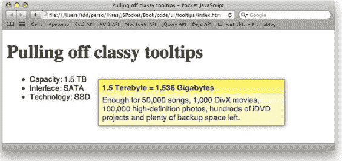

然而，这种实现方式在 IE6 中无效，IE6 只对 <a> 元素遵循 :hover。你必须使用脚本手动响应 mouseover 和 mouseout。在这里，由于 Prototype 实现 show() 和 hide() 的方式，我们不能通过 CSS 规则预隐藏工具提示——这解释了我在对面页面示例 CSS 中展示的小型 IE6 hack。

对于高级需求，你很可能会在众多工具提示库中找到合适的，无论是直接内置于框架中还是基于框架的。就个人而言，我最喜欢的基于 Prototype 的库是强大的 Prototip2。¹³

> 13. http://www.nickstakenburg.com/projects/prototip2/

### 标记工具提示。

```
Download ui/tooltip/index.html
<li tabindex="1">
  <span class="name">Capacity: 1.5 TB</span>
  <div class="tooltip" >
    <p><strong>1.5 Terabyte = 1,536 Gigabytes</strong></p>
    <p>Enough for 50,000 songs, 1,000 DivX movies, 100,000 high-definition photos, hundreds of iDVD projects and plenty of backup space left.</p>
  </div>
</li>
```

### 样式化工具提示。

```
Download ui/tooltip/tooltip.css
#files li { position: relative; }
#files li .tooltip {
  position: absolute; top: 8px; left: 120px; width: 24em;
  z-index: 1; display: none;
  /* IE6 doesn't know li:hover, so we need to toggle via JS, therefore avoiding in-rule display: none */
  _display: block;
  border: 1px solid gray;
  background: #fffdc3 url(bg_tooltip.png) top left repeat-x;
}
#files li:hover .tooltip,
#files li:focus .tooltip { display: block; }
```

### 用于 IE6 的脚本（IE6 不会对非链接元素响应 :hover）。

```
Download ui/tooltip/tooltip.js
function toggle(reveal, e) {
  var trigger = e.findElement('li'),
      tooltip = trigger && trigger.down('.tooltip');
  if (!tooltip) return;
  tooltip[reveal ? 'show' : 'hide']();
}

document.observe('dom:loaded', function() {
  var isIE6 = Prototype.Browser.IE && undefined === document.body.style.maxHeight;
  if (!isIE6) return;
  var files = $('files'), tooltips = files && files.select('.tooltip');
  if (!files || 0 == tooltips.length) return;
  tooltips.invoke('hide');
  files.observe('mouseover', toggle.curry(true)).
    observe('mouseout', toggle.curry(false));
});
```


## 13 制作低调的弹出窗口

无论你使用的是“真正的”弹出窗口（独立窗口）还是伪弹出窗口（当前页面上的元素，样式模拟窗口外观），问题都一样：对于无法打开窗口（或不想打开窗口）的用户，你如何提供对这些内容的访问？想想禁用窗口打开、屏幕阅读器、搜索引擎等等。

唯一的方法就是：让链接真实地指向弹出窗口的内容，然后在此基础上渐进增强。

如果你的内容旨在作为伪弹出窗口（可能也通过 Ajax 加载）中显示的 HTML 片段，你需要确保能够将内容独立提供，无论是否有包含文档标记。这样，用户通过普通链接访问，作为独立文档时，也能获得不错的体验。

这里的核心做法是：原生地链接到目标内容（`href=`，或许再加 `target="_blank"`），然后使用 JavaScript 挂钩这些链接，让它们变得更酷。自己编写打开窗口的代码相当简单——关键是内置的 `window.open()` 方法。

如果你要添加伪弹出窗口或灯箱，务必使用一个优秀的现有库，避免跨浏览器问题和定位算法带来的无尽痛苦。这里有几个参考：

- Scripty2 的 UI¹⁴
- jQuery UI¹⁵
- Dijit（基于 Dojo）¹⁶
- YUI 的 Overlay 模块¹⁷
- Ext.Window¹⁸

还要记住，小型的弹出内容可能适合使用点击触发的富工具提示，而不是一个完整的弹出区域。在这种情况下，可以查看工具提示库和模块。

14. http://github.com/madroobby/scripty2
15. http://jqueryui.com/
16. http://dojotoolkit.org/projects/dijit
17. http://developer.yahoo.com/yui/3/overlay/
18. http://www.extjs.com/deploy/dev/docs/?class=Ext.Window

### 标记用于渐进增强。

下载 ui/popups/index.html

```
<p>
  The great thing about <a class="popup" target="_blank" href="http://pragprog.com/titles/pg_js">Pocket Guide to JavaScript</a>
  is that it focuses on a bunch of specific, useful tasks.</p>
```

### 编写一个简单的 window.open() 脚本。

下载 ui/popups/popups.js

```
var POPUP_FEATURES = 'status=yes,resizable=yes,scrollbars=yes,' +
'width=800,height=500,left=100,top=100';

function hookPopupLink(e) {
  var trigger = e.findElement('a.popup');
  if (!trigger) return;
  e.stop(); trigger.blur();
  var wndName = trigger.readAttribute('target') ||
    ('wnd' + trigger.identify());
  window.open(trigger.href, wndName, POPUP_FEATURES).focus();
}

document.observe('click', hookPopupLink);
```

### 相关任务

- 任务 12，制作优雅的工具提示，第 44 页
- 任务 15，创建灯箱效果，第 50 页

## 14 预加载图像

当你的页面提供用户交互来更改所显示的图像（例如提供缩放、特写、正面/背面视图，或其他任何方式）时，你不会希望用户因为突然需要的图像需要瞬间加载而看到短暂的空白屏幕。你可能想要预加载这些图像。

本质上，只有三种预加载图像的方式：

- *使用 JavaScript，通过动态创建的 Image 对象并设置适当的 src 属性*：这样做可以让你检测预加载的图像确实已加载。
- *使用 CSS，隐藏预加载的图像*：这归结为使用隐藏的  标签来预加载图像。你可以隐藏  标签本身，或者隐藏一个共同的容器（我更喜欢这种方式）。
- *使用 CSS 精灵*：当你想要预加载诸如悬停效果或一组相关图像（例如背景、边框和角落）时，这绝对应该是首选方法。¹⁹

CSS 方法相当直接，但它不像 JavaScript 方法那样提供那么多的潜在控制。对面页面上的标记和脚本假设，带有 `rel="preloadZoom"` 属性的图像标签具有一个使用相同 URI 并带有 `_closeup` 名称后缀的特写版本，用于悬停特写预加载。

这种情况通常更适合使用 JavaScript 选项而不是 CSS 选项。由于悬停效果依赖于 JavaScript，我们也应该在 JavaScript 中预加载。（如果没有 JavaScript，我们就不会预加载那些以后无法显示的内容。）此外，在 JavaScript 中预加载可以避免标记/样式膨胀。

使用 JavaScript，我们可以避免暂时空白/不完整渲染的风险，只在我们确定图像已预加载时才切换显示。非精灵的 CSS 方法存在切换到一个尚未加载完成的图像的风险（虽然风险确实很低）。

对于快速加载图像的更高级技术，请查看 Steve Souder 于 2009 年 5 月做的演示：14 rules for faster-loading images.²⁰

19. 查看开创性的 http://www.alistapart.com/articles/sprites 以及更新的 http://css-tricks.com/css-sprites/。Steve Souders 还维护着 SpriteMe 工具：http://spriteme.org/。
20. http://stevesouders.com/docs/wordcamp-20090530.ppt

### 标记用于预加载。

下载 ui/preloading/index.html

```
<ul id="products">
  <li><h2><a href="http://pragprog.com/titles/cppsu">
    
    <span>Prototype and script.aculo.us</span>
  </a></h2></li>
  <li><h2><a href="http://pragprog.com/titles/vsscala">
    
    <span>Programming Scala</span>
  </a></h2></li>
</ul>
```

### 脚本预加载。

下载 ui/preloading/preloading.js

```
function preloadImages() {
  $$('img[rel="preloadZoom"]').each(function(img) {
    var pimg = new Image();
    pimg.src = img.src.replace(/\(\.\w+)$/, '_closeup$1');
  });
}

document.observe('dom:loaded', preloadImages);
```

### 悬停切换到（理想情况下已预加载的）图像。

下载 ui/preloading/preloading.js

```
function togglePreloaded(e) {
  var trigger = e.findElement('img[rel="preloadZoom"]');
  if (!trigger) return;
  if (e.type == 'mouseover') {
    trigger.src = trigger.src.replace(/\(\.\w+)$/, '_closeup$1');
  } else {
    trigger.src = trigger.src.replace('_closeup', '');
  }
}

document.observe('mouseover', togglePreloaded).
  observe('mouseout', togglePreloaded);
```

## 15 创建灯箱效果

灯箱效果是指将某些内容调出显示，同时用遮罩层将页面其余部分变暗并阻止鼠标操作。大多数情况下，灯箱界面居中显示在页面上。灯箱通常用于展示图像，并通过页面上的链接文本或链接缩略图启动。

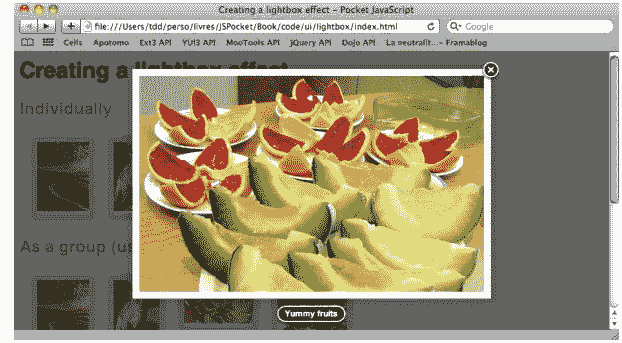

在这本书的示例中，我们使用 Janis Skarnelis 编写的 FancyBox jQuery 插件，将缩略图以灯箱形式展示为更大的版本。它不唐突，相当轻量，易于直接使用，开箱即用且外观华丽。不过，如果你愿意，也可以查看本书演示页面底部的替代方案。

FancyBox 不仅限于图像内容——它可以调出任何内容，包括 `<iframe>` 之类的东西。当链接的目标 URI 既不“看起来像图像文件”也不使用 iframe 时，它默认为即时 Ajax 加载。因此，例如，较大的图像可以通过无扩展名的 URL 按需加载。

与大多数 UI 相关的库一样，FancyBox 需要加载至少一个脚本和一个 CSS 文件。它假设其图像位于样式表所在的文件夹中，避免了乏味的 CSS 调整。FancyBox 对图像 URL 没有要求。

要让链接变为灯箱效果，我们只需获取它们并调用它们的 `fancybox()` 方法，如对面页面所示。它可以在没有任何选项的情况下工作，但也提供了许多可能的调整。我非常喜欢看到缩略图放大到更大版本，所以我这样设置了。

### 加载 FancyBox。

下载 ui/lightbox/index.html

```
<link rel="stylesheet" type="text/css"
    href="vendor/fancybox/jquery.fancybox-1.2.6.css" />
<script type="text/javascript" src="vendor/jquery-1.3.2.min.js"></script>
<script type="text/javascript"
    src="vendor/fancybox/jquery.fancybox-1.2.6.pack.js"></script>
```

### 链接到单个图像。

下载 ui/lightbox/index.html

```
<a href="beach_normal.jpg" title="A gorgeous beach">
    
</a>
```

### 将图像作为可浏览的组进行链接。

下载 ui/lightbox/index.html

```
<li>
    <a href="beach_normal.jpg" rel="demo" title="A gorgeous beach">
        
    </a>
</li>
<li>
    <a href="feline_normal.jpg" rel="demo" title="A cute cub">
        
    </a>
</li>
```

### 初始化 FancyBox（并加入一些自定义设置）。

下载 ui/lightbox/lightbox.js

```
$(function() {
    $('#thumbnails a').fancybox({
        zoomSpeedIn: 300, zoomOpacity: true, overlayColor: '#000',
        overlayOpacity: 0.6
    });
});
```

### 相关任务

- 任务 12，制作优雅的工具提示，第 44 页
- 任务 13，制作低调的弹出窗口，第 46 页


## 16 实现“无限滚动”

Gmail 让我们认识了无限滚动，它在多种场景下宣告了分页的末日。许多人（当然不是所有人）发现，滚动浏览大量项目并使用视觉模式匹配，比逐一点击分页链接更高效。

分页之所以出现，多半只是出于技术原因：

- 旧版浏览器渲染缓慢，迫使我们保持页面“足够轻量”。
- 客户端与服务器之间的带宽可能受限，促使我们保持精简。
- 服务器端处理时间随数据增长而增长。一次性渲染整个数据集，不仅从使用的角度来看没有必要，而且对我们的服务器而言并不可行（至少是不切实际且笨重的），尤其当它们还想持续处理足够多的并发请求时。

不过，分页只是一种方式——一种不使用 JavaScript 的方式。但只要启用了 JavaScript，只要合理，你就可以隐藏任何分页链接，并用无限滚动取而代之。这个决定我留给你的可用性专家——也交给你自己的明智判断。

正如你将在下面代码中看到的，无限滚动并不复杂。唯一棘手的部分是，要在不同浏览器间正确获取我们的度量值，需要绕几个弯，这一点在 `lowEnough()` 方法代码中得到了体现。

本质上，我们检查文档底部是否没有太远地低于视口底部。然后，只需足够频繁地查看垂直滚动状态——每秒十次当然足够敏捷！——并通过 Ajax 加载更多内容。

从无障碍（和故障转移）的角度看，你可能还想提供分页，并在设置时隐藏“下一页”链接，如果 Ajax 抓取失败再恢复这些链接，让用户有替代方案。

提醒一下手头没有可用 PHP 环境的人：你最终只会瞬间加载更多内容；PHP 代码通过等待半秒再返回静态内容来模拟加载时间。

### 检查我们是否滚动到了足够低的位置。

下载 ui/infinite/infinite.js

```
function lowEnough() {
    var pageHeight = Math.max(document.body.scrollHeight,
        document.body.offsetHeight);
    var viewportHeight = window.innerHeight ||
        document.documentElement.clientHeight ||
        document.body.clientHeight || 0;
    var scrollHeight = window.pageYOffset ||
        document.documentElement.scrollTop ||
        document.body.scrollTop || 0;
    // Trigger for scrolls within 20 pixels from page bottom
    return pageHeight - viewportHeight - scrollHeight < 20;
}
```

### 留意滚动位置并抓取更多。

下载 ui/infinite/infinite.js

```
function checkScroll() {
    if (!lowEnough()) return pollScroll();
    $('spinner').show();
    new Ajax.Updater('posts', 'more.php', {
        method: 'get', insertion: 'bottom',
        onComplete: function() { $('spinner').hide(); },
        onSuccess: pollScroll
    });
}

function pollScroll() { setTimeout(checkScroll, 100); }

pollScroll();
```

## 17 加载内容时保持视口位置

有时，你可能希望保持用户视口内容的稳定——即浏览器窗口中所有可见的内容——即使用户点击加载这些内容上方的更多内容。例如，用户点击查看之前的评论，但你并不希望因为评论从上方加载而把用户的滚动位置向下推。

在这种情况下，你会发现自己遇到一个小障碍。直觉上，用户期望他们在页面上的位置不会移动。但通过加载上方内容，你会把文档的其余部分（包括被点击区域）推到视口更下方，并且很可能把它推出视口。

解决方案是保持相对于视口的滚动位置。为此，我们需要在加载视口所显示内容上方的更多内容之前，获取视口的“滚动偏移量”——也就是加载前的视口位置——并在内容注入后恢复该偏移量。偏移量通常是一件麻烦事，充满跨浏览器的棘手细节，但多亏了 Prototype 等库及其与位置相关的特性，这个问题实际上可以相当简洁地解决。

下面的代码改编自 Sam Stephenson 的 Gist。在加载额外内容之前，我们获取触发链接在文档中的位置（其 `cumulativeOffset()`），并从中减去视口当前的滚动量，这告诉我们该触发器在视口中向下多远处。然后，在新内容注入后，我们通过反向相减来确定视口的新偏移量。

熟悉 Prototype 的读者可能会疑惑，为什么我在这里使用 `Ajax.Request`，而不是更专用的 `Ajax.Updater`。我这样做是因为这让我能尽可能晚地获取原始滚动位置，具体来说是在 Ajax 请求完成后，避免用户在 Ajax 请求期间滚动时产生奇怪的“滚动重置”效果。

这用非常少的代码就带来了相当不错的用户体验。

### 保持视口位置。

下载 ui/viewport/index.html

```
<h2>Comments</h2>

<div id="extraComments">
    <a id="loadKnownComments" href="?with_known_comments">See previous comments you already know about</a>
</div>

<h3>Comment 5</h3>
<p>Lorem ipsum dolor sit amet, consectetur adipisicing elit, sed do eiusmod tempor incididunt ut labore et dolore magna aliqua. Ut enim ad minim veniam, quis nostrud exercitation ullamco laboris nisi ut aliquip ex ea commodo consequat.</p>
```

### 在 Ajax 之前获取滚动量，并在之后进行调整。

下载 ui/viewport/viewport.js

```
function loadKnownComments(e) {
    e.stop();
    var zone = $('extraComments'), ref = zone.next('h3');
    var upd = new Ajax.Request('known_comments.html', {
        method: 'get',
        onSuccess: function(res) {
            var orig = ref.cumulativeOffset().top - document.viewport.getScrollOffsets().top;
            zone.insert({ before: res.responseText });
            window.scrollTo(0, ref.cumulativeOffset().top - orig);
        }
    });
}
```

表单现在是 Web 应用的关键部分。我们总是从用户那里收集信息，以填写个人资料、设置任务和服务、发送消息等等。然而，你在网上遇到的大多数表单在可用性和人体工学方面都处于可悲状态。本部分试图提供一系列方法，在处理表单时改善用户体验（日益被称为 UX）。

实用表单背后的关键理念是：不要浪费用户的时间。

- 使用任务18，*暂时禁用提交按钮*，让他们免于重复提交。
- 借助任务19，*提供输入长度反馈*，让他们知道自己还能输入多少文字。
- 如任务20，*一次（取消）选中整组复选框*所示，允许他们成批切换选择。
- 尽可能立即验证他们的输入，可使用任务21，*验证表单：基础*；任务22，*验证表单：更进一步*；以及任务23，*验证表单：全套*。你知道有谁喜欢事后才发现自己的用户名已被占用，或者密码不符合安全要求吗？
- 如任务24，*在表单上提供即时帮助提示*所示，为填写特定字段提供额外帮助。
- 建议替代输入或自动补全；你将在任务25，*输入时自动补全*中看到如何实现。
- 让他们一次上传多个文件，这一技巧在任务26，*使用动态多文件上传*中演示。

这些只是让表单更易用的一些例子。我们将在接下来的任务中探讨如何实现这些功能。

不过，永远不要忘记你不能把 JavaScript 视为理所当然。你的所有表单都应该在完全没有 JavaScript 的情况下仍能工作；也许它们用起来不会那么巧妙，但必须能工作。服务器端无论如何都必须验证一切；未被脚本拦截的链接不应指向无效地址，等等。在制作表单时，*渐进增强*至关重要。请确保它们在没有脚本或 CSS 的情况下也能工作，然后你可以通过任何可用且已启用的技术，增加一层层的额外舒适体验。


## 18 暂时禁用提交按钮

有时，我们的表单在服务器端需要一段时间才能处理完毕。也许我们正在使用一个老式的 `<input type="file" ... />` 字段上传大文件，或者服务器只是出于某种原因而繁忙。无论如何，我们都不希望在处理表单时让用户重新提交。双重提交实在令人恼火，你懂的。

为了避免这种情况，我们可以通过禁用所有提交表单的 UI 手段来响应表单提交，也就是带有 `type="submit"` 或 `type="image"` 属性的 `<input>` 或 `<button>` 标签。由于少数浏览器（例如我们亲爱的 MSIE）不能很好地处理 CSS 属性选择器，我们应该给这些元素“打上”一个特定的类，比如 `submit`，并用它来选择我们打算禁用的元素。

在对页上，第一个脚本展示了基于 Prototype 的最简实现代码。这相当简单。

你很可能想更进一步，在表单提交时添加一些额外的 UI 装饰；并非所有浏览器都会以清晰的视觉样式渲染禁用字段，而且你可能还想强调“有事情正在发生”这一事实。（你并不是只是为了惹人厌才禁用它，对吧？）

第二个脚本演示了向被禁用的 `<input>` 标签添加自定义类。因为应用 CSS 所带来的 UI 更新并不像禁用调用那样“内置”，我们还希望确保浏览器在提交表单之前能够“喘口气”（此时它可能会忽略任何进一步的视觉更新，直接继续提交）。为了解决这个常见问题，我们用 `delay()` 将 `submit()` 调用延后了仅仅十分之一秒。

还要注意我们这里的 JavaScript 代码中的 `that = this` 闭包技巧。你可能知道，调用一个函数（在这里也就是我们最终对其调用 `delay()` 的那个函数）可能会丢失当前的绑定——即 `this` 所引用的值。我们没有强行绑定（这需要额外一层函数包装，因此代价较高），而是依靠闭包，让我们临时匿名函数内部的代码保留对原始 `this`（正在提交的表单）的引用，以便在适当的时候调用它的 `submit()`。[21]

21. 对 JavaScript 函数绑定感到惴惴不安？请参阅我在 ALA 上的文章 http://www.alistapart.com/articles/getoutbindingsituations/ 了解详情。不太确定闭包以及它们有什么用处？我的朋友 Jury “Kangax” Zaytsev 写了一篇很棒的文章，地址是 http://msdn.microsoft.com/en-us/scriptjunkie/ff696765.aspx。

### 在提交事件中禁用。

```javascript
function preventMultipleSubmits() {
  this.select('.submit').invoke('disable');
}
```

```javascript
document.observe('dom:loaded', function() {
  $('commentForm').observe('submit', preventMultipleSubmits);
});
```

```html
<form id="commentForm" action="post_comment.php">
<label for="edtText">Your text</label>
<textarea id="edtText" name="text" cols="40" rows="5"></textarea>
<p><input type="submit" class="submit" value="Send" /></p>
</form>
```

### 使用类进行额外装饰（一点锦上添花）。

```javascript
function preventMultipleSubmits(e) {
  if (!this.hasClassName('submitting')) {
    e.stop();
  }
  this.addClassName('submitting').select('.submit').invoke('disable');
  var that = this;
  (function() { that.submit(); }).delay(0.1);
}
```

```html
<form id="commentForm" action="post_comment.php">
<label for="edtText">Your text</label>
<textarea id="edtText" name="text" cols="40" rows="5"></textarea>
<p><input type="submit" class="submit" value="Send" /></p>
</form>
```

## 19 提供输入长度反馈

填写表单时，一个常见的令人沮丧的情况是，文本输入会突然戛然而止，即使有一些文字提醒我们最大长度。不仅如此，你知道吗，`<textarea>` 并没有 `maxlength=` 属性？说真的。它不是有效的 HTML，会被愉快地忽略（除非你足够幸运，能够使用 HTML5）。

因此，为了提供一种统一的方式来指定最大长度，我们可以依靠专用的 CSS 类来做，呃，“数据存储”。它们将使用由两部分组成的名称：首先是 `maxLength` 前缀，然后是一个正整数，表示我们想要的最大长度。请参阅对页上的标记。

然后我们可以使用 JavaScript 执行以下操作：

1. 动态装饰包含这些元素的表单区域（为简洁起见，我将假设这些区域是段落；旁边的代码会给段落添加一个类），然后动态创建用于剩余长度反馈的占位符。
2. 将反馈区初始化为当前状态。
3. 绑定适当的事件监听器，以实时反馈输入。
4. 定位反馈区（在示例中，我把它放在匹配字段的右下角下方），然后将其添加到文档中，现在它已准备好正式亮相！

现在，每当发生输入时，我们只需要更新反馈；如果我们达到或超过最大长度（这在 `<textarea>` 上是不可能发生的），我们就会回退到允许的最大长度。

请注意这段代码中的几个技巧：

- 我们同时监听 `keyup` 和 `keypress`，以便对非字符键（主要是删除、剪切和粘贴）以及字符键做出反应。监听 `keydown` 是无用的，因为它发生在文本改变之前，而且我们无法可靠地跨浏览器和键盘布局判断文本是否会改变。
- 为了避免在每次击键时重新计算最大长度，我们在设置期间将其缓存。为了将最大长度与我们的字段关联起来，我们使用一个基于 JavaScript 的关联数组，在字段的 `id=` 属性[22]与字段本身之间建立映射。这比使用 expando 属性更轻量。

22. 我们在这里使用 Prototype 的 `identify()` 来确保元素具有 `id=` 属性。

### 通过标记指定最大长度。

下载 form/feedback/index.html

```html
<p>
    <label for="edtDescription">Description</label>
    <textarea id="edtDescription" name="description" cols="40"
    rows="5" class="maxLength200"></textarea>
</p>
```

### 为最大长度字段设置反馈。

下载 form/feedback/feedback.js

```javascript
var maxLengths = {};

function bindMaxLengthFeedbacks() {
    var mlClass, maxLength, feedback;
    $$('.maxLength').each(function(field) {
        field.up('p').addClass('lengthFeedback');
        mlClass = field.className.match(/\bmaxLength(\d+)\b/)[0];
        maxLength = parseInt(mlClass.replace(/\D+/g, ''), 10);

        feedback = new Element('span', { 'class': 'feedback' });
        maxLengths[field.identify()] = [maxLength, feedback];
        updateFeedback(field);
        field.observe('keyup', updateFeedback).
            observe('keypress', updateFeedback);

        feedback.clonePosition(field, { setHeight: false,
            offsetTop: field.offsetHeight + 2 });
        field.insert({ after: feedback });
    });
}
```

### 实时提供反馈。

下载 form/feedback/feedback.js

```javascript
function updateFeedback(e) {
    var field = e.tagName ? e : e.element();
    var current = field.getValue().length,
        data = maxLengths[field.id], max = data[0],
        delta = current < max ? max - current : 0;
    data[1].update('Remaining: ' + delta);
    if (current > max) {
        field.setValue(field.getValue().substring(0, max));
    }
}
```

## 20 一次（取消）选中整组复选框

这种情况屡见不鲜：你有一个列表，而你的用户希望能批量执行某些操作。删除、移动、归档以及更改其中若干项的某个属性，这些任务归根结底都是让用户勾选特定项目。而有时候，他们想勾选全部项目。当列表很长时，这可能会让人很痛苦，因此批量切换是一个不错的 UI 功能。

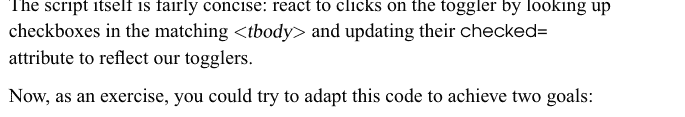

标记很简单。我们只需在表头区域放一个复选框作为切换器。这会自动限定其范围，让我们的脚本可以导航到对应的 `<tbody>`，将其作为目标复选框的容器。

脚本本身相当简洁：响应切换器的点击，在匹配的 `<tbody>` 中查找复选框，并更新它们的 `checked=` 属性以反映切换器的状态。

现在，作为练习，你可以尝试调整这段代码来实现两个目标：

- 允许页面中有多个表格，每个表格各有一个切换器。这主要意味着你要用类来替代 `id=`，并使用事件委托以避免注册过多监听器。
- 通过允许一个表格包含多个 `<tbody>` 来应对更复杂的表格。是的，这是有效的标记（当你以某种方式分组数据时，每个语义部分对应一个 `<tbody>`）。有趣的是，如果你添加多个 `<tbody>`，最终反而会简化脚本！


### 创建参考复选框和检查清单的标记。

下载 form/checklist/index_for_book.html

```html
<table id="mailbox">
  <thead>
    <tr>
      <th><input type="checkbox" id="toggler" /></th>
      <th>Subject</th>
      <th>Date</th>
      <!-- From, Size, Attachments... -->
    </tr>
  </thead>
  <tbody>
    <tr>
      <td><input type="checkbox" name="mail_ids[]" value="1" /></td>
      <td>Happy new year!</td>
      <td>Jan 1, 2010 00:03am</td>
      <!-- ... -->
    </tr>
    <!-- More rows... -->
  </tbody>
</table>
```

### 将选中状态传播到每行的第一个复选框。

下载 form/checklist/checklist.js

```javascript
function toggleAllCheckboxes() {
  var scope = this.up('table').down('tbody'), boxes = scope && scope.select('tr input[type="checkbox"]:first-of-type');
  var refChecked = this.checked;
  (boxes || []).each(function(box) { box.checked = refChecked; });
}

document.observe('dom:loaded', function() {
  $('toggler').observe('click', toggleAllCheckboxes);
});
```

## 21 验证表单：基础

客户端验证是必备的。说真的。无论你的用户连接吞吐量如何，如果本可以在浏览器中直接完成的验证还非得在服务器上来回往返一趟，那简直令人痛心。你当然希望自己的网页只带来骄傲，所以让我们开始吧！

第一个任务专注于最基本的验证类型：必填字段，即验证特定字段是否有非空文本或是否被勾选等等。我们将使用一种约定：用 `required` CSS 类标记这些字段，并依靠样式来对缺失字段提供视觉反馈。

首先，务必拦截表单的 submit 事件，而不是提交按钮的 click 事件或文本框的 Return 键。要在表单提交到服务器之前对其进行拦截，唯一可靠的方式就是它的 submit 事件。即使是程序化提交（`form.submit()` 调用）也会触发该事件。

一旦挂钩，我们只需要获取表单中所有标记为 required 的元素，并验证它们具有非空值。Prototype 对 String 的 `blank()` 扩展在这里很方便。仅包含空白字符的字符串被视为空白，从语义角度来看，它们肯定不比真正的空字符串好多少。但请注意，如果某个字段允许只含空白，那么你可以直接使用 `if (field.getValue())`——在 JavaScript 中，空字符串等价于 false。

我们的代码维护一个 `firstOffender` 引用，以便通过自动聚焦第一个有问题的字段来帮助用户更正输入。最后但同样重要的是，一旦我们完成检查，如果至少有一个问题，我们就 `stop()` 该事件，从而有效地阻止当前表单被提交。

最后提醒：默认情况下，submit 事件在 Internet Explorer 中不会冒泡。因此，如果你的代码也需要在 IE 中运行，就必须为页面上要检查的每个表单都附加事件监听器，包括在初始 DOM 加载后动态插入的表单。jQuery 从 1.4 版本起在 IE 中模拟了 submit 事件的冒泡，但代价是对表单内的所有点击和按键进行相当繁重的监控。

### 标记必填字段。

```html
<form id="registration">
<p>
<label for="user_first_name">First name</label>
<input type="text" name="user[first_name]" id="user_first_name" class="required text" />
</p>
<!-- ...more fields... -->
<p class="radios">
<input type="checkbox" id="terms" name="terms" class="required" />
<label for="terms">I accept the terms of service*</label>
</p>
<p><input type="submit" value="Sign me up! " /></p>
</form>
```

### 检测缺失的必填字段。

```javascript
function checkForm(e) {
  var firstOffender, value;
  this.select('.required').each(function(field) {
    value = field.getValue();
    if (value && !value.blank()) {
      field.up('p').removeClassName('missing');
    } else {
      firstOffender = firstOffender || field;
      field.up('p').addClassName('missing');
    }
  });
  if (firstOffender) { e.stop(); firstOffender.focus(); }
}
document.observe('dom:loaded', function() {
  $('registration').observe('submit', checkForm);
});
```

### 相关任务

- 任务 22，*进一步验证表单*，在下一页
- 任务 23，*验证表单：全套验证*，在第 68 页

## 22 验证表单：更进一步

之前的任务让我们检查必填字段是否确实已填写或勾选。很好。然而，我们经常希望文本字段符合给定的格式，例如电话号码、电子邮件地址、整数或更一般的数字。这些字段可能已填写但不正确，我们应该尽最大努力提前检查。一如既往，这只是对真正强制性检查（即服务器端检查）的*补充*。

通常的做法是使用正则表达式，这种方式相当简洁高效。如果你在开发者生涯的现阶段还不太熟悉正则表达式，请帮自己一个大忙，花几个小时深入研究一下。虽然它们在初学者看来可能难以理解，但它们建立在极少数语法规则之上（大约十几条，其中一半通常就够用了），了解“正则表达式”将无数次为你节省大量编码时间。你可以在网上找到大量优秀的交互式教程。

在对面页上，代码的思路是检测与基于正则表达式的检查相匹配的表单字段上的 CSS 类。我只放了三个正则表达式，但你可以通过向 `FIELD_PATTERNS` 字典添加新的键值对来扩展功能。不过，让我先打消纯粹主义者的不满。是的，我展示的模式并没有涵盖非十进制数字、指数浮点记数法，以及当今使用的约 0.1% 的电子邮件地址。这有什么大不了的。但本任务讲的是字段验证，而不是正则表达式功夫。你可以随意调整这些模式以满足你的需求！

这段代码相当简短直接；这里我只想说明两个有趣的点。首先，`$F(element)` 函数只是 `element.getValue()` 的简写符号。

其次，如果你在 JavaScript 中使用过正则表达式，大概率你会使用通用的 `myString.match(myPattern)` 方式。这可行，因为它返回 null（无匹配）或匹配数组（或匹配组）。然而，当你只需要知道是否找到匹配，而不关心匹配的具体内容时，你应该反转问题，让模式对字符串调用 `test()`，它只返回一个布尔值。

事实上，`test()` 方法更健壮：如果传入的不是字符串，它不会出错；而试图在非字符串上调用 `match()` 则会失败。另外，`test()` 的效率略高一些。我喜欢理所当然地使用这类性能优化手段，尤其是在它们不会带来代码可读性（或代码体积）损失的情况下。

### 标记需要特殊语法的字段。

```html
<p>
  <label for="user_email">Email</label>
  <input type="text" name="user[email]" id="user_email"
    class="required text email" />
</p>
<p>
  <label for="user_favnumber">Favorite number</label>
  <input type="text" name="user[favnumber]" id="user_favnumber"
    class="text number" />
</p>
```

### 检查特殊语法的字段。

```javascript
var FIELD_PATTERNS = {
  integer: /^\d+$/,
  number: /^\d+(?:\.\d+)?$/,
  email: /^[A-Z0-9._%+-]+@[A-Z0-9.-]+\.[A-Z]{2,6}$/i
};

function checkField(field) {
  var value = $F(field).toString().strip();
  for (var pattern in FIELD_PATTERNS) {
    if (!field.hasClassName(pattern)) continue;
    if (!FIELD_PATTERNS[pattern].test(value)) return false;
  }
  return true;
}
```

### 相关任务

- 任务 21，*验证表单：基础*，在第 64 页
- 任务 23，*验证表单：全套验证*，在下一页

## 23 验证表单：全套验证

### 标记登录字段。

下载 form/validation_ajax/index.html

```html
<p>
  <label for="user_login">Login</label>
  <input type="text" name="user[login]" id="user_login" class="required text" />
  <span class="feedback" style="display: none;"></span>
  
</p>
```

### 监听登录字段。

下载 form/validation_ajax/validation_ajax.js

```javascript
document.observe('dom:loaded', function checkLogin() {
  var feedback = $('user_login').next('.feedback'),
      spinner = $('user_login').next('.spinner');
  new Field.Observer('user_login', 0.8, function(_, value) {
    if (value.length < 2) return;
    feedback.hide(); spinner.show();
    new Ajax.Request('check_login.php', {
      method: 'get', parameters: { login: value },
      onComplete: function(res) {
        if (Ajax.activeRequestCount > 1) return;
        if (res.request.success && res.status) {
          feedback.update('Login available!').removeClassName('ko');
        } else {
          feedback.update('Login taken!').addClassName('ko');
        }
        spinner.hide(); feedback.show();
      }
    });
  });
});
```

### 模拟登录检查。

下载 form/validation_ajax/check_login.php

```php
<?php
sleep(rand(5, 10) / 10.0); // Simulate intarwebs delay...
$RESERVED = array('bob', 'doudou', 'tdd', 'meshak', 'ook');
$login = isset($_GET['login']) ? $_GET['login'] : '';
$response = in_array($login, $RESERVED) ? '422 Conflict' : '202 Accepted';
header('HTTP/1.1 ' . $response);
?>
```


## 24 在表单上提供即时帮助工具提示

有时我们会将复杂的表单放在网上。字段具有高级语义或非平凡的输入规则。例如，我们可能对密码字段强制执行复杂度要求，在这种情况下，最佳实践（也是礼貌的做法）是提前警告用户。但当多个字段需要详细警告和说明时，我们的表单会变得杂乱。

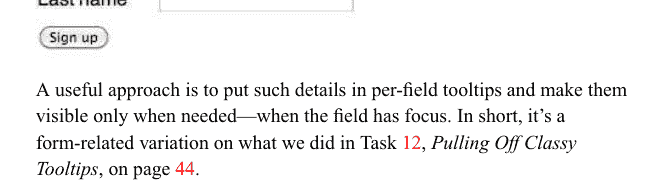

一种有用的方法是为每个字段放置工具提示，并在需要时才显示——当字段获得焦点时。简而言之，这是在表单相关的变体上，我们在第 12 节《Pulling Off Classy Tooltips》中所做的，见第 44 页。

请注意，最佳位置是在标签内部，而不仅仅是在同一段落中。这样，这些信息对盲用户来说是可用的，无论他们的屏幕阅读器当前处于何种模式。

样式——尤其是在定位工具提示方面——对本任务非常重要，因此我在对面页面上展示了一些 CSS。但这坦率地说是一个微不足道的例子。如果使用模拟焦点和模糊事件冒泡的库，可以在代码和性能方面都得到增强，这样你就不必为每个相关字段显式注册事件监听器。在撰写本文时，最新版的 jQuery 已内置此功能，你会为最流行的 JavaScript 框架找到或多或少官方的插件来满足相同需求。

### 将工具提示放在有用的地方。

Download form/tooltips/index.html

```html
<p>
  <label for="user_login">
    Login*
    <span class="tooltip" style="display: none;">
      Logins must be unique, at least 3 characters long,
      and may only use letters, numbers, white space,
      hyphens, underscores and periods.
    </span>
  </label>
  <input type="text" id="user_login" name="user[login]" class="required text" />
</p>
```

### 样式以获得统一、整洁的外观。

Download form/tooltips/tooltips.css

```css
#registration label { float: left; width: 6em; position: relative; zoom: 1; }
#registration input.text { width: 14em; }
#registration .tooltip {
  display: block; position: absolute; left: 24em; top: 0;
  padding: 0.35em 0.5em 0.35em 2em; width: 15em;
  border: 1px solid silver;
  color: gray; font-size: 80%;
  background: #ffc url(lightbulb.png) 0.5em 0.3em no-repeat;
}
```

### 获得焦点时显示，失去焦点时隐藏。

Download form/tooltips/tooltips.js

```javascript
document.observe('dom:loaded', function() {
  var attr = Prototype.Browser.IE ? 'htmlFor' : 'for';
  function showTooltip() {
    var tooltip = $$('label['+attr+'="'+this.id+'"] .tooltip').first();
    tooltip && tooltip.show();
  }
  function hideTooltip() {
    var tooltip = $$('label['+attr+'="'+this.id+'"] .tooltip').first();
    tooltip && tooltip.hide();
  }

  $('registration').getInputs().invoke('observe', 'focus', showTooltip).
    invoke('observe', 'blur', hideTooltip);
});
```

## 25 在输入时自动补全

比在发送到服务器之前验证输入更好的是在用户输入时验证输入！通过将用户的持续输入与有效/有用的输入数据库进行匹配，我们可以提供建议，不仅可以帮助他们纠正拼写错误，还可以让他们免于手动输入那些常见到足以出现在建议列表中的长内容。

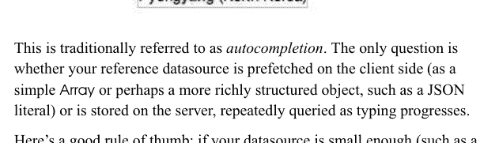

这传统上被称为自动补全。唯一的问题是你的参考数据源是在客户端预取的（作为简单的 Array 或更丰富的结构化对象，例如 JSON 字面量），还是存储在服务器上，随着输入的进行反复查询。

这里有一个经验法则：如果你的数据源足够小（例如州、货币或单一品牌内型号名称的参考列表），就在脚本中预取它（例如在渲染页面时生成 JavaScript 字面量）。否则，使用 Ajax，并确保调整查询频率，以便即使在连接缓慢或打字快速的情况下也能获得良好的用户体验。

Script.aculo.us 1.8 具有一个功能强大的自动补全控件，具有大量自定义选项，我们将在此处使用它，以及它的 Prototype 底层。根据你的数据源位置，你可以使用 Autocompleter.Local 或 Ajax.Autocompleter。（我知道命名并不很一致；对此抱歉。）在第一种情况下，你只需指定数据源 Array，并可以使用几个选项微调匹配行为（fullSearch、partialSearch、partialChars 和 ignoreCase）。在 Ajax 情况下，你提供基本 URI 和常规 Ajax 相关选项，包括要发送的额外参数。

### 标记一个字段以进行自动补全。

Download form/autocompletion/index.html

```html
<div class="p" id="local">
  <label for="edtCachedSearch">Local search:</label>
  <input type="text" id="edtCachedSearch" name="search" />
  <div class="completions"></div>
</div>
```

### 样式以提高可读性。

Download form/autocompletion/autocompletion.css

```css
.completions {
  border: 1px solid silver; background: white; font-size: 80%; z-index: 2;
}
.completions ul { margin: 0; padding: 0; list-style-type: none; }
.completions li { line-height: 1.5em; white-space: nowrap;
  overflow: hidden; }
.completions li.selected { background: #ffa; }
.completions strong { color: green; }
```

### 从客户端数据源自动补全。

Download form/autocompletion/autocompletion.js

```javascript
var FREQUENT_SEARCHES = [
  'JavaScript', 'JavaScript frameworks', 'Prototype', 'jQuery', 'Dojo',
  'MooTools', 'Ext', 'Ext JS', 'script.aculo.us', 'Scripty2', 'Ajax',
  'XHR', '42'
];

function initLocalCompletions() {
  var field = $('#edtCachedSearch'), zone = field.next('.completions');
  new Autocompleter.Local(field, zone, FREQUENT_SEARCHES,
    { fullSearch: true });
}
```

### 使用 Ajax 自动补全。

Download form/autocompletion/autocompletion.js

```javascript
function initAjaxCompletions() {
  var field = $('#edtAjaxSearch'), zone = field.next('.completions');
  new Ajax.Autocompleter(field, zone, 'autocomplete.php', {
    method: 'get', paramName: 'search' });
}
```

### 相关任务

- Task 23, Validating Forms: The Whole Nine Yards, on page 68

## 26 使用动态多文件上传

目前内置于 HTML 中的文件上传功能（即 HTML5 之前）基本上很糟糕。它是单文件上传，没有上传进度反馈，不能按大小或文件类型约束进行过滤，等等。而且它使用 Base64 编码，这意味着每个发送的文件都会膨胀 33%。除非我们使用 WebSockets 或 SWFUpload，否则我们被困在大多数这些限制中。

然而，我们可以通过让用户以一种不错的方式选择多个文件来改善用户体验。当我说“不错”时，我基本上是指“没有与文件数量一样多的可见文件控件”。我喜欢 37signals 在其产品中展示待上传文件列表的方式：一个平坦的、带图标装饰的文件名列表，并有选项将其从上传“队列”中移除。

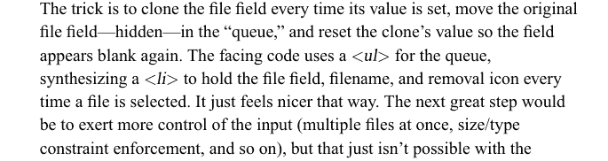

诀窍是每次其值被设置时克隆文件字段，将原始文件字段（隐藏）移入“队列”，并重置克隆的值，使字段再次显示为空。对面代码使用 <ul> 作为队列，每次选择文件时合成一个 <li> 来保存文件字段、文件名和删除图标。这样感觉更自然。下一步的改进将是更好地控制输入（一次多个文件、大小/类型约束强制执行等），但这只是用当前的 <input type="file"> 不可能实现的；去查阅 SWFUpload 以获取此类精美功能。

这里展示的最后一段脚本使用一个不错的小映射根据文件扩展名获取 CSS 类名，并在队列中的链接被点击时处理队列项的移除。

### 为你的表单创建初始标记。

Download form/uploads/index.html

```html
<form method="post" action="server.php" enctype="multipart/form-data">
    <ul id="uploads"></ul>
    <p><input type="file" name="files[]" id="filSelector" /></p>
    <p><input type="submit" value="Send these files" /></p>
</form>
```

### 排队文件上传。

Download form/uploads/uploads.js

```javascript
function queueFile() {
    var fileName = $F(this), clone = this.cloneNode(true);
    var item = new Element('li', { 'class': getFileClass(fileName) });
    $(clone).observe('change', queueFile).setValue('');
    this.parentNode.appendChild(clone);
    item.appendChild(this);
    item.appendChild(document.createTextNode(fileName));
    item.insert('<button></button>');
    $('uploads').appendChild(item);
}

document.observe('dom:loaded', function() {
    $('filSelector').observe('change', queueFile);
    $('uploads').observe('click', handleQueueRemoval);
});
```

### 增加亮点：按扩展名设置样式和队列移除。

Download form/uploads/uploads.js

```javascript
var ICONS = $H({ word: $w('doc docx'), image: $w('jpg jpeg gif png') });

function getFileClass(fileName) {
    var ext = (fileName.match(/\.([^.]+)$/) || [,''])[1].toString().toLowerCase();
    var icon = ICONS.detect(function(pair) { return pair[1].include(ext); });
    return (icon || [,''])[0];
}

function handleQueueRemoval(e) {
    var trigger = e.findElement('button');
    trigger && trigger.up('li').remove();
}
```


# 第五部分
## 与服务器端对话

上一部分向我们展示了（其中之一）如何在客户端尽可能多地验证输入。它还开始深入使用服务器提供的数据进行更复杂的验证、补全等。大多数 Web 应用都依赖后端来完成其功能；它们如何与该后端“对话”是本部分的主题。

- 我们首先将讨论 cookie，这是跨请求持久化状态的最早方法之一，使我们能够为用户创建 *会话* 式的导航，以便记住他们所做的事情、记住他们是谁等等。这在任务 27 中有所涉及，*读取/写入 Cookie*。永久 cookie 存储在用户的磁盘上，也能让我们在多次访问之间“记住”他们，这可能有有用的应用。不幸的是，JavaScript 中原生的 cookie 操作相当糟糕；我们将看到如何更轻松地处理它们。
- 然后我们将聚焦于 Web 2.0 应用和服务的重量级选手：Ajax。首先，我们将介绍如何在不重新加载页面的情况下与服务器通信的基础知识；这在任务 28 中，*通过 Ajax 加载内容（同域）*。
- 然后我们在任务 29 中对 JSON 进行深入了解，*使用 JSON*，以及其表亲 JSON-P 在任务 30 中，*使用 JSON-P*。这些是在 JavaScript 驱动的客户端和任何服务器之间交换数据的好方法（比使用 XML 容易得多）。
- 最后，作为通向 mashup 的开端，我们将介绍与位于我们域之外的第三方服务通信的大多数（众多）方式。这在任务 31 中可用，*跨域“Ajax”（第一版）*，以及任务 32，*跨域“Ajax”（第二版）*。

调试 Ajax 或 JSON-P 调用可能相当棘手。如果你还没有阅读过，请务必查看第 102 页的附录 B。你将在那里获得所需的所有工具，以便舒适地探查你的代码所进行的任何客户端-服务器交换；没有必要浪费数小时并徒劳地抓头发。

## 27 读取/写入 Cookie

直接在客户端调整 cookie 通常很有用。我们可以使用它们来免除用户在每次页面加载时重新定义其设置的需求，通过在发布后重定向时持久化诸如分页大小、活动标签（在标签式 UI 中）、树中折叠/展开的节点等内容。

无论我们如何设置这些 cookie（作用域或过期时间），我们得到的唯一原生 cookie 子系统接口是“DOM Level 0” document.cookie 属性。该属性在读取时充当 getter，在写入时充当 setter/deleter。不幸的是，它并没有费心提供一个整洁的单个 cookie 设置接口。感觉我们正在读写原始 HTTP 头！

因此，为了免除这种繁琐，大多数框架要么直接提供，要么通过知名插件提供，对 cookie 的更舒适访问。Cookie 管理是一件很小的事情，因此你不应该为此依赖框架。即使你已经在使用框架——你应该！——并且它具有与 cookie 相关的功能，你可能也不喜欢它的 API。

这就是为什么，如我在对面页所示，我编写了一个独立的 cookies JavaScript 助手。它不需要任何框架，并试图提供一个方便的 API（尤其是在选项方面）。它经过充分测试并有文档记录；你可能想试试！

最后，你应该牢记关于 cookie 的几个事实：

- 它们驻留在客户端，因此在野外几乎是裸露的。你绝不应该在其中放置敏感数据，除非你以某种稳健的方式对其进行加密和防篡改。
- 它们在大小上受到严重限制（4KB），因此不应用于存储大型数据项（例如历史记录、复杂的购物车内容、文本草稿等）。
- 它们可能不可用，尽管这是一种非常罕见的现象。然而，更频繁发生的是，设置过期时间的 cookie 因浏览器中的安全策略而无法在会话之间持久化（要么是由于公司安全策略，要么是用户出于隐私考虑而这样配置了浏览器）。

因此，尽量只将 cookie 用于额外便利，尤其是永久 cookie。

使用框架或插件。

```javascript
// jQuery Cookies plug-in (http://code.google.com/p/cookies/)
$.cookies.set(key, value[, options])
$.cookies.get(key)
$.cookies.filter(nameRegExp)
$.cookies.del(key[, options])
$.cookies.test()
// MooTools
Cookie.write(key, value[, options])
Cookie.read(key)
Cookie.dispose(key[, options])
// YUI 2 Cookie Utility
YAHOO.util.Cookie.set(name, value[, options]);
YAHOO.util.Cookie.get(name[, typeOrDecoderCallback]);
YAHOO.util.Cookie.remove(name[, options]);
// YUI >= 3
Y.Cookie.set(name, value[, options]);
Y.Cookie.get(name[, typeOrDecoderCallback]);
Y.Cookie.remove(name[, options]);
// Dojo
dojo.cookie(name, value[, options])
dojo.cookie(name)
dojo.cookie(name, null, { expires: -1 });
// Ext
Ext.util.Cookies.set(name, value[, expires][, path][, domain][, secure])
Ext.util.Cookies.get(name)
Ext.util.Cookies.clear(name)
```

使用我的独立 cookies.js 助手。

```javascript
// Helper available at http://github.com/tdd/cookies-js-helper
Cookie.get(name)
Cookie.list([nameRegExp])
Cookie.set(name, value[, options])
Cookie.remove(name[, options])
Cookie.test()
```

## 28 通过 Ajax 加载内容（同域）

执行 Ajax 请求，尤其是在与当前页面相同域上，是当今 Web 应用如此基础的构建块，以至于我必须说明如何在所有主要框架中执行它。然而，我不可能指望在这一页甚至十页中容纳所有细节。每个框架都提供大量围绕 Ajax 行为的选项、设置和调整，涵盖起来需要大量篇幅。

因此，我只会用对面页上的通用签名为你指明正确的方向，并提供一些进一步探索的途径：

- 所有框架都允许你使用四种基本 HTTP 动词——GET、POST、PUT 和 DELETE——以及调整后的 HTTP 头发送 Ajax 请求，因此你可以顺畅地与例如 REST 服务交互。
- 所有框架都提供许多回调——因此你可以对 Ajax 响应应用自定义处理，或在请求生命周期中参与（开始、成功/失败、完成等）。常见的 Ajax 响应格式如 JavaScript、JSON、JSON-P、XML 和 HTML 通常享有内置的自动解码（有时还有自动处理，尤其是 JavaScript 和 JSON-P）。
- 若干框架允许你为 Ajax 选项指定通用默认值（例如 jQuery 有 $.ajaxDefaults）并注册全局回调（通常用于在页面所有 Ajax 请求中维护单个 Ajax 指示器——例如著名的“旋转器”）。
- 若干框架提供用于“Ajax 化”表单的特殊快捷方式，要么使用 HTML 规定的序列化，要么让你调整它。例如，YUI 3 有一个 form 选项，而 Prototype 为 <form> 元素配备了 request() 快捷方式。
- 每个框架都提供一些特定功能，例如文件上传能力、HTTP 基本身份验证支持、重入控制和请求链、响应缓存等。
- 你应始终确保为 Ajax 调用的成功和失败提供有用的行为。失败情况经常被忽略或处理不当。

最后一条建议：以同步模式使用 Ajax 请求大致相当于在你的网页中召唤一个凶恶的恶魔。如果你想要同步，就承认这一点，直接进行常规页面重新加载！

### 发出一个简单的 Ajax 请求。

```javascript
// Prototype
new Ajax.Request(url[, options])
new Ajax.Updater(container, url[, options])
// jQuery
$.ajax([settings])
// MooTools
new Request([options])
// YUI < 3
YUI.util.Connect.asyncRequest(method, url, callback, postData)
// YUI >= 3
Y.io(url[, config])
// Dojo
dojo.xhrGet(settings) // or xhrPost, xhrPut, xhrDelete.
// ExtJS
Ext.Ajax.request(settings)
```

### 使用更复杂的、基于 Prototype 的功能，略作尝试。

```javascript
Ajax.Responders.register({
  onCreate: function() { $('spinner').show(); },
  onComplete: function() {
    if (0 == Ajax.activeRequestCount)
      $('spinner').hide();
  }
});

new Ajax.Updater({ success: 'latestUsers' }, '/users/latest', {
  method: 'get',
  parameters: { mode: 'summary', threshold: 'auto' },
  evalScripts: true,
  onFailure: function() {
    logError("We could not fetch the latest logged-in users, sorry.");
  }
});
```


## 29 使用 JSON

过去几年，使用 JSON 已成为在远程资源和基于 JavaScript 的客户端之间交换数据的首选方式。JSON 格式<sup>24</sup>实际上是标准 JavaScript 允许的字面量表示法的一个子集。JSON 有一些限制，但它相比 XML 至少有两个显著优势：

- 它更轻量（更简洁）。
- 它不需要任何特定的客户端技术——除了 JavaScript 本身——来解释和处理。

如今，大多数服务器端技术都提供将任何合格的数据结构编码为 JSON 字符串以及在接收到此类字符串时解码的设施。根据你选择的技术的不同，你可能需要安装一个额外的库（通过 Google 很容易找到），但可以放心，Ruby、PHP、Python、Java、ColdFusion 和 ASP.NET 等都已覆盖。

JSON 让你可以编码常规的、整数索引的数组和关联数组（又名哈希、字典或映射）。在后一种情况下，键可以是任何内容（只要它们被引号括起来），值可以是数字、字符串（不考虑某些转义）、布尔值、**null**，或常规/关联数组，可嵌套到你需要的任意深度。解码它很容易，但生成 JSON 字符串需要一些编码，因此大多数 JavaScript 框架会为你完成此操作。更常见的是，它们还为 Ajax 请求提供 JSON 特定的行为，作为额外的便利。

请注意，JSON 应该被认为是相当安全的，这就是它不序列化函数的原因。有效的 JSON 字符串始终归结为一个惰性的对象字面量，在运行/解释时本身不会造成任何伤害。然而，如果你得到的内容*不是*有效的 JSON 字符串——并且嵌入了恶意的函数调用——你就会有风险。这就是为什么大多数 JSON 解析功能都提供在运行之前检查/清理字符串的选项。

本书的代码包含一个示例页面，该页面通过 Ajax 获取 JSON 系统信息对象，并使用几个不错的技巧将其填充到表格行中。你应该去看看！

> 24. 如 http://www.json.org/ 所定义

### 裸手解码/编码 JSON 字符串。

```
// 快速但安全性仅相当于 jsonString
var data = eval('(' + jsonString + ')');

// 原生 JSON 支持或 json2.js；更安全
var data = JSON.parse(jsonString);

JSON.stringify(obj); // 原生 JSON 支持
```

### 使用框架解码/编码 JSON 字符串。

```
// Prototype 具有 toJSON() 实例方法以及以下方法：
Object.toJSON(obj)
someJsonString.evalJSON([sanitize = false])
// jQuery
$.parseJSON(someJsonString)
// MooTools
JSON.decode(someJsonString[, secure = false])
JSON.encode(obj)
// YUI
Y.JSON.parse(someJsonString)
Y.JSON.stringify(obj)
// Dojo
dojo.fromJson(someJsonString)
dojo.toJson(obj[, prettyPrint = false])
// Ext
Ext.util.JSON.decode(someJsonString)
Ext.util.JSON.encode(obj)
```

### 相关任务

- 下一页的任务 30，使用 JSON-P

## 30 使用 JSON-P

使用 JSON-P 是将远程结构化数据获取到基于 JavaScript 的客户端中的主要方式。其主要传输方式依赖于动态生成的 `<script>` 标签，这有一个有趣的副作用：传输不受同源策略的限制。越来越多的网络服务和 API（尤其是 RESTful 的）提供 JSON 输出格式和 JSON-P 支持。

其背后的简单想法是这样的：你会得到一段 JavaScript 源代码，它将常规的 JSON 字面量传递给你提供的回调函数。这意味着回调函数事先由你自己的代码定义并使其全局可用（这并不理想，但我们无法绕过这一点）。

现在，取决于你的心态以及你对打算与 JSON-P 一起使用的远程资源信任程度，这可能是一种解脱（这是一种模拟跨域 Ajax 的好方法）或一种担忧（JSON-P 本质上在你的页面中运行由第三方生成的 JavaScript）。

如果你针对的是自己的服务器和资源，你就没问题，一切都很美好。但如果你针对的是你不完全信任的第三方资源，就可能出现问题。由于所涉及的机制（一个 `<script>` 标签），你无法预先解析返回的 JavaScript 以确保它是一个安全的 JSON-P 回调调用。要获得该中间步骤，你必须使用真正的 Ajax 获取脚本，但对于第三方资源，这在所有浏览器上都无法工作，正如我们在下一个任务中将看到的那样。

无论如何，衡量你的远程 JSON-P 提供商的可信度和可靠性是你的责任。

我应该指出，我们使用的传输方式——动态 `<script>` 标签——将 JSON-P 限制为 GET 请求，从而限制有效负载约为 4KB（传统的 GET 限制）。虽然后者没有灵丹妙药，但借助服务器端的帮助，我们可以轻松地将 GET 请求转换为其他任何请求，正如我们在第 88 页的任务 32《跨域“Ajax”（第二版）》中将看到的那样。

### 使用最基本的代码实现 JSON-P。

在最简单的形式中，它就是这样：

```
document.documentElement.firstChild.appendChild(
  new Element('script', { type: 'text/javascript',
    src: this.href + '&r=' + Math.random() }));
```

之前的代码在链接点击处理程序的上下文中执行，因此 **this** 是正在激活的 `<a>` 元素。

随机参数用于规避浏览器缓存；在生产代码中，你应该检查 URI 以决定是否用 & 或 ? 作为前缀。

更高级的方法是为此类脚本使用动态 `id` 属性，并在加载后将其移除以避免 DOM 泛滥。动态 `id` 可以充当随机参数：

```
var script = new Element('script', { type: 'text/javascript',
  src: this.href });
script.src += '&r=' + script.identify();
script.observe('load', Element.remove.curry(script));
document.documentElement.firstChild.appendChild(script);
```

### 使用框架的 JSON-P 设施。

一些框架提供了特定于 JSON-P 的函数，总是派上用场：

```
// jQuery
$.getJSON(url[, data][, callback])
// MooTools
new Request.JSONP({ url: ..., onComplete: function(data) {...} })
// Dojo
dojo.io.script.get({ url: ..., jsonp: function(data) {...} })
```

### 相关任务

- 第 82 页的任务 29，*使用 JSON*
- 第 88 页的任务 32，*跨域“Ajax”（第二版）*

## 31 跨域“Ajax”（第一版）

向第三方服务发送数据或从第三方服务检索数据是一个日益常见的需求。在这个 Mashup 时代，我们经常需要我们的网页与服务和内容提供商通信，最好不要给我们自己的服务器带来负担。

有许多方法可以在幕后跨域加载内容。我将向你展示更重要的方法并坚持可靠的东西；这对于你的实际用例来说应该足够了。

让我快速描述一下现状：

- 所谓的服务器端代理每次都有效，适用于每个 URL。如果这对你可行，你应该这样做。如果你处理文件上传、内容类型、POST 请求等，可能需要一些调整（不过始终要清理和检查传入请求；你不想无意中成为垃圾邮件网关）。
- 未来在于 *跨源资源共享*（CORS），即 W3C 用于跨域请求的规范，XHR2 使用它。目前，这仅适用于 Firefox 3.5+、Safari 4+ 和 Chrome。IE8 实现了基础功能（仅 GET、无自定义头、无凭据等），但要求你使用自定义对象 XDomainRequest。
- 如果这两种方法都不可用，那么你的选择就是 JSON-P 或动态/隐藏表单和 `<iframe>`。
- 没有万能的解决方案可以在不使用服务器端代理的情况下向另一个域 POST 复杂内容。有半解决方案（见下一个任务），但没有一刀切的解决方案。

在对面的页面上，本书对此任务的代码说明了一个不错的 CORS 方法（无需额外代码；只需使用 XMLHttpRequest），一个服务器端代理方法，以及两种基于表单的动态方法，其中一种使用了 `<iframe>`（其中一种返回 204 响应代码，这让我们可以跳过隐藏的 `<iframe>` 目标，因为浏览器不会尝试导航）。

我应该强调，你只有在不想依赖外部服务时才需要费心使用表单和 `<iframe>`；否则，YQL（在下一个任务中回顾）绝对是你的最佳选择。


### 使用符合 CORS 的 XMLHttpRequest。

下载 server/crossdomain1/crossdomain1.js

```
new Ajax.Updater({ success: 'responses' }, this.href, {
  method: 'get', insertion: 'bottom'
});
```

### 使用服务器端代理（来自当前域）。

下载 server/crossdomain1/crossdomain1.js

```
new Ajax.Updater({ success: 'responses' }, 'ssp.php', {
  method: 'get', parameters: { uri: this.href }, insertion: 'bottom'
});
```

### 使用动态生成的表单和 <iframe>。

下载 server/crossdomain1/crossdomain1.js

```
var warp = new Element('iframe', { name: '__blackhole' });
warp.setStyle('width: 0; height: 0; border: 0');
document.body.appendChild(warp);
warp.observe('load', function() {
  $('responses').insert('<p>OK, posted.</p>');
});
var form = new Element('form', { method: 'post', action: this.href,
  target: '__blackhole' });
form.submit();
```

### 在 204 资源上使用动态生成的表单。

下载 server/crossdomain1/crossdomain1.js

```
var form = new Element('form', { method: 'post', action: this.href });
form.submit();
Element.insert.defer('responses', '<p>OK, posted.</p>');
```

### 相关任务

- 任务 32，跨域“Ajax”（第二回），在下一页

## 32 跨域“Ajax”（第二回）

还有其他几种方式可以在后台访问跨域、远程内容。首先，你可以使用我们信赖的老朋友 JSON-P。JSON-P 的一个有趣用途——访问大量服务、API 和内容——是 Yahoo! 的 YQL 服务。YQL 允许你读取（有时还能写入）那些映射到几乎所有你能想到的资源的数据表：知名网站和服务（搜索、地图、地理定位、社交网络、Flickr、音乐数据、天气、供稿和微格式等等）。如果你还没试过，现在就去看看吧。26

当需要访问任意资源并返回其原始 HTML 响应时，YQL 提供了两个超棒的“表”：html 和 htmlpost（后者是 Chris Heilmann 提供的社区表，因此非常出色）。这些表允许你对返回 HTML 的资源执行 GET 或 POST，甚至还能根据 XPath 选择器为你提取内容！

我还想提一个相当巧妙的方法，名为 CSSHttpRequest。不过它确实需要服务器端支持。它利用 data: URI 方案将任意内容嵌入到特殊命名的 CSS 规则中。由于 CSS 文件不受同源策略限制，这种方法可行。一个小型开源库提供了 CSSHttpRequest JavaScript 对象，同时还有 Ruby、Python 和 PHP 的服务器端代码（这些代码很容易移植到其他语言）。你可以在网上找到详细信息。27

本书代码库中针对该任务的代码示例让你可以尝试前面提到的所有方法。

最后我再提两种我故意没有包含在这里的方法，免得你说我忘了。（哈！）首先，你可以使用 Flash 桥接；虽然这需要服务器端提供某种 CORS 信息，但有一个名为 fIXHR 的库能让这件事变得轻而易举。但 Flash 是一种我碰巧不喜欢的专有技术，即使撇开这一点，为此加载 Flash 也实在大材小用。

最后，你还可以使用“网络信标”——通过一个普通的  标签（你可以用脚本生成）对动态选择的图片进行服务器端调用。问题是，你能得到的唯一响应是基于图片尺寸的，而在加载完成后正确检测这些尺寸，出乎意料地麻烦。考虑到响应信息非常有限，而所需要的折腾却不少，我选择避开这种技术。

26. http://developer.yahoo.com/yql/
27. http://nb.io/hacks/csshttprequest

### 使用普通的 JSON-P。

```
window.jsonpCallback = function jsonpCallback(data) {
  $('responses').update(data.payload.escapeHTML());
};
document.documentElement.firstChild.appendChild(
  new Element('script', { type: 'text/javascript',
    src: this.href + '?r=' + Math.random() + '&callback=jsonpCallback' }));
```

### 配合 JSON-P-X 使用 YQL 的 html 表。

```
function yqlCallback(data) {
  // data.results is an array of matching elements' HTML fragments.
};
var url = "http://github.com/languages/Ruby/updated",
    xpath = "//*[@class='title']",
    yql = 'select * from html where url="'+url+'" and xpath="'+xpath+'"',
    data = { q: yql, format: 'xml', callback: 'yqlCallback' };
document.documentElement.firstChild.appendChild(
  new Element('script', { type: 'text/javascript',
    src: 'http://query.yahooapis.com/v1/public/yql?' +
      Object.toQueryString(data) + '&r=' + Math.random() }));
```

### 配合 JSON-P 使用 YQL 的 htmlpost 表。

```
function yqlCallback(data) {
  // data.query.results.postresult.p == array of matching elements' contents.
};
var yql = 'use "http://datatables.org/data/htmlpost.xml" as htmlpost;\n  select * from htmlpost\n  where url="http://demos.pocketjavascript.com/server/jsonp/postdemo.php"\n    and postdata="foo=foo&bar=bar" and xpath="//p"',
    data = { q: yql, format: 'json', callback: 'yqlCallback' };
document.documentElement.firstChild.appendChild(
  new Element('script', { type: 'text/javascript',
    src: 'http://query.yahooapis.com/v1/public/yql?' +
      Object.toQueryString(data) + '&r=' + Math.random() }));
```

### 使用 CSSHttpRequest。

```
CSSHttpRequest.get(this.href, function(res) {
  $('responses').insert('<p>' + res.escapeHTML() + '</p>');
});
```

### 相关任务

- 任务 31，跨域“Ajax”（第一回），见第 86 页
- 任务 30，使用 JSON-P，见第 84 页

# 第六部分

## 制作混搭应用

本书的最后一部分提供了具体示例，展示如何让你位于自己域名上的网页与第三方服务对话。这里不会有自定义服务器代理或 XML，只有 JSON-P 和 YQL，因此代码是自包含的，可以在任何地方运行！

不过，在本书的代码页中，你可能只会看到最精华的部分。有时还需要一些最后的修饰才能完成演示。因此，请务必在源代码存档28或在线演示站点29中查看这些内容，以了解它们是如何组合在一起的。

- 在网页上聚合你的 Twitter 信息流如今是一项常见功能，而如果你本来对托管页面进行了大量缓存，那么在客户端进行聚合会很有帮助。任务 33“聚合你的 Twitter 更新”可以帮你实现。
- 把你最近上传的 Flickr 照片放到页面某个区块中同样很常见，任务 34“聚合你的 Flickr 更新”对此进行了讲解。
- 第三个任务，任务 35“对位置进行地理编码并获取其照片”，探讨了 Web 中一个日益重要的方面：地理编码（不要与地理定位混淆；地理定位也是一个重要的新兴趋势，但只会在最新、最前沿的浏览器上有效）。本质上，它是将地名和地址转换为实际的地理坐标，以便你在地图上精确定位它们、将它们与其他数据（比如 Flickr 上的照片或推文！）关联起来，并创建各种将多个数据集联结在一起的有用混搭应用。如今的 Web 及其数据比以往任何时候都更易于改造，我们利用这一点可以做的事情潜力巨大！

## 33 聚合你的 Twitter 更新

获取你最近的推文是小菜一碟，使用 Twitter 的大部分 API 也是如此。其实这只是一个简单的 JSON-P 调用！

我们这里不获取转推、提及或诸如此类的内容。这是因为大多数 Twitter 聚合发生在商业场景中，你的 Twitter 账户被用作额外的营销渠道，而你不太希望在展示自己消息的同时显示转推、回复或提及。此外，Twitter API 并没有提供一种直接的方式让你在获取推文时同时获取转推——你需要两次单独的调用，其中一次需要身份验证，这意味着对你自己账户的身份验证将在访问者浏览器的客户端可用。而我们不想要那样。（另一种选择是在服务器端进行聚合，但这超出了本书的范围。）

在下一页的代码中，实际的获取操作只需几行代码，就在 loadTwitterStream() 方法中。Twitter 允许你通过一个 URL 读取任意用户名的直接推文，30 而我们这里需要 JSON 格式。

你会得到一个推文对象数组，其中包含大量属性，例如 created_at、geo、in_reply_to_status_id、source 和 text。31

下一页的 twitterCallback() 函数演示了简单的推文格式化：将回复提及和 URL 链接起来。在本任务的在线示例代码中，你会得到一个增强版，它还能处理话题标签和提及，并显示作者信息（头像、名字、推文数量等）。

在你大量使用 Twitter API 之前，应该先仔细阅读 Twitter 的出色 API 文档32，并注意 API 某些部分实施的速率限制，以免随着使用量增长而给系统造成过大负担。

30. http://twitter.com/statuses/user_timeline/username.format
31. 你可以在 http://apiwiki.twitter.com/Return-Values 查看完整详情。
32. http://apiwiki.twitter.com/


### 获取你最近的推文。

下面的代码在某些地方依赖 Prototype（如 `$()`、`each()`、`escapeHTML()`、`insert()` 等），但可以很容易地转换为其他框架。

```javascript
var REGEXP_URL = new RegExp('https?://(.)*?(\W?|\s|$)'
```

#### 查看 JSON 编码推文的一部分。

（实际返回的数据集要详细得多，URL 显然不会被截断——这里只是让你了解一下。）

```json
{
  "in_reply_to_screen_name": null,
  "user": {
    "friends_count": 27, "statuses_count": 622,
    "name": "Christophe Porteneuve",
    "followers_count": 215,
    "profile_image_url": "http://a3.twimg.com/.../headshot_tdd_normal.jpg"
  },
  "id": 9531762839, "created_at": "Tue Feb 23 18:35:22 +0000 2010",
  "in_reply_to_status_id": null,
  "text": "15' pour 850m. Sympa av Saint-Ouen + av Clichy aux heures de..."
}
```

## 34 同步你的 Flickr 更新

Flickr 提供了一个相当庞大的、符合 REST 的 API，但其有用的部分通常需要身份验证，这可能很麻烦，无论如何也不太适合面向公众的聚合内容。

你可以通过 YQL 更轻松地获得大部分有用的查询功能。然而，在这个特定实例中，我们可以直接利用 Flickr 为大多数页面（包括用户页面）提供的 Atom 馈送的 JSON 变体。生成的数据集包含我们需要的所有信息，包括预构建的图像和用户资料 URL、尺寸和发布日期。这样的馈送仅限于最新的二十张图片更新，但这仍然非常适合“Flickr 更新”的聚合。

对面页面上的 JSON 片段说明了我们得到的结果集类型。这里我们主要对照片缩略图 URL 和发布日期感兴趣。我们也可以多花点功夫获取原始尺寸和拍摄日期。不过，为了简单起见，我们将坚持单次请求，不做太多调整。

我们获取的图像 URL 指向照片的中等尺寸版本，而我们需要更小的方形缩略图。只需将图像 URL 后缀从 `_m` 改为 `_s` 即可修复。

对面的代码也很好地展示了 Prototype 中的 Template 类，它允许我们以可重复的方式高效地生成“格式化字符串”。

同样，你可以使用 Flickr 的 YQL 表以未认证的方式获取更多信息（先用一个请求获取原始结果集，然后每张照片再额外查询以获取更多详细信息）。如果你需要获取更多信息，或实际更新数据，API 也在那里。

### 获取某人的公开照片。

```javascript
Download mashups/flickr/flickr.js

var FLICKR_ENDPOINT='http://api.flickr.com/services/feeds/photos_public.gne';
var FLICKR_USER_ID = '97027332@N00'; // That's me!
var item = new Template(
  '<li><a href="#{target}"></a></li>');

function jsonFlickrFeed(data) {
  var stream = $('flickrStream'), d, dateStr;
  data.items.each(function(photo) {
    d = photo.published.split(/\D/);
    dateStr = d[1] + '/' + d[2] + '/' + d[0];
    stream.insert(item.evaluate({
      src: photo.media.m.replace('_m', '_s'), target: photo.link,
      title: 'Published on ' + dateStr + ' GMT'
    }));
  });
  $('indicator').removeClassName('loading').update('Loaded!');
}

function loadFlickrPhotostream() {
  var uri = FLICKR_ENDPOINT + '?format=json&id=' + FLICKR_USER_ID;
  document.documentElement.firstChild.appendChild(
    new Element('script', { type: 'text/javascript',
      src: uri + '&r=' + Math.random() }));
}
```

### 查看部分 JSON-P 响应。

```json
jsonFlickrFeed({
  // ...
  "items": [
  {
    "title": "P1010071",
    "link": "http://www.flickr.com/photos/97027332@N00/4105961623/",
    "media": {
      "m":"http://farm3.static.flickr.com/2638/4105961623_ec0ca9c164_m.jpg"
    },
    "date_taken": "2009-11-12T15:38:21-08:00",
    // ...
    "published": "2009-11-15T18:54:21Z",
    // ...
  },
  // ...
  ]
})
```

## 35 对位置进行地理编码并获取相关照片

地理位置信息已经成为非常普遍的需求，主要得益于移动 Web 的兴起，因此我们将说明它的两个主要方面：

- 首先，将文本位置（地址、城市、地区或州、国家）转换为地理位置（基本上归结为纬度和经度）³³
- 其次，基于这些地理坐标搜索数据

有很多 API 可用，包括来自 Google、Yahoo!、Geonames 等知名“地理编码器”。为了我们的目的，我将使用一个非常简单、直接且有用的工具：Yahoo 的 Placemaker API 和 Christian Heilmann 为它编写的 JavaScript 包装器 JS-Placemaker。这个 API 允许我们分析任何文本，提取一个或多个潜在的地理位置，我们将利用它把位置名称（例如，在表单字段中输入的内容）转换为经纬度坐标。

与所有 Yahoo! Developer Network API 一样，Placemaker 需要一个 Yahoo! AppID；对面页面上的示例代码包含一个可用的 AppID，但你应该获取自己的 AppID 来使用。³⁴ 然后你只需要将 AppID 提供给 JavaScript 包装器，并使用 `getPlaces()` 方法，传入要分析的文本、一个处理结果的回调，以及可选的文本区域设置（例如 `en-US` 或 `fr-FR`），以帮助 Placemaker 正确分析。

注意代码中有一个小技巧，将结果集“规范化”为有保证的 places 数组。因为单匹配情况有一个 `match` 属性，而多匹配情况返回一个名为 `matches` 的数组，我们使用 `(matches || [match])` 结构将两种情况都作为数组访问。

在 Flickr 方面，我们使用 `flickr.photos.search` 方法及其与地理位置相关的参数 `lat` 和 `lon`，通过 JSON-P 调用，就像之前的任务一样。因为这里我们做的是全局搜索，所以这次不需要指定用户 ID。

如果你对基于客户端和 JavaScript 的地理相关技巧和黑客技术感兴趣——包括 GeoIP 和 W3C Geo API——你可以在 evangelist extraordinair Christian Heilmann 维护的页面上找到大量信息、演示和很酷的东西。³⁵

33. 通常你还会想使用额外的数据，如精度和结果边界框。

34. 可在 https://developer.apps.yahoo.com/wsregapp/ 获取。

35. http://isithackday.com/hacks/geo/

### 获取任意给定文本的地理位置。

（以下代码实际上假设只有第一个产生的地理位置是相关的。）

```javascript
Download mashups/geo/geo.js

// Use your *own* API key for your own code :-)
var YAHOO_APPID = 'KwWEZW_V34GVYNWW0LZm6NT.' +
'XfIWnR9ysko8qu6sDuE6Sbehu ptUZQp6jKF130V25hFTMr rdrbQe04-';

function getGeoLocationFor(text) {
  Placemaker.config.appID = YAHOO_APPID;
  $('indicator').addClassName('loading').update('Getting geolocation for ' + text.escapeHTML() + '...').show();
  Placemaker.getPlaces(text, function(places) {
    if (places.error) {
      $('indicator').removeClassName('loading').update(places.error.escapeHTML());
    } else {
      var loc = (places.matches || [places.match])[0].place;
      $('indicator').update('Loading ' + loc.name + ' pics (' + loc.type + '...)');
      getGeoPhotos(loc.centroid.latitude, loc.centroid.longitude);
    }
  }, 'en-US');
}
```

### 从 Flickr 获取地理定位照片。

```javascript
Download mashups/geo/geo.js

// flickrCallback is very similar to the Flickr syndication task's code.
// Get full example code at http://pragprog.com/titles/pg_js/source_code

function getGeoPhotos(lat, lon) {
  $('indicator').addClassName('loading').show();
  var uri = FLICKR_ENDPOINT + '?' + Object.toQueryString({
    method: 'flickr.photos.search', api_key: FLICKR_API_KEY,
    extras: 'date_taken,url_sq,description', lat: lat, lon: lon,
    per_page: 50, format: 'json', jsoncallback: 'flickrCallback'
  });
  document.documentElement.firstChild.appendChild(
    new Element('script', { type: 'text/javascript',
      src: uri + '&amp;r=' + Math.random() }));
}
```


# 第七部分：附录

## JavaScript 速查表

### JavaScript 速查表口袋指南

并非有意穷尽所有内容，但包含了最精华的部分和大量实用建议与技巧。v1.0。

## 内置类型与字面量

| 类型 | 字面量示例 |
| 数字 | `0`, `42`, `0.15`, `3e10`, `-3.12e-2` |
| 字符串 | `"Hello"`, `'hello'`（两者都允许转义）。常见转义：`\r`, `\n`, `\t`, `\\`, `\"`, `\'`, `\uXXXX`（十六进制）, `\0ooo`（八进制） |
| 布尔值 | `true`, `false` |
| 数组 | `[]`, `[1, 2, 3]`, `[[[]], 2, 1]`... |
| 日期 | `new Date(...)`（没有字面量表示法）|
| 正则表达式 | `/pattern/flags`（参见专门的一页）|
| 函数 | `function(...) {...}`（参见专门的一页）|
| 对象 | `{ prop: value, prop2: value2... }` |

`typeof` 表达式 -> 类型名称，小写。

布尔转换：`0`、`''`（空字符串）、`null` 和 `undefined` 被视为假。其他一切值都被视为真。

## 正则表达式要点

| 正则表达式特性 | 语法 |
| 字符类（匹配字符集） | `\d` `\D` `\w` `\W` `\s` `\S` `[...]` `[^...]`（字面连字符必须放在末尾）|
| 边界 | `\A` `\Z` `^` `$` `\b` `\B` |
| 贪婪量词（最大匹配） | `*`（0+）, `?`（0-1）, `+`（1+）, `{min,}`, `{max}`, `{min,max}` |
| 惰性量词（最小匹配） | `*?`, `??`, `+?` |
| 分组 | `(...)` 捕获（可反向引用），`(?:...)` 不捕获（更快）|
| 前瞻 | `(?=...)` 要求匹配，`(?!...)` 要求不匹配 |
| 反向引用 | `\1`...`\9`（捕获组），`\&`（整个匹配）|
| 分支 | \| （如果在组内，则仅限于该组）|

### 标志

| 标志 | 含义 |
| `g` | 全局匹配：不仅匹配第一个匹配项，而是匹配所有匹配项。 |
| `i` | 不区分大小写（也支持 Unicode！）|
| `m` | 多行：点号字符 `.` 匹配任何字符，包括换行符 |

- 反复编译正则表达式速度很慢：请预编译成常量。
- 如果只需要测试是否存在匹配，而不关心细节（分组等），请使用 `regex.test(str)` 而不是 `str.match(regex)`。
- 如果不需要捕获分组供以后引用，而只是需要对分组应用量词，请将分组标记为不捕获：`(?:...)`。

## 函数

- 声明：`function fName(...) { ... }`
- 表达式：`function(...) { ... }`

声明会在其作用域内被“提升”：无论顺序如何，任何声明都可以使用其他任意一个声明（不需要“原型声明”）。

- `"return x;"` 使用返回值 x 退出函数。
- `"return;"` 使用返回值 `undefined` 退出函数。

函数与其他对象一样，也有自己的方法（例如 `apply`、`call`），并且可以通过引用传递（但会丢失它们的绑定：它们对 `this` 关键字的原始含义）。这意味着你可以将它们赋值给变量，并作为参数传递，等等。

参数列表不指定类型，只是作为“提示”，自动将名称分配给实际传递的前几个参数。但任何 JS 函数都是“可变参数”的：你可以传递任意多的参数，并通过内置的 `arguments` 变量访问它们，该变量行为很像数组（它具有 `length` 和 `[]`）。

## 特殊值

| 值 | 描述 |
| `undefined` | 尚未有值的变量，参数没有匹配的传入实参。 |
| `null` | 不完全是 undefined；通常是“无结果”DOM 调用的值，也是一种以编程方式为某事物赋予“无值”的方法。 |
| `false`, `true` | 两个布尔字面量。 |
| `Infinity` | 数值无穷大（可以有符号，例如 `-Infinity`）。|
| `NaN` | 非数值（Not-a-Number）表达式的结果，例如数字解析失败。它不等于任何数值，包括它自身。请使用 `isNaN(n)` 进行正确检测。 |

## 运算符

### 算术：`+ - * / % ++ --`

记住：没有整数/浮点之分，只有数字！

`%` = 取模/余数。一元减号反转符号：`-42`。`++` 和 `--` 递增/递减。除非有明确的理由使用后缀形式（`x++`），否则请优先使用前缀形式（`++x`）。

### 比较：`== === < <= > >= !==`

`==` 只比较值，使用“转换协议”。因此 `5 == "5"`。`0 == false`，`null == undefined`。`===` 进行严格比较：值 + 类型。非常适合测试 `undefined === x`。`!=` 表示不相等（类似于 VB/SQL 的 `<>`）。

### 布尔逻辑：`&&`（与）`||`（或）

只需记住：

- `&&` 优先于 `||`
- `a || b` 如果 `a`（...转换为真），则短路（不计算）`b`
- `a && b` 除非 `a` 为真，否则短路（不计算）`b`

### 算术简写：`+= -= *= /= %=`

`a += b` 的行为类似于 `a = a + b`，以此类推。更简洁！

### 成员选择：`[..]`

- 按索引选择数组：`array[5]`（从 0 开始）。
- 动态成员选择：
  - `obj["propName"]` <=> `obj.propName`
  - `obj["methodName"](...)` <=> `obj.methodName(...)`
  - 例如：`node[visible ? 'show' : 'hide']();`

### 优先级：与 C++/Java/Ruby 的大致相同...

- `* / %` 优先于 `+`
- `&&` 优先于 `||`
- `(...)` 强制优先级
- `(5 * 3) + (6 / 2)` <=> `5 * 3 + 6 / 2`
- `(a & b) || (c & d)` <=> `a & b || c & d`

### 位运算（很少需要）：`& | ^ << >> >>>`

`^` 是异或，`<<` 和 `>>` 移动位（`>>>` 带符号丢失 / 零填充）。

## 变量与作用域

```js
var x, y = 42, z, t = y * z;
```

局部变量必须使用 `var` 声明。你应该尽量避免使用或泄漏全局变量。

变量可以在声明时即时赋值。它们可以在其所在作用域（通常指当前函数）中的任何位置访问。

如果你的代码需要隐藏某些标识符（无论是变量还是函数），请使用模块模式：

```js
(function() {
  // what's in here stays in here unless you explicitly
  // bring it out by return or direct assignment.
})();
```

## 决定走哪条路径

```js
if (condition) {
  code
}

if (condA) {
  codeA
} else if (condB) {
  codeB
} else {
  codeC
}
```

```js
switch (expr) {
  case valueA:
    codeA
    break;
  case valB1:
  case valB2:
    codeB
    break;
  default:
    codeC
}
```

高手提示：尽早使用带返回值的测试，可以避免将其余代码嵌套在 `else` 块中，并保持缩进整洁！

## 循环

```js
for (decl; test; incr) {
  code
}

do {
  codeRunAtLeastOnce
} while (cond)
```

```js
while (cond) {
  codePerhapsNeverRun
}

while (true) {
  codeRunAtLeastOnce
  if (!skipRestOfTurn)
    continue;
  if (justStopLooping)
    break;
  remainderCode
}
```

“快速数组循环”：

```js
for (var i = 0, l = arr.length; i < l; ++i)
  code
```

## 你应该了解的数组操作

```js
var arr = [2, 3, 4, 5, 6];

arr = arr.concat([7, 8, 9])  // => [2, 3, 4, 5, 6, 7, 8, 9]
arr                          // => [2, 3, 4, 5, 6, 7, 8, 9]
arr.push(10)                 // => [2, 3, 4, 5, 6, 7, 8, 9, 10]
arr.unshift(1)               // => [1, 2, 3, 4, 5, 6, 7, 8, 9, 10]
arr.pop()                    // => 10
arr.shift()                  // => 1
arr.slice(4, -1)             // => [6, 7, 8]
arr.join('')                 // => '23456789'

arr.sort(function(a, b) {
  return b - a;
})                            // => [9, 8, 7, 6, 5, 4, 3, 2]
arr.sort()                    // => [2, 3, 4, 5, 6, 7, 8, 9]
arr.splice(5)                 // => [7, 8, 9]
arr                           // => [2, 3, 4, 5, 6]
```

## 真正实用的字符串操作

```js
'yay'.charAt(1)                // => 'a'
'hello'.indexOf('l')            // => 2
'hello'.indexOf('l', 3)         // => 3 (specified min pos)
'hello'.lastIndexOf('l')        // => 3
'hello'.lastIndexOf('l', 2)     // => 2 (specified max pos)
'hello'.replace(/l/, 'L')       // => 'heLlo'
'hello'.replace(/[aeiou]/g, '-') // => 'h-ll-'

'hello'.replace(/[a-z]/g, function(s) {
  return s.toUpperCase();
}) // => 'HELLO'

'a b c'.split(' ')              // => ['a','b','c']
'a b c'.split(/\s+/)           // => ['a','b','c']
'abc'.split('')                 // => ['a','b','c']
'a b c'.split(' ', 2)           // => ['a','b'] (specific max count)
'hello'.substring(2)            // => 'llo'
'hello'.substring(2, 4)         // => 'll' (specified end boundary)
'hello'.slice(-3)               // => 'llo' (start 3 from end)
'hello'.slice(3, -1)            // => 'l' (specified end boundary, 1 from end)
'Elodie'.toLowerCase()          // => 'elodie'
'déjà ça'.toUpperCase()         // => 'DÉJÀ ÇA'
'hello'.match(/(l)/)            // => ['l','l']
// full match at index 0, captured group 1 at index 1, etc.
```

## 异常/错误处理

```js
try {
  thisCodeMayExplode
} catch(e) {
  thisCodeRunsOnlyOnErrors // e refers to the error object
} finally {
  thisCodeRunsWhetherOrNotThereIsAnError
}
```

你可以使用 `throw exceptionObject` 抛出自己的错误（任何对象都可以）。

## 数学函数

## 一些全局实用功能

## 异步代码：使用超时

## 穷人的调试器

## 标识符和保留字


下面是一个再简单不过的 HTML 页面：

```html
<!DOCTYPE html PUBLIC "-//W3C//DTD XHTML 1.0 Strict//EN"
  "http://www.w3.org/TR/xhtml1/DTD/xhtml1-strict.dtd">
<html>
<head>
  <meta http-equiv="Content-Type" content="text/html; charset=UTF-8" />
  <script type="text/javascript" src="debugbench.js"></script>
  <title>Pocket JavaScript debug bench</title>
</head>
<body>
  <h1>Debug bench</h1>
  <input type="button" onclick="alert(fibo(20))" value="Fibo(20)" />
</body>
</html>
```

下面是我们将要使用的 JavaScript 源码：

```javascript
function fibo (base) {
  if (base <= 2)
    return 1;
  return fibo (base - 1) + fibo (base - 2);
}
```

## B.2 Firefox 与 Firebug

你可以从 http://getfirebug.com 或 Mozilla 附加组件目录 http://addons.mozilla.org 获取 Firebug。在撰写本文时，Firebug 正在加紧发布 1.4 版本；几个 alpha 版本已经存在了一段时间。Firebug 曾经历过一段困难时期，当时它与 Ajax 相关的功能导致了一些奇怪的行为，比如重复请求，但它一直在修复，并以比以往更好的状态回到我们身边。所以，如果你在 1.2 到 1.3 时代离开了它，绝对值得再给它一次机会。

默认情况下，Firebug 的功能在你浏览的任何地址（包括本地文件）上都是禁用的。这是出于性能考虑，你只需点击状态栏右侧的 bug 图标即可打开 Firebug 面板，并为当前域名、页面或文件启用你想要的功能。

Firebug 功能非常丰富，但本书最关注的是“控制台”和“脚本”标签页。控制台是一个实时 JavaScript 命令行和一个日志区域，你的脚本可以使用全局 console 对象及其内置方法（如 log()、debug()、error() 和 group() 等）向其写入内容。（你可以在 Firebug 的网站上了解完整的控制台 API。）

“脚本”标签页是实际的调试器。它可以让你浏览页面中的所有 JavaScript 部分（加载的文件、内联事件属性等），设置断点，单步执行代码，监视特定表达式或变量（在“监视”子标签页中），并查看当前堆栈跟踪（在“堆栈”子标签页中）。这正是我们审查运行中的 JavaScript 代码所需的一切。

我们的调试台的脚本调试器基本视图如图 B.1 所示。

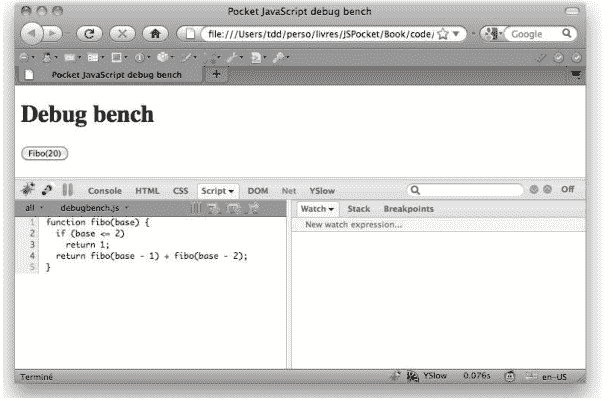

图 B.1：Firebug 在调试台上的脚本基本视图

基本上有两种让代码运行起来的方法：要么进入控制台输入触发我们要检查的代码的 JavaScript，要么在页面中触发相同代码的事件。[^1] 在我们的调试台页面中，当按下按钮时，fibo() 函数会以参数 20 被调用。你可以通过点击按钮来验证这一点——你应该会看到一个带有结果（6,765）的对话框。在调试器中，你可以做很多事情来深入研究这个函数的执行细节：

-   选择一个脚本文件（或带有内联脚本的 HTML 页面）：点击源文件窗格上方的文件名旁边的箭头，选择你的文件。
-   在特定代码行上切换断点：只需点击源文件窗格左侧装订线中该行的位置。
-   要求断点在满足给定条件时才触发：右键单击装订线中的断点圆点，输入条件的 JavaScript 表达式。
-   暂时禁用断点，而不会丢失其位置和条件：转到“断点”子标签页，取消选中断点的复选框。
-   一旦命中断点，单步执行代码：源文件窗格上方的图标允许你“步入”（也就是说，如果当前行调用了一个函数，则进入该函数内部）、“步过”（直接运行此类函数调用而不进入其内部）和“步出”（运行当前函数，并在返回调用函数后恢复手动单步执行）。
-   任何时候，都可以关注局部变量以及你之前设置的任何感兴趣表达式的值：只需查看“监视”子标签页。

[^1]: 严格来说，许多调试器允许你在抛出异常（即发生错误）时进入单步模式。在 Firebug 中，点击“脚本”标签页标签旁边的箭头即可使用此类功能。

这里我们将手动完成其中一些步骤，作为你可以在其他浏览器上复制的示例操作，以掌握要领。首先，假设我们希望在 fibo() 函数被一个足够小的参数（比如小于 5）调用时进入单步模式。要做到这一点，我们首先需要在函数的第一行设置断点，然后为这个断点配置合适的条件。

1.  点击源文件窗格左侧装订线中与函数第一行（第 2 行）对应的位置。
2.  右键单击出现表示断点的红点，在工具提示中输入你需要的条件：base < 5。你应该会看到类似下一页图 B.2 的内容。确认。

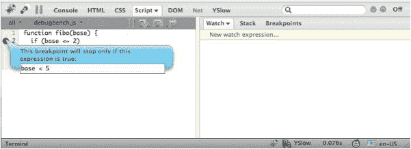

图 B.2：在 Firebug 中设置条件断点

一切就绪！现在点击网页中的 Fibo(20) 按钮；函数将开始递归下降，你应该会命中断点。点击右侧窗格中的“堆栈”子标签页，查看你所在的位置；你应该会看到类似下一页图 B.3 的内容，它让你看到当前递归状态：已经深入了 15 层（如果向下滚动，你会看到初始的 onclick= 处理程序调用）。

通过点击“监视”子标签页，你可以看到所有局部变量，包括当前绑定（当前引用的对象）和参数。在图 B.4（第 107 页）中，你可以看到我们正在作为全局函数运行（this 当前引用全局 window 对象），base 参数为 4。请注意，你也可以使用“监视”子标签页来*更改*这些值：只需双击列表中的值行并输入新值即可。

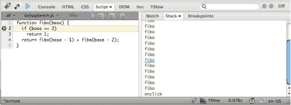

图 B.3：Firebug 中的堆栈跟踪视图

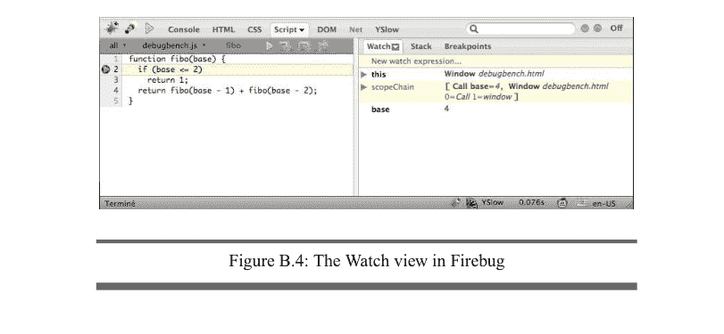

图 B.4：Firebug 中的监视视图

现在让我们探索各种单步方式。此刻你应该停留在 fibo() 函数的第一个内部行（第 2 行）。点击一次“步入”图标（紧挨着用于恢复执行的蓝色播放图标右侧的那个）。由于条件为假，下一行会被跳过，你到达 **return** 行。再次点击同一个图标。由于这是一个函数调用，而且你正在*步入*，你将下潜一层，递归进入同一个函数，这次 base 为 3（查看“监视”子标签页以确认这一点）。

假设你现在不想再深入下去，只想运行代码直到回到刚才离开的那一层（base 等于 4）。要做到这一点，请按照以下步骤操作：

1.  你首先需要移除或至少禁用之前设置的断点。否则，每当代码以小于 5 的参数调用 fibo() 时，它都会打断你的节奏。切换到“断点”子标签页，取消选中你的断点以禁用它。
2.  然后点击“步出”图标（源文件窗格上方的最后一个），让代码继续运行，直到再次到达上一个堆栈层级。你应该会发现自己回到了之前离开的 **return** 行，且 **base** 再次等于 4。
3.  重复该操作会让你一次又一次地沿堆栈向上运行（这意味着 **base** 监视值会越来越高），所以过不了多久，你会注意到右侧“堆栈”子标签页中的堆栈跟踪正在变薄。
4.  当你厌倦了手动单步，想要恢复正常执行时，点击播放按钮（蓝色的右箭头）。

请注意，所有这些单步/运行图标都有快捷键，但根据你运行 Firebug 的平台而大不相同。这些快捷键通常会在图标的工具提示中提及，所以只需将鼠标悬停在它们上面即可找出这些快捷键。

近年来，Safari 一直在打磨其 Web 检查器，4.0 版本配备了一套相当不错的功能。（我听说当前的“每晚构建版”也取得了很好的进展。）虽然它在 DOM 修改方面目前有点不尽如人意（相对于 Firebug），但其控制台和 JavaScript 调试器绝对是同等级别的。

Web 检查器的“脚本”部分（控制台窗格打开时）如图 B.5 所示（下一页）（你可以使用底部行的一个图标在控制台和“脚本”视图之间切换）。


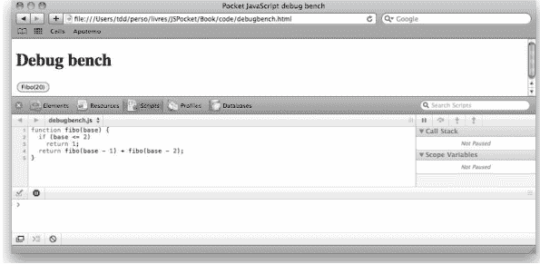

图 B.5：Safari 的 Web Inspector

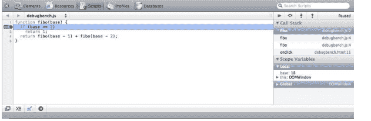

图 B.6：在 Web Inspector 中单步执行

或者直接按 Esc 键来打开/关闭控制台，无论你当前可见的是哪个部分）。

在 Safari 当前公开发布版中，Web Inspector 与 Firebug 有几个关键差异；例如，你并不能真正删除一个断点，而只能禁用它。你也不能给它设置条件。而且没有监视项。尽管如此，它已经是一个相当有用的工具了（后续版本只会更好）。你可以在递归堆栈再往下几层看到单步执行的样子，如图 B.6 所示，这说明它的行为与 Firebug 何其相似。

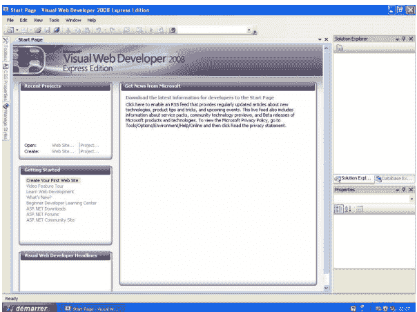

### 图 B.7：Visual Web Developer 2008 Express 版：欢迎

这里我们基本上必须遵守两条规则：

+   - 我们必须建立 VWDE 项目，并启用调试功能。
+   - 我们必须把 IE7 设为默认浏览器，以便“启动调试”功能启动的是 IE7。

这两个要求都只需要处理一次（除非你是在日常上网的那台机器上测试，因而需要在 IE 和你选用的任何浏览器之间来回切换默认浏览器）。下面来处理这些要求：

+   1. 打开 IE6 或 IE7，单击“工具”>“Internet 选项...”。
+   2. 转到“高级”选项卡，滚动到“浏览”部分。
+   3. 确保勾选“显示每个脚本错误的通知”，并取消勾选两个“禁用脚本调试...”。
+   4. 彻底关闭 IE。
+   5. 单击“文件”>“新建网站...”：

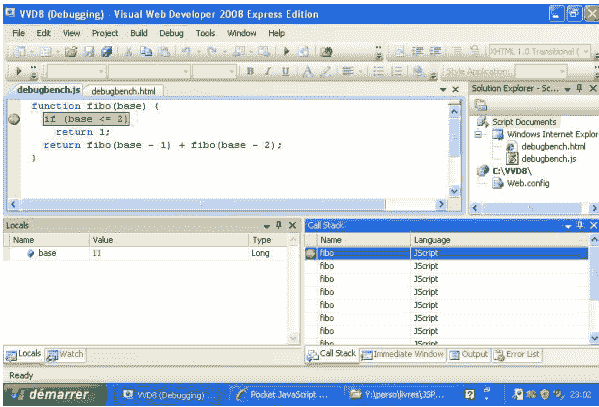

### 图 B.8：使用断点调试 IE7

+   6. 选择“空网站”选项，然后浏览到你想设置的任意虚拟目录。单击“确定”。
+   7. 单击“启动调试”菜单选项或图标（绿色箭头）。
+   8. 第一次这样做时，VWDE 会检测到你的项目尚未设置为调试状态。它缺少一个特殊的 Web.config 文件。对话框会询问你是要为你创建该文件，还是在不调试的情况下继续——显然，保留第一个选项的勾选，并单击“确定”。
+   9. 你应该会看到任务栏中有一个开发服务器在动态端口上启动，你的 IE 会打开一个空目录列表，名称与你的项目目录同名（可能会有警告栏提示浏览器正在使用 Intranet 安全区域工作，这没问题）。一切就绪！

现在我们已经全部设置好，只需以任意方式浏览到我们的 debugbench.html 文件。打开后，回到 VWDE 中查看。在右侧的“解决方案资源管理器”面板中，你应该会看到一个“正在运行的文档”分支，里面列出了 debugbench.html 和 debugbench.js。双击后者。

就这样！你现在可以像平常一样在第 2 行设置断点（单击装订线），切回 IE，然后点击 Fibo(20) 按钮。你会回到调试器中并处于单步模式，如图 B.8 所示。瞧！

## B.5 IE8 与开发者工具

毫无疑问：Internet Explorer 8 是 IE 世界向前迈出的一大步。除了在 Web 标准支持方面的显著改进（尽管它仍远落后于现代浏览器，但至少不再停留在白垩纪了），下面这几点对我们 JavaScript 开发者有直接利害关系：

+   - IE8 的 JScript 引擎平均比已发布浏览器中的其他 JavaScript 引擎慢七倍。与 Chrome 的 v8、Safari 的 Squirrelfish Extreme 和 Firefox 的 Tracemonkey 的最新构建相比，最差时几乎慢十二倍。
+   
+   为什么这是好消息？IE7 过去慢了多达 *九十倍*。而 IE6 面对自己的倍数简直无地自容。因此，IE 团队成功地将 JScript 引擎提升了约 13 倍，不管你喜欢与否，都必须承认这很了不起。

+   - IE8 中的 DOM 性能——我们脚本开发中的第二大痛点——也得到了大力优化，现在平均只慢“四倍”，这也是一大改进。

+   - IE8 内置了“开发人员工具”，这是我们在 IE6 和 IE7 中使用的 IE 开发者工具栏的精简、更灵敏版本，并附带了一个真正的 *JavaScript 调试器*。这个调试器确实能用，而且不会在 IE 和外部调试应用之间造成没完没了的故障。

因此，我们不仅可以开始考虑在 IE 世界里重新启用那些花哨效果和 Ajax 操作，而且还能在知道调试变得容易得多的情况下这样做。

顺便提一下，IE8 还在探索降低脚本加载对性能感知影响的方法。你仍然应该使用通用优化手段，例如“将脚本放在页面底部”³，更重要的是脚本合并（例如通过 Sprockets⁴）和 gzip 压缩。⁵

IE8 开发者工具窗格（打开 Script 选项卡，并处于调试会话中）如图 B.9（见下页）所示，其中带有我们已经很熟悉的断点。打开/关闭调试器只需单击工具栏中的大按钮，然后就会看到常见的单步

3. http://developer.yahoo.com/performance/rules.html#js_bottom
4. http://getsprockets.com
5. 关于网页加载和渲染性能的大量优秀建议，请阅读 Thomas Fuchs 和 Amy Hoy 的精彩作品 *JavaScript Performance Rocks!* [HF09]，并查看 Yahoo! 开发者网络上的性能提示：http://developer.yahoo.com/performance/rules.html。

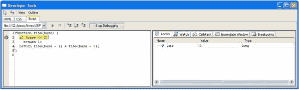

图 B.9：IE8 开发者工具：Script 选项卡

选项、局部变量、监视、调用堆栈检查、某种控制台（我希望微软别再叫它们“即时窗口”……），以及可禁用或删除的断点（不过不能对断点设置条件）。

这些真的就是我们需要的全部了！整个工具用起来响应很快，从来没有让我的 IE8 卡死。说真的！

## B.6 Opera 与 Dragonfly

Opera 在提供开发者工具方面采用了一种不同寻常的方式。它的 Dragonfly 工具“既可离线也可在线”，因为当你在 Opera 中打开它的窗格时，它会通过互联网自动下载并更新。这意味着第一次使用时需要联网，这应该不算什么问题。不过，就我个人经验来看，我发现它似乎必须联网才能正常工作。离线时，即使我之前已经下载过它，它通常也会启动失败，因为它无法连接到 Opera 的服务器（或类似原因）。

其当前版本（写这段话时是 alpha 3）明确说明它仍很粗糙，我只能希望 Opera 的开发人员能在 UI 方面清醒过来，彻底重新思考他们那“无数多层选项卡”的做法。我本以为所有其他工具采用类似 Firebug 的布局是有原因的（它足够简单，也足够强大），但 Opera 却继续构建这种复杂精细的 UI。不过，最近几个版本似乎有所改进。

就我们调试 JavaScript 的目的而言，只需要 Scripts 选项卡中的内容即可，如图 B.10（见下页）所示。你会看到常见功能的工具栏按钮：运行/继续、单步跳过、单步进入、单步退出，以及何时自动触发调试模式（例如进入函数、遇到错误）。下拉列表让你选择要调试的源文件（JavaScript 或 HTML）；代码旁边的装订线可用来处理

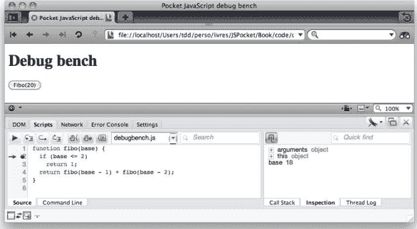

图 B.10：Opera Dragonfly：Scripts 选项卡

断点（右键单击可禁用/重新启用）；代码下方的“命令行”子选项卡（是的，在下方……）提供类似控制台的命令行；右侧选项卡可访问调用堆栈和局部变量（在 Inspection 选项卡中）。

简而言之，常规调试可以完成。不过我得承认，我通常的调试周期是这样的：首先用 Safari 或 Firefox 编写代码。然后在“另一个”（无论是 Firefox 还是 Safari）中验证并调整（如果需要），接着按顺序在 IE8、IE7 和 IE6 中调整。最后，为保险起见，在 Opera 和 Chrome 中快速检查一遍。

因此，我遵循的是我在 XHTML/CSS 开发中所用的顺序。正如标记和样式一样，一旦你在 Safari、Firefox 和 IE 系列中让 JavaScript 正常运转，它在 Chrome 和 Opera 中通常也会表现完美。所以，我很少需要在 Opera 中调试。

最后提一下，Opera 中有一个可启用的 Debug 菜单，它让你直接访问若干功能，这些功能让人想起 Firefox 的 Web Developer Toolbar 扩展或 Safari 的 Development 菜单。你可以通过从 Opera 内部下载一个配置文件来启用它。⁶

## B.7 虚拟机是你的朋友

如今内存很便宜。我们大多数 Web 开发人员都在拥有 4GB 到 8GB 内存的机器上写代码，而那些更幸运的家伙甚至运行在

6. http://dragonfly.opera.com/app/debugmenu/DebugMenu.ini


SSD 驱动器让整体体验响应迅速。紧随这一现象之后，虚拟机在任何严肃的 Web 开发者的工具箱中都赢得了一席之地。虚拟机软件很便宜，有时甚至免费，可选方案也相当多：Parallels Desktop⁷（适用于 OS X、Windows 和 Linux）、VMware Fusion⁸（适用于 OS X）或 VMware Workstation⁹（适用于 Windows）、Sun 的 VirtualBox¹⁰（几乎适用于所有主流操作系统），以及更多其他选择。

虚拟机的这种商品化让我们能够设置独立的虚拟机，以复制我们需要测试的各种浏览器环境：从 IE6 到 IE9、各种版本的 Safari、Chrome、Firefox、Opera 等等。大多数浏览器不会允许你在单个操作系统上同时运行多个版本；即使允许，你也无法获得与该浏览器作为唯一安装版本时 100% 一致的行为（典型例子：Windows XP 上的第三方 MultipleIE 包）。虚拟机让你可以在不同的操作系统镜像中隔离各个后续版本。最棒的是，它们让你能在一台计算机上完成这一切。通常，首选的主机操作系统是 OS X；这源于许多因素，但对我而言最相关的一点是：在虚拟机中安装 Linux 或 Windows 很容易，但在非 Mac 平台上的虚拟机中运行 OS X 却非常困难。

所以，尽管去使用虚拟机吧！这比不得不使用多台机器或远程桌面要方便得多，在那些场景下你还会不断遇到同时使用这些资源、和你产生冲突的其他 Web 开发者。

### B.8 网络可能是你的敌人

有时你会遇到一些感觉像海森虫（heisenbugs）：¹¹ 的 bug，它们只在你没有盯着的时候出现。一旦你开始单步调试代码，或试图在开发机上重现时，这种难以捉摸的行为就消失得无影无踪。这是怎么回事？

这通常发生在涉及 Ajax 的操作，以及高延迟或不稳定的连接（例如拨号上网，或你的公司代理勉强支撑）时。要重现这类情况，你可以使用被称为慢代理（slow proxy）的软件。在这个领域我最喜欢的工具，也许也是最著名的，就是 Charles¹²，一个基于 Java 的工具（因此可以运行在所有主流平台上）。它不仅能让你限制感知带宽、调整延迟，并整体调节你感知到的网络行为，还可以记录和重放网络会话，并提供详细的 HTTP/HTTPS 监控。这样的工具真是天赐之物！

## JavaScript 框架

JavaScript 本身是一种很棒的语言。但当涉及到与其环境交互时——例如 DOM、CSS 或 XMLHttpRequest，仅举几个最常见的客户端例子——纯 JavaScript 开发就像用几把燧石斧和一堆滑溜溜的原木来建造摩天大楼。这主要是因为两个因素：原始的 DOM 接口缺少合理的高级特性，而且大多数浏览器都以各自非常特别的方式偏离 Web 标准。

正因为如此，涌现出了大量 JavaScript 框架。其中一些获得了足够的动力和追随者，变得非常成熟稳定，接下来我会在本附录中带你了解其中最著名的几个。

请立刻明白这一点：你非常应该使用框架，甚至可能要根据手头的项目或任务使用多个框架。这些框架的源代码很可能比你自己的代码更健壮、测试更充分、文档更完善，支持也更到位。而且它们本来就已存在，可以为你节省无数令人沮丧的开发时间。务实一点！

选择框架是一项重要任务，你应当关注一系列因素。下面这份清单可供参考：

- 它已经存在多久了？代码是否成熟稳定？是否经过了良好的测试？（也就是说，是否有维护完善的测试套件？）
- 它周围是否有强大且活跃的社区？我能轻松找到帮助吗？
- 是否有良好的文档，最好是官方文档？
- 它的 API 设计是否契合我自己的审美？当我使用这个框架时，最终写出的代码是否是我愿意阅读和编写的？
- 该框架是否服务于一组特定的目标？它是否面向特定的开发者群体？如果是，我的目标或我的情况是否吻合？

另一方面，有一个经常被吹捧的标准你其实不必在意：代码库大小。朋友，需要通过慢速方式提供 JavaScript 的时代已经过去了。如今，我们有众多技术可以用来以闪电般的速度提供

一个庞大且注释完善的代码库。这些技术包括去除注释、代码压缩、良好的 HTTP 响应头以帮助浏览器缓存、CDN 分发等等。

流行的框架会使用其中大部分或全部手段，以确保你的页面能瞬间加载它们，所以别再去纠结几 KB 的源代码大小了，好吗？

### C.1 Prototype、script.aculo.us 和 Scripty2

Prototype 是第一个广为人知的 JavaScript 框架。Sam Stephenson 于 2005 年 2 月在 37signals 创建了它，目的是为 DOM 操作、事件处理和 Ajax 提供一个统一、易用的 API。Thomas Fuchs 于 2005 年创建了 script.aculo.us，作为 Prototype 的配套 API，它从著名的 Yellow Fade Technique（黄色淡出技术）发展为一个全套的视觉效果、拖放以及少量基础 UI 控件套件。Scripty2 是 script.aculo.us 的完全重写和扩展版本，目前处于测试阶段，非常专注于视觉效果。

Prototype 背后的团队以一个约六名志愿者的核心层为中心而波动，其中最突出的是 Sam、Tobie Langel 和 Andrew Dupont。它基于 MIT 许可证发布（基本上就是开源且可随处使用），完整源代码可在 GitHub 上浏览、分叉和修改，并配有反馈邮件列表和 Bug 报告系统。

围绕 Prototype 已经形成了一个生态系统，包括 PDoc（一个代码内联文档系统）、Evidence（一个单元测试框架）、Sprockets（一个高级 JavaScript 处理和拼接工具）和 Scripteka（一个插件仓库）。社区活跃而富有生气，主要集中在 Google Groups 上。相关书籍已有不少；迄今为止，最新的是 Andrew Dupont 的 *Practical Prototype and script.aculo.us* [Dup08]，以及本人所著的 *Prototype and script.aculo.us* [Por07]。

虽然 Prototype 通常被认为是第一个广为人知的 JavaScript 框架，但在过去两年里，它的受欢迎程度已在缓慢下滑，显然是在向 jQuery 转移。不过，我相信这两个框架满足的是不同（尽管有重叠）的需求集（而且它们的代码美学当然也截然不同）。

Prototype 的架构、代码美学和连贯的 API 设计非常适合那些拥有健壮 API 的重要代码库，它把 Ruby 的许多优点（比如 Enumerable 模块）“移植”了过来，让大量算法密集型的代码易于编写。它是一个适合那些想拥抱 JavaScript 并用它写出精彩作品、随时间推移不断成长和维护

> 1. 不过要避免代码*混淆*，否则在其之上调试的人会恨你。

应用程序代码库的人。所以，对于只是想实现某个功能，或者在不怎么了解这门语言的情况下就用组件和插件拼凑一个网站的人来说，它很可能不是最佳选择。

以下是撰写本文时各版本的最新概况，以及你可能会用到的网址：

- Prototype 位于 [http://prototypejs.org/](http://prototypejs.org/)；其当前版本是 1.7。
- script.aculo.us 位于 [http://script.aculo.us/](http://script.aculo.us/)（显而易见！）；其当前版本是 1.8.3，开发基本上已冻结，因为重心已转向 Scriptaculous2。
- Scriptaculous2 可以在 [http://scriptly2.com/](http://scriptly2.com/) 找到。它目前处于 Alpha 6 版。
- PDoc 位于 [http://pdoc.org/](http://pdoc.org/)。
- Sprockets 位于 [http://getsprockets.org/](http://getsprockets.org/)。
- Scripteka 位于 [http://scripteka.com/](http://scripteka.com/)。
- 支持邮件列表位于 [http://groups.google.com/group/prototype-scriptaculous](http://groups.google.com/group/prototype-scriptaculous)。你也可以尝试 Freenode 上的 #prototype IRC 频道。
- 反馈邮件列表位于 [http://groups.google.com/group/prototype-core](http://groups.google.com/group/prototype-core)。请不要在那里寻求帮助——请使用支持列表！
- 官方仓库在 GitHub 上：[http://github.com/sstephenson/prototype](http://github.com/sstephenson/prototype)。
- 如果你要报告 Bug，请先阅读 [http://prototypejs.org/contribute](http://prototypejs.org/contribute) 上的指南，认真准备报告，然后前往 [https://prototype.lighthouseapp.com/](https://prototype.lighthouseapp.com/)。

### C.2 jQuery 与 jQuery UI

jQuery 起源于 2005 年 8 月。当时 John Resig 在使用 Prototype 之后，决定尽管他喜欢它的特性、API 和代码的整体感觉，但它并不完全符合自己的口味。于是，他开始尝试一些不同的东西。John 是 Mozilla 的一位友善的 JavaScript 大师，所以可以说，他开发一个框架是顺理成章的事。在 2006 年 6 月发布 1.0 版本之后，jQuery 得益于大量社区驱动的工作，在过去两年里迅速普及。jQuery 项目于 2009 年 9 月正式组建，其 1.4 版本于 2010 年 1 月发布，发布之际还举行了两周的在线庆祝和编程狂欢。（截至撰写本文时，当前版本是 1.4.2。）


jQuery 主要致力于降低人们使用一点 JavaScript 来美化网页时的准入门槛，即使他们之前并不了解这门语言（有时甚至完全不懂编程）。其 API 为最常见的用例提供了大量快捷方式，而众多插件（其中一些被整合进 jQuery UI 项目）则负责处理其余需求。最近我常听人将 jQuery 描述为“用于 DOM 操作的 DSL”，或声称“jQuery 从选择器到代码，让懂 CSS 的人也能使用 JavaScript”。虽然这些说法并非完全准确（换句话说，有点过于简化），但确实抓住了 jQuery 的本质。

jQuery 背后的主要推动力是其出色的团队。除了将近二十四人分别在插件项目、核心、UI 和网站上工作外，其力量很大程度上还在于那六位通过会议、活动、聚会等方式培育 jQuery 社区的人。拥有一些企业赞助并无坏处，但项目本身仍是开源的，采用 GPL/MIT 双许可证，托管在 GitHub 上，并允许通过 Trac 提交 bug 报告。

围绕 jQuery 核心项目和 jQuery UI，你可以找到许多杂志、会议、聚会、用户组和在线论坛。已经出版了好几本 jQuery 相关书籍，包括《jQuery for Dummies》[Bei10]、《jQuery in Action》[BK10]、《jQuery: Novice to Ninja》[CS10] 和《jQuery Cookbook》[Lin09]。

正如我所提到的，我认为 jQuery 和 Prototype 针对的是略有不同的需求集合。我不能否认 jQuery 的诸多优点，也完全理解它为何对大量用户有吸引力，比如那些仅仅把 JavaScript 当作快速达成目的的工具、不想为了快速完成常见任务而学习太多 API 的人。jQuery 社区充满活力也是一大加分项，因为它让人对该项目的持久性和支持水平充满信心。在撰写本书时，jQuery 的版本是 1.4.2。

以下是你可能需要或想要查看的 URL 列表：

- 官方网址是 http://jquery.com/。
- jQuery UI 的官方网址是 http://jqueryui.com/。
- 源代码托管在 GitHub：http://github.com/jquery/jquery。
- 可在 http://dev.jquery.com/ 查找 bug 跟踪。
- 所有官方论坛可在 http://docs.jquery.com/Discussion 找到。

2. 这说明了该框架已经广为人知！

### C.3 MooTools

MooTools 由 Valerio Proietti 于 2006 年创建，就像一个精挑细选的功能子集——它涵盖了 Prototype 的大部分功能，再加上视觉效果和少数领域专用工具（如 cookie 管理、用于加载 Flash 的 SWFObject 包装器等）。它的最初目标是提供传统的、基于类的面向对象编程特性，并保持紧凑（诚然，在如今这个 Google Ajax API、脚本合并和 gzipping 流行的时代，后一点不再那么有吸引力）。

该项目分为 MooTools Core（框架本身）和 MooTools More（插件库）。

MooTools 由十三人的核心团队支持，是一个开源、采用 MIT 许可证的项目，目前版本为 1.2.4。它托管在 GitHub 上，bug 跟踪和功能请求通过 Lighthouse 进行，并通过 Google 群组和专门论坛提供支持。

关于 MooTools 的重要书籍是《MooTools Essentials》[New08]。

看起来，至少到目前为止，MooTools 在本附录所述的框架中受欢迎程度/影响力最低。尽管如此，它在开发者心中仍占有不容忽视的份额。

以下是一些你可能需要的信息：

- MooTools 的官方网址是 http://mootools.net/。
- 源代码位于 http://github.com/mootools/mootools-core。
- bug 跟踪和功能请求可在 https://mootools.lighthouseapp.com/ 找到。
- 你可以通过 http://groups.google.com/group/mootools-users 的 Google 群组和 http://mooforum.net/ 的论坛获得支持与新闻。此外，http://mootorial.com/ 上也有大量文档和教程，帮助你快速上手。

### C.4 YUI

Yahoo! 用户界面库（通常称为 YUI，据我所知，它的发音是逐个字母拼读）是 Yahoo! 开发者网络（YDN）维护的一组更大规模开发者资源的一部分。该项目始于 2005 年，并于 2006 年初首次发布。它是一个非常强大、模块化、功能丰富的框架，但最初的学习曲线可能有些陡峭。其核心 JavaScript 功能位于“YUI 3”中，而其他模块中还有大量额外功能，不一定都与 JavaScript 相关。YUI 被广泛应用于 Yahoo! 的“资产”（Yahoo! 拥有的网站和在线服务），因此它确实有可靠的稳定性和性能记录。

你应该知道，初始化框架以及访问其模块和功能的约定在版本 2 和 3 之间发生了巨大变化，所以请警惕旧文档和教程。任何以 YAHOO. 开头的调用基本上都是版本 2。不过请注意，从 YUI 3.1 开始，你可以更简单地集成旧式解决方案和代码。

虽然对 YUI 核心的贡献并非完全开源（尽管采用 BSD 许可证，但对该部分代码库的实际贡献似乎仅限于 YDN），但 YUI Gallery 允许人们贡献模块。你也可以提交 bug 报告和功能请求。

关于 YUI 的高质量文档大多在线，要么在框架的官方网站上，要么在非常社区化的 YUI Library 网站上。你还会发现 YDN 布道师 Christian Heilmann 撰写的大量文章，散布在许多流行的 Web 开发在线杂志上。文档中包含数百个带有分步说明的示例。文档的高质量或许解释了为什么目前关于 YUI 的书籍少之又少。我找到的唯一一本比较重要的书要追溯到 YUI2：《Learning the Yahoo! User Interface Library》[Wel08]。

YUI 相当受欢迎。然而，与 Dojo 一样，YUI 主要用于富互联网应用（RIA）领域，因为对于 UI 密集度不高的用例来说，它显得有点大材小用（而且过于庞大）。在这方面，它经常与 YDN 的其他有用资源（如“reset”和“grid”样式表）配合使用。社区互动集中在官方 YUI Library 网站上。

YUI 拥有几个非常好的“卖点”：

- 它拥有非常连贯的 API（其风格始终保持一致）。
- 它经过了极为充分的测试，文档也很完善。
- 它特别关注可访问性（例如对 ARIA 的支持）。
- 其模块化、按需加载的方式，再加上庞大的 CDN，使它在轻量级环境中也非常易用。
- 它由一家大公司（Yahoo!）正式维护和支持，因此在构建项目的技术栈时，选择它是一个风险相当低的选择。

不过，我确实认为，在轻量级库就够用的情况下，你应该优先选择它。这样可以减少需要吸收和消化的内容。也让你更容易通过修复或扩展自己所需的功能来快速做出贡献。

你应该了解以下四个 URL：

- 官方网址是 http://developer.yahoo.com/yui/3/。
- 源代码仓库位于 http://github.com/yui。
- 可在 http://yuilibrary.com/projects/yui3/report 提交 bug 报告和反馈。
- 社区资源总体在 http://yuilibrary.com/。

### C.5 ExtJS

ExtJS 是一个成熟的 RIA 框架，专注于富桌面风格 UI 组件，如树视图、数据网格和对话框。它始于 2006 年（我想），最初是 Jack Slocum 编写的一个附加组件，你可以将其用于 Prototype、jQuery 或 YUI 之上。此后，它发展成为一个独立的、大型的框架，专门用于构建丰富的桌面风格用户界面；例如，ExtJS 早期就在数据网格、树和 Ajax 特性上表现出色，因此成为构建网站管理页面的热门工具。

ExtJS 是同名公司的产品，该公司还提供相关工具，如 Ext Designer 和 Ext GWT bridge。它采用三重许可证：GPLv3、商业许可证和 OEM 许可证。这种许可证拆分在发布时引起了不小的轰动，尤其是因为它基本上阻止了在非 GPL 兼容的开源项目中使用。另一方面，这意味着你可以从库创造者那里获得商业技术支持、培训和订阅。遗憾的是，代码仓库是封闭的，只能通过自定义下载页面上的发布快照获取。我也找不到一个突出的 bug 跟踪系统，所以总而言之，尽管有 GPLv3 选项，项目源代码看起来并不那么开放。

就像所有拥有全职公司员工团队的优秀项目一样，ExtJS 也在快速推进。在撰写本书时，它的版本是 3.1.1，预计 2010 年会有几个主要版本发布，最终达到 4.0。

文档相当不错，有一个易于浏览（虽然有时过于简洁）的 API 参考，显然是用 ExtJS 构建的，还有大量完整、有用的应用示例。你还会找到几本书，其中最著名的是 2009 年底出版的 *ExtJS 3.0 食谱* [Ram09]，以及预计 2010 年夏季出版的 *ExtJS 实战* [Gar10]。

3. ExtJS 有一个六人的管理团队和一个规模未知的全职开发团队。


最后，鉴于该项目具有一定的专有性，其生态系统主要局限于官方网站、论坛和一个基于 wiki 的优秀学习中心，提供演示、截屏视频、教程等。

以下是一些必备链接：

- 这是 ExtJS 官方网站：http://extjs.com/。
- 下载地址：http://www.extjs.com/products/extjs/download.php。
- 论坛地址：http://www.extjs.com/forum/。
- 学习中心主页：http://www.extjs.com/learn/Main_Page。

### C.6 Dojo

接下来我们以 Dojo 来完成最流行框架的巡礼。Dojo 于 2004 年由 Alex Russell、Dylan Schiemann 和 David Schontzler 在 Informatica 公司共同努力创建，并于 2007 年 11 月 5 日发布了 1.0 版本，同时被拆分为 Dojo（核心）、Dijit（UI 控件）和 DojoX（插件与扩展功能）。

Dojo 如今与 ExtJS 的定位差不多。它是一个拥有强大企业支持的主流 RIA 框架，目前由 Dojo 基金会维护，其企业赞助商包括 IBM、Google、AOL、Thomson Reuters、TIBCO、Zend 和 Sitepen 等。在撰写本书时，其最新版本是 1.5.0。与 ExtJS 不同的是，Dojo 是真正的开源软件，采用 Academic Free License 2.1 和 new BSD license 双重许可，并维护公开的 GitHub、Subversion 和 Bazaar 仓库，以及在线 bug 跟踪系统。

Dojo 还与现在同属 Dojo 基金会旗下的项目关系密切，其中最著名的是 cometD 和 DWR，这两个早期但仍然相关的系统用于实现从服务器到浏览器的推送通知（更不用说 Sizzle、Persevere 和 General Interface 了）。

Dojo 在 Web 开发大会上非常活跃（有 T 恤、分会、聚会等等），并且总体上维持着一个拥有专门论坛的活跃社区。就社区实力而言，它可能仅次于 jQuery。你也可以找到不少好书，包括《Mastering Dojo》[RGR08]、《Dojo: the Definitive Guide》[Rus08]、《Practical Dojo Projects》[Zam08]，以及较新的《Getting StartED with Dojo》[Hay10]。

在线文档非常出色，分为快速入门指南、参考指南、API 文档，以及一个以“常用解决方案”为入口的交叉入口，这些方案面向任务（例如“从数据集创建图表”）。

在我看来，如果你需要基于 Web 标准创建 RIA 类型、类似桌面应用程序的应用，Dojo 应该是你的首选。

我们将以下面这个 Dojo 重要 URL 列表来结束本附录：

- 官方网站：http://www.dojotoolkit.org/。
- 你可以通过 http://svn.dojotoolkit.org/src/ 访问仓库（可惜他们不用 Git）。
- 你可以在 http://bugs.dojotoolkit.org/ 进行 bug 跟踪和报告。
- 你可以在 http://www.dojotoolkit.org/community/ 参与社区。

## 获取帮助

当然，我希望这本书对你有用。不过，你仍然需要自己解决问题，或者可能需要别人确认你没有偏离方向。那么，你可以在哪里获得更多帮助，并与其他围绕这些内容的人交流呢？

### D.1 JavaScript 通用帮助

拥有强大的框架绝不是不掌握 JavaScript 的借口。有时你确实需要深入研究并编写一些实际代码，或者由于各种原因（比如移动设备上的性能问题¹）你无法使用常用的框架。

#### 新闻组

还记得 DSL 还没有（几乎）普及的时代吗？在 Google Groups 之前？实际上在 Google 之前？嗯，也许那时你还没在开发，但我们有 Usenet。它至今仍然存在，而且最近新一代人已经发现了它在比如共享二进制文件方面有多好用。更重要的是，它有面向人类已知的每一种编程语言的新闻组。

每个 ISP 都提供新闻组访问；那就是你在订阅单上看到的奇怪的“NNTP 服务器”东西。而大多数聚合器、feed 阅读器甚至电子邮件客户端——Thunderbird、Entourage、Outlook，是的，甚至 Outlook Express——都能让你连接到 NNTP 服务器并订阅你选择的新闻组。（根据你的 ISP，你可以从数千个中选择。）

甚至，即使你不想以那种方式访问这些组，Google Groups 也维护着通往大多数有用新闻组的桥梁，包括以下这些：

- 所有活动的核心在 comp.lang.javascript。（这个地址是 COMPuter LANGuage JavaScript 的缩写。）它已经存在很久了，并且仍然是所有在线讨论的主要场所，这些讨论与…

1. 除非你正在使用 Thomas Fuchs 刚刚发布的出色 zepto.js 库：http://github.com/madrobot/zepto。或者用 vapor.js 创下最快纪录：http://github.com/madrobot/vapor.js。

- jQuery 名人 John Resig 最近在 Sitepoint 写了一本看起来很棒的小书：*Secrets of the JavaScript Ninja* [Res09]。
- 同样在 Sitepoint，虽然略显过时，还有一本由多位作者合著的优秀书籍：*The Art and Science of JavaScript* [AEH+07]。
- 特使级的布道者 Chris Heilmann 撰写了《Beginning JavaScript with DOM Scripting and Ajax: From Novice to Professional》[Hei06]，这也是一本很棒的书。
- 如果不提 Thomas Fuchs 和 Amy Hoy 的最新宝石，那将是我的失职，它真正是面向性能、性能、性能的 Companion 工具：*JavaScript Performance Rocks!* [HF09]。

### D.2 框架帮助

本节汇总了附录 C 中提到的各种在线资源。

#### Prototype 和 script.aculo.us

- 官方支持邮件列表⁵
- 在线 API 文档⁶
- IRC 频道：Freenode 上的 #prototype 和 #scriptaculous

书籍：

- *Practical Prototype and script.aculo.us* [Dup08]，作者 Andrew Dupont
- *Prototype and script.aculo.us* [Por07]，作者正是本人

#### jQuery

- 官方论坛⁷
- 教程⁸
- API 文档⁹
- IRC 频道：Freenode 上的 #jquery

书籍：

- *jQuery for Dummies* [Bei10]，作者 Lynn Beighley
- *jQuery in Action* [BK10]，作者 Bear Bibeault 和 Yehuda Kata（最初由 John Resig 参与）
- *jQuery: Novice to Ninja* [CS10]，作者 Earle Castledine 和 Craig Sharkie
- *jQuery Cookbook* [Lin09]，作者 Cody Lindley

5. http://groups.google.com/group/prototype-scriptaculous
6. http://api.prototypejs.org/ 和 http://wiki.github.com/madroobby/scriptaculous/
7. http://forum.jquery.com/
8. http://docs.jquery.com/Tutorials
9. http://docs.jquery.com/Main_Page

#### MooTools

- 官方支持邮件列表¹⁰
- 论坛¹¹
- 教程¹²
- API 文档¹³

书籍：

- *MooTools Essentials* [New08]，作者 Aaron Newton

#### YUI

- 论坛¹⁴
- 文档¹⁵
- IRC 频道：Freenode 上的 #yui（不过不太活跃）

书籍：

- *Learning the Yahoo! User Interface library* [Wel08]，作者 Dan Wellman

#### ExtJS

- 论坛¹⁶
- 演示¹⁷
- API 文档¹⁸
- 学习中心¹⁹
- IRC 频道：Freenode 上的 #extjs（不过不太活跃）

书籍：

- *ExtJS 3.0 Cookbook* [Ram09]，作者 Jorge Ramon
- *ExtJS in Action* [Gar10]，作者 Jesus Garcia

10. http://groups.google.com/group/mootools-users
11. http://mooforum.net/
12. http://mootorial.com/
13. http://mootools.net/docs/core
14. http://yuilibrary.com/forum
15. http://developer.yahoo.com/yui/3/
16. http://www.extjs.com/forum/
17. http://www.extjs.com/deploy/dev/examples/
18. http://www.extjs.com/deploy/dev/docs/
19. http://www.extjs.com/learn/Main_Page

#### Dojo

- 论坛²⁰
- API 文档和教程²¹
- IRC 频道：Freenode 上的 #dojo

书籍：

- *Mastering Dojo* [RGR08]，作者 Craig Riecke、Rawld Gill 和 Alex Russell
- *Dojo: the Definitive Guide* [Rus08]，作者 Matthew A. Russell
- *Practical Dojo Projects* [Zam08]，作者 Frank Zammetti

## 参考书目

[AEH⁺07] Cameron Adams, James Edwards, Christian Heilmann, Michael Mahemoff, Ara Pehlivanian, Dan Webb, and Simon Willison. *The Art and Science of JavaScript*. Sitepoint, 2007.

[Bei10] Lynn Beighley. *jQuery for Dummies*. For Dummies, 2010.

[BK10] Bear Bibeault and Yehuda Katz. *jQuery in Action*. Manning Publications Co., Greenwich, CT, second edition, 2010.

[Cro08] Douglas Crockford. *JavaScript: The Good Parts*. O’Reilly Media, Inc. / Yahoo! Press, Sebastopol, CA, 2008.

[CS10] Earle Castledine and Craig Sharkie. *jQuery: Novice to Ninja*. Sitepoint, San Francisco, CA, 2010.

[Dup08] Andrew Dupont. *Practical Prototype and script.aculo.us*. Apress, New York, NY, 2008.

[Fla06] David Flanagan. *JavaScript: The Definitive Guide*. O’Reilly Media, Inc., Sebastopol, CA, fifth edition, 2006.

[Gar10] Jesus Garcia. *Ext.JS in Action*. Manning Publications Co., Greenwich, CT, 2010.

[Goo07] Danny Goodman. *JavaScript Bible*. John Wiley & Sons, 2007.

[Hay10] Kyle Hayes. *Getting StartED with Dojo*. Friends of ED, New York, NY, 2010.

[Hei06] Christian Heilmann. *Beginning JavaScript with DOM Scripting and Ajax: From Novice to Professional*. Apress, New York, NY, 2006.

[HF09] Amy Hoy and Thomas Fuchs. *JavaScript Performance Rocks!* Slash7, Vienna, Austria, 2009.

[Lin09] Cody Lindley. *jQuery Cookbook*. O’Reilly Media, Inc., Sebastopol, CA, 2009.


[New08] Aaron Newton. *MooTools Essentials*. Apress, 2008.

[Por07] Christophe Porteneuve. *Prototype and script.aculo.us: You never knew JavaScript could do this!* The Pragmatic Programmers, LLC, Raleigh, NC, and Dallas, TX, 2007.

[Ram09] Jorge Ramon. *ExtJS 3.0 Cookbook*. Packt, Birmingham, UK, 2009.

[Res09] John Resig. *Secrets of the JavaScript Ninja*. Manning Publications Co., Greenwich, CT, 2009.

[RGR08] Craig Riecke, Rawld Gill, and Alex Russell. *Mastering Dojo: JavaScript and Ajax Tools for Great Web Experiences*. The Pragmatic Programmers, LLC, Raleigh, NC, and Dallas, TX, 2008.

[Rus08] Matthew A. Russell. *Dojo: the Definitive Guide*. O'Reilly Media, Inc., Sebastopol, CA, 2008.

[Wel08] Dan Wellman. *Learning the Yahoo! User Interface library*. Packt, Birmingham, UK, 2008.

[Zam08] Frank Zammetti. *Practical Dojo Projects*. Apress, New York, NY, 2008.

## 索引

### A

- Ajax
  - 使用自动补全，72
  - 跨域，86, 88
  - 表单验证，68
  - 通过加载，80
  - 更新，30
- Ajax.Autocompleter，72
- Ajax.Request，54
- APIs
  - 常见事件，38
  - Flickr，94
  - 地理编码器，96
  - jQuery，26
  - MooTools，26
  - Prototype，26
  - Twitter，92
  - Yahoo! Placemaker，96
  - YUI 3，26
- arguments
  - 获取，23
  - 可选、变长和命名，22
- 数组对象，18
- *The Art and Science of JavaScript (Adams et al), 127*
- Autocompleter.Local，72
- 自动补全表单，72

### B

- 后台处理，40
- 带宽、分页和，52
- Base64 编码，74
- *Beginning JavaScript with DOM Scripting and Ajax: From Novice to Professional (Heilmann), 127*
- 行为，38
- Beighley, Lynn，127
- Bibault, Bear，127
- 绑定，34n，58
- blank()，64

browsers
  分页和浏览器年龄，52
  生成浏览器，109
bubbling events，事件冒泡，36

### C

- 回调，80
- Castledine, Earle，127
- Charles Java-based tool，115
- 复选框，62
- 检查复选框，62
- 类，28
- clearTimeout()，40
- 客户端验证，64
- 代码
  - 压缩，116
  - 隐私，20
  - DOM 加载时运行，32
- 代码混淆，116n
- 代码库大小，116
- comp.lang.javascript，125
- 压缩（代码），116
- 内容
  - 更改元素，30
  - 动态样式，28
  - 加载时保持视口，54
- 上下文节点，26
- cookies，78
- CORS（跨源资源共享），86
- Crockford, Douglas，126
- 跨域管理，86, 88
- 跨源资源共享（CORS），86
- CSS
  - 通过选择抓取元素，27
  - 使用预加载图像，48
  - 精灵图，48
  - 工具提示和，44
- CSSHttpRequest，88
- cumulativeOffset()，54

### D

debug bench，设置调试台，102

调试 JavaScript
  Firefox 和 Firebug，103–107
  IE6、IE7、IE Developer Toolbar 和 Web Developer Express，109–111
  IE8 和 Developer Tools，112
  网络，115
  Opera 和 Dragonfly，113
  概述，102
  Safari 和 Web Inspector，107
  虚拟机，114
声明，38
Developer Tools，开发者工具，112
Dijit，46
禁用提交按钮，58
DOCTypes，26
document.cookie 属性，78
document.getElementsById，26
Dojo
  behavior()，36
  常见事件 API，38
  连接事件，34
  自定义负载，38
  框架，123
  帮助，129
  保留绑定，32
Dojo: the Definitive Guide (Russell)，123, 129
DOM
  API，26
  行为和自定义事件，38
  更改元素内容，30
  动态样式内容，28
  元素，26
  事件委托，36
  监听事件，34
  操作，25, 43
  IE8 中的性能，112
  DOM 加载时运行代码，32
  模拟后台处理，40
  遍历，27
DOM-like behavior，类似 DOM 的行为，38
点运算符（.），18
Dragonfly，113
Dupont, Andrew，117, 127
动态多文件上传，74

### E

element.getValue()，66
元素
  更改内容，30
  通过选择抓取，27
  更新，31
JavaScript 的等价规则，22
Event object，事件对象，34

事件
  冒泡，36
  使用事件解耦行为，38
  利用委托，36
  监听，34
Evidence，117
Ext
  连接事件，34
  更新，30
Ext JS，26, 32
Ext. Window，46
ExtJS
  框架，122
  帮助，128
ExtJS in Action (Garcia)，122, 128
ExtJS 3.0 Cookbook (Ramon)，122, 128

### F

false-equivalence，虚假等价，22
FancyBox jQuery 插件，50
$F(element) 函数，66
fibo() 函数，60
文件上传功能，74
findElement()，36
Firebug，102, 103, 104n
Firefox，103
Flanagan, David，126
Flash bridge，88
Flickr，94
flickr.photos.search 方法，96
flXHR，88
表单
  自动补全，72
  检查/取消选中复选框，62
  禁用提交按钮，58
  动态多文件上传，74
  帮助工具提示，70
  概述，57
  提供输入长度反馈，60
  验证，64, 66, 68
论坛，126
框架
  Dojo，123
  ExtJS，122
  帮助，127
  jQuery/jQuery UI，118
  MooTools，120
  概述，116
  Prototype，117
  script.aculo.us，117
  ScriptY2，117
  YUI（Yahoo! User Interface library），120
Fuchs, Thomas，40n, 117, 127

### G

函数引用，34
函数
  调用，18
  定义，20
  另见特定函数
Garcia, Jesus，128
地理编码位置，96
GeoIP，96
getPlaces() 方法，96
Getting Started with Dojo (Hayes)，123
Gill, Rawld，129
GitHub，43, 43n, 117
Goodman, Danny，126
Google Groups，126
抓取参数，23

### H

处理函数，34
Heilmann, Christian，88, 96, 121, 127
帮助
  书籍，126
  Dojo，129
  ExtJS，128
  框架，127
  IRC 频道，126
  jQuery，127
  邮件列表和论坛，126
  MooTools，128
  新闻组，125
  Prototype，127
  script.aculo.us，127
  YUI（Yahoo! User Interface Library），128
Hewitt, Joe，102
:hover 选择器，44
Hoy, Amy，112n, 127

### I

ID，通过 ID 抓取元素，26
identify()，60n
IE Developer Toolbar，109
图像，预加载，48
无限滚动，52
innerHTML 属性，30
输入
  表单自动补全，72
  长度反馈，60
Internet Explorer，109, 112
IRC 频道，126

### J

JavaScript，48
另见调试 JavaScript
JavaScript Bible (Goodman)，126
JavaScript 调试器（IE8），112
JavaScript: The Definitive Guide (Flanagan)，126
JavaScript: The Good Parts (Crockford)，126
jQuery
  API，26
  自定义负载，38
  类似 DOM 的行为，38
  FancyBox 插件，50
  框架，118
  帮助，127
  live()，36
  模拟冒泡，64
  更新，30
jQuery Cookbook (Lindley)，119, 128
jQuery For Dummies (Beighley)，127
jQuery for Dummies (Beighley)，119
jQuery in Action (Bibault and Kata)，119, 127
jQuery: Novice to Ninja (Castledine and Sharkie)，119, 127
jQuery UI，46, 118
JS-Placemaker，96
JScript 引擎，112
JSON，82, 92, 94
JSON-P，84, 86, 88

### K

Kata, Yehuda，127
keydown，60
keypress，60
keyup，60

### L

Langel, Tobie，117
Learning the Yahoo! User Interface Library (Wellman)，121, 128
利用事件委托，36
灯箱效果，50
Lindley, Cody，128
监听事件，34
通过 Ajax 加载，80
loadTwitterStream()，92
lowEnough() 方法，52

### M

邮件列表，126
mashups
  Flickr，94
  地理编码，96
  概述，91
  Twitter，92
批量切换功能，62
Mastering Dojo (Riecke, Gill and Russell)，123, 129
maxlength 前缀，60
方法，18
另见特定方法
Microsoft Script Debugger，109
模块模式，20
MooTools
  API，26
  声明，38
  类似 DOM 的行为，38
  框架，120
  帮助，128
MooTools Essentials (Newton)，120, 128
myString.match(myPattern)，66

### N

命名空间，38
网络，115
新闻组，125
Newton, Aaron，128
节点，26

### O

obfuscation（代码混淆），116n
对象，见特定对象
偏移滚动，54
Opera，113
运算符，见特定运算符

### P

分页，52
Parallels Desktop，114
负载（自定义），38
PDoc，117
Placemaker API（Yahoo），96
插件，50
pop-ups，弹出窗口，46
Practical Dojo Projects (Zammetti)，129
Practical Prototype and script.aculo.us (Dupont)，117, 127
预加载图像，48
Proietti, Valerio，120
属性，18
另见特定属性
Prototip2，44
Prototype
  API，26
  自定义负载，38
  基于委托的事件监听器，36
  类似 DOM 的行为，38
  框架，117
  帮助，127
  利用事件冒泡，34
  命名空间，38
  保留绑定，32
  更新，30
  使用，43
Prototype and script.aculo.us (Porteneuve)，117, 127
伪弹出窗口，46

### R

Ramon, Jorge，128
读取 cookies，78
正则表达式，66
替换与更新的区别，30
Resig, John，118, 127
Riecke, Craig，129
根节点，26
Russell, Alex，123, 129
Russell, Matthew，129

### S

Safari，107
Schiemann, Dylan，123
Schontzler, David，123
Script Debugger（Microsoft），109
Script 标签（Firebug），104
<script> 标签，30
script.aculo.us，72, 117, 127
Scripteka，117
Scripty2，46, 117
滚动偏移，54
Secrets of the JavaScript Ninja (Resig)，127
服务器端
  跨域 Ajax，86, 88
  JSON，82
  JSON-P，84
  通过 Ajax 加载，80
  概述，77
  处理时间，52
  代理，86
  读取/写入 cookies，78
setTimeout()，40
设置调试台，102


Sharklie, Craig, 127
模拟后台处理, 40
Sitepoint, 126
Skarnelis, Janis, 50
Slocum, Jack, 122
慢速代理, 115
Souder, Steve, 48, 48n
源代码归档, 17
跨浏览器, 109
指定输入长度, 60
SpriteMe 工具, 48n
Sprockets, 117
方括号([]) 运算符, 18
逐步模式, 104n
Stephenson, Sam, 54, 117
样式, 28, 70
提交按钮, 58
提交事件, 64
Sun, 114
联合发布
    Flickr 更新, 94
    Twitter 更新, 92

### T

test(), 66
第三方服务, 86
37signals, 74, 117
工具
    Charles Java-based, 115
    SpriteMe, 48n
工具提示
    表单帮助, 70
    实现, 44
Twitter, 92
twitterCallback() 函数, 92

### U

UI
    创建灯箱效果, 50
    创建弹出窗口, 46
    实现无限滚动, 52
    实现工具提示, 44
    加载内容时保持视口
        , 54
    概览, 43
    预加载图像, 48
取消选中复选框, 62
undefined === 争论测试, 22

更新
    元素, 31
    替换与, 30
Usenet, 125

### V

验证
    客户端, 64
    表单, 64, 66, 68
var-declared 标识符和函数, 20
视口，在加载时保持
    内容, 54
虚拟机, 114
VirtualBox (Sun), 114
Visual Web Developer Express 版, 109
VMware Fusion, 114
VMware Workstation, 114

### W

W3C Geo API, 96
网络窃听器, 88
Web Developer Express, 109
Web Inspector, 107
Web Workers, 40
Webdeveloper, 126
Wellman, Dan, 128
window.open() 方法, 46
写入 cookie, 78

### X

XPath 选择, 27

### Y

Yahoo!
    Developer Network, 112n
    Placemaker API, 96
    YQL 服务, 88
    YQL 服务 (Yahoo!), 88
YUI (Yahoo! User Interface Library)
    框架, 120
    帮助, 128
    Overlay 模块, 46
YUI 3 API, 26

### Z

Zammetti, Frank, 129
Zaytsev, Juriy, 58n

## The Pragmatic Bookshelf

以平装本和无 DRM 电子书形式发行，我们的图书旨在帮助您保持领先地位。截至 2010 年 10 月，以下图书正在印刷中；请务必查看我们的网站 pragprog.com 以了解更新的图书。

| 标题 | 年份 | ISBN | 页数 |
|---|---|---:|---|---:|
| Advanced Rails Recipes: 84 New Ways to Build Stunning Rails Apps | 2008 | 9780978739225 | 464 |
| Agile Coaching | 2009 | 9781934356432 | 248 |
| Agile Retrospectives: Making Good Teams Great | 2006 | 9780977616640 | 200 |
| Agile Web Development with Rails | 2009 | 9781934356166 | 792 |
| Beginning Mac Programming: Develop with Objective-C and Cocoa | 2010 | 9781934356517 | 300 |
| Behind Closed Doors: Secrets of Great Management | 2005 | 9780976694021 | 192 |
| Best of Ruby Quiz | 2006 | 9780976694076 | 304 |
| Cocoa Programming: A Quick-Start Guide for Developers | 2010 | 9781934356302 | 450 |
| Core Animation for Mac OS X and the iPhone: Creating Compelling Dynamic User Interfaces | 2008 | 9781934356104 | 200 |
| Core Data: Apple's API for Persisting Data on Mac OS X | 2009 | 9781934356326 | 256 |
| Data Crunching: Solve Everyday Problems using Java, Python, and More | 2005 | 9780974514079 | 208 |
| Debug It! Find, Repair, and Prevent Bugs in Your Code | 2009 | 9781934356289 | 232 |
| Deploying Rails Applications: A Step-by-Step Guide | 2008 | 9780978739201 | 280 |
| Design Accessible Web Sites: 36 Keys to Creating Content for All Audiences and Platforms | 2007 | 9781934356029 | 336 |
| Desktop GIS: Mapping the Planet with Open Source Tools | 2008 | 9781934356067 | 368 |
| Domain-Driven Design Using Naked Objects | 2009 | 9781934356449 | 375 |
| Enterprise Integration with Ruby | 2006 | 9780976694069 | 360 |
| Enterprise Recipes with Ruby and Rails | 2008 | 9781934356234 | 416 |
| Everyday Scripting with Ruby: for Teams, Testers, and You | 2007 | 9780977616619 | 320 |
| ExpressionEngine 2: A Quick-Start Guide | 2010 | 9781934356524 | 250 |
| From Java To Ruby: Things Every Manager Should Know | 2006 | 9780976694090 | 160 |
| FXRuby: Create Lean and Mean GUIs with Ruby | 2008 | 9781934356074 | 240 |
| GIS for Web Developers: Adding Where to Your Web Applications | 2007 | 9780974514093 | 275 |
| Google Maps API: Adding Where to Your Applications | 2006 | PDF-Only | 83 |
| Grails: A Quick-Start Guide | 2009 | 9781934356463 | 200 |
| Groovy Recipes: Greasing the Wheels of Java | 2008 | 9780978739294 | 264 |
| Hello, Android: Introducing Google’s Mobile Development Platform | 2010 | 9781934356562 | 320 |

下一页继续

| 标题 | 年份 | ISBN | 页数 |
|-------|-----|-----|-------|
| Interface Oriented Design | 2006 | 9780976694052 | 240 |
| iPad Programming: A Quick-Start Guide for iPhone Developers | 2010 | 9781934356579 | 248 |
| iPhone SDK Development | 2009 | 9781934356258 | 576 |
| Land the Tech Job You Love | 2009 | 9781934356265 | 280 |
| Language Implementation Patterns: Create Your Own Domain-Specific and General Programming Languages | 2009 | 9781934356456 | 350 |
| Learn to Program | 2009 | 9781934356364 | 240 |
| Manage It! Your Guide to Modern Pragmatic Project Management | 2007 | 9780978392949 | 360 |
| Manage Your Project Portfolio: Increase Your Capacity and Finish More Projects | 2009 | 9781934356296 | 200 |
| Mastering Dojo: JavaScript and Ajax Tools for Great Web Experiences | 2008 | 9781934356111 | 568 |
| Metaprogramming Ruby: Program Like the Ruby Pros | 2010 | 9781934356470 | 240 |
| Modular Java: Creating Flexible Applications with OSGi and Spring | 2009 | 9781934356401 | 260 |
| No Fluff Just Stuff 2006 Anthology | 2006 | 9780977166664 | 240 |
| No Fluff Just Stuff 2007 Anthology | 2007 | 9780978739287 | 320 |
| Pomodoro Technique Illustrated: The Easy Way to Do More in Less Time | 2009 | 9781934356500 | 144 |
| Practical Programming: An Introduction to Computer Science Using Python | 2009 | 9781934356272 | 350 |
| Practices of an Agile Developer | 2006 | 9780974514086 | 208 |
| Pragmatic Guide to Git | 2010 | 9781934356722 | 168 |
| Pragmatic Project Automation: How to Build, Deploy, and Monitor Java Applications | 2004 | 9780974514031 | 176 |
| Pragmatic Thinking and Learning: Refactor Your Wetware | 2008 | 9781934356050 | 288 |
| Pragmatic Unit Testing in C# with NUnit | 2007 | 9780977166671 | 176 |
| Pragmatic Unit Testing in Java with JUnit | 2003 | 9780974514017 | 160 |
| Pragmatic Version Control using CVS | 2003 | 9780974514000 | 176 |
| Pragmatic Version Control Using Git | 2008 | 9781934356159 | 200 |
| Pragmatic Version Control using Subversion | 2006 | 9780977161657 | 248 |
| Programming Clojure | 2009 | 9781934356333 | 304 |
| Programming Cocoa with Ruby: Create Compelling Mac Apps Using RubyCocoa | 2009 | 9781934356197 | 300 |
| Programming Erlang: Software for a Concurrent World | 2007 | 9781934356005 | 536 |
| Programming Groovy: Dynamic Productivity for the Java Developer | 2008 | 9781934356098 | 320 |
| Programming Ruby: The Pragmatic Programmers' Guide | 2004 | 9780974514055 | 864 |
| Programming Ruby 1.9: The Pragmatic Programmers' Guide | 2009 | 9781934356081 | 960 |

| 标题 | 年份 | ISBN | 页数 |
|---|---|---|---|
| Programming Scala: Tackle Multi-Core Complexity on the Java Virtual Machine | 2009 | 9781934356319 | 250 |
| Prototype and script.aculo.us: You Never Knew JavaScript Could Do This! | 2007 | 9781934356012 | 448 |
| Rails for .NET Developers | 2008 | 9781934356203 | 300 |
| Rails for Java Developers | 2007 | 9780977616695 | 336 |
| Rails for PHP Developers | 2008 | 9781934356043 | 432 |
| Rails Recipes | 2006 | 9780977616602 | 350 |
| Rapid GUI Development with QtRuby | 2005 | PDF-Only | 83 |
| Release It! Design and Deploy Production-Ready Software | 2007 | 9780978739218 | 368 |
| Scripted GUI Testing with Ruby | 2008 | 9781934356180 | 192 |
| Seven Languages in Seven Weeks: A Pragmatic Guide to Learning Programming Languages | 2010 | 9781934356593 | 300 |
| Ship It! A Practical Guide to Successful Software Projects | 2005 | 9780974514048 | 224 |
| SQL Antipatterns: Avoiding the Pitfalls of Database Programming | 2010 | 9781934356555 | 352 |
| Stripes ...and Java Web Development Is Fun Again | 2008 | 9781934356210 | 375 |
| Test-Drive ASP.NET MVC | 2010 | 9781934356531 | 296 |
| TextMate: Power Editing for the Mac | 2007 | 9780978739232 | 208 |
| The Agile Samurai: How Agile Masters Deliver Great Software | 2010 | 9781934356586 | 280 |
| The Definitive ANTLR Reference: Building Domain-Specific Languages | 2007 | 9780978739256 | 384 |
| The Passionate Programmer: Creating a Remarkable Career in Software Development | 2009 | 9781934356340 | 200 |
| ThoughtWorks Anthology | 2008 | 9781934356142 | 240 |
| Ubuntu Kung Fu: Tips, Tricks, Hints, and Hacks | 2008 | 9781934356227 | 400 |
| Web Design for Developers: A Programmer’s Guide to Design Tools and Techniques | 2009 | 9781934356135 | 300 |


## 务实书架

务实书架（The Pragmatic Bookshelf）的特色是由开发者写给开发者的书籍。这些书延续了著名的“务实程序员”风格，并持续获得奖项和热烈好评。随着开发变得越来越困难，务实程序员们将推出更多书籍和产品，帮助你保持领先地位。

## 在线访问我们

**《JavaScript 务实指南》**
http://pragprog.com/titles/pg_js
本书的源代码、勘误和其他资源。也欢迎给我们反馈！

**注册更新**
http://pragprog.com/updates
当有更新和新书发布时，你会收到通知。

**加入社区**
http://pragprog.com/community
阅读我们的博客，加入我们的在线讨论，参与我们的邮件列表，与我们的维基互动，并借鉴其他务实程序员的经验。

**新书与值得关注的内容**
http://pragprog.com/news
查看最新的务实动态、新书和其他产品。

## 购买本书

如果你喜欢这本电子书，或许你想要一本纸质版。你可以从我们的商店购买：pragprog.com/titles/pg_js。

## 联系我们

在线订购：www.pragprog.com/catalog
客户服务：support@pragprog.com
非英文版本：translations@pragprog.com
务实教学：academic@pragprog.com
作者提案：proposals@pragprog.com
联系我们：1-800-699-PROG (+1 919 847 3884)

