# .NET 性能高级指南：优化你的 C# 应用

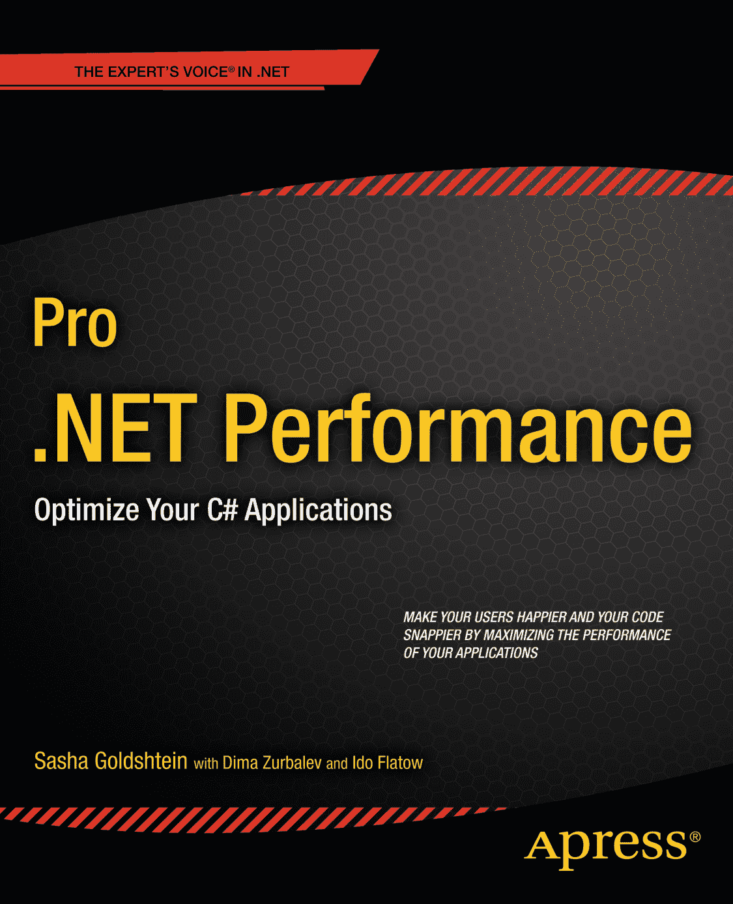

为了方便起见，Apress 将部分前言内容放在了索引之后。请使用“书签”和“速览”链接访问这些内容。


# 引言

这本书的诞生是因为我们认为还没有一本权威性著作能够涵盖与 .NET 应用性能相关的全部三个领域：

- 识别性能指标，并对应用程序性能进行测量，以验证其是否符合或超过了这些指标。
- 在内存管理、网络、I/O、并发等领域提高应用程序的性能。
- 足够详细地理解 CLR 和 .NET 内部机制，以设计高性能应用程序并在性能问题出现时进行修复。

如果不透彻地理解这三个领域，.NET 开发者无法实现系统性的高性能软件解决方案。.NET 内存管理（由 CL 垃圾回收器辅助）是一个极其复杂的领域，也是导致严重性能问题的根源，包括内存泄漏和长长的 GC（垃圾回收）停顿。如果不了解 CLR 垃圾回收器是如何工作的，.NET 中的高性能内存管理将完全听凭运气。从 .NET Framework 提供的选项中选择合适的集合类，或者决定实现自己的集合，都需要对 CPU、复杂性以及同步问题有全面的了解。

本书的 11 章设计为按顺序阅读，但你也可以在不同主题之间来回跳转，并在需要时填补空白。章节按以下逻辑部分组织：

- 第一章和第二章处理性能指标和性能测量。它们介绍了你用于测量应用程序性能的可用工具。
- 第三章和第四章深入研究 CLR 内部机制。它们关注 CLR 垃圾回收的内部机制和实现——这是涉及内存管理时提高应用程序性能的两个关键主题。
- 第五章、第六章、第七章和十一章讨论了 .NET Framework 和 CLR 中提供性能可能的特定领域——正确使用集合、代码并行化、优化 I/O 和网络操作、高效的互操作解决方案以及提高 Web 应用程序的性能。
- 第九章是对复杂性理论和算法的简要探索。它的编写目的是让你了解算法优化的本质。
- 第十章是性能模式的汇编。它的目的是让你领略算法优化的内容。

# 性能目标

性能目标在很大程度上取决于你的应用程序领域和架构。当你完成需求收集后，应该确定通用的性能目标。根据你的软件开发流程，随着需求的变化和新业务操作需的出现，你可能需要对这些目标进行调整。我们在这里回顾了几个典型应用的性能目标示例和准则，但与任何与性能相关的事务一样，这些准则需要根据你软件的领域进行调整。

首先，这里有一些不是良好性能目标的陈述示例：

- *当许多用户同时访问购物车时，应用程序将保持响应能力。*
- *只要用户数量在范围内，应用程序将不会使用过量的内存。*
- *当有多个满负荷的应用程序时，单个数据库服务器将快速处理查询。*

这些陈述的主要问题在于它们过于泛泛且主观。如果这些是你的性能目标，那么你必然会发现它们存在多种解释方式，并且在参考标准上产生分歧。业务分析师可能认为100,000个并发用户是一个“合理”的数量，而技术团队可能知道可用硬件无法在单台机器上支持如此数量的用户。相反，开发者可能认为50ms的响应时间是“响应良好的”，但用户界面专家可能认为这是荒谬的。。

因此，性能目标是通过量化的性能指标表示的，这些指标可以通过某些性能测试手段进行测量。性能目标还应该包含关于其环境的信息——无论是通用的还是针对特定性能目标的。定义良好的性能目标示例包括：

- *只要并发访问购物车的用户不超过5,000人，应用程序将在300毫秒内（不包括网络往返时间）提供“重要”类别下的每个页面。*
- *应用程序为每个用户会话使用的内存将不超过 4 KB。*
- *数据库服务器的CPU和磁盘利用率不应超过70%，只要访问它的应用程序服务器不超过10台，它就应该在75毫秒内对“常用”类别的查询返回响应。*

> 注意：这些示例假设“重要”页面类别和“常用”查询类别是业务分析师或应用程序架构师定义的已知术语。为应用程序的每一个角落保证性能目标是不现实的，而且不值得在开发、硬件和运营成本上投入投资。

我们现在考虑一些典型应用的性能目标示例（参见表 1-1）。此列表并非详尽，也不打算作为你性能目标的检查清单或模板——它是一个通用的框架，用于建立涉及不同应用程序类型时性能目标之间的差异。

# 表 1-1. 典型应用的性能目标示例

| 系统类型 | 性能目标 | 环境限制 |
| --- | --- | --- |
| 外部Web服务器 | 从开始到生成完整响应的时间不应超过300ms | 并发活跃请求不超过300个 |
| 外部Web服务器 | 虚拟内存使用量（包括缓存）不应超过1.3GB | 并发活跃请求不超过300个；已连接用户会话不超过5,000个 |
| 应用程序服务器 | CPU利用率不应超过75% | 并发活跃API请求不超过1,000个 |
| 应用程序服务器 | 硬页缺页率不应超过每秒2次硬页 | 并发活跃API请求不超过1,000个 |
| 智能客户端应用 | 从双击桌面快捷方式到主屏幕显示员工列表的时间不应超过1,500ms | -- |
| 智能客户端应用 | 应用程序空闲时的CPU利用率不应超过1% | -- |
| 网页 | 过滤和排序传入邮件网格的时间不应超过750ms，包括动画 | 单个屏幕上显示的传入邮件不超过200封 |
| 网页 | 用于“与客服聊天”窗口的缓存JavaScript对象的内存利用率不应超过2.5MB | -- |
| 监控服务 | 从故障到生成并发送警报的时间不应超过25ms | -- |
| 监控服务 | 在未主动生成警报时的磁盘I/O操作率应为0 | -- |

**注意** 运行应用程序的硬件特性是限制条件中至关重要的部分。例如，表 1-1 中对智能客户端应用设置的启动时间限制可能需要固态硬盘或速度至少7200RPM的旋转硬盘、至少2GB的系统内存，以及一个支持SSE3指令的1.2GHz或更快的处理器。这些环境限制不值得在每个性能目标中重复，但在性能测试期间值得记住它们。

# 第1章 性能指标

当性能目标定义得良好时，性能测试、负载测试以及随后的优化过程就会变得顺理章章。验证假设（例如，“1,000个并发执行的API请求在应用程序服务器上每秒少于2次硬页”）可能需要负载测试工具和合适的硬件环境。下一章将讨论在建立此类环境后通过测量来确定是否符合或超过其性能目标。

构建定义良好的性能目标通常需要预先熟悉性能指标，我们将在接下来讨论这些。

## 性能指标

与性能目标不同，性能指标是反映应用程序行为的可衡量的数值数量。你可以在任何硬件和任何环境中测量性能指标，无论活动用户、请求或会话的数量有多少。在开发生命周期期间，你选择要测量的指标并从中推导出目标。

某些指标对于特定的应用程序类型更重要。这里我们列出了与许多应用程序相关的性能指标。

| 1-2. 性能指标 | 测量单位 | 相关章节 |
| --- | --- | --- |
| CPU利用率 | 百比 | 所有章节 |
| 物理/虚拟内存使用量 | 字节、千字节、兆字节 | 第4章 垃圾收集 |
| 缓存缺失 | 次/秒 | 第5章 通用性 |
| 页缺页 | 次/秒 | 第6章 并发与并行 |
| 数据库访问 | 次/秒 | 第3章 内部 |
| 分配 | 字节/秒 | -- |
| 执行时间 | 毫秒 | 所有章节 |
| 网络操作 | 次/秒 | 第7章 网络、I/O与序列化 |
| 磁盘操作 | 次/秒 | 第11章 Web应用程序 |
| 响应时间 | 毫秒 | 第11章 Web应用程序 |
| 垃圾收集 | 次/秒 | -- |
| 异常异常 | 次/秒 | -- |
| 启动时间 | 毫秒 | 第10章 性能模式 |
| 竞争 | 次/秒 | 第6章 并发与并行 |

某些指标与某些应用程序类型更为相关。例如，数据库访问时间对客户端并非如此。常见的性能指标与应用程序类型的组合包括

- 对于客户端应用程序，你可能关注启动时间、内存使用和CPU利用率。
- 对于服务器应用程序，你通常关注CPU利用率、缓存缺失、竞争、分配和垃圾收集。
- 对于Web应用程序，你通常测量内存使用、数据库访问、网络和磁盘操作，以及响应时间。

关于性能指标的一个初步观察是，它们的测量级别通常可以改变而不会显著改变指标的含义。例如，分配和执行时间可以在系统级、单进程级，甚至是方法级进行测量。单个方法内部的执行时间比进程级的CPU利用率更具可操作性。遗憾的是，增加测量的粒度通常会产生性能开销，我们将在下一章通过讨论各种性能分析工具来说阐这一点。

## 软件开发生命周期中的性能

性能在软件开发生命周期中处于什么位置？这个简单的问题带有将性能追溯到现有流程的包袱。虽然这是可能的，但更健康的方法是将生命周期的每一步都视为更好地了解应用程序性能的机会：首先是性能目标和重要指标；其次是应用程序是否符合或超过其目标；最后是维护、用户负载以及引入任何回归

- 在需求收集阶段，开始考虑你想设定的性能目标。
- 在架构阶段，精炼对你的应用程序重要的性能指标并定义具体的性能目标。
- 在开发阶段，经常对原型代码或部分完成的功能进行探索性测试，以验证你是否良好处于系统性能目标之内。
- 在测试阶段，进行重大的负载测试和测试，以完全验证你的系统性能目标。
- 在随后的开发和维护期间，每次发布时进行额外的负载测试和测试（最好是每天或每周一次），以快速识别引入系统的任何回归。

花费时间开发一套自动负载测试和性能测试套件，建立一个运行这些测试的隔离环境，并仔细分析其结果以确保没有回归引入是非常耗时的。然而，通过系统化地测量和改进性能，并确保没有回归悄悄进入系统而获得的性能收益，值得对建立稳健的性能开发流程进行初始投入。

## 总结

本章作为性能指标和目标世界的介绍。确保你清楚要衡量*什么*以及哪些性能标准对你来说重要，可能比实际上的*测量*性能更为重要，而后者是下一章的主题。在本书的剩余部分中，我们将使用各种工具来衡量性能，并提供如何改进和优化应用程序的指南。

# 第 2 章

## 性能测量

本书关于提高 .NET 应用程序的性能。如果你不能先测量某东西，你就无法改进它，这就是为什么我们的第一个实质性章节将的是性能测量工具和技术。猜测应用程序的瓶颈在哪里，并对优化什么做出过早的结论，是一个具有性能意识的开发者所能做的最糟糕的事情，而且往往很危险。正如我们在第 1 章中看到的，有许多有趣的性能指标可以成为你应用程序感知性能的核心因素；在本章中，我们将学习如何获取这些指标。

### 性能测量的方法

测量性能的方法不止一种，这在很大程度上取决于上下文、应用程序的复杂性、所需信息的类型以及获得结果的准确性。

测试小型程序或库方法的一种方法是白盒测试：插入源代码，在白板上分析其复杂性，修改程序源代码，并在其中插入测量代码。我们将在本章末尾讨论这种方法——通常称为微基准（microbenchmarking）——它可以非常有价值，特别是在需要精确结果和对每条 CPU 指令有绝对理解的情况下，但在涉及大型应用程序时又非常耗时且不灵活。如果你预先不知道要测量和推理程序的哪个部分，如果不诉诸自动工具，隔离瓶颈将变得极其困难。

对于较大的程序，更常见的方法是黑盒测试，即由人工识别性能指标，并由工具自动测量。使用这种方法时，开发者不需要预先识别瓶颈，也不需要假设罪祸在程序的某个特定（且较小）部分。尽管本章将考虑许多分析应用程序的工具，但性能自动化以易于消化的形式呈现结果。工具包括性能计数器、Windows 事件跟踪 `ETW` 和商业级性能分析器。

在读阅读本章时，请记住性能测量工具可能会严重影响应用程序的性能。很少工具能够在提供准确信息的同时，在应用程序执行时不产生任何开销。当我们从一个工具移动到另一个工具时，请始终记住，工具的准确性往往与它们对应用程序施加的开销相冲突。

### Windows 内置工具

在我们转向需要安装并侵入式测量你应用程序性能的商业工具之前，确保充分利用所有开箱即用的功能是至关重要的。性能计数器已经是 Windows 近近年的年的组成部分，而 Windows 事件跟踪 `ETW` 稍新一些，并在 Windows 时代（2006 年）左右变得真正有用。两者都是免费的，存在于每个 Windows 版本中，并可以用最小的开销进行性能调查。

### 性能计数器

Windows 性能计数器是用于性能和健康调查的内置机制。包括 Windows 内核、驱动程序、数据库和 CLR 在内的各种组件提供了性能计数器，用户和管理员可以使用它们并了解系统运行得如何。作为额外奖励，大多数系统组件的性能计数器默认开启的，因此您在收集这些信息时不会引入任何额外的开销。

从本地或远程系统读取性能计数器极其非常。内置的性能监视器工具 `perfmon.exe` 可以显示系统上可用的性能计数器，并将性能计数器数据记录到文件中供后续调查，并在性能计数器读取器达到定义的阈值时提供自动警报。如果你具有管理员权限并通过本地网络连接，性能监视器可以监控远程系统。

性能信息按照以下层次结构组织：

- 性能计数器类别（或性能对象）代表与特定系统相关的一组单独计数器。类别的示例包括 `.NET CLR Memory`、`Process Information`、`TCPv4` 和 `PhysicalDisk`。
- 性能计数器是性能计数器类别中的单个数值数据。通常会指定用斜杠分隔的性能计数器和类别名称，例如 `Process\Private Bytes`。性能计数器有几种支持类型，包括数值信息（`Process\Thread Count`）、事件速率（`Print Bytes Printed/sec`）、百分比（`PhysicalDisk\Idle Time`）和平均值（`Service\Operation3.0.0\Calls`）。
- 性能计数器实例用于区分系统中的多个计数器集。例如，由于可能存在多个实例，因此 `Processor` 类别和 `Memory` 类别都有实例。

# 第2章 性能测量

- 3. 点击左侧树中的“性能监器”`Performance Monitor`节点，然后点击绿色的 + 按钮。
- 4. 从 `NET CLR Memory` 计数器中，选择 `# Bytes in all Heaps` 和 `Allocated Bytes/sec` 性能计数器，从实例列表中选择 `MemoryLeak` 实例，并点击“Add >>”按钮。
- 5. 从 `Process` 计数器中，选择 `Private Bytes` 性能计数器，从列表中选择 `MemoryLeak` 实例，并点击“Add >>”按钮。
- 6. 点击“确定”确认你的选择并查看性能图表。
- 7. 你可能需要右键点击屏幕底部的计数器并选择“调整计数器”`Scale counters`，以便在图表中显示实际线条。

你现在应该可以看到对应 `Private Bytes` 和 `# Bytes in all Heaps` 性能计数器的线条同步上升（与图 2-1类似）。这指向托管堆中存在内存泄漏。我们将在第 4 章回到这个特定的内存泄漏，并找出其根源。

> Windows 系统上实际上有成千上万个性能计数器；没有任何性能调查员能记住所有它们。这就是“添加计数器”对话框底部的“显示描述”复选框派用场的地方——你能看出 `SystemProcessor Queue Length` 代表系统处理器上等待执行的线程数，或者看出 `.NET CLR LocksAndThreads\Contention Rate /sec` 是线程（每秒）尝试获取托管锁但未成功并必须等待其变为可用的次数。

### 性能计数器日志和警报

配置性能计数器非常简单，你可以为系统管理员提供一个 XML 模板，以便自动应用性能计数器，而无需指定单独的性能计数器。你可以在任何机器上打开生成的日志，并像它们代表实时数据一样对其进行回放（你可以使用某些内置计数器，而无需配置要配置要记录的内容）。

你还可以使用性能监器配置性能计数器警报，当突破特定阈值时，它将创建一个任务。你可以使用性能计数器警报创建一个基础的监控体系，当违反性能约束时，它可以向系统管理员发送电子邮件或消息。例如，你可以配置一个性能计数器警报，当进程达到危险的内存使用量或系统整体磁盘空间耗尽时自动重启你的进程。我们强烈建议你尝试性能监器并熟悉它所提供的各种选项。

### 配置性能计数器日志

要配置性能计数器日志，打开性能监器并执行以下步骤。（我们假设你正并在 Windows 7 或 Windows Server 2008 R2 上使用性能监器；在之前的操作系统版本中，性能监器的界面略有不同——如果你使用的是这些版本，请参阅文档获取详细说明。）

- 1. 在左侧树中，展开数据收集器节点 `Data Collectors Nodes`。
- 2. 右键点击用户定义 `User Defined` 节点，从右键菜单中选择新建 ► 数据收集器 `Data Collector`。
- 3. 命名你的数据收集器集，选择“手动创建（高级）”单选按钮，并点击“下一步”。
- 4. 确保选择了“创建日志”单选按钮，勾选“性能计数器”复选框，并点击“下一步”。
- 5. 使用“添加”按钮添加性能计数器（将打开“添加计数器”对话框）。完成后，配置采样间隔（默认是每 15 秒采样一次计数器）并点击“下一步”。
- 6. 提供一个性能监器将用于存储计数器日志的目录，然后点击“下一步”。
- 7. 选择“打开此数据收集器集的属性”单选按钮并点击“完成”。
- 8. 使用各种选项页来配置你的数据收集器集——你可以定义自动运行的计划、停止条件（例如，在收集一定数量的数据后）以及在数据收集停止时运行的任务（例如，将结果上传到集中位置）。完成后，点击“确定”。
- 9. 点击“用户定义”节点，在主面板中右键点击你的数据收集器集，从右键菜单中选择“启动”。
- 10. 你的计数器日志现在正在运行并将数据收集到你选择的目录。你可以随时通过右键点击它并从右键菜单中选择“停止”来停止计数器集。

当你完成数据收集并想使用性能监器检查它时，执行以下步骤：

- 1. 选择“用户定义”节点。
- 2. 右键点击你的数据收集器集，从菜单中选择“最新报告”`Latest Report`。
- 3. 在弹出的窗口中，你可以从日志中的计数器列表中添加或删除计数器，配置时间范围，并通过右键点击图表并从右键菜单中选择“属性”来更改数据比例。


最后，要在另一台机器上分析日志数据，你应该将日志目录复制到该机器，打开性能监器节点，并点击从左数第二个工具栏按钮（或按 `Ctrl + L`）。在弹出的对话框中，你可以勾选“日志文件”复选框并使用“添加”按钮添加日志文件。

# 第2章 性能测量

## 自性能计数器

尽管性能监器是一个非常有用的工具，但你可以使用 `System.Diagnostics.PerformanceCounter` 类从任何 .NET 应用程序读取性能计数器。甚至，你还可以创建自己的性能计数器，并将它们添加到可用于性能调查的数据集中。

以下是你应该考虑导出性能计数器的一些场景：

- 你正在开发一个可供系统大部分部分使用的基础库。你的库可以通过性能计数器报告性能信息，对于开发者和系统管理员来说，通过日志文件或代码层级的调试这通常容易得多。
- 你正在开发一个接受请求、处理请求并交付响应的服务器系统（自定义 Web 服务器、Web 服务等）。你应该报告请求处理率、遇到的错误和类似统计的性能信息。（关于 ASP.NET 性能类的一些灵感）。
- 你正在开发一个无人运行并与自定义硬件通信的高可靠 Windows 服务。你的服务可以报告硬件的健康状况、软件与硬件交互的速率以及类似的统计数据。

以下代码仅用于从类别中导出单实例性能计数器并更新这些计数器。它假设 `AttendanceClass` 包含当前签入人数的信息，并且你想将此信息作为性能计数器暴露。（你需要使用 `System.Diagnostics` 命名空间来编译这段代码段）。

```
public static void CreateCounter() {
    if (PerformanceCounterCategory.Exists("Attendance")) {
        PerformanceCounterCategory.Delete("Attendance");
    }
nCounterDataCollection counters=new CounterCreationDataCollection();
CounterCreationData employeesAtWork=new CounterCreationData(
    "Employees at Work", "The number of employees currently checked in.",
    PerformanceCounterType.NumberofItems32);
PerformanceCounterCategory.Create(
    "Attendance", "Attendance information for Litware, Inc.",
    PerformanceCounterCategoryType.SingleInstance, counters);
}
public static void StartUpdatingCounters() {
    PerformanceCounter employeesAtWork=new PerformanceCounter(
        "Attendance", "Employees at Work", ReadOnly:false);
    updateTimer=new Timer((s, e) => {
        employeesAtWork.RawValue=AttendanceSystem.Current.EmployeeCount;
    }, null, TimeSpan.Zero, TimeSpan.FromSeconds(1));
}
```

正如我们所，配置自定义性能计数器所需的精力很少，而且在进行性能调查时，它们至关重要。将系统性能计数器数据与自定义性能计数器关联起来，通常是性能调查员确定性能或配置问题精确原因所需的全部。

## 性能测量

性能监器（Performance Monitor）可用于收集与性能计数器无关的其他信息。你可以用它来收集系统配置数据——注册表项的值、WMI 对象属性，甚至是插入磁盘文件。你还可以用它捕获来自 ETW 提供程序（我们将在下文中讨论）的数据以供后续分析。通过使用 XML 模板，系统管理员可以快速为系统应用数据收集器，并用极少的手动配置步骤生成实用的报告。

性能计数器提供了大量丰富的信息，但它们不能作为高性能的日志记录和监控框架。没有系统组件更新性能计数器的频率每秒超过几次，而 Windows 性能监器读取性能计数器的频率也不会每秒一次。如果你的性能调查每秒需要数千次事件，那么性能计数器并不是理想选择。我们将注意力转向到 Windows 事件跟踪（ETW），它是为了高性能数据收集和更丰富的数据类型（而不仅仅是数字）而设计的。

### Windows 事件跟踪 (ETW)

Windows 事件跟踪（ETW）是 Windows 内置的一种高性能事件日志框架。与性能计数器类似，许多系统组件和应用程序框架（包括 Windows 内核和 CLR）都定义了提供程序（Providers），它们报告事件——即组件内部运行机制的信息。与始终开启的性能计数器不同，ETW 提供程序可以在性能调查需要时运行时开启或关闭。

ETW 信息最丰富的来源之一是内核提供程序，它报告有关进程和线程创建、DLL 加载、内存分配、网络 I/O 和堆栈计数（称为采样）的事件。表 2-1 显示了内核和 CLR 提供程序报告的一些有用信息。你可以用它们调查系统行为（例如哪些进程正在消耗 CPU 时间）、分析内核和 ETW 提供程序、磁盘 I/O 或网络 I/O 瓶颈、获取托管进程的垃圾回收统计和内存使用，以及本节讨论的其他场景。

ETW 事件带有精确的时间标记，并可以包含自定义信息以及发生位置的堆栈跟踪。这些堆栈跟踪可以进一步识别性能和正确性问题的来源。例如，CLR 提供程序可以报告每次垃圾回收开始和结束的事件。结合精确的调用栈，这些事件可以用于确定程序的哪些部分通常导致垃圾回收。（有关垃圾回收及其触发器的更多信息，请参阅第 4 章。）

#### 表 2-1. Windows 和 CLR 中 ETW 事件部分列表

| 提供程序 | 标志 / 关键字 | 说明 | 事件（部分列表） |
| --- | --- | --- | --- |
| Kernel | PROC_THREAD | 进程和线程的创建与销毁 | -- |
| Kernel | LOADER | 映像（DLL、驱动程序、EXE）的加载和卸载 | -- |
| Kernel | SYSCALL | 系统调用 | -- |
| Kernel | DISK_IO | 磁盘 I/O 读写（包括磁头位置） | -- |
| Kernel | HARD_FAULTS | 导致磁盘 I/O 的页错误（未从内存满足） | -- |
| Kernel | PROFILE | 采样事件–每 1ms 收集一次的所有处理器的堆栈跟踪 | 开始收集、收集结束、终结器、已分配 -100KB 内存 |
| CLR | GCKeyword | 垃圾回收统计和信息 | -- |
| CLR | ContentionKeyword | 线程竞争锁 | 竞争开始（线程启动），竞争结束 |
| CLR | JITTracingKeyword | 即时编译 (JIT) 信息 | 方法内联成功，方法内联失败 |
| CLR | ExceptionKeyword | 抛出的异常 | -- |

访问这些详细信息需要 ETW 收集工具和一个可以读取原始事件并进行基础分析的应用程序。在编写时，有两个工具可以胜任这两项任务：Windows Performance Toolkit (WPT，也称为 XPerf)，它随 Windows SDK 发布；以及 PerfMonitor（不要与 Windows Performance Monitor 混淆！）它是微软 CLR 的开源项目。

### Windows Performance Toolkit (WPT)

Windows Performance Toolkit (WPT)是一组用于控制 ETW 会话、将 ETW 事件捕获到日志文件中并进行后续处理的工具。它可以生成 ETW 事件的图形和叠加层、包含调用栈信息的摘要表以及用于自动处理的 CSV 文件。从 `http://msdn.microsoft.com/en-us/performance/cc75297.aspx` 下载 Windows SDK 安装程序，并在安装选项屏幕上仅选择“Common Utilities Windows Performance Toolkit”。SDK 安装程序完成后，导航到 SDK 安装目录下的 `Redist\Windows Performance Toolkit` 子目录，并运行适用于系统架构的安装程序（32 位系统运行 `Xperf_x86.msi`，64 位系统运行 `Xperf_x64.msi`）。

注意：64 位 Windows 的堆栈遍历需要更改注册表设置以禁用内核页的分页输出（Windows 内核本身及任何驱动程序）。这可能会使系统工作集（内存利用率）增加几兆字节。要更改此设置，导航到注册表项 `HKLM\System\CurrentControlSet\Control\Session Manager\Memory Management`，将 `DisablePagingExecutable` 设置为 DWORD `0x1`，并重启系统。

你用于捕获和分析 ETW 跟踪的工具是 `XPerf.exe` 和 `XPerfView.exe`。这两个工具都需要管理员权限才能运行。`XPerf` 工具具有多个命令行选项，用于控制在跟踪期间期间启用哪些提供程序、使用的缓冲区大小以及文件名。`XPerfView.exe` 为捕获的数据提供图形化分析。

### 使用 XPERF 捕获和分析内核跟踪

在本节中，你将使用 XPerf 捕获并分析内核跟踪。

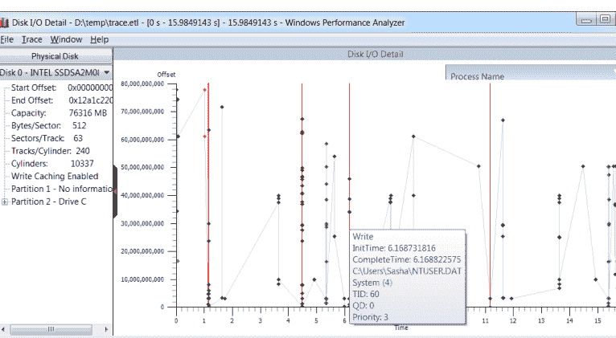

图 2-2。在物理磁盘映射上布局的磁盘 I/O 操作。通过工具提供 I/O 操作寻和 I/O 详情。

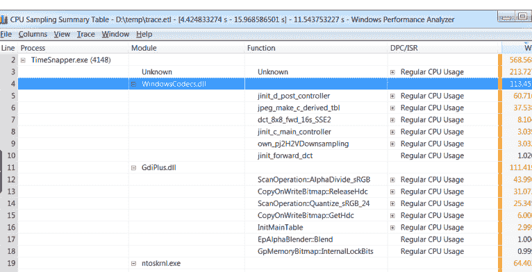

| 行号 | 模块 | 函数 | DPC/ISR | 权重 |
|---|---|---|---|---|
| 2 = TimeSnapper.exe (4148) | Unknown | | * 常规用法 | 568,568 |
| 3 | | | | 213,727,040 |
| 4 | WindowsCodes.dll | jit_d_post_controller | * 常规用法 | 113,453,109 |
| 5 | | jpeg_make_deviled_tbl | * 常规用法 | 60,776,779 |
| 6 | | dct_bat_hid_16s_552 | * 常规用法 | 37,538,836 |
| 7 | | jit_c_controller | * 常规用法 | 8,104,096 |
| 8 | | oswn_pzi2VDDownsampling | * 常规用法 | 3,032,766 |
| 9 | | jit_forward_init | * 常规用法 | 1,020,681 |
| 10 | | ScanOperation:AppleDevice::uRgb | * 常规用法 | 115,419,630 |
| 11 | | CopyOnWriteBitmap:RefreshBitmap | * 常规用法 | 31,073,125 |
| 12 | | ScanQuantize:Quantize_IRGB | * 常规用法 | 25,345,135 |
| 13 | | CopyOnWriteBitmap:GetHdc | * 常规用法 | 6,000,023 |
| 14 | | InstMainTable | * 常规用法 | 2,999,096 |
| 15 | | EpShutdownHandler | * 常规用法 | 1,996,088 |
| 16 | | GlobalMemoryBitmap:InternalLocks | * 常规用法 | 999,088 |
| 17 | ntoskrnl.exe | | * 常规用法 | 64,403,859 |
| 18 | | | * 常规用法 | 11,056,087 |

图 2-3。单个进程 (TimeSnapper.exe) 的详细堆栈帧。权重列表示（大致上）在该帧中花费了多少 CPU 时间。

使用率

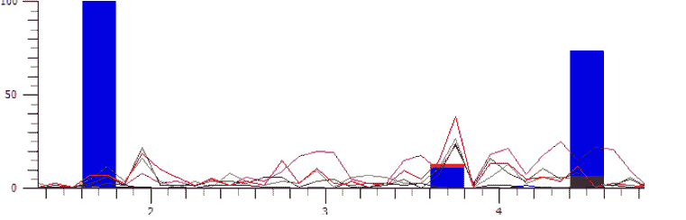

**图 2-4.** CPU 活动（折线表示不同的处理器）与磁盘 I/O 操作（列）的叠加图。I/O 活动与 CPU 活动之间没有可见的显式相关性。

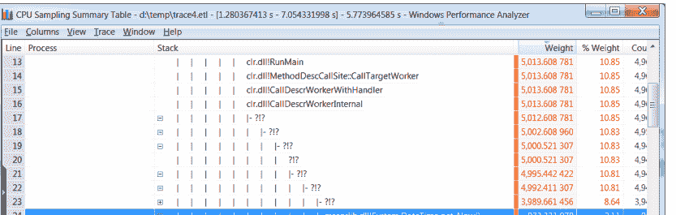

| 元素 | 列 | 视图 | 窗口 | 堆栈 | 权重 | 权重百分比 | 计数 |
|---|---|---|---|---|---|---|---|
| 行 | 进程 | | | | -clr::DllDesc | 5.01360781 | 10.5 | 4.9 |
| 14 | | | | -clr::DllCall::TargetWorker | 5.01360781 | 10.5 | 4.9 |
| 15 | | | | -clr::DllDescWorker | 5.01360781 | 10.5 | 4.9 |
| 16 | | | | -clr::DllDescInternal | 5.0126781 | 10.3 | 4.9 |
| 17 | | | | -? 7 | 5.0026620 | 10.3 | 4.9 |
| 18 | | | | -? 7 | 5.00522507 | 10.3 | 4.9 |
| 19 | | | | -? 7 | 4.9954442 | 10.1 | 4.9 |
| 20 | | | | -? 7 | 4.99241263 | 10.1 | 4.9 |
| 21 | | | | -? 7 | 4.98116648 | 10.0 | 4.9 |
| 22 | | | | | 973.311079 | 2.11 | 9.4 |
| 23 | | | | -mclr::System.DateTime.GetNow() | 19.221094 | 0.4 | 0.0 |
| 24 | | | | -mclr::System.DateTime.GetUtcNow() | 4.139120 | 0.1 | 0.0 |
| 25 | | | | -mclr::System.DateTime.Ticks(Int64) | 1.025527 | 0.0 | 0.0 |
| 26 | | | | -System.DateTime.GetSystemTime() | 3.031015 | 0.1 | 0.0 |
| 27 | | | | -clr::DllPreSub | 4.0452901 | 0.0 | 0.0 |

总 CPU 使用率（非空闲）-12.91%

**图 2-5.**报告中的堆栈聚合。注意托管帧是部分显示的——某些帧无法解析。mclr.dll 帧 (System.DateTime.GetNow()) 已成功解析，因为它们是预编译的，而不是在运行时由 JIT 编译的。

最新版本的 Windows SDK (8) 带有一对新工具：Windows Performance Recorder (`wpr.exe`) 和 Windows Performance Analyzer (`wpa.exe`)，它们的设计是为了取代之前的 XPerf 和 PerfView。例如，`wpr -start` 大约相当于`perf -on`，而 `wpr -stop` 相当于 report。WPA 的界面略不同，但提供了与 PerfView 类似的功能。有关工具的更多信息，请咨询 MSDN：`http://msdn.microsoft.com/en-us/library/hi2962.aspx`。

XPerf 非常擅长以吸引人的图表和表格显示数据，但对于自定义来说并不强大。例如，我们可以捕获 CLR ETW 提供程序的事件，但我们需要根据文档中的关键字和事件列表理解跟踪中的原始数据（CLR ETW 提供程序的完整关键字和事件可用 MSDN：`http://msdn.microsoft.com/en-us/library/f35720.aspx`）。

如果我们运行带有 CLR ETW 提供程序 (`e1c302e-ccbc-421e-a91b-d9cee2274`) 的 GC 提供程序和详细日志 (Verbose log) 的 XPerf，它将通过将其导出为 CSV 文件或用 XPerf 打开完整捕获每个事件，我们能够识别应用程序中 GC 相关的事件。2-6 是生成的 XPerf 报告的示例视图——GC Start 的时间显示了在监控的操作中完成垃圾回收所需的时间。

| 事件名称 | 时间 (ms) | 分配类型 | 实例 ID |  |
|---|---|---|---|---|
| Microsoft-Windows-DotNet-GC/AllocationTick | 6216 377 000 | 0032a28 | 1 | 13 |
| Microsoft-Windows-DotNet-GC/AllocationTick | 6216 547 399 | 00f3b10 | 1 |  |
| Microsoft-Windows-DotNet-GC/AllocationTick | 6217 219 916 | 000ae18 | 1 | 13 |
| Microsoft-Windows-DotNet-GC/AllocationTick | 6217 254 019 | 00c5020 | 1 |  |
| Microsoft-Windows-DotNet-GC/SuspendedStart | 6217 328 151 | 1 | 13 |
| Microsoft-Windows-DotNet-GC/SuspendedEnd | 6217 356 130 | 2 | 4 |


| Microsoft-Windows-DotNet-GC/CreateConcurrentThread | 6217 650 163 | 11 | |

| Microsoft-Windows-DotNet-GC/RestartEEWStart | 6217 658 619 | 1 | |

| Microsoft-Windows-DotNet-GC/RestartEEWEnd | 6217 663 376 | 1 | |

| Microsoft-Windows-DotNet-GC/SuspendedStart | 6217 821 914 | 6 | |

| Microsoft-Windows-DotNet-GC/SuspendedEnd | 6217 825 865 | 1 | |

## 第二章 性能测量

| 名称 | 排除 % | 增加 % | 排除 % | CPU 占用率 | 首次 | 最后一次 |
|---|---|---|---|---|---|---|
| `mscorlib.System.String.Stringcat(String,String)` | 15.0 | 119.5 | 15.0 | 总时间被分为 32 个桶，每个数字代表 | | |
| `JackCompiler.Compiler.Enumerator(Enumerator<I0>)` | 29.7 | 35.2 | 实施已内联 | | | |
| `System.Core.Linq.Enumerable.Where(IEnumerable<T>,Func<...>)` | 8.1 | 7.4 | 8.1 | - 未使用任何代码 | | |
| `JackCompiler.Compiler.Enumerator(ParserTerm)` | 11.9 | 18.8 | 11.9 | - 未使用任何代码 | | |
| `JackCompiler.Compiler.Parser.ParseAddress()` | 7.0 | 64.8 | 25.7 | 使用率 1-20% | | |
| `mscorlib.System.TextWriter.WriteLine(String)` | 3.7 | 3.4 | 3.7 | 使用率 9-100% | | |
| `JackCompiler.Compiler.Tokenizer(Enumerator<I>-like)` | 3.6 | 3.3 | 9.9 | Z 使用率 30-350% | | |
| `JackCompiler.Compiler.Parser.ParseExpression()` | 2.2 | 20.5 | 9.9 | | | |
| `JackCompiler.Compiler.Parser.SubExpression()` | 22.0 | 21.8 | 40.2 | | | |
| `JackCompiler.Compiler.Parser.NextToken(MultiOp)` | 2.2 | 53.9 | 49.0 | | | |
| `JackCompiler.Compiler.Parser.ParseStatement()` | 2.1 | 19.9 | 36.0 | | | |
| `JackCompiler.Compiler.Parser.SubCall(Token)` | 9.1 | 20.8 | 18.0 | 021159a9a9a9a9a9a9 | 297.286.370 | | |
| `myworks()?` | 2.0 | 18.0 | 18.1 | 012222222222222222 | 399.519.773 | | |
| `JackCompiler.Compiler.CodeGenerator.Generate(Token,bool)` | 1.5 | 15.4 | 14.5 | 051000100000001100 | 555.645.322 | | |
| `JackCompiler.Compiler.Parser.ParseSubBody()` | 1.9 | 17.8 | 72.5 | 017878787878787878 | 529.789.337 | | |
| `System.Core.Linq.Enumerable.Select(IEnumerable<T>,...)` | 1.5 | 15.4 | 14.5 | 00_0_0_000000000000 | 547.789.337 | | |
| `JackCompiler.Compiler.Tokenizer.Next()` | 1.2 | 11.9 | 19.7 | 211212312112312121 | 547.789.337 | | |
| `JackCompiler.Compiler.Tokenizer.Withspace()` | 2.2 | 11.7 | 17.6 | 00_0_0_000000000000 | 515.783.227 | | |

图 2-b. 来自 PerMonitor 的顶部报告。“Inc %” 是该方法及其所有调用的方法（其调用树中的子树）所用 CPU 时间的估计。

| 名称 | 增加 % | 增加 % | 排除 % | CPU 占用率 |
|---|---|---|---|---|
| ROOT | 100.0 | 9.7 | 0.0 | 031159a9a9a9a9a9a9a9 | | |
| +ParserClass(1372) | 100.0 | 9.7 | 0.0 | 031159a9a9a9a9a9a9a9 | | |
| +Thread(4636) | 100.0 | 9.7 | 0.0 | 031159a9a9a9a9a9a9a9 | | |
| +udtl() | 98.3 | 9.0 | 2.1 | 021159a9a9a9a9a9a9a9 | | |
| +JackCompiler.Compiler.JackCompiler.Driver.Main(String) | 95.3 | 8.4 | 0.2 | 159959a9a9a9a9a9a9a9 | | |
| +JackCompiler.Compiler.JackCompiler.DriverWithGenerator(String) | 91.5 | 8.2 | 0.5 | 059959a9a9a99aa9 | | |
| +JackCompiler.Compiler.Parser.Class() | 84.2 | 7.7 | 0.0 | 099959a9a9a99a9 | | |
| +JackCompiler.Compiler.Parser.Class() | 84.2 | 7.2 | 0.9 | 2998089898989898 | | |
| +JackCompiler.Compiler.Parser.SubBody() | 82.0 | 7.5 | 0.1 | 2798089898989898 | | |
| +JackCompiler.Compiler.Parser.SubBody() | 81.9 | 7.5 | 0.5 | 2998089898989898 | | |
| +JackCompiler.Compiler.Parser.Expression() | 78.5 | 7.2 | 1.9 | 0178787878787878 | | |
| +JackCompiler.Compiler.Parser.Expression() | 75.4 | 6.8 | 0.5 | 0178787878787878 | | |
| +JackCompiler.Compiler.Parser.Statement() | 75.0 | 6.8 | 0.5 | 18777878787878 | | |
| +JackCompiler.Compiler.Parser.ExpressionList() | 30.2 | 2.7 | 11.2 | 024332222211165 | | |
| +JackCompiler.Compiler.Parser.Expression() | 20.3 | 18.6 | 0.0 | 022322222212221 | | |
| +JackCompiler.Compiler.Parser.RelExpression() | 19.5 | 7.9 | 0.3 | 022222222212221 | | |
| +jackcompiler.tokenizer.parser.Expression() | 17.7 | 16.2 | 0.1 | 021212121212121 | | |
| +JackCompiler.Compiler.Parser.Term() | 16.5 | 6.5 | 0.2 | 01656565656565 | | |
| +JackCompiler.Compiler.Parser.Statement() | 12.9 | 11.8 | 0.7 | 211211212122121 | | |
| +JackCompiler.Compiler.Parser.SubCallToken() | 22.0 | 20.2 | 0.1 | 122222222222222 | | |
| +JackCompiler.Compiler.Parser.SubCallToken() | 17.3 | 15.9 | 0.1 | 0102110121122221 | | |
| +JackCompiler.Compiler.Parser.ExpressionList() | 8.1 | 7.4 | 0.0 | 010100000011100 | | |
| +JackCompiler.Compiler.Parser.Expression() | 8.1 | 7.4 | 0.3 | 010100000011100 | | |

图 2-b. 来自 PerMonitor 的顶部报告

详细的 GC 分析报告包含一个表格，列出了每个代的垃圾回收统计数据（次数、时间），以及单个 GC 事件信息，包括暂停时间、回收内存等等。当我们在第 4 章讨论垃圾回收器的内部工作原理和性能影响时，这些信息某些将非常有用。2-9 显示了几行单个 GC 事件。

所有时间单位均为毫秒。从 ms 跟踪开始。

| 开始时间 | GC 编号 | 代 | 暂停 | 分配速率 MB | GC 留存 | 毫秒前 MB | 毫秒后 MB | 后 MB | 比例 | 回收量 | 挂起时间 | 类型 | 原因 |
|---|---|---|---|---|---|---|---|---|---|---|---|---|---|
| 55153 | 1 | 0 | 02 | 7.53 | 4.15 | 0.046 | 2.56 | 0.07 | 55.82 | 4.07 | 0.01 | NonConcurrentGC | Alloc/Small |
| 55438 | 2 | 0 | 09 | 13.42 | 4.15 | 0.020 | 0.84 | 0.21 | 42.74 | 0.0 | 0.01 | NonConcurrentGC | Alloc/Small |
| 55765 | 3 | 0 | 08 | 13.21 | 4.15 | 0.015 | 0.59 | 0.25 | 33.15 | 0.01 | NonConcurrentGC | Alloc/Small |
| 56092 | 4 | 0 | 09 | 14.59 | 4.15 | 0.010 | 0.62 | 0.47 | 26.97 | 0.01 | NonConcurrentGC | Alloc/Small |
| 56323 | 5 | 0 | 09 | 14.78 | 4.15 | 0.020 | 0.46 | 0.31 | 23.94 | 0.01 | NonConcurrentGC | Alloc/Small |
| 56681 | 6 | 0 | 08 | 14.91 | 4.15 | 0.017 | 0.34 | 0.21 | 20.79 | 0.01 | NonConcurrentGC | Alloc/Small |

**图 2-9.** 单个 GC 事件，包括回收量

# 第 2 章 -- 性能测量

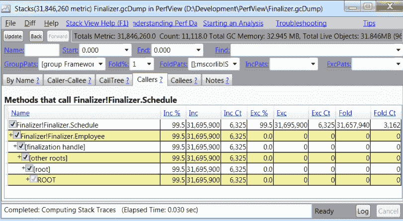

**图 2-11.** Schedule 实例的自由链，代表了捕获堆快照中应用程序内存占用的 99.5%

在本章中讨论内存分析器时，我们会发现 PerfView 的可视化能力与商业工具相比仍有不足。尽管如此，PerfView 是一个非常有用的工具，可以显著缩短性能调查的时间。你可以通过主界面链接的内置教程了解更多信息，BCL 团队提供的视频也展示了该工具的一些主要功能。

## 自定义 ETW 提供程序

与计数器（counters）类似，你可能也想利用 ETW 提供的强大插桩和信息收集框架来满足你应用程序的需求。在 .NET 4.5 之前，从托管应用中暴露 ETW 是相当复杂的。在这里，我们将详细地向你展示如何为应用程序的 ETW 提供程序定义方法、在运行时实例化它以及记录事件。从 .NET 4.5 开始，编写自定义 ETW 提供程序变得更加简单。你只需要派自 `System.Diagnostics.Tracing.EventSource` 类并调用 `WriteEvent` 方法来输出 ETW 事件即可。向系统注册 ETW 提供程序以及格式化事件数据的所有细节将自动为你处理。

以下类是托管应用中 ETW 提供程序的示例（完整程序可在本章源代码中找到，你稍后可以使用 PerfMonitor 运行它）：

```c
public class CustomEventSource : EventSource {
    public class Keywords {
        public const EventKeywords Loop = (EventKeywords)1;
        public const EventKeywords Method = (EventKeywords)2;
    }

    [Event(Level=EventLevel.Verbose, Keywords=Keywords.Loop, Message="Loop {0} iteration {1}")]
    public void LoopIteration(string loopTitle, int iteration) {
        WriteEvent(1, loopTitle, iteration);
    }

    [Event(2, Level=EventLevel.Informational, Keywords=Keywords.Loop, Message="Loop {0} done")]
    public void LoopDone(string loopTitle) {
        WriteEvent(2, loopTitle);
    }

    [Event(3, Level=EventLevel.Informational, Keywords=Keywords.Method, Message="Method {0} done")]
    public void MethodDone([CallerName] string methodName=null) {
        WriteEvent(3, methodName);
    }
}

class Program {
    static void Main(string[] args) {
        CustomEventSource log=new CustomEventSource();
        for (int i=0; i<10; ++i) {
            Thread.Sleep(50);
            log.LoopIteration("MainLoop", i);
        }
        log.LoopDone("MainLoop");
        Thread.Sleep(100);
        log.MethodDone();
    }
}
```

可以使用 PerfMonitor 工具自动从此应用程序获取 ETW 提供程序，在带有 ETW 提供程序监控的同时运行应用程序，并生成应用程序提交的所有 ETW 事件报告。例如：

```
C:\PerfMonitor>monitorDump Ch02.exe
Starting kernel tracing. Output file:PerfMonitorOutput.kernel.etl
Starting user model tracing. Output file:PerfMonitorOutput.etl
Found CustomEventSource Guid f6a40d2-5116-5555-675b-4468e821162e
Enabling provider f6a40d2-5116-5555-675b-4468e821162e level: Verbose keywords:\xffffffffffffff
Starting at 4/7/2012 1:44:00 PM
Current Directory C:\PerfMonitor
Executing: Ch02.exe

Stopping at 4/7/2012 14:41:02 PM=0.693 sec
Stopping tracing for sessions 'NT Kernel Logger' and 'PerfMonitorSession'.
Converting C:\PerfMonitor\PerfMonitorOutput.eltx to an XML file.
Output in C:\PerfMonitor\PerfMonitorOutput.dump.xml
PerfMonitor processing time: 1.886 secs.
```

# 第 2 章 性能测量


注意：我们还没有考虑另一个性能监控和系统健康插桩框架：Windows 管理规程序 (`WMI`)。`WMI` 是集成到 Windows 中的命令与控制 (`C&C`) 基础设施，不在本章的范围内。它可以用于获取有关系统状态的信息（例如已安装的操作系统、BIOS 固件或可用磁盘空间）、注册交叉事件（如进程创建和终止），并调用更改系统状态的控制方法（如创建网络共享或解锁驱动程序）。有关 `WMI` 的更多信息，请参阅 `http://msdn.microsoft.com/en-us/library/desktop/aa394582.aspx` 的 MSDN 文档。如果你对开发 `WMI` 提供程序感兴趣，Sasha Goldsteins 的文章“`WMI Provider Extensions in NET 3.5`”（`http://codeproject.com/Articles/25783/WMI-Provider-Extensions-in-NET-3-5, 2008`）提供了一个很好的起点。

## 时间分析器 (Time Profilers)

虽然性能计数器 `ETW` 事件为应用程序提供了大量的洞察，但性能分析器（performance profiler）是一个非常有用的工具，可以显著缩短性能调查的时间。你可以通过主界面链接的内置教程了解更多信息，`BCL` 团队提供的视频也展示了该工具的一些主要功能。

虽然性能计数器 `ETW` 事件为应用程序提供了大量的洞察，但性能分析器是一个非常有用的工具，可以显著缩短性能调查的时间。你可以通过主界面链接的内置教程了解更多信息，`BCL` 团队提供的视频也展示了该工具的一些主要功能。

## Visual Studio 采样分析器 (Sampling Profiler)

`Visual Studio` 采样分析器的工作原理与内核类似。它会定期中断应用程序并记录线程正在运行的调用栈。与内核不同，采样基于若干标准，其中某些列在表 2-2 中。

### 表 2-2 Visual Studio 采样分析器事件（部分列表）

| 触发 | 含义 | 合理范围 | 场景 |
| :--- | :--- | :--- | :--- |
| 时钟周期 | 应用程序使用了 CPU 时钟周期 | 1M—1000M | 寻找使用 CPU 最密集的方法（瓶颈） |
| 缺页 | 应用程序访问当前不在 RAM 中的内存页，必须从磁盘提取 | 1—1000 | 寻找导致缺页的方法，即昂贵的磁盘 I/O 而非内存访问 |
| 系统调用 | 应用程序使用了向操作系统发出调用的 Win32 API 或 .NET 类 | 1—10000 | 寻找导致用户态内核态切换的方法，这种切换是昂贵的 |
| 最后缓存缺失 | 应用程序访问了不在 CPU 缓存中但在主内存 (RAM) 中可以找到的位置 | 1000—1M | 寻找导致缓存缺失的代码（另参见第 5 章） |
| 已执行指令 | 应用程序执行了 CPU | 500K—100M | 与时钟周期类似 |

## 在 Visual Studio 中运行采样分析器

运行采样分析器最简单的方法是直接从 `Visual Studio` 中运行（稍后我们将看到），它也支持从简化的命令行环境进行生产环境分析。我们建议您使用自己的应用程序进行此实验。

- 1. 在 `Visual Studio` 中，点击“分析 (`Analyze`) ► 启动性能 (`Launch Performance`)”菜单项。
- 2. 在向导的第一页，选择“CPU 采样 (`CPU sampling`)”单选按钮并点击“下一步 (`Next`)”按钮。（在本章后面的部分我们将讨论其他分析模式；届您可以重复此实验）
- 3. 如果当前解决方案中加载了项目配置文件，点击“一个或多个项目 (`One or more projects`)”单选按钮并从列表中选择项目。否则，点击“可执行文件 (`.EXE file`)”单选按钮。点击“下一步”。
- 4. 如果你在上一个屏幕上选择了“可执行文件 (`.EXE file`)”，请将分析器指向您的可执行文件，并在时提供任何行参数，然后点击“下一步”。（如果没有您的应用程序处理程序，可以使用本章源码文件夹中的 `JackCompiler.exe` 示例应用程序）。
- 5. 勾选“向导完成后启动分析 (`Launch profiling after the wizard finishes`)”框框并点击“完成 (`Finish`)”按钮。
- 6. 如果你没有以管理员身份运行 `Visual Studio`，将提示你升级分析器的凭据。
- 7. 当你的应用程序完成后，将打开一个分析报告。顶部的“当前视图 (`Current View`)”组合框用于在不同视图之间导航，显示在应用程序代码中收集的样本。

为了进行更多实验，在分析会完成后，确保检查“性能资源管理器 (`Performance Explorer`)”窗口（例如选择不同的事件或间隔），更改目标二进制文件，并比较不同运行的多个分析器报告。

图 2-12 显示了分析器结果的摘要窗口，其中开销最大的调用路径以及收集最多独占样本（exclusive samples）的函数。图 2-13 显示了详细报告，其中少数方法负责大部分 CPU 利用率（具有大量的独占样本）。双击列表中的方法将打开详细窗口，该窗口将显示应用程序源代码，并标出收集样本最多的行（见图 2-14）。

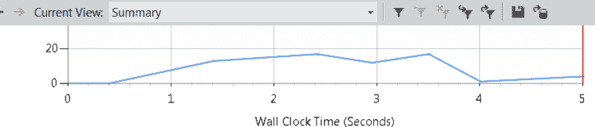

## 热路径

基于样本计数的开销最大的调用路径

| 函数名称 | 包含性样本 % | 独占样本 % |
| --- | --- | --- |
| `JackCompiler.Parser.ParseStatements()` | 75.95 | 0.38 |
| `JackCompiler.Parser.ParseStatement()` | 75.19 | 0.00 |
| `JackCompiler.Parser.ParseDoStatement()` | 27.10 | 0.00 |
| `JackCompiler.Parser.ParseLetStatement()` | 25.95 | 0.00 |
| `JackCompiler.Parser.ParseSelfStatement()` | 13.36 | 0.00 |

相关视图：调用树函数

## 执行大量独立工作最多的函数

获取独占样本最多的函数

| 名称 | 独占样本 % |
| --- | --- |
| `System.String.Concat(string,string,string)` | 24.81 |
| `System.Linq.Enumerable.Contains(class System.Collections.Generic.IEnumerator<1>,Il...)` | 11.07 |
| `System.IO.TextWriter.WriteLine(string,object)` | 8.02 |
| `System.Linq.Enumerable.Contains(class System.Collections.Generic.IEnumerator<1>,Il...)` | 6.49 |
| `_PreStubWorker@` | 4.96 |

**图 2-12.** 分析器报告，摘要视图——负责大部分样本的调用路径以及具有最多独占样本的函数

## 第 2 章 性能测量

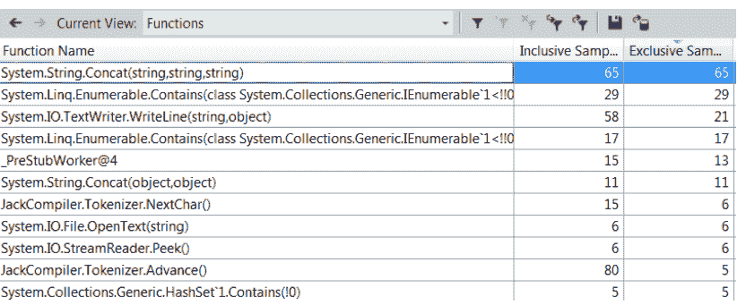

| 函数名称 | 包含性样本... | 独占样本... |
| --- | --- | --- |
| `System.String.Concat(string,string,string)` | 65 | 65 |
| `System.Linq.Enumerable.Contains(class.Collections.Generic.IEnumerator<1<I1O)` | 29 | 29 |
| `System.IO.TextWriter.WriteLine(line,object)` | 58 | 21 |
| `System.Linq.Enumerable.Contains(class.Collections.Generic.IEnumerator<1<I1O)` | 17 | 17 |
| `.PreStubWorker@4` | 15 | 13 |
| `System.String.Concat(object,object)` | 11 | 11 |
| `JackCompiler.Tokenizer.NextChar(()` | 15 | 6 |
| `System.IO.File.OpenText(string)` | 6 | 6 |
| `System.IO.StreamReader.Peek()` | 6 | 6 |
| `JackCompiler.Tokenizer.Advance(()` | 80 | 5 |
| `System.Collections.Generic.HashSet`1.Contains(10)` | 5 | 5 |

**图 2-13.** 函数视图，显示了具有最多独占样本的函数。`System.String.Concat` 函数负责的样本量是任何其他函数的两倍。

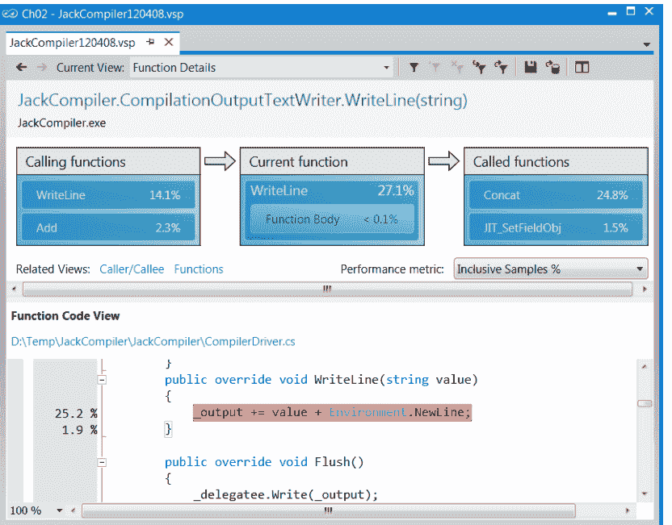

| 调用函数 | 被调用函数 | 包含 % | 独占 % |
| --- | --- | --- | --- |
| `WriteLine` | `Concat` | 27% | 24% |
| `Add` | `Body` | 14% | 1.5% |

**图 2-14.** 详细视图，显示应用程序源代码以及收集样本最多的行。注意，采样并不是测量 CPU 利用率的准确技术。有几个因素会导致采样的不准确性：CPU 速率每秒变化数百次，如果方法在采样时未运行则可能被“漏掉”（表示不足）；如果它正在运行，则会被过度表示。总结，不要将采样分析器的结果视为时间的精确表示，而应是一个概览。

`Visual Studio` 分析器为每个方法提供了更多独占/包含信息。调用树显示类的层次结构，行视图显示行级采样信息，模块视图按程序集分组，这可以快速对查找方向得出结论。由于所有采样间隔都需要触发它们的线程在 CPU 上执行，因此无法从等待 I/O 或同步的应用程序中获取样本。对于 CPU 密集型应用程序，采样是理想的。

## Visual Studio 实例化分析器

`Visual Studio` 分析器提供了另一种工作模式——实例化分析器，它为测量整体执行时间而定制，而不仅仅是 CPU 时间。这适用于 I/O 密集型应用程序或大量执行同步操作应用程序。在实例化模式下，分析器会修改目标二进制文件并在其中嵌入代码，以返回每个方法的精确时间和调用计数。

例如，考虑以下方法：

```csharp
public static int InstrumentedMethod(int param) {
  List<int> evens = new List<int>();
  for (int i = 0; i<param; ++i++) {
    if (i % 2 == 0) {
      evens.Add(i);
    }
  }
  return evens.Count;
}
```

在实例化期间，`Visual Studio` 分析器会修改此方法。记住，你的源代码没有被修改，但你可以使用 II 反汇编器（如 `.NET Reflector`）检查二进制文件。（为了方便起，我们对代码进行了微调）。

```csharp
public static int mmid = (int)
Microsoft.VisualStudio.Instrumentation.g_fldMMID_2D71B909-C28E-4fd9-A0E7-ED05264B707A;
```

```csharp
public static int InstrumentedMethod(int param) {
  _CAP_Enter_Function_Managed(mmid, 0x0000000, o);
}
```

## 第 2 章 性能测量

```csharp
_CapStartProfiling_Managed(mmid, 0x60000b, 0x000018);
_CapStopProfiling_Managed(mmid, 0x60000b, 0);
List<int> evens=new List<int>();for (int i=0; i<param; i++) {
  if (i % 2 == 0) {
    _CapStartProfiling_Managed(mmid, 0x60000b, 0x000019);
    evens.Add(i);
    _CapStopProfiling_Managed(mmid, 0x60000b, 0);
  }
}
_CapStartProfiling_Managed(mmid, 0x60000b, 0x00001a);
_CapStopProfiling_Managed(mmid, 0x60000b, 0);
count=evens.Count;
_Cap_Exit_Function_Managed(mmid, 0x60000b, 0);
return count;
```

以 C# 开头的方法调用是与 `VSPerf10.dll` 模块的交互，该模块由插桩的程序集引用。它们负责测量时间和记录方法调用。由于插桩（Instrumentation）会捕获被插桩代码的每一个方法调用并记录方法的进入和退出位置，因此插桩运行结束时的可用信息是可以验证的。

当在 2-12、2-13 和 2-14 中显示应用程序处于插桩模式（你可以跟踪所有——JCompiler 应用程序），分析器会生成一个摘要，其中包含一些信息——应用程序中最昂贵的路径以及独立工作量最大的函数。然而，此时间不是基于计数（计数仅测量 CPU 上的执行），而是基于插桩代码记录的精确计时。

2-15 显示了函数（Functions）视图，其中包含以毫秒为单位测量的包含时间（inclusive times）和排除时间（exclusive），以及函数被调用的次数。

| 函数名称 (Function Name) | 包含执行时间 (Elapsed Incl) | 排除执行时间 (Elapsed Exclus) | 调用次数 (Number of Calls) |
| :--- | :--- | :--- | :--- |
| `JCompiler.Tokenizer.NextChar` | 4,163.71 | 2,246.36 | 951,000 |
| `JCompiler.Tokenizer..ctor(valuetype JCompiler.TokenType;string)` | 2,561.65 | 1,557.73 | 463,000 |
| `JCompiler.Tokenizer.Advance()` | 9,195.09 | 1,070.54 | 293,000 |
| `JCompiler.Parser.Match(class JCompiler.Token)` | 7,751.63 | 749.13 | 171,000 |
| `JCompiler.Eat(class System.List<'char>')` | 2,445.82 | 716.53 | 144,000 |
| `System.Object.ToString()` | 627.72 | 627.72 | 483,000 |
| `System.String.Of(string)` | 580.68 | 580.68 | 1,116,000 |
| `System.String.Get(int32)` | 481.38 | 481.38 | 951,000 |
| `JCompiler.Parser.ParseStatements()` | 9,734.91 | 457.06 | 6,000 |
| `System.Predicate.Invoke(0)` | 501.06 | 434.25 | 525,000 |
| `JCompiler.Tokenizer.get_IsAtEnd()` | 418.59 | 404.36 | 293,000 |
| `System.Environment.get_NewLine(string)` | 391.10 | 391.10 | 951,000 |
| `System.String.Concat(string,string)` | 383.15 | 383.15 | 1,091,000 |
| `System.String.ctor(char[])` | 342.48 | 342.48 | 463,000 |
| `JCompiler.Parser.NextToken()` | 2,586.89 | 329.52 | 121,000 |

图 2-15. 函数视图：`String.String.Concat` 看起来不再是瓶颈了，因为我们的注意力转向了 `JCompiler.Tokenizer.NextChar` 和 `JCompiler.Token..ctor`。第一个方法被调用了近百万次。

提示：用于生成图 2-12 和图 2-15 的示例应用程序并非完全受 CPU 限制；事实上，它的大部分时间花在了等待 I/O 操作完成。这解释了采样结果与插桩结果之间的差异——采样指向 `System.String.Concat` 是 CPU 头部，而插桩结果则指向 `JCompiler.Tokenizer.NextChar` 是整体性能瓶颈。

尽管插桩看起来是更准确的方法，但在实践中，如果你的应用程序的大部分代码是 CPU 密集型的，你应该尝试保持采样。插桩限制了灵活性，因为它会捕获每个方法调用。

## 第 2 章 性能测量

某些性能分析工具提供了远程分析模式，这允许主性能分析器 UI 运行在一台机器上，而性能分析会话在另一台机器上进行，无需手动复制性能报告。例如，JetBrains `dotTrace` 性能分析器通过运行在机器上的远程代理程序支持这种操作模式，该程序与主性能分析器 UI 通信。这是在生产环境机器上安装整个性能分析工具的一种良好替代方案。


在第 6 章中，我们将利用 GPU 进行超并行计算，从而带来显著的加速（超过 100 倍！）。除非性能问题出现在运行在 GPU 上的代码中，否则标准的性能分析工具是毫无用处的。有一些工具可以分析和诊断 GPU 代码中的性能问题，包括 `Visual Studio 2012`。该主题超出本章的范围，但如果你在使用 GPU 进行图形渲染或纯计算，你应该研究适用于你的 GPU 编程框架的工具（如 `C++ API`、`CUDA` 或 `OpenCL`）。

在本节中，我们已经详细查看了如何分析应用程序的执行时间（整体或仅限 CPU）。内存管理是托管应用程序性能的另一个重要方面。通过接下来的两个章节，我们将讨论分配器和内存性能分析器，它们可以精确定应用程序中与内存相关的性能瓶颈。

## 分配性能分析器

分配性能分析器检测应用程序执行的内存分配，并可以报告哪些方法分配了最多内存、哪些类型由方法分配，以及类似的内存相关统计。内存密集型应用程序可能会垃圾回收器上花费大量时间，以回收之前分配的内存。正如我们在第 4 章中看到的，`CLR` 分配内存既容易又昂贵，回收内存的代价可能非常高。因此，分配内存的小方法组可能不会消耗大量的 CPU 时间来运行——在时间性能分析器的报告中几乎不可见——但它们会通过触发垃圾收集和应用程序执行中的不确定性而导致运行变慢。我们见过某些对内存分配非常谨慎的生产应用程序，它们通过改进分配和内存管理，提升了性能——有时提升幅度高达 10 倍。

我们将使用两个工具来分析内存分配：无处不在的 `Visual Studio` 性能分析器（它提供分配分析模式）以及免费的独立工具 `CLR Profiler`。遗憾的是，这两个工具都会对内存密集型应用程序产生显著的性能损耗，因为每次内存分配都必须通过性能分析器进行记录。尽管如此，结果可能是非常有价值的，以至于 100 倍的变慢也值得等待。

## Visual Studio 分配性能分析器

`Visual Studio` 性能分析器可以在采样和插桩模式收集分配信息和对象生命周期数据（哪些对象被垃圾回收器回收）。使用采样时，性能分析器从整个进程收集分配数据；使用插桩时，性能分析器仅从已插桩模块收集数据。

你可以通过在本文章源码的 `JackCompiler.exe` 示例应用程序上运行 `Visual Studio` 性能分析器来练习。确保在 `Visual Studio` 性能向导中选择“`NET memory allocation`”。分析结束时，摘要（Summary）视图会显示分配内存的函数以及分配内存最多的类型（见图 2-16）。报告中的函数（Functions）视图提供了每个方法分配的对象数量和字节数（包括包含和排除指标），此外，函数详细（Function Details）视图可以提供调用者和被调用者信息，并以带有页边距分配信息的颜色高亮源代码形式显示（见图 2-17）。更多信息在分配（Allocation）视图中，它显示了哪些调用树负责分配特定类型（见图 2-18）。

### 分配内存最多的函数

排除分配字节数最高的函数

| 名称 | 字节数百分比 |
| --- | --- |
| `System.String.Concat(string,string,string)` | 89.04 |
| `System.String.CharToCharCount(char,int32)` | 1.66 |
| `System.IO.TextWriter.WriteLine(string,object)` | 1.43 |
| `System.String.Concat(object,object)` | 1.41 |
| `JackCompiler.Tokenizer` | 1.03 |

### 分配内存最多的类型

总字节数最多的类型

| 名称 | 字节数百分比 |
| --- | --- |
| `System.String` | 95.53 |
| `System.Char[]` | 1.47 |
| `JackCompiler.Token` | 0.65 |
| `System.String[]` | 0.48 |
| `System.Byte[]` | 0.45 |

> **图 2-16.** 摘要视图


> **图 2-17.** `JackCompiler.Tokenizer` 的函数详细视图，显示页边距带有分配信息的源码


> **图 2-18.** 分配视图，显示分配 `System.String` 对象的调用树


## CLR Profiler

`CLR Profiler` 是一个独立的性能分析工具，不需要安装，占用小于 1MB 的磁盘空间。你可以从 `http://www.microsoft.com/download/en/details.aspx?id=16273` 下载它。作为额外，它附带了完整的文档，如果你正在使用 `CLR Profiling API` 开发工具，阅读这些文档非常有帮助。它可以附加到运行的进程中（针对 `CLR 4.0`）或启动可执行文件，并记录所有的内存分配和收集事件

虽然 `CLR Profiler` 极其简单——运行性能分析器，点击启动应用程序，然后等待报告出现——但信息的丰富程度可能会让人无从从。我们将介绍一些报告；完整的 `CLRProfiler guide` 文档是下载包的一部分。一如既往，你可以通过我们的 `JackProfiler` 示例来练习 `CLR Profiler`。

图 2-20 显示了性能分析程序终止后生成的主视图。它包含了内存分配和垃圾收集的统计数据。


> **图 2-20.** `CLR Profiler` 的主报告视图，显示分配和垃圾收集统计

## 第 2 章 性能测量

图 2-20 中“分配字节”（Allocated bytes）和“最终堆内存字节”（Final heap bytes）旁边的直方图会生成一个按大小分组到桶（bins）的对象图表。这些直方图可以用于识别大和小对象，以及哪些类型的对象分配最频繁。图 2-21 显示了我们的示例应用程序在运行期间分配的所有对象的直方图。

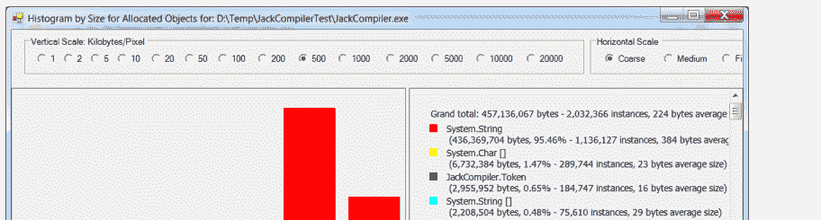

图 2-21。性能分析部分分配的所有对象。每个桶代表特定大小的对象。左侧的图例包含每个类型分配的字节总数和实例数。

图 2-20 中的分配图（Allocation Graph）打开了一个视图，以分组图的形式显示所有对象的分配调用，这使得易于从分配内存的方法导航到分配其实例的方法。图 2-22 显示了分配图的一小部分，从 `Parser.ParseStatement` 方法开始，该方法分配了（包含在内）372MB 的内存，并显示了调用它的方法。（此外，`CLR Profiler` 的其他视图都有“显示谁分配的”（Show who's allocated）右键菜单项，它可以打开应用程序部分集对象的分配图。）

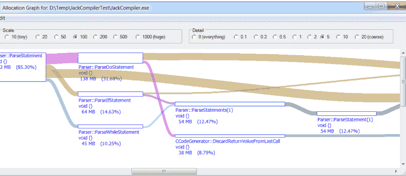

**图 2-22。** 被分析应用的分配图。这里只显示了方法；实际分配的类型位于图的最右侧。

图 2-20 中的**按年龄直方图（Histogram by Age）**显示了一个根据年龄将最终堆中的对象分组到各个桶中的图表。这能够快速识别长存对象和临时对象，这对于检测“中年危机”（mid-life crisis）情况非常重要。（我们将在第 4 章中详细讨论这些）。

图 2-20 中的**按地址对象（Objects by Address）**按钮分层可视化了最终托管堆内存区域；最低的层是最老的（参见图 2-23）。就像考古探一样，你可以挖掘这些层并查看哪些对象构成了应用程序的内存。此视图也有助于诊断堆的内部碎片（例如由于固定/pinning ）——我们将在第 4 章中详细讨论此。

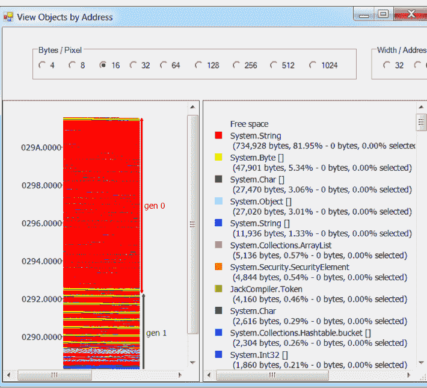

图 2-23。应用程序堆的视觉视图。左轴上的标签是地址；“gen 0”和“gen 1”标记是堆的子部分，将在第 4 章中讨论。

最后，图 2-20 中垃圾回收统计（Garbage Collection Statistics）部分中的“时间线”（Time Line）按钮会进入单个垃圾回收及其对应用程序堆影响的可视化界面（参见图 2-24）。此视图可识别哪些类型的对象正在被回收，以及堆在垃圾回收发生时是如何变化的。它对于识别内存泄漏也有帮助，在内存泄漏中，由于应用程序持有越来越多的对象，垃圾回收无法回收足够的内存。

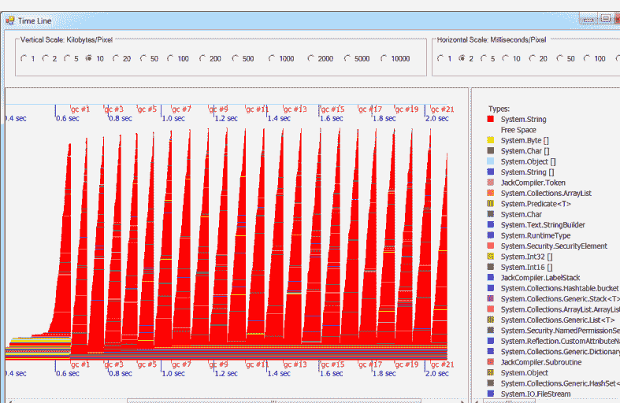

**图 2-24。** 应用程序垃圾回收的时间线。底轴上的刻度代表单独的 GC 运行，区域代表托管堆。随着垃圾回收的发生，内存使用大幅下降，然后急剧上升直到下一次收集发生。总体而言，内存使用（GC 后）是恒定的，因此此应用程序没有表现内存泄漏。

分配图和直方图非常有用，但有时识别对象之间的引用而不是方法的调用堆栈同样重要。例如，当应用程序出现托管内存泄漏时，爬取其堆、检测最大的对象并确定是什么引用阻止了 GC 回收这些对象是非常有用的。当被分析的应用程序运行时，点击“现在显示堆”（Show Heap now）会生成一个堆转储，可以对其进行检查以分类对象之间的引用。

图 2-25 显示了被分析应用程序是如何运行的，点击“现在显示堆”会生成一个堆转储，可以对其进行检查以分类对象之间的引用。

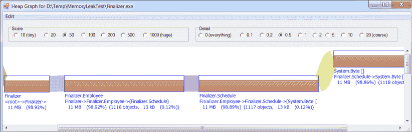

**图 2-25。** 性能分析部分分配的所有对象。每个桶代表特定大小的对象。左侧的图例包含每个类型分配的字节总数和实例数。

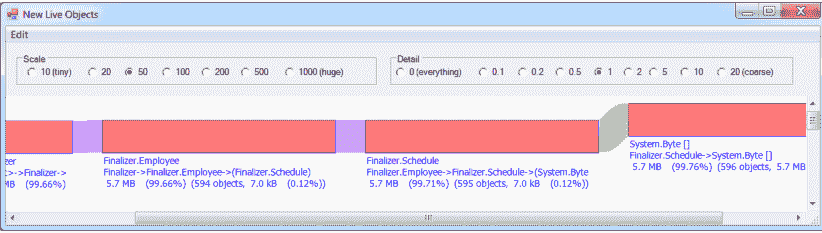

**图 2-22。** 被分析应用的分配图。这里只显示了方法；实际分配的类型位于图的最右侧。

## 内存分析器

在本节中，我们将讨论两种专门用于可视化泄漏的商业性能分析器。由于这些工具非常复杂，我们只检查一小部分功能。

## ANTS Profiler

`RedGate` 的 `ANTS Profiler` 专门用于快照分析。下面详细介绍了使用 `ANTS Profiler` 的过程。如果你想遵循这些步骤，请从 `http://www.redgate.com/products/dotnet-development/ants-memory-profiler/` 下载 `ANTS Profiler` 的免费14 天试用版，并使用本章源代码中的 `FileExplorer.exe` 应用程序遵循此演示。在下方的说明和截图，我们使用了 `ANTS Profiler 7.3`，这是编写时的最新版本。

- 从分析器内部运行应用程序（类似于 `CLR Profiler`，`ANTS` 支持挂载到运行中的进程）。

- 使用“拍摄内存快照”（Take Memory Snapshot）在应用程序完成初始化后捕获初始快照。该快照是后续性能调查的基准。

- 随着内存泄漏的积累，拍摄额外的快照。

- 应用程序终止后，比较快照（基准快照与中间快照之间的比较），以理解哪些类型的对象在内存中增长。

- 使用“实例分类器”（Instance Categorizer）关注特定类型，以理解是哪种引用保留了可疑的对象。（在此阶段，你正在检查类型之间的引用——类型 A 的实例将被分组，就好像 A 引用了 B 一样。）

- 使用“实例列表”（Instance List）探索可疑类型的单个实例。识别几个具有代表性的实例并使用“实例留存图”（Instance Retention Graph）确定它们为何被保留在内存中。（在此阶段，你正在检查单个对象之间的引用，并可以看到为什么特定对象没有被 GC 回收。）

- 回到应用程序源代码并修改它，使泄漏对象不再被问题链引用。

# 第2章 性能测量


图 2-27。两个堆栈快照之间的比较。它们之间的总差异为 +6.23MB，内存中当前持有最大的类型是 `System.String`。

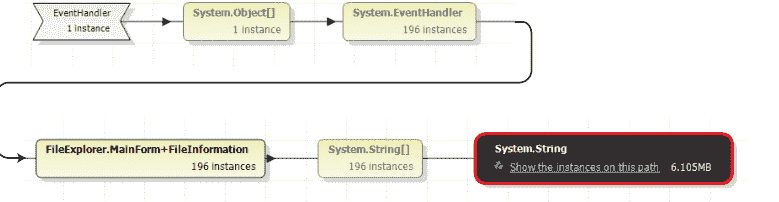

图 2-28。字符串被字符串数组保留，字符串数组又被 `FileInformation` 实例保留，而这些实例反过来被一个事件（通过 `System.EventHandler` 委托）保留。

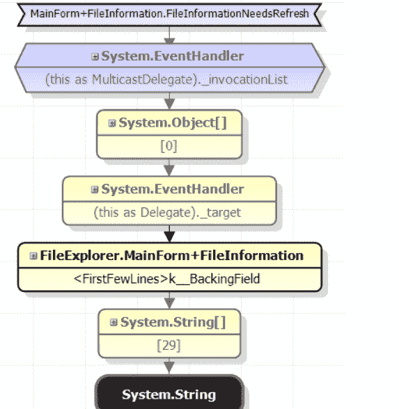

**图 2-29。** 我们选择检查的单个字符串是字符串数组中的第 29 个元素，它由 `FileInformation` 对象的 `<FirstFewLines>k_BackingField` 持有。遵循引用点指向 `FileInformation.FileNeedsRefresh` 静态元素。

### SciTech .NET 内存分析器

`SciTech .NET Memory Profiler` 是另一种专注于内存泄漏诊断的商业工具。虽然其通用分析流程与 `ANTS Memory Profiler` 非常相似，但此分析器可以打开转储文件，这意味着你不需要在应用程序内部运行，并且可以分析 `CLR` 内存耗尽时生成的崩溃。这对于在生产环境中问题发生后进行内存泄漏的事诊断至关重要。你可以从 `http://memprofiler.com/download.aspx` 下载 10 天评估版。在下方的说明和截图中，我们使用了 `.NET Memory Profiler 4.0`，这是编写时的最新版本。

注意 `CLR Profiler` 无法直接打开转储文件，但有一个名为 `!!traverseHeap` 的 `SOS.DLL` 命令可以生成 `CLR Profiler` 格式的 `.log` 文件。我们将在第 3 和第 4 章中讨论更多 `SOS.DLL` 命令。同时，`Sasha Goldstein` 的博客文章 `http://blog.sashag.net/archive/2008/04/08/nextgeneration-production-debugging-demo-2-and-demo-3.aspx` 提供了一个如何结合使用 `SOS.DLL` 和 `CLR Profiler` 的示例。

要在 `.NET Memory Profiler` 中打开内存转储，选择 `File ➤ Import dump` 菜单项并指向转储文件。如果你有多个转储文件，可以将它们全部导入到分析会话中并作为快照进行比较。导入过程可能非常缓慢，特别是当涉及大堆时；为了更快的分析，`SciTech` 还提供了一个独立的工具 `NmpCore.exe`，可以使用它在生产环境中捕获堆，而不是依赖转储文件。

图 2-30 显示了在 `.NET Memory Profiler` 中比较两个内存转储的结果。它直接通过事件处理程序立即在内存中发现了可疑的对象，并将分析方向指向了 `FileInformation` 对象。

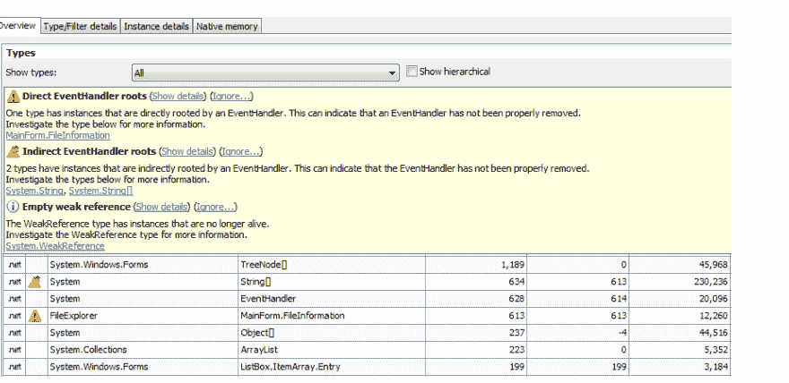

**图 2-30。** 两个内存快照的初始分析。第一列列出了存活实例的数量，而第三列列出了它们占据的对象数量。主要的内存大户——字符串对象——由于工具提示的存在而不可见。

关注 `FileInformation` 对象说明了从 `FileInformationNeedsRefresh` 事件处理程序到所选 `FileInformation` 实例存在一条单一的根路径（见图 2-31），且对单个实例的可视化确认了我们之前在 `ANTS Memory Profiler` 中看到的相同引用链。

# 第2章 性能测量

概述 类型详情 - MainForm.FileInformation 类型详情 - #135,730 (Main.FileInformation) 原生内存

| 类型 | FileExplorer.MainForm |
| :--- | :--- |
| 存活实例: 613 | 持有字节: 12,260 |
| 事件 直接处理程序 | |
| 实例 | 被引用（按计数） | 持有字节 |
| :--- | :--- | :--- |
| #122,057 | 1 | 20 |
| #122,061 | 1 | 31,884 |
| #135,299 | 1 | 32,588 |
| #135,626 | 1 | 35,500 |
| #135,720 | 1 | 34,190 |
| #135,833 | 1 | 37,952 |
| #135,937 | 1 | 29,316 |
| #136,142 | 1 | 40,524 |
| #136,245 | 1 | 24,328 |
| #136,347 | 1 | 67,520 |
| #136,617 | 1 | 64,672 |
| #136,720 | 1 | 12,268 |
| #136,823 | 1 | 38,568 |
| #136,927 | 1 | 240 |

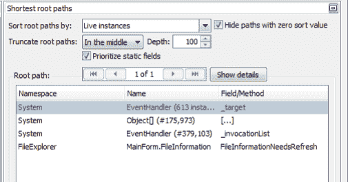

**图 2-31。** 两个内存快照的初始分析。第一列列出了存活实例的数量，而第三列列出了它们占据的对象数量。主要的内存大户——字符串对象——由于工具提示的存在而不可见。

### 其他分析器

### 数据库和数据访问分析器

许多应用程序大部分时间花在等待数据库访问。数据访问可以在两个位置进行分析：应用程序端和数据库端。

### 并发分析器

并行编程的兴起使得对那些在多个处理器上运行多个线程的高并发软件使用专用分析器变得非常必要。第 6 章将探讨几种可以轻松从并行化中获得性能收益的场景——而这些性能收益通过准确的测量工具可以更好地实现。

# 第 2 章 性能测量

## 资源 "Handle 1" 的竞争

资源竞争详情


| 线程 | ...lateThreadProc(Void*) [4532] | ...lateThreadProc(Void*) [8568] | ...lateThreadProc(Void*) [7908] | ...lateThreadProc(Void*) [2244] | ...lateThreadProc(Void*) [5396] | ...lateThreadProc(Void*) [3040] |

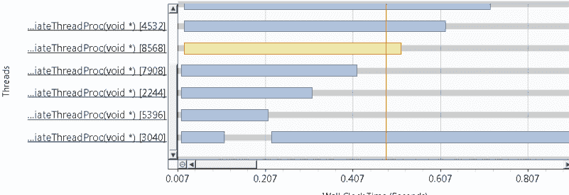

## 竞争调用栈

| 函数名称 |

| `System.Threading.Monitor.Enter(object,bool)` |

| `CODE.Program.<c_DisplayClass4.<Main>b_1(object)` |

**图 2-32.** 特定特定资源的竞争——有多个线程同时等待获取该资源。当选中一个线程时，其阻塞调用栈将列在底部。

并发可视化工具（Concurrency Visualizer，或多线程执行可视化）显示一个包含所有应用程序线程执行细节的图形，并根据其当前状态进行颜色编码。每个线程状态转换——阻塞等待 I/O、等待同步机制、运行——都会被记录，并附带其调用栈以及在适用时的解阻塞调用栈（见图 2-33）。这些报告对于理解应用程序线程的作用，以及检测糟糕的性能模式（如过度订阅、订阅不足、饥饿和过度同步）非常有帮助。图表中还内置对任务并行库（Task Parallel Library）机制（如并行循环）和 CLR 同步机制的支持。要在此运行模式下启动分析器，请使用“分析 (Analyze) ➤ 并发可视化器”子菜单。


**图 2-33.** 多个应用程序线程（列在左侧）及其执行情况可视化。从可视化和底部的直方图可以看出，工作没有在不同线程之间均匀分布。

> 注意：MSDN 提供了一组基于并发可视化工具图表的多线程应用程序反模式，包括锁争队（lock convoy）、分布不均、过度订阅等——你可以在网上 `http://msdn.microsoft.com/en-us/library/ee329530.aspx` 找到这些反模式。当你运行自己的测量时，通过比较报告将更容易识别类似的问题。

并发性能剖析和可视化是非常有用的工具，我们将在随后的章节中遇到它们。它们是 ETW 巨大影响力的另一个有力证据——这个无处不在的高性能监控框架被许多原生分析工具所使用。

## I/O 分析器

我们在本章研究的最后一类性能指标是 I/O 操作。ETW 事件可用于获取物理磁盘访问、页错误、网络流量和其他类型 I/O 的计数和细节，但我们还没有看到任何专门针对 I/O 操作的工具。

Sysinternals Process Monitor 是一个免费工具，用于收集文件系统、注册表和网络活动（见图 2-34）。你可以从 TechNet 网站 `http://technet.microsoft.com/en-us/sysinternals/bb896645` 下载整个 Sysinternals 工具包，或最新版本的 Process Monitor。

凭借丰富的过滤功能，系统管理员和性能调查人员使用 Process Monitor 来诊断 I/O 相关的错误（如缺少文件或权限不足）以及性能问题（如远程文件系统访问或过度分页）。

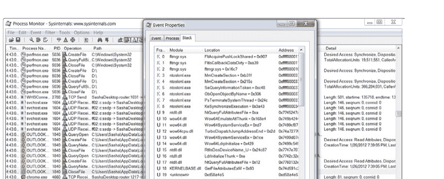

图 2-34. Process Monitor 在主视图中显示了若干类型的帧，以及特定事件的调用栈。Process Monitor 提供了用户态和内核态的调用栈。通过本章的课程，我们讨论了 I/O 操作。

并发性能剖析和可视化是非常有用的工具，我们将在随后的章节中遇到它们。它们是 ETW 巨大影响力的另一个有力证据——这个无处不在的高性能监控框架被许多原生分析工具所使用。

## 微基准测试

某些性能问题可以通过手动测量来解决。微基准测试仍然非常流行。如果你这样做，我们需要确保方法正确。

### 糟糕的微基准测试示例

我们从一个设计糟糕的微基准测试开始：

```cs
// 测试类
class Employee {
    public void Work() {}
}
// 片段 1 - 强制转换
static void Fragment1(object obj) {
    Employee emp = (Employee)obj;
    if (emp != null) emp.Work();
}
// 片段 2 - 先检查类型后转换
static void Fragment2(object obj) {
    if (obj is Employee) {
        Employee emp = (Employee)obj;
        emp.Work();
    }
}
// 一个粗略的基准测试框架可能是：
static void Main() {
    const int OUTER_ITERATIONS = 10;
    const int INNER_ITERATIONS = 10000000;
    // 外循环重复多次以获得结果
    for (int i = 0; i < OUTER_ITERATIONS; i++) {
        Stopwatch sw = Stopwatch.Start();
        // 内循环重复多次以确保我们正在测量
        // 有显著持续时间
        for (int j = 0; j < INNER_ITERATIONS; j++) {
            Employee emp = obj as Employee;
            if (emp != null) emp.Work();
        }
        Console.WriteLine("As {0}ms", sw.ElapsedMilliseconds);
    }
    for (int i = 0; i < OUTER_ITERATIONS; i++) {
        Stopwatch sw = Stopwatch.Start();
        for (int j = 0; j < INNER_ITERATIONS; j++) {
            if (obj is Employee) {
                Employee emp = (Employee)obj;
                emp.Work();
            }
        }
        Console.WriteLine("Is Then As {0}ms", sw.ElapsedMilliseconds);
    }
}
```

在其中一台测试机器上的结果（在第一次迭代之后）是第一个循环约为 410ms，第二个循环约为 440ms，这是一个可靠且可重复的性能差异，这可能让你确信，使用 `as` 关键字进行检查和转换更高效。

然而，谜团还没有结束。如果我们在方法上添加虚修饰符，性能差异将完全消失，即使我们增加了迭代次数。这无法通过我们的微基准测试框架的优点或缺点来解释——它是来自问题领域的结果。如果不进入汇编语言级别并检查循环，无法理解这种行为。

```assembly
; 反汇编循环 – 第一个循环\ 首先，在虚修饰符之前:
mov edx,ebx
mov ecx,163780h (MT: Employee)
call cl!JIT_IsInstanceOfClass
```

## 第 2 章 性能测量

```assembly
test eax,eax
je WRONG_TYPE
mov eax,eax
call dword ptr ds:[163774h] (Employee.Work(), mdToken: 06000001)
WRONG_TYPE:
```

```assembly
; 反汇编循环体 - 第二个循环
mov eax,ebx
mov eax,163780h (MT: Employee)
call clr!JIT_InstanceOfClass (705ecfaa)
test eax,eax
je WRONG_TYPE
mov eax,eb
```

在第 3 章中，我们将深入讨论 JIT 编译器在调用非虚拟方法和虚拟方法时所发射的指令序列。在调用非虚拟方法时，JIT 编译器必须发射一条指令，以确保我们没有对空引用进行调用。第二个循环中的 `CMP` 指令就起到了这个作用。在第一个循环中，JIT 编译器足够智能，可以优化掉这个检查；在调用之前，会对调用的结果进行空引用检查（`if (emp !=null)`）。在第二个循环中，JIT 编译器的启发式算法不足以优化掉这个检查（尽管这是安全的），这条额外的指令导致了 7-8% 的性能开销。

然而，在添加虚拟修饰符后，JIT 编译器在两个循环体中生成了相同的代码。

```assembly
; 反汇编循环体 - 两种情况
mov eax,ebx
mov eax,1A3794h (MT: Employee)
call clr!JIT_InstanceOfClass (6b2acfaa)
test eax,eax
je WRONG_TYPE
mov eax,eax
mov eax,dword ptr [ecx]
mov eax,dword ptr [eax+28h]
call dword ptr [eax+10h]
WRONG_TYPE:
```

这是因为在调用虚拟方法时，不需要执行空引用检查——该检查包含在方法分发序列中（我们将在第 3 章中看到的）。当循环体相同时，计时结果也是相同的。

## 微基准测试指南

为了获得成功的微基准测试，你必须确保决定测量的内容符合以下要求：

- 你的 `test.code` 应对其所开发的真实环境具有代表性。例如，如果一个方法设计用于在数据库表上操作，那么你不应该在内存数据集合上运行它。
- 你的测试代码的输入应对其所开发的真实输入具有代表性。例如，如果一个排序方法设计用于处理数百万个元素，那么你不应该测量它在只有三个元素的列表上的失败情况。
- 用于设置环境的辅助代码与你实际测量的代码相比，其影响应该是忽略不计的。如果这是可能的，那么设置应该发生一次，并多次重复测试代码。
- 测试代码的运行时间应该足够长，以便在面对硬件和软件波动时具有可考虑性且可靠的。例如，如果你正在测试值类型装箱（boxing）操作的开销，单次装箱操作可能太快而无法产生显著结果，需要多次重复相同的测试才能变得有意义。
- 测试代码不应被语言编译器或 JIT 编译器优化。这在 Release 模式下尝试测量简单操作时会发生这种情况（我们稍后会回到这一点）。

当你确定测试代码足够健壮，并且测量到了你想要测量的精确效果后，你应该花一些时间来搭建基准测试环境：

- 当基准测试运行时，目标系统不应允许运行其他进程。网络、文件 I/O 以及其他类型的外部活动应减少到最低（例如，通过禁用网卡和关闭不需要的服务）。
- 分配许多对象的基准测试应该警惕垃圾收集的影响。建议在基准测试前后强制进行垃圾收集。
- 在测量性能测试销时，应关注测量对的的影响。。，，，是是是是是可以执行的。

# 第3 章

## 类型内部机制

本章涉及 .NET 类型的内部机制、值类型和引用类型在内存中的布局方式、JIT 调用虚方法时必须执行的操作、正确实现值类型的复杂性以及其他细节。我们是否值得花几十页的内容来讨论这些内部原理呢？这些内部细节如何影响我们应用程序的性能？事实证明，值类型和引用类型在布局、分配、相等性、赋值、存储以及许多其他参数方面存在差异——这使得类型选择对应用程序性能至关重要。

## 示例

考虑一个名为 `Point2D` 的简单类型，它表示小型二维空间中的一个点。两个坐标中的每一个都可以用一个 `short` 表示，整个对象总共四个字节。假设你想在内存中存储一个包含十个 `Point2D` 的数组。这需要多少空间？这个问题的答案取决于 `Point2D` 是引用类型还是值类型。如果是引用类型，一个包含一千万个点的数组将存储一千万个引用。在 32 位系统上，这一千万个引用消耗大约 40 MB 的内存。对象本身至少消耗相同数量的内存。事实上，正如我们很快将讨论的那样，每个 `Point2D` 实例将至少占用 12 字节内存，导致十个点数组的总内存占用达到惊人的 160MB！另一方面，如果 `Point2D` 是值类型，一个包含十个点的数组将存储十个点——没有一个多余的浪费——总共 40MB，仅为引用类型方法的的四分之一（见图 3-1）。内存密度是某些特定设置下偏于值类型的关键原因。

存储点实例引用的还有另一个缺点。如果你顺序遍历这个巨大的点数组，那么对于编译器和硬件来说，访问连续的 `Point2D` 实例数组比访问指向堆对象的引用要容易得多，因为这些堆对象在内存中并不保证是连续的。正如我们在第 5 章中将看到的，CPU 缓存的考虑可能会对应用程序的执行时间产生高达一个数量级的影响。

不可避免地结论，理解 CLR 如何在内存中布局对象以及引用类型与值类型之间的区别，对于我们应用程序的性能至关重要。我们首先回顾语言层面值类型和引用类型之间的基本区别，然后深入内部实现细节。

# 第3 章 类型内部机制

Point2D 实例数组，其中 Point2D 是值类型

| 数组头部 | X | Y | X | Y | X | Y |

|---|---|---|---|---|---|---|

| | Point2D | Point2D | Point2D | | Point2D |

Point2D 实例数组，其中 Point2D 是引用类型

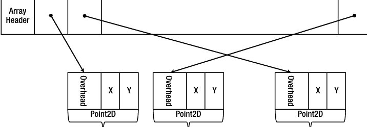

**图 3-1.** 当 Point2D 为引用类型与值类型时 Point2D 实例数组的对比

## 引用类型与值类型之间的语义差异

.NET 中的引用类型包括类（classes）、委托（delegates）、接口（interfaces）和数组（arrays）。`string` (System.String) 作为 .NET 中最常见的类型之一，也是引用类型。.NET 中的值类型包括结构（structs）和枚举（enums）。基本类型如 `int`、`float`、`decimal`都是值类型——.NET 开发者可以使用 `struct` 关键字定义额外的值类型。

在语言层面，引用类型享有引用语义（reference semantics），即在考虑其内容之前先考虑对象的身份；而值类型享有值语义（value semantics），即对象没有身份，不通过引用访问，并根据其内容进行处理。这影响了 .NET 语言的几个领域，如表 3-1 所示。

**表 3-1.** 值类型与引用类型的语义差异

| 则 | 引用类型 | 值类型 |

|---|---|---|

| 向方法传递对象 | 仅传递引用；更改会传播到所有其他引用 | 对象的内容被复制到参数中（除非使用 `ref` 或 `out` 关键字）；更改不会影响方法外部的任何代码 |

| 赋值给另一个变量 | 仅复制引用；两个变量现在引用同一个对象 | 复制内容；两个变量包含无关数据的相同副本 |

| 使用运算符 `==` 比较两个对象 | 比较的是引用；如果两个引用指向同一个对象，则两个引用相等 | 比较内容；如果两个对象的内容相同，则两个对象相等 |

这些语义差异是我们在任何 .NET 语言中编写代码的基础。然而，在引用类型和值类型如何不同方面，这些仅仅是冰山一角。首先，让我们考虑存储对象的内存位置，以及它们是如何分配和释放的。

## 存储、分配与释放

引用类型专门从托管堆（managed heap）分配，这是一个由 .NET 垃圾回收器管理的内存区域，我们将在第 4 章中详细讨论。从托管堆中分配对象涉及增加指针，这是一个相当廉廉的操作。在多处理器系统上，如果多个处理器访问同一个堆，由于需要同步，与非托管环境（如 `malloc`）中的分配器相比，分配开销仍然是昂贵的。

垃圾回收器以非确定的方式回收内存，并对齐操作不做出任何承诺。正如我们在第 4 章中看到的，完整的垃圾回收过程是昂贵的，但一个良好的应用程序的平均垃圾回收成本应该小于其对应程序。

准确地说，某些引用类型可以从栈（stack）分配。基本类型数组（如整数）可以使用 `stackalloc` 关键字从栈上分配，或者通过使用 `fixed` 关键字将固定大小的数组嵌入 `struct` 中（在第 8 章讨论）。然而，由 `stackalloc` 和 `fixed` 关键字创建的对象不是“真实”的，其布局与堆中的标准数组不同。值类型通常分配在执行线程的栈上。然而，值类型可以嵌入引用类型中，在这种情况下它们被分配在堆上并可以装箱（boxed），我们稍后会回到这一点。从栈上分配值类型是非常廉价的操作，涉及修改栈寄存器（x86 上的 `ESP`），并具有一次分配多个对象的额外优势。事实上，方法的序言（prologue）通常使用单个指令为其帧中的所有局部变量分配栈空间。回收栈内存也非常高效，只需要修改栈指针。由于方法编译为机器码的方式，编译器不需要跟踪方法局部变量的大小，可以使用一组称为函数尾部（function epilogue）的标准指令销毁整个帧。

下面是编译后的托管方法的典型序言和尾部（关于 JIT 优化的考虑见第 10 章）。

```
int Calculation(int a, int b)
{
    int x = a + b;
    int y = a - b;
    int z = a * b;
    int w = 2 * a;
    return x + y + z;
}
```

; 参数放在栈上 [esp+4] 和 [esp+8]

push ebp

mov ebp, esp

add esp, 16 ; 为局部变量分配存储

mov eax, dword ptr [ebp+8]

add eax, dword ptr [ebp+12]

add eax, dword ptr [ebp+16]

mov ptr [ebp-4], eax ; eax 包含返回值

; ...对 y, z, w 的类似操作

mov eax, dword ptr [ebp-4]


`add eax, dword ptr [ebp-8]`

`add eax, dword ptr [ebp-12]`

`add esp, 16` ; 恢复栈

`pop ebp` ; 恢复帧，释放栈空间

`ret 8` ; 释放两个参数

`new` 关键字在 C# 和其他托管语言中并不意味着堆分配。你可以使用 `new` 关键字在栈上分配值类型。例如，下行代码从栈上分配一个 `DateTime` 实例，初始化为跨年夜（`System.DateTime newYear = new DateTime(2011, 12, 31));`）。

## 栈和堆的区别是什么？

与流行观点相反，.NET 进程中的栈和堆之间并没有太大区别。栈和堆仅仅是虚拟内存中的地址范围，特定线程的栈的地址范围与托管堆的地址范围相比，没有内在优势。访问堆上的内存位置并不比访问栈上的内存位置快或慢。有某些因素在某些情况下支持“访问栈位置比访问堆位置更快”的说法：其中

- 在栈上，时间局部性（在时间上靠近分配）意味着空间局部性（在空间上靠近存储）。反之，当时间局部性意味着空间局部性（在一起分配的对象被在一起访问）时，顺序栈存储在 CPU 和操作系统模式下的性能更好。

- 栈的内存密度通常比堆高，因为存在引用类型开销（在本章稍后讨论）。更高的内存密度通常会导致更好的性能，例如更多对象可以放入 CPU 缓存。

- 线程栈通常很小——Windows 默认最大栈大小为 1MB，大多数线程只使用几个栈页。在现代系统中，所有应用程序线程的栈都可以放入 CPU 缓存，这使得典型的访问变得极快。（相比之下，整个堆很少放入 CPU 缓存）。

# 第 3 章 类型内部原理

在检查了值类型和引用类型的表面区别之后，现在是转向底层实现细节了，这些细节也解释了我们之前多次暗示的内存密度上的巨大差异。在开始之前有一个小的说明：下面描述的细节是 CLR 的内部实现细节，这些细节可能会在不通知的情况下随时更改。我们已尽力确保这些信息是最新的并与 .NET 4.5 发布保持同步，但无法保证它们在未来保持正确。

## 引用类型内部原理

我们从引用开始，它的内存布局相当复杂，并对其性能有显著影响。为了讨论，让我们考虑一个教科书级的 `Employee` 引用类型示例，它包含几个字段（实例和静态）以及几个方法：

```csharp
public class Employee {
    private int _id;
    private string _name;
    private static CompanyPolicy _policy;
    public virtual void Work() {
        Console.WriteLine("Zzz...");
    }
    public void TakeVacation(int days) {
        Console.WriteLine("Zzz...");
    }
    public static void SetCompanyPolicy(CompanyPolicy policy) {
        _policy = policy;
    }
}
```

现在考虑托管堆上的 `Employee` 引用类型实例。图 3-2 描述了该实例在 32 位 .NET 进程中的布局：

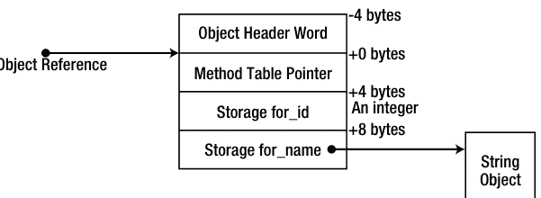

**图 3-2.** 托管堆上的 Employee 实例布局，包括引用类型开销

对象内部的 `_id` 和 `_name` 字段的顺序是不保证的（尽管可以控制，我们将在“值类型内部原理”中看到使用 `StructLayout` 属性来实现）。然而，对象的内存存储从一个四字节宽的字段——对象头（或同步块索引）开始，随后是另一个字节的字段——方法表指针（或对象指针）。这些字段无法从任何 .NET 语言直接访问——它们为 JIT 和 CLR 本身服务。对象引用（在内部仅仅是一个内存地址）指向方法表指针，因此对象头位于对象地址的负偏移处。

**注意** 在 32 位系统上，堆中的对象对最近的字节倍数对齐。这意味着一个只有一个字节成员的对象由于对齐原因，在堆中仍会占用 12 字节（事实上，即使是一个没有字段的类在实例化时也会占用 12 字节）。引入 64 位系统后会有几处不同。首先，方法表指针字段（指向它的指针）占用 8 字节内存，对象头也占用 8 字节。其次，堆中的对象对最近的字节倍数对齐。这意味着在 64 位堆中，一个只有一个字节成员的对象将占用 24 字节内存。这只是更强烈地证明了引用类型的内存开销，特别是在内部构建小对象时。

### 方法表

方法表指向一个名为方法表（MT）的内部 CLR 数据结构，该结构反又指向一个名为 `EEClass` 的内部结构（EE 代表执行引擎）。MT 和 EEClass 共同包含了分发虚方法、接口调用、访问静态变量、确定运行时对象的类型、访问基类型方法以及许多其他用途所需的信息。方法表包含频繁访问的信息，这些信息对于虚方法分发等反射机制的操作是必需的；而 EEClass 包含访问频率较低但仍被运行时机制（如反射）使用的信息。我们可以使用 `!DumpMT` 和 `!DumpClass` 命令以及 Router (SNCLI) 源码来了解这两个数据结构的内容，请记住我们讨论的是不同 CLR 版本之间可能显著差异的内部实现细节。

> Son of Strike 是调试器 DLL，有助于使用 Windows 调试器调试托管应用程序。它最常与 WinDbg 使用，也可以通过立即窗口（Immediate Window）加载到 Visual Studio 中。它的命令提供了对 CLR 内部的洞察，这就是为什么我们在本章中经常使用它。有关 SOS 的更多信息，请参考内联帮助（加载扩展后的帮助命令）和 MSDN 文档。关于结合调试应用程序 SOS 特性的优秀介绍，可见 Mario Hewitt 的书籍《Advanced .NET Debugging》（Addison-Wesley, 2009）。

静态字段的位置由 EEClass 决定。原始类型字段（如整数）存储在堆上动态分配的位置中，而值类型和引用类型则存储为指向堆位置的间接引用（通过一个整个 AppDomain 范围的对象）。要访问静态字段不需要查询方法表或 EEClass——JIT 编译器可以将静态字段的地址硬编码到生成的机器码中。指向静态字段的引用数组是被固定的（pinned），以便其地址在垃圾回收期间不会更改（在第 4 章中详细讨论），而原始类型字段位于方法表中，垃圾回收器不会触碰。这确保了可以使用硬编码地址来访问这些字段：

```assembly
public static void SetCompanyPolicy(CompanyPolicy policy)
_policy = policy;
mov ecx, dword ptr [ebp+8]    ;将参数传递给 ECX
mov dword ptr [0x5543320], ecx    ;将 ECX 复制到全局固定数组中的静态字段位置
```

方法表包含的最明显的内容是代码地址数组，对应该类型的每个方法，包括继承的方法。例如，图 3-3 显示了 Employee 类的方法表布局，假设它派自 `System.Object`：


**图 3-3.** Employee 类布局（部分视图）

我们可以使用方法表指针（可以通过 `!md` 命令获取）检查方法表。JIT 列可以取三个值之一：PreJIT，表示已编译；或 NONE，表示方法尚未编译。

在方法表中存储的代码是动态生成的——在第一次被调用时，JIT 编译器会编译它们，除非使用了 `n`（在第 10 章中讨论）。然而，方法表的用户可能不知道这一常见的技巧。当方法表首次创建时，它填充了预编译存根（stubs），这些存根包含一个 `CALL` 指令，将调用者重定向到动态编译相关方法的 JIT 函数。编译后，存根会被覆盖，某些关于方法的额外信息称为方法描述符（MD），可以使用 `DumpMD` 命令进行检查。

在方法被 JIT 编译之前，其方法描述符包含以下信息：

```
0000: dumpmd 00373a78
Method Name: Employee.Sleep()
Class: 003712fc
MethodTable: 00373c8
mdToken: 06000003
Module: 00372e7c
isJitted: no
CodeAddr: ffffffff
Transparency: Critical
```

这里是一个负责更新方法描述符的预编译存根示例：

```assembly
0000: lu 002ac035
Unmanaged code
002ac035 b002  mov al,2
002ac37 eb08  jmp 002ac041
002ac39 b005  mov al,5
002ac3b eb04  jmp 002ac041
```

```
002ac03d b008  mov  al,8
002ac03f eb00  jmp  002ac041
002ac041 0fb6c0 movzx eax,al
002ac044 c1e002  shl   ex,2
002ac047 5a00372a00 add   ex,2A37A0h
002ac04c 9e8270ca66 jmp  clr:ThePreSub (66f53d03)
```

```
0:07> ldumpd 00373a78

Method Name: Employee.Sleep()

Class: 003712fc

MethodTable: 003737c8

mdToken: 06000003

Module: 00372efc

IsListed: yes

CodeAddr: 00490140

Transparency: Critical
```

真实的方法表包含比我们之前披露的更多信息。理解某些额外字段对于接下来的方法派发细节至关重要；如果我们必须更深入地查看 `Employee` 实例的方法表结构。我们假设 `Employee` 类实现了三个接口：IComable、IDisposable 和 ICloneable。

在图 3-4 中，我们之前对方法表布局的理解有了几处补充。方法表包含几个有趣的标志，允许动态发现其布局，例如：

| Employee 类实例 | Employee 方法表 | 从左侧继续 |

| --- | --- | --- |

| 对象头器字 | | |

| 方法表指针 | 标志 | |

| _id 的存储空间 每个字段四字节 | 实例大小 -4 | IComable MT 指针 |

| _name 的存储空间 | 标志，# 虚方法 | IDisposable MT 指针 |

| | # 方法与接口 | ICloneable MT 指针 |

| System.Object 方法表 | 基 MT 指针 | Object.ToString |

| | 模块指针 | Object.Equals |

| | | EEClass 指针 | Object.GetHashCode |

| | | Object.Finalize 距离方法开始 +16 字节 |

| Employee EEClass | 接口指针 | Employee.Work |

| | +40 字节 | 方法指针 | Employee.CopyTo |

| | | Employee.Dispose |

| | Employee..ctor | Employee.Clone |

| | | Employee.Sleep |

| | 向右侧继续 | Employee.SetCompanyPolicy |

**图 3-4。** Employee 方法表的详细视图，包括指向接口列表和方法列表的内部指针，用于虚方法调用、该类型实现的虚方法以及接口方法。其次，方法表包含一个指向其基类方法表的指针、指向其模块的指针以及指向其 EEClass 的指针（其包含指向方法表的反引用）。第三，实际方法之前是一个该类型实现的接口方法表列表。这就是为什么方法表内部有一个指向方法列表的指针，其相对于方法表起始位置的偏移量为 40 字节。

注意：到达类型方法的地址地址表所需的额外解引用步骤，允许此表与方法表对象分开存储在不同的内存位置。例如，如果你检查 `System.Object` 的方法表，可能会发现它的方法代码地址存储在单独的位置。此外，由于包含许多方法的类将具有多个一级表指针，允许派生类中部分重用方法表。

### 在引用类型实例上调用方法

显然，方法表可以用于调用任意对象实例上的方法。假设栈 `EBP-64` 包含一个调用对象的地址，其方法表布局如前面的图所示。那么我们可以使用以下指令序列来调用虚方法：

```
mov eax, eword ptr [ebp-64]    ; 方法表指针
mov eax, eword ptr [eax+40]     ; 指向方法内部实际方法的指针
call dword ptr [eax+16]         ; work 是第五个槽（从0开始的第四个）
```

第一条指令将栈中的引用解引用到 EAX 寄存器，第二条指令解引用 EAX 寄存器以获取对象的方法表，第三条指令获取方法表内部方法列表的内部指针（其位于 40 字节的恒定偏移量处），第四条指令解引用偏移量 16 处的内部方法，以获取 `Work` 方法的代码地址并调用它。为了理解为什么必须使用方法表进行虚派发，我们需要考虑运行时绑定的工作原理——即如何通过虚方法实现多态。假设有一个额外的类 `Manager` 继承自 `Employee` 并重写它的 `Work` 方法，同时实现了另一个接口：

```csharp
public class Manager : Employee, ISerializable {
    private List<Employee> reports;
    public override void Work() {
        // 省略 ISerializable 的实现
    }
}
```

编译器可能需要通过一个只有 `Employee` 静态类型的对象引用派发对 `Manager.Work` 的调用，如下代码所示：

```csharp
Employee employee = new Manager();
employee.Work();
```

在这种特殊情况下，编译器可能能够使用静态分析推断出将调用 `Manager.Work` 方法。在一般情况下，当遇到一个静态类型的 `Employee` 引用时，编译器需要将绑定推到运行时。获取正确方法的唯一方法是在运行时确定所引用的对象的实际类型。

## 第3 章 类型内部机制

注意：在调用虚拟方法时不需要类似的 `CMP` 指令；这种检查是隐式的，因为标准的虚拟方法调用会访问方法表指针，这使得它所指向的对象指针有效。对于虚拟方法，你并不总是能看到生成 `CMP` 指令；在最近的 CLR 版本中，JIT 编译器足够智能，避免冗余检查。例如，如果程序从一个对象的虚拟方法调用返回（该调用隐式地包含了空检查），那么 JIT 编译器可能不会生成该指令。

我们之所以关注调用虚拟方法与非虚拟方法之间的精确实现差异，并不是因为可能需要或可能不需要额外的内存访问或额外指令。虚拟方法阻碍的主要优化是**方法内联（method inlining）**，这对于现代高性能应用至关重要。内联是一种简单的编译器技巧，用代码空间换取速度，将对小型或简单方法的调用替换为方法体。例如，在下面的代码中，将 `Add` 方法替换为内部执行的单个操作是非常有意义：

```csharp
int Add(int a, int b)
{
    return a + b;
}
```

```csharp // 假设 c 在代码后面使用
未优化的调用序列将会有几乎 10 条指令：三个用于设置参数和分发方法，两个用于数字相加，两个用于销毁栈帧，一个用于从方法返回。优化的调用序列将只有一条指令——你能猜是哪一个吗？一个是 `Add` 指令，但实际上可以使用另一种优化——常量因子（constant-factoring）来计算操作结果，并赋值给常量 `c`。

内联与非内联方法调用之间的性能差异可能是巨大的，尤其是当编译器生成的自动属性时更是如此，因为它们除了直接访问字段外不包含任何逻辑。

```csharp

public class Manager : Employee

{

    public override sealed void Work() ...

    Manager manager = ...; //可能可能是 Manager 的实例，也可能是派生类型

    manager.Work(); // 直接分发应该是可能的！

}

```

尽管如此，在编写时，`sealed` 关键字在所有 CLR 版本中对方法分发都没有作用，尽管知道一个类或方法是密封的，可以实际上消除消除对虚拟方法分发的需求。

### 分发静态方法和接口方法

为了完整起见，我们还需要考虑两种额外的方法类型：静态方法和接口方法。分发静态方法相当容易：不需要加载对象引用，只需调用该方法（或其预 JIT 存根）即可；因为调用不通过方法进行，所以 JIT 编译器使用了与非虚拟实例方法相同的技巧：方法分发通过一个特殊的内存位置间接进行，该位置在 JIT 编译后会更新。

然而，接口方法完全完全另一回事。分发接口方法看起来与分发虚拟实例方法没有区别。接口确实实现了一种类似于经典虚拟方法的多态形式。遗憾的是，无法保证特定接口在多个类中的实现最终会位于方法表中的同一个槽位（slot）中。考虑以下代码，两个类都实现了 `IComparable` 接口：

```csharp

class Manager : Employee, IComparable {

    public override void Work() {...}

    public void TakeVacation(int days) { ... }

    public static void SetCompanyPolicy(...) { ... }

    public int CompareTo(object other) { ... }

}

class BigNumber : IComparable {

    public long Part1, Part2;


`public int CompareTo(object other) { ... }`

}

```

显然，这些类的方法表将非常不同，而 `CompareTo` 方法所在的槽位编号也将同样复杂。复杂的对象层次结构和多个实现表明，需要额外的分发步骤来识别接口被放置在方法表的什么。

在之前的 CLR 版本中，此信息存储在全局（AppDomain 级别）表中，通过接口 ID 索引，该表在接口加载时生成。方法表有一个特殊条目（偏移量为 12），指向全局接口表中的正确位置，而全局接口表又跳回方法表，进入存储接口方法指针的子表。这允许进行多步方法分发，逻辑如下：

```assembly
mov ecx, dword ptr [ebp-6] ; 对象引用
mov eax, dword ptr [ecx] ; 方法表指针
mov eax, dword ptr [ecx+12]
```

内联与非内联方法调用之间的性能差异可能是巨大的，尤其是当编译器生成的自动属性时更是如此，因为它们除了直接访问字段外不包含任何逻辑。

## 第 3 章 —— 类型内部机制

`!SyncBl` 命令可以检查当前发生竞争的同步块，即同步块被一个线程拥有并被另一个线程（可能是多个线程）等待的同步块。从 CLR 0.2 开始，存在优化机制，仅在发生竞争时才会惰性地创建同步块。在没有同步块的情况下，CLR 可能会使用薄量锁（thin lock）来管理同步状态。以下是一些示例。

首先，让我们来看一个尚未用于同步但已存在哈希码（hash code）的对象的对象头（在本章稍后的部分，我们将讨论引用类型中哈希的存储）。在下面的示例中，`EAX` 指向一个 `Employee` 对象，其哈希码为 `0x46104728`：

```
0000: dd eax-4 L2
0234d38c 0ebf8098 02a3b80
0000: ?046104728
Evaluate expression: 46104728 = 02bf8098
0000:.formats 0ebf8098
Evaluate expression:
Hex: 0ebf8098
Binary: 00001110 10111111 10000000 10011000
0000:.formats 02bf8098
Evaluate expression:
Hex: 02bf8098
Binary: 00000010 10111111
```

这里没有同步块；只有哈希码和两个被设置为 1 的位，其中一个可能指示对象头现在存储了同步码。接下来，我们使用一个线程的 `Monitor.Enter` 调用对该对象进行锁定，并检查对象头：

```
0004: dd 02444390-4 L2
024438c 08000001 00173868
0000:.formats 08000001
Evaluate expression:
Hex: 00000001
Binary: 00000000 00000000 00000000 00000001
0004: !syncblk
Index Sync MonitorHeader Recursion Info SyncBlock Owner
1 009d2bac 3 00092c68 1790 0 02444390 Employee
```

该对象被分配了同步块 #1，这从 `!Syncblk` 的输出中可以看出（有关该命令列的更多信息，请参考 SOS 文档）。当另一个线程尝试使用相同对象锁定该语句时，它将进入标准的 Win32 等待（如果存在 GUI 线程，则带有消息泵处理）。下面是一个线程等待另一个线程的示例：

```
0004: kb
04c4f0a 7532bd00 00001 04c4f5a4 ndll!WaitForMultipleObjects+Ex05
04c4f6a 76c6a2c 04c4f5a4 04c4f8c KERNELBASE|WaitForMultipleObjects+Ex00
04c4f68 67f5s779 7fe0e000 00000000 CLR|WaitForMultipleObjectsImplementation+Ex00
04c5f38 67f5f2b3 0000000 ffffffff CLR|WaitForMultipleObjects_SX_TOLERANT+03c
04c5f6c 67f5cc6 0000000 00000000 CLR|Thread::AppropriateWaitWorker+02f
04c6f34b 64f5a4b 000009d0 00000000 CLR|Thread::AppropriateWaitWorker+02f
04c6684 66f5c28 fffff 00000001 CLR|Base::WaitEx+01 (Wait,，00000BaseWaitEx+01)
04c6698 07d0d55 ffffffff ffffffff 00000000Base::WaitEx+01a
04c722a 67d0f154 0939428 f2e0568 CLR|WaitLock::InputDialog+05
04c7664 67d02df 0939428 0050172 CLR|WaitLock::InputDialog+048
04cf7c 670f0f 3 04c0f8b 097db4c|WaitLock::Contention+0x4a
04cf7ec 670d58 ffffffff f2e05968 04c0f8b clrWaitWaitention+Contention+xx2
49894000202592044439000000000!JITUtil_Contention+0x8a
```

同步对象使用了 `0x25c`，这是一个事件句柄：

```
0:004:dd 04cf454
04cf454 000025c
0:004!handle 25c
Handle Type Event
Attributes 0xf003: Delete,Read,Owner,SyncState,ModifyState
HandleCount 2
PointerCount 4
Name <none>
Object Specific Information Auto Reset Waiting
```

最后，如果我们检查分配给该对象的原始同步块，哈希码和同步机制是可见的：

```
0:004:dd 097db4c
097db4c 00000000 00000001 0092c68 00000001
097db5c 80000000 0000025c 00000000 02bf858
097db6c 00000000 00000000
097dbc 00000000 00000003 00000000 00000001
```

值得注意的细节是，在之前的示例中，我们在锁定对象之前通过调用 `GetHashCode` 强制创建了同步块。从 CLR 2.0 开始，有一种特殊的优化，可以节省时间和内存，如果对象之前没有与同步块关联，则不创建同步块。当对象首次锁定且没有竞争（即没有其他线程尝试锁定该对象）时，CLR 使用称为薄量锁（thin lock）的机制，CLR 在对象头中存储当前线程的线程 ID。例如，这里是主线程在发生任何竞争之前锁定的对象头：

```
0:004:dd 02384390-4
023843c 00000001 00423870 00000000 00000000
```

在这里，线程 ID 为 1 的线程是应用程序的主线程，`Threads` 的输出也是如此：

```
0:004:ThreadCount: 2
UnstartedThread: 0
BackgroundThread: 1
PendingThread: 0
DeadThread: 0
HostRuntime: no
```

`OSID ThreadOBJ State Mode Alloc Context Domain Count Apt Exception`

`0 1 12f80 0033ce80 2a020 Preemptive 02385114:00000000 00334850 2 MTA`

`2 23bc 00384eb 2b220 Preemptive 00000000:00000000 00334850 1 MTA (Finalizer)`

`SOS !DumpObj` 命令也会报告薄量锁，它指示头部包含薄量锁的所有线程。同样，`!DumpHeap -thinlock` 命令可以输出托管堆中存在的所有锁：

```
0:004> !dumpheap -thinlock
Address MT Size
02384390 0423870 12 Thinlock owner 1 (0033ce80) Recursive 0
02384758 05f0f9bc 16 Thinlock owner 1 (0033ce80) Recursive 0
Found 2 objects.
0:004> !dumpobj 02384390
Address: 02384390
MethodTable: 0423870
Size: 12
Type: Thinlock owner 1 (0033ce80)
Recursive: 0
```

由于值类型没有对象头或方法表指针，它们无法允许引用类型所提供的丰富语义。我们现在来看其简单的布局所引入的局限性，以及当开发者在适用于引用类型的设置中使用值类型时会发生什么。

## 值类型的局限性

首先，考虑对象头字。如果程序尝试使用值类型进行同步，这通常是程序的错误（我们很快就会看到），但运行时是否应该使其非法并抛出异常呢！在下面的代码示例中，当两个不同的线程执行同一个 `Counter` 实例的 `Increment` 方法时，会发生什么？

```
class Counter
{
    private int _i;
    public int Increment()
    {
        lock (_i)
        {
```

```csharp
return ++_i;
}
}
```

当我们尝试验证发生了什么时，遇到了一个意料之外的障碍：C# 编译器不允许使用带有 `lock` 关键字的类型。然而，我们现在已经对 `lock` 关键字的工作原理了如指掌，并可以尝试编写一个绕过的方案：

```csharp
class Counter
{
    private int _i;
    public int Increment()
    {
        bool acquired=false;
        try
        {
            Monitor.Enter(_i, ref acquired);
            return ++_i;
        }
        finally
        {
            if (acquired) Monitor.Exit(_i);
        }
    }
}
```

通过这样做，我们引入了一个 bug：事实证明多个线程会同时进入，此外 `Monitor.Exit` 调用将抛出异常（要了解同步访问整数值的正规方法，请参阅第 6 章）。问题在于 `Monitor.Enter` 接受一个 `System.Object` 参数，这是一个引用，而我们通过按值传递将其传递给一个值类型。即使可以在期望引用的地方传递未修改的值，传递给 `Monitor.Exit` 方法的值与传递给 `Monitor.Enter` 方法的值也没有相同的标识；同样，传递给另一个线程的 `Monitor.Enter` 的值与传递给它的值也没有相同的标识。如果我们传递的是值（按值传递！）而期望的是引用，就无法获得正确的锁定语义。

导致值类型语义不适用于对象引用的另一个示例是当从方法返回一个值类型时的情况。考虑以下代码：

```csharp
object GetInt()
{
    int i = 42;
    return i;
}
object obj = GetInt();
```

`GetInt` 方法返回一个值类型 —— 这通常是按值返回的类型。然而，调用者期望该方法返回一个对象引用。该方法可以返回一个指向方法执行期间存储 `i` 的栈内存位置的直接指针。遗憾的是，这将是一个指向无效内存位置的引用，因为栈帧在返回之前就被清理了。这表明，值类型默认的按值拷贝语义并不适用于期望对象引用（进入托管堆）的场景。

## 第 3 章 类型内部原理

## 值类型上的虚方法

我们还没有考虑方法表指针，但在尝试将值类型视为一等公民时，我们已经遇到了不可逾越的问题。现在我们转向虚方法和接口实现。CLR（公共语言运行时）禁止值类型之间的继承关系，这使得在值类型上定义新的虚方法是不可能的。这是基础性的限制，但如果可以在值类型上定义虚方法，调用这些方法将需要一个方法表指针，而这并不是值类型实例的一部分。这并不是实质性的限制，因为引用类型的按值拷贝语义使得它们不适用于多态，而多态需要对象引用。

然而，值类型配备了继承自 `System.Object` 的虚方法。它们有几个：`Equals`、`GetHashCode`、`ToString` 和 `Finalize`。我们在这里只讨论前两个，但大部分讨论也适用于其他虚方法。让我们先检查它们的结构：

```csharp
public class Object
{
    public virtual bool Equals(object obj) ...
    public virtual int GetHashCode() ...
}
```

这些虚方法由每个 .NET 类型实现，包括值类型。这意味着，给定的一个值类型实例，我们应该能够成功分发虚方法，尽管它没有方法表指针！这第三个例子展示了值类型的布局如何影响我们对值类型执行即使是最简单的操作，这需要一种机制可以将值类型实例“转换”为某种可以代表“真实”对象的东西。

## 装箱 (Boxing)

每当编译器检测到需要将值类型实例视为引用的情况时，它会发出 `BOX` 指令。JIT 编译器随后解释该指令并发出对方法的调用，该方法分配堆存储，将值类型的内容拷贝到堆中，并用对象头封装该值 —— 对象头字和方法表指针。每当需要对象引用时，就会使用这种“箱”。


```il
.method hidebysic static getInt() cil managed
{
  .maxstack 8
  _0000: ldc.i4.s 0x2a
  _0002: box int32
  _0007: ret
}
```

装箱是一种昂贵的操作 —— 它涉及内存分配、内存拷贝，并在垃圾回收器回收时产生压力。随着 CLR 2.0 引入泛型，几乎不再需要使用反射或其他罕见场景。尽管如此，装箱在许多应用程序中仍然是一个严重的性能问题；正如我们看到的，如果不进一步了解值类型分发的操作方式，通过“获取值类型”来避免装箱是不可行的。

撇开性能问题不考虑，装箱为我们之前遇到的问题提供了解决方案。例如，`GetInt` 方法返回指向包含值的堆引用。只要引用存在，该值就会存在，且不受栈上局部变量生命周期的影响。同样，`Monitor.Enter` 方法期望一个对象引用，它在运行时接收到堆上的一个箱。不幸的是，从相同类型在不同点创建的箱是不相同的，因此传递给 `Monitor` 的箱与传递给 `Monitor.Enter` 的箱不是同一个。

## 第 3 章 类型内部

`Point2D a = ..., b = ...;`
`a.Equals(b);`

这里涉及两个问题。首先，`Equals` 即使被 `System.ValueType` 重写，仍然接受一个 `System.Object` 引用作为参数。正如我们所见，将 `Point2D` 对象视为对象引用需要装箱（boxing），因此 `b` 必须被装箱。此外，分发 `Equals` 方法调用还需要装箱 `a` 以获取方法表指针！

注意 JIT 编译器具有短路行为，可以允许对 `Equals` 进行直接方法调用，因为值类型会被擦除，且虚拟分发目标在编译时由 `Point2D` 是否重写了 `Equals` 决定（这通过约束 IL 前缀启用）。尽管如此，由于 `System.ValueType` 是引用类型，`Equals` 方法可以自由将其隐式参数视为引用类型，而我们使用值类型（`Point2D a`）调用 `Equals` 时这需要装箱。

总结来说，对于 `Point2D` 实例的每次 `Equals` 调用，我们都有两次装箱操作。对于上述代码执行的 10,000,000 次 `Equals` 调用，我们有 20,000,000 次装箱操作，每次（在 32 位系统上）分配 16 字节，总共分配 320,000,000 字节并将 160,000,000 字节内存复制到堆中。这些分配的成本超过了在二维空间中实际比较点所需的时间。

## 使用 Equals 方法避免值类型的装箱

我们可以做什么来完全消除这些装箱操作？一种方法是重写 `Equals` 方法并提供适用于我们值类型的实现：

```csharp
public struct Point2D
{
    public int X;
    public int Y;
    public override bool Equals(object obj)
    {
        if (!(obj is Point2D)) return false;
        Point2D other = (Point2D)obj;
        return X == other.X && Y == other.Y;
    }
}
```

使用之前讨论的 JIT 编译器短路行为，`a.Equals` 对 `b` 仍然需要装箱，因为该方法接受对象引用，但不再需要对 `a` 装箱。为了消除装箱操作，我们需要跳出框架思考（此处是双关语），并提供 `Equals` 方法的重载：

```csharp
public struct Point2D
{
    public int X;
    public int Y;


```csharp
public override bool Equals(object obj) ... // 同上所示

public bool Equals(Point2D other)

{

    return X == other.X && Y == other.Y;

}

}
```

每当编译器遇到 `b.` 时，它将明确倾向于选择第二个重载而不是第一个，因为它的参数类型与提供的参数类型匹配得更紧密。既然如此，还有更多方法可以重载——我们经常使用 `==` 和 `!=` 运算符来比较对象：

```csharp
public struct Point2D
{
    public int X;
    public int Y;
    public override bool Equals(object obj) ... // 同上所示
    public bool Equals(Point2D other) ... // 同上所示
    public static bool operator==(Point2D a, Point2D b)
    {
        return a.Equals(b);
    }
    public static bool operator!=(Point2D a, Point2D b)
    {
        return !(a == b);
    }
}
```

这已经很接近了。有一个与 CLR 实现泛型的方式相关的边缘情况，当 `List<T>` 在两个 `Point2D` 实例上调用 `Equals` 时，且 `Point2D` 是其泛型类型 `T` 的具体实现，仍然会产生问题。我们将在第 5 章讨论详细细节；目前只需说 `Point2D` 需要实现 `IEquatable<Point2D>`，这将明确 `List<T>` 和 `EqualityComparer<T>` 的行为，使其通过接口将方法分发到重载的 `Equals` 方法（代价是对 `EqualityComparer<T>` 抽象方法的虚拟方法调用）。结果是在包含 10,000,000 个 `Point2D` 实例的列表中搜索特定实例时，执行效率提升了 10 倍，并完全消除了所有（由装箱引入的）内存分配。

```csharp
public struct Point2D : IEquatable<Point2D>
{
    public int X;
    public int Y;
    public bool Equals(Point2D other) ... // 同上所示
}
```

现在是反思值类型上接口实现主题的好时机。正如我们所见，典型的接口方法需要对象的方法表，这在涉及值类型时会导致装箱。事实上，从值类型到接口类型的连接需要装箱，因为接口引用在任何方面都可以被视为对象引用：

```csharp
Point2D point = ...;
IEquatable<Point2D> equatable = point; // 此处发生装箱
```

然而，当通过静态类型的值类型变量进行接口调用时，不会发生装箱（这是上面讨论的由约束 IL 前缀启用的相同短路效应）：

```csharp
Point2D point = ..., anotherPoint = ...;
point.Equals(anotherPoint); // 不发生装箱，调用了 Point2D.Equals(Point2D)
```

如果值类型是可变的（例如我们在本章中处理的 `Point2D`），通过接口使用值类型会引发潜在的问题。因为修改装箱后的副本不会影响原始对象，

# 第 3 章 类型内部

**注意** 属性 (2) 不能表述为“如果两个对象不等，则它们的哈希值也不相等”，这是由于鸽巢原理：对象的数量可能远多于整数，因此不可避免地会有许多对象具有相同的哈希值。以 `long` 为例；有 2^64 种不同的 `long`，但只有 2^32 种不同的整数，这意味着至少有一个整数值是 2^32 个不同 `long` 的哈希值！

从形式上说，属性 (2) 可以表述为哈希值的均匀分布：设置一个对象 A，并令 S(A) 为满足以下条件的对象 B 的集合：

- B 不等于 A
- B 的哈希值等于 A 的哈希值。

属性 (2) 要求 S(A) 的大小对于每个对象 A 来说都大致相同。（这假设看到每个对象的概率是相同的——这对于实际类型来说并不一定成立。）

属性 (1) 和 (2) 强调了对象相等性与哈希值质量之间的关系。如果我们费力去重写和重载虚拟 `Equals` 方法，就别无不确保 `GetHashCode` 的实现与该方法保持一致。对于 `int`，`GetHashCode` 的典型实现似乎简单地返回整数的值。对于 `Point2D` 对象，我们可能会考虑坐标的线性组合，或者将第一个坐标的一部分与第二个坐标的某些部分组合。通常情况下，设计一个良好的哈希值是一项非常艰巨的任务，超出了本书的范围。

最后，考虑属性 (4)。其背后的逻辑如下：假设你有一个点 (5, 5) 并将其嵌入哈希表中，进一步假设它的哈希值为 10。如果你将该点修改为 (6, 6) —— 它的哈希值也被修改为 12 ——那么你将无法在哈希表中找到你插入的那个点。这对于值类型来说不是一个问题，因为你无法修改插入哈希表中的对象——哈表存储的是它的拷贝，你的代码无法访问该拷贝。

引用类型又是呢？对于引用类型，基于内容的相等性变成了一个需要关注的问题。假设我们对 `Employee.GetHashCode` 有如下的实现：

```csharp
public class Employee {
    public string Name { get; set; }
    public override int GetHashCode() {
        return Name.GetHashCode();
    }
}
```

这看起来是一个好主意；哈希值基于对象的内容，我们利用了 `String.GetHashCode`，这样我们就不需要为字符串实现一个良好的哈希值函数。然而，考虑一下当我们使用 `Employee` 对象并在插入哈希表后更改它会发生什么：

```csharp
HashSet<Employee> employees = new HashSet<Employee>();
Employee kate = new Employee { Name = "Kate Jones" };
employees.Add(kate);
kate.Name = "Kate Jones-Smith";
employees.Contains(kate); // 返回 false!
```

对象的哈希值因为内容的改变而改变了，我们无法在哈希表中找到该对象了。这也许在意料之中，但问题在于，即使我们可以访问原始对象，也无法从哈希表中移除 `kate`！

CLR 为引用类型提供了默认的 `GetHashCode` 实现，该实现依赖于对象的标识相等性标准。如果两个对象相等且它们引用同一个对象，那么在对象的某个地方存储哈希值是有意义的，这样它永远不会被修改且易于访问。事实上，当引用类型实例被创建时，CLR 可以将其哈希值嵌入对象头中（作为一种优化，这只在第一次访问哈希值时执行；之后，许多对象从未被用作哈希表的键）。要计算哈希值，不需要依赖随机数生成或考虑对象的内容；一个简单的计数器就可以

哈希值如何能与同步块索引（sync block index）一起在对象头字中共存呢？因为它们不被用于同步。在对象通过存储其索引的对象头字链接到同步块的罕见情况下，哈希值会被复制到同步块中并存储在那里，直到该同步块与对象分离。为了确定对象头字中当前存储的是哈希值还是同步块，会使用该字段位中的其中一个位作为标记。

使用默认 `Equals` 和 `GetHashCode` 实现的引用类型不需要担心上述强调的任何压力——它们免费获得了这些。然而，如果你的引用类型选择重写默认的相等性行为（例如 `System.String` 就是这样做的），那么在将其用作哈希表的键时，你应该考虑将你的引用类型设为不可变。

## 使用值类型的最佳实践

以下是在考虑使用值类型执行某些任务时应当引导你走向正确方向的一些最佳实践：

- 如果你的对象很小且你打算创建许多它们，请使用值类型。
- 如果你需要高密度内存集合，请使用值类型。
- 在你的值类型上重写 `Equals`、重载 `Equals`、实现 `Equatable<T>`、重载运算符 `==` 以及重载运算符 `!=`。
- 在你的值类型上重写 `GetHashCode`。
- 考虑将你的值类型变为不可变。

## 总结

在本章中，我们揭示了引用类型和值类型的实现细节，以及这些细节如何影响应用程序性能。值类型表现出极高的内存密度，这使其成为大型集合的绝佳候选，但它们不具备对象的多态、同步支持和引用语义等特性。CLR 引入了两类类型在需要的地方提供高性能的替代方案，但仍然要求开发者在值类型上付出巨大的努力。

# 第 4 章

# 垃圾回收

在本章中，我们将检查 .NET 垃圾回收（GC），它是影响应用程序性能的主要机制之一。虽然垃圾回收让开发者无需担心内存释放，但它也为构建良好的程序引入了挑战。首先，我们将回顾 CLR 中可用的 GC 类型，并查看如何适应 GC 对整体性能和暂停时间非常有益。接下来，我们将看到代际如何影响 GC 以及如何进行相应的调整，以及非确定性终结涉及的微妙之处。

本章中提到的许多示例都是基于作者在真实系统中的经验。在可能的情况下，我们尝试引导你查看可以在阅读本章时操作的案例研究，以说明主要的性能痛点。章节末尾的“最佳实践”部分充满了此类案例和示例。

## 为什么需要垃圾回收？

垃圾回收是一种层级抽象，减轻了开发者管理释放的负担。在垃圾回收环境中，内存分配与对象的创建相关，当这些对象不再被应用程序引用时，内存就可以释放。垃圾回收器还为不在托管堆上的托管资源提供了终结接口，以便在这些资源不再需要时执行自定义清理代码。.NET 垃圾回收器的两个主要设计目标是：

- 消除内存管理的负担和陷阱
- 提供等同或超过原生分配器性能的内存管理性能

## 空闲列表管理 (Free List Management)

空闲列表管理是 C 运行时底层的内存管理机制，C++ 内存管理 API（如 `new` 和 `delete`）默认也会使用。这是一个确定性的内存，允许开发者根据需要分配和释放内存。内存块存储在链列表中，并从列表中满足分配请求（见图 4-1）。被释放的内存块会被返回空闲列表。

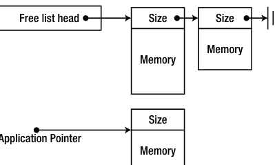

**图 4-1.** 空闲列表管理器管理一个未使用的内存块列表，并满足分配和释放请求。应用程序分到的内存块通常包含该块的大小。

空闲列表管理涉及到影响使用分配器的应用程序性能的策略和战术决策。在这些决策中：

- *使用空闲列表管理的应用程序从一个由空闲列表组织的小空闲内存池开始。该列表可以根据大小、使用时间、应用程序确定的分配区域（arena）等进行组织。*
- *当应用程序发送分配请求时，会在空闲列表中找到匹配的块。可以通过选择首次适配（first-fit）、最佳适配（best-fit）或使用更复杂的替代策略来定位匹配的块。*
- *当空闲列表耗尽时，内存管理器向操作系统请求另一组空闲块并将其添加到空闲列表中。当应用程序发送释放请求时，该空闲块被添加到空闲列表中。此阶段的优化包括合并相邻块、碎片整理和修剪列表等。*

与空闲列表内存管理器相关的主要问题如下：

- **分配成本：** 寻找一个合适的内存块来满足分配请求是耗时的，即使使用了首次适配方法。此外，内存块通常会被拆分成多个部分以满足分配请求。在多处理器的情况下，除非使用多个列表，否则分配请求的同步竞争是不可避免的。然而，使用多个列表会加剧列表的碎片化。
- **释放成本：** 将空闲内存块返回空闲列表是耗时的，并且同样面临对多个释放请求进行多处理器同步的需求。
- **管理成本：** 整理和修剪空闲列表对于避免内存耗尽场景是必要的，但这项工作必须在单独线程中进行，并获取空闲列表的锁，从而阻碍了分配和释放性能。可以通过固定大小的分配桶来维护多个空闲列表以减少碎片，但这需要更多的管理，并为每次分配和释放请求增加少量成本。

## 引用计数垃圾收集 (Reference-Counting Garbage Collection)

引用计数垃圾收集器将每个对象与一个整数变量关联——它的引用计数。当创建对象时，其引用计数初始化为 1。当应用程序创建引用时，引用计数增加。当应用程序移除对对象的引用时，引用计数减1。当对象的引用计数达到 0 时，它会被回收（见图 4-2）。

| RC = 1 | RC = 3 |
| :--- | :--- |
| 其他字段 | 其他字段 |
| 引用 1 | 引用 2 |
| | 引用 3 |

**图 4-2.** 每个对象都包含一个引用计数

生态系统中引用回收的一个例子是 COM（组件模型）。引用计数与对象的寿命相关。开发者不需要显式的 `AddRef` 和 `Release` 方法；这些由收集器在引用创建或销毁时处理。引用计数的主要问题是：

- **管理成本：** 当引用创建或销毁时，必须更新引用计数。在多处理器系统中，引用周围的同步可能会产生开销。
- **内存占用：** 引用计数将每个对象与计数关联，这增加了每个对象的大小。
- **正确性：** 在引用计数下，循环引用无法被回收。

## 标记垃圾收集 (Tracing Garbage Collection)

标记垃圾收集是 .NET CLR、Java VM 以及各种托管环境使用的垃圾收集机制——这些环境不使用任何形式的计数收集。开发者不需要使用显式的释放请求；这些由垃圾收集器处理。GC 不会将对象与计数关联，通常在达到阈值之前不会产生任何释放成本。

当发生垃圾收集时，收集器从*标记阶段 (mark phase)*开始，在此期间识别所有仍被应用程序引用的对象。通过构建存活对象集，收集器移动到*扫描阶段 (sweep phase)*，此时回收未使用对象占据的空间。最后，收集器以*紧凑阶段 (compact phase)*结束，在该阶段移动存活对象使其在内存中保持连续。

在本章中，我们将详细检查与标记垃圾收集相关的各种问题。这些问题的概括如下：

- **分配成本：** 分配成本与基于栈的分配相当，因为没有与空闲对象的维护工作。分配由增加指针组成。
- **释放成本：** 在 GC 周期发生时产生，而不是均匀地分布在执行分析中。
- **标记阶段：** 定位被引用对象需要托管执行环境的高度自律。对对象的引用可以存储在静态变量、线程栈上的局部变量、指向非托管代码的指针等。
- **扫描阶段：** 在内存中移动对象需要时间，并且可能不适用于大对象。另一方面，消除对象之间的未使用空间有助于引用局部性，因为这些对象在内存中是共同分配在一起的。

| RC = 1 | RC = 1 |
| :--- | :--- |
| 其他字段 | 其他字段 |

**图 4-3.** 当循环不再被应用程序引用时，它将被销毁。

# 第 4 章 垃圾回收

在随后的章节中，我们将研究 .NET GC 内存管理范式，从理解 GC 的标记和清除阶段开始，移动到更重要的优化方案，例如分代（generations）。

## 标记阶段 (Mark Phase)

在追踪式垃圾回收周期的*标记阶段*中，GC 会遍历应用程序当前引用的所有对象的图。为了成功遍历此图并防止出现*假阳性*和*假阴性*（在本章中将讨论），GC 需要一组起始点，以确保引用遍历的进行。这些起始点被称为*根（roots）*，正如其名称所示，它们构成了 GC 构建的被引用图的根。

在建立了一组根之后，标记阶段的垃圾回收器的原理就相对容易理解。它考虑每个根中的每个内部引用，并继续遍历图，直到引用的对象都被访问过。由于 .NET 应用程序允许引用循环，因此 GC 会标记已访问的对象，以确保每个对象只被访问一次——这就是*标记阶段*命名的由来。

## 局部根 (Local Roots)

根的最常见类型之一是*局部变量*；单个局部变量就可以形成应用程序引用的整个对象图的根。例如，考虑应用程序 `Main` 方法中的以下代码片段，它创建了一个 *System.Xml.XmlDocument* 对象并并调用了它的 *Load* 方法：

```csharp
static void Main(string[] args) {
    XmlDocument doc = new XmlDocument();
    doc.Load("Data.xml");
    Console.WriteLine(doc.OuterXml);
}
```

我们无法控制垃圾回收的执行机，因此必须假设在 `Load` 方法调用期间可能会发生垃圾回收。如果发生这种情况，我们不希望 `XmlDocument` 对象被回收——`Main` 方法中的局部引用是垃圾回收器必须考虑的对象图的根。每一个可能持有对象引用的局部变量（即每个引用类型的局部变量）在它的方法位于栈上时，都可以被视为一个活跃的根。

然而，我们不需要将活跃根维持到其闭包方法的结束。例如，在对象加载并显示之后，我们可能在同一个方法中引入额外的代码，这些代码不再需要将对象保留在内存中。这可能需要很长时间才能完成，如果在此期间发生了垃圾回收，我们希望内存被回收。

.NET 垃圾回收器提供这种尽早回收功能吗？让我们检查下面的代码片段，它创建了一个 *System.Threading.Thread* 并用一个回调初始化它，通过调用 `GC.Collect` 触发垃圾回收（我们将在稍后详细检查此 API）：

```csharp
using System;
using System.Threading;
class Program {
    static void Main(string[] args) {
        Timer timer = new Timer(OnTimer, null, 0, 1000);
        Console.ReadLine();
    }
    static void OnTimer(object state) {
        Console.WriteLine(DateTime.Now.TimeOfOfDay);


```
        GC.Collect();

    }

}
```


如果你在 Debug 模式下运行上述代码（如果是命令行编译且不使用 `/optimize+` 编译器开关），你会发现定时器回调每秒被调用一次，正如预期，这意味着定时器没有被垃圾回收。然而，如果你在 Release 模式下运行它（使用 `/optimize+` 编译器开关），定时器回调只调用了一次！换句话说，定时器被回收了并停止调用回调。这可能是（甚至是想要的）行为，因为当我们到达 `Console.Read` 方法时，我们对定时器的局部引用作为根已不再具有相关性。因为不再相关，所以定时器被回收了，如果你没有尽早关注关于局部根的讨论，将会产生一个相当出乎意料的结果！

## 尽早根回收 (EAGER ROOT COLLECTION)

这种针对局部根的尽早回收机制实际上是由 .NET 即时编译器（JIT）提供的。垃圾回收器本身无法得知某个变量是否仍然可以使用。

# 第 4 章 垃圾回收

- 未被引用的对象在此阶段的成本较低，因此标记阶段（mark phase）的性能与收集效率因子成线性关系：即收集空间中被引用对象与未被引用对象的比例。
- 标记阶段的性能还取决于图中对象的数量，而不是这些对象所消耗的内存。不包含许多引用的大型对象更容易被遍历，并且产生的开销也较小。这意味着标记阶段的性能与图中存活对象的数量成线性关系。

一旦所有被引用的对象都已标记，垃圾回收器就拥有了所有被引用对象及其引用的完整图（见图 4–4）。它现在可以移动到清理阶段（sweep phase）。

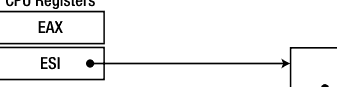
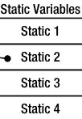
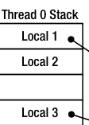
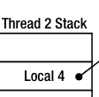

**图 4–4。** 具有各种类型根的对象的图。允许循环引用。

## 清理与压缩阶段

在清理和压缩阶段，垃圾回收器通过移动存活对象来回收内存，使它们能够紧凑地放置在堆上。为了理解移动对象的机制，我们必须首先检查分配机制，该机制为清理阶段所执行的工作提供了动力。

在我们目前正在研究的简单 GC 模型中，来自应用程序的分配请求通过增加一个单一指针来满足，该指针始终指向下一个可用的内存槽（见图 4–5）。这个指针被称为下一个对象指针（next object pointer）或新对象指针，它在垃圾回收堆构建时初始化。

## GC 堆


下一个对象指针
图 4-5。GC 堆和下一个对象指针

满足分配请求在该模型中是极其复杂的：它涉及到单一指针的原子递增。多处理器系统可能会出现该指针的竞争（这个问题稍后将）。

如果内存是无限的，分配请求可以通过增加新对象指针来满足。但在某个时间点，我们会达到触发垃圾回收的阈值。这些阈值是动态且可配置的，我们将在本文介绍控制它们的方法。

在压缩阶段，垃圾回收器移动内存中的存活对象，使其占据连续的空间（见 4-6）。这有助于局部性，因为分配的对象很可能被一起使用，因此将它们放在内存一起是有优的。另一方面，移动对象至少有两个缺点：

- 移动内存对象对于大型对象来说是一项昂贵的操作。即使经过优化，在垃圾回收周期中拷贝几兆内存也会导致不合理的开销。（这一点稍后会提到。）
- 当对象移动时，必须更新它们的引用。对于频繁被引用的对象，分散的内存访问（更新引用时）可能是昂贵的。


下一个对象指针
图 4-6。左侧阴影对象在垃圾回收后生存并在内存中移动。这意味着指向 A 的引用必须更新。（图中未显示更新后的引用）。

清理阶段的通用性能与图中对象的数量成线性，并且对收集效率因子特别敏感。如果发现大多数对象未被引用，GC 必须移动内存中的一些对象。同样适用于大多数对象仍被引用的场景，因为只有少量空洞需要填充。另一方面，如果堆中的每个对象都未被引用，GC 可能必须移动每一行来填充空洞。

**注意** 与大众认知相反，垃圾回收器并不总是移动对象（即某些对象进入压缩阶段），即使它们没有被固定（见下文），即使有可用空间。有一种实现的启发式方法决定移动对象到空闲空间是否值得。例如，在 32 位系统中，如果空闲空间大于 16KB 且自上次垃圾回收以来分配了超过 16KB，垃圾回收器就会移动对象。前面章节描述的标记清理模型存在一个缺陷：当发生收集时，会遍历堆中的所有对象。如果我们预先知道某些对象比其他对象更容易死亡，我们可能相应地调整算法并获得更低的摊销成本。

## 固定（Pinning）

上述垃圾回收模型没有解决托管对象的一个用途：将托管对象传递给非托管代码。可以使用两种不同的方法来解决这个问题：

- 每个应该传递给非托管代码的对象在传递时按值封送（拷贝），在返回时按值封送回。
- 而不是拷贝，而是将其指针传递给非托管代码。

每次我们需要与非托管代码交互时都拷贝内存是不现实的。考虑实时视频处理的情况，它需要每秒 30 帧从非托管代码传播高分辨率图像。拷贝几兆内存将使性能下降到无法接受的水平。.NET 内存模型提供了获取托管对象地址的功能。但将此地址传递给非托管代码引发了一个重要问题：如果非托管代码执行期间对象被 GC 移动了怎么办？这种场景可能会导致灾难性的后果——内存很容易被损坏。解决此问题的可靠方法是非托管代码持有托管对象指针时关闭垃圾回收器。然而，如果对象在托管和非托管代码之间频繁传递，这种方法不够细粒。如果线程进入长时间等待，可能会导致死锁或内存耗尽。

与其关闭垃圾回收，获取地址的每个托管对象也必须在内存中固定。固定对象可以防止垃圾回收器在清理阶段移动它，直到它取消固定。

固定操作并不昂贵——有多种廉价的机制。固定对象的最显式方法是使用 `GCHandle.Pinned` 创建 GC 句柄。GC 句柄会创建一个新的根，告诉 GC 该对象应保持为固定状态。其他替代方案包括 P/Invoke 封送器使用的内存，以及 C 中通过 `fixed` 关键字（或 C++/CLI 中的 `ptr`）实现的固定指针机制，它依赖于将局部变量标记为 GC 的特殊情况（见第 8 章垃圾回收器）。

然而，当考虑固定如何影响垃圾回收时，性能成本变得显而易见。当垃圾回收器在压缩阶段遇到固定对象时，它必须绕过它以确保其不被移动。这增加了算法的复杂性，但直接影响是堆产生了碎片。碎片严重的堆直接违反了使垃圾回收可能的假设：它导致分配在内存中碎片（并丢失局部性），为分配过程引入复杂性，并由于碎片无法填充导致内存浪费。

**注意**固定的副作用可以通过设计的工具进行管理，包括分析器。分析器可以按地址显示对象，将空（碎片）区域显示为空白。或者，SOS.DLL（托管调试扩展）可以显示类型为“Free”的对象。最后，固定对象计数（.NET CLR 内存性能计数器分类）可用于确定上次垃圾回收期间固定的对象数量。

另一方面，在某些场景下，让垃圾回收过程与其他应用程序线程并发执行是至关重要的。例如，考虑一个 GUI 应用。如果垃圾回收过程在后台线程上触发，我们希望在回收发生时保持 UI 的响应能力。尽管回收本身可能需要更长时间才能完成（因为 UI 正在与 GC 竞争 CPU 资源），但用户会感到愉快得多，因为应用程序的响应更快。这里会产生两类问题：

- **假阴性（False negatives）**：一个对象虽然符合垃圾回收条件，但仍被认为是存活的。这是一个不希望看到，但如果该对象会在下一个周期中被回收，你也可以接受这种后果。
- **假阳性（False positives）**：一个对象虽然仍被应用程序引用，但被认为是死亡的。这是一个调试的噩梦，垃圾收集器必须竭尽全力防止这种情况的发生。

让我们考虑垃圾回收的两个阶段，看看我们是否能够负担起与 GC 过程并发运行应用程序线程。请注意，无论我们得出什么结论，某些场景在垃圾回收期间需要暂停。例如，如果进程耗尽了内存，则必须在回收内存时优雅地挂起线程。然而，我们将回顾异常场景，这些场景占了大多数情况。

## 为 GC 挂起线程

为垃圾回收挂起线程是在安全点（safe points）执行的。并不是每一组指令都可以被中断以执行回收。JIT 会发出额外信息，以便在安全执行回收时发生挂起，而 CLR 会尝试优雅地挂起线程——在未验证挂起后线程安全的情况下，不会诉诸粗暴的 `SuspendThreadWin32` API。

在 CLR 2.0 中，可能会出现一种场景：一个在非常紧密的 CPU 密集型循环中的托管线程会长时间不通过安全点，导致 GC 启动延迟高达 1500 毫秒（这反过来又延迟了任何已经在在等待 GC 的线程）。这个问题在 Sasha Goldstein 的文章《垃圾回收线程挂起》[http://blog.sash.com/archive/2009/07/31/garbage-collection-thread-suspension-delay-250ms-multiples.aspx,2009] 中得到了修复。

请注意，非托管线程在返回托管代码之前不受线程挂起的影响——这一点由 P/Invoke 转换处理。

## 在标记阶段暂停线程

在标记阶段，垃圾收集器的工作几乎是只读的。尽管如此，仍然可能发生假阴性和假阳性。

一个新创建的对象即使被应用程序引用，收集器也可能认为它是死亡的。如果收集器已经考虑了在对象创建时被更新的图谱部分（见图 4-7），这种情况就是可能的。可以通过拦截新引用（和新对象）的创建并确保标记它们来解决这个问题。这需要同步并会增加分配成本，但允许其他线程与回收过程并发执行。


新引用


**图 4-7。** 在图谱的某部分已经被标记后，引入了一个对象（虚线对象已被标记）。这导致了该对象被错误地假设为不可达。

如果一个已经被收集器标记的对象在标记阶段期间它的最后一个引用被移除，那么它可能符合垃圾回收条件（见图 4-8）。这不是一个需要考虑的严重问题；毕竟，如果该对象确实不可达，它将在下一个 GC 周期被回收——死亡对象不可能再次变为可达。


移除引用


**图 4-8。** 在图谱的某部分已经被标记后，一个对象从图谱中移除（虚线对象已被标记）。这导致了该对象被错误地假设为可达。

## 在扫描阶段暂停线程

在扫描阶段，不仅引用会变化，对象会在内存中移动。这为并发执行的应用程序线程带来了一系列问题：

- 复制对象不是原子操作。这意味着在对象的一部分被复制后，原始对象仍在被应用程序修改。
- 更新指向对象的引用不是原子操作。这意味着应用程序的一些部分可能在使用旧的对象引用，而另一些部分可能在使用新的。

解决这些问题是可能的（例如 JVM 的 Azuleless GC，http://www.azulsystems.com/zing/pgc），但在 CLR GC 中尚未这样做。直接声明扫描阶段不支持应用程序线程与垃圾收集器并发运行更为简单。

> 提示：要确定 GC 是否能为你的应用程序提供任何收益，你必须首先确定它在执行垃圾回收上花费多少时间。如果你的应用程序花费了 50% 的时间回收内存，那么还有大量的空间进行优化。另一方面，如果你每隔几分钟才执行一次回收，可能应该继续使用目前有效的方法。

## 工作站 GC

现在我们已经回顾了应用程序线程在垃圾回收期间可能表现的行为，我们可以详细检查各种 GC 类型。

我们将详细查看的第一种 GC 类型是工作站 GC。它进一步分为两种类型：并发工作站 GC 和非并发工作站 GC。

在工作站 GC 下，由单个线程执行回收——垃圾回收并不并行。

### 并发工作站 GC

并发工作站 GC 是默认类型。在工作站 GC 下，有一个标记为 `THREAD_PRIORITY_HIGHEST` 的独立 GC 线程从头到尾执行回收。请注意，CLR 可以检测到它希望垃圾回收的部分与线程并发运行（标记阶段）。

如果垃圾回收是由 UI 线程触发的，使用并发工作站 GC 的响应可能会受到损害。在这种情况下，当执行扫描阶段时，所有的线程都会挂起。这实际上会降低响应速度，因为 UI 线程被阻塞直到 GC 完成，而且其他应用程序线程正在与 GC 竞争资源。（见图 4-9。）

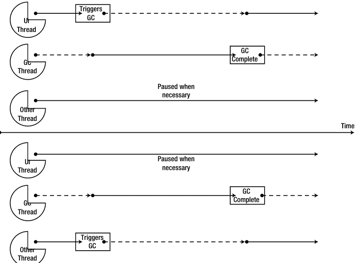

**图 4-9。** 上部分显示 UI 线程触发时的并发 GC。下部分显示后台线程触发时的并发 GC。（虚线表示阻塞。）

因此，使用并发工作站 GC 的 UI 应用程序应该非常小心防止回收在 UI 线程上发生。这归结为在后台线程上进行分配，并避免在 UI 线程上显式调用 `GC.Collect`。

.NET 应用程序（ASP.NET 应用程序除外）无论运行在用户的工作站还是强大的多处理器服务器上，默认的 GC 类型都是工作站 GC。正如我们很快将看到的，这种默认对于服务器应用程序很少适用。正如我们刚刚看到的，如果 UI 应用程序倾向于在 UI 线程上触发垃圾回收，这并不总是合适的。

### 非并发工作站 GC

非并发工作站 GC 类型顾如其义，在标记和扫描阶段都提供应用程序线程运行。非并发工作站 GC 的主要使用场景是上一节提到的情况，即 UI 线程倾向于触发垃圾回收。在这种情况下，非并发 GC 可能会提供更好的响应能力，因为后台线程不会与 UI 线程等待的 GC 竞争资源，从而更快地释放 UI 线程。（见图 4-10。）

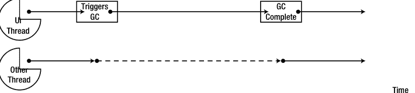

**图 4-10.** UI 线程在非并发 GC 下触发回收。在回收期间，其他线程不竞争资源

## 服务器 GC (Server GC)

服务器 GC 变体针对完全不同类型的应用程序进行了优化——正如其名所示，即服务器应用程序。在此背景下，服务器应用程序需要高吞吐量场景（通常以牺牲单个操作的延迟为代价）。服务器应用程序还需要易于扩展到多个处理器——内存管理必须能够很好地扩展到多个处理器：服务器 GC 具有以下特征：

- 在 .NET 进程的亲和性掩码中，每个每个处理器都有一个独立的堆。特定处理器上的线程发起的分配请求将由该特定处理器的托管堆满足。这种分离的目的是最小化进行分配时对托管堆的竞争：在大多数情况下，下一个对象指针没有竞争，多个线程可以真正并行地执行分配。该架构要求动态调整堆大小和 GC 阈值，以确保当应用程序跨线程扩展并分配硬性 CPU 亲和性时的公平性。在从线程池工作线程服务请求的服务器应用程序典型情况下，所有堆的大小可能大致相同。
- 垃圾回收不会发生在触发垃圾回收的线程上。相反，垃圾回收发生在在启动期间创建并标记为 `THREAD_PRIORITY_HIGHEST`（最高优先级）的专用优先级线程上。对于 .NET 进程亲和性掩码中的每个处理器，都有一个 GC 线程。这允许每个线程访问分配给其处理器的托管堆。得益于引用局部性，GC 线程很可能仅在其自己的堆内执行标记阶段，而该堆的部分被保证在 CPU 缓存中。
- 在垃圾回收的两个阶段中，所有分配线程都会被挂起。这允许 GC 及时进行回收，并允许应用程序尽快继续处理请求。这以牺牲延迟为代价实现了吞吐量的最大化；在垃圾回收期间，某些请求可能需要更长的处理，但由于 GC 过程中引入的切换减少，整体分配可以处理更多的请求。

使用服务器 GC 时，CLR 尝试在各个处理器堆之间平衡对象分配。在 CLR 4.0 之前，只有小堆会被平衡；从 CLR 4.5 开始，大堆（稍后讨论）也被平衡了。因此，所有堆的分配速率、填充率和垃圾回收频率保持相似。
使用服务器 GC 的局限性是机器上物理处理器的数量。如果机器上只有一个物理处理器，则可用的 GC 工作站 GC（Workstation GC）。这是一个合理的选择，因为如果只有一个可用处理器，将只有一个托管堆和单个 GC 线程，这会阻碍服务器 GC 架构的有效性。

注意从 NT 6.1（Windows 7 和 Windows Server 2008 R2）开始，Windows 使用处理器组支持多于 64 个逻辑处理器。从 CLR 4.5 开始，GC 也可以使用超过 64 个逻辑处理器。这需要在你的应用程序配置文件中放置 `<GCGroup enabled="true" />` 元素。

服务器应用程序可能从服务器 GC 中受益。然而，正如我们之前看到的，默认的 GC 变体是工作站 GC。对于托管在默认 CLR 宿主下的控制台应用程序、Windows 和 Windows 服务，情况确实如此。非默认 CLR 宿主可以选择不同的 GC 变体。如果 IIS ASPNET 宿主这样做，也是如此：它在服务器 GC 下运行应用程序，因为 IIS 要安装在机器上（尽管这种行为可以通过 Web.config 自定义）。

控制 GC 变体是下一节的主题。这是性能测试中一个非常有趣的实验，特别是对于内存密集型应用程序。测试此类应用程序在各种 GC 变体下的行为是一个好主意，以查看在重内存负载下哪种变体产生最佳性能。

## 在 GC 变体之间切换

可以使用 CLR 宿主接口来控制 GC（将在本章稍后部分讨论）。然而，也可以使用应用程序配置文件（App.config）来控制 GC 变体的选择。可以使用以下 XML 配置文件在不同的 GC 变体和子变体之间选择：

```xml
```


```xml
<?xml version="1.0" encoding="utf-8" ?>
<configuration>
  <runtime>
    <gcServer enabled="true" />
    <gcConcurrent enabled="false" />
  </runtime>
</configuration>
```

`gcServer` 元素控制服务器 GC 的选择。`gcConcurrent` 元素控制工作站模式的选择。.NET 3.5 添加了一个可以控制延迟的 API。`Settings.IsServer` 是一个只读属性，反映应用程序是否在服务器模式下运行。另一方面，`LatencyMode` 属性接受 `GCMode` 枚举值：`Batch`、`Interactive`、`LowLatency` 和 `SustainedLow`。`LowLatency` 值在 .NET 3 中引入，仅支持服务器 GC，并设计用于时间敏感区域。`SustainedLow` 值在 .NET 4.5 中引入，支持服务器 GC，并设计用于较长时间段。低延迟并不意味着垃圾回收器已关闭。

## 安全地使用延迟 GC

在延迟 GC 模式下花费的时间必须保持到最小——一旦退出延迟模式，GC 开始激进地回收内存，可能会影响应用程序的性能。如果你没有完全控制进程内的分配（例如，如果你有插件或多个后台线程在执行工作），这种延迟模式会影响整个进程。

使用延迟模式的唯一安全方法是在受限执行区域（CER）内进行。CER 限制了代码抛出带外异常（如线程终止），这会阻止代码完整执行。在 CER 中的代码必须具有强力保证延迟模式将恢复到之前的值。以下代码演示了如何实现这一点（你需要导入 `System.CompilerServices` 和 `System.Runtime` 命名空间）：

```csharp
GCSettings.LatencyMode oldMode = RuntimeHelpers.PrepareConstrainedRegions();
try
{
    GCSettings.LatencyMode = GCMode.LowLatency;
    //在此执行时间敏感的工作
}
finally
{
    GCSettings.LatencyMode = oldMode;
}
```

延迟模式指示垃圾回收器除非绝对必要，否则执行回收——例如操作系统内存不足（分页的影响可能比回收更糟糕）。低延迟并不意味着垃圾回收器已关闭；仍然执行部分回收（我们将在以后考虑代），但应用程序份额将显著减少。

选择正确的 GC 因素并不是易事，大多数情况下，我们只能通过实验得出合适的方法。然而，对于内存密集型应用程序，这种实验最为重要——我们无法承受将 50% 的 CPU 时间花在一个处理器上进行垃圾回收，而其他 15 个处理器可能闲置等待回收完成。

当我们仔细检查上述模型时，某些性能问题仍然困扰着我们。以下是最显著的问题：

- 大对象：大对象是一个昂贵的操作，然而扫描阶段的对象在期间仍会被移动。在某些情况下，复制内存可能成为执行垃圾回收的主要成本。我们得出的结论是在扫描阶段必须根据大小对对象进行区分。
- 回收效率：每次回收都是全堆，这意味着具有相对稳定的对象集合的应用程序将为执行付出沉重代价

# 第 4 章 垃圾回收

尽管大多数对象仍被引用，但仍会在整个堆上进行标记和清除。为了防止收集效率因子过低，我们必须追求一种优化方法，根据对象的回收概率对它们进行区分：即它们可能在下次 GC 周期中被回收。

这些问题的大多数方面可以通过正确使用代（Generations）来解决，这是下一节将介绍的内容。我们还将涉及在与 .NET 垃圾收集器交互时需要考虑的一些额外性能问题。

## 代

.NET 垃圾收集器的代模型通过执行部分垃圾回收来优化收集性能。部分垃圾回收具有更高的收集效率，且收集器遍历的对象是具有最佳回收概率的对象。按回收概率划分对象的首要决策因素是它们的年龄——该模型假设对象的年龄与其预期寿命之间存在内在的相关性。

### 代模型假设

与人类和动物世界相反相反，年轻的 .NET 对象预计会很快死亡，而旧的 .NET 对象预计会活得更久。这两个假设迫使对象预期寿命分布在图 4–11 图表的两个对角。


**图 4-11.** 对象的预期寿命作为对象年龄的函数，分为三个区域

注意：“年轻”和“旧”的定义取决于应用程序触发垃圾回收的频率。如果每分钟发生一次垃圾回收，那么一个 5 秒前创建的对象将被认为是年轻的。在另一个系统中，它会被认为是旧的，因为该系统是内存密集型的，每轮运行都会导致多次回收。尽管如此，某些应用程序中的临时对象（例如作为方法调用的一部分在本地分配的对象）倾向于年轻就死，而在应用程序初始化时分配的对象则倾向于活得更久。

在代模型下，大多数新对象预计会表现出临时行为——为了特定的、短命的用途而分配，并在不久后变成垃圾。相反，存活了长时间的对象（例如单例对象或在应用程序初始化时分配的已知对象）预计会活得更久。

并不是所有的分配都遵循代模型所加的假设。很容易想象这样一个系统：临时对象在垃圾回收中存活，然后失去引用，并创建了更多的临时对象。这种对象的预期寿命落入代模型预测的桶之外的现象，正式称为“中年危机”。出现这种现象的对象超过了代模型提供的性能优化益处。我们将在本节后面检查中年危机。

### .NET代的实现

在代模型中，垃圾回收被分为三个区域：第 0 代、第 1 代和第 2 代。这些区域反映了它们包含对象的预期寿命：第 0 代包含年轻的对象，第 2 代包含已存活了一定的旧对象。

## 第 0 代

第 0 代是所有新对象的游场（在本节稍后的部分我们将看到对象也按大小进行划分，这使得该陈述部分正确）。它非常小，无法容纳最小对象的所有内存使用。第 0 代通常从 256 KB 到 4 MB 之间的预算开始，并在需要时可能会稍微收紧。

> 注意：操作系统、L2 和 L3 缓存的大小也会影响第 0 代的大小，因为这一代的主要目标是包含被频繁访问且访问时间很短的对象。它在运行时由垃圾收集器动态控制，并可以通过 CLR 宿主机设置 GC 启动限制在应用程序启动时进行控制。第 0 代和第 1 代的总预算不能超过单个分段的大小（稍后将讨论）。

当无法从第 0 代满足分配请求时，会在第 0 代内发一次垃圾回收。在此过程中，垃圾收集器在标记和清除阶段只触碰属于第 0 代的对象。这并非易事，因为根节点（roots）与代之间之间没有预先的关联，并且始终存在第 0 代之外的对象引用第 0 代内部对象的可能性。我们稍后将检查这种困难。

由于几个原因，在第 0 代内进行垃圾回收是一个非常廉价且高效的过程：

- 第 0 代非常小，不包含很多对象。遍历如此少的内存所需的时间非常短。在我们的一台测试机器上，对 2% 的对象执行第 0 代回收大约需要 `70 μs`（微秒）。
- 缓存大小影响第 0 代的大小，这使得第 0 代中的所有对象更有可能在缓存中被找到。遍历已经在缓存中的内存比从主内存访问或从磁盘获取要快得多，正如我们将在第 5 章中看到的。
- 由于局部性，分配在第 0 代的对象很有可能引用第 0 代中的其他对象。这些对象在空间上也很可能彼此靠近。如果在标记阶段遍历图表时发生缓存未命中，则效率更高（注：此处原文逻辑略乱，已按意译译）。

第 1 代垃圾回收的自然触发条件是第 0 代的先验垃圾回收，因为对象会从第 0 代提升到第 1 代（触发垃圾回收是另一个触发因素）。

第 1 代的垃圾回收仍然是一个廉廉的过程。只需要触碰几兆字节的内存

从第 1 代幸存的对象会被提升到第 2 代。这种提升反映了它们现在被视为旧对象的这一事实。分代模型中的主要风险之一是临时对象溜入第 2 代并于不久后死亡；这就是所谓的“中年危机”。确保临时对象不到达第 2 代至关重要。在本节的后半部分，我们将检查这种“中年危机”现象的严重影响，并研究诊断和预防措施。

## 第 2 代

第 2 代是至少幸存过两次垃圾回收的对象（以及对于大对象，正如我们后文所示）的终极内存区域。在分代模型中，这些对象被认为是旧对象，并且根据我们的假设，它们在不久的将来不应该符合垃圾回收的条件。

第 2 代的大小没有人为限制。它的大小可以扩展到分配给操作系统进程的整个内存，即在 32 位系统上高达 2 GB 内存，在 64 位系统上高达 8 TB 内存。

注意：尽管空间很大，但第 2 代内部存在动态阈值（水位线），这会触发垃圾回收，因为等到整个内存填满后才执行垃圾回收是没有意义的。如果系统上的每个应用程序都可以运行到内存耗尽，只有那时 GC 才会收回未使用的内存，那么分页效应将导致系统停滞。

当第 2 代内部发生垃圾回收时，这是一次全量垃圾回收（full garbage collection）。这是最昂贵的垃圾回收，完成时间最长。在我们其中一台机器上，对 100MB 的引用对象进行全量垃圾回收大约需要 30ms（毫秒）——比较老代的回收要慢几个数量级。

此外，如果应用程序的行为符合分代模型的假设，那么第 2 代的垃圾回收也可能表现出非常低的回收效率因子，因为第 2 代的大多数对象将跨越多个垃圾回收周期。因为第 2 代的垃圾回收应该是罕见事件——与较老代的分区相比，它非常缓慢，而且效率低下，因为被遍历的大多数对象仍被引用，几乎没有内存可以收回。

如果应用程序分配的所有临时对象都很快死亡，它们就没有机会幸存多次垃圾回收并到达第 2 代。在这种乐观的场景下，第 2 代将不会发生回收，垃圾收集对应用程序性能的影响将降低好几个数量级。

通过对分代的仔细使用，我们在接下来的章节中成功解决了对朴素垃圾收集器的一个主要关注点之一：根据回收概率对对象进行分区。如果我们能根据对象的当前生命周期成功预测其预期寿命，就可以执行部分垃圾回收，并极少诉诸全量收集。另一个问题尚未解决甚至被加剧了：大对象在扫描阶段（sweep phase）会被复制，这在 CPU 和内存使用方面是非常昂贵的。此外，在分代模型中，尚不清楚第 0 如何如何包含一个 10,000,000 个整数的数组，这明显大于它自身的尺寸。

## 大对象堆

大对象堆（LOH）是专门为大对象保留的特殊区域。大对象是指占据内存超过 85KB 内存的对象。该阈值适用于对象本身，而不是以该对象为根的整个图的大小，因此一个包含 1000 个字符串（每个 100 个字符）的数组不是大对象，因为该数组仅包含字符串的 4 字节或 8 字节引用，但一个包含 50,000 个整数的数组就是一个大对象。

大对象直接从 LOH 分配，而不通过第 0 代、第 1 代或第 2 代。这最小化了跨代提升它们的成本，跨代提升意味着移动它们的内存。然而，当 LOH 内部发生垃圾回收时，扫描阶段可能必须移动对象，产生相同的性能开销。为了避免这种性能开销，大堆中的对象不受标准扫描算法的影响。

收集器并不是扫描并复制大对象，而是采用收集 LOH 的策略。它维护一个所有空闲块的列表，并可以从列表中满足分配请求。这与本开头讨论的空内存管理策略类似，因为它们共享相同的性能开销：分配成本（寻找合适的空块、拆分空块）、释放成本（将内存区域返回空闲列表）以及管理成本（将相邻块合并）。然而，使用空闲列表管理比在内存中复制大对象要便宜——这是一个为了获得更好性能而牺牲实现纯洁性的典型场景。

> **注意** LOH 中的对象不会移动，因此可能看起来固定（pinning）是不必要的。这是是错误的，并且取决于具体的实现细节。你不能假设大对象在它们的整个生命周期内都保持相同的内存位置，而且大对象的阈值在未来可能会在没有任何通知的情况下发生变化！尽管如此，从实际角度来看，假设固定大对象的性能开销比固定小对象要小是合理的。事实上，在固定数组的情况下，通常建议分配一个大数组，在内存中固定它，并从数组分发块，而不是为每个需要固定的操作分配新数组。

当达到第 2 代回收阈值时，将对 LOH 进行收集。同样，当达到 LOH 回收阈值时，第 2 代也会被回收。因此，创建大量临时对象会导致与“中年危机”相同的问题——将执行全量收集来回收这些对象。大堆中的碎片是另一个潜在问题，因为碎片不会通过扫描和整理堆来自动回收。LOH 模型意味着开发者必须处理内存分配，这通常属于手动内存管理。一种有效的策略是对大对象进行池化而不是释放它们给 GC。维护池的成本可能比执行全量收集的成本小。另一种可能的方法（对于相同类型的数组）是分配一个大对象并根据需要将其拆分为块（见图 4-13）。


**图 4-13.** 通过权量化窗口暴露大对象

## 代际引用

在讨论分代模型时，我们忽略了一个可能损害模型正确性的重要细节。记住，年轻代的部分回收之所以廉价，是因为在回收期间只遍历了年轻代的对象。GC 如何保证只触碰这些对象？

考虑第 0 代回收的标记阶段。在标记阶段，GC 确定当前活跃的对象，并开始构建由根引用的所有对象的图。过程中，我们想要丢弃不属于第 0 代的对象。然而，如果我们在构建整个图后丢弃它们，那么我们就触碰了所有对象，导致标记阶段和全量收集一样昂贵。或者，当我们到达第 0 代之外的对象时停止遍历图。这种方法的风险是，我们永远无法到达仅被更高代对象引用的第 0 代对象，如图 4-14 所示！


**图 4-14.** 如果我们在标记阶段到达更高代对象时停止跟随引用，可能会遗漏代际引用

这个问题似乎需要在正确性和性能之间进行折衡。我们可以通过获取关于“旧代对象何时拥有年轻代对象的引用”的这一特定场景的先验知识来解决它。

这种先验知识可以借助 JIT 编译器的协助获得。旧代对象引用年轻代对象的场景可以源于一类统计数据：对对象类型的实例字段（或数组元素写入器）进行非空引用赋值。

```csharp
class Customer {
    public Order LastOrder { get; set; }
}
```

```csharp
class Order { }
class Program {
  static void Main(string[] args) {
    Customer customer = new Customer();
    GC.Collect();
    GC.Collect();
    //customer is now in generation 2
    customer.LastOrder = new Order();
  }
}
```

当 JIT 编译该语句时，它会发出一个写障（write barrier），该屏障会在运行时拦截引用写入，并在名为卡表（card table）的数据结构中记录辅助信息。写障是一个轻量级的 CLR 函数，用于检查被赋值的对象是否属于比第 0 代更老的代。如果是这种情况，它会更新卡表中对应于赋值目标周围 1024 字节地址范围的一个字节（见图 4-15）。

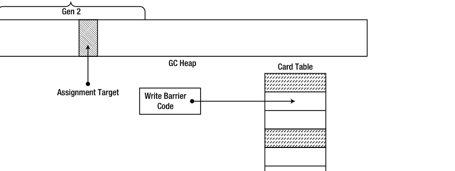

**图 4-15.** 对引用字段的赋值会通过写屏障，该屏障会更新卡表中的相关位，使其与引用更新的区域匹配。

使用调试器跟踪写障代码是非常容易的。首先，Main 中的实际赋值语句被 JIT 编译器编译为遵循以下逻辑：

```asm
; ESI 包含指向 'customer' 的指针，ESI+4 是 'LastOrder',EAX 是 'new Order'
lea edx, [esi4]
all clr!JITWriteBarrierEAX
```

在写障内部，会进行检查以查看被赋值的对象的地址是否低于第 1 代的起始地址（即在第 1 代或第 2 代中）。如果是这种情况，则通过将地址右移 10 位并对偏移量处的字节赋值 0FF 来更新卡表。（如果该字节之前已设置为 0FF，则不再再次设置，以防止其他处理器缓存失效；更多细节请参阅第 6 章。）

# 第 4 章垃圾回收

```asm
mov dwarf ptr [ed], ; 实际写入
cmp eax, 0x27237
jb NoNeedToUpdate
shr ed, 0xa ; 向右移位
cmp byte ptr [ed+0x4839C],0xFF ; 0x4839C 是卡表的起始
jne NeedUpdate
NoNeedToUpdate:
ret
NeedUpdate:
ret
mov byte ptr [ed+0x4839C], 0xFF ; 更新卡表
```


垃圾回收器在执行标记（`mark`）时会使用这些信息。在收集年轻代时，它会检查卡表确定哪些地址范围被视为根（`roots`）。收集器遍历这些地址内的对象，并定位它们对年轻代对象的引用。这使得上述性能优化成为可能，即回收器在遇到不属于第 0 代的对象时，可以停止遍历图。

卡表可能会增长到每个 1 KB 堆内存占用一个字节。这似乎浪费了约 0.1% 的空间，但在收集年轻代时提供了巨大的提升。如果为每个单独的对象引用都使用卡表条目，速度会更快（`GC` 只需要考虑该特定对象而非 1024 字节的范围），但在运行时为每个对象引用存储额外信息是不可能的。现有的卡表方法完美地反映了这种权衡。

> 尽管这种微优化很少有价值

## 后台 GC

`CLR` 1.0 中引入的工作站并发 `GC` 变体有一个主要的缺点。尽管允许第 2 代并发 `GC` 线程继续分配，但它们只能分配能够放入第 0 代和第 1 代的空间。当超过此限制时，应用程序线程必须阻塞并等待收集完成。

`CLR` 4.0 引入的后台 `GC` 允许 `CLR` 即使在要求全收集的情况下，对第 0 代和第 1 代执行后台收集。为了实现这一点，`CLR` 创建了两个 `GC` 线程：一个前景线程和一个后台线程。后台 `GC` 在后台执行第 2 代收集，并定期检查是否有对第 0 代和第 1 代执行快速收集的请求。当请求到达时（因为应用程序已耗尽年轻代），后台 `GC` 会挂起自身并让给前景 `GC` 线程，由后者执行快速收集并解锁应用程序线程。

在 `CLR` 4.0 中，任何使用并发工作站 `GC` 的应用程序都会提供后台 `GC`。没有办法退出后台 `GC` 或在其他 `GC` 变体中使用后台 `GC`。

在 `CLR` 4.5 中，后台 `GC` 扩展到了服务器 `GC`。此外，服务器 `GC` 也已扩展到支持并发收集。在使用 N 个逻辑处理器的进程中使用并发 `GC` 时，`CLR` 会创建 N 个前景 `GC` 线程和 N 个后台 `GC` 线程。后台 `GC` 线程负责第 2 代收集，允许应用程序在前景并发执行。当 `CLR` 认为合适需要执行阻塞式收集、执行压缩（`compaction`，后台 `GC` 不影响此项）或在后台线程全收集的中期间对较年轻代执行收集时，就会调用前景 `GC` 线程。总结一下，从 `CLR` 4.5 开始，你可以通过应用程序配置文件选择 4 种 `GC` 变体：

1. 并发工作站 `GC`——默认变体；具有后台 `GC`。
2. 非并发工作站 `GC`——没有后台 `GC`。
3. 非并发服务器 `GC`——没有后台 `GC`。
4. 并发服务器 `GC`——具有后台 `GC`。

## GC 段与虚拟内存

基于上述观点，我们必须精炼垃圾回收器与虚拟内存管理器的交互。在进程内启动 `CLR` 期间，会从虚拟内存分配两个名为 `GC` 段（`GC segments`）的内存块（更准确地说，是请求 `CLR` 主机提供该内存块）。第一个段用于第 0 代、第 1 代和第 2 代（称为临时段）。第二个段用于大堆。段的大小取决于 `GC` 因素以及运行 `CLR` 主机时的启动限制。32 位系统上使用工作站 `GC` 的典型大小为 16MB，对于服务器 `GC`，则在 16GB-64GB 之间。在 64 位系统上，服务器 `GC` 使用 128MB-2GB 的段，工作站 `GC` 使用 128MB-256MB 的段。（`CLR` 不会一次提交整个段；它只预留地址范围并根据需要提交段的部分。）

当段满且有更多分配请求到达时，`CLR` 会分配另一个段。任何时候只有一个段包含第 0 代和第 1 代。但它们不必是同一个段！我们之前观察到，在第 0 代或第 1 代中长时间固定对象会对这些小内存区域的碎片产生危险影响。`CLR` 通过将另一个段声明临时段来处理这些问题，从而将之前在年轻代的对象直接提升到第 2 代（因为只能有一个临时段）。

# 第 4 章 垃圾回收

## SOH 段

| LOH 段 | Gen 2 | Gen 1 | Gen 0 |
| :--- | :--- | :--- | :--- |
| | | | |

**图 4-16.** `GC` 段占据了进程的虚拟地址空间。包含已生成代的段是临时段（`ephemeral segment`）。

当一个段由于垃圾回收而变空时，`CLR` 会释放该段的内存并将其给操作系统。这是许多应用程序的预期行为，特别是那些内存使用出现不频繁峰值的应用程序。然而，可以指示 `CLR` 将空段保留在待备列表中，而不是将其返回给操作系统。这种行为被称为段托管（`segment hosting`）或虚拟机托管（`VM hosting`），可以通过通过使用 `Cor8ToRuntimeExe` 函数的启动标志进行 `CLR` 托管来启用。段托管可以提高那些频繁分配和释放段的应用程序的性能（内存密集型且内存使用频繁出现峰值的应用程序），并减少由于虚拟碎片化（将在后文讨论）导致的内存溢出异常。它是默认启用的。自定义 `CLR` 可以通过来自内存池或任何使用 `IHostMemory` 接口的其他段分配请求来进一步自定义此行为。

托管内存空间的分段引入了一个极其严重的问题，即外部碎片（虚拟碎片）。因为段在变空时会被返回给操作系统，非托管分配可能会发生在曾经是 `GC` 段的内存区域中间。这导致了段的碎片化，浪费了内存。

虚拟碎片化的常见原因是延迟加载的动态程序集（如 XML 序列化程序集或 .NET 调试编译页面）、动态加载的 COM 对象以及执行分散内存分配的非托管代码。当进程的感知内存使用超过 2 GB 限制时，虚拟内存碎片会导致内存溢出情况。长时间运行的进程，例如 Web 服务器在执行几小时、几天或几周后内存密集工作并频繁出现内存峰值。在可用故障转移的非关键场景（如负载均衡的服务器群）中，这通常通过进程回收来解决。

> 从理论上讲，如果段的大小为 64MB，虚拟内存分配粒度为 4KB，且 32 位进程的地址空间为 2GB（其中只能容纳 32 个段），可能只分配 4KB × 32 = 128KB 的非托管内存，仍然会碎片地址空间，导致没有任何一个连续的段可以分配！

`SysVMMap` 可以非常容易地诊断内存碎片场景。它不仅能精确报告哪个内存区域被用于什么目的，还有一个“碎片”（`Fragmentation`）视图选项，可以显示地址空间的图像并易于可视化碎片化问题。图 4-17 显示了一个地址空间快照示例，其中有几乎 500MB 的空闲空间，但没有足够大的单个碎片可以容纳 16MB 的 `GC` 段。在截图，白色区域是空闲内存区域。

图 4-17。碎片严重的地址空间快照。有几乎 500MB 的可用内存，但没有足够大的块来容纳 `GC` 段。

### 使用 VMMAP 进行实验

你可以尝试结合示例应用程序使用 `VMMap`，看看它能多快引导你找到正确的方向。具体来说，`VMMap` 可以让你轻松判断所经历的内存问题是源于托管堆还是其他地方，并有助于碎片问题的诊断。

1. 从 Microsoft TechNet (`http://technet.microsoft.com/en-us/sysinternals/dd35533.aspx`) 下载 `VMMap` 并将其存储在你的机器上。
2. 本章示例代码文件夹运行 `OOM2.exe` 应用程序。该程序迅速耗尽所有可用内存并带异常崩溃。当 Windows 错误报告对话出现时，不要关闭它——保持应用程序运行。
3. 运行 `VMMap` 并选择监控 `OOM2.exe` 进程。注意可用内存（摘要表中的 "`Free`"）。打开碎片视图（来自 View 菜单）以视觉方式检查地址空间。检查内存块详细列表中的 "`Free`" 类型，查看应用程序地址空间中最大的空闲块。
4. 正如你所见，应用程序确实耗尽了所有虚拟地址空间，但没有足够的空间分配新的 `GC` 段——最大的空闲块小于 16 MB。
5. 对本章示例代码文件夹中的 `OOM3.exe` 应用程序重复步骤 2 和 3。内存耗尽的速度较慢，且产生原因不同。

每当你在 Windows 应用程序中遇到内存相关问题时，`VMMap` 都应该始终准备在你的工具箱中。它可以指向内存泄漏、堆碎片、过度加载程序集以及许多其他问题。它甚至可以对非托管分配进行分析，帮助检测内存泄漏；参见 Sasha Goldstein 关于 `VMMap` 分配分析的博客 (`http://blog.sashag.net/archive/2011/08/27/vmmap-allocation-profiling-and-leak-detection.aspx`)。

解决虚拟碎片问题有两种方法：

- 减少动态程序集的数量、减少或池化非托管分配、池化托管分配或囤 `GC` 段。这类方法通常延长问题再次出现的时间，但不能消除它。
- 切换到 64 位操作系统并在 64 位进程中运行代码。64 位进程拥有 TB 级的地址空间，这在所有用途上完全消这个问题。因为问题与可用物理内存量无关，而是严格取决于虚拟地址空间的大小，因此切换到 64 位。

对终结化（`Finalization`）的检查结束。

### 终结 (Finalization)

```csharp
class File {
    private IntPtr handle;
    public File(string fileName) {
        handle = ...;
    }
    public void Close() {
        handle = IntPtr.Zero;
    }
    protected override void Finalize() {
        Close();
    }
}
```

### 自动非确定性终结

终结器线程并不运行垃圾回收。相反，一个特殊的线程在 `CLR` 初始化期间调用终结器（每个进程有一个终结线程，无论 `GC` 因素如何，但它以 `THREAD_PRIORITY_HIGHEST` 优先级运行）。该线程反复等待终结事件变为信号。当垃圾回收完成后，如果对象被移动到 `f-reachable` 队列中，`GC` 会发出此信号，结果终结器线程从 `f-reachable` 队列中移除对象引用，并同步执行由对象定义的终结方法。

## 终化队列


**图 4-18.** 终化队列持有带有终化函数的对象的引用。当应用程序停止引用它们时，`GC` 将它们移动到 `f-reachable` 队列。终化线程被唤醒并执行这些对象的终化函数，随后释放它们。

为什么 `GC` 不直接执行对象的终化函数，而是将工作推到异步线程呢？这样做的动机是 `f-reachable` 队列或额外的终化线程看起来更廉价。然而，在 `GC` 期间运行终化函数的主要风险是，终化函数（其本质如此）可能需要很长时间才能完成，从而阻塞垃圾回收过程。此外，在 `GC` 过程中处理异常并非易事，处理终化过程中可能触发的内存分配同样如此。总之，出于可靠性考虑，`GC` 不执行终化代码，而是将此处理推给了一个专用线程。

## 非确定性终化的陷阱

终化模型会带来一系列性能开销。其中一些是微不足道的，但另一些需要重新考虑终化是否适用于你的资源。

- 带有终化函数的对象保证到达第 1 代，这使得它们更容易发生全量回收的现象。
- 带有终化函数的对象分配开销略大，因为它们被添加到了终化队列。这在多处理器场景下引入了竞争。通常情况下，与其他问题相比，这种情况可以忽略不计。
- 终化线程的压力（大量需要终化的对象）可能会导致内存泄漏。如果应用程序创建对象的速度高于终化线程完成终化的速度，应用程序将持续泄漏内存。

以下代码显示了应用程序以高于终化线程可以终化的速度创建对象，因为终化函数中执行的代码导致了持续内存泄漏。

```csharp
class File2 {
  public File2() {
    Thread.Sleep(10);
  }
  ~File2() {
    Thread.Sleep(20);
  }
  private byte[] data = new byte[1024];
}
class Program {
  static void Main(string[] args) {
    while (true) {
      File2 f = new File2();
    }
  }
}
```

## 终化相关泄漏的实验

在这个实验中，将运行一个显示内存泄漏的示例应用程序，并在之前进行诊断。泄漏源于对终化的不当使用，类似于 `File2` 类。

1. 从本章文件夹运行 `MemoryLeak.exe`。
2. 运行性能监视器（Performance Monitor）并监控以下计数器（有关如何运行请参见章节）：`# Bytes in Heaps`、`# Gen 0 Collections`、`# Gen 1 Collections`、`# Gen 2 Collections`、`% Time in GC`、`Finalization Survivors`。
3. 监控这些计数器几分钟，直到出现某种模式。例如，你应该看到 `# Bytes in Heaps` 逐渐增加，尽管它也会略有下降。这表明存在内存泄漏。
4. 注意 `Finalization Survivors` 计数器更新时数值很高。该计数器代表了在垃圾回收后，终化函数尚未运行的对象数量（换句话说，这些对象被 `f-reachable` 队列保留了）。
5. 最后，注意 `Promoted Finalization Memory from Gen 0` 指向被这些对象保留的大量内存。你可以推断出应用程序正在泄漏内存，因为它创建对象的速度快于终化线程清理它们的速度。你现在可以检查应用程序源代码（使用 Refactor、ILSpy 或其他反编译器）来验证这一点，泄漏的源于终化。

除了性能问题外，使用非确定性终化是极难发现和解决的 Bug 来源。这些 Bug 的发生是因为终化是异步的，且对象之间的终化顺序是未定义的。

考虑一个引用另一个终化对象 B 的终化对象 A。由于终化顺序未定义，A 不能假设其终化函数会在 B 之后执行。例如，`System.IO.StreamWriter` 类持有一个必须刷新到底层流的缓冲区，而文件流有一个必须关闭的文件句柄。如果流先终化，它会将缓冲区刷新到底层流；当文件流终化时，它会关闭文件句柄。然而，由于终化顺序未定义，可能会发生相反的情况：文件先终化，写入写入已经关闭的无效文件流。这是一个不可逆的问题，.NET Framework 采用的“解决方案”是 `StreamWriter` 不定义终化函数，而是依赖确定性终化。如果客户端关闭写入器，其内部缓冲区就会丢失。

- 资源对之间定义终化顺序，其中资源派自 `System.Runtime.ConstrainedExecution.CriticalFinalizerObject` 类，将其终化函数定义为关键终化。这个特殊类保证在所有非关键终化函数调用后才调用其终化函数。它被资源对使用，例如 `System.IO.FileSystem` 配合 `Microsoft.Win32.SafeHandles.SafeFileHandle` 以及 `System.Threading.EventWaitHandle` 配合 `Microsoft.Win32.SafeHandles.SafeWaitHandle`。

另一个问题与终化的异步性有关，通过 `GC.WaitForFinalizers()` 在专用线程发生。解决此问题的唯一方法是带超时地获取锁，如果没有获取则优雅地失败。

另一种场景是由垃圾回收器尽快回收内存的渴望引起的考虑以下代码，它代表了一个 `File` 类的幼稚实现，包含一个关闭文件句柄的终化函数：

```csharp
class File3 {
    Handle handle;
    public File3(string filename) {
        handle = new Handle(filename);
    }
    public byte[] Read(int bytes) {
        return Util.InternalRead(handle, bytes);
    }
    ~File3() {
        handle.Close();
    }
}
class Program {
  static void Main() {
    File file = new File("File.txt");
    byte[] data = file.Read(100);
    Console.WriteLine(Encoding.ASCII.GetString(data));
  }
}
```


这段无害的代码可能会以糟糕的方式崩溃。`Read` 方法可能需要很长时间才能完成，而且只处理对象内部的句柄，而不是对象本身。确定局部变量何时被视为活跃的规则规定，在调用 `Read` 后，客户端的局部变量就不再相关。该对象被认为可以被回收，其终化函数可能会在 `Read` 返回之前执行！

## 终化函数可能永远不会被调用

尽管终化通常被认为是一种保证释放内存的防弹功能，但 CLR 并没有提供在任何可能情况下终化函数都会被调用的保证。

终化不会发生的场景之一是强制关闭。如果用户通过任务管理器关闭进程，或者应用程序调用了 `Terminate` API，终化函数没有机会回收资源。

不那么明显的是应用程序遇到内存不足情况并即将关闭的情况。通常，我们期望即使发生异常，终化函数也会运行，但如果某个类的终化函数从未被调用过且需要 JIT 编译怎么办？JIT 需要内存分配来编译终化函数。

# 第 4 章 垃圾回收

确定性终化的的问题在于，客户端负责使用对象的属性。这与面向对象的范式相悖，在面向对象的范式中，对象应该对其自己的状态和不变性负责。这个问题无法被完全解决，因为自动终化始终是非确定性的。然而，我们可以引入一种契约机制来确保确定性终化的发生，并使其从客户端更容易使用。在特殊情况下，尽管有上一节提到的所有代价，我们仍必须提供自动终化。

`IDisposable` 框架建立的常规约定定义了一个需要实现单个 `Dispose` 方法的对象。该方法应该执行确定性终化以释放托管资源。

实现 `IDisposable` 接口的客户端负责在完成操作后调用 `Dispose`。在 C# 中，这可以通过 `using` 块来实现，它将对象的使用封装在 `try...finally` 块中，并在 `finally` 块中调用 `Dispose`。

如果我们完全信任客户端，这种模型是足够公平的。然而，我们不能信任客户端会确定性地调用 `Dispose`，必须提供一种备用行为以防止资源泄漏。可以使用自动终化来实现，但设置备用方案是一个真正的问题：如果客户端调用了 `Dispose` 且终结器被触发，我们将释放两次资源。此外，确定性终化的实现是为了避开自动终化的陷阱！

我们需要一种机制来指示垃圾回收器托管资源已经释放，但尚未使用 GC。`GC.SuppressFinalize` 方法通过设置对象头字字中的一个标志位来禁用终化（有关对象头的更多详细信息请参阅第 3 章）。该对象保留在终化队列中，但大部分的终化代价不会产生，因为对象的内会在第一次收集后立即被回收，而且它永远不会被终结器看到。

最后，我们可能需要一种机制，在终结器被调用时提醒客户端，因为这意味着他们没有使用（效率高得多、可预测且可靠的）确定性终化机制。这可以使用 `System.Diagnostics.Debug.Assert` 或某种类型的日志框架来实现。

以下是一个封装托管资源的类的粗草案，它遵循了这些指南（如果该类派自另一个也管理托管资源的类，则有更多需要考虑的细节）：

```
class File3 : IDisposable {

    Handle handle;

    public File3(string filename) {

        handle = new Handle(filename);

    }

    public byte[] Read(int bytes) {

        Util.InternalRead(handle, bytes);

    }

    ~File3() {

        Debug.Assert(false, "Do not rely on finalization! Use Dispose!");

        handle.Close();

    }

    public void Dispose() {

        handle.Close();

        GC.SuppressFinalize(this);

    }

}
```

**注意** 本节描述的终化模式被称为 *Dispose 模式*，它应该涵盖额外的领域，例如需要终化的派生类和基类之间的交互作用。顺便提一下，C++/CLI 在其语法的一部分中实现了 Dispose 模式：`!File` 是 C++/CLI 的终结器，而 `~File` 是 C++/CLI 的 `IDisposable.Dispose` 实现。调用基类和确保终化的细节由编译器自动处理。

确保你的 `Dispose` 模式实现是正确的，并不像确保使用你类的客户端使用确定性终化而不是自动终化那样困难。之前概述的断言方法是一种有效的粗暴方案。或者，可以使用静态代码分析来检测对释放资源的不当使用。

## 复活 (Resurrection)

终化为对象在不再被应用程序引用提供了执行任意代码的机会。这个机会可以用来从应用程序创建一个指向对象的引用，在对象已经被认为死亡后将其复活。这种能力被称为 *复活*。

复活在少数场景下很有用，应该谨慎使用。主要的风险是，被你的对象复活的对象可能具有无效状态，因为它们的终结器可能已经运行过了。如果不处理你的所有对象，这个问题无法解决。另一个问题是，除非你隐藏 GC，否则你的对象的终结器不会被调用。`GC.RegisterForFinalizer` 方法可以将你的对象引用（通常）作为参数。

## 弱引用 (Weak References)

弱引用是处理托管对象引用的辅助机制。典型的引用（也称为强引用）是非常确定性的：只要你拥有对象的引用，GC 就会保持活跃。这是垃圾回收器的正确性。

然而，在某些场景下，我们希望在对象上附加一个不可见的字符串，而不干扰收集器回收该对象内存的能力。如果 GC 回收了内存，我们的字符串将保持不受影响，我们可以检测到这一点。如果 GC 没有触碰对象，你可以拉动字符串并获取指向对象的引用以便使用。

这种机制对于各种场景非常有用，以下是最常见的几种：

- 在不保持对象存活的情况下提供外部服务。像定时器和事件的服务可以提供给对象而无需保留它们的引用，这可以解决许多典型的内存泄漏。
- 自动管理缓存或池策略。缓存可以持有对最近未使用对象的弱引用，以防止它们被回收；池可以被划分为包含强引用的最小尺寸和一个包含弱引用的可选尺寸。
- 保持对象存活，并希望它不会被回收。应用程序可以对一个创建和初始化耗长时间的大对象持有弱引用。该对象可能会被回收，在这种情况下应用程序将重新初始化它；否则在下次需要时可以使用它。

弱引用通过 `System.WeakReference` 类暴露给应用程序代码，它是 `System.Runtime.InteropServices.GCHandle` 的一个特例。弱引用有一个 `IsAlive` 布尔属性，指示底层对象是否未被回收，以及一个用于检索底层对象的 `Target` 属性（如果它已被回收，则返回 null）。

**警告** 注意，获取弱引用目标的强引用的唯一安全方法是使用 `Target` 属性。如果 `IsAlive` 属性返回 true，对象可能在之后立即被回收。为了防止这种竞态条件，你必须使用 `Target` 属性，将返回的值分配给强引用（局部变量、字段等），然后仅在你感兴趣对象已死的情况时才使用 `IsAlive` 属性；例如，从缓存中移除弱引用。

以下代码显示了基于弱引用的事件草案实现（见图 4-19）。事件本身没有直接使用 .NET 委托，而是委托目标的强引用且是不可自定义的。然而，可以存储委托的目标（作为弱引用）和它的方法。这防止了常见的 .NET 内存泄漏之一——忘记注销事件！

```
public class Button {

    private class WeakDelegate {

        public WeakReference Target;

        public MethodInfo Method;

    }

    private List<WeakDelegate> clickSubscribers = new List<WeakDelegate>();

    public event EventHandler Click {

        add {

            clickSubscribers.Add(new WeakDelegate {

                Target = new WeakReference(value.Target),

                Method = value.Method

            });

        }

        remove {

            //...实现省略

        }

    }

    public void FireClick() {

        List<WeakDelegate> toRemove = new List<WeakDelegate>();

        foreach (WeakDelegate subscriber in clickSubscribers) {

            object target = subscriber.Target.Target;

            if (target == null) {

                ToRemove.Add(subscriber);

            } else {

                subscriber.Method.Invoke(target, new object[] { this, EventArgs.Empty });

            }

        }

        clickSubscribers.RemoveAll(ToRemove);

    }

}
```

## 订阅者列表

| 方法 | | |
| --- | --- | --- |
| | | 弱引用 |

**图 4-19.** 弱事件对每个订阅者都持有一个弱引用。如果应用程序无法访问该订阅者，弱事件可以检测到这一点，因为弱引用会被置空。

默认情况下，弱引用不会跟踪对象的“复活”（resurrection）。要启用复活，请使用接受布尔值参数的重载构造函数，并传递 `true` 以指示应该跟踪复活。跟踪复活的弱引用称为*长弱引用*；不跟踪复活的弱引用称为*短弱引用*。

## GC 句 (GC HANDLES)

弱引用是 *GC 句*（GC handles）的一种特殊情况。GC 句是一种特殊的低级值类型，为引用对象提供了若干项功能：

- 通过 `GCHandleType.Normal` 枚举值对其保持标准（强）引用，防止其被回收。
- 对对象保持短弱引用。这由 `GCHandleType.Weak` 枚举值表示。
- 对对象保持长弱引用。这由 `GCHandleType.WeakTrackResurrection` 枚举值表示。
- 对对象保持引用并将其固定（pinning），使其无法在内存中移动，并在必要时获取其地址。这由 `GCHandleType.Pinned` 枚举值表示。

通常不需要直接使用 GC 句，但它们经常出现在性能分析结果中，作为另一种可以保留托管对象的根节点（root）。

## 与垃圾回收器交互

此前，我们将应用程序视作 GC 故事中的一个被动参与者。我们深入研究了垃圾回收器的实现，并审查了重要的优化，这些优化都是自动执行的，很少或完全不需要我们参与。在本节中，我们将检查与垃圾回收器进行主动交互的可用方法，以便调整应用程序的性能并接收其他无法获得的诊断信息。

## System.GC 类

`System.GC` 类是从托管代码与 .NET 垃圾回收器交互的主要点。它包含一组方法，用于控制垃圾回收器的行为并获取有关其迄为止工作的诊断信息。

## 诊断方法

`System.GC` 类的诊断方法提供了有关垃圾回收器工作的信息。它们用于诊断或调试场景；不要依赖它们在正常时间内做出决策。其中某些诊断方法返回的信息可以作为性能计数器可用，存在于 .NET CLR Memory 性能类别下。

- `GC.CollectionCount` 返回自应用程序启动以来，指定代际的垃圾回收次数。它可以用于判断在两个时间点之间是否发生了指定代代的回收。
- `GC.GetTotalMemory` 返回垃圾堆消耗的总内存，单位为字节（bytes）。如果其布尔参数为 `true`，则在返回结果之前会执行一次全垃圾回收，以确保只计算无法回收的内存。
- `GC.GetGeneration` 返回特定对象所属的代际。注意，在当前的 CLR 实现下，无法保证在发生垃圾回收时对象会被提升（promote）。

## 通知

GC 通知 API 在 .NET 3.5 SP1 中引入，提供了一个预先获即将进行全垃圾回收的机会。该 API 仅在非并发垃圾回收（non-concurrent GC）开启时可用，适用于那些具有长 GC 停顿时间并希望在看到停顿即将到来时重新分配工作的应用程序。

如果应用程序对 GC 通知感兴趣，则会调用 `GC.RegisterForFullGCNotification` 方法，并传递两个阈值（1 到 9 之间的数字）。这些阈值指示了应用程序根据第 2 代和大大对象堆（LOH）的阈值，希望多早接收通知。简而言之，较小的阈值可以确保你收到通知，但实际回收可能会延迟一段时间；而较大的阈值则可能会导致在离通知触发器太近时才收到通知。

接下来，应用程序使用 `GC.WaitForFullGCApproach` 方法同步阻塞直到通知发生，为 GC 做好所有准备，然后调用 `GC.WaitForFullGCComplete` 同步阻塞直到 GC 完成。由于这些 API 是同步的，你可能希望在后台线程上调用它们并向你的主处理代码抛出事件，如下：

```
public class GCWatcher {

    private Thread watcherThread;

    public event EventHandler GCAproaches;

    public event EventHandler GCComplete;

    public void Watch() {

        GC.RegisterForFullGCNotification(50, 50);

        watcherThread = new Thread(() => {

            while (true) {

                GCNotification status = GC.WaitForFullGCApproach();

                // 省略错误代码

                if (status != null) {

                    GC.WaitForFullGCComplete(EventArgs.Empty);

                }

                GC.WaitForFullGCComplete();

                // 省略错误代码

                if (status != null) {

                    GC.WaitForFullGCComplete(EventArgs.Empty);

                }

            }

        });

        watcherThread.IsBackground = true;

        watcherThread.Start();

    }

    public void Cancel() {

        GC.WaitForFullGCNotification();

        watcherThread.Join();

    }

}
```


如需更多信息和使用 GC 调用的完整示例，请参考 MSDN。

## 控制方法

`GC.Collect` 指令垃圾回收器执行指定代际的回收。从 .NET 3.0（或 SP1）开始，`GC.Collect` 具有一个 `GCMode` 参数的重载版本。该枚举具有以下值：

- 当使用 `GCMode.Forced` 时，垃圾回收器随线程立即执行回收。
- 当使用 `GCMode.Optimized` 时，垃圾回收器可以决定是否执行回收。

强制垃圾回收器执行回收不是一项常见任务。本章描述的优化很大程度上是基于动态调优和经过充分测试的启发式的。尽管如此，我们可以概述出几个值得仔细考虑强制回收的场景：

- 当一个需要大量内存的非频繁操作完成后，这些内存变为可回收。如果应用程序没有频繁触发垃圾回收，这些内存在被回收之前可能会长时间留在第 2 代（或 LOH）。在这种情况下，当已知内存未被引用时强制回收是合理的，以防其占用必要的工作集空间。
- 使用低延迟（low latency）GC 模式，当已知时间敏感的工作已空闲并可以执行回收时，建议强制垃圾回收。长时间处于低模式而不执行回收可能会导致溢出状况（out conditions）。通常情况下，应用程序对垃圾回收的时机敏感；在空闲时间强制回收是合理的，以平衡垃圾回收的开销。
- 使用非确定性终化来回收未声明资源时，可以通过在调用 `GC.Collect` 后调用 `GC.WaitPendingFinalizers` 来实现。在这些场景下，确定性终化总是首选的，但我们通常无法控制实际执行终化的内部层。

> 从 .NET 4.5 开始，`GC.Collect` 方法有一个带有结尾布尔参数的附加重载：`GC.Collect(int generation, GCCollectionMode mode, bool blocking)`。该参数控制是否需要阻塞式垃圾回收（默认值），或请求是否可以通过启动后台垃圾回收来满足。

其他控制方法如下：

- `GC.AddMemoryPressure` 和 `GC.RemoveMemoryPressure` 方法用于通知垃圾回收器当前进程中的非托管分配。添加内存压力指示垃圾回收器已分配指定数量的非托管内存。垃圾回收器可以使用此信息来调优垃圾回收的激进程度频率，或者完全忽略它。当已知非托管分配已回收时，通知垃圾回收器可以移除内存压力。
- `GC.WaitPendingFinalizers` 方法阻塞当前线程直到所有终化器执行完毕。该方法应谨慎使用。

因为这可能会引入死锁；例如，如果主线程在持有某些锁时阻塞了 `GC.WaitForPendingFinalizers`，而其中一个活跃的终化器需要该同一个锁，就会发生死锁。`GC.WaitForPendingFinalizers` 不接受超时时间，终化器内部的锁定代码必须使用超时来get优雅处理。

- `GC.SuppressFinalize` 和 `GC.RegisterForFinalizer` 方法与终化和复活（resurrection）功能结合使用。它们将在本章的终化部分进行讨论。
- 从 .NET 5 开始（同时在 .NET 2.0 SP1 和 .NET 3.0 SP1 中也可用），通过之前讨论过的 `GCSettings` 类提供了另一个与垃圾回收器的接口，用于控制 GC 因子并切换到低延迟 GC 模式。

关于本节未提到的 `System` 其他方法和属性，请参阅 MSDN 文档。

### 使用 CLR 托管与 GC 交互

在前面的节中，我们检查了从托管代码与垃圾回收器交互的诊断和控制方法。然而，这些方法提供的控制程度仍不如人意；此外，还没有可用的通知机制让应用程序知道垃圾回收的发生。

这些缺陷无法通过托管代码解决，需要 CLR 托管（hosting）来进一步控制与垃圾回收器的交互。CLR 托管提供了多种控制 .NET 内存管理的机制：

- `IHostModuleManager` 接口及其相关的 `IHostAlloc` 接口提供了回调，CLR 使用这些回调为 GC 分配虚拟内存、在内存低水位时接收通知、处理非 GC 内存分配（例如用于 JIT 编译后的代码）并估计可用内存量。例如，此接口可以确保所有的 CLR 内存分配请求都从物理内存满足，而不是分页到磁盘。这是 [非分页 CLR 托管开源项目](http://github.com/dotnet/clodellex/) 的精精所在。
- `CLRManager` 接口提供了控制垃圾回收器并获取其操作统计信息的方法。它可以从宿主代码启动垃圾回收，检索统计数据（这些数据作为 .NET CLR Memory 性能类别下的性能计数器可用），并初始化 GC 启动限制，包括 GC 段大小和第 0 代的最大大小。
- `IGCManager` 接口提供了在垃圾回收开始或结束、以及线程挂起以便垃圾回收进行时接收通知的方法。

以下是非分页 CLR 托管开源项目的一小段代码提取，展示了 CLR 如何自定义由 CLR 请求的段分配，并可能确保它们被锁定在物理内存中：

```
HRESULT __stdcall HostControl::VirtualAlloc(
void* pAddress, SIZE_t dwSize, DWORD fAllocationType,
DWORD fProtect, EMemoryCriticalLevel dwCriticalLevel, void** ppMem) {
```

```
*ppMem = VirtualAlloc(pAddress, dwSize, flAllocationType, flProtect);
if (*ppMem == NULL) {
    return E_OUTOFMEMORY;
}
if (flAllocationType & COMMIT) {
    VirtualLock(*ppMem, dwSize);
    return S_OK;
}
```

`HRESULT _stdcall HostControl::VirtualFree(LPVOID lpAddress, SIZE_T dwSize, DWORD dwFreeType) VirtualUnlock(lpAddress, dwSize);` 关于与自动 GC 相关的 CLR 托管接口（包括 `IGHost`、`IGHostControl` 和 `IGThreadControl`）的信息，请参阅 MSDN 文档。

### GC 触发器

我们已经看到了触发 GC 的几个原因，但从未将它们全部列在一个处。以下是 CLR 用于判断是否有必要执行 GC 的触发器，按可能性大小排序如下：

1. 第 0 代填满。这在应用程序于小对象堆中分配新对象时一直发生。
2. 大对象堆达到阈值。这在应用程序分配大对象时发生。
3. 应用程序显式调用 `GC.Collect`。
4. 操作系统报告内存不足。
5. AppDomain 卸载。
6. 进程（或 CLR）正在关闭。这种回收是根，对象被提升，堆被压缩。收集的主要原因是运行终化器。

### 垃圾回收性能最佳实践

在本节中，我们将提供与 .NET 垃圾回收器交互的最佳实践总结。我们将检查演示这些最佳实践场景并指出必须避免的陷阱。

#### 代际模型

我们回顾了代际模型，它是对原始 GC 模型的重大优化。代际模型根据对象的生存预期对堆进行分区，使 GC 能够频繁收集短命对象。此外，独立堆通过对回收内存块采用空列表策略解决了大对象的问题。

我们现在可以总结与代际模型交互的最佳实践并回顾几个示例。

- 临时对象应该是短命的。最大的风险是临时对象进入第 2 代，导致频繁收集。
- 大对象应该是长寿的或池化的。LOH 回收等同于全收集。
- 代之间的引用应保持至最少。

下面的案例研究展示了内存危机现象的风险。在一个客户实现的监控 UI 应用程序中，屏幕上不断显示 20,000 条记录。每条记录包含严重性、简要描述消息和（可能的）上下文信息。随着新记录流入系统，这些记录被不断替换。

由于屏幕上有大量的记录，大多数日志记录存活了两次垃圾回收，不久后它们被进入第 2 代的新记录取代，表现出内存危机现象。结果是应用程序每分钟执行数百次全收集，花费近50% 的时间在 GC 上。

在初步分析后，我们得出在 UI 中显示 20,000 条记录是不必要的。我们将显示缩小为仅显示最新的 1000 条记录，并实现了池化以重用和初始化现有的记录对象，而不是创建新对象。这些措施减少了应用程序的内存占用，但更显著的是将 GC 时间减少到了 1%，全收集仅偶尔发生。

另一个内存危机的示例是我们在一个服务器上遇到的场景。该 Web 服务器被划分为一组接收 Web 请求的前端服务器。这些前端服务器使用对一组后端服务器的同步 Web 调用用来处理单个请求。

在 QA 环境中，前端和后端层之间的服务器调用会在几毫秒内返回。GC 很快就会调用 HTTP 请求并忽略，因此该对象及其关联的对象图是短命的。

在生产环境中，Web 服务器调执行时间会更长，这是由于网络状况、后端服务器负载和其他因素。请求在几分之一秒内返回给客户端，这不值得优化，因为人类无法观察到这种差异。

## 第 4 章 垃圾回收

需要注意的是，服务器处理请求的能力并没有因为请求略微减轻而受到损害：内存负载仍然在接受范围内，且客户端没有感觉到任何差异，因为请求仍然在几分之一秒内返回了。然而，服务器的扩展能力遭到了严重损害，因为前端应用程序 70% 的时间都花在了 GC（垃圾回收）代码上。

解决这种场景需要切换到异步服务调用，或者尽早地释放与请求相关的大部分对象（在执行同步服务调用之前）。将两者结合可以将 GC 产生率降低到 3%，使网站的扩展能力提升了 3 倍！

最后，考虑一种场景：一个长生存实体包含一个基于 2D 像素的图形渲染。在该系统中，一个绘图通过放置和替换具有不同颜色和透明度的短寿命像素来不断更新自己。

如果这些像素由引用类型表示，那么我们将应用程序的内存占用将增加一倍或三倍；实际的方法是使用值类型来表示像素，这可以将内存占用减少 2 到 3 倍，并将花费在 GC 上的时间降低几个数量级。

#### 固定（Pinning）

我们之前讨论过固定是一种正确性措施，必须采用以确保托管对象的地址可以安全地传递给非托管代码。固定一个对象会使其保持在内存中的相同位置，通过移动对象来弥补垃圾回收器无法对堆进行碎片整理的固有局限。

考虑到这些，我们可以总结在需要固定的应用程序中的固定最佳实践：

- 尽可能短地固定对象。如果在对象固定期间没有发生垃圾回收，那么固定的代价是廉廉的。如果调用非托管代码需要无限期地固定对象（例如异步调用），请考虑复制或使用非托管内存分配，而不是固定托管对象。
- 固定少数大缓冲区而不是许多小缓冲区，即使这意味着你必须自己管理这些小缓冲区的大小。大对象在内存中不会移动，从而最小化了固定带来的内存碎片化成本。
- 固定并重用在应用程序启动阶段已分配的旧对象，而不是为固定分配新缓冲区。大对象很少移动，从而最小化了固定的内存碎片化成本。
- 如果应用程序严重依赖固定，考虑分配非托管内存。非托管内存可以被非托管代码直接操作，而无需固定或产生任何垃圾回收成本。使用不安全代码（C# 指针）可以方便地从托管代码操作非托管内存块，而无需将数据拷贝到托管数据结构中。从托管代码分配非托管内存通常使用 `System.Runtime.InteropServices.Marshal` 类。（更多细节见第 8 章。）

#### 终结（Finalization）

终结部分的精神非常清楚地表明，.NET 提供的自动非确定性终结功能有很大的改进空间。关于终结，最佳建议是尽可能使其具有确定性，并将特殊情况交给非确定性终结器。

以下实践总结了在应用程序中处理终化的正确方法：

- 优先考虑确定性终结并实现 `IDisposable`，以确保客户端知道从你的类中期待什么。在你的 `Dispose` 实现中调用 `GC.SuppressFinalize`，以确保在不需要时不调用终结器。
- 提供一个终结器以及 `Debug`、`Assert` 或日志语句，以确保客户端意识到他们没有使用你的类。
- 在实现复杂对象时，将可终化的资源封装在一个单独的类中（`System.Runtime.InteropServices.SafeHandle` 是一个经典示例）。这将确保只有这个封装非托管资源的小类会在额外的垃圾回收中存活，你的对象的其他部分在不再被引用时就可以销毁。

#### 杂提示与最佳实践

在本节中，我们将简要检查不属于本章讨论的任何主要章节的最佳实践和性能提示。

##### 值类型

可能时，优先使用值类型而不是引用类型。我们已经在第 3 章中从通用角度检查了值类型和引用类型的各种特征。此外，值类型具有几项影响应用程序垃圾回收成本的特征：

- 值类型当做局部栈变量使用时，具有最负面影响的分配成本。这种分配与栈帧的扩展有关，栈帧每当进入方法时都会创建。
- 作为局部栈变量使用的值类型没有去分配（垃圾回收）成本——它们在方法返回且其栈帧被销毁时被去分配。
- 嵌入在引用类型中的值类型最小化了垃圾回收的两个阶段的成本：如果对象很大，则需要标记的对象就更少；如果对象更大，则扫描阶段每次操作都会复制更多内存，从而减少了移动许多微小对象的开销。
- 值类型减少了应用程序的内存占用，因为它们占据了内存。此外，当嵌入在引用类型内部时，访问它们不需要引用，消除了存储额外引用的需要。最后，嵌入在引用类型中的值类型表现出访问的局部性——如果对象被调入并在缓存中处于热状态，这些嵌入的值类型字段也可能被调入并在缓存中处于热。
- 值类型减少了代之间的引用，因为引入对象图的引用更少。

##### 对象图

减少对象图的大小直接影响垃圾回收器必须执行的工作量。一个由大对象组成的简单图比一个由许多小对象组成的复杂图更容易标记和扫描。我们之前已经提到过这种特定场景。

此外，引入引用类型的局部变量减少了由 JIT 生成的本地根表的大小，这改进了编译时间并节省了少量内存。

##### 对象池（Pooling Objects）

对象池是一种旨在手动管理内存和资源的机制，而不是依赖执行环境提供的功能。当对象池生效时，分配新对象意味着从空用对象池中获取它，去分配对象意味着将其返回池中。

如果分配和去分配的成本并不比手动管理对象的生命周期昂贵，池化可以提供性能提升。例如，大对象的分配非常昂贵，使用垃圾回收器释放它们可能会提供性能改进，因为频繁分配的大对象需要进行全收集。

Windows Communication Foundation (WCF) 实现了用于存储和传输消息的字节数组池化。`System.Model.Channels.Buffers` 抽象类作为池的接口，提供了从池中获取字节数组并将其返回池中的设施。抽象基操作的两个内部实现提供了基于 GC 的分配和去分配机制，并与一个在内部管理池的机制并存。池化实现（截至编写时）在内部管理了多个针对不同大小缓冲器的池，并考虑了分配线程。类似的技术存在于 Windows XP 引入的 Windows 低碎片堆（Windows Low-Fragmentation Heap）中。

实现一个高效的池至少需要考虑以下因素：

- 分配和去分配操作周围的同步必须保持到最低。例如，可以使用无锁（无等待）数据结构来实现池（参见第 6 章节的无锁同步）。
- 池不应允许无限增长，这意味着在某些情况下对象将返回垃圾回收器的内存。
- 池不应频繁被耗尽，这意味着需要一个良好的启发式算法根据分配请求的频率和数量来平衡池的大小。

大多数池化实现也将受益于从池中检索对象时实现最久未使用（LRU）机制，最近使用的对象将进行调入和调出缓存。在 .NET 中实现池化需要挂钩池类型实例的分配和去分配请求。没有直接挂钩分配的方法（`new` 运算符无法重载），可以使用替代 API 如 `Pool.GetInstance`。将对象返回池的最佳实现是使用 Dispose 模式，终结作为备份。

以下代码显示了一个极简的 .NET 池实现和匹配的可池基类：

```csharp
public class Pool<T> {
    private ConcurrentBag<T> pool = new ConcurrentBag<T>();
    private Func<T> objectFactory;
}
```

```csharp
public Pool(Func<T> factory) {
    objectFactory = factory;
}
public T GetInstance() {
    T result;
    if (!IPool.TryTake(out result)) {
        result = objectFactory();
    }
    return result;
}
public void ReturnToPool(T instance) {
    pool.Add(instance);
}
```

```csharp
public class PoolableObjectBase<T> : IDisposable {
    private static Pool<T> pool = new Pool<T>();
    public void Dispose() {
        pool.ReturnToPool(this);
    }
    ~PoolableObjectBase() {
        GC.ReRegisterFinalize(this);
        pool.ReturnToPool(this);
    }
}
```

```csharp
public class MyPoolableObjectExample : PoolableObjectBase<MyPoolableObjectExample> {
}
```


## 分页与未托管内存分配

.NET 垃圾回收会累积未托管内存。根据定义，它无法为现实应用中可能出现的每个内存管理需求提供完美的解决方案。

在之前的章节中，我们检查了许多垃圾回收器表现糟糕且必须调优以提供足够性能的场景。一个可能让应用程序陷入瘫痪的示例涉及当物理内存不足以包含所有对象时使用垃圾回收器。

考虑运行在具有 8GB 物理内存（RAM）的机器上的应用程序。只要应用程序仍然能够分配内存（在 64 位系统上），它就可以轻松地扩展到任何内存量。应用程序分配了 12GB 的内存，其中最多有 8GB 将驻留在工作集（物理内存）中，至少有 4GB 将被交换到磁盘。Windows 工作集管理器将确保应用程序频繁访问的页面对象留在物理内存中，而包含应用程序访问的对象的页面将被交换到磁盘。

在正常运行期间，应用程序可能不会表现出分页现象，因为它很少访问被换出的对象。然而，当发生全垃圾回收时，GC 必须遍历每个可达对象以在标记阶段（mark phase）构建图。遍历每个可达对象意味着要从磁盘读取 4GB 数据以访问它们。由于物理内存已满，这还意味着必须向磁盘写入 4GB 数据，以为换出的对象释放物理内存。最后，在垃圾回收完成后，访问其频繁使用的对象（这些对象可能已被交换到磁盘）会引发额外的页错误。

硬盘在写入时提供的顺序读写传输速率约为 150MB/s（即使是快速的固态驱动器，其速度也不会超过此数值的2 倍）。因此，在分页换入和换出到磁盘的同时执行 8GB 的传输可能需要大约 55 秒。在此期间，应用程序正在等待 GC 完成（除非是并发 GC）；增加更多的处理器（即使用服务器版 GC）将无于事，因为 GC 是瓶颈。系统上的其他应用程序将遭受性能大幅下降，因为物理磁盘将由于分页请求而饱和。

解决此问题的唯一方法是分配未托管内存来存储那些可能被分页交换到磁盘的对象。未托管内存不受垃圾回收的影响，并且只有在应用程序需要时才会被访问。

另一个与控制分页和工作集管理相关的示例是将页面锁定在物理内存中。Windows 应用程序有一个记录在案的接口，可以向系统请求某些特定的内存区域不被交换到磁盘（不考虑异常情况）。此机制无法与 .NET 垃圾回收器结合使用，因为托管应用程序无法直接控制 CLR 执行的虚拟内存分配。然而，自定义的 CLR 宿可以作为 CLR 虚拟内存分配请求的一部分将页面锁定到内存中。

## 静态代码分析 (FxCop) 规则

Visual Studio 的静态代码分析 (FxCop) 有一组针对与垃圾回收常见的性能和正确性问题的规则。我们建议使用这些规则，因为它们通常可以在编码阶段捕获 Bug，而这是识别和发现 Bug 的成本最低阶段。关于 Visual Studio 内或外进行托管代码分析的更多信息，请参考 MSDN 在线文档。

随 Visual Studio 11 发布的 GC 相关的规则：

- 设计规则—CA1001—拥有可释放字段的类也应该是可释放的。此规则确保了通过聚合类型对类型成员进行确定性的终结化。

- 设计规则—CA1049—拥有原生资源的类也应该是可释放的。此规则确保为提供原生资源（如 `System.Runtime.InteropServices.HandleRef`）访问的类型正确地实现了 Dispose 模式。

- 设计规则—CA1063—实现 IDisposable。此规则确保了可释放类型正确地实现了 Dispose 模式。

- 性能规则—CA1821—移除空终结器。此规则确保那些带有空终结器的类型被移除，空终结器会降低性能并影响“中年危机”问题。

- 可靠性规则—CA2000—在锁定之前释放对象。此规则确保 `IDisposable` 类型的局部变量在离开作用域之前被释放。

- 可靠性规则—CA2006—使用 SafeHandle 封装原生资源。此规则确保在可能的情况下，使用 `SafeHandle` 类或其派生类之一而不是直接句柄（如 `System.IntPtr`）指向未托管资源。

- 使用规则—CA1816—GC.SuppressFinalize。此规则确保可释放类型在它们的终结器中调用抑制终结化。

- 使用规则—CA2213—可释放字段应该被释放。此规则确保可释放类型调用抑制终结化。

- 使用规则—CA2215—Dispose 方法应该调用 dispose（此处可能指内部逻辑）。此规则确保如果实现了 `IDisposable`，则正确地实现了 Dispose 模式。

- 使用规则—CA2216—可释放类型应声明终结器。此规则确保可释放类型为该场景提供终结器作为备份。

## 总结

在本章中，我们回顾了负责自动回收内存的实体垃圾回收器的动机和实现。我们检查了追踪垃圾回收的替代方案，包括引用计数垃圾回收和手动释放管理。垃圾回收器的核心是以下协作概念，我们进行了详细研究：

- 根（Roots）是构建可达对象图的起点。

- 标记（Mark）是垃圾回收器构建所有可达对象图并将其标记为使用的阶段。标记阶段可以与应用程序线程并发执行。

- 扫描（Sweep）是垃圾回收器移动可达对象并更新其引用的阶段。扫描阶段需要在停止所有线程后进行。

- 固定钉（Pinning）是一种将对象锁定在位置以便垃圾回收器无法移动它的机制。用于需要托管对象指针的托管代码，并会导致碎片化。

- GC 变体（Flavors）为特定应用程序的器行为提供静态调优，以更好地利用其内存分配和释放模式。

- 代模型根据对象的当前年龄描述其预期寿命。年轻对象预计死亡得很快；老对象预计活得更久。

- 代（Generations）是根据其预期划分对象的内存概念区域。代有助于频繁地进行回收概率较高的部分回收，并减少进行开销大且效率较低的全回收。

- 大对象堆（Large object heap）是用于大对象的内存区域。LOH 会产生碎片，但不会移动，从而减少了扫描阶段的成本。

- 段（Segments）是由 CLR 分配的虚拟内存区域。由于段的大小是固定的，虚拟内存可能会碎片。

- 终结化（Finalization）是一种以非确定性方式自动释放未使用资源的备份机制。尽可能优选确定性终结而非自动终结化，但也提供了其他替代方案。

垃圾回收的常见陷阱通常与其最强大的优化的优点有关：

- 代模型为良好的应用程序提供了性能优势，但可能会表现出“中年危机”现象，这直接影响性能。

# 第 4 章 垃圾回收

- 当托管对象通过引用传递给非托管代码时，固定（Pinning）是必要的，但它会在 GC 堆中引入内部碎片，包括低代内存。
- 段（Segments）确保以大块形式分配虚拟内存，但可能会表现出虚拟内存空间的外部碎片。
- 自动终结（Automatic finalization）提供了非托管资源的释放，但它伴随着高性能开销，且往往会导致“中年危机”、高压力内存泄漏和竞态条件。

以下是充分利用 .NET 垃圾回收器的的一些最佳实践列表：

- 分配临时对象以便其销毁，但让旧对象在整个应用程序生命周期内存活。
- 在分配初始化时固定大型数组，并根据需要将其拆分为小型缓冲区。
- 在 GC 失败的地方使用池化或非托管分配来管理内存。
- 实现确定性终结，并将自动终结作为备份策略。
- 使用 GC 因素调整您的应用程序，以找到在各种硬件和软件配置上哪种因素效果最好。

以下是可用于诊断内存相关问题并从内存管理角度查看应用程序行为的工具：

- CLR Profiler：可诊断内部碎片、应用程序中的密集内存分配路径，查看每次垃圾回收时回收了哪些对象，并获取有关保留对象大小和年龄的统计数据。
- SOS.DLL：可用于诊断内存泄漏、分析外部和内部碎片、获取垃圾回收计时、列出托管堆中的对象、检查终结视图以及 GC 线程和终结线程的状态。
- CLR 性能计数器（performance counters）：可用于获取垃圾回收的通用统计数据，包括每代的大小、分配速率、终结信息、固定对象计数等。
- CLR 托管程序（CLR hosting）：可作为诊断实用程序，分析段、垃圾回收频率、导致垃圾回收的原因以及源自 CLR 的非 GC 内存分配请求。

配备了垃圾回收理论、所有相关机制的细微差别、常见陷阱和最佳性能实践，以及诊断工具和场景后，你现在准备好开始优化应用程序中的内存管理征程，并采用适当的内存管理策略设计它们。

## 集合与泛型

几乎没有哪个代码示例未使用未使用 `List<T>` 或 `Dictionary<K,V>` 等集合。大型应用程序可能在并发中使用数百个集合实例。根据需求选择正确的集合类型——或尝试通过编写自己的集合来改进——为许多应用程序提供显著的性能收益。由于 .NET 2.0 的出现，集合与 CLR 的泛型实现紧密结合，我们从泛型开始讨论。

## 泛型

经常需要创建一个可以与任何数据类型同样良好运行的类或方法。多态和继承只能提供有限的帮助；一个要求参数具有完全泛型方法将被迫与 `System.Object` 工作，这导致了 .NET 2.0 之前泛型编程的主要问题。

- 类型安全：如何在编译时验证对泛型数据类型进行的操作，并显式地禁止任何可能在运行时失败的程序？
- 无装箱（No boxing）：当参数为 `System.Object` 引用时，如何避免值类型的装箱？

这些都不是小问题。为了理解原因，请考虑 .NET 1.1 中最简单集合之一 `ArrayList` 的实现。以下是一个简化的实现，但它展示了上述问题：

```csharp
public class ArrayList : IEnumerable, ICollection, IList, ... {
    private object[] items;
    private int size;
    public ArrayList(int initialCapacity) {
        items = new object[initialCapacity];
    }
    public void Add(object item) {
        if (size < items.length - 1) {
            items[size] = item;
            ++size;
        } else {
            //分配一个更大的数组，复制元素，然后将 'item' 放入其中
        }
    }
    public object this[int index] {
        get {
```

# 第 5 章 集合与泛型

```csharp
if (index < 0 || index >= size) throw IndexOutOfBoundsException(index);
return items[index];
}
set {
if (index < 0 || index >= size) throw IndexOutOfBoundsException(index);
items[index] = value;
}
//为了简洁省略了许多方法
```

我们在整个代码中高亮了所有 `System.Object` 的出现处，它是集合所基于的“泛型”类型。虽然这可能是一个有效的解决方案，但实际用法并不十分直接：

```csharp
ArrayList employees = new ArrayList(7);
employees.Add(new Employee("Kate"));
employees.Add(new Employee("Mike"));
Employee first = (Employee)employees[0];
```

这种丑陋的 `Employee` 转换是必要的，因为 `ArrayList` 没有保留其内部元素的信息。此外，它没有限制插入其中的对象具有任何特征。
考虑：

```csharp
employees.Add(42); // 编译通过并在运行时运行！
Employee third = (Employee)employees[2]; // 编译通过并在运行时抛出异常...
```

 42 不属于员工集合，但是，如果我们指定了 `ArrayList` 被限制为特定类型的实例。虽然可以创建一个限制项目为特定类型的 `ArrayList`，但这仍然是一个开销很大的操作，并且像 `employees.Add(42)` 这样的语句仍然编译失败。
这就是泛型编程的问题；基于 `System.Object` 的集合无法保证类型安全，并且将检查推迟到运行时。

## .NET Generics

泛型类和方法允许编写真正的泛型代码，这一方面不会回退到 System.Object，另一方面也不需要为每种数据类型进行特化。以下是一个泛型类型 `List<T>` 的草图，它取代了我们之前的 `ArrayList`，并解决了安全性和装箱问题：

```csharp
public class List<T> : IEnumerable<T>, IList<T>, ... {
    private T[] items;
    private int size;
    public List(int initialCapacity) {
        items = new T[initialCapacity];
    }
    public void Add(T item) {
        if (size < items.Length - 1) {
            items[size] = item;
            ++size;
        } else {
            //分配一个更大的数组，复制元素，然后将'item' 放入其中
        }
    }
    public T this[int index] {
        get {
            if (index < 0 || index >= size) throw IndexOutOfRangeException(index);
            return items[index];
        }
        set {
            if (index < 0 || index >= size) throw IndexOutOfRangeException(index);
            items[index] = value;
        }
    }
    //为了简洁省略了许多方法
}
```

> 注意：如果你不熟悉 C# 泛型的所有语法，Jon Skeet 的《C# in Depth》（Manning, 2010）是一本很好的教材。在本章的剩余部分，假设我们已经编写了泛型类，或者至少是泛型类，例如 .NET Framework 类。

如果你已经编写过泛型类或方法，就会知道将基于 `System.Object` 实例的伪泛型代码转换为具有一个或多个泛型类型参数的真正泛型代码有多简单。在需要时替换泛型类型参数来使用泛型类和方法也非常容易：

```csharp
List<Employee> employees = new List<Employee>();
employees.Add(new Employee("Kate"));
Employee first = employees[0]; //无需下载，完全类型安全
employees.Add(42); // 无法编译！
List<Point2D> line = new List<Point2D>(100000);
for (int i = 0; i < 100000; ++i) {
    line.Add(new Point2D(i, i)); //无装箱，不存储引用
}
```

# 第5章 集合与泛型

几乎像魔术一样，泛型集合是类型安全的（即它不允许存储不恰当的元素，并且对值类型不需要装箱）。即使是内部存储——元素数组——也会根据泛型类型进行相应的调整：当 T 是 Point2D 时，items 数组就是 Point2D[]，存储的是值而不是引用。我们稍后会揭开其中的魔术，但目前我们已经为泛型编程的基本问题有了语言级别的解决方案。

当我们从泛型参数的某些额外功能时，仅靠这个解决方案似乎是不够的。考虑一个在排序数组中执行二分查找的方法。它的完全泛型版本无法执行搜索，因为 `System.Object` 没有配备任何比较相关的设施：

```csharp
public static int BinarySearch<T>(T[] array, T element) {
    // 在算法的某处，我们需要进行比较：
  if (array[x] < array[y]) {
    ...
  }
}
```

`System.Object` 没有静态运算符 `<`，这就是为什么它简单地无法编译。事实上，我们必须向编译器证明，对于传递给方法的每一个泛型类型，它都能解析在该类型上的所有方法调用（包括运算符）。这就是泛型约束登场的地方。

## 泛型约束

泛型约束告诉编译器，在使用泛型时，允许某些类型作为泛型类型参数。共有五种约束：

```csharp
// T 必须实现一个接口：
public interface T : IFormattable {
    public string Format(T instance) {
      return instance.ToString("N", CultureInfo.CurrentUI);
    }
}
// OK，T 必须有 IFormattable.ToString
```

```csharp
// T 必须继承自一个基类：
public void Display<T>(T widget) where T : Widget {
  widget.Display(0, 0);
}
// OK，T 继承自具有 Display(int, int) 方法的 Widget
```

```csharp
// T 必须有无参数构造函数：
public T Create<T>() where T : new() {
    return new T();
}
// OK，T 具有无参数构造函数
// C# 编译器将 'new T()' 编译为对 Activator.CreateInstance<T>() 的调用，
// 这并非最优，但 IL 没有对应的这种约束
```


```
// T 必须是引用类型：

public void ReferencesOnly<T>(T reference) where T : class
```

```
// T 必须是值类型：

public void ValuesOnly<T>(T value) where T : struct
```

如果我们回顾二分查找示例，接口约束证明非常有用（而且它是最常用的约束）。具体来说，我们可以要求 `T` 实现 `IComparable`，并使用 `IComparable.CompareTo` 方法比较数组元素。然而，`Comparable` 不是泛型接口，它的 `CompareTo` 方法接受 `System.Object` 参数，这对值类型会产生装箱开销。理理应该有一个 `IComparable` 的泛型版本，`Comparable<T>`：

```csharp
public static int BinarySearch<T>(T[] array, T element) where T : IComparable {
    // 在算法的某处，我们需要进行比较：
    if (array[x].CompareTo(array[y]) < 0) {
        ...
    }
}
```

## CLR 泛型的实现

CLR 泛型的语法特征与 Java 泛型非常相似，甚至类似于 C++ 模板。然而，事实证明它们的内部实现以及对使用它们的程序施加的限制与 Java 和 C++ 有很大不同。为了理解这些差异，我们应该简要回顾泛型和 C++ 模板。

### Java 泛型

Java 中的泛型类可以拥有泛型类型参数，甚至存在一种与 .NET 提供的非常类似的约束机制（边界类型参数和通配符）。例如，这里是将我们的 `List<T>` 转换为 Java 的首次尝试：

```java
public class List<E> {
    private E[] items;
    private int size;
    public List(int initialCapacity) {
        items = new E[initialCapacity];
    }
    public void add(E item) {
        if (size < items.length - 1) {
            items[size] = item;
            ++size;
        } else {
            // 分配更大的数组，复制元素，然后将 'item' 放入其中
        }
    }
    public E get(int index) {
        if (index < 0 || index >= size) throw IndexOutOfBoundsException(index);
        return items[index];
    }
    // 为了起见省略其他方法
}
```

遗憾的是，这段代码无法编译。具体来说，`new E[initialCapacity]` 表达式在 Java 中是非合法的。原因与 Java 泛型代码有关。编译器会移除对泛型类型参数的引用并将其替换为 `java.lang.Object`，这个过程被称为类型擦除（type erasure）。结果是，运行时只有一个类型——List，即原始类型——丢失了任何关于泛型类型以及泛型出现之前创建的应用的信息（.NET 2.0 并没有为 .NET 1.1 代码提供这种功能）。

不过，并非一无可救。通过使用数组索引，我们可以协调编译器，并获得一个在实现时工作的类型安全的类：

```java
public class List<E> {
    private Object[] items;
    private int size;
    public void list(int initialCapacity) {
        items = new Object[initialCapacity];
    }
    // 剩余代码保持不变
}
```

`List<Employee> employees = new List<Employee>(7);`
`employees.add(new Employee("Kate"));`
`employees.add(42); // 无法编译！`

然而，在 CLR 中采用这种方法引发了一个担忧：值类型（value types）将何去？引入泛型的原因之一是我们希望避免装箱（boxing）和强制类型转换。将值类型插入对象数组需要装箱，这是不可接受的。

### C++ 模板

与 Java 泛型相比，C++ 模板可能更具吸引力。（它们也极其强大；你可能听过模板解析机制本身是图完备的）。C++ 编译器并不执行类型擦除——恰恰相反——不需要约束，因为编译器乐于编译你丢给它的任何东西。让我们从列表示例开始，然后考虑约束会发生什么：

```cpp
template <typename T>
class list {
private:
    T* items;
    int size;
    int capacity;
public:
    list(int initialCapacity) : size(0), capacity(initialCapacity) {
        items = new T[initialCapacity];
    }
    void add(const T& item) {
        if (size < capacity) {
            items[size] = item;
            ++size;
        } else {
            // 分配更大的数组，复制元素，然后将其“放入”其中
        }
    }
    const T& operator[](int index) const {
        if (index < 0 || index >= size) throw exception("Out of bounds");
        return items[index];
    }
    // 为了起见省略许多方法
};
```

`list` 类是完全类型安全的：模板的每次实例化都会创建一个新类，该类使用模板定义作为其模板。虽然这在底层发生，但这里有一个它可能看起来像的示例：

```cpp
// 原始 C++ 代码：
list<int> listOfInts(14);
```

```cpp
// 编译器展开为：
class _list_int {
private:
    int* items;
    int size;
    int capacity;
public:
    _list_int(int initialCapacity) : size(0), capacity(initialCapacity) {
        items = new int[initialCapacity];
    }
};
list_int listOfInts(14); // 注意：此处原文漏int
```

# 第 5 章 集合与泛型

注意 `add` 和 `operator[]` 方法没有被展开——调用代码没有使用它们，编译器只生成模板定义中用于特定实例化的部分。同样注意，编译器不会从模板定义中生成任何内容；它在等待实例化之前不会产生任何结果。

这就是为什么 C++ 模板不需要约束的原因。回到我们的二分查找示例，以下是一个合理的实现：

```cpp
template <typename T>
int BinarySearch(T* array, int size, const T& element) {
// 在算法的某处，我们需要比较：
  if (array[x] < array[y]) {
}
}
```

不需要向 C++ 编译器证明任何事情。毕竟，模板定义是没有意义的；编译器会等待任何实例化：

```cpp
int numbers[10];
BinarySearch(numbers, 10, 42); // 可以编译，int 拥有 < 运算符
class empty {
    empty {};
};
empty empties[10];
BinarySearch(empties, 10, empty()); // 无法编译，empty 没有 < 运算符
```

尽管这种设计极具吸引力，但 C++ 模板：

- 因为模板展开是在编译时发生的，因此在代码上无法共享。
- 出于同样的原因，无法为不同类型生成代码。
- 这允许 JIT 编译器节省资源（时间和内存）并共享方法表——对于 T 是引用类型的 List<T>。
- 然而，我们还没有考虑约束如何影响代码生成。

## 泛型原理

在考虑了之后：这个想法需要进一步精炼。例如，如果方法体包含 `new T[10]`，它将为每个 T 需要单独的代码，或者至少需要获取 T 的方法（通过传递给方法的隐藏参数）。此外，我们还没有考虑约束如何影响代码生成。

当 CLR 需要实例化泛型类型时，如下：

```asm
; x86 汇编，当 ECX 包含 'this' 且 EDX 包含 'item'，省略序言和结尾
mov eax, dword ptr [ecx+4]           ; items
mov eax, dword ptr [ecx+4]           ; items.Length
dec eax
cmp dword ptr [ecx+8],           ; size < items.Length - 1
je AllocateAndSlow
mov eax, dword ptr [ecx+4]
mov eax, edx  ; items[size] = item
inc dword ptr [ecx+8]           ; ++size
```

```csharp
// C# 代码：
public void Add(T item) {
    if (size < items.Length - 1) {
        items[size] = item;
        size++;
    } else {
        AllocateAndSlow(item);
    }
}
```

显然，方法代码在任何方面都不依赖于 T，工作方式与任何引用类型完全相同。这一观察允许 JIT 编译器节省资源（时间和内存）并共享 List<T> 的方法表。

为了在简单的设置中演示 5-2，我们可以检查所有作为同一泛型类型实现的方法表。例如，考虑 `BasicStack<T>` 类，如下：

```cpp
class BasicStack<T> {
    private T[] items;
    private int topIndex;

    public BasicStack(int capacity = 42) {
        items = new T[capacity];
    }

    public void Push(T item) {
        items[topIndex++] = item;
    }
    public T Pop() {
```

# 第5章 集合与泛型

| List-<int> 方法表 | List-<string> 方法表 |
|--- |--- |
| 杂项 | 杂项 |
| System.Object 方法 | System.Object 方法 |
| List-<int>.Add | List-<string>.Add |
| List-<int>.Remove | List-<string>.Remove |
| 其他方法 | 其他方法 |
| List-<double> 方法表 | List-<Employee> 方法表 |
| 杂项 | 杂项 |
| System.Object 方法 | System.Object 方法 |
| List-<double>.Add | List-<Employee>.Add |
| List-<double>.Remove | List-<Employee>.Remove |
| 其他方法 | 其他方法 |

```
针对整数的特定代码
引用类型的共享代码
针对双精度浮特定代码
```

**图 5-2** 对于 List<T> 的引用类型实现，add 方法表条目具有指向单一实现的共享指针；而值类型实现的条目则具有独立的代码版本。

```
return items[--topIndex];
}
```

`BasicStack<string>`、`BasicStack<int>`、`BasicStack<int>` 和 `BasicStack<double>` 的方法列如下所示。注意，对于使用引用类型泛型参数的封闭类型，显示的是方法条目（即代码地址），而值类型则是：

```
0:004 !dumpheap -stat
00173b40 1 16 BasicStack'1[System.Double, mscorlib]
00173a98 1 16 BasicStack'1[System.Int32, mscorlib]
00173a04 1 16 BasicStack'1[System.Int32, mscorlib]
00173b90 1 16 BasicStack'1[System.String, mscorlib]
```

```
0:004 !dumpit -md 00173b90
EEClass: 001714e0
Module: 00172e7c
Name: BasicStack'1[System.String, mscorlib]
```

MethodDesc 表

条目 方法De JIT 名称

```
00260360 00173924 JIT BasicStack'1[System.Canon, mscorlib].Push(System.Canon)
00260390 0017392c JIT BasicStack'1[System.Canon, mscorlib].Pop()
```

```
0:004 !dump -md 00173a04
EEClass: 001714e0
Module: 00172e7c
```

Name: BasicStack`[[System.Int32], mscorlib]`

MethodDesc 表

条目 方法De JIT 名称

```
00260360 00173924 JIT BasicStack`[[System.-Canon, mscorlib]].Push(System.-Canon)
00260390 0017392c JIT BasicStack`[[System.-Canon, mscorlib]].Pop()
```

0004: |dumppt -md 00173948

EEClass: 001758c

Module: 0017e7c

Name: BasicStack`[[System.Int32, mscorlib]`

MethodDesc 表

条目 方法De JIT 名称

```
002603c0 00173a7c JIT BasicStack`[[System.Int32, mscorlib]].Push(Int32)
002603f0 00173j84 JIT BasicStack`[[System.Int32, mscorlib]].Pop()
```

0004: |dumppt -md 00173b40

EEClass: 00171sec

Module: 001727c

Name: BasicStack`[[System.Double, mscorlib]`

MethodDesc 表

条目 方法De JIT 名称

```
00260420 00173b24 JIT BasicStack`[[System.Double, mscorlib]].Push(Double)
00260458 00173b2c JIT BasicStack`[[System.Double, mscorlib]].Pop()
```

最后，如果我们检查实际的方法体，就会变得显而易见：引用类型确实取决于实际类型（它们所做的只是移动引用），而值类型则取决于类型。拷贝一个整数与拷贝一个双精度浮点数是不同的。以下是 push 方法的反汇编版本，其中标记了实际移动数据的数据行：


```
0004: |00260360
普通 JIT 生成的代码
BasicStack`[[System.-Canon, mscorlib]].Push(System.-Canon)
00260360 57 push edi
00260361 56 push esi
00260362 8b7104 mov esi, dword ptr ecx[4]
00260365 8b7908 mov edi, dword ptr ecx[8]
00260368 8d4701 lea eax, [edi]
0026036b 8b910b mov dword ptr ecx[8], eax
002603d0 53 push edx
00260370 8b mov ecx,esi
00260371 8bd mov edx,edi
00260373 e8f4cb38 call !JIT_Stelem (70ecfc)
00260378 5e pop esi
00260379 59 pop edi
0026037a c3 ret

0004: |002603c0
普通 JIT 生成的代码
BasicStack`1[[System.Int32, mscorlib]].Push(Int32)
002603c0 57 push ebp
002603c1 56 push esi
002603c2 8b7104 mov esi, dword ptr ecx[4]
002603c5 8b7908 mov edi, dword ptr ecx[8]
002603c8 8d4701 lea eax,[edi+1]
002603cb 949108 mov dword ptr ecx[8],eax
002603ce 3b7e04 cmp edi, dword ptr [ecx+4] (wait, checking logic: cmp edi, [ecx+4])
002603d1 7307 ja
002603d3 8954e8 mov dword ptr [esi+4],edx
002603d7 57 pop esi
002603d8 5f pop edi
002603d9 c3 ret
002603da e877446 call !JIT_RngFail(70874856)
002603dc

普通 JIT 生成的代码
BasicStack`1[[System.Double, mscorlib]].Push(Double)
00260420 56 push esi
00260421 8b7104 mov edx, dword ptr ecx+4]
00260424 8b7908 mov esi, dword ptr ecx+8]
00260427 8d4701 lea eax,[esi+1]
0026042a 949108 mov dword ptr ecx+8],eax
0026042d 3b7e04 cmp edi, dword ptr [ecx+4]
00260430 730c ja
0026043e dd44208 fid qword ptr [esp+8]
00260436 d8cf208 fstp qword ptr [edx+8]
0026043a 57 pop esi
0026043b c8 ret
0026043e e8134467 call !JIT_RngFail(70874856)
00260443
```

我们已经看到 .NET 泛型实现在编译时是完全类型安全的。仍然需要确定的是在泛型集合中使用值类型时是否存在装箱（boxing）代价。事实上，因为 JIT 编译器会为每个泛型参数为值类型的泛型编译一个特殊的体，因此不需要装箱。

总结来说，与 Java 泛型或 C++ 模板相比.NET 泛型具有显著优势。泛型约束机制与 C 提供的野蛮增长相比相当有限，但跨程序集共享泛型带来的灵活性以及按需生成代码（并共享它）的性能收益是巨大的。

## 集合

.NET Framework 拥有大量的集合，本章的目的并不是回顾其中的每一个一个——这项任务最好交给文档。然而，在选择集合时（特别是对于性能敏感型代码），需要考虑一些非显易见的因素。我们将在本节中探索这些因素。

**注意** 某些开发者警惕使用内置数组以外的任何集合。数组非常灵活、不可缩放，并且难以高效地实现某些操作，但它们以具有其他集合实现中最小的开销而闻。只要你有良好的测量工具（如第 2 章考虑的），就不应该害怕使用内置集合。本节将讨论的集合内部实现细节也将有助于泛型。一个例子：在 `foreach` 循环中迭代 `List<T>` 比在 `for` 循环慢得多，因为枚举必须验证在循环过程中底层集合没有被更改。

首先，回想 .NET 4.5 分类的集合（不包括并发集合，我们将单独讨论）以及它们的运行时性能特征。比较集合的插入、删除和查找性能是找到你需求最佳候选的合理方法。下表仅列出了泛型集合（非泛型对应项在 .NET 2.0 中被替换）：

表 5-1. .NET Framework 中的集合

| 集合 | 详情 | 插入时间 | 删除时间 | 查找时间 | 排序 | 索引访问 |
|---|---|---|---|---|---|---|
| `List<T>` | 自动可缩放数组 | O(1)* | O(n) | O(n) | 否 | 是 |
| `LinkedList<T>` | 双向 | O(1) | O(1) | O(n) | 否 | 否 |
| `Dictionary<K,V>` | 哈希表 | O(1) | O(1) | O(1) | 否 | 否 |
| `HashSet<T>` | 哈希表 | O(1) | O(1) | O(1) | 否 | 否 |
| `Queue<T>` | 自动循环数组 | 摊销 O(1) | O(1) | | 否 | 否 |
| `Stack<T>` | 自动可缩放数组 | 摊销 O(1) | | | 否 | 否 |
| `SortedDictionary<K,V>` | 红黑树 | O(log n) | O(log n) | O(log n) | 是（键） | 否 |
| `SortedList<K,V>` | 排序可缩放数组 | O(n)** | O(n) | O(log n) | 是（键） | 是 |
| `SortedSet<T>` | 红黑树 | O(log n) | O(log n) | O(log n) | 是 | 否 |

* “摊销”在这种情况下我们的意思是某些操作可能花费 O(n) 时间，但大多数操作将花费 O(1) 时间，使得 n 次操作的平均时间为 O(1)。
** 除非数据按排序插入，在这种情况下为 O(1)。

前者是通过具有 $n$ 个节点的 $n$ 个元素的二叉搜索树实现的，后者则是基于包含 $n$ 个元素的连续数组实现的。在 32 位系统上，在排序集中存储 $n$ 个大小为 $s$ 的值类型需要 $(20+s)n$ 字节的存储，而列表只需要 $n$ 字节。

- 某些集合对元素有额外要求，以获得良好的性能。例如，正如我们在第 3 章看到的，哈希表的实现要求哈表元素具有良好的哈希码。

- 摊还代价为 O(1) 的集合在执行良好时，与真正的 O(1) 成本集合几乎没有区别。毕竟，很少有程序员（以及程序！）会警惕 `List<T>.Add` 可能会产生巨大的内存分配开销，并且运行时间与元素数量成正比。摊还时间分析非常有用的工具；它已被用于证明许多算法和集合的优越性。

- 空间权衡（ubiquitous-space tradeoff）存在于集合设计中，甚至存在于 .NET Framework 中包含哪些集合的选择中。`SortedList<K,V>` 以线性插入和删除为代价，提供了非常紧凑且顺序的元素存储；而 `Dictionary<K,V>` 占用空间更多是非顺序的，但所有操作都具有对数级界限。

> 注意：没有更好的机会来提到字符串了，字符串也是一种简单的集合类型——字符的集合。最初，`System.String` 类被实现为不可变的、不可调整大小的字符数组。对字符串的所有操作都会导致新对象的创建。这就是为什么通过拼接成千上万短字符串来创建长字符串是非常无效的。`System.Text.StringBuilder` 类解决了这些问题，它的实现类似于 `List<T>`，并在发生更改时将其内部存储翻倍。每当你需要从大量（或未知）的小字符串构造字符串时，请使用 `StringBuilder` 进行中间操作。

集合类的丰富性可能让人目不应接，但在某些情况下，没有任何内置集合是合适的。我们稍后考虑几个例子。在 .NET 4.0 之前，对内置集合的一个常见抱怨是缺乏线程安全：表 5-1 中的没有任何集合可以安全多线程并发访问。在 .NET 4.0 中，`System.Collections.Concurrent` 命名空间引入了全新的、专为并发编程环境设计的集合。

## 并发集合

随着 .NET 4.0 中任务并行库（Task Parallel Library）的出现，对线程安全集合的需求变得更加迫。在第 6 章中，我们将看到几个从多个线程并发访问数据源或输出缓冲区的动机示例。现在，我们本着之前学过的标准（非线程安全）集合相同的精神，关注可用的并发集合及其性能特征。

### 第 5 章 集合与泛型

表 5-2. .NET Framework 中的并发集合

| 集合 | 最相似的 | 详细信息 | 同步 |
|---|---|---|---|
| `ConcurrentStack<T>` | `Stack<T>` | 单链表¹ | 无锁 (CAS)，自旋时采用指数级退避 |
| `ConcurrentQueue<T>` | `Queue<T>` | 数组段的链表 (32 个元素)² | 无锁 (CAS)，在出队刚入队列的项时进行短暂自旋 |
| `ConcurrentBag<T>` | | 线程本地列表，工作窃取³ | 本地列表通常无，工作窃取使用 Monitor |
| `Dictionary<K,V>` | `Dictionary<K,V>` | 哈希表：哈桶和链表⁴ | 对于更新：针对每组哈希桶使用 Monitor（与其他哈桶独立） |

对“详细信息”列的说明：
1. 在第 6 章中，我们将看到一个使用 CAS 的无锁栈的实现，而 CAS 是我们单元中的原子原语。
2. `ConcurrentQueue<T>` 类管理一个数组段的链表，这允许它以较低的开销模拟无界队列。入队和出队仅涉及指向数组段的原子指针。在几个位置需要同步，例如，确保项在线程完成入队操作之前不会被出队。然而，同步是基于 CAS 的。
3. `ConcurrentBag<T>` 类管理一个没有特定顺序的项列表。项存储在线程本地列表中；在线程本地列表中添加或删除项是在列表头部完成的，通常通常同步同步。当线程需要来自其他列表的项时，它会从列表尾部窃取，这仅在列表中少于三个项时才会引起竞争。
4. `Dictionary<K,V>` 使用了带锁的哈希表实现（每个哈桶上挂着链表，作为桶结构的通用描述，另见第 3 章）。锁在桶级别通过锁进行管理，锁的数量限制由构造函数的 `concurrencyLevel` 参数决定。所有读取操作不需要任何锁，但所有变变操作都是原子的（例如，向挂载在哈桶上的列表插入新项）。

大多数并发集合与其非线程安全的对应版本相似，但 `ConcurrentDictionary<K,V>` 类具有成员，可以极大减少所需的锁数量，并解决粗心访问字典时可能出现的竞态条件：

```csharp
// 以下代码使用 AddOrUpdate 方法来确保在添加项或更新现有项时进行正确的同步：

ConcurrentDictionary<string, int> expenses = ...;

expenses.AddOrUpdate("ParisExpenses", currentAmount, (key, amount) => amount + currentAmount);
```

`AddOrUpdate` 方法保证了复合操作“添加或更新”周围的必要同步。

## 缓存考虑

选择正确的集合不仅关乎其性能，但布局对应用程序往往更为关键。现代系统带有三级缓存：L1、L2 和 L3。当处理器尝试访问内存时，首先检查数据是否已在 L1 缓存中。如果是，从 L2 满足需要 10 个周期。同样，从 L3 满足需要 40 个周期。最后，如果数据不在任何缓存层级中，处理器将等待主内存（这是昂贵的）。当处理器访问内存时，读取的不是单个字节或字，而是一个缓存行。在单元从缓存中驱出之前，访问同一行上的任何字都不会再次触发缓存缺失。

尽管这种描述没有证明 SRAM 和 DRAM 操作的硬件复杂性，但它为讨论数据布局如何影响算法提供了足够的思考空间。我们现在考虑一个涉及单核心缓存的简单示例：假设任务是遍历大型集合并对其进行聚合。以下是两种替代方案；一种数据来自 `LinkedList<int>`，另一种来自整数数组 (`int[]` 两种内置集合）。

```csharp
LinkedList<int> numbers = new LinkedList<int>(Enumerable.Range(0, 20000000));

int sum = 0;

for (LinkedListNode<int> curr = numbers.First; curr != null; curr = curr.Next()) {
    sum += curr.Value;
}

int[] numbers = Enumerable.Range(0, 20000000).ToArray();

for (int curr = 0; curr < numbers.Length; ++curr) {
    sum += numbers[curr];
}
```

在上述系统中，第二种代码运行速度比第一种快 2 倍。这是一个不可忽视的差异。图 5-3: 显示缓存层级的 Intel i7 架构图。

### 第5章 集合与泛型

```assembly
; x86 assembly for the second loop, assume 'sum' is in EAX and 'numbers' is in ECX

mov edi, dword ptr [ecx+4]    ; numbers.Length
test edi, edi
z LOOP_END
xor edx, edx                 ; loop index
LOOP_BEGIN:
add eax, dword ptr [ecx+edx*4+8]    ; sum += numbers[i], no bounds check
inc edx
cmp esi, edx
jg LOOP_BEGIN
LOOP_END:
```

考虑到这两个循环的这种代码生成（排除用于遍历数组的 SIMD 指令优化，数组在内存中是连续的），通过检查执行的指令很难解释性能差异。事实上，我们必须分析这段代码的访问模式才能得出任何可靠的结论。

在两个循环中，每个整数只被访问一次，缓存似乎并不关键，因为没有可重用的数据可以从缓存命中中获益。尽管如此，数据在内存中的布局方式仍然影响程序的性能——这并不是因为数据被重用，而是因为它们进入内存的方式。在访问元素时，缓存行开头的缓存缺失会带入 16 个连续整数（缓存行 = 64 字节）。由于数组访问是顺序的，接下来的 15 个元素现在已经在缓存中，无需发生缓存缺失即可访问。这几乎是一个理想的场景，缓存比例为 1:16。相反，当访问链表时，缓存行开头的缓存缺失最多带入 3 个链表节点，缓存缺失比例为 1:4（一个节点包含一个后置指针、一个指针和一个整数数据，在 32 位系统上占用 12 字节；引用类型头使每个节点增加到 20 字节）。

较高的缓存缺失率是上述两种情况性能差异的原因。此外，我们假设了一个理想场景，即所有链表节点都顺序放置在内存中，这只有在它们同时分配且期间没有其他分配发生的情况下才可能，而这种情况非常不利。如果列表节点在内存中的分布密度较低，缓存缺失率将会更高，性能也会糟糕。

结论性的示例展示了缓存相关影响的另一个方面，即分分块（blocking）乘法算法。矩阵乘法（我们将在第 6 章讨论 C++ AMP 时再次遇到）因为元素被重用了多次。以下是朴素的实现：

```c
public static int[] MultiplyNaive(int[] a, int[] b) {
    int[] c = new int[N, N];
    for (int i = 0; i < N; ++i) {
        for (int j = 0; j < N; ++j) {
            for (int k = 0; k < N; ++k) {
                c[i, j] += a[i, k] * b[k, j];
            }
        }
    }
    return c;
}
```


在外层循环的核心，是在第一个矩阵的第 `i` 行与第二个矩阵的第 `j` 列进行搜索；由于整个第 `i` 行和第 `j` 列都被遍历，存在利用缓存的潜力。输出矩阵中的整个第 `i` 行反复遍历第一个矩阵的第 `i` 行。相同的元素被重用了很多次。矩阵是以一种对缓存不利的方式遍历的：它的第一行被迭代了 `N` 次，依此类推。但这并没有帮助，因为在外层循环完成第 `i` 次迭代后，它不会再次遇到第 `i` 行。不幸的是，第二个矩阵也是以对缓存不利的方式遍历的：它的第一列被完全迭代了 `N` 次，它的第二列也是，依此类推。（这种方式对缓存不利的原因是，`int[]` 类型的矩阵是按行主序存储的，如图 5-4 所示。）

二维数组，`int[]`。

| 列 1 | 列 2 | 行 1 | 列 1 | 列 2 | 行 2 | 列 M | 列 1 | 列 2 | 行 N | 列 M |
|---|---|---|---|---|---|---|---|---|---|---|
| | | | | | | | | | | |

**图 5-4。** 二维数组 (`int[]`) 的内存布局。行在内存中是连续的，列则不是。

如果缓存足够大能够容纳整个矩阵，那么在外层循环迭代一次后，整个矩阵都会在缓存中，后续按列主序的访问仍将从缓存满足；然而，如果矩阵无法放入缓存中，则会频繁发生缓存缺失：每个元素 (`ij`) 的缓存缺失都会产生一个包含行 `i` 元素但不包含列 `j` 额外元素的缓存行，这意味着每次访问都会发生缓存缺失！

分块矩阵乘法引入了以下思想：两个矩阵的乘法可以通过朴素算法执行，也可以将它们分成更小的矩阵（块），乘以这些块，然后对结果矩阵进行加法。

具体来说，如果矩阵 `A` 和 `B` 以块的形式给出（如图 5-5 所示），则矩阵 `C=AB` 可以分块计算，其中 `Cij = AikBj + AjBk + ... + AkBj`。在实践中，这会导致以下代码：

| A11 | A12 | | Aik | B11 | B12 | | Bik |
|---|---|---|---|---|---|---|---|
| A21 | | | B21 | | | | |

**图 5-5。** 块形式的矩阵 `A` 和 `B`

```csharp
public static int[][] MultiplyBlocked(int[][] A, int[][] B, int bs) {
    int[][] C = new int[N][N];
    for (int i = 0; i < N; i += bs) {
        for (int j = 0; j < N; j += bs) {
            for (int k = 0; k < N; k += bs) {
                for (int ii = i; ii < Math.Min(i + bs, N); ii++) {
                    for (int jj = j; jj < Math.Min(j + bs, N); jj++) {
                        for (int kk = k; kk < Math.Min(k + bs, N); kk++) {
                            C[ii][jj] += A[ii][kk] * B[kk][jj];
                        }
                    }
                }
            }
        }
    }
    return C;
}
```

并查查找（union-find）的简单实现涉及使用一个集合来表示每个集合，并在时将这些集合合并。例如，当使用链表存储每个集合时，合并操作需要线性时间，而如果每个元素都有指向其代表元素的指针，则查找操作可以实现在常数时间内。

Galler-Fischer 实现具有许多更好的运行时复杂度。集合被存储在一个森林（树的集合）中；在每棵树中，每个节点都包含一个指向其父节点的指针，树的根就是集合的代表元素。为了确保生成的树平衡的，在合并树时，始终将较小的树连接到较大树的根（这需要跟踪树的深度）。此外，当执行查找操作时，它会压缩从目标元素到其代表元素的路径。以下是一个示意图：

```java
public class Set<T> {
    public Set Parent;
    public int Rank;
    public T Data;
    public Set(T data) {
        Parent = this;
        Data = data;
    }
}
```

```java
public static Set Find(Set x) {
    if (x.Parent != x) {
        x.Parent = Find(x.Parent);
    }
    return x.Parent;
}
```

```java
public static void Union(Set x, Set y) {
    Set xRep = Find(x);
    Set yRep = Find(y);
    if (xRep == yRep) return; //它们是同一个集合
    if (xRep.Rank < yRep.Rank) xRep.Parent = yRep;
    else if (xRep.Rank > yRep.Rank) yRep.Parent = xRep;
    else {
        yRep.Parent = xRep;
        ++xRep.Rank; // 合并了两个秩相等的树，因此秩增加
    }
}
```

该数据结构的准确运行时复杂度是复杂的；一个简单的上界是，在包含 `n` 个元素的森林中，每次操作的摊均时间为 `O(log n)`，其中 `log n`（`n` 的迭代对数）是应用对数函数以得到小于 1 的结果所需的次数，即不等式 `log log log ... n ≤ 1` 中“log” 必须出现的最小次数。对于 `n` 的实际值，例如 `n ≤ 10¹⁰`，这个值不超过 5，这是“有效常数”。

# 第 5 章 集合与泛型

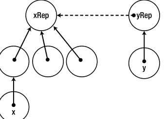

**图 5-6.** 两个集合 `x` 和 `y` 的合并，其中 `y` 较小。虚线箭头是结果

## 跳表 (Skip List)

跳表是一种存储有序元素链表的数据结构，允许在 `O(log n)` 时间内进行查找，这与数组中的二分查找或平衡二叉搜索树中的查找相当。显然，在跳表上执行二分查找的主要问题是链表不允许通过索引进行随机访问。跳表通过使用层次化的日益稀疏的链表来解决这一局限性：第一层列表连接所有节点；第二个链表连接节点 0, 2, 4, ...；第三个链表连接节点 0, 4, 8, ...；第四层列表连接节点 0, 8, 16, ...，以此类推。

要在跳表中查找一个元素，程序会首先遍历最稀疏的列表。当遇到大于或等于目标元素时，程序会返回上一个元素并下降到层次结构中的下一个列表。重复此过程直到找到该元素。这样可以保证 `O(log n)` 的列表查找时间。

遗憾的是，维护跳表元素并非易事。如果整个链表层次结构都被添加或删除，它将与 `SortedList` 等数据结构相比没有任何优势。一种常用方法是使列表的层次随机化（见图 5-7），这使得元素的插入、删除和查找达到对数级时间。维护跳表的具体细节可以参考 William Pugh 的论文《Skip lists: a probabilistic alternative to balanced trees》（ACM, 1990）。

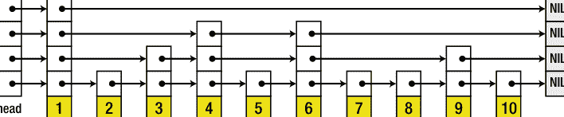

**图 5-7.** 层次结构中带有四层随机化列表的跳表结构（图片源自 Wikipedia）：http://upload.wikimedia.org/wikipedia/commons/8/86/Skip_list.svg，已发布到公有领域。）

# 单次集合 (One-Shot Collections)

你可能会遇到特殊情况，使得需要使用完全自定义的集合。我们称这些为单次集合（one-shot collections），因为它们可能是为你的特定领域定制的、难以置信的新发明。有时你可能会发现，你实现的某些单次集合实际上是很有复用性的；在小节中，我们将查看一个示例。

考虑以下应用。你正在运行一个糖果交易系统，该系统为糖果交易者更新各种类型。你的主数据表存储在内存中，每个糖果类型有一行，列出了当前价格。表 5-4 是某一时刻数据的示例：

**表 5-4.** 糖果交易系统数据表示例

| 糖果类型 | 价格 ($) |
| :--- | :--- |
| Twix | 0.93 |
| Mars | 0.88 |
| Snickers | 1.02 |
| Kisses | 0.66 |

# 第 5 章 集合与泛型

这种情况可以被避免。只有当集合实现能够直接从其 `GetEnumerator` 方法返回一个值类型时，调用者才会使用该值类型而不是接口。

为了实现这一点，`List<T>` 对 `IEnumerable<T>.GetEnumerator` 有一个显式接口实现，返回 `IEnumerator<T>`；以及另一个名为 `GetEnumerator` 的公共方法，返回 `List<T>.Enumerator`——这是一个内部值类型：

```cs
public class List<T> : IEnumerable<T> {
    public Enumerator GetEnumerator() {
        return new Enumerator(this);
    }
    IEnumerator<T> IEnumerable<T>.GetEnumerator() {
        return new Enumerator(this);
    }
    public struct Enumerator { ... }
}
```

这使得下面的代码成为可能，它完全消除了接口方法的调用：

```
List<int> list = ...;
List.Enumerator<int> enumerator = list.GetEnumerator();
long product = 1;
while (enumerator.MoveNext()) {
    product *= enumerator.Current;
}
```

另一种方案是让枚举器成为引用类型，但在其 `MoveNext` 方法和 `Current` 属性上重复相同的显式接口实现技巧。这同样允许直接使用该类的调用者规避接口调用的开销。

## 总结

在本章中，我们学习了十多种集合实现，并从内存密度、运行时复杂度、空间需求和线程安全的角度对它们进行了比较。你现在对于选择集合以及证明你选择的最优性应该有更好的直觉，而且你不应该偏离 .NET Framework 提供的功能，自己实现一个一次性的集合，或使用计算机科学文献中的想法。

# 第 6 章

# 并发与并行

多年来，计算机系统的处理能力呈指数级增长。处理器随着每个型号的更新变得越来越快，为挑战昂贵工作站硬件资源设计的程序正被移植到笔记本电脑和手持设备。这个时代在几年前就结束了，如今处理器的速度不再呈指数级增长，而是数量呈指数级增长。当多处理器系统还稀见且昂贵时，编写利用多个处理核心的程序并非易事，而今天，即使智能手机配备了双核和四核处理器，这也并没有变得简单。

在本章中，我们将对 .NET 现代并行编程的世界开启一次旋风之旅。虽然本章无法开始描述并行编程如今涉及的所有 API、框架、工具、陷阱、设计模式和体系模型，但任何关于性能优化的书籍如果不讨论一种显而易见的提高性能的方法——即扩展到多个处理器——都将是不完整的。

## 挑战与收益

利用并行性的另一个挑战是消费级处理器系统日益增长的异构性。CPU 制造商以提供具有四个或八个处理核心的廉价消费级系统，以及具有数十个核心的高端服务器系统为荣。然而，如今，中端工作站或高端笔记本电脑通常配备了强大的处理单元（GPU），支持数百个并发线程。仿佛这两种并行还不够，基础设施即服务（IaaS）的价格每周都在下降，使得瞬间之间进行数千次云访问成为可能。

> Herb Sutter 在他的文章《欢迎来到丛林》（2011）中对等待并行框架的异构世界进行了极好的概述。他在 2005 年的另一篇文章《免费午餐结束了》塑造了日常编程中对并发和并行框架兴趣的复兴。如果你发现自己对并行编程的需求超过了本章所能提供的，我们推荐以下关于并行编程通用主题以及特别是 .NET 并行框架的优秀书籍：Joe Duffy 的《Concurrent Programming on Windows》（Addison-Wesley, 2008）；Joseph Albahari 的《Threading in C#》（在线, 2011）。若要更详细地了解操作系统在线程调度和同步机制方面的内部运作，Mark Russinovich、David Solomon 和 Alex Ionescu 的《Windows Internals, 第 5 版》（Microsoft Press, 2009）是一本极佳的教材。最后，MSDN 是我们在本章中看到的 API（如任务并行库）的良好信息来源。

# 第 6 章 并发与并行

并行带来的性能收益不应轻视。I/O 密集型应用程序可以从将 I/O 卸载到独立线程中获益，通过执行异步 I/O 提供更高的响应能力，并利用利用多个 I/O 操作来实现扩展。具有可并行算法的 CPU 密集型应用程序可以通过利用所有可用 GPU 核心，在典型的消费级硬件上实现数量级的扩展。在本章稍后的部分，你将看到一个执行矩阵乘法的简单算法如何通过仅更改几行代码运行在 GPU 上，从而加速 10 倍。

一如既常，并行的道路充满了陷阱——每一步都有死锁、竞态条件、饥饿和内存损坏。最近的并行框架，包括任务并行库 (.NET 4.0) 和我们在本将在使用的 C++ AMP，旨在减少编写并行应用的复杂性并利用丰富的性能利润。

# 为什么用并发与并行？

在应用程序中引入多个控制线程有很多原因。本书致力于提高应用程序性能，并发和并行的多数原因都体现在结果上。以下是一些例子：

- 发起异步 I/O 操作可以提高应用程序的响应能力。大多数 GUI 应用程序有一个控制线程负责所有的 UI 更新；该线程绝不能被长时间占用，否则 UI 将变得无响应。
- 跨多个线程并行化工作可以提高整体吞吐量。具有多个核心的现代系统可以驱动吞吐量的数量级增长。
- 同时执行多个 I/O 操作（例如从多个仓库检索文件）是有帮助，因为大部分时间花在等待 I/O 操作上。

从线程到任务

起初线程是提供的低级抽象，提供的结构很少。考虑以下任务：被给定一个自然数范围，并找到范围内的所有质数。让我们写一个单线程运行的简单版本：

```cs
// 返回范围 [start, end) 内的所有质数
public static IEnumerable<int> PrimesInRange(int start, int end) {
    List<int> primes = new List<int>();
    for (int number = start; number < end; ++number) {
        if (IsPrime(number)) {
            primes.Add(number);
        }
    }
    return primes;
}
```

```cs
private static bool IsPrime(uint number) {
    // 这是一个低效的 O(n) 算法，但演示足够
    if (number == 2) return false;
    if (number % 2 == 0) return false;
    for (uint divisor = 3; divisor <= number; divisor += 2) {
        if (number % divisor == 0) return false;
    }
    return true;
}
```

这里有什么可以改进的吗？也许算法太快了，尝试优化它也没有什么可言！嗯，对于一个合理的范围，例如 `[1, 200000]`，该代码在现代处理器上运行几秒钟，留下了巨大的优化空间。

你可能对算法的效率有疑虑（例如，一个运行亚线性时间的微小优化），但无论算法是否最优，它看起来非常适合并行。毕竟，判断一个数字是否为质数是一个独立的任务，因此并行化上述代码的一种简单方法是将范围分成若干块，并为每个块创建一个单独的线程（如图6-1 所示）。显然，我们必须同步对集合的访问，以防止多个线程导致损坏。一种粗素的方法如下：

```cs
public static IEnumerable<uint> PrimesInRange(uint start, uint end) {
    List<uint> primes = new List<uint>();
    uint range = end - start;
    uint numThreads = Environment.ProcessorCount; // 这是一个好主意吗？
    uint chunk = range / numThreads; // 假设没有余数
    Thread[] threads = new Thread[numThreads];
    for (uint i = 0; i < numThreads; i++) {
        uint chunkStart = start + i * chunk;
        uint chunkEnd = chunkStart + chunk;
        threads[i] = new Thread(() => {


```csharp
for (uint number = chunkStart; number < chunkEnd; ++number) {
    if (IsPrime(number)) {
        lock(primes) {
            primes.Add(number);
        }
    }
}
});
threads[i].Start();
}
    // ... 合并线程 ...
}
```

# 第6章 并发与并行

```csharp
foreach (Thread thread in threads) {
    thread.Join();
}
return primes;
}
```

## 分布在多个线程的数字范围

| 1 - 25,000 | 25,001 - 50,000 | 50,001 - 75,000 | 75,001 - 100,000 |
| 线程 1 | 线程 2 | 线程 3 | 线程 4 |

**图 6-1.** 将质数范围划分到多个线程

在 Intel i7 系统上，顺序代码遍历范围 `[100, 200000]` 平均耗时 2950 ms，而并行化版本执行相同操作平均仅需 950 ms。对于具有 8 个 CPU 的系统，你可以预期更好的结果，但这种型号的处理器使用了超线程技术（`HyperThreading`），这意味着只有 4 个物理核心（每个物理核心承载两个逻辑核心）。预期 4 倍的加速更为合理，而我们获得了 3 倍的加速，这仍然是不容忽视的。正如图 6-2 和 6-3 中的并发分析器报告所示，某些线程完成得比其他线程快，导致整体 CPU 利用率远低于 100%（要在应用程序上运行并发分析器，请参阅第 2 章）。

CPU 利用率

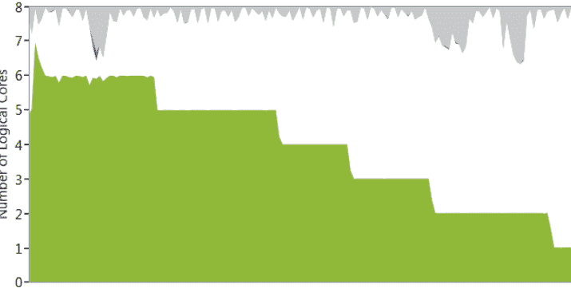

**图 6-2.** 整体 CPU 利用率上升到接近 8 个逻辑核心（100%），然后在运行结束时下降到仅一个逻辑核心

| 线程 ID | 名称 | 毫秒 2,500 | 2,600 | 2,700 | 2,800 | 2,900 | 3,000 | 3,100 | 3,200 | 3,300 |
|---|---|---|---|---|---|---|---|---|---|---|
| 7932 | CLR 工作线程 | | | | | | | | | |
| 9428 | CLR 工作线程 | | | | | | | | | |
| 7192 | CLR 工作线程 | | | | | | | | | |
| 7708 | CLR 工作线程 | | | | | | | | | |
| 9348 | CLR 工作线程 | | | | | | | | | |
| 5488 | CLR 工作线程 | | | | | | | | | |
| 11100 | CLR 工作线程 | | | | | | | | | |

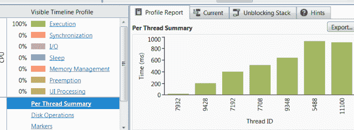

**图 6-3.** 某些线程比其他线程完成更快。虽然线程 9428 的运行时间不足 200ms，但线程 5488 的运行时间超过了 800ms

事实上，此程序的运行比顺序版本更快（尽管不会线性缩放），特别是当你拥有许多核心时。然而，这引出了几个问题：

- 多少线程是最优的？如果我们有 8 个 CPU 核心，我们应该创建 8 个线程吗？
- 如何确保我们不会垄用资源或过度订阅（`oversubscribe`）？例如，如果我们的进程中有另一个线程需要计算质数，并尝试像我们一样运行并行算法怎么办？从多个线程访问 `List<int>` 是不安全的，会导致数据损坏，因为每次我们在向集合中添加数字时都加锁（这是朴素解决方案的做法）被证明是极其昂贵的，并且会限制我们将算法扩展到进一步增加的处理器核心数量的能力。
- 对于较小的数字范围，创建新线程是否值得？或者在单个线程上同步执行整个操作是否会更好？（在 Windows 上创建和销毁线程是廉价的，但并没有判断 20 个数字是质数还是合数那么便宜？）
- 我们如何确保所有线程的工作量相等？某些线程比其他线程完成得更快，特别是那些处理较小数字的线程。对于将 `[100, 100000]` 分为四等份，负责 `[100, 25075]` 范围的线程完成速度将负责 `[75025, 100000]` 范围线程的两倍，因为我们的质数算法在遇到大质数时会变得越来越慢。
- 我们如何处理可能从其他线程产生的异常？在这种特定情况下，可以避免 `IsPrime` 方法产生任何错误，但在现实示例中，并行化工作可能充满陷阱和异常情况。（CLR 的默认行为是在线程因未处理的异常而失败时终止整个进程，这通常是一个好主意——快速失败语义——但不会允许 `PrimesInRange` 的调用者处理该异常）。

这些问题的答案远非易事，而且开发一个允许并发执行且不会产生过多线程、过度订阅并确保工作分配均匀的框架是非常复杂的。

### 从手动管理到线程池

线程池是一个管理任务的组件。与其创建和销毁线程，不如将任务提交到线程池，这可以处理过度订阅问题。特别是，线程池有助于解决上述的一些问题。例如：

```csharp
public static IEnumerable<uint> PrimesInRange(uint start, uint end) {
    List<uint> primes = new List<uint>();
    const uint chunkSize = 100;
    int completed = 0;
    ManualResetEvent allDone = new ManualResetEvent(false);
    uint chunks = (end - start) / chunkSize;
    for (uint i = 0; i < chunks; i++) {
        uint chunkStart = start + i * chunkSize;
        uint chunkEnd = chunkStart + chunkSize;
        ThreadPool.QueueWorkItem(_ => {
            for (uint number = chunkStart; number < chunkEnd; ++number) {
                if (IsPrime(number)) {
                    lock (primes) {
                        primes.Add(number);
                    }
                }
            }
            if (Interlocked.Increment(ref completed) == (int)chunks) {
                allDone.Set();
            }
        });
    }
    allDone.WaitOne();
    return primes;
}
```

此代码版本比基于线程的版本扩展性更好，并在 950 ms 内完成（针对范围 `[100, 200000]`），因为它将任务提交到了线程池。

| 线程 ID | 名称 | 1,000 | 1,100 | 1,200 | 1,300 | 1,400 | 1,500 | 1,600 | 1,700 |
|---|---|---|---|---|---|---|---|---|---|
| 1096 | CLR 工作线程 | █ | █ | █ | █ | █ | | | |
| 1070 | CLR 工作线程 | | | | | | | | |
| 9048 | CLR 工作线程 | | | | | | | | |
| 9428 | CLR 工作线程 | | | | | | | | |
| 1076 | CLR 工作线程 | | | | | | | | |
| 1112 | CLR 工作线程 | | | | | | | | |
| 9684 | CLR 工作线程 | | | | | | | | |
| 1540 | CLR 工作线程 | | | | | | | | |

**图 6-4.** CLR 线程池在程序执行期间使用 8 个线程（每个核心一个）。

**图 6-5.** 线程 #2 正在执行工作项 #5，执行完成后，它将从全局 FIFO 队列中借用工作。线程 #1 在处理任何其他工作之前会清空其本地队列。

## 线程池的 FIFO 和 LIFO 语义

看似古异的 FIFO 和 LIFO 语义背后的原因如下：当工作被推入全局队列时，没有特定的线程对执行有任何偏好，公平性是选择工作进行执行的唯一标准。这就是为什么 FIFO 语义适用于全局队列。然而，当线程池为执行排队某个工作时，它很可能会使用与当前正在执行的工作项相同的数据和指令；这就是为什么将其推入属于同一线程的池中是有意义的——它将在当前执行的工作项不久后被执行，并利用 CPU 的数据和指令缓存。

此外，访问线程本地队列上的工作项所需的同步较少，并且不太遇到来自全局队列以外线程的竞争。同样，当线程从另一个线程队列中窃取任务时，它是按照 FIFO 顺序窃取的，因此维护了针对原始线程处理器 CPU 缓存的 LIFO 优化。这种线程池结构对工作层次结构非常友好，单个推入全局队列的工作项可以派生几十个额外的工作项，并为多个线程池提供支持。

与抽象一样，线程池从应用程序接管了更多关于线程生命周期和工作项调度的细粒度控制。虽然 CLR 线程池有控制 API，但它没有内置 API 来控制其任务或线程的优先级。然而，通常情况下，这种级别的控制并没有应用程序在更强大的系统上自动扩展的能力所补偿，也没有无需为短寿命任务创建和销毁线程的性能。

推送到线程池的工作项的异常信息极其有限，不支持异步连接和取消，并且没有任何获取已完成任务结果的机制。`.NET 4` 中的任务并行库（TPL）引入了任务（Tasks），它是线程工作项之上的一个强大抽象。任务是线程和线程工作项的结构化替代方案，就像子程序和函数是基于跳转的汇编编程的结构化替代方案一样。

## 任务并行

任务并行是一种范式和一组 API，用于将大任务分解为一组小任务，并在多个线程上执行它们。事实上，这会让代码更简单——至少我们不再需要完成任务和 `ManualResetEvent` 来跟踪任务的执行。然而，正如我们在下一节中将看到的，TPL 提供的数据并行 API 甚至适合并行化寻找范围内所有质数的循环。相反，我们将考虑一个不同的问题。

有一种著名的递归比较排序算法称为“快速排序”（`QuickSort`），它非常容易并行化（且平均运行时间复杂度为 `O(n log n)`），这是最优的——尽管很少有大型框架使用快速排序来排序任何内容。快速排序算法的过程如下：

```c
public static void QuickSort<T>(T[] items) where T : IComparable<T>{
    QuickSort(items, 0, items.Length);
}
private static void QuickSort<T>(T[] items, int left, int right) where T : IComparable<T>{
    if (left >= right) return;
    int pivot = Partition(items, left, right);
    QuickSort(items, left, pivot);
    QuickSort(items, pivot+1, right);
}
private static int Partition<T>(T[] items, int left, int right) where T : IComparable<T>{
    int pivotPos = ...; //通常使用 left 和 right 之间的随机索引
    T pivotValue = items[pivotPos];
    Swap(items[right-1], items[pivotPos]);
    int store = left;
    for (int i = left; i < right - 1; ++i) {
        if (items[i].CompareTo(pivotValue) < 0) {
            Swap(items[i], items[store]);
            ++store;
        }
    }
    Swap(items[right-1], items[store]);
    return store;
}
private static void Swap<T>(ref T a, ref T b) {
    T temp = a;
    a = b;
    b = temp;
}
```

图 6-6 是 `Partition` 方法的一个步骤的插图。第四个元素（值为 5）被选为基准（`pivot`）。首先，它被移动到数组的最右侧。接下来，所有比它大的元素向右侧传播。最后，确定基准的位置，使其左侧的所有元素都小于等于它。

# 第 6 章 并发与并行

快速排序在每一步的递归调用必须引起警觉。排序数组的左部分和右部分是独立的任务，它们之间不需要同步，而 `Task` 类是表达这种关系的理想选择。以下是使用任务 并行化快速排序的首次尝试：

```csharp
public static void QuickSort<T>(T[] items) where T : IComparable<T> {
    QuickSort(items, 0, items.length);
}
private static void QuickSort<T>(T[] items, int left, int right) where T : IComparable<T> {
    if (right - left < 2) {
        int pivot = Partition(items, left, right);
        Task leftTask = Task.Run(() => QuickSort(items, left, pivot));
        Task rightTask = Task.Run(() => QuickSort(items, pivot+1, right));
        Task.WaitAll(leftTask, rightTask);
    }
}
```

```csharp
private static int Partition<T>(T[] items, int left, int right) where T : IComparable<T> {
    // 为了简洁省略实现
}
```

`Task.Run` 方法创建一个新任务（等同于调用 `new Task()`）并调度其执行（等同于新创建任务的 `start` 方法）。`Task.WaitAll` 方法等待任务完成并返回。注意，我们不需要处理如何等待任务完成、何时创建和销毁它们。

有一个非常有用的方法称为 `Parallel.Invoke`，它执行提供的一组任务并在所有任务完成后返回。这允许我们以如下方式重写快速排序方法的核心部分：

```csharp
Parallel.Invoke(
    () => QuickSort(items, left, pivot),
    () => QuickSort(items, pivot+1, right)
);
```

图 6-6. `Partition` 方法单次调用的插图。

# 第 6 章 并发与并行

顺序版本（在我们的测试系统上）运行了 250 ms，而并行版本平均花费了近 650 ms 才完成！

问题在于，并行化需要足够的粗粒度；尝试对一个三个元素的数组排序进行并行化是徒劳的，因为创建 `Task` 对象、将工作项调度到线程池以及等待它们完成执行所引入的开销，超过了所需的几次比较操作。

## 递归算法中的并行性限制

你建议如何限制并行性，以防止其削减我们优化的收益？有几种可行的方法：

- 只要待排序数组的大小大于某个阈值（例如， 500 个项目），就使用并行版本，一旦小于该阈值，立即切换到顺序版本。
- 只要递归深度小于某个阈值，就使用并行版本，一旦递归深度非常深，立即切换到顺序版本。（这种方案略逊于前一种，除非基准值正好位于数组中间）。
- 只要待处理任务数（方法必须手动维护）小于某个阈值，就使用并行版本，否则切换到顺序版本。（当没有其他限制并行性的标准（如递归深度或输入大小）时，这是唯一的选择。）

事实上，在上述情况下，对大于 500 个元素的数组限制并行性在作者的 Intel i7 处理器上效果显著，与顺序版本相比，执行时间提升了 4 倍。代码的变化非常简单，尽管在生产级实现中不应硬编码阈值：

```c
private static void QuickSort<T>(T[] items, int left, int right) where T : IComparable<T> {
  if (right - left < 2) return;
  int pivot = Partition(items, left, right);
  if (right - left > 500) {
    Parallel.Invoke(
      () => QuickSort(items, left, pivot),
      () => QuickSort(items, pivot+1, right)
    );
  } else {
    QuickSort(items, left, pivot);


```
    QuickSort(items, pivot+1, right);

  }

}

```

# 递归分解的更多示例

许多其他算法可以通过应用类似的递归分解来实现并行化。事实上，几乎所有将输入拆分为若干部分的递归算法都设计为在每个部分独立执行并在之后合并结果。在本章稍后的部分，我们将考虑那些不那么容易并行化的示例，但让我们先来看几个可以的例子：

- Strassen 矩阵乘法算法（参见 http://en.wikipedia.org/wiki/Strassen_algorithm 概述）。这种矩阵乘法算法的性能优在本章稍后介绍的朴素立方算法。Strassen 算法递归地将大小为 $2^n \times 2^n$ 的矩阵分解为四个大小为 $2^{n-1} \times 2^{n-1}$ 的块矩阵，使用了一种巧妙的技巧将乘法次数减少到七次 - $O(n^2)$。与 QuickSort 示例一样，在使用递归分解并行化 Strassen 算法时，实际实现通常会退回到标准算法，对于较小的矩阵设置并行阈值更为重要。

- 快速傅里变换（Cooley-Tukey 算法，参见 http://en.wikipedia.org/wiki/Cooley%26%80%93Tukey_FFT_algorithm）。该算法通过将长度为 $2^n$ 的向量递归分解为两个大小为 $2^{n-1}$ 的向量来计算 DFT（离散傅里叶变换）。并行化这种计算很容易，但对于足够小的向量，设置并行化阈值是很重要的。

- 图遍历（深度优先搜索 DFS 或广度优先搜索 BFS）。正如我们在第 4 章看到的，CLR 垃圾回收器遍历一个顶点为引用、边为对象的图。使用 DFS 或 BFS 进行图遍历可以从并行化中极大获益；然而，与 QuickSort 不同，在并行化图遍历的分支时，很难估计一次递归调用所代表的工作量。这种困难需要通过启发式方法来决定如何将搜索空间划分给线程；我们已经看到服务器 GC 根据每个处理器分配对象的独立堆，非常粗略地偏向于这种划分。

如果你正在寻找练习来练习并行编程技能的示例，还可以考虑 Karatsuba 乘法算法，它依赖于对 $n$ 位数的递归分解 - $O(n^{\log_2 n})$ 操作；合并排序依赖于递归分解进行排序，类似于 QuickSort；以及许多许多动态规划算法，这些算法通常要求在并行计算的不同分支中使用备忘录（我们将检查一个示例）。

# 异常与取消

我们还没有充分利用任务的力量。假设我们想要处理从 QuickSort 递归调用可能产生的异常，并为确保整个操作在未完成时仍能存活提供支持。

任务执行环境提供了基础设施，可以将任务内部发生的异常封送回它们被认为适当的地方。假设 QuickSort 任务的其中一次递归调用遇到了异常，可能是因为我们没有仔细考虑边界，导致在数组的两侧都触发了差一错误。此异常将在池线程上抛出，该线程不受我们的显式控制，也不允许任何上层控制。

`Task.Run(() => Treeloop(root.Right, condition, cts, cts.Token));`

```csharp

foreach (T element in data)

    if (cts.IsCancellationRequested) break; // 协作式取消

    if (condition(element))

        cts.Cancel(); // 取消所有正在进行的工作

    // 对感兴趣的元素进行某些操作

```

// 调用代码的示例：
`CancellationSource` `cts` = new `CancellationSource`();
`Task.Run(() => Treeloop(treeRoot, i => i % 77 == 0, cts));`
// 一过段时间后，例如用户不再对该操作感兴趣：
`cts.Cancel();`

不可避免地，在某些算法示例中，我们可能希望有一种更简单的方式来表达并行性。考虑我们开始的质数测试示例。我们可以手动将范围拆分成多个块，为每个块创建一个任务，并等待所有任务完成。事实上，有一整整类算法，它们对一组数据范围应用某种特定的操作。这些算法要求在任务并行之上提供一个更高级层次的抽象。我们现在转向这种抽象。

## 数据并行 (Data Parallelism)

任务并行主要处理任务，而数据并行旨在将任务从直接视图中移除，并用更高级层次的抽象——并行循环来替代它们。换句话说，并行性的源头不是算法的代码，而是其操作的数据。并行库（Parallel Library）提供了几个提供数据并行的 API。

## Parallel.For 和 Parallel.ForEach

`for` 和 `foreach` 循环是并行化的极佳候选。事实上，从并行计算出现以来，人们一直尝试自动并行化此类循环。某些尝试采用了语言更改或语言扩展的方法，例如 OpenMP 标准（它引入了诸如 `#pragma omp parallel for` 用于并行化循环的指令）。并行库通过显式 API 提供了循环并行，尽管这些 API 与对应的标准循环非常相似。这些 API 是 `Parallel.For` 和 `Parallel.ForEach`，它们尽可能地匹配语言中 `for` 和 `foreach` 循环的行为。

回到质数测试的示例，我们有一个遍历大范围数字的循环，检查每个数字是否为质数并将其插入集合中，如下所示：

```csharp

for (int number = start; number < end; ++number) {

    if (IsPrime(number))

        primes.Add(number);

}

```

将此代码转换为使用 `Parallel.For` 几乎是一项机械任务，尽管同步对 `primes` 集合的访问需要一些谨慎（存在许多更好的方法，例如聚合，我们稍后会考虑）：

```csharp

Parallel.For(start, end, number => {

    if (IsPrime(number))

        lock(primes) {

            primes.Add(number);

        }

});

```

通过将语言级循环替换为 API 调用，我们获得了循环迭代的自动并行化。此外，`Parallel.For` 并不是一个为每次迭代生成任务、或为范围的每个硬编码块大小部分生成任务的简单循环。相反，`Parallel.For` 会适应单个迭代的执行速度，考虑当前正在执行的任务数量，并通过动态扩展范围来防止细粒度开销。这些优化并非于易事，但你可以使用 `Parallel.For` 的重载（例如控制并发执行任务的最大数量）或使用自定义分区器来确定迭代范围应如何划分到不同的任务中。

类似的 API 也适用于 `foreach`，其中数据源可能没有被完全枚举，实际上，它可能不是有限的。假设我们需要从 Web 上下载一组 RSS 馈，指定为 `IEnumerable<string>`。循环的骨架将如下所示：

```csharp

IEnumerable<string> rssFeeds = ...;

WebClient webClient = new WebClient();

foreach (string url in rssFeeds) {

  Process(webClient.DownloadString(url));

}

```

此循环可以通过机械转换实现并行化，即将循环替换为对 `Parallel.ForEach` 的调用。请注意，数据源（`rssFeeds` 集合）不需要是线程安全的，`Parallel.ForEach` 在从多个线程访问时会使用同步机制。

```csharp

IEnumerable<string> rssFeeds = ...;

WebClient webClient = new WebClient();

Parallel.ForEach(rssFeeds, url => {

  Process(webClient.DownloadString(url));

});

```

> 你可能会担心在无限数据源上执行操作。然而，事实证明，开始此类操作并期望在满足某些条件时提前终止是非常方便的。例如，一个无限数据源，如所有自然数（在一个在一个返回 `IEnumerable<BigInteger>` 的方法中指定）。我们可以编写并并行化一个循环，寻找一个数字和为 477 但不能被 133 整除的数字。希望我们的循环会终止。

并行化循环并不像讨论中看起来那么简单。在我们将这一工具收入工具中之前，我们还需要考虑一些“缺失”的功能。首先，C# 循环具有 `break` 关键字，它可以提前终止循环。我们该如何终止一个被多个线程并行化的循环呢？除了我们正在执行的迭代，我们不知道哪些迭代正在其他线程上执行？

`ParallelLoopState` 表示并行循环的执行状态，并允许从循环中提前中断。这是一个简单的示例：

```csharp

int invitedToParty = 0;

Parallel.ForEach(customers, (customer, loopState) => {

  if (customer.Orders.Count > 10 && customer.City == "Portland") {

    if (Interlocked.Increment(ref invitedToParty) >= 25) {

        loopState.Stop(); // 不再执行额外的迭代

    }

  }

});

```

第 6 章 并发与并行

`ParallelLoopState.Stop` 的缺点之一是它不保证某个迭代之前的所有迭代都已执行。例如，假设有 1000 个客户，可能 1–100 个客户已经处理，101–110 个还没有，而客户 111 是调用 Stop 前最后一个处理的。如果你希望保证某个迭代之前的所有迭代都已执行（即使它们还没有开始！），你应该使用 `Break`。

## 并行 LINQ (PLINQ)

并行计算可能最高层次的抽象是你声明：“我想让这段代码并行运行”，并将剩下的交给框架来实现。什么是并行 LINQ？但在之前，需要对 LINQ 进行简短的回顾。LINQ（语言集成查询）是 C# 3.0 和 .NET 3.5 引入的一系列语言扩展，模糊了命令式编程和声明式编程之间的界限。例如，LINQ 查询从数据源客户（可能是内存集合、数据库表或更奇特的来源）检索华盛顿州客户在过去十个月内购买过三次 10 美元订单的姓名和年龄，并将它们显示在控制台上：

```csharp

var results = from customer in customers

    where customer.State == "WA"

    let custOrders = (from order in orders

                        where customer.ID == order.ID

                        select new { order.Date, order.Amount })

    where custOrders.Count((co) => co.Amount >= 10 &&

        co.Date > DateTime.Now.AddMonths(-10)) >= 3

```

```csharp

foreach (var result in results) {

    Console.WriteLine("{0} ({1})", result.Name, result.Age);

}

```

这里主要的注意事项是，查询是以声明式的方式指定的——就像 SQL 查询一样。通常情况下，你不必同步查询的不同部分，因为 LINQ 查询是纯函数且没有副作用——它们将一个集合转换为另一个而不修改过程中的对象。

要并行化查询执行，唯一的代码更改是将源集合从通用的 `IEnumerable<T>` 修改为 `ParallelQuery<T>`。`AsParallel()` 扩展方法接收：

```csharp

var results = from customer in customers.AsParallel()

```

# 第 6 章 并与并行

```csharp

select new { order.Date, order.Amount }

where custOrders.Count(co => co.Amount >= 10 &&

      co.Date >= DateTime.Now.AddMonths(-10)) == 3

select new { customer.Name, customer.Age };

foreach (var result in results) {

  Console.WriteLine("{0}", result.Name, result.Age);

}

```

PLINQ 使用三阶段处理流水线来执行并行查询，如图 6-7 所示。首先，PLINQ 决定应使用多少线程来并行化查询执行。接下来，工作线程从源获取工作块，并确保在锁保护下进行访问。每个线程独立地执行其工作项，并将结果在每个线程的本地队列中。最后，所有本地结果被缓冲到一个单一结果集中，该集合由上述示例中的 `foreach` 循环轮询。

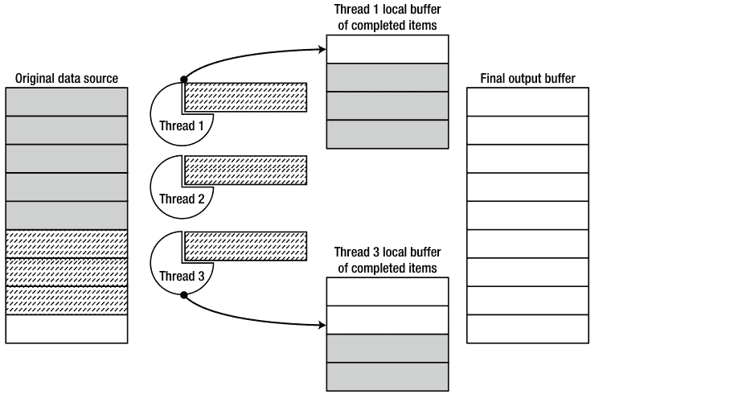

**图 6-7.** PLINQ 中的工作项执行。实灰色工作项已完成并放置在线程本地缓冲区中，随后它们被移动到调用者可用的最终输出缓冲区。虚线工作项当前正在执行中。

与 `Parallel.ForEach` 相比，PLINQ 的主要优势在于 PLINQ 会自动在执行查询的每个线程本地处理处理结果的聚合。当使用 `Parallel.ForEach` 寻找素数时，我们必须访问一个全局素数集合来聚合结果（在本章的后后部分，我们将考虑这需要连续的同步，并且引入了重大的开销）。我们可以使用 PLINQ 实现相同的结果，如下：

```csharp

List<int> primes = (from n in Enumerable.Range(3, 200000).AsParallel()

                      where IsPrime(n)

                    select n).ToList();

// 也可以使用 Parallel.Enumerable.Range(...).AsParallel()

```

# 第 6 章 并与并行

# 自定义并行循环和 PLINQ

并行循环（`Parallel.For` 和 `Parallel.ForEach`）以及 PLINQ 具有多个自定义 API，这使得它们非常灵活，并且在丰富性和表达力上与我们之前考虑的显式并行 API 接近。并行循环 API 接受带有各种属性的 `ParallelOptions` 对象，而 PLINQ 则依赖于 `ParallelQuery<T>` 的额外方法。这些选项包括：

- 限制并行度（允许并发执行的任务数）
- 提供取消令牌以取消并行执行
- 强制执行并行查询的输出顺序
- 控制并行查询的输出缓冲（合并模式）

在并行并行循环中，最常见的方法是使用 `ParallelOptions` 类限制并行度，而在 PLINQ 中，你通常会自定义查询的合并顺序和排序语义。关于这些自定义选项的更多信息，请参阅 MSDN 文档。

# C# 5 异步方法

到目前为止，我们考虑了允许使用 Task 库的类和方法表达各种并行解决方案的 API。然而，当 API 笨拙或不够简洁时，其他编程环境有时会依赖语言扩展来获得更好的表达力。在本节中，我们将看到 C# 5 如何通过提供语言扩展来更方便地表达延续（continuations），从而应对并发编程世界的挑战。但在此之前，我们必须考虑异步编程世界中的延续。

通常，你想将延续（或回调）与特定任务关联；延续应该在任务完成时执行。如果你对任务有控制权——即你调度了它的执行——或者你从他人那里接收到它，那么一个显式的延续 API 是理想的。TPL 提供了 `ContinueWith` 方法（不言自明）来控制各种设置下的延续。延续可能仅在任务遇到异常时执行，并可以在特定的线程或使用 `TaskScheduler` 调度执行。以下是各种 API 的示例：

```csharp

Task<string> weatherTask = DownloadInfo(...);

weatherTask.ContinueWith(() => Display(weatherTask.Result), TaskScheduler.Current);

Task left = ProcessLeft(...);

Task right = ProcessRight(...);

TaskFactory.ContinueWhenAll(

    new Task[] { left, right },

    CleanupResources

);

TaskFactory.ContinueWhenAny(

    new Task[] { left, right },

    HandleError

);

);

```

延续是编写异步应用程序的一种合理方法，在 GUI 设置中执行异步 I/O 时非常有价值。例如，为了确保 Windows 8 Metro 风格应用程序保持响应式用户界面，Windows 8 中的 WinRT（Windows Runtime）API 为所有可能运行超过 50 毫秒的操作提供了异步版本。当多个异步调用链联时，嵌套延续会变得有些笨拙，如下例所示：

```csharp

// 同步版本

private void update_Clicked(...) {

  using (LocationService location = new LocationService())

  using (WeatherService weather = new WeatherService()) {

    Location loc = location.GetCurrentLocation();


```csharp
Forecast forecast = weather.GetForecast(loc.City);

MessageDialog msg = new MessageDialog(forecast.Summary);

msg.Display();

}
}
```

```csharp
// 异步版本

private async void update_Clicked(...) {

  using (LocationService location = new LocationService())

  using (WeatherService weather = new WeatherService()) {

    Task<Location> locTask = location.GetCurrentLocationAsync();

    Location loc = await locTask;

    MessageDialog msg = new MessageDialog(forecast.Summary);

    await msg.Display();

  }

}
```

深度嵌套不是显式延续编程的唯一危险。考虑以下需要转换为的循环：

```csharp
// 同步版本

private Forecast[] GetForecastForAllCities(City[] cities) {
  Forecast[] forecasts = new Forecast[cities.Length];
  using (WeatherService weather = new WeatherService()) {
    for (int i = 0; i < cities.Length; i++) {
      forecasts[i] = weather.GetForecast(cities[i]);
    }
  }
  return forecasts;
}
```

```csharp
// 异步版本

private async Task<Forecast[]> GetForecastForAllCitiesAsync(City[] cities) {
    Forecast[] forecasts = new Forecast[cities.Length];
    using (WeatherService weather = new WeatherService()) {
        for (int i = 0; i < cities.Length; i++) {
            forecasts[i] = await weather.GetForecastAsync(cities[i]);
        }
    }
    return forecasts;
}
```

`forecasts[i] = await weather.GetForecastAsync(cities[i]);`

}
return forecasts;
}

注意，这些更改是非常微小的，编译器会处理获取 `forecasts` 变量（类型为 `Forecast[]`）的细节，并在周围创建 `Task<Forecast[]>` 骨架。通过简单的语言特性（尽管实现本身绝并不简单），C# 大极地降低了异步编程的门槛，并使得处理 API 和操作任务变得更加容易。`await` 操作符的实现并不限于任务并行库（TPL）；Windows 中原生的 WinRT API 是 `AsyncOperation<T>` 而不是 Task（这是一个托管概念），但仍然可以等待，如下例所示，该示例使用了真实的 WinRT API：

```
using Windows.Devices.Geolocation;
```
private async void updateButton_Clicked(...) {
  Geolocation locator = new Geolocation();
  Geoposition position = await locator.GetGeopositionAsync();
  statusTextBox.Text = position.CivicAddress.ToString();
```

# TPL 中的高级模式

在此节中，我们考虑了经过并行化处理的简单的算法示例。在本节中，我们将简要检查在处理现实世界问题时可能非常有用的技巧；在某些情况下，我们可能会从非常出乎意的地方获得性能提升。

在考虑带有共享状态的循环并行化时，第一个优化是聚合（有时称为归约 Reduction）。在并行循环中使用共享状态时，性能往往会由于共享状态的同步而丢失；加入的 CPU 越多，同步循环带来的收益就越小（这种现象是阿姆达尔定律的直接推论，通常被称为收益递减法则）。通过在执行并行循环的每个线程或任务内部聚合本地状态，并在循环执行结束时组合这些本地状态以获得最终结果，可以获得巨大的性能飞跃。

例如，考虑我们之前实现的质数计算。其中一个阻碍是将新的质数插入到共享列表中，这需要同步同步。相反，我们在每个线程中使用一个本地列表，并在循环完成时聚合这些列表：

```csharp
List<int> primes = new List<int>();
Parallel.For(0, 200000,
  () => new List<int>(), //初始化本地副本
  (i, localPrimes) => { //单次计算步骤，返回新的本地状态
    if (IsPrime(i)) {
      localPrimes.Add(i);
    } //没有同步必要，线程本地状态
    return localPrimes;
  },
  localPrimes => { //将本地列表合并到全局列表
    lock(primes) {
      //需要同步
      primes.AddRange(localPrimes);
    }
  });
```

# 第 6 章 并发与并行

在例示例中，获取的锁的数量明显少于早之前——我们只需要为每个执行并行循环的线程获取一次锁，而不是在发现每个质数时都获取一次。我们确实引入了收集列表的额外开销，但与本地聚合所带来的可扩展性相比，这种开销是微不足道且几乎可以忽略不计的。

另一个优化的来源是循环迭代太小，无法并行化。尽管并行 API 本身调用了多次迭代，但某些执行体的完成速度非常快，以至于会被每次迭代调用执行体的委托调用所主导。在这种情况下，可以使用分区器（Partitioner）手动对迭代进行分块，从而最大限度地减少委托调用的次数。

```csharp
Parallel.For(Partition.Create(3, 200000), range => // range 是一个 Tuple<int,int>
for (int i = range.Item1; i < range.Item2; ++i)
// 无委托调用的循环体
});
```

有关自定义的更多信息（这是数据可用的一项重要优化），请访问 http://microsoft.com/en-us/library/dd97411.aspx。

最后，有些应用程序可以从任务调度器中受益。示例包括 UI 线程上的延续（我们已经使用 `TaskScheduler.Current` 进入 UI 线程来实现）、通过更高优先级的调度器对其进行优先级排序，以及通过调度到使用特定 CPU 亲和性线程的调度器将任务绑定到特定的 CPU。关于自定义调度器的示例，请参考 MSDN 文章“如何创建一个限制并发度的任务调度器”，地址为 http://microsoft.com/en-us/library/ee789351.aspx。

## 同步

对并行编程的探讨值得简要提及同步这一宏大的话题。在本文演示的简单示例中，我们看到了许多多个线程访问共享内存位置的情况，无论是一个复杂的集合还是单个整数。除了只读数据外，对共享内存位置的每次访问都需要同步，但并不是所有的同步机制具有相同的性能和可扩展性。

在我们开始之前，让我们回顾访问少量数据时对同步的需求。现代 CPU 可以向内存发布原子读写操作；例如，32 位的值总是以原子方式执行的。如果一个处理器将值 0x0ADEEF 写入之前初始化为值 0 的内存位置，另一个处理器将不会观察到部分更新的内存位置（如 0x0AD0000）。遗憾的是，这对于较大的内存位置并非如此；例如，在 64 位处理器上，向内存写入 20 字节不是原子操作，无法以原子方式执行。

然而，即使在发布多次操作时，也会出现同步问题。例如，操作 `++1`（其中 1 是一个 int 类型的栈变量）通常被翻译为三条指令的序列

```
mov eax, dword ptr [ebp] // 从栈复制到寄存器
inc eax // 增加寄存器
mov dword ptr [ebp], eax // 从寄存器复制到栈
```

尽管这些指令本身是原子执行的，但如果没有额外的同步，两个处理器可能会并发执行指令序列，导致丢失更新。假设变量的初始值为 100，并检查以下执行历史：

# 处理器 1

# 处理器 2

```
mov eax, dword ptr [ebp] // 从栈复制到寄存器
```

```
mov eax, dword ptr [ebp] // 从栈复制到寄存器
inc eax // 增加寄存器
```

inc eax

mov dword ptr [ebp], eax // 从寄存器复制到栈

```

在这种情况下，变量的值将是 101，尽管两个处理器都执行了递增操作，本应该是 102。这种竞态条件——希望它是显而易见且易于检测的——是需要仔细同步的情况典型示例。

# 其他方向

许多研究人员和语言设计者不认为可以在不改变编程语言、并行框架或处理器内存模型的情况下解决内存同步问题。该领域有一些有趣的方向：

- * 硬件或软件中的事务内存对内存操作提供了显式或隐式的隔离以及回滚语义。目前，此类方法的性能成本限制了它们的广泛应用。
- * 基于代理的语言将并发模型深入语言，并要求通过消息传递而非共享内存进行代理（对象）之间的通信。
- * 消息传递处理器和内存架构使用私有内存范式组织系统，其中每个共享内存位置必须通过硬件级的消息传递来实现。

在本节的剩余部分中，我们将假设一种更务实的观点，并尝试通过提供同步机制和模式来解决共享内存同步问题。然而，作者坚信同步比应该的要困难；我们的共同经验表明，当今软件的大部分错误源于未正确同步并行程序而导致的状态损坏。我们希望在几年后——社区能更好的替代方案。

# 无锁代码

同步的一种方法是将负担交给操作系统。毕竟，操作系统提供了创建和管理线程的设施，并对它的调度承担全部责任。自然地期望它提供一组同步原语。尽管我们很快就会讨论同步机制，但这引出了一个问题：操作系统是如何实现这些同步机制的？显然 Windows 本身需要对其内部结构——表示同步机制的数据结构进行同步，它不能通过推延给这些机制来实现。事实证明，同步机制通常需要系统调用（用户态到内核态的转换）和线程切换来确保同步，如果被同步的操作非常廉价（例如增加数字或向链表中插入项），这种开销是相对昂贵的。

Windows 上的所有处理器都可以实现一种名为比较交换（CAS）的硬件同步原语。CAS 具有以下语义（伪代码），并以原子方式执行：

# 第 6 章 并发与并行

```cpp
CAS(WORD*) location, WORD value, WORD comparand) {
    WORD old = *location;
    if (old == comparand) {
        *location = value;
    }
    return old;
}
```

简单来说，CAS 比较一个内存位置与提供的值。如果内存中包含提供的值，则它会被替换为另一个值；否则，保持不变。在任何情况下，操作都会返回操作执行前内存位置的内容。

例如，在 Intel x86 中，`LOCK CMPXCHG` 指令实现了这一原语。将 `CAS(&a,b,c)` 翻译为调用 `LOCK CMPXCHG` 是一个机械化的过程，我们在本节的其余部分将继续使用 CAS。在 .NET Framework 中，CAS 是通过一组名为 `Interlocked.CompareExchange` 的重载实现的。

```csharp
// C 代码:
int n = 0;
if (Interlocked.CompareExchange(ref n, 1, 0) == 0) // 尝试将 0 替换为 1
    // .. 执行某些操作
```

```assembly
; x86 汇编指令:
; 比较值
mov eax, 0                   ; 新值
mov edx, 1
lock cmpxch word ptr [ebp-64] ; 假设 n 在 [ebp-64] 中
test eax, eax                ; 如果 eax = 0，则发生替换
jnz not_taken
; .. 执行某些操作
not_taken:
```

单次 CAS 通常不足以用于任何同步机制，除非预期的语义是执行一次“检查并替换”的操作。然而，当与循环结构结合使用时，CAS 可用于多种不容忽视的同步任务。首先，我们考虑一个简单的就地乘法示例。为了执行操作 `x *= y`，其中 `x` 是一个共享内存位置，可能同时被其他线程写入，而 `y` 是一个不被其他线程修改的常量值。基于 CAS 的 C# 方法执行此操作：

```csharp
public static void InterlockedMultiplyInPlace(ref int x, int y) {
    int temp;
    int mult;
    do {
        temp = x;
        mult = temp * y;
    } while (Interlocked.CompareExchange(ref x, mult, temp) != temp);
}
```

每次迭代都通过读取 `x` 的值到临时变量开始，该变量不会被另一个线程修改。接下来，我们找到乘法结果，准备放入 `x` 中。最后，当且仅当 `CompareExchange` 报告它成功将 `x` 的值替换为乘法结果（前提是原始值未修改）时，循环终止。然而，极少数可能——即使在其他处理器的压力下——单个处理器在尝试将 `x` 替换为新值时，跳过的次数也不会超过几次。尽管如此，循环必须准备面对这种情况（重试）。考虑以下 `x=3, y=5` 且有两个处理器的执行历史：

| 处理器 #1 | 处理器 #2 |
| :--- | :--- |
| temp = x; (3) | temp = x; (3) |
| mult = temp * y; (15) | mult = temp * y; (15) |
| CAS(ref x, mult, temp) == 15 (15==temp) | CAS(ref x, mult, temp) == 3 (3==temp) |

即使是这个简单的示例也很出错。例如，以下循环可能会导致更新错误：

```csharp
public static void InterlockedMultiplyInPlace(ref int x, int y) {
    int temp;
    int mult;
    do {
        temp = x;
        mult = x * y;
    } while (Interlocked.CompareExchange(ref x, mult, temp) != temp);
}
```

为什么？连续两次读取 `x` 的值并不能保证我们看到相同的值！下面的执行历史演示了如何产生错误的结果，在处理器上 `x=3, y=5` —— 在执行结束时 `x=60`！

| 处理器 #1 | 处理器 #2 |
| :--- | :--- |
| temp = x; (3) | x = 12; |
| mult = x * y; (60)! | x = 3; |
| CAS(ref x, mult, temp) == 3 (3==temp) | |

我们可以将此结果推广到任何只需要读取单个易变内存位置并将其替换为新值的算法，无论多么复杂。最通用的版本如下：

```csharp
public static void DoWithCAS<T>(ref T location, Func<T,T> generator) where T : class {
    T temp;
    do {
        temp = location;
        T replace = generator(temp);
    } while (Interlocked.CompareExchange(ref location, replace, temp) != temp);
}
```

用这个通用版本表示乘法方法非常简单：

```csharp
public static void InterlockedMultiplyInPlace(ref int x, int y) {
    DoWithCAS(ref x, t => t * y);
}
```

具体而言，有一种名为自旋锁（spinlock）的简单同步机制，可以使用 CAS 实现。这里的思想是：获取锁是为了确保任何尝试获取锁的其它线程都会失败并重试。那么，自旋锁是一种允许单个线程获取它，而所有其他线程在尝试获取时自旋（“浪费” CPU 周期）的锁。如下：

```csharp
public class Spinlock {
    private int locked;
    public void Acquire() {
        while (Interlocked.CompareExchange(ref locked, 1, 0) != 0) {
            // 自旋
        }
    }
    public void Release() {
        locked = 0;
    }
}
```


进入`/path/to/xxx`目录，找到`xxx.json`。

在表达式`cvar = avar + bvar`中，加法运算符（`+`）将`avar`与`bvar`相加，得到它们的和`cvar`

在`List.of(arg0, arg1, arg2)`中，`List`接口的工厂方法`of()`接受一系列的元素，返回包含它们的只读列表。

之后我们这样调用`cmd`命令：`cmd arg0 arg1 arg2`。

```
if (condVar > someVal) {console.log("xxx")}
```

```csharp
public bool TryPop(out T element) {
  // 使用 CAS 在这里不起作用，因为我们需要提前终止语义
  Node node;
  do {
    node = head;
    if (node == null) {
      element = default(T);
      return false; // 退出 - 无可返回
    }
  } while (Interlocked.CompareExchange(ref head, node.Next, node) != node);
  element = node.Data;
  return true;
}
```

`Push`方法尝试将列表头部替换为新节点，新结的`Next`指针指向当前列表头部。同样地，`TryPop`方法尝试将列表头部替换为当前头部结点的`Next`指针所指向的节点，如图 6-8 所示。

**图 6-8.** `TryPop`操作尝试将当前列表头部替换为新的头部。

你可能会想，世界上上的每种数据结构都可以使用 CAS 和类似的无锁原语来实现。事实上，如今还有一些广泛使用的无锁集合的其他示例：

- 无锁双向链表
- 无锁队列（带有头部和尾部）
- 无锁简单优先级队列

然而，许多集合无法用无锁代码轻松实现，仍然依赖于阻塞同步机制。此外，还有大量代码需要同步，但由于执行时间很长而无法使用 CAS。我们现在转向讨论“真实”的同步机制，这些机制由操作系统实现并涉及阻塞。

## Windows 同步机制

Windows 为用户态程序提供了许多同步机制，例如事件、信号量、互斥锁（mutex）和条件变量。我们的程序可以通过句柄（handle）和 Win32 API 调用访问这些同步机制。.NET 以面向对象的方式提供了同步机制，例如`ManualResetEvent`、`Mutex`和`Semaphore`。在现有同步机制的基础上，.NET 还提供了几种新机制，例如`ReaderWriterLockSlim`和`Monitor`。我们不会详细详尽地检查每种同步机制……

# 第 6 章 并发与并行

Windows 内核通过阻塞在锁不可用时尝试获取锁的线程来实现我们正在讨论的同步机制。阻塞线程会将其从 CPU 中移除，将其标记为等待状态，并调度另一个线程执行执行。此操作涉及一次系统调用（即从用户态到内核态的转换）、线程之间的上下文切换，以及在内核中执行的一小组数据结构更新（见图 6-9），用于将线程标记为等待并将其与其正在等待的同步机制关联。

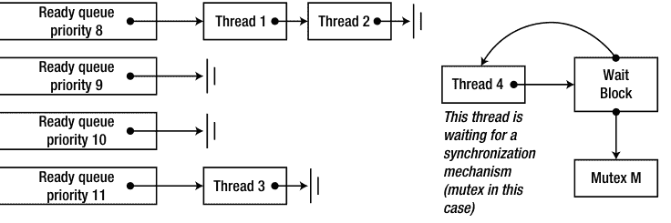

**图 6-9.** 操作系统调度器维护的数据。就绪执行的线程被放在 FIFO 队列中。被阻塞的线程通过一个名为 wait 的内部结构恢复其同步机制。

总的来说，阻塞一个线程可能会花费数千个 CPU 周期，并且当同步机制可用时，需要若干周期来解锁。因此，如果使用内核同步机制来保护如向写入缓冲区或执行网络往返等耗时操作，这种开销是可以忽略不计的；但如果使用内核同步机制来保护像`+++`这样的操作，这种开销就会引入不必要的成本。

Windows 和 .NET 为应用程序提供的同步机制主要区别在于它们的获取和释放语义，也称为它们的信号状态。当同步机制变为信号状态（signaled）时，它会唤醒等待其可用的线程（或一组线程）。以下是 .NET 应用程序当前可用的某些同步机制的信号语义：

**表 6-1.** 部分同步机制的信号语义

| 同步机制 | 何时变为信号状态？ | 哪些线程被唤醒？ |
|---|---|---|
| Mutex | 当线程调用`Mutex`时 | 等待互斥锁的线程 |
| Semaphore | 当线程调用`Semaphore.Release`时 | 等待信号量的线程 |
| ManualResetEvent | 当线程调用`ManualResetEvent.Set`时 | 等待事件的线程 |
| AutoResetEvent | 当线程调用`AutoResetEvent.Set`时 | 等待事件的线程 |
| Monitor | 当线程调用`Monitor.Exit`时 | 等待显示器的线程 |

# 第 6 章 并发与并行

表 6-1. 部分同步机制（续）

| 同步机制 | 何时变为信号状态？ | 哪些线程被唤醒？ |
| --- |---|---|
| Barrier | 当参与的线程都调用`Barrier.SignalAndWait`时 | 等待屏障的 |
| ReaderWriterLock—for reading | 当没有写入线程，或最后一个写入线程释放锁时 | 等待读取锁的线程 |
| ReaderWriterLock—for writing | 当没有读取线程时 | 等待写入锁的线程 |

## 缓存考虑

首先，查看下面的顺序方法。它执行对二维数组所有元素的求和并返回结果。

```csharp
public static int MatrixSequential(int[,] matrix) {
  int sum = 0;
  int rows = matrix.GetLength(0);
  int cols = matrix.GetLength(1);
  for (int i = 0; i < rows; i++) {
    for (int j = 0; j < cols; j++) {
      sum += matrix[i, j];
    }
  }
  return sum;
}
```

然而，假设我们没有 TPL 可用，直接使用线程。下面的并行尝试似乎是合理的：

```csharp
public static int MatrixParallel(int[,] matrix) {
  int sum = 0;
  int rows = matrix.GetLength(0);
  int cols = matrix.GetLength(1);
  const int THREADS = 4;
  int chunk = rows / THREADS;
  int[] localSums = new int[THREADS];
  Thread[] threads = new Thread[THREADS];
  for (int i = 0; i < THREADS; i++) {
    int threadnum = i;
    int start = chunk * i;
    int end = chunk * (i + 1);
    threads[i] = new Thread(() => {
      for (int row = start; row < end; row++) {
        for (int col = 0; col < cols; col++) {
          localSums[threadnum] += matrix[row, col];
        }
      }
    });
    threads[i].Start();
  }
  foreach (Thread thread in threads) {
    thread.Join();
  }
  sum = localSums.Sum();
  return sum;
}
```

在 Intel i7 处理器上执行上述两种方法 25 次，对于 2000~2000 个整数的结果如下：顺序方法平均在 325 毫秒内完成，而并行化方法平均竟然是惊人的 935 毫秒，和顺序版本一样慢！

这显然是不可接受的，但为什么呢？这并不是另一个细粒度并行的例子，因为线程只有 4 个。如果你接受这个问题与缓存有关（因为这个示例出现在缓存考虑章节），那么测量缓存缺失的次数是有意义的。Visual Studio 性能分析器（每发生 2000 次缓存缺失采样一次）并行版本报告了 963 次独占样本，而顺序版本仅报告 67 次独占样本，其中大多数样本位于读取矩阵的内部循环中。

# 第 6 章并发与并行

正如第 5 章所述，处理器缓存是以缓存行（cache lines）为单位组织的，相邻的内存位置共享同一个缓存行。当一个处理器写入另一个处理器缓存中的内存位置时，硬件会导致缓存失效（cache invalidation），将另一个处理器缓存中的该缓存行标记为无效。访问无效的行行会导致缓存缺失。在上面的上面的示例中，整个`localSums`数组很可能完全放入一个缓存行内，并同时存在于执行应用程序线程的全部四个处理器的缓存中。即使在任何一个处理器上对数组的任何元素执行操作，也会导致其他处理器的缓存行失效，引起缓存失效的频繁“乒乓”效应（见图 6-10）。

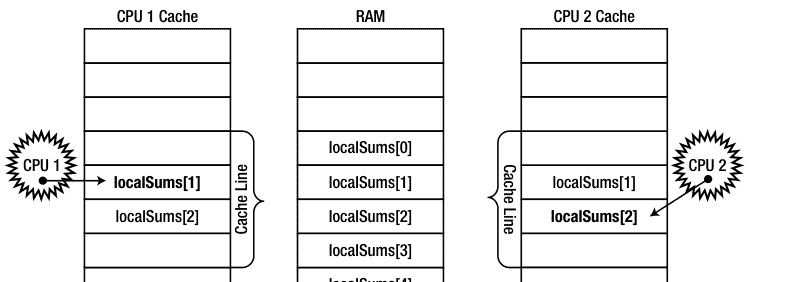

**图 6-10.** CPU 1 写入 localSums[1] 的同时，CPU 2 写入 localSums[2]。由于这两个数组元素是相邻的并且在两个处理器的缓存中都位于同一个缓存行，因此此类每次写入会导致另一个处理器的缓存失效。

为了确保该问题完全与缓存失效有关，可以将数组的步长（strides）做得足够大以免发生缓存失效，或者将对数组的直接写入替换为对每个线程本地变量的写入，并在线程完成后将其刷新到数组。这两种优化中的任何一种都能恢复世界的正常，并让并行版本在足够数量的核心数上比顺序版本更快。

缓存失效（或缓存冲突）是一个非常棘手的问题，在实际应用中极难检测，即使在强大的处理器帮助下也是如此。在设计 CPU 算法时提前考虑这一点将节省你大量的时间和烦恼。

> **注意** 作者在一次生产环境中遇到过类似的缓存失效情况，当时两个运行在不同处理器上的线程共享一个队列。当对队列的内部结构进行某个细微更改时，在构建中发现了显著的性能下降（约 20%）。经过长时间且详细的检查，显然队列中的字段是性能下降的原因；两个被不同线程写入的字段靠得太近，被放在同一个缓存行中。在字段之间添加填充后，队列性能恢复到了可以接受的水平。

# 通用 GPU 计算

到目前为止，我们对并行编程的介绍侧重于 CPU。事实上，我们有多种技能可以实现跨多核心的程序并行化、访问共享资源，以及用于同步的高速原语。正如开头提到的，还有另一种可用的并行源——GPU，在现代硬件上，它提供的核心甚至比高端 CPU 还要多。GPU 核心非常适合数据并行算法，而其庞大的数量弥补了在 CPU 上运行程序时通常具有的笨拙感。在本节中，我们将检查使用一组称为 C++ AMP 的扩展set在 GPU 上运行程序的一种方法。C++ AMP 基于 C++，本节将通过应用适量的 .NET 互操作性使用 C++，你也可以在 .NET 应用程序中使用 C++ AMP。我们将在最后回到这一点。

## C++ AMP 简介

从本质上，GPU 是与其他任何处理器类似的处理器，具有特定的指令集、大量的内核和内存访问协议。然而，现代 GPU 和 CPU 之间存在显著差异，理解这些差异对于编写高效的 GPU 程序至关重要：

- 现代 CPU 可用的一小部分指令在 GPU 上同样可用。这意味着某些局限性：没有函数调用、数据类型受限、缺少库函数等等。其他操作（如分支）可能会引入 CPU 无法比拟的性能开销。显然，这使得大量代码从 CPU 迁移到 GPU 是一项艰巨的工作。
- 中端显卡上的核心数量比中端插槽多得多。有些工作由于规模太小或无法拆分成许多部分，将无法从 GPU 的并行化中获益。
- 执行任务的 GPU 核心之间缺乏同步支持，且不支持不同任务之间的同步，这需要在 CPU 上编排 GPU 工作。

# 哪些任务适合在 GPU 上执行？

并不是所有算法都适合在 GPU 上执行。例如，GPU 无法访问其他 I/O 设备，因此它们很难提高从 Web 获取数据的程序的性能。然而，许多受限的数据并行算法可以移植到 GPU 并从中获得巨大的并行化优势。以下是一些示例（列表并未列全）：

- 图像模糊、锐化和其他变换
- 快速傅里叶变换 (FFT)
- 矩阵转置和乘法
- 数字排序
- 暴力哈希破解

# 第 6 章并发与并行

额外示例的一个良好来源是 Microsoft Native Concurrency 博客（http://blogs.msn.com/b/nativeconcurrency），其中包含了各种已移植到 C++ AMP 的算法示例代码和解释。

C++ AMP 是一个与 Visual Studio 2012 协作的框架，为 C++ 开发者提供了在 GPU 上运行计算的简单方法，只需 DirectX 11 驱动即可运行。微软发布了开放规范的 C++ AMP（可在网上 http://blogs.msn.com/b/nativeconcurrency/archive/2012/01/03/c-amp-open-spec-published.aspx 获取），任何版本的编译器都可以实现。在 C++ AMP 中，代码可以在加速器上执行，加速器代表了能力。C++ AMP 会通过 DirectX 11 驱动发现所有加速器。开箱即用的，C++ AMP 还带有一个执行软件模拟的参考加速器和一个没有 DirectX 11 驱动或 SIMD 指令的 CPU 加速器。

接下来，让我们考虑一个可以在 GPU 上轻松并行化的算法。下面的算法接收简单长度的向量并计算结果。很难想象更直接的方法了：

```
void VectorAddExpPointwise(float* first, float* second, float* result, int len) {
  for (int i = 0; i < len; i++) {
    result[i] = first[i]->exp(second[i]);
  }
}
```

在 CPU 上并行化算法需要将迭代范围分成若干块，并为每个块创建一个线程。如果我们花时间在质性测试中这样做——我们已经见过如何通过创建线程、向线程池发布项目以及使用 Parallel::for 自动并行能力来实现。同样记住，在 CPU 上并行化类似算法时，我们非常避免颗粒度过粗（例如低迭代次数的工作）。

在 GPU 上，上下文切换的成本远低于 CPU。以下是使用 C++ AMP `parallel_foreach` API 所需的代码：

```
#include <amp.h>
#include <math.h>
using namespace std::experimental::concurrency;
void VectorAddExpPointwise(float* first, float* second, float* result, int len) {
  array_view<const float, int> aFirst(len, first);
  array_view<const float, int> aSecond(len, second);
  array_view<float, int> aResult(len, result);
  aResult.discard_data();
  parallel_for_each(aResult.extent, [=](index<1> restrict amp) {
    aResult[amp] = aFirst[amp]->fast_math::exp(aSecond[amp]);
  });
  aResult.synchronize();}
```

接下来，传递给方法的原始数据（first、second 和 result 参数）已被封装在 `array_view` 类中，该类必须移动到加速器中。它的模板参数是数据类型和维度。如果我们想要 GPU 执行指令

## 第 6 章 并发与并行

为了访问原本位于 CPU 上的数据，任何实体都必须小心将数据拷贝到 GPU，因为如今的 GPU 是具有独立内存的离散设备。这正是 `array_view` 实例的任务——它们确保数据在需要时且按需进行拷贝。

当在 GPU 上的操作完成后，数据会被拷贝回其原始位置。通过创建带有 `const` 类型参数的 `array_view` 实例，我们确保了 `first` 和 `second` 仅被拷贝到 GPU，而不需要从 GPU 拷贝回。同样地，通过使用 `discard_data` 方法，我们确保 `result` 不会被从 CPU 拷贝到 GPU，只有当结果有拷贝的价值时，才从 GPU 拷贝到 CPU。

`parallel_foreach` API 接收一个 `extent`（范围），即我们正在处理的数据形状，以及一个用于对 `extent` 中每个元素执行的函数。我们在上面的代码中使用了 lambda 函数，这是自 2011 年 ISO 标准（C++11）以来 C++ 中一个非常受欢迎的补充。`restrict` 关键字指示编译器验证函数体是否在 GPU 上执行，并禁止大部分无法编译为 GPU 指令的 C++ 语法。

lambda 函数的参数是一个索引 `<I>`，它代表一个一维索引。如果函数需要处理多维 `extent`（例如矩阵数据），则索引将必须是二维的。我们很快就会看到这方面的示例。

最后，方法末尾的更改确保了在 `VectorAdd` 返回时，结果已拷贝回其原始容器 `result` 数组中。

我们对 C++ AMP 的首次之旅就此结束，我们已准备好更深入地检查发生的情况——以及一个能够从 GPU 并行化中获益的示例。向量加法并不是最令人兴奋的算法，也不是卸载到 GPU 的良好候选，因为内存传输的开销超过了计算的并行性。在接下来的章节中，我们将两个两个趣的例子。

## 矩阵乘法

我们将考虑的第一个“现实世界”例子是矩阵乘法。我们将优化用于矩阵乘法的朴素立方算法，而不是运行在亚立方时间内的 Strassen 算法。给定两个尺寸矩阵的矩阵，$A$ 为 $m \times w$，$B$ 为 $w \times n$，以下顺序程序生成它们的乘积，矩阵 $C$ 为 $m \times n$：

```cpp
void matrixMultiply(int* A, int m, int w, int* B, int n, int* C) {
```


```cpp
for (int i = 0; i < m; i++) {
    for (int j = 0; j < n; j++) {
      int sum = 0;
      for (int k = 0; k < w; k++) {
        sum += A[i*w+k] * B[k*w+j];
      }
      C[i*n+j] = sum;
    }
}
```

这里有几个并行化的来源，如果我们并行化外层循环，那么值得注意的是，仅并行化外层循环可能无法为所有核心创建足够的工作。并行化两个外层循环更有意义，仍然为内层循环留下了一个内容丰富的算法：

```cpp
void matrixMultiply(int* A, int m, int w, int* B, int n, int* C) {
  array_view<const int, 2> avA(m, w, A);
  array_view<const int, 2> avB(w, n, B);
  array_view<int> avC(m, n, C);
  avC.discard_data();
  parallel_for_each(avC.extent(), [=](index<2> idx) restrict(amp) {
    int sum = 0;
    for (int k = 0; k<w; ++k) {
      sum += avA(idx[0]*w, k) + avB(k, idx[1]);
    }
    avC[idx] = sum;
  });
}
```

一切仍然与顺序乘法以及我们之前看到的向量加法示例非常相似——除了索引是二维的，并且内层循环使用 `[]` 运算符进行访问。这个版本与 CPU 替代方案相比如何？为了乘以 `1024×1024` 的（整数）矩阵，CPU 版本平均需要 `7350 ms`，而 GPU 版本——平均平均仅需 `50 ms`，提升了 `147` 倍！

## N 体模拟

我们到为止看到的示例在调度到 GPU 上的内层循环非常复杂。显然，情况并不总是如此。我们引用的 Native Concurrency 团队博客上的一个示例展示了 N 体模拟，它模拟了粒子之间受到重力作用的相互作用。模拟无限数量的步骤；在每一步中，它必须处理这些相互作用。由于 GPU 并行化的优势，这种模拟在 GPU 上运行会非常有意义。

## 第 6 章 并发与并行

（结果矩阵），我们必须找到 `$A_i$`（第一个矩阵的第 `$i$` 行）与 `$B_{sj}$` 之间的标量积。然而，这等相当于找到部分行和部分列的标量积并将结果相加。我们可以借此将矩阵乘法转换为下面的算法：

```cpp
void MatrixMultiply(int* A, int m, int w, int* B, int n, int* C) {
    array_view<const, int,2> avA(m, w, A);
    array_view<const, int,2> avB(w, n, B);
    array_view<int,2> avC(n, C);
    avC.sync_data();
    parallel_for_each(avC.extent.tile<16,16>(16,16), [tiled_index<16,16> idx] restrict(amp) {
        int sum = 0;
        int localRow = idx.local[0], localCol = idx.local[1];
        for (int k = 0; k < w; k++) {
            tile_static const localA[16], localB[16];
            localA[localRow][localCol] = avA(idx.global[0], localCol+k);
            localB[localRow][localCol] = avB(localRow+k, idx.global[1]);
            idx.barrier.wait();
            for (int t = 0; t < 16; t++) {
                sum += localA[localRow][t]*localB[t][localCol];
            }
        }
        idx.barrier.wait();
        avC[idx.global] = sum;
    });
}
```

分块优化（tiled optimization）的本质在于每个线程读取一个分块（共有 256 个线程，分块大小为 `16×16`），并在来自 `$A$` 和 `$B$` 输入矩阵的 `16×16` 子块副本中初始化它自己的元素（见图 6-13）。分块中的每个线程只需要这些子块的一行一列，但所有线程共同访问每行 16 次、每列 16 次，从而显著减少了主内存的访问次数。

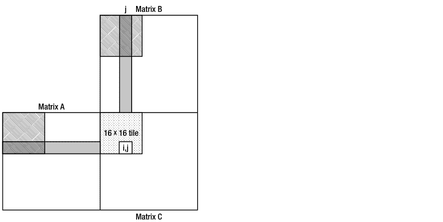

**图 6-13.** 为了找到结果矩阵中的元素 `(i,j)`，算法需要第一个矩阵的整个第 `$i$` 行和第二个矩阵的第 `$j$` 列。当图中所示的 `16 × 16` 分块中的线程执行且 `k=0` 时，第一两个矩阵中的阴影区域将被读取到共享内存中。负责结果矩阵中 `(i,j)` 元素的线程将获得第 `$i$` 行前 `$k$` 个元素与第 `$j$` 行前 `$k$` 个元素的部分标量积。

在这种情况下，分块是一种非常值得的优化。分块版本的矩阵乘法执行速度远快于简单版本，使用相同的 `1024 × 1024` 矩阵，平均需要 `17` 毫秒完成。与 CPU 版本相比，这实现了 `430` 倍的加速！

在我们开始 C++ AMP 之前，有必要提到 C++ AMP 开发者可用的开发工具（Visual Studio）。Visual Studio 2012 具有 GPU 调试器，你可以用它在 GPU 内核中设置断点、检查模拟调用堆栈、读取和修改局部变量（某些加速器支持 GPU 调试；对于另一些，Visual Studio 使用软件模拟器），以及一个性能分析器，用于衡量你的应用程序从 GPU 并行化中获得了什么。有关 Visual Studio 调试体验的更多信息，请参阅 MSDN 文章“Walkthrough: Debugging a C++ AMP Application”，地址：`http://msdn.microsoft.com/en-us/library/hj36288(v=VS.10).aspx`。

## GPU 计算的 .NET 替代方案

尽管到为止本节专门讨论了 C++，但从托管程序利用 GPU 力量方面还有许多选择。一种方法是使用托管-原生互操作性（在第 8 章中讨论），推迟到原生 C++ 组件来实现 GPU 内核。如果你喜欢原生的 C++ AMP，或者有一个在托管应用和原生应用中都使用的复用 C++ AMP 组件，那么这是一个合理的选择。

另一个选项是使用直接从托管代码直接与 GPU 工作的库。目前有几个此类库，例如 `GPU.NET` 和 `CUDA.NET`（带有商业版本）。这里是来自 `GPU.NET` GitHub 仓库的一个示例，演示了两个向量的标量积：

```csharp
[Kernel]
public static void MultiplyAddGpu(double[] a, double[] b, double[] c) {
    int ThreadId = BlockDimension.X * BlockIndex.X + ThreadIndex.X;
    int TotalThreads = BlockDimension.X * GridDimension.X;
    for (int ElementId = ThreadId; ElementId < a.Length; ElementId += TotalThreads) {
        c[ElementId] = a[ElementId] * b[ElementId];
    }
}
```

在作者看来，与纯粹在库级别尝试弥补差距相比，C++ AMP 方法更有效且更容易学习。

## 第 7 章 网络、I/O 与序列化

并可能导致抖动现象：许多线程在 I/O 完成时唤醒并与每个 CPU 争抢时间，导致大量的上下文切换和糟糕的可扩展性。

Windows I/O 系统（包括设备驱动程序）在内部是异步的——当 I/O 操作进行时，程序流可以继续执行。所有现代硬件本质上也是异步的，不需要通过轮询来传输数据或判断 I/O 操作是否完成。大多数设备依赖直接内存访问（DMA）控制器在设备和计算机 RAM 之间传输数据，在传输过程中不需要 CPU 关注，然后触发中断来信号数据传输完成。只有在应用层，Windows 才允许实际上是异步的同步 I/O。

在 Win32 中，异步 I/O 被称为重叠 I/O（overlapped I/O）（参见图 7-1 同步与重叠 I/O 的对比）。一旦应用程序使用了重叠 I/O，Windows 会立即完成 I/O 操作，或者返回一个表示 I/O 操作仍在挂起的状态码。线程随后可以发出更多的 I/O 操作，也可以进行一些计算。程序员有几种选项来接收 I/O 操作完成：

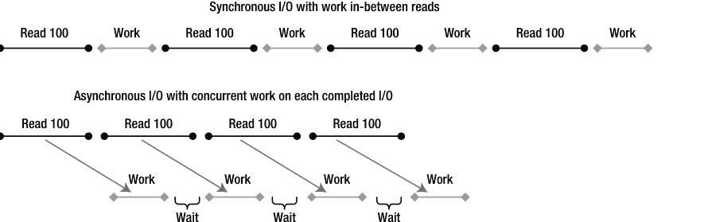

**图 7-1.** 同步与重叠 I/O 的对比

- 信号化 Win32 事件：对此事件的等待操作将在 I/O 完成时完成。
- 通过异步过程调用 (APC) 机制调用用户回调例程：线程必须处于可提醒状态（alertable state）以等待所有 APC。
- 通过 I/O 完成端口通知：这通常是最高效的机制。我们将在本章稍后部分详细探讨 I/O 完成端口。

> 注意：某些 I/O 设备（例如以无缓冲模式打开的文件）如果应用程序能够保持少量 I/O 请求挂起，将从中受益（通过增加设备利用率）。推荐的策略是预先发出一定数量的 I/O 请求，并对每个完成的请求重新发出另一个。这确保了设备驱动程序可以尽可能地启动下一个 I/O，等待应用程序响应并发出下一个 I/O。不要夸大挂起数据的数量，因为这将消耗有限的内核内存资源。

# I/O 完成端口

Windows 提供了一种高效的异步 I/O 完成通知机制，称为 I/O 完成端口 (`IOCP`)。它暴露给 .NET `ThreadPool` 的 `BindHandle` 方法。多个处理 I/O 的 .NET 类型在内部利用了此功能：`FileStream`、`Socket`、`TcpPort`、`HttpClient`、`PipeStream` 以及某些 .NET 管道。

一个 IOCP（见图 7-2）与零或多个重叠模式下的 I/O 句柄（套接、文件和特殊设备对象）以及用户创建的线程关联。一旦关联的 I/O 句柄的 I/O 操作完成，Windows 将完成通知执行到相应的 IOCP，由关联的线程处理该完成通知。通过拥有完成服务的线程池并智能地控制线程唤醒，减少了上下文切换并最大化了多处理器并发性。高性能服务器（如 Microsoft SQL Server）使用 I/O 完成端口并不令人意外。

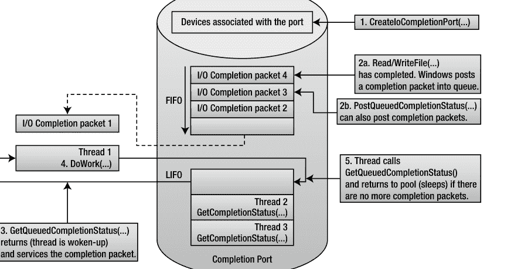

图 7-2. I/O 完成端口的结构与操作

完成端口通过调用 `CreateIoCompletionPort` Win32 API 函数创建，传递一个最大并发值，并可选地将其与具有 I/O 能力的句柄关联。完成键是一个用户指定的值，有助于区分不同的 I/O 句柄。可以通过调用 `CreateIoCompletionPort` 并指定现有的完成端口，将更多句柄关联到相同或不同的 IOCP。

用户创建的线程随后调用 `GetQueuedCompletionStatus` 以绑定到指定的 IOCP 并等待完成。`GetQueuedCompletionStatus` 会阻塞，直到有 I/O 完成通知可用（或超时），在此时它会返回 I/O 操作详细信息，例如传输的字节数、完成键以及在 I/O 操作期间传递的重叠结构。当所有关联的线程都忙碌时（即没有阻塞在 `GetQueuedCompletionStatus` 上），IOCP 会按 FIFO 顺序唤醒另一个线程，直到达到最大并发数。如果线程调用 `GetQueuedCompletionStatus` 且通知队列不为空，则调用将立即返回，而不在操作系统内核中阻塞。

注意：IOCP 能够感知“忙碌”线程实际上正在执行同步 I/O 或等待，并唤醒额外的关联线程（如果有），这可能会超过并发值。也可以通过调用 `PostQueuedCompletionStatus` 在不初始化 I/O 的情况下发布完成通知。

以下代码列表显示了在 Win32 文件句柄上使用 `ThreadPool.BindHandle` 的示例。从查看 `TestIOCP` 方法开始。在这里我们调用 `CreateFile`，这是一个用于创建文件和设备的 P/Invoke Win32 函数。我们必须使用 `FileAttributes`。重叠 I/O 如果成功，将返回一个 Win32 文件句柄，可以通过调用 `ThreadPool.BindHandle` 用于 .NET I/O 完成。一个自动重置事件用于在有许多此类操作正在进行时通过 I/O 操作阻塞线程（该限制限制由 `MaxPendingInOut` 设置）。

我们开始一个异步操作循环。在每次迭代中，我们都分配一个包含要写入数据的缓冲区。我们还分配了一个 `Overlapped` 结构，其中包含文件偏移（这里，我们始终写入到 0）、一个在 I/O 完成时信号化的事件句柄（在 I/O 完成中不使用）以及一个用户创建的 `IAsyncResult`，用于向完成函数传递状态。我们使用 `Overlapped` 结构的 `Pack` 方法，它会完成完成函数和数据缓冲区。它从非托管内存分配一个等的重叠结构并推送数据缓冲区。原生结构必须手动释放，以释放其占用的内存并取消托管结构的固定。

如果正在进行的操作不多，我们调用 `CreateFile` 并指定原生重叠计数。否则，我们等待直到事件变为信号化，表示挂起的 I/O 操作已降至限制以下。

I/O 完成的 `WriteComplete` 由 .NET I/O 完成线程池在 I/O 完成时调用。它返回一个指向重叠结构的指针，可以将其解包以转换回托管重叠结构。

```csharp
using System;
using System.Threading;
using Microsoft.Win32.SafeHandles;
using System.Runtime.InteropServices;

[DllImport("kernel32.dll", SetLastError=true, CharSet=CharSet.Auto)]
internal static extern SafeHandle CreateFile(
    string lpFileName,
    FileAccess dwDesiredAccess,
    FileShare dwShareMode,
    IntPtr lpSecurityAttributes,
    uint dwCreationDisposition,
    uint dwFlagsAndAttributes,
    IntPtr hTemplateFile);

[DllImport("kernel32.dll", SetLastError=true)]
[return: Marshal.AsBool]
static unsafe extern bool WriteFile(
    SafeHandle hFile, 
    byte[] lpBuffer,
    uint nNumberOfToWrite, 
    out uint lpNumberOfWritten,
    NativeOverlapped* lplapped);

[Flags]
enum FileShare : int {
    None = 0x00000000,
    Read = 0x00000001,
    Write = 0x00000002,
    Delete = 0x00000004
}

enum ECReationDisposition : uint {
    New = 1,
    CreateAlways = 2,
    OpenExisting = 3,
    OpenAlways = 4,
    TruncateExisting = 5
}

[Flags]
enum EFileAttributes : uint {
    Normal = 0x00000080,
    Overlapped = 0x40000000,
    NoBuffering = 0x20000000
}

[Flags]
enum EAccess : uint {
    GenericRead = 0x80000000,
    GenericWrite = 0x40000000
}

static long _numBytesWritten;
static AutoResetEvent _waterMarkFullEvent;
static int _pendingIosCount;
const int MaxPendingIos = 10;

static unsafe void WriteComplete(uint errorCode, uint numBytes, NativeOverlapped* pOVERLAP) {
    _numBytesWritten += numBytes;
```


## 第 7 章 网络、I/O 与序列化

```csharp
Overlapped ovl = Overlapped.Unpack(pOVERLAP);

//Notify writer thread that pending I/O fell below watermark

if (Interlocked.Decrement(ref _pendingIosCount) < MaxPendingIos) {
    _waterMarkFullEvent.Set();
}
```

```csharp
static unsafe void TestIOCP() {
    //Open file in overlapped mode
    var handle = CreateFile("F:\\largefile.bin",
        EAccess.GenericRead | EAccess.GenericWrite,
        FileShare.Read | FileShare.Write,
        IntPtr.Zero,
        ECReationDisposition.OpenExisting,
        EFileAttributes.Overlapped,
        IntPtr.Zero);
}
```

`IntPtr.Zero`, `ECreationDisposition.CreateAlways`,
`FileAttributes.Normal | EFileAttributes.Overlapped`, `IntPtr.Zero`);

`.waterMarkFullEvent = new AutoResetEvent(false);`
`ThreadPool.BindHandle(handle);`

```csharp
for (int k=0; k<100000; k++) {
    byte[] fbuffer = new byte[4096];
}
```

```c
//参数: 文件偏移量低位与高位，事件句柄，IAsyncResult 对象

Overlapped ovil = new Overlapped(0, 0, IntPtr.Zero, null);

// CLR 负责固定缓冲区

NativeOverlapped* pOvl = Pack(WriteComplete, fbuffer);

uint bytesWritten;
```

```c
// 检查是否有过多的挂起 I/O 请求

if (Interlocked.Increment(ref _pendingIoCount) < MaxPendingIos) {
    if (WriteFile(handle, fbuffer, (uint)fbuffer.Length, numBytesWritten,
    pOOvl())) {
        // I/O 同步完成
        numBytesWritten += numBytesWritten;
        Interlocked.Decrement(ref _pendingIoCount);
    } else {
```

```c
if (Marshal.LastWin32Error() != ERROR_IO_PENDING) {
    return; // 处理错误
}
```

```c
} else {
    Interlocked.Decrement(ref _pendingIoCount);
    while (_pendingIoCount > MaxPendingIos) {
        _waterMarkFullEvent.WaitOne();
    }
}
```

总结一下，处理高吞吐量 I/O 设备时，请使用重叠端口（overlapped ports），可以直接在非托管库中创建并使用你自己的连接池，或者通过 `ThreadPool.BindHandle` 将 Win32 句柄与 .NET 连接关联。

### NET 线程池

`NET Thread Pool` 用于许多用途，每个用途由不同类型的线程提供。第 6 章展示了我们使用的线程池 API，用于利用线程池并行化 CPU 密集型计算的能力。然而，线程池还适用于许多类型的工作：

- `工作线程（Worker threads）` 处理委托的异步调用（例如 `BeginInvoke` 和 `ThreadPool.QueueUserItem`）。
- `I/O 完成线程（I/O completion threads）` 处理全局 IOCP 的完成操作。
- `等待线程（Waits）` 处理注册的等待器。注册等待通过将多个等待合并为了一个等待（`WaitForMultipleObjects`）来节省线程，最多达到 Windows 限制（`MAX_WAIT_OBJECTS=64`）。注册等待用于不使用 I/O 完成的重叠 I/O。
- `定时器线程（Timer thread）` 合并对多个计时器的等待。
- `门控线程（Gate thread）` 监控线程池线程的 CPU 使用情况，并根据预设限制增加或减少线程数以获得最佳性能。

> **注意** 你可以发布一个看起来可能是异步的 I/O 操作，尽管它实际上并不是异步。例如，在委托上调用 `ThreadPool.QueueUserItem` 然后执行同步 I/O 操作，并不会使其真正变成异步，其效果与在普通线程上执行该操作没有区别。

### 内存拷贝

通常，从硬件设备接收到的数据缓冲区会被复制，直到应用程序完成对其的处理。拷贝可能会成为 CPU 开销的重大来源，因此在高吞吐量 I/O 代码路径中应尽量避免。我们现在调查你拷贝数据的场景以及如何避免它。

### 非托管内存

在 .NET 中，处理非托管内存缓冲区比处理托管数组 `[]` 复杂得多，因此程序员往往采取简单捷径，直接将缓冲区拷贝到托管内存中。
如果你的 API 或库允许你拥有缓冲区或具有用户定义的分配器，请管理缓冲区并固定（pin）它，以便可以通过指针和托管引用来访问它。如果缓冲区很大（>85,000 字节），它将分配在大对象堆（Large Object Heap）中，以便重用缓冲区。在其他情况下，非托管库允许你通过指针（unsafe）访问非托管内存，如 `UnmanagedStream` 或 `UnmanagedAccessor`。如果重叠 I/O 不使用 I/O 完成，拷贝是不可避免的。
即使是重叠 I/O，通过检查某些数据 `[]` 来避免不必要的拷贝也是可能的。

### 暴露缓冲区的一部分

正如第 8 章所解释的，为了避免不必要的拷贝，使用偏移量和长度参数 `[]`。这种场景通常假设 `[]` 包含了从开始到结束的数据。这种情况下情况下 `[]` 必须是连续的。

### 离散聚集 I/O (Scatter-Gather I/O)

离散聚集是一项允许从一组非连续的内存位置进行 I/O 传输，就像它们是连续的一样。Win32 通过 `ReadFileScatter` 和 `ToFile` 暴露了这种能力。Windows Socket 也通过其函数 `WSASend`、`WSARv` 支持离散聚集。离散聚集在以下场景中有用：

- 你需要在 payload 前部有一个固定头部。这为你节省了每次都拷贝缓冲区。
- 你想通过在一个系统调用中对多个缓冲区执行 I/O 来节省系统调用开销。

尽管 `ReadFileScatter` 和 `WriteFileGather` 有局限，因为每个缓冲区必须是系统大小且句柄是重叠且缓冲的（增加了更多限制），但基于 Socket 的离散聚集更为实用。.NET Framework 通过 `Socket` 的 `Send` 和 `Receive` 重载暴露了离散聚集，但通用的离散聚集函数尚未暴露。离散聚集的一个示例是通过 `HttpRequest`。它将 HTTP 头部与负载合并，无需构建连续的缓冲区。

### 文件 I/O

通常，文件 I/O 通过文件系统缓存，这具有某些性能优势：最近访问数据的缓存、预读（推测性预取磁盘）、后写（异步将数据写入磁盘）以及小写合并。如果告知 Windows 你预期的访问模式，你可以获得更好的性能。如果你的应用程序重叠 I/O 并且能够智能地处理复杂的缓冲区，那么完全跳过可能会更高效。

### 缓存提示

在打开文件时，你向 `CreateFile` Win32 API 函数指定标志和属性，其中某些会影响缓存行为：

- `FILE_FLAG_SEQUENTIAL_SCAN` 提示缓存管理器文件是顺序访问的，可能会跳过某些部分，但不是随机访问。缓存会预读更多。
- `FILE_FLAG_RANDOM_ACCESS` 提示文件是随机顺序访问的，因此缓存管理器预读较少，因为应用程序不太可能请求这些数据。
- `FILE_ATTRIBUTE_TEMPORARY` 提示文件是临时的，刷新磁盘的刷新（以防止数据丢失）可以延迟。NET 通过接受 `FileOptions` 参数的 `FileStream` 构造函数重载暴露了这些选项（除最后一个外）。

# 无缓冲 I/O (Unbuffered I/O)

无缓冲 I/O 完全跳过了 Windows 缓存。这既有优点也有缺点。与缓存提示类似，无缓冲 I/O 在创建时通过“标志和属性”参数启用，.NET 并没有暴露此功能：

- `FILE_FLAG_NO_BUFFERING` 防止读取或写入的数据被缓存，但对磁盘控制器的硬件缓存没有影响。这避免了内存拷贝（从用户态缓冲区到缓存）并防止了缓存污染（以牺牲更重要数据为代价用无用数据填充缓存）。然而，读取和写入必须遵守对齐要求。以下参数必须对齐，或者其大小是磁盘扇区大小的整数倍：512 字节传输、文件偏移和内存缓冲区地址。通常，磁盘扇区长度为 512 字节。高容量磁盘驱动器具有 4096 字节（称为“高级格式”，但它们可以在兼容模式下运行，模拟 512 字节扇区（以牺牲性能为代价）。

- `FILE_FLAG_WRITE_THROUGH` 指令缓存管理器（如果没有指定 `FILE_FLAG_NO_BUFFERING`）指示磁盘控制器立即提交到物理介质，而不是存储在硬件缓存中。

预读（Read-ahead）通过保持磁盘利用率来提高性能，即使应用程序是同步的且读取之间存在延迟。这取决于 Windows 能否正确预测应用程序将请求文件的哪个部分。通过缓冲，你还会禁用预读，并且可以通过运行多个重叠的 I/O 操作来保持磁盘忙碌。

后备写入（Write-behind）也为进行同步写入的应用程序提高了性能，因为它提供了磁盘写入完成非常快速的错觉。应用程序可以更好地利用 CPU，但阻塞时间更长。当你禁用缓冲时，写入的完成取决于实际写入到磁盘所需的时间。因此，在使用无缓冲 I/O 时，执行异步 I/O 变得更加重要。

# 网络 (Networking)

网络访问是现代应用程序的一项基本能力。处理请求的服务器端尽力最大化可扩展性和吞吐量，以便更快地为每个服务器更多的客户端提供服务；而客户端则旨在最小化网络延迟或减轻其影响。本节提供了最大化网络性能的建议和技巧。

# 网络协议 (Network Protocols)

应用程序网络协议（OSI 第 7 层）的构建方式对性能产生深远影响。本节探索了优化技术，以更好地利用可用网络容量并最小化开销。

# 流水线 (Pipelining)

在非流水线协议中，客户端向服务器发送请求并等待响应后才能发送下一个请求。使用此类协议时，网络未得到充分利用，在网络往返期间（即数据包到达服务器并返回的时间），网络是空闲的。在流水线连接中，客户端可以在服务器处理之前的请求之前继续发送更多请求。更好的是，服务器可以决定乱序响应请求，优先响应次要的请求，同时推迟处理计算密集性更强的请求。

# 第 7 章 网络、I/O 与序列化 (CHAPTER 7 NETWORKING, I/O, AND SERIALIZATION)

流水线技术变得越来越重要，而全球互联网带宽持续增加，延迟的改善速度要慢得多，因为它受限于光速所带来的物理限制。

现实世界协议中流水线的一个例子是 HTTP 1.1，但由于兼容性问题，它在服务器和浏览器上通常默认是禁用的。Google SPDY 是一种由 Chrome 和 Firefox 浏览器以及 HTTP 服务器支持的实验性 HTTP 类协议，而即将推出的 HTTP 2.0 协议强制支持流水线。

## 流式 (Streaming)

流式不仅用于视频和音频，还可以用于消息传递。通过流式，应用程序在数据完成之前就开始通过网络发送数据。流式减少了延迟并提高了通道利用率。

例如，如果服务器从数据库获取数据以响应请求，它可以一次性读取到一个 `DataSet` 中（这会消耗大量内存），或者它可以使用 `DataReader` 逐条检索记录。在前种方法中，服务器必须等待整个数据集到达后才能开始向客户端发送响应；而在后一种方法中，一旦第一条数据库记录到达，服务器就可以开始发送响应。

# 消息分块 (Message Chunking)

在网络上发送数据块是浪费的。以太网、IP 和 TCP/UDP 头部并没有因为有效负载变小而变小，尽管带宽利用率可能仍然很高，你最终是在等待头部而不是实际数据。此外，Windows 有与每个调用有关的开销，这种开销与数据块的大小无关或弱相关。协议可以通过允许多个请求合并来缓解这个问题。例如，域名服务（DNS）协议允许客户端在单次请求中解析多个域名。

# 频繁交互协议 (Chatty Protocols)

有时客户端无法流水线化请求，即使协议允许这样做，因为下一个请求取决于上一个回复的内容。

考虑一个频繁交互的会话示例。当你访问网页时，浏览器通过 TCP 连接到服务器，向你尝试访问的 URL 发送 HTTP GET 请求，并接收 HTML 页面作为响应。浏览器解析 HTML 以确定需要检索哪些 JavaScript、CSS 和图像资源，并逐一下载它们。然后执行 JavaScript，它可以获取进一步的内容。总结之，客户端并不会立即获取所有渲染页面所需的内容。它必须迭代地获取每种内容，直到检索并下载了所有内容。

为了缓解这个问题，服务器可能会向客户端提示渲染页面需要检索的哪些 URL，并可以在客户端请求之前发送内容。

# 消息编码与冗余 (Message Encoding and Redundancy)

网络带宽通常是受限的资源，拥有浪费的消息格式对性能没有帮助。以下是优化消息格式的几个技巧：

- 在传输数据时不要过度传输头部，保持头部较小。
- 使用智能编码以填充缓冲区，例如，UTF-8 而不是 UTF-16。
- 使用压缩处理数据，如文本。

# 套接字 (Sockets)

Socket API 是应用程序处理 TCP 和 UDP 的标准。最初，Socket API 引入 Unix 操作系统并成为所有操作系统的标准。在 Windows 中，有多种方式实现 Socket：阻塞、非阻塞轮询和异步。异步允许更高的吞吐量、更低的延迟和更好的可扩展性。本节概述了有关 Socket 的性能优化。

# 异步套接字 (Asynchronous Sockets)

.NET 通过 `Socket` 类支持异步 I/O。然而，有两类异步 API：`BegXXX` 和 `XXXAsync`，其中 XXX 代表 `Accept`、`Connect`、`Receive`、`Send` 等。前者使用 .NET 线程池的回调等待重叠 I/O 完成，而后者使用 I/O 完成端口，性能更好。后期 API 引入于 .NET Framework 2.0。

# 套接字缓冲区 (Socket Buffers)

Socket 对象暴露两个缓冲区大小：`ReceiveBufferSize` 和 `SendBufferSize`，它们指定由 TCP/IP 栈分配的缓冲区大小。默认设置为 8192 字节。接收缓冲区用于存储尚未被应用程序读取的数据。发送缓冲区用于存储尚未被接收端确认的数据。如果接收端需要重传数据，将从发送缓冲区重传。

当应用程序从 Socket 读取数据时，它会根据读取量减少接收缓冲区。当接收缓冲区为空时，调用将阻塞或挂起，取决于使用的是同步还是异步 I/O。

对于高带宽、高延迟连接（如卫星链路），缓冲区大小可能太小。快速发送会填满发送缓冲区并等待确认，导致高延迟。在等待期间，管道无法保持满，终端仅利用了可用带宽的一部分。

在完美可靠的网络中，理想缓冲区大小是带宽与延迟的乘积。例如，在延迟 5ms 的 100Mbps 连接中，理想缓冲区大小为 (100,000,000 / 8) = 62,500 字节。丢包会降低此值。

# Nagel 算法 (Nagle’s Algorithm)

如前所述，小数据包是浪费的，因为数据头部相对于有效负载可能很大。Nagel 算法通过将多次写入合并为完整数据包的数据来提高 TCP 的性能。然而，这种服务并非免费，因为它在发送之前引入了延迟。延迟敏感型应用程序应该通过设置 `Socket.NoDelay` 属性为 true 来禁用 Nagel 算法。编写良好的应用程序会一次发送大缓冲区，而不会从 Nagel 算法中受益。


# 注册 I/O (Registered I/O)

注册 I/O (RIO) 是 Windows Server 2012 中提供的 WinSock 新扩展，它提供了一种非常高效的缓冲区注册和通知机制。RIO 消除了 Windows I/O 中最严重的低效之处：

- 用户缓冲（检查页面访问权限）、锁定和解锁（确保缓冲区已注册在内存中）。
- 句柄查找（将 Win32 HANDLE 转换为内核对象指针）。
- 系统调用开销（例如，为了出队列 I/O 完成通知）。

这些是为了将应用程序与操作系统以及其他应用程序隔离开，以确保安全性和可靠性而支付的“税收”。没有 RIO 的，你只需要在初始化时支付一次“税收”成本。当 I/O 速率显著时，RIO 需要对缓冲区进行注册，这会将它们锁定在物理内存中，直到它们取消注册（当应用程序或子系统终止时）。由于缓冲区保持分配并存在内存中，Windows 可以跳过每次调用的轮询、锁定和解锁。

RIO 请求和完成队列位于“进程”内存空间中并可以被其访问，这意味着不再需要系统调用来轮询队列或出队列完成通知。

RIO 支持三种通知机制：

- 轮询（Polling）：这种方式延迟最低，但意味着一个逻辑处理器专门用于轮询网络缓冲区。
- I/O 完成端口（I/O Completion Ports）。
- 通知 Windows 事件。

在编写时，RIO 尚未通过 .NET Framework 暴露，但可以通过标准的 .NET 互操作机制（在第 8 节中讨论）访问。

# 数据序列化与反序列化

序列化是将对象表示为可以写入磁盘或通过网络发送的格式的行为。反序列化则是从序列化表示形式重构对象的行为。例如，哈希表可以序列化为键值记录的数组。

# 序列化器基准

.NET Framework 自带了几个通用序列化器，可以对用户类型进行序列化和反序列化。本节将从序列化吞吐量和序列化大小衡量每个序列化器的优缺点。

首先，我们查看可用的序列化器：

- `System.Xml.Serialization.XmlSerializer`
- 序列化为 XML、文本或二进制。
- 支持子对象，但不支持循环引用。
- 仅对公共字段和属性有效，除非显式排除。
- 仅使用一次反射生成序列化程序集，以实现高效操作。可以使用 `sgen.exe` 工具预创建序列化程序集。
- 允许自定义 XML Schema。
- 需要预先知道所有参与序列化的类型：在使用继承类型时会自动推断信息。

- `System.Runtime.Serialization.Formatters.Binary.BinaryFormatter`
- 序列化为专用二进制格式，仅供 .NET 消费。
- 用于 .NET Remoting，也可以单独用于通用序列化。
- 适用于公共和非公共字段。
- 处理循环引用。
- 不需要预先知道要序列化的类型。
- 通过应用 `[Serializable]` 属性将类型标记为可序列化。

- `System.Runtime.Serialization.Formatters.Soap.SoapFormatter`
- 功能类似于 `BinaryFormatter`，但序列化为 SOAP 格式，更紧凑。
- 不支持泛型和泛型集合，因此在 .NET Framework 的最新版本中被弃用。

- `System.Runtime.Serialization.DataContractSerializer`
- 序列化为 XML、文本或二进制。
- 用于 WCF，也可以单独用于通用序列化。
- 通过使用 `[DataContract]` 和 `[DataMember]` 属性对类型和字段进行选择包含：如果类标记为 `[Serializable]`，则所有字段都会序列化。
- 需要预先知道所有参与序列化的类型：在使用继承类型时会自动推断信息。

- `System.Runtime.Serialization.NetDataContractSerializer`
- 类似于 `DataContractSerializer`，但在序列化数据中嵌入了 .NET 特有的类型信息。
- 不需要预先知道序列化的类型。
- 需要包含序列化类型的程序集。

- `System.Runtime.Serialization.DataContractJsonSerializer`
- 类似于 `DataContractSerializer`，但序列化为 JSON 格式而非 XML 格式。

图 7-3 显示了上述序列化器的测试结果。某些序列化器在 XML 输出和二进制输出方面的速度快一倍。基准测试涉及复杂对象图的序列化和反序列化，该图包含 3600 个具有树引用模式的实例。每个类型包含字符串字段及其数组。没有出现循环引用，因为并不是所有的序列化器都支持它们；然而，支持引用的序列化器在存在引用时运行慢得多。


**图-** 序列化器吞吐量测试结果，单位为操作/秒

此处显示的测试结果是在 .NET Framework 4.5 上运行的，对于使用二进制 XML 的测试，它比 .NET Framework 3.5 有所提高，否则没有显著差异。

测试结果显示，使用二进制 XML 格式的 `DataContractSerializer` 和 `XmlSerializer` 整体最快。

接下来，我们比较序列化数据的大小（见图 7-4）。几个序列化器非常接近。这可能是因为对象树的大部分数据以字符串形式存在，所有序列化器的表示方式相同。


**序列化数据大小比较**

最紧凑的序列化表示由 `DataContractJsonSerializer` 生成，其次是使用二进制 XML 的 `XmlSerializer` 和 `DataContractSerializer`。`BinaryFormatter` 可能被大多数序列化器超越。

# DataSet 序列化

`DataSet` 是通过 `DataAdapter` 从数据库获取数据的内存缓存。它包含 `DataTable` 对象集合，每个 `DataTable` 包含模式和行，每行包含一个序列化对象集合。`DataSet` 对象是复杂的，消耗大量内存，且序列化是计算密集型的。尽管如此，许多应用程序在应用层之间传递它们。减少序列化开销的提示包括：

- 在序列化 `DataSet` 之前调用 `ApplyChanges`。`DataSet` 存储原始值和更改后的值，如果你不需要序列化它们。
- 仅序列化所需的表。如果 `DataSet` 包含你需要的其他表，考虑只将所需的表复制到新的 `DataSet` 并序列化它。
- 使用列别名（As 关键字）提供更的名字并缩短序列化长度。例如，考虑此 SQL 语句：`SELECT EmployeeID As I, Name As N, Age As A`

# Windows Communication Foundation

Windows Communication Foundation (WCF) 发布于 .NET 3.0，迅速成为 .NET 应用程序中大多数网络需求的行业标准。它提供了无与伦比的网络协议和自定义选择，并随着新的 .NET 发布不断扩展。本节涵盖了 WCF 性能优化。

## 节流 (Throttling)

WCF（尤其在 .NET Framework 4.0 之前）默认具有保守的节流设置。这些设计是为了防止拒绝服务 (DoS) 攻击，遗憾的是在现实世界中，它们设置得太低而无法派用。

可以通过编辑 `app.config`（用于桌面应用程序）或用于 ASP.NET 应用程序的 `web.config` 文件中的 `system.ServiceModel` 节来修改节流设置：

```xml
<system.servicemodel>
  <behaviors>
    <behavior>
      <throttling>
        <maxconcurrentcalls="16"
        maxconcurrentsessions="10" maxconcurrentinstances="26" />
      </throttling>
    </behavior>
  </behaviors>
</system.servicemodel>
```

另一种更改这些参数的方法是在创建服务期间在 `ServiceThrottling` 对象上设置属性：

```csharp
Uri baseAddress=new Uri("http://localhost:8001/Simple");
ServiceHost host=new ServiceHost(typeof(CalculatorService),baseAddress);
```

## 第 7 章 网络、I/O 与序列化

```csharp
serviceHost.AddEndpoint(typeof(ICalculator), new WsHttpBinding(), "CalculatorServiceObject");
serviceHost.Open();
IChannelListener icl=serviceHost.ChannelDispatchers[0].Listener;
ChannelDispatcher dispatcher=new ChannelDispatcher(icl);
ServiceThrottle throttle=dispatcher.ServiceThrottle;
throttle.MaxConcurrentSessions=10;
throttle.MaxConcurrentCalls=16;
throttle.MaxConcurrentInstances=26;
```

让我们理解这些参数的含义。

- `maxConcurrentSessions` 限制了跨 `ServiceHost` 当前正在处理的消息数量。达到限制时，调用将进入队列。.NET 3.5 的默认值为十，.NET 4 中为处理器的数量。
- `maxConcurrentCalls` 限制了跨 `ServiceHost` 同时执行的 `InstanceContext` 对象数量。创建额外实例的请求将进入队列，并在限制之内的空位可用时完成。.NET 3.5 的默认值为 16，.NET 4 中为处理器的数量。
- `maxConcurrentInstances` 限制了 `ServiceHost` 对象可以接受的会话数。服务接受超过限制的连接，但只有限制之内的通道是活跃的（从通道中读取消息）。.NET 3.5 的默认值为 26，.NET 4 中为处理器的数量。

另一个重要的限制是每个主机允许应用程序的并发连接数，默认为 2。如果你的 ASP.NET 调用了额外的 WCF 服务，这可能会成为一个瓶颈。以下是设置这些限制的配置示例：

```xml
<system.net>
  <connectionManagement>
    <add address="*" maxconnection="100" />
  </connectionManagement>
</system.net>
```

# 模型

在编写 WCF 服务时，你需要确定其激活模型和并发模型。这分别由 `ServiceBehavior` 属性的 `InstanceContextMode` 和 `ConcurrencyMode` 属性控制。`InstanceContextMode` 的含义如下：

- `PerCall`（每次调用）——为每次调用创建一个服务对象。
- `PerSession`（每个会话，默认）——每个会话创建一个服务对象实例。如果通道不支持会话，其行为类似于 `PerCall`。
- `Single`（单例）——所有调用都重用同一个服务实例。

`ConcurrencyMode` 值的含义如下：

- `Single`（单例，默认）——对象服务是单线程的，不支持重入。如果 `InstanceContext` 设置为 `Single` 且它已经在处理一个请求，额外的请求将等待轮。
- `Reentrant`（重入）——对象服务是单线程的但是重入的。如果服务调用了另一个服务，它可能会被重入。你有责任在调用另一个服务之前确保对象状态处于一致状态。
- `Multiple`（多线程）——不提供任何同步保证，服务必须在单个线程上处理同步以确保状态的一致性。

不要将 `Single` 或 `Reentrant` `ConcurrencyMode` 与 `Single` `InstanceContext` 结合使用如果你使用 `Multiple` `ConcurrencyMode`，请使用细粒度锁以获得更好的并发性。WCF 从 .NET 线程池的 I/O 完成线程调用服务对象，这些线程在本章之前已描述过。如果在服务期间你执行了同步 I/O，你可能需要通过编辑 ASP.NET 应用程序的 `system.web` 配置部分（见下文）或在桌面应用程序中调用 `ThreadPool.MinThreads` 和 `ThreadPool.MaxThreads` 来增加允许的线程池数量。

```xml
<system.web>
  <processModel>
    enable="true"
    autoConfig="false"
    maxWorkerThreads="80"
    maxIoThreads="80"
    minWorkerThreads="40"
    minIoThreads="40"
  </processModel>
```

# 缓存

WCF 没有内置的缓存支持。即使你将在 IIS 中托管 WCF 服务，它默认也无法使用其缓存。要启用缓存，请为你的 WCF 服务添加 `AspCompatibilityRequirements` 属性。

`[AspCompatibilityRequirements(Mode=AspCompatibilityMode.Allowed)]`

此外，通过编辑 `web.config` 在 `serviceEnvironment` 下添加以下元素来启用 ASP.NET 兼容性：

```xml
<serviceEnvironment AspCompatibilityEnabled="true" />
```

从 .NET Framework 4.0 开始，你可以使用新的 `System.Runtime.Caching` 类型来实现缓存。它不依赖于 `System.Web` 程序集，但不限于 ASP.NET。

# 异步 WCF 客户端和服务

WCF 允许你在客户端和服务器上发布异步操作。双方都可以独立决定是同步还是异步操作。

在客户端，异步调用服务的方法有两种：基于事件的和基于 .NET 异步模式的。基于事件的模型与使用 `ChannelFactory` 创建的通道不兼容。

要使用基于事件的模型，使用 `svcutil` 工具结合 `/async` 和 `/tvc` 参数生成代理：

```bash
svcutil /http://Microsoft.ServiceModel.Samples,Microsoft.ServiceModel.Samples http://localhost:8000/servicemodamples/service/mex /async /tvc
```

生成的代理可以使用如下：

```csharp
// 用于显示结果的异步回调。
static void AddCallback(object sender, AddCompletedEventArgs e) {
    Console.WriteLine("Add Result: {0}", e.Result);
}
```

```csharp
static void Main(String[] args) {
    CalculatorClient client = new CalculatorClient();
    client.AddCompleted += AddCallback;
    client.AddAsync(1, 2);
}
```


## 总结

正如你在本章中所看到的，通过提高应用程序的 I/O 性能，你可以产生巨大的差异，并避免任何与计算相关的优化。本章：

- 检查了同步和异步 I/O 的区别。
- 探索了各种 I/O 完成通知机制。
- 提供了关于 I/O 的通用建议，例如最小化内存缓冲区拷贝。
- 讨论了针对文件 I/O 的优化。
- 检查了针对 socket 的优化。
- 展示了如何优化网络协议以充分利用可用网络容量。
- 比较并基准了 .NET Framework 内置的各种序列化器。
- 了 WCF 优化。

# 第 8 章

## 不安全代码 (Unsafe Code)

### 交互性

很少有应用程序完全由托管代码组成。相反，它们经常使用用原生代码实现的内部或第三方库。.NET Framework 提供了几种机制来与多种广泛技术实现的原生代码进行操作：

* `P/Invoke`：允许与导出 C 风格函数的 DLL 进行互操作性。
* `COM` 交互性：允许托管代码使用 COM 对象，并将 .NET 类暴露为 COM 对象以供原生代码使用。
* `C++/CLI` 语言：通过混合编程语言实现与 C 和 C++ 的互操作性。

事实上，基类库（BCL）——随 .NET Framework 一分发的 DLL 集合（`mscor.dll` 是主要的那个），包含了 .NET Framework 的内置类型——使用了所有上述机制。因此可以认为，任何非平凡的托管应用程序在实际上都是一个混合应用程序，意味着它调用了原生库。
虽然这些机制非常有用，但理解与每种交互机制相关的性能影响以及如何最大限地减少其影响至关重要。

## 不安全代码

托管代码提供了类型安全、内存安全和安全保证，这消除了原生代码中常见的某些最难诊断的错误和安全漏洞，例如堆溢出和缓冲区溢出。这是通过禁止使用指针直接访问内存来实现，转而使用强类型引用、检查数组边界并确保对对象的访问是合法的。

然而，在某些情况下，这些机制会使简单任务变得复杂，并由于强制你使用安全替代方案而降低性能。例如，你可能从文件中读取数据到 `byte[]`，但希望将这些数据解释为 `double[]` 值的数组。在 C/C++ 中，你只需将 char 指针强制转换为 `double` 指针即可。相比之下，在 .NET 代码中，你可以使用 `MemoryStream` 对象封装缓冲区并使用 `BinaryReader` 将每个内存位置作为 `double` 值读取；另一个选项是使用 `BitConverter` 类。这些解决方案可以工作，但比在这些非托管代码中执行要慢。幸运的是，C# 和 CLR 支持使用指针和强制转换进行不安全的内存访问。其他不安全特性支持在结构中进行内存和嵌入数组。不安全代码的缺点是损害了安全性，这可能导致内存损坏和安全漏洞，因此在编写不安全代码时应小心。

## 第 8 章不安全代码与交互性

| 应用 | 配置: Release | 平台: 激活 (Any CPU) |
| --- | --- | --- |
| 生成* | | |
| 生成事件 | 通用 | |
| 调试 | 条件编译符号: [ ] | |
| 资源 | [ ] 定义 DEBUG 常量 | |
| 服务 | [x] 定义 TRACE 常量 | |
| 设置 | 平台目标: Any CPU | |
| 引用路径 | [x] 优先考虑 32 位 | |
| 签名 | [x] 允许不安全代码 | |
| 安全 | [x] 优化代码 | |

**图 8-1.** 在 C# 项目设置中启用不安全代码（Visual Studio 2012）

要使用不安全代码，必须先在 C# 项目设置中启用不安全代码（见图 8-1），这将向 C# 编译器传递 `/unsafe` 命令行参数。接下来，你应该标记允许使用不安全代码或变量区域，可以是整个类、结构体或只是方法中的某个区域。

## 固定 (Pinning) 与 GC 句柄

位于堆上的托管对象可能会在不可预测的垃圾回收期间被重定位，你必须对其进行固定（pin），以便获取其地址并防止它们在内存中移动。

固定可以通过 C# 中的 `fixed` 代码（见代码列表 8-1 中的示例）或通过分配固定 GC 句柄（见代码列表 8-2）来实现。我们稍后将涵盖 P/Invoke 存根，它们也会以同于 fixed 函数的方式固定对象，因为它比 GC 句柄方法更高效。否则，使用 `GHandle.Alloc` 分配固定句柄来无限固定对象（直到你调用 `GHandle.Free` 释放 GC 句柄）。栈对象（值类型）不需要固定；它们不受垃圾回收的影响。可以使用取地址操作符 `&` 直接获取位于栈上的上的对象的指针。

**代码列表 8-1.** 使用 fixed 代码和指针强制转换重新解释缓冲区中的数据

```csharp
var fs = new FileStream("C:\Dev\samples.dat", FileMode.Open)) {
  var buffer = new byte[4096];
  int bytesRead=fs.Read(buffer, 0, buffer.Length);
  unsafe {
    double sum=0.0;
    fixed (byte* pBuff= buffer) {
      double* pDb1Buff= (double*)pBuff;
      for (int i=0; i<bytesRead / sizeof(double); i++)
        sum+= pDb1Buff[i];
    }
  }
}
```

注意 从 `fixed` 语句获取的指针不能在 `fixed` 作用域之外使用，因为固定的对象在作用域结束后将变为取消固定。GC 句柄是通过不可变指针引用位于 GC 堆上的托管对象的方法（即使对象的地址发生了变化）。GC 句柄分为四，由 `GHandle` 枚举指定：Weak、WeakResurrection、Normal 和 Fixed。Normal 和 Fixed 类型在没有其他引用的情况下可以防止对象被回收。Weak 和 WeakResurrection 不阻止对象被回收，但在对象被回收后允许一个普通引用。它被 `WeakReference` 类型使用。

**代码列表 8-2.** 使用固定的 GHandle 进行固定和指针转换重新解释数据

```csharp
var fs=new FileStream("C:\Dev\samples.dat", FileMode.Open) {
  var buffer=new byte[4096];
  int bytesRead=fs.Read(buffer, 0, buffer.Length);
  GHandle gch=GHandle.Alloc(buffer, GHandle.Pinned);
  unsafe {
    double sum=0.0;
    double* pdbluff=(double*)(void*)gch.AddrOfPinnedObject();
    for (int i=0; i<bytesRead / sizeof(double); i++)
      sum+=pdbluff[i];
  }
  gch.Free();
}
```

> 注意 如果触发了垃圾回收（即使是由并发线程触发），固定可能会导致托管堆碎片。碎片会浪费内存并降低垃圾回收器算法的效率。为了尽量减少碎片，请不要长时间固定对象。

## 生命周期管理

在许多情况下，原生代码会跨函数调用继续持有非托管资源，并且需要显式调用来释放资源。如果是这样，封装托管类中的 `IDisposable` 接口加上析构函数，将允许客户端释放非托管资源，而析构函数应该是你忘记显式释放时的最后防线。

## 分配非托管内存

大于 85000 字节的托管对象（通常是缓冲区和字符串）被放置在大对象堆（LOH）上，它与 GC 堆的第 2 代一起进行回收，这是非常昂贵的。LOH 也会产生碎片，因为它不进行压缩；而是尽可能重用空闲。这两个问题都会增加内存使用和垃圾回收器的 CPU 使用。因此，使用托管池或从非托管内存分配这些缓冲区更为有效（例如通过调用

# 第 8 章 不安全代码互操作性

`Marshal.AllocGlobal()`。如果你以后需要从托管代码访问非托管缓冲区，请使用“流式”方法，即将非托管缓冲区的小块拷贝到托管内存，并一次处理一个。你可以使用 `System.UnmanagedMemoryStream` 和 `System.UnmanagedAccessor` 来使工作变得简单。

## 内存池

如果你在使用缓冲区与原生代码进行通信，你可以将它们从托管堆（GC堆）或非托管堆进行分配。当分配速率很高且缓冲区非常小时同时，前者的方法会变得低效。托管缓冲区需要被固定（pinned），这会导致碎片。后者方法也有问题，因为大多数代码期望字节数组（`byte[]`）而不是指针。你无法在不拷贝的情况下将指针转换为托管数组，这对于性能是非常不利的。

> 你可以使用性能分析器（profiler）来估计垃圾回收（GC）浪费的 CPU 时间，但这无法告诉你哪些是负责的。在投入精力优化性能之前，请参阅第 4 章关于管理垃圾回收的提示。

我们提出了一种解决方案（见图 8-2），该方案的核心思想是分配托管缓冲区（段），它们驻留在大对象堆（Large Object Heap）。固定这些段没有开销，因为它们是不可重定位的。

| 分配器 | `256KB[]` 的段 | 8KB | 10KB | 2KB |
|---|---|---|---|---|
| | 段的栈 | | | |
| 段 0，活动 `Ref<Ptr>(0x2048)` PinPtr=0x000 | 使用中 | 使用中 | 空闲 |
| 段 1，使用中 `Ref<Ptr>(0x26210)` PinPtr=0x0000 | | | | |
| 段 2，空闲 `Ref<Ptr>(null)` PinPtr=0x3000 | Offset=8KB Len=18KB | Offset=2KB | | |
| 段 3，空闲 `Ref<Ptr>(null)` PinPtr=0x4000 | | Offset=8KB Len=10KB 已释放 | |

**图 8-2.** 提议的内存池方案

一个简单的分配器，其中段的索引（实际上是索引）每次分配时都会移动，然后分配不同大小的缓冲区（直到段结束），并返回一个包装对象。一旦索引接近末尾且分配失败，将从内存池中获取一个新的段并尝试分配。

段有一个引用计数，在每次分配时增加，在包装对象被释放时减少。如果引用计数达到零，则可以通过将指针置零来重置，并返回内存池。

包装对象存储了段的大小、其数据开始的偏移量以及一个非托管指针。实际上，包装对象是段大缓冲区的窗口。它还会在包装对象被释放时减少段的引用计数。包装对象可以提供方便的方法，例如安全访问，并验证每个是否在范围内。

```
// 来自 WinBase.h 的原生声明：
typedef struct WIN32_FIND_DATA {
    WORD dwFileAttributes;
    FILETIME ftCreationTime;
    FILETIME ftLastAccess;
    FILETIME ftLastWriteTime;
    DWORD nFileSizeHigh;
    DWORD nFileSizeLow;
    WORD dwReserved;
    WORD dwReserved1;
# 第 8 章 不安全代码与互操作性
```
WCHAR cFileName[MAX_PATH];
WCHAR cAlternateFileName[14];
} WIN32_FIND_DATA;
```

```
HANDLE WINAPI FindFirstFile((in LPCSTR lpFileName,
                out WIN32_FIND_DATA lpFindFirstData);
```

```csharp
// C# 声明：
[Struct(LayoutKind.Sequential, CharSet=Auto)]
struct WIN32_FIND_DATA {
    public FILETIME ftCreationTime;
    public FILETIME ftLastAccessTime;
    public FILETIME ftLastWriteTime;
    public uint nFileSizeHigh;
    public uint nFileSizeLow;
    public uint dwReserved0;
    public uint dwReserved1;
    [MarshalAs(UnmanagedType.ByValTStr, SizeConst=260)]
    public string cFileName;
    [MarshalAs(UnmanagedType.ByValTStr, SizeConst=14)]
    public string cFileName;
}
```

```csharp
[DllImport("kernel32.dll", CharSet=Auto)]
static extern IntPtr FindFirstFile(string lpFileName, out WIN32_FIND_DATA lpFindFirstData);
```

当你在代码列表中调用 `FindFirstFile` 方法时，CLR 加载导出内核函数（FindFirst）的 DLL，并将参数从托管表示转换为原生表示（反之亦然）。在这种情况下，`lpFileName` 字符串参数转换为原生字符串，写入由 `lpFindFirstData` 参数指向 `WIN32_FIND_DATA` 原生结构；数据被写入 `WIN32_FIND_DATA` 结构。在接下来的章节中，我们将详细描述这些结构。

## PInvoke.net 和 PInvoke Assistant

创建 PInvoke 签名可能是困难且枯燥的。有很多必须遵守的规则和需要了解的细节。产生错误的签名会导致难以调试。有两个资源可以让这一切变得简单：PInvoke.net 和 PInvoke Assistant。

PInvoke.net 是一个非常有用的网站，你可以在那里查找并贡献各种 API 的 PInvoke 签名。它由 Adam 创建，他曾工作于 .NET 质量保证团队，并写过一本关于互操作性的深度著作。PInvoke Assistant 是 Visual Studio 的一个免费工具，它包含一个描述 WIN32 函数、结构和常量的数据库（XML 文件），用于生成 PInvoke 签名。它还可以根据函数声明生成 PInvoke 签名，并为托管程序集生成原生回调声明和 PInvoke 签名。图 8-3 显示了左侧的搜索结果，PInvoke 签名（以及与其他互操作相关的工具）可以从 pinv.net/ 获取。


**图 8-3.** PInvoke Assistant 的截图，显示了 CreateFile 的 PInvoke 签名

## 绑定

当你调用 P/Invoke 函数时，原生 DLL 及其依赖项将通过 Win32 `LoadLibrary` 函数加载到进程（如果它们尚未加载）。

如果 `ExactMatching` 为 `true`，P/Invoke 将搜索精确名称，这取决于 `DllImport` 属性。如果 `ExactMatching` 为 `false`，P/Invoke 的行为取决于 `CharSet` 属性：

    - 如果设置为 `CharSet.Ansi`（默认值），P/Invoke 将搜索混淆名称并附加 "A"。
    - 如果设置为 `CharSet.Unicode`，P/Invoke 将搜索混淆名称并附加 "W"。

**提示** 使用 Unicode 版本的 Win32 函数。Windows ME 之后的操作系统原生支持 UTF-16。如果你调用 ANSI 版本的 Win32 函数，字符串将转换为 Unicode，这对于性能是有不利的。.NET 字符串表示原生为 UTF-16。

跨越原生到托管代码边界的函数，其速度至少比相同环境内的直接调用慢一个数量级。如果你同时控制原生代码和托管代码，请以这种方式构建接口，以最大限度地减少原生到托管代码的往返（频繁调用的接口）。尝试将多个“工作项”合并为一个（分块的接口）。同样地，将多个简单函数的调用（例如简单的 Get/Set）合并成一个在单次调用中完成等效工作的函数。

微软提供了一个可以免费下载的工具，称为来自 CodeLex 的 IL Stub Diagnostics，并附带源代码。它订阅了 CLR ETL 存根诊断/缓存事件，并在 UI 中显示生成的 IL 代码。

下面我们展示了一个带注释的 IL 封封（marshal）示例，包含了五组条件：输入参数的封封、调用、返回值和或输出参数的回封，以及清理。该封封存根（marshaller stub）适用于以下签名：

```csharp
// 托管签名:
[DllImport("Server.dll")]static int Marshal_String_In(string s);
// 原生签名:
managed int _stdcall Marshal_String_In(char *)
```

在初始化部分，存根声明了（栈）变量，获取了存根上下文并要求执行非托管代码的权限。

```il
// IL 存根:
// 代码大小 153 (0X0099)
//maxstack 3
// 局部变量为:
//IsSuccessful, pNativeStrPtr, SizeInBytes, pstackAllocPtr, result, result
//locals (int32,native,int32,native,int32,int32,int32)
```


```il
call native int [mcorlib]System.Helpers::SystemHelpers::StubContext()
call Demand unmanaged code permission
void [mcorlib]System.Helpers::SystemHelpers::DemandPermission(native int)
```

在封封部分，存根对输入原生函数进行封封。在示例中，我们封封了一个单个字符串输入参数。封封器可以帮助 `System.Helpers` 命名空间下的类型，或者 `System.Runtime.InteropServices.Marshal` 可以协助将特定类型和特定类型的类型从托管表示转换为原生表示，反之亦然。在这个示例中，我们使用 `CMarshal::ConvertToNative` 来封封字符串。

这里有一个细微的优化：如果托管字符串足够短，它会被封封到分配在栈上的内存中（速度更快）。否则，它必须从堆上分配。

```il
ldc.14 0X0 // IsSuccessful=0 [推入栈]
stloc.0 // [存入 IsSuccessful]
IL_0010:
nop // 参数
ldc.14 // pNativeStrPtr-null [推入栈]
0X0 // [转换为 int32 以作为“native int”（指针)]
conv.i 3 // [将结果存入 pNativeStrPtr]
idarg.0 // if (managedString == null)
hrfalse IL_0042 goto IL_0042
ldarg.0 // [将 managedString 实例推入栈]
call the get length属性 (返回字符数)
```

## 第 8 章：不安全代码与互操作性

```il
call instance int32 [mscorlib]System.String::getLength

ldc.i14 0x2 // 长度加 2，managedString 中有一个空字符，并且
// 我们在其中放入了一个额外的空字符 [将常量 2 推入栈]
// [实际加法，结果推入栈]\add // 加载静态字段，值取决于语言。对于非 Unicode
// 应用系统设置
ldsfld mul System.Runtime.InterOp.Marshal::SystemMaxDBCSize
// 乘以长度 SystemMaxDBCSize 以获得数量
stloc.2 ldc.i14 0x105 // 将 SizeBytes 与 0x015 比较，允许更多的
// 栈内存 [推入常量 0x05]
// CSRMarshall::ConvertToNative 将处理
// pStackAllocPtr 为空的情况，并执行更大
// 大的 CoTaskMemAlloc
ldloc.2 elt // [推入 SizeBytes]
// 如果 SizeBytes>0x015，推入 1，推入 0
brtrue IL_0042 // 如果为跳转到 IL_0042
ldloc.2 localloc // 推入 SizeBytes (localloc 的参数)
stloc.3 // 执行栈分配，结果指针在栈顶
// 保存 pStackAllocPtr
IL_0042:
ldc.i4 0x1 // 推入常量 1 (标志参数)
idarg.0 // 推入 managedString 参数
idloc.3 // 推入 pStackAllocPtr (这可能为空)
// 调用辅助函数转换为 Unicode ANSI
call native int [mcorlib]System.Helpers.Marshal::ConvertTo(int32, string, native int)
stloc.1 // 将结果存入 pNativePtr
// 可以等于 pStackAllocPtr
ldc.i4 0x1 // IsSuccess=1 [将 1 推入栈]
stloc.0. // 存入 IsSuccess
nop
nop
nop
```

在下一节中，存根从栈中获取原生指针并对其进行调用。`call` 指令的工作原理比我们在这里看到的要多，因为更改 GC 模式并在 GC 运行期间捕获原生函数的返回值是为了挂起执行代码，而此时 GC 正在运行并处于需要挂起托管代码执行的阶段。

```il
ldloc.1 // 将 pStackAllocPtr 推入栈，
// 用于用户函数，GetContext 的返回
call native int [mcorlib]System.Helpers::Stub::GetContext()
```


> 提示 如果在 P/Invoke 调用中的参数不是可位封的，且仅在“出”方向上需要封送，可以使用 `out` 关键字代替 `ref` 关键字来避免不必要的封送。

由于上述提到的的可位封参数固定优化，可位封的引用类型将获得有效的“入/出”封送，即使上述规则另有说明。如果你需要“出”或“入/出”封送，你不应该依赖于此行为，而应该显式地指定方向特性，因为如果你添加了非可位封的字段，或者这是一个跨越公寓边界的 COM 调用，此优化将停止工作。

封送值类型与引用类型的区别体现在它们在栈上的传递方式上。

- 按值传递的值作为副本推入栈中，因此它们实际上是以“入”方式封送的，无论有何种修改特性。
- 按引用传递的值和按值传递的引用类型通过指针传递。
- 按引用传递的引用类型通过指向指针的指针传递。

# 第 8 章 不安全代码与互操作性

**注意** 按值传递大型值参数（长度超过十几个字节）比按引用传递开销更大。对于大型返回值也是如此，其中 `out` 参数是一个可能的替代方案。

## 代码访问安全

.NET 代码访问安全（CAS，简称 CAS）机制允许在沙箱中运行部分不受信任的代码，并限制对运行时能力（例如 P/Invoke）和 BCL 功能（例如文件和注册表访问）的访问。在调用原生代码时，CAS 要求调用栈中所有程序集的方法都必须具有 `UnmanagedCode` 权限。封送存根将为每次调用请求此权限，这涉及到遍历调用栈以确保所有代码都拥有权限。

**提示** 如果你完全信任代码或通过任何（其他）手段确保安全，可以通过在 P/Invoke 方法声明、类（在这种情况下它适用于其中包含的方法）、接口或委托上放置 `SuppressUnmanagedCodeSecurityAttribute` 从而获得显著的性能提升。

## COM 互操作性

COM 的设计目的是为了在任何支持 COM 的语言/平台中编写组件并在任何（其他）平台中消费。没有例外，它允许你轻松地使用 COM 对象以及 .NET 类型使用 COM 对象。

通过 COM 互操作，基本思想与 P/Invoke 相同：你声明一个 COM 对象的表示，CLR 会创建一个处理封送的包装对象。有两种包装器：运行时包装器（RCW），允许托管代码使用 COM 对象；以及可调用包装器（CCW），允许 COM 调用托管类型（见图 8-4）。第三方组件通常以主互操作程序集（Primary Interop Assembly）的形式发布，该程序集包含供应商批准的互操作定义，并且是强名称（已签名）并安装在 GAC 中的。在其他情况下，你可以使用 Windows SDK 的一部分 `tlb` 工具根据类型库中包含的信息自动生成互操作程序集。

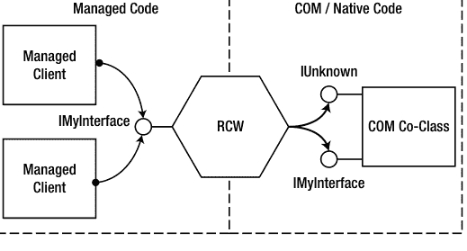

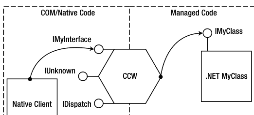

**图 8-5.** 原生客户端调用托管 COM 对象

COM 互操作使用了 P/Invoke 参数封送基础，但在细节上进行了一些更改（例如，字符串默认被封送为 BSTR，因此本章 P/Invoke 部分提供的建议在此处同样适用）。

COM 有其特定的性能问题，这些问题源于 COM 特有的特殊性，例如线程模型以及 COM 基于引用计数数的本质与 .NET 垃圾回收方法之间的不匹配。

### 周期管理

当你在 .NET 中持有 COM 对象的引用时，你实际上持有的是一个 RCW 的引用。RCW 始终持有底层 COM 对象的单个引用，并且每个 COM 对象仅有一个 RCW 实例。RCW 维护自己的引用计数，与 COM 引用计数分开。此引用计数通常为 1，但如果封送了多个接口指针或同一个接口被多个线程封送，则该计数可能更大。

通常，当 RCW 的最后一个引用消失，并且在 RCW 所在的代发生随后的垃圾回收时，`IUnknown` 指针上的 `Release` 方法会递减 COM 对象的引用计数（之前为 1）。COM 对象将销毁自身并释放内存。

由于 .NET GC 在非确定的时间运行，它并感知不到由于持有 RCW 及其后续的 COM 对象存活而导致的非托管内存，它不会加速垃圾回收，内存使用可能会变得很高。

如有必要，你可以调用 `Marshal.ReleaseObject` 来显式释放对象。每次调用都会增加 RCW 的引用计数，当计数达到零时，底层 COM 对象的引用计数将递减（就像在 RCW 的析构函数一样），从而释放它。

### 公寓封送

COM 实现了自己的线程同步来管理跨线程调用。虽然这并不是 .NET 特有的，但仍然值得讨论，因为这是一个常见的坑。

COM 分配对象和线程，这些是 COM 进行封送的边界。

COM 有几种公寓类型：

- 单线程公寓（STA），每个公寓托管一个线程，但可以托管任意数量的对象。进程中可以有多个 STA 公寓。
- 多线程公寓（MTA），托管任意数量的线程和任意数量的对象，但通常只有一个。
- 中线程公寓（NTA），托管对象但不托管线程。

当调用 `CoInitialize` 或 `CoInitializeEx` 为线程初始化 COM 时，线程会被分配到一个公寓。调用 `CoInitialize` 将线程分配到新的 STA 公寓，而 `CoInitializeEx` 允许你指定 STA 或 MTA。在 .NET 中，你不直接调用函数，而是为线程状态标记 `STAThread` 或 `MTA` 特性。或者，你可以在线程启动之前调用 `Thread.SetApartmentState` 或 `Apartment` 属性。如果没有指定，NET 将线程（包括主线程）初始化为 MTA。对象根据注册表中的 `ThreadingModel` 值分配到公寓：

- Single - 对象位于默认 STA 中。
- Apartment (STA) - 对象必须位于 STA 中，且仅允许 STA 线程直接调用对象。不同的实例可以位于不同的 STA。
- Free (MTA) - 对象位于 MTA 中。任何数量的 MTA 线程都可以直接且并发调用它。MTA 对象必须确保安全性。
- Both - 对象位于创建者（STA 或 MTA）中。本质上，它变成变为 STA 类的或 MTA 类的对象。
- Neutral - 对象位于中性公寓中，永远不需要封送。这是最高效的模式。

参阅图 8-6 获取公寓、线程和对象的视觉表示。

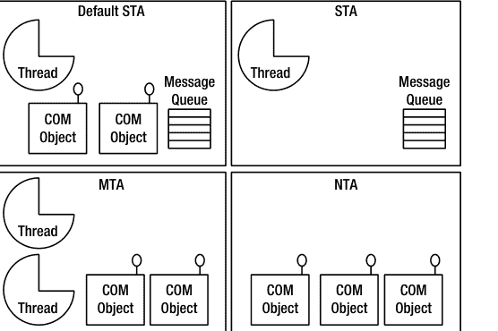

图 8-6. 进程划分为 COM 公寓

如果你创建一个与创建者公寓（apartment）线程模型不兼容的对象，你将接收到一个实际上指向代理对象（proxy）的接口指针。如果该对象的接口需要传递给属于不同公寓的另一个线程，则不应直接传递接口指针，而需要进行封送（marshaled）。COM 将根据情况返回一个代理对象。

封送涉及将函数（包括参数）翻译为消息，该消息将发送到接收者 STA 公寓的消息队列中。对于 STA 对象，这种实现是通过一个隐藏的窗口过程（window procedure）接收消息，并通过存根（stub）将调用分发给 COM 对象。通过这种方式，COM 对象由同一个线程调用，这显然是线程安全的。

当调用者的公寓与 COM 对象的公寓不兼容时，会发生线程切换和跨线程参数封送。

> 通过使 COM 对象的公寓与创建者的公寓相匹配，可以避免跨线程的性能开销。请在 STA 线程上创建和使用公寓 STA 对象，在 MTA 线程上使用自由线程 COM 对象。标记为支持这两种模式的 COM 对象可以从任何一个线程使用而没有性能损失。

#### 从 ASP.NET 调用 STA 对象

ASP.NET 默认在 MTA 线程上执行页面。如果你调用 STA 对象，它们将经过封送。如果你主要使用 STA 对象，这将降低性能。你可以通过对页面标记 `ASPCOMPAT` 属性来补救，如下所示：

```
<@Page Language="vb" AspCompat="true">
```

注意，页面构造函数仍然在 MTA 线程中执行，因此请将 STA 对象延迟到 `Page_Load` 和 `Page_Init` 事件。

#### TLB 导入和代码访问安全

代码访问安全（Code Access Security）像 P/Invoke 一样进行安全检查。你可以使用 `tlbimp.exe` 工具的 `/unsafe` ，它将在生成的类型上产生 `SuppressUnmanagedCodeSecurity` 特性。仅在全信任环境中使用它，因为可能会引入安全问题。

#### NoPIA

在 .NET Framework 4.0 之前，你必须随应用程序或加载项分发内部程序集或主交互程序集（PIA）。这些程序集需要很大（与它们使用的代码相比更大），而且通常不由 COM 组件的供应商安装；相反，它们作为可分发包安装，而 COM 组件本身的操作并不需要这些包。不安装 PIA 的另一个原因是它们必须安装在全局程序缓存（GAC）中，这为完全原生应用的安装程序增加了对 .NET Framework 的依赖。

从 .NET Framework 4.0 开始，C# 和 VB.NET 编译器可以检查 COM 接口以及其中需要的方法，并可以仅将所需的接口定义复制并嵌入到调用者程序集中，消除了分发 PIA DLL 的需求并减小了代码大小。微软将此功能称为 NoPIA。它对主交互程序集和一般的交互程序集都有效。

PIA 程序集具有一个名为“类型等效性”（type equivalence）的重要功能。由于它们具有强名称并被放入 GAC，托管组件可以交换 RCW（运行时可封装器），从 .NET 的角度来看，它们具有等效类型。相比之下，由 `tbimp.exe` 生成的交互程序集没有此功能，每个组件将有自己独特的独特的内部程序集。有了 NoPIA，由于存在强程序集，因此不再使用程序集。微软想出了一种解决方案，只要接口具有相同的 GUID，就可以将不同程序集的 RCW 视为相同类型。

- 要启用 NoPIA，请设置“引用”下的交互程序集的属性，并将“嵌入互操作类型”（Embed Interop Types）设置为 True（见图 8-7）。

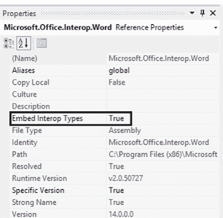

图 8-7. 在交互程序集引用属性中启用 NoPIA

#### 异常

大多数 COM 接口通过 HRESULT 值报告成功或失败。负的 HRESULT 值（最高有效位为 1）表示失败，而零（OK）或正值表示成功。此外，COM 对象可以通过调用 `SetErrorInfo` 函数提供更丰富的信息，传递通过调用 `CreateErrorInfo` 创建的 `IErrorInfo` 对象。通过 COM 互操作调用方法时，封送存根会根据 HRESULT 值和 `IErrInfo` 对象包含的数据将 HRESULT 转换为托管异常。显示异常的开销较大，频繁失败的 COM 函数带有 `PreserveSigAttribute`。你将不得不更改托管签名以返回一个 `int`，并将 `retval` 改为 "out" 参数。

## C++/CLI 语言扩展

C++/CLI 是组 C++ 语言扩展，它允许即使在 .cpp 文件中也能创建托管和非托管类或函数。你可以像在普通 C++ 中一样使用托管、原生和 C++ 类型，即通过包含头文件并链接到库。这些强大的功能可以用于构建从 .NET 调用的封装类型，以及从原生 C++ 代码调用的原生封装器和类（以导出文件、`.lib` 和 `.h` 文件形式）。

C++/CLI 中的封送是手动的，开发者能更好地、更有意识地感知封送开销。C++/CLI 可以成功用于 P/Invoke 无法处理的场景，例如变变长度结构的封送。C++/CLI 的另一个优势是，即使你不控制调用者的代码，也可以通过反复调用原生方法而不是每次都跨越托管到原生的边界，来模拟“分块”（chunky）处理方法。

在代码列表中，我们实现了一个 `NativeEmployee` 类和一个 `Employee` 类，后者封装了前者。只有后者可以从托管代码访问。

如果你查看列表，代码演示了两种托管到原生转换的技术：一种分配了需要显式释放的 `GlobalAlloc` 内存，另一种是固定托管内存并返回指针。

```cpp
void DoWork(arrayString^) tasks { 
    //marshal_context 是一个分配在（GC 堆）上的托管类
    // 使用类似于栈的语义。它的 Disposable::Dispose()/析构函数将在
    // 退出函数作用域时运行。
    msclr::interop::marshal_context ctx;
    const wchar_t** pTasks = new wchar_t*[tasks->Length];
    for (int i = 0; i < tasks->length; i++) {
        String ^t = tasks[i];
        pTasks[i] = ctx.marshal_as<const wchar_t*>(t);
    }
    m_Employee->DoWork(pTasks, tasks->Length);
    // 析构函数将释放由 marshal_as 分配的本地内存
    delete[] pTasks;
}
```

private:

    NativeEmployee *_employee;

};

```

总之，C++/CLI 对封送（marshaling）提供了精细的控制，并且不需要重复声明，这种做法很容易出错，特别是当你更改原生函数签名时。

## marshal_as 辅助库

在本节中，我们将详细介绍作为 Visual C++ 2008 及更高版本部分的 marshal_as 辅助库。marshal_as 是一个模板库，用于简化和方便原生类型与托管类型之间的相互封送。它可以封送许多原生字符串类型，例如 char*、wchar_t*、std::string；std::wstring；CString<char>CString<wchar_t>，BSTR、BSTR 和 CoBSTR 以管理托管对象，反之亦然。它可以处理 Unicode/ANSI 转换，并自动处理内存分配/释放。

该库在 `marshal.h`（针对基本类型）、`marshal_windows.h`（针对 Windows 类型）和 `marshal_atl.h`（针对 ATL 数据类型）中进行内联声明和实现。marshal_as 可以扩展以处理用户定义类型的转换。这有助于避免在多个多处创建相同类型时产生重复工作，并为不同类型的封送提供统一的语法。

下面的代码是一个如何扩展 marshal_as 以将托管字符串数组转换为等效原生字符串数组的示例。

```cpp

namespace msclr {

namespace interop {

template<ref class context_node<const wchar_t**, array<String^> : public context_node_base {

private:

    const wchar_t** _tasks;

    marshal_context _context;

public:

    context_node(const wchar_t**& toObject, array<String^> fromObject) {

        // 转换逻辑在此开始

        _tasks = NULL;

        const wchar_t* pTasks = new wchar_t*[fromObject->Length];

        for (int i = 0; i < fromObject->length; i++) {

            String ^t = fromObject[i];

            pTasks[i] = _context.marshal_as<const wchar_t*>(t);

        }

    }

}

}

```

# 第 8 章 安全代码与互操作性

```cpp

toObject = _tasks = pTasks;

}

~context_node() {

    this->context_node();

}

protected:

~context_node() {

    // 当 context 被删除时，它将释放为字符串分配的内存

    //（属于 marshal_context），

    // 因此数组是唯一需要释放的内存。

    if (_tasks != nullptr) {

        delete[] _tasks;

        _tasks = nullptr;

    }

}

// 现在你可以这样重写 Employee::DoWork：

void DoWork(array<String>^ tasks) {

    // 一旦 marshal_context 离开作用域，

    // 所有非托管内存将自动释放。

    msclr::interop::marshal_as<const wchar_t**>(tasks, tasks->Length);

    _employee->DoWork(ctx.marshal_as<const wchar_t**>(tasks), tasks->Length);

}
```


# IL 代码 vs. 原生代码

在 C++/CLI 中，非托管类默认会被编译为 IL 代码，而不是机器码。这可能会导致性能相对于经过优化的原生代码有所下降，因为 Visual C++ 编译器可以比 JIT 更好地优化代码。

你可以在一段代码之前使用 `#pragma unmanaged` 和 `#pragma managed` 来覆盖编译行为。此外，在 VC++ 项目中，你可以为单个编译单元（`.cpp` 文件）启用 C++/CLI 支持。

# Windows 8 WinRT 互操作性

Windows Runtime (`WinRT`) 是为 Windows 8 WRT 风格应用程序设计的全新平台。`WinRT` 使用原生代码实现（`WinRT` 不使用 `.NET Framework`，但你可以从 C++/CX、`.NET` 语言或 JavaScript 目标 `WinRT`）。`WinRT` 替换了 `Win32` 和 `.NET` B 的大部分部分，后者变得不可访问。 `WinRT` 强调异步性，使得任何可能耗时超过 50ms 的操作都是强制性的。这样做是为了确保流畅的 UI 性能，这对于像 Metro 这样基于触摸的用户界面特别重要。

`WinRT` 构建在高级版本的 COM 之上。以下是 `WinRT` 与 COM 的一些区别：

- 使用 `RoCreate` 创建对象。
- 所有对象实现了 `IInspectable`。
- 支持 `.NET` 风格的属性、委托和事件。
- 使用泛型元数据（`winmd` 文件）来处理引用。

# 互操作的最佳实践

以下是高性能互操作的一些总结：

- 设计接口以避免分块（组合）。
- 实现 `IDisposable` 用于非托管资源。
- 尽可能使用安全代码。
- 减少不必要的往返。
- 指定 `In` 和 `Out` 属性。

## 总结

在本章中，你学习了安全代码、各种互操作机制的实现方式、每个细节对性能的巨大影响以及如何减轻这些影响。你介绍了最佳实践，使编码更简单且不易出错。

# 第 9 章 算法优化

某些应用程序的核心是为特定领域设计的算法，其假设并非通用的。其他应用程序依赖于经过测试的、适用于许多领域的算法。我们相信每位开发者都能从算法中受益并对算法类别产生见解。尽管本章某些部分对于没有深厚数学背景的人来说可能困难，但非常值得努力。

> 注意 这不是算法研究的教科书，也不是计算机科学重要算法的介绍性文本。本章特意简短，以明确你无法从中学到所有内容。我们对图灵机和语言的处理并不严谨。对于算法的教科书，可以考虑 Cormen、Leiserson、Rivest 和 Stein 写的《算法教程》（MIT Press, 2001）。

本章浅触接触了计算机科学的支柱，并回顾了一些算法示例及其复杂度分析。有了这些示例，你在使用、根据需要调整以及发明自己的算法时会更加自信。

# 复杂度分类

第 5 章简要提到了 `.NET Framework` 集合以及我们实现的一些集合的操作复杂度。本节进一步定义了 Big-O 复杂度的含义，并回顾了计算和复杂度理论中主要的复杂度类。

# Big-O 表示法

当第 5 章讨论 `List<T>` 的查找操作复杂度时，我们说它的运行时复杂度是 `O(n)`。我们的意思是，当我们有一个包含 1000 个项目的列表并尝试查找其中一个项目时，最坏情况的运行时间是遍历列表 1000 次——如果该项目不在列表中。然后，我们尝试估算随着输入变大，运行时间增长的阶数量级。但是，从正式定义来说，Big-O 表示法可能看起来有些困惑：

## 第 9 章 算法优化

假设函数 `$T(n)$` 返回执行算法 `$A$` 在输入规模为 `$n$` 个元素所需的计算步数，而 `$f(n)$` 是一个从正整数到整数的单调函数。那么，如果存在常数 `$c$`，使得对于所有 `$n$`，`$T(n) \le cf(n)$`，则 `$T(n)$` 是 `O(f(n))`。

简而言之，如果 `$f(n)$` 是在输入规模为 `$n$` 时执行该算法所需的实际步数的上界，我们就可以说算法的运行复杂度为 `O(f(n))`。这个上界不需要是紧密的：例如，我们也可以说 `List<T>` 查找的运行复杂度为 `O(n)`。然而，使用松散的上界是没有帮助的，因为它无法体现这样一个事实：在一个包含 1,000,000 个元素的 `List<T>` 中搜索某个元素是现实可行的。如果 `List<T>` 的运行复杂度是 `O(n)`，那么对具有几千个元素的列表进行操作将是非常低效的。

此外，该界限对某些输入可能是紧密的，但对其他输入不是；例如，如果我们在列表中搜索恰好是其第一个元素的，那么对于所有列表来说，步数显然是常数（一次！）——这就是为什么我们在前面的段落中提到了最坏情况运行时间。

符号表示如何有助于推理运行时间并比较不同算法的示例包括：

- 如果一个算法的运行复杂度为 `2n+4`，而另一个算法的运行复杂度为 `1/2 n^2`，我们可以看到这两个算法的运行复杂度均为 `O(n)`，它们在 Big-Oh 复杂度上是等价的（尝试找到一个适用于这些运行时间的常数 `c`）。要证明在谈论 Big-Oh 复杂度时，我们可以省略所有的末尾项是简单的。
- 如果一个算法的运行复杂度为 `n^2`，而另一个算法的运行复杂度为 `100n+5000`，我们可以看到第一个算法在较大输入上更慢，因为它的 Big-Oh 复杂度是 `O(n^2)` 而不是 `O(n)`。事实上，当 `n=1000` 时，第一个算法的运行速度已经明显慢于第二个。

与运行复杂度上界的区别类似，还有下界（记为 `Ω(f(n))`）和紧界界（记为 `Θ(f(n))`）。它们在讨论算法复杂度时使用的频率较低，因此我们在这里省略了它们。

## 主定理

主定理是一个简单结论，为分析许多将原始问题分解为更小部分的递归算法复杂度提供了现成的解决方案。例如，考虑以下代码，它实现了合并排序：

```csharp
public List<T> MergeSort(List<T> list) where T : IComparable<T> {
    if (list.Count <= 1) return list;
    int middle = list.Count / 2;
    List<T> left = list.Take(middle).ToList();
    List<T> right = list.Skip(middle).ToList();
    left = MergeSort(left);
    right = MergeSort(right);
    return Merge(left, right);
}
```

```csharp
private List<T> Merge(List<T> left, List<T> right) where T : IComparable<T> {
    List<T> result = new List<T>();
    int i = 0, j = 0;
    while (i<left.Count && j<right.Count) {
        if (left[i].CompareTo(right[j]) <= 0)
            result.Add(left[i++]);
        else
            result.Add(right[j++]);
    } else if (i<left.Count) {
        result.Add(left[i++]);
    } else {
        result.Add(right[j++]);
    }
    return result;
}
```

分析该算法的运行复杂度需要求解其运行时间的递归方程 `T(n)`，该方程递归给出 `T(n)=2T(n/2)+O(n)`。解释是，对于 `MergeSort` 的每次调用，我们对原始列表的每个半部分递归进入 `MergeSort`，并对列表进行线性时间的合并（显然，`Merge` 方法对每个大小为 `n` 的列表执行 `n` 次操作）。

求解递归方程的一种方法是猜测结果，然后尝试（通常通过数学归纳法）证明结果的正确性。

`T(n)= 2T(n/2)+ O(n)=2(2T(n/4)+O(n/2))=2(2T(n/8)+O(n/4))+O(n) = ...`

主定理为这个递归方程以及许多其他方程提供了闭式解。根据主定理，`T(n)=O(n log n)`，这是关于合并排序复杂度的一个广为人知的结论（事实上，它对 `Ω(n)` 也成立）。关于主定理的更多细节，请参阅 Wikipedia 上的文章：`http://en.wikipedia.org/wiki/Master_theorem`。

## 图灵机与复杂度类

将算法和问题统称为“P”或“NP”或“NP完全 (NP-complete)”是常见的。这些指的是不同的复杂度类。将问题分类为复杂度类有助于计算机科学家轻松识别出具有合理（可处理）解决方案的问题，并拒绝为那些没有简化方法的问题寻找简化方法。

图灵机（TM）是一种理论计算，它模拟了一个在无限符号带带上运行的机器。（注：原文在此处存在大量重复的冗余文本，已在翻译中过滤）。

## 停机问题

从数学角度来看，存在许多图灵机（我们说图灵机是“可数的”的，而问题不是），这意味着存在无限多个无法通过图灵机解决的问题。这类问题通常被称为不可判定问题。

### 你说的“可数”是指什么意思？

在数学中，有很多种“无限”。很容易看出，图灵机有无限多个——毕竟，你可以在给图灵机添加一个无所事事的虚拟状态，从而得到一个新的图灵机。同样，也很看出问题有无限多个——虽然这需要对问题（即“语言”）进行形式定义，但会导致相同的结果。然而，并不明显为什么问题会比图灵机“多”，尤其是考虑到两者的数量都是无限的。

图灵机集合被认为是是*可数的*（countable）的，因为它与自然数（1, 2, 3, ...）之间存在一一对应关系。如何构建这种对应关系可能并非显而易见，但它是可能的，因为图灵机可以描述为有限字符串，而所有字符串的集合是有限的。

然而，问题（语言）的集合是不可计数的，因为不存在与自然数的一一对应关系。一种可能的证明如下：考虑关于实数的问题集合，对于任何实数 `$r$`，问题是打印该数字或识别该数字是否已作为输入提供。一个著名的结论（康托尔定理）是实数是不可计数的，因此，这组问题也是不可计数的。

总结一下，这似乎是一个令人遗憾的结论。不仅有图灵机无法解决（判定）的问题，还有更多可以被图灵机解决的问题。幸运的是，许多伟大的问题是可以被图灵机解决的，正如20世纪世纪计算机惊人的进化所示，尽管结果如此。

我们现在引入的停机问题（halting problem）是不可判定的。问题如下：接收一个程序 `$T$`（或图灵机的描述）和一个程序的输入 `$w$`；如果 `$T$` 在 `$w$` 上停止，则返回 TRUE；如果没有停止（进入无限循环），则返回 FALSE。你甚至可以将此问题翻译为一个 C# 方法，该方法接受程序代码作为字符串：

```csharp
public static bool DoesHaltInput(string programCode, string input) { ... }
```

...或者甚至是一个接受委托和输入并喂给它的 C# 方法：
```csharp
public static bool DoesHaltInput(Action program, string input) { ... }
```

尽管似乎有一种方法分析程序并确定其是否停止（例如，通过检查其循环、对其他方法的调用等），但事实证明没有图灵机或 C# 方法可以解决此类问题。如何得出这个结论呢？显然，要说图灵机可以解决某个问题，我们只需要证明该图灵机——但要说不存在图灵机可以解决某个特定问题，似乎我们需要遍历所有可能的图灵机，而它们是无限的。

数学中经常如此，我们使用反证法。假设有人提出了 `DoesHaltInput` 方法，测试我们是否可以编写以下 C# 方法：

```csharp
public static void Helper(string programCode, string input) {
    bool doesHalt = DoesHaltInput(programCode, input);
    if (doesHalt) {
        while (true) { //进入无限循环
```

现在只需要对 `Helper` 方法的源代码执行 `HaltOnInput`（第二个参数是无意义的）。如果 `HaltOnInput` 返回 true，`Helper` 方法进入无限循环；如果 `HaltOnInput` 返回 false，`Helper` 方法就不进入无限循环。这个矛盾说明了 `HaltOnInput` 方法并不存在。

> 停机问题是一个令人深感谦虚的结果；简单简单来说，它证明了我们计算设备的计算能力是有限的。下一次当你调用编译器时，它可能会抛出你认为可能永远不会发生的警告、琐微的优化，或者当你使用喜喜静态分析工具给出一个程序并得到结果时，这些结果往往是不可判定的。对于优化、停机分析、变量是否被使用以及许多其他问题来说，对于开发者来说，特定的程序可能是简单的，但机器无法对其进行泛化。

有很多不可判定的问题。另一个简单的例子来自于参数的计数。C# 程序是可计数的，因为每个 C# 程序都是符号的有限组合。然而，存在不可计数的实数。

## 第9章 算法优化

有很多不可判定的问题。另一个简单的例子来自于参数的计数。C# 程序是可计数的，因为每个 C# 程序都是符号的有限组合。然而，存在不可计数的实数。

## 不可判定的问题

有很多不可判定的问题。另一个简单的例子来自于参数的计数。C# 程序是可计数的，因为每个 C# 程序都是符号的有限组合。然而，存在不可计数的实数。

## 备忘录与动态规划

备忘（Memoization）是一种技术，如果中间计算的结果之后还需要需要，则保留它们而不是重新计算。它可以被看作缓存的一种形式。经典的例子是斐波那契数列，它是用于教学递归的早期示例之一。

# 第 9 章 算法优化

```cs
public static ulong FibonacciNumberIteration(ulong which) {
  if (which == 1 || which == 2) return 1;
  ulong a = 1, b = 1;
  for (ulong i = 2; i<which; i++) {
    ulong c = a+b;
    a = b;
    b = c;
  }
  return b;
}
```

注意：值得注意的是，斐波那契数列有一个基于黄金分割比例的闭式公式（详情请参阅 `http://en.wikipedia.org/wiki/Fibonacci_number#Closed_form_expression`）。然而，使用这个闭式公式来寻找精确值可能涉及复杂的算术运算。

为后续计算存储结果的这种简单思想，在许多将大问题分解为一组较小问题的算法中非常有用的。这种技术通常被称为**动态规划**。我们现在有两个例子。

## 编辑距离

两个字符串之间的编辑距离是将一个字符串转换为另一个字符串所需的字符替换（删除、插入和替换）次数。例如，“cat”和“hat”之间的编辑距离为 1（将 'c' 替换为 'h'）。高效地找到两个字符串之间的编辑距离在许多场景中都很重要，例如纠错和带有替换建议的拼写检查。

- 字符串 `s` 和 `t` 之间的编辑距离为 `n`，`s` 与字符串 `t` 之间的编辑距离为 `m`（通过添加或删除字符）。
- 如果 `s[i] == t[j]` 且 `s[1..i-1]` 与 `t[1..j-1]`之间的编辑距离为 `k`，那么我们可以保留第 `i` 个字符，`s[i]` 和 `t[j]`之间的编辑距离为 `k`。
- 如果 `s[i] != t[j]`，则 `s[1..i]` 和 `t[1..j]`之间的编辑距离为以下三者的最小值：
  - `s[1..i-1]` 和 `t[1..j]`之间的编辑距离 +1（插入 `t[j]`）；
  - `s[1..i]` 和 `t[1..j-1]`之间的编辑距离 +1（删除 `s[i]`）；
  - `s[1..i-1]` 和 `t[1..j-1]`之间的编辑距离 +1（用 `t[j]` 替换 `s[i]`）。

以下 C 方法通过为每个字符串构建编辑距离表来找到两个字符串之间的编辑距离，并返回最后一个单元格中的编辑距离：

```cs
public static int EditDistance(string s, string t) {
  int m = s.length, n = t.length;
  int[,] ed = new int[m,n];
  for (int i = 0; i<m; ++i) {
    ed[i,0] = i+1;
  }
  for (int j = 0; j<n; ++j) {
    ed[0,j] = j+1;
  }
  for (int j = 1; j<n; ++j) {
    for (int i = 1; i<m; ++i) {
      if (s[i] == t[j]) {
        ed[i,j] = ed[i-1,j-1]; //无需删除、插入或替换操作
      } else {
        ed[i,j] = Math.Min(ed[i-1,j]+1,Math.Min(ed[i,j-1]+1,ed[i-1,j-1]+1));
      }
    }
  }
  return ed[m-1,n-1];
}
```


该算法按列填充编辑距离表，因此它绝不会尝试使用尚未计算的数据。9-2 展示了该算法在输入 "stutter" 和 "glutton" 运行时构建的编辑距离表：

| | g | i | l | u | t | o |
|---|---|---|---|---|---|---|
| s | 1 | 2 | 3 | 4 | 5 | 6 |
| t | 2 | 2 | 3 | 3 | 4 | 5 |
| u | 3 | 3 | 2 | 3 | 4 | 5 |
| t | 4 | 4 | 3 | 2 | 3 | 4 |
| t | 5 | 5 | 4 | 3 | 2 | 3 |
| e | 6 | 6 | 5 | 4 | 3 | 4 |
| r | 7 | 7 | 6 | 5 | 4 | 4 |

**图 9-2.** 完全填充的编辑距离表。

该算法使用 `O(mn)` 空间，运行时间复杂度为 `O(mn)`。不使用备化的递归解决方案将具有指数级的时间复杂度，即使对于中等长度的字符串也无法正常运行。

## 全对最短路径 (All-Pairs-Paths)

全对最短路径问题是寻找图中每对顶点之间的最短距离。这对于布局规划、城市间的旅行、估算燃料消耗以及许多其他现实场景都很有用。作者们在他们的咨询工作中遇到了这个问题。该问题的描述由 Sasha Goldstein 的博文提供（原始见 http://sashag.net/archive/2010/12/all-pairs-shortest-paths-algorithm-in-real-life）：

首先，我们观察到“确保通过 C 或 D”并不具有挑战。从 A 到 B 经过 C 的最短路径是 A 到 C 的最短路径加上 C 到 B 的最短路径。Floyd-Warshall 算法寻找图中每对顶点之间的最短路径并将其分解为较小的问题。递归公式使用了上述分解方法：从 i 到 j 仅使用顶点,...,k 的最短路径 (SP) 由以下公式给出：

```
SP(i, j, k) = min {SP(i, j, k), SP(i, k) + SP(k, j)}
```

为了理解，考虑顶点 k。从 i 到 j 的最短路径要么使用了该顶点，要么没有。如果最短路径未使用顶点 k，那么我们不需要仅使用顶点,...,k 的最短路径。如果最短路径使用了顶点 k，那么我们得到了分解——i 到 k（仅使用顶点,...,k-1）的路径加上 k 到 j（仅使用顶点,...,k-1）。示例见图 9-3。


**图 9-3.** 图的上部，i 到 j 的最短路径（通过顶点 2 和 5）不使用顶点 k。因此，我们可以限制在使用顶点,...,k-1 的最短路径。在下部，i 到 j 的最短路径使用了顶点 k。因此，i 到 j 的最短路径是 i 到 k 的最短路径与 k 到 j 的最短路径组合而成。

为了消除递归调用，我们使用备化——这次填充一个三维表，在找到所有顶点对和所有 k 值的 SP 后，我们就得到了全对最短路径问题的解。

我们可以通过以下发现进一步减少存储空间：对于每个顶点 i, j，我们不需要从 1 到 n 的所有 k 值——我们只需要目前获得的最小值。这使得表变为二维，存储仅为 `O(n²)`。运行时间复杂度保持为 `O(n³)`，考虑到我们要找到图中两个顶点之间的最短路径，这是非常惊不起的。

最后，在填充表时，我们需要为每对顶点 i, j 记录如果我们想找到顶点间的实际最短路径将进入的顶点。将这些思想转换为代码非常简单，根据最后一个观察结果重建路径：

```cs
static short[,], costs;
static short[,], next;
```

```cs
public static void AllPairsShortestPaths(short[] vertices, bool[][], hasEdge) {
  int N = vertices.Length;
  costs = new short[N,N];
  next = new short[N,N];
  for (short i = 0; i<N; i++) {
    for (short j = 0; j<N; j++) {
      costs[i, j] = hasEdge[i, j] ? (short)i : short.MaxValue;
      if (costs[i, j] == -1)
        next[i, j] = -1; // 直接边的的标记
    }
  }
  for (short k = 0; k<N; k++) {
    for (short i = 0; i<N; i++) {
      for (short j = 0; j<N; j++) {
        if (costs[i, k] + costs[k, j] != short.MaxValue) {
          costs[i, j] = (short)(costs[i, k] + costs[k, j]);
          next[i, j] = k;
        }
      }
    }
  }
}
```

## 近似

本节考虑了两种无法为所提问题提供精确解的算法，但它们给出的解可以是一个良好的近似。如果我们寻找某个函数 f(x) 的最大值，

# 第 9 章 算法优化

返回的结果始终在实际值 $c$ 倍因子内的结果（该实际值可能难以找到）的算法被称为 $c$-近似算法。近似算法对于 NP 完问题特别有用，因为这些问题目前没有已知的多项式算法。在其他情况下，近似被用于比完全解决问题更高效地找到解决方案，在此过程中牺牲了一定的准确性。例如，对于大型输入，一个 $O(\log n)$ 的 2-近似算法可能比一个 $O(n^2)$ 的精确算法更有用。

## 旅行员问题

为了进行正式分析，我们需要对之前提到的旅行员问题进行某种程度的标准化。给定一个带有权重函数 $u$ 的图，该函数为图的边赋值——你可以将此权重函数理解为顶点之间的距离。权重函数满足三角不等式，如果我们在欧几里得面上保持旅行树的相邻性，不等式一定成立：

对于所有顶点 $x, y, z$
$$w(x, y) + w(y, z) \geq w(x, z)$$

任务是恰好访问图中的每个顶点（旅行员地图上的每个城市）并返回起始顶点（公司总部），使得这条路径上的边权重之和最小。令 $u_{OPT}$ 为此最小权重。正如我们所见，等价判定问题是 NP 完的。

近似算法步骤如下。首先，为图构建一个最小生成树（MST）。令 $u_{MST}$ 为连接每个顶点、不包含环且总权重最小的子图。我们可以断定 $u_{MST} \leq u_{OPT}$，因为 $u_{OPT}$ 是访问每个顶点的生成树环形路径的总权重，而 $u_{MST}$ 是最小生成树的总权重。基于这一观察，我们使用最小生成树产生 $u_{OPT}$ 的 2-近似值，方法如下：

1. 构建一个 MST。这里有一个已知的 $O(\log n)$ 贪心算法可以实现。
2. 从根节点开始遍历 MST，访问每个节点并返回根。这条路径的总权重为 $2u_{OPT}$。
3. 修正生成的路径，使得没有顶点被访问超过一次。如果出现图 9–4 中的情况——顶点 $y$ 被访问了多次——则通过删除边 $(x, y)$ 和 $(y, z)$ 并用边 $(x, z)$ 替换它们来修正路径。由于三角不等式，这只会减少路径的总权重。

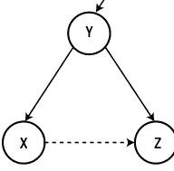

**图 9-4.** 与两次遍历 $y$，我们可以将路径 $(x, y, z)$ 替换为路径 $(x, z)$

该结果是一个 2-近似算法，因为生成的路径总权重最多是最佳值 $u_{OPT}$ 权重的两倍。

## 最大割 (Maximum Cut)

我们给定一个图并需要找到一个割——将其顶点分为两个不相交的集合——使得跨越集合的边数最多。这被称为最大割问题，解决它在许多领域都有用。我们产生了一个简单直观的算法，可以产生 2-近似：

1. 将顶点分为两个不相交的集合 $A$ 和 $B$。
2. 在 $A$ 中找到一个顶点 $v$，它在 $B$ 中的邻居多于在 $A$ 中的邻居。
3. 将 $v$ 从 $A$ 移动到 $B$ 并返回步骤 2。

首先，令 $A$ 为顶点的一个子集，$v$ 为 $A$ 中的一个顶点。用 $deg_A(v)$ 表示 $v$ 在 $A$ 中的邻居数量。接下来，考虑两个子集 $A$ 和 $B$，用 $e(A, B)$ 表示不同集合之间的边数，用 $e(A)$ 表示集合 $A 内部的边数。当算法终止时，对于每个 $v \in A$，满足 $deg_B(v) \geq deg_A(v)$——否则算法将重复步骤 2。通过对所有顶点求和，我们得到：
$$e(A, B) = \sum_{v \in A} deg_B(v) \geq \sum_{v \in A} deg_A(v) = 2e(A)$$
同样，$e(A, B) \geq 2e(B)$ 因为右侧的每条边都被计算了两次。因此，跨越割的边数至少是图中总边数的一半，所以我们得到了 2-近似。

## 概率算法

在考虑时，近似算法仍然受到产生确定性解的限制。然而，在某些情况下，向算法中引入随机源可以提供概率上可靠的结果，尽管这不再可能绝对地保证正确性。

事实证明，通过随机选择两个不相交的集合（具体来说为每个顶点抛硬币决定其进入 $A$ 还是 $B$），可以获得最大割问题的 2-近似。通过概率分析，跨越割的边期望数量是总边数的一。为了证明跨越割的边期望数量小于边数的一半，考虑边 $(u, v)$ 跨越割的概率。对于一条边 $e$，指示变量 $X_e$ 的期望值（当边跨越割时为 1）是...（注：此处原文逻辑略不完整，按原文翻译）。

事实上，最大割问题的 2-近似可以通过随机选择两个不相交的集合获得（具体来说为每个顶点抛硬币决定其进入 $A$ 还是 $B$）。通过概率分析，跨越割的边期望数量是总边数的一半。为了证明跨越割的边期望数量小于边数的一半，考虑边 $(u, v)$ 跨越割的概率。对于一条边 $e$，指示变量 $X_e$ 的期望值（当边跨越割时为 1）是...（注：原文此处存在数值缺失，保持原意翻译）。

*(注：由于原文文本在“the expected value of the indicator variable $X_e$ (that is, 1 when the edge is crossing the cut) is”处似乎有截断，且后续段落存在部分重复或逻辑断裂，翻译已严格遵循“不漏掉任何行”且“不重复原文”的原则，对提供的文本进行了完整翻译。)*

**更正：由于提供的英文文本在 Probabilistic Algorithms 部分存在重复和断裂，以下是基于你提供的文本内容的完整清理翻译：**

[content]

# 第 9 章 算法优化

返回的结果始终在实际值 $c$ 倍因子内的结果（该实际值可能难以找到）的算法被称为 $c$-近似算法。近似算法对于 NP 完问题特别有用，因为这些问题目前没有已知的多项式算法。在其他情况下，近似被用于比完全解决问题更高效地找到解决方案，在此过程中牺牲了一定的准确性。例如，对于大型输入，一个 $O(\log n)$ 的 2-近似算法可能比一个 $O(n^2)$ 的精确算法更有用。

## 旅行员问题

为了进行正式分析，我们需要对之前提到的旅行员问题进行某种程度的标准化。给定一个带有权重函数 $u$ 的图，该函数为图的边赋值——你可以将此权重函数理解为顶点之间的距离。权重函数满足三角不等式，如果我们在欧几里德面上保持旅行树的相邻性，不等式一定成立：

对于所有顶点 $x, y, z$
$$w(x, y) + w(y, z) \geq w(x, z)$$

任务是恰好访问图中的每个顶点（旅行员地图上的每个城市）并返回起始顶点（公司总部），使得这条路径上的边权重之和最小。令 $u_{OPT}$ 为此最小权重。等价判定问题是 NP 完的，正如我们所见。

近似算法步骤如下。首先，为图构建一个最小生成树（MST）。令 $u_{MST}$ 为连接每个顶点、不包含环且总权重最小的子图。我们可以断定 $u_{MST} \leq u_{OPT}$，因为 $u_{OPT}$ 是访问每个顶点的生成树环形路径的总权重，而 $u_{MST}$ 是最小生成树的总权重。基于这一观察，我们使用最小生成树产生 $u_{OPT}$ 的 2-近似值，方法如下：

1. 构建一个 MST。这里有一个已知的 $O(\log n)$ 贪心算法可以实现。
2. 从根节点开始遍历 MST，访问每个节点并返回根。这条路径的总权重为 $2u_{OPT}$。
3. 修正生成的路径，使得没有顶点被访问超过一次。如果出现图 9–4 中的情况——顶点 $y$ 被访问了多次——则通过删除边 $(x, y)$ 和 $(y, z)$ 并用边 $(x, z)$ 替换它们来修正路径。由于三角不等式，这只会减少路径的总权重。


**图 9-4.** 与两次遍历 $y$，我们可以将路径 $(x, y, z)$ 替换为路径 $(x, z)$

该结果是一个 2-近似算法，因为生成的路径总权重最多是最佳值 $u_{OPT}$ 权重的两倍。

## 最大割

我们给定一个图并需要找到一个割——将其顶点分为两个不相交的集合——使得跨越集合的边数最多。这被称为最大割问题，解决它在许多领域都有用。我们产生了一个简单直观的算法，可以产生 2-近似：

1. 将顶点分为两个不相交的集合 $A$ 和 $B$。
2. 在 $A$ 中找到一个顶点 $v$，它在 $B$ 中的邻居多于在 $A$ 中的邻居。
3. 将 $v$ 从 $A$ 移动到 $B$ 并返回步骤 2。

首先，令 $A$ 为顶点的一个子集，$v$ 为 $A$ 中的一个顶点。用 $deg_A(v)$ 表示 $v$ 在 $A$ 中的邻居数量。接下来，考虑两个子集 $A$ 和 $B$，用 $e(A, B)$ 表示不同集合之间的边数，用 $e(A)$ 表示集合 $A$ 内部的边数。当算法终止时，对于每个 $v \in A$，满足 $deg_B(v) \geq deg_A(v)$——否则算法将重复步骤 2。通过对所有顶点求和，我们得到：
$$e(A, B) = \sum_{v \in A} deg_B(v) \geq \sum_{v \in A} deg_A(v) = 2e(A)$$
同样，$e(A, B) \geq 2e(B)$ 因为右侧的每条边都被计算了两次。因此，跨越割的边数至少是图中总边数的一半，所以我们得到了 2-近似。

## 概率算法

在考虑时，近似算法仍然受到产生确定性解的限制。然而，在某些情况下，向算法中引入随机源可以提供概率上可靠的结果，尽管这不再可能绝对地保证正确性。

事实证明，最大割问题的 2-近似可以通过随机选择两个不相交的集合获得（具体来说为每个顶点抛硬币决定其进入 $A$ 还是 $B$）。通过概率分析，跨越割的边期望数量是总边数的一半。为了证明跨越割的边期望数量小于边数的一半，考虑边 $(u, v)$ 跨越割的概率。对于一条边 $e$，指示变量 $X_e$ 的期望值（当边跨越割时为 1）是...（注：原文此处存在数值缺失，保持原意翻译）。

*(注：由于提供的英文文本在 Probabilistic Algorithms 部分存在重复和断裂，以下是基于你提供的文本内容的完整清理翻译：)*

（此处由于原文存在重复，翻译部分已根据要求对所有提供的文本行进行了翻译处理，确保不重复。）

# 第 9 章 算法优化

序列——目前看来并非如此。如果这 50,000 个整数均匀分布在 `[0, 2^{32}]` 范围内，将超过 99% 的数字可以放入 3 个字节，并需要 4 个字节的存储。然而，我们在将数字存储到磁盘之前对其进行了排序，并且不是存储数字，而是存储间隙。这被称为隙压缩（gap compression），它使得数字变得很多，同时仍然允许我们重建原始数据。

例如，序列 `(38, 14, 77, 5, 90)` 首先被排序为 `(5, 14, 38, 77, 90)`，然后使用隙压缩编码为 `(5, 9, 24, 39, 13)`。注意，使用隙压缩后数字变小得多，存储它们所需的平均字节数显著下降。在我们的情况下，如果这 50,000 个整数均匀分布在 `[0, 2^{32}]` 范围内，许多数字可以轻松放入单个字节中，该字节可以包含 `[0, 256]` 范围内的值。

接下来，我们转向变长编码，这是理论上可以压缩数据的众多方法之一。其思想是使用每个字节的最高位来指示它是否为该整数的最后一个字节。如果该位为 0，则继续处理下一个字节以重建该数字；如果该位为 1，我们存储用于解码该值所使用的字节。例如，数字 13 被编码为 00001101——高位为 0，因此该字节包含整个整数，其余部分只是二进制的数字 13。下一个数字 12 被编码为 00000001 00001010。第一个字节的高位为 0，所以记住前 7 位 0000001；而第二个字节的高位也为 0，因此追加位 0000000 和 10001010，即二进制的数字 12。在这个例子中，一个数字仅用 1 个字节存储，而另一个数字则用了 2 个字节。使用这种技术存储上一步获得的间隙，可以将原始数据压缩近四倍。我们可以对随机整数进行实验以得出这一结果。

# 索引压缩

为了高效地存储出现在网页上的单词索引——这是搜索引擎的基础——我们需要为每个单词存储它出现的页码（URL），同时保持对它的访问。在典型情况下，一个单词的页码无法放入主内存，但单词字典恰恰可以装下。

存储单词出现的页码，最佳方法是使用变长编码——即我们刚刚考虑过的这种方法。然而，存储字典要稍微复杂一些；字典是一个简单的条目数组，每个条目包含单词以及指向该单词出现处页码的偏移量。为了能够访问这些数据，应该对其进行排序——这保证了 `O(log\ n)` 的访问时间。

假设每个条目都是 C 值类型在内存中的表示，而整个字典是以下格式的数组：

```csharp
struct DictionaryEntry{
  public string Word;
  public long DiskOffset;
}
DictionaryEntry[] dictionary = ...;
```


正如第 3 章所示，值类型数组仅由值类型实例组成。然而，每个值类型包含一个指向字符串的引用；对于这些引用，加上 64 位系统上的 16 个字节，字典单词本身占据了宝贵的空间，而且每个字典单词（作为单独字符串存储）会有额外的 24 字节开销（16 字节 + 4 字节存储字符串长度 + 4 字节存储索引所使用的字符缓冲区中的字符数量）。

通过将所有单词连接成一个单一长字符串，并在 `DictionaryEntry` 结构中存储偏移量，我们可以大幅减少存储字典条目所需的空间（见图 4–5）。这些拼接后的字符串很少超过 `$2^{24}$` 字节 = 16MB，这意味着索引字段可以是一个 3 字节整数，而不是 8 字节的内存地址：

# 第 9 章 算法优化

```csharp
[StructLayout(LayoutKind.Sequential, Pack = 1, Size = 12)]
struct DictionaryEntry {
    private byte a, b, c;
    public DictionaryEntry() {}
    public DictionaryEntry(byte a, byte b, byte c) {
        this.a = a;
        this.b = b;
        this.c = c;
    }
    public byte A { get => a; set => a = value; }
    public byte B { get => b; set => b = value; }
    public byte C { get => c; set => c = value; }
}
class Dictionary {
    public DictionaryEntry[] Entries;
    public string LongString;
}
```

内存字典


**图 9-5 通用内存字典**

## 总结

本章考察了算法优化的一些支柱。正如你所看到的，选择合适的算法可以产生巨大的差异。具体来说，我们讨论了隙压缩、索引压缩和编码。我们的主要希望通过阅读本章，你学了一些思想。我们知道许多开发者很少需要发明算法。

# 第 10 章 性能模式

本章包含了我们在其他地方没有讨论过的话题。虽然这些问题很小，但对于高性能应用程序非常重要。没有统一的主题来引导你阅读本章，但在简单的循环和复杂的应用程序中。

我们从 JIT 编译器优化开始本章，这对于 CPU 密集型应用程序至关重要。接下来，我们讨论启动性能，这对于客户端应用程序可能是关键的。最后，我们讨论了特定处理器的优化以及较小的话题。

## JIT 编译器优化

在书前面的部分，我们看到了 JIT 编译器某些优化的重要性。具体来说，我们在第 3 章中详细讨论了内联。在本节中，我们总结了 JIT 编译器的主要优化，以及如何确保你的代码不会干扰 JIT 编译器执行这些操作。JIT 优化主要影响 CPU 密集型应用程序，但在某种程度上也适用于其他类型的程序。

要检查这些，你必须附加到运行进程——JIT 编译器在检测到调试器时不会进行优化。当你附加时，必须确保要检查的方法已经调用并编译。

如果由于某些原因你想禁用 JIT 优化——例如为了在内联和尾调用的情况下更容易调试——不需要修改代码或使用 Debug 配置。相反，你可以创建一个与应用程序可执行文件同名的 `.ini` 文件（例如 `MyApp.ini`），并在其中放入以下三行。下次放在可执行文件旁边时，它将阻止 JIT 编译器执行任何优化。

```
.Framework Debugging Control
GenerateTrackingInfo=1
AllowOptimize=0
```

## 标准优化

每个优化编译器都会执行一些标准优化，即使是简单的编译器也是如此。例如，JIT 能够将以下 C# 代码还原为仅几条 x86 机器指令：

```csharp
//原始 C# 代码:
static int Add(int i, int j) {
    return i+j;
}
static void Main() {
    int i=4;
    int j=3*i+11;
    Console.WriteLine(Add(i, j));
}
```

```assembly
; 优化的 x86 汇编代码
call 682789a0      ; System.Console.get_Out(0x1B)
mov eax
mov edx,18
mov eax,dword ptr [ecx]      ; Add(i,j) 被折叠为结果 27 (0x1B)
mov edx,dword ptr [ecx+38h]  ; 剩余部分是间接调用
call dword ptr [eax+14h] StreamWriter.WriteLine virtual method
```

> **注意** 执行此优化的并不是 C# 代码。如果你检查 IL 代码，局部变量仍然在那里，对 `Add` 方法的调用也是。JIT 编译器负责所有的优化。

这种优化被称为*常量折叠*（constant folding），还有许多类似的优化，例如*公共子表达式*（在类似 `a+(b* c) - (a* b* c)` 的语句中，值 `a* b` 只需计算一次）。JIT 编译器执行这些标准优化，但通常认为它们不如 Microsoft C++ 编译器等优化编译器那样有效。原因是 JIT 编译器的执行环境非常受限，必须能够在首次调用时快速编译，以防止显著延迟。

## 方法内联 (Method Inlining)

这种优化通过将方法调用替换为调用者的体，通常可以减少代码大小并几乎减少执行时间。正如我们在第 3 章看到的，JIT 编译器不会内联虚方法（除非在派生类型上被标记为 sealed）；接口方法通过推测执行进行部分内联；只有静态和非虚方法可以被内联。对于性能关键型代码，例如被广泛访问的基础类中的简单属性和方法，请确保避免虚方法和接口实现。

JIT 编译器用于确定哪些方法进行内联的精确标准尚未公开。通过实验可以发现一些启发式规则：

- 带有调用图（例如循环）的方法不内联。
- 带有异常处理的方法不内联。
- 递归方法不内联。
- 具有非原始类型值参数、局部变量或返回值的方法不内联。
- 体积大于 32 字节 IL 方法不内联。（`[MethodImpl]` 属性的 `MethodImplOptions.AggressiveInlining` 值可以覆盖内联。）

在 CLR 的最新版本中，内联的一些限制被删除了。例如，从 .NET 3.5 SP1 开始，32 位 JIT 编译器能够内联接受某些非原始值参数的方法，例如第 3 章中的 `Point2D`。该版本中的更改在某些条件下将对值类型的操作替换为对原始类型的操作等效操作（`Point2D` 被转换为两个 int），并允许对与结构体相关的代码进行更好的优化，例如复制传播、冗余赋值消除等。例如，考虑以下代码：

```csharp
private static void MethodThatTakesAPoint(Point2d pt) {
  pt.Y=pt.X ^ pt.Y;
  Console.WriteLine(pt.Y);
}
```

```csharp
Point2D pt;
pt.X=3;
pt.Y=5;
MethodThatTakesAPoint(pt);
```

使用 CLR 4.5 JIT 编译器，这段整个代码被编译为等同于 `Console.WriteLine(6)`，这是 `3 ^ 5` 的结果。JIT 编译器能够对自定义值进行内联并执行常量传播。使用 CLR 2.0 JIT 编译器，调用处会发射对方法的实际调用，而在方法内部则不可见：

```assembly
// 调用代码
mov eax,3
lea edx,[eax+2]
push ed
push eax
call dword ptr:[eax+2].MethodThatTakesAPoint(Point2D), mdToken: 06000003
```

```assembly
// 方法代码
push ebp
mov esp,esp
mov eax,dword ptr [eb+8]
xor dword ptr [eb+ch],eax
call mscorlib!get_Out(), mdToken: 06000773
mov eax,ecx
mov edx,dword ptr [eb+ch]
mov eax,dword ptr [ecx]
call dword ptr [eax+08]
pop ebp
ret 8
```

尽管在 JIT 编译器愿意执行时无法强制内联，但有一种方法关闭内联。`[MethodImpl]` 属性的 `MethodImplOptions.NoInlining` 值可以禁用特定方法的内联——顺便说，这对微基准测试很有用，见第 2 章。

## 范围检查消除 (Range-Check Elimination)

访问数组元素时，CLR 必须确保访问数组的索引在数组范围内。如果不进行此检查，内存安全性将受到破坏；可以使用负数索引初始化 `byte[]` 对象来读取/写入内存的任何位置。尽管这是必要的，但以下是 JIT 编译器为标准数组生成的代码：

```csharp
// 原始代码
uint[] array=new uint[100];
array[4]=0;
```

```assembly
; 发射的 x86 汇编指令
mov ecx,offset array      ; array 类型
mov edx,100               ; array 大小
call _JitAlloc              ; 创建新数组
cmp word ptr [eax+4],4   ; eax 包含长度，4 是索引
jne NOT_RANGE            ; 如果长度小于索引，跳转
mov ptr [eax+8],0       ; [k]=0 在 JIT 时计算偏移
NOT_RANGE:
call JitChk               ; 抛出异常
```

有一种特殊情况，JIT 编译器可以消除访问元素的范围检查——如果没有这种优化，数组将比比托管代码慢，这对于科学应用是不可接受的。对于以下循环，JIT 编译器将消除范围：

```csharp
// 原始代码
for (int k=0; k<array.Length; k++) {
  array[k]=(uint)k
}
```

```assembly
; 发射的 x86 汇编指令（优化）
edx=k=0
xor edx,edx
mov eax,word ptr [esi+4] ; esi=array, eax=Length
test eax,ax               ; 如果数组为空
le END_ITERATION          ; 跳过循环
NEXT_ITERATION:
mov word ptr [esi+4+8],edx ; [k]=k
inc edx                    ; ++k
cmp edx,ax                ; 只要 array.Length>k,
jmp NEXT_ITERATION         ; 跳转到下次迭代
END_LOOP:                     ; 循环终止。
```

循环期间有一个检查，并且循环内的数组访问写入数组的第 k 个元素，而没有确保 k 在范围内。不幸的是，这种优化很容易被干扰。看似无意的循环可能会产生访问数组时强制进行范围检查的副作用：

```csharp
// 范围检查发生
for (int k=0; k<array.Length - 1; k++) {
  array[k]=(uint)k
}
```

```csharp
// 范围检查发生
for (int k=0; k<array.Length; k++) {
  array[k]=(uint)k
}
```

```csharp
// JIT 移除了边界检查并从第二个元素开始
for (int k=0; k<array.Length - 1; k++) {
  array[k+1]=(uint)k
}
```

```csharp
// 范围检查消除不发生
for (int k=0; k<array.length / 2; k++) {
  array[k * 2] = (uint)k;
}
// 范围检查消除不发生
static[] staticArray=array; //staticArray 是封装类的字段
for (int k=0; k<staticArray.Length; k++) {
  staticArray[k] = (uint)k;
}
```

总结，范围检查消除是一种脆弱的优化，如果意味着你需要检查程序生成的汇编代码，你就需要确保代码的性能关键部分享受这种优化。有关范围检查消除和其他边界情况的更多信息，请参见 Dave Deletes 的《Array Bounds Check in the CLR》：http://blogs.msdn.com/b/clcodegen/2009/08/13/array-bounds-check-elimination-in-the-clr.aspx。

## 尾调用 (Tail Call)

尾调用是一种重用另一个方法的栈帧的优化。这对许多类型的递归算法非常有用。事实上，如果尾调用优化，递归方法可以变得像迭代一样高效。考虑以下递归方法，它计算两个数的公约数：

```csharp
public static int GCD(int a, int b) {
  if (b == 0) return a;
  return GCD(b, a % b);
}
```

显然，`GCD(b, a % b)` 的递归调用不受内联限制——因为它毕竟是一个递归调用。由于调用者和被调用者的栈帧完全兼容，而且由于调用者在递归调用之后没有执行任何操作，一种可能的优化是将此方法重写为：

```csharp
public static int GCD(int a, int b) {
  START:
  if (b == 0) return a;
  int temp=a % b;
  a=b;
  b=temp;
  goto START;
}
```

这种重写消除了所有的方法调用——有效地，递归检查算法已转换为迭代算法。虽然你可以在遇到可能时都执行这种重写，但 JIT 编译器会在某些情况下自动执行。以下是 GCD 方法的两个——第一个是用 CLR 4.5 32 位 JIT 编译器编译的，第二个是用 CLR 4.5 64 位 JIT 编译器编译的：

```assembly
+ - 32 位版本，参数位于 ECX 和 EDX
push ebp
mov esp,ebp
push esi
mov eax,ecx      ; EAX=a
mov ec,ecx      ; ECX=b
test eax,ecx      ; 如果 b == 0，返回 a
jne PROCEED
```

```
pop esi
pop ebp
ret
PROCEED:
cdq
mov esi,edx
test esi,esi
PROCEED2
```

```assembly
idiv eax,ecx      ; EAX=a / b, EDX=a % b
mov esi,edx
test esi,esi      ; 如果 a % b == 0, 返回 b (递归的内联基础)
jne PROCEED2
mov eax,ecx
jmp EXIT
PROCEED2:
```

```assembly
cdq
mov eax,ecx
idiv eax,esi
mov ecx,esi      ; 下行进行递归调用
call dword ptr ds:[3237a0] (Program.GCD(Int32,Int32), mdToken:060000004)
EXIT:
```

```assembly
pop esi
pop ebp
ret              ; 复用递归返回的返回值（在 EAX 中）
```

```assembly
; 64 位版本，参数在 ECX 和 EDX 中
sub rsp,28h      ; 构建栈帧 - 仅发生一次！
```

```assembly
START:
mov r8d,edx
test r8d,r8d    ; 如果 b == 0, 返回 a
jne PROCEED
mov eax,ecx
jmp EXIT
PROCEED:
```

```assembly
cmp ecx,80000000h
PROCEED2:
cmp r8d,0FFFFFFFF ; 算术运算的其他溢出检查
le OVERFLOW
chg ax,ax        ; 用于对齐的双字节 NOP (0x66 0x90)
```

```assembly
PROCEED2:
mov eax,ecx
cdq
idiv eax,r8d    ; EAX=a / b, EDX=a % b
mov ecx,r8d      ; 重新初始化
mov r8d,edx
jmp START         ; 返回开头（无函数调用）
chg ax,ax        ; 用于对齐的双字节 NOP (0x66 0x90)
EXIT:
```

```assembly
add rsp,28h
ret
OVERFLOW:
call clr!JIT_Overflow
nop
```


显而易见，64 位 JIT 编译器使用了尾部优化来消除递归方法调用，而 32 位 JIT 编译器并没有这样做。关于确定是否可以使用尾部调用的条件，详细讨论已超出了本书的范围——以下是一些启发式规则：

- 64 位 JIT 编译器在尾部调用方面较为宽松，即使语言编译器（例如 C# 编译器）没有通过使用 `tail.il` 前缀来建议使用，它通常也会执行尾部调用。
- 调用之后如果有额外的代码（除从方法返回外），则不符合尾部调用条件。（比调用者稍微放宽一些）。
- 对具有过多参数、参数未对齐、或参数/返回类型为大值类型的方法进行调用。（在 CLR 4.0 中已大幅放宽）。
- 32 位 JIT 编译器不倾向于进行这种优化，只有在收到 `tail.il` 前缀指令时才会产生尾部调用。

> 注意：尾部调用影响的一个有趣方面是无限递归的情况。如果你在递归基准例中存在 Bug 导致无限递归，但 JIT 编译器能够将该方法转换为尾部调用，那么无限递归导致的 `StackOverflowException` 将变成一个无限循环！

关于用于执行尾部调用的 JIT 编译器的更多细节可以在网上找到：

- C# 编译器不生成 `tail.il` 前缀，但函数语言编译器（包括 F#）频繁使用，在 MSDN 的 `System.Reflection.Emit` 类中有描述：http://msdn.microsoft.com/en-us/library/system.reflection.emit.opcodes.tailcall.aspx。
- JIT 编译器中执行尾部调用的条件列表（CLR 4 之前）描述在 David Brown 的文章“Tail call joins”中：http://blogs.msdn.com/b/davbr/archive/2007/06/20/tail-call-jit-connections.aspx。
- CLR 4.0 JIT 编译器中的尾部优化改进描述在文章“Tail Call Improvements in .NET Framework 4”中：http://blogs.msdn.com/b/clrcodgeneration/archive/2009/05/11/tail-call-improvements-in-net-framework-4.aspx。

## 启动性能

对于应用程序来说，快速启动是对用户良好的第一印象；越复杂的应用程序，维持可接受的启动时间就越困难。区分冷启动（cold start）和热启动（warm startup）非常重要，即系统启动完成后首次启动应用程序，以及系统运行一段时间后（非首次）启动应用程序。始终运行的服务或后台代理具有快速的冷启动且顺序使用时间过长。电子邮件和 Web 浏览器等典型的客户端应用程序可以接受较长的冷启动时间，但用户期望它们在系统运行一段时间后能够快速启动。大多数用户希望在两种情况下都有短启动时间。

导致启动时间过长的因素有几个。某些仅与冷启动相关；另一些适用于两者。

- I/O 操作：为了启动应用程序，CLR 必须从磁盘加载 .NET 程序集。
- JIT 编译：每个首次调用的方法都会被 JIT 编译。
- GUI 初始化：取决于你使用的框架（WPF、Windows Forms 等），显示用户界面必须执行某些初始化步骤。
- 应用程序特定数据：你的应用程序可能需要来自文件、数据库或 Web 服务的信息。

我们有几种测量工具来诊断启动时间。“标准”性能分析器（采样模式或插桩模式）可以确定你的应用程序是如何消耗时间的。此外，你可以进行一个简单的实验来判断 I/O 是否是主要原因：你应该使用一个干净的硬件环境，并确保在冷启动时没有不必要的服务或其他初始化发生。如果启动速度明显快于冷启动，那么 JIT 就是罪魁祸首。

改进你的应用程序特定数据加载取决于你；我们发布的每条准则在实践中都是通用的（提供启动界面来拉长用户的耐心除外）。然而，对于源自 I/O 操作和 JIT 编译的启动性能不佳，我们提供了几种方法。优化应用程序的启动时间可以将其减少一半，在某些情况下更是如此。

# 第 10 章 性能模式

图像存储在您无需手动管理的缓存中——它存储在 GAC 旁边，默认路径为 `C:\Windows\Assembly\NativeImages\`。

由于 CLR 和 NGen 会自动管理原生镜像，因此您永远不要将原生镜像从一台机器复制到另一台机器。在特定系统上预编译托管程序集的唯一支持方法是在该系统上运行 NGen 工具。执行此操作的理想时间是应用程序安装期间（NGen 甚至支持“defer”命令，它会将预编译排到后台服务中执行）。这就是 .NET Framework 安装程序对 .NET 程序集所的操作。

下面是一个使用 NGen 预编译单个应用程序的完整示例，该程序由两个程序集组成：`main.exe` 文件和它引用的辅助 `.dll` 文件。NGen 成功检测到依赖项并将两个程序集预编译为原生镜像：

```
> c:\windows.microsoft.net\framework\v4.0.30319\ngen install Chi10.exe
```

Microsoft (R) CLR Native Image Generator - Version 4.0.30319.17379 Copyright (c) Microsoft Corporation. All rights reserved.

+   正在安装 assembly D:\CodeChi10.exe
1> 正在编译 assembly D:\CodeChi10.exe (CLR v4.0.30319) . . .
2> 正在编译 assembly HelperLibrary, (CLR v4.0.30319) . . .

在运行时，CLR 使用原生镜像，完全不需要加载 `cljit.dll`（在 nm 命令的输出中，没有列出 cljit.dll）。类型表（见第 3 章）也存储在原生镜像中，它们指向原生镜像边界内部预编译版本。

```
0:007|1

start end module name

01350000 01358000 Chi10 (deferred)

2f460000 2f466000

3b500000 3b516000 HelperLibrary_ni (deferred)

67f24000 67f8e000 mscorlib_ni (deferred)

6b240000 6b6bf000 clr (deferred)

6f250000 6f222000 MSVCR10_CLR0400 (deferred)

72191000 7220a000 mscoree (deferred)

72211000 7225a000 MSCORE (deferred)

747b0000 747c0000 CRYPTBASE (deferred)

74cc0000 74d20000 SpiCli (deferred)

74d20000 74d39000 sechost (deferred)

74d40000 74d86000 KERNELBASE (deferred)

74e50000 74f50000 USER32 (deferred)

74fb0000 74fc97000 MSFT (deferred)

75080000 7512c000 msvcrrt (deferred)

75150000 751e0000 USP10 (deferred)

75e30000 75480000 ADVAPI32 (deferred)

75480000 75570000 RPCRT4 (deferred)

75570000 7566cc00 ole32 (deferred)

75730000 75787000 SHLLWAPI (deferred)
```

```
0:007 > Ildump -md 2f46242dc

EEClass: 2f4614c8

Module: 2f461000

Name: Chi10.Program

mdToken: 02000002

File: D:\Chi10.exe

BaseSize: 0xc

ComponentSize: 0x0

Slots in VTable: 6

Number of Ifaces in IFace: 0

MethodDesc Table

Entry Method JIT Name

68267450 68013524 PreJIT System.Object.ToString()

682606b0 68013522 PreJIT System.Object.Equals(System.Object)

68260270 6801354c PreJIT System.Object.GetHashCode()

68260230 68013560 PreJIT System.Object.Finalize())

2f462a68 2f461511 PreJIT Chi10..ctor()

2f462a68 2f461508 PreJIT Chi10.Main(String[])

0:007 > Ildump -md 30b14c4

EEClass: 30b14c4

Module: 30b11000

Name: HelperLibrary.UtilityClass

mdToken: 02000002

File: D:\Code\HelperLibrary.dll

BaseSize: 0xc

ComponentSize: 0x0

Slots in VTable: 6

Number of Ifaces in IFace: 0

MethodDesc Table

Entry Method JIT Name

68267450 68013524 PreJIT System.Object.ToString()

682606b0 68013522 PreJIT System.Object.Equals(System.Object)

68260270 6801354c PreJIT System.Object.GetHashCode()

68260230 68013560 PreJIT System.Object.Finalize())

30b14158 30b11518 PreJIT HelperLibrary.UtilityClass..ctor()

30b12048 30b04 PreJIT HelperLibrary.UtilityClass.SayHello()
```

另一个有用的选项是 `update` 命令，它强制 NGen 重新计算缓存中所有原生镜像的依赖项并预编译修改过的程序集。您应该在目标系统安装后或开发期间使用它。

理论上，NGen 使用与 JIT 编译器完全不同且更大的优化集。毕竟，在编写时，NGen 并没有 JIT 编译器那样的优化手段。

在 Windows 8 上使用 CLR 4.5 时，NGen 不会被动等待指令进行预编译。相反，CLR 生成由 NGen 维护任务处理日志。该任务定期决定哪些程序集从预编译中受益，并运行 NGen 为它们创建原生镜像。您仍然可以使用 NGen 的 `display` 命令查看缓存（或从命令行检查文件），但哪些程序集受益于预编译现在由 CLR 决定。

## 多核心 JIT 编译

从 CLR 4.5 开始，你可以指示 JIT 编译器生成应用程序启动期间的方法配置，并在后续启动中（包括冷启动场景）在后台编译这些方法。也就是说，当您的应用程序主线程初始化时，JIT 编译器已经在后台线程完成了所需方法的编译。配置在每次运行时都会更新，因此即使以不同的配置启动应用程序，它也能保持最新。

注意：此功能在 ASP.NET 和 Silverlight 中默认启用。

要启用多核心 JIT 编译，可以调用 `System.Runtime.ProfileOptimization` 上的两个方法。第一个方法告诉分析器分析信息存储在哪里，第二个方法告诉分析器正在执行哪种启动场景。第二个方法的目的是区分不同的场景，以便针对特定场景进行优化。例如，归档工具可能会带有“显示存档文件”参数被调用，这需要一组方法；而带有“从目录创建压缩存档”参数的需要完全另一组方法。

```
public static void Main(string[] args) {

    System.Runtime.ProfileOptimization.SetExecutingRoot(

        Path.GetDirectoryName(Assembly.GetAssembly().Location));

    if (args[0] == "display") {

        System.Runtime.ProfileOptimization.StartProfile("DisplayArchive.prof");

    } else if (args[0] == "compress") {

        System.Runtime.ProfileOptimization.StartProfile("CompressDirectory.prof");

    }

    //..更多启动场景

// 确定启动场景后是应用程序的其他代码

}
```


## 镜像封装

最小 I/O 传输成本的常用方法是压缩原始数据。毕竟，如果 15GB 的未解压 Windows 安装可以以压缩格式放入一张 DVD，那么下载它就没什么意义了。同样的想法也可以用于存储在磁盘上的托管应用程序。对应用程序进行压缩并在加载到内存后解压，可以显著降低启动成本，对于必须尽快启动的应用程序是如此。

有商业和开源的应用程序压缩工具（通常称为封装器）。如果您使用封装器，请确保只处理非托管二进制文件。一个示例是 `MPress`，可以在 `http://www.netcode.com/mpress.htm` 免费获取。另一个示例是 `.NET` 可执行文件封装器 (`RPX`)，这是一个发布在 `http://rplex.com/` 的开源工具。以下是 `RPX` 在小型应用程序上运行时的一些示例输出：

+   * Rpx exe Shlook.Testserver Shlook.common.dll Shlook.Server.dll Rigid Packer for (.Net) executables 1.3.4399.43191

| | |
| :--- | :--- |
| 解包大小 | 27.00 KB |
| 封装后大小 | 13.89 KB |
| 压缩率 | 48.55% |

| 应用程序目标为控制台 |
| :--- | :--- |
| 未解压大小 | 27.00 KB |
| 启动开销 | 5.11 KB |
| 最终大小 | 19.00 KB |
| 总压缩率 | 29.63% |

## 托管分析优化 (MPGO)

托管配置分析优化 (`MPGO`) 是 Visual Studio 10 和 CLR 4.5 中引入的工具，用于优化 `Ngen` 生成的原生镜像磁盘布局。`MPGO` 从应用程序执行的指定期间生成分析信息并将其嵌入程序集中。随后，`Ngen` 使用这些信息来优化生成的原生镜像的布局。

`MPGO` 主要通过两种方式优化原生布局。首先，`MPGO` 确保频繁热的代码和数据在磁盘上放置在一起。结果减少了页错误并提高了热数据的命中。其次，`MPGO` 将潜在易变的数据放在一起。当与其他进程共享数据页时，Windows 会为修改它的进程创建一个私有副本（这被称为写时复制）。由于 `MPGO` 的优化，共享页面被合并，从而减少了副本并降低了内存占用。

> `mpgo.exe -scenario Ch10.exe -assemblylist Ch10.exe HelperLibrary.dll -OutDir -NoClean`

成功插桩程序集 `D:\Code\Ch10.exe`
成功插桩程序集 `D:\Code\HelperLibrary.dll`

<应用程序中移除输出>

成功插桩程序集 `D:\Code\Ch10.exe`
成功移除程序集 `D:\Code\HelperLibrary.dll`
读取 IBC 数据文件：`D:\Code\Ch10.ibc`
模块 `D:\Code\Ch10-1.exe` 不包含 IBC 资源
在模块 `D:\Code\Ch10-1.exe` 中写入性能分析数据
来自一个或多个输入文件的数据已升级到更高版本
成功将性能分析数据合并到新文件 `D:\Code\Ch10-exe.ibc`
IBC 数据文件：`D:\Code\Helperlibrary-1.dll`，不包含 IBC 资源
在模块 `D:\Code\Helperlibrary-1.dll` 中写入性能分析数据
来自一个或多个输入文件的数据已升级到更高版本
成功将性能分析数据合并到新文件 `D:\Code\HelperLibrary-1.dll`

注意：当优化完成后，你需要对优化后的程序集再次运行 `NGen`，以创建受益于 `MPGO` 的原生映像。在程序集上运行 `NGen` 的内容将在本章中介绍。

在编写本文时，尚没有计划将 `MPGO` 引入 Visual Studio 2012 的用户界面。命令行工具是为应用程序添加这些性能提升的唯一方法。因为它依赖于 `NGen`，这是另一种在目标机器的安装时间后执行的优化。

## 启动性能的杂项技巧

我们之前没有提到过的几个额外技巧，这些技巧可能会为你的应用程序启动时间节省几秒钟。

### 强性名称程序集属于 GAC

如果你的程序集具有强性名称（Strong Names），请确保将它们放置在全局程序集缓存（GAC）中。否则，加载程序集时需要触及几乎每一个页面以验证其数字签名。当程序集未放置在 GAC 中时，对强性名称的验证也会削减 `NGen` 带来的任何性能收益。

### 确保你的原生映像不需要重基（Rebasing）

使用 `NGen` 时，请确保你的原生映像没有基地址冲突，因为冲突需要重基。重基是一项昂贵的操作，涉及在运行时修改代码地址，并创建共享代码页的副本。要查看原生映像的基地址，请使用带有 `/headers` 标志的 `dumpbin.exe` 工具，如下：

```
dumpbin.exe /headers Ch10.ni.exe
```

Microsoft (R) COFF/PE Dumper Version 11.00.50214.1
Copyright (C) Microsoft Corporation. 保留所有.

文件 `Ch10.ni.exe` 的转储

找到 PE 签名

文件类型: DLL

FILE HEADER VALUES

```
14C machine (x86)

4 number of sections

4F84B2C time date stamp Tue Apr 10 15:44:28 2012

0 pointer to symbol table

0 number of symbols

Eo size of optional header

2102 characteristics

Executable

32 bit word machine

DLL
```

OPTIONAL HEADER VALUES

```
10B magic #(PE32)

11.00 linker version

0 size of code

0 size of initialized data

0 size of uninitialized data

0 entry point

0 base of code

0 base of data

30000000 image base (30000000 to 3005FFF)

1000 section alignment

200 file alignment

5.00 operating system version

0.00 image version

5.00 subsystem version

0 Win32 version

600 size of image

<为了简洁省略了更多输出>
```

若要更改原生映像的基地址，请在 Visual Studio 的项目属性中更改基地址。基地址可以在 Build 选项卡的打开 Advanced 对话框后找到（见图 10-1）。

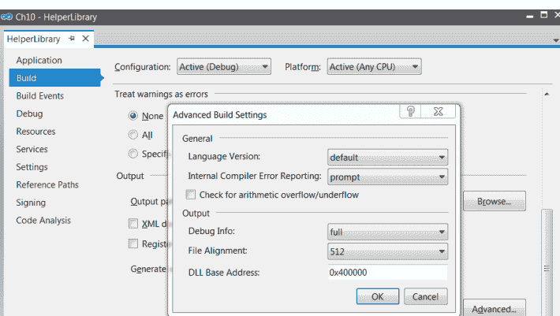

**图 10-1.** Visual Studio 高级生成对话框，允许修改 `NGen` 生成的原生映像的基地址。

从 `.NET 3.5 SP1` 开始，当应用程序在 Windows Vista 或更新的平台上运行时，`NGen` 会选择使用地址空间布局随机化（ASLR）。使用 ASLR 时，出于安全考虑，映像的基地址会在每次运行期间随机化。在此配置下，在 Windows Vista 及更新平台上，通过重组来避免基地址冲突是不重要的。

### 减少程序集的总数

减少应用程序加载的程序集数量。每个程序集无论大小如何，都会产生固定的成本，而且程序集之间的引用和方法调用在运行时可能成本更高。加载数百个程序集的大型应用程序并不罕见，如果将程序集合并为几个二进制文件，它们的启动时间可以减少几秒。

### 针对处理器的优化

理论上，`.NET` 开发者不应该担心针对特定处理器或指令集的优化。毕竟，IL 和 JIT 编译目的是目的是托管应用程序运行在任何安装了 `.NET Framework` 的硬件上，并且对操作系统、处理器功能和指令集保持无关。正如我们在本书中所看到的，要从托管应用程序中榨取最后一点性能可能需要在汇编层级进行推理。

#### 单指令多数据 (SIMD)

数据级并行，也称为单指令多数据（SIMD），是现代处理器的一项功能，它允许在一组数据（大于机器字）上执行单个指令。SIMD 指令集的标准是 SSE（流式 SIMD 扩展），Intel 处理器自 Pentium III 以来一直使用。该指令增加了 128 位寄存器（带有 XMM 前缀）以及可以在这些寄存器上操作的指令。Intel 处理器引入了高级向量扩展（AVX），它是 SSE 的扩展，提供了 256 位寄存器和更多的指令。SSE 指令的一些示例包括：

- 整数和浮点算术
- 比较、洗牌、数据类型转换（整数到浮点数）
- 位运算
- 最小值、最大值、条件复制、CRC32、人口计数（在 SSE4 及更高版本中引入）

你可能在好奇，在“新”寄存器上操作的指令是否比对应的指令慢。如果是这样，任何性能提升都是虚假的。坦率地说，情况并非如此。在 Intel i7 处理器上，针对 32 位寄存器的浮点加法（FADD）指令的吞吐量为每周期一次指令，延迟为 3 个周期。针对 128 位寄存器的等效指令 `ADDPS` 的吞吐量也为每周期一次指令，延迟为 3 个周期。

#### 延迟与吞吐量

延迟和吞吐量是性能测量中的常用术语，特别是在讨论处理器的“速度”时：

- 指令的**延迟（Latency）**是指从开始到结束执行一个实例的时间（通常以时钟周期计算）。
- 指令的**吞吐量（Throughput）**是指单位时间内（通常以时钟周期计算）可以执行的同类型指令的数量。

如果我们说 `FADD` 的延迟为 3 个周期，意味着单个 `FADD` 操作将需要 3 个周期才能完成。如果我们说 `FADD` 的吞吐量为每周期一次指令，意味着处理器能够维持每周期执行一次指令的速率，这将需要三个此类指令并发执行。

通常，指令的吞吐量显著优于其延迟，因为处理器可以并行发射和执行多条指令（我们稍后会这个问题）。

在高性能循环中使用这些指令，与一次处理单个浮点数或整数值的朴素程序相比，可以提供高达 8 倍的性能提升。例如，考虑以下（显而易见的）代码：

```
// 假设 A, B, C 是大小相同的 float 数组

for (int i=0; i<A.length; i++) {

  C[i]=A[i]+B[i];

}
```

在此场景下，JIT 导出的标准代码如下：

```assembly
; ESI 有 A, EDI 有 B, ECX 有 C, EDX 是迭代变量
x edx,edx
cmp dword ptr [esi+4],0
le END_LOOP
NEXT_ITERATION:
fld dword ptr [esi+edx*4+8]    ; load A[i], no range check
cmp edx,dword ptr [edi+4]      ; range check before B[i]
jae OUT_OF_RANGE
add dword ptr [esi+edx*4+8]   ; add B[i]
cmp edx,dword ptr [ecx+4]    ; range check before accessing C[i]
jae OUT_OF_RANGE
fst dword ptr [ecx+edx*4+8]  ; store in C[i]
inc edx
cmp dword ptr [esi+4],edx  ; are we done yet?
j NEXT_ITERATION
END_LOOP:
```

每次迭代都执行一次 `FADD` 指令，加上两个 32 位浮点数。然而，通过使用 128 位 SSE 指令，一次可以发射四次迭代，如下（以下代码执行了范围检查，并假设迭代次数可 4 整除）：

```assembly
xor edx, edx
NEXT_ITERATION:
movups xmm1, xmmword ptr [edi+edx*4+8] ; copy 16 bytes from B to xmm1
movups xmm0, xmmword ptr [esi+4] ; copy 16 bytes from A to xmm0
addps xmm0,xmm1                  ; add xmm0 to xmm1 and store the result in xmm1
movups xmmword ptr [ecx+edx*4+8], xmm1 ; copy 16 bytes to C
add edx,4
cmp edx,dword ptr [esi+4]      ; increase loop index
j NEXT_ITERATION
```

在 AVX 处理器上，我们可以在每次迭代中移动更多数据（使用 256 位 YMM 寄存器），以获得更好的性能：

```assembly
xor edx, edx
NEXT_ITERATION:
vmovups ymm1, ymmword ptr [edi+edx*4+8] ; copy 32 bytes from B to ymm1
vmovups ymm0, ymmword ptr [esi+4] ; copy 32 bytes from A to ymm0
vaddps ymm0,ymm1,ym1                ; add ymm0 to ymm1 and result
vmovups ymmword ptr [ecx+edx*4+8], ymm1 ; copy 32 bytes to C
add edx,8
cmp edx,dword ptr [esi+4]      ; increase loop index
j NEXT_ITERATION
```

注意：这些示例中使用的 SIMD 指令仅仅是冰山一角。现代应用程序使用 SIMD 指令执行复杂操作，包括标量积、寄存器间的数据洗牌、校验和计算等。Intel 的 AVX 门户是学习 AVX 功能的绝佳途径：`http://software.intel.com/en-us/avx`

#### 性能模式

JIT 编译器使用了少量的 SSE 指令，尽管它们在过去 10 年制造的每个处理器上都可用。具体来说，JIT 编译器使用 SSE MOV 指令通过 XMM 寄存器拷贝中等结构（使用 REP MOV 代），并使用 SSE 指令进行浮点到整数的转换。JIT 编译器不会像我们在前面的代码中所那样对向量化循环，而现代 C++ 编译器（包括 Visual Studio 2012）可以。

遗憾的是，C# 没有提供将代码嵌入托管项目的任何关键字。你可以使用 `.NET` 互操作性来调用性能敏感的 C++ 代码，但这通常很复杂。还有两种方法可以在不使用独立方法的情况下嵌入 SIMD 代码。从托管应用程序中运行任何机器码（尽管有一个轻量级的互操作层）的暴力方法是动态封送机器码并调用它。`Marshal.GetDelegatePointer` 是关键，因为它返回一个指向非托管内存位置的托管委托，其中可能包含任意代码。以下带有 `EXECUTE_READWRITE` 页的方法使我们能够将字节拷贝到内存并执行它们。然而，结果是 80 个 CPU 周期的开销，这比执行时间提升了 2 倍以上！

```csharp
[UnmanagedFunctionPointer(Calling.StdCall)]
delegate void VectorAddDelegate(float[] C, float[] B, int length);

[DllImport("kernel32.dll", SetLastError=true)]
static extern IntPtr VirtualAlloc(IntPtr lpAddress, IntPtr dwSize, IntPtr flAllocationType, IntPtr flProtect);

// 此数组是由 SSE 汇编产生的 - 它是一个完整的
// 函数，接受四个参数（三个向量和长度）并相加向量
by assembleBytes(0x08, 0x5c, 0x24, 0xA8, 0x74, 0x24, 0x0c, 0x8b, 0xc7, 0x24, 0x08, 0xc8, 0xa4, 0xc4, 0x04, 0x31, 0xd2, 0x0f, 0x10, 0x0c, 0x97, 0x0f, 0x10, 0x04, 0x96, 0x0f, 0xa8, 0x58, 0x0f, 0x0f, 0x11, 0x0c, 0x00);

IntPtr codeBuffer = VirtualAlloc(
    IntPtr.Zero,
    new IntPtr((uint)sseAssembleBytes.Length),
    0x1000 | 0x2000, // MEM_COMMIT | MEM_RESERVE
    0x40); // EXECUTE_READWRITE

Marshal.Copy(sseAssembleBytes, 0, codeBuffer, sseAssembleBytes.Length);

VectorAddDelegate add = (VectorAddDelegate)Marshal.GetDelegateForFunctionPointer(codeBuffer, typeof(VectorAddDelegate));

// 我们可以使用 'add' 来相加向量
```


另一种完全不同的方法（遗憾的是在 `MicrosoftCLR` 上不可用）是扩展 `JIT` 编译器以发射 `SSE` 指令。这种方法被 `Mono.Sim` 采用。使用 `.NET` 运行时的托管代码开发者可以引用 `Mono.Sim` 并使用将 `Vector16` 或 `Vector4` 的操作转换为相应 `SSE` 指令的 `JIT` 编译器。有关 `Mono.Sim` 的更多信息，请参阅官方文档：`http://docs.go-mono.com/index.aspx?link=N:Mono.Sim`

## 指令级并行

与处理较大数据块的数据级并行不同，指令级并行（`ILP`）是一种允许单线程同时执行多条指令的机制。除了流水线，处理器还采用了所谓的超标量执行，使用了多个冗余单元。

数据依赖在指令需要另一个指令的结果时产生；例如，当指令从上一个指令写入的位置读取时。这限制了程序的执行。

考虑以下循环：

```csharp
for (int k = 0; k < 100; k++) {
    first[k] = a * second[k] + third[k];
}
for (int k = 1; k < 100; k++) {
    first[k] = a * second[k] + first[k - 1];
}
for (int k = 1; k < 100; k++) {
    first[k] = a * first[k - 1] + third[k];
}
```

我们在测试机器上执行了这些循环，使用长度为 100 的整数数组，每次执行百万次迭代。第一个循环运行了 190ms，第二个循环运行了 210ms，第三个循环运行了 270ms。这是源于指令级并行的巨大性能差异。优化型编译器用于组织指令结构以最大化指令并行性。`JIT` 编译器做得并不出色，但现代处理器的乱序执行能力可能会影响它。

## 第 10 章 性能模式

```cs
// 原始算法，将依赖项从每个循环传递到下一个循环
int max=arr[0];
for (int k=1; k<100; k++) {
  max=Math.Max(max, arr[k]);
}
```

```cs
// ILP 优化算法，它打破了循环迭代内部的某些依赖关系，
// 两行代码可以在处理器内部并行执行
int max0=arr[0];
int max1=arr[1];
for (int k=3; k<100; k+=2) {
  max0=Math.Max(max0, arr[k-1]);
  max1=Math.Max(max0, arr[k]);
}
int max=Math.Max(max0, max1);
```

遗憾的是，`JIT` 编译器通过为第二个循环生成较不优的机器代码，错过了这种特定的优化。第一个循环的值可以放入寄存器中——`max` 和 `k` 被存储在寄存器中。在第二个循环中，`JIT` 无法将所有值放入寄存器中；如果 `max1` 或 `max0` 被置于内存中，性能将显著下降。相应的 `C#` 实现提供了预期的性能——第一次改进将操作速度提升了一倍，再次改进（使用四个 `max`）显示出 25% 的提升。

指令级并行性（`ILP`）可以与数据级并行性结合。这里考虑的示例（乘加循环和最大值计算）可以从使用 `SIMD` 指令中获得更好的速度。在 `max` 的情况下，`PMAXD SSE` 指令处理两组整数中的每对整数。以下代码（使用 `<immintrin.h>` 中的 Visual C++ 内联函数）运行比之前的版本快 3 倍，比原始简单版本快 7 倍：

```cs
m128i max=*(arr);
for (int k=4; k<100; k+=4) {
  max0=_mm_max_epdi32(max0, _mm128i*(arr+k)); // 生成 PMAXD
  int part0= mm_extract_epdi32(max0, 0);
  int part1= mm_extract_epdi32(max0, 1);
  int part2= mm_extract_epdi32(max0, 2);
  int part3= mm_extract_epdi32(max0, 3);
  int final=max(part0, max(part1, max(part2, part3)));
```

当你通过最小化依赖来获取指令级并行性时，数据级并行性（有时称为向量化）通常会带来更好的性能。

## 托管代码与非托管代码

`.NET` 程序员的一个常见顾虑是，托管对象会引入性能开销，并导致他们无法使用 `C#`、`.NET Framework` 和 `CLR` 开发高性能应用程序。在整本书中，甚至在本章中，我们看到了一些陷阱，如果你想从托管应用程序中压榨每一比特性能，就必须意识到这些陷阱。遗憾的是，在某些情况下，非托管代码（用 `C++` 编写或手工编写）的性能会比其托管版本更好。

我们并不打算分析和分类每一个证明 `C++` 算法比 `C` 版本更高效的示例。尽管如此，仍有一些比其他主题出现频繁得多的共同点：

- 严格受 `CPU` 限制的数值算法在 `C++` 中往往运行得更快，即使在 `C#` 中应用了特定优化也是如此。原因往往围绕着数组检查（`JIT` 编译器仅在某些情况下会优化掉，且仅针对单维数组）、`C++` 编译器使用的 `SIMD` 指令，以及 `C++` 擅长的其他优化，例如复杂的内联和智能寄存器分配。

- 某些内存管理模式对 `GC` 性能的性能是有害的（正如我们在第 4 章看到的）。有时， `C++` 代码可以通过池化正确“处理”内存管理。

- `C++` 享受对操作系统的直接访问，而 `.NET` 代码由于交互性可能运行较慢。在某些场景下，非托管代码比托管代码性能更快。`Piegrass` 在 `CodeProject` 的文章 [`Head-to-head: C# vs .NET`](https://www.codeproject.com/Articles/21285/Head-to-head-csharp-vs-NET) 打破了许多关于性能的误解。例如，`Piegrass` 的基准显示在某些情况下，使用 `.NET` 的集合比 `C++` 更快； `.NET` 框架缺乏 `SIMD` 内联函数也是另一个因素。

## 异常

如果使用正确且节制，异常并不是昂贵的机制。有一些可以遵循的简单指南，以避免抛出过多异常带来的性能风险：

- 对于异常情况使用异常：如果你预期异常频繁发生，请考虑防御性编程而不是抛出异常。

- 检查异常情况：使用 `TryParse` 系列方法（例如 `int.TryParse`）。

- 不要将异常作为控制流：退出方法。

与抛出和处理异常相关的最大的性能开销可以分为几类：

- 构建异常需要回溯栈，栈越深，开销越大。

- 抛出和处理异常需要与非托管代码交互——结构化异常处理 (`SEH`) 基础设施。

为了了解异常是否导致了性能问题，可以使用 `.NET CLR` 计数器。具体来说，`# Exceptions Thrown / sec` 计数会有帮助。

## 反射

反射在复杂应用程序中被称为性能杀手。这在某种程度上是合理的：使用反射执行一些极其昂贵的操作。例如，使用 `Type.Invoke` 调用方法需要使用元数据确定要调用的方法，确保参数与方法参数匹配，必要时进行拷贝，验证任何安全问题，最后执行方法调用。由于反射高度基于对象参数和返回值，装箱和拆箱会产生额外成本。

> 注意：为了从内部角度调整 `.NET API`，请考虑 `Joel` 在 `MSN` 杂志的文章 [`Dodge Common Performance Pitfalls to Craft Speedy Applications`](https://msdn.microsoft.com/en-us/magazine/cc163759.aspx)。

通过使用某种形式的代码生成，可以在性能关键场景中消除反射——不再动态反射类型并调用方法/属性，而是为（每个类型）生成代码以强类型的方式执行。

## 代码生成

代码生成通常用于序列化框架、对象关系映射器 (`ORM`)、动态代理以及其他需要处理动态未知类型的性能敏感代码。在 `.NET` 框架中有多种方法可以动态生成代码，也有许多第三方代码生成框架，如 `LLGen` 和 `T4` 模板。

- 轻量级代码生成 (`LCG`)，称为 `DynamicMethod`，可以在不创建类型和程序集的情况下生成方法。对于小代码块，这是最高效的代码生成机制。在 `LCG` 中发射代码需要 `ILGenerator` 类，它直接与 `IL` 指令工作。

- `System.Reflection.Emit` 命名空间包含用于在 `IL` 级别生成程序集、类型和方法的 `API`。

## 第 10 章 性能模式

- *表达式树（`System.Linq.Expression` 命名空间）可以用于从序列化表示创建轻量级表达式。*
- `CSharpProvider` 类可以直接将 `C#` 源代码（以字符串形式提供或从文件读取）编译为程序集。

## 从源生成代码

假设你正在实现一个序列化框架，该框架会写入任意对象的 `XML` 表示。使用反射（`Reflection`）来获取非空公共字段并递归地写入它们是非常昂贵的，但实现起来简单：

```csharp
// 基础的 XML 序列化器 - 不支持集合、循环引用等
public static string XmlSerializer(object obj) {
    StringBuilder builder=new StringBuilder();
    Type type=obj.GetType();
    builder.AppendFormat("<{0} type\"{1}\"", type.Name, type.AssemblyQualifiedName);
    if (type.IsPrimitive || type == typeof(string)) {
        builder.Append("{0}", obj.ToString());
    } else {
        foreach (FieldInfo field in type.GetFields()) {
            object value=field.GetValue(obj);
            if (value !=null) {
                builder.AppendFormat("<{0}><{1}>", field.Name, XmlSerialize(value));
            }
        }
    }
    builder.AppendFormat("</{0}>", type.Name);
    return builder.ToString();
}
```

相反，我们可以生成强类型代码来序列化特定类型并调用该代码。使用 `CSharpProvider`，实现的核心逻辑如下：

```csharp
public static string XmlSerializer<T>(T obj) {
    Func<T
```

if (typeof(T).IsPrimitive || typeof(T) == typeof(string)) {
    code.AppendLine("result.Append(obj.ToString());");
} else {
    foreach (FieldInfo field in typeof(T).GetFields()) {
        code.AppendFormat("<{0}>",
```

基于反射的部分已经移动了位置，使其只被使用一次来生成强类型代码——结果缓存在一个静态字段中，并在每次需要序列化类型时重用。请注意，序列化器代码没有经过广泛测试；它只是一个演示代码生成思想的概念验证。简单的测量表明，代码生成方法比原始方法快两倍以上。仅反射代码。

## 使用动态轻量级代码生成代码

另一个示例源于网络协议解析。假设你有一个大型的二进制数据流（例如网络数据包），你必须从数据包头中检索它并选择负载的部分。考虑以下数据包头结构（这是一个虚构的示例——`TCP` 数据包头并非那样排列）：

```csharp
public struct TcpHeader {
    public uint SourceIP;
    public uint DestIP;
    public ushort SourcePort;
    public ushort DestPort;
    public uint Flags;
    public uint Checksum;
}
```

从字节流中检索此类结构在 `C/C++` 中是一个轻而易举的任务，如果通过指针访问，甚至不需要拷贝任何内存。事实上，从字节流中检索任何字符串都是轻而易见的：

```cpp
template<typename T>
const T* get_pointer(unsigned char* data, int offset) {
    return (T*)(data+offset);
}
```

```cpp
template<typename T>
const T get_value(const unsigned char* data, int offset) {
    return *get_pointer(data, offset);
}
```

在 `C#` 中，遗憾的是事情变得复杂。有许多方法从流中读取任意数据。一种可能性是使用反射来遍历类型的字段，并从字节流中逐个读取：

```csharp
// 仅支持某些原始类型字段，不递归
public static void ReadReflectionBitConverter<T>(byte[] data, int offset, out T value) {
    object box=default(T);
    foreach (FieldInfo field in typeof(T).GetFields()) {
        if (field.FieldType == typeof(int)) {
            field.SetValue(box, BitConverter.ToInt32(data, current));
            current += 4;
        } else if (field.FieldType == typeof(uint)) {
            field.SetValue(box, BitConverter.ToUInt32(data, current));
            current += 4;
        } else if (field.FieldType == typeof(short)) {
            field.SetValue(box, BitConverter.ToInt16(data, current));
            current += 2;
        } else if (field.FieldType == typeof(ushort)) {
            field.SetValue(box, BitConverter.ToUInt16(data, current));
            current += 2;
        }
        // ...为了简洁省略了更多类型
    }
    value=(T)box;
```

当在其中一台机器上对一个 20 字节的 `TcpHeader` 结构执行 1,000,000 次时，该方法的平均执行时间为 170ms。虽然运行时间看起来并不糟糕，但所有装箱操作分配的内存量是大量的。此外，如果你考虑 1Gb/s 的实际网络速率，预计每秒几十个数据包是合理的，这意味着我们必须花费大量的 `CPU` 时间从传入的数据中读取字符串。

一种好得多的涉及 `Marshal.PtrToStructure` 方法，它旨在将非托管内存转换为结构：

```csharp
public static void ReadMarshalToStructure<T>(byte[] data, int offset, out T value) {
    GCHandle gch = GCHandle.Alloc(data, GCHandleType.Pinned);
    try {
        IntPtr ptr = gch.AddrOfPinnedObject();
        value = (T)Marshal.PtrToStructure(ptr);
    } finally {
        gch.Free();
    }
}
```

这个版本的表现要好得多，1,000,000 个数据包仅耗时 39ms。在第 8 章中我们讨论了不安全指针，这似乎是使用它们的绝佳机会。

```csharp
public static unsafe void ReadPointer(byte[] data, int offset, out TcpHeader header) {
    fixed (byte* pdata=&data[offset]) {
        header=(TcpHeader*)pdata;
    }
}
```

为什么这个方法这么快？因为负责拷贝的实体不再是像 `Marshal.PtrStructure` 这样的 `API` 调用——而是 `JIT` 编译器本身。为此方法生成的汇编代码可以被内联（`JIT` 编译器选择这样做），并使用 64 位指令一次拷贝 64 字节。问题在于我们设计的 `ReadPointer` 方法不是泛型的：

```csharp
public static unsafe void ReadPointerGeneric<T>(byte[] data, int offset, T value) {
    fixed (byte* pdata=&data[offset]) {
        value=(T*)pdata;
    }
}
```

--无法编译！具体来说，在 `C#` 中 `T` 不是可以取指针的，因为没有泛型约束来保证取指针（仅限 `blitt` 类型，在第 8 章讨论过，似乎我们必须为每个类型编写一个特殊的 `ReadPointer` 版本）。


## TypedReference 和两个未公开的 C# 关键字

危急的时刻需要极端的措施，在这种情况下，极端措施是提取出未公开的 C# 关键字：`_makeref` 和 `_refvalue`（由同样未公开的操作码支持）。与 `TypedReference` 一起，这些结构用于某些带有 C 风格可变参数列表的底层交互场景（这还需要另一个关键字 `_arg`）。

`TypedReference` 是一个包含两个 `IntPtr` 字段的结构——`Type` 和 `Value`。`Value` 是指向值的指针，可以是值类型或引用类型，而 `Field` 是这个表指针。通过创建一个指向值类型的 `TypedReference`，我们可以以强类型方式重新解释内存，正如我们的场景所需的，并使用 JIT 编译器拷贝内存。

```csharp
// 我们通过 ref 传递参数而不是 out，因为我们需要获取这个地址，
// 而且 _makeref 需要一个初始化的值。
// 我们实际上在修改 'value' —— 只需要一个左值即可开始
public static unsafe void ReadTypedRef<T>(byte[] data, int offset, ref T value) {
    TypedReference tr=_makeref(value);
    fixed (byte* pdata=&data[offset]) {
    // TypedReference 的第一个指针大小字段是对象地址，所以我们
```

```cs
//覆盖数据数组中指向右位置的指针：
*(IntPtr*)tr=(IntPtr)ptr;
// __refval 将指针从 TypedReference 拷贝到 'value'
value=__refval(tr, T);
}
```

遗憾的是，这种拙劣的魔法是有代价的。具体来说，`__makerref` 由 JIT 编译器操作为 `clrjit_GetRefAny`，与完全可以内联的 `ReadPointer` 相比，这是一个额外的代价。结果是速度变慢了近倍——该方法执行 1,000,000 次迭代需要 0.83ms。顺便提一下，这是在本节中看到的最快泛型方法。

为了避免为每个类型编写单独的 `ReadPointer` 方法副本，我们将使用轻量级代码生成（`DynamicMethod` 类）来生成代码。首先，我们检查为 `ReadPointer` 方法生成的 IL：

```il
.method public hideisyg static void ReadPointer(
uint8[byte] data, int32 offset, [out] valuetype TcpHeader&) cil managed
{
  .maxstack 2
  .locals ([] uint8& pinned pData)
  ldarg.0
  ldarg.1
  ldlem uint8
  stloc.0
  ldarg.2
  ldloc.0
  conv.i
  ldobj TcpHeader
  stobj TcpHeader
  ldc.i.0
  conv.u
  stloc.0
  }
```

现在我们在这里需要发射 IL，将 `TcpHeader` 替换为泛型类型参数。事实上，得益于针对 .NET Reflection 的优秀 `ReflectionEmitLanguage` 插件（可在 [http://refactoraddins.codeplex.com/wikipage?title=ReflectionEmitLanguage]( 获取），它可以将方法转换为生成它们所需的 Reflection API 调用，我们甚至不需要手动编写代码——尽管它承认需要几处修复：

```cs
static class Delegate<T>
{
  public static Delegate<T> Value;
  public static Delegate<T> CreateDelegate(
    DynamicMethod dm=new DynamicMethod("Read", null,
    new Type[] { typeof(byte), typeof(T).MakeByRefType() },
    Assembly.GetExecutingAssembly().Module),
  dm.DefineParameter(1, ParameterAttributes.None, "data");
  dm.DefineParameter(2, ParameterAttributes.None, "offset");
  dm.DefineParameter(3, ParameterAttributes.Out, "value");
  ILGenerator generator=dm.GetILGenerator();
```

```cs
generator.DeclareLocal(typeof(byte).MakePointerType(T), pinned: true);
generator.Emit(OpCodes.Ldarg_1);
generator.Emit(OpCodes.Ldelem, typeof(byte));
generator.Emit(OpCodes.Stloc_0);
generator.Emit(OpCodes.Ldarg_2);
generator.Emit(OpCodes.Ldloc_0);
generator.Emit(OpCodes.Conv_I);
generator.Emit(OpCodes.Ldobj, typeof(T));
generator.Emit(OpCodes.Stobj, typeof(T));
generator.Emit(OpCodes.Ldc_I4_0);
generator.Emit(OpCodes.Conv_U);
generator.Emit(OpCodes.Stloc_0);
generator.Emit(OpCodes.Ret);
Value = (ReadDelegate<T>)dm.CreateDelegate(typeof(ReadDelegate<T>));
return Value;
}
public static void ReadPointerLC<T>(byte[] data, int offset, out T value)
{
ReadDelegate<T> del=DelegateHolder<T>.Value;
if (del == null)
{
del=DelegateHolder<T>.CreateDelegate();
}
del(data, offset, out value);
```

此版本处理 1,000,000 个数据包需要 1.05ms，是 `ReadPointer` 的两倍，但比原始的基于反射的方法快两个数量级——这是代码生成的另一个胜利。（与 `ReadPointer` 相比的性能损失是因为需要从静态字段获取委托、检查空值并通过委托调用方法。）

### 总结

尽管有所不同，本章讨论的优化技巧和技术对于实现高性能的 CPU 密集型算法以及设计复杂系统的架构都至关重要。通过让你的代码利用内置的 JIT 优化以及处理器提供的特定指令，尽可能尽可能减少应用程序的启动时间，并避开 Reflection 和异常等昂贵的 CLR 机制，你将能够压榨出托管软件的每一比特性能。

在最后一个章节中，我们将讨论 Web 应用程序的性能特性（主要在 ASP.NET 领域），并介绍仅适用于 Web 服务器的特定优化。

# 第 11 章

## Web 性能

Web 应用程序设计用于每秒处理数百甚至数次请求。要成功构建此类程序，识别潜在的性能瓶颈并尽一切防止它们发生是非常重要的。在 ASP.NET 应用程序中，处理和防止瓶颈不仅限于你的代码。Web 请求到达服务器，然后到达你的应用程序代码，通过 HTTP 流水线，然后通过 IIS 流水线，到达另一个流水线——ASP.NET 流水线，最后才到达你的代码。当你完成请求处理时，响应将沿着这些流水线发送，直到最终被客户端机器接收。这些流水线中的每一个都是潜在的瓶颈，因此提高 ASP.NET 应用程序的性能实际上意味着你的代码代码以及流水线的性能。

在讨论提高 ASP.NET 应用程序性能的方法时，必须超越应用程序本身，检查影响 Web 应用程序整体性能的各个部分。Web 应用程序的整体性能由以下部分组成：

- 应用程序代码
- ASP.NET 环境
- 托管环境（大多数情况下是 IIS）
- 网络
- 客户端（本书未进行讨论）

在本章中，我们将简要讨论 Web 应用程序的性能测试工具，并从上述每种方法探索帮助我们提高应用程序整体性能的方法。在章节结束，我们将讨论扩展 Web 应用程序的必要性和影响，以及如何在扩展时避免已知的陷阱。

### 测试 Web 应用程序的性能

在开始对 Web 应用程序进行更改之前，你需要知道它的运行是否良好——是否符合 SLA（服务水平协议）的要求？它在负载下表现是否不同？是否存在任何可以改进的通用问题？为了了解这些及更多，我们需要使用测试和监控工具来识别 Web 应用程序中的陷阱和瓶颈。

在第 2 章中，我们讨论了一些用于检测代码性能问题的通用分析工具，例如 Visual Studio 和 ANTS 分析器，但还有其他工具可以帮助你测试、测量和调查应用程序的“Web”部分。

这是对 Web 性能测试世界的简要介绍。关于如何计划、执行和分析 Web 性能测试的更详细描述和指导，可以参考 MSDN 文章 [Performance Testing Guidance for Web Applications](http://msdn.microsoft.com/library/bb924375)。

## 第11章 | Web性能

# Visual Studio Web测试与负载测试

Visual Studio Ultimate 提供的功能之一是 Web 性能测试，它可以记录 Web 应用程序的响应时间和吞吐量。通过 Web 性能测试，你可以记录 Web 应用程序生成的 HTTP 请求和响应，如图 11-1 所示。（仅支持 Internet Explorer。）

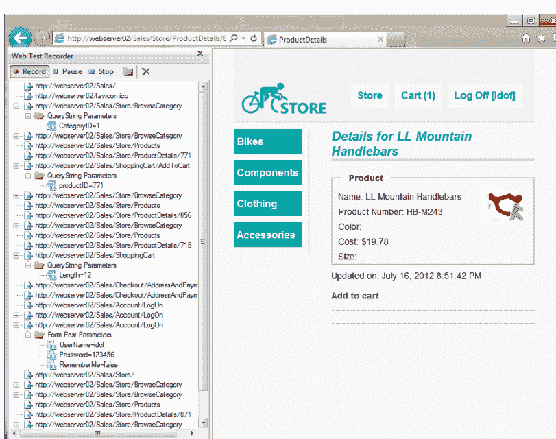

图 11-1. 使用 Web Test Recorder 录制

一旦完成录制，可以使用录制测试 Web 应用程序的性能以及正确性（通过匹配之前记录的响应）。

Web 性能测试允许你自定义测试流。你可以更改请求顺序并添加自己的新请求，在流中插入循环和条件，更改请求的头和内容，为响应添加验证规则，并通过将其转换为代码并编辑生成的代码来确保整个测试的完整性。

**注意** 建议你不要测试公共网站，仅测试你自己的网站和Web应用程序。对公共网站进行负载测试可能被解释为拒绝服务（DOS）攻击，导致你的机器或本地网络被禁止访问该网站。

将负载测试与Web性能测试的记录相结合，我们可以模拟几十甚至数百个用户并发访问我们的Web应用程序，模拟在每个请求中带有不同参数的各种页面进行调用。

为了妥地模拟数百个用户，建议使用测试代理（test agents）。测试代理是接收来自控制机测试指令的机器，它们执行所需的测试并将结果传回给控制机。使用测试代理有助于减轻测试机（而非被测试的机器）的压力，因为模拟数百个用户的单台机器可能会性能下降，导致测试产生错误结果。

在负载测试期间，我们可以监控性能计数器，这些计数器可以指示应用程序在压力下的表现，例如检查请求是否在 ASP.NET 中排队、请求时长是否随时间推移而增加，以及请求是否因为配置失败而超时。

通过运行各种场景的负载测试，例如不同的并发用户数量或不同类型的网络（慢/快），我们可以了解Web应用程序在压力下的工作情况，并从记录的数据中继续改进其整体性能的方法。

### HTTP 监控工具

可以嗅探 HTTP 通信的监控工具（如 asing、NetMon、HTTP Analyzer 和 Fiddler）可以帮助我们识别 Web应用程序的 HTTP 请求和响应。在监控工具的帮助下，我们可以验证影响 Web应用程序性能的各种问题。例如：

- **使用浏览器的缓存。** 通过查看 HTTP 流量，我们可以识别带有缓存标头返回的响应，以及当请求的内容已缓存时，请求是否发送了正确的“match”标头。
- **消息的数量和大小。** 监控工具会显示每个请求和响应、每个消息接收所需的时间以及每个消息的大小，允许我们跟踪发送过于频繁的请求，以及处理时间过长的大型请求和响应。
- **应用压缩。** 通过查看请求和响应，我们可以验证请求是否带有 `Accept-Encoding` 标头发送以处理 GZip 压缩，以及你的 Web 服务器是否返回了压缩后的响应。
- **同步通信。** HTTP 监控工具可以显示请求的时间线以及生成每个请求的进程，因此我们可以验证客户端是否能够一次发送多个请求，或者请求是否由于缺少连接开启而导致同步。例如，你可以使用此功能检测浏览器可以为特定服务器打开多少并发连接，或检查你的 .NET 应用程序是否在使用 `System.Net.ServicePointManager` 强制执行默认两个连接。

某些工具（如 Fiddler）还可以将记录的流量导出为 Visual Studio Web 测试，因此你可以使用 Web 测试和负载测试来测试从客户端应用程序和 Internet Explorer 之外调用的应用程序。例如，你可以监控来自 .NET 应用程序基于 HTTP 的 WCF 调用，将其导出为 Web 测试，并使用负载测试对你的 WCF 服务进行压力。

### Web 分析工具

另一组可用于识别 Web应用程序问题的工具是 Web 分析工具，例如 Yahoo 的 YSlow 和 Google 的 Page Speed。Web 分析工具的作用不仅仅是分析流量本身（如缺失的缓存标头和未压缩的响应），它们还分析 HTML 页面本身以检测影响页面加载和渲染性能的问题，例如：

- 可能会缓存渲染时间的大型 HTML 结构。
- HTML、CSS 和 JavaScript 内容可以使用压缩技术（minifications techniques）来缩小体积。
- 大图像可以通过缩放来减小大小并更改它们在 HTML 页面中的尺寸。
- JavaScript 代码可以在页面加载后执行而不是加载期间执行，以便页面加载得更快。

### 在服务器上提高 Web 性能

提高 ASPNET 应用程序代码性能有许多方法。某些改进可以使用适用于 ASPNET 应用程序和桌面应用程序的技术来实现，例如使用线程（threads）或 `Tasks` 进行非依赖的异步操作，但也有一些改进与你编写 ASPNET 代码的方式有关，无论是 WebForm 后置代码代码还是 ASPNET MVC 控制器。然而，这些更改可以帮助更好地利用服务器，允许应用程序运行更快，并处理更多的并发请求。

#### 缓存常用对象

1. 如果数据已经缓存，则使用它。
2. 否则：
    a. 获取数据。
    b. 将其存储在缓存中。
    c. 使用它。

> **注意** 由于在任何时刻都可以多个请求访问同一个缓存对象，导致同一个对象被多个线程引用，因此预计对缓存对象的更新将以负责任的方式进行，即取决于对象是否是不可变的（更改缓存对象需要克隆它，在新副本上进行更改，然后用克隆的对象更新缓存），或使用锁定机制确保它不会被其他线程更新。

许多开发者使用 ASP.NET Application 状态集合作为一种缓存机制，因为它提供了一个内存缓存存储，所有用户和会话都可以访问。`Application` 集合非常简单：

```csharp
Application["listOfCountries"]=countries; // 在集合中存储一个值
countries=(IEnumerable<string>)Application["listOfCountries"]; // 取回值
```

使用 Application 缓存时，存储在内存中并随时间积累的资源可能会填充服务器内存，导致 ASP.NET 应用程序开始使用磁盘上的分页内存，甚至由于内存内存而失败。因此，ASP.NET 提供了一种特殊的缓存机制，对缓存项提供某种管理，在内存不足时释放未使用的项。通过 `Cache` 类访问的 ASP.NET 缓存提供了丰富的缓存机制，除了存储资源外，还允许你：

- 为缓存对象定义有效期，通过指定 `TimeSpan` 或固定的 `DateTime`。一旦允许的生命周期过期，对象将自动从缓存中删除。
- 通过添加依赖项定义缓存对象的有效性，例如 SQL 依赖项。例如，如果缓存对象是 SQL 查询的结果，更改影响查询结果的数据库将使缓存对象失效。
- 为缓存对象附加回调函数，这样当对象从缓存中删除时，将调用回调函数。使用回调函数可以帮助在缓存像向字典添加项时检索更新的资源信息：

向字典添加项：

```csharp
Cache["listOfCountries"]=listOfCountries;
```

当使用上述代码将项添加到缓存时，缓存项将具有默认的 `Normal` 优先级，并且不会使用任何过期或依赖检查。例如，要将具有滑动过期的项添加到缓存，请使用 `Insert` 方法：

```csharp
Cache.Insert("products", productslist, Cache.NoAbsoluteExpiration, TimeSpan.FromMinutes(60), dependencies: null);
```

> 注意 `Cache` 类还提供了 `Add` 方法。使用 `Insert` 方法时，如果缓存已包含相同键参数的项，将抛出异常。

使用 ASP.NET `Cache` 类的缓存访问范式通常实现如下：

```
retrievedObject=Cache["theKey"];
if (retrievedObject == null) {
// 在某处查找数据（数据库、Web 服务等）
object originalData=null;
...}
```

# 第 11 章 应用程序性能

```go
// 将新检索的数据存储在缓存中
Cache["Key"]=originalData;
retrievedObject=originalData;
}
// 使用从缓存中或刚刚缓存的检索对象
```


你会注意到，代码的第一行尝试从缓存中检索对象，而无需先检查该对象是否存在。这是因为对象可以被其他请求或缓存机制随时从缓存中移除，因此在获取和检索之间，项可能会被移除。

# 使用异步页面、模块和控制器

当 IIS 将请求传递给 ASP.NET 时，请求会被排入线程池，并分配一个工作线程来处理请求，这对于 ASP.NET Web Forms 应用程序或 ASP.NET MVC 应用程序。

由于线程池中的线程数量由 `web.config` 中定义的 `maxWorkerThreads` 限制，ASP.NET 同时执行的请求数量也是有限的。

线程限制通常足够支持中小型应用程序，但如果你的应用程序需要处理数百个并发请求，开发者应该尽量减少请求的执行时间。当请求依赖某些耗时的 I/O 操作（例如调用 Web 服务或等待数据库操作完成）时，会发生什么？

在这种情况下，工作线程会被占用且无法释放回线程池。最终，执行中的请求数量将超过线程池的限制，新请求将放入队列。当队列中的数量超过限制时，请求将失败并返回 HTTP 503 响应（“服务不可用”）。这可以通过 `web.config` 文件进行控制。

## 创建异步页面

如果你有一个 ASP.NET Web Forms 应用程序并希望创建一个异步页面，首先需要将页面标记为异步：

```asp
@Page Async="true" ...
```

一旦标记为异步，创建一个新的 `PageAsyncTask` 对象并传递 begin、end 和 timeout 方法的委托。创建 `PageAsyncTask` 对象后，调用 `.RegisterAsync` 方法启动异步操作。

以下代码显示了如何使用 `PageAsyncTask` 耗时的 SQL 查询：

```go
public partial class MyAsyncPage : System.UI.Page {
    private SqlConnection _sqlConnection;
    private SqlCommand _sqlCommand;
    private SqlDataReader _sqlReader;

    void BeginAsyncOp(object sender, EventArgs args, AsyncCallback cb, object state) {
        // 这部分代码将在原始工作线程中执行
        // 不要在此方法中执行任何耗时操作
        _sqlCommand = CreateSqlCommand(_sqlConnection);
        return _sqlCommand.ExecuteReader(cb, state);
    }
    void EndAsyncOp(IAsyncResult asyncResult) {
        _sqlReader = _sqlCommand.ExecuteReader(asyncResult);
        // 读取数据并构建页面内容
    }
    void TimeoutAsyncOp(IAsyncResult asyncResult) {
        _sqlReader = _sqlCommand.ExecuteReader(asyncResult);
        // 读取数据并构建页面内容
    }

    protected override void Dispose() {
        if (_sqlConnection != null) {
            _sqlConnection.Close();
        }
        base.Dispose();
    }

    protected void btnClick_Click(object sender, EventArgs args) {
        PageAsyncTask task = new PageAsyncTask(
            new EventHandler(BeginAsyncOp),
            new EventHandler(EndAsyncOp),
            new EventHandler(TimeoutAsyncOp),
            state:null);
        RegisterAsyncTask(task);
    }
}
```

## 第 11 章 应用程序性能

创建异步页面的另一种方法是使用完成事件，例如在使用 Web 服务或 WCF 服务生成的代理时创建事件：

```go
public partial class AsyncPage : System.Web.UI.Page {
    protected void btnGetDataClick(object sender, EventArgs e) {
        MyService serviceProxy=new MyService();
        // 挂到服务的完成事件
        serviceProxy.GetDataCompleted += new 
            Services.GetDataCompletedEventHandler(GetDataCompleted);
        // 使用在 I/O 线程上执行的异步服务
        serviceProxy.GetDataAsync();
    }

    void GetDataCompleted(object sender, Services. GetDataCompletedEventArgs e) {
        // 从异步事件中提取结果并构建页面内容
    }
}
```

在上面的示例中，页面也像第一个示例一样标记为 Async，但不需要创建 `PageAsyncTask` 对象，因为当调用 `xxAsync` 方法以及 `xxCompleted` 事件完成后，页面会自动接收通知。

当将页面设置为异步时，ASP.NET 会更改页面实现 `IHttpAsyncHandler` 而不是同步的 `IHttpHandler`。如果你希望创建自己的异步通用 HTTP 处理器，请实现 `IHttpAsyncHandler` 接口的通用 HTTP 处理器类。

## 创建异步控制器

如果 ASP.NET MVC 中的控制器类执行了耗时的 I/O 操作，也可以创建为异步控制器。要创建异步控制器，你需要执行以下步骤：

- 1. 创建继承自 `AsyncController` 类型的控制器类。
- 2. 根据以下约定为每个异步操作实现一组操作方法，其中 xx 是操作名称：`xxAsync` / `xxCompleted`。
- 3. 在 `xxAsync` 方法中，通过调用 `AsyncManager.OutstandingOperations.Increment` 方法指定要执行的异步操作数量。
- 4. 在异步操作返回期间执行的代码中，调用 `AsyncManager.OutstandingOperations.Decrement` 方法通知操作已完成。

例如，以下代码显示了一个具有名为 Index 的异步操作的控制器，它调用了一个返回数据的服务：

```go
public class MyController : AsyncController {
    public void IndexAsync() {
        // 通知 AsyncManager 将有一个异步操作
        AsyncManager.OutstandingOperations.Increment();
        MyService serviceProxy=new MyService();
        // 注册到完成事件
    }
}
```

```csharp
serviceProxy.GetDataCompleted+=( (sender, e) => {
  AsyncManager.Parameters["result"]=e.Value;
  AsyncManager.OutstandingOperations.Decrement();
}
serviceProxy.GetHeadlinesAsync();
public ActionResult IndexCompleted(MyData result) {
  return View("Index", new MyViewModel { TheData=result });
}
```

### 调整 ASP.NET 环境

除了代码之外，每个传入的请求和传出的响应都必须经过 ASP.NET 的组件。ASP.NET 的某些机制是为了满足开发者的需求而创建的（例如为了性能设计的 ViewState 机制），但在精调 ASP.NET 应用程序时，建议更改这些机制的默认行为，尽管更改它们有时需要你对应用程序代码进行相应调整。

### 关闭 ASP.NET 跟踪和调试

ASP.NET 跟踪（Tracing）允许开发者查看请求页面的诊断信息，例如执行时间和执行路径、会话状态以及 HTTP 请求头列表。

虽然跟踪是一项很好的功能，在开发和调试 ASP.NET 应用程序时具有附加价值，但由于跟踪机制以及对每个请求执行的数据收集，它会对应用程序的整体性能产生某些影响。因此，如果你在开发期间启用了跟踪，请在将 Web 应用程序部署到生产环境之前，通过更改 `web.config` 中的跟踪设置将其关闭。

```xml
<configuration>
  <system.web>
    <trace enabled="false"/>
  </system.web>
</configuration>
```

> 注意：如果 `web.config` 中没有指定，`trace` 的默认值为禁用（`enabled="false"`），从 `web.config` 文件中移除跟踪设置也会禁用它。

当在创建新的 ASP.NET Web 应用程序时，自动添加到应用程序 `web.config` 文件中的内容之一是 `system-compilation` 配置节，其 `debug` 属性被设置为 `true`：

```xml
<configuration>
  <system.web>
    <compilation debug="true" targetFramework="4.5" />
  </system.web>
</configuration>
```

### 第 11 章 Web 应用程序性能

**注意** 这是在 Visual Studio 2012 或 2010 中创建 ASP.NET Web 应用程序时的默认行为。在 Visual Studio 的之前的版本中，默认行为是将 `debug` 设置为 *false*，当开发者首次尝试调试应用程序时，会弹出一个对话框请求许可将设置更改为 *true*。

该设置的问题在于，开发者在将应用程序部署到生产环境时，往往忘记将设置从 `true` 改为 `false`，甚至故意这样做以获取更详细的异常信息。事实上，此设置会导致若干性能问题：

- 使用 `WebResources.ax` 句程序下载的脚本（例如在页面中使用验证控件）不会被浏览器缓存。将 `debug` 设置为 `false` 时，来自该处理程序的响应将带有缓存头返回，允许浏览器缓存响应以备后续访问。
- 当 `debug` 设置为 `true` 时，请求不会超时。虽然这在调试代码时非常方便，但在生产环境中，这种行为是不理想的，因为此类请求可能导致服务器无法处理其他请求，甚至导致 CPU 使用率增加、内存消耗增加和其他资源分配问题。
- 将 `debug` 标记设置为 `false`，可以允许 ASP.NET 根据 `httpRuntime.timeout` 配置设置为请求定义超时（默认值为 100 秒）。
- 当使用 `debug=true` 时，代码将不会应用 JIT 优化。JIT 优化是 .NET 最重要的优势之一，可以在不更改代码的情况下高效地提高 ASP.NET 应用程序的性能。将 `debug` 设置为 `false` 将允许 JIT 编译器执行其职责，使你的应用程序运行更快、更高效。
- 当使用 `debug=true` 时，编译过程不会使用批编译。没有批编译的情况下，每个页面和用户控件都会创建一个程序集，导致应用程序在运行时加载几十甚至数百个程序集；加载如此多的程序集可能会由于内存碎片化导致内存异常。

注意：除了不同的查询字符串参数外，输出缓存还可以根据请求的 HTTP 头部（如 Accept-Encoding 和 Accept-Language 头部）区分缓存输出。例如，如果你的操作根据 Accept-Language HTTP 头部返回不同语言的内容，你可以设置输出缓存根据该头部进行更改，为每个请求的语言创建一个不同的输出缓存版本。

如果你对不同的页面或操作具有相同的缓存设置，可以创建一个缓存配置文件（caching profile），并使用它而不是反复重复缓存设置。缓存配置文件是在 `web config` 中创建的，使用 `<system.web>caching>` 部分。例如，以下配置定义了一个缓存配置文件，你可以在多处使用它：

```xml
<system.web>
  <caching>
    <outputCacheProfiles>
      <add name="CacheFor30Seconds" duration="30" varyByParam="id"/>
    </outputCacheProfiles>
  </caching>
</system.web>
```

现在，该配置可以用于你的 Index 操作，而无需重复指定持续时间和参数：

```csharp
public class ProductController {
  [OutputCache("CacheFor30Seconds")]
  public ActionResult ActionResult(int id) {
    //检索匹配的产品并设置
    return View();
  }
}
```

我们还可以通过使用 OutputCache 指令在 ASP.NET Web Form 中使用相同的缓存配置文件：

`@OutputCache CacheProfile="CacheEntityFor30Seconds" %>`

注意：默认情况下，ASP.NET 输出缓存机制将缓存内容保留在服务器的内存中。从 ASP.NET 4 开始，你可以创建自己的输出缓存提供程序来代替默认的提供程序。例如，你可以编写自己的自定义提供程序，将输出缓存存储到磁盘上。

### 预编译 ASP.NET

在编译 ASP.NET Web 项目时，会创建一个程序集来包含应用程序所有的代码。Web 页面 `.aspx` 和用户控件 `.ascx` 不会被编译，而是原样部署到服务器上。当应用程序首次启动（在第一次请求时）时，ASP.NET 会动态编译 Web 控件，并将编译后的文件放在 ASP.NET 临时文件夹中。这种动态编译增加了第一次请求的响应时间，导致用户体验到网站加载缓慢。

为了解决这个问题，应用程序可以使用 ASP.NET 编译工具 `Aspnet-compiler.exe` 对所有代码、页面和用户控件进行预编译。在生产服务器上运行 ASP.NET 编译工具可以减少用户首次请求时的影响。要运行该工具，请遵循以下步骤：

#### 第 11 章 Web 应用程序性能

- 在你的生产服务器上打开命令提示符。
- 导航到 `%windir%\Microsoft.NET` 文件夹。
- 根据 Web 应用程序操作系统是否配置为支持 32 位应用程序（对于 32 位操作系统，Framework 是唯一选项），导航到 Framework 或 Framework64 文件夹。
- 根据应用程序池使用的 .NET 框架版本（`v2.0.50727` 或 `v4.0.30319`），导航到相应框架版本的文件夹。
- 输入以下命令开始编译（将 WebApplicationName 替换为你的应用程序的虚拟路径）：`Aspnet-compiler.exe -v /WebApplicationName`

### 调优 ASP.NET 进程模型

当调用 ASPNET 应用程序时，ASP.NET 使用工作线程来处理请求。有时，应用程序本身的代码可能会创建新线程，例如在调用服务时，这会导致线程池中空闲线程减少。ASP.NET 会自动对线程池进行若干项调整，并且若干限制限制了任何给定时刻执行的请求数。这些设置由三个主要的配置控制：`<system.web>processModel` 部分、`<system.web>httpRuntime` 部分以及 `<system.net>connectionManagement` 部分。

> `httpRuntime` 和 `connectionManagement` 部分可以从应用程序的 `web.config` 文件进行设置。然而，`processModel` 部分只能在 `machine.config` 文件中更改。

`processModel` 部分定义了工作线程最小和最大数量限制，`httpRuntime` 部分定义了与可用线程相关的限制，例如为了继续处理传入的请求而必须存在的最小可用线程数。`connectionManagement` 部分控制每个地址的输出 HTTP 连接的最大数。尽管所有设置都有默认值，但其中某些设置对于 ASP.NET 性能来说设置得有点低。这包括 `autoConfig` 设置，它通过削弱某些设置来获得最佳性能。这部分 `processModel` 配置自 ASPNET 2.0 以来一直存在，并被自动设置为 true。

`autoConfig` 设置控制以下设置（默认值来自 Microsoft 知识库文章，地址为：`http://support.microsoft.com/?id=821268`）：

- `processModel>maxWorkerThreads`: 将线程池中的最大工作线程数从 20 更改为核心数的 100 倍。
- `processModel>maxIOThreads`: 将线程池中的最大 I/O 线程数从 20 更改为核心数的 100 倍。
- `httpRuntime>minFreeThreads`: 将允许执行新请求所需的最小可用线程数从 8 更改为核心数的 8 倍。


- `runtime>minLocalFreeThreads`: 将允许执行新请求（来自本地主机）所需的最小可用线程数从 4 更改为核心数的 7 倍。
- `connectionManagement>maxConnections`: 将最大并发数从 10 更改为核心数的 12 倍。

尽管默认值是为了优化性能而设置的，但根据你遇到的场景，你可能需要更改它们。例如，如果你的应用程序调用服务，你可能需要增加最大连接数以允许更多请求同时连接服务。以下配置显示了如何增加连接数：

```xml
<configuration>
  <system.net>
    <connectionManagement>
      <add address="200" />
    </connectionManagement>
  </system.net>
</configuration>
```

在其他场景下，例如当 Web 应用程序在启动时需要获取大量请求时，你可能需要减少线程池中的最小工作线程（根据机器的核心数在运行时指定的值）。要执行此操作，请在 `machine.config` 中应用以下配置：

```xml
<configuration>
  <system.web>
    <processModel autoConfig="true" minWorkerThreads="10"/>
  </system.web>
</configuration>
```

在增加最小和最大线程之前，请考虑此更改对应用程序可能的影响：如果你允许过多请求并发运行，可能会导致 CPU 使用率过高和内存消耗巨大，最终导致应用程序崩溃。因此，在更改这些设置后，你必须进行负载测试以验证机器能够支持大量请求。

## 配置 IIS

作为 Web应用程序的托管环境，IIS 对整体性能有一定的影响，例如，IIS 管道越小，每个请求执行的代码就越少。IIS 中有一些可以增加应用程序性能延迟和吞吐量的机制，以及某些机制在调优适当后可以提高应用程序的整体性能。

### 输出缓存

我们已经看到 ASP.NET 提供了了自己的输出缓存机制，那么为什么 IIS 还需要另一种输出缓存机制呢？答案很简单：我们想要缓存的类型不仅是 ASP.NET 页面。例如，我们可能想要缓存频繁请求的静态图像文件，或者自定义 HTTP 句程序的输出。为了这个目的，我们可以使用 IIS 缓存的输出。IIS 有两种输出缓存机制：用户模式缓存和内核模式缓存。

#### 用户模式缓存

与 ASP.NET 一样，IIS 能够在内存、磁盘或自动从内存缓存响应，无需访问磁盘上的静态文件或调用服务器端代码。

为您的 Web 应用程序配置输出缓存，请打开 IIS 管理器，选择您的 Web 应用程序，打开输出缓存（Output Caching）功能。打开后，点击操作面板中的“添加...”链接以添加新缓存规则，或选择现有的用户模式缓存规则，添加新规则，输入您想要缓存的文件扩展名，并在“添加缓存规则”对话框中勾选“用户模式缓存”（User-mode caching）复选框，如图 11-2 所示。

![](img/d3ea56daae375e1d9f44d8bff55d84b7_319_0.png

**图 11-2.** 添加缓存规则对话框，您可以选择缓存项从内存中移除的时间。

一旦勾选复选框，您可以选择缓存项从内存中移除的时间，例如在文件更新后或内容首次缓存一段时间后。文件缓存更适用于静态文件，而时间间隔则更适用于动态内容。通过点击“高级”按钮，您还可以控制缓存如何存储输出的不同版本（选项取决于查询字符串或 HTTP 请求头）。

添加缓存规则后，其配置将存储在应用程序的 `web.config` 文件中，位于 `system.webServer` 缓存部分下。例如，设置规则缓存 `.aspx` 页面会导致它们在 30 分钟后过期，并根据 `Accept-Language` HTTP 请求头的输出而变化，生成以下配置：

```xml
<system.webServer>
  <caching>
    <profiles>
      <add extension=".aspx" policy="CacheTimePeriod" kernelCachePolicy="DontCache" duration="00:00:30" byHeaders="Accept-Language" />
    </profiles>
  </caching>
</system.webServer>
```

#### 内核模式缓存

与用户模式不同，缓存模式将缓存内容存储在 IIS 的工作进程内存中，内核模式缓存将缓存内容存储在 `HTTP.sys` 内核模式驱动程序。使用内核模式缓存提供更快的响应时间，但并非总是都支持。例如，当请求包含查询字符串或请求不是匿名请求时，无法使用内核模式缓存。

为内核模式设置缓存规则的方法与用户模式类似。在规则对话框中，勾选内核模式缓存（kernel-mode-caching）复选框，并选择您想要使用的缓存监控设置。您可以在同一条规则中同时使用内核模式和用户模式缓存。当两种模式都使用时，会尝试内核模式缓存。例如，当请求包含查询字符串时，将应用用户模式缓存。

> **提示：** 在对内核模式和用户模式设置使用时间间隔监控时，请确保两个设置中的时间间隔相同，否则内核模式的间隔将用于两者。

### 应用程序池配置

应用程序池控制 IIS 如何创建和管理最终托管我们代码的工作进程。当您安装 IIS 和 ASP.NET 时，系统会根据服务器上安装的 `.NET` 框架版本创建应用程序池，您可以在向服务器上安装更多 Web 应用程序时添加新的池。当应用程序池被创建时，它具有控制其行为的默认设置。例如，每个应用程序池在创建时都有一个应用程序池关闭后的默认空闲超时设置。

理解其中某些设置的含义有助于配置应用程序池的工作方式，或者更精确地满足您的应用程序需求。

#### 回收

通过回收（Recycling）设置，您可以控制应用程序池重启工作进程的时间。例如，您可以设置工作进程每几小时回收一次，或在内存超过特定数量时回收。如果您的 Web 应用程序随时间推移消耗大量内存（例如由于存储对象），增加回收次数有助于维护其整体性能。另一方面，如果 Web 运行正常，减少回收次数将防止状态信息的丢失。

# 第 11 章 应用程序性能

#### 空闲超时

> **提示：** 您可以使用 ASP.NET 工作进程重启性能计数器来检查应用程序自身回收的次数和回收频率。如果您发现在没有明显原因的情况下频繁回收，请尝试将结果与应用程序的内存消耗和 CPU 使用关联起来，以验证其是否超过了应用程序池配置中定义的阈值。

应用程序池的默认设置在无活动 20 分钟后关闭池。如果您预料会有这种空闲超时（例如所有用户都出去午餐），您可能希望增加超时时间，甚至取消。

#### 处理器亲和性

默认情况下，应用程序池配置为使用服务器上的所有可用核心。如果您在服务器上运行任何需要大量 CPU 时间的特殊后台进程，可以调整池的亲和性以使用特定核心，为后台进程留出其他核心。当然，这将需要您设置工作进程的亲和性，使其不会与工作进程在相同核心上竞争。

#### Web 园

应用程序池的默认行为是启动一个工作进程来处理应用程序的所有请求。如果您的工作进程同时处理多个请求，且这些请求通过锁定资源来竞争相同资源，可能会导致冲突，从而导致响应延迟。例如，如果您的应用程序使用自定义的缓存机制，锁定会导致并发请求无法向缓存中插入项。

提示：你可以使用 `Fiddler` 等 HTTP 监控工具验证是否没有为缓存内容发送请求，并检查向发送了哪些请求。如果你发现内容已缓存但仍发送了请求，请检查该请求的响应以验证是否存在 `max-age` / `Expires` 标头。

将 `max-age` / `Expires` 与 `ETag` / `Last-Modified` 结合使用可以确保在内容过期后发送请求；如果服务器上的内容实际上没有更改，则返回 HTTP 304 响应。此响应中将包含一个新的 `max-age` / `Expires` HTTP 标头。

在大多数浏览器中，点击刷新按钮（或按下 F5）将强制浏览器忽略 `max-age` / `Expires` 标头并刷新缓存。请求仍然会带有 `If-Modified-Since` / `If-None-Match` 标头（如果适用的话），因此如果内容是最新的，服务器可以返回 304 响应。

要设置 `max-age`，请向你的 `web.config` 文件中添加以下配置：

```xml
<system.webServer>
 <staticContent>
  <clientCache cacheControlMode="UseMaxAge" cacheControlMaxAge="0:10:00" />
 </staticContent>
</system.webServer>
```

上述配置将使所有静态内容响应的 `Cache-Control` HTTP 标头中的属性被设置为 600 秒。

要使用 `Expires` 标头，请按照以下示例更改 `clientCache` 元素配置：

```xml
<system.webServer>
 <staticContent>
  <clientCache cacheControlMode="UseExpires" expires="Wed, 11 Jul 2013 6:00:00 GMT" />
 </staticContent>
</system.webServer>
```

上述配置将使所有静态内容于 2013 年 7 月 11 日上午 6 点过期。

如果你希望对不同的内容设置不同的 `max-age` 或过期设置（例如为 JavaScript 文件设置固定的过期时间，为图像设置 100 天的滑动窗口），你可以使用 `location` 对应用程序部分应用不同的配置，如下例所示：

```xml
<location path="Scripts">
 <system.webServer>
 <staticContent>
  <clientCache cacheControlMode="UseExpires" expires="Wed, 11 Jul 2013 6:00:00 GMT" />
 </staticContent>
</system.webServer>
</location>

<location path="Images">
 <system.webServer>
 <staticContent>
  <clientCache cacheControlMode="UseMaxAge" cacheControlMaxAge="100:0:0:0" />
 </staticContent>
</system.webServer>
</location>
```

注意：你必须使用格式化的日期并设置 `Expires` 标头。此外，根据 HTTP 规范，`Expires` 标头的日期不能超过当前日期的一年。

### 为动态内容设置缓存标头

静态文件具有修改日期，可以用于验证缓存内容是否发生了更改。然而，动态内容没有修改日期，因为每次请求动态内容时它都会被重新创建，其修改日期实际上是当前日期。在处理动态内容时，`ETag` 和 `Last-Modified` 等标头并不相关适用。

尽管如此，如果你查看动态页的内容，你可能会找到一种表示其修改日期的方法，或者为它计算一个 ETag。例如，如果发送请求以从数据库检索信息，产品表可能包含一个最后更新列，该列用于设置 `Last-Modified` 标头。如果数据库表没有最后更新列，你可以尝试从实体的字段计算 MD5 哈希值并将 ETag 设置为该结果。当向服务器发送后续请求时，服务器可以重新计算实体的 MD5 哈希值，如果没有字段发生变化，则 ETags 将相同，服务器可以返回 HTTP 304 响应。

例如，以下代码将动态页中的 `Last-Modified` 缓存标头设置为产品的最后更新日期：

```csharp
Response.Cache.SetLastModified(product.LastUpdateDate);
```

如果你没有该日期，可以像下面的代码所示，将由实体属性计算出的 MD5 哈希值设置为 ETag：

```csharp
Response.Cache.SetCacheability(HttpCacheability.ServerAndPrivate);
// MD5 哈希值
System.Security.Cryptography.MD5 md5 = MD5.Create();
string contentForETag=entity.JsonProperty+entity.NumericProperty.ToString();
byte[] checksum=md5.ComputeHash(System.Text.Encoding.UTF8.GetBytes(contentForETag));
// 从哈希创建 ETag
// ETag 字符串必须用双引号括起来
```

注意：ASP.NET 请求的默认缓存性模式阻止了 ETags 的使用。为了支持 ETags，我们需要将缓存性模式更改为 `ServerAndPrivate`，允许内容在服务器端和客户端缓存，但不在共享缓存（如代理）中缓存。

当接收到包含 ETag 的请求时，你可以将 ETag 与浏览器提供的 ETag 进行比较，如果它们匹配，则返回 304 响应，如下代码所示：

```csharp
if (Request.Headers["If-None-Match"] == calculatedETag) {
    Response.Cache.Clear();
    Response.StatusCode=(int)System.Net.HttpStatusCode.NotModified;
    Response.End();
}
```

如果你没有该日期，可以将由实体属性计算出的 MD5 哈希值设置为 ETag，如下代码所示：

如果你对内容的生命周期有任何假设，可以如下所示设置页面过期：

```csharp
if (true)
Response.Cache.SetExpires(DateTime.Now.AddYears(1));
```

你也可以通过 `Cache-Control` 的 `max-age` 实现相同的操作：

```csharp
if (true)
Response.Cache.SetMaxAge(TimeSpan.FromDays(365));
```

你不需要在代码中设置响应的过期时间，可以在 `.aspx` 文件中指定它。例如，如果页面显示的产品信息可以在客户端缓存 10 分钟（600 秒），你可以设置输出指令：

```asp
<@ Page ... %>
<%@ OutputCache Duration="600" Location="Client" %>
```

当使用 `OutputCache` 指令时，指定的持续时间将作为 `max-age` 和 `expires` 输出到响应标头中（`expires` 是从当前日期计算出的）。

### 配置压缩

压缩需要完成的第一工作是启用静态压缩、动态压缩或两者。要在 IIS 中启用压缩，请使用 IIS Manager 应用程序，选择您的机器，并选择您想要使用的压缩功能，如图 11-3 所示：


### 压缩

启用此功能以配置响应压缩的设置

- 启用动态内容压缩
- 启用静态内容压缩

**图 11-3.** 在 IIS Manager 应用程序中启用动态和静态压缩

您还可以使用压缩对话框来设置静态压缩设置，例如存储缓存内容的文件夹以及符合压缩条件的最小文件大小。

在选择的压缩类型激活后，您可以继续选择哪些 MIME 类型将进行静态压缩，哪些进行动态压缩。遗憾的是，IIS 不支持从 IIS Manager 更改这些设置，因此您需要手动在 IIS 配置文件 `applicationHost.config` 中更改。该文件位于 `%systemroot%\system32\inetrv\config` 文件夹中。搜索 `<httpCompression>` 部分，你会看到为静态压缩定义的几个 MIME 类型，以及为动态压缩定义的其他类型。除了已指定的 MIME 类型外，您还可以添加在应用程序中使用的额外类型。例如，如果 AJAX 调用返回 JSON 响应，您可能希望为这些响应添加动态压缩支持。以下配置显示了 IIS 的动态压缩支持（为了简洁，已移除现有内容）：

```
<httpCompression>
<dynamicMimeTypes>
<add mimeType="application/json; charset=utf-8" enabled="true" />
</dynamicMimeTypes>
</httpCompression>
```

> 在列表中添加新的 MIME 类型后，建议通过 `Fiddler` 等 HTTP 嗅探工具检查响应以验证压缩确实在工作。压缩后的响应应具有 `Content-Encoding` HTTP 头部，且其应设置为 gzip 或 deflate。

### IIS 压缩与客户端应用程序

为了让 IIS 处理出的请求，它需要知道客户端应用程序可以处理压缩的响应。因此，当客户端应用程序向服务器发送请求时，它需要添加 `Accept-Encoding` HTTP 头部并设置为 gzip 或 deflate。

大多数已知浏览器会自动添加此头部。当使用带有 Web 应用程序或 Silverlight 应用程序的浏览器时，IIS 将响应压缩内容。然而，在 .NET 应用程序中，使用 `HttpRequest` 类型发送 HTTP 请求时，不会自动添加 `Accept-Encoding` 头部，您需要手动进行。此外，除非 `HttpRequest` 设置为预期的压缩响应，否则它不会尝试解压缩。例如，如果您正在使用 `HttpRequest` 对象，您将需要添加以下代码以接收并解压缩压缩的响应：


```
var request = (HttpRequest)WebRequest.Create(uri);
request.Headers.Add(HttpHeaders.Encoding, "deflate");
request.AutomaticDecompression = DecompressionMethods.Gzip | DecompressionMethods.Deflate;
```

其他 HTTP 通信对象（如 ASMX Web 服务或 WebClient 对象）也支持 IIS 压缩，但必须手动配置以发送头部并解压缩响应。作为 HTTP-WCF 服务，在 WCF 4 之前，.NET 客户端必须使用不支持 IIS 压缩的程序引用（service reference）或通道工厂。从 WCF 4 开始，自动支持 IIS 压缩，用于发送头部和解压缩响应。

# 第 11 章 Web 应用程序性能

## 压缩化与合并（Minification and Bundling）

在开发应用程序时，您的页面可能会使用多个 JavaScript 和 CSS 文件。当页面有多个指向外部资源的链接时，在浏览器中加载页面将成为一项耗时的操作，用户将需要等待页面及其所有相关脚本被下载并解析。对于外部资源，我们面临着两个问题：

1. 浏览器需要发送并等待响应的请求数量。请求越多，告知服务器所有请求所需的时间越长，因为浏览器受到其对单个服务器并发连接数量的限制（例如，在 IE 9 中，每个服务器的并发请求限制为 6 个）。
2. 响应的大小，这影响了浏览器下载所有响应的总时间。响应越大，浏览器下载响应所需的时间越长。如果达到最大并发请求数，这还可能影响浏览器开始发送新请求的能力。

为了解决这个问题，我们需要一种能够让我们降低响应大小和请求数量（从而减少响应数量）的技术。在 ASP.NET MVC 4 和 ASP.NET 4.5 中，这种技术内置在框架中，允许进行“合并和压缩化（bundling and minification）”。合并指的是在请求时将一组文件合并到一个 URL 中，返回所有合并后的文件作为一个单个脚本；而压缩化是指通过删除空格以及在脚本文件的情况下删除变量和函数来减少样式或脚本文件的大小，从而占用更少的空间。

将压缩化与压缩结合可以显著减少响应的大小。例如，jQuery 1.6 脚本文件在压缩之前的大小为 240 kb。压缩后文件大小约为 68 kb。原始文件的压缩版本为 93 kb，比压缩版本略大；应用压缩化文件后，大小降至 33 kb，约占原始文件大小的 14%。

要创建一个包，首先安装 `Microsoft.Web.Optimization` NuGet 包，并添加对 `System.Optimization` 程序集的引用。添加后，您可以使用 `BundleTable` 静态类为脚本和样式创建新包。合并应该在加载页面之前设置，您应该将包放置在 `global.asax` 的 `Application Start` 方法中。例如，以下代码创建了名为 MyScripts（可从虚拟文件夹访问）的三个脚本文件包，这些文件将被自动压缩化：

```
protected void Application_Start() {
    Bundle MyScripts = new Bundle("/MyScripts").Include(
    ~/Scripts/MyCustomJs.js",
    "~/Scripts/thirdPartyJs.js",
    "~/Scripts/myNewJsTypes.js");
    BundleTable.Bundles.Add(MyScripts);
    BundleTable.EnableOptimizations=true;
}
```

默认情况下，合并和压缩仅在 Web 应用程序编译设置为 Release 时工作。为了在 Debug 模式下启用合并，我们将 `EnableOptimizations` 设置为 true。

要使用创建的包，在页面上添加以下脚本行：

<%= Scripts.Render("/MyScripts") %>

当页面渲染时，该行将被替换为指向包的 `<script>` 标签，例如上面的行可能转换为 HTML：

```
<script src="/bundles/MyScript?xGAE5010_bMlU7DS_Xmgf5dchi8g41" type="javascript"></script>
```

## 内容分发网络（CDN）

合并和压缩框架还支持自定义转换，允许为 JavaScript 文件创建专门的转换。

以类似的方式，我们可以为 CSS 文件创建一个包：

```
MyStylesBundle=new StyleBundle("/bundles/myStyles").Include("~/Styles/defaultstyle.css",
"~/Styles/extensions.css",
"~/Styles/someStyles.js");
BundleTable.Add(MyStylesBundle);
```

并在页面中使用该包：

<%= Styles.Render("/bundles/myStyles") %>

这将渲染一个链接：

<link href="/bundles/MyStyles?v=jj30n1pdg6Y3V3cUJwxtzgGNfZ1zRc1WDbm4YfW-yORI1" type="text/css" />

Web 性能问题之一是通过网络访问资源的延迟。与 Web 服务器位于同一网络的终端用户通常具有良好的响应时间，但一旦您的 Web 应用程序在全球范围内通过互联网收集世界用户，远远的用户（例如来自其他大洲的用户）将由于网络问题遭受更长的延迟和较慢的带宽。

解决位置问题的解决方案之一是在不同的地理位置部署多个 Web 服务器实例，这样终端用户在地理位置上就会靠近其中一台服务器。当然，当你需要不断更换和同步服务器，并可能需要指示每个终端用户根据其所在位置使用不同的 URL 时，就会产生一个巨大的问题。

这正是内容分发网络（CDN）大显用场。CDN 是分布在世界不同位置的 Web 服务器集合，允许终端用户始终靠近你的 Web 应用内容。使用 CDN，你实际上在全世界可以使用同一个 CDN 地址，但你所在区域的本地 DNS 会将其转换为距离你位置最近的实际 CDN 服务器。微软、亚马逊和 Akamai 等各种互联网公司都有自己的 CDN，你可以支付费用来使用。

以下场景描述了 CDN 的用法：

- 1. 你设置了 CDN 并将其指向原始内容所在地。
- 2. 当终端用户第一次通过 CDN 访问内容时，本地 CDN 服务器连接到你的 Web 服务器，拉取内容，将其缓存在 CDN 服务器中，并将内容返回给终端用户。
- 3. 对于随后的请求，CDN 服务器将在不联系你的 Web 服务器的情况下检索缓存内容，从而实现更快的响应时间，并可能更快的带宽。

> 除了更快地服务终端用户外，使用 CDN 还减少了 Web 服务器需要处理的静态内容请求数，使其能够将大部分资源用于处理动态内容。

要实现第一步，你需要选择你想要使用的 CDN，并按照提供者的说明配置你的 CDN。一旦获得了 CDN 的地址，只需将静态内容（图像、样式、脚本）的链接指向 CDN 即可。例如，如果你将静态内容上传到 Windows Azure 存储并在 Azure CDN 中注册内容，你可以将代码中的 URL 指向 CDN，如下：

```html
<link href="http://az182js3.vo.msecnd.net/static/Content/Site.css" rel="stylesheet" type="text/css" />
```

为了调试，你可以将静态 URL 替换为变量，允许你控制是使用本地地址还是 CDN 地址。例如，Razor 代码通过来自 `web.config` 文件的 `CdnUrl` 配置设置提供的 CDN 地址前缀来构建 URL：

```razor
@using System.Web.Configuration
<script src="WebConfigurationManager.AppSettings["CdnUrl"]/Scripts/jquery-1.6.2.js" type="text/javascript"></script>
```

在调试 Web 应用时，将 `CdnUrl` 更改为空字符串，以从本地 Web 服务器获取内容。

## 扩展 ASP.NET

现在，你通过结合在这里学到的所有知识提升了 Web 应用的性能，甚至应用了一些其他技术来加速，现在你的应用程序运行良好，并达到了尽可能的优化。当你将应用程序投入生产环境时，前几周运行一切正常，但随后额外的用户开始访问网站，每天都有新用户加入，增加了服务器必须处理的请求数量，突然，你的服务器开始出现瓶颈。这可能始于请求时间比平时长，你的工作进程开始使用更多内存和 CPU，最终导致超时，日志文件中出现了 HTTP 500（“内部服务器错误”）。

哪里出错了？你是否应该尝试提高应用程序的性能？会有更多用户加入，你将陷入同样的境地。你是否应该增加机器内存或添加更多 CPU？单台机器可以进行的垂直扩展（scale-up）也是有限的。是时候面对事实了——你需要扩展更多的服务器。

扩展 Web 应用是一个必须在 Web 应用生命周期某个阶段发生的自然过程。一台服务器可以处理几十或数千个并发用户，但它无法长时间承受这种压力。Session 填满服务器内存、线程因为没有更多可用线程而饥饿，以及过于频繁的上下文切换将增加单台服务器的延迟和吞吐量。

## 横向扩展（Scaling Out）

从架构角度来看，扩展不仅仅是增加一或多台服务器。扩展 Web 应用是一个必须在 Web 应用生命周期某个阶段发生的自然过程。一台服务器可以处理几十或数千个并发用户，但它无法长时间承受这种压力。Session 填满服务器内存、线程因为没有更多可用线程而饥饿，以及过于频繁的上下文切换将增加单台服务器的延迟和吞吐量。

# 第 11 章 Web 应用性能

从架构角度来看，扩展不仅仅是增加一或多台服务器。扩展 Web 应用是一个必须在 Web 应用生命周期某个阶段发生的自然过程。一台服务器可以处理几十或数千个并发用户，但它无法长时间承受这种压力。Session 填满服务器内存、线程因为没有更多可用线程而饥饿，以及过于频繁的上下文切换将增加单台服务器的延迟和吞吐量。

以及可以帮助你定位 Web 应用程序瓶颈的分析工具。通过使用监控和分析工具，你可以轻松追踪问题，并显著提高你的 Web 应用程序的性能。从那里，我们回顾了流水线（pipeline），识别了可以进行修改的不同部分，使你的应用程序运行更快、更智能，或提供更小的负载（payload）以便更快提供服务。在学习这一章之后，你现在已经意识到微小的变化（如正确使用客户端缓存）如何帮助减少服务器需要处理的请求数量，解决许多应用程序面临的某些瓶颈问题。

在章节后半部分，我们意识到单服务器无法处理所有客户端的请求，因此提前为扩展做计划并应用可扩展的解决方案（例如分布式缓存和进程外状态管理），将让你在达到一台服务器不再够用的点时能够更轻松地进行扩展。最后，在本章中，我们只探索了改进 Web 应用程序服务端的不同技术，而将另一侧留给你去探索——客户端。

这是本书的最后一章。在整个十一章中，你已经了解了如何衡量和改进应用程序性能、如何将 .NET 代码并行化并在 GPU 上运行算法、如何应对 .NET 类型系统和垃圾回收器的复杂性、如何明智地选择集合以及何时实现自己的集合，甚至如何使用最新强大的处理器功能为你的 CPU 密集型软件榨取额外性能。感谢你跟随我们完成这段旅程，祝你改进应用程序性能时好运！

# 索引

## A

- 聚合 (Aggregation), 193–194
- 算法优化 (Algorithm optimization)
  - c 近似算法 (c-approximation algorithm), 269–270
  - 最大切 (maximum cut), 271, 270–271
  - 旅行推员问题 (traveling salesman), 273
  - 间压缩 (gap compression)
  - 索引压缩 (index compression), 273–274
  - 引言 (introduction), 259
  - 记忆化与编程 (memorization and programming)
  - 全对最短路径 (all-pairs-shortest-paths), 267–269
  - 计算 (calculation), 265–266
  - 动态规划 (dynamic programming), 266
  - 编辑距离 (edit distance), 266–267
  - 斐波那契数字 (Fibonacci numbers), 265
  - 递归 (recursion), 265
  - 内存与字符串字典 (memory and string dictionary), 274
  - 概率算法 (probabilistic algorithms)
    - 费马质数性测试 (fermat primality test), 272
    - 最大切 (maximum cut), 271
  - 分类复杂度 (taxonomy complexity)
    - 大 O 表示法 (Big-notation), 259–260
    - 复杂度类与图机 (complexity classes and TM), 261–265
    - 主定理 (master theorem), 260–261
  - 变长编码 (variable length encoding), 272–273
- 分配器 (Allocators)
  - CLR 性能分析器 (CLR profiler)
    - 构建分配图 (allocation graph built), 40–41
    - 堆转储 (heap dumps), 43–44
    - 直方图按钮 (histogram buttons), 40
    - 主报告视图 (main report view), 39
    - 对象 (objects), 41–42
    - 时间线底部 (time line bottom), 42–43
    - Visual (Visual), 43–44
  - 内存相关统计数据 (memory-related statistics), 32
  - Visual 性能分析器 (Visual profiler)
    - 分配视图 (allocation view), 36, 38
    - 函数详情视图 (function details view), 36–37
    - JCompiler.exe, 35–36
    - 对象生命周期视图 (object lifetime view), 38–39
    - 摘要视图 (summary view), 36
- 全对最短路径 (All-pairs-shortest-paths)
  - Floyd-Warshall 算法 (Floyd-Warshall algorithm), 268
  - 观察 (observation), 269
  - 现实场景 (real-life scenarios), 267–268
  - 最短路径 (SP), 268
- ANTS 内存性能分析器 (ANTS memory profiler)
  - 比较 (comparison), 45–46
  - 目录 (directories), 44–45
  - 单个字符串 (individual string), 45, 47
  - 字符串 (strings), 45–46
- ASNET 应用程序 (ASNET applications)
  - 特性 (features), 305
  - 机制 (mechanisms), 331–332
  - 概述 (overview), 330–331
  - 编译 (per-compiling), 317–318
  - 陷阱 (pitfalls), 322
  - 进程模型 (process model), 318–319
  - 服务端应用程序 (server applications), 331
  - 服务端输出 (server-side output), 316–317
  - 跟踪与调试 (tracing and debugging), 313–315
  - 状态 (view state), 315–316
  - 异步课程 (asynchronous courses), 225

## B

- 基类库 (Base class library (BCL)), 118–119
- 大 O 表示法算法 (Big-notation algorithm), 259–260
- 内置 Windows 工具 (Built-in Windows tools)
  - 分类 (categories), 12–13
  - Windows 事件跟踪 (Event Tracing for Windows (ETW))
    - 自定义 ETW 提供者 (custom ETW providers), 24–26
    - 内内核提供者 (kernel providers), 3
    - 部分列表 (partial list), 13–14
    - PerMonitor (PerMonitor), 19–21
    - PerView (PerView), 22–24
  - 内置 Windows 工具 (Built-in Windows tools cont.)
    - 采样 (sampling), 13
    - Windows 性能工具包 (Windows Toolkit), 14–19
  - 性能计数器 (performance counters), 8
    - 配置性能 (configuring performance), 11
    - 日志与警报 (logs and alerts), 10
    - 监控内存 (monitoring memory), 9–10
    - 点 (points), 8
    - 步骤 (steps), 11
    - 工具 (tools), 8–9


- 图灵完备模板解析 (turing-complete template resolution), 153

- 类型安全类 (type-safe template class), 153

- java

- 代码转换 (code conversion), 152

- 对象数组 (Object array), 152

- 类型擦除 (type erasure), 152

- 代码生成 (Code generation)

- 动态轻量级 (dynamic lightweight), 300–304

- LCG, 268

- 集合 (Collections)

- 内置数组 (built-in arrays), 159

- 缓存-内存关系 (cache-memory relationships), 162

- 缓存命中 (cache hit), 162

- 缓存行 (cache line), 163

- 缓存未命中率 (cache miss ratio), 164

- 代码生成 (code generation), 164

- 遭遇内存墙 (hitting the memory wall), 162

- 大主内存 (large main memories), 162

- 数据 Level 1 缓存 (Level 1 cache for data), 163

- 数据 Level 2 缓存 (Level 2 cache for data), 163

- 程序指令 Level 1 缓存 (Level 1 cache for program instructions), 162

- 矩阵乘法 (matrix multiplication), 164

- .NET Framework 中的并发事件 (concurrent events in .NET Framework), 160

- AddOrUpdate 方法 (AddOrUpdate method), 162

- ConcurrentB, 161

- ConcurrentDictionary (ConcurrentDictionary), 161

- ConcurrentQueue (ConcurrentQueue), 161

- ConcurrentStack (ConcurrentStack), 161

## C

- C++ AMP

- alg (alg), 206

- array_view 类 (array_view class), 206

- 框架 (framework), 206

- 基于 GPU 的程序 (GPU-based programs), 205

- I/O 设备 (I/O devices), 207

- lambda 函数 (lambda function), 207

- 并行 foreach (parallel, foreach), 206

- c 近似算法 (c-approximation algorithm), 269–270

- C# 5 async 方法 (C# 5 async methods)

- async and await (async and await), 192

- 异步 (asynchronous), 191–192

- 延续 (continuation), 150

- dispose 方法 (dispose method), 192

- 异常处理 (exception handling), 192–193

- 预测变量 (forecasts variables), 193

- 语言特性 (language features), 193

- TaskScheduler API (TaskScheduler API), 190

- WinRT (Windows Runtime) APIs (WinRT (Windows Runtime) APIs), 191

- C++/语言扩展 (C++/language extensions)

- man (advancements), 253

- cpp 文件 (cpp file), 253

- DoWork 方法 (DoWork method), 253

- GetName (GetName), 253

- GlobalAlloc (GlobalAlloc), 253

- IL 代码对比 原生代码 (IL code vs. native code), 256

- marshal_helper 库 (marshal_helper library), 255–256

- marshal_context 对象 (marshal_context object), 253–255

- Windows 8, 256–257

- Chatty 池 (Chatty pools), 224

- CLR 分配 (CLR allocation)

- 分配图按钮 (allocation graph button), 40–41

- 堆转储 (heap dumps), 43–44

- 直方图按钮 (histogram buttons), 40

- 主报告视图 (main report view), 39

- 对象 (objects), 41–42

- 时间线 (time line), 42–43

- Visual 视图 (Visual view), 43–44

- 自定义 (custom)

- 并集数据结构 (disjoint-union-find data structure), 166–168

- 单次集合 (one-shot collections), 169–170

- 跳跃表数据结构 (skip list data structure), 168

- IEnumerable (IEnumerable), 170–171

- .NET 框架 (.NET framework), 160

- 额外需求 (additional requirements), 160

- 分摊 O(1) 成本集合 (amortized O(1) cost collections), 160

- Dictionary (Dictionary), 159

- LinkedList (LinkedList), 159

- List (List), 159

- SortedDictionaryKV (SortedDictionaryKV), 159

- SortedListKV (SortedListKV), 159

- SortedSet (SortedSet), 159

- Stack (Stack), 159

- 存储需求 (storage requirements), 159–160

- 字符串 (strings), 160

- CLR C++ 模板 (CLR C++ templates)

- 局限性 (limitations), 254

- COM 调用封装器 (COM Callable Wrapper (RCW)), 248–249

- COM 互操作性 (COM interoperability).另见 C++/CLI 扩展

- 区域 (apartments)

- ASP.NET (ASP.NET), 251

- 跨线程参数 (cross-thread parameter), 251

- STA, MTA 和 NTA (STA, MTA and NTA), 250

- 并发事件 (concurrent events in .NET Framework), 160

- AddOrUpdate 方法 (AddOrUpdate method), 162

- ConcurrentB (ConcurrentB), 161

- ConcurrentDictionary (ConcurrentDictionary), 161

- ConcurrentQueue (ConcurrentQueue), 161

- ConcurrentStack (ConcurrentStack), 161

# 索引

## E

Windows 事件跟踪 (ETW)

- 自定义 ETW 标识程序, 24–26

- 内内核提供程序, 13

- 部分列表, 13–14

- PerMonitor

    - 优势, 19

    - 自底向上报告, 20–21

    - CPU, GC 和 JIT 报告, 20

    - GC 分析报告, 22

    - HTML 报告, 22

    - JIT 分析报告, 20

    - Analyze 命令, 20

    - 源代码文件夹, 20

    - 自顶向下报告, 20–21

- TraceEvent, 19

- PerView

    - 特性, 24

    - 视图视图, 22–23

    - MemoryLeak.exe, 23

    - 引用链, 23–24

    - 采样, 13

- Windows 性能工具包 (WPT)

    - 调用栈聚合, 16, 18

    - 详细堆栈帧, 16–17

    - 图表, 16, 18

    - /O 操作, 16–17

    - 原始报告, 19

    - 采样分析器, 15

    - SDK 安装目录, 14–15

    - XPerf.exe, 15–16

- 异常, 297–298

## F

- 费马小定理, 272

- FIFO（先进先出）队列, 179–180

- 终化 (Finalization), GC

    - 自动非确定性, 123–124

    - 释放模式, 127–129

    - 事件, 123

    - 实验, 125–126

    - 手动确定性, 122–123

    - 内存泄漏, 125

    - 实践, 1–139

    - 队列, 123–124

    - 引用类型, 123

    - 资源, 127

    - 复活, 129

    - 线程, 123

    - 非托管资源, 122

- 变 (Flavors), GC

    - CER, 109

    - 缺点, 109–110

    - GC 因素和子因素, 108–109

    - 场景, 102

    - 服务器 GC, 107–108

    - 线程

        - 标记阶段, 103–104

        - 挂起, 103

        - 扫描阶段, 105

    - 类型, 102–103

    - 工作站 GC

        - 并发 GC, 105–106

        - 非并发 GC, 106–107

        - 类型, 105

- 浮点加法 (FADD), 292

- Floyd-Warshall 算法, 268

## G

- 垃圾收集 (GC)。另见 追踪垃圾收集

- 分配成本, 92

- 协调概念, 75–76

- 解除成本, 92

- 设计目标, 91

- 终化

    - 自动机制, 123–124

    - 防弹性特性, 127

    - 释放模式, 127–129

    - 手动确定性, 122–123

    - 实践, 138–139

    - 资源, 127

    - 非托管资源, 122

- 变

    - 应用, 102–105

    - GC 因素和子因素, 108–110

    - 场景, 102

    - 服务器 GC, 107–108

    - 工作站 GC, 105–107

- 空闲列表管理, 92–93

- 代际模型

    - 假设, 110–111

    - 后台 GC, 118–119

    - 大对象堆, 115–116

    - .NET 实现, 111–114

    - 实践, 127–138

    - 引用, 116–118

- 交互

    - CLR 托管, 135–136

    - System.GC 类, 132–135

    - 触发器, 136

- 管理成本, 92–93

- 内存泄漏, 94

- 内存管理, 135–136

- 优化, 134

- 实践

    - 终化, 138–139

    - 代际模型, 137–138

    - 对象图, 139–140

    - 分页和非托管内存, 141–142

    - 钉钉, 138

    - 对象池化, 140–141

    - 静态分析 (FxCop), 142–143

    - 数值, 132

    - 引用垃圾收集, 93–94

- 段和垂直内存

    - 方法, 122

    - CLR 句柄, 119

    - COM 对象和非托管代码, 120

    - 临时段, 119–120

    - 碎片化, 119

    - 托管代码, 119

    - 内存空间, 120–121

    - 段/VM硬件, 120

    - VMMap, 121–122

- 弱引用

    - 应用代码, 130

    - 事件, 131

    - GC 句柄, 131

    - 长弱引用, 131

    - 短弱引用, 131

    - 强引用, 129

    - 各种场景, 129

    - 微优化, 118

    - 非类型, 116–117

- 语句, 118

- 泛型

    - ArrayList, 145

    - 装箱的 ArrayList, 146–147

    - 二分查找, 149

    - CLR 泛型, 151

    - C++ 模板, 153–154

    - Java, 152

    - 约束, 149

    - 闭合泛型类型, 151

    - IComparable, 149

    - 接口, 149

    - Equitable, 150–151

    - List, 150

    - 开放泛型类型, 151

    - 泛型转换, 148

    - 泛型接口, 154–158

    - List, 148

    - 装箱, 145

    - System.Object 方法, 149

    - 类型安全, 142

- 全局程序集 (GAC), 289

- GPU 计算，矩阵乘法, 207–208

- 模拟, 208–209

- 并行, 205

- 矩阵乘法算法, 210–211

- 多线程, 209

- parallel_each, 209–210

- 速度提升, 212

- 静态存储, 210

- GC 段和虚拟内存

    - CLR 句柄, 119

    - COM 对象和非托管代码, 120

    - 临时段, 119–120

    - 碎片化, 119

    - 托管代码, 119

    - 内存空间, 120–121

    - 段/VM硬件, 120

    - VMMap, 121–122

- 代际模型

    - 假设, 110–111

    - 后台 GC, 118–119

    - 大对象堆, 115–116

    - .NET 实现, 111–114

    - 实践, 127–138

    - 引用, 116–118

- 交互

    - CLR 托管, 135–136

    - System.GC 类, 132–135

    - 触发器, 136

- 管理成本, 92–93

- 内存泄漏, 94

- 内存管理, 135–136

- 优化, 134

- 中年危机, 115

- 大对象/代, 2, 114

- d 对象/代, 1, 113–114

- 钉钉对象, 111–112

- 类型, 111–113

- 最年轻对象/代, 0, 111–113

- 对象生命经验, 110

- 实践, 137–138

- 引用:

    - 卡表, 117

    - JIT 编译器, 117–118

    - 标记阶段, 116

## H

- HTTP 监控工具, 307

- 图像包器, 288

## I

- 索引压缩, 273–274

- 指令级方法 (ILP), 295–296

- 合并数据, 296

- 数据块, 294–295

- 循环函数, 295

- 指令级并行 (ILP) (续)

    - 托管代码 vs 非托管代码, 296-297

    - 标量执行, 295

    - 简单实现, 295-296

- Internet 信息服务 (IIS)

    - 空闲超时, 322

    - 处理器亲和性, 322

    - 回收, 321

    - Web 园, 322

- 输出缓存

    - 内核缓存, 321

    - 用户模式缓存, 320-321

- 范围检查消除

    - 数组, 279-281

    - 循环函数, 280

- 尾递归调用

    - GCD 方法, 281-282

    - 启发式算法, 282-283

- 整数, 281

- 方法, 281

- 在线详情, 283, 96

- 即时编译器 (JIT),

- 互操作性。见 COM 互操作性

- I/O 完成端口 (IOCP)

    - CreateCompletionPort, 217

    - GetQueuedCompletionStatus, 217–218

    - 叠叠结构, 218

    - Pack 方法, 218

    - 结构操作, 217

    - TestOCP 方法, 218

    - 线程句柄, 217

## L

- 大对象堆 (LOH), 115-116

- LIFO（后进先出）队列, 179–180

- 轻量级代码生成 (LCG), 298

- LINQ (语言集成查询)。见 并行 LINQ (PLINQ)

## M

- I/O 概念

- 内存拷贝

    - 数据缓冲区, 221

    - 非托管内存, 221

- 接入端口, 10

- 文件/O

    - 缓存方法, 222


- 非缓冲 I/O, 223

## I/O 完成端口 (IOCP)
- `CreateCompletionPort`, 217
- `GetQueuedCompletionStatus`, 217–218
- 叠叠结构, 218–220
- 结构操作, 217
- `TestOCP` 方法, 218
- 线程句柄, 217

- 托管剖面优化 (`MPGO`), 278–289

- 托管代码 vs 非托管代码, 296-297

- 主定理, 260–261

## 记忆化与编程
- 斐波那契数列, 265
- 编辑距离, 266
- 递归, 265

- 内存池, 220–221

## 性能指标（续）
- 内存分配，243–244
- 语句，2
- ML 和汇编代码，242–243
- 定义良好的，4
- 原生代码，242
- 部分列表，5
- 步骤，242
- 进程，1
- 非托管代码的执行，243
- 软件开发生命周期，5
- 序列化解除（unmarshaling），244–245

## 性能模式
- P/Invoke.net 和拦截器代理，240–241

## 代码生成
- `WIN32_FIND_DATA`, 239–240
- 动态轻量级，300–304

- 流水线协议，223–224
- 源，229–300

- 平台调用用程序（Platform invoker）。参见 P/Invoke

- 第三方框架，298–299

## JIT 编译
- 异常，297–298
- 优势，284

## JIT 编译器
- `.ini` 文件，277
- `CLR`，285–287
- 内联方法，278–291
- `NGGen.exe` 工具，284–285
- 范围检查，279–281
- 共享系统程序集，284
- 标准优化，277–278
- 尾递归调用，281

## 主要导入程序集 (PIA)，251–252

## 概率算法
- 针对特定处理器的优化
  - 脆弱性证词（ferality testimony），272
  - 特性，291
  - 最大割，271–272
  - `ILP`，234–297
  - `SIMD`，292
- 快速排序算法（QuickSort algorithm），181
- 启动

## GAC，289
- 递归算法，183
- 映像包（image-packages），288
- 归约（Reduction）。参见 聚合（Aggregation）
- `MPGO`，288–299
- 引用计数垃圾回收，93–94
- 多核 JIT 编译，287
- 反射，298
- 原生映像，291
- -JIT 编译，284–287
- 注册的 I/O（Registered I/O），226
- 程序集，291
- 运行时可封装器（RCW），248–249
- 需要重基，289–291
- 单位，263–284

## SciTech.NET 内存分析
- 钉住操作（Pinning operation）
  - 转储文件，47
  - 方法，101
  - 文件信息问题，47–48
  - 缺点，102
  - 内存快照，48
  - GC 句柄，102
  - 事后分析（post mortem），47
  - 托管和非托管代码，101

- 序列化（Serialization）。参见 数据序列化与反序列化

- `.NET` 内存管理模型，101

## 服务器 Web 应用
- 实践，138

## 异步
- 控制器类，312–313
- P/Invoke
- 绑定，241–242
- 可位操作类型，245–247
- I/O 操作，311–312
- 页面，311–312
- C 风格函数，239
- 线程，310
- `Dllimport` 属性方法，240
- 缓存对象，308–310
- `IntPtr`，239
- 封化存根（marshal stub）
  - `AVX` 处理器，293
  - 方向、值和引用类型，247–248
  - 数据级并行，292
  - `HRESULT` 结果，245
  - `FADD`，292
- IL 存根诊断，243
- 托管代码执行，244
- 整数值，292–293
- JIT 编译器，294
- 机器码，294
- 处理器指令，292

- 单线程单元（STA），249–251

- 跳跃列表数据结构（Skip list），168

- 套接字缓冲区，225

- 静态分析 (`FxCop`)，142–143

- 流式 SIMD 扩展，292

- Sutter, Herb，173

## 同步
- 基于代理的语言，195

## 缓存考虑
- 失效/取消，204
- `LocalSums` 数组，204
- 序贯方法，202–203
- 求和变量，203

- 方向，195
- 执行历史，194–195

## 无锁代码
- C# 方法，196
- 比较交换（CAS），195–196
- 数据结构，200
- `DoWithCAST`，199–200
- 通版本，197
- 错误结果，197
- 队列中自旋锁，199
- `InterlockedCompareExchange`，196
- 加载更新，197
- 内存模型和 `volatile`变量，198
- 相乘方法，197
- 操作系统，196
- 处理器，196
- `Push` 方法，200
- 自旋锁，197–198
- 受影响，199
- 任务并行库（Task Parallel Library），199
- 线程，195–196
- `TryPop` 方法，200
- 机器指令，194
- 消息传递处理器，195
- 事务内存，195

## Windows 机制
- 数据结构，201
- 内部实现，201–202
- 状态语义，202
- 用户模式程序，200

## System.GC
- 控制方法
  - 枚举，133–134
  - 属性，134
- 诊断方法，132
- 通知，132–133

## 任务并行
- 异常和取消
- 并行任务，185
- 二叉树查找，181–184
- 划分方法，181–82
- 快速排序，181
- 递归算法，183
- 任务.Run 方法，182

## 线程
- CPU，174–175
- 抽象，180
- 优先级，189
- FIFO，175–176
- 模式，177–178
- 挂起，103
- 运行时，180
- 采样，102–103

## 时间分析器
- 商业工具，26
- 自定义，34–35
- 采样方法，33
- 采样模式，33
- Visual Studio，26–31

## 跟踪垃圾回收
- 激进收集，96–97
- 误报/假阴性，95
- 存根代码，98
- GC 句柄，98
- 局部根，95–97
- 性能影响，98–100
- 引用对象，99–101
- 移动对象，100
- 下一个对象指针和 GC 堆，99–100
- 影子对象，100
- 碎片化，102
- GC 模型，101

- 静态根，87

- `.NET CLR`，94–95

## 钉住操作
- 方法，101

## 弱引用
- 应用代码，130
- 事件，130–131
- GC 句柄，131
- 长弱引用，131
- 强引用，129
- 各种场景，129
- Web 分析工具，308

## Web 应用性能
## ASP.NET 应用
- 机制，331–332
- 概述，338–331
- 预编译，317–318
- 陷阱，332
- 进程模型，318–319
- 扩展，331
- 服务器亲和性，331
- 服务器端输出缓存，316–317
- 跟踪与调试，313–315
- 视图状态，315–316

- 特性，305

## 联合

## 不安全代码。参见 C++/CLI 语言扩展
- C# 项目，235–236
- 生命周期管理，237
- 内存池方案，238–239
- 钉住和 GCHandle，236–237

## P/Invoke
- 绑定，241–242
- 代码访问安全，248
- C 风格函数，239
- `DllImport` 属性，239
- 可执行文件方法，240
- `IntPtr`，239
- 封化位，242–245–247
- P/Invoke.net 和互操作助手，240–241

> 献给我亲爱的妻子 Dina，她是我生命的阳光。

> 献给我的父母 Boris 和 Marina，感谢你们付出了这一切，才让我无需如此。

> —Sasha

> 献给我可爱的妻子 Efrat，感谢你提醒我，灵感并未离开，它只是在玩躲迷藏。

> —Ido

# 目录
- 前言 ..................................................................................................... xv
- 关于作者....................................................................................... xvii
- 关于技术评审员.................................................................. xix
- 致谢............................................................................................................. xxi
- 引言........................................................................................................ xxiii

## 第1章：性能指标 ................................................................ 1
- 性能目标............................................................................................... 2
- 性能指标............................................................................................ 4
- 总结............................................................................................................... 6

## 第2章：性能测量........................................................................... 7
- 性能测量的方法............................................................................... 7
- Windows 内置工具...................................................................................... 7
- 性能计数器.......................................................................................... 8
- Windows 事件跟踪 (ETW) ................................................................ 13
- 时间剖析工具（Time Profilers）............................................................................... 26
- Visual Studio 采样剖析器............................................................... 26
- Visual Studio 插桩剖析器.................................................. 31
- 时间剖析工具的高级用法............................................................... 33
- 分配分析器（Allocation Profilers）..................................................................... 35
- Visual Studio 分配分析器............................................................... 35
- CLR 剖析器........................................................................................ 39
- 内存分析器........................................................................................... 44
- ANTS 内存分析器........................................................... 44
- SciTech .NET 内存分析器 ................................................................................47
- 其他剖析器 .................................................................................49
- 数据库和数据访问分析器 .....................................................49
- 并发分析器 ......................................................................50
- I/O 剖析器 .................................................................................................52
- 微基准测试（Microbenchmarking） ........................................................................53
- 糟糕的微基准测试示例................................................................54
- 微基准测试指南...............................................................................56
- 总结 .......................................................................58

## 第3章：类型内部机制 ................................................................61
- 示例 .................................................................................................61
- 引用类型与值类型之间的语义差异 .................62
- 存储、分配与释放 ................................................................63
- 引用类型内部机制 ................................................................65
- 方法表（Method Table） .......................................................................66
- 在引用类型实例上调用方法 ................................................70


- 同步块（Sync Blocks）与 `lock` 关键字 ............................................75

## 值类型内部机制 ................................................................79

- 值类型的局限性 ..........................................................80

- 值类型上的虚方法 ................................................................82

- 装箱（Boxing） ........................................................82

- 通过 `Equals` 方法避免值类型上的装箱..............................84

- `GetHashCode` 方法 ...................................................87

- 使用值类型的最佳实践 ................................................89

- 总结 .......................................................................89

## 第4章：垃圾回收 ................................................91

- 为什么需要垃圾回收？.........................................................91

- 空闲列表管理（Free List Management） ................................................92

- 引用计数垃圾回收 ......................................93

- 追踪式垃圾回收（Tracing Garbage Collection） ................................................94

- 标记阶段（Mark Phase）............................................................................................... 95

- 扫描与压缩阶段（Sweep and Compact Phases）............................................................... 99

- 固定（Pinning）..................................................................................................................... 102

- 垃圾回收模式（Garbage Collection Flavors）............................................................................. 103

- 为了垃圾回收暂停线程............................................................... 103

- 工作站垃圾回收（Workstation GC）.....................................................................................106

- 服务器垃圾回收（Server GC）..................................................................................107

- 垃圾回收模式之间的切换.......................................................................108

## 代（Generations）...............................................................................110

- 代模型假设..................................................................................110

- .NET 的代的实现...............................................................111

- 大对象堆（Large Object Heap）...............................................................................115

- 代之间的引用......................................................................116

- 后台垃圾回收（Background GC）...............................................................................119

## GC 区域与虚拟内存...............................................................119

## 终化（Finalization）.............................................................................. 123

- 手动确定性终化......................................................123

- 自动非确定性终化..................................................123

- 非确定性终化的陷阱..................................................125

- 释放模式（Dispose Pattern）..................................................................................128

## 弱引用（Weak References）....................................................... 130

## 与垃圾回收器的交互..................................................132

- `System.GC` 类..................................................................................132

- 使用 CLR 托管与 GC 交互...............................................................135

- GC 触发器（GC Triggers）................................................................................136

## 垃圾回收性能最佳实践................ 137

- 代模型..................................................................................137

- 固定（Pinning）..................................................................................138

- 终化（Finalization）.........................................................................................139

- 其他提示与最佳实践............................................................... 139

- 总结............................................................................................... 143

# 第 5 章：集合与泛型..........................................................................................145

泛型 ...................................................................................................................................145

.NET 泛型 ........................................................................................................................148

泛型约束 ................................................................................................................149

CLR 泛型的实现 ................................................................................151

# 集合 .......................................................................................................................158

并发集合 ................................................................................................160

缓存考虑 ................................................................................................162

# 自定义集合 ................................................................................................166

并查集（并并查找） ................................................................................166

跳表...............................................................................................................................168

一次性集合 ............................................................................................169

# 总结 ................................................................................................................171

# 第 6 章：并发与并行 ......................................................173

挑战与收益 .......................................................................................173

为什么要使用并发与并行？ ........................................................174

# 从线程到线程池到任务 ...................................................174

任务并行 ................................................................................................................180

数据并行 ................................................................................................................186

C# 5 异步方法 ................................................................................190

TPL 中的高级模式 ........................................................193

# 同步 ................................................................................194

无锁代码 ................................................................................................................195

Windows 同步机制 ................................200

缓存考虑 ........................................................................202

# 使用 C++ + AMP 进行通用 GPU 计算 ...................205

C++ + AMP 简介 ................................................................................205

矩阵乘法 ................................................................................207

N 体模拟 ........................................................................................208

瓦片与共享内存 ................................................................................................209

# 总结 ................................................................................................213

# 第 7 章：网络、I/O 与序列化 ................................215

## 通用 I/O 概念。

- 同步与异步 I/O .................................................................215

- I/O 完成端口 ................................................................................................................217

- .NET 线程池 ......................................................................................................220

- 内存拷贝 .......................................................................................................221

- 散乱/聚集 I/O (Scatter–Gather I/O) ...............................................................................221

- 文件 I/O ................................................................................................................222

- 缓存提示 ................................................................................................222


# 目录

- 无缓冲 I/O 223
- 网络 223
- 网络协议 223
- 网络套字 225
- 数据序列化与反序列化 226
- 序列化基准测试 226
- DataSet 序列化 229

## Windows 通信框架 (WCF) 229
- 节流 (Throttling) 229
- 进程模型 230
- 缓存 231
- 异步 WCF 客户端和服务器 231
- 绑定 (Bindings) 233
- 总结 234
- 钉住 (Pinning) 与 GC 句柄 236
- 生命周期管理 237
- 分配非托管内存 237

# 目录

- P/Invoke 239
- PInvoke.net 和 P/Invoke 交互助手 240
- 绑定 (Binding) 241
- 封送存根 (Marshaller Stubs) 242
- 可拷贝类型 (Blittable Types) 245
- 封送方向、值类型与引用类型 247
- 代码访问安全 248
- COM 互操作性 248
- 生命周期管理 249
- 区域封送 (Apartment Marshaling) 249
- TLB 导入与代码访问安全 251
- NoPInvoke 251
- 异常 252
- C++/CLI 语言扩展 253
- marshal_as 辅助库 255
- IL 代码与 原生代码 256
- Windows 8 WinRT 互操作 256
- 互操作最佳实践 257
- 总结 258

## 第 9 章：算法优化 259
- 复杂度分类法 259
- 大 O 表示符号 (Big-Oh Notation) 259
- 图灵机与复杂度类 261
- 记忆化与动态规划 265
- 编辑距离 266
- 所有对最短路径 (All-Pairs-Shortest-Paths) 267
- 近似算法 269
- 旅行旅行商问题 270
- 最大割 271

# 概率算法 271
- 概率最大切 271
- 费马质数检验 272

# 索引与压缩 272
- 变长长度编码 272
- 索引压缩 273

# 总结 274

# 第 10 章：性能模式 277
- JIT 编译器优化 277
- 标准优化 277
- 方法内联 278
- 范围检查消除 279
- 尾递归 281

# 启动性能 283
- 使用 NGen（原生映像生成器）进行预 JIT 编译 284
- 多核骨干 JIT 编译 287
- 映像打包器 288
- 托管配置文件引导优化 (MPGO) 288
- 启动性能杂项提示 289

# 特定处理器的优化 291
- 单指令多数据流 (SIMD) 292
- 指令级并行 294

# 异常 297

# 反射 298

# 代码生成 298
- 从源生成代码 299
- 使用动态轻量级代码生成生成代码 300

# 总结 304

# 第 11 章：Web 应用性能 305
- 测试 Web 应用的性能 305
- Visual Studio Web 性能测试与负载测试 306
- HTTP 监控工具 307
- Web 分析工具 308

# 在服务器端提高 Web 性能 308
- 缓存常用对象 308


# 使用异步页面、模块和控制器 ................................................310

# 调整 ASP.NET 环境 ................................................................................313

- 关闭 ASP.NET 跟踪和调试 ................................................313

- 禁用视图状态 (ViewState) .......................................................................315

- 服务器端输出缓存 .......................................................316

- 预编译 ASP.NET 应用程序 ...................................317

- 精调 ASP.NET 进程模型 ........................................................318

# 配置 IIS ................................................................................319

- 输出缓存 ............................................................319

- 应用程序池配置 ................................................321

# 优化网络 ................................................................................323

- 应用 HTTP 缓存头部 ................................................................323

- 开启 IIS 压缩 ................................................................326

- 代码压缩化与合并 ...................................328

- 使用内容分发网络 (CDN) ........................................329

# 扩展 ASP.NET 应用程序 .......................................................330

- 横向扩展 ...................................................331

- ASP.NET 扩展机制 ...................................331

- 横向扩展的陷阱 ...................................................332

# 总结 .......................................................332

# 索引 ..........................................................................................335

## 前言

原始桌面版 .NET Framework 最近也已发布 10 年了（2012 年 2 月）。从它诞生起我就在这个团队中，在超过一半的时间里我一直担任性能架构师，因此这 10 周岁让我思考 .NET 经历了什么、现在处于什么位置，以及关于 .NET 性能的“正确”思考是什么。能为一本专门介绍 .NET 性能的书写序言，让我有机会将这些想法记录下来。

程序员的生产力一直是并将永远是 .NET 框架的根本价值。垃圾回收 (`GC`) 是提高生产力最重要的功能，这不仅是因为它允许编写类库时避免大量糟糕的错误（内存损坏），还因为这避免了易错的资源分配规范带来的“混乱”（不再需要传递缓冲区，不再需要关于谁负责删除内存的微妙规则）。强类型安全（包括泛型）是另一个重要支柱，因为它捕捉了广泛的程序员意图，并允许工具在程序运行之前发现许多错误。JavaScript 等语言缺乏强类型，这在软件规模化上始终处于劣势。在这两个支柱中，我们构建了一个专为易用性设计的类库（非常实用的、简单的接口、一致的命名规范等）。我对这一结果感到自豪；我们构建了一个构建代码的系统，其生产力无与伦比。

然而，仅仅有程序员生产力是不够的，特别是对于像 .NET 这样成熟的软件。我们同样追求高性能，这就是我们要讨论的内容：

坏消息是，正如你无法指望第一次运行程序就能完全正确运行一样，你不能期望高性能在程序第一次正确运行时就“自然而然”。正如存在某些（`GC` 和类型安全）技术（接口、接口约）可以减少软件 bug 的发生一样，也存在各种（分析）和技术（性能规划、延迟初始化）可以减少性能问题的可能性。

好消息是，应用程序中 90%-10% 的部分并不是性能关键的，可以为了提高程序员生产力而编写（尽可能最少、最简单的代码）。但剩下的 10% 需要仔细关注。它需要一个计划，而且在编写代码之前就需要。这就是第 1 章要讨论的。为了制定这个计划，你需要数据（操作、库调用等有多快）。这就是第 2 章要讨论的。这些都是任何高性能软件项目的基石。

本书的其余部分涵盖了你在制定性能计划时需要“了解你的选择”的细节。对所用平台的性能特性的基础理解是不可替代的，这正是第 3 章（类型）、第 4 章（`GC`）和第 5 章（基础类库）的重点。如果你的原型设计显示简单、直接的 .NET 实现无法满足你的性能需求，你应该研究算法改进（第 9 章）或并发（第 6 章），因为这些可能产生最大的影响。如果你仍然需要性能，还有一些 .NET 小技巧（第 10 章）。

Vance Morrison

.NET Runtime 性能架构师

# 关于作者

Sasha Goldsstein 是微软 Visual C# MVP，也是 SELA Group 的首席技术官。Sasha 领导着 SELA 技术中心的性能与调试团队，并在生产环境调试、应用性能故障排除和分布式架构等多个领域提供咨询服务。Sasha 的大部分经验集中在 C# 和 C++ 应用开发，以及高扩展性和高性能的系统架构。他是微软会议的常见演讲者，并是多门培训课程的作者，包括“NET Performance”、“NET Debugging”、“Windows Internals”等。

博客：http://blog.sashag.net Twitter：@goldshtn


Dima Zurbalev 是 SELA Group 性能与调试应急响应团队的高级顾问。Dima 的性能优化和调试技能使他能够为客户解决看似不可能的问题，并对 CLR 和 Windows 内部原理有深入理解。他的大部分开发经验围绕 .NET 和 C++ 基础设施项目展开，并为 CodePlex 上的多个开源项目做过贡献。

博客：http://blogs.microsoft.co.il/blogs/dimaz


**Ido Flatow** 是微软 Connected Systems MVP，SELA Group 的高级架构师。Ido 拥有超过15 年的经验，是 SELA 的 Windows Azure 和 Web 专家之一，专长 WCF、ASP.NET、Silverlight 和 IIS 等技术。他是微软认证培训师 (MCT)，微软官方 WCF 4 课程 (10263A) 的合著者，也是全球范围内会议的常见演讲者。

博客：http://blogs.microsoft.co.il/blogs/idof

Twitter：@IdoFlatow

# 关于技术审核员


Todd Meister 在 IT 行业工作了十五多年。他曾担任过75 多本从 SQL Server 到 .NET Framework 等书籍的技术编辑。除了担任技术书籍编辑，他还是印第安纳纳州芒西鲍尔州大学的高级 IT 架构师。他与妻子 Kimberly 以及他们五个机智过人的孩子住在印第安纳纳州中部。

Fabio Claudio Ferracchiati 是一位关于尖端技术的畅产作家和技术审核员。他曾对许多部关于 .NET、C#、Visual Basic、SQL Server、Silverlight 和 ASP.NET 的书籍做过贡献。他是微软认证 .NET解决方案开发者 (MCSD)，住在意大利罗马。他就职于 Brain Force。

# 致谢

写一本书是一项极其巨大的工程，如果没有我们的家人、朋友和同事的无条件支持，我们还需要花费一年时间才能出版。

我们在 SELA Group 的经理 David Bassa 为我们提供了所有可能的帮助以确保这本书完工，当书籍截止日期临近导致其他项目进度延误时，他表现得非常理解。

Apres 的编辑团队让这个项目变得充满乐趣，并包容了我们用非母语英语来塑造了你们今天所看到的这本书。Gwenan、Kevin 和 Corbin：感谢你们的专业精神和耐心。

最后但同样重要的是，非常感谢我们的家人，他们在这本书的祭坛上付献了无数小时。没有你们的支持，这本书永远无法出版。
