# C 和 Python 中的问题解决：编程练习与解决方案，第一部分

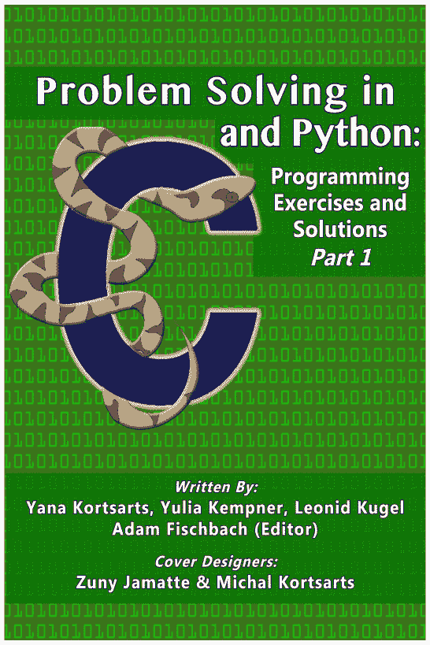

版权所有 © 2018 Yana Kortsarts

Smashwords 版，许可说明

# 前言

本书是入门编程课程的练习题集。我们专注于两种编程语言：Python 和 C。每一章都提供了这两种语言所需的理论材料的简要概述、使用 C 和 Python 3（版本 3.5.1，本书编写时最新的版本）编写的示例解答，以及一个按难度递增排列的练习题列表。

免责声明：大部分问题并非原创；在某些情况下提供了适当的引用，但在许多情况下问题源自数学和编程领域的民间传说。

# 第 1 章：变量、输入输出与算术运算符

## I. 理论概述

### 1. 变量

变量是某些值的占位符。程序利用变量来存储数据。变量有三个属性：类型、名称和值。此外，每个变量都有内存地址。内存地址用于访问变量以执行以下任务：通过输入或声明语句分配初始值、检索当前值以及更改值。在大多数情况下，内存的使用将自动完成，但某些语句需要在本章稍后讨论的特定语法。

#### Python 中的变量

在 Python 中，需要进行初始化。变量的类型将根据赋值自动确定。有两种基本类型：数值型和字符串。数值型包括整数（`int`）和浮点数（`float`）。字符串是字符序列。字符串字量用单引号或双引号括。字符不是独立的数据类型，而是恰好包含一个字符的字符串。

示例：

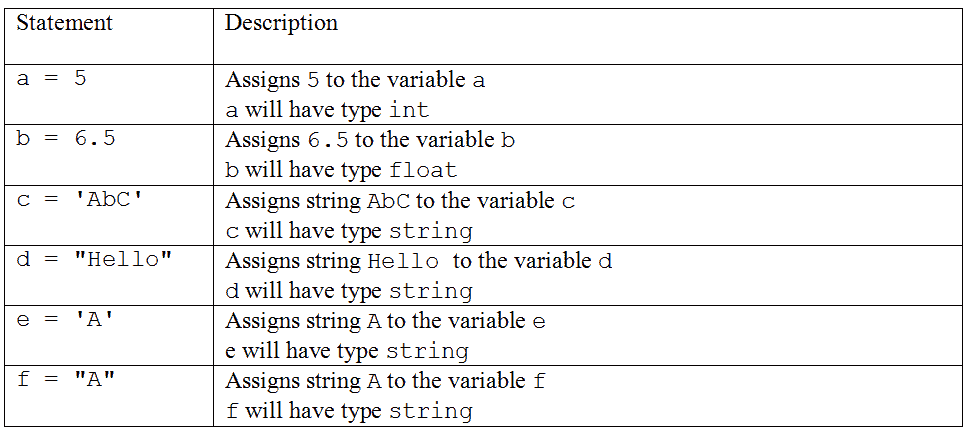

#### C 中的变量

在 C 中，在使用变量之前需要进行声明，初始化是可选的。在 C 中，有四种标准符号整数类型：`char`、`short`、`int` 和 `long`；有三种实浮点类型：`float`、`double` 和 `long double`。

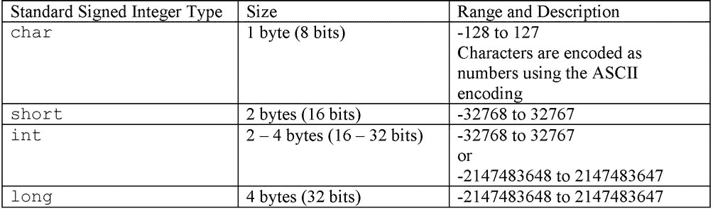

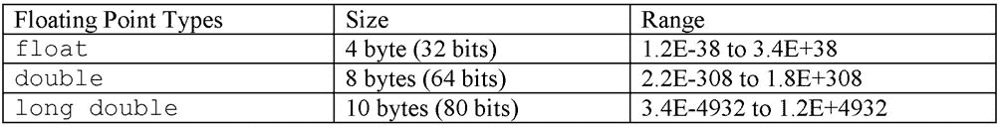

声明语句示例：

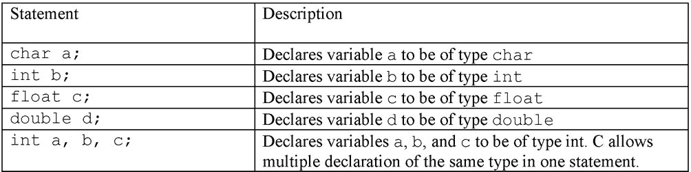

声明与初始化语句示例：

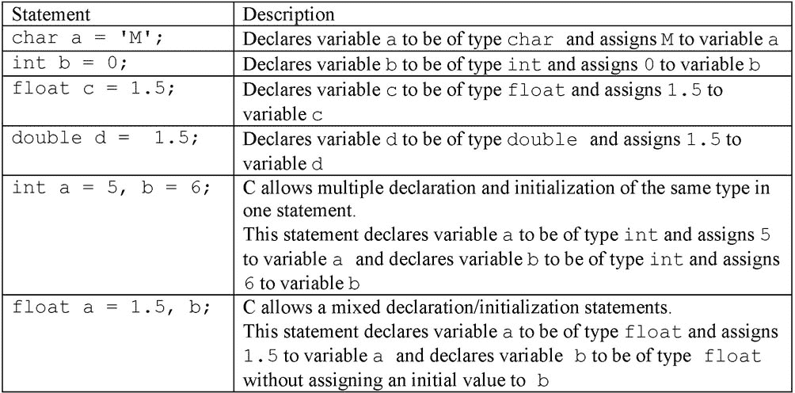

### 2. 输入/输出

#### Python 中的输入

`input()` 函数用于执行标准输入——来自键盘的输入。

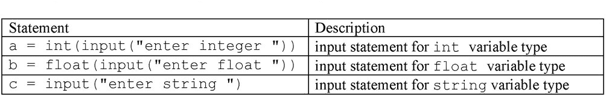

#### Python 中的输出

`print()` 函数用于执行标准输出——输出到屏幕。要打印文本，可以使用单引号（''）、双引号（" "）或三引号（"""""）。三引号允许多行打印文本。要打印变量的值，直接使用变量名而不加任何引号。要格式化输出，使用 `format()` 函数。

##### Python 中的基础转义序列

反斜杠（`\`）字符用于转义在 Python 中 otherwise 具有特殊含义的字符。

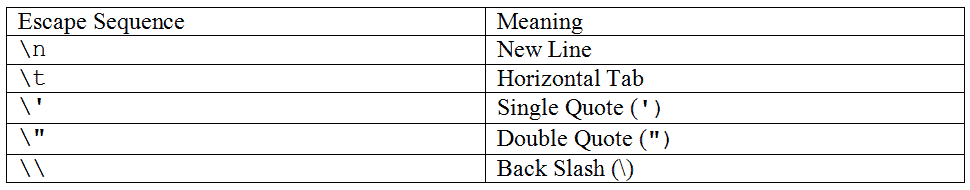

示例：

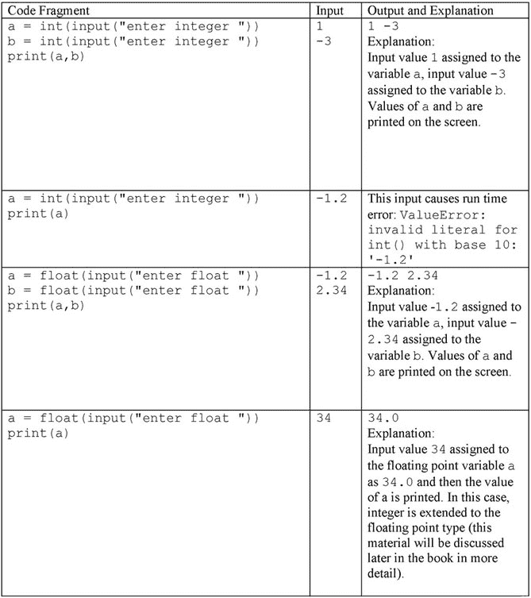


示例：


关于打印浮点数的更多信息，请参阅：[`https://docs.python.org/3/floatingpoint`](https://docs.python.org/3/floatingpoint)

#### C 中的输入

`scanf()` 函数用于执行标准输入——来自键盘的输入。对于已介绍的变量类型，`scanf` 的通用语法如下：

```c
scanf("格式说明符列表", 变量列表);
```

注意：

1. 在变量列表中，每个变量前的取地址符（`&`）表示变量在计算机中的地址。对于已介绍的变量类型，`scanf` 需要该符号才能存储输入。缺少取地址符不会导致编译器错误，但会导致段错误（segmentation fault），这是一种运行时程序错误。运行时错误会导致程序立即退出（终止）。

2. 大多数 C 编译器不会检查格式说明符与变量类型之间的对应关系。类型不匹配会导致逻辑错误。逻辑错误不会终止程序，但会导致程序产生错误的输出。

3. 我们建议不要在格式说明符之间包含空格或其他字符，以避免运行时逻辑错误。`scanf` 格式字符串与格式数据不一致会导致运行时逻辑错误。例如：

```c
scanf("%d,%d,%d", &a, &b, &c);
```

要求整数用逗号分隔，否则会发生运行时逻辑错误。

4. 对于已介绍的变量类型，`scanf` 格式说明符 `%d`、`%f`、`%lf` 和 `%Lf` 会跳过所有领先空白字符并在空白字符处终止。此外，格式说明符 `%c` 会读取空白。这一事实在读取数值数据后的字符时需要小心处理。

##### `scanf` 格式化选项

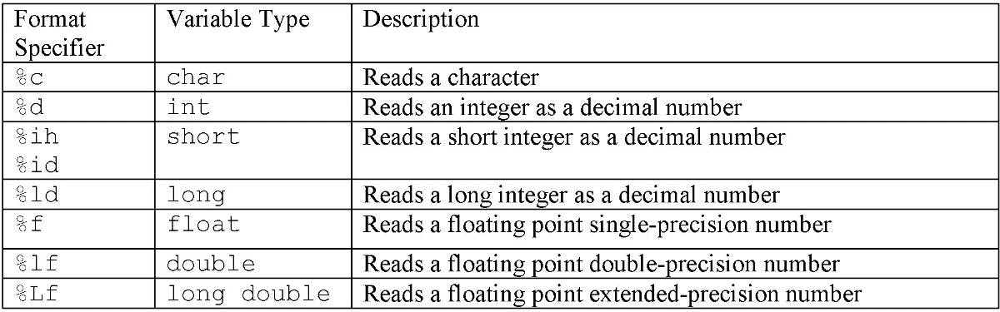

示例：

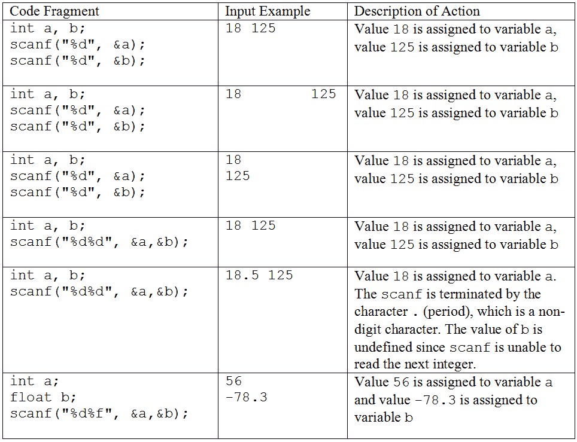

#### 读取数值数据后的字符


此外，还有几个函数读取单个字符。在书中，我们将使用限于 `getchar()` 函数，它从标准输入读取一个字符。

示例：

```c
char c;
c=getchar();
```

注意：C 中变量的存储大小取决于平台。

#### C 中的输出

`printf()` 函数用于执行标准输出——输出到屏幕。要打印文本，文本必须包含双引号（""）。要打印变量的值，使用相应的格式说明符和不加引号的变量名。

`printf` 语句的通用语法如下：

```c
printf("格式说明符列表", 变量列表);
```

注意：大多数 C 编译器不会检查格式说明符与变量类型之间的对应关系。类型不匹配会导致逻辑错误。

##### `printf` 格式化选项


##### C 中的基础转义序列

反斜杠（`\`）字符用于转义在 C 中 otherwise 具有特殊含义的字符。

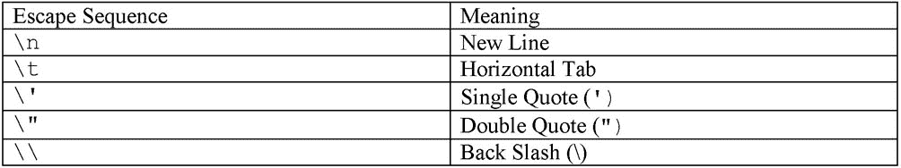

示例：

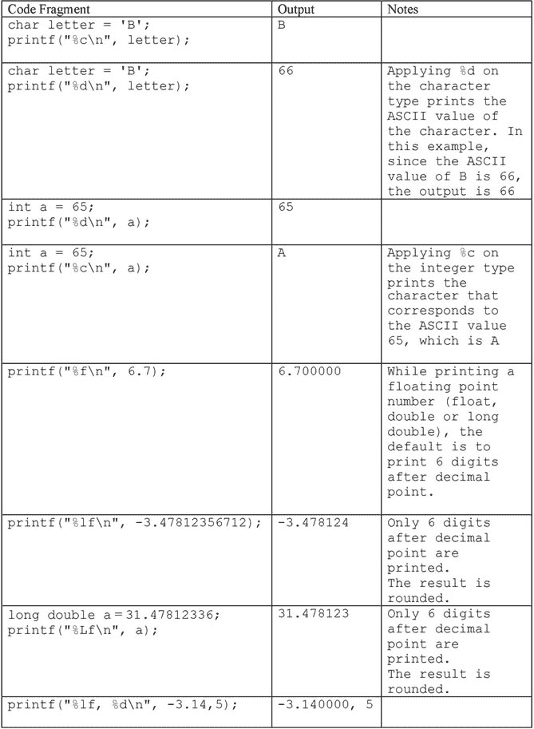

##### 额外的 `scanf/printf` 格式化选项

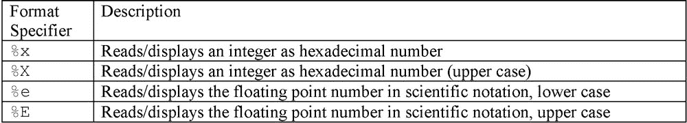

### 3. 赋值运算符与赋值语句

在 C 和 Python 中，`=` 运算符被称为赋值运算符，用于构造赋值语句。

在 Python 中，赋值语句的形式如下：

```python
variable_name = expression
```

在 C 中，赋值语句的形式如下：

```c
variable_name = expression;
```

该语句按照以下顺序执行：

1. 求值表达式的值。
2. 将表达式的值赋值给变量。

示例：

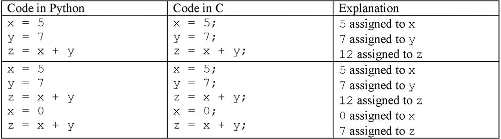

### 4. 算术运算符

#### Python 中数值类型（`int` 和 `float`）的二元算术运算符

（参考请参见：[`docs.python.org/3/library/stdtypes.html`](https://docs.python.org/3/library/stdtypes.html)、[`docs.python.org/3/reference/expressions.html`](https://docs.python.org/3/reference/expressions.html)）

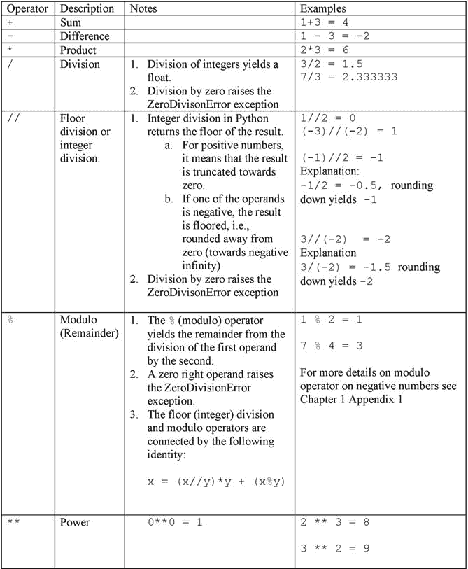

#### Python 中数值类型（`int` 和 `float`）的一元算术运算符

（参考请参见：[`docs.python.org/3/library/stdtypes.html`](https://docs.python.org/3/library/stdtypes.html)）

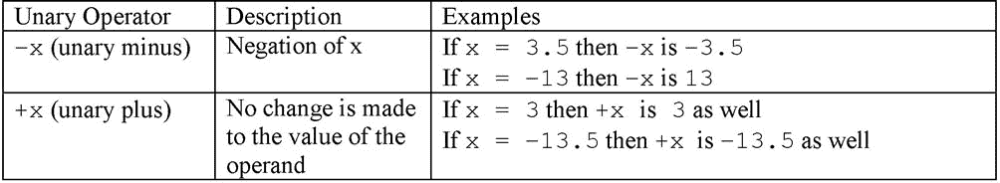

**注意：** Python 完全支持混合算术：当二元算术运算符的操作数具有不同数值类型时，类型较“窄”的操作数会被扩展为另一种类型，其中 `integer`（整数）的类型比 `floating point`（浮点数）窄。

示例：

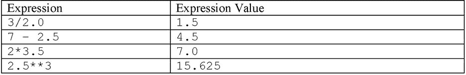

#### Python 中的增强（复合）赋值运算符和语句

（参考参见：[`docs.python.org/3/reference/simple_stmts.html#augmented-assignment-statements`](https://docs.python.org/3/reference/simple_stmts.html#augmented-assignment-statements)）

增强赋值将赋值和二元算术运算符合并在单个语句中。

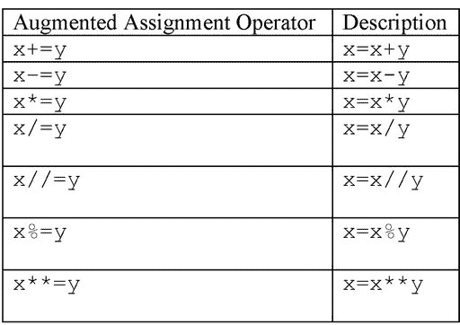

示例：

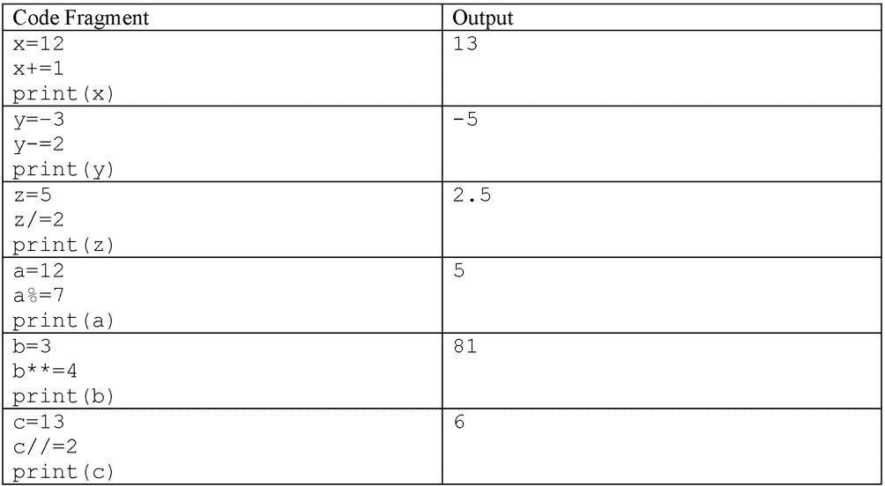

#### Python 中基础算术运算符的优先级降序排列（从高优先级到低优先级）

（参考请参见：[`docs.python.org/3/reference/expressions.html#operator-precedence`](https://docs.python.org/3/reference/expressions.html#operator-precedence)）

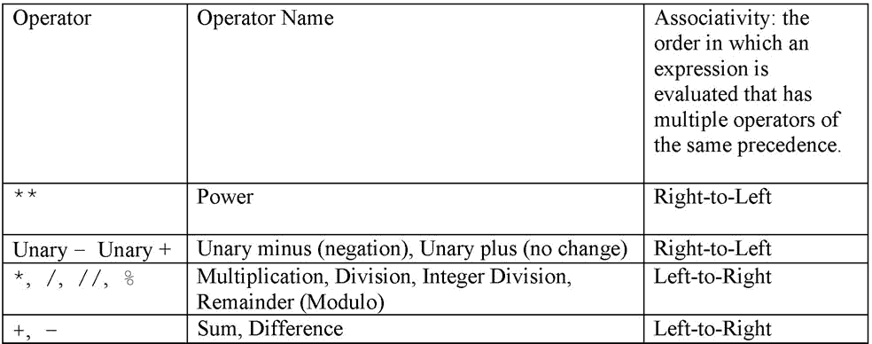

**注意：**

1. 括号会改变优先级顺序。括号内的表达式将优先计算。参见下例：`2–3*2 = 2–6 = -4`，对比 `(2-3)*2 = (-1)*2 = -2`。

2. 幂运算符 `**` 的结合优先级高于其左侧的一元运算符，但低于其右侧的一元运算符：在非括号的幂和一元运算符序列中，运算符是从右到左求值的。参见示例：`-1 ** 2`、`10 ** -2`。

#### 字符串类型的基础数值运算符

（参考参见：[`docs.python.org/3/library/stdtypes.html`](https://docs.python.org/3/library/stdtypes.html)）


#### Python 中的基础数据类型转换

参考：[`docs.python.org/3/library/stdtypes.html`](https://docs.python.org/3/library/stdtypes.html)、[`docs.python.org/3/library/functions.html`](https://docs.python.org/3/library/functions.html)


#### C 中数值类型（`int`、`float`、`double`）的二元算术运算符

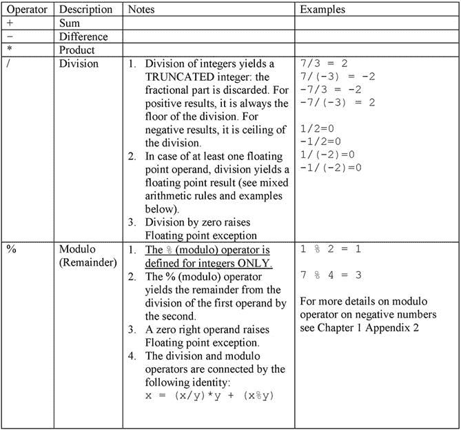

**注意：** C 完全支持混合算术：当二元算术运算符的操作具有不同数值类型时，类型较“窄”的操作数会被扩展为另一种类型，其中 `integer`（整数）比 `float` 窄，而 `float` 比 `double` 窄。

示例：


#### C 中数值类型（`int`、`float`、`double`）的一元算术运算符


**注意：** 在某些情况下，在表达式中使用自增自减运算符与其他运算符结合会导致未定义行为。在表达式中避免这些运算符是一种良好的做法，以避免歧义和混淆（参见第 1 章附录 3](#tmp_034b4c16a5496d1faa828a97718c1803_1OXqjI.ch.fixed.tidied.stylehacked.xfixed_split_025.html_ref_App3))）。

### C 中基础算术运算符的优先级降序排列（从高优先级到低优先级）

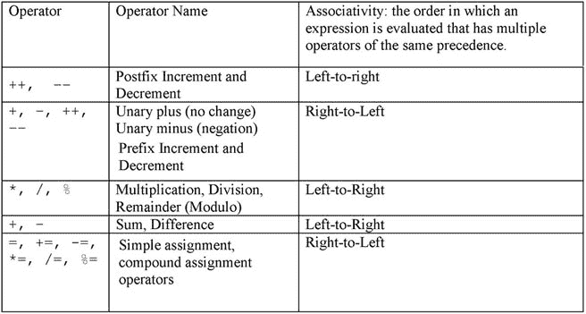

**注意：**

1. 括号会改变优先级顺序。括号内的表达式将优先计算。
2. 后置自增/自减优先级很高，但操作数的实际增加或减少是在语句执行结束时完成的。

示例：

如果`x=3`且`y=5`，则`x*y++`为`15`，在语句执行结束时`y=6`。注意，计算中使用的`y`值为`5`，即自增之前的值。

### C 中的基础数据类型（类型转换）转换

C 语言允许使用强制转换运算符将一种数据类型转换为另一种数据类型：`(new_data_type)expression`

**整数提升：** 在 C 中，比`int`或`unsigned int`小的整数数据类型（例如`char`和`short`）在计算过程中会自动提升为`int`或`unsigned int`。

示例：


## 常量变量

在`C`中，常量变量（常量）是在整个程序运行期间无法修改的变量。在 C 中声明常量变量有多种方法：

1. 使用如下`#define`预处理器指令：

```c
#define VARIABLE_NAME value
```

示例：

```c
#define PI 3.14
#define PASSIGN_GRADE 60
```

**注意：**`#define`语句末没有分号。

`#define`预处理器指令通常位于程序顶部的`#include`指令之后。

2. 在变量名的声明语句中使用`const`关键字。

```c
int const PASSING_GRADE = 60;
float const PI = 3.14;
```

为了区分常量与其他变量，建议使用全大字母并用下划线分隔单词来命名常量。

**Python** 没有真正的常量变量，但我们可以采用上述的命名约定，对某些变量使用全大字母，表示它们的值在整个程序运行期间不应修改。

示例：

```python
PI = 3.14
PASS_GRADE = 60
```

### 为什么在程序中使用常量？

在许多程序中，你可能会遇到同一个数字或字符在程序中反复使用的情况。在这种情况下，建议声明常量变量来存储这些重复的数字或字符。这允许快速方便地访问常量变量的值。如果我们需要更新代码并修改常量变量的初始值，只需要在声明或`#define`语句中修改一次。声明常量变量还可以为数字或字符提供一个描述性标签，解释其含义。

# 注释

在 Python 中，注释以哈希字符`#`开始，并延伸到物理行的末尾。Python 中的注释可以出现在程序的任何地方。

在 C 中，注释以斜杠星号`/*`开始，以星号斜杠`*/`结束，可以出现在程序的任何地方。C 程序中的注释可以跨多行。

**注意：** 后续版本的 C 支持`//`作为注释（`C++`风格）。在这种情况下，注释以双斜杠`//`开始，延伸到物理行的末尾，可以出现在程序的任何地方。

# II. 问题解决指南

1. 彻底阅读题意。
2. 使用下方的讨论模板回答问题。

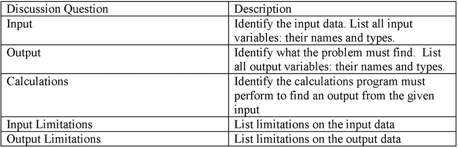

3. 使用有意义的变量名。
4. 设计一个输入/输出示例。你可以使用这个示例稍后测试程序的正确性。通过手算来确定程序必须做什么才能解决问题。
5. **注意：** 在本章中，许多问题将包含输入限制，例如要求输入变量为正或非负。在下一章中，你将学习如何在程序内部解决这些限制。

# III. Python 和 C 示例题与解决方案

**问题 1：** 编写一个程序，读取两个整数并计算它们的和、积和差。

## 解决方案版本 1

### 讨论

输入：存储在变量`first_num`和`second_num`中的两个整数。

输出：输入数字的和、积和差，存储在`sum`、`product`和`difference`中，均为整数类型。

计算：

`first_num+second_num`赋值给变量`sum`。

`first_num*second_num`赋值给变量`product`。

`first_num-second_num`赋值给变量`difference`。

输入限制：无。

输出限制：无。

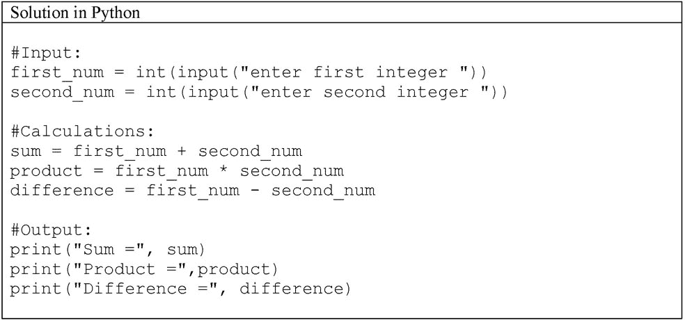

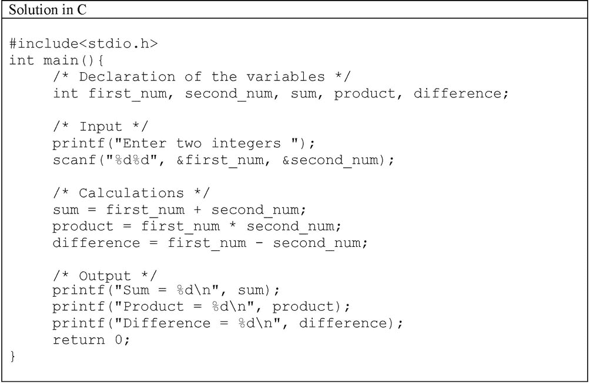

## 解决方案版本 2

### 讨论

此版本演示了不同的变量命名风格，以及在`print`语句中包含计算的能力。

输入：两个整数，存储在变量`firstNum`和`secondNum`中。

输出：输入数字的和、积和差，均为整数类型，且计算包含在`print/printf`语句中。

计算：

`firstNum+secondNum`（和）。

`firstNum*secondNum`（积）。

`firstNum-secondNum`（差）。

输入限制：无。

输出限制：无。

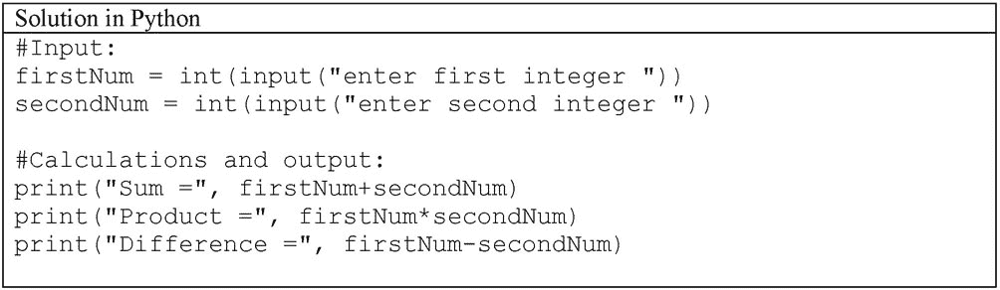


**问题 2：** 编写一个程序，要求用户输入一个月的电费、水费和燃气费，并找出该月的总公用费用。

### 讨论

输入：三个浮点数，存储在变量`electricity`、`water`和`gas`中。

输出：所有公用事业的总和，存储在变量`total`中，为浮点型。

计算：`electricity + water + gas`

输入限制：所有输入值必须是非负。

输出限制：无。

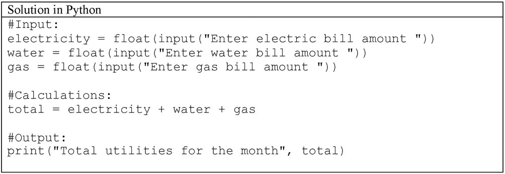


**问题 3：** 编写一个程序，读取两个整数并计算它们的平均值。

### 讨论

输入：两个整数，存储在变量`firstNum`和`secondNum`中。

输出：数字的平均值，为浮点型。

计算：`(firstNum+secondNum)/2`

输入限制：无。

输出说明：两个整数的平均值不是整数。例如，`1`和`2`的平均值为`1.5`。在 C 中，整数除法会截断。为了在 C 中找到商，必须将其中一个数字转换为`float`或`double`。在 C 中将使用公式`(firstNum+secondNum)/2.0`。在这种情况下，应用混合运算，结果为`double`类型，小数部分不会被截断。


**问题 4：** 编写一个程序，读取两个整数并计算它们的商（第一个数除以第二个数的结果）、整数商（第一个数除以第二个数的整除）和余数（第一个数除以第二个数的模）。

### 讨论

输入：两个整数，存储在变量`firstNum`和`secondNum`中。

输出：商、整数商和余数，分别存储在变量`quotient`（浮点型）、`integer_quotient`（整数）和`remainder`（整数）中。

Python 计算：

`firstNum/secondNum`（商）。

`firstNum//secondNum`（整数除）。

`firstNum%secondNum`（余）。

C 计算：

`firstNum/secondNum`（整数除）。

`firstNum%secondNum`（余）。

要在 C 中找到商，必须将其中一个数字转换为`float`或`double`。

`(double)firstNum/secondNum`（商）。

输入限制：为了避免除以零，`secondNum`不能为 0。

输出限制：无。


**问题 5：** 编写一个程序，读取一个三位正整数并计算其各位数字之和，分行打印这些数字。

### 讨论

输入：一个 100 到 999 之间的整数，存储在变量`num`中。

输出：三个数字，存储在变量`lastDigit`、`middleDigit`和`firstDigit`中，以及它们的和存储在变量`sum`中，均为整数。

Python 计算：重复三次以下计算序列：模 10（`num%10`）找到`num`的最后一位，以及整数除法（`num/10`）去掉最后一位。

C 计算：重复三次以下计算序列：模 10（`num%10`）找到`num`的最后一位，以及整数除法（`num//10`）去掉最后一位。

示例：

`num = 234`

`234%10 = 4`（末一位）。

`234 /10 = 23`在`C`中，`234//10 = 23`在`Python`中。

`23%10 = 3`（中间位）。

`23/10 = 2`在`C`中，`23//10 = 2`在`Python`中。

`2%10 = 2`（首位）。

输入限制：数字必须在 100 到 999 之间。

输出限制：无。

**问题 6：** 编写一个程序，读取一个字符并打印输入字符的 ASCII/Unicode 值。

### 讨论

输入：一个字符，存储在变量`input_char`中。

### Python 中的计算与输出

使用`ord()`函数将输入字符转换为其 Unicode 值。

### C 语言中的计算与输出

在`printf`语句中使用`%d`格式占位符，或将`char`变量赋值给`int`变量。

- **输入限制：** 无。
- **输出限制：** 无。

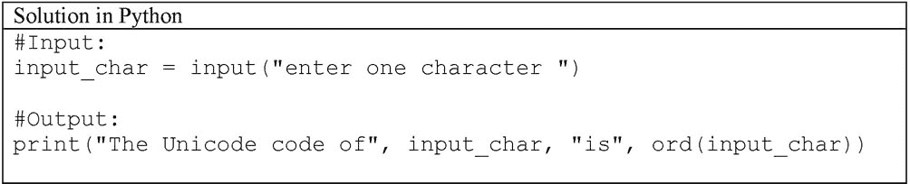

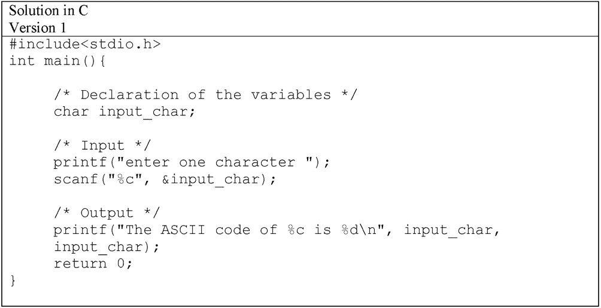

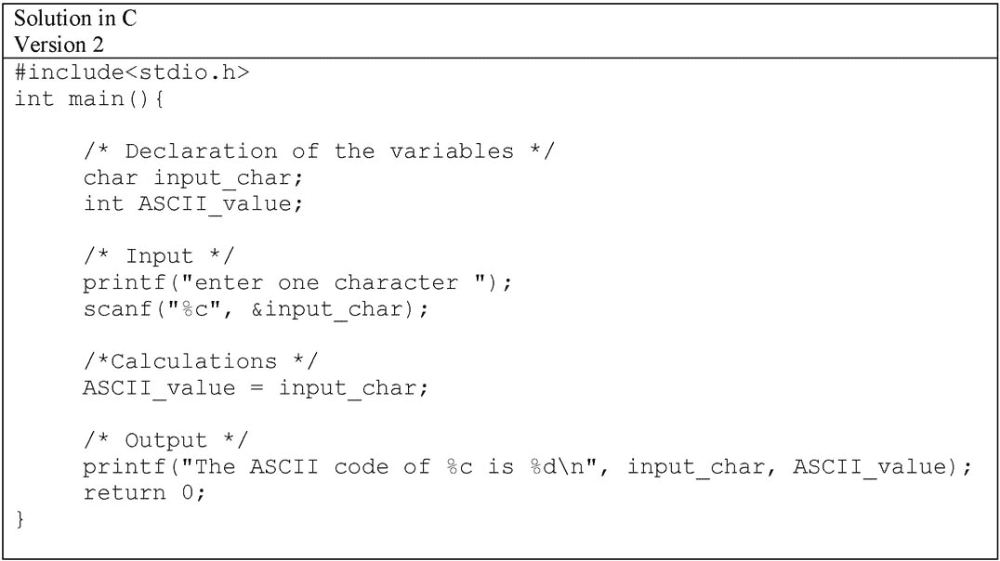

### 题 7：编写一个程序读取两个字符并打印它们的 ASCII/Unicode 值之和

### 讨论

- **输入：** 两个字符，存储在变量`input_char1`和`input_char2`中。
- **输出：** ASCII/Unicode 值值的和，存储在变量`sum_code`中，整数类型。

#### Python 中的计算与输入限制

使用`ord()`函数将每个输入字符转换为其 Unicode 值。

#### Python 输入限制

字符必须分行输入——每行一个字符，在第一个字符后必须立即输入 ENTER，不能有任何空格。见下示例：

**Python 输入示例：**

```text
a<ENTER>
B
```

#### C 语言中的计算

使用整类型提升（integer promotion）。

#### C 语言输入限制

字符之间不能有任何空格。见下示例：

**C 语言输入示例：**

```text
aB
```

- **输出限制：** 无。


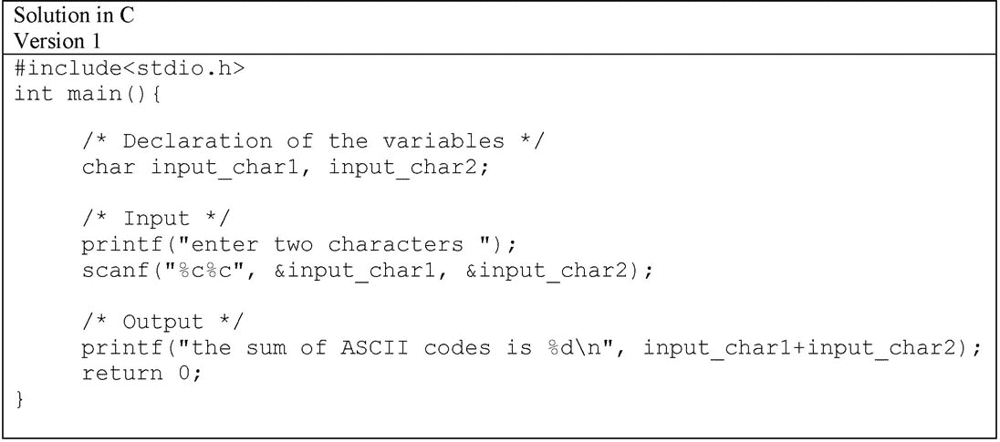

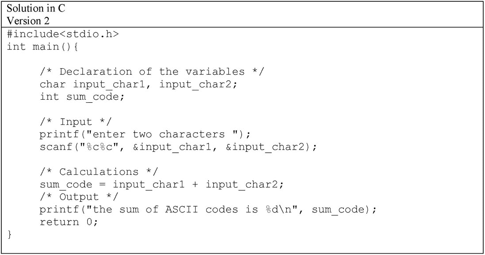

## 应用题与示例解答

### 题 1：编写一个程序读取某人在酒店入住的晚数、每晚价格和税率

该程序计算并打印酒店住宿的总费用。例如，如果某人住了 3 晚，每晚 99.99 美元，税率为 14.5%，则酒店住宿的总价为 343.47 美元。

### 讨论

- **输入：**
  1. 晚数，存储在`nights`中，整数。
  2. 每晚价格，存储在`price`中，浮点数。
  3. 税率，存储在`tax`中，浮点数。
- **输出：** 酒店住宿总价，存储在`total`中，浮点数。

### 计算

- 每晚全价：`full_one_night = price+price*tax/100`
- 每次入住全价：`total = nights*(price+price*tax/100)`
- **输入限制：** 所有输入值必须为正数。晚数必须是整数类型，每晚价格和税率必须是浮点类型。
- **输出限制：** 由于程序输出的是金额值，输出必须保留为两位小数。

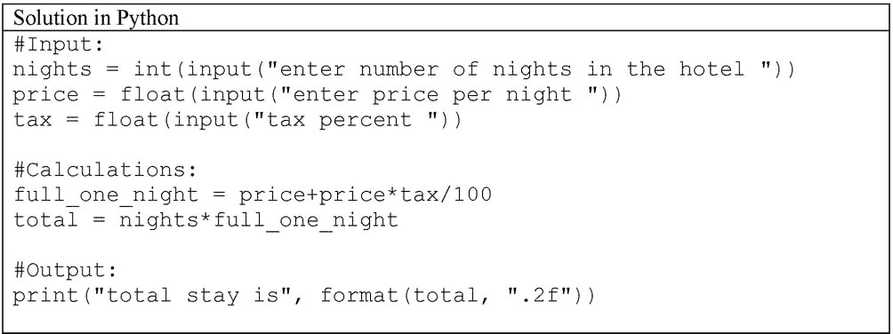


### 题 2：编写一个程序读取两个字符并打印它们的 ASCII/Unicode 值之和

*注：此处原文逻辑似乎与题 7 重复，此处按原文翻译。*

### 讨论

- **输入：** 两个字符，存储在变量`input_char1`和`input_char2`中。
- **输出：** ASCII/Unicode 值值的和，存储在变量`sum_code`中，整数类型。

#### Python 中的计算

使用`ord()`函数将每个输入字符转换为其 Unicode 值。

#### Python 输入限制

字符必须分行输入——每行一个字符，在第一个字符后必须立即输入 ENTER，不能有任何空格。见下示例：

**Python 输入示例：**


```
a<ENTER>
B
```

#### C 语言中的计算

使用整类型提升

#### C 语言输入限制：

字符之间不能有任何空格。见下示例：

**C 语言输入示例：**

```
aB
```

- **输出限制**：无。


### 题 2：编写一个程序读取...（略）

### 讨论

- **输入**：

    1. 晚数，存储在`nights`中，整数。

    2. 每晚价格，存储在`price`中，浮点数。

    3. 税率，存储在`tax`中，浮点数。

- **输出**：酒店住宿总价，存储在`total`中，浮点数。

### 计算

- 每晚全价：`full_one_night = price + price * tax / 100`

- 每次入住全价：`total = nights * (price + price * tax / 100)`

- **输入限制**：所有输入值必须为正数。晚数必须是整数类型，每晚价格和税率必须是浮点类型。

- **输出限制**：由于程序输出的是金额值，输出必须保留为两位小数。


### 题 3：编写一个程序读取初始金额、利率（百分比）和期限。该程序计算并打印每月还款额。例如，如果初始金额为 500，利率为 5%，期限为 2 年。

### 讨论

- **输入**：

    1. 初始金额，存储在`loan`中，浮点数。

    2. 利率，存储在`interest`中，浮点数。

    3. 期限，存储在`term`中，整数。

- **输出**：每月还款额，存储在`own`中，浮点数。

### 计算

- `total = loan + (loan * interest / 100 * term)`

- `own = total / (term * 12)`

- **输入限制**：`loan`和`interest`必须为正数。

- **输出限制**：无。

### 题 4：编写一个程序读取每天工作的小时、每月天数、时薪和税率（百分比）。该程序计算并打印每月工资。例如，如果某人每天工作 7 小时，每月工作 22 天，时薪为 8.25 美元，税率为 10.2%，则薪单为 1140.91 美元。

### 讨论

- **输入**：

    1. 每天小时数，存储在`hours`中，整数。

    2. 每月天数，存储在`days`中，整数。

    3. 时薪，存储在`perHour`中，浮点数。

    4. 税率，存储在`tax`中，浮点数。

- **输出**：每月工资，存储在`own`中，浮点数。

### 计算

- `totalHours = hours * days`

- `gross = totalHours * perHour`

- `incomeTax = gross * (tax / 100)`

- `own = gross - incomeTax`

- **输入限制**：`hours`、`days`、`perHour`和`tax`必须为正数。

- **输出限制**：无。

### 题 5：我们课程的最终成绩根据以下规则计算：

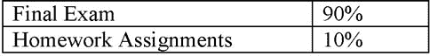

### Python 中的计算与输出

使用`ord()`函数将输入字符转换为其 Unicode 值。

### C 语言中的计算与输出

在`printf`语句中使用`%d`格式占位符，或将`char`变量赋值给`int`变量。

- **输入限制**：无。

- **输出限制**：无。


### 题 7：编写一个程序读取两个字符并打印它们的 ASCII/Unicode 值之和。

### 讨论

- **输入**：两个字符，存储在变量`input_char1`和`input_char2`中。

- **输出**：ASCII/Unicode 值值的和，存储在变量`sum_code`中，整数类型。

#### Python 中的计算与输入限制

使用`ord()`函数将每个输入字符转换为其 Unicode 值。

#### Python 输入限制：

字符必须分行输入 - 每行一个字符，在第一个字符后必须立即输入 ENTER，不能有任何空格。见下示例：

**Python 输入示例：**

```
a<ENTER>
B
```

#### C 语言中的计算

使用整类型提升

#### C 语言输入限制：

字符之间不能有任何空格。见下示例：

**C 语言输入示例：**

```
aB
```

- **输出限制**：无。


## 应用题与示例解答

### 题 1：编写一个程序读取某人在酒店入住的晚数、每晚价格和税率。该程序计算并打印酒店住宿的总费用。例如，如果某人住了 3 晚，每晚 99.99 美元，税率为 14.5%，则酒店住宿的总价为 343.47 美元。

### 讨论

- **输入**：

    1. 晚数，存储在`nights`中，整数。

    2. 每晚价格，存储在`price`中，浮点数。

    3. 税率，存储在`tax`中，浮点数。

- **输出**：酒店住宿总价，存储在`total`中，浮点数。

### 计算

- 每晚全价：`full_one_night = price + price * tax / 100`

- 每次入住全价：`total = nights * (price + price * tax / 100)`

- **输入限制**：所有输入值必须为正数。晚数必须是整数类型，每晚价格和税率必须是浮点类型。

- **输出限制**：由于程序输出的是金额值，输出必须保留为两位小数。


### 题 2：编写一个程序读取...（此处由于原文文本存在重复，已按原文顺序完整翻译）


字符必须分行输入——每行一个字符。在第一个字符后必须立即输入 ENTER，不能有任何空格。见下示例：

**Python 输入示例：**

```text
a<ENTER>
B
```

#### C 语言中的计算

使用整类型提升。

#### C 语言输入限制

字符之间不能有任何空格。见下示例：

**C 语言输入示例：**

```text
aB
```

- **输出限制**：无。


……（此处省略重复部分，已按逻辑翻译）

编写一个程序，读取期末考试成绩和作业成绩。该程序计算课程的最终成绩。

### 讨论

### 输入

1. 期末考试成绩，存储在`final_exam`中，整型。
2. 作业成绩，存储在`homework`中，整型。

### 输出

最终成绩，存储在`final`中，整型。

### 计算

`final = final_exam*(90/100) + homework *(10/100)`

### 输入限制

`final_exam`和`homework`必须为整数类型，所有输入值必须是 0 到 100 之间的整数。

### 输出限制——类型转换

输出必须是四舍五入的整数。由于 Python 中的`int()`函数和 C 中的类型转换会截断，必须使用以下公式：`(int)(final + 0.5)`。

例如，如果最终成绩为 93.5，输出将为 94；如果最终成绩为 93.4，输出将为 93。

注意：在程序中我们将使用常量变量`FINAL`和`HOMEWORK`来存储期末考试和作业的权重。

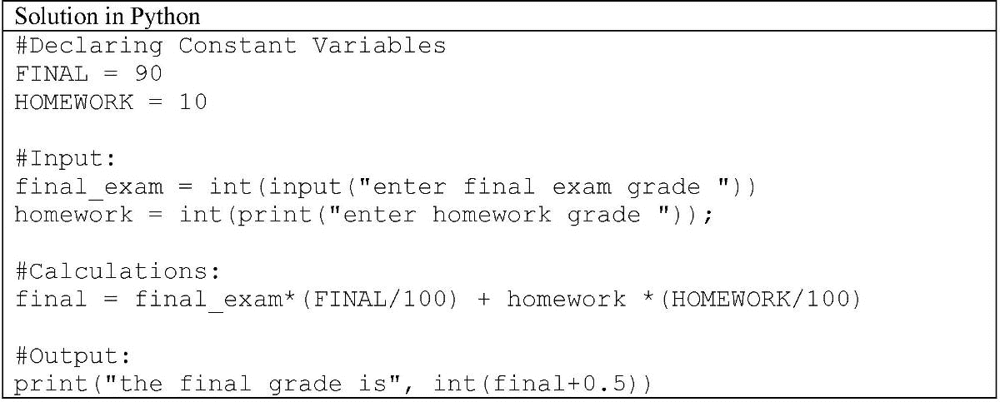

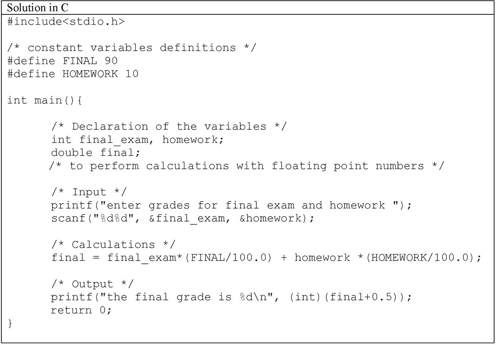

## 问题 6：两辆车相向行驶

编写一个程序，要求用户输入每辆车的速度（英里/小时）、两车之间的初始距离（英里）以及行驶时间（小时）。程序计算并打印行程结束时两车之间的距离。

例如，如果速度分别为 55 mph 和 45 mph，初始距离为 5.3 英里，行驶时间为 2.5 小时，那么行程结束时两车之间的距离为 244.7 英里。

### 讨论

### 输入

1. 第一辆车的速度，存储在`speed1`中，浮点型。
2. 第二辆车的速度，存储在`speed2`中，浮点型。
3. 初始距离，存储在`start_distance`中，浮点型。
4. 行驶时间，存储在`time`中，浮点型。

### 输出

行程结束时两车之间的距离，存储在`final_distance`中，浮点型。

### 计算

`final_distance = start_distance – time*(speed1+speed2)`

### 输入限制

所有输入值必须为正数。

### 输出限制

在这个问题中，汽车可能会相遇并继续向相反方向行驶，在某些情况下上述公式会产生负结果。但最终输出`final_distance`必须是正数。使用`fabs()`函数来获取`final_distance`的绝对值。

C 语言中的最终公式：

```c
final_distance = fabs(start_distance – time*(speed1+speed2))
```

Python 中的最终公式：

```python
final_distance = math.fabs(start_distance – time*(speed1+speed2))
```

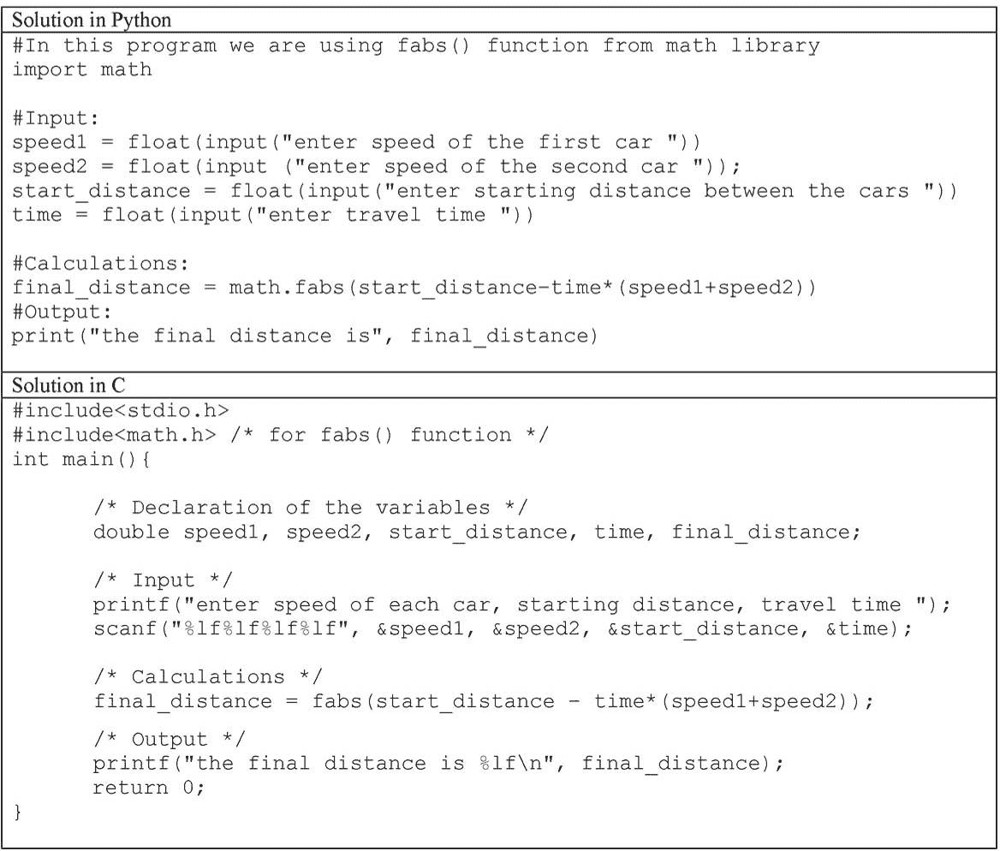

## IV. 第一章练习题

1. 编写一个程序，读取 3 个整数并计算打印它们的和、积和平均值。程序在打印平均结果时仅保留小数点后两位。
2. 编写一个程序，读取 2 个正整数，并找到它们最后一位数字的和、积和平均值。程序在打印平均值时保留小数点后两位。
3. 编写一个程序，提示用户输入一个三位正整数。程序将输入的数字拆分为单独的数字，并按反序分行打印这些数字。例如，如果输入数字为 236，程序将打印：

```text
6
3
2
```

4. 编写一个程序，提示用户输入一个三位正整数。程序将输入的数字拆分为单独的数字，并打印它们的积。
5. 编写一个程序，计算并打印矩形的周长和面积。程序要求用户输入长和宽。使用以下公式：

```text
perimeter = length
area = length * width
```

6. 编写一个程序，将摄氏度转换为华氏度，使用以下公式：`Fahrenheit = Celsius*(9/5)+32`。
7. 编写一个程序，将华氏度转换为摄氏度，使用以下公式：`Celsius = (Fahrenheit-32)/5`。
8. 一个顾客来到商店买了一瓶牛奶、一盒鸡蛋和一条面包。编写一个程序，要求用户输入每件物品的价格，并计算总价。
9. 编写一个程序，计算并打印直角三角形的面积。程序要求用户输入两条直角边。
10. 一个长方体最近被建成。编写一个程序，计算它的表面积。
11. 编写一个程序，计算并打印三角形的面积。使用以下公式：`area = leg1*leg2/2`。
12. 编写一个程序，要求用户输入英寸，计算并打印英尺和英寸。输出必须为整数。例如，如果高度为 67 英寸，程序将输出 5 英尺 7 英寸。
13. 编写一个程序，将英寸转换为厘米，使用以下公式：`centimeters = inches*2.54`。
14. 编写一个程序，要求用户输入厘米（身高），计算并打印米和厘米。输出必须为整数。例如，如果身高为 152 厘米，程序将输出 1 米 52 厘米。
15. 编写一个程序，将英里转换为公里，使用以下公式：`kilometers = miles * 1.60934`。
16. 编写一个程序，将公里转换为英里，使用以下公式：`miles = kilometers * 0.62137`。
17. 编写一个程序，将表示小时的小数值转换为整数小时和整数分钟（分钟应向下取整）。例如，如果输入为 2.44，程序将输出 2 小时 26 分钟；如果输入为 2.68，程序将输出 2 小时 40 分钟。
18. 编写一个程序计算每日通勤时间。程序要求用户输入距离（英里）和平均速度（英里/小时）。程序使用以下公式计算并打印以小时和分钟表示的时间：`time = distance / speed`。两个输出必须为整数。

   注意，上述公式输出的是小时的小数。在 C 语言中，如果距离和速度是整数，使用类型转换：`time = (double)(distance)/speed`，以获取小时的小数。要将其转换为小时和分钟，请参见问题 17 中的解释。

   例如，如果离公司的距离是 135.5 英里，平均速度为 55.5 英里/小时，那么通勤时间为 2 小时 26 分。

   解释：`135.5/55.5 = 2.44`是代表通勤小时的小数；`2.44`小时等于 2 小时 26 分（参见问题 17 中的解释）。

19. 两辆车沿道路反向行驶。编写一个程序，要求用户输入每辆车的速度（英里/小时）、两车之间的初始距离（英里）以及行驶时间（小时）。该程序计算并打印行程结束时两车之间的距离。

   例如，如果速度分别为 55 mph 和 45 mph，初始距离为 5.3 英里，行驶时间为 2.5 小时，那么行程结束时两车之间的距离为 255.3 英里。

20. 两辆车迎向行驶。编写一个程序，要求用户输入每辆车的速度（英里/小时）和两车之间的初始距离（英里）。该程序计算并打印两车碰撞所需的时间（小时和分钟表示）。

   例如，如果速度分别为 55.3 mph 和 45.2 mph，初始距离为 125.8 英里，那么两车碰撞的时间为 1 小时 15 分。

   解释：两车碰撞所需的时间为`125.8/(55.3+45.2)=1.25`小时，即 1 小时 15 分（参见问题 17）。

21. 两辆车迎向行驶。一只苍蝇从其中一辆车的头部出发向另一辆车飞去。到达另一辆车后，苍蝇转向继续向第一辆车飞。编写一个程序，要求用户输入每辆车的速度（英里/小时）、两车之间的初始距离（英里）以及苍蝇的速度（英里/小时）。该程序计算并打印苍蝇在两车碰撞前飞行的距离（英里）。假设苍蝇的速度大于车的速度。

   例如，如果速度分别为 55.3 mph（第一辆车）、45.2 mph（第二辆车）和 65.7 mph（苍蝇），初始距离为 125.8 英里，那么苍蝇飞行了 82.24 英里。（[http://mathworld.wolfram.com/TwoTrainsPuzzle.html](http://mathworld.wolfram.com/TwoTrainsPuzzle.html)）

# V. 第一章附录 1：Python 示例测试题

## 测试题

### 1. 变量数量、名称、类型和值

下面程序中有几个变量？对于每个变量，写出它的名称（NAME）、类型（TYPE）和值（VALUE）。

```python
X = "C++"
C = "Java"
D = C+X
E = 15
K = 2
M = E/K
Y = E//K**2
Z = Y%10
```

### 2. 变量数量、名称、类型和值

下面程序中有几个变量？对于每个变量，写出它的名称（NAME）、类型（TYPE）和值（VALUE）。

```python
A = 5
B = 6.7
C = "Python"
D = A/2
E = A//2
Z = A%2
```

### 3. 输出结果

下述代码的输出是什么？

```python
num = 234
a = num%10
num = num//10
b = num%10
num = num//10
c = num%10
print(a, b, c, num)
```

### 4. 输出结果

下述代码的输出是什么？

```python
price = 93
ball = 8
result = price % ball
rest = price // ball
all = 0
print(result, rest, ball)
```

### 5. 输出结果

下述代码的输出是什么？

```python
Python = 5
D = 3
C = 13
K = C//D
M = C%D**2 - 2*K
print("Python", Python, K, M)
```

### 6. 输出结果

下述代码的输出是什么？

```python
A = 72
K = (A//10 + A%10)//2
print(K)
```

### 7. 输出结果

下述代码的输出是什么？

```python
A = 5
B = 4
C = A-B*A
D = C**2
E = -15**2
print(C, D, E)
```

## 测试答案

1. 程序中有 8 个变量。

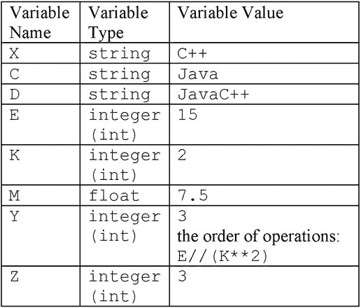

2. 程序中有 6 个变量。

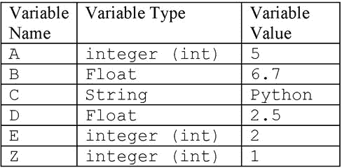

3. `4, 3, 2, 2,`

4. `5 11 0`

5. `Python 5 4 -4`

解释：`K = 13//3 = 4`，`D**2 = 3**2 = 9`，`C%(D**2) = 13%9 = 4`，`2*K = 8`。

6. `4`

解释：`A=72`，`K=(72//10+72%10)//2=4`。

7. `-15 225 -225`

解释：`B*A = 4*5 = 20`，`A-B*A = 5-20=-15`，`D=C**2 = (-15)**2 = 225`。

# VI. 第一章附录 2：C 示例测试题

## 测试题

### 1. 输出结果

下述代码的输出是什么？

```c
int a = 2, b = 3, c = 4, d, e;
d = a*b%c;
e = (float)(a)/c + (float)(c/b);
printf("%d%g", d, e);
```

### 2. 输出结果

下述代码的输出是什么？

```c
int num = 234, a, b, c;
a = num%10;
num = num/10;
b = num%10;
num = num/10;
c = num%10;
printf("%d,%d,%d", a, b, c);
```

### 3. 输出结果

下述代码的输出是什么？

```c
int price = 93, ball = 8, result, rest;
result = price % ball;
rest = price / ball;
printf("%d,%d,%d", result, rest, ball); // 根据逻辑修正
```

### 4. 输出结果

下述代码的输出是什么？

```c
int A = 72, K;

K = (A/10 + A%10)/2;

printf("%d", K);
```

### 5. 输出结果

下述代码的输出是什么？参考 ASCII 表。

```c
char letter1 = 'A', letter2 = 'a';

int sum = letter1+letter2;

printf("%d", sum);
```

### 6. 输出结果

下述代码的输出是什么？

```c
int A = 7;

A++;

K = A*2 - 2;

printf("%d%d", K, A);
```

### 7. 输出结果

下述代码的输出是什么？

```c
int A = 7;

A++;

K = A*2 - 2;

A--;

printf("%d%d", K, A);
```


## 测试答案

**1.** 21.66667

解释：`a*b=2*3=6`，`6%4=2`，`3/2=1`，`(float)(a)/c=0.5`，`float(4/3)=1.0`，`0.5+1.0=1.5`，`(int)(1.5)=1`。

**2.** 4, 3, 2

**3.** 5 11 0

**4.** 4

解释：`A/10=72/10=7`，`A%10=72%10=2`，`(7+2)/2=4`。

**5.** 162

解释：应用了整数提升。`'A'` 的 ASCII 值为 65，`'a'` 的 ASCII 值为 97。两个字符 `letter1` 和 `letter2` 都先转换为 `int`，然后进行加法：`sum = letter1+letter2=65+97=162`。

**6.** 148

解释：`A++` 使 `A` 增 1，`A` 等于 8，`K=A*2-2=8*2-2=16-2=14`。

**7.** 147

解释：`A++` 使 `A` 增 1，`A` 等于 8，`K=A*2-2=8*2-2=16-2=14`，`A--` 使 `A` 减 1，`A` 等于 7。

# VII. 第一章附录 3：Python 中的模运算符——负数情况

1. 地板（整数）除法和模运算符通过以下等式联系：`x = (x//y)*y + (x%y)`。该等式适用于所有数字，无论正负。

2. 模运算符始终产生与其第二个操作数符号相同的结果，或为零。

3. 对于 `x < 0` 且 `y > 0`，可以使用以下公式：`x%y = y – abs(x)%y`，其中 `abs(x)` 是 `x` 的绝对值。

   另见：[http://python-history.blogspot.com/2010/08/why-pythons-integer-division-floors.html](http://python-history.blogspot.com/2010/08/why-pythons-integer-division-floors.html)

4. 参数可以是浮点数，但这部分内容不在本书范围内。

   示例：

   

# VIII. 第一章附录 4：C 中的模运算符——负数

1. 除法和模运算符通过以下等式联系：`x = (x/y)*y + (x%y)`。该等式适用于所有数字，无论正负。记住，整数除法产生截断后的整数：对于正结果，它是除法的下整；对于负结果，它是除法的上整。

2. 对于 `x < 0` 且 `y > 0`：`x%y = -(abs(x)%y`，其中 `abs(x)` 是 `x` 的绝对值。

3. 对于 `x > 0` 且 `y < 0`：`x%y = x%abs(y)`，其中 `abs(y)` 是 `y` 的绝对值。

# IX. 第一章附录 5：C 中的自增和自减运算符——特殊情况

由于未定义行为，应避免使用以下示例。大多数编译器会产生列出的结果，但我们鼓励你在自己的系统上检查这些语句的行为。

# 第 2 章：决策结构

## I. 理论概述

### 1. Python 和 C 中的关系运算符

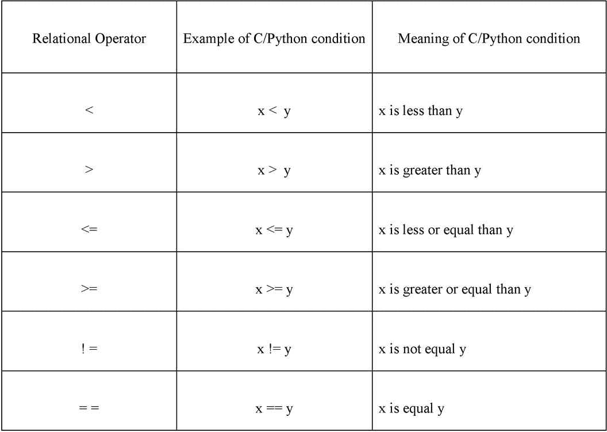

在 Python 中，关系运算符也称为比较运算符，[`docs.python.org/3/library/stdtypes.html#comparisons`](https://docs.python.org/3/library/stdtypes.html#comparisons)。

### 2. 布尔表达式

布尔表达式是一个求值为布尔值 `True` 或 `False` 的表达式。

在 Python 中，`True` 和 `False` 是内置常量，[`docs.python.org/3.1/library/constants.html`](https://docs.python.org/3.1/library/constants.html)。

在 Python 中，任何对象都有布尔值。对于我们目前为止介绍的数据类型，以下对象的值为 `False`：任何数值类型的零，例如 `0`、`0.0`；布尔内置常量 `False`；以及空字符串 `""` 或 `''`。（[`docs.python.org/3/library/stdtypes.html#truth-value-testing`](https://docs.python.org/3/library/stdtypes.html#truth-value-testing)）

在 C 中，每个数字都有一个布尔值：`0` 具有 `False` 布尔值，任何非零数字具有 `True` 布尔值。`char` 类型被视为一个 8 位整数，即字符对应的 ASCII 值。如果 ASCII 值为 `0`，则布尔值为 `False`，否则布尔值为 `True`。

### 3. 逻辑（布尔）运算符与布尔逻辑

数学符号：

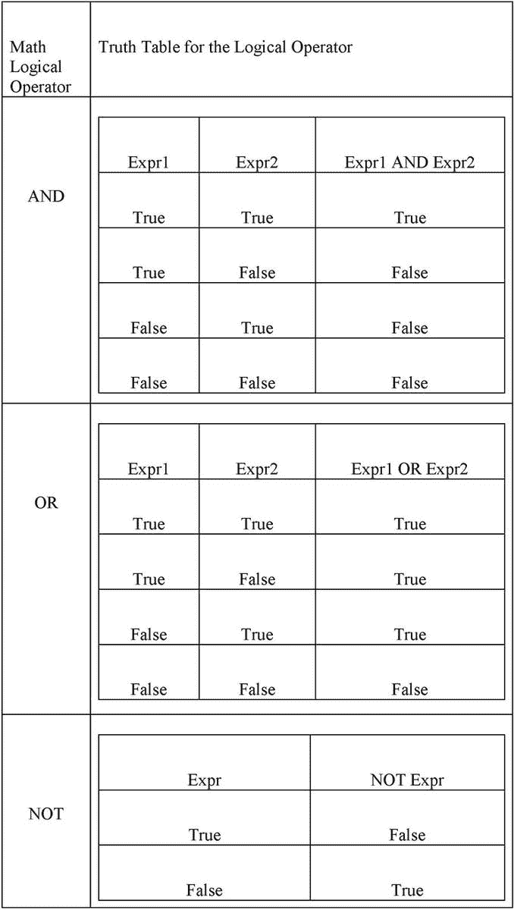

编程符号——按优先级升序排列的逻辑（布尔）运算符：

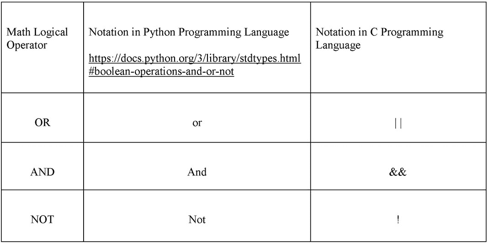

### 4. IF 语句

在 Python 编程语言中：

```python
if (expression):
    if_statements
```

在 C 编程语言中：

```c
if (expression) {
    if_statements;
}
```

工作原理：

1. 求值 `expression`。
2. 如果 `expression` 为 `TRUE`，则执行 `if_statements`；否则，当 `expression` 为 `FALSE` 时，跳过 `if_statements`，并将控制转移到 `if` 块之后的下一个语句。

Python 示例：

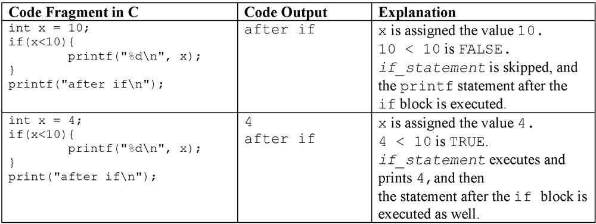

C 示例：

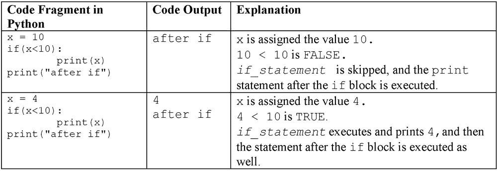

### 5. IF ELSE 语句

在 Python 编程语言中：

```python
if (expression):
    if_statements
else:
    else_statements
```

在 C 编程语言中：

```c
if (expression) {
    if_statements;
} else {
    else_statements;
}
```

工作原理：

1. 求值 `expression`。
2. 如果 `expression` 为 `TRUE`，则执行 `if_statements`，并将控制转移到 `if else` 块之后的下一个语句。
3. 否则，如果 `expression` 为 `FALSE`，则执行 `else_statements`，并将控制转移到 `if else` 块之后的下一个语句。

Python 示例：

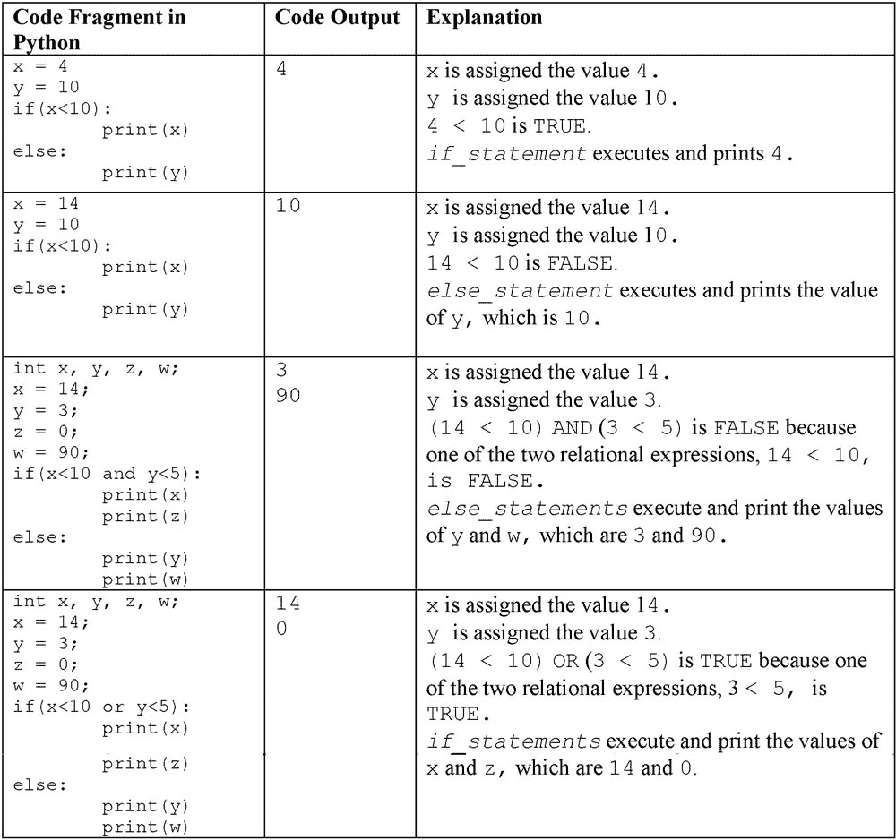

C 示例：


### 6. Python 中的 IF ELIF ELSE 语句和 C 中的 IF ELSE IF 语句

Python 中的 IF ELIF 语句：

```python
if (expression_1):
    statements_1
elif (expression_2):
    statements_2
elif (expression_3):
    statements_3
    ...
else:
    else_statements
```

C 中的 IF ELSE IF 语句：

```c
if (expression_1) {
    statements_1;
} else if (expression_2) {
    statements_2;
} else if (expression_3) {
    statements_3;
    /* 可以有多个 else if 语句 */
} else {
    else_statements;
}
```

工作原理：

1. 从 `expression_1` 开始逐一求值 `expressions`。
2. 当程序遇到某个 `expression` 为 `TRUE` 时，执行对应的 `statements`，跳过其他语句，并将控制转移到 `if else if` 块之后的下一个语句。
3. 如果没有 `expression` 为 `TRUE`，则执行 `else_statements`，并将控制转移到 `if else if` 块之后的下一个语句。

示例：


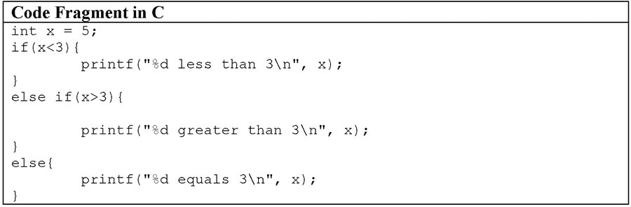


**注意**：在 C 语言中，当 `if`、`else` 或 `else if` 体内只有一个语句时，大括号是可选的。如果有多个语句，则需要大括号。见下文：


### 7. 嵌套决策结构

C 和 Python 两种编程语言都支持嵌套决策结构——放置在决策语句中的决策语句。

Python 示例：

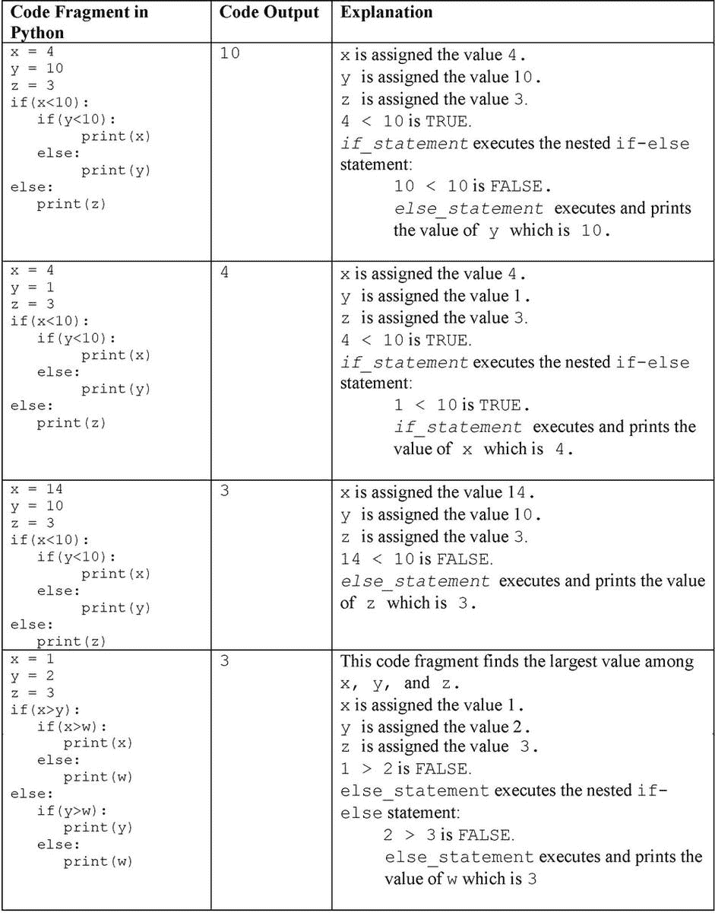

C 示例：


### 8. C 中的 SWITCH 语句（Python 没有 SWITCH 语句）

```c
switch (expression) {
    case case_constant:
        case_statements;
        break; /* 可选 */

    case case_constant:
        case_statements;
        break; /* 可选 */

    …
    /* 可以有任意数量的 case 语句 */

    default: /* 可选 */
        default_statements;
        break; /* 可选 */
}
```


## `switch` 语句

### 注意事项

a. `switch` 语句中的 `expression` 必须返回整数值（`int` 或 `char` 变量）。

b. `case` 常数（`case_constant`）必须与 `switch expression` 的类型相同。

### 工作原理

1. 求值 `switch expression`。
2. 将值从上到下与 `case_constants` 进行比较。
3. 当找到匹配 `switch expression` 的 `case_constant` 时，执行对应的 `case_statements`。由于 `break` 语句是可选的，通常情况下程序可以穿透 `case` 并执行多个 `case` 的语句，直到遇到 `break` 语句或到达 `switch` 语句的结束。
4. 如果没有 `case_constants` 匹配 `switch expression`，则执行 `default` 分支 `default_statements`（如果 `default` 分支存在）。

## II. Python 和 C 示例解决方案

### 问题 1

编写一个程序读取一个整数并检查输入是偶数还是奇数。程序打印适当的消息。

#### 讨论

**输入**：存储在 `num` 中的一个整数。

**输出**：指示输入是偶数还是奇数的消息。

**计算**：偶数是能被 2 整除的数，这意味着如果 `num` 是偶数，`num % 2` 为 0。使用 `if-else` 语句判断 `num % 2` 是否等于 0。

**输入限制**：输入数字为整数。

**输出限制**：无。

### 问题 2

输入：存储在 `num1`、`num2` 和 `num3` 中的三个整数。

输出：输入值中的最大值，存储在 `max_value` 中。

#### 计算版本 1

1. 使用 `if-else` 语句找到 `num1` 和 `num2` 之间的最大值并将结果存储在 `max_value` 中。
2. 使用 `if` 语句将 `max_value` 与 `num3` 进行比较，并在需要时更新 `max_value`。

#### 计算版本 2

1. 将 `num1` 赋值给 `max_value`。这是 `max_value` 的初始化。
2. 将 `num2` 与当前的 `max_value` 进行比较，并在需要时更新 `max_value`。
3. 将 `num3` 与当前的 `max_value` 进行比较，并在需要时更新 `max_value`。

**输入限制**：输入数字为整数。

**输出限制**：如果任意两个或三个数字相同，该算法仍能正常工作并打印正确的最大值，但程序不会打印任何描述这些特殊情况的消息。

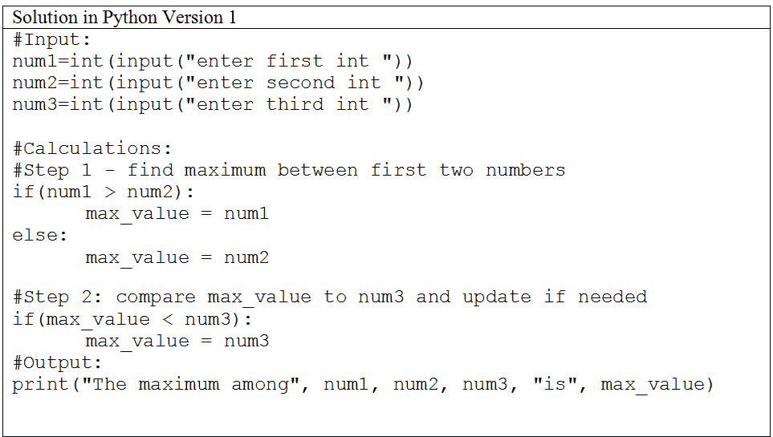

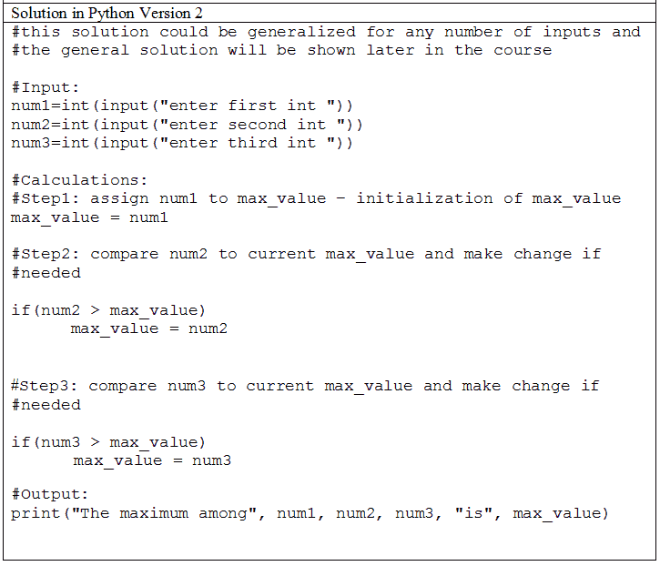


### 问题 3

储蓄账户根据存款金额有不同的利率。例如，在某银行，如果存款为 1000 美元或以下，利率为每年 1%，否则利率为每年 2%。编写一个程序，输入存款金额。程序首先检查输入是否有效。对于有效输入，程序计算并打印一年后你的储蓄账户中的金额。应用上述的利率规则。对于无效输入，程序打印错误信息。

#### 讨论

**输入**：存款金额，存储在 `deposit`，浮点值。

**输出**：一年后账户中的金额，存储在 `total`，浮点值。

**计算**：

1. 使用 `if-else` 语句根据存款金额确定利率。
2. 使用以下公式计算一年后账户中的总额：

   `total = deposit * (1 + rate / 100)`

**输入限制**：存款金额必须为正数，此限制可以在程序中使用 `if-else` 语句进行检查。

**输出限制**：输出必须格式化为两位小数，因为程序输出的是货币值。

**常量变量**：在这个问题中，有三个在问题描述定义的常量值：1000、1 和 2。在 C 中定义常量值，我们将继续使用 `const` 关键字。


### 问题 4

编写一个程序，读取学生某门课程的成绩，并根据以下规则判断学生是否通过了课程：60 分及以上为及格，60 分以下为不及格。假设成绩为整数。

#### 讨论

**输入**：学生成绩，存储在 `grade`，整数类型。

**输出**：指示学生通过或不及格的消息。

**计算**：使用 `if-else` 语句判断 `grade >= 60` 还是 `grade < 60`。

**输入限制**：成绩是整数且必须是非负，此限制可以在程序中使用 `if-else` 语句进行检查。

**输出限制**：无。

**常量变量**：这个问题在问题描述中定义了一个常量值：60。在 C 中定义常量值，我们将继续使用 `const` 关键字。


### 问题 5

一个拥有 100 万美元的宝箱有一个三位正整数锁。要打开箱子需要满足以下规则：

1. 第一位等于最后一位。
2. 中间位是奇数。

编写一个程序读取一个三位整数，如果数字能打开箱子则打印 `YES`，否则打印 `NO`。

#### 讨论

**输入**：存储在 `num` 中的三位整数。

**输出**：`YES` 或 `NO`。

**计算**：

1. 通过除以 10 和取模将输入数字拆分存储在 `first_digit`、`mid_digit`、`last_digit` 中。
2. 使用 `if-else` 语句检查 `first_digit == last_digit` 和 `mid_digit % 2 != 0`（奇数不能被 2 整除的数）。

**输入限制**：`num` 必须是三位数，此限制可以在程序中使用 `if-else` 语句进行检查（`num > 99` 且 `num < 1000`）。

**输出限制**：无。


### 问题 6

编写一个程序，读取一个整数（某课程的成绩），并根据下表打印该成绩的字母等级：


#### 讨论

**输入**：存储在 `grade` 中的一个整数。

**输出**：输入成绩的字母等级。

**计算**：使用 `if-else-if-else`（Python 中 `if-elif-else`）语句确定输入的范围和对应的字母等级。

**输入限制**：`grade` 必须是小于或等于 100 的非负数。此限制可以在程序中使用 `if-else` 语句进行检查（`num >= 0` 且 `num <= 100`）。

**输出限制**：无。

为了演示常见的逻辑错误，我们提供了一个错误的解决方案以及正确的解决方案，并解释了逻辑错误。


### 问题 7

某些信用卡在海外购买物品时收取交易费。费用通常在交易金额的 1% 到 3% 之间，并有一个最低固定费用。例如，如果国外交易费率为 2.5%，固定费用为 5 美元，购买金额为 100.67 美元，则总交易金额为 105.67 美元，因为 100.67 的 2.5% 为 2.52 美元，低于 5 美元的最低费用。编写一个程序，读取购买金额、国外交易费和最低固定费用，并计算总交易金额。

#### 讨论

**输入**：

1. 购买金额，存储在 `purchase`，浮点数。
2. 国外交易费率，存储在 `foreign_rate`，浮点值。
3. 固定费用，存储在 `flat_fee`，浮点值。

**输出**：总交易金额，存储在 `total`，浮点值，此外还有一条指示收取的是固定费用还是国外交易费百分比的消息。

**计算**：

1. 计算国外交易费金额。
2. 使用 `if/else` 语句比较百分比和固定费用，以确定必须收取哪一种。

**输入限制**：所有输入必须为正数。在程序中应使用 `if-else` 语句检查此限制。

**输出限制**：输出必须格式化为两位小数，因为程序输出的是金额值。


### 问题 8

在公历中，如果一个年份代表的数字能被 4 整除但不能被 100 整除，除非它能被 400 整除，否则就是闰年。因此，1996、1992、1988 等年份是闰年，因为它们能被 4 整除但不能被 100 整除。

对于世纪年份，400 规则至关重要。因此，世纪年份 1900、1800 和 1700 虽然都能被 4 整除，也能被 100 整除。由于它们不能进一步被 400 整除，所以它们不是闰年。另一方面，2000 年是闰年，因为它能被 4 和 100 整除，也能被 400 整除。

此外，你可以假设 1582 年之前没有闰年。编写一个程序，要求用户输入年份，并计算该年份是否为闰年。

#### 示例

- 输入：1980；输出：Leap Year（闰年）
- 输入：1900；输出：Not a Leap Year（不是闰年）
- 输入：1200；输出：Not a Leap Year（不是闰年）
- 输入：2000；输出：Leap Year（闰年）
- 输入：3000；输出：Not a Leap Year（不是闰年）

#### 讨论

**输入**：存储在 `year` 中的一个整数。

**输出**：指示输入是否为闰年的消息。

**计算**：使用 `if-else-if-else` 语句检查以下条件：

1. 1582 年之前的年份不是闰年。
2. 对于 1582 年及以上的年份，能被 4 整除且不能被 100 整除的年份是闰年，能被 400 整除的年份也是闰年，否则该年份不是闰年。

**输入限制**：`year` 必须是非负数，程序中应使用 `if-else` 语句检查此限制。

**输出限制**：无。


### `SWITCH` 语句示例

### 问题 9

为一个在线/手机银行系统编写菜单。该菜单包括以下选项：存款、取款、转账和退出菜单。程序读取一个字符并打印与输入字符对应的操作描述。

我们假设存款由字母 `D` 表示，取款由字母 `W` 表示，转账由字母 `T` 表示，退出由字母 `E` 表示。仅允许 `D`、`W`、`T` 和 `E`。对于任何其他字符，程序打印错误信息。

#### 讨论

**输入**：代表菜单选择的字符，`choice`。

**输出**：描述与输入字符对应的银行操作的消息，或错误信息。

**计算**：在 Python 中使用 `if-elif-else` 语句，在 C 中使用 `switch` 语句。

**输入限制**：无。

**输出限制**：无。


### 问题 10

编写一个程序，读取一个整数 `month` 并打印该月份的天数。

#### 讨论

**输入**：存储在 `month` 中的代表月份的整数：1 月为 1，2 月为 2，12 月为 12。

**输出**：该月份的天数。对于 2 月，程序打印 28 或 29；不需要检查是否为闰年。

**计算**：在 C 中使用 `switch` 语句，在 Python 中使用 `if-elif-else` 语句。

**输入限制**：输入必须是 1 到 12 之间的整数。程序中应使用 Python 的 `if-else` 语句或 C 语言的 `switch` 语句检查此限制。

**输出限制**：2 月的输出不会指定具体的天数，因为该程序不检查闰年。要输出 2 月的准确天数，此程序可以与问题 8 结合，但需要额外的年份数据。


### 问题 11

编写一个程序，读取一个整数 `month` 并打印该月份的天数。

编写一个程序，读取一个整数和一个运算符（字符），并执行相应的操作。仅允许加、减、乘、除和取模（`+`、`-`、`*`、`/`、`%`）。对于任何其他运算符，程序打印错误信息。对于除法和取模，程序检查输入的有效性（不允许除零）。

#### 讨论

**输入**：存储在 `num1` 和 `num2` 中的两个整数，以及代表算术运算符的字符 `operator`。

**输出**：算术结果或错误信息。

**计算**：在 Python 中使用 `if-elif-else` 语句，在 C 中使用 `switch` 语句。

**输入限制**：对于除法和取模（`/` 和 `%`），程序检查 `num2` 不等于零以避免除零错误。

**输出限制**：无。


### 问题 12

一家超市销售易腐食品和非易腐食品。商店里的每件商品都有条码，这是一个 9 位正整数。易腐物品的条码以 3、4 或 7 结尾。编写一个程序，读取一个整数（单个商品的条码），并检查该商品是否易腐。程序打印适当的消息。

#### 讨论

**输入**：存储在 `barcode` 中的 9 位整数。

**输出**：消息：`PERISHABLE`（易腐）或 `NONPERISHABLE`（非易腐）。

**计算**：

1. 使用取模运算符找到最后一位。
2. 检查最后一位是否等于 3、4 或 7。

在 Python 中，我们将使用 `if-else` 语句。在 C 中，可以使用 `if-else` 或 `switch` 语句。在本示例中，我们将展示如何使用 C 语言的 `switch` 语句。

**输入限制**：代表条码的数字必须在 100000000 到 999999999 之间（包含边界）。程序中应检查此限制。

**输出限制**：无。


### 问题 13

编写一个程序读取三个代表日期的整数：月、日、年。程序打印下一个日期。例如，如果输入 3 30 2015（2015 年 3 月 30 日），输出为 3 31 2015（2015 年 3 月 31 日），而如果输入 12 31 2016（2016 年 12 月 31 日），输出为 1 1 2017（2017 年 1 月 1 日）。注意，程序先打印月份，然后是日和年。

#### 讨论

**输入**：存储在 `month`、`day` 和 `year` 中的代表日期的三个整数。

**输出**：代表下一个日期的三个整数。

**计算**：在 C 语言中使用 `switch` 语句，在 Python 中使用 `if-elif-else` 语句。首先，确定输入月份的天数（类似于之前的程序），然后判断输入的日期是否为该月的最后一天，并确定输入的月份是否为年的最后一个月份。

**输入限制**：代表月份的数字必须在 1 到 12 之间，日的数字必须为正且与对应的月份对应，年份的数字必须为正。在程序中我们使用标记变量 `input_valid` 来检查输入的有效性。标记变量是一个布尔变量，在程序开始时赋值为 `True`（C 语言中为 1），一旦遇到无效输入立即变为 `False`（C 语言中为 0）。

**输出限制**：无。


## 问题 14

许多公司正在使用名为 IVR（交互式语音响应）的自动电话系统。在许多情况下，这些系统会重复客户的选择，并在转接电话之前请求额外确认。编写一个程序为一家提供电视、互联网和电话服务的电缆公司模拟一个简单的系统。菜单选项如下表所示。对于“退出”（Exit）之外的所有主菜单选项，都要包含重复功能。假设所有客户都拥有所有三种服务，每月费用为 $199.99。此外，假设确认时，`Y` 表示“已确认”，任何其他字符表示“未确认”。

### 讨论

#### 输入

1. 表示主菜单选择的整数，存储在 `main_choice` 中。
2. 表示二级菜单选择的整数，存储在 `second_choice` 中。
3. 表示付款金额的浮点数，存储在 `payment` 中（当 `main_choice` 为 2 时）。
4. 确认主菜单或二级菜单选择的字符，存储在 `confirm` 中。

**输出**：描述菜单选择或账户余额的消息，或错误信息；对于主菜单，表示确认选择的消息。

#### 计算

在 Python 中使用 `if-elif-else` 语句，在 C 语言中使用 `switch` 语句。

#### 输入限制

付款金额必须为正数。

#### 输出限制

无。

### 常量变量

在该问题中，有一个在描述中定义的常量值：199.99。在 C 语言中定义常量值，我们将继续使用 `const` 关键字。


## III. 练习题

为了练习，所有程序应明确说明输入/输出。按照第一章的指南识别输入和输出。

1. 编写读取一个整数的程序。检查输入是否被 3 整除。
2. 编写读取两个整数的程序并找到最大值。
3. 编写读取两个整数的程序并检查第一个输入是否能被第二个输入整除。
4. 编写读取一个整数的程序，不使用内置函数找到其绝对值。
5. 编写读取三位正整数的程序。检查至少有一位数字等于 3。
6. 编写一个收银机程序计算客户应收到的找零金额。读取商品价格、购买数量和支付金额。
7. 大多数国家使用限速规定车辆在特定道路上的合法行驶最高速（某些情况下为最低限速）。编写一个读取最高限速、最低限速和车速的程序。检查车辆是否在限速范围内。
8. 编写读取一个整数并打印相应星期几的程序。1 代表星期日，2 代表星期一，7 代表星期六。
9. 编写读取数轴上三个点坐标的程序。找到位于另外两点的点。
10. 编写求解方程 `a * x + b = 0` 的程序。读取方程系数 `a` 和 `b`，并输出解或无解/无限解的消息。
11. 编写读取三个正数作为边长的程序。检查这三个数是否能组成有效的三角形。
12. 编写读取两个整数作为直角坐标系中点的程序。找到该点在直角坐标系中的轴或象限。
13. 编写读取三位正整数的程序。检查数字是否为回文数。回文数是指反转后保持相同的数字。例如，575 和 212 是回文数。
14. 编写一个支持表格列出操作的菜单程序。程序首先读取对应操作的字符，然后根据操作要求用户额外输入。仅允许下述操作。对于其他字符，程序打印错误信息。
15. 编写一个读取国家名称首字母和整数分钟数的程序，并根据以下每分钟费率计算到该国的长途电话费用：
16. 编写一个程序根据购买的万圣节糖磅数找到折扣率，并计算糖的总成本，考虑到某些情况下需要缴税而某些情况下不需要。税费适用于折扣后的价格。程序读取以下输入：磅数、单价、税率和一个额外的整数税率标记（必须为 1 或 0，1 表示需要缴税，0 表示不需）。使用下表计算总费用。表格显示了根据购买磅数的折扣率。程序打印折扣率和最终总费用。

### 折扣率


#### 示例 1

**输入**：磅数 = 7，单价 = 3.99，税 = 6，税率标记 = 1

**输出**：$26.65

**输出解释**：你买了 7 磅，获得了 10% 的折扣，且购买需要缴纳 6% 的税。最终价格为 $26.65。

#### 示例 2

**输入**：磅数 = 15，单价 = 2.99，税 = 7，税率标记 = 0

**输出**：$35.88

**输出解释**：你购买了 15 磅商品，获得了 20% 的折扣，且该笔购买**不征税**。最终价格为 $35.88。

### 问题 17

有一个装有 100 万美元的宝箱。宝箱有一个 5 位组合锁，在满足以下条件下打开：

1. 第一位必须等于第五位。
2. 第二位必须是奇数。
3. 第三位和第四位数字的积必须被 7 整除。

编写一个程序，读取一个 5 位正整数，并检查输入的数字是否能打开宝箱。如果宝箱打开，输出 `YES`，否则输出 `NO`。

### 问题 18

在大多数情况下，批量购买比购买小包装食品便宜，但并非总是如此。编写一个程序，读取批量购买的每磅单价、小包装的（浮点数，例如 0.5 磅包装）以及包装的价格。程序将找出并打印哪种方案每磅更便宜，或者通知用户两种方案的每磅价格相同。

例如，批量购买有机藜每磅花费 5.99，一包 2.5 磅的包装价格为 12.90。在这种情况下，购买包装更便宜，因为包装版本的每磅价格为 5.16，小于批量购买的 5.99 价格。

例如：批量购买的杏仁每磅花费 7.99，一包 3/4 磅的包装价格为 6.99。在这种情况下，批量购买更便宜，因为一磅包装杏仁将花费 9.32。

例如：批量购买的火腿每磅花费 10，一个 2 磅的包装花费 20。在这种情况下，两种方案的价值相等。

注意，在测试你的程序时，请测试第三种方案，并输入整数以避免浮点数舍入引起的问题。

### 问题 19

编写一个程序，计算在公路上超速行驶的保险积分，以及获得积分后下一个保险期的每月保险缴费。该程序读取公路的最高限速、汽车的当前速度以及目前的每年度保险费用。你可以假设所有输入均为整数。程序必须打印以下信息：积分数量或说明状态的消息（无积分/执照吊销）、保险费增加的百分比、新的年度保费和新的月缴金额。请使用下表：

#### 超速积分表与年度保险费增长率


### 问题 20

编写一个程序，计算两个不同的人在公路上超速将获得的保险积分。公路的最高限速为 65 mph。你可以假设速度为整数。使用下表：

#### 超速积分表


### 问题 21

编写一个程序，计算歌曲比赛的最终得分。比赛中有 4 位评员。

#### 评分规则

- 每位评员为歌曲提交一个分数。假设分数为整数，可以是正数，也可以是负数，并可以是零。
- 计算最终得分：舍弃最高分，将最低分平方，然后计算平均分。

### 问题 22

编写一个程序，计算一个 4 人家庭的游乐园门票总费用。输入：全票价（整数）、每个家庭成员的年龄（整数）、税率（整数）。输出：考虑所有折扣和税费后的总价。税费应用于折扣后的总额。

#### 票价规则

a. 6 岁以下儿童：免费。

b. 6—10 岁：50% 折扣。

c. 11—13 岁：25% 折扣。

d. 14—18 岁：10% 折扣。

e. 成人：全票价。

### 问题 23

一家公司想要通过电话线传输数据，但他们担心线路被窃听。他们所有的数据都以四位整数的形式传输。他们决定按如下方式对四位数字加密：

1. 他们将每个数字替换为 `((digit + 7) mod 10)`。
2. 然后将第一位与第三位交换，第二位与第四位交换。

生成的四位数字即为加密数字。要解密该数字，应应用反向步骤（你需要推导出算法）。编写一个可以执行加密或解密的程序。该程序必须接受两个输入。第一个输入必须是 1 或 2，其中 1 表示加密，2 表示解密。第二个输入是一个小于 10,000 的正整数，它将根据第一个输入进行加密或解密。

### 问题 24

编写一个程序，计算歌曲比赛的最终得分。比赛中有 4 位评员。

## 测验答案

### 1

**输入示例**：`a = 5, b = 6`

**解释**：

`a + b = 11`

`11 > 10` 为真（TRUE）。

`if_statement` 执行，打印 hello。

通常情况下，`a` 和 `b` 可以是任意两个和大于 10 的整数。

### 2

**输入示例**：`a = 123, b = 2677`

**解释**：

`k = 123 % 10 + 2677 % 10 = 3 + 7 = 10`

`10 % 2 = 0`，`0` 代表假（FALSE）。

`else_statement` 执行，打印 python。

通常情况下，`a` 和 `b` 可以是任意两个末位均为偶数或均为奇数的整数。

### 3

**输入示例**：`a = 2, b = 0`

**解释**：

`2 % 3 = 2`

`2 >= 2` 为真（TRUE）。

`if_statement` 执行，打印 hello。

`2 + 0 = 2`

`5 // 2 = 2`

`2 != 2` 为假（FALSE）。

`else_statement` 执行，打印 python。

`a = 2`

`2 % 3 = 2`

`2 == 2` 为真（TRUE）。

`if_statement` 执行，打印 hello。

这是唯一可能的输入。

### 4

输入不存在。

**解释**：变量 `a` 的值在最后一个 `if-else` 语句中被确定。在这种情况下，为了打印 hello，`a` 的值必须是 `2`，因为 `2 % 3` 等于 `2`。为了在第一个 `if-else` 语句中打印 python，表达式 `a % 3 >= 2` 必须为假（FALSE），而这是不可能的，因为 `a = 2`。

### 5

hello

**解释**：

`17 % 5 = 2`

`2 > 5` 为假（FALSE）。

`17 % 2 = 1`

`1` 具有真值（TRUE）。

`FALSE or TRUE = TRUE`

`if_statement` 执行，打印 hello。

### 6

hello

**解释**：

`6 % 2 = 0`，为假（FALSE）。

`17 > 5`，为真（TRUE）。

`d = FALSE and TRUE = FALSE`

`if_statement` 执行，打印 hello。

### 7

program

**解释**：

`c % 4 = 6 % 4 = 2`，为真（TRUE）。

`a < b = 17 < 5`，为假（FALSE）。

`not(17) = not(TRUE) = FALSE`

`d = (TRUE and FALSE) or FALSE = FALSE`

`c % 2 = 6 % 2 = 0`，为假（FALSE）。

`else_statement` 执行，打印 program。

# V. 第 2 章附录 2：C 样例测验

## 测验题

### 1

针对以下代码片段：

```c
```


`int a, b;`

`scanf("%d%d", &a, &b);`

`if(a + b > 10)`

`printf("hello\n");`

`else`

`printf("C programming\n");`

给出一个输入示例，以获得以下输出：`hello`

2. 针对以下代码片段：

```c
int a, b, k;

scanf("%d%d", &a, &b);

k = a%10 + b%10

if(k%2)

printf("hello\n");

else

printf("C programming\n");
```

如果存在，给出一个输入示例，以获得以下输出：`C programming`

3. 针对以下代码片段：

```c
int a, b;

scanf("%d%d", &a, &b);

if(a % 3 >= 2)

printf("hello\n");

else

printf("C programming\n");

if((a + b) != (5/2))

printf("hello\n");

else

printf("C programming\n");

if(a == (2%3))

printf("hello\n");

else

print("C programming\n");
```

如果存在，给出一个输入示例，以获得以下输出：
`hello`
`C programming,hello`

4. 针对上一个示例中的代码片段，如果存在，给出一个输入示例，以获得以下输出：
`C programming`
`C programming,hello`

5. 下列代码片段的输出是什么？

```c
int a = 17, b = 5;

if((a % b > 5) || (a % 2))

printf("hello\n");

else

printf("C programming\n");
```

6. 以下代码片段的输出是什么？

```c
int a = 17, b = 5, c = 6;

if(!(c % 2 && a > b))

printf("hello\n");

else

printf("C programming \n");
```

7. 以下代码片段的输出是什么？

```c
int a = 17, b = 5, c = 6;

d = ((c%4) and (a<b)) or (not(a))

if(c % 4 && a < b || !(a))

printf("hello\n");

else if(c % 2)

printf("C\n");

else:

printf("program\n");
```

8. 以下代码片段的输出是什么？

```c
char choice = 'D';

switch(choice){

case 'A':

printf("1\n");

break;

case 'B':

printf("2\n");

break;

case 'C':

printf("3\n");

break;

case 'D':

printf("4\n");

default:

printf("bye\n");

break;

}
```

9. 以下代码片段的输出是什么？

```c
int a = 13, b = a % 3;

switch(b){

case 0:

printf("%d\n", b);

case 1:

printf("%d\n", b);

case 2:

printf("%d\n", b);

default:

printf("bye\n");

break;

}
```

## 测验答案

1. 输入示例：`a = 5, b = 6`
解释：
`a + b = 11`
`11 > 10` 为真 (TRUE)
`if_statement` 执行，打印 `hello`
通常情况下，`a` 和 `b` 可以是任意两个和大于 10 的整数。

2. 输入示例：`a = 123, b = 2677`
解释：
`k = 123 % 10 + 2677 % 10 = 3 + 7 = 10`
`10 % 2 = 0`, `0` 代表假 (FALSE)
`else_statement` 执行，打印 `programming`。
通常情况下，`a` 和 `b` 可以是任意两个末位均为偶数或均为奇数的整数。

3. 输入示例：`a = 2, b = 0`
解释：
`2 % 3 = 2`
`2 >= 2` 为真 (TRUE)
`if_statement` 执行，打印 `hello`。
`2 + 0 = 2`
`5 // 2 = 2`
`2!=2` 为假 (FALSE)
`else_statement` 执行，打印 `programming`。
`a = 2`
`2 % 3 = 2`
`2 == 2` 为真 (TRUE)
`if_statement` 执行，打印 `hello`。
这是唯一可能的输入。

4. 输入不存在。
解释：变量 `a` 的值在最后一个 `if-else` 语句中被确定。在这种情况下，为了打印 `hello`，`a` 的值必须是 `2`，因为 `2 % 3` 等于 `2`。为了在第一个 `if-else` 语句中打印 `programming`，表达式 `a % 3 >= 2` 必须为假 (FALSE)，而这是不可能的，因为 `a = 2`。

5. `hello`
解释：
`17 % 5 = 2`
`2 > 5` 为假 (FALSE)
`17 % 2 = 1`
`1` 具有真值 (TRUE)
`FALSE or TRUE = TRUE`
`if_statement` 执行，打印 `hello`。

6. `hello`
解释：
`6 % 2 = 0`, 为假 (FALSE)
`17 > 5`, 为真 (TRUE)
`d = FALSE and TRUE = FALSE`
`if_statement` 执行，打印 `hello`。

7. `program`
解释：
`c % 4 = 6 % 4 = 2`, 为真 (TRUE)
`a < b = 17 < 5`, 为假 (FALSE)
`not(17) = not(TRUE) = FALSE`
`d = (TRUE and FALSE) or FALSE = FALSE`
`c % 2 = 6 % 2 = 0`, 为假 (FALSE)
`else_statement` 执行，打印 `program`。

8. `4`
`bye`
解释：`choice` 为 `'D'`。`switch` 语句匹配到 `case 'D'`，打印 `4`，然后进入 `default` 输出 `bye`。

9. `1`
`2`
`bye`
解释：`a = 13`, `b = 13 % 3 = 1`。`switch` 语句匹配到 `case 1`，打印 `1`，由于没有 `break`，继续执行 `case 2` 打印 `2`，继续执行 `default` 打印 `bye`，最后 `break`。

# 第 3 章：循环

## I. 概述
循环是允许程序多次执行代码块的控制流语句。C 支持三种循环：`while`、`for` 和 `do-while`。Python 支持两种循环：`while` 和 `for`。两种语言都支持嵌套循环：循环中的循环。

### 1. Python 中的循环

#### i. WHILE 循环
Python 中的 `while` 循环在指定条件为真时重复执行语句块。

语法：

```python
while expression:

    loop body
```

循环语句的每次重复执行被称为一次迭代。

工作原理：
`loop body` 在 `expression` 为真时重复执行。

注意：
1. `loop body` 可以由单个语句或多个语句组成。
2. `expression` 是任意具有布尔值的表达式。记住：在 Python 中，所有数字都有布尔值：`0` 为假，任何非零数字为真。
3. 在每次迭代开始前检查 `expression`。
4. 如果 `expression` 永远为真，则为无限循环。
5. 如果 `expression` 在循环开始时为假，循环立即终止，不执行 `loop body`，并传递到程序中的下一个语句。

示例：

```python
count = 0

while count < 3:

    print(count)

    count += 1
```

输出：

```text
0

1

2
```

#### ii. FOR 循环
Python 中的 `for` 循环用于迭代序列（如列表、字符串等）。

```python
for item in sequence:

    loop body
```

`for` 循环会遍历序列中的每个元素并执行 `loop body`。

示例：
- 使用 `range()` 函数：

```python
for i in range(3):

    print(i)
```

输出：

```text
0

1

2
```

- 遍历列表：

```python
for fruit in ["apple", "banana", "cherry"]:

    print(fruit)
```

输出：

```text
apple

banana

cherry
```

Python 中的 `for` 循环按照元素在序列中出现的顺序遍历任何序列的项，并执行一个语句块，直到迭代序列耗尽。`range()` 函数可用于遍历一个数字序列。

`range(n)` 函数生成序列 `0`、`1`……`n-1`。给定的端点 `n` 永远不会包含生成的序列中。可以让 `range` 从另一个数字开始，或者指定一个不同的增量（`step`）。通用形式为 `range(start, end, step)`。

- [for 语句说明](https://docs.python.org/3/tutorial/controlflow.html#for-statements)
- [range 函数](https://docs.python.org/3/tutorial/controlflow.html#the-range-function)

### 示例：


在本章中，我们只考虑使用 `range()` 函数遍历数字序列的 `for` 循环示例。

### FOR 循环语法：

```python
for i in range(start, end, step):

    loop body statement(s)
```

### 示例


#### iii. Python 中的嵌套循环

Python 支持嵌套循环结构——在一个循环内部另一个循环。嵌套循环的深度取决于问题。任何类型的循环都可以放在另一个循环内部。

### 示例：


### 2. C 语言中的循环

#### i. WHILE 循环

C 中的 `while` 循环只要指定的条件为真，就会重复执行一个语句块。

#### 语法：

```c
while(expression){

    loop body statement(s);

}
```

循环体语句(s)的每次重复执行被称为一次迭代。

#### 工作原理：

当 `expression` 为真时，`loop body statements` 会重复执行。

#### 注意：
1. C 中的 `while` 循环工作方式与 Python 中的完全相同；唯一的区别是语法略有不同。
2. `Loop body` 可以由单个语句或多个语句组成。在单个语句的情况下，大括号是可选的。
3. `Loop expression` 可以是任何具有布尔值的表达式。在 C 中，所有数字都有布尔值：`0` 具有假布尔值，任何非零数字都具有真布尔值。
4. 如果 `expression` 永远不为假，则循环是无限循环。
5. 如果 `expression` 在循环开始时具有假布尔值，则循环立即终止，`loop body statements` 不执行，控制直接传递到下一个语句。

#### 示例：


#### 追踪程序


#### ii. DO WHILE 循环

`do while` 循环只要指定的条件为真，就会重复执行语句块。`do while` 循环与 `while` 循环非常相似，区别在于 `do while` 循环至少执行一次。

#### 语法：

```c
do {

    loop body

} while(expression);
```

#### 工作原理：

`loop body` 在 `expression` 为真时重复执行。

#### 示例：


下面的 **do while** 代码要求用户输入的数字在 0 到 100 之间（包含）。使用 `do while` 循环可以确保输入是有效的。

#### iii. FOR 循环

C 中的 `for` 循环只要指定的条件为真，就会重复执行语句块。`for` 循环与 `while` 循环逻辑相似，但语法不同。

#### 语法：

```c
for(initialization; expression; loop value update){

    loop body

}
```


#### 工作原理：

1. `initialization` 语句在循环开始前执行一次。
2. `expression` 被求值。如果它为真，则执行`loop body`，然后跳转到`loop value update`语句。
3. `loop body`和`loop value update`语句在`expression`为真时重复执行。
4. 当`expression`变为假，循环结束并跳转到下一个语句。

b. 循环表达式可以是任何具有布尔值的表达式。*记住：*在 C 语言中，所有数字都有布尔值：`0`具有 False 布尔值，任何非零数字都具有 True 布尔值。`char`类型被视为一个 8 位整数：即字符对应的 ASCII 值。如果 ASCII 值为`0`，则布尔值为 False；否则，布尔值为 True。

c. 如果表达式从不为 False，则循环为死循环。

d. 如果表达式在循环执行开始时具有 False 布尔值，则循环立即终止，循环体语句将完全不执行，控制权传递到程序中的下一条语句。

e. 循环`while`和`for`总是可以互换的：

```c
for(initialization; expression; loop value update){

    loop body statement(s);

}
```

等价于：

```c
initialization;

while(expression){

    loop body statement(s);

    loop value update;

}
```

**示例：** 编写代码片段，使用`while`循环和`for`循环计算`2¹⁰`。


## 哨兵和计数控制循环

所有的循环可以分为大类：计数控制重复和哨兵控制重复。问题的逻辑结构决定将实现何种类型的循环。`while`、`do while`和`for`循环可以是计数控制重复。

在**计数控制**循环中，迭代次数在循环执行之前是已知的。在这种情况下，循环由计数变量控制，表达式检查计数变量是否已达到某个预定的值，更新语句则增加或递减计数变量。

示例：


在**哨兵控制**循环中，迭代次数预先未知。在这种情况下，循环由哨兵值控制，哨兵是一个用于终止循环执行的特殊值。

示例：


建议在计数控制重复的情况下使用`for`循环，在哨兵控制重复的情况下使用`while`循环。

#### iv. C 中的嵌套循环

C 支持嵌套循环结构——循环内部另一个循环。嵌套循环的深度取决于问题。任何类型的循环都可以放在另一个循环内部。

示例：


#### v. C 中的 break 语句

某些情况下需要立即终止循环执行，而不检查表达式，且无论表达式的值如何。为了实现这种逻辑行为，C 支持`break`语句，它可以用于 C 中所有三种类型的循环：`while`、`do while`和`for`。在嵌套循环中使用`break`语句也是可以的。

语法：

```c
break;
```


## 工作原理

1. 当遇到 `break` 语句时，它会立即终止循环，程序控制从循环后的下一条语句恢复。
2. 在嵌套循环中，`break` 语句会终止最近的包含循环并将控制权传递给外层循环。在嵌套循环的情况下，`break` 语句不会终止整个嵌套循环，只终止包含 `break` 语句的那个循环。注意：建议不要使用 `break` 语句，而是使用标志变量来实现相同的逻辑。

### 示例

1. 编写一个代码片段计算毕业平均分。假设学生修了 10 门课程，代码片段读取每门课程的成绩并计算最终平均分。为了毕业，所有成绩必须及格（等于 60 分）。如果至少有一个成绩低于 60 分，学生将无法毕业且不会计算平均分。在这种情况下将打印相应的消息。下方使用 `break` 语句的 `while` 循环和 `for` 循环实现。不及格时循环终止，`sum` 重置为 `0`。循环后的后续语句检查 `sum` 是否为零，并打印结果。


为了比较，参见使用 `flag` 变量的 `while` 循环和 `for` 循环。


## II. Python 和 C 示例

### 问题 1：打印 1 到 100 之间所有被 7 整除的整数

**讨论：**

- 输入：无。
- 输出：1 到 100 之间被 7 整除的整数序列。
- 计算：使用循环结构对于 1 到 100 之间的每个数字，使用 `mod` 运算符检查是否能被 7 整除。这是一个计数控制重复，因为我们需要检查 1 到 100 之间的所有数字，迭代次数（100）是预先已知的。首选的循环结构是 `for` 循环。
- 输入限制：无。
- 输出限制：无。
- 常量变量：在该问题中定义了常量值：1（下限）和 100（上限）。在 C 中我们将使用 `const` 关键字来定义常量值。


### 问题 2：统计两个输入整数之间被 7 整除的整数个数

**讨论：**

- 输入：存储在 `limit1` 和 `limit2` 中的两个整数。
- 输出：`limit1` 和 `limit2` 之间被 7 整除的整数个数，存储在 `counter` 中。
- 计算：使用循环结构对于 `limit1` 和 `limit2` 之间的每个数字，使用 `mod` 运算符检查是否能被 7 整除，并更新 `counter`。注意：如果 `limit1 > limit2`，交换值。这是一个计数控制重复。由于我们需要检查 `limit1` 到 `limit2` 之间的所有数字，迭代次数是预先已知的且等于 `abs(limit1 - limit2) + 1`（`abs` 表示绝对值）。首选的循环结构是 `for` 循环。
- 输入限制：无。
- 输出限制：如果在指定范围内没有被 7 整除的数字，程序将打印相应的消息。


### 问题 3：统计以 `-1` 终止的整数序列长度

**讨论：**

- 输入：整数序列，当前输入数字存储在 `num` 中。
- 输出：不包括终止符的整数个数。
- 计算：使用循环结构重复输入，直到输入 `-1`。

这是一种哨兵控制的循环。迭代次数未知，取决于输入。

首选的循环结构是 `while` 循环。

- 输入限制：注意：第一个输入必须在循环之前完成。
- 输出限制：如果为 0，考虑打印消息：空序列。


### 问题 4：计算正整数各位数字之和

#### 讨论

- 输入：正整数，存储在 `num` 中。
- 输出：输入数字的各位之和，存储在 `sum` 中，整数类型。
- 计算：使用循环结构重复提取最后一位数字（`mod 10`）并截断输入数字（整数除以 10），直到其变为零。

这是一种哨兵控制的循环，因为迭代次数预先未知且取决于输入。迭代次数等于输入数字的位数。首选的循环结构是 `while` 循环。

- 输入限制：无，如果输入为负数，程序将使用输入的绝对值进行运行。
- 输出限制：无。


### 问题 5：打印正整数的反转数字

#### 讨论

- 输入：正整数，存储在 `num` 中。
- 输出：反转后的数字。
- 方案 1：逐位打印反转数字。
- 方案 2：先计算反转数字，然后将其打印。
- 计算：在两种方案中，都使用循环结构，重复提取最后一位数字（`mod 10`）并截断输入数字（整数除以 10），直到其变为零。在方案一中，打印下一个数字。在方案二中，使用相应的 10 的幂来累加构建反转数字之和。在两种方案中，处理都从最后一位开始。

这是一种哨兵控制的循环，因为迭代次数预先未知且取决于输入。迭代次数等于输入数字的位数。首选的循环结构是 `while` 循环。

- 输入限制：我们假设输入是有效的：正整数。
- 输出限制：在 Python 中，为了在方案 1 中在同一行打印数字，请在 `print` 语句中使用 `end`。


### 问题 6：查找整数序列中的最小值和最大值

#### 讨论

- 输入：输入序列的大小，存储在变量 `size` 中，紧接着是 `size` 个整数，当前整数存储在变量 `num` 中。
- 输出：最大值和最小值，存储在 `max` 和 `min` 中。
- 计算：
  - 初始化：将第一个输入数字赋值给 `max` 和 `min`。
  - 使用循环结构，重复读取下一个输入数字，与当前的 `max` 和 `min` 进行比较，并在需要时替换。这是一种计数控制的循环，因为迭代次数预先已知且等于 `size`。迭代次数等于输入的数量。首选的循环结构是 `for` 循环。
- 输入限制：`size` 必须为正数，可以在程序中使用 `if-else` 语句进行检查。
- 输出限制：无。


### 问题 7：计算课程平均分

#### 讨论

- 输入：学生人数，存储在 `num_stud` 中（整数类型），以及每个学生的成绩，存储在变量 `grade` 中。
- 输出：课程平均分，存储在 `average` 中（双精度类型）。
- 计算：使用循环结构，重复读取每个学生的 `grade` 并累加总分。循环结束后，计算平均分 `sum/num_stud`。这是一种计数控制的循环，因为迭代次数预先已知且等于 `num_stud`。迭代次数等于学生人数。首选的循环结构是 `for` 循环。
- 输入限制：在本示例中我们假设输入是有效的，`num_stud > 0` 且 `grade >= 0` 且 `grade <= 100`。
- 输出限制：平均分必须是浮点或双精度类型。


### 问题 8：查找最小值及其位置

编写一个程序读取一个整数序列。当输入 `100` 时序列终止。该程序找到最小值及其在序列开头和末尾的位置。假设输入不。例如，如果输入是 `8 4 -1 3 9 -2 10 6 100`，输出为 `-2`（最小值）、`6`（最小值在开头的位置）和 `3`（最小值在序列末尾的位置）。注意：`100` 不是序列的一部分，因为它是一个终止值。

#### 讨论

- 输入：整数序列。当前整数存储在变量 `num` 中。
- 输出：最小值，存储在 `min` 中；它在序列开头的位置，存储在 `from_start` 中；以及在序列末尾的位置，存储在 `from_end` 中。
- 计算：
  - 初始化：将第一个输入数字赋值给 `min`，从开头的位置 `from_start` 赋值为 1。此外，由于序列不为空，输入次数将存储在变量 `total` 中，初始值为 1。
  - 使用循环结构，重复读取输入数字，与当前的 `min` 值进行比较，在需要时替换，并更新 `from_start` 值，同时增加用于更新 `from_start` 的 `total` 值。循环完成后，计算 `from_end = total - from_start`。注意：`100` 不被视为序列的一部分，不计入序列元素的总数。

这是一种哨兵控制的循环，因为迭代次数预先未知且取决于用户输入。迭代次数等于输入次数。首选的循环结构是 `while` 循环。

- 输入限制：输入序列不为空。
- 输出限制：无。


### 问题 9：查找大于上限的最小值

编写一个程序首先读取两个整数 `n` 和 `lim`，然后读取额外的 `n` 个整数。该程序找到大于 `lim` 的最小值。假设 `n` 为正数。

#### 讨论

- 输入：输入的大小，存储在 `n` 中；上限，存储在 `lim` 中；每个输入整数存储在 `num` 中。
- 输出：大于 `lim` 的最小值，存储在 `minBigger` 中。
- 计算：程序遍历输入序列，直到找到第一个大于 `lim` 的数字。然后程序继续遍历输入序列，并检查是否存在小于找到的数字。第一个循环是哨兵控制循环，因为迭代次数未知，且取决于第一个大于 `lim` 的输入数字的位置。第二个循环是计数控制循环，因为迭代次数是已知的。在 Python 中，`while` 循环是这两个循环的优选结构。在 C 语言中，我们将展示使用 `for` 循环实现这两个循环的解决方案。
- 输入限制：在本示例中，我们假设输入是有效的，`n > 0`。
- 输出限制：如果没有找到大于限制的数字，程序将打印一条适当的消息。


## 问题 10：查找小于 `n` 平方根的最大整数

### 讨论

- 输入：正整数，存储在 `n` 中。
- 输出：小于 `n` 平方根的最大整数。
- 计算：
  - 初始化：给变量 `max` 赋值 1。
  - 使用循环结构，重复将 `max` 的值加 1，直到 `max*max < n`。迭代次数等于小于 `n` 平方根的最大整数，且近似等于 `sqrt(n)`。这是一个哨兵控制循环。在 Python 中，优选的循环结构是 `while` 循环；在 C 语言中，可以使用 `while` 循环和 `for` 循环。

例如，如果 `n = 49`，循环迭代 6 次，小于 49 平方根的最大整数是 6；如果 `n = 48`，循环迭代 6 次，小于 48 平方根的最大整数是 6；如果 `n = 50`，循环迭代 7 次，小于 50 平方根的最大整数是 7。

- 输入限制：在本示例中，我们假设输入是有效的，`n > 0`。
- 输出限制：无。


## 问题 11：判断是否存在两个和小于 `a` 的输入数字

### 讨论

- 输入：存储在 `a` 中的整数，接着是一个非零整数序列，每个输入整数存储在 `num` 中。
- 输出：如果存在两个输入数字使得它们的和小于 `a`，则输出 True，否则输出 False。
- 计算：程序遍历输入序列，直到找到两个和小于 `a` 的输入数字。该循环是哨兵控制循环，因为迭代次数未知。`while` 循环是优选的循环结构。
- 输入限制：在本示例中，我们假设输入是有效的，`a > 0`。
- 输出限制：如果没有找到大于限制的数字，程序将打印一条适当的消息。


## 问题 12：计算每个学生的平均成绩

### 讨论

- 输入：部门的人数，存储在 `total_size` 中；每个学生的课程数，存储在 `num_courses` 中；每门课程的成绩，存储在 `grade` 中。所有输入均为整数。
- 输出：每个学生的平均分，存储在 `final_grade` 中。
- 计算：此问题使用嵌套循环。外层循环从 1 到 `total_size`，内层循环从 1 到 `num_courses`。两者都是计数循环。为了计算平均分，必须计算每个学生的成绩和。`sum` 值在处理下一个学生之前必须重置为零。
- 输入限制：`total_size` 必须为正数；`num_courses` 必须为正数；`grade` 必须在 0 到 100 之间。
- 输出限制：无。


## 问题 13：统计极大单调递增子序列

编写一个程序读取长度为 `n` 的整数序列（`n` 也是输入的一部分）。程序找到输入序列中长度至少为 2 的单调递增子序列 `a[i] < a[i+1]` 的数量。“极大”单调递增子序列是指如果加上下一个元素，它不再是单调递增子序列的序列。

例如，如果输入序列为：`3 1 5 7 2 -3 2 7 1 5 5 4`，程序输出 4，因为有四个递增子序列：

- `1 5 7`
- `-3 2 7`
- `1 5`
- `5`

（等等，上面的文本说 `1 5 7` 是极大单调递增子序列，但 `1 5` 不是。同样，`-3 2 7` 是极大单调递增子序列，但 `-3 2` 和 `-3 2 5` 不是。）

例如，如果输入序列为：`8 5 4 1`，程序输出 0，因为序列中没有递增子序列。

### 讨论

- 输入：存储在 `n` 中的序列长度（整数类型），接着是 `n` 个整数。由于程序必须比较之前的序列值，使用了两个变量来存储这些值：`num_cur` 和 `num_prev`。
- 输出：输入序列中单调递增子序列的数量，存储在 `count_incr` 中。
- 计算：此问题可以使用嵌套循环或带有两个标志的单循环解决。
  - 嵌套循环方案：外层循环遍历序列，内层循环遍历当前的递增子序列。外层循环是计数循环，内层循环是哨兵控制循环。
  - 单循环方案：使用指示当前递增子序列开始的标志遍历序列。
- 输入限制：序列长度 `n` 必须为正数，可以在程序中使用 `if-else` 语句检查此限制条件。
- 输出限制：无。


## III. 练习题

1. 编写一个程序读取一个正整数 `n`，并打印从 1 到 `n` 的所有整数。
2. 编写一个程序，读取一个正整数 `n`，并打印 1 到 `n`（包含）之间所有整数的平方。
3. 编写一个程序，读取一个正整数 `n`，并打印 1 到 `n`（包含）之间所有偶数（写两种解决方案，一个使用 `if` 语句，另一个不使用 `if` 语句）。
4. 编写一个程序，读取一个正整数 `n`，并打印 1 到 `n`（包含）之间所有奇数（写两种解决方案，一个使用 `if` 语句，另一个不使用 `if` 语句）。
5. 编写一个程序，首先读取一个正整数 `n`，然后读取 `n` 个正整数；每个整数代表一个正方形的边长。程序找到周长最小的正方形并打印该最小周长。
6. 编写一个程序，首先读取一个正整数 `n`，然后读取 `3*n` 个正整数；每三个整数代表一个三角形的三边。程序找到周长最大的三角形并打印该最大周长。
7. 编写一个程序，首先读取两个正整数 `n` 和 `lim`，然后读取额外的 `n` 个整数。程序找到小于 `lim` 的输入个数。
8. 编写一个程序，首先读取三个正整数 `n`、`left` 和 `right`，然后读取额外的 `n` 个整数。程序找到 `left` 和 `right`（包含）之间的输入个数。你可以假设 `left < right`。
9. 编写一个程序，首先读取三个正整数 `n`、`left` 和 `right`，然后读取额外的 `n` 个整数。程序找到 `left` 和 `right`（包含）之间能被 3 整除且不能被 5 整除的输入个数。你可以假设 `left < right`。
10. 编写一个程序，首先读取两个正整数 `n` 和 `lim`，然后读取额外的 `n` 个整数。程序找到小于 `lim` 的最大值。
11. 编写一个程序，读取一个正整数并找到其最大的数字。
12. 编写一个程序，读取一个正整数并找到其最大数字与最小数字之间的差值。
13. 编写一个程序，读取一个非零整数序列；第一个 `0` 值终止输入。如果当前输入的数字等于之前所有输入之和，则输出 `True`，否则输出 `False`。

### 示例 1

输入：`2 2 4 8 16 0`  
输出：`True`

### 示例 2

输入：`3 3 6 12 0`  
输出：`True`

### 示例 3

输入：`3 3 7 13 20 0`  
输出：`False`

14. 编写一个程序，首先读取一个整数。如果该整数是 `EVEN`（偶数），程序读取 7 个实数。每个数字代表一天的华氏度温度。程序找到并打印这 7 天的平均摄氏度温度。使用以下公式将华氏度转换为摄氏：

`Celsius = (5/9)*(Fahrenheit-32)`

如果该整数是 `ODD`（奇数），程序读取 7 个实数。每个数字代表一天的摄氏度温度。程序找到并打印这 7 天的平均华氏度温度。使用以下公式将摄氏转换为华氏度：

`Fahrenheit = (9/5)* Celsius + 32`

15. 编写一个程序，首先读取一个指示序列大小的正整数。程序随后读取整数序列，并找到能被 4 整除的数字的平均值。
16. 编写一个程序，读取一个非零整数序列；第一个 `0` 值终止输入。每个数字代表星期几的数值。程序打印该日的名称。例如，如果输入是 `5`，程序输出 `Thursday`；如果输入是 `1`，程序输出 `Sunday`；如果输入为负数或大于 `7`，程序输出错误信息。
17. 编写一个程序，读取一个非零整数序列；第一个 `0` 值终止输入。每个数字代表月份的数值。程序打印该月份的天数。如果月份是 `February (2)`（二月），程序要求用户输入额外的年份整数。例如，如果输入是 `5`（五月），程序输出 `30`；如果输入是 `12`（十二月），程序输出 `31`；如果输入是 `2`（二月），程序检查年份并判断天数是 `28` 还是 `29`（闰年）。如果输入为负数或大于 `12`，程序打印信息 `"Invalid month"`。
18. 编写一个程序，读取一个正整数并找到并打印其 `EVEN`（偶数）数字的平均值。如果没有偶数，程序打印适当的消息。
19. 编写一个程序，读取一个非零整数序列。第一个 `0` 值终止输入。程序找到负数的个数、它们的和以及平均值。如果没有负数，程序打印适当的消息。

### 示例 1

输入：`2 -5 6 7 -8 -9 0`  
输出：`there are 3 negative numbers, their sum is -22 and their average is -7.333333`

### 示例 2

输入：`2 6 7 0`  
输出：`there are no negative inputs`

20. 编写一个程序，读取 `10` 个正三位数，并打印每个数字的最后一位。你可以假设这些数字在 100 到 999 之间。
21. 编写一个程序，读取一个正整数并找到打印其约数之和。例如，如果输入是 `12`，输出将是 `28`。
22. 编写一个程序，读取一个大于 10 的正整数序列。第一个负整数终止输入。程序找到奇数的平均值（假设输入中至少有一个奇数）。例如，如果用户输入 `2345`，输出为 `(3 + 5) / 2 = 3.5`。
23. 编写一个程序，读取一个正整数代表课程的学生人数。程序随后读取每个学生的最终成绩，并找到低于 `60` 分（不及格）的学生人数。
24. 编写一个程序，读取三个值：`deposit`、`interest` 和 `number of years`。程序找到并打印期结束后账户金额。
25. 编写一个程序，读取初始存款和年利率。程序找到并打印获得 `$1,000,000` 所需的年数。按计算。
26. 编写一个程序，首先读取每年的违章次数。程序读取每次违章的类别（假设输入为整数 `1`、`2` 或 `3`。假设输入是有效的）。程序找到违章的总金额和平均罚款。使用下表。

**带解释的示例：**

输入：`4 1 3 2 1`  
输出：`195 (35+75+50+35=195)`

27. 编写一个程序，读取一个非零整数序列。第一个 `0` 值终止输入。程序找到正偶数的个数、和以及平均值。

### 示例 1

输入：`2 -6 6 7 8 -9 0`  
输出：`there are 3 positive numbers, their sum is 16 and their average is 5.333333`

### 示例 2

输入：`-4 -6 7 -8 0`  
输出：`there are no positive numbers in the input`

28. 编写一个程序，读取一个非零整数序列。第一个 `0` 值终止输入。程序找到负奇数的个数、和以及平均值。

### 示例 1

输入：`2 -6 6 -7 8 -9 0`  
输出：`there are 2 negative odd numbers, their sum is -16 and their average is -8.0`

### 示例 2

输入：`3 5 7 8 9 0`  
输出：`there are no negative odd numbers in the input sequence`

29. 编写一个程序读取一个非零整数序列。第一个 `0` 值结束输入。如果输入序列是单调递增序列，则输出 `True`，否则输出 `False`。如果对于所有 `n` 满足 `a[n+1] ≥ a[n]`，则序列 (`a[n]`) 是单调递增的。

### 示例 1

输入：`-2 4 4 10 0`  
输出：`True`

### 示例 2

输入：`-2 -3 -5 0`  
输出：`False`

### 示例 3

输入：`1 3 5 2 4 6 -1 2 0`  
输出：`False`

### 示例 4

输入：`4 4 4 0`  
输出：`True`

30. 编写一个程序读取一个非零整数序列。第一个 `0` 值结束输入。如果所有输入都是正整数，则输出 `True`，否则输出 `False`。
31. 编写一个程序首先读取两个整数 `a` 和 `b`，然后读取一个非零整数序列。第一个 `0` 值结束输入。如果所有输入数字都在 `a` 和 `b` 之间，则输出 `True`，否则输出 `False`。你可以假设 `a < b`。
32. 编写一个程序首先读取两个整数 `a` 和 `b`，然后读取一个非零整数序列。第一个 `0` 值结束输入。程序打印所有位于 `a` 和 `b` 之间的输入数字。你可以假设 `a < b`。
33. 编写一个程序首先读取两个整数 `a` 和 `b`，然后读取一个非零整数序列。第一个 `0` 值结束输入。如果至少一半的输入数字位于 `a` 和 `b` 之间，则输出 `True`，否则输出 `False`。
34. 编写一个程序读取某人为感恩节晚餐购买的甜点数量。程序读取每个甜点的糖含量（单位：克），并计算所有甜点的总糖分量以及每个甜点的平均糖含量。根据美国心脏协会（AHA）的建议，每天添加糖的最大量应约为 30 克。程序将检查平均糖含量是否符合美国心脏协会（AHA）的建议，并打印适当的信息。
35. 编写一个程序读取某人为感恩节晚餐购买的甜点数量。程序读取每个甜点的糖含量（单位：克）和脂肪含量（单位：克）。程序使用以下公式计算并打印每个甜点的评分：`rating = -0.5*sugar -1.5*fat + 50`，并找出打印最高评分。
36. 在此程序中你需要实现花滑比赛的评分系统。现场有 12 名裁判。第一步：所有 12 名裁判提交分数。第二步：从 12 个分数中剔除最高分和最低分。第三步：对剩余 10 个分数取平均值。编写一个程序读取 12 名裁判针对特定项目的 12 个分数，并根据上述规则计算最终得分。每个输入分数都是 0 到 100 之间的整数。你可以假设输入是有效的。
37. 编写一个程序读取两个正整数，并打印这两个输入之间所有的质数。
38. 编写一个程序读取一个正整数，并找到该数字所有质因数的和。例如，如果输入是 `12`，输出将是 `5`。解释：只有 `2` 和 `3` 是 `12` 的质因数（`12` 的所有因子有：`1, 2, 3, 4, 6` 和 `12`）。
39. 编写一个程序读取一个非零整数序列，第一个 `0` 值结束输入。程序找到并打印正数输入中最长子序列的长度。

### 示例 1

输入：`-3 7 -12 4 2 -3 7 12 11 7 -8 0`  
输出：`4`

### 示例 2

输入：`-3 -4 8 -5 6 -7 0`  
输出：`1`

40. 编写一个程序读取两个正整数，并打印这两个输入之间所有的完美数。如果一个数字的真因子之和等于该数字本身，则该数字被称为完美数。某个数字 `K` 不同于 `K` 的正因子被称为 `K` 的真因子。例如：`6` 是一个完美数。`6` 的真因子是 `1`、`2` 和 `3`，它们的和是 `6`。其他完美数例如：`28`、`496`、`8128`。
41. 某个数字 `K` 不同于 `K` 的正因子被称为 `K` 的真因子。例如，`1`、`2` 和 `3` 是 `6` 的真因子。在数论中，盈数是一个小于其真因子之和的数字。例如，`12` 是一个盈数，因为它小于 `1+2+3+4+6 = 16`。数字 `15` 不是一个盈数，因为其真因子之和为 `1+3+5 = 9`。数字 `6` 也不是一个盈数，因为 `1+2+3 = 6`。编写一个程序读取一个正整数 `N`，并打印 1 到 `N` 之间所有的盈数。如果数字 `N` 是盈数，程序也将打印 `N`。

### 示例 1

输入：`100`  
输出：`94`

### 示例 2

输入：`200`  
输出：`945`

42. 快乐数通过以下过程定义：从任意正整数开始，将该数字替换为其各位数字的平方，重复该过程直到数字等于 1（此时将停留）或进入一个不包含 1 的循环。该过程结束于 1 的数字是快乐数，不结束于 1 的数字是不快乐数（或忧伤数）。如果 `n` 不是快乐的，它的序列不会回到 1。相反它会进入一个循环，例如：`4, 16, 37, 58, 89, 145, 42, 20, 4, 16, 37, 58, 89, 145, 42, 20, 4, 4...`。

编写一个程序读取一个整数并输出以下内容：如果该数字是快乐的，输出 YES 以及从输入到 1 所需的步数（包括得到 1 的那一步）；否则程序输出 NO 以及到达循环起点所需的步数（包括得到 4 的那一步）。

例如，如果 `n = 44`，我们得到：

- 第 1 步：`4² + 4² = 32`
- 第 2 步：`3² + 2² = 13`
- 第 3 步：`1² + 3² = 10`
- 第 4 步：`1² + 0² = 1` —— 过程结束，输出为：`YES, 4`

例如，如果 `n = 43`，我们得到：

- 第 1 步：`4² + 3² = 25`
- 第 2 步：`2² + 5² = 29`
- 第 3 步：`2² + 9² = 85`
- 第 4 步：`8² + 5² = 89`
- 第 5 步：`8² + 9² = 145`
- 第 6 步：`1² + 4² + 5² = 42`
- 第 7 步：`4² + 2² = 20`
- 第 8 步：`2² + 0² = 4`

输出 `NO, 8`。
