# C++ 问题解决 第十版


## 学生数字资源

你的新教科书提供12个月的数字资源访问权限，这些资源可能包括VideoNotes（编程概念的逐步视频教程）、源代码、网络章节、测验等。详细资源列表请参阅教科书的前言。

按照以下说明注册Walter Savitch的《*用C++解决问题*（第十版，全球版）》的配套网站。

- 1. 访问 www.pearsonglobaleditions.com/savitch。
- 2. 输入教科书的标题或按作者姓名浏览。
- 3. 点击“配套网站”。
- 4. 点击“注册”，然后按照屏幕上的说明创建登录名和密码。

**使用硬币刮开涂层以显示你的访问代码。**
**不要使用尖锐的刀具或其他尖锐物体，以免损坏代码。**

使用注册时创建的登录名和密码，开始使用随书附带的在线资源。

## 重要提示：

此预付费订阅不包括MyProgrammingLab的访问权限，该服务可在www.myprogramminglab.com购买。

此访问代码只能使用一次。此订阅在激活后有效期为12个月，且不可转让。如果访问代码已被刮开，则可能不再有效。

如需技术支持，请访问 https://support.pearson.com/getsupport/

此页有意留白

此页有意留白

## 前言

本书适用于使用C++语言的编程和计算机科学入门课程。它假定读者没有编程经验，且数学水平不超过高中代数。

如果你使用过本书的上一版，请阅读下一节了解第十版的变更，然后可以跳过其余的前言。如果你初次接触本书，接下来的前言将为你提供本书的概览。

### 第十版的变更

本第十版呈现与第九版相同的编程理念。第九版的所有内容均保留，但有以下增强：

- 全文统一使用驼峰命名法（camelCase）而非下划线命名法（underscore_case）。
- 在第10章中讨论浅拷贝与深拷贝。
- 在第12章和第17章中增加了关于使用头文件编译模板的内容。
- 在第18章中增加了关于C++11中std::array类、正则表达式、线程和智能指针的内容。
- 修正勘误并优化清晰度，例如指出文件I/O的首选方法、术语命名、更好的封装定义，并移除现在已成为C++11及更高版本标准的内容。
- 新增十个编程项目。
- 新增五个VideoNotes，共计六十九个VideoNotes。这些VideoNotes引导学生完成问题解决和编码的过程，以帮助强化关键编程概念。当文本涉及的主题有对应的VideoNote时，书页边距会显示一个图标。

如果你已经在使用第九版的教师，你几乎可以不改变地继续授课。

### 主题排序的灵活性

本书的编写旨在允许教师自由地重新安排材料顺序。为说明这种灵活性，我们建议两种替代排序方式

数组与字符串：第7章，第8章的8.1和8.2节

类与命名空间：第10章，第11章的11.1和11.2节，以及第12章。这部分内容涉及定义类、友元、重载运算符和命名空间。

指针与动态数组：第9章

类中的数组：第11章的11.3和11.4节

继承：第15章

递归：第14章。（或者，递归可以移到课程后面。）

向量：第8.3节

指针与链表：第13章

以下任何章节的子集也可使用：

异常处理：第16章

模板：第17章

标准模板库：第18章

### 对学生的易读性

一本书仅仅以正确的顺序呈现正确的主题是不够的，即使对于教师或其他有经验的程序员来说阅读时清晰且正确也还不够。材料需要以初学者能够理解的方式呈现。在这本入门教科书中，我努力以学生觉得清晰和友好的方式写作。许多使用过本书前几版的学生反馈证实，这种风格使材料清晰易懂，甚至常常让学生感到乐趣。

### ANSI/ISO C++ 标准

本版完全兼容符合最新ANSI/ISO C++标准的编译器。在撰写本书时，最新标准是C++14。

### 高级主题

许多“高级主题”正在成为标准CS1课程的一部分。即使它们不属于课程内容，在文本中作为补充材料提供也是好的。本书提供了一些高级主题，可以整合到课程中或作为补充主题保留。它深入涵盖了C++模板、继承（包括虚函数）、异常处理、STL（标准模板库）、线程、正则表达式和智能指针。尽管本书使用库并教导学生库的重要性，但它不要求任何非标准库。本书仅使用几乎所有C++实现都提供的库。


# DISPLAY P.1 依赖图

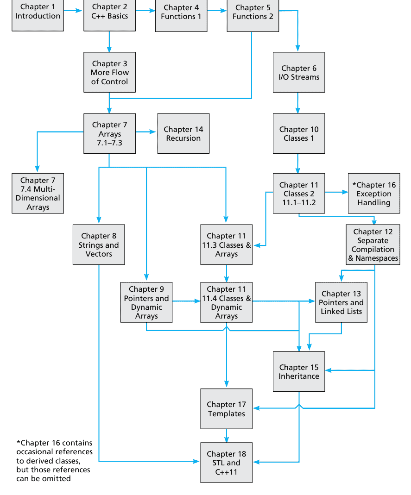

*第 16 章偶尔会提到派生类，但这些引用可以省略

## 支持材料

本书所有用户均可使用支持材料，而合格的教师还可使用额外的材料。

## 本书所有用户均可使用的材料

- 书中源代码
- PowerPoint 幻灯片
- VideoNotes
- 要访问这些材料，请前往：www.pearsonglobaleditions.com/savitch

## 仅合格教师可用的资源

访问 Pearson Education 的教师资源中心 www.pearsonglobaleditions.com/savitch 以获取以下教师资源：

- 教师资源指南——包括逐章教学提示、带解答的测验问题以及许多编程项目的解答
- 题库和测试生成器
- PowerPoint 讲座——包括文本中的程序和艺术作品
- 实验手册

## 联系我们

您的评论、建议、问题和更正总是受欢迎的。请通过电子邮件发送至 savitch.programming.cpp@gmail.com

## 致谢

许多个人和团体在准备这本教科书时为我提供了建议、讨论和其他帮助。本书第一版的大部分内容是在我访问科罗拉多大学博尔德分校计算机科学系期间撰写的。第一版剩余的写作工作以及后续版本的编写工作是在加州大学圣地亚哥分校（UCSD）的计算机科学与工程系完成的。我感谢这些机构为教授这些材料和撰写本书提供了良好的环境。

我特别感谢所有为本书或早期版本和草案贡献评论或编程项目的人。按字母顺序排列，他们是：Alex Feldman、Amber Settle、Andrew Burt、Andrew Haas、Anne Marchant、Barney MacCabe、Bob Holloway、Bob Matthews、Brian R. King、Bruce Johnston、Carol Roberts、Charles Dowling、Claire Bono、Cynthia Martincic、David Feinstein、David Teague、Dennis Heckman、Donald Needham、Doug Cosman、Dung Nguyen、Edward Carr、Eitan M. Gurari、Ethan Munson、Firooz Khosraviyani、Frank Moore、Gilliean Lee、Huzefa Kagdi、James Stepleton、Jeff Roach、Jeffrey Watson、Jennifer Perkins、

Jerry Weltman、Joe Faletti、Joel Cohen、John J. Westman、John Marsaglia、John Russo、Joseph Allen、Joseph D. Oldham、Jerrold Grossman、Jesse Morehouse、Karla Chaveau、Ken Rockwood、Larry Johnson、Len Garrett、Linda F. Wilson、Mal Gunasekera、Marianne Lepp、Matt Johnson、Michael Keenan、Michael Main、Michal Sramka、Naomi Shapiro、Nat Martin、Noah Aydin、Nisar Hundewale、Paul J. Kaiser、Paul Kube、Paulo Franca、Richard Borie、Scot Drysdale、Scott Strong、Sheila Foster、Steve Mahaney、Susanne Sherba、Thomas Judson、Walter A. Manrique、Wei Lian Chen、和 Wojciech Komornicki。

我特别感谢使用本书早期版本的大量教师。他们提供的评论是本书收到的最有帮助的审阅。

最后，我感谢 Kenrick Mock 实施了本版的更改。他几乎不可能完成的任务是取悦我、我的编辑和他自己的审美观，而他做得非常出色。

Walter Savitch

## 全球版致谢

Pearson 希望感谢并承认 Bradford Heap，新南威尔士大学，为全球版做出了贡献，以及 Kaushik Goswami，圣泽维尔学院加尔各答，Ela Kashyap 和 Sandeep Singh，Jaypee 科技学院，对全球版进行了审阅。

此页 intentionally left blank

## 编程实践

借助 MyProgrammingLab，您的学生将在互动的在线环境中获得第一手的编程经验。

## 即时个性化反馈

MyProgrammingLab 自动检测其代码提交中的逻辑和语法错误，并提供有针对性的提示，使学生能够弄清楚出了什么问题以及原因。

## 逐步增加的复杂性

MyProgrammingLab 将编程概念分解为简短易懂的练习序列。在每个序列中，练习的水平和复杂程度会逐渐但稳步地增加。

## 动态花名册

学生的提交内容存储在花名册中，其中显示提交是否正确、尝试次数以及每次尝试的实际代码提交。

## PEARSON eTEXT

Pearson eText 让学生随时随地访问其教科书。

## 分步 VIDEONOTE 教程

这些分步视频教程增强了选定 Pearson 教科书中介绍的编程概念。

有关更多信息和可使用 MyProgrammingLab 的标题，请访问 www.myprogramminglab.com。

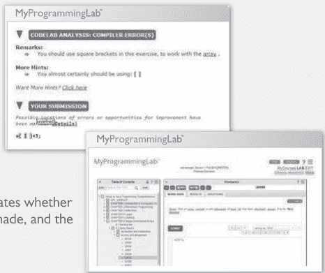

此页 intentionally left blank


练习题 987

编程项目 987

# 第18章 标准模板库与 C++11 991

## 18.1 **迭代器** 993

using 声明 993

迭代器基础 994

编程提示：使用 auto 简化变量声明 998

陷阱：编译器问题 998

迭代器的种类 1000

常量与可变迭代器 1004

反向迭代器 1005

其他种类的迭代器 1006

## 18.2 **容器** 1007

顺序容器 1008

陷阱：迭代器与移除元素 1012

编程提示：容器中的类型定义 1013

容器适配器 stack 和 queue 1013

关联容器 set 和 map 1017

编程提示：在容器中使用初始化、范围 for 和 auto 1024

效率 1024

## 18.3 **泛型算法** 1025

运行时间与大 O 表示法 1026

容器访问运行时间 1029

此页有意留空

# 计算机与 C++ 编程入门 1

## 1.1 **计算机系统** 34

硬件 34

软件 39

高级语言 40

编译器 41

历史注释 44

## 1.2 **编程与问题求解** 44

算法 44

程序设计 47

面向对象编程 48

软件生命周期 49

## 1.3 **C++ 简介** 50

C++ 语言的起源 50

一个 C++ 示例程序 51

陷阱：在 \n 中使用错误的斜杠 55

编程提示：输入与输出的语法 55

简单 C++ 程序的布局 56

陷阱：在 include 文件名前加空格 58

编译和运行 C++ 程序 58

陷阱：编译 C++11 程序 59

编程提示：让程序运行起来 59

## 1.4 **测试与调试** 61

程序错误的种类 62

陷阱：假设你的程序是正确的 63

> > 分析的全部开发与操作过程现在都能由机器来执行……一旦分析机问世，它必将引导未来科学的进程。
> >
> > 查尔斯·巴贝奇（1792–1871）

## 引言

在本章中，我们描述计算机的基本组成部分，以及设计和编写程序的基本技巧。然后我们会展示一个 C++ 示例程序并说明其工作原理。

### 1.1 计算机系统

一组供计算机遵循的指令称为程序。计算机所使用的程序集合称为该计算机的软件。构成计算机安装的实体物理机器称为硬件。正如我们将要看到的，计算机的硬件在概念上非常简单。然而，现在的计算机带有大量辅助编程任务的软件。这些软件包括编辑器、翻译器和各种管理器。由此产生的环境是一个复杂而强大的系统。在本书中，我们几乎只关注软件，但对硬件的组织方式做一个简要概述将会很有帮助。

#### 硬件

计算机主要有三类：PC、工作站和大型机。PC（个人计算机）是一种相对较小的计算机，设计为一次供一人使用。大多数家用计算机是PC，但PC也广泛应用于商业、工业和科学领域。工作站本质上是一个更大、更强大的PC。你可以把它看作一台“工业级”PC。大型机是一种更大的计算机，通常需要一些支持人员，并且通常由多个用户共享。PC、工作站和大型机之间的区别并不精确，但这些术语被广泛使用，确实传达了关于计算机的一些非常概括的信息。

网络由若干台计算机连接而成，以便它们可以共享打印机等资源，也可以共享信息。一个网络可以包含多台工作站和一台或多台大型机，以及诸如此类的共享设备。

就我们学习编程的目的而言，无论你是在PC、大型机还是工作站上工作，都没有关系。正如我们所看到的那样，计算机的基本配置在所有三种类型的计算机上都是相同的。

为了存储输入并有相当于草稿纸的东西来进行计算，计算机配备了*内存*。计算机执行的程序也存储在这个内存中。计算机有两种形式的内存，称为*主内存*和*辅助内存*。正在执行的程序保存在主内存中，而主内存，顾名思义，是最重要的内存。**主内存**由一长串编号的位置组成，这些位置称为*内存位置*；内存位置的数量因计算机而异，从几千到几百万，有时甚至达到数十亿。每个内存位置包含一串0和1。这些位置的内容可以改变。因此，你可以把每个内存位置看作一块小黑板，计算机可以在上面书写和擦除。在大多数计算机中，所有内存位置包含相同数量的0/1数字。一个只能取0或1的数字称为*二进制数字*或*位*。大多数计算机中的内存位置包含八位（或八位的倍数）。八位内存称为一个**字节**，因此我们可以将这些编号的内存位置称为*字节*。换句话说，你可以把计算机的主内存看作一长串编号的内存位置，称为*字节*。标识一个字节的编号称为其*地址*。一个数据项（如一个数字或字母）可以存储在其中一个字节中，当需要时，就使用该字节的地址来查找该数据项。

如果计算机需要处理一个太大而无法放入单个字节的数据项（例如一个大数字），它将使用几个相邻的字节来保存该数据项。在这种情况下，保存该数据项的整个内存块仍称为一个**内存位置**。构成该内存位置的第一个字节的地址被用作这个较大内存位置的地址。因此，在实际应用中，你可以把计算机的主内存看作一长串*大小不一*的内存位置。每个位置的大小以字节表示，第一个字节的地址被用作该内存位置的地址（名称）。图1.2展示了一个假想计算机主内存的图示。内存位置的大小不是固定的，而是在计算机上运行新程序时可以改变。

##### 字节与地址

主内存被划分为编号的位置，称为**字节**。与字节关联的编号称为其**地址**。一组连续的字节被用作一个数据项（如数字或字母）的位置。该组中第一个字节的地址被用作这个较大内存位置的地址。

计算机内存中的信息被表示为0和1这一事实，在你用C++（或


###### 显示 1.2 内存位置与字节

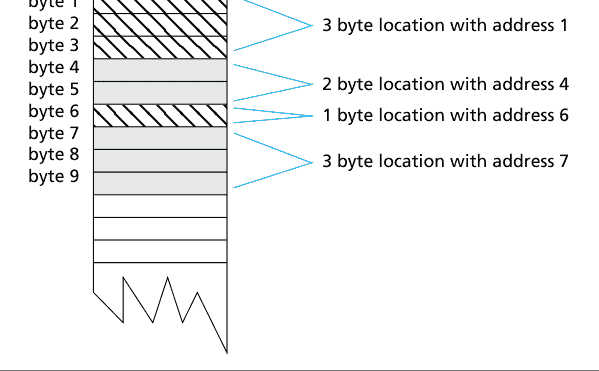

大多数其他编程语言也是如此）。然而，一旦我们开始编写程序，这种使用0和1的方式就会有一个问题需要我们关注。计算机需要将这些0和1的字符串解释为数字、字母、指令或其他类型的信息。计算机根据特定的编码方案自动执行这些解释。对于存储在计算机内存中的每种不同类型的项目，都使用不同的代码：字母用一种代码，整数用另一种代码，分数用另一种代码，指令又用另一种代码，等等。例如，在一套常用的编码中，01000001是字母A的代码，同时也是数字65的代码。为了知道某个特定位置上的字符串01000001代表什么，计算机必须跟踪该位置当前使用的是哪种代码。幸运的是，程序员很少需要关心这些代码，可以放心地推理，就好像这些位置实际上包含的是字母、数字或任何所需的内容一样。

###### 为什么是八位？

字节是一个可以容纳八位的内存位置。八有什么特别之处？为什么不是十位？八之所以特殊有两个原因。首先，八是2的幂（8是2³）。由于计算机使用只有两种可能值的位，2的幂比10的幂更方便。其次，事实证明，编码单个字符（如字母或其他键盘符号）需要八位（一个字节）。

我们到目前为止讨论的内存是主内存。没有主内存，计算机什么也做不了。然而，主内存只在计算机实际执行程序中的指令时使用。计算机还有另一种形式的内存，称为*辅助内存*或*辅助存储*。（在此上下文中，*内存*和*存储*是完全同义词。）**辅助内存**是在计算机使用之后（以及之前）用于永久保存信息的内存。一些常用于指代辅助内存的替代术语包括*辅助存储器*、*辅助存储*、*外部内存*和*外部存储*。

辅助存储中的信息以称为**文件**的单位保存，文件可以任意大或任意小。例如，程序存储在辅助存储的文件中，在程序运行时被复制到主内存。你可以将程序、信件、库存清单或任何其他信息单元存储在文件中。

一台计算机可以连接多种不同类型的辅助内存。最常见的辅助内存形式有*硬盘*、*软盘*、*CD*、*DVD*和*可移动闪存驱动器*。（*软盘*有时也称为*磁盘*。）计算机上使用的**CD**（光盘）与用于录制和播放音乐的CD基本相同，而**DVD**（数字多功能光盘）与用于播放视频的DVD相同。计算机用的CD和DVD可以是只读的，这样你的计算机可以读取但不能更改光盘上的数据；计算机用的CD和DVD也可以是可读写的，其数据可以由计算机更改。**硬盘**固定安装，通常不会从磁盘驱动器中取出。软盘和CD可以轻松地从磁盘驱动器中取出并携带到另一台计算机上。软盘和CD具有廉价和便携的优点，但硬盘能存储更多数据且运行速度更快。如今，**闪存驱动器**在很大程度上取代了软盘，它们使用一种称为闪存的内存来存储数据。与主内存不同，闪存不需要电源来维持设备上存储的信息。还有其他形式的辅助内存可用，但此列表涵盖了你可能遇到的大多数形式。

主内存通常被称为RAM或**随机存取内存**。之所以称为*随机存取*，是因为计算机可以立即访问任何内存位置中的数据。辅助内存通常需要**顺序存取**，这意味着计算机必须查找所有（或至少非常多）内存位置，直到找到所需的项目。

**处理器**（也称为**中央处理单元**，或**CPU**）是计算机的“大脑”。当广告宣传一台计算机时，计算机公司会告诉你它包含什么*芯片*。**芯片**就是处理器。处理器遵循程序中的指令并执行程序指定的计算。然而，处理器是一个非常简单的“大脑”。它所能做的就是遵循程序员提供的一组简单指令。典型的处理器指令是这样的：“将0和1解释为数字，然后将内存位置37中的数字与内存位置59中的数字相加，并将答案放在位置43中”，或者“读取一个输入字母，将其转换为其0和1字符串形式的代码，并将其放在内存位置1298中。”处理器可以加、减、乘、除，并且可以将内容从一个内存位置移动到另一个内存位置。它可以将0和1的字符串解释为字母并将字母发送到输出设备。处理器还具有一些重新排列指令顺序的基本能力。处理器指令因计算机而异。现代计算机的处理器可以有数百条可用指令。然而，这些指令通常都和我们刚才描述的差不多简单。

#### 软件

你通常不会直接与计算机对话，而是通过*操作系统*与之通信。**操作系统**将计算机的资源分配给计算机必须完成的不同任务。操作系统实际上是一个程序，但也许最好把它看作你的首席仆人。它负责管理你所有的其他仆人程序，并将你的请求传递给它们。如果你想运行一个程序，你告诉操作系统包含该程序的文件的名称，操作系统就会运行该程序。如果你想编辑一个文件，你告诉操作系统该文件的名称，它就会启动编辑器来处理该文件。对大多数用户来说，操作系统就是计算机。大多数用户从未见过没有操作系统的计算机。一些常见操作系统的名称有*UNIX、DOS、Linux、Windows、Mac OS、iOS和Android*。

**程序**是供计算机遵循的一组指令。如显示1.3所示，计算机的输入可以被认为由两部分组成：程序和某些数据。计算机遵循程序中的指令，并以此方式执行某种过程。**数据**是我们概念化为程序输入的内容。例如，如果程序将两个数相加，那么这两个数就是数据。换句话说，数据是程序的输入，而程序和数据的输入对象都是计算机（通常通过操作系统）。每当我们给计算机

##### 显示 1.3 运行程序的简单视图


同时提供要遵循的程序和程序所需的一些数据时，我们就说在数据上**运行程序**，计算机则在数据上**执行程序**。*数据*一词的含义也比我们刚才给出的含义广泛得多。在最一般的意义上，它指计算机可用的任何信息。这个词通常既用于狭义，也用于更一般的意义。

##### 高级语言

有许多用于编写程序的语言。在本书中，我们将讨论C++编程语言并使用它来编写程序。C++是一种高级语言，你很可能听说过的大多数其他编程语言也是如此，例如C、C#、Java、Python、PHP、Pascal、Visual Basic、FORTRAN、COBOL、Lisp、Scheme和Ada。**高级语言**在许多方面类似于人类语言。它们被设计为便于人类编写程序，也便于人类阅读。像C++这样的高级语言包含的指令比计算机处理器（CPU）能够执行的简单指令复杂得多。

计算机能够理解的那种语言称为**低级语言**。低级语言的具体细节因计算机类型而异。一个典型的低级指令可能是：

```
ADD X Y Z
```

这条指令可能意味着“将名为X的内存位置中的数字与名为Y的内存位置中的数字相加，并将结果放在名为Z的内存位置中。”上述示例指令是用所谓的**汇编语言**编写的。尽管汇编语言几乎与计算机理解的语言相同，但在计算机能够理解之前，它必须经过一次简单的转换。为了让计算机执行汇编语言指令，需要将这些单词转换为0和1的字符串。例如，单词ADD可能转换为0110，X可能转换为1001，Y转换为1010，Z转换为1011。计算机最终执行的上述指令的版本将是：

```
0110 1001 1010 1011
```

汇编语言指令及其到0和1的转换因机器而异。

以0和1形式编写的程序被称为用**机器语言**编写，因为那是计算机（机器）实际读取和遵循的程序版本。汇编语言和机器语言几乎是一回事，它们之间的区别对我们来说并不重要。重要的区别在于


机器语言和像 C++ 这样的高级语言：任何高级语言程序都必须先被翻译成机器语言，计算机才能理解并执行该程序。

###### 编译器

将像 C++ 这样的高级语言翻译成机器语言的程序称为编译器。因此，编译器是一种有点特殊的程序，因为它的输入或数据是某个其他程序，而它的输出又是另一个程序。为了避免混淆，输入程序通常称为源程序或源代码，而编译器产生的翻译版本称为目标程序或目标代码。“代码”这个词经常用来表示一个程序或程序的一部分，这种用法在提到目标程序时尤为常见。现在，假设你想运行一个自己编写的 C++ 程序。为了让计算机执行你的 C++ 指令，请按以下步骤操作。首先，将你的 C++ 程序作为数据来运行编译器。注意，在这种情况下，你的 C++ 程序并不是被当作一组指令来对待。对于编译器而言，你的 C++ 程序只是一长串字符。输出将是另一长串字符，即你的 C++ 程序的机器语言等价物。接下来，在我们通常认为是 C++ 程序的数据上运行这个机器语言程序。输出将是我们通常概念化为 C++ 程序的输出的内容。如果你有两台计算机可用，这个过程会更容易可视化，如显示 1.4 所示。实际上，整个过程是通过使用一台计算机两次来完成的。

###### 编译器

编译器是一种将高级语言程序（如 C++ 程序）翻译成计算机可以直接理解和执行的机器语言程序的程序。

翻译并运行一个 C++ 程序的完整过程比我们在显示 1.4 中展示的要复杂一些。你编写的任何 C++ 程序都会使用一些已经为你编写好的操作（如输入和输出例程）。这些已经为你编写好的内容（如输入和输出例程）已经被编译，并且它们的目标代码正在等待与你的程序的目标代码结合，以生成一个可以在计算机上运行的完整机器语言程序。另一个称为链接器的程序将这些程序片段的目标代码与编译器从你的

##### 显示 1.5 准备运行 C++ 程序

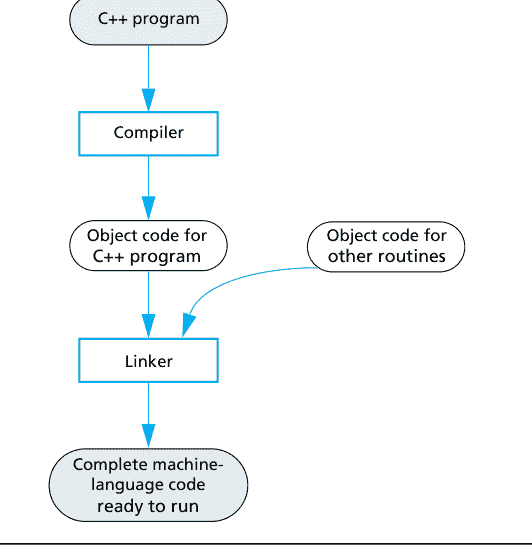

## 自测练习

- 1. 计算机的五个主要组成部分是什么？
- 2. 一个将两个数相加的程序，它的数据是什么？
- 3. 一个为班级学生分配字母等级的程序，其数据是什么？
- 4. 机器语言程序与高级语言程序之间的区别是什么？
- 5. 编译器的作用是什么？
- 6. 什么是源程序？什么是目标程序？
- 7. 什么是操作系统？
- 8. 操作系统有何用途？


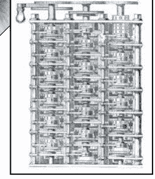

指令、过程和例程。指令可以用编程语言或人类语言来表达。我们的算法将用英语和 C++ 编程语言来表达。计算机程序只不过是一种用计算机能够理解的语言表达的算法。因此，算法（algorithm）一词比程序（program）一词更为通用。然而，当我们说一个指令序列是算法时，我们通常是指这些指令是用英语表达的，因为如果它们是用编程语言表达的，我们会使用更具体的术语“程序”。一个例子可能有助于澄清这个概念。

显示 1.6 包含一个用英语表达的算法。该算法确定一个指定名字在名字列表中出现的次数。如果该列表包含上个赛季每场足球比赛的获胜者，而这个名字是你最喜欢的球队，那么该算法就确定你的球队赢了多少场比赛。该算法简短而简单，但在其他方面，它非常典型地代表了我们将要处理的算法。

##### 显示 1.6 一个算法

- 1. 获取名字列表。
- 2. 获取被检查的名字。
- 3. 将计数器设置为零。
- 4. 对列表中的每个名字执行以下操作：
  将列表中的名字与被检查的名字进行比较，如果名字相同，则将计数器加一。
- 5. 宣布答案是计数器所指示的数字。

示例算法中编号为 1 到 5 的指令按列出的顺序执行。除非另有说明，我们总是假设算法的指令按照给定的（写下的）顺序执行。然而，大多数有趣的算法确实会指定某种顺序的改变，通常是重复某个指令一次又一次，例如示例算法中的指令 4。

算法（algorithm）一词有着悠久的历史。它源自 al-Khowarizmi 这个名字，他是九世纪的波斯数学家和天文学家。他写了一本关于数字和方程运算的著名教科书。这本书名为 Kitab al-jabr w’almuqabala，可以翻译为《复原与化简规则》。发音相似的“代数”（algebra）一词源自阿拉伯语 al-jabr，这个词语出现在书名中，常被翻译为“复原”或“还原”。过去，“代数”和“算法”这两个词的意义比今天要密切得多。事实上，直到近代，“算法”一词通常只指用于求解数值方程的代数规则。如今，“算法”一词可以应用于各种各样的指令，用于处理符号数据和数值数据。现在，一组指令有资格称为算法的性质取决于指令本身的性质，而不是指令所处理的事物。要成为算法，一组指令必须完整且无歧义地指定要采取的步骤以及采取这些步骤的顺序。执行算法的人或机器完全按照算法所说的去做，不多也不少。

###### 算法

算法是导致解决方案的一系列精确指令。

##### 显示 1.7 程序设计过程

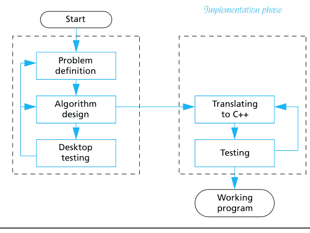

大型算法这将需要铅笔和纸。C++ 程序通过编译并在一些示例输入数据上运行来测试。编译器会针对某些类型的错误给出错误消息。要找出其他类型的错误，你必须以某种方式检查输出是否正确。

显示 1.7 中图示的过程是程序设计过程的理想化图片。这是你心中应有的基本图景，但现实有时更为复杂。实际上，错误和缺陷会在意想不到的时候被发现，你可能必须回溯并重做更早的步骤。例如，如显示 1.7 所示，测试算法可能会揭示问题的定义不完整。在这种情况下，你必须回溯并重新表述定义。偶尔，定义或算法中的缺陷可能直到程序被测试时才被发现。在这种情况下，你必须回溯并修改问题定义或算法，以及设计过程中随之而来的所有内容。

##### 面向对象编程

我们在上一节中概述的程序设计过程将程序表示为用于处理某些数据的算法（一组指令）。这是一种正确的观点，但并不总是最有成效的观点。现代程序通常使用一种称为面向对象编程（Object-Oriented Programming，简称 OOP）的方法来设计。在 OOP 中，程序被视为一组相互作用的


objects. The methodology is easiest to understand when the program is a simulation program. For example, for a program to simulate a highway interchange, the objects might represent the automobiles and the lanes of the highway. Each object has algorithms that describe how it should behave in different situations. Programming in the OOP style consists of designing the objects and the algorithms they use. When programming in the OOP framework, the term Algorithm design in Display 1.7 would be replaced with the phrase Designing the objects and their algorithms.

The main characteristics of OOP are encapsulation, inheritance, and polymorphism. Encapsulation is usually described as a form of information hiding or abstraction. That description is correct, but perhaps an easier-to-understand characterization is to say that encapsulation is a form of simplification of the descriptions of objects. Inheritance has to do with writing reusable program code. Polymorphism refers to a way that a single name can have multiple meanings in the context of inheritance. Having made those statements, we must admit that they hold little meaning for readers who have not heard of OOP before. However, we will describe all these terms in detail later in this book. C++ accommodates OOP by providing classes, a kind of data type combining both data and algorithms.

##### The Software Life Cycle

Designers of large software systems, such as compilers and operating systems, divide the software development process into six phases collectively known as the software life cycle. The six phases of this life cycle are:

- 1. Analysis and specification of the task (problem definition)
- 2. Design of the software (object and algorithm design)
- 3. Implementation (coding)
- 4. Testing
- 5. Maintenance and evolution of the system
- 6. Obsolescence

We did not mention the last two phases in our discussion of program design because they take place after the program is finished and put into service. However, they should always be kept in mind. You will not be able to add improvements or corrections to your program unless you design it to be easy to read and easy to change. Designing programs so that they can be easily modified is an important topic that we will discuss in detail when we have developed a bit more background and a few more programming techniques. The meaning of obsolescence is obvious, but it is not always easy to accept. When a program is not working as it should and cannot be fixed with a reasonable amount of effort, it should be discarded and replaced with a completely new program.

## SELF-TEST EXERCISES

12. An algorithm is approximately the same thing as a recipe, but some kinds of steps that would be allowed in a recipe are not allowed in an algorithm. Which steps in the following recipe would be allowed in an algorithm?

```
Place 2 teaspoons of sugar in mixing bowl.
Add 1 egg to mixing bowl.
Add 1 cup of milk to mixing bowl.
Add 1 ounce of rum, if you are not driving.
Add vanilla extract to taste.
Beat until smooth.
Pour into a pretty glass.
Sprinkle with nutmeg.
```

13. What is the first step you should take when creating a program?

14. The program design process can be divided into two main phases. What are they?

15. Explain why the problem-solving phase should not be slighted.

### 1.3 INTRODUCTION TO C++

> Language is the only instrument of science . . .
> SAMUEL JOHNSON (1709–1784)

In this section we introduce you to the C++ programming language, which is the programming language used in this book.

#### Origins of the C++ Language

The first thing that people notice about the C++ language is its unusual name. Is there a C programming language, you might ask? Is there a C– or a C– – language? Are there programming languages named A and B? The answer to most of these questions is no. But the general thrust of the questions is on the mark. There is a B programming language; it was not derived from a language called A, but from a language called BCPL. The C language was derived from the B language, and C++ was derived from the C language. Why are there two pluses in the name C++? As you will see in the next chapter, ++ is an operation in the C and C++ languages, so using ++ produces a nice pun. The languages BCPL and B do not concern us. They are earlier versions of the C programming language. We will start our description of the C++ programming language with a description of the C language.

The C programming language was developed by Dennis Ritchie of AT&T Bell Laboratories in the 1970s. It was first used for writing and maintaining the UNIX operating system. (Up until that time UNIX systems programs were written

either in assembly language or in B, a language developed by Ken Thompson, who is the originator of UNIX.) C is a general-purpose language that can be used for writing any sort of program, but its success and popularity are closely tied to the UNIX operating system. If you wanted to maintain your UNIX system, you needed to use C. C and UNIX fit together so well that soon not just systems programs, but almost all commercial programs that ran under UNIX were written in the C language. C became so popular that versions of the language were written for other popular operating systems; its use is not limited to computers that use UNIX. However, despite its popularity, C is not without its shortcomings.

The C language is peculiar because it is a high-level language with many of the features of a low-level language. C is somewhere in between the two extremes of a very high-level language and a low-level language, and therein lies both its strengths and its weaknesses. Like (low-level) assembly language, C language programs can directly manipulate the computer's memory. On the other hand, C has many features of a high-level language, which makes it easier to read and write than assembly language. This makes C an excellent choice for writing systems programs, but for other programs (and in some sense even for systems programs), C is not as easy to understand as other languages; also, it does not have as many automatic checks as some other high-level languages.

To overcome these and other shortcomings of C, Bjarne Stroustrup of AT&T Bell Laboratories developed C++ in the early 1980s. Stroustrup designed C++ to be a better C. Most of C is a subset of C++, and so most C programs are also C++ programs. (The reverse is not true; many C++ programs are definitely not C programs.) Unlike C, C++ has facilities to do object-oriented programming, which is a very powerful programming technique described earlier in this chapter. The C++ language continues to evolve. Major new features were added in 2011. This version is referred to as C++11. Minor features were added in 2014. At the time of writing this edition, C++17 is under development and will include additional features such as parallel algorithms.

#### A Sample C++ Program

Display 1.8 contains a simple C++ program and the screen display that might be generated when a user runs and interacts with this program. The person who runs a program is called the user. The output when the program is run is shown in the Sample Dialogue. The text typed in by the user is shown in color to distinguish it from the text output by the program. On the actual screen both texts would look alike. The source code for the program is shown in lines 1–22. The line numbers are shown only for reference. You would not type in the line numbers when entering the program. Keywords with a predefined meaning in C++ are shown in color. These keywords are discussed in Chapter 2. The person who writes the program is called the programmer. Do not confuse the roles of the user and the programmer. The user and the programmer might or might not be the same person. For example, if you write and then run a program, you are both the programmer and the user. With professionally produced programs, the programmer (or programmers) and the user are usually different persons.


### 数字证据

数字证据是指以二进制形式存储或传输的信息，可能在法庭上被依赖。

它可能存在于计算机硬盘、手机、个人数字助理（PDA）、光盘、DVD 或存储卡等地方。

#### 可在以下位置找到数字证据：
- 计算机
- 手机
- 个人数字助理（PDAs）
- 光盘和 DVD
- 存储卡
- 数字相机

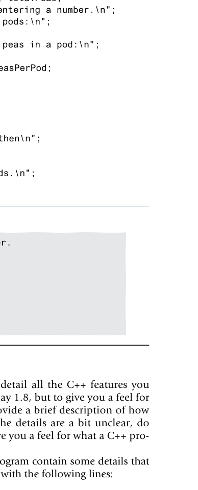

the text contained in the quotes to be written to the screen. The \n at the end of the quoted string tells the computer to start a new line after writing out the text. Similarly, the next line of the program also begins with cout, and that program line causes the following line of text to be written to the screen:

```
Enter the number of pods:
```

The next program line starts with the word cin, so it is an input statement. Let’s look at that line:

```
cin >> numberOfPods;
```

This line may be read, ‘get numberOfPods from cin’ or simply ‘input numberOfPods’.

If you think of the word cin as standing for the keyboard (the input device), then the arrows say that input should be sent from the keyboard to the variable numberOfPods. Look again at the sample dialogue. The next line shown has a 10 written in bold. We use bold to indicate something typed in at the keyboard. If you type in the number 10, then the 10 appears on the screen. If you then press the Return key (which is also sometimes called the Enter key), that makes the 10 available to the program. The statement which begins with cin tells the computer to send that input value of 10 to the variable numberOfPods. From that point on, numberOfPods has the value 10; when we see numberOfPods later in the program, we can think of it as standing for the number 10.

Consider the next two program lines:

```
cout << "Enter the number of peas in a pod:\n";
cin >> peasPerPod;
```

These lines are similar to the previous two lines. The first sends a message to the screen asking for a number. When you type in a number at the keyboard and press the Return key, that number becomes the value of the variable peasPerPod. In the sample dialogue, we assume that you type in the number 9. After you type in 9 and press the Return key, the value of the variable peasPerPod becomes 9.

The next nonblank program line, shown below, does all the computation that is done in this simple program:

```
totalPeas = numberOfPods * peasPerPod;
```

The asterisk symbol, *, is used for multiplication in C++. So this statement says to multiply numberOfPods and peasPerPod. In this case, 10 is multiplied by 9 to give a result of 90. The equal sign says that the variable totalPeas should be made equal to this result of 90. This is a special use of the equal sign; its meaning here is different than in other mathematical contexts. It gives the variable on the left-hand side a (possibly new) value; in this case it makes 90 the value of totalPeas.

The rest of the program is basically more of the same sort of output. Consider the next three nonblank lines:

```
cout << "If you have ";
cout << numberOfPods;
cout << " pea Pods\n";
```

These are just three more output statements that work basically the same as the previous statements that begin with cout. The only thing that is new is the second of these three statements, which says to output the variable numberOfPods. When a variable is output, it is the value of the variable that is output. So this statement causes a 10 to be output. (Remember that in this sample run of the program, the variable numberOfPods was set to 10 by the user who ran the program.) Thus, the output produced by these three lines is:

```
If you have 10 pea pods
```

Notice that the output is all on one line. A new line is not begun until the special instruction \n is sent as output.

The rest of the program contains nothing new, and if you understand what we have discussed so far, you should be able to understand the rest of the program.

### PITFALL 使用 
 时使用错误的斜杠

当你在 cout 语句中使用 \n 时，请确保使用的是反斜杠，即写成 \。如果你弄错了而使用 /n 而不是 \n，编译器不会给出错误信息。你的程序会运行，但输出看起来会很奇怪。

### PROGRAMMING TIP 输入和输出语法

如果你把 cin 想象成键盘或输入设备的名称，把 cout 想象成屏幕或输出设备的名称，那么就很容易记住箭头 >> 和 << 的方向。它们指向数据移动的方向。例如，考虑下面的语句：

```
cin >> numberOfPods;
```

在上面的语句中，数据从键盘移动到变量 numberOfPods，因此箭头指向从 cin 到该变量。

另一方面，考虑输出语句：

```
cout << numberOfPods;
```

在此语句中，数据从变量 numberOfPods 移动到屏幕，因此箭头指向从变量 numberOfPods 到 cout。

### 简单 C++ 程序的布局

简单 C++ 程序的一般形式如显示 1.9 所示。就编译器而言，换行和空格不必如图中及示例中所示。编译器会接受任何合理的换行和缩进模式。事实上，编译器甚至会接受大多数不合理的换行和缩进模式。然而，程序始终应布局得易于阅读。将左大括号 { 单独放在一行，以及将右大括号 } 单独放在一行，会使这些标点符号易于找到。缩进每个语句并将每个语句放在单独一行，可以轻松看出程序指令是什么。稍后，我们的一些语句会太长而无法容纳在一行中，然后我们将使用这种模式的轻微变体进行缩进和换行。你应遵循本书示例中设定的模式，或遵循你的讲师在课堂上指定的模式。

在显示 1.8 中，变量声明位于以单词 int 开始的那一行。正如我们将在下一章看到的那样，你不必将所有变量声明放在程序开头，但那是一个很好的默认位置。除非你有理由将它们放在其他位置，否则请将它们放在程序开头，如显示 1.9 和显示 1.8 中的示例程序所示。语句是计算机遵循的指令。在显示 1.8 中，语句是以 cout 或 cin 开始的行，以及以 totalPeas 后跟等号开始的那一行。语句通常称为可执行语句。我们将交替使用术语语句和可执行语句。请注意，我们看到的每个语句都以分号结束。语句中的分号与英语句子中的句号或多或少以相同的方式使用；它标记语句的结束。

### DISPLAY 1.9 简单 C++ 程序的布局

```
1 #include <iostream>
2 using namespace std;
3 
4 int main()
5 {
6     Variable_Declarations
7 
8     Statement_1
9     Statement_2
10    ...
11    Statement_Last
12 
13    return 0;
14 }
```

目前你可以将前几行视为一种有趣的方式来表示“这是程序的开始”。但我们可以更详细地解释它们。第一行

```
#include <iostream>
```

称为包含指令。它告诉编译器在哪里找到程序中使用的某些项目的信息。在这种情况下，iostream 是包含处理键盘输入和屏幕输出例程定义的库的名称；iostream 是一个包含有关此库的一些基本信息的文件。我们在这一章前面讨论过的链接程序将库 iostream 的目标代码与你编写的程序的目标代码结合起来。对于库 iostream，这在你的系统上可能会自动发生。你最终也会使用其他库，当你使用它们时，它们需要在程序开始处的指令中命名。对于其他库，你可能需要做的不止是在程序中放置包含指令，但在程序中使用任何库时，你至少需要在程序中放置该库的包含指令。指令始终以符号 # 开始。一些编译器要求指令在 # 周围没有空格，因此最安全的做法是将 # 放在行的最开始，并且在 # 和单词 include 之间不包含任何空格。

以下一行进一步解释了我们刚刚解释的包含指令：

```
using namespace std;
```

此行表示 iostream 中定义的名称应以“标准方式”解释（std 是 standard 的缩写）。我们将在本书稍后对这一行做更多说明。

第三和第四个非空白行，如下所示，只是表示程序的主体从这里开始：

```
int main()
{
```

正确的术语是 main 函数，而不是 main 部分，但这种细微差别的原因要到第 4 章才会与我们有关。大括号 { 和 } 标记程序主体的开始和结束。它们不必单独成行，但这样做便于查找，因此我们将始终将每个大括号单独放在一行。

倒数第二行

```
return 0;
```

表示“到这里时结束程序”。此行不必是程序中的最后一件事，但在非常简单的程序中，将其放在其他任何地方都没有意义。一些编译器允许你省略此行，并会自行判断程序在没有更多语句可执行时结束。


### PITFALL 编译 C++11 程序

C++11（以前称为 C++0x）是 C++ 编程语言标准的最新的主要版本。它于 2011 年 8 月 12 日由国际标准化组织批准。C++14 于 2014 年 12 月 15 日发布，并在 C++11 的基础上包含了一些小的扩展。我们在本书中不会讨论这些扩展。C++11 编译器能够编译和运行为旧版本编写的程序。然而，C++11 版本包含了一些与旧 C++ 编译器不兼容的新语言特性。这意味着如果您使用的是旧的 C++ 编译器，则可能无法编译和运行 C++11 程序。

您可能还需要指定是否要针对 C++11 标准进行编译。例如，g++4.7 需要在命令行中添加编译器标志 -std=c++11；否则编译器会假定 C++ 程序是按照旧标准编写的。编译名为 testing.cpp 的 C++11 程序的命令行看起来像：

```
g++ testing.cpp -std=c++11
```

请查阅您编译器的文档，以确定编译 C++11 程序是否需要任何特殊步骤，并确定支持哪些 C++11 语言特性。

### PROGRAMMING TIP 让您的程序运行

不同的编译器和不同的环境可能需要在设置包含 C++ 程序的文件时对一些细节进行轻微的调整。获取显示 1.10 中的程序副本。它可通过互联网下载。（有关详细信息，请参阅前言。）或者，非常仔细地自己输入该程序。不要输入行号。编译程序。如果收到错误消息，请检查您的输入，修正任何输入错误，然后重新编译文件。一旦程序编译没有任何错误消息，请尝试运行程序。

如果您让程序正常编译和运行，那么一切就绪。您无需与书中所示的示例做任何不同。如果此程序无法编译或无法正常运行，那么请继续阅读。接下来我们提供了一些有关处理 C++ 设置的提示。一旦您让这个简单程序正常运行，您就会知道对 C++ 程序文件做哪些小的更改以使其在您的系统上运行。

如果您的程序似乎运行，但您没有看到输出行

```
Testing 1, 2, 3
```

那么，很可能程序确实输出了该内容，但它在您看到之前就消失了。尝试在程序末尾添加以下内容，就在 return 0; 行之前；这些行应停止程序以便您阅读输出。

for your C++ compiler or check with a friend who has a similar computer setup. The necessary change is undoubtedly very small and, once you find out what it is, very easy.

## SELF-TEST EXERCISES

16. 如果以下语句在 C++ 程序中使用，它会导致屏幕上写出什么？

```
cout << "C++ is easy to understand.";
```

17. 在以下语句中 \n 的含义是什么（该语句出现在显示 1.8 中）？

```
cout << "Enter the number of peas in a pod:\n";
```

18. 以下语句的含义是什么（该语句出现在显示 1.8 中）？

```
cin >> peasPerPod;
```

19. 以下语句的含义是什么（该语句出现在显示 1.8 中）？

```
totalPeas = numberOfPods * peasPerPod;
```

20. 以下指令的含义是什么？

```
#include <iostream>
```

21. 以下 #include 指令有什么问题，如果有的话？
- a. #include <iostream >
- b. #include < iostream>
- c. #include <iostream>

### 1.4 测试和调试

> “如果你从三百六十五中减去一个，还剩下什么？”
> “当然是三百六十四。”
>  Humpty Dumpty 看起来怀疑。“我宁愿看到这在纸上做，”他说。
> LEWIS CARROLL, Through the Looking-Glass

程序中的错误通常称为 bug，消除 bug 的过程称为调试。关于这个术语的起源有一个色彩鲜明的历史。它发生在计算机发展的早期，当时计算机硬件极其敏感并占据了整个房间。格蕾丝·默里·霍珀海军上将（1906–1992）“是世界上第一台大型数字计算机的第三位程序员。”（Denise W. Gurer，“Pioneering women in computer science” CACM 38(1):45–54, January 1995。）霍珀在哈佛教授霍华德·H·艾肯的指挥下在哈佛 Mark I 计算机上工作时，一只不幸的蛾子导致继电器故障。霍珀和其他程序员用胶带将死去的蛾子贴在日志簿上，并附注“第一次实际发现 bug 的案例。” 日志簿目前在弗吉尼亚州达尔格伦的海军博物馆展出。这是第一个有记录的计算机 bug。艾肯教授会在空闲时间进入设施并询问是否有数字正在计算。程序员会回答他们正在调试计算机。有关霍珀上将和其他计算人员的更多信息，请参阅 Robert Slater, Portraits in Silicon（MIT Press, 1987）。今天，bug 是程序中的错误。在本节中我们描述了三种主要的编程错误类型，并提供了一些纠正它们的提示。

#### 程序错误的类型

编译器会捕获某些类型的错误，并在发现错误时写出错误消息。它会检测所谓的语法错误，因为它们在很大程度上违反了编程语言的语法（即语法规则），例如省略分号。

如果编译器发现您的程序包含语法错误，它会告诉您错误可能在哪里以及可能是什么类型的错误。当编译器说您的程序包含语法错误时，您可以确信它确实存在。然而，编译器可能在错误的位置或性质上是错误的。它在确定错误位置方面做得更好，在一两行之内，而在确定错误来源方面做得较差。这是因为编译器在猜测您想写什么，很容易猜错。毕竟，编译器无法读懂你的心。第一次错误之后的错误消息更有可能在位置或性质上不正确。同样，这是因为编译器必须猜测你的含义。如果编译器的第一次猜测是错误的，这将影响其对未来错误的分析，因为分析将基于错误的假设。

如果您的程序包含直接违反编程语言语法规则的内容，编译器会给您一个错误消息。然而，有时编译器只会给您一个警告消息，这表明您做了一些技术上不违反编程语言语法规则，但不寻常到足以表明可能有错误的事情。当您收到警告消息时，编译器是在说：“你确定你指的是这个吗？” 在您发展的这个阶段，您应该将每个警告都视为错误，直到您的指导老师批准忽略该警告。

某些类型的错误只有在程序运行时计算机系统才能检测到。恰当地说，这些被称为 **run-time errors**。大多数计算机系统会检测某些运行时错误并输出适当的错误消息。许多运行时错误与数值计算有关。例如，如果计算机尝试将一个数除以零，这通常是一个运行时错误。

如果编译器批准了您的程序并且程序运行一次没有任何运行时错误消息，这并不能保证您的程序是正确的。请记住，编译器只会告诉您是否编写了语法上（即语法上）正确的 C++ 程序。它不会告诉您程序是否按您想要的方式执行。底层算法中的错误或将算法翻译成 C++ 语言中的错误称为 **logic errors**。例如，如果您在显示 1.8 中的程序中错误地使用了加号 + 而不是乘号 *，那就是一个逻辑错误。程序会正常编译和运行，但会给出错误答案。如果编译器批准了您的程序并且没有运行时错误，但程序没有正常执行，那么毫无疑问您的程序包含逻辑错误。逻辑错误是最难诊断的类型，因为计算机没有错误消息来帮助找到错误。它不能合理地期望给出任何错误消息。对于计算机来说，你可能就是想写你写的内容。

### PITFALL 假设您的程序是正确的

为了测试新程序是否存在逻辑错误，您应该在几个代表性数据集上运行程序并检查其在这些输入上的性能。如果程序通过了这些测试，您可以对其更有信心，但这仍然不是程序正确的绝对保证。它在运行于某些其他数据时可能仍然不按您想要的方式执行。对程序充满信心的唯一方法就是仔细编程，从而避免大多数错误。

## SELF-TEST EXERCISES

- 22. 程序错误的三种主要类型是什么？
- 23. 编译器发现哪些类型的错误？
- 24. 如果您从程序中省略标点符号（如分号），会产生错误。是什么类型的错误？
- 25. 从程序中省略最后的大括号 } 会产生错误。是什么类型的错误？


- C++ 程序中的单个指令称为 **语句**。
- C++ 程序中的变量可用于命名一个数字。（变量将在下一章中更详细地解释。）
- 以 `cout <<` 开头的 C++ 程序语句是输出语句，它告诉计算机将 `<<` 之后的内容输出到屏幕上。
- 以 `cin >>` 开头的 C++ 程序语句是输入语句。

## 自测练习答案

- 1. 计算机的五个主要组成部分是输入设备、输出设备、处理器（CPU）、主内存和辅助内存。
- 2. 要相加的两个数字。
- 3. 每个学生在每项测试和每项作业上的成绩。
- 4. 机器语言程序是一种低级语言，由计算机可以直接执行的 0 和 1 组成。高级语言以更类似英语的格式编写，并由编译器翻译成计算机可以直接理解和执行的机器语言程序。
- 5. 编译器将高级语言程序翻译成机器语言程序。
- 6. 输入到编译器的高级语言程序称为源程序。编译器输出的翻译后的机器语言程序称为目标程序。
- 7. 操作系统是一个程序，或几个协同工作的程序，但最好将其视为用户的首席仆人。
- 8. 操作系统的目的是将计算机的资源分配给计算机必须完成的各种任务。
- 9. 其中包括 Macintosh 操作系统 Mac OS、Windows、VMS、Solaris、SunOS、UNIX（或可能是类似 UNIX 的操作系统，如 Linux）。还有许多其他系统。
- 10. 你的 C++ 程序的目标代码必须与程序使用的例程（如输入和输出例程）的目标代码结合起来。将目标代码组合起来的过程称为链接。对于简单程序，此链接可能会自动为你完成。
- 11. 答案因所使用的编译器而异。大多数 UNIX 和类 UNIX 编译器会自动链接，Windows 和 Macintosh 操作系统的大多数集成开发环境中的编译器也是如此。
- 12. 以下指令对于算法来说过于模糊：
  
  ```text
  Add vanilla extract to taste.
  Beat until smooth.
  Pour into a pretty glass.
  Sprinkle with nutmeg.
  ```
  
  “适量”、“光滑”和“漂亮”等概念并不精确。“撒”这一指令过于模糊，因为它没有指定撒多少肉豆蔻。其他指令在算法中是合理的。
- 13. 创建程序时应采取的第一步是确保程序要完成的任务被完全且精确地指定。
- 14. 问题解决阶段和实现阶段。
- 15. 经验表明，两阶段过程能更快地产生正确工作的程序。
- 16. C++ 易于理解。
- 17. 符号 \n 告诉计算机在输出中开始新行，以便下一个输出项出现在下一行。
- 18. 该语句告诉计算机读取在键盘上输入的下一个数字，并将该数字发送到名为 peasPerPod 的变量。
- 19. 该语句表示将 numberOfPods 和 peasPerPod 变量中的两个数字相乘，并将结果放入名为 totalPeas 的变量中。
- 20. `#include <iostream>` 指令告诉编译器获取文件 iostream。该文件包含 cin、cout 的声明，以及用于 I/O（输入和输出）的插入（<<）和提取（>>）运算符。这使得 iostream 库的目标代码与程序中的 I/O 语句能够正确链接。
- 21.
  a. 在 iostream 文件名之后多加一个空格会导致 *file-not-found* 错误信息。
  b. 在 iostream 文件名之前多加一个空格会导致 *file-not-found* 错误信息。
  c. 这个是正确的。
- 22. 程序错误的三种主要类型是语法错误、运行时错误和逻辑错误。
- 23. 编译器检测语法错误。还有一些技术上不是语法错误但我们将其归入语法错误的错误。你将在后面学习这些。
- 24. 一个语法错误。
- 25. 一个语法错误。
- 26. 文本指出你应将警告视为错误报告。你应向你的讲师询问处理警告的本地规则。
- 27. 一个逻辑错误。

## 练习程序

*练习程序通常可以用一个简短的程序来解决，该程序直接应用本章介绍的编程原理。*

- 1. 使用你的文本编辑器，输入（即键入）显示 1.8 中所示的 C++ 程序。务必按显示 1.8 中所示完全输入第一行。特别是，确保第一行从行的左端开始，在 # 符号之前或之后没有空格。编译并运行程序。如果编译器给出错误信息，请更正程序并重新编译程序。重复此操作，直到编译器不再给出错误信息。然后运行你的程序。
- 2. 修改你在练习程序 1 中输入的 C++ 程序。更改程序，使其询问用户最喜欢的数字，将其写入屏幕，然后继续执行显示 1.8 中的程序所做的相同操作。创建一个 int 变量来存储该数字，并使用 cin 从用户读取值。打印出文本 "Your favourite number is:" 和用户输入的数字。务必在你的输出语句中添加符号 \n。如果用户输入 42，你应打印出 "Your favourite number is 42"。重新编译更改后的程序并运行它。
- 3. 进一步修改你在练习程序 2 中修改过的 C++ 程序。询问用户两个数字。将用户输入的两个数字存储在两个 int 变量中。打印出这些变量的和。例如，如果用户输入 3 和 5，则打印出 "The sum of 3 and 5 is 8"。
- 4. 修改你在练习问题 3 中编写的 C++ 程序。将 C++ 程序中的加号 + 更改为减号 −。如果用户输入 -2 作为第二个输入会发生什么？如果用户输入一个非常大的数字，例如 9,876,543,210，并从中减去另一个数字会发生什么？
- 5. 修改你在练习问题 3 中编写的 C++ 程序。将 C++ 程序中的加号 + 更改为除号 /。如果第二个数字大于第一个数字会发生什么？如果第二个数字输入为 0 会发生什么？
- 6. 本练习的目的是制作一个典型语法错误和错误信息的目录，这些错误和信息初学者会遇到，并继续让你熟悉编程环境。本练习应使你了解在给出多种常见错误信息时应查找什么错误。

你的讲师可能为你提供了用于本练习的程序。如果没有，你应使用之前练习程序中的一个程序。

故意向程序引入错误，编译，记录错误和错误信息，修复错误，再次编译（以确保你已更正程序），然后引入另一个错误。保留错误目录，并在本课程继续进行时将程序错误和信息添加到其中。

建议引入错误的顺序为：

- a. 在 < 和 iostream 文件名之间加上一个额外的空格。
- b. 省略包含指令中的 < 或 > 符号之一。
- c. 省略 int main() 中的 int。
- d. 省略或拼错单词 main。
- e. 省略其中一个 (); 然后省略两个 ( )。
- f. 继续以这种方式，故意拼错标识符（cout、cin 等）。省略 cout 语句中的一个或两个 <<；去掉结束的大括号 }。

## 编程项目

编程项目比练习程序需要更多的解决问题能力，通常可以用多种不同方式解决。访问 www.myprogramminglab.com 在线完成这些编程项目中的许多项目并获得即时反馈。

1. 编写一个 C++ 程序，读取两个整数，然后输出它们的和与积。一种方法是先从


- 5. 编写一个程序，从键盘输入一个字符，然后输出由该字符组成的大写字母“C”。例如，如果用户输入字符“X”，则输出应如下所示：

```text
    X X X
  X     X
X
X
X
X
X
  X     X
    X X X
```

> 不要想象你知道什么是计算机终端。计算机终端并不是某种笨重的老式电视机前面放着一台打字机。它是一个接口，在那里思想和身体可以与宇宙连接并移动其中的比特。
> 
> DOUGLAS ADAMS, Mostly Harmless (the fifth volume in The Hitchhiker's Trilogy)

## INTRODUCTION

在本章中，我们解释了一些额外的 C++ 示例程序，并提供了足够详细的 C++ 语言介绍，以便你能够编写简单的 C++ 程序。

## PREREQUISITES

在第 1 章中，我们给出了一个示例 C++ 程序的简要描述。 （如果你尚未阅读该程序的描述，在阅读本章之前阅读它可能会有所帮助。）

### 2.1 VARIABLES AND ASSIGNMENTS

> 一旦一个人理解了编程中使用变量的方式，他就理解了编程的精髓。
> 
> E. W. DIJKSTRA, Notes on Structured Programming

程序操作诸如数字和字母这样的数据。C++ 和大多数其他常见编程语言使用称为变量的编程构造来命名和存储数据。变量是像 C++ 这样编程语言的核心所在，因此我们从对 C++ 的描述开始于此。我们将使用第 2.1 节显示的程序进行讨论，并解释该程序中的所有项目。虽然该程序的总体思路应该很清楚，但其中一些细节是新的，需要一些解释。

#### Variables

C++ 变量可以保存数字或其他类型的数据。就目前而言，我们将注意力限制在只保存数字的变量上。这些变量就像小黑板，数字可以写在上面。就像写在黑板上的数字可以改变一样，C++ 变量保存的数字也可以改变。与可能完全不包含数字的黑板不同，C++ 变量保证其中有某个值，即使是一些先前运行的程序留在计算机内存中的垃圾数字。

**Display 2.1 A C++ Program (part 2 of 2)**

```text
23  cout << "Then press return.\n";
24  cin >> numberOfBars;
25  cin >> oneWeight;
26
27  totalWeight = oneWeight * numberOfBars;
28
29  cout << numberOfBars << " candy bars\n";
30  cout << oneWeight << " ounces each\n";
31  cout << "Total weight is " << totalWeight << " ounces.\n";
32
33  cout << "Perhaps an apple would be healthier.\n";
34
35  return 0;
36  }
```

**Sample Dialogue**

```text
Enter the number of candy bars in a package and the weight in ounces of one candy bar.
Then press return.
11 2.1
11 candy bars
2.1 ounces each
Total weight is 23.1 ounces.
Try another brand.
Enter the number of candy bars in a package and the weight in ounces of one candy bar.
Then press return.
12 1.8
12 candy bars
1.8 ounces each
Total weight is 21.6 ounces.
Perhaps an apple would be healthier.
```

#### Names: Identifiers

你可能会注意到，我们示例程序中变量的名称比数学课上通常使用的变量名称要长。为了使你的程序易于理解，你应该始终为变量使用有意义的名称。变量（或程序中可能定义的其它项目）的名称称为标识符。

#### Cannot Get Programs to Run?

如果你无法让你的 C++ 程序编译和运行，请阅读第 1 章中题为“Getting Your Program to Run”的编程提示。该部分提供了处理 C++ 编译器和 C++ 环境差异的提示。

标识符必须以字母或下划线符号开头，其余所有字符必须是字母、数字或下划线符号。例如，以下都是有效的标识符：

```text
x x1 x_1 _abc ABC123z7 sum RATE count data2 Big_Bonus
```

所有上述名称都是合法的，编译器会接受它们，但前五个是标识符的糟糕选择，因为它们不能描述标识符的用途。以下都不是合法标识符，编译器会拒绝它们：

```text
12 3X %change data-1 myfirst.c PROG.CPP
```

前三个不允许，因为它们不是以字母或下划线开头。后三个不是标识符，因为它们包含除字母、数字和下划线符号以外的符号。

C++ 是区分大小写的语言；也就是说，它在标识符的拼写中区分大写和小写字母。因此，以下是三个不同的标识符，可以用来命名三个不同的变量：

```text
rate RATE Rate
```

然而，在同一个程序中使用两种这样的变体并不是一个好主意，因为这可能会令人困惑。虽然 C++ 并未强制要求，但变量通常使用全小写字母拼写。预定义的标识符，如 `main`、`cin`、`cout` 等，必须使用全小写字母拼写。我们将在本章后面看到使用大写字母拼写的标识符的用途。

C++ 标识符可以是任意长度，尽管某些编译器会忽略指定且通常较大的初始字符数之后的所有字符。

#### Identifiers

标识符用作 C++ 程序中变量和其他项目的名称。标识符必须以字母或下划线符号开头，其余字符必须全部是字母、数字或下划线符号。

#### Variable Declarations

所有变量必须在使用前声明。变量声明的语法如下：

**SYNTAX**

```cpp
Type_Name variableName1, variableName2, ...;
```

**EXAMPLES**

```cpp
int count, numberOfDragons, numberOfTrolls;
double distance;
```

#### Naming Conventions

命名约定是用于命名变量等标识符的规则集。在本书中，我们使用变量以小写字母开头的约定。复合词或短语被挤在一起，下一个词的首字母大写。这种约定称为驼峰式或驼峰命名法。其他命名约定，例如 C 风格约定，使用下划线分隔单词，而其他命名约定则在变量名中标识变量类型。

变量声明提供了编译器实现变量所需的信息。回想一下，编译器将变量实现为内存位置，变量的值存储在分配给该变量的内存位置中。值被编码为 0 和 1 的字符串。不同类型的变量需要不同大小的内存位置，以及将它们的值编码为 0 和 1 字符串的不同方法。计算机使用一种代码将整数编码为 0 和 1 的字符串。它使用不同的代码对具有小数部分的数字进行编码。它使用另一种代码将字母编码为 0 和 1 的字符串。变量声明告诉编译器——最终告诉计算机——为变量使用多大的内存位置，以及在将变量的值表示为 0 和 1 的字符串时使用哪种代码。

在赋值语句中，等号右侧的表达式可以仅仅是另一个变量。语句

```cpp
totalWeight = oneWeight;
```

会更改变量 totalWeight 的值，使其与变量 oneWeight 相同。如果你将此语句用于第 2.1 节显示的程序中，它会给出包裹的总重量过低的错误值（假设包裹中有不止一块糖果棒），但在某些其他程序中它可能有意义。

另一个例子，以下赋值语句将 numberOfBars 的值更改为 37：

```cpp
numberOfBars = 37;
```

像此示例中的 37 这样的数字称为常量，因为与变量不同，其值不能更改。

由于变量的值会随时间变化，并且赋值运算符是更改其值的一种方式，因此赋值语句的含义中包含时间因素。首先，评估等号右侧的表达式。之后，等号左侧变量的值被更改为从该表达式获得的值。这意味着变量可以在赋值运算符的两侧有意义地出现。例如，考虑赋值语句

```cpp
numberOfBars = numberOfBars + 3;
```

这个赋值语句乍一看可能很奇怪。如果你把它读成英语句子，它似乎在说“numberOfBars 等于 numberOfBars 加三。”它似乎是这样说的，但它真正的意思是“使 numberOfBars 的新值等于 numberOfBars 的旧值加三。”C++ 中的等号使用方式与英语或简单数学中的使用方式不同。

#### Assignment Statements

在赋值语句中，首先评估等号右侧的表达式，然后将等号左侧的变量设置为此值。

**SYNTAX**

```cpp
Variable = Expression;
```

**EXAMPLES**

```cpp
distance = rate * time;
count = count + 2;
```


### 在声明中初始化变量

你可以在声明变量时初始化变量（即赋予它一个值）。

## 语法

```
Type_Name variableName1 = Expression_for_Value_1,
          variableName2 = Expression_for_Value_2, . . .;
```

### 示例

```cpp
int count = 0, limit = 10, fudgeFactor = 2;
double distance = 999.99;
```

#### 在声明中初始化的替代语法

```
Type_Name variableName1 (Expression_for_Value_1),
          variableName2 (Expression_for_Value_2), . . .;
```

### 示例

```cpp
int count(0), limit(10), fudgeFactor(2);
double distance(999.99);
```

#### 编程提示：使用有意义的名称

程序中的变量名和其他名称至少应暗示它们所命名事物的含义或用途。如果变量具有有意义的名称，则更容易理解程序。对比以下内容：

```cpp
x = y * z;
```

与更具提示性的：

```cpp
distance = speed * time;
```

这两个语句完成同样的事情，但第二个更容易理解。

## 自测练习

1. 给出两个变量 `feet` 和 `inches` 的声明。两个变量的类型均为 `int`，并且都在声明时初始化为零。使用两种初始化替代方法。

2. 给出两个变量 `count` 和 `distance` 的声明。`count` 的类型为 `int` 并初始化为零。`distance` 的类型为 `double` 并初始化为 `1.5`。

3. 给出一个 C++ 语句，将变量 `sum` 的值更改为变量 `n1` 和 `n2` 中的值的总和。变量均为 `int` 类型。

4. 给出一个 C++ 语句，将变量 length 的值增加 8.3。变量 length 的类型为 *double*。

5. 给出一个 C++ 语句，将变量 product 的值更改为其旧值乘以变量 n 的值。变量均为 *int* 类型。

6. 编写一个包含语句的程序，输出已声明但未初始化的五到六个变量的值。编译并运行程序。输出是什么？解释。

7. 为以下每个变量给出良好的变量名：
   a. 用于保存汽车速度的变量
   b. 用于保存小时工工资率的变量
   c. 用于保存考试最高分的变量

### 2.2 输入和输出

> *Garbage in means garbage out.*
>
> PROGRAMMERS’ SAYING

C++ 程序可以通过几种不同的方式执行输入和输出。我们将描述所谓的 *streams*。*input stream* 只是被馈送到计算机供程序使用的输入流。单词 *stream* 表明程序无论输入来自何处都以相同的方式处理输入。对单词 *stream* 的直觉是程序只看到输入流，而看不到流的来源，就像山间小溪的水流过你身边，但其源头对你来说是未知的。在本节中，我们假设输入来自键盘。在第 6 章中，我们将讨论程序如何从文件读取输入；正如您在那里看到的那样，您可以使用与从键盘读取输入时相同的输入语句从文件读取输入。同样，*output stream* 是程序生成的输出流。在本节中，我们假设输出进入终端屏幕；在第 6 章中，我们将讨论输出到文件的情况。

#### 使用 cout 输出

变量的值以及文本字符串都可以使用 `cout` 输出到屏幕。可以输出任意组合的变量和字符串。例如，考虑程序中第 2.1 节显示的以下行：

```cpp
cout << numberOfBars << " candy bars\n";
```

此语句告诉计算机输出两项：变量 `numberOfBars` 的值和带引号的字符串 `" candy bars\n"`。请注意，您不需要为每项输出都使用单独的 `cout` 副本。您可以使用单个 `cout` 语句列出要输出的几项。如果您需要一个空格而在想要插入空格的位置没有带引号的字符串，则使用仅包含空格的字符串，如下所示：

```cpp
cout << firstNumber << " " << secondNumber;
```

正如我们在第 1 章中所指出的，`\n` 告诉计算机开始输出新行。除非您告诉计算机转到下一行，否则它会将所有输出放在同一行。根据屏幕的设置方式，这可能会产生从任意换行到输出超出屏幕的任何情况。请注意 `\n` 在引号内。在 C++ 中，换行被视为特殊字符（特殊符号），在带引号的字符串内拼写此特殊字符的方式是 `\n`，`\n` 中的两个符号之间没有空格。虽然它被输入为两个符号，但 C++ 将 `\n` 视为单个字符，称为换行字符。

#### Include 指令和命名空间

我们已将所有程序都以以下两行开头：

```cpp
#include <iostream>
using namespace std;
```

这两行使库 `iostream` 可用。这就是包含 `cin` 和 `cout` 的定义等内容的库。因此，如果您的程序使用 `cin` 或 `cout`，您应该在包含程序的文件开头有这两行。

以下行称为 include 指令。它“包含”库 `iostream` 到您的程序中，以便您可以使用 `cin` 和 `cout`：

```cpp
#include <iostream>
```

标识符 `cin` 和 `cout` 在名为 `iostream` 的文件中定义，上述 include 指令等同于将该命名文件复制到您的程序中。第二行解释起来稍微复杂一些。

C++ 将名称划分为命名空间。命名空间是名称的集合，例如名称 `cin` 和 `cout`。指定命名空间的语句，如以下所示，称为 using 指令：

```cpp
using namespace std;
```

此特定 using 指令表示您的程序正在使用 `std`（“标准”）命名空间。这意味着您使用的名称将具有在 `std` 命名空间中为其定义的意思。在这种情况下，重要的是当 `cin` 和 `cout` 在 `iostream` 中定义时，它们的定义说明它们在 `std` 命名空间中。因此，要使用 `cin` 和 `cout` 等名称，您需要告诉编译器您正在使用 `namespace std`。

就目前而言，这就是您需要知道的关于命名空间的所有内容，但一个简短的澄清说明将消除围绕命名空间使用可能存在的神秘感。C++ 拥有命名空间的原因是需要命名的事物太多。因此，有时两个或多个项目会收到相同的名称；也就是说，一个名称可以获得两个不同的定义。为了消除这些歧义，C++ 将项目划分为集合，以便同一集合（同一命名空间）中的任何两个项目都没有相同的名称。

请注意，命名空间不仅仅是名称的集合。它是指定某些名称含义的 C++ 代码主体，例如一些定义和/或声明。命名空间的功能是将所有 C++ 名称规范划分为集合（称为命名空间），使得命名空间中的每个名称在该命名空间中只有一个规范（一个“定义”）。命名空间划分名称，但它需要与名称一起的大量 C++ 代码。

如果您想在两个不同的命名空间中使用两个具有相同名称的项目怎么办？可以做到并且并不太复杂，但这是本书后面的主题。目前，我们不需要这样做。

某些版本的 C++ 使用以下较旧形式的 include 指令（不带任何 using namespace）：

```cpp
#include <iostream.h>
```

如果您的程序无法使用以下内容编译或运行

```cpp
#include <iostream>
using namespace std;
```

那么请尝试改用以下行代替前两行：

```cpp
#include <iostream.h>
```

如果您的程序需要 `iostream.h` 而不是 `iostream`，那么您有一个旧的 C++ 编译器，应该获取一个更新的编译器。

#### 转义序列

反斜杠 `\` 在字符前表示编译器认为 `\` 之后的字符与单独出现时没有相同的含义。这样的序列称为转义序列。该序列以两个字符输入，符号之间没有空格。C++ 中定义了几个转义序列。

如果您想在字符串常量中放入 `\` 或 `"`，您必须通过使用 `\"` 来转义 `"` 终止字符串常量的能力，或通过使用 `\\` 来转义 `\` 的转义能力。`\\` 告诉编译器您指的是真正的反斜杠 `\`，而不是转义序列反斜杠，而 `\"` 表示真正的引号，而不是字符串常量结束。

字符串常量中的 stray `\`，例如 `\z`，在一台编译器上可能只返回一个 `z`；在另一台编译器上它会产生错误。ANSI 标准规定未指定的转义序列具有未定义行为。这意味着编译器可以做其作者认为方便的任何事情。其后果是使用未定义转义序列的代码不可移植。您不应使用除提供的转义序列之外的任何转义序列。我们在此列出其中几个。最常见的转义序列是 `\n` 表示换行。


- 换行 `\n`
- 水平制表符 `\t`
- 警报 `\a`
- 反斜杠 `\\`
- 双引号 `\"`

另外，C++11 支持一种称为原始字符串字面量的格式，如果你有很多转义字符会很方便。在此格式中，使用 R 后跟放在括号中的字符串。例如，以下行输出字面字符串 `"c:\files\"`。

```
cout << R"(c:\files\\)";
```

如果你想在输出中插入一个空行，可以单独输出换行符 `\n`：

```
cout << "\n";
```

另一种输出空行的方法是使用 `endl`，其含义本质上与 `"\n"` 相同。因此你也可以如下输出一个空行：

```
cout << endl;
```

尽管 `"\n"` 和 `endl` 含义相同，但使用方式略有不同；`\n` 必须始终放在引号内，而 `endl` 不应放在引号中。

决定使用 `\n` 还是 `endl` 的一个好规则是：如果你可以在较长字符串的末尾包含 `\n`，则使用 `\n`，如下所示：

```
cout << "Fuel efficiency is "
    << mpg << " miles per gallon\n";
```

另一方面，如果 `\n` 会单独作为短字符串 `"\n"` 出现，则改用 `endl`：

```
cout << "You entered " << number << endl;
```

### 在输出中开始新行

要开始新的输出行，可以在带引号的字符串中包含 `\n`，如下例所示：

```
cout << "You have definitely won\n"
    << "one of the following prizes:\n";
```

请记住，`\n` 是以两个符号输入的，中间没有空格。

或者，你可以通过输出 `endl` 来开始新行。上面 `cout` 语句的等效写法如下：

```
cout << "You have definitely won" << endl
    << "one of the following prizes:" << endl;
```

### 输出类型为 double 的值

如果在程序中插入以下“魔法公式”，那么所有类型为 double 的数字（或任何其他允许小数点后有数字的类型）都将以普通、日常的记法输出，小数点后有两位数字：

```
cout.setf(ios::fixed);
cout.setf(ios::showpoint);
cout.precision(2);
```

你可以用 2 以外的任何其他非负整数来指定小数点后不同的位数。你甚至可以用类型为 int 的变量代替 2。

例如，假设以下 cout 语句出现在该魔法公式之后，并且假设 price 的值为 78.5：

```
cout << "The price is $" << price << endl;
```

输出将如下所示：

```
The price is $78.50
```

你可以用 2 以外的任何其他非负整数来指定小数点后不同的位数。你甚至可以用类型为 int 的变量代替 2。我们将在第 6 章详细解释这个魔法公式。现在你应该把这个魔法公式看作一条长指令，告诉计算机如何输出包含小数点的数字。

如果你想更改小数点后的位数，以便程序中不同的值以不同的位数输出，你可以用 2 以外的其他数字重复魔法公式。但是，当你重复魔法公式时，只需要重复该公式的最后一行。如果魔法公式已在程序中出现过一次，那么以下行将把小数点后的位数更改为 5，适用于此后输出的所有类型为 double 的值：

```
cout.precision(5);
```

### 使用 cin 进行输入

你使用 `cin` 进行输入的方式或多或少与使用 `cout` 进行输出相同。语法相似，只是用 `cin` 代替 `cout`，并且箭头指向相反方向。例如，在显示 2.1 的程序中，变量 `numberOfBars` 和 `oneWeight` 由以下 `cin` 语句填充（连同告诉用户该做什么的 `cout` 语句一起显示）：

```
cout << "Enter the number of candy bars in a package\n";
cout << "and the weight in ounces of one candy bar.\n";
cout << "Then press return.\n";
cin >> numberOfBars;
cin >> oneWeight;
```

你可以在单个 `cin` 语句中列出多个变量。因此，前面的几行可以重写为以下内容：

```
cout << "Enter the number of candy bars in a package\n";
cout << "and the weight in ounces of one candy bar.\n";
cout << "Then press return.\n";
cin >> numberOfBars >> oneWeight;
```

如果你愿意，`cin` 语句也可以写成两行，如下所示：

```
cin >> numberOfBars
    >> oneWeight;
```

请注意，与 `cout` 语句一样，每个 `cin` 出现一次就只有一个分号。

当程序执行到 `cin` 语句时，它会等待从键盘输入。它将第一个变量设为键盘上输入的第一个值，第二个变量设为第二个输入的值，依此类推。但是，程序不会在用户按下回车键之前读取输入。这允许用户在输入一行时使用退格键更正错误。

输入中的数字必须由一个或多个空格或换行符分隔。例如，如果你想输入两个数字 12 和 5，而你输入的数字之间没有空格，那么计算机就会认为你输入的是单个数字 125。当你使用 `cin` 语句时，计算机将跳过任意数量的空白或换行符，直到找到下一个输入值。因此，输入数字是否由一个空格、多个空格甚至换行符分隔并不重要。

#### cin 语句

`cin` 语句将变量设为在键盘上输入的值。

**SYNTAX**

```
cin >> variable1 >> variable2 >> ... ;
```

**EXAMPLE**

```
cin >> number >> size;
cin >> timeToGo
    >> pointsNeeded;
```

### 设计输入和输出

输入和输出，或通常称为 I/O，是用户看到的程序的一部分，因此除非程序具有良好的 I/O 设计，否则用户不会满意。

当计算机执行 `cin` 语句时，它期望在键盘上输入一些数据。如果没有输入，计算机只会等待。程序必须告诉用户何时输入数字（或其他数据项）。计算机不会自动要求用户输入数据。这就是为什么示例程序包含如下输出语句的原因：

```
cout << "Enter the number of candy bars in a package\n";
cout << "and the weight in ounces of one candy bar.\n";
cout << "Then press return.\n";
```

这些输出语句会**提示**用户输入。你的程序应始终提示输入。

从终端输入时，输入内容会在输入时显示在屏幕上。尽管如此，程序仍应在结束前将输入值写出一段时间。这称为**回显输入**，它可作为检查输入是否正确读取的手段。仅仅因为输入在输入时看起来在屏幕上是好的，并不意味着它已被计算机正确读取。可能存在未被注意到的输入错误或其他问题。回显输入可作为输入数据完整性的测试。

#### PROGRAMMING TIP 行内换行 I/O

可以让输出和输入在同一行上，有时可以为用户提供更美观的界面。如果你简单地省略最后一个提示行末尾的 `\n` 或 `endl`，那么用户的输入将与提示出现在同一行。例如，假设你使用以下提示和输入语句：

```
cout << "Enter the cost per person: $";
cin >> costPerPerson;
```

当 `cout` 语句执行时，屏幕上会出现以下内容：

```
Enter the cost per person: $
```

当用户输入输入时，它将出现在同一行，如下所示：

```
Enter the cost per person: $1.25
```

## 自测练习

- 8. 给出一个输出语句，将以下消息产生在屏幕上：

  ```
  The answer to the question of
  Life, the Universe, and Everything is 42.
  ```

- 9. 给出一个输入语句，将变量 `the_number`（类型为 `int`）填入键盘输入的数字。在输入语句之前加上一个提示语句，提示用户输入一个整数。

- 10. 你应该在程序中包含哪些语句，以确保当类型为 `double` 的数字输出时，它将以普通记法输出，小数点后有三位数字？

- 11. 编写一个完整的 C++ 程序，将短语 Hello world 写到屏幕上。程序不做其他事情。

- 12. 编写一个完整的 C++ 程序，读取两个整数并输出它们的和。务必提示输入，回显输入，并为所有输出加上标签。

- 13. 给出一个输出语句，产生换行字符和制表符。

- 14. 编写一个简短的程序，声明并初始化 double 变量 `one`、`two`、`three`、`four` 和 `five` 分别为值 1.000、1.414、1.732、2.000 和 2.236。然后编写输出语句生成以下图例和表格。使用制表符转义序列 `\t` 来对齐列。如果你不熟悉制表符字符，应在做此练习时尝试一下。制表符的工作方式类似于打字机上的机械挡块。制表符会导致输出从下一个列开始，通常距离为八个空格。许多编辑器和大多数文字处理器都有可调的制表位。我们的输出没有。

  输出应为：

  | N | Square Root |
  |---|------------|
  | 1 | 1.000 |
  | 2 | 1.414 |
  | 3 | 1.732 |
  | 4 | 2.000 |
  | 5 | 2.236 |


## 2.3 数据类型和表达式

> *他们永远不会幸福。 他不是她的类型。*

鸡尾酒会上 overheard

### 类型 *int* 和 *double*

概念上，数字 2 和 2.0 是同一个数字。但 C++ 认为它们是不同类型的。整数 2 的类型是 *int*；数字 2.0 的类型是 *double*，因为它包含小数部分（即使小数是 0）。再次，计算机编程的数学与你在数学课上学到的有些不同。关于计算机的实用性，使得计算机的数字与这些数字的抽象定义不同。C++ 中的整数表现如你所期望的那样。类型 *int* 没有任何惊喜。但类型 *double* 的值更麻烦。因为它只能存储有限数量的有效数字，计算机将类型为 *double* 的数字存储为近似值。类型为 *int* 的数字以精确值存储。*double* 值存储的精度因计算机而异，但你可以期望它们以 14 位或更多数字的精度存储。对于大多数应用来说，这可能已经足够了，尽管即使在简单情况下也可能出现微妙的问题。因此，如果你知道某个变量中的值将始终是你的计算机允许范围内的整数，最好将变量声明为 *int* 类型。

类型为 *double* 的数字常量与类型为 *int* 的写法不同。类型为 *int* 的常量不得包含小数点。类型为 *double* 的常量可以用两种形式中的任一种书写。*double* 常量的简单形式类似于日常书写十进制分数的方式。以这种形式书写时，*double* 常量必须包含小数点。这里有，

#### 什么是 Doubled？

为什么带小数部分数字的类型称为 *double*？是否存在一个称为“single”的类型，其大小只有一半？没有，但情况有点像这样。许多编程语言传统上对带小数部分的数字使用两种类型。一种类型使用较少的存储空间且非常不精确（即不允许太多有效数字）。第二种类型使用 *double* 的存储量，因此精确得多；它还允许更大的数字（尽管程序员更关心精度而不是大小）。使用两倍存储空间的数字称为 *double-precision* 数字；

（续）

使用较少存储空间的称为 *single-precision*。遵循这一传统，C++ 中（或多或少）对应于这种双精度类型的类型被命名为 *double*。C++ 中对应于单精度的类型称为 *float*。C++ 还有第三种带小数部分的数字类型，称为 *long double*。这些类型在标题为“其他数字类型”的小节中描述。然而，在本书中我们很少使用 *float* 和 *long double* 类型。

然而，类型为 *double* 的常量和类型为 *int* 的常量有一个共同点：C++ 中没有任何数字可以包含逗号。类型为 *double* 常量的更复杂记法通常称为 **科学记数法** 或 **浮点记法**，特别适合书写非常大的数字和非常小的分数。例如，

3.67 × 10¹⁷

与

367000000000000000.0

相同

最好用 C++ 中的常量 `3.67e17` 表示。数字

5.89 × 10⁻⁶

与

0.00000589

相同

最好用 C++ 中的常量 `5.89e-6` 表示。e 代表 *exponent*，意思是“乘以 10 的后面跟随的幂”。这种 e 记法被使用是因为键盘通常没有办法将指数写成上标。把 e 后的数字想象成告诉你小数点移动的方向和位数。例如，要将 `3.49e4` 更改为没有 e 的数字，你将小数点向右移动四位得到 `34900.0`，这是书写相同数字的另一种方式。如果 e 后的数字为负，你将小数点向左移动指示的空格数，必要时插入额外的零。因此，`3.49e-2` 与 `0.0349` 相同。

e 前的数字可能包含小数点，尽管不是必需的。然而，e 后的指数绝对 *不* 能包含小数点。

由于计算机的内存有限，数字通常以有限的字节数存储（即有限的存储量）。因此，数字的幅度的大小存在限制，并且该限制因不同数字类型而异。类型为 *double* 的最大允许

数字总是远大于类型为 *int* 的最大允许数字。大多数当前 C++ 实现将允许类型为 *int* 的值大到 2,147,483,647，而类型为 *double* 的值高达约 10^308。

### 其他数字类型

C++ 除了 *int* 和 *double* 之外还有其他数值类型。一些在 Display 2.2 中描述。各种数字类型允许不同大小的数字和多或少的精度（即小数点后更多或更少的位数）。在 Display 2.2 中，给出的内存使用、大小范围和精度的值只是一组示例值，旨在让你大致了解类型之间的差异。值因系统而异，在你的系统上可能不同。

尽管其中一些其他数值类型的拼写是两个词，你声明这些其他类型的变量的方式与声明 *int* 和 *double* 类型的变量相同。例如，以下声明声明了一个 *long double* 类型的变量：

```
long double bigNumber;
```

类型名 *long* 和 *long int* 是同一类型的两个名称。因此，以下两个声明是等价的：

```
long bigTotal;
```

和等价的

```
long int bigTotal;
```

当然，在任何一个程序中，你应该只为变量 bigTotal 使用上述两个声明中的一个，但使用哪一个并不重要。另外，请记住，类型名 *long* 本身意味着与 *long int* 相同，而不是与 *long double* 相同。

用于整数的整数类型，例如 *int* 和类似类型，称为 **整数类型**。用于带小数点的数字的类型——例如类型 *double* 和类似类型——称为 **浮点类型**。它们被称为 *浮点*，因为当计算机存储以通常方式写出的数字，如 392.123 时，它首先将数字转换为类似 e 记法的东西，在本例中类似于 3.92123e2。当计算机执行此转换时，小数点 *浮动*（即移动）到新位置。

你应该意识到 C++ 中还有其他数值类型。然而，在本书中我们将只使用类型 *int*、*double*，偶尔使用 *long*。对于大多数简单应用，你不需要任何类型，除了 *int* 和 *double*。然而，如果你编写的程序使用非常大的整数，那么你可能需要使用类型 *long*。

### DISPLAY 2.3  一些 C++11 固定宽度整数类型

| Type Name | Memory Used | Size Range |
|---|---|---|
| `int8_t` | 1 byte | −128 to 127 |
| `uint8_t` | 1 byte | 0 to 255 |
| `int16_t` | 2 bytes | −32,768 to 32,767 |
| `uint16_t` | 2 bytes | 0 to 65,535 |
| `int32_t` | 4 bytes | −2,147,483,648 to 2,147,483,647 |
| `uint32_t` | 4 bytes | 0 to 4,294,967,295 |
| `int64_t` | 8 bytes | −9,223,372,036,854,775,808 to 9,223,372,036,854,775,807 |
| `uint64_t` | 8 bytes | 0 to 18,446,744,073,709,551,615 |
| `long long` | At least 8 bytes | |

在另一个方向，C++11 还引入了一种确定变量或表达式类型的方法。`decltype (expr)` 是变量或表达式 `expr` 的声明类型，可用于声明：

```
int x = 10;
decltype (x*3.5) y;
```

此代码声明 y 与 x*3.5 具有相同的类型。表达式 x*3.5 是一个 double，因此 y 被声明为 double。

### 类型 *char*

我们不想给你留下计算机和 C++ 仅用于数值计算的印象，所以我们现在将介绍一些非数值类型，尽管最终我们将看到其他更复杂的非数值类型。类型 *char* 的值，*char* 是 *character* 的缩写，是单个符号，如字母、数字或标点符号。此类型的值在书籍和对话中经常称为 *characters*，但在 C++ 程序中此类型必须始终以缩写形式 *char* 拼写。例如，类型为 *char* 的变量 symbol 和 letter 声明如下：

```
char symbol, letter;
```

类型为 *char* 的变量可以保存键盘上的任何单个字符。因此，例如，变量 symbol 可以保存一个 'A' 或一个 '+' 或一个 'a'。请注意，大写和小写字母被视为不同的字符。

用 cout 输出的双引号中的文本称为 *string* 值。例如，以下在 Display 2.1 中的程序中出现的是一个字符串：


```cpp
"Enter the number of candy bars in a package\n"
```

请注意，字符串常量放在双引号内，而 `char` 类型的常量放在单引号内。这两种引号的含义不同。特别是，`'A'` 和 `"A"` 的含义不同。`'A'` 是 `char` 类型的值，可以存储在 `char` 类型的变量中。`"A"` 是一个字符串（字符序列）。该字符串恰好只包含一个字符，这一事实并不会使 `"A"` 成为 `char` 类型的值。另外还要注意，无论是字符串还是字符，左右引号都是相同的。

`char` 类型的使用在程序清单 2.4 所示的程序中得到了说明。注意，用户在两个首字母之间输入了一个空格。但程序会跳过该空格，并将字母 B 作为第二个输入字符读取。当你使用 `cin` 将输入读入 `char` 类型的变量时，计算机将跳过所有空格和换行符，直到遇到第一个非空白字符，并将该非空白字符读入变量。输入中是否有空格并无区别。无论用户是像示例对话中那样在首字母之间输入空格，还是像下面这样不带空格输入两个首字母，程序清单 2.4 中的程序都会产生相同的输出：

```text
JB
```

#### 程序清单 2.4 char 类型

```cpp
1   #include <iostream>
2   using namespace std;
3   int main()
4   {
5     char symbol1, symbol2, symbol3;
6
7     cout << "Enter two initials, without any periods:\n";
8     cin >> symbol1 >> symbol2;
9     cout << "The two initials are:\n";
10    cout << symbol1 << symbol2 << endl;
11    cout << "Once more with a space:\n";
12    symbol3 = ' ';
13    cout << symbol1 << symbol3 << symbol2 << endl;
14    cout << "That's all.";
15    return 0;
16  }
```

### 示例对话

```text
Enter two initials, without any periods:
J B
The two initials are:
JB
Once more with a space:
J B
That's all.
```

### bool 类型

接下来我们讨论的类型是 `bool` 类型。该类型由 ISO/ANSI（国际标准化组织/美国国家标准组织）委员会于 1998 年添加到 C++ 语言中。`bool` 类型的表达式被称为布尔表达式，以英国数学家乔治·布尔（George Boole，1815–1864）的名字命名，他制定了数学逻辑的规则。

布尔表达式的求值结果为两个值之一：`true` 或 `false`。布尔表达式用于我们在 2.4 节中学习的分支和循环语句中。关于布尔表达式和 `bool` 类型的更多内容，我们将在那一节中进一步详述。

### string 类简介

虽然 C++ 缺少直接操纵字符串的原生数据类型，但有一个 `string` 类，可以用于以类似我们迄今所见数据类型的方式来处理字符串。类和原生数据类型之间的区别将在第 10 章讨论。关于 `string` 类的更多细节将在第 8 章讨论。

要使用 `string` 类，我们必须首先包含字符串库：

```cpp
#include <string>
```

你的程序还必须包含以下一行代码，通常放在文件开头：

```cpp
using namespace std;
```

声明 `string` 类型的变量与声明 `int` 或 `double` 类型的变量相同。例如，下面声明了一个 `string` 类型的变量，并在其中存储文本 "Monday"：

```cpp
string day;
day = "Monday";
```

你可以使用 `cin` 和 `cout` 将数据读入字符串，如程序清单 2.5 所示。如果你将 `+` 符号放在两个字符串之间，该运算符会将两个字符串拼接在一起，形成一个更长的字符串。例如，代码：

```cpp
string day, day1, day2;
day1 = "Monday";
day2 = "Tuesday";
day = day1 + day2;
```

将得到以下拼接字符串：

```text
"MondayTuesday"
```

注意，字符串之间不会自动添加空格。如果你想要在两个字符串之间有一个空格，那么必须显式添加一个空格：

```cpp
day1 + " " + day2
```

#### 程序清单 2.5 string 类

```cpp
1  #include <iostream>
2  #include <string>
3  using namespace std;
4  int main()
5  {
6      string middleName, petName;
7      string alterEgoName;
8
9      cout << "Enter your middle name and the name of your pet.\n";
10     cin >> middleName;
11     cin >> petName;
12
13     alterEgoName = petName + " " + middleName;
14
15     cout << "The name of your alter ego is ";
16     cout << alterEgoName << "." << endl;
17
18     return 0;
19 }
```

# 示例对话 1

```text
Enter your middle name and the name of your pet.
Parker Pippen
The name of your alter ego is Pippen Parker.
```

# 示例对话 2

```text
Enter your middle name and the name of your pet.
Parker
Mr. Bojangles
The name of your alter ego is Mr. Parker.
```

当你使用 `cin` 将输入读入 `string` 变量时，计算机只会读取到遇到空白字符为止。空白字符是屏幕上显示为空白的所有字符，包括空格字符、制表符和换行符 `'\n'`。这意味着你不能输入包含空格的字符串。这有时可能会导致错误，如程序清单 2.5 的示例对话 2 所示。在这种情况下，用户打算输入 "Mr. Bojangles" 作为宠物的名字，但字符串只读取到 "Mr."，因为下一个字符是空格。"Bojangles" 字符串被该程序忽略，但如果有下一条 `cin` 语句，它将被该语句读取。第 8 章介绍了一种输入可能包含空格的字符串的技术。

### 类型兼容性

作为一般规则，你不能将一种类型的值存储在另一种类型的变量中。例如，大多数编译器会反对以下代码：

```cpp
int intVariable;
intVariable = 2.99;
```

问题在于类型不匹配。常量 2.99 是 `double` 类型，而变量 `intVariable` 是 `int` 类型。不幸的是，并非所有编译器对上述赋值语句的反应都相同。有些会发出错误消息，有些只给出警告消息，还有一些编译器完全不会反对。但即使编译器允许你进行该赋值，它也很可能将 `intVariable` 设为 int 值 2，而不是值 3。由于你不能指望编译器接受这个赋值，因此你不应该将 `double` 值赋给 `int` 类型的变量。

如果你使用 `double` 类型的变量代替常量 2.99，也会出现同样的问题。大多数编译器也会反对以下代码：

```cpp
int intVariable;
double doubleVariable;
doubleVariable = 2.00;
intVariable = doubleVariable;
```

值 2.00 “恰好是整数”这一事实并无区别。值 2.00 是 `double` 类型，而不是 `int` 类型。稍后你将看到，你可以在前面给 `doubleVariable` 赋值的语句中用 2 代替 2.00，但即使这样也不足以使该赋值可接受。变量 `intVariable` 和 `doubleVariable` 属于不同类型，而这正是问题的原因。

即使编译器允许你在赋值语句中混用类型，在大多数情况下你也不应该这样做。这样做会使你的程序可移植性降低，并且可能令人困惑。例如，如果你的编译器允许你将 2.99 赋给 `int` 类型的变量，该变量将接收到值 2 而不是 2.99，这可能令人困惑，因为程序看起来似乎是在说值将是 2.99。

所产生值的类型以及结果的确切值取决于所组合数字的类型。如果两个操作数（即两个数字）都是 `int` 类型，那么用算术运算符组合它们的结果就是 `int` 类型。如果一个或两个操作数是 `double` 类型，那么结果是 `double` 类型。例如，如果变量 `baseAmount` 和 `increase` 是 `int` 类型，那么以下表达式产生的数字就是 `int` 类型：

```cpp
baseAmount + increase
```

然而，如果两个变量中有一个或两个是 `double` 类型，那么结果就是 `double` 类型。如果你用 `-`、`*` 或 `/` 中的任何一个替换运算符 `+`，情况也是如此。

结果的类型可能比你想象的更重要。例如，`7.0/2` 有一个 `double` 类型的操作数，即 7.0。因此，结果是 `double` 类型的数字 3.5。然而，`7/2` 有两个 `int` 类型的操作数，因此它产生 `int` 类型的结果 3。即使结果“恰好是整数”，也存在差异。例如，`6.0/2` 有一个 `double` 类型的操作数，即 6.0。因此，结果是 `double` 类型的数字 3.0，而这只是一个近似值。然而，`6/2` 有两个 `int` 类型的操作数，因此它产生的结果是 3，属于 `int` 类型，因此是一个精确值。除法运算符是受其操作数类型影响最严重的运算符。

当除法运算符 `/` 与一个或两个 `double` 类型的操作数一起使用时，其行为与你的预期一致。然而，当与两个 `int` 类型的操作数一起使用时，除法运算符 `/` 产生除法所得的整数部分。换句话说，整数除法会丢弃小数点后的部分。所以，`10/3` 是 3（不是 3.3333），`5/2` 是 2（不是 2.5），`11/3` 是 3（不是 3.6666）。注意，数字不会四舍五入；无论小数点后的部分有多大，都会被丢弃。

运算符 `%` 可以与 `int` 类型的操作数一起使用，以恢复使用 `/` 对 `int` 类型数字进行除法时丢失的信息。当与 `int` 类型的值一起使用时，`/` 和 `%` 这两个运算符会产生你在小学时学过的长除法算法得到的两个数。例如，17 除以 5 得 3，余数为 2。`/` 运算得到一个数“包含”另一个数的次数，`%` 运算给出余数。例如，以下语句

```cpp
cout << "17 divided by 5 is " << (17/5) << endl;
cout << "with a remainder of " << (17%5) << endl;
```

产生以下输出：

```text
17 divided by 5 is 3
with a remainder of 2
```


展示 2.6 说明了 `/` 和 `%` 运算符处理 `int` 类型值的方式。

**展示 2.6 整数除法**

当 `/` 和 `%` 用于负的 `int` 类型值时，其运算结果在不同的 C++ 实现中可能不同。因此，只有在你知道两个 `int` 值都为非负时，才应该对它们使用 `/` 和 `%`。

在算术表达式中，任何合理的空格间距都是可以的。你可以在运算符和括号前后插入空格，也可以省略它们。只要结果易于阅读，怎么做都行。

你可以通过插入圆括号来指定运算顺序，如下面两个表达式所示：

```
(x + y) * z
x + (y * z)
```

为了计算第一个表达式，计算机先求 `x` 和 `y` 的和，再将结果乘以 `z`。为了计算第二个表达式，它先求 `y` 和 `z` 的积，再将结果加到 `x` 上。尽管你可能习惯于使用包含方括号及其他各种括号的数学公式，但这在 C++ 中是不允许的。C++ 在算术表达式中只允许一种括号。其他种类的括号都保留用于其他用途。

如果你省略括号，计算机将遵循称为优先级规则的规则，这些规则决定诸如 `+` 和 `*` 这类运算符的执行顺序。这些优先级规则与代数课和其他数学课中使用的规则相似。例如，

```
x + y * z
```

在求值时先进行乘法，再进行加法。除了一些标准情况，例如一连串的加法，或者加法中嵌入一个简单乘法，通常最好还是加上括号，即使你想要的运算顺序正是优先级规则所规定的顺序。括号使表达式更易于阅读，也更不容易出现程序员错误。附录 2 给出了完整的 C++ 优先级规则。

展示 2.7 展示了一些常见类型的算术表达式及其在 C++ 中的表示方法。

## 自测练习

- 15. 将下列每个数学公式转换成 C++ 表达式：  
  3x    3x + y    (x + y)/7    (3x + y)/(z + 2)

- 16. 当以下程序行嵌入到一个正确的、将所有变量声明为 `char` 类型的程序中时，输出是什么？

```
a = 'b';
b = 'c';
c = a;
cout << a << b << c << 'c';
```

- 17. 当以下程序行嵌入到一个正确的、将 `number` 声明为 `int` 类型的程序中时，输出是什么？

```
number = (1/3) * 3;
cout << "(1/3) * 3 is equal to " << number;
```

- 18. 编写一个完整的 C++ 程序，将两个整数读入两个 `int` 类型的变量，然后输出第一个数除以第二个数所得的整数部分和余数。可以使用 `/` 和 `%` 运算符来完成。

- 19. 给定下面这段意在将摄氏度转换为华氏度的程序片段，回答以下问题：

```
double c = 20;
double f;
f = (9/5) * c + 32.0;
```

- a. `f` 被赋了什么值？
- b. 解释实际发生了什么，以及程序员很可能想要实现什么。
- c. 按程序员的意图重写代码。

- 20. 当以下程序行嵌入到一个正确的、将 `month`、`day`、`year` 和 `date` 都声明为 `string` 类型的程序中时，输出是什么？

```
month = "03";
day = "04";
year = "06";
date = month + day + year;
cout << date << endl;
```

### 更多赋值语句

有一种简写记法，它将赋值运算符（`=`）与一个算术运算符结合起来，使某个变量的值可以通过加上、减去、乘以或除以一个指定值来改变。其一般形式为

```
Variable Op = Expression
```

它等价于

```
Variable = Variable Op (Expression)
```

`Op` 是一个运算符，例如 `+`、`-`、`*` 或 `/`。`Expression` 可以是另一个变量、一个常量，或更复杂的算术表达式。示例如下：

| 示例 | 等价于： |
|---|---|
| `count += 2;` | `count = count + 2;` |
| `total -= discount;` | `total = total - discount;` |
| `bonus *= 2;` | `bonus = bonus * 2;` |
| `time /= rushFactor;` | `time = time / rushFactor;` |
| `change %= 100;` | `change = change % 100;` |
| `amount *= cnt1 + cnt2;` | `amount = amount * (cnt1 + cnt2);` |

## 2.4 简单的控制流

> “如果你认为我们是蜡像，”他说，“你就该付钱，你要知道。蜡像可不是造出来让人白看的。绝不！”
> 
> “恰恰相反，”那个标着‘DEE’的人补充道，“如果你认为我们是活人，你就该说话。”
> 
> 刘易斯·卡罗尔，《爱丽丝镜中奇遇记》

到目前为止，你看到的每个程序都由一系列简单的语句组成，这些语句按给定顺序执行。然而，要编写更复杂的程序，你还需要某种方式来改变语句的执行顺序。语句的执行顺序通常称为控制流。在本节中，我们将介绍两种为程序增加控制流的简单方法。我们将讨论一种分支机制，它让你的程序根据变量的值在两种备选操作中选择一个。我们还将介绍一种循环机制，让你的程序重复执行某个操作多次。

### 简单的分支机制

有时，程序需要根据输入在两种备选操作中选择一个。例如，假设你想设计一个程序，为按小时计酬的员工计算周薪。假设公司对超过 40 小时后的所有工作时间按正常费率的 1.5 倍支付加班费。只要员工工作了 40 小时或更多，工资就等于

```
rate * 40 + 1.5 * rate * (hours - 40)
```

然而，如果员工有可能工作少于 40 小时，这个公式就会不公平地算出一笔负的加班费。（要明白这一点，只需将 `hours` 换成 10，将 `rate` 换成 1，然后算一下。那位可怜的员工将得到一张金额为负的工资支票。）对于工作少于 40 小时的员工，正确的工资公式很简单：

```
rate * hours
```

如果既可能工作超过 40 小时，也可能工作少于 40 小时，那么程序就需要在这两个公式之间做出选择。为了计算员工的工资，程序应当执行下面的操作：

判断 `(hours > 40)` 是否为真。

如果为真，就执行下面的赋值语句：

```
grossPay = rate * 40 + 1.5 * rate * (hours - 40);
```

如果为假，就执行下面的语句：

```
grossPay = rate * hours;
```

在 C++ 中，恰好有一条语句就是执行这种分支操作的。`if-else` 语句在两种备选操作之间做出选择。例如，我们一直在讨论的工资计算可以用下面的 C++ 语句实现：

```
if (hours > 40)
    grossPay = rate * 40 + 1.5 * rate * (hours - 40);
else grossPay = rate * hours;
```

使用这条语句的完整程序见展示 2.8。

展示 2.9 描述了 `if-else` 语句的两种形式。第一种是 `if-else` 语句的简单形式；第二种形式将在“复合语句”小节中讨论。在所示的第一种形式中，这两条语句可以是任何可执行语句。`Boolean_Expression` 是一个测试条件，可以检查它是真还是假，也就是检查它是否满足条件。例如，前面 `if-else` 语句中的 `Boolean_Expression` 是

```
hours > 40
```

当程序执行到 `if-else` 语句时，恰好会执行两条内嵌语句中的一条。如果 `Boolean_Expression` 为真（即满足），则执行 `Yes_Statement`；如果 `Boolean_Expression` 为假（即不满足），则执行 `No_Statement`。注意，`Boolean_Expression` 必须用圆括号括起来。（这是 C++ `if-else` 语句的语法规则所要求的。）还要注意，`if-else` 语句中内嵌了两条较小的语句。

**展示 2.8 一个 if-else 语句（第 1 部分，共 2 部分）**

```
1   #include <iostream>
2   using namespace std;
3   int main()
4   {
5       int hours;
6       double grossPay, rate;
7       cout << "Enter the hourly rate of pay: $";
8       cin >> rate;
9       cout << "Enter the number of hours worked,\n"
10      << "rounded to a whole number of hours: ";
11      cin >> hours;
12      if (hours > 40)
13      grossPay = rate * 40 + 1.5 * rate * (hours - 40);
14      else
15      grossPay = rate * hours;
16      cout.setf(ios::fixed);
17      cout.setf(ios::showpoint);
18      cout.precision(2);
19      cout << "Hours = " << hours << endl;
20      cout << "Hourly pay rate = $" << rate << endl;
21      cout << "Gross pay = $" << grossPay << endl;
22      return 0;
23  }
```

**示例对话 1**

```
Enter the hourly rate of pay: $20.00
Enter the number of hours worked,
rounded to a whole number of hours: 30
Hours = 30
Hourly pay rate = $20.00
Gross pay = $600.00
```


### 展示 2.8 if-else 语句（第 2 部分，共 2 部分）

# 示例对话 2

```
Enter the hourly rate of pay: $10.00
Enter the number of hours worked,
rounded to a whole number of hours: 41
Hours = 41
Hourly pay rate = $10.00
Gross pay = $415.00
```

### 展示 2.9 if-else 语句的语法

#### 每个分支对应一条语句：

```
1   if (Boolean_Expression)
2       Yes_Statement
3   else
4       No_Statement
```

#### 每个分支对应一组语句：

```
5   if (Boolean_Expression)
6   {
7       Yes_Statement_1
8       Yes_Statement_2
9       ...
10      Yes_Statement_Last
11  }
12  else
13  {
14      No_Statement_1
15      No_Statement_2
16      ...
17      No_Statement_Last
18  }
```

布尔表达式是取值为 true 或 false 的任意表达式。if-else 语句总是包含一个 Boolean_Expression。Boolean_Expression 的最简单形式由两个表达式（例如数字或变量）组成，这两个表达式使用展示 2.10 中所示的比较运算符之一进行比较。请注意，有些运算符是由两个符号拼写而成的，例如 ==、!=、<=、>=。请务必注意，比较相等时使用双等号 ==，并且

包围比较表达式的内层圆括号并不是必需的，但它们确实能使含义更清晰，我们通常会加上它们。

你可以使用 ! 运算符对任意布尔表达式取反。如果要对布尔表达式取反，请将该表达式放在圆括号中，并在其前面放置 ! 运算符。例如，!(x < y) 表示“x 不小于 y”。

### “and”运算符 &&

你可以使用“and”运算符 && 将两个简单测试组合成一个更复杂的布尔表达式。

#### 语法（使用 && 的布尔表达式）

```
(Comparison_1) && (Comparison_2)
```

#### 示例（在 if-else 语句中）

```
if ( (score > 0) && (score < 10) )
    cout << "score is between 0 and 10\n";
else
    cout << "score is not between 0 and 10.\n";
```

如果 score 的值大于 0，且 score 的值也小于 10，则执行第一条 cout 语句；否则，执行第二条 cout 语句。

由于 if-else 语句中的布尔表达式必须用圆括号括起来，因此当取反的表达式用在 if-else 语句中时，你应该在它外面再加上一对圆括号。例如，if-else 语句可能以下面的代码开头：

```
if (!(x < y))
    ...
```

! 运算符通常是可以避免使用的。例如，我们假设的 if-else 语句也可以改用下面的写法，它与上面的写法等价，而且更容易阅读：

```
if (x >= y)
    ...
```

在本书后续内容中，我们用到的 ! 运算符的情况并不多，因此这里暂时不详细讨论它。

有时候，你希望 if-else 语句中的两个分支之一什么都不做。在 C++ 中，可以通过省略 else 部分来实现这一点。这类语句被称为 if 语句，以便与 if-else 语句区分。例如，下面两条语句中的第一条就是 if 语句：

```
if (sales >= minimum)
    salary = salary + bonus;
cout << "salary = $" << salary;
```

如果 sales 的值大于或等于 minimum 的值，则执行赋值语句，然后执行后面的 cout 语句。另一方面，如果 sales 的值小于 minimum，则不执行内嵌的赋值语句，因此 if 语句不会引起任何变化（也就是说，基本工资不会增加奖金），程序将直接执行 cout 语句。

### “or”运算符 ||

你可以使用“or”运算符 || 将两个简单测试组合成一个更复杂的布尔表达式。

#### 语法（使用 || 的布尔表达式）

```
(Comparison_1) || (Comparison_2)
```

#### 示例（在 if-else 语句中）

```
if ( (x == 1) || (x == y) )
    cout << "x is 1 or x equals y.\n";
else
    cout << "x is neither 1 nor equal to y.\n";
```

如果 x 的值等于 1，或者 x 的值等于 y 的值（或两者都成立），则执行第一条 cout 语句；否则，执行第二条 cout 语句。

### 陷阱：不等式连写

不要在程序中使用诸如以下的不等式连写：

```
if (x < z < y)
    cout << "z is between x and y.";
```

**绝对不要这样做！**

如果你确实使用了这类表达式，你的程序很可能会编译并运行，但毫无疑问会给出错误的输出。在学习了更多 C++ 语言的细节之后，我们会解释为什么会发生这种情况。使用任何比较运算符进行连写比较时都会出现同样的问题；这个问题并不仅限于 < 比较。正确的不等式连写方式是使用“and”运算符 &&，如下所示：

```
if ( (x < z) && (z < y) )
    cout << "z is between x and y.";
```

**正确的写法**

### 陷阱：用 = 代替 ==

遗憾的是，在 C++ 中你可以写出许多你认为形式错误、但实际上具有某种隐晦含义的语句。这意味着，如果你错误地写出了某个你以为会产生错误提示的内容，你可能发现程序编译和运行都没有错误提示，却给出了错误的输出。由于你可能没有意识到自己写错了，这可能会导致严重的问题。等你意识到出了问题的时候，错误可能已经非常难以发现了。一个常见的错误是在本意是 == 时却使用了符号 =。例如，考虑一个以如下代码开头的 if-else 语句：

```
if (x = 12)
    Do_Something
else
    Do_Something_Else
```

假设你想测试 x 的值是否等于 12，因此你的本意确实是使用 == 而不是 =。你可能会认为编译器会抓住你的错误。表达式

```
x = 12
```

并不是一个要么成立要么不成立的东西。它是一个赋值语句，所以编译器肯定会给出错误提示。遗憾的是，事实并非如此。在 C++ 中，表达式 x = 12 是一个会返回（或具有）值的表达式，就像 x + 12 或 2 + 3 一样。赋值表达式的值是被赋给左侧变量的那个值。例如，x = 12 的值是 12。我们在前面讨论布尔值兼容性时看到，int 值可以被转换为 true 或 false。由于 12 不是 0，它会被转换为 true。如果你在 if 语句中把 x = 12 用作布尔表达式，该布尔表达式将始终为 true，因此第一个分支（Do_Something）总是会被执行。

这个错误非常难以发现，因为它看起来是正确的！如果你把 12 放在比较的左侧，编译器无需任何特殊指令就能发现该错误，如下所示：


```
if (12 == x)
    Do_Something;
else
    Do_Something_Else;
```

这样，如果你错误地使用 = 而不是 ==，编译器就会给出错误提示。请记住，在 == 中少写一个 = 是一个常见错误，许多编译器都不会发现它，它非常难以察觉，而且几乎肯定不是你想要的结果。在 C++ 中，许多可执行语句也几乎可以用作任何类型的表达式，包括用作 if-else 语句的布尔表达式。如果你在期望出现布尔表达式的地方放了一个赋值语句，该赋值语句将被解释为布尔表达式。当然，“测试”的结果无疑不会是你原本想要的布尔表达式。上面的 if-else 语句乍一看没有问题，而且它能够编译并运行。但极有可能的是，它运行时会产生令人困惑的结果。

### 复合语句

你常常希望 if-else 语句的每个分支执行不止一条语句。要实现这一点，请将每个分支的语句放在一对花括号 { 和 } 之间，如展示 2.9 中的第二个语法模板所示，并在展示 2.11 中进行了说明。用一对花括号括起来的语句列表称为复合语句。C++ 将复合语句视为单条语句，并且可以在任何可以使用单条语句的地方使用它。（因此，展示 2.9 中的第二个语法模板实际上只是第一个语法模板的特例。）展示 2.11 包含两条嵌在 if-else 语句中的复合语句。

if-else 的语法规则要求 Yes 语句和 No 语句必须正好是一条语句。如果某个分支需要多条语句，则必须将这些语句用花括号括起来，使它们成为一条复合语句。如果在 if 和 else 之间放置了两条或更多条未用花括号括起来的语句，编译器将给出错误提示。

#### 展示 2.11 在 if-else 语句中使用复合语句

```
1   if (my_score > your_score)
2   {
3       cout << "I win!\n";
4       wager = wager + 100;
5   }
6   else
7   {
8       cout << "I wish these were golf scores.\n";
9       wager = 0;
10  }
```


## 自测练习

21. 编写一个 if-else 语句，如果变量 score 的值大于 100 则输出单词 High，如果 score 的值最多为 100 则输出 Low。变量 score 的类型为 int。

22. 假设 savings 和 expenses 是类型为 double 的变量，并且已赋予值。编写一个 if-else 语句，如果 savings 至少与 expenses 一样大，则输出单词 Solvent，减少 savings 的值使其减去 expenses 的值，并将 expenses 的值设为 0。否则，如果 savings 小于 expenses，则 if-else 语句仅输出单词 Bankrupt，并且不改变任何变量的值。

23. 编写一个 if-else 语句，如果变量 exam 的值大于或等于 60 且变量 programs_done 的值大于或等于 10，则输出单词 Passed。否则，if-else 语句输出单词 Failed。变量 exam 和 programs_done 均为类型 int。

24. 编写一个 if-else 语句，如果变量 temperature 的值大于或等于 100，或者变量 pressure 的值大于或等于 200，或者两者都满足，则输出单词 Warning。否则，if-else 语句输出单词 OK。变量 temperature 和 pressure 均为类型 int。

25. 考虑一个二次表达式，例如

x² - x - 2

描述该二次式为正（即大于 0）涉及描述一个数集，该数集要么小于较小的根（为 -1），要么大于较大的根（为 +2）。编写一个 C++ 布尔表达式，当该公式具有正值时为真。

26. 考虑二次表达式

x² - 4x + 3

描述该二次式为负涉及描述一个数集，该数集同时大于较小的根（+1）且小于较大的根（+3）。编写一个 C++ 布尔表达式，当该二次式的值为负时为真。

27. 以下嵌入在这些 if-else 语句中的 cout 语句的输出是什么？你应假设这些语句嵌入在一个完整正确的程序中。解释你的答案。

### DISPLAY 2.12 一个 while 循环

```
1  #include <iostream>
2  using namespace std;
3  int main()
4  {
5      int countDown;
6      cout << "How many greetings do you want? ";
7      cin >> countDown;
8      while (countDown > 0)
9      {
10         cout << "Hello ";
11         countDown = countDown - 1;
12     }
13     cout << endl;
14     cout << "That's all!\n";
15     return 0;
16 }
```

# Sample Dialogue 1

How many greetings do you want? 3
Hello Hello Hello
That's all!

## Sample Dialogue 2

How many greetings do you want? 1
Hello
That's all!

## Sample Dialogue 3

How many greetings do you want? 0
That's all!

循环体被执行零次。

```
cout << "Hello ";
countDown = countDown - 1;
```

因此，每次重复循环体时，都会输出 "Hello "，并且变量 countDown 的值会减少一。在计算机重复循环体三次后，countDown 的值减少到 0，并且 Display 2.12 中的程序和括号中的布尔表达式

### DISPLAY 2.13 while 语句的语法

#### 包含多个语句的循环体：

```
1   while ( Boolean_Expression )
2   {
3       Statement_1
4       Statement_2
5       ...
6       Statement_Last
7   }
```

此处不要放置分号。

body

#### 包含单个语句的循环体：

```
8   while ( Boolean_Expression )
9       Statement
```

body

不再满足。因此，此 while 语句在重复循环体三次后结束。

while 语句的语法在 Display 2.13 中给出。允许的 Boolean_Expressions 与 if-else 语句中允许的布尔表达式完全相同。就像在 if-else 语句中一样，while 语句中的布尔表达式必须用括号括起来。在 Display 2.13 中，我们给出了两种情况的语法模板：循环体中有多个语句的情况和循环体中只有一个语句的情况。请注意，当循环体中只有一个语句时，你无需包含大括号 { 和 }。

让我们更详细地回顾 while 语句执行的操作。当 while 语句被执行时，首先发生的事情是检查 while 之后跟随的布尔表达式。它为真或为假。例如，比较

```
countDown > 0
```

如果 countDown 的值为正，则为真。如果为假，则不采取任何操作，程序继续执行 while 语句之后的下一条语句。如果比较为真，则执行整个循环体。循环体中至少有一个被比较的表达式通常包含可能被循环体改变的内容，例如 Display 2.12 中 while 语句中的 countDown 的值。在执行完循环体后，会再次检查比较。此过程只要比较继续为真就会一遍又一遍地重复。在每次循环体迭代后，会再次检查比较，如果为真，则整个循环体再次执行。当比较不再为真时，while 语句结束。

### DISPLAY 2.15 一个 do-while 循环

```
#include <iostream>
using namespace std;
int main()
{
    char ans;
    do
    {
        cout << "Hello\n";
        cout << "Do you want another greeting?\n" << "Press y for yes, n for no,\n" << "and then press return: ";
        cin >> ans;
    } while (ans == 'y' || ans == 'Y');
    cout << "Good-Bye\n";
    return 0;
}
```

# Sample Dialogue

```
Hello
Do you want another greeting?
Press y for yes, n for no, and then press return: y
Hello
Do you want another greeting?
Press y for yes, n for no, and then press return: Y
Hello
Do you want another greeting?
Press y for yes, n for no, and then press return: n
Good-Bye
```

一元运算符，++ 和 --。++ 运算符称为增量运算符，-- 运算符称为减量运算符。它们通常与类型为 int 的变量一起使用。如果 n 是类型为 int 的变量，则 n++ 将 n 的值增加一，n-- 将 n 的值减少一。因此 n++ 和 n--（后跟分号）是可执行语句。例如，语句

```
int n = 1, m = 7;
n++;
cout << "The value of n is changed to " << n << endl;
m--;
cout << "The value of m is changed to " << m << endl;
```

产生以下输出：

```
The value of n is changed to 2
The value of m is changed to 6
```

现在你知道了名称 “C++” 中的 “++” 从何而来。

增量和减量语句经常在循环中使用。例如，我们在 Display 2.12 的 while 循环中使用了以下语句：

```
countDown = countDown - 1;
```

然而，大多数经验丰富的 C++ 程序员会使用减量运算符而不是赋值语句，因此整个 while 循环将如下所示：

```
while (countDown > 0)
{
    cout << "Hello ";
    countDown--;
}
```

### PROGRAMMING EXAMPLE 信用卡余额

假设你有一张银行信用卡，欠款余额为 $50，并且假设银行每月向你收取 2% 的利息。你可以在不付款的情况下让多少个月过去，你的欠款余额才会超过 $100？解决这个问题的一种方法是简单地阅读每月的对账单并计算余额达到 $100 或更多之前经过的月份数。更好的是，你可以用程序计算月度余额，而不是等待对账单到达。这样你就可以在不必等待太久的情况下得到答案（并且不会危及你的信用评级）。

一个月后，余额将为 $50 加上 $50 的 2%，即 $51。两个月后，余额将为 $51 加上 $51 的 2%，即 $52.02。三个月后，余额将为 $52.02 加上 $52.02 的 2%，依此类推。一般来说，每个月都会使余额增加 2%。程序可以通过将余额存储在名为 balance 的变量中来跟踪余额。余额在一个月内的变化可以按如下方式计算：

```
balance = balance + 0.02 * balance ;
```

如果我们重复此操作直到 balance 的值达到（或超过）100.00 并且我们计算重复次数，那么我们将知道余额达到 100.00 需要多少个月。为此，我们需要另一个变量来计算余额被更改的次数。让我们将这个新变量称为 count。我们的 while 循环的最终体将因此包含以下语句：


balance = balance + 0.02 * balance;
count++;

为了确保这个循环能正确执行，我们必须在循环开始前为变量 `balance` 和 `count` 赋予合适的值。在这种情况下，我们可以在声明变量时对其进行初始化。完整的程序如显示 2.16 所示。

### 陷阱：无限循环

只要 `while` 之后的布尔表达式为真，`while` 循环或 `do-while` 循环就不会终止。这个布尔表达式通常包含一个会被循环体改变的变量，通常情况下，该变量的值最终会以某种方式改变，从而使布尔表达式变为假，进而终止循环。但是，如果你犯了错误，编写出的程序让布尔表达式始终为真，那么循环将永远运行下去。永远运行的循环称为无限循环。

首先，我们来描述一个确实会终止的循环。以下 C++ 代码将输出小于 12 的正偶数。也就是说，它会逐行输出数字 2、4、6、8 和 10，然后循环结束。

```
x = 2;
while (x != 12)
{
    cout << x << endl;
    x = x + 2;
}
```

每次循环迭代时 `x` 的值增加 2，直到它达到 12。此时，`while` 之后的布尔表达式不再为真，因此循环结束。

现在，假设你想输出小于 12 的奇数，而不是偶数。你可能会错误地认为只需将初始化语句改为

```
x = 1;
```

但这个错误将导致无限循环。因为 `x` 的值从 11 跳到 13，永远不等于 12，所以循环永远不会终止。

当循环通过 `==` 或 `!=` 来检查某个数值以决定是否终止时，这类问题很常见。处理数字时，测试是否“越过”某个值总是更安全。例如，以下代码作为我们 `while` 循环的第一行将正常工作：

```
while (x < 12)
```

有了这个改动，`x` 可以初始化为任何数字，循环仍然会终止。

处于无限循环中的程序将永远运行下去，除非某种外部力量将其停止。既然你现在能编写包含无限循环的程序，那么学习如何强制终止程序是个好主意。强制程序停止的方法因系统而异。在许多系统上，按 Control-C 组合键可以终止程序。（要输入 Control-C，请按住 Control 键的同时按下 C 键。）

### 显示 2.16 信用卡程序

```cpp
#include <iostream>
using namespace std;
int main( )
{
    double balance = 50.00;
    int count = 0;
    cout << "This program tells you how long it takes\n"
         << "to accumulate a debt of $100, starting with\n"
         << "an initial balance of $50 owed.\n"
         << "The interest rate is 2% per month.\n";

    while (balance < 100.00)
    {
        balance = balance + 0.02 * balance;
        count++;
    }

    cout << "After " << count << " months,\n";
    cout.setf(ios::fixed);
    cout.setf(ios::showpoint);
    cout.precision(2);
    cout << "your balance due will be $" << balance << endl;
    return 0;
}
```

### 示例对话

> This program tells you how long it takes
> to accumulate a debt of $100, starting with
> an initial balance of $50 owed.
> The interest rate is 2% per month.
> After 36 months,
> your balance due will be $101.99

## 自测练习

28. 当以下代码嵌入到正确的程序中且 `x` 声明为 `int` 类型时，输出是什么？

```
x = 10;
while (x > 0)
{
    cout << x << endl;
    x = x - 3;
}
```

29. 如果将上一练习中的 `>` 号替换为 `<` 号，输出会是什么？

30. 当以下代码嵌入到正确的程序中且 `x` 声明为 `int` 类型时，输出是什么？

```
x = 10;
do {
    cout << x << endl;
    x = x - 3;
} while (x > 0);
```

31. 当以下代码嵌入到正确的程序中且 `x` 声明为 `int` 类型时，输出是什么？

```
x = -42;
do {
    cout << x << endl;
    x = x - 3;
} while (x > 0);
```

32. `while` 语句和 `do-while` 语句之间最重要的区别是什么？

33. 当以下代码嵌入到正确的程序中且 `x` 声明为 `int` 类型时，输出是什么？

```
x = 10;
while (x > 0)
{
    cout << x << endl;
    x = x + 3;
}
```

34. 编写一个完整的 C++ 程序，输出数字 1 到 20，每行一个。该程序不做其他事情。

## 2.5 程序风格

> 在重大事情上，起关键作用的不是真诚，而是风格。
> 
> 奥斯卡·王尔德，《不可儿戏》

我们示例程序中的所有变量名都是为了体现其用途而选择的。示例程序也采用了特定的布局格式。例如，声明和语句都缩进了相同的量。这些以及其他风格问题不仅仅关乎审美。一个精心设计风格的程序更易于阅读、更易于纠正，也更易于修改。

### 缩进

程序的布局应使那些自然被视为一组的元素在视觉上也像一组。这样做的一种方法是在逻辑上视为独立的部分之间跳过一行。缩进也有助于使程序的结构更清晰。语句中的语句应缩进。特别是，`if-else` 语句、`while` 循环和 `do-while` 循环应像示例程序中那样或采用类似的方式缩进。

花括号 {} 在很大程度上决定了程序的结构。像我们一直做的那样，将每个花括号单独放在一行，便于找到匹配的花括号对。请注意，我们对一些花括号做了缩进。当一对花括号嵌套在另一对花括号内时，内层花括号的缩进要大于外层花括号。回看显示 2.16 中的程序，`while` 循环体的花括号比程序主体部分的花括号缩进得更多。

关于花括号应该放在哪里，至少有两种观点。第一种是我们本书中采用的，即为每个花括号单独保留一行，这种形式最容易阅读。第二种观点认为，一对花括号中的左花括号不必单独占一行。如果使用得当，第二种方法也很有效，而且节省空间。要点在于使用能展现程序结构的风格。确切的布局并没有严格规定，但在同一个程序中你应该保持一致。

### 注释

为了使程序易于理解，你应该在程序的关键位置加入一些解释性说明。这些说明称为注释。C++ 和大多数其他编程语言都提供了在程序文本中插入此类注释的机制。在 C++ 中，符号 `//` 用于表示注释的开始。从 `//` 到行尾的所有文本都是注释。编译器会忽略一行中 `//` 之后的任何内容。如果你想要一个跨多行的注释，请在注释的每一行都加上 `//`。符号 `//` 是两个斜杠（中间没有空格）。

在本书中，注释将始终以斜体书写，以便与程序文本区分开。一些文本编辑器会用与程序文本不同的颜色来显示注释。

在 C++ 程序中还有另一种插入注释的方法。符号对 `/*` 和 `*/` 之间的任何内容都被视为注释，并被编译器忽略。与需要每一行都加 `//` 的注释不同，`/*` 到 `*/` 的注释可以跨越多行，如下所示：

```
/*This is a comment that spans
three lines. Note that there is no comment
symbol of any kind on the second line.*/
```

`/* */` 类型的注释可以插入到程序中允许空格或换行的任何位置。但是，除了那些便于阅读且不会干扰程序布局的位置外，不应在其他任何地方插入它们。通常，注释只放在行尾或单独成行。

对于哪种注释最好，存在不同意见。只要使用得当，任何一种（`//` 类型或 `/* */` 类型）都可以很有效。在本书中，我们将使用 `//` 类型。

很难说一个程序应该包含多少注释。唯一正确的答案是“恰到好处”，这当然对新手程序员来说没有太大帮助。需要一些经验才能体会到什么时候最适合加入注释。每当某些内容重要且不明显时，就值得加注释。然而，注释过多与过少一样糟糕。每行都有一条注释的程序会被注释淹没，程序的结构会隐藏在大量显而易见的说明之中。像下面这样的注释对理解毫无帮助，不应出现在程序中：

```
distance = speed * time; //Computes the distance traveled
```

请注意显示 2.17 中程序开头给出的注释。所有程序都应从类似注释开始。它提供了关于程序的所有基本信息：程序所在的文件、程序的作者、如何联系作者、程序的功能、程序最后修改的日期，以及任何其他合适的细节，例如作业编号（如果程序是课程作业的话）。你在这条注释中具体包含什么内容，将取决于你的具体情况。在本书其余部分的程序中，我们不会加上这么长的注释，但你总应该以类似的注释开始你的程序。


了解每个常量的意义。第二个问题是，当程序需要修改某些数值时，改动往往会引入错误。假设在一个银行程序中，数字10出现了十二次，其中四次表示分行数量，八次表示总行出纳窗口数量。当银行开设新分行、程序需要更新时，很有可能有些本应改成11的10没有被修改，或者有些不该改的10被改了。避免这些问题的方法是为每个数字命名，并在程序中使用名称而非数字。例如，一个银行程序可能有两个常量，名为BRANCH_COUNT和WINDOW_COUNT。这两个数值可能都为10，但当银行开设新分行时，更新程序只需修改BRANCH_COUNT的定义即可。

如何在C++程序中为数字命名？一种方法是将变量初始化为该数值，如下例所示：

```
int BRANCH_COUNT = 10;
int WINDOW_COUNT = 10;
```

不过，这种命名数值常量的方法有一个问题：你可能会无意中改变其中一个变量的值。C++提供了一种方式，可以标记已初始化的变量，使其不能被修改。如果程序试图修改这些变量中的任何一个，就会产生错误状态。要在变量声明中标记该变量的值不能被修改，请在声明前加上 `const` 一词（它是 constant 的缩写）。例如：

```
const int BRANCH_COUNT = 10;
const int WINDOW_COUNT = 10;
```

如果变量类型相同，也可以将上述几行合并为一个声明，如下所示：

```
const int BRANCH_COUNT = 10, WINDOW_COUNT = 10;
```

然而，大多数程序员认为将每个名称定义单独放在一行更为清晰。`const` 一词常被称为修饰符，因为它修饰（限制）了被声明的变量。

使用 `const` 修饰符声明的变量通常被称为命名常量。C++语言并不要求命名常量全部使用大写字母，但这是C++程序员的标准做法。上述示例中的实际常量值10被称为字面常量。

一旦数字以这种方式命名，就可以在允许使用该数字的任何地方使用这个名称，且其含义与它所命名的数字完全相同。要修改一个命名常量，只需修改 `const` 变量声明中的初始化值即可。例如，只需将BRANCH_COUNT声明中的初始化值10改为11，所有出现BRANCH_COUNT的地方的含义就会从10变为11。

虽然程序中允许使用未命名的数值常量，但应尽量少用。对于众所周知的、易于识别且不会变化的量，如1米等于100厘米中的100，使用未命名的数值常量是有意义的。然而，所有其他的数值常量都应按照我们刚才描述的方式命名。这将使你的程序更易于阅读和修改。

清单2.17包含一个简单程序，演示了声明修饰符 `const` 的用法。

### 使用const修饰符命名常量

在声明中初始化变量时，你可以标记该变量，使程序不允许修改其值。为此，请在声明前加上 `const` 一词，具体如下所述：

## 语法

```
const 类型名 变量名 = 常量;
```

### 示例

```
const int MAX_TRIES = 3;
const double PI = 3.14159;
```

## 自测练习

35. 下面的 if-else 语句可以编译并运行，不会出现任何问题。但是，它的排版方式与我们程序中使用的其他 if-else 语句不一致。请重写它，使其布局（缩进和换行）符合本章使用的风格。

```
if (x < 0) {x = 7; cout << "x is now positive.";}
else {x = - 7; cout << "x is now negative.";}
```

36. 以下两行代码（当嵌入完整且正确的程序中时）会产生什么输出？

```
//cout << "Hello from";
cout << "Self-Test Exercise";
```

37. 编写一个完整的C++程序，要求用户输入加仑数，然后输出等价的升数。1加仑等于3.78533升。使用声明常量。由于这只是练习，程序中不需要注释。

## 章节总结

- 为变量使用有意义的名称。
- 务必检查变量是否声明为正确的数据类型。
- 务必确保变量在程序尝试使用其值之前已初始化。这可以在变量声明时完成，也可以在变量首次使用之前用赋值语句完成。
- 在算术表达式中使用足够的括号，使运算顺序清晰明确。
- 当程序期望用户从键盘输入数据时，始终在程序中包含提示行，并始终回显用户的输入。
- if-else语句允许程序在两个备选操作中选择一个。if语句允许程序决定是否执行某个特定操作。
- do-while循环至少执行一次循环体。在某些情况下，while循环可能根本不执行循环体。
- 程序中几乎所有的数值常量都应该被赋予有意义的名称，以便在程序中代替数字使用。这可以通过在变量声明中使用修饰符 `const` 来实现。
- 使用与示例程序类似的缩进、空格和换行模式。
- 插入注释来解释主要子部分或程序中任何不清楚的部分。

## 自测练习答案

- 1. `int feet = 0, inches = 0;`
  `int feet(0), inches(0);`
- 2. `int count = 0;`
  `double distance = 1.5;`
  或者，你也可以使用
  `int count(0);`
  `double distance(1.5);`
- 3. `sum = n1 + n2;`
- 4. `length = length + 8.3;`
- 5. `product = product * n;`

6. 此类程序的实际输出取决于系统和该系统的使用历史。

```
#include <iostream>
using namespace std;
int main()
{
    int first, second, third, fourth, fifth;
    cout << first << " " << second << " " << third << " " << fourth << " " << fifth << endl;
    return 0;
}
```

7. 这个问题没有唯一正确的答案。以下是可能的答案：

- a. speed
- b. pay_rate
- c. highest 或 max_score

```
8. cout << "The answer to the question of\n" << "Life, the Universe, and Everything is 42.\n";
```

```
9. cout << "Enter a whole number and press return: ";
   cin >> the_number;
```

```
10. cout.setf(ios::fixed);
    cout.setf(ios::showpoint);
    cout.precision(3);
```

```
11. #include <iostream>
    using namespace std;
    int main()
    {
        cout << "Hello world\n";
        return 0;
    }
```

```
12. #include <iostream>
    using namespace std;
    int main()
    {
        int n1, n2, sum;
        cout << "Enter two whole numbers\n";
        cin >> n1 >> n2;
        sum = n1 + n2;
        cout << "The sum of " << n1 << " and " << n2 << " is " << sum << endl;
        return 0;
    }
```

13. cout << endl << "\t";

```
14. #include <iostream>
    using namespace std;

    int main()
    {
        double one(1.0), two(1.414), three(1.732),
               four(2.0), five(2.236);
        cout << "\tN\tSquare Root\n";
        cout << "\t1\t" << one << endl
             << "\t2\t" << two << endl
             << "\t3\t" << three << endl
             << "\t4\t" << four << endl
             << "\t5\t" << five << endl;
        return 0;
    }
```

15. 3 * x
3 * x + y
(x + y) / 7 注意 x + y / 7 是不正确的。
(3 * x + y) / (z + 2)

16. bcbc

17. (1/3) * 3 等于 0

因为1和3是int类型， / 运算符执行整数除法，它会丢弃余数，所以1/3的值是0，而不是0.3333。这使得整个表达式的值为0 * 3，显然等于0。

```
18. #include <iostream>
    using namespace std;

    int main()
    {
        int number1, number2;

        cout << "Enter two whole numbers: ";
        cin >> number1 >> number2;
        cout << number1 << " divided by " << number2
             << " equals " << (number1/number2) << endl
             << "with a remainder of " << (number1%number2)
             << endl;
        return 0;
    }
```

19. a. 52.0


b. 9/5 的整数值为 1；因为分子和分母都是 int，所以执行的是整数除法；小数部分会被丢弃。

```
f = (9.0 / 5) * c + 32.0;
or this
f = 1.8 * c + 32.0;
```

- 20. 字符串使用 `+` 运算符连接。

- 21.

```
if (score > 100)
    cout << "High";
else
    cout << "Low";
```

根据程序的其他细节，你可能希望在这些带引号的字符串末尾添加 \n。

- 22.

```
if (savings >= expenses)
{
    savings = savings - expenses;
    expenses = 0;
    cout << "Solvent";
}
else {
    cout << "Bankrupt";
}
```

根据程序的其他细节，你可能希望在这些带引号的字符串末尾添加 \n。

- 23.

```
if ( (exam >= 60) && (programs_done >= 10) )
    cout << "Passed";
else
    cout << "Failed";
```

根据程序的其他细节，你可能希望在这些带引号的字符串末尾添加 \n。

- 24.

```
if ( (temperature >= 100) || (pressure >= 200) )
    cout << "Warning";
else
    cout << "OK";
```

根据程序的其他细节，你可能希望在这些带引号的字符串末尾添加 \n。

- 25.

```
(x < -1) || ( x > 2)
```

- 26.

```
(1 < x) && (x < 3)
```

- 27.
  - a. 0 为 false。在类型兼容性部分中已指出，int 值 0 会转换为 false。
  - b. 1 为 true。在类型兼容性部分中已指出，非零 int 值会转换为 true。
  - c. -1 为 true。在类型兼容性部分中已指出，非零 int 值会转换为 true。

- 28.

```
10
7
4
1
```

- 29. 不会有任何输出，因为布尔表达式 (x < 0) 不成立，所以 while 语句在未执行循环体的情况下结束。

- 30. 输出与自测练习 27 的输出完全相同。

- 31. 循环体在布尔表达式被检查之前执行，布尔表达式为 false，因此输出为

```
-42
```

- 32. 使用 do-while 语句时，循环体至少执行一次。使用 while 语句时，可能存在循环体完全不执行的情况。

- 33. 这是一个无限循环。输出将从以下内容开始，并且从概念上说会永远继续下去：

```
10
13
16
19
```

（一旦 x 的值大于你的计算机所允许的最大整数，程序可能会停止或表现出其他奇怪的行为，但从概念上说，这个循环是一个无限循环。）

- 34.

```cpp
#include <iostream>
using namespace std;

int main()
{
    int n = 1;
    while (n <= 20)
    {
        cout << n << endl;
        n++;
    }
    return 0;
}
```

- 35.

```cpp
if (x < 0)
{
    x = 7;
    cout << "x is now positive.";
}
else {
    x = -7;
    cout << "x is now negative.";
}
```

- 36. 第一行是注释，不会执行。因此整个输出只有下面一行：

```
Self-Test Exercise
```

- 37.

```cpp
#include <iostream>
using namespace std;

int main()
{
    const double LITERS_PER_GALLON = 3.78533;
    double gallons, liters;

    cout << "Enter the number of gallons:\n";
    cin >> gallons;

    liters = gallons*LITERS_PER_GALLON;
    cout << "There are " << liters << " in " << gallons << " gallons.\n";

    return 0;
}
```

## 练习程序

练习程序通常可以通过一个简短的程序来解决，该程序直接应用本章所介绍的编程原则。

- 1. 一公吨等于 35,273.92 盎司。编写一个程序，读取一包早餐麦片的重量（以盎司为单位），并输出以公吨为单位的重量，以及凑够 1 公吨麦片所需的盒数。你的程序应允许用户根据需要多次重复此计算。

- 2. 数的幂可以通过将数乘以自身指数值那么多次来计算。例如，2 的 4 次幂可以通过将 2 乘以自身 4 次得到 16。编写一个程序：
  - 1. 输入一个 double 作为底数，一个 int 作为指数；
  - 2. 使用循环将底数乘以自身，循环次数为 int 指数值；
  - 3. 输出计算出的指数值。

使用 if 语句处理特殊情况，即 int 值为 0 时输出 1。对于更有挑战性的版本，处理指数为负数的情况。

- 3. 许多跑步机在控制台上以英里/小时（mph）显示跑步机的速度，但大多数跑者以配速来考虑速度。常见的配速是每英里所需的分钟数和秒数，而不是 mph。

编写一个程序，从一个以 mph 为单位的速度值开始，并将该值转换为每英里所需的分钟数和秒数。例如，输入 6.5 mph 时，正确的输出应为每英里 9 分 13.8 秒。如果你需要将 double 转换为 int（这会丢弃小数点后的任何值），则可以使用

```
intValue = static_cast<int>(db1Val);
```

- 4. 编写一个非常简单的对话程序。你的程序应执行以下操作：
  - 向用户说“Hello”。
  - 询问他们今天是否过得好，并记录他们的输入。
  - 如果他们的回答不是 'y'（表示是）或 'n'（表示否），则重复该问题。
  - 如果他们回答 'y'，则输出“I'm glad to hear that”；如果他们回答 'n'，则输出“I hope your day gets better soon.”

你可能需要使用 do-while 循环向用户重复提问。


尊敬的 [教师姓名]，

很抱歉我现在无法上交作业。首先，我吃了一个腐烂的 [食物]，这让我脸色变成 [颜色] 并且病得很重。我发烧到 [数字 100-120] 度。接着，我的 [形容词] 宠物 [动物] 一定是闻到了我作业上 [食物] 的残留物，因为它把作业吃掉了。我正在重写作业，希望您能接受迟交的作业。

诚挚地，
[你的名字]

- 5. 下面是一个简短的程序，给定半径计算球体的体积。它可以编译并运行，但没有遵循第 2.5 节推荐的程序风格。请使用本章中描述的缩进风格、添加注释以及恰当命名的常量来重写该程序。

```
#include <iostream>
using namespace std;
int main()
{
    double radius, vm;
    cout << "Enter radius of a sphere." << endl; cin >> radius;
    vm = (4.0 / 3.0) * 3.1415 * radius * radius * radius;
    cout << " The volume is " << vm << endl;
    return 0;
}
```

## 编程项目

编程项目比练习程序需要更多的问题解决能力，通常可以用多种不同的方式解决。访问 www.myprogramminglab.com 可在线完成其中许多编程项目并获得即时反馈。

- 1. 一个政府研究实验室已经得出结论，无糖汽水中常用的一种人工甜味剂会导致实验室小鼠死亡。你的一个朋友迫切需要减肥，但无法放弃汽水。你的朋友想知道在不因该甜味剂死亡的前提下，最多能喝多少无糖汽水。编写一个程序来提供答案。程序的输入是杀死一只小鼠所需的人工甜味剂量（使用 5 克）、小鼠的质量（使用 35 克）以及节食者的体重（对于一个 100 磅的人，使用 45400 克）。假设小鼠的致死剂量与人的致死剂量成正比。一听汽水的质量为 350 克。为了确保你朋友的安全，请确保程序请求的是节食者停止节食时的体重，而不是节食者当前的体重。假设无糖汽水含有 1/10 的 1% 的人工甜味剂。使用带 const 修饰符的变量声明来命名这个比例。你可能希望将这个百分比表示为 double 值 0.001。你的程序应允许用户根据需要多次重复计算。

- 2. 一家商店以每米 2.75 美元的价格出售地毯。如果顾客购买超过 10 米的地毯，他们购买的每额外一米地毯可获得 15% 的折扣。编写一个程序，输入用户想要购买的地毯长度，将该值存储在一个 double 变量中，然后计算并输出地毯的总成本。

- 3. 修改你在编程项目 2 中的程序，使折扣适用的最小地毯长度、折扣的百分比和每米成本可以由用户输入。

- 4. 协商消费贷款并不总是直截了当的。一种贷款形式是折扣分期贷款，其运作方式如下。假设一笔贷款的面值为 1,000 美元，利率为 15%，期限为 18 个月。利息的计算方法是将面值 1,000 美元乘以 0.15，得到 150 美元。然后将该数字乘以贷款期限 1.5 年，得到 225 美元，作为应付的总利息。该金额立即从面值中扣除，使消费者只剩下 775 美元。还款基于面值等额按月分期偿还。因此，每月贷款还款额将是 1,000 美元除以 18，即 55.56 美元。如果消费者需要 775 美元，这种计算方法可能还不错，但如果消费者需要 1,000 美元，计算就会稍微复杂一些。编写一个程序，接受三个输入：消费者需要收到的金额、利率和贷款期限（以月为单位）。然后，程序应计算出消费者获得所需金额所需的面值。它还应计算每月还款额。你的程序应允许用户根据需要多次重复计算。

- 5. 编写一个程序，确定会议室是否违反了有关最大房间容量的消防法规。程序将读取最大房间容量和参加会议的人数。如果人数小于或等于最大房间容量，程序宣布举行会议是合法的，并告知还可以合法增加多少人。如果人数超过最大房间容量，程序宣布由于消防法规，会议不能按计划举行，并告知必须排除多少人才能符合消防法规。对于更难一点的版本，编写你的程序，使其允许用户根据需要多次重复计算。如果这是一个课堂练习，请询问你的老师你是否应该做这个更难版本。


6. 员工每周工作前 40 小时按每小时 $16.78 的费率支付。超出部分按该费率的一倍半加班费支付。从工人工资总额中，扣缴 6% 作为社会保障税，扣缴 14% 作为联邦所得税，扣缴 5% 作为州所得税，每周扣缴 $10 作为工会会费。如果工人有三个或以上受抚养人，则额外扣缴 $35 以支付雇主支付之外超出部分的健康保险费用。编写一个程序，读取每周工作小时数和受抚养人数作为输入，然后输出工人的工资总额、每项扣缴金额以及当周的税后净收入。对于更难的版本，编写你的程序使其允许用户根据需要重复计算。如果这是课堂练习，请向你的指导老师询问是否应做此更难的版本。

7. 跨越数年的预算很难制定，因为价格不稳定。如果你的公司每年需要 200 支铅笔，你不能简单地用今年的价格作为两年后的铅笔成本。由于通货膨胀，成本很可能高于今天。编写一个程序来估算指定年数后某项物品的预期成本。程序会询问该物品的成本、从现在起购买该物品的年数以及通货膨胀率。程序随后输出指定期间后该物品的估计成本。让用户以百分比形式输入通货膨胀率，如 5.6（百分比）。你的程序应将百分比转换为分数，如 0.056，并应使用循环来估算经通货膨胀调整后的价格。 （提示：这类似于计算信用卡账户的利息，这在本章中讨论过。）

8. 你刚刚购买了一套价值 $1,000 的音响系统，信用计划如下：无首付，年利率 18%（因此每月 1.5%），每月还款 $50。每月 $50 的付款用于支付利息，剩余部分用于偿还剩余债务。因此第一个月你支付 $1,000 的 1.5% 利息。即 $15 利息。因此剩余的 $35 从你的债务中扣除，使你的债务剩下 $965.00。第二个月你支付 $965.00 的 1.5% 利息，即 $14.48。因此你可以从你欠的金额中扣除 $35.52（即 $50 – $14.48）。编写一个程序，告诉你需要多少个月才能还清贷款，以及在贷款期限内支付的总利息。使用循环计算每个月后的利息金额和债务规模。 （你的最终程序不必输出每月支付的利息金额和剩余债务，但你可能希望编写一个初步版本的程序来输出这些值。）使用一个变量来计算循环迭代次数，从而得出债务归零所需的月数。你可能还想使用其他变量。最后一次付款可能少于 $50。不要忘记最后一次付款的利息。如果你欠 $50，那么你每月 $50 的付款将无法还清你的债务，尽管它会很接近。$50 一个月的利息只有 75 美分。

9. 编写一个程序，读取三个 int 值。然后应按从小到大的升序输出这些数字。你能只用 if 语句和三个 int 变量做到这一点吗？（提示：尝试嵌套 if 语句或使用 && 运算符）？如果输入三个相同的数字会怎样？

10. 编写一个程序，从用户读取 int 值，直到他们输入一个负数，如 −1。一旦用户完成输入数字，打印出他们输入的最高值、最低值以及他们输入的数字总数。他们输入的负数不应被视为输入值之一。

11. 声音通过空气传播是由于空气分子之间的碰撞。空气的温度会影响分子的速度，进而影响声音的速度。干燥空气中声音的速度可以用以下公式近似：

```
velocity ≈ 331.3 + 0.61 × T_c
```

其中 T_c 是空气温度，单位为摄氏度，速度单位为米/秒。

编写一个程序，允许用户输入起始温度和结束温度。在此温度范围内，程序应以 1° 的增量输出温度和相应的速度。例如，如果用户输入 0 作为起始温度，2 作为结束温度，则程序应输出

```
At 0 degrees Celsius the velocity of sound is 331.3 m/s
At 1 degrees Celsius the velocity of sound is 331.9 m/s
At 2 degrees Celsius the velocity of sound is 332.5 m/s
```

12. 许多私人水井每分钟只产生 1 或 2 加仑的水。避免这些低产井缺水的一种方法是使用蓄水箱。四口之家每天用水约 250 加仑。然而，井本身的套管（即孔）中存在一个“天然”蓄水箱。更深的井储存的水更多，可以为家庭使用抽水。但会有多少水可用？

编写一个程序，允许用户输入井套管的半径，单位为英寸（典型的井套管半径为 3 英寸）和井的深度，单位为英尺（假设水将充满整个深度，尽管实际上


这不成立，因为静水位通常在地面以下 50 英尺或更深）。程序应输出储存在井套管中的加仑数。供你参考，圆柱体的体积为 π r²h，其中 r 为半径，h 为高度，且 1 立方英尺 = 7.48 加仑水。

例如，一个 300 英尺深、套管半径为 3 英寸的水井装满水可容纳约 441 加仑的水——足以供四口之家使用，无需安装单独的蓄水箱。

13. 编写一个程序，计算两点 x₁, y₁ 和 x₂, y₂ 之间的斜率。点应作为四个 double 值按 x1、y1、x2 和 y2 的顺序输入。

计算两点之间斜率 m 的公式为

$$m = \frac{y_2-y_1}{x_2-x_1}$$

输出计算出的斜率值。

使用该值输出直线方程的形式为

$$y = mx + c$$

你可以从输入的点对之一计算 c 的值。

14. 计算机通常将时间视为从称为纪元的任意起点开始的秒数。编写一个 C++ 程序，询问用户一天中的当前小时（0 到 23）、小时的当前分钟（0 到 59）以及分钟的当前秒数（0 到 59）。使用用户的输入计算自午夜以来经过的秒数。如果用户输入无效输入，如当前小时的分钟为 67 分钟，则再次询问他们该值，直到他们输入正确的值。示例输入和输出如下所示。

```
Enter the hour of the day: 3

Enter the minutes of the hour: 45

Enter the seconds passed in the current minute: -5

Enter the seconds passed in the current minute: 90

Enter the seconds passed in the current minute: 3

The time in seconds since midnight is: 45903
```

15. 在建造必须承受温度变化的结构时，考虑热膨胀的影响非常重要。例如，金属梁在高温下会膨胀。额外的应力可能导致结构失效。同样，材料在低温下会收缩。材料在自由膨胀时长度的线性变化由以下方程描述：

```
L_Δ = α L₀ T_Δ
```

这里，L₀ 是材料的初始长度，单位为米，L_Δ 是位移，单位为米，T_Δ 是温度变化，单位为摄氏度，α 是线性膨胀系数。

编写一个程序，输入 α、L₀ 和 T_Δ，然后计算并输出线性位移。如果位移为正，则输出“材料将膨胀”位移米数。如果位移为负，则输出“材料将收缩”位移米数。你不应将位移输出为负数。以下是不同材料的 α 值。

| Aluminum | 2.31 × 10⁻⁵ |
| Copper | 1.70 × 10⁻⁵ |
| Glass | 8.50 × 10⁻⁶ |
| Steel | 1.20 × 10⁻⁵ |

16. 下面的流程图包含一系列问题，用于确定要剪什么发型。编写一个程序，向用户提问并输出推荐的发型。


# 控制流的更多内容 3

3.1 使用布尔表达式 144

评估布尔表达式 144

陷阱：布尔表达式转换为 int 值 148

枚举类型（可选） 151

3.2 多路分支 152

嵌套语句 152

编程提示：在嵌套语句中使用大括号 153

多路 if-else 语句 155

编程示例：州所得税 157

switch 语句 160

陷阱：在 switch 语句中忘记 break 164

使用 switch 语句进行菜单 165

块 167

陷阱：无意的局部变量 170

3.3 关于 C++ 循环语句的更多内容 171

回顾 while 语句 171

增量和减量运算符回顾 173

for 语句 176

陷阱：for 语句中的额外分号 181

使用哪种循环 182

陷阱：未初始化变量和无限循环 184

break 语句 185

陷阱：嵌套循环中的 break 语句 186

3.4 设计循环 187

用于求和与乘积的循环 187

结束循环 189

嵌套循环 192

调试循环 194

> *当你走到岔路口时，就走上去。*
> 
> ATTRIBUTED TO YOGI BERRA

## 引言

程序中语句执行的顺序称为 **控制流**。*if-else* 语句、*while* 语句和 *do-while* 语句是指定控制流的三种方式。本章探讨了使用这些语句的一些新方法，并介绍了两种用于控制流的新的语句，称为 *switch* 语句和 *for* 语句。*if-else* 语句、*while* 语句或 *do-while* 语句的动作由布尔表达式控制。我们首先通过更详细地讨论布尔表达式开始。

# 先决条件

本章使用了第 2 章的材料。

## 3.1 使用布尔表达式

> “相反，”特威德尔迪继续说道。“如果那样的话，可能就是那样；如果那样的话，就会那样；但既然不是那样，就不是那样。那就是逻辑。”
> 
> LEWIS CARROLL, *Through the Looking-Glass*

### 评估布尔表达式

**布尔表达式** 是可以被视为 *true* 或 *false* 的表达式（即如果满足则为 *true*，如果不满足则为 *false*）。迄今为止，你已将布尔表达式用作 *if-else* 语句中的测试条件以及循环中的控制表达式，例如 *while* 循环。然而，布尔表达式具有独立于你可能在其中使用它的任何 *if-else* 语句或循环语句的独立身份。C++ 类型 *bool* 提供了声明可以携带值 *true* 和 *false* 的变量的能力。

布尔表达式可以像算术表达式一样进行评估。唯一的区别是算术表达式使用 +、* 和 / 等运算并产生一个数字作为最终结果，而布尔表达式使用 == 和 < 等关系运算以及 &&、|| 和 ! 等布尔运算来产生两个值之一

*true* 和 *false* 作为最终结果。请注意，==、!=、<、<= 等对任何内置类型的成对操作都会产生布尔值 *true* 或 *false*。

如果你理解布尔表达式的评估方式，你将能够编写和理解复杂的布尔表达式，并能够使用布尔表达式作为函数返回的值。

首先让我们回顾一下算术表达式的评估；相同的技术也适用于评估布尔表达式。考虑以下算术表达式：

```
(x + 1) * (x + 3)
```

假设变量 x 的值为 2。要评估此算术表达式，你将两个和分别评估为数字 3 和 5，然后你使用 * 运算符将这两个数字 3 和 5 组合起来得到 15 作为最终值。请注意，在执行此评估时，你不会乘以表达式 (x + 1) 和 (x + 3)。相反，你会乘以这些表达式的值。你使用 3；你不使用 (x + 1)。你使用 5；你不使用 (x + 3)。

计算机以相同的方式评估布尔表达式。子表达式被评估以获得值，每个值都是 *true* 或 *false*。然后根据显示 3.1 中的表格中的规则将这些单独的 *true* 或 *false* 值组合起来。例如，考虑布尔表达式

```
!( ( y < 3) || (y > 7) )
```

它可能是 *if-else* 语句或 *while* 语句的控制表达式。假设 y 的值为 8。在这种情况下，(y < 3) 评估为 *false*，而 (y > 7) 评估为 *true*，因此上面的布尔表达式等价于

```
!(false || true)
```

查阅 || 的表格（在显示 3.1 中标记为 OR），计算机看到括号内的表达式评估为 *true*。因此，计算机看到整个表达式等价于

```
!(true)
```

再次查阅表格，计算机看到 !(true) 评估为 *false*，因此它得出结论 *false* 是原始布尔表达式的值。

我们迄今为止构建的大多数示例都已完全加括号以显示每个 &&、|| 和 ! 如何用于构造表达式。括号并不总是必需的。如果省略括号，默认优先级如下：首先执行 !，然后评估 < 等关系运算符，然后评估 &&，最后评估 ||。然而，将大多数括号包含在内以使表达式更易于理解是一个良好的做法。可以在安全省略括号的一个地方是 && 或 || 的简单字符串（但不是两者的混合）。以下表达式在 C++ 编译器和可读性方面都是可以接受的：

```
(temperature > 90) && (humidity > 0.90) && (pool_gate == OPEN)
```

由于关系运算 > 和 == 在 && 运算之前被评估，你可以省略上面的表达式中的括号，它将具有相同的含义，但包含一些括号会使表达式更易于阅读。

当从表达式中省略括号时，计算机根据称为优先级规则的规则对项目进行分组。C++ 的一些优先级规则在显示 3.2 中给出。如果一个运算在另一个运算之前被评估，则先被评估的运算被称为具有更高的优先级。相同优先级的二元运算按从左到右的顺序评估。相同优先级的单目运算按从右到左的顺序评估。完整的优先级规则集在附录 2 中给出。

请注意，优先级规则包括算术运算符如 + 和 * 以及布尔运算符如 && 和 ||。这是因为许多表达式结合了算术和布尔运算，如以下简单示例：

```
(x + 1) > 2 || (x + 1) < -3
```

如果你检查显示 3.2 中给出的优先级规则，你会看到此表达式等价于

```
((x + 1) > 2) || ((x + 1) < -3)
```

因为 > 和 < 的优先级高于 ||。事实上，你可以省略上面的表达式中的所有括号，它将具有相同的含义，

### DISPLAY 3.1 真值表

| AND | | |
|---|---|---|
| Exp_1 | Exp_2 | Exp_1 && Exp_2 |
| true | true | true |
| true | false | false |
| false | true | false |
| false | false | false |

| NOT | |
|---|---|
| Exp | !(Exp) |
| true | false |
| false | true |

| OR | | |
|---|---|---|
| Exp_1 | Exp_2 | Exp_1 || Exp_2 |
| true | true | true |
| true | false | true |
| false | true | true |
| false | false | false |

尽管我们不提倡省略所有括号，但也许通过优先级规则了解此类表达式的解释会很有启发性。以下是没有任何括号的表达式：

```
x + 1 > 2 || x + 1 < -3
```

优先级规则说首先应用一元 –，然后应用 + 号，然后执行 > 和 <，最后执行 ||，这正是完全加括号的版本所说要做的。

前面关于布尔表达式如何被评估的描述基本上是正确的，但在 C++ 中，计算机在评估布尔表达式时偶尔会采取捷径。请注意，在许多情况下，你只需要评估布尔表达式中两个子表达式中的第一个。例如，考虑以下内容：

```
(x >= 0) && (y > 1)
```

如果 x 为负，则 (x >= 0) 为 false，并且如显示 3.1 中的表格所示，当 && 表达式中的一个子表达式为 false 时，整个表达式为 false，无论另一个表达式是 true 还是 false。因此，如果我们知道第一个表达式为 false，就没有必要评估第二个表达式。|| 表达式也会发生类似的情况。如果用 || 运算符连接的两个表达式中的第一个为 true，则你知道整个表达式为 true，无论第二个表达式是 true 还是 false。C++ 语言利用这一事实，有时可以免去评估用 && 或 || 连接的逻辑表达式中的第二个子表达式的麻烦。C++ 首先评估由 && 或 || 连接的两个表达式中的左侧表达式。如果这提供了足够的信息来确定表达式的最终值（独立于第二个表达式的值），则 C++ 不会费心评估第二个表达式。这种评估方法称为短路求值。

### DISPLAY 3.2 优先级规则

- 一元运算符 +, –, ++, --, 和 !
- 二元算术运算 *, /, %
- 二元算术运算 +, –
- 布尔运算 <, >, <=, >=
- 布尔运算 ==, !=
- 布尔运算 &&
- 布尔运算 ||

最高优先级（先执行）

最低优先级（最后执行）


一些语言，除了 C++，使用**完全求值**。在完全求值中，当两个表达式由 && 或 || 连接时，两个子表达式总是会被求值，然后使用真值表来获得最终表达式的值。

短路求值和完全求值给出相同的答案，那么为什么你应该关心 C++ 使用短路求值？大多数时候你无需关心。只要由 && 或 || 连接的两个子表达式都有值，这两种方法就会产生相同的结果。然而，如果第二个子表达式未定义，你可能会很高兴知道 C++ 使用短路求值。

让我们看一个说明这一点的例子。考虑以下语句：

```
```cpp
if ( (kids != 0) && ((pieces/kids) >= 2) )
    cout << "Each child may have two pieces!";
```
```

如果 kids 的值不为零，此语句没有细微之处。然而，假设 kids 的值为零并考虑短路求值如何处理这种情况。表达式 (kids != 0) 求值为 *false*，因此无需求值第二个表达式。使用短路求值，C++ 指出整个表达式为 *false*，*而无需费心求值第二个表达式*。这防止了运行时的错误，因为求值第二个表达式会涉及除以零。

C++ 有时将整数当作布尔值使用。特别是，C++ 将整数 1 转换为 *true* 并将整数 0 转换为 *false*。情况甚至比简单地使用 1 表示 *true* 和 0 表示 *false* 更复杂。编译器会将任何非零数字视为 *true* 值，并将 0 视为 *false* 值。只要你在编写布尔表达式时不出错，这种转换不会引起问题，你通常甚至无需意识到它。然而，当你在调试时，知道编译器乐于使用布尔运算符 &&、|| 和 ! 组合整数可能会有所帮助。

> **布尔 (bool) 值是 true 和 false**
> 
> 在 C++ 中，布尔表达式在满足时会求值为 *bool* 值 *true*，在不满足时会求值为 *bool* 值 *false*。

## **PITFALL!** **布尔表达式转换为 _int_ 值**

假设你想在一个 *if-else* 语句中使用布尔表达式，并且你希望它在时间尚未用完时为 *true*（在某些游戏或进程中）。更精确地说，假设你想在一个 if-else 语句中使用布尔表达式，并且你希望它在变量 time 的值为 int 类型且不大于名为 limit 的变量的值时为 true。你可能会写如下代码（其中 Something 和 Something_Else 是一些 C++ 语句）：

```
if (!time > limit)
    Something
else
    Something_Else
```

对我们想要的结果来说是错误的

如果你大声读出来，这听起来是正确的：“not time greater than limit”。然而布尔表达式是错误的，而且不幸的是，编译器不会给你错误信息。我们被 C++ 的优先级规则咬了一口。编译器将改为应用 Display 3.2 中的优先级规则并将你的布尔表达式解释为以下形式：

```
(!time) > limit
```

这看起来像胡说八道，直觉上也是胡说八道。如果 time 的值例如为 36，那么 (!time) 可能有什么意义呢？毕竟那相当于“not 36”。但在 C++ 中，任何非零整数都会转换为 true，而 0 会转换为 false。因此，!36 被解释为“not true”，因此求值为 false，而由于我们要与 int 比较，它又被转换回 0。

我们想要的这个布尔表达式的值和 C++ 给出的值并不相同。如果 time 的值为 36 且 limit 的值为 60，你希望上面显示的布尔表达式求值为 true（因为 time > limit 并不是真的）。不幸的是，布尔表达式反而求值如下：(!time) 求值为 false，被转换为 0，因此整个布尔表达式等价于

```
0 > limit
```

这又等价于 0 > 60，因为 60 是 limit 的值。这求值为 false。因此，上述逻辑表达式求值为 false，而你希望它求值为 true。

有两种方法可以纠正这个问题。一种方法是正确使用 ! 运算符。使用 ! 运算符时，务必在参数周围加上括号。正确写法如下：

```
if (! (time > limit))
    Something
else
    Something_Else
```

另一种纠正问题的方法是完全避免使用 ! 运算符。例如，以下写法也是正确且更易读的：

```
if (time <= limit)
    Something
```

## 避免使用“not”

你几乎可以总是避免使用 ! 运算符，有些程序员主张尽可能避免它。他们说正如英语中的 not 会使事情变得 not 难以阅读，同样“not”运算符 ! 也会使 C++ 程序难以阅读。避免使用 ! 运算符无需过于偏执，但在使用它之前，你应该看看是否能更清晰地表达同样的意思而不使用 ! 运算符。

## SELF-TEST EXERCISES

- 1. 确定以下每个布尔表达式的值，true 或 false，假设变量 count 的值为 0 且变量 limit 的值为 10。将你的答案给出为 true 或 false 中的一个。
  
- a. (count == 0) && (limit < 20)
- b. count == 0 && limit < 20
- c. (limit > 20) || (count < 5)
- d. !(count == 12)
- e. (count == 1) && (x < y)
- f. (count < 10) || (x < y)
- g. !(( (count < 10) || (x < y) ) && (count >= 0) )
- h. ((limit/count) > 7) || (limit < 20)
- i. (limit < 20) || ((limit/count) > 7)
- j. ((limit/count) > 7) && (limit < 0)
- k. (limit < 0) && ((limit/count) > 7)
- l. (5 && 7) + (!6)
  
- 2. 命名 C++ 中改变操作执行顺序的两种语句。给出一些例子。
  
- 3. 在大学代数中我们看到数值区间表示为
  
  2 < x < 3
  
  在 C++ 中此区间不具有你可能期望的含义。解释并给出正确的 C++ 布尔表达式，指定 x 位于 2 和 3 之间。
  
- 4. 以下序列是否会产生除以零？
  
  j = -1;
  if ((j > 0) && (1/(j + 1) > 10))
      cout << i << endl;

## Enumeration Types (Optional)

枚举类型是一种其值由 int 类型常量的列表定义的类型。枚举类型非常类似于声明常量的列表。

在定义枚举类型时，你可以使用任何 int 值，并且可以在枚举类型中定义任意数量的常量。例如，以下枚举类型为每个月的长度定义了一个常量：

```
enum MonthLength { JAN_LENGTH = 31, FEB_LENGTH = 28,
MAR_LENGTH = 31, APR_LENGTH = 30, MAY_LENGTH = 31,
JUN_LENGTH = 30, JUL_LENGTH = 31, AUG_LENGTH = 31,
SEP_LENGTH = 30, OCT_LENGTH = 31, NOV_LENGTH = 30,
DEC_LENGTH = 31 };
```

正如这个例子所示，枚举类型中的两个或多个命名常量可以接收相同的 int 值。

如果你没有指定任何数值标识符，则枚举类型定义中的标识符会被分配从 0 开始的连续值。例如，类型定义

```
enum Direction { NORTH = 0, SOUTH = 1, EAST = 2, WEST = 3 };
```

等价于

```
enum Direction { NORTH, SOUTH, EAST, WEST };
```

不显式列出 int 值的形式通常用于你只想要一个名称列表并且不在乎它们的值时使用。

如果你只初始化部分枚举常量为某些值，例如

```
enum MyEnum { ONE = 17, TWO, THREE, FOUR = -3, FIVE };
```

则 ONE 取值为 17，TWO 取下一个 int 值 18，THREE 取下一个值 19，FOUR 取 -3，FIVE 取下一个值 -2。

简而言之，第一个枚举常量的默认值为 0。其余按 1 增加，除非你设置一个或多个枚举常量。

C++11 引入了一种新的枚举版本，称为强枚举或 enum classes，它避免了传统枚举的一些问题。例如，你可能不希望枚举充当整数。此外，枚举是全局作用域的，因此你不能有两次相同的枚举值。要定义强枚举，在 enum 后添加 class 关键字。你可以通过提供枚举名称后跟两个冒号再跟值来限定枚举值。例如：

```
enum class Days { Sun, Mon, Tue, Wed };
enum class Weather { Rain, Sun };
```

```
Days d = Days::Tue;
Weather w = Weather::Sun;
```


变量 d 和 w 不是整数，所以我们不能把它们当作整数来处理。例如，检查 `if (d == 0)` 是非法的，而在传统的枚举中这是合法的。检查 `if (d == Days::Sun)` 是合法的。

## 3.2 多路分支

> “请问，从这里我该往哪走？”
> “这要看你想去哪里，”猫说。
> 刘易斯·卡罗尔，《爱丽丝梦游仙境》

任何从多个备选操作中选择一个的编程构造都称为分支机制。`if-else` 语句在两种备选之间进行选择。在本节中，我们将讨论从多于两个备选方案中进行选择的方法。

### 嵌套语句

如你所见，`if-else` 语句和 `if` 语句在其内部包含更小的语句。到目前为止，我们一直使用复合语句和简单的语句（如赋值语句）作为这些较小的子语句，但还有其他可能性。事实上，任何语句都可以用作 `if-else` 语句、`if` 语句、`while` 语句或 `do-while` 语句的子部分。这在显示 3.3 中有所说明。该显示中的语句有三层嵌套，如方框所示。两个 `cout` 语句嵌套在 `if-else` 语句中，而该 `if-else` 语句又嵌套在 `if` 语句中。

在嵌套语句时，你通常会将每一层嵌套的子语句缩进。在显示 3.3 中有三层嵌套，因此有三层缩进。两个 `cout` 语句缩进量相同

### DISPLAY 3.3 `if` 语句内的 `if-else` 语句

```
1  if (count > 0)
2    if (score > 5)
3      cout << "count > 0 and score > 5\n";
4    else
5      cout << "count > 0 and score <= 5\n";
```

因为它们都在同一嵌套级别。本章后面，你将看到一些特定的情况，在这些情况下使用其他缩进模式是有意义的，但除非另有规定，你应按显示 3.3 所示缩进每一层嵌套。

### PROGRAMMING TIP 在嵌套语句中使用大括号

假设我们要编写一个 `if-else` 语句，用于赛车上的车载计算机监控系统。该程序的一部分在燃油不足时警告驾驶员，但在油箱接近满时告诉驾驶员无需绕行加油站。在所有其他情况下，程序不输出任何内容，以免分散驾驶员注意力。我们设计了以下伪代码：

如果燃油表读数低于 3/4 满，则：
    检查燃油表读数是否低于 1/4 满，如果是则发出低油量警告。
否则（即燃油表读数超过 3/4 满）：
    输出一条告知驾驶员不要停车的语句。

如果我们不够小心，我们可能会将伪代码实现如下：

```
if (fuelGaugeReading < 0.75)
    if (fuelGaugeReading < 0.25)
        cout << "Fuel very low. Caution!\n";
else
    cout << "Fuel over 3/4. Don't stop now!\n";
```

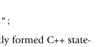

这种实现看起来不错，而且确实是一个格式正确的 C++ 语句，编译器会接受它并且运行不会出现错误信息。然而，它并没有实现伪代码。请注意，该语句有两次出现 `if`，只有一个 `else`。编译器必须决定哪个 `if` 与唯一的 `else` 配对。我们很漂亮地缩进了这个嵌套语句，以显示 `else` 应该与第一个 `if` 配对，但编译器不关心缩进。对编译器来说，前面的嵌套语句与以下仅在缩进方式上不同的版本相同：

```
if (fuelGaugeReading < 0.75)
    if (fuelGaugeReading < 0.25)
        cout << "Fuel very low. Caution!\n";
else
    cout << "Fuel over 3/4. Don't stop now!\n";
```

不幸的是对我们而言，编译器将使用第二种解释，并将唯一的 `else` 与第二个 `if` 而不是第一个 `if` 配对。这有时被称为悬挂 `else` 问题；它由显示 3.4 中的程序说明。

编译器总是将 `else` 与最近的尚未与某个 `else` 配对的 `if` 配对。但是，不要试图遵循此规则。忽略

### DISPLAY 3.4 大括号的重要性

```
//Illustrates the importance of using braces in if-else statements.
#include <iostream>
using namespace std;
int main()
{
    double fuelGaugeReading;

    cout << "Enter fuel gauge reading: ";
    cin >> fuelGaugeReading;

    cout << "First with braces:\n";
    if (fuelGaugeReading < 0.75)
    {
        if (fuelGaugeReading < 0.25)
            cout << "Fuel very low. Caution!\n";
    }
    else
    {
        cout << "Fuel over 3/4. Don't stop now!\n";
    }

    cout << "Now without braces:\n";
    if (fuelGaugeReading < 0.75)
        if (fuelGaugeReading < 0.25)
            cout << "Fuel very low. Caution!\n";
    else
        cout << "Fuel over 3/4. Don't stop now!\n";

    return 0;
}
```

这种缩进很漂亮，但不是计算机遵循的方式。

# Sample Dialogue 1

Enter fuel gauge reading: 0.1
First with braces:
Fuel very low. Caution!
Now without braces:
Fuel very low. Caution!

在这种情况下，大括号没有区别，但请参阅对话 2。

## Sample Dialogue 2

Enter fuel gauge reading: 0.5
First with braces:
Now without braces:
Fuel over 3/4. Don't stop now!

这里不应该有输出，并且由于大括号的存在，没有输出。

无大括号版本的不正确输出。

```
if (guess > number)
    cout << "Too high.";
else
    if (guess < number)
        cout << "Too low.";
    else
        if (guess == number)
            cout << "Correct!";
```

使用之前的缩进模式而不是这种模式。

这是在极少数情况下，你不应遵循我们对嵌套语句缩进的一般指导原则之一。原因是通过将所有 `else` 对齐，你也将所有条件/动作对对齐，从而使程序的布局反映你的推理。另一个原因是即使对于不太深的嵌套 `if-else` 语句，你也可能很快用完页面上的空间！

由于条件是互斥的，上面的嵌套 `if-else` 语句中的最后一个 `if` 是多余的，可以省略，但有时最好将其作为注释包含如下：

```
if (guess > number)
    cout << "Too high.";
else if (guess < number)
    cout << "Too low.";
else //(guess == number)
    cout << "Correct!";
```

即使条件不是互斥的，你也可以使用这种多分支 `if-else` 语句形式。无论条件是否互斥，计算机都会按出现的顺序评估条件，直到找到第一个为真的条件，然后执行与该条件对应的动作。如果没有任何条件为真，则不采取任何行动。如果语句以没有 `if` 的普通 `else` 结束，则当所有条件都为假时，最后一条语句将被执行。

### 多路 `if-else` 语句

### SYNTAX

```
if (Boolean_Expression_1)
    Statement_1
else if (Boolean_Expression_2)
    Statement_2
    .
    .
    .
else if (Boolean_Expression_n)
    Statement_n
else
    Statement_For_All_Other_Possibilities
```

(continued)

### ### PROGRAMMING EXAMPLE — 州所得税

显示 3.5 包含一个使用多路 `if-else` 语句的程序。该程序接收纳税人的净收入，取整到美元，并计算该净收入应缴纳的州所得税。该州根据以下税率表计算税款：

- 1. 前 $15,000 净收入不缴税。
- 2. $15,001 至 $25,000 净收入的每一美元征收 5% 的税。
- 3. 超过 $25,000 净收入的每一美元征收 10% 的税。

显示 3.5 中定义的程序使用多路 `if-else` 语句，为这三种情况中的每一种提供一个动作。第二种情况的条件实际上比需要的更复杂。计算机不会在尝试第一个条件并发现其为 `false` 之前进入第二个条件。因此，你知道每当计算机尝试第二个条件时，它都会知道 `netIncome` 大于 15000。因此，你可以用以下内容替换行

```
else if ((netIncome > 15000) && (netIncome <= 25000))
```

程序将完全相同地执行：

```
else if (netIncome <= 25000)
```

```
if ((temperature < -10) && (day == SUNDAY))
    cout << "Stay home.";
else if (temperature <= -10) //and day != SUNDAY
    cout << "Stay home, but call work.";
else if (temperature <= 0) //and temperature >= -10
    cout << "Dress warm.";
else //temperature > 0
    cout << "Work hard and play hard.";
```

布尔表达式按顺序检查，直到遇到第一个为真的布尔表达式，然后执行相应的语句。如果没有任何布尔表达式为真，则执行 *Statement_For_All_Other_Possibilities*。


## 自测练习

5. 当以下代码嵌入到完整的程序中时，会产生什么输出？

```
int x = 2;
cout << "Start\n";
if (x <= 3)
    if (x != 0)
        cout << "Hello from the second if.\n";
    else
        cout << "Hello from the else.\n";
cout << "End\n";

cout << "Start again\n";
if (x > 3)
    if (x != 0)
        cout << "Hello from the second if.\n";
    else
        cout << "Hello from the else.\n";
cout << "End again\n";
```

6. 当以下代码嵌入到完整的程序中时，会产生什么输出？

```
int extra = 2;
if (extra < 0)
    cout << "small";
else if (extra == 0)
    cout << "medium";
else
    cout << "large";
```

7. 如果自测练习 6 中的赋值改为如下，自测练习 6 的输出会是什么？

```
int extra = -37;
```

8. 如果自测练习 6 中的赋值改为如下，自测练习 6 的输出会是什么？

```
int extra = 0;
```

9. 当以下代码嵌入到完整的程序中时，会产生什么输出？

```
int x = 200;
cout << "Start\n";
if (x < 100)
    cout << "First Output.\n";
else if (x > 10)
    cout << "Second Output.\n";
else
    cout << "Third Output.\n";
cout << "End\n";
```

10. 如果自测练习 9 中的布尔表达式 (x > 10) 改为 (x > 100)，自测练习 9 的输出会是什么？

11. 当以下代码嵌入到完整的程序中时，会产生什么输出？

```
int x = SOME_CONSTANT;
cout << "Start\n";
if (x < 100)
    cout << "First Output.\n";
else if (x > 100)
    cout << "Second Output.\n";
else
    cout << x << endl;
cout << "End\n";
```

SOME_CONSTANT 是类型为 int 的常量。假设既没有输出 "First Output" 也没有输出 "Second Output"。因此，你知道 x 的值会被输出。

12. 编写一个多路 if-else 语句，将 int 变量 n 的值分类为以下类别之一并输出适当的提示信息：

n < 0 or 0 ≤ n ≤ 100 or n > 100

13. 给定以下声明和输出语句，假设它已嵌入到正确的程序中并运行。输出是什么？

```
enum Direction { N, S, E, W };
//...
cout << W << " " << E << " " << S << " " << N << endl;
```

14. 给定以下声明和输出语句，假设它已嵌入到正确的程序中并运行。输出是什么？

```
enum Direction { N = 5, S = 7, E = 1, W };
// ...
cout << W << " " << E << " " << S << " " << N << endl;
```

# switch 语句

你已经看到 if-else 语句用于构造多路分支。switch 语句是另一种 C++ 语句，也实现了

多路分支。Display 3.6 中显示了一个示例 switch 语句。这个特定的 switch 语句有四个常规分支和一个用于非法输入的第五个分支。变量 grade 决定执行哪个分支。每个成绩 'A'、'B' 和 'C' 各有一个分支。成绩 'D' 和 'F' 导致同一个分支被执行，而不是为 'D' 和 'F' 各自设置单独的动作。如果 grade 的值是除 'A'、'B'、'C'、'D' 或 'F' 之外的任何字符，则执行 default 标识符之后的 cout 语句。

# DISPLAY 3.6 switch 语句 (第 1 部分，共 2 部分)

```
//Program to illustrate the switch statement.
#include <iostream>
using namespace std;
int main()
{
    char grade;
    cout << "Enter your midterm grade and press Return: ";
    cin >> grade;
    switch (grade)
    {
        case 'A':
            cout << "Excellent. "
                << "You need not take the final.\n";
            break;
        case 'B':
            cout << "Very good. ";
            grade = 'A';
            cout << "Your midterm grade is now "
                << grade << endl;
            break;
        case 'C':
            cout << "Passing.\n";
            break;
        case 'D':
        case 'F':
            cout << "Not good. "
                << "Go study.\n";
            break;
        default:
            cout << "That is not a possible grade.\n";
    }
    cout << "End of program.\n";
    return 0;
}
```

# DISPLAY 3.6 switch 语句 (第 2 部分，共 2 部分)

# 示例对话 1

```
Enter your midterm grade and press Return: A
Excellent. You need not take the final.
End of program.
```

# 示例对话 2

```
Enter your midterm grade and press Return: B
Very good. Your midterm grade is now A.
End of program.
```

# 示例对话 3

```
Enter your midterm grade and press Return: D
Not good. Go study.
End of program.
```

# 示例对话 4

```
Enter your midterm grade and press Return: E
That is not a possible grade.
End of program.
```


switch 语句的语法和首选缩进模式在 Display 3.6 中的示例 switch 语句以及标题为 "switch Statement" 的框中显示。

当执行 switch 语句时，会执行多个不同分支中的一个。执行哪个分支的选择由 switch 关键字后括号中的控制表达式决定。Display 3.6 中显示的示例 switch 语句中的控制表达式的类型为 char。switch 语句的控制表达式必须始终返回 bool 值、enum 常量、整数类型之一或字符。当执行 switch 语句时，会计算该控制表达式，计算机查看各个 case 标识符之后给出的常量值。如果它找到一个等于控制表达式值的常量，它就会执行该 case 的代码。例如，如果表达式求值为 'B'，那么它会查找以下内容并执行此行之后的语句：

```
case 'B':
```

请注意，常量后面跟着一个冒号。还要注意，你不能有两个 case 之后带有相同常量值的出现，因为那将是模棱两可的指令。

break 语句由关键字 break 后跟分号组成。当计算机执行 case 标签之后的语句时，它会一直继续直到遇到 break 语句。当计算机遇到 break 语句时，switch 语句结束。如果你省略 break 语句，那么在执行完一个 case 的代码后，计算机将继续执行下一个 case 的代码。

请注意，你可以为同一段代码使用两个 case 标签。在 Display 3.6 的 switch 语句中，对值 'D' 和 'F' 执行相同的操作。这种技术也可以用来允许大小写字母。例如，要允许 Display 3.6 程序中的小写 'a' 和大写 'A'，你可以将

```
case 'A':
    cout << "Excellent. "
        << "You need not take the final.\n";
    break;
```

替换为以下内容：

```
case 'A':
case 'a':
    cout << "Excellent. "
        << "You need not take the final.\n";
    break;
```

当然，对所有其他字母也可以这样做。

如果没有 case 标签的常量与控制表达式的值匹配，则执行 default 标签之后的语句。你不必有 default 部分。如果没有 default 部分并且找不到与控制表达式值匹配的情况，则执行 switch 语句时不会发生任何事情。然而，最安全的做法是始终拥有 default 部分。如果你认为你的 case 标签列出了所有可能的结果，那么你可以在 default 部分放置一条错误消息。这就是我们在 Display 3.6 中所做的。

# switch Statement

### SYNTAX

```
switch (Controlling_Expression)
{
    case Constant_1:
        Statement_Sequence_1
        break;
```

(continued)

### EXAMPLE

```
case Constant_2:
    Statement_Sequence_2
    break;
.
.
.
case Constant_n:
    Statement_Sequence_n
    break;
default:
    Default_Statement_Sequence }
int vehicleClass;
cout << "Enter vehicle class: ";
cin >> vehicleClass;

switch (vehicleClass)
{
    case 1:
        cout << "Passenger car.";
        toll = 0.50;
        break;
    case 2:
        cout << "Bus.";
        toll = 1.50;
        break;
    case 3:
        cout << "Truck.";
        toll = 2.00;
        break;
    default:
        cout << "Unknown vehicle class!";
}
```

# PITFALL Forgetting a break in a switch Statement

如果你在 switch 语句中忘记了 break，编译器不会发出错误消息。你编写了一个语法正确的 switch 语句，但它不会按你的预期工作。考虑标题为 "switch Statement" 的框中的 switch 语句。如果省略了 break 语句，如箭头所示，那么当变量 vehicleClass 的值为 1 时，标记为

```
case 1:
```


would be executed as desired, but then the computer would go on to also execute the next case. This would produce a puzzling output that says the vehicle is a passenger car and then later says it is a bus; moreover, the final value of toll would be 1.50, not 0.50 as it should be. When the computer starts to execute a case, it does not stop until it encounters either a break or the end of the switch statement.

## Using switch Statements for Menus

The multiway if-else statement is more versatile than the switch statement, and you can use a multiway if-else statement anywhere you can use a switch statement. However, sometimes the switch statement is clearer. For example, the switch statement is perfect for implementing menus.

## DISPLAY 3.7 A Menu (part 1 of 2)

```
1  //Program to give out homework assignment information.
2  #include <iostream>
3  using namespace std;


6  int main()
7  {
8      int choice;

10     do
11     {
12         cout << endl
13             << "Choose 1 to see the next homework assignment.\n"
14             << "Choose 2 for your grade on the last assignment.\n"
15             << "Choose 3 for assignment hints.\n"
16             << "Choose 4 to exit this program.\n"
17             << "Enter your choice and press Return: ";
18     cin >> choice;

20     switch(choice)
21     {
22         case 1:
23             //code to display the next assignment on screen would go here.
24             break;
25         case 2:
26             //code to ask for a student number and give the corresponding
27             //grade would go here.
28             break;
29         case 3:
30             //code to display a hint for the current assignment would go
```

## Blocks

Each branch of a switch statement or of an if-else statement is a separate subtask. As indicated in the previous Programming Tip, it is often best to make the action of each branch a function call. That way the subtask for each branch can be designed, written, and tested separately. On the other hand, sometimes the action of one branch is so simple that you can just make it a compound statement. Occasionally, you may want to give this compound statement its own local variables. For example, consider the program in Display 3.8. It calculates the final bill for a specified number of items at a given price. If the sale is a wholesale transaction, then no sales tax is charged (presumably because the tax will be paid when the items are resold to retail buyers). If, however, the sale is a retail transaction, then sales tax must be added. An if-else statement is used to produce different calculations for wholesale and retail purchases. For the retail purchase, the calculation uses a temporary variable called subtotal, and so that variable is declared within the compound statement for that branch of the if-else statement.

As shown in Display 3.8, the variable subtotal is declared within a compound statement. If we wanted to, we could have used the variable name subtotal for something else outside of the compound statement in which it is declared. A variable that is declared inside a compound statement is local to the compound statement. Local variables are created when the compound statement is executed and are destroyed when the compound statement is completed. In other words, local variables exist only within the compound statement in which they are declared. Within a compound statement, you can use all the variables declared outside of the compound statement, as well as the local variables declared inside the compound statement.

## DISPLAY 3.8 Block with a Local Variable (part 1 of 2)

```
1  //Program to compute bill for either a wholesale or a retail purchase.
2  #include <iostream>
3  using namespace std;


6  int main()
7  {
8      const double TAX_RATE = 0.05; //5% sales tax
9      char saleType;
10     int number;
11     double price, total;

13     cout << "Enter price $";
14     cin >> price;
```

## DISPLAY 3.8 Block with a Local Variable (part 2 of 2)

```
15    cout << "Enter number purchased: ";
16    cin >> number;
17    cout << "Type W if this is a wholesale purchase.\n"
18        << "Type R if this is a retail purchase.\n"
19        << "Then press Return.\n";
20    cin >> saleType;

22    if ((saleType == 'W') || (saleType == 'w'))
23    {
24        total = price * number;
25    }
26    else if ((saleType == 'R') || (saleType == 'r'))
27    {
28        double subtotal;  // Local to the block
29        subtotal = price * number;
30        total = subtotal + subtotal * TAX_RATE;
31    }
32    else
33    {
34        cout << "Error in input.\n";
35    }
36    cout.setf(ios::fixed);
37    cout.setf(ios::showpoint);
38    cout.precision(2);
39    cout << number << " items at $" << price << endl;
40    cout << "Total Bill = $" << total;
41    if ((saleType == 'R') || (saleType == 'r'))
42        cout << " including sales tax.\n";

44    return 0;
45 }
```

# Sample Dialogue

Enter price: $10.00
Enter number purchased: 2
Type W if this is a wholesale purchase.
Type R if this is a retail purchase.
Then press Return.
R
2 items at $10.00
Total Bill = $21.00 including sales tax.

A compound statement with declarations is more than a simple compound statement, so it has a special name. A compound statement that contains variable declarations is usually called a block, and the variables declared within the block are said to be local to the block or to have the block as their scope. (A plain old compound statement that does not contain any variable declarations is also called a block. Any code enclosed in braces is called a block.)

In Chapter 4 we will show how to define functions. The body of a function definition is also a block. There is no standard name for a block that is not the body of a function. However, we want to talk about these kinds of blocks, so let us create a name for them. Let’s call a block a statement block when it is not the body of a function (and not the body of the main part of a program).

Statement blocks can be nested within other statement blocks, and basically the same rules about local variable names apply to these nested statement blocks as those we have already discussed, but applying the rules can be tricky when statement blocks are nested. A better rule is to not nest statement blocks. Nested statement blocks make a program hard to read. If you feel the need to nest statement blocks, instead make some of the statement blocks into function definitions and use function calls rather than nested statement blocks. In fact, statement blocks of any kind should be used sparingly. In most situations, a function call is preferable to a statement block. For completeness, we include the scope rule for nested blocks in the accompanying summary box.

## Blocks

A block is some C++ code enclosed in braces. The variables declared in a block are local to the block and so the variable names can be used outside of the block for something else (such as being reused as the name for a different variable).

## Scope Rule for Nested Blocks

If an identifier is declared as a variable in each of two blocks, one within the other, then these are two different variables with the same name. One variable exists only within the inner block and cannot be accessed outside of the inner block. The other variable exists only in the outer block and cannot be accessed in the inner block. The two variables are distinct, so changes made to one of these variables will have no effect on the other of these two variables.

```
int number = 22;
{
    int number = 42;
    cout << number << " ";
}
cout << number;
```

20. Though we urge you not to program using this style, we are providing an exercise that uses nested blocks to help you understand the scope rules. Give the output that this code fragment would produce if embedded in an otherwise complete, correct program.

```
{
    int x = 1;
    cout << x << endl;
    {
        cout << x << endl;
        int x = 2;
        cout << x << endl;
        {
            cout << x << endl;
            int x = 3;
            cout << x << endl;
        }
        cout << x << endl;
    }
    cout << x << endl;
}
```

## 3.3 MORE ABOUT C++ LOOP STATEMENTS

> It is not true that life is one damn thing after another—
> It’s one damn thing over and over.
> 
> EDNA ST. VINCENT MILLAY, Letter to Arthur Darison Ficke, October 24, 1930

A loop is any program construction that repeats a statement or sequence of statements a number of times. The simple while loops and do-while loops that we have already seen are examples of loops. The statement (or group of statements) to be repeated in a loop is called the body of the loop, and each repetition of the loop body is called an iteration of the loop. The two main design questions when constructing loops are: What should the loop body be? How many times should the loop body be iterated?

## The while Statements Reviewed

The syntax for the while statement and its variant, the do-while statement, is reviewed in Display 3.9. The important difference between the two types of


循环涉及在何时检查控制布尔表达式。当 while 语句被执行时，布尔表达式会在循环体执行之前被检查。如果布尔表达式求值为 false，则体根本不会被执行。对于 do-while 语句，循环体的执行先于布尔表达式的检查，而布尔表达式是在循环体执行之后才检查的。因此，do-while 语句总是至少执行一次循环体。在此启动之后，while 循环和 do-while 循环的行为非常相似。在循环体每次迭代之后，布尔表达式再次被检查；如果为真，则循环再次迭代。如果它从真变为假，则循环语句结束。

## DISPLAY 3.9 while 语句和 do-while 语句的语法

带单个语句体的 while 语句

while (Boolean_Expression)
    Statement  ← Body

带多语句体的 while 语句

while (Boolean_Expression)
{
    Statement_1
    Statement_2
    .
    .
    Statement_Last
}  Body

带单个语句体的 do-while 语句

do
    Statement  ← Body
while (Boolean_Expression);

带多语句体的 do-while 语句

do
{
    Statement_1
    Statement_2
    .
    .
    Statement_Last
} while (Boolean_Expression);  Body

当 while 循环被执行时发生的第一件事是控制布尔表达式被求值。如果此时布尔表达式求值为 false，则循环体永远不会被执行。执行循环体零次似乎毫无意义，但有时这是期望的动作。例如，while 循环经常用于求和数字列表，但列表可能为空。更具体地说，记账平衡程序可能会使用 while 循环来求和你在一个月内写出的所有支票的价值——但你可能休了一个月的假，一张支票也没写。在这种情况下，没有数字需要求和，因此循环迭代零次。

## 增量和减量运算符回顾

你已将增量运算符用作将变量值增加 1 的语句。例如，以下代码将输出 42 到屏幕：

```
int number = 41;
number++;
cout << number;
```

迄今为止我们一直将增量运算符用作语句。但增量运算符也是一个运算符，就像 + 和 ? 运算符一样。像 number++ 这样的表达式也会返回一个值，因此 number++ 可以用在诸如

```
2 * (number++)
```

的算术表达式中

表达式 number++ 首先返回变量 number 的值，然后 number 的值增加 1。例如，考虑以下代码：

```
int number = 2;
int valueProduced = 2 * (number++);
cout << valueProduced << endl;
cout << number << endl;
```

此代码将产生以下输出：

4
3

注意表达式 2 * (number++)。当 C++ 求值此表达式时，它使用 number 在递增之前的值，而不是递增之后的值。因此，表达式 number++ 的值是 2，即使增量运算符将 number 的值更改为 3。这可能看起来很奇怪，但有时这正是你想要的。而且，正如你即将看到的，如果你想要一个行为不同的表达式，你可以拥有它。

表达式 v++ 求值为变量 v 的值，然后变量 v 的值增加 1。如果你将顺序反转并把

++ 放在变量前面，这两个动作的顺序就被反转了。表达式 ++v 首先增加变量 v 的值，然后返回 v 的这个增加后的值。例如，考虑以下代码：

```
int number = 2;
int valueProduced = 2 * (++number);
cout << valueProduced << endl;
cout << number << endl;
```

此代码与上一段代码相同，只是 ++ 在变量之前，因此此代码产生以下输出：

6
3

注意两个增量运算符 number++ 和 ++number 对变量 number 具有相同的效果：它们都将 number 的值增加 1。但这两个表达式求值为不同的值。记住，如果 ++ 在变量之前，则递增在返回值之前完成；如果 ++ 在变量之后，则递增在返回值之后完成。

Display 3.10 中的程序使用增量运算符在 while 循环中计算循环体重复的次数。增量运算符的主要用途之一是以类似于 Display 3.10 中所做的方式控制循环的迭代。

## DISPLAY 3.10 增量运算符作为表达式（第 1 部分，共 2 部分）

//Calorie-counting program.
#include <iostream>
using namespace std;

int main()
{
    int numberOfItems, count,
        caloriesForItem, totalCalories;

    cout << "How many items did you eat today? ";
    cin >> numberOfItems;

    totalCalories = 0;
    count = 1;
    cout << "Enter the number of calories in each of the\n"
         << numberOfItems << " items eaten:\n";

    while (count++ <= numberOfItems)

(continued)

## DISPLAY 3.10 增量运算符作为表达式（第 2 部分，共 2 部分）

```
19       {
20           cin >> caloriesForItem;
21           totalCalories = totalCalories
22                           + caloriesForItem;
23       }
24
25       cout << "Total calories eaten today = "
26           << totalCalories << endl;
27       return 0;
28   }
```

### 示例对话

```
How many items did you eat today?
7
Enter the number of calories in each of the
7 items eaten:
300 60 1200 600 150 1 120
Total calories eaten today = 2431
```

我们对增量运算符所说的一切同样适用于减量运算符，只是变量的值减少 1 而不是增加 1。例如，考虑以下代码：

```
int number = 8;
int valueProduced = number--;
cout << valueProduced << endl;
cout << number << endl;
```

这会产生输出

```
8
7
```

另一方面，代码

```
int number = 8;
int valueProduced = --number;
cout << valueProduced << endl;
cout << number << endl;
```

产生输出

```
7
7
```

减量运算符

number-- 返回 number 的值然后递减 number；另一方面，--number 首先递减 number 然后返回 number 的值。

你不能将增量和减量运算符应用于除单个变量之外的任何东西。诸如 (x + y)++、--(x + y)、5++ 等表达式在 C++ 中都是非法的。

++ 和 -- 只能与变量一起使用

## 自测练习

21. 以下内容的输出是什么（嵌入完整程序时）？

```
int count = 3;
while (count-- > 0)
    cout << count << " ";
```

22. 以下内容的输出是什么（嵌入完整程序时）？

```
int count = 3;
while (--count > 0)
    cout << count << " ";
```

23. 以下内容的输出是什么（嵌入完整程序时）？

```
int n = 1;
do
    cout << n << " ";
while (n++ <= 3);
```

24. 以下内容的输出是什么（嵌入完整程序时）？

```
int n = 1;
do
    cout << n << " ";
while (++n <= 3);
```

### for 语句

while 语句和 do-while 语句是你绝对需要的全部循环机制。事实上，仅 while 语句就足够了。然而，有一种循环如此常见，以至于 C++ 为此包含了一个特殊的语句。在进行数值计算时，常见的做法是用数字 1，然后用数字 2，然后用 3，等等，直到达到某个最后值。例如，要将 1 到

n = 1 表示 n 初始化为 1。n <= 10 表示只要 n 小于或等于 10，循环就会继续迭代体。最后一个表达式 n++ 表示在每次执行循环体后 n 增加 1。

for 语句开头的三个表达式由两个且仅两个分号分隔。不要屈服于在第三个表达式后放置分号的诱惑。（技术解释是这三件事是表达式，而不是语句，因此不需要在末尾加上分号。）

Display 3.11 显示了 for 语句的语法，并通过展示它如何转换为等效的 while 语句来描述 for 语句的动作。注意在 for 语句中，与相应的 while 语句一样，停止条件是在第一次循环迭代之前测试的。因此，可能存在一个其体被执行零次的 for 循环。

## DISPLAY 3.11 for 语句（第 1 部分，共 2 部分）

### for 语句

### SYNTAX

```
1   for (Initialization_Action; Boolean_Expression; Update_Action)
2       Body_Statement
```

### EXAMPLE

```
1   for (number = 100; number >= 0; number--)
2       cout << number
3           << " bottles of beer on the shelf.\n";
```

### Equivalent while Loop

### EQUIVALENT SYNTAX

```
1   Initialization_Action;
2   while (Boolean_Expression)
3   {
4       Body_Statement
5       Update_Action;
6   }
```

### EQUIVALENT EXAMPLE

```
1   number = 100;
2   while (number >= 0)
```


## 展示 3.11 for 语句（第 2 部分，共 2 部分）

```
3   {
4       cout << number
5       << " bottles of beer on the shelf.\n";
6       number--;
7   }
```

### 输出

```
100 bottles of beer on the shelf.
99 bottles of beer on the shelf.
.
.
.
0 bottles of beer on the shelf.
```

展示 3.12 显示了一个嵌入在完整（虽然非常简单）程序中的 for 语句示例。展示 3.12 中的 for 语句与上面讨论的类似，但它有一个新特性。变量 `n` 在初始化为 1 时被声明。因此，`n` 的声明位于 for 语句内部。for 语句中的初始化操作可以包含变量声明。当变量仅在 for 语句内部使用时，这里可能是声明该变量的最佳位置。但是，如果该变量也在 for 语句外部使用，则最好在 for 语句外部声明该变量。

ANSI C++ 标准要求声称符合该标准的 C++ 编译器将 for 循环初始化器中的任何声明视为循环体内部的局部声明。早期的 C++ 编译器并不这样做。你应该确定你的编译器如何处理在 for 循环初始化器中声明的变量。为了可移植性，你不应该编写依赖这种行为的代码。ANSI C++ 标准要求在 for 循环初始化表达式中声明的变量是 for 循环块的局部变量。下一代 C++ 编译器很可能会遵守此规则，但目前可用的编译器可能遵守也可能不遵守。

我们对 for 语句的描述比实际允许的情况稍微不那么通用。for 语句开头的三个表达式可以是任何 C++ 表达式，因此它们可能涉及多个（甚至更少！）变量。然而，我们的 for 语句在这些表达式中始终只使用单个变量。

在展示 3.12 的 for 语句中，循环体是简单的赋值语句

```
sum = sum + n;
```

在 for 语句中声明变量

## 展示 3.12 一个 for 语句

```
1  //Illustrates a for loop.
2 #include <iostream>
3 using namespace std;
4 
5 int main( )
6 {
7     int sum = 0;
8 
9     for (int n = 1; n <= 10; n++) //Note that the variable n is a local
10        sum = sum + n;           //variable of the body of the for loop!
11 
12     cout << "The sum of the numbers 1 to 10 is "
13         << sum << endl;
14     return 0;
15 }
```

初始化操作

只要此条件为真，就重复循环。

每次循环体迭代后执行

### 输出

```
The sum of the numbers 1 to 10 is 55
```

## 展示 3.13 带多语句循环体的 for 循环

## 语法

```
for (Initialization_Action; Boolean_Expression; Update_Action)
{
    Statement_1
    Statement_2
    .
    .
    .
    Statement_Last
}
```

循环体

### 示例

```
for (int number = 100; number >= 0; number--)
{
    cout << number
        << " bottles of beer on the shelf.\n";
    if (number > 0)
        cout << "Take one down and pass it around.\n";
}
```

循环体可以是任何语句。特别是，循环体可以是复合语句。这允许我们在 for 循环的循环体中放置多个语句，如展示 3.13 所示。

到目前为止，你已经见过每次循环迭代后将循环控制变量增加 1 的 for 循环，也见过每次循环迭代后将循环控制变量减少 1 的 for 循环。还有更多可能的变量更新方式。变量可以增加或减少 2、3 或任意数字。如果变量是 `double` 类型，它可以增加或减少一个分数值。以下所有都是合法的 for 循环：

```
int n;
for (n = 1; n <= 10; n = n + 2)
    cout << "n is now equal to " << n << endl;
```

```
for (n = 0; n > -100; n = n - 7)
    cout << "n is now equal to " << n << endl;
```

```
for (double size = 0.75; size <= 5; size = size + 0.05)
    cout << "size is now equal to " << size << endl;
```

更新操作甚至不一定是加法或减法。此外，初始化操作也不一定只是将变量设置为常量。你可以用几乎任何你喜欢的方式初始化和改变循环控制变量。例如，下面演示了另一种启动 for 循环的方式：

```
for (double x = pow(y, 3.0); x > 2.0; x = sqrt(x))
    cout << "x is now equal to " << x << endl;
```

## 陷阱：for 语句中多余的分号

不要在 for 循环开头的右括号后面放置分号。要了解可能发生的情况，请考虑以下 for 循环：

```
for (int count = 1; count <= 10; count++); 问题分号
cout << "Hello\n";
```

如果你没有注意到多余的分号，你可能期望这个 for 循环在屏幕上输出十次 Hello。如果你确实注意到了分号，你可能期望编译器发出错误消息。这两件事都不会发生。如果你将这个 for 循环嵌入到一个完整的程序中，编译器不会报错。如果你运行该程序，只会输出一个 Hello 而不是十个 Hello。发生了什么？要回答这个问题，我们需要一些背景知识。

在 C++ 中创建语句的一种方法是在某物后面加上分号。如果你在 `x++` 后面加上分号，你就将表达式

```
x++
```

变成了语句

```
x++;
```

如果你什么都不加就放一个分号，你仍然会创建一条语句。因此，单独一个分号就是一条语句，称为空语句或 null 语句。空语句不执行任何操作，但它仍然是一条语句。因此，以下是一个完整且合法的 for 循环，其循环体是空语句：

```
for (int count = 1; count <= 10; count++);
```

这个 for 循环确实迭代了十次，但由于循环体是空语句，迭代循环体时不发生任何事情。这个循环什么也不做，而且它做了十次什么也不做！

现在让我们回过头来考虑标记为“问题分号”的 for 循环代码。由于多余的分号，该代码以一个具有空循环体的 for 循环开始，正如我们刚才讨论的，这个 for 循环什么也完不成。for 循环完成后，执行下面的 cout 语句并向屏幕写一次 Hello：

```
cout << "Hello\n";
```

你最终会看到一些使用空循环体的 for 循环的用途，但在现阶段，这样的 for 循环很可能只是一个粗心的错误。

更多可能的更新操作

## 使用哪种循环

在设计循环时，选择使用哪种 C++ 循环语句最好推迟到设计过程的最后。首先使用伪代码设计循环，然后将伪代码转换为 C++ 代码。此时，就很容易决定使用哪种类型的 C++ 循环语句了。

如果循环涉及使用一个变量进行数值计算，并且该变量在每次循环中变化的量相等，则使用 for 循环。事实上，每当你有一个用于数值计算的循环时，你都应该考虑使用 for 循环。它并不总是合适的，但对于数值计算来说，它通常是最清晰、最容易使用的循环。

在其他大多数情况下，你应该使用 while 循环或 do-while 循环；决定使用这两种中的哪一种相当容易。如果你希望确保循环体至少执行一次，可以使用 do-while 循环。如果存在某些情况使得循环体根本不应该执行，那么你必须使用 while 循环。一种常见的情况是读取输入时可能根本没有数据，这需要使用 while 循环。例如，如果程序读取一个学生的考试成绩列表，可能存在学生没有参加任何考试的情况，因此输入循环可能面对一个空列表。这就需要使用 while 循环。

## 自测练习

25. 以下代码（嵌入到完整程序中时）的输出是什么？

```
for (int count = 1; count < 5; count++)
    cout << (2 * count) << " ";
```

26. 以下代码（嵌入到完整程序中时）的输出是什么？

```
for (int n = 10; n > 0; n = n - 2)
{
    cout << "Hello ";
    cout << n << endl;
}
```

27. 以下代码（嵌入到完整程序中时）的输出是什么？

```
for (double sample = 2; sample > 0; sample = sample - 0.5)
    cout << sample << " ";
```

28. 对于以下每种情况，说明哪种类型的循环（while、do-while 或 for）最合适：

- a. 对一个序列求和，例如 1/2 + 1/3 + 1/4 + 1/5 + ... + 1/10。
- b. 读取一个学生的考试成绩列表。
- c. 读取一个部门中员工请病假的天数。
- d. 测试一个函数，看看它在不同参数值下表现如何。

29. 将以下循环重写为 for 循环。

- a. int i = 1;
  while (i <= 10)
  {
      if (i < 5 && i != 2)
          cout << 'X';
      i++;
  }

b. int i = 1;
while (i <= 10)


```cpp
{
    cout << 'X';
    i = i + 3;
}
c. long m = 100;
do
{
    cout << 'X';
    m = m + 100;
} while (m < 1000);
```

30. 这个循环的输出是什么？找出 `n` 的值与变量 `log` 的值之间的联系。

```cpp
int n = 1024;
int log = 0;
for (int i = 1; i < n; i = i * 2)
    log++;
cout << n << " " << log << endl;
```

31. 这个循环的输出是什么？对代码进行评注。

```cpp
int n = 1024;
int log = 0;
for (int i = 1; i < n; i = i * 2);
    log++;
cout << n << " " << log << endl;
```

32. 这个循环的输出是什么？对代码进行评注。

```cpp
int n = 1024;
int log = 0;
for (int i = 0; i < n; i = i * 2)
    log++;
cout << n << " " << log << endl;
```

## PITFALL 未初始化变量和无限循环

当我们在第 2 章首次介绍简单的 `while` 和 `do-while` 循环时，我们警告过你循环相关的两个陷阱。我们说过，你应该确保在循环执行前，所有需要在循环中使用的变量都已初始化（即赋予值）。在抽象地陈述时这似乎显而易见，但在实践中，很容易因为过于关注循环的设计而忘记在循环前初始化变量。我们还说过，你应该小心避免无限循环。这两种谨慎同样适用于 `for` 循环。

## The break Statement

你已经使用过 `break` 语句来结束一个 `switch` 语句。相同的 `break` 语句可用于退出循环。有时你想在循环正常结束之前退出循环。例如，循环可能包含对不当输入的检查，如果遇到不当输入，你可能只想立即结束循环。Display 3.14 中的代码读取一组负数并将其和作为变量 `sum` 的值计算出来。只要用户输入十个负数，循环就会正常结束。如果用户忘记了负号，计算就会被破坏，并且在执行 `break` 语句时循环会立即结束。

**DISPLAY 3.14 A break Statement in a Loop**

```cpp
//Sums a list of ten negative numbers.
#include <iostream>
using namespace std;

int main()
{
    int number, sum = 0, count = 0;
    cout << "Enter 10 negative numbers:\n";

    while (++count <= 10)
    {
        cin >> number;

        if (number >= 0)
        {
            cout << "ERROR: positive number or zero was entered as the\n"
                 << count << "th number! Input ends with the "
                 << count << "th number.\n"
                 << count << "th number was not added in.\n";
            break;
        }

        sum = sum + number;
    }
    cout << sum << " is the sum of the first " << (count - 1) << " numbers.\n";

    return 0;
}
```

**Sample Dialogue**

```text
Enter 10 negative numbers:
-1 -2 -3 4 -5 -6 -7 -8 -9 -10
ERROR: positive number or zero was entered as the
4th number! Input ends with the 4th number.
4th number was not added in.
-6 is the sum of the first 3 numbers.
```

## The break Statement

`break` 语句可用于退出循环语句。当执行 `break` 语句时，循环语句会立即结束，执行会继续到循环语句之后的语句。`break` 语句可用于任何形式的循环——在 `while` 循环中、在 `do-while` 循环中，或在 `for` 循环中。这与我们在 `switch` 语句中已使用的 `break` 语句相同。

## PITFALL The break Statement in Nested Loops

`break` 语句仅结束包含它的最内层循环。如果你在循环内有另一个循环，并且在内层循环中有 `break` 语句，那么 `break` 语句只会结束内层循环。

## SELF-TEST EXERCISES

33. 以下内容的输出是什么（当嵌入到完整程序中时）？

```cpp
int n = 5;
while (--n > 0)
{
    if (n == 2)
        break;
    cout << n << " ";
}
cout << "End of Loop.";
```

34. 以下内容的输出是什么（当嵌入到完整程序中时）？

```cpp
int n = 5;
while (--n > 0)
{
    if (n == 2)
        exit(0);
    cout << n << " ";
}
cout << "End of Loop.";
```

35. `break` 语句做什么？`break` 语句合法放置的位置在哪里？

## 3.4 DESIGNING LOOPS

> Round and round she goes, and where she stops nobody knows.
>
> —Traditional carnival barker's call

设计循环时，你需要设计三件事：

1. 循环体
2. 初始化语句
3. 结束循环的条件

我们首先介绍两种常见的循环任务，并展示如何为每种任务设计这三个要素。

### Loops for Sums and Products

许多常见任务涉及读取一组数字并计算其和。如果事先知道数字的数量，则可以通过以下伪代码轻松完成此类任务。变量 `this_many` 的值是要相加的数字的数量。和累加在变量 `sum` 中。

```text
sum = 0;
repeat the following this_many times:
    cin >> next;
    sum = sum + next;
end of loop.
```

此伪代码可轻松实现为以下 `for` 循环：

```cpp
int sum = 0;
for (int count = 1; count <= this_many; count++)
{
    cin >> next;
    sum = sum + next;
}
```

请注意，变量 `sum` 预计在执行以下循环体语句时具有值：

```cpp
sum = sum + next;
```

由于 `sum` 必须在第一次执行此语句时具有值，因此 `sum` 必须在循环执行前初始化为某个值。为了确定 `sum` 的正确初始化值，请思考循环迭代一次后你希望发生什么。添加第一个数字后，`sum` 的值应为该数字。也就是说，第一次循环时 `sum + next` 的值应等于 `next`。要使这一点成立，`sum` 的值必须初始化为 0。

### Repeat "This Many Times"

`for` 语句可用于生成重复循环体预定次数的循环。

**PSEUDOCODE**

```text
Repeat the following thisMany times:
    Loop_Body
```

**EQUIVALENT `for` STATEMENT**

```cpp
for (int count = 1; count <= thisMany; count++)
    Loop_Body
```

**EXAMPLE**

```cpp
for (int count = 1; count <= 3; count++)
    cout << "Hip, Hip, Hurray\n";
```

你可以以与我们形成数字列表之和类似的方式形成数字列表的乘积。该技术由以下代码说明：

```cpp
int product = 1;
for (int count = 1; count <= thisMany; count++)
{
    cin >> next;
    product = product * next;
}
```

变量 `product` 必须赋予初始值。不要假设所有变量都应初始化为零。如果 `product` 初始化为 0，则在上述循环完成后它仍为零。如前面所示的 C++ 代码所示，`product` 的正确初始化值为 1。注意到第一次循环时这会使 `product` 等于读取的第一个数字，这正是你想要的。

### Ending a Loop

终止输入循环有四种常用方法。我们将按顺序讨论它们。

1. List headed by size
2. Ask before iterating
3. List ended with a sentinel value
4. Running out of input

如果你的程序可以在事先确定输入列表的大小，无论是通过询问用户还是通过其他方法，你就可以使用“重复 n 次”循环来精确地读取 n 次输入，其中 n 是列表的大小。此方法称为 list headed by size。

结束输入循环的第二种方法是在每次循环迭代后简单地询问用户是否应再次迭代循环。例如：

```cpp
sum = 0;
cout << "Are there any numbers in the list? (Type\n"
     << "Y and Return for Yes, N and Return for No): ";
char ans;
cin >> ans;
while ((ans == 'Y') || (ans == 'y'))
{
    cout << "Enter number: ";
    cin >> number;
    sum = sum + number;
    cout << "Are there any more numbers? (Type\n"
         << "Y for Yes, N for No. End with Return.): ";
    cin >> ans;
}
```

然而，对于读取长列表，这对用户来说非常麻烦。想象一下以这种方式输入 100 个数字的列表。用户可能会从高兴变得讽刺，然后变得愤怒和沮丧。在读取长列表时，最好只包含一个停止信号，这就是我们接下来要讨论的方法。


也许用哨兵值来终止从键盘读取值列表的循环是最好的方法。哨兵值是与正在读取的列表中的所有可能值有所区别的值，因此可以用它来表示列表的结束。例如，如果循环读取的是正数列表，那么负数就可以用作哨兵值来表示列表的结束。以下这样的循环可用于求非负数列表的和：

```
cout << "Enter a list of nonnegative integers.\n" << "Place a negative integer after the list.\n";
sum = 0;
cin >> number;
while (number >= 0)
{
    sum = sum + number;
    cin >> number;
}
```

注意列表中的最后一个数字会被读取但不会被加到 sum 中。要加数字 1、2 和 3，用户会在列表末尾附加一个负数，如下所示：

1 2 3 -1

最后的 -1 被读入但没有加到和中。

要以这种方式使用哨兵值，你必须确定所讨论的数据类型中至少有一个值肯定不会出现在输入值列表中，从而可以将其用作哨兵值。如果列表由可能是任何值的整数组成，那么就没有任何值可作为哨兵值。在这种情况下，你必须使用其他方法来终止循环。

读取文件输入时，可以使用哨兵值，但更常见的方法是简单地检查是否已读取完文件中的所有输入，并在没有更多输入可读时结束循环。结束输入循环的这种方法是第 6 章中在题为“Checking for the End of a File”的编程提示部分以及题为“The eof Member Function”的部分中讨论的。

我们给出的用于结束输入循环的技术都是可以用于结束任何类型循环的更一般技术的特例。更一般的技术如下：

- Count-controlled loops
- Ask before iterating
- Exit on a flag condition

Count-controlled loop 是在循环开始前确定迭代次数然后循环体迭代该次数的任何循环。我们为输入循环讨论的以大小为首的列表技术就是 Count-controlled loop 的一个例子。我们所有的“重复这么多次”循环都是 Count-controlled loops。

我们已经讨论过 ask-before-iterating 技术。你可以将其用于输入循环以外的循环，但这种技术最常见的用途是处理输入。

在本节前面我们讨论了在读取到哨兵值时结束的输入循环。在我们的示例中，程序将非负整数读入名为 number 的变量中。当 number 接收到负值时，表示输入结束；该负值是哨兵值。这是更一般技术的一个例子，被称为 exit on a flag condition。用于指示某个事件已经发生而改变值的变量通常称为标志。在我们的示例输入循环中，标志是变量 number；当它变为负数时，表示输入列表已结束。

通过用完输入来结束文件输入循环也是 exit-on-a-flag 技术的一个例子。在这种情况下，标志条件由系统确定。系统会跟踪输入读取是否已到达文件末尾。

标志也可以用于终止输入循环以外的循环。例如，以下示例循环可用于为学生寻找导师。班级中的学生编号从 1 开始。循环检查每个学生编号，查看该学生是否获得了高分，并在找到高分学生后立即停止循环。对于此示例，90 分或以上被视为高分。代码 computeGrade(n) 是对用户定义函数的调用。在这种情况下，该函数将执行某些代码来计算对应于学生 n 的成绩的 0 到 100 的数值。然后该数值被复制到变量 grade 中。第 4 章更详细地讨论了函数。

```
int n = 1;
grade = computeGrade(n);
while (grade < 90)
{
    n++;
    grade = computeGrade(n);
}
cout << "Student number " << n << " may be a tutor.\n" << "This student has a score of " << grade << endl;
```

在此示例中，变量 grade 充当标志。

前一个循环指出了在设计循环时可能出现的问题。如果没有学生的分数达到 90 分或更好会怎样？答案取决于函数 computeGrade 的定义。如果 grade 对所有正整数都有定义，它可能就是一个无限循环。更糟糕的是，如果 grade 被定义为对所有不是学生的参数 n 都是 100，那么它可能会试图让一个不存在的学生担任导师。无论如何，都会出问题。如果存在循环变成无限循环的危险，甚至存在迭代次数过多而不合理的危险，那么你应该加入检查以确保循环不会迭代太多次数。例如，我们示例循环更好的条件如下，其中变量 numberOfStudents 已被设置为班级中的学生人数：

```
int n = 1;
grade = computeGrade(n);
while ((grade < 90) && (n < numberOfStudents))
{
    n++;
    grade = computeGrade(n);
}
if (grade >= 90)
    cout << "Student number " << n << " may be a tutor.\n" << "This student has a score of " << grade << endl;
else
    cout << "No student has a high score.";
```


## Nested Loops

Display 3.15 中的程序旨在帮助跟踪绿颈兀鹫的繁殖率，这是一种濒危物种。在该兀鹫存活的地区，保护主义者每年都会统计绿颈兀鹫巢中的蛋的数量。Display 3.15 中的程序接收该地区每位保护主义者的报告并计算他们观察到的所有巢中蛋的总数。

每位保护主义者的报告由一个数字列表组成。每个数字是观察到的一只绿颈兀鹫巢中的蛋的数量。程序读取一位保护主义者的报告并计算该保护主义者发现的蛋的总数。每个保护主义者的数字列表末尾会加上一个负数。这用作哨兵值。程序循环遍历报告的数量并为每份报告计算发现的蛋的总数。

循环的主体可以包含任何类型的语句，因此循环可以嵌套在循环内（就像蛋嵌套在巢中一样）。Display 3.15 中的程序包含一个循环内的循环。Display 3.15 中的嵌套循环对 count 从 1 到 numberOfReports 的每个值执行一次。对于外部 for 循环的每次迭代，内部 while 循环会完整执行一次。在第 4 章中我们将使用子程序使 Display 3.15 中的程序更易读。

### DISPLAY 3.15 Explicitly Nested Loops (part 1 of 2)

```
//Determines the total number of green-necked vulture eggs
//counted by all conservationists in the conservation district.
#include <iostream>
using namespace std

int main()
{
    cout << "This program tallies conservationist reports\n"
    << "on the green-necked vulture.\n"
```

### DISPLAY 3.15 Explicitly Nested Loops (part 2 of 2)

```
<< "Each conservationist's report consists of\n"
<< "a list of numbers. Each number is the count of\n"
<< "the eggs observed in one"
<< "green-necked vulture nest.\n"
<< "This program then tallies"
<< "the total number of eggs.\n";

int numberOfReports;
cout << "How many conservationist reports are there? ";
cin >> numberOfReports;

int grandTotal = 0, subtotal, count;
for (count = 1; count <= numberOfReports; count++)
{
    cout << endl << "Enter the report of "
        << "conservationist number " << count << endl;
    cout << "Enter the number of eggs in each nest.\n"
        << "Place a negative integer at the end of your list.\n";
    subtotal = 0;
    int next;
    cin >> next;
    while (next >= 0)
    {
        subtotal = subtotal + next;
        cin >> next;
    }
    cout << "Total egg count for conservationist "
        << " number " << count << " is "
        << subtotal << endl;
    grandTotal = grandTotal + subtotal;
}

cout << endl << "Total egg count for all reports = "
    << grandTotal << endl;

return 0;
}
```

## SELF-TEST EXERCISES

36. Write a loop that will write the word Hello to the screen ten times (when embedded in a complete program).

37. Write a loop that will read in a list of even numbers (such as 2, 24, 8, 6) and compute the total of the numbers on the list. The list is ended with a sentinel value. Among other things, you must decide what would be a good sentinel value to use.


例如，考虑下面这段需要调试的程序代码：

```
int next = 2, product = 1;
while (next < 5)
{
    next++;
    product = product * next;
}
//The variable product contains
//the product of the numbers 2 through 5.
```

循环末尾的注释说明了循环本应完成的任务，但我们经过测试后发现它给变量 `product` 赋了错误的值。我们需要找出问题所在。为了帮助调试这个循环，我们跟踪变量 `next` 和 `product`。如果你有调试工具，可以使用它；如果没有调试工具，可以通过插入一条 `cout` 语句来跟踪变量，如下所示：

```
int next = 2, product = 1;
while (next < 5)
{
    next++;
    product = product * next;
    cout << "next = " << next
         << " product = " << product << endl;
}
```

当我们跟踪变量 `product` 和 `next` 时，发现在第一次循环迭代之后，`product` 和 `next` 的值均为 3。这时我们就清楚地看到，我们只乘了 3 到 5 这些数，漏掉了乘以 2。

修复这个错误至少有两条好的途径。最简单的修复方法是将变量 `next` 初始化为 1，而不是 2。这样，第一次进入循环执行自增时，`next` 得到的就是 2 而不是 3。另一种修复循环的方法是将自增语句放在乘法之后，如下所示：

```
int next = 2, product = 1;
while (next < 5)
{
    product = product * next;
    next++;
}
```

假设我们按照上面的方式移动 `next++` 语句来修复错误。完成这次修复后，我们还没有结束。我们必须测试修改后的代码。在测试时，我们会发现它仍然给出错误的结果。如果再次跟踪变量，我们会发现循环在乘以 4 之后就停止了，从未乘以 5。这告诉我们，布尔表达式现在应该使用小于等于号，而不是小于号。因此，正确的代码是：

```
int next = 2, product = 1;
while (next <= 5)
{
    product = product * next;
    next++;
}
```

每次修改都需要重新测试

每次修改程序后，都应该重新测试程序。永远不要假设你的修改会使程序正确。仅仅因为你找到了一个需要修正的地方，并不意味着你找到了所有需要修正的地方。此外，正如这个例子所说明的，当你修改程序的一部分使其正确时，这个修改可能还要求你同时修改程序的其他部分。

## 测试循环

每个循环都应当用能够触发以下各种循环行为的输入进行测试（尽可能覆盖所有情况）：循环体零次迭代、循环体一次迭代、循环体最大迭代次数，以及比最大迭代次数少一次。（这只是一组最少的测试情形。你还应该针对所测试的循环进行其他特定的测试。）

我们开发的技术将帮助你找出可能混入设计良好的程序中的少数错误。然而，任何数量的调试都无法把设计糟糕的程序变成可靠且可读的程序。如果某个程序或算法非常难以理解，或者性能极差，不要试图修复它。相反，应该把它扔掉，重新开始。这样会得到一个更易读、更不容易包含隐藏错误的程序。不太明显的一点是：通过丢弃设计不佳的代码并重新开始，你会比试图修补旧代码更快地得到一个可工作的程序。扔掉你辛苦编写的所有代码似乎是在浪费精力，但这是最有效的方式。投入到被丢弃代码上的工作并没有浪费。你通过编写这些代码学到的经验，会帮助你比从零开始（没有经验）时更快地设计出更好的程序。而糟糕的代码本身几乎不可能有什么帮助。

## 调试一个非常糟糕的程序

如果你的程序非常糟糕，不要试图调试它。相反，把它扔掉并重新开始。

## 自测练习

39. 跟踪变量是什么意思？你如何跟踪变量？

40. 什么是循环差一错误？

41. 你有一段 100 米长的栅栏要修建。你的栅栏柱需要每 10 英尺放置一根。你需要多少根栅栏柱？为什么这个问题出现在一本编程书中并不像看起来那么愚蠢？这个问题针对的是程序员遇到的什么问题？

## 章节总结

- 布尔表达式的求值方式与算术表达式类似。
- 大多数现代编译器都有 `bool` 类型，其值为 `true` 和 `false`。
- 你可以编写一个返回 `true` 或 `false` 的函数。对这类函数的调用可以在 if-else 语句中用作布尔表达式，也可以用在任何允许布尔表达式的地方。
- 解决任务或子任务的一种方法是写下条件以及每个条件下需要执行的相应操作。这可以在 C++ 中实现为多分支 if-else 语句。
- switch 语句是为程序用户实现菜单的好方法。
- 块是包含变量声明的复合语句。块中声明的变量是块局部的。除其他用途外，块还可以用作多分支语句（如多分支 if-else 语句）中某个分支的动作。
- for 循环可以用来实现“将循环体重复执行 n 次”的指令。
- 终止输入循环有四种常用方法：以大小开头、先询问再迭代、以哨兵值结尾、输入耗尽。
- 通常最好先用伪代码设计循环，而不指定具体的 C++ 循环机制。一旦算法设计完成，选择哪种 C++ 循环语句通常就很清楚了。
- 简化嵌套循环推理的一种方法是将循环体作为函数调用。
- 始终检查循环，确保循环使用的变量在循环开始前已正确初始化。
- 始终检查循环，确保循环不会多迭代一次或少迭代一次。
- 调试循环时，跟踪循环体中的关键变量会有所帮助。
- 如果某个程序或算法非常难以理解，或者性能极差，不要试图修复它。相反，把它扔掉并重新开始。

## 自测练习答案

1. a. 真。

b. 真。注意表达式 (a) 和 (b) 的含义完全相同。由于运算符 `==` 和 `<` 的优先级高于 `&&`，因此不需要包含括号。但括号确实使其更易读。大多数人发现 (a) 中的表达式比 (b) 中的表达式更容易阅读，尽管它们含义相同。

c. 真。

d. 真。

e. 假。由于第一个子表达式 (`count == 1`) 的值为假，你可以知道整个表达式为假，而无需费心计算第二个子表达式。因此，`x` 和 `y` 的值是什么并不重要。这称为短路求值，C++ 正是这样做的。

f. 真。由于第一个子表达式 (`count < 10`) 的值为真，你可以知道整个表达式为真，而无需费心计算第二个子表达式。因此，`x` 和 `y` 的值是什么并不重要。这称为短路求值，C++ 正是这样做的。

g. 假。注意 (g) 中的表达式包含 (f) 中的表达式作为其子表达式。这个子表达式在求值时使用了我们为 (f) 描述的短路求值。(g) 中的整个表达式等价于

! ( ( true || (x < y) ) && true )

这又等价于 ! ( true && true )，再等价于 ! (true)，最终等价于值假。

h. 这个表达式在求值时会产生错误，因为第一个子表达式 ((limit/count) > 7) 涉及除以零。


i. true. 由于第一个子表达式（limit < 20）的值为 true，你就知道整个表达式为 true，而无需费心去计算第二个子表达式。因此，第二个子表达式

```
((limit/count) > 7)
```

永远不会被求值，因此它涉及除以零的事实永远不会被计算机注意到。这是短路求值，即 C++ 所做的。

j. 当该表达式被求值时会产生错误，因为第一个子表达式 ((limit/count) > 7) 涉及除以零。

k. false. 由于第一个子表达式（limit < 0）的值为 false，你就知道整个表达式为 false，而无需费心去计算第二个子表达式。因此，第二个子表达式

```
((limit/count) > 7)
```

永远不会被求值，因此它涉及除以零的事实永远不会被计算机注意到。这是短路求值，即 C++ 所做的。

l. 如果你认为这个表达式毫无意义，你是对的。该表达式没有直观的意义，但 C++ 会将 int 值转换为 bool 值，然后求值 && 和 ! 操作。因此，C++ 会求值这个混乱的东西。回想一下，在 C++ 中，任何非零整数都转换为 true，而 0 转换为 false。C++ 会按如下方式求值

```
(5 && 7) + (!6)
```

：在表达式 (5 && 7) 中，5 和 7 转换为 true。true && true 求值为 true，C++ 将其转换为 1。在 (!6) 中，6 转换为 true，因此 !(true) 求值为 false，C++ 将其转换为 0。因此整个表达式求值为 1 + 0，即 1。最终值因此为 1。C++ 会将数字 1 转换为 true，但作为 true 的答案几乎没有直观意义；最好只是说答案是 1。

没有必要熟练求值这些无意义的表达式，但做几个可以帮助你理解为什么编译器在你错误地在单个表达式中混合使用数值和布尔运算符时不会给出错误消息。

2. 到目前为止，我们已经研究了分支语句、迭代语句和函数调用语句。我们研究过的分支语句的例子有 if 和 if-else 语句。迭代语句的例子有 while 和 do-while 语句。

23. 1 2 3 4

24. 1 2 3

25. 2 4 6 8

26. Hello 10
Hello 8
Hello 6
Hello 4
Hello 2

27. 2.000000 1.500000 1.000000 0.500000

28. a. 一个 for 循环
b. 和 c. 两者都需要 while 循环，因为输入列表可能为空。
c. 可以使用 do-while 循环，因为至少会执行一次测试。

```
29. a. for (int i = 1; i <= 10; i++)
    if (i < 5 && i != 2)
        cout << 'X';
b. for (i = 1; i <= 10; i = i + 3)
    cout << 'X';
c. cout << 'X'; //必要以保持输出相同。注意
   //初始化 m 的变化
   for (long m = 200; m < 1000; m = m + 100)
       cout << 'X';
```

30. 输出为 1024 10。第二个数字是第一个数字的以 2 为底的对数。

31. 输出为：1024 1。for 之后的 ',' 可能是一个陷阱错误。

32. 这是一个无限循环。考虑更新表达式 i = i * 2。它无法改变 i，因为其初始值为 0，所以它使 i 保持其初始值 0。

```
33. 4 3 End of Loop
```

34. 4 3

请注意，由于退出语句结束程序，因此不会输出短语 End of Loop。

35. break 语句用于退出循环（while、do-while 或 for 语句）或终止 switch 语句中的 case。break 在 C++ 程序中的其他任何地方都不合法。请注意，如果循环嵌套，break 语句只终止一层循环。

36. for (int count = 1; count <= 10; count++)
    cout << "Hello\n";

37. 你可以使用任何奇数作为哨兵值。

```
int sum = 0, next;
cout << "Enter a list of even numbers. Place an\n" << "odd number at the end of the list.\n";
cin >> next;
while ((next % 2) == 0)
{
    sum = sum + next;
    cin >> next;
}
```

38. 输出太长，无法在此处全部列出。模式如下：

```
1 times 10 = 10
1 times 9 = 9
.
.
.
1 times 1 = 1
2 times 10 = 20
2 times 9 = 18
.
.
.
2 times 1 = 2
3 times 10 = 30
.
.
.
```

39. 追踪变量意味着在程序运行时观察程序变量值的变化。这可以用特殊的调试设施或通过在程序中插入临时的输出语句来完成。

40. 迭代循环体一次太多或一次太少的循环被称为差一错误。

41. 差一错误在解决问题中比比皆是，而不仅仅是编写循环。那些不仔细思考的人的典型推理是

10 posts = 100 feet of fence / 10 feet between posts

这当然会使最后 10 英尺的围栏没有柱子。你需要 11 根柱子来提供 10 个柱子之间的 10 英尺间隔，以获得 100 英尺的围栏。

## PRACTICE PROGRAMS

*练习程序通常可以用一个简短的程序来解决，该程序直接应用本章介绍的编程原理。*

+ 1. 编写一个程序来计分纸-石头-剪刀游戏。两位用户分别输入 P、R 或 S。程序随后宣布获胜者以及确定获胜者的依据：纸包住石头，石头砸碎剪刀，剪刀剪纸，或无人获胜。务必允许用户使用小写字母和大写字母。你的程序应包含一个循环，让用户在用户说她或他已完成之前继续游戏。

+ 2. 编写一个程序来计算循环信用账户的应计利息、应付总额和最低还款额。程序接受账户余额作为输入，然后加上利息得到应付总额。利率表如下：前 $1,000 的利息为 1.5%，超过部分为 1%。最低还款额为应付总额，如果该总额不超过 $10；否则，为 $10 或应付总额的 10%，取较大者。你的程序应包含一个循环，让用户在用户说她或他已完成之前重复此计算。

+ 3. 编写一个占星程序。用户输入生日，程序会根据该生日给出星座和 horoscope。月份可以输入为 1 到 12 的数字。然后增强你的程序，以便如果生日距离相邻星座只有一两天，程序会宣布生日处于“cusp”上，并同时输出该最近相邻星座的 horoscope。该程序将有一个长的多路分支。为每个星座编造一个 horoscope。你的程序应包含一个循环，让用户在用户说她或他已完成之前重复此计算。

星座和日期如下：

| Sign | Dates |
|---|---|
| Aries | March 21–April 19 |
| Taurus | April 20–May 20 |
| Gemini | May 21–June 21 |
| Cancer | June 22–July 22 |
| Leo | July 23–August 22 |
| Virgo | August 23–September 22 |
| Libra | September 23–October 22 |
| Scorpio | October 23–November 21 |
| Sagittarius | November 22–December 21 |
| Capricorn | December 22–January 19 |
| Aquarius | January 20–February 18 |
| Pisces | February 19–March 20 |

4. 相同元素的星座最兼容。占星术中有 4 个元素，每个元素有 3 个星座：火相（Aries, Leo, Sagittarius），土相（Taurus, Virgo, Capricorn），风相（Gemini, Libra, Aquarius），水相（Cancer, Scorpio, Pisces）。

根据一些占星家，你最舒适的是你自己的星座和你元素中的另外两个星座。例如，Aries 会最舒适于其他 Aries 和另外两个火相星座 Leo 和 Sagittarius。

修改你来自练习程序 3 的程序，以便也显示生日对应的兼容星座的名称。

5. 编写一个程序，找出并打印 3 到 100 之间的所有质数。质数是指只有 1 和它本身能整除它的数（例如，3, 5, 7, 11, 13, 17，…）。

一种解决这个问题的方法是使用双重嵌套循环。外层循环可以从 3 迭代到 100，而内层循环检查外层循环的计数器值是否为质数。判断数字 n 是否为质数的一种方法是循环从 2 到 n−1，如果这些数字中有任何一个能整除 n，则 n 不能是质数。如果 2 到 n−1 的值中没有一个能整除 n，则 n 必须是质数。（请注意，有几种简单的方法可以使此算法更高效。）

6. 浮力是物体浮起的能力。阿基米德原理指出，浮力等于被浸没物体排开的流体的重量。浮力可以通过以下公式计算

F_b = V × γ

其中 F_b 是浮力，V 是浸没物体的体积，γ 是流体的比重。如果 F_b 大于或等于物体的重量，则它会浮起，否则会下沉。

编写一个程序，输入球体的重量（磅）和半径（英尺），并输出该球体在水中是下沉还是浮起。使用 γ = 62.4 lb/ft³ 作为水的比重。球体的体积通过 (4/3)πr³ 计算。

7. 一家出租车公司使用固定的 $3.20 起步费，每公里 $2.05 的里程费，以及基于行程持续时间（以分钟计）的额外 $0.95 每分钟费用。如果行程在 2300 至 0600 小时之间开始，则加收 15% 的附加费。

编写一个程序，要求用户输入行程持续时间（向上取整到最接近的分钟）、行驶距离（公里）和行程开始时间（以 24 小时制单整数值表示）。程序随后应输出应收取的车费。


## 编程项目

*Programming Projects* 需要比 *Practice Programs* 更强的解题能力，并且通常可以用多种不同的方法解决。访问 www.myprogramminglab.com 在线完成这些编程项目中的许多项目并获得即时反馈。

- **1.** 编写一个程序来计算长途电话的费用。通话费用根据以下费率表确定：
  - a. 在周一至周五 8:00 am 至 6:00 pm 之间开始的任何通话，按每分钟 $0.40 的费率计费。
  - b. 在周一至周五 8:00 am 之前或 6:00 pm 之后开始的任何通话，按每分钟 $0.25 的费率收费。
  - c. 在周六或周日开始的任何通话，按每分钟 $0.15 的费率收费。

  输入将包括一周中的某一天、通话开始的时间以及通话时长（以分钟为单位）。输出将是通话费用。时间应以 24 小时制输入，因此下午 1:30 的时间输入为

  ```
  13:30
  ```

  星期将读作以下字符对之一，这些字符对存储在两个 *char* 类型的变量中：

  ```
  Mo Tu We Th Fr Sa Su
  ```

  请务必允许用户使用大写或小写字母或两者的组合。分钟数将作为 *int* 类型的数值输入。（您可以假设用户将输入四舍五入到整分钟。）您的程序应包含一个循环，让用户在用户说她或他已完成之前重复此计算。

- **2.** （本项目要求您了解复数的一些基本事实，因此只有在您在某门数学课程中学习过复数时才合适。）

  编写一个 C++ 程序来求解二次方程以求其根。二次方程

  ```
  ax² + bx + c = 0
  ```

  （其中 a 不为零）的根由公式给出

  ```
  (-b ± sqrt(b² − 4ac)) / 2a
  ```

  判别式的值（b² − 4ac）决定了根的性质。如果判别式的值为零，则方程有一个实根。如果判别式的值为正，则方程有两个实根。如果判别式的值为负，则方程有两个复根。

  程序将 a、b 和 c 的值作为输入并输出根。在输出复根时发挥创意。包含一个循环，允许用户在用户说她或他想结束程序之前为新的输入值重复此计算。

- **3.** 编写一个程序，接受一个用四位阿拉伯（普通）数字书写的年份并输出用罗马数字书写的年份。重要的罗马数字为 V 表示 5，X 表示 10，L 表示 50，C 表示 100，D 表示 500，M 表示 1,000。请记住，一些数字是通过使用一种罗马“数字”的减法形成的；例如，IV 是 4，表示 V 减去 I，XL 是 40，CM 是 900，等等。几个示例年份：MCM 是 1900，MCML 是 1950，MCMLX 是 1960，MCMXL 是 1940，MCMLXXXIX 是 1989。假设年份在 1000 到 3000 之间。您的程序应包含一个循环，让用户在用户说她或他已完成之前重复此计算。

- **4.** 编写一个程序来计分 blackjack 手牌。在 blackjack 中，玩家收到两到五张牌。2 到 10 的牌分别计为 2 到 10 分。花牌——jack、queen 和 king——计为 10 分。目标是尽可能接近 21 分而不超过 21 分。因此，任何超过 21 分的分数称为“爆牌”。ace 可以计为 1 或 11，以对用户更有利者为准。例如，ace 和 10 可以计为 11 或 21。由于 21 是更好的分数，因此此手牌计为 21。ace 和两个 8 可以计为 17 或 27。由于 27 是“爆牌”分数，因此此手牌计为 17。

  用户会被问及她或他有多少张牌，并用 2、3、4 或 5 中的一个整数作答。然后用户会被要求输入牌值。牌值为 2 到 10、jack、queen、king 和 ace。处理输入的一个好方法是使用 *char* 类型，以便例如牌输入 2 被读作字符 '2'，而不是数字 2。将 2 到 9 的值作为字符 '2' 到 '9' 输入。将 10、jack、queen、king 和 ace 的值作为字符 't'、'j'、'q'、'k' 和 'a' 输入。（当然，用户不会输入单引号。）请务必允许大写和/或小写字母作为输入。

  在读取值后，程序应将它们从字符值转换为数值牌分，对 ace 需特别注意。输出是介于 2 和 21（包含）之间的数字或单词 Busted。您可能会有一个或多个使用 switch 语句或嵌套 if-else 语句的长多路分支。您的程序应包含一个循环，让用户在用户说她或他已完成之前重复此计算。

- **5.** 贷款的利息按递减余额支付，因此例如 14% 的利率贷款的成本可能显著低于余额的 14%。编写一个程序，将贷款金额和利率作为输入，然后输出贷款的月付款和余额，直到贷款还清为止。假设月付款为原始贷款金额的二十分之一，并且超过利息的任何金额都计入减少欠款余额。因此，在 $20,000 的贷款上，月付款为每月 $1,000。如果利率为 10%，则每月利息为剩余余额的 10% 的十二分之一。第一个月，（$20,000 的 10%）/12，即 $166.67，将作为利息支付，剩余的 $833.33 将使余额减少到 $19,166.67。次月利息为（$19,166.67 的 10%）/12，依此类推。还让程序输出贷款期内支付的总利息。

  最后，确定在原始贷款余额上支付的利息的简单年化百分比。例如，如果在 $10,000 的贷款上支付了 $1,000 的利息并且用了 2 年还清，则年化利息为 $500，即 $10,000 贷款金额的 5%。您的程序应允许用户根据需要重复此计算。

- **6.** Fibonacci 数 Fₙ 定义如下。F₀ 为 1，F₁ 为 1，且 Fᵢ₊₂ = Fᵢ + Fᵢ₊₁，i = 0, 1, 2, ...。换句话说，每个数是前两个数的和。前几个 Fibonacci 数为 1、1、2、3、5 和 8。这些数出现的一个地方是某些人口增长率。如果一个种群没有死亡，则该序列显示每个时间段后的种群规模。生物需要两个时间段才能成熟到繁殖年龄，然后每时间段繁殖一次。该公式最直接适用于无性繁殖且每时间段一个后代的情况。

  假设绿色黏液种群以此速率增长且时间段为 5 天。因此，如果绿色黏液种群最初为 10 磅黏液，则 5 天后仍有 10 磅黏液；10 天后有 20 磅黏液，15 天后有 30 磅黏液，20 天后有 50 磅黏液，依此类推。编写一个程序，输入绿色黏液种群的初始大小（以磅为单位）和天数，并输出经过该天数后绿色黏液的磅数。假设种群规模在 4 天内保持不变，然后每第五天增加一次。您的程序应允许用户根据需要重复此计算。

- **7.** eˣ 的值可以用和式近似

  ```
  1 + x + x²/2! + x³/3! + . . . + xⁿ/n!
  ```

  编写一个程序，将值 x 作为输入并输出该和式，其中 n 取 1 到 100 的每个值。程序还应输出使用预定义函数 exp 计算的 e^x。函数 exp 是一个预定义函数，使得 exp(x) 返回 e^x 值的近似值。函数 exp 在头文件 cmath 的库中。您的程序应为新的 x 值重复计算，直到用户说她或他已完成为止。

  使用 *double* 类型的变量来存储阶乘，否则您可能会产生整数溢出（或安排计算以避免直接计算阶乘）。100 行输出可能无法舒适地显示在屏幕上。以一种格式输出 100 个输出值，使所有 100 个值都能显示在屏幕上。例如，您可以输出 10 行，每行 10 个值。

- **8.** pi 的近似值可使用以下级数计算：

  ```
  pi = 4 [ 1 − 1/3 + 1/5 − 1/7 + 1/9 … + ((-1)^n)/(2n + 1) ]
  ```

  编写一个 C++ 程序使用此级数计算 pi 的近似值。程序接收一个输入 n，该 n 决定 pi 近似值的项数并输出近似值。包含一个循环，允许用户在用户说她或他想结束程序之前为新的 n 值重复此计算。

- **9.** 以下问题有时被称为“蒙提霍尔游戏节目问题”。你是一名游戏节目参赛者，赢得了争夺大奖的机会。在你面前有三扇关闭的门。其中一扇门后面是一辆全新的汽车。另两扇门后面是安慰奖。奖品的位置是随机选择的。游戏节目主持人请你选择一扇门，你选择了一扇。然而，在揭晓你门后的内容之前，主持人揭开另外两扇门中的一扇门，里面是安慰奖。此时，主持人问你是否想坚持原来的选择或将选择换成另一扇关闭的门。你应该做出什么选择以优化赢得汽车的机会？坚持原来的选择还是换门重要吗？

  编写一个模拟程序来解决游戏节目问题。您的程序应对问题进行 10,000 次模拟运行，随机选择奖品位置，然后统计坚持原选择时赢得汽车的次数，并统计换门时赢得汽车的次数。输出两种策略的获胜概率估计值。请确保您的程序准确模拟选择门、揭开一扇门然后换门的过程。不要对实际解决方案做出假设（例如，简单地假设获得奖品的几率为 1/3 或 1/2）。

  附录 4 给出了生成随机数的库函数。更详细的描述在第 4 章中提供。


10. 计算机文件大小以字节为单位计量，或以千字节、兆字节或吉字节等更高单位计量。字节、千字节、兆字节和吉字节之间的关系如下：

+   a. 一个千字节等于 1024 字节。
+   b. 一个兆字节等于 1024 千字节。
+   c. 一个吉字节等于 1024 兆字节。

编写一个程序，让用户将文件大小从吉字节、兆字节或千字节转换为字节。程序应提示用户输入文件大小以及文件大小的计量单位，使用 G 表示吉字节，M 表示兆字节，K 表示千字节。程序随后应输出文件大小对应的每个较小文件大小类型。例如，如果用户以兆字节输入文件大小，程序应输出文件大小的千字节和字节。

11. 烤箱上的键盘用于输入所需的烘烤温度，其排列方式与电话上的数字相同：

| 1 | 2 | 3 |
| 4 | 5 | 6 |
| 7 | 8 | 9 |
|   | 0 |   |

不幸的是电路损坏，最左侧一列的数字不再功能。换句话说，数字 1、4 和 7 不能使用。如果食谱要求的温度无法输入，则希望用一个可以输入的温度替代。编写一个程序输入期望温度。温度必须在 0 到 999 度之间。如果期望温度不包含 1、4 或 7，则输出期望温度。否则，计算出不包含 1、4 或 7 的下一个最大温度和下一个最小温度并输出两者。

例如，如果期望温度为 450，则程序应输出 399 和 500。同样，如果期望温度为 375，则程序应输出 380 和 369。

12. “23”游戏是两人游戏，开始时有一堆 23 根牙签。玩家轮流取走 1 根、2 根或 3 根牙签。取走最后一根牙签的玩家输掉游戏。编写一个人类对计算机的“23”游戏程序。人类应始终先行。当轮到计算机时，应按以下规则进行：

+   如果剩余牙签多于 4 根，则计算机应取走 4 – X 根牙签，其中 X 为人类在上一回合取走的牙签数。

```
Evolve 1 Edoc to get 500 experience points and resulting in
    7 candy, 6 Edoc, and 1 Margorp
Transfer 4 Edoc and 1 Margorp resulting in
    12 candy, 2 Edoc, and 0 Margorp
Evolve 1 Edoc to get 500 experience points and resulting in
    1 candy, 1 Edoc, and 1 Margorp
Total experience points = 5500
```

# 程序抽象和返回值的函数 4

## 4.1 自顶向下设计 214

## 4.2 预定义函数 215

使用预定义函数 215

随机数生成 220

类型转换 222

旧的类型转换形式 224

陷阱：整数除法会丢弃小数部分 224

## 4.3 程序员定义的函数 225

函数定义 225

返回布尔值的函数 231

函数声明的替代形式 231

陷阱：参数顺序错误 232

函数定义–语法摘要 233

关于函数定义位置的更多内容 234

编程提示：使用函数调用进行分支语句 235

## 4.4 程序抽象 236

黑盒类比 236

编程提示：选择形式参数名称 239

编程提示：嵌套循环 240

案例研究：购买披萨 243

编程提示：使用伪代码 249

## 4.5 作用域和局部变量 250

小型程序类比 250

编程示例：实验豌豆地 253

全局常量和全局变量 253

按值调用形式参数是局部变量 256

块作用域 258

命名空间回顾 259

编程示例：阶乘函数 262

## 4.6 重载函数名 264

重载简介 264

编程示例：修订的披萨购买程序 267

自动类型转换 270


> *有一位极具才智的建筑师，他想出了建造房屋的新方法，从屋顶开始建造，然后向下一直到地基。*
> 
> JONATHAN SWIFT, Gulliver's Travels

## 引言

可以将程序视为由若干子部分组成，例如获取输入数据、计算输出数据和显示输出数据。C++，像大多数编程语言一样，具有为每个子部分命名和编码的设施。在 C++ 中，这些子部分称为 *函数*。在本章中，我们介绍 C++ 两种主要函数类型之一的基本语法——即设计用于计算单个值的函数。我们还讨论这些函数如何有助于程序设计。我们从一个基本设计原则的讨论开始。

# 先决条件

在阅读本章之前，您应阅读第 2 章并至少浏览第 1 章。

## 4.1 自顶向下设计

请记住，编写程序的方法是首先设计程序将使用的方法，并用英语写出该方法，就好像说明是供人类职员遵循一样。正如我们在第 1 章中所述，这组说明称为 *算法*。设计算法的一个好方法是把要完成的任务分解为几个子任务，将每个子任务分解为更小的子任务，依此类推。最终，子任务变得如此之小，以至于在 C++ 中实现它们是微不足道的。这种方法称为 **自顶向下设计**。这种方法有时也称为 **逐步细化**，或更形象地称为 **分而治之**。

使用自顶向下方法，您通过将程序的任务分解为子任务并通过子算法解决这些子任务来设计程序。在 C++ 程序中保留这种自顶向下结构使程序更容易理解，如果需要更容易更改，并且，如将变得明显的那样，更容易编写、测试和调试。C++，像大多数编程语言一样，具有在程序内部包含单独子部分的设施。在其他编程语言中，这些子部分称为 *子程序、过程或方法*。在 C++ 中，这些子部分称为 **函数**。

使用函数将编程任务划分为子任务的一个优点是程序变得更容易理解、测试、调试和维护。此外，任务的划分允许不同的人在不同的子任务上工作。在制作非常大的程序，例如编译器或办公管理系统时，如果要在合理的时间内完成程序，则需要这种团队合作。我们将从向您展示如何使用别人编写的函数开始对函数的讨论。

## 4.2 预定义函数

C++ 带有预定义函数的库，您可以在程序中使用它们。在向您展示如何定义函数之前，我们将首先向您展示如何使用一些已为您定义的函数。

## 使用预定义函数

我们将使用 sqrt 函数来说明如何使用预定义函数。sqrt 函数计算一个数的平方根。平方根是一个数，当它自乘时，会产生你开始时的数。例如，9 的平方根是 3，因为 3² 等于 9。sqrt 函数以一个数开始，例如 9.0，并计算其平方根，在本例中为 3.0。函数开始时使用的值称为其参数。它计算出的值称为返回值。某些函数可能有多个参数，但没有函数有多个返回值。如果把函数看作一个小型程序，那么参数类似于输入，返回值类似于输出。

在程序中使用函数的语法很简单。要将变量 theRoot 设置为 9.0 的平方根，可以使用以下赋值语句：

```
theRoot = sqrt(9.0);
```

表达式 sqrt(9.0) 称为函数调用，也可称为函数调用。函数调用中的参数可以是常量，例如 9.0，也可以是变量，或更复杂的表达式。函数调用是一个表达式，可以像任何其他表达式一样使用。您可以在任何合法使用函数返回值类型指定表达式的地方使用函数调用。例如，sqrt 返回的值的类型为 double。因此，以下是合法的，尽管可能有点吝啬：

```
bonus = sqrt(sales)/10;
```

sales 和 bonus 通常是 double 类型的变量。函数调用 sqrt(sales) 是一个单一项，就像它被括在括号中一样。因此，此赋值语句等价于


```
bonus = (sqrt(sales))/10;
```

你也可以直接在一个 cout 语句中使用函数调用，如下所示：

```
cout << "The side of a square with area " << area
    << " is " << sqrt(area);
```

Display 4.1 包含一个使用预定义函数 sqrt 的完整程序。该程序计算在用户愿意花费的金额下可以建造的最大正方形狗舍的大小。程序要求用户输入一笔金额，然后确定可以用该金额购买多少平方英尺的地板面积。该计算得出狗舍地板面积的平方英尺数。函数 sqrt 给出狗舍地板一边的长度。

请注意，Display 4.1 中的程序中还有另一个新元素：

```
#include <cmath>
```

## Function Call

函数调用是一个表达式，由函数名后跟放在括号中的参数组成。如果有多个参数，则参数之间用逗号分隔。函数调用是一个表达式，可以像函数返回值类型指定的任何其他表达式一样使用。

### SYNTAX

```
Function_Name(Argument_List)
```

其中 Argument_List 是以逗号分隔的参数列表：

```
Argument_1, Argument_2, ..., Argument_Last
```

## EXAMPLES

```
side = sqrt(area);
cout << "2.5 to the power 3.0 is "
    << pow(2.5, 3.0);
```

该行看起来非常像行

```
#include <iostream>
```

而且，实际上，这两行是同一种东西。正如我们在第 2 章中所指出的，这样的行称为 include 指令。尖括号 <> 内的名称是称为头文件的文件的名称。库的头文件

为编译器提供有关库的某些基本信息，而 include 指令将此信息传递给编译器。这使得链接器能够找到库中函数的目标代码，以便它可以正确地将库链接到你的程序。例如，库 iostream 包含 cin 和 cout 的定义，而 iostream 库的头文件称为 iostream。数学库包含 sqrt 函数的定义以及许多其他数学函数，而该库的头文件是 cmath。如果你的程序使用某个库中的预定义函数，则必须包含一个指令来命名该库的头文件，例如：

```
#include <cmath>
```

请务必遵循我们在示例中说明的语法。不要忘记符号 < 和 >；它们与小于号和大于号相同。<> 与文件名之间不应有空格，也不应在文件名与 > 之间有空格。此外，一些编译器要求指令在 # 周围没有空格，因此最安全的做法是将 # 放在行的最开始，并且在 # 与单词 include 之间不要放置任何空格。这些 #include 指令通常放在包含你的程序的文件的开头。

正如我们之前指出的，指令

```
#include <iostream>
```

还要求你同时使用以下 using 指令：

```
using namespace std;
```

这是因为 iostream 中给出的 cin 和 cout 等名称的定义将这些名称定义为 std 命名空间的一部分。这对大多数标准库都是正确的。如果你对标准库有一个 include 指令，例如

```
#include <cmath>
```

那么你可能需要 using 指令：

```
using namespace std;
```

当你有多个 include 指令时，无需使用多个副本的此 using 指令。

通常，使用库所需做的全部工作就是在包含你的程序的文件中放置该库的 include 指令和 using 指令。如果仅使用 include 指令和 using 指令就能正常工作，你就不必担心做其他任何事情。然而，对于某些系统上的某些库，你可能需要向编译器提供额外的指令或显式运行链接器程序以链接库。早期的 C 和 C++ 编译器不会自动搜索所有库进行链接。细节因系统而异，因此你必须查看手册或当地专家，以了解确切需要什么。

有些人会告诉你 include 指令不是由编译器处理的，而是由预处理器处理的。他们是对的，但区别更多是文字游戏，而不是你需要关心的事情。在几乎所有编译器中，预处理器在你编译程序时会自动调用。

Display 4.2 中描述了一些预定义函数；更多预定义函数在附录 4 中描述。请注意，绝对值函数 abs 和 labs 位于头文件为 cstdlib 的库中，因此任何使用这两个函数之一的程序都必须包含以下指令：

```
#include <cstdlib>
```

#include 可能不够

上面列出的所有其他函数都位于头文件为 cmath 的库中，就像 sqrt 一样。

还请注意，有三个绝对值函数。如果你想产生类型为 int 的数字的绝对值，你使用 abs；如果你想产生类型为 long 的数字的绝对值，你使用 labs；如果你想产生类型为 double 的数字的绝对值，你使用 fabs。事情变得更加复杂，abs 和 labs 位于头文件为 cstdlib 的库中，而 fabs 位于头文件为 cmath 的库中。fabs 是浮点绝对值的缩写。回忆一下，小数点后有分数的数字，例如类型为 double 的数字，通常称为浮点数。

另一个预定义函数的例子是 pow，它位于头文件为 cmath 的库中。函数 pow 可用于在 C++ 中进行指数运算。例如，如果你想将变量 result 设置为 x^y，你可以使用以下语句：

```
result = pow(x, y);
```

## DISPLAY 4.1 A Function Call

```
//Computes the size of a dog house that can be purchased
//given the user's budget.
#include <iostream>
#include <cmath>
using namespace std;

int main()
{
    const double COST_PER_SQ_FT = 10.50;
    double budget, area, length_side;

    cout << "Enter the amount budgeted for your dog house $";
    cin >> budget;

    area = budget / COST_PER_SQ_FT;
    length_side = sqrt(area);

    cout.setf(ios::fixed);
    cout.setf(ios::showpoint);
    cout.precision(2);
    cout << "For a price of $" << budget << endl
         << "I can build you a luxurious square dog house\n"
         << "that is " << length_side
         << " feet on each side.\n";

    return 0;
}
```

# Sample Dialogue

Enter the amount budgeted for your dog house: $25.00
For a price of $25.00
I can build you a luxurious square dog house
that is 1.54 feet on each side.

## DISPLAY 4.2 Some Predefined Functions

| Name | Description | Type of Arguments | Type of Value Returned | Example | Value | Library Header |
|---|---|---|---|---|---|---|
| sqrt | square root | double | double | sqrt(4.0) | 2.0 | cmath |
| pow | powers | double | double | pow(2.0,3.0) | 8.0 | cmath |
| abs | absolute value for int | int | int | abs(-7) abs(7) | 7 7 | cstdlib |
| labs | absolute value for long | long | long | labs(-70000) labs(70000) | 70000 70000 | cstdlib |
| fabs | absolute value for double | double | double | fabs(-7.5) fabs(7.5) | 7.5 7.5 | cmath |
| ceil | ceiling (round up) | double | double | ceil(3.2) ceil(3.9) | 4.0 4.0 | cmath |
| floor | floor (round down) | double | double | floor(3.2) floor(3.9) | 3.0 3.0 | cmath |
| srand | Seed random number generator | none | none | srand() | none | cstdlib |
| rand | Random number | none | int | rand() | 0-RAND_MAX | cstdlib |

因此，以下三行程序代码将把数字 9.0 输出到屏幕，因为 (3.0)^2.0 是 9.0：

```
double result, x = 3.0, y = 2.0;
result = pow(x, y);
cout << result;
```

请注意，上面对 pow 的调用返回 9.0，而不是 9。函数 pow 总是返回类型为 double 的值，而不是类型为 int 的值。还请注意，函数 pow 需要两个参数。函数可以有任意数量的参数。此外，每个参数位置都有指定的类型，函数调用中使用的参数应为该类型。在许多情况下，如果你使用错误类型的参数，C++ 会为你自动进行一些类型转换。然而，结果可能不是你所期望的。当你调用函数时，你应该使用为该函数指定的类型的参数。对此警告的一个例外是从类型 int 到类型 double 的参数的自动转换。在许多情况下，包括对函数 pow 的调用，你可以安全地在指定类型为 double 的参数时使用类型为 int 的参数。

许多 pow 的实现对可用参数有限制。在这些实现中，如果 pow 的第一个参数为负数，则第二个参数必须是整数。由于你在学习编程时可能已经有足够多的其他事情需要担心，因此最简单和最安全的做法可能是仅在第一个参数非负时使用 pow。

Arguments have a type

Restrictions on pow

## Random Number Generation

游戏和模拟程序通常需要生成随机数。C++ 有一个预定义函数来生成伪随机数。伪随机数是看起来随机但实际上由可预测公式决定的数字。例如，这里有一个非常简单的伪随机数生成器的公式，该公式基于之前生成的随机数 Rᵢ₋₁ 指定第 i 个随机数 Rᵢ：

Rᵢ = (Rᵢ₋₁ × 7) % 11

让我们设置初始“种子”，R₀ = 1。我们第一次获取“随机”数时，使用公式计算 R₁：

R₁ = (R₀ × 7) % 11 = (1 × 7) % 11 = 7 % 11 = 7

第二次获取“随机”数时，我们计算 R₂：

R₂ = (R₁ × 7) % 11 = (7 × 7) % 11 = 49 % 11 = 5

第三次获取“随机”数时，我们计算 R₃：

R₃ = (R₂ × 7) % 11 = (5 × 7) % 11 = 35 % 11 = 2

以此类推。

Random and pseudorandom numbers

VideoNote Random Number Generation


正如你所看到的，除非我们知道公式，否则每一个连续的值看起来都是随机的。这就是它们被称为伪随机数的原因。这个特定的函数并不是一个很好的伪随机数生成器，因为它很快就会重复出现相同的数字。C++中的随机数生成器会根据库的实现而有所不同，但它与我们简单的生成器使用相同的基本思想，并在此基础上进行了一些增强，以实现随机的均匀分布。

如果我们从不同的种子值开始，就可以得到不同的随机数序列。在示例中，种子总是从1开始。然而，如果用一个会变化的数字来初始化种子，比如计算机时钟上的时间，那么每次运行程序时，我们很可能会得到不同的随机数序列。

要为C++的随机数生成器设定种子，可以使用预定义方法srand。它不返回任何值，而是接受一个无符号整数作为输入，即初始种子值。若要始终以35作为随机数生成器的种子，我们可以使用：

```
srand(35);
```

为了让每次执行程序时随机数序列都不同，我们可以用一天中的时间来设定随机数生成器的种子。调用预定义函数time(0)会返回自1970年1月1日¹以来经过的秒数（在大多数系统上）。使用time函数需要包含ctime库。

```
#include <cstdlib>
#include <ctime>
...
srand(time(0));
```

我们可以通过调用rand函数来获得一个随机数，它返回一个0到RAND_MAX范围内的整数。RAND_MAX是在cstdlib中定义的常量，保证为32767或更高。通常，0到RAND_MAX之间的数字并不是我们想要的，这种情况下可以通过取模和加法来缩放随机数。例如，要模拟掷一个六面骰子，我们可以使用以下代码：

```
int die = (rand() % 6) + 1;
```

随机数对6取模后得到0到5之间的数字。加1后得到一个1到6范围内的随机整数。

重要的是，随机数生成器只需设定一次种子。一个常见的错误是在每次生成随机数时都调用srand。如果srand和rand都被放在循环中，那么很可能产生一系列相同的数字，因为计算机运行得足够快，重复调用srand时时间值很可能不会改变。

¹自1970年1月1日以来经过的秒数被称为Unix时间。

## 类型转换

除法可能需要double类型

回想一下，9/2是整数除法，计算结果为4，而不是4.5。如果你希望除法产生double类型的结果（即包含小数点后面的小数部分），那么除法中的两个数字至少有一个必须是double类型。例如，9/2.0的计算结果是4.5。如果两个数字之一是常量，你可以简单地在其中一个（或两个）数字后面加上小数点和一个零，这样除法就会产生一个包含小数点后数字的值。

但是如果除法中的两个操作数都是变量呢，如下所示？

```
int totalCandy, numberOfPeople;
double candyPerPerson;
<The program somehow sets the value of totalCandy to 9
and the value of numberOfPeople to 2.
It does not matter how the program does this.>
candyPerPerson = totalCandy/numberOfPeople;
```

除非你将变量totalCandy或numberOfPeople中的某一个值转换为double类型的值，否则除法的结果将是4，而不是应有的4.5。变量candyPerPerson是double类型这一事实并没有帮助。除法得到的值4在存储到变量candyPerPerson之前会被转换为double类型的值，但那时已经太迟了。4会被转换为4.0，candyPerPerson的最终值将是4.0，而不是4.5。如果除法中的某个量是常量，你可以通过添加小数点和一个零来将该常量转换为double类型，但在这个例子中两个量都是变量。幸运的是，有一种方法可以将int类型转换为double类型，而且无论是常量还是变量都可以使用。

在C++中，你可以告诉计算机将int类型的值转换为double类型的值。你写出“将值9转换为double类型的值”的方式如下：

```
static_cast<double>(9)
```

记法static_cast<double>是一种预定义函数，它把某种其他类型的值（例如9）转换为double类型的值，在这里就是9.0。像static_cast<double>(9)这样的表达式被称为类型转换（type cast）。你可以用变量或其他表达式来代替9。除了double之外，你也可以使用其他类型名来获得转换为其他类型的类型转换，但我们将把这个话题推迟到后面再讨论。

例如，在下面的代码中，我们使用类型转换将9的类型从int改为double，因此answer的值被设置为4.5：

```
double answer;
answer = static_cast<double>(9)/2;
```

对常量（例如9）应用类型转换可以使你的代码更容易阅读，因为它让你的预期含义更清晰。但对int类型的常量应用类型转换并不会给你带来额外的能力。当你想把9转换为double类型的值时，可以使用9.0来代替static_cast<double>(9)。然而，如果除法只涉及变量，那么类型转换可能是你唯一明智的选择。使用类型转换，我们可以重写之前的例子，使变量candyPerPerson接收到正确的值4.5，而不是4.0；要做到这一点，我们唯一需要的修改就是把totalCandy替换为static_cast<double>(totalCandy)，如下所示：

```
int totalCandy, numberOfPeople;
double candyPerPerson;
<The program somehow sets the value of totalCandy to 9
and the value of numberOfPeople to 2.
It does not matter how the program does this.>
candyPerPerson =
    static_cast<double>(totalCandy) / numberOfPeople;
```

请注意代码中类型转换里括号的位置。你需要在除法之前进行类型转换，这样除法运算符处理的就是double类型的值。如果你等到除法完成之后再转换，小数点后的数字就已经丢失了。如果你错误地将上一段代码的最后一行写成下面这样，那么candyPerPerson的值将是4.0，而不是4.5：

```
candyPerPerson =
    static_cast<double>(totalCandy / numberOfPeople);  // WRONG!
```

### 将int转换为double的函数

记法static_cast<double>可以像预定义函数一样使用，它将某种其他类型的值转换为double类型的值。例如，static_cast<double>(2)返回2.0。这被称为类型转换。（类型转换也可以使用double以外的类型，但在本书后面的内容之前，我们只使用double类型进行类型转换。）

## 语法

```
static_cast<double>(Expression_of_Type_int)
```

### 示例

```
int totalPot, numberOfWinners;
double yourWinnings;
...
yourWinnings =
    static_cast<double>(totalPot) / numberOfWinners;
```

警告！

函数totalCost的声明以彩色显示在Display 4.3的顶部，并在此处重现如下：

函数声明告诉你编写函数调用所需的全部信息。它告诉你函数的名称，在这个例子中是totalCost。它告诉你函数需要多少个参数以及参数应该是什么类型；在这个例子中，函数totalCost接受两个参数，第一个是int类型，第二个是double类型。标识符numberPar和pricePar被称为形式参数（formal parameter）。形式参数用作一种占位符，代表实际参数。当你编写函数声明时，你还不知道实际参数会是什么，所以使用形式参数来代替实际参数。形式参数的名称可以是任何有效的标识符，但在一段时间内，我们会让形式参数名称以Par结尾，这样更容易将它们与程序中的其他项区分开来。请注意，函数声明以分号结尾。

函数声明中的第一个单词指定了函数返回值的类型。因此，对于函数totalCost，其返回值的类型是double。

正如你所看到的，Display 4.3中的函数调用满足其函数声明给出的所有要求。让我们来看一下。函数调用在下面这一行：

```
bill = totalCost(number, price);
```

函数调用是等号右侧的表达式。函数名是totalCost，并且有两个参数：第一个参数是int类型，第二个参数是double类型；由于变量bill是double类型，看起来该函数返回了double类型的值（事实也确实如此）。所有这些细节都由函数声明决定。

编译器并不关心函数声明旁边是否有注释，但你总是应该加上一条注释，解释该函数返回什么值。

### 函数声明

函数声明告诉你编写函数调用所需的全部信息。对于定义尚未出现的函数，其函数声明必须出现在代码中调用该函数之前。函数声明通常放在程序主体之前。

（续）


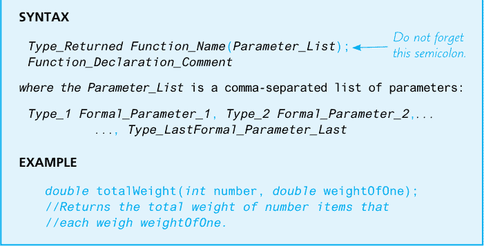

### SYNTAX

```
Returned_Type Function_Name(Parameter_List);
// Function_Declaration_Comment

where the Parameter_List is a comma-separated list of parameters:

Type_1 Formal_Parameter_1, Type_2 Formal_Parameter_2,...
                    ..., Type_Last Formal_Parameter_Last
```

不要忘记这个分号。

### EXAMPLE

```
double totalWeight(int number, double weightOfOne);  
//Returns the total weight of number items that  
//each weigh weightOfOne.
```

在 Display 4.3 中，函数定义以彩色显示在显示的底部。**函数定义**描述了函数如何计算其返回的值。如果将函数视为程序中的一个小型程序，那么函数定义就像这个小型程序的代码。事实上，函数定义的语法与程序主体的语法非常相似。函数定义由 *函数头* 后跟 *函数体* 组成。函数头与函数声明的写法相同，只是头 **没有** 末尾的分号。这使得头部有点重复，但这没关系。

虽然函数声明告诉你编写函数调用所需的一切，但它并不会告诉你将返回什么值。返回的值由 *函数体* 中的语句决定。函数体在函数头之后，并完成函数定义。函数体由声明和可执行语句组成，并用一对大括号括起来。因此，函数体就像程序主体的主体一样。当函数被调用时，参数值会被代入形式参数，然后执行体内的语句。函数返回的值是在函数执行 `return` 语句时确定的。关于这种“代入”的细节将在后面的章节中讨论。

*return 语句* 由关键字 *return* 后跟一个表达式组成。Display 4.3 中的函数定义包含以下 return 语句：

```
return (subtotal + subtotal * TAX_RATE);
```

当执行此 *return* 语句时，以下表达式的值将被作为函数调用的值返回：

```
(subtotal + subtotal * TAX_RATE)
```

括号不是必需的。如果 *return* 语句写成如下形式，程序将完全相同地运行：

```
return subtotal + subtotal * TAX_RATE;
```

然而，对于较大的表达式，括号使 *return* 语句更易于阅读。为了保持一致性，一些程序员主张即使在简单表达式上也使用这些括号。在 Display 4.3 中的函数定义中，*return* 语句之后没有语句，但如果有，也不会被执行。当执行 *return* 语句时，函数调用结束。

## A Function Is Like a Small Program

要理解函数，请记住以下三点：

- 函数定义就像一个小型程序，调用函数就相当于运行这个“小型程序”。

- 函数使用形式参数，而不是 cin，作为输入。函数的参数是输入，并被代入形式参数。

- 函数（本章讨论的类型）通常不会向屏幕发送任何输出，但它会向程序发送一种“输出”。函数返回一个值，这就像函数的“输出”。函数使用 return 语句而不是 cout 语句来实现这种“输出”。

让我们看看在 Display 4.3 所示的程序中执行以下函数调用时会发生什么：

```
bill = totalCost(number, price);
```

首先，参数 number 和 price 的值被代入形式参数；也就是说，参数 number 和 price 的值被替换为 numberPar 和 pricePar。在示例对话中，number 接收值 2，price 接收值 10.10。因此，2 和 10.10 分别被代入 numberPar 和 pricePar。这种替换过程被称为按值调用机制，形式参数通常被称为按值调用形式参数，或简称为按值参数。关于这种替换过程，你应该注意三件事：

1. 被代入形式参数的是参数的值。如果参数是变量，则代入的是变量的值，而不是变量本身。

2. 第一个参数被代入参数列表中的第一个形式参数，第二个参数被代入列表中的第二个形式参数，以此类推。

    *Anatomy of a function call*

3. 当一个参数被代入一个形式参数时（例如，当 2 被代入 numberPar 时），该参数将被代入函数体中出现的该形式参数的所有实例（例如，2 将被代入函数体中出现的每次 numberPar）。

Display 4.3 中所示函数调用涉及的整个过程在 Display 4.4 中详细描述。

### DISPLAY 4.4 Details of a Function Call

```
int main()
{
    double price, bill;
    int number;
    cout << "Enter the number of items purchased: ";
    cin >> number;
    cout << "Enter the price per item $";
    cin >> price;

    bill = totalCost (number, price);
    cout.setf (ios::fixed);
    cout.setf (ios::showpoint);
    cout.precision(2);
    cout << number << " items at "
         << "$" << price << " each.\n"
         << "Final bill, including tax, is $" << bill
         << endl;
    return 0;
}
double totalCost (int numberPar, double pricePar)
{
    const double TAX_RATE = 0.05; //5% sales tax
    double subtotal;

    subtotal = pricePar * numberPar;
    return (subtotal + subtotal * TAX_RATE);
}
```

1. 在调用函数之前，变量 number 和 price 的值由 cin 语句设置为 2 和 10.10（正如你在 Display 4.3 中的示例对话中所看到的）。

2. 函数调用执行，number 的值（即 2）被代入 numberPar，price 的值（即 10.10）被代入 pricePar。

3. 函数体以 numberPar 设置为 2 且 pricePar 设置为 10.10 的方式执行，产生 subtotal 中的值 20.20。

4. 当执行 return 语句时，return 之后的表达式的值被计算并由函数返回。在本例中，(subtotal + subtotal * TAX_RATE) 为 (20.20 + 20.20*0.05) 或 21.21。

5. 值 21.21 被返回到函数被调用的位置。结果是 totalCost(number, price) 被返回值的 21.21 替换。bill 的值（等号左侧）被设置为 21.21，当语句 bill = totalCost(number, price); 最终结束时。

## Functions That Return a Boolean Value

函数可以返回一个 bool 值。返回布尔值的函数称为谓词。这样的函数可以在布尔表达式中用于控制 if-else 语句或控制循环语句，或在允许布尔表达式的任何其他地方使用。此类函数的返回类型应为类型 bool。

对返回 true 或 false 的布尔值的函数的调用可以在允许布尔表达式的任何地方使用。这通常可以使程序更易于阅读。通过函数声明，你可以将复杂的布尔表达式与有意义的名称关联起来，并在 if-else 语句或允许布尔表达式的任何其他地方使用该名称作为布尔表达式。例如，语句

```
if (((rate >= 10) && (rate < 20)) || (rate == 0))
{
    ...
}
```

可以改写为

```
if (appropriate(rate))
{
    ...
}
```

前提是已定义了以下函数：

```
bool appropriate(int rate)
{
    return (((rate >= 10) && (rate < 20)) || (rate == 0));
}
```

## Alternate Form for Function Declarations

你不需要在函数声明中列出形式参数名。以下两个函数声明是等价的：

```
double totalCost(int numberPar, double pricePar);
```

和

```
double totalCost(int, double);
```

我们将始终使用第一种形式，以便在伴随函数声明的注释中引用形式参数。然而，你经常会在描述函数的手册中看到第二种形式。

2 C++ 将你的程序链接到函数库所需的一切只是函数名和形式参数的类型序列。形式参数名仅对函数定义很重要。然而，程序应同时与程序员和编译器进行通信。在理解函数时，使用程序员赋予函数数据的名称通常非常有帮助。


这种替代形式仅适用于函数声明。*函数头必须始终列出形式参数名称。*

## PITFALL 参数顺序错误

当调用一个函数时，计算机用第一个参数替换第一个形式参数，用第二个参数替换第二个形式参数，依此类推。它不会检查合理性。如果你弄混了函数调用中参数的顺序，程序将不会按你期望的方式运行。为了了解可能出现什么问题，请考虑第 4.5 节中的程序。编写该程序的程序员在调用函数 `grade` 时粗心地颠倒了参数的顺序。函数调用应该是

```
letterGrade = grade(score, needToPass);
```

这是程序中唯一的错误。然而，由于这次粗心的错误，某个可怜的学生被错误地判定为课程不及格。函数 `grade` 很简单，你可能会期望程序员在测试程序时发现这个错误。然而，如果 `grade` 是一个更复杂的函数，这个错误很容易被忽视。

如果参数的类型与形式参数不匹配，编译器可能会给你一个警告信息。不幸的是，并非所有编译器都会给出此类警告信息。此外，在像下面这样的情况下

```cpp
//Determines user's grade. Grades are Pass or Fail.
#include <iostream>
using namespace std;

char grade(int receivedPar, int minScorePar);
//Returns 'P' for passing, if receivedPar is
//minScorePar or higher. Otherwise returns 'F' for failing.

int main( )
{
    int score, needToPass;
    char letterGrade;

    cout << "Enter your score"
         << " and the minimum needed to pass:\n";
    cin >> score >> needToPass;

    letterGrade = grade(needToPass, score);
```

函数定义中的声明和可执行语句与程序的主体部分相同。然而，除非你有理由这样做，否则最好先放置声明，如第 4.6 节所示。

由于函数在执行 `return` 语句之前不会返回值，因此函数必须在函数体中包含一个或多个 `return` 语句。函数定义可能包含多个 `return` 语句。例如，代码体中可能包含一个 `if-else` 语句，而 `if-else` 语句的每个分支可能包含不同的 `return` 语句，如第 4.5 节所示。

编译器会接受函数定义中任何合理的空格和换行符模式。然而，你应该对函数定义的缩进和布局使用与程序主体部分相同的规则。特别注意我们在函数定义中以及第 4.6 节中大括号 `{}` 的放置。标记函数体结束的开始和结束大括号各自单独占一行。这将函数体隔离开来。

空格和换行符

## 更多关于函数定义放置的内容

我们已经讨论了函数定义和函数声明通常放置的位置。在正常情况下，这些是函数声明和函数定义的最佳位置。然而，编译器会接受函数定义和函数声明

## DISPLAY 4.6 返回值的函数语法

```
Function Declaration

Type_Returned Function_Name(Parameter_List);
Function_Declaration_Comment

Function Definition

Type_Returned Function_Name(Parameter_List) ← function header
{
    Declaration_1
    Declaration_2
    ...
    Declaration_Last
    Executable_Statement_1
    Executable_Statement_2
    ...
    Executable_Statement_Last
}
body
Must include one or more return statements.
```

在某些其他位置。更精确的规则陈述如下：每个函数调用必须在其前面有该函数的函数声明或函数的定义。例如，如果你将所有函数定义放在程序主体之前，则无需包含任何函数声明。了解这一更一般的规则将有助于你理解在某些其他书籍中看到的 C++ 程序，但你应该遵循本书中程序的示例。我们使用的风格为学习如何构建你自己的函数库奠定了基础，而这正是大多数 C++ 程序员使用的风格。

## PROGRAMMING TIP 在分支语句中使用函数调用

`switch` 语句和多路 `if-else` 语句允许你在每个分支中放置多个不同的语句。然而，这样做会使 `switch` 语句或 `if-else` 语句难以阅读。查看第 3.7 节中的 `switch` 语句。选择 1、2 和 3 的每个分支都可以是一个单一的函数调用。这使得 `switch` 语句的布局和程序的整体结构清晰。如果我们将每个分支的代码放在 `switch` 语句中，而不是放在函数定义中，那么 `switch` 语句将成为不可理解的 C++ 语句的海洋。事实上，`switch` 语句甚至无法在一屏中显示。

## SELF-TEST EXERCISES

5. 以下程序产生的输出是什么？

```
#include <iostream>
using namespace std;
char mystery(int firstPar, int secondPar);
int main()
{
    cout << mystery(10, 9) << "ow\n";
    return 0;
}
char mystery(int firstPar, int secondPar)
{
    if (firstPar >= secondPar)
        return 'W';
    else
        return 'H';
}
```

- 6. 编写一个函数声明和函数定义，该函数接受三个参数，均为 `int` 类型，并返回其三个参数的总和。
- 7. 编写一个函数声明和函数定义，该函数接受一个 `int` 类型参数和一个 `double` 类型参数，并返回一个 `double` 类型的值，该值是两个参数的平均值。
- 8. 编写一个函数声明和函数定义，该函数接受一个 `double` 类型参数。函数如果其参数为正则返回字符值 `'P'`，如果其参数为零或负则返回 `'N'`。
- 9. 仔细描述传值参数机制。
- 10. 列出使用预定义（即库）函数和使用用户定义函数之间的相似之处和不同之处。
- 11. 编写一个名为 `inOrder` 的函数定义，该函数接受三个 `int` 类型参数。函数如果三个参数按升序排列则返回 `true`；否则返回 `false`。例如，`inOrder(1, 2, 3)` 和 `inOrder(1, 2, 2)` 都返回 `true`，而 `inOrder(1, 3, 2)` 返回 `false`。
- 12. 编写一个名为 `even` 的函数定义，该函数接受一个 `int` 类型参数并返回一个 `bool` 值。函数如果其一个参数为偶数则返回 `true`；否则返回 `false`。
- 13. 编写一个函数定义 `isDigit`，该函数接受一个 `char` 类型参数并返回一个 `bool` 值。函数如果参数是十进制数字则返回 `true`；否则返回 `false`。
- 14. 编写一个函数定义 `isRootOf`，该函数接受两个 `int` 类型参数并返回一个 `bool` 值。函数如果第一个参数是第二个参数的平方根则返回 `true`；否则返回 `false`。

## 4.4 程序抽象

> > 原因被隐藏，但结果是众所周知的。
> >
> > —OVID, *Metamorphoses IV*

## 黑盒类比

使用程序的人不需要知道程序是如何编码的。想象一下，如果你必须知道并记住你使用的编译器的代码，你的生活会多么痛苦。一个程序有其要完成的工作，例如编译你的程序或检查论文中的单词拼写。你需要知道程序的**工作**是什么，以便使用程序，但你不需要（或至少不应该）知道程序*如何*完成其工作。函数就像一个小型程序，应该以类似的方式使用。使用程序中函数的程序员需要知道*函数做什么*（例如计算平方根或将温度从华氏度转换为摄氏度），但不需要知道函数*如何*完成其任务。这通常被称为将函数视为*黑盒*。

称某物为**黑盒**是一种比喻，旨在传达一个物理设备的形象，你知道如何使用它，但其操作方法是个谜，因为它被封闭在一个黑盒子里，你看不到盒子内部（也不能撬开它！）。如果一个函数设计良好，程序员就可以像使用黑盒一样使用该函数。程序员需要知道的全部是，如果他或她将适当的参数放入黑盒中，那么适当的值将从黑盒中返回。设计函数使其可以作为黑盒使用，有时被称为**信息隐藏**，以强调程序员的行为就像函数体对他是隐藏的一样。

第 4.7 节包含函数 `newBalance` 的函数声明和两个不同的定义。正如函数声明注释所解释的，函数 `newBalance` 计算在加入简单利息后银行账户中的新余额。例如，如果一个账户开始时有 $100，并且 4.5% 的利息记入账户，则新余额为 $104.50。因此，以下代码将把 `vacationFund` 的值从 100.00 更改为 104.50：

```
vacationFund = 100.00;
vacationFund = newBalance(vacationFund, 4.5);
```

程序员使用第 4.7 节中所示的 `newBalance` 的两个实现中的哪一个并不重要。这两个定义产生返回完全相同值的函数。我们可以同样在函数定义的函数体上放置一个黑盒，以便程序员不知道使用的是哪个实现。为了使用函数 `newBalance`，程序员需要阅读的全部是函数声明和随附的注释。

以黑盒的方式编写和使用函数也称为**程序抽象**。在 C++ 编程中，更合适地称之为*函数抽象*。然而，*过程*是一个比*函数*更一般的术语。计算机科学家使用术语*过程*来指代所有“类似函数”的指令集，因此他们使用术语*程序抽象*。术语*抽象*旨在传达这样一个思想：当你将函数用作黑盒时，你抽象掉了函数体中包含的代码细节。你可以将这种技术称为*黑盒原则*或*原则*


# DISPLAY 4.7 定义：黑盒等价

### 函数声明

```
1  double newBalance(double balancePar, double ratePar);
//Returns the balance in a bank account after
//posting simple interest. The formal parameter balancePar is
//the old balance. The formal parameter ratePar is the interest rate.
//For example, if ratePar is 5.0, then the interest rate is 5 percent
//and so newBalance(100, 5.0) returns 105.00.
```

# Definition 1

```
double newBalance(double balancePar, double ratePar)
{
    double interestFraction, interest;

    interestFraction = ratePar/100;
    interest = interestFraction * balancePar;
    return (balancePar + interest);
}
```

# Definition 2

```
double newBalance(double balancePar, double ratePar)
{
    double interestFraction, updatedBalance;

    interestFraction = ratePar/100;
    updatedBalance = balancePar * (1 + interestFraction);
    return updatedBalance;
}
```

of procedural abstraction or information hiding. The three terms mean the same thing. Whatever you call this principle, the important point is that you should use it when designing and writing your function definitions.

# Procedural Abstraction

When applied to a function definition, the principle of procedural abstraction means that your function should be written so that it can be used like a black box. This means that the programmer who uses the function should not need to look at the body of the function definition to see how the function works. The function declaration and the accompanying comment should be all the programmer needs to know in order to use the function. To ensure that your function definitions have this important property, you should strictly adhere to the following rules:

# HOW TO WRITE A BLACK-BOX FUNCTION DEFINITION
(THAT RETURNS A VALUE)

- The function declaration comment should tell the programmer any and all conditions that are required of the arguments to the function and should describe the value that is returned by the function when called with these arguments.
- All variables used in the function body should be declared in the function body. (The formal parameters do not need to be declared, because they are listed in the function declaration.)

# PROGRAMMING TIP Choosing Formal Parameter Names

The principle of procedural abstraction says that functions should be self-contained modules that are designed separately from the rest of the program. On large programming projects, a different programmer may be assigned to write each function. The programmer should choose the most meaningful names he or she can find for formal parameters. The arguments that will be substituted for the formal parameters may well be variables in the main part of the program. These variables should also be given meaningful names, often chosen by someone other than the programmer who writes the function definition. This makes it likely that some or all arguments will have the same names as some of the formal parameters. This is perfectly acceptable. No matter what names are chosen for the variables that will be used as arguments, these names will not produce any confusion with the names used for formal parameters. After all, the functions will use only the values of the arguments. When you use a variable as a function argument, the function takes only the value of the variable and disregards the variable name.

Now that you know you have complete freedom in choosing formal parameter names, we will stop placing a "Par" at the end of each formal parameter name. For example, in Display 4.8 we have rewritten the definition for the function totalCost from Display 4.3 so that the formal parameters are named number and price rather than numberPar and pricePar. If you replace the function declaration and definition of the function totalCost that appear in Display 4.3 with the versions in Display 4.8, then the program will perform in exactly the same way, even though there will be formal parameters named number and price and there will be variables in the main part of the program that are also named number and price.

# DISPLAY 4.8 Simpler Formal Parameter Names

# Function Declaration

```
1   double totalCost(int number, double price);
//Computes the total cost, including 5 percent sales tax,
//on number items at a cost of price each.
```

# Function Definition

```
1   double totalCost(int number, double price)
2   {
3     const double TAX_RATE = 0.05; //5 percent sales tax
4     double subtotal;
5     subtotal = price * number;
6     return (subtotal + subtotal * TAX_RATE);
7   }
```

# PROGRAMMING TIP Nested Loops

When you see nested loops in your code, then you should consider whether or not to apply the principle of procedural abstraction. Consider the explicitly nested loops in Display 3.15 that computed the total number of green-necked vulture eggs counted by all conservationists. We can make this code more readable by moving the loops into procedure calls, as shown in Display 4.9.

The two versions of our program for totaling green-necked vulture eggs are equivalent. Both programs produce the same dialogue with the user. However, most people find the version in Display 4.9 easier to understand because the loop body is a function call. When considering the outer loop, you should think of computing the subtotal for one conservationist’s report as a single operation and not think of it as a loop.

# Make a Loop Body a Function Call

Whenever you have a loop nested within a loop, or any other complex computation included in a loop body, make the loop body a function call. This way you can separate the design of the loop body from the design of the rest of the program. This divides your programming task into two smaller subtasks.

# DISPLAY 4.9  Nicely Nested Loops *(part 2 of 3)*

```cpp
//Uses iostream:
int getOneTotal()
{
    int total;
    cout << "Enter the number of eggs in each nest.\n"
         << "Place a negative integer"
         << " at the end of your list.\n";

    total = 0;
    int next;
    cin >> next;
    while (next >= 0)
    {
        total = total + next;
        cin >> next;
    }
    return total;
}
```

# Sample Dialogue

```text
This program tallies conservationist reports
on the green-necked vulture.
Each conservationist's report consists of
a list of numbers. Each number is the count of
the eggs observed in one green-necked vulture nest.
This program then tallies the total number of eggs.
How many conservationist reports are there? 3

Enter the report of conservationist number 1
Enter the number of eggs in each nest.
Place a negative integer at the end of your list.
1 0 0 2 -1
Total egg count for conservationist number 1 is 3

Enter the report of conservationist number 2
Enter the number of eggs in each nest.
Place a negative integer at the end of your list.
0 3 1 -1
Total egg count for conservationist number 2 is 4

Enter the report of conservationist number 3
Enter the number of eggs in each nest.
```

# DISPLAY 4.9 Nicely Nested Loops (part 3 of 3)

```
Place a negative integer at the end of your list.
-1
Total egg count for conservationist number 3 is 0

Total egg count for all reports = 7
```

# CASE STUDY Buying Pizza

The large “economy” size of an item is not always a better buy than the smaller size. This is particularly true when buying pizzas. Pizza sizes are given as the diameter of the pizza in inches. However, the quantity of pizza is determined by the area of the pizza, and the area is not proportional to the diameter. Most people cannot easily estimate the difference in area between a 10-inch pizza and a 12-inch pizza and so cannot easily determine which size is the best buy—that is, which size has the lowest price per square inch. In this case study we will design a program that compares two sizes of pizza to determine which is the better buy.

# Problem Definition

The precise specification of the program input and output are as follows:

### Input

The input will consist of the diameter in inches and the price for each of two sizes of pizza.

## Output

The output will give the cost per square inch for each of the two sizes of pizza and will tell which is the better buy, that is, which has the lowest cost per square inch. (If they are the same cost per square inch, we will consider the smaller one to be the better buy.)

## Analysis of the Problem

We will use top-down design to divide the task to be solved by our program into the following subtasks:

- Subtask 1: Get the input data for both the small and large pizzas.
- Subtask 2: Compute the price per square inch for the small pizza.
- Subtask 3: Compute the price per square inch for the large pizza.
- Subtask 4: Determine which is the better buy.
- Subtask 5: Output the results.

Notice subtasks 2 and 3. They have two important properties:

Subtasks 2 and 3


- 1. 它们完全是相同的任务。唯一的区别是它们使用不同的数据进行计算。子任务 2 和子任务 3 之间唯一发生变化的是披萨的大小和价格。
- 2. 子任务 2 的结果和子任务 3 的结果各为一个单一值：披萨每平方英寸的价格。

每当一个子任务接收一些值，例如一些数字，并返回一个单一值时，将该子任务实现为一个函数是自然的。每当两个或多个这样的子任务执行相同的计算时，它们可以被实现为同一个函数，每次使用时都用不同的参数调用。我们因此决定使用一个名为 `unitPrice` 的函数来计算披萨每平方英寸的价格。该函数的函数声明和解释性注释如下：

```cpp
double unitPrice(int diameter, double price);
//Returns the price per square inch of a pizza. The formal
//parameter named diameter is the diameter of the pizza in inches.
//The formal parameter named price is the price of the pizza.
```

## Algorithm Design

子任务 1 很直接。程序只需请求输入值并将它们存储在四个变量中，我们将它们称为 diameterSmall、diameterLarge、priceSmall 和 priceLarge。

子任务 4 是常规的。要确定哪种披萨是更好的购买，我们只需使用小于运算符比较两种披萨每平方英寸的成本。子任务 5 是结果的常规输出。

子任务 2 和 3 被实现为对函数 unitPrice 的调用。接下来，我们设计该函数的算法。算法的难点在于确定披萨的面积。一旦我们知道了面积，我们就可以很容易地使用除法确定每平方英寸的价格，如下所示：

`price/area`

其中 area 是一个保存披萨面积的变量。此表达式将是函数 unitPrice 返回的值。但我们仍然需要制定计算披萨面积的方法。

披萨基本上是一个圆 [由面包、奶酪、酱料等组成]。圆 [以及因此披萨] 的面积是 πr²，其中 r 是圆的半径，π 是称为“pi”的数字，大约等于 3.14159。半径是直径的一半。

函数 unitPrice 的算法可以概述如下：

### Algorithm Outline for the Function unitPrice

- 1. 计算披萨的半径。
- 2. 使用公式 πr² 计算披萨的面积。
- 3. 返回表达式 (price/area) 的值。

### When to Define a Function

- Subtask 1
- Subtasks 4 and 5
- Subtasks 2 and 3

## DISPLAY 4.10 Buying Pizza

```cpp
//Determines which of two pizza sizes is the best buy.
#include <iostream>
using namespace std;

double unitPrice(int diameter, double price);
//Returns the price per square inch of a pizza. The formal
//parameter named diameter is the diameter of the pizza in inches.
//The formal parameter named price is the price of the pizza.

int main()
{
    int diameterSmall, diameterLarge;
    double priceSmall, priceLarge;
    double unitPriceSmall, unitPriceLarge;

    cout << "Welcome to the Pizza Consumers Union.\n";
    cout << "Enter diameter of a small pizza (in inches): ";
    cin >> diameterSmall;
    cout << "Enter the price of a small pizza: $";
    cin >> priceSmall;
    cout << "Enter diameter of a large pizza (in inches): ";
    cin >> diameterLarge;
    cout << "Enter the price of a large pizza: $";
    cin >> priceLarge;

    unitPriceSmall = unitPrice(diameterSmall, priceSmall);
    unitPriceLarge = unitPrice(diameterLarge, priceLarge);

    cout.setf(ios::fixed);
    cout.setf(ios::showpoint);
    cout.precision(2);
    cout << "Small pizza:\n"
         << "Diameter = " << diameterSmall << " inches\n"
         << "Price = $" << priceSmall
         << " Per square inch = $" << unitPriceSmall << endl
         << "Large pizza:\n"
         << "Diameter = " << diameterLarge << " inches\n"
         << "Price = $" << priceLarge
         << " Per square inch = $" << unitPriceLarge << endl;
    if (unitPriceLarge < unitPriceSmall)
        cout << "The large one is the better buy.\n";
    else
        cout << "The small one is the better buy.\n";

    cout << "Buon Appetito!\n";
    return 0;
}

double unitPrice(int diameter, double price)
{
    const double PI = 3.14159;
    double radius, area;

    radius = diameter/static_cast<double>(2);
    area = PI * radius * radius;
    return (price/area);
}
```

# Sample Dialogue

```
Welcome to the Pizza Consumers Union.
Enter diameter of a small pizza (in inches): 10
Enter the price of a small pizza: $7.50
Enter diameter of a large pizza (in inches): 13
Enter the price of a large pizza: $14.75
Small pizza:
Diameter = 10 inches
Price = $7.50 Per square inch = $0.10
Large pizza:
Diameter = 13 inches
Price = $14.75 Per square inch = $0.11
The small one is the better buy.
Buon Appetito!
```

买一个 2 英寸的披萨可能没有意义，但它仍然可以用作此程序的简单测试用例。它是一个简单的测试用例，因为手工计算答案很容易。让我们计算一个售价为 $3.14 的 2 英寸披萨的每平方英寸成本。由于直径为 2 英寸，半径为 1 英寸。半径为 1 的披萨的面积为 3.14159 * 1²，即 3.14159。如果我们将价格 $3.14 除以此面积，我们会发现每平方英寸的价格为 3.14/3.14159，大约为 $1.00。当然，这对于披萨来说是一个荒谬的大小，对于如此小的披萨来说也是一个荒谬的价格，但对于这些参数，函数 unitPrice 应该返回的值很容易确定。

在这种情况下检查过你的程序后，你可以对它更有信心，但你仍然不能确定你的程序是正确的。一个错误的程序有时会给出正确的答案，即使它在某些其他输入上会给出错误的答案。你可能在程序恰好给出正确输出的某些情况下测试了错误的程序。例如，假设我们没有发现我们在编码函数 unitPrice 时发现的错误。假设我们在以下行中错误地使用了 2 而不是 `static_cast<double>(2)`：

```cpp
radius = diameter/static_cast<double>(2);
```

因此该行读作：

```cpp
radius = diameter/2;
```

只要披萨直径是偶数，如 2、8、10 或 12，无论我们除以 2 还是除以 `static_cast<double>(2)`，程序都会给出相同的答案。你不太可能想到要确保同时检查偶数和奇数尺寸的披萨。然而，如果你对几种不同的披萨尺寸测试你的程序，那么你的测试用例包含相关类型数据的样本的机会就会更好。

## PROGRAMMING TIP Use Pseudocode

算法通常用伪代码表达。伪代码是 C++ [或你正在使用的任何编程语言] 和普通英语 [或你正在使用的任何人类语言] 的混合体。伪代码允许你在不必担心 C++ 语法所有细节的情况下精确地陈述你的算法。当算法中某一步的 C++ 代码显而易见时，用英语陈述它就没什么意义了。当某一步难以用 C++ 表达时，如果该步骤用英语表达，算法会更清晰。你可以在之前的案例研究中看到伪代码的例子，在那里我们用伪代码表达了函数 unitPrice 的算法。

## SELF-TEST EXERCISES

- 15. 函数声明所附带的注释的目的是什么？
- 16. 程序设计抽象原则如何应用于函数定义？
- 17. 当我们说使用函数的程序员应该能够将函数视为黑箱时，这意味着什么？（提示：这个问题与上一个问题密切相关。）
- 18. 仔细描述程序测试的过程。


19. 考虑函数 `unitPrice` 的两种可能定义。一种是 Display 4.10 中给出的定义。另一种定义与之相同，只是其中的类型转换 `static_cast<double>(2)` 被常量 `2.0` 替换；换句话说，行

```
radius = diameter/static_cast<double>(2);
```

被行

```
radius = diameter/2.0;
```

替换。

这两种可能的函数定义是黑盒等价的吗？

## 4.5 作用域和局部变量

> 他是本地人，不为家乡以外的人所知。

俗语

在上一节中我们主张将函数当作黑盒使用。为了定义一个函数使其可以作为黑盒使用，你通常需要为函数提供自己的变量，这些变量不会干扰程序的其余部分。属于函数的变量称为局部变量。正如我们将看到的，这些变量只是遵循第 3 章中描述的嵌套块的作用域规则。本节我们再次审视作用域，重点关注局部变量以及如何使用它们。

### 小程序类比

回顾 Display 4.1 中的程序。它包含对预定义函数 `sqrt` 的调用。我们使用该函数时不需要知道 `sqrt` 函数定义的任何细节。特别是，我们不需要知道 `sqrt` 的定义中声明了哪些变量。你定义的函数也一样。你在函数定义中编写的变量声明与预定义函数的函数定义中的变量声明一样独立。函数定义内的变量声明就好像是另一个程序中的变量声明一样。如果你在一个函数定义中声明一个变量，然后在程序的主体部分（或在另一个函数定义的体中）声明另一个同名变量，那么这两个变量是两个不同的变量，即使它们同名。让我们看一个程序，其中函数定义中的变量与程序中的另一个变量同名。

Display 4.11 中的程序有两个名为 `averagePeas` 的变量；一个在函数 `estTotal` 的函数定义中声明并使用，另一个在程序的主体部分中声明并使用。变量

### DISPLAY 4.11 局部变量（第 1 部分，共 2 部分）

```cpp
//Computes the average yield on an experimental pea growing patch.
#include <iostream>
using namespace std;

double estTotal(int minPeas, int maxPeas, int podCount);
//Returns an estimate of the total number of peas harvested.
//The formal parameter podCount is the number of pods.
//The formal parameters minPeas and maxPeas are the minimum
//and maximum number of peas in a pod.

int main()
{
    int maxCount, minCount, podCount;
    double averagePea, yield;

    cout << "Enter minimum and maximum number of peas in a pod: ";
    cin >> minCount >> maxCount;
    cout << "Enter the number of pods: ";
    cin >> podCount;
    cout << "Enter the weight of an average pea (in ounces): ";
    cin >> averagePea;

    yield =
        estTotal(minCount, maxCount, podCount) * averagePea;

    cout.setf(ios::fixed);
    cout.setf(ios::showpoint);
    cout.precision(3);
    cout << "Min number of peas per pod = " << minCount << endl
         << "Max number of peas per pod = " << maxCount << endl
         << "Pod count = " << podCount << endl
         << "Average pea weight = "
         << averagePea << " ounces" << endl
         << "Estimated average yield = " << yield << " ounces"
         << endl;

    return 0;
}

double estTotal(int minPeas, int maxPeas, int podCount)
{
    double averagePea;

    averagePea = (maxPeas + minPeas) / 2.0;
    return (podCount * averagePea);
}
```

> 这个名为 `averagePea` 的变量是 `main` 部分的局部变量。

> 这个名为 `averagePea` 的变量是函数 `estTotal` 的局部变量。

### DISPLAY 4.11 局部变量（第 2 部分，共 2 部分）

### 示例对话

```
Enter minimum and maximum number of peas in a pod: 4 6
Enter the number of pods: 10
Enter the weight of an average pea (in ounces): 0.5
Min number of peas per pod = 4
Max number of peas per pod = 6
Pod count = 10
Average pea weight = 0.500 ounces
Estimated average yield = 25.000 ounces
```

`estTotal` 函数定义中的变量 `averagePea` 和程序主体部分中的变量 `averagePea` 是两个不同的变量。这就好像函数 `estTotal` 是一个预定义函数一样。两个名为 `averagePea` 的变量不会相互干扰，就像两个完全不同程序中的两个变量一样。当在对 `estTotal` 的函数调用中给变量 `averagePea` 赋一个值时，这不会改变程序主体部分中也名为 `averagePea` 的变量的值。（Display 4.11 中程序的细节，除了这个名称巧合之外，在本节之后的编程示例部分中进行了解释。）

在函数定义的主体内部声明的变量被称为局部于该函数或具有该函数的作用域。在程序主体内部定义的变量被称为局部于程序的主体部分或具有程序主体部分的作用域。还有其他类型的变量不属于任何函数或程序主体部分，但我们不会使用此类变量。我们使用的每个变量要么局部于函数定义，要么局部于程序的主体部分。当我们说一个变量是局部变量而不提及函数也不提及程序的主体部分时，我们指的是该变量局部于某个函数定义。

### 局部变量

在函数定义的主体内部声明的变量被称为局部于该函数或具有该函数的作用域。在程序主体部分内部声明的变量被称为局部于程序的主体部分或具有程序主体部分的作用域。当我们说一个变量是局部变量而不提及函数也不提及程序的主体部分时，我们指的是该变量局部于某个函数

（续）

> 定义。如果一个变量局部于一个函数，那么你可以在程序的主体部分或在另一个函数定义中拥有另一个同名变量，并且它们将是两个不同的变量，即使它们同名。

## 编程示例 — 实验豌豆地块

Display 4.11 中的程序对用于种植实验豌豆品种的小花园地块的总产量进行了估计。函数 `estTotal` 返回收获的豌豆总数的估计值。函数 `estTotal` 接受三个参数。一个参数是收获的豌豆荚的数量。其他两个参数用于估计每个豆荚中豌豆的平均数量。不同的豌豆荚包含不同数量的豌豆，因此函数接收到的另外两个参数是任何一个豆荚中发现的最小和最大豌豆数。函数 `estTotal` 对这两个数字取平均值，并将此平均值用作每个豆荚中豌豆平均数量的估计值。

## 全局常量和全局变量

正如我们在第 2 章中指出的，你可以使用 `const` 修饰符为常量值命名。例如，在 Display 4.10 中我们使用以下声明为常量 3.14159 命名为 `PI`：

```cpp
const double PI = 3.14159;
```

在 Display 4.3 中，我们使用 `const` 修饰符为销售税率命名，使用以下声明：

```cpp
const double TAX_RATE = 0.05; //5 percent sales tax
```

与我们的变量声明一样，我们将这些为常量命名的声明放在使用它们的函数的主体内部。这运作良好，因为每个命名常量仅被一个函数使用。然而，很容易出现多个函数使用同一个命名常量的情况。在这种情况下，你可以将为常量命名的声明放在程序的开头，位于所有函数的主体之外以及程序主体部分之外。命名常量随后被称为全局命名常量，并且命名常量可以在常量声明之后出现的任何函数定义中使用。

Display 4.12 显示了一个程序，其中包含一个全局命名常量的示例。该程序要求输入半径，然后计算圆的面积


# 显示 4.12 全局命名常量（第 1 部分，共 2 部分）

```
//Computes the area of a circle and the volume of a sphere.
//Uses the same radius for both calculations.
#include <iostream>
#include <cmath>
using namespace std;

const double PI = 3.14159;

double area (double radius);
//Returns the area of a circle with the specified radius.

double volume(double radius);
//Returns the volume of a sphere with the specified radius.

int main()
{
    double radiusOfBoth, areaOfCircle, volumeOfSphere;

    cout << "Enter a radius to use for both a circle\n"
         << "and a sphere (in inches): ";
    cin >> radiusOfBoth;

    areaOfCircle = area(radiusOfBoth);
    volumeOfSphere = volume(radiusOfBoth);

    cout << "Radius = " << radiusOfBoth << " inches\n"
         << "Area of circle = " << areaOfCircle
         << " square inches\n"
         << "Volume of sphere = " << volumeOfSphere
         << " cubic inches\n";

    return 0;
}

double area(double radius)
{
    return (PI * pow(radius, 2));
}

double volume(double radius)
{
    return ((4.0/3.0) * PI * pow(radius, 3));
}
```

# 显示 4.12 全局命名常量（第 2 部分，共 2 部分）

### 示例对话

```
Enter a radius to use for both a circle
and a sphere (in inches): 2
Radius = 2 inches
Area of circle = 12.5664 square inches
Volume of sphere = 33.5103 cubic inches
```

以及具有该半径的球体的体积。编写该程序的程序员查阅了计算这些量的公式，并找到如下公式：

```
area = π x (radius)²
volume = (4/3) x π x (radius)³
```

这两个公式都包含常量 π，它约等于 3.14159。符号 π 是希腊字母，读作“pi”。在之前的程序中，我们使用以下声明来生成一个名为 PI 的命名常量，以便在将这些公式转换为 C++ 代码时使用：

```
const double PI = 3.14159;
```

在显示 4.12 的程序中，我们使用了相同的声明，但将其放在文件开头附近，这样它就定义了一个全局命名常量，可在所有函数体中使用。

编译器在全局命名常量声明的位置方面给了你很大的自由度，但为了便于阅读，你应该将所有 `#include` 指令放在一起，将所有全局命名常量声明放在另一组，并将所有函数声明放在一起。我们将遵循标准做法，将所有全局命名常量声明放在 `#include` 指令之后、函数声明之前。

将所有命名常量声明放在程序开头有助于提高可读性，即使该命名常量只被一个函数使用。如果命名常量在程序的未来版本中可能需要更改，那么将其放在程序开头会更容易找到。例如，将销售税率常量声明放在会计程序的开头，可以在税率上调时轻松修改程序。

也可以不使用 `const` 修饰符，将普通变量声明为全局变量，这些变量对文件中的所有函数定义都是可见的。其声明方式与全局命名常量相同，只是变量声明中不使用 `const` 修饰符。然而，还有

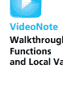

# 显示 4.13 形式参数用作局部变量（第 2 部分，共 2 部分）

```
16    cout << "Welcome to the offices of\n"
17        << "Dewey, Cheatham, and Howe.\n"
18        << "The law office with a heart.\n"
19        << "Enter the hours and minutes"
20        << " of your consultation:\n";
21    cin >> hours >> minutes;
22
23    bill = fee(hours, minutes);
24
25    cout.setf(ios::fixed);
26    cout.setf(ios::showpoint);
27    cout.precision(2);
28    cout << "For " << hours << " hours and " << minutes
29        << " minutes, your bill is $" << bill << endl;
30
31    return 0;
32 }
33
34 double fee(int hoursWorked, int minutesWorked)
35 {
36     int quarterHours;
37
38     minutesWorked = hoursWorked * 60 + minutesWorked;
39     quarterHours = minutesWorked/15;
40     return (quarterHours * RATE);
41 }
```

`minutes` 的值不会因调用 `fee` 而改变。

`minutesWorked` 是一个局部变量，初始化为 `minutes` 的值。

### 示例对话

```
Welcome to the offices of
Dewey, Cheatham, and Howe.
The law office with a heart.
Enter the hours and minutes of your consultation:
2 45
For 2 hours and 45 minutes, your bill is $1650.00
```

请注意函数 `fee` 定义中的形式参数 `minutesWorked`。它被用作一个变量，其值会被函数定义中的下面这行代码改变：

```
minutesWorked = hoursWorked * 60 + minutesWorked;
```

形式参数就像你在函数体内声明的变量一样，是局部变量。但是，你不应该为形式参数添加变量声明。在函数声明中列出形式参数 `minutesWorked` 也充当变量声明。

不要为形式参数添加声明

下面是以错误方式开始函数 `fee` 的定义，因为它将 `minutesWorked` 声明了两次：

```
double fee(int hoursWorked, int minutesWorked)
{
    int quarterHours;
    int minutesWorked;
    ...
}
```

切勿这样做！

# 块作用域

局部变量的作用域是指程序中能够直接访问该变量的部分，有时也称为局部作用域。类似地，在程序开头、所有函数体外声明的全局标识符有时被称为具有全局作用域。尽管存在差异，局部标识符和全局标识符实际上都是第 3 章所述的块作用域的实例。块是一些用花括号括起来的 C++ 代码，但“全局块”除外，它是一个隐含的最外层块，包含所有代码。作用域规则规定，在其块内声明的标识符对于该块是局部的，并且只能从其定义点到其块末尾访问。块通常是嵌套的。例如，`main` 函数的花括号定义了一个块，而 `main` 内部的 `for` 循环则定义了一个嵌套块。

显示 4.14 中概述的程序不会计算任何有趣的内容，但说明了在不同块中声明的标识符的作用域。在该示例中，常量 `GLOBAL_CONST` 具有全局作用域，函数 `function1` 和 `main` 本身也具有全局作用域，因为它们是在所有函数体外声明的。这使我们能够从 `main` 和 `function1` 中访问 `GLOBAL_CONST`。

`main` 函数声明了局部于 `main` 的变量 `x` 和 `d`，它们的作用域扩展到 `main` 块的末尾。类似地，函数 `function1` 有一个参数 `param` 和一个局部变量 `y`，它们的作用域扩展到 `function1` 的末尾。这两个变量都不能从其作用域之外直接访问。局部变量和参数的作用域实际上使用相同的块作用域规则，但在这种情况下，块指的是声明变量或参数的函数。

显示 4.14 中的 `for` 循环说明了嵌套块的作用域。变量 `i` 在 `for` 循环内声明，因此其作用域仅限于循环块的末尾。在其作用域之外的任何地方引用 `i`（即使我们仍在 `main` 内部，例如在第 17 行）都会导致编译器错误。

你可以将变量视为在其作用域开始时被创建，在其作用域结束时被销毁。例如，显示 4.14 中的局部变量 `y` 在每次调用 `function1` 时被创建并初始化为 `GLOBAL_CONST`。如果第 23 行的代码改变了存储在 `y` 中的值，那么当函数退出且 `y` 超出作用域时，这些更改将丢失，因为变量 `y` 被销毁了。重复调用 `function1` 不会恢复 `y` 之前的值，而是会创建一个新的 `y`。

除了块作用域之外，还有命名空间作用域和类作用域。类作用域将在第 10 章讨论，命名空间作用域将在第 12 章讨论。C++ 还定义了函数原型作用域，它指的是函数原型中定义的参数所在行的作用域。最后，C++ 支持函数作用域，它用于标签。标签是 C 语言的遗留物，用于 `goto` 语句。它们的用法通常被避免，因为这可能导致难以理解的逻辑，而同样的任务可以通过循环以可理解的方式完成。

# 再论命名空间

到目前为止，我们所有的程序都由以下两行开头：

```
#include <iostream>
using namespace std;
```

# 显示 4.14 局部、全局和块作用域

## 块作用域再探

```
1   #include <iostream>
2   using namespace std;
3
4   const double GLOBAL_CONST = 1.0;
5
6   int function1(int param);
7
8   int main()
9   {
10      int x;
11      double d = GLOBAL_CONST;
12
13      for (int i = 0; i < 10; i++)
14      {
15          x = function1(i);
16      }
17      return 0;
18  }
19
20  int function1(int param)
21  {
22      double y = GLOBAL_CONST;
23      ...
24      return 0;
25  }
```

局部作用域和全局作用域都是块作用域的示例。变量只能在其作用域内被直接访问。

块作用域：变量 `i` 的作用域为第 13-16 行

`main` 的局部作用域：变量 `x` 的作用域为第 10-18 行，变量 `d` 的作用域为第 11-18 行

全局作用域：常量 `GLOBAL_CONST` 的作用域为第 4-25 行，函数 `function1` 的作用域为第 6-25 行

`function1` 的局部作用域：变量 `param` 的作用域为第 20-25 行，变量 `y` 的作用域为第 22-25 行


然而，文件开头并不总是放置下面这一行的最佳位置：

    using namespace std;

我们最终将使用的命名空间不止 std 一个。实际上，我们可能会在不同的函数定义中使用不同的命名空间。如果你将这条指令

    using namespace std;

放在函数定义体的起始花括号 { 内，那么该 using 指令只适用于这个函数定义。这样，你就可以在两个不同的函数定义中使用两个不同的命名空间，即使这两个函数定义位于同一个文件中，即使这两个命名空间中存在某些名称在两个命名空间中含义不同。

把 using 指令放到函数定义内部，类似于把变量声明放到函数定义内部。如果你在函数定义内部放置一个变量定义，该变量就是函数的局部变量；也就是说，变量声明的含义仅限于该函数定义。如果你把 using 指令放到函数定义内部，该 using 指令就是该函数定义的局部指令；换句话说，using 指令的含义仅限于该函数定义。

我们需要过一段时间才会在 using 指令中使用 std 以外的命名空间，但从现在开始就把这些 using 指令放在它们该放的位置，不失为一种良好的实践。在程序清单4.15中，我们重写了程序清单4.12中的程序，并把 using 指令放在它们应处的位置。程序清单4.15中的程序运行行为与程序清单4.12中的程序完全相同。在这个特定例子中，差别仅仅在于风格；但当你开始使用更多命名空间时，这种差别将影响程序的运行效果。

## 程序清单4.15 使用命名空间（第1部分，共2部分）

```
//Computes the area of a circle and the volume of a sphere.
//Uses the same radius for both calculations.
#include <iostream>
#include <cmath>

const double PI = 3.14159;

double area(double radius);
//Returns the area of a circle with the specified radius.

double volume(double radius);
//Returns the volume of a sphere with the specified radius.
```

（续）

## 程序清单4.15 使用命名空间（第2部分，共2部分）

```
13
14 int main( )
15 {
16     using namespace std;
17
18     double radiusOfBoth, areaOfCircle, volumeOfSphere;
19
20     cout << "Enter a radius to use for both a circle\n"
21         << "and a sphere (in inches): ";
22     cin >> radiusOfBoth;
23
24     areaOfCircle = area(radiusOfBoth);
25     volumeOfSphere = volume(radiusOfBoth);
26
27     cout << "Radius = " << radiusOfBoth << " inches\n"
28         << "Area of circle = " << areaOfCircle
29         << " square inches\n"
30         << "Volume of sphere = " << volumeOfSphere
31         << " cubic inches\n";
32
33     return 0;
34 }
35
36
37 double area(double radius)
38 {
39     using namespace std;
40
41     return (PI * pow(radius, 2));
42 }
43
44 double volume(double radius)
45 {
46     using namespace std;
47
48     return ((4.0/3.0) * PI * pow(radius, 3));
49 }
```

该程序的示例对话与程序清单4.12中程序的示例对话相同。

## 自测练习题

20. 如果在函数定义中使用变量，你应该在何处声明该变量？在函数定义中？在程序的主函数中？任何方便的地方都可以吗？

## 程序清单4.16 阶乘函数

### 函数声明

```
1    int factorial(int n);
2    //Returns factorial of n.
3    //The argument n should be nonnegative.
```

### 函数定义

```
1    int factorial(int n)
2    {
3        int product = 1;
4        while (n > 0)
5        {
6            product = n * product;
7            n--;
8        }
9
10       return product;
11   }
```

形参 n 被用作局部变量

factorial 的函数定义使用了两个局部变量：在函数体开始处声明的 product，以及形参 n。由于形参也是局部变量，我们可以改变它的值。在这个例子中，我们使用自减运算符 n-- 来改变形参 n 的值。（自减运算符已在第2章讨论过。）

每次执行循环体时，变量 product 的值会乘以 n 的值，然后通过 n-- 使 n 的值减一。如果以 3 作为实参调用 factorial 函数，那么第一次执行循环体时 product 的值为 3，第二次执行循环体时 product 的值为 3 * 2，第三次执行循环体时 product 的值为 3 * 2 * 1，然后 while 循环结束。因此，下面这条语句会把变量 x 设置为 6，也就是 3 * 2 * 1：

```
x = factorial(3);
```

注意，局部变量 product 在声明时被初始化为 1。（这种在声明变量时进行初始化的方式已在第2章介绍过。）很容易看出 1 是变量 product 的正确初值。要理解这就是 product 的正确初值，请注意：当 while 循环体第一次执行完毕后，我们希望 product 的值等于形参 n 的（原始）值；如果 product 初始化为 1，那么结果正是如此。

形参用作局部变量

这种做法是可行的，而且在许多编程语言中，你不得不这样做。幸运的是，C++ 提供了一种更优雅的解决方案。在 C++ 中，你可以直接对两个函数使用同一个函数名 ave，并用下面的函数定义来代替函数定义 ave3：

```
double ave(double n1, double n2, double n3)
{
    return ((n1 + n2 + n3)/3.0);
}
```

## 程序清单4.17 重载函数名

```
//Illustrates overloading the function name ave.
#include <iostream>

double ave(double n1, double n2);
//Returns the average of the two numbers n1 and n2.

double ave(double n1, double n2, double n3);
//Returns the average of the three numbers n1, n2, and n3.

int main()
{
    using namespace std;
    cout << "The average of 2.0, 2.5, and 3.0 is "
         << ave(2.0, 2.5, 3.0) << endl;

    cout << "The average of 4.5 and 5.5 is "
         << ave(4.5, 5.5) << endl;

    return 0;
}

double ave(double n1, double n2)
{
    return ((n1 + n2)/2.0);
}

double ave(double n1, double n2, double n3)
{
    return ((n1 + n2 + n3)/3.0);
}
```

### 输出

```
The average of 2.0, 2.5, and 3.0 is 2.50000
The average of 4.5 and 5.5 is 5.00000
```

函数名 ave 现在有两个定义。这就是重载的一个例子。在这种情况下，我们重载了函数名 ave。在程序清单4.17中，我们将 ave 的这两个函数定义嵌入到一个完整的示例程序中。请务必注意，每个函数定义都有自己的函数声明。

重载是个很棒的想法。它让程序更易于阅读，也让你不必因为已经在某个函数定义中使用了最自然的名称，而绞尽脑汁为另一个函数另起新名。但是，当编译器遇到对某个具有两个或更多定义的函数名的调用时，它怎么知道该使用哪个函数定义呢？编译器无法读懂程序员的想法。为了判断应使用哪个函数定义，编译器会检查函数调用中实参的个数以及实参的类型。在程序清单4.17的程序中，对 ave 的一次调用有两个实参，另一次调用有三个实参。为了判断使用哪个定义，编译器只需计算函数调用中实参的个数：如果有两个实参，就使用第一个定义；如果有三个实参，就使用第二个定义。

确定适用哪个定义

每当你为同一个函数名给出两个或更多定义时，各种函数定义必须具有不同的参数规格；也就是说，任何两个具有相同函数名的函数定义，必须使用不同数量的形参，或者使用不同类型的形参（或者两者都不同）。注意，当你重载一个函数名时，两个不同定义的函数声明在形参上必须不同。你不能通过给出两个仅在返回值类型上不同的定义来重载一个函数名。

### 重载函数名

如果同一个函数名有两个或更多的函数定义，就称为重载。当你重载一个函数名时，这些函数定义必须具有不同数量的形参，或者某些形参的类型不同。当出现函数调用时，编译器会使用其形参数量和形参类型与函数调用中的实参相匹配的那个函数定义。

重载对你来说其实并不陌生。在第2章中，你已经见过除法运算符 / 的一种重载。如果两个操作数都是 int 类型，例如 13/2，那么返回值是整数除法的结果，此时为 6。另一方面，如果其中一个或两个操作数是 double 类型，那么返回值是普通除法的结果；例如，13/2.0 返回的值为 6.5。除法运算符 / 有两个定义，而这两个定义的区别并不在于操作数的数量不同，


## 显示 4.18 重载函数名（第 1 部分，共 2 部分）

//判断是圆形披萨还是矩形披萨更划算。
#include <iostream>

double unitPrice(int diameter, double price);
//返回圆形披萨每平方英寸的价格。
//名为 diameter 的形参是披萨的直径，单位为英寸。
//名为 price 的形参是披萨的价格。

double unitPrice(int length, int width, double price);
//返回尺寸为 length 英寸 × width 英寸的矩形披萨
//每平方英寸的价格。
//形参 price 是披萨的价格。

int main()
{
    using namespace std;
    int diameter, length, width;
    double priceRound, unitPriceRound,
    priceRectangular, unitPriceRectangular;

    cout << "欢迎来到披萨消费者联盟。\n";
    cout << "请输入圆形披萨的直径（英寸）：";
    cin >> diameter;
    cout << "请输入圆形披萨的价格：$";
    cin >> priceRound;
    cout << "请输入矩形披萨的长度和宽度（英寸）\n";
    cin >> length >> width;
    cout << "请输入矩形披萨的价格：$";
    cin >> priceRectangular;

    unitPriceRectangular =
            unitPrice(length, width, priceRectangular);
    unitPriceRound = unitPrice(diameter, priceRound);

    cout.setf(ios::fixed);
    cout.setf(ios::showpoint);
    cout.precision(2);
    cout << endl
         << "圆形披萨：直径 = "
         << diameter << " 英寸\n"
         << "价格 = $" << priceRound
         << " 每平方英寸价格 = $" << unitPriceRound
         << endl
         << "矩形披萨：长度 = "
         << length << " 英寸\n"

## 自动类型转换

假设你的程序中出现了以下函数定义，并且你没有重载函数名 mpg（因此这是名为 mpg 的函数的唯一定义）：

```
double mpg(double miles, double gallons)
//返回每加仑英里数。
{
    return (miles/gallons);
}
```

如果你用 int 类型的实参调用函数 mpg，C++ 会自动将任何 int 类型的实参转换为 double 类型的值。因此，下面这条语句将在屏幕上输出 22.5 英里每加仑：

```
cout << mpg(45, 2) << " miles per gallon";
```

C++ 将 45 转换为 45.0，将 2 转换为 2.0，然后执行除法 45.0/2.0，得到返回值 22.5。

如果一个函数需要 double 类型的实参，而你给它一个 int 类型的实参，C++ 会自动将该 int 实参转换为 double 类型的值。这非常有用且自然，我们几乎不会去注意它。然而，重载可能会干扰这种自动类型转换。让我们看一个例子。

现在，假设你（愚蠢地）重载了函数名 mpg，使你的程序中除了之前的定义之外，还包含以下 mpg 的定义：

```
int mpg(int goals, int misses)
//返回完美进球衡量值
//计算公式为 (goals - misses)。
{
    return (goals - misses);
}
```

在同时包含这两个 mpg 函数定义的程序中，下面这条语句将（不幸地）输出 43 英里每加仑（因为 43 是 45 − 2 的结果）：

```
cout << mpg(45, 2) << " miles per gallon";
```

当 C++ 看到函数调用 mpg(45, 2)（两个实参都是 int 类型）时，C++ 首先查找具有两个 int 类型形参的 mpg 函数定义。如果找到了这样的函数定义，C++ 就使用该定义。除非找不到匹配的函数定义，否则 C++ 不会将 int 实参转换为 double 类型的值。

mpg 的例子还说明了关于重载的另一点：你不应该对两个不相关的函数使用相同的函数名。这种对函数名的粗心使用最终必定会造成混乱。

## 重载与类型转换的交互

## 自测练习

24. 假设你有两个函数定义，其函数声明如下：

```
double score(double time, double distance);
int score(double points);
```

在下面的函数调用中会使用哪个函数定义？为什么使用它？（x 的类型是 double。）

```
finalScore = score(x);
```

25. 假设你有两个函数定义，其函数声明如下：

```
double theAnswer(double data1, double data2);
double theAnswer(double time, int count);
```

在下面的函数调用中会使用哪个函数定义？为什么使用它？（x 和 y 的类型是 double。）

```
x = theAnswer(y, 6.0);
```

26. 假设你有两个函数定义，其函数声明如自测练习 25 所示。在下面的函数调用中会使用哪个函数定义？为什么使用它？

```
x = theAnswer(5, 6);
```

27. 假设你有两个函数定义，其函数声明如自测练习 25 所示。在下面的函数调用中会使用哪个函数定义？为什么使用它？

```
x = theAnswer(5, 6.0);
```

28. 这个问题与编程示例“修订版披萨购买程序”有关。假设那个总是试图欺骗顾客的可恶的披萨店推出了一种方形披萨。你是否可以重载函数 unitprice，使其既能计算圆形披萨每平方英寸的价格，也能计算方形披萨每平方英寸的价格？为什么可以或为什么不可以？

29. 查看显示 4.18 中的程序。main 函数包含了 using 指令：

```
using namespace std;
```

为什么 unitprice 方法不包含这个 using 指令？

## 章节总结

- 为程序设计算法的好的策略是：将需要完成的任务分解为几个子任务，然后将每个子任务进一步分解为更小的子任务，如此继续，直到子任务简单到可以轻松地用 C++ 代码实现。这种方法称为**自顶向下设计**。
- 返回值的函数就像一个小程序。函数的实参充当这个“小程序”的输入，返回的值类似于这个“小程序”的输出。
- 当程序中的某个子任务接收一些值作为输入，并只产生一个值作为其结果时，该子任务就可以实现为一个函数。
- 函数应该被定义成可以当作黑盒使用。使用函数的程序员不需要知道函数编码的任何细节。程序员只需要知道函数声明以及描述返回值的注释即可。这一规则有时被称为**过程抽象原则**。
- 在函数定义中声明的变量称为**函数的局部变量**。
- 全局命名常量使用 *const* 修饰符声明。全局命名常量的声明通常放在程序开头，位于 include 指令之后、函数声明之前。
- 按值传递的形参（这是本章讨论的唯一一种形参）是函数内部的局部变量。偶尔，将形参用作局部变量是很有用的。
- 当你对同一个函数名有两个或更多函数定义时，这称为**重载函数名**。当你重载一个函数名时，各函数定义的形参数量必须不同，或者某些形参的类型必须不同。

## 自测练习答案

```
1.  4.0       4.0       8.0
    8.0       8.0       1.21
    3         3         0
    3.0       3.5       3.5
    6.0       6.0       5.0
    5.0       4.5       4.5
    3         3.0       3.0
```

7. 函数声明为：

```
double ave(int n1, double n2);
//返回 n1 和 n2 的平均值。
```

函数定义为：

```
double ave(int n1, double n2)
{
    return ((n1 + n2)/2.0);
}
```

8. 函数声明为：

```
char positiveTest(double number);
//如果 number 为正数，返回 'P'。
//如果 number 为负数或零，返回 'N'。
```

函数定义为：

```
char positiveTest(double number)
{
    if (number > 0)
        return 'P';
    else
        return 'N';
}
```

9. 假设函数定义了形参，比如说 param1 和 param2。然后用对应的实参 arg1 和 arg2 调用该函数。实参的值被“代入”对应的形参，arg1 代入 param1，arg2 代入 param2。之后函数体内使用这些形参。

10. 预定义（库）函数通常要求你 #include 一个头文件。对于程序员自定义的函数，程序员将函数代码放在包含主程序的文件中，或放在另一个与主程序一同编译和链接的文件中。

```
bool inOrder(int n1, int n2, int n3)
{
    return ((n1 <= n2) && (n2 <= n3));
}
```

```
bool even(int n)
{
    return ((n % 2) == 0);
}
```


- 23. 函数声明为：

    ```cpp
    double readFilter();
    //Reads a number from the keyboard. Returns the number
    //read provided it is >= 0; otherwise returns zero.
    ```

    函数定义为：

    ```cpp
    //uses iostream
    double readFilter()
    {
        using namespace std;
        double valueRead;
        cout << "Enter a number:\n";
        cin >> valueRead;

        if (valueRead >= 0)
            return valueRead;
        else
            return 0.0;
    }
    ```

- 24. 函数调用只有一个参数，因此它会使用只有一个形参的函数定义。

- 25. 函数调用有两个 `double` 类型的参数，因此它会使用与有两个 `double` 类型参数的函数声明相对应的函数，即第一个函数声明。

- 26. 第二个参数是 `int` 类型，第一个参数会由 C++ 在需要时自动转换为 `double` 类型，因此它会使用与第一个参数为 `double` 类型、第二个参数为 `int` 类型的函数声明相对应的函数，即第二个函数声明。

- 27. 第二个参数是 `double` 类型，第一个参数会由 C++ 在需要时自动转换为 `double` 类型，因此它会使用与有两个 `double` 类型参数的函数声明相对应的函数，即第一个函数声明。

- 28. 这无法做到（至少不能以优雅的方式做到）。正方形披萨和圆形披萨的自然表示方式是相同的。两者都自然地表示为一个数字，即圆形披萨的直径和方形披萨一边的长度。在任何情况下，`unitprice` 函数都需要有一个 `double` 类型的价格形参和一个 `int` 类型的尺寸形参（半径或边长）。因此，这两个函数声明将具有相同数量和类型的形参。具体来说，它们都将有一个 `double` 类型的形参和一个 `int` 类型的形参。因此，编译器将无法决定使用哪个定义。你仍然可以通过定义两个函数来击败这种邪恶的披萨店的策略，但它们需要有不同的名称。

- 29. `unitprice` 的定义不进行任何输入或输出，因此不使用库 `iostream`。在 `main` 中我们需要使用指令，因为 `cin` 和 `cout` 在 `iostream` 中定义，并且这些定义将 `cin` 和 `cout` 放在 `std` 命名空间中。

## Practice Programs

*Practice Programs can generally be solved with a short program that directly applies the programming principles presented in this chapter.*

- 1. 直角三角形的斜边长度是另外两边平方和的平方根。编写一个函数 `calcH`，接受两个 `double` 作为函数参数并返回一个 `double`。提示用户输入三角形的底边长度和垂直边长度。使用 `cmath` 中的 `pow` 和 `sqrt` 函数执行计算。

- 2. 修改你在练习程序 1 中的程序以添加一个计算三角形周长的函数。你的函数 `calcPerimeter` 应接受两个参数并返回一个 `double`。你的 `calcPerimeter` 函数应在计算周长时使用你的 `calcH` 函数。将周长添加到你的程序输出中。

- 3. 股票价格有时以美元的八分之一为单位给出；例如，29 7/8 或 89 1/2。编写一个程序来计算用户持有一只股票的价值。程序会询问用户持有的股票数量、价格的整数美元部分以及分数部分。分数部分应作为两个 `int` 值输入，一个为分子，一个为分母。程序随后输出用户持有的价值。你的程序应允许用户根据需要重复此计算，并包含一个函数定义，该函数具有三个 `int` 参数，由价格的整数美元部分和构成分数部分的两个整数组成。该函数返回一只股票的价格作为单个 `double` 类型数字。

- 4. 在一次考试中，学生每答对一题得 1 分，每答错一题扣 0.25 分。编写一个程序提示用户输入学生答对的问题数量和答错的问题数量。程序应使用函数 `calcMarkAsPercentage` 计算学生的最终成绩百分比。仔细考虑计算正确分数所需的运算顺序以及是否需要转换任何值。

- 5. 修改你在上一个练习程序中的程序，要求用户输入要输入成绩的学生人数。你的程序随后应提示用户输入所需数量学生的成绩。如果学生的分数低于 0，则其成绩应设为 0 并输出为 0。你的程序随后应打印所计算学生的最高分、最低分和平均分。

- 6. 为计算信用卡账户余额的利息编写一个函数的函数声明。该函数接受初始余额、月利率以及需要支付利息的月数作为参数。返回值是应付利息。不要忘记复利——即对到期利息计息。到期利息计入应付余额，下个月的利息使用这个更大的余额计算。使用一个类似于（但不必完全相同于）Display 2.14 中所示的 `while` 循环。将函数嵌入到一个读取利率、初始账户余额和月数然后输出应付利息的程序中。将你的函数定义嵌入到一个让用户计算信用卡账户余额应付利息的程序中。程序应允许用户在用户说想结束程序之前重复计算。

- 7. 两个质量分别为 *m₁* 和 *m₂*、相距 *d* 的物体之间的引力吸引力由下式给出：

    $$F = \frac{Gm_1m_2}{d^2}$$

    其中 G 是万有引力常数：

    $$G = 6.673 \times 10^{-8}\left(\frac{\mathrm{cm}^3}{\mathrm{g} \times \mathrm{sec}^2}\right)$$

    编写一个函数定义，接受两个物体的质量和它们之间的距离作为参数并返回引力。 由于你将使用上述公式，引力将以达因为单位。一个达因等于

    $$\left(\frac{\mathrm{g} \times \mathrm{cm}}{\mathrm{sec}^2}\right)$$

    你应使用全局定义的常数作为万有引力常数。将你的函数定义嵌入到一个完整的程序中，根据合适的输入计算两个物体之间的引力。你的程序应允许用户根据需要重复此计算。

    

- 8. 我们“被祝福”拥有多个绝对值函数是历史的偶然。C 库在 C++ 出现时已经可用；它们可以很容易地使用，因此没有使用函数重载重写。你需要找到你能找到的所有绝对值函数并重写它们以重载 `abs` 函数名。至少，你应包含 `int`、`long`、`float` 和 `double` 类型。

- 9. 编写一个重载函数 `max`，它接受两个或三个 `double` 类型的参数并返回其中最大的一个。

You can find estimates of the caloric content of many foods on the Web. For example, a double cheeseburger has approximately 1000 calories.

- 6. 你发明了一台能够油炸松饼的自动售货机。编写一个程序来模拟自动售货机。购买一个油炸松饼的价格为 $3.50，机器只接受面值一美元、25美分、10美分或5美分的硬币。编写代码模拟一个人将钱投入自动售货机，通过反复提示用户插入下一枚硬币。当每枚硬币插入时输出迄今为止的总金额。当添加 $3.50 或更多时，程序应输出“Enjoy your deep-fried twinkie”以及应退还的任何找零。使用自顶向下设计来确定程序的适当函数。

- 7. 你的时光机最多可向前跳跃 24 小时。机器配置为以分钟为单位跳跃。为了输入正确的分钟数到你的机器中，你希望有一个程序可以接受一个开始时间（以小时、分钟和表示 AM 或 PM 的布尔值）和一个未来时间（以小时、分钟和表示 AM 或 PM 的布尔值）并计算开始时间和未来时间之间的分钟差。

    程序中时间以三个变量指定：

    ```cpp
    int hours, minutes;
    bool isAM;
    ```

    例如，要表示 11:50 PM，你会存储：

    ```cpp
    hours = 11
    minutes = 50
    isAM = false;
    ```

    这意味着你需要六个变量来存储开始时间和未来时间。

    编写一个程序允许用户输入开始时间和未来时间。包含一个名为 `computeDifference` 的函数，该函数将代表开始时间和未来时间的六个变量作为参数。你的函数应返回作为 `int` 的时间差（以分钟为单位）。例如，给定开始时间为 11:59 AM 和未来时间为 12:01 PM，你的程序应计算时间差为 2 分钟。给定开始时间为 11:59 AM 和未来时间为 11:58 AM，你的程序应计算时间差为 1439 分钟（23 小时 59 分钟）。

    你可能需要从用户输入中读取两个字符值来获取“AM”或“PM”。（Display 2.3 说明了字符输入。）字符可以像数字一样比较。例如，如果变量 `aChar` 是 `char` 类型，则 `(aChar == 'A')` 是一个布尔表达式，如果 `aChar` 包含字母 A 则求值为 true。

- 8. Do Programming Project 11 from Chapter 3 except write a function named containsDigit that determines if a number contains a particular digit. The header should look like:


```
bool containsDigit(int number, int digit);
```

如果 number 中包含 digit，则函数应返回 true。否则，函数应返回 false。你的程序应使用此函数来查找可以在键盘上输入的最接近的数。

## 9. 编写一个足球比赛模拟器。你的模拟器应按照以下方式运作：

- 随机数生成器应生成一个数字，表示一场比赛中的事件数量。该值应在 1 到 15 之间。
- 然后，你的程序应生成这个数量的事件。对于每个事件，你应生成一个 1 到 6 之间的随机数。

如果现在生成的数字是 1，则第一队进球；如果是 2，则第二队进球。

如果数字是 3，则第一队越位；如果是 4，则第二队越位。

如果数字是 5，则第一队获得点球；如果是 6，则第二队获得点球。为了决定点球的结果，你的程序应生成另一个 1 到 4 之间的随机数。如果这个数字是 1，则该队点球得分；如果是 2，则点球射失；3 表示该队得到黄牌；4 表示该队得到红牌。

对于生成的每个事件，你的程序应输出一条语句，给出该事件的解说，例如“第一队进球”。在程序结束时，你应打印出比赛的最终比分。在 main 函数开头，使用命令 `srand(time(NULL));` 以当前时间作为随机数生成器的种子。

## 10. 完成第 3 章中的编程项目 14，即 Edoc 计算器，但需编写一个函数，该函数以 candy、Edoc 和 Margorp 的数量作为输入参数，并返回可以获得的经验值数量。修改你的程序，按照以下规则给玩家提供建议：

- 每多捕捉一只 Edoc，你会获得三颗 Edoc 糖果。
- 如果使用给定的输入无法获得任何经验值，则输出“你不能进化任何 Edoc，请多捕捉一些。”
- 如果多捕捉一两只 Edoc 能比立即进化获得更多经验值，则输出“进化前请多捕捉一些 Edoc。”
- 否则输出“你现在应该进化了。”

## 所有子任务的函数 5

### 5.1 void 函数 284

void 函数的定义 284

编程示例：温度转换 287

void 函数中的 return 语句 287

### 5.2 按引用调用参数 291

按引用调用的初步认识 291

按引用调用详解 294

编程示例：swapValues 函数 299

混合参数列表 300

编程提示：使用哪种参数 301

陷阱：无意的局部变量 302

### 5.3 使用过程抽象 305

函数调用函数 305

前置条件和后置条件 307

案例研究：超市定价 308

### 5.4 函数的测试与调试 313

桩和驱动程序 314

### 5.5 通用调试技巧 319

保持开放心态 319

检查常见错误 319

定位错误 320

assert 宏 322

## 引言

第 4 章讨论的自顶向下设计策略是设计程序算法的有效方法。你将程序的任务划分为子任务，然后将这些子任务的算法实现为函数。到目前为止，我们已经了解了如何定义从某些参数的值开始、并返回单个值作为函数调用结果的函数。计算单个值的子任务是一种非常重要的子任务，但不是唯一的一种。在本章中，我们将完成对 C++ 函数的描述，并介绍用于设计执行其他类型子任务的函数的技术。

# 先决条件

在阅读本章之前，你应该先阅读第 2 章至第 4 章。

## 5.1 void 函数

void 函数
不返回任何值

子任务在 C++ 中被实现为函数。第 4 章讨论的函数总是返回单个值，但还有其他形式的子任务。一个子任务可能产生多个值，也可能根本不产生任何值。在 C++ 中，函数要么返回单个值，要么不返回任何值。正如我们稍后将在本章中看到的，产生多个不同值的子任务通常被实现为不返回值的函数。然而，暂时让我们避开这种复杂性，专注于直观上根本不产生任何值的子任务，看看这些子任务是如何实现的。不返回值的函数称为 void 函数。例如，程序的一个典型子任务是输出某些计算的结果。这个子任务在屏幕上产生输出，但不会产生可供程序其余部分使用的值。这种子任务将被实现为 void 函数。

### void 函数的定义

在 C++ 中，void 函数的定义方式与返回值的函数几乎相同。例如，下面是一个 void 函数，它输出一项将华氏度表示的温度转换为摄氏度表示的温度的计算结果。实际计算将在程序的其他地方完成。这个 void 函数只实现输出计算结果的子任务。目前，我们不需要担心计算将如何执行。

```
void showResults(double fDegrees, double cDegrees)
{
    using namespace std;
    cout.setf(ios::fixed);
    cout.setf(ios::showpoint);
    cout.precision(1);
    cout << fDegrees
        << " degrees Fahrenheit is equivalent to\n"
        << cDegrees << " degrees Celsius.\n";
    return;
}
```

正如这个函数定义所示，void 函数的定义和我们第 4 章讨论的函数定义之间只有两点不同。一点区别是，我们使用关键字 void 代替通常指定返回值类型的地方。这告诉编译器该函数不会返回任何值。使用 void 这个名称是为了表示“此函数不返回任何值”。第二个区别是 return 语句不包含要返回的值的表达式，因为毕竟没有返回值。语法总结在显示 5.1 中。

void 函数调用是一个可执行语句。例如，我们的函数 showResults 可以如下调用：

```
showResults(32.5, 0.3);
```

如果这条语句在程序中执行，将导致以下内容出现在屏幕上：

```
32.5 degrees Fahrenheit is equivalent to
0.3 degrees Celsius.
```

注意，函数调用以分号结尾，这告诉编译器该函数调用是一个可执行语句。

当调用 void 函数时，实参替换形参，函数体中的语句被执行。例如，本部分前面给出的对 void 函数 showResults 的调用将导致一些输出写入屏幕。考虑 void 函数调用的一种方式是，想象函数定义的函数体被复制到程序中以代替函数调用。当函数被调用时，实参替换形参，然后就好像函数体是程序中的几行代码一样。

### 显示 5.1 void 函数定义的语法

```
void Function Declaration

void FunctionName(Parameter_List);

void Function Definition

void FunctionName(Parameter_List)
{
    Declaration_1
    Declaration_2
    ...
    Declaration_Last
    Executable_Statement_1
    Executable_Statement_2
    ...
    Executable_Statement_Last
}

function header
body
You may intermixed the declarations with the executable statements
May (or may not) include one or more return statements.
```

无参数的函数

拥有无参数的函数是完全合法的，有时也很有用。在这种情况下，函数声明中根本没有列出形参，调用函数时也不使用实参。例如，下面定义的 void 函数 initializeScreen 只是向屏幕发送一个换行命令：

```
void initializeScreen()
{
    using namespace std;
    cout << endl;
    return;
}
```

如果你的程序将以下对此函数的调用作为其第一个可执行语句，那么先前运行的程序产生的输出将与你的程序的输出分隔开：

```
initializeScreen();
```

务必注意，即使函数没有参数，你仍然必须在函数声明和函数调用中包含括号。下一个编程示例将在完整程序中展示这两个示例 void 函数。


## DISPLAY 5.2 void 函数（第 1 部分，共 2 部分）

//Program to convert a Fahrenheit temperature to a Celsius temperature.
#include <iostream>

void initializeScreen();
//Separates current output from
//the output of the previously run program.

double celsius(double fahrenheit);
//Converts a Fahrenheit temperature
//to a Celsius temperature.

void showResults(double fDegrees, double cDegrees);
//Displays output. Assumes that cDegrees
//Celsius is equivalent to fDegrees Fahrenheit.

int main()
{
    using namespace std;
    double fTemperature, cTemperature;

    initializeScreen();
    cout << "I will convert a Fahrenheit temperature"
        << " to Celsius.\n"
        << "Enter a temperature in Fahrenheit: ";
    cin >> fTemperature;

    cTemperature = celsius(fTemperature);

    showResults(fTemperature, cTemperature);
    return 0;
}

//Definition uses iostream:
void initializeScreen()
{
    using namespace std;
    cout << endl;
    return;  // This return is optional.
}
double celsius(double fahrenheit)
{
    return ((5.0/9.0)*(fahrenheit - 32));
}
//Definition uses iostream:
void showResults(double fDegrees, double cDegrees)
{

## DISPLAY 5.2 void 函数（第 2 部分，共 2 部分）

```
using namespace std;
cout.setf(ios::fixed);
cout.setf(ios::showpoint);
cout.precision(1);
cout << fDegrees
    << " degrees Fahrenheit is equivalent to\n"
    << cDegrees << " degrees Celsius.\n";
return;  // This return is optional.
```

### 示例对话

I will convert a Fahrenheit temperature to Celsius.
Enter a temperature in Fahrenheit: 32.5
32.5 degrees Fahrenheit is equivalent to
0.3 degrees Celsius.

## DISPLAY 5.3 void 函数中 return 的使用

### 函数声明

```
void iceCreamDivision(int number, double totalWeight);
//Outputs instructions for dividing totalWeight ounces of
//ice cream among number customers.
//If number is 0, nothing is done.
```

### 函数定义

```
//Definition uses iostream:
void iceCreamDivision(int number, double totalWeight)
{
    using namespace std;
    double portion;
    if (number == 0)
        return;  // If number is 0, then the function execution ends here.
    portion = totalWeight/number;
    cout.setf(ios::fixed);
    cout.setf(ios::showpoint);
    cout.precision(2);
    cout << "Each one receives "
         << portion << " ounces of ice cream." << endl;
}
```

crazy, but that’s the tradition. It might be best to continue to think of the main part of the program as just “the main part of the program” and not worry about this minor detail.¹

## 自测练习

- 1. 以下程序的输出是什么？

```
#include <iostream>
void friendly();
void shy(int audienceCount);
int main()
{
    using namespace std;
    friendly();
    shy(6);
    cout << "One more time:\n";
    shy(2);
    friendly();
    cout << "End of program.\n";
    return 0;
}

void friendly()
{
    using namespace std;
    cout << "Hello\n";
}

void shy(int audienceCount)
{
    using namespace std;
    if (audienceCount < 5)
        return;
    cout << "Goodbye\n";
}
```

- 2. 在 void 函数定义中是否必须有 return 语句？

- 3. 假设你在 Display 5.2 中 initializeScreen 的函数定义中省略了 return 语句。这会对程序产生什么影响？程序会编译吗？会运行吗？程序的行为会有所不同吗？那么在同一程序中 showResults 函数定义的 return 语句呢？如果你在 showResults 的定义中省略了 return 语句，会对程序产生什么影响？那么在同一程序中 celsius 函数定义的 return 语句呢？如果你在 celsius 的定义中省略了 return 语句，会对程序产生什么影响？

- 4. 编写一个 void 函数的定义，该函数有三个 int 类型的参数，并将这三个参数的乘积输出到屏幕上。将该定义放在一个完整的程序中，该程序读取三个数字然后调用此函数。

- 5. 你的编译器是否允许 void main() 和 int main()？如果使用 int main() 且未提供 return 0; 语句，会发出什么警告？要了解这一点，请编写几个小的测试程序，或许可以向你的讲师或当地的专家请教。

- 6. 对 void 函数的调用是作为语句使用还是作为表达式使用？

## 5.2 传引用参数

当函数被调用时，其参数会被替换为函数定义中的形式参数，或者说得不那么正式地，参数会被“填入”形式参数的位置。有不同的机制用于此替换过程。我们在第 4 章中使用的机制，以及迄今为止本章中使用的机制，被称为传值机制。用于替换参数的第二种主要机制被称为传引用机制。

### 对传引用的初步认识

我们迄今为止使用的传值机制对于某些子任务是不够的。例如，一个常见的子任务是从用户那里获取一个或多个输入值。回顾 Display 5.2 中的程序。它的任务被分为四个子任务：初始化屏幕、获取华氏温度、计算相应的摄氏温度以及输出结果。其中三个子任务被实现为函数 initializeScreen、celsius 和 showResults。然而，获取输入的子任务是通过以下四行代码实现的（而不是通过函数调用）：

```
cout << "I will convert a Fahrenheit temperature"
    << " to Celsius.\n"
    << "Enter a temperature in Fahrenheit: ";
 cin >> fTemperature;
```

获取输入的子任务应该通过函数调用来完成。为了通过函数调用实现这一点，我们将使用传引用参数。

用于获取输入的函数应将一个或多个变量的值设置为从键盘输入的值，因此函数调用应有一个或多个变量作为参数，并应更改这些参数变量的值。在我们迄今为止使用的传值形式参数中，函数调用中的参数可以是变量，但函数只获取变量的值，而不会以任何方式更改变量本身。在传值形式参数中，只有参数的值被替换为形式参数。对于输入函数，我们希望变量（而不是变量的值）被替换为形式参数。传引用机制正是这样工作的。使用传引用形式参数（也简单称为引用参数），函数调用中的对应参数必须是变量，并且该参数变量被替换为形式参数。就像参数变量被原封不动地复制到函数定义体中，代替形式参数一样。在参数被替换之后，函数体中的代码被执行，并且此代码可以更改参数变量的值。

传引用参数必须以某种方式标记，以便编译器能够将其与传值参数区分开来。你通过在函数声明和函数定义头部的形式参数列表中将类型名后面附加符号 & 来表示传引用参数。例如，以下函数定义有一个形式参数 fVariable，并且该形式参数是传引用参数：

```
void getInput (double & fVariable)
{ using namespace std;
    cout << "I will convert a Fahrenheit temperature"
        << " to Celsius.\n"
        << "Enter a temperature in Fahrenheit: ";
    cin >> fVariable;
}
```

在包含此函数定义的程序中，以下函数调用将变量 fTemperature 设置为从键盘读取的值：

```
getInput(fTemperature);
```

使用此函数定义，我们可以轻松地重写 Display 5.2 所示的程序，以便通过此函数调用完成读取输入的子任务。然而，与其重写旧程序，不如来看一个全新的程序。

Display 5.4 演示了传引用参数。该程序并没有做太多事情。它只是读取两个数字并以相反的顺序写出相同的数字。函数 getNumbers 和 swapValues 中的参数都是传引用参数。输入是通过以下函数调用完成的

```
getNumbers(firstNum, secondNum);
```


# DISPLAY 5.4 按引用传递参数

```cpp
//Program to demonstrate call-by-reference parameters.
#include <iostream>
void getNumbers(int& input1, int& input2);
//Reads two integers from the keyboard.
void swapValues(int& variable1, int& variable2);
//Interchanges the values of variable1 and variable2.
void showResults(int output1, int output2);
//Shows the values of variable1 and variable2, in that order.
int main ()
{
    int firstNum = 0, secondNum = 0;

    getNumbers(firstNum, secondNum);
    swapValues(firstNum, secondNum);
    showResults(firstNum, secondNum);
    return 0;
}
//Uses iostream:
void getNumbers (int& input1, int& input2)
{
    using namespace std;
    cout << "Enter two integers: ";
    cin >> input1
        >> input2;
}
void swapValues(int& variable1, int& variable2)
{
    int temp;
    temp = variable1;
    variable1 = variable2;
    variable2 = temp;
}
//Uses iostream:
void showResults(int output1, int output2)
{
    using namespace std;
    cout << "In reverse order the numbers are: "
         << output1 << " " << output2 << endl;
}
```

### 示例对话

```
Enter two integers: 5 10
In reverse order the numbers are: 10 5
```

此函数调用设置变量 firstNum 和 secondNum 的值。之后，以下函数调用会反转这两个变量 firstNum 和 secondNum 中的值：

```
swapValues(firstNum, secondNum);
```

在接下来的几个小节中，我们将更详细地描述按引用传递机制，并解释在 Display 5.4 中使用的特定函数。

## 按引用传递详解

在大多数情况下，按引用传递机制的工作方式就像将作为函数参数给出的变量名字面地替换为按引用传递的形式参数一样。然而，这个过程比看起来要微妙一些。在某些情况下，这种微妙之处很重要，因此我们需要检查这种按引用传递替换过程的更多细节。

回想一下，程序变量以内存位置实现。编译器为每个变量分配一个内存位置。例如，当编译 Display 5.4 中的程序时，变量 firstNum 可能会被分配位置 1010，而变量 secondNum 可能会被分配 1012。为了本示例的目的，假设这些变量存储在这些内存位置。换句话说，在执行以下行之后

```
int firstNum = 0, secondNum = 0;
```

值 0 将存储在内存位置 1010 和 1012。下图中的箭头指向变量引用的内存位置。

| Memory Location | Value |
|---|---|
| ... | |
| 1008 | |
| 1010 | 0 | ← firstNum |
| 1012 | 0 | ← secondNum |
| 1014 | |
| ... | |

接下来，考虑 Display 5.4 中的以下函数声明：

```
void getNumbers(int& input1, int& input2);
```

按引用传递形式参数 input1 和 input2 是在函数调用中使用的实际参数的占位符。

## 按引用传递

要使形式参数成为按引用传递参数，请在其类型名后附加 & 符号。调用函数时对应的参数应为变量，而不是常量或其他表达式。当函数被调用时，对应的变量参数（而不是其值）将被替换为形式参数。在函数体中对形式参数所做的任何更改，在函数调用时都会对参数变量进行。替换机制的确切细节在本章正文中给出。

### EXAMPLE (OF CALL-BY-REFERENCE PARAMETERS IN A FUNCTION DECLARATION):

```
void getData(int& firstIn, double& secondIn);
```

现在考虑来自同一显示的以下函数调用：

```
getNumbers(firstNum, secondNum);
```

当执行函数调用时，函数不会获得存储在 firstNum 和 secondNum 中的值。相反，它会获得与每个名称关联的内存位置。在本例中，这些位置是

1010
1012

它们是按顺序分配给参数变量 firstNum 和 secondNum 的位置。正是这些内存位置与形式参数相关联。第一个内存位置与第一个形式参数相关联，第二个内存位置与第二个形式参数相关联，以此类推。在我们的例子中 input1 是第一个参数，因此它获得与 firstNum 相同的内存位置。第二个参数是 input2，它获得与 secondNum 相同的内存位置。图示如下

| Memory Location | Value |
|---|---|
| ... | |
| 1008 | |
| 1010 | 0 |
| 1012 | 0 |
| 1014 | |
| ... | |

当执行函数语句时，函数体对形式参数所说要做的任何事情实际上都是对与该形式参数关联的内存位置中的变量所做的。在本例中，函数 getNumbers 体中的指令说应使用 cin 语句将值存储到形式参数 input1 中，因此该值存储在内存位置 1010 中的变量中（恰好是变量 firstNum 存储的位置）。类似地，函数 getNumbers 体中的指令说应随后使用 cin 语句将值存储到形式参数 input2 中，因此该值存储在内存位置 1012 中的变量中（恰好是变量 secondNum 存储的位置）。因此，函数指示计算机对 input1 和 input2 所做的任何事情实际上都是对变量 firstNum 和 secondNum 所做的。例如，如果用户输入 5 和 10，如 Display 5.4 所示，则结果为

| Memory Location | Value |
|---|---|
| ... | |
| 1008 | |
| 1010 | 5 |
| 1012 | 10 |
| 1014 | |
| ... | |

当函数 getNumbers 退出时，变量 input1 和 input2 超出作用域并丢失。这意味着我们不能再通过变量 input1 和 input2 检索 1010 和 1012 处的数值。然而，数据仍然存在于内存位置 1010 和 1012，并且在 main 函数的作用域内可通过变量 firstNum 和 secondNum 访问。对 getNumbers 的这次函数调用中按引用传递机制的工作方式的这些细节在 Display 5.5 中描述。

看起来似乎有一个额外的细节层，或者至少是额外的描述层。如果 firstNum 是内存位置 1010 的变量，为什么我们坚持说“内存位置 1010 处的变量”而不是简单地说“firstNum”？如果参数和形式参数包含一些令人困惑的名称巧合，就需要这种额外的细节。例如，函数 getNumbers 的形式参数名为 input1 和 input2。假设你想更改 Display 5.4 中的程序，使其使用函数 getNumbers，其参数也命名为 input1 和 input2，并且假设你想做一些不太明显的事情。假设你想将输入的第一个数字存储在名为

# DISPLAY 5.5 按引用传递参数的行为（第 1 部分，共 2 部分）

## 来自 Display 5.4 的函数调用解剖
使用按引用传递参数

0 假设变量 firstNum 和 secondNum 已被编译器分配以下内存地址：

```
firstNum ⟶ 1010
secondNum ⟶ 1012
```

（我们不知道分配了什么地址，结果不会依赖于实际地址，但这会使过程非常具体，从而可能更容易理解。）

1 在 Display 5.4 的程序中，以下函数调用开始执行：

```
getNumbers(firstNum, secondNum);
```

2 函数被告知使用变量 firstNum 的内存位置代替形式参数 input1，并使用 secondNum 的内存位置代替形式参数 input2。其效果与函数定义被重写为以下内容相同（这不是合法的 C++ 代码，但对我们来说有明确的含义）：

```
void getNumbers( int& <the variable at memory location 1010>,
int& <the variable at memory location 1012>)
{
    using namespace std;
    cout << "Enter two integers: ";
    cin >> <the variable at memory location 1010>
        >> <the variable at memory location 1012>;
}
```

## Display 5.4 中函数调用的解剖（结束）

由于位置 1010 和 1012 中的变量是 firstNum 和 secondNum，因此其效果与函数定义被重写为以下内容相同：

```
void getNumbers(int& firstNum, int& secondNum)
{
    using namespace std;
    cout << "Enter two integers: ";
    cin >> firstNum
        >> secondNum;
}
```

3 函数体被执行。其效果与执行以下内容相同：


# DISPLAY 5.5 按引用调用参数的行为（第 2 部分，共 2 部分）

```
{
    using namespace std;
    cout << "Enter two integers: ";
    cin >> firstNum
        >> secondNum;
}
```

4 当 cin 语句执行时，变量 firstNum 和 secondNum 的值被设置为在键盘上输入的值。 （如果对话如 Display 5.4 所示，则 firstNum 的值被设置为 5，secondNum 的值被设置为 10。）

5 当函数调用结束时，变量 firstNum 和 secondNum 保留由函数体中 cin 语句赋予它们的值。 （如果对话如 Display 5.4 所示，则在函数调用结束时 firstNum 的值为 5，secondNum 的值为 10。）

input2，并将输入的第二个数字存储在名为 input1 的变量中——也许是因为第二个数字将被先处理，或者因为它是更重要的数字。现在，假设在你的程序主部分声明的变量 input1 和 input2 已被分配内存位置 1014 和 1016。函数调用可以如下所示：

```
int input1, input2;
getNumbers(input2, input1);
```

注意参数的顺序

在这种情况下，如果你说“input1”，我们不知道你是说在程序主部分声明的名为 input1 的变量还是形式参数 input1。 然而，如果在程序主部分声明的变量 input1 被分配内存位置 1014，则短语“内存位置 1014 处的变量”是不含糊的。让我们回顾一下这种情况下替换机制的细节。

在此调用中，对应于形式参数 input1 的参数是变量 input2，而对应于形式参数 input2 的参数是变量 input1。 这对我们来说可能令人困惑，但对计算机来说完全没有问题，因为计算机从不真正“用 input2 替换 input1”或“用 input1 替换 input2”。 计算机只是处理内存位置。 计算机用“内存位置 1016 处的变量”替换形式参数 input1，并用“内存位置 1014 处的变量”替换形式参数 input2。

用参数 firstNum 和 secondNum 调用时，函数调用等价于以下能正确工作的代码：

```
temp = firstNum;
firstNum = secondNum;
secondNum = temp;
```

## 参数和实参

与参数和实参相关的所有不同术语可能会令人困惑。 然而，如果你牢记几个简单的要点，你就能轻松处理这些术语。

- 1. 函数的**形式参数**列在函数声明中，并在函数定义的主体中使用。 形式参数（任何类型）是一种空白或占位符，在函数被调用时会被填入某物。

- 2. **实参**是用来填入形式参数的东西。 当你写下函数调用时，实参在函数名后括号中列出。 当函数调用被执行时，实参被“插入”到形式参数中。

- 3. 术语*按值调用*和*按引用调用*指的是“插入”过程中使用的机制。 在**按值调用**方法中，只使用实参的值。 在这种按值调用机制中，形式参数是一个局部变量，其初始值被设置为对应实参的值。 在**按引用调用**机制中，实参是一个变量并且整个变量被使用。 在按引用调用机制中，实参变量被替换为形式参数，因此对形式参数所做的任何更改实际上是对实参变量所做的更改。

## 混合参数列表

形式参数是按值调用参数还是按引用调用参数取决于其类型说明是否附带了与号。 如果存在与号，则形式参数是按引用调用参数。 如果形式参数没有与号关联，则它是按值调用参数。

在同一个函数中混合使用按值调用和按引用调用形式参数是完全合法的。 例如，以下函数声明中第一个和最后一个形式参数是按引用调用形式参数，而中间一个是按值调用参数：

```
void goodStuff(int& par1, int par2, double& par3);
```

混合按引用调用和按值调用

按引用调用参数并不限于 void 函数。 你也可以在返回值的函数中使用它们。 因此，具有按引用调用参数的函数既可以更改作为实参给出的变量的值，也可以返回值。

## PROGRAMMING TIP 使用哪种参数

Display 5.6 说明了编译器如何处理按值调用和按引用调用形式参数的不同之处。 参数 par1Value 和 par2Ref 在函数定义的主体内部都被赋予一个值。 但由于它们是不同类型的参数，其效果是不同的。

par1Value 是一个按值调用参数，因此它是一个局部变量。 当函数按如下方式被调用时

doStuff(n1, n2);

局部变量 par1Value 被初始化为 n1 的值。 也就是说，局部变量 par1Value 被初始化为 1，而变量 n1 然后被函数忽略。 如示例对话所示，形式参数 par1Value（它是一个局部变量）在函数主体中被设置为 111 并输出到屏幕。 然而，实参 n1 的值没有被改变。 如示例对话所示，n1 保留了其值为 1。

# DISPLAY 5.6 比较实参机制（第 1 部分，共 2 部分）

```
//Illustrates the difference between a call-by-value
//parameter and a call-by-reference parameter.
#include <iostream>
void doStuff(int par1Value, int& par2Ref);
//par1Value is a call-by-value formal parameter and
//par2Ref is a call-by-reference formal parameter.
int main()
{
  using namespace std;
  int n1, n2;

  n1 = 1;
  n2 = 2;
  doStuff(n1, n2);
  cout << "n1 after function call = " << n1 << endl;
  cout << "n2 after function call = " << n2 << endl;
  return 0;
}
void doStuff(int par1Value, int& par2Ref)
{
  using namespace std;

# DISPLAY 5.6 比较实参机制（第 2 部分，共 2 部分）

```
  par1Value = 111;
  cout << "par1Value in function call = "
      << par1Value << endl;
  par2Ref = 222;
  cout << "par2Ref in function call = "
      << par2Ref << endl;
}
```

# Sample Dialogue

```
par1Value in function call = 111
par2Ref in function call = 222
n1 after function call = 1
n2 after function call = 222
```

另一方面，par2Ref 是一个按引用调用参数。 当函数被调用时，变量实参 n2（不仅仅是其值）被替换为形式参数 par2Ref。 因此，当执行以下代码时：

```
par2Ref = 222;
```

它等同于执行以下代码：

```
n2 = 222;
```

因此，变量 n2 的值在函数主体执行时被更改，所以如对话所示，n2 的值由函数调用从 2 改为 222。

如果你牢记 Display 5.6 的教训，就很容易决定使用哪种参数机制。 如果你希望函数更改变量的值，则对应的形式参数必须是按引用调用形式参数并且必须用与号 & 标记。 在所有其他情况下，你可以使用按值调用形式参数。

# PITFALL 意外局部变量

如果你希望函数更改变量的值，对应的形式参数必须是按引用调用参数并且必须在其类型后附加与号 &。 如果你粗心地省略了与号，函数将具有按值调用参数，而你本意是按引用调用参数，并且当程序运行时，你会发现函数调用没有更改对应实参的值。 这是因为形式按值调用参数是一个局部变量，所以如果它在函数中被更改值，那么与任何局部变量一样，该更改在函数体之外没有效果。 这是一个逻辑错误，因为它看起来是正确的，所以很难发现。


例如，显示5.7中的程序与显示5.4中的程序相同，只是在函数swapValues中错误地遗漏了取地址符号（ampersands）。结果，形式参数variable1和variable2变成了局部变量。实参变量firstNum和secondNum从未替代variable1和variable2；相反，variable1和variable2被初始化为firstNum和secondNum的值。然后，variable1和variable2的值被交换，但firstNum和secondNum的值保持不变。遗漏这两个取地址符号使得程序完全错误，然而它看起来几乎与正确程序一模一样，并且能够编译和运行而没有任何错误消息。

## 显示5.7 疏忽导致的局部变量

```
1  //Program to demonstrate call-by-reference parameters.
2  #include <iostream>
3  void getNumbers(int& input1, int& input2);
4  //Reads two integers from the keyboard.
5  void swapValues(int variable1, int variable2);
6  //Interchanges the values of variable1 and variable2.
7  void showResults(int output1, int output2);
8  //Shows the values of variable1 and variable2, in that order.
9  int main()
10 { 
11     int firstNum, secondNum;
12     getNumbers(firstNum, secondNum);
13     swapValues(firstNum, secondNum);
14     showResults(firstNum, secondNum);
15     return 0;
16 }
17 void swapValues(int variable1, int variable2)
18 {
19     int temp;
20     temp = variable1;
21     variable1 = variable2;
22     variable2 = temp;
23 }
24     <The definitions of getNumbers and
25     showResults are the same as in Display 5.4.>
forgot the & here
forgot the & here
inadvertent local variables
```

### 示例对话

```
Enter two integers: 5 10
In reverse order the numbers are: 5 10
```

```
//in degrees Fahrenheit.
//Postcondition: Returns the equivalent temperature
//expressed in degrees Celsius.
```

当唯一的后置条件是对返回值的描述时，程序员通常会省略postcondition一词。对于之前的函数声明注释，一种常见且可接受的替代形式如下：

```
//Precondition: fahrenheit is a temperature expressed
//in degrees Fahrenheit.
//Returns the equivalent temperature expressed in
//degrees Celsius.
```

前置条件和后置条件的另一个例子由以下函数声明给出：

```
void postInterest(double& balance, double rate);
//Precondition: balance is a nonnegative savings
//account balance. rate is the interest rate
//expressed as a percent, such as 5 for 5%.
//Postcondition: The value of balance has been
//increased by rate percent.
```

使用这个函数时，你不需要知道函数postInterest的定义，因此我们只给出了函数声明和附带的注释。

前置条件和后置条件不仅仅是总结函数行为的方式。它们应该是设计和编写函数的第一步。在设计程序时，你应该在开始设计每个函数如何实现之前，先明确每个函数做什么。具体来说，函数声明注释和函数声明应该在开始设计函数体之前设计和写下来。如果你后来发现你的规格说明无法以合理的方式实现，你可能需要退回一步，重新思考函数应该做什么，但通过清晰明确你认为函数应该做什么，你将最大限度地减少设计错误和浪费在编写不适合手头任务的代码上的时间。

有些程序员不喜欢在函数注释中使用precondition和postcondition这两个词。然而，无论你是否使用这两个词，你的函数注释应始终包含前置条件和后置条件的信息。

## 案例研究 超市定价

本案例研究解决了一个非常简单的编程任务。看起来它包含的细节可能超出了这样一个简单任务的需要。然而，如果你在一个简单任务的上下文中看到这些设计要素，你可以专注于学习它们，而不会被任何附带问题分散注意力。一旦你学会了这个简单案例研究中展示的技巧，你就可以将同样的技巧应用于更复杂的编程任务。

### 问题定义

我们受Quick-Shop超市连锁店委托，编写一个程序，在给定适当输入的情况下确定商品的零售价格。他们的定价政策是：任何预期在一周或更短时间内售出的商品加价5%，任何预期在货架上存放超过一周的商品在批发价基础上加价10%。一定要注意，5%的低加价适用于最多7天，而在第8天加价变为10%。对于一个程序究竟应在何时从一种计算形式切换为另一种计算形式，必须做到精确。

像往常一样，我们应该确保对程序所需的输入和产生的输出有清晰的说明。

### 输入

输入将包括商品的批发价格以及预计商品售出所需的天数。

### 输出

输出将给出商品的零售价格。

### 问题分析

与许多简单的编程任务一样，这个任务可分解为三个主要的子任务：

- 1. 输入数据。
- 2. 计算商品的零售价格。
- 3. 输出结果。

这三个子任务将由三个函数实现。这三个函数通过它们各自的函数声明和附带的注释来描述，如下所示。注意，只有那些会被函数修改的项才是引用调用（call-by-reference）参数。其余的形式参数都是按值调用（call-by-value）参数。

```
void getInput(double& cost, int& turnover);
//Precondition: User is ready to enter values correctly.
//Postcondition: The value of cost has been set to the
//wholesale cost of one item. The value of turnover has been
//set to the expected number of days until the item is sold.

double price(double cost, int turnover);
//Precondition: cost is the wholesale cost of one item.
//turnover is the expected number of days
//until sale of the item.
//Returns the retail price of the item.

void giveOutput(double cost, int turnover, double price);
//Precondition: cost is the wholesale cost of one item;
//turnover is the expected time until sale of the item;
//price is the retail price of the item.
//Postcondition: The values of cost, turnover, and price have
//been written to the screen.
```

既然我们已经有了函数头，编写程序的主部分就很简单了：

```
int main()
{
    double wholesaleCost, retailPrice;
    int shelfTime;

    getInput(wholesaleCost, shelfTime);
    retailPrice = price(wholesaleCost, shelfTime);
    giveOutput(wholesaleCost, shelfTime, retailPrice);
    return 0;
}
```

即使我们尚未编写函数体，也完全不知道这些函数如何工作，我们仍然可以编写上面的代码来使用这些函数。这就是过程抽象原则的含义。这些函数被当作黑盒来处理。

### 算法设计

函数getInput和giveOutput的实现很直接。它们只是由几条cin和cout语句组成。函数price的算法由以下伪代码给出：

```
if turnover ≤ 7 days then
    return (cost +5% of cost);
else
    return (cost +10% of cost);
```

## 编码

这个程序中使用了三个常量：5%的低加价数值、10%的高加价数值，以及预期货架存放时间7天作为使用高加价的阈值。由于如果公司决定改变定价策略，这些常量可能需要更改以更新程序，因此我们在程序开头为这三个数字分别声明了全局命名常量。带const修饰符的声明如下：

```
const double LOW_MARKUP = 0.05; //5%
const double HIGH_MARKUP = 0.10; //10%
const int THRESHOLD = 7; //Use HIGH_MARKUP if do not
                        //expect to sell in 7 days or less
```

函数price的函数体是将我们的算法从伪代码直接翻译为C++代码：


{
    if (turnover <= THRESHOLD)
        return ( cost + (LOW_MARKUP * cost) );
    else
        return ( cost + (HIGH_MARKUP * cost) );
}

完整的程序如显示5.9所示。

## 显示5.9 超市定价（第1部分，共2部分）

```
1 //Determines the retail price of an item according to
2 //the pricing policies of the Quick-Shop supermarket chain.
3 #include <iostream>
4 const double LOW_MARKUP = 0.05; //5%
5 const double HIGH_MARKUP = 0.10; //10%
6 const int THRESHOLD = 7;//Use HIGH_MARKUP if not expected
7 //to sell in 7 days or less.
8 void introduction();
9 //Postcondition: Description of program is written on the screen.
10 void getInput(double& cost, int& turnover);
11 //Precondition: User is ready to enter values correctly.
12 //Postcondition: The value of cost has been set to the
13 //wholesale cost of one item. The value of turnover has been
14 //set to the expected number of days until the item is sold.
15 double price(double cost, int turnover);
16 //Precondition: cost is the wholesale cost of one item.
17 //turnover is the expected number of days until sale of the item.
18 //Returns the retail price of the item.
19 void giveOutput(double cost, int turnover, double price);
20 //Precondition: cost is the wholesale cost of one item; turnover is the
21 //expected time until sale of the item; price is the retail price of the item.
22 //Postcondition: The values of cost, turnover, and price have been
23 //written to the screen.
24 int main()
25 {
26     double wholesaleCost, retailPrice;
27     int shelfTime;
28     introduction();
29     getInput(wholesaleCost, shelfTime);
30     retailPrice = price(wholesaleCost, shelfTime);
31     giveOutput(wholesaleCost, shelfTime, retailPrice);
32     return 0;
33 }
34     //Uses iostream:
35 void introduction()
```

## 程序测试

测试程序的一个重要技术是测试所有种类的输入。对于“种类”的输入，我们并没有精确的定义，但在实践中，通常很容易判断一个程序处理哪些种类的输入数据。就我们的超市程序而言，主要有两种输入：使用5%低加价率的输入和使用10%高加价率的输入。因此，我们应该至少测试一种商品预期在货架上存放少于7天的情况，以及至少一种预期存放超过7天的情况。

另一种测试策略是测试边界值。不幸的是，边界值是又一个模糊的概念。如果某个输入（测试）值是程序行为发生改变的值，那么它就是边界值。例如，在我们的超市程序中，程序行为在预期上架天数为7天时发生变化。因此，7是一个边界值；程序对于小于或等于7的天数的行为不同于大于7的天数。因此，我们应该至少测试一种商品预期在货架上恰好存放7天的情况。通常，你还应该测试与边界值相差一步的输入，因为你在确定边界时很容易出现正负1的偏差。因此，我们应该用预期在货架上存放6天、7天和8天的商品输入来测试程序。（这除了前一段描述的测试输入外，那些输入应远低于7天和远高于7天。）

## 自测练习

- 13. 函数定义可以出现在另一个函数定义的内部吗？
- 
- 14. 函数定义可以包含对另一个函数的调用吗？
- 
- 15. 用前置条件和后置条件重写显示5.8中order函数的函数声明注释。
- 
- 16. 为预定义函数`sqrt`给出一个前置条件和一个后置条件，该函数返回其参数的平方根。

## 5.4 测试与调试函数

> “我看到了那个可怜虫——我所创造的悲惨怪物。”
> 
> 玛丽·沃斯通克拉夫特·雪莱，*《弗兰肯斯坦》*

## 桩和驱动程序

每个函数都应作为与程序其他部分分离的独立单元来设计、编码和测试。这是自顶向下设计策略的精髓。当你把每个函数当作一个独立单元时，你就把一个庞大的任务转化为一系列更小、更易于管理的任务。但是，如何在函数所属的程序之外测试它呢？你编写一个专门的程序来进行测试。例如，显示5.10显示了一个用于测试函数getInput的程序，该函数在显示5.9的程序中使用过。

## 显示5.10 驱动程序（第1部分，共2部分）

```
1   //Driver program for the function getInput.
2   #include <iostream>
3
4   void getInput(double& cost, int& turnover);
5   //Precondition: User is ready to enter values correctly.
6   //Postcondition: The value of cost has been set to the
7   //wholesale cost of one item. The value of turnover has been
8   //set to the expected number of days until the item is sold.
9
10  int main()
11  {
12      using namespace std;
13      double wholesaleCost;
14      int shelfTime;
15      char ans;
16
17      cout.setf(ios::fixed);
18      cout.setf(ios::showpoint);
19      cout.precision(2);
20      do
21      {
22          getInput(wholesaleCost, shelfTime);
23
24          cout << "Wholesale cost is now $"
25             << wholesaleCost << endl;
26          cout << "Days until sold is now "
27             << shelfTime << endl;
28
29          cout << "Test again?"
30             << " (Type y for yes or n for no): ";
31          cin >> ans;
32          cout << endl;
33      } while (ans == 'y' || ans == 'Y');
34
35      return 0;
36  }
```

## 显示5.10 驱动程序（第2部分，共2部分）

```
37  //Uses iostream:
38  void getInput(double& cost, int& turnover)
39  {
40      using namespace std;
41      cout << "Enter the wholesale cost of item: $";
42      cin >> cost;
43      cout << "Enter the expected number of days until sold: ";
44      cin >> turnover;
45  }
```

### 示例对话

```
Enter the wholesale cost of item: $123.45
Enter the expected number of days until sold: 67
Wholesale cost is now $123.45
Days until sold is now 67
Test again? (Type y for yes or n for no): y

Enter the wholesale cost of item: $9.05
Enter the expected number of days until sold: 3
Wholesale cost is now $9.05
Days until sold is now 3
Test again? (Type y for yes or n for no): n
```

像这样的程序称为驱动程序。这些驱动程序是临时工具，可以非常简单。它们不需要花哨的输入例程。它们不需要执行最终程序将执行的所有计算。它们所要做的只是尽可能简单地获得合理的函数参数值——通常来自用户——然后执行函数并显示结果。如显示5.10中程序所示的循环，允许你在不必重新运行程序的情况下，用不同的参数重新测试该函数。

如果你分别测试每个函数，你会发现在程序中的大部分错误。而且，你会找出哪些函数包含错误。如果你只测试整个程序，你可能会发现是否存在错误，但可能不知道错误在哪里。更糟糕的是，你可能以为你知道错误在哪里，但实际上却错了。

一旦你完整地测试了一个函数，你就可以在用于其他函数的驱动程序中使用它。每个函数都应该在一个程序中测试，并且它是该程序中唯一未测试的函数。但是，在测试其他函数时，使用一个已经完整测试过的函数是可以的。如果发现错误，你就知道错误在未测试的函数中。例如，在使用显示5.10中的驱动程序完整测试了函数getInput之后，你可以将getInput作为输入例程用于驱动程序中，以测试其余函数。


有时在没有尚未编写或尚未测试的其他函数的情况下测试一个函数是不可能或不方便的。在这种情况下，可以使用缺失或未测试函数的简化版本。这些简化函数称为存根。这些存根不一定会执行正确的计算，但它们会提供足以进行测试的值，并且简单到足以让你对其性能充满信心。例如，Display 5.11 中的程序旨在测试 Display 5.9 中的 `giveOutput` 函数以及 pro-

## DISPLAY 5.11 Program with a Stub (part 1 of 2)

```
//Determines the retail price of an item according to
//the pricing policies of the Quick-Shop supermarket chain.
#include <iostream>

void introduction();
//Postcondition: Description of program is written on the screen.

void getInput(double& cost, int& turnover);
//Precondition: User is ready to enter values correctly.
//Postcondition: The value of cost has been set to the
//wholesale cost of one item. The value of turnover has been
//set to the expected number of days until the item is sold.

double price(double cost, int turnover);
//Precondition: cost is the wholesale cost of one item.
//turnover is the expected number of days until sale of the item.
//Returns the retail price of the item.

void giveOutput(double cost, int turnover, double price);
//Precondition: cost is the wholesale cost of one item; turnover is the
//expected time until sale of the item; price is the retail price of the item.
//Postcondition: The values of cost, turnover, and price have been
//written to the screen.

int main()
{
    double wholesaleCost, retailPrice;
    int shelfTime;

    introduction();
    getInput(wholesaleCost, shelfTime);
    retailPrice = price(wholesaleCost, shelfTime);
    giveOutput(wholesaleCost, shelfTime, retailPrice);
    return 0;
}
```

## DISPLAY 5.11 Program with a Stub (part 2 of 2)

```
//Uses iostream:
void introduction()
{
    using namespace std;
    cout << "This program determines the retail price for\n"
        << "an item at a Quick-Shop supermarket store.\n";
}
//Uses iostream:
void getInput(double& cost, int& turnover)
{
    using namespace std;
    cout << "Enter the wholesale cost of item: $";
    cin >> cost;
    cout << "Enter the expected number of days until sold: ";
    cin >> turnover;
}
//Uses iostream:
void giveOutput(double cost, int turnover, double price)
{
    using namespace std;
    cout.setf(ios::fixed);
    cout.setf(ios::showpoint);
    cout.precision(2);
    cout << "Wholesale cost = $" << cost << endl
        << "Expected time until sold = "
        << turnover << " days" << endl
        << "Retail price= $" << price << endl;
}
//This is only a stub:
double price(double cost, int turnover)
{
    return 9.99; //Not correct, but good enough for some testing.
}
```

# Sample Dialogue

This program determines the retail price for
an item at a Quick-Shop supermarket store.
Enter the wholesale cost of item: $1.21
Enter the expected number of days until sold: 5
Wholesale cost = $1.21
Expected time until sold = 5 days
Retail price = $9.99

```
//pressure in inches of mercury,
//humidity is the relative humidity as a percent, and
//temp is the temperature in degrees Fahrenheit.
//Returns the probability of rain, which is a number
//between 0 and 1.
//0 means no chance of rain. 1 means rain is 100%
//certain.
```

## 5.5 GENERAL DEBUGGING TECHNIQUES

通过使用存根和驱动程序进行仔细测试可以检测程序中可能存在的许多错误。然而，检查代码和测试用例的输出可能不足以追踪许多逻辑错误。在这种情况下，你可以使用一些通用的调试技术。

### Keep an Open Mind

全面检查系统，不要假设错误发生在某个特定位置。如果程序给出不正确的输出值，那么你应该检查源代码、输入和输出值的不同测试用例，以及算法本身的逻辑。例如，考虑 Display 5.9 中超市示例中用于确定价格的代码。如果显示的价格错误，错误可能只是输入值与测试用例中预期的值不同，导致程序看似不正确。

一些新手程序员会“随机”更改代码的某些部分，希望它能修复错误。无论如何都要避免这种技术！有时这种方法对于你编写的前几个简单程序会奏效。然而，对于较大的程序来说，它几乎肯定会失败，并且经常会向程序引入新的错误。在提交修改之前，请确保你理解对代码的更改会产生什么逻辑影响。

最后，如果你的讲师允许，你可以将程序展示给其他人。新的视角有时可以迅速指出你一直忽略的错误。休息一下，几小时后或第二天再回来处理问题，有时也能帮助发现错误。

### Check Common Errors

你应该首先查找的错误之一是容易犯的常见错误，如教科书中 Pitfall 和 Programming Tip 部分所述。常见错误的来源示例包括 (1) 未初始化的变量，(2) 差一错误，(3) 超出数据边界，(4) 自动类型转换，(5) 使用 = 而不是 ==。


### Localize the Error

确定错误的确切原因和位置是修复错误的第一步。检查不同测试用例的输入和输出行为是一种定位错误的方法。相关技术是在程序的战略位置添加 `cout` 语句，以打印关键变量的值。`cout` 语句还显示程序正在执行哪些代码。这是第 3 章中为循环描述的跟踪变量策略，但即使代码中没有循环也可以使用。

例如，考虑 Display 5.12 中的代码，其目的是使用公式将温度从华氏度转换为摄氏度

$$C = \frac{5(F - 32)}{9}$$

当此程序以 100 华氏度为输入执行时，输出为“Temperature in Celsius is 0”。这显然是不正确的，因为正确答案是 37.8 摄氏度。

为了追踪错误，我们可以打印出关键变量的值。在这种情况下，转换公式似乎有问题，所以我们尝试一种两步方法。第一步计算 (Fahrenheit − 32)，第二步计算 (5 / 9)，然后输出这两个值。这是 illus-

## DISPLAY 5.12 Temperature Conversion Program with a Bug

```
#include <iostream>
using namespace std;

int main()
{
    double fahrenheit;
    double celsius;

    cout << "Enter temperature in Fahrenheit." << endl;
    cin >> fahrenheit;
    celsius = (5 / 9) * (fahrenheit - 32);
    cout << "Temperature in Celsius is " << celsius << endl;

    return 0;
}
```

# Sample Dialogue

```
Enter temperature in Fahrenheit.
100
Temperature in Celsius is 0
```

在 Display 5.13 中进行了说明。我们还通过在行首放置 // 来注释掉原始代码行。这告诉编译器忽略原始代码行，但仍将其保留在程序中供我们参考。如果我们希望恢复代码，只需删除 //，而无需在删除后重新输入该行。

通过检查 `cout` 语句的结果，我们现在已经确定了错误的确切位置。在这种情况下，转换因子计算不正确。由于我们将转换因子设置为 5 / 9，这

## DISPLAY 5.13 Debugging with cout Statements

```
1   #include <iostream>
2   using namespace std;
3
4   int main()
5   {
6       double fahrenheit;
7       double celsius;
8
9       cout << "Enter temperature in Fahrenheit." << endl;
10      cin >> fahrenheit;
11
12      // Comment out original line of code but leave it
13      // in the program for our reference
14      // celsius = (5 / 9) * (fahrenheit - 32);
15
16      // Add cout statements to verify (5 / 9) and (fahrenheit - 32)
17      // are computed correctly
18      double conversionFactor = 5 / 9;
19      double tempFahrenheit = (fahrenheit - 32);
20
21      cout << "fahrenheit - 32 = " << tempFahrenheit << endl;
22      cout << "conversionFactor = " << conversionFactor << endl;
23      celsius = conversionFactor * tempFahrenheit;
24      cout << "Temperature in Celsius is " << celsius << endl;
25
26      return 0;
27  }
```

code that is commented out

debugging with cout statements

# Sample Dialogue

```
Enter temperature in Fahrenheit.
100
fahrenheit - 32 = 68
conversionFactor = 0
Temperature in Celsius is 0
```


指示编译器计算两个整数的除法，结果为零。简单的修复方法是改为执行浮点除法而不是整数除法，将其中一个操作数更改为浮点类型，例如：

```
double conversionFactor = 5.0 / 9;
```

一旦确定了错误，我们现在可以删除或注释掉调试代码，并通过修改计算公式的行返回到原始程序的已更正版本，如下所示：

```
celsius = (5.0 / 9) * (fahrenheit - 32);
```

添加调试代码并引入 cout 语句是一种简单且在几乎任何编程环境中都适用的技术。然而，有时向程序添加大量 cout 语句可能很繁琐。此外，cout 语句的输出可能很长或难以解释，并且引入调试代码甚至可能引入新的错误。许多编译器和集成开发环境都包含一个单独的程序，即调试器，它允许程序员在称为断点的代码特定行处停止程序执行，并逐行逐步执行代码。随着调试器逐步执行代码，程序员可以检查变量的内容，甚至手动更改存储在这些变量中的值。无需 cout 语句即可查看关键变量的值。调试器的界面、命令和功能因 C++ 编译器而异，因此请查阅用户手册或向您的讲师咨询有关如何使用这些功能的帮助。

## The assert Macro

在第 5.3 节中，我们讨论了子程序的前置条件和后置条件概念。assert 宏是一种确保 assert 语句位置的预期条件为真的工具。如果条件不满足，则程序将显示错误消息并中止。要使用 assert，首先使用以下包含语句在程序中包含 assert 的定义：

```
#include <cassert>
```

要使用 assert，在您希望强制执行断言的位置添加以下代码行，并使用应求值为 true 的布尔表达式：

```
assert(boolean_expression);
```

assert 语句是一个宏，这是一种类似于函数的构造。作为示例，考虑一个使用牛顿法计算数字 n 的平方根的子程序：

## SELF-TEST EXERCISES

23. 如果计算语句：x = (x * y / z); 如何使用 assert 宏来避免除以零？

24. 什么是调试器？

25. 你可以使用哪些通用技术来确定错误的来源？

## CHAPTER SUMMARY

+   - 所有程序中的子任务都可以实现为函数，要么是返回值的函数，要么是 void 函数。
+   - 形式参数是一种占位符，在函数被调用时用函数参数填充。有两种方法可以执行这种替换，即按值调用和按引用调用。
+   - 在按值调用替换机制中，参数的值被替换为其对应的形式参数。在按引用调用替换机制中，参数应为变量，并且整个变量被替换为对应的参数。
+   - 在函数定义中指示按引用调用参数的方法是在形式参数的类型后附加与号 &。
+   - 与按值调用参数对应的参数不能被函数调用更改。与按引用调用参数对应的参数可以被函数调用更改。如果您希望函数更改变量的值，则必须使用按引用调用参数。
+   - 编写函数声明注释的一个好方法是使用前置条件和后置条件。前置条件说明在函数被调用时假定为真的内容。后置条件描述函数调用的效果；也就是说，后置条件说明在前置条件成立的情况下函数执行后将为真的内容。
+   - 每个函数都应在所有其他函数都已完全测试和调试的程序中进行测试。
+   - 驱动程序是一个程序，它除了测试函数之外什么都不做。
+   - 函数的简化版本称为存根。存根用于代替尚未测试的函数定义，或可能尚未编写的函数定义，以便可以测试程序的其余部分。
+   - 调试器、cout 语句的战略性放置以及 assert 宏是帮助您调试程序的工具。

## Answers to Self-Test Exercises

+   1. Hello
+   Goodbye
+   One more time:
+   Hello
+   End of program.

2. No, a void function definition need not contain a return statement. A void function definition may contain a return statement, but one is not required.

3. Omitting the return statement in the function definition for initializeScreen in Display 5.2 would have absolutely no effect on how the program behaves. The program will compile, run, and behave exactly the same. Similarly, omitting the return statement in the function definition for showResults also will have no effect on how the program behaves. However, if you omit the return statement in the function definition for celsius, that will be a serious error that will keep the program from running. The difference is that the functions initializeScreen and showResults are void functions, but celsius is not a void function.

```
4. #include <iostream>

void productOut(int n1, int n2, int n3);
int main()
{
    using namespace std;
    int num1, num2, num3;
    cout << "Enter three integers: ";
    cin >> num1 >> num2 >> num3;
    productOut(num1, num2, num3);
    return 0;
}

void productOut(int n1, int n2, int n3)
{
    using namespace std;
    cout << "The product of the three numbers "
         << n1 << ", " << n2 << ", and "
         << n3 << " is " << (n1 * n2 * n3) << endl;
}
```

5. These answers are system dependent.

6. A call to a void function followed by a semicolon is a statement. A call to a function that returns a value is an expression.

7.

```
10 20 30
1 2 3
1 20 3
```

8.

```
Enter two integers: 5 10
In reverse order the numbers are: 5 5
```

different

9.

```
par1Value in function call = 111
par2Ref in function call = 222
n1 after function call = 1
n2 after function call = 2
```

different

10. void zeroBoth(int& n1, int& n2)
{
    n1 = 0;
    n2 = 0;
}

11. void addTax(double taxRate, double& cost)
{
    cost = cost + ( taxRate/100.0 ) * cost;
}

The division by 100 is to convert a percent to a fraction. For example, 10% is 10/100.0 or 1/10th of the cost.

12. Yes, a function that returns a value can have a call-by-reference parameter. Yes, a function can have a combination of call-by-value and call-by-reference parameters.

13. No, a function definition cannot appear inside the body of another function definition.

14. Yes, a function definition can contain a call to another function.

15. void order(int& n1, int& n2);
//Precondition: The variables n1 and n2 have values.
//Postcondition: The values in n1 and n2 have been
//ordered so that n1 <= n2.

16. double sqrt(double n);
//Precondition: n >= 0.
//Returns the squareroot of n.

You can rewrite the second comment line to the following if you prefer, but the previous version is the usual form used for a function that returns a value:

//Postcondition: Returns the squareroot of n.

print out the values before and after the swapping to show it works correctly. Write a simple driver program to test your function.

2. Write a program that reads in a length in feet and inches and outputs the equivalent length in meters and centimeters. Use at least three functions: one for input, one or more for calculating, and one for output. Include a loop that lets the user repeat this computation for new input values until the user says he or she wants to end the program. There are 0.3048 meters in a foot, 100 centimeters in a meter, and 12 inches in a foot.

3. Write a program like that of the previous exercise that converts from meters and centimeters into feet and inches. Use functions for the subtasks.

4. (You should do the previous two Practice Programs before doing this one.) Write a program that combines the functions in the previous two Practice Programs. The program asks the user if he or she wants to convert from feet and inches to meters and centimeters or from meters and centimeters to feet and inches. The program then performs the desired conversion. Have the user respond by typing the integer 1 for one type of conversion and 2 for the other conversion. The program reads the user's answer and then executes an if-else statement. Each branch of the if-else statement will be a function call. The two functions called in the if-else statement will have function definitions that are very similar to the programs for the previous two Practice Programs. Thus, they will be function definitions that call other functions in their function bodies. Include a loop that lets the user repeat this computation for new input values until the user says he or she wants to end the program.

5. Write a program that reads in a weight in pounds and ounces and outputs the equivalent weight in kilograms and grams. Use at least three functions: one for input, one or more for calculating, and one for output. Include a loop that lets the user repeat this computation for new input values until the user says he or she wants to end the program. There are 2.2046 pounds in a kilogram, 1000 grams in a kilogram, and 16 ounces in a pound.

6. Write a program like that of the previous exercise that converts from kilograms and grams into pounds and ounces. Use functions for the subtasks.

7. (You should do the previous two Practice Programs before doing this one.) Write a program that combines the functions of the previous two Practice Programs. The program asks the user if he or she wants to convert from pounds and ounces to kilograms and grams or from kilograms and grams to pounds and ounces. The program then performs the desired conversion. Have the user respond by typing the integer 1 for one type of conversion and 2 for the other. The program reads the user's answer and then executes an if-else statement. Each branch of the if-else statement will be a function call. The two functions called in the if-else statement will have


函数定义与之前两个练习程序的程序非常相似。因此，这些函数定义将在其函数体中调用其他函数。包含一个循环，让用户可以为新的输入值重复此计算，直到用户表示希望结束程序。

8. （在做这道题之前，你需要先完成练习程序 4 和 7。）编写一个程序，结合练习程序 4 和 7 的功能。程序询问用户是想要转换长度还是重量。如果用户选择长度，则程序询问用户是想要将英尺和英寸转换为米和厘米，还是将米和厘米转换为英尺和英寸。如果用户选择重量，则会询问类似的问题，涉及磅、盎司、千克和克。然后程序执行所需的转换。让用户通过输入整数 1 表示一种转换类型，输入 2 表示另一种转换类型。程序读取用户的答案，然后执行一条 if-else 语句。if-else 语句的每个分支都是一个函数调用。if-else 语句中调用的两个函数的定义与练习程序 4 和 7 的程序非常相似。因此，这些函数将是在其函数体中调用其他函数的函数定义；不过，通过改编你为练习程序 4 和 7 编写的程序，它们非常容易编写。

注意，你的程序将会有 if-else 语句嵌套在 if-else 语句中的情况，但这只是间接方式。外层 if-else 语句将包含两个函数调用作为它的两个分支。这两个函数调用各自又会包含一条 if-else 语句，但你无需考虑这一点。它们只是函数调用，细节在你定义这些函数时创建的黑盒之中。如果你试图创建一个四路分支，那么你可能走错了方向。你只需要考虑两路分支（尽管整个程序最终确实会分支为四种情况）。包含一个循环，让用户可以为新的输入值重复此计算，直到用户表示希望结束程序。

9. 在许多数学问题中，参数需要进行缩放，要么是为了在单位之间进行转换，要么是为了将测量值标准化到某个数值范围。编写一个名为 scale 的 void 函数，它接受一个按值传递的 double 和两个按引用传递的 double。你的函数应使用第一个参数来缩放另外两个值。编写一个驱动程序，测试向上和向下缩放值。包含一个前置条件，该条件假定缩放因子不为零；如果此前置条件不满足，使用 assert 语句终止你的程序。你的函数应打印缩放前后的值，以表明其工作正常。

## 编程项目

*编程项目比练习程序需要更多的问题解决能力，并且通常可以通过多种不同的方式求解。访问 www.myprogramminglab.com 在线完成其中许多编程项目，并获得即时反馈。*

- 1. 编写一个程序，将 24 小时制表示法转换为 12 小时制表示法。例如，它应将 14:25 转换为 2:25 PM。输入以两个整数给出。应至少有三个函数：一个用于输入，一个用于执行转换，一个用于输出。将上午/下午信息记录为 char 类型的值，‘A’ 表示上午（AM），‘P’ 表示下午（PM）。因此，执行转换的函数将有一个 char 类型的按引用形参，用于记录是上午还是下午。（该函数还将有其他参数。）包含一个循环，让用户可以为新的输入值反复重复此计算，直到用户表示希望结束程序。

- 2. 编写一个函数，计算适用于商品价格的折扣。你的函数应有三个参数：价格作为对 `double` 的引用，折扣作为一个 `double` 值，以及一个 `bool` 用于指示折扣是按百分比计算还是按固定金额计算。你应计算折扣并相应地修改商品价格。

- 3. 修改你在编程项目 2 中的程序，使其检查折扣不为负数，并且应用折扣后商品价格不会降至零。如果确实违反了这些条件，你的程序应使用 `assert` 退出程序。

- 4. 编写一个程序，对于从 1 分到 99 分的任意找零金额，告诉用户应给出哪些硬币。例如，如果金额是 86 分，输出应类似于以下内容：

```
86 cents can be given as
3 quarter(s) 1 dime(s) and 1 penny(pennies)
```

使用 25 分（quarters）、10 分（dimes）和 1 分（pennies）的硬币面额。不要使用 5 分硬币和半美元硬币。你的程序将使用以下函数（以及其他函数）：

```
void computeCoins(int coinValue, int& num, int& amountLeft);
//Precondition: 0 < coinValue < 100; 0 <= amountLeft < 100.
//Postcondition: num has been set equal to the maximum number
//of coins of denomination coinValue cents that can be obtained
//from amountLeft. Additionally, amountLeft has been decreased
//by the value of the coins, that is, decreased by
//num * coinValue.
```

例如，假设变量 amountLeft 的值为 86。那么，在以下调用之后，number 的值将为 3，amountLeft 的值将为 11（因为如果你从 86 分中取出 3 个 25 分硬币，剩余 11 分）：

```
computeCoins(25, number, amountLeft);
```

包含一个循环，让用户可以为新的输入值重复此计算，直到用户表示希望结束程序。（提示：使用整数除法和 % 运算符来实现此函数。）

- 5. 在寒冷的天气里，气象学家会报告一个称为风寒指数的指标，该指数考虑了风速和温度。该指数提供了在给定气温下风带来的寒冷效应的度量。风寒指数可由以下公式近似：

W = 13.12 + 0.6215 * t - 11.37 * v^0.16 + 0.3965 * t * v^0.016

其中
v = 风速（米/秒）
t = 温度（摄氏度）：t <= 10
W = 风寒指数（摄氏度）

编写一个返回风寒指数的函数。你的代码应确保不违反对温度的限制。在你大学图书馆的往期报纸中查找一些天气预报，将你计算出的风寒指数与报纸报道的结果进行比较。

- 6. 在谜题之国（Puzzle vania），亚伦（Aaron）、鲍勃（Bob）和查理（Charlie）就谁是有史以来最伟大的谜题爱好者发生了争执。为了彻底结束这场争论，他们同意进行一场生死决斗。亚伦枪法不佳，命中目标的概率只有 1/3。鲍勃稍好一些，命中目标的概率为 1/2。查理是专家级神枪手，从不失手。命中即意味着击杀，被命中的人退出决斗。

为了弥补他们射击技能的不平等，决定参赛者轮流开枪，从亚伦开始，然后是鲍勃，接着是查理。循环重复，直到只剩下一个人站着。那个人将被铭记为有史以来最伟大的谜题爱好者。

a. 编写一个模拟单次射击的函数。它应使用以下声明：

```
void shoot(bool& targetAlive, double accuracy);
```

这将通过生成一个 0 到 1 之间的随机数，模拟某人以给定的 accuracy 向 targetAlive 射击。如果随机数小于 accuracy，则目标被击中，targetAlive 应被设置为 false。第 4 章说明了如何生成随机数。

例如，如果鲍勃向查理射击，可以这样调用：

```
shoot(charlieAlive, 0.5);
```

这里，charlieAlive 是一个布尔变量，指示查理是否还活着。在进入步骤 b 之前，使用驱动程序测试你的函数。

- b. 一个明显的策略是，每个人都向仍然活着的最准射手射击，理由是这位射手是最致命的，并且最有希望还击。编写第二个名为 startDuel 的函数，该函数使用 shoot 函数按此策略模拟整场决斗。它应循环直到只剩下一名参赛者，并根据是谁在射击，使用正确的目标和命中概率调用 shoot 函数。该函数应返回一个变量，指示谁赢得了决斗。

- c. 在你的 main 函数中，在一个循环中调用 startDuel 函数 1000 次，并记录每位参赛者获胜的次数。当每个人都使用向仍然活着的最准射手射击的策略时，输出每位参赛者获胜的概率。

- d. 一个反直觉的策略是让亚伦在第一枪故意失手。此后，每个人都使用向仍然活着的最准射手射击的策略。这一策略意味着亚伦保证能活过第一轮，因为鲍勃和查理会互相射击。修改程序以适应这一新策略，并输出每位参赛者获胜的概率。

- 7. 编写一个程序，输入一个日期（例如，2008 年 7 月 4 日），并输出与该日期对应的星期几。以下算法来自 http://en.wikipedia.org/wiki/Calculating_the_day_of_the_week。该实现将需要几个函数。

```
bool isLeapYear(int year);
```

如果 year 是闰年，此函数应返回 true，否则返回 false。以下是确定闰年的伪代码：

```
leapYear = (year divisible by 400) or (year divisible by 4 and
            year not divisible by 100);
int getCenturyValue(int year);
```

此函数应取年份的前两位数字（即世纪），除以 4，并保存余数。减去余数


从 3 开始并返回该值乘以 2。例如，2008 年变为：(20/4) = 5 余数为 0。3 − 0 = 3。返回 3 * 2 = 6。

```
int getYearValue(int year);
```

此函数根据世纪开始以来的年份计算一个值。首先，提取年份的最后两位数字。例如，对于 2008 年提取 08。接下来，考虑闰年。将上一步的值除以 4 并丢弃余数。将两个结果相加并返回该值。例如，从 2008 年我们提取 08。然后 (8/4) = 2 余数为 0。返回 2 + 8 = 10。

```
int getMonthValue(int month, int year);
```

此函数应根据下表返回一个值，并且需要调用 isLeapYear 函数。

| 月份 | 返回值 |
|---|---|
| January | 0 (6 if year is a leap year) |
| February | 3 (2 if year is a leap year) |
| March | 3 |
| April | 6 |
| May | 1 |
| June | 4 |
| July | 6 |
| August | 2 |
| September | 5 |
| October | 0 |
| November | 3 |
| December | 5 |

最后，要计算星期几，计算日期的日加上 getMonthValue、getYearValue 和 getCenturyValue 返回的值之和。将总和除以 7 并计算余数。余数为 0 对应星期日，1 对应星期一，等等，直到 6，对应星期六。例如，2008 年 7 月 4 日应计算为 (月份的日) + (getMonthValue) + (getYearValue) + (getCenturyValue) = 4 + 6 + 10 + 6 = 26。26/7 = 3 余数为 5。星期中的第五天对应星期五。

你的程序应允许用户输入任意日期并输出对应的星期几，英文输出。

此程序应包含一个名为 getInput 的 void 函数，该函数提示用户输入日期并使用传引用参数返回月份、日期和年份。你可以选择让用户以数字（1–12）或月份名称的形式输入日期的月份。

- 8. 完成之前的编程项目并创建一个名为 dayOfWeek 的顶层函数，其头文件为：

  ```
  int dayOfWeek(int month, int day, int year);
  ```

  该函数应封装必要的逻辑以返回指定日期的星期几作为 int（星期日 = 0，星期一 = 1，等等）。你应向函数中添加验证代码以测试任何输入是否无效。如果是，则函数应返回 -1 作为星期几。在你的 main 函数中编写一个测试驱动程序来检查 dayOfWeek 是否返回正确的值。你的测试用例应至少包含两个无效输入的情况。

- 9. 编写一个程序与计算机对手进行简单的数字猜谜游戏。游戏规则如下：

  - 1. 计算机在 0 到 100 之间随机选择一个秘密数字。
  - 2. 用户在 0 到 100 之间输入一个数字作为其秘密数字。
  - 3. 计算机将尝试猜测用户的数字。此猜测数字应打印到屏幕上，如果它小于用户的秘密数字，程序应打印，“The guess is too low”；如果猜测大于用户的秘密数字，应打印“The guess is too high”。
  - 4. 用户将尝试猜测计算机的秘密数字。此猜测数字应打印到屏幕上，如果它小于计算机的秘密数字，程序应打印，“The guess is too low”；如果猜测高于计算机的秘密数字，应打印“The guess is too high”。
  - 5. 重复步骤 3 和 4，直到计算机或用户正确猜出对方的秘密数字。

- 10. 执行编程项目 9，但使用自顶向下的方法而不是自底向上的方法。这意味着首先在 main 方法中编写游戏逻辑，并为 playerTurn 和 computerTurn 提供存根。实现存根的一种简单方法，同时仍可在测试中保持灵活性，就是只需从键盘输入参考变量的值。

  在 main 函数中的逻辑工作后，使用 rand100 和 checkWinner 的存根实现 playerTurn 和 computerTurn 中的代码。再次，实现存根的一种简单技术是输入键盘值。

  在 playerTurn 和 computerTurn 工作后，实现 rand100 和 checkWinner 中的逻辑以完成程序。通过添加 assert 宏来扩展编程项目 9，以测试用户输入是否有效。还更改 computerGuess 函数的逻辑，使其不只是盲目猜测，而是尝试通过存储之前的猜测以及它们是过高还是过低来缩小用户的秘密范围。你需要通过引用将此额外信息传递给 computerGuess 函数，并且可能需要修改代码中的其他一些函数来实现这一点。

此页故意留空

## 6.1 STREAMS AND BASIC FILE I/O 340
- Why Use Files for I/O? 341
- File I/O 342
- Introduction to Classes and Objects 346
- Programming Tip: Check Whether a File Was Opened Successfully 348
- Techniques for File I/O 350
- Appending to a File (Optional) 354
- File Names as Input (Optional) 355

## 6.2 TOOLS FOR STREAM I/O 357
- Formatting Output with Stream Functions 357
- Manipulators 363
- Streams as Arguments to Functions 366
- Programming Tip: Checking for the End of a File 366
- A Note on Namespaces 369
- Programming Example: Cleaning Up a File Format 370

## 6.3 CHARACTER I/O 372
- The Member Functions get and put 372
- The putback Member Function (Optional) 376
- Programming Example: Checking Input 377
- Pitfall: Unexpected '\n' in Input 379
- Programming Example: Another newLine Function 381
- Default Arguments for Functions (Optional) 382
- The eof Member Function 387
- Programming Example: Editing a Text File 389
- Predefined Character Functions 390
- Pitfall: toupper and tolower Return Values 392

Fish say, they have their stream and pond; but is there anything beyond?
RUPERT BROOKE, “Heaven” (1913)
As a leaf is carried by a stream, whether the stream ends in a lake or in the sea, so too is the output of your program carried by a stream not knowing if the stream goes to the screen or to a file.
WASHROOM WALL OF A COMPUTER SCIENCE DEPARTMENT (1995)

## INTRODUCTION

I/O 指程序输入和输出。输入可以从键盘或文件获取。同样，输出可以发送到屏幕或文件。本章解释了如何编写程序以从文件获取输入并将输出发送到另一个文件。

输入通过 C++ 中称为流的构造传递到你的程序，输出从你的程序通过流传递到输出设备。流是我们第一个对象示例。对象是一种特殊的变量类型，它具有自己的专用函数，这些函数在某种意义上附加到变量上。处理对象的能力是 C++ 与早期编程语言不同的语言特性之一。在本章中，我们告诉你流是什么并解释如何使用它们进行程序 I/O。在解释流的过程中，我们将向你介绍对象是什么以及对象如何在程序中使用的基本思想。

## PREREQUISITES

本章使用第 2 章到第 5 章的材料。

## 6.1 STREAMS AND BASIC FILE I/O

> Good heavens! for more than forty years I have been speaking prose without knowing it.
> MOLIÈRE, Le Bourgeois Gentilhomme

你已经在使用文件来存储你的程序。你也可以使用文件来存储程序的输入或接收程序的输出。用于程序 I/O 的文件与你用来存储程序的文件是同一种文件。我们接下来讨论的流允许你编写处理文件输入和键盘输入统一方式以及处理文件输出和屏幕输出统一方式的程序。

流是字符（或其他类型数据）的流动。如果流动进入你的程序，则流称为输入流。如果流动离开你的程序，则流称为输出流。如果输入


文件还为你提供了一种处理大量数据方便的方法。当你的程序从一个大的输入文件获取输入时，程序会接收到大量数据，而无需用户进行大量输入。

## 文件 I/O

当你的程序从文件获取输入时，称其为从文件读取；当你的程序向文件发送输出时，称其为向文件写入。有其他方法可以从文件读取输入，但我们将使用的方法是从头到尾读取文件（或在程序结束前读取到哪里）。使用这种方法，你的程序不允许回退并再次读取文件中的任何内容。这正是程序从键盘获取输入时发生的情况，所以这不应该显得新奇或奇怪。（正如我们将看到的，程序可以从文件开头重新读取文件，但这是“重新开始”，而不是“回退”。）同样，对于我们在此介绍的方法，你的程序从文件开头开始向文件写入输出并向前进行。它不允许回退并更改已写入文件中的任何输出。这正是你的程序向屏幕发送输出时发生的情况。你可以向屏幕发送更多输出，但你无法回退并更改屏幕输出。将输入从文件获取到你的程序中或将输出从你的程序发送到文件的方式是通过流将程序连接到文件。

在 C++ 中，流是一种特殊类型的变量，被称为对象。我们将在下一节讨论对象，但在先描述你的程序如何使用流对象进行简单的文件 I/O 之前。如果你想使用流从文件获取输入（或向文件输出），你必须声明该流并且必须将流连接到文件。

你可以将流所连接的文件视为流的值。你可以断开流与一个文件的连接并将其连接到另一个文件，因此你可以更改这些流变量的值。但是，你必须使用仅适用于流的特殊函数来执行这些更改。你不能像使用类型为 int 或 char 的变量那样在赋值语句中使用流变量。虽然流是变量，但它们是不同寻常的变量类型。

流 cin 和 cout 已为你声明好了，但如果你想让流连接到文件，你必须像声明任何其他变量一样声明它。输入文件流变量的类型名为 ifstream（意为“input-file stream”）。输出文件流变量的类型名为 ofstream（意为“output-file stream”）。因此，你可以按如下方式声明 inStream 为文件的输入流，outStream 为另一个文件的输出流：

```
ifstream inStream;
ofstream outStream;
```

流是一个变量

声明流 ifstream 和 ofstream

当与类型为 `ofstream` 的流一起使用时，成员函数 `open` 会在输出文件不存在时创建该输出文件。如果输出文件已存在，成员函数 `open` 将丢弃文件的内容，以便在调用 `open` 之后输出文件为空。

在调用 `open` 将文件连接到流 `outStream` 之后，程序可以使用插入运算符 `<<` 向该文件发送输出。例如，以下代码将两个字符串以及变量 `oneNumber` 和 `anotherNumber` 的内容写入连接到流 `outStream` 的文件（在此示例中为名为 `outfile.dat` 的文件）：

```
outStream << "oneNumber = " << oneNumber
          << " anotherNumber = " << anotherNumber;
```

请注意，当你的程序处理文件时，就好像文件有两个名字。一个是操作系统使用的文件的通常名称。这个名称称为 **外部文件名**。在我们的示例代码中，外部文件名是 `infile.dat` 和 `outfile.dat`。外部文件名在某种意义上是文件的“真实名称”。它是操作系统使用的名称。这些外部文件名的拼写约定因系统而异；你需要从你的讲师或其他本地专家那里学习这些约定。我们在示例中使用的名称 `infile.dat` 和 `outfile.dat` 可能是也可能不是你系统上的文件名。你应该按照你系统使用的约定为文件命名。虽然外部文件名是文件的真实名称，但在程序中通常只使用一次。外部文件名作为参数传递给函数 `open`，但在文件打开后，文件始终通过命名连接到文件的流来引用。因此，在你的程序内部，流名充当文件的第二个名称。

Display 6.1 中的示例程序从一个文件读取三个数字，并将它们的和以及一些文本写入另一个文件。

## 文件有两个名字

> 你的程序使用的每个输入和输出文件都有两个名字。**外部文件名**是文件的真实名称，但它仅在调用函数 `open` 时使用，该函数将文件连接到流。调用 `open` 之后，你始终使用流名作为文件的名称。

每个文件都应在你的程序完成从文件获取输入或向文件发送输出后关闭。关闭文件会断开流与文件的连接。文件通过调用函数 `close` 来关闭。Display 6.1 中程序的以下行说明了如何使用函数 `close`：

```
inStream.close();
outStream.close();
```

（可以打开一个文件用于输入和输出，但这是以略有不同方式完成的，我们将不讨论这种替代方案。）

## 类和对象的介绍

上一节讨论的流 inStream 和 outStream 以及预定义的流 cin 和 cout 都是对象。对象是一个变量，与其关联的数据以及函数。例如，流 inStream 和 outStream 都与一个名为 open 的函数相关联。下面给出了这些函数的两个示例调用，以及对象 inStream 和 outStream 的声明：

```
ifstream inStream;
ofstream outStream;
inStream.open("infile.dat");
outStream.open("outfile.dat");
```

这种奇怪的记法是有原因的。与对象 inStream 相关联的名为 open 的函数与与对象 outStream 相关联的名为 open 的函数是不同的函数。一个函数打开文件以进行输入，另一个函数打开文件以进行输出。当然，这两个函数是相似的。它们都“打开文件”。当我们给两个函数相同的名称时，是因为这两个函数在直觉上有某种相似性。然而，这两个名为 open 的函数是不同的函数，即使它们可能只有细微差别。当编译器看到对名为 open 的函数的调用时，它必须决定你指的是这两个名为 open 的函数中的哪一个。编译器通过查看点之前的对象的名称来确定这一点，在本例中为 inStream 或 outStream。与对象相关联的函数称为成员函数。因此，例如，open 是对象 inStream 的成员函数，而另一个名为 open 的函数是对象 outStream 的成员。

正如我们刚才看到的，不同的对象可以有不同的成员函数。这些函数可能具有相同的名称，就像名为 open 的函数一样，也可能具有完全不同的名称。对象的类型决定了对象具有哪些成员函数。如果两个对象是同一类型，它们可能具有不同的值，但它们将具有相同的成员函数。例如，假设你声明了以下流对象：

```
ifstream inStream, inStream2;
ofstream outStream, outStream2;
```

函数 inStream.open 和 inStream2.open 是同一个函数。同样，outStream.open 和 outStream2.open 是同一个函数（但它们与函数 inStream.open 和 inStream2.open 不同）。

变量为对象的类型——例如 ifstream 和 ofstream——称为类。由于对象的成员函数完全由其类（即其类型）决定，因此这些函数称为类的成员函数（以及对象的成员）。例如，类 ifstream 有一个名为 open 的成员函数，而类 ofstream 有


一个不同的成员函数叫做 open。类 ofstream 也有一个名为 precision 的成员函数，但类 ifstream 没有名为 precision 的成员函数。你已经在使用流 cout 的成员函数 precision，但我们稍后会更详细地讨论它。

当你在程序中调用一个成员函数时，你总是指定一个对象，通常通过在函数名之前写出对象名和一个点，如以下示例所示：

```
inStream.open("infile.dat");
```

命名对象的一个原因是函数可以对对象产生某种影响。在前面的示例中，对函数 open 的调用将文件 infile.dat 连接到流 inStream，因此它需要知道此流的名称。

在函数调用中，例如

```
inStream.open("infile.dat");
```

点称为点运算符，在点之前命名的对象称为调用对象。在某些方面，调用对象就像函数的额外参数一样——函数可以像参数一样改变调用对象——但调用对象在函数调用中扮演着更大的角色。调用对象决定了函数名的含义。编译器使用调用对象的类型来确定函数名的含义。例如，在之前的对 open 的调用中，对象 inStream 的类型决定了函数名 open 的含义。

## Calling a Member Function

### SYNTAX

```
Calling_Object.Member_Function_Name(Argument_List);
```

Dot Operator

## EXAMPLES

```
inStream.open("infile.dat");
outStream.open("outfile.dat");
outStream.precision(2);
```

Member_Function_Name 的含义由 Calling_Object 的类（即类型）决定。

## Classes and Objects

对象是一个与其关联有函数的变量。这些函数称为成员函数。类是一种变量为对象的类型。对象的类（即对象的类型）决定了该对象拥有哪些成员函数。

Calling a member function

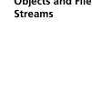

函数名 close 与 open 类似。类 ifstream 和 ofstream 各自都有一个名为 close 的成员函数。它们都“关闭文件”，但它们以不同的方式关闭文件，因为文件以不同的方式打开和操作。我们将在本章后面讨论 ifstream 和 ofstream 类的更多成员函数。

## PROGRAMMING TIP Check Whether a File Was Opened Successfully

对 open 的调用可能因多种原因而失败。例如，如果你打开一个输入文件，而没有指定外部名称的文件，则对 open 的调用将失败。当这种情况发生时，你可能不会收到错误消息，你的程序可能会简单地继续执行一些意外的操作。因此，你应该始终在对 open 的调用后进行测试，以查看对 open 的调用是否成功，如果对 open 的调用不成功，则结束程序（或采取其他适当的操作）。

你可以使用名为 fail 的成员函数来测试流操作是否失败。类 ifstream 和 ofstream 各自都有一个 fail 成员函数。fail 函数不带参数并返回一个 bool 值。对名为 inStream 的流调用 fail 函数如下：

```
inStream.fail()
```

这是一个布尔表达式，可用于控制 while 循环或 if-else 语句。

你应该在每次对 open 的调用之后立即放置对 fail 的调用；如果对 open 的调用失败，fail 函数将返回 true（即布尔表达式将被满足）。例如，如果以下对 open 的调用失败，则程序将输出错误消息并结束；如果调用成功，fail 函数返回 false，因此程序将继续。

```
inStream.open("stuff.dat");
if (inStream.fail())
{
    cout << "Input file opening failed.\n";
    exit(1);  Ends the program
}
```

fail 是一个成员函数，因此它使用流名和点来调用。当然，对 inStream.fail 的调用仅指对 open 的调用形式 inStream.open，而不是对任何其他流作为调用对象所做的对函数 open 的调用。

The member function fail

前面显示的 exit 语句与类无关，也与流没有直接关系，但它经常在此上下文中使用。exit 语句会立即结束你的程序。exit 函数将其参数返回给操作系统。要使用 exit 语句，你的程序必须包含以下 include 指令：

```
#include <cstdlib>
```

使用 exit 时，你的程序还必须包含以下内容，通常放在文件开头或使用 exit 的函数体开头：

```
using namespace std;
```

exit 函数是一个预定义函数，接受单个整数参数。根据惯例，如果由于错误而调用 exit，则使用 1 作为参数，否则使用 0。¹ 对于我们的目的，使用什么整数并不重要，但遵循此惯例是有益的，因为它在更高级的编程中很重要。

## The exit Statement

exit 语句写为

```
exit(Integer_Value);
```

当执行 exit 语句时，程序会立即结束。可以使用任何 Integer_Value，但根据惯例，1 用于因错误而调用 exit 的情况，0 用于其他情况。exit 语句是对 exit 函数的调用，该函数位于名为 cstdlib 的头文件库中。因此，任何使用 exit 语句的程序都必须包含以下指令：

```
#include <cstdlib>
using namespace std;
```

（这些指令不必紧挨着给出。它们放置在我们已经看到的类似指令的相同位置。）

> ¹ UNIX 和 Windows 使用 1 表示错误，0 表示成功，但其他操作系统可能会颠倒此约定。你应该询问你的讲师使用什么值。

Display 6.2 包含 Display 6.1 中的程序重写，加入了测试输入和输出文件是否成功打开。它以与 Display 6.1 中的程序完全相同的方式处理文件。特别是，假设文件 `infile.dat` 存在并且具有 Display 6.1 中所示的内容，Display 6.2 中的程序将创建 Display 6.1 中所示的 `outfile.dat` 文件。然而，如果出现问题并且其中一个对 `open` 的调用失败，则 Display 6.2 中的程序将结束并向屏幕发送适当的错误消息。例如，如果没有名为 `infile.dat` 的文件，则对 `inStream.open` 的调用将失败，程序将结束，并且错误消息将被写入屏幕。

请注意，我们使用了 `cout` 来输出错误消息；这是因为我们希望错误消息进入屏幕，而不是进入文件。由于此程序使用 `cout` 输出到屏幕（以及执行文件 I/O），我们已添加了对头文件 `iostream` 的 `include` 指令。（实际上，当程序具有 `#include <fstream>` 时，你的程序不需要 `#include <iostream>`，但包含它不会造成问题，并且它提醒你程序除了文件 I/O 外还使用屏幕输出。）

## Techniques for File I/O

正如我们已经指出的，运算符 `>>` 和 `<<` 对于连接到文件的流的工作方式与它们对 `cin` 和 `cout` 的工作方式相同。然而，文件 I/O 的编程风格与使用屏幕和键盘的 I/O 不同。当从键盘读取输入时，你应该提示输入并回显输入，像这样：

```
cout << "Enter the number: ";
cin >> theNumber;
cout << "The number you entered is " << theNumber;
```

当你的程序从文件获取输入时，你不应包含此类提示行或输入回显，因为没有人会在那里阅读和响应提示和回显。当从文件读取输入时，你必须确保文件中的数据完全是程序期望的那种数据。你的程序然后简单地读取输入文件，假设它需要的数据在请求时会在那里。如果 `inFile` 是一个连接到输入文件的流变量，并且你希望用来自连接到 `inFile` 的文件的输入替换前面显示的键盘/屏幕 I/O，则可以用以下行替换那三行：

```
inFile >> theNumber;
```

你可以打开任意数量的流用于输入或输出。因此，单个程序可以从键盘获取输入，也可以从一个或多个文件获取输入。同一程序可以向屏幕发送输出


## 自测练习

- 1. 假设你正在编写一个使用名为 `fin` 的流的程序，该流将连接到一个输入文件，以及一个名为 `fout` 的流，该流将连接到一个输出文件。你如何声明 `fin` 和 `fout`？在你的程序文件中需要放置什么 `include` 指令，如果有的话？
- 2. 假设你正在继续编写上一练习中讨论的程序，并且你希望它从文件 `stuff1.dat` 读取输入，并将输出发送到文件 `stuff2.dat`。你需要在程序中放置哪些语句，以便将流 `fin` 连接到文件 `stuff1.dat`，并将流 `fout` 连接到文件 `stuff2.dat`？务必包含检查以确保打开成功。
- 3. 假设你仍在编写前两个练习中讨论的同一程序，并且你到达了不再需要从文件 `stuff1.dat` 获取输入并且不再需要将输出发送到文件 `stuff2.dat` 的点。你如何关闭这些文件？
- 4. 假设你想更改显示 6.1 中的程序，使其将输出发送到屏幕而不是文件 `outfile.dat`。 （输入仍应来自文件 `infile.dat`。）你需要对程序进行哪些更改？
- 5. 如果你的程序使用函数 `exit`，你需要在程序文件中放置什么 `include` 指令？
- 6. 继续自测练习 5，`exit(1)` 对其参数做了什么？
- 7. 假设 `bla` 是一个对象，`dobedo` 是对象 `bla` 的成员函数，并且 `dobedo` 接受一个类型为 `int` 的参数。你如何使用参数 7 编写对对象 `bla` 的成员函数 `dobedo` 的调用？
- 8. 文件和普通程序变量有哪些共同特征？文件的哪些特征与程序中的普通变量不同？
- 9. 命名至少三个与 `iostream` 对象关联的成员函数，并给出每个的用法示例。
- 10. 一个程序已读取文件中的一半行。程序必须对文件做什么才能再次读取第一行？
- 11. 文本中说“一个文件有两个名字”。这两个名字是什么？何时使用每个名字？

## 追加到文件（可选）

当向文件发送输出时，你的代码必须首先使用成员函数 open 打开文件并将其连接到类型为 ofstream 的流。我们迄今为止所做的方式（使用文件名的单个参数）总是会得到一个空文件。如果指定名称的文件已存在，其旧内容将被丢失。还有一种替代方法可以打开文件，以便你的程序的输出将附加到文件中的任何现有数据之后。

要将输出附加到名为 important.txt 的文件，你将使用 open 的双参数版本，如下所示说明：

```
ofstream outStream;
 outStream.open("important.txt", ios::app);
```

如果文件 important.txt 不存在，这将创建一个空文件以接收你的程序的输出，但如果文件已存在，则你的程序的所有输出都将附加到文件的末尾，以便文件中的旧数据不会丢失。这在显示 6.3 中有所说明。

## DISPLAY 6.3 追加到文件（可选） （第 1 部分，共 2 部分）

//将数据追加到文件 data.txt 的末尾。
#include <fstream>
#include <iostream>

int main()
{
    using namespace std;

    cout << "Opening data.txt for appending.\n";
    ofstream fout;
    fout.open("data.txt", ios::app);
    if (fout.fail())
    {
        cout << "Input file opening failed.\n";
        exit(1);
    }

    fout << "5 6 pick up sticks.\n"
        << "7 8 ain't C++ great!\n";

    fout.close();
    cout << "End of appending to file.\n";

    return 0;
}
```

## 追加到文件

如果你想将数据追加到文件，以便它位于文件的任何现有内容之后，按如下方式打开文件。

### SYNTAX

```
OutputStream.open(File_Name, ios::app);
```

### EXAMPLE

```
ofstream outStream;
outStream.open("important.txt", ios::app);
```

文件名是一个字符串，我们将在第 8 章详细讨论字符串处理。然而，很容易学习足够关于字符串的知识，以便你可以编写接受文件名作为输入的程序。字符串只是一系列字符。我们已经在以下等输出语句中使用了字符串值：

```
cout << "This is a string.";
```

我们还将字符串值用作成员函数 open 的参数。每当你写一个字面字符串，如 cout 语句所示时，你必须将字符串放在双引号中。

为了将文件名读入你的程序，你需要一个能够保存字符串的变量。我们将在第 8 章讨论字符串的细节，但现在我们将只介绍足够的内容来存储文件名。保存字符串值的变量声明如下：

```
char fileName[16];
```

此声明与你声明变量为类型 char 的情况相同，只是变量名后面跟着方括号中的一个整数，该整数指定可以在变量中存储的字符串的最大字符数。此数字必须比字符串值中的最大字符数多一个。因此，在我们的示例中，变量 fileName 可以包含任何包含 15 个或更少字符的字符串。名称 fileName 可以被任何其他标识符（不是关键字）替换，并且数字 16 可以被任何其他正整数替换。

你可以以与输入其他类型值相同的方式将字符串值输入到字符串变量。例如，考虑以下代码片段：

```
cout << "Enter the file name (maximum of 15 characters):\n";
cin >> fileName;
cout << "OK, I will edit the file " << fileName << endl;
```

## DISPLAY 6.4 输入文件名（可选） （第 1 部分，共 2 部分）

//从用户指定的文件中读取三个数字，对数字求和，并将和写入用户指定的另一个文件。
#include <fstream>
#include <iostream>
#include <cstdlib>

int main()
{
    using namespace std;
    char inFileName[16], outFileName[16];
    ifstream inStream;
    ofstream outStream;

    cout << "I will sum three numbers taken from an input\n"
         << "file and write the sum to an output file.\n";
    cout << "Enter the input file name (maximum of 15 characters):\n";
    cin >> inFileName;
    cout << "Enter the output file name (maximum of 15 characters):\n";
    cin >> outFileName;
    cout << "I will read numbers from the file "
         << inFileName << " and\n"
         << "place the sum in the file "
         << outFileName << endl;

    inStream.open(inFileName);
    if (inStream.fail())
    {
        cout << "Input file opening failed.\n";
        exit(1);
    }

    outStream.open(outFileName);
    if (outStream.fail())
    {
        cout << "Output file opening failed.\n";
        exit(1);
    }

    int first, second, third;
    inStream >> first >> second >> third;
    outStream << "The sum of the first 3\n"
              << "numbers in " << inFileName << endl
              << "is " << (first + second + third)
              << endl;

    inStream.close();
```
outStream.setf(ios::showpoint);
outStream.precision(2);
```

为了解释这个魔术公式，我们将按相反顺序考虑指令。

每个输出流都有一个名为 precision 的成员函数。当你的程序执行对 precision 的调用时，例如前述对流 outStream 的调用，那么从那时起在你的程序中，任何带小数点的数字输出到该流都将以总共两位有效数字写入，或根据编译器编写的时间以小数点后两位写入。以下是从设置两位有效数字的编译器可能产生的一些输出：

```
23.      2.2e7    2.2      6.9e-1    0.00069
```

以下是从设置小数点后两位数字的编译器可能产生的一些输出：

```
23.56    2.26e7    2.21     0.69     0.69e-4
```

在本书中，我们假设编译器设置小数点后两位数字。

对 precision 的调用仅适用于调用中命名的流。如果你的程序有另一个名为 outStreamTwo 的输出流，那么对 outStream.precision 的调用会影响到流 outStream 的输出，但对流 outStreamTwo 没有影响。当然，你也可以使用流 outStreamTwo 调用 precision；你甚至可以为输出到流 outStreamTwo 的数字指定不同的位数，如下所示：

```
outStreamTwo.precision(3);
```

我们魔术公式中的其他格式化指令比成员函数 precision 更复杂。我们现在讨论这些其他指令。以下是两个对成员函数 setf 的调用，流 outStream 作为调用对象：

```
outStream.setf(ios::fixed);
outStream.setf(ios::showpoint);
```

setf 是 set flags 的缩写。标志是指示以两种可能方式之一执行某事的指令。如果标志作为参数传递给 setf，则标志告诉计算机以特定方式将输出写入该流。它导致流做什么取决于标志。

在前面的示例中，有两个对函数 setf 的调用，这两个调用设置了两个标志 ios::fixed 和 ios::showpoint。标志 ios::fixed 导致流以所谓的定点表示法输出类型为 double 的数字，这是一个花哨的短语，表示我们通常写数字的方式。如果标志 ios::fixed 被设置（通过对 setf 的调用），那么输出到该流的所有浮点数（例如类型为 double 的数字）都将以普通日常记法写入，而不是 e 记法。


## 展示 6.5 用于 setf 的格式化标志

| 标志 | 含义 | 默认值 |
|---|---|---|
| ios::fixed | 如果设置此标志，浮点数不会以 e 记数法书写。（设置此标志会自动取消设置 ios::scientific 标志。） | 未设置 |
| ios::scientific | 如果设置此标志，浮点数会以 e 记数法书写。（设置此标志会自动取消设置 ios::fixed 标志。）如果 ios::fixed 和 ios::scientific 都未设置，则由系统决定如何输出每个数字。 | 未设置 |
| ios::showpoint | 如果设置此标志，浮点数总是显示小数点和末尾的零。如果未设置，小数点后全为零的数字可能会省略小数点及其后的零输出。 | 未设置 |
| ios::showpos | 如果设置此标志，正整数值前会输出加号。 | 未设置 |
| ios::right | 如果设置此标志，并且通过调用成员函数 width 给出了某个字段宽度值，那么下一个输出项将位于 width 指定空间的右端。换句话说，多余的空白会放在输出项之前。（设置此标志会自动取消设置 ios::left 标志。） | 已设置 |
| ios::left | 如果设置此标志，并且通过调用成员函数 width 给出了某个字段宽度值，那么下一个输出项将位于 width 指定空间的左端。换句话说，多余的空白会放在输出项之后。（设置此标志会自动取消设置 ios::right 标志。） | 未设置 |

如果待输出的数字值为 2.0，那么它将输出为 2.0 而不仅仅是 2；也就是说，即使小数点后的所有数字都是 0，输出也会包含小数点。展示 6.5 描述了一些常见标志及其引发的行为。

另一个有用的标志是 ios::showpos。如果为某个流设置此标志，那么输出到该流的正数前面会带有加号。如果希望在正数前面出现加号，请插入以下语句：

```
cout.setf(ios::showpos);
```

负号不需要设置任何标志就会出现在负数前面。

一个非常常用的格式化函数是 width。例如，考虑以下由流 cout 发出的对 width 的调用：

```
cout << "Start Now";
cout.width(4);
cout << 7 << endl;
```

这段代码会在屏幕上产生下面一行：

```
Start Now    7
```

这行输出在字母 'w' 和数字 7 之间正好有三个空格。width 函数告诉流在输出一个项时使用多少个空格。在这个例子中，该项（即数字 7）只占一个空格，而 width 指定使用四个空格，因此其中有三个空格是空白的。如果输出所需的空格比你在 width 参数中指定的更多，那么会使用所需的多余空格。无论你给 width 什么参数，整个项始终都会被输出。

对 width 的调用只适用于下一个要输出的项。如果你想输出 12 个数字，并且每个数字使用四个空格，那么你必须调用 width 12 次。如果这很麻烦，你也许更愿意使用下一小节中描述的操纵符 setw。

任何被设置的标志都可以被取消。要取消一个标志，可以使用函数 unsetf。例如，下面的语句将使你的程序不再在输出到流 cout 的正整数前面加上加号：

```
cout.unsetf(ios::showpos);
```

## 标志术语

为什么 setf 的参数（如 ios::showpoint）被称为标志？奇怪的记号 ios:: 又是什么意思？

标志这个词用于指代可以打开或关闭的东西。该术语的来源显然类似于“旗子举起时就做”这样的说法；或者也许是“旗子放下时就做”。而且，显然没有人能记得确切的原话是什么，因为程序员现在只说“标志被设置时”，而这句话不会让人联想到任何画面。无论如何，当 ios::showpoint 标志被设置时（也就是说，当它作为 setf 的参数时），调用 setf 函数的流将按照展示 6.5 中所描述的方式运行；当任何其他标志被设置时（也就是说，作为 setf 的参数给出时），就是向流发出信号，让它按照展示 6.5 为该标志指定的方式运行。

对于如此奇特的记号，ios:: 的解释其实相当平淡。ios 表示 fixed 或 showpoint 等术语在用于输入或输出流时具有的含义。记号 :: 的意思是“在 :: 之前内容的上下文中使用 :: 之后内容的意义。”我们在本书后面还会进一步介绍 :: 记号。

## 操纵符

**操纵符**是一种以非传统方式调用的函数。反过来，操纵符函数会调用一个成员函数。操纵符放在插入运算符 `<<` 之后，就像这个操纵符函数调用是一个要输出的项一样。与传统函数一样，操纵符可以有参数，也可以没有参数。我们已经见过一个操纵符 `endl`。本小节将讨论两个操纵符：`setw` 和 `setprecision`。

操纵符 `setw` 和成员函数 `width`（你已经见过）做的事情完全相同。调用 `setw` 操纵符的方法是将它写在插入运算符 `<<` 之后，就好像它要被发送到输出流中一样，而它随后会调用成员函数 `width`。例如，下面的语句按照指定的字段宽度输出数字 10、20 和 30：

```
cout << "Start" << setw(4) << 10
<< setw(4) << 20 << setw(6) << 30;
```

前面的语句会产生以下输出：


（10 前面有两个空格，20 前面有两个空格，30 前面有四个空格。）

操纵符 `setprecision` 与成员函数 `precision`（你已经见过）做的事情完全相同。不过，调用 `setprecision` 要写在插入运算符 `<<` 之后，方式与调用 `setw` 操纵符类似。例如，下面的语句按照 `setprecision` 调用所指定的小数点后的位数输出列出的数字：

```
cout.setf(ios::fixed);
cout.setf(ios::showpoint);
cout << "$" << setprecision(2) << 10.3 << endl
<< "$" << 20.5 << endl;
```

上面的语句会产生以下输出：


当你使用操纵符 `setprecision` 设置小数点后的位数时，与成员函数 `precision` 的情况一样，该设置会一直保持有效，直到你通过再次调用 `setprecision` 或 `precision` 将其重新设置为其他数字。

要在程序中使用 `setw` 或 `setprecision` 操纵符，必须包含以下指令：

```
#include <iomanip>
```

你的程序还应该包含以下内容：

```
using namespace std;
```

```
fout.unsetf(ios::showpos);
fout.setf(ios::left);
fout << "*" << setw(5) << 123 << "*"
    << setw(5) << 123 << "*" << endl;
```

16. 当执行下面这一行时会产生什么输出（假设该行位于一个完整、正确的程序中，并且包含了适当的指令）？

```
cout << "*" << setw(3) << 12345 << "*" << endl;
```

17. 在格式化输出时，下列标志常量与流成员函数 setf 一起使用。每个标志有什么作用？

- a. ios::fixed
- b. ios::scientific
- c. ios::showpoint
- d. ios::showpos
- e. ios::right
- f. ios::left

18. 下面这段代码从 infile.dat 读取输入，并将输出发送到 outfile.dat。要使输出显示到屏幕上，需要做哪些更改？（输入仍然来自 infile.dat。）

```
//Problem for Self Test. Copies three int numbers
//between files.
#include <fstream>
int main()
{
    using namespace std;

    ifstream inStream;
    ofstream outStream;

    inStream.open("infile.dat");
    outStream.open("outfile.dat");
    int first, second, third;
    inStream >> first >> second >> third;
    outStream << "The sum of the first 3" << endl
              << "numbers in infile.dat is " << endl
              << (first + second + third) << endl;
    inStream.close();
    outStream.close();
    return 0;
}
```


# 将流作为函数的参数

流参数必须按引用传递

流可以作为函数的参数。唯一的限制是函数形式参数必须按引用传递。流参数不能是按值传递的参数。例如，Display 6.6 中的函数 makeNeat 有两个流参数：一个是类型为 ifstream 的，用于连接到输入文件的流；另一个是类型为 ofstream 的，用于连接到输出文件的流。我们将在接下来的两个小节中讨论 Display 6.6 程序的其他特性。

# 编程技巧 检查文件末尾

> That's all there is, there isn't any more.

ETHEL BARRYMORE (1879–1959)

当你编写从文件读取输入的程序时，你通常希望程序读取文件中的所有数据。例如，如果文件包含数字，你可能希望你的程序计算文件中所有数字的平均值。由于你可能在不同时间使用不同的数据文件运行程序，程序不能假设它知道文件中包含多少个数字。你希望编写程序使其不断从文件中读取数字，直到没有数字可读为止。如果 inStream 是连接到输入文件的流，则计算此平均值的算法可以表述如下：

```
double next, sum = 0;
int count = 0;
while (There are still numbers to be read)
{
    inStream >> next;
    sum = sum + next;
    count++;
}
The average is sum / count.
```

该算法已经几乎全部是 C++ 代码，但我们仍必须用 C++ 表达以下测试：

```
(There are still numbers to be read)
```

即使乍一看可能不正确，表达上述测试的一种方法是以下：

```
(inStream >> next)
```

这种技术通常是测试文件末尾的首选方法。它从流中读取一个值，如果没有剩余可读内容，则
操作返回 false。因此，之前的算法可以重写为以下 C++ 代码（再加上一行此处不涉及的伪代码）：

```
double next, sum = 0;
int count = 0;
while (inStream >> next)
{
    sum = sum + next;
    count++;
}
The average is sum / count.
```

请注意，循环体不再与我们伪代码中的完全相同。由于 inStream >> next 现在位于布尔表达式中，它不再位于循环体中。

这个循环看起来可能有点奇怪，因为 inStream >> next 既是你在流 inStream 中输入数字的方式，也是 while 循环的控制布尔表达式。涉及提取运算符 >> 的表达式同时既是动作又是布尔条件。² 它是指示从输入流中取出一个输入数字的指令，同时也是一个满足或不满足的布尔表达式。如果有下一个数字可输入，则数字被读取且布尔表达式被满足，因此循环体再执行一次。如果没有更多数字可读取，则不进行输入且布尔表达式不被满足，因此循环结束。在此示例中，输入变量 next 的类型为 double，但这种检查文件末尾的方法对于其他数据类型，如 int 和 char 也是同样适用的。

# DISPLAY 6.6 格式化输出（第 1 部分，共 2 部分）

```
//Illustrates output formatting instructions.
//Reads all the numbers in the file rawdata.dat and writes the numbers
//to the screen and to the file neat.dat in a neatly formatted way.
#include <iostream>
#include <fstream>
#include <cstdlib>
#include <iomanip>
using namespace std;
void makeNeat(ifstream& messyFile, ofstream& neatFile,
    int numberAfterDecimalpoint, int fieldWidth);
//Precondition: The streams messyFile and neatFile have been connected
//to files using the function open.
//Postcondition: The numbers in the file connected to messyFile have been
//written to the screen and to the file connected to the stream neatFile.
//The numbers are written one per line, in fixed-point notation (that is, not in
//e-notation), with numberAfterDecimalpoint digits after the decimal point;
//each number is preceded by a plus or minus sign and each number is in a field
//of width fieldWidth. (This function does not close the file.)
int main()
{
    ifstream fin;
    ofstream fout;

    fin.open("rawdata.dat");
    if (fin.fail())
    {
        cout << "Input file opening failed.\n";
        exit(1);
    }
    fout.open("neat.dat");
    if (fout.fail())
    {
        cout << "Output file opening failed.\n";
        exit(1);
    }

    makeNeat(fin, fout, 5, 12);

    fin.close();
    fout.close();

    cout << "End of program.\n";
    return 0;
}
```

Needed for setw

Stream parameters must be call-by-reference.

# DISPLAY 6.6 格式化输出（第 2 部分，共 2 部分）

```cpp
//Uses iostream, fstream, and iomanip:
void makeNeat(ifstream& messyFile, ofstream& neatFile,
              int numberAfterDecimalpoint, int fieldWidth)
{
    neatFile.setf(ios::fixed);
    neatFile.setf(ios::showpoint);
    neatFile.setf(ios::showpos);
    neatFile.precision(numberAfterDecimalpoint);
    cout.setf(ios::fixed);
    cout.setf(ios::showpoint);
    cout.setf(ios::showpos);
    cout.precision(numberAfterDecimalpoint);

    double next;
    while (messyFile >> next)
    {
        cout << setw(fieldWidth) << next << endl;
        neatFile << setw(fieldWidth) << next << endl;
    }
}
```

Not in e-notation

Show decimal point

Show + sign

Satisfied if there is a next number to read

# rawdata.dat

(Not changed by program.)

```
10.37   −9.89897
2.313   −8.950 15.0
7.33333 92.8765
−1.237568432e2
```

# neat.dat

(After program is run.)

```
      +10.37000
       −9.89897
       +2.31300
       −8.95000
      +15.00000
       +7.33333
      +92.87650
     −123.75684
```

# Screen Output

```
      +10.37000
       −9.89897
       +2.31300
       −8.95000
      +15.00000
       +7.33333
      +92.87650
     −123.75684

  End of program.
```

# 关于命名空间的说明

我们已尝试将 using 指令保持在函数定义本地。这是值得称赞的目标，但现在我们遇到了一个问题——参数类型位于命名空间中的函数。在我们立即的示例中，我们需要位于命名空间 std 中的流类型名称。因此，我们需要在函数定义体之外有一个 using 指令（或类似的东西），以便 C++ 能理解参数类型名称，例如 ifstream。最简单的修复方法是在文件开头（在 include 指令之后）简单地放置一个 using 指令。我们已在 Display 6.6 中这样做了。

在文件开头放置单个 using 指令是我们问题的最简单解决方案，但许多专家不会认为这是最好的解决方案，因为它不允许使用具有相同名称的两个命名空间，而
那正是命名空间的全部目的。此时我们仅使用命名空间 std，³ 所以没有问题。在第 12 章中，我们将教你另一种绕过此参数和命名空间问题的方法。这种其他方法将允许你使用任何种类的多个命名空间。

许多程序员更喜欢在程序文件开头放置 using 指令。例如，考虑以下 using 指令：

```
using namespace std;
```

本书中的许多程序并未在程序文件开头放置此 using 指令。相反，此 using 指令被放置在每个需要命名空间 std 的函数定义开头（紧跟在左大括号之后）。Display 6.3 中展示了此示例。Display 5.11 中展示了更好的示例。到目前为止本书中出现的所有程序，以及几乎所有后续程序，如果只有一个用于命名空间 std 的 using 指令，并且该指令放置在 include 指令之后，如 Display 6.6 所示，将完全相同地表现。对于命名空间 std，using 指令可以安全地放置在文件开头（在几乎所有情况下）。对于某些其他命名空间，单个 using 指令并不总是足够，但你很长时间内不会看到这些情况。

我们提倡将 using 指令放置在函数定义内部（或某些其他小的代码单元内部），以便它不会干扰任何其他可能的 using 指令。这训练你在使用命名空间时正确使用，为你在编程生涯后期编写更复杂的代码做好准备。与此同时，当遵循规则变得过于繁重而影响我们讨论的其他问题时，我们有时也会自己违反此规则。如果你正在上课，请按照你的讲师要求执行。否则，你在放置 using 指令的位置上有一些自由度。

# 编程示例 清理文件格式

Display 6.6 中的程序从文件 rawdata.dat 读取输入，并以整洁的格式将输出同时写入屏幕和文件 neat.dat。程序将数字从文件 rawdata.dat 复制到文件 neat.dat，但它使用格式化指令以整洁的方式写入它们。数字按一行一个写入，字段宽度为 12，这意味着每个数字前面都有足够的空格，使得空格加数字占据 12 个空格。数字以普通记数法写入；即它们不以 e-记数法写入。每个数字以小数点后五位写入

³ 我们实际上使用了两个命名空间：命名空间 std 和一个名为全局命名空间的命名空间，它由所有不在其他命名空间中的名称组成。但这个技术细节现在对我们来说不是大问题。


```
#include <iostream>
using namespace std;
// ...
char name[21];
cin >> name;
```

假设这段代码被嵌入到一个正确的程序中。可以输入到字符串变量 `name` 中的最长名称是多少？

## 6.3 字符输入/输出

> 波洛涅斯：你在读什么，我的殿下？
> 
> 哈姆雷特：词，词，词。
> 
> 威廉·莎士比亚，《哈姆雷特》

所有数据的输入和输出都是作为字符数据进行的。当你的程序输出数字 10 时，实际输出的是两个字符 '1' 和 '0'。类似地，当用户想输入数字 10 时，他或她输入的是字符 '1' 后跟字符 '0'。计算机是将这个 10 解释为两个字符还是数字 10，取决于你的程序如何编写。但是，无论你的程序如何编写，计算机硬件始终读取的是字符 '1' 和 '0'，而不是数字 10。这种字符与数字之间的转换通常自动完成，因此你无需考虑此类细节。然而，有时所有这些自动帮助反而会碍事。因此，C++ 提供了一些用于字符数据输入和输出的底层设施。这些底层设施不包含自动转换。这使你可以绕过自动设施，以任何你想要的方式进行输入/输出。如果你非要这么别扭的话，你甚至可以编写以罗马数字记法读写数字的输入和输出函数。

## 成员函数 get 和 put

函数 get 允许你的程序读入一个输入字符，并将其存储在一个类型为 `char` 的变量中。每个输入流，无论是输入文件流还是 `cin` 流，都有一个名为 get 的成员函数。我们将把 get 描述为 `cin` 流的成员函数，但它在输入文件流中的行为与在 `cin` 中完全相同，因此你可以将我们关于 get 的所有论述同时应用于输入文件流和 `cin` 流。

此前，我们一直使用 `cin` 和提取运算符 >> 来读取一个输入字符（或者说，任何其他输入）。当我们像之前那样使用提取运算符 >> 时，有些操作会自动为你完成，例如跳过空白。而使用成员函数 get 时，没有任何操作会自动完成。例如，如果你想使用 `cin.get` 跳过空白，你必须编写代码来读取并丢弃这些空白。

成员函数 get 接受一个参数，该参数应为 `char` 类型的变量。该参数接收从输入流中读取的输入字符。例如，下面代码从键盘读取下一个输入字符，并将其存储在变量 `nextSymbol` 中：

```cpp
char nextSymbol;
cin.get(nextSymbol);
```

需要特别注意的是，你的程序可以以这种方式读取任何字符。如果下一个输入字符是空白，这段代码不会跳过空白，而是会读取该空白，并将 `nextSymbol` 的值设置为该空白字符。如果下一个字符是换行符 `\n`，也就是说，程序刚刚到达输入行的末尾，那么前面显示的对 `cin.get` 的调用会将 `nextSymbol` 的值设置为 `\n`。

### 读取空白和 `
`

虽然我们将其写成两个符号，但 `\n` 在 C++ 中只是一个单字符。使用成员函数 get 时，字符 `\n` 可以像其他任何字符一样被输入和输出。例如，假设你的程序包含以下代码：

```cpp
char c1, c2, c3;
cin.get(c1);
cin.get(c2);
cin.get(c3);
```

并假设你输入以下两行内容供这段代码读取：

```text
AB
CD
```

也就是说，假设你输入 AB 后按回车键，然后输入 CD 后按回车键。正如你所预期的那样，c1 的值被设置为 'A'，c2 的值被设置为 'B'。这一点并不新鲜。但当这段代码填充变量 c3 时，情况会与你使用提取运算符 `>>` 而不是成员函数 get 时有所不同。当这段代码在我们所示的输入上执行时，c3 的值被设置为 `\n`；也就是说，c3 的值被设置为等于换行符。变量 c3 不会被设置为等于 'C'。

使用成员函数 get 可以做到的其中一件事，就是让程序检测一行的末尾。下面的循环将读取一行输入，并在经过换行符 `\n` 后停止。然后，任何后续输入都将从下一行的开头开始读取。对于这第一个示例，我们只是回显了输入，但同样的技术可以让你对输入进行任何你想做的操作：

### 检测输入行的末尾

```cpp
cout << "Enter a line of input and I will echo it:\n";
char symbol;
do
{
    cin.get(symbol);
```

### '
' 和 "
"

'\n' 和 "\n" 有时看起来像是同一个东西。在 `cout` 语句中，它们产生的效果相同，但它们并非在所有情况下都可以互换使用。'\n' 是 `char` 类型的一个值，可以存储在 `char` 类型的变量中。另一方面，"\n" 是一个恰好由一个字符组成的字符串。因此，"\n" 不是 `char` 类型，不能存储在 `char` 类型的变量中。

成员函数 put 与成员函数 get 类似，只不过它用于输出而不是输入。put 允许你的程序输出一个字符。成员函数 put 接受一个参数，该参数应为 `char` 类型的表达式，例如 `char` 类型的常量或变量。调用该函数时，参数的值将被输出到流中。例如，下面代码将字母 'a' 输出到屏幕：

```
cout.put('a');
```

函数 `cout.put` 并不能让你做到任何我们之前讨论过的方法做不到的事情，我们将其包含进来只是为了完整起见。

如果你的程序使用了 `cin.get` 或 `cout.put`，那么与 `cin` 和 `cout` 的其他用法一样，你的程序应包含以下指令：

```
#include <iostream>
```

类似地，如果你的程序对输入文件流使用 get，或对输出文件流使用 put，那么与任何其他文件 I/O 一样，你的程序应包含以下指令：

```
#include <fstream>
```

## 成员函数 put

每个输出流都有一个名为 put 的成员函数，它接受一个参数，该参数应为 `char` 类型的表达式。当调用成员函数 put 时，其参数（下文称为 Char_Expression）的值将被输出到输出流。

## 语法

```
outputStream.put(Char_Expression);
```

（续）

注意，这段代码执行后，所读取的空白仍然保留在输入流 `fin` 中，因为代码在读取后又将其放回了。

请注意，putback 将一个字符放入输入流，而 put 将一个字符放入输出流。使用成员函数 putback 放回输入流的字符不一定是最后读取的字符；它可以是任何你想要的字符。如果你放回的不是最后读取的字符，putback 不会改变输入文件中的文本，尽管你的程序会表现得好像输入文件中的文本已经被改变了一样。

## 编程示例：检查输入

如果用户输入了不正确的输入，程序的整个运行过程就可能变得毫无价值。为了确保程序不受不正确输入的妨碍，你应该使用允许用户重新输入直到输入正确的输入函数。程序清单 6.7 中的 `getInt` 函数会询问用户输入是否正确，如果用户表示输入不正确，则要求输入一个新值。程序清单 6.7 中的程序只是一个用于测试 `getInt` 函数的驱动程序，但该函数或与之非常相似的函数几乎可以用于任何从键盘获取输入的程序。

注意对函数 `newLine( )` 的调用。函数 `newLine` 读取当前行剩余部分的所有字符，但不对其做任何处理。这相当于丢弃该行的剩余部分。因此，如果用户输入 No，程序会读取第一个字母 N，然后调用 `newLine` 函数，该函数会丢弃输入行的其余部分。这意味着，如果用户在下一输入行输入 75（如示例对话所示），程序将读取数字 75，而不会试图读取单词 No 中的字母 o。如果程序没有包含对函数 `newLine` 的调用，那么下一个读取的项将是包含 No 的那一行中的 o，而不是下一行的数字 75。

## 程序清单 6.7 检查输入（第 1 部分，共 2 部分）

```
//Program to demonstrate the functions newLine and getInput.
#include <iostream>
using namespace std;

void newLine( );
//Discards all the input remaining on the current input line.
//Also discards the '\n' at the end of the line.
//This version works only for input from the keyboard.

void getInt(int& number);
//Postcondition: The variable number has been
```

（续）


## DISPLAY 6.7 检查输入（第 2 部分，共 2 部分）

```
12    //given a value that the user approves of.
13
14
15    int main( )
16    {
17        int n;
18
19        getInt(n);
20        cout << "Final value read in = " << n << endl
21            << "End of demonstration.\n";
22        return 0;
23    }
24
25
26    //Uses iostream:
27    void newLine( )
28    {
29        char symbol;
30        do
31        {
32            cin.get(symbol);
33        } while (symbol != '\n');
34    }
35    //Uses iostream:
36    void getInt(int& number)
37    {
38        char ans;
39        do
40        {
41            cout << "Enter input number: ";
42            cin >> number;
43            cout << "You entered " << number
44               << ". Is that correct? (yes/no): ";
45            cin >> ans;
46            newLine( );
47        } while ((ans != 'Y') && (ans != 'y'));
48    }
```

# Sample Dialogue

Enter input number: 57
You entered 57. Is that correct? (yes/no): No
Enter input number: 75
You entered 75. Is that correct? (yes/no): yes
Final value read in = 75
End of demonstration.

注意函数 `getInt` 中 *do-while* 循环末尾的布尔表达式。如果输入不正确，用户应该输入 No（或其变体如 no），这将导致循环再迭代一次。然而，与其检查用户是否输入以 'N' 开头的单词，*do-while* 循环检查的是用户响应的第一个字母是否 *不* 等于 'Y'（并且也不等于 'Y' 的小写形式）。只要用户没有犯错并且以 Yes 或 No 的某种形式作答，但从不输入其他内容，那么检查 No 或检查非 Yes 是等价的。然而，由于用户可能会以其他方式作答，检查非 Yes 更安全。要了解其安全性，假设用户在输入数字时犯了错误。计算机回显该数字并询问是否正确。用户应输入 No，但假设用户犯了错误并输入了 Bo，这并不罕见，因为 'B' 在键盘上正好挨着 'N'。由于 'B' 不等于 'Y'，*do-while* 循环的主体将被执行，用户将有机会重新输入。

但是，如果正确答案是 Yes，而用户错误地输入了以 'Y' 或 'y' 以外的字母开头的字符呢？在这种情况下，循环不应迭代，但它会多迭代一次。这是一个错误，但远不如上一段讨论的错误严重。这意味着用户必须多输入一次输入数字，但它不会浪费整个程序的运行。在检查输入时，冒一次额外的循环迭代的风险要比冒使用错误输入继续的风险更好。

## **PITFALL** 输入中意外的 ‘
’

在使用成员函数 `get` 时，你必须考虑输入的每一个字符，即使是你不认为是有意义的符号的字符，例如空格和换行符 '\n'。使用 `get` 时的常见问题是忘记处理结束每行输入的 '\n'。如果输入流中存在未被读取（通常被丢弃）的换行符，那么当你的程序下一次期望使用成员函数 `get` 读取一个“真实”的符号时，它将改为读取字符 '\n'。要清除输入流中残留的 '\n' 字符，你可以使用我们在 Display 6.7 中定义的函数 `newLine`。让我们看一个具体的例子。

可以合法地混合使用 `cin` 的不同形式。例如，以下是合法的：

```
cout << "Enter a number:\n";
int number;
cin >> number;
cout << "Now enter a letter:\n";
char symbol;
cin.get(symbol);
```

然而，这种混合可能会产生问题，如以下对话所示：


```
Enter a number:
21
Now enter a letter:
A
```

在此对话中，number 的值将为 21，正如你所期望的。然而，如果你期望变量 symbol 的值为 'A'，你会失望。赋给 symbol 的值是 '\n'。读取数字 21 之后，输入流中的下一个字符是换行符 '\n'，因此接下来读取的就是它。记住，get 不会跳过换行和空格。事实上，取决于程序其余部分的内容，你甚至可能没有机会输入 A。一旦变量 symbol 被 '\n' 字符填满，程序就会继续执行程序中的下一个语句。如果下一个语句向屏幕发送输出，屏幕会在你有机会输入 A 之前被输出填满。

对上述代码的以下两种重写方式之一将使前述对话将变量 number 填为 21 并将变量 symbol 填为 'A'：

```
cout << "Enter a number:\n";
int number;
cin >> number;
cout << "Now enter a letter:\n";
char symbol;
cin >> symbol;
```

或者，你也可以使用在 Display 6.7 中定义的函数 newLine，如下所示：

```
cout << "Enter a number:\n";
int number;
cin >> number;
newLine();
cout << "Now enter a letter:\n";
char symbol;
cin.get(symbol);
```

正如第二个重写所示，你可以混合使用 cin 的两种形式并使程序正确运行，但它确实需要一些额外的注意。

## 使流参数具有通用性

如果你想定义一个函数以输入流作为参数，并且希望该参数在某些情况下为 cin，在其他情况下为输入文件流，那么使用类型为 istream（不带 f）的形式参数。然而，即使作为类型为 istream 的参数使用，输入文件流仍必须声明为类型 ifstream（带 f）。

（续）

这里有一个例子：

```
//To test default argument behavior
//Uses iostream
void defaultArgs(int arg1, int arg2, int arg3 = -3,
    int arg4 = -4)
{
    cout << arg1 << ' ' << arg2 << ' ' << arg3 << ' ' << arg4
         << endl;
}
```

可以对该函数使用两个、三个或四个参数进行调用。例如，调用

```
defaultArgs(5, 6);
```

提供了非默认参数并使用了两个默认参数。输出为

5 6 -3 -4

接下来，考虑

```
defaultArgs(6, 7, 8);
```

此调用提供了非默认参数和第一个默认参数，最后一个参数使用默认值。此调用的输出如下：

6 7 8 -4

调用

```
defaultArgs(5, 6, 7, 8);
```

从参数列表分配所有参数，并给出以下输出：

5 6 7 8

## SELF-TEST EXERCISES

### 22. 假设 c 是类型为 char 的变量。以下两个语句有什么区别？

```
cin >> c;
```

和

```
cin.get(c);
```

### 23. 假设 `c` 是类型为 `char` 的变量。以下两个语句有什么区别？

```
cout << c;
```

和

```
cout.put(c);
```

### 24. （此问题适用于阅读了可选章节“putback 成员函数”的人。）putback 成员函数将一个符号“放回”输入流。放回的符号必须是上一次从流中输入的最后一个符号吗？例如，如果你的程序从输入流读取一个 'a'，它能否使用 putback 函数放回一个 'b'，还是只能放回一个 'a'？

### 25. 考虑以下代码（并假设它嵌入在一个完整且正确的程序中然后运行）：

```
char c1, c2, c3, c4;
cout << "Enter a line of input:\n";
cin.get(c1);
cin.get(c2);
cin.get(c3);
cin.get(c4);
cout << c1 << c2 << c3 << c4 << "END OF OUTPUT";
```

如果对话如下开始，下一个输出行会是什么？

```
Enter a line of input:
 a b c d e f g
```

### 26. 考虑以下代码（并假设它嵌入在一个完整且正确的程序中然后运行）：

```
char next;
int count = 0;
cout << "Enter a line of input:\n";
cin.get(next);
while (next != '\n')
{
    if ((count % 2) == 0)
        cout << next;
    count++;
    cin.get(next);
}
```

如果对话如下开始，下一个输出行会是什么？

```
Enter a line of input:
abcdef gh
```


是输入文件流，则在调用函数之前流已连接到文件，因此 copyLine 不会打开或关闭任何文件。）例如，下面对 copyLine 的两次调用中第一次将从文件 stuff.dat 复制一行到屏幕上，第二次将从键盘复制一行到屏幕上：

```
ifstream fin;
fin.open("stuff.dat");
copyLine(fin);
copyLine(cin);
```

31. 定义一个名为 sendLine 的函数，它接受一个输出流参数。调用时，sendLine 从键盘读取一行输入并将该行输出到作为其参数给出的输出流。你应该能够使用 cout 或输出文件流作为 sendLine 函数的参数来调用你的函数。（如果参数是输出文件流，则在调用函数之前流已连接到文件，因此 sendLine 不会打开或关闭任何文件。）例如，下面对 sendLine 的第一次调用将从键盘复制一行到文件 morestuff.dat，第二次调用将从键盘复制一行到屏幕：

```
ofstream fout;
fout.open("morestuff.dat");
cout << "Enter 2 lines of input:\n";
sendLine(fout);
sendLine(cout);
```

32. （此练习适用于学习了关于默认参数的可选章节的人。）以下函数对以下调用提供什么输出？

```
void func(double x, double y = 1.1, double z = 2.3)
{
    cout << x << " " << y << " " << z << endl;
}
```

调用：

- a. func(2.0);
- b. func(2.0, 3.0);
- c. func(2.0, 3.0, 4.0);

33. （此练习适用于学习了关于默认参数的可选章节的人。）编写多个重载函数名以获得与前一个自测练习中默认函数参数中的所有调用相同的效果。

此 *while* 循环使用成员函数 `get` 将输入文件中的每个字符读入 `char` 变量 next，然后将字符写入屏幕。程序通过文件末尾后，`inStream.eof()` 的值从 *false* 变为 *true*。因此，

```
(! inStream.eof())
```

从 *true* 变为 *false* 且循环结束。

请注意，`inStream.eof()` 不会在程序尝试读取文件末尾之后的一个字符之前变为 *true*。例如，假设文件包含以下内容（c 后面没有换行符）：

```
ab
c
```

这实际上是以下四个字符的列表：

```
ab<换行符 '\n'>c
```

此循环读取 'a' 并将其写入屏幕，然后读取 'b' 并将其写入屏幕，然后读取换行符 '\n' 并将其写入屏幕，然后读取 'c' 并将其写入屏幕。此时循环将已读取文件中的所有字符。然而，`inStream.eof()` 仍为 *false*。`inStream.eof()` 的值不会从 *false* 变为 *true*，直到程序尝试再读取一个字符。这就是为什么 *while* 循环以 `inStream.get(next)` 结束。循环需要读取一个额外的字符才能结束循环。

文件末尾有一个特殊的结束文件标记。成员函数 `eof` 不会在此结束文件标记被读取之前从 *false* 变为 *true*。这就是为什么示例 *while* 循环可以读取超出你认为的文件中最后一个字符的一个字符。然而，此结束文件标记不是普通字符，不应像普通字符一样操作。你可以读取此结束文件标记，但不应再次将其写出。如果你写出结束文件标记，结果是不可预测的。系统会自动为你将此结束文件标记放置在每个文件的末尾。

下一个编程示例使用 `eof` 成员函数来确定程序是否已读取整个输入文件。

## 决定如何测试输入文件的末尾

你现在有两种检测文件末尾的方法。你可以使用 `eof` 成员函数，也可以使用我们在编程提示“检查文件末尾”中描述的方法。在大多数情况下你可以使用任一方法，但许多程序员在不同情况下使用这两种不同的方法。如果你没有其他理由偏好这两种方法中的一种，那么使用以下一般规则：当你将输入视为文本并使用 `get` 成员函数读取输入时，使用 `eof` 成员函数；当你处理数值数据时，使用另一种方法。

## SELF-TEST EXERCISES

34. 假设 ins 是一个文件输入流，它已通过成员函数 open 连接到一个文件。假设你的程序刚刚读取了文件中的最后一个字符。此时，ins.eof( ) 会计算为 true 还是 false？

35. 编写一个名为 textToScreen 的 void 函数的定义，它有一个名为 fileStream 的形式参数，其类型为 ifstream。函数的先决条件和后置条件如下：

```
//Precondition: The stream fileStream has been connected
//to a file with a call to the member function open.
//Postcondition: The contents of the file connected to
//fileStream have been copied to the screen character by
//character, so that the screen output is the same as the
//contents of the text in the file.
//(This function does not close the file.)
```

## PROGRAMMING EXAMPLE Editing a Text File

这里讨论的程序是应用于文件的文本编辑的非常简单的示例。它可能被软件公司用来更新其广告宣传资料。该公司一直销售 C 编程语言的编译器，并最近推出了 C++ 编译器系列。此程序可用于从现有的 C 广告材料自动生成 C++ 广告材料。程序从包含关于 C 的赞美广告文案的文件中读取输入，并将类似的关于 C++ 的广告文案写入另一个文件。包含 C 广告文案的文件称为 cad.dat，而接收 C++ 广告文案的新文件称为 cplusad.dat。程序如 Display 6.8 所示。

程序只是读取文件 cad.dat 中的每个字符并将字符复制到文件 cplusad.dat。每个字符都被原样复制，除了当从输入文件读取大写字母 'C' 时，程序将字符串 "C++" 写入输出文件。此程序假设只要字母 'C' 出现在输入文件中，它就表示 C 编程语言；因此，此更改正是生成更新后的广告文案所需的。

请注意，当程序从输入文件读取字符并将字符写入输出文件时，换行符得以保留。换行符 '\n' 被当作任何其他字符处理。它使用成员函数 get 从输入文件读取，并使用插入运算符 << 写入输出文件。我们必须使用成员函数 get 来读取输入。如果我们改用提取运算符 >> 来读取输入，程序将跳过所有空白，这意味着文件中的所有空格和所有换行符 '\n' 都不会被读取，因此它们不会被复制到输出文件。

另请注意，成员函数 eof 用于检测输入文件的末尾并结束 while 循环。

## Predefined Character Functions

在文本处理中，你经常希望将小写字母转换为大写，反之亦然。可预定义函数 toupper 可用于将小写字母转换为大写字母。例如，toupper('a') 返回 'A'。如果函数 toupper 的参数不是小写字母，则 toupper 只是原样返回参数。因此 toupper('A') 也返回 'A'。函数 tolower 类似，只是它将大写字母转换为其小写版本。

函数 toupper 和 tolower 在具有头文件 cctype 的库中，因此任何使用这些函数或该库中任何其他函数的程序都必须包含以下包含指令：

```
#include <cctype>
```

## DISPLAY 6.8 Editing a File of Text (part 1 of 2)

```
1  //Program to create a file called cplusad.dat that is identical to the file
2  //cad.dat, except that all occurrences of 'C' are replaced by "C++".
3  //Assumes that the uppercase letter 'C' does not occur in cad.dat except
4  //as the name of the C programming language.
5  #include <fstream>
6  #include <iostream>
7  #include <cstdlib>
8  using namespace std;
9  void addPlusPlus(ifstream& inStream, ofstream& outStream);
10 //Precondition: inStream has been connected to an input file with open.
11 //outStream has been connected to an output file with open.
12 //Postcondition: The contents of the file connected to inStream have been
13 //copied into the file connected to outStream, but with each 'C' replaced
14 //by "C++". (The files are not closed by this function.)
15 
16 int main()
17 {
18     ifstream fin;
19     ofstream fout;
20     cout << "Begin editing files.\n";
21     fin.open("cad.dat");
22     if (fin.fail())
23     {
```


Display 6.9 包含了库 cctype 中最常用的一些函数的描述。

函数 isspace 如果其参数是空白字符则返回 true。如果 isspace 的参数不是空白字符，则 isspace 返回 false。因此，isspace(' ') 返回 true 而 isspace('a') 返回 false。

例如，下面的代码读取以句点结束的句子并回显字符串，将所有空白字符替换为符号 '-'：

```
char next;
do
{
    cin.get(next);
    if (isspace(next))
        cout << '-';
    else
        cout << next;
} while (next != '.');
```

True if the character in next is whitespace

例如，如果上面的代码给定以下输入：

Ahhdo be do.

那么它将产生以下输出：

Ahhdo--be--do.

## PITFALL toupper and tolower Return Values

在许多方面，C++ 将字符视为与类型 int 相同的整数。每个字符都被分配一个数字，并且当字符存储在类型为 char 的变量中时，就是这个数字被放在计算机的内存中。在 C++ 中你可以使用类型为 char 的值作为数字——例如，通过将其放在类型为 int 的变量中。你也可以将类型为 int 的数字存储在类型为 char 的变量中（前提是数字不太大）。因此，类型 char 可以用作字符的类型，也可以作为小整数的类型。

通常你不必关心这个细节，可以简单地把类型为 char 的值视为字符，而不必担心它们作为数字的使用。然而，在使用 cctype 中的函数时，这个细节可能很重要。函数 toupper 和 tolower 实际上返回类型为 int 的值而不是类型为 char 的值；也就是说，它们返回我们认为它们返回的字符对应的数字，而不是字符本身。因此，下面将不会输出字母 'A'，而是会输出分配给 'A' 的数字：

```
cout << toupper('a');
```

## DISPLAY 6.9 Some Predefined Character Functions in cctype

| Function | Description | Example |
|---|---|---|
| `toupper(Char_Exp)` | Returns the uppercase version of `Char_Exp`. | `char c = toupper('a');`<br>`cout << c;`<br>**Outputs:** A |
| `tolower(Char_Exp)` | Returns the lowercase version of `Char_Exp`. | `char c = tolower('A');`<br>`cout << c;`<br>**Outputs:** a |
| `isupper(Char_Exp)` | Returns `true` provided `Char_Exp` is an uppercase letter; otherwise, returns `false`. | `if (isupper(c))`<br>`    cout << c <<`<br>`        " is uppercase.";`<br>`else`<br>`    cout << c`<br>`        << " is not uppercase.";` |
| `islower(Char_Exp)` | Returns `true` provided `Char_Exp` is a lowercase letter; otherwise, returns `false`. | `char c = 'a';`<br>`if (islower(c))`<br>`    cout << c << " islowercase.";`<br>**Outputs:** a is lowercase. |
| `isalpha(Char_Exp)` | Returns `true` provided `Char_Exp` is a letter of the alphabet; otherwise, returns `false`. | `char c = '$';`<br>`if (isalpha(c))`<br>`    cout << c << " is a letter.";`<br>`else`<br>`    cout << c`<br>`        << " is not a letter.";`<br>**Outputs:** $ is not a letter. |
| `isdigit(Char_Exp)` | Returns `true` provided `Char_Exp` is one of the digits '0' through '9'; otherwise, returns `false`. | `if (isdigit('3'))`<br>`    cout << "It's a digit.";`<br>`else`<br>`    cout << "It's not a digit.";`<br>**Outputs:** It's a digit. |
| `isspace(Char_Exp)` | Returns `true` provided `Char_Exp` is a whitespace character, such as the blank or new-line symbol; otherwise, returns `false`. | `//Skips over one "word" and`<br>`//sets c equal to the first`<br>`//whitespace character after`<br>`//the "word":`<br>`do`<br>`{`<br>`    cin.get(c);`<br>`} while (!isspace(c));` |

为了让计算机将 toupper 或 tolower 返回的值视为类型为 char 的值（而不是类型为 int 的值），你需要指明你想要类型为 char 的值。一种方法是把返回的值放在类型为 char 的变量中。下面的代码将输出字符 'A'，这通常是我们想要的：

```
char c = toupper('a');
    cout << c;
```

Places 'A' in the variable c

另一种让计算机将 toupper 或 tolower 返回的值视为类型为 char 的值的方法是使用类型转换，如下所示：

```
cout << static_cast<char>(toupper('a'));
```

（类型转换在第 4 章的“类型转换”部分讨论过。）

## SELF-TEST EXERCISES

36. 考虑下面的代码（并假设它嵌入在一个完整且正确的程序中然后运行）：

```
cout << "Enter a line of input:\n";
char next;
do
{
    cin.get(next);
    cout << next;
} while ( (! isdigit(next)) && (next != '\n') );
cout << "<END OF OUTPUT";
```

如果对话开始如下，下一个输出行是什么？

> Enter a line of input:
> I'll see you at 10:30 AM.

37. 编写一些 C++ 代码，读取一行文本并回显该行，同时删除所有大写字母。

## CHAPTER SUMMARY

- 类型为 ifstream 的流可以通过调用成员函数 open 连接到文件。你的程序随后可以从该文件读取输入。
- 类型为 ofstream 的流可以通过调用成员函数 open 连接到文件。你的程序随后可以将输出发送到该文件。
- 你应该使用成员函数 fail 来检查 open 调用的是否成功。

一个 **对象** 是与之关联有函数的变量。这些函数称为 **成员函数**。一个 **类** 是其变量为对象的类型。流就是对象的例子。类型 `ifstream` 和 `ofstream` 是类的例子。

下面是你在编写对对象成员函数的调用时使用的语法：

```
Calling_Object.Member_Function_Name(Argument_List);
```

一个以流 `cout` 作为调用对象、以 `precision` 作为成员函数的例子如下：

```
cout.precision(2);
```

流成员函数，如 `width`、`setf` 和 `precision`，可用于格式化输出。这些输出函数对连接到屏幕的流 `cout` 以及连接到文件的输出流的工作方式相同。

每个输入流都有一个名为 `get` 的成员函数，可用于读取一个字符的输入。成员函数 `get` 不会跳过空白。每个输出流也有一个名为 `put` 的成员函数，可用于向输出流写入一个字符。

成员函数 `eof` 可用于测试程序是否已到达输入文件的末尾。成员函数 `eof` 对于文本处理效果很好。然而，在处理数值数据时，你可能更喜欢通过本章讨论的另一种方法来测试文件的末尾。

一个函数可能具有流类型的形式参数，但它们必须是传引用参数；它们不能是传值参数。类型 `ifstream` 可用于输入文件流，类型 `ofstream` 可用于输出文件流。（请参阅下一个总结要点，了解其他类型可能性。）

如果你使用 `istream`（不带 f 的拼写）作为输入流参数的类型，那么对应于该形式参数的参数可以是流 `cin` 也可以是类型为 `ifstream`（带 f 的拼写）的输入文件流。如果你使用 `ostream`（不带 f 的拼写）作为输出流参数的类型，那么对应于该形式参数的参数可以是流 `cout` 也可以是类型为 `ofstream`（带 f 的拼写）的输出文件流。

## Answers to Self-Test Exercises

1. 流 `fin` 和 `fout` 声明如下：

```
ifstream fin;
ofstream fout;
```

文件顶部需要包含指令是

```
#include <fstream>
```

你的代码还需要以下内容：

```
using namespace std;
```

- 2. fin.open("stuff1.dat");
- if (fin.fail())
- {
-     cout << "Input file opening failed.\n";
-     exit(1);
- }
- fout.open("stuff2.dat");
- if (fout.fail())
- {
-     cout << "Output file opening failed.\n";
-     exit(1);
- }

- 3. fin.close();
- fout.close();

- 4. 你需要用流 cout 替换流 outStream。注意你不需要声明 cout，你不需要用 open 调用 cout，并且你不需要关闭 cout。

- 5. #include <cstdlib>
  
  你的代码还需要以下内容：
  using namespace std;

- 6. exit(1) 函数将参数返回给操作系统。根据惯例，操作系统将 1 用作错误状态的指示，0 用作成功状态的指示。实际执行的操作取决于系统。

- 7. bla.dobedo(7);

- 8. 文件和程序变量都存储值并且可以从中检索值。程序变量仅在程序运行时存在，而文件可能在程序运行前就已存在，并且可能在程序停止后继续存在。简而言之，文件可能是永久的；变量不是。文件提供了存储大量数据的能力，而程序变量提供的存储量则没有那么大。

- 9. 到目前为止我们见过 open、close 和 fail 成员函数。以下示例说明了它们的使用。


```
int c;
ifstream in;
ofstream out;
in.open("in.dat");
if (in.fail())
{
    cout << "Input file opening failed.\n";
    exit(1);
}
in >> c;

out.open("out.dat");
if (out.fail())
{
    cout << "Output file opening failed.\n";
    exit(1);
}
out << c;

out.close();
in.close();
```

10. 这就是本章开头所述的“重新开始”。文件必须先关闭再重新打开。这个操作会将读取位置置于文件开头，准备再次读取。

11. 这两个名称分别是外部文件名和流名称。外部文件名是操作系统使用的名称。它是文件的真实名称，但仅在调用 open 函数时使用，该函数将文件连接到一个流。流名称是一个流变量，通常是 ifstream 或 ofstream 类型。调用 open 之后，你的程序始终使用流名称作为文件的名称。

```
* 123*123*
* 123*123*
```

每个空格都包含恰好两个空白字符。注意，width 或 setw 的调用仅对一个输出项有效。

```
* 123*123 * 123*
```

每个空格都由恰好两个空白字符组成。

```
*123*123*
* +123*+123*
*123 *123 *
```

第二行的 * 与 + 之间只有一个空格。其他每个空格都包含恰好两个空白字符。

15. 输出到文件 stuff.dat 的内容将与练习 14 答案中的输出完全相同。

```
*12345*
```

注意，整个整数都会被输出，即使这需要的空间超过了 setw 指定的空间。

+   17. a. ios::fixed。设置此标志会导致浮点数不以 e 表示法显示，即不以科学计数法显示。设置此标志会取消 ios::scientific。
+   
+   b. ios::scientific。设置此标志会导致浮点数以 e 表示法显示，即以科学计数法显示。设置此标志会取消 ios::fixed。
+   
+   c. ios::showpoint。设置此标志会导致小数点和尾随零始终显示。
+   
+   d. ios::showpos。设置此标志会导致在正整数值前输出一个加号。
+   
+   e. ios::right。设置此标志会导致后续输出放置在 width 成员函数设置的任何字段的右端。也就是说，任何多余的空白都放在输出之前。设置此标志会取消 ios::left。
+   
+   f. ios::left。设置此标志会导致后续输出放置在 width 成员函数设置的任何字段的左端。也就是说，任何多余的空白都放在输出之后。设置此标志会取消 ios::right。

18. 你需要用 cout 替换 outstream，并删除 outstream 的 open 和 close 调用。你不需要声明 cout、打开 cout 或关闭 cout。#include <fstream> 指令已包含你进行屏幕 I/O 所需的所有 iostream 成员，虽然它不会造成伤害，并且可能使程序更清晰，也可以 #include <iostream>。

```
1
2
3
3
```

```
void toScreen(ifstream& fileStream)
{
    int next;
    while (fileStream >> next)
        cout << next << endl;
}
```

21. 字符串变量可输入的最大字符数比声明的大小少一个。这里的值是 20。

22. 语句

cin >> c;

读取下一个非空白字符，而

cin.get(c);

读取下一个字符，无论该字符是否为空白。

23. 这两个语句是等价的。两个语句都输出变量 c 的值。

24. 使用成员函数 putback 将字符“放回”输入流中，该字符不必是最后读取的字符。如果你的程序从输入流中读取一个 'a'，它可以使用 putback 函数放回一个 'b'。putback 不会改变输入文件中的文本，尽管你的程序会表现得好像输入文件中的文本已被改变一样。

25. 完整的对话是
Enter a line of input:
a b c d e f g
a b END OF OUTPUT

26. 完整的对话是
Enter a line of input:
abcdef gh
ace h

注意，输出只是输入的每隔一个字符，并且注意空白被当作任何其他字符一样处理。

27. 完整的对话是
Enter a line of input:
0 1 2 3 4 5 6 7 8 9 10 11
01234567891 1

务必注意，只有输入字符串 10 中的 '1' 被输出。这是因为 cin.get 是按字符读取，而不是按数字读取，因此它将输入 10 读取为两个字符 '1' 和 '0'。由于此代码编写为仅回显每隔一个字符，因此 '0' 未被输出。由于 '0' 未被输出，下一个字符，即一个空白，被输出，因此输出中有一个空白。同样，11 中的两个 '1' 字符中只有一个被输出。如果不清楚，请在纸上写下输入并用一个小方块表示空白字符。然后，划掉每隔一个字符；上面显示的输出就是剩下的内容。

28. 此代码包含一个无限循环，只要用户继续提供输入，它就会继续。布尔表达式 (next != '\n') 始终为真，因为 next 是通过语句

```
cin >> next;
```

填充的，而该语句总是跳过换行符 '\n'（以及任何空白）。代码会运行，如果用户没有提供额外输入，对话将如下所示：

```
Enter a line of input:
0 1 2 3 4 5 6 7 8 9 10 11
0246811
```

注意，自测练习 27 中的代码使用了 cin.get，因此它读取每个字符，无论该字符是否为空白，然后输出每隔一个字符。因此，自测练习 27 中的代码会输出每隔一个字符，即使该字符是空白。另一方面，此自测练习中的代码使用 cin 和 >>，因此它会跳过所有空白，只考虑非空白字符（在本例中为数字 '0' 到 '9'）。因此，此代码输出每隔一个非空白字符。输出中的两个 '1' 字符分别是输入 10 中的第一个字符和输入 11 中的第一个字符。

```
29. void copyChar(istream& sourceFile)
{
    char next;
    sourceFile.get(next);
    cout << next;
}
```

```
30. void copyLine(istream& sourceFile)
{
    char next;
    do
    {
        sourceFile.get(next);
        cout << next;
    } while (next != '\n');
}
```

```
31. void sendLine(ostream& targetStream)
{
    char next;
    do
    {
        cin.get(next);
        targetStream << next;
    } while (next != '\n');
}
```

+   32. a. 2.0 1.1 2.3
+       b. 2.0 3.0 2.3
+       c. 2.0 3.0 4.0

33. 一组函数如下：

```
void func(double x)
{
    double y = 1.1;
    double z = 2.3;
    cout << x << " " << y << " " << z << endl;
}
void func(double x, double y)
{
    double z = 2.3;
    cout << x << " " << y << " " << z << endl;
}
void func(double x, double y, double z)
{
    cout << x << " " << y << " " << z << endl;
}
```

34. 它将求值为 *false*。你的程序必须尝试读取一个额外的字符（超出最后一个字符）后，它才会变为 *true*。

```
35. void textToScreen(ifstream& fileStream)
{
    char next;
    fileStream.get(next);
    while (! fileStream.eof())
    {
        cout << next;
        fileStream.get(next);
    }
}
```

如果你愿意，可以使用 cout.put(next); 代替 cout << next;。

36. 完整的对话如下：

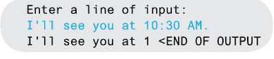

```
37. cout << "Enter a line of input:\n";
char next;
do
{
    cin.get(next);
    if (!isupper(next))
        cout << next;
} while (next != '\n');
```

## PROGRAMMING PROJECTS

编程项目比练习程序需要更多的解题能力，通常可以用多种不同的方法解决。访问 www.myprogramminglab.com 在线完成这些编程项目并获得即时反馈。

+   1. 编写一个程序来生成个性化的垃圾邮件。程序同时从输入文件和键盘读取输入。输入文件包含一封信的文本，只是收件人的姓名由三个字符 ## 表示。程序提示用户输入姓名，然后将信写入第二个文件，但用三个字母 ## 替换为姓名。三个字母字符串 ## 在信中恰好出现一次。

> （提示：让你的程序从输入文件读取直到遇到三个字符 ##，并在读取时将其复制到输出文件。当它遇到三个字母 ## 时，然后向屏幕发送输出提示用户从键盘输入姓名。你应该能够弄清楚其余的细节。你的程序应定义一个函数，该函数以输入和输出文件流作为参数调用。如果这是作为课堂作业完成，请向你的指导教师获取文件名。）

更难的版本（使用可选章节“File Names as Input”中的材料）：允许字符串 ## 在文件中出现任意多次。在这种情况下，姓名存储在两个字符串变量中。对于此版本，假设有一个名字和姓氏，但没有中间名或名字缩写。

+   2. 常用 Unix 程序 *more* 使用户能够查看文件的一小部分，然后如果他们想查看更多文件内容，按一个键即可查看文件的下一部分。编写一个具有与 *more* 类似功能的程序。此程序应读取并显示文件的前 10 行。在显示 10 行后，提示用户是否想查看接下来的 10 行或停止。

重复此过程，直到整个文件已显示给用户或用户决定停止。

+   3. 以以下方式扩展你在编程项目 2 中编写的程序。

+   a. 提示用户输入他们想要查看的行数。例如，如果用户输入 5，则你只应在提示是否继续之前显示文件的 5 行。


- b. 你的程序还应在提示用户是否继续或停止时，提示他们是否想要更改显示的行数。

- c. 用于提示并获取要显示的行数的代码应放入一个 void 函数中。该函数应接受一个按引用传递的变量，以存储要显示的行数。

    如果这是作为课堂作业完成，请向你的指导教师获取文件名。

- 4. 编写一个程序，计算包含某些文本的文件的平均词长（每个单词的平均字符数）。单词定义为由以下之一在两端包围的符号串：空格、逗号、句号、行的开头或行的结尾。你的程序应定义一个函数，该函数以输入文件流作为参数调用。此函数还应能使用流 cin 作为输入流，尽管在此程序中该函数不会以 cin 作为参数被调用。如果这是作为课堂作业完成，请向你的指导教师获取文件名。

- 5. 编写一个程序，纠正 C++ 程序中 cin 和 cout 使用的运算符 << 或 >> 的错误。程序将每个（错误）出现的

    ```
    cin <<
    ```

    替换为修正后的版本

    ```
    cin >>
    ```

    并将每个（错误）出现的

    ```
    cout >>
    ```

    替换为修正后的版本

    ```
    cout <<
    ```

    对于较易的版本，假设 cin 和后面的 << 之间始终恰好有一个空格，同样假设 cout 和后面的 >> 之间始终恰好有一个空格。

    对于较难的版本，允许 cin 和 << 之间以及 cout 和 >> 之间可能有任意数量的空格，甚至零个空格。在这种较难的情况下，替换后的修正版本在 cin 或 cout 与后面的运算符之间只有一 个空格。待纠正的程序位于一个文件中，修正后的版本输出到第二个文件。你的程序应定义一个函数，该函数以输入和输出文件流作为参数调用。

    如果这是作为课堂作业完成，请向你的指导教师获取文件名并询问是否应完成较易版本或较难版本。

    （提示：即使你正在做较难版本，你可能也会发现先完成较易版本然后再修改程序以执行较难任务会更容易、更快。）

- 6. 编写一个程序，允许用户输入任意一个单行问题，然后回答该问题。程序实际上不会真正关注问题，而只是读取问题行并丢弃所读内容。它总是给出以下答案之一：

    ```
    I'm not sure, but I think you will find the answer in Chapter #N.
    That's a good question.
    If I were you, I would not worry about such things.
    That question has puzzled philosophers for centuries.
    I don't know. I'm just a machine.
    Think about it and the answer will come to you.
    I used to know the answer to that question, but I've forgotten it.
    The answer can be found in a secret place in the woods.
    ```

    这些答案存储在一个文件中（每行一个答案），你的程序只需从文件中读取下一个答案并将其作为问题的答案写出。当你的程序读完整个文件后，它只需关闭文件，重新打开文件，并重新从答案列表开始。

    每当你的程序输出第一个答案时，它应将两个符号 #N 替换为 1 到 18 之间的数字（包括 1 和 18 的可能性）。为了在 1 到 18 之间选择一个数字，你的程序应将一个变量初始化为 18，并在每次输出数字时将该变量的值减少 1，以便章节号从 18 倒数到 1。当变量达到值 0 时，你的程序应将其值改回 18。给数字 18 起名为 NUMBER_OF_CHAPTERS 的名称，使用 const 修饰符的全局命名常量声明。

    （提示：使用本章中定义的函数 newLine。）

- 7. 此项目与编程项目 6 相同，只是本项目中你的程序将使用更复杂的方法来选择问题的答案。当你的程序读取一个问题时，它会计算问题中的字符数并将该数字存储在名为 count 的变量中。然后它用答案编号 count % ANSWERS 作出回应。文件中的第一个答案是答案编号 0，下一个是答案编号 1，然后是 2，依此类推。ANSWERS 在常量声明中定义，如下所示，以便它等于答案文件中的答案数：

这表明 Jacob 是最受欢迎的男孩名字，Sophia 是最受欢迎的女孩名字。Mason 是第二受欢迎的男孩名字，Emma 是第二受欢迎的女孩名字。

编写一个程序，允许用户统计此文件中特定字符出现的次数。例如，如果用户输入字符 ‘e’，你应统计文件中字符 ‘e’ 的所有出现次数（包括大写和小写）。在程序中包含一个循环，允许用户在需要时多次搜索字符（这应是一个 yes/no 问题）。为了让用户能够多次搜索字符，编写一个函数，该函数打开文件，统计字符出现的次数，关闭文件并返回出现次数。将提示用户输入要搜索的字符的提示放入另一个函数中。最后包含一个 assert 检查，以便当提示用户是否继续程序以统计另一个字符的出现次数时，如果他们输入的答案不是 ‘y’ 或 ‘n’（表示 yes 或 no），assert 将终止程序。

- 11. 为完成此问题，你必须拥有一台能够查看可缩放矢量图形（SVG）文件 的计算机。你的 Web 浏览器可能已经能够查看这些文件。要测试你的浏览器是否可以显示 SVG 文件，输入下面的 rectline.svg 文件，看看是否能在你的 Web 浏览器中打开它。如果你的 Web 浏览器无法查看该文件，那么你可以在网上搜索并下载一个免费的 SVG 查看器。

    用于绘制图像的图形屏幕使用一个坐标系统，其中 (0, 0) 位于左上角。x 坐标向右增加，y 坐标向下增加。因此，坐标 (100, 0) 将位于左上角向右 100 像素的位置，坐标 (0, 100) 将位于左上角向下 100 像素的位置。这在下图中有所说明。

    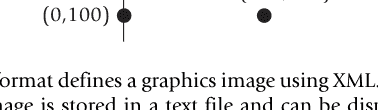

    SVG 格式使用 XML 定义图形图像。图像的规范存储在文本文件中，可以由 SVG 查看器显示。以下是绘制两个矩形和一条线的示例 SVG 文件。要查看它，将其保存为扩展名为 ".svg" 的文本文件，例如 rectline.svg，并用你的 SVG 查看器打开它。

    ```
    <?xml version="1.0" standalone="no"?>
    <!DOCTYPE svg PUBLIC "-//W3C//DTD SVG 1.1//EN" "http://www.w3.org/Graphics/SVG/1.1/DTD/svg11.dtd">
    <svg width="500" height="500" xmlns="http://www.w3.org/2000/svg">

    <rect x="20" y="20" width="50" height="250" style="fill:blue;"/>
    <rect x="75" y="100" width="150" height="50" style="fill:rgb(0,255,0);"/>
    <line x1="0" y1="0" x2="300" y2="300" style="stroke:purple;stroke-width:2"/>

    </svg>
    ```

    对于本问题的目的，你可以忽略前五行和最后一行，将它们视为必须插入以正确创建图像的“样板”。

    以 <rect  x="20"...开头的行绘制一个蓝色矩形，其左上角位于坐标 (20, 20)，宽度为 50 像素，高度为 250 像素。

    以 <rect  x="75"...开头的行绘制一个绿色矩形（RGB 颜色值 0,255,0 为纯绿色），其左上角位于坐标 (75, 100)，宽度为 150 像素，高度为 50 像素。

    最后，<line> 标签从 (0, 0) 绘制一条紫色线到 (300, 300)，宽度为 2。

    基于此示例，编写一个程序，输入四个非负整数值并创建显示简单条形图的 SVG 文件，该图描绘整数值。你的程序应缩放值，使它们始终以最大高度 400 像素绘制。例如，如果你要绘制的输入值为 20、40、60 和 120，你可能会生成如下所示的 SVG 文件：

    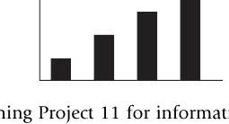

- 12. 参考编程项目 11 以获取有关 SVG 格式的信息。下面显示了另一个示例，说明如何绘制圆、椭圆和多条线：


```xml
<?xml version="1.0" standalone="no"?>
<!DOCTYPE svg PUBLIC "-//W3C//DTD SVG 1.1//EN" "http://www.w3.org/Graphics/SVG/1.1/DTD/svg11.dtd">
<svg width="500" height="500" xmlns="http://www.w3.org/2000/svg">
<circle cx="100" cy="50" r="30" stroke="green" stroke-width="3" fill="gold"/>
<ellipse cx="100" cy="200" rx="50" ry="100" style="fill:purple;stroke:black;stroke-width:2"/>
<polyline points="10,10 40,40 20,100 120,140" style="fill-opacity:0;stroke:red;stroke-width:2"/>
</svg>
```

`<circle>` 标签绘制一个圆心在 `(100, 50)`、半径为 30、画笔宽度为 3 的圆。它用金色填充，并带有绿色边框。

`<ellipse>` 标签绘制一个中心在 `(100, 200)`、x 半径为 50、y 半径为 100 的椭圆。它使用紫色填充，并带有黑色边框。

`<polyline>` 标签绘制一条从 `(10, 10)` 到 `(40, 40)` 再到 `(20, 100)` 再到 `(120, 140)` 的红色折线。`fill-opacity` 被设置为 0，使多边形的填充变为透明。

根据这些示例以及项目 18 中给出的示例，编写一个程序，创建一个绘制你的教授画像的 SVG 图像。它可以有些抽象和简单。如果你想绘制更精美的图像，可以研究 SVG 图片格式；还有一些额外的标签可以使用滤镜、渐变和多边形来绘制。

13. 编写一个程序，提示用户输入文本文件的名称，然后输出该文件中的单词数量。你可以将“单词”视为被空白字符（例如空格、回车、换行）包围，或者紧邻文件开头或结尾的任何文本。

14. 下面是一个古老的文字谜题：“说出一个常见的、以 dous 结尾的单词，除了 tremendous、stupendous 和 horrendous 之外。”如果你思考一会儿，很可能就会想到答案。不过，我们也可以通过读取一个英文单词文本文件来解决这个谜题：如果单词以“dous”结尾，就输出该单词。文本文件“words.txt”包含 87,314 个英文单词，其中包括完成该谜题的单词。这个文件随本书的源代码一起在线提供。编写一个程序，从文本文件中读取每个单词，并只输出那些以“dous”结尾的单词，以解出这个谜题。

## 数组 7

- **7.1 数组简介**（第 412 页）
  - 声明和引用数组（第 412 页）
  - 编程提示：将 for 循环用于数组（第 414 页）
  - 陷阱：数组下标总是从零开始（第 414 页）
  - 编程提示：使用定义常量指定数组大小（第 414 页）
  - 内存中的数组（第 416 页）
  - 陷阱：数组下标越界（第 417 页）
  - 初始化数组（第 420 页）
  - 编程提示：C++11 基于范围的 for 语句（第 420 页）
- **7.2 函数中的数组**（第 423 页）
  - 下标变量作为函数实参（第 423 页）
  - 整个数组作为函数实参（第 425 页）
  - const 参数修饰符（第 428 页）
  - 陷阱：const 参数使用不一致（第 431 页）
  - 返回数组的函数（第 431 页）
  - 案例分析：生产曲线图（第 432 页）
- **7.3 使用数组进行编程**（第 445 页）
  - 部分填充的数组（第 445 页）
  - 编程提示：不要吝惜形式参数（第 448 页）
  - 编程示例：搜索数组（第 448 页）
  - 编程示例：对数组排序（第 451 页）
  - 编程示例：冒泡排序（第 455 页）
- **7.4 多维数组**（第 458 页）
  - 多维数组基础（第 459 页）
  - 多维数组参数（第 459 页）
  - 编程示例：二维评分程序（第 461 页）
  - 陷阱：在数组下标之间使用逗号（第 465 页）

### 7.1 数组简介

这些程序会包含类似“对第 i 个下标变量执行某某操作”的语句，其中 i 的值由程序计算得出。例如，程序清单 7.1 中的程序读入分数，并按照本章开头所描述的方式处理这些分数。

#### 编程提示：将 for 循环用于数组

程序清单 7.1 中的第二个 for 循环展示了一种使用 for 循环遍历数组的常见方式：

```cpp
for (i = 0; i < 5; i++)
    cout << score[i] << " off by "
        << (max - score[i]) << endl;
```

for 语句非常适合数组操作。

#### 陷阱：数组下标总是从零开始

数组的下标总是从 0 开始，到比数组大小小 1 的整数结束。

#### 编程提示：使用定义常量指定数组大小

再看程序清单 7.1 中的程序。它只适用于恰好有五个学生的班级。大多数班级并不恰好是五个学生。要使程序更通用的一种方法，是使用一个定义常量来指定每个数组的大小。例如，程序清单 7.1 中的程序可以改写为使用下面的定义常量：

```cpp
const int NUMBER_OF_STUDENTS = 5;
```

声明数组的那一行将变为

```cpp
int i, score[NUMBER_OF_STUDENTS], max;
```

当然，所有用 5 作为数组大小的地方，也都应改为使用 NUMBER_OF_STUDENTS 而不是 5。如果对程序做这些修改（或者更好的是，程序一开始就这样编写），那么只需更改定义常量 NUMBER_OF_STUDENTS 的那一行，程序就可以改写为适用于任意数量的学生。请注意，在许多编译器上，你不能使用变量作为数组大小，例如下面的代码：

```cpp
cout << "Enter number of students:\n";
cin >> number;
int score[number]; //ILLEGAL ON MANY COMPILERS!
```

#### 程序清单 7.1 使用数组的程序

```cpp
//Reads in 5 scores and shows how much each
//score differs from the highest score.
#include <iostream>

int main()
{
    using namespace std;
    int i, score[5], max;

    cout << "Enter 5 scores:\n";
    cin >> score[0];
    max = score[0];
    for (i = 1; i < 5; i++)
    {
        cin >> score[i];
        if (score[i] > max)
            max = score[i];
        //max is the largest of the values score[0],..., score[i].
    }

    cout << "The highest score is " << max << endl
         << "The scores and their\n"
         << "differences from the highest are:\n";
    for (i = 0; i < 5; i++)
        cout << score[i] << " off by "
             << (max - score[i]) << endl;

    return 0;
}
```

**示例对话**

```text
Enter 5 scores:
5 9 2 10 6
The highest score is 10
The scores and their
differences from the highest are:
5 off by 5
9 off by 1
2 off by 8
10 off by 0
6 off by 4
```

有些编译器（但不是全部）允许你以这种方式用变量指定数组大小。但是，为了可移植性，即使你的编译器允许，也不应这样做。（在第 9 章中，我们将讨论另一种数组，其大小可以在程序运行时确定。）

#### 内存中的数组

在讨论数组在计算机内存中如何表示之前，我们先来看看简单变量（如 int 或 double 类型的变量）在计算机内存中是如何表示的。计算机的内存由一系列编号的位置组成，这些位置称为字节。¹ 字节的编号称为它的地址。简单变量实现为内存中由若干连续字节组成的一段区域。字节数由变量的类型决定。因此，内存中的一个简单变量由两条信息描述：一个内存地址（给出该变量第一个字节的位置）和变量的类型（说明该变量需要多少个字节的内存）。当我们说到变量的地址时，指的就是这个地址。当程序向变量中存储一个值时，实际发生的是将该值（编码为 0 和 1）放入分配给该变量的那些内存字节中。类似地，当一个变量作为（按引用调用的）实参传给函数时，实际传给被调用函数的是该变量的地址。现在让我们继续讨论数组在内存中是如何存储的。

数组的下标变量在内存中的表示方式与普通变量相同，但数组的情况还要稍微复杂一些。各个数组下标变量的位置在内存中总是相邻的。例如，考虑下面的代码：

```cpp
int a[6];
```

当你声明这个数组时，计算机会预留足够的内存来存放 6 个 int 类型的变量。而且，计算机总是将这些变量在内存中一个接一个地放置。然后，计算机记住下标变量 a[0] 的地址，但不会记住任何其他下标变量的地址。当程序需要其他某个下标变量的地址时，计算机根据 a[0] 的地址计算出该下标变量的地址。例如，如果从 a[0] 的地址开始，数过足以容纳三个 int 类型变量的内存，就会到达 a[3] 的地址。为了得到 a[3] 的地址，计算机从 a[0] 的地址（一个数字）开始，然后将容纳三个 int 类型变量所需的字节数加到 a[0] 的地址数字上，结果就是 a[3] 的地址。这种实现在程序清单 7.2 中有图示。

C++ 中数组的许多特殊性，只有从这些内存细节的角度才能理解。例如，在下一个“陷阱”小节中，我们将利用这些细节来解释当程序使用非法的数组下标时会发生什么。

¹ 一个字节由 8 个位组成，但字节的确切大小对本讨论并不重要。


## 数组声明

## 语法

```
TypeName ArrayName[Declared_Size];
```

### 示例

```
int bigArray[100];
double a[3];
double b[5];
char grade[10], oneGrade;
```

数组声明，按所示形式，将定义 Declared_Size 个索引变量，即索引变量 ArrayName[0] 到 ArrayName[Declared_Size-1]。每个索引变量都是 TypeName 类型的变量。

数组 a 由索引变量 a[0]、a[1] 和 a[2] 组成，全为 double 类型。数组 b 由索引变量 b[0]、b[1]、b[2]、b[3] 和 b[4] 组成，也全为 double 类型。你可以将数组声明与简单变量的声明结合起来，如上面所示的变量 oneGrade。

## 陷阱 数组索引越界

在使用数组时最常见的编程错误是尝试引用不存在的数组索引。例如，考虑以下数组声明：

```
int a[6];
```

在使用数组 a 时，每个索引表达式必须求值为 0 到 5 之间的整数。例如，如果你的程序包含索引变量 a[i]，则 i 必须求值为 0、1、2、3、4 或 5 中的六个整数之一。如果 i 求值为其他值，那就是一个错误。当索引表达式求值为数组声明所允许的值之外的某个值时，该索引就被称为越界或简单地非法。在大多数系统上，非法数组索引的结果是你的程序会做一些错误的事情，可能非常错误，而且不会给你任何警告。

攻击者也利用了这种类型的错误来入侵软件。越界编程错误可能会危及整个系统，因此请务必小心避免此错误。在 2011 年，通用弱点枚举 Common Weakness Enumeration (CWE)/SANS 研究所将这种类型的错误确定为第三大最危险的程序员错误。


听起来保持数组索引在有效范围内很简单。实际上更困难，因为通常存在微妙或意想不到的方式来改变索引变量。例如，考虑以下将一些数字输入到数组中的代码：

```
int num;
int a[10];

cout << "How many numbers? (max of 10)" << endl;
cin >> num;
for (int i = 0; i <= num; i++)
{
    cout << "Enter number " << i << endl;
    cin >> a[i];
}
```

此程序存在两个错误。首先，循环存在差一错误。通过从索引 0 开始并继续到包括 num，循环将输入 num+1 个数字而不是 num 个数字。只要为 num 输入小于十的值，你可能就不会注意到问题。程序不会崩溃，因为数字都将被输入并额外多输入一个数字，该数字仍可放入数组中。然而，如果为 num 输入 10，则第十一个数字将被存储在索引 a[10] 处，这已超出数组末尾。要修复此问题，循环应写为：

```
for (int i = 0; i < num; i++)
```

另一个问题是缺乏输入验证。恶意或顽皮的用户可能会输入 100 作为要输入的值的数量；循环随后将简单地执行 100 次并输入超出数组末尾的数据（程序可能在循环 100 次之前就崩溃，因为超出数组末尾的数字可能会造成破坏）。为了解决此问题，我们可以验证用户输入是否在有效范围内：

```
cout << "How many numbers? (max of 10)" << endl;
cin >> num;
cout << num << endl;
if (num <= 10)
{
    for (int i = 0; i < num; i++)
    {
        cout << "Enter number " << i << endl;
        cin >> a[i];
    }
}
```

即使这个修改版本也存在出错的可能性。如果为 num 输入的值超过其最大大小，则可能发生溢出。例如，在大多数系统上，有符号 short 只能存储最高 +32767 的数字。输入更大的值会导致溢出，这可能会在 num 中存储 0 或负值。虽然如果 num 为零或负数，for 循环将不会运行，但程序会错误地通过 if 语句。我们将在第 8 章再次探讨这种类型的错误。

## 初始化数组

数组可以在声明时初始化。初始化数组时，各个索引变量的值用大括号括起来并用逗号分隔。例如，

```
int children[3] = {2, 12, 1};
```

此声明等同于以下代码：

```
int children[3];
children[0] = 2;
children[1] = 12;
children[2] = 1;
```

如果你列出的值少于索引变量的数量，这些值将用于初始化前几个索引变量，而剩余的索引变量将初始化为数组基本类型的 0。在这种情况下，未提供初始值的索引变量初始化为 0。但是，没有初始值的数组和其他在函数定义内声明的变量，包括程序的主函数，都不会被初始化。虽然数组索引变量（和其他变量）有时会被自动初始化为 0，但你不能也不应该依赖它。

如果你在声明时初始化数组，可以省略数组的大小，数组将自动声明为初始化值所需的最小大小。例如，以下声明

```
int b[ ] = {5, 12, 11};
```

等同于

```
int b[3] = {5, 12, 11};
```

## 编程提示 C++11 基于范围的 for 语句

C++11 包含一种新的 for 循环，基于范围的 for 循环，可简化对数组中每个元素的迭代。语法如下所示：

```
for (datatype varname : array)
{
    // varname 依次设置为数组中的每个元素
}
```


## 3. 识别以下数组声明中的任何错误：

- a. `int x[4] = { 8, 7, 6, 4, 3 };`
- b. `int x[ ] = { 8, 7, 6, 4 };`
- c. `const int SIZE = 4;`
- d. `int x[SIZE];`

## 4. 以下代码的输出是什么？

```
char symbol[3] = {'a', 'b', 'c'};

for (int index = 0; index < 3; index++)
    cout << symbol[index];
```

## 5. 以下代码的输出是什么？

```
double a[3] = {1.1, 2.2, 3.3};
cout << a[0] << " " << a[1] << " " << a[2] << endl;
a[1] = a[2];
cout << a[0] << " " << a[1] << " " << a[2] << endl;
```

## 6. 以下代码的输出是什么？

```
int i, temp[10];

for (i = 0; i < 10; i++)
    temp[i] = 2 * i;

for (i = 0; i < 10; i++)
    cout << temp[i] << " ";
cout << endl;

for (i = 0; i < 10; i = i + 2)
    cout << temp[i] << " ";
```

## 7. 以下代码片段有什么问题？

```
int sampleArray[10];

for (int index = 1; index <= 10; index++)
    sampleArray[index] = 3 * index;
```

## 8. 假设我们期望数组 a 的元素有序，使得 a[0] ≤ a[1] ≤ a[2] ≤ ...

然而，为了安全起见，我们希望程序测试数组并在发现某些元素顺序错误时发出警告。以下代码本应输出此类警告，但其中包含一个错误。它是什么？

```
double a[10];
<Some code to fill the array a goes here.>
```

索引表达式被求值以确定确切地将哪个索引变量作为参数给出。

显示 7.3 包含索引变量用作函数参数的示例。所示程序为小型企业中的每位员工增加五天的假期。程序非常简单，但它确实说明了索引变量如何用作函数的参数。注意函数 adjustDays。此函数有一个名为 oldDays 的形式参数，其类型为 int。在程序的主体中，此函数被调用，参数为 vacation[number]，number 取各种值。注意形式参数 oldDays 并没有什么特别之处。它只是一个普通的形式参数，类型为 int，即数组 vacation 的基本类型。在显示 7.3 中，索引变量是按值调用的参数。相同的论述适用于按引用调用的参数。索引变量可以是按值调用参数或按引用调用参数。

## 显示 7.3 索引变量作为参数（第 1 部分，共 2 部分）

//说明索引变量用作参数的使用。
//为每位员工的允许假期天数增加 5 天。
#include <iostream>
const int NUMBER_OF_EMPLOYEES = 3;

int adjustDays(int oldDays);
//返回 oldDays 加 5。

int main()
{
    using namespace std;
    int vacation[NUMBER_OF_EMPLOYEES], number;
    cout << "Enter allowed vacation days for employees 1" << " through " << NUMBER_OF_EMPLOYEES << ":\n";
    for (number = 1; number <= NUMBER_OF_EMPLOYEES; number++)
        cin >> vacation[number - 1];
    for (number = 0; number < NUMBER_OF_EMPLOYEES; number++)
        vacation[number] = adjustDays(vacation[number]);
    cout << "The revised number of vacation days are:\n";
    for (number = 1; number <= NUMBER_OF_EMPLOYEES; number++)
        cout << "Employee number " << number << " vacation days = " << vacation[number-1] << endl;
    return 0;
}
int adjustDays(int oldDays)
{
    return (oldDays + 5);
}


# 显示 7.3 将下标变量作为实参（第 2 部分，共 2 部分）

### 示例对话

```
Enter allowed vacation days for employees 1 through 3:
10 20 5
The revised number of vacation days are:
Employee number 1 vacation days = 15
Employee number 2 vacation days = 25
Employee number 3 vacation days = 10
```

## 自测练习

11. 考虑以下函数定义：

```
void tripler(int& n)
{
    n = 3*n;
}
```

以下哪些是可接受的函数调用？

```
int a[3] = {4, 5, 6}, number = 2;
tripler(number);
tripler(a[2]);
tripler(a[3]);
tripler(a[number]);
tripler(a);
```

12. 以下代码有什么问题（如果有的话）？tripler 的定义见自测练习 11。

```
int b[5] = {1, 2, 3, 4, 5};
for (int i = 1; i <= 5; i++)
    tripler(b[i]);
```

# 整个数组作为函数实参

函数可以有一个针对整个数组的形参，这样当函数被调用时，为该形参提供的实参就是一个完整的数组。然而，针对整个数组的形参既不是按值调用参数，也不是按引用调用参数；它是一种新的形参，称为数组形参。让我们从一个例子开始。


显示 7.4 中定义的函数有一个数组形参 a，当函数被调用时，该形参将被整个数组替换。它还有一个普通的按值调用参数（size），该参数被假定为一个等于数组大小的整数值。此函数用键盘输入的值填充其数组实参（即填充数组的所有下标变量），然后向屏幕输出一条消息，告知最后一个被使用的数组下标。

形参 `int a[ ]` 是一个数组形参。方括号内没有下标表达式，这正是 C++ 用来指示数组形参的写法。数组形参不完全是按引用调用参数，但在大多数实际用途中，它的行为非常类似于按引用调用参数。让我们详细分析这个例子，看看数组实参在这种情况下是如何工作的。（当然，数组实参就是插入到诸如 `a[ ]` 这类数组形参中的数组。）

当调用函数 `fillUp` 时，它必须有两个实参。第一个给出整数数组，第二个应给出数组的声明大小。例如，下面是一个可接受的函数调用：

```cpp
int score[5], numberOfScores = 5;
fillUp(score, numberOfScores);
```

这个对 `fillUp` 的调用将用键盘输入的五个整数填充数组 `score`。注意，形参 `a[ ]`（在函数声明和函数定义头中使用）是带有方括号的，但没有下标表达式。（你可以为数组形参在方括号内插入一个数字，但编译器只会简单地忽略

# 显示 7.4 带数组形参的函数

**函数声明**

```cpp
1   void fillUp(int a[], int size);
2   //Precondition: size is the declared size of the array a.
3   //The user will type in size integers.
4   //Postcondition: The array a is filled with size integers
5   //from the keyboard.
```

**函数定义**

```cpp
1   //Uses iostream:
2   void fillUp(int a[], int size)
3   {
4       using namespace std;
5       cout << "Enter " << size << " numbers:\n";
6       for (int i = 0; i < size; i++)
7           cin >> a[i];
8       size--;
9       cout << "The last array index used is " << size << endl;
10  }
```

这个数字，因此本书中我们不使用这样的数字。）另一方面，函数调用中给出的实参（此例中的 score）不带任何方括号或下标表达式。在这个函数调用中，数组实参 score 会发生什么？非常粗略地说，实参 score 被插入到函数体中的数组形参 a 的位置，然后执行函数体。因此，函数调用

```
fillUp(score, numberOfScores);
```

等价于以下代码：

```
{
    using namespace std;
    size = 5;
    cout << "Enter " << size << " numbers:\n";
    for (int i = 0; i < size; i++)
        cin >> score[i];
    size--;
    cout << "The last array index used is " << size << endl;
}
```

5 是 numberOfScores 的值。

形参 a 是一种与我们至今见过的参数不同的形参。形参 a 仅仅是实参 score 的占位符。当函数 fillUp 以 score 作为数组实参被调用时，计算机的行为就好像 a 被替换成了相应的实参 score。当数组在函数调用中用作实参时，对数组形参执行的任何操作都会对数组实参执行，因此函数可以更改数组实参的下标变量的值。如果函数体中的形参被更改（例如，通过 cin 语句），那么数组实参也会被更改。

到目前为止，数组形参看起来就像一个数组的按引用调用参数。这几乎是对的，但数组形参略微不同于按引用调用参数。为了帮助解释这种差异，让我们回顾一些关于数组的细节。

回想一下，数组是作为一段连续的内存存储的。例如，考虑数组 score 的以下声明：

```
int score[5];
```

当你声明这个数组时，计算机会预留足够的内存来容纳五个 int 类型的变量，它们在计算机的内存中一个接一个地存储。计算机不会记住这五个下标变量各自的地址；它只记住下标变量 score[0] 的地址。例如，当你的程序需要 score[3] 时，计算机根据 score[0] 的地址计算 score[3] 的地址。计算机知道 score[3] 位于 score[0] 之后三个 int 变量的位置。因此，为了获得 score[3] 的地址，计算机取 score[0] 的地址，并加上一个代表三个 int 变量所占内存量的数字；结果就是 score[3] 的地址。

内存中的数组

# 数组实参

这样看来，数组有三个部分：第一个下标变量的地址（内存中的位置）、数组的基类型（决定每个下标变量占用多少内存）以及数组的大小（即下标变量的数量）。当数组作为数组实参传递给函数时，这三个部分中只有第一部分被提供给函数。当数组实参插入到其对应的形参中时，插入的全部内容就是数组第一个下标变量的地址。数组实参的基类型必须与形参的基类型匹配，因此函数也知道数组的基类型。然而，数组实参不会告诉函数数组的大小。当执行函数体中的代码时，计算机知道数组在内存中的起始位置以及每个下标变量占用多少内存，但（除非你做出特殊安排）它不知道数组有多少个下标变量。这就是为什么始终要有另一个 int 实参告诉函数数组的大小是至关重要的。这也是为什么数组形参与按引用调用参数不同。你可以将数组形参视为一种弱形式的按引用调用参数，其中关于数组的所有信息都会告诉函数，唯独数组大小除外。²

# 不同大小的数组实参可以用于同一个数组形参

这些数组形参可能看起来有点奇怪，但它们正是因为其看似奇怪的定义而至少拥有一个非常好的特性。这一优势最好通过再次查看显示 7.4 中给出的函数 fillUp 的示例来说明。只要数组的基类型是 int，同一个函数就可以用来填充任意大小的数组。例如，假设你有以下数组声明：

```
int score[5], time[10];
```

下面第一次调用 fillUp 用五个值填充数组 score，第二次用十个值填充数组 time：

```
fillUp(score, 5);
fillUp(time, 10);
```

你可以对不同大小的数组实参使用同一个函数，因为大小是一个独立的实参。

# const 参数修饰符

当你在函数调用中使用数组实参时，函数可以更改存储在数组中的值。这通常没问题。然而，在一个复杂的函数定义中，你可能会编写代码意外更改数组中存储的一个或多个值，即使该数组根本不应该被更改。作为预防措施，你可以告诉编译器你并不

> ²如果你听说过指针，这听起来会很像指针；实际上，数组实参是通过传递指向其第一个（第零个）下标变量的指针来传递的。我们将在第 9 章讨论这一点。如果你还没有学习指针，可以安全地忽略这个脚注。


## 数组形式参数和实参

函数的一个实参可以是一个完整的数组，但整个数组的实参既不是按值传递的实参，也不是按引用传递的实参。它是一种新型的实参，被称为数组实参。

当数组实参被用于数组形参时，传递给函数的所有内容只是数组实参的第一个索引变量在内存中的地址（索引为 0 的那个）。数组实参不会告诉函数数组的大小。因此，当你有一个函数的数组形参时，你通常还必须有一个类型为 int 的另一个形参来给出数组的大小（如下面的示例所示）。

数组实参在以下方面类似于按引用传递的实参：如果函数体更改了数组形参，那么在函数被调用时，该更改实际上是对数组实参所做的。因此，函数可以更改数组实参的值（即可以更改其索引变量的值）。

具有数组形参的函数声明的语法如下：

### SYNTAX

```
Type_Returned functionName(..., Base_Type ArrayName[], ...);
```

### EXAMPLE

```
void sumArray(double& sum, double a[], int size);
```

intend to change the array argument, and the computer will then check to make sure your code does not inadvertently change any of the values in the array. To tell the compiler that an array argument should not be changed by your function, you insert the modifier const before the array parameter for that argument position. An array parameter that is modified with a const is called a constant array parameter.

For example, the following function outputs the values in an array but does not change the values in the array:

```
void showTheWorld(int a[], int sizeOfA)
//Precondition: sizeOfA is the declared size of the array a.
//All indexed variables of a have been given values.
//Postcondition: The values in a have been written
//to the screen.
{
    cout << "The array contains the following values:\n";
    for (int i = 0; i < sizeOfA; i++)
        cout << a[i] << " ";
    cout << endl;
}
```

This function will work fine. However, as an added safety measure you can add the modifier const to the function heading as follows:

```
void showTheWorld(const int a[], int sizeOfA)
```

With the addition of this modifier const, the computer will issue an error message if your function definition contains a mistake that changes any of the values in the array argument.

For example, the following is a version of the function showTheWorld that contains a mistake that inadvertently changes the value of the array argument. Fortunately, this version of the function definition includes the modifier const, so that an error message will tell us that the array a is changed. This error message will help to explain the mistake:

```
void showTheWorld(const int a[], int sizeOfA)
//Precondition: sizeOfA is the declared size of the array a.
//All indexed variables of a have been given values.
//Postcondition: The values in a have been written
//to the screen.
{
    cout << "The array contains the following values:\n";
    for (int i = 0; i < sizeOfA; a[i]++)
        cout << a[i] << " ";
    cout << endl;
}
```

Mistake, but the compiler will not catch it unless you use the const modifier.

If we had not used the const modifier in this function definition and if we made the mistake shown, the function would compile and run with no error messages. However, the code would contain an infinite loop that continually increments a[0] and writes its new value to the screen.

The problem with this incorrect version of showTheWorld is that the wrong item is incremented in the for loop. The indexed variable a[i] is incremented, but it should be the index i that is incremented. In this incorrect version, the index i starts with the value 0 and that value is never changed. But a[i], which is the same as a[0], is incremented. When the indexed variable a[i] is incremented, that changes a value in the array, and since we included the modifier const, the computer will issue a warning message. That error message should serve as a clue to what is wrong.

You normally have a function declaration in your program in addition to the function definition. When you use the const modifier in a function definition, you must also use it in the function declaration so that the function heading and the function declaration are consistent.

The modifier const can be used with any kind of parameter, but it is normally used only with array parameters and call-by-reference parameters for classes, which are discussed in Chapter 11.

### PITFALL Inconsistent Use of const Parameters

The const parameter modifier is an all-or-nothing proposition. If you use it for one array parameter of a particular type, then you should use it for every other array parameter that has that type and that is not changed by the function. The reason has to do with function calls within function calls. Consider the definition of the function showDifference, which is given below along with the declaration of a function used in the definition:

```
double computeAverage(int a[], int numberUsed);
//Returns the average of the elements in the first numberUsed
//elements of the array a. The array a is unchanged.
```

```
void showDifference(const int a[], int numberUsed)
{
    double average = computeAverage(a, numberUsed);
    cout << "Average of the " << numberUsed
         << " numbers = " << average << endl
         << "The numbers are:\n";
    for (int index = 0; index < numberUsed; index++)
        cout << a[index] << " differs from average by "
             << (a[index] - average) << endl;
}
```

This code will generate an error message or warning message with most compilers. The function computeAverage does not change its parameter a. However, when the compiler processes the function definition for showDifference, it will think that computeAverage does (or at least might) change the value of its parameter a. This is because, when it is translating the function definition for showDifference, all the compiler knows about the function computeAverage is the function declaration for computeAverage, and the function declaration does not contain a const to tell the compiler that the parameter a will not be changed. Thus, if you use const with the parameter a in the function showDifference, then you should also use the modifier const with the parameter a in the function computeAverage. The function declaration for computeAverage should be as follows:

```
double computeAverage(const int a[], int numberUsed);
```

## Functions That Return an Array

A function may not return an array in the same way that it returns a value of type int or double. There is a way to obtain something more or less equivalent to a function that returns an array. The thing to do is to return a pointer to the array. However, we have not yet covered pointers. We will discuss returning a pointer to an array when we discuss the interaction of arrays and pointers in Chapter 9. Until then, you have no way to write a function that returns an array.

## CASE STUDY Production Graph

In this case study we use arrays in the top-down design of a program. We use both indexed variables and entire arrays as arguments to the functions for subtasks.

# Problem Definition

The Apex Plastic Spoon Manufacturing Company has commissioned us to write a program that will display a bar graph showing the productivity of each of its four manufacturing plants for any given week. Plants keep separate production figures for each department, such as the teaspoon department, soup spoon department, plain cocktail spoon department, colored cocktail spoon department, and so forth. Moreover, each plant has a different number of departments. For example, only one plant manufactures colored cocktail spoons. The input is entered plant-by-plant and consists of a list of numbers giving the production for each department in that plant. The output will consist of a bar graph in the following form:

```
Plant #1 **********
Plant #2 **************
Plant #3 *******************
Plant #4 *****
```

Each asterisk represents 1000 units of output.

We decide to read in the input separately for each department in a plant. Since departments cannot produce a negative number of spoons, we know that the production figure for each department will be nonnegative. Hence, we can use a negative number as a sentinel value to mark the end of the production numbers for each plant.

Since output is in units of 1000, it must be scaled by dividing it by 1000. This presents a problem since the computer must display a whole number of asterisks. It cannot display 1.6 asterisks for 1600 units. We will thus round to the nearest 1000th. Thus, 1600 will be the same as 2000 and will produce two asterisks. A precise statement of the program’s input and output is as follows.

### Input

There are four manufacturing plants numbered 1 through 4. The following input is given for each of the four plants: a list of numbers giving the production for each department in that plant. The list is terminated with a negative number that serves as a sentinel value.


## Output

一个条形图显示每个工厂的总产量。条形图中的每个星号等于 1000 单位。每个工厂的产量四舍五入到最接近的 1000 单位。

## Analysis of the Problem

我们将使用一个名为 production 的数组，它将保存四个工厂中每个工厂的总产量。在 C++ 中，数组索引总是从 0 开始。但由于工厂编号为 1 到 4，而不是 0 到 3，我们将不会使用工厂编号作为数组索引。相反，我们将把工厂编号为 n 的总产量放在索引变量 production[n-1] 中。工厂编号为 1 的总输出将保存在 production[0] 中，工厂 2 的数据将保存在 production[1] 中，以此类推。

由于输出以千单位计，程序将对数组元素的数值进行缩放。如果工厂编号为 3 的总输出为 4040 单位，则 production[2] 的值最初将设置为 4040。4040 这个值随后将被缩放为 4，使得 production[2] 的值变为 4，并在图表中输出四个星号来表示工厂编号为 3 的产量。

我们程序的任务可以分为以下子任务：

- inputData: 读取每个工厂的输入数据并将索引变量 production[plantNumber - 1] 的值设置为该工厂的总产量，其中 plantNumber 是工厂的编号。
- scale: 对于每个 plantNumber，将索引变量 production[plantNumber - 1] 的值更改为正确的星号数。
- graph: 输出条形图。

整个数组 production 将作为执行这些子任务的函数的参数。与数组参数一样，这意味着我们必须有一个额外的形式参数来表示数组的大小，在本例中它与工厂数量相同。我们将使用一个定义常量来表示工厂数量，并且该常量将作为数组 production 的大小。我们程序的主要部分，连同执行子任务的函数的函数声明以及工厂数量的定义常量，如 Display 7.5 所示。请注意，由于没有理由更改函数 graph 的数组参数，我们已通过添加 const 参数修饰符将该数组参数设为常量参数。Display 7.5 中的材料是我们程序的大纲，如果它在单独的文件中，该文件可以被编译，以便在我们继续定义与所示函数声明相对应的函数之前检查此大纲中的任何语法错误。

在编译 Display 7.5 所示的文件后，我们就可以设计三个子任务函数的实现。对于这三个函数中的每一个，我们将设计一个算法，编写函数的代码，并在继续设计下一个函数之前测试该函数。

## Algorithm Design for inputData

函数 inputData 的函数声明和描述性注释如 Display 7.5 所示。如我们程序主体中所示（也如 Display 7.5 所示），当调用 inputData 时，形式数组参数 a 将被替换为数组 production，并且由于最后一个工厂编号与工厂数量相同，形式参数 lastPlantNumber 将被 NUMBER_OF_PLANTS 替换。inputData 的算法很简单：

- 对于 plantNumber 等于 1、2 直到 lastPlantNumber 的每一个，执行以下操作：
- 读取工厂编号为 plantNumber 的所有数据。
- 求和。
- 将 production[plantNumber -1] 设置为该总和。

## Coding for inputData

函数 inputData 的算法转换为以下代码：

//Uses iostream:
void inputData(int a[], int lastPlantNumber)
{
    using namespace std;
    for (int plantNumber = 1;
        plantNumber <= lastPlantNumber; plantNumber++)
    {
        cout << endl
            << "Enter production data for plant number "
            << plantNumber << endl;
        getTotal(a[plantNumber - 1]);
    }
}
```

代码很常规，因为所有工作都由函数 getTotal 完成，我们仍需设计它。但在继续讨论函数 getTotal 之前，让我们观察一下函数 inputData 的一些特点。请注意，我们将工厂编号为 plantNumber 的数据存储在索引为 plantNumber - 1 的索引变量中；这是因为数组总是从索引 0 开始，而工厂编号从 1 开始。另外，请注意我们对函数 getTotal 的参数使用了索引变量。对 getTotal 来说，索引变量就像任何其他类型为 int 的变量一样。因此，getTotal 将有一个类型为 int 的普通传引用参数。这意味着 getTotal

## Testing inputData

每个函数都应在其中它是唯一未测试函数的程序中进行测试。函数 inputData 包含对函数 getTotal 的调用。因此，我们应该在它自己的驱动程序中测试 getTotal。一旦 getTotal 完全测试，我们就可以在像 Display 7.6 这样的程序中使用它来测试函数 inputData。

在测试函数 inputData 时，我们应包含工厂生产数据的所有可能类型的测试。我们应包含一个没有生产数据的工厂（我们在 Display 7.6 中对工厂 4 这样做）；我们应包含一个仅有一个生产数据的工厂的测试（我们在 Display 7.6 中对工厂 3 这样做）；并且我们应包含一个具有多个生产数据的工厂的测试（我们在 Display 7.6 中对工厂 1 和 2 这样做）。我们应测试非零和零生产数据，这就是我们在 Display 7.6 中在工厂 2 的输入列表中包含 0 的原因。

## Algorithm Design for scale

函数 scale 更改数组 production 中每个索引变量的值，使其显示要打印的星号数。由于每 1000 单位产量应有一个星号，每个索引变量的值必须除以 1000.0。然后为了得到星号的整数，将这个数字四舍五入到最接近的整数。此方法可用于缩放任意大小的任意数组 a，因此 scale 的函数声明，如 Display 7.5 所示并在此重复，是以任意数组 a 和任意大小来表述的：

```
void scale(int a[], int size);
//Precondition: a[0] through a[size - 1] each has a
//nonnegative value.
//Postcondition: a[i] has been changed to the number of 1000s
//(rounded to an integer) that were originally in a[i], for
//all i such that 0 <= i <= size - 1.
```

当调用函数 scale 时，数组参数 a 将被数组 production 替换，形式参数 size 将被 NUMBER_OF_PLANTS 替换，使得函数调用看起来如下：

```
scale(production, NUMBER_OF_PLANTS);
```

函数 scale 的算法如下：

```
for (int index = 0; index < size; index++)
```

将 a[index] 的值除以 1000 并将结果四舍五入到最接近的整数；结果是 a[index] 的新值。

## Coding for scale

scale 的算法转换为下面给出的 C++ 代码，其中 round 是我们仍需定义的一个函数。函数 round 接受一个类型为 double 的参数并返回一个类型为 int 的值，该值最接近其参数；也就是说，函数 round 将其参数四舍五入到最接近的整数。

## DISPLAY 7.6 Test of Function inputData (part 1 of 3)

```
//Tests the function inputData.
#include <iostream>
const int NUMBER_OF_PLANTS = 4;

void inputData(int a[], int lastPlantNumber);
//Precondition: lastPlantNumber is the declared size of the array a.
//Postcondition: For plantNumber = 1 through lastPlantNumber:
//a[plantNumber - 1] equals the total production for plant number plantNumber.

void getTotal(int& sum);
//Reads nonnegative integers from the keyboard and
//places their total in sum.

int main()
{
    using namespace std;
    int production[NUMBER_OF_PLANTS];
    char ans;

    do
    {
        inputData(production, NUMBER_OF_PLANTS);
        cout << endl
             << "Total production for each"
             << " of plants 1 through 4:\n";
        for (int number = 1; number <= NUMBER_OF_PLANTS; number++)
            cout << production[number - 1] << " ";

        cout << endl
             << "Test Again?(Type y or n and Return): ";
        cin >> ans;
    } while ( (ans != 'N') && (ans != 'n') );

    cout << endl;

    return 0;
}
//Uses iostream:
void inputData(int a[], int lastPlantNumber)
{
    using namespace std;
    for (int plantNumber = 1;
         plantNumber <= lastPlantNumber; plantNumber++)
    {
        cout << endl
             << "Enter production data for plant number "


## DISPLAY 7.6 Test of Function input_data (part 2 of 3)

```cpp
<< plantNumber << endl;
getTotal(a[plantNumber - 1]);
}
}

//Uses iostream;
void getTotal(int& sum)
{
    using namespace std;
    cout << "Enter number of units produced by each department.\n"
         << "Append a negative number to the end of the list.\n";

    sum = 0;
    int next;
    cin >> next;
    while (next >= 0)
    {
        sum = sum + next;
        cin >> next;
    }

    cout << "Total = " << sum << endl;
}
```

# Sample Dialogue

```text
Enter production data for plant number 1
Enter number of units produced by each department.
Append a negative number to the end of the list.
1 2 3 -1
Total = 6

Enter production data for plant number 2
Enter number of units produced by each department.
Append a negative number to the end of the list.
0 2 3 -1
Total = 5

Enter production data for plant number 3
Enter number of units produced by each department.
Append a negative number to the end of the list.
2 -1
Total = 2

Enter production data for plant number 4
Enter number of units produced by each department.
Append a negative number to the end of the list.
-1
Total = 0
Total production for each of plants 1 through 4:
6 5 2 0
Test Again?(Type y or n and Return): n
```

## DISPLAY 7.6 Test of Function input_data (part 3 of 3)

```cpp
void scale(int a[], int size)
{
    for (int index = 0; index < size; index++)
        a[index] = roundNum(a[index]/1000.0 );
}
```

注意我们除以的是 1000.0，而不是 1000（没有小数点）。如果我们除以 1000，就会执行整数除法。例如，2600/1000 的结果是 2，但 2600/1000.0 的结果是 2.6。确实，我们希望最终四舍五入后的答案是一个整数，但我们希望 2600 除以 1000 在四舍五入为整数时产生 3，而不是 2。

我们现在转向函数 roundNum 的定义，该函数将其参数四舍五入到最接近的整数。例如，roundNum(2.3) 返回 2，而 roundNum(2.6) 返回 3。函数 roundNum 以及 scale 的代码在 Display 7.7 中给出。round 的代码可能需要一点解释。

函数 roundNum 使用头文件 cmath 中的预定义函数 floor。函数 floor 返回小于其参数的整数。例如，floor(2.1) 和 floor(2.9) 都返回 2。为了说明 roundNum 工作的正确性，让我们看一些例子。考虑 roundNum(2.4)。返回的值是

```text
floor(2.4 + 0.5)
```

即 floor(2.9)，结果为 2.0。事实上，对于任何大于或等于 2.0 且严格小于 2.5 的数，该数加上 0.5 将小于 3.0，因此对该数加上 0.5 应用 floor 将返回 2.0。因此，对任何大于或等于 2.0 且严格小于 2.5 的数应用 round 将返回 2。（由于 round 的函数声明指定返回值的类型为 int，计算出的 2.0 值会被类型转换为整数值 2，去掉小数点，使用 static_cast<int>。）

现在考虑大于或等于 2.5 的数，例如 2.6。调用 roundNum(2.6) 返回的值是

```text
floor(2.6 + 0.5)
```

## DISPLAY 7.7 The Function scale

```cpp
//Demonstration program for the function scale.
#include <iostream>
#include <cmath>

void scale(int a[], int size);
//Precondition: a[0] through a[size - 1] each has a nonnegative value.
//Postcondition: a[i] has been changed to the number of 1000s (rounded to
//an integer) that were originally in a[i], for all i such that 0 <= i <= size - 1.

int roundNum(double number);
//Precondition: number >= 0.
//Returns number rounded to the nearest integer.

int main()
{
    using namespace std;
    int someArray[4], index;
    cout << "Enter 4 numbers to scale: ";
    for (index = 0; index < 4; index++)
        cin >> someArray[index];
    scale(someArray, 4);
    cout << "Values scaled to the number of 1000s are: ";
    for (index = 0; index < 4; index++)
        cout << someArray[index] << " ";
    cout << endl;
    return 0;
}

void scale(int a[], int size)
{
    for (int index = 0; index < size; index++)
        a[index] = roundNum(a[index]/1000.0);
}

//Uses cmath:
int roundNum(double number)
{
    using namespace std;
    return static_cast<int>(floor(number + 0.5));
}
```

# Sample Dialogue

```text
Enter 4 numbers to scale: 2600 999 465 3501
Values scaled to the number of 1000s are: 3 1 0 4
```

即 floor(3.1)，结果为 3.0。事实上，对于任何大于或等于 2.5 且小于或等于 3.0 的数，该数加上 0.5 将大于 3.0。因此，用任何大于或等于 2.5 且小于或等于 3.0 的数调用 roundNum 将返回 3。

因此，roundNum 对于 2.0 到 3.0 之间的所有参数都能正确工作。显然，2.0 到 3.0 之间的参数没有什么特别之处。对所有非负数都适用类似的论证。因此，roundNum 对于所有非负参数都能正确工作。

## Testing scale

Display 7.7 包含函数 scale 的演示程序，但函数 round 和 scale 的测试程序应比这个简单程序更完善。特别是，它们应允许你多次重新测试被测试的函数，而不仅仅是一次。我们不会给出完整的测试程序，但你应首先在自己的驱动程序中测试 round（scale 使用它），然后在驱动程序中测试 scale。用于测试 round 的程序应测试 0 的参数、向上舍入的参数（如 2.6），以及向下舍入的参数（如 2.3）。用于测试 scale 的程序应对数组元素的各种值进行类似的测试。

## The Function graph

用于生成所需条形图的完整程序在 Display 7.8 中显示。我们没有逐步介绍函数 graph 的设计，因为它相当直接。

## DISPLAY 7.8 Production Graph Program (part 1 of 3)

```cpp
1   //Reads data and displays a bar graph showing productivity for each plant.
2   #include <iostream>
3   #include <cmath>
4   const int NUMBER_OF_PLANTS = 4;

5   void inputData(int a[], int lastPlantNumber);
6   //Precondition: lastPlantNumber is the declared size of the array a.
7   //Postcondition: For plantNumber = 1 through lastPlantNumber:
8   //a[plantNumber - 1] equals the total production for plant number plantNumber.

9   void scale(int a[], int size);
10  //Precondition: a[0] through a[size - 1] each has a nonnegative value.
11  //Postcondition: a[i] has been changed to the number of 1000s (rounded to
12  //an integer) that were originally in a[i], for all i such that 0 <= i <= size - 1.

13  void graph(const int asteriskCount[], int lastPlantNumber);
14  //Precondition: asteriskCount[0] through asteriskCount[lastPlantNumber - 1]
15  //have nonnegative values.
16  //Postcondition: A bar graph has been displayed saying that plant
17  //number N has produced asteriskCount[N - 1] 1000s of units, for each N such that
```

(continued)

## DISPLAY 7.8 Production Graph Program (part 3 of 3)

```cpp
58  //Uses iostream:
59  void printAsterisks(int n)
60  {
61      using namespace std;
62      for (int count = 1; count <= n; count++)
63          cout << "*";
64  }
```

# Sample Dialogue

该程序显示公司各工厂的产量图。
Enter production data for plant number 1
Enter number of units produced by each department.
Append a negative number to the end of the list.
2000 3000 1000 -1
Total = 6000

Enter production data for plant number 2
Enter number of units produced by each department.
Append a negative number to the end of the list.
2050 3002 1300 -1
Total = 6352

Enter production data for plant number 3
Enter number of units produced by each department.
Append a negative number to the end of the list.
5000 4020 500 4348 -1
Total = 13868

Enter production data for plant number 4
Enter number of units produced by each department.
Append a negative number to the end of the list.
2507 6050 1809 -1
Total = 10366

Units produced in thousands of units: Plant #1 ******
Plant #2 *******
Plant #3 ***************
Plant #4 **********


## 自测练习

13. 编写一个名为 one_more 的函数定义，该函数有一个用于整数数组的形式参数，并将每个数组元素的值增加一。添加所需的任何其他形式参数。

14. 考虑以下函数定义：

```
void too2(int a[], int howMany)
{
    for (int index = 0; index < howMany; index++)
        a[index] = 2;
}
```

以下哪些是可接受的函数调用？

```
int myArray[29];
too2(myArray, 29);
too2(myArray, 10);
too2(myArray, 55);
"Hey too2. Please, come over here."
int yourArray[100];
too2(yourArray, 100);
too2(myArray[3], 29);
```

15. 在以下可以改为常量数组参数的数组参数前插入 const：

```
void output(double a[], int size);
//Precondition: a[0] through a[size - 1] have values.
//Postcondition: a[0] through a[size - 1] have been
//written out.
```

```
void dropOdd(int a[], int size);
//Precondition: a[0] through a[size - 1] have values.
//Postcondition: All odd numbers in a[0] through
//a[size - 1] have been changed to 0.
```

16. 编写一个名为 outOfOrder 的函数，该函数以 doubles 数组和名为 size 的 int 参数作为参数，并返回类型为 int 的值。此函数将测试该数组是否无序，即数组违反以下条件：

a[0] <= a[1] <= a[2] <= ...

如果元素没有无序，则函数返回 -1；否则，它将返回数组中第一个无序元素的索引。例如，考虑声明

```
double a[10] = {1.2, 2.1, 3.3, 2.5, 4.5,
    7.9, 5.4, 8.7, 9.9, 1.0};
```

在此数组中，a[2] 和 a[3] 是第一个无序的配对，a[3] 是第一个无序的元素，因此函数返回 3。如果数组已排序，则函数将返回 -1。

## 7.3 使用数组编程

> 切勿依赖总体印象，我的孩子，但要集中精力于细节。
> 
> 亚瑟·柯南·道尔爵士，《身份之谜》

在本节中，我们讨论部分填充的数组，并简要介绍数组的排序和搜索。本节不包含关于 C++ 语言的新材料，但确实包含更多关于 C++ 数组参数的练习。

## 部分填充的数组

通常在编写程序时并不知道数组所需的确切大小，或者大小可能在程序的一次运行到另一次运行之间变化。处理这种情况的一种常见且简单的方法是声明数组的大小为程序可能需要的最大大小。然后程序可以自由使用数组的任意多或任意少的部分。

部分填充的数组需要谨慎处理。程序必须跟踪数组使用了多少，并且不得引用任何尚未赋值的索引变量。显示 7.9 中的程序说明了这一点。该程序读取高尔夫球成绩列表并显示每个成绩与平均值的差异。该程序适用于短至一个成绩、长至十个成绩以及两者之间的任何长度的列表。成绩存储在数组 score 中，该数组有十个索引变量，但程序仅使用其需要的数组部分。变量 numberUsed 跟踪数组中存储了多少个元素。元素（即成绩）存储在位置 score[0] 到 score[numberUsed - 1]。

细节与 numberUsed 为声明的大小且整个数组都被使用时非常相似。特别是，变量 numberUsed 通常必须是操作部分填充数组的任何函数的参数。由于参数 numberUsed（在使用正确时）通常可以确保函数不会引用非法的数组索引，因此这有时（但并非总是）消除了提供数组声明大小的参数的需要。例如，函数 showDifference 和 computeAverage 使用参数 numberUsed 来确保仅使用合法的数组索引。然而，函数 fillArray 需要知道数组的最大声明大小，以便不填满数组。

## 显示 7.9 部分填充数组（第 1 部分，共 2 部分）

```
//Shows the difference between each of a list of golf scores and their average.
#include <iostream>
const int MAX_NUMBER_SCORES = 10;

void fillArray(int a[], int size, int& numberUsed);
//Precondition: size is the declared size of the array a.
//Postcondition: numberUsed is the number of values stored in a.
//a[0] through a[numberUsed - 1] have been filled with
//nonnegative integers read from the keyboard.

double computeAverage(const int a[], int numberUsed);
//Precondition: a[0] through a[numberUsed - 1] have values; numberUsed > 0.
//Returns the average of numbers a[0] through a[numberUsed - 1].

void showDifference(const int a[], int numberUsed);
//Precondition: The first numberUsed indexed variables of a have values.
//Postcondition: Gives screen output showing how much each of the first
//numberUsed elements of a differs from their average.

int main( )
{
    using namespace std;
    int score[MAX_NUMBER_SCORES], numberUsed;

    cout << "This program reads golf scores and shows\n"
         << "how much each differs from the average.\n";

    cout << "Enter golf scores:\n";
    fillArray(score, MAX_NUMBER_SCORES, numberUsed);
    showDifference(score, numberUsed);
    return 0;
}
//Uses iostream:
void fillArray(int a[], int size, int &numberUsed)
{
    using namespace std;
    cout << "Enter up to " << size << " nonnegative whole numbers.\n"
         << "Mark the end of the list with a negative number.\n";
    int next, index = 0;
    cin >> next;
    while ((next >= 0) && (index < size))
    {
        a[index] = next;
        index++;
        cin >> next;
    }
    numberUsed = index;
}
```

## 显示 7.9 部分填充数组（第 2 部分，共 2 部分）

```
double computeAverage(const int a[], int numberUsed)
{
    double total = 0;
    for (int index = 0; index < numberUsed; index++)
        total = total + a[index];
    if (numberUsed> 0)
    {
        return (total/numberUsed);
    }
    else
    {
        using namespace std;
        cout << "ERROR: number of elements is 0 in computeAverage.\n"
            << "computeAverage returns 0.\n";
        return 0;
    }
}
void showDifference(const int a[], int numberUsed)
{
    using namespace std;
    double average = computeAverage(a, numberUsed);
    cout << "Average of the " << numberUsed
        << " scores = " << average << endl
        << "The scores are:\n";
    for (int index = 0; index < numberUsed; index++)
    cout << a[index] << " differs from average by "
        << (a[index] - average) << endl;
}
```

### 示例对话

This program reads golf scores and shows how much each differs from the average.
Enter golf scores:
Enter up to 10 nonnegative whole numbers.
Mark the end of the list with a negative number.
69 74 68 -1

Average of the 3 scores = 70.3333
The scores are:
69 differs from average by -1.33333
74 differs from average by 3.66667
68 differs from average by -2.33333

## 编程技巧 不要吝啬形式参数

注意显示 7.9 中的函数 fillArray。当调用 fillArray 时，声明的数组大小 MAX_NUMBER_SCORES 作为参数之一给出，如显示 7.9 中以下函数调用所示：

```
fillArray(score, MAX_NUMBER_SCORES, numberUsed);
```

你可能会抗议说 MAX_NUMBER_SCORES 是一个全局定义的常量，因此可以在 fillArray 的定义中使用，而无需将其作为参数。你是对的，如果我们不使用 fillArray 在显示 7.9 以外的任何程序中，我们就可以在不将 MAX_NUMBER_SCORES 作为 fillArray 的参数的情况下应付。然而，fillArray 是一个通用有用的函数，你可能希望在多个不同的程序中使用它。我们事实上也在下一小节讨论的显示 7.10 中的程序中使用了函数 fillArray。在显示 7.10 的程序中，声明的数组大小的参数是一个不同的命名全局常量。如果我们在函数 fillArray 的主体中写入全局常量 MAX_NUMBER_SCORES，我们将无法在显示 7.10 的程序中重用该函数。

## 编程示例 搜索数组

一个常见的编程任务是在数组中搜索给定值。例如，数组可能包含某门课程所有学生的学号。要判断特定学生是否已注册，就会在数组中搜索以查看是否包含该学生的号码。显示 7.10 中的程序填充一个数组，然后搜索用户指定的数组值。实际的应用程序程序会复杂得多，但这展示了顺序搜索算法的所有要点。顺序搜索算法是你能想象到的最直接的搜索算法：程序按从第一个到最后一个的顺序查看数组元素，以查看目标数字是否等于数组元素的任何一个。

在显示 7.10 中，函数 search 用于搜索数组。在搜索数组时，你通常想要知道的不仅仅是目标值是否在数组中。如果目标值在数组中，你通常还想知道保存该目标值的索引变量的索引，因为索引可能作为关于目标值的其他信息的指南。因此，我们设计函数 search 使其返回一个索引，给出目标值在数组中的位置，前提是目标值确实在数组中。如果目标值不在数组中，search 返回 -1。让我们更详细地看一下函数 search。

函数 search 使用 while 循环依次检查数组元素，以查看其中任何一个是否等于目标值。变量


# 展示 7.10 数组搜索（第1部分，共2部分）

//Searches a partially filled array of nonnegative integers.
#include <iostream>
const int DECLARED_SIZE = 20;

void fillArray(int a[], int size, int& numberUsed);
//Precondition: size is the declared size of the array a.
//Postcondition: numberUsed is the number of values stored in a.
//a[0] through a[numberUsed - 1] have been filled with
//nonnegative integers read from the keyboard.

int search(const int a[], int numberUsed, int target);
//Precondition: numberUsed is <= the declared size of a.
//Also, a[0] through a[numberUsed - 1] have values.
//Returns the first index such that a[index] == target,
//provided there is such an index; otherwise, returns -1.

int main()
{
    using namespace std;
    int arr[DECLARED_SIZE], listSize, target;

    fillArray(arr, DECLARED_SIZE, listSize);

    char ans;
    int result;
    do
    {
        cout << "Enter a number to search for: ";
        cin >> target;

        result = search(arr, listSize, target);
        if (result == -1)
            cout << target << " is not on the list.\n";
        else
            cout << target << " is stored in array position "
                 << result << endl
                 << "(Remember: The first position is 0.)\n";

        cout << "Search again?(y/n followed by Return): ";
        cin >> ans;
    } while ((ans != 'n') && (ans != 'N'));

    cout << "End of program.\n";
    return 0;
}
//Uses iostream:
void fillArray(int a[], int size, int& numberUsed)

<fillArray 其余部分的定义见展示 7.9。>

# 展示 7.10 数组搜索（第2部分，共2部分）

```
41  int search(const int a[], int numberUsed, int target)
42 {
43
44     int index = 0;
45     bool found = false;
46     while ((!found) && (index < numberUsed))
47         if (target == a[index])
48             found = true;
49         else
50             index++;
51
52     if (found)
53         return index;
54     else
55         return -1;
56 }
```

### 示例对话

```
Enter up to 20 nonnegative whole numbers.
Mark the end of the list with a negative number.
10 20 30 40 50 60 70 80 -1
Enter a number to search for:10
10 is stored in array position 0.
(Remember: The first position is 0.)
Search again?(y/n followed by Return): y
Enter a number to search for: 40
40 is stored in array position 3.
(Remember: The first position is 0.)
Search again?(y/n followed by Return): y
Enter a number to search for: 42
42 is not on the list.
Search again?(y/n followed by Return): n
End of program.
```

found 作为一个标志，用于记录目标元素是否已被找到。如果在数组中找到了目标元素，found 就会被设为 true，从而结束 while 循环。

即使我们只在某一个程序中使用 fillArray，将声明的数组大小作为参数传给 fillArray 仍是一种好做法。把声明的数组大小显式作为参数展示出来，会提醒我们：该函数极其需要这个信息。

## 编程示例
数组排序

最常见的编程任务之一，同时也是被研究得最透彻的编程任务，就是对一系列值进行排序，例如将一组销售数据从低到高或从高到低排序，或者将一组单词按字母顺序排序。在本节中，我们描述一个名为 sort 的函数，它对一个部分填充的数值数组进行排序，使这些数值从小到大排列。

函数 sort 有一个数组参数 a。数组 a 是部分填充的，因此还需要一个名为 numberUsed 的附加形参，用来表明数组中有多少个位置已被使用。因此，函数 sort 的声明和前置条件如下：

```
void sort(int a[], int numberUsed);
//Precondition: numberUsed <= declared size of the array a.
//Array elements a[0] through a[numberUsed - 1] have values.
```

函数 sort 会重新排列数组 a 中的元素，使得函数调用完成后，这些元素按如下顺序排列：

a[0] ≤ a[1] ≤ a[2] ≤ … ≤ a[numberUsed - 1]

我们用来完成排序的算法称为选择排序。它是所有排序算法中最容易理解的算法之一。

设计算法的一种方式是依赖问题的定义。在本例中，问题是将数组 a 从小到大排序。这意味着重新排列各值，使 a[0] 最小，a[1] 次小，依此类推。这个定义给出了选择排序算法的框架：

```
for (int index = 0; index < numberUsed; index++)
Place the indexth smallest element in a[index]
```

实现这一通用方法有许多途径。细节上可以使用两个数组，把元素按排序好的顺序从一个数组复制到另一个数组，但使用一个数组既足够又更经济。因此，函数 sort 只使用一个数组来存放待排序的值。函数 sort 通过交换成对的值来重新排列数组 a 中的值。让我们通过一个具体示例来了解该算法是如何工作的。

考虑展示 7.11 中的数组。算法会把最小值放到 a[0] 中。最小值位于 a[3] 中，因此算法交换 a[0] 和 a[3] 的值。然后算法继续寻找下一个最小的元素。此时，a[0] 已经是最小元素，因此下一个最小的元素就是剩余元素 a[1]、a[2]、a[3]、……、a[9] 中最小的那个。在展示 7.11 的示例中，下一个最小元素位于 a[5]，因此算法交换 a[1] 和 a[5] 的值。第二个最小元素的定位过程如展示 7.11 的第四和第五个数组图所示。接着算法定位第三个最小元素，依此类推。


# 展示 7.11 选择排序

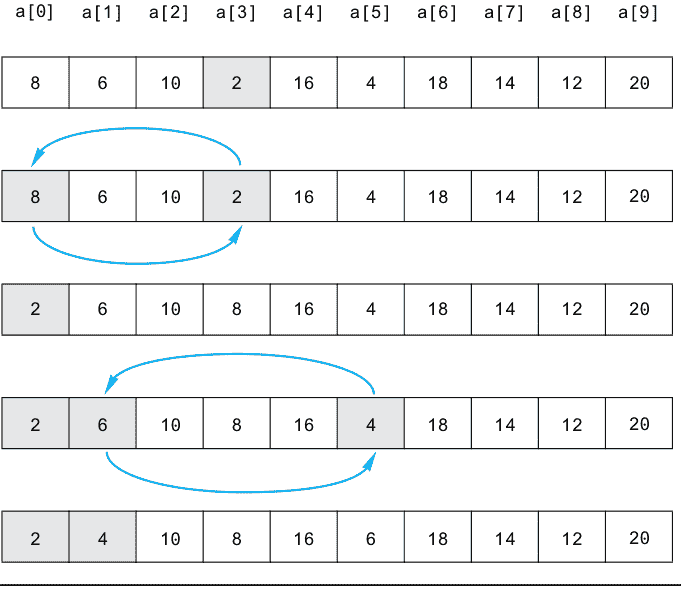

随着排序的推进，数组开头的元素被赋予正确的有序值。数组的有序部分会不断增长，依次从数组未排序的一端取出元素加入其中。请注意，算法无需对最后一个下标变量 a[9] 做任何处理。这是因为一旦其他元素都放到了正确位置，a[9] 也必定已经是正确的值。毕竟，a[9] 的正确值就是剩余待移动元素中最小的那个，而唯一待移动的元素恰恰就是已经在 a[9] 中的那个值。

函数 sort 的定义包含在一个演示程序中，见展示 7.12。sort 使用 indexOfSmallest 函数在数组未排序的尾部找到最小元素的索引，然后通过交换操作将该元素移到数组已排序的部分。

展示 7.12 中所示的 swapValues 函数用于交换两个下标变量的值。例如，下面的调用将交换 a[0] 和 a[3] 的值：

```
swapValues(a[0], a[3]);
```

函数 swapValues 已在第5章中解释过。

# 展示 7.12 数组排序（第2部分，共2部分）

```
```cpp
{//Place the correct value in a[index]:
    indexOfNextSmallest =
            indexOfSmallest(a, index, numberUsed);
    swapValues(a[index], a[indexOfNextSmallest]);
    //a[0] <= a[1] <=...<= a[index] are the smallest of the original array
    //elements. The rest of the elements are in the remaining positions.
}
```
```

```
```cpp
void swapValues(int& v1, int& v2)
{
    int temp;
    temp = v1;
    v1 = v2;
    v2 = temp;
}
```
```

```
```cpp
int indexOfSmallest(const int a[], int startIndex, int numberUsed)
{
    int min = a[startIndex];
    int indexOfMin = startIndex;
    for (int index = startIndex + 1; index < numberUsed; index++)
        if (a[index] < min)
        {
            min = a[index];
            indexOfMin = index;
            //min is the smallest of a[startIndex] through a[index]
        }

    return indexOfMin;
}
```
```

### 示例对话

```
```text
This program sorts numbers from lowest to highest.
Enter up to 10 nonnegative whole numbers.
Mark the end of the list with a negative number.
80 30 50 70 60 90 20 30 40 -1
In sorted order the numbers are:
20 30 30 40 50 60 70 80 90
```
```


## PROGRAMMING EXAMPLE
冒泡排序

我们刚刚描述的选择排序算法并不是对数组进行排序的唯一方法。事实上，计算机科学家已经设计出了大量的排序算法！其中一些算法比其他算法更高效，而有些算法仅适用于特定类型的数据。冒泡排序是一种简单且通用的排序算法，与选择排序类似。

如果我们使用冒泡排序对数组进行升序排序，那么最大值会逐步“冒泡”到数组的末尾。例如，如果我们从由以下整数组成的未排序数组开始：

初始数组：{3, 10, 9, 2, 5}

那么在第一次遍历后，我们将最大值 10 移到数组末尾：

第一次遍历后：{3, 9, 2, 5, 10}

第二次遍历将第二大值 9 移到倒数第二个索引的数组中：

第二次遍历后：{3, 2, 5, 9, 10}

第三次遍历将第三大值 5 移到倒数第三个索引的数组中（它已经在那里）：

第三次遍历后：{2, 3, 5, 9, 10}

第四次遍历将第四大值 3 移到倒数第四个索引的数组中（它已经在那里）：

第四次遍历后：{2, 3, 5, 9, 10}

此时算法结束。数组开头的剩余数字不需要检查，因为它是剩下的唯一数字，必须是最小的。要基于冒泡排序设计程序，请注意我们将最大项放在索引 length-1，第二大项放在 length-2，接下来放在 length-3，等等。这对应于一个从数组索引 length-1 开始并递减到数组索引 1 的循环。我们不需要包含索引 0，因为那里将包含最小元素。实现循环的一种方法是使用以下代码，其中变量 i 对应目标索引：

```
for (int i = length-1; i > 0; i--)
```

冒泡排序中的“冒泡”部分发生在该循环的每次迭代内部。冒泡步骤由另一个循环组成，该循环将最大数字向数组中的索引 i 移动。首先，索引 0 和


索引 i 之间的最大数字将被冒泡到索引 i。我们通过比较索引 0 处的数字与索引 1 处的数字开始冒泡过程。如果索引 0 处的数字大于索引 1 处的数字，则交换值，以便我们最终在索引 1 处得到最大数字。如果索引 0 处的数字小于或等于索引 1 处的数字，则什么也不发生。从以下未排序数组开始：

初始数组：{3, 10, 9, 2, 5}

那么冒泡过程的第一步将比较 3 和 10。由于 10 > 3，什么也没有发生，结果数字 10 位于索引 1：

步骤 1 后：{3, 10, 9, 2, 5}

该过程针对更大值重复进行，直到达到 i。第二个步骤将比较索引 1 和 2 处的数字，即值 10 和 9。由于 10 大于 9，我们交换数字，结果如下：

步骤 2 后：{3, 9, 10, 2, 5}

该过程再重复两次：

步骤 3 后：{3, 9, 2, 10, 5}
步骤 4 后：{3, 9, 2, 5, 10}

这结束了冒泡排序算法的第一次迭代。我们已将最大数字冒泡到数组末尾。下一轮迭代将把第二大数字冒泡到倒数第二个位置，以此类推，其中变量 i 表示冒泡数字的目标索引。如果我们使用变量 j 来引用冒泡项的索引，则我们的循环代码如下所示：

```
for (int i = length-1; i > 0; i--)
    for (int j = 0; j < i; j++)
```

在循环内部，我们必须比较索引 j 和索引 j+1 处的项。较大的项应移入索引 j+1。完整的算法如下所示，以及第 7.13 显示中的完整示例。

```
for (int i = length-1; i > 0; i--)
    for (int j = 0; j < i; j++)
        if (arr[j] > arr[j+1])
        {
            int temp = arr[j+1];
            arr[j+1] = arr[j];
            arr[j] = temp;
        }
```

## DISPLAY 7.13 Bubble Sort Program

```
//Display 7.13 Bubble Sort Program
//Sorts an array of integers using Bubble Sort.
#include <iostream>

void bubblesort(int arr[], int length);
//Precondition: length <= declared size of the array arr.
//The array elements arr[0] through a[length - 1] have values.
//Postcondition: The values of arr[0] through arr[length - 1] have
//been rearranged so that arr[0] <= a[1] <= ... <= arr[length - 1].

int main()
{
    using namespace std;
    int a[] = {3, 10, 9, 2, 5, 1};

    bubblesort(a, 6);
    for (int i=0; i<6; i++)
    {
        cout << a[i] << " ";
    }
    cout << endl;
    return 0;
}

void bubblesort(int arr[], int length)
{
    // Bubble largest number toward the right
    for (int i = length-1; i > 0; i--)
        for (int j = 0; j < i; j++)
            if (arr[j] > arr[j+1])
            {
                // Swap the numbers
                int temp = arr[j+1];
                arr[j+1] = arr[j];
                arr[j] = temp;
            }
}
```

# Sample Dialogue

1 2 3 5 9 10

## Multidimensional Array Basics

有时使用具有一个以上索引的数组会很有用，而在 C++ 中这是允许的。以下声明了一个名为 page 的字符数组。该数组 page 有两个索引：第一个索引范围从 0 到 29，第二个从 0 到 99。

```
char page[30][100];
```

该数组的每个索引变量都有两个索引。例如，page[0][0]、page[15][32] 和 page[29][99] 是该数组的三个索引变量。请注意，每个索引都必须用自己的方括号括起来。正如我们已经看到的一维数组一样，多维数组的每个索引变量都是基类型的变量。

一个数组可以有任意数量的索引，但也许最常见的索引数量是两个。可以用二维显示来可视化二维数组，其中第一个索引给出行，第二个索引给出列。例如，可以将二维数组 page 的数组索引变量可视化如下：

```
page[0][0],  page[0][1],  ...,  page[0][99]
page[1][0],  page[1][1],  ...,  page[1][99]
page[2][0],  page[2][1],  ...,  page[2][99]
    .
    .
page[29][0],  page[29][1],  ...,  page[29][99]
```

你可能会使用数组 page 来存储文本页面的所有字符，该页面有 30 行（编号为 0 到 29），每行有 100 个字符（编号为 0 到 99）。

在 C++ 中，像 page 这样的二维数组实际上是数组的数组。示例数组 page 实际上是一个大小为 30 的一维数组，其基类型是大小为 100 的字符一维数组。通常，这不需要你关心，你可以通常认为数组 page 实际上是一个具有两个索引的数组（而不是更难跟踪的数组的数组）。然而，至少有一种情况，二维数组看起来非常像数组的数组，那就是当你有一个函数，其参数为二维数组时，这将在下一小节中讨论。

> 多维数组是数组的数组

## Multidimensional Array Parameters

以下对二维数组的声明实际上是在声明一个大小为 30 的一维数组，其基类型是一个大小为 100 的字符一维数组：

## Multidimensional Array Declaration

### SYNTAX

```
Type arrayName[Size_Dim_1][Size_Dim_2]...[Size_Dim_Last];
```

## EXAMPLES

```
char page[30][100];
int matrix[2][3];
double threeDPicture[10][20][30];
```

如所示形式的数组声明，为每种数组索引组合定义一个索引变量。例如，第二个示例声明为数组 matrix 定义了以下六个索引变量：

```
matrix[0][0], matrix[0][1], matrix[0][2],
matrix[1][0], matrix[1][1], matrix[1][2]
```

```
char page[30][100];
```

将二维数组视为数组的数组将有助于你理解 C++ 如何处理多维数组的参数。例如，以下函数接受一个像 page 这样的数组参数并将其打印到屏幕上：

```
void displayPage(const char p[][100], int sizeDimension1)
{
    for (int index1 = 0; index1 < sizeDimension1; index1++)
    {//Printing one line:
        for (int index2 = 0; index2 < 100; index2++)
            cout << p[index1][index2];
        cout << endl;
    }
}
```

请注意，对于二维数组参数，第一个维度的大小没有给出，因此我们必须包含一个 int 参数来给出第一个维度的大小。（与普通数组一样，编译器允许你在第一个一对方括号中放置一个数字来指定第一个维度。然而，这样的数字只是一个注释；编译器会忽略任何这样的数字。）第二个维度（如果有超过两个维度，则所有其他维度）的大小在数组参数之后给出，如参数所示

```
const char p[][100]
```


## 多维数组参数

当在函数首部或函数声明中给出多维数组参数时，第一维的大小不给出，但其余各维的大小必须放在方括号中。由于第一维的大小未给出，你通常需要一个类型为 `int` 的附加参数来给出第一维的大小。下面是一个带有二维数组参数 `p` 的函数声明示例：

```
void getPage(char p[][100], int sizeDimension1);
```

如果你意识到多维数组是数组的数组，那么这个规则就变得有意义了。由于二维数组参数

```
const char p[][100]
```

是数组的数组的参数，第一维实际上是数组的下标，并且与普通一维数组的数组下标一样处理。第二维是基类型描述的一部分，即大小为 100 的字符数组。

## 编程示例

### 二维评分程序

显示7.14包含一个程序，它使用名为 `grade` 的二维数组来存储并显示一个小班的成绩记录。这个班有四名学生，并包含三次测验。显示7.15说明了数组 `grade` 是如何用于存储数据的。第一个数组下标用于指定学生，第二个数组下标用于指定测验。由于学生和测验的编号从 1 而不是 0 开始，我们必须从学生编号中减去 1，并从测验编号中减去 1，才能得到存储特定测验分数的索引变量。例如，4号学生在1号测验中获得的分数记录在 `grade[3][0]` 中。

我们的程序还使用了两个普通的一维数组。数组 `stAve` 将用于记录每个学生的测验平均分。例如，程序将把 `stAve[0]` 设置为学生1所获测验分数的平均值，将 `stAve[1]` 设置为学生2所获测验分数的平均值，依此类推。数组 `quizAve` 将用于记录每次测验的平均分。例如，程序将把 `quizAve[0]` 设置为测验1所有学生分数的平均值，`quizAve[1]` 将记录平均值。

### 显示7.14 二维数组

```cpp
1  //Reads quiz scores for each student into the two-dimensional array grade (but
2  //the input code is not shown in this display). Computes the average score
3  //for each student and the average score for each quiz. Displays the quiz scores
4  //and the averages.
5  #include <iostream>
6  #include <iomanip>
7  const int NUMBER_STUDENTS = 4, NUMBER_QUIZZES = 3;
8
9  void computeStAve(const int grade[][NUMBER_QUIZZES], double stAve[]);
10 //Precondition: Global constants NUMBER_STUDENTS and NUMBER_QUIZZES
11 //are the dimensions of the array grade. Each of the indexed variables
12 //grade[stNum - 1, quizNum - 1] contains the score for student stNum on quiz
13 //quizNum.
14 //Postcondition: Each stAve[stNum - 1] contains the average for student
15 //number stNum.
16
17 void computeQuizAve(const int grade[][NUMBER_QUIZZES], double quizAve[]);
18 //Precondition: Global constants NUMBER_STUDENTS and NUMBER_QUIZZES
19 //are the dimensions of the array grade. Each of the indexed variables
20 //grade[stNum - 1, quizNum - 1] contains the score for student stNum on quiz
21 //quizNum.
22 //Postcondition: Each quizAve[quizNum - 1] contains the average for quiz number
23 //quizNum.
24
25 void display(const int grade[][NUMBER_QUIZZES],
26              const double stAve[], const double quizAve[]);
27 //Precondition: Global constants NUMBER_STUDENTS and NUMBER_QUIZZES are the
28 //dimensions of the array grade. Each of the indexed variables grade[stNum - 1,
29 //quizNum - 1] contains the score for student stNum on quiz quizNum. Each
30 //stAve[stNum - 1] contains the average for student stNum. Each
31 //quizAve[quizNum - 1] contains the average for quiz number quizNum.
32 //Postcondition: All the data in grade, stAve, and quizAve has been output.
33
34 int main( )
35 {
36     using namespace std;
37     int grade[NUMBER_STUDENTS][NUMBER_QUIZZES];
38     double stAve[NUMBER_STUDENTS];
39     double quizAve[NUMBER_QUIZZES];
40

    <The code for filling the array grade goes here, but is not shown.>
41     computeStAve(grade, stAve);
42     computeQuizAve(grade, quizAve);
43     display(grade, stAve, quizAve);
44     return 0;
45 }
46 void computeStAve(const int grade[][NUMBER_QUIZZES], double stAve[])
47 {
48     for (int stNum = 1; stNum <= NUMBER_STUDENTS; stNum++)
49     {//Process one stNum:
50         double sum = 0;
51         for (int quizNum = 1; quizNum <= NUMBER_QUIZZES; quizNum++)
52             sum = sum + grade[stNum - 1][quizNum - 1];
53         //sum contains the sum of the quiz scores for student number stNum.
54         stAve[stNum - 1] = sum/NUMBER_QUIZZES;
55         //Average for student stNum is the value of stAve[stNum-1]
56     }
57 }
58
59 void computeQuizAve(const int grade[][NUMBER_QUIZZES], double quizAve[])
60 {
61     for (int quizNum = 1; quizNum <= NUMBER_QUIZZES; quizNum++)
62     {//Process one quiz (for all students):
63         double sum = 0;
64         for (int stNum = 1; stNum <= NUMBER_STUDENTS; stNum++)
65             sum = sum + grade[stNum - 1][quizNum - 1];
66         //sum contains the sum of all student scores on quiz number quizNum.
67         quizAve[quizNum - 1] = sum/NUMBER_STUDENTS;
68         //Average for quiz quizNum is the value of quizAve[quizNum - 1]
69     }
70 }
71
72
73 //Uses iostream and iomanip:
74 void display(const int grade[][NUMBER_QUIZZES],
75     const double stAve[], const double quizAve[])
76 {
77     using namespace std;
78     cout.setf(ios::fixed);
79     cout.setf(ios::showpoint);
80     cout.precision(1);
81     cout << setw(10) << "Student"
82         << setw(5) << "Ave"
83         << setw(15) << "Quizzes\n";
84     for (int stNum = 1; stNum <= NUMBER_STUDENTS; stNum++)
85     {//Display for one stNum:
86         cout << setw(10) << stNum
87             << setw(5) << stAve[stNum - 1] << " ";
88         for (int quizNum = 1; quizNum <= NUMBER_QUIZZES; quizNum++)
89             cout << setw(5) << grade[stNum - 1][quizNum - 1];
90         cout << endl;
91     }
92
93     cout << "Quiz averages = ";
94     for (int quizNum = 1; quizNum <= NUMBER_QUIZZES; quizNum++)
95         cout << setw(5) << quizAve[quizNum - 1];
96     cout << endl;
97 }
```

### 示例对话

<填充数组grade的对话未显示。>

| 学生 | 平均 | 测验 |  |  |
|---|---|---|---|---|
| 1 | 10.0 | 10 | 10 | 10 |
| 2 | 1.0 | 2 | 0 | 1 |
| 3 | 7.7 | 8 | 6 | 9 |
| 4 | 7.3 | 8 | 4 | 10 |
| 测验平均分 = |  | 7.0 | 5.0 | 7.5 |

### 显示7.15 二维数组grade

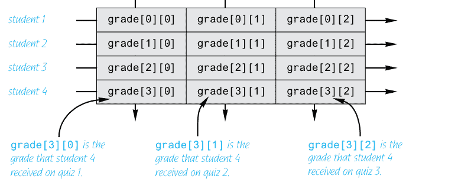

## 自测练习

20. 以下代码产生的输出是什么？

```
int myArray[4][4], index1, index2;
for (index1 = 0; index1 < 4; index1++)
    for (index2 = 0; index2 < 4; index2++)
        myArray[index1][index2] = index2;
for (index1 = 0; index1 < 4; index1++)
{
    for (index2 = 0; index2 < 4; index2++)
        cout << myArray[index1][index2] << " ";
    cout << endl;
}
```

21. 编写代码，用键盘输入的数字填充数组 `a`（在下面声明）。这些数字将每行输入五个，共四行（尽管你的解决方案不必依赖于输入数字是如何分成行的）。

```
int a[4][5];
```

22. 为一个名为 `echo` 的 `void` 函数编写函数定义，使下面的函数调用能够回显自测练习21中描述的输入，并以我们为输入指定的相同格式回显它（即每行五个数字，共四行）：

```
echo(a, 4);
```

## 章节总结

- 数组可用于存储和处理一组全部为相同类型的数据。
- 数组的索引变量可以像数组基类型的任何其他变量一样使用。
- `for` 循环是遍历数组元素并对每个索引变量执行某种程序操作的好方法。
- 使用数组时最常见的编程错误是试图访问不存在的数组索引。始终检查操作数组的循环的第一次和最后一次迭代，以确保它不会使用非法过小或非法过大的索引。
- 数组形参既不是按值调用参数，也不是按引用调用参数，而是一种新类型的参数。数组参数类似于按引用调用参数，因为函数体中对形参所做的任何更改都会在函数调用时对数组实参进行。


- 数组的下标变量在计算机内存中紧挨着存放，因此数组占用一段连续的内存。当数组作为实参传给函数时，只把第一个下标变量（编号为 0 的那个）的地址传给被调函数。因此，带数组参数的函数通常还需要另一个 `int` 类型的形参来给出数组的大小。

- 使用部分填充的数组时，程序还需要一个 `int` 类型的变量来记录数组中实际使用了多少元素。

- 若要告诉编译器某个数组实参不应被你的函数修改，可以在该实参位置的数组参数前加上修饰符 `const`。用 `const` 修饰的数组参数称为**常量数组参数**。

- 如果需要使用一个以上下标的数组，可以使用多维数组，它实际上是数组的数组。

## 自测练习答案

**1.** 语句 `int a[5];` 是一个声明，其中 5 是数组元素的个数。表达式 `a[4]` 是对前一条语句所定义数组的一次访问。它访问的是下标为 4 的元素，也就是第 5 个（也是最后一个）数组元素。

**2.** a. `score`  
b. `double`  
c. 5  
d. 0 到 4  
e. `score[0]`、`score[1]`、`score[2]`、`score[3]`、`score[4]` 中的任意一个

**3.** a. 初始化项多了一个  
b. 正确。数组大小为 4。  
c. 正确。数组大小为 4。

**4.** `abc`

**5.**

```
1.1 2.2 3.3
1.1 3.3 3.3
```

（记住：下标从 0 开始，而不是 1。）

**6.** `2 4 6 8 10 12 14 16 18 0 4 8 12 16`

**7.** `sampleArray` 的下标变量是 `sampleArray[0]` 到 `sampleArray[9]`，但这块代码试图填充 `sampleArray[1]` 到 `sampleArray[10]`。`sampleArray[10]` 中的下标 10 越界了。

**8.** 存在下标越界。当 index 等于 9 时，`index + 1` 等于 10，因此 `a[index + 1]`（也就是 `a[10]`）的下标非法。循环应该少迭代一次。要改正代码，把 `for` 循环的第一行改为

```cpp
for (int index = 0; index < 9; index++)
```

**9.**

```cpp
int i, a[20];

cout << "Enter 20 numbers:\n";

for (i = 0; i < 20; i++)
    cin >> a[i];
```

**10.** 该数组将占用 14 字节的内存。下标变量 `yourArray[3]` 的地址是 1006。

**11.** 下面这些函数调用是可接受的：

```cpp
tripler(number);
tripler(a[2]);
tripler(a[number]);
```

下面这些函数调用是不正确的：

```cpp
tripler(a[3]);
tripler(a);
```

第一个调用使用了非法下标。第二个调用根本没有下标表达式。你不能像第二个调用那样把整个数组作为实参传给 `tripler`。“整个数组作为函数实参”一节讨论的是另一种情况，在那种情况下你可以把整个数组作为实参。

**12.** 该循环遍历下标变量 `b[1]` 到 `b[5]`，但 5 对数组 `b` 来说是非法的下标。合法下标是 0、1、2、3、4。改正后的代码如下：

```cpp
int b[5] = {1, 2, 3, 4, 5};
for (int i = 0; i < 5; i++)
    tripler(b[i]);
```

**13.**

```cpp
void oneMore(int a[], int size)
//Precondition: size is the declared size of the array a.
//a[0] through a[size − 1] have been given values.
//Postcondition: a[index] has been increased by 1
//for all indexed variables of a.
{
    for (int index = 0; index < size; index++)
        a[index] = a[index] + 1;
}
```

**14.** 下面这些函数调用都是可接受的：

```cpp
too2(myArray, 29);
too2(myArray, 10);
too2(yourArray, 100);
```

调用

```cpp
too2(myArray, 10);
```

是合法的，但它只会填充 `myArray` 的前十个下标变量。如果这正是你想要的，那么这个调用可以接受。

下面这些函数调用都是不正确的：

```cpp
too2(myArray, 55);
"Hey too2. Please, come over here."
too2(myArray[3], 29);
```

其中第一个不正确，因为第二个实参太大。第二个不正确，因为它缺少末尾的分号（还有其他原因）。第三个不正确，因为它在应该使用整个数组作为实参的地方使用了下标变量。

**15.** 你可以把 `output` 中的数组参数设为常量参数，因为无需改变该数组参数任何下标变量的值。你不能把 `dropOdd` 中的参数设为常量参数，因为它可能使某些下标变量的值被改变。

```cpp
void output(const double a[], int size);
//Precondition: a[0] through a[size - 1] have values.
//Postcondition: a[0] through a[size - 1] have been
//written out.
```

```cpp
void dropOdd(int a[], int size);
//Precondition: a[0] through a[size - 1] have values.
//Postcondition: All odd numbers in a[0] through
//a[size - 1] have been changed to 0.
```

**16.**

```cpp
int outOfOrder(double array[], int size)
{
    for (int i = 0; i < size - 1; i++)
        if (array[i] > array[i+1]) //fetch a[i+1] for each i.
            return i+1;
    return -1;
}
```

**17.**

```cpp
#include <iostream>
using namespace std;
const int DECLARED_SIZE = 10;

int main()
{
    cout << "Enter up to ten nonnegative integers.\n"
         << "Place a negative number at the end.\n";
    int numberArray[DECLARED_SIZE], next, index = 0;
    cin >> next;
    while ( (next >= 0) && (index < DECLARED_SIZE) )
    {
        numberArray[index] = next;
        index++;
        cin >> next;
    }
    int numberUsed = index;
    cout << "Here they are back at you:";
    for (index = 0; index < numberUsed; index++)
        cout << numberArray[index] << " ";
    cout << endl;
    return 0;
}
```

**18.**

```cpp
#include <iostream>
using namespace std;
const int DECLARED_SIZE = 10;

int main()
{
    cout << "Enter up to ten letters"
         << " followed by a period:\n";
    char letterBox[DECLARED_SIZE], next;
    int index = 0;
    cin >> next;
    while ( (next != '.') && (index < DECLARED_SIZE) )
    {
        letterBox[index] = next;
        index++;
        cin >> next;
    }
    int numberUsed = index;
    cout << "Here they are backwards:\n";
    for (index = numberUsed - 1; index >= 0; index--)
        cout << letterBox[index];
    cout << endl;
    return 0;
}
```

**19.**

```cpp
bool search(const int a[], int numberUsed, int target, int& where)
{
    int index = 0;
    bool found = false;
    while ((!found) && (index < numberUsed))
        if (target == a[index])
            found = true;
        else
            index++;
    //If target was found, then
    //found == true and a[index] == target.
    if (found)
        where = index;
    return found;
}
```

**20.**

```
0 1 2 3
0 1 2 3
0 1 2 3
0 1 2 3
```

**21.**

```cpp
int a[4][5];
int index1, index2;
for (index1 = 0; index1 < 4; index1++)
    for (index2 = 0; index2 < 5; index2++)
        cin >> a[index1][index2];
```

**22.**

```cpp
void echo(const int a[][5], int sizeOfA)
//Outputs the values in the array a on sizeOfA lines
//with 5 numbers per line.
{
    for (int index1 = 0; index1 < sizeOfA; index1++)
    {
        for (int index2 = 0; index2 < 5; index2++)
            cout << a[index1][index2] << " ";
        cout << endl;
    }
}
```

## 编程练习

编程练习通常可以用一个简短程序直接应用本章所讲的编程原则来解决。

**1.** 编写一个名为 `findMax` 的函数，它接收一个由大于 0 的 `double` 值组成的数组，以及一个表示数组元素个数的整数，并返回数组中的最大值。编写一个驱动程序来测试你的函数：使用不同长度、不同值的数组，最后再用一个未初始化的数组测试函数。

**2.** 编写一个名为 `sumAll` 的函数，它接收一个整数值数组，以及一个表示数组元素个数的整数，并返回数组中所有元素之和。编写一个驱动程序来测试你的函数：使用不同长度、不同值的数组，最后再用一个未初始化的数组测试函数。

**3.** 编写一个名为 `normalizeArray` 的 void 函数，它接收一个整数数组、一个空的 `double` 类型数组，以及一个表示数组大小的整数。你的函数应复制整数数组，并在 double 数组中生成它的一个归一化版本。具体做法是：将原始数组中的每个元素除以原始数组各元素之和后，再复制到第二个数组中。使用编程练习 2 中创建的 `sumAll` 函数来计算整数数组所有元素的总和。

**4.** 下面的代码创建了一个小型电话簿。一个数组用于存储姓名列表，另一个数组用于存储与每个姓名对应的电话号码。例如，Michael Myers 的电话号码是 333-8000，Ash Williams 的电话号码是 333-2323。请编写 `lookupName` 函数，使代码能正确查找并返回输入目标姓名对应的电话号码。

```cpp
int main()
{
    using namespace std;
    string names[] = {"Michael Myers",
                      "Ash Williams",
                      "Jack Torrance",
                      "Freddy Krueger"};
    string phoneNumbers[] = {"333-8000","333-2323",
                             "333-6150","339-7970"};
    string targetName, targetPhone;
    char c;
    do
    {
        cout << "Enter a name to find the "
             << "corresponding phone number."
             << endl;
        getline(cin, targetName);
        targetPhone = lookupName(targetName,
                                 names, phoneNumbers, 4);
        if (targetPhone.length() > 0)
            cout << "The number is: "
                 << targetPhone << endl;
        else
            cout << "Name not found. "
                 << endl;
        cout << "Look up another name? (y/n)"
             << endl;
```


```
cin >> c;
    cin.ignore();
} while (c == 'y');
    return 0;
}
```

## PROGRAMMING PROJECTS

编程项目比练习程序需要更多的解题能力，并且通常可以用多种不同的方法解决。访问 www.myprogramminglab.com 在线完成这些编程项目中的许多项目并获得即时反馈。

项目 7 到 11 可以使用结构体或类更优雅地编写。项目 12 到 15 旨在使用多维数组编写，不需要结构体或类。有关定义类和结构体的信息，请参阅第 10 章和第 11 章。

- 1. 本项目有三个版本。

### Version 1 (all interactive).

编写一个程序，读取城市全年各月的平均月降雨量，然后读取过去 12 个月中每个月的实际月降雨量。程序随后打印出一个格式良好的表格，显示过去 12 个月中每个月的降雨量以及每个月的降雨量相对于平均值的偏离程度。平均月降雨量按一月、二月等顺序给出。为了获得过去 12 个月的实际降雨量，程序首先询问当前月份是什么，然后询问过去 12 个月的降雨量数据。输出应正确标记月份。

处理月份名称有多种方法。一种直接的方法是将月份编码为整数，然后在输出前进行转换。输出函数中使用大型 switch 语句是可以接受的。月份输入可以用你希望的任何方式处理，只要对用户来说相对容易且愉快即可。

完成此程序后，制作一个增强版本，该版本还输出显示过去 12 个月中每个月的平均降雨量和实际降雨量的图表。图表应类似于第 7.8 节所示的图表，只是每个月应有两个条形图，并分别标记为平均降雨量和最近一个月的降雨量。程序应询问用户是否想查看表格或条形图，然后显示所请求的格式。包含一个循环，允许用户在用户请求程序结束之前尽可能多次查看任一格式。

### Version 2 (combines interactive and file output).

对于更复杂的版本，还允许用户请求将表格和图表输出到文件。文件名由用户输入。此程序执行 Version 1 程序所做的一切，但具有此附加功能。要读取文件名，必须使用第 5 章可选部分中介绍的材料，标题为“File Names as Input。”

### Version 3 (all I/O with files).

此版本与 Version 1 类似，只是输入取自文件，输出发送到文件。由于没有用户交互，因此没有循环允许重复显示；表格和图表都输出到同一文件。如果这是课堂作业，请向你的指导教师询问有关使用哪些文件名的说明。

- 2. 十六进制数字是以 16 为基数的整数。使用的 16 个数字为 ‘0’ 到 ‘9’，加上 ‘a’ 表示“数字 10”，‘b’ 表示“数字 11”，‘c’ 表示“数字 12”，‘d’ 表示“数字 13”，‘e’ 表示“数字 14”，‘f’ 表示“数字 15”。例如，十六进制数字 d 与基数 10 数字 13 相同，十六进制数字 1d 与基数 10 数字 29 相同。编写一个 C++ 程序来执行两个每个最多 10 位的十六进制数字的加法。如果加法结果长度超过 10 位，则仅给出输出信息“Addition Overflow”而不给出加法结果。使用数组将十六进制数字存储为字符数组。包含一个循环以在用户说她或他想结束程序之前重复此计算以获取新数字。

- 3. 编写一个名为 deleteRepeats 的函数，该函数将部分填充的字符数组作为形式参数，并删除数组中的所有重复字母。由于部分填充的数组需要两个参数，该函数实际上将有两个形式参数：一个数组参数和一个类型为 int 的形式参数，给出使用的数组位置数。当删除一个字母时，剩余的字母向前移动以填补空隙。这将在数组末尾创建空位置，从而使数组使用量减少。由于形式参数是部分填充的数组，因此第二个类型为 int 的形式参数将说明有多少数组位置被填充。此第二个形式参数将是传引用参数，并在重复字母被删除后更改以显示数组的使用量。

例如，考虑以下代码：

```
char a[10];
a[0] = 'a';
a[1] = 'b';
a[2] = 'a';
a[3] = 'c';
int size = 4;
deleteRepeats(a, size);
```


执行此代码后，a[0] 的值为 'a'，a[1] 的值为 'b'，a[2] 的值为 'c'，size 的值为 3。 （a[3] 的值不再重要，因为部分填充的数组不再使用此索引变量。）

你可以假设部分填充的数组只包含小写字母。将你的函数嵌入到合适的测试程序中。

- 4. 一组数字的标准差是衡量数字与平均值偏差程度的指标。如果标准差很小，则数字聚集在平均值附近。如果标准差很大，则数字远离平均值。 N 个数字 x 的标准差 S 定义如下：

S = sqrt( ( sum_{i=1}^{N} (x_i - x̄)^2 ) / N )

其中 x̄ 是 N 个数字 x1, x2, ... 的平均值。定义一个函数，该函数以部分填充的数字数组作为其参数并返回部分填充数组中数字的标准差。由于部分填充的数组需要两个参数，该函数实际上将有两个形式参数：一个数组参数和一个类型为 int 的形式参数，给出使用的数组位置数。数组中的数字将为 double 类型。将你的函数嵌入到合适的测试程序中。

- 5. 编写一个程序，将整数列表读入基类型为 int 的数组。提供从键盘或从文件读取此数组的设施，由用户选择。如果用户选择文件输入，程序应请求文件名。你可以假设数组中少于 50 个条目。你的程序确定有多少个条目。输出为两列列表。第一列是不同数组元素的列表；第二列是每个元素出现的次数。列表应按第一列的条目从大到小排序。

例如，对于输入

-12 3 -12 4 1 1 -12 1 -1 1 2 3 4 2 3 -12

输出应为

N    Count
4    2
3    3
2    2
1    4
-1   1
-12  4

注意排序后的子数组增加了一个条目。

重复处理第一个待排序子数组条目 a[2]，找到 a[2] 可以放置的位置以使子数组保持排序。由于 a[2] 已经在正确位置——即它大于排序子数组中最大元素——内部循环无需执行。结果如下：

| sorted |  |  | to-be-sorted |  |  |  |  |  |  |
|---|---|---|---|---|---|---|---|---|---|
| a[0] | a[1] | a[2] | a[3] | a[4] | a[5] | a[6] | a[7] | a[8] | a[9] |
| 6 | 8 | 10 | 2 | 16 | 4 | 18 | 14 | 10 | 12 |

再次选择第一个待排序数组元素 a[3]。这次内部循环必须交换值，直到 a[3] 的值处于其正确位置。这涉及一些交换：

| sorted |  |  |  | to-be-sorted |  |  |  |  |  |
|---|---|---|---|---|---|---|---|---|---|
| a[0] | a[1] | a[2] | a[3] | a[4] | a[5] | a[6] | a[7] | a[8] | a[9] |
| 6 | 8 | 10<-->2 |  | 16 | 4 | 18 | 14 | 10 | 12 |

| sorted |  |  |  | to-be-sorted |  |  |  |  |  |
|---|---|---|---|---|---|---|---|---|---|
| a[0] | a[1] | a[2] | a[3] | a[4] | a[5] | a[6] | a[7] | a[8] | a[9] |
| 6 | 8<-->2 | 10 |  | 16 | 4 | 18 | 14 | 10 | 12 |

| sorted |  |  |  | to-be-sorted |  |  |  |  |  |
|---|---|---|---|---|---|---|---|---|---|
| a[0] | a[1] | a[2] | a[3] | a[4] | a[5] | a[6] | a[7] | a[8] | a[9] |
| 6<-->2 | 8 | 10 |  | 16 | 4 | 18 | 14 | 10 | 12 |

将 2 放置到排序子数组中的结果是

| sorted |  |  |  | to-be-sorted |  |  |  |  |  |
|---|---|---|---|---|---|---|---|---|---|
| a[0] | a[1] | a[2] | a[3] | a[4] | a[5] | a[6] | a[7] | a[8] | a[9] |
| 2 | 6 | 8 | 10 | 16 | 4 | 18 | 14 | 10 | 12 |

算法以这种方式继续，直到待排序数组为空且排序数组包含原始数组的所有元素。


7. 数组可以用来逐位存储大整数。例如，整数 1234 可以存储在数组 a 中，通过将 a[0] 设为 1，a[1] 设为 2，a[2] 设为 3，a[3] 设为 4。然而，对于本练习，你可能会发现将数字反向存储更有用，也就是将 4 放在 a[0] 中，3 放在 a[1] 中，2 放在 a[2] 中，1 放在 a[3] 中。

在本练习中你将编写一个程序，读取两个正整数，每个长度不超过 20 位，然后输出这两个数的和。你的程序将以 `char` 类型的值读取数字，因此数字 1234 将被读作四个字符 '1'、'2'、'3' 和 '4'。

读取到程序后，字符会被更改为 `int` 类型的值。数字将被读入一个部分填充的数组中，你可能会发现将数组填充完数据后反转数组元素的顺序很有用。是否反转数组中元素的顺序由你决定，可以两种方式完成，每种方式都有其优缺点。

你的程序将通过实现通常的笔算加法算法来执行加法。加法的结果存储在大小为 20 的数组中，然后结果被写入屏幕。如果加法的结果是一个整数，其位数超过最大位数（即超过 20 位），则你的程序应发出一条消息，说明它遇到了“整数溢出”。你应该能够通过更改一个全局定义的常量来更改整数的最大长度。包含一个循环，允许用户在用户表示程序应结束之前继续进行更多加法。

## 8. 编写一个程序，读取一行文本并输出该文本中出现的所有字母以及每个字母出现的次数列表。以用作哨兵值的句点结束该行。字母应按以下顺序列出：出现频率最高的字母，其次是出现频率次高的字母，依此类推。使用两个数组，一个保存整数，一个保存字母。可以假设输入使用全部小写字母。例如，输入

do be do bo.

应产生与以下类似的输出：

| Letter | Number of Occurrences |
| o | 3 |
| d | 2 |
| b | 2 |
| e | 1 |

你的程序需要根据整数数组中的值对数组进行排序。这需要你修改 Display 7.12 中给出的 `sort` 函数。你不能在不更改函数的情况下使用 `sort` 来解决这个问题。如果这是课堂作业，请询问你的指导教师输入/输出应使用键盘和屏幕还是应使用文件。如果应使用文件，请向你的指导教师询问文件名说明。

## 9. 编写一个名为 `swapIfSmaller` 的函数，该函数接受一个 `double` 值数组和两个整数值作为输入。函数应比较数组中由两个整数值指定的索引处位于的元素。如果较高索引处的值小于较低索引处的值，则应交换这两个值。编写第二个名为 `isSorted` 的函数，如果数组按从小到大排序则返回 true。编写一个驱动程序来测试你的函数。你的驱动程序能否使用你的函数对整个数组进行排序？

## 10. 编写一个程序，允许两位用户玩井字棋。程序应轮流向玩家 X 和玩家 O 请求走法。程序按如下方式显示游戏位置：

```
1 2 3
4 5 6
7 8 9
```

玩家通过输入他们希望标记的位置编号来输入他们的走法。每次走法后，程序显示更改后的棋盘。一个示例棋盘配置如下：

```
X X O
4 5 6
O 8 9
```

## 11. 编写一个程序，为飞机上的乘客分配座位。假设一架小型飞机，座位编号如下：

```
1 A B C D
2 A B C D
3 A B C D
4 A B C D
5 A B C D
6 A B C D
7 A B C D
```

程序应显示座位图案，已分配的座位用 X 标记。例如，在座位 1A、2B 和 4C 被占用后，显示应如下所示：

```
1 X B C D
2 A X C D
3 A B C D
4 A B X D
5 A B C D
6 A B C D
7 A B C D
```

显示可用座位后，程序会提示输入期望的座位，用户输入一个座位，然后可用座位的显示就会更新。这会一直持续，直到所有座位都被填满或用户发出程序应结束的信号。如果用户输入的座位已被分配，程序应说明该座位已被占用并要求另行选择。

## 12. 编写一个程序，接受与 Display 7.8 中的程序类似的输入，并输出与该显示中类似的条形图，只是你的程序将垂直输出条形而不是水平输出。可能有用的是二维数组。

## 13. 数学家 John Horton Conway 发明了“生命游戏”。虽然在传统意义上不是“游戏”，但它提供了仅用几条规则就能指定的有趣行为。本项目要求你编写一个程序，允许你指定初始配置。程序遵循 LIFE 的规则来展示配置的持续行为。

LIFE 是一种生活在离散二维世界中的生物。虽然这个世界实际上是无限的，但我们没有这种奢侈，所以我们将数组限制为宽 80 个字符、高 22 个字符位置。如果你的屏幕更大，请随意使用。

这个世界是一个数组，每个单元都能够容纳一个 LIFE 单元。世代标志着时间的流逝。每个世代都会给 LIFE 社区带来出生和死亡。出生和死亡遵循以下规则集。

- 我们定义每个单元有八个邻居单元。单元的邻居是正上方、正下方、右侧、左侧、右上、左上、右下和左下方的单元。
- 如果一个被占用的单元有零个或一个邻居，它会因孤独而死亡。如果一个被占用的单元有超过三个邻居，它会因过度拥挤而死亡。
- 如果一个空单元恰好有三个被占用的邻居单元，则会在空单元处诞生一个新单元。
- 出生和死亡是瞬时的，并在世代变化时发生。无论出于何种原因死亡的单元可能会导致出生，但新生单元不能复活正在死亡的单元，也不会因减少当地人口而阻止另一个单元的死亡。

说明：一些配置可以从相对较小的起始配置中增长。其他配置会横跨该区域移动。建议对于文本输出，使用 80 列和 22 行的 `char` 矩形数组来存储 LIFE 世界的连续世代。使用星号 * 表示活细胞，使用空白表示空（或死）细胞。如果你有比这更多的行屏幕，请随意使用整个屏幕。

示例：

```
***
```

变为

```
*
*
*
```

然后变为

```
***
```

再次，等等。

*建议：* 寻找稳定配置。也就是说，寻找不断重复模式的社区。重复中的配置数量称为 *周期*。存在固定的配置，它们会持续不变。一个可能的项目是找到此类配置。

*提示：* 定义一个名为 *generation* 的 *void* 函数，该函数接受我们称为 *world* 的数组，即一个 80 列乘 22 行的 `char` 数组，其中包含初始配置。函数扫描数组并修改单元，根据前面列出的规则标记单元的出生和死亡。这涉及依次检查每个单元，要么杀死该单元，要么让它存活，要么如果单元为空，则决定是否应出生一个单元。应有一个 `display` 函数接受数组 *world* 并在屏幕上显示数组。`generation` 和 `display` 调用之间适当的时延是合适的。为此，你的程序应在按下 Return 时生成并显示下一代。你可以随意自动化此过程，但自动化对于程序来说不是必要的。

## 14. 编写一个程序，将二维 `double` 数组写入逗号分隔的 CSV 文件。CSV 文件应使每个数字由逗号分隔。然而，行中最后一个元素之后不应有逗号。

## 15. 重新做（或首次做）第 6 章的编程项目 11。你的程序不应硬编码为创建恰好四个整数的条形图，而应能够绘制多达 100 个整数的数组。适当缩放图表的水平和垂直尺寸，使条形图适合 400 x 400 像素的区域。你可以施加所有数组中的整数非负的约束。使用哨兵值 −1


to indicate the end of the values to draw in the bar chart. For example, to create the bar chart with values 20, 40, 60, and 120, your program would operate on the array:

```
a[0] = 20
a[1] = 40
a[2] = 60
a[3] = 120
a[4] = -1
```

Test your program by creating several bar charts with different values and up to 100 entries and view the resulting SVG files to ensure that they are drawn correctly.

- 16. Write a garden seed growing simulator. The rules of the simulator are as follows:

  - 1. A garden is defined as being a two-dimensional array of integer values with 5 rows and 10 elements per row.

  - 2. The value in each integer value defines the state of that area of the garden with 0 being empty soil, 1 meaning a seed is in the soil and will turn into a plant, 2 meaning a plant needs to drop seeds, and 3 meaning a plant is old and needs to be taken out by the gardener.

  - 3. The simulator has time steps where, during each time step, a plant can drop a seed into an empty piece of soil (use rand() to select one of the nine neighbouring squares), a seed can turn into a plant, or a plant may be taken out by the gardener. After a plant has been taken out, that area of the garden returns to being an empty piece of soil.

  - 4. During each time step, all non-zero values in the array are updated to their next state.

  Write a program which displays the state of the garden at any moment in time. The garden should be printed with empty soil displayed as a blank space, a seed as a ‘.’ character, a plant ready to drop seeds displayed as an ‘o’, and a plant which needs to be taken out of the soil as ‘X’.

  You should ask the user after each time step if they wish to see what happens in the next time step or if they want to quit the program. Initialize your garden array with a mixture of seeds, plants, and empty soil. Split your program into functions as needed. Find a combination of plants, seeds, and empty soil which creates interesting growth patterns.

- 17. Your swim school has two swimming instructors, Jeff and Anna. Their current schedules are shown below. An “X” denotes a 1-hour time slot that is occupied with a lesson.

| PIN | 0 | 1 | 2 | 3 | 4 | 5 | 6 | 7 | 8 | 9 |
| --- | --- | --- | --- | --- | --- | --- | --- | --- | --- | --- |
| NUM | 3 | 2 | 3 | 1 | 1 | 3 | 2 | 2 | 1 | 3 |

The user would enter 23113 instead of 12345. This doesn’t divulge the password even if an attacker intercepts the entry because 23113 could correspond to other PIN numbers, such as 69440 or 70439. The next time the user logs in, a different sequence of random numbers would be generated, such as:

| PIN | 0 | 1 | 2 | 3 | 4 | 5 | 6 | 7 | 8 | 9 |
| --- | --- | --- | --- | --- | --- | --- | --- | --- | --- | --- |
| NUM | 1 | 1 | 2 | 3 | 1 | 2 | 2 | 3 | 3 | 3 |

Your program should simulate the authentication process. Store an actual PIN number in your program. The program should use an array to assign random numbers to the digits from 0 to 9. Output the random digits to the screen, input the response from the user, and output whether or not the user’s response correctly matches the PIN number.

- 20. The Social Security Administration maintains an actuarial life table that contains the probability that a person in the United States will die (http://www.ssa.gov/OACT/STATS/table4c6.html). The death probabilities from this table for 2009 are stored in the file `LifeDeathProbability.txt` and it is included on the website for the book. There are three values for each row: the age, death probability for a male, and death probability for a female. For example, the first five lines are:

```
0  0.006990  0.005728
1  0.000447  0.000373
2  0.000301  0.000241
3  0.000233  0.000186
4  0.000177  0.000150
```

This says that a 3-year-old female has a 0.000186 chance of dying.

Write a program that reads the data into arrays from the file. Next, let the user enter his or her sex and age. The program should simulate to what age the user will live by starting with the death probability for the user’s current age and sex. Generate a random number between 0 and 1; if this number is less than or equal to the death probability, then predict that the user will live to the current age. If the random number is greater than the death probability, then increase the age by one and repeat the calculation with a new random number for the next probability value.

If the simulation reaches age 120, then stop and predict that the user will live to 120. This program is merely a simulation and will give different results each time it is run, assuming you change the seed for the random number generator.

## 8 Strings and Vectors

- 8.1 AN ARRAY TYPE FOR STRINGS 487
  - C-String Values and C-String Variables 487
  - Pitfall: Using `=` and `==` with C Strings 490
  - Other Functions in `<cstring>` 492
  - Pitfall: Copying Past the End of a C-String Using `strcpy` 495
  - C-String Input and Output 498
  - C-String-to-Number Conversions and Robust Input 500
- 8.2 THE STANDARD string CLASS 506
  - Introduction to the Standard Class string 506
  - I/O with the Class string 509
  - Programming Tip: More Versions of `getline` 512
  - Pitfall: Mixing `cin >> variable;` and `getline` 513
  - String Processing with the Class string 514
  - Programming Example: Palindrome Testing 518
  - Converting between string Objects and C Strings 521
  - Converting Between Strings and Numbers 522
- 8.3 VECTORS 523
  - Vector Basics 523
  - Pitfall: Using Square Brackets Beyond the Vector Size 526
  - Programming Tip: Vector Assignment Is Well Behaved 527
  - Efficiency Issues 527

> Polonius: What do you read, my lord?
> Hamlet: Words, words, words.
> WILLIAM SHAKESPEARE, Hamlet

### Introduction

This chapter discusses two topics that use arrays or are related to arrays: strings and vectors. Although strings and vectors are very closely related, this relationship is not always obvious, and no one of these topics depends on the other. The topics of strings and vectors can be covered in either order.

Sections 8.1 and 8.2 present two types whose values represent strings of characters, such as "Hello". One type, discussed in Section 8.1, is just an array with base type *char* that stores strings of characters in the array and marks the end of the string with the null character '\0'. This is the older way of representing strings, which C++ inherited from the C programming language. These sorts of strings are called C strings. Although C strings are an older way of representing strings, it is difficult to do any sort of string processing in C++ without at least passing contact with C strings. For example, quoted strings, such as "Hello", are implemented as C strings in C++.

The ANSI/ISO C++ standard includes a more modern string-handling facility in the form of the class string. The class string is the second string type that we will discuss in this chapter and is covered in Section 8.2.

Vectors can be thought of as arrays that can grow (and shrink) in length while your program is running. In C++, once your program creates an array, it cannot change the length of the array. Vectors serve the same purpose as arrays except that they can change length while the program is running.

### Prerequisites

Sections 8.1 and 8.2, which cover strings, and Section 8.3, which covers vectors, are independent of each other. If you wish to cover vectors before strings, that is fine.

Section 8.1 on C strings uses material from Chapters 2 through 6, and Sections 7.1, 7.2, and 7.3 of Chapter 7. Section 8.2 on the string class uses Section 8.1 and material from Chapters 2 through 6 and Sections 7.1, 7.2, and 7.3 of Chapter 7. Section 8.3 on vectors uses material from Chapters 2 through 6 and Sections 7.1, 7.2, and 7.3 of Chapter 7.

### 8.1 AN ARRAY TYPE FOR STRINGS

> *In everything one must consider the end.*
>
> JEAN DE LA FONTAINE, FABLES, BOOK III (1668)

In this section we describe one way to represent strings of characters, which C++ has inherited from the C language. In Section 8.2 we describe a string class that is a more modern way to represent strings. Although the string type described here may be a bit “old-fashioned,” it is still widely used and is an integral part of the C++ language.

#### C-String Values and C-String Variables

One way to represent a string is as an array with base type *char*. If the string is "Hello", it is handy to represent it as an array of characters with six indexed variables: five for the five letters in "Hello" plus one for the character '\0', which serves as an end marker. The character '\0' is called the **null character** and is used as an end marker because it is distinct from all the “real” characters. The end marker allows your program to read the array one character at a time and know that it should stop reading when it reads the end marker '\0'. A string stored in this way (as an array of characters terminated with '\0') is called a **C string**.

We write '\0' with two symbols when we write it in a program, but just like the new-line character '\n', the character '\0' is really only a single character value. Like any other character value, '\0' can be stored in one variable of type *char* or one indexed variable of an array of characters.

> **The Null Character, '\0'**
>
> The null character, '\0', is used to mark the end of a C string that is stored in an array of characters. When an array of characters is used in this way, the array is often called a C-string variable. Although the null character '\0' is written using two symbols, it is a single character that fits in one variable of type *char* or one indexed variable of an array of characters.

You have already been using C strings. In C++, a literal string, such as "Hello", is stored as a C string, although you seldom need to be aware of this detail.

A **C-string variable** is just an array of characters. Thus, the following array declaration provides us with a C-string variable capable of storing a C-string value with nine or fewer characters:

```
char s[10];
```

The 10 is for the nine letters in the string plus the null character '\0' to mark the end of the string.


C字符串变量是一个部分填充的字符数组。与任何其他部分填充的数组一样，C字符串变量使用从索引变量0开始到所需数量的位置。然而，C字符串变量不使用int变量来跟踪当前使用了多少数组。相反，字符串变量将特殊符号'\0'放在C字符串最后一个字符之后的数组位置。因此，如果s包含字符串"Hi Mom!"，则数组元素填充如下所示：

| s[0] | s[1] | s[2] | s[3] | s[4] | s[5] | s[6] | s[7] | s[8] | s[9] |
| H | i |  | M | o | m | ! | \0 | ? | ? |

字符'\0'用作哨兵值，标记C字符串的结束。如果你从索引变量s[0]开始读取C字符串中的字符，依次到s[1]，再到s[2]，依此类推，当遇到符号'\0'时，你就知道已经到达C字符串的末尾。由于符号'\0'总是占据数组的一个元素，数组能容纳的最长字符串长度比数组大小小1。

C字符串变量与普通字符数组的区别在于，C字符串变量必须在C字符串值的末尾包含空字符'\0'。这是数组使用方式上的区别，而不是数组本身是什么的区别。C字符串变量是一个字符数组，但以不同的方式使用。

C字符串变量与字符数组的对比

## C字符串变量声明

C字符串变量与字符数组是同一回事，但使用方式不同。C字符串变量以通常方式声明为字符数组。

## 语法

```
char ArrayName[Maximum_C_string_Size + 1];
```

### 示例

```
char myCString[11];
```

+1 是为空字符'\0'预留的，它终止存储在数组中的任何C字符串。例如，示例中的C字符串变量myCString可以容纳长度为十个或更少字符的C字符串。

你可以在声明C字符串变量时对其进行初始化，如下例所示：

```
char myMessage[20] = "Hi there.";
```

初始化C字符串变量

将ourString中的C字符串值转换为一个由所有'X'字符组成的相同长度的C字符串：

```
int index = 0;
while (ourString[index] != '\0')
{
    ourString[index] = 'X';
    index++;
}
```

不要破坏'\0'

在操作这些索引变量时，你应该非常小心，不要用其他值替换空字符'\0'。如果数组丢失了值'\0'，它将不再表现得像C字符串变量。例如，以下代码将改变数组happyString，使其不再包含C字符串：

```
char happyString[7] = "DoBeDo";
happyString[6] = 'Z';
```

执行此代码后，数组happyString仍将包含C字符串"DoBeDo"中的六个字母，但happyString将不再包含标记C字符串末尾的空字符'\0'。许多字符串操作函数严重依赖于'\0'的存在来标记C字符串值的结束。

再举一个例子，考虑前面那个改变C字符串变量ourString中字符的while循环。该while循环会一直改变字符，直到遇到'\0'。如果循环从未遇到'\0'，那么它可能会将一大块内存更改为一些不需要的值，这可能会使你的程序做出奇怪的事情。作为安全特性，明智的做法是将该while循环重写如下，这样如果空字符'\0'丢失，循环就不会无意中更改数组末尾之外的内存位置：

```
int index = 0;
while ( (ourString[index] != '\0') && (index < SIZE) )
{
    ourString[index] = 'X';
    index++;
}
```

SIZE是一个已定义的常量，等于数组ourString的声明大小。

## 使用=和==处理C字符串时的陷阱

C字符串值和C字符串变量不像其他数据类型的值和变量，许多常规操作不适用于C字符串。你不能在赋值语句中使用=来使用C字符串变量。如果你使用==来测试C字符串是否相等，你将不会得到预期的结果。这些问题的原因是C字符串和C字符串变量是数组。

给C字符串变量赋值不像其他类型的变量那样简单。以下是非法的：

```
char aString[10];
aString = "Hello";
```

尽管你可以在声明变量时使用等号给C字符串变量赋值，但你不能在程序中的其他任何地方这样做。从技术上讲，在声明中使用等号，如

```
char happyString[7] = "DoBeDo";
```

是初始化，而不是赋值。如果你想给C字符串变量赋值，你必须采用其他方式。

有多种不同的方式可以给C字符串变量赋值。最简单的方法是使用预定义函数strcpy，如下所示：

```
strcpy(aString, "Hello");
```

这将把aString的值设置为"Hello"。不幸的是，这个版本的strcpy函数不会检查复制是否超过第一个参数（字符串变量）的大小。

许多（但不是所有）C++版本也有一个更安全的strcpy版本。这个更安全的版本拼写为strncpy（带有一个n）。函数strncpy接受第三个参数，该参数给出要复制的最大字符数。例如：

```
char anotherString[10];
strncpy(anotherString, aStringVariable, 9);
```

使用这个strncpy函数，最多将从C字符串变量aStringVariable复制九个字符（为'\0'留出空间），无论aStringVariable中的字符串有多长。

你也不能在表达式中使用运算符==来测试两个C字符串是否相同。（实际上情况比这更糟。你可以对C字符串使用==，但它并不测试C字符串是否相等。因此，如果你使用==来测试两个C字符串是否相等，你很可能会得到错误的结果，但不会出现错误消息！）要测试两个C字符串是否相同，可以使用预定义函数strcmp。例如：

```
if (strcmp(cString1, cString2))
    cout << "The strings are NOT the same.";
else
    cout << "The strings are the same.";
```

请注意，函数strcmp的工作方式可能与你猜测的不同。如果字符串不匹配，比较结果为真。函数strcmp逐个字符地比较C字符串参数中的字符。如果在任何时候，cString1中的字符的数字编码小于cString2中对应字符的数字编码，则测试停止，并

返回一个负数。如果cString1中的字符大于cString2中的字符，则返回一个正数。（某些strcmp实现返回字符编码的差值，但你不应依赖这一点。）如果C字符串相同，则返回0。用于比较字符的排序关系称为字典序。需要注意的重要一点是，如果两个字符串都是大写或都是小写，那么字典序就是字母序。

我们看到，strcmp返回负值、正值或零，取决于C字符串在字典序上是小于、大于还是等于。如果你在if或循环语句中将strcmp作为布尔表达式来测试C字符串是否相等，那么如果字符串不同，非零值将被转换为true，而零将被转换为false。请务必记住在测试C字符串相等性时的这种反向逻辑。符合标准的C++编译器有一个更安全的strcmp版本，它带有第三个参数，给出要比较的最大字符数。

函数strcpy和strcmp位于头文件<cstring>的库中，因此要使用它们，你需要在文件顶部附近插入以下内容：

```
#include <cstring>
```

函数strcpy和strcmp不需要以下内容或任何类似内容（尽管程序的其他部分可能需要）：

```
using namespace std;
```

## <cstring>库

声明和初始化C字符串时，你不需要任何include指令或using指令。然而，在处理C字符串时，你不可避免地会使用<cstring>库中的一些预定义字符串函数。因此，在使用C字符串时，你通常会在代码文件开头附近给出以下include指令：

```
#include <cstring>
```

## cstring中的其他函数

显示8.1包含了来自头文件<cstring>的库中一些最常用的函数。要使用它们，请在文件顶部附近插入以下内容：

```
#include <cstring>
```

1 正如你将在第12章看到的，strcpy和strcmp以及<cstring>中所有其他字符串函数的定义都放在全局命名空间中，而不是std命名空间中，因此不需要using指令。


## DISPLAY 8.1 `<cstring>` 中一些预定义的 C 字符串函数

| 函数 | 描述 | 注意事项 |
|---|---|---|
| `strcpy(Target_String_Var, SrcString)` | 将 C 字符串值 `SrcString` 复制到 C 字符串变量 `Target_String_Var` 中。 | 不会检查 `Target_String_Var` 是否足够大以容纳值 `SrcString`。 |
| `strncpy(Target_String_Var, SrcString, Limit)` | 与双参数 `strcpy` 相同，只是最多复制 `Limit` 个字符。 | 如果 `Limit` 选择得当，则比双参数版本的 `strcpy` 更安全。并非所有版本的 C++ 都实现。 |
| `strcat(Target_String_Var, SrcString)` | 将 C 字符串值 `SrcString` 拼接到 C 字符串变量 `Target_String_Var` 中的 C 字符串末尾。 | 不会检查 `Target_String_Var` 是否足够大以容纳拼接结果。 |
| `strncat(Target_String_Var, SrcString, Limit)` | 与双参数 `strcat` 相同，只是最多追加 `Limit` 个字符。 | 如果 `Limit` 选择得当，则比双参数版本的 `strcat` 更安全。并非所有版本的 C++ 都实现。 |
| `strlen(SrcString)` | 返回等于 `SrcString` 长度的整数。 （空字符 `'\0'` 不计入长度。） |  |
| `strcmp(String_1, String_2)` | 如果 `String_1` 和 `String_2` 相同，则返回 0。 如果 `String_1` 小于 `String_2`，则返回 `< 0` 的值。 如果 `String_1` 大于 `String_2`，则返回 `> 0` 的值 （即如果 `String_1` 和 `String_2` 不同，则返回非零值）。 顺序为字典序。 | 如果 `String_1` 等于 `String_2`，此函数返回 0，该值转换为 false。 请注意，这与你可能期望字符串相等时返回的值相反。 |
| `strncmp(String_1, String_2, Limit)` | 与双参数 `strcmp` 相同，只是最多比较 `Limit` 个字符。 | 如果 `Limit` 选择得当，则比双参数版本的 `strcmp` 更安全。并非所有版本的 C++ 都实现。 |

## PITFALL 使用 strcpy 复制到 C 字符串末尾之外

在 C 和 C++ 中常见错误是使用 `strcpy` 将较大的 C 字符串复制到较小的 C 字符串中。 这很危险，因为 `strcpy` 函数不会对要复制的数据量设置任何边界。 它将简单地从源字符串复制到目标字符串，直到遇到空字符为止。 如果源字符串大于目标，则数据将被复制到为目标字符串分配的内存之外。 这里有一个简单的例子，我们可能会遇到问题：

```
void copyString(char source[])
{
    char target[5];
    strcpy(target, source);
    // 如果这不是一个例子，我们大概会在这里以某种方式使用目标字符串
}
```

很简单，如果源 C 字符串长度超过五个字符，则此代码将把数据复制到目标数组之后碰巧存储的内容中，很可能导致程序崩溃或出现不可预测的行为。 它甚至可能使你的系统暴露于恶意用户的攻击之下。 这已是一个如此严重的问题，以至于某些编译器在你未覆盖警告的情况下不会编译使用 `strcpy` 的代码。 假设你的编译器确实允许你使用 `strcpy`，一种修复问题的方法是仅在 C 字符串长度小于五个字符时才复制 C 字符串。 考虑以下避免超出 C 字符串大小的尝试：

```
void copyString(char source[])
{
    char target[5];
    signed char length; // 可容纳 -128 到 +127
    length = strlen(source);
    if (length < 5)
        strcpy(target, source);
}
```

在这个版本中，我们可能会使用 signed char 来存储 C 字符串的长度。 这似乎是合理的，因为我们只创建了一个大小为 5 的数组，而 signed char 可以存储高达 +127 的值。 对于较小的源字符串，此版本工作正常。 但如果我们输入一个长度为 145 字符的源字符串会怎样？ `strlen` 将返回 145，但这个数字太大而无法存储在 signed char 中。 这会导致溢出并将负值复制到 length 中。 结果程序进入 if 语句并错误地将源数据复制到目标数组。 为避免此问题，我们应使 length 为 int（与 `strlen` 返回的类型相同），使用 `strncpy` 来限制最大复制长度，或使用下一节中描述的字符串类。

## SELF-TEST EXERCISES

1. 以下哪些声明是等价的？

    ```
    char stringVar[10] = "Hello";
    char stringVar[10] = {'H', 'e', 'l', 'l', 'o', '\0'};
    char stringVar[10] = {'H', 'e', 'l', 'l', 'o'};
    char stringVar[6] = "Hello";
    char stringVar[] = "Hello";
    ```

2. 运行以下代码后，singingString 中将存储什么 C 字符串？

    ```
    char singingString[20] = "DoBeDo";
    strcat(singingString, " to you");
    ```

    假设代码嵌入在完整且正确的程序中，并且程序文件中包含 `<cstring>` 的包含指令。

3. 以下代码有什么（如果有的话）问题？

    ```
    char stringVar[] = "Hello";
    strcat(stringVar, " and Good-bye.");
    cout << stringVar;
    ```

    假设代码嵌入在完整程序中，并且程序文件中包含 `<cstring>` 的包含指令。

4. 假设函数 `strlen`（返回其字符串参数的长度）尚未为你定义。 给出 `strlen` 的函数定义。 请注意 `strlen` 只有一个参数，即 C 字符串。 不要添加额外参数；它们不需要。

5. 以下声明中声明的字符串变量可以容纳的最长字符串长度是多少？ 解释。

    ```
    char s[6];
    ```

6. 以下每个字符和字符串常量中有多少个字符？

    - a. `'\n'`
    - b. `'n'`
    - c. `"Mary"`
    - d. `"M"`
    - e. `"Mary\n"`

7. 由于字符字符串只是 char 数组，为什么文本警告你不要混淆以下声明和初始化？

    ```
    char shortString[] = "abc";
    char shortString[] = {'a', 'b', 'c'};
    ```

8. 给定字符串变量的以下声明和初始化，编写一个循环将 `'X'` 分配给此字符串变量的所有位置，保持长度不变。

    ```
    char ourString[15] = "Hi there!";
    ```

9. 给定 C 字符串变量的声明，其中 SIZE 是一个定义的常量：

    ```
    char ourString[SIZE];
    ```

    C 字符串变量 ourString 已在未显示的代码中分配。 对于正确的 C 字符串变量，以下循环重新分配 ourString 的所有位置为值 `'X'`，长度与之前相同。 假设此代码片段嵌入在其他方面完整且正确的程序中。 回答此代码片段之后的问题：

    ```
    int index = 0;
    while (ourString[index] != '\0')
    {
        ourString[index] = 'X';
        index++;
    }
    ```

    - a. 解释此代码如何破坏数组末尾之外的内存内容。
    - b. 修改此循环以防止意外更改数组末尾之外的内存。

10. 使用库函数编写代码，将字符串常量 `"Hello"` 复制到下面声明的字符串变量中。 确保包含使用函数声明所需的文件头。

    ```
    char aString[10];
    ```

11. 运行此代码时会输出什么字符串？ （假设，如同往常一样，此代码嵌入在完整、正确的程序中。）

    ```
    char song[10] = "I did it ";
    char franksSong[20];
    strcpy( franksSong, song );
    strcat( franksSong, "my way!" );
    cout << franksSong << endl;
    ```

12. 此代码有什么问题（如果有的话）？

    ```
    char aString[20] = "How are you? ";
    strcat(aString, "Good, I hope.");
    ```

## C 字符串输入和输出

C 字符串可以使用插入运算符 `<<` 输出。 事实上，我们已经用带引号的字符串这样做了。 你可以用相同的方式使用 C 字符串变量；例如，

```
cout << news << "Wow.\n";
```

其中 news 是一个 C 字符串变量。

可以使用输入运算符 `>>` 填充 C 字符串变量，但有一点需要记住。 对于所有其他类型的数据，所有空白（空格、制表符和换行符）在这种方式读取 C 字符串时都会被跳过。 而且，每次读取输入都会在下一个空格或换行符处停止。 例如，考虑以下代码：

```
char a[80], b[80];
cout << "Enter some input:\n";
cin >> a >> b;
cout << a << b << "END OF OUTPUT\n";
```

嵌入在完整程序中时，此代码会产生如下对话：

```
Enter some input:
Do bedo to you!
DobedoEND OF OUTPUT
```

C 字符串变量 a 和 b 各自只接收输入的一个单词：a 接收 C 字符串值 `"Do"`，因为 Do 之后的输入字符是空格；b 接收 `"bedo"`，因为 bedo 之后的输入字符是空格。

如果你希望程序读取整行输入，可以使用提取运算符 `>>` 一次一个词地读取该行。 这很麻烦，而且仍然不会读取行中的空格。 有一种简单的方法可以读取整行输入并将 resulting C 字符串放入 C 字符串变量中：只需使用预定义成员函数 `getline`，它是每个输入流（例如 cin 或文件输入流）的成员函数。 函数 `getline` 有两个参数。 第一个参数是要接收输入的 C 字符串变量，第二个是通常为 C 字符串变量声明大小的整数。 第二个参数告诉 `getline` 允许用字符填充的 C 字符串变量中数组元素的最大数量。 例如，考虑以下代码：

```
char a[80];
cout << "Enter some input:\n";
cin.getline(a, 80);
cout << a << "END OF OUTPUT\n";
```

嵌入在完整程序中时，此代码会产生如下对话：


输入一些内容：
Do be do to you!
Do be do to you!END OF OUTPUT

使用 `cin.getline` 函数时，会读取整行。即使生成的 C 字符串可能比第二个参数指定的最大字符数短，读取也会在行结束时结束。

执行 `getline` 时，一旦 C 字符串数组中填满了第二个参数给定的字符数，即使尚未到达行末，读取也会停止。例如，考虑以下代码：

```
char shortString[5];
cout << "Enter some input:\n";
cin.getline(shortString, 5);
cout << shortString << "END OF OUTPUT\n";
```

当嵌入完整程序时，这段代码产生的对话如下：

```
Enter some input:
dobedowap
dobeEND OF OUTPUT
```

请注意，读入 C 字符串变量 `shortString` 的是四个字符，而不是五个，尽管第二个参数是 5。这是因为空字符 `'\0'` 占据了一个数组位置。每个 C 字符串在存储到 C 字符串变量中时都以空字符结尾，这总是会占用一个数组位置。

我们针对 `cout` 和 `cin` 演示的 C 字符串输入输出技术同样适用于文件的输入输出。输入流 `cin` 可以替换为连接到文件的输入流。输出流 `cout` 可以替换为连接到文件的输出流。（文件 I/O 将在第 6 章讨论。）

## getline

成员函数 `getline` 可用于读取一行输入，并将该行字符的 C 字符串放入一个 C 字符串变量中。

## 语法

```
cin.getline(stringVar, Max_Characters + 1);
```

从流 `Input_Stream` 中读取一行输入，得到的 C 字符串放入 `stringVar` 中。如果该行超过 `Max_Characters` 个字符，则该行中只有前 `Max_Characters` 个字符被

（续）

以相同的方式写入它们并模糊这一区别，但在 C++ 程序中，这一区别不能被忽略。如果你想进行算术运算，你需要的是 `1234`，而不是 `"1234"`。如果你想给数字一千二百三十四添加逗号，那么你需要将 C 字符串 `"1234"` 改为 C 字符串 `"1,234"`。在设计数字输入时，通常很有用的做法是将输入作为字符串读入，编辑该字符串，然后将该字符串转换为数字。例如，如果你希望程序读取金额，输入可能以美元符号开头，也可能不以美元符号开头。如果你的程序读取百分数，输入末尾可能有百分号，也可能没有。如果你的程序将输入作为字符串读入，它可以将该字符串存储在 C 字符串变量中，并删除任何不需要的字符，只留下一个数字 C 字符串。然后你的程序需要将这个数字 C 字符串转换为数字，这可以很容易地使用预定义函数 `atoi` 完成。

函数 `atoi` 接受一个 C 字符串参数，并返回与该 C 字符串对应的 `int` 值。例如，`atoi("1234")` 返回整数 `1234`。如果参数不对应于 `int` 值，则 `atoi` 返回 `0`。例如，`atoi("#37")` 返回 `0`，因为字符 `'#'` 不是数字。`atoi` 的发音是 “A to I”，是 “alphabetic to integer” 的缩写。函数 `atoi` 位于库中，随

## C 字符串到数字函数

函数 `atoi`、`atol` 和 `atof` 可用于将数字 C 字符串转换为相应的数值。函数 `atoi` 和 `atol` 将 C 字符串转换为整数。`atoi` 与 `atol` 的唯一区别在于，`atoi` 返回 `int` 类型的值，而 `atol` 返回 `long` 类型的值。函数 `atof` 将 C 字符串转换为 `double` 类型的值。如果 C 字符串参数（对于任一函数）导致无法进行转换，则函数返回零。例如

```
int x = atoi("657");
```

将 `x` 的值设为 `657`，而

```
double y = atof("12.37");
```

将 `y` 的值设为 `12.37`。

任何使用 `atoi` 或 `atof` 的程序都必须包含以下指令：

```
#include <cstdlib>
```

头文件 `cstdlib`，因此任何使用它的程序都必须包含以下指令：

```
#include <cstdlib>
```

如果你的数字太大，无法作为 `int` 类型的值，你可以将它们从 C 字符串转换为 `long` 类型的值。函数 `atol` 执行与函数 `atoi` 相同的转换，只不过 `atol` 返回 `long` 类型的值，因此可以容纳更大的整数值（在需要考虑此问题的系统上）。

程序清单 8.2 包含一个名为 `readAndClean` 的函数定义，该函数读取一行输入，并丢弃除数字 `'0'` 到 `'9'` 以外的所有字符。然后，该函数使用函数 `atoi` 将“清理后”的数字 C 字符串转换为整数值。正如演示程序所示，你可以使用此函数读取金额，无论用户是否包含美元符号都无所谓。同样，你可以读取百分数，无论用户是否输入百分号也都无所谓。尽管输出看起来像是 `readAndClean` 函数只是移除了一些符号，但实际发生的不止这些。所产生的值是一个真正的 `int` 值，可以在程序中作为数字使用；它不是字符 C 字符串。

程序清单 8.2 中显示的 `readAndClean` 函数会从输入的字符串中删除所有非数字字符，但它无法检查剩余数字是否会产生用户想要的数字。应该给用户一个机会查看最终值并判断它是否正确。如果该值不正确，应该给用户一个机会重新输入。在程序清单 8.3 中，我们在另一个名为 `getInt` 的函数中使用了 `readAndClean`，该函数接受用户输入的任何内容，并允许用户重新输入，直到他或她对从输入字符串计算出的数字感到满意为止。这是一个非常健壮的输入过程。（函数 `getInt` 是程序清单 6.7 中同名函数的改进版本。）

程序清单 8.2 中的 `readAndClean` 函数和程序清单 8.3 中的 `getInt` 函数是你可以通过将数字输入作为字符串值来设计的各种输入函数的示例。本章末尾的编程项目 3 要求你定义一个类似于 `getInt` 的函数，读取 `double` 类型的数字，而不是 `int` 类型的数字。要编写该函数，最好有一个预定义函数能将字符串值转换为 `double` 类型的数字。幸运的是，预定义函数 `atof` 正是这样做的，它也位于头文件为 `cstdlib` 的库中。例如，`atof("9.99")` 返回 `double` 类型的值 `9.99`。如果参数不对应于 `double` 类型的数字，则 `atof` 返回 `0.0`。`atof` 的发音是 “A to F”，是 “alphabetic to floating point” 的缩写。回忆一下，带小数点的数字通常被称为浮点数，因为计算机在内存中存储这些数字时处理小数点的方式。

## 程序清单 8.2 C 字符串转整数（第 1 部分，共 2 部分）

```
//Demonstrates the function readAndClean.
#include <iostream>
#include <cstdlib>
#include <cctype>

void readAndClean(int& n);
//Reads a line of input. Discards all symbols except the digits. Converts
//the C string to an integer and sets n equal to the value of this integer.

void newLine();
//Discards all the input remaining on the current input line.
//Also discards the '\n' at the end of the line.

int main()
{
    using namespace std;
    int n;
    char ans;
    do
    {
        cout << "Enter an integer and press Return: ";
        readAndClean(n);
        cout << "That string converts to the integer " << n << endl;
        cout << "Again? (yes/no): ";
        cin >> ans;
        newLine();
    } while ( (ans != 'n') && (ans != 'N') );
    return 0;
}
//Uses iostream, cstdlib, and cctype:
void readAndClean(int& n)
{
    using namespace std;
    const int ARRAY_SIZE = 6;
    char digitString[ARRAY_SIZE];
    
    char next;
    cin.get(next);
    int index = 0;
    while (next != '\n')
    {
        if ((isdigit(next)) && (index < ARRAY_SIZE - 1))
        {
            digitString[index] = next;
            index++;
        }
    }
}
```

## 程序清单 8.2 C 字符串转换为整数（第 2 部分，共 2 部分）

```
47        cin.get(next);
48    }
49    digitString[index] = '\0';
50    n = atoi(digitString);
51 }
52 //Uses iostream:
53 void newLine( )
54 {
55    using namespace std;
    <The rest of the definition of newLine is given in Display 6.7.>
```

### 示例对话

```
Enter an integer and press Return:  $ 100
That string converts to the integer 100
Again? (yes/no):  yes
Enter an integer and press Return:  100
That string converts to the integer 100
Again? (yes/no):  yes
Enter an integer and press Return:  99%
That string converts to the integer 99
Again? (yes/no):  yes
Enter an integer and press Return:  23% &&$ *12
That string converts to the integer 23512
Again? (yes/no):  no
```

## 程序清单 8.3 健壮的输入函数（第 1 部分，共 2 部分）

```
1   //Demonstration program for improved version of getInt.
2   #include <iostream>
3   #include <cstdlib>
4   #include <cctype>
5   
6   void readAndClean(int& n);
7   //Reads a line of input. Discards all symbols except the digits. Converts
8   //the C string to an integer and sets n equal to the value of this integer.
9   
10  void newLine( );
11  //Discards all the input remaining on the current input line.
12  //Also discards the '\n' at the end of the line.
13  
14  void getInt(int& inputNumber);
15  //Gives inputNumber a value that the user approves of.
```

（续）

## 程序清单 8.3 健壮的输入函数（第 2 部分，共 2 部分）

```
13  int main()
14  {
15      using namespace std;
16      int inputNumber;
17      getInt(inputNumber);
18      cout << "Final value read in = " <<inputNumber<<endl;
19      return 0;
20  }
```

```
21  //Uses iostream and readAndClean:
22  void getInt(int& inputNumber)
23  {
24      using namespace std;
25      char ans;
26      do
27      {
28          cout << "Enter input number: ";
29          readAndClean(inputNumber);
30          cout << "You entered " <<inputNumber
31              << " Is that correct? (yes/no): ";
32          cin >> ans;
33          newLine();
34      } while ((ans != 'y') && (ans != 'Y'));
35  }
```

```
36  //Uses iostream, cstdlib, and cctype:
37  void readAndClean(int& n)
```

&lt;readAndClean 的其余定义见程序清单 8.2。&gt;

```
38  //Uses iostream:
39  void newLine()
```

&lt;newLine 的其余定义见程序清单 8.2。&gt;

### 示例对话

```
Enter input number: $57
You entered 57 Is that correct? (yes/no): no
Enter input number: $77*5xa
You entered 775 Is that correct? (yes/no): no
Enter input number: 77
You entered 77 Is that correct? (yes/no): no
Enter input number: $75
You entered 75 Is that correct? (yes/no): yes
Final value read in = 75
```

## 8.2 标准 string 类

> 我努力捕捉你和我说过的每一句话、每一个词，并迅速把它们锁进我的文学库房，因为也许日后它们会派上用场。
> 
> 安东·契诃夫，《海鸥》

在 8.1 节中，我们介绍了 C 字符串。这些 C 字符串只不过是以空字符 '\0' 结尾的字符数组。为了操作这些 C 字符串，你需要操心处理数组的所有细节。例如，当你想要向一个 C 字符串添加字符，而数组中没有足够的空间时，你必须创建另一个数组来容纳这个更长的字符串。简而言之，C 字符串要求程序员跟踪 C 字符串在内存中存储方式的所有底层细节。这既带来了大量额外的工作，也是程序员出错的一个来源。C++ 的 ANSI/ISO 标准规定，C++ 还必须提供一个 string 类，使程序员能够将字符串视为基本数据类型，而无需担心实现细节。在本节中，我们将向你介绍这种 string 类型。

### 标准 string 类简介

string 类定义在名称同样为 `<string>` 的库中，这些定义位于 `std` 命名空间内。因此，为了使用 string 类，你的代码必须包含以下内容（或大致等价的内容）：

```
#include <string>
using namespace std;
```

string 类允许你像对待简单类型的值一样对待字符串值和字符串表达式。你可以使用 `=` 运算符给字符串变量赋值，也可以使用 `+` 号连接两个字符串。例如，假设 s1、s2 和 s3 都是 string 类型的对象，且 s1 和 s2 都有字符串值。那么可以按如下方式将 s3 设置为 s1 中的字符串值后接 s2 中的字符串值的连接结果：

```
s3 = s1 + s2;
```

不用担心 s3 会装不下它的新字符串值。如果 s1 和 s2 的长度之和超过 s3 的容量，系统会自动为 s3 分配更多空间。

正如本章前面所述，带引号的字符串实际上是 C 字符串，因此它们严格来说并不是 string 类型。不过，C++ 提供了将带引号的字符串自动转换为 string 类型值的机制。因此，你可以像使用 string 类型的字面值一样使用带引号的字符串，而我们（以及大多数其他人）也常常把带引号的字符串当作 string 类型的值来提及。例如，

```
s3 = "Hello Mom!";
```

这会将字符串变量 s3 的值设置为一个字符串对象，其字符与 C 字符串 "Hello Mom!" 相同。

`+` 运算符执行连接操作

string 类有一个默认构造函数，它会把字符串对象初始化为空字符串。string 类还有第二个构造函数，它接受一个参数，该参数是标准 C 字符串，因此可以是带引号的字符串。这第二个构造函数会将字符串对象初始化为一个值，该值所表示的字符串与其 C 字符串参数相同。例如，

```
string phrase;
string noun("ants");
```

第一行声明字符串变量 phrase，并将其初始化为空字符串。第二行将 noun 声明为 string 类型，并将其初始化为一个与 C 字符串 "ants" 等价的字符串值。大多数程序员在随意表述时会说“noun 被初始化为 "ants"”，但这里确实发生了类型转换。带引号的字符串 "ants" 是一个 C 字符串，而不是 string 类型的值。变量 noun 接收到一个字符串值，该值所含字符与 "ants" 相同、顺序也与 "ants" 相同，但该字符串值并不以空字符 '\0' 结尾。事实上，至少在理论上，你并不知道也不关心 noun 的字符串值究竟是存储在数组中，还是存储在某种其他数据结构中。

声明字符串变量并调用构造函数还有一种替代写法。以下两行完全等价：

```
string noun("ants");
string noun = "ants";
```

关于 string 类的这些基本细节在程序清单 8.4 中说明。注意，如那里所示，你可以使用 `<<` 运算符输出字符串值。

请看程序清单 8.4 中的下面这一行：

```
phrase = "I love " + adjective + " " + noun + "!";
```

C++ 必须做大量工作，才能让你以这种简单自然的方式连接字符串。字符串常量 "I love" 并不是 string 类型的对象。像 "I love" 这样的字符串常量以 C 字符串的形式存储（换句话说，存储为一个以空字符结尾的字符数组）。当 C++ 将 "I love" 视为 + 的一个参数时，它会找到适用于 "I love" 这类值的 + 的定义（或重载）。+ 运算符的重载包括左侧为 C 字符串、右侧为 string 的情况，也包括与此相反的情况。甚至还有一个版本，+ 的两侧都是 C 字符串，并返回一个 string 对象作为值。当然，也有你所期望的两个操作数均为 string 类型的重载。

C++ 实际上并不需要提供所有这些针对 + 的重载情况。如果没有这些重载，C++ 会查找一个能够执行类型转换的构造函数，将 C 字符串 "I love" 转换为一个可以应用 + 的值。在这种情况下，带有一个 C 字符串参数的构造函数恰恰执行这种转换。不过，这些额外的重载可能效率更高。

string 类通常被认为是 C 字符串的现代替代品。然而，在 C++ 中，当你使用 string 类编程时，也很难避免同时使用 C 字符串。

将 C 字符串常量转换为 string 类型


# DISPLAY 8.4 使用类 `string` 的程序

```cpp
//Demonstrates the standard class string.
#include <iostream>
#include <string>
using namespace std;

int main( )
{
    string phrase;
    string adjective("fried"), noun("ants");
    string wish = "Bon appetit!";

    phrase = "I love " + adjective + " " + noun + "!";
    cout << phrase << endl;
    cout << wish << endl;

    return 0;
}
```

*初始化为空字符串*

*初始化字符串变量的两种方式*

# Sample Dialogue

```
I love fried ants!
Bon appetit!
```

# 类 `string`

类 `string` 可用于表示字符组成的字符串值。类 `string` 提供的字符串表示比第 8.1 节讨论的 C 字符串更灵活。

类 `string` 定义在同名库 `<string>` 中，其定义放在 std 命名空间中。因此，使用类 `string` 的程序应包含以下内容（或大致等价的内容）：

```cpp
#include <string>
using namespace std;
```

类 `string` 有一个默认构造函数，将 `string` 对象初始化为空字符串，还有一个构造函数接受 C 字符串作为参数，并将 `string` 对象初始化为表示作为参数给出的字符串的值。例如：

```cpp
string s1, s2("Hello");
```

# 使用类 string 的 I/O

你可以使用插入运算符 << 和 cout 输出 string 对象，就像对其他类型的数据一样。这在 Display 8.4 中有所说明。使用类 string 进行输入则稍微复杂一些。

提取运算符 >> 和 cin 对 string 对象的工作方式与对其他数据相同，但请记住提取运算符会忽略初始空白，并在遇到更多空白时停止读取。这对字符串同样适用。例如，考虑以下代码：

```
string s1, s2;
cin >> s1;
cin >> s2;
```

如果用户输入

```
May the hair on your toes grow long and curly!
```

那么 s1 将接收值 "May"，删除任何前导（或尾随）空白。变量 s2 接收字符串 "the"。使用提取运算符 >> 和 cin，你只能读取单词；你无法读取包含空白的行或其他字符串。有时这正是你想要的，但有时却完全不是你想要的。

如果你希望程序将整行输入读入 string 类型的变量，可以使用函数 getline。使用 getline 与 string 对象时的语法与我们在第 8.1 节中对 C 字符串描述的略有不同。你不使用 cin.getline；相反，你将 cin 作为 getline 的第一个参数。²（因此，这个版本的 getline 不是成员函数。）

```
string line;
cout << "Enter a line of input:\n";
getline(cin, line);
cout << line << "END OF OUTPUT\n";
```

嵌入完整程序中时，此代码会产生如下对话：

```
Enter some input:
Do bedo to you!
Do bedo to you!END OF OUTPUT
```

如果该行有前导或尾随空白，则它们也会成为 getline 读取的字符串值的一部分。这个版本的 getline 在库 <string> 中。你可以使用连接到文本文件的流对象代替 cin 来使用 getline 从文件进行输入。

你不能使用 cin 和 >> 读取空白字符。如果你想一次读取一个字符，可以使用 cin.get，我们在第 6 章中讨论过。函数 cin.get 读取类型为 char 的值，而不是类型为 string 的值，但在处理字符串输入时可能很有帮助。Display 8.5 包含一个程序，说明了 getline 和 cin.get 用于字符串输入。函数 newLine 的意义在 Pitfall 小节“Mixing cin >> variable and getline”中解释

# DISPLAY 8.5 使用类 `string` 的程序（第 1 部分，共 2 部分）

```
//Demonstrates getline and cin.get.
#include <iostream>
#include <string>
void newLine( );
int main( )
{
    using namespace std;
  
    string firstName, lastName, recordName;
    string motto = "Your records are our records.";

    cout << "Enter your first and last name:\n";
    cin >> firstName>>lastName;
    newLine( );

    recordName = lastName + ", " + firstName;
    cout << "Your name in our records is: ";
    cout << recordName<<endl;

    cout << "Our motto is\n"
        << motto <<endl;
    cout << "Please suggest a better (one-line) motto:\n";
    getline(cin, motto);
    cout << "Our new motto will be:\n";
    cout << motto <<endl;

    return 0;
}
  
//Uses iostream:
void newLine( )
{
    using namespace std;
```

# DISPLAY 8.5 使用类 `string` 的程序（第 2 部分，共 2 部分）

```
char nextChar;
do
{
    cin.get(nextChar);
} while (nextChar != '\n');
}
```

# Sample Dialogue

Enter your first and last name:
B'Elanna Torres
Your name in our records is: Torres, B'Elanna
Our motto is
Your records are our records.
Please suggest a better (one-line) motto:
Our records go where no records dared to go before.
Our new motto will be:
Our records go where no records dared to go before.

# 使用 string 对象的 I/O

你可以使用插入运算符 << 与 cout 输出 string 对象。你可以使用提取运算符 >> 和 cin 输入字符串。使用 >> 进行输入时，代码会读取以空白分隔的字符串。你可以使用函数 getline 将整行文本输入到 string 对象中。

## EXAMPLES

```
string greeting("Hello"), response, nextWord;
cout << greeting << endl;
getline(cin, response);
cin >> nextWord;
```

## SELF-TEST EXERCISES

15. 考虑以下代码（并假设它嵌入在完整且正确的程序中然后运行）：

```
string s1, s2;
cout << "Enter a line of input:\n";
cin >> s1 >> s2;
cout << s1 << "*" << s2 << "<END OF OUTPUT>";
```

如果对话如下开始，下一个输出行会是什么？

Enter a line of input:

A string is a joy forever!

16. 考虑以下代码（并假设它嵌入在完整且正确的程序中然后运行）：

```
string s;
cout << "Enter a line of input:\n";
getline(cin, s);
cout << s << "<END OF OUTPUT>";
```

如果对话如下开始，下一个输出行会是什么？

Enter a line of input:

A string is a joy forever!

# PROGRAMMING TIP More Versions of getline

到目前为止，我们描述了使用 `getline` 的以下方式：

```
string line;
cout << "Enter a line of input:\n";
getline(cin, line);
```

此版本在遇到换行符 '\n' 时停止读取。有一种版本允许你指定不同的字符作为停止信号。例如，以下将在遇到第一个问号时停止：

```
string line;
cout << "Enter some input:\n";
getline(cin, line, '?');
```

有意义地将 `getline` 用作 *void* 函数，但它实际上返回对第一个参数的引用，即上述代码中的 `cin`。因此，以下将从 `s1` 读取一行文本，并将非空白字符的字符串读入 `s2`。

```
string s1, s2;
getline(cin, s1) >> s2;
```

调用 `getline(cin,s1)` 返回对 `cin` 的引用，因此在调用 `getline` 之后发生的下一件事等价于

```
cin >> s2;
```

这种使用 getline 的方式似乎是为 C++ 问答节目设计的，而不是为了满足任何实际编程需求，但有时它会派上用场。

# PITFALL Mixing cin >> variable; and getline

在使用 cin >> variable; 进行输入时要小心混合使用 getline 进行输入。例如，考虑以下代码：

```
int n;
string line;
cin >> n;
getline(cin, line);
```

# 用于类 string 对象的 getline

用于 string 对象的 getline 函数有两个版本：

```
istream& getline(istream& ins, string& strVar, char delimiter);
```

和

```
istream& getline(istream& ins, string& strVar);
```

此函数的第一个版本从作为第一个参数给出的 istream 对象读取字符（在本章中始终为 cin），将字符插入到字符串变量 strVar 中，直到遇到分隔符字符的实例。分隔符字符从输入中删除并丢弃。第二个版本使用 '\n' 作为 delimiter 的默认值；否则，它的工作方式相同。

这些 getline 函数返回它们的第一个参数（在本章中始终为 cin），但它们通常被用作 void 函数。

当此代码读取以下输入时，你可能会期望 n 的值被设置为 42，line 的值被设置为表示 "Hello hitchhiker." 的字符串值：

```
42
Hello hitchhiker.
```

然而，虽然 n 确实被设置为 42 的值，但 line 被设置为等于空字符串。发生了什么？

使用 cin >> n 会跳过输入上的前导空白，但会为下一次输入留下该行的其余部分，在本例中只是 '\n'。像这样的语句

```
cin >> n;
```


## 程序清单 8.6 字符串对象可以表现得像数组一样

```cpp
//Demonstrates using a string object as if it were an array.
#include <iostream>
#include <string>
using namespace std;
int main()
{
    string firstName, lastName;
    cout << "Enter your first and last name:\n";
    cin >> firstName >> lastName;
    cout << "Your last name is spelled:\n";
    int i;
    for (i = 0; i < lastName.length(); i++)
    {
        cout << lastName[i] << " ";
        lastName[i] = '-';
    }
    cout << endl;
    for (i = 0; i < lastName.length(); i++)
        cout << lastName[i] << " ";  //Places a "-" under each letter.
    cout << endl;
    cout << "Good day " << firstName << endl;
    return 0;
}
```

### 示例对话

```text
Enter your first and last name:
John Crichton
Your last name is spelled:
C r i c h t o n
_ _ _ _ _ _ _ _
Good day John
```

对于 a[i]，你可以使用 a.at(i)；at 成员函数会检查 i 是否为非法索引。如果 a.at(i) 中的 i 是非法索引，那么你应该会得到一条运行时错误信息，告诉你哪里出错了。在下面两个示例代码片段中，尝试访问都已超出范围，但第一个很可能不会产生错误信息，尽管它访问的是一个不存在的索引变量：

```cpp
string str("Mary");
cout << str[6] << endl;
```

然而，第二个示例会导致程序异常终止，因此至少你知道出了问题：

```cpp
string str("Mary");
cout << str.at(6) << endl;
```

但请记住，某些系统在 str.at(i) 的索引 i 非法时，给出的错误信息非常糟糕。

你可以通过向索引变量（如 str[i]）赋值一个 char 值来改变字符串中的单个字符。这也可以通过成员函数 at 完成。例如，要将 string 对象 str 中的第三个字符改为 'X'，可以使用以下任一代码片段：

```cpp
str.at(2) = 'X';
```
或
```cpp
str[2] = 'X';
```

与普通字符数组一样，string 类型对象的字符位置从 0 开始索引，因此字符串中的第三个字符位于索引位置 2。

程序清单 8.7 给出了 string 类成员函数的部分列表。在很多方面，string 类的对象比我们在 8.1 节介绍的 C 字符串表现更好。特别是，string 类的 `==` 运算符返回的结果符合我们对字符串相等的直觉——即，如果两个字符串按相同顺序包含相同字符则返回 true，否则返回 false。类似地，比较运算符 `<`、`>`、`<=`、`>=` 使用字典序比较 string 对象。（字典序是使用附录3中 ASCII 字符集给出的符号顺序的字母顺序。如果字符串全部由字母组成，并且两个字符串要么全是大写字母，要么全是小写字母，那么在这种情况下，字典序与日常的字母顺序相同。）

## 程序清单 8.7 标准 string 类的成员函数

| 示例 | 说明 |
|---|---|
| **构造函数** |  |
| string str; | 默认构造函数创建空字符串对象 str。 |
| string str("sample"); | 创建一个数据为 "sample" 的字符串对象。 |
| string str(aString); | 创建 string 对象 str，它是 aString 的副本；aString 是 string 类的对象。 |
| **访问器** |  |
| str[i] | 返回 str 中索引 i 处字符的读/写引用。不检查非法索引。 |
| str.at(i) | 返回 str 中索引 i 处字符的读/写引用。与 str[i] 相同，但此版本会检查非法索引。 |
| str.substr(position, length) | 返回调用对象中从 position 开始、长度为 length 的子字符串。 |
| str.length( ) | 返回 str 的长度。 |
| **赋值/修改器** |  |
| str1 = str2; | 将 str1 初始化为 str2 的数据。 |
| str1 += str2; | 将 str2 的字符数据连接到 str1 的末尾。 |
| str.empty( ) | 如果 str 是空字符串则返回 true；否则返回 false。 |
| str1 + str2 | 返回一个字符串，其中 str2 的数据被连接到 str1 的数据末尾。 |
| str.insert(pos, str2); | 从位置 pos 开始将 str2 插入 str。 |
| str.erase(pos, length); | 从位置 pos 开始移除长度为 length 的子字符串。 |
| **比较** |  |
| `str1 == str2`<br>`str1 != str2` | 比较相等或不相等；返回布尔值。 |
| `str1 < str2`<br>`str1 > str2` | 四个比较运算。全部是字典序比较。 |
| `str1 <= str2`<br>`str1 >= str2` |  |
| **查找** |  |
| str.find(str1) | 返回 str 中第一次出现 str1 的索引。如果未找到 str1，则返回特殊值 string::npos。 |
| str.find(str1, pos) | 返回字符串 str1 在 str 中第一次出现的索引；搜索从位置 pos 开始。 |
| str.find_first_of(str1, pos) | 返回 str 中任意属于 str1 的字符第一次出现的索引，搜索从位置 pos 开始。 |
| str.find_first_not_of (str1, pos) | 返回 str 中任意不属于 str1 的字符第一次出现的索引，搜索从位置 pos 开始。 |

## 编程示例：回文测试

回文是指从前向后读和从后向前读相同的字符串。程序清单 8.8 中的程序测试输入字符串是否为回文。我们的回文测试会忽略所有空格和标点符号，并在判断是否为回文时将字母的大小写视为相同。下面是一些回文示例：

- Able was I ere I saw Elba.
- I Love Me, Vol. I.
- Madam, I'm Adam.
- A man, a plan, a canal, Panama.
- Rats live on no evil star.
- radar
- deed
- mom
- racecar

removePunct 函数值得关注，因为它使用了 string 的成员函数 substr 和 find。成员函数 substr 根据所需子字符串的位置和长度，从调用对象中提取一个子字符串。

### 程序清单 8.8 回文测试程序

```cpp
//Test for palindrome property.
#include <iostream>
#include <string>
#include <cctype>
using namespace std;

void swap (char& v1, char& v2);
//Interchanges the values of v1 and v2.

string reverse(const string& s);
//Returns a copy of s but with characters in reverse order.

string removePunct(const string& s, const string& punct);
//Returns a copy of s with any occurrences of characters
//in the string punct removed.

string makeLower(const string& s);
//Returns a copy of s that has all uppercase
//characters changed to lowercase, other characters unchanged.

bool isPal(const string& s);
//Returns true if s is a palindrome, false otherwise.

int  main()
{
    string str;
    cout << "Enter a candidate for palindrome test\n"
        << "followed by pressing Return.\n";
    getline(cin, str);

    if (isPal(str))
        cout << "\"" <<str + "\" is a palindrome.";
    else
        cout << "\"" <<str + "\" is not a palindrome.";
    cout << endl;

    return 0;
}

void swap(char& v1, char& v2)
{
    char temp = v1;
    v1 = v2;
    v2 = temp;
}

string reverse(const string& s)
{
    int start = 0;
    int end = s.length();
    string temp(s);

    while (start < end)
    {
        end--;
        swap(temp[start], temp[end]);
        start++;
    }

    return temp;
}

//Uses <cctype> and <string>
string makeLower(const string& s)
{
    string temp(s);
    for (int i = 0; i < s.length(); i++)
        temp[i] = tolower(s[i]);

    return temp;
}

string removePunct(const string& s, const string& punct)
{
    string noPunct; //initialized to empty string
    int sLength = s.length();
    int punctLength = punct.length();
```


## DISPLAY 8.8 回文测试程序（第 3 部分，共 3 部分）

```
66    for (int i = 0; i < sLength; i++)
67    {
68        string aChar = s.substr(i,1);  //A one-character string
69        int location = punct.find(aChar, 0);
70        //Find location of successive characters
71        //of src in punct.
72    
73    if (location < 0 || location >= punctLength)
74        noPunct = noPunct + aChar; //aChar not in punct, so keep it
75    }
76    
77    return noPunct;
78    }
79    
80    //uses functions makeLower, removePunct
81    bool isPal(const string& s)
82    {
83        string punct(",.;:?!");  //includes a blank
84        string str(s);
85        str = makeLower(str);
86        string lowerStr = removePunct(str, punct);
87        return (lowerStr == reverse(lowerStr));
88    }
```

# Sample Dialogue

Enter a candidate for palindrome test
followed by pressing Return.
Madam, I'm Adam.
"Madam, I'm Adam." is a palindrome.

# Sample Dialogue

Enter a candidate for palindrome test
followed by pressing Return.
Radar
"Radar" is a palindrome.

# Sample Dialogue

Enter a candidate for palindrome test
followed by pressing Return.
Am I a palindrome?
"Am I a palindrome?" is not a palindrome.

The first three lines of removePunct declare variables for use in the function. The for loop runs through the characters of the parameters one at a time and tries to find them in the punct string. To do this, a string that is the substring of s, of length 1 at each character position, is extracted. The position of this substring in the punct string is determined using the find member function. If this one-character string is not in the punct string, then the one-character string is concatenated to the noPunct string that is to be returned.

## = and == Are Different for strings and C Strings

The operators =, ==, !=, <, >, <=, >=, when used with the standard C++ type string, produce results that correspond to our intuitive notion of how strings compare. They do not misbehave as they do with the C strings, as we discussed in Section 8.1

## SELF-TEST EXERCISES

17. Consider the following code:

```
string s1, s2("Hello");
cout << "Enter a line of input:\n";
 cin >> s1;
if (s1 == s2)
    cout << "Equal\n";
else
    cout << "Not equal\n";
```

If the dialogue begins as follows, what will be the next line of output?

Enter a line of input:
Hello friend!

18. What is the output produced by the following code?

```
string s1, s2("Hello");
s1 = s2;
s2[0] = 'J';
cout << s1 << " " << s2;
```

## Converting Between string Objects and C Strings

You have already seen that C++ will perform an automatic type conversion to allow you to store a C string in a variable of type string. For example, the following will work fine:

```
char aCString[] = "This is my C string.";
string stringVariable;
stringVariable = aCString;
```

However, the following will produce a compiler error message:

```
aCString = stringVariable; //ILLEGAL
```

The following is also illegal:

```
strcpy(aCString, stringVariable); //ILLEGAL
```

strcpy cannot take a string object as its second argument, and there is no automatic conversion of string objects to C strings, which is the problem we cannot seem to get away from.

To obtain the C string corresponding to a string object, you must perform an explicit conversion. This can be done with the string member function c_str( ). The correct version of the copying we have been trying to do is the following:

```
strcpy(aCString, stringVariable.c_str( ));  //Legal;
```

Note that you need to use the strcpy function to do the copying. The member function c_str( ) returns the C string corresponding to the string calling object. As we noted earlier in this chapter, the assignment operator does not work with C strings. So, just in case you thought the following might work, we should point out that it too is illegal.

```
aCString = stringVariable.c_str( );  //ILLEGAL
```

## Converting Between Strings and Numbers

Prior to C++11 it was a bit complicated to convert between strings and numbers, but in C++11 it is simply a matter of calling a function. Use stof, stod, stoi, or stol to convert a string to a float, double, int, or long, respectively. Use to_string to convert a numeric type to a string. These functions are illustrated in the following example:

```
int i;
double d;
string s;
i = stoi("35"); // Converts the string "35" to an integer 35
d = stod("2.5"); // Converts the string "2.5" to the double 2.5
s = to_string(d*2); // Converts the double 5.0 to a string "5.0000"
cout << i << " " << d << " " << s << endl;
```

The output is 35 2.5 5.0000

## 8.3 VECTORS

> "Well, I'll eat it," said Alice, "and if it makes me grow larger, I can reach the key; and if it makes me grow smaller, I can creep under the door; so either way I'll get into the garden...."

> LEWIS CARROLL, Alice's Adventures in Wonderland

Vectors can be thought of as arrays that can grow (and shrink) in length while your program is running. In C++, once your program creates an array, it cannot change the length of the array. Vectors serve the same purpose as arrays except that they can change length while the program is running. Vectors are part of a standard C++ library known as the STL (Standard Template Library), which we cover in more detail in Chapter 18.

You need not read the previous sections of this chapter before covering this section.

### Vector Basics

Like an array, a vector has a base type, and like an array, a vector stores a collection of values of its base type. However, the syntax for a vector type and a vector variable declaration are different from the syntax for arrays.

You declare a variable v for a vector with base type int as follows:

```
vector<int> v;
```

The notation vector <Base_Type> is a template class, which means you can plug in any type for Base_Type and that will produce a class for vectors with that base type. You can think of this as specifying the base type for a vector in the same sense as you specify a base type for an array. You can use any type, including class types, as the base type for a vector. The notation vector <int> is a class name, and so the previous declaration of v as a vector of type vector <int> includes a call to the default constructor for the class vector <int>, which creates a vector object that is empty (has no elements).

Vector elements are indexed starting with 0, the same as arrays. The array square brackets notation can be used to read or change these elements, just as with an array. For example, the following changes the value of the ith element of the vector v and then outputs that changed value. (i is an int variable.)

```
v[i] = 42;
cout << "The answer is " << v[i];
```

There is, however, a restriction on this use of the square brackets notation with vectors that is unlike the same notation used with arrays. You can use v[i] to change the value of the ith element. However, you cannot initialize the ith element using v[i]; you can only change an element that has already been given some value. To add an element to an index position of a vector for the first time, you would normally use the member function push_back.

Declaring a vector variable

You add elements to a vector in order of positions, first at position 0, then position 1, then 2, and so forth. The member function push_back adds an element in the next available position. For example, the following gives initial values to elements 0, 1, and 2 of the vector sample:

```
vector<double> sample;
sample.push_back(0.0);
sample.push_back(1.1);
sample.push_back(2.2);
```

In C++11 we can initialize a vector the same way we initialize an array:

```
vector<double> sample = {0.0, 1.1, 2.2};
```

The number of elements in a vector is called the size of the vector. The member function size can be used to determine how many elements are in a vector. For example, after the previously shown code is executed, sample.size( ) returns 3. You can write out all the elements currently in the vector sample as follows:

```
for (int i = 0; i < sample.size( ); i++)
    cout << sample[i] << endl;
```

The function size returns a value of type unsigned int, not a value of type int. (The type unsigned int allows only nonnegative integer values.) This returned value should be automatically converted to type int when it needs to be of type int, but some compilers may warn you that you are using an unsigned int where an int is required. If you want to be very safe, you can always apply a type cast to convert the returned unsigned int to an int or, in cases like this for loop, use a loop control variable of type unsigned int as follows:

```
for (unsigned int i = 0; i < sample.size( ); i++)
    cout << sample[i] << endl;
```

Equivalently, we could use the ranged for loop:

```
for (auto i : sample)
    cout << i << endl;
```

A simple demonstration illustrating some basic vector techniques is given in Display 8.9.

There is a vector constructor that takes one integer argument and will initialize the number of positions given as the argument. For example, if you declare v as follows:

```
vector<int> v(10);
```

then the first ten elements are initialized to 0, and v.size( ) would return 10. You can then set the value of the ith element using v[i] for values of i equal to 0 through 9. In particular, the following could immediately follow the declaration:

```
for (unsigned int i = 0; i < 10; i++)
    v[i] = i;
```


## DISPLAY 8.9 使用向量

```
1 #include <iostream>
2 #include <vector>
3 using namespace std;
4 
5 int main( )
6 {
7     vector<int> v;
8     cout << "Enter a list of positive numbers.\n"
9         << "Place a negative number at the end.\n";
10 
11     int next;
12     cin >> next;
13     while (next > 0)
14     {
15         v.push_back(next);
16         cout << next << " added. ";
17         cout << "v.size( ) = " <<v.size( ) <<endl;
18         cin >> next;
19     }
20 
21     cout << "You entered:\n";
22     for (unsigned int i = 0; i <v.size( ); i++)
23         cout << v[i] << " ";
24     cout << endl;
25 
26     return 0;
27 }
```

### 示例对话

```
Enter a list of positive numbers.
Place a negative number at the end.
2 4 6 8 -1
2 added. v.size( ) = 1
4 added. v.size( ) = 2
6 added. v.size( ) = 3
8 added. v.size( ) = 4
You entered:
2 4 6 8
```

要设置下标 i 的元素，且 i 大于或等于 10，你需要使用 push_back。

当你使用带整数参数的构造函数时，向量中的数字会被初始化为该数字类型的零。如果向量的基类型是类类型，则使用默认构造函数进行初始化。

向量的定义在库 vector 中，它将向量放在 std 命名空间中。因此，使用向量的文件会包含以下内容（或类似内容）：

```
#include <vector>
using namespace std;
```

## PITFALL 使用方括号超出向量大小

如果 v 是一个向量且 i 大于或等于 v.size( )，那么元素 v[i] 尚不存在，需要使用 push_back 添加元素直到包括位置 i 才创建。如果尝试对 i 大于或等于 v.size( ) 的 v[i] 进行赋值，如

```
v[i] = n;
```

那么你可能不会或会收到错误信息，但你的程序在某个时刻无疑会表现异常。

## Vectors

向量在使用上与数组非常相似，但向量没有固定的大小。如果它需要更多容量来存储另一个元素，其容量会自动增加。向量定义在库 <vector> 中，它将它们放在 std 命名空间中。因此，使用向量的文件会包含以下内容（或类似内容）：

```
#include <vector>
using namespace std;
```

给定 Base_Type 的向量类写成 vector <Base_Type>。两个示例向量声明是

```
vector<int> v; //default constructor
               //producing an empty vector.
vector<AClass> record(20); //vector constructor
                           //for AClass to initialize
                           //20 elements.
```

元素通过成员函数 push_back 添加到向量，如下所示说明：

```
v.push_back(42);
```

一旦某个元素位置通过 push_back 或构造函数初始化接收到其第一个元素，该元素位置就可以使用方括号表示法访问，就像数组元素一样。

## PROGRAMMING TIP — 向量赋值行为良好

向量上的赋值运算符会逐元素地将赋值给赋值运算符左侧的向量（在需要时增加容量并重置赋值运算符左侧向量的大小）。因此，只要基类型的赋值运算符对基类型的元素做出独立的拷贝，那么向量上的赋值运算符就会做出独立的拷贝。

请注意，要使赋值运算符对赋值运算符右侧的向量产生完全独立的拷贝，需要基类型的赋值运算符做出完全独立的拷贝。向量上的赋值运算符的好坏完全取决于其基类型的赋值运算符。（有关为需要它的类重载赋值运算符的细节，请参见第 11 章。）

## 效率问题

在任何时候，向量都有一个 **capacity**，即当前为其分配内存的元素数量。成员函数 `capacity()` 可用于查找向量的容量。不要将向量的容量与向量的大小混淆。*size* 是向量中的元素数量，而 *capacity* 是已分配内存的元素数量。通常，容量大于大小，并且容量始终大于或等于大小。

每当向量耗尽容量并需要为额外成员腾出空间时，容量会自动增加。增加的确切量取决于实现，但总是允许比立即需要的容量更多。一种常用的实现方案是容量在需要增加时加倍。由于增加容量是一项复杂任务，这种以大块重新分配容量的方法比分配大量小块更有效。

> **Size and Capacity**
> 
> 向量的大小是向量中的元素数量。向量的 **capacity** 是当前为其分配内存的元素数量。对于向量 `v`，大小和容量可以通过成员函数 `v.size()` 和 `v.capacity()` 恢复。

你可以完全忽略向量的容量，这对程序的行为没有任何影响。但是，如果效率是一个问题，你可能希望自己管理容量，而不是简单地接受每次需要更多时容量加倍的默认行为。你可以使用成员函数 `reserve` 显式增加向量的容量。例如，

`v.reserve(32);`

将容量设置为至少 32 个元素，而

`v.reserve(v.size() + 10);`

将容量设置为至少比当前向量中元素的数量多 10。注意，你可以依赖 `v.reserve` 增加向量的容量，但如果参数小于当前容量，它不一定会减少向量的容量。

你可以使用成员函数 resize 更改向量的大小。例如，以下代码将向量调整为 24 个元素：

`v.resize(24);`

如果之前的大小小于 24，则新元素会按照我们对带整数参数的构造函数所描述的方式进行初始化。如果之前的大小大于 24，则除前 24 个元素之外的所有元素都会丢失。容量在需要时会自动增加。使用 resize 和 reserve，你可以在不再需要某些元素或某些容量时缩小向量的大小和容量。

## SELF-TEST EXERCISES

- 19. 以下程序合法吗？如果是，输出是什么？

```
```cpp
#include <iostream>
#include <vector>
using namespace std;

int main()
{
    vector<int> v(10);
    int i;

    for (i = 0; i < v.size(); i++)
        v[i] = i;

    vector<int> copy;
    copy = v;
    v[0] = 42;

    for (i = 0; i < copy.size(); i++)
        cout << copy[i] << " ";
    cout << endl;

    return 0;
}
```
```

- 20. 向量的大小和容量有什么区别？

## CHAPTER SUMMARY

- C 字符串变量与字符数组相同，但使用方式略有不同。字符串变量使用空字符 '\0' 来标记存储在数组中的字符串的结尾。
- C 字符串变量通常必须像数组一样处理，而不是像我们对数字和单个字符所使用的简单变量那样处理。特别是，你不能使用等号 = 将 C 字符串值赋给 C 字符串变量，也不能使用 == 运算符比较两个 C 字符串变量中的值。相反，你必须使用特殊的 C 字符串函数来执行这些任务。
- ANSI/ISO 标准 <string> 库提供了一个功能齐全的类 string，可用于表示字符字符串。
- string 类的对象比 C 字符串行为更好。特别是，赋值和相等运算符 = 和 == 在与 string 类的对象一起使用时具有直观的含义。
- 向量可以被视为在程序运行时长度可以增长（和缩小）的数组。

## Answers to Self-Test Exercises

1. 以下两个彼此等价（但与其他的不等价）：

```
char stringVar[10] = "Hello";
```

```
char stringVar[10] = {'H', 'e', 'l', 'l', 'o', '\0'};
```

以下两个彼此等价（但与其他的不等价）：

```
char stringVar[6] = "Hello";
```

```
char stringVar[] = "Hello";
```

以下与任何其他都不等价：

```
char stringVar[10] = {'H', 'e', 'l', 'l', 'o'};
```

2. "DoBeDo to you"

3. 该声明意味着 stringVar 仅有空间容纳六个字符（包括空字符 '\0'）。函数 strcat 不会检查是否有空间将更多字符添加到 stringVar，因此 strcat 会将字符串 "and Good-bye." 中的所有字符写入内存，即使这需要比分配给 stringVar 的内存更多的内存。这意味着本不应更改的内存会被更改。净效果是不可预测的，但很糟糕。


- 4. 如果系统没有为你预定义 `strlen`，你可以使用如下定义：

```cpp
int strlen(const char str[])
//前置条件：str 包含一个以 '\0' 结尾的字符串值。
//返回字符串 str 中的字符个数（不计算 '\0'）。
{
    int index = 0;
    while (str[index] != '\0')
        index++;
    return index;
}
```

- 5. 最大字符数为五个，因为第六个位置需要用于空终止符（'\0'）。

- 6.
    - a. 1
    - b. 1
    - c. 5（包括 '\0'）
    - d. 2（包括 '\0'）
    - e. 6（包括 '\0'）

- 7. 这两者并不等价。第一个会在数组中字符 'a'、'b' 和 'c' 之后放置空字符 '\0'。第二个只依次赋值 'a'、'b' 和 'c'，但未在任何位置放置 '\0'。

```cpp
int index = 0;
while (ourString[index] != '\0')
{
    ourString[index] = 'X';
    index++;
}
```

- 9.
    - a. 如果 C 字符串变量没有空终止符 '\0'，循环可能会越过为该 C 字符串分配的内存范围继续运行，从而破坏该内存区域的内容。为了保护数组末尾之后的内存，请按 (b) 中所示修改 while 条件。
    - b. `while (ourString[index] != '\0' && index < SIZE)`

```cpp
#include <cstring> //需要它来获取 strcpy 的声明
...
strcpy(aString, "Hello");
```

- 11. 我按自己的方式做了！

- 12. 字符串“good, I hope.”对于 aString 来说太长了。一块不属于数组 aString 的内存将被覆盖。

- 13.

```
Enter some input:
The
    time is now.
The-time<END OF OUTPUT>
```

- 14. 完整对话如下：

```
Enter a line of input:
May the hair on your toes grow long and curly.
May t<END OF OUTPUT>
```

- 15. `A*string<END OF OUTPUT>`

- 16. `A string is a joy forever!<END OF OUTPUT>`

- 17. 完整对话为

```
Enter a line of input:
Hello friend!
Equal
```

请记住，当 cin 遇到空白字符（如空格）时，就会停止读取。

- 18. Hello Jello

- 19. 该程序是合法的。输出为

```
0 1 2 3 4 5 6 7 8 9
```

注意，改变 v 并不会改变 copy。通过赋值语句

```cpp
copy = v;
```

会创建一个真正独立的副本。

- 20. size 是 vector 中元素的个数，而 capacity 是为其分配了内存的元素个数。通常，capacity 大于 size。

## 实践编程题

实践编程题通常可以用一个直接应用本章所讲编程原则的简短程序来解决。

- 1. 创建一个 C 字符串变量，其中包含姓名、年龄和头衔。每个字段之间用一个空格分隔。例如，该字符串可能包含“Bob 45 Programmer”或任何其他采用相同格式的姓名/年龄/头衔。假设姓名、年龄和头衔本身不含空格。编写一个程序，仅使用 cstring 中的函数（而不是 string 类），将姓名、年龄和头衔提取到单独的变量中。用各种不同的姓名、年龄和头衔测试你的程序。

- 2. 编写一个程序，读取一行文本，并输出该行中的单词数以及每个字母出现的次数。将单词定义为由字母组成的任意字符串，其两端由空白、句点、逗号或行首/行尾分隔。你可以假设输入完全由字母、空白、逗号和句点组成。在输出一行中出现的字母数量时，请务必将字母的大写和小写版本视为同一个字母。按字母顺序输出字母，并且只列出在输入行中确实出现的字母。例如，输入行

```
I say Hi.
```

应产生类似于下面的输出：

```
3 words
1 a
1 h
2 i
1 s
1 y
```

- 3. 编写一个简单的计算器程序。该程序中的每一行输入都是一个包含简单等式的字符串。

每行输入只包含一个等式，并遵循以下规则：加法可以用“+”或“plus”表示，减法用“−”或“minus”表示，乘法用“*”、“×”或“times”表示，除法用“/”或“divided by”表示。数字可能包含逗号来标记千位。不必担心输入中出现负数。数字可能包含浮点值。数字和数学运算符之间可能没有空格。

例如，对于输入“5,000 + 10”，你的程序应输出“5010”；对于输入“1 − 2.25”，你的程序应输出“−1.25”。开始时，你应确保输入行被转换为小写。然后尝试清理输入，以识别两个数字和数学运算符。要将字符串转换为数字，请使用 `.c_str()` 和 `atof()` 函数。

- 4. 编写一个程序，按以下格式读取一个人的姓名：名字，然后是中间名或首字母，最后是姓氏。然后程序按以下格式输出姓名：

```
lastName, firstName Middle_Initial.
```

例如，输入

```
Mary Average User
```

应产生输出：

```
User, Mary A.
```

输入

```
Mary A. User
```

也应产生输出：

```
User, Mary A.
```

你的程序应同样工作，并在中间首字母后加上句点，即使输入中没有句点。你的程序应允许用户不提供中间名或中间首字母。在这种情况下，输出当然不包含中间名或首字母。例如，输入

```
Mary User
```

应产生输出

```
User, Mary
```

如果你使用 C 字符串，假设每个姓名最多为 20 个字符。或者，使用 string 类。

（提示：你可能希望使用三个字符串变量而不是一个大字符串变量来接收输入。你可能会发现不使用 getline 更容易。）

- 5. 编写一个程序，读取一行文本，并将所有四个字母的单词替换为单词“love”。例如，输入字符串

```
I hate you, you dodo!
```

应产生输出

```
I love you, you love!
```

当然，输出并不总是有意义的。例如，输入字符串

```
John will run home.
```

应产生输出

```
Love love run love.
```

如果四个字母的单词以大写字母开头，则应替换为“Love”，而不是“love”。除了单词的第一个字母，你无需检查大小写。单词是由字母表中的字母组成、且两端由空格、行尾或任何其他非字母字符分隔的任意字符串。你的程序应重复此操作，直到用户表示要退出。

- 6. 编写一个程序，读取一行文本，并将所有整数中的所有数字替换为 'x'。例如，

输入：

```
My userID is john17 and my 4 digit pin is 1234 which is secret.
```

输出：

```
My userID is john17 and my x digit pin is xxxx which is secret.
```

注意，如果数字是单词的一部分，则不将其改为 'x'。例如，注意 john17 不会被改为 johnxx。包含一个循环，允许用户重复此计算，直到用户表示想要结束程序。

- 7. 编写一个程序，通过为用户给出的句子提供替代版本，来训练用户减少使用性别歧视语言。程序将要求输入一个句子，将句子读入字符串变量，并将所有阳性代词替换为中性代词。例如，它将把“he”替换为“she or he”。因此，输入句子

```
See an adviser, talk to him, and listen to him.
```

应产生以下建议的修改版本：

```
See an adviser, talk to her or him, and listen to her or him.
```

务必保留句子第一个单词的大写。代词“his”可以替换为“her(s)”；你的程序需要


not decide between "her" and "hers". Allow the user to repeat this for more sentences until the user says she or he is done.

This will be a long program that requires a good deal of patience. Your program should not replace the string "he" when it occurs inside another word, such as "here". A word is any string consisting of the letters of the alphabet and delimited at each end by a blank, the end of the line, or any other character that is not a letter. Allow your sentences to be up to 100 characters long.

8. Write a sorting function that is similar to Display 7.12 in Chapter 7 except that it has an argument for a vector of ints rather than an array. This function will not need a parameter like numberUsed as in Display 7.12, since a vector can determine the number used with the member function size(). This sort function will have only this one parameter, which will be of a vector type. Use the selection sort algorithm (which was used in Display 7.12).

9. Redo Programming Project 6 from Chapter 7, but this time use vectors instead of arrays. (It may help to do the previous Programming Project first.)

10. Redo Programming Project 5 from Chapter 7, but this time use vectors instead of arrays. You should do either Programming Project 8 or 9 before doing this one. However, you will need to write your own (similar) sorting code for this project rather than using the sorting function from Programming Project 7 or 8 with no changes.

11. Your country is at war and your enemies are using a secret code to communicate with each other. You have managed to intercept a message that reads as follows:

:mmZ\dxZmx]Zpgy

The message is obviously encrypted using the enemy’s secret code. You have just learned that their encryption method is based upon the ASCII code. Appendix 3 shows the ASCII character set. Individual characters in a string are encoded using this system. For example, the letter "A" is encoded using the number 65 and "B" is encoded using the number 66.

Your enemy’s secret code takes each letter of the message and encrypts it as follows:

```
if (originalChar + key > 126) then
    encryptedChar = 32 + ((originalChar + key) - 127)
else
    encryptedChar = (originalChar + key)
```

For example, if the enemy uses key = 10 then the message "Hey" would be encrypted as:

| Character | ASCII code |
|---|---|
| H | 72 |
| e | 101 |
| y | 121 |

```
Encrypted H = (72 + 10) = 82 = R in ASCII
Encrypted e = (101 + 10) = 111 = o in ASCII
Encrypted y = 32 + ((121 + 10) - 127) = 36 = $ in ASCII
```

Consequently, “Hey” would be transmitted as “Ro$.”

Write a program that decrypts the intercepted message. The ASCII codes for the unencrypted message are limited to the visible ASCII characters. You only know that the key used is a number between 1 and 100. Your program should try to decode the message using all possible keys between 1 and 100. When you try the valid key, the message will make sense. For all other keys, the message will appear as gibberish.

12. Write a program that inputs an angle from the console. The angle should be in either degrees or radians and your program should convert the angle given to the other angle type. Input for degrees should be of the form of a whole number followed by the character ‘d’, for example “90d”. Input for radians may be in floating point format and followed by the character ‘r’. To convert from degrees to radians, multiply the degree value by π and divide by 180. To convert from radians to degrees, multiply by 180 and divide by π. Define a named constant PI with a value of 3.14.

13. The XML (eXtensible Markup Language) is a common format used to structure and store data on the Web. The following is a small sample XML file that could be used to store names in an address book. Type it in using a text editor and save it to a file named address.xml (or find it at the accompanying website).

```
<?xml version="1.0"?>
<address_book>
    <contact>
        <name>George Clooney</name>
        <street>1042 El Camino Real</street>
        <city>Beverly Hills</city>
        <state>CA</state>
        <zip>90214</zip>
    </contact>
    <contact>
        <name>Cathy Pearl</name>
        <street>405 A St.</street>
```

```
<city>Palmdale</city>
<state>CA</state>
<zip>93352</zip>
</contact>
<contact>
    <name>Paris Hilton</name>
    <street>200 S. Elm St.</street>
    <city>Beverly Hills</city>
    <state>CA</state>
    <zip>90212</zip>
</contact>
<contact>
    <name>Wendy Jones</name>
    <street>982 Boundary Ave.</street>
    <city>Palmdale</city>
    <state>CA</state>
    <zip>93354</zip>
</contact>
</address_book>
```

The sample file contains four contacts. The <> tag denotes the start of a field and the </> tag denotes the end of the field.

a. You are hosting a party in Palmdale, CA. Write a program that reads in the address.xml file and outputs the names and addresses of everyone in Palmdale. Your program shouldn’t output any of the tag information, just the address content.

b. You would like to send an advertising flyer to everyone in zip codes 90210 through 90214. Write a program that reads in the address.xml file and outputs the names and addresses of everyone whose zip code falls within the specified range.

You may assume that each contact in the address file has the same structure and the same fields. However, your solution should be able to handle an input file with any number of contacts and should not assume that the fields within each contact are in the same order.

14. Given the following header:

```cpp
vector<string> split(string target, string delimiter);
```

implement the function split so that it returns a vector of the strings in target that are separated by the string delimiter. For example:

```cpp
split("10,20,30", ",")
```

should return a vector with the strings "10", "20", and "30". Similarly,

```cpp
split("do re mi fa so la ti do", " ")
```


should return a vector with the strings "do", "re", "mi", "fa", "so", "la", "ti", and "do".

15. Write a function that determines if two strings are equal, ignoring casing, punctuation marks, and spaces. Two strings are thus considered equal if they contain the same characters and numbers in the same order. For example, the strings "The answer is 42!" and "the answer is 42." are equal for this program.

16. In many races competitors wear an RFID tag on their shoe or bib. When the racer crosses a sensor a computer logs the racer’s number along with the current time. Sensors can be placed along the course to accurately calculate the racer’s finish time or pace and also to verify that the racer crossed key checkpoints. Consider such a system in use for a half marathon running race, which is 13.1 miles. In this problem there are only three sensors: at the start, at the 7 mile point, and at the finish line.

Here is sample data for three racers. The first line is the gun time in the 24 hour time format (HH MM SS). The gun time is when the race begins. Subsequent lines are recorded by sensors and contain the sensor ID (0=start, 1=midpoint, 2=finish) followed by the racer’s number followed by the time stamp. The start time may be different than the gun time because sometimes it takes a racer a little while to get to the starting line when there is a large pack.

```
08 00 00
0,100,08 00 00
0,132,08 00 03
0,182,08 00 15
1,100,08 50 46
1,182,08 51 15
1,132,08 51 18
2,132,09 34 16
2,100,09 35 10
2,182,09 45 15
```

Create a text file with a sample race log. Write a program that reads the log data into array(s) or vector(s). The program should then allow a user to enter a racer’s number and it should output the racer’s overall finish place, race split times in minutes/mile for each split (i.e., the time between sensors), and the overall race time and overall race pace.

For a more challenging version modify your program so that it works with an arbitrary number of sensors placed at different locations along the course instead of just 3 locations. You will need to specify the mile marker for each sensor.


- 17. 基于编程项目 16 中描述的日志文件编写一个检测作弊的程序。作弊可能发生在以下情况：

  - 选手错过一个传感器，这是选手可能抄近路的迹象。
  - 比赛分段异常快，这是选手可能搭乘交通工具的迹象。在这种情况下，每英里快于 4:30 的比赛分段可被视为可疑。

  输出应为涉嫌作弊者的名单以及怀疑的原因。

- 18. 编写一个程序，输入两个字符串（C 字符串或 STL 字符串），表示一天中的时间，格式为 HH:MM:SS AM/PM，然后输出从第一个时间到第二个时间经过的时间，单位为分钟和秒。

  例如，给定字符串：

  11:58:10 PM
  12:02:15 AM

  程序应输出经过的时间为 4 分钟 5 秒。

- 19. 编写一个程序，在计算机内存中管理多达 10 名选手及其最高分。使用两个数组来管理列表。一个数组应存储选手姓名，另一个数组应存储选手的最高分。使用数组的索引来关联姓名与分数。在第 10 章和第 11 章中，你将学习通过将它们放入结构体或类中来组织相关数据的一种不同方式。你的程序应支持以下功能：

  - a. 添加新的选手和分数。如果它是前 10 名分数之一，则将其添加到分数列表中。相同的姓名和分数可以多次出现。例如，如果 Bill 比赛 3 次，得分为 100、100 和 99，而 Bob 比赛一次，得分为 50，则前 10 名分数将为 Bill 100、Bill 100、Bill 99、Bob 50。
  - b. 按分数从高到低排序，将前 10 名姓名和分数打印到屏幕上。
  - c. 允许用户输入选手姓名并输出该选手的最高分，如果它在前 10 名列表中；或者如果选手姓名未被输入或不在前 10 名中，则输出一条消息。
  - d. 允许用户输入选手姓名并从列表中删除该选手的最高分。

  创建一个菜单系统，允许用户选择要调用的选项。

## 9.1 POINTERS 542

- Pointer Variables 543
- Basic Memory Management 550
- *Pitfall: Dangling Pointers* 551
- Static Variables and Automatic Variables 552
- *Programming Tip: Define Pointer Types* 552

## 9.2 DYNAMIC ARRAYS 555

- Array Variables and Pointer Variables 555
- Creating and Using Dynamic Arrays 556
- Pointer Arithmetic (Optional) 562
- Multidimensional Dynamic Arrays (Optional) 564

> *Memory is necessary for all the operations of reason.*
> 
> BLAISE PASCAL, *Pensées*

## INTRODUCTION

*A pointer* is a construct that gives you more control of the computer’s memory. This chapter shows how pointers are used with arrays and introduces a new form of array called a *dynamic array*. Dynamic arrays are arrays whose size is determined while the program is running, rather than being fixed when the program is written.

## PREREQUISITES

Section 9.1, which covers the basics of pointers, uses material from Chapters 2 through 6. It does not require any of the material from Chapters 7 or 8. Section 9.2, which covers dynamic arrays, uses material from Section 9.1, and Chapters 2 through 7. It does not require any of the material from Chapter 8.

## 9.1 POINTERS

> *Do not mistake the pointing finger for the moon.*
> 
> ZEN SAYING

A *pointer* is the memory address of a variable. Recall that the computer’s memory is divided into numbered memory locations (called bytes) and that variables are implemented as a sequence of adjacent memory locations. Recall also that sometimes the C++ system uses these memory addresses as names for the variables. If a variable is implemented as, say, three memory locations, then the address of the first of these memory locations is sometimes used as a name for that variable. For example, when the variable is used as a call-by-reference argument, it is this address, not the identifier name of the variable, that is passed to the calling function.

An address that is used to name a variable in this way (by giving the address in memory where the variable starts) is called a *pointer* because the address can be thought of as “pointing” to the variable. The address “points” to the variable because it identifies the variable by telling *where* the variable is, rather than telling what the variable’s name is. A variable that is, say, at location number 1007 can be pointed out by saying “it’s the variable over there at location 1007.”

You have already been using pointers in a number of situations. As we noted in the previous paragraph, when a variable is a call-by-reference argument in a function call, the function is given this argument variable in the form of a pointer to the variable. This is an important and powerful use for pointers, but it is done automatically for you by the C++ system. In this chapter, we show you how to write programs that manipulate pointers in any way you want, rather than relying on the system to manipulate the pointers for you.

### Pointer Variables

A pointer can be stored in a variable. However, even though a pointer is a memory address and a memory address is a number, you cannot store a pointer in a variable of type *int* or *double* without type casting. A variable to hold a pointer must be declared to have a pointer type. For example, the following declares p to be a pointer variable that can hold one pointer that points to a variable of type *double*:

```cpp
double *p;
```

The variable p can hold pointers to variables of type *double*, but it cannot normally contain a pointer to a variable of some other type, such as *int* or *char*. Each variable type requires a different pointer type.

In general, to declare a variable that can hold pointers to other variables of a specific type, you declare the pointer variable just as you would declare an ordinary variable of that type, but you place an asterisk in front of the variable name. For example, the following declares the variables p1 and p2 so that they can hold pointers to variables of type *int*; it also declares two ordinary variables, v1 and v2, of type *int*:

```cpp
int *p1, *p2, v1, v2;
```

There must be an asterisk before *each* of the pointer variables. If you omit the second asterisk in the previous declaration, then p2 will not be a pointer variable; it will instead be an ordinary variable of type *int*. The asterisk is the same symbol you have been using for multiplication, but in this context it has a totally different meaning.

When discussing pointers and pointer variables, we usually speak of *pointing* rather than of *addresses*. When a pointer variable, such as p1, contains the address of a variable, such as v1, the pointer variable is said to *point to the variable v1* or to be a *pointer to the variable v1*.

Pointer variables, like p1 and p2 declared earlier, can contain pointers to variables like v1 and v2. You can use the *reference operator &* to determine the address of a variable, and you can then assign that address to a pointer variable. For example, the following will set the variable p1 equal to a pointer that points to the variable v1:

```cpp
p1 = &v1;
```

### Pointer Variable Declarations

A variable that can hold pointers to other variables of type Type_Name is declared similarly to the way you declare a variable of type Type_Name, except that you place an asterisk at the beginning of the variable name.

### SYNTAX

```
Type_Name *variableName1, *variableName2, . . . ;
```

### EXAMPLE

```
double *pointer1, *pointer2;
```

### Addresses and Numbers

A pointer is an address, and an address is an integer, but a pointer is not an integer. That is not crazy. That is abstraction! C++ insists that you use a pointer as an address and that you not use it as a number. A pointer is not a value of type int or of any other numeric type. You normally cannot store a pointer in a variable of type int. If you try, most C++ compilers will give you an error message or a warning message. Also, you cannot perform the normal arithmetic operations on pointers. (You can perform a kind of addition and a kind of subtraction on pointers, but they are not the usual integer addition and subtraction.)

You now have two ways to refer to v1: You can call it v1 or you can call it “the variable pointed to by p1.” In C++, the way that you say “the variable pointed to by p1” is *p1. This is the same asterisk that we used when we declared p1, but now it has yet another meaning. When the asterisk is used in this way, it is often called the dereferencing operator, and the pointer variable is said to be dereferenced.

Putting these pieces together can produce some surprising results. Consider the following code:

```cpp
v1 = 0;
p1 = &v1;
*p1 = 42;
cout << v1 << endl;
cout << *p1 << endl;
```

This code outputs the following to the screen:

```
42
42
```


只要 p1 包含指向 v1 的指针，那么 v1 和 *p1 就引用同一个变量。因此当你把 *p1 设为 42 时，你也在把 v1 设为 42。

用于获取变量地址的符号 & 与你在函数声明中用于指定传引用参数的符号是同一个符号。这种用法并非巧合。回忆一下，传引用参数是通过把参数的地址交给被调用函数来实现的。所以，符号 & 的这两种用法非常相似。然而，用法略有不同，我们将把它们视为符号 & 的两种不同（但非常密切相关）的用法。

## The * and & Operators

指针变量前面的 * 运算符会产生它所指向的变量。以这种方式使用时，* 运算符称为解引用运算符。

普通变量前面的 & 运算符会产生该变量的地址；即产生指向该变量的指针。& 运算符称为取地址运算符或引用运算符。

例如，考虑声明

```
double *p, v;
```

下面的语句使 p 的值设为指向变量 v：

```
p = &v;
```

*p 产生 p 所指向的变量，因此在上面的赋值之后，*p 和 v 引用同一个变量。例如，下面的语句将 v 的值设为 9.99，即使名字 v 从未被显式使用：

```
*p = 9.99;
```

你可以把一个指针变量的值赋给另一个指针变量。这会把一个地址从一个指针变量复制到另一个指针变量。例如，如果 p1 仍指向 v1，那么下面的语句会使 p2 也指向 v1：

```
p2 = p1;
```

只要我们没有改变 v1 的值，下面的语句也会向屏幕输出一个 42：

```
cout << *p2;
```

赋值语句中的指针

请确保你不会混淆

```
p1 = p2;
```

和

```
*p1 = *p2;
```

当你加上星号时，你处理的不是指针 p1 和 p2，而是指针所指向的变量。这在 Display 9.1 中有所说明。

由于指针可用于引用一个变量，你的程序可以在变量没有标识符为其命名时仍操作这些变量。operator new 可用于创建没有标识符作为其名称的变量。这些无名变量通过指针引用。例如，下面的语句创建一个新的 int 类型变量，并把指针变量 p1 设为该新变量的地址（即 p1 指向这个新的无名变量）：

```
p1 = new int;
```

这个新的无名变量可以被引用为 *p1（即作为 p1 所指向的变量）。你可以用这个无名变量做任何对其他 int 类型变量可以做的事。例如，下面的语句从键盘读取一个 int 类型的值到这个无名变量中，给该值加上 7，然后输出这个新值：

```
cin >> *p1;
*p1 = *p1 + 7;
cout << *p1;
```

## DISPLAY 9.1 Uses of the Assignment Operator

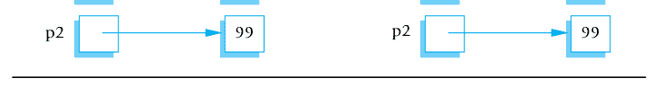

new 运算符会产生一个新的无名变量并返回指向该新变量的指针。你通过在 new 运算符后写出类型名来指定这个新变量的类型。用 new 运算符创建的变量称为动态变量，因为它们在程序运行期间被创建和销毁。Display 9.2 中的程序演示了对指针和动态变量的一些简单操作。Display 9.3 说明了 Display 9.2 中程序的工作原理。在 Display 9.3 中，变量被表示为方框，变量的值写在方框内部。我们没有显示指针变量中的实际数字地址。实际数字并不重要。重要的是该数字是某个特定变量的地址。因此，与其使用地址的实际数字，我们仅用指向具有该地址的变量的箭头来表示地址。例如，在 Display 9.3 的插图 (b) 中，p1 包含一个变量的地址，该变量中写着一个问号。

## DISPLAY 9.2 Basic Pointer Manipulations (part 1 of 2)

```
1 //Program to demonstrate pointers and dynamic variables.
2 #include <iostream>
3 using namespace std;
4 
5 int main( )
6 {
7     int *p1, *p2;
8 
9     p1 = new int;
10    *p1 = 42;
11    p2 = p1;
12    cout<< "*p1 == " << *p1 << endl;
13    cout<< "*p2 == " << *p2 << endl;
14 
15    *p2 = 53;
16    cout<< "*p1 == " << *p1 << endl;
17    cout<< "*p2 == " << *p2 << endl;
18 
19    p1 = new int;
20    *p1 = 88;
21    cout<< "*p1 == " << *p1 << endl;
22    cout<< "*p2 == " << *p2 << endl;
23    cout<< "Hope you got the point of this example!\n";
24    return 0;
25 }
```

(continued)

## DISPLAY 9.2 Basic Pointer Manipulations (part 2 of 2)

# Sample Dialogue

```
*p1 == 42
*p2 == 42
*p1 == 53
*p2 == 53
*p1 == 88
*p2 == 53
Hope you got the point of this example!
```

## Pointer Variables Used with =

如果 p1 和 p2 是指针变量，那么语句

```
p1 = p2;
```

会改变 p1 使其指向 p2 当前所指向的东西。

## The new Operator

new 运算符创建一个指定类型的新的动态变量并返回指向该新变量的指针。例如，下面的语句创建一个类型为 MyType 的新的动态变量，并使指针变量 p 指向这个新变量：

```
MyType *p;
p = new MyType;
```

C++ 标准规定，如果没有足够的内存来创建新变量，则 new 运算符默认会终止程序。¹

¹从技术上讲，new 运算符会抛出一个异常，如果未被捕获则会终止程序。可以“捕获”该异常或安装新的处理程序，但这些主题要到第 16 章才会涉及。

## DISPLAY 9.3 Explanation of Display 9.2

(a)
int *p1, *p2;

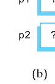

(b)
p1 = new int;

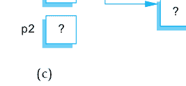

(c)
*p1 = 42;

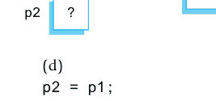

(d)
p2 = p1;


(e)
*p2 = 53;


(f)
p1 = new int;

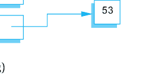

(g)
*p1 = 88;


## SELF-TEST EXERCISES

- 1. 解释 C++ 中指针的概念。
- 2. 以下声明会发生什么不幸的误解？
  int* intPtr1, intPtr2;
- 3. 给出 * 运算符的至少两种用法。说明 * 在做什么，并命名你所给出的 * 的用法。

4. 以下代码产生的输出是什么？

```
int *p1, *p2;
p1 = new int;
p2 = new int;
*p1 = 10;
*p2 = 20;
cout << *p1 << " " << *p2 << endl;
p1 = p2;
cout << *p1 << " " << *p2 << endl;
*p1 = 30;
cout << *p1 << " " << *p2 << endl;
```

如果把
*p1 = 30;
替换为以下内容，输出会如何改变？
*p2 = 30;

5. 以下代码产生的输出是什么？

```
int *p1, *p2;
p1 = new int;
p2 = new int;
*p1 = 10;
*p2 = 20;
cout << *p1 << " " << *p2 << endl;
*p1 = *p2; //This is different from Exercise 4
cout << *p1 << " " << *p2 << endl;
*p1 = 30;
cout << *p1 << " " << *p2 << endl;
```

## Basic Memory Management

一个特殊的内存区域，称为自由存储区，被保留用于动态变量。程序创建的任何新的动态变量都会消耗自由存储区中的一些内存。² 如果你的程序创建了过多的动态变量，它将消耗掉自由存储区中的所有内存。如果发生这种情况，任何额外的 new 调用都会失败。

自由存储区的大小因计算机和 C++ 实现而异。它通常很大，一个适中的程序不太可能用完自由存储区中的所有内存。然而，即使在适中的程序中，回收不再需要的自由存储区内存也是一种良好的做法。如果你的程序创建了过多的动态变量，它将消耗掉自由存储区中的所有内存。如果发生这种情况，任何额外的 new 调用都会失败。

自由存储区的大小因计算机和 C++ 实现而异。它通常很大，一个适中的程序不太可能用完自由存储区中的所有内存。然而，即使在适中的程序中，回收不再需要的自由存储区内存也是一种良好的做法。如果你的程序创建了过多的动态变量，它将消耗掉自由存储区中的所有内存。如果发生这种情况，任何额外的 new 调用都会失败。


longer 需要一个动态变量，该动态变量所使用的内存可以被回收。delete 运算符会消除一个动态变量，并将该动态变量占用的内存返回给 freestore，以便内存可以被重用。假设 p 是一个指向动态变量的指针变量。以下代码会销毁 p 所指向的动态变量，并将该动态变量使用的内存返回给 freestore：

```
delete p;
```

调用此 delete 之后，p 的值未定义，应将其视为未初始化的变量。

## The delete Operator

delete 运算符会消除一个动态变量，并将该动态变量占用的内存返回给 freestore。内存随后可以被重用来创建新的动态变量。例如，以下代码会消除指针变量 p 所指向的动态变量：

```
delete p;
```

调用 delete 之后，指针变量的值，如上面的 p，未定义。（稍后在本章中讨论的 delete 的一个略有不同的版本用于动态变量是数组的情况。）

## PITFALL Dangling Pointers

当你对一个指针变量应用 delete 时，它所指向的动态变量会被销毁。此时，指针变量的值未定义，这意味着你不知道它指向何处，也不知道它所指向位置的值是什么。此外，如果其他指针变量也指向被销毁的动态变量，那么这个其他指针变量也未定义。这些未定义的指针变量称为悬空指针。如果 p 是一个悬空指针，并且你的程序对 p 应用解引用运算符 *（以产生表达式 *p），结果是不可预测的，通常是灾难性的。在对指针变量应用解引用运算符 * 之前，你应确定该指针变量指向某个变量。

你可以使用 typedef 为任何类型名或定义定义别名。例如，以下代码将类型名 Kilometers 定义为与类型名 double 相同：

```
typedef double Kilometers;
```

一旦给出此类型定义，你就可以按如下方式定义 double 类型的变量：

```
Kilometers distance;
```

以这种方式重命名现有类型有时会很有用。然而，我们主要使用 typedef 来为指针变量定义类型。

使用定义的指针类型名（如前面定义的 IntPtr）有两个优点。首先，它避免了遗漏星号的错误。记住，如果你打算让 p1 和 p2 都是指针，那么以下写法是错误的：

```
int *p1, p2;
```

由于 p2 省略了 *，变量 p2 只是一个普通的 int 变量，而不是指针变量。如果你感到困惑并将 * 放在 int 上，问题相同但更难察觉。C++ 允许你将 * 放在类型名上，如 int，因此以下写法是合法的：

```
int* p1, p2;
```

尽管这一行是合法的，但它具有误导性。它看起来像是 p1 和 p2 都是指针变量，但事实上只有 p1 是指针变量；p2 是一个普通的 int 变量。就 C++ 编译器而言，附加在标识符 int 上的 * 也可以看作附加在标识符 p1 上。将 p1 和 p2 都声明为指针变量的一种正确方法是

```
int *p1, *p2;
```

使用定义的<|message|> 类型名 IntPtr 声明 p1 和 p2 都是指针变量的一种更简单、更不易出错的方法是：

```
IntPtr p1, p2;
```

使用定义的指针类型（如 IntPtr）的第二个优点体现在你为指针变量定义一个传引用参数的函数时体现。没有定义的指针类型名，你需要在函数的函数声明中同时包含 * 和 &，细节可能会令人困惑。如果你使用指针类型的类型名，那么为指针类型定义传引用参数就不会有任何复杂性。你为定义的指针类型定义传引用参数的方式与为任何其他传引用参数定义的方式相同。示例如下：

```
void sample_function(IntPtr& pointer_variable);
```

## Type Definitions

你可以为类型定义分配一个名称，然后使用该类型名来声明变量。这是通过关键字 typedef 完成的。这些类型定义通常放置在程序主体的外部（以及其他函数的函数体外部）。

我们将使用类型定义来为指针类型定义名称，如下面的示例所示。

### SYNTAX

```
typedef Known_Type_Definition New_Type_Name;
```

### EXAMPLE

```
typedef int* IntPtr;
```

类型名 IntPtr 然后可用于声明指向类型为 int 的动态变量的指针，如下所示：

```
IntPtr pointer1, pointer2;
```

## SELF-TEST EXERCISES

- 6. 假设一个动态变量是这样创建的：
  char *p;
  p = new char;
  假设指针变量 p 的值未改变（因此它仍然指向同一个动态变量），你如何销毁这个新的动态变量并将它使用的内存返回给 freestore，以便内存可以被重用来创建新的动态变量？

- 7. 编写一个名为 NumberPtr 的类型的定义，它将是持有指向类型为 int 的动态变量的指针的指针变量的类型。另写一个指针变量 my_point 的声明，其类型为 NumberPtr。

- 8. 描述 new 运算符的作用。new 运算符返回什么？

## 9.2 DYNAMIC ARRAYS

在本节中你将看到数组变量实际上是指针变量。你还将了解如何编写具有动态数组的程序。动态数组是指其大小在编写程序时未指定，而是在程序运行时确定的数组。

## Array Variables and Pointer Variables

在第 7 章我们描述了数组如何在内存中保存。此时我们尚未学习指针，因此我们以内存地址的术语讨论数组。但内存地址就是指针。因此，在 C++ 中，数组变量实际上是一个指向数组的第一个索引变量的指针变量。给定以下两个变量声明，p 和 a 是同一种变量：

```
int a[10];
typedef int* IntPtr;
IntPtr p;
```

a 和 p 是同一种变量这一事实在 Display 9.4 中有所说明。由于 a 是一个指向类型为 int 的变量（即变量 a[0]）的指针，a 的值可以分配给指针变量 p 如下：

```
p = a;
```

在此赋值之后，p 指向与 a 相同的内存位置。因此，p[0]、p[1]、... p[9] 引用索引变量 a[0]、a[1]、... a[9]。你一直为数组使用的方括号记法适用于指针变量，只要指针变量指向内存中的数组。在此赋值之后，你可以把标识符 p 当作数组标识符一样对待。你也可以把标识符 a 当作指针变量一样对待，但有一个重要的保留。你不能改变数组变量（如 a）中的指针值。你可能会想以下代码是合法的，但它不是：

```
IntPtr p2;
...//p2 被赋予某个指针值。
a = p2;//ILLEGAL. 你不能为 a 分配不同的地址。
```

Display 9.5 说明了 Display 9.4 中程序的工作方式。如 Display 9.3 中一样，变量表示为方框，变量的值写在方框内。箭头表示指向另一个内存位置的指针或引用，在本例中是指数组的第一个元素。

## DISPLAY 9.4 Arrays and Pointer Variables

```
//Program to demonstrate that an array variable is a kind of pointer variable.
#include <iostream>
using namespace std;

typedef int* IntPtr;

int main()
{
    IntPtr p;
    int a[10];
    int index;

    for (index = 0; index < 10; index++)
        a[index] = index;

    p = a;

    for (index = 0; index < 10; index++)
        cout << p[index] << " ";
    cout << endl;

    for (index = 0; index < 10; index++)
        p[index] = p[index] + 1;

    for (index = 0; index < 10; index++)
        cout << a[index] << " ";
    cout << endl;

    return 0;
}
```

注意，对数组 p 的更改也是对数组 a 的更改。

## Output

```
0 1 2 3 4 5 6 7 8 9
1 2 3 4 5 6 7 8 9 10
```

## Creating and Using Dynamic Arrays

你迄今为止使用过的数组种类存在一个问题：你必须在编写程序时指定数组的大小——但你可能要到程序运行时才知道需要多大的数组。例如，一个数组可能保存学生识别号列表，但班级的大小每次运行程序时可能不同。使用你迄今为止使用过的数组种类，你必须估计可能需要的最大大小


## 程序清单 9.5 对程序清单 9.4 的说明

```cpp
IntPtr p;
int a[10];
```

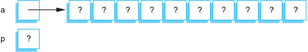

```cpp
for (index = 0; index < 10; index++)
    a[index] = index;
```

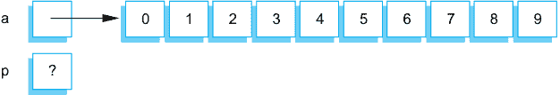

```cpp
p = a;
```

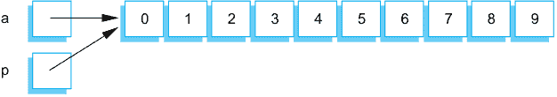

```cpp
for (index=0; index < 10; index++)
    cout << p[index] << " ";
```

输出：`0 1 2 3 4 5 6 7 8 9`

> 遍历 p 与遍历 a 是相同的

```cpp
for (index = 0; index < 10; index++)
    p[index] = p[index] + 1;
```

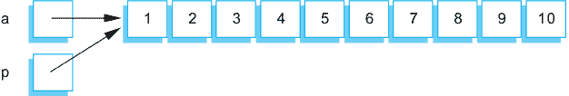

```cpp
for (index=0; index < 10; index++)
    cout << a[index] << " ";
```

输出：`1 2 3 4 5 6 7 8 9 10`

> 遍历 a 与遍历 p 是相同的

对于这个数组，并希望该大小足够大。这样做有两个问题。首先，你可能低估了所需大小，这样程序在某些情况下将无法正常工作。其次，由于数组可能有许多未使用的位置，这会浪费计算机内存。动态数组避免了这些问题。如果你的程序使用动态数组来存储学生标识号，那么班级的规模可以作为程序输入，动态数组可以正好创建为这个大小。

动态数组使用 new 运算符创建。动态数组的创建和使用出奇地简单。由于数组变量就是指针变量，你可以使用 new 运算符创建作为数组的动态变量，并像对待普通数组一样对待这些动态数组变量。例如，下面的代码创建了一个含有十个 double 类型元素的动态数组变量：

```
typedef double* DoublePtr;
DoublePtr p;
p = new double[10];
```

要获得其他元素类型的动态数组，只需将 double 替换为所需类型。要获得其他大小的动态数组变量，只需将 10 替换为所需大小。

关于这个示例，还有一些不太明显的地方需要注意。首先，用于指向动态数组的指针类型与用于指向数组单个元素的指针类型相同。例如，double 类型元素数组的指针类型与你用于简单 double 类型变量的指针类型相同。指向数组的指针实际上是指向数组的第一个索引变量。在前面的示例中，创建了一个包含十个索引变量的完整数组，指针 p 指向这十个索引变量中的第一个。

还要注意，当你调用 new 时，动态数组的大小在类型后面的方括号中给出，在本例中类型为 double。这会告诉计算机为动态数组保留多少存储空间。如果你省略方括号和 10，计算机将只为一个 double 类型变量分配足够的存储空间，而不是为十个 double 类型索引变量的数组分配空间。如程序清单 9.6 所示，你可以使用 int 变量代替常量 10，这样动态数组的大小就可以读入程序。

程序清单 9.6 中的程序对一个数字列表进行排序。该程序适用于任意大小的列表，因为它使用动态数组来保存这些数字。数组的大小在程序运行时确定。程序会询问用户一共有多少个数字，然后 new 运算符创建一个该大小的动态数组。动态数组的大小由变量 array_size 给出。

注意 delete 语句，它销毁了程序清单 9.6 中的动态数组变量 a。由于程序无论如何即将结束，我们实际上并不需要这条 delete 语句；然而，如果程序继续执行其他

## 创建动态数组

与动态变量相关的操作，你就会需要这样的 delete 语句，以便将这个动态数组占用的内存归还给自由存储区。动态数组的 delete 语句与你之前见过的 delete 语句类似，只是对于动态数组，你必须包含一对空的方括号，如下所示：

```
delete [] a;
```

方括号告诉 C++ 正在销毁一个动态数组变量，因此系统会检查数组的大小并删除相应数量的索引变量。如果省略方括号，就等于告诉计算机只销毁一个 int 类型变量。例如，

```
delete a;
```

这并不合法，但大多数编译器检测不到这个错误。ANSI C++ 标准规定，这样做时发生的行为是“未定义的”。这意味着编译器作者可以让其做任何方便的事情——方便的是编译器编写者，而不是你。即使它做了某些有用的事情，你也不能保证该编译器的下一个版本，或者你用来编译这段代码的任何其他编译器，都会做同样的事情。道理很简单：始终使用以下

```
delete [] arrayPtr;
```

语法来删除通过如下方式分配的内存

```
arrayPtr = new MyType[37];
```

你通过使用指针调用 new 来创建动态数组，例如程序清单 9.6 中的指针 a。在调用 new 之后，你不应再给这个指针变量赋予任何其他指针值，因为当通过 delete 调用将动态数组的内存归还给自由存储区时，这可能会使系统产生混淆。

## 程序清单 9.6 动态数组（第 1 部分，共 2 部分）

```
1  //Sorts a list of numbers entered at the keyboard.
2  #include <iostream>
3  #include <cstdlib>
4  #include <cstddef>
5  
6  typedef int* IntArrayPtr;
7  
8  void fill_array(int a[], int size);
9  //Precondition: size is the size of the array a.
10 //Postcondition: a[0] through a[size- 1] have been
11 //filled with values read from the keyboard.
12 
13 void sort(int a[], int size);
14 //Precondition: size is the size of the array a.
15 //The array elements a[0] through a[size-1] have values.
16 //Postcondition: The values of a[0] through a[size-1] have been rearranged
17 //so that a[0] <= a[1] <= ... <= a[size-1].
18 
19 int main()
20 {
21     using namespace std;
22     cout << "This program sorts numbers from lowest to highest.\n";
23     
24     int array_size;
25     cout << "How many numbers will be sorted? ";
26     cin >> array_size;
27     
28     IntArrayPtr a;
29     a = new int[array_size];
30     
31     fill_array(a, array_size);
32     sort(a, array_size);
33     
34     cout << "In sorted order the numbers are:\n";
35     for (int index = 0; index < array_size; index++)
36         cout << a[index] << " ";
37     cout << endl;
38     
39     delete [] a;
40     
41     return 0;
42 }
43 
44 //Uses the library iostream:
45 void fill_array(int a[], int size)
46 {
```

普通数组参数

动态数组 a 的使用方式与普通数组相同。

## 程序清单 9.6 动态数组（第 2 部分，共 2 部分）

```
47     using namespace std;
48     cout << "Enter " << size << " integers.\n";
49     for (int index = 0; index < size; index++)
50         cin >> a[index];
51 }
52
53 void sort(int a[], int size)
```

> <可以使用任何一种 sort 的实现。这可能需要也可能不需要额外的函数定义。该实现甚至不需要知道 sort 会以动态数组作为参数调用。例如，你可以使用程序清单 7.12 中的实现（适当地调整参数名称）。>

## 如何使用动态数组

- **定义指针类型：** 定义一个指针类型，用于指向与数组元素类型相同的变量。例如，如果动态数组是 *double* 类型的数组，你可以使用下面的代码：
  
  `typedef double* DoubleArrayPtr;`
- **声明指针变量：** 声明一个此定义类型的指针变量。该指针变量将指向内存中的动态数组，并作为动态数组的名称。
  
  `DoubleArrayPtr a;`
- **调用 new：** 使用 *new* 运算符创建动态数组：
  
  `a = new double[array_size];`
  
  动态数组的大小如上例所示在方括号中给出。大小可以使用 *int* 变量或其他 *int* 表达式给出。在上面的示例中，*array_size* 是一个 *int* 类型的变量，其值在程序运行时确定。
- **像普通数组一样使用：** 指针变量（例如 a）的使用方式与普通数组完全相同。例如，索引变量按通常方式编写：a[0]、a[1] 等等。不应给该指针变量赋予任何其他指针值，而应像数组变量一样使用它。
- **调用 delete[]：** 当程序不再使用该动态变量时，使用 *delete* 和空的方括号以及指针变量来销毁动态数组，并将其占用的存储空间归还给自由存储区以便复用。例如：
  
  `delete [] a;`

动态数组使用 *new* 和一个指针变量创建。当程序使用完动态数组后，应该调用 *delete* 将数组内存归还给自由存储区。除此之外，动态数组可以像其他任何数组一样使用。

## 自测练习

9. 为将用于指向动态数组的指针变量编写一个类型定义。数组元素应为 *char* 类型。将该类型命名为 CharArray。


10. 假设你的程序包含如下创建动态数组的代码：

```cpp
int *entry;
entry = new int[10];
```

这样指针变量 `entry` 就指向这个动态数组。编写代码用键盘输入的十个数填充这个数组。

11. 假设你的程序包含如自测练习 10 中创建动态数组的代码，并且假设指针变量 `entry` 的（指针）值未被更改。编写代码销毁这个新动态数组并将其使用的内存归还给自由存储区。

12. 下列代码片段的输出是什么？假设代码嵌入在一个正确且完整的程序中。

```cpp
int a[10];
int *p = a;
int i;
for (i = 0; i < 10; i++)
    a[i] = i;

for (i = 0; i < 10; i++)
    cout << p[i] << " ";
cout << endl;
```

13. 下列代码片段的输出是什么？假设代码嵌入在一个正确且完整的程序中。

```cpp
int array_size = 10;
int *a;
a = new int[array_size];
int *p = a;
int i;
for (i = 0; i < array_size; i++)
    a[i] = i;
p[0] = 10;

for (i = 0; i < array_size; i++)
    cout << a[i] << " ";
cout << endl;
```

## 指针算术（可选）

你可以对指针执行一种算术运算，但它是对地址的算术运算，而不是对数字的算术运算。例如，假设你的程序包含以下代码：

```cpp
typedef double* DoublePtr;
DoublePtr d;
d = new double[10];
```

15. 下列代码片段的输出是什么？假设代码嵌入在一个正确且完整的程序中。

```cpp
int arraySize = 10;
int *a;
a = new int[arraySize];
int i;
for (i = 0; i < arraySize; i++)
    a[i] = i;
while (*a < 9)
{
    a++;
    cout << *a << " ";
}
cout << endl;
```

## 多维动态数组（可选）

你可以拥有多维动态数组。你只需要记住多维数组是数组的数组，或是数组的数组的数组，等等。例如，要创建一个二维动态数组，你必须记住它是一个数组的数组。要创建一个整型二维数组，你首先创建一个 `int*` 类型的指针的一维动态数组，`int*` 是 `int` 的一维数组的类型。然后为指针数组的每个索引变量创建一个 `int` 的动态数组。

类型定义可以帮助理清思路。以下是一个普通的 `int` 一维动态数组的变量类型：

```cpp
typedef int* IntArrayPtr;
```

要获得一个 3×4 的 `int` 数组，你需要一个基类型为 `IntArrayPtr` 的数组。例如：

```cpp
IntArrayPtr *m = new IntArrayPtr[3];
```

这是一个包含三个指针的数组，每个指针都可以命名一个 `int` 的动态数组，如下所示：

```cpp
for (int i = 0; i < 3; i++)
    m[i] = new int[4];
```

由此得到的数组 `m` 是一个 3×4 的动态数组。说明此方法的简单程序在第 9.7 节中给出。

请注意第 9.7 节中 `delete` 的使用。由于动态数组 `m` 是一个数组的数组，用 `for` 循环中 `new` 创建的每个数组都必须通过调用 `delete[]` 归还给自由存储管理器；然后，数组 `m` 本身必须通过另一次调用 `delete[]` 归还给自由存储区。对每个用 `new` 创建数组的调用都必须有一次 `delete[]` 调用。 （由于程序在调用 `delete[]` 后立即结束，我们可以安全地省略这些调用，但我们想说明其用法。）

### 第 9.7 节 显示 一个二维动态数组

```cpp
#include <iostream>
using namespace std;

typedef int* IntArrayPtr;

int main()
{
    int d1, d2;
    cout << "Enter the row and column dimensions of the array:\n";
    cin >> d1 >> d2;

    IntArrayPtr *m = new IntArrayPtr[d1];
    int i, j;
    for (i = 0; i < d1; i++)
        m[i] = new int[d2];
    //m is now a d1 by d2 array.

    cout << "Enter " << d1 << " rows of "
         << d2 << " integers each:\n";
    for (i = 0; i < d1; i++)
        for (j = 0; j < d2; j++)
            cin >> m[i][j];

    cout << "Echoing the two-dimensional array:\n";
    for (i = 0; i < d1; i++)
    {
        for (j = 0; j < d2; j++)
            cout << m[i][j] << " ";
        cout << endl;
    }
    for (i = 0; i < d1; i++)
        delete[] m[i];
    delete[] m;

    return 0;
}
```

> 请注意，对每个用 `new` 创建数组的调用都必须有一次 `delete[]` 调用。 （这些 `delete[]` 调用实际上不是必需的，因为程序即将结束，但在其他上下文中包含它们可能很重要。）

**示例对话**

```text
Enter the row and column dimensions of the array:
3 4
Enter 3 rows of 4 integers each:
1 2 3 4
5 6 7 8
9 0 1 2
Echoing the two-dimensional array:
1 2 3 4
5 6 7 8
9 0 1 2
```

## 章节总结

- 指针是一个内存地址，因此指针提供了一种通过命名计算机内存中变量的地址来间接命名变量的方法。
- **动态变量** 是在程序运行期间创建（和销毁）的变量。
- 动态变量的内存位于计算机内存的特殊部分，称为 **自由存储区**。当程序完成对动态变量的使用后，动态变量使用的内存可以归还给自由存储区以供重用；这通过 `delete` 语句完成。
- **动态数组** 是大小在程序运行时确定的数组。动态数组被实现为一种数组类型的动态变量。

## 自测练习答案

1. 指针是变量的内存地址。

2. 对不熟悉的人或新手来说，这看起来像是两个 `int` 指针类型的对象，即 `int*`。不幸的是，`*` 绑定到标识符，而不是绑定到类型（即不是绑定到 `int`）。结果是，此声明将 `intPtr1` 声明为 `int` 指针，而 `intPtr2` 只是普通的 `int` 变量。

3. `int *p;` 声明一个可以保存指向 `int` 变量的指针的指针变量。

`*p = 17;` 使用解引用运算符并将 17 分配给 `p` 所指向的内存位置。

4.

```text
10 20
20 20
30 30
```

如果你将 `*p1 = 30;` 替换为 `*p2 = 30;`，输出将相同。

5.

```text
10 20
20 20
30 20
```

6. `delete p;`

7.

```cpp
typedef int* NumberPtr;
NumberPtr myPoint;
```

8. `new` 运算符对其参数采用一种类型。`new` 在自由存储区分配适当大小的空间以容纳参数类型的变量。它返回指向该内存的指针（即指向该新动态变量的指针），前提是自由存储区中有足够的可用内存。如果自由存储区中没有足够的可用内存，你的程序就会结束。

9. `typedef char* CharArray;`

10.

```cpp
cout << "Enter 10 integers:\n";
for (int i = 0; i < 10; i++)
    cin >> entry[i];
```

11. `delete [] entry;`

12. `0 1 2 3 4 5 6 7 8 9`

13. `10 1 2 3 4 5 6 7 8 9`

14. `0 1 2 3 4 5 6 7 8 9`

15. `1 2 3 4 5 6 7 8 9`

## 实践程序

实践程序通常可以用一个简短的程序解决，该程序直接应用本章介绍的编程原理。

1. 在 C 编程语言中，没有通过引用传递变量给函数的按引用传递语法。相反，变量是通过指针传递的（为了混淆，有时通过指针传递被称为按引用传递）。本实践程序要求你做同样的事情

2. 做第 7 章的编程项目 3。在此问题的版本中，返回一个新动态数组，其中所有重复字母都被删除，而不是修改部分填充的数组。不要忘记在数据不再需要时释放为这些返回的动态数组分配的内存。

3. 编写一个函数来连接两个动态整数数组的内容。你的函数应包含两个数组的引用指针参数以及两个数组的大小。你的函数应返回指向包含两个数组元素副本的新数组的指针。使用驱动程序测试你的函数。

4. C 字符串存储为字符数组，并用特殊字符 `'\0'` 标记字符串的结尾。普通的 `char` 数组能够在末尾没有特殊字符的情况下工作。编写一个函数 `isCString`，它接受指向 `char` 数组的 const 指针作为参数，以及数组的大小作为整数参数。沿着数组检查特殊字符 `'\0'` 的存在。如果存在，返回 true；否则返回 false。编写一个驱动程序来测试你的函数，通过向你的函数传递 C 字符串、普通 `char` 数组和动态 `char` 数组。

5. 你运行四个计算机实验室。每个实验室包含编号如下的计算机工作站：

| 实验室编号 | 计算机工作站编号 |
| --- | --- |
| 1 | 1–5 |
| 2 | 1–6 |
| 3 | 1–4 |
| 4 | 1–3 |

每个用户都有唯一的五位 ID 号。每当用户登录时，用户 ID、实验室编号和计算机工作站编号都会传输到你的系统。例如，如果用户 49193 登录实验室 3 的工作站 2，则你的系统接收到 (49193, 3, 2) 作为输入数据。同样，当用户从工作站注销时，你的系统会收到实验室编号和计算机工作站编号。

编写一个计算机程序，可用于按实验室跟踪哪个用户登录到哪台计算机。例如，如果用户 49193 登录到实验室 3 的工作站 2，并且用户 99577 登录到实验室 4 的工作站 1，则你的系统可能会显示以下内容：

```text
Lab Number  Computer Stations
1           1: empty 2: empty 3: empty 4: empty 5: empty
2           1: empty 2: empty 3: empty 4: empty 5: empty 6: empty
3           1: empty 2: 49193 3: empty 4: empty
4           1: 99577 2: empty 3: empty
```


创建一个菜单，允许管理员通过手动输入登录或注销数据来模拟信息的传输。每当有人登录或注销时，显示应更新。还要编写一个搜索选项，以便管理员可以输入用户ID，系统将输出该用户登录的实验室和工位号，如果该用户ID未登录到任何计算机工位，则输出“None”。

你应该使用一个长度为4的固定数组来表示实验室。每个数组元素指向一个动态数组，该动态数组存储每个计算机工位的用户登录信息。

该结构如下图所示。这种结构有时称为不规则数组（ragged array），因为各列长度不等。

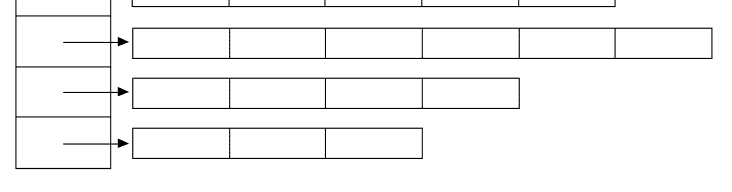

6. 动态数组的一个问题是，一旦使用new运算符创建了数组，其大小就无法更改。例如，你可能想像使用vector一样从数组中添加或删除条目。本项目要求你创建使用动态数组来模拟vector行为的函数。

首先，编写一个程序，创建一个包含五个字符串的动态数组。将你选择的五个名称存储到动态数组中。接下来，完成以下两个函数：

```
string* addEntry(string *dynamicArray, int &size, string newEntry);
```

该函数应创建一个比dynamicArray大一个元素的新动态数组，将dynamicArray中的所有元素复制到新数组中，将新条目添加到新数组的末尾，将size递增，删除dynamicArray，并返回新的动态数组。

```
string* deleteEntry(string *dynamicArray, int &size, string entryToDelete);
```

该函数应在dynamicArray中搜索entryToDelete。如果未找到，应忽略该请求并返回未修改的dynamicArray。如果找到，则创建一个比dynamicArray小一个元素的新动态数组。将除entryToDelete之外的所有元素复制到新数组中，删除dynamicArray，将size递减，并返回新的动态数组。

通过向数组添加和删除几个名称并输出数组的内容来测试你的函数。你必须将addEntry或deleteEntry返回的数组重新赋值给main函数中的动态数组变量。

7. 如果C++没有内置的二维数组功能怎么办？你可以自己用一维数组的包装函数来模拟它们。基本思想如下所示。考虑下面的二维数组：

```
int matrix[2][3];
```

它可以被可视化为一个表格：

| matrix[0][0] | matrix[0][1] | matrix[0][2] |
| matrix[1][0] | matrix[1][1] | matrix[1][2] |

二维数组可以映射到一维数组中的存储，其中每一行存储在连续的内存位置（你的编译器实际上做了非常类似的事情来将二维数组映射到内存）。

```
int matrix1D[6];
```

| matrix[0][0] | matrix1D[0][1] | matrix1D[0][2] | matrix1D[1][0] | matrix1D[1][1] | matrix1D[1][2] |

这里，映射如下：

```
matrix[0][0] would be stored in matrix1D[0]
matrix[0][1] would be stored in matrix1D[1]
matrix[0][2] would be stored in matrix1D[2]
matrix[1][0] would be stored in matrix1D[3]
matrix[1][1] would be stored in matrix1D[4]
matrix[1][2] would be stored in matrix1D[5]
```

基于这个思想，完成以下函数的定义：

```
int* create2DArray(int rows, int columns);
```

这将创建一个一维动态数组来模拟二维数组，并返回指向该一维动态数组的指针。

rows是二维数组中所需的行数。
columns是二维数组中所需的列数。
返回值：指向一个足够大的一维动态数组的指针，该数组可容纳大小为rows * columns的二维数组。

请注意，int ptr = create2DArray(2,3);将创建一个类似于int ptr[2][3];创建的数组。

```
void set(int *arr, int rows, int columns,
    int desired_row, int desired_column, int val);
```

这会将val存储到模拟二维数组的desired_row, desired_column位置。如果所需索引无效，函数应打印错误消息并退出。

arr是用于模拟二维数组的一维数组。
rows是二维数组的总行数。
columns是二维数组的总列数。
desired_row是调用者希望访问的行的从零开始的索引。
desired_column是调用者希望访问的列的从零开始的索引。
val是要存储在desired_row和desired_column处的值。

```
int get(int *arr, int rows, int columns,
    int desired_row, int desired_column);
```

这将返回模拟二维数组在desired_row, desired_column位置的值。如果所需索引无效，函数应打印错误消息并退出。

arr是用于模拟二维数组的一维数组。
rows是二维数组的总行数。
columns是二维数组的总列数。
desired_row是调用者希望访问的行的从零开始的索引。
desired_column是调用者希望访问的列的从零开始的索引。

创建一个合适的测试程序，调用所有这三个函数。

8. 许多剧院包含可根据演出移除或重新布置的座位。编写一个程序，使用二维动态int数组来设置演出的座位安排。程序应提示用户输入行数，然后针对每一行输入所需座位数（每行的座位数可以不同），并将行长度存储在每个行数组的第一个int元素中。你的程序应允许用户选择一行并更改其中包含的座位数，或者移除或添加整行。每次操作后，程序应打印行列表、每行座位数以及剧院中的总座位数。确保在不再需要时删除任何内存。

此页有意留白。

## 10.1 结构体 576

用于多样化数据的结构体 576

陷阱：在结构体定义中忘记分号 581

结构体作为函数参数 582

编程提示：使用层次结构 583

初始化结构体 585

## 10.2 类 588

定义类和成员函数 588

公有成员和私有成员 593

编程提示：将所有成员变量设为私有 601

编程提示：定义访问器和修改器函数 601

编程提示：对对象使用赋值运算符 603

编程示例：BankAccount类——版本1 604

类的一些属性概述 608

用于初始化的构造函数 610

编程提示：始终包含默认构造函数 618

陷阱：无参数构造函数 619

C++11中的成员初始化器和构造函数委托 621

## 10.3 抽象数据类型 622

产生抽象数据类型的类 623

编程示例：类的替代实现 627

## 10.4 继承简介 632

派生类 633

定义派生类 634

> “时候到了，”海象说，
> “要谈许多事情：
> 谈鞋子——和船——和封蜡——
> 谈卷心菜——和国王——”
> 
> 刘易斯·卡罗尔，《爱丽丝镜中奇遇记》

## 引言

在第6章中，你学习了如何使用类和对象，但没有学习如何定义类。在本章中，我们将向你展示如何定义自己的类。类是一种数据类型。你可以像使用预定义数据类型（如int、char和ifstream）一样使用你定义的类。但是，除非你以正确的方式定义类，否则它们不会像预定义数据类型那样表现良好。因此，我们会花大量时间解释什么才是好的类定义，并提供一些技术来帮助你以符合现代编程实践的方式定义类。

在介绍类之前，我们将首先介绍结构体（也称为struct）。当按我们这里介绍的方式使用时，结构体是一种简化的类，结构体将证明是理解类的垫脚石。

# 先决条件

本章使用第2章到第6章的内容。

## 10.1 结构体

正如我们在第6章中所说，对象是拥有成员函数的变量，而类是其变量为对象的数据类型。因此，类的定义应该是一个数据类型定义，它描述两件事：（1）变量可以保存哪些类型的值，（2）成员函数是什么。我们将分两步来讨论类定义。我们首先告诉你如何为结构体给出类型定义。结构体（这里讨论的这种）可以被视为没有任何成员函数的对象。在学习结构体之后，定义类将是一个自然的延伸。

### 用于多样化数据的结构体

有时，将不同类型值的集合视为单个项目是很有用的。例如，考虑银行存单（通常称为CD）。CD是一种在指定月份数内不允许取款的银行账户。CD自然具有三种

与其关联的数据项包括：账户余额、账户利率和期限（即到到期日的月数）。前两项可以表示为double类型的值，月数可以表示为int类型的值。显示10.1展示了一个名为CDAccount的结构体的定义，该结构体可用于此类账户。该定义嵌入在一个完整的程序中，该程序演示了这一结构体类型定义。从示例对话可以看出，这家银行专门经营短期存单，因此期限总是12个月或更短。让我们来看看这个示例结构体是如何定义和使用的。

结构体定义如下：

```
struct CDAccount
{
    double balance;
    double interestRate;
    int term; //months until maturity
};
```

关键字struct表明这是一个结构体类型定义。标识符CDAccount是结构体类型的名称。结构体类型的名称称为结构标记。标记可以是任何合法标识符（但不能是关键字）。虽然C++语言并不要求这一约定，但结构标记通常由大写字母和小写字母混合拼写，并以大写字母开头。在花括号{}内声明的标识符称为成员名。如该示例所示，结构体类型定义以右花括号}和分号结尾。

结构体定义通常放在任何函数定义之外（就像全局常量声明放在所有函数定义之外一样）。这样，结构体类型就可用于结构体定义之后的所有代码。

一旦给出了结构体类型定义，结构体类型就可以像预定义类型int、char等一样使用。例如，下面将声明两个变量，名为myAccount和yourAccount，它们都是CDAccount类型：

```
CDAccount myAccount, yourAccount;
```

结构体变量可以像其他任何变量一样保存值。结构体值是一组较小的值，称为成员值。结构体定义中声明的每个成员名都有一个对应的成员值。例如，CDAccount类型的值由三个成员值组成：两个double类型和一个int类型。共同构成结构体值的各个成员值存储在成员变量中，我们将在下面讨论。

每个结构体类型都指定了一个成员名列表。在显示10.1中，结构体CDAccount有三个成员名：balance、interestRate、

结构体定义的位置

## 显示10.1 结构体定义（第1部分，共2部分）

```
//Program to demonstrate the CDAccount structure type.
#include <iostream>
using namespace std;
//Structure for a bank certificate of deposit:
struct CDAccount
{
    double balance;
    double interestRate;
    int term; //months until maturity
};


void getData(CDAccount& theAccount);
//Postcondition: theAccount.balance and theAccount.interestRate
//have been given values that the user entered at the keyboard.


int main()
{
    CDAccount account;
    getData(account);

    double rateFraction, interest;
    rateFraction = account.interestRate / 100.0;
    interest = account.balance * rateFraction * (account.term / 12.0);
    account.balance = account.balance + interest;

    cout.setf(ios::fixed);
    cout.setf(ios::showpoint);
    cout.precision(2);
    cout << "When your CD matures in "
        << account.term << " months,\n"
        << "it will have a balance of $"
        << account.balance << endl;
    return 0;
}

//Uses iostream:
void getData(CDAccount& theAccount)
{
    cout << "Enter account balance: $";
    cin >> theAccount.balance;
    cout << "Enter account interest rate: ";
    cin >> theAccount.interestRate;
    cout << "Enter the number of months until maturity\n"
        << "(must be 12 or fewer months): ";
    cin >> theAccount.term;
}
```

## 显示10.1 结构体定义（第2部分，共2部分）

### 示例对话

```
Enter account balance: $100.00
Enter account interest rate: 10.0
Enter the number of months until maturity
(must be 12 or fewer months): 6
When your CD matures in 6 months,
it will have a balance of $105.00
```

以及term。这些成员名中的每一个都可以用来取出较大结构体变量中的一个较小变量。这些较小的变量称为成员变量。成员变量通过给出结构体变量名，后跟一个点（即句点），再跟成员名来指定。例如，如果account是CDAccount类型的结构体变量（如显示10.1中所声明的），那么结构体变量account具有以下三个成员变量：

```
account.balance
account.interestRate
account.term
```

前两个成员变量的类型是double，最后一个的类型是int。这些成员变量可以像其他任何这些类型的变量一样使用。例如，上面的成员变量可以通过以下三条赋值语句赋值：

```
account.balance = 1000.00;
account.interestRate = 4.7;
account.term = 11;
```

这三条语句的结果如显示10.2中的图示所示。成员变量可以以普通变量可以使用的所有方式使用。例如，显示10.1中程序的下面一行将把成员变量account.balance中包含的值与普通变量interest中包含的值相加，然后将结果放入成员变量account.balance中：

```
account.balance = account.balance + interest;
```

请注意，你通过使用点运算符来指定结构体变量的成员变量，其方式与你在第6章中使用点运算符指定类的成员函数的方式相同。唯一的区别是，对于结构体，成员是变量而不是函数。

## 显示10.2 成员值

```
struct CDAccount
{
    double balance;
    double interestRate;
    int term; //months until maturity
};
int main()
{
    CDAccount account;
    ...
```

```
account.balance = 1000.00;
```

```
account.interestRate = 4.7;
```

```
account.term = 11;
```

成员名的重用

两个或多个结构体类型可以使用相同的成员名。例如，在同一个程序中包含以下两个类型定义是完全合法的：

```
struct FertilizerStock
{
    double quantity;
    double nitrogenContent;
};
```

和

```
struct CropYield
{
    int quantity;
    double size;
};
```

这种名称上的重合不会产生问题。例如，如果你声明以下两个结构体变量：

## 点运算符

点运算符用于指定结构体变量的成员变量。

## 语法

```
StructureVariableName.MemberVariableName
```

```
struct StudentRecord
{
    int studentNumber;
    char grade;
};
int main()
{
    StudentRecord yourRecord;
    yourRecord.studentNumber = 2001;
    yourRecord.grade = 'A';
```

有些作者将点运算符称为结构体成员访问运算符，但我们不会使用这个术语。

## 结构体作为函数参数

函数可以具有结构体类型的传值参数和/或结构体类型的传引用参数。例如，显示10.1中的程序包含一个名为getData的函数，该函数有一个结构体类型为CDAccount的传引用参数。

结构体类型也可以作为函数返回值的类型。例如，下面定义了一个函数，该函数接受三个适当的参数并返回一个CDAccount类型的值：

```
CDAccount shrinkWrap(double theBalance, double theRate, int theTerm)
{
    CDAccount temp;
    temp.balance = theBalance;
    temp.interestRate = theRate;
    temp.term = theTerm;
    return temp;
}
```

注意CDAccount类型的局部变量temp；temp用于构建一个完整的结构体值，然后由函数返回。一旦你


have defined the function `shrinkWrap`, you can give a value to a variable of type `CDAccount` as illustrated by the following:

```
CDAccount newAccount;
newAccount = shrinkWrap(10000.00, 5.1, 11);
```

## PROGRAMMING TIP Use Hierarchical Structures

Sometimes it makes sense to have structures whose members are themselves smaller structures. For example, a structure type called `PersonInfo`, which can be used to store a person’s height, weight, and birth date, can be defined as follows:

```
struct Date
{
    int month;
    int day;
    int year;
};

struct PersonInfo
{
    double height;  //in inches
    int weight;     //in pounds
    Date birthday;
};
```

A structure variable of type `PersonInfo` is declared in the usual way:

```
PersonInfo person1;
```

If the structure variable `person1` has had its value set to record a person’s birth date, then the year the person was born can be output to the screen as follows:

```
cout << person1.birthday.year;
```

The way to read such expressions is left to right, and very carefully. Starting at the left end, `person1` is a structure variable of type `PersonInfo`. To obtain the member variable with the name `birthday`, use the dot operator as follows:

```
person1.birthday
```

This member variable is itself a structure variable of type `Date`. Thus, this member variable has member variables itself. A member variable of the structure variable `person1.birthday` is obtained by adding a dot and the member variable name, such as `year`, which produces the expression `person1.birthday.year` shown previously.

## Simple Structure Types

You define a **structure type** as shown below. The *StructureTag* is the name of the structure type.

### SYNTAX

```
struct StructureTag
{
    Type1 MemberVariableName1;
    Type2 MemberVariableName2;
    .
    .
    .
    TypeLast MemberVariableNameLast;
};  Do not forget this semicolon.
```

### EXAMPLE

```
struct Automobile
{
    int year;
    int doors;
    double horsePower;
    char model;
};
```

Although we will not use this feature, you can combine member names of the same type into a single list separated by commas. For example, the following is equivalent to the previous structure definition:

```
struct Automobile
{
    int year, doors;
    double horsePower;
    char model;
};
```

**Variables of a structure type** can be declared in the same way as variables of other types. For example:

```
Automobile myCar, yourCar;
```

The member variables are specified using the **dot operator**. For example,

```
myCar.year, myCar.doors, myCar.horsePower, and myCar.model.
```

## Initializing Structures

You can initialize a structure at the time that it is declared. To give a structure variable a value, you follow it by an equal sign and a list of the member values enclosed in braces. For example, the following definition of a structure type for a date was given in the previous subsection:

```
struct Date
{
    int month;
    int day;
    int year;
};
```

Once the type Date is defined, you can declare and initialize a structure variable called dueDate as follows:

```
Date dueDate = {12, 31, 2004};
```

Be sure to notice that the initializing values must be given in the order that corresponds to the order of member variables in the structure type definition. In this example, dueDate.month receives the first initializing value of 12, dueDate.day receives the second value of 31, and dueDate.year receives the third value of 2004.

It is an error if there are more initializers than struct members. If there are fewer initializer values than struct members, the provided values are used to initialize data members, in order. Each data member without an initializer is initialized to a zero value of an appropriate type for the variable.

## SELF-TEST EXERCISES

- 1. Given the following structure and structure variable declaration:

```
struct TermAccount
{
    double balance;
    double interestRate;
    int term;
    char initial1;
    char initial2;
};
TermAccount account;
```

what is the type of each of the following? Mark any that are not correct.

- a. account.balance
- b. account.interestRate
- c. TermAccount.term
- d. savingsAccount.initial1
- e. account.initial2
- f. account

2. Consider the following type definition:

```
struct ShoeType
{
    char style;
    double price;
};
```

Given this structure type definition, what will be the output produced by the following code?

```
ShoeType shoe1, shoe2;
shoe1.style = 'A';
shoe1.price = 9.99;
cout << shoe1.style << " $" << shoe1.price << endl;
shoe2 = shoe1;

shoe2.price = shoe2.price/9;
cout << shoe2.style << " $" << shoe2.price << endl;
```

3. What is the error in the following structure definition? What is the message your compiler gives for this error? State what the error is, in your own words.

```
struct Stuff
{
    int b;
    int c;
}
int main()
{
    Stuff x;
    //other code
}
```

4. Given the following struct definition:

```
struct A
{
    int memberB;
    int memberC;
};
```

declare x to have this structure type. Initialize the members of x, memberB and memberC, to the values 1 and 2, respectively.

(Note: This requests an initialization, not an assignment of the members. This distinction is important and will be made in a later chapter.)

5. Here is an initialization of a structure type. Tell what happens with each initialization. Note any problems with these initializations.

```
struct Date
{
    int month;
    int day;
    int year;
};
```

a. Date dueDate = {12, 21};

b. Date dueDate = {12, 21, 20, 22};

c. Date dueDate = {12, 21, 20, 22};

d. Date dueDate = {12, 21, 22};

6. Write a definition for a structure type for records consisting of a person’s wage rate, accrued vacation (which is some whole number of days), and status (which is either hourly or salaried). Represent the status as one of the two char values 'H' and 'S'. Call the type EmployeeRecord.

7. Give a function definition corresponding to the following function declaration. (The type ShoeType is given in Self-Test Exercise 2.)

```
void readShoeRecord(ShoeType& newShoe);
//Fills newShoe with values read from the keyboard.
```

8. Give a function definition corresponding to the following function declaration. (The type ShoeType is given in Self-Test Exercise 2.)

```
ShoeType discount(ShoeType oldRecord);
//Returns a structure that is the same as its argument,
//but with the price reduced by 10%.
```

9. Give the structure definition for a type named StockRecord that has two member variables, one named shoeInfo of the type ShoeType given in Self-Test Exercise 2 and one named arrivalDate of type Date given in Self-Test Exercise 5.

10. Declare a variable of type StockRecord (given in the previous exercise) and write a statement that will set the year of the arrival date to 2006.

## 10.2 CLASSES

> > I don’t care to belong to any club that will accept me as a member.  
> > GROUCHO MARX, *The Groucho Letters*

### Defining Classes and Member Functions

A class is a data type whose variables are objects. In Chapter 6 we described an object as a variable that has member functions as well as the ability to hold data values.¹ Thus, within a C++ program, the definition of a class should be a data type definition that describes what kinds of values the variables can hold and also what the member functions are. A structure definition describes some of these things. A structure is a defined type that allows you to define values of the structure type by defining member variables. To obtain a class from a structure, all you need to do is add some member functions.

A sample class definition is given in the program shown in Display 10.3. The type `DayOfYear` defined there is a class definition for objects whose values are dates, such as January 1 or July 4. These values can be used to record holidays, birthdays, and other special dates. In this definition of `DayOfYear`, the month is recorded as an `int` value, with 1 standing for January, 2 standing for February, and so forth. The day of the month is recorded in a second `int` member variable. The class `DayOfYear` has one member function called `output`, which has no arguments and outputs the month and day values to the screen. Let’s look at the definition for the class `DayOfYear` in detail.

The definition of the class `DayOfYear` is shown near the top of Display 10.3. For the moment, ignore the line that contains the keyword `public`. This line simply says that the member variables and functions have no restriction on them. We will explain this line later in this chapter. The rest of the definition of the class `DayOfYear` is very much like a structure definition, except that it uses the keyword `class` instead of `struct` and it lists the member function `output` (as well as the member variables `month` and `day`). Notice that the member function `output` is listed by giving only its function declaration. The definitions for the member functions are given elsewhere. (In a C++ class definition, you can intermix the ordering of the member variables and member functions in any way you wish, but the style we will follow has a tendency to list the member functions before the member variables.) Objects (that is, variables) of a class type are declared in the same way as variables of the predefined types and in the same way as structure variables.

¹ The object is actually the value of the variable rather than the variable itself, but since we use the variable to name the value it holds, we can simplify our discussion by ignoring this nicety and talking as if the variable and its value were the same thing.


## DISPLAY 10.3 带成员函数的类

```cpp
//Program to demonstrate a very simple example of a class.
//A better version of the class DayOfYear will be given in Display 10.4.
#include <iostream>
using namespace std;

class DayOfYear
{
public:
    void output();
    int month;
    int day;
};

int main()
{
    DayOfYear today, birthday;

    cout << "Enter today's date:\n";
    cout << "Enter month as a number: ";
    cin >> today.month;
    cout << "Enter the day of the month: ";
    cin >> today.day;
    cout << "Enter your birthday:\n";
    cout << "Enter month as a number: ";
    cin >> birthday.month;
    cout << "Enter the day of the month: ";
    cin >> birthday.day;

    cout << "Today's date is ";
    today.output();
    cout << "Your birthday is ";
    birthday.output();

    if (today.month == birthday.month && today.day == birthday.day)
        cout << "Happy Birthday!\n";
    else
        cout << "Happy Unbirthday!\n";
    return 0;
}

//Uses iostream:
void DayOfYear::output()
{
    cout << "month = " << month << ", day = " << day << endl;
}
```

成员函数声明

对成员函数 output 的调用

成员函数定义

# Sample Dialogue

```text
Enter today's date:
Enter month as a number: 10
Enter the day of the month: 15
Enter your birthday:
Enter month as a number: 2
Enter the day of the month: 21
Today's date is month = 10, day = 15
Your birthday is month = 2, day = 21
Happy Unbirthday!
```

## Calling member functions

为你定义的类的成员函数调用方式与我们在第 6 章中对预定义类所描述的方式相同。例如，Display 10.3 中的程序以如下方式声明了两个类型为 DayOfYear 的对象：

```cpp
DayOfYear today, birthday;
```

成员函数 output 使用对象 today 调用如下：

```cpp
today.output();
```

而成员函数 output 使用对象 birthday 调用如下：

```cpp
birthday.output();
```

## Defining member functions

当成员函数被定义时，定义必须包含类名，因为可能有两个或多个类具有同名的成员函数。在 Display 10.3 中只有一个类定义，但在其他情况下你可能有多个类定义，并且每个类可能都有一个名为 output 的成员函数。Display 10.3 中给出了类 DayOfYear 的成员函数 output 的定义。该定义与普通函数定义相似，但有一些不同。

成员函数 output 的函数定义头如下：

```cpp
void DayOfYear::output()
```

运算符 `::` 称为作用域解析运算符，其作用类似于点运算符。点运算符和作用域解析运算符都用于说明成员函数属于什么。然而，作用域解析运算符 `::` 与类名一起使用，而点运算符与对象一起使用（即与类变量一起使用）。作用域解析运算符由两个没有空格的冒号组成。作用域解析运算符之前出现的类名通常称为 **类型限定符**，因为它将函数名专门化（“限定”）为特定类型。

查看 Display 10.3 中给出的成员函数 `DayOfYear::output` 的定义。注意在 `DayOfYear::output` 的函数定义中，我们直接使用了成员名 `month` 和 `day`，而没有先给出对象和点运算符。这乍看可能很奇怪。在此我们只是定义成员函数 output。output 的这个定义适用于所有类型为 DayOfYear 的对象，但此时我们还不知道将使用哪些类型为 DayOfYear 的对象名称，因此无法给出它们的名字。当成员函数被调用时，如

```cpp
today.output();
```

函数定义中的所有成员名都会专门化为调用对象的名称。因此上面的函数调用等价于以下内容：

```cpp
{
    cout << "month = " << today.month
         << ", day = " << today.day << endl;
}
```

在成员函数的函数定义中，你可以使用该类的所有成员（包括数据成员和函数成员）的名称，而无需使用点运算符。

### Member Function Definition

成员函数与任何其他函数以相同的方式定义，只是函数头中给出了 `ClassName` 和作用域解析运算符 `::`。

### SYNTAX

```text
ReturnedType ClassName::FunctionName(ParameterList)
{
    FunctionBodyStatements
}
```

### Member variables in function definitions

```cpp
// Uses iostream:
void DayOfYear::output()
{
    cout << "month = " << month
         << ", day = " << day << endl;
}
```

上面示例类 DayOfYear 的类定义在 Display 10.3 中给出，其中 month 和 day 被定义为类 DayOfYear 的成员变量的名称。请注意，month 和 day 前面没有对象名和点。

### The Dot Operator and the Scope Resolution Operator

点运算符和作用域解析运算符都与成员名一起使用，以指定它们所属的事物。例如，假设你声明了一个名为 DayOfYear 的类并按如下方式声明一个对象 today：

```cpp
DayOfYear today;
```

你使用 **点运算符** 来指定对象 today 的一个成员。例如，output 是类 DayOfYear 的一个成员函数（定义在 Display 10.3 中），以下函数调用将输出存储在对象 today 中的数据值：

```cpp
today.output();
```

你使用 **作用域解析运算符 ::** 在给出成员函数的函数定义时指定类名。例如，成员函数 output 的函数定义头的写法如下：

```cpp
void DayOfYear::output()
```

记住，作用域解析运算符 `::` 与类名一起使用，而点运算符与该类的对象一起使用。

你的类定义应尽可能强地将使用类的规则与类实现的细节分开，就像对预定义类型所做的那样。如果你更改类的实现（例如，通过更改成员函数定义中的某些细节以使函数调用运行更快），那么你就不应需要更改程序的其他任何部分。为了实现这一理想，我们需要描述类定义的另一个特性。

回顾一下 Display 10.3 中给出的类型 `DayOfYear` 的定义。类型 `DayOfYear` 设计用于保存表示日期的值，例如生日和假日。我们选择将这些日期表示为两个整数，一个表示月份，一个表示月份中的日期。我们以后可能会决定将月份的表示从一个类型为 `int` 的变量改为三个类型为 `char` 的变量。在这个修改后的版本中，这三个字符将是月份名称的缩写。例如，三个 `char` 值 `'J'`、`'a'` 和 `'n'` 将表示一月。然而，无论你使用单个类型为 `int` 的成员变量来记录月份，还是使用三个类型为 `char` 的成员变量，这都是一个实现细节，使用类型 `DayOfYear` 的程序员无需关心。当然，如果你更改类 `DayOfYear` 对月份的表示方式，那么你必须更改成员函数 output 的实现——但这就是你需要更改的全部。你不应需要更改使用类定义 `DayOfYear` 的程序的任何其他部分。不幸的是，Display 10.3 中的程序并未达到这一理想。例如，如果你用三个类型为 `char` 的成员变量替换名为 `month` 的一个成员变量，那么将不再有名为 `month` 的成员变量，因此你必须更改执行输入的那些程序部分并更改 `if-else` 语句。

对于理想的类定义，你应该能够更改类的实现细节，而在任何使用该类的程序中，你唯一需要更改的就是成员函数的定义。为了实现这一理想，你必须拥有足够的成员函数，以至于你永远不需要直接访问成员变量，而是只能通过成员函数访问它们。然后，如果你更改了成员变量，你只需要更改成员函数的定义以匹配对成员变量的更改，而程序中的其他任何内容都不需要更改。在 Display 10.4 中，我们重新定义了类 `DayOfYear`，使其拥有足够的成员函数来完成我们希望程序完成的所有工作，并且程序不需要直接引用任何成员变量。如果你仔细查看 Display 10.4 中的程序，你会看到成员变量名 `month` 和 `day` 仅在成员函数的定义中使用。在成员函数定义之外，没有任何地方引用 `today.month`、`today.day`、`bachBirthday.month` 或 `bachBirthday.day`。

Display 10.4 中的程序有一个新特性，旨在确保任何使用类 `DayOfYear` 的程序员都永远不会直接引用其任何成员变量。请注意类 `DayOfYear` 定义中包含关键字 `private` 的那一行。此行之后列出的所有成员变量名都是 **私有成员**，这意味着它们不能


## 程序清单 10.4 具有私有成员的类（第 2 部分，共 2 部分）

```
42     cin >> month;
43     cout << "Enter the day of the month: ";
44     cin >> day;
45     checkDate();
46 }
47
48 void DayOfYear::output()
    <The rest of the definition of DayOfYear::output is
     given in Display 10.3.>
49
50 void DayOfYear::set(int newMonth, int newDay)
51 {
52     month = newMonth;
53     day = newDay;
54     checkDate();
55 }
56
57 void DayOfYear::checkDate()
58 {
59     if ((month < 1) || (month > 12) || (day < 1) || (day > 31))
60     {
61         cout << "Illegal date. Aborting program.\n";
62         exit(1);
63     }
64 }
65
66 int DayOfYear::getMonth()
67 {
68     return month;
69 }
70
71 int DayOfYear::getDay()
72 {
73     return day;
74 }
```

私有成员可以在成员函数定义中使用（但不能在其他地方使用）。

成员函数 input 的更好定义会要求用户在输入错误日期时重新输入日期。

成员函数 checkDate 并不检查所有非法日期，但只需把它写得更长一些，就很容易使检查完整。参见自测练习 14。

函数 exit 将在第 6 章讨论。它会终止程序。

### 示例对话

```
Enter today's date:
Enter the month as a number: 3
Enter the day of the month: 21
Today's date is month = 3, day = 21
J. S. Bach's birthday is month = 3, day = 21
Happy Birthday Johann Sebastian!
```

```
//Postcondition: The date is reset according to the
//arguments.

int getMonth();
//Returns the month, 1 for January, 2 for February, etc.

int getDay();
//Returns the day of the month.
private:
    void checkDate();
    char firstLetter; //of month
    char secondLetter; //of month
    char thirdLetter; //of month
    int day;
};
```

这样一来，定义成员函数会稍微困难一些，但可以重新定义它们，使它们的行为与之前完全一样。例如，函数 getMonth 的定义可能如下所示：

```
int DayOfYear::getMonth()
{
    if (firstLetter == 'J' && secondLetter == 'a'
        && thirdLetter == 'n')
        return 1;
    if (firstLetter == 'F' && secondLetter == 'e'
        && thirdLetter == 'b')
        return 2;
    ...
```

这种方法相当繁琐，但并不困难。

还要注意，成员函数 DayOfYear::set 和 DayOfYear::input 会检查成员变量 month 和 day 是否被设置为合法的值。这是通过调用成员函数 DayOfYear::checkDate 来完成的。如果成员变量 month 和 day 是公有而不是私有，那么这些成员变量就可以被设置为任何值，包括非法值。通过将成员变量设为私有，并只通过成员函数来操作它们，我们可以确保成员变量永远不会被设置为非法或无意义的值。（在自测练习 14 中，要求你重新定义成员函数 DayOfYear::checkDate，以便对非法日期进行完整的检查。）

**封装**也称为**数据隐藏**。这是一种将类中的变量设为私有，并使其只能通过受控的公有或保护函数接口进行访问的技术。这使你可以修改内部变量和数据结构，而不会破坏使用你的类的代码。

也可以将成员函数设为私有。与私有成员变量一样，私有成员函数可以在任何其他成员函数的定义中使用，但不能在其他任何地方使用，例如在使用该类类型的程序的主函数部分中。例如，程序清单 10.4 中的成员函数 DayOfYear::checkDate 就是一个私有成员函数。通常的做法是，如果只期望将某个成员函数用作成员函数定义中的辅助函数，就将其设为私有成员函数。

关键字 public 用于表示公有成员，就像关键字 private 用于表示私有成员一样。例如，对于程序清单 10.4 中定义的类 DayOfYear，除 DayOfYear::checkDate 之外的所有成员函数都是公有成员（而所有成员变量都是私有成员）。公有成员可以在程序的主函数体中使用，也可以在任何函数的定义中使用，甚至可以在非成员函数中使用。

在一个类定义中，public 和 private 可以出现任意多次。每次插入标签 `public:`，成员列表就会从私有变为公有。每次插入标签 `private:`，成员列表就会重新变为私有成员。例如，下面结构定义中的成员函数 doSomethingElse 和成员变量 moreStuff 是私有成员，而其他四个成员都是公有成员：

```
class SampleClass
{
public:
    void doSomething();
    int stuff;
private:
    void doSomethingElse();
    char moreStuff;
public:
    double doYetAnotherThing();
    double evenMoreStuff;
};
```

如果在类定义的开头列出成员，并且在这些起始成员之前没有插入 public: 或 private:，那么它们将是私有成员。不过，最好始终明确地将每一组成员标记为 public 或 private。


## 类与对象

**类**是一种类型，其变量就是**对象**。这些对象既可以有成员变量，也可以有成员函数。类定义的语法如下。

## 语法

```
class ClassName
{
public:
    MemberSpecification_1
    MemberSpecification_2
    .
    .
    MemberSpecification_n
private:
    MemberSpecification_n+1
    MemberSpecification_n+2
    .
    .
};
```

每个 *MemberSpecification_i* 要么是成员变量声明，要么是成员函数声明。（允许有额外的 *public* 和 *private* 部分。）

### 示例

```
class Bicycle
{
public:
    char getColor();
    int numberOfSpeeds();
    void set(int theSpeeds, char theColor);
private:
    int speeds;
    char color;
};
```

一旦定义了类，就可以像声明其他任何类型的变量一样来声明对象（对象只是类类型的变量）。例如，下面的语句声明了两个 Bicycle 类型的对象：

```
Bicycle myBike, yourBike;
```

允许你更改类的私有成员变量值的成员函数称为设置函数（mutator functions）。虽然 C++ 语言并未要求，但设置函数的名字通常包含 set。

在每个类定义中始终包含访问函数和设置函数是很重要的，这样你就可以更改对象中存储的数据。

## 自测练习

- 14. 程序清单 10.4 中的私有成员函数 DayOfYear::checkDate 会放过一些非法日期，例如 2 月 30 日。请重新定义成员函数 DayOfYear::checkDate，使它在发现任何非法日期时终止程序。允许 2 月有 29 天，以便考虑闰年。（提示：这有点繁琐，函数定义也稍长，但并不很难。）

- 15. 假设你的程序包含以下类定义：

```
class Automobile
{
public:
    void setPrice(double newPrice);
    void setProfit(double newProfit);
    double getPrice();
private:
    double price;
    double profit;
    double getProfit();
};
```

并假设程序的主函数部分包含以下声明，并且程序以某种方式将所有成员变量的值设置为某些值：

```
Automobile hyundai, jaguar;
```

那么，在程序的主函数部分中，下列哪些语句是允许的？

```
hyundai.price = 4999.99;
jaguar.setPrice(30000.97);
double aPrice, aProfit;
aPrice = jaguar.getPrice();
aProfit = jaguar.getProfit();
aProfit = hyundai.getProfit();
```


```cpp
if (hyundai == jaguar)
    cout << "Want to swap cars?";
hyundai = jaguar;
```

+   16. 假设你修改了自测练习15，使得类 `Automobile` 的定义中省略了包含关键字 `private` 的那一行。这会如何改变你对自测练习15中问题的回答？

+   17. 解释 `public:` 和 `private:` 在类定义中的作用。特别解释一下，为什么我们不把所有东西都设为 `public:` 以减少访问时的困难。

+   18.
+      a. 在一个类中，为了使类有用，需要多少个 `public:` 部分？
+      b. 在一个类中，需要多少个 `private:` 部分？
+      c. 在类的开头的 `{` 与第一个 `public:` 或 `private:` 部分标签之间，是什么类型的部分？
+      d. 在结构的开头的 `{` 与第一个 `public:` 或 `private:` 部分标签之间，是什么类型的部分？

## 编程提示——将赋值运算符用于对象

将赋值运算符 `=` 用于对象或结构体是完全合法的。例如，假设类 `DayOfYear` 按程序清单 10.4 所示定义，它有两个名为 `month` 和 `day` 的私有成员变量，并且对象 `dueDate` 和 `tomorrow` 声明如下：

```cpp
DayOfYear dueDate, tomorrow;
```

下面这样做是完全合法的（前提是对象 `tomorrow` 的成员变量已经被赋值）：

```cpp
dueDate = tomorrow;
```

前面的赋值等价于下面的语句：

```cpp
dueDate.month = tomorrow.month;
dueDate.day = tomorrow.day;
```

此外，即使名为 `month` 和 `day` 的成员变量是 `DayOfYear` 类的私有成员，这一点也成立。³ 当一个对象以这种方式被复制时，称为浅拷贝。之所以称为浅，是因为只有

³在第 11 章中我们会看到，类的赋值运算符 `=` 在某些情况下应被重新定义（重载）。

直接成员变量被复制。如果某个成员变量是引用，那么副本将指向同一个引用。

## 编程示例
BankAccount 类——第 1 版

程序清单 10.5 包含一个银行账户的类定义，它展示了到目前为止你学到的关于类定义的所有要点。这种银行账户类型允许你随时取款，因此它没有像你之前看到的 CDAccount 类型那样的期限。一个更重要的区别是，BankAccount 类拥有你在程序中会用到所有操作的成员函数。BankAccount 类的对象有两个私有成员变量：一个用于记录账户余额，一个用于记录利率。让我们来讨论一下 BankAccount 类的一些特性。

首先，注意 BankAccount 类有一个名为 `fraction` 的私有成员函数。由于 `fraction` 是私有成员函数，它不能在 `main` 的函数体内调用，也不能在任何不是 BankAccount 类成员函数的函数体内调用。`fraction` 函数只能在 BankAccount 类的其他成员函数的定义中调用。我们拥有这个（或任何）私有成员函数的唯一原因，是为了帮助我们定义同一类的其他成员函数。在 BankAccount 类的定义中，我们包含了成员函数 `fraction`，以便在 `update` 函数的定义中使用它。`fraction` 函数接受一个百分比数字作为参数，例如 10.0 表示 10.0%，并将其转换为一个小数，如 0.10。这使我们可以计算给定百分比下账户的利息。如果账户中有 100.00 美元，利率为 10%，那么利息等于 100 美元乘以 0.10，即 10.00 美元。

当你在程序的主体中调用公有成员函数（如 `update`）时，必须包含对象名和一个点，如程序清单 10.5 中的下面一行所示：

```
account1.update();
```

一个成员函数调用另一个成员函数

然而，当你在另一个成员函数的定义中调用私有成员函数（或任何其他成员函数）时，你只需使用成员函数名，不需要任何调用对象或点运算符。例如，下面成员函数 `BankAccount::update` 的定义包含了对 `BankAccount::fraction` 的调用（如程序清单 10.5 所示）：

```
void BankAccount::update()
{
    balance = balance + fraction(interestRate) * balance;
}
```

成员函数 `fraction` 以及成员变量 `balance` 和 `interestRate` 的调用对象是在调用 `update` 函数时确定的。例如，下面这句

```
account1.update();
```

的含义如下：

```
{
    account1.balance = account1.balance +
    account1.fraction(account1.interestRate) * account1.balance;
}
```

注意，在这方面，对成员函数 `fraction` 的调用与对成员变量的引用是以相同方式处理的。

输入/输出流参数

与我们之前讨论的类一样，BankAccount 类有一个成员函数用于输出存储在对象中的数据信息。在这个程序中，我们将输出发送到屏幕。然而，我们希望编写这个类定义，以便它可以被复制到其他程序中并在那些程序中不加修改地使用。由于其他程序可能希望将输出发送到文件，我们给成员函数 `output` 提供了一个 `ostream` 类型的形参，这样调用 `output` 函数时，实参可以是流 `cout`，也可以是文件输出流。在示例程序中，我们希望输出到屏幕，因此对成员函数 `output` 的第一次函数调用具有以下形式：

```
account1.output(cout);
```

对 `output` 的其他调用也使用 `cout` 作为实参，因此所有输出都发送到屏幕。如果你希望输出到文件，则必须首先将文件连接到输出流，正如我们在第 6 章中讨论的那样。如果文件输出流名为 `fout` 并连接到一个文件，那么下面这条语句会将对象 `account1` 的数据信息写入该文件，而不是屏幕：

```
account1.output(fout);
```

重载成员函数

`BankAccount` 类型的对象的值表示一个具有一定余额并按某种利率计息的银行账户。余额和利率可以通过成员函数 `set` 来设置。注意，我们对名为 `set` 的成员函数进行了重载，因此存在两个 `set` 版本。一个版本有三个形参，另一个只有两个形参。两个版本都有一个 `double` 类型的形参表示利率，但两个 `set` 版本使用不同的形参来设置账户余额。一个版本有两个形参来设置余额，一个用于账户余额中的美元，一个用于美分。另一个版本只有一个形参，该形参给出账户中的美元数，并假定美分数为零。`set` 的第二个版本很方便，因为大多数人开户时存入的是某种“整数”金额，例如 1,000 美元而没有美分。注意，这种重载并不是什么新鲜事。成员函数的重载方式与普通函数的重载方式相同。

## 类的一些属性小结

类具有我们为结构体描述的所有属性，以及所有与成员函数相关的属性。下面是使用类时需要记住的一些要点。

- 类既有成员变量也有成员函数。
- 一个成员（无论是成员变量还是成员函数）可以是公有的，也可以是私有的。


- 通常，类的所有成员变量都被标记为私有成员。
- 类的私有成员只能在同一类的另一个成员函数定义中使用。
- 类的成员函数的名称可以像普通函数的名字一样被重载。
- 一个类可以使用另一个类作为成员变量的类型。
- 一个函数可以有类型为类的形式参数。（参见自测练习 19 和 20。）
- 一个函数可以返回一个对象；也就是说，类可以作为函数返回值的类型。（参见自测练习 21。）

## 结构与类

结构通常用于所有成员变量都是公有的且没有成员函数的情况。然而，在 C++ 中，结构可以有私有成员变量以及公有和私有的成员函数。除了一些记号上的差异外，C++ 结构可以做类能做的任何事情。说了这些并满足了“广告真实性”要求后，我们建议你忘记结构这个技术细节。如果你认真对待这个技术细节并以使用类的方式使用结构，那么你就有两个名称（语法规则不同）表示同一个概念。另一方面，如果你按我们描述的方式使用结构，那么结构（按你的用法）和类之间就会有有意义的区别，你的用法也将与大多数其他程序员相同。

## 自测练习

19. 给出具有以下函数声明的函数的定义。类 BankAccount 在 Display 10.5 中定义。

```
double difference(BankAccount account1, BankAccount account2);
//Precondition: account1 and account2 have been given values
//(that is, their member variables have been given values).
//Returns the balance in account1 minus the balance in account2.
```

20. 给出具有以下函数声明的函数的定义。类 BankAccount 在 Display 10.5 中定义。（提示：如果使用成员函数会很容易。）

```
void doubleUpdate(BankAccount& theAccount);
//Precondition: theAccount has previously been given a value
//(that is, its member variables have been given values).
//Postcondition: The account balance has been changed so that
//two years' interest has been posted to the account.
```

21. 给出具有以下函数声明的函数的定义。类 BankAccount 在 Display 10.5 中定义。

```
BankAccount newAccount(BankAccount oldAccount);
//Precondition: oldAccount has previously been given a value
//(that is, its member variables have been given values).
//Returns the value for a new account that has a balance of zero
//and the same interest rate as the oldAccount.
```

例如，定义此函数后，程序可以包含以下内容：

```
BankAccount account3, account4;
account3.set(999, 99, 5.5);
account4 = newAccount(account3);
account4.output(cout);
```

这将产生以下输出：

```
Account balance $0.00
Interest rate 5.50%
```

## 用于初始化的构造函数

你经常希望在声明对象时初始化该对象的一些或全部成员变量。正如我们将在本书后面看到的那样，你可能还想执行其他初始化操作，但初始化成员变量是最常见的初始化类型。C++ 包含用于此类初始化的特殊规定。当你定义一个类时，你可以定义一种特殊的成员函数，称为构造函数。构造函数是在声明该类的对象时自动调用的成员函数。构造函数用于初始化成员变量的值并执行可能需要的任何其他初始化。你可以像定义任何其他成员函数一样定义构造函数，除了两点：

1. 构造函数必须与类同名。例如，如果类名为 BankAccount，则该类的任何构造函数都必须命名为 BankAccount。
2. 构造函数定义不能返回值。而且，在函数声明或函数头开始处也不能给出返回类型，甚至连 void 都不能。

例如，假设我们想为 Display 10.5 中显示的类型为 BankAccount 的对象添加一个用于初始化余额和利率的构造函数。类定义可以如下所示。（我们省略了一些注释以节省空间，但它们应包含在内。）

```
class BankAccount
{
public:
    BankAccount(int dollars, int cents, double rate);
    //Initializes the account balance to $dollars.cents and
    //initializes the interest rate to rate percent.

    void set(int dollars, int cents, double rate);
    void set(int dollars, double rate);
    void update();

    double getBalance();
    double getRate();
    void output(ostream& outs);
private:
    double balance;
    double interestRate;
    double fraction(double percent);
};
```

请注意，构造函数命名为 BankAccount，即类的名称。还请注意，构造函数 BankAccount 的函数声明不以 void 或任何其他类型名称开头。最后，请注意构造函数被放在类定义的 public 部分。通常，你应该使构造函数成为公有成员函数。如果你将所有构造函数设为私有成员，那么你将无法声明该类类型的任何对象，这将使类完全无用。

使用重新定义的类 BankAccount，可以按如下方式声明并初始化两个 BankAccount 类型的对象：

```
BankAccount account1(10, 50, 2.0), account2(500, 0, 4.5);
```

假设构造函数的定义执行了我们承诺的初始化操作，则之前的声明将声明对象 account1，将 account1.balance 的值设为 10.50，并将 account1.interestRate 的值设为 2.0。因此，对象 account1 被初始化为表示余额为 $10.50 且利率为 2.0% 的银行账户。类似地，account2 被初始化为表示余额为 $500.00 且利率为 4.5% 的银行账户。发生的情况是，对象 account1 被声明，然后构造函数 BankAccount 被调用并传入三个参数 10、50 和 2.0。类似地，account2 被声明，然后构造函数 BankAccount 被调用并传入参数 500、0 和 4.5。结果在概念上等同于以下内容（尽管你不能在 C++ 中这样写）：

然后对象 account1 被初始化为表示余额为 $100.00 且利率为 2.3% 的账户。

另一方面，如果没有给出参数，如以下示例，

```
BankAccount account2;
```

则对象被初始化为表示余额为 $0.00 且利率为 0.0% 的账户。请注意，当构造函数没有参数时，你在对象声明中不包含任何括号。以下是不正确的：

```
BankAccount account2(); //WRONG! DO NOT DO THIS!
```

在某些情况下，一旦你有一组良好的构造函数定义，就可以省略 set 等修改器成员函数。你可以使用 Display 10.6 中的重载构造函数 BankAccount 创建一个具有你选择的数值的新 BankAccount 对象。但是，调用构造函数将创建一个新对象，因此如果你想更改现有对象中的成员变量，则应使用修改器函数。

### DISPLAY 10.6 Class with Constructors (part 1 of 3)

```
//Program to demonstrate the class BankAccount.
#include <iostream>
using namespace std; This definition of BankAccount is an improved version of the class BankAccount given in Display 10.5.
//Class for a bank account:
class BankAccount
{
public:
BankAccount(int dollars, int cents, double rate);
//Initializes the account balance to $dollars.cents and
//initializes the interest rate to rate percent.
BankAccount(int dollars, double rate);
//Initializes the account balance to $dollars.00 and
//initializes the interest rate to rate percent.
BankAccount();
//Initializes the account balance to $0.00
//and the interest rate to 0.0%.
void set(int dollars, int cents, double rate);
//Postcondition: The account balance has been set to $dollars.cents;
//The interest rate has been set to rate percent.
void set(int dollars, double rate);
//Postcondition: The account balance has been set to $dollars.00.
//The interest rate has been set to rate percent.
void update(); (continued)
```


## DISPLAY 10.6 类与构造函数（第 2 部分，共 3 部分）

```
24   //Postcondition: One year of simple interest has been added
25   //to the account balance.
26   double getBalance();
27   //Returns the current account balance.
28   double getRate();
29   //Returns the current account interest rate as a percentage.
30   void output(ostream& outs);
31   //Precondition: If outs is a file output stream, then
32   //outs has already been connected to a file.
33   //Postcondition: Account balance and interest rate
34   //have been written to the stream outs.
35 private:
36     double balance;
37     double interestRate;
38     double fraction(double percent);
39     //Converts a percentage to a fraction. For example, fraction(50.3)
40     //returns 0.503.
41 };
42 int main()
43 {
44   BankAccount account1(100, 2.3), account2;
45   cout << "account1 initialized as follows:\n";
46   account1.output(cout);
47   cout << "account2 initialized as follows:\n";
48   account2.output(cout);
49   account1 = BankAccount(999, 99, 5.5);
50   cout << "account1 reset to the following:\n";
51   account1.output(cout);
52   return 0;
53 }
54 BankAccount::BankAccount(int dollars, int cents, double rate)
55 {
56   if ((dollars < 0) || (cents < 0) || (rate < 0))
57   {
58     cout << "Illegal values for money or interest rate.\n";
59     return;
60   }
61   balance = dollars + 0.01 * cents;
62   interestRate = rate;
63 }
64 BankAccount::BankAccount(int dollars, double rate)
65

> 此声明会导致对默认构造函数的调用。请注意，没有括号。

> 对构造函数 BankAccount::BankAccount 的显式调用

## DISPLAY 10.6 类与构造函数（第 3 部分，共 3 部分）

```
66     if ((dollars < 0) || (rate < 0))
67     {
68         cout << "Illegal values for money or interest rate.\n";
69         return;
70     }
71     balance = dollars;
72     interestRate = rate;
73 }
74 BankAccount::BankAccount( ) : balance(0), interestRate(0.0)
75 {
76     //Body intentionally empty
77 }
```

<Definitions of the other member functions are the same as in Display 10.5.

## 屏幕输出

```
account1 initialized as follows:
Account balance $100.00
Interest rate 2.30%
account2 initialized as follows:
Account balance $0.00
Interest rate 0.00%
account1 reset to the following:
Account balance $999.99
Interest rate 5.50%
```

## 构造函数

构造函数是类的成员函数，其名称与类名相同。构造函数在类的对象被声明时自动调用。构造函数用于初始化对象。构造函数必须与它所属的类的名称相同。

Display 10.6 中的无参数构造函数值得额外讨论，因为它包含了一些我们之前未见过的内容。为便于参考，我们重现了无参数构造函数的定义：

```
BankAccount::BankAccount() : balance(0), interestRate(0.0)
{
    //Body intentionally empty
}
```

新的元素显示在第一行，以单个冒号开头。构造函数定义的这一部分称为初始化区。如本例所示，初始化区位于结束参数列表的括号之后、函数体的大括号之前。初始化区由冒号组成，后跟由逗号分隔的一些或全部成员变量的列表。每个成员变量后面跟着其初始化值，放在括号中。此构造函数定义与以下写法完全等价：

```
BankAccount::BankAccount( )
{
    balance = 0;
    interestRate = 0.0;
}
```

带有初始化区的构造函数定义中的函数体不必为空。例如，以下对双参数构造函数的定义与 Display 10.6 中给出的定义等价：

```
BankAccount::BankAccount(int dollars, double rate)
    : balance(dollars), interestRate(rate)
{
    if ((dollars < 0) || (rate < 0))
    {
        cout << "Illegal values for money or interest rate.\n";
        exit(1);
    }
}
```

请注意，初始化值可以用构造函数参数来表示。

## 构造函数初始化区

类中的一些或全部成员变量可以（可选地）在构造函数定义的构造函数初始化区中初始化。构造函数初始化区位于结束参数列表的括号之后、函数体的大括号之前。初始化区由冒号组成，后跟由逗号分隔的一些或全部成员变量的列表。每个成员变量后面跟着其初始化值，放在括号中。下面给出的示例使用了构造函数初始化区，与 Display 10.6 中给出的三参数构造函数等价。

（续）

```
BankAccount::BankAccount(int dollars, int cents,
                    double rate)
  : balance(dollars + 0.01*cents), interestRate(rate)
{
  if ((dollars < 0) || (cents < 0) || (rate < 0))
  {
    cout <<
      "Illegal values for money or interest rate.\n";
    exit(1);
  }
}
```

请注意，初始化值可以用构造函数参数来表示。

## 调用构造函数

构造函数在对象被声明时自动调用，但你在声明对象时必须为构造函数提供参数。构造函数也可以显式调用，以便为类变量创建一个新对象。

### SYNTAX（当你有构造函数时的对象声明）

```
`ClassName ObjectName(ArgumentsForConstructor);`
```

### EXAMPLE

```
`BankAccount account1(100, 2.3);`
```

### SYNTAX（显式构造函数调用）

```
`Object = ConstructorName(ArgumentsForConstructor);`
```

### EXAMPLE

```
`account1 = BankAccount(200, 3.5);`
```

构造函数必须与它所属的类的名称相同。因此，在上面的语法描述中，_ClassName_ 和 _ConstructorName_ 是同一个标识符。

如果对象作为动态变量创建，也可以指定初始化器。

```
`BankAccount *myAcct; myAcct = new BankAccount (300, 4.2);`
```

每当你声明一个类类型的对象时，构造函数都会自动调用，但在对象声明后也可以再次调用它。这使你能够方便地设置对象的所有成员。技术细节如下。调用构造函数会使用新值创建一个匿名对象。匿名对象是指尚未被任何变量命名的对象。匿名对象可以赋给命名对象（即类变量）。例如，以下代码行是对构造函数 BankAccount 的调用，它创建了一个余额为 $999.99 且利率为 5.5% 的匿名对象。此匿名对象被赋给对象 account1，因此它也表示一个余额为 $999.99 且利率为 5.5% 的账户：

```
account1 = BankAccount(999, 99, 5.5);
```

正如你从记法中猜到的那样，构造函数表现得像一个返回其类类型对象的函数。然而，由于对构造函数的调用总是创建一个新对象，而对 set 成员函数的调用仅更改现有成员变量的值，因此调用 set 可能是更改成员变量值比调用构造函数更有效率的方式。因此，出于效率原因或如果你需要在不创建新对象的情况下更改成员变量的值，你可能希望在类定义中同时包含 set 成员函数和构造函数。

## 编程提示 始终包含一个默认构造函数

C++ 并非总是为你定义的类生成默认构造函数。如果你没有给出构造函数，编译器将生成一个什么都不做的默认构造函数。如果声明类对象，此构造函数将被调用。另一方面，如果你为类提供了至少一个构造函数定义，那么 C++ 编译器将不会生成其他构造函数。每次你声明该类型的一个对象时，C++ 都会寻找合适的构造函数定义来使用。如果你声明一个对象而不为构造函数使用参数，C++ 将寻找默认构造函数，如果你没有定义默认构造函数，就不会有它可以找到。

例如，假设你按如下方式定义一个类：

```
class SampleClass
{
public:
    SampleClass(int parameter1, double parameter2);
    void do_stuff();
private:
    int data1;
    double data2;
};
```

需要两个参数的构造函数


要调用无参数的构造函数，你自然会认为应该像下面这样声明对象：

```cpp
BankAccount account2(); // THIS WILL CAUSE PROBLEMS.
```

毕竟，当你调用一个无参数的函数时，需要包含一对空圆括号。然而，对于构造函数来说这是错误的。而且，它可能不会产生错误消息，因为它确实有一个意想不到的含义。编译器会认为这段代码是一个名为 `account2` 的函数的声明，该函数不带任何参数，并返回 `BankAccount` 类型的值。

当你声明一个对象并希望 C++ 使用无参数构造函数时，不要包含圆括号。使用无参数构造函数声明 `account2` 的正确方式如下：

```cpp
BankAccount account2;
```

然而，如果在赋值语句中显式调用构造函数，就要使用圆括号。如果定义和声明如程序清单 10.6 所示，那么下面语句会将 `account1` 的账户余额设置为 0.00 美元，并将利率设置为 0.0%：

```cpp
account1 = BankAccount();
```

### 无参数构造函数

当你声明一个对象并且希望调用无参数构造函数时，不要包含任何圆括号。要声明一个对象并向构造函数传递两个参数，则需要包含圆括号。例如，你可能会这样做：

```cpp
BankAccount account1(100, 2.3);
```

然而，如果你希望使用无参数构造函数，则应按如下方式声明对象：

```cpp
BankAccount account1;
```

你不应按如下方式声明对象：

```cpp
BankAccount account1(); // INCORRECT DECLARATION
```

（问题在于，这种语法声明了一个名为 `account1` 的函数，它返回一个 `BankAccount` 对象且没有参数。）

### C++11 中的成员初始化器与构造函数委托

C++11 支持一种称为成员初始化的特性，该特性存在于大多数面向对象编程语言中。这一特性允许你为成员变量设置默认值。当创建对象时，成员变量会自动初始化为指定值。请考虑下面 `Coordinate` 类的定义和实现：

```cpp
class Coordinate
{
    public:
        Coordinate();
        Coordinate(int x);
        Coordinate(int x, int y);
        int getX();
        int getY();
    private:
        int x=1;
        int y=2;
};
Coordinate::Coordinate()
{ }
Coordinate::Coordinate(int xVal) : x(xVal)
{ }
Coordinate::Coordinate(int xVal, int yVal) : x(xVal), y(yVal)
{ }
int Coordinate::getX()
{
    return x;
}
int Coordinate::getY()
{
    return y;
}
```

如果我们创建一个 `Coordinate` 对象，那么成员变量 `x` 默认被设置为 1，成员变量 `y` 默认被设置为 2。如果我们调用显式设置变量的构造函数，则可以覆盖这些默认值。在下面的代码片段中，`c1` 的 `x` 和 `y` 使用了默认值，但对于 `c2`，只有 `y` 使用了默认值，因为 `x` 被显式设置为输入参数：

```cpp
Coordinate c1, c2(10);
cout << c1.getX() << " " << c1.getY() << endl; // Outputs 1 2
cout << c2.getX() << " " << c2.getY() << endl; // Outputs 10 2
```

C++11 支持的另一个相关特性是构造函数委托。简单来说，它允许一个构造函数调用另一个构造函数。例如，我们可以修改默认构造函数的实现，使它调用具有两个参数的构造函数：

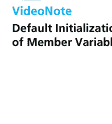

```cpp
Coordinate::Coordinate() : Coordinate(99,99)
{ }
```

由 `Coordinate c1;` 定义的对象将调用默认构造函数，而默认构造函数又会调用该构造函数，将 `x` 设置为 99，`y` 设置为 99。

## 自测练习

22. 假设你的程序包含以下类定义（以及成员函数的定义）：

```cpp
class YourClass
{
public:
    YourClass(int newInfo, char moreNewInfo);
    YourClass();
    void doStuff();
private:
    int information;
    char moreInformation;
};
```

下列哪些是合法的？

```cpp
YourClass anObject(42, 'A');
YourClass anotherObject;
YourClass yetAnotherObject();
anObject = YourClass(99, 'B');
anObject = YourClass();
anObject = YourClass;
```

23. 你如何修改程序清单 10.4 中 `DayOfYear` 类的定义，使其具有两个版本的（重载）构造函数？一个版本应有两个 `int` 形参（一个表示月份，一个表示日期），并设置私有成员变量来表示该月和日。另一个版本应没有形参，并将所表示的日期设置为 1 月 1 日。在两个构造函数中都不要使用构造函数初始化列表。

24. 重做上一题，但这次使用构造函数初始化列表来初始化每个构造函数中的所有成员变量。

## 10.3 抽象数据类型

> 我们都知道——《泰晤士报》也知道——但我们假装不知道。

弗吉尼亚·伍尔夫，《星期一或星期二》

数据类型（例如 `int` 类型）具有特定的值，如 0、1、-1、2 等等。你往往会将数据类型视为这些值，但对这些值的操作与这些值本身同样重要。没有这些操作，你就无法对这些值进行任何有意义的操作。`int` 类型的操作包括 `+`、`-`、`*`、`/`、`%`，以及一些其他运算符和预定义的库函数。你不应该将数据类型简单地看成一组值的集合。数据类型由一组值以及定义在这些值上的一组基本操作组成。

如果使用某种数据类型的程序员无法访问有关值和操作如何实现的细节，那么这种数据类型就被称为**抽象数据类型**（缩写为 ADT）。预定义类型（如 `int`）就是抽象数据类型（ADT）。你并不知道像 `+` 和 `*` 这样的操作是如何为 `int` 类型实现的。即使你真的知道，你也不会在任何 C++ 程序中使用这一信息。

程序员定义的类型（例如结构类型和类类型）并不自动是 ADT。除非经过仔细定义和使用，否则程序员定义的类型可能会以不直观的方式被使用，从而使程序难以理解和修改。避免这些问题的最佳方法是确保你定义的所有数据类型都是 ADT。在 C++ 中做到这一点的方法是使用类，但并不是每个类都是 ADT。要使其成为 ADT，你必须以某种方式定义该类，而这就是下一小节的主题。

### 生成抽象数据类型的类

类是你自己定义的类型，不同于已经为你定义好的类型（如 `int` 和 `char`）。类类型的值就是成员变量值的集合。例如，程序清单 10.6 中 `BankAccount` 类型的值由两个 `double` 类型的数字组成。为了方便参考，我们重复该类的定义（仅省略注释）：

```cpp
class BankAccount
{
public:
    BankAccount(int dollars, int cents, double rate);
    BankAccount(int dollars, double rate);
    BankAccount();
    void set(int dollars, int cents, double rate);
    void set(int dollars, double rate);
    void update();
    double getBalance();
    double getRate();
    void output(ostream& outs);
private:
    double balance;
    double interestRate;
    double fraction(double percent);
};
```

```cpp
class BankAccount
{
public:
    <This part is exactly the same as before>
private:
    int dollarsPart;
    int centsPart;
    double interestRate;
    double fraction(double percent);
};
```

我们需要修改成员函数定义以匹配这一改动，但这很容易做到。例如，`getBalance` 的函数定义以及某个构造函数版本的函数定义可以修改为下面这样：

```cpp
double BankAccount::getBalance()
{
    return (dollarsPart + 0.01 * centsPart);
}
BankAccount::BankAccount(int dollars, int cents, double rate)
{
    if ((dollars < 0) || (cents < 0) || (rate < 0))
    {
        cout << "Illegal values for money or interest rate.\n";
        exit(1);
    }
    dollarsPart = dollars;
    centsPart = cents;
    interestRate = rate;
}
```

类似地，其他每个成员函数也可以重新定义，以适应这种存储账户余额和利率的新方式。

请注意，尽管用户可能会认为账户余额是一个单独的数字，但这并不意味着实现必须是 `double` 类型的单个数字。你刚刚已经看到，例如它可以是两个 `int` 类型的数字。使用 `BankAccount` 类型的程序员无需知道关于 `BankAccount` 类型的值是如何实现的任何细节。

这些关于 `BankAccount` 类型的说明阐明了定义类使其成为抽象数据类型的基本技术。为了将类定义为抽象数据类型，你需要将程序员使用该类型的规范与该类型如何实现的细节分离开来。这种分离应该足够彻底，以便你能够更改类的实现，而无需对任何将该类用作 ADT 的程序进行任何修改。确保这种分离的一种方法是遵循以下规则：


+   1. 将类的所有成员变量设为类的私有成员。
+   
+   2. 将程序员需要的每个基本操作设为类的公有成员函数，并完整地说明每个此类公有成员函数的使用方法。
+   
+   3. 将任何辅助函数设为私有成员函数。

在第 11 章和第 12 章中你将学习定义抽象数据类型 ADT 的一些替代方法，但这三条规则是确保一个类是抽象数据类型的常见方法之一。

ADT 的接口告诉你如何在程序中使用 ADT。当你将 ADT 定义为 C++ 类时，接口由类的公有成员函数以及说明如何使用这些公有成员函数的注释组成。ADT 的接口应该是你在程序中使用 ADT 所需要知道的全部内容。

ADT 的**实现**说明该接口如何实现为 C++ 代码。ADT 的实现由类的私有成员以及公有和私有成员函数的定义组成。虽然你需要实现来运行使用 ADT 的程序，但为了编写使用 ADT 的程序的其余部分，你不需要知道任何关于实现的细节；也就是说，为了编写程序的主体部分以及程序主体部分使用的任何非成员函数，你不需要知道任何关于实现的细节。情况与我们在第 4 章和第 5 章中对普通函数定义所倡导的情况类似。ADT 的实现，就像普通函数的实现一样，应该被视为一个你无法看到内部的黑盒子。

在第 12 章中你将学习如何将 ADT 的接口和实现放在与彼此以及使用 ADT 的程序分开的文件中。这样，使用 ADT 的程序员实际上看不到实现。在此之前，我们将把我们 ADT 类的所有细节放在与程序主体部分相同的<|message|> 中，但我们仍然认为接口（在类定义的公有部分给出）和实现（类定义的私有部分和成员函数定义）是 ADT 的两个独立部分。我们将努力编写我们的 ADT，使得 ADT 的使用者只需要知道 ADT 的接口，而不需要知道任何关于实现的细节。为了确保你以这种方式定义你的 ADT，只需确保如果你更改了 ADT 的实现，你的程序仍可在无需更改程序任何其他部分的情况下正常工作。这在下一个编程示例中进行了说明。

使你的类成为 ADT 的最明显的好处是你可以在无需更改程序其他部分的情况下更改实现。但 ADT 提供的益处不止于此。如果你使你的类成为 ADT，你就可以在不同程序员之间分配工作，


一个程序员设计并编写 ADT，而其他程序员使用 ADT。即使你是项目中唯一的程序员，你也将一个较大的任务划分为两个较小的任务，这使得你的程序更容易设计，也更容易调试。

## PROGRAMMING EXAMPLE

## Alternative Implementation of a Class

Display 10.7 包含上一小节中讨论的 ADT 类 BankAccount 的替代实现。在这个版本中，银行账户的数据被实现为三个成员值：一个用于账户余额的美元部分，一个用于账户余额的分部分，以及一个用于利率。

请注意，虽然 Display 10.6 中的实现和 Display 10.7 中的实现都具有名为 interestRate 的成员变量，但在两个实现中存储的值略有不同。如果账户按 4.7% 的利率支付利息，则在 Display 10.6 中的实现中（基本上与 Display 10.5 中的实现相同），interestRate 的值为 4.7。然而，在 Display 10.7 中的实现中，interestRate 的值将为 0.047。这个在 Display 10.7 中显示的替代实现将利率存储为分数而不是百分比数字。这个新实现中的基本区别是，当设置利率时，函数 fraction 被用来立即将利率转换为分数。因此，在这个新实现中，私有成员函数 fraction 在构造函数的定义中使用，但在成员函数 update 的定义中不需要，因为成员变量 interestRate 中的值已经转换为分数。在旧实现中（显示在 Display 10.5 和 Display 10.6 中），情况正好相反。在旧实现中，私有成员函数 fraction 未在构造函数的定义中使用，但在 update 的定义中使用。

尽管我们更改了类 BankAccount 的私有成员，但我们没有更改类定义的公有部分。公有成员函数具有相同的函数声明，并且它们的行为与 Display 10.6 中给出的旧 ADT 类版本中的行为完全相同。例如，尽管这个新实现将 4.7% 这样的百分比存储为分数 0.047，但成员函数 getRate 仍然返回值 4.7，就像它对 Display 10.5 中的旧实现一样。同样，成员函数 getBalance 返回类型为 double 的单个值，该值以带小数点的数字给出余额，就像它在 Display 10.5 中的旧实现中一样。这即使在余额现在存储在两个类型为 int 的成员变量中，而不是存储在单个类型为 double 的成员变量中（像旧版本那样）时也是如此。

公有接口未被更改

### DISPLAY 10.7 Alternative BankAccount Class Implementation (part 1 of 4)

```
1  //Demonstrates an alternative implementation of the class BankAccount.
2  #include <iostream>
3  #include <cmath>
4  using namespace std;
5  //Class for a bank account:
6  class BankAccount
7  {
8  public:
9    BankAccount(int dollars, int cents, double rate);
10   //Initializes the account balance to $dollars.cents and
11   //initializes the interest rate to rate percent.
12
13   BankAccount(int dollars, double rate);
14   //Initializes the account balance to $dollars.00 and
15   //initializes the interest rate to rate percent.
16
17   BankAccount();
18   //Initializes the account balance to $0.00 and the
19   //interest rate to 0.0%.
20
21   void set(int dollars, int cents, double rate);
22   //Postcondition: The account balance has been set to $dollars.cents;
23   //The interest rate has been set to rate percent.
24
25   void set(int dollars, double rate);
26   //Postcondition: The account balance has been set to $dollars.00.
27   //The interest rate has been set to rate percent.
28
29   void update();
30   //Postcondition: One year of simple interest has been
31   //added to the account balance.
32
33   double getBalance();
34   //Returns the current account balance.
35
36   double getRate();
37   //Returns the current account interest rate as a percentage.
38
39   void output(ostream& outs);
40   //Precondition: If outs is a file output stream, then
41   //outs has already been connected to a file.
42   //Postcondition: Account balance and interest rate
43   //have been written to the stream outs.
44
45   private:
46     int dollarsPart;
47     int centsPart;
48     double interestRate;
49     //Expressed as a fraction, for example, 0.057 for 5.7%
```

> Notice that the public members of BankAccount look and behave exactly the same as in Display 10.6

### DISPLAY 10.7 Alternative BankAccount Class Implementation (part 2 of 4)

```
41   double fraction(double percent);
42   //Converts a percentage to a fraction. For example, fraction(50.3)
43   //returns 0.503.
44   double percent(double fractionValue);
45   //Converts a fraction to a percentage. For example, percent(0.503)
46   //returns 50.3.
47   };
48   int main()
49   {
50     BankAccount account1(100, 2.3), account2;
51   
52     cout << "account1 initialized as follows:\n";
53     account1.output(cout);
54     cout << "account2 initialized as follows:\n";
55     account2.output(cout);
56   
57     account1 = BankAccount(999, 99, 5.5);
58     cout << "account1 reset to the following:\n";
59     account1.output(cout);
60     return 0;
61   }
62   BankAccount::BankAccount(int dollars, int cents, double rate)
63   {
64     if ((dollars < 0) || (cents < 0) || (rate < 0))
65     {
66       cout << "Illegal values for money or interest rate.\n";
67       exit(1);
68     }
69     dollarsPart = dollars;
70     centsPart = cents;
71     interestRate = fraction(rate);
72   }
73   BankAccount::BankAccount(int dollars, double rate)
74   {
75     if ((dollars < 0) || (rate < 0))
76     {
77       cout << "Illegal values for money or interest rate.\n";
78       exit(1);
79     }
80     dollarsPart = dollars;
81     centsPart = 0;
82     interestRate = fraction(rate);
83   }
84   BankAccount::BankAccount() : dollarsPart(0), centsPart(0), interestRate(0.0)
```

New

Since the body of main is identical to that in Display 10.6, the screen output is also identical to that in Display 10.6

In the old implementation of this ADT, the private member function fraction was used in the definition of update. In this implementation, fraction is instead used in the definition of constructors and in the set function.


# 展示 10.7 替代的 BankAccount 类实现 *(第 3 部分，共 4 部分)*

```cpp
{
    //函数体故意为空。
}
double BankAccount::fraction(double percentValue)
{
    return (percentValue/100.0);
}
//使用 cmath：
void BankAccount::update( )
{
    double balance = getBalance( );
    balance = balance + interestRate * balance;
    dollarsPart = static_cast<int>(floor(balance));
    centsPart = static_cast<int>(floor((balance - dollarsPart)*100));
}
double BankAccount::getBalance( )
{
    return (dollarsPart + 0.01 * centsPart);
}
double BankAccount::percent(double fractionValue)
{
    return (fractionValue * 100);
}
double BankAccount::getRate( )
{
    return percent(interestRate);
}
//使用 iostream：
void BankAccount::output(ostream& outs)
{
    outs.setf(ios::fixed);
    outs.setf(ios::showpoint);
    outs.precision(2);
    outs << "账户余额 $" << getBalance( ) << endl;
    outs << "利率 " << getRate( ) << "%" << endl;
}
void BankAccount::set(int dollars, int cents, double rate)
{
    if ((dollars < 0) || (cents < 0) || (rate < 0))
    {
        cout << "货币金额或利率的值非法。\n";
        return;
    }
}
```

> `getBalance` 和 `getRate` 的新定义确保输出仍然采用正确的单位。

(续)

# 展示 10.7 替代的 BankAccount 类实现 (第 4 部分，共 4 部分)

```
129    dollarsPart = dollars;
130    centsPart = cents;
131    interestRate = fraction(rate);
132 }

133 void BankAccount::set(int dollars, double rate)
134 {
135     if ((dollars < 0) || (rate < 0))
136     {
137         cout << "货币金额或利率的值非法。\n";
138         return;
139     }
140     dollarsPart = dollars;
141     interestRate = fraction(rate);
142 }
```

请注意，对待公有成员函数和私有成员函数的方式存在重要区别。如果你想保留一个 ADT 类的接口，使得使用它的任何程序无需修改（除了改变类及其成员函数的定义之外），那么你必须保持公有成员函数的声明不变。然而，你可以自由地添加、删除或修改任何私有成员函数。在这个示例中，我们添加了一个额外的私有函数 `percent`，它是函数 `fraction` 的逆函数。函数 `fraction` 将百分比转换为分数，而函数 `percent` 将分数转换回百分比。例如，`fraction(4.7)` 返回 0.047，而 `percent(0.047)` 返回 4.7。

更改私有成员函数

## 信息隐藏

我们在第 3 章介绍函数时讨论过信息隐藏。我们说过，信息隐藏应用于函数时，意味着你应该将函数编写成可用作黑盒的形式，也就是说，使用该函数的程序员无需知道函数是如何实现的任何细节。这个原则意味着，使用函数的程序员只需要知道函数声明以及解释如何使用函数的附带注释即可。在抽象数据类型的定义中，使用私有成员变量和私有成员函数是实现信息隐藏的另一种方式，但现在我们将这一原则同时应用于数据值和函数。

## 自测练习

25. 当你将 ADT 定义为 C++ 类时，应该将成员变量设为公有还是私有？应该将成员函数设为公有还是私有？

26. 当你将 ADT 定义为 C++ 类时，哪些项目被视为 ADT 的接口？哪些项目被视为 ADT 的实现？

27. 假设你的朋友按照我们在第 10.3 节中描述的方式将 ADT 定义为 C++ 类。你得到的任务是编写一个使用此 ADT 的程序。也就是说，你必须编写程序的主部分以及主部分中使用的任何非成员函数。这个 ADT 很长，而你没有太多时间编写这个程序。你需要阅读 ADT 的哪些部分，哪些部分可以安全地忽略？

28. 重做展示 10.7 中的三参数和两参数构造函数，使所有成员变量都通过构造函数初始化节来设置。

# 10.4 继承简介

C++ 最强大的特性之一就是派生类的使用。单词 *inheritance*（继承）只是派生类这一主题的另一个名称。当我们说一个类派生自另一个类时，我们的意思是派生类是通过向另一个类添加特性而获得的。例如，假设我们定义了一个车辆类，其中有记录车辆车轮数量和最大乘客数量的成员变量。该类还有访问器和修改器函数。再想象我们然后定义一个汽车类，它拥有与车辆类中完全相同的成员变量和函数。此外，我们的汽车类还会添加一些成员变量，例如油箱中的燃油量和车牌号，并且还会添加一些成员函数。我们可以使用 C++ 的继承机制，让汽车类继承车辆类的所有成员变量和函数，而无需在汽车类中重复定义这些成员变量和函数。

继承允许你定义一个通用类，然后再定义更专门的类，为现有通用类添加一些新细节。这样可以节省工作量，因为更专门的类（即派生类）继承了通用类的所有属性，而你（程序员）只需编写新特性即可。本节将首先介绍继承和派生类的概念，然后简要描述如何创建你自己的派生类。继承的细节留到第 15 章讨论。你可能需要一段时间才能完全适应派生类的概念，但你可以很容易地学到足够多的派生类知识，以一些简单且非常有用的方式开始使用它们。

## 派生类

考虑展示 10.7 中定义的 `BankAccount` 类。这个类记录银行账户的金额和利率——这些是适用于任何带息账户的相当通用的特性。如果我们想实现更具体类型的银行账户，那么存在一种自然的层次结构来对账户类型进行分组。展示 10.8 描绘了银行账户、支票账户、货币市场账户、储蓄账户和存单账户这一层次结构的一部分。在层次结构中，`BankAccount` 是最通用的账户类型；更具体的账户类型显示在下方。箭头从特定账户类型指向更通用的账户类型。除了表示不同类型的银行账户外，每个方框还对应一个可以在 C++ 中实现的类。

例如，支票账户能完成银行账户能做的所有事情（存储金额和利率），但此外还允许客户存款和开支票。类似地，储蓄账户能完成银行账户能做的所有事情，但此外还允许客户存款和取款。与支票账户不同，储蓄账户可能不允许客户开支票。由于支票账户和储蓄账户都是银行账户的类型，因此它们在展示 10.8 中直接显示在 `BankAccount` 类下方。当我们说某个类 A 是另一个类 B 的**派生类**时，这意味着类 A 拥有类 B 的所有特性，但它还具有*添加的特性*。在图中表示这种关系的约定是绘制一个从特定类指向更通用类的空心箭头。例如，在展示 10.8 中，`CheckingAccount` 和 `SavingsAccount` 类是 `BankAccount` 类的派生类。

# 展示 10.8 类层次结构

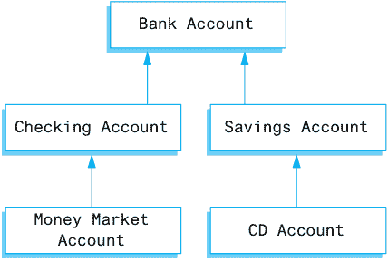


请注意，我们只定义了与储蓄账户直接相关的函数和数据，在本例中，是存入和取出资金的函数。我们不需要重新定义与银行账户相关的所有变量和函数——例如存储利率、美元、分，或定义 update( ) 函数——因为这些成员将从 BankAccount 类继承，并在我们构造 SavingsAccount 对象时自动创建。例如，如果我们创建一个 SavingsAccount 对象，我们可以调用以下函数：

```
SavingsAccount account(100, 50, 5.5);
account.deposit(10,25);
account.output(cout);
```

在派生类中调用函数，

在父类 BankAccount 中调用函数

在本例中，继承使我们能够在派生类的上下文中重用父类中定义的代码。此外，如果我们以后更改 BankAccount 的某个函数——例如 update( )——那么在程序重新编译和链接后，新的代码将自动从其派生类的上下文中使用。Display 10.9 给出了 SavingsAccount 类的实现以及一个用于测试 deposit 和 withdraw 函数的 main 函数。为了简单起见，我们在 deposit 和 withdraw 函数中省略了验证，例如检查负数金额，但你应该能够很容易地使用一些 if 语句添加它们。

一旦 SavingsAccount 类被定义，我们可以更进一步，从 SavingsAccount 派生出更专业的类。例如，要定义 CD 账户类，我们需要一个新的私有成员变量来存储到期天数，并定义函数来访问该变量：

```
class CDAccount : public SavingsAccount
{
public:
    CDAccount(int dollars, int cents, double rate,
              int daysToMaturity);
    <Other constructors would normally go here>
    int getDaysToMaturity();
    //Returns the number of days until the CD matures
    void decrementDaysToMaturity();
    //Subtracts one from the daysToMaturity variable
private:
    int daysToMaturity; //Days until the CD matures
};
```

同样，我们只定义了与 CD 账户直接相关的函数和数据，在本例中，是存储和操作到期天数的功能。我们不需要重新定义与银行账户或储蓄账户相关的所有变量和函数，因为这些成员将从父类继承。例如，一旦 CDAccount 类中的函数实现完成，给定一个 CDAccount 对象，我们就可以从 CDAccount、SavingsAccount 或 BankAccount 类调用以下函数：

## DISPLAY 10.9 A SavingsAccount Derived Class (part 1 of 2)

<Everything from Display 10.6 should be inserted here except for the main function.>

```
1  class SavingsAccount : public BankAccount
2  {
3  public:
4      SavingsAccount(int dollars, int cents, double rate);
5      //Other constructors would go here
6      void deposit(int dollars, int cents);
7      //Adds $dollars.cents to the account balance
8      void withdraw(int dollars, int cents);
9      //Subtracts $dollars.cents from the account balance
10 private:
11 };
12 int main()
13 {
14     SavingsAccount account(100, 50, 5.5);
15     account.output(cout);
16     cout << endl;
17     cout << "Depositing $10.25." << endl;
18     account.deposit(10,25);
19     account.output(cout);
20     cout << endl;
21     cout << "Withdrawing $11.80." << endl;
22     account.withdraw(11,80);
23     account.output(cout);
24     cout << endl;
25     return 0;
26 }
27 SavingsAccount::SavingsAccount(int dollars, int cents, double rate):
28     BankAccount(dollars, cents, rate)
29 {
30     //deliberately empty
31 }
32 void SavingsAccount::deposit(int dollars, int cents)
33 {
34     double balance = getBalance();
35     balance += dollars;
36     balance += (static_cast<double>(cents) / 100);
37     int newDollars = static_cast<int>(balance);
38     int newCents = static_cast<int>((balance - newDollars) * 100);
```

冒号表示类 SavingsAccount 是从类 BankAccount 派生而来

只需要定义新的成员函数或变量

SavingsAccount 构造函数调用 BankAccount 构造函数。注意前面的冒号。

deposit 函数将新金额添加到余额中，并通过 set 函数更改成员变量

## DISPLAY 10.9 A SavingsAccount Derived Class (part 2 of 2)

```
39     set(newDollars, newCents, getRate());
40   }
41   void SavingsAccount::withdraw(int dollars, int cents)
42   {
43     double balance = getBalance();
44     balance -= dollars;
45     balance -= (static_cast<double>(cents) / 100);
46     int newDollars = static_cast<int>(balance);
47     int newCents = static_cast<int>((balance - newDollars) * 100);
48     set(newDollars, newCents, getRate());
49   }
```

withdraw 函数从余额中减去金额，并通过 set 函数更改成员变量

# Screen Output

```
Account balance $100.50
Interest rate 5.50%
Depositing $10.25.
Account balance $110.75
Interest rate 5.50%
Withdrawing $11.80.
Account balance $98.95
Interest rate 5.50%
```

```
//Create a new CD with $1000, 6% interest, 180 days to maturity
CDAccount newCD(1000, 0, 6.0, 180);
newCD.deposit(100,50);
daysToMaturity = newCD.getDaysToMaturity();
//Returns 180
balance = newCD.getBalance();
//Returns 1100.50
```

在 SavingsAccount 中调用函数

在 CDAccount 中调用函数

在 BankAccount 中调用函数

这个简短的例子仅触及了使用继承所能实现的功能的表面。更多细节在第 15 章中描述。虽然学习如何有效地使用继承设计类需要一定的努力，但从长远来看，这种努力会得到回报。你将编写更少的代码，这些代码比不使用继承的代码更容易理解和维护。

## SELF-TEST EXERCISES

29. 继承如何支持代码重用并使代码更易于维护？

30. 派生类能否直接按名称访问父类的私有成员变量？

31. 假设类 SportsCar 是类 Automobile 的派生类。假设类 Automobile 具有名为 accelerate 和 addGas 的公共成员函数。类 SportsCar 的对象是否会有名为 accelerate 和 addGas 的成员函数？

## CHAPTER SUMMARY

+   - 结构可用于将不同类型的数据组合成一个单一的复合数据值。
+   - 类可用于将数据和函数组合成一个单一的复合对象。
+   - 类的成员变量或成员函数可以是 public 或 private。如果它是 public，则可以在类外使用。如果它是 private，则只能在类的另一个成员函数定义中使用。
+   - 函数可以具有类或结构类型的形式参数。函数可以返回类或结构类型的值。
+   - 类的成员函数可以像普通函数一样被重载。
+   - 构造函数是类的成员函数，在声明该类的对象时自动调用。构造函数必须与它所属的类同名。
+   - 数据类型由一组值以及定义在此类值上的基本操作集合组成。
+   - 如果使用该类型的程序员不需要知道该类型的值和操作的实现细节，则该数据类型称为抽象数据类型，缩写为 ADT。
+   - 在 C++ 中实现抽象数据类型的一种方法是定义一个类，所有成员变量均为 private，并且操作作为 public 成员函数实现。
+   - 继承是指类之间的父/子关系。子或派生类继承父类的成员。

## Answers to Self-Test Exercises

+   1. a. double
+      b. double
+      c. illegal–cannot use struct tag instead of a structure variable
+      d. illegal–savingsAccount undeclared
+      e. char
+      f. TermAccount

+   2. A $9.99
+      A $1.11

3. 许多编译器会给出不好的错误信息。令人惊讶的是，g++ 的错误信息相当有信息量。

```
g++ -fsyntax-only c10testq3.cpp
c10testq3.cc:8: semicolon missing after declaration of
'Stuff'
c10testq3.cc:8: extraneous 'int' ignored
c10testq3.cc:8: semicolon missing after declaration of
'struct Stuff'
```

4. A x = {1,2};

+   5. a. 初始化器太少，不是语法错误。初始化后，dueDate.month == 12，dueDate.day == 21，dueDate.year == 0。未提供初始值的成员变量将被初始化为适当类型的零。
+      b. 初始化后正确：12 == dueDate.month，21 == dueDate.day，2022 == dueDate.year。
+      c. 错误：初始化器太多。
+      d. 可能是一个设计错误，即意图上的错误。代码的作者仅为日期初始化器提供了两位数字。应使用四位数字表示年份，因为使用两位数字日期的程序在世纪之交时可能会以从有趣到灾难性的各种方式失败。

```
6. struct EmployeeRecord
{
    double wageRate;
    int vacation;
    char status;
};
```

```
7. void readShoeRecord(ShoeType& newShoe)
{
```


```cpp
cout << "Enter shoe style (one letter): ";
cin >> newShoe.style;
cout << "Enter shoe price $";
cin >> newShoe.price;
}
```

8.
```cpp
ShoeType discount(ShoeType oldRecord)
{
    ShoeType temp;
    temp.style = oldRecord.style;
    temp.price = 0.90 * oldRecord.price;
    return temp;
}
```

9.
```cpp
struct StockRecord
{
    ShoeType shoeInfo;
    Date arrivalDate;
};
```

10.
```cpp
StockRecord aRecord;
aRecord.arrivalDate.year = 2006;
```

11.
```cpp
void DayOfYear::input()
{
    cout << "Enter month as a number: ";
    cin >> month;
    cout << "Enter the day of the month: ";
    cin >> day;
}
```

12.
```cpp
void Temperature::set(double newDegrees, char newScale)
{
    degrees = newDegrees;
    scale = newScale;
}
```

13. 既点运算符又作用域解析运算符都与成员名一起使用，以指定成员名所属的类或结构体。如果类 DayOfYear 如 Display 10.3 中定义，且 today 是 DayOfYear 类的对象，则成员 month 可通过点运算符访问：today.month。当我们给出成员函数的定义时，作用域解析运算符用于告诉编译器此函数是类名之前给出的类中声明的函数。

14.
```cpp
void DayOfYear::checkDate()
{
    if ((month < 1) || (month > 12)
        || (day < 1) || (day > 31))
    {
        cout << "Illegal date. Aborting program.\n";
        exit(1);
    }
    if (((month == 4) || (month == 6) || (month == 9)
            || (month == 11))
        && (day == 31))
    {
        cout << "Illegal date. Aborting program.\n";
        exit(1);
    }
    if ((month == 2) && (day > 29))
    {
        cout << "Illegal date. Aborting program.\n";
        exit(1);
    }
}
```

15.
```cpp
hyundai.price = 4999.99; //ILLEGAL. price is private.

jaguar.setPrice(30000.97); //LEGAL
double aPrice, aProfit; //LEGAL
aPrice = jaguar.getPrice(); //LEGAL
aProfit = jaguar.getProfit(); //ILLEGAL. getProfit is private.
aProfit = hyundai.getProfit(); //ILLEGAL. getProfit is private.
if (hyundai == jaguar) //ILLEGAL. Cannot use == with classes.
    cout << "Want to swap cars?";
hyundai = jaguar; //LEGAL
```

16. 修改后，它们都将合法，除了以下仍然非法的：

```cpp
if (hyundai == jaguar) //ILLEGAL. Cannot use == with classes.
    cout << "Want to swap cars?";
```

17. private 将对私有成员变量的访问限制为同一类的成员函数。这将任何对私有变量的更改限制为类作者提供的函数。类作者因此可以控制对私有数据的这些更改，防止对类数据的不慎破坏。

18.
   a. 只有一个。编译器会警告你在类中没有 public: 成员（或结构体亦然）。
   b. 没有；我们通常期望在类中至少找到一个 private: 部分。
   c. 在类中，此类部分默认是 private: 部分。
   d. 在结构体中，此类部分默认是 public: 部分。

19. 一个可能的正确答案如下：

```cpp
double difference(BankAccount account1, BankAccount account2)
{
    return (account1.getBalance() - account2.getBalance());
}
```

请注意，以下是不正确的，因为 balance 是私有成员。

```cpp
double difference(BankAccount account1, BankAccount account2)
{
    return (account1.balance - account2.balance); // ILLEGAL
}
```

20.
```cpp
void update(BankAccount& theAccount)
{
    theAccount.update();
    theAccount.update();
}
```

请注意，由于这不是成员函数，你在调用 update 时必须给出对象名和点运算符。

21.
```cpp
BankAccount newAccount(BankAccount oldAccount)
{
    BankAccount temp;
    temp.set(0, oldAccount.getRate());
    return temp;
}
```

22.
```cpp
YourClass anObject(42, 'A'); // LEGAL
YourClass anotherObject; // LEGAL
YourClass yetAnotherObject(); // PROBLEM
anObject = YourClass(99, 'B'); // LEGAL
anObject = YourClass(); // LEGAL
anObject = YourClass; // ILLEGAL
```

标记为 `// PROBLEM` 的语句严格来说并非非法，但它并不意味着你可能认为的含义。如果你希望这是一个名为 yetAnotherObject 的对象声明，那么它是错误的。它是对一个名为 yetAnotherObject 的函数进行的正确函数声明，该函数不带参数并返回 YourClass 类型的值，但这不是预期的含义。从实际角度来看，你可以认为它是非法的。声明一个名为 yetAnotherObject 的对象使其使用默认构造函数初始化的正确方法是如下：

```cpp
YourClass yetAnotherObject;
```

23. 修改后的类定义如下：

```cpp
class DayOfYear
{
public:
    DayOfYear(int theMonth, int theDay);
    //Precondition: theMonth and theDay form a
    //possible date. Initializes the date according to
    //the arguments.
    DayOfYear();
    //Initializes the date to January first.
    void input();
    void output();
    int getMonth();
    //Returns the month, 1 for January, 2 for February, etc.
    int getDay();
    //Returns the day of the month.
private:
    void checkDate();
    int month;
    int day;
};
```

请注意，我们省略了成员函数 set，因为构造函数使 set 不再必要。你还必须添加以下函数定义（并删除 DayOfYear::set 的函数定义）：

```cpp
DayOfYear::DayOfYear(int theMonth, int theDay)
{
    month = theMonth;
    day = theDay;
    checkDate();
}
DayOfYear::DayOfYear()
{
    month = 1;
    day = 1;
}
```

24. 类定义与上一练习相同。构造函数定义将更改为如下：

```cpp
DayOfYear::DayOfYear(int theMonth, int theDay)
    : month(theMonth), day(theDay)
{
    checkDate();
}
DayOfYear::DayOfYear() : month(1), day(1)
{
    //Body intentionally empty.
}
```

25. 所有成员变量都应为私有。属于 ADT 接口的成员函数（即 ADT 的操作成员函数）应为公开。你还可能有仅在其他成员函数定义中使用辅助帮助函数。这些辅助函数应为私有。

26. 所有私有成员变量的声明都是实现的一部分。（不应有公开成员变量。）类的所有公开成员函数的函数声明（在类定义中列出）以及这些函数声明的解释性注释是接口的一部分。所有私有成员函数的函数声明都是实现的一部分。所有成员函数定义（无论函数是公开还是私有）都是实现的一部分。

27. 你只需要阅读接口部分。也就是说，你只需要阅读类公开成员的函数声明（在类定义中列出）以及这些函数声明的解释性注释。你无需阅读任何私有成员函数的函数声明、私有成员变量的声明、公开成员函数的定义或私有成员函数的定义。

28.
```cpp
BankAccount::BankAccount(int dollars, int cents, double rate) : dollarsPart(dollars), centsPart(cents), interestRate(fraction(rate))
{
    if ((dollars < 0) || (cents < 0) || (rate < 0))
    {
        cout << "Illegal values for money or interest rate.\n";
        exit(1);
    }
}
BankAccount::BankAccount(int dollars, double rate)
    : dollarsPart(dollars), centsPart(0), interestRate(fraction(rate))
{
    if ((dollars < 0) || (rate < 0))
    {
        cout << "Illegal values for money or interest rate.\n";
        exit(1);
    }
}
```

29. 为父类定义的功能和数据可以提供给派生类，从而消除在派生类中重新定义功能和数据的需要。这增强了可维护性，因为现在多个类之间没有代码重复，因此代码中只有一个可能需要更改的位置。此外，继承提供了一种干净的方式来隔离仅适用于派生类的代码。由于此类代码仅出现在派生类的定义中，因此通常更容易阅读。

30. 不可以，但派生类可以通过公共函数间接访问父类的私有成员变量。

31. 是的，派生类将有权访问相同的函数。在第 15 章我们将讨论如何使函数对 SportsCar 类的对象与 Automobile 类的对象做不同的事情。

## PRACTICE PROGRAMS

*Practice Programs can generally be solved with a short program that directly applies the programming principles presented in this chapter.*

1. 重新定义 Display 10.1 中的 CDAccount，使其成为类而不是结构体。使用 Display 10.1 中的相同成员变量但使其私有。包含以下成员函数：一个返回初始余额，一个返回到期余额，一个返回利率，一个返回期限。包含一个构造函数，可将所有成员变量设置为任何指定值，以及一个默认构造函数。将你的类定义嵌入到测试程序中。

2. 重新定义练习 1 中的 CDAccount 类，使其具有相同的接口但不同的实现。新实现在许多方面类似于 Display 10.7 中给出的 BankAccount 类的第二个实现。你的 CDAccount 类的新实现将记录余额为两个 int 类型的值：一个为美元，一个为美分。利率成员变量将以分数形式存储利率而不是百分比。例如，4.3% 的利率将以 double 类型的值 0.043 存储。期限以 Display 10.1 中的方式存储。

3. 剧院出售演出座位票，需要一个系统来跟踪已售出票的座位。定义一个名为 ShowTicket 的类型的类。


类应包含行、座位号以及票是否已售出的字段。定义一个构造函数，其接受行和座位号作为参数，并在构造函数初始化部分将售出状态设为 false。包含成员函数来检查票是否已售出；将票状态更新为已售出；以及打印行、座位号和售出状态。将你的类定义嵌入到一个测试程序中，该程序创建一些 ShowTicket 对象，将一些票设为已售出，并打印出每一张票。

## 编程项目

编程项目比练习程序需要更多的解决问题能力，并且通常可以用多种不同的方式解决。访问 www.myprogramminglab.com 在线完成这些编程项目中的许多项目并获得即时反馈。

- 1. 编写一个班级的评分程序，其评分政策如下：
  - a. 有两场测验，每场满分 10 分。
  - b. 有一场期中考试和一场期末考试，每场满分 100 分。
  - c. 期末考试占成绩的 50%，期中考试占 25%，两场测验合计占 25%。 （不要忘记对测验分数进行归一化。它们应在平均之前转换为百分比。）

90 分或以上的成绩为 A，80 分或以上（但低于 90）为 B，70 分或以上（但低于 80）为 C，60 分或以上（但低于 70）为 D，低于 60 分为 F。

程序将读取学生的成绩并输出学生的记录，其中包括两场测验和两场考试的成绩以及学生在整个课程中的平均数值成绩和最终字母等级。定义并使用学生记录的结构。如果这是课堂作业，请询问你的指导教师输入/输出应使用键盘和屏幕还是应使用文件。如果使用文件，请向你的指导教师询问有关文件名的说明。

- 2. 重新做编程项目 1（或第一次做），但这次将学生记录类型做成类类型而不是结构类型。学生记录类应具有所有在编程项目 1 中描述的输入数据的成员变量，以及一个用于学生整个课程加权平均数值成绩的成员变量和一个用于学生最终字母等级的成员变量。使所有成员变量私有。包含以下每个的成员函数：成员函数将每个成员变量设置为作为函数参数给出的值，

成员函数从每个成员变量中检索数据，一个 void 函数计算学生的整个课程加权平均数值成绩并设置相应的成员变量，以及一个 void 函数计算学生的最终字母等级并设置相应的成员变量。

3. 定义一个名为 BookInfo 的类，它是存储书籍信息的抽象数据类型。你的类应有两个 String 类型的字段，第一个存储作者姓名，第二个存储书名。包含以下成员函数：一个构造函数设置书名和作者，一个第二个构造函数将书名设置为传入的参数并将作者设为“unknown”，以及一个方法将作者和标题连接成一个单一的 C++ String。编写一个驱动程序来测试你的类，通过创建几个书对象并使用你的成员函数打印它们。

4. 定义一个名为 UpdatedBook 的类，它继承在编程项目 3 中创建的 BookInfo 类。这个新类应包含一个整数字段用于书籍的版次号，一个构造函数用于创建 UpdatedBook 对象，接受书籍的作者、标题和版次号作为输入，以及一个 getter 方法返回版次号。

5. （为了完成此项目，你必须先完成编程项目 3 或项目 4。）定义一个名为 BookLibrary 的类。此类应包含一个存储 BookInfo 对象向量的字段。你的 BookLibrary 类应具有以下方法：默认构造函数；一个用于添加已存在的 BookInfo 对象向量的构造函数；一个用于将书添加到图书馆的方法；一个用于获取图书馆中书籍数量的方法；以及一个用于打印图书馆中每本书信息的 方法。编写一个测试程序，创建一个图书馆和若干本书。你的程序应将这些书添加到图书馆并从图书馆中移除，并打印出图书馆中书籍的信息。

6. 我母亲总是带一个小红计数器去杂货店。计数器用于记录她在那次商店访问中如果购买篮子里的所有物品将花费的金额。有四位显示屏，每个数字的递增按钮，以及一个复位按钮。有溢出指示灯，如果输入的金额超过它能显示的 $99.99，则会变红显示。 （那是很久以前的事了。）

编写并实现一个类 Counter 的成员函数，模拟并稍微推广这种杂货店计数器的行为。构造函数应创建一个可以计数到构造函数参数的 Counter 对象。也就是说，Counter(9999) 应提供一个可以计数到 9999 的计数器。新建的计数器显示的读数为 0。成员函数 void reset(); 将计数器的数字设为 0。成员函数 void incr1(); 将个位数字递增 1，void incr10(); 将十位数字递增 1，void incr100(); 和 void incr1000(); 分别递增接下来的两个数字。考虑到进位时递增所需的操作不应超过向私有数据成员添加适当数字。成员函数 bool overflow(); 检测溢出。 （溢出是由于将计数器的私有数据成员递增超过计数器构造时输入的最大值而产生的。）

使用此类提供我母亲的小红计数器的模拟。尽管显示的是整数，在模拟中，最右边的（低位）两位数字始终被视为美分和角分，下一个数字是美元，第四个数字是十美元。

为美分、角分、美元和十美元提供按键。不幸的是，没有一种按键选择看起来特别易记。一个选择是使用键 asdf：a 代表美分，后跟数字 1 到 9；s 代表角分，后跟数字 1 到 9；d 代表美元，后跟数字 1 到 9；f 代表十美元，再次后跟数字 1 到 9。每个输入（asdf 中的一个后跟 1 到 9）后跟按下回车键。每次操作后都会报告任何溢出。可以通过按 o 键请求溢出。

7. 编写一个有理数类。此问题将在第 11 章中重新讨论，在那里运算符重载将使问题容易得多。现在我们将使用成员函数 add、sub、mul、div 和 less，它们分别执行操作 +、-、*、/ 和 <。例如，a + b 将写成 a.add(b)，a < b 将写成 a.less(b)。

定义一个有理数类。有理数是由两个整数组成的“比率”数，用除法表示。除法不执行，只表示，如 1/2、2/3、15/32、65/4、16/5。你应通过两个 int 值 numerator 和 denominator 来表示有理数。

抽象数据类型构造的一个原则是构造函数必须存在以创建具有任何合法值 的对象。你应提供构造函数来从一对 int 值创建对象；这是一个有两个 int 参数的构造函数。由于每个 int 也是一个有理数，如 2/1 或 17/1，你应提供一个只有一个 int 参数的构造函数。

提供成员函数 input 和 output，它们分别接受 istream 和 ostream 参数，并以 2/3 或 37/51 的形式从键盘（或从文件）获取或写入有理数到键盘（或到文件）。


提供成员函数 `add`、`sub`、`mul` 和 `div`，它们返回一个有理数值。提供一个函数 `less`，它返回一个 `bool` 值。这些函数应执行其名称所暗示的操作。提供一个成员函数 `neg`，它没有参数，并返回调用对象的相反数（负值）。

提供一个 `main` 函数来全面测试你的类实现。以下公式在定义这些函数时会很有用。

```text
a/b + c/d = (a * d + b * c) / (b * d)
a/b - c/d = (a * d - b * c) / (b * d)
(a/b) * (c/d) = (a * c) / (b * d)
(a/b) / (c/d) = (a * d) / (c * b)
-(a/b) = (-a/b)
(a/b) < (c/d) means (a * d) < (c * b)
(a/b) == (c/d) means (a * d) == (c * b)
```

让任何正负号都由分子承载；保持分母为正。

- 8. 定义一个名为 Odometer 的类，用于跟踪机动车的燃油和里程。包含私有成员变量，用于跟踪已行驶的英里数和车辆的燃油效率（以英里/加仑为单位）。该类应有一个构造函数，将这些值初始化为零。包含一个成员函数，将里程表重置为零英里；一个设置燃油效率的成员函数；一个接受某次行程所行驶英里数并将其加到里程表总里程的成员函数；以及一个返回自里程表上次重置以来车辆所消耗汽油加仑数的成员函数。

  使用你的类编写一个测试程序，创建几个具有不同燃油效率的行程。

- 9. 重做第 5 章的编程项目 7（或者第一次做也可以），但这次使用一个类来封装日期。使用私有成员变量存储日、月、年，并提供适当的构造函数和成员函数来获取和设置数据。创建一个返回星期几的公有函数。所有辅助函数都应声明为私有。将你的类定义嵌入到合适的测试程序中。

- 10. 许多公司和机构的账号遵循一种标准，该标准包含一种算法，用于校验账号，防止意外错误输入。

  对于给定的账号，以下算法将校验该账号是否有效：

  - 将数字拆分为其各个数字位。
  - 从次最低有效位（从右边数第二位）开始，对每隔一位的数字进行加倍。如果加倍后的数字大于 9，则从该数字中减去 9。
  - 完成每隔一位的加倍后，计算所有数字之和。
  - 如果和模 10 为 0，则账号正确；否则账号不正确。

  下表展示了该算法如何对数字 28126 进行操作：

  | 账号 | 2 | 8 | 1 | 2 | 6 |
  |---|---|---|---|---|---|
  | 每隔一位数字加倍 | 2 | 16 | 1 | 4 | 6 |
  | 变换后的账号 | 2 | 7 | 1 | 4 | 6 |

  我们可以验证这个数字是有效的账号，因为 (2 + 7 + 1 + 4 + 6) = 20，且 20 % 10 = 0。

  编写一个名为 AccountNumber 的类。该类应将账号存储为指向 int 类型数组的指针。构造函数应接受一个指向 int 类型数组的指针和一个包含数组大小的整数作为输入。

  你应该包含一个成员函数，使用上述算法检查账号是否有效。该方法应创建一个临时动态数组来执行账号校验。确保在函数返回之前删除该动态数组。

  你还应该包含另一个成员函数：如果账号无效，它将为最低有效位找到一个使账号有效的值。

  编写一个测试驱动程序，用不同长度的有效和无效账号来测试你的类。

- 11. 考虑一个名为 Movie 的类，它包含一部电影的信息。该类具有以下属性：

  - 电影名称
  - MPAA 评级（例如，G、PG、PG-13、R）
  - 将这部电影评为 1（很差）的人数
  - 将这部电影评为 2（差）的人数
  - 将这部电影评为 3（一般）的人数
  - 将这部电影评为 4（好）的人数
  - 将这部电影评为 5（很棒）的人数

  使用访问器和修改器函数实现该类，用于获取和设置电影名称与 MPAA 评级。编写一个函数 addRating，它接受一个整数作为输入参数。该函数应验证该参数是 1 到 5 之间的数字，如果是，则将对应该输入参数的评分人数增加 1。例如，如果输入参数是 3，则将该电影评为 3 的人数应增加 1。再编写一个函数 getAverage，返回所有电影评分的平均值。最后，添加一个构造函数，允许程序员以指定的名称和 MPAA 评级创建对象。在构造函数中，电影评分人数应设置为 0。

  通过编写一个 main 函数来测试该类：该函数创建至少两个电影对象，为每个电影添加至少五个评分，并输出每个电影对象的电影名称、MPAA 评级和平均评分。

此页有意留白

## 第 11 章：友元、运算符重载和类中的数组

- 11.1 友元函数 — 654
  - 编程示例：相等函数 — 654
  - 友元函数 — 658
  - 编程提示：同时定义访问器函数和友元函数 — 660
  - 编程提示：同时使用成员函数和非成员函数 — 662
  - 编程示例：Money 类（版本 1） — 662
  - `digitToInt` 的实现（可选） — 669
  - 陷阱：数字常量中的前导零 — 670
  - `const` 参数修饰符 — 672
  - 陷阱：`const` 使用不一致 — 673
- 11.2 运算符重载 — 677
  - 运算符重载 — 678
  - 用于自动类型转换的构造函数 — 681
  - 重载一元运算符 — 683
  - `Overloading >> and <<` — 684
- 11.3 数组和类 — 694
  - 类的数组 — 694
  - 作为类成员的数组 — 698
  - 编程示例：用于部分填充数组的类 — 699
- 11.4 类和动态数组 — 701
  - 编程示例：字符串变量类 — 702
  - 析构函数 — 705
  - 陷阱：指针作为按值传递参数 — 708
  - 复制构造函数 — 709
  - 重载赋值运算符 — 714

> 给我们工具，我们就能完成工作。
>
> 温斯顿·丘吉尔，广播讲话，1941 年 2 月 9 日

## 引言

本章将教你更多为类定义函数和运算符的技巧，包括重载诸如 +、*、/ 等常见运算符，使它们能够像用于 int 和 double 等预定义类型一样，用于你定义的类。

### 预备知识

本章使用第 2 章到第 10 章的内容。

### 11.1 友元函数

> 信任你的朋友。
>
> 常言道

到目前为止，我们都是将类的操作（如输入、输出、访问器函数等）实现为类的成员函数，但对某些操作而言，将操作实现为普通（非成员）函数更为自然。在本节中，我们讨论将对象操作定义为非成员函数的技术。我们先从一个简单的示例开始。

#### 编程示例：相等函数

在第 10 章中，我们开发了一个名为 DayOfYear 的类，用于记录日期，例如 1 月 1 日或 7 月 4 日，这些日期可能是节日、生日或其他一些年度事件。我们逐步给出了该类的更好版本。最终版本是在第 10 章的自测练习 23 中产生的。在显示 11.1 中，我们重复给出 DayOfYear 类的最终版本，并再次增强该类，添加了一个名为 equal 的函数，该函数可以测试两个 DayOfYear 类型的对象，看它们的值是否表示相同的日期。

**显示 11.1 相等函数（第 1 部分，共 3 部分）**

```cpp
//Program to demonstrate the function equal. The class DayOfYear
//is the same as in Self-Test Exercises 23-24 in Chapter 10.
#include <iostream>
using namespace std;

class DayOfYear
{
public:
    DayOfYear(int theMonth, int theDay);
    //Precondition: theMonth and theDay form a
    //possible date. Initializes the date according
    //to the arguments.

    DayOfYear();
    //Initializes the date to January first.

    void input();

    void output();

    int getMonth();
    //Returns the month, 1 for January, 2 for February, etc.

    int getDay();
    //Returns the day of the month.
private:
    void checkDate();
    int month;
    int day;
};

bool equal(DayOfYear date1, DayOfYear date2);
//Precondition: date1 and date2 have values.
//Returns true if date1 and date2 represent the same date;
//otherwise, returns false.

int main()
{
    DayOfYear today, bachBirthday(3, 21);

    cout << "Enter today's date:\n";
    today.input();
    cout << "Today's date is ";
    today.output();

    cout << "J. S. Bach's birthday is ";
```

注意，equal 不是 DayOfYear 的成员函数。它是在类外部定义的。


## 程序清单 11.1 相等函数

```cpp
41      bachBirthday.output( );
42
43      if (equal(today, bachBirthday))
44          cout << "Happy Birthday Johann Sebastian!\n";
45      else
46          cout << "Happy Unbirthday Johann Sebastian!\n";
47      return 0;
48  }
49
50  bool equal(DayOfYear date1, DayOfYear date2)
51  {
52      return ( date1.getMonth( ) == date2.getMonth( ) &&
53              date1.getDay( ) == date2.getDay( ));
54  }
55
56  DayOfYear::DayOfYear(int theMonth, int theDay)
57      : month(theMonth), day(theDay)
58  {
59      checkDate();
60  }
61
62  int DayOfYear::getMonth( )
63  {
64      return month;
65  }
66
67  int DayOfYear::getDay( )
68  {
69      return day;
70  }
71
72  //Uses iostream:
73  void DayOfYear::input( )
74  {
75      cout << "Enter the month as a number: ";
76      cin >> month;
77      cout << "Enter the day of the month: ";
78      cin >> day;
79  }
80
81  //Uses iostream:
82  void DayOfYear::output( )
83  {
84      cout << "month = " << month
85          << ", day = " << day << endl;
86  }
```

省略的函数和构造函数定义与第 10 章自测练习题 14 和 24 中的相同，但这些细节对于这里要做的事并不需要。

### 示例对话

```text
Enter today's date:
Enter the month as a number: 3
Enter the day of the month: 21
Today's date is month = 3, day = 21
J. S. Bach's birthday is month = 3, day = 21
Happy Birthday Johann Sebastian!
```

假设 `today` 和 `bachBirthday` 是 `DayOfYear` 类型的两个对象，并且已经被赋予表示某些日期的值。你可以用下面的布尔表达式来测试它们是否表示同一天：

```cpp
equal(today, bachBirthday)
```

对函数 `equal` 的调用会在 `today` 和 `bachBirthday` 表示同一天时返回 *true*。在程序清单 11.1 中，这个布尔表达式被用来控制一条 *if-else* 语句。

函数 `equal` 的定义很直观：如果两个日期表示同一个月份，并且是该月份中的同一天，那么这两个日期相等。`equal` 的定义使用访问器函数 `getMonth` 和 `getDay` 来比较两个对象所表示的月份和日期。

请注意，我们没有把 `equal` 函数设为成员函数。虽然让 `equal` 成为 `DayOfYear` 类的成员函数是可行的，但 `equal` 比较的是 `DayOfYear` 类型的*两个*对象。如果让 `equal` 成为成员函数，就必须决定调用对象应该是第一个日期还是第二个日期。我们没有随意选择两个日期中的某一个作为调用对象，而是以相同的方式对待这两个日期。我们把 `equal` 定义为一个普通（非成员）函数，它接受两个日期作为参数。

## 自测练习

- 1. 为名为 *before* 的函数编写函数定义，该函数接受两个 `DayOfYear` 类型的参数，`DayOfYear` 在程序清单 11.1 中定义。函数返回一个 *bool* 值：如果第一个参数所表示的日期早于第二个参数所表示的日期，则返回 *true*；否则返回 *false*。例如，1 月 5 日早于 2 月 2 日。

## 友元函数

如果你的类拥有一整套访问器函数，就可以使用访问器函数来定义测试相等性的函数，或执行任何其他依赖于私有成员变量的计算。然而，虽然这样做能让你访问私有成员变量，但可能并不是高效的访问方式。请再看一下程序清单 11.1 中 `equal` 函数的定义。要读取月份，它必须调用访问器函数 `getMonth`；要读取日期，它必须调用访问器函数 `getDay`。这样可行，但如果能直接访问成员变量，代码会更简单、更高效。

下面是程序清单 11.1 中 `equal` 函数的一个更简单、更高效的定义：

```cpp
bool equal(DayOfYear date1, DayOfYear date2)
{
    return (date1.month == date2.month &&
            date1.day == date2.day);
}
```

这个定义只有一个问题：它是非法的！之所以非法，是因为成员变量 `month` 和 `day` 是 `DayOfYear` 类的私有成员。私有成员变量（以及私有成员函数）通常不能在函数体中被引用，除非该函数是成员函数，而 `equal` 并不是 `DayOfYear` 类的成员函数。但有一种方法可以赋予非成员函数与成员函数相同的访问权限。如果让 `equal` 函数成为 `DayOfYear` 类的友元，那么上面的 `equal` 定义就是合法的。

类的友元函数不是类的成员函数，但友元函数可以像成员函数一样访问该类的私有成员。友元函数可以直接读取成员变量的值，甚至可以直接修改成员变量的值，例如通过一条赋值语句，让私有成员变量位于赋值运算符的某一侧。要把一个函数变成友元函数，必须在类定义中将它声明为友元。例如，在程序清单 11.2 中，我们重写了 `DayOfYear` 类的定义，使 `equal` 函数成为该类的友元。在类定义中列出函数声明，并在函数声明前加上关键字 `friend`，就可以使一个函数成为类的友元。

将友元函数添加到类定义中的方式是列出其函数声明，就像列出成员函数的声明一样，只不过要在函数声明前加上关键字 `friend`。然而，友元不是成员函数；实际上，它是一个普通函数，只是对类的数据成员拥有非同寻常的访问权限。该友元函数的定义和调用方式与普通函数完全相同。


## 程序清单 11.2 相等函数作为友元

```cpp
1  //Demonstrates the function equal.
2  //In this version equal is a friend of the class DayOfYear.
3  #include <iostream>
4  using namespace std;
5
6  class DayOfYear
7  {
8  public:
9    friend bool equal(DayOfYear date1, DayOfYear date2);
10   //Precondition: date1 and date2 have values.
11   //Returns true if date1 and date2 represent the same date;
12   //otherwise, returns false.
13
14   DayOfYear(int theMonth, int theDay);
15   //Precondition: theMonth and theDay form a
16   //possible date. Initializes the date according
17   //to the arguments.
18
19   DayOfYear();
20   //Initializes the date to January first.
21
22   void input();
23
24   void output();
25
26   int getMonth();
27   //Returns the month, 1 for January, 2 for February, etc.
28
29   int getDay();
30   //Returns the day of the month.
31   private:
32     void checkDate();
33     int month;
34     int day;
35  };
36
37  int main()
38  {
39    <The main part of the program is the same as in Display 11.1.>
40  }
41
42  bool equal(DayOfYear date1, DayOfYear date2)
43  {
44    return (date1.month == date2.month &&
45            date1.day == date2.day);
46  }
```

&lt;程序的主要部分与程序清单 11.1 相同。&gt;

&lt;本程序清单的其余部分（包括示例对话）与程序清单 11.1 相同。&gt;

注意，私有成员变量 `month` 和 `day` 可以按名称访问。

特别是，程序清单 11.2 中展示的 `equal` 函数定义在函数头部没有包含限定符 `DayOfYear::`。此外，调用 `equal` 函数时没有使用点运算符。`equal` 函数接受 `DayOfYear` 类型的对象作为参数，其方式与任何其他非成员函数接受其他任意类型的参数一样。不过，友元函数定义可以按名称访问类的私有成员变量和私有成员函数，因此它拥有与成员函数相同的访问权限。

### 编程提示：同时定义访问器函数和友元函数

或许你会觉得，如果把所有基本函数都设为类的友元，那么类中就不需要包含访问器和修改器函数了。毕竟，友元函数可以访问私有成员变量，因此不需要访问器或修改器函数。这种看法并非完全错误。如果世界上所有函数都是一个类的友元，那么确实不需要访问器或修改器函数。然而，让所有函数都成为友元并不实际。

为了理解为什么仍然需要访问器函数，请看程序清单 11.2 中 `DayOfYear` 类的例子。你可能会在另一个程序中使用这个类，而那个程序很可能会想对 `DayOfYear` 对象的月份部分做某些处理。例如，程序可能想计算这一年中还剩下多少个月。具体来说，程序的主要部分可能包含以下内容：

```cpp
DayOfYear today;
cout << "enter today's date: \n";
today.input();
cout << "There are " << (12 - today.getMonth())
    << " months left in this year.\n";
```

你不能用 `today.month` 代替 `today.getMonth()`，因为 `month` 是类的私有成员。你需要访问器函数 `getMonth`。

你已经看到，类中肯定需要包含访问器函数。其他情况则需要修改器函数。你可能会想，既然通常需要访问器和修改器函数，那就不需要友元了。从某种意义上说，确实如此。请注意，`equal` 函数既可以作为友元而不使用访问器函数（程序清单 11.2），也可以不作为友元而使用访问器函数（如程序清单 11.1 所示）。在大多数情况下，让一个函数成为友元的唯一原因是使该函数的定义更简单、更高效；但有时，这个理由已经足够了。


## 友元函数

类的友元函数是一个普通函数，只是它可以访问该类对象的私有成员。要使一个函数成为类的友元，你必须在类定义中列出该友元函数的函数声明。函数声明前面加上关键字 *friend*。函数声明可以放在私有部分也可以放在公有部分，但无论如何它都是一个公有函数，因此更清晰的做法是将其列在公有部分。

## 语法（带友元函数的类定义）

```
class ClassName
{
public:
    friend DeclarationForFriendFunction_1
    friend DeclarationForFriendFunction_2
             .
             .
             .
    MemberFunctionDeclarations
private:
    PrivateMemberDeclarations
};
```

> 你不必先列出友元函数。你可以交错这些函数声明的顺序。

### 示例

```
class FuelTank
{
public:
    friend double needToFill(FuelTank tank);
    //Precondition: Member variables of tank have values.
    //Returns the number of liters needed to fill tank.
    FuelTank(double theCapacity, double theLevel);
    FuelTank();
    void input();
    void output();
private:
    double capacity;//in liters
    double level;
};
```

友元函数不是成员函数。友元函数像普通函数一样定义和调用。你在调用友元函数时不使用点运算符，也不在友元函数的定义中使用类型限定符。

成员变量 allCents，但对于某些编译器来说那样会严重限制我们能表示的金额。在某些 C++ 实现中，int 类型仅使用 2 个字节存储。¹ 2 字节实现的后果是 int 类型的最大取值仅略大于 32000，而 32000 分仅代表 $320，这是一个相当小的金额。由于我们可能需要处理远大于 $320 的金额，因此我们将成员变量 allCents 的类型设为 long。实现 int 类型为 2 字节的 C++ 编译器通常将 long 类型实现为 4 字节。long 类型的值与 int 类型的值一样都是整数，只是 4 字节的 long 实现使得 long 类型的最大允许值远大于 int 类型的最大允许值。在大多数系统上，long 类型的最大允许值是 20 亿或更大。（long 类型也称为 long int。long 和 long int 这两个名称指的是同一类型。）

Money 类有两个友元函数操作：equal 和 add（在 Display 11.3 中定义）。函数 add 返回一个 Money 对象，其值是其两个参数值的总和。形式为 equal(amount1, amount2) 的函数调用如果两个对象 amount1 和 amount2 的值表示相等金额的钱，则返回 true。

请注意，Money 类以我们通常书写金额的方式读写金额，例如 $9.95 或 −$9.95。首先，考虑成员函数 input（也在 Display 11.3 中定义）。该函数首先读取一个字符，应为美元符号（‘$’）或减号（‘−’）。如果第一个字符是减号，则函数通过将变量 negative 的值设为 true 来记住该金额为负数。然后它再读取一个字符，应为美元符号。另一方面，如果第一个符号不是 ‘−’，则 negative 被设为 false。此时负号（如果有）和美元符号已被读取。函数 input 然后以 long 类型读取美元数，并将美元数放入名为 dollars 的局部变量中。读取完输入的美元部分后，函数 input 将输入的剩余部分作为 char 类型的值读取；它读取三个字符，应为小数点和两位数字。

（你可能会想定义成员函数 input 使其将小数点作为 char 类型的值读取，然后将分值作为 int 类型的值读取。这没有被采用，因为某些 C++ 编译器处理前导零的方式。 如“前导零在数字常量中”陷阱部分所述，许多仍在使用的编译器不会按你期望的方式读取带有前导零的数字，因此像 $7.09 这样的金额如果你的 C++ 代码将 09 作为 int 类型的值读取，可能会被错误读取。）

¹参见第 2 章的详细内容。Display 2.2 对大多数最新编译器实现的数据类型有描述。

## DISPLAY 11.3 Money 类–版本 1（第 1 部分，共 4 部分）

//Program to demonstrate the class Money.
#include <iostream>
#include <cstdlib>
#include <cctype>
using namespace std;

//Class for amounts of money in U.S. currency.
class Money
{
public:
    friend Money add(Money amount1, Money amount2);
    //Precondition: amount1 and amount2 have been given values.
    //Returns the sum of the values of amount1 and amount2.
    
    friend bool equal(Money amount1, Money amount2);
    //Precondition: amount1 and amount2 have been given values.
    //Returns true if the amount1 and amount2 have the same value;
    //otherwise, returns false.
    
    Money(long dollars, int cents);
    //Initializes the object so its value represents an amount with the
    //dollars and cents given by the arguments. If the amount is negative,
    //then both dollars and cents must be negative.
    
    Money(long dollars);
    //Initializes the object so its value represents $dollars.00.
    
    Money();
    //Initializes the object so its value represents $0.00.
    
    double getValue();
    //Precondition: The calling object has been given a value.
    //Returns the amount of money recorded in the data of the calling object.
    
    void input(istream& ins);
    //Precondition: If ins is a file input stream, then ins has already been
    //connected to a file. An amount of money, including a dollar sign, has been
    //entered in the input stream ins. Notation for negative amounts is -$100.00.
    //Postcondition: The value of the calling object has been set to
    //the amount of money read from the input stream ins.
    
    void output(ostream& outs);
    //Precondition: If outs is a file output stream, then outs has already been
    //connected to a file.
    //Postcondition: A dollar sign and the amount of money recorded
    //in the calling object have been sent to the output stream outs.
private:
    long allCents;
};
```

## DISPLAY 11.3 Money 类-版本 1（第 2 部分，共 4 部分）

```
int digitToInt(char c);
//Function declaration for function used in the definition of Money::input:
//Precondition: c is one of the digits '0' through '9'.
//Returns the integer for the digit; for example, digitToInt ('3') returns 3.
int main()
{
    Money yourAmount, myAmount(10, 9), ourAmount;
    cout << "Enter an amount of money: ";
    yourAmount.input(cin);
    cout << "Your amount is ";
    yourAmount.output(cout);
    cout << endl;
    cout << "My amount is ";
    myAmount.output(cout);
    cout << endl;
    if (equal(yourAmount, myAmount))
        cout << "We have the same amounts.\n";
    else
        cout << "One of us is richer.\n";
    ourAmount = add(yourAmount, myAmount);
    yourAmount.output(cout);
    cout << " + ";
    myAmount.output(cout);
    cout << " equals ";
    ourAmount.output(cout);
    cout << endl;
    return 0;
}
Money add(Money amount1, Money amount2)
{
    Money temp;

    temp.allCents = amount1.allCents + amount2.allCents;
    return temp;
}
bool equal(Money amount1, Money amount2)
{
    return (amount1.allCents == amount2.allCents);
}
Money::Money(long dollars, int cents)
{
    if (dollars * cents < 0) //If one is negative and one is positive
```


# DISPLAY 11.3 Money 类-版本 1（第 3 部分，共 4 部分）

```
86     {
87         cout << "Illegal values for dollars and cents.\n";
88         exit(1);
89     }
90     allCents = dollars * 100 + cents;
91 }
92
93 Money::Money(long dollars) : allCents(dollars * 100)
94 {
95     //Body intentionally blank.
96 }
97
98 Money::Money( ) : allCents(0)
99 {
100     //Body intentionally blank.
101 }
102
103 double Money::getValue( )
104 {
105     return (allCents * 0.01);
106 }
107 //Uses iostream, cctype, cstdlib:
108 void Money::input(istream& ins)
109 {
110     char oneChar, decimalPoint, digit1, digit2;
111     //digits for the amount of cents
112     long dollars;
113     int cents;
114     bool negative;//set to true if input is negative.
115
116     ins >> oneChar;
117     if (oneChar == ' ')
118     {
119         negative = true;
120         ins >> oneChar; //read '$'
121     }
122     else
123         negative = false;
124     //if input is legal, then oneChar == '$'
125
126     ins >> dollars >> decimalPoint >> digit1 >> digit2;
127
128     if (oneChar != '$' || decimalPoint != '.'
129         || !isdigit(digit1) || !isdigit(digit2))
```

# DISPLAY 11.3 Money 类—版本 1 *(第 4 部分，共 4 部分)*

```
```cpp
{
    cout << "Error illegal form for money input\n";
    exit(1);
}
cents = digitToInt(digit1) * 10 + digitToInt(digit2);

allCents = dollars * 100 + cents;
if (negative)
    allCents = -allCents;
}

//Uses cstdlib and iostream:
void Money::output(ostream& outs)
{
    long positiveCents, dollars, cents;
    positiveCents = labs(allCents);
    dollars = positiveCents / 100;
    cents = positiveCents % 100;

    if (allCents < 0)
        outs << "-$" << dollars << '.';
    else
        outs << "$" << dollars << '.';

    if (cents < 10)
        outs << '0';
    outs << cents;
}

int digitToInt(char c)
{
    return (static_cast<int>(c) - static_cast<int>('0'));
}
```
```

# Sample Dialogue

```
```text
Enter an amount of money: $123.45
Your amount is $123.45
My amount is $10.09
One of us is richer.
$123.45 + $10.09 equals $133.54
```
```

以下赋值语句将构成输入金额的 cents 部分的两个数字转换为一个整数，并存储在局部变量 cents 中：

```
cents = digitToInt(digit1) * 10 + digitToInt(digit2);
```

执行此赋值语句后，cents 的值即为输入金额中的 cents 数。

帮助函数 digitToInt 接受一个参数，该参数是一个数字，例如 '3'，并将其转换为对应的 int 值，例如 3。我们需要这个帮助函数，因为成员函数 input 将 cents 数的两个数字作为两个类型为 char 的值读取，并存储在局部变量 digit1 和 digit2 中。然而，一旦数字被读入计算机，我们希望将其用作数字。因此，我们使用函数 digitToInt 将 '3' 这样的数字转换为 3 这样的数字。函数 digitToInt 的定义在 Display 11.3 中给出。你可以理所当然地认为该定义按预期工作，并将该函数视为黑盒。你需要知道的只是 digitToInt('0') 返回 0，digitToInt('1') 返回 1，以此类推。然而，该函数的工作原理并不太难理解，因此你可能希望阅读随后给出的可选部分。它解释了 digitToInt 的实现。

一旦局部变量 dollars 和 cents 被设置为输入金额中的美元数和 cents 数，很容易设置成员变量 allCents。以下赋值语句将 allCents 设置为正确的 cents 数：

```
allCents = dollars * 100 + cents;
```

然而，这总是将 allCents 设置为正数。如果金额为负，则 allCents 的值必须从正数变为负数。这是通过以下语句完成的：

```
if (negative)
    allCents = -allCents;
```

成员函数 output（Display 11.3）根据成员变量 allCents 的值计算美元数和 cents 数。它使用除以 100 的整数除法来计算美元数和 cents 数。例如，如果 allCents 的值为 995（cents），则美元数为 995/100，即 9，cents 数为 995%100，即 95。因此，当 allCents 的值为 995（cents）时，输出的值为 $9.95。

成员函数 output 的定义需要对输出负金额做出特殊安排。负数的整数除法的结果没有标准定义，并且可能因实现而异。为了避免这个问题，我们在执行除法之前取 allCents 中的数的绝对值。为了计算绝对值，我们使用预定义函数 labs。函数 labs 返回其参数的绝对值，就像函数 abs 一样，但 labs 接受类型为 long 的参数并返回类型为 long 的值。函数 labs 位于头文件 cstdlib 的库中，就像函数 abs 一样。 （某些版本的 C++ 不包含 labs。如果你的 C++ 实现不包含 labs，你可以很容易地为自己定义该函数。）

# digitToInt 的实现（可选）

Display 11.3 中函数 digitToInt 的定义在此重现：

```
int digitToInt(char c)
{
    return (static_cast<int>(c) - static_cast<int>('0'));
}
```

乍一看，返回值的公式可能显得有点奇怪，但细节并不太复杂。要转换的数字——例如 '3'——是参数 c，返回的值将是对应的 int 值——在此示例中为 3。正如我们在第 2 章和第 6 章中指出的，类型为 char 的值以数字实现。不幸的是，实现数字 '3' 的数字例如并不是数字 3。类型转换 static_cast<int>(c) 产生实现字符 c 的数字并将其转换为类型 int。这将 c 从类型 char 更改为类型 int 的数字，但不幸的是不是我们想要的数字。例如，static_cast<int>('3') 不是 3，而是另一个数字。我们需要将 static_cast<int>(c) 转换为对应于 c 的数字（例如 '3' 到 3）。那么我们必须如何调整 static_cast<int>(c) 才能得到我们想要的数字。

我们知道数字是有序的。所以 static_cast<int>('0') + 1 等于 static_cast<int>('1')；static_cast<int>('1') + 1 等于 static_cast<int>('2')；static_cast<int>('2') + 1 等于 static_cast<int>('3')，以此类推。知道数字是按此顺序排列的就足以让我们看到 digitToInt 返回正确的值。如果 c 是 '0'，返回的值是

```
static_cast<int>(c) - static_cast<int>('0')
```

即

```
static_cast<int>('0') - static_cast<int>('0')
```

因此 digitToInt('0') 返回 0。

现在让我们考虑 c 的值为 '1' 时会发生什么。返回的值此时为 static_cast<int>(c) - static_cast<int>('0')，即 static_cast<int>('1') - static_cast<int>('0')。它等于

(static_cast<int>('0') + 1) − static_cast<int>('0')，而后者等于 static_cast<int>('0') − static_cast<int>('0') + 1。由于 static_cast<int>('0') − static_cast<int>('0') 为 0，此结果为 0 + 1，即 1。你可以自行检查其他数字 '2' 到 '9'；每个数字产生的数字比前一个数字大 1。

# PITFALL 数字常量中的前导零

以下是在 Display 11.3 的主程序部分给出的对象声明：

```
Money yourAmount, myAmount(10, 9), ourAmount;
```

myAmount(10,9) 中的两个参数表示 $10.09。由于我们通常以 “.09” 的格式书写 cents，你可能会想将对象声明写成 myAmount(10,09)。然而，这会引起问题。在数学中，数字 9 和 09 表示相同的数字。然而，某些 C++ 编译器使用前导零来表示不同类型的数字，因此在 C++ 中常量 9 和 09 不一定是相同的数字。在某些编译器中，前导零意味着该数字以 8 进制而不是 10 进制书写。由于 8 进制数字不使用数字 9，因此常量 09 在 C++ 中没有意义。常量 00 到 07 应该能正确工作，因为它们在 8 进制和 10 进制中含义相同，但在某些系统和某些上下文中，即使 00 到 07 也可能出现问题。

ANSI C++ 标准规定输入应默认解释为十进制，而不管前导 0 如何。GNU 项目的 C++ 编译器 g++ 和微软的 VC++ 编译器都符合标准，因此它们对前导零没有问题。大多数编译器厂商跟踪 ANSI 标准，因此应符合 ANSI C++ 标准，因此前导零的问题最终应该会消失。你应该编写一个小型程序在你的编译器上测试这一点。

## SELF-TEST EXERCISES

- 2. 类的友元函数与该类的成员函数之间有什么区别？
- 
- 3. 假设你希望为 Display 11.2 中定义的类 DayOfYear 添加一个友元函数。该友元函数将命名为 after 并将接受两个类型为 DayOfYear 的参数。该函数如果第一个参数表示的日期在第二个参数表示的日期之后则返回 `true`；否则返回 `false`。例如，二月二日在一月五日之后。你需要在 Display 11.2 中 DayOfYear 类的定义中添加什么？


4. 假设你希望为程序清单 11.3 中定义的 Money 类添加一个用于减法的友元函数。你需要对我们给出的程序清单 11.3 中的 Money 类的描述添加什么内容？该减法函数应接受两个 Money 类型的参数，并返回一个 Money 类型的值，其值为第一个参数的值减去第二个参数的值。

5. 注意程序清单 11.3 中 Money 类定义里的成员函数 output。要将 Money 类型的值写到屏幕上，你会调用 output，并以 cout 作为参数。例如，如果 purse 是一个 Money 类型的对象，那么要把 purse 中的金额输出到屏幕，你可以在程序中编写如下代码：

```
purse.output(cout);
```

如果在向屏幕发送输出时不必列出流 cout，可能会更好。

请重写程序清单 11.3 中给出的 Money 类型的类定义。唯一的改变是，这个重写后的版本重载了函数名 output，从而有两个 output 版本。一个版本与程序清单 11.3 中所示完全相同；另一个版本的 output 不接受参数，并将输出发送到屏幕。使用这种重写后的 Money 类型，以下两个调用是等价的：

```
purse.output(cout);
```

和

```
purse.output();
```

但第二个更简单。注意，由于 output 函数将有两个版本，你仍然可以将输出发送到文件。如果 outs 是与某个文件连接的输出文件流，那么下面这条语句会将对象 purse 中的金额输出到与 outs 连接的文件：

```
purse.output(outs);
```

6. 注意程序清单 11.3 中 Money 类的成员函数 input 的定义。如果用户输入了某些种类的错误输入，该函数会发出错误消息并结束程序。例如，如果用户省略了美元符号，该函数会发出错误消息。然而，那里给出的检查并不能捕获所有种类的错误输入。例如，负的金额应当以 −$9.95 的形式输入，但如果用户误以 $−9.95 的形式输入金额，那么 input 不会发出错误消息，Money 对象的值将被设置为一个错误的值。如果用户误输入 $−9.95，成员函数 input 会读入什么值？你如何添加额外的检查，以捕获这种负号位置放错所导致的大多数错误？

7. 在题为“数字常量中的前导零”的“陷阱”一节中，建议你编写一个简短的程序，测试前导 0 是否会导致你的编译器将输入的数字解释为八进制数。请编写这样一个程序。

## `const` 参数修饰符

引用参数比值参数更高效。值参数是一个局部变量，它被初始化为其参数的值，因此当函数被调用时，会有两份参数副本。对于引用参数，参数只是一个被实参替换的占位符，因此只有一份实参副本。对于简单类型的参数，如 *int* 或 *double*，效率差异可以忽略不计，但对于类参数，效率差异有时可能很重要。因此，即使函数不会改变参数，对于类使用引用参数而不是值参数也是有意义的。

如果你使用引用参数，并且你的函数不会改变参数的值，你可以标记该参数，使编译器知道该参数不应被改变。为此，将修饰符 `const` 放在参数类型之前。这样的参数称为**常量参数**。例如，考虑程序清单 11.3 中定义的 `Money` 类。友元函数 `add` 的 Money 参数可以变为常量参数，如下所示：

```
class Money
{
public:
    friend Money add(const Money& amount1, const Money& amount2);
    //Precondition: amount1 and amount2 have been given values.
    //Returns the sum of the values of amount1 and amount2.
    ...
}
```

当你使用常量参数时，修饰符 `const` 必须同时用于函数声明和函数定义的函数头中，因此根据上面类定义的改动，`add` 的函数定义开头应如下所示：

```
Money add(const Money& amount1, const Money& amount2)
{
    ...
}
```

函数定义的其余部分与程序清单 11.3 中的相同。

常量参数是一种自动错误检查形式。如果你的函数定义中包含一个错误，导致意外修改了常量参数，那么计算机会发出错误消息。

参数修饰符 `const` 可用于任何类型的参数；不过，它通常只用于类的引用参数（偶尔也用于某些对应的实参很大的其他参数）。

调用函数时，引用参数会被实参替换，函数调用可能（也可能不）改变实参的值。当你调用一个成员函数时，调用对象的行为很像一个引用参数。当你调用一个成员函数时，该函数调用可以改变调用对象的值。例如，考虑下面的代码，其中 Money 类如程序清单 11.3 所示：

```
Money m;
m.input(cin);
```

当对象 m 被声明时，成员变量 allCents 的值被初始化为 0。对成员函数 input 的调用会将成员变量 allCents 的值改为一个由用户输入决定的新值。因此，调用 `m.input(cin)` 会改变 m 的值，就好像 m 是一个引用实参一样。

*const* 修饰符适用于调用对象的方式与适用于参数的方式相同。如果你有一个不应改变调用对象值的成员函数，你可以用 *const* 修饰符标记该函数；如果你的函数代码意外改变了调用对象的值，计算机就会发出错误消息。对于成员函数，*const* 放在函数声明的末尾，即最后一个分号之前，如下所示：

```
class Money
{
public:
    ...
    void output(ostream& outs) const;
    ...
```

*const* 修饰符应同时用于函数声明和函数定义，因此 output 的函数定义开头应如下所示：

```
void Money::output(ostream& outs) const
{
    ...
```

函数定义的其余部分与程序清单 11.3 中的相同。

### 陷阱：*const* 使用不一致

使用 *const* 修饰符是一种全有或全无的做法。如果你对某个特定类型的一个参数使用了 *const*，那么你也应该对该类型的其他所有不被函数调用改变的参数使用 *const*；此外，如果该类型是类类型，那么对于所有不改变其调用对象值的成员函数，你也应该使用 *const* 修饰符。原因与函数调用中嵌套函数调用有关。例如，考虑下面函数 guarantee 的定义：


```cpp
void guarantee(const Money& price)
{
    cout << "If not satisfied, we will pay you\\n"
         << "double your money back.\\n"
         << "That's a refund of $"
         << (2 * price.getValue()) << endl;
}
```

如果你没有在成员函数 getValue 的函数声明中加上 *const* 修饰符，那么在大多数编译器上，函数 guarantee 都会产生一条错误消息。成员函数 getValue 不会改变调用对象 price。然而，当编译器处理函数 guarantee 的定义时，它会认为 getValue 会（或至少可能）改变 price 的值。这是因为在翻译函数 guarantee 的定义时，编译器对成员函数 getValue 所知道的一切只有 getValue 的函数声明；如果函数声明中没有 *const*，也就是没有告诉编译器调用对象不会被改变，那么编译器就会假定调用对象会被改变。因此，如果你对 Money 类型的参数使用 *const* 修饰符，那么对 Money 的所有不改变其调用对象值的成员函数，也应使用 *const*。特别是，成员函数 getValue 的函数声明中应包含 *const*。

在程序清单 11.4 中，我们重写了程序清单 11.3 中给出的 Money 类的定义，但这次在适当的地方使用了 *const* 修饰符。成员函数和友元函数的定义与程序清单 11.3 中的相同，只是函数头中必须使用 *const* 修饰符，以便函数头与程序清单 11.4 中所示的函数声明匹配。

> **const 参数修饰符**
> 
> 如果将修饰符 *const* 放在引用参数的类型之前，该参数就称为**常量参数**。（函数定义的函数头中也应包含 *const*，以便与函数声明匹配。）当添加 *const* 时，你是在告诉编译器这个参数不应被改变。如果你在函数定义中犯了错误，导致常量参数被改变，那么计算机会发出错误消息。未被函数改变的类类型参数，通常应是常量引用参数，而不是值参数。
> 
> *（续）*


如果成员函数不会改变其调用对象的值，那么你可以在函数声明中添加 const 修饰符来标记该函数。如果你在函数定义中犯错，导致该函数确实改变了调用对象，而该函数又被标记为 const，那么计算机会给出错误消息。const 被放在函数声明的末尾，紧接在最后的分号之前。函数定义的头部也应该有一个 const，以便与函数声明匹配。

### 示例

```cpp
class Sample
{
public:
    Sample();
    friend int compare(const Sample& s1, const Sample& s2);
    void input();
    void output() const;
private:
    int stuff;
    double moreStuff;
};
```

使用 const 修饰符是一个全有或全无的主张。只要对类参数合适、对类的成员函数合适，你就应该使用 const 修饰符。如果你不是每次都恰当地使用 const，那么你就不应该对这个类使用它。

### 显示 11.4 带有常量参数的 Money 类

```cpp
//Class for amounts of money in U.S. currency.
class Money
{
public:
    friend Money add(const Money& amount1, const Money& amount2);
    //Precondition: amount1 and amount2 have been given values.
    //Returns the sum of the values of amount1 and amount2.

    friend bool equal(const Money& amount1, const Money& amount2);
    //Precondition: amount1 and amount2 have been given values.
    //Returns true if amount1 and amount2 have the same value;
    //otherwise, returns false.

    Money(long dollars, int cents);
    //Initializes the object so its value represents an amount with the
    //dollars and cents given by the arguments. If the amount is negative,
    //then both dollars and cents must be negative.

    Money(long dollars);
    //Initializes the object so its value represents $dollars.00.

    Money();
    //Initializes the object so its value represents $0.00.

    double getValue() const;
    //Precondition: The calling object has been given a value.
    //Returns the amount of money recorded in the data of the calling object.

    void input(istream& ins);
    //Precondition: If ins is a file input stream, then ins has already been
    //connected to a file. An amount of money, including a dollar sign, has been
    //entered in the input stream ins. Notation for negative amounts is -$100.00.
    //Postcondition: The value of the calling object has been set to
    //the amount of money read from the input stream ins.

    void output(ostream& outs) const;
    //Precondition: If outs is a file output stream, then outs has already been
    //connected to a file.
    //Postcondition: A dollar sign and the amount of money recorded
    //in the calling object have been sent to the output stream outs.

private:
    long allCents;
};
```

## 自测练习

8. 给出在 Display 11.4 中定义的 Money 类所使用的成员函数 getValue 的完整定义。

9. 为什么像下面这样在 Display 11.4 中 Money 类的成员函数 input 的函数声明中添加 const 修饰符是不正确的？

```cpp
class Money
{
    ...
public:
    void input(istream& ins) const;
    ...
};
```

10. 按值传递参数和按 const 引用传递参数之间有哪些区别和相似之处？用于说明这些区别的函数声明如下：

```cpp
void callByValue(int x);
void callByConstReference(const int& x);
```

11. 根据以下定义：

```cpp
const int x = 17;
class A
{
public:
    A();
    A(int x);
    int f() const;
    int g(const A& x);
private:
    int i;
};
```

三个 const 关键字每一个都是对编译器做出的承诺，编译器将会强制执行。每种情况下的承诺是什么？

## 11.2 运算符重载

> 数学是给不同的事物取相同名称的艺术。
>
> 亨利·庞加莱

在本章前面部分，我们向你展示了如何让函数 add 成为 Money 类的友元，并用它来将两个 Money 类型的对象相加（Display 11.3）。add 函数对于对象相加来说已经足够了，但如果能像下面代码的最后一行那样，直接使用通常的 + 运算符来将 Money 类型的值相加，那会更简洁：

```cpp
Money total, cost, tax;
cout << "Enter cost and tax: ";
cost.input(cin);
tax.input(cin);
total = cost + tax;
```

而不是使用稍微笨拙一些的写法：

```cpp
total = add(cost, tax);
```

回想一下，诸如 + 这样的运算符实际上只是一个函数，只不过它的使用语法与普通函数略有不同。在普通函数调用中，参数放在函数名后面的括号内，如下所示：

函数可以被重载以接受不同类型的参数。运算符实际上是一个函数，因此运算符也可以被重载。重载像 + 这样的运算符的方式与重载函数名基本相同。在本节中，我们将向你展示如何在 C++ 中重载运算符。

### 重载运算符

你可以重载运算符 +（以及许多其他运算符），使其接受类类型的参数。重载 + 运算符与定义 add 函数（在 Display 11.3 中给出）之间的区别仅涉及语法上的细微变化。重载运算符 + 的定义基本上与函数 add 的定义相同。唯一的区别是：你使用名称 + 而不是名称 add，并且在 + 前面加上关键字 operator。在 Display 11.5 中，我们重写了 Money 类型，使其包含重载的运算符 +，并将该定义嵌入到一个小的演示程序中。

Display 11.5 中定义的 Money 类还重载了 == 运算符，因此 == 可以用于比较两个 Money 类型的对象。如果 amount1 和 amount2 是两个 Money 类型的对象，我们希望表达式：

```cpp
amount1 == amount2
```

返回与以下布尔表达式相同的值：

```cpp
amount1.allCents == amount2.allCents
```

如 Display 11.5 所示，这正是重载的运算符 == 所返回的值。

你可以重载大多数运算符，但不是全部。运算符不一定是类的友元，但你通常会希望它是友元。关于何时以及如何重载运算符的一些技术细节，请查看名为“运算符重载规则”的提示框。

### 运算符重载

（二元）运算符，如 +、-、/、% 等，实质上只是一个函数，只不过它使用不同的语法来列出参数。对于运算符，参数列在运算符之前和之后；对于函数，参数列在函数名后面的括号中。运算符定义的写法与函数定义类似，不同之处在于运算符定义在运算符名称前面包含保留字 operator。预定义运算符（如 + 等）可以通过为类类型赋予新的定义来进行重载。

运算符可以是类的友元，尽管这不是必需的。在 Display 11.5 中给出了将 + 运算符重载为友元的示例。

### 显示 11.5 重载运算符（共 2 部分，第 1 部分）

```cpp
//Program to demonstrate the class Money. (This is an improved version of
//the class Money that we gave in Display 11.3 and rewrote in Display 11.4.)
#include <iostream>
#include <cstdlib>
#include <cctype>
using namespace std;

//Class for amounts of money in U.S. currency.
class Money
{
public:
    friend Money operator +(const Money& amount1, const Money& amount2);
    //Precondition: amount1 and amount2 have been given values.
    //Returns the sum of the values of amount1 and amount2.

    friend bool operator ==(const Money& amount1, const Money& amount2);
    //Precondition: amount1 and amount2 have been given values.
    //Returns true if amount1 and amount2 have the same value;
    //otherwise, returns false.

    Money(long dollars, int cents);
    Money(long dollars);
    Money();
    double getValue() const;
    void input(istream& ins);
    void output(ostream& outs) const;
private:
    long allCents;
};

<Any extra function declarations from Display 11.3 go here.>

int main()
{
    Money cost(1, 50), tax(0, 15), total;
    total = cost + tax;

    cout << "cost = ";
    cost.output(cout);
    cout << endl;
    cout << "tax = ";
    tax.output(cout);
    cout << endl;
    cout << "total bill = ";
    total.output(cout);
    cout << endl;
```

Display 11.4 中的某些注释为节省本书篇幅而省略，但在实际程序中应予以保留。


## DISPLAY 11.5 重载运算符（第 2 部分，共 2 部分）

```
41     if (cost == tax)
42         cout << "Move to another state.\n";
43     else
44         cout << "Things seem normal.\n";
45         return 0;
46 }
47
48 Money operator +(const Money& amount1, const Money& amount2)
49 {
50     Money temp;
51     temp.allCents = amount1.allCents + amount2.allCents;
52     return temp;
53 }
54
55 bool operator ==(const Money& amount1, const Money& amount2)
56 {
57     return (amount1.allCents == amount2.allCents);
58 }
59
```

<与 Display 11.3 中的成员函数定义相同，只是为了使函数头与前述类定义中的函数声明相匹配，在各处对函数头添加了 const。成员函数定义中不需要其他更改。成员函数定义的函数体与 Display 11.3 中的完全相同。>

## Output

```
cost = $1.50
tax = $0.15
total bill = $1.65
Things seem normal.
```

## SELF-TEST EXERCISES

- 12. (二元) 运算符与函数之间有什么区别？
- 13. 假设你希望重载运算符 < 使其适用于 Display 11.5 中定义的 Money 类型。你需要在 Display 11.5 中给出的 Money 的描述中添加什么？
14. 假设你希望重载运算符 <= 使其适用于 Display 11.5 中定义的 Money 类型。你需要在 Display 11.5 中给出的 Money 的描述中添加什么？
15. 使用运算符重载是否可以改变整数上 + 的行为？为什么可以或不可以？

## Rules on Overloading Operators

- 重载运算符时，结果重载运算符的至少一个参数必须是类类型。
- 重载的运算符可以是类的友元，但不必是；运算符函数可以是类的成员，也可以是普通的（非友元）函数。（将运算符重载为类成员在附录 8 中讨论。）
- 你不能创建新的运算符。你只能重载现有的运算符，如 +、-、*、/、% 等等。
- 你不能改变运算符所取的参数个数。例如，你不能在重载 % 时将其从二元改为一元；你也不能在重载时将 ++ 从一元改为二元。
- 你不能改变运算符的优先级。重载的运算符与普通版本的运算符具有相同的优先级。例如，x*y+z 总是意味着 (x*y)+z，即使 x、y 和 z 是对象并且运算符 + 和 * 已为适当的类重载。
- 以下运算符不能被重载：点运算符 (.)、作用域解析运算符 (::)，以及本书记载的运算符 .* 和 ?:。
- 尽管赋值运算符 = 可以被重载以用新的含义替换 = 的默认含义，但这必须以与此处描述不同方式完成。重载 = 在本章后面的“重载赋值运算符”部分讨论。一些其他运算符，包括 [] 和 ->，也必须以与本章所述不同方式重载。运算符 [] 和 -> 在本书后面讨论。

## Constructors for Automatic Type Conversion

如果你的类定义包含适当的构造函数，系统将自动执行某些类型转换。例如，如果你的程序包含 Display 11.5 中给出的 Money 类的定义，你可以在程序中使用以下内容：

```
Money baseAmount(100, 60), fullAmount;
fullAmount = baseAmount + 25;
fullAmount.output(cout);
```

输出将为

$125.60

上面的代码看起来足够简单自然，但有一个微妙之处。25（在表达式 baseAmount + 25 中）不是适当的类型。在 Display 11.5 中我们只重载了运算符 + 使其可用于两个 Money 类型的值。我们没有重载 + 使其可用于 Money 类型的值和整数。常量 25 是一个整数，不是 Money 类型。常量 25 可以被视为 int 类型或 long 类型，但除非类定义以某种方式告诉系统如何将整数转换为 Money 值，否则 25 不能用作 Money 类型的值。系统之所以知道 25 表示 $25.00，是因为我们包含了一个接受单个 long 类型参数的构造函数。当系统看到表达式

```
baseAmount + 25
```

时，它首先检查是否已为 Money 类型的值和整数的组合重载了运算符 +。由于没有这种重载，系统接下来会查看是否存在接受单个整数参数的构造函数。如果它找到一个接受单个整数参数的构造函数，它就会使用该构造函数将整数 25 转换为 Money 类型的值。带有一个 long 类型参数的构造函数告诉系统如何将整数（如 25）转换为 Money 类型的值。单参数构造函数说明 25 应被转换为 allCents 成员变量等于 2500 的 Money 类型对象；换句话说，构造函数将 25 转换为表示 $25.00 的 Money 类型对象。（构造函数的定义在 Display 11.3 中。）

请注意，除非存在合适的构造函数，否则这种类型转换将无法工作。例如，Money 类型（Display 11.5）没有接受 double 类型参数的构造函数，因此以下内容是非法的，如果你将其放入声明 baseAmount 和 fullAmount 为 Money 类型的程序中，将会产生错误信息：

```
fullAmount = baseAmount + 25.67;
```

要使 + 的这种用法合法，你可以通过添加另一个构造函数来更改 Money 类的定义。你需要添加的构造函数的函数声明如下：

```
class Money
{
public:
...
```

```
Money(double amount);
//初始化对象使其值表示 $amount。
```

编写此新构造函数的定义是自测练习 16。
这些自动类型转换（由构造函数产生）在重载的数值运算符如 + 和 - 上似乎最常见且最有说服力。然而，这些自动转换以完全相同的方式适用于普通函数的参数、成员函数的参数以及其他重载运算符的参数。

## SELF-TEST EXERCISE

16. 给出上一节末尾讨论的构造函数的定义。该构造函数要添加到 Display 11.5 中的 Money 类中。定义开始如下：

```
Money::Money(double amount)
{
```

## Overloading Unary Operators

除了二元运算符，如 x+y 中的 +，还有一元运算符，如用于表示取负的运算符 -。在以下语句中，一元运算符 - 用于将变量 x 的值设置为变量 y 值的负数：

```
x = -y;
```

自增和自减运算符 ++ 和 -- 是一元运算符的其他例子。

你也可以重载一元运算符以及二元运算符。例如，你可以重新定义 Display 11.5 中给出的 Money 类型，使其同时具有减法/取负运算符 - 的一元和二元版本。重新编写的类定义在 Display 11.6 中给出。假设你的程序包含此类定义和以下代码：

```
Money amount1(10), amount2(6), amount3;
```

那么以下语句将 amount3 的值设置为 amount1 减去 amount2：

```
amount3 = amount1 - amount2;
```

以下语句随后将输出 $4.00 到屏幕：

```
amount3.output(cout);
```

另一方面，以下语句将 amount3 设置为 amount1 的负数：

```
amount3 = -amount1;
```

以下语句随后将输出 -$10.00 到屏幕：

```
amount3.output(cout);
```

你可以用与 Display 11.6 中重载取负运算符类似的方式重载 ++ 和 -- 运算符。重载定义适用于运算符在前缀位置使用时，如 ++x 和 --x。++ 和 -- 的后缀版本，如 x++ 和 x--，以不同方式处理，但我们不会讨论这些后缀版本。（嘿，你不可能在一门入门课程中学到所有东西！）

## Overloading >> and <<

<< 是一个运算符

我们与 cout 一起使用的插入运算符 << 是一个像二元运算符 + 或 - 一样的二元运算符。例如，考虑以下内容：

```
cout << "Hello out there.\n";
```

运算符是 <<，第一个操作数是输出流 cout，第二个操作数是字符串值 "Hello out there.\n"。你可以更改这两个操作数中的任何一个。如果 fout 是 ofstream 类型的输出流并且 fout 已通过对 open 的调用连接到文件，那么你可以将 cout 替换为 fout，字符串将改为写入连接到 fout 的文件。当然，你也可以将字符串 "Hello out there.\n" 替换为另一个字符串、变量或数字。由于插入运算符 << 是一个运算符，你应该能够像重载 + 和 - 等运算符一样重载它。这是正确的，但在重载输入和输出运算符 >> 和 << 时还有一些更多细节需要考虑。

Overloading <<

在我们之前对 Money 类的定义中，我们使用成员函数 output 来输出 Money 类型的值（Display 11.3 至 11.6）。这已经足够了，但如果我们能简单地使用插入运算符 << 来输出 Money 类型的值会更好，如下所示：

```
Money amount(100);
cout << "I have " << amount << " in my purse.\n";
```

而不是必须使用成员函数 output 如下所示：

```
Money amount(100);
cout << "I have ";
amount.output(cout);
cout << " in my purse.\n";
```

重载运算符 << 的一个问题是决定在使用如下表达式时 << 应该返回什么值：

```
cout << amount
```


## 显示 11.6 重载一元运算符

```cpp
//Class for amounts of money in U.S. currency.
class Money
{
public:
    friend Money operator +(const Money& amount1, const Money& amount2);

    friend Money operator -(const Money& amount1, const Money& amount2);
    //Precondition: amount1 and amount2 have been given values.
    //Returns amount1 minus amount2.

    friend Money operator -(const Money& amount);
    //Precondition: amount has been given a value.
    //Returns the negative of the value of amount.

    friend bool operator ==(const Money& amount1, const Money& amount2);

    Money(long dollars, int cents);
    Money(long dollars);
    Money( );
    double getValue( ) const;
    void input(istream& ins);
    void output(ostream& outs) const;
private:
    long allCents;
};
```

<此处放置任何其他函数声明以及程序的主部分。>

```cpp
Money operator -(const Money& amount1, const Money& amount2)
{
    Money temp;
    temp.allCents = amount1.allCents - amount2.allCents;
    return temp;
}
```

```cpp
Money operator -(const Money& amount)
{
    Money temp;
    temp.allCents = -amount.allCents;
    return temp;
}
```

<其他函数定义与显示 11.5 中的相同。>

> 这是对显示 11.5 中给出的 Money 类的改进版本。

> 我们省略了 include 指令和一些注释，但你应该在程序中包含它们。

这个表达式中的两个操作数是 cout 和 amount，对表达式求值应将 amount 的值写到屏幕上。但如果 << 是一个像 + 或 * 这样的运算符，那么上述表达式也应该返回某个值。毕竟，带有其他操作数的表达式，如 n1 + n2，会返回值。但是 cout << amount 返回什么呢？为了得到这个问题的答案，我们需要考察一个更复杂的涉及 << 的表达式。

让我们考虑下面的表达式，它涉及使用 << 对表达式链进行求值：

```cpp
cout << "I have " << amount << " in my purse.\n";
```

如果你将运算符 << 视为与其他运算符（如 +）类似，那么上述表达式应该（实际上也确实是）等价于以下形式：

```cpp
((cout << "I have ") << amount) << " in my purse.\n";
```

为了使这个表达式有意义，<< 应该返回什么值？首先被求值的是子表达式：

```cpp
(cout << "I have ")
```

如果要让一切顺利工作，那么子表达式最好返回 cout，这样计算可以继续如下：

```cpp
(cout << amount) << " in my purse.\n";
```

而且如果要继续顺利工作，(cout << amount) 也最好返回 cout，这样计算可以继续如下：

```cpp
cout << " in my purse.\n";
```

这一点在显示 11.7 中进行了说明。运算符 << 应返回其第一个参数，即一个类型为 ostream 的流。

因此，重载运算符 <<（用于 Money 类）的声明应如下所示：

```cpp
class Money
{
public:
    ...
    friend ostream& operator<<(ostream& outs, const Money& amount);
    //Precondition: If outs is a file output stream, then outs
    //has already been connected to a file.
    //Postcondition: A dollar sign and the amount of money
    //recorded in the calling object have been sent to the output
    //stream outs.
    ...
```

一旦我们重载了插入（输出）运算符 <<，我们将不再需要成员函数 output，因此可以从

<< 的链式调用

<< 返回一个流

## 显示 11.7  << 作为运算符

```text
1  cout << "I have " << amount << " in my purse.\n";

3  means the same as

5  ((cout << "I have ") << amount) << " in my purse.\n";

7  and is evaluated as follows:

9  First evaluate (cout << "I have "), which returns cout:
10 ((cout << "I have ") << amount) << " in my purse.\n";

14 (cout << amount) << " in my purse.\n";

17 Then evaluate (cout << amount), which returns cout:
19 (cout << amount) << " in my purse.\n";

23 cout << " in my purse.\n";

26 Then evaluate cout << " in my purse.\n", which returns cout:
28 cout << " in my purse.\n";

32 cout;
```

我们的 Money 类定义。重载运算符 << 的定义与成员函数 output 非常相似。用概要形式表示，重载运算符的定义如下：

```cpp
ostream& operator <<(ostream& outs, const Money& amount)
{
    <This part is the same as the body of Money::output
     that is given in Display 11.3 (except that allCents
     is replaced with amount.allCents).>

    return outs;
}
```

<< 和 >> 返回引用

在之前关于重载运算符 << 的函数声明和定义中，还有一件事需要解释。返回类型 ostream& 中的 & 是什么意思？最简单的回答是：当一个运算符（或函数）返回流时，你必须在返回类型名称的末尾加上一个 &。这条简单规则允许你重载运算符 << 和 >>。然而，尽管这是一条有效的实用规则，能让你写出自己的类定义和程序，但它并不令人满意。你不需要知道 & 的真正含义，但如果我们解释一下，就会消除那条要求你添加 & 的规则中的一些神秘感。

返回引用

当你给返回类型的名称添加一个 & 时，你是在表示该运算符（或函数）返回一个引用。到目前为止我们看到的所有函数和运算符都返回值。然而，如果返回类型是流，你不能简单地返回流的值。对于流来说，流的值是整个文件或键盘或屏幕，返回这些东西可能没有意义。因此，你只想返回流本身，而不是流的值。当你给返回类型的名称添加一个 & 时，你是在表示该运算符（或函数）返回一个引用，这意味着你返回的是对象本身，而不是对象的值。

提取运算符 >> 的重载方式与我们为插入运算符 << 描述的方式类似。但是，对于提取（输入）运算符 >>，第二个参数将是接收输入值的对象，因此第二个参数必须是普通的按引用调用参数。用概要形式表示，重载提取运算符 >> 的定义如下：

```cpp
istream& operator >>(istream& ins, Money& amount)
{
    <This part is the same as the body of
    Money::input given in Display 11.3 (except that
    allCents is replaced with amount.allCents).>
    return ins;
}
```

重载运算符 << 和 >> 的完整定义在显示 11.8 中给出，我们再次重写了 Money 类。这一次我们重写类是为了重载运算符 << 和 >>，使我们能够将这些运算符用于 Money 类型的值。

## 重载 >> 和 <<

输入和输出运算符 >> 和 << 可以像任何其他运算符一样被重载。返回的值必须是流。返回值的类型必须在类型名称的末尾添加 & 符号。函数声明和函数定义的开头如下一页所示。有关示例，请参见显示 11.8。

```cpp
FUNCTION DECLARATIONS

class ClassName
{
public:
    ...

    friend istream& operator >>(istream& Parameter_1,
                                 ClassName& Parameter_2);

    friend ostream& operator <<(ostream& Parameter_3,
                                 const ClassName&
                                 Parameter_4);
    ...

DEFINITIONS

istream& operator >>(istream& Parameter_1,
                     ClassName& Parameter_2)
{
    ...
}
ostream& operator <<(ostream& Parameter_3,
                      const ClassName& Parameter_4)
{
    ...
```

## 显示 11.8  重载 << 和 >> *（第 1 部分，共 4 部分）*

```cpp
//Program to demonstrate the class Money
#include <iostream>
#include <fstream>
#include <cstdlib>
#include <cctype>
using namespace std;

//Class for amounts of money in U.S. currency.
class Money
{
public:
    friend Money operator +(const Money& amount1, const Money& amount2);
    friend Money operator -(const Money& amount1, const Money& amount2);
    friend Money operator -(const Money& amount);
```

> 这是我们在显示 11.6 中给出的 Money 类的改进版本。

> 尽管我们省略了显示 11.5 和 11.6 中的一些注释，但你应该将它们包含在程序中。


# DISPLAY 11.8  **Overloading << and >>** *(part 2 of 4)*

```cpp
friend bool operator ==(const Money& amount1, const Money& amount2);
Money(long dollars, int cents);
Money(long dollars);
Money();

double getValue() const;

friend istream& operator >>(istream& ins, Money& amount);
//Overloads the >> operator so it can be used to input values of type Money.
//Notation for inputting negative amounts such as -$100.
//Precondition: If ins is a file input stream, then ins has already been
//connected to a file.

friend ostream& operator <<(ostream& outs, const Money& amount);
//Overloads the << operator so it can be used to output values of type Money.
//Precedes each output value of type Money with a dollar sign.
//Precondition: If outs is a file output stream,
//then outs has already been connected to a file.

private:
    long allCents;
};
int digitToInt(char c);
//Used in the definition of the overloaded input operator >>.
//Precondition: c is one of the digits '0' through '9'.
//Returns the integer for the digit; for example, digitToInt('3') returns 3.

int main()
{
    Money amount;
    ifstream inStream;
    ofstream outStream;

    inStream.open("infile.dat");
    if (inStream.fail())
    {
        cout << "Input file opening failed.\n";
        exit(1);
    }

    outStream.open("outfile.dat");
    if (outStream.fail())
    {
        cout << "Output file opening failed.\n";
        exit(1);
    }
}
```

# DISPLAY 11.8  **Overloading << and >>** *(part 3 of 4)*

```cpp
inStream >> amount;
outStream << amount
          << " copied from the file infile.dat.\n";
cout << amount
     << " copied from the file infile.dat.\n";
```

```cpp
inStream.close( );
outStream.close( );

return 0;
}
//Uses iostream, cctype, cstdlib:
istream& operator >>(istream& ins, Money& amount)
{
    char oneChar, decimalPoint,
         digit1, digit2; //digits for the amount of cents
    long dollars;
    int cents;
    bool negative;//set to true if input is negative.

    ins >> oneChar;
    if (oneChar == '-')
    {
        negative = true;
        ins >> oneChar; //read '$'
    }
    else
        negative = false;
    //if input is legal, then oneChar == '$'

    ins >> dollars >> decimalPoint >> digit1 >> digit2;
    if (oneChar != '$' || decimalPoint != '.'
        || !isdigit(digit1) || !isdigit(digit2))
    {
        cout << "Error illegal form for money input\n";
        exit(1);
    }

    cents = digitToInt(digit1) * 10 + digitToInt(digit2);
    amount.allCents = dollars * 100 + cents;
    if (negative)
        amount.allCents = -amount.allCents;
    return ins;
}
```

# DISPLAY 11.8 Overloading << and >> (part 4 of 4)

```cpp
int digitToInt(char c)
{
    return ( static_cast<int>(c) - static_cast<int>('0') );
}
//Uses cstdlib and iostream:
ostream& operator<<(ostream& outs, const Money& amount)
{
    long positiveCents, dollars, cents;
    positiveCents = labs(amount.allCents);
    dollars = positiveCents/100;
    cents = positiveCents%100;

    if (amount.allCents < 0)
        outs << "- $" << dollars << '.';
    else
        outs << "$" << dollars << '.';

    if (cents < 10)
        outs << '0';
    outs << cents;

    return outs;
}
```

<The definitions of the member functions and other overloaded operators go here. See Displays 11.3, 11.4, 11.5, and 11.6 for the definitions.>

# infile.dat
(Not changed by program.)

# outfile.dat
(After program is run.)

```
$1.11 $2.22
$3.33
```

```
$1.11 copied from the file infile.dat.
```

# Screen Output

```
$1.11 copied from the file infile.dat.
```

## SELF-TEST EXERCISES

17. Here is a definition of a class called `Pairs`. Objects of type `Pairs` can be used in any situation where ordered pairs are needed. Your task is to write implementations of the overloaded operator `>>` and the overloaded operator `<<` so that objects of class `Pairs` are to be input and output in the form `(5,6)(5,-4)(-5,4)` or `(-5,-6)`. You need not implement any constructor or other member, and you need not do any input format checking.

```cpp
#include <iostream>
using namespace std;
class Pairs
{
public:
    Pairs( );
    Pairs(int first, int second);
    //other members and friends
    friend istream& operator >>(istream& ins, Pairs& second);
    friend ostream& operator <<(ostream& outs, const Pairs& second);
private:
    int f;
    int s;
};
```

18. Following is the definition for a class called `Percent`. Objects of type Percent represent percentages such as 10% or 99%. Give the definitions of the overloaded operators `>>` and `<<` so that they can be used for input and output with objects of the class Percent. Assume that input always consists of an integer followed by the character `%`, such as 25%. All percentages are whole numbers and are stored in the `int` member variable named `value`. You do not need to define the other overloaded operators and do not need to define the constructor. You only have to define the overloaded operators `>>` and `<<`.

```cpp
#include <iostream>
using namespace std;

class Percent
{
public:
    friend bool operator ==(const Percent& first,
                            const Percent& second);

    friend bool operator <(const Percent& first,
                           const Percent& second);

    Percent();
    Percent(int percentValue);
```

```cpp
friend istream& operator >>(istream& ins,
                           Percent& theObject);

//Overloads the >> operator to input values of type
//Percent.
//Precondition: If ins is a file input stream, then ins
//has already been connected to a file.

friend ostream& operator <<(ostream& outs,
                            const Percent& aPercent);
//Overloads the << operator for output values of type
//Percent.
//Precondition: If outs is a file output stream, then
//outs has already been connected to a file.
private:
    int value;
};
```

# 11.3 ARRAYS AND CLASSES

You can combine arrays, structures, and classes to form intricately structured types such as arrays of structures, arrays of classes, and classes with arrays as member variables. In this section we discuss a few simple examples to give you an idea of the possibilities.

# Arrays of Classes

The base type of an array may be any type, including types that you define, such as structure and class types. If you want each indexed variable to contain items of different types, make the array an array of structures. For example, suppose you want an array to hold ten weather data points, where each data point is a wind velocity and a wind direction (north, south, east, or west). You might use the following type definition and array declaration:

```cpp
struct WindInfo
{
    double velocity; //in miles per hour
    char direction;  //'N', 'S', 'E', or 'W'
};
WindInfo dataPoint[10];
```

To fill the array dataPoint, you could use the following for loop:

```cpp
int i;
for (i = 0; i < 10; i++)
```

```
{
    cout << "Enter velocity for "
         << i << " numbered data point: ";
    cin >> dataPoint[i].velocity;
    cout << "Enter direction for that data point"
         << " (N, S, E, or W): ";
    cin >> dataPoint[i].direction;
}
```

The way to read an expression such as dataPoint[i].velocity is left to right and very carefully. First, dataPoint is an array. So, dataPoint[i] is the ith indexed variable of this array. An indexed variable of this array is of type WindInfo, which is a structure with two member variables named velocity and direction. So, dataPoint[i].velocity is the member variable named velocity for the ith array element. Less formally, dataPoint[i].velocity is the wind velocity for the ith data point. Similarly, dataPoint[i].direction is the wind direction for the ith data point.

The ten data points in the array dataPoint can be written to the screen with the following for loop:

```
for (i = 0; i < 10; i++)
    cout << "Wind data point number " << i << ": \n"
         << dataPoint[i].velocity
         << " miles per hour\n"
         << "direction " << dataPoint[i].direction
         << endl;
```

Display 11.9 contains the definition for a class called Money. Objects of the class Money are used to represent amounts of money in U.S. currency. The definitions of the member functions, member operations, and friend functions for this class can be found in Displays 11.3 through 11.8 and in the answer to Self-Test Exercise 13. You can have arrays whose base type is the type Money. A simple example is given in Display 11.9. That program reads in a list of five amounts of money and computes how much each amount differs from the largest of the five amounts. Notice that an array whose base type is a class is treated basically the same as any other array. In fact, the program in Display 11.9 is very similar to the program in Display 7.1, except that in Display 11.9 the base type is a class.

When an array of classes is declared, the default constructor is called to initialize the indexed variables, so it is important to have a default constructor for any class that will be the base type of an array. An array of classes is manipulated just like an array with a simple base type like int or double. For example, the difference between each amount and the largest amount is stored in an array named difference, as follows:

```
Money difference[5];
for (i = 0; i < 5; i++)
    difference[i] = max - amount[i];
```


## DISPLAY 11.9 使用 Money 对象数组的程序

```cpp
1  //This is the definition for the class Money.
2  //Values of this type are amounts of money in U.S. currency.
3  #include <iostream>
4  using namespace std;
  
6  class Money
7  {
8  public:
9  friend Money operator +(const Money& amount1, const Money& amount2);
10 //Returns the sum of the values of amount1 and amount2.
11 
12 friend Money operator -(const Money& amount1, const Money& amount2);
13 //Returns amount1 minus amount2.
14 
15 friend Money operator -(const Money& amount);
16 //Returns the negative of the value of amount.
17 
18 friend bool operator ==(const Money& amount1, const Money& amount2);
19 //Returns true if amount1 and amount2 have the same value; false otherwise.
20 
21 friend bool operator <(const Money& amount1, const Money& amount2);
22 //Returns true if amount1 is less than amount2; false otherwise.
23 
24 Money(long dollars, int cents);
25 //Initializes the object so its value represents an amount with
26 //the dollars and cents given by the arguments. If the amount
27 //is negative, then both dollars and cents should be negative.
28 
29 Money(long dollars);
30 //Initializes the object so its value represents $dollars.00.
31 
32 Money();
33 //Initializes the object so its value represents $0.00.
34 
35 double getValue() const;
36 //Returns the amount of money recorded in the data portion of the calling
37 //object.
38 
39 friend istream& operator >>(istream& ins, Money& amount);
40 //Overloads the >> operator so it can be used to input values of type
41 //Money. Notation for inputting negative amounts is as in - $100.00.
42 //Precondition: If ins is a file input stream, then ins has already been
43 //connected to a file.
44 
45 friend ostream& operator <<(ostream& outs, const Money& amount);
46 //Overloads the << operator so it can be used to output values of type
47 //Money. Precedes each output value of type Money with a dollar sign.
48 //Precondition: If outs is a file output stream, then outs has already been
49 //connected to a file.
50 private:
51     long allCents;
52 };
```

\<The definitions of the member functions and the overloaded operators go here.\>

```cpp
44  //Reads in 5 amounts of money and shows how much each
45  //amount differs from the largest amount.
46  int main()
47  {
48      Money amount[5], max;
49      int i;
50      cout << "Enter 5 amounts of money:\n";
51      cin >> amount[0];
52      max = amount[0];
53      for (i = 1; i < 5; i++)
54      {
55          cin >> amount[i];
56          if (max < amount[i])
57              max = amount[i];
58          //max is the largest of amount[0], . . ., amount[i].
59      }
60      Money difference[5];
61      for (i = 0; i < 5; i++)
62          difference[i] = max - amount[i];
63      cout << "The highest amount is " << max << endl;
64      cout << "The amounts and their\n"
65          << "differences from the largest are:\n";
66      for (i = 0; i < 5; i++)
67      {
68          cout << amount[i] << " off by "
69              << difference[i] << endl;
70      }
71      return 0;
72  }
```

# Sample Dialogue

```
Enter 5 amounts of money:
$5.00 $10.00 $19.99 $20.00 $12.79
The highest amount is $20.00
The amounts and their
differences from the largest are:
$5.00 off by $15.00
$10.00 off by $10.00
$19.99 off by $0.01
$20.00 off by $0.00
$12.79 off by $7.21
```

## SELF-TEST EXERCISES

19. 给出一个名为 Score 的结构体的类型定义，它有两个成员变量 homeTeam 和 opponent。两个成员变量的类型均为 int。声明一个名为 game 的数组，它是一个包含十个 Score 类型元素的数组。数组 game 可能用于记录一个运动队十场比赛的得分。

20. 编写一个程序，读取五个金额，将每个金额加倍，然后将加倍后的值输出到屏幕上。使用一个以 Money 为基类型的数组。提示：以 Display 11.9 为指导，但此程序会比 Display 11.9 中的程序更简单。

## Arrays as Class Members

你可以拥有一个结构或类，其成员变量是一个数组。例如，假设你是一名速度游泳运动员，想要一个程序来跟踪你在各种距离的训练时间。你可以使用下面的类型 Data 的结构 myBest 来记录一个距离（以米为单位）以及每次练习游该距离的时间（以秒为单位），共十次练习尝试：

```cpp
struct Data
{
    double time[10];
    int distance;
};
Data myBest;
```

上面声明的结构 myBest 有两个成员变量：一个名为 distance，是 int 类型变量（用于记录距离）；另一个名为 time，是十个 double 类型值的数组（用于保存指定距离十次练习尝试的时间）。要将距离设为 20（米），你可以使用以下语句：

```cpp
myBest.distance = 20;
```

你可以通过以下方式使用键盘输入为十个数组元素赋值：

```cpp
cout << "Enter ten times (in seconds):\n";
for (int i = 0; i < 10; i++)
    cin >> myBest.time[i];
```

表达式 `myBest.time[i]` 按从左到右读取：myBest 是一个结构；myBest.time 是名为 time 的成员变量。由于 myBest.time 是一个数组，因此添加索引是有意义的。所以，表达式 `myBest.time[i]` 是数组 myBest.time 的第 i 个索引变量。如果你使用类而不是结构体类型，那么你就可以使用成员函数完成所有数组操作，避免这种令人困惑的表达式。这在下面的编程示例中有所说明。

## PROGRAMMING EXAMPLE

### A Class for a Partially Filled Array

Display 11.10 显示了一个名为 TemperatureList 的类的定义，其对象是温度列表。你可能会在进行天气分析的程序中使用 TemperatureList 类型的对象。温度列表保存在成员变量 list 中，它是一个数组。由于该数组通常只部分填充，因此使用第二个成员变量 size 来跟踪数组的使用量。size 的值是数组 list 中用于存储值的索引变量的数量。

TemperatureList 类型的对象像其他类型的对象一样声明。例如，以下声明将 myData 声明为 TemperatureList 类型的对象：

```cpp
TemperatureList myData;
```

此声明调用默认构造函数创建新的对象 myData，因此对象 myData 被初始化，使成员变量 size 的值为 0，表示空列表。

一旦你声明了 myData 这样的对象，你就可以通过调用成员函数 addTemperature 将项目添加到温度列表（即成员数组 list）中，如下所示：

```cpp
myData.addTemperature(77);
```

事实上，这是向列表 myData 添加温度的唯一方法，因为数组 list 是一个私有成员变量。注意，当你通过调用成员函数 addTemperature 添加项目时，函数调用首先会测试数组 list 是否已满，并且只有在数组未满时才添加该值。

TemperatureList 类非常专门化。你能对 TemperatureList 类的对象做的唯一事情是初始化列表使其为空、向列表添加项目、检查列表是否已满以及输出列表。要输出存储在对象 myData（之前声明）中的温度，调用方式如下：

```cpp
cout << myData;
```

使用 TemperatureList 类，你无法从温度列表（数组）中删除温度。你可以通过调用默认构造函数来擦除整个列表并重新开始一个空列表，如下所示：

```cpp
myData = TemperatureList();
```

TemperatureList 类型几乎不使用温度的任何属性。你可以为压力列表、距离列表或任何其他以 double 类型值表示的数据定义类似的类。为了避免定义所有这些不同的类的麻烦，你可以定义一个单一的类，表示任意 double 类型值的列表，而不指定这些值代表什么。


# 程序清单 11.10 包含数组成员类的程序（第 1 部分，共 2 部分）

//This is a definition for the class
//TemperatureList. Values of this type are lists of Fahrenheit temperatures.

#include <iostream>
#include <cstdlib>
using namespace std;

const int MAX_LIST_SIZE = 50;

class TemperatureList
{
public:
    TemperatureList();
    //Initializes the object to an empty list.

    void addTemperature(double temperature);
    //Precondition: The list is not full.
    //Postcondition: The temperature has been added to the list.

    bool full() const;
    //Returns true if the list is full; false otherwise.

    friend ostream& operator<<(ostream& outs,
        const TemperatureList& theObject);
    //Overloads the << operator so it can be used to output values of
    //type TemperatureList. Temperatures are output one per line.
    //Precondition: If outs is a file output stream, then outs
    //has already been connected to a file.
private:
    double list[MAX_LIST_SIZE]; //of temperatures in Fahrenheit
    int size; //number of array positions filled
};

//This is the implementation for the class TemperatureList.

TemperatureList::TemperatureList() : size(0)
{
    //Body intentionally empty.
}
void TemperatureList::addTemperature(double temperature)
{//Uses iostream and cstdlib:
    if ( full() )
    {
        cout << "Error: adding to a full list.\n";
        exit(1);
    }

# 程序清单 11.10 包含数组成员类的程序（第 2 部分，共 2 部分）

```
47      else
48      {
49          list[size] = temperature;
50          size = size + 1;
51      }
52      }
53      bool TemperatureList::full( ) const
54      {
55          return (size == MAX_LIST_SIZE);
56      }
57      //Uses iostream:
58      ostream& operator<<(ostream& outs, const TemperatureList& theObject)
59      {
60          for (int i = 0; i < theObject.size; i++)
61              outs << theObject.list[i] << " F\n";
62          return outs;
63      }
```

## 自测练习

21. 修改程序清单 11.10 中的 TemperatureList 类，添加一个名为 getSize 的成员函数，该函数不带参数，返回列表中温度的数量。

22. 修改程序清单 11.10 中的 TemperatureList 类型，添加一个名为 getTemperature 的成员函数，该函数接受一个 int 参数，该参数是一个大于或等于 0 且严格小于 MAX_LIST_SIZE 的整数。该函数返回一个 double 类型的值，即列表中该位置的温度。因此，参数为 0 时，getTemperature 返回第一个温度；参数为 1 时，返回第二个温度，依此类推。假设 getTemperature 不会被用来指定列表中当前不存在温度的位置。

# 11.4 类与动态数组

> 带着一切器具和手段。
> 威廉·莎士比亚，《亨利四世》第三部分

动态数组的基类型可以是类。类的成员变量也可以是动态数组。你可以将你学过的类的技巧和动态数组的技巧以几乎任何方式组合起来。在使用类和动态数组时，还有一些需要注意的地方，但基本技巧仍然是你已经用过的那些。让我们从一个示例开始。

## 编程示例
一个字符串变量类

在第 8 章中，我们向你展示了如何定义数组变量来保存 C 字符串。在上一节中，你学习了如何定义动态数组，以便在程序运行时确定数组的大小。在这个示例中，我们将定义一个名为 StringVar 的类，它的对象是字符串变量。StringVar 类的对象将使用动态数组来实现，其大小在程序运行时确定。因此，StringVar 类型的对象将具有动态数组的所有优点，而且还会有一些额外的功能。我们将定义 StringVar 的成员函数，使得如果你试图将一个过长的字符串赋值给 StringVar 类型的对象，你会收到一条错误信息。我们在这里定义的版本只提供了少量用于操作字符串对象的操作。在编程项目 1 中，要求你通过添加更多成员函数和重载运算符来增强类定义。

既然你可以使用第 8 章中讨论的标准 string 类，你实际上并不需要 StringVar 类，但设计和编码它仍是一个很好的练习。

StringVar 类型的定义见程序清单 11.11。StringVar 类的一个构造函数接受一个 int 类型的参数。这个参数决定了对象中存储的字符串值的最大允许长度。默认构造函数创建一个最大允许长度为 100 的对象。另一个构造函数接受一个数组参数，该数组包含第 8 章中讨论的那种 C 字符串。注意，这意味着这个构造函数的实参可以是一个带引号的字符串。该构造函数初始化对象，使其能够容纳长度小于或等于其参数长度的任何字符串，并将对象的字符串值初始化为其参数值的一个副本。暂时忽略标记为“拷贝构造函数”的构造函数。也忽略名为 ~StringVar 的成员函数。虽然它看起来像一个构造函数，但 ~StringVar 并不是构造函数。我们将在后面的小节中讨论这两类新的成员函数。StringVar 类其余成员函数的含义都很直观。

程序清单 11.11 中给出了一个简单的演示程序。两个对象 yourName 和 ourName 在函数 conversation 的定义中声明。对象 yourName 可以包含任意长度不超过 maxNameSize 的字符串。对象 ourName 初始化为字符串值 "Borg"，并且可以将其值更改为长度不超过 4 的任意其他字符串。

# 程序清单 11.11 使用 StringVar 类的程序（第 1 部分，共 2 部分）

```
//This is the definition for the class StringVar
//whose values are strings. An object is declared as follows.
//Note that you use (maxSize), not [maxSize]
//StringVar theObject(maxSize);
//where max_size is the longest string length allowed.
#include <iostream>
using namespace std;

class StringVar
{
public:
    StringVar(int size);
    //Initializes the object so it can accept string values up to size
    //in length. Sets the value of the object equal to the empty string.

    StringVar( );
    //Initializes the object so it can accept string values of length 100
    //or less. Sets the value of the object equal to the empty string.

    StringVar(const char a[]);
    //Precondition: The array a contains characters terminated with '\0'.
    //Initializes the object so its value is the string stored in a and
    //so that it can later be set to string values up to strlen(a) in length.

    StringVar(const StringVar& stringObject);
    //Copy constructor.

    ~StringVar( );
    //Returns all the dynamic memory used by the object to the freestore.

    int length( ) const;
    //Returns the length of the current string value.

    void inputLine(istream& ins);
    //Precondition: If ins is a file input stream, then ins has been
    //connected to a file.
    //Action: The next text in the input stream ins, up to '\n', is copied
    //to the calling object. If there is not sufficient room, then
    //only as much as will fit is copied.

    friend ostream& operator <<(ostream& outs, const StringVar& theString);
    //Overloads the << operator so it can be used to output values
    //of type StringVar
    //Precondition: If outs is a file output stream, then outs
    //has already been connected to a file.
}
```

# 程序清单 11.11 使用 StringVar 类的程序（第 2 部分，共 2 部分）

```
45  private:
46      char *value; //pointer to dynamic array that holds the string value.
47      int maxLength; //declared max length of any string value.
48  };

49
50
51  <The definitions of the member functions and overloaded operators go here.>
52
53  //Program to demonstrate use of the class StringVar.
54
55  void conversation(int maxNameSize);
56  //Carries on a conversation with the user.
57
58  int main()
59  {
60      using namespace std;
61      conversation(30);
62      cout << "End of demonstration.\n";
63      return 0;
64  }
65
66  //This is only a demonstration function:
67  void conversation(int maxNameSize)
68  {
69      using namespace std;
70
71      StringVar yourName(maxNameSize), ourName("Borg");
72
73      cout << "What is your name?\n";
74      yourName.inputLine(cin);
75      cout << "We are " << ourName << endl;
76      cout << "We will meet again " << yourName << endl;
77  }
```

当函数调用结束时，内存将归还给自由存储区。

决定动态数组的大小

### 示例对话

```
What is your name?
Kathryn Janeway
We are Borg
We will meet again Kathryn Janeway
End of demonstration
```


正如我们在本小节开头所指出的，类 `StringVar` 是使用动态数组实现的。实现显示在 Display 11.12 中。当声明一个类型为 `StringVar` 的对象时，会调用构造函数来初始化该对象。构造函数使用 *new* 运算符为成员变量 `value` 创建一个新的字符动态数组。字符串值以普通字符串值的形式存储在数组 `value` 中，并使用 `\0` 来标记字符串的结束。请注意，该数组的大小并不是在声明对象之前就确定的，而是在对象被声明时，构造函数被调用，并且构造函数的参数决定了动态数组的大小。如 Display 11.11 所示，该参数可以是类型为 `int` 的变量。查看函数 `conversation` 定义中对象 `yourName` 的声明。构造函数的参数是传值参数 `maxNameSize`。请回忆，传值参数是一个局部变量，因此 `maxNameSize` 是一个变量。任何 `int` 变量都可以用这种方式作为构造函数的参数。

成员函数 `length`、`input_line` 以及重载的输出运算符 `<<` 的实现都很直接。在接下来的几个小节中，我们将讨论函数 `~StringVar` 和标记为 *Copy constructor* 的构造函数。

## Destructors

动态变量有一个问题。它们不会自行消失，除非你的程序对 `delete` 进行了合适的调用。即使动态变量是使用局部指针变量创建的，并且局部指针变量在函数调用结束时消失，动态变量仍会保留，除非有对 `delete` 的调用。如果你不使用对 `delete` 的调用来消除动态变量，它们将继续占用内存空间，这可能会导致你的程序因耗尽 freestore 中的所有内存而中止。此外，如果动态变量嵌入在类的实现中，使用该类的程序员并不知道动态变量的存在，也不能期望他执行对 `delete` 的调用。事实上，由于数据成员通常是私有成员，程序员通常 *无法* 访问所需的指针变量，因此 *无法* 使用这些指针变量调用 `delete`。为了解决这个问题，C++ 有一种特殊的成员函数，称为 *destructor*。

**destructor** 是在类的对象超出作用域时自动调用的成员函数。这意味着如果你的程序包含一个局部变量，该局部变量是一个具有析构函数的对象，那么当函数调用结束时，析构函数会自动被调用。如果析构函数定义正确，析构函数会调用 `delete` 来消除对象创建的所有动态变量。这可能只需要一次对 `delete` 的调用，也可能需要多次对 `delete` 的调用。你可能还希望析构函数执行其他一些清理工作，但将内存返回 freestore 是析构函数的主要任务。


成员函数 ~StringVar 是 Display 11.11 中显示的类 StringVar 的析构函数。与构造函数一样，析构函数始终与它所属的类具有相同的名称，但析构函数在其名称开头带有波浪号符号 ~，以便你可以区分它是析构函数而不是构造函数。与构造函数一样，析构函数没有返回值的类型，甚至不是 void 类型。析构函数没有参数。因此，一个类只能有一个析构函数；你不能重载类的析构函数。否则，析构函数就像任何其他成员函数一样定义。

请注意 Display 11.12 中给出的析构函数 ~StringVar 的定义。~StringVar 调用 delete 来消除成员指针变量 value 所指向的动态数组。再次查看 Display 11.11 中显示的示例程序中的函数 conversation。局部变量 yourName 和 ourName 都创建了动态数组。如果这个类没有析构函数，那么在对 conversation 的调用结束后，这些动态数组仍会占用内存，即使它们对程序已无用。这在这里不是问题，因为示例程序在完成对 conversation 的调用后不久就结束了；但如果你编写了一个程序，反复调用 conversation 之类的函数，并且如果类 StringVar 没有合适的析构函数，那么函数调用可能会消耗 freestore 中的所有内存，你的程序随后会异常结束。

## DISPLAY 11.12 Implementation of StringVar (part 1 of 2)

```
//This is the implementation of the class StringVar.
//The definition for the class StringVar is in Display 11.11.
#include <cstdlib>
#include <cstddef>
#include <cstring>

//Uses cstddef and cstdlib:
StringVar::StringVar(int size) : maxLength(size)
{
   value = new char[maxLength + 1];//+1 is for '\0'.
   value[0] = '\0';
}

//Uses cstddef and cstdlib:
StringVar::StringVar() : maxLength(100)
{
   value = new char[maxLength + 1];//+1 is for '\0'.
   value[0] = '\0';
}

//Uses cstring, cstddef, and cstdlib:
StringVar::StringVar(const char a[]) : maxLength(strlen(a))
{
   value = new char[maxLength + 1];//+1 is for '\0'.
   (continued)
```

## DISPLAY 11.12 Implementation of StringVar (part 2 of 2)

```
   strcpy(value, a);
}
//Uses cstring, cstddef, and cstdlib:
StringVar::StringVar(const StringVar& stringObject)
   : maxLength(stringObject.length())
{
   value = new char[maxLength + 1];//+1 is for '\0'.
   strcpy(value, stringObject.value);
}
StringVar::~StringVar()
{
   delete [] value;
}
//Uses cstring:
int StringVar::length() const
{
   return strlen(value);
}
//Uses iostream:
void StringVar::inputLine(istream& ins)
{
   ins.getline(value, maxLength + 1);
}
//Uses iostream:
ostream& operator <<(ostream& outs, const StringVar& theString)
{
   outs << theString.value;
   return outs;
}
```

## Destructor

析构函数是类的成员函数，当类的对象超出作用域时会自动调用它。在其他事情中，这意味着如果类的对象是函数的局部变量，那么在函数调用结束前的最后一个操作中，析构函数会自动被调用。析构函数用于消除对象已创建的任何动态变量，以便这些动态变量占用的内存被返回到 freestore。析构函数也可以执行其他清理任务。析构函数的名字必须由波浪号符号 ~ 后跟类的名字组成。

## PITFALL Pointers as Call-by-Value Parameters

当传值参数的类型是指针类型时，其行为可能很微妙且麻烦。考虑 Display 11.13 中显示的函数调用。函数 sneaky 中的参数 temp 是一个传值参数，因此它是一个局部变量。当函数被调用时，temp 的值被设置为参数 p 的值，并且函数体被执行。由于 temp 是一个局部变量，对 temp 的任何更改都不应超出函数 sneaky 的范围。特别是，指针变量 p 的值不应被更改。然而，示例对话看起来像是指针变量 p 的值发生了变化。在调用函数 sneaky 之前，*p 的值是 77，而在调用 sneaky 之后，*p 的值是 99。发生了什么？

## DISPLAY 11.13 A Call-by-Value Pointer Parameter (part 1 of 2)

```
//Program to demonstrate the way call-by-value parameters
//behave with pointer arguments.
#include <iostream>
using namespace std;

typedef int* IntPointer;

void sneaky(IntPointer temp);

int main()
{
    IntPointer p;

    p = new int;
    *p = 77;
    cout << "Before call to function *p == "
        << *p << endl;

    sneaky(p);

    cout << "After call to function *p == "
        << *p << endl;

    return 0;
}

void sneaky(IntPointer temp)
{
    *temp = 99;
    cout << "Inside function call *temp == "
        << *temp << endl;
}
```


## 展示 11.13 按值传递的指针参数（第 2 部分，共 2 部分）

### 示例对话

```
Before call to function *p == 77
Inside function call *temp == 99
After call to function *p == 99
```

这种情况如图 11.14 所示。尽管示例对话可能看起来像是 `p` 被改变了，但实际上 `p` 的值并未因调用 `sneaky` 函数而改变。指针 `p` 关联着两样东西：`p` 的指针值，以及 `p` 所指向位置存储的值。现在，`p` 的值是一个指针（即一个内存地址）。在调用 `sneaky` 之后，变量 `p` 仍然包含相同的指针值（即相同的内存地址）。对 `sneaky` 的调用改变了 `p` 所指向的变量的值，但并未改变 `p` 本身的值。

如果参数类型是一个类或结构类型，且其成员变量为指针类型，那么当按值传递该类类型的参数时，也可能发生同样令人惊讶的变化。然而，对于类类型，你可以通过定义一个复制构造函数来避免（并控制）这些意外变化，这将在下一小节中描述。

## 复制构造函数

复制构造函数是一种构造函数，它有一个与类类型相同的参数。该参数必须是按引用传递的参数，并且通常在前面加上 `const` 参数修饰符，因此它是一个常量参数。在所有其他方面，复制构造函数的定义方式与任何其他构造函数相同，并且可以像其他构造函数一样使用。

## 展示 11.14 函数调用 sneaky(p);

- 1. 调用 sneaky 之前：


- 2. p 的值被代入 temp：


- 3. 对 *temp 进行修改：

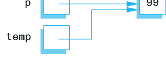

- 4. 调用 sneaky 之后：

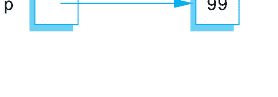

在声明对象时调用

例如，一个使用展示 11.11 中定义的 `StringVar` 类的程序可能包含以下代码：

```
StringVar line(20), motto("Constructors can help.");
cout << "Enter a string of length 20 or less:\n";
line.inputLine(cin);
StringVar temp(line); //由复制构造函数初始化。
```

用于初始化 `StringVar` 类型三个对象中每一个的构造函数，由对象名后面括号中参数的类型决定。对象 `line` 使用具有 `int` 类型参数的构造函数初始化；对象 `motto` 使用具有 `const char a[]` 类型参数的构造函数初始化。类似地，对象 `temp` 使用具有一个 `const StringVar&` 类型参数的构造函数初始化。在这种用法中，复制构造函数就像任何其他构造函数一样被使用。

复制构造函数的定义应确保被初始化的对象成为其参数的完整的、独立的副本。因此，在声明中

```
StringVar temp(line);
```

深拷贝

成员变量 `temp.value` 并不是简单地设置为与 `line.value` 相同的值；那会产生两个指向同一个动态数组的指针。复制构造函数的定义如展示 11.12 所示。注意，在复制构造函数的定义中，创建了一个新的动态数组，并将一个动态数组的内容复制到另一个动态数组中。因此，在前面的声明中，`temp` 被初始化，使其字符串值等于 `line` 的字符串值，但 `temp` 拥有一个独立的动态数组。这样，对 `temp` 所做的任何更改都不会影响 `line`。这被称为深拷贝。第 10 章中讨论的浅拷贝只会复制对内存中同一动态数组的引用。深拷贝则会对任何动态结构进行新的复制。

正如你所看到的，复制构造函数可以像任何其他构造函数一样使用。在某些其他情况下，复制构造函数也会被自动调用。粗略地说，只要 C++ 需要复制一个对象，它就会自动调用复制构造函数。特别是，复制构造函数在三种情况下会被自动调用：（1）当一个类对象被声明并由另一个同类型对象初始化时；（2）当函数返回类类型的值时；（3）每当类类型的参数被“代入”到按值传递的参数时。在这种情况下，复制构造函数定义了“代入”的含义。

按值传递的参数

为什么需要复制构造函数

为了理解为什么需要复制构造函数，让我们看看如果不为 `StringVar` 类定义复制构造函数会发生什么。假设我们没有在 `StringVar` 类的定义中包含复制构造函数，并且我们在函数定义中使用了按值传递的参数，例如：

```
void showString(StringVar theString)
{
    cout << "The string is: "
         << theString << endl;
}
```

考虑以下包含函数调用的代码：

```
StringVar greeting("Hello");
showString(greeting);
cout << "After call: " << greeting << endl;
```

假设没有复制构造函数，事情将如下进行：当执行函数调用时，`greeting` 的值被复制到局部变量 `theString`，因此 `theString.value` 被设置为等于 `greeting.value`。但这些都是指针变量，所以在函数调用期间，`theString.value` 和 `greeting.value` 指向同一个动态数组，如下所示：

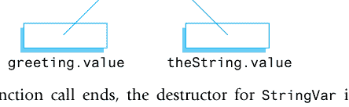

当函数调用结束时，`StringVar` 的析构函数被调用，将 `theString` 使用的内存返回给自由存储区。析构函数的定义包含以下语句：

```
delete [] value;
```

由于析构函数是针对对象 `theString` 调用的，该语句等价于：

```
delete [] theString.value;
```

这将图片变为以下状态：

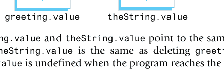

由于 `greeting.value` 和 `theString.value` 指向同一个动态数组，删除 `theString.value` 等同于删除 `greeting.value`。因此，当程序到达语句

```
cout << "After call: " << greeting << endl;
```

时，`greeting.value` 是未定义的。

因此，该 cout 语句是未定义的。cout 语句可能碰巧给出你想要的输出，但迟早 `greeting.value` 未定义这一事实会产生问题。一个主要问题发生在对象 `greeting` 是某个函数中的局部变量时。在这种情况下，当函数调用结束时，析构函数将针对 `greeting` 被调用。该析构函数调用将等价于

```
delete [] greeting.value;
```

但是，正如我们刚才看到的，由 `greeting.value` 指向的动态数组已经被删除过一次，现在系统试图再次删除它。调用 `delete` 两次来删除同一个动态数组（或其他使用 `new` 创建的变量）可能会导致严重的系统错误，从而使程序崩溃。

这就是如果没有复制构造函数会发生的情况。幸运的是，我们在 `StringVar` 类的定义中包含了复制构造函数，因此当执行以下函数调用时，复制构造函数会自动被调用：

```
StringVar greeting("Hello");
showString(greeting);
```

复制构造函数定义了将参数 `greeting` “代入”到按值传递的参数 `theString` 的含义，因此现在的图片如下：

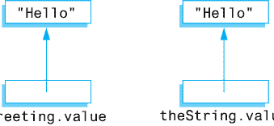

因此，对 `theString.value` 所做的任何更改都不会影响参数 `greeting`，并且析构函数也不会有问题。如果先为 `theString` 调用析构函数，然后为 `greeting` 调用析构函数，每次析构函数调用都会删除不同的动态数组。

## 返回值

当函数返回类类型的值时，复制构造函数会被自动调用来复制返回语句指定的值。如果没有复制构造函数，则会发生与前面描述的值参数类似的问题。

## 何时需要复制构造函数

如果类定义涉及使用 `new` 运算符的指针和动态分配的内存，那么你需要包含一个复制构造函数。通常，你的复制构造函数应对动态内存结构执行深拷贝。不涉及指针或动态分配内存的类不需要复制构造函数。默认执行的浅拷贝通常就足够了。

## 赋值语句

与你可能预期的相反，当你使用赋值运算符将一个对象赋值给另一个对象时，复制构造函数*不会*被调用。² 然而，如果你不喜欢默认赋值运算符的行为，你可以按照“重载赋值运算符”小节中描述的方式重新定义赋值运算符。

> ² C++ 仔细区分了初始化（调用复制构造函数的三种情况）和赋值。初始化使用复制构造函数创建一个新对象；赋值运算符则获取一个现有对象，并对其进行修改，使其成为赋值右侧对象的完全相同的副本（除了位置之外）。


## 拷贝构造函数

拷贝构造函数是一个具有一个按引用调用参数的构造函数，该参数的类型与类相同。唯一的参数必须是按引用调用参数。通常，该参数也是一个常量参数，即前面加上 const 参数修饰符。类的拷贝构造函数在函数返回类类型的值时会自动调用。拷贝构造函数在将参数“插入”到类类型的按值调用参数时也会自动调用。拷贝构造函数也可以像其他构造函数一样使用。

任何使用指针和 new 运算符的类都应该有一个拷贝构造函数。

## 大三件

拷贝构造函数、`operator=` 和析构函数被称为大三件，因为专家说如果你需要定义其中任何一个，那么你就需要定义全部三个。如果缺少其中任何一个，编译器会创建它，但它可能不会按你期望的方式行为。因此最好自己定义它们。编译器为你生成的拷贝构造函数和重载的 `operator=` 如果所有成员变量都是预定义类型（如 int 和 double），则工作正常，但在具有类或指针成员变量的类上可能会表现不佳。对于任何使用指针和 new 运算符的类，最安全的做法是自己定义拷贝构造函数、重载的 `=` 和析构函数。

= 必须是成员

## 自测练习

- 23. 如果一个类名为 MyClass 且它有一个构造函数，构造函数叫什么名字？如果 MyClass 有一个析构函数，析构函数叫什么名字？

- 24. 假设你将 Display 11.12 中的析构函数定义改为如下。Display 11.11 中的示例对话会如何改变？

```cpp
StringVar::~StringVar()
{
    cout << endl
        << "Good-bye cruel world! The short life of\n"
        << "this dynamic array is about to end.\n";
    delete [] value;
}
```

- 25. 以下内容是类 `StringVar` 的拷贝构造函数定义的第一个行。标识符 `StringVar` 出现了三次，每次含义略有不同。它在三种情况下分别是什么意思？

```cpp
StringVar::StringVar(const StringVar& stringObject)
```

- 26. 回答关于析构函数的问题。
  - a. 什么是析构函数，析构函数的名称必须是什么？
  - b. 析构函数何时被调用？
  - c. 析构函数实际做了什么？
  - d. 析构函数应该做什么？

## 重载赋值运算符

假设 `string1` 和 `string2` 如下声明：

```cpp
StringVar string1(10), string2(20);
```

类 `StringVar` 在 Displays 11.11 和 11.12 中定义。如果 `string2` 已经被赋予了某个值，那么以下赋值语句是定义的，但其含义可能不是你想要的：

```cpp
string1 = string2;
```

与往常一样，这个预定义的赋值语句将 `string2` 的每个成员变量的值复制到 `string1` 的对应成员变量中，因此 `string1.maxLength` 的值被更改为与 `string2.maxLength` 相同，`string1.value` 的值被更改为与 `string2.value` 相同。但这会给 `string1` 带来问题，甚至可能给 `string2` 带来问题。

成员变量 `string1.value` 包含一个指针，赋值语句将此指针设置为与 `string2.value` 相同的值。因此，`string1.value` 和 `string2.value` 都指向内存中的同一位置。如果你更改 `string1` 中的字符串值，你也会更改 `string2` 中的字符串值。如果你更改 `string2` 中的字符串值，你会更改 `string1` 中的字符串值。

简而言之，预定义的赋值语句并不能实现我们希望对 `StringVar` 类型对象所做的赋值操作。使用类 `StringVar` 的预定义赋值运算符版本只会带来问题。解决办法是重载赋值运算符 `=`，使其对 `StringVar` 类的对象执行我们想要的操作。

赋值运算符不能像我们重载其他运算符（如 `<<` 和 `+`）那样重载。当你重载赋值运算符时，它必须是类的成员；它不能是类的友元。要向类 `StringVar` 添加重载的赋值运算符版本，`StringVar` 的定义应更改为如下：

```cpp
class StringVar
{
public:
    void operator =(const StringVar& rightSide);
    //Overloads the assignment operator = to copy a string
    //from one object to another.
    <The rest of the definition of the class can be the same as in
    Display 11.11.>
```

赋值运算符随后就如同你一直使用赋值运算符一样使用。例如，考虑以下内容：

```cpp
string1 = string2;
```

在此调用中，string1 是调用对象，string2 是成员 operator = 的参数。

赋值运算符的定义可以如下：

```cpp
//The following is acceptable, but
//we will give a better definition:
void StringVar::operator =(const StringVar& rightSide)
{
    int newLength = strlen(rightSide.value);
    if ((newLength) > maxLength)
        newLength = maxLength;
    for (int i = 0; i < newLength; i++)
        value[i] = rightSide.value[i];
    value[newLength] = '\0';
}
```

请注意，赋值运算符右侧对象的字符串长度会被检查。如果它太长而无法放入赋值运算符左侧的对象（即调用对象）中，则只复制尽可能多的字符到接收字符串的对象中。但假设你不想在复制过程中丢失任何字符。为了容纳所有字符，你可以为赋值运算符左侧对象的动态数组创建一个新的、更大的动态数组。你可能会尝试按如下方式重新定义赋值运算符：

```cpp
//This version has a bug:
void StringVar::operator =(const StringVar& rightSide)
{
    delete [] value;
    int newLength = strlen(rightSide.value);
    maxLength = newLength;
    value = new char[maxLength + 1];
    for (int i = 0; i < newLength; i++)
        value[i] = rightSide.value[i];
    value[newLength] = '\0';
}
```

= 的调用对象

此版本在赋值运算符两侧使用相同对象的赋值中使用时存在问题，如下所示：

```cpp
myString = my_string;
```

当此赋值执行时，执行的第一个语句是

```cpp
delete [] value;
```

但调用对象是 myString，所以这意味着

```cpp
delete [] myString.value;
```

因此，myString 中的字符串值被删除，指针 myString.value 变为未定义。赋值运算符已损坏对象 myString，并且此程序运行可能已毁坏。

修复此 bug 的一种方法是首先检查赋值运算符左侧对象的动态数组成员是否有足够的空间，并在需要额外空间时才删除数组。我们的最终重载赋值运算符定义就执行了这样的检查：

```cpp
//This is our final version:
void StringVar::operator = (const StringVar& rightSide)
{
    int newLength = strlen(rightSide.value);
    if (newLength > maxLength)
    {
        delete [] value;
        maxLength = newLength;
        value = new char[maxLength + 1];
    }
    for (int i = 0; i < newLength; i++)
        value[i] = rightSide.value[i];
    value[newLength] = '\0';
}
```

对于许多类，显而易见的重载赋值运算符定义在赋值运算符两侧使用相同对象时无法正确工作。你应该始终检查这种情况并小心编写重载赋值运算符的定义，使其在此情况下也能正常工作。

## 自测练习

- 27.
  - a. 仔细解释为什么当数据仅由内置类型组成时不需要重载赋值运算符。
  - b. 与 a 部分相同，针对拷贝构造函数。
  - c. 与 a 部分相同，针对析构函数。


# 本章小结

- 类的友元函数是一种普通函数，但它可以像成员函数一样访问类的私有成员。
- 如果你的每个类都有一整套访问器和修改器函数，那么让某个函数成为友元的唯一理由就是使友元函数的定义更简单、更高效，但这往往已经是一个足够的理由了。
- 不会被函数改变的类类型参数通常应该是常量参数。
- 运算符（如 `+` 和 `==`）可以被重载，以便用于你所定义的类类型的对象。
- 重载 `>>` 或 `<<` 运算符时，返回的类型应为流类型，并且必须是引用，这通过在返回类型名后附加 `&` 来表示。
- 数组的基类型可以是结构体类型或类类型。结构体或类可以将数组作为成员变量。
- **析构函数**是类的一种特殊成员函数。当类的对象超出作用域时，析构函数会被自动调用。析构函数的主要用途是将内存归还给自由存储区，以便该内存可以被重新使用。
- **复制构造函数**是一种构造函数，它只有一个参数，且该参数的类型与类相同。如果你定义了复制构造函数，那么每当函数返回类类型的值，以及每当参数被“代入”类类型的按值调用参数时，它都会被自动调用。任何使用指针和 `new` 运算符的类都应该有一个复制构造函数。
- 赋值运算符 `=` 可以为类重载，使其按你希望的方式对该类起作用。但是，它必须作为类的成员重载，不能作为友元函数重载。任何使用指针和 `new` 运算符的类都应该重载赋值运算符，以供该类使用。

## 自测练习答案

```
1. `bool before(DayOfYear date1, DayOfYear date2)
   {
       return ((date1.getMonth() < date2.getMonth())
            || (date1.getMonth() == date2.getMonth()
                && date1.getDay() < date2.getDay()));
   }`
```

```
class Money
{
public:
    friend Money subtract(Money amount1, Money amount2);
    //Precondition: amount1 and amount2 have values.
    //Returns amount1 minus amount2.
    friend bool equal(Money amount1, Money amount2);
    Money(long dollars, int cents);
    Money(long dollars);
    Money();
    double getValue();
    void input(istream& ins);
    void output(ostream& outs);
private:
    long allCents;
};
```

你还必须添加下面这个函数 subtract 的定义：

```
Money subtract(Money amount1, Money amount2)
{
    Money temp;
    temp.allCents = amount1.allCents
                 - amount2.allCents;
    return temp;
}
```

5. 这里显示的是类 Money 的修改后的定义。颜色标记的部分是新增的。为了节省篇幅，我们省略了一些注释，但程序清单 11.3 中显示的所有注释都应包含在这个定义中。

```
class Money
{
public:
    friend Money add(Money amount1, Money amount2);
    friend bool equal(Money amount1, Money amount2);
    Money(long dollars, int cents);
    Money(long dollars);
    Money();
    double getValue();
    void input(istream& ins);
    void output(ostream& outs);
    //Precondition: If outs is a file output stream, then
    //outs has already been connected to a file.
    //Postcondition: A dollar sign and the amount of money
    //recorded in the calling object has been sent to the
    //output stream outs.
```

```
void output();
//Postcondition: A dollar sign and the amount of money
//recorded in the calling object has been output to the
//screen.
```

```
private:
    long allCents;
};
```

你还必须添加下面这个名为 output 的函数的定义。（原来的 output 定义仍然保留，因此会有两个 output 的定义。）

```
void Money::output()
{
    output(cout);
}
```

下面这个更长的函数定义版本也同样有效：

```
//Uses cstdlib and iostream
void Money::output()
{
    long positiveCents, dollars, cents;
    positiveCents = labs(allCents);
    dollars = positiveCents/100;
    cents = positiveCents%100;

    if (allCents < 0)
        cout << "-$" << dollars << '.';
    else
        cout << "$" << dollars << '.';
    if (cents < 10)
        cout << '0';
    cout << cents;
}
```

你也可以重载成员函数 input，使得类似

```
purse.input();
```

的调用与

```
purse.input(cin);
```

含义相同。

当然，你还可以将这个增强功能与之前自测练习中的增强功能结合起来，得到一个高度改进的类 Money。

6. 如果用户输入 $-9.95（而不是 -$9.95），函数 input 会把“$”读作 oneChar 的值，把 -9 读作 dollars 的值，把“.”读作 decimalPoint 的值，把“9”和“5”分别读作 digit1 和 digit2 的值。这意味着它会将 dollars 设为 -9，将 cents 设为 95，因此所设金额相当于 −$9.00 加 0.95，即 −$8.05。发现这个问题的一种方法是检查 dollars 的值是否为负（因为 dollars 的值应当是一个绝对值）。为此，请将错误消息部分改写如下：

```
if (oneChar != '$' || decimalPoint != '.'
    || !isdigit(digit1) || !isdigit(digit2)
    || dollars < 0)  New
{
    cout << "Error illegal form for money input\n";
    exit(1);
}
```

这段代码对于 $−0.95 这种零美元的错误输入仍不会给出错误消息。然而，就我们目前所学的内容而言，对这种情况进行测试虽然肯定是可能的，但会显著使代码复杂化，并使其更难阅读。

7. #include <iostream>
using namespace std;
int main()
{
    int x;
    cin >> x;
    cout << x << endl;
    return 0;
}

如果编译器将带有前导 0 的输入解释为八进制数，那么对于输入数据 077，输出应为 63；如果编译器不将带有前导 0 的数据解释为八进制，则输出应为 77。

8. 与程序清单 11.3 中给出的版本相比，唯一的变化是在函数头部添加了 const 修饰符，因此定义如下：

```
double Money::getValue() const
{
    return (allCents * 0.01);
}
```

9. 成员函数 input 会改变其调用对象的值，因此如果你添加 const 修饰符，编译器将发出错误消息。

10. 相似之处：每次参数调用都会保护调用者的实参不被修改。不同之处：按值调用会复制调用者的实参，因此它比按常量引用调用占用更多内存。

11. 在 `const int x = 17;` 声明中，const 关键字向编译器保证，作者编写的代码不会改变 x 的值。

在 `int f() const;` 声明中，const 关键字向编译器保证，作者为实现函数 f 而编写的代码不会改变调用对象中的任何内容。

在 `int g(const A& x);` 声明中，const 关键字向编译器保证，类作者编写的代码不会改变为 x 传入的实参。

12. （二元）运算符（如 +、*、/ 等）与函数之间的区别在于它们的调用语法。在函数调用中，实参写在函数名后面的括号内；对于运算符，实参分别写在运算符的两侧。另外，在重载运算符的声明和定义中，必须使用保留字 operator。

13. 这里显示的是类 Money 的修改后的定义。颜色标记的部分是新增的。为了节省篇幅，我们省略了一些注释，但程序清单 11.5 中显示的所有注释都应包含在这个定义中。

```
class Money
{
public:
    friend Money operator +(const Money& amount1,
        const Money& amount2);
    friend bool operator ==(const Money& amount1,
        const Money& amount2);
    friend bool operator <(const Money& amount1,
        const Money& amount2);
    //Precondition: amount1 and amount2 have been given
    //values.
    //Returns true if amount1 is less than amount2;
    //otherwise, returns false.
    Money(long dollars, int cents);
    Money(long dollars);
    Money();
    double getValue() const;
    void input(istream& ins);
    void output(ostream& outs) const;
private:
    long allCents;
};
```

你还必须添加下面这个重载运算符 < 的定义：

```
bool operator <(const Money& amount1,
    const Money& amount2)
{
    return (amount1.allCents < amount2.allCents);
}
```


- 14. 类 `Money` 的修改后定义如下所示。颜色部分为新增内容。我们省略了一些注释以节省空间，但 Display 11.5 中显示的所有注释都应包含在此定义中。我们已将本次练习中的更改包含在此答案中，因为在重载 `<=` 运算符的定义中使用重载的 `<` 运算符是自然的。

```cpp
class Money
{
public:
    friend Money operator +(const Money& amount1,
                            const Money& amount2);
    friend bool operator ==(const Money& amount1,
                            const Money& amount2);
    friend bool operator <(const Money& amount1,
                           const Money& amount2);
    //Precondition: amount1 and amount2 have been given values.
    //Returns true if amount1 is less than amount2;
    //otherwise, returns false.
    friend bool operator <=(const Money& amount1,
                            const Money& amount2);
    //Precondition: amount1 and amount2 have been given values.
    //Returns true if amount1 is less than or equal to amount2; otherwise, returns false.
    Money(long dollars, int cents);
    Money(long dollars);
    Money();
    double getValue() const;
    void input(istream& ins);
    void output(ostream& outs) const;
private:
    long allCents;
};
```

你还必须添加以下重载 `operator <=` 的定义（以及上一练习中给出的重载 `operator <` 的定义）：

```cpp
bool operator <=(const Money& amount1,
                 const Money& amount2)
{
    return ((amount1.allCents < amount2.allCents)
            || (amount1.allCents == amount2.allCents));
}
```

- 15. 在重载运算符时，运算符的参数中至少有一个必须是类类型。这可以防止改变整数的 `+` 的行为。实际上，这一要求可以防止改变任何内置类型上任何运算符的效果。

- 16.

```cpp
//Uses math (for floor):
Money::Money(double amount)
{
    allCents = floor(amount * 100);
}
```

此定义只是丢弃小于一美分的任何金额。例如，它将 12.34999 转换为整数 1234，表示金额 $12.34。可以定义构造函数来对任何分的分数做其他处理。

- 17.

```cpp
istream& operator >>(istream& ins, Pairs& second)
{
    char ch;
    ins >> ch;        //discard initial '('
    ins >> second.f;
    ins >> ch;        //discard comma ','
    ins >> second.s;
    ins >> ch;        //discard final ')'
    return ins;
}

ostream& operator <<(ostream& outs, const Pairs& second)
{
    outs << '(';
    outs << second.f;
    outs << ','; //You might prefer ","
                //to get an extra space
    outs << second.s;
    outs << ')';
    return outs;
}
```

- 18.

```cpp
//Uses iostream:
istream& operator >>(istream& ins, Percent& theObject)
{
    char percentSign;
    ins >> theObject.value;
    ins >> percentSign; //Discards the % sign.
    return ins;
}

//Uses iostream:
ostream& operator <<(ostream& outs,
    const Percent& aPercent)
{
    outs << aPercent.value << '%';
    return outs;
}
```

- 19.

```cpp
struct Score
{
    int homeTeam;
    int opponent;
};
Score game[10];
```

- 20.

```cpp
//Reads in 5 amounts of money, doubles each amount,
//and outputs the results.
#include <iostream>

<The definitions for the Money class go here.>

int main()
{
    using namespace std;
    Money amount[5];
    int i;
    cout << "Enter 5 amounts of money:\n";
    for (i = 0; i < 5; i++)
        cin >> amount[i];
    for (i = 0; i < 5; i++)
        amount[i] = amount[i] + amount[i];
    cout << "After doubling, the amounts are:\n";
    for (i = 0; i < 5; i++)
        cout << amount[i] << " ";
    cout << endl;
    return 0;
}
```

（你不能使用 `2 * amount[i]`，因为 `*` 对于类型为 `Money` 的操作数尚未被重载。）

- 21. 见答案 22。

- 22. 本答案结合了本练习和前一个自测练习的答案。类定义将更改为如下所示。（我们已从 Display 11.10 中删除了一些注释以节省空间，但你应在答案中包含它们。）

```cpp
class TemperatureList
{
public:
    TemperatureList();

    int getSize() const;
    //Returns the number of temperatures on the list.

    void addTemperature(double temperature);

    double getTemperature(int position) const;
    //Precondition: 0 <= position < getSize().
    //Returns the temperature that was added in position
    //specified. The first temperature that was added is
    //in position 0.

    bool full() const;

    friend ostream& operator <<(ostream& outs,
        const TemperatureList& theObject);
private:
    double list[MAX_LIST_SIZE]; //of temperatures in
                                //Fahrenheit
    int size; //number of array positions filled
};
```

你还需要添加以下成员函数定义：

```cpp
int TemperatureList::getSize() const
{
    return size;
}

//Uses iostream and cstdlib:
double TemperatureList::getTemperature (int position) const
{
    if ((position >= size) || (position < 0))
    {
        cout << "Error:"
             << " reading an empty list position.\n";
        exit(1);
    }
    else
        return (list[position]);
}
```

- 23. *构造函数* 的名称为 `MyClass`，与类名相同。*析构函数* 的名称为 `~MyClass`。

- 24. 对话将更改为如下所示：

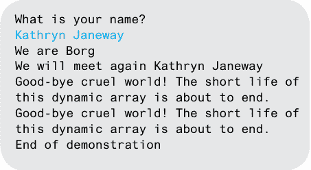

- 25. `::` 之前的 `StringVar` 是类的名称。`::` 右侧的 `StringVar` 是成员函数的名称。（记住，构造函数是与类同名的成员函数。）括号内的 `StringVar` 是参数 `stringObject` 的类型。

- 26.
  - a. 析构函数是类的成员函数。析构函数的名称总是以波浪号 `~` 开头，后跟类名。
  - b. 当类对象超出作用域时，会调用析构函数。
  - c. 析构函数实际上执行类作者为其编程的任何操作！
  - d. 析构函数应删除由构造函数为该类分配的动态变量。析构函数还可能执行其他清理任务。

- 27. 对于赋值运算符 `=` 和拷贝构造函数，如果数据只有内置类型，则默认的拷贝机制正是你想要的，因此默认值效果很好。对于析构函数，不进行动态内存分配（没有指针），因此默认的无操作行为也是你想要的。

## PRACTICE PROGRAMS

练习程序通常可以用一个简短的程序来解决，该程序直接应用本章介绍的编程原理。

- 1. 修改 Display 11.8 中显示的类 `Money` 的定义，以便添加以下所有内容：
  - a. 运算符 `<`、`<=`、`>` 和 `>=` 已分别重载以适用于类型 `Money`。（提示：参见自测练习 13。）
  - b. 以下成员函数已添加到类定义中。（我们以其在类定义中应出现的函数声明形式显示该函数。函数的定义本身将包含限定符 `Money::`。）

    ```cpp
    Money percent(int percentFigure) const;
    //Returns a percentage of the money amount in the
    //calling object. For example, if percentFigure is 10,
    //then the value returned is 10% of the amount of
    //money represented by the calling object.
    ```

    例如，如果 `purse` 是类型为 `Money` 的对象，其值表示金额 $100.10，则调用

    ```cpp
    purse.percent(10);
    ```

    返回 $100.10 的 10%；即返回类型为 `Money` 的值，表示金额 $10.01。

- 2. 自测练习 17 要求你为类 `Pairs` 重载运算符 `>>` 和运算符 `<<`。完成并测试此练习。实现默认构造函数以及一个和两个 `int` 参数的构造函数。单参数构造函数应初始化对的第一个成员；对的第二个成员应为 0。

重载二元运算符 `+` 以按规则添加对  
`(a, b) + (c, d) = (a + c, b + d)`

类似地重载运算符 `-`。

在 `Pairs` 和 `int` 上重载运算符 `*`，规则为  
`(a, b) * c = (a * c, b * c)`

编写程序测试类定义中的所有成员函数和重载运算符。

- 3. 定义一个类 `DegreeAngle`，其中包含一个表示角度的整数字段。此类型可保存的值范围为 0-359，你的代码应确保该范围不会被超出。实现默认构造函数和一个带一个整数参数的构造函数。重载 `+` 和 `-` 运算符以允许 `DegreeAngle` 对象的加法和减法。重载 `<<` 和 `>>` 运算符以实现从输入流读取和写入数据。编写驱动程序测试你的类及其功能。

## PROGRAMMING PROJECTS

编程项目比练习程序需要更多的解题能力，通常可以用多种不同方式解决。访问 www.myprogramminglab.com 在线完成这些编程项目并获得即时反馈。

- 1. 在第 8 章中我们讨论了向量，它们就像可以增长大小的数组。假设 C++ 中未定义向量。定义一个名为 `VectorDouble` 的类，它类似于 `double` 基类型的向量类。你的类 `VectorDouble` 将有一个私有成员变量用于 `double` 的动态数组。它还将有两个 `int` 类型的成员变量；一个名为 `maxCount` 用于 `double` 动态数组的大小；一个名为 `count` 用于当前持有值的数组位置数。(`maxCount` 与向量的容量相同；`count` 与向量的大小相同。)

如果尝试向 `VectorDouble` 类的向量对象添加一个元素（`double` 类型的值）而没有更多空间，则会创建一个具有两倍旧动态数组容量的新动态数组，并将旧动态数组的值复制到新动态数组中。


你的类应具备以下所有内容：

- 三个构造函数：一个默认构造函数（创建一个包含 50 个元素的动态数组）、一个带有一个 `int` 参数的构造函数（用于指定初始动态数组中的元素数量）和一个复制构造函数。
- 一个析构函数。
- 对赋值运算符 `=` 的适当重载。
- 对相等运算符 `==` 的适当重载。要使两个对象相等，count 的值和 count 数组各元素的值必须相等，但 maxCount 的值不必相等。
- 成员函数 `push_back`、`capacity`、`size`、`reserve` 和 `resize`，其行为与 vector 的同名成员函数相同。
- 两个使你的类具有与方括号相同用途的成员函数：`valueAt(i)`（返回动态数组中第 i 个元素的值）和 `changeValueAt(d, i)`（将动态数组中第 i 个元素的 `double` 值改为 d）。对 `valueAt` 和 `changeValueAt` 的参数施加适当的限制。（你的类不能与方括号一起使用。它可以被修改为支持方括号，但我们还没有讲解相关的内容。）

2. 定义一个名为 ResizableIntArray 的类。该类应有一个构造函数，它接受数组的初始大小作为参数。构造函数随后应使用自由存储内存创建一个动态数组，并将指向该数组的指针存储在类字段中。

创建一个名为 resize 的方法，它允许调整数组的大小，并确保在调整数组大小时，数组中的所有数据都被复制到新的内存位置。确保删除旧内存。任何大小的增加都应将新值设置为 0。注意，你的方法复制的数据不能超过调整大小后数组所能容纳的量。

编写一个名为 setElement 的方法，它接受两个参数：一个索引值和一个要设置的值。如果索引值超出数组的最大元素数量，该方法应通过 assert 子句终止程序。你还应在程序的其他地方添加 assert 子句，以防止代码创建大小为零或负数的数组。

创建一个复制构造函数，用于复制数组及其包含的数据。同时包含一个析构函数，以便在对象销毁后清理所使用的内存。最后，重载 `<<` 运算符，以输出数组的内容，内容由 `[` 和 `]` 括起来，每个元素之间用一个空格分隔。编写一个驱动程序来测试你的类。

3. 图书馆中的非小说类书籍通常按十进制分类系统排列。考虑一个简单的十进制分类系统。这种系统包含一个三位数字，作为主题领域代码，以及一个索引号，表示更具体的子类别。例如，一本几何教科书可能有主题领域代码 516 和子类别代码 3。这将打印给用户为十进制数 516.3。编写一个名为 `DecimalBookInfo` 的类，用于存储图书馆中书籍的信息。该类应存储书名及其十进制分类号。

你的类应有一个构造函数，它接受书名的 C++ 字符串及其十进制分类代码。重载 `<`、`<=`、`>`、`>=` 运算符，以允许不同的 `DecimalBookInfo` 对象之间进行比较，从而使程序能够对容器内的书籍进行排序。编写一个驱动程序来测试你的类的每个组成部分。

4. 通过添加以下所有内容，增强程序清单 11.11 和 11.12 中给出的类 `StringVar` 的定义：

- 成员函数 `copyPiece`，返回一个指定的子字符串；成员函数 `oneChar`，返回一个指定的单个字符；以及成员函数 `setChar`，修改一个指定的字符。
- `==` 运算符的重载版本（注意，只有字符串值必须相等；`maxLength` 的值不必相同）
- `+` 的重载版本，执行 `StringVar` 类型字符串的拼接
- 提取运算符 `>>` 的重载版本，读取一个单词（与之相对的是 `inputLine`，它读取一整行）

如果你完成了关于重载赋值运算符的部分，那么也将其添加。另外编写一个合适的测试程序，并全面测试你的类定义。

5. 定义一个名为 `Text` 的类，其对象存储单词列表。类 `Text` 将类似于类 `StringVar`，只不过类 `Text` 使用的动态数组的基类型为 `StringVar`，而不是 `char`，并且它用一个由单个空白组成的 `StringVar` 对象来标记数组的末尾，而不是使用 '\0' 作为结束标记。直观地说，类 `Text` 的一个对象表示由空白分隔的单词组成的文本。强制执行以下限制：类型为 `StringVar` 的数组元素不得包含空白（类型为 `StringVar` 的结束标记元素除外）。

你的类 `Text` 将拥有与 `StringVar` 的所有成员函数对应的成员函数。带 `const char a[]` 类型参数的构造函数将以与下文所述的 `inputLine` 相同的方式初始化 `Text` 对象。如果 C 字符串参数包含换行符 '\n'，则视为错误，并以错误消息结束程序。

成员函数 `inputLine` 将读取以空白分隔的字符串，并将每个字符串存储在基类型为 `StringVar` 的动态数组的一个元素中。多个空白空格与单个空白空格的处理方式相同。输出 `Text` 类对象时，在每个 `StringVar` 值之间插入一个空白。你可以假设不使用制表符，也可以将制表符视为空白；如果这是课程作业，请询问你的老师应如何处理制表符。

添加编程项目 4 中描述的增强功能。重载版本的提取运算符 `>>` 将只填充动态数组的一个元素。

6. 使用动态数组，实现一个多项式类，支持多项式的加法、减法和乘法。

> *讨论：* 多项式中的变量除了充当系数的占位符之外，几乎没有什么作用。因此，多项式唯一值得注意的部分是系数数组和相应的指数。考虑多项式
> 
> `x*x*x + x + 1`
> 
> 实现多项式类的一种简单方法是使用 `double` 数组存储系数。数组的下标是相应项的指数。在前一个例子中，`x*x` 项在哪里？如果某一项缺失，那么它的系数就是零。
> 
> 有一些技术可以表示高次但缺项较多的多项式。这些技术使用所谓的稀疏多项式技术。除非你已经掌握这些技术，或者学习得很快，否则不要使用它们。

提供默认构造函数、复制构造函数和参数化构造函数，以便能够构造任意多项式。同时提供重载的运算符 `=` 和析构函数。

提供以下运算：

- 多项式 + 多项式
- 常数 + 多项式
- 多项式 + 常数
- 多项式 - 多项式
- 常数 - 多项式
- 多项式 - 常数
- 多项式 * 多项式
- 常数 * 多项式
- 多项式 * 常数

提供按指数索引来赋值和提取系数的函数。

提供一个函数，用于在 `double` 类型的值处计算多项式的值。

你应该决定将这些函数实现为成员函数、友元函数还是独立函数。

7. 编写一个支票簿结算程序。该程序将读取截至上次结算支票簿时所有尚未兑现的支票的以下信息：每张支票的编号、支票金额以及是否已兑现。使用一个基类型为类的数组。该类应为支票类。应有三个成员变量来记录支票编号、支票金额以及支票是否已兑现。支票类将有一个 `Money` 类型的成员变量（如程序清单 19 中所定义）来记录支票金额。因此，你将在类中使用另一个类。支票类应具有访问器（accessor）和修改器（mutator）函数，以及构造函数和用于支票输入与输出的函数。


除了检查之外，程序还读取所有的存款，以及旧的和新的账户余额。你可能需要另一个数组来保存存款。新的账户余额应为旧余额加上所有存款，再减去所有已兑现的支票。

程序输出已兑现支票的总和、存款的总和、新的余额应为多少，以及该数值与银行所说的新的余额相差多少。它还输出两份支票清单：自上次平衡支票簿以来已兑现的支票，以及尚未兑现的支票。按支票号码从低到高排序显示两份支票清单。

如果这是课堂作业，请询问你的指导教师输入/输出应使用键盘和屏幕还是使用文件。如果使用文件，请向你的指导教师询问有关文件名的说明。

## 8. 定义一个名为 List 的类，可以保存类型为 double 的值列表。参照第 11.10 节中给出的 TemperatureList 类来设计你的类定义，但你的 List 类在输出值时不会提及温度。值可以代表任何类型的数据项，只要它们是 double 类型即可。包含自我测试练习 21 和 22 中指定的附加功能。更改成员函数名，使其不引用温度。

添加一个名为 getLast 的成员函数，不带参数并返回列表中的最后一个项目。成员函数 getLast 不会更改列表，并且在列表为空时不应调用它。添加另一个名为 deleteLast 的成员函数，删除列表中的最后一个元素。成员函数 deleteLast 是一个 void 函数。请注意，当最后一个元素被删除时，成员变量 size 必须进行调整。如果 deleteLast 被调用时调用对象是空列表，则函数调用无效。设计一个程序来彻底测试你对 List 类的定义。

## 9. 定义一个名为 StringSet 的类，将用于存储一组 STL 字符串。使用数组或向量来存储字符串。创建一个构造函数，以字符串数组作为输入参数，用于集合的初始值。然后编写成员函数来向集合添加字符串、从集合中删除字符串、清空整个集合、返回集合中字符串的数量以及输出集合中的所有字符串。重载 + 运算符，使其返回两个 StringSet 对象的并集。还重载 * 运算符，使其返回两个 StringSet 对象的交集。编写一个程序来测试类中的所有成员函数和重载运算符。

## 10. 本编程项目要求你先完成编程项目 9。

信息检索领域关注的是根据查询查找相关的电子文档。例如，给定一组关键词（查询），搜索引擎检索网页（文档）并按与查询的相关性排序显示它们。这种技术需要一种方法来比较文档与查询，以查看哪个与查询最相关。

一种简单的比较方法是计算二进制余弦系数。该系数的值介于 0 和 1 之间，其中 1 表示查询与文档非常相似，0 表示查询与文档没有任何共同关键词。这种方法将每个文档视为一组单词。例如，给定以下示例文档：

“Chocolate ice cream, chocolate milk, and chocolate bars are delicious.”

该文档将被解析为关键词，其中忽略大小写并丢弃标点符号，并转换为包含单词 {chocolate, ice, cream, milk, and, bars, are, delicious} 的集合。对查询执行相同的过程，将其转换为字符串集合。一旦我们将查询 Q 表示为一组单词，将文档 D 表示为一组单词，Q 与 D 之间的相似度通过以下公式计算：

Sim = |Q ∩ D| / (√|Q| √|D|)

通过添加一个额外的成员函数来修改编程项目 12 中的 StringSet，该函数计算当前 StringSet 与类型为 StringSet 的输入参数之间的相似度。sqrt 函数位于 cmath 库中。

在你的磁盘上创建两个名为 Document1.txt 和 Document2.txt 的文本文件。在每个文件中写入你选择的文本内容，但确保每个文件包含不同的内容。接下来，编写一个程序，允许用户从键盘输入一组字符串作为查询。程序应将查询与磁盘上的两个文本文件进行比较，并使用二进制余弦系数输出与每个文件的相似度。使用不同的查询测试你的程序，以查看相似度指标是否正常工作。

## 11. 重新做第 9 章的编程项目 6（或第一次做），但这次将动态数组和数组大小封装在一个类中。该类应具有公共成员函数 addEntry 和 deleteEntry。使数组和大小变量为私有。这将需要添加用于获取和设置数组中特定项的函数以及返回数组当前大小的函数。添加一个析构函数以释放分配给动态数组的内存。还添加一个拷贝构造函数并重载赋值运算符，以便动态数组能正确地从赋值运算符右侧的对象复制到左侧的对象。将你的类嵌入到合适的测试程序中。

## 12. 为了打击选举舞弊，你的城市正在实施一种新的投票程序。选票上与选民可能做出的每个选择都关联一个字母。示例选票如下所示。

- 1. VOTE FOR MAYOR
  - A. Pincher, Penny
  - B. Dover, Skip
  - C. Perman, Sue
- 2. PROPOSITION 17
  - D. YES
  - E. NO
- 3. MEASURE 1
  - F. YES
  - G. NO
- 4. MEASURE 2
  - H. YES
  - I. NO

提交选票后，每位选民都会收到一张收据，收据上有唯一的 ID 号码和投票选择的记录。例如，一位为 Sue Perman、Proposition 17 投赞成票、Measure 1 投反对票、Measure 2 投赞成票的选民可能会收到一张收据

```
ID 4925 : CDGH
```

第二天，城市会在其网页上按 ID 号码排序发布所有选票。这允许选民确认其提交内容，并允许任何人自行统计投票总数。示例选票的示例列表如下所示。

| ID | VOTES |
| --- | --- |
| 4925 | CDGH |
| 4926 | AEGH |
| 4927 | CDGI |
| 4928 | BEGI |
| 4929 | ADFH |

编写一个程序，从文件中读取已发布的投票列表并输出每个选票项目的投票百分比。你可以假设文件没有标题行。第一行将包含选民 ID 和表示投票的字符串。定义一个名为 Voter 的类，存储个人的投票记录。该类应有一个构造函数，以投票字符串（例如 "CDGH"）和选民 ID 作为输入，以及返回个人 ID 和特定问题的投票的访问函数。将每个 Voter 实例存储在数组或向量中。你的程序应遍历数组以计算并输出每个候选人、提案和措施的投票百分比。然后提示用户输入选民 ID，再次遍历列表以找到具有该 ID 的对象并打印其投票。

## 13. 创建一个名为 Document 的类，存储一个 String 对象的向量。定义一个默认构造函数，创建一个空向量。定义一个拷贝构造函数，复制 Document 对象及其包含的所有字符串。创建一个名为 addString 的方法，接受并将字符串添加到文档末尾。重载 << 运算符，以便文档可以以每个字符串对象之间有一个空格的方式输出。定义一个名为 getLength 的方法，返回文档的总长度。提示：使用方法 string.length() 来获取每个单独字符串的长度。编写一个驱动程序来测试你的类。

## 14. 做第 8 章的编程项目 16，但使用 Racer 类来存储每个参赛者的信息。该类应存储参赛者的姓名、号码布号码、完赛名次以及 RFID 传感器记录的所有分段时间。你可以选择合适的结构来存储此信息。包含适当的函数来访问或更改参赛者的信息，以及一个构造函数。创建一个 Racer 对象的数组或向量来存储整个比赛结果。

参赛者的姓名应来自单独的文本文件。该文件的信息在参赛者报名参加活动之前收集。以下是示例文件：

```
100,Bill Rodgers
132,Frank Shorter
182,Joan Benoit
```

## 15. 定义一个名为 Box 的类，其中包含该形状的长度、宽度和高度字段。包含一个计算盒子体积的函数。重载 ==、<、<=、>、>= 运算符以比较不同盒子对象的体积。编写一个驱动程序来测试你的类。


# 分离编译与命名空间 12

12.1 分离编译 738
回顾 ADT 739
案例研究：DigitalTime——一个单独编译的类 740
使用 #ifndef 749
编程提示：定义其他库 752

12.2 命名空间 753
命名空间与 using 指令 754
创建命名空间 755

限定名称 758
关于命名空间的一个微妙点（可选） 759
无名命名空间 760
编程提示：为命名空间选择名称 765
陷阱：混淆全局命名空间与无名命名空间 766

## 回顾的 ADT

回想一下，ADT（抽象数据类型）是一个类，其定义方式将类的接口与实现分离。你的所有类定义都应该是 ADT。为了将一个类定义为 ADT，你需要将程序员使用该类的规范与该类的实现细节分开。这种分离应是完全的，以至于你可以在无需以任何方式更改使用该类的任何程序的情况下更改实现。确保这种分离的方法可以总结为三条规则：

- 1. 将所有成员变量设为类的私有成员。
- 2. 将 ADT（类）的每个基本操作设为类的公有成员函数、友元函数、普通函数或重载运算符。将类定义与函数和运算符声明组合在一起。这个组连同其附带的注释一起称为 ADT 的 **接口**。在类中或在函数或运算符声明中给出的注释中完全指定如何使用每个这样的函数或运算符。
- 3. 使基本操作的实现对使用抽象数据类型的程序员不可用。**实现**由函数定义和重载运算符定义组成（连同这些定义所需的任何辅助函数或其他附加项）。

在 C++ 中，确保你遵循这些规则的最佳方法是把 ADT 类的接口和实现放在单独的文件中。正如你可能猜到的，包含接口的文件通常称为 **接口文件**，而包含实现的文件称为 **实现文件**。如何设置、编译和使用这些文件的确切细节会因 C++ 的一个版本到另一个版本而略有不同，但所有版本的 C++ 中基本方案都相同。特别是，放入文件中的内容的细节在所有系统中都相同。唯一会变化的是你用来编译和链接这些文件的命令。这些文件应包含什么内容的细节在下一个案例研究中进行了说明。

ADT 类具有私有成员变量。私有成员变量（和私有成员函数）给我们将 ADT 的接口和实现放在单独文件中的基本哲学带来了一个问题。ADT 的类定义的公有部分是 ADT 接口的一部分，但私有部分是实现的一部分。这是一个问题，因为 C++ 不允许你将类定义拆分到两个文件。因此，需要某种妥协。唯一合理的妥协，也是我们使用的方法，是将整个类定义放在接口文件中。由于使用 ADT 类的程序员无法使用类的任何私有成员，私有成员实际上仍然对程序员隐藏。

> 私有成员是实现的一部分。

## ADT

如果使用该类型的程序员无法访问值和操作的实现细节，则该数据类型称为抽象数据类型（缩写为 ADT）。你定义的所有类都应该是 ADT。ADT 类是按照良好的编程实践定义的类，该实践将类的接口和实现分开。（类的任何非成员基本操作，如重载运算符，都被视为 ADT 的一部分，即使它们可能不是正式的类定义的一部分。）

## 案例研究 DigitalTime — 一个单独编译的类

显示 12.1 包含一个名为 DigitalTime 的 ADT 类的接口文件。DigitalTime 是一个类，其值是一天中的时间，例如 9:30。类的公有成员才是接口的一部分。私有成员是实现的一部分，即使它们在接口文件中。标签 private: 警告你这些私有成员不是公有接口的一部分。程序员为了使用 ADT DigitalTime 所需要知道的一切都已在文件开头的注释中以及类定义的公有部分中的注释中进行了说明。此接口告诉程序员如何使用名为 advance 的两个版本的成员函数、构造函数以及重载运算符 =、>> 和 <<。名为 advance 的成员函数、重载运算符和赋值语句是程序员可以操作此类的对象和值的唯一方式。如接口文件顶部的注释所述，此 ADT 类使用 24 小时制，因此，例如，下午 1:30 输入和输出为 13:30。这些和其他你为了有效地使用类 DigitalTime 必须知道的细节都包含在与成员函数一起给出的注释中。

我们将接口放在名为 dtime.h 的文件中。后缀 .h 表示这是一个头文件。接口文件始终是头文件，因此始终以后缀 .h 结尾。任何使用类 DigitalTime 的程序都必须包含以下类似的 include 指令，其中命名此文件：

```
#include "dtime.h"
```

当你编写 include 指令时，你必须指出头文件是为你提供的预定义头文件还是你编写的头文件。如果头文件是预定义的，则以尖括号写出头文件名，如 <iostream>。如果头文件是你编写的，则以引号写出头文件名，如 "dtime.h"。这种区别告诉编译器在哪里查找头文件。如果头文件名在尖括号中，编译器会在你的 C++ 实现中预定义头文件所在的位置查找。如果头文件名在引号中，编译器会在当前目录或系统上保存程序员定义的头文件的位置查找。

任何使用我们的 DigitalTime 类的程序都必须包含前面命名头文件 dtime.h 的 include 指令。这就足够允许

## 显示 12.1 DigitalTime 的接口文件

```
//Header file dtime.h: This is the INTERFACE for the class DigitalTime.
//Values of this type are times of day. The values are input and output in
//24-hour notation, as in 9:30 for 9:30 AM and 14:45 for 2:45 PM.
#include <iostream>
using namespace std;
class DigitalTime
{
public:
friend bool operator ==(const DigitalTime& time1, const DigitalTime& time2);
//Returns true if time1 and time2 represent the same time;
//otherwise, returns false.
DigitalTime(int theHour, int theMinute);
//Precondition: 0 <= theHour <= 23 and 0 <= theMinute <= 59.
//Initializes the time value to theHour and theMinute.
DigitalTime();
//Initializes the time value to 0:00 (which is midnight).
void advance(int minutesAdded);
//Precondition: The object has a time value.
//Postcondition: The time has been changed to minutesAdded minutes later.
void advance(int hoursAdded, int minutesAdded);
//Precondition: The object has a time value.
//Postcondition: The time value has been advanced
//hoursAdded hours plus minutesAdded minutes.
friend istream& operator >>(istream& ins, DigitalTime& theObject);
//Overloads the >> operator for input values of type DigitalTime.
//Precondition: If ins is a file input stream, then ins has already been
//connected to a file.
friend ostream& operator <<(ostream& outs, const DigitalTime& theObject);
//Overloads the << operator for output values of type DigitalTime.
//Precondition: If outs is a file output stream, then outs has already been
//connected to a file.
private:
int hour;
int minute;
};
```

对于类型 istream 和 ostream 的定义，它们被用作参数类型

这是实现的一部分。它不是接口的一部分。单词 private 表示这不是公有接口的一部分。


让你编译程序，但不足以让你运行程序。为了运行程序，你必须编写（并编译）成员函数和重载运算符的定义。我们将这些函数和运算符定义放在另一个文件中，该文件称为**实现文件**。虽然大多数编译器并不要求，但传统上会让接口文件和实现文件使用相同的名称。然而，这两个文件的后缀不同。我们将ADT类的接口放在名为`dtime.h`的文件中，将ADT类的实现放在名为`dtime.cpp`的文件中。实现文件使用的后缀取决于你的C++版本。实现文件应使用与你通常用于包含C++程序的文件相同的后缀。如果你的程序文件以`.cxx`结尾，那么你应该用`.cxx`代替`.cpp`。如果你的程序文件以`.CPP`结尾，那么你的实现文件将以`.CPP`而不是`.cpp`结尾。我们使用`.cpp`，因为大多数编译器接受`.cpp`作为C++源代码文件的后缀。我们的DigitalTime ADT类的实现文件在显示12.2中给出。在我们解释了ADT的各种文件如何相互交互之后，我们将回到显示12.2，讨论该实现文件中定义的细节。

为了在程序中使用ADT类`DigitalTime`，程序必须包含include指令

```
#include "dtime.h"
```

请注意，实现文件和程序文件都必须包含这个指定接口文件的include指令。包含程序的文件（即包含程序主要部分的文件）通常称为**应用程序文件**或**驱动程序文件**。显示12.3包含一个应用程序文件，其中有一个非常简单的程序，使用并演示了DigitalTime ADT类。

## 编译并运行程序

如何运行这个包含在三个文件中的完整程序的具体细节取决于你使用的系统。然而，基本细节对所有系统都是相同的。你必须编译实现文件，并且必须编译包含程序主要部分的应用程序文件。你不编译接口文件，在本例中即显示12.1中给出的`dtime.h`文件。你不需要编译接口文件，因为编译器认为该接口文件的内容已经包含在另外两个文件中。回想一下，实现文件和应用程序文件都包含指令

```
#include "dtime.h"
```

编译程序会自动调用预处理器，预处理器读取这条include指令，并用`dtime.h`文件中的文本替换它。因此，编译器会看到`dtime.h`的内容，所以`dtime.h`文件不需要单独编译。（实际上，编译器会看到`dtime.h`的内容两次：一次在编译实现文件时，一次在编译应用程序文件时。）这种对`dtime.h`文件的复制只是一种

概念上的复制。编译器表现得好像`dtime.h`的内容被复制到了每个包含该include指令的文件中。然而，如果你在编译后查看该文件，你只会找到include指令；你不会找到`dtime.h`文件的内容。

一旦实现文件和应用程序文件编译完成，你仍然需要连接这些文件，以便它们能够协同工作。这称为链接文件，由称为链接器的独立实用程序完成。如何调用链接器的细节取决于你使用的系统。在

## 显示12.2 DigitalTime的实现文件（第1部分，共3部分）

```
//Implementation file dtime.cpp (Your system may require some
//suffix other than .cpp): This is the IMPLEMENTATION of the ADT DigitalTime.
//The interface for the class DigitalTime is in the header file dtime.h.
#include <iostream>
#include <cctype>
#include <cstdlib>
#include "dtime.h"
using namespace std;

//These FUNCTION DECLARATIONS are for use in the definition of
//the overloaded input operator >>:

void readHour(istream& ins, int& theHour);
//Precondition: Next input in the stream ins is a time in 24-hour notation,
//like 9:45 or 14:45.
//Postcondition: theHour has been set to the hour part of the time.
//The colon has been discarded and the next input to be read is the minute.

void readMinute(istream& ins, int& theMinute);
//Reads the minute from the stream ins after readHour has read the hour.

int digitToInt(char c);
//Precondition: c is one of the digits '0' through '9'.
//Returns the integer for the digit; for example, digitToInt('3') returns 3.

bool operator ==(const DigitalTime& time1, const DigitalTime& time2)
{
    return (time1.hour == time2.hour && time1.minute == time2.minute);
}
//Uses iostream and cstdlib:
DigitalTime::DigitalTime(int theHour, int theMinute)
{
    if (theHour< 0 || theHour> 23 || theMinute< 0 || theMinute> 59)
    {
        cout<< "Illegal argument to DigitalTime constructor.";
        exit(1);
    }
    
    else
    {
        hour = theHour;
        minute = theMinute;
    }
}
DigitalTime::DigitalTime( ) : hour(0), minute(0)
{
    //Body intentionally empty.
}
```

## 显示12.2 DigitalTime的实现文件（第2部分，共3部分）

```
void DigitalTime::advance(int minutesAdded)
{
    int grossMinutes = minute + minutesAdded;
    minute = grossMinutes % 60;

    int hourAdjustment = grossMinutes / 60;
    hour = (hour + hourAdjustment) % 24;
}

void DigitalTime::advance(int hoursAdded, int minutesAdded)
{
    hour = (hour + hoursAdded) % 24;
    advance(minutesAdded);
}

//Uses iostream:
ostream& operator <<(ostream& outs, const DigitalTime& theObject)
{
    outs << theObject.hour<< ':';
    if (theObject.minute< 10)
        outs << '0';
    outs << theObject.minute;
    return outs;
}

//Uses iostream:
istream& operator >>(istream& ins, DigitalTime& theObject)
{
    readHour(ins, theObject.hour);
    readMinute(ins, theObject.minute);
    return ins;
}

int digitToInt(char c)
{
    return (static_cast<int>(c) - static_cast<int>('0'));
}

//Uses iostream, cctype, and cstdlib:
void readMinute(istream& ins, int& theMinute)
{
    char c1, c2;
    ins >> c1 >> c2;

    if (!(isdigit(c1) && isdigit(c2)))
```

## 显示12.2 DigitalTime的实现文件（第3部分，共3部分）

```
{
    cout<< "Error illegal input to readMinute\n";
    exit(1);
}

theMinute = (digitToInt(c1) * 10) + digitToInt(c2);

if (theMinute< 0 || theMinute> 59)
{
    cout<< "Error illegal input to readMinute\n";
   exit(1);
}
}

//Uses iostream, cctype, and cstdlib:
void readHour(istream& ins, int& theHour)
{
    char c1, c2;
    ins >> c1 >> c2;
    if ( ! ( isdigit(c1) && (isdigit(c2) || c2 == ':' ) ) )
    {
        cout<< "Error illegal input to readHour\n";
        exit(1);
    }

    if (isdigit(c1) && c2 == ':')
    {
        theHour = digitToInt(c1);
    }
    else//(isdigit(c1) && isdigit(c2))
    {
        theHour = (digitToInt(c1) * 10) + digitToInt(c2);
        ins >> c2;//discard ':'
        if (c2 != ':')
        {
            cout<< "Error illegal input to readHour\n";
            exit(1);
        }
    }
    if (theHour < 0 || theHour > 23)
    {
        cout<< "Error illegal input to readHour\n";
        exit(1);
    }
}
```

## 显示12.3 使用DigitalTime的应用程序文件

```
//Application file timedemo.cpp (your system may require some suffix
//other than .cpp): This program demonstrates use of the class DigitalTime.
#include <iostream>
#include "dtime.h"
using namespace std;

int main( )
{
    DigitalTime clock, oldClock;

    cout<< "Enter the time in 24-hour notation: ";
    cin >> clock;

    oldClock = clock;
    clock.advance(15);
    if (clock == oldClock)
        cout << "Something is wrong.";
    cout << "You entered " << oldClock << endl;
    cout << "15 minutes later the time will be "
        << clock << endl;

    clock.advance(2, 15);
    cout << "2 hours and 15 minutes after that\n"
        << "the time will be "
        << clock << endl;

    return 0;
}
```

### 示例对话

```
Enter the time in 24-hour notation: 11:15
You entered 11:15
15 minutes later the time will be 11:30
2 hours and 15 minutes after that
the time will be 13:45
```


文件链接后，你就可以运行你的程序了。（通常链接过程会在运行程序的过程中自动完成。）

这个过程听起来很复杂，但许多系统都有设施可以自动或半自动地为你管理其中的大部分细节。在任何系统上，这些细节很快就会变得常规。

显示 12.1、12.2 和 12.3 包含一个完整的程序，该程序被分割成片段并放在三个不同的文件中。你也可以将这三个文件的内容合并到一个文件中，然后编译并运行这个文件，而不必费心处理包含指令和链接单独文件。为什么要使用三个单独的文件？将程序分成单独的文件有几个优点。由于 DigitalTime 类的定义和实现与应用程序文件分开放在文件中，你可以在许多不同的程序中使用这个类，而无需在每个程序中重写类的定义。而且，无论有多少程序使用 DigitalTime 类，你只需要编译一次实现文件。但这还不是全部优点。由于你将 ADT 类 DigitalTime 的接口与实现分开了，你可以更改实现文件，而无需更改使用该 ADT 的任何程序。事实上，你甚至不需要重新编译程序。如果你更改了实现文件，你只需要重新编译实现文件并重新链接文件。节省一点重新编译时间是好的，但更大的优点是不必重写代码。你可以在许多程序中使用 ADT 类，而无需在每个程序中编写类代码。你可以更改 ADT 类的实现，而无需重写使用该类的任何程序的任何部分。

为什么要分离文件？

## 在单独文件中定义类：概述

你可以定义一个类，并将类的定义和其成员函数的实现放在单独的文件中。然后你可以将类与使用该类的任何程序分开编译，并且可以在任意数量的不同程序中使用同一个类。类和使用的程序被放在三个文件如下：

- 1. 将类的定义放在一个名为接口文件的头文件中。这个头文件的名称以 .h 结尾。接口文件还包含对在类定义中未列出但定义了类的基本操作的任何函数和重载运算符的声明。包含解释这些函数和运算符如何使用的注释。

- 2. 第 1 步中提到的所有函数和重载运算符的定义（无论它们是成员、友元还是两者都不是）都放在另一个名为实现文件的文件中。此文件必须包含一个包含指令，命名上面描述的接口文件。此包含指令使用引号括住文件名，如以下示例所示：

   ```
   #include "dtime.h"
   ```

接口文件和实现文件传统上具有相同的名称，但以不同的后缀结尾。接口文件以 .h 结尾。实现文件以与包含完整 C++ 程序的文件相同的后缀结尾。实现文件在用于任何程序之前单独编译。

- 3. 当你想在程序中使用该类时，将程序的主体部分（以及任何额外的函数定义、常量声明等）放在另一个名为应用程序文件的文件中。此文件也必须包含一个命名接口文件的包含指令，如以下示例所示：

   ```
   #include "dtime.h"
   ```

应用程序文件与实现文件分开编译。你可以编写任意数量的这些应用程序文件与一对接口和实现文件一起使用。要运行整个程序，你必须先链接通过编译应用程序文件产生的目标代码和通过编译实现文件产生的目标代码。（在某些系统上，链接可能自动或半自动完成。）

## .h 与 .hpp

一些 C++ 程序员和 IDE 更喜欢为接口文件使用 .hpp 文件扩展名而不是 .h 文件扩展名。.hpp 名称的一个优点是它将文件标识为 C++。.h 扩展名最初用于 C，如果你的项目同时包含 C 和 C++ 代码，那么 .hpp 扩展名可以清晰地区分。

一些程序员还将实现放在 .hpp 文件中。这在由模板和内联函数组成的库中尤其常见。模板在第 17 章中讨论。

现在我们已经解释了 ADT 类和程序中各个文件的使用方法，让我们更详细地讨论我们 ADT 类的实现（显示 12.2）。大多数实现细节都很直接，但有两点值得评论。注意成员函数 advance 被重载，因此它有两个函数定义。还要注意重载的提取（输入）运算符 >> 的定义使用了两个“辅助函数”称为 readHour 和 readMinute，而这两个辅助函数本身又使用了一个第三个辅助函数称为 digitToInt。让我们讨论这些要点。

类 DigitalTime（显示 12.1 和 12.2）有两个名为 advance 的成员函数。一个版本接受一个参数，即一个整数，表示要推进的时间分钟数。另一个版本接受两个参数，一个用于小时数，一个用于分钟数，并将时间推进该小时数加上该分钟数。注意，两参数版本的 advance 的定义包含对一参数版本的 advance 的调用。查看显示 12.2 中给出的两参数版本的定义。首先时间被推进 hoursAdded 小时，然后使用单参数版本的 advance 将时间再推进 minutesAdded 分钟。乍一看这可能看起来很奇怪，但这是完全合法的。两个名为 advance 的函数是两个不同的函数，就编译器而言，它们碰巧同名而已。在这方面，情况与其中一个重载的 advance 版本被命名为 anotherAdvance 的情况没有什么不同。

现在让我们讨论辅助函数。辅助函数 readHour 和 readMinute 一次读取一个字符的输入，然后将输入转换为整数值并将其放入成员变量 hour 和 minute。函数 readHour 和 readMinute 一次读取小时和分钟的一个数字，因此它们读取的是类型为 char 的值。这比将输入作为 int 值读取要复杂，但它允许我们进行错误检查以查看输入是否正确形成，并在输入格式不正确时发出错误消息。这些辅助函数 readHour 和 readMinute 使用另一个名为 digitToInt 的辅助函数，它与我们在显示 11.3 中对类 Money 的定义中使用的 digitToInt 函数相同。函数 digitToInt 将一个数字，例如 '3'，转换为一个数字，例如 3。

## 可重用组件

开发并编码到单独文件中的 ADT 类是一个软件组件，可以在许多不同的程序中反复使用。可重用性，例如这些 ADT 类的可重用性，是在设计软件组件时应努力实现的重要目标。可重用组件节省了工作，因为它不需要为每个应用程序重新设计、重新编码和重新测试。可重用组件也更可能比仅使用一次的组件更可靠——有两个原因。首先，如果组件将被多次使用，你就可以在组件上花费更多的时间和精力。其次，如果组件被反复使用，它也会被反复测试。软件组件的每次使用都是对该组件的测试。在各种上下文中多次使用软件组件是发现软件中任何剩余错误的最佳方法之一。

## 使用 #ifndef

我们给你提供了一种将程序放在三个文件中的方法：两个用于类的接口和实现，一个用于程序的应用程序部分。程序可以保存在三个以上的文件中。例如，程序可能使用多个类，并且每个类可能保存在单独的

文件对。假设你的程序分布在多个文件中，并且有不止一个文件包含了某个类接口文件的include指令，例如：

```
#include "dtime.h"
```

在这种情况下，你可能会遇到文件包含其他文件的情况，而这些其他文件又可能进一步包含另外的文件。这很容易导致一个文件实际上多次包含了dtime.h中的定义。C++不允许你多次定义同一个类，即使重复的定义完全相同也不行。此外，如果你在不同的项目中使用了同一个头文件，要跟踪自己是否多次包含了类定义就会变得几乎不可能。为了避免这个问题，C++提供了一种标记代码段的方法，其含义是“如果你之前已经包含过这段内容，就不要再包含它了”。实现这一功能的方式相当直观，尽管在习惯之前，其符号看起来可能有点奇怪。我们将通过一个例子来逐步讲解细节。

下面的指令“定义”了DTIME_H：

```
#define DTIME_H
```

这意味着编译器的预处理器将DTIME_H放入一个列表中，以表明DTIME_H已经被看到过。“定义”（Defines）也许不是最好的说法，因为DTIME_H并不是被定义为某个内容，而是仅仅被放入一个列表中。关键在于，你可以使用另一条指令来测试DTIME_H是否已被定义，从而测试一段代码是否已经被处理过。你可以用任何非关键字标识符代替DTIME_H，但你会看到，对于应该使用哪个标识符，存在标准的约定。

下面的指令用于测试DTIME_H是否已被定义：

```
#ifndef DTIME_H
```

如果DTIME_H已经被定义，那么这条指令与第一次出现下面这条指令之间的所有内容都会被跳过：

```
#endif
```

换一种等价的说法也许能更清楚地解释这些指令的拼写方式：如果DTIME_H未被定义，则编译器处理直到下一个#endif为止的所有内容。这就是为什么#ifndef中有一个n。这可能会让你好奇，是否既有#ifdef指令也有#ifndef指令。确实有的，其含义显而易见，但我们不会用到#ifdef。

现在考虑下面的代码：

```
#ifndef DTIME_H
#define DTIME_H
<类定义>
#endif
```

如果这段代码位于名为dtime.h的文件中，那么无论你的程序中包含多少次

```
#include "dtime.h"
```

这个类都只会被定义一次。

第一次处理

```
#include "dtime.h"
```

时，标志DTIME_H被定义，类也被定义。现在，假设编译器再次遇到

```
#include "dtime.h"
```

当第二次处理该include指令时，指令

```
#ifndef DTIME_H
```

表示跳过直到

```
#endif
```

之间的所有内容，因此这个类不会被再次定义。

在图12.4中，我们重写了图12.1中显示的头文件dtime.h，但这次我们使用了这些指令来防止多重定义。使用图12.4所示的dtime.h版本后，如果一个文件多次包含以下include指令，类DigitalTime仍然只会被定义一次：

```
#include "dtime.h"
```

## 图12.4 避免类的多重定义

```
1   //头文件dtime.h：这是类DigitalTime的接口。
2   //该类型的值是时刻（一天中的时间）。值以24小时制输入和输出，
3   //例如9:30表示上午9:30，14:45表示下午2:45。
4   #ifndef DTIME_H
5   #define DTIME_H
6
7   #include <iostream>
8   using namespace std;
9
10  class DigitalTime
11  {
12  <类DigitalTime的定义与图12.1中相同。>
13  };
14  #endif //DTIME_H
```

你可以在DTIME_H的位置使用其他标识符，但通常的约定是用文件名的全大写形式，并用下划线代替句点。你应该遵循这个约定，这样其他人就能更容易地阅读你的代码，而且你也不必记住这个标志名。这样，标志名会自动确定，无需记忆任何任意的内容。

这些相同的指令也可以用于跳过头文件以外的文件中的代码，但我们只在头文件中使用这些指令。

### #pragma once

尽管并非标准，大多数C++编译器都支持预处理指令**#pragma once**。当将其放在文件顶部时，它会使源文件在编译过程中只被包含一次。有时它会用来代替**#ifndef**结构。

## 编程技巧 定义其他库

你并不需要定义一个类才能使用分离编译。如果你有一组相关的函数，想将它们构造成自己设计的库，你可以将函数声明和相应的注释放在一个头文件中，而将函数定义放在一个实现文件中，就像我们为ADT类所概述的那样。之后，你就可以在程序中使用这个库，就像使用一个放在分离文件中的类一样。

## 自测练习

- 1. 假设你正在定义一个ADT类，然后在程序中使用这个类。你希望按照本章所述将类和程序部分分离到不同的文件中。请指出以下各项应放在接口文件、实现文件还是应用文件中：
  - a. 类定义
  - b. 一个作为ADT操作但不是类的成员也不是友元的函数的声明
  - c. 一个作为ADT操作但不是类的成员也不是友元的重载运算符的声明
  - d. 一个作为ADT操作但不是类的成员也不是友元的函数的定义
  - e. 一个作为ADT操作的友元函数的定义
  - f. 一个成员函数的定义
  - g. 一个作为ADT操作但不是类的成员也不是友元的重载运算符的定义
  - h. 一个作为ADT操作并且是类的友元的重载运算符的定义
  - i. 程序的主体部分

- 2. 下列哪个文件的名称以.h结尾：类的接口文件、类的实现文件，还是使用该类的应用文件？

- 3. 当你把类分离到不同文件中定义时，有接口文件和实现文件。其中哪些文件需要编译？两者都需要？都不需要？只需要一个？如果需要，是哪一个？

- 4. 假设你在分离文件中定义了一个类，并在程序中使用该类。现在假设你修改了类的实现文件。以下哪些文件（如果有）需要重新编译：接口文件、实现文件还是应用文件？

- 5. 假设你想修改图12.1和图12.2中给出的类DigitalTime的实现。具体来说，你想改变时间的记录方式。不再使用hour和minute这两个私有变量，而是使用一个名为minutes的私有int变量。在这个新的实现中，私有变量minutes将时间记录为从0:00（即午夜）起经过的分钟数。所以1:30记录为90分钟，因为它是午夜后90分钟。请描述你需要如何修改图12.1和图12.2中显示的接口文件和实现文件。你不必完整写出这些文件，只需以概括的方式指出需要修改哪些内容以及如何修改即可。

- 6. 在C++中你定义的ADT和你定义的类之间有什么区别？

## 12.2 命名空间

> 名字有什么关系？我们把玫瑰叫成别的名字，
> 它依然芬芳如故。
>
> 威廉·莎士比亚，《罗密欧与朱丽叶》

当一个程序使用不同的程序员编写的不同类和函数时，可能出现两个程序员对两个不同的东西使用同一个名字的情况。命名空间是解决这个问题的一种方法。命名空间是一个名称定义的集合，例如类定义和变量声明。


## 命名空间和 *using* 指令

我们已经在使用名为 `std` 的命名空间。`std` 命名空间包含了标准库文件（如 `iostream` 和 `cstdlib`）中定义的所有名称，这些文件是你使用的。例如，当你在文件开头放置以下内容时，

```cpp
#include <iostream>
```

它会将所有名称定义（如 `cin` 和 `cout`）放入 `std` 命名空间。你的程序除非指定正在使用 `std` 命名空间，否则不知道 `std` 命名空间中的名称。到目前为止，我们知道指定 `std` 命名空间（或任何命名空间）的唯一方法是通过以下形式的 *using* 指令：

```cpp
using namespace std;
```

一个很好的方法来理解为什么你可能想要包含这个 *using* 指令，是思考为什么你可能不想要包含它。如果你不为命名空间 `std` 包含这个 *using* 指令，那么你可以将 `cin` 和 `cout` 定义为与其标准含义不同的含义。（也许你想重新定义 `cin` 和 `cout`，因为你希望它们的行为与标准版本略有不同。）它们的标准含义在 `std` 命名空间中，而没有 *using* 指令（或类似的东西），你的代码对 `std` 命名空间一无所知，因此就你的代码而言，`cin` 和 `cout` 的唯一定义就是你给它们的定义。

你编写的每一部分代码都在某个命名空间中。如果你没有将代码放在某个特定命名空间中，那么代码就在一个被称为 **全局命名空间** 的命名空间中。到目前为止，我们没有将编写的任何代码放在任何命名空间中，所以我们所有的代码都在全局命名空间中。全局命名空间没有 *using* 指令，因为你始终在使用全局命名空间。你可以说总有一个隐式的自动 *using* 指令，表示你正在使用全局命名空间。

请注意，你可以同时使用多个命名空间。例如，我们始终在使用全局命名空间，并且通常在使用 `std` 命名空间。如果一个名称在两个命名空间中定义并且你同时使用这两个命名空间，会发生什么？这会导致错误（取决于具体细节，可能是编译器错误或运行时错误）。你可以在两个不同的命名空间中定义相同的名称，但如果是这样，你一次只能使用其中一个命名空间。然而，这并不意味着你不能在同一个程序中使用这两个命名空间。你可以在同一个程序中在不同时间使用它们。

例如，假设 `ns1` 和 `ns2` 是两个命名空间，并且假设 `myFunction` 是一个 *void* 函数，没有参数，在两个¹ 命名空间中都定义，但在两个命名空间中定义方式不同。以下内容就是合法的：

¹ 正如你将在本章后面看到的，即使它们包含相同的名称，也有办法同时使用两个命名空间，但那是一个微妙的点，目前还不关我们的事。

```cpp
{
    using namespace ns1;
    myFunction();
}
{
    using namespace ns2;
    myFunction();
}
```

第一次调用将使用命名空间 `ns1` 中给出的 `myFunction` 的定义，而第二次调用将使用命名空间 `ns2` 中给出的 `myFunction` 的定义。

回想一下，一个块是一组用大括号 `{}` 括起来的语句、声明以及可能的其他代码。块开头的 *using* 指令仅适用于该块。因此第一个 *using* 指令仅适用于第一个块，第二个 *using* 指令仅适用于第二个块。通常的说法是，`ns1` 命名空间的范围是第一个块，而 `ns2` 命名空间的范围是第二个块。请注意，由于这个作用域规则，我们能够在同一个程序中使用两个冲突的命名空间（如我们在上一段讨论的两个块所在的程序）。

当你在块中使用 *using* 指令时，通常该块是函数定义的主体。如果你将 *using* 指令放在文件开头（如我们到目前为止通常所做的），那么 *using* 指令适用于整个文件。*using* 指令通常应放在文件开头或块开头附近。

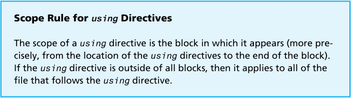

### 创建命名空间

为了将一些代码放在命名空间中，你只需将其放在以下形式的命名空间分组中：

```cpp
namespace NameSpaceName
{
    SomeCode
}
```

当你在代码中包含其中一个分组时，就说你将 SomeCode 中定义的名称放入命名空间 NameSpaceName。这些名称（实际上是这些名称的定义）可以通过 using 指令提供：

```cpp
using namespace NameSpaceName;
```

例如，以下内容取自 Display 12.5，将一个函数声明放在命名空间 savitch1 中：

```cpp
namespace savitch1
{
    void greeting( );
}
```

如果你再次查看 Display 12.5，你会看到函数 greeting 的定义也被放在命名空间 savitch1 中。这是通过以下额外的命名空间分组完成的：

```cpp
namespace savitch1
{
    void greeting( )
    {
        cout << "Hello from namespace savitch1.\n";
    }
}
```

请注意，对于单个命名空间，你可以有任意数量的这些命名空间分组。在 Display 12.5 中，我们对命名空间 savitch1 使用了两个命名空间分组，对命名空间 savitch2 使用了另外两个分组。

在命名空间中定义的每个名称都在命名空间分组内部可用，但名称也可以对命名空间外部的代码可用。命名空间 savitch1 中的该函数声明和函数定义可以通过 using 指令提供：

```cpp
using namespace savitch1;
```

如 Display 12.5 所示。

#### DISPLAY 12.5 命名空间演示

```cpp
1   #include <iostream>
2   using namespace std;
3
4   namespace savitch1
5   {
6       void greeting( );
7   }
8
9   namespace savitch2
10  {
11      void greeting( );
12  }
13
14 void bigGreeting( );
15
16 int main( )
17 {
18     {
19         using namespace savitch2;
20         greeting( );
21     }
22
23     {
24         using namespace savitch1;
25         greeting( );
26     }
27
28     bigGreeting( );
29     return 0;
30 }
31
32
33 namespace savitch1
34 {
35     void greeting()
36     {
37         cout << "Hello from namespace savitch1.\n";
38     }
39 }
40
41 namespace savitch2
42 {
43     void greeting()
44     {
45         cout<< "Greetings from namespace savitch2.\n";
46     }
47 }
48
49 void bigGreeting( )
50 {
51     cout<< "A Big Global Hello!\n";
52 }
```

此块中的名称使用命名空间 savitch2、std 和全局命名空间中的定义。

此块中的名称使用命名空间 savitch1、std 和全局命名空间中的定义。

此处的名称仅使用命名空间 std 和全局命名空间中的定义。

### 示例对话

```cpp
Greetings from namespace savitch2.
Hello from namespace savitch1.
A Big Global Hello!
```

## 自测练习

- 7. 考虑 Display 12.5 所示的程序。我们能否使用名称 greeting 代替 bigGreeting？

- 8. 在自测练习 7 中，我们看到你不能为以下函数添加定义（到全局命名空间）：

  ```cpp
  void greeting();
  ```

  你能为以下函数声明添加定义到全局命名空间吗？

  ```cpp
  void greeting(int howMany);
  ```

- 9. 一个命名空间能有多个命名空间分组吗？

### 限定名称

假设你面临以下情况：你有两个命名空间，ns1 和 ns2。你想使用在 ns1 中定义的函数 fun1 和在命名空间 ns2 中定义的函数 fun2。问题是 ns1 和 ns2 都定义了一个函数 myFunction。（假设本讨论中的所有函数都不带参数，因此重载不适用。）使用以下内容不是一个好主意：

```cpp
using namespace ns1;
using namespace ns2;
```

这将为 myFunction 提供冲突的定义。

你需要一种方法来说明你正在使用 ns1 中的 fun1 和 ns2 中的 fun2，并且不使用 ns1 和 ns2 中的其他任何内容。以下称为 using 声明，它们就是你的答案：

```cpp
using ns1::fun1;
using ns2::fun2;
```

形式为

```cpp
using NameSpace::OneName
```

的 using 声明使命名空间 NameSpace 中的名称 OneName（的定义）可用，但不会使 NameSpace 中的任何其他名称可用。

请注意，你之前见过作用域解析运算符，::。例如，在 Display 12.2 中我们有以下函数定义：

```cpp
void DigitalTime::advance(int hoursAdded, int minutesAdded)
{
    hour = (hour + hoursAdded) % 24;
    advance(minutesAdded);
}
```


在这种情况下，:: 表示我们正在为类 DigitalTime 定义函数 advance，而不是在任何其他类中名为 advance 的任何其他函数。类似地，

```
using ns1::fun1;
```

表示我们使用的是在命名空间 ns1 中定义的名为 fun1 的函数，而不是在任何其他命名空间中对 fun1 的任何其他定义。

现在假设你打算使用命名空间 ns1 中定义的名称 fun1，但你只打算使用一次（或少量几次）。那么你可以使用命名空间的名称和作用域解析运算符来命名该函数（或其他项），如下所示：

```
ns1::fun1( );
```

这种形式通常在指定参数类型时使用。例如，考虑

```
int getNumber(std::istream inputStream)
...
```

在函数 getNumber 中，参数 inputStream 的类型为 istream，其中 istream 在 std 命名空间中定义。如果这是你从 std 命名空间中需要的唯一类型名称（或者你需要的所有名称都类似地用 std:: 限定），那么你就不需要

```
using namespace std;
```

## 关于命名空间的一个微妙点（可选）

using 声明，例如

```
using std::cout;
```

与 using 指令，例如

```
using namespace std;
```

之间有两个区别。

区别如下：

- 1. using 声明（如 using std::cout;）仅使命名空间中的一个名称对你的代码可用，而 using 指令（如 using namespace std;）使命名空间中的所有名称都可用。

- 2. using 声明将一个名称（如 cout）引入你的代码，使得该名称不能被其他用途使用。然而，using 指令仅可能引入命名空间中的名称。

第 1 点很明显。第 2 点有一些微妙之处。例如，假设命名空间 ns1 和 ns2 都为 myFunction 提供了定义，但没有其他名称冲突。那么以下情况不会产生问题：

一个编译单元是一个文件，例如类实现文件，以及文件中 #include 的所有文件，例如类的接口头文件。每个编译单元都有一个无名命名空间。无名命名空间的命名空间分组与任何其他命名空间的写法相同，但不给出名称，如以下示例所示：

```
namespace
{
    void sampleFunction()
    .
    .
} //unnamed namespace
```

在无名命名空间中定义的所有名称都局限于编译单元，因此这些名称可以在编译单元之外被重用于其他用途。例如，显示 12.6 和 12.7 显示了类 DigitalTime 的接口和实现文件的重写版本（也是最终版本）。请注意，帮助函数（readHour、readMinute 和 digitToInt）都位于无名命名空间中，因此它们局限于编译单元。如显示 12.8 所示，无名命名空间中的名称可以在编译单元之外被重用于其他用途。在显示 12.8 中，函数名 readHour 被重用于应用程序中的另一个不同函数。

## DISPLAY 12.6 将类放入命名空间–头文件

```
//Header file dtime.h: This is the interface for the class DigitalTime.
//Values of this type are times of day. The values are input and output in
//24-hour notation, as in 9:30 for 9:30 AM and 14:45 for 2:45 PM.

#ifndef DTIME_H
#define DTIME_H

#include <iostream>
using namespace std;

namespace dtimesavitch
{

    class DigitalTime
    {

    <The definition of the class DigitalTime is the same as in Display 12.1.>
    };
}//end dtimesavitch
#endif //DTIME_H
```

命名空间 dtimesavitch 的一个分组。命名空间 dtimesavitch 的另一个分组在实现文件 dtime.cpp 中。

## DISPLAY 12.7 将类放入命名空间--实现文件（第 1 部分，共 2 部分）

//Implementation file dtime.cpp (your system may require some
//suffix other than .cpp): This is the IMPLEMENTATION of the ADT DigitalTime.
//The interface for the class DigitalTime is in the header file dtime.h.
#include <iostream>
#include <cctype>
#include <cstdlib>
#include "dtime.h"
using namespace std;

namespace
{
    //These function declarations are for use in the definition of
    //the overloaded input operator >>:
    void readHour(istream& ins, int& theHour);
    //Precondition: Next input in the stream ins is a time in 24-hour notation,
    //like 9:45 or 14:45.
    //Postcondition: theHour has been set to the hour part of the time.
    //The colon has been discarded and the next input to be read is the minute.
    void readMinute(istream& ins, int& theMinute);
    //Reads the minute from the stream ins after readHour has read the hour.
    int digitToInt(char c);
    //Precondition: c is one of the digits '0' through '9'.
    //Returns the integer for the digit; for example, digitToInt('3')
    //returns 3.
}//unnamed namespace

namespace dtimesavitch
{
    bool operator ==(const DigitalTime& time1, const DigitalTime& time2)
    <The rest of the definition of == is the same as in Display 12.2.>
    DigitalTime::DigitalTime()
    <The rest of the definition of this constructor is the same as in Display 12.2.>
    DigitalTime::DigitalTime(int theHour, int theMinute)
    <The rest of the definition of this constructor is the same as in Display 12.2.>
    void DigitalTime::advance(int minutesAdded)
    <The rest of the definition of this advance function is the same as in Display 12.2.>
    void DigitalTime::advance(int hoursAdded, int minutesAdded)
    <The rest of the definition of this advance function is the same as in Display 12.2.>
```

无名命名空间的一个分组

命名空间 dtimesavitch 的一个分组。另一个分组在文件 dtime.h 中。

## DISPLAY 12.7 将类放入命名空间–实现文件（第 2 部分，共 2 部分）

```
42      ostream& operator <<(ostream& outs, const DigitalTime& theObject)
    <The rest of the definition of << is the same as in Display 12.2.>
44      //Uses iostream and functions in the unnamed namespace:
45      istream& operator >>(istream& ins, DigitalTime& theObject)
46      {
47          readHour(ins, theObject.hour);
48          readMinute(ins, theObject.minute);
49          return ins;
50      }
51  } //dtimesavitch 52
54  namespace
55  {
56      int digitToInt(char c)
    <The rest of the definition of digitToInt is the same as in Display 12.2.>
58      void readMinute(istream& ins, int& theMinute)
    <The rest of the definition of readMinute is the same as in Display 12.2.>
60      void readHour(istream& ins, int& theHour)
    <The rest of the definition of readHour is the same as in Display 12.2.>
62  }//unnamed namespace
```

在无名命名空间中定义的函数局限于此编译单元（此文件和包含的文件）。它们可以在此文件中的任何位置使用，但在该编译单元之外没有意义。

无名命名空间的另一个分组。

如果你再次查看显示 12.8 中的实现文件，你会看到帮助函数 digitToInt、readHour 和 readMinute 在无名命名空间之外被使用，而没有任何命名空间限定符。无名命名空间中定义的任何名称都可以在编译单元中的任何位置不经限定地使用。（当然，这必须是这样，因为无名命名空间没有名称可用于限定其名称。）

值得注意的是，无名命名空间如何与 C++ 的规则交互，即你不能在同一个命名空间中拥有一个名称的两个定义。每个编译单元都有一个无名命名空间。编译单元重叠是很容易发生的。例如，类的实现文件和使用该类的应用程序程序通常都会包含该类的头文件（接口文件）。因此，头文件位于两个编译单元中，从而参与两个无名命名空间。尽管听起来很危险，只要每个编译单元的命名空间单独考虑时是有意义的，通常不会产生问题。例如，如果一个名称在头文件中的无名命名空间中定义，那么它就不能在实现文件或应用程序文件中的无名命名空间中再次定义。因此，避免了名称冲突。


# **显示 12.8**  将类放入命名空间——应用程序 *（第 1 部分，共 2 部分）*

```cpp
//This is the application file: dtimedomo.cpp. This program
//demonstrates hiding the helping functions in an unnamed namespace.

#include <iostream>
#include "dtime.h"

void readHour(int& theHour);

int main( )
{
    using namespace std;

    using namespace dtimesavitch;

    int theHour;
    readHour(theHour);

    DigitalTime clock(theHour, 0), oldClock;

    oldClock = clock;
    clock.advance(15);
    if (clock == oldClock)
        cout << "Something is wrong. ";
    cout << "You entered " << oldClock << endl;
    cout << "15 minutes later, the time will be "
         << clock << endl;

    clock.advance(2, 15);
    cout << "2 hours and 15 minutes after that\n"
         << "the time will be "
         << clock << endl;

    return 0;
}
void readHour(int& theHour)
{
    using namespace std;

    cout << "Let's play a time game.\n"
         << "Let's pretend the hour has just changed.\n"
         << "You may write midnight as either 0 or 24,\n"
         << "but I will always write it as 0.\n"
         << "Enter the hour as a number (0 to 24):  ";
    cin >> theHour;
    if (theHour == 24)
        theHour = 0;
}
```

> *如果在此处放置 using 指令，则程序行为将保持不变。*

> *这里的 readHour 函数与实现文件 dtime.cpp 中的不同（见显示 12.7）。*

# 显示 12.8 将类放入命名空间——应用程序（第 2 部分，共 2 部分）

### 示例对话

```
Let's play a time game.
Let's pretend the hour has just changed.
You may write midnight as either 0 or 24,
but I will always write it as 0.
Enter the hour as a number (0 to 24): 11
You entered 11:00
15 minutes later the time will be 11:15
2 hours and 15 minutes after that
the time will be 13:30
```

## 编程提示 为命名空间选择名称

最好在命名空间的名称中包含你的姓氏或其他唯一字符串，以减少他人使用与你相同命名空间名称的机会。当多个程序员为同一个项目编写代码时，确保本应不同的命名空间确实具有不同的名称非常重要。否则，你很容易在同一作用域中出现多个相同名称的定义。这就是为什么我们在显示 12.7 中，在命名空间 dtimesavitch 里包含了 savitch 这个名称。

## 未命名命名空间

你可以使用未命名命名空间使定义局限于一个编译单元（即一个文件及其包含的文件）。每个编译单元拥有一个未命名命名空间。在未命名命名空间中定义的所有标识符都局限于该编译单元。若要在一个未命名命名空间中放置定义，只需将其放在一个没有命名空间名称的命名空间分组中，如下所示：

```
namespace
{
    Definition_1
    Definition_2
    .
    .
    Definition_Last
}
```

你可以在编译单元中的任何位置使用未命名命名空间中的任何名称，无需限定符。完整的示例参见显示 12.6 和 12.7。

# 陷阱  混淆全局命名空间与未命名命名空间

不要将全局命名空间与未命名命名空间混淆。如果你没有将名称定义放在命名空间分组中，那么它就在全局命名空间中。要将名称定义放入未命名命名空间，必须将其放在一个如下所示、没有名称的命名空间分组中：

```
namespace
{

```

全局命名空间中的名称和未命名命名空间中的名称都可以在没有限定符的情况下访问。然而，全局命名空间中的名称具有全局作用域（所有程序文件），而未命名命名空间中的名称则局限于一个编译单元。

这种对全局命名空间与未命名命名空间的混淆在编写代码时不太会出现，因为人们倾向于认为全局命名空间中的名称“不在任何命名空间中”，尽管这在技术上是错误的。然而，在讨论代码时，这种混淆很容易产生。

## 自测练习

+   12. 如果将在显示 12.8 中的程序中的 *using* 指令替换为
+   
+   ```cpp
+   using namespace dtimesavitch;
+   ```
+   
+   为以下 *using* 声明，程序行为是否会有所不同？
+   
+   ```cpp
+   using dtimesavitch::DigitalTime;
+   ```

+   13. 以下程序产生的输出是什么？
+   
+   ```cpp
+   #include <iostream>
+   using namespace std;
+   
+   namespace sally
+   {
+       void message( );
+   }
+   namespace
+   {
+       void message( );
+   }
+   int main( )
+   {
+       {
+           message( );
+   ```

```cpp
using sally::message;
message();
}
message();
return 0;
} namespace sally
{
    void message()
    {
        cout << "Hello from Sally.\\n";
    }
} namespace
{
    void message()
    {
        cout << "Hello from unnamed.\\n";
    }
}
```

+   14. 在显示 12.7 中，未命名命名空间有两个分组：一个用于辅助函数声明，一个用于辅助函数定义。我们能否省去辅助函数声明分组？如果可以，该怎么做？

# 章节小结

+   - 在 C++ 中，抽象数据类型（ADT）实现为类，所有成员变量私有，操作实现为公有成员函数、非成员函数和重载运算符。
+   - 你可以将 ADT 定义为类，并将类的定义及其成员函数的实现放在不同的文件中。然后，你可以将 ADT 类与任何使用它的程序分开编译，并且可以在任意数量的不同程序中使用同一个 ADT 类。
+   - 命名空间是名称定义的集合，例如类定义和变量声明。
+   - 有三种方式使用命名空间中的名称：通过 *using* 指令使命名空间中的所有名称可用，通过 *using* 声明使单个名称可用，或者使用命名空间名称和作用域解析运算符限定该名称。
+   - 你可以通过将定义放在一个命名空间分组中来将其放入该命名空间。
+   - 未命名命名空间可用于使名称定义局限于一个编译单元。

## 自测练习答案

+   1. 第 (a)、(b) 和 (c) 部分放入接口文件；第 (d) 至 (h) 部分放入实现文件。（任何类型的 ADT 操作的定义都放入实现文件。）第 (i) 部分（即程序的主部分）放入应用程序文件。
+   2. 接口文件的名称以 .h 结尾。
+   3. 只需要编译实现文件。接口文件不需要编译。
+   4. 只需要重新编译实现文件。不过，你需要重新链接文件。
+   5. 你需要从显示 12.1 所示的接口文件中删除私有成员变量 hour 和 minute，并用成员变量 minutes（带 s）替换它们。你不需要对接口文件做任何其他更改。在实现文件中，你需要更改所有构造函数和其他成员函数的定义，以及重载运算符的定义，使它们适用于这种新的时间记录方式。（在这种情况下，你不需要更改任何辅助函数 readHour、readMinute 或 digitToInt，但对于其他类甚至此类的其他重新实现，情况可能并非如此。）例如，重载运算符 >> 的定义可以改为以下形式：
+   6. 简短的回答是，ADT 就是一个按照良好编程实践将接口与实现分离而定义的类。此外，当我们将一个类描述为 ADT 时，我们认为非成员基本操作（如重载运算符）也是 ADT 的一部分，尽管从严格意义上讲它们不属于 C++ 类。

```
istream& operator >>(istream& ins, DigitalTime& theObject)
{
    int inputHour, inputMinute;
    readHour(ins, inputHour);
    readMinute(ins, inputMinute);
    theObject.minutes = inputMinute + (60 * inputHour);
    return ins;
}
```

你不需要更改使用该类的任何应用程序文件。然而，由于接口文件已更改（实现文件也更改），你将需要重新编译任何应用程序文件，当然还需要重新编译实现文件。


## 练习程序

练习程序通常可以用一个简短的程序来解决，该程序直接应用本章介绍的程序设计原则。

- 1. 为显示12.1和显示12.2中定义的ADT类`DigitalTime`添加以下成员函数：

```cpp
void DigitalTime::intervalSince(const DigitalTime& aPreviousTime, int& hoursInInterval, int& minutesInInterval) const
```

该函数计算两个`DigitalTime`类型值之间的时间间隔。其中一个`DigitalTime`类型值是调用成员函数`intervalSince`的对象，另一个`DigitalTime`类型值作为第一个参数给出。例如，考虑以下代码：

```cpp
DigitalTime current(5, 45), previous(2, 30);
int hours, minutes;
current.intervalSince(previous, hours, minutes);
cout << "The time interval between " << previous << " and " << current << endl
    << "is " << hours << " hours and " << minutes << " minutes.\n";
```

在使用你修订后的`DigitalTime` ADT版本的程序中，这段代码应该产生以下输出：

```
The time interval between 2:30 and 5:45
is 3 hours and 15 minutes.
```

允许第一个参数给出的时间晚于调用对象的时间。在这种情况下，第一个参数给出的时间被视为前一天的同一时间。你还应该编写一个程序来测试这个修订后的ADT类。

- 2. 详细完成自测练习5。写出完整的ADT类，包括接口文件和实现文件。还要编写一个程序来测试你的ADT类。

- 3. 重做第11章的练习程序1，但这次将`Money` ADT类的接口和实现分别放在不同的文件中，以便实现可以与任何应用程序分开编译。

- 4. 重做第11章的练习程序2，但这次将`Pairs` ADT类的接口和实现分别放在不同的文件中，以便实现可以与任何应用程序分开编译。

- 5. 本练习程序探讨未命名命名空间的工作方式。下面列出的是一个程序中的代码片段，用于对用户名和密码进行输入验证。输入并验证用户名的代码与输入并验证密码的代码位于不同的文件中。

文件user.cpp：

```cpp
namespace Authenticate
{
    void inputUserName()
    {
        do
        {
            cout << "Enter your username (8 letters only)" << endl;
            cin >> username;
        } while (!isValid());
    }
    string getUserName()
    {
        return username;
    }
}
```

在未命名命名空间中定义`username`变量和`isValid()`函数，以便代码能够编译。如果`username`恰好包含八个字母，`isValid()`函数应返回`true`。为这段代码生成一个适当的头文件。

对文件password.cpp重复相同的步骤，将`password`变量和`isValid()`函数放在未命名命名空间中。在这种情况下，如果输入的密码至少包含八个字符并且至少包含一个非字母字符，`isValid()`函数应返回`true`：

文件password.cpp：

```cpp
namespace Authenticate
{
    void inputPassword()
    {
        do
        {
            cout << "Enter your password (at least 8 characters " <<
                   "and at least one nonletter)" << endl;
            cin >> password;
        } while (!isValid());
    }
    string getPassword()
    {
        return password;
    }
}
```

此时，你应该有两个名为`isValid()`的函数，分别位于不同的未命名命名空间中。将以下`main`函数放在适当的位置。程序应该能够编译并运行。

```cpp
int main()
{
    inputUserName();
    inputPassword();
    cout << "Your username is " << getUserName() <<
         " and your password is: " <<
         getPassword() << endl;
    return 0;
}
```

用几个无效的用户名和密码测试该程序。

## 编程项目

编程项目比练习程序更需要解决问题的能力，通常可以通过多种不同的方式来解决。请访问www.myprogramminglab.com在线完成其中的许多编程项目，并获得即时反馈。

- 1. 为包含`int`类型元素的数学集合编写一个接口头文件。你应该包括向集合添加元素、与另一个集合并集以及与另一个集合交集的方法。

- 2. 使用包含整数的`vector`实现你在编程项目1中设计的接口。编写一个驱动程序来测试你的接口和类实现。

- 3. 考虑第11章编程项目2中的`ResizeableIntArray`类。将接口分离到单独的头文件中，用名为`Chapter12`的命名空间将其包围，并更新代码的其余部分，使其通过包含新的头文件来编译。

## 指针与链表 13

- **13.1 节点与链表** 774
  - 节点 774
  - nullptr 779
  - 链表 780
  - 在链表头部插入节点 781
  - 陷阱：丢失节点 784
  - 搜索链表 785
  - 指针作为迭代器 789
  - 在链表内部插入和删除节点 789
  - 陷阱：将赋值运算符用于动态数据结构 791
  - 链表的变体 794
  - 类的链表 796
- **13.2 栈与队列** 799
  - 栈 799
  - 编程示例：栈类 800
  - 队列 805
  - 编程示例：队列类 806

## 引言

> 倘若那里碰巧有个人
> 真心实意地爱着我
> 我的心会将他指给我
> 我也会将他指给你。
>
> ——吉尔伯特与沙利文，*《鲁迪戈尔》*

*链表*是一种使用指针构建的列表。链表的大小不是固定的，可以在程序运行期间增长和缩小。本章将向你展示如何定义和操作链表，这将帮助你了解使用指针的一种新方式。

## 先修要求

本章使用第2章到第12章的内容。

## 13.1 节点与链表

有用的动态变量很少是诸如*int*或*double*之类的简单类型，而通常是某种复杂类型，例如数组、*struct*或类类型。你已经看到，数组类型的动态变量可能很有用。*struct*或类类型的动态变量也可能很有用，但方式不同。作为*struct*或类的动态变量通常有一个或多个成员变量，这些成员变量是指针变量，将它们与其他动态变量连接起来。例如，一个恰好包含购物清单的这种结构在显示13.1中给出图示。

### 节点

像显示13.1中所示的那种结构由一些项组成，我们将这些项绘制为由箭头连接的方框。这些方框称为**节点**，箭头表示指针。显示13.1中的每个节点都包含一个字符串、一个整数，以及一个可以指向同类型其他节点的指针。请注意，指针指向整个节点，而不是节点内部的各个项（例如10或“面包卷”）。

在C++中，节点实现为*struct*或类。例如，显示13.1所示类型的节点的*struct*类型定义，以及指向此类节点的指针的类型定义，可以如下所示：

```cpp
struct ListNode
{
    string item;
```

你想要把第一个节点中的数字从10改为12。实现这一目的的一种方法是使用以下语句：

    (*head).count = 12;

赋值运算符左侧的表达式可能需要一点解释。变量`head`是一个指针变量。因此，表达式`*head`就是它所指向的东西，即包含“面包卷”和整数10的节点（动态变量）。这个由`*head`引用的节点是一个struct，该struct中类型为int的成员变量名为count，因此`(*head).count`就是第一个节点中int变量的名称。`*head`周围的括号不是可选的。你需要解引用运算符`*`在点运算符之前执行。然而，点运算符的优先级高于解引用运算符`*`，因此如果没有括号，点运算符将先被执行（这会产生错误）。在下一段中，我们将描述一种可以避免这种括号顾虑的简写记号。

C++有一个可以与指针一起使用的运算符，用于简化指定struct或类成员的记号。箭头运算符`->`结合了解引用运算符`*`和点运算符的作用，用于指定由给定指针指向的动态struct或对象的成员。例如，上面用于更改第一个节点中数字的赋值语句可以更简洁地写为

    head->count = 12;

这个赋值语句与前一个含义相同，但这个形式是通常使用的。

可以使用以下语句将第一个节点中的字符串从“面包卷”改为“百吉饼”：

    head->item = "bagels";

对列表中第一个节点进行这些更改的结果在显示13.2中给出图示。看一下显示13.2所示列表中最后一个节点的指针成员。这最后一个节点在应该有指针的位置写着NULL。在显示13.1中，我们在这个位置填入了短语“结束标记”，但“结束标记”不是C++表达式。在C++程序中，我们使用常量NULL作为结束标记来表示链表的结束。NULL是一个特殊的已定义常量，是C++语言的一部分（作为必需的C++库的一部分提供）。

NULL通常用于两个不同（但往往重合）的目的。它用于给一个否则不会有任何值的指针变量赋予一个值。这防止了对内存的意外引用，因为NULL不是任何内存位置的地址。第二类用途是作为结束


## 显示 13.2 访问节点数据

```
head->count = 12;
head->item = "bagels";
```

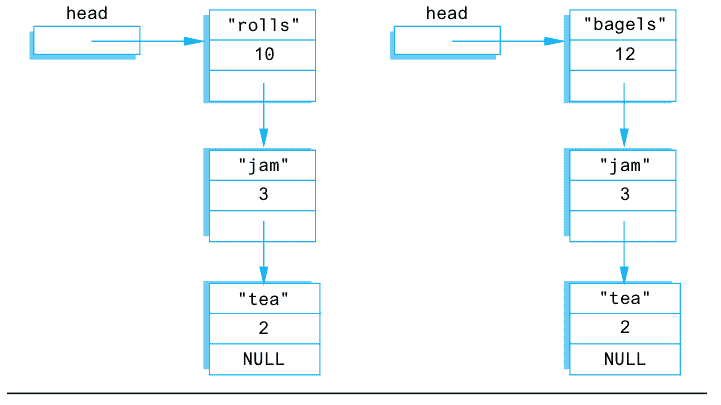

标记。程序可以像显示13.2所示那样逐步遍历节点列表，当程序到达包含 NULL 的节点时，它就知道已经到达列表的末尾。

常量 NULL 实际上是数字 0，但我们更倾向于把它看作 NULL 并拼写为 NULL。这样可以清楚地表明，你指的是这个可以赋给指针变量的特殊用途的值。标识符 NULL 的定义位于多个标准库中，例如 `<iostream>` 和 `<cstddef>`，因此当你使用 NULL 时，应当使用包含 `<iostream>` 或 `<cstddef>`（或其他合适的库）的 include 指令。不需要 using 指令即可让 NULL 在你的程序代码中可用。特别是，它并不要求 `using namespace std;;`，尽管你代码中的其他内容很可能需要类似 `using namespace std;` 的语句。

NULL 是 0

1 详情如下：NULL 的定义由 C++ 预处理器处理，预处理器将 NULL 替换为 0。因此，编译器实际上永远看不到 "NULL"，所以不存在命名空间问题，也不需要 using 指令。

## 箭头运算符 ->

箭头运算符 -> 指定由指针变量指向的结构体（或类对象）的成员。语法如下：

```
Pointer_Variable->Member_Name
```

上面指的是由 Pointer_Variable 指向的结构体或对象的成员。具体是哪个成员由 Member_Name 给出。

例如，假设你有以下定义：

```
struct Record
{
    int number;
    char grade;
};
```

下面创建一个 Record 类型的动态变量，并将该动态结构体变量的成员变量设置为 2001 和 'A'：

```
Record *p;
p = new Record;
p->number = 2001;
p->grade = 'A';
```

可以使用赋值运算符将指针设置为 NULL，如下所示，它声明了一个名为 there 的指针变量并将其初始化为 NULL：

```
double *there = NULL;
```

常量 NULL 可以赋给任何指针类型的指针变量。

## NULL

NULL 是一个特殊的常量值，用于给原本没有值的指针变量赋值。NULL 可以赋给任何类型的指针变量。标识符 NULL 定义在多个库中，包括头文件为 `<cstddef>` 的库和头文件为 `<iostream>` 的库。常量 NULL 实际上是数字 0，但我们更倾向于把它看作 NULL 并拼写为 NULL。

## nullptr

常量 `NULL` 实际上是数字 0 这一事实会导致一个歧义问题。考虑下面的重载函数：

```
```cpp
void func(int *p);
void func(int i);
```
```

如果我们调用 `func(NULL)`，会调用哪个函数呢？由于 NULL 是数字 0，两者同样有效。C++11 通过引入一个新常量 `nullptr` 解决了这个问题。`nullptr` 不是整数零，而是一个用于表示空指针的字面常量。在任何你曾为指针使用 NULL 的地方，都可以使用 `nullptr`。例如，我们可以这样写：

```
```cpp
double *there = nullptr;
```
```

## nullptr

`nullptr` 是一个特殊的常量值，其使用方式与 NULL 相同，但它只能赋给**指针**。它不是数字 0。使用 `nullptr` 来区分空指针和数字 0。`nullptr` 是在 C++11 中引入的。

## 自测练习

- 1. 假设你的程序包含以下类型定义：

```
```cpp
struct Box
{
    string name;
    int number;
    Box *next;
};

typedef Box* BoxPtr;
```
```

以下代码产生的输出是什么？

```
```cpp
BoxPtr head;
head = new Box;
head->name = "Sally";
head->number = 18;
cout << (*head).name << endl;
cout << head->name << endl;
cout << (*head).number << endl;
cout << head->number << endl;
```
```

- 2. 假设你的程序包含自测练习1中给出的类型定义和代码。该代码创建了一个包含字符串 "Sally" 和数字 18 的节点。为了将该节点的成员变量 next 的值设置为 NULL，你应添加什么代码？

- 3. 假设你的程序包含自测练习1中给出的类型定义和代码。假设指针变量 head 的值没有改变，你如何销毁 head 所指向的动态变量，并将其使用的内存返回到自由存储区，以便它可以被重用来创建新的动态变量？

- 4. 给定以下结构定义：

```
struct ListNode
{
    string item;
    int count;
    ListNode *link;
};
ListNode *head = new ListNode;
```

编写代码，将字符串 “Wilbur’s brother Orville” 赋给 head 所指向节点的成员 item。

## 链表

显示13.2中所示的这类列表称为链表。链表是一种节点列表，其中每个节点都有一个成员变量，该变量是指向列表中下一个节点的指针。链表中的第一个节点称为头节点，这就是为什么指向第一个节点的指针变量命名为 head 的原因。注意，名为 head 的指针本身并不是链表的头，而只是指向链表的头。最后一个节点没有特殊的名称，但它有一个特殊的性质：最后一个节点的成员指针变量的值为 NULL。要测试一个节点是否为最后一个节点，只需测试该节点中的指针变量是否等于 NULL。

本节的目标是编写一些用于操作链表的基本函数。为了有所变化并简化符号，我们将使用比显示13.2中更简单的节点类型。这些节点只包含一个整数和一个指针。我们将使用的节点和指针类型定义如下：

```
struct Node
{
    int data;
    Node *link;
};
typedef Node* NodePtr;
```

作为热身练习，让我们看看如何用这种类型的节点构造链表的起始部分。我们首先声明一个名为 head 的指针变量，它将指向链表的头节点：

```
NodePtr head;
```

为了创建第一个节点，我们使用运算符 new 创建一个新的动态变量，它将作为链表中的第一个节点。

```
head = new Node;
```

然后给这个新节点的成员变量赋值：

```
head->data = 3;
head->link = NULL;
```

注意，这个节点的指针成员被设置为 NULL。这是因为该节点是链表中的最后一个节点（同时也是第一个节点）。在这个阶段，我们的链表如下图所示：


我们的单节点列表是以一种纯粹临时的方式构建的。要拥有更大的链表，程序必须能够以系统的方式添加节点。下面我们介绍一种在链表中插入节点的简单方法。

## 在表头插入节点

在本小节中，我们假设链表已经包含一个或多个节点，并开发一个函数来添加另一个节点。插入函数的第一个参数将是链表头指针（即指向链表中第一个节点的指针变量）的引用参数。另一个参数将给出要存储在新节点中的数字。我们的插入函数的函数声明如下：

```
void headInsert(NodePtr& head, int theNumber);
```

## 链表作为实参

你应该始终保留一个指向链表头节点的指针变量。这个指针变量是命名链表的一种方式。当你编写一个将链表作为实参的函数时，这个指针（指向链表头节点的指针）可以作为链表实参使用。

为了在链表中插入一个新节点，我们的函数将使用 *new* 运算符创建一个新节点。然后将数据复制到新节点中，并将新节点插入到链表的表头。当我们这样插入节点时，新节点将是链表中的第一个节点（即头节点），而不是最后一个节点。由于动态变量没有名称，我们必须使用一个局部指针变量来指向这个节点。如果我们将局部指针变量命名为 `tempPtr`，那么新节点可以被称为 `*tempPtr`。整个过程可以总结如下：

## `headInsert` 函数的伪代码

- 1. 创建一个由 `tempPtr` 指向的新动态变量。（这个新的动态变量就是新节点。这个新节点可以称为 `*tempPtr`。）
- 2. 将数据放入这个新节点。
- 3. 让这个新节点的 link 成员指向原始链表的头节点（第一个节点）。
- 4. 让名为 `head` 的指针变量指向这个新节点。

显示13.3包含了这一算法的示意图。图中的步骤2和步骤3可以用以下 C++ 赋值语句表示：

```
tempPtr->link = head;
head = tempPtr;
```

完整的函数定义在显示13.4中给出。

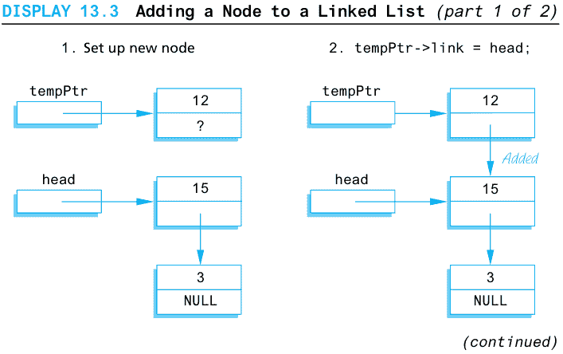


### DISPLAY 13.3 向链表添加一个节点（第 2 部分，共 2 部分）

3. `head = tempPtr;`

4. 函数调用后

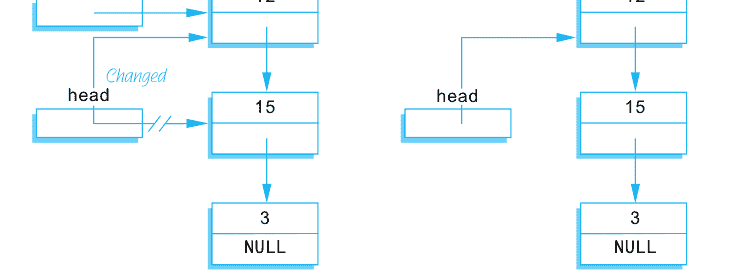

### DISPLAY 13.4 在链表头部添加节点的函数

### 函数声明

```
1   struct Node
2   {
3       int data;
4       Node *link;
5   };
6
7   typedef Node* NodePtr;
8
9   void headInsert(NodePtr& head, int theNumber);
10  //Precondition: The pointer variable head points to
11  //the head of a linked list.
12  //Postcondition: A new node containing theNumber
13  //has been added at the head of the linked list.
```

### 函数定义

```
1   void headInsert(NodePtr& head, int theNumber)
2   {
3       NodePtr tempPtr;
4       tempPtr = new Node;
5
6       tempPtr->data = theNumber;
7
8       tempPtr->link = head;
9       head = tempPtr;
10  }
```

你需要允许列表可能为空的情况。例如，购物清单可能什么都没有，因为本周没有东西可买。什么都没有的列表称为空列表。链表是通过命名指向列表头的指针来命名的，但空列表没有头节点。要指定空列表，你使用指针 NULL。如果指针变量 head 应该指向链表的头节点，并且你想表示列表为空，那么你将 head 的值设为如下：

```
head = NULL;
```

每当你为操作链表设计一个函数时，你都应该始终检查它是否适用于空列表。如果不适用，你可能能够为空列表添加一个特殊情况。如果无法设计该函数以适用于空列表，那么你的程序必须以其他方式处理空列表或完全避免它们。幸运的是，空列表通常可以像任何其他列表一样处理。例如，显示 13.4 中的函数 headInsert 是以非空列表为模型设计的，但检查会显示它也适用于空列表。

## PITFALL 丢失节点

你可能会想用指针变量 head 而不是使用局部指针变量 tempPtr 来构造新节点，从而编写 headInsert 的函数定义（显示 13.4）。如果你尝试这样做，你可能会从以下开始函数：

```
head = new Node;
head->data = theNumber;
```

此时新节点已构造，包含正确的数据，并且由指针 head 指向，正如它应该的那样。剩下的唯一工作就是通过设置下面的指针成员使其指向原来列表的第一个节点，从而将列表的其余部分连接到此节点：

```
head->link
```

显示 13.5 显示了当新数据值为 12 时的情况。该图揭示了问题。如果你以这种方式继续下去，就不会有任何东西指向包含 15 的节点。由于没有命名的指针指向它（或以该节点结尾的指针链），程序无法引用此节点。此节点下面的节点也丢失了。程序无法使指针指向这两个节点，也无法访问这些节点中的数据，也无法对这些节点做任何其他操作。它根本无法引用这些节点。

### DISPLAY 13.5 丢失的节点

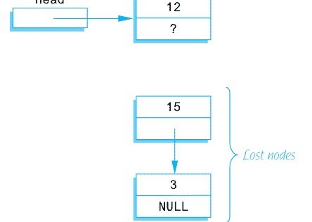

这种情况会占用内存直到程序结束。丢失节点的程序有时被称为存在“内存泄漏”。严重的内存泄漏可能导致程序耗尽内存，导致异常终止。更糟的是，普通用户程序中的内存泄漏（丢失节点）可能导致操作系统崩溃。为了避免此类丢失节点，程序必须始终保持某个指针指向列表的头部，通常是像 head 这样的指针变量中的指针。

## 搜索链表

接下来我们将设计一个函数来搜索链表以定位特定节点。我们将使用与前面小节中相同的节点类型，称为 Node。节点和指针类型的定义在显示 13.4 中给出。我们设计的函数将有两个参数：一个用于链表，一个用于我们想要定位的整数。该函数将返回一个指向包含该整数的第一个节点的指针。如果没有节点包含该整数，函数将返回指针 NULL。这样，我们的程序可以通过检查函数是否返回不等于 NULL 的指针值来测试该整数是否在列表上。我们的函数声明和头注释如下：

```
NodePtr search(NodePtr head, int target);
//Precondition: The pointer head points to the head of
//a linked list. The pointer variable in the last node
//is NULL. If the list is empty, then head is NULL.
//Returns a pointer that points to the first node that
//contains the target. If no node contains the target,
//the function returns NULL.
```

我们将使用一个局部指针变量，称为 here，来遍历列表寻找目标。移动链表或任何其他由节点和指针组成的数据结构的唯一方法就是跟随指针。因此我们将从 here 指向第一个节点开始，并从节点到节点移动指针，沿着每个节点的指针走。这项技术在显示 13.6 中示意。由于空列表会带来一些会使讨论变得混乱的小问题，我们一开始假设链表至少包含一个节点。稍后我们将回来确保算法也适用于空列表。此搜索技术产生以下算法：

### search 函数的伪代码

使指针变量 here 指向链表的头节点（即第一个节点）。

```
while (here is not pointing to a node containing target
    and here is not pointing to the last node)
{
    Make here point to the next node in the list.
}
if (the node pointed to by here contains target)
    return here;
else
    return NULL;
```

为了将指针 here 移动到下一个节点，我们必须以我们可用的命名指针为出发点思考。下一个节点是当前由 here 指向的节点的指针成员所指向的节点。当前由 here 指向的节点的指针成员由表达式给出

```
here->link
```

为了将 here 移动到下一个节点，我们希望更改 here 使其指向上述命名指针（成员）变量所指向的节点。因此，以下语句将把指针 here 移动到列表中的下一个节点：

```
here = here->link;
```

把这些部分组合起来得到算法伪代码的以下细化：

### search 函数的代码初步版本

```
here = head;

while (here->data != target && here->link != NULL)
    here = here->link;

if (here->data == target)
    return here;
else
    return NULL;
```

注意 while 语句中的布尔表达式。我们通过测试成员变量 here->link 是否不等于 NULL 来测试 here 是否不是指向最后一个节点。

当 here 为 NULL 时，它不指向任何节点，因此没有名为 data 的成员也没有名为 link 的成员。因此，我们对空列表做特殊处理。完整的函数定义在显示 13.7 中给出。

### DISPLAY 13.7 定位链表中节点的函数

### 函数声明

```
1   struct Node
2   {
3       int data;
4       Node *link;
5   };
6
7   typedef Node* NodePtr;
8
9   NodePtr search(NodePtr head, int target);
10  //Precondition: The pointer head points to the head of
11  //a linked list. The pointer variable in the last node
12  //is NULL. If the list is empty, then head is NULL.
13  //Returns a pointer that points to the first node that
14  //contains the target. If no node contains the target,
15  //the function returns NULL.
```

### 函数定义

```
1   //Uses cstddef:
2   NodePtr search(NodePtr head, int target)
3   {
4       NodePtr here = head;
5
6       if (here == NULL)
7       {
8           return NULL;
9       }
10      else
11      {
12          while (here->data != target &&
13                  here->link != NULL)
14              here = here->link;
15
16          if (here->data == target)
17              return here;
18          else
19              return NULL;
20      }
21  }
```

空列表情况


## 指针作为迭代器

**迭代器**是一种构造，它允许你遍历存储在数据结构中的数据项，以便你对每个数据项执行所需的操作。迭代器可以是某种迭代器类的对象，也可以是更简单的东西，例如数组索引或指针。指针提供了迭代器的一个简单示例。事实上，指针是迭代器的原型示例。基本思想在链表的上下文中很容易看出。你可以通过从链表的头部开始一次一个节点地移动指针来使用指针作为迭代器，并遍历列表中的所有节点。总体轮廓如下：

```cpp
Node_Type *iter;
for (iter = head; iter != NULL; iter = iter->link)
    Do whatever you want with the node pointed to by iter;
```

其中 `head` 是指向链表头节点的指针，而 `link` 是节点中指向列表中下一个节点的成员变量的名称。

例如，要输出我们一直在讨论的这种链表中所有节点的数据，你可以使用

```cpp
NodePtr iter; //Equivalent to: Node *iter;
for (iter = head; iter != NULL; iter = iter->link)
    cout << (iter->data);
```

Node 和 NodePtr 的定义在 Display 13.7 中给出。

## 在列表中插入和删除节点

我们接下来设计一个函数，用于在链表的指定位置插入节点。如果希望节点按某种特定顺序排列，例如数值顺序或字母顺序，就不能简单地将节点插入列表的开头或结尾。因此，我们将设计一个函数，用于在链表中指定节点之后插入节点。我们假设某个其他函数或程序部分已正确放置了一个名为 `afterMe` 的指针，指向链表中的某个节点。我们希望新节点放置在 `afterMe` 指向的节点之后，如 Display 13.8 所示。相同的技术适用于任何类型数据的节点，但为了具体起见，我们使用的是前面各小节中相同的节点类型。类型定义在 Display 13.7 中给出。我们要定义的函数的函数声明为：


```cpp
void insert(NodePtr afterMe, int theNumber);
//Precondition: afterMe points to a node in a linked list.
//Postcondition: A new node containing theNumber
//has been added after the node pointed to by afterMe.
```

新节点的设置方式与 Display 13.4 中函数 `headInsert` 中的设置方式相同。此函数与该函数之间的区别在于，我们现在希望将节点插入的不是列表的头部，而是 `afterMe` 指向的节点之后。

**Display 13.8  在链表中间插入**

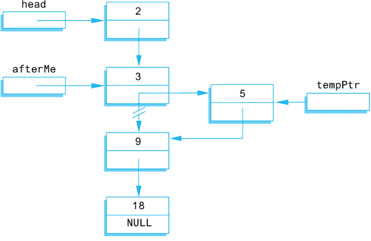

插入方法如 Display 13.8 所示，并在 C++ 代码中表示如下：

```cpp
// add a link from the new node to the list:
tempPtr->link = afterMe->link;
// add a link from the list to the new node:
afterMe->link = tempPtr;
```

这两个赋值语句的顺序至关重要。在第一个赋值中，我们希望在它被更改之前获取指针值 afterMe->link。完整的函数在 Display 13.9 中给出。

如果你阅读函数 insert 的代码，你会发现即使 `afterMe` 指向的节点是列表中的最后一个节点，它也能正确工作。然而，insert 不能用于在链表开头插入节点。Display 13.4 中给出的函数 headInsert 可用于在列表开头插入节点。

通过使用函数 insert，你可以按数值顺序、字母顺序或其他顺序维护链表。你可以通过简单地调整两个指针将新节点“挤入”正确的位置。这与链表的长度无关，也与你希望新数据进入列表中的位置无关。如果你改用数组，则必须复制数组的大部分，在极端情况下是全部，以为正确位置的新值腾出空间。尽管定位指针 afterMe 会产生开销，但在链表中插入通常比在数组中插入更有效。

从链表中删除节点也很容易。Display 13.10 说明了该方法。一旦指针 before 和 discard 定位好

**Display 13.10 删除节点**

- 1. 将指针 discard 定位使其指向要删除的节点，并将指针 before 定位使其指向要删除节点之前的节点。
- 2. `before->link = discard->link;`

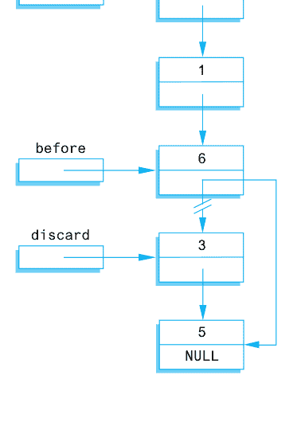

```cpp
delete discard;
```

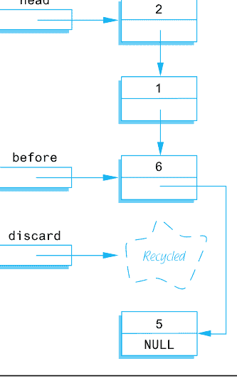

然而，你必须记住只有一个链表，而不是两个。如果你更改了 head1 指向的链表，那么 head2 指向的链表也会改变，因为它们是同一个链表。

如果 head1 指向一个链表，而你希望 head2 指向该链表的第二个相同副本，上面的赋值语句将不起作用。相反，你必须逐节点复制整个链表。或者，你可以重载赋值运算符 =，使其表示你想要的含义。重载 = 在第 11 章的“重载赋值运算符”小节中讨论。

## 自测练习

- 5. 为链表中的节点和指针编写类型定义。节点类型称为 NodeType，指针类型称为 PointerType。链表将是字母列表。
- 6. 链表通常通过给出指向列表中第一个节点的指针来给出，但空列表没有第一个节点。通常使用什么指针值来表示空列表？
- 7. 假设你的程序包含以下类型定义和指针变量声明：

```cpp
struct Node
{
    double data;
    Node *next;
};

typedef Node* Pointer;
Pointer p1, p2;
```

假设 p1 指向此类型的链表上的一个节点。编写代码使 p1 指向此链表上的下一个节点。（指针 p2 用于下一个练习，与本练习无关。）

- 8. 假设你的程序包含与自测练习 7 相同的类型定义和指针变量声明。假设此外 p2 指向链表上类型为 Node 的节点，并且不是列表上的最后一个节点。编写代码将删除 p2 指向的节点之后的节点。执行此代码后，链表应保持不变，只是链表上的节点少一个。（提示：你可能希望声明另一个指针变量来使用。）
- 9. 选择一个答案并解释它。

对于包含相同类型对象的较大数组和较大列表，将新对象插入链表中间的已知位置与在数组中插入相比

- a. 更有效
- b. 效率更低
- c. 差不多
- d. 取决于两个列表的大小

## 链表的变体

在本小节中，我们给你一个提示，说明使用节点和指针可以创建多少种数据结构。我们简要描述了另外两种数据结构，双向链表和二叉树。

普通链表只允许你沿一个方向向下移动列表（沿着链接）。双向链表中的节点有两个链接，一个链接指向下一个节点，一个链接指向前一个节点。图示上，双向链表看起来像 Display 13.11 中的示例列表。

双向链表的节点类可以如下：

```cpp
struct Node
{
    int data;
    Node *forwardLink;
    Node *backLink;
};
```

而不是指向头节点的单个指针，双向链表通常具有指向两个端节点的指针。你可以称这些指针为 front 和 back，尽管 front 和 back 的选择是任意的。双向链表类中构造函数的定义以及一些函数将不得不改变（与单向链表的情况相比）以适应额外的链接。

树是一种数据结构，其结构如 Display 13.12 所示。特别是，在树中，你可以通过遵循链接的某条路径从顶部（根）节点到达任何节点。请注意，树中没有环。如果你遵循链接，最终会到达一个“末端”。请注意，每个节点有两个链接指向其他节点（或值 NULL）。这种树称为二叉树，因为

**Display 13.11 双向链表**

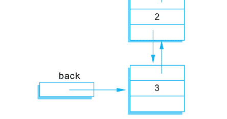


## DISPLAY 13.12 二叉树

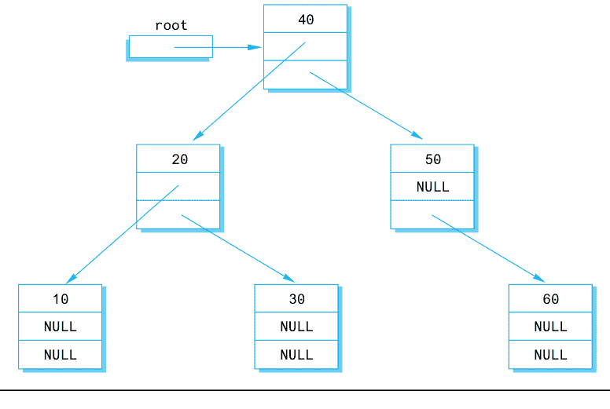

每个节点恰好有两个链接。还有其他种类的树，其节点中的链接数量不同，但二叉树是最常见的情况。

树并不是一种链表的形式，但确实以与链表中相似的方式使用链接（指针）。二叉树的节点类型的定义本质上与双向链表中的定义相同，但两个链接通常使用左和右的某种形式命名。以下是一个可用于构建二叉树的节点类型：

```
struct TreeNode
{
    int data;
    TreeNode *leftLink;
    TreeNode *rightLink;
};
```

在 Display 13.12 中，名为 root 的指针指向根节点（“顶部节点”）。根节点的作用类似于普通链表中头节点的作用（Display 13.10）。可以通过跟随链接从根节点到达树中的任何节点。

术语 tree 可能听起来像是误称。根位于树的顶部，而分支结构看起来更像根的分支结构而不是树的分支结构。术语的秘密在于将图片（Display 13.12）倒过来。图片随后确实类似于树的分支结构，而根节点就是树根开始的位置。分支末端的节点，其两个链接实例变量均设置为 NULL，被称为叶节点，这一术语现在可能更有意义了。

尽管本书中没有空间深入探讨该主题，但二叉树可用于高效地存储和检索数据。

## 类的链表

在前面的示例中，我们通过使用 struct 来保存列表中节点的 contents 来创建链表。也可以使用 class 而不是 struct 来创建相同的数据结构。逻辑是相同的，只是使用和定义 class 的语法应替换为 struct 的语法。

Display 13.13 和 13.14 说明了如何定义一个 Node 类。数据变量使用信息隐藏原则声明为 private，并创建了公共方法来访问数据值和链接中的下一个节点。Display 13.15 通过在列表前端插入新节点创建了一个包含五个节点的短列表

VideoNote
Walkthrough of Linked
Lists of Classes

## DISPLAY 13.13 Node 类的接口文件

```
//This is the header file for Node.h. This is the interface for
a node class that behaves similarly to the struct defined
in Display 13.4
namespace linkedlistofclasses
{
    class Node
    {
    public:
        Node();
        Node(int value, Node *next);
        //Constructors to initialize a node

        int getData() const;
        //Retrieve value for this node

        Node *getLink() const;
        //Retrieve next Node in the list

        void setData(int value);
        //Use to modify the value stored in the list

        void setLink(Node *next);
        //Use to change the reference to the next node

    private:
        int data;
        Node *link;
    };
    typedef Node* NodePtr;
} //linkedlistofclasses
//Node.h
```

## DISPLAY 13.14 Node 类的实现文件

```
//This is the implementation file Node.cpp.
//It implements logic for the Node class. The interface
//file is in the header file Node.h
#include <iostream>
#include "Node.h"

namespace linkedlistofclasses
{
    Node::Node() : data(0), link(NULL)
    {
        //deliberately empty
    }

    Node::Node(int value, Node *next) : data(value), link(next)
    {
        //deliberately empty
    }

    //Accessor and Mutator methods follow

    int Node::getData() const
    {
        return data;
    }

    Node* Node::getLink() const
    {
        return link;
    }

    void Node::setData(int value)
    {
        data = value;
    }

    void Node::setLink(Node *next)
    {
        link = next;
    }
} //linkedlistofclasses
//Node.cpp
```

## DISPLAY 13.15 使用 Node 类的程序（第 1 部分，共 3 部分）

//This program demonstrates the creation of a linked list
//using the Node class. Five nodes are created, output, then
//destroyed.

## DISPLAY 13.15 使用 Node 类的程序（第 2 部分，共 3 部分）

```
```cpp
#include <iostream>
#include "Node.h"

using namespace std;
using namespace linkedlistofclasses;

//This function inserts a new node onto the head of the list
//and is a class-based version of the same function defined
//in Display 13.4.
void headInsert(NodePtr& head, int theNumber)
{
    NodePtr tempPtr;
    //The constructor sets tempPtr->link to head and
    //sets the data value to theNumber
    tempPtr = new Node(theNumber, head);
    head = tempPtr;
}

int main()
{
    NodePtr head, tmp;

    //Create a list of nodes 4 -> 3 -> 2 -> 1 -> 0
    head = new Node(0, NULL);
    for (int i = 1; i < 5; i++)
    {
        headInsert(head, i);
    }
    //Iterate through the list and display each value
    tmp = head;
    while (tmp != NULL)
    {
        cout << tmp->getData() << endl;
        tmp = tmp->getLink();
    }
    //Delete all nodes in the list before exiting
    //the program.
    tmp = head;
    while (tmp != NULL)
    {
        NodePtr nodeToDelete = tmp;
        tmp = tmp->getLink();
        delete nodeToDelete;
    }
    return 0;
}
```
```

## DISPLAY 13.15 使用 Node 类的程序（第 3 部分，共 3 部分）

# Sample Dialogue

```
4
3
2
1
0
```

将新节点插入到列表的前端。headInsert 函数在逻辑上与 Display 13.4 中定义的相同函数相同，只是使用了为 Node 类定义的构造函数来设置数据。

## 13.2 栈和队列

> 但现在在前的，将要在后；在后的，将要在前。

马太福音 19:30

链表有许多应用。在本节中，我们给出它们可以用于的两个示例。我们使用链表来实现两种已知的数据结构，即栈和队列。在本节中，我们始终使用常规链表而不是双向链表。

## 栈

栈是一种数据结构，它以与数据存储顺序相反的顺序检索数据。假设你将字母 'A'、'B' 然后 'C' 放入栈中。当你从栈中取出这些字母时，它们将被移除

## DISPLAY 13.16 一个栈

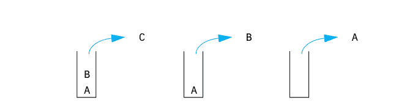

按 'C'、'B' 然后 'A' 的顺序。这次栈的使用在 Display 13.16 中进行了图解。如图所示，你可以将栈想象成地面上的一个洞。为了从栈中取出某样东西，你必须先移除上面想要取出的物品。因此，栈通常被称为后进先出（LIFO）数据结构。

栈被用于许多语言处理任务。在第 14 章中，我们将讨论计算机系统如何使用栈来跟踪 C++ 函数调用。然而，在这里我们只做一个非常简单的应用。我们在此示例中的目标是向你展示如何使用链表技术来实现特定的数据结构；栈是链表使用的一个简单示例。你不必阅读第 14 章就能理解此示例。

## 编程示例

## 一个栈类

我们的 Stack 类的接口在 Display 13.17 中给出。此特定栈用于存储类型为 char 的数据。你可以定义一个类似的栈来存储任何其他类型的数据。对栈可以执行两个基本操作：将项目添加到栈中以及从栈中移除项目。

## DISPLAY 13.17 栈类的接口文件（第 1 部分，共 2 部分）

```
1  //This is the header file stack.h. This is the interface for the class Stack,
2  //which is a class for a stack of symbols.
3  #ifndef STACK_H
4  #define STACK_H
5  namespace stacksavitch
6  {
7      struct StackFrame
8      {
9          char data;
10         StackFrame *link;
11     };
12     typedef StackFrame* StackFramePtr;
13     class Stack
14     {
15     public:
16         Stack();
17         //Initializes the object to an empty stack.
18         Stack(const Stack& aStack);
19         //Copy constructor.
20         ~Stack();
21         //Destroys the stack and returns all the memory to the freestore.
```

(continued)


## DISPLAY 13.18 使用栈类的程序（第 2 部分，共 2 部分）

```
9   stack s;
10  char next, ans;
11
12  do
13  {
14      cout << "Enter a word: ";
15      cin.get(next);
16      while (next != '\n')
17      {
18          s.push(next);
19          cin.get(next);
20      }
21
22      cout << "Written backward that is: ";
23      while ( ! s.empty() )
24      cout << s.pop();
25      cout << endl;
26
27      cout << "Again?(y/n): ";
28      cin >> ans;
29      cin.ignore(10000, '\n');
30  } while (ans != 'n' && ans != 'N');
31
32  return 0;
33  }
```

<cin 的 ignore 成员在第 8 章中讨论。它丢弃当前输入行上剩余的输入，最多 10,000 个字符或直到输入回车。它还丢弃行尾的回车（'\n'）。>

# Sample Dialogue

```
Enter a word: straw
Written backward that is: warts
Again?(y/n): y
Enter a word: C++
Written backward that is: ++C
Again?(y/n): n
```

### Implementation

屏幕。因为数据是从栈中以与进入栈的顺序相反的顺序移除，所以输出显示单词的倒写。

如 Display 13.19 所示，我们的 Stack 类被实现为一个链表，其中链表的头作为栈顶。成员变量 top 是一个指向链表头的指针。

## DISPLAY 13.19 Stack 类的实现（第 1 部分，共 2 部分）

```
//This is the implementation file stack.cpp.
//This is the implementation of the class Stack.
//The interface for the class Stack is in the header file stack.h.
#include <iostream>
#include <cstdlib>
#include "stack.h"
using namespace std;

namespace stacksavitch
{
    //Uses cstddef:
    Stack::Stack( ) : top(NULL)
    {
        //Body intentionally empty.
    }
    
    Stack::Stack(const Stack& aStack)
        <The definition of the copy constructor is Self-Test Exercise 11.>
    Stack::~Stack( )
    {
        char next;
        while (! empty( ))
            next = pop( ); //pop calls delete.
    }
    
    //Uses cstddef:
    bool Stack::empty( ) const
    {
        return (top == NULL);
    }
    
    void Stack::push(char theSymbol)
        <The rest of the definition is Self-Test Exercise 10.>
    //Uses iostream and cstdlib:
    char Stack::pop( )
    {
        if (empty( ))
        {
            cout << "Error: popping an empty stack.\n";
            exit(1);
        }
    }
```

## DISPLAY 13.19 Stack 类的实现（第 2 部分，共 2 部分）

```
41     char result = top->data;

    StackFramePtr tempPtr;
    tempPtr = top;
    top = top->link;

    delete tempPtr;

    return result;
  }
}//stacksavitch
```

编写成员函数 push 的定义是自测练习 10。然而，我们已经给出了此任务的算法。push 成员函数的代码本质上与 Display 13.4 中显示的 headInsert 函数相同，只是 push 成员函数中使用名为 top 的指针代替名为 head 的指针。

空栈只是一个空链表，因此空栈通过将指针 top 设置为 NULL 来实现。一旦你意识到 NULL 代表空栈，默认构造函数的实现和成员函数 empty 的实现就显而易见了。

拷贝构造函数的定义有点复杂，但没有使用我们尚未讨论过的任何技术。细节留给自测练习 11。

pop 成员函数首先检查栈是否为空。如果栈不为空，它将继续移除栈顶字符。它将局部变量 result 设置为栈顶的符号。操作如下：

```
char result = top->data;
```

在栈顶节点的符号保存到变量 result 之后，指针 top 被移动到链表中的下一个节点，从而有效地从列表中移除了栈顶节点。指针 top 的移动使用以下语句完成：

```
top = top->link;
```

然而，在指针 top 被移动之前，一个临时指针，称为 tempPtr，被定位使其指向即将从列表中移除的节点。然后可以使用以下对 delete 的调用来移除该节点：

```
delete tempPtr;
```

由成员函数 pop 从链表中移除的每个节点都通过对 delete 的调用来销毁。因此，析构函数需要做的就是通过对 pop 的调用来移除栈中的每个项目。然后每个节点的内存将被返回到 freestore。

## SELF-TEST EXERCISES

10. 给出 Display 13.17 中描述的类 Stack 的成员函数 push 的定义。

11. 给出 Display 13.17 中描述的类 Stack 的拷贝构造函数的定义。

## Queues

栈是一种后进先出的数据结构。另一种常见的数据结构是队列，它以先进先出 FIFO 的方式处理数据。队列的行为与人们排队等待银行出纳员或其他服务完全相同。人们按进入队列的顺序被服务（队列）。队列的操作在 Display 13.20 中说明。

队列可以用链表实现，其方式与我们对 Stack 类的实现类似。然而，队列需要在链表的头部和另一端都有指针，因为操作发生在两个位置。从链表头部移除节点比从另一端移除节点更容易。因此，我们的实现将从链表头部移除节点（我们现在称其为列表的前端），并将节点添加到列表的另一端，我们现在称其为列表的后端（或队列的后端）。

Queue

队列是一种先进先出的数据结构；也就是说，数据项是从队列中以与它们添加到队列相同的顺序移除的。

## DISPLAY 13.20 一个队列

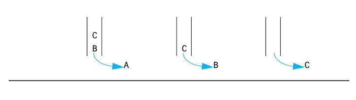

## PROGRAMMING EXAMPLE — A Queue Class

我们队列类的接口在 Display 13.21 中给出。这个特定的队列用于存储类型为 `char` 的数据。你可以定义一个类似的队列来存储任何其他类型的数据。你可以在队列上执行两个基本操作：将项目添加到队列末尾以及从队列前端移除项目。

## DISPLAY 13.21 队列类的接口文件

```cpp
//This is the header file queue.h. This is the interface for the class Queue,
//which is a class for a queue of symbols.
#ifndef QUEUE_H
#define QUEUE_H
namespace queuesavitch
{
    struct QueueNode
    {
        char data;
        QueueNode *link;
    };
    typedef QueueNode* QueueNodePtr;

    class Queue
    {
    public:
        Queue();
        //Initializes the object to an empty queue.
        Queue(const Queued &aQueue);
        ~Queue();
        void add(char item);
        //Postcondition: item has been added to the back of the queue.
        char remove();
        //Precondition: The queue is not empty.
        //Returns the item at the front of the queue and
        //removes that item from the queue.
        bool empty() const;
        //Returns true if the queue is empty. Returns false otherwise.
    private:
        QueueNodePtr front; //Points to the head of a linked list.
                           //Items are removed at the head
        QueueNodePtr back;  //Points to the node at the other end of the
                           //linked list. Items are added at this end.
    };
}//queuesavitch
#endif //QUEUE_H
```

Display 13.22 显示了一个简单的程序，说明了队列类的使用方式。该程序一次读取一个字母的单词并将字母放入队列中。然后程序逐个移除字母并将其写入屏幕。因为数据是从队列中以与进入队列相同的顺序移除，所以输出显示的字母与用户输入的顺序相同。将此队列的应用与 Display 13.18 中给出的使用栈的类似应用进行对比是很有益的。

## DISPLAY 13.22 使用队列类的程序（第 1 部分，共 2 部分）

```
//Program to demonstrate use of the Queue class.
#include <iostream>
#include "queue.h"
using namespace std;
using namespace queuesavitch;

int main()
{
    Queue q;
    char next, ans;

    do
    {
        cout << "Enter a word: ";
        cin.get(next);
        while (next != '\n')
        {
            q.add(next);
            cin.get(next);
        }

        cout << "You entered: ";
        while ( ! q.empty() )
            cout << q.remove();
        cout << endl;

        cout << "Again?(y/n): ";
        cin >> ans;
        cin.ignore(10000, '\n');
    } while (ans !='n' && ans != 'N');

    return 0;
}
```

> <cin 的 ignore 成员在第 8 章中讨论。它丢弃当前输入行上剩余的输入，最多 10,000 个字符或直到输入回车。它还丢弃行尾的回车（'\n'）。>


## DISPLAY 13.22 Program Using the Queue Class (part 2 of 2)

# Sample Dialogue

```
Enter a word: straw
You entered: straw
Again?(y/n): y
Enter a word: C++
You entered: C++
Again?(y/n): n
```

### Implementation

As shown in Displays 13.21 and 13.23, our queue class is implemented as a linked list in which the head of the list serves as the front of the queue. The member variable front is a pointer that points to the head of the linked list. Nodes are removed at the head of the linked list. The member variable back is a pointer that points to the node at the other end of the linked list. Nodes are added at this end of the linked list.

An empty queue is just an empty linked list, so an empty queue is implemented by setting the pointers front and back equal to NULL. The rest of the details of the implementation are similar to things we have seen before.

## DISPLAY 13.23 Implementation of the Queue Class (part 1 of 3)

```
//This is the implementation file queue.cpp.
//This is the implementation of the class Queue.
//The interface for the class Queue is in the header file queue.h.
#include <iostream>
#include <cstdlib>
#include <cstddef>
#include "queue.h"
using namespace std;

namespace queuesavitch
{
    //Uses cstddef:
    Queue::Queue() : front(NULL), back(NULL)
    {
        //Intentionally empty.
    }

    Queue::Queue(const Queue& aQueue)
        <The definition of the copy constructor is Self-Test Exercise 12.>

```

## DISPLAY 13.23 Implementation of the Queue Class (part 2 of 3)

```
20

   Queue::~Queue()
       <The definition of the destructor is Self-Test Exercise 13.>

   //Uses cstddef:
   bool Queue::empty() const
   {
       return (back == NULL); //front == NULL would also work
   }

   //Uses cstddef:
   void Queue::add(char item)
   {
       if (empty())
       {
           front = new QueueNode;
           front->data = item;
           front->link = NULL;
           back = front;
       }

       else
       {
           QueueNodePtr tempPtr;
           tempPtr = new QueueNode;
           tempPtr->data = item;
           tempPtr->link = NULL;
           back->link = tempPtr;
           back = tempPtr;
       }
   }

   //Uses cstdlib and iostream:
   char Queue::remove()
   {
       if (empty())
       {
           cout << "Error: Removing an item from an empty queue.\n";
           exit(1);
       }

       char result = front->data;

       QueueNodePtr discard;
       discard = front;
       front = front->link;
```

## DISPLAY 13.23 Implementation of the Queue Class (part 3 of 3)

```
    if (front == NULL) //if you removed the last node
        back = NULL;

    delete discard;

    return result;
    }
}//queuesavitch
```

## SELF-TEST EXERCISES

- 12. Give the definition of the copy constructor for the class Queue described in Display 13.21.
- 13. Give the definition of the destructor for the class Queue described in Display 13.21.

## CHAPTER SUMMARY

- - A node is a struct or class object that has one or more member variables that are pointer variables. These nodes can be connected by their member pointer variables to produce data structures that can grow and shrink in size while your program is running.
- - A linked list is a list of nodes in which each node contains a pointer to the next node in the list.
- - The end of a linked list (or other linked data structure) is indicated by setting the pointer member variable equal to NULL or nullptr.
- - A stack is a first-in/last-out data structure. A stack can be implemented using a linked list.
- - A queue is a first-in/first-out data structure. A queue can be implemented using a linked list.

## Answers to Self-Test Exercises

- 1. Sally
  Sally
  18
  18

Note that (*head).name and head->name mean the same thing. Similarly, (*head).number and head->number mean the same thing

2. The best answer is

```
head->next = NULL;
```

However, the following is also correct:

```
(*head).next = NULL;
```

3. delete head;

4. head->item = "Wilbur's brother Orville";

```
struct NodeType
{
    char data;
    NodeType *link;
};
typedef NodeType* PointerType;
```

6. The pointer value NULL is used to indicate an empty list.

```
p1 = p1-> next;
```

7. p1 = p1-> next;

8. Pointer discard;

```
discard = p2->next;
//discard now points to the node to be deleted.
p2->next = discard->next;
```

This is sufficient to delete the node from the linked list. However, if you are not using this node for something else, you should destroy the node with a call to delete as follows:

```
delete discard;
```

9. a. Inserting a new item at a known location into a large linked list is more efficient than inserting into a large array. If you are inserting into a list, you have about five operations, most of which are pointer assignments, regardless of the list size. If you insert into an array, on the average you have to move about half the array entries to insert a data item.

For small lists, the answer is (c), about the same.

```
//Uses cstddef:
void Stack::push(char theSymbol)
{
    StackFramePtr tempPtr;
    tempPtr = new StackFrame;
```

```
```cpp
tempPtr->data = theSymbol;
tempPtr->link = top;
top = tempPtr;
}
```
```

```
```cpp
11. //Uses cstddef:
Stack::Stack(const Stack& aStack)
{
    if (aStack.top == NULL)
        top = NULL;
    else
    {
        StackFramePtr temp = aStack.top; //temp moves
            //through the nodes from top to bottom of
            //aStack.
        StackFramePtr end; //Points to end of the new stack.

        end = new StackFrame;
        end->data = temp->data;
        top = end;
        //First node created and filled with data.
        //New nodes are now added AFTER this first node.

        temp = temp->link;
        while (temp != NULL)
        {
            end->link = new StackFrame;
            end = end->link;
            end->data = temp->data;
            temp = temp->link;
        }
        end->link = NULL;
    }
}
```
```

```
```cpp
12. //Uses cstddef:
Queue::Queue(const Queue& aQueue)
{
    if (aQueue.empty())
        front = back = NULL;
    else
    {
        QueueNodePtr tempPtrOld = aQueue.front;
        //tempPtrOld moves through the nodes
        //from front to back of aQueue.
        QueueNodePtr tempPtrNew;
        //tempPtrNew is used to create new nodes.

        back = new QueueNode;
        back->data = tempPtrOld->data;
```

```
listPtr = new Node;
listPtr->name = "Emily";

tempPtr = new Node;
tempPtr->name = "James";
listPtr->link = tempPtr;

tempPtr->link = new Node;
tempPtr = tempPtr->link;
tempPtr->name = "Joules";
tempPtr->link = NULL;

return 0;
}
```

Add code to the main function that:

- a. Outputs in order all names in the list.
- b. Inserts the name "Joshua" in the list after "James" then outputs the modified list.
- c. Deletes the node with "Joules" then outputs the modified list.
- d. Deletes all nodes in the list.

2. Displays 13.13, 13.14 and 13.15 demonstrate a Node represented by a class structure. At the end of the main method in Display 13.15, all the dynamic memory is deleted through a loop outside the class. Without this loop, the program would leak memory. Modify the class definition such that the Node class is able to destroy the objects it points to through a destructor rather than the main method.

## PROGRAMMING PROJECTS

Programming Projects require more problem-solving than Practice Programs and can usually be solved many different ways. Visit www.myprogramminglab.com to complete many of these Programming Projects online and get instant feedback.

- 1. Write a void function that takes a linked list of integers and reverses the order of its nodes. The function will have one call-by-reference parameter that is a pointer to the head of the list. After the function is called, this pointer will point to the head of a linked list that has the same nodes as the original list, but in the reverse of the order they had in the original list. Note that your function will neither create nor destroy any nodes. It will simply rearrange nodes. Place your function in a suitable test program.
- 2. Write a function called mergeLists that takes two call-by-reference arguments that are pointer variables that point to the heads of linked lists of values of type int. The two linked lists are assumed to be sorted so that the number at the head is the smallest number, the number in the next node is the next smallest, and so forth. The function returns a pointer to


一个新链表的头节点，其中包含原始两个链表中的所有节点。这个更长链表中的节点同样按值从小到大排序。请注意，你的函数既不会创建也不会销毁任何节点。当函数调用结束时，两个指针变量参数的值应为 NULL。

### 3. 设计并实现一个类，其对象表示多项式。

多项式

$a_n x^n + a_{n-1} x^{n-1} + \dots + a_0$

将实现为一个链表。每个节点包含一个 int 值表示 x 的幂次，以及一个 int 值表示对应的系数。类的操作应包括加、减、乘以及多项式求值。重载运算符 +、- 和 * 分别用于加、减和乘。

多项式求值实现为一个成员函数，其参数类型为 int。该求值成员函数返回将参数代入 x 并执行相应运算后得到的值。包含四个构造函数：一个默认构造函数、一个拷贝构造函数、一个带单个 int 类型参数的构造函数（生成仅包含一个常数项且等于构造参数的多项式），以及一个带两个 int 类型参数的构造函数（生成单项式多项式，其系数和指数由这两个参数给出）。（在上面的记号中，单参数构造函数生成的多项式是仅由 $a_0$ 组成的简单形式。双参数构造函数生成的多项式是稍微复杂一点的形式 $a_n x^n$。）包含一个合适的析构函数。包含输入和输出多项式的成员函数。

当用户输入一个多项式时，用户输入以下形式：

$a_n x^n + a_{n-1} x^{n-1} + \dots + a_0$

但是，如果某项的系数 $a_i$ 为零，用户可以省略该项 $a_i x^i$。例如，多项式

$3x^4 + 7x^2 + 5$

可以输入为

3x^4 + 7x^2 + 5

也可以输入为

3x^4 + 0x^3 + 7x^2 + 0x^1 + 5

以及可能还有一个额外的指针。

对于链表节点，你需要以下结构体（位于列表类外部）：

```
struct node
{
    double item;
    node *next;
};
```

增量开发对于任何规模的项目都至关重要，本项目也不例外。先编写 List 类的定义，但暂不实现任何成员。将此类的定义放在文件 list.h 中。然后在一个包含 int main(){} 的文件中 #include "list.h"。编译你的文件。这样可以发现语法错误和许多拼写错误，如果你在未进行此检查的情况下尝试实现成员，这些错误会造成极大的麻烦。然后，你应该一次实现并编译一个成员，直到在 main 函数中有足够的代码来编写测试代码。

### 6. 在一个古老的国度里，美丽的公主伊芙有许多追求者。

她决定采用以下程序来确定她将嫁给哪位追求者。首先，所有追求者将排成一队，并分配编号。第一位追求者编号为 1，第二位为 2，依此类推，直到最后一位追求者编号为 n。她从第一位追求者开始，沿着队伍数三位追求者（因为她名字中有三个字母），第三位追求者将被淘汰，不能赢得她的芳心，并从队伍中移除。然后伊芙继续，再数三位追求者，并淘汰每第三位追求者。当她数到队尾时，她会从头继续数。

例如，如果有六位追求者，那么淘汰过程如下进行：

- 123456      初始追求者列表，从 1 开始计数
- 12456       追求者 3 被淘汰，从 4 开始继续计数
- 1245        追求者 6 被淘汰，从 1 开始继续计数
- 125         追求者 4 被淘汰，从 5 开始继续计数
- 15          追求者 2 被淘汰，从 5 开始继续计数
- 1           追求者 5 被淘汰，1 是幸运的获胜者

编写一个程序，创建一个循环链表节点，以确定如果有 n 位追求者时，你应该站在哪个位置才能娶到公主。循环链表是一种链表，其中列表中最后一个节点的链接字段指向列表的头节点。你的程序应通过删除与淘汰过程中每一步被淘汰的追求者相对应的节点来模拟该过程。考虑你可能需要删除列表中“头”节点的情况。


### 7. 重做（或首次完成）第 9 章的编程项目 5。

但是，不要使用动态数组来存储每个计算机站点的用户 ID 列表，而是使用链表。这些列表的节点应包含站点编号以及登录该站点的用户的用户 ID。如果没有人登录某个计算机站点，则该计算机站点在链表中不应存在任何条目。

### 8. 修改或重写 Queue 类（显示 13.21 至 13.23），以模拟车辆管理局（DMV）柜台的客户到达情况。

当客户到达时，他们会被分配一个票号，从 1 开始，每来一位新客户就递增。当客服人员空闲时，下一个票号的客户被叫到。这种系统形成了一个按票号排序的 FIFO 客户队列。编写一个程序，实现该队列并模拟客户进入和离开队列。进入队列的输入应该是票号以及该票号进入队列时的时间戳。当一个客服人员处理下一个客户时，票及其对应的时间戳被移除。你的程序应保存最后三位客户在队列中等待的时长。每次从队列中移除一个票号时，更新这些时间，并输出最后三位客户的平均值，作为下一位客户被处理所需时间的估计。如果队列中没有人，输出该队列为空。

下面给出了基于计算机时钟计算时间戳的代码。在大多数 C++ 实现中，time(NULL) 函数返回自 1970 年 1 月 1 日以来的秒数：

```
#include <ctime>
...
int main()
{
    long seconds;
    seconds = static_cast<long>(time(NULL));
    cout << "Seconds since 1/1/1970: " << seconds << endl;
    return 0;
}
```

示例执行如下所示：

```
The line is empty.
Enter '1' to simulate a customer's arrival, '2' to help the next customer, or '3' to quit.
1
Customer 1 entered the queue at time 100000044.
Enter '1' to simulate a customer's arrival, '2' to help the next customer, or '3' to quit.
1
Customer 2 entered the queue at time 100000049.
Enter '1' to simulate a customer's arrival, '2' to help the next customer, or '3' to quit.
1
Customer 3 entered the queue at time 100000055.
Enter '1' to simulate a customer's arrival, '2' to help the next customer, or '3' to quit.
2
Customer 1 is being helped at time 100000069. Wait time = 25 seconds.
The estimated wait time for customer 2 is 25 seconds.
Enter '1' to simulate a customer's arrival, '2' to help the next customer, or '3' to quit.
2
Customer 2 is being helped at time 100000076. Wait time = 27 seconds.
The estimated wait time for customer 3 is 26 seconds.
Enter '1' to simulate a customer's arrival, '2' to help the next customer, or '3' to quit.
1
Customer 4 entered the queue at time 100000080.
Enter '1' to simulate a customer's arrival, '2' to help the next customer, or '3' to quit.
2
Customer 3 is being helped at time 100000099. Wait time = 44 seconds.
The estimated wait time for customer 4 is 32 seconds.
```

### 9. 下图被称为图。

圆圈称为节点，线条称为边。一条边连接两个节点。你可以将图解释为一个由房间和通道组成的迷宫。节点可以看作房间，边将一个房间连接到另一个房间。请注意，图中的每个节点最多有四条边。

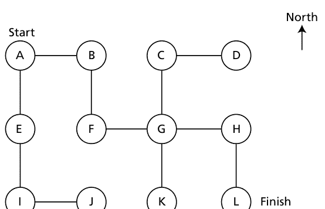


编写一个程序，使用节点和指针实现迷宫。图中的每个节点都将对应于以类或结构体形式实现的你代码中的一个节点。边对应于从一个节点指向另一个节点的双向链接。将用户置于节点 A。用户的目标是到达节点 L 的终点。程序应输出可能的向北、向南、向东或向西移动方向。示例执行如下所示。

你位于迷宫的 A 房间，里面有许多曲折的小通道，都很相似。
你可以向 (E)东、(S)南或 (Q)退出。
E

你位于迷宫的 B 房间，里面有许多曲折的小通道，都很相似。
你可以向 (W)西、(S)南或 (Q)退出。
S

你位于迷宫的 F 房间，里面有许多曲折的小通道，都很相似。
你可以向 (E)东、(N)北或 (Q)退出。
E

## 10. 编写一个程序，使用另外两个栈对一组整数值进行重新排列和排序。以下算法描述了如何实现此操作：

+   1. 从名为 primary 的数字栈和两个空栈 lower 和 higher 开始。
+   2. 从 primary 栈弹出第一个数字并将其放入 lower 栈
+   3. 从 primary 栈弹出下一个数字，如果它小于你之前放入 lower 栈的数字，则将其添加到 lower 栈，否则将其放入 higher 栈。
+   4. 重复步骤 3 直到 primary 栈为空。
+   5. 弹出 lower 栈中的每个元素并将其重新添加回 primary 栈。
+   6. 弹出 higher 栈的每个元素。如果该值大于 primary 栈头部的值，则将其添加到 primary 栈，否则将该数字添加到 lower 栈。
+   7. 从步骤 3 重复到步骤 6 的过程，直到 higher 和 lower 栈均不包含元素。此时，primary 栈将被排序。

提示：使用第 13.17 和 13.19 节中给出的栈类实现作为设计栈数据类型的起点。

## 11. 编写一个双向链表类以在 Node 对象中存储 double 值。包含以下功能：

+   - 在前端和后端插入的函数
+   - 返回第一个和最后一个元素值的函数
+   - 以正向和反向打印列表的函数
+   - 删除第一个元素和最后一个元素的函数
+   - 检查列表是否包含某个元素的函数
+   - 清空整个列表的函数
+   - 检查列表是否为空的函数
+   - 返回列表大小的函数

通过在前端和后端添加元素来测试你的类，以正向和反向打印列表并删除元素。有许多可能的边界情况需要检查，例如删除列表中的最后一个元素或打印空列表。考虑其他测试用例以检查双向链表的完整功能。确保你的双向链表类和 Node 类仔细处理动态内存并且不泄漏内存。

本页 intentionally left blank


# Recursion 14

+   **14.1 RECURSIVE FUNCTIONS FOR TASKS** 825
+   
+   *Case Study:* Vertical Numbers 825
+   
+   A Closer Look at Recursion 831
+   
+   *Pitfall:* Infinite Recursion 833
+   
+   Stacks for Recursion 834
+   
+   *Pitfall:* Stack Overflow 836
+   
+   Recursion Versus Iteration 836

+   **14.2 RECURSIVE FUNCTIONS FOR VALUES** 838
+   
+   General Form for a Recursive Function That Returns a Value 838
+   
+   *Programming Example:* Another Powers Function 838

+   **14.3 THINKING RECURSIVELY** 843
+   
+   Recursive Design Techniques 843
+   
+   *Case Study:* Binary Search—An Example of Recursive Thinking 844
+   
+   *Programming Example:* A Recursive Member Function 852

+   Chapter Summary 856
+   
+   Answers to Self-Test Exercises 856

+   Practice Programs 861
+   
+   Programming Projects 861


在一次关于宇宙学和太阳系结构的讲座后，威廉·詹姆斯被一位小老太太拦住。
“你关于太阳是太阳系中心、地球是围绕其旋转的球体的理论听起来很有说服力，詹姆斯先生，但它是错误的。我有一个更好的理论，”小老太太说。
“那是什么，夫人？”詹姆斯礼貌地问道。
“我们生活在巨龟背上的地球地壳上。”
不愿通过大量科学证据来摧毁这个荒谬的小理论，詹姆斯决定通过让对手看到其立场的不足来温和地劝阻她。
“如果你的理论正确，夫人，”他问道，“这只乌龟站在什么上面？”
“你是个很聪明的人，詹姆斯先生，这是一个很好的问题，”小老太太回答道，“但我对此有一个答案。那就是：第一只乌龟站在第二只、更大得多的乌龟背上，后者正好在它下方。”
“但这第二只乌龟站在什么上面？”詹姆斯耐心地追问。
对此，小老太太得意地叫道。“没用，詹姆斯先生——一直都是乌龟。”

J. R. R. TOLLKIEN, Constraints on Variables in Syntax

## INTRODUCTION

你已经遇到了一些循环定义的情况，结果令人满意。最突出的例子是某些 C++ 语句的定义。例如，while 语句的定义说它可以包含其他（更小的）语句。由于这些更小语句的可能性之一是另一个 while 语句，因此该定义中存在一种循环性。while 语句的定义，如果写成完整细节，将包含对 while 语句的引用。在数学中，这种循环定义称为递归定义。在 C++ 中，函数可以以同样的方式用自身来定义。更精确地说，函数定义可能包含对自身的调用。在这种情况下，函数被称为递归。本章讨论 C++ 中的递归，以及更一般地将递归作为编程和问题解决技术。

## PREREQUISITES

第 14.1 和 14.2 节仅使用第 2 章到第 5 章的材料。第 14.3 节使用第 2 章到第 7 章和第 10 章的材料。

## 14.1 RECURSIVE FUNCTIONS FOR TASKS

> 我还记得《一千零一夜》中那个夜晚，当时谢赫拉查德（由于抄写员的一个神奇疏忽）开始逐字逐句地讲述《一千零一夜》的故事，从而冒着再次来到她必须重复它的那个夜晚的风险，并由此走向无限。

JORGE LUIS BORGES, The Garden of Forking Paths

当你编写一个函数来解决一个任务时，一个基本的设计技术是将任务分解为子任务。有时会出现至少一个子任务是同一任务的较小示例的情况。例如，如果任务是在数组中搜索特定值，你可能会将其分为搜索数组前半部分的子任务和搜索数组后半部分的子任务。搜索数组半部分的子任务是“更小”的原始任务版本。每当一个子任务是原始任务的较小版本时，你就可以使用递归函数来解决原始任务。需要一点训练才能轻松地以这种方式分解问题，但一旦你学会了这种技术，它可以成为设计算法、最终是 C++ 函数的最快方法之一。我们从一个简单的案例研究开始来说明这种技术。

# Recursion

在 C++ 中，函数定义可能包含对正在定义的函数的调用。在这种情况下，函数被称为递归。

## CASE STUDY Vertical Numbers

在本案例研究中，我们设计一个递归的 void 函数，将数字写到屏幕上，数字以垂直方式书写，使得例如 1984 将被写成


# Problem Definition

我们函数的声明和头部注释如下：

```
void writeVertical(int n);
//Precondition: n >= 0.
//Postcondition: The number n is written to the screen
//vertically with each digit on a separate line.
```


### 算法设计

一种情况非常简单。如果 n，即要写出的数字，只有一位长，那么只需写出该数字。尽管如此简单，这个情况仍然很重要，所以让我们跟踪它。

*简单情况：* 如果 n < 10，则将数字 n 写到屏幕上。

现在让我们考虑更典型的情况，即要写出的数字包含多位。假设你想垂直写出数字 1234，使得结果为

```text
1
2
3
4
```

将此任务分解为两个子任务的一种方法是如下：

- 1. 输出除最后一位之外的所有数字，如下所示：

  ```text
  1
  2
  3
  ```

- 2. 输出最后一位数字，在此示例中为 4。

子任务 1 是原始任务的一个较小版本，因此我们可以用递归调用来实现此子任务。子任务 2 只是我们之前列出的简单情况。因此，我们的函数 `writeVertical` 的算法大纲，其参数为 n，由以下伪代码给出：

```cpp
if (n < 10)
{
    cout << n << endl;
}
else //n is two or more digits long:
{
    writeVertical(the number n with the last digit removed);
    cout << the last digit of n << endl;
}
```

为了将此伪代码转换为 C++ 函数的代码，我们需要做的只是将以下两个伪代码片段翻译成 C++ 表达式：

the number n with the last digit removed

和

the last digit of n

这些表达式可以很容易地使用整数除法运算符 / 和 % 翻译成 C++ 表达式，如下所示：

```cpp
n / 10 //the number n with the last digit removed
n % 10 //the last digit of n
```

例如，1234 / 10 的计算结果为 123，而 1234 % 10 的计算结果为 4。

我们选择此算法中使用的两个子任务的几个因素影响了我们的选择。其中之一是我们能够轻松计算对 writeVertical 的递归调用的参数（在颜色中显示），我们在伪代码中使用了该递归调用。去掉最后一位的数字 n 可以很容易地计算为 n/10。作为替代方案，你可能曾想过按如下方式划分子任务：

- 1. 输出 n 的第一位数字。
- 2. 输出去掉 n 的第一位数字后的数字。

这也是将任务分解为子任务的完全有效的方法，并且可以递归实现。然而，计算从数字中删除第一位数字的结果很困难，而计算从数字中删除最后一位数字的结果很容易。

选择这种分解的另一个原因是其中一个子情况不涉及递归调用。递归函数的成功定义始终包括至少一个不涉及递归调用的情况（以及一个或多个涉及至少一次递归调用的情况）。递归算法的这个方面在随后的案例研究之后的小节中进行了讨论。

## 编码

我们现在可以将所有部分放在一起，生成递归函数 writeVertical，如显示 14.1 所示。在下一小节中，我们将解释递归在此示例中如何工作的更多细节。

**DISPLAY 14.1 A Recursive Output Function**

```cpp
1   //Program to demonstrate the recursive function writeVertical.
2   #include <iostream>
3   using namespace std;
4
5   void writeVertical(int n);
6   //Precondition: n >= 0.
7   //Postcondition: The number n is written to the screen vertically
8   //with each digit on a separate line.
9
10  int main()
11  {
12      cout << "writeVertical(3):" << endl;
13      writeVertical(3);
14
15      cout << "writeVertical(12): " << endl;
16      writeVertical(12);
17
18      cout << "writeVertical(123):" << endl;
19      writeVertical(123);
20
21      return 0;
22 }
23
24 //uses iostream:
25 void writeVertical(int n)
26 {
27     if (n < 10)
28     {
29         cout << n << endl;
30     }
31     else //n is two or more digits long:
32     {
33         writeVertical(n / 10);
34         cout << (n % 10) << endl;
35     }
36 }
```

**Sample Dialogue**

```text
writeVertical(3):
3
writeVertical(12):
1
2
writeVertical(123):
1
2
3
```

## Tracing a Recursive Call

让我们看看当进行以下函数调用时会发生什么：

```cpp
writeVertical(123);
```

当执行此函数调用时，计算机就像处理任何函数调用一样进行处理。参数 123 被替换为函数定义中的参数 n，并执行函数体。在将 123 替换为 n 之后，要执行的代码如下：

```cpp
if (123 < 10)
{
    cout << 123 << endl;
}
else //n is two or more digits long:
{
    writeVertical(123 / 10);
    cout << (123 % 10) << endl;
}
```

*Computation will stop here until the recursive call returns.*

由于 123 不小于 10，if-else 语句中的逻辑表达式为假，因此执行 else 部分。然而，else 部分以以下函数调用开始：

```cpp
writeVertical(n / 10);
```

由于 n 等于 123，这就是调用

```cpp
writeVertical(123 / 10);
```

等价于

```cpp
writeVertical(12);
```

当执行到达此递归调用时，当前函数计算被置于暂停状态并执行此递归调用。当此递归调用完成时，暂停计算的执行将返回到此处，并且暂停计算将从此处继续。

递归调用

```cpp
writeVertical(12);
```

的处理方式与其他函数调用一样。参数 12 被替换为参数 n，并执行函数体。在将 12 替换为 n 之后，有两个计算，一个暂停，一个活动，如下所示：

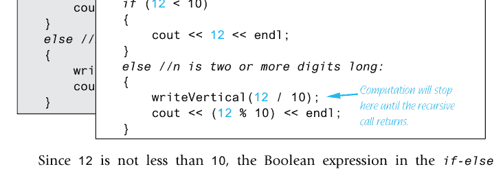

由于 12 不小于 10，if-else 语句中的布尔表达式为假，因此执行 else 部分。然而，正如你已经看到的，else 部分以递归调用开始。递归调用的参数是 n / 10，在本例中等价于 12 / 10。因此，writeVertical 函数的此第二次计算被暂停并执行以下递归调用：

```cpp
writeVertical(12 / 10);
```

等价于

```cpp
writeVertical(1);
```

此时有两个暂停的计算在等待恢复，计算机开始执行此新的递归调用，该调用的处理方式与之前的所有递归调用一样。参数 1 被替换为参数 n，并执行函数体。此时，计算如下所示：

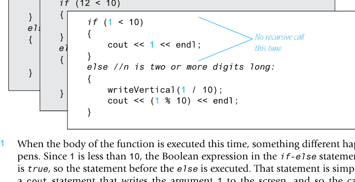

*Output the digit 1*

当再次执行函数体时，发生了不同的事情。由于 1 小于 10，if-else 语句中的布尔表达式为真，因此执行 else 之前的语句。该语句只是一个 cout 语句，将参数 1 写到屏幕上，因此调用 writeVertical(1) 将 1 写到屏幕上并结束，而没有递归调用。

当调用 writeVertical(1) 结束时，等待其结束的暂停计算将从其离开的地方恢复，如下所示：

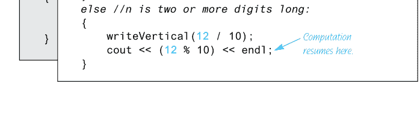

当此暂停计算恢复时，它执行一个 `cout` 语句，输出值 `12 % 10`，即 2。这结束了该计算，但还有另一个暂停的计算在等待恢复。当此最后一个暂停计算恢复时，情况如下：

*Output the digit 2*

```cpp
if (123 < 10)
{
    cout << 123 << endl;
}
else //n is two or more digits long:
{
    writeVertical(123 / 10);
    cout << (123 % 10) << endl;
}
```

*Computation resumes here.*

当此最后一个暂停计算恢复时，它输出值 `123 % 10`，即 3，并且原始函数调用的执行结束。果然，数字 1、2 和 3 已按顺序每行一个写到屏幕上。

*Output the digit 3*

## A Closer Look at Recursion

函数 `writeVertical` 的定义使用递归。然而我们在评估函数调用 `writeVertical(123)` 时并没有做任何新或不同的事情。我们像对待前几章中看到的任何函数调用一样对待它。我们只是将参数 123 替换为参数 n，然后执行函数定义中的代码。当我们到达递归调用时

```cpp
writeVertical(123 / 10);
```

我们只是重复这个过程一次。

计算机跟踪递归调用的方式如下。当调用一个函数时，计算机为参数（s）插入参数并开始执行代码。如果它遇到递归调用，则暂时停止其计算。这是因为它必须知道递归调用的结果后才能继续。它保存继续计算所需的所有信息并继续评估递归调用。当递归调用完成后，计算机返回以完成外部计算。

**How recursion works**

C++ 语言对函数定义中递归调用的使用没有任何限制。然而，为了使递归函数定义有用，它必须设计成任何对函数的调用最终都必须以不依赖于递归的代码片段终止。

**How recursion ends**


函数可以调用自身，而这次递归调用又可以再次调用该函数。这个过程可以重复任意多次。然而，除非最终某次递归调用不再依赖递归，否则这个过程不会终止。一个成功的递归函数定义的一般轮廓如下：

-   一个或多个情形：函数通过使用递归调用来完成一个或多个更小规模的任务，从而达成自身任务。
-   一个或多个情形：函数在不使用任何递归调用的情况下完成任务。这些不含任何递归调用的情形称为**基本情形**或**停止情形**。

通常，由*if-else*语句决定执行哪种情形。一个典型场景是：最初的函数调用执行一个包含递归调用的情形；这次递归调用又可能执行一个需要另一次递归调用的情形。这样重复若干次，每次递归调用都会产生另一次递归调用，但最终应当适用某个停止情形。*函数的每次调用最终都必须导向某个停止情形，否则函数调用将因无限的递归调用链而永远不会结束。*（在实践中，包含无限递归调用链的调用通常不会真的永远运行，而是会异常终止。）

确保最终到达停止情形的最常见方法是，将函数编写成在每次递归调用时都减小某个（正）数值量，并为某个“小”值提供停止情形。这正是我们在程序清单 14.1 中设计函数 `writeVertical` 的方式。当调用函数 `writeVertical` 时，该调用会产生一个使用较小参数的递归调用。这个过程持续下去，每次递归调用都会产生另一次递归调用，直到参数小于 10。当参数小于 10 时，函数调用结束，不再产生任何递归调用，整个过程逐层返回到最初的调用，然后结束。

## 递归函数定义的一般形式

一个成功的递归函数定义的一般轮廓如下：

-   一个或多个情形包含对正在定义的函数的一次或多次递归调用。这些递归调用应当解决该函数所执行任务的“更小”版本。
-   一个或多个不包含任何递归调用的情形。这些不含递归调用的情形称为**基本情形**或**停止情形**。

### 陷阱——无限递归

在前一小节讨论的函数 `writeVertical` 的例子中，递归调用序列最终到达了一次不涉及递归的函数调用（也就是说，到达了一个停止情形）。另一方面，如果每次递归调用都会产生另一次递归调用，那么对该函数的调用在理论上将永远运行下去。这称为**无限递归**。在实践中，这样的函数通常会一直运行到计算机资源耗尽，程序异常终止为止。换句话说，递归定义不应“一路递归到底”。否则，就像本章开头那位女士对宇宙的解释一样，函数调用将永远无法结束，也许只会以沮丧收场。

无限递归的例子并不难找。下面是一个语法正确的 C++ 函数定义，它可能是试图定义 `writeVertical` 函数的一个替代版本的结果：

```
void newWriteVertical(int n)
{
    newWriteVertical(n / 10);
    cout << (n % 10) << endl;
}
```

如果你把这个定义嵌入到一个调用该函数的程序中，编译器会把函数定义翻译成机器码，然后你便可以执行这些机器码。而且，这个定义甚至还有一定道理。它说的是：要输出传给 `newWriteVertical` 的参数，应先输出除最后一位以外的所有数字，然后再输出最后一位。然而，一旦被调用，这个函数将产生无限的递归调用序列。如果你调用 `newWriteVertical(12)`，这次执行会停下来去执行递归调用 `newWriteVertical(12/10)`，即等价于 `newWriteVertical(1)`。而该递归调用的执行又会停下来去执行递归调用

`newWriteVertical(1/10);`

它等价于

`newWriteVertical(0);`

接着，该调用又会停下来去执行递归调用 `newWriteVertical(0/10);`，它也等价于

`newWriteVertical(0);`

而这又会产生另一次递归调用，再次执行同样的递归函数调用 `newWriteVertical(0);`，如此反复，永无止境。由于 `newWriteVertical` 的定义没有停止情形，这个过程将永远持续下去（或者直到计算机资源耗尽）。

## 自测练习

1. 以下程序的输出是什么？

```
#include <iostream>
using namespace std;
void cheers(int n);

int main()
{
    cheers(3);
    return 0;
}
void cheers(int n)
{
    if (n == 1)
    {
        cout << "Hurray\n";
    }
    else
    {
        cout << "Hip ";
        cheers(n - 1);
    }
}
```

2. 编写一个递归的 void 函数，它有一个正整数参数，并在屏幕上单独一行输出该数目的星号 `'*'`。

3. 编写一个递归的 void 函数，它有一个正整数参数。调用时，该函数将其参数倒序输出到屏幕。也就是说，如果参数是 1234，它向屏幕输出以下内容：

```
4321
```

4. 编写一个递归的 void 函数，它接受一个 int 参数 `n`，并输出整数 1, 2, ..., n。

5. 编写一个递归的 void 函数，它接受一个 int 参数 `n`，并输出整数 n, n-1, ..., 3, 2, 1。（提示：请注意，你只需交换两行代码，就可以从自测练习 4 的代码得到自测练习 5 的代码，反之亦然。）

## 递归的栈

为了跟踪递归以及其他许多事情，大多数计算机系统使用一种称为栈的结构。栈是一种非常特殊的内存结构，可以类比为一叠纸。在这个类比中，有取之不尽的空白纸。要把某些信息放入栈中，就将其写在其中一张纸上，然后放到这叠纸的顶部。要再放入更多信息，就取一张干净的纸，把信息写在上面，然后将这张新纸放到栈顶。通过这种直截了当的方式，越来越多的信息可以被放入栈中。

从栈中取出信息同样通过一个非常简单的过程完成。最上面的纸可以被读取，当不再需要时就被扔掉。有一个复杂之处：只有最上面的纸是可访问的。例如，要读取从上往下数第三张纸，必须先把上面两张纸扔掉。由于最后放入栈中的纸是最先被取出的纸，所以栈通常被称为后进先出（LIFO）内存结构。

使用栈，计算机可以轻松地跟踪递归。每当调用一个函数时，就会取出一张新纸。函数定义被抄写到这张纸上，实参被代入函数形参。然后计算机开始执行函数定义的函数体。当遇到递归调用时，它会暂停在这张纸上正在进行的计算，以便计算该递归调用。但在计算递归调用之前，它会保存足够的信息，以便最终完成递归调用后能够继续被暂停的计算。这些保存的信息被写在一张纸上并放入栈中。递归调用使用一张新纸。计算机在这张新纸上写下函数定义的第二份副本，将实参代入函数形参，然后开始执行该递归调用。当它在递归调用的副本中再次遇到递归调用时，它会重复这个过程：把信息保存到栈中，并为新的递归调用使用一张新纸。这一过程在前面题为“跟踪递归调用”的小节中已有说明。即使我们在那一节没有称之为栈，那些把计算一层层叠放的图示也展示了栈的运作方式。

这个过程一直持续到某次递归函数调用不再产生更多递归调用并完成其计算为止。当这种情况发生时，计算机将注意力转向栈顶的那张纸。这张纸上包含的是一份未完成的计算，它正在等待刚刚结束的递归计算的结果。于是，可以继续进行那个被挂起的计算。当这个被挂起的计算结束时，计算机丢弃那张纸，栈中位于它下方的被挂起计算便成为栈顶的计算。计算机转而处理现在位于栈顶的被挂起计算，依此类推。这个过程一直持续到底部那张纸上的计算完成。根据递归调用的次数以及函数定义的具体写法，栈可以以任何方式增长或收缩。请注意，栈中的纸只能以后进先出的方式访问，而这恰恰是跟踪递归调用所需要的。每个被挂起的版本都在等待栈中其正上方那个版本的完成。


毋庸置疑，计算机并没有这种成叠的纸。这只是一个类比。计算机使用的是内存区域，而不是纸张。其中一个内存区域（“纸张”）的内容被称为激活帧。这些激活帧以上文讨论过的后进先出方式处理。（激活帧并不包含函数定义的完整副本，而只是引用函数定义的一个副本。然而，激活帧包含足够的信息，使计算机能够表现得如同该帧包含函数定义的完整副本一样。）

## 栈

栈是一种后进先出的内存结构。从栈中引用或移除的第一个项，总是最后进入栈的那个项。计算机使用栈来跟踪递归（以及其他用途）。

## 常见错误：栈溢出

栈的大小总是存在某种限制。如果存在一条长链：一个函数对自己进行递归调用，而该调用又导致另一次递归调用，另一次调用又产生再一次递归调用，如此继续，那么这条链上的每一次递归调用都会导致一个新的激活帧被压入栈中。如果这条链太长，栈就会试图增长超过其限制。这是一种错误状况，称为栈溢出。如果你收到一条说 stack overflow 的错误消息，很可能是某个函数调用产生了过长的递归调用链。栈溢出的一个常见原因是无限递归。如果函数无限递归，它最终会试图让栈超出任何栈大小限制。

## 递归与迭代

递归并非绝对必要。事实上，有些编程语言不允许递归。任何可以用递归完成的任务，也都可以用不使用递归的其他方式完成。例如，程序清单14.2包含了程序清单14.1中函数的非递归版本。函数的非递归版本通常使用某种循环来代替递归。因此，非递归版本通常被称为迭代版本。如果将程序清单14.1中writeVertical函数的定义替换为程序清单14.2中的版本，输出将是相同的。正如本例所示，函数的递归版本有时可以比迭代版本简单得多。

## 程序清单14.2 程序清单14.1中函数的迭代版本

```
//Uses iostream:
void writeVertical(int n)
{
    int tensInN = 1;
    int leftEndPiece = n;
    while (leftEndPiece > 9)
    {
        leftEndPiece = leftEndPiece/10;
        tensInN = tensInN * 10;
    }
    //tensInN is a power of ten that has the same number
    //of digits as n. For example, if n is 2345, then
    //tensInN is 1000.
    for (int powerOf10 = tensInN;
        powerOf10 > 0; powerOf10 = powerOf10/10)
    {
        cout << (n/powerOf10) <<endl;
        n = n % powerOf10;
    }
}
```

与等价的迭代版本相比，递归编写的函数通常会运行得更慢，并使用更多存储空间。尽管程序清单14.2中给出的writeVertical迭代版本看起来比程序清单14.1中的递归版本使用了更多存储空间并做了更多计算，但这两个writeVertical版本实际上使用了相近的存储空间，并做了相近数量的计算。事实上，递归版本可能使用更多存储空间且运行稍慢，因为计算机必须做大量操作栈的工作来跟踪递归。然而，由于系统会自动为你完成所有这些工作，使用递归有时可以让你的编程工作更容易，有时可以产生更容易理解的代码。正如你将在本章的示例以及自测练习和编程项目中看到的那样，有时递归定义更简单、更清晰；其他时候，迭代定义更简单、更清晰。

## 自测练习

- 6. 如果你的程序产生一条错误消息，说 stack overflow，那么一个可能的错误来源是什么？
- 7. 写出在自测练习1中定义的函数cheers的迭代版本。
- 8. 写出在自测练习2中定义函数的迭代版本。
- 9. 写出在自测练习3中定义函数的迭代版本。
- 10. 跟踪你在自测练习4中做出的递归解法。
- 11. 跟踪你在自测练习5中做出的递归解法。

## 14.2 返回值的递归函数

> 迭代是人类，递归是神。
> 
> 匿名

## 返回值的递归函数的一般形式

到目前为止，你见过的递归函数都是`void`函数，但递归并不限于`void`函数。递归函数可以返回任何类型的值。设计返回值的递归函数的技术与设计`void`函数基本相同。一个成功的、返回值的递归函数定义的概要如下。

- 一个或多个这样的情形：返回的值是通过对同一函数的调用（即使用递归调用）来计算的。与`void`函数的情况一样，递归调用的参数直觉上应该“更小”。
- 一个或多个这样的情形：返回的值不使用任何递归调用来计算。这些不使用递归调用的情形称为**基线情况或停止情况**（与`void`函数时一样）。

## 编程示例——另一个幂函数

在第4章中，我们介绍了计算幂的预定义函数。例如，`pow(2.0, 3.0)`返回2.0³，因此下面将变量x设置为8.0：

```
double x = pow(2.0, 3.0);
```

函数`pow`接受两个`double`类型的参数，并返回一个`double`类型的值。程序清单14.3包含一个相似函数的递归定义，但该函数使用`int`类型而不是`double`类型。这个新函数称为`power`。例如，下面代码将y的值设置为8，因为2³是8：

```
int y = power(2, 3);
```

## 程序清单14.3 递归函数power

```
//Program to demonstrate the recursive function power.
#include <iostream>
#include <cstdlib>
using namespace std;

int power(int x, int n);
//Precondition: n >= 0.
//Returns x to the power n.

int main()
{
    for (int n = 0; n < 4; n++)
        cout << "3 to the power " << n
            << " is " << power(3, n) << endl;
    return 0;
}

//uses iostream and cstdlib:
int power(int x, int n)
{
    if (n < 0)
    {
        cout << "Illegal argument to power.\n";
        exit(1);
    }
    if (n > 0)
        return ( power(x, n - 1) * x);
    else // n == 0
        return (1);
}
```

## 示例输出

```
3 to the power 0 is 1
3 to the power 1 is 3
3 to the power 2 is 9
3 to the power 3 is 27
```

我们定义函数power的主要原因是为了有一个递归函数的简单示例，但在某些情况下，函数power会比函数pow更可取。函数pow返回`double`类型的值，这些值只是近似值。函数power返回`int`类型的值，这些值是精确值。在某些情况下，你可能需要函数power提供的额外精度。

函数power的定义基于以下公式：
$x^n$ 等于 $x^{n-1} * x$

将这个公式翻译成C++，就是power(x, n)返回的值应该与表达式

```
power(x, n - 1) * x
```

在程序清单14.3中给出的函数power的定义，确实在n > 0时返回这个值。n等于0的情况是停止情况。如果n为0，则power(x, n)直接返回1（因为$x^0$是1）。

让我们看看使用一些示例值调用函数power时会发生什么。首先考虑下面的简单表达式：

```
power(2, 0)
```

当函数被调用时，x的值被设为2，n的值被设为0，函数定义体中的代码被执行。由于n的值是合法值，if-else语句被执行。由于n的值不大于0，使用else后面的return语句，因此函数调用返回1。因此，下面代码会将y的值设为1：

```
int y = power(2, 0);
```

现在来看一个涉及递归调用的示例。考虑表达式

```
power(2, 1)
```

当函数被调用时，x的值被设为2，n的值被设为1，函数定义体中的代码被执行。由于n的值大于0，使用以下return语句来确定返回的值：

```
return ( power(x, n - 1) * x );
```

在本例中，它等价于

```
return ( power(2, 0) * 2 );
```

此时，power(2,1)的计算被挂起，这个被挂起计算的副本被放在栈上，计算机随后开始一个新的函数调用来计算power(2,0)的值。正如你已经看到的，power(2,0)的值是1。在确定power(2,0)的值之后，计算机用其值1替换表达式power(2,0)，并恢复被挂起的计算。恢复的计算按照上面的return语句如下确定power(2,1)的最终值：

power(2, 0) * 2 是 1 * 2，即2。

因此，power(2,1)返回的最终值是2。因此，下面代码会将z的值设为2：


```cpp
int z = power(2, 1);
```

第二个参数取较大的数字将产生更长的递归调用链。例如，考虑以下语句：

```cpp
cout << power(2, 3);
```

`power(2, 3)` 的计算过程如下：

```text
power(2, 3) is power(2, 2) * 2
power(2, 2) is power(2, 1) * 2
power(2, 1) is power(2, 0) * 2
power(2, 0) is 1 (stopping case)
```

当计算机到达停止情况 `power(2, 0)` 时，有三个挂起的计算。在计算出停止情况返回的值后，它恢复最近挂起的计算以确定 `power(2, 1)` 的值。之后，计算机依次完成其他每个挂起的计算，将每个计算得到的值代入另一个挂起的计算，直到它到达并完成原始调用 `power(2, 3)` 的计算。整个计算的细节如图 14.4 所示。

### 图 14.4 计算递归函数调用 power(2, 3)


## 自测练习

- **12.** 以下程序的输出是什么？

    ```cpp
    #include <iostream>
    using namespace std;

    int mystery(int n);
    // Precondition: n >= 1.

    int main()
    {
        cout << mystery(3);
        return 0;
    }

    int mystery(int n)
    {
        if (n <= 1)
            return 1;
        else
            return (mystery(n - 1) + n);
    }
    ```

- **13.** 以下程序的输出是什么？`rose` 是哪个著名的数学函数？

    ```cpp
    #include <iostream>
    using namespace std;

    int rose(int n);
    // Precondition: n >= 0.

    int main()
    {
        cout << rose(4);
        return 0;
    }

    int rose(int n)
    {
        if (n <= 0)
            return 1;
        else
            return (rose(n - 1) * n);
    }
    ```

- **14.** 重新定义函数 `power`，使其也能处理负指数。为此，你还需要将返回值的类型改为 `double`。重新定义后的 `power` 的函数声明和头部注释如下：

    ```cpp
    double power(int x, int n);
    // Precondition: If n < 0, then x is not 0.
    // Returns x to the power n.
    ```

    （提示：x⁻ⁿ 等于 1/(xⁿ)。）

## 14.3 递归思维

> 世界上有两种人：一种人把世界分成两种人，另一种人不这样认为。
>
> —— 匿名

### 递归设计技巧

在定义和使用递归函数时，你不希望时刻关注栈和挂起的计算。递归的强大之处在于你可以忽略这些细节，让计算机为你处理簿记。以图 14.3 中的 `power` 函数为例。对 `power` 定义的理解方式如下：

```text
power(x, n) returns power(x, n - 1) * x
```

由于 xⁿ 等于 xⁿ⁻¹ * x，只要计算总能到达停止情况并正确计算停止情况，这就是要返回的正确值。因此，在检查定义的递归部分正确之后，你只需要检查递归调用链是否总能到达停止情况，以及停止情况是否总是返回正确的值。

设计递归函数时，你不必追踪程序中该函数实例的完整递归调用序列。如果函数返回值，你只需要确认以下三个属性得到满足：

- 1. 不存在无限递归。（一个递归调用可能引向另一个递归调用，再引向另一个，依此类推，但每一条这样的递归调用链最终都会到达一个停止情况。）

- 2. 每个停止情况都返回该情况的正确值。

- 3. 对于涉及递归的情况：如果所有递归调用都返回正确的值，那么函数最终返回的值就是正确的值。

例如，考虑图 14.3 中的 `power` 函数：

- 1. 不存在无限递归：`power(x, n)` 的第二个参数在每次递归调用中减 1，因此任何一条递归调用链最终都必定会到达停止情况 `power(x, 0)`。因此，不存在无限递归。


- 2. 每个停止情况都返回该情况的正确值：唯一的停止情况是 `power(x, 0)`。形如 `power(x, 0)` 的调用总是返回 1，而 x⁰ 的正确值是 1。因此停止情况返回正确的值。

- 3. 对于涉及递归的情况——如果所有递归调用都返回正确的值，那么函数最终返回的值就是正确的值：唯一涉及递归的情况是 n > 0 时。当 n > 0 时，`power(x, n)` 返回

```text
power(x, n - 1) * x
```

为了理解这是要返回的正确值，请注意：如果 `power(x, n - 1)` 返回正确的值，那么 `power(x, n - 1)` 返回 xⁿ⁻¹，因此 `power(x, n)` 返回

```text
xⁿ⁻¹ * x, which is xⁿ
```

这就是 `power(x, n)` 的正确值。

为了确保 `power` 的定义是正确的，你只需要检查这些。（这种技巧被称为数学归纳法，你可能在数学课上听说过这个概念。不过，使用这种技巧并不需要你熟悉这个术语。）

我们给出了三个用于检查返回值的递归函数是否正确性的标准。基本上，同样的规则也适用于递归 void 函数。如果你能证明你的递归 void 函数定义满足以下三个标准，那么你就知道该 void 函数的行为是正确的：

**void 函数的判定标准**

- 1. 不存在无限递归。

- 2. 每个停止情况都针对该情况执行正确的操作。

- 3. 对于每个涉及递归的情况：如果所有递归调用都正确执行其操作，那么整个情况也会正确执行。

### 案例研究 二分查找——递归思维的一个示例

在本案例研究中，我们开发一个递归函数来搜索数组，判断其中是否包含指定值。例如，数组可能包含一批已失效的信用卡号码。商店店员需要搜索这张列表，以判断顾客的卡是否有效。在第 7 章（图 7.10）中，我们讨论了一种简单的数组搜索方法，即逐个检查每个数组元素。在本节中，我们将开发一种在有序数组中搜索时快得多的方法。

数组 `a` 的下标是从 `0` 到 `finalIndex` 的整数。为了使搜索数组的任务更简单，我们假设数组已排序。因此，我们知道：

`a[0] <= a[1] <= a[2] <= ... <= a[finalIndex]`

搜索数组时，你可能既想知道该值是否在列表中，又想知道如果它在，位于列表的哪个位置。例如，如果我们在搜索一个信用卡号，那么数组下标可以作为一条记录号。另一个由这些相同下标索引的数组可能存放电话号码或用于举报可疑卡片的其他信息。因此，如果所寻找的值在数组中，我们希望函数告诉我们该值在数组中的位置。

### 问题定义

我们将设计函数使用两个引用调用参数来返回搜索结果。一个名为 `found` 的参数，类型为 `bool`。如果找到该值，`found` 将被设为 `true`。如果找到该值，另一个名为 `location` 的参数将被设为找到的值的下标。如果我们用 `key` 表示要搜索的值，所要完成的任务可以精确地表述如下：

前置条件：`a[0]` 到 `a[finalIndex]` 按递增顺序排列。

后置条件：如果 `key` 不是 `a[0]` 到 `a[finalIndex]` 中的某个值，则 `found == false`；否则，`a[location] == key` 且 `found == true`。

### 算法设计

现在让我们着手设计一个算法来解决这个任务。用非常具体的方式来想象这个问题会很有帮助。假设数字列表太长，需要用一本书才能列完所有数字。事实上，无法访问计算机的商店正是这样获得无效信用卡号列表的。如果你是一名店员，收到一张信用卡时，你必须检查它是否在列表上，从而判断其是否无效。

你会怎么进行呢？把书翻到中间，看看这个数字是否在那里。如果不在并且它比中间的数字小，那么就向前翻找书的开头部分。如果这个数字比中间的数字大，就向后翻找书的结尾部分。这个想法产生了我们算法的初稿：

**算法——初版**

```cpp
found = false; // so far.
mid = approximate midpoint between 0 and finalIndex;
if (key == a[mid])
{
    found = true;
    location = mid;
}
else if (key < a[mid])
    search a[0] through a[mid - 1];
else if (key > a[mid])
    search a[mid + 1] through a[finalIndex];
```

由于对更短列表的搜索正是我们要设计的算法所执行任务的更小版本，因此这个算法自然适合使用递归。


## DISPLAY 14.5 二分搜索的伪代码

```
int a[Some_Size_Value];
```

搜索 a[first] 到 a[last] 的算法

```
1    //Precondition:
2    //a[first]<= a[first + 1] <= a[first + 2] <= ... <= a[last]
```

定位值 key：

```
1    if (first > last) //A stopping case
2        found = false;
3    else
4    {
5        mid = approximate midpoint between first and last;
6        if (key == a[mid]) //A stopping case
7        {
8            found = true;
9            location = mid;
10       }
11       else if key < a[mid] //A case with recursion
12           search a[first] through a[mid - 1];
13       else if key > a[mid] //A case with recursion
14           search a[mid + 1] through a[last];
15   }
```

## DISPLAY 14.6 二分搜索的递归函数（第 1 部分，共 2 部分）

```
1    //Program to demonstrate the recursive function for binary search.
2    #include <iostream>
3    using namespace std;
4    const int ARRAY_SIZE = 10;
5
6
7    void search(const int a[], int first, int last,
8        int key, bool& found, int& location);
9    //Precondition: a[first] through a[last] are sorted in increasing order.
10   //Postcondition: if key is not one of the values a[first] through a[last],
11   //then found == false; otherwise, a[location] == key and found == true.
12
13
14   int main()
15   {
16       int a[ARRAY_SIZE];
17       const int finalIndex = ARRAY_SIZE - 1;
```

(continued)

## DISPLAY 14.6 二分搜索的递归函数（第 2 部分，共 2 部分）

< This portion of the program contains some code to fill and sort the array a. The exact details are irrelevant to this example. >

```
19    int key, location;
20    bool found;
21    cout << "Enter number to be located: ";
22    cin >> key;
23    search(a, 0, finalIndex, key, found, location);
24
25    if (found)
26        cout << key << " is in index location "
27           << location << endl;
28    else
29        cout << key << " is not in the array." << endl;
30
31    return 0;
32 }
33 void search(const int a[], int first, int last,
34                int key, bool& found, int& location)
35 {
36    int mid;
37    if (first > last)
38    {
39        found = false;
40    }
41    else
42    {
43        mid = (first + last)/2;
44
45        if (key == a[mid])
46        {
47            found = true;
48            location = mid;
49        }
50        else if (key < a[mid])
51        {
52            search(a, first, mid -1, key, found, location);
53        }
54        else if (key > a[mid])
55        {
56            search(a, mid + 1, last, key, found, location);
57        }
58    }
59 }
```

## DISPLAY 14.7 函数 search 的执行

key is 63

a[0] 15
 a[1] 20
 a[2] 35
 a[3] 41
 a[4] 57
 a[5] 63
 a[6] 75
 a[7] 80
 a[8] 85
 a[9] 90
 first == 0
 mid = (0 + 9)/2
 last == 9
 Next

a[0] 15
 a[1] 20
 a[2] 35 Not in this half
 a[3] 41
 a[4] 57
 a[5] 63 first == 5
 a[6] 75
 a[7] 80 mid = (5 + 9)/2
 a[8] 85
 a[9] 90 last == 9

a[0] 15
 a[1] 20
 a[2] 35
 a[3] 41
 a[4] 57
 a[5] 63 first == 5
 a[6] 75 last == 6
 a[7] 80
 a[8] 85
 a[9] 90
 Not here
 Next

mid = (5 + 6)/2 which is 5
 a[mid] is a[5] == 63
 found = true;
 location = mid;

## 求解更一般的问题

请注意，函数 search 解决的问题比原始任务更一般。我们的目标是设计一个函数来搜索整个数组。然而该函数允许我们通过指定索引边界 first 和 last 来搜索数组的任意区间。这在设计递归函数时很常见。经常有必要求解一个更一般的问题，以便能够表达递归算法。在本例中，我们只希望在 first 和 last 分别设为 0 和 finalIndex 的情况下得到答案。然而递归调用会将它们设为 0 和 finalIndex 以外的其他值。

## 检查递归

在标题为“递归设计技术”的小节中，我们给出了三个准则，用于确保递归 void 函数定义是正确的。让我们对 DISPLAY 14.6 中给出的函数 search 检查这三件事。

- 1. 没有无限递归：在每次递归调用中，first 的值会增加或 last 的值会减小。如果递归调用链没有以其他方式结束，那么最终函数将被调用时 first 大于 last，而这是一个停止情况。

- 2. 每个停止情况都执行该情况的正确操作：有两个停止情况：当 first > last 时以及当 key==a[mid] 时。让我们分别考虑每种情况。
  
  如果 first > last，则 a[first] 和 a[last] 之间没有数组元素，因此 key 不在该数组段中。 （该数组段中没有任何内容！）因此，如果 first > last，函数 search 正确地将 found 设为 false。
  
  如果 key==a[mid]，算法正确地将 found 设为 true 并将 location 设为 mid。因此，两个停止情况都是正确的。

- 3. 对于涉及递归的每种情况，如果所有递归调用都正确执行其操作，则整个情况执行正确：有两种涉及递归调用的情况：当 key < a[mid] 时以及当 key > a[mid] 时。我们需要检查这两种情况。

首先假设 key < a[mid]。在这种情况下，由于数组已排序，我们知道如果 key 在数组中的话，则 key 是 a[first] 到 a[mid-1] 之一的元素。因此，函数只需搜索这些元素，这正是递归调用

```
search(a, first, mid - 1, key, found, location);
```

所做的。因此如果递归调用是正确的，则整个操作是正确的。

接下来，假设 key > a[mid]。在这种情况下，由于数组已排序，我们知道如果 key 在数组中的话，则 key 是 a[mid+1] 到 a[last] 之一的元素。因此，函数只需搜索这些元素，这正是递归调用

```
search(a, mid + 1, last, key, found, location);
```

所做的。因此如果递归调用是正确的，则整个操作是正确的。因此，在这两种情况下，函数都执行正确的操作（假设递归调用执行正确的操作）。

函数 search 通过了我们所有的三个测试，因此它是一个良好的递归函数定义。

## 效率

与简单地按顺序尝试所有数组元素的算法相比，二分搜索算法极快。在二分搜索中，你在开始时就将大约一半的数组从考虑中排除。然后你排除四分之一，然后是八分之一，等等。这些节省累积起来形成了一个非常快的算法。对于包含 100 个元素的数组，二分搜索永远不需要将超过 7 个数组元素与 key 进行比较。简单的串行搜索可能需要将多达 100 个数组元素与 key 进行比较，平均而言会比较约 50 个数组元素与 key。此外，数组越大，节省就越显著。在包含 1000 个元素的数组上，二分搜索只需要比较大约 10 个数组元素与 key 值，而简单的串行搜索算法平均为 500。

函数 search 的迭代版本在 DISPLAY 14.8 中给出。在某些系统上，迭代版本比递归版本运行更高效。迭代版本的算法是通过镜像递归版本得出的。在迭代版本中，局部变量 first 和 last 镜像了递归版本中参数的作用，这些参数也命名为 first 和 last。正如本例所示，即使你期望稍后将其转换为迭代算法，设计递归算法也通常是有意义的。

迭代版本

## DISPLAY 14.8 二分搜索的迭代版本（第 1 部分，共 2 部分）

### 函数声明

```
1   void search(const int a[], int lowEnd, int highEnd,
2   int key, bool& found, int& location);
3   //Precondition: a[lowEnd] through a[highEnd] are sorted in increasing
4   //order.
5   //Postcondition: If key is not one of the values a[lowEnd] through
6   //a[highEnd], then found == false; otherwise, a[location] == key and
7   //found == true.
```

### 函数定义

```
1   void search(const int a[], int lowEnd, int highEnd,
2     int key, bool& found, int& location)
3   {
4     int first = lowEnd;
5     int last = highEnd;
```

(continued)


## DISPLAY 14.9  一个递归成员函数 *(第 1 部分，共 2 部分)*

//Program to demonstrate the recursive member function update (years).
#include <iostream>
using namespace std;

//Class for a bank account:
class BankAccount
{
public:
    BankAccount(int dollars, int cents, double rate);
    //Initializes the account balance to $dollars.cents and
    //initializes the interest rate to rate percent.

    BankAccount(int dollars, double rate);
    //Initializes the account balance to $dollars.00 and
    //initializes the interest rate to rate percent.

    BankAccount( );
    //Initializes the account balance to $0.00 and
    //initializes the interest rate to 0.0%.

    void update( );
    //Postcondition: One year of simple interest
    //has been added to the account balance.

    void update(int years);
    //Postcondition: Interest for the number of years given has been added to the
    //account balance. Interest is compounded annually.

    double getBalance( );
    //Returns the current account balance.

    double getRate( );
    //Returns the current account interest rate as a percentage.

    void output(ostream& outs);
    //Precondition: If outs is a file output stream, then outs has already
    //been connected to a file.
    //Postcondition: Balance & interest rate have been written to the stream outs.
private:
    double balance;
    double interestRate;
    double fraction(double percent); //Converts a percentage to a fraction.
};

int main( )
{
    BankAccount yourAccount(100, 5);
    yourAccount.update(10);
    cout.setf(ios::fixed);
```


## DISPLAY 14.9 一个递归成员函数 (第 2 部分，共 2 部分)

```
42     cout.setf(ios::showpoint);
43     cout.precision(2);
44     cout << "If you deposit $100.00 at 5% interest, then\n"
45         << "in ten years your account will be worth $"
46         << yourAccount.getBalance( ) << endl;
47     return 0;
48 }
49 
50 void BankAccount::update( )
51 {
52     balance = balance + fraction(interestRate)*balance;
53 }
54 
55 void BankAccount::update(int years)
56 {
57     if (years == 1)
58     {
59         update( );
60     }
61     else if (years > 1)
62     {
63         update(years - 1);
64         update( );
65     }
66 }
```

Overloading (that is, calls to another function with the same name)

Recursive function call

> <Definitions of the other member functions are given in Display 10.5 and Display 10.6, but you need not read those definitions in order to understand this example.>

# Sample Dialogue

```
If you deposit $100.00 at 5% interest, then
in ten years your account will be worth $162.89
```

It is easy to see that this algorithm produces the desired result by checking the three points given in the subsection entitled "Recursive Design Techniques."

- 1. There is no infinite recursion: Each recursive call reduces the number of years by 1 until the number of years eventually becomes 1, which is the stopping case. So there is no infinite recursion.
-   
- 2. Each stopping case performs the correct action for that case: The one stopping case is when years==1. This case produces the correct action, since it simply calls the other overloaded member function called update, and we checked the correctness of that function in Chapter 10.

3. For the cases that involve recursion, if all recursive calls perform correctly, then the entire case performs correctly. The recursive case—that is, years>1—works correctly, because if the recursive call correctly posts years-1 worth of interest, then all that is needed is to post one additional year's worth of interest and the call to the overloaded zero-argument version of update will correctly post one year's worth of interest. Thus, if the recursive call performs the correct action, then the entire action for the case of years>1 will be correct.

In this example, we have overloaded update so that there are two different functions named update: one that takes no arguments and one that takes a single argument. Do not confuse the calls to the two functions named update. These are two different functions that, as far as the compiler is concerned, just coincidentally happen to have the same name. When the definition of the function update with one argument includes a call to the version of update that takes no arguments, that is not a recursive call. Only the call to the version of update with the exact same function declaration is a recursive call. To see what is involved here, note that we could have named the version of update that takes no argument postOneYear(), instead of naming it update(), and then the definition of the recursive version of update would read as follows:

```
void BankAccount::update(int years)
{
    if (years == 1)
    {
        postOneYear();
    }
    else if (years > 1)
    {
        update(years - 1);
        postOneYear();
    }
}
```

### Recursion and Overloading

Do not confuse recursion and overloading. When you overload a function name, you are giving two different functions the same name. If the definition of one of these two functions includes a call to the other, that is not recursion. In a recursive function definition, the definition of the function includes a call to the exact same function with the exact same definition, not to some other function that coincidentally uses the same name. It is not too serious an error if you confuse overloading and recursion, since they are both legal. It is simply a question of getting the terminology straight so that you can communicate clearly with other programmers and so that you understand the underlying processes.

Overloading

## SELF-TEST EXERCISES

15. Write a recursive function definition for the following function:

```
int squares(int n);
//Precondition: n >= 1
//Returns the sum of the squares of numbers 1 through n.
```

For example, squares(3) returns 14 because 1² + 2² + 3² is 14.

16. Write an iterative version of the one-argument member function Bank-Account::update(int years) that is described in Display 14.9.

## CHAPTER SUMMARY

- - If a problem can be reduced to smaller instances of the same problem, then a recursive solution is likely to be easy to find and implement.

- - A recursive algorithm for a function definition normally contains two kinds of cases: one or more cases that include at least one recursive call and one or more stopping cases in which the problem is solved without any recursive calls.

- - When writing a recursive function definition, always confirm that the function will not produce infinite recursion.

- - When you define a recursive function, use the three criteria given in the subsection “Recursive Design Techniques” to confirm that the function is correct.

- - When you design a recursive function to solve a task, it is often necessary to solve a more general problem than the given task. This may be required to allow for the proper recursive calls, since the smaller problems may not be exactly the same problem as the given task. For example, in the binary search problem, the task was to search an entire array, but the recursive solution is an algorithm to search any portion of the array (either all of it or a part of it).

## Answers to Self-Test Exercises

- 1. Hip Hip Hurray

```
2. void stars(int n)
{
    cout << '*';
    if (n > 1)
        stars(n - 1);
}
```

The following is also correct but is more complicated:

```
void stars(int n)
{
    if (n <= 1)
    {
        cout << '*';
    }
    else
    {
        stars(n - 1);
        cout << '*';
    }
}
```

- 3. `void backward(int n)`
- ```cpp
- {
-     if (n < 10)
-     {
-         cout << n;
-     }
-     else
-     {
-         cout << (n % 10); // write last digit
-         backward(n / 10); // write the other digits backward
-     }
- }
- ```

- 4. and 5. The answer to 4 is `writeUp(int n)`; The answer to 5 is `writeDown(int n)`;

```
#include <iostream>
using namespace std;
void writeDown(int n)
{
    if (n >= 1)
    {
        cout << n << " ";
        writeDown(n - 1);
    }
}

void writeUp(int n)
{
    if (n >= 1)
    {
        writeUp(n - 1);
        cout << n << " ";
    }
}
```


```cpp
//testing code for both #4 and #5
int main()
{
    cout << "calling writeUp(" << 10 << ")\n";
    writeUp(10);
    cout << endl;
    cout << "calling writeDown(" << 10 << ")\n";
    writeDown(10);
    cout << endl;
    return 0;
}
/* Test results
calling writeUp(10)
1 2 3 4 5 6 7 8 9 10
calling writeDown(10)
10 9 8 7 6 5 4 3 2 1
*/
```

- 6. 错误信息中出现 *stack overflow* 表示计算机尝试在栈上放置的激活帧数量超过了系统允许的数量。这种错误信息的一个可能原因是无限递归。

- 7.

```cpp
void cheers(int n)
{
    while (n > 1)
    {
        cout << "Hip ";
        n--;
    }
    cout << "Hurray\n";
}
```

- 8.

```cpp
void stars(int n)
{
    for (int count = 1; count <= n; count++)
        cout << '*';
}
```

- 9.

```cpp
void backward(int n)
{
    while (n >= 10)
    {
        cout << (n % 10); //write last digit
        n = n / 10; //discard the last digit
    }
    cout << n;
}
```

- 10. 练习 4 的追踪：若 n = 3，则要执行的代码为

```cpp
if ( 3 >= 1 )
{
    writeUp( 3 - 1 );
    cout << 3 << " ";
}
```

在下一次递归中，n = 2；要执行的代码为

```cpp
if ( 2 >= 1 )
{
    writeUp( 2 - 1 );
    cout << 2 << " ";
}
```

在下一次递归中，n = 1 且要执行的代码为

```cpp
if ( 1 >= 1 )
{
    writeUp( 1 - 1 );
    cout << 1 << " ";
}
```

在最后一次递归中，n = 0 且要执行的代码为

```cpp
if ( 0 >= 1 ) // 条件为假，主体被跳过
{
    // 跳过
}
```

递归展开；输出（在递归展开时获得）为 1 2 3。

- 11. 练习 5 的追踪：若 n = 3，则要执行的代码为

```cpp
if ( 3 >= 1 )
{
    cout << 3 << " ";
    writeDown(3 - 1);
}
```

下一次递归，n = 2，要执行的代码为

```cpp
if ( 2 >= 1 )
{
    cout << 2 << " ";
    writeDown(2 - 1);
}
```

下一次递归，n = 1，要执行的代码为

```cpp
if ( 1 >= 1 )
{
    cout << 1 << " ";
    writeDown(1 - 1);
}
```

最后一次递归，n = 0，且“真”分支未执行：

```cpp
if (0 >= 1 ) // 条件为假
{
    // 此分支被跳过
}
```

输出为 3 2 1。

- 12. 6

- 13. 输出为 24。该函数为阶乘函数，通常写为 n! 并定义如下：

```
n! 等于 n * (n - 1) * (n - 2) *...* 1
```

- 14.

```cpp
//Uses iostream and cstdlib:
double power(int x, int n)
{
    if (n < 0 && x == 0)
    {
        cout << "Illegal argument to power.\n";
        exit(1);
    }
    if (n < 0)
        return ( 1/power(x, -n));
    else if (n > 0)
        return ( power(x, n - 1)*x );
    else // n == 0
        return (1.0);
}
```

- 15.

```cpp
int squares(int n)
{
    if (n <= 1)
        return 1;
    else
        return ( squares(n - 1) + n * n );
}
```

- 16.

```cpp
void BankAccount::update(int years)
{
    for (int count = 1; count <= years; count++)
        update();
}
```

## 练习程序

练习程序通常可以用一个简短的程序来解决，该程序直接应用本章介绍的编程原理。

- 1. 编写一个程序，使用递归函数找出能完全整除一个整数的最大整数除数。例如，数字 15 的最大除数是 5，数字 12 的最大除数是 6。提示：你的方法需要接受两个参数，一个用于该数字，第二个用于已检查的上一个除数。

- 2. 编写函数 indexOfSmallest 的递归版本，该函数曾在第 7 章的第 7.12 节的排序程序中使用。将该函数嵌入到一个程序中并对其进行测试。

- 3. 使用你在练习程序 1 中编写的函数，编写一个函数来检查一个数是否为质数。

- 4. 房间里有 n 个人，其中 n 是大于或等于 2 的整数。每个人都与房间里的每一个其他人握手一次。房间里总共握手次数是多少？编写一个递归函数来解决这个问题，其头文件如下：

```cpp
int handshake(int n)
```

其中 handshake(n) 返回房间里 n 个人握手的总数。为了帮助你入门，如果房间里只有一两个人，则：

```
handshake(1) = 0
handshake(2) = 1
```

- 5. 编写一个递归函数，如果输入字符串是回文则返回 true，如果不是则返回 false。你可以通过检查第一个字符是否等于最后一个字符来实现，如果相等，则对去掉首尾字符后的输入字符串进行递归调用。你需要定义合适的停止条件。用多个回文和非回文对你的函数进行测试。


## 编程项目

编程项目比练习程序需要更多的解题能力，并且通常可以用多种不同的方法解决。访问 www.myprogramminglab.com 在线完成这些编程项目并获得即时反馈。

- 1. 一种常见的思考链表 Node 对象的方式是每个 Node 包含一个头值和一个包含另一个列表的指针。编写一个函数，使用这种方法计算链表的长度。你的

这个问题。我们没有图形可用，因此你应该输出一系列指令来解决这个问题。

（提示：如果能用第二个柱子作为备用，将 n−1 个盘子从第一个柱子移到第三个柱子，那么最后一个盘子就可以从第一个柱子移到第二个柱子。然后使用相同的技术（无论是什么技术）可以将 n−1 个盘子从第三个柱子移到第二个柱子，使用第一个柱子作为备用。好了！你已经解决了这个难题。你只需要决定非递归情况是什么，递归情况是什么，以及何时输出移动盘子的指令。）

- 6. “Jump It” 游戏由一行 n 个正整数组成，除了第一列总是包含 0。这里有一个 n 为 6 的示例游戏板：

| 0 | 3 | 80 | 6 | 57 | 10 |
| --- | --- | --- | --- | --- | --- |

游戏的目标是从第一列移动到最后一列，总成本最低。每一列中的数字代表进入该列的成本。你总是从第一列开始游戏，有两种移动类型。你可以移动到相邻列，也可以跳过相邻列落在两列之外。游戏的成本是所访问列的成本之和。

在上面所示的棋盘上，有几种到达终点的方法。从第一列开始，我们目前的成本为 0。我们可以跳到 80，然后跳到 57，然后移动到 10，总成本为 80 + 57 + 10 = 147。然而，更便宜的路径是移动到 3，跳到 6，然后跳到 10，总成本为 3 + 6 + 10 = 19。

编写一个递归解决方案来解决这个问题，计算游戏的最低成本并为任意大的游戏板输出该值，游戏板表示为数组。你的程序不需要输出实际的跳跃序列，只需输出该序列的最低成本。在确保你的解决方案在小数组上有效后，在 n 值越来越大的棋盘上对其进行测试，以感受解决方案的可扩展性和效率。

- 7. 假设我们可以从自动售货机以 $1 的价格购买巧克力棒。每根巧克力棒内都有一张优惠券。我们可以用 7 张优惠券从机器上兑换 1 根巧克力棒。我们想知道如果有 n 美元，可以吃多少根巧克力棒，包括通过优惠券兑换的那些。

例如，如果我们有 $20，那么我们可以最初买 20 根巧克力棒。这给了我们 20 张优惠券。我们可以用 14 张优惠券兑换 2 根额外的巧克力棒。这两根额外的巧克力棒有 2 张优惠券，所以加上原先购买剩下的 6 张，我们现在总共有 8 张优惠券。这足以兑换最后一根巧克力棒。结果我们现在有 23 根巧克力棒和 2 张剩余优惠券。

编写一个递归解决方案来解决这个问题，从用户输入花费在巧克力棒上的美元数，并输出在花完所有钱并尽可能多地兑换优惠券后可以收集到的巧克力棒数量。你的递归函数将基于拥有的优惠券数量。

- 8. 一些问题需要找出一个项目集的所有排列（不同顺序）。对于一个包含 n 个项目的集合 { a₁, a₂, a₃, . . . aₙ }，有 n! 个排列。例如，给定集合 {1, 2, 3} 有六个排列：

{3, 2, 1} {2, 3, 1} {2, 1, 3} {3, 1, 2} {1, 3, 2} {1, 2, 3}

编写一个递归函数来生成一个数字集合的所有排列。解决方案的总体轮廓如下给出，但实现由你决定。该程序将需要存储一组数字排列，你可以用多种方式实现（例如，节点的链表、向量的链表、数组等）。你的程序应使用不同大小的集合调用递归函数，对每个集合打印出 resulting 排列集。

一种解决方案是首先去掉集合中的第 n 个项目。递归地使用 (n−1) 个项目的集合找到所有排列。如果我们将第 n 个项目插入到这些排列的每个位置中，那么我们就得到了一组包含第 n 个项目的新排列。基本情况是集合中只有一个项目，在这种情况下，解就是仅包含该项目的排列。

例如，考虑查找 {1, 2, 3} 的所有排列。我们去掉 3 并递归地找到集合 {1, 2} 的所有排列。这由排列组成：

{1, 2}      {2, 1}

接下来我们将 3 插入到这些排列的每个位置。对于第一个排列，我们将 3 插入到前面、1 和 2 之间、以及 2 之后。对于第二个排列，我们将 3 插入到前面、2 和 1 之间、以及 1 之后：

{3, 1, 2} {1, 3, 2} {1, 2, 3}  {3, 2, 1} {2, 3, 1} {2, 1, 3}

得到的六个排列构成了集合 {1, 2, 3} 的所有排列。


9. 单词梯游戏由刘易斯·卡罗尔于1877年发明。其思想是从一个起始词开始，一次改变一个字母，直到到达一个结束词。沿途的每个词都必须是英语单词。

例如，从 FISH 开始，你可以通过以下梯子制作到 MAST 的单词梯：

FISH, WISH, WASH, MASH, MAST

编写一个程序，使用递归来查找给定起始词和结束词的单词梯，或确定是否存在单词梯。使用随本书源代码在线提供的 words.txt 文件作为有效词的词典。该文件包含 87314 个单词。你的程序不需要找到词之间的最短单词梯，如果存在，任何单词梯都可以。

# Inheritance 15

# 15.1 INHERITANCE BASICS 868

Derived Classes 871

Constructors in Derived Classes 879

Pitfall: Use of Private Member Variables from the Base Class 882

Pitfall: Private Member Functions Are Effectively Not Inherited 884

The protected Qualifier 884

Redefinition of Member Functions 887

Redefining Versus Overloading 890

Access to a Redefined Base Function 892

# 15.2 INHERITANCE DETAILS 893

Functions That Are Not Inherited 893

Assignment Operators and Copy Constructors in Derived Classes 894

Destructors in Derived Classes 895

# 15.3 POLYMORPHISM 896

Late Binding 897

Virtual Functions in C++ 898

Virtual Functions and Extended Type Compatibility 903

Pitfall: The Slicing Problem 907

Pitfall: Not Using Virtual Member Functions 908

Pitfall: Attempting to Compile Class Definitions Without Definitions for Every Virtual Member Function 909

Programming Tip: Make Destructors Virtual 909


> > *With all appliances and means to boot.*
> >
> > WILLIAM SHAKESPEARE, *King Henry IV, Part III*

## INTRODUCTION

面向对象编程是一种流行且强大的编程技术。在其他方面，它提供了一种称为 *inheritance* 的新抽象维度。这意味着可以定义和编译一种非常通用的类形式。稍后，可以定义该类的更专业版本，并继承之前类的所有属性。所有版本的 C++ 都提供继承设施。

## PREREQUISITES

第 15.1 节使用了第 2 章至第 8 章和第 10 章至第 12 章的材料。第 15.2 节和第 15.3 节除了使用第 2 章至第 8 章、第 10 章至第 12 章和第 15.1 节的材料外，还使用了第 9 章和第 13 章的材料。

# 15.1 INHERITANCE BASICS

> > *If there is anything that we wish to change in the child, we should first examine it and see whether it is not something that could better be changed in ourselves.*
> >
> > CARL GUSTAV JUNG, *The Integration of the Personality*

C++ 最强大的功能之一是使用继承从另一个类派生一个类。**Inheritance** 是通过另一个类创建新类——称为 **derived class** 的过程，该类称为 **base class**。派生类自动拥有基类所拥有的所有成员变量和函数，并且可以具有额外的成员函数和/或额外的成员变量。

在第 10 章中，我们指出说类 D 派生自另一个类 B 意味着类 D 具有类 B 的所有功能以及一些额外的功能。当类 D 派生自类 B 时，我们说 B 是基类，D 是派生类。我们还说 D 是 **child class**，B 是 **parent class**。¹

¹ 有些作者将 *subclass* D 和 *superclass* B 而不是派生类 D 和基类 B 说出来。然而，我们发现术语 *derived class* 和 *base class* 较少令人困惑。我们只是在这里提到这一点，以帮助你阅读其他文本。

作为说明继承有用性的示例，想象一下你已经设置了一个家庭自动化系统，其中你的车库门和炉子恒温器联网并可从你的计算机访问。你希望能够从计算机控制和查询这些设备的状态，例如门是打开的，恒温器设置为 80 度。如果这些不同的设备有一个一致的接口，完成这项工作会容易得多。继承让我们能够做到这一点，同时提供一种在不重复代码的情况下组织代码的方法。

首先，考虑家庭自动化系统中的设备一般概念。每个设备都必须具有型号和序列号。也许每个设备还都有一种查询其状态的方法。我们可以用一个 `Device` 类来建模，该类具有型号和序列号的变量，以及状态的函数。想法是该类包含对每种可能设备都通用的函数和属性。

其次，考虑车库门。这是自动化系统中的一种特定类型的设备。除了像其他每个设备一样具有型号、序列号和查询其状态的方式之外，车库门设备还具有打开或关闭门的具体功能。我们可以用一个 `DoorDevice` 类来建模车库门。我们需要向该类添加一个 `openClose()` 函数。`DoorDevice` 类也是我们知道如何返回设备状态的地方。在通用 `Device` 类级别，我们没有返回特定设备状态所需的信息，因为在该级别我们甚至不知道我们正在处理的是什么类型的设备。虽然我们需要在 `DoorDevice` 中添加用于状态和打开/关闭门的功能，但如果我们不必重复为 `Device` 类编写的用于操作型号和序列号的变量和代码，那就太好了。

类似地，恒温器设备也将具有型号、序列号和查询其状态的方式，以及设置温度的功能。我们可以用一个 `ThermostatDevice` 类来定义设置温度和返回设备状态的功能，但如果我们不必再次重复为 `Device` 类编写的用于操作型号和序列号的变量和代码，那就太好了！

我们可以用继承来解决这个问题。在这种情况下，`DoorDevice` “IS-A” Device 且 `ThermostatDevice` “IS-A” Device。通过将 `DoorDevice` 和 `ThermostatDevice` 定义为从 `Device` 派生的类，那么这些类如果程序员指定它，则可以访问 `Device` 中定义的型号和序列号，我们不需要重写 `Device` 类中处理这些变量的任何代码。同时我们可以添加特定于派生类的代码。这种类之间的关系在 Display 15.1 中说明。

一旦继承关系被定义，那么如果我们创建类型为 `DoorDevice` 或 `ThermostatDevice` 的对象，我们将可以访问在 `Device` 中定义的函数和变量。例如，如果 `thermostat` 是类型为 `ThermostatDevice` 的变量，那么如果 model 是 `Device` 类中的 public string 变量，我们就可以访问 `thermostat.model`。这节省了我们重新定义来自 `Device` 类的代码和变量的工作。

我们可以指定 `status()` 函数的行为略有不同。当我们在基类和派生类中都定义相同的函数时，我们将在本章后面看到我们有两个选项：*redefine* 该函数或 *override* 该函数。在这种情况下我们想要覆盖该函数。如果我们有一个类型为 `ThermostatDevice` 的对象 `thermostat`，但随后将其视为类型为 `Device` 的对象，例如通过将 thermostat 传递给参数定义为类型 `Device` 的函数，那么调用 `status()` 将调用与 `ThermostatDevice` 关联的定义，而不是与 `Device` 关联的定义。这种行为在这种情况下很重要，因为 `Device` 类不知道要返回什么状态！该主题在第 15.3 节中更详细地探讨。

# DISPLAY 15.1 **Example Inheritance Hierarchy for Home Automation Devices**


类型为 `DoorDevice` 或 `ThermostatDevice` 的对象包括在 `Device` 中定义的函数和变量，例如 `model` 和 `serialNumber`。

`status()` 函数可以被 *overridden*。如果将 `DoorDevice` 对象视为 `Device` 对象，则调用 `status()` 将调用 `DoorDevice` 的 `status()` 函数，而不是 `Device` 的 `status()` 函数。当 `Device` 类不知道要返回什么状态作为状态，而只有派生类可以返回信息时，这是必要的。


For another example where inheritance can be applied, consider the CD account in Chapter 10. We discussed how a CD account is a more specialized version of a savings account. By deriving the class CDAccount from SavingsAccount, we automatically inherit all of the SavingsAccount public functions and variables when we create a CDAccount object. C++ uses inheritance in predefined classes as well. In using streams for file I/O, the predefined class ifstream is derived from the (predefined) class istream by adding member functions such as open and close. The stream cin belongs to the class of all input streams (that is, the class istream), but it does not belong to the class of input-file streams (that is, does not belong to ifstream), partly because it lacks the member functions open and close of the derived class ifstream.

## Derived Classes

Suppose we are designing a record-keeping program that has records for salaried employees and hourly employees. There is a natural hierarchy for grouping these classes. These are all classes of people who share the property of being employees.

Employees who are paid an hourly wage are one subset of employees. Another subset consists of employees who are paid a fixed wage each month or each week. Although the program may not need any type corresponding to the set of all employees, thinking in terms of the more general concept of employees can be useful. For example, all employees have names and Social Security numbers, and the member functions for setting and changing names and Social Security numbers will be the same for salaried and hourly employees.

Within C++ you can define a class called Employee that includes all employees, whether salaried or hourly, and then use this class to define classes for hourly employees and salaried employees. Displays 15.2 and 15.3 show one possible definition for the class Employee.

You can have an (undifferentiated) Employee object, but our reason for defining the class Employee is so that we can define derived classes for different kinds of employees. In particular, the function printCheck will always have its definition changed in derived classes so that different kinds of employees can have different kinds of checks. This is reflected in the definition of the function printCheck for the class Employee (Display 15.3). It makes little sense to print a check for such an (undifferentiated) Employee. We know nothing about this employee’s salary details. Consequently, we implemented the function printCheck of the class Employee so that the program stops with an error message if printCheck is called for a base class Employee object. As you will see, derived classes will have enough information to redefine the function printCheck to produce meaningful employee checks.

A class that is derived from the class Employee will automatically have all the member variables of the class Employee (name, ssn, and netPay). A class that is derived from the class Employee will also have all the member functions of the class Employee, such as printCheck, getName, setName, and the other

member functions listed in Display 15.2. This is usually expressed by saying that the derived class inherits the member variables and member functions.

The interface files with the class definitions of two derived classes of the class Employee are given in Displays 15.4 (HourlyEmployee) and 15.5 (SalariedEmployee). We have placed the class Employee and the two derived classes in the same namespace. C++ does not require that they be in the same namespace, but since they are related classes, it makes sense to put them there. We will first discuss the derived class HourlyEmployee given in Display 15.4.

Note that the definition of a derived class begins like any other class definition but adds a colon, the reserved word public, and the name of the base

### DISPLAY 15.2 Interface for the Base Class Employee

```
//This is the header file employee.h.
//This is the interface for the class Employee.
//This is primarily intended to be used as a base class to derive
//classes for different kinds of employees.
#ifndef EMPLOYEE_H
#define EMPLOYEE_H

#include <string>
using namespace std;

namespace employeeessavitch
{

    class Employee
    {
    public:
        Employee();
        Employee(string theName, string theSSN);
        string getName() const;
        string getSSN() const;
        double getNetPay() const;
        void setName(string newName);
        void setSSN(string newSSN);
        void setNetPay(double newNetPay);
        void printCheck() const;
    private:
        string name;
        string ssn;
        double netPay;
    };

}//employeeessavitch

#endif //EMPLOYEE_H
```

### DISPLAY 15.4 Interface for the Derived Class HourlyEmployee (part 2 of 2)

```
20     void printCheck();
21     private:
22         double wageRate;
23         double hours;
24     };
25 } // employeeessavitch
26 #endif // HOURLY EMPLOYEE_H
```

> You only list the declaration of an inherited member function if you want to change the definition of the function.

### DISPLAY 15.5 Interface for the Derived Class SalariedEmployee

```
// This is the header file salariedemployee.h.
// This is the interface for the class SalariedEmployee.
#ifndef SALARIEDEMPLOYEE_H
#define SALARIEDEMPLOYEE_H

#include <string>
#include "employee.h"

using namespace std;

namespace employeeessavitch
{

    class SalariedEmployee : public Employee
    {
    public:
        SalariedEmployee();
        SalariedEmployee(string theName, string theSSN, double theWeeklySalary);
        double getSalary() const;
        void setSalary(double newSalary);
        void printCheck();
    private:
        double salary; // weekly
    };

} // employeeessavitch

#endif // SALARIEDEMPLOYEE_H
```

class to the first line of the class definition, as in the following (from Display 15.4):

```
class HourlyEmployee : public Employee
{
```

By using the keyword public the derived class (such as HourlyEmployee) automatically receives all the public member variables and member functions of the base class (such as Employee). We can also add additional member variables and member functions to the derived class.

The definition of the class HourlyEmployee does not mention the member variables name, ssn, and netPay, but every object of the class HourlyEmployee has member variables named name, ssn, and netPay. These member variables are inherited from the class Employee. The class HourlyEmployee declares two additional member variables named wageRate and hours. Thus, every object of the class HourlyEmployee has five member variables named name, ssn, netPay, wageRate, and hours. Note that the definition of a derived class (such as HourlyEmployee) only lists the added member variables. The member variables defined in the base class are not mentioned. They are provided automatically to the derived class.

Just as it inherits the member variables of the class Employee, the class HourlyEmployee inherits all the member functions from the class Employee. So, the class HourlyEmployee inherits the member functions getName, getSSN, getNetPay, setName, setSSN, setNetPay, and printCheck from the class Employee.

In addition to the inherited member variables and member functions, a derived class can add new member variables and new member functions. The new member variables and the declarations for the new member functions are listed in the class definition. For example, the derived class HourlyEmployee adds the two member variables wageRate and hours, and it adds the new member functions named setRate, getRate, setHours, and getHours. This is shown in Display 15.4. Note that you do not give the declarations of the inherited member functions except for those whose definitions you want to change, which is the reason we list only the member function printCheck from the base class Employee. For now, do not worry about the details of the constructor definition for the derived class. We will discuss constructors in the next subsection.

In the implementation file for the derived class, such as the implementation of HourlyEmployee in Display 15.6, you give the definitions of all the added member functions. Note that you do not give definitions for the inherited member functions unless the definition of the member function is changed in the derived class, a point we discuss next.

The definition of an inherited member function can be changed in the definition of a derived class so that it has a meaning in the derived class that is different from what it is in the base class. This is called redefining the inherited member function. For example, the member function printCheck( ) is redefined in the definition of the derived class HourlyEmployee. To redefine a


## DISPLAY 15.6 Implementation for the Derived Class HourlyEmployee (part 1 of 2)

```
1   //This is the file: hourlyemployee.cpp
2   //This is the implementation for the class HourlyEmployee.
3   //The interface for the class HourlyEmployee is in
4   //the header file hourlyemployee.h.
5   #include <string>
6   #include <iostream>
7   #include "hourlyemployee.h"
8   using namespace std;

9   namespace employeeessavitch
10  {

11      HourlyEmployee::HourlyEmployee( ) : Employee( ), wageRate(0), hours(0)
12      {
13          //deliberately empty
14      }

15      HourlyEmployee::HourlyEmployee(string theName, string theNumber,
16                                      double theWageRate, double theHours)
17      : Employee(theName, theNumber), wageRate(theWageRate), hours(theHours)
18      {
19          //deliberately empty
20      }

21      void HourlyEmployee::setRate(double newWageRate)
22      {
23          wageRate = newWageRate;
24      }

25      double HourlyEmployee::getRate( ) const
26      {
27          return wageRate;
28      }

29      void HourlyEmployee::setHours(double hoursWorked)
30      {
31          hours = hoursWorked;
32      }

33      double HourlyEmployee::getHours( ) const
34      {
35          return hours;
36      }
```

## Parent and Child Classes

When discussing derived classes, it is common to use terminology derived from family relationships. A base class is often called a parent class. A derived class is then called a child class. This makes the language of inheritance very smooth. For example, we can say that a child class inherits member variables and member functions from its parent class. This analogy is often carried one step further. A class that is a parent of a parent of a parent of another class (or some other number of “parent of” iterations) is often called an ancestor class. If class A is an ancestor of class B, then class B is often called a descendant of class A.

## Inherited Members

A derived class automatically has all the member variables and all the ordinary member functions of the base class. (As discussed later in this chapter, there are some specialized member functions, such as constructors, that are not automatically inherited.) These members from the base class are said to be inherited. These inherited member functions and inherited member variables are, with one exception, not mentioned in the definition of the derived class, but they are automatically members of the derived class. As explained in the text, you do mention an inherited member function in the definition of the derived class if you want to change the definition of the inherited member function.

Note that the class Employee has all the code that is common to the two classes HourlyEmployee and SalariedEmployee. This saves you the trouble of writing identical code two times, once for the class HourlyEmployee and once for the class SalariedEmployee. Inheritance allows you to reuse the code in the class Employee.

## Constructors in Derived Classes

A constructor in a base class is not inherited in the derived class, but you can invoke a constructor of the base class within the definition of a derived class constructor, and that is all you need or normally want. A constructor for a derived class uses a constructor from the base class in a special way. A constructor for the base class initializes all the data inherited from the base class. Thus, a constructor for a derived class begins with an invocation of a constructor for the base class.

There is a special syntax for invoking the base class constructor that is illustrated by the constructor definitions for the class HourlyEmployee given in Display 15.6. In what follows we have reproduced (with minor changes in the line breaks to make it fit the text column) one of the constructor definitions for the class HourlyEmployee taken from that display:

```
HourlyEmployee::HourlyEmployee(string theName,
    string theNumber, double theWageRate,
    double theHours)
    : Employee(theName, theNumber),
      wageRate(theWageRate), hours(theHours)
{
    //deliberately empty
}
```

The portion after the colon is the initialization section of the constructor definition for the constructor HourlyEmployee::HourlyEmployee. The part Employee(theName, theNumber) is an invocation of the two-argument constructor for the base class Employee. Note that the syntax for invoking the base class constructor is analogous to the syntax used to set member variables: The entry wageRate(theWageRate) sets the value of the member variable wageRate to theWageRate; the entry Employee(theName, theNumber) invokes the base class constructor Employee with the arguments theName and theNumber. Since all the work is done in the initialization section, the body of the constructor definition is empty.

Here we reproduce the other constructor for the class HourlyEmployee from Display 15.6:

```
HourlyEmployee::HourlyEmployee( ) : Employee( ), wageRate(0),
    hours(0)
{
    //deliberately empty
}
```

In this constructor definition the default (zero-argument) version of the base class constructor is called to initialize the inherited member variables. You should always include an invocation of one of the base class constructors in the initialization section of a derived class constructor.

If a constructor definition for a derived class does not include an invocation of a constructor for the base class, then the default (zero-argument) version of the base class constructor will be invoked automatically. So, the following definition of the default constructor for the class HourlyEmployee (with Employee( ) omitted) is equivalent to the version we just discussed:

```
HourlyEmployee::HourlyEmployee( ) : wageRate(0), hours(0)
{
//deliberately empty
}
```

## An Object of a Derived Class Has More Than One Type

In everyday experience an hourly employee is an employee. In C++ the same sort of thing holds. Since `HourlyEmployee` is a derived class of the class `Employee`, every object of the class `HourlyEmployee` can be used anywhere an object of the class `Employee` can be used. In particular, you can use an argument of type `HourlyEmployee` when a function requires an argument of type `Employee`. You can assign an object of the class `HourlyEmployee` to a variable of type `Employee`. (But be warned: You cannot assign a plain old `Employee` object to a variable of type `HourlyEmployee`.) Of course, the same remarks apply to any base class and its derived class. You can use an object of a derived class anywhere that an object of its base class is allowed.

More generally, an object of a class type can be used anywhere that an object of any of its ancestor classes can be used. If class `Child` is derived from class `Ancestor` and class `Grandchild` is derived from class `Child`, then an object of class `Grandchild` can be used anywhere an object of class `Child` can be used, and the object of class `Grandchild` can also be used anywhere that an object of class `Ancestor` can be used.

However, we prefer to always explicitly include a call to a base class constructor, even if it would be invoked automatically.

A derived class object has all the member variables of the base class. When a derived class constructor is called, these member variables need to be allocated memory and should be initialized. This allocation of memory for the inherited member variables must be done by a constructor for the base class, and the base class constructor is the most convenient place to initialize these inherited member variables. That is why you should always include a call to one of the base class constructors when you define a constructor for a derived class. If you do not include a call to a base class constructor (in the initialization section of the definition of a derived class constructor), then the default (zero-argument) constructor of the base class is called automatically. (If there is no default constructor for the base class, that is an error condition.)

The call to the base class constructor is the first action taken by a derived class constructor. Thus, if class B is derived from class A and class C is derived from class B, then when an object of the class C is created, first a constructor for the class A is called, then a constructor for B is called, and finally the remaining actions of the C constructor are taken.


# 派生类中的构造函数

派生类不会继承其基类的构造函数。然而，在定义派生类的构造函数时，你可以并且应该包含对基类构造函数的调用（在构造函数定义的初始化部分中）。

如果你没有包含对基类构造函数的调用，那么当派生类构造函数被调用时，基类的默认（零参数）构造函数将被自动调用。

## 陷阱：使用基类中的私有成员变量

类 `HourlyEmployee`（见显示 15.4 和 15.6）的对象从类 `Employee`（见显示 15.2 和 15.3）继承了一个名为 `name` 的成员变量。例如，下面的代码会将对象 `joe` 的成员变量 `name` 的值设置为 `"Josephine"`。（这段代码还将成员变量 `ssn` 设置为 `"123-45-6789"`，并将 `wageRate` 和 `hours` 都设置为 0。）

```
HourlyEmployee joe("Josephine", "123-45-6789", 0, 0);
```

如果你想将 `joe.name` 改为 `"Mighty-Joe"`，可以这样做：

```
joe.setName("Mighty-Joe");
```

但是你必须小心如何操作继承的成员变量（如 `name`）。类 `HourlyEmployee` 的成员变量 `name` 是从类 `Employee` 继承来的，但成员变量 `name` 在类 `Employee` 的定义中是私有成员变量。这意味着 `name` 只能在类 `Employee` 的成员函数定义中被直接访问。在基类中私有的成员变量（或成员函数）不能在任何其他类的成员函数定义中按名称访问，即使在派生类的成员函数定义中也不行。因此，尽管类 `HourlyEmployee` 确实有一个名为 `name` 的成员变量（从基类 `Employee` 继承而来），但在 `HourlyEmployee` 的类定义中的任何成员函数定义里直接访问成员变量 `name` 都是非法的。

例如，以下是成员函数 `HourlyEmployee::printCheck` 函数体的前几行（取自显示 15.6）：

```
void HourlyEmployee::printCheck()
{
    setNetPay(hours * wageRate);

    cout << "\n________________________________________\n";
    cout << "Pay to the order of " << getName() << endl;
    cout << "The sum of " << getNetPay() << " Dollars\n";
```

你可能想知道为什么我们需要使用成员函数 `setNetPay` 来设置 `netPay` 成员变量的值。你可能会想将成员函数定义的开头重写如下：

```
void HourlyEmployee::printCheck( )
{
    netPay = hours * wageRate;
```

正如注释所指出的，这样是行不通的。成员变量 `netPay` 是类 `Employee` 中的私有成员变量，尽管像 `HourlyEmployee` 这样的派生类继承了变量 `netPay`，但它不能直接访问它。必须使用某个公有成员函数来访问成员变量 `netPay`。在类 `HourlyEmployee` 中完成 `printCheck` 定义的正确方法就是我们之前在显示 15.6 中所做的方式（其中一部分已在前面展示）。

`name` 和 `netPay` 是在基类中私有的继承变量，这一事实也解释了为什么我们需要在 `HourlyEmployee::printCheck` 的定义中使用访问器函数 `getName` 和 `getNetPay`，而不是直接使用变量名 `name` 和 `netPay`。你不能按名称提及私有的继承成员变量。你必须使用在基类中定义的公有访问器和修改器成员函数（如 `getName` 和 `setName`）。（回忆一下，访问器函数是允许你访问类的成员变量的函数，而修改器函数是允许你更改类的成员变量的函数。访问器和修改器函数在第 10 章中已介绍。）

基类的私有成员变量不能在派生类的成员函数定义中被访问，这一事实常常让人觉得不对劲。毕竟，如果你是一名小时工，你想改名字，没有人会说：“抱歉，name 是类 Employee 的私有成员变量。”毕竟，如果你是一名小时工，你也是一名员工。在 Java 中也是如此；`HourlyEmployee` 类的对象也是 `Employee` 类的对象。然而，关于私有成员变量和成员函数的使用规则必须如我们所描述的那样，否则它们的私有性就会受到损害。如果类的私有成员变量可以在派生类的成员函数定义中被访问，那么任何时候你想访问一个私有成员变量，你只需创建一个派生类并在该类的成员函数中访问它，这意味着所有私有成员变量对于任何愿意多花一点力气的人来说都是可访问的。这种对抗性场景说明了问题，但最大的问题是无意的错误，而不是故意的破坏。如果类的私有成员变量可以在派生类的成员函数定义中被访问，那么成员变量可能会被错误地或不恰当地更改。（记住，访问器和修改器函数可以防止对成员变量的不适当更改。）

我们将在本章稍后的“受保护的限定符”小节中讨论一种绕过基类私有成员变量限制的可能方法。

## 陷阱：私有成员函数实际上不会被继承

正如我们在上一个陷阱部分所述，在基类中私有的成员变量（或成员函数）不能在基类的接口和实现之外直接访问，*即使在派生类的成员函数定义中也不行*。注意，私有成员函数在不可直接使用方面与私有变量类似。但就成员函数而言，这种限制更为显著。私有变量可以通过访问器或修改器成员函数间接访问。而私有成员函数根本不可用。就好像私有成员函数没有被继承一样。

这不应该是个问题。私有成员函数应该仅用作辅助函数，因此它们的使用应限于定义它们的类。如果你希望一个成员函数在许多继承类中用作辅助成员函数，那么它就不*仅仅*是一个辅助函数，你应该将该成员函数设为公有。

## *受保护的*限定符

如你所见，你不能在派生类的定义或实现中访问私有成员变量或私有成员函数。有一种成员变量和函数的分类，允许它们在派生类中按名称访问，但不能在其他任何地方访问，例如在某个非派生类中。如果你在类的成员变量或成员函数之前使用*受保护的*限定符，而不是*私有的*或*公有的*，那么对于除派生类之外的任何类或函数，其效果与将该成员变量标记为*私有的*相同；然而，在派生类中，该变量可以按名称访问。

例如，考虑从基类 `Employee` 派生的类 `HourlyEmployee`。在 `HourlyEmployee::printCheck` 的定义中，我们需要使用访问器和修改器成员函数来操作继承的成员变量。如果类 `Employee` 中的所有私有成员变量都用关键字*受保护的*而不是*私有的*来标记，那么派生类 `HourlyEmployee` 中的 `HourlyEmployee::printCheck` 的定义可以简化为以下形式：

```
void HourlyEmployee::printCheck( )
//Only works if the member variables of Employee are marked
//protected instead of private.
{
    netPay = hours * wageRate;

    cout << "\n__________________________________\n";
    cout << "Pay to the order of " << name << endl;
```


```cpp
cout << "The sum of " << netPay << " Dollars\n";
cout << "__________________________________\n";
cout << "Check Stub: NOT NEGOTIABLE\n";
cout << "Employee Number: " << ssn << endl;
cout << "Hourly Employee. \nHours worked: " << hours
     << " Rate: " << wageRate << " Pay: " << netPay
     << endl;
cout << "__________________________________\n";
}
```

在派生类 `HourlyEmployee` 中，继承的成员变量 `name`、`netPay` 和 `ssn` 可以按名称访问，前提是它们在基类 `Employee` 中被标记为 *protected*（而不是 *private*）。然而，在任何不是从类 `Employee` 派生的类中，这些成员变量都被当作标记为 *private* 一样对待。

基类中受保护的成员变量在任何派生类中都表现得好像也被标记为 *protected*。例如，假设你定义了类 `HourlyEmployee` 的派生类 `PartTimeHourlyEmployee`。类 `PartTimeHourlyEmployee` 继承了类 `HourlyEmployee` 的所有成员变量，包括 `HourlyEmployee` 从类 `Employee` 继承的成员变量。因此，类 `PartTimeHourlyEmployee` 将拥有成员变量 `netPay`、`name` 和 `ssn`。如果这些成员变量在类 `Employee` 中被标记为 *protected*，那么它们就可以在类 `PartTimeHourlyEmployee` 的函数定义中使用名称访问。除了派生类（以及派生类的派生类等）之外，被标记为 *protected* 的成员变量与被标记为 *private* 的成员变量对待方式相同。

我们主要讨论 *protected* 成员变量，是因为你会看到它们被使用并且应该熟悉它们。许多，但不是全部，编程权威人士说使用 *protected* 成员变量是不好的风格。他们说这违背了隐藏类实现的原则，并且所有成员变量都应标记为 *private*。如果所有成员变量都标记为 *private*，则继承的成员变量不能在派生类函数定义中按名称访问。然而，这听起来并没有那么糟糕。继承的 *private* 成员变量可以通过调用继承的函数间接访问，这些函数读取或更改 *private* 继承变量。由于权威人士意见不一，你必须自行决定是否使用受保护成员。

## Protected Members

如果你在类的成员变量前使用限定符 *protected*，而不是 *private* 或 *public*，那么对于除派生类（或派生类的派生类等）之外的任何类或函数而言，情况就如同该成员变量被标记为 private 一样。然而，在派生类的成员函数定义中，可以按名称访问该变量。类似地，如果你在类的成员函数前使用限定符 protected，那么对于除派生类（或派生类的派生类等）之外的任何类或函数而言，这就如同该成员函数被标记为 private 一样。然而，在派生类的成员函数定义中，受保护的函数可以被使用。
继承的受保护成员在派生类中被继承，就好像它们在派生类中被标记为 protected 一样。换句话说，如果一个成员在基类中被标记为 protected，那么它可以在所有后代类的定义中按名称访问，而不仅仅是在直接从基类派生的那些类中。

## SELF-TEST EXERCISES

- 1. 以下程序是否合法（假设添加了适当的 #include 和 using 指令）？

```
void showEmployeeData(const Employee object);

int main()
{
    HourlyEmployee joe("Mighty Joe",
        "123-45-6789", 20.50, 40);
    SalariedEmployee boss("Mr. Big Shot",
        "987-65-4321", 10500.50);
    showEmployeeData(joe);
    showEmployeeData(boss);
    return 0;
}
void showEmployeeData(const Employee object)
{
    cout << "Name: " << object.getName() << endl;
    cout << "Social Security Number: "
        << object.getSSN() << endl;
}
```

- 2. 给出一个类 SmartBut 的定义，它是基类 Smart 的派生类，我们在这里为你重现了它。不要费心 #include 指令或命名空间细节。

```
class Smart
{
public:
    Smart();
    void printAnswer() const;
protected:
    int a;
    int b;
};
```

该类应有一个额外的 bool 类型的字段 crazy，一个不带参数且返回 bool 类型值的额外成员函数，以及合适的构造函数。新的函数名为 isCrazy。你不需要给出任何实现，只需类定义即可。

3. 以下是否是派生类 SmartBut 中成员函数 isCrazy 的合法定义，如自测练习 2 中所讨论的？解释你的答案。 （记住，问题问的是它是否合法，而不是它是否是一个合理的定义。）

```
bool SmartBut::isCrazy() const
{
    if (a > b)
        return false;
    else
        return true;
}
```

## Redefinition of Member Functions

在派生类 HourlyEmployee 的定义中（Display 15.4），我们给出了新成员函数 setRate、getRate、setHours 和 getHours 的声明。我们还给出了从类 Employee 继承的成员函数之一的函数声明。未给出函数声明的继承成员函数（如 setName 和 setSSN）保持不变继承。它们在类 HourlyEmployee 中的定义与在基类 Employee 中相同。当你定义像 HourlyEmployee 这样的派生类时，你只列出继承成员函数的函数声明，其定义你希望在派生类中更改为不同的定义。如果你查看类 HourlyEmployee 的实现，给出在 Display 15.6 中，你会看到我们重新定义了继承的成员函数 printCheck。类 SalariedEmployee 也给出了成员函数 printCheck 的新定义，如 Display 15.7 所示。而且，这两个类给出了不同的定义。函数 printCheck 在派生类中被重新定义。

## Redefining an Inherited Function

派生类继承了基类所属的所有成员函数（以及成员变量）。然而，如果派生类需要对继承的成员函数有不同的实现，则该函数可以在派生类中重新定义。当成员函数被重新定义时，你必须在派生类的定义中列出其声明，即使该声明与基类中的相同。如果你不希望重新定义从基类继承的成员函数，则它不会在派生类的定义中列出。

### DISPLAY 15.7 Implementation for the Derived Class SalariedEmployee
*(part 1 of 2)*

```
//This is the file salariedemployee.cpp.
//This is the implementation for the class SalariedEmployee.
//The interface for the class SalariedEmployee is in
//the header file salariedemployee.h.
#include <iostream>
#include <string>
#include "salariedemployee.h"
using namespace std;

namespace employeessavitch
{
    SalariedEmployee::SalariedEmployee( ) : Employee( ), salary(0)
    {
        //deliberately empty
    }
    SalariedEmployee::SalariedEmployee(string theName, string theNumber,
        double theWeeklySalary)
        : Employee(theName, theNumber), salary(theWeeklySalary)
    {
        //deliberately empty
    }

    double SalariedEmployee::getSalary( ) const
    {
        return salary;
    }

    void SalariedEmployee::setSalary(double newSalary)
    {
        salary = newSalary;
    }
```

### DISPLAY 15.7 Implementation for the Derived Class SalariedEmployee (part 2 of 2)

```
29  void SalariedEmployee::printCheck( )
30  {
31      setNetPay(salary);
32      cout << "\n___________________________________________\n";
33      cout << "Pay to the order of " << getName( ) << endl;
34      cout << "The sum of " << getNetPay( ) << " Dollars\n";
35      cout << "___________________________________________\n";
36      cout << "Check Stub NOT NEGOTIABLE \n";

  void SalariedEmployee::printCheck( )
  {
      setNetPay(salary);
      cout << "\n___________________________________________\n";
      cout << "Pay to the order of " << getName( ) << endl;
      cout << "The sum of " << getNetPay( ) << " Dollars\n";
      cout << "___________________________________________\n";
      cout << "Check Stub NOT NEGOTIABLE \n";
      cout << "Employee Number: " << getSSN( ) << endl;
      cout << "Salaried Employee. Regular Pay: "
          << salary << endl;
      cout << "___________________________________________\n";
  }//employeessavitch
```

Display 15.8 给出了一个演示程序，说明了派生类 HourlyEmployee 和 SalariedEmployee 的使用。

### DISPLAY 15.8 Using Derived Classes (part 1 of 2)

```
1  #include <iostream>
2  #include "hourlyemployee.h"
3  #include "salariedemployee.h"
4  using std::cout;
5  using std::endl;
6  using namespace employeeessavitch;

int main( )
{
    HourlyEmployee joe;
    joe.setName("Mighty Joe");
    joe.setSSN("123-45-6789");
    joe.setRate(20.50);
    joe.setHours(40);
```


## 显示 15.8 使用派生类（第2部分，共2部分）

```cpp
14     cout << "Check for " << joe.getName()
15         << " for " << joe.getHours() << " hours.\n";
16     joe.printCheck();
17     cout << endl;
18
19     SalariedEmployee boss("Mr. Big Shot", "987-65-4321", 10500.50);
20     cout << "Check for " <<boss.getName()<< endl;
21     boss.printCheck();
22     return 0;
23 }
```

> 函数 setName、setSSN、setRate、setHours 和 getName 从类 Employee 原样继承。函数 printCheck 被重定义。函数 getHours 被添加到派生类 HourlyEmployee 中。

### 示例对话

```text
Check for Mighty Joe for 40 hours.
------------------------------------------------------------
Pay to the order of Mighty Joe
The sum of 820 Dollars
------------------------------------------------------------
Check Stub: NOT NEGOTIABLE
Employee Number: 123-45-6789
Hourly Employee.
Hours worked: 40 Rate: 20.5 Pay: 820
------------------------------------------------------------
Check for Mr. Big Shot
------------------------------------------------------------
Pay to the order of Mr. Big Shot
The sum of 10500.5 Dollars
------------------------------------------------------------
Check Stub: NOT NEGOTIABLE
Employee Number: 987-65-4321
Salaried Employee. Regular Pay: 10500.5
------------------------------------------------------------
```

## 重定义与重载

不要混淆在派生类中重定义函数定义与重载函数名。当你重定义一个函数定义时，派生类中给出的新函数定义具有相同数量和类型的参数。另一方面，如果派生类中的函数与基类中的函数相比，具有不同数量的参数或不同类型的参数，那么派生类将同时拥有这两个函数。这就是重载。

例如，假设我们在类 `HourlyEmployee` 的定义中添加了具有以下函数声明的函数：

```cpp
void setName(string firstName, string lastName);
```

类 `HourlyEmployee` 将拥有这个双参数函数 `setName`，并且它还将继承以下单参数函数 `setName`：

```cpp
void setName(string newName);
```

类 `HourlyEmployee` 将拥有两个名为 `setName` 的函数。这将是*重载*函数名 `setName`。

另一方面，类 `Employee` 和类 `HourlyEmployee` 都定义了具有以下函数声明的函数：

```cpp
void printCheck();
```

在这种情况下，类 `HourlyEmployee` 只有一个名为 `printCheck` 的函数，但类 `HourlyEmployee` 的函数 `printCheck` 的定义与类 `Employee` 的定义不同。在这种情况下，函数 `printCheck` 被*重定义*了。

如果你混淆了重定义和重载，还有一个安慰：它们都是合法的。因此，学会如何使用它们比学会区分它们更为重要。尽管如此，你还是应该了解它们的区别。


## 访问重定义的基类函数

假设你重定义一个函数，使其在派生类中的定义与在基类中的定义不同。基类中给出的定义并不会对派生类对象完全丢失。但是，如果你想用派生类对象调用基类中给出的那个函数版本，你需要某种方式来表达“使用基类中给出的该函数的定义（即使我是派生类的对象）”。表达方式是使用作用域解析运算符加上基类的名称。一个示例应该能澄清细节。

考虑基类 `Employee`（显示 15.2）和派生类 `HourlyEmployee`（显示 15.4）。函数 `printCheck( )` 在两个类中都有定义。现在假设你有一个每个类的对象，如下所示：

```cpp
Employee janeE;
HourlyEmployee sallyH;
```

那么

```cpp
janeE.printCheck( );
```

使用类 `Employee` 中给出的 `printCheck` 定义，而

```cpp
sallyH.printCheck( );
```

使用类 `HourlyEmployee` 中给出的 `printCheck` 定义。

但是，假设你想用派生类对象 `sallyH` 作为 `printCheck` 的调用对象，来调用基类 `Employee` 的定义中给出的 `printCheck` 版本。你可以这样做：

```cpp
sallyH.Employee::printCheck( );
```

当然，你不太可能想要使用特定类 `Employee` 中给出的 `printCheck` 版本，但在其他类和其他函数中，你可能偶尔会想要使用基类中的函数定义作用于派生类对象。自测练习 6 中给出了一个示例。

## 自测练习

- 4. 类 `SalariedEmployee` 从基类 `Employee` 继承了函数 `getName` 和 `printCheck`（以及其他成员），但在类 `SalariedEmployee` 的定义中只给出了函数 `printCheck` 的函数声明。为什么在 `SalariedEmployee` 的定义中没有给出函数 `getName` 的函数声明？

- 5. 给出一个类 `TitledEmployee` 的定义，它是显示 15.5 中基类 `SalariedEmployee` 的派生类。类 `TitledEmployee` 有一个额外的 string 类型的成员变量，名为 title。它还有两个额外的成员函数：getTitle，它不接受参数并返回一个 string；以及 setTitle，它是一个带有一个 string 类型参数的 void 函数。它还重定义了成员函数 setName。你不需要给出任何实现，只需给出类定义。但是，请给出所有需要的 #include 指令和所有 using namespace 指令。将类 TitledEmployee 放在命名空间 employeesavitch 中。

- 6. 为你作为自测练习 5 答案给出的类 TitledEmployee 给出构造函数的定义。同时，给出成员函数 setName 的重定义。函数 setName 应将 title 插入到名字中。不必考虑 #include 指令或命名空间细节。

## 15.2 继承的细节

> 魔鬼藏在细节中。
> 
> 常言道

本节介绍一些关于继承的更微妙的细节。大多数主题仅与使用动态数组或指针以及其他动态数据的类相关。

### 不被继承的函数

作为一般规则，如果 Derived 是以 Base 为基类的派生类，那么 Base 类中的所有“普通”函数都是 Derived 类的继承成员。然而，有一些特殊函数实际上不被继承。我们已经看到，就实际情况而言，构造函数不被继承，私有成员函数也不被继承。析构函数实际上也不被继承。

对于拷贝构造函数，它不被继承，但如果你在派生类（或其他任何类）中没有定义拷贝构造函数，C++ 会自动为你生成一个拷贝构造函数。然而，这个默认的拷贝构造函数只是简单复制成员变量的内容，对于成员变量中包含指针或动态数据的类无法正确工作。因此，如果你的类成员变量涉及指针、动态数组或其他动态数据，那么你应该为类定义一个拷贝构造函数。无论该类是否是派生类，这一点都适用。

赋值运算符 = 也不被继承。如果基类 Base 定义了赋值运算符，但派生类 Derived 没有定义赋值运算符，那么派生类 Derived 将有一个赋值运算符，但它是 C++ 创建的默认赋值运算符。


(when you do not define =); it will not have anything to do with the base class assignment operator defined in Base.

It is natural that constructors, destructors, and the assignment operator are not inherited. To correctly perform their tasks, they need information that the base class does not possess. To correctly perform their functions, they need to know about the new member variables introduced in the derived class.

## Assignment Operators and Copy Constructors in Derived Classes

Overloaded assignment operators and constructors are not inherited. However, they can be, and in almost all cases must be, used in the definitions of overloaded assignment operators and copy constructors in derived classes.

When overloading the assignment operator in a derived class, you normally use the overloaded assignment operator from the base class. We will present an outline of how the code for doing this is written. To help understand the code outline, remember that an overloaded assignment operator must be defined as a member function of the class.

If Derived is a class derived from Base, then the definition of the overloaded assignment operator for the class Derived would typically begin with something like the following:

```
Derived& Derived::operator =(const Derived& rightSide)
{
    Base::operator =(rightSide);
}
```

The first line of code in the body of the definition is a call to the overloaded assignment operator of the Base class. This takes care of the inherited member variables and their data. The definition of the overloaded assignment operator would then go on to set the new member variables that were introduced in the definition of the class Derived.

A similar situation holds for defining the copy constructor in a derived class. If Derived is a class derived from Base, then the definition of the copy constructor for the class Derived would typically use the copy constructor for the class Base to set up the inherited member variables and their data. The code would typically begin with something like the following:

```
Derived::Derived(const Derived& object)
    : Base(object), <probably more initializations>
{
```

The invocation of the base class copy constructor Base(object) sets up the inherited member variables of the Derived class object being created. Note that since object is of type Derived, it is also of type Base; therefore, object is a legal argument to the copy constructor for the class Base.

Of course, these techniques do not work unless you have a correctly functioning assignment operator and a correctly functioning copy constructor for the base class. This means that the base class definition must include a copy constructor and that either the default automatically created assignment operator must work correctly for the base class or the base class must have a suitable overloaded definition of the assignment operator.

## Destructors in Derived Classes

If a base class has a correctly functioning destructor, then it is relatively easy to define a correctly functioning destructor in a class derived from the base class. When the destructor for the derived class is invoked, it automatically invokes the destructor of the base class, so there is no need for the explicit writing of a call to the base class destructor; it always happens automatically. The derived class destructor therefore need only worry about using delete on the member variables (and any data they point to) that are added in the derived class. It is the job of the base class destructor to invoke delete on the inherited member variables.

If class B is derived from class A and class C is derived from class B, then when an object of the class C goes out of scope, first the destructor for the class C is called, then the destructor for class B is called, and finally the destructor for class A is called. Note that the order in which destructors are called is the reverse of the order in which constructors are called.

## SELF-TEST EXERCISES

- 7. You know that an overloaded assignment operator and a copy constructor are not inherited. Does this mean that if you do not define an overloaded assignment operator or a copy constructor for a derived class, then that derived class will have no assignment operator and no copy constructor?

- 8. Suppose Child is a class derived from the class Parent, and the class Grandchild is a class derived from the class Child. This question is concerned with the constructors and destructors for the three classes Parent, Child, and Grandchild. When a constructor for the class Grandchild is invoked, what constructors are invoked and in what order? When the destructor for the class Grandchild is invoked, what destructors are invoked and in what order?

- 9. Give the definitions for the member function addValue, the copy constructor, the overloaded assignment operator, and the destructor for the following class. This class is intended to be a class for a partially filled array. The member variable numberUsed contains the number of array positions currently filled. The other constructor definition is given to help you get started.

```
#include <iostream>
#include <cstdlib>
using namespace std;

class PartFilledArray
{
public:
    PartFilledArray(int arraySize);
    PartFilledArray(const PartFilledArray& object);
    ~PartFilledArray();
    void operator=(const PartFilledArray& rightSide);
    void addValue(double newEntry);
    //There would probably be more member functions
    //but they are irrelevant to this exercise.
protected:
    double *a;
    int maxNumber;
    int numberUsed;
};
PartFilledArray::PartFilledArray(int arraySize)
    : maxNumber(arraySize), numberUsed(0)
{
    a = new double[maxNumber];
}
```

(Many authorities would say that the member variables should be private rather than protected. We tend to agree. However, using protected makes for a better practice assignment, and you should have some experience with protected variables because some programmers do use them.)

- 10. Define a class called PartFilledArrayWMax that is a derived class of the class PartFilledArray. The class PartFilledArrayWMax has one additional member variable named maxValue that holds the maximum value stored in the array. Define a member accessor function named getMax that returns the maximum value stored in the array. Redefine the member function addValue and define two constructors, one of which has an int argument for the maximum number of entries in the array. Also define a copy constructor, an overloaded assignment operator, and a destructor. (A real class would have more member functions, but these will do for an exercise.)

## 15.3 POLYMORPHISM

> All experience is an arch, to build upon.
> HENRY ADAMS, The Education of Henry Adams

Polymorphism refers to the ability to associate multiple meanings to one function name. As it has come to be used today, polymorphism refers to a very particular way of associating multiple meanings to a single function name.

That is, **polymorphism** refers to the ability to associate multiple meanings to one function name by means of a special mechanism known as *late binding*. Polymorphism is one of the key components of a programming philosophy known as *object-oriented programming*. Late binding, and therefore polymorphism, is the topic of this section.

### Late Binding

A *virtual function* is one that, in some sense, may be used before it is defined. For example, a graphics program may have several kinds of figures, such as rectangles, circles, ovals, and so forth. Each figure might be an object of a different class. For example, the Rectangle class might have member variables for a height, width, and center point, while the Circle class might have member variables for a center point and a radius. In a well-designed programming project, all of them would probably be descendants of a single parent class called, for example, Figure. Now, suppose you want a function to draw a figure on the screen. To draw a circle, you need different instructions from those you need to draw a rectangle. So, each class needs to have a different function to draw its kind of figure. However, because the functions belong to the classes, they can all be called draw. If r is a Rectangle object and c is a Circle object, then r.draw( ) and c.draw( ) can be functions implemented with different code. All this is not news, but now we move on to something new: *virtual functions* defined in the parent class Figure.

Now, the parent class Figure may have functions that apply to all figures. For example, it might have a function called center that moves a figure to the center of the screen by erasing it and then redrawing it in the center of the screen. Figure::center might use the function draw to redraw the figure in the center of the screen. When you think of using the inherited function center with figures of the classes Rectangle and Circle, you begin to see that there are complications here.

To make the point clear and more dramatic, let’s suppose the class Figure is already written and in use and at some later time we add a class for a brand-new kind of figure, say, the class Triangle. Now, Triangle can be a derived class of the class Figure, and so the function center will be inherited from the class Figure; thus, the function center should apply to (and perform correctly for!) all Triangles. But there is a complication. The function center uses draw, and the function draw is different for each type of figure. The inherited function center (if nothing special is done) will use the definition of the function draw given in the class Figure, and that function draw does not work correctly for Triangles. We want the inherited function center to use the function Triangle::draw rather than the function Figure::draw. But the class Triangle, and therefore the function Triangle::draw, was not even written when the function center (defined in the class Figure) was written and compiled! How can the function center possibly work correctly for Triangles? The compiler did not know anything about Triangle::draw at


the time that center was compiled. The answer is that it can apply provided draw is a virtual function.

当你将一个函数设为虚函数时，你是在告诉编译器：“我不知道这个函数的实现方式。等到它在程序中使用时，再从对象实例中获取实现。” 这种在运行时才确定过程实现的技术称为后期绑定或动态绑定。虚函数是 C++ 提供后期绑定的方式。但介绍就到此为止。我们需要一个例子来让它变得生动（并且教你如何在程序中使用虚函数）。为了解释 C++ 中虚函数的细节，我们将使用一个来自绘图图形以外的应用领域的简化示例。

## C++ 中的虚函数

假设你正在为一家汽车零件商店设计一个记账程序。你希望程序具有通用性，但不确定能否考虑到所有可能的情况。例如，你想跟踪销售情况，但无法预料所有类型的销售。起初，只会有零售客户到店购买特定零件的普通销售。然而，后来你可能想添加带折扣的销售，或带运费的邮购销售。所有这些销售都是针对具有基本价格的商品，最终都会产生账单。对于简单销售，账单只是基本价格，但如果你后来添加折扣，那么某些账单种类还将取决于折扣的大小。你的程序需要计算每日总销售额，直观上它应该只是所有单笔销售账单的总和。你可能还想计算当天的最大和最小销售额，或当天的平均销售额。所有这些都可以从单笔账单计算出来，但计算账单的函数要等到你决定将处理哪些类型的销售时才会添加。为了适应这种情况，我们将计算账单的函数设为虚函数。（为简单起见，在这个第一个示例中，我们假设每笔销售仅为一件商品，虽然使用派生类和虚函数，我们可以在这里不做但可以处理多件商品的销售。）

显示 15.9 和 15.10 包含类 Sale 的接口和实现。所有类型的销售都将是类 Sale 的派生类。类 Sale 对应于简单销售，即单件商品且无额外折扣或费用。请注意函数 bill 的函数声明中的保留字 virtual（显示 15.9）。请注意（显示 15.10）成员函数 savings 和重载的运算符 < 都使用了函数 bill。由于 bill 被声明为虚函数，我们以后可以定义类 Sale 的派生类并定义它们自己的 bill 函数版本，而我们随类 Sale 给出的成员函数 savings 和重载运算符 < 的定义将使用与派生类对象相对应的 bill 函数版本。

## DISPLAY 15.9 基类 Sale 的接口

```
//This is the header file sale.h.
//This is the interface for the class Sale.
//Sale is a class for simple sales.
#ifndef SALE_H
#define SALE_H

#include <iostream>
using namespace std;

namespace salesavitch
{

    class Sale
    {
    public:
        Sale();
        Sale(double thePrice);
        virtual double bill() const;
        double savings(const Sale& other) const;
        //Returns the savings if you buy other instead of the calling object.
    protected:
        double price;
    };

    bool operator <(const Sale& first, const Sale& second);
    //Compares two sales to see which is larger.
}//salesavitch

#endif // SALE_H
```

## DISPLAY 15.10 基类 Sale 的实现（第 1 部分，共 2 部分）

```
//This is the implementation file: sale.cpp
//This is the implementation for the class Sale.
//The interface for the class Sale is in
//the header file sale.h.
#include "sale.h"

namespace salesavitch
{
    Sale::Sale() : price(0)
    {}

    Sale::Sale(double thePrice) : price(thePrice)
    {}
```

*(continued)*

## DISPLAY 15.10 基类 Sale 的实现（第 2 部分，共 2 部分）

```
    double Sale::bill() const
    {
        return price;
    }

    double Sale::savings(const Sale& other) const
    {
        return ( bill() - other.bill() );
    }

    bool operator <(const Sale& first, const Sale& second)
    {
        return (first.bill() < second.bill());
    }
}//salesavitch
```

例如，显示 15.11 显示了派生类 DiscountSale。请注意，类 DiscountSale 需要对其 bill 函数版本的不同定义。尽管如此，当成员函数 savings 和重载运算符 < 与 DiscountSale 类的对象一起使用时，它们将使用为类

## DISPLAY 15.11 派生类 DiscountSale（第 1 部分，共 2 部分）

```
//This is the interface for the class DiscountSale.
#ifndef DISCOUNTSALE_H
#define DISCOUNTSALE_H
#include "sale.h"

namespace salesavitch
{
    class DiscountSale : public Sale
    {
    public:
        DiscountSale();
        DiscountSale(double thePrice, double theDiscount);
        //Discount is expressed as a percent of the price.
        virtual double bill() const;
    protected:
        double discount;
    };
}//salesavitch
#endif //DISCOUNTSALE_H
```

这是文件 discountsale.h

关键字 virtual 在这里不是必需的，但包含它是良好的风格。

## DISPLAY 15.11 派生类 DiscountSale（第 2 部分，共 2 部分）

```
//This is the implementation for the class DiscountSale.
#include "discountsale.h"  This is the file discountsale.cpp.

namespace salesavitch
{
    DiscountSale::DiscountSale() : Sale(), discount(0)
    {}
    DiscountSale::DiscountSale(double thePrice, double theDiscount)
        : Sale (thePrice), discount(theDiscount)
    {}
    double DiscountSale::bill ( ) const
    {
        double fraction = discount/100;
        return (1 - fraction)*price;
    }
}//salesavitch
```

DiscountSale。 这确实是 C++ 能做的一个相当花哨的技巧。考虑对 DiscountSale 类的对象 d1 和 d2 的函数调用 d1.savings(d2)。函数 savings 的定义（即使对于 DiscountSale 类的对象）是在基类 Sale 的实现文件中给出的，该文件在我们甚至还没有想到 DiscountSale 类之前就已编译。然而，在函数调用 d1.savings(d2) 中，调用函数 bill 的那一行知道足够的信息来使用为 DiscountSale 类给出的 bill 函数的定义。

这是如何工作的？为了编写 C++ 程序，你可以假设它是通过魔术发生的，但真正的解释已在该节的介绍中给出。当你将一个函数标记为 virtual 时，你是在告诉 C++ 环境：“等到此函数在程序中使用时，再获取与调用对象相对应的实现。”

显示 15.12 给出了一个示例程序，说明了在完整程序中虚函数 bill 以及使用 bill 的函数的工作方式。

## DISPLAY 15.12 虚函数的用法（第 1 部分，共 2 部分）

```
//Demonstrates the performance of the virtual function bill.
#include <iostream>
#include "sale.h" //Not really needed, but safe due to ifndef.
#include "discountsale.h"
using namespace std;
using namespace salesavitch;
```

## DISPLAY 15.12 虚函数的用法（第 2 部分，共 2 部分）

```
int main()
{
   Sale simple(10.00); //One item at $10.00.
   DiscountSale discount(11.00, 10); //One item at $11.00 at 10% discount.

   cout.setf(ios::fixed);
   cout.setf(ios::showpoint);
   cout.precision(2);

   if (discount < simple)
   {
       cout << "Discounted item is cheaper.\n";
       cout << "Savings is $" << simple.savings(discount) << endl;
   }
   else
       cout << "Discounted item is not cheaper.\n";

   return 0;
}
```

### 示例对话

```
Discounted item is cheaper.
Savings is $0.10
```

要使用 C++ 中的虚函数，你需要知道一些技术细节。我们在此列出它们：

- 如果一个函数在派生类中的定义与基类不同，并且你希望它成为虚函数，你就在基类中的函数声明中添加关键字 virtual。你不需要在派生类中的函数声明中添加保留字 virtual。如果一个函数在基类中是虚函数，那么它在派生类中自动就是虚函数。（然而，将派生类中的函数声明标记为 virtual 仍是一个好主意，即使不是必需的。）
- 保留字 virtual 添加到函数声明中，而不是函数定义中。
- 除非你使用关键字 virtual，否则你不会得到虚函数和虚函数的好处。

既然虚函数如此优秀，为什么不把所有成员函数都设为虚函数呢？几乎唯一不总是使用虚函数的原因是


效率。编译器和运行时环境需要为虚函数做更多的工作，因此，如果你标记的虚成员函数比实际需要的多，你的程序效率会更低。

## 重写

当虚函数的定义在派生类中被更改时，程序员通常说该函数定义被重写了。在 C++ 文献中，有时会在术语 redefined 和 overridden 之间做出区分。两个术语都指在派生类中更改函数的定义。如果该函数是虚函数，则称为 overriding。如果该函数不是虚函数，则称为 redefining。这对你程序员来说似乎是一个愚蠢的区别，因为在两种情况下你做的都是同样的事情，但编译器对这两种情况的处理是不同的。

## 多态

术语多态指的是通过晚绑定使一个函数名关联多个含义的能力。因此，多态、晚绑定和虚函数本质上都是同一个主题。

## 自测练习

11. 假设你修改了类 Sale（Display 15.9）的定义，删除了保留字 virtual。输出会如何改变程序在 Display 15.12 中的输出？

## 虚函数与扩展类型兼容性

我们将讨论将类成员函数声明为虚函数的一些进一步后果，并做一个使用这些特性的示例。

C++ 是一种相当强类型的语言。这意味着项的类型始终会被检查，如果类型不匹配，例如当参数与形式参数之间存在类型不匹配且无法自动调用转换时，就会发出错误消息。这也意味着通常分配给变量的值必须与变量的类型匹配，尽管在少数明确定义的情况下，C++ 会执行自动类型转换（称为 *coercion*），使其看起来你可以将一种类型的值分配给另一种类型的变量。例如，C++ 允许你将类型为 `char` 或 `int` 的值分配给类型为 `double` 的变量。然而，C++ 不允许你将类型为 `double` 或 `float` 的值分配给任何整数类型（`char`、`short`、`int`、`long`）的变量。

然而，强类型检查虽然重要，但它干扰了面向对象编程中继承的根本思想。假设你定义了类 A 和类 B，并定义了类型为类 A 和类 B 的对象。你不能总是在这些类型的对象之间进行赋值。例如，假设一个程序或单元包含以下类型声明：

```cpp
class Pet
{
public:
    virtual void print();
    string name;
};
class Dog : public Pet
{
public:
    virtual void print(); //Keyword virtual not needed, but is
                          //put here for clarity. (It is also good style!)
    string breed;
};
Dog vDog;
Pet vPet;
```

现在集中关注数据成员 name 和 breed。（为了使此示例简单，我们将成员变量设为 *public*。在实际应用中，它们应为 *private* 并具有操作它们的函数。）

任何 Dog 也是 Pet。似乎应该允许程序将类型为 Dog 的值也视为类型为 Pet 的值，因此以下操作应该是允许的：

```cpp
vDog.name = "Tiny";
vDog.breed = "Great Dane";
vPet = vDog;
```

C++ 确实允许这种赋值。你可以将一个值，例如 vDog 的值，分配给父类型变量，例如 vPet，但不允许执行反向赋值。虽然上面的赋值是允许的，但分配给变量 vPet 的值会丢失其 breed 字段。

### DISPLAY 15.13 使用虚函数的更多继承

```cpp
//Program to illustrate use of a virtual function
//to defeat the slicing problem.

#include <string>
#include <iostream>
using namespace std;

class Pet
{
public:
    virtual void print();
    string name;
};

class Dog : public Pet
{
public:
    virtual void print(); //Keyword virtual not needed, but put
                          //here for clarity. (It is also good style!)
    string breed;
};

int main()
{
    Dog vDog;
    Pet vPet;

    vDog.name = "Tiny";
    vDog.breed = "Great Dane";
    vPet = vDog;

    //vPet.breed; is illegal since class Pet has no member named breed

    Dog *pDog;
    pDog = new Dog;
    pDog->name = "Tiny";
    pDog->breed = "Great Dane";

    Pet *pPet;
    pPet = pDog;
    pPet->print(); // These two print the same output:
    pDog->print(); // name: Tiny breed: Great Dane

    //The following, which accesses member variables directly
    //rather than via virtual functions, would produce an error:
    //cout << "name: " << pPet->name << " breed: "
    // << pPet->breed << endl;
    //generates an error message: 'class Pet' has no member
    //named 'breed'.
    //See Pitfall section "Not Using Virtual Member Functions"
    //for more discussion on this.

    return 0;
}

void Dog::print()
{
    cout << "name: " << name << endl;
    cout << "breed: " << breed << endl;
}

void Pet::print()
{
    cout << "name: " << endl;//Note no breed mentioned
}
```

### 示例对话

```
name: Tiny
breed: Great Dane
name: Tiny
breed: Great Dane
```

### PITFALL 切片问题

虽然将派生类对象分配给基类变量是合法的，但将派生类对象分配给基类对象会切掉数据。派生类对象中存在于基类中的任何数据成员在赋值中都会丢失，并且基类对象中同样不可用的任何成员函数也会丢失。

如果我们做出以下声明和赋值：

```cpp
Dog vDog;
Pet vPet;
vDog.name = "Tiny";
vDog.breed = "Great Dane";
vPet = vDog;
```

那么 vPet 不能作为在 Dog 中引入的成员函数的调用对象，并且数据成员 Dog::breed 会丢失。

### PITFALL 未使用虚成员函数

为了获得我们之前讨论的扩展类型兼容性的好处，你必须使用虚成员函数。例如，假设我们在 Display 15.13 的示例中没有使用成员函数。假设我们用以下内容代替

```cpp
pPet->print();
```

我们使用了以下内容：

```cpp
cout << "name: " << pPet->name
    << " breed: " << pPet->breed << endl;
```

这段代码会引发错误消息。原因在于表达式

```cpp
*pPet
```

其类型由 pPet 的指针类型决定。它是类型 Pet 的指针类型，而类型 Pet 没有名为 breed 的字段。

但 print() 已由基类 Pet 声明为虚。因此，当编译器看到调用

```cpp
pPet->print();
```

时，它会检查类 Pet 和 Dog 的虚表，并看到 pPet 指向类型为 Dog 的对象。因此它使用为

```cpp
Dog::print(),
```

生成的代码，而不是为

```cpp
Pet::print().
```

生成的代码。

使用动态变量的面向对象编程是一种非常不同的编程视角。起初这可能令人困惑。如果你牢记以下两条简单规则会有所帮助：

1. 如果指针 pAncestor 的域类型是指针 pDescendant 的域类型的基类，则允许以下指针赋值：

   ```cpp
   pAncestor = pDescendant;
   ```

   而且，被 pDescendant 指向的动态变量的任何数据成员或成员函数都不会丢失。

2. 虽然动态变量的所有额外字段都在那里，但你需要虚成员函数来访问它们。

### PITFALL 尝试在没有为每个虚成员函数提供定义的情况下编译类定义

逐步开发是明智的。这意味着先编码一点，然后测试一点，再编码一点更多，然后测试更多，等等。然而，如果你尝试编译具有 *virtual* 成员函数的类，但没有实现每个成员，你可能会遇到一些非常难以理解的错误消息，即使你没有调用未定义的成员函数！

如果在编译之前任何虚成员函数未被实现，则编译失败，并出现类似以下的错误消息：“undefined reference to *Class_Name* virtual table。”即使 *没有派生类* 且 *只有一个虚* 成员，如果该函数没有定义，仍然会出现这种消息。

使错误消息难以解读的原因是，如果没有为声明为 *virtual* 的函数提供定义，可能会出现进一步的错误消息，抱怨默认构造函数的未定义引用，即使这些构造函数实际上已经定义。

### 编程技巧 使析构函数成为虚函数

始终使析构函数成为虚函数是一个好习惯，但在解释为什么这是个好习惯之前，我们需要说一两句话关于析构函数如何与指针交互，以及析构函数成为虚函数意味着什么。考虑以下代码，其中 `SomeClass` 是一个析构函数不是虚函数的类：

```cpp
SomeClass *p = new SomeClass;
    . . .
delete p;
```

当使用 p 调用 *delete* 时，SomeClass 类的析构函数会自动被调用。现在，让我们看看当析构函数被标记为 *virtual* 时会发生什么。

描述析构函数如何与虚函数机制交互的最简单方法是说析构函数被视为具有相同的名称（即使它们实际上没有相同的名称）。例如，假设 Derived 是类 Base 的派生类，并且假设类 Base 中的析构函数被标记为 *virtual*。现在考虑以下代码：

```cpp
Base *pBase = new Derived;
    . . .
delete pBase;
```

当使用 pBase 调用 *delete* 时，会调用一个析构函数。由于类 Base 中的析构函数被标记为 *virtual* 并且指向的对象是类型为


派生类，派生类的析构函数会被调用（它反过来会调用基类的析构函数）。如果基类中的析构函数没有被声明为 virtual，那么只有基类的析构函数会被调用。

另一个需要注意的点是，当析构函数被标记为 virtual 时，所有派生类的析构函数都会自动变为 virtual（无论它们是否被标记为 virtual）。再次，这种行为就像所有析构函数具有相同的名称一样（尽管它们并不相同）。

现在我们准备解释为什么所有析构函数都应该为 virtual。假设类 Base 有一个成员变量 pB，其类型为指针，类 Base 的构造函数创建了一个由 pB 指向的动态变量，并且类 Base 的析构函数删除了由 pB 指向的动态变量。并且假设类 Base 的析构函数没有被标记为 virtual。还假设类 Derived（派生自 Base）有一个成员变量 pD，其类型为指针，类 Derived 的构造函数创建了一个由 pD 指向的动态变量，并且类 Derived 的析构函数删除了由 pD 指向的动态变量。考虑以下代码：

```
Base *pBase = new Derived;
...
delete pBase;
```

由于基类的析构函数没有被标记为 virtual，只有类 Base 的析构函数会被调用。这会将由 pB 指向的动态变量的内存归还给自由存储区，但由 pD 指向的动态变量的内存永远不会被归还给自由存储区（直到程序结束）。

另一方面，如果基类 Base 的析构函数被标记为 virtual，那么当对 pBase 应用 delete 时，类 Derived 的析构函数将被调用（因为被指向的对象类型为 Derived）。类 Derived 的析构函数会删除由 pD 指向的动态变量，然后自动调用基类 Base 的析构函数，而后者会删除由 pB 指向的动态变量。因此，在基类析构函数被标记为 virtual 的情况下，所有内存都会被归还给自由存储区。为了应对此类情况，最好始终将析构函数标记为 virtual。

## SELF-TEST EXERCISES

+ 12. 为什么我们不能将基类对象赋给派生类变量？
+ 13. 将派生类对象赋给基类变量（合法）的操作有什么问题？
+ 14. 假设基类和派生类各有一个具有相同签名的成员函数。当你有一个指向基类对象的指针并通过该指针调用成员函数时，讨论是什么决定了实际被调用的是基类成员函数还是派生类函数。

## CHAPTER SUMMARY

+ - 继承通过从另一个类派生一个类并向派生类添加特性，为代码重用提供了一种工具。
+ - 派生类对象继承基类的所有成员，并且可以添加成员。
+ - 晚绑定意味着哪个版本的成员函数是合适的这一决定是在运行时做出的。C++ 使用虚函数来实现晚绑定。多态、晚绑定和虚函数本质上是同一个主题。
+ - 基类中的 *protected* 成员可以直接被公有派生类的成员函数使用。

## Answers to Self-Test Exercises

+ 1. Yes. You can plug in an object of a derived class for a parameter of the base class type. An HourlyEmployee is an Employee. A SalariedEmployee is an Employee.
+ 2.
```cpp
class SmartBut : public Smart
{
public:
    SmartBut();
    SmartBut(int newA, int newB, bool newCrazy);
    bool isCrazy() const;
private:
    bool crazy;
};
```
+ 3. It is legal because a and b are marked *protected* in the base class Smart and so they can be accessed by name in a derived class. If a and b had instead been marked *private*, then this would be illegal.
+ 4. The declaration for the function getName is not given in the definition of SalariedEmployee because it is not redefined in the class SalariedEmployee. It is inherited unchanged from the base class Employee.
+ 5.
```cpp
#include <iostream>
#include "salariedemployee.h"
using namespace std;
namespace employeessavitch
```
```cpp
class TitledEmployee : public SalariedEmployee
{
public:
    TitledEmployee( );
    TitledEmployee(string theName, string theTitle,
                   string theSSN, double theSalary);
    string getTitle( ) const;
    void setTitle(string theTitle);
    void setName(string theName);
private:
    string title;
};
}//employeessavitch
```
+ 6. namespace employeessavitch
{
    TitledEmployee::TitledEmployee( )
        : SalariedEmployee( ), title("No title yet")
    {
        //deliberately empty
    }

    TitledEmployee::TitledEmployee(string theName,
                                   string theTitle,
                                   string theSSN, double theSalary)
        :SalariedEmployee(theName,theSSN,theSalary),
         title(theTitle)
    {
        //deliberately empty
    }
    void TitledEmployee::setName(string theName)
    {
        Employee::setName(title + theName);
    }
}//employeessavitch
+ 7. No. If you do not define an overloaded assignment operator or a copy constructor for a derived class, then a default assignment operator and a default copy constructor will be defined for the derived class. However, if the class involves pointers, dynamic arrays, or other dynamic data, then it is almost certain that neither the default assignment operator nor the default copy constructor will behave as you want them to.
+ 8. The constructors are called in the following order: first Parent, then Child, and finally Grandchild. The destructors are called in the reverse order: first Grandchild, then Child, and finally Parent.
```
9. //uses iostream and stdlib:
   void PartFilledArray::addValue(double newEntry)
```
```
```cpp
private:
    double maxValue;
};

PartFilledArrayWMax::PartFilledArrayWMax(int arraySize)
                            : PartFilledArray(arraySize)
{
    //Body intentionally empty.
    //MaxValue uninitialized, since there
    //is no suitable default value.
}

/*
Note that the following does not work, because it calls the
default constructor for PartFilledArray, but PartFilledArray
has no default constructor:
PartFilledArrayWMax::PartFilledArrayWMax(int arraySize)
                            : maxNumber(arraySize), numberUsed(0)
{
    a = new double[maxNumber];
}
*/
PartFilledArrayWMax::PartFilledArrayWMax
                    (const PartFilledArrayWMax& object)
                            : PartFilledArray(object)
{
    if (object.numberUsed > 0)
    {
        maxValue = a[0];
        for (int i = 1; i < numberUsed; i++)
            if (a[i] > maxValue)
                maxValue = a[i];
    }//else leave maxValue uninitialized
}

//This is equivalent to the default destructor supplied
//by C++, and so this definition can be omitted.
//But, if you omit it, you must also omit the destructor
//declaration from the class definition.
PartFilledArrayWMax::~PartFilledArrayWMax()
{
    //Intentionally empty.
}

void PartFilledArrayWMax::operator =
                        (const PartFilledArrayWMax& rightSide)
{
    PartFilledArray::operator =(rightSide);
    maxValue = rightSide.maxValue;
}
```
```
```
```cpp
//Uses iostream and cstdlib:
void PartFilledArrayWMax::addValue(double newEntry)
{
    if (numberUsed == maxNumber)
    {
        cout << "Adding to a full array.\n";
        exit(1);
    }
    if ((numberUsed == 0) || (newEntry > maxValue))
        maxValue = newEntry;
    a[numberUsed] = newEntry;
    numberUsed++;
}

double PartFilledArrayWMax::getMax()
{
    return maxValue;
}
```
+ 11. The output would change to
+ 
        Discounted item is not cheaper.
+ 
+ 12. There would be no member to assign to the derived class’s added members.
+ 13. Although it is legal to assign a derived class object to a base class variable, this discards the parts of the derived class object that are not members of the base class. This situation is known as the *slicing problem*.
+ 14. If the base class function carries the *virtual* modifier, then the type of the object to which the pointer was initialized determines whose member function is called. If the base class member function does not have the *virtual* modifier, then the type of the pointer determines whose member function is called.

## PRACTICE PROGRAMS

*Practice Programs can generally be solved with a short program that directly applies the programming principles presented in this chapter.*

+ 1. A logistics company has a fleet of trucks and planes to transport items between cities. The logistics company wants to store information related to each vehicle and its usage. Write a base class called TransportVehicle which stores a vehicle’s registration number, the age of the vehicle, the maximum capacity of the vehicle, and a vector containing pointers to FreightContainer objects. Define a very simple FreightContainer class which is designed to represent cargo transported by the logistics company. Write two classes Truck and Plane derived from TransportVehicle. The


Truck 类应包含一个字段，用于记录卡车行驶的公里数。Plane 类应包含一个字段，用于记录飞机飞行的小时数。Truck 和 Plane 类都应具有构造函数，用于设置各个字段，包括其最大容量（提示：将最大容量存储为 FreightContainer 类中的 protected 字段）。编写一个方法，将 FreightContainer 对象添加到 TransportVehicle 类中。此方法应检查添加的容器是否超过车辆的容量。如果超过，则不应添加，并应返回 false。否则，应添加容器并返回 true。编写一个简单的驱动程序来测试你的类。

2. 创建一个驱动程序，其中包含指向 TransportVehicle 对象的指针向量。创建一个函数，打印出每个 TransportVehicle 对象的注册号和年龄，以及当前使用的总容量的百分比。在函数结束时，打印车队的整体容量和当前使用量。提示：根据需要向 TransportVehicle 类添加适当的方法。

3. 下面列出了使用继承定义的两个类的定义、其实现代码以及一个 main 函数。将代码放入适当的文件中，并加上必要的 include 语句和预处理器语句，以便程序编译并运行。它应输出“Circle has radius 2 and area 12.5664”。

```
class Shape
{
public:
    Shape();
    Shape(string name);
    string getName();
    void setName(string newName);
    virtual double getArea() = 0;
private:
    string name;
};
Shape::Shape()
{
    name="";
}
Shape::Shape(string name)
{
    this->name = name;
}
```

```
}
string Shape::getName()
{
    return this->name;
}
void Shape::setName(string newName)
{
    this->name = newName;
}
class Circle : public Shape
{
public:
    Circle();
    Circle(int theRadius);
    void setRadius(int newRadius);
    double getRadius();
    virtual double getArea();
private:
    int radius;
};
Circle::Circle() : Shape("Circle"), radius(0)
{ }
Circle::Circle(int theRadius) : Shape("Circle"),
    radius(theRadius)
{ }
void Circle::setRadius(int newRadius)
{
    this->radius = newRadius;
}
double Circle::getRadius()
{
    return radius;
}
double Circle::getArea()
{
    return 3.14159 * radius * radius;
}
int main()
{
    Circle c(2);
    cout << c.getName() << " has radius " <<
        c.getRadius() << " and area " <<
        c.getArea() << endl;
    return 0;
}
```

添加另一个类 Rectangle，它也派生自 Shape 类。适当修改 Rectangle 类，使其具有私有 width 和 height 变量、允许用户设置 width 和 height 的构造函数、检索 width 和 height 的函数，以及适当定义的 getArea 函数，用于计算矩形的面积。

将以下代码添加到 main 中应输出 "Rectangle has width 3 has height 4 and area 12.0"。

```
Rectangle r(3,4);
cout << r.getName() << " has width " <<
    r.getWidth() << " has height " <<
    r.getHeight() << " and area " <<
    r.getArea() << endl;
```

## PROGRAMMING PROJECTS

编程项目比练习程序需要更多的解决问题能力，并且通常可以用多种不同的方式解决。访问 www.myprogramminglab.com 在线完成这些编程项目并获得即时反馈。

- 1. 给出一个名为 Doctor 的类的定义，其对象是诊所医生的记录。此类将是 SalariedEmployee 类的派生类，该类在 Display 15.5 中给出。Doctor 记录具有医生的专业（例如 "Pediatrician," "Obstetrician," "General Practitioner," 等，因此使用类型 string）和门诊费用（使用类型 double）。确保你的类具有合理的构造函数、访问器和变异器成员函数、重载的赋值运算符和拷贝构造函数。编写一个驱动程序来测试所有你的函数。

- 2. 航空公司预订系统存储有关售给乘客的机票的信息。编写一个名为 BasicTicket 的类，存储乘客的姓名、出发城市、到达城市、航班号和票价。编写一个构造函数来设置字段，并包含一个名为 getPrice() 的方法，返回票价。

编写一个名为 PremiumTicket 的派生类，继承 BasicTicket 的所有详细信息，但还存储乘客的座位号。编写一个构造函数，设置所有 BasicTicket 信息和座位号。PremiumTicket 的价格比 BasicTicket 的价格高 10%。编写一个函数，在 PremiumTicket 中重新定义 getPrice() 方法，通过调用 BasicTicket 的 getPrice() 方法并将结果乘以 10% 来返回 PremiumTicket 的价格。

编写一个驱动程序，创建一个 BasicTicket 对象和一个 PremiumTicket 对象，并打印出两者的价格。

3. 编写一个驱动程序，其中包含指向 BasicTicket 对象的指针向量。创建一些 BasicTicket 和 PremiumTicket 对象并将它们添加到向量中。编写一个简单的函数来计算向量中所有机票的费用。手动计算并确保你的函数返回的总和是正确的。如果不正确，请检查是否在 BasicTicket 类中正确使用了 virtual 关键字。

4. 给出两个类的定义，Patient 和 Billing，其对象是诊所的记录。Patient 将派生自 Programming Project 2 中给出的 Person 类。Patient 记录具有患者的姓名（从 Person 类继承）和主治医生，其类型为 Programming Project 2 中定义的 Doctor。Billing 对象将包含一个 Patient 对象、一个 Doctor 对象和一个金额为 double 的应付金额。确保你的类具有合理的构造函数、访问器和变异器成员函数、重载的赋值运算符和拷贝构造函数。首先编写一个驱动程序来测试所有成员函数，然后编写一个测试程序，创建至少两个患者、至少两个医生和至少两条 Billing 记录，然后打印出 Billing 记录的总收入。

5. 考虑一个图形系统，具有各种图形的类——矩形、正方形、三角形、圆形等。例如，矩形可能具有高度、宽度和中心点的成员数据，而正方形和圆形可能只有中心点和边长或半径，分别。在一个设计良好的系统中，这些将派生自一个公共类 Figure。你需要实现这样一个系统。

类 Figure 是基类。你应仅添加派生自 Figure 的 Rectangle 和 Triangle 类。每个类都有 erase 和 draw 成员函数的存根。每个这些成员函数输出一条消息，说明调用了什么函数以及调用对象的类是什么。由于这些只是存根，它们除了输出此消息外什么也不做。成员函数 center 调用 erase 和 draw 函数以擦除并重绘中心处的图形。由于你只有 erase 和 draw 的存根，center 不会做任何“居中”操作，但会调用成员函数 erase 和 draw。还添加一条输出消息到成员函数 center，宣布 center 正在被调用。成员函数不应带参数。

本项目有三个部分：

- a. 编写类定义，不使用虚函数。编译并测试。
- b. 使基类成员函数变为虚函数。编译并测试。
- c. 解释结果的差异。

be virtual. 编写一个 main 程序，创建三个账户（每个类一个）并测试 transfer 函数。

对于类，创建一个名为 `BankAccount` 的基类，具有账户所有者的姓名（字符串）和账户余额（`double`）作为数据成员。包括成员函数 deposit 和 withdraw（每个都带有一个 `double` 的金额作为参数）以及访问器函数 getName 和 getBalance。Deposit 将把金额添加到余额中（假设金额为非负），withdraw 将从余额中减去金额（假设金额为非负且小于或等于余额）。还创建一个名为 `MoneyMarketAccount` 的类，派生自 `BankAccount`。在 `MoneyMarketAccount` 中，用户在给定时间内可获得两次免费取款（不必担心此问题的时间）。在免费取款用完后，每次取款将从余额中扣除 $1.50 的取款费。因此，该类必须具有一个数据成员来跟踪取款次数。它还必须重写 withdraw 定义。最后，创建一个派生自 `BankAccount` 的 `CDAccount` 类（用于建模定期存款），除了具有姓名和余额外，还具有利率。CD 在提前取款时会产生罚款。假设取款（任何金额）会产生相当于账户年利息收入 25% 的罚款。假设取款金额加上罚款从账户余额中扣除。同样，withdraw 函数必须重写基类中的函数。对于所有三个类，withdraw 函数应返回一个整数，表示状态（要么 ok，要么资金不足，无法进行取款）。为本次练习的目的，不必担心这些账户的其他功能和属性（例如何时以及如何支付利息）。

+ 8. 无线射频识别 RFID 芯片是可放置在产品上的小型标签。它们的行为类似于无线条形码，可以无线广播识别号码给接收器。RFID 芯片的一种应用是用于帮助货物运输的物流。考虑一个装满物品的集装箱。在没有 RFID 芯片的情况下，人类必须手动盘点集装箱内的所有物品以验证内容物。有了附着在集装箱上的 RFID 芯片，RFID 芯片可以电子方式向人类广播集装箱的确切内容，而无需人工干预。

为了模拟此应用，编写一个名为 `ShippingContainer` 的基类，具有作为整数的集装箱 ID 号。包括设置和访问 ID 号的成员函数。添加一个名为 `getManifest` 的虚函数，返回空字符串。此函数的目的是返回集装箱的内容。


创建一个名为 ManualShippingContainer 的派生类，表示人工盘点集装箱的方法。在此方法中，人只需附上集装箱所有内容的文本描述。例如，描述可能是“4 箱苹果。10 箱梨。” 添加一个类型为 string 的新类变量来存储清单。添加一个名为 setManifest 的函数来设置此字符串。重写 getManifest 函数，使其返回此字符串。

创建一个第二个派生类名为 RFIDShippingContainer，表示 RFID 盘点集装箱的方法。为了模拟 RFID 芯片会计算的内容，创建一个 add 函数来模拟向集装箱添加物品。类应使用你选择的數據结构存储所有已添加物品（作为字符串）及其数量。例如，如果 add 函数按如下方式被调用三次：

```
rfidContainer.add("crate of pears"); // Add one crate of pears
rfidContainer.add("crate of apples"); // Add one crate of apples
rfidContainer.add("crate of pears"); // Add one crate of pears
```

此时，数据结构应存储两个物品的列表：crate of apples 和 crate of pears。苹果的数量为 1，梨的数量为 2。重写 getManifest 函数，使其返回由遍历物品列表构建的所有物品的字符串。在上面的示例中，返回的字符串将为“2 crate of pears. 1 crate of apples.”

最后，编写一个主程序，创建一个指向六个 ShippingContainer 对象的指针数组。用三个 ManualShippingContainer 对象和三个 RFIDShippingContainer 对象实例化该数组。对于 ManualShippingContainer 对象，你需要调用 setManifest 来设置内容。对于 RFIDShippingContainer 对象，你需要调用 add 来设置内容（尽管，如果这是真实的，集装箱的内容将通过 RFID 芯片“自行”添加，而不需要人工输入）。最后，编写一个循环遍历所有 ShippingContainer 指针并输出每个对象的清单以及集装箱 ID。这是集装箱接收方希望看到的输出。

你可能需要将整数转换为字符串。在 C++11 中这样做的一个简单方法是：string s = to_string(intVariable);

## 9. 本编程项目的目标是创建一个简单的二维捕食者-猎物模拟。在此模拟中，猎物是蚂蚁，捕食者是多足虫。这些生物生活在一个由 20 × 20 网格单元组成的世界中。一次只能有一个生物占据一个单元。网格是封闭的，因此生物不允许移出世界边缘。时间以时间步长模拟。每个生物每时间步执行某些动作。

蚂蚁的行为遵循以下模型：

- 移动。每个时间步，随机尝试向上、下、左或右移动。如果所选方向的相邻单元被占据或会使蚂蚁移出网格，则蚂蚁停留在当前单元。
- 繁殖。如果一只蚂蚁存活了三个时间步，则在时间步结束时（即移动之后）蚂蚁会繁殖。这通过在相邻（上、下、左或右）空单元中创建一个新蚂蚁来模拟。如果没有空单元可用，则不发生繁殖。一旦产生后代，蚂蚁在经过另外三个时间步之前不能再产生后代。

多足虫的行为遵循以下模型：

- 移动。每个时间步，如果存在相邻的蚂蚁（上、下、左或右），则多足虫会移动到该单元并吃掉蚂蚁。否则，多足虫按照与蚂蚁相同的规则移动。请注意，多足虫不能吃其他多足虫。
- 繁殖。如果一只多足虫存活了八个时间步，则在时间步结束时它会以与蚂蚁相同的方式产下一个新多足虫。
- 饥饿。如果一只多足虫在最近三个时间步内没有吃过蚂蚁，则在第三个时间步结束时它会饥饿而死。然后应将其从单元网格中移除。

在一回合中，所有多足虫应先移动，然后再移动蚂蚁。

编写一个程序来实现此模拟，并使用 ASCII 字符“o”表示蚂蚁、“x”表示多足虫绘制世界。创建一个名为 `Organism` 的类，封装蚂蚁和多足虫共有的基本数据。此类应具有一个名为 `move` 的虚函数，在 `Ant` 和 `Doodlebug` 的派生类中定义。你可能需要额外的數據结构来跟踪哪些生物已移动。

用 5 只多足虫和 100 只蚂蚁初始化世界。每个时间步后，提示用户按 Enter 键进入下一步时间步。你应该会看到捕食者和猎物种群之间出现周期性模式，尽管随机扰动可能导致一个或两个物种的灭绝。

## 10. 下面列出了玩猜数字游戏的代码。在游戏中，两名玩家尝试猜一个数字。你的任务是扩展程序，使用表示人类玩家或计算机玩家的对象。`rand()` 函数需要包含 `cstdlib`（参见附录 4）：

```
bool checkForWin(int guess, int answer)
{
    cout << "You guessed" << guess << ".";
```


```
if (answer == guess)
{
    cout<< "You're right! You win!" <<endl;
    return true;
}
else if (answer < guess)
    cout<< "Your guess is too high." <<endl;
else
    cout<< "Your guess is too low." <<endl;
return false;
}
void play(Player &player1, Player &player2)
{
    int answer = 0, guess = 0;
    answer = rand() % 100;
    bool win = false;
    while (!win)
    {
        cout<< "Player 1's turn to guess." <<endl;
        guess = player1.getGuess();
        win = checkForWin(guess, answer);
        if (win) return;
        cout<< "Player 2's turn to guess." <<endl;
        guess = player2.getGuess();
        win = checkForWin(guess, answer);
    }
}
```

play 函数将两个 Player 对象作为输入。定义 Player 类，具有一个名为 getGuess() 的虚函数。Player::getGuess() 的实现可以简单地返回 0。接下来，定义一个名为 HumanPlayer 的类派生自 Player。HumanPlayer::getGuess() 的实现应提示用户输入一个数字并返回从键盘输入的值。接下来，定义一个名为 ComputerPlayer 的类派生自 Player。ComputerPlayer::getGuess() 的实现应在 0 到 99 之间随机选择一个数字（参见附录 4 了解随机数生成的信息）。最后，构造一个 main 函数，使用两个 HumanPlayer 实例（人对人）、一个 HumanPlayer 和 ComputerPlayer 实例（人对电脑）以及两个 ComputerPlayer 实例（电脑对电脑）调用 play(Player &player1, Player &player2)。

## 11. 编程项目 10 中的计算机玩家在猜数字游戏中玩得并不好，因为它只是随机猜测。修改程序，使计算机进行更明智的游戏。具体策略由你决定，但你必须向 Player 和 ComputerPlayer 类添加函数，以便 play(Player& player1, Player &player2) 函数可以将猜测结果发送回计算机玩家。换句话说，计算机必须被告知其上一次猜测是过高还是过低，并且还必须被告知其对手的上一次猜测是过高还是过低。计算机然后可以使用此信息来修改下一次猜测。此外，添加必要的函数以允许计算机玩家进行多场连续游戏。

## 12. 从第 13.2 节给出的 `Queue` 类定义开始，并修改它以存储整数而不是字符。一种特殊的队列是 *priority queue*。优先队列的行为类似于普通队列，只是 remove 函数始终提取值最小的项（这是优先级最高的项）。创建一个派生自 `Queue` 类的 `PriorityQueue` 类，具有适当的构造函数。重新定义 `PriorityQueue` 类中的 remove 函数以提取值最小的项。通过向 `PriorityQueue` 对象添加几个数字，然后逐一移除它们，在移除时打印已移除的数字来测试 `PriorityQueue` 类。

## 13. 编写一个 `BinaryTree` 类。此类应包含一个指向根节点的字段（使用第 13 章给出的 `TreeNode` 结构体）。你的类应包含一个名为 `InsertNode` 的方法，按以下算法插入节点：
- 如果根元素为 `null`，将根元素的指针设置为新元素；否则将当前指针设置为根元素的位置。
- 如果当前元素的左指针为 `null`，将当前元素的左指针设置为新元素的位置。
- 否则，如果当前元素的右指针为 `null`，将当前元素的右指针设置为新元素的位置。
- 否则，如果要插入的节点值为奇数，则将当前元素的指针设置为当前元素的左指针存储的位置并从步骤 2 重复。
- 否则将当前元素的指针设置为当前元素的右指针存储的位置并从步骤 2 重复。

定义一个派生类 `BinarySearchTree`，重新定义 `InsertNode` 函数以遵循以下算法：
- 如果根元素为 `null`，将根元素的指针设置为新元素；否则将当前指针设置为根元素的位置。
- 如果要插入的值小于当前节点的值：
  - 则，如果当前节点的左指针为 `null`，将当前节点的左指针指向新节点。
  - 如果当前节点的左指针不为 `null`，将当前节点的指针设置为左节点地址并从步骤 2 重复。


- 如果要插入的值大于当前节点的值：
  - 然后，如果当前节点的右指针为空，将当前节点的右指针设置为指向新节点。
  - 如果当前节点的右指针不为空，将当前节点的指针设置为右节点的地址并从步骤 2 重复。

在你的基类 BinaryTree 中编写一个名为 printInOrder 的方法，该方法可递归操作，如下：对于每个 Node，你应首先在不为空时跟随左指针，然后打印当前 Node 的值，然后在不为空时跟随右指针。

编写一个驱动程序，构造一个 BinaryTree 和一个 BinarySearchTree 并向两者插入相同的值。然后在两个树上调用 printInOrder 方法。BinarySearchTree 对象应按排序顺序打印输出。

> 这是证明规则的例外。

COMMON MAXIM *(possibly a corruption of something like: It’s the exception that tests the rule.)*

## INTRODUCTION

一种编写程序的方法是首先假设不会发生任何异常或错误。例如，如果程序从列表中取出一个条目，你可能会假设列表不为空。一旦你让程序在一切按计划进行的核心情况下正常工作，你就可以添加代码来处理异常情况。在 C++ 中，有一种方法可以在代码中体现这种方法。基本上，你编写代码时假设不会发生非常异常的事情。之后，你使用 C++ 的异常处理机制为那些异常情况添加代码。异常处理通常用于处理错误情况，但也许更好的看法是将其视为处理“异常情况”的方式。毕竟，如果你的代码正确处理了“错误”，那么它就不再是错误了。

也许异常最重要用途是处理某些特殊情况的处理方式取决于函数的使用方式。也许该函数将在许多程序中使用，其中一些程序会以一种方式处理特殊情况，而另一些程序会以另一种方式处理。例如，如果函数中出现除零，则可能对于函数的某些调用，程序应结束，但对于其他调用则应发生其他事情。你会看到，这种函数可以被定义为在特殊情况发生时抛出异常，而该异常将允许在函数外部处理特殊情况。这样，特殊情况就可以针对函数的不同调用以不同方式处理。

在 C++ 中，异常处理如下进行：要么某些库软件或你的代码提供一种机制来在发生异常时发出信号。这称为*抛出异常*。在程序的另一处，你放置处理异常情况的代码。这称为*捕获异常*。这种编程方法使代码更清晰。当然，我们仍然需要解释在 C++ 中如何做到这一点。

## PREREQUISITES

除一个可跳过的子部分外，第 16.1 节仅使用第 2 章至第 6 章和第 10 章至第 11 章的材料。第 16.1 节中题为“派生类中的异常规范”的 Pitfall 子部分使用了第 15 章的材料。此 Pitfall 子部分可以跳过而不影响连贯性。

除一个可跳过的子部分外，第 16.2 节使用第 2 章至第 8 章和第 10 章至第 12 章以及第 15 章第 15.1 节的材料，再加上第 16.1 节。第 16.2 节中题为“测试可用内存”的子部分使用了第 15 章的材料。此子部分可以跳过而不影响连贯性。

## 16.1 EXCEPTION-HANDLING BASICS

> 好吧，程序在大多数情况下都能工作。我不知道它需要适用于这种情况。

COMPUTER SCIENCE STUDENT, APPEALING A GRADE

异常处理旨在谨慎使用，并且在比简单入门示例中合理包含的情况更为复杂的情况下使用。因此，我们将通过简单的示例来教你 C++ 的异常处理细节，这些示例在正常情况下不会使用异常处理。这对于学习异常处理很有意义，但不要忘记这些第一个示例是玩具示例，实际上，你不会对如此简单的事情使用异常处理。

### A Toy Example of Exception Handling

对于此示例，假设牛奶是我们文化中如此重要的食物，人们几乎从不缺它，但我们仍然希望我们的程序能够适应极不可能的缺奶情况。基本代码，假设我们不会缺奶，可能如下：

```cpp
cout << "Enter number of donuts:\n";
cin >> donuts;
cout << "Enter number of glasses of milk:\n";
cin >> milk;
dpg = donuts/static_cast<double>(milk);
cout << donuts << " donuts.\n"
     << milk << " glasses of milk.\n"
     << "You have " << dpg
     << " donuts for each glass of milk.\n";
```

如果没有牛奶，则此代码将包括除零，这是一个错误。为了处理我们缺奶的特殊情况，我们可以添加对这种异常情况的测试。显示 16.1 中显示了添加了对特殊情况的此测试的完整程序。显示 16.1 中的程序不使用异常处理。现在，让我们看看如何使用 C++ 异常处理设施重写此程序。

**DISPLAY 16.1 Handling a Special Case Without Exception Handling**

```cpp
1   #include <iostream>
2   using namespace std;
3
4   int main()
5   {
6       int donuts, milk;
7       double dpg;
8       cout << "Enter number of donuts:\n";
9       cin >> donuts;
10      cout << "Enter number of glasses of milk:\n";
11      cin >> milk;
12
13      if (milk <= 0)
14      {
15          cout << donuts << " donuts, and No Milk!\n" << "Go buy some milk.\n";
16      }
17      else
18      {
19          dpg = donuts/static_cast<double>(milk);
20          cout << donuts << " donuts.\n" << milk << " glasses of milk.\n" << "You have " << dpg << " donuts for each glass of milk.\n";
21      }
22
23      cout << "End of program.\n";
24      return 0;
25  }
```

**Sample Dialogue**

```text
Enter number of donuts:
12
Enter number of glasses of milk:
0
12 donuts, and No Milk!
Go buy some milk.
End of program.
```

在显示 16.2 中，我们使用异常重写了显示 16.1 中的程序。这只是一个玩具示例，你可能不会在这种情况下使用异常。但是它确实给我们一个简单的示例。尽管整个程序并不更简单，但 try 和 catch 之间的部分更干净，这暗示了使用异常的优势。

**DISPLAY 16.2 Same Thing Using Exception Handling**

```cpp
#include <iostream>
using namespace std;

int main()
{
    int donuts, milk;
    double dpg;

    try
    {
        cout << "Enter number of donuts:\n";
        cin >> donuts;
        cout << "Enter number of glasses of milk:\n";
        cin >> milk;

        if (milk <= 0)
            throw donuts;

        dpg = donuts/static_cast<double>(milk);
        cout << donuts << " donuts.\n"
             << milk << " glasses of milk.\n"
             << "You have " << dpg
             << " donuts for each glass of milk.\n";
    }
    catch(int e)
    {
        cout << e << " donuts, and No Milk!\n"
             << "Go buy some milk.\n";
    }

    cout << "End of program.\n";
    return 0;
}
```

**Sample Dialogue 1**

```text
Enter number of donuts:
12
Enter number of glasses of milk:
6
12 donuts.
6 glasses of milk.
You have 2 donuts for each glass of milk.
```

**Sample Dialogue 2**

```text
Enter number of donuts:
12
Enter number of glasses of milk:
0
12 donuts, and No Milk!
Go buy some milk.
End of program.
```

查看 try 和 catch 之间的代码。该代码基本上与显示 16.1 中的代码相同，但而不是大 if-else 语句（在显示 16.1 中以颜色显示），此新程序具有以下较小的 if 语句（加上一些简单的非分支语句）：

```cpp
if (milk <= 0)
    throw donuts;
```

此 if 语句表示如果没有牛奶，则执行异常操作。异常操作在 catch 之后给出。想法是正常情况由 try 后的代码处理，而 catch 后的代码仅在异常情况下使用。我们因此将正常情况与异常情况分开。在这个玩具示例中，这种分离并没有真正带来太多好处，但在其他情况下它将证明非常有帮助。让我们看一下细节。

在 C++ 中处理异常的基本方式由 try-throw-catch 三元组组成。try 块的语法为

```cpp
try
{
    Some_Code
}
```

此 try 块包含基本算法的代码，告诉计算机在一切顺利时做什么。它被称为 try 块，因为你不能 100% 确定一切都会顺利，但你想“试一试”。

现在如果出了问题，你想抛出异常，这是一种表示出了问题的方式。基本轮廓，在我们添加 throw 时如下：

```cpp
try
{
```


顾名思义，当某物被“抛出”时，某物从一个地方移动到另一个地方。在 C++ 中，从一个地方移动到另一个地方的是控制流（以及被抛出的值）。当异常被抛出时，周围的 *try* 块中的代码停止执行，而另一部分代码（称为 *catch* 块）开始执行。执行这个 *catch* 块被称为捕获异常或处理异常。当异常被抛出时，它最终应该被某个 *catch* 块处理（捕获）。在 Display 16.2 中，适当的 *catch* 块紧跟在 *try* 块之后。我们在这里重复这个 *catch* 块：

```
catch(int e)
{
    cout << e << " donuts, and No Milk!\n"
         << "Go buy some milk.\n";
}
```

这个 *catch* 块看起来非常像是一个具有 *int* 类型参数的函数定义。它不是一个函数定义，但在某些方面，*catch* 块就像函数一样。它是一段独立的代码，当你的程序遇到（并执行）以下语句（在前面的 *try* 块内）时执行：

```
throw Some_int;
```

所以，这个 *throw* 语句类似于函数调用，但不是调用函数，而是调用 *catch* 块，并指示执行 *catch* 块中的代码。*catch* 块通常被称为*异常处理器*，这个术语暗示了 *catch* 块具有类似函数的性质。

在 *catch* 块中的下面这一行里，标识符 `e` 是什么？

```
catch(int e)
```

标识符 `e` 看起来像一个参数，并且行为也非常像参数。因此，我们将这个 `e` 称为 *catch* 块参数。（但请记住，这并不意味着 *catch* 块是一个函数。）*catch* 块参数有两个作用：

- 1. *catch* 块参数前面有一个类型名，指定了该 *catch* 块可以捕获哪种类型的抛出值。
- 2. *catch* 块参数为被捕获的抛出值提供了一个名称，因此你可以在 *catch* 块中编写代码来处理被捕获的抛出值。

我们将按相反的顺序讨论 *catch* 块参数的这两个功能。在本小节中，我们将讨论如何使用 *catch* 块参数作为被抛出并被捕获的值的名称。在本章后面的“多次抛出和捕获”小节中，我们将讨论哪个 *catch* 块（哪个异常处理器）会处理被抛出的值。我们当前的示例只有一个 *catch* 块。*catch* 块参数的一个常见名称是 `e`，但你可以在 `e` 的位置使用任何合法的标识符。

让我们看看 Display 16.2 中的 *catch* 块是如何工作的。当一个值被抛出时，*try* 块中的代码执行结束，控制权传递给紧跟在 *try* 块后面的 *catch* 块（或多个 *catch* 块）。Display 16.2 中的 *catch* 块在此重现：

```
catch(int e)
{
    cout << e << " donuts, and No Milk!\n"
        << "Go buy some milk.\n";
}
```

当一个值被抛出时，该抛出值必须是 *int* 类型，这个特定的 *catch* 块才能适用。在 Display 16.2 中，被抛出的值由变量 `donuts` 给出，由于 `donuts` 是 *int* 类型，这个 *catch* 块可以捕获被抛出的值。

假设 `donuts` 的值是 12，`milk` 的值是 0，就像 Display 16.2 中的第二个示例对话一样。由于 `milk` 的值不是正数，`if` 语句中的 `throw` 语句将被执行。在这种情况下，变量 `donuts` 的值被抛出。当 Display 16.2 中的 *catch* 块捕获了 `donuts` 的值时，`donuts` 的值被代入 *catch* 块参数 `e`，*catch* 块中的代码被执行，产生以下输出：

```
12 donuts, and No Milk!
Go buy some milk.
```

如果 `donuts` 的值是正数，则不会执行 `throw` 语句。在这种情况下，整个 *try* 块都将被执行。在 *try* 块中的最后一条语句执行完毕后，将执行 *catch* 块之后的语句。请注意，如果没有异常被抛出，那么 *catch* 块将被忽略。

这听起来像是 try-throw-catch 结构等同于 if-else 语句。除了抛出的值之外，它几乎等同于 if-else 语句。try-throw-catch 结构类似于 if-else 语句，但额外具备向其中一个分支发送消息的能力。这听起来与 if-else 语句没有太大区别，但在实践中，这是一个很大的不同。

用更正式的语气来总结：一个 *try* 块包含一些代码，我们假设这些代码中包含一条 `throw` 语句。`throw` 语句通常只在异常情况下执行，但当它执行时，它会抛出一个某种类型的值。当异常（如 Display 16.2 中的 `donuts` 这样的值）被抛出时，*try* 块就此结束。*try* 块中其余的所有代码都被忽略，控制权传递给一个合适的 *catch* 块。一个 *catch* 块只适用于紧接其前的 *try* 块。如果异常被抛出，那么该异常对象被代入 *catch* 块参数，并执行 *catch* 块中的语句。例如，如果你查看 Display 16.2 中的对话，你会看到一旦用户输入一个非正数，*try* 块就停止，*catch* 块被执行。目前，我们假设每个 *try* 块后面都跟着一个合适的 *catch* 块。稍后我们将讨论当没有合适的 *catch* 块时会发生什么。

接下来，我们总结当 *try* 块中没有异常被抛出时会发生什么。如果在 *try* 块中没有异常（值）被抛出，那么在 *try* 块完成后，程序执行将从 *catch* 块之后的代码继续。换句话说，如果没有异常被抛出，那么 *catch* 块将被忽略。在大多数情况下，程序执行时，`throw` 语句不会被执行，因此在大多数情况下，*try* 块中的代码将运行到完成，而 *catch* 块中的代码将被完全忽略。

## catch 块参数

*catch* 块参数是 *catch* 块标题中的一个标识符，它充当可能被抛出的异常（值）的占位符。当在前面的 *try* 块中抛出一个（合适的）值时，该值被代入 *catch* 块参数。你可以为 *catch* 块参数使用任何合法的（非保留字）标识符。

### 示例

```
catch(int e)
{
    cout << e << " donuts, and No Milk!\n"
        << "Go buy some milk.\n";
}
```

`e` 就是 *catch* 块参数。

## try-throw-catch

这是抛出和捕获异常的基本机制。`throw` 语句抛出异常（一个值）。*catch* 块捕获异常（该值）。当异常被抛出时，*try* 块结束，然后 *catch* 块中的代码被执行。*catch* 块完成后，将执行 *catch* 块之后的代码（前提是 *catch* 块没有结束程序或执行其他特殊操作）。

如果在 *try* 块中没有异常被抛出，那么在 *try* 块完成后，程序执行将从 *catch* 块之后的代码继续。（换句话说，如果没有异常被抛出，那么 *catch* 块将被忽略。）

## 语法

```
try
{
    Some_Statements
        < Either some code with a throw statement or a
            function invocation that might throw an
            exception>
    Some_More_Statements
}
catch(Type_Name e)
{
    < Code to be performed if a value of the
        catch-block parameter type is thrown in the
        try block>
}
```

### 示例

参见 Display 16.2。

## 自测练习题

- 1. 下面的代码会产生什么输出？
  ```
  int waitTime = 46;
  try
  {
      cout << "Try block entered.\n";
      if (waitTime > 30)
          throw waitTime;
      cout << "Leaving try block.\n";
  }
  catch(int thrownValue)
  {
      cout << "Exception thrown with\n"
           << "waitTime equal to " << thrownValue << endl;
  }
  cout << "After catch block." << endl;
  ```

- 2. 如果我们做以下修改，自测练习题 1 中的代码产生的输出会是什么？将这一行：
  ```
  int waitTime = 46;
  ```
  改为：
  ```
  int waitTime = 12;
  ```


+   3. 在自测练习 1 中给出的代码中，*throw* 语句是什么？
+   4. 当执行 *throw* 语句时会发生什么？这是一个一般性问题。请说明一般情况下会发生什么，而不是仅仅说明在自测问题 1 的代码中或某些其他示例代码中会发生什么。
+   5. 在自测练习 1 中给出的代码中，*try* 块是什么？
+   6. 在自测练习 1 中给出的代码中，*catch* 块是什么？
+   7. 在自测练习 1 中给出的代码中，*catch* 块参数是什么？

## 定义你自己的异常类

*throw* 语句可以抛出任意类型的值。常见的做法是定义一个类，其对象可以携带你希望抛给 *catch* 块的精确信息。定义专门的异常类的更重要原因是，你可以拥有不同的类型来标识每一种可能的异常情况。

异常类只是一个类。使其成为异常类的是它的使用方式。尽管如此，在选择异常类的名称和其他细节时仍需谨慎。显示 16.3 包含了一个使用程序员定义的异常类的程序示例。这只是一个玩具程序，用来说明异常处理的一些 C++ 细节。它为如此简单的任务使用了太多机制，但它是一个 otherwise 不受干扰的 C++ 细节示例。

注意 *throw* 语句，重现如下：

```
throw NoMilk(donuts);
```

部分 NoMilk(donuts) 是对类 NoMilk 的构造函数的调用。构造函数接受一个 *int* 参数（这里是 donuts）并创建一个 NoMilk 类的对象。然后该对象被“抛出”。

## 多次抛出和捕获

*try* 块可能抛出任意数量的异常值，它们可以是不同类型。在 *try* 块的一次执行中，只会抛出一个异常（因为抛出的异常会结束 *try* 块的执行），但在 *try* 块的不同执行中可以抛出不同类型的异常值。每个 *catch* 块只能捕获一种类型的值，但你可以通过在 *try* 块后放置多个 *catch* 块来捕获不同类型的异常值。例如，显示 16.4 中的程序在其 *try* 块后有两个 *catch* 块。

请注意 DivideByZero 的 *catch* 块中没有参数。如果不需要参数，你只需列出类型而不带参数即可。

## DISPLAY 16.4 Catching Multiple Exceptions (part 1 of 2)

```
#include <iostream>
#include <string>
using namespace std;

class NegativeNumber
{
public:
    NegativeNumber();
    NegativeNumber(string takeMeToYourCatchBlock);
    string getMessage();
private:
    string message;
};

class DivideByZero
{};

int main()
{
    int jemHadar, klingons;
    double portion;

    try
    {
        cout << "Enter number of JemHadar warriors:\n";
        cin >> jemHadar;
        if (jemHadar< 0)
            throw NegativeNumber("JemHadar");

        cout << "How many Klingon warriors do you have?\n";
        cin >> klingons;
        if (klingons< 0)
            throw NegativeNumber("Klingons");
        if (klingons != 0)
            portion = jemHadar/static_cast<double>(klingons);
        else
            throw DivideByZero();
        cout << "Each Klingon must fight "
             << portion << " JemHadar.\n";
    }
    catch(NegativeNumber e)
    {
        cout << "Cannot have a negative number of "
             << e.getMessage() << endl;
    }
```

尽管此处未这样做，异常类可以拥有自己的接口和实现文件，并且可以放在命名空间中。这又是另一个玩具示例。

## DISPLAY 16.4  Catching Multiple Exceptions (part 2 of 2)

```
```cpp
catch (DivideByZero)
{
    cout << "Send for help.\n";
}

cout << "End of program.\n";
return 0;
}

NegativeNumber::NegativeNumber()
{}

NegativeNumber::NegativeNumber(string takeMeToYourCatchBlock)
    : message(takeMeToYourCatchBlock)
{}

string NegativeNumber::getMessage()
{
    return message;
}
```
```

# Sample Dialogue 1

```
```text
Enter number of JemHadar warriors:
1000
How many Klingon warriors do you have?
500
Each Klingon must fight 2.0 JemHadar.
End of program
```
```

## Sample Dialogue 2

```
```text
Enter number of JemHadar warriors:
-10
Cannot have a negative number of JemHadar
End of program.
```
```

## Sample Dialogue 3

```
```text
Enter number of JemHadar warriors:
1000
How many Klingon warriors do you have?
0
Send for help.
End of program.
```
```

```
{
    cout << "Send for help.\n";
}
```

使用这种第二种排序，类型为 NegativeNumber 的异常（抛出的值）将被 NegativeNumber catch 块捕获，正如它应该的那样。然而，如果抛出类型为 DivideByZero 的值，它将被以 catch(...) 开始的块捕获。因此，DivideByZero catch 块永远无法被到达。幸运的是，大多数编译器会告诉你如果你犯了这种错误。

## PROGRAMMING TIP Exception Classes Can Be Trivial

这里我们重现了显示 16.4 中异常类 DivideByZero 的定义：

```
class DivideByZero
{};
```

这个异常类没有任何成员变量，也没有任何成员函数（默认构造函数除外）。它只有名字，但这已经足够有用。抛出 DivideByZero 类的对象可以激活适当的 catch 块，正如它在显示 16.4 中所做的那样。

使用平凡的异常类时，你通常在异常到达 catch 块后无法对异常（抛出的值）做任何事情。异常只是用来让你到达 catch 块。因此，你可以省略 catch 块参数。 （无论异常类型是否平凡，只要你不需要它，就可以随时省略 catch 块参数。）

## 在函数中抛出异常

有时推迟处理异常是有意义的。例如，你可能有一个函数，其代码在尝试除以零时会抛出异常，但你可能不想在该函数中捕获异常。也许使用该函数的某些程序如果抛出异常就应该直接结束，而其他使用该函数的程序应该做其他事情。因此，如果你在函数定义中捕获异常，你就不知道该如何处理异常。在这些情况下，最好不在函数定义中捕获异常，而是让任何使用该函数的程序（或其他代码）将函数调用放在 try 块中，并在 try 块之后的 catch 块中捕获异常。

查看显示 16.5 中的程序。它有一个 try 块，但在 try 块中看不到 throw 语句。该程序中执行抛出操作的语句是

```
if (bottom == 0)
    throw DivideByZero();
```

该语句在 try 块中不可见。然而，就程序执行而言，它在 try 块中，因为它在 safeDivide 函数的定义中，而 safeDivide 的调用在 try 块中。

## DISPLAY 16.5  Throwing an Exception Inside a Function (part 1 of 2)

```
#include <iostream>
#include <cstdlib>
using namespace std;

class DivideByZero
{};

double safeDivide(int top, int bottom) throw (DivideByZero);
```

```
int main()
{
    int numerator;
    int denominator;
    double quotient;
    cout << "Enter numerator:\n";
    cin >> numerator;
    cout << "Enter denominator:\n";
    cin >> denominator;

    try
    {
        quotient = safeDivide(numerator, denominator);
    }
    catch(DivideByZero)
    {
        cout << "Error: Division by zero!\n"
             << "Program aborting.\n";
        exit(0);
    }

    cout << numerator << "/" << denominator
         << " = " << quotient << endl;

    cout << "End of program.\n";
    return 0;
}
```

```
double safeDivide(int top, int bottom) throw (DivideByZero)
{
    if (bottom == 0)
        throw DivideByZero();

    return top/static_cast<double>(bottom);
}
```

## DISPLAY 16.5 Throwing an Exception Inside a Function (part 2 of 2)

# Sample Dialogue 1

```
Enter numerator:
5
Enter denominator:
10
5/10 = 0.5
End of Program.
```

## Sample Dialogue 2

```
Enter numerator:
5
Enter denominator:
0
Error: Division by zero!
Program aborting.
```

## 异常规范

如果函数不捕获异常，至少应警告程序员该函数的任何调用都可能抛出异常。如果在函数定义中可能抛出但未捕获的异常，则这些异常类型应列在异常规范中，异常规范由显示 16.5 中的以下函数声明举例说明：

```
double safeDivide(int top, int bottom) throw (DivideByZero);
```

如显示 16.5 所示，异常规范应同时出现在函数声明和函数定义中。如果函数有多个函数声明，则所有函数声明必须具有相同的异常规范。函数的异常规范有时也称为 throw 列表。

如果函数定义中可能抛出多个异常，则异常类型用逗号分隔，如下所示：

```
void someFunction( ) throw (DivideByZero, OtherException);
```


所有在异常规范中列出的异常类型都被正常处理。当我们说异常被正常处理时，我们的意思是它被当作我们在本小节之前描述的那样处理。特别是，你可以将函数调用放在 try 块后跟一个 catch 块来捕获该类型的异常，并且如果函数抛出异常（并且在函数内部没有捕获它），那么跟在 try 块之后的 catch 块将捕获该异常。如果完全没有异常规范（没有 throw 列表，甚至没有空的），那么它就相当于所有可能的异常类型都被列在异常规范中；也就是说，抛出的任何异常都被正常处理。

如果在函数中抛出异常但未列在异常规范中（并且在函数内部未捕获）会发生什么？在这种情况下，程序结束。特别是要注意，如果在函数中抛出异常但未列在异常规范中（并且在函数内部未捕获），那么它将不会被任何 catch 块捕获，而是你的程序将结束。记住，如果完全没有规范列表，甚至没有空的，那么它就相当于所有异常都被列在规范列表中，因此按照本段所述抛出异常不会结束程序。

请记住，异常规范是针对“逃出”函数的异常。如果它们没有逃出函数，就不属于异常规范。如果它们逃出函数，就属于异常规范，无论它们起源于何处。如果在函数定义内部的 try 块中抛出异常，并且在函数定义内部的 catch 块中捕获，那么它的类型不必列在异常规范中。如果函数定义包含对另一个函数的调用，而该另一个函数可能抛出未被捕获的异常，那么该异常的类型应放在异常规范中。

要说一个函数不应该抛出在函数内部未被捕获的任何异常，你可以使用空的异常规范，如下所示：

```
void someFunction( ) throw ( );
```

总结如下：

```
void someFunction( ) throw (DivideByZero, OtherException);
//Exceptions of type DivideByZero or OtherException are
//treated normally. All other exceptions end the program
//if not caught in the function body.
```

```
void someFunction( ) throw ( );
//Empty exception list; all exceptions end the
//program if thrown but not caught in the function body.
```

```
void someFunction( );
//All exceptions of all types treated normally.
```

请记住，派生类的对象¹也是其基类的对象。因此，如果 D 是类 B 的派生类并且 B 在异常规范中，那么抛出类 D 的对象将被正常处理，因为它是类 B 的对象并且 B 在异常规范中。然而，不会自动进行类型转换。如果 double 在异常规范中，这并不能说明抛出 int 值。你需要在异常规范中同时包含 int 和 double。

最后警告：并非所有编译器都按应有的方式处理异常规范。一些编译器本质上将异常规范视为注释，因此对于这些编译器，异常规范对你的代码没有影响。这也是将你的函数可能抛出的所有异常都放在异常规范中的另一个原因。这样所有编译器都会以相同的方式处理你的异常。当然，你也可以通过完全不使用异常规范来获得相同的编译器一致性，但那样你的程序就不会得到很好的文档化，并且你也不会获得使用异常规范的编译器提供的额外错误检查。有异常规范处理的编译器，你的程序将在抛出你未预料到的异常时立即终止。 （请注意，这是一种运行时的行为，但你得到的运行时行为取决于你的编译器。）

警告！

## PITFALL Exception Specification in Derived Classes

当你在派生类中重新定义或覆盖函数定义时，它应具有与基类中相同的异常规范，或者它应具有异常规范，其异常是基类异常规范的子集。换句话说，当你重新定义或覆盖函数定义时，你不能向异常规范添加任何异常（但如果你愿意可以删除一些异常）。这是有道理的，因为派生类的对象可以在基类的对象可以使用的任何地方使用，因此重新定义或覆盖的函数必须适合为基类的对象编写的任何代码。

## SELF-TEST EXERCISES

8. 以下程序产生的输出是什么？

```
#include <iostream>
using namespace std;
void sampleFunction(double test) throw (int);
```

¹ 如果你尚未学习派生类，可以安全地忽略关于它们的说明。

```
int main()
{
    try
    {
        cout << "Trying.\n";
        sampleFunction(98.6);
        cout << "Trying after call.\n";
    }
    catch(int)
    {
        cout << "Catching.\n";
    }
    cout << "End of program.\n";
    return 0;
}
void sampleFunction(double test) throw (int)
{
    cout << "Starting sampleFunction.\n";
    if (test < 100)
        throw 42;
}
```

9. 如果对自我测试练习 8 中的程序进行以下更改，产生的输出是什么？将 try 块中的
sampleFunction(98.6);
更改为
sampleFunction(212);

## 16.2 PROGRAMMING TECHNIQUES FOR EXCEPTION HANDLING

> Only use this in exceptional circumstances.
> 
> WARREN PEACE, The Lieutenant's Tools

到目前为止，我们向你展示了大量解释 C++ 中异常处理如何工作的代码，但我们还没有展示甚至一个对异常处理进行良好且现实使用的程序示例。然而，现在你已经了解了异常处理的机制，本节可以继续解释异常处理技术。

### When to Throw an Exception

我们给出了一些非常简单的代码来说明异常处理的基本概念。然而，我们的例子是不切实际的简单。更复杂但更好的指导原则是将抛出异常和捕获异常分离到不同的函数中。在大多数情况下，你应该在函数定义中包含任何 *throw* 语句，将异常列在该函数的异常规范中，并在 *不同的函数* 中放置 *catch* 子句。因此，*try-throw-catch* 三元组的首选用法如下所示：

```
```cpp
void functionA() throw (MyException)
{
    .
    .
    .
    throw MyException(<Maybe an argument>);
    .
    .
    .
}
```
```

然后，在 *某个其他函数* 中（甚至可能是某个其他文件中的某个其他函数），你有

```
```cpp
void functionB()
{
    .
    .
    try
    {
        .
        .
        .
        functionA();
        .
        .
        .
    }
    catch(MyException e)
    {
        <Handle exception>
    }
    .
    .
    .
}
```
```

而且，即使这种 *throw* 语句的使用也应保留在不可避免的情况下。如果你可以用其他方式轻松处理问题，就不要抛出异常。保留 *throw* 语句用于异常情况的处理方式取决于函数如何以及在何处使用。如果异常情况的处理方式取决于函数如何以及在何处被调用，那么最好的

### When to Throw an Exception

在很大程度上，*throw* 语句应在使用函数内部并列在函数的异常规范中。而且，它们应保留在异常情况的处理方式取决于函数如何以及在何处使用时。如果异常情况的处理方式取决于函数如何以及在何处被调用，那么最好的做法是让调用该函数的程序员处理异常。在所有其他情况下，避免抛出异常几乎总是更可取的。

做法是让调用该函数的程序员处理异常。在所有其他情况下，避免抛出异常几乎总是更可取的。

## PITFALL Uncaught Exceptions

你的代码抛出的每个异常都应在你的代码中的某个地方被捕获。如果抛出异常但在任何地方都没有被捕获，你的程序将结束。

## PITFALL Nested *try-catch* Blocks

你可以在更大的 *try* 块内部或更大的 *catch* 块内部放置 *try* 块和随后的 *catch* 块。在极少数情况下，这可能是有用的，但如果你想这样做，你应该怀疑存在更优雅的方式来组织你的程序。几乎总是更好将内部的 *try-catch* 块放在函数定义内部，并在外部的 *try* 或 *catch* 块中放置对该函数的调用（或者也许完全消除一个或多个 *try* 块）。

如果你将 *try* 块和随后的 *catch* 块放在更大的 *try* 块内部，并且在内部 *try* 块中抛出异常但未在内部 *try-catch* 块中捕获，那么异常将被抛出到外部 *try* 块进行处理，并且可能在那里被捕获。

## PITFALL Overuse of Exceptions

异常允许你编写控制流如此复杂以至于几乎不可能理解程序的代码。而且，这并不难做到。抛出异常允许你将控制流从


在程序的几乎任何地方到程序的几乎任何其他地方。 在编程的早期，这种不受限制的控制流是通过一种称为 goto 的构造来实现的。 编程专家现在一致认为，这种不受限制的控制流是非常糟糕的编程风格。 异常允许你恢复到这种不受限制的控制流的糟糕旧时代。 异常应该谨慎使用，并且只能以特定的方式使用。 一个好的规则如下：如果你想包含一个 throw 语句，那么就想想你如何在没有这个 throw 语句的情况下编写你的程序或类定义。 如果你想到了一种产生合理代码的替代方案，那么你可能不希望包含 throw 语句。

## 异常类层次结构

定义异常类层次结构非常有用。 例如，你可能有一个 ArithmeticError 异常类，然后定义一个 ArithmeticError 的派生类 DivideByZeroError 异常类。 由于 DivideByZeroError 是一个 ArithmeticError，因此针对 ArithmeticError 的每个 catch 块都会捕获 DivideByZeroError。 如果你在异常规范中列出 ArithmeticError，那么你实际上也将 DivideByZeroError 添加到了异常规范中，无论你是否在异常规范中按名称列出 DivideByZeroError。

## 测试可用内存

在第 13 章中，我们使用如下代码创建了新的动态变量：

```
struct Node
{
    int data;
    Node *link;
};
typedef Node* NodePtr;

NodePtr pointer = new Node;
```

只要有足够的内存来创建新的节点，这就可以正常工作。 但是，如果没有足够的内存会发生什么？ 如果没有足够的内存来创建节点，则会抛出 bad_alloc 异常。 类型 bad_alloc 是 C++ 语言的一部分。 你不需要定义它。

由于 new 在没有足够内存创建节点时会抛出 bad_alloc 异常，因此你可以按如下方式检查内存耗尽的情况：

```
try
{
    NodePtr pointer = new Node;
}
```

```
catch (bad_alloc)
{
    cout << "Ran out of memory!";
}
```

当然，你可以做除了简单地给出警告信息之外的其他事情，但你所做细节将取决于你的特定编程任务。

## 重新抛出异常

在 catch 块中抛出异常是合法的。 在极少数情况下，你可能想要捕获一个异常，然后根据细节决定抛出相同的或不同的异常以供异常处理块链中更高层处理。

## 自测练习

+   10. 当异常从未被捕获时会发生什么？
+   11. 你可以在另一个 try 块内嵌套一个 try 块吗？

## 章节总结

+   - 异常处理允许你将程序的正常情况设计和编码与处理异常情况的代码分开。
+   - 可以在一个 try 块中抛出异常。 或者，可以在一个不包含 try 块的函数定义中抛出异常（或不包含捕获该类型异常的 catch 块）。 在这种情况下，可以将函数的调用放在 try 块中。
+   - 异常在 catch 块中被捕获。
+   - 一个 try 块可以跟随一个以上的 catch 块。 在这种情况下，始终将针对更具体异常类的 catch 块列在针对更通用异常类的 catch 块之前。
+   - 不要过度使用异常。

## 自测练习答案

+   1. Try block entered.
+      Exception thrown with
+      waitTime equal to 46
+      After catch block.

2. Try block entered.
Leaving try block.
After catch block.

3. `throw waitTime;`

注意以下内容是一个 if 语句，而不是一个 throw 语句，即使它包含一个 throw 语句：

```
if (waitTime> 30)
    throw waitTime;
```

4. 当执行 throw 语句时，封闭 try 块的结束。 try 块中的其他语句不会被执行，控制权传递给随后的 catch 块(们)。 当我们说控制权传递给随后的 catch 块时，我们的意思是抛出值被插入到 catch 块参数（如果有的话），并且 catch 块中的代码被执行。

```
5. try
{
    cout << "Try block entered.";
    if (waitTime > 30)
        throw (waitTime);
    cout << "Leaving try block.";
}
```

```
6. catch(int thrownValue)
{
    cout << "Exception thrown with\n"
         << "waitTime equal to" << thrownValue << endl;
}
```

7. thrownValue 是 catch 块参数。

8. Trying.
Starting sampleFunction.
Catching.
End of program.

9. Trying.
Starting sampleFunction.
Trying after call.
End of program.

10. 如果异常在任何地方都没有被捕获，则你的程序结束。

11. 是的，你可以在另一个更大的 try 块内拥有一个 try 块和相应的 catch 块。 然而，最好将内部的 try 和 catch 块放在函数定义中，并在更大的 try 块中放置对该函数的调用。

## 实践程序

*实践程序通常可以用一个简短的程序解决，该程序直接应用本章介绍的编程原理。*

+   1. 一个返回特殊错误代码的函数通常最好通过抛出异常来实现。 这样，错误代码就不会被忽略或误认为是有效数据。 下面的类维护账户余额。

```
class Account
{
private:
    double balance;
public:
    Account()
    {
        balance = 0;
    }
    Account(double initialDeposit)
    {
        balance = initialDeposit;
    }
    double getBalance()
    {
        return balance;
    }
    // returns new balance or −1 if error
    double deposit(double amount)
    {
        if (amount > 0)
            balance += amount;
        else
            return −1; // Code indicating error
        return balance;
    }
    // returns new balance or −1 if invalid amount
    double withdraw(double amount)
    {
        if ((amount > balance) || (amount < 0))
            return −1;
        else
            balance −= amount;
        return balance;
    }
};
```


重写该类，使其抛出适当的异常而不是返回 -1 作为错误代码。 编写测试代码，尝试存取无效金额并捕获抛出的异常。

2. 标准模板库包含一个名为 exception 的类，它是 STL 函数抛出的任何异常的父类。 因此，任何异常都可以被此类捕获。 以下代码为 STL 异常设置了 try-catch 块：

```
#include <iostream>
#include <string>
#include <exception>
using namespace std;

int main()
{
    string s = "hello";
    try
    {
        cout << "No exception thrown." << endl;
    }
    catch (exception& e)
    {
        cout << "Exception caught: " <<
            e.what() << endl;
    }
    return 0;
}
```

修改代码，使异常在 try 块中被抛出。 你可以尝试使用 at 成员函数访问字符串中的无效索引。

## 编程项目

*编程项目比实践程序需要更多的解决问题，并且通常可以用许多不同的方法解决。 访问 www.myprogramminglab.com 在线完成这些编程项目中的许多项目并获得即时反馈。*

+   1. 编写一个函数，将作为 String 给出的十六进制数转换为整数值。 如果要转换的值不是有效的十六进制数，则在尝试转换之前抛出 InvalidNumberException。 你需要同时开发该函数和异常类。 编写一个驱动程序来测试对你的函数的有效和无效输入。

2. 编写一个程序，将日期从数字月/日格式转换为字母月/日（例如，1/31 或 01/31 对应于 January 31）。 对话应类似于编程项目 1 中的对话。 你将定义两个异常类，一个称为 MonthError，另一个称为 DayError。 如果用户输入的不是合法的月份数字（1 到 12 之间的整数），则你的程序将抛出并捕获 MonthError。 类似地，如果用户输入的不是有效的日期数字（1 到 29、30 或 31 之间的整数，具体取决于月份），则你的程序将抛出并捕获 DayError。 为了简化，始终允许二月有 29 天。

3. 编写一个程序，从 1 到 10 输入数值，并使用 * 输出这些值的文本直方图来计算每个值的出现次数。 程序首先询问用户要输入多少个数字。 如果用户输入的值不完全由数字组成或数字超出 1 到 10 的范围，则应捕获异常。 （提示：以字符串形式输入每个数字，然后扫描字符串以查看是否包含所有数字。 如果不是，则抛出异常。 要将字符串 str 转换为整数，请使用以下代码：

```
atoi(str.c_str());
```

atoi 函数在第 8 章中描述。） 这里是一个示例对话：

```
How many numbers to enter?
5
Enter number 1L
one
Please enter your number using digits only. Try again.
Enter number 1:
9
Enter number 2:
3
Enter number 3:
3
Enter number 4:
33
The number must be between 1-10. Try again.
Enter number 4:
3
Enter number 5:
7
```


以下是值的直方图：

```text
1:
2:
3: ***
4:
5:
6:
7: *
8:
9: *
10:
```

- 4. 定义一个名为 LinkedIntSet 的类。该类应像整数值的链表一样运行。然而，作为一个集合，集合中任何给定值的实例应只有一个。编写一个 addToSet 方法，如果该元素已先前添加到集合中，则抛出 ElementAlreadyExists 异常。编写一个简单的驱动程序来测试你的代码。

- 5. 栈在第 13 章和第 14 章中介绍。定义一个用于存储字符类型元素栈的栈类。栈对象应为固定大小；大小是创建栈对象的构造函数的参数。在程序中使用时，栈类对象将在以下情况下抛出异常：
  - 如果应用程序程序尝试向已满的栈上压入数据，则抛出 StackOverflowException
  - 如果应用程序程序尝试从空栈中弹出数据，则抛出 StackEmptyException

  定义 StackOverflowException 和 StackEmptyException 类是本项目的一部分。编写一个合适的测试程序。

- 6. 开发一个系统，用于将学生成绩输入到评分系统中。该系统应包含一个类，该类保存学生的姓名及其多项作业的成绩。在程序开始时，你应提示用户输入作业数量和每项作业的得分。然后你应提示用户输入每个学生的姓名和每项作业的成绩。你的程序应抛出多种不同的异常。
  - 如果作业数量小于 0，则应抛出异常。
  - 如果任何作业得分小于 0，则应抛出异常。
  - 如果作业得分的数量超过 100，则应抛出异常。
  - 如果为一名先前已输入到程序中的学生姓名输入成绩，则应抛出异常。
  - 如果输入的任何分数低于 0 或高于给定作业的最大分数，则应抛出异常。

- 7. 第 9 章中的编程项目 7 描述了一种技术，使用一维数组的包装函数来模拟二维数组。如果二维数组中所需条目的索引无效（例如超出范围），你被要求打印错误消息并退出程序。修改此程序（或首次实现）以便在行或列索引无效时抛出 ArrayOutOfRangeError 异常。你的程序应定义 ArrayOutOfRangeError 异常类。


| Section | Page |
| --- | --- |
| **17.1 TEMPLATES FOR ALGORITHM ABSTRACTION** | 960 |
| Templates for Functions | 961 |
| *Pitfall:* Compiler Complications | 965 |
| Programming Example: A Generic Sorting Function | 967 |
| *Programming Tip:* How to Define Templates | 971 |
| *Pitfall:* Using a Template with an Inappropriate Type | 972 |
| **17.2 TEMPLATES FOR DATA ABSTRACTION** | 973 |
| Syntax for Class Templates | 973 |
| *Programming Example:* An Array Class | 976 |


> All men are mortal.
> Aristotle is a man.
> Therefore, Aristotle is mortal.
>
> All X's are Y.
> Z is an X.
> Therefore, Z is Y.
>
> All cats are mischievous.
> Garfield is a cat.
> Therefore, Garfield is mischievous.

### A SHORT LESSON ON SYLLOGISMS

## INTRODUCTION

本章讨论 C++ 模板。模板允许你定义具有类型名参数的函数和类。这将使你能够设计可用于不同类型参数的函数，并定义比本章之前见过的更通用的类。

## PREREQUISITES

第 17.1 节使用第 2 章至第 5 章以及第 7 章的第 7.1、7.2 和 7.3 节的材料。它不使用任何关于类的材料。第 17.2 节使用第 2 章至第 7 章和第 10 章至第 12 章的材料。

## 17.1 TEMPLATES FOR ALGORITHM ABSTRACTION

我们之前许多 C++ 函数定义都有一个底层算法，该算法比我们在函数定义中给出的算法更通用。例如，考虑我们在第 5 章中首次讨论的函数 swapValues。参考起见，我们现在重复该函数定义：

```cpp
void swapValues(int& variable1, int& variable2)
{
    int temp;

    temp = variable1;
    variable1 = variable2;
    variable2 = temp;
}
```

请注意，函数 swapValues 仅适用于类型为 int 的变量。然而，函数体中给出的算法同样可以用来交换两个类型为 char 的变量中的值。如果我们还想用类型为 char 的变量使用函数 swapValues，我们可以通过添加以下定义来重载函数名：

```cpp
void swapValues(char& variable1, char& variable2)
{
    char temp;

    temp = variable1;
    variable1 = variable2;
    variable2 = temp;
}
```

但这两种 swapValues 函数定义存在低效且不令人满意之处：它们几乎相同。唯一的区别是一个定义在三个位置使用类型 int，另一个在相同三个位置使用类型 char。以这种方式继续，如果我们希望函数 swapValues 适用于类型为 double 的变量对，我们必须编写第三个几乎相同的函数定义。如果我们希望将 swapValues 应用于更多类型，几乎相同的函数定义数量会更大。这需要大量输入，并会使我们的代码充满大量看起来相同的定义。我们应该能够说以下函数定义适用于任何类型的变量：

```cpp
void swapValues(Type_Of_The_Variables& variable1,
    Type_Of_The_Variables& variable2)
{
    Type_Of_The_Variables temp;

    temp = variable1;
    variable1 = variable2;
    variable2 = temp;
}
```

正如我们将看到的，这样的情况是可能的。我们可以定义一个适用于所有类型变量的函数，尽管语法与上面所示有所不同。该语法在下一小节中描述。

### Templates for Functions

显示 17.1 显示了函数 swapValues 的 C++ 模板。此函数模板允许你交换任意两个变量的值，类型任意，只要两个变量具有相同类型。定义和函数声明以以下行开始

```cpp
template<class T>
```

这通常称为模板前缀，它告诉编译器随后的是一个模板定义或函数声明，并且 T 是一个类型参数。在此上下文中，单词 class 实际上意味着类型。¹ 正如我们将看到的，类型参数 T 可以被任何类型替换，无论该类型是否为类。在函数定义的主体中，类型参数 T 就像任何其他类型一样使用。

函数模板定义实际上是一组大的函数定义。对于显示 17.1 中所示的 swapValues 的函数模板，实际上为每种可能的类型名有一个函数定义。这些定义中的每一个都是通过将类型参数 T 替换为类型名得到的。例如，通过将 T 替换为类型名 double 得到以下函数定义：

```cpp
void swapValues(double& variable1, double& variable2)
{
    double temp;
    temp = variable1;
    variable1 = variable2;
    variable2 = temp;
}
```

### A template overloads the function name

通过将函数模板中的类型参数 T 替换为类型名 int 得到 swapValues 的另一个定义。通过将类型参数 T 替换为 char 得到另一个定义。显示 17.1 中所示的一个函数模板重载了函数名 swapValues，以便为每种可能的类型都有一个略有不同的函数定义。

编译器不会字面地为函数名 swapValues 的每种可能类型生成定义，但它会表现得好像已生成所有这些函数定义一样。每次使用模板的不同类型时都会生成单独的定义，但对于未使用的类型则不会。对于单个类型，无论使用模板的次数多少，只会生成一个定义。请注意，显示 17.1 中调用了两次函数 swapValues：一次参数类型为 int，另一次参数类型为 char。

考虑显示 17.1 中的以下函数调用：

```cpp
swapValues(integer1, integer2);
```

当 C++ 编译器处理到此函数调用时，它会注意到参数的类型——在此情况下为 int——然后它使用模板生成一个类型参数 T 被替换为类型名 int 的函数定义。类似地，当编译器看到函数调用

```cpp
swapValues(symbol1, symbol2);
```

> ¹ 事实上，ANSI 标准规定你可以在模板前缀中使用关键字 typename 而不是 class。虽然我们同意使用 typename 比使用 class 更有意义，但使用 class 已是根深蒂固的传统，因此为了与大多数其他程序员和作者保持一致，我们使用 class。


## DISPLAY17.1 一个函数模板

```
//Program to demonstrate a function template.
#include <iostream>
using namespace std;

//Interchanges the values of variable1 and variable2.
template<class T>
void swapValues(T& variable1, T& variable2)
{
    T temp;

    temp = variable1;
    variable1 = variable2;
    variable2 = temp;
}

int main()
{
    int integer1 = 1, integer2 = 2;
    cout << "Original integer values are "
         << integer1 << " " << integer2 << endl;
    swapValues(integer1, integer2);
    cout << "Swapped integer values are "
         << integer1 << " " << integer2 << endl;

    char symbol1 = 'A', symbol2 = 'B';
    cout << "Original character values are "
         << symbol1 << " " << symbol2 << endl;
    swapValues(symbol1, symbol2);
    cout << "Swapped character values are "
         << symbol1 << " " << symbol2 << endl;

    return 0;
}
```

## Output

```
Original integer values are 1 2
Swapped integer values are 2 1
Original character values are A B
Swapped character values are B A
```

它会注意到参数的类型——在本例中为 char——然后它使用模板生成一个函数定义，其中类型参数 T 被替换为类型名 char。

请注意，当你调用用函数模板定义的函数时，无需做任何特殊操作；你像调用任何其他函数一样调用它。编译器会完成从函数模板生成函数定义的所有工作。

请注意，在 Display 17.1 中，我们将函数模板定义放在程序的主体部分之前，并且没有使用模板函数声明。函数模板可以像普通函数一样有函数声明。你可以（也可以不）将函数模板的函数声明和定义放在与普通函数声明和定义相同的位置。然而，一些编译器不支持模板函数声明，也不支持模板函数的单独编译。当这些功能得到支持时，细节可能很复杂，并且因编译器而异。最安全的做法是不使用模板函数声明，并确保函数模板定义出现在同一文件中，并且出现在函数模板被使用之前。

我们说函数模板定义应出现在使用该模板函数的同一文件中（即包含模板函数调用的同一文件）。然而，函数模板定义可以通过 #include 指令出现。你可以将函数模板定义放在一个文件中，然后在另一个使用模板函数的文件中 #include 该文件。这是最干净、最安全的通用策略。然而，即使这样在某些编译器上也可能不起作用。如果不起作用，请咨询当地专家。

尽管我们不会在代码中使用模板函数声明，但我们仍会描述它们并给出示例，以供其编译器支持使用这些函数声明的读者参考。

在 Display 17.1 中的函数模板中，我们使用了字母 T 作为类型的参数。这是一种传统做法，但 C++ 语言并不要求这样。类型参数可以是任何标识符（除关键字外）。T 是类型参数的一个好名字，但有时其他名字可能更合适。例如，Display 17.1 中给出的 swapValues 的函数模板等价于以下内容：

```
template<class VariableType>
void swapValues(VariableType& variable1,
    VariableType& variable2)
{
    VariableType temp;
    temp = variable1;
    variable1 = variable2;
    variable2 = temp;
}
```

函数模板可以有不止一个类型参数。例如，一个具有两个类型参数 T1 和 T2 的函数模板将如下开始：

```
template<class T1, class T2>
```

多于一个类型参数

然而，大多数函数模板只需要一个类型参数。你不能有未使用的模板参数；也就是说，每个模板参数必须在你的模板函数中使用。

## PITFALL 编译器复杂性

C++ 不允许你以通常的方式为模板定义分离接口（头文件）和实现文件，因此你需要将模板定义与使用它的代码一起包含。如往常一样，至少函数声明必须在模板函数使用之前。这是因为当类型未知时，头文件无法正确匹配实现。

最安全的做法是不使用模板函数声明，并确保函数模板定义出现在同一文件中，并且出现在函数模板被调用之前。然而，函数模板定义可以通过 #include 指令出现。你可以将函数模板定义放在一个文件中，然后在另一个使用模板函数的文件中 #include 该文件。

另一种常见技术是将定义和实现全部放在头文件中。如果你使用这种技术，那么你将只有头文件（.h 文件）而没有实现（.cpp）文件。有时当所有代码都在头文件中时，会使用 .hpp 文件扩展名。最后，一种替代方法是包含模板类的实现（.cpp）文件而不是头文件（.h）。

一些 C++ 编译器对使用模板有额外的特殊要求。如果你编译模板时遇到问题，请查阅手册或咨询当地专家。你可能需要设置特殊选项或重新排列模板定义和其他项目在文件中的顺序。

## 函数模板

函数模板的函数定义和函数声明都以以下内容为前缀：

```
template<class Type_Parameter>
```

函数声明（如果使用）和定义与任何普通函数声明和定义相同，只是 Type_Parameter 可以用来代替类型。

例如，以下是函数模板的函数声明：

```
template<class T>
void showStuff(int stuff1, T stuff2, T stuff3);
```

（续）

此函数模板的定义可能如下：

```
```cpp
template<class T>
void showStuff(int stuff1, T stuff2, T stuff3)
{
    cout << stuff1 << endl
         << stuff2 << endl
         << stuff3 << endl;
}
```
```

本示例中给出的函数模板等价于为每种可能的类型名提供一个函数声明和一个函数定义。类型名被替换为类型参数（示例中为 T）。例如，考虑以下函数调用：

```
```cpp
showStuff(2, 3.3, 4.4);
```
```

当此函数调用被执行时，编译器使用将 T 替换为类型名 `double` 所得到的函数定义。对于你使用模板的每种不同类型都会生成单独的定义，但对于你未使用的类型则不会。对于特定类型，无论你使用模板多少次，只会生成一个定义。

## SELF-TEST EXERCISES

- 1. 编写一个名为 `maximum` 的函数模板。该函数以相同类型的两个值作为参数，并返回这两个参数中较大的一个（如果相等则返回任一值）。给出该模板的函数声明和函数定义。你将在定义中使用运算符 `<`。因此，此函数模板仅适用于定义了 `<` 的类型。编写一个函数声明的注释来解释此限制。
- 2. 我们使用了三种绝对值函数：`abs`、`labs` 和 `fabs`。这些函数仅在参数类型上有所不同。最好有一个绝对值函数的函数模板。给出一个名为 `absolute` 的绝对值函数的函数模板。该模板仅适用于定义了 `<` 的类型、定义了单目取反运算符的类型，以及可以用常量 0 与该类型的值进行比较的类型。因此，函数 `absolute` 可以使用任何数字类型调用，例如 `int`、`long` 和 `double`。给出该模板的函数声明和函数定义。
- 3. 定义或描述 C++ 的模板设施。


4. 在模板前缀

```
template<class T>
```

参数 T 是什么类型的变量？

+   a. T 必须是类。
+   b. T 必须不是类。
+   c. T 只能是 C++ 语言内置的类型。
+   d. T 可以是任何类型，无论是 C++ 内置的还是程序员定义的。

## 算法抽象

正如我们在讨论 `swapValues` 函数时所看到的，存在一种非常通用的算法来交换两个变量的值，并且这种更通用的算法适用于任何类型的变量。使用函数模板，我们能够在 C++ 中表达这种更通用的算法。这是一个非常简单的算法抽象示例。当我们说我们正在使用算法抽象时，我们的意思是我们以非常通用的方式表达我们的算法，以便我们可以忽略偶然的细节并集中于算法的核心部分。函数模板是 C++ 支持算法抽象的一个特性。

## 编程示例

## 一个通用排序函数

在第 7 章中，我们给出了一个简单的排序算法来对 `int` 类型的数组值进行排序。该算法在 C++ 代码中实现为函数 `sort`，我们在第 7.12 节中给出。这里我们重复该函数 `sort` 的定义：

```
void sort(int a[], int numberUsed)
{
    int indexOfNextSmallest;
    for (int index = 0; index < numberUsed - 1; index++)
    {//Place the correct value in a[index]:
        indexOfNextSmallest =
            indexOfSmallest(a, index, numberUsed);
        swapValues(a[index], a[indexOfNextSmallest]);
        //a[0] <= a[1] <=...<= a[index] are the smallest of
        //the original array elements. The rest of the
        //elements are in the remaining positions.
    }
}
```

如果你研究这个函数 `sort` 的定义，你会看到数组的基础类型在任何重要意义上都未被使用。如果我们用类型 `double` 替换函数头中数组的基础类型，那么我们将获得一个适用于 `double` 类型值的数组的排序函数。当然，我们也必须调整帮助函数，使其适用于 `double` 类型元素的数组。所以让我们考虑在函数 `sort` 的函数体内部调用的帮助函数。两个帮助函数是 `swapValues` 和 `indexOfSmallest`。

## 帮助函数

我们已经看到 `swapValues` 可以应用于任何类型的变量，只要我们将其定义为函数模板（如第 17.1 节所示）。让我们看看 `indexOfSmallest` 是否在任何重要意义上依赖于被排序数组的基础类型。`indexOfSmallest` 的定义重复如下，以便你可以研究其细节。

```
int indexOfSmallest(const int a[], int startIndex,
                    int numberUsed)
{
    int min = a[startIndex];
    int indexOfMin = startIndex;
    for (int index = startIndex + 1;
         index < numberUsed; index++)
    {
        if (a[index] < min)
        {
            min = a[index];
            indexOfMin = index;
            //min is the smallest of a[startIndex] through
            //a[index]
        }
    }
    return indexOfMin;
}
```

函数 `indexOfSmallest` 也不在任何重要意义上依赖于数组的基础类型。如果我们用类型 `double` 替换类型 `int` 的两个高亮实例，那么我们将改变函数 `indexOfSmallest`，使其适用于基础类型为 `double` 的数组。

为了改变函数 `sort` 使其能够用于排序基础类型为 `double` 的数组，我们只需要用类型名 `double` 替换 `int` 类型的几个实例。此外，类型 `double` 并没有什么特别之处。我们可以对许多其他类型进行类似的替换。我们唯一需要知道的是该类型的 `<` 运算符是否已定义。这是函数模板的完美情况。如果我们用类型参数替换函数 `sort` 和 `indexOfSmallest` 中的几个 `int` 类型名实例，那么函数 `sort` 就可以对任何类型的值进行排序，只要该类型的值可以使用 `<` 运算符进行比较。在第 17.2 节中，我们编写了这样一个函数模板。

请注意，第 17.2 节中显示的函数模板 `sort` 可以与非数值的值数组一起使用。在第 17.3 节的演示程序中，函数模板 `sort` 被调用来对字符数组进行排序。字符可以使用 `<` 运算符进行比较。尽管 `<` 运算符应用于字符值时的确切含义可能因实现而异，但关于 `<` 如何对字母表中的字母进行排序的一些事情始终为真。当应用于两个大写字母时，运算符 `<` 测试第一个是否在字母顺序中排在第二个之前。同样，当应用于两个小写字母时，运算符 `<` 测试第一个是否在字母顺序中排在第二个之前。当你混合大写和小写字母时，情况就不那么规范了，但第 17.3 节中显示的程序只处理大写字母。在该程序中，一个

### DISPLAY 17.2 A Generic Sorting Function

```
1   //This is file sortfunc.cpp
2   template<class T>
3   void swapValues(T& variable1, T& variable2)
4       <The rest of the definition of swapValues is given in Display 17.1.>
5   template<class BaseType>
6   int indexOfSmallest(const BaseType a[], int startIndex, int numberUsed)
7   {
8       BaseType min = a[startIndex];
9       int indexOfMin = startIndex;
10
11      for (int index = startIndex + 1; index < numberUsed; index++)
12          if (a[index] < min)
13          {
14              min = a[index];
15              indexOfMin = index;
16              //min is the smallest of a[startIndex] through a[index]
17          }
18
19      return indexOfMin;
20  }
21
22  template<class BaseType>
23  void sort(BaseType a[], int numberUsed)
24  {
25      int indexOfNextSmallest;
26      for (int index = 0; index < numberUsed - 1; index++)
27          {//Place the correct value in a[index]:
28              indexOfNextSmallest =
29              indexOfSmallest(a, index, numberUsed);
30              swapValues(a[index], a[indexOfNextSmallest]);
31              //a[0] <= a[1] <= ... <= a[index] are the smallest of the original array
32              //elements. The rest of the elements are in the remaining positions.
33      }
34  }
```

含义可能因实现而异，但关于 `<` 如何对字母表中的字母进行排序的一些事情始终为真。当应用于两个大写字母时，运算符 `<` 测试第一个是否在字母顺序中排在第二个之前。同样，当应用于两个小写字母时，运算符 `<` 测试第一个是否在字母顺序中排在第二个之前。当你混合大写和小写字母时，情况就不那么规范了，但第 17.3 节中显示的程序只处理大写字母。在该程序中，一个

### DISPLAY 17.3 Using a Generic Sorting Function (part 1 of 2)

```
1  //Demonstrates a generic sorting function.
2 #include <iostream>
3 using namespace std;
4 
5 //The file sortfunc.cpp defines the following function:
6 //template<class BaseType>
7 //void sort(BaseType a[], int numberUsed);
8 //Precondition: numberUsed <= declared size of the array a.
9 //The array elements a[0] through a[numberUsed - 1] have values.
10 //Postcondition: The values of a[0] through a[numberUsed - 1] have
11 //been rearranged so that a[0] <= a[1] <= . . . <= a[numberUsed - 1].
12 
13 #include "sortfunc.cpp"
14 
15 int main()
16 {
17     int i;
18     int a[10] = {9, 8, 7, 6, 5, 1, 2, 3, 0, 4};
19     cout << "Unsorted integers:\n";
20     for (i = 0; i < 10; i++)
21         cout << a[i] << " ";
22     cout << endl;
23     sort(a, 10);
24     cout << "In sorted order the integers are:\n";
25     for (i = 0; i < 10; i++)
26         cout << a[i] << " ";
27     cout << endl;
28 
29     double b[5] = {5.5, 4.4, 1.1, 3.3, 2.2};
30     cout << "Unsorted doubles:\n";
31     for (i = 0; i < 5; i++)
32         cout << b[i] << " ";
33     cout << endl;
34     sort(b, 5);
35     cout << "In sorted order the doubles are:\n";
36     for (i = 0; i < 5; i++)
37         cout << b[i] << " ";
38     cout << endl;
39 
40     char c[7] = {'G', 'E', 'N', 'E', 'R', 'I', 'C'};
41     cout << "Unsorted characters:\n";
42     for (i = 0; i < 7; i++)
43         cout << c[i] << " ";
44     cout << endl;
```

许多编译器会允许此函数声明作为函数声明出现，而不仅仅是注释。然而，包含函数声明并不是必需的，因为函数的定义在文件 `sortfunc.cpp` 中，因此定义在 `main` 之前有效地出现。


### 显示 17.3 使用通用排序函数（第 2 部分，共 2 部分）

```cpp
43      sort(c, 7);
44      cout << "In sorted order the characters are:\n";
45      for (i = 0; i < 7; i++)
46          cout << c[i] << " ";
47      cout << endl;
48      return 0;
49  }
```

### 输出

```
Unsorted integers:
9 8 7 6 5 1 2 3 0 4
In sorted order the integers are:
0 1 2 3 4 5 6 7 8 9
Unsorted doubles:
5.5 4.4 1.1 3.3 2.2
In sorted order the doubles are:
1.1 2.2 3.3 4.4 5.5
Unsorted characters:
G E N E R I C
In sorted order the characters are:
C E E G I N R
```

大写字母数组通过调用函数模板 sort 按字母顺序排序。（只要你重载了 < 运算符使其适用于该类的对象，函数模板 sort 甚至可以对你定义的类的对象数组进行排序。）

### 编程提示 如何定义模板

在显示 17.2 中定义函数模板时，我们从一个对 int 类型元素数组进行排序的函数开始。然后，我们通过将数组的基类型替换为类型参数 T 来创建模板。这是编写模板的一个很好的通用策略。如果你想编写函数模板，请先编写一个根本不是模板、而只是普通函数的版本。完整地调试这个普通函数，然后通过将某些类型名替换为类型参数，将普通函数转换为模板。这种方法有两个优点。第一，在定义普通函数时，你面对的是一个更具体的情况，这使得问题更容易形象化。第二，在每个阶段需要检查的细节更少；在考虑算法本身时，你无需操心模板语法规则。

### 陷阱 将模板与不合适的类型一起使用²

只要函数定义中的代码对该类型有意义，你就可以将模板函数与该类型一起使用。但是，模板函数中的所有代码都必须有意义，并且必须以恰当的方式运行。例如，你不能使用 swapValues 模板（显示 17.1）并将类型参数替换为赋值运算符根本无法工作或不能“正确”工作的类型。

一个更具体的例子是，假设你的程序像显示 17.1 中那样定义了模板函数 swapValues，那么你不能在程序中添加以下内容：

```
int a[10], b[10];
<some code to fill arrays>
swapValues(a, b);
```

这段代码无法工作，因为赋值不能用于数组类型。

²本陷阱部分的示例使用了数组。如果你还没有学习数组（第 7 章），你应当跳过本陷阱部分，等学完数组后再回来阅读。

## 自测练习

- 5. 显示 7.10 展示了一个名为 search 的函数，该函数在数组中搜索指定的整数。请给出 search 的函数模板版本，使其可用于搜索任意类型元素的数组。请同时给出该模板的函数声明和函数定义。（提示：它与显示 7.10 中给出的函数几乎完全相同。）

- 6. 在第 4 章的实践项目 8 中，要求你重载 abs 函数，使名称 abs 能够用于当时已学习的几种内置类型。请将 abs 函数的函数重载与在自测练习 2 中为此目的使用模板的做法进行比较和对照。

## 17.2 用于数据抽象的模板

> 平等的财富和平等的文化机会……只不过使我们所有人都成了同一个阶级的成员。
>
> 爱德华·贝拉米，*《回顾：2000—1887》*

正如你在上一节中所看到的，使用模板可以使函数定义更加通用。在本节中，你将看到模板也能使类定义更加通用。

### 类模板的语法

类模板的语法与函数模板的语法基本相同。在模板定义之前放置以下内容：

```
template<class T>
```

类型参数 T 在类定义中的使用方式与任何其他类型一样。与函数模板一样，类型参数 T 表示一种可以是任何类型的类型；类型参数不一定非要替换为类类型。与函数模板一样，你可以使用任何（非关键字）标识符来代替 T。

例如，下面就是一个类模板。该类的对象包含一对类型为 T 的值；如果 T 是 int，则对象的值是整数对；如果 T 是 char，则对象的值是字符对；依此类推。

```cpp
//Class for a pair of values of type T:
template<class T>
class Pair
{
public:
    Pair();

    Pair(T firstValue, T secondValue);

    void setElement(int position, T value);
    //Precondition: position is 1 or 2.
    //Postcondition:
    //The position indicated has been set to value.

    T getElement(int position) const;
    //Precondition: position is 1 or 2.
    //Returns the value in the position indicated.
private:
    T first;
    T second;
};
```

一旦定义了类模板，你就可以声明该类的对象。声明必须指明要填充给 T 的是什么类型。例如，下面的代码声明了对象 score，以便它能记录一对整数，并声明了对象 seats，以便它能记录一对字符：

```
Pair<int> score;
Pair<char> seats;
```

然后，这些对象的使用方式与任何其他对象一样。例如，下面将第一队的分数设为 3，第二队的分数设为 0：

```
score.setElement(1, 3);
score.setElement(2, 0);
```

### 定义成员函数

类模板的成员函数与普通类的成员函数的定义方式相同。唯一的区别是，成员函数的定义本身也是模板。例如，以下是成员函数 setElement 和带两个参数的构造函数的合适定义：

```
// Uses iostream and cstdlib:
template<class T>
void Pair<T>::setElement(int position, T value)
{
    if (position == 1)
        first = value;
    else if (position == 2)
        second = value;
    else
    {
        cout << "Error: Illegal pair position.\n";
        exit(1);
    }
}

template<class T>
Pair<T>::Pair(T firstValue, T secondValue)
    : first(firstValue), second(secondValue)
{
    //Body intentionally empty.
}
```

注意，作用域解析运算符之前的类名是 `Pair<T>`，而不仅仅是 `Pair`。

类模板的名称可以用作函数参数的类型。例如，以下是一个函数的可能声明，该函数的参数是一对整数：

```
int addUp(const Pair<int>& thePair);
//Returns the sum of the two integers in thePair.
```

### 类模板语法

类定义和成员函数的定义前面都要加上以下内容：

```
template<class Type_Parameter>
```

然后，类定义和成员函数定义与任何普通类的定义相同，只是可以用 `Type_Parameter` 代替某个类型。

例如，下面是一个类模板定义的开头：

```cpp
template<class T>
class Pair
{
public:
    Pair();
    Pair(T firstValue, T secondValue);
    void setElement(int position, T value);
    ...
```

然后，成员函数和重载运算符被定义为函数模板。例如，上面示例类模板的一个成员函数的定义可以像下面这样开头：

```cpp
template<class T>
void Pair<T>::setElement(int position, T value)
{
    ...
```

注意，我们指定了要为类型参数 T 填充的类型，本例中即 int。

你甚至可以在函数模板中使用类模板。例如，除了定义上面给出的专用函数 addUp 之外，你还可以像下面这样定义一个函数模板，使该函数适用于各种类型的数值：

```cpp
template<class T>
T addUp(const Pair<T>& thePair);
//Precondition: The operator + is defined for values of type T.
//Returns the sum of the two values in thePair.
```


## 类型定义

你可以通过为类名提供一个类型参数来特化一个类模板，如以下示例所示：

```cpp
Pair<int>
```

特化的类名，如 `Pair<int>`，然后可以像任何类名一样使用。它可用于声明对象或指定形式参数的类型。

你可以定义一个新的类类型名，其含义与特化的类模板名（如 `Pair<int>`）相同。此类定义的类类型名的语法如下：

```cpp
typedef Class_Name<Type_Argument> New_Type_Name;
```

例如：

```cpp
typedef Pair<int> PairOfInt;
```

类型名 `PairOfInt` 然后可用于声明类型为 `Pair<int>` 的对象，如以下示例所示：

```cpp
PairOfInt pair1, pair2;
```

类型名 `PairOfInt` 也可用于指定形式参数的类型。

## 编程示例

### 一个数组类

显示 17.4 包含一个类模板的接口，其对象是列表。由于此类定义是一个类模板，列表可以是任何类型的项目的列表。你可以拥有类型为 `int` 的值的列表对象，或类型为 `double` 的值的列表，或类型为 `string` 的对象的列表，或任何其他类型的项目的列表。

显示 17.5 包含一个使用此类模板的演示程序。虽然此程序实际上并没有做太多事情，但它确实说明了如何使用类模板。一旦你理解了语法细节，你就可以在任何需要值列表的程序中使用类模板。显示 17.6 给出了类模板的实现。

请注意，我们重载了插入运算符 `<<`，使其可用于输出类模板 `GenericList` 的对象。为此，我们使运算符 `<<` 成为该类的友元。为了拥有与类相同类型的参数，我们对参数类型使用了表达式 `GenericList<ItemType>`。当类型参数被例如类型 `int` 替换时，此列表参数将为类型 `GenericList<int>`。

还请注意，重载的插入运算符 `<<` 的实现已放在头文件而不是实现文件中。这可能看起来不寻常，但在模板中使用友元函数或运算符时却很常见。虽然我们像 `GenericList` 的成员一样定义 `<<`，请记住友元函数实际上存在于类之外并且是命名空间的一部分。这样编译器在从其他文件包含该类时很容易找到 `<<` 的实现。

一个友元

**DISPLAY 17.4 Interface for the Class Template GenericList**

```cpp
//This is the header file genericlist.h. This is the interface for the
//class GenericList. Objects of type GenericList can be a list of items
//of any type for which the operators << and = are defined.
//All the items on any one list must be of the same type. A list that
//can hold up to max items all of type Type_Name is declared as follows:
//GenericList<Type_Name> the_object(max);
#ifndef GENERICLIST_H
#define GENERICLIST_H
#include <iostream>
using namespace std;

namespace listsavitch
{
    template<class ItemType>
    class GenericList
    {
    public:
        GenericList(int max);
        //Initializes the object to an empty list that can hold up to
        //max items of type ItemType.
        ~GenericList();
        //Returns all the dynamic memory used by the object to the freestore.

        int length() const;
        //Returns the number of items on the list.

        void add(ItemType newItem);
        //Precondition: The list is not full.
        //Postcondition: The newItem has been added to the list.

        bool full() const;
        //Returns true if the list is full.

        void erase();
        //Removes all items from the list so that the list is empty.

        friend ostream& operator <<(ostream& outs,
                                    const GenericList<ItemType>& theList)
        {
            for (int i = 0; i < theList.currentLength; i++)
                outs << theList.item[i] << endl;
            return outs;
        }
        //Overloads the << operator so it can be used to output the
        //contents of the list. The items are output one per line.
        //Precondition: If outs is a file output stream, then outs has
        //already been connected to a file.
        //
        //Note the implementation of the overloaded << in the header
        //file! This is commonly done with overloaded friend templates.
        //Since << is a friend it is NOT a member of the class but
        //rather in the namespace, this is the simplest implementation
        //and may make more sense than putting it in genericlist.cpp.
    private:
        ItemType *item; //pointer to the dynamic array that holds the list.
        int maxLength; //max number of items allowed on the list.
        int currentLength; //number of items currently on the list.
    };
} //listsavitch
#endif //GENERICLIST_H
```

**DISPLAY 17.5 Program Using the GenericList Class Template**

```cpp
//Program to demonstrate use of the class template GenericList.
#include <iostream>
#include "genericlist.h"
#include "genericlist.cpp" // Since genericlist.cpp is included, you need
                          // compile only this one file (the one with the main).
using namespace std;
using namespace listsavitch;

int main()
{
    GenericList<int> firstList(2);
    firstList.add(1);
    firstList.add(2);
    cout << "firstList = \n"
         << firstList;
    GenericList<char> secondList(10);
    secondList.add('A');
    secondList.add('B');
    secondList.add('C');
    cout << "secondList = \n"
         << secondList;

    return 0;
}
```

**Output**

```text
firstList =
1
2
secondList =
A
B
C
```

**DISPLAY 17.6 Implementation of GenericList**

```cpp
//This is the implementation file: genericlist.cpp
//This is the implementation of the class template named GenericList.
//The interface for the class template GenericList is in the
//header file genericlist.h.
#ifndef GENERICLIST_CPP
#define GENERICLIST_CPP
#include <iostream>
#include <cstdlib>
#include "genericlist.h" //This is not needed when used as we are using this file,
                         //but the #ifndef in genericlist.h makes it safe.
using namespace std;

namespace listsavitch
{
    //Uses cstdlib:
    template<class ItemType>
    GenericList<ItemType>::GenericList(int max) : maxLength(max),
                                                  currentLength(0)
    {
        item = new ItemType[max];
    }

    template<class ItemType>
    GenericList<ItemType>::~GenericList()
    {
        delete [] item;
    }

    template<class ItemType>
    int GenericList<ItemType>::length() const
    {
        return (currentLength);
    }

    //Uses iostream and cstdlib:
    template<class ItemType>
    void GenericList<ItemType>::add(ItemType newItem)
    {
        if (full())
        {
            cout << "Error: adding to a full list.\n";
            exit(1);
        }
        else
        {
            item[currentLength] = newItem;
            currentLength = currentLength + 1;
        }
    }

    template<class ItemType>
    bool GenericList<ItemType>::full() const
    {
        return (currentLength == maxLength);
    }

    template<class ItemType>
    void GenericList<ItemType>::erase()
    {
        currentLength = 0;
    }
} //listsavitch
#endif // GENERICLIST_CPP Notice that we have enclosed all the template
       // definitions in #ifndef... #endif.
```


关于编译第 17.4、17.5 和 17.6 显示中的代码，需要说明一下。编译此代码的安全做法是在使用前 #include 模板类定义和模板函数定义，正如我们所做的那样。在这种情况下，只需要编译第 17.5 显示中的文件。请确保你使用 #ifndef #define #endif 机制来防止所有你要 #include 的文件被多次包含。

还请注意，重载插入运算符 << 的实现被放在头文件中而不是实现文件中。这看起来可能不寻常，但在模板中使用友元函数或运算符时却很常见。虽然我们像 << 是 GenericList 的成员一样定义它，但请记住友元函数实际上存在于类之外并且是命名空间的一部分。以这种方式，编译器在从其他文件包含该类时很容易找到 << 的实现。

如果你想将重载友元插入运算符 << 的实现从头文件分离出来，那么需要做一些额外的工作。我们必须对 << 运算符进行前向声明，而这又需要对 GenericList 类进行前向声明。第 17.7 显示说明了对 genericlist.h 所需的更改，而第 17.8 显示说明了对 genericlist.cpp 的更改，后者只是增加了实现。

## DISPLAY 17.7 Interface for the Class Template GenericList Without Implementation (part 1 of 2)

```
//This version moves the implementation of the overloaded <<
//to the .cpp file, but requires adding some forward declarations.
#ifndef GENERICLIST_H
#define GENERICLIST_H
#include <iostream>
using namespace std;

namespace listsavitch
{
    template<class ItemType>
    class GenericList;
    //We need a forward declaration of the GenericList template
    //class for the friend header declaration that comes right after it.

    template<class ItemType>
    ostream& operator <<(ostream& outs, const GenericList<ItemType>& theList);
    //Forward declaration of the friend << for the definition inside the
    //GenericList class below. These must be defined here since << is not
    //a member of the class.

    template<class ItemType>
```

## DISPLAY 17.7 Interface for the Class Template GenericList Without Implementation (part 2 of 2)

```
22    class GenericList
23    {
24        The rest of this class is identical to Display 17.4 except the overloaded
25        operator below has no implementation code and an additional <>.
26
27            friend ostream& operator << <>(ostream& outs,
28                                    const GenericList<ItemType>& theList);
29            //Overloads the << operator so it can be used to output the
30            //contents of the list.
31            //Note the <> needed after the operator (or function) name!
32            //The implementation is in genericlist.cpp (Display 17.8).
33        };
34    }//listsavitch
    #endif //GENERICLIST_H
```

## DISPLAY 17.8 Implementation of GenericList with Overloaded Operator

```
//This is the implementation file: genericlist.cpp
//This is the implementation of the class template named GenericList.
//The interface for the class template GenericList is in the
//header file genericlist.h.
#ifndef GENERICLIST_CPP
#define GENERICLIST_CPP
#include <iostream>
#include <cstdlib>
#include "genericlist.h" //Not needed when used as we are using this file,
                        //but the #ifndef in genericlist.h makes it safe.
using namespace std;

namespace listsavitch
{
    The rest of this file is identical to Display 17.6 except for the
    Implementation of <<.
    template<class ItemType>
    ostream& operator <<(ostream& outs, const GenericList<ItemType>& theList)
    {
        for (int i = 0; i < theList.currentLength; i++)
            outs << theList.item[i] << endl;
        return outs;
    }
}//listsavitch
#endif // GENERICLIST_CPP Notice that we have enclosed all the template
// definitions in #ifndef . . . #endif.
```

```
    return second;
    else
        return first;
}
```

2. Function Declaration:

```
template<class T>
T absolute(T value);
//Precondition: The expressions x < 0 and -x are defined
//whenever x is of type T.
//Returns the absolute value of its argument.
```

Definition:

```
template<class T>
T absolute(T value)
{
    if (value < 0)
        return -value;
    else
        return value;
}
```

3. Templates provide a facility to allow the definition of functions and classes that have parameters for type names.

4. d. Any type, whether a primitive type (provided by C++) or a type defined by the user (a class or struct type, an enum type, or a defined array type, or int, float, double, etc.).

5. The function declaration and function definition are given here. They are basically identical to those for the versions given in Display 7.10 except that two instances of int are changed to BaseType in the parameter list.

Function Declaration:

```
template<class BaseType>
int search(const BaseType a[],
    int numberUsed, BaseType target);
//Precondition: numberUsed is <= the declared size of a.
//Also, a[0] through a[numberUsed-1] have values.
//Returns the first index such that a[index] == target,
//provided there is such an index; otherwise, returns -1.
```

Definition:

```
template<class BaseType>
int search(const BaseType a[], int numberUsed,
    BaseType target)
```

```
```cpp
{
    int index = 0, found = false;
    while ((!found) && (index < numberUsed))
        if (target == a[index])
            found = true;
        else
            index++;

    if (found)
        return index;
    else
        return -1;
}
```
```

- 6. Function overloading only works for types for which an overloading is provided. Overloading may work for types that automatically convert to some type for which an overloading is provided but may not do what you expect. The template solution will work for any type that is defined at the time of invocation, provided that the requirements for a definition of `<` are satisfied.

- 7. ```cpp
// Uses iostream and cstdlib:
template<class T>
T Pair<T>::getElement(int position) const
{
    if (position == 1)
        return first;
    else if (position == 2)
        return second;
    else
    {
        cout << "Error: Illegal pair position.\n";
        exit(1);
    }
}
```

- 8. There are no natural candidates for the default initialization values, so this constructor does nothing, but it does allow you to declare (uninitialized) objects without giving any constructor arguments.
  
  ```cpp
  template<class T>
  Pair<T>::Pair()
  {
      // Do nothing.
  }
  ```

- 9. ```cpp
// Class for a pair of values, the first of type T1
// and the second of type T2:
template<class T1, class T2>
```

```
class HeterogeneousPair
{
public:
    HeterogeneousPair();
    HeterogeneousPair(T1 firstValue, T2 secondValue);
    void setFirst(T1 value);
    void setSecond(T2 value);
    T1 getFirst() const;
    T2 getSecond() const;
private:
    T1 first;
    T2 second;
};
```

The member function definitions are as follows:

```
template<class T1, class T2>
HeterogeneousPair<T1, T2>::HeterogeneousPair( )
{
    //Do nothing.
}
```

```
template<class T1, class T2>
HeterogeneousPair<T1, T2>::HeterogeneousPair
    (T1 firstValue, T2 secondValue)
    : first(firstValue), second(secondValue)
{
    //Body intentionally empty.
}
```

```
template<class T1, class T2>
T1 HeterogeneousPair<T1, T2>::getFirst() const
{
    return first;
}
```

```
template<class T1, class T2>
T2 HeterogeneousPair<T1, T2>::getSecond() const
{
    return second;
}
```

```
template<class T1, class T2>
void HeterogeneousPair<T1, T2>::setFirst(T1 value)
{
    first = value;
}
```


```
template<class T1, class T2>
void HeterogeneousPair<T1, T2>::setSecond(T2 value)
{
    second = value;
}
```

10. 正确。

## 练习程序

练习程序通常可以用一个简短的程序解决，该程序直接应用本章介绍的编程原理。

- 1. 为一个函数编写函数模板，该函数的参数包括一个部分填充的数组和一个该数组基类型的值。如果该值在部分填充的数组中，则函数返回包含该值的第一个下标变量的索引；如果值不在数组中，则函数返回 -1。数组的基类型是类型参数。注意，你需要两个参数来表示部分填充的数组：一个用于数组，一个用于已使用的下标变量的数量。另外，编写一个合适的测试程序来测试此函数模板。

- 2. 编写一个名为 floatingPointDivide 的函数，它接受两个参数，并且始终返回第一个参数除以第二个参数的 double 值结果。这个函数应适用于所有其他数值类型。将此函数编写为模板，并确保除法返回浮点值，而不使用强制转换。

- 3. 编写一个名为 findLargestElement 的模板函数，它接受一个 vector 作为参数，并返回该 vector 中的最大元素。编写一个驱动程序来测试你的函数。

## 编程项目

编程项目比练习程序更需要解决问题的能力，通常可以用多种不同的方式解决。访问 www.myprogramminglab.com 在线完成其中许多编程项目，并获得即时反馈。

- 1. 重写 Display 17.4 和 Display 17.6 中给出的类模板 GenericList 的定义，使其更通用。这个更通用的版本新增了一个功能：你可以按顺序遍历列表中的项目。总有一个项目是当前项目。你可以请求当前项目，将当前项目改为下一个项目，将当前项目改为上一个项目，通过将列表中的第一个项目设为当前项目来从列表开头开始，以及请求列表中的第 n 个项目。为此，你需要添加以下成员：一个额外的成员变量，用于记录当前项目在列表中的位置；一个成员函数，以值的形式返回当前项目；一个成员函数，将下一个项目设为当前项目；一个成员函数，使上一个项目成为

其中 0 是最高优先级，数值越大优先级越低。从队列中移除一项时，移除的是优先级最高的项。

优先队列的 add 函数应接受一个泛型类型和一个整数优先级。在下面的示例中，泛型类型是 char，我们向队列中添加了三个项：

```
q.add('X', 10);
q.add('Y', 1);
q.add('Z', 3);
```

remove 函数应返回并从优先队列中移除优先级最高的项。对于上述示例，我们期望以下结果：

```
cout << q.remove();      // Outputs Y  (priority 1)
cout << q.remove();      // Returns Z  (priority 3)
cout << q.remove();      // Returns X  (priority 10)
```

使用各种顺序的优先级数据来测试你的队列（例如，升序、降序、混合顺序）。你可以通过使用自选的列表（例如，vector、array、链表或本章描述的 GenericList）存储项来实现优先队列，然后在 remove 函数中执行线性搜索，找到具有最小整数值的项。在未来的课程中，你可能会学习一种称为堆的数据结构，它可以提供一种更有效的优先队列实现方式。

- 7. 编写一个基于模板的类，实现一个项目集合（set）。集合是一个项目集合，其中每个项目最多出现一次。在内部，你可以使用自选的数据结构（例如，list、vector、array 等）来表示集合。但是，该类应在外部支持以下函数：
    - a. 向集合中添加一个新项目。如果该项目已在集合中，则不进行任何操作。
    - b. 从集合中移除一个项目。
    - c. 返回集合中的项目数量。
    - d. 确定某个项目是否为集合的成员。
    - e. 返回一个指向动态创建的数组的指针，该数组包含集合中的每个项目。此函数的调用者负责释放内存。

通过创建不同数据类型的多个集合来测试你的类（例如，字符串、整数或其他类）。如果向集合中添加对象，则可能需要为对象的类重载 == 和 != 运算符，以便你的基于模板的集合类能够正确判定成员资格。

- 8. 本项目要求你完成本章的编程项目 7 和第 14 章的编程项目 8。编程项目 8 要求你编写一个程序来找出一个集合的所有排列。修改该程序，使其在给定编程项目 7 中定义的基于模板的集合类的实例时生成排列。你也可以考虑使用你的基于模板的集合类来帮助简化排列算法本身的实现。

该算法要求你存储一个列表的集合。C++ 允许你使用基于模板的集合类创建列表的集合。例如，`mySet<vector<T> >` 将定义一个包含类型 T 的 vector 的集合。请注意，最后两个 `>` 之间要留一个空格，否则编译器可能会混淆。没有空格的代码 `mySet<vector<T>>` 很可能会产生编译器错误，除非你使用的是 C++11 或更高版本。

你的程序应打印多个不同大小、由多种不同数据类型组成的集合的所有排列（例如，一个包含三个整数的集合、一个包含四个字符串的集合，或一个包含五个 double 的集合）。

- 9. 在本章中，我们只使用了单个模板类类型参数。C++ 允许你指定多个类型参数。例如，下面的代码指定该类接受两个类型参数：

```
template<class T, class V>
class Example
{
    ...
}
```

创建类的实例时，我们现在必须指定两种数据类型，例如：

```
Example<int, char> demo;
```

创建一个 Map 类，用于将键映射到值。键和值的数据类型应分别使用类型参数来指定。这个 Map 构成了一个简单数据库的基础。例如，要将员工 ID 号码映射到员工姓名，我们可以使用整数作为键的数据类型，使用字符串作为姓名的数据类型。该类应具有以下函数：

    - 1. 向 map 中添加一个新的键/值对
    - 2. 在给定键的情况下，将已有的键/值对设置为一个新值
    - 3. 在给定键的情况下，从 map 中删除一个键/值对
    - 4. 在给定键的情况下，检查 map 中是否存在某个键/值对
    - 5. 在给定键的情况下，检索某个键/值对的值

使用你希望的任何数据类型来实现该 map。编写一个 main 函数，通过使用示例数据运行所有函数来测试该类。

## 标准模板库和 C++11 18

- 18.1 迭代器 993
    - using 声明 993
    - 迭代器基础 994
    - 编程提示：使用 auto 简化变量声明 998
    - 陷阱：编译器问题 998
    - 迭代器的种类 1000
    - 常量与可变迭代器 1004
    - 反向迭代器 1005
    - 其他类型的迭代器 1006
- 18.2 容器 1007
    - 顺序容器 1008
    - 陷阱：迭代器与移除元素 1012
    - 编程提示：容器中的类型定义 1013
    - 容器适配器 stack 和 queue 1013
    - 关联容器 set 和 map 1017
    - 编程提示：将初始化、范围 for 和 auto 与容器一起使用 1024
    - 效率 1024
- 18.3 通用算法 1025
    - 运行时间与大 O 记号 1026
    - 容器访问运行时间 1029
    - 非修改序列算法 1031
    - 容器修改算法 1035
    - 集合算法 1037
    - 排序算法 1038
- 18.4 C++ 在演进 1039
    - std::array 1039
    - 正则表达式 1040
    - 线程 1045
    - 智能指针 1051


> *Libraries are not made; they grow.*
> 
> — AUGUSTINE BIRRELL

## INTRODUCTION

There is a large collection of standard data structures for holding data. Since they are so standard it makes sense to have standard portable implementations for them. The Standard Template Library (STL) includes libraries for such data structures. Included in the STL are implementations of the stack, queue, and many other standard data structures. When discussed in the context of the STL, these data structures are usually called *container classes* because they are used to hold collections of data. In Chapter 8 we presented a preview of the STL by describing the vector template class, which is one of the container classes in the STL. In this chapter we will present an overview of some of the basic classes included in the STL. We do not have room to give a comprehensive treatment of the STL here, but we will present enough to get you started using some basic STL container classes.

The STL was developed by Alexander Stepanov and Meng Lee at Hewlett-Packard and was based on research by Stepanov, Lee, and David Musser. It is a collection of libraries written in the C++ language. Although the STL is not part of the core C++ language, it is part of the C++ standard and so any implementation of C++ that conforms to the standard would include the STL. As a practical matter, you can consider the STL to be part of the C++ language.

As its name suggests, the classes in the STL are template classes. A typical container class in the STL has a type parameter for the type of data to be stored in the container class. The STL container classes make extensive use of iterators, which are objects that facilitate cycling through the data in a container. An introduction to the concept of an iterator was given in Section 13.1, where we discussed pointers used as iterators. You will find it helpful to read that section before reading this chapter. If you have not already done so, you should also read Section 8.3, which covers the vector template class of the STL.

The STL also includes implementations of many important generic algorithms, such as searching and sorting algorithms. The algorithms are implemented as template functions. After discussing the container classes, we will describe some of these algorithm implementations.

The STL differs from other C++ libraries, such as `<iostream>` for example, in that the classes and algorithms are generic, which is another way of saying they are template classes and template functions.

## PREREQUISITES

This chapter uses the material from Chapters 2 through 13, 15, and Chapter 17.

## 18.1 ITERATORS

> The White Rabbit put on his spectacles. "Where shall I begin, please your Majesty?" he asked.
> 
> "Begin at the beginning," the King said, very gravely, "And go on till you come to the end: then stop."
> 
> LEWIS CARROLL, Alice in Wonderland

Vectors, introduced in Chapter 8, are one of the container template classes in the STL. Iterators are a generalization of pointers. (Chapter 13 includes an introduction to pointers used as iterators.) This section shows you how to use iterators with vectors. Other container template classes, which we introduce in Section 18.2, use iterators in the same way. So, all you learn about iterators in this section will apply across a wide range of containers and does not apply solely to vectors. This reflects one of the basic tenets of the STL philosophy: The semantics, naming, and syntax for iterator usage should be (and are) uniform across different container types. We begin with a review and discussion of the using declarations, which we will use extensively when discussing iterators and the STL.

### using Declarations

It may help to review the subsection entitled "Qualifying Names" in Chapter 12 before you continue with this subsection and this chapter.

Suppose my_function is a function defined in the namespace my_space. The following using declaration allows you to use the identifier my_function and have it mean the versions of my_function defined in the namespace my_space:

```
using my_space::my_function;
```

Within the scope of this using declaration an expression such as my_function(1,2) means the same thing as my_space::my_function(1,2); that is, within the scope of this using declaration the identifier my_function always indicates the version of my_function defined in my_space, as opposed to any definition of my_function defined in any other namespace.

When discussing iterators we will often apply the :: operator to another level. You will often see expressions such as the following:

```
using std::vector<int>::iterator;
```

In this case, the identifier `iterator` names a type. So within the scope of this using directive, the following would be allowed:

```
iterator p;
```

This declares p to be of the type iterator. What is the type iterator? It is defined in the definition of the class `vector<int>`. Which class `vector<int>`? The one defined in the namespace `std`. (We will fully explain the type iterator later. At this point we are concerned only with explaining using directives.)

You may object that this is all a big to-do about nothing. There is no class `vector<int>` defined in any namespace other than the namespace `std`. That may or may not be true, but there could be a class named `vector<int>` defined in some other namespace either now or in the future. You may object further that you never heard of defining a type within a class. We have not covered such definitions, but they are possible and they are common in the STL. So, you must know how to use such types, even if you do not define such types.

In summary, consider the using directive

```
using std::vector<int>::iterator;
```

Within the scope of this using directive the identifier `iterator` means the type named iterator that is defined in the class `vector<int>`, which in turn is defined in the `std` namespace.

### Iterator Basics

An iterator is a generalization of a pointer, and in fact is typically even implemented using a pointer, but the abstraction of an iterator is designed to spare you the details of the implementation and give you a uniform interface to iterators that is the same across different container classes. Each container class has its own iterator types, just like each data type has its own pointer type. But just as all pointer types behave essentially the same for dynamic variables of their particular data type, so too does each iterator type behave the same, but each iterator is used only with its own container class.

An iterator is not a pointer, but you will not go far wrong if you think of it and use it as if it were a pointer. Like a pointer variable, an iterator variable is located at (“points to”) one data entry in the container. You manipulate iterators using the following overloaded operators that apply to iterator objects:

- Prefix and postfix increment operators, `++`, for advancing the iterator to the next data item
- Prefix and postfix decrement operators, `--`, for moving the iterator to the previous data item
- Equal and unequal operators, `==` and `!=`, to test whether two iterators point to the same data location.
- A dereferencing operator, `*`, so that if `p` is an iterator variable, then `*p` gives access to the data located at (“pointed to by”) `p`. This access may be read-only, write-only, or allow both reading and changing of the data, depending on the particular container class.

Not all iterators have all of these operators. However, the vector template class is an example of a container whose iterators have all these operators and more.

A container class has member functions that get the iterator process started. After all, a new iterator variable is not located at (“pointing to”) any data in the container. Many container classes, including the vector template class, have the following member functions that return iterator objects (iterator values) that point to special data elements in the data structure:

- `c.begin()` returns an iterator for the container `c` that points to the “first” data item in the container `c`.
- `c.end()` returns something that can be used to test when an iterator has passed beyond the last data item in a container `c`. The iterator `c.end()` is completely analogous to `NULL` used to test when a pointer has passed the last node in a linked list of the kind discussed in Chapter 13. The iterator `c.end()` is thus an iterator that is located at no data item, but that is a kind of end marker or sentinel.

For many container classes, these tools allow you to write `for` loops that cycle through all the elements in a container object `c`, as follows:

```
/*p is an iterator variable of the type for the container object c.
for (p = c.begin(); p != c.end(); p++)
    process *p //p is the current data item.
```

That’s the big picture. Now let’s look at the details in the concrete setting of the vector template container class.

Display 18.1 illustrates the use of iterators with the vector template class. Keep in mind that each container type in the STL has its own iterator types, although they are all used in the same basic ways. The iterators we want for a vector of ints are of type

```
std::vector<int>::iterator
```

Another container class is the list template class. Iterators for lists of ints are of type

```
std::list<int>::iterator
```

In the program in Display 18.1, we specialize the type name iterator so that it applies to iterators for vectors of ints. The type name iterator that we want in Display 18.1 is defined in the template class vector and so if we specialize the template class vector to ints and want the iterator type for vector<int>, we want the type

```
std::vector<int>::iterator;
```


# 程序清单18.1 与 vector 一起使用的迭代器

```
//Program to demonstrate STL iterators.
#include <iostream>
#include <vector>
using std::cout;
using std::endl;
using std::vector;
int main()
{
    vector<int> container;
    for (int i = 1; i <= 4; i++)
        container.push_back(i);
    cout << "Here is what is in the container:\n";
    vector<int>::iterator p;
    for (p = container.begin(); p != container.end(); p++)
        cout << *p << " ";
    cout << endl;
    cout << "Setting entries to 0:\n";
    for (p = container.begin(); p != container.end(); p++)
        *p = 0;
    cout << "Container now contains:\n";
    for (p = container.begin(); p != container.end(); p++)
        cout << *p << " ";
    cout << endl;
    return 0;
}
```

### 示例对话

```
Here is what is in the container:
1 2 3 4
Setting entries to 0:
Container now contains:
0 0 0 0
```

由于 vector 的定义将名称 vector 放入 std 命名空间，因此完整的 using 声明是

```
using std::vector<int>::iterator;
```

以下来自程序清单18.1的代码行说明了迭代器与 vector（或任何容器类）的基本用法：

```
vector<int>::iterator p;
for (p = container.begin(); p != container.end(); p++)
    cout << *p << " ";
```

请记住，container 的类型是 vector<int>。

可以将 vector v 想象为其数据元素的线性排列。有第一个数据元素 v[0]、第二个数据元素 v[1]，依此类推。迭代器 p 是一个可以定位在这些元素之一上的对象。（可以把 p 想象为指向这些元素之一。）迭代器可以将其位置从一个元素移动到另一个元素。如果 p 定位在，比如说，v[7] 处，那么 p++ 会将 p 移动到 v[8] 处。这允许迭代器从第一个元素移动到最后一个元素遍历整个 vector，但它需要找到第一个元素，并且需要知道何时已经到达最后一个元素。

使用运算符 ==，可以判断一个迭代器是否与另一个迭代器位于相同位置。因此，如果你有一个指向第一个、最后一个或其他元素的迭代器，就可以测试另一个迭代器，看它是否位于第一个、最后一个或其他元素处。

如果 p1 和 p2 是两个迭代器，那么比较

p1 == p2

当且仅当 p1 和 p2 位于同一元素时为真。（这与指针类似。如果 p1 和 p2 是指针，那么当它们指向同一事物时，该比较为真。）和通常一样，!= 就是 == 的否定，因此

p1 != p2

当 p1 和 p2 不在同一元素位置时为真。

成员函数 begin() 用于将迭代器定位到容器中的第一个元素。对于 vector 以及许多其他容器类，成员函数 begin() 返回一个位于第一个元素的迭代器。（对于 vector v，第一个元素是 v[0]。）因此，

vector<int>::iterator p = v.begin();

将迭代器变量 p 初始化为一个位于第一个元素的迭代器。因此，用于访问 vector v 中所有元素的基本 for 循环是

vector<int>::iterator p;
for (p = v.begin(); Boolean_Expression; p++)
    Action_At_Location p;

所需的用于停止条件的 Boolean_Expression 是

p == v.end()

成员函数 end() 返回一个哨兵值，可以检查该值以判断迭代器是否已越过最后一个元素。如果 p 位于最后一个元素处，那么在执行 p++ 之后，测试 p == v.end() 会从 false 变为 true。因此，带有正确 Boolean_Expression 的 for 循环是

vector<int>::iterator p;
for (p = v.begin(); p != v.end(); p++)
    Action_At_Location p;

注意，p != v.end() 并不会在 p 的位置越过最后一个元素之前从 true 变为 false。因此，v.end() 不位于任何元素处。v.end() 是一个特殊值，用作哨兵值。它不是普通的迭代器，但你可以使用 == 和 != 将 v.end() 与迭代器进行比较。v.end() 类似于第13章中讨论的用于标记链表末尾的 NULL 值。

以下来自程序清单18.1的 for 循环使用这一精确技术，该循环使用名为 container 的 vector：

```
vector<int>::iterator p;
for (p = container.begin(); p != container.end(); p++)
    cout << *p << " ";
```

在迭代器 p 所在位置执行的操作是

```
cout << *p << " ";
```

解引用运算符 * 对 STL 容器迭代器进行了重载，因此 *p 产生 p 位置的元素。特别是，对于 vector 容器，*p 产生位于迭代器 p 处的元素。因此，上面的 cout 语句输出位于迭代器 p 处的元素，整个 for 循环输出 vector 容器中的所有元素。

解引用运算符 *p 总是产生位于迭代器 p 处的元素。在某些情况下，*p 提供只读访问，不允许你修改元素。在其他情况下，它允许你访问元素并修改它。对于 vector，*p 允许你修改 p 处的元素，如下面来自程序清单18.1的 for 循环所示：

```
for (p = container.begin(); p != container.end(); p++)
    *p = 0;
```

这个 for 循环遍历 vector 容器中的所有元素，并将所有元素改为 0。

## 编程技巧 使用 auto 简化变量声明

在处理模板和迭代器时，auto 关键字可以让你的代码更具可读性。声明迭代器可能非常冗长：

```
vector<int>::iterator p = v.begin();
```

使用 auto 可以更简洁地完成同样的事情：

```
auto p = v.begin();
```

## 陷阱 编译器问题

有些编译器在迭代器声明方面存在问题。你可以用不同的方式声明迭代器。例如，我们一直在使用以下方式：

```
using std::vector;
...
vector<char>::iterator p;
```

### 迭代器

迭代器是一种对象，可以与容器一起使用，以访问容器中的元素。迭代器是指针概念的概括，运算符 ==、!=、++ 和 -- 对迭代器的行为与对指针的行为相同。迭代器遍历容器中所有元素的基本框架是

```
STL_Container<type>::iterator p;
for (p = container.begin(); p != container.end(); p++)
    Process_Element_At_Location p;
```

STL_Container 是容器类的名称（例如 vector），type 是要存储项的数据类型。成员函数 begin() 返回一个位于第一个元素的迭代器。成员函数 end() 返回一个值，该值作为位于容器最后一个元素之后一个位置的哨兵值。

或者，如果你的代码只使用一种类型的迭代器，可以使用以下方式：

```
using std::vector<char>::iterator;
. . .
iterator p;
```

你也可以使用以下方式，但这种方式不太好，因为它将 std 命名空间中的所有名称引入当前声明区域，增加了名称冲突的可能性。

```
using namespace std;
. . .
vector<char>::iterator p;
```

还有其他类似的变体。你的编译器应该接受这些备选方案中的任何一种。然而，我们发现有些编译器只接受其中某些方案。如果一种形式不适用于你的编译器，请尝试另一种。

## 解引用

解引用运算符 *p 在应用于迭代器 p 时，产生位于迭代器 p 处的元素。对于某些 STL 容器类，*p 提供只读访问，不允许你修改元素。对于其他 STL 容器类，它允许你访问元素并修改它。

## 自测练习

- 1. 如果 v 是一个 vector，v.begin() 返回什么？v.end() 返回什么？
- 2. 如果 p 是 vector 对象 v 的迭代器，*p 是什么？
- 3. 假设 v 是 int 类型的 vector。编写一个 for 循环，输出 v 中除第一个元素之外的所有元素。

## 迭代器的种类

不同的容器有不同种类的迭代器。迭代器根据可对其执行的操作种类进行分类。vector 迭代器是最通用的形式；也就是说，所有操作都适用于 vector 迭代器。因此，我们将再次使用 vector 容器来说明迭代器。在这种情况下，我们使用 vector 来说明递减和随机访问的迭代器运算符。程序清单18.2 显示了另一个使用名为 container 的 vector 对象和迭代器 p 的程序。

## 程序清单18.2 双向迭代器和随机访问迭代器的使用（第1部分，共2部分）

```
//Program to demonstrate bidirectional and random access iterators.
#include <iostream>
#include <vector>
using std::cout;
using std::endl;
using std::vector;

int main()
{
    vector<char> container;
    container.push_back('A');
    container.push_back('B');
    container.push_back('C');
    container.push_back('D');

    for (int i = 0; i < 4; i++)
        cout << "container[" << i << "] == " << container[i] << endl;
    vector<char>::iterator p = container.begin();
    cout << "The third entry is " << container[2] << endl;
    cout << "The third entry is " << p[2] << endl;
    cout << "The third entry is " << *(p + 2) << endl;

    cout << "Back to container[0].\n";
    p = container.begin();
    cout << "which has value " << *p << endl;
```

同一事物的三种不同表示法。

这种表示法专用于 vector 和数组。

这两种适用于任何随机访问迭代器。


## DISPLAY 18.2 双向和随机访问迭代器使用（第 2 部分，共 2 部分）

```
25     cout << "Two steps forward and one step back:\n";
26     p++;
27     cout << *p << endl;
28     p++;
29     cout << *p << endl;
30     p--;
31     cout << *p << endl;
32     return 0;
33 }
```

这是递减运算符。它适用于任何双向迭代器。

# Sample Dialogue

```
container[0] == A
container[1] == B
container[2] == C
container[3] == D
The third entry is C
The third entry is C
The third entry is C
Back to container[0].
which has value A
Two steps forward and one step back:
B
C
B
```

递减运算符在 Display 18.2 中使用，其中包含它的行以高亮显示。正如你所期望的，p-- 将迭代器 p 移动到前一个位置。递减运算符 -- 与递增运算符 ++ 相同，但它使迭代器朝相反方向移动。

递增和递减运算符都可以用前缀（++p）或后缀（p++）记法使用。除了改变 p，它们还返回一个值。返回值的细节与对 int 变量使用递增和递减运算符时的情况完全类似。在前缀记法中，首先改变变量并返回改变后的值。在后缀记法中，先返回值再改变变量。我们更倾向于不将递增和递减运算符用作返回值的表达式，而只用它们来改变变量值。

Display 18.2 中的以下行说明了使用 vector 迭代器时，你可以随机访问 vector 的元素，例如 container：

```
vector<char>::iterator p = container.begin();
cout << "The third entry is " << container[2] << endl;
cout << "The third entry is " << p[2] << endl;
cout << "The third entry is " << *(p + 2) << endl;
```

随机访问意味着你可以在一步内直接到达任何特定元素。我们已经使用 container[2] 作为对 vector 的随机访问形式。它只是数组和 vector 标准使用的方括号运算符。新的地方在于你可以用这种相同的方括号记法来使用迭代器。表达式 p[2] 是一种获得索引为 2 的元素访问的方式。

表达式 p[2] 和 *(p + 2) 完全等价。通过类比指针算术（参见第 9 章），(p + 2) 命名了 p 之外的两个位置。由于 p 在上述代码中位于第一个（索引 0）位置，(p + 2) 位于第三个（索引 2）位置。表达式 (p + 2) 返回一个迭代器。表达式 *(p + 2) 对该迭代器进行解引用。当然，你可以用不同的非负整数替换 2 来获得指向不同元素的指针。

请注意，p[2] 也不改变迭代器变量 p 中的迭代器值。表达式 (p + 2) 返回另一个位置的另一个迭代器，但它让 p 保持原位。p[2] 也是如此。还请注意，p[2] 和 (p + 2) 的含义取决于 p 中迭代器的位置。例如，(p + 2) 表示 p 所在位置之外的两个位置，无论它在哪里。

例如，假设 Display 18.2 中之前讨论的代码被以下内容替换（注意添加了 p++）：

```
vector<char>::iterator p = container.begin();
p++;
cout << "The third entry is " << container[2] << endl;
cout << "The third entry is " << p[2] << endl;
cout << "The third entry is " << *(p + 2) << endl;
```

这三个 cout 的输出将不再是

```
The third entry is C
The third entry is C
The third entry is C
```

而将是

```
The third entry is C
The third entry is D
The third entry is D
```

p++ 将 p 从位置 0 移动到位置 1，因此 (p + 2) 现在是一个位于位置 3 而不是位置 2 的迭代器。因此，*(p + 2) 和 p[2] 等价于 container[3]，而不是 container[2]。

## Kinds of Iterators

不同的容器具有不同种类的迭代器。以下是主要迭代器种类：

**Forward iterators:** ++ 在迭代器上工作。

**Bidirectional iterators:** ++ 和 -- 都在迭代器上工作。

**Random access iterators:** ++、-- 和随机访问都与迭代器一起工作。

我们现在对迭代器了解足够多，可以理解迭代器是如何分类的。迭代器的主要种类是

**Forward iterators:** ++ 在迭代器上工作。

**Bidirectional iterators:** ++ 和 -- 都在迭代器上工作。

**Random access iterators:** ++、-- 和随机访问都与迭代器一起工作。

请注意，这些是越来越强的类别：每个随机访问迭代器也是一个双向迭代器，每个双向迭代器也是一个前向迭代器。正如我们将看到的，不同的模板容器类具有不同种类的迭代器。vector 模板类的迭代器是随机访问迭代器。

请注意，名称 *forward iterator*、*bidirectional iterator* 和 *random access iterator* 指的是迭代器的种类，而不是类型名。实际的类型名将是类似 `std::vector<int>::iterator` 的东西，在这种情况下它恰好是一个随机访问迭代器。

## SELF-TEST EXERCISE

4. 假设 vector v 按顺序包含字母 'A'、'B'、'C' 和 'D'。以下代码的输出是什么？

```
vector<char>::iterator i = v.begin();
i++;
cout << *(i + 2) << " ";
i--;
cout << i[2] << " ";
cout << *(i + 2) << " ";
```

## Constant and Mutable Iterators

类别 forward iterator、bidirectional iterator 和 random access iterator 各自又细分为两个类别：constant 和 mutable，这取决于解引用运算符与迭代器的行为方式。使用 constant 迭代器时，解引用运算符产生元素的只读版本。使用 constant 迭代器 p 时，你可以使用 *p 例如将其赋给变量或输出到屏幕，但你不能通过例如将 *p 赋值为某个值来改变容器中的元素。使用 mutable 迭代器 p，*p 可以赋一个值，这将改变容器中对应的元素。vector 迭代器是 mutable 的，如 Display 18.1 中的以下行所示：

```
cout << "Setting entries to 0:\n";
for (p = container.begin(); p != container.end(); p++)
    *p = 0;
```

如果一个容器只有 constant 迭代器，你就无法为该容器获得 mutable 迭代器。然而，如果一个容器具有 mutable 迭代器并且你想要为该容器获得一个 constant 迭代器，你可以拥有它。你可能想要一个 constant 迭代器作为一种错误检查，如果你打算让你的代码不改变容器中的元素。例如，以下内容将为名为 container 的 vector 容器生成一个 constant 迭代器：

```
std::vector<char>::const_iterator p = container.begin();
```

或等价地

```
using std::vector<char>::const_iterator;
const_iterator p = container.begin();
```

以这种方式声明 p 后，以下内容将产生错误信息：

```
*p = 'Z';
```

例如，Display 18.2 将完全相同地运行，如果你将

```
vector<int>::iterator p;
```

改为

```
vector<int>::const_iterator p;
```

然而，类似的更改在 Display 18.1 中将不起作用，因为 Display 18.1 程序中的以下行：

```
*p = 0;
```

请注意 const_iterator 是一个类型名，而 constant iterator 是迭代器的一种种类的名称。然而，每一个类型名为 const_iterator 的迭代器都将是一个 constant 迭代器。

## Constant Iterator

Constant iterator 是一个不允许你改变其所在位置元素的迭代器。

## Reverse Iterators

有时你想以相反顺序遍历容器中的元素。如果有一个具有双向迭代器的容器，你可能会想尝试

```
vector<int>::iterator p;
for (p = container.end(); p != container.begin(); p--)
    cout << *p << " ";
```

这段代码会编译，并且你可能能在某些系统上让它工作，但这里有一个根本性的错误：container.end() 不是一个常规迭代器，而只是一个哨兵，而 container.begin() 不是一个哨兵。

幸运的是，有一个简单的方法来实现你想要的功能。对于具有双向迭代器的容器，有一种方法可以使用一种称为 reverse iterator 的迭代器来反转一切。以下内容将正常工作：

```
vector<int>::reverse_iterator rp;
for (rp = container.rbegin(); rp != container.rend(); rp++)
    cout << *rp << " ";
```

成员函数 rbegin() 返回位于最后一个元素的迭代器。成员函数 rend() 返回一个哨兵，标记元素在反向顺序中的“末尾”。请注意，对于类型为 reverse_iterator 的迭代器，递增运算符 ++ 通过元素向后移动。换句话说，-- 和 ++ 的含义被互换了。Display 18.3 中的程序演示了 reverse iterator。

## Reverse Iterators

Reverse iterator 可用于遍历容器的所有元素，前提是容器具有双向迭代器。
一般方案如下：

```
STL_Container<type>::reverse_iterator rp;
for (rp = c.rbegin(); rp != c.rend(); rp++)
    Process_At_Location rp;
```

对象 c 是一个具有双向迭代器的容器类。


## DISPLAY 18.3 反向迭代器

```cpp
//Program to demonstrate a reverse iterator.
#include <iostream>
#include <vector>
using std::cout;
using std::endl;
using std::vector;

int main()
{
    vector<char> container;

    container.push_back('A');
    container.push_back('B');
    container.push_back('C');
    cout << "Forward:\n";
    vector<char>::iterator p;
    for (p = container.begin(); p != container.end(); p++)
        cout << *p << " ";
    cout << endl;

    cout << "Reverse:\n";
    vector<char>::reverse_iterator rp;
    for (rp = container.rbegin(); rp != container.rend(); rp++)
        cout << *rp << " ";
    cout << endl;

    return 0;
}
```

# Sample Dialogue

```
Forward:
A B C
Reverse:
C B A
```

`reverse_iterator` 类型也具有常量版本，其名称为 `const_reverse_iterator`。

## Other Kinds of Iterators

我们将在本书中不介绍其他类型的迭代器。简要地说，你可能会遇到的两种迭代器是 **input iterator**，它本质上是可以与输入流一起使用的前向迭代器，以及 **output iterator**，它本质上是可以与输出流一起使用的前向迭代器。如需了解更多细节，你需要查阅更高级的参考资料。

## SELF-TEST EXERCISES

5. 假设向量 `v` 按顺序包含字母 `'A'`、`'B'`、`'C'` 和 `'D'`。以下代码的输出是什么？

   ```cpp
   vector<char>::reverse_iterator i = v.rbegin();
   i++;
   i++;
   cout << *i << " ";
   i--;
   cout << *i << " ";
   ```

6. 假设你想运行以下代码，其中 `v` 是 `ints` 的向量：

   ```cpp
   for (p = v.begin(); p != v.end(); p++)
       cout << *p << " ";
   ```

   以下哪些是声明 `p` 的可能方式？

   ```cpp
   std::vector<int>::iterator p;
   std::vector<int>::const_iterator p;
   ```

## 18.2 CONTAINERS

> _把所有的鸡蛋放在一个篮子里，然后_
> —看好那个篮子。
> 
> 马克·吐温，《傻瓜威尔逊》

STL 的 **container classes** 是用于保存数据的不同种类的数据结构，例如列表、队列和栈。每个都是一个模板类，具有一个用于存储数据的特定类型的参数。因此，例如，你可以指定一个列表为 `ints` 的列表，或 `doubles` 的列表，或 `strings` 的列表，或你希望的任何类或结构体类型。每个容器模板类可能都有其自己的专用访问器和修改器函数，用于向容器添加数据和从容器中删除数据。不同的容器类可能具有不同种类的迭代器。例如，一个容器类可能具有双向迭代器，而另一个容器类可能只有前向迭代器。然而，只要它们被定义，迭代器运算符以及成员函数 `begin()` 和 `end()` 对所有 STL 容器类具有相同的含义。

### Sequential Containers

顺序容器将数据项排列成一个列表，使得有一个第一个元素、下一个元素，等等，直到最后一个元素。我们在第 13 章中讨论的链表就是一种列表的例子。我们在第 13 章中讨论的列表有时被称为单向链表，因为从一个位置到另一个位置只有一个链接。STL 没有对应于这种单向链表的容器，尽管某些实现确实提供了它们的实现，通常以 `slist` 的名称提供。STL 中最简单的列表是双向链表，即模板类名为 `list`。这两种列表之间的区别在 Display 18.4 中说明。

### DISPLAY 18.4 Two Kinds of Lists


Display 18.4 中的列表按顺序包含三个整数值 1、2 和 3。两个列表的类型为 `slist<int>` 和 `list<int>`。我们尚未告诉你如何将整数输入到列表中。

在 Display 18.4 中，我们将单向和双向链表绘制为第 14 章中讨论的节点和指针的形式。STL 类 `list` 和非标准类 `slist` 可能会以这种方式实现，也可能不会。

然而，使用 STL 模板类时，你被屏蔽了这些实现细节。因此，你只需以数据的位置为思考对象（可能是节点，也可能不是）和迭代器（不是指针）。你可以将 Display 18.4 中的箭头视为指示 `++` 的方向（向下）和 `--` 的方向（在 Display 18.4 中向上）。

我们希望介绍模板类 `slist` 以帮助为顺序容器提供上下文。它对应于我们在第 13 章中讨论的大部分内容，并且是大多数程序员在提到链表时首先想到的东西。然而，由于模板类 `slist` 不是标准的，我们将不再讨论它。如果你的实现提供了模板类 `slist` 并且你想使用它，细节与我们将为 `list` 描述的细节相似，只是递减运算符 `--`（前缀和后缀）未为 `slist` 定义。

使用 STL 模板类 `list` 的简单程序在 Display 18.5 中给出。函数 `push_back` 将元素添加到列表的末尾。请注意，对于 `list` 模板类，反引用运算符可让你访问数据以便读取和更改数据。还请注意，使用 `list` 模板类以及 STL 的所有模板类和迭代器，所有定义都放在 `std` 命名空间中。

### DISPLAY 18.5 Using the list Template Class

```cpp
//Program to demonstrate the STL template class list.
#include <iostream>
#include <list>
using std::cout;
using std::endl;
using std::list;

int main()
{
    list<int> listObject;

    for (int i = 1; i <= 3; i++)
        listObject.push_back(i);

    cout << "List contains:\n";
    list<int>::iterator iter;
    for (iter = listObject.begin(); iter != listObject.end(); iter++)
        cout << *iter << " ";
    cout << endl;

    cout << "Setting all entries to 0:\n";
    for (iter = listObject.begin(); iter != listObject.end(); iter++)
        *iter = 0;

    cout << "List now contains:\n";
    for (iter = listObject.begin(); iter != listObject.end(); iter++)
        cout << *iter << " ";
    cout << endl;

    return 0;
}
```

# Sample Dialogue

```
List contains:
1 2 3
Setting all entries to 0:
List now contains:
0 0 0
```

请注意，如果我们用 `vector` 和 `vector<int>` 分别替换 Display 18.5 中的 `list` 和 `list<int>`，Display 18.5 将完全相同地编译和运行。这种使用上的统一性是 STL 语法的一个关键部分。

然而，`vector` 和 `list` 容器之间存在差异。其中一个主要区别是 `vector` 容器具有随机访问迭代器，而 `list` 只有双向迭代器。例如，如果你从使用随机访问的 Display 18.2 开始，并将所有出现的 `vector` 和 `vector<char>` 分别替换为 `list` 和 `list<char>`，然后编译程序，你将得到编译错误。即使你删除包含 `container[1]` 或 `container[2]` 的语句，你也会得到错误消息。

STL 的基本顺序容器模板类在 Display 18.6 中给出。一些成员函数的示例在 Display 18.7 中给出。其他容器，如栈和队列，可以通过在标题为“Container Adapters stack and queue”的小节中讨论的技术从这些容器获得。所有这些序列模板类都有一个析构函数，用于回收存储。

Deque，发音为“d-queue”或“deck”，代表“double-ended queue”。Deque 是一种超级队列。使用队列时，你在一端添加数据并从另一端移除数据。使用 deque


## DISPLAY 18.6 STL 基本顺序容器

| 模板类名 | 迭代器类型名 | 迭代器种类 | 库头文件 |
|---|---|---|---|
| slist<br>警告：slist 不是 STL 的一部分。 | slist<T>::iterator<br>slist<T>::const_iterator | 可变前向<br>常量前向 | <slist><br>取决于实现，可能不可用。 |
| list | list<T>::iterator<br>list<T>::const_iterator<br>list<T>::reverse_iterator<br>list<T>::const_reverse_iterator | 可变双向<br>常量双向<br>可变双向<br>常量双向 | <list> |
| vector | vector<T>::iterator<br>vector<T>::const_iterator<br>vector<T>::reverse_iterator<br>vector<T>::const_reverse_iterator | 可变随机访问<br>常量随机访问<br>可变随机访问<br>常量随机访问 | <vector> |
| deque | deque<T>::iterator<br>deque<T>::const_iterator<br>deque<T>::reverse_iterator<br>deque<T>::const_reverse_iterator | 可变随机访问<br>常量随机访问<br>可变随机访问<br>常量随机访问 | <deque> |

## DISPLAY 18.7 部分顺序容器成员函数（第 1 部分，共 2 部分）

| 成员函数（c 为容器对象） | 含义 |
|---|---|
| c.size() | 返回容器中的元素个数。 |
| c.begin() | 返回位于容器中第一个元素的迭代器。 |
| c.end() | 返回位于容器中最后一个元素之后位置的迭代器。 |
| c.rbegin() | 返回位于容器中最后一个元素的迭代器。与 reverse_iterator 一起使用。slist 的成员。 |
| c.rend() | 返回位于容器中第一个元素之前位置的迭代器。与 reverse_iterator 一起使用。slist 的成员。 |
| c.push_back(Element) | 在序列末尾插入 Element。slist 的成员。 |
|  | （续） |

## DISPLAY 18.7 部分顺序容器成员函数（第 2 部分，共 2 部分）

| c.push_front(Element) | 在序列前端插入 Element。vector 的成员。 |
| c.insert(Iterator, Element) | 在 Iterator 位置之前插入 Element 的副本。 |
| c.erase(Iterator) | 删除 Iterator 位置处的元素。返回紧随其后的位置的迭代器。如果删除最后一个元素，则返回 c.end()。 |
| c.clear() | 一个 void 函数，删除容器中的所有元素。 |
| c.front() | 返回序列前端元素的引用。等价于 *(c.begin())。 |
| c1 == c2 | 当 c1.size() == c2.size() 且 c1 的每个元素都等于 c2 的对应元素时为真。 |
| c1 != c2 | !(c1 == c2) |
| <本节讨论的所有顺序容器都具有默认构造函数、拷贝构造函数以及用于将容器初始化为默认值或指定元素的各种其他构造函数。每个容器还具有一个析构函数，用于回收所有存储空间，以及一个行为良好的赋值运算符。> |

你可以在任一端添加数据并从任一端删除数据。模板类 deque 是 deque 的模板类，具有存储数据的类型参数。

## 顺序容器

顺序容器将数据项排列成一个列表，使其具有第一个元素、下一个元素，等等，直到最后一个元素。我们讨论过的顺序容器模板类有 slist、list、vector 和 deque。

## PITFALL 迭代器与删除元素

当你向容器添加或从容器中删除元素时，这可能会影响其他迭代器。一般来说，不能保证在添加或删除后迭代器仍位于同一元素。有些容器确实保证迭代器不会因添加或删除而移动，当然如果迭代器位于被删除的元素上则除外。

在我们迄今为止看到的模板类中，`list` 和 `slist` 保证其迭代器不会因添加或删除而移动，当然如果迭代器位于被删除的元素上则除外。模板类 `vector` 和 `deque` 则不提供此类保证。

## PROGRAMMING TIP — 容器中的类型定义

STL 容器类包含在与这些类编程时很方便的类型定义。我们已经看到 STL 容器类可能包含类型名 `iterator`、`const_iterator`、`reverse_iterator` 和 `const_reverse_iterator`（因此在幕后必须包含其类型定义）。通常还有其他类型定义。

我们迄今为止讨论过的所有模板类都具有定义的 `value_type` 和 `size_type` 类型。`value_type` 类型是存储在容器中的元素的类型。例如，`list<int>::value_type` 是 `int` 的另一个名称。另一个定义的类型是 `size_type`，它是一个无符号整数类型，是成员函数 `size` 的返回类型。正如我们在第 8 章中所述，vector 模板类的 `size_type` 是 `unsigned int`，尽管大多数编译器如果将该类型视为普通的 `int` 也会接受。

## SELF-TEST EXERCISES

- 7. vector 和 list 之间有什么主要区别？
- 8. 模板类 `slist`、`list`、`vector` 和 `deque` 中哪些具有成员函数 `push_back`？
- 9. 模板类 `slist`、`list`、`vector` 和 `deque` 中哪些具有随机访问迭代器？
- 10. 模板类 `slist`、`list`、`vector` 和 `deque` 中哪些可以具有可变迭代器？

## 容器适配器 stack 和 queue

容器适配器是构建在其他类之上的模板类。例如，stack 模板类默认构建在 deque 模板类之上，这意味着 stack 的实现中隐藏着一个 deque，所有数据都存储在其中。然而，你被屏蔽了这一实现细节，将 stack 看作一个简单的后进先出数据结构。

其他容器适配器类是 queue 和 priority_queue 模板类。栈和队列在第 13 章中讨论过。优先队列类似于队列，但具有附加属性，即每个条目在加入队列时会被赋予优先级。如果所有条目具有相同优先级，则条目将以与从队列中移除相同的方式从优先队列中移除。如果项目具有不同优先级，则更高优先级的项目将在较低优先级项目之前移除。我们不会详细讨论优先队列，但提及它以供熟悉该概念的人参考。

尽管适配器模板类具有默认的底层容器类，但你可以出于效率或其他原因根据应用程序指定不同的底层容器。例如，任何顺序容器都可作为 stack 的底层容器，而除 vector 之外的任何顺序容器都可作为 queue 的底层容器。stack 和 queue 的默认底层数据结构都是 deque。对于 priority_queue，默认底层容器是 vector。如果你对默认底层容器类型满意，那么容器适配器对你来说看起来就像任何其他模板容器类。例如，使用默认底层容器的 stack 模板类的类型名为 stack<int> 表示 int 的栈。如果你希望指定底层容器为 vector 模板类，则类型名将使用 stack<int, vector<int>>。我们将始终使用默认底层容器。

如果你确实指定了底层容器，请注意 C++11 之前的 C++ 编译器无法在类型表达式中编译包含两个 > 符号且中间没有空格的代码。使用 stack<int, vector<int> >，在最后两个 > 之间留一个空格。不要使用 stack<int, vector<int>>。C++11 编译器不需要在两个 > 符号之间留空格。

stack 模板类的成员函数和其他细节在 Display 18.8 中给出。对于 queue 模板类，这些细节在 Display 18.9 中给出。使用 stack 模板类的简单示例在 Display 18.10 中给出。

## DISPLAY 18.8 Stack 模板类（第 1 部分，共 2 部分）

Stack 适配器模板类细节

类型名 stack<T> 或 stack<T, Underlying_Container> 表示类型为 T 的元素的栈。

库头文件：<stack>，将定义放在 std 命名空间中。

定义的类型：value_type、size_type。

没有迭代器。

（续）


# 展示 18.8 Stack 模板类 *（第 2 部分，共 2 部分）*

## 成员函数示例

| 成员函数<br>（s 为 stack 对象） | 含义 |
|---|---|
| `s.size()` | 返回栈中元素的数量。 |
| `s.empty()` | 如果栈为空，返回 *true*；否则返回 *false*。 |
| `s.top()` | 返回栈顶元素的可变引用。 |
| `s.push(Element)` | 在栈顶插入 *Element* 的一个副本。 |
| `s.pop()` | 移除栈顶元素。注意，pop 是一个 void 函数，它不返回被移除的元素。 |
| `s1 == s2` | 如果 `s1.size() == s2.size()` 且 `s1` 的每个元素都等于 `s2` 中对应的元素，则返回 true；否则返回 *false*。 |

stack 模板类还有默认构造函数、复制构造函数，以及一个接受任何顺序容器类对象并用序列中的元素初始化 stack 的构造函数。它还有一个析构函数，将所有存储归还以供回收，以及一个行为良好的赋值运算符。

# 展示 18.9 Queue 模板类 *（第 1 部分，共 2 部分）*

## Queue 适配器模板类细节

类型名 `queue<T>` 或 `queue<T, Underlying_Container>` 表示元素类型为 T 的队列。
出于效率原因，Underlying_Container 不能是 vector 类型。
库头文件：`<queue>`，其定义位于 std 命名空间中。
定义的类型：`value_type`、`size_type`。
没有迭代器。

## 成员函数示例

| 成员函数<br>（q 为 queue 对象） | 含义 |
|---|---|
| `q.size()` | 返回队列中元素的数量。 |
| `q.empty()` | 如果队列为空，返回 *true*；否则返回 *false*。 |

# 展示 18.9 Queue 模板类 *（第 2 部分，共 2 部分）*

| 成员函数<br>（q 为 queue 对象） | 含义 |
|---|---|
| `q.front()` | 返回队首元素的可变引用。 |
| `q.back()` | 返回队尾元素的可变引用。 |
| `q.push(Element)` | 将 Element 添加到队尾。 |
| `q.pop()` | 移除队首元素。注意，pop 是一个 void 函数，它不返回被移除的元素。 |
| `q1 == q2` | 如果 q1.size() == q2.size() 且 q1 的每个元素都等于 q2 中对应的元素，则返回 true；否则返回 false。 |

queue 模板类同样有默认构造函数、复制构造函数，以及一个接受任何顺序容器类对象并用序列中的元素初始化队列的构造函数。它还有一个析构函数，将所有存储归还以供回收，以及一个行为良好的赋值运算符。

# 展示 18.10 使用 Stack 模板类的程序 *（第 1 部分，共 2 部分）*

```
1  //Program to demonstrate the use of the stack template class from the STL.
2  #include <iostream>
3  #include <stack>
4  using std::cin;
5  using std::cout;
6  using std::endl;
7  using std::stack;
8  
9  int main()
10 {
11     stack<char> s;
12 
13     cout << "Enter a line of text:\n";
14     char next;
15     cin.get(next);
16     while (next != '\n')
17     {
18         s.push(next);
19         cin.get(next);
20     }
21 
22     cout << "Written backward that is:\n";
23     while ( !s.empty() )
24     {
```

# 展示 18.10 使用 Stack 模板类的程序 *（第 2 部分，共 2 部分）*

```
25    cout << s.top();
26    s.pop();
27  }
28  cout << endl;
29
30  return 0;
31}
```

> 成员函数 pop 只移除一个元素，但不返回该元素。pop 是一个 void 函数。因此，我们需要使用 top 来读取我们要移除的元素。

### 示例对话

```
Enter a line of text:
straw
Written backward that is:
warts
```

## 自测练习

- 11. stack 模板适配器类具有哪种迭代器（前向、双向还是随机访问）？
- 12. queue 模板适配器类具有哪种迭代器（前向、双向还是随机访问）？
- 13. 如果 `s` 是 `stack<char>`，`s.pop()` 的返回值的类型是什么？

# 关联容器 set 与 map

关联容器基本上是非常简单的数据库。它们存储数据，例如结构体或任何其他类型的数据。每个数据项都有一个关联值，称为其键。例如，如果数据是包含员工记录的结构体，则键可以是员工的社会安全号码。基于键来检索项。键类型和要存储的数据类型不一定需要彼此相关，尽管它们通常是相关的。一种非常简单的情况是每个数据项本身就是其键。例如，在 set 中，每个元素本身就是其键。

在某种意义上，set 模板类是你所能想象的最简单的容器。它不重复地存储元素。第一次插入将元素放入集合中。第一次之后的额外插入不会产生影响，因此任何元素都不会出现超过一次。每个元素本身就是其键；基本上你只需添加或删除元素，并询问某个元素是否在集合中。与所有 STL 类一样，set 模板类也以效率为目标。为了高效工作，set 对象将值按排序顺序存储。你可以如下指定存储元素时使用的排序方式：

```
set<T, Ordering> s;
```

Ordering 应是一种行为良好的排序关系，接受两个 T 类型参数并返回一个 bool 值¹。T 是所存储元素的类型。如果未指定排序方式，则假定排序方式为 < 关系运算符。关于 set 模板类的一些基本细节见展示 18.11。展示 18.12 给出了一个使用模板类 set 的部分成员函数的简单示例。

map 本质上是一个以有序对集合形式给出的函数。对于每个出现在有序对中的 first 值，最多存在一个 second 值，使得有序对 (first, second) 在 map 中。模板类 map 在 STL 中实现了 map 对象。例如，如果你想为每个字符串名称分配一个唯一编号，可以如下声明一个 map 对象：

```
map<string, int> numberMap;
```

对于作为键的 string 值，numberMap 对象可以关联一个唯一的 int 值。

另一种理解 map 的方式是把它看作一个关联数组。传统数组将数值索引映射到值。例如，a[10] = 5 会将数字 5 存储在索引 10 处。关联数组允许你使用自己选择的数据类型来定义索引。例如，numberMap["c++"] = 5 会将整数 5 与字符串 "c++" 关联起来。为了方便，定义了 [] 方括号运算符，让你可以使用类似数组的记法访问 map；当然，如果你愿意，也可以使用 insert 或 find 方法。

与 set 对象一样，map 对象按键值排序存储其元素。你可以在尖括号 <> 中作为第三个参数指定键的排序方式。如果未指定排序方式，则使用默认排序方式。可以使用的排序所受的限制与 set 模板类允许的排序限制相同。注意，排序仅针对键值。第二个类型可以是任意类型，不必与任何排序方式相关。与 set 对象一样，map 对象对存储条目进行排序也是出于效率考虑。

¹ 排序必须是严格弱排序。用于实现 < 运算符的大多数典型排序都是严格弱排序。对于想了解细节的人：严格弱排序必须满足：（不可反身性）Ordering(x, x) 始终为 false；（反对称性）Ordering(x, y) 蕴含 !Ordering(y, x)；（传递性）Ordering(x, y) 和 Ordering(y, z) 蕴含 Ordering(x, z)；（等价性的传递性）如果 x 等价于 y，且 y 等价于 z，则 x 等价于 z。当 Ordering(x, y) 与 Ordering(y, x) 均为 false 时，两个元素 x 和 y 等价。

# 展示 18.11 set 模板类

## set 模板类细节

类型名 `set<T>` 或 `set<T, Ordering>` 用于存储 T 类型元素的集合。Ordering 用于对元素进行排序以便存储。如果未给出 Ordering，则使用的排序方式为二元运算符 <。

库头文件：`<set>`，它将定义放在 std 命名空间中。

定义的类型包括：value_type、size_type。

迭代器：iterator、const_iterator、reverse_iterator 和 const_reverse_iterator。所有迭代器都是双向的；不包含 const_ 的迭代器是可变的。begin()、end()、rbegin() 和 rend() 具有预期行为。添加或删除元素不会影响迭代器，除非迭代器位于被删除的元素处。

## 成员函数示例

| 成员函数<br>（s 为 set 对象） | 含义 |
|---|---|
| s.insert(Element) | 将 Element 的一个副本插入集合中。如果 Element 已在集合中，则此操作无效。 |
| s.erase(Element) | 从集合中移除 Element。如果 Element 不在集合中，则此操作无效。 |
| s.find(Element) | 返回指向集合中 Element 副本的可变迭代器。如果集合中没有 Element，则返回 s.end()。 |
| s.erase(Iterator) | 删除迭代器 Iterator 所在位置的元素。 |
| s.size() | 返回集合中元素的数量。 |
| s.empty() | 如果集合为空，返回 true；否则返回 false。 |
| s1 == s2 | 如果两个集合包含相同的元素，则返回 true；否则返回 false。 |

set 模板类还有默认构造函数、复制构造函数，以及其他未在此提及的专用构造函数。它还有一个析构函数，将所有存储归还以供回收，以及一个行为良好的赋值运算符。


## 演示 18.12 使用 set 模板类的程序

```cpp
//Program to demonstrate use of the set template class.
#include <iostream>
#include <set>
using std::cout;
using std::endl;
using std::set;

int main()
{
    set<char> s;

    s.insert('A');
    s.insert('D');
    s.insert('D');
    s.insert('C');
    s.insert('C');
    s.insert('B');

    cout << "The set contains:\n";
    set<char>::const_iterator p;
    for (p = s.begin(); p != s.end(); p++)
        cout << *p << " ";
    cout << endl;

    cout << "Removing C.\n";
    s.erase('C');
    for (p = s.begin(); p != s.end(); p++)
        cout << *p << " ";
    cout << endl;

    return 0;
}
```

> 无论你向 set 中添加元素多少次，set 中只会包含该元素的一个副本。

### 示例对话

```text
The set contains:
A B C D
Removing C.
A B D
```

从 map 中添加和检索数据最简单的方法是使用 `[ ]` 运算符。对于给定的 map 对象 `m`，表达式 `m[key]` 将返回与 `key` 关联的数据元素的引用。如果 map 中没有 `key` 对应的条目，则会创建一条新条目，其数据元素为默认值。对于数值数据类型，默认值为 0。对于 `string` 类型的对象，默认值为空字符串。

`[ ]` 运算符可用于向 map 中添加新条目或替换现有条目。例如，语句 `m[key] = newData;` 将在 `key` 和 `newData` 之间建立新的关联。请注意，必须小心确保不会误创建 map 条目。例如，如果你执行语句 `val = m[key];` 是为了检索与 `key` 关联的值，但错误地输入了一个 map 中尚不存在的 `key` 值，那么系统会为这个 `key` 创建一个默认值的新条目，并将其赋值给 `val`。

关于 `map` 模板类的一些基本细节在演示 18.13 中给出。为了理解这些细节，你首先需要了解一些 `pair` 模板类的知识。

STL 模板类 `pair<T1, T2>` 的对象是成对的值，其中第一个元素的类型为 `T1`，第二个元素的类型为 `T2`。如果 `aPair` 是 `pair<T1, T2>` 类型的对象，那么 `aPair.first` 是第一个元素（类型为 `T1`），`aPair.second` 是第二个元素（类型为 `T2`）。成员变量 `first` 和 `second` 是公有成员变量，因此不需要访问器或修改器函数。

`pair` 模板的头文件是 `<utility>`。因此，要使用 `pair` 模板类，你需要在文件中包含以下内容或类似内容：

```cpp
#include <utility>
using std::pair;
```

`map` 模板类使用 `pair` 模板类来存储键与数据项之间的关联。例如，对于定义

```cpp
map<string, int> numberMap;
```

我们可以通过使用 pair 对象来添加从 `"c++"` 到数字 10 的映射：

```cpp
pair<string, int> toInsert("c++", 10);
numberMap.insert(toInsert);
```

或者使用 `[ ]` 运算符：

```cpp
numberMap["c++"] = 10;
```

无论哪种情况，当我们使用迭代器访问这个 pair 时，`iterator->first` 将引用键 `"c++"`，而 `iterator->second` 将引用数据值 10。演示 18.14 中给出了一个简单的示例，展示如何使用模板类 `map` 的一些成员函数。

我们将提到另外两种关联容器，但不会给出任何细节。模板类 `multiset` 和 `multimap` 分别与 `set` 和 `map` 基本相同，只是 `multiset` 允许元素重复，而 `multimap` 允许每个键关联多个值。

## 演示 18.13 map 模板类

### map 模板类详情

类型名 `map<KeyType, T>` 或 `map<KeyType, T, Ordering>`，用于将 `KeyType` 类型的元素关联（“映射”）到 `T` 类型的元素。

`Ordering` 用于按键值对元素进行排序，以便高效存储。如果没有给出 `Ordering`，则使用的排序方式是二元运算符 `<`。

库头文件：`<map>` 将定义放入 `std` 命名空间。

定义的类型包括：`key_type`（键值的类型）、`mapped_type`（被映射到的值的类型）以及 `size_type`。（因此，定义的类型 `key_type` 就是我们之前所说的 `KeyType`。）

迭代器：`iterator`、`const_iterator`、`reverse_iterator` 和 `const_reverse_iterator`。所有迭代器都是双向的。那些不包含 `const_` 的迭代器既不是常量也不是可变，而是介于两者之间。例如，如果 `p` 是 `iterator` 类型，那么你可以更改 `T` 类型的值，但不能更改键值。也许最好，至少在刚开始时，将所有迭代器都视为常量。

`begin()`、`end()`、`rbegin()` 和 `rend()` 具有预期的行为。添加或删除元素不会影响迭代器，除非迭代器指向被删除的元素。

### 示例成员函数

| 成员函数（m 是 Map 对象） | 含义 |
| --- | --- |
| `m.insert(Element)` | 将 `Element` 插入到 map 中。`Element` 的类型为 `pair<KeyType, T>`。返回 `pair<iterator, bool>` 类型的值。如果插入成功，返回的 pair 的第二部分为 `true`，且迭代器指向被插入的元素。 |
| `m.erase(Target_Key)` | 删除键为 `Target_Key` 的元素。 |
| `m.find(Target_Key)` | 返回一个迭代器，指向键值为 `Target_Key` 的元素。如果不存在这样的元素，则返回 `m.end()`。 |
| `m[Target_Key]` | 返回与键 `Target_Key` 关联的对象的引用。如果 map 中尚不存在这样的对象，则会插入并返回一个默认的 `T` 类型对象。 |
| `m.size()` | 返回 map 中 pair 的数量。 |
| `m.empty()` | 如果 map 为空，则返回 `true`；否则返回 `false`。 |
| `m1 == m2` | 如果两个 map 包含相同的 pair，则返回 `true`；否则返回 `false`。 |

`map` 模板类还有一个默认构造函数、一个复制构造函数，以及此处未提及的其他专用构造函数。它还有一个析构函数，用于将所有存储回收，以及一个行为良好的赋值运算符。

## 演示 18.14 使用 map 模板类的程序

```cpp
//Program to demonstrate use of the map template class.
#include <iostream>
#include <map>
#include <string>
using std::cout;
using std::endl;
using std::map;
using std::string;

int main()
{
    map<string, string> planets;
    planets["Mercury"] = "Hot planet";
    planets["Venus"] = "Atmosphere of sulfuric acid";
    planets["Earth"] = "Home";
    planets["Mars"] = "The Red Planet";
    planets["Jupiter"] = "Largest planet in our solar system";
    planets["Saturn"] = "Has rings";
    planets["Uranus"] = "Tilts on its side";
    planets["Neptune"] = "1500 mile-per-hour winds";
    planets["Pluto"] = "Dwarf planet";
    cout << "Entry for Mercury - " << planets["Mercury"]
        << endl << endl;
    if (planets.find("Mercury") != planets.end())
        cout << "Mercury is in the map." << endl;
    if (planets.find("Ceres") == planets.end())
        cout << "Ceres is not in the map." << endl << endl;
    cout << "Iterating through all planets: " << endl;
    map<string, string>::const_iterator iter;
    for (iter = planets.begin(); iter != planets.end(); iter++)
    {
        cout << iter->first << " - " << iter->second << endl;
    }
    return 0;
}
```

### 示例对话

```text
Entry for Mercury - Hot planet

Mercury is in the map.
Ceres is not in the map.

Iterating through all planets:
Earth - Home
Jupiter - Largest planet in our solar system
Mars - The Red Planet
Mercury - Hot planet
Neptune - 1500 mile-per-hour winds
Pluto - Dwarf planet
Saturn - Has rings
Uranus - Tilts on its side
Venus - Atmosphere of sulfuric acid
```

迭代器将按键的排序顺序输出 map 中的内容。在这种情况下，输出将按行星名称的字母顺序列出。

## 编程提示 对容器使用初始化、范围 for 和 auto

C++11 引入的几个特性使得处理集合更加容易。特别是，你可以使用统一初始化列表格式来初始化容器对象，该格式由花括号中的初始数据组成。你还可以使用 `auto` 和范围 `for` 循环轻松地遍历容器。考虑以下两个初始化后的集合对象：

```cpp
map<int, string> personIDs = {
    {1,"Walt"},
    {2,"Kenrick"}
};
set<string> colors = {"red","green","blue"};
```

我们可以使用范围 `for` 循环和 `auto` 方便地遍历每个容器：

```cpp
for (auto p : personIDs)
    cout << p.first << " " << p.second << endl;
for (auto p : colors)
    cout << p << " ";
```

此代码片段的输出为：

```text
1 Walt
2 Kenrick
blue green red
```

## 效率

STL 在设计时将效率作为一个重要的考虑因素。事实上，STL 的实现力求达到最优效率。例如，`set` 和 `map` 的元素按排序顺序存储，以便搜索元素的算法能够更高效。

每个模板类的每个成员函数都有保证的最大运行时间。这些最大运行时间使用所谓的 big-O 表示法来表示，我们将在第 18.3 节讨论。


(第 18.3 节还给出了我们已经讨论过的某些容器成员函数的保证运行时间。这些内容在名为“容器访问运行时间”的小节中。) 在使用更高级的引用或甚至在本章后面，你会被告知某些函数的保证最大运行时间。

## SELF-TEST EXERCISES

- 14. 执行以下代码后，map `myMap` 中会有多少个元素？

  ```
  map<int, string> myMap;
  myMap[5] = "c++";
  cout << myMap[4] << endl;
  ```

- 15. set 能否包含类类型的元素？

- 16. 假设 `s` 的类型为 `set<char>`。如果 `'A'` 在 `s` 中，`s.find('A')` 返回什么值？如果 `'A'` 不在 `s` 中，返回什么值？

## 18.3 GENERIC ALGORITHMS

> "Cures consumption, anemia, sexual dysfunction, and all other diseases."

TYPICAL CLAIM BY A TRAVELING SALESMAN OF "SNAKE OIL"

本节介绍 STL 中的一些基本函数模板。我们无法在此全面描述所有内容，但会提供足够多的示例，让你对 STL 中包含的内容有一个良好的认识，并提供足够细节以开始使用这些模板函数。

这些模板函数有时被称为通用算法。之所以使用算法这个词是有原因的。回想一下，算法只是一组执行任务的指令。算法可以用任何语言呈现，包括像 C++ 这样的编程语言。但在使用算法这个词时，程序员通常指的是用英语或伪代码给出的不太正式的描述。因此，它通常被认为是对定义函数的代码的抽象。它给出了重要的细节，但没有给出编码的精细细节。STL 对 STL 模板函数所基于的算法的某些细节进行了规定，这就是为什么它们有时被称为通用算法。

这些 STL 函数模板不仅仅以实现者希望的任何方式返回一个值。STL 中的函数模板附带了最低要求，如果要满足标准，其实现必须满足这些要求。在大多数情况下，它们必须以保证的运行时间来实现。这为函数接口的概念增加了一个全新的维度。在 STL 中，接口不仅告诉程序员函数做什么以及如何使用函数；接口还说明任务将以多快的速度完成。在某些情况下，标准甚至指定了所使用的特定算法，尽管没有指定编码的精确细节。而且，当它指定特定算法时，是因为该算法已知的效率。关键的新点是对代码的效率保证的规范。在本章中，我们将使用通用算法、通用函数和 STL 函数模板这三个术语表示相同的含义。

为了讨论这些模板函数或通用算法的效率，我们首先介绍一些关于算法效率通常如何度量的背景知识。

### Running Times and Big-O Notation

如果你问程序员他的程序有多快，你可能会期望得到“两秒钟”这样的答案。然而，程序的速度不能用一个单一的数字来表示。程序通常在更大的输入上花费的时间比在较小的输入上更长。你会期望对数字进行排序的程序对十个数字进行排序所需的时间比对一千个数字进行排序所需的时间更少。也许对十个数字进行排序需要两秒钟，但对一千个数字进行排序需要十秒钟。那么，程序员应该如何回答“你的程序有多快？”这个问题呢？

程序员必须提供一个值表，显示程序对不同大小的输入花费了多长时间。例如，表可能如 Display 18.15 所示。该表没有给出单一的时间，而是为各种不同的输入大小给出了不同的时间。该表是对数学中所谓的函数的一种描述。就像一个（非 void）C++ 函数接受一个参数并返回一个值一样，这个函数也接受一个参数，即输入大小，并返回一个数字，即程序在该大小的输入上花费的时间。如果我们称这个函数为 T，那么 T(10) 为 2 秒，T(100) 为 2.1 秒，T(1000) 为 10 秒，T(10,000) 为 2.5 分钟。该表只是这个函数 T 的一些值的样本。程序在任何大小的输入上都需要花费一定的时间。因此，尽管表中没有显示，但 T(1)、T(2)、...、T(101)、T(102) 等也存在。对于任何正整数 N，T(N) 是程序对 N 个数字进行排序所需的时间。函数 T 被称为程序的运行时间。

**DISPLAY 18.15** Some Values of a Running-Time Function

| Input Size | Running Time |
| --- | --- |
| 10 numbers | 2 seconds |
| 100 numbers | 2.1 seconds |
| 1000 numbers | 10 seconds |
| 10,000 numbers | 2.5 minutes |

到目前为止，我们一直假设这个排序程序在任何 N 个数字的列表上花费的时间相同。这不一定是真的。也许如果列表已经排序或几乎排序，它会花费更少的时间。在这种情况下，T(N) 定义为“最难”的列表所花费的时间，即使程序运行时间最长的 N 个数字的列表所花费的时间。这称为最坏情况运行时间。在本章中，当我们给出算法或某些代码的运行时间时，我们始终指的是最坏情况运行时间。

程序或算法所花费的时间通常由公式给出，例如 4N + 3、5N + 4 或 N²。如果运行时间 T(N) 为 5N + 5，则在大小为 N 的输入上，程序将运行 5N + 5 个时间单位。

以下是搜索包含 N 个元素的数组 a 以确定特定值 target 是否在数组中的一些代码：

```
int i = 0;
bool found = false;
while ((i < N) && !(found))
    if (a[i] == target)
        found = true;
    else
        i++;
```

我们想要计算计算机执行这段代码所需的大致时间。我们希望得到一个不依赖于我们使用的计算机的估计值，要么是因为我们不知道将使用哪台计算机，要么是因为我们可能在不同时间使用多台不同的计算机运行程序。一个可能性是计算“步骤”数，但很难确定什么是步骤。在这种情况下，通常的做法是计算操作数。操作这个词几乎和步骤这个词一样模糊，但在实践中至少对什么是操作有一些共识。让我们说，对于这段 C++ 代码，以下每种应用都算作一次操作：=、<、&&、!、[]、== 和 ++。计算机必须做的事情不仅仅是执行这些操作，但这些似乎是它主要做的事情，我们假设它们占运行这段代码所需时间的绝大部分。事实上，我们对时间的分析假设其他一切都不需要时间，并且我们程序的总运行时间等于执行这些操作所需的时间。虽然这是一个明显不完全正确的理想化，但事实证明这种简化假设在实践中效果很好，因此在分析程序或算法时经常使用。

即使有了我们的简化假设，我们仍然必须考虑两种情况：要么值 target 在数组中，要么不在。让我们先考虑 target 不在数组中的情况。执行的次数将取决于搜索的数组元素数。在循环执行之前，操作 = 执行了两次。由于我们假设 target 不在数组中，循环将执行 N 次，每次对应数组的一个元素。每次循环执行时，执行以下操作：<、&&、!、[]、== 和 ++。这为每次循环迭代增加了六次操作。最后，在 N 次迭代之后，布尔表达式再次被检查并发现为假。这


再增加最后三个操作（<, &&, !）。² 如果把这些操作全部加起来，当目标不在数组中时，总共得到 6N + 5 次操作。我们将它留作练习，由你确认：如果目标在数组中，操作次数将是 6N + 5 或更少。因此，对于包含 N 个元素的任意数组以及任意目标值，最坏情况运行时间为 T(N) = 6N + 5 次操作。

我们刚刚确定了搜索代码的最坏情况运行时间是 6N + 5 次操作。但“操作”并不是传统的时间单位，如纳秒、秒或分钟。如果想知道算法在某台特定计算机上需要多长时间，就必须知道该计算机执行一次操作需要多长时间。如果一次操作能在 1 纳秒内完成，那么时间就是 6N + 5 纳秒。如果一次操作能在 1 秒内完成，时间就是 6N + 5 秒。如果我们使用一台慢速计算机，执行一次操作需要 10 秒，那么时间就是 60N + 50 秒。一般来说，如果计算机执行一次操作需要 c 纳秒，那么实际运行时间将约为 c(6N + 5) 纳秒。（我们说“约为”，是因为我们做了一些简化假设，所以结果可能不是绝对精确的运行时间。）这意味着我们得到的运行时间 6N + 5 是一个非常粗略的估计。要以纳秒为单位表示运行时间，必须乘以某个常数，该常数取决于你所使用的特定计算机。我们的估计 6N + 5 只有在“常数倍以内”才是准确的。对于这类估计，有一种标准记号，我们接下来就来讨论这种记号。

运行时间的估计（如我们刚才所做的那样）通常用所谓的大 O 记号来表示。（这里的 O 是字母“O”，而不是数字 0。）假设我们将运行时间估计为，比如说，6N + 5 次操作，并且假设我们知道：无论每个不同操作的确切运行时间最终是多少，总存在某个常数因子 c，使得实际运行时间小于或等于 c(6N + 5)。

在这种情况下，我们说该代码（或程序或算法）的运行时间为 O(6N + 5)。这通常读作“大 O 的 6N + 5”。我们不需要知道常数 c 是多少。事实上，对于不同的计算机，c 无疑会不同，但我们必须知道，对任何合理的计算机系统，都存在这样一个 c。如果计算机非常快，c 可能小于 1——比如，0.001。如果计算机非常慢，c 可能非常大——比如，1000。此外，由于改变单位（比如从纳秒改为秒）只涉及一个常数倍，因此没有必要给出任何时间单位。

务必注意，大 O 估计是一种上界估计。我们总是从真实计数的偏高一侧而不是偏低一侧进行近似。还要注意，在进行大 O 估计时，我们不需要非常精确地确定所执行操作的数量。我们只需要一个“在常数倍以内”正确的估计。如果我们的估计是真实数量的两倍，那就足够好了。

² 由于短路求值，!(found) 不会被求值，因此我们实际上得到两个操作，而不是三个。不过，重要的是获得一个好的上界。即使多算一个操作也无足轻重。

一个数量级估计（如前面的 $6N + 5$）包含一个参数，用于表示算法（或程序或代码片段）所解决问题的规模。在我们的示例中，这个参数 $N$ 是要搜索的数组元素个数。毫不奇怪，搜索较多数量的数组元素比搜索较少数量的数组元素花费的时间更长。大 O 运行时间估计总是表示为问题规模的函数。在本章中，我们所有的算法都将涉及某个容器中的一系列值。在所有情况下，$N$ 都是该范围内的元素个数。

下面是从实用的角度来理解大 O 估计的另一种方法：

> **只看指数最高的项，不要理会常数倍数。**

例如，以下全部都是 $O(N^2)$：

$N^2 + 2N + 1,\ 3N^2 + 7,\ 100N^2 + N$

以下全部都是 $O(N^3)$：

$N^3 + 5N^2 + N + 1,\ 8N^3 + 7,\ 100N^3 + 4N + 1$

不可否认，大 O 运行时间估计是粗略的，但它们确实包含一些信息。它们无法区分 $5N + 5$ 的运行时间和 $100N$ 的运行时间，但它们确实能让我们区分某些运行时间，从而确定某些算法比其他算法更快。请看展示 18.16 中的图形；注意，所有 $O(N)$ 函数的图形最终都会落在函数 $0.5N^2$ 的图形之下。结果是必然的：只要使用足够大的 $N$，$O(N)$ 算法总会比任何 $O(N^2)$ 算法运行得更快。尽管对于你所处理的问题规模，$O(N^2)$ 算法可能比 $O(N)$ 算法更快，但程序员们发现，在实践中，对于大多数直觉上“较大”的实际应用，$O(N)$ 算法的表现优于 $O(N^2)$ 算法。类似的论述也适用于任何其他两种不同的大 O 运行时间。

一些术语将有助于我们描述通用算法的运行时间。**线性运行时间**是指形如 $T(N) = aN + b$ 的运行时间。线性运行时间总是 $O(N)$ 运行时间。**二次运行时间**是指最高次项为 $N^2$ 的运行时间。二次运行时间总是 $O(N^2)$ 运行时间。我们偶尔也会在运行时间公式中用对数。这些对数通常不给出底数，因为改变底数只是一个常数倍。如果看到 log $N$，可以认为是以 2 为底的 $N$ 的对数，但认为是以 10 为底的 $N$ 的对数也没有错。对数增长非常缓慢。因此，$O(\log N)$ 运行时间非常快。有时 $\log_2 N$ 写作 lg $N$。

## 容器访问运行时间

既然我们了解了大 O 记号，就可以表达我们在 18.2 节“容器”中讨论的一些容器类访问函数的效率。在 vector 的末尾插入（push_back）、在 deque 的前端或后端插入（push_back 和 push_front），以及在 list 中的任意位置插入（insert）都是 O(1)（也就是说，运行时间有一个与容器大小无关的常数上界）。对于 vector 或 deque，插入或删除任意元素的时间为 O(N)，其中 N 是容器中的元素个数。对于 set 或 map，查找（find）的时间为 O(log N)，其中 N 是容器中的元素个数。

## 展示 18.16 运行时间比较


## 自测练习

- 17. 证明运行时间 T(N) = aN + b 是 O(N) 运行时间。（提示：唯一的问题是 + b。假设 N 始终至少为 1。）
- 18. 证明对于任意两个对数底 a 和 b，如果 a 和 b 都大于 1，则存在常数 c，使得 logₐ N ≤ c(logᵦ N)。因此，在 O(log N) 中无需指定底数，也就是说，O(logₐ N) 和 O(logᵦ N) 含义相同。

## 非修改性序列算法

本节描述对容器进行操作但不会以任何方式修改容器内容的模板函数。一个简单而典型的例子是通用 find 函数。

通用 find 函数与 set 模板类的 find 成员函数类似，但它们是不同的 find 函数；特别是，通用 find 函数比我们在介绍 set 模板类时讨论的 find 函数接受更多参数。通用 find 函数搜索容器以定位特定元素，并且可用于任何 STL 顺序容器类。展示 18.17 展示了将通用 find 函数与 vector<char> 类一起使用的示例。如果将其中所有的 vector<char> 都替换为 list<char>，或者替换为任何其他顺序容器类，则展示 18.17 中的函数行为将完全相同。这也是这些函数被称为“通用”函数的原因之一。find 函数的一个定义即可适用于多种容器。

如果 find 函数没有找到它正在寻找的元素，它会返回其第二个迭代器参数，该参数不一定等于某个 end()，如展示 18.17 中那样。示例对话 2 展示了 find 找不到目标时的情况。

## 展示 18.17 通用 find 函数（第 1 部分，共 2 部分）

```
1  //Program to demonstrate use of the generic find function.
2  #include <iostream>
3  #include <vector>
4  #include <algorithm>
5  using std::cin;
6  using std::cout;
7  using std::endl;
8  using std::vector;
9  using std::find;
10 int main()
11 {
12     vector<char> line;
13     cout << "Enter a line of text:\n";
14     char next;
15     cin.get(next);
16     while (next != '\n')
17     {
18         line.push_back(next);
19         cin.get(next);
20     }
```


## 展示 18.17 通用find函数（第2部分，共2部分）

```
21  vector<char>::const_iterator where;
22  where = find(line.begin(), line.end(), 'e');
23  //where is located at the first occurrence of 'e' in line.
24
25  vector<char>::const_iterator p;
26  cout << "You entered the following before you entered your first e:\n";
27  for (p = line.begin(); p != where; p++)
28      cout << *p;
29  cout << endl;
30  cout << "You entered the following after that:\n";
31  for (p = where; p != line.end(); p++)
32      cout << *p;
33  cout << endl;
34
35  cout << "End of demonstration.\n";
36  return 0;
37  }
```

> 如果find函数没有找到目标，它会返回它的第二个参数。

### 示例对话1

```
Enter a line of text
A line of text.
You entered the following before you entered your first e:
A lin
You entered the following after that:
e of text.
End of demonstration.
```

### 示例对话2

```
Enter a line of text
I will not!
You entered the following before you entered your first e:
I will not!
You entered the following after that:
End of demonstration.
```

> 如果find函数没有找到目标，它会返回line.end()。

find函数适用于所有容器类吗？不，并非完全如此。首先，它接受迭代器作为参数，而有些容器（如stack）没有迭代器。要使用find函数，容器必须有迭代器，元素必须存储在线性序列中，使得++运算符能让迭代器在容器中移动，并且元素必须可以使用==进行比较。换句话说，容器必须具有前向迭代器（或某种更强的迭代器，如双向迭代器）。

在介绍通用函数模板时，我们将使用所需迭代器种类的名称作为类型参数名来描述迭代器类型参数。因此，ForwardIterator应该被替换为某种前向迭代器类型，例如list、vector或其他容器模板类中的迭代器类型。记住，双向迭代器也是前向迭代器，随机访问迭代器也是双向迭代器。因此，类型名ForwardIterator可用于任何双向迭代器或随机访问迭代器类型，也可用于普通的前向迭代器类型。在某些情况下，当我们指定ForwardIterator时，你甚至可以使用更简单的迭代器种类，即输入迭代器或输出迭代器，但由于我们还没有讨论输入和输出迭代器，我们在函数模板声明中不提及它们。

请记住，前向迭代器、双向迭代器和随机访问迭代器这些名称指的是迭代器的种类，而不是类型名。实际的类型名类似于std::vector<int>::iterator，在这种情况下它恰好是一个随机访问迭代器。

展示18.18给出了STL中一些非修改性通用函数的示例。该展示使用了一种在讨论容器迭代器时常见的记号。从迭代器first移动到一个不等于迭代器last的位置所遇到的迭代器位置称为范围[first, last)。例如，下面的for循环输出范围[first, last)内的所有元素：

```
for (iterator p = first; p != last; p++)
    cout << *p << endl;
```

注意，当给出两个范围时，它们不必在同一个容器中，甚至不必在相同类型的容器中。例如，对于search函数，范围[first1, last1)和[first2, last2)可以在相同或不同的容器中。

### 范围 [first, last)

从某个迭代器first（通常是container.begin()）移动到某个位置last（通常是container.end()）之前（不包括last），这种操作非常常见，因此有了一个专门的名称：范围[first, last)。例如，下面的代码输出范围[c.begin(), c.end())内的所有元素，其中c是某个容器对象（如vector）：

```
for (iterator p = c.begin(); p != c.end(); p++)
    cout << *p << endl;
```

## 展示 18.18 一些非修改性通用函数

> 这些函数都适用于前向迭代器，这意味着它们也适用于双向迭代器和随机访问迭代器。（在某些情况下，它们甚至适用于其他类型的迭代器，但这些迭代器我们还没有详细讨论。）

```
template<class ForwardIterator, class T>
ForwardIterator find(ForwardIterator first,
                    ForwardIterator last, const T& target);
//Traverses the range [first, last) and returns an iterator located at
//the first occurrence of target. Returns last if target is not found.
//Time complexity: linear in the size of the range [first, last).
```

```
template<class ForwardIterator, class T>
int count(ForwardIterator first, ForwardIterator last, const T& target);
//Traverses the range [first, last) and returns the number
//of elements equal to target.
//Time complexity: linear in the size of the range [first, last).
```

```
template<class ForwardIterator1, class ForwardIterator2>
bool equal(ForwardIterator1 first1, ForwardIterator1 last1,
            ForwardIterator2 first2);
//Returns true if [first1, last1) contains the same elements in the same order as
//the first last1-first1 elements starting at first2. Otherwise, returns false.
//Time complexity: linear in the size of the range [first1, last1).
```

```
template<class ForwardIterator1, class ForwardIterator2>
ForwardIterator1 search(ForwardIterator1 first1, ForwardIterator1 last1,
                        ForwardIterator2 first2, ForwardIterator2 last2);
//Checks to see if [first2, last2) is a subrange of [first1, last1).
//If so, it returns an iterator located in [first1, last1) at the start of
//the first match. Returns last1 if a match is not found.
//Time complexity: quadratic in the size of the range [first1, last1).
```

```
template<class ForwardIterator, class T>
bool binary_search(ForwardIterator first, ForwardIterator last,
                    const T& target);
//Precondition: The range [first, last) is sorted into ascending order using <.
//Uses the binary search algorithm to determine if target is in the range
//[first, last).
//Time complexity: For random access iterators O(log N). For non-random-access
//iterators linear in N, where N is the size of the range [first, last).
```

注意，展示18.18中有三个搜索函数——find、search和binary_search。search函数搜索一个子序列，而find和binary_search函数搜索单个值。在搜索单个元素时，如何决定使用find还是binary_search？一个返回迭代器，另一个只返回布尔值，但这不是最大的区别。binary_search函数要求被搜索的范围已排序（使用<按升序排序），运行时间为O(log N)；find函数不要求范围已排序，但只能保证线性时间。如果你已经拥有或可以让元素按排序顺序排列，那么使用binary_search可以更快地搜索它们。

注意，使用binary_search函数时，你可以保证实现将使用二分搜索算法，该算法在第14章中讨论过。使用二分搜索算法的重要性在于它保证了非常快的运行时间O(log N)。如果你没有读过第14章，也没有听说过二分搜索，只需把它看作一种非常高效的搜索算法，它要求元素已排序。关于二分搜索，与本章内容相关的只有这两点。

## 自测练习

- 19. 将展示18.17中所有标识符vector替换为标识符list。编译并运行该程序。

- 20. 假设v是vector<int>类的一个对象。使用search通用函数（展示18.18）编写一些代码，以确定v是否包含42且其后紧跟着43。你不需要给出完整程序，但必须给出所有必要的include和using指令。（提示：使用第二个vector可能会有所帮助。）

## 修改容器的算法

展示18.19包含STL中一些以某种方式改变容器内容的通用函数的描述。

请记住，当你在容器中添加或删除元素时，这可能会影响任何其他迭代器。除非容器模板类做出了这样的保证，否则无法保证在添加或删除后迭代器仍位于同一元素。在我们见过的模板类中，list和slist保证它们的迭代器不会因添加或删除而移动，当然，除非迭代器位于被删除的元素上。模板类vector和deque则不做出这样的保证。展示18.19中的某些函数模板保证了一些特定迭代器的值，当然，无论容器是什么，你都可以依赖这些保证。


# DISPLAY 18.19 一些修改通用函数

```cpp
template<class T>
void swap(T& variable1, T& variable2);
//Interchanges the values of variable1 and variable2
```

> 迭代器类型参数的名称说明了该函数适用的迭代器种类。请记住这些是最小迭代器要求。例如，ForwardIterator 适用于前向迭代器、双向迭代器和随机访问迭代器。

```cpp
template<class ForwardIterator1, class ForwardIterator2>
ForwardIterator2 copy(ForwardIterator1 first1, ForwardIterator1 last1,
    ForwardIterator2 first2, ForwardIterator2 last2);
//Precondition: The ranges [first1, last1) and [first2, last2) are the same size.
//Action: Copies the elements at locations [first1, last1) to locations
//[first2, last2).
//Returns last2.
//Time complexity: linear in the size of the range [first1, last1).
```

```cpp
template<class ForwardIterator, class T>
ForwardIterator remove(ForwardIterator first, ForwardIterator last,
    const T& target);
//Removes those elements equal to target from the range [first, last).
//The size of the container is not changed. The removed values equal to target are
//moved to the
//end of the range [first, last). There is then an iterator i in this
//range such that
//all the values not equal to target are in [first, i). This i is returned.
//Time complexity: linear in the size of the range [first, last).
```

```cpp
template<class BidirectionalIterator>
void reverse(BidirectionalIterator first, BidirectionalIterator last);
//Reverses the order of the elements in the range [first, last).
//Time complexity: linear in the size of the range [first, last).

template<class RandomAccessIterator>
void random_shuffle(RandomAccessIterator first, RandomAccessIterator last);
//Uses a pseudorandom number generator to randomly reorder the elements
//in the range [first, last).
//Time complexity: linear in the size of the range [first, last).
```

## SELF-TEST EXERCISES

- 21. 能否使用 `random_shuffle` 模板函数与 list 容器？
- 22. 能否使用 `copy` 模板函数与 vector 容器，即使 `copy` 需要前向迭代器而 vector 具有随机访问迭代器？

## Set Algorithms

Display 18.20 显示了 STL 中定义的通用集合操作函数的示例。请注意，这些通用算法假定容器以排序顺序存储其元素。容器 set、map、multiset 和 multimap 确实以排序顺序存储其元素，因此 Display 18.20 中的所有函数都适用于这四个模板类容器。其他容器，例如 vector，并不以排序顺序存储其元素，不应将这些函数与此类容器一起使用。要求元素排序的原因是为了使算法更高效。

## DISPLAY 18.20 Set Operations (part 1 of 2)

> 这些操作适用于 set、map、multiset、multimap（以及其他容器），但不适用于所有容器。例如，它们不适用于 vectors、lists 或 deques，除非其内容已排序。对于这些容器要工作，容器中的元素必须以排序顺序存储。这些运算符都适用于前向迭代器，这意味着它们也适用于双向和随机访问迭代器。（在某些情况下，它们甚至适用于我们尚未详细讨论的其他类型的迭代器。）

```cpp
template<class ForwardIterator1, class ForwardIterator2>
bool includes(ForwardIterator1 first1, ForwardIterator1 last1,
    ForwardIterator2 first2, ForwardIterator2 last2);
//Returns true if every element in the range [first2, last2) also occurs in the
//range [first1, last1). Otherwise, returns false.
//Time complexity: linear in the size of [first1, last1) plus [first2, last2).
```

```cpp
template<class ForwardIterator1, class ForwardIterator2,
    class ForwardIterator3>
void set_union(ForwardIterator1 first1, ForwardIterator1 last1,
    ForwardIterator2 first2, ForwardIterator2 last2,
    ForwardIterator3 result);
//Creates a sorted union of the two ranges [first1, last1) and [first2, last2).
//The union is stored starting at result.
//Time complexity: linear in the size of [first1, last1) plus [first2, last2).
```

```cpp
template<class ForwardIterator1, class ForwardIterator2,
    class ForwardIterator3>
void set_intersection(ForwardIterator1 first1, ForwardIterator1 last1,
    ForwardIterator2 first2, ForwardIterator2 last2,
    ForwardIterator3 result);
//Creates a sorted intersection of the two ranges [first1, last1) and
//[first2, last2).
//The intersection is stored starting at result.
//Time complexity: linear in the size of [first1, last1) plus [first2, last2).
```

## DISPLAY 18.20 Set Operations (part 2 of 2)

```cpp
void set_difference(ForwardIterator1 first1, ForwardIterator1 last1,
    ForwardIterator2 first2, ForwardIterator2 last2,
    ForwardIterator3 result);
//Creates a sorted set difference of the two ranges [first1, last1) and
//[first2, last2).
//The difference consists of the elements in the first range that are not in the
//second.
//The result is stored starting at result.
//Time complexity: linear in the size of [first1, last1) plus [first2, last2).
```

## SELF-TEST EXERCISE

23. 数学课程版本的集合不以排序顺序保存其元素并且具有并集运算符。为什么 set_union 模板函数要求容器以排序顺序保存其元素？

## Sorting Algorithms

Display 18.21 给出了两个模板函数的声明和文档，一个用于对元素范围进行排序，一个用于合并两个已排序的元素范围。请注意，排序函数 sort 保证运行时间为 O(N log N)。尽管超出了本书的范围，但可以证明你无法编写比 O(N log N) 更快的基于比较的排序算法。因此，这保证了排序算法的快速性，至多相差一个常数倍。

## DISPLAY 18.21 Some Generic Sorting Algorithms

```cpp
template<class RandomAccessIterator>
void sort(RandomAccessIterator first, RandomAccessIterator last);
//Sorts the elements in the range [first, last) into ascending order.
//Time complexity: O(N log N), where N is the size of the range [first, last).

template<class ForwardIterator1,class ForwardIterator2,
    class ForwardIterator3>
void merge(ForwardIterator1 first1, ForwardIterator1 last1,
    ForwardIterator2 first2, ForwardIterator2 last2,
    ForwardIterator3 result);
//Precondition: The ranges [first1, last1) and [first2, last2) are sorted.
//Action: Merges the two ranges into a sorted range [result, last3), where
//last3 = result + (last1 - first1) + (last2 - first2).
//Time complexity: linear in the size of the range [first1, last1)
//plus the size of [first2, last2).
```

> 排序使用 > 运算符，因此必须定义 > 运算符。这里未给出其他版本，允许你提供排序关系。排序意味着按升序排序。

## 18.4 C++ IS EVOLVING

C++ 是一种不断发展的语言。ISO（国际标准化组织）的委员会批准对 C++ 的拟议更改。新的标准每隔几年就会发布。在本节中，我们简要介绍 C++11 标准中添加的一些额外功能。这里包含的主题作为计算机编程和计算机科学中更高级主题的介绍。如果你想更深入地研究这些主题，请查阅更高级的教科书或 ISO C++ 标准在线 https://isocpp.org/。

## std::array

标准容器 array 包含在 <array> 库中，允许你使用类似 vector 的记法对固定大小的元素序列进行随机访问。从本质上讲，容器允许你像使用 vector 一样安全地访问数组元素，但具有普通数组的性能和最小存储需求。

Display 18.22 显示了如何在初始化前三个元素的同时创建包含六个整数的数组。剩余的三个元素会自动初始化为零，因此我们不会像使用标准数组时那样遇到未知未初始化值的问题。

## DISPLAY 18.22 The std::array (part 1 of 2)

```cpp
#include <iostream>
#include <array>

using std::cout;
using std::endl;
using std::array;

int main()
{
   // The array is allocated to hold six integers.
   // The first three are set to 10, 20, and 30 while
   // the remainder are set to 0.
   array<int,6> a = {10, 20, 30};

   cout << "The size of the array: " << a.size() << endl;
   cout << "The element at index 1: " << a[1] << endl;
   cout << "Setting a[4] to 100" << endl;
   a[4] = 100;
   cout << "Outputting all elements of the array: " << endl;
   for (int element : a)
       cout << " " << element << endl;
}
```


# DISPLAY 18.22  **The `std::array` (part 2 of 2)**

# Sample Dialogue

```
The size of the array: 6
The element at index 1: 20
Setting a[4] to 100.
Array contains:
10
20
30
0
100
0
```

与 vector 类似但与标准数组不同，我们可以使用 `size()` 函数获取数组的大小。我们也可以使用传统的 `[]` 记法读取和设置数组的内容。读取超出范围的值会返回 0，设置超出范围的值则没有任何效果。请注意，数组中的索引 3 和 5 被设置为默认值 0。

我们可以使用与 vector 相同的算法。例如，如果包含 `<algorithm>`，我们就可以在由迭代器 `begin()` 和 `end()` 指定的范围内对数组进行排序。

```
std::sort(a.begin(), a.end());
cout << "After sort, array contains: " << endl;
for (int element : a)
    cout << element << endl;
```

输出结果为排序后的数组：

```
After sort, array contains:
0
0
10
20
30
100
```

### Regular Expressions

正则表达式的完整论述超出了本书的范围，但这里描述了正则表达式的概要以及 C++ 中的一些示例。在撰写本文时，一些编译器不支持 C++11 正则表达式库，因此请检查您的编译器是否支持 `<regex>` 库。对于熟悉正则表达式的人来说，新的 C++11 标准支持 Javascript 和 POSIX 格式。

形式上，正则表达式提供了一种从正则语言类中描述语言的方法。对于我们的目的，我们将正则表达式视为一种描述可用于匹配文本序列的模式的方法。例如，我们可以使用正则表达式来查看一段文本是否包含 MM-DD-YYYY 格式的日期。如果没有正则表达式，我们就必须自己编写代码来处理文本，对于复杂的模式来说这可能很困难。基本正则表达式的概要在 Display 18.23 中给出。


# DISPLAY 18.23 Basic Regular Expressions

| Regular Expression | Meaning |
|---|---|
| Letter or digit | 同样的字母或数字。例如，正则表达式 a 匹配文本 a，正则表达式 abc123 匹配文本 abc123。 |
| . | 匹配任意单个字符。 |
| | | 联合或逻辑或。 |
| R? | 正则表达式 R 出现 0 或 1 次。 |
| R+ | 正则表达式 R 连续重复 1 次或多次。 |
| R* | 正则表达式 R 连续重复 0 次或多次。 |
| R{n} | 正则表达式 R 连续重复 n 次。 |
| R{n,m} | 正则表达式 R 连续重复 n 到 m 次。 |
| ^ | 文本的开头。 |
| $ | 文本的结尾。 |
| [list of elements] | 匹配元素中的任意一个。例如，[abcd] 将匹配 a、b、c 或 d。 |
| [element1-elementN] | 匹配范围内的任意元素。例如，[a-zA-Z] 将匹配任何大写或小写字母。 |
| () | 优先级和表达式分组。 |

以下是一些简单正则表达式的示例：

| Description | Regular Expression |
|---|---|
| Three a's followed by three b's | **aaabbb** 或 **a{3}b{3}** |
| Any sequence of zero or more a's | **a*** |
| One or more a's followed by any sequence of b's | **a+b*** |
| The rules for an identifier, i.e., a letter or underscore followed by any sequence of letters, digits, or underscores | **[a-zA-Z_]+[a-zA-Z0-9_]* ** |

C++11 regex 库包含许多有用的字符类。其中一些列在下面的表中：

| Regular Expression | Meaning |
|---|---|
| `\d` | 一个单个数字 |
| `\D` | 一个非数字 |
| `\s` | 一个空白字符（例如，制表符、换行符、空格） |
| `\w` | 一个单词字符 |

我们可以使用这些类来简化我们的模式。例如，如果我们想匹配两个连续的单词，那么正则表达式 `\w+\s\w+` 将匹配一个或多个单词字符的序列，后跟一个空白字符，再后跟一个或多个单词字符的序列。

要在 C++11 中匹配正则表达式，需要包含 `<regex>` 库。regex 类是 std 命名空间的一部分，并以模式作为输入。regex 类具有 `regex_match` 函数用于将模式精确匹配到字符串，`regex_search` 用于在字符串中查找模式的出现，`regex_replace` 用于用格式化字符串替换字符串中的匹配项。

Display 18.24 说明了 `regex_match` 用于确定 text1 或 text2 是否匹配由空白分隔的两个单词的模式。请注意，由于我们需要在模式中包含字面量 `\`，C++11 字面量字符串格式变得非常有用，可以简化模式字符串。否则我们就需要用两个 `\\` 来表示单个 `\`，因为 `\` 是转义字符。

# DISPLAY 18.24 Regular Expression Matching (part 1 of 2)

```
1   #include <iostream>
2   #include <regex>
3   #include <string>
4
5   using std::cout;
6   using std::getline;
7   using std::cin;
8   using std::endl;
9   using std::string;
10  using std::regex;
11
12  int main()
13  {
14    // A phone number in the format xxx-xxx-xxxx
15    // The R denotes a literal string rather than
16    // escape the \ character.
17    string phonePattern = R"(\d{3}-\d{3}-\d{4})";
18    // A pattern with two words separated by whitespace
19    string twoWordPattern = R"(\w+\s\w+)";
20    regex regPhone(phonePattern);
21    regex regTwoWord(twoWordPattern);
22
23    string s;
24    cout << "Enter a string to test the phone pattern." << endl;
25    getline(cin, s);
26    if (regex_match(s, regPhone))
27      cout << s << " matches " << phonePattern << endl;
28    else
29      cout << s << " doesn't match " << phonePattern << endl;
30
31    cout << endl;
32    cout << "Enter a string to test the two word pattern." << endl;
33    getline(cin, s);
34    if (regex_match(s, regTwoWord))
35      cout << s << " matches " << twoWordPattern << endl;
36    else
37      cout << s << " doesn't match " << twoWordPattern << endl;
38  }
```

# Sample Dialogue 1

```
Enter a string to test the phone pattern.
907-867-5309
907-867-5309 matches \d{3}-\d{3}-\d{4}
Enter a string to test the two word pattern.
word up
word up matches \w+\s\w+
```

```
```cpp
string text = "Call me at (907) 867-5309";
string pattern = R"(\(\d{3}\)?(-|\s)\d{3}(-|\s)\d{4})";
regex reg(pattern);

if (regex_search(text, reg))
    cout << "Phone number found" << endl;
```
```

最后，如果你想找到所有匹配正则表达式的出现项，那么你可以使用正则表达式迭代器。类 `sregex_iterator` 用于遍历目标字符串中正则表达式的所有匹配项。类 `regex_iterator` 用于 C 风格字符串。下面给出了一个示例，其中显示了字符串中的所有电话号码。迭代器的构造函数接受正则表达式以及字符串的开始和结束的引用。请注意，默认情况下 `end_iterator` 初始化为我们可用于 `cur_iterator` 的结束条件。

```
```cpp
string text = "Call me at my desk phone (907) 867-5309 " +
              "or my cell phone 907-350-3491.";
string pattern = R"(\(\d{3}\)?(-|\s)\d{3}(-|\s)\d{4})";
regex reg(pattern);

sregex_iterator cur_iterator(text.begin(), text.end(), reg);
sregex_iterator end_iterator;
while (cur_iterator != end_iterator)
{
    cout << cur_iterator->str() << endl;
    cur_iterator++;
}
```
```

# Sample Dialogue

```text
(907) 867-5309
907-350-3491
```

## Threads

线程是一个独立的计算过程。在 C++ 中，你可以拥有多线程程序。你可以把线程看作是并行执行的计算，这意味着线程同时运行。在拥有足够处理器的计算机上，线程确实可能并行执行。然而，在许多计算情况下，线程实际上并不并行执行。相反，计算机在线程之间切换资源，使得每个线程轮流进行一点计算。对用户来说，这看起来像是进程正在并行执行。

你已经体验过线程。现代操作系统允许你同时运行多个程序。例如，宁愿


与其等待病毒扫描程序完成计算，你可以在它仍在执行的同时继续做其他事情，比如查看电子邮件。操作系统正是利用线程来实现这一点的。根据你的计算机和操作系统的不同，可能会有部分工作并行执行，也可能完全没有。大多数情况下，两个计算线程只是共享计算机资源，轮流使用计算机的处理能力。在查看电子邮件时，你可能会或可能不会注意到响应变慢，因为资源正与病毒扫描程序共享。你的电子邮件阅读程序确实变慢了，但由于人的操作速度远慢于计算机，任何明显的变慢都不太可能被察觉。

当你需要额外速度并希望（可能）并行运行计算时，以及当某一部分被阻塞/停止（例如等待输入）而你希望其他处理继续时，线程就非常有用。在图形处理单元（GPU）编程中，你可以拥有成千上万个线程！在支持 GPU 的服务器或工作站上，甚至可以运行过去相当于超级计算机的任务。

## 显示 18.25 线程版 Hello World

```cpp
#include <iostream>
#include <thread>

using std::cout;
using std::endl;
using std::thread;

void func(int a)
{
    cout << "Hello World: " << a << " "
         << std::this_thread::get_id() << endl;
}

int main()
{
    thread t1(func, 10);
    thread t2(func, 20);
    t1.join();
    t2.join();
}
```

### 示例对话

Hello World: 10 1399628350477824
Hello World: 20 1399628350583818

> 第二个数字会变化

与本节其余部分一样，我们只通过一些示例来介绍线程。显示 18.25 中的第一个示例展示了如何在单独的线程中运行函数。

编译程序时，你可能需要将其与线程库链接。例如，在 Linux 环境中使用 g++ 编译器的典型命令行参数是：

```
g++ program.cpp -std=c++11 -pthread
```

该程序启动两个线程。每个线程都运行函数 `func`。每个线程还会自动获得一个唯一的 ID，如果需要，我们可以通过 `get_id()` 访问它。传入一个 ID 数字通常很有用，我们通过变量 `a` 传入了该数字。

如果运行该程序，你会看到两个线程运行并输出“Hello World”。线程一旦启动，我们就无法控制它何时运行——这现在取决于操作系统！你可以通过反复运行该程序来观察这一点。最终你会看到每个线程的输出互相覆盖。这是因为当一个线程正在输出其消息的过程中，发生了上下文切换，第二个线程开始运行，并在第一个线程文本的中间输出其文本。

`join()` 函数使主函数在继续执行前等待每个线程完成。这对于同步多个线程非常重要。

如果我们希望避免线程互相覆盖，可以添加一个互斥锁（mutex），即互斥排除。这会锁定线程，使得同一时间只有一个线程能进入代码区域。这对于某些程序防止死锁或其他类型错误极为重要（如果你学习操作系统，会了解更多相关内容）。显示 18.26 中的修改强制其他线程等待，因此同一时间只有一个线程能运行 `func` 中的代码。

## 显示 18.26 线程与互斥锁

```cpp
#include <iostream>
#include <thread>
#include <mutex>

using std::cout;
using std::endl;
using std::thread;
using std::mutex;

mutex globalLock;

void func(int a)
{
    globalLock.lock();
    cout << "Hello World: " << a << " "
         << std::this_thread::get_id() << endl;
    globalLock.unlock();
}
int main()
{
    thread t1(func, 10);
    thread t2(func, 20);
    t1.join();
    t2.join();
}
```

通常我们需要的线程不止一两个。这种情况下，我们可以创建一个线程数组。下面是一段创建包含 10 个线程的数组的代码：

```cpp
thread tArr[10];
for (int i = 0; i < 10; i++)
    tArr[i] = thread(func, i);
for (int i = 0; i < 10; i++)
    tArr[i].join();
```

注意哪个线程先运行是不可预测的！

```text
Hello World: 0 140198342674176
Hello World: 3 140198311204608
Hello World: 2 140198321694464
Hello World: 4 140198300714752
Hello World: 1 140198332184320
Hello World: 5 140198290224896
Hello World: 6 140198279735040
Hello World: 7 140198269245184
Hello World: 8 140198258755328
Hello World: 9 140198248265472
```

你可能会希望在某个线程中运行一个类。显示 18.27 提供了一个实现此目的的模板。在本例中，我们将类命名为 `Runnable`，但它可以是任何你喜欢的名称。

## 显示 18.27 在线程中运行类

```cpp
#include <iostream>
#include <thread>

using std::cout;
using std::endl;
using std::thread;

class Runnable
{
    public:
        Runnable();
        Runnable(int n);
        void operator()(); // 注意有两个 ()()
    private:
        int num;
};

Runnable::Runnable() : num(0)
{
}
Runnable::Runnable(int n) : num(n)
{
}
void Runnable::operator()()
{
    cout << "Hello world, I am number " << num << endl;
}

int main()
{
    Runnable r1(10);
    Runnable r2(20);

    thread t1(r1);
    thread t2(r2);

    t1.join();
    t2.join();
}
```

线程启动时，`Runnable` 类执行 `operator()()` 方法中的代码。我们想传给线程的任何数据通常会在构造函数中传入。

最后还有一个示例，见显示 18.28。该程序创建三个线程，每个线程（可能并行）搜索数组的一部分以找到最小值。每个线程在各自部分找到的最小值存储在 `results` 数组中，每个线程都有一个对应的槽位。主函数需要遍历 `results` 以找到全局最小值。

代码传入要搜索的数组、用于存放结果的数组、一个 ID，以及每个线程的搜索范围。然后每个线程搜索属于自己的那部分数组，找到最小值，并使用自己的 ID 确定在 `results` 数组中的唯一位置来存放结果。

## 显示 18.28 使用线程搜索数组

```cpp
#include <iostream>
#include <thread>

using std::cout;
using std::endl;
using std::thread;

class Runnable
{
public:
    Runnable();
    Runnable(int *target, int *results, int num, int start, int end);
    void operator()();
private:
    int *target, *results;
    int num, start, end;
};

Runnable::Runnable()
{
    target=nullptr;
    results=nullptr;
    num=0;
    start=0;
    end=0;
}

Runnable::Runnable(int *target, int *results, int num, int start,
                   int end)
{
    this->target = target;
    this->results = results;
    this->num = num;
    this->start = start;
    this->end = end;
}

void Runnable::operator()()
{
    int min = target[start];
    for (int i=start+1; i<=end; i++)
    {
        if (target[i]<min)
            min = target[i];
    }
    results[num] = min;
}

int main()
{
    thread tarr[3];
    int target[] = {31, 66, 41, 8, 92, 47, 22, 87, 45, 92, 4, 14};
    int results[] = {999, 999, 999, 999};
    for (int i = 0; i < 3; i++)
    {
        Runnable r(target, results, i, i*4, i*4+3);
        tarr[i] = thread(r);
    }
    for (int i =0; i < 3; i++)
        tarr[i].join();
    for (int i =0; i < 3; i++)
        cout << results[i] << endl;
    int min = results[0];
    if (min > results[1])
        min = results[1];
    if (min > results[2])
        min = results[2];
    cout << "The minimum from threaded min-search is " << min << endl;
}
```

### 示例对话

```
8
22
4
The minimum from threaded min-search is 4
```

## 智能指针

第 9 章和第 13 章描述了指针的优点，但也说明了如果内存管理不正确可能带来的陷阱。悬空指针或内存泄漏可能导致难以发现的错误。C++11 包含了一个名为 `shared_ptr` 的新类，它简化了内存管理和内存中对象的共享。

`shared_ptr` 类是一个模板，是围绕从自由存储区分配的对象的一种包装器。该包装器使用引用计数来跟踪有多少其他指针引用该对象。计数器从零开始。每次有新的变量引用该对象时，计数器递增。同样，每次有变量不再引用该对象时，计数器递减。在


换句话说，当变量被删除或重新赋值时，计数器会递减。如果计数器达到零，则可以安全地删除该对象并将分配的内存返回到自由存储区。这一切都是自动执行的，这使程序员无需编写自己的内存管理代码！

作为示例，请考虑以下实现 Node 类的简单链表的代码。该类仅存储一个整数。代码使用“旧”格式通过指针链接类，并且在 listTest 函数中没有显式释放分配的内存。这意味着当执行返回到 main 函数时，程序存在内存泄漏。如果程序没有立即退出，这可能会导致内存问题。

## DISPLAY 18.29  存在内存泄漏的节点链表 *(第 1 部分，共 2 部分)*

```
// Linked list of a simple Node class using traditional pointers.
// Note that this version has a memory leak when execution returns to
// main.
#include <iostream>
using std::cout;
using std::endl;

// A simple Node class. A full-featured class would have
// several more functions.
class Node
{
private:
    int num;
    Node *next;
public:
    Node();
    Node();
    Node(int num, Node *nextPtr);
    int getNum();
    Node* getNext();
    void setNext(Node *, *nextPtr);
};

Node::Node() : num(0), next(nullptr)
{
}

Node::Node(int numVal, Node *nextPtr) : num(numVal), next(nextPtr)
{
}

Node::~Node()
{
    cout << "Deleting " << num << endl;
}
```

## DISPLAY 18.29  存在内存泄漏的节点链表 *(第 2 部分，共 2 部分)*

```
int Node::getNum()
{
    return num;
}
Node* Node::getNext()
{
    return next;
}
void Node::setNext(Node *nextPtr)
{
    next = nextPtr;
}

void listTest()
{
    // Create a linked list with 10->20->30
    Node *root = new Node(10, nullptr);
    root->setNext(new Node(20, nullptr));
    root->getNext()->setNext(new Node(30, nullptr));

    // Output the list
    Node *temp;
    temp = root;
    while (temp != nullptr)
    {
        cout << temp->getNum() << endl;
        temp = temp->getNext();
    }
}

int main()
{
    listTest();
}
```

# Sample Dialogue

```
10
20
30
```

请注意，尽管 Node 类存在析构函数，但析构函数从未被调用。这是因为我们从未删除每个节点。listTest 中分配的内存从未被释放，因此 main 中存在内存泄漏。这并不是真正的问题，因为程序立即退出（此时内存会被回收），但如果在调用 listTest 之后还有进一步的处理，我们可能会遇到内存问题。

接下来，考虑使用 shared_ptr 类编写的相同程序。我们必须包含 <memory> 库。Node 类的每个指针出现都被替换为 shared_ptr<Node>。

请注意，链表会在 listTest 函数中变量超出作用域时由 shared_ptr 类自动为我们释放。这是在

## DISPLAY 18.30  使用智能指针的节点链表 *(第 1 部分，共 2 部分)*

```
1  // Linked list of a simple Node class using smart pointers.
2  // There is no memory leak since the shared_ptr class
3  // handles reference counting and memory deallocation.
4  #include <iostream>
5  #include <memory>
6  using std::cout;
7  using std::endl;
8  using std::shared_ptr;
9  
10 // Class modified to use shared_ptr of Nodes.
11 class Node
12 {
13 private:
14     int num;
15     shared_ptr<Node> next;
16 public:
17     Node();
18     ~Node();
19     Node(int num, shared_ptr<Node> nextPtr);
20     int getNum();
21     shared_ptr<Node> getNext();
22     void setNext(shared_ptr<Node> nextPtr);
23 };
24 Node::Node() : num(0), next(nullptr)
25 { }
26 
27 Node::~Node()
28 {
29     cout << "Deleting " << num << endl;
30 }
31 
32 Node::Node(int numVal, shared_ptr<Node> nextPtr) : num(numVal), next(nextPtr)
33 { }
34 
35 int Node::getNum()
36 {
37     return num;
38 }
```

## DISPLAY 18.30  使用智能指针的节点链表 *(第 2 部分，共 2 部分)*

```
39
40 shared_ptr<Node> Node::getNext()
41 {
42     return next;
43 }
44
45 void Node::setNext(shared_ptr<Node> nextPtr)
46 {
47     next = nextPtr;
48 }
49
50 void listTest()
51 {
52     shared_ptr<Node> root(new Node(10, nullptr));
53     shared_ptr<Node> next1(new Node(20, nullptr));
54     shared_ptr<Node> next2;
55     // After a shared_ptr is declared we can set it
56     // using the reset function
57     next2.reset(new Node(30, nullptr));
58     // Link the nodes together
59     root->setNext(next1);
60     next1->setNext(next2);
61
62     // Output the list
63     shared_ptr<Node> temp;
64     temp = root;
65     while (temp != nullptr)
66     {
67         cout << temp->getNum() << endl;
68         temp = temp->getNext();
69     }
70 }
71
72 int main()
73 {
74     listTest();
75     cout << "Exiting program." << endl;
76 }
```

# Sample Dialogue

```
10
20
30
Deleting 10
Deleting 20
Deleting 30
Exiting program.
```

在调用 listTest 退出后完成，如 Node 析构函数输出的消息所示，程序退出前已输出。

作为进一步的示例，考虑如果存在引用链表中第二项的全局变量会发生什么。在这种情况下，shared_ptr 类在 listTest 函数退出时不会删除列表中的其余项。这是因为只有在没有引用它们时节点才会被删除。请注意，全局变量的使用不被认为是良好的编程实践，但在这里仅用于说明引用计数的概念。

附加全局变量：

```
shared_ptr<Node> global_reference;
```

listTest 中修改后的代码：

```
void listTest()
{
    shared_ptr<Node> root(new Node(10, nullptr));
    shared_ptr<Node> next1(new Node(20, nullptr));
    shared_ptr<Node> next2;
    // After a shared_ptr is declared we can set it
    // using the reset function
    next2.reset(new Node(30, nullptr));
    // Link the nodes together
    root->setNext(next1);
    next1->setNext(next2);

    // Output the list
    shared_ptr<Node> temp;
    temp = root;
    while (temp != nullptr)
    {
        cout << temp->getNum() << endl;
        temp = temp->getNext();
    }
    // The line below creates a reference to the second item
    // in the linked list
    global_reference = root->getNext();
}
```

# Sample Dialogue

```
10
20
30
Deleting 10
Exiting program.
Deleting 20
Deleting 30
```

- set、map、multiset 和 multimap 容器模板类以排序顺序存储其元素，以便搜索算法高效。set 是元素的简单集合。map 允许通过键值存储和检索。multiset 类允许条目重复。multimap 类允许单个键与多个数据项相关联。
- STL 包含模板函数来实现具有最大运行时间保证的通用算法。
- C++11 中添加的功能包括 std::array 类、正则表达式、线程和智能指针。

## Answers to Self-Test Exercises

- 1. v.begin() 返回位于 v 的第一个元素的迭代器。v.end() 返回一个值，该值充当 v 所有元素末尾的哨兵值。
- 2. *p 是应用于 p 的解引用运算符。*p 是位置 p 处元素的引用。
- 3. vector<int>::iterator p;
   for (p = v.begin(), p++; p != v.end(); p++)
       cout << *p << " ";
- 4. D C C
- 5. B C
- 6. Either would work.
- 7. 一个主要区别是 vector 容器具有随机访问迭代器，而 list 只有双向迭代器。
- 8. All except slist.
- 9. vector and deque.
- 10. 它们都可以具有可变迭代器。
- 11. stack 模板适配器类没有迭代器。
- 12. queue 模板适配器类没有迭代器。
- 13. 没有返回值；pop 是一个 void 函数。
- 14. mymap 将包含两个条目。一个是从 5 映射到 "c++"，另一个是从 4 映射到默认字符串，即空白。
- 15. 是的，它们可以是任何类型，尽管每个 set 对象只有一个类型。模板类中的类型参数是存储元素的类型。


16. 如果 'A' 在 s 中，则 s.find('A') 返回位于元素 'A' 处的迭代器。如果 'A' 不在 s 中，则 s.find('A') 返回 s.end()。

17. 请注意，只要 $1 \leq N$，就有 $aN+b \leq (a+b)N$。

18. 这是数学，不是 C++，所以 = 将表示 *等于* 而不是赋值。

首先注意 $\log_a N=(\log_a b)(\log_b N)$。

要看到第一个恒等式，只要注意如果把 $a$ 提高到 $\log_a N$ 的幂，你得到 $N$，并且如果把 $a$ 提高到 $(\log_a b)(\log_b N)$ 的幂，你也得到 $N$。

如果设 $c=(\log_a b)$，你得到 $\log_a N=c(\log_b N)$。

19. 程序应该完全相同运行。

```
```cpp
#include <iostream>
#include <vector>
#include <algorithm>
using std::cout;
using std::vector;
using std::search;
...
vector<int> target;
target.push_back(42);
target.push_back(43);
vector<int>::const_iterator result = search(v.begin(), v.end(),
                                            target.begin(), target.end());
if (result != v.end())
    cout << "Found 42, 43.\n";
else
    cout << "42, 43 not there.\n";
```
```

21. 不行，你必须有随机访问迭代器，而 list 模板类只有双向迭代器。

22. 是的，随机访问迭代器也是一个前向迭代器。

23. set_union 模板函数要求容器保持其元素按排序顺序，以便函数模板可以以更有效的方式实现。

## PRACTICE PROGRAMS

*Practice Programs* 通常可以用一个简短的程序来解决，该程序直接应用本章介绍的编程原理。

+   1. 编写一个程序，其中声明一个 deque 来存储 *double* 类型的值，读取十个 *double* 数字并将它们存储在 deque 中。然后调用通用 sort 函数对 deque 中的数字进行排序并显示结果。

2. 编写一个程序，使用 map 模板类来计算用户输入的正数的直方图。map 的键应为输入的数字，值应为键迄今为止被输入的次数计数。使用 –1 作为哨兵值来表示用户输入结束。例如，如果用户输入：

```
5
12
3
5
5
3
21
-1
```

则程序应输出以下内容（不一定按此顺序）：

```
The number 3 occurs 2 times.
The number 5 occurs 3 times.
The number 12 occurs 1 times.
The number 21 occurs 1 times.
```

3. 给定一个类型为 string 的变量设置为任意文本，编写一个程序，使用类型为 char 的 stack 模板类来反转字符串。

4. 编写一个名为 normalizeArray 的函数。你的函数应接受对包含 3 个 double 值的 C++11 风格 std::array 的引用。你的函数应然后规范化数组，使得所有元素的总和为 1。你的函数应使用迭代器遍历数组——首先计算所有元素的总和，然后在规范化过程中修改每个元素的值。编写一个驱动程序来测试你的函数。

## PROGRAMMING PROJECTS

*Programming Projects require more problem-solving than Practice Programs and can usually be solved many different ways. Visit www.myprogramminglab.com to complete many of these Programming Projects online and get instant feedback.*

+   1. 编写一个程序，允许用户输入任意数量的学生姓名和他们的分数。然后程序应按分数升序显示学生姓名和分数。使用模板类 vector 和 STL 中的通用 sort 函数。注意你需要为由一个学生姓名和分数组成的数据定义一个结构或类类型。你还需要为此结构或类重载 < 运算符。

+   2. 考虑一个表示文本文档的类。这个文本文档只要 User 类拥有文本文档对象就可以存在于内存中。一个共享文档可以由多个 User 类对象拥有。
   
   编写一个包含 User 类的程序，该类存储指向 Document 对象的共享指针的集合。Document 类应是对 String 对象的简单包装。
   
   编写一个测试程序，创建若干个 User 对象。User 对象然后应能够创建一个 Document 对象并通过 shared_ptr 与其他 User 对象共享此 Document 对象。
   
   对于每个 User，你应该能够打印 User 拥有的文档。User 还应能够放弃对文档的所有权，这不应影响其他 User。你的测试程序还应删除若干个 User 并显示具有共享所有者的文档仍然存在。
   
   最后，shared_ptr 成员函数 use_count() 对于显示特定 shared_ptr 对象有多少个所有者很有用，并且对于调试很有用。

+   3. 假设你有一组学生记录。记录是以下类型的结构：

```
struct StudentInfo
{
    string name;
    int grade;
};
```

记录保存在一个 vector<StudentInfo> 中。编写一个程序，提示并获取数据并构建学生记录的 vector，然后按姓名对 vector 进行排序，计算最高和最低成绩以及班级平均分，然后打印此汇总数据以及带有成绩的班级花名册。（我们不关心谁获得了最高和最低成绩，只是最高、最低和平均统计数据。）测试你的程序。

4. 继续编程项目 3，编写一个函数，将 StudentInfo 记录的 vector 中的学生分为两个 vector，一个包含通过的学生记录，一个包含不及格的学生记录。（使用 60 分或更好作为通过。）

你需要以两种方式完成此操作，并给出一些运行时间估计。

+   a. 考虑继续使用 vector。你可以生成一个通过学生的第二个 vector 和一个不及格学生的第三个 vector。这会在一段时间里保留重复记录，所以不要那样做。你可以创建一个不及格学生的 vector 和一个测试不及格的函数。然后你 push_back 不及格的学生记录，然后从原始 vector 中 erase（这是一个成员函数）不及格的学生记录。以这种方式编写程序。

+   b. 考虑此解决方案的效率。你可能从 vector 的中间擦除 O(N) 个成员。在这种情况下你必须移动很多成员。从 vector 的中间 erase 是一个 O(N) 操作。给出此程序运行时间的 big-O 估计。

+   c. 如果你使用 list<StudentInfo>，erase 和 insert 函数的运行时间是多少？考虑 list 的 erase 时间效率如何影响程序的运行时间。使用 list 而不是 vector 重写此程序。记住 list 既不提供索引也不提供随机访问，其迭代器只是双向的，不是随机访问。

5. 重新做（或第一次做）第 11 章的编程项目 9，除了使用 STL set 模板类而不是你自己的 set 类。使用通用的 set_intersection 函数计算 Q 和 D 的交集。

以下是使用 set_intersection 求 A 与 B 的交集并将结果存储在 C 中的示例，其中所有集合都是字符串集合：

```
#include <iterator>
#include <set>
#include <string>
...
set<string> C;
// Note space between >> in line below
insert_iterator<set<string> > cIterator(C, C.begin());
set_intersection(A.begin(), A.end(),
                B.begin(),B.end(),
                cIter);
// set C now contains the intersection of A and B
```

6. 在本项目中，你需要创建一个使用 vector 存储的书籍数据库。跟踪每本书的作者、标题和出版日期。你的程序应有一个主菜单，允许用户从以下选项中选择：（1）添加书籍的作者、标题和日期；（2）按作者打印书籍的字母顺序列表；和（3）退出。

你必须使用一个类来保存每本书的数据。此类必须保存三个 string 字段：一个保存作者姓名，一个保存出版日期，另一个保存书名。将整个书籍数据库存储在一个 vector 中，其中每个 vector 元素都是一个 book 类对象。

为了排序数据，使用 <algorithm> 库中的通用 sort 函数。注意这要求你定义 < 运算符来比较两个 Book 类型对象的作者字段。

输入/输出行为的示例可能如下所示。你的 I/O 不必完全相同，这只是为了让你了解功能。

```
Select from the following choices:
1.            Add new book
2.            Print listing sorted by author
3.            Quit
1
```

```
Enter title:
More Than Human
```

```
Enter author:
Sturgeon, Theodore
```

```
Enter date:
1953
```

```
Select from the following choices:
1.            Add new book
2.            Print listing sorted by author
3.            Quit
1
```


Enter title:
Problem Solving with C++

Enter author:
Savitch, Walter

Enter date:
2015

Select from the following choices:
1.          Add new book
2.          Print listing sorted by author
3.          Quit
2

The books entered so far, sorted alphabetically by author are:
        Savitch, Walter.  Problem Solving with C++.  2015.
        Sturgeon, Theodore.  More Than Human.  1953.

Select from the following choices:
1.          Add new book
2.          Print listing sorted by author
3.          Quit
1

Enter title:
At Home in the Universe

Enter author:
Kauffman

Enter date:
1996

Select from the following choices:
1.          Add new book
2.          Print listing sorted by author
3.          Quit
2

The books entered so far, sorted alphabetically by artist are:
        Kauffman, At Home in the Universe, 1996
        Savitch, Walter.  Problem Solving with C++.  2015.
        Sturgeon, Theodore.  More Than Human.  1953.

7. Redo or do for the first time Programming Project 8 from Chapter 14, except use the STL set class for all set operations and the STL linked list class to store and manipulate each individual permutation. When creating a set containing lists, make sure to place a space between the last two >'s if you are using a compiler earlier than C++11. For example, set<list<int>> defines a set where elements are linked lists containing elements of type int. The code set<list<int> > without a space will produce a compiler error. (This issue was eliminated with the release of C++11.)

8. You have collected a file of movie ratings where each movie is rated from 1 (bad) to 5 (excellent). The first line of the file is a number that identifies how many ratings are in the file. Each rating then consists of two lines: the name of the movie followed by the numeric rating from 1 to 5. Here is a sample rating file with four unique movies and seven ratings:

```
7
Harry Potter and the Order of the Phoenix
4
Harry Potter and the Order of the Phoenix
5
The Bourne Ultimatum
3
Harry Potter and the Order of the Phoenix
4
The Bourne Ultimatum
4
Wall-E
4
Glitter
1
```

Write a program that reads a file in this format, calculates the average rating for each movie, and outputs the average along with the number of reviews. Here is the desired output for the sample data:

```
Glitter: 1 review, average of 1 / 5
Harry Potter and the Order of the Phoenix: 3 reviews, average of 4.3 / 5
The Bourne Ultimatum: 2 reviews, average of 3.5 / 5
Wall-E: 1 review, average of 4 / 5
```

Use a map or multiple maps to calculate the output. Your map(s) should index from a string representing each movie’s name to integers that store the number of reviews for the movie and the sum of the ratings for the movie.

9. Consider a text file of names, with one name per line, that has been compiled from several different sources. A sample follows:

```
Brooke Trout
Dinah Soars
Jed Dye
Brooke Trout
Jed Dye
Paige Turner
```

There are duplicate names in the file. We would like to generate an invitation list but don’t want to send multiple invitations to the same person. Write a program that eliminates the duplicate names by using the

set template class. Read each name from the file, add it to the set, and then output all names in the set to generate the invitation list without duplicates.

10. Do Programming Project 16 from Chapter 8 except use a Racer class to store information about each race participant. The class should store the racer’s name, bib number, finishing position, and all of his or her split times as recorded by the RFID sensors. You can choose appropriate structures to store this information. Include appropriate functions to access or change the racer’s information, along with a constructor.

Use a map to store the race data. The map should use the bib number as the key and the value should be the Racer object that corresponds to the bib number. With the map you won’t need to search for a bib number anymore, you can directly access the splits and final position based on the bib number.

If you aren’t using C++11 or higher then don’t forget that you need a space between the >> characters when defining the map of vectors.

11. Write a program that runs a counter in a separate thread. The counter should start at one and increment its value every second. Every five seconds the counter should output its value to the console. The following line of C++11 code will make the current thread wait for one second. You will need to include `<chrono>`:

```cpp
std::this_thread::sleep_for(std::chrono::seconds(1));
```

While the counter thread is running, your main thread should allow you to input a number. If the number entered is less than or equal to the counter’s value, then the program should stop.

12. Write a program that uses regular expressions to validate a date in the format MM/DD/YY. YY must always be two digits, but MM could possibly be a single digit from 1 to 9 (e.g., 1 for January rather than 01) or two digits from 01 to 12. The digits in MM should not exceed 12, for example, 13 is an invalid month. Similarly, DD could also be a single digit from 1 to 9 or two digits from 01 to 31. The digits in DD should not exceed 31, for example, 32 is an invalid day. Don’t worry about months with fewer than 31 days. For example, February 31 is an invalid date but for this problem you can consider it to be valid.

13. Consider a freight company. This company may deliver packages around the world. Each package has a tracking code which consists of a string in the following format: destination, country code, a suburb location code which is an integer number, the character ‘C’, an integer number representing the customer id code, the character ‘W’, followed by an integer which contains the weight of the package. An example of a tracking code in this format is AU2010C42W74. Write a program which reads a tracking code in from the console and uses regex to determine if the tracking code is valid.

## C++ Keywords 1

The following keywords should not be used for anything other than their predefined purposes in the C++ language. In particular, do not use them for variable names or for programmer-defined functions. In addition to the following keywords listed, identifiers containing a double underscore (__) are reserved for use by C++ implementations and standard libraries and should not be used in your programs.

```
alignas      default      if            reinterpret_cast  try
alignof       delete       inline        return          typedef
asm           do           int           short           typeid
auto          double       long          signed          typename
bool          dynamic_cast long          sizeof          union
break         else         mutable       static          unsigned
case          enum         namespace     static_assert   using
catch         explicit     new           static_cast     virtual
char          export       nullptr       switch          void
class         extern       operator      template        volatile
const         false        private       this            wchar_t
const_cast    float        protected     thread_local
constexpr     for          public        throw
continue      friend       register      true
decltype      goto         short         typeid
```

These alternative representations for operators and punctuation are reserved and also should not be used otherwise.

```
and &&      and_eq &=    bitand &      bitor |       compl ~      not !
not_eq !=   or ||        or_eq |=      xor ^         xor_eq ^=
```

| Operator | Description |
|---|---|
| `::` | scope resolution operator |
| `.` | dot operator |
| `->` | member selection |
| `[]` | array indexing |
| `()` | function call |
| `++` | postfix increment operator (placed after the variable) |
| `--` | postfix decrement operator (placed after the variable) |
| `++` | prefix increment operator (placed before the variable) |
| `--` | prefix decrement operator (placed before the variable) |
| `!` | not |
| `−` | unary minus |
| `+` | unary plus |
| `*` | dereference |
| `&` | address of |
| `new` |  |
| `delete` |  |
| `delete[]` |  |
| `sizeof` |  |
| `*` | multiplication |
| `/` | division |
| `%` | remainder (modulo) |
| `+` | addition |
| `−` | subtraction |
| `<<` | insertion operator (output) |
| `>>` | extraction operator (input) |
| `<` | less than |
| `<=` | less than or equal |
| `>` | greater than |
| `>=` | greater than or equal |
| `==` | equal |
| `!=` | not equal |
| `&&` | and |
| `||` | or |
| `=` | assignment |
| `+=` | add and assign |
| `−=` | subtract and assign |
| `*=` | multiply and assign |
| `/=` | divide and assign |
| `%=` | modulo and assign |


## ASCII 字符集

仅显示可打印字符。字符编号 32 为空白。

| 32 | 56 | 8 | 80 | P | 104 | h |
|---|---|---|---|---|---|---|
| 33 | ! | 57 | 9 | 81 | Q | 105 | i |
| 34 | " | 58 | : | 82 | R | 106 | j |
| 35 | # | 59 | ; | 83 | S | 107 | k |
| 36 | $ | 60 | < | 84 | T | 108 | l |
| 37 | % | 61 | = | 85 | U | 109 | m |
| 38 | & | 62 | > | 86 | V | 110 | n |
| 39 | ' | 63 | ? | 87 | W | 111 | o |
| 40 | ( | 64 | @ | 88 | X | 112 | p |
| 41 | ) | 65 | A | 89 | Y | 113 | q |
| 42 | * | 66 | B | 90 | Z | 114 | r |
| 43 | + | 67 | C | 91 | [ | 115 | s |
| 44 | , | 68 | D | 92 | \ | 116 | t |
| 45 | - | 69 | E | 93 | ] | 117 | u |
| 46 | . | 70 | F | 94 | ^ | 118 | v |
| 47 | / | 71 | G | 95 | _ | 119 | w |
| 48 | 0 | 72 | H | 96 | ` | 120 | x |
| 49 | 1 | 73 | I | 97 | a | 121 | y |
| 50 | 2 | 74 | J | 98 | b | 122 | z |
| 51 | 3 | 75 | K | 99 | c | 123 | { |
| 52 | 4 | 76 | L | 100 | d | 124 | | |
| 53 | 5 | 77 | M | 101 | e | 125 | } |
| 54 | 6 | 78 | N | 102 | f | 126 | ~ |
| 55 | 7 | 79 | O | 103 | g |  |  |

## 附录 4
一些库函数

以下列表是根据函数用途组织的，而不是根据其所在的库。函数声明给出了参数的数量和类型以及返回值的类型。在大多数情况下，函数声明只给出参数的类型而不给出参数名称。 （有关这种函数声明的解释，请参阅第 4 章中的“函数声明的替代形式”部分。）

### 算术函数

| 函数声明 | 描述 | 头文件 |
|---|---|---|
| `int abs(int);` | 绝对值 | cstdlib |
| `long labs(long);` | 绝对值 | cstdlib |
| `double fabs(double);` | 绝对值 | cmath |
| `double sqrt(double);` | 平方根 | cmath |
| `double pow(double,double);` | 返回第一个参数的第二个参数次幂。 | cmath |
| `double exp(double);` | 返回 e（自然对数的底）为其参数的幂。 | cmath |
| `double log(double);` | 自然对数（ln） | cmath |
| `double log10(double);` | 以 10 为底的对数 | cmath |
| `double ceil(double);` | 返回大于或等于其参数的最小整数。 | cmath |
| `double floor(double);` | 返回小于或等于其参数的最大整数。 | cmath |

### 输入和输出成员函数

| 函数调用的形式 | 描述 | 头文件 |
|---|---|---|
| Stream_Var.open (External_File_Name); | 将文件 External_File_Name 与名为 Stream_Var 的流连接。External_File_Name 是一个字符串值。 | fstream |
| Stream_Var.fail(); | 如果对流 Stream_Var 的上一次操作（例如 open）失败，则返回 true。 | fstream or iostream |
| Stream_Var.close(); | 断开流 Stream_Var 与其连接的文件的连接。 | fstream |
| Stream_Var.bad(); | 如果流 Stream_Var 已损坏，则返回 true。 | fstream or iostream |
| Stream_Var.eof(); | 如果程序尝试读取连接到输入流 Stream_Var 的文件中的最后一个字符之后，则返回 true。否则返回 false。 | fstream or iostream |
| Stream_Var.get (Char_Variable); | 从输入流 Stream_Var 读取一个字符并将 Char_Variable 设置为该字符。不跳过空白。 | fstream or iostream |
| Stream_Var.getline (String_Var, Max_Characters +1); | 从流 Stream_Var 读取一行输入，并将结果字符串放在 String_Var 中。如果该行长于 Max_Characters，则只读取前 Max_Characters 个字符。String_Var 的声明大小应为 Max_Characters +1 或更大。 | fstream or iostream |
| Stream_Var.peek(); | 从输入流 Stream_Var 读取一个字符并返回该字符。但读取的字符不会从输入流中移除；下一次读取仍会读取相同的字符。 | fstream or iostream |
| Stream_Var.put (Char_Exp); | 将 Char_Exp 的值写入输出流 Stream_Var。 | fstream or iostream |
| Stream_Var.putback (Char_Exp); | 将 Char_Exp 的值放入输入流 Stream_Var 中，以便该值成为从流中读取的下一个输入值。连接到流的文件不会被更改。 | fstream or iostream |
| Stream_Var.precision (Int_Exp); | 指定发送到输出流 Stream_Var 的浮点值的输出小数点后数字的位数。 | fstream or iostream |
| Stream_Var.width (Int_Exp); | 设置下一次输出到流 Stream_Var 的值的字段宽度。 | fstream or iostream |
| Stream_Var.setf(Flag); | 设置流 Stream_Var 输出格式的标志。有关可能的标志列表，请参阅显示 6.5。 | fstream or iostream |
| Stream_Var.unsetf(Flag); | 取消设置流 Stream_Var 输出格式的标志。有关可能的标志列表，请参阅显示 6.5。 | fstream or iostream |

### 字符串函数

| 函数声明 | 描述 | 头文件 |
|---|---|---|
| `int atoi(const char[]);` | 将字符字符串转换为整数。 | `cstdlib` |
| `int stoi(const string)` | 将 STL 字符串对象转换为整数。C++11 及更高版本。 | `string` |
| `long atol(const char[]);` | 将字符字符串转换为 *long* 整数。 | `cstdlib` |
| `long stol(const string)` | 将 STL 字符串对象转换为 long。C++11 及更高版本。 | `string` |
| `double atof(const char a[]);` | 将字符字符串转换为 *double*。 | `cstdlib`¹ |
| `strcat(String_Variable, String_Expression);` | 将 *String_Expression* 的值追加到 *String_Variable* 中的字符串末尾。 | `cstring` |
| `strcmp(String_Exp1, String_Exp2)` | 如果两个字符串表达式的值不同则返回 *true*；否则返回 *false*。² | `cstring` |
| `strcpy(String_Variable, String_Expression);` | 将 *String_Variable* 的值更改为 *String_Expression* 的值。 | `cstring` |
| `strlen(String_Expression)` | 返回 *String_Expression* 的长度。 | `cstring` |
| `strncat(String_Variable, String_Expression, Limit);` | 与 strcat 相同，只是最多追加 *Limit* 个字符。 | `cstring` |
| `strncmp(String_Exp1, String_Exp2, Limit)` | 与 strcmp 相同，只是最多比较 *Limit* 个字符。 | `cstring` |
| `strncpy(String_Variable, String_Expression, Limit);` | 与 strcpy 相同，只是最多复制 *Limit* 个字符。 | `cstring` |
| `strstr(String_Expression, Pattern)` | 返回指向 *String_Expression* 中字符串 *Pattern* 第一次出现的位置的指针。如果未找到 *Pattern*，则返回 NULL 指针。 | `cstring` |
| `strchr(String_Expression, Character)` | 返回指向 *String_Expression* 中 *Character* 第一次出现的位置的指针。如果未找到 *Character*，则返回 NULL 指针。 | `cstring` |
| `strrchr(String_Expression, Character)` | 返回指向 *String_Expression* 中 *Character* 最后一次出现的位置的指针。如果未找到 *Character*，则返回 NULL 指针。 | `cstring` |

¹ 有些实现将其放在 cmath 中。

² 返回一个整数，该整数小于零、等于零或大于零，具体取决于 String_Exp1 分别小于、等于或大于 String_Exp2。排序为字典序。

### 随机数生成器

| 函数声明 | 描述 | 头文件 |
|---|---|---|
| `int random(int);` | 调用 random(n) 返回一个大于或等于 0 且小于或等于 n−1 的伪随机整数。 （并非所有实现都可用。如果不可用，则必须使用 rand。） | `cstdlib` |
| `int rand();` | 调用 rand() 返回一个大于或等于 0 且小于或等于 RAND_MAX 的伪随机整数。RAND_MAX 是在 cstdlib 中定义的一个预定义整数常量。RAND_MAX 的值取决于实现，但至少为 32767。 | `cstdlib` |
| `void srand(unsigned int);`<br>`void srandom(unsigned int);`<br><br>（类型 `unsigned int` 是一种仅允许非负值的整数类型。你可以将参数类型视为 `int`，但限制为必须为非负。） | 重新初始化随机数生成器。参数是种子。用相同参数多次调用 srand 将导致 rand 或 random（你使用哪个）产生相同的伪随机数序列。如果在未先调用 srand 的情况下调用 rand 或 random，则产生数字序列与调用 srand 且参数为 1 的情况相同。 | `cstdlib` |


## 三角函数

这些函数使用弧度，而非角度。

| 函数声明 | 描述 | 头文件 |
|---|---|---|
| `double acos(double);` | 反余弦 | cmath |
| `double asin(double);` | 反正弦 | cmath |
| `double atan(double);` | 反正切 | cmath |
| `double cos(double);` | 余弦 | cmath |
| `double cosh(double);` | 双曲余弦 | cmath |
| `double sin(double);` | 正弦 | cmath |
| `double sinh(double);` | 双曲正弦 | cmath |
| `double tan(double);` | 正切 | cmath |
| `double tanh(double);` | 双曲正切 | cmath |

## 内联函数

当成员函数定义较短时，可以在类的定义中直接给出函数定义。只需将成员函数声明替换为成员函数定义即可；但请注意，由于定义位于类定义内部，因此不需要包含类名和作用域解析运算符。例如，下面定义的类 Pair 对其两个构造函数和成员函数 getFirst 都提供了内联函数定义：

```cpp
class Pair
{
public:
    Pair() {}
    Pair(char firstValue, char secondValue)
        : first(firstValue), second(secondValue) {}
    char getFirst()
    {
        return first;
    }
    ...
private:
    char first;
    char second;
};
```

请注意，内联函数定义的右花括号后不需要分号，不过加上分号也不算错误。

内联函数定义会被编译器区别对待，因此它们通常运行效率更高，但会占用更多存储空间。使用内联函数时，程序中的每个函数调用都会被函数定义的编译版本替换，因此调用内联函数没有普通函数调用的额外开销。

## 重载数组索引方括号

你可以为一个类重载方括号 []，以便它们可以用于该类的对象。如果你想在赋值运算符左侧的表达式中使用 []，那么该运算符必须定义为返回引用，这通过在返回类型上添加 & 来表示。（这与我们讨论的重载 I/O 运算符 << 和 >> 有些相似。）重载 [] 时，运算符 [] 必须是成员函数；重载的 [] 不能是友元运算符。（在这方面，[] 的重载方式与赋值运算符 = 的重载方式类似；重载 = 将在第 11 章“重载赋值运算符”一节中讨论。）

例如，下面定义了一个名为 Pair 的类，其对象行为类似于具有两个索引 1 和 2（而非 0 和 1）的字符数组：

```cpp
class Pair
{
public:
    Pair();
    Pair(char firstValue, char secondValue);
    char& operator[](int index);
private:
    char first;
    char second;
};
```

成员函数 [] 的定义可以如下所示：

```cpp
char& Pair::operator[](int index)
{
    if (index == 1)
        return first;
    else if (index == 2)
        return second;
    else
    {
        cout << "Illegal index value.\n";
        exit(1);
    }
}
```

对象的声明和使用方式如下：

```cpp
Pair a;
a[1] = 'A';
a[2] = 'B';
cout << a[1] << a[2] << endl;
```

请注意，在 a[1] 中，a 是调用对象，1 是成员函数 [] 的参数。

## this 指针

在为类定义成员函数时，有时需要引用调用对象。this 指针是一个预定义的指针，指向调用对象。例如，考虑下面这样的类：

```cpp
class Sample
{
public:
    ...
    void showStuff();
    ...
private:
    int stuff;
    ...
};
```

以下两种定义成员函数 showStuff 的方式是等价的：

```cpp
void Sample::showStuff()
{
    cout << stuff;
}
```

```cpp
//Not good style, but this illustrates the this pointer:
void Sample::showStuff()
{
    cout << (this->stuff);
}
```

请注意，this 不是调用对象的名称，而是指向调用对象的指针名称。this 指针的值不能被改变；它始终指向调用对象。

如上一次使用 this 的示例之前的注释所表明的那样，通常你不需要使用 this 指针。然而，在少数情况下它会很方便。

this 指针的一个常见用途是重载赋值运算符 =。例如，考虑下面这个类：

在第 11 章“重载赋值运算符”一节中，我们为一个名为 StringVar 的字符串类重载了赋值运算符。在那一节中，我们不需要 *this* 指针，因为我们有一个名为 `max_length` 的成员变量，可以用它来判断赋值运算符 `=` 两边是否使用了同一个对象。而对于上面讨论的 `StringClass` 类，我们没有这样的替代方案，因为它只有一个成员变量。在这种情况下，我们基本没有别的选择，只能使用 *this* 指针。

## 附录 8

### 将运算符作为成员运算符重载

在本书中，我们通常将运算符重载为类的友元。例如，在第 11 章的程序清单 11.5 中，我们将 + 运算符重载为友元。我们通过在类定义中将该运算符标记为友元来实现这一点，如下所示：

```cpp
//Class for amounts of money in U.S. currency.
class Money
{
public:
    friend Money operator +(const Money& amount1,
                        const Money& amount2);
    ...
```

也可以将运算符 +（以及其他运算符）重载为成员运算符。要将 + 运算符重载为成员运算符，类定义应改为如下形式：

```cpp
//Class for amounts of money in U.S. currency.
class Money
{
public:
    Money operator +(const Money& amount2);
```

请注意，当二元运算符被重载为成员运算符时，只有一个（而不是两个）参数。调用对象充当第一个参数。例如，考虑以下代码：

```cpp
Money cost(1, 50), tax(0, 15), total;
total = cost + tax;
```

当 + 被重载为成员运算符时，在表达式 cost + tax 中，变量 cost 是调用对象，而 tax 是 + 的唯一参数。

成员运算符 + 的定义如下所示：

```cpp
Money Money::operator +(const Money& amount2)
{
    Money temp;
```

## 版权说明

- 封面：Iana Chyrva/Shutterstock
- 第1章，图1a，第45页：Mary Evans Picture Library/Alamy
- 第1章，图2b，第45页：Pictorial Press Ltd/Alamy
- 第1章，图3c，第45页：Image Asset Management Ltd./Alamy
- 第1章，第34页：Babbage Charles. & Lovelace, Ada. Sketch of the Analytical Engine invented by Charles Babbage [by L.F. Menabrea, translated, and appended with additional notes, by Augusta Ada, Countess of Lovelace]. London: Richard & John Taylor, 1843.
- 第1章，第44页：Babbage Charles. & Lovelace, Ada. Sketch of the Analytical Engine invented by Charles Babbage [by L.F. Menabrea, translated, and appended with additional notes, by Augusta Ada, Countess of Lovelace]. London: Richard & John Taylor, 1843.
- 第1章，第50页：Johnson, Samuel. A Dictionary of the English Language. London: W. Strahan, 1755.
- 第1章，第61页：Carroll, Lewis. Through the Looking-Glass. London: Macmillan, 1871.
- 第2章，第72页：Adams, Douglas. Mostly Harmless. Harmony Books, 1992.
- 第2章，第72页：Dijkstra, Edsger W. Notes on Structured Programming. 1970.
- 第2章，第105页：Carroll, Lewis. Through the Looking-Glass. London: Macmillan, 1871.
- 第2章，第125页：Wilde, Oscar. The Importance of Being Earnest. Dover Publications, 2012.
- 第3章，第144页：Berra, Yogi. The Yogi Book: I Really Didn’t Say Everything I Said! New York: Workman Publishing, 1998.
- 第3章，第144页：Carroll, Lewis. Through the Looking-Glass. London: Macmillan, 1871.
- 第3章，第152页：Carroll, Lewis. Alice in Wonderland. London: Macmillan, 1865.
- 第3章，第171页：Birrell, Augustine. Obiter Dicta. Charles Scribner’s, 1887.
- 第4章，第214页：Swift, Jonathan. Gulliver’s Travels. Benjamin Motte, 1726.
- 第4章，第236页：Ovid, Metamorphoses IV. William Caxton, 1480.
- 第4章，第264页：Carroll, Lewis. Through the Looking-Glass. London: Macmillan, 1871.
- 第4章，第275页：匿名。
- 第5章，第305页：de Cervantes Saavedra, Miguel. Don Quixote. London: William Stansby, 1620.
- 第5章，第313页：Wollstonecraft Shelley, Mary. Frankenstein. London: Lackington, Hughes, Harding, Mavor & Jones, 1818.


第6章，第338页：布鲁克，鲁珀特。《天堂》。西奇威克与杰克逊出版社，1913年。
第6章，第338页：莫里哀。《贵人迷》。布兰登图书公司，1774年。
第6章，第355页：谢里丹，理查德·布林斯利。《造谣学校》。第18卷，第2部分。《哈佛经典》。纽约：P.F.科利尔父子出版公司，1909–14年。
第6章，第364页：在《星期日》中，托马斯·雷斯沃德写道：“这就是全部，再也没有更多了。”（1904年）。
第6章，第370页：莎士比亚，威廉。《哈姆雷特》。亨利·阿尔特穆斯公司，1869年。
第7章，第410页：柯南·道尔，阿瑟。《福尔摩斯探案集》。乔治·纽恩斯出版社，1892年。
第7章，第443页：柯南·道尔，阿瑟。《福尔摩斯探案集》。乔治·纽恩斯出版社，1892年。
第8章，第474页：莎士比亚，威廉。《哈姆雷特》。亨利·阿尔特穆斯公司，1869年。
第8章，第475页：契诃夫，安东。《海鸥》。布兰登出版社，1913年。
第8章，第475页：德·拉·封丹，让。《拉封丹寓言》。伊莱泽·赖特（小）与塔潘和丹尼特，1841年。
第8章，第509页：卡罗尔，刘易斯。《爱丽丝梦游仙境》。伦敦：麦克米伦，1865年。
第9章，第540页：沃克，约瑟夫。《论帕斯卡先生的思想》。伦敦：1688年。
第10章，第574页：卡罗尔，刘易斯。《镜中世界》。伦敦：麦克米伦，1871年。
第10章，第586页：马克斯，格劳乔。《格劳乔书信集》。西涅特出版社，1968年。
第10章，第620页：伍尔夫，弗吉尼亚。《星期一或星期二》。哈考特·布雷斯出版社，1921年。
第11章，第652页：丘吉尔，温斯顿。广播讲话，1941年2月9日。
第11章，第675页：亨利·庞加莱。1913年。《科学的基础：科学与假设、科学的价值、科学与方法》。科学出版社。
第11章，第699页：莎士比亚，威廉。《亨利四世》第三部。伦敦：约翰·斯梅思威克，1623年。
第12章，第718、718、733页：莎士比亚，威廉。《暴风雨》。伦敦：爱德华·布朗特，1623年。
第13章，第771页：吉尔伯特，W.S.，阿瑟·沙利文。《拉迪戈尔》。G.席尔默公司，1768年。
第13章，第797页：钦定版圣经。
第14章，第822页：约翰·罗伯特·罗斯。《句法中的变量约束》。布卢明顿，印第安纳州：印第安纳大学语言学俱乐部，1968年。
第14章，第823页：博尔赫斯，豪尔赫·路易斯。《小径分岔的花园》。JRP|Ringier，2012年。
第14章，第836页：L. 彼得·多伊奇。
第14章，第841页：本奇利，罗伯特。《本月最受欢迎的书：对最新版〈纽约市电话簿〉的极致文学评论》，《名利场》。纽约：康泰纳仕，1920年2月。
第15章，第866页：荣格，卡尔·古斯塔夫。《人格的整合》。法勒与莱因哈特出版社，1941年。
第15章，第866页：莎士比亚，威廉。《亨利四世》第三部。伦敦：约翰·斯梅思威克，1623年。
第15章，第894页：霍顿·米夫林出版社。
第16章，第927页：匿名私人通信。
第16章，第946页：加布里埃尔·赫文内西，艾伦·G.麦克杜格尔。《圣依纳爵·罗耀拉全年每日默想：源自〈依纳爵火花集〉》。福特汉姆大学出版社，2006年。

第17章，第971页：贝拉米，爱德华。《回顾：2000-1887》。蒂克纳公司，1888年。
第18章，第990、991页：卡罗尔，刘易斯。《爱丽丝梦游仙境》。伦敦：麦克米伦，1865年。
第18章，第1005页：吐温，马克。《傻瓜威尔逊：一个故事》。查托与温德斯出版社，1894年。

微软和/或其各自供应商不对作为服务的一部分发布的文档及相关图形中所含信息是否适用于任何目的作出任何陈述。所有此类文档及相关图形均按“原样”提供，不附带任何形式的保证。微软和/或其各自供应商特此声明不承担与此信息有关的所有保证和条件，包括关于适销性（无论是明示、默示还是法定）、特定用途适用性、所有权和不侵权性的所有保证和条件。在任何情况下，微软和/或其各自供应商均不对因使用或执行服务中可获得的信息而引起或与之相关的任何特殊、间接或后果性损害，或因使用、数据或利润损失而导致的任何损害承担责任，无论此类诉讼是基于合同、过失还是其他侵权行为。本文所含文档及相关图形可能包含技术不准确或排版错误。本文信息会定期更新。微软和/或其各自供应商可能随时对本文所述产品和/或程序进行改进和/或更改。部分屏幕截图可在指定软件版本中完整查看。

# 索引

# 符号

`+`，加法运算符，101–104
`\a`，警报转义序列，85–86
`&`，与符号，292–293，295，300，302–303，545，553–554
取地址运算符，545
按引用传递参数，292–293，295，300，302–303，553–554
内存位置与指针，545，553–554
`->`，箭头运算符，776，778
`=`，赋值运算符，101，106，113–114，527，545–546s，548，603–604，791–792，894–895
与算术运算符，101，106
与动态数据结构，791–792
与继承，894–895
用于对象，603–604
重载，714–716
与指针，545–546，548，791–792
与变量，101，545–546
向量，527
`*`，星号符号，54，543–546，995，998–999
解引用运算符，544–545，995，998–999
乘法运算符，54，102
指针变量声明，543–546
`\`，反斜杠，55
`\\`，反斜杠转义序列，85
`&&`，逻辑与运算符，110–111，144–148
`!`，逻辑非运算符，111，145，150
`||`，逻辑或运算符，110，112，144–148
`{}`，花括号，56–57，114，116–118，153–155，169–170，577，581
C++ 程序布局，56–57
与条件语句，114
局部变量声明，169–170
循环体执行，116–118
与嵌套语句，153–155，169–170
结构体成员名称，577，581
`:`，冒号符号，591–592，634–635
派生类分隔，634–635
与继承，634–635
作用域解析运算符，591–592
`,`，声明中的分隔逗号，76，465
`//`，注释符号，125–126
`==`，等于比较运算符，110，113–114，490–491，521
`>`，大于比较运算符，110
`>=`，大于或等于比较运算符，110，112
`<`，小于比较运算符，110
`<=`，小于或等于比较运算符，110
`!=`，不等于比较运算符，110–111
`--`，递减运算符，119–123，175–176，994–995，1001–1003
`<>`、`>>`，方向箭头，53
`#`，指令表示法，57
`/`，除法运算符，102–104
`.`，点（调用）运算符，347，579，584
`\"`，双引号转义序列，85
`"`，字符串字符的双引号，96–97
`=`，等号，54，490–491
`>>`，提取运算符，343，350–352，498，684–692
`n!`，阶乘函数，262–263
`++`，递增运算符，119–123，173–176，994–995，1001–1003，1005
`<<`，插入运算符，344，350–352，363，498，684–692

`\n`，换行指令，55，372–394，379–380
`\n`，换行指令，85，90
`\0`，空字符，487–488，490
`()`，圆括号，103，110–111，116–118，162，216，223，229
实参，216
算术运算顺序，103
布尔表达式，110–111，116–118
控制表达式，162
与预定义函数，216，223，229
返回语句，229
与类型转换，223
`< >`，预定义函数头文件，216–218
`\\`，真正的反斜杠转义序列，85
`%`，取余运算符，102–103
`;`，分号，56，76，163，178，181–182，581
声明结束，56，76，163
for 语句，178，181–182
结构体定义，581
`'`，常量字符的单引号，97
`[]`，方括号，412–413，426–427，461，465，523，526
使用方括号的数组，412–413，426–427
与多维数组，461，465
与变量声明，412–413，523
使用方括号的向量，523，526
`+`，字符串拼接，98–99.
`–`，减法运算符，102
`\t`，制表符转义序列，85
`_`，标识符的下划线符号，102，509–511
`<cstring>` 库，492–493
`<string>` 库，506，508

A
`abs` 函数，218–219
绝对值函数，218–219
抽象数据类型（ADT），622–631，739–749
应用文件，748
案例研究：`DigitalTime`——一个单独编译的类，740–746
类类型，622–631
使用（ADT）编译程序，739–749
实现文件，626–631，742–749
信息隐藏，631
接口文件，626–627，739–741
私有成员函数更改，627，631，739–750
编程，622–631
其可复用组件，749
使用（ADT）的分离编译，739–749
编写规则，625–626
访问器函数，601–602，660
适配器容器类，1013–1017
加法（+），102
地址，36–37，64，543–545，562–563
取地址运算符（&），545
对指针执行的算术运算，562–563
内存位置与地址，36–37，64
指针，543–545，562–563
ADT，见抽象数据类型（ADT）
算法，44–48，62–64，244–245，310，434–436，826–827，845–846，960–972，1025–1038
抽象，960–972
数组程序，434–436
冒泡排序，455–457
设计，244–245，310，434–436，826–827
开发，44–46
泛型算法，1025–1038
实现阶段，47
逻辑错误，62–63
面向对象编程（OOP），48–49
使用（算法）的问题求解，44–47
问题求解阶段，47
过程抽象与算法，244–245，310
使用（算法）的程序设计，47–48
编程中的算法使用，44–48，64
伪代码，245
递归程序，826–827，845–846
算法模板，960–972，1025–1038
与符号（&），292–293，295，300，302–303，545，553
祖先类，878
逻辑与运算符（&&），110–111，144–148
向文件追加内容，354–356
应用文件，ADT，748


Arguments, 215–216, 229–230, 232–233, 297–300, 366, 380–383, 423–432, 493–494, 582–583, 619–620, 781
array parameters for, 425–430
arrays and, 423–432, 493–494
C strings, 493–494
call-by-reference parameters, 297–300
call-by-value parameters, 229–230
character I/O, 380–383
const parameter modifier for, 428–431
constructors without, 619–620
default, 382–383
formal parameters and, 229–230, 232–233
function calls using, 215–216, 229–230, 297–300
function subtasks using, 297–300
functions in arrays, 423–432
incorrect order of, 232–233
indexed variables as, 423–425
linked lists as, 781
parentheses ( ) and, 216
 predefined functions, 215–216, 493–494
programmer-defined functions, 229–230, 232–233
streams as, 366, 380–381
structures as, 582–583
Arithmetic functions, 1071
Arithmetic operators, 101–106, 144–148, 562–563
addition (+), 102
assignment operator (=) and, 101, 106
Boolean operations compared to, 144–147
data types and, 101–104
division (/), 102–104
double used with, 102
expressions and, 101–104
int used with, 102–104
multiplication (*), 102
negative integers in, 103
Op shorthand notation, 106
parentheses ( ) for order of, 103
pointer addresses using, 562–563
remainder (%), division with, 102–103
subtraction (-), 102
variables and, 101–104
Array parameter, 425–430
Array variables, 555–557
Arrays, 411–484, 487–506, 555–561, 564–566, 694–716, 1079–1080
arguments to functions, 423–432
base type, 413
C strings, 487–506
case study: Production Graph, 432–443
class members, 698–701
classes and, 694–716, 976–977
const modifier, 428–431
constructor calls for, 695
declaring, 412–418, 460–461, 487–488
dynamic, 555–561, 564–566, 701–716
errors in, 417–418
for loops used with, 414
functions and, 423–432
index (subscript), 413, 417–418, 1079–1080
indexed variables and, 413–420, 423–425, 460, 465
initializing, 420, 488–489
int data types, 412–416
memory locations, 416–417, 427–428
multidimensional, 459–465, 564–566
overloading, 1079–1080
parameters, 425–431, 448, 460–461
partially filled, 445–447
programming with, 445–457
referencing, 412–418
searching, 448–450
size of, 413–416, 428, 445–448, 460–461
sorting, 451–457
square brackets [ ] used for, 412–413, 426–427, 461
std::array, 1039–1040
strings as types of, 487–506
subtasks for functions of, 433–434
two-dimensional, 461, 565–566
variables in, 412–420, 423–425, 487–494
Arrow (->) operator, 776, 778
Ask-before-iterating looping technique, 189, 191
Assembly language, 40
assert macro, 322–323
Assignment operator (=), 101, 106, 113–114, 527, 545–546, 548, 603–604, 714–716, 791–792, 894–895

Assignment statements, 78–81
  pointers and, 545–546
  variable values and, 78–81
Associative containers, 1017–1024
Asterisk symbol (*), 54, 102, 543–546
atof function, 501
atoi function, 501–502
atoll function, 501
Augusta, Ada, 44–45
auto
  C++11, 95
  using with containers, 1024
  variable declaration using, 998
Automatic variables, 552
B
Babbage, Charles, 44–45
Backslash \ use, 55
Base (stopping) cases, 832
Base class, 868, 870–871, 882–884, 892
Base type, 413
Bidirectional iterators, 1000–1003
Big-O notation, 1028–1029
Binary digits, 36
Binary tree, 795–796
Bits (binary digits), 36, 64
Black box analogy, 236–239. See also Procedural abstraction
Blocks, 167–169, 258–259
  branching statements as, 169
  functions and, 258–259
  local variables and, 167–169, 258–259
  nested, 169
  scope, 169, 258–259
  statement, 169
bool values, 98, 148, 231
  data type, 98
  int, converting to, 148–150
  programmer-defined functions returning, 231
Boolean expressions, 98, 109–111, 116–119, 144–151
  and (&&) operator used in, 110–111, 144–148
  arithmetic operations compared to, 144–147
  branching mechanisms using, 109–111, 144–151
  complete evaluation, 148
data values, 98
evaluating, 144–148
int value conversion, 148–150
looping mechanisms using, 116–119, 144–151
not (!) operator, 111, 145, 150
or (||) operator, 110, 112, 144–148
parentheses () for, 110–111, 116–118
precedence rules, 146–147
short-circuit evaluation, 147
subexpressions, 147
true/false values, 98, 148
truth tables, 144–146
Braces { }, 56–57, 114, 116–118, 153–155, 169–170, 577, 581
Branching mechanisms, 107–114, 144–171, 235
  and operator (&&) for, 110–111
  blocks, 167–169
Boolean expressions, 109–111, 144–152
braces { } used for, 114, 153–155, 169–170
break statements, 163–165
C++ flow of control using, 107–114
comparison operators for, 109–114
compound statements, 114
controlling expression, 162–164
flow of control using, 107–114, 144–171
if-else statements, 107–114, 152–160
indenting, 152–153, 155–157
local variables, 167–169
menus, 165–166
multiway, 152–171
nested statements, 152–155, 169
or operator (||) for, 110, 112
programmer-defined function calls in, 235
string of inequalities from, 112–113
switch statements, 160–167
break statements, 163–165, 185–186
branching mechanisms, 163–165
flow of control using, 163–165, 185–186
loop mechanisms, 185–186
looping mechanisms, 185–186
nested loops using, 186
switch statements, 163–165
Bubble sort, 455–457
Bug, 61. See also Debugging
Bytes, 36–37, 64

## C
- C++ programming, 71–142
  - arithmetic operators, 101–106
  - assignment statements, 78–81
  - asterisk symbol (*), 54
  - backslash (\) use, 55
  - braces { }, 56–57, 114, 116–118
  - branching mechanisms, 107–114
  - *cin* (input) statements, 53–55, 88–89
  - comments, 125–127
  - compilers and, 56–57
  - compiling, 58–60
  - compound statements, 114
  - constants, 127–129
  - *cout* (output) statements, 53–55, 82–84
  - data types, 76–77, 92–106
  - debugging, 61–63
  - declaration of variables, 53–55, 76–77
  - direction arrows (<< >>), 53
  - directives #, 57, 84–85
  - expressions, 101–106
  - flow of control, 106–124
  - increment and decrement operators, 119–123
  - indentation, 125
  - input, 53–55, 88–91
  - input/output (I/O), 82–91
  - instructions, 51–55
  - language, 50–51
  - line breaks, 56
  - loop mechanisms, 116–123, 130
  - *main()* function, 57
  - names and, 81, 127–129
  - object code, 58–59
  - output, 53–55, 82–88
  - programmer role, 51
  - regular expressions, 1040–1045
  - *return* statement, 57–58
  - running, 58–60
  - spacing, 56, 58
  - statements, 53–58, 72–82, 114
  - user role, 51
  - variables, 53–55, 72–82, 92–101
- C++11 programming, 59, 95–96
  - auto, 95
  - constructor delegation in, 621–622
  - conversion between strings and numbers, 522
  - data values, 95–96
  - decltype, 96
  - member initialization in, 621
  - *nullptr* in, 779
  - regular expressions, 1040–1045
  - range-based, 420–421
- C strings, 487–506, 518–522
  - <cstring> library, 492–493
  - arguments, 493–494
  - arrays, 487–506
  - declaration of, 487–488
  - equality operators = and == used for, 490–491
  - extraction (<<) operator used for, 498
  - functions, 491–494, 501–502
  - *getline* function, 499–500
  - initializing, 488–489
  - input/output (I/O), 498–500
  - insertion (<<) operator used for, 498
  - null (\0) character and, 487–488, 490
  - number conversions, 500–504
  - parameters, 494
  - predefined functions, 491–494, 501–502
  - robust input, 502, 504–505
  - *strcat* function, 493–494
  - *strcmp* function, 491–494
  - *strcpy* function, 491–494
  - *string* object conversion, 521–522
  - values, 490–492
  - variables, 487–494
- Call-by-reference parameters, 291–298, 553–554
  - ampersand symbol (&) for, 292–293, 295, 300, 302–303, 553–554
  - arguments, 297–300
  - call-by-value combined with, 300–303
  - function calls, 291–292
  - memory locations and, 292–293
  - pointers, 553–554
- Call-by-value parameters, 229–230, 256–258, 300–303, 708–709
  - arguments for, 229–230
  - call-by-reference combined with, 300–303
  - classes and, 708–709
  - dynamic arrays and, 708–709
  - local variables as, 256–258, 302–303


## C

- 调用（invocations），215–220, 228–230, 240–243, 291–292, 297–300, 617–618
  - 绝对值函数，218–219
  - 实参和，215–216, 229–230, 297–300
  - 引用调用参数，291–292
  - 值调用参数，229–230
  - 构造函数，617–618
  - 函数，215–220, 228–230, 240–243, 291–292, 297–300
  - 头文件（< >）和，216–218
  - #include 指令，216–218
  - 循环体作为，240
  - 嵌套循环和，240–243
  - 预定义函数，215–220
  - 过程抽象和，240–243
  - 程序员自定义函数，228–230
  - 返回语句和，228–229
- Camelback/驼峰式命名约定，77
- capacity( ) 函数，527–528
- catch 块，934–935, 935–936, 942–943
- catch 块参数，934–936
- 中央处理器（CPU），35, 38–39
- char 数据类型，96–98
- 字符，96–97, 100, 372–394, 1074
  - 空白符和，372–373
  - 数据值，96–97
  - 默认实参，382–383
  - 编辑文本文件，389–391
  - eof 函数，用于，387–388
  - 函数，382–383, 1074
  - get 函数，用于，372–375
  - 输入/输出（I/O），372–383
  - isspace 函数，392–393
  - 成员函数，372–388
  - 换行（/n），372–394, 379–380
  - new_line( ) 函数，用于，377–379, 381–382
  - 预定义函数，390, 392–394
  - put 函数，用于，375–376
  - putback 函数，用于，376–377
  - 流参数和，380–381
  - toupper 和 tolower 函数，用于，392–394
  - 返回的值，392–394
  - 空白符，100, 392
- 子类，634, 868, 878
- 芯片，计算机处理器和，38
- cin（输入）语句，53–55, 88–89
- 类，49, 98–100, 346–349, 506–522, 575–651, 653–716, 796–799, 867–926, 938–939, 1007–1024
  - 抽象数据类型（ADT），622–631
  - 适配器，1013–1017
  - 祖先，878
  - 数组和，694–716
  - 基类，868, 870–871, 882–884, 892
  - C++ 编程和，49
  - 值调用参数和，708–709
  - 子类，634, 868, 878
  - 构造函数，用于，610–622, 695, 702–705
  - 容器，1007–1024
  - 复制构造函数，用于，709–713
  - 定义，634–637
  - 派生类，632–637, 868–870, 871–879, 888–890, 894–895
  - 析构函数，用于，705–707
  - 点运算符（.）用于，591–592
  - 动态数组和，701–716
  - 封装，590
  - 异常，938–939
  - 文件 I/O 和，346–349
  - 友元函数，654–676
  - 层次结构，633–634
  - 继承和，632–637, 867–926
  - 链表，796–799
  - 成员函数，346–348, 588–592, 604–608, 610–622
  - 成员变量，698–701
  - 面向对象编程（OOP）和，49
  - 对象和，346–349, 588, 600, 603–604, 610–622
  - 运算符重载，677–694
  - 父类，634–635, 868, 878
  - 私有成员，用于，593–602
  - 公有成员，用于，593–602
  - 重定义函数，887–890
  - 作用域解析运算符（::）用于，591–592
  - 流和，346–349
  - string，98–100, 506–522
  - stringvar，702–705
  - 与结构体相比，576–584, 609
  - 模板，用于，1007–1024
- *close* 函数，344–345, 352
- 编码，245–246, 310–312, 434–441, 827–828, 846–850
  - 数组程序，434–441
  - 过程抽象和，245–246, 310–312
  - 递归程序，827–828, 846–850
- 冒号（:），591–592, 634–635
- 声明中的逗号（,）分隔，76
- 注释，C++ 编程和，125–127
- 光盘（CDs），38
- 比较运算符，109–114, 516, 521
  - 与运算符（&&）用于，110–111
  - 等于（==），110, 113–114
  - 大于（>），110
  - 大于或等于（>=），110, 112
  - 小于（>=），110
  - 小于或等于（<=），110
  - 不等于（!=），110–111
  - 或运算符（||）用于，110, 112
  - *string* 类和，516, 521
  - 不等式串，112–113
- 编译器程序，41–43, 56–64, 738–752
  - 抽象数据类型（ADT）接口，用于，739–749
  - C++ 编程，56–60, 64
  - 编译过程，58–60
  - 错误消息，62–63
  - #ifdef 指令，57, 58, 750–752
  - #include 指令，57, 58, 750
  - 语言翻译，使用，41–43
  - 换行，56
  - 链接代码，41–43
  - 目标代码，41–43, 58–59
  - 分离编译，738–752
  - 间距，56, 58
  - 语法错误，62
  - 测试，59–61
- 完全求值，148
- 复合语句，114
- 计算机系统，34–44
  - 编译器，41–43
  - 硬件，34–39
  - 输入/输出设备，35
  - 语言，用于，40–43
  - 链接器，41–43
  - 大型机，34
  - 内存，35–38
  - 网络，34
  - 操作系统，39
  - 个人计算机（PC），34
  - 处理器（CPU），35, 38–39
  - 程序，35, 39–43
  - 软件，34, 39–40
- 连接（+），字符串，98–99
- *const* 修饰符，128–129, 428–431, 672–676
  - 数组参数，428–431
  - 使用……的 C++ 编程，128–129
  - *friend* 函数和，672–676
  - 不一致使用，431
- 常量数组参数，429
- 常量迭代器，1004–1005
- 常量参数，672–676
- 常量，92–94, 97, 127–129, 151–152, 253–255, 507, 670
  - 数据类型，92–94
  - 声明的，128
  - 枚举类型，151–152
  - *friend* 函数和，670
  - 函数和，253–255
  - 全局命名常量，253–255
  - 命名，127–129
  - 数字，前导零，670
  - 单引号（' '）用于字符，97
  - *string* 类转换，507
- 构造函数，507–508, 526, 610–622, 695, 702–705, 709–713, 879–882, 894–895
  - 数组和，695, 702–705, 709–713
  - 调用（invoking），617–618, 695
  - 类和，610–622, 702–705, 709–713
  - 复制，709–713, 894–895
  - 默认，507–508, 618–619, 695
  - 动态数组，702–705, 709–713
  - 继承和，879–882, 894–895
  - 使用……初始化对象，610–617
  - 作为成员函数，610–622
  - 无参数和，619–620
  - 重载的，612
  - 数组大小和，702–705
  - *string* 类和，507–508
  - 向量和，526

## D

- 声明
  - 非法范围，417–418
  - 下标变量，413–418
  - 声明中初始化，80–81
  - int 变量类型，53, 76, 412–414
  - 内存和，416–417
  - 多维数组，460–461
  - 后置条件，307–313
  - 前置条件，307–313
  - 程序员自定义函数，225, 227–228, 231–232
  - 分号（:）用于结束，76
  - 方括号 [ ] 用于，412–413, 523
  - 流，342–343
  - 类型名和，76–77
  - 变量，53–55, 76–77, 80–81, 96, 412–416, 487–488, 523–524
  - 向量，523–524
- 声明的大小，413
- decltype，96
- 递减运算符（--），119–123, 175–176, 1001–1003
- 默认实参，382–383
- 默认构造函数，507–508, 618–619, 695
- delete 运算符，551–552, 558–561, 564–565
- 双端队列（Deque），1010
- 解引用（*）运算符，544–545, 995, 998–999
- 派生类，632–637, 868–870, 871–879, 888–890, 894–895, 947
  - 赋值（=）运算符用于，894–895
  - 冒号（:）用于分隔，634–635
  - 构造函数用于，879–882
  - 复制构造函数用于，894–895
  - 定义，634–637
  - 析构函数用于，895
  - 异常规范，947
  - 实现，868–870
  - 继承和，632–637, 868–870, 871–879, 888–890, 894–895
  - 重定义函数，887–890
- 后代，878
- 析构函数，705–707, 895, 909–910
  - 动态数组，705–707
  - 继承和，894–895
  - 多态和，909–910
  - 虚，909–910
- 数字多功能光盘（DVD），38
- digit_to_int 函数实现，669–670
- 方向箭头（<> >>），53
- 指令（#），57, 84–85
- 软盘（floppy disks），38
- 除法运算符（/），102–104
- do-while 循环语句，119–123, 171–172, 186
  - break 语句用于，186
  - 执行，119, 171–172
  - 无限，119–123
  - 语法，119–120, 171–172
- 点（.）运算符，347, 579, 584
- double，76, 87–88, 92–96, 102
  - 算术运算符和，102
  - 十进制（.）表示法，93
  - 指数（e）表示法，93
  - 浮点表示法，93–94
  - 数值数据类型，76, 92–96
  - 输出值来自，87–88
  - 科学计数法，93–94
  - 变量类型，76
- 双引号（" "）用于字符串字符，96–97
- 双精度数，92–93
- 双向链表，794–795, 1008
- 驱动程序，函数测试使用，314–316
- 动态数组，555–561, 564–566, 701–716, 774, 791–792
  - 数组变量和，555–557
  - 赋值运算符（=）和，791–792
  - 值调用参数和，708–709
  - 类和，701–716
  - 构造函数，用于，702–705
  - 复制构造函数，用于，709–713
  - 创建和使用，556–561
  - delete 运算符，558–561, 564–565
  - 析构函数，用于，705–707
  - 链表和，774, 791–792
  - 多维，564–566
  - new 运算符，558–561
  - 指针运算和，562–563
  - 指针变量和，555–557, 561, 774, 791–792
  - 大小，702–705
  - 方括号 [ ] 用于，558–561, 560–561
  - stringvar 类，702–705
  - 变量，555–557, 561, 774, 791–792

## E

- 回显输入，90
- 空语句，182
- 封装，49, 598
- #endif 指令，750–751
- endl 指令，86–87
- eof 函数，387–388
- equal 函数，654–660
- 等于比较运算符（==），110, 113–114, 490–491
- 错误，61–63, 319–322, 350, 417–418, 465, 672–676, 908–909
  - 数组和，417–418, 465
  - bug，61
  - 下标变量之间的逗号，465
  - 常见，319
  - 编译器，62–63, 909
  - 常量参数用于，672–673
  - 调试，319–322
  - 文件 I/O，350
  - 下标变量超出范围，417
  - 定位，320–322
  - 逻辑，62–63
  - 消息，62–63, 350
  - 多态和，908–909
  - 运行时，63
  - 语法，62
  - 测试，62–63
  - 跟踪变量，194–195, 320
  - 虚成员函数和，908–909
  - 与警告消息相比，62
- 转义序列，85–87
- 异常，927–958
  - catch 块参数，934–936
  - catch 块用于，934–935, 935–936, 942–943
  - 类层次结构，951
  - 定义的类，用于，938–939
  - 派生类和，947
  - 函数中抛出，943–945
  - 处理程序，934
  - 处理，927–958
  - 内存，测试，951–952
  - 多个，938, 940–943
  - 嵌套 try-catch 块，950
  - 过度使用，950–951
  - 编程技术，用于，948–952
  - 重新抛出，952
  - 规范，945–947
  - 抛出列表，945–947
  - throw 语句用于，932–934, 943–945
  - 抛出异常，943–945, 948–950
  - 简单的，943
  - try 块用于，932–933, 935
  - try-throw-catch 机制，932, 935–937
  - 未捕获的，950
- 可执行语句。参见 Statements
- 执行程序，40
- exit 函数，349, 352
- 标志退出循环终止，191
- 指数（e）表示法，93
- 表达式，101–106。另见 算术运算符；布尔表达式
- 外部文件名，344
- 提取运算符（>>），343, 350–352, 498, 684–692

## F

- fabs 函数，219
- 阶乘（n!）函数，262–263
- fail 函数，348
- 文件，38, 340–357, 366–371, 387–392, 622–631, 739–749
  - 抽象数据类型（ADT），622–631, 739–749
  - 追加，354–356
  - 应用程序，748
  - 字符 I/O 和，387–392
  - close 函数用于，344–345, 352
  - 计算机内存和，38
  - 文件末尾，366–369, 387–388
  - eof 函数用于，387–388
  - 错误消息，350
  - exit 函数用于，349, 352


external name，344
extraction operator (>>) for，343，350–352
fail function used for，348
implementation，626–631，742–749
include directives used for，343，352，363
input/output (I/O)，340–357，366–371
insertion operator (<<) for，350–352，363
interface，626–627，739–741，747
member functions，346–348
memory storage and，38
names and，342–344，352
namespaces and，369–370
open function used for，343–344，352
opening successfully，343–344，349
permanent storage，as，341–342
reading，342
separate compilation of，739–749
streams and，340–372
text editing，389–391
writing，342–344
First-in/first-out (FIFO) data structure，805
Fixed-point notation，360
Flags，191，359–361
Flash drives，38
float data type，95
Floating-point notation，93–95
Flow of control，106–124，143–196
Boolean expressions for，109–111，144–152
branching mechanisms，107–114，144–171
C++ programming and，106–124
comparison operators for，109–114
compound statements，114
enumerated types，151–152
increment and decrement operators，119–123，173–176
loop mechanisms，116–123，130，144–152，171–187
for statements，176–182，186，414
arrays using，414
empty (null) statements，182
multistatement body，180–181
numeric calculations using，175–178
semicolons (;) and，178，181–182
variables and，177–178
Formal parameters. see Parameters
Forward iterators，1003
Freestore，550–551
friend functions，654–676
accessor functions and，660
const parameter modifier，672–676
constant parameters，672–673
digit_to_int implementation，669–670
equal，654–660
leading zeros in number constants，670
Money class，example for，662–669
nonmember functions，as，658–662
private members，access to，658
syntax，661
Function body，228
Function declaration，225，227–228，231–233
Function definition，225–226，228–229，233–235，825，832，971–972
Function headers，228，232
Functions，181–282，283–335，346–348，357–372，372–383，423–432，448，491–494，501–502，601–602，654–676，825–841，884，887–890，898–910，943–945，1071–1078.
See also Calls (invocations)
arguments and，215–216，229–230，297–300，423–428，448
arithmetic，1071
array size and，448
arrays as arguments，425–428，448
arrays in，423–432
C++ library，1071–1077
C string，491–494，501–502
call-by-reference，291–298
call-by-value parameters，229–230，300–303
calls (invocations)，215–220，228–230，240–243，291–292，297–300
case study: Production Graph，432–443
character，382–383，1074
const parameter modifier，428–431，672–676
debugging，313–319，319–323
declaration，225，227–228，231–233，307–313
default arguments，382–383
definition，225–226，228–229，233–235，825，832

## Functions *(continued)*
*digit_to_int* implementation，669–670
driver programs for，314–316
*equal*，654–660
*factorial (n!)*，262–263
flags and，359–361
formatting output using，357–372
friend，654–676
*graph*，441
indexed variables as arguments，423–425
inheritance and，884，887–890
inline，1078
input/output (I/O)，357–383，372–383，1072–1073
local variables and，250–261，302–303
manipulators，363
member，346–348，372–383
member functions accessor，585–586
mutator，601–602
names，253–256，264–270
nonmember，658–662
not inherited，884，893–894
overloading names，264–270
overriding，903
parameters，229–233，239–240，256–258，291–298，425–431
polymorphism and，898–910
predefined，215–224，491–494，501–502
procedural abstraction and，236–249，305–313
programmer-defined，225–235
random number generator，220–221，1076
recursive，825–841
redefining functions，887–890
*return* statements，228–229，234，287–291
returning an array，431–432
*scale*，436–441
signature，891
stream I/O，357–372
string，1075
stub，316–318
subtasks，283–335，433–434
tasks，recursion for，825–837
testing，246–249，313–319
throwing exceptions in，943–945
top-down design for，214–215，432–443
trigonometric，1077
type casting，222–224
value returned，213–282，838–841
virtual，898–910
*void*，284–291

## G
Generic algorithms，1025–1038
big-O notation，1028–1029
container access running times，1029–1030
container modifying，1035–1036
nonmodifying access，1031–1035
running times，1025–1030
*set*，1037–1038
sorting，1038
templates for，1025–1038
*get* function，372–375
*getline* function，499–500，509–510，512–513
Global named constants，253–256
Global scope，258–259
Global variables，255–256，552
*graph* function，441
Greater than comparison operator (>), 110
Greater than or equal to comparison operator
  (>=), 110, 112

## H
Handling exceptions，928
Hard disks，38
Hardware
computer systems and，34–39，64
input/output devices，35
main memory，35–37
processor (CPU)，35，38–39
secondary memory，38
Header files (<>), predefined functions，216–218
Hierarchy of structures，583
High-level languages，40–41

## I
Identifiers，variables，74–76
*if-else* statements，107–114，152–160
Boolean expressions for，109–111
braces { } used with，114，153–155
branching mechanisms，107–114，152–160
comparison operators for，109–114
compound statements and，114
dangling else problem，153–155
indenting，152–153，155–157
multiway branches，155–160
nested，152–155
#ifndef directive，750–752
ifstream，342–343，352
Implementation files，ADT，626–631，742–749，752–753
Implementation phase，47
#include directive，53，57–58，84–85，216–218，343，352，750–752
C++ programming and，53，57–58
directive notation (#) for，57
file I/O，343，352，363
header files and，216–218
#ifndef directive and，750–752
manipulator functions and，363
output and，84–85
predefined functions and，218–219
preprocessors for，218
separate compilation and，750–752
Increment operators (++), 119–123, 173–176, 994–995, 1001–1003, 1005
Indentation，C++ programming and，125
Indenting branching statements，152–153，155–157
Index (subscript) of arrays，413，417–418
Indexed variables，413–420，423–425，460，465
arguments to functions，as，423–425
arrays and，413–420
commas (,) between，465
declaration of，413–418
functions and，423–425
illegal range of，417–418
initializing，420
multidimensional arrays，460，465
square brackets [ ] used for，412–413，465
Infinite loop statements，119–123，184
Infinite recursion，833
Information hiding，237，631. See also Procedural abstraction
Inheritance，49，632–637，867–926
ancestor class，878
assignment (=) operators used for，894–895
base class，868，870–871，882–884，892
child class，634，868，878
class hierarchy，633–634
colon (:) used for，634–635
constructors used in，879–882
copy constructors used in，894–895
derived classes and，632–637，868–870，871–879，888–890，894–895
descendants，878
destructors and，894–895
function signature，891
functions not inherited，884，893–894
member functions，879，884–886，887–890
parent class，634–635，868，878
polymorphism and，896–910
private members and，882–884
protected qualifier，884–886
redefining functions，887–890
Initialization，80–81，177–178，420，488–489，585，610–617
arrays，420，488–489
C strings，488–489
constructors for，610–617
declaration and，80–81
objects，610–617
structures，585
variables，80–81，177–178，420，488–489
Inline functions，1078
Input，35，53–55，82，88–90，189–192，340–346，377–383
character data，377–383
cin statements for，53–55，88–89
computer hardware devices，35
echoing，90
extraction operator (>>) for，343
get function，372–375
loops，design for ending，189–192
member functions for，377–382
new_line(), 377–379, 381–382
new-line character (\n) and，379–380
put function，375–376
putback function，376–377
reading files，342–343
streams，82，340–346

Input iterators，1006
Input/output (I/O)，82–91，339–410，498–500，509–511，1072–1073
arguments (parameters) and，366，382–383
C++ programming and，82–91
C strings，498–500
character，372–394
cin (input) statements，88–89
cout (output) statements，82–84
decimal points for formatting numbers，87–88
designing，90
double statements，87–88
end of files (eof)，366–369，387–388
escape sequences，85–87
files，340–357，366–371
flags，359–361
formatting，357–372
functions，357–383，387–388，1072–1073
getline function，509–510
#include directive，84–85
manipulators，363
namespaces，84–85，369–370
new_line function，377–378，380–382
new-line instruction (\n)，86–87，90，374–375，379–380
predefined character functions，390–394
streams，82，339–410
string class for，509–511
using directive，84，369–370
Insertion operator (<<), 344, 350–352, 363, 498, 684–692
in_stream，341，342–343，346–348，352
int，53，76，92–93，95，102–104，148–150，412–416，523–525
arithmetic operators and，102–104
array declaration using，412–416
Boolean expressions and，148–150
enumerated types，151–152
numeric data type，76，92–93，95
unsigned type，524–525
value conversion，148–150
variable declaration using，53，76，412–416，523–525
vector declaration using，523–525
Integers，53，92–94，222–224
data values，92–94
type casting by division，222–224
variables，53
Interface files，ADT，626–627，739–741，747，757，758
ios::fixed flag，359–361
ios::left flag，361
ios::right flag，361
ios::showpoint flag，359–361
ios::showpos flag，361
iostream library，57
isalpha function，393
isdigit function，393
islower function，393
isspace function，392–393
isupper function，393
Iterators，116–119，189，191，789，836–837，851–852，993–1007
auto，variable declaration using，998
bidirectional，1000–1003
compiler problems，998–999
constant，1004–1005
decrement operators (--) for，1001–1003
dereferencing (*) operator for，998–999
forward，1003
increment operators (++) for，994–995，1001–1003，1005
input，1006
loop mechanisms and，116–119，189，191
mutable，1004
operators for，994–995
output，1007
pointers as，789
random access，1000–1003
recursion compared to，836–837
recursive program version，851–852
reverse，1005–1006
templates for，993–1007
types of，1000–1005
using directives for，993–994
vectors and，995–999


## L
语言，40–43，50–51
- 汇编语言，40
- C++ 编程，50–51
- 用于翻译的编译器，41–43
- 计算机程序与，40–41
- 高级语言，40–41
- 用于翻译的链接器程序，41–43
- 低级语言，40
- 机器语言，40–41
- 程序翻译，40–43
后进先出（LIFO）数据结构，800，835–836
后期（动态）绑定，897–903
叶节点，796
length 函数，514–515
小于比较运算符（<），110
小于或等于比较运算符（<=），110
字典序，516
换行，C++ 编程，56，58，234
线性运行时间，1029
链表，773–821，1008。另请参阅容器
- 作为参数，781
- 与赋值（=）运算符一起使用，791–792
- 类与，796–799
- 作为数据结构，773–776
- 双向链表，794–795，1008
- 链表中的动态数据结构，774，791–792
- 表头，780–784
- 插入节点，781–783，789–791
- 丢失节点，784–785
- 中间，789–791
- 节点类，796–799
- 节点与，774–776，781–784，789–791
- 指针与，773–821
- 队列与，805–810
- 从中删除节点，789–791
- 搜索，785–788
- 单向链表，1008
- 栈，799–800
链接器程序，41–43
以大小为表头的列表循环终止，189
局部变量，167–169，250–261，302–303
- 块作用域，167–169，258–259
- 作为按值调用参数，256–258，302–303
- 函数与，250–261，302–303
- 全局常量与，253–255
- 全局作用域，258–259
- 全局变量与，255–256
- 疏忽导致的，302–303
- 命名空间与，259–261
- 作用域，252–253，258–259
逻辑错误，62–63
long 数据类型，94–95
循环机制，116–123，130，144–152，171–187，240–243
- 先询问再迭代技术，189，191
- 循环体，116–118
- 布尔表达式，116–119，144–152
- 花括号 { } 用于执行，116–118
- break 语句，185–186
- 计数控制的，190
- 调试，194–196
- 递减运算符（--），119–123，175–176
- 设计选择，182
- do-while 语句，119–123，171–172，186
- 结束输入循环，189–192
- 按标志退出终止，191
- 标志，191
- 使用循环的控制流，116–123，130，171–187
- for 语句，176–182，186
- 递增运算符（++），119–123，173–176
- 无限循环，119–123，184
- 迭代，116–119，189，191
- 以大小为表头的列表终止，189
- 嵌套循环，186，192–193，240–243
- 过程抽象与，240–243
- 使用循环计算乘积，188–189
- 分号（;）与，181–182
- 哨兵值，190
- 使用循环计算和，187–188
- 未初始化变量与，184
- while 语句，116–123，171–176，185–186
- 循环体执行零次，119，173
低级语言，40

## M
机器语言，40–41
main() 函数，57
主存储器，35–37
大型计算机系统，34
操纵器函数，363
map 类，1017–1024
成员函数，346–348，372–388，499–500，514–517，588–592，604–608，610–622，852–855，879，882–890
- at，514–515
- 访问器函数与，601–602
- BankAccount 类示例，604–608
- 空格与，372–373
- C 字符串，499–500
- 字符输入/输出与，372–388
- 类与，346–348，588–592，604–608，610–622
- 构造函数，610–622
- 定义，588–592
- 点（.）运算符用于，347，591–592
- eof，387–388
- exit，349
- fail，348
- get，372–375
- getline，499–500
- 继承与，879，884–886
- length，514–515
- 修改器函数与，601–602
- new_line()，377–379，381–382
- 换行字符（\n）与，372–394，379–380
- 对象与，346–348
- 私有成员函数，593–602，882–884
- 受保护成员函数，884–886
- 公有成员函数，593–602
- put，375–376
- putback 函数，376–377
- 递归与，852–855
- 重定义，887–890
- 作用域解析（::）运算符用于，591–592
- 使用成员函数的流输入/输出，346–348
- string 类的使用，514–517
成员名称，结构体，577，579–580
成员值，结构体，577，580
成员变量，结构体，577，579–581，584
内存，35–38，72–74，294–296，416–417，427–428，550–552
- 地址，36–37
- 数组声明与，416–417
- 数组参数，427–428
- 位（二进制数字），36
- 字节，36–37
- 按引用调用参数与，294–296
- 计算机硬件组件，35–38
- delete 运算符用于，551–552
- 动态变量，550–552
- 文件，38
- 自由存储区，550–551
- 位置，36–37，73–74，294–296
- 主内存，35–37
- 管理，550–552
- 指针用于，550–552
- 随机存取（RAM），38
- 辅助存储器（辅助存储），35，38–39
- 顺序存取，38
- 存储，38
- 变量与，72–74
菜单，165–166
- 使用菜单的程序选择，165–166
- 用于菜单的 switch 语句，165–166
消息，错误，62–63
显示器，计算机输出设备，35
多维数组，459–465，564–566
- 索引之间的逗号（,），465
- 声明，460–461
- delete [] 运算符与，564–565
- 动态，564–566
- 下标变量与，460，465
- 参数，460–461
- 大小，460–461
- 方括号 [] 用于，461，465
- 二维示例，461，565–566
乘法运算符（*），102
可变迭代器，1004
修改器函数，601–602
互斥锁，1047–1048

## N
名称，74–77，81，127–129，239–240，253–256，264–270，342–344，352，552–554
- 常量，127–129，253–256
- 数据类型，76–77
- 外部文件，344
- 文件，342–344，352
- 形参，239–240
- 函数与，253–256，264–270
- 全局常量，253–256
- 标识符，74–76
- 函数重载，264–270
- 指针类型，552–554
- 过程抽象，239–240
- 流，342–344，352
- typedef 函数，552–554
- 变量，74–77，81，342
命名空间，84–85，218，259–261，369–370，754–766
- 类与，754–766
- 创建，755–757
- 文件输入/输出与，369–370
- 全局命名空间，766
- 局部变量与，259–261
- 名称，758–760，765
- 输出与，84–85
- 限定名称，758–760
- 流输入/输出与，369–370
- 未命名命名空间，760–766
- using 指令用于，84–85，218，260–261，369–370，754–755，758–760
命名约定，77
嵌套，152–155，169，186，192–193，240–243，950
- 代码块，169，950
- 花括号 { } 用于，153–155，169–170
- 其中的 break 语句，186
- 悬空 else 问题，153–154
- 函数调用与，240
- if-else 语句，152–155
- 缩进语句，152–153
- 循环，186，192–193，240–243
- 多路分支，152–155，169
- 过程抽象与，240–243
- 代码块的作用域，169
- 语句，152–155
- try-catch 代码块，950
网络计算机系统，34
new 运算符，547–549，558–561
- 动态数组与，558–561
- 使用指针，547–549
new_line() 函数，377–379，381–382
换行指令（\n），55，85，86–87，90，372–394，379–380
- C++ 编程与，55
- 使用 endl 代替，86–87
- 输入与，379–380
- 成员函数与，372–394
- 输出与，86–87
节点类，796–799
节点，774–776，781–784，789–799
- 箭头（->）运算符用于，776，778
- 二叉树与，795–796
- 双向链表，794–795
- 在列表的表头（前端）插入，781–783
- 插入到列表，781–783，789–791
- 叶节点，796
- 链表与，774–776，781–784，789–791
- 丢失节点，784–785
- 列表中间插入和删除，789–791
- 其中使用的 NULL 常量，776–778
- 指针变量与，775–776
- 从列表中删除，789–791
- 根节点，796
- 使用节点搜索链表，785–788
- 结构体，774–776
- 树与，795–796
非成员函数，658–662
非修改序列算法，1031–1035
不等于比较运算符（!=），110–111
非运算符（!），111，145，150
空（/0）字符，487–488，490
NULL 常量，776–778
空语句，182
nullptr，在 C++ 11 编程中，779
数字格式，小数点，87–88
数字到 C 字符串的转换，500–504
数值计算，175–178，187–189。
- 另请参阅算术运算符


数值计算 *(continued)*

*for* 循环语句 for，175–178
循环设计 for，187–189
乘积，188–189
求和，187–188

数值数据值，76，92–96

## O

目标代码，41–43，58–59
面向对象编程（OOP），48–49
  类，49
  封装，49，598
  继承，49
  多态，49
  使用其进行程序设计，48–49
对象，346–349，588，600，603–604，610–622
  与对象一起使用的赋值运算符（=），603–604
  类和，349–349，588，600
  构造器，610–622
  文件 I/O 和，346–349
  初始化，610–617
  成员函数，346，610–622
  *public* 和 *private* 规范，600
  浅拷贝，603–604
  流和，346–349
差一错误，194
*ofstream*，342–343，352
*Op* 运算符，106
*open* 函数，343–344，352
操作系统，计算机软件，39
运算符，101–106，109–114，119–123，144–152，343，350–352，498，677–692，1068–1069，1084–1085
  算术，101–106，144–148
  布尔表达式，109–111，144–152
  比较，109–114
  递减（––），119–123
  提取（>>），343，350–352，498，684–692
  递增（++），119–123
  插入（<<），344，350–352，363，498，684–692
  重载，677–692，1084–1085
  优先级，146–147，1068–1069
  一元，119，683–684

或运算符（||），110，112，144–148
输出，35，53–55，82–88，90，340–346，357–372
  计算机硬件设备，35
  *cout* 语句，53–55，82–84
  数字格式的小数点，87–88
  *double* 语句，87–88
  转义序列，85–87
  标志，359–361
  格式化函数，357–372
  输出的插入运算符（<<），344
  操纵符，363
  新行指令（\\n），86–87，90
  流，82，340–346，357–372
  写入文件，342–344
输出迭代器，1007
*out_stream*，341–344，346–348，352，359–360
重载，264–270，612，677–692，855，1079–1080，1084–1085
  数组索引，1079–1080
  构造器，612
  提取运算符（>>），684–692
  函数名，264–270
  插入运算符（<<），684–692
  运算符，677–692，1084–1085
  与递归比较，855
  类型转换和，270，681–683
  一元运算符，683–684
覆盖函数，903

## P

参数，229–233，239–240，256–258，291–298，380–383，425–431，448，460–461，494，553–554，672–676
  参数和，229–230，232–233，297–300，382–383，494
  数组，425–430
  数组和，425–431，448，460–461，494
  C 字符串，494
  传引用调用，291–298，553–554
  传值调用，229–230，256–258
  字符 I/O，380–383
  *const* 修饰符，428–431，672–676
  常量，672–673
常量数组，429
形式，229–233，239–240，256–258，448
友元函数和，672–676
函数参数和，448
使用参数的函数调用，229–230，291–292
使用参数的函数声明，231–233
使用参数的函数子任务，291–298
局部变量和，256–258，302–303
内存位置，294–296，427–428
混合列表，300–303
多维数组，460–461
名称，239–240，294
指针，553–554
过程抽象和，239–240
程序员定义函数，229–233
数组大小和，428，448
流的通用性，380–381
父类，634–635，868，878
圆括号（），103，110–111，116–118，162
部分填充数组，445–447
个人计算机（PC），34
指针变量，555–557，561
指针，541–573，708–709，773–821，1081–1083
  地址，543–545
  与符号 & 和，545
  指针上的算术运算，562–563
  使用箭头（->）运算符，776，778
  赋值运算符（=）和，545–546，548，791–792
  用于指针的星号（*），543–546
  自动变量，552
  传引用参数，553–554
  传值参数，708–709
  悬空指针，556–557
  声明，543–544
  delete 运算符，551–552，558–561，564–565
  解引用（*）运算符，544–545
  析构函数和，708–709
  动态数组和，555–561，564–566，708–709
  动态变量和，547，550–552，774，791–792
  免费存储，550–551
  用作迭代器，789
链表和，773–821
内存管理，550–552
名称，552–554
new 运算符，547–549
节点，774–776，781–784，789–791
NULL 常量分配给，776–778
队列和，805–810
智能指针，1051–1057
栈和，799–800
静态变量，552
包含指针的结构，775–776
this，1081–1083
树和，795–796
typedef 函数，552–554，564
变量和，542–554，555–557，561，775–776
多态，49，896–910
  为多态而虚拟化的析构函数，909–910
  错误，908–909
  晚期（动态）绑定，897–903
  覆盖函数，903
  虚函数和，898–910
pop 函数，804
后置条件，307–313
pow 函数，219–220
优先级规则，146–147
前置条件，307–313
预定义函数，215–224，390，392–394，491–494，501–502
  abs，218–219
  绝对值，218–219
  参数，215–216，493–494
  C 字符串，491–494，501–502
  调用（调用），215–220
  字符 I/O 数据，390，392–394
  fabs，219
  头文件（< >）和，216–218
  #include 指令，216–218
  isspace，392–393
  圆括号（ ）和，216，223
  pow，219–220
  使用预定义函数生成随机数，220–221
  sqrt，215–217，219
  srand，219，221

## Size（元素数量） *(continued)*

- 声明，413
- 动态数组，702–705
- 函数参数和，448
- 多维数组，460–461
- 部分填充数组，445–447
- *resize* 函数，528
- 向量，527–528

- 智能指针，1051–1057
- 软件，34，39–40，49，749
  - 抽象数据类型（ADT），749
  - 计算机操作系统，39–40
  - 生命周期，49
  - 程序，34
  - 可重用组件，749
- 排序算法，1038
- 排序数组，451–457
- 源代码，41
- 间距，56，58，234，372–373
  - C++ 编程，56
  - 字符 I/O 和，372–373
  - 函数定义和，234
- *sqrt* 函数，215–217，219
- 方括号 [ ]，412–413，426–427，461，465，526
- *srand* 函数，219，221
- *Stack* 类，800–804，1013–1017
- 栈，799–800，834–836，835–836
  - 空，804
  - 实现，802–804
  - 后进先出（LIFO）数据结构，800
  - 链表作为栈，799–800
  - 溢出，836
  - 指针和，799–800
  - *pop* 函数，804
  - 递归和，834–836
- 标准模板库（STL），991–1066。*参见* 模板
- 语句，53–58，65
  - C++ 编程指令，53–58，65
  - *cin*（输入），53–55
  - *cout*（输出），53–55
  - 方向箭头（<< >>），53
  - 指令 #，57
  - 可执行，53–58
  - #include 指令，53，57，58
  - 换行（\\n），55
  - *return*，57–58
  - 分号（;），56
- 静态变量，552
- *static_cast<double>*，222–224
- *std::array*，1039–1040
- std 命名空间，369–370
- 逐步细化，214–215
- 存储，内存作为，38
- *strcat* 函数，493–494
- *strcmp* 函数，491–494
- *strcpy* 函数，491–495
- 流，82，339–410
  - 向文件追加，354–356
  - 作为函数的参数，366
  - 字符 I/O 和，372–394
  - *cin* 作为，341
  - 类和，346–349
  - *cout* 作为，341
  - 声明，342–344
  - 默认参数，382–383
  - *fail* 函数，348
  - 文件名和，342–344，352
  - 文件和，340–372
  - 标志和，359–361
  - 格式化函数，357–362
  - *ifstream*，342–343，352
  - 输入/输出（I/O），82
  - *in_stream*，341，342–343，346–348，352
  - 流的操纵符函数，363
  - 成员函数和，346–348，372–383
  - 命名空间和，369–370
  - 对象和，346–349
  - *ofstream*，342–343，352
  - 输出，使用格式化，357–372
  - *out_stream*，341，342–344，346–348，352，359–360
  - 参数，380–383
  - 使用指令和，369–370
  - 变量作为，342
- *string* 类，98–100，506–522
  - <string> 库，506，508
  - 字符，98–100
  - 比较运算符和，516，521


连接 (+), 98–99, 506
常量转换, 507
数据类型和, 98–100
默认构造函数, 507–508
字符的双引号 (" "), 96–97
getline 函数, 509–510, 512–513
输入/输出 (I/O) 的使用, 509–511
字典序, 516
成员函数, 514–517
对象到 C 字符串的转换, 521–522
回文测试程序示例, 518–521
变量声明, 98–100
空白字符和, 100
字符串函数, 1075
字符串值, 490–492, 702–705
  C 字符串, 490–492
  动态数组, 702–705
  实现, 705–707
  大小, 702
字符串变量, 356–357
stringvar 类, 702–705
strlen 函数, 493
strncat 函数, 493
strncmp 函数, 493
strncpy 函数, 491, 493
结构体, 576–584, 609, 774–776
  花括号 { } 用于, 577, 581
  类比较, 576–584, 609
  不同类型的数据, 576–581
  点运算符 (.) 用于, 579, 584
  作为函数参数, 582–583
  层次结构, 583
  初始化, 585
  链表和, 774–776
  成员名称, 577, 579–580
  成员值, 577, 580
  成员变量, 577, 579–581, 584
  作为节点, 774–776
  指针变量用于, 775–776
  分号 (;) 用于, 581
  值, 577
桩, 函数测试使用, 316–318
子表达式, 147
子任务, 283–335
  assert 宏, 322–323
引用调用参数, 291–298
调试函数, 314–319
函数用于, 283–335
过程抽象, 305–313
测试函数, 314–319
void 函数, 284–291
减法运算符 (-), 102
switch 语句, 160–167
  break 语句, 163–165
  菜单, 165–166
  多路分支, 160–167
语法, 62, 78, 973–975
  类模板用于, 973–975
  错误, 62
  变量声明和, 77
## T
任务, 递归函数用于, 824–837
模板, 959–990, 991–1066
  算法抽象, 960–972
  类语法, 973–975
  容器, 1007–1024
  数据抽象, 973–982
  函数定义, 971–972
  泛型算法, 1025–1038
  迭代器, 993–1007
  标准模板库 (STL), 991–1066
  类型定义, 976
终端, 计算机输出设备, 35
程序测试, 59–63, 246–249, 313–319, 441
  边界值, 313
  编译和运行程序, 59–61
  调试, 61–63
  驱动模块, 314–316
  错误消息, 62–63
  函数, 246–249, 313
  输入, 313
  逻辑错误, 62–63
  过程抽象和, 246–249, 313
  程序测试, 246–249, 313
  运行时错误, 62
  scale 函数, 441
  桩模块, 316–318
  语法错误, 62
  警告消息, 62
文本文件, 编辑, 389–391
this 指针, 1081–1083
线程, 1045–1051
  和互斥量, 1047–1048
抛出列表, 945–947
throw 语句, 932–934, 943–945
抛出异常, 928, 943–945, 948–950
自顶向下设计, 214–215, 432–443
toupper 和 tolower 函数, 392–394
跟踪递归调用, 828–831
跟踪变量, 194–195, 320
树, 作为数据结构, 795–796
三角函数, 1077
平凡异常, 943
true/false 值, 98, 148. 另见布尔表达式
真值表, 144–146
try-catch 块, 950
try-throw-catch 机制, 932, 935–937
二维数组, 461, 565–566
类型转换, 222–224
类型名, 变量, 76–77
typedef 函数, 552–554, 564
## U
一元运算符, 119, 683–684
未初始化变量, 79–81, 184
unsigned int 类型, 524–525
用户角色, 51
using 指令, 84, 218, 260–261, 369–370, 754–755, 758–760, 993–994
## V
返回值, 215, 228–229, 231, 234, 392–394, 838–841, 843–844
  bool 语句, 231
  字符数据, 392–394
  预定义函数, 215
  程序员自定义函数, 228–229
  递归, 838–841
  return 语句, 228–229, 234
  toupper 和 tolower 函数, 392–394
值, 递归函数用于, 838–841
变量, 53–55, 72–82, 92–106, 167–169, 175–176, 179–181, 184, 194–195, 250–261, 320, 342, 412–420, 423–425, 460, 465, 487–494, 523–526, 542–554, 555–557, 561, 698–701, 702–705
  算术运算符用于, 101–104
  数组和, 412–420, 423–425, 487–494, 555–557, 561, 698–701, 702–705
  赋值语句, 78–81, 101, 545–546
  星号 (*) 用于, 543–546
  自动变量, 552
  块和, 167–169
  C 字符串, 487–494
  cin (输入) 语句, 53–55
  类成员, 698–701
  cout (输出) 语句, 53–55
  数据类型, 76–77, 92–106
  声明, 53–55, 76–77, 80–81, 96, 98–100, 179, 412–416, 487–488
  解引用 (*) 运算符用于, 544–545
  动态变量, 547, 550–552
  动态数组和, 555–557, 561, 702–705
  等号 (=) 用于, 54
  for 语句用于, 179–181
  函数和, 250–261
  全局变量, 255–256, 258–259, 552
  标识符, 74–76
  自增/自减运算符用于, 175–176
  下标变量, 413–420, 423–425, 460, 465, 523
  初始化, 80–81, 177–178, 420, 488–489
  整数作为, 53, 76–77
  局部变量, 167–169, 250–261
  循环机制和, 167–169, 175–176, 179–181, 184, 194–195
  内存位置, 73–74, 416–417
  命名, 74–77, 81
  new 运算符用于, 547–549
  空字符 (\0) 和, 487–488, 490
  指针, 542–554, 555–557, 561
  作用域, 252–253, 258–259
  方括号 [ ] 用于, 412–414, 526
  静态变量, 552
  流作为, 342
  字符串, 98–100, 702–705
  语法, 78
  跟踪, 194–195, 320
  类型名, 76–77
  未初始化, 79–81, 184
  值, 54, 78–80, 194–195, 523–526
  向量, 523–526
向量, 523–528
    赋值运算符 (=) 用于, 527
    *capacity()* 函数, 527–528
    容量, 527–528
    构造函数, 526
    声明变量, 523–524
    效率, 527–528
    下标变量, 523
    迭代器用于, 995–999
    *reserve* 函数, 528
    大小, 527
    方括号 [ ] 用于, 526
    *unsigned int* 类型, 524–525
    变量值, 523–526
虚函数, 多态和, 898–910
*void* 函数, 284–291, 844
    C++ 定义, 284–286
    调用, 285–286
    递归和, 844
    *return* 语句, 287–291
    语法, 285
## W
警告消息, 62
*while* 循环语句, 116–123, 171–176, 185–186
    花括号 { } 用于执行, 116–118
    *break* 语句用于, 185–186
    自增和自减运算符, 119–123, 173–176
    无限循环, 119–123
    嵌套, 186
    语法, 118, 172
    零次执行循环体, 119, 173
空白字符, 100, 392
*width* 函数, 362
工作站, 34
编写抽象数据类型 (ADT), 625–626
写入文件, 342–344
## Z
零次循环体
    执行, 119, 173
数字常量中的前导零, 670

在这些全球版中，培生的编辑团队与世界各地的教育工作者合作，以应对广泛的学科和需求，为学生提供尽可能好的学习工具。本全球版保留了原版的尖端方法和教学法，同时也对北美版本进行了改动、定制和改编。

这是一本在全球高校广泛使用的权威教材的特殊版本。培生出版这一专属版本是为了美国及加拿大以外学生的利益。如果你在美国或加拿大境内购买本书，你应该知道它是未经出版社或作者批准进口的。

Pearson Global Edition


