# PROC SQL：超越 SAS 使用基础，第二版


## 通过 SAS 书籍更深入地了解您的 SAS® 软件。
在您通往知识和赋能的旅程中发现您所需的一切。

献给 Darlynn 和 Ryan，
以及我的母亲、父亲和兄弟
感谢你们的爱、支持和鼓励。


xiv *目录*

- 小结 ........................................................................................................ 365
- 索引 .................................................................................................................. 367

## 关于本书

### 目的

*《PROC SQL：使用SAS超越基础知识》（第二版）*提供了一本循序渐进、以示例驱动的指南，帮助读者掌握PROC SQL语言。书中包含大量分析和示例，展示了各种PROC SQL选项、语句和子句。读者可以通过多种方式使用本书：可以从头到尾通读，也可以按章节选择阅读；还可利用详尽的索引查找感兴趣的内容，或参考每章后面的实用小结，以查找特定主题的帮助。

### 这本书适合你吗？

本书的目标读者包括SAS用户、程序员、业务分析师、应用与软件开发人员、数据库分析师与管理員、帮助台支持人员、统计学家、IT支持人员，以及其他希望或需要面向应用的信息以将PROC SQL知识拓展到基础知识之外的专业人士。本书为读者提供PROC SQL运作机制的深层次、幕后知识，是攻读信息科学、计算机科学或认知科学本科或研究生学位的学生的理想工具。

### 本版新增内容

*《PROC SQL：使用SAS超越基础知识》（第二版）*探索了SAS 9.3中强大且新增的功能，内容涵盖使用SET子句向表添加数据、从MS-Excel批量加载数据、区分DATA步合并与PROC SQL联接、设计索引的规则、基数与索引选择性，以及揭开联接算法的神秘面纱。书中还扩展了对CASE表达式的讨论，并新增了关于复杂查询应用、分组与性能的章节。通过更深入的分析与讨论探究PROC SQL的运作方式，*《PROC SQL：使用SAS超越基础知识》（第二版）*以更详尽的细节展示了这一强大数据库语言的神奇之处。

## 关于示例

### 用于编写本书内容的软件

本书的全部内容均使用SAS®9.3开发。

### 示例代码和数据

你可以通过访问本书作者页面 http://support.sas.com/lafler 获取本书的示例代码和数据。然后，找到本书的封面缩略图，选择“示例代码和数据”即可显示本书中包含的SAS程序。

如需查看所有提供示例代码和数据的书籍的按字母顺序排列的清单，请访问 http://support.sas.com/bookcode。选择书名即可显示该书的示例代码。

如果你无法通过网站获取代码，请发送电子邮件至 saspress@sas.com。

### 其他资源

SAS为您提供了丰富的资源，帮助您构建SAS技能，并探索和应用SAS软件的完整功能。无论您身处职场还是学术环境，我们都有学习产品帮助您最大化对SAS的投资。

| 书店 | http://support.sas.com/bookstore/ |
| 培训 | http://support.sas.com/training/ |
| 认证 | http://support.sas.com/certify/ |
| SAS全球学术计划 | http://support.sas.com/learn/ap/ |
| SAS按需服务 | http://support.sas.com/learn/ondemand/ |

或

| 知识库 | http://support.sas.com/resources/ |
| 支持 | http://support.sas.com/techsup/ |
| 培训与书店 | http://support.sas.com/learn/ |
| 社区 | http://support.sas.com/community/ |

## 保持联系

我们期待您的来信。欢迎提出问题、评论和疑虑。如果您想就某本具体书籍与我们联系，请在来信中注明书名。

### 通过SAS出版社联系作者

电子邮件：saspress@sas.com

通过网站：http://support.sas.com/author_feedback

### SAS书籍

如需查看SAS可提供的完整书籍列表，请访问 http://support.sas.com/bookstore。

电话：1-800-727-3228

传真：1-919-677-8166

电子邮件：sasbook@sas.com

### SAS图书报道

订阅SAS图书报道月度电子通讯，即可通过电子邮件接收有关所有新SAS出版物的最新信息。请访问 http://support.sas.com/sbr。

## 关于作者


Kirk Paul Lafler是Software Intelligence Corporation的顾问和创始人，自1979年开始使用SAS。他是SAS认证专业人士、IT咨询服务的提供者、面向全球SAS用户的培训师，以及sasCommunity.org顾问委员会的荣誉成员。作为5本书的作者，Kirk撰写了500多篇论文和文章，受邀在400多场SAS用户组会议和聚会上发表演讲并担任培训师，并获得了近二十余项“最佳”投稿论文、动手实践工作坊（HOW）和海报奖项。三十多年来，他通过主持南加州SAS用户组（SoCalSUG）、创办并主持圣地亚哥SAS用户组（SANDS）、在内部、地方、区域及SAS全球论坛会议上主持或共同主持学术分会、指导用户，并撰写其广受欢迎的SAS技巧专栏“Kirk的快速简单技巧角落”来支持SAS用户社区，该专栏定期发表于多家SAS用户组的通讯和网站。

要了解更多关于作者的信息，请访问其作者页面 http://support.sas.com/lafler.html。您可以在那里下载免费章节、获取示例代码和数据、阅读最新评论、获得更新等。

## 致谢

这本书的完成得益于许多人的支持和鼓励。我要向每一位鼓励我写这本书的人致以最诚挚的感谢。正如G. B. Stern曾经说过：“默默的感激对任何人都没有太大用处。”所以，在此向你们每一位表示由衷的感谢。

感谢SAS研究所的Julie Platt，感谢她支持我编写更全面的第二版的想法。她的鼓励和支持给了我完成这个项目的灵感。

感谢SAS研究所的Stacey Hamilton，感谢她在编写第二版期间提供的编辑协助和技术审查流程协调。

感谢SAS研究所的Paul Kent，感谢他多年来在PROC SQL及其功能的精妙之处方面所展现的富有感染力的热情、精彩示例、清晰讲解和指导。

感谢SAS研究所的David Baggett，感谢他多年前鼓励我撰写一本关于PROC SQL的书，并接受了最初第一版的手稿。多年来他的鼓励和支持对我来说意义重大。

感谢SAS研究所的Stephenie Joyner在第一版编写过程中给予的支持和鼓励，以及她协调技术审查流程的工作。

感谢在整个写作过程中提供宝贵反馈、技术准确性和编辑意见的所有技术和编辑审稿人。

感谢Charles Edwin Shipp、Michael Raithel、Mary Rosenbloom、Richard La Valley和Sunil Kumar Gupta多年来的友谊、支持和鼓励。

感谢California Occidental Consultants的Art Carpenter，他相信一本关于PROC SQL的“超越基础”类型的书会对SAS用户有帮助。

感谢SAS研究所多年来与我建立深厚友谊的许多人。我要向你们每一位以及SAS技术支持部门所有知识渊博的人表达感谢。感谢你们开发并支持了一款出色的产品，让我多年来拥有了一个充实而愉快的职业生涯。

感谢世界各地的SAS用户组及其领导层和众多成员：你们是任何地方最伟大的专业群体。


## 第 1 章：设计数据库表

| 章节 | 页码 |
| --- | --- |
| 引言 | 2 |
| 数据库设计 | 2 |
| &nbsp;&nbsp;概念视图 | 2 |
| &nbsp;&nbsp;表定义 | 3 |
| &nbsp;&nbsp;冗余信息 | 3 |
| &nbsp;&nbsp;规范化 | 4 |
| &nbsp;&nbsp;规范化策略 | 5 |
| 列名和保留字 | 7 |
| &nbsp;&nbsp;ANSI SQL 保留字 | 8 |
| &nbsp;&nbsp;SQL 代码 | 8 |
| 数据完整性 | 8 |
| &nbsp;&nbsp;参照完整性 | 9 |
| 本书使用的数据库表 | 9 |
| &nbsp;&nbsp;CUSTOMERS 表 | 9 |
| &nbsp;&nbsp;INVENTORY 表 | 10 |
| &nbsp;&nbsp;INVOICE 表 | 10 |
| &nbsp;&nbsp;MANUFACTURERS 表 | 10 |
| &nbsp;&nbsp;PRODUCTS 表 | 11 |
| &nbsp;&nbsp;PURCHASES 表 | 11 |
| 表内容 | 12 |
| &nbsp;&nbsp;数据库结构 | 14 |
| &nbsp;&nbsp;示例数据库表 | 14 |
| 小结 | 21 |

致我生命中的众多老师。特别感谢 Lawrence Delk（六年级）；Almeida 先生（十二年级）；Carl Kromp 教授（工业工程）；Joseph J. Moder 博士（管理科学）；Charles N. Kurucz 博士（管理科学）；John F. Stewart 博士（计算机信息系统）；Earl Wiener 博士（管理科学）；Howard Seth Gitlow 博士（管理科学）；Paul K. Sugrue 博士、院长（迈阿密大学商学院）；Edward K. Baker III 博士（管理科学）；Robert T. Grauer 博士（计算机信息系统）；以及 Ulu（Rydacom），感谢你们分享知识与热情。

致无数与我共事过的人，以及我服务过的公司：这些经历与回忆弥足珍贵。

致我的母亲、父亲和兄弟，感谢你们带给我以及我们共同拥有的美好经历与回忆。多年来，你们的爱与鼓励激励我不断学习、努力工作，并尽情体验生活。

最后，致我的妻子 Darlynn 和儿子 Ryan，感谢你们的爱、支持，以及让我在家庭与工作之间找到平衡。我非常爱你们。

谢谢！

### 引言

数据库设计领域在关系型数据库处理中非常重要。关于这一主题已有大量著述，包括整本教科书和数千篇技术论文。本书并不打算在这几页中对该重要主题做详尽无遗的阐述，而是试图为不熟悉基本设计原则相关问题与技术的读者提供一个快速入门介绍。需要更多信息的读者可参阅本书末尾列出的参考文献。阅读本章时，应牢记以下几点。

### 数据库设计

良好的数据库设计相关活动需要确定最终用户需求，并涉及在物理层面定义数据值的结构。数据库设计始于对所需内容的*概念视图*。下一步称为*逻辑设计*，包括制定数据库实体和关系的正式描述，以满足用户需求。数据库很少只由一个表组成。因此，需要创建相互关联的信息表，以便对数据执行更复杂、更强大的操作。最后一步称为*物理设计*，是实现逻辑数据库最佳性能和存储需求的过程。

#### 概念视图

数据库的健康与良好状态取决于其数据库设计。数据库必须与其所有组件保持平衡（或优化），以避免性能和操作瓶颈。数据库设计不会凭空发生，也不是一个偶然的过程。它涉及规划、建模、创建、监控和调整，以满足层出不穷的用户需求，同时不阻碍资源需求。规划是数据库设计中最核心的环节。规划是一个宝贵的组成部分，一旦缺失，数据库就会陷入一系列问题，包括性能不佳和操作困难。数据库设计包含三个不同的阶段，如图 1.1 所示。

**图 1.1：数据库设计的三个不同阶段**

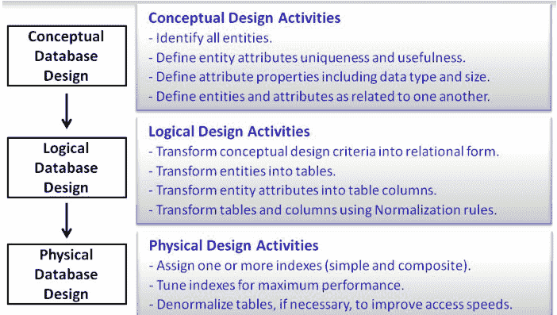

#### 表定义

PROC SQL 使用的数据模型在概念上以多重集而非物理文件的形式存储。物理文件由一个或多个按顺序或其他方式排列的记录组成。COBOL 和 FORTRAN 等编程语言正是为了处理此类文件而发展起来的，它们一次处理一条记录。这些语言通常被设计用于模拟人们处理纸质表单的方式。

PROC SQL 被设计用于处理多重数据集。多重集没有顺序，且多重集的成员属于同一类型；它使用一种称为表的数据结构。从分类角度来看，表可以是基本表，由零行或多行以及一列或多列组成；也可以是虚拟表（称为视图），其使用方式与表相同（参见第 8 章“使用视图”）。

#### 冗余信息

良好数据库设计的规则之一，是要求数据在同一数据库中不得冗余或重复。这一结论的理由源于这样一种信念：如果数据在数据库中出现多次，就有理由相信其中一份数据可能出错。此外，冗余往往会导致以下问题：

-   不一致性，因为事实重复时更可能出现错误。
-   更新异常，数据的插入、修改或删除可能导致不一致。

另一件需要注意的事情是，出现太多包含 NULL 值的列。出现这种情况时，数据库很可能设计不当。为了缓解潜在的表设计问题，需要执行一种称为*规范化*的过程。如果执行得当，可以确保表中完全没有冗余信息。

#### 规范化

在数据库的生命周期中，设计出最优的数据库是一个重要元素。它不仅对于在处理表和数据的实现最大性能和灵活性至关重要，而且对于通过减少或最小化一个或多个数据库表中的冗余来组织数据也是必不可少的。表设计的过程经常被数据库开发人员和管理员称为*规范化*。

规范化过程用于通过将复杂的数据结构转换为简单的数据结构来减少数据库中的冗余。实施规范化的原因如下：

-   组织数据以节省空间，并消除任何数据重复或复制。
-   实现简单数据检索，以满足查询和报表请求。
-   简化数据操作请求，如数据插入、更新和删除。
-   减少随着新应用需求出现而重新组织或重构数据所带来的影响。

规范化过程试图通过将较大的多列表拆分为两个或更多包含较少列的小表，来简化数据库中列之间的关系。这样做的理由包含在一组称为*范式*的数据设计指南中。这些指南为设计人员提供了一组规则，用于将一两个包含众多列的大型数据库表转换为规范化的数据库，该数据库由多个表组成，且每个表只包含应包含的列。规范化过程由多个步骤组成，每个后续步骤都遵循前面步骤的规则。

规范化有助于确保数据库的两个或多个表中不包含冗余信息。在应用程序中，规范化可防止数据库中的数据被破坏或产生错误数据。这意味着事实信息在数据库中只表示一次，并且任何使它出现多次的可能性都不被允许，或不应被允许。

随着数据库设计人员和分析人员推进规范化过程，许多人只有在数据库设计至少达到第三范式（3NF）时才会满意。Joe Celko（乔·塞尔科）在他广受欢迎的著作*《聪明人的 SQL：高级 SQL 编程》*（Morgan Kaufmann，1999）中这样描述 3NF：“当一列依赖于键、整个键、并且只依赖于键时，数据库即被视为处于 3NF。”

虽然规范化指南非常有用，但一些数据库纯粹主义者实际上会不遗余力地消除所有表冗余，即使以性能为代价。这与其他数据库专家形成鲜明对比，后者不那么严格地遵循指南，只做到第三范式（或 3NF）以提高数据库的性能。无论你的偏好如何，在规范化数据库表时都应牢记这一点。完全规范化的数据库通常需要更多的连接，并可能对……产生不利影响


speed of queries. Celko mentions that the process of joining multiple tables in a fully normalized database is costly, specifically affecting processing time and computer resources.

## 规范化策略

After transforming entities and attributes from the conceptual design into a logical design, the tables and columns are created. This is when a process known as normalization occurs. Normalization refers to the process of making your database tables subscribe to certain rules. Many, if not most, database designers are satisfied when third normal form (3NF) is achieved and, for the objectives of this book, I will stop at 3NF, too. To help explain the various normalization steps, an example scenario follows.

### 第一范式 (1NF)

First normal form (1NF) involves the elimination of data redundancy or repeating information from a table. A table is considered to be in first normal form when all of its columns describe the table completely and when each column in a row has only one value. A table satisfies 1NF when each column in a row has a single value and no repeating group information. Essentially, every table meets 1NF as long as an array, list, or other structure has not been defined. The following table illustrates a table satisfying the 1NF rule because it has only one value at each row-and-column intersection. The table is in ascending order by CUSTNUM and consists of customers and the purchases they made at an office supply store.

Table 1.1: First Normal Form (1NF) Table

| CUSTNUM | CUSTNAME | CUSTCITY | ITEM | UNITS | UNITCOST | MANUCITY |
|---|---|---|---|---|---|---|
| 1 | Smith | San Diego | Chair | 1 | $179.00 | San Diego |
| 1 | Smith | San Diego | Pens | 12 | $0.89 | Los Angeles |
| 1 | Smith | San Diego | Paper | 4 | $6.95 | Washington |
| 1 | Smithe | San Diego | Stapler | 1 | $8.95 | Los Angeles |
| 7 | Lafler | Spring Valley | Mouse Pad | 1 | $11.79 | San Diego |
| 7 | Loffler | Spring Valley | Pens | 24 | $1.59 | Los Angeles |
| 13 | Thompson | Miami | Markers | . | $0.99 | Los Angeles |

### 第二范式 (2NF)

Second normal form (2NF) addresses the relationships between sets of data. A table is said to be in second normal form when all the requirements of 1NF are met and a foreign key is used to link any data in one table which has relevance to another table. The very nature of leaving a table in first normal form (1NF) may present problems due to the repetition of some information in the table. One noticeable problem is that Table 1.1 has repetitive information in it. Another problem is that there are misspellings in the customer name. Although repeating information may be permissible with hierarchical file structures and other legacy type file structures, it does pose a potential data consistency problem as it relates to relational data.

To describe how data consistency problems can occur, let’s say that a customer takes a new job and moves to a new city. In changing the customer’s city to the new location, it would be very easy to miss one or more occurrences of the customer’s city resulting in a customer residing incorrectly in two different cities. Assuming that our table is only meant to track one unique customer per city, this would definitely be a data consistency problem. Essentially, second normal form (2NF) is important because it says that every non-key column must depend on the entire primary key.

Tables that subscribe to 2NF prevent the need to make changes in more than one place. What this means in normalization terms is that tables in 2NF have no partial key dependencies. As a result, our database that consists of a single table that satisfies 1NF will need to be split into two separate tables in order to subscribe to the 2NF rule. Each table would contain the CUSTNUM column to connect the two tables. Unlike the single table in 1NF, the tables in 2NF allow a customer’s city to be easily changed whenever they move to another city because the CUSTCITY column only appears once. The tables in 2NF would be constructed as follows.

Table 1.2: CUSTOMERS Table

| CUSTNUM | CUSTNAME | CUSTCITY |
|---|---|---|
| 1 | Smith | San Diego |
| 1 | Smithe | San Diego |
| 7 | Lafler | Spring Valley |
| 13 | Thompson | Miami |

Table 1.3: PURCHASES Table

| CUSTNUM | ITEM | UNITS | UNITCOST | MANUCITY |
|---|---|---|---|---|
| 1 | Chair | 1 | $179.00 | San Diego |
| 1 | Pens | 12 | $0.89 | Los Angeles |
| 1 | Paper | 4 | $6.95 | Washington |
| 1 | Stapler | 1 | $8.95 | Los Angeles |
| 7 | Mouse Pad | 1 | $11.79 | San Diego |
| 7 | Pens | 24 | $1.59 | Los Angeles |
| 13 | Markers | . | $0.99 | Los Angeles |

### 第三范式 (3NF)

Referring to the two tables constructed according to the rules of 2NF, you may have noticed that the PURCHASES table contains a column called MANUCITY. The MANUCITY column stores the city where the product manufacturer is headquartered. Keeping this column in the PURCHASES table violates the third normal form (3NF) because MANUCITY does not provide factual information about the primary key column (CUSTNUM) in the PURCHASES table. Consequently, tables are considered to be in third normal form (3NF) when each column is dependent on the key, the whole key, and nothing but the key. The tables in 3NF are constructed so the MANUCITY column would be in a table of its own as follows.

Table 1.4: CUSTOMERS Table

| CUSTNUM | CUSTNAME | CUSTCITY |
|---|---|---|
| 1 | Smith | San Diego |
| 1 | Smithe | San Diego |
| 7 | Lafler | Spring Valley |
| 13 | Thompson | Miami |

Table 1.5: PURCHASES Table

| CUSTNUM | ITEM | UNITS | UNITCOST |
|---|---|---|---|
| 1 | Chair | 1 | $179.00 |
| 1 | Pens | 12 | $0.89 |
| 1 | Paper | 4 | $6.95 |
| 1 | Stapler | 1 | $8.95 |
| 7 | Mouse Pad | 1 | $11.79 |
| 7 | Pens | 24 | $1.59 |
| 13 | Markers | . | $0.99 |

Table 1.6: MANUFACTURERS Table

| MANUNUM | MANUCITY |
|---|---|
| 101 | San Diego |
| 112 | San Diego |
| 210 | Los Angeles |
| 212 | Los Angeles |
| 213 | Los Angeles |
| 214 | Los Angeles |
| 401 | Washington |

### 超越第三范式

In general, database designers are satisfied when their database tables subscribe to the rules in 3NF. But, it is not uncommon for others to normalize their database tables to fourth normal form (4NF) where independent one-to-many relationships between primary key and non-key columns are forbidden. Some database purists will even normalize to fifth normal form (5NF) where tables are split into the smallest pieces of information in an attempt to eliminate any and all table redundancies. Although constructing tables in 5NF may provide the greatest level of database integrity, it is neither practical nor desired by most database practitioners.

There is no absolute right or wrong reason for database designers to normalize beyond 3NF as long as they have considered all the performance issues that may arise by doing so. A common problem that occurs when database tables are normalized beyond 3NF is that a large number of small tables are generated. In these cases, an increase in time and computer resources frequently occurs because small tables must first be joined before a query, report, or statistic can be produced.

## 列名和保留字

According to the American National Standards Institute (ANSI), SQL is the standard language used with relational database management systems. The ANSI Standard reserves a number of SQL keywords from being used as column names. The SAS SQL implementation is not as rigid, but users should be aware of what reserved words exist to prevent unexpected and unintended results during SQL processing. Column names should conform to proper SAS naming conventions (as described in the *SAS Language Reference*), and they should not conflict with certain reserved words found in the SQL language. The following list identifies the reserved words found in the ANSI SQL standard.

### ANSI SQL 保留字

|  |  |  |
|---|---|---|
| AS | INNER | OUTER |
| CASE | INTERSECT | RIGHT |
| EXCEPT | JOIN | UNION |
| FROM | LEFT | UPPER |
| FULL | LOWER | USER |
| GROUP | ON | WHEN |
| HAVING | ORDER | WHERE |

You probably will not encounter too many conflicts between a column name and an SQL reserved word, but when you do you will need to follow a few simple rules to prevent processing errors from occurring. As was stated earlier, although PROC SQL’s naming conventions are not as rigid as other vendor’s implementations, care should still be exercised, in particular when PROC SQL code is transferred to other database environments expecting it to run error free. If a column name in an existing table conflicts with a reserved word, you have three options at your disposal:

- 1. Physically rename the column name in the table, as well as any references to the column.
- 2. Use the RENAME= data set option to rename the desired column in the current query.
- 3. Specify the PROC SQL option DQUOTE=ANSI, and surround the column name (reserved word) in double quotes, as illustrated below.

### SQL 代码

```sql
PROC SQL DQUOTE=ANSI;
    SELECT *
        FROM RESERVED_WORDS
        WHERE "WHERE"='EXAMPLE';
QUIT;
```

## 数据完整性

*Webster’s New World Dictionary* defines *integrity* as “the quality or state of being complete; perfect condition; reliable; soundness.” Data integrity is a critical element that every organization must promote and strive for. It is imperative that the data tables in a database environment be reliable, free of errors, and sound in every conceivable way. The existence of data errors, missing information, broken links, and other related problems in one or more tables can impact decision-making and information reporting activities resulting in a loss of confidence among users.


将一组规则应用于数据库结构和内容可以确保数据资源的完整性。这些规则由表和列约束组成，并在第 5 章“创建、填充和删除表”中详细讨论。

## 引用完整性

引用完整性是指数据库表处理更新和删除请求的方式。数据库表经常有一个主键，其中一列或多列具有唯一值，可用于标识和选择表中的行。其他表可能有一列或多列称为外键，用于通过其值连接到另一个表。数据库设计人员经常对数据库表应用规则，以控制主键值更改时发生的情况及其对其他表中一个或多个外键值的影响。这些引用完整性规则对表中可更新或删除的数据施加限制。

引用完整性确保一个表中的行在另一个表中具有对应的行。这可以防止一个表中的数据元素与另一个表的数据元素之间的链接丢失，从而使数据的完整性始终得到维护。使用前面定义的 3NF 表，可以在 PURCHASES 表中定义一个名为 CUSTNUM 的外键，对应于 CUSTOMERS 表中的主键 CUSTNUM 列。用户请参阅第 5 章“创建、填充和删除表”，以了解有关分配引用完整性约束的更多详细信息。

## 本书中使用的数据库表

本节描述了一个数据库或表库，该库由一家虚构的计算机硬件和软件批发商使用。该库由六个表组成：Customers、Inventory、Invoice、Manufacturers、Products 和 Purchases。本书中使用的示例均基于此表库（数据库），并在下面描述和显示。每个表在本书中使用的字母顺序描述如下。

## CUSTOMERS 表

CUSTOMERS 表包含从制造商处购买计算机硬件和软件产品的客户。每个客户都通过客户编号唯一标识。Customers 表中每个列的描述如下。

### 表 1.7：Customers 表中列的描述

| Column | Description |
|---|---|
| CUSTNUM | 唯一标识客户的编号。 |
| CUSTNAME | 客户名称。 |
| CUSTCITY | 客户所在城市。 |

## INVENTORY 表

INVENTORY 表包含客户库存信息，包括计算机硬件和软件产品。Inventory 表不包含历史数据。随着库存的补充，旧数量会被新数量覆盖。Inventory 表中每个列的描述如下。

### 表 1.8：Inventory 表中列的描述

| Column | Description |
|---|---|
| PRODNUM | 唯一标识产品的编号。 |
| MANUNUM | 唯一标识制造商的编号。 |
| INVENQTY | 库存中产品的单位数量。 |
| ORDDATE | 产品最后订购日期。 |
| INVENCST | 客户库房中库存成本。 |

## INVOICE 表

INVOICE 表包含购买产品的客户信息。每张发票都通过发票编号唯一标识。Invoice 表中每个列的描述如下。

### 表 1.9：Invoice 表中列的描述

| Column | Description |
|---|---|
| INVNUM | 唯一标识发票的编号。 |
| MANUNUM | 唯一标识制造商的编号。 |
| CUSTNUM | 客户编号。 |
| PRODNUM | 产品编号。 |
| INVQTY | 销售的单位数量。 |
| INVPRICE | 单价。 |

## MANUFACTURERS 表

MANUFACTURERS 表包含制造计算机硬件和软件产品的公司。两个公司不能具有相同的名称。此表中不保留历史数据。如果一家公司被出售或停止制造计算机硬件或软件，则制造商将被从表中删除。如果制造商地址变更，则旧地址会被新地址覆盖。Manufacturers 表中每个列的描述如下。

### 表 1.10：Manufacturers 表中列的描述

| Column | Description |
|---|---|
| MANUNUM | 唯一标识制造商的编号。 |
| MANUNAME | 制造商名称。 |
| MANUCITY | 制造商所在城市。 |
| MANUSTAT | 制造商所在州。 |

## PRODUCTS 表

PRODUCTS 表包含制造商出售的计算机硬件和软件产品。每个产品都通过产品编号唯一标识。Products 表中每个列的描述如下。

### 表 1.11：Products 表中列的描述

| Column | Description |
|---|---|
| PRODNUM | 唯一标识产品的编号。 |
| PRODNAME | 产品名称。 |
| MANUNUM | 唯一标识制造商的编号。 |
| PRODTYPE | 产品类型。 |
| PRODCOST | 产品成本。 |

## PURCHASES 表

PURCHASES 表包含客户购买的计算机硬件和软件产品。每个产品都通过产品编号唯一标识。Purchases 表中每个列的描述如下。

### 表 1.12：Purchases 表中列的描述

| Column | Description |
|---|---|
| CUSTNUM | 唯一标识客户的编号。 |
| ITEM | 产品名称。 |
| UNITS | 客户购买的项目数量。 |
| UNITCOST | 产品成本。 |

## 表内容

下面显示了每个表的表、变量和属性的字母顺序列表。

### 输出 1.1：Customers CONTENTS 输出

| # | Variable | Type | Len | Label |
|---|---|---|---|---|
| 3 | custcity | Char | 20 | Customer's Home City |
| 2 | custname | Char | 25 | Customer Name |
| 1 | custnum | Num | 3 | Customer Number |

### 输出 1.2：Inventory CONTENTS 输出

| # | Variable | Type | Len | Format | Informat | Label |
|---|---|---|---|---|---|---|
| 4 | invencst | Num | 6 | DOLLAR10.2 |  | Inventory Cost |
| 2 | invnqty | Num | 3 |  |  | Inventory Quantity |
| 5 | manunum | Num | 3 |  |  | Manufacturer Number |
| 3 | orddate | Num | 4 | MMDDYY10. | MMDDYY10. | Date Inventory Last Ordered |
| 1 | prodnum | Num | 3 |  |  | Product Number |

### 输出 1.3：Invoice CONTENTS 输出

| # | Variable | Type | Len | Format | Label |
|---|---|---|---|---|---|
| 3 | custnum | Num | 3 |  | Customer Number |
| 1 | invnum | Num | 3 |  | Invoice Number |
| 5 | invprice | Num | 5 | DOLLAR12.2 | Invoice Unit Price |
| 4 | invqty | Num | 3 |  | Invoice Quantity - Units Sold |
| 2 | manunum | Num | 3 |  | Manufacturer Number |
| 6 | prodnum | Num | 3 |  | Product Number |

### 输出 1.4：Manufacturers CONTENTS 输出

| # | Variable | Type | Len | Label |
|---|---|---|---|---|
| 3 | manucity | Char | 20 | Manufacturer City |
| 2 | manuname | Char | 25 | Manufacturer Name |
| 1 | manunum | Num | 3 | Manufacturer Number |
| 4 | manustat | Char | 2 | Manufacturer State |

### 输出 1.5：Products CONTENTS 输出

| # | Variable | Type | Len | Format | Label |
|---|---|---|---|---|---|
| 3 | manunum | Num | 3 |  | Manufacturer Number |
| 5 | prodcost | Num | 5 | DOLLAR9.2 | Product Cost |
| 2 | prodname | Char | 25 |  | Product Name |
| 1 | prodnum | Num | 3 |  | Product Number |
| 4 | prodtype | Char | 15 |  | Product Type |

### 输出 1.6：Purchases CONTENTS 输出

| # | Variable | Type | Len | Format | Label |
|---|---|---|---|---|---|
| 1 | custnum | Num | 4 |  | Custnum |
| 2 | prodnum | Num | 3 |  | Prodnum |
| 4 | unitcost | Num | 4 | DOLLAR12.2 | Unitcost |
| 3 | units | Num | 3 |  | Units |

## 数据库结构

每个表之间的逻辑关系以及每个表共有的列如下所示。

Figure 1.2. Logical Database Structure

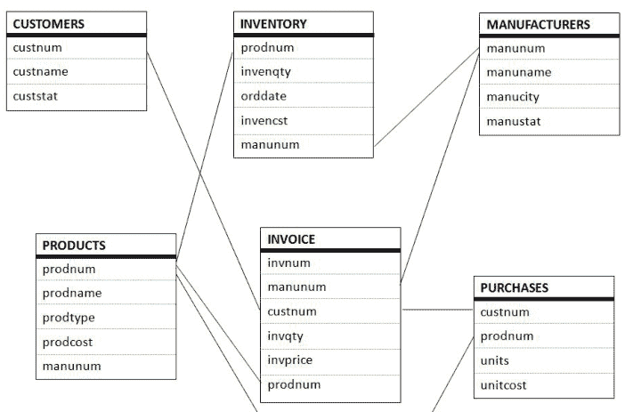

## 示例数据库表

以下表：Customers、Inventory、Manufacturers、Products、Invoice 和 Purchases 代表一个关系数据库，将在本书的示例中进行说明。这些表足够小，可以轻松跟踪，但又足够复杂，可以说明 SQL 的强大功能。每个表中包含的数据如下所示。


## 表 1.13：客户表

| Obs | custnum | custname | custcity |
| --- | --- | --- | --- |
| 1 | 101 | La Mesa Computer Land | La Mesa |
| 2 | 201 | Vista Tech Center | Vista |
| 3 | 301 | Coronado Internet Zone | Coronado |
| 4 | 401 | La Jolla Computing | La Jolla |
| 5 | 501 | Alpine Technical Center | Alpine |
| 6 | 601 | Oceanside Computer Land | Oceanside |
| 7 | 701 | San Diego Byte Store | San Diego |
| 8 | 801 | Jamul Hardware & Software | Jamul |
| 9 | 901 | Del Mar Tech Center | Del Mar |
| 10 | 1001 | Lakeside Software Center | Lakeside |
| 11 | 1101 | Bonsall Network Store | Bonsall |
| 12 | 1201 | Rancho Santa Fe Tech | Rancho Santa Fe |
| 13 | 1301 | Spring Valley Byte Center | Spring Valley |
| 14 | 1401 | Poway Central | Poway |
| 15 | 1501 | Valley Center Tech Center | Valley Center |
| 16 | 1601 | Fairbanks Tech USA | Fairbanks Ranch |
| 17 | 1701 | Blossom Valley Tech | Blossom Valley |
| 18 | 1801 | Chula Vista Networks |  |
|  |  | N = 18 |  |

## 表 1.14：库存表

| Obs | prodnum | invenqty | orddate | invencst | manunum |
| --- | --- | --- | --- | --- | --- |
| 1 | 1110 | 20 | 09/01/2000 | $45,000.00 | 111 |
| 2 | 1700 | 10 | 08/15/2000 | $28,000.00 | 170 |
| 3 | 5001 | 5 | 08/15/2000 | $1,000.00 | 500 |
| 4 | 5002 | 3 | 08/15/2000 | $900.00 | 500 |
| 5 | 5003 | 10 | 08/15/2000 | $2,000.00 | 500 |
| 6 | 5004 | 20 | 09/01/2000 | $1,400.00 | 500 |
| 7 | 5001 | 2 | 09/01/2000 | $1,200.00 | 600 |
|  |  |  | N = 7 |  |  |

## 表 1.15：发票表

| Obs | invnum | manunum | custnum | invqty | invprice | prodnum |
| --- | --- | --- | --- | --- | --- | --- |
| 1 | 1001 | 500 | 201 | 5 | $1,495.00 | 5001 |
| 2 | 1002 | 600 | 1301 | 2 | $1,598.00 | 6001 |
| 3 | 1003 | 210 | 101 | 7 | $245.00 | 2101 |
| 4 | 1004 | 111 | 501 | 3 | $9,600.00 | 1110 |
| 5 | 1005 | 500 | 801 | 2 | $798.00 | 5002 |
| 6 | 1006 | 500 | 901 | 4 | $396.00 | 6000 |
| 7 | 1007 | 500 | 401 | 7 | $23,100.00 | 1200 |
|  |  |  |  | N = 7 |  |  |

## 表 1.16：制造商表

| Obs | manunum | manuname | manucity | manustat |
| --- | --- | --- | --- | --- |
| 1 | 111 | Cupid Computer | Houston | TX |
| 2 | 210 | Global Comm Corp | San Diego | CA |
| 3 | 600 | World Internet Corp | Miami | FL |
| 4 | 120 | Storage Devices Inc | San Mateo | CA |
| 5 | 500 | KPL Enterprises | San Diego | CA |
| 6 | 700 | San Diego PC Planet | San Diego | CA |
|  |  | N = 6 |  |  |

## 表 1.17：产品表

| Obs | prodnum | prodname | manunum | prodtype | prodcost |
| --- | --- | --- | --- | --- | --- |
| 1 | 1110 | Dream Machine | 111 | Workstation | $3,200.00 |
| 2 | 1200 | Business Machine | 120 | Workstation | $3,300.00 |
| 3 | 1700 | Travel Laptop | 170 | Laptop | $3,400.00 |
| 4 | 2101 | Analog Cell Phone | 210 | Phone | $35.00 |
| 5 | 2102 | Digital Cell Phone | 210 | Phone | $175.00 |
| 6 | 2200 | Office Phone | 220 | Phone | $130.00 |
| 7 | 5001 | Spreadsheet Software | 500 | Software | $299.00 |
| 8 | 5002 | Database Software | 500 | Software | $399.00 |
| 9 | 5003 | Wordprocessor Software | 500 | Software | $299.00 |
| 11 | 5004 | Graphics Software | 500 | Software | $299.00 |
|  |  | N = 10 |  |  |  |

## 表 1.18：采购表

| Obs | custnum | prodnum | units | unitcost |
| --- | --- | --- | --- | --- |
| 1 | 1701 | 1110 | 1 | $3,200.00 |
| 2 | 101 | 5001 | 7 | $299.00 |
| 3 | 701 | 5001 | 11 | $299.00 |
| 4 | 701 | 5003 | 8 | $299.00 |
| 5 | 701 | 5002 | 4 | $399.00 |
| 6 | 701 | 5004 | 3 | $299.00 |
| 7 | 701 | 1700 | 2 | $3,400.00 |
| 8 | 701 | 1200 | 3 | $3,300.00 |
| 9 | 701 | 1110 | 2 | $3,200.00 |
| 10 | 1301 | 5001 | 3 | $299.00 |
| 11 | 1301 | 5003 | 5 | $299.00 |
| 12 | 1301 | 5002 | 2 | $399.00 |
| 13 | 901 | 1700 | 2 | $3,400.00 |
| 14 | 901 | 1200 | 3 | $3,300.00 |
| 15 | 901 | 1110 | 5 | $3,200.00 |
| 16 | 901 | 5001 | 9 | $299.00 |
| 17 | 901 | 5002 | 5 | $399.00 |
| 18 | 901 | 5003 | 8 | $299.00 |
| 19 | 901 | 5004 | 2 | $299.00 |
| 20 | 401 | 5001 | 11 | $299.00 |
| 21 | 401 | 5002 | 5 | $399.00 |
| 22 | 401 | 5003 | 7 | $299.00 |
| 23 | 401 | 5004 | 3 | $299.00 |
| 24 | 401 | 1700 | 3 | $3,400.00 |
| 25 | 401 | 1200 | 6 | $3,300.00 |
| 26 | 201 | 5001 | 6 | $299.00 |
| 27 | 201 | 5001 | 6 | $299.00 |
| 28 | 201 | 5003 | 9 | $299.00 |
| 29 | 201 | 5002 | 4 | $399.00 |
| 30 | 201 | 1700 | 3 | $3,400.00 |
| 31 | 901 | 5001 | 2 | $299.00 |
| 32 | 201 | 5001 | 2 | $299.00 |
| 33 | 201 | 2102 | 5 | $175.00 |
| 34 | 1101 | 2102 | 9 | $175.00 |
| 35 | 1301 | 2102 | 11 | $175.00 |
| 36 | 1401 | 2102 | 7 | $175.00 |
| 37 | 801 | 2102 | 5 | $175.00 |
| 38 | 501 | 2102 | 12 | $175.00 |
| 39 | 301 | 2102 | 8 | $175.00 |
| 40 | 1101 | 2200 | 3 | $130.00 |
| 41 | 101 | 2102 | 9 | $175.00 |
| 42 | 101 | 5003 | 3 | $299.00 |
| 43 | 101 | 5004 | 2 | $299.00 |
| 44 | 101 | 1200 | 3 | $3,300.00 |
| 45 | 101 | 1700 | 5 | $3,400.00 |
| 46 | 1301 | 1700 | 3 | $3,400.00 |
| 47 | 1601 | 1700 | 7 | $3,400.00 |
| 48 | 1801 | 1700 | 4 | $3,400.00 |
| 49 | 1001 | 1700 | 5 | $3,400.00 |
| 50 | 1101 | 1700 | 2 | $3,400.00 |
| 51 | 1201 | 1200 | 8 | $3,300.00 |
| 52 | 501 | 5001 | 3 | $299.00 |
| 53 | 501 | 5003 | 5 | $299.00 |
| 54 | 501 | 5004 | 1 | $299.00 |
| 55 | 501 | 1700 | 4 | $3,400.00 |
| 56 | 301 | 5001 | 6 | $299.00 |
| 57 | 501 | 2102 | 9 | $175.00 |
| N = 57 |  |  |  |  |

## 小结

- 1. 良好的数据库设计通常能提高在关系数据库中创建和填充表的相对容易程度，并且可以实现到任何数据库中（参见“概念视图”一节）。
- 2. SQL 旨在处理数据集，并访问一种称为表的数据库结构，或称为视图的“虚拟”表（参见“表定义”一节）。
- 3. 实现数据库的最优设计意味着数据库在其两个或多个表中包含很少或没有冗余信息。这意味着良好的数据库设计要求很少或没有数据复制（参见“冗余信息”一节）。
- 4. 良好的数据库设计可以避免数据冗余、更新异常、成本高昂或效率低下的处理、编码复杂性、复杂的逻辑关系、较长的应用程序开发时间以及/或过多的存储需求（参见“规范化”一节）。
- 5. 在一个阶段做出的设计决策可能需要在另一个阶段进行一个或多个权衡（参见“规范化”一节）。
- 6. 第三范式（3NF）的数据库被定义为：一个列依赖于键、整个键、并且仅仅依赖于键（参见“规范化”一节）。

## 第 2 章：在 PROC SQL 中使用数据


## 引言

PROC SQL 本质上是一种数据库语言，而非过程式或计算语言。除了 SAS 实现的 SQL 中可用的两种数据类型外，PROC SQL 程序员还可以使用包括运算符、函数和谓词在内的众多扩展。

## 数据类型概述

数据库的目的是存储数据。数据库包含一个或多个表（和其他组件）。表由数据列和行组成。在 SAS 实现的 SQL 中，可用的数据类型仅限于两种可能：

- numeric
- character

## 数值数据

SAS 实现的 SQL 为程序员提供了众多算术、统计和汇总函数。它提供一种数值数据类型来表示数值数据。用 NUMERIC 或 NUM 列定义定义为数值数据类型的列会被分配默认长度为 8 字节，即使该列是用小于 8 字节的数值长度创建的。这提供了 SAS 软件允许的最大精度。在示例中，创建了一个名为 PURCHASES 的表，由四列数值列组成。生成的表不包含任何数据行，如 SAS 日志结果所示。有关 CREATE TABLE 语句的更多信息，请参阅第 5 章“创建、填充和删除表”。

### SQL 代码

```
PROC SQL;
    CREATE TABLE PURCHASES
    (CUSTNUM  NUM,
     PRODNUM  NUM,
     UNITS    NUM,
     UNITCOST NUM(8,2));
QUIT;
```

## SAS 日志结果

```
PROC SQL;
    CREATE TABLE PURCHASES
    (CUSTNUM  NUM,
     PRODNUM  NUM,
     UNITS    NUM,
     UNITCOST NUM(8,2));
NOTE: Table PURCHASES created, with 0 rows and 4 columns.
    QUIT;
```

### 结果

**变量和属性的字母顺序列表**

| # | Variable | Type | Len |
| --- | --- | --- | --- |
| 1 | CUSTNUM | Num | 8 |
| 2 | PRODNUM | Num | 8 |
| 4 | UNITCOST | Num | 8 |
| 3 | UNITS | Num | 8 |

创建小于 8 字节的数值列需要使用 DATA 步 LENGTH 语句。虽然分配较小的长度给数值列并非必要，因为这可能导致精度问题，但这样做可以更高效地利用数据存储系统资源。示例说明了一个 DATA 步，它为 PURCHASES 表中的四个数值变量分配了较小的长度：CUSTNUM、PRODNUM、UNITS 和 UNITCOST。与之前 PROC SQL 代码产生的 SAS 日志结果相比，CONTENTS 输出说明了使用一个记录和四个用户定义、且长度更短的数值变量创建数据集。

### DATA 步代码

```
```sas
DATA PURCHASES;
LENGTH CUSTNUM 4.
PRODNUM 3.
UNITS 3.
UNITCOST 4.;
LABEL CUSTNUM = 'Customer Number'
PRODNUM = 'Product Purchased'
UNITS = '# Units Purchased'
UNITCOST = 'Unit Cost';
FORMAT UNITCOST DOLLAR12.2;
RUN;
PROC CONTENTS DATA=PURCHASES;
RUN;
```
```

## SAS 日志结果

```
DATA PURCHASES;
    LENGTH CUSTNUM 4.
          PRODNUM 3.
          UNITS 3.
          UNITCOST 4.;
    LABEL CUSTNUM = 'Customer Number'
          PRODNUM = 'Product Purchased'
          UNITS = '# Units Purchased'
          UNITCOST = 'Unit Cost';
    FORMAT UNITCOST DOLLAR12.2;
RUN;

NOTE: Variable CUSTNUM is uninitialized.
NOTE: Variable PRODNUM is uninitialized.
NOTE: Variable UNITS is uninitialized.
NOTE: Variable UNITCOST is uninitialized.
NOTE: The data set WORK.PURCHASES has 1 observations and 4 variables.
NOTE: DATA statement used:
      real time          2.80 seconds

PROC CONTENTS DATA=PURCHASES;
RUN;

NOTE: PROCEDURE CONTENTS used:
      real time          1.82 seconds
```

## CONTENTS 结果

| # | Variable | Type | Len | Format | Label |
|---|---|---|---|---|---|
| 1 | CUSTNUM | Num | 4 |  | Customer Number |
| 2 | PRODNUM | Num | 3 |  | Product Purchased |
| 4 | UNITCOST | Num | 4 | DOLLAR12.2 | Unit Cost |
| 3 | UNITS | Num | 3 |  | # Units Purchased |

变量和属性的字母顺序列表

在下一个示例中，在 PROC SQL 代码中说明了 LENGTH= 修饰符，用于为 PURCHASES 表中的四个数值变量（列）分配较小的长度：CUSTNUM、PRODNUM、UNITS 和 UNITCOST。

## PROC SQL 代码

```
PROC SQL;
  CREATE TABLE PURCHASES
    (CUSTNUM NUM LENGTH=4
      LABEL='Customer Number',
      PRODNUM NUM LENGTH=3
      LABEL='Product Purchased',
      UNITS    NUM LENGTH=3
      LABEL='# Units Purchased',
      UNITCOST NUM LENGTH=4
      LABEL='Unit Cost');
QUIT;
```

如下面 CONTENTS 结果所示，四个数值列使用小于默认长度 8 字节的 LENGTH= 列修饰符定义。

## CONTENTS 结果

| # | Variable | Type | Len | Format | Label |
|---|---|---|---|---|---|
| 1 | CUSTNUM | Num | 4 |  | Customer Number |
| 2 | PRODNUM | Num | 3 |  | Product Purchased |
| 4 | UNITCOST | Num | 4 | DOLLAR12.2 | Unit Cost |
| 3 | UNITS | Num | 3 |  | # Units Purchased |

变量和属性的字母顺序列表

## 日期和时间列定义

数据库应用程序处理将日期和时间信息以数值数据类型的形式存储。日期和时间值在内部表示为偏移量，其中 SAS 日期值存储为从固定日期值 01/01/1960（1960 年 1 月 1 日）开始的天数。1960 年 1 月 1 日的 SAS 日期值表示为 0（零）。早于此日期的日期表示为负数，而晚于此日期的日期表示为正数。这使得执行日期计算变得更加容易。

SAS 已将庞大的日期和时间 informat 和 format 与 PROC SQL 集成。各种 informat 和 format 充当输入和输出模板，并描述如何读取日期和时间信息或在输出中呈现。有关各种 informat 和 format 的详细描述及其使用，请参阅 SAS Language Reference: Dictionary。当数值日期和时间列与 informat 和/或 format 结合使用时，会根据以下规则自动验证值：

- **Date**—日期 informat 和 format 使 PROC SQL 和 SAS 能够确定日期的月份、天和年份。月份值处理 1 到 12 的值。日期值处理 1 到 31 的值，并根据所讨论的月份对最大值为 28、29 或 30 进行额外验证。年份值处理 1 到 9999 的值。日期可追溯到 1582 年并可提前到 20,000 年。当您输入年份值 0001 并指定 format 和 Yearcutoff 值为 1920 时，返回的值将为 2001。
- **Time** —时间 informat 和 format 使 PROC SQL 能够确定时间的小时、分钟和秒值。小时部分处理 00 到 23 的值。分钟部分处理 00 到 59 的值。秒部分处理 00 到 59 的值。
- **DATETIME**—日期时间戳使 SQL 过程能够确定日期的月份、天和年份，以及时间的小时、分钟和秒。

有关日期和时间 informat 和 format 的更多信息，请参阅第 5 章“创建、填充和删除表”以及第 6 章“修改和更新表”。

## 字符数据

PROC SQL 提供了用于使用 CHARACTER 或 CHAR 数据类型操作和存储字符数据（包括单词、文本和代码）的工具。此数据类型允许的字符包括 ASCII 或 EBCDIC 字符集。CHARACTER 或 CHAR 数据类型存储由最多 32K 字符组成定长字符字符串。如果未指定长度，CHAR 列将存储默认的 8 个字符。

SQL 程序员拥有大量 SQL 和 Base SAS 函数，可以使处理字符数据的任务变得相当容易。在本章中，您将了解如何定义基于字符数据类型的列，以及如何使用字符串函数、模式匹配、语音匹配技术和各种其他技术来处理字符数据。

## 缺失值和 NULL

缺失值在处理数据时是一个重要方面。缺失值的概念对程序员、统计学家、研究人员和其他 SAS 用户来说都很熟悉。本章描述了 NULL 值是什么、它们不是什么，以及它们如何使用。

PROC SQL 以一种称为 *null value* 的形式支持缺失或未知信息。空值与零值不同。在 SAS 中，空值被视为与已知值不同的类别。零值是一个已知值。相比之下，空值是一个未知数量，并且永远不会被知道。例如，一名接受眼科检查的患者并不因为检查结果尚未收到就具有零视力。在这种情况下应分配的正确值是缺失值或空值。

在另一个示例中，假设某人在调查中拒绝提供其年龄。此人的年龄为空，而非零。本质上，此人有年龄，但未知。每当出现未知值时，您别无选择，只能分配未知值——空值。


由于 null 的值未知，任何使用 null 的算术计算都将返回 null。这很有意义，因为使用 null 进行计算的结果是无法确定的。这有时被称为 *null 的传播*，因为当 null 值在计算或表达式中使用时，它会传播 null 值。例如，如果一个 null 与一个已知值相加，则结果为 null 值。

## 算术与缺失数据

在 SAS 中，包含 null 值（不存在任何值）的数值数据类型用句点 (.) 表示。这种表示法表明该列尚未被赋予值。null 值没有值，并且不等于零。零值代表一个已知数量，而 null 值则是未知且永远不会被知道的。

如果一个 null 值与一个已知值相乘，结果是一个用句点 (.) 表示的 null 值。在下一个示例中，当 UNITS 和 UNITCOST 均具有已知值时，它们的乘积将生成一个已知值，如下所示。

### SQL 代码

```
PROC SQL;
    SELECT CUSTNUM,
            PRODNUM,
            UNITS,
            UNITCOST,
            UNITS * UNITCOST AS Total FORMAT=DOLLAR12.2
    FROM PURCHASES
        ORDER BY Total;
QUIT;
```

### 结果

| Custnum | Prodnum | Units | Unitcost | Total |
|---|---|---|---|---|
| 501 | 5004 | 1 | $299.00 | $299.00 |
| 1101 | 2200 | 3 | $130.00 | $390.00 |
| 901 | 5004 | 2 | $299.00 | $598.00 |
| 101 | 5004 | 2 | $299.00 | $598.00 |
| 901 | 5001 | 2 | $299.00 | $598.00 |
| 201 | 5001 | 2 | $299.00 | $598.00 |
| 1301 | 5002 | 2 | $399.00 | $798.00 |
| 201 | 2102 | 5 | $175.00 | $875.00 |
| 801 | 2102 | 5 | $175.00 | $875.00 |
| 501 | 5001 | 3 | $299.00 | $897.00 |
| 701 | 5004 | 3 | $299.00 | $897.00 |
| 401 | 5004 | 3 | $299.00 | $897.00 |
| 1301 | 5001 | 3 | $299.00 | $897.00 |
| 101 | 5003 | 3 | $299.00 | $897.00 |
| 1401 | 2102 | 7 | $175.00 | $1,225.00 |
| 301 | 2102 | 8 | $175.00 | $1,400.00 |
| 501 | 5003 | 5 | $299.00 | $1,495.00 |
| 1301 | 5003 | 5 | $299.00 | $1,495.00 |
| 501 | 2102 | 9 | $175.00 | $1,575.00 |
| 101 | 2102 | 9 | $175.00 | $1,575.00 |
| 1101 | 2102 | 9 | $175.00 | $1,575.00 |
| 201 | 5002 | 4 | $399.00 | $1,596.00 |
| 701 | 5002 | 4 | $399.00 | $1,596.00 |
| 301 | 5001 | 6 | $299.00 | $1,794.00 |
| 201 | 5001 | 6 | $299.00 | $1,794.00 |
| 201 | 5001 | 6 | $299.00 | $1,794.00 |
| 1301 | 2102 | 11 | $175.00 | $1,925.00 |
| 401 | 5002 | 5 | $399.00 | $1,995.00 |
| 901 | 5002 | 5 | $399.00 | $1,995.00 |
| 101 | 5001 | 7 | $299.00 | $2,093.00 |
| 401 | 5003 | 7 | $299.00 | $2,093.00 |
| 501 | 2102 | 12 | $175.00 | $2,100.00 |
| 901 | 5003 | 8 | $299.00 | $2,392.00 |
| 701 | 5003 | 8 | $299.00 | $2,392.00 |
| 201 | 5003 | 9 | $299.00 | $2,691.00 |
| 901 | 5001 | 9 | $299.00 | $2,691.00 |
| 1701 | 1110 | 1 | $3,200.00 | $3,200.00 |
| 701 | 5001 | 11 | $299.00 | $3,289.00 |
| 401 | 5001 | 11 | $299.00 | $3,289.00 |
| 701 | 1110 | 2 | $3,200.00 | $6,400.00 |
| 701 | 1700 | 2 | $3,400.00 | $6,800.00 |
| 901 | 1700 | 2 | $3,400.00 | $6,800.00 |
| 1101 | 1700 | 2 | $3,400.00 | $6,800.00 |
| 901 | 1200 | 3 | $3,300.00 | $9,900.00 |
| 101 | 1200 | 3 | $3,300.00 | $9,900.00 |
| 701 | 1200 | 3 | $3,300.00 | $9,900.00 |
| 201 | 1700 | 3 | $3,400.00 | $10,200.00 |
| 401 | 1700 | 3 | $3,400.00 | $10,200.00 |
| 1301 | 1700 | 3 | $3,400.00 | $10,200.00 |
| 501 | 1700 | 4 | $3,400.00 | $13,600.00 |
| 1801 | 1700 | 4 | $3,400.00 | $13,600.00 |
| 901 | 1110 | 5 | $3,200.00 | $16,000.00 |
| 1001 | 1700 | 5 | $3,400.00 | $17,000.00 |
| 101 | 1700 | 5 | $3,400.00 | $17,000.00 |
| 401 | 1200 | 6 | $3,300.00 | $19,800.00 |
| 1601 | 1700 | 7 | $3,400.00 | $23,800.00 |
| 1201 | 1200 | 8 | $3,300.00 | $26,400.00 |

## SQL 关键字

SQL 提供了三个关键字：AS、DISTINCT 和 UNIQUE 来对结果执行特定操作。每个都将按以下顺序介绍。

## 创建列别名

在数据使用系统函数、统计函数或算术运算计算的情况下，列名或标题可能留空。为防止这种情况发生，用户可以使用 AS 关键字为列或标题本身提供名称以及格式说明。下一个示例说明了使用 AS 关键字防止计算列的名称被分配为类似 _TEMAxxx 的临时列名。AS 关键字分配的名称也用作输出中的列标题，如下所示。

### SQL 代码

```
PROC SQL;
    SELECT PRODNAME,
        PRODTYPE,
        PRODCOST * 0.80 AS Discount_Price FORMAT=DOLLAR9.2
    FROM PRODUCTS
        ORDER BY 3;
QUIT;
```

### 结果

| Product Name | Product Type | Discount_Price |
|---|---|---|
| Analog Cell Phone | Phone | $28.00 |
| Office Phone | Phone | $104.00 |
| Digital Cell Phone | Phone | $140.00 |
| Spreadsheet Software | Software | $239.20 |
| Graphics Software | Software | $239.20 |
| Wordprocessor Software | Software | $239.20 |
| Database Software | Software | $319.20 |
| Dream Machine | Workstation | $2,560.00 |
| Business Machine | Workstation | $2,640.00 |
| Travel Laptop | Laptop | $2,720.00 |

## 查找重复值

在某些情况下，表中的多行可能包含相同的或重复的列值。为了仅选择每个相同或重复值中的一个，SAS 支持并以相同的方式处理 DISTINCT 和 UNIQUE 关键字，且没有明显的性能差异。另一方面，ANSI 标准支持 DISTINCT 关键字作为 SELECT 语句的首选关键字，以提高代码在其他数据库中的可移植性。DISTINCT 关键字可按如下方式在 SELECT 语句中使用。

### SQL 代码

```
PROC SQL;
    SELECT DISTINCT MANUNUM
      FROM INVENTORY;
QUIT;
```

### 结果

| Manufacturer Number |
|---| 
| 111 |
| 170 |
| 500 |
| 600 |

## 查找唯一值

在某些情况下，表中的多行将包含相同的列值。为了仅选择这些重复值中的每一个一次，可以在 SELECT 语句中使用 UNIQUE 关键字。

### SQL 代码

```
PROC SQL;
    SELECT UNIQUE MANUNUM
      FROM INVENTORY;
QUIT;
```

### 结果

| Manufacturer Number |
|---| 
| 111 |
| 170 |
| 500 |
| 600 |

## SQL 运算符和函数

SQL 程序员有多种方法来实现其目标，特别是当目标是检索和处理数据时。SELECT 语句是 SQL 语言中极其强大的语句。其语法可能相当复杂，因为列、表、运算符、函数和谓词可以以多种方式组合成可执行语句。

PROC SQL 中有几种类型的运算符和函数：
- comparison operators
- logical operators
- arithmetic operators
- character string operators
- summary functions
- predicates

运算符和函数为 PROC SQL 程序员提供了增值功能。每个都将在下面介绍。

## 比较运算符

比较运算符用于在 SQL 过程中比较一个字符或数值值与另一个值。如同 DATA 步一样，SQL 比较运算符、助记符及其描述如下表所示。

| SAS Operator | Mnemonic Operators | Description |
|---|---|---|
| = | EQ | Equal to |
| ^= or ~= | NE | Not equal to |
| < | LT | Less than |
| <= | LE | Less than or equal to |
| > | GT | Greater than |
| >= | GE | Greater than or equal to |

假设您只想从 PRODUCTS 表中选择成本超过 $300.00 的产品。示例说明了在 WHERE 子句中使用大于号 (>) 来选择满足条件的产品。

### SQL 代码

```
PROC SQL;
    SELECT PRODNAME,
           PRODTYPE,
           PRODCOST
FROM PRODUCTS
    WHERE PRODCOST > 300;
QUIT;
```

### 结果

| Product Name | Product Type | Product Cost |
| Dream Machine | Workstation | $3,200.00 |
| Business Machine | Workstation | $3,300.00 |
| Travel Laptop | Laptop | $3,400.00 |
| Database Software | Software | $399.00 |

PROC SQL 还支持使用截断的字符串比较运算符。这些运算符首先将较长的字符串截断为与较短字符串相同的长度，然后执行指定的比较。使用任何比较运算符的结果不会永久影响字符串本身。截断字符串比较运算符及其含义的列表如下。

| Truncated String Comparison Operator | Description |
| EQT | Equal to |
| GTT | Greater than |
| LTT | Less than |
| GET | Greater than or equal to |
| LET | Less than or equal to |
| NET | Not equal to |

## 逻辑运算符

逻辑运算符用于在 WHERE 或 HAVING 子句中连接两个或多个表达式。可用逻辑运算符包括 AND、OR 和 NOT。假设您只想选择成本超过 $300.00 的软件产品。示例说明了如何使用 AND 运算符确保两个条件都为真。

### SQL 代码

```
PROC SQL;
    SELECT PRODNAME,
            PRODTYPE,
            PRODCOST
        FROM PRODUCTS
        WHERE PRODTYPE = 'Software' AND
              PRODCOST > 300;
```

QUIT;

### 结果

| 产品名称 | 产品类型 | 产品成本 |
|---|---|---|
| Database Software | Software | $399.00 |

下一个示例说明了使用 OR 逻辑运算符来选择软件产品或成本超过 $300.00 的产品。

### SQL 代码

```
PROC SQL;
    SELECT PRODNAME,
        PRODTYPE,
        PRODCOST
    FROM PRODUCTS
        WHERE PRODTYPE = 'Software' OR
            PRODCOST > 300;
QUIT;
```

### 结果

| 产品名称 | 产品类型 | 产品成本 |
|---|---|---|
| Dream Machine | Workstation | $3,200.00 |
| Business Machine | Workstation | $3,300.00 |
| Travel Laptop | Laptop | $3,400.00 |
| Spreadsheet Software | Software | $299.00 |
| Database Software | Software | $399.00 |
| Wordprocessor Software | Software | $299.00 |
| Graphics Software | Software | $299.00 |

下一个示例说明了使用 NOT 逻辑运算符来选择非软件产品且成本不超过 $300.00 的产品。如果 PRODTYPE 包含除 “Software” 之外的任何值，包括空值，则结果输出将包含该行。

### SQL 代码

```
PROC SQL;
    SELECT PRODNAME,
            PRODTYPE,
            PRODCOST
    FROM PRODUCTS
    WHERE NOT PRODTYPE = 'Software' AND
          NOT PRODCOST > 300;
QUIT;
```

### 结果

| 产品名称 | 产品类型 | 产品成本 |
|---|---|---|
| Analog Cell Phone | Phone | $35.00 |
| Digital Cell Phone | Phone | $175.00 |
| Office Phone | Phone | $130.00 |

## 算术运算符

PROC SQL 中使用的算术运算符与 DATA 步中使用的运算符以及 C、Pascal、FORTRAN 和 COBOL 等其他语言中使用的运算符相同。SQL 过程中可用的算术运算符如下所示。

| 运算符 | 描述 |
|---|---|
| + | 加法 |
| - | 减法 |
| * | 乘法 |
| / | 除法 |
| ** | 指数（求幂） |
| = | 等于 |

为了说明算术运算符的使用方法，假设您想对 PRODUCTS 表中的产品价格（PRODCOST）应用 20% 的折扣。请注意，计算列（PRODCOST * 0.80）在输出中不会自动创建列标题。

### SQL 代码

```
PROC SQL;
    SELECT PRODNAME,
            PRODTYPE,
            PRODCOST * 0.80
```

## 第 2 章：在 PROC SQL 中使用数据 39

```
PROC SQL;
SELECT * FROM PRODUCTS;
QUIT;
```

| 产品名称 | 产品类型 |
|--------------|--------------|
| Dream Machine | Workstation | 2560 |
| Business Machine | Workstation | 2640 |
| Travel Laptop | Laptop | 2720 |
| Analog Cell Phone | Phone | 28 |
| Digital Cell Phone | Phone | 140 |
| Office Phone | Phone | 104 |
| Spreadsheet Software | Software | 239.2 |
| Database Software | Software | 319.2 |
| Wordprocessor Software | Software | 239.2 |
| Graphics Software | Software | 239.2 |

在下一个示例中，假设您想引用在 SELECT 语句中计算的列。PROC SQL 允许使用 CALCULATED 关键字在同一 SELECT 语句（或 WHERE 子句）中引用计算列。请注意，计算列已使用 AS 关键字为其创建了列别名。如果未指定 CALCULATED 关键字，则会生成错误。结果按折扣价升序排列。

### SQL 代码

```
PROC SQL;
SELECT PRODNAME,
PRODTYPE,
PRODCOST * 0.80 AS DISCOUNT_PRICE
FORMAT=DOLLAR9.2,
PRODCOST - CALCULATED DISCOUNT_PRICE AS LOSS
FORMAT=DOLLAR7.2
FROM PRODUCTS
ORDER BY 3;
QUIT;
```

### 结果

| 产品名称 | 产品类型 | DISCOUNT_PRICE | LOSS |
|---|---|---|---|
| Analog Cell Phone | Phone | $28.00 | $7.00 |
| Office Phone | Phone | $104.00 | $26.00 |
| Digital Cell Phone | Phone | $140.00 | $35.00 |
| Spreadsheet Software | Software | $239.20 | $59.80 |
| Graphics Software | Software | $239.20 | $59.80 |
| Wordprocessor Software | Software | $239.20 | $59.80 |
| Database Software | Software | $319.20 | $79.80 |
| Dream Machine | Workstation | $2,560.00 | $640.00 |
| Business Machine | Workstation | $2,640.00 | $660.00 |
| Travel Laptop | Laptop | $2,720.00 | $680.00 |

## 字符字符串运算符和函数

字符字符串运算符和函数通常与字符数据一起使用。提供了许多运算符，以便程序员熟悉 SQL 过程中可用的强大功能。当您熟悉每个运算符时，在开始将函数嵌套在彼此内部时，您会发现它们的真正优势。

## 连接字符串

以下示例说明了用于连接两个列和一个文本字符串的基本连接运算符。请注意，所创建的列没有名称，总长度为 23 个字符。有关更多详细信息和特殊格式注意事项，连接运算符 "||" 将在第 3 章“格式化输出”中更详细地讨论。

### SQL 代码

```
PROC SQL;
    SELECT MANUCITY || "," || MANUSTAT
        FROM MANUFACTURERS;
QUIT;
```

### 结果

|  |
|---| 
| Houston ,TX |
| San Diego ,CA |
| Miami ,FL |
| San Mateo ,CA |
| San Diego ,CA |
| San Diego ,CA |

在 SQL 操作中连接列和/或文本字符串的另外两种有效方法是使用特殊的连接函数 CAT 或 CATS。下一个示例说明了使用 CAT 函数连接两个列和一个文本字符串。CAT 函数不会删除前导和尾随空白，并在 PROC SQL 中返回连接字符字符串的最大值为 200 个字符。

### SQL 代码

```
PROC SQL;
    SELECT CAT(MANUCITY,",", MANUSTAT)
        FROM MANUFACTURERS;
QUIT;
```

### 结果

|  |
|---| 
| Houston ,TX |
| San Diego ,CA |
| Miami ,FL |
| San Mateo ,CA |
| San Diego ,CA |
| San Diego ,CA |

CATS 函数也可以在 PROC SQL 中使用。其目的是删除前导和尾随空白，并在 PROC SQL 中返回连接字符字符串的最大值为 200 个字符。

## 查找字符串长度

LENGTH 函数用于获取字符字符串列的长度。LENGTH 返回等于参数中字符数的数字。请注意，通过指定 AS 关键字为计算列（LENGTH(PRODNAME)）创建了名为 Length 的列标题。此示例说明了使用 LENGTH 函数确定数据值的长度。

### SQL 代码

```
PROC SQL;
    SELECT PRODNUM,
            PRODNAME,
            LENGTH(PRODNAME) AS Length
    FROM PRODUCTS;
QUIT;
```

### 结果

| 产品编号 | 产品名称 | Length |
|---|---|---|
| 1110 | Dream Machine | 13 |
| 1200 | Business Machine | 16 |
| 1700 | Travel Laptop | 13 |
| 2101 | Analog Cell Phone | 17 |
| 2102 | Digital Cell Phone | 18 |
| 2200 | Office Phone | 12 |
| 5001 | Spreadsheet Software | 20 |
| 5002 | Database Software | 17 |
| 5003 | Wordprocessor Software | 22 |
| 5004 | Graphics Software | 17 |

## 组合函数和运算符

与 DATA 步一样，许多函数都可以在 SQL 过程中使用。要修改表中的一个或多个现有行，请使用 UPDATE 语句（有关更多详细信息，请参阅第 6 章“修改和更新表和索引”）。UPDATE 语句中的 SET 子句通过将常量或表达式引用的新值分配给等于号左侧标识的列来更改数据值的内容（与 DATA 步赋值语句的功能相同）。

UPDATE 语句不会自动产生任何输出，除了基于操作结果本身的日志消息。为了说明在 SQL 过程中使用 DATA 步函数和运算符，下一个示例显示了 SCAN 函数从产品名称（PRODNAME）中分离出第一条信息，TRIM 函数从产品类型（PRODTYPE）中删除尾随空白，以及连接运算符 "||" 将第一个字符表达式与第二个表达式连接起来。应该注意的是，使用 SCAN 函数时应谨慎，因为它返回一个 200 字节的字符串。

### SQL 代码

```
PROC SQL;
    UPDATE PRODUCTS
        SET PRODNAME = SCAN(PRODNAME,1) || TRIM(PRODTYPE);
QUIT;
```

## SAS 日志结果

```
PROC SQL;
    UPDATE PRODUCTS
        SET PRODNAME = SCAN(PRODNAME,1) || TRIM(PRODTYPE);
NOTE: 10 rows were updated in PRODUCTS.
QUIT;
```

可以指定可选的 WHERE 子句来限制将应用修改的行数。下一个示例说明了使用 WHERE 子句将前一个示例中更新的行数限制为仅 "phone"，排除所有其他行。

### SQL 代码

```
PROC SQL;
    UPDATE PRODUCTS
        SET PRODNAME = SCAN(PRODNAME,1) || TRIM(PRODTYPE)
        WHERE PRODTYPE IN ('Phone');
QUIT;
```

## SAS 日志结果

```
PROC SQL;
    UPDATE PRODUCTS
        SET PRODNAME = SCAN(PRODNAME,1) || TRIM(PRODTYPE)
        WHERE PRODTYPE IN ('Phone');
NOTE: 3 rows were updated in PRODUCTS.
QUIT;
```

## 对齐字符

字符数据的默认对齐方式为左对齐；但是，字符列或表达式也可以右对齐。有两个函数可用于字符对齐：LEFT 和 RIGHT。下一个示例结合了连接运算符 "||" 和 TRIM 函数与


LEFT函数用于左对齐字符表达式，同时在列之间插入逗号“,”和空格。

## SQL代码
```
PROC SQL;
    SELECT LEFT(TRIM(MANUCITY) || ", " || MANUSTAT)
        FROM MANUFACTURERS;
QUIT;
```

### 结果

|  |
|---|
| 休斯顿, TX |
| 圣地亚哥, CA |
| 迈阿密, FL |
| 圣马特奥, CA |
| 圣地亚哥, CA |
| 圣地亚哥, CA |

下一个示例演示如何使用RIGHT函数对字符数据进行右对齐。

## SQL代码
```
PROC SQL;
    SELECT RIGHT(MANUCITY)
        FROM MANUFACTURERS;
QUIT;
```

### 结果

|  |
|---|
| 休斯顿 |
| 圣地亚哥 |
| 迈阿密 |
| 圣马特奥 |
| 圣地亚哥 |
| 圣地亚哥 |

## 使用INDEX查找模式的出现位置

要查找模式的出现位置，可以使用INDEX函数。通常，需求要求使用特定字符串对列进行搜索。在SQL过程中可以使用INDEX函数来搜索字符串中的模式。字符串从左到右搜索指定值的第一次出现。如果找到所需字符串，则返回第一个字符的列位置；否则返回零（0）。以下参数用于在列中搜索模式：字符列或表达式，以及要搜索的字符串。要查找产品名称（PRODNAME）列中包含“phone”字符的所有产品，可以指定以下代码：

## SQL代码
```
PROC SQL;
    SELECT PRODNUM,
            PRODNAME,
            PRODTYPE
      FROM PRODUCTS
     WHERE INDEX(PRODNAME, 'phone') > 0;
QUIT;
```

## SAS日志结果
```
PROC SQL;
    SELECT PRODNUM,
            PRODNAME,
            PRODTYPE
      FROM PRODUCTS
     WHERE INDEX(PRODNAME, 'phone') > 0;
NOTE: No rows were selected.
QUIT;
```

## 分析

与DATA步中一样，没有选择任何行，因为搜索区分大小写，而“phone”全部指定为小写字符。

## 更改字符串中的大小写

SAS提供两个函数，使您可以更改字符串字符的大小写：LOWCASE和UPCASE。LOWCASE函数将字符串或表达式中的所有字符转换为小写字符。UPCASE函数将字符串或表达式中的所有字符转换为大写字符。

回到前面的示例，即使字符串“phone”在多行中出现多次，搜索结果仍然为负。为了使此搜索识别单词“phone”所有可能的大小写变体，可以将WHERE子句中的搜索条件与UPCASE函数和INDEX函数组合，使其“更智能”，如下所示。

## SQL代码
```
PROC SQL;
    SELECT PRODNUM,
           PRODNAME,
           PRODTYPE
      FROM PRODUCTS
     WHERE INDEX(UPCASE(PRODNAME), 'PHONE') > 0;
QUIT;
```

### 结果

| 产品编号 | 产品名称 | 产品类型 |
|---|---|---|
| 2101 | 模拟电话 | 电话 |
| 2102 | 数字电话 | 电话 |
| 2200 | 办公电话 | 电话 |

在下一个示例中，LOWCASE函数与INDEX函数结合使用，产生与上一示例相同的输出。

## SQL代码
```
PROC SQL;
    SELECT PRODNUM,
           PRODNAME,
           PRODTYPE
      FROM PRODUCTS
     WHERE INDEX(LOWCASE(PRODNAME), 'phone') > 0;
QUIT;
```

### 结果

| 产品编号 | 产品名称 | 产品类型 |
|---|---|---|
| 2101 | 模拟电话 | 电话 |
| 2102 | 数字电话 | 电话 |
| 2200 | 办公电话 | 电话 |

## 从字符串中提取信息

有时，处理需求要求从列中提取特定信息片段。在这些情况下，可以将SUBSTR函数与字符列一起使用，指定起始位置和要提取的字符数。以下示例演示了如何使用SUBSTR函数从产品类型（PRODTYPE）列中捕获前4个字节。

## SQL代码
```
PROC SQL;
    SELECT PRODNUM,
           PRODNAME,
           PRODTYPE,
           SUBSTR(PRODTYPE,1,4)
    FROM PRODUCTS
    WHERE PRODCOST > 100.00;
QUIT;
```

### 结果

| 产品编号 | 产品名称 | 产品类型 |  |
|---|---|---|---|
| 1110 | 梦幻工作站 | 工作站 | Work |
| 1200 | 商务工作站 | 工作站 | Work |
| 1700 | 旅行笔记本电脑 | 笔记本电脑 | Lapt |
| 2102 | 数字电话 | 电话 | Phon |
| 2200 | 办公电话 | 电话 | Phon |
| 5001 | 电子表格软件 | 软件 | Soft |
| 5002 | 数据库软件 | 软件 | Soft |
| 5003 | 文字处理软件 | 软件 | Soft |
| 5004 | 图形软件 | 软件 | Soft |

## 语音匹配（同音运算符 =*）

SQL过程中提供了一种查找读音相似或拼写变体名称的技术。这种常用技术称为语音匹配，使用Soundex算法执行。在Joe Celko的畅销书《SQL for Smarties: Advanced SQL Programming》（Morgan Kaufman, 1999，第83-87页）中，他将Soundex算法的起源追溯到1918年的开发者Margaret O’Dell和Robert C. Russell。该算法在第一批计算机诞生之前就已开发出来，文员们经常使用该算法手动搜索读音相似的姓名。

虽然严格来说不是函数，但同音运算符“=*”基于两个表达式搜索和选择字符数据：搜索值和匹配值。任何在本地电话目录中查找姓氏的人都会很快想起可能的语音变体。

为了说明同音运算符的工作原理，我们将在CUSTOMERS2表中搜索CUSTNAME。CUSTOMERS2表如下所示。尽管每个名称都有语音变体且听起来相同，但“Laughler”、“Loffler”和“Laffler”的拼写不同（如下所示）。以下PROC SQL代码使用同音运算符查找所有听起来像“Lafler”的客户。

## CUSTOMERS2表

| CUSTNUM | CUSTNAME | CUSTCITY |
|---|---|---|
| 1 | Smith | San Diego |
| 7 | Lafler | Spring Valley |
| 11 | Jones | Carmel |
| 13 | Thompson | Miami |
| 7 | Loffler | Spring Valley |
| 1 | Smithe | San Diego |
| 7 | Laughler | Spring Valley |
| 7 | Laffler | Spring Valley |

## SQL代码
```
PROC SQL;
    SELECT CUSTNUM,
            CUSTNAME,
            CUSTCITY
      FROM CUSTOMERS2
     WHERE CUSTNAME =* 'Lafler';
QUIT;
```

### 结果

| 客户编号 | 客户名称 | 客户所在城市 |
|---|---|---|
| 7 | Lafler | Spring Valley |
| 7 | Loffler | Spring Valley |
| 7 | Laffler | Spring Valley |

熟悉DATA步中SOUNDEX(<参数>)函数来搜索字符串的读者请注意，该函数不能用于SQL WHERE子句。相反，必须指定同音运算符“=*”；否则将选择无行结果。

请注意，在前面的示例中，四个可能的语音匹配中只选择了三个（即Lafler、Loffler和Laffler）。第四个可能项“Laughler”未被同音算法选择为“匹配”值。为了克服同音运算符的固有限制（如Joe Celko的畅销书《SQL for Smarties: Advanced SQL Programming》（Morgan Kaufman, 1999）所述），并得出更广泛的“匹配”值列表，程序员应尽一切努力开发全面的搜索值列表，以扩大可能的范围。我们可以扩展前面示例中的原始搜索条件，使用OR逻辑包括缺失的可能性。

## SQL代码
```
PROC SQL;
    SELECT CUSTNUM,
           CUSTNAME,
           CUSTCITY
      FROM CUSTOMERS2
     WHERE CUSTNAME =* 'Lafler'  OR
           CUSTNAME =* 'Laughler' OR
           CUSTNAME =* 'Lasler';
QUIT;
```

### 结果

| 客户编号 | 客户名称 | 客户所在城市 |
|---|---|---|
| 7 | Lafler | Spring Valley |
| 7 | Loffler | Spring Valley |
| 7 | Laughler | Spring Valley |
| 7 | Laffler | Spring Valley |

## 查找第一个非缺失值

第一个示例提供了一种查找列或列表中第一个非缺失值的方法。在SELECT语句中指定时，COALESCE函数检查列，或者在列表的情况下从左到右扫描参数，并返回第一个非缺失或非null值。如果所有值都缺失，则结果为缺失。要利用COALESCE函数，所有参数必须具有相同的数据类型。下一个示例演示了根据PURCHASES表中的单位和单位成本列计算所购每种产品总成本的一种方法。如果UNITS列或UNITCOST列包含缺失值，程序员将分配零，以防止缺失值传播。

## SQL代码
```
PROC SQL;
    SELECT CUSTNUM,
           PRODNUM,
           UNITS,
           UNITCOST,
           (COALESCE(UNITS, 0) * COALESCE(UNITCOST, 0))
             AS TOTCOST FORMAT=DOLLAR10.2
      FROM PURCHASES;
QUIT;
```


### 结果

| Custnum | Prodnum | Units | Unitcost | TOTCOST |
|---|---|---|---|---|
| 1701 | 1110 | 1 | $3,200.00 | $3,200.00 |
| 101 | 5001 | 7 | $299.00 | $2,093.00 |
| 701 | 5001 | 11 | $299.00 | $3,289.00 |
| 701 | 5003 | 8 | $299.00 | $2,392.00 |
| 701 | 5002 | 4 | $399.00 | $1,596.00 |
| 701 | 5004 | 3 | $299.00 | $897.00 |
| 701 | 1700 | 2 | $3,400.00 | $6,800.00 |
| 701 | 1200 | 3 | $3,300.00 | $9,900.00 |
| 701 | 1110 | 2 | $3,200.00 | $6,400.00 |
| 1301 | 5001 | 3 | $299.00 | $897.00 |
| 1301 | 5003 | 5 | $299.00 | $1,495.00 |
| 1301 | 5002 | 2 | $399.00 | $798.00 |
| 901 | 1700 | 2 | $3,400.00 | $6,800.00 |
| 901 | 1200 | 3 | $3,300.00 | $9,900.00 |
| 901 | 1110 | 5 | $3,200.00 | $16,000.00 |
| 901 | 5001 | 9 | $299.00 | $2,691.00 |
| 901 | 5002 | 5 | $399.00 | $1,995.00 |
| 901 | 5003 | 8 | $299.00 | $2,392.00 |
| 901 | 5004 | 2 | $299.00 | $598.00 |
| 401 | 5001 | 11 | $299.00 | $3,289.00 |

## 第 2 章：在 PROC SQL 中处理数据 51

| CustID | ProdID | Quantity | Price | Total |
|--------|--------|----------|-------|-------|
| 401 | 5002 | 5 | $399.00 | $1,995.00 |
| 401 | 5003 | 7 | $299.00 | $2,093.00 |
| 401 | 5004 | 3 | $299.00 | $897.00 |
| 401 | 1700 | 3 | $3,400.00 | $10,200.00 |
| 401 | 1200 | 6 | $3,300.00 | $19,800.00 |
| 201 | 5001 | 6 | $299.00 | $1,794.00 |
| 201 | 5001 | 6 | $299.00 | $1,794.00 |
| 201 | 5003 | 9 | $299.00 | $2,691.00 |
| 201 | 5002 | 4 | $399.00 | $1,596.00 |
| 201 | 1700 | 3 | $3,400.00 | $10,200.00 |
| 901 | 5001 | 2 | $299.00 | $598.00 |
| 201 | 5001 | 2 | $299.00 | $598.00 |
| 201 | 2102 | 5 | $175.00 | $875.00 |
| 1101 | 2102 | 9 | $175.00 | $1,575.00 |
| 1301 | 2102 | 11 | $175.00 | $1,925.00 |
| 1401 | 2102 | 7 | $175.00 | $1,225.00 |
| 801 | 2102 | 5 | $175.00 | $875.00 |
| 501 | 2102 | 12 | $175.00 | $2,100.00 |
| 301 | 2102 | 8 | $175.00 | $1,400.00 |
| 1101 | 2200 | 3 | $130.00 | $390.00 |
| 101 | 2102 | 9 | $175.00 | $1,575.00 |

|  |  |  |  |  |
|---|---|---|---|---|
| 101 | 5003 | 3 | $299.00 | $897.00 |
| 101 | 5004 | 2 | $299.00 | $598.00 |
| 101 | 1200 | 3 | $3,300.00 | $9,900.00 |
| 101 | 1700 | 5 | $3,400.00 | $17,000.00 |
| 1301 | 1700 | 3 | $3,400.00 | $10,200.00 |
| 1601 | 1700 | 7 | $3,400.00 | $23,800.00 |
| 1801 | 1700 | 4 | $3,400.00 | $13,600.00 |
| 1001 | 1700 | 5 | $3,400.00 | $17,000.00 |
| 1101 | 1700 | 2 | $3,400.00 | $6,800.00 |
| 1201 | 1200 | 8 | $3,300.00 | $26,400.00 |
| 501 | 5001 | 3 | $299.00 | $897.00 |
| 501 | 5003 | 5 | $299.00 | $1,495.00 |
| 501 | 5004 | 1 | $299.00 | $299.00 |
| 501 | 1700 | 4 | $3,400.00 | $13,600.00 |
| 301 | 5001 | 6 | $299.00 | $1,794.00 |
| 501 | 2102 | 9 | $175.00 | $1,575.00 |

## 生成行号

可用于生成行（观测值）计数的唯一未记录且不受支持的功能可通过 MONOTONIC() 函数获得。与 PRINT 过程（未指定 NOOBS 选项）产生的并显示的行号类似，MONOTONIC() 函数也会显示行号。MONOTONIC() 函数会自动在输出结果或新表中创建一个列（变量）。由于这是一个未记录的功能，并且 SQL 过程中不受支持，因此用户在使用 MONOTONIC() 函数时应谨慎，因为可能获得重复或缺失的值。下一个示例说明了如何在 SELECT 语句中使用 MONOTONIC() 函数创建行号。

### SQL 代码

```
PROC SQL;
    SELECT MONOTONIC() AS Row_Number FORMAT=COMMA6.,
           PRODNUM,
           UNITS,
UNITCOST
FROM PURCHASES;
QUIT;
```

### 结果

| Row_Number | Prodnum | Units | Unitcost |
|---|---|---|---|
| 1 | 1110 | 1 | $3,200.00 |
| 2 | 5001 | 7 | $299.00 |
| 3 | 5001 | 11 | $299.00 |
| 4 | 5003 | 8 | $299.00 |
| 5 | 5002 | 4 | $399.00 |
| 6 | 5004 | 3 | $299.00 |
| 7 | 1700 | 2 | $3,400.00 |
| 8 | 1200 | 3 | $3,300.00 |
| 9 | 1110 | 2 | $3,200.00 |
| 10 | 5001 | 3 | $299.00 |
| 11 | 5003 | 5 | $299.00 |
| 12 | 5002 | 2 | $399.00 |
| 13 | 1700 | 2 | $3,400.00 |
| 14 | 1200 | 3 | $3,300.00 |
| 15 | 1110 | 5 | $3,200.00 |
| 16 | 5001 | 9 | $299.00 |
| 17 | 5002 | 5 | $399.00 |
| 18 | 5003 | 8 | $299.00 |
| 19 | 5004 | 2 | $299.00 |
| 20 | 5001 | 11 | $299.00 |

|  |  |  |  |
|---|---|---|---|
| 21 | 5002 | 5 | $399.00 |
| 22 | 5003 | 7 | $299.00 |
| 23 | 5004 | 3 | $299.00 |
| 24 | 1700 | 3 | $3,400.00 |
| 25 | 1200 | 6 | $3,300.00 |
| 26 | 5001 | 6 | $299.00 |
| 27 | 5001 | 6 | $299.00 |
| 28 | 5003 | 9 | $299.00 |
| 29 | 5002 | 4 | $399.00 |
| 30 | 1700 | 3 | $3,400.00 |
| 31 | 5001 | 2 | $299.00 |
| 32 | 5001 | 2 | $299.00 |
| 33 | 2102 | 5 | $175.00 |
| 34 | 2102 | 9 | $175.00 |
| 35 | 2102 | 11 | $175.00 |
| 36 | 2102 | 7 | $175.00 |
| 37 | 2102 | 5 | $175.00 |
| 38 | 2102 | 12 | $175.00 |
| 39 | 2102 | 8 | $175.00 |
| 40 | 2200 | 3 | $130.00 |
| 41 | 2102 | 9 | $175.00 |

|  |  |  |  |
|---|---|---|---|
| 42 | 5003 | 3 | $299.00 |
| 43 | 5004 | 2 | $299.00 |
| 44 | 1200 | 3 | $3,300.00 |
| 45 | 1700 | 5 | $3,400.00 |
| 46 | 1700 | 3 | $3,400.00 |
| 47 | 1700 | 7 | $3,400.00 |
| 48 | 1700 | 4 | $3,400.00 |
| 49 | 1700 | 5 | $3,400.00 |
| 50 | 1700 | 2 | $3,400.00 |
| 51 | 1200 | 8 | $3,300.00 |
| 52 | 5001 | 3 | $299.00 |
| 53 | 5003 | 5 | $299.00 |
| 54 | 5004 | 1 | $299.00 |
| 55 | 1700 | 4 | $3,400.00 |
| 56 | 5001 | 6 | $299.00 |
| 57 | 2102 | 9 | $175.00 |

行号也可以通过已记录且受支持的 SQL 过程选项 NUMBER 来生成。与 MONOTONIC() 函数不同，NUMBER 选项不会在新表中创建新列。下面说明了 NUMBER 选项的使用。

### SQL 代码

```
PROC SQL NUMBER;
    SELECT PRODNUM,
           UNITS,
           UNITCOST
    FROM PURCHASES;
QUIT;
```

### 结果

| Row | Prodnum | Units | Unitcost |
| --- | --- | --- | --- |
| 1 | 1110 | 1 | $3,200.00 |
| 2 | 5001 | 7 | $299.00 |
| 3 | 5001 | 11 | $299.00 |
| 4 | 5003 | 8 | $299.00 |
| 5 | 5002 | 4 | $399.00 |
| 6 | 5004 | 3 | $299.00 |
| 7 | 1700 | 2 | $3,400.00 |
| 8 | 1200 | 3 | $3,300.00 |
| 9 | 1110 | 2 | $3,200.00 |
| 10 | 5001 | 3 | $299.00 |
| 11 | 5003 | 5 | $299.00 |
| 12 | 5002 | 2 | $399.00 |
| 13 | 1700 | 2 | $3,400.00 |
| 14 | 1200 | 3 | $3,300.00 |
| 15 | 1110 | 5 | $3,200.00 |
| 16 | 5001 | 9 | $299.00 |
| 17 | 5002 | 5 | $399.00 |
| 18 | 5003 | 8 | $299.00 |
| 19 | 5004 | 2 | $299.00 |
| 20 | 5001 | 11 | $299.00 |

|  |  |  |  |
|---|---|---|---|
| 21 | 5002 | 5 | $399.00 |
| 22 | 5003 | 7 | $299.00 |
| 23 | 5004 | 3 | $299.00 |
| 24 | 1700 | 3 | $3,400.00 |
| 25 | 1200 | 6 | $3,300.00 |
| 26 | 5001 | 6 | $299.00 |
| 27 | 5001 | 6 | $299.00 |
| 28 | 5003 | 9 | $299.00 |
| 29 | 5002 | 4 | $399.00 |
| 30 | 1700 | 3 | $3,400.00 |
| 31 | 5001 | 2 | $299.00 |
| 32 | 5001 | 2 | $299.00 |
| 33 | 2102 | 5 | $175.00 |
| 34 | 2102 | 9 | $175.00 |
| 35 | 2102 | 11 | $175.00 |
| 36 | 2102 | 7 | $175.00 |
| 37 | 2102 | 5 | $175.00 |
| 38 | 2102 | 12 | $175.00 |
| 39 | 2102 | 8 | $175.00 |
| 40 | 2200 | 3 | $130.00 |
| 41 | 2102 | 9 | $175.00 |

|  |  |  |  |
|---|---|---|---|
| 42 | 5003 | 3 | $299.00 |
| 43 | 5004 | 2 | $299.00 |
| 44 | 1200 | 3 | $3,300.00 |
| 45 | 1700 | 5 | $3,400.00 |
| 46 | 1700 | 3 | $3,400.00 |
| 47 | 1700 | 7 | $3,400.00 |
| 48 | 1700 | 4 | $3,400.00 |
| 49 | 1700 | 5 | $3,400.00 |
| 50 | 1700 | 2 | $3,400.00 |
| 51 | 1200 | 8 | $3,300.00 |
| 52 | 5001 | 3 | $299.00 |
| 53 | 5003 | 5 | $299.00 |
| 54 | 5004 | 1 | $299.00 |
| 55 | 1700 | 4 | $3,400.00 |
| 56 | 5001 | 6 | $299.00 |
| 57 | 2102 | 9 | $175.00 |

## 汇总数据

SQL 过程是汇总（或聚合）数据的绝佳工具。它提供了一系列有用的汇总（或聚合）函数来帮助在 SELECT 语句或 HAVING 子句中执行计算、描述性统计和其他聚合操作。这些函数旨在汇总信息，而不是显示数据的详细信息。

如果没有汇总函数的可用性，你将不得不使用相当复杂的 SQL 编程结构来构建必要的逻辑。当在没有 GROUP BY 子句的情况下使用汇总函数时（参见第 3 章“格式化输出”），表中的所有行都被视为一个组。因此，结果通常是一个单行值。

有许多汇总函数可用，包括计算非缺失值的数量；确定特定列中的最小值和最大值；返回值的范围；计算特定值的平均值、标准差和方差；以及其他聚合函数。在下面的表中，按字母顺序列出了可用的汇总函数


显示，并且当同一函数存在多个名称时，ANSI 批准的名称会排在首位。

| 汇总函数 | 描述 |
| --- | --- |
| AVG, MEAN | 值的平均值或均值 |
| COUNT, FREQ, N | 非缺失值的聚合数量 |
| CSS | 校正的平方和 |
| CV | 变异系数 |
| MAX | 最大值 |
| MIN | 最小值 |
| NMISS | 缺失值的数量 |
| PRT | Student t 的绝对值大于的概率 |
| RANGE | 最大值与最小值之间的差 |
| STD | 标准差 |
| STDERR | 均值的标准误差 |
| SUM | 值的总和 |
| SUMWGT | 权重变量值的总和，其为 1 |
| T | 检验总体均值为零的假设 |
| USS | 未校正的平方和 |
| VAR | 方差 |

下一个示例使用 COUNT 函数配合 (*) 参数来生成总行数，无论数据是否缺失。星号 (*) 指定为 COUNT 函数的参数以统计 PURCHASES 表中的所有行。

### SQL 代码

```
PROC SQL;
    SELECT COUNT(*) AS Row_Count
    FROM PURCHASES;
QUIT;
```

### 结果

| Row_Count |
|---:|
| 57 |

与统计所有行无论数据是否缺失的 COUNT(*) 函数语法不同，下一个示例使用 COUNT 函数配合 (列名) 参数来基于 UNITS 列生成非缺失行的总数。

### SQL 代码

```
PROC SQL;
    SELECT COUNT(UNITS) AS Non_Missing_Row_Count
        FROM PURCHASES;
QUIT;
```

### 结果

| Non_Missing_Row_Count |
|---:|
| 57 |

可以指定 MIN 汇总函数来确定 PRODUCTS 表中最便宜的产品是什么。

### SQL 代码

```
PROC SQL;
    SELECT MIN(prodcost) AS Cheapest
        FORMAT=DOLLAR9.2 LABEL='Least Expensive'
        FROM PRODUCTS;
QUIT;
```

### 结果

| Least Expensive |
|---:|
| $35.00 |

在下一个示例中，SUM 函数被指定来对所选列的数值数据类型求和。假设你想确定所有购买工作站（PRODNUM=1110 和 1200）和笔记本电脑（PRODNUM=1700）的客户的总成本。你可以构造以下查询来对 PURCHASES 表中购买了工作站和笔记本电脑的客户的所有非缺失值求和。

### SQL 代码

```
PROC SQL;
    SELECT SUM((UNITS) * (UNITCOST))
        AS Total_Purchases FORMAT=DOLLAR12.2
        FROM PURCHASES
        WHERE PRODNUM = 1110 OR
              PRODNUM = 1200 OR
              PRODNUM = 1700;
QUIT;
```

### 结果

| Total_Purchases |
|-----------------|
| $237,500.00     |

数据也可以按行（观测值）以及按列（变量）进行汇总。这种灵活性为 SAS 用户提供了极大的能力，并能够利用 SAS 提供的（或内置的）多个汇总函数。这些技术允许对数量求平均值而不是对所有数量的集合求值。如果没有在 PROC SQL 中汇总数据的能力，用户将被迫编写复杂的公式和/或例程，甚至编写和测试 DATA 步程序来汇总数据。将举两个示例来说明如何构造 SQL 来汇总数据：

- 按行汇总数据
- 按列汇总数据

## 按行汇总数据

SQL 过程可用于通过按行（或观测值）汇总数据来生成单个聚合值。使用 PROC SQL 中的汇总函数的优点是它通常比构造用户定义方程计算聚合值更快，并且节省了首先构造和测试包含用户定义方程的程序的精力。假设你想知道 PRODUCTS 表中所有软件的平均产品成本，该表包含多种产品。以下查询计算平均产品成本并使用 AVG 函数生成单个聚合值。

### SQL 代码

```
PROC SQL;
    SELECT AVG(PRODCOST) AS
        AVERAGE_PRODUCT_COST FORMAT=DOLLAR10.2
        FROM PRODUCTS
        WHERE UPCASE(PRODTYPE) IN
            ("SOFTWARE");
QUIT;
```

### 结果

| AVERAGE_PRODUCT_COST |
| --- |
| $324.00 |

## 按列汇总数据

当需要在行的两个或多个列上进行计算时，可以使用 SQL 过程按列汇总数据。假设你想知道库存中产品的平均成本。下一个示例计算每个产品的平均库存成本，而不使用汇总函数，并在计算后将值显示为每个行的 AVERAGE_PRICE。

### SQL 代码

```
PROC SQL;
SELECT PRODNUM,
    (INVPRICE / INVQTY) AS
        AVERAGE_PRICE
        FORMAT=DOLLAR8.2
FROM INVOICE;
QUIT;
```

### 结果

| Product Number | AVERAGE_PRICE |
| --- | --- |
| 5001 | $299.00 |
| 6001 | $799.00 |
| 2101 | $35.00 |
| 1110 | $3200.00 |
| 5002 | $399.00 |
| 6000 | $99.00 |
| 1200 | $3300.00 |

## 谓词

谓词用于在 PROC SQL 中在两个条件或表达式之间执行直接比较。将介绍六个谓词：

- BETWEEN
- IN
- IS NULL
- IS MISSING
- LIKE
- EXISTS

### 选择值范围

BETWEEN 谓词是一种简化查询的方法，通过选择指定值范围内的列值。BETWEEN 等同于一个 LE（小于或等于）和一个 GE（大于或等于）条件的 AND 组合；包含两个端点。它非常灵活，因为它适用于字符、数值和日期值。程序员还可以将两个或多个 BETWEEN 谓词与 AND 或 OR 运算符组合以获得更复杂的条件。在下一个示例中，从 PRODUCTS 表中选择成本在 $200.00 到 $500.00 之间（含）的产品范围。

### SQL 代码

```
PROC SQL;
    SELECT PRODNAME,
            PRODTYPE,
            PRODCOST
        FROM PRODUCTS
        WHERE PRODCOST BETWEEN 200 AND 500;
QUIT;
```

### 结果

| Product Name | Product Type | Product Cost |
|---|---|---|
| SpreadsheetSoftware | Software | $299.00 |
| DatabaseSoftware | Software | $399.00 |
| WordprocessorSoftware | Software | $299.00 |
| GraphicsSoftware | Software | $299.00 |

在下一个示例中，从 INVENTORY 表中选择在 1999 年至 2000 年之间订购的产品。YEAR 函数返回 SAS 日期值中的年份部分，并用作 WHERE 子句中的值范围。

### SQL 代码

```
PROC SQL;
    SELECT PRODNUM,
            INVENQTY,
            ORDDATE
        FROM INVENTORY
        WHERE YEAR(ORDDATE) BETWEEN 1999 AND 2000;
QUIT;
```

### 结果

| Product Number | Inventory Quantity | Date Inventory Last Ordered |
|---|---|---|
| 1110 | 20 | 09/01/2000 |
| 1700 | 10 | 08/15/2000 |
| 5001 | 5 | 08/15/2000 |
| 5002 | 3 | 08/15/2000 |
| 5003 | 10 | 08/15/2000 |
| 5004 | 20 | 09/01/2000 |
| 5001 | 2 | 09/01/2000 |

BETWEEN 谓词和 OR 运算符在下一个示例中一起使用，以选择在 1999 年至 2000 年之间订购的产品或库存数量大于 15 的产品。YEAR 函数返回 SAS 日期值中的年份部分，并用作 WHERE 子句中的值范围。

### SQL 代码

```
PROC SQL;
    SELECT PRODNUM,
            INVENQTY,
            ORDDATE
    FROM INVENTORY
    WHERE (YEAR(ORDDATE) BETWEEN 1999 AND 2000) OR
            INVENQTY > 15;
QUIT;
```

### 结果

| Product Number | Inventory Quantity | Date Inventory Last Ordered |
|---|---|---|
| 1110 | 20 | 09/01/2000 |
| 1700 | 10 | 08/15/2000 |
| 5001 | 5 | 08/15/2000 |
| 5002 | 3 | 08/15/2000 |
| 5003 | 10 | 08/15/2000 |
| 5004 | 20 | 09/01/2000 |
| 5001 | 2 | 09/01/2000 |

### 选择非连续值

IN 谓词基于一个或多个列值与一组值中的匹配来选择一行或多行。IN 谓词在每个值之间创建 OR 条件，如果列值等于表达式列表中的一个或多个值，则返回布尔值 True。尽管 IN 谓词可以用单个列值指定，但指定 "=" 符号可能成本更低。在下一个示例中，使用 "=" 符号而不是 IN 谓词来从 PRODUCTS 表中选择电话。

### SQL 代码

```
PROC SQL;
    SELECT PRODNAME,
        PRODTYPE,
        PRODCOST
    FROM PRODUCTS
    WHERE UPCASE(PRODTYPE) = 'PHONE';
QUIT;
```

### 结果

| Product Name | Product Type | Product Cost |
|---|---|---|
| AnalogPhone | Phone | $35.00 |
| DigitalPhone | Phone | $175.00 |
| OfficePhone | Phone | $130.00 |


在下一个示例中，从 PRODUCTS 表中同时选择电话和软件产品。为了避免指定两个 OR 条件，使用了 IN 谓词。

### SQL 代码

```
PROC SQL;
    SELECT PRODNAME,
            PRODTYPE,
            PRODCOST
    FROM PRODUCTS
        WHERE UPCASE(PRODTYPE) IN ('PHONE', 'SOFTWARE');
QUIT;
```

### 结果

| 产品名称 | 产品类型 | 产品成本 |
|---|---|---|
| AnalogPhone | 电话 | $35.00 |
| DigitalPhone | 电话 | $175.00 |
| OfficePhone | 电话 | $130.00 |
| SpreadsheetSoftware | 软件 | $299.00 |
| DatabaseSoftware | 软件 | $399.00 |
| WordprocessorSoftware | 软件 | $299.00 |
| GraphicsSoftware | 软件 | $299.00 |

## 测试 NULL 或缺失值

IS NULL 谓词是通过评估列值是否为缺失或 null 来选择一行或多行的 ANSI 方法（参见“缺失值和 Null”部分）。下一个示例从 INVENTORY 表中选择库存中缺货的产品。

### SQL 代码

```
PROC SQL;
    SELECT PRODNUM,
            INVENQTY,
            INVENCST
    FROM INVENTORY
        WHERE INVENQTY IS NULL;
QUIT;
```

## SAS 日志结果

```
PROC SQL;
    SELECT PRODNUM,
        INVENQTY,
        INVENCST
        FROM INVENTORY
        WHERE INVENQTY IS NULL;
NOTE: No rows were selected.
    QUIT;
NOTE: PROCEDURE SQL used:
    real time          0.05 seconds
```

下一个示例从 INVENTORY 表中选择当前库存中有货的产品。请注意，可以指定谓词 NOT IS NULL 或 IS NOT NULL 来产生相同的结果。

### SQL 代码

```
PROC SQL;
    SELECT PRODNUM,
        INVENQTY,
        INVENCST
        FROM INVENTORY
        WHERE INVENQTY IS NOT NULL;
QUIT;
```

### 结果

| 产品编号 | 库存数量 | 库存成本 |
|---|---|---|
| 1110 | 20 | $45,000.00 |
| 1700 | 10 | $28,000.00 |
| 5001 | 5 | $1,000.00 |
| 5002 | 3 | $900.00 |
| 5003 | 10 | $2,000.00 |
| 5004 | 20 | $1,400.00 |
| 5001 | 2 | $1,200.00 |

IS MISSING 谓词的功能与 IS NULL 谓词完全相同，通过选择包含缺失值（null）的一行或多行来实现。唯一的区别在于，指定 IS NULL 是表达该谓词的 ANSI 标准方式，而 IS MISSING 是 SAS 中常用的方式。这个

当需要按特定字符数进行模式搜索时，使用带有下划线（_）的 LIKE 谓词提供了一种逐字符进行模式匹配的方法。因此，特定位置上的单个下划线（_）仅作为该位置的通配符占位符。两个连续下划线（__）作为这两个位置的通配符占位符。三个连续下划线作为这三个位置的通配符占位符。依此类推。在下一个示例中，用于搜索产品类型的第一个位置包含字符“P”，接下来的五个位置（用五个下划线表示）作为任意值的占位符。

### SQL 代码

```
PROC SQL;
    SELECT PRODNAME,
            PRODTYPE,
            PRODCOST
      FROM PRODUCTS
     WHERE UPCASE(PRODTYPE) LIKE 'P_____';
QUIT;
```

### 结果

| 产品名称 | 产品类型 | 产品成本 |
|---|---|---|
| AnalogPhone | 电话 | $35.00 |
| DigitalPhone | 电话 | $175.00 |
| OfficePhone | 电话 | $130.00 |

下一个示例演示了对产品名称（PRODNAME）的模式搜索，其中前三个位置表示为通配符；第四个位置包含小写字符“a”，后跟任意大小写字符的组合。

### SQL 代码

```
PROC SQL;
    SELECT PRODNAME
      FROM PRODUCTS
     WHERE PRODNAME LIKE '___a%';
QUIT;
```

### 结果

| 产品名称 |
|---|
| Dream Machine |
| Database Software |

## 测试值的存在性

EXISTS 谓词用于测试一组值是否存在。在下一个示例中，使用子查询来检查 CUSTOMERS 表中是否存在在 PURCHASES 表中有购买记录的客户。有关子查询的更多细节将在第 7 章“编写复杂查询”中介绍。

### SQL 代码

```
PROC SQL;
    SELECT CUSTNUM,
            CUSTNAME,
            CUSTCITY
    FROM CUSTOMERS C
    WHERE EXISTS
        (SELECT *
         FROM PURCHASES P
         WHERE C.CUSTNUM = P.CUSTNUM);
QUIT;
```

### 结果

| 客户编号 | 客户名称 | 客户所在城市 |
|---|---|---|
| 101 | La Mesa Computer Land | La Mesa |
| 201 | Vista Tech Center | Vista |
| 301 | Coronado Internet Zone | Coronado |
| 401 | La Jolla Computing | La Jolla |
| 501 | Alpine Technical Center | Alpine |
| 701 | San Diego Byte Store | San Diego |
| 801 | Jamul Hardware & Software | Jamul |
| 901 | Del Mar Tech Center | Del Mar |
| 1001 | Lakeside Software Center | Lakeside |
| 1101 | Bonsall Network Store | Bonsall |
| 1201 | Rancho Santa Fe Tech | Rancho Santa Fe |
| 1301 | Spring Valley Byte Center | Spring Valley |
| 1401 | Poway Central | Poway |
| 1601 | Fairbanks Tech USA | Fairbanks Ranch |
| 1701 | Blossom Valley Tech | Blossom Valley |
| 1801 | Chula Vista Networks |  |

## 字典表

SAS 会生成并维护有关 SAS 逻辑库、数据集、目录、索引、宏、系统选项、标题、视图以及其他内容的有价值的运行时信息（元数据），这些信息保存在称为*字典表*的只读表集合中。虽然称为表，但字典表实际上并不是真正的表。字典表及其内容使 SAS 会话的活动能够被轻松访问和监控。信息会在 SAS 会话开始时自动生成，并使表内容可用。

表 2.1：可用的字典表及其内容

| 字典表名称 | 内容 |
|---|---|
| DICTIONARY.CATALOGS | SAS 目录 |
| DICTIONARY.COLUMNS | 数据集的列和属性 |
| DICTIONARY.EXTFILES | 已分配的 fileref 和外部物理路径 |
| DICTIONARY.INDEXES | 数据集索引 |
| DICTIONARY.MACROS | 全局和自动宏变量 |
| DICTIONARY.MEMBERS | SAS 数据集和其他成员类型 |
| DICTIONARY.OPTIONS | 当前 SAS 系统选项设置 |
| DICTIONARY.TABLES | SAS 数据集和视图 |
| DICTIONARY.TITLES | 标题和脚注定义 |
| DICTIONARY.VIEWS | SAS 数据视图 |

## 字典表与元数据

SAS 收集并填充关于 SAS 逻辑库、数据集（表）、目录、索引、宏、系统选项、标题、视图以及其他只读表（称为*字典表*）的有价值信息（“元数据”或关于数据的数据）。字典表具有特殊用途，提供有关当前 SAS 会话的 SAS 数据库和应用程序的系统相关信息。当对字典表发起查询时，SAS 会在运行时自动启动一个发现过程，以收集与该表相关的信息。这些信息在 SAS 会话启动后的任何时间都可用。

虽然早期版本的 SAS 软件有 22 个字典表和 SASHELP 视图，但在 SAS 9.2 中有 29 个“已知”字典表和 SASHELP 视图，在 SAS 9.3 中有 30 个“已知”字典表和 SASHELP 视图，每个 DICTIONARY 表和 SASHELP 视图的名称如下所示。

表 2.2：DICTIONARY 表和 SASHELP 视图

| DICTIONARY 表 | SASHELP 视图 | 用途 |
|---|---|---|
| CATALOGS | VCATALG | 提供有关 SAS 目录的信息。 |
| CHECK_CONSTRAINTS | VCHKCON | 提供检查约束信息。 |
| COLUMNS | VCOLUMN | 提供有关表中的列的信息。 |
| CONSTRAINT_COLUMN_USAGE | VCNCOLU | 提供列完整性约束信息。 |
| CONSTRAINT_TABLE_USAGE | VCNTABU | 提供有关定义了完整性约束的表的信息。 |
| DATAITEMS | VDATAIT | 提供有关已知数据项的信息。 |
| DESTINATIONS | VDEST | 提供有关已知 ODS 输出的信息。 |
| DICTIONARIES | VDCTNRY | 提供有关所有 DICTIONARY 表的信息。 |
| ENGINES | VENGINE | 提供有关会话可用的已知 SAS 引擎的信息。 |
| EXTFILES | VEXTFL | 提供与外部文件相关的信息。 |
| FILTERS | VFILTER | 提供有关已知筛选器的信息。 |
| FORMATS | VFORMAT | 提供与已定义格式和输入格式相关的信息。 |
| FUNCTIONS | VFUNC | 提供有关所有已知函数的信息。 |
| GOPTIONS | VGOPT | 提供有关当前定义的 SAS/GRAPH 软件图形选项的信息。 |
| INDEXES | VINDEX | 提供与已定义索引相关的信息。 |
| INFOMAPS | VINFOMP | 提供有关所有已知信息图的信息。 |
| LIBNAMES | VLIBNAM | 提供与已定义的 SAS 数据逻辑库相关的信息。 |
| MACROS | VMACRO | 提供与任何已定义宏相关的信息。 |
| MEMBERS | VMEMBER | 提供与 SAS 数据逻辑库中当前定义的对象相关的信息。 |
| OPTIONS | VOPTION | 提供与 SAS 系统选项相关的信息。 |


| DICTIONARY 表 | SASHELP 视图 | 用途 |
|---|---|---|
| PROMPTS | VPROMPT | 提供所有已知 SAS/GRAPH 提示的信息。 |
| PROMPTSXML | VPRMXML | 提供所有已知 XML 提示的信息。 |
| REFERENTIAL_CONSTRAINTS | VREFCON | 提供与具有参照约束的表相关的信息。 |
| REMEMBER | VREMEMB | 提供所有已知的已记忆文本的信息。 |
| STYLES | VSTYLE | 提供与所选 ODS 样式相关的信息。 |
| TABLES | VTABLE | 提供与当前定义的表相关的信息。 |
| TABLE_CONSTRAINTS | VTABCON | 提供与包含完整性约束的表相关的信息。 |
| TITLES | VTITLE | 提供与当前定义的标题和脚注相关的信息。 |
| VIEWS | VVIEW | 提供与当前定义的数据视图相关的信息。 |

## 显示字典表定义

您可以查看字典表的定义，并通过指定 DESCRIBE TABLE 语句来加深对每个表内容的理解。用于创建每个字典表的语句结果可以显示在 SAS 日志中。例如，下面演示了 DESCRIBE TABLE 语句，以显示用于构建包含当前 SAS 系统选项设置的 OPTIONS 字典表的 CREATE TABLE 语句。

### SQL 代码

```
PROC SQL;
    DESCRIBE TABLE
        DICTIONARY.OPTIONS;
QUIT;
```

## SAS 日志结果

```
create table DICTIONARY.OPTIONS
(
  optname char(32) label='Option Name',
  setting char(1024) label='Option Setting',
  optdesc char(160) label='Option Description',
  level char(8) label='Option Location'
);
```

注意：字典表中包含的信息也可用于 SQL 过程之外的 DATA 和 PROC 步骤。这些视图被称为字典视图，每个视图均以字母“V”开头，并且可以使用缩写名称进行简化。可以通过在 SASHELP 库中引用视图的名称来访问字典视图。有关在 SASHELP 库中访问和使用字典视图的更多详细信息，请参阅 *SAS 过程指南*。

## 字典表列名

为了帮助您熟悉每个字典表和字典视图的列名及其定义，下表标识了每个唯一的列名、类型、长度、格式、输入格式和标签。

## 表 2.3：DICTIONARY.CATALOGS 或 SASHELP.VCATALG

| 列 | 类型 | 长度 | 格式 | 输入格式 | 标签 |
|---|---|---:|---|---|---|
| Libname | char | 8 |  |  | 库名称 |
| Memname | char | 32 |  |  | 成员名称 |
| Memtype | char | 8 |  |  | 成员类型 |
| Objname | char | 32 |  |  | 对象名称 |
| Objtype | char | 8 |  |  | 对象类型 |
| Objdesc | char | 256 |  |  | 描述 |
| Created | num |  | DATETIME. | DATETIME. | 创建日期 |
| Modified | num |  | DATETIME. | DATETIME. | 修改日期 |
| Alias | char | 8 |  |  | 对象别名 |

**表 2.4：DICTIONARY.COLUMNS 或 SASHELP.VCOLUMN**

| 列 | 类型 | 长度 | 标签 |
|--------|------|--------|-------|
| Libname | char | 8 | 库名称 |
| Memname | char | 32 | 成员名称 |
| Memtype | char | 8 | 成员类型 |
| Name | char | 32 | 列名称 |
| Type | char | 4 | 列类型 |
| Length | num |  | 列长度 |
| Npos | num |  | 列位置 |
| Varnum | num |  | 表中的列号 |
| Label | char | 256 | 列标签 |
| Format | char | 16 | 列格式 |
| Informat | char | 16 | 列输入格式 |
| Idxusage | char | 9 | 列索引类型 |

**表 2.5：DICTIONARY.EXTFILES 或 SASHELP.VEXTFL**

| 列 | 类型 | 长度 | 标签 |
|--------|------|--------|-------|
| Fileref | char | 8 | 文件引用 |
| Xpath | char | 1024 | 路径名称 |
| Xengine | char | 8 | 引擎名称 |

**表 2.6：DICTIONARY.INDEXES 或 SASHELP.VINDEX**

| 列 | 类型 | 长度 | 标签 |
|--------|------|--------|-------|
| Libname | char | 8 | 库名称 |
| Memname | char | 32 | 成员名称 |
| Memtype | char | 8 | 成员类型 |
| Name | char | 32 | 列名称 |
| Idxusage | char | 9 | 列索引类型 |
| Idxname | char | 32 | 索引名称 |
| Indxpos | num |  | 连接键中的列位置 |
| Nomiss | char | 3 | Nomiss 选项 |
| Unique | char | 3 | Unique 选项 |

## 表 2.7：DICTIONARY.MACROS 或 SASHELP.VMACRO

| 列 | 类型 | 长度 | 标签 |
|---|---|---|---|
| Scope | char | 9 | 宏作用域 |
| Name | char | 32 | 宏变量名称 |
| Offset | num |  | 宏变量中的偏移量 |
| Value | char | 200 | 宏变量名称 |

## 表 2.8：DICTIONARY.MEMBERS 或 SASHELP.VMEMBER

| 列 | 类型 | 长度 | 标签 |
|---|---|---|---|
| Libname | char | 8 | 库名称 |
| Memname | char | 32 | 成员名称 |
| Memtype | char | 8 | 成员类型 |
| Engine | char | 8 | 引擎名称 |
| Index | char | 32 | 索引 |
| Path | char | 1024 | 路径名称 |

## 表 2.9：DICTIONARY.OPTIONS 或 SASHELP.VOPTION

| 列 | 类型 | 长度 | 标签 |
|---|---|---|---|
| Optname | char | 32 | 选项名称 |
| Setting | char | 1024 | 选项设置 |
| Optdesc | char | 160 | 选项描述 |
| Level | char | 8 | 选项位置 |

## 表 2.10：DICTIONARY.TABLES 或 SASHELP.VTABLE

| 列 | 类型 | 长度 | 格式 | 输入格式 | 标签 |
|---|---|---|---|---|---|
| Libname | char | 8 |  |  | 库名称 |
| Memname | char | 32 |  |  | 成员名称 |
| Memtype | char | 8 |  |  | 成员类型 |
| Memlabel | char | 256 |  |  | 数据集标签 |
| Typemem | char | 8 |  |  | 数据集类型 |
| Crdate | num |  | DATETIME. | DATETIME. | 创建日期 |
| Modate | num |  | DATETIME. | DATETIME. | 修改日期 |

| 列 | 类型 | 长度 | 格式 | 输入格式 | 标签 |
|---|---|---|---|---|---|
| Nobs | num |  |  |  | 观测数 |
| Obslen | num |  |  |  | 观测长度 |
| Nvar | num |  |  |  | 变量数 |
| Protect | char | 3 |  |  | 密码保护类型 |
| Compress | char | 8 |  |  | 压缩例程 |
| Encrypt | char | 8 |  |  | 加密 |
| Npage | num |  |  |  | 页数 |
| Pcompress | num |  |  |  | 压缩百分比 |
| Reuse | char | 3 |  |  | 重用空间 |
| Bufsize | num |  |  |  | 缓冲区大小 |
| Delobs | num |  |  |  | 已删除观测数 |
| Indxtype | char | 9 |  |  | 索引类型 |
| Datarep | char | 32 |  |  | 数据表示 |
| Reqvector | char | 24 | $HEX. | $HEX. | 需求向量 |

## 表 2.11：DICTIONARY.TITLES 或 SASHELP.VTITLE

| 列 | 类型 | 长度 | 标签 |
|---|---|---|---|
| Type | char | 1 | 标题位置 |
| Number | num |  | 标题编号 |
| Text | char | 256 | 标题文本 |

## 表 2.12：DICTIONARY.VIEWS 或 SASHELP.VVIEW

| 列 | 类型 | 长度 | 标签 |
|---|---|---|---|
| Libname | char | 8 | 库名称 |
| Memname | char | 32 | 成员名称 |
| Memtype | char | 8 | 成员类型 |
| Engine | char | 8 | 引擎名称 |

## 访问字典表的内容

字典表的内容通过 SQL 过程的 SELECT 语句的 FROM 子句访问。结果以表格中的行和列形式显示，可用于处理常见的数据处理任务，包括获取已分配库、目录和数据集的列表，以及将 SAS 环境设置传达给自定义软件应用程序。用户应花时间探索这些只读字典表的功能，并熟悉它们提供的信息类型。

## Dictionary.CATALOGS

使用 CATALOGS 字典表可以快速、轻松地获取有关目录及其成员的详细信息。您将能够按成员名称捕获目录信息的有序列表，包括来自任何 SAS 库的对象名称和类型、描述、创建日期和最后修改日期以及对象别名。例如，以下代码生成 SASUSER 库中目录对象的列表。

注意：由于此字典表会产生大量信息，建议用户在使用时指定 WHERE 子句。

### SQL 代码

```
PROC SQL;
    SELECT *
      FROM DICTIONARY.CATALOGS
      WHERE LIBNAME="SASUSER";
QUIT;
```

### 结果

| 库名称 | 成员名称 | 成员类型 | 对象名称 | 对象类型 | 对象描述 | 创建日期 | 修改日期 | 对象别名 | 库连接级别 |
|---|---|---|---|---|---|---|---|---|---|
| SASUSER | PROFBAK | CATALOG | DMKEYS | KEYS | 功能键定义 | 07NOV12:14:55:49 | 07NOV12:14:55:49 |  | 0 |
| SASUSER | PROFBAK | CATALOG | VT_PRINTLIST | SLIST | vt_printlist SLIST | 22JUL13:03:24:55 | 22JUL13:03:24:55 |  | 0 |
| SASUSER | PROFBAK | CATALOG | MRUWSAVE | WSAVE |  | 22JUL13:03:53:30 | 22JUL13:03:53:30 |  | 0 |
| SASUSER | PROFBAK | CATALOG | V9TUTDLG | WSAVE |  | 22JUL13:02:23:26 | 22JUL13:02:23:26 |  | 0 |
| SASUSER | PROFBAK | CATALOG | VIEWWSAVE | WSAVE | 偏好视图保存信息。 | 10OCT11:08:05:24 | 10OCT11:08:05:24 |  | 0 |
| SASUSER | PROFILE | CATALOG | DMKEYS | KEYS | 功能键定义 | 07NOV12:14:55:49 | 07NOV12:14:55:49 |  | 0 |
| SASUSER | PROFILE | CATALOG | VT_PRINTLIST | SLIST | vt_printlist SLIST | 24JUL13:04:21:12 | 24JUL13:04:21:12 |  | 0 |
| SASUSER | PROFILE | CATALOG | MRUWSAVE | WSAVE |  | 22JUL13:03:53:30 | 22JUL13:03:53:30 |  | 0 |
| SASUSER | PROFILE | CATALOG | V9TUTDLG | WSAVE |  | 24JUL13:01:27:42 | 24JUL13:01:27:42 |  | 0 |
| SASUSER | PROFILE | CATALOG | VIEWWSAVE | WSAVE | 偏好视图保存信息。 | 10OCT11:08:05:24 | 10OCT11:08:05:24 |  | 0 |
| SASUSER | PROFILE2 | CATALOG | WNTP RINT | WINPRINT |  | 24JUL13:01:27:23 | 24JUL13:01:27:23 |  | 0 |

## Dictionary.COLUMNS

使用 COLUMNS 字典表可以轻松检索一个或多个数据集中列的信息。与 CONTENTS 过程的结果类似，您将能够捕获列级信息，包括列名称、类型、长度、位置、标签、格式、输入格式和索引，以及生成包含 SAS 库中列位置的交叉引用列表。例如，以下代码请求 WORK 库中包含 CUSTNUM 列的表的交叉引用列表。

注意：在 WHERE 子句上指定多个函数时应格外小心，因为 SQL 优化器无法优化查询，导致搜索所有已分配的 SAS 会话逻辑库引用。这可能会导致查询运行时间比预期长得多。


### SQL 代码

```
PROC SQL;
    SELECT *
        FROM DICTIONARY.COLUMNS
            WHERE UPCASE(LIBNAME)="WORK" AND
                  UPCASE(NAME)="CUSTNUM";
QUIT;
```

### 结果

| 库名称 | 成员名称 | 成员类型 | 列名称 | 列类型 | 列长度 | 列位置 | 表中列编号 | 列标签 | 列格式 | 列输入格式 | 列索引类型 | 键序列顺序 | 扩展类型 | 非空？ | 精度 | 小数位数 | 已转码？ |
| --- | --- | --- | --- | --- | --- | --- | --- | --- | --- | --- | --- | --- | --- | --- | --- | --- | --- |
| WORK | CUSTOMERS | DATA | custnum | num | 3 | 0 | 1 | 客户编号 |  |  |  | 0 | num | 否 |  | . | 是 |
| WORK | CUSTOMERS2 | DATA | custnum | num | 3 | 0 | 1 | 客户编号 |  |  |  | 0 | num | 否 |  | . | 是 |
| WORK | CUSTOMERS_BACKUP | DATA | custnum | num | 8 | 0 | 1 |  |  |  |  | 0 | num | 否 |  | . | 是 |
| WORK | INVOICE | DATA | custnum | num | 3 | 6 | 3 | 客户编号 |  |  |  | 0 | num | 否 |  | . | 是 |
| WORK | PURCHASES | DATA | custnum | num | 4 | 0 | 1 | Custnum |  |  |  | 0 | num | 否 |  | . | 是 |
| WORK | PURCHASES2 | DATA | custnum | num | 4 | 0 | 1 |  |  |  |  | 0 | num | 否 |  | . | 是 |

## Dictionary.DICTIONARIES

用户可通过访问只读的 DICTIONARIES 字典表或 SASHELP.VDCTNRY 视图，轻松识别所有可用的字典表。DICTIONARIES 字典表和 SASHELP.VDCTNRY 视图的内容显示了所支持的表和视图的名称。以下 PROC SQL 查询指定了 UNIQUE 关键字，以生成现有字典表的列表。

### SQL 代码

```
PROC SQL;
    SELECT UNIQUE MEMNAME
        FROM DICTIONARY.DICTIONARIES;
QUIT;
```

### 结果

| 成员名称 |
| --- |
| CATALOGS |
| CHECK_CONSTRAINTS |
| COLUMNS |
| CONSTRAINT_COLUMN_USAGE |
| CONSTRAINT_TABLE_USAGE |
| DATAITEMS |
| DESTINATIONS |
| DICTIONARIES |
| ENGINES |
| EXTFILES |
| FILTERS |
| FORMATS |
| FUNCTIONS |
| GOPTIONS |
| INDEXES |
| INFOMAPS |
| LIBNAMES |
| MACROS |
| MEMBERS |
| OPTIONS |
| PROMPTS |
| PROMPTXML |
| REFERENTIAL_CONSTRAINTS |
| REMEMBER |
| STYLES |
| TABLES |
| TABLE_CONSTRAINTS |
| TITLES |
| VIEWS |
| VIEW_SOURCES |

## Dictionary.EXTFILES

借助 EXTFILES 字典表，按 fileref（文件引用）及相应的物理路径名信息访问已分配的外部文件变得轻而易举。这个便捷表的查询结果可在应用程序中用于判断特定的 fileref 是否已通过 FILENAME 语句分配。例如，以下代码按 fileref 生成每个路径名的列表。

### SQL 代码

```
PROC SQL;
    SELECT *
    FROM DICTIONARY.EXTFILES;
QUIT;
```

### 结果

| Fileref | 路径名 | 引擎名称 | 修改日期 | 文件大小 | 文件串联级别 | 目录？ | 存在？ | 临时？ |
| --- | --- | --- | --- | --- | --- | --- | --- | --- |
| #LN00002 | TERMINAL | TERMINAL | 01JAN00:00:00:00 | 0 | 0 | 否 | 否 | 是 |
| #LN00004 | C:\Users\KPL\Documents | DISK | 24JUL13:01:27:26 | 0 | 0 | 是 | 是 | 是 |
| #LN00006 | C:\Users\KPL\Desktop | DISK | 24JUL13:01:27:26 | 0 | 0 | 是 | 是 | 是 |
| #LN00007 | C:\Users\KPL\AppData\Local\Temp\SAS Temporary Files_TD8872_KPL-PC_ | DISK | 24JUL13:04:30:59 | 0 | 0 | 是 | 是 | 是 |
| #LN00008 | C:\Users\KPL\AppData\Local\Temp\SAS Temporary Files_TD8872_KPL-PC_sashtm1.htm | DISK | 24JUL13:04:30:59 | 135480 | 0 | 否 | 是 | 是 |
| #LN00001 | C:\Program Files\SASHome\SASFoundation\9.3\core\sasmsg | DISK | 03OCT11:23:50:23 | 0 | 1 | 是 | 是 | 是 |
| #LN00001 | C:\Program Files\SASHome\SASFoundation\9.3\accel\sasmssg | DISK | 03OCT11:23:50:23 | 0 | 2 | 是 | 是 | 是 |
| #LN00001 | C:\Program Files\SASHome\SASFoundation\9.3\access\sasmssg | DISK | 03OCT11:23:50:23 | 0 | 3 | 是 | 是 | 是 |
| #LN00001 | C:\Program Files\SASHome\SASFoundation\9.3\dmr\cores\sasmssg | DISK | 03OCT11:23:50:23 | 0 | 4 | 是 | 是 | 是 |
| #LN00001 | C:\Program Files\SASHome\SASFoundation\9.3\spdiscs\sasmssg | DISK | 03OCT11:23:50:23 | 0 | 5 | 是 | 是 | 是 |

## Dictionary.INDEXES

有时，显示引用特定列名的现有简单索引和复合索引的名称或其 SAS 表会很有用。INDEXES 字典表提供重要信息，有助于识别能够提升查询性能的索引。例如，要显示示例表中引用 CUSTNUM 列名的索引，可指定以下代码。

注意：有关与索引相关的性能调优技术，请参阅第 10 章“性能与效率调优”。

### SQL 代码

```
PROC SQL;
    SELECT *
        FROM DICTIONARY.INDEXES
            WHERE UPCASE(NAME)="CUSTNUM"      /* Column Name */
                AND UPCASE(LIBNAME)="WORK"; /* Library Name */
QUIT;
```

## Dictionary.MACROS

使用 MACROS 字典表可以获取宏变量名称及其值。MACROS 字典表提供全局宏变量和自动宏变量的信息，但不提供局部宏变量的信息。例如，要获取全局宏 SQLOBS、SQLOOPS、SQLXOBS 或 SQLRC 等特定宏的列，可指定以下代码。

### SQL 代码

```
PROC SQL;
    SELECT *
        FROM DICTIONARY.MACROS
            WHERE UPCASE(SCOPE)="GLOBAL";
QUIT;
```

### 结果

| 宏作用域 | 宏变量名称 | 宏变量中的偏移量 | 宏变量值 |
| --- | --- | --- | --- |
| GLOBAL | SQLOBS | 0 | 0 |
| GLOBAL | SQLOOPS | 0 | 0 |
| GLOBAL | SYS_SQL_IP_ALL | 0 | -1 |
| GLOBAL | SYS_SQL_IP_STMT | 0 |  |
| GLOBAL | SQLXOBS | 0 | 0 |
| GLOBAL | SQLRC | 0 | 0 |
| GLOBAL | SQLEXITCODE | 0 | 0 |

## Dictionary.MEMBERS

访问数据集、视图和目录的详细列表是 MEMBERS 字典表的一大特色。你可以按库、成员名称和类型、引擎、索引以及物理路径名来访问这一极佳的信息资源。例如，要获取 WORK 库中各个文件的列表，可指定以下代码。

### SQL 代码

```
PROC SQL;
  SELECT *
    FROM DICTIONARY.MEMBERS
    WHERE UPCASE(LIBNAME)="WORK";
QUIT;
```

### 结果

| 库名称 | 成员名称 | 成员类型 | DBMS 成员类型 | 引擎名称 | 索引 | 路径名 |
| --- | --- | --- | --- | --- | --- | --- |
| WORK | CUSTOMERS | DATA |  | V9 | 否 | C:\Users\KPL\AppData\Local\Temp\SAS Temporary Files\_TD8872_KPL_PC_ |
| WORK | CUSTOMERS2 | DATA |  | V9 | 否 | C:\Users\KPL\AppData\Local\Temp\SAS Temporary Files\_TD8872_KPL_PC_ |
| WORK | CUSTOMERS_BACKUP | DATA |  | V9 | 否 | C:\Users\KPL\AppData\Local\Temp\SAS Temporary Files\_TD8872_KPL_PC_ |
| WORK | INVENTORY | DATA |  | V9 | 否 | C:\Users\KPL\AppData\Local\Temp\SAS Temporary Files\_TD8872_KPL_PC_ |
| WORK | INVENTORY_VIEW | VIEW |  | V9 | 否 | C:\Users\KPL\AppData\Local\Temp\SAS Temporary Files\_TD8872_KPL_PC_ |
| WORK | INVOICE | DATA |  | V9 | 否 | C:\Users\KPL\AppData\Local\Temp\SAS Temporary Files\_TD8872_KPL_PC_ |
| WORK | INVOICE_1K_VIEW | VIEW |  | V9 | 否 | C:\Users\KPL\AppData\Local\Temp\SAS Temporary Files\_TD8872_KPL_PC_ |
| WORK | JOINED_VIEW | VIEW |  | V9 | 否 | C:\Users\KPL\AppData\Local\Temp\SAS Temporary Files\_TD8872_KPL_PC_ |
| WORK | LAPTOP_DISCOUNT_VIEW | VIEW |  | V9 | 否 | C:\Users\KPL\AppData\Local\Temp\SAS Temporary Files\_TD8872_KPL_PC_ |
| WORK | LAPTOP_PRODUCTS_VIEW | VIEW |  | V9 | 否 | C:\Users\KPL\AppData\Local\Temp\SAS Temporary Files\_TD8872_KPL_PC_ |
| WORK | LARGEST_AMOUNT_VIEW | VIEW |  | V9 | 否 | C:\Users\KPL\AppData\Local\Temp\SAS Temporary Files\_TD8872_KPL_PC_ |
| WORK | MANUFACTURERS | DATA |  | V9 | 否 | C:\Users\KPL\AppData\Local\Temp\SAS Temporary Files\_TD8872_KPL_PC_ |
| WORK | MANUFACTURERS_VIEW | VIEW |  | V9 | 否 | C:\Users\KPL\AppData\Local\Temp\SAS Temporary Files\_TD8872_KPL_PC_ |
| WORK | PRODUCTS | DATA |  | V9 | 是 | C:\Users\KPL\AppData\Local\Temp\SAS Temporary Files\_TD8872_KPL_PC_ |
| WORK | PRODUCTS_VIEW | VIEW |  | V9 | 否 | C:\Users\KPL\AppData\Local\Temp\SAS Temporary Files\_TD8872_KPL_PC_ |
| WORK | PRODUCTS_WITH_NULLS | DATA |  | V9 | 否 | C:\Users\KPL\AppData\Local\Temp\SAS Temporary Files\_TD8872_KPL_PC_ |
| WORK | PURCHASES | DATA |  | V9 | 否 | C:\Users\KPL\AppData\Local\Temp\SAS Temporary Files\_TD8872_KPL_PC_ |
| WORK | PURCHASES2 | DATA |  | V9 | 否 | C:\Users\KPL\AppData\Local\Temp\SAS Temporary Files\_TD8872_KPL_PC_ |
| WORK | SOFTWARE_PRODUCTS | DATA |  | V9 | 否 | C:\Users\KPL\AppData\Local\Temp\SAS Temporary Files\_TD8872_KPL_PC_ |
| WORK | SOFTWARE_PRODUCTS_TAX_VIEW | VIEW |  | V9 | 否 | C:\Users\KPL\AppData\Local\Temp\SAS Temporary Files\_TD8872_KPL_PC_ |
| WORK | SOFTWARE_PRODUCTS_VIEW | VIEW |  | V9 | 否 | C:\Users\KPL\AppData\Local\Temp\SAS Temporary Files\_TD8872_KPL_PC_ |
| WORK | VIEW_CUSTOMERS | VIEW |  | V9 | 否 | C:\Users\KPL\AppData\Local\Temp\SAS Temporary Files\_TD8872_KPL_PC_ |
| WORK | WORKSTATION_PRODUCTS_VIEW | VIEW |  | V9 | 否 | C:\Users\KPL\AppData\Local\Temp\SAS Temporary Files\_TD8872_KPL_PC_ |

## Dictionary.OPTIONS

OPTIONS 字典表提供当前 SAS 会话的选项设置列表，包括选项名称、设置值、说明和位置。获取选项设置就像 1-2-3 一样简单。只需提交以下引用 OPTIONS 字典表的 SQL 查询即可。以下以富文本格式显示了 OPTIONS 字典表的部分结果列表。

### SQL 代码

```
PROC SQL;
    SELECT *
        FROM DICTIONARY.OPTIONS;
QUIT;
```


### 结果

| 选项名称 | 选项类型 | 选项设置 | 选项描述 | 选项位置 | 选项设置 | 选项组 |
|---|---|---|---|---|---|---|
| APPEND | char |  | 将选项值追加到末尾 |  | 随时 | ENVFILES |
| APPLETLOC | char |  | Java 小程序的位置 | Portable | 随时 | ENVFILES |
| ARMAGENT | char |  | 用于收集 ARM 记录的 ARM 代理 | Portable | 随时 | PERFORMANCE |
| ARMLOC | char | ARMLOG LOG | 标识 ARM 记录写入的位置 | Portable | 随时 | PERFORMANCE |
| ARMSUBSYS | char | (ARM_NONE) | 启用/禁用 SAS 子系统的 ARM | Portable | 随时 | PERFORMANCE |
| ASYNCHIO | Boolean | NOASYNCHIO | 启用异步输入/输出 | Portable | 启动 | SASFILES |
| AUTOCORRECT | Boolean | AUTOCORRECT | 对拼写错误的程序名、关键字或全局语句名执行自动校正 | Portable | 随时 | ERRORHANDLING |
| AUTOEXEC | char |  | 标识初始化期间使用的 AUTOEXEC 文件 | Portable | 启动 | ENVFILES |
| AUTOSAVELOC | char |  | 标识程序编辑器内容自动保存的位置 | Portable | 随时 | ENV/DISPLAY |
| AUTOSIGNON | Boolean | NOAUTOSIGNON | SAS/CONNECT 远程提交将自动尝试 SIGNON | Portable | 随时 | COMMUNICATIONS |
| BINDING | char | DEFAULT | 控制重复输出的绑定边缘 | Portable | 随时 | ODS/PRINT |
| NLSCOMPATMODE | Boolean | NONLSCOMPATMODE | 使用默认编码处理字符数据 | Host | 启动 | LANGUAGE/CONTROL |
| OPLIST | Boolean | NOOPLIST | 将 SAS 系统选项的设置写入 SAS 日志 | Host | 启动 | LOGCONTROL |
| PRINT | char |  | 指定批处理或非交互模式下 SAS 输出的目的地 | Host | 启动 | ENVFILES |
| REALMEMSIZE | num | 0 | SAS 系统使用的实际内存总量限制 | Host | 启动 | MEMORY |
| SASHOST | char |  | 指定要加载的 sashost dll 的路径 | Host | 启动 | ENVFILES |
| SETBUFFERPOOLS | char |  | 配置缓冲区内存池 | Host | 启动 | MEMORY |
| STIMEFMT | char | (NLDAT2 HMS TIME4MPM KB MEMFULL TSFULL NC) | 指定 FULLSTIMER 和 STIMER 的输出格式。这控制时间戳、内存、CPU 和经过时间 | Host | 随时 | LOGCONTROL |
| STIMER | Boolean | STIMER | 将系统性能统计的子集写入 SAS 日志 | Host | 随时 | LOGCONTROL |
| SYSIN | char |  | 指定批处理或非交互模式下运行时的 SAS 源代码默认位置 | Host | 启动 | ENVFILES |
| VERBOSE | Boolean | NOVERBOSE | 将配置选项打印到屏幕 | Host | 启动 | LOGCONTROL |
| XCMD | Boolean | XCMD | 在此 SAS 会话中 X 命令有效 | Host | 启动 | ENV/DISPLAY |

## Dictionary.TABLES

当你需要比 MEMBERS 字典表提供的信息更多关于 SAS 文件的信息时，请考虑使用 TABLES 字典表。TABLES 字典表提供诸如库名、成员名和类型、创建日期和最后修改日期、观测数、观测长度、变量数、密码保护、压缩、加密、页数、重用空间、缓冲区大小、已删除观测数、索引类型和需求向量等文件详细信息。例如，要获取 WORK 库中文件的详细列表，以下代码被指定。

注意：由于 TABLES 字典表会产生大量的信息，用户在使用它时应指定 WHERE 子句。

## 第 2 章：在 PROC SQL 中使用数据 87

```
PROC SQL;
SELECT * 
FROM DICTIONARY.TABLES 
WHERE UPCASE(LIBNAME) ="WORK";
QUIT;
```

### 结果

| 库名称 | 成员名称 | DBMS 成员类型 | 数据集类型 | 数据标签 | 创建日期 | 修改日期 | 物理观测数 | 观测长度 | 变量数 | 密码保护类型 | 压缩 | 加密 | 页数 |
| --- | --- | --- | --- | --- | --- | --- | --- | --- | --- | --- | --- | --- | --- |
| WORK | CUSTOMERS | DATA |  | DATA | 24JUL13:04:19:12 | 24JUL13:04:19:12 | 18 | 48 | 3 | --- | NO | NO | 1 |
| WORK | CUSTOMERS2 | DATA |  | DATA | 24JUL13:04:19:12 | 24JUL13:04:19:12 | 8 | 48 | 3 | --- | NO | NO | 1 |
| WORK | CUSTOMERS_BACKUP | DATA |  | DATA | 24JUL13:04:19:12 | 24JUL13:04:19:12 | 3 | 48 | 3 | --- | NO | NO | 1 |
| WORK | INVENTORY | DATA |  | DATA | 24JUL13:04:19:12 | 24JUL13:04:19:12 | 7 | 20 | 5 | --- | NO | NO | 1 |
| WORK | INVOICE | DATA |  | DATA | 24JUL13:04:19:12 | 24JUL13:04:19:12 | 7 | 20 | 6 | --- | NO | NO | 1 |
| WORK | LAPTOP_DISCOUNT_VIEW | VIEW | VIEW | VIEW | 24JUL13:04:19:12 | 24JUL13:04:19:12 |  | 56 | 4 | --- | NO | NO | 0 |
| WORK | LAPTOP_PRODUCTS_VIEW | VIEW | VIEW | VIEW | 24JUL13:04:19:12 | 24JUL13:04:19:12 |  | 50 | 4 | --- | NO | NO | 0 |
| WORK | MANUFACTURERS | DATA |  | DATA | 24JUL13:04:19:12 | 24JUL13:04:19:12 | 6 | 50 | 4 | --- | NO | NO | 1 |
| WORK | PRODUCTS | DATA |  | DATA | 24JUL13:04:19:12 | 24JUL13:04:19:12 | 10 | 51 | 5 | --- | NO | NO | 2 |
| WORK | PRODUCTS_WITH_NULLS | DATA |  | DATA | 24JUL13:04:19:12 | 24JUL13:04:19:12 | 13 | 51 | 5 | --- | NO | NO | 1 |
| WORK | PURCHASES | DATA |  | DATA | 24JUL13:04:19:12 | 24JUL13:04:19:12 | 57 | 16 | 4 | --- | NO | NO | 1 |
| WORK | PURCHASES2 | DATA |  | DATA | 24JUL13:04:19:12 | 24JUL13:04:19:12 | 57 | 16 | 4 | --- | NO | NO | 1 |
| WORK | SOFTWARE_PRODUCTS | DATA |  | DATA | 24JUL13:04:19:12 | 24JUL13:04:19:12 | 4 | 48 | 4 | --- | NO | NO | 1 |
| WORK | SOFTWARE_PRODUCTS_TAX_VIEW | VIEW | VIEW | VIEW | 24JUL13:04:19:12 | 24JUL13:04:19:12 |  | 64 | 5 | --- | NO | NO | 0 |

## Dictionary.TITLES

TITLES 字典表提供会话中当前定义的标题和脚注的列表。表输出使用 TITLE LOCATION 列中的 “T” 或 “F” 来区分标题和脚注。例如，以下代码显示一个标题和两个脚注。

```
PROC SQL;
SELECT * 
FROM DICTIONARY.TITLES;
QUIT;
```

### 结果

| 标题位置 | 标题编号 | 标题文本 |
|---|---|---|
| T | 1 | The SAS System |
| F | 1 | Prepared by Kirk Paul Lafler, Software Intelligence Corporation |
| F | 2 | July 2013 |

## Dictionary.VIEWS

VIEWS 字典表提供所选 SAS 库的视图列表。VIEWS 字典表的输出显示库名、成员名和类型以及使用的引擎。例如，以下代码显示来自 WORK 库的一个名为 VIEW_CUSTOMERS 的视图。

### SQL 代码

```
PROC SQL;
    SELECT *
        FROM DICTIONARY.VIEWS
            WHERE UPCASE(LIBNAME)="WORK";
QUIT;
```

### 结果

| 库名称 | 成员名称 | 成员类型 | 引擎名称 |
|---|---|---|---|
| WORK | INVENTORY_VIEW | VIEW | SASESQL |
| WORK | INVOICE_1K_VIEW | VIEW | SASESQL |
| WORK | JOINED_VIEW | VIEW | SASESQL |
| WORK | LAPTOP_DISCOUNT_VIEW | VIEW | SASESQL |
| WORK | LAPTOP_PRODUCTS_VIEW | VIEW | SASESQL |
| WORK | LARGEST_AMOUNT_VIEW | VIEW | SASESQL |
| WORK | MANUFACTURERS_VIEW | VIEW | SASESQL |
| WORK | PRODUCTS_VIEW | VIEW | SASESQL |
| WORK | SOFTWARE_PRODUCTS_TAX_VIEW | VIEW | SASESQL |
| WORK | SOFTWARE_PRODUCTS_VIEW | VIEW | SASESQL |
| WORK | VIEW_CUSTOMERS | VIEW | SASESQL |
| WORK | WORKSTATION_PRODUCTS_VIEW | VIEW | SASESQL |

## 摘要

- 1. SQL 中可用的数据类型为 1) 数字和 2) 字符（参见“数据类型概述”部分）。
- 2. 使用 PROC SQL 创建表时，数字列的默认长度为 8 字节（参见“数字数据”部分）。
- 3. SAS 表以数字数据类型的形式存储日期和时间信息（参见“日期和时间列定义”部分）。
- 4. CHAR 列存储默认 8 个字符（参见“字符数据”部分）。
- 5. 比较运算符用于在 SQL 过程中比较一个字符或数值与另一个（参见“比较运算符”部分）。
- 6. 逻辑运算符用于在 WHERE 子句中连接一个或多个表达式，由 AND、OR 和 NOT 组成（参见“逻辑运算符”部分）。
- 7. SQL 过程中使用的算术运算符与 DATA 步中使用的相同（参见“算术运算符”部分）。
- 8. 字符串运算符和函数通常与字符数据一起使用（参见“字符串运算符和函数”部分）。
- 9. 谓词用于在 SQL 过程中在两个条件或表达式之间执行直接比较（参见“谓词”部分）。
- 10. PROC SQL 以称为空值形式支持缺失或未知信息。空值与零值不同（参见“缺失值和空值”部分）。
- 11. 字典表提供有关 SAS 环境的信息（参见“字典表”部分）。


## 第 3 章：格式化输出

- 引言 ........................................................................................................................ 92
- 格式化输出................................................................................................................ 92
- 在每一行之间写入空白行 ........................................................................................ 92
- 显示行号................................................................................................................ 93
- 使用 FORMAT= 列修饰符格式化输出 ................................................................ 96
- 拼接字符字符串 ................................................................................................... 97
- 在列之间插入文本和常量............................................................................... 99
- 使用标量表达式与所选列 ........................................................................... 101
- 按列排序输出.......................................................................................................... 104
- 使用汇总函数对数据进行分组 ........................................................................................ 107
- 对数据进行分组和排序 ............................................................................................................ 109
- 使用 HAVING 子句对组进行子集化 ................................................................................... 110
- 使用输出传送系统格式化输出 ....................................................................... 112
- ODS 和输出格式................................................................................................ 113
- 将输出发送到 SAS 数据集................................................................................................ 114
- 将输出转换为富文本格式 ........................................................................................ 115
- 将数据和输出导出到 Excel .............................................................................................. 116
- 将结果传送到 Web ........................................................................................................ 118
- 摘要 ................................................................................................................................... 119

## 引言

程序员希望并期望能够以多种方式格式化输出。SQL 过程开创了增强输出外观的创新方法，包括双倍行距输出行、拼接两个或多个列、在所选列之间插入文本和常量、为派生字段显示列标题等等。作为增值功能，SQL 过程（不是 ANSI 标准 SQL 的一部分——参见本书“引言”部分）可以与输出传送系统集成，以增强和格式化输出，而这些在其他情况下是不可用的。在回顾本章的众多示例时，应牢记以下几点：

## 格式化输出

作为一种语言，PROC SQL 包含一套标准的语句和选项，用于创建、检索、更改、转换和传输数据，而不论操作系统或数据的位置如何。这些功能在从各种来源以多种方式集成信息时提供了巨大的强大功能和控制。由于 PROC SQL 的重点在于其数据操作能力，而不是其格式和输出能力，许多程序员不熟悉 SQL 过程的输出生成方面。因此，程序员会求助于报表编写器或特殊输出工具来创建最佳外观的输出。为了说明 PROC SQL 在 SAS 中的优点，本章介绍了众多关于如何格式化和生成输出的示例。

## 在每一行之间写入空白行

在 PROC SQL 中，能够在每一行输出之间显示空白行是作为过程选项提供的。与 PRINT 过程一样，在 SQL 过程中指定 DOUBLE 会在每一物理行输出之间插入空白行（NODOUBLE 为默认值）。设置此选项尤其有用，当一个或多个换行行在输出中跨行或换行时，因为它为每一行数据提供了视觉分隔。此示例说明了使用 DOUBLE 选项双倍行距输出。

### SQL 代码

```
PROC SQL DOUBLE;
    SELECT *
        FROM INVOICE;
QUIT;
```

### 结果

The SAS System
| Invoice Number | Manufacturer Number | Customer Number | Invoice Quantity - Units Sold | Invoice Unit Price | Product Number |
| 1001 | 500 | 201 | 5 | $1,495.00 | 5001 |
| 1002 | 600 | 1301 | 2 | $1,598.00 | 6001 |
| 1003 | 210 | 101 | 7 | $245.00 | 2101 |
| 1004 | 111 | 501 | 3 | $9,600.00 | 1110 |
| 1005 | 500 | 801 | 2 | $798.00 | 5002 |
| 1006 | 500 | 901 | 4 | $396.00 | 6000 |
| 1007 | 500 | 401 | 7 | $23,100.00 | 1200 |

要恢复到单倍行距输出，可以在尚未发出 QUIT 语句关闭 SQL 过程的情况下指定 RESET 语句。当 PROC SQL 处于活动状态时，可以有或没有选项指定 RESET 语句，以重新建立每个选项的原始设置。如果在不带任何选项的情况下指定 RESET，则所有 SQL 选项都将重置为其原始设置。当 RESET 语句带有一个或多个选项指定时，只有这些选项会被重置。此示例说明了使用 NODOUBLE 选项关闭双倍行距输出并将打印重置为默认的单倍行距输出。

### SQL 代码

```
PROC SQL;
    RESET NODOUBLE;
QUIT;
```

## 显示行号

您可以指定一个名为 NUMBER 的 SQL 过程选项，以在列标题 Row 下显示输出上的行号。与 PRINT 过程生成的 Obs 列一样，NUMBER 选项会在输出上显示行号。下一个示例显示了 NUMBER 选项与 SQL 过程一起指定以在输出上显示行号。

### SQL 代码

```
PROC SQL NUMBER;
    SELECT PRODNUM,
           UNITS,
           UNITCOST
    FROM PURCHASES;
QUIT;
```

### 结果

The SAS System
| Row | Prodnum | Units | Unitcost |
| --- | --- | --- | --- |
| 1 | 1110 | 1 | $3,200.00 |
| 2 | 5001 | 7 | $299.00 |
| 3 | 5001 | 11 | $299.00 |
| 4 | 5003 | 8 | $299.00 |
| 5 | 5002 | 4 | $399.00 |
| 6 | 5004 | 3 | $299.00 |
| 7 | 1700 | 2 | $3,400.00 |
| 8 | 1200 | 3 | $3,300.00 |
| 9 | 1110 | 2 | $3,200.00 |
| 10 | 5001 | 3 | $299.00 |
| 11 | 5003 | 5 | $299.00 |
| 12 | 5002 | 2 | $399.00 |
| 13 | 1700 | 2 | $3,400.00 |
| 14 | 1200 | 3 | $3,300.00 |
| 15 | 1110 | 5 | $3,200.00 |
| 16 | 5001 | 9 | $299.00 |
| 17 | 5002 | 5 | $399.00 |
| 18 | 5003 | 8 | $299.00 |
| 19 | 5004 | 2 | $299.00 |
| 20 | 5001 | 11 | $299.00 |

|  |  |  |  |
|---|---|---|---|
| 21 | 5002 | 5 | $399.00 |
| 22 | 5003 | 7 | $299.00 |
| 23 | 5004 | 3 | $299.00 |
| 24 | 1700 | 3 | $3,400.00 |
| 25 | 1200 | 6 | $3,300.00 |
| 26 | 5001 | 6 | $299.00 |
| 27 | 5001 | 6 | $299.00 |
| 28 | 5003 | 9 | $299.00 |
| 29 | 5002 | 4 | $399.00 |
| 30 | 1700 | 3 | $3,400.00 |
| 31 | 5001 | 2 | $299.00 |
| 32 | 5001 | 2 | $299.00 |
| 33 | 2102 | 5 | $175.00 |
| 34 | 2102 | 9 | $175.00 |
| 35 | 2102 | 11 | $175.00 |
| 36 | 2102 | 7 | $175.00 |
| 37 | 2102 | 5 | $175.00 |
| 38 | 2102 | 12 | $175.00 |
| 39 | 2102 | 8 | $175.00 |
| 40 | 2200 | 3 | $130.00 |
| 41 | 2102 | 9 | $175.00 |
| 42 | 5003 | 3 | $299.00 |

| 43 | 5004 | 2 | $299.00 |
| 44 | 1200 | 3 | $3,300.00 |
| 45 | 1700 | 5 | $3,400.00 |
| 46 | 1700 | 3 | $3,400.00 |
| 47 | 1700 | 7 | $3,400.00 |
| 48 | 1700 | 4 | $3,400.00 |
| 49 | 1700 | 5 | $3,400.00 |
| 50 | 1700 | 2 | $3,400.00 |
| 51 | 1200 | 8 | $3,300.00 |
| 52 | 5001 | 3 | $299.00 |
| 53 | 5003 | 5 | $299.00 |
| 54 | 5004 | 1 | $299.00 |
| 55 | 1700 | 4 | $3,400.00 |
| 56 | 5001 | 6 | $299.00 |
| 57 | 2102 | 9 | $175.00 |

## 使用 FORMAT= 列修饰符格式化输出

SQL 过程支持指定 FORMAT= 列修饰符，以便为查询表达式提供有关如何写入字符和数值数据值的说明。编写格式的一般语法如下：

```
<$>format<w>.<d>
```

其中

$ 用于引用字符格式，其缺失引用数值格式。

format 是要使用的所需 SAS 格式或用户定义格式的名称（请参阅 SAS Language Reference: Dictionary, Fourth Edition 以获取可用字符、数值和日期格式的完整列表和描述）。

w 引用格式宽度，通常表示为数据所用的输出列数。


d 表示数值数据的可选小数定位。

参考第 2 章“在 PROC SQL 中处理数据”中首次展示的示例，下一个示例说明了从 PRODUCTS 表中计算折扣值（PRODCOST 的 80%），使用 AS 关键字为列分配别名 “Discount_Price”，以及使用 FORMAT= 列修饰符将 DOLLAR9.2 格式应用于结果值。

## SQL Code

```
PROC SQL;
    SELECT PRODNAME,
        PRODTYPE,
        PRODCOST * 0.80 AS Discount_Price FORMAT=DOLLAR9.2
    FROM PRODUCTS
    ORDER BY 3;
QUIT;
```

## Results

| Product Name | Product Type | Discount_Price |
|---|---|---|
| Analog Cell Phone | Phone | $28.00 |
| Office Phone | Phone | $104.00 |
| Digital Cell Phone | Phone | $140.00 |
| Spreadsheet Software | Software | $239.20 |
| Graphics Software | Software | $239.20 |
| Wordprocessor Software | Software | $239.20 |
| Database Software | Software | $319.20 |
| Dream Machine | Workstation | $2,560.00 |
| Business Machine | Workstation | $2,640.00 |
| Travel Laptop | Laptop | $2,720.00 |

## Concatenating Character Strings

正如第 2 章中所介绍的，两个或多个字符串可以连接起来生成一个合并且更长的字符字符串。连接字符字符串运算符由两个垂直线 “||”、“!!” 或 “||” 表示（取决于使用的操作系统和键盘），将两个或多个字符串或列组合在一起形成新的字符串值。在下一个示例中，

将 MANUFACTURERS 表中的 manufacturer city 和 manufacturer state 列连接起来，使第二列紧跟在第一列之后。尽管两个字符字符串成功连接，但输出说明了使用连接运算符可能导致的问题。

下一个示例显示，由于第一列具有“固定”长度，因此每个数据行的第一列连接长度的整个长度会自动填充空格。因此，使用连接运算符，两个列的列标题都被抑制。读者应注意，由于丢失了部分或全部列标题信息，可能难以真正理解输出内容。

## SQL Code

```
PROC SQL;
    SELECT manucity || manustat
    FROM MANUFACTURERS;
QUIT;
```

## Results

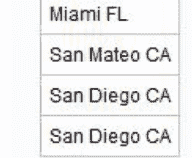

为了使前面的输出显得更易读且更完整，您应考虑进行一些修改。首先，可以使用 AS 运算符将列标题分配为别名。用户定义的列标题的最大大小为 32 字节长度（遵循 SAS 命名约定）。最后，可以使用 TRIM 函数（在第 2 章“在 PROC SQL 中处理数据”中描述）从 city 列中删除尾随空格。这允许第二列充当浮动字段。

## SQL Code

```
PROC SQL;
    SELECT TRIM(manucity) || manustat AS Headquarters
        FROM MANUFACTURERS;
QUIT;
```

## Results

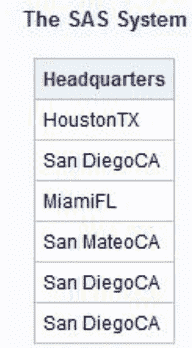

尽管前面的输出说明了一些更改，但仍然难以阅读。应再进行一些美观更改以使其更具美观性和可读性。在下一节中，输出将被自定义以进一步分隔数据。

## Inserting Text and Constants between Columns

有时，能够在查询输出中插入文本和/或常量是有用的。这使得可以在输出中插入特殊字符，包括符号和注释。我们可以通过在 manufacturer city 和 manufacturer state 信息之间插入逗号 “,” 和一个空格来改进前一个示例的输出。最终输出说明了使用“自由浮动”呈现而非固定列来显示列数据的可接受方式。

## SQL Code

```
PROC SQL;
    SELECT trim(manucity) || ',' || manustat
        As Headquarters
        FROM MANUFACTURERS;
QUIT;
```

## Results

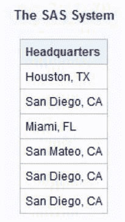

另一种自动连接字符字符串、删除前导和尾随空格并插入文本和常量的方法是使用 CATX 函数。下一个示例显示了 CATX 函数，其中以 “,” 指定为分隔符（逗号后紧跟一个空格字符）在字符字符串 MANUCITY 和 MANUSTAT 之间。虽然在 MANUCITY 和 MANUSTAT 列之间成功插入了逗号和空格字符，但输出会自动左对齐，符合 LINESIZE= 系统选项中分配的值。

## SQL Code

```
PROC SQL;
    SELECT CATX(',', ', ', manucity, manustat)
        As Headquarters
    FROM MANUFACTURERS;
QUIT;
```

## Results

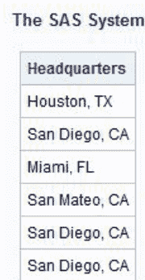

## Using Scalar Expressions with Selected Columns

在计算术语中，标量是指由单个数字或值表示的数量。该值不是表示为数组或值列表，而是作为单个值。例如，值 7 是标量值，但 (0,0,7) 不是。PROC SQL 允许使用标量表达式和常量与所选列一起使用。通常，这些表达式替换或增强 SELECT 语句中的一个或多个列。为了说明标量表达式的使用，假设 PRODUCTS 表中每个产品的销售税百分比为 7.5%。结果包括产品名称、产品成本和派生的计算销售税列。

注意：尽管计算列包含每个产品的销售税计算结果，但它不包含列标题。

## SQL Code

```
PROC SQL;
    SELECT prodname, prodcost,
        .075 * prodcost
    FROM PRODUCTS;
QUIT;
```

## Results

| Product Name | Product Cost |  |
|---|---|---|
| Dream Machine | $3,200.00 | 240 |
| Business Machine | $3,300.00 | 247.5 |
| Travel Laptop | $3,400.00 | 255 |
| Analog Cell Phone | $35.00 | 2.625 |
| Digital Cell Phone | $175.00 | 13.125 |
| Office Phone | $130.00 | 9.75 |
| Spreadsheet Software | $299.00 | 22.425 |
| Database Software | $399.00 | 29.925 |
| Wordprocessor Software | $299.00 | 22.425 |
| Graphics Software | $299.00 | 22.425 |

在接下来的两个示例中，为在前一个示例中计算的派生销售税列分配列标题或别名。实现此目的存在两种方法。如下一个示例所示，第一种方法使用 AS 关键字为派生列分配名称，并允许在查询中稍后引用该列。

## SQL Code

```
PROC SQL;
    SELECT prodname, prodcost,
        .075 * prodcost AS Sales_Tax
    FROM PRODUCTS;
QUIT;
```

## Results

## The SAS System

| Product Name | Product Cost | Sales_Tax |
| Dream Machine | $3,200.00 | 240 |
| Business Machine | $3,300.00 | 247.5 |
| Travel Laptop | $3,400.00 | 255 |
| Analog Cell Phone | $35.00 | 2.625 |
| Digital Cell Phone | $175.00 | 13.125 |
| Office Phone | $130.00 | 9.75 |
| Spreadsheet Software | $299.00 | 22.425 |
| Database Software | $399.00 | 29.925 |
| Wordprocessor Software | $299.00 | 22.425 |
| Graphics Software | $299.00 | 22.425 |

下一个示例说明了为计算的销售税列分配列标题的第二种方法，使用 LABEL= 选项。为了进一步增强输出的可读性，指定了数值美元格式。

注意：由于下一个示例是查询且表未被更新，因此分配的属性仅在步骤持续时间内可用，并且不会永久保存在表的记录描述符中。

## SQL Code

```
PROC SQL;
    SELECT prodname, prodcost,
        .075 * prodcost FORMAT=DOLLAR7.2
            LABEL='Sales Tax'
    FROM PRODUCTS;
QUIT;
```

## Results

The SAS System

| Product Name | Product Cost | Sales Tax |
|---|---|---|
| Dream Machine | $3,200.00 | $240.00 |
| Business Machine | $3,300.00 | $247.50 |
| Travel Laptop | $3,400.00 | $255.00 |
| Analog Cell Phone | $35.00 | $2.63 |
| Digital Cell Phone | $175.00 | $13.13 |
| Office Phone | $130.00 | $9.75 |
| Spreadsheet Software | $299.00 | $22.43 |
| Database Software | $399.00 | $29.93 |
| Wordprocessor Software | $299.00 | $22.43 |
| Graphics Software | $299.00 | $22.43 |

## Ordering Output by Columns

按定义，表是无序的数据集。从表中获取的数据不会自动以任何特定顺序出现。为了抵消这种行为，SQL 过程提供了使用 ORDER BY 子句对表施加顺序的能力。当使用时，此子句根据一个或多个所选列中的值对查询结果进行排序；它必须在 FROM 子句之后指定。

数据行可以按升序（默认顺序）或降序（DESC）为每个指定的列排序（升序为默认顺序）。为了说明如何对所选列数据进行排序，让我们首先查看 PRODUCTS 表及其所有列按产品编号（PRODNUM）升序排列。

## SQL Code

```
PROC SQL;
    SELECT *
        FROM PRODUCTS
        ORDER BY prodnum;
QUIT;
```


## Results

## The SAS System

| Product Name | Product Cost | Sales_Tax |
|---|---|---|
| Analog Cell Phone | $35.00 | 2.625 |
| Office Phone | $130.00 | 9.75 |
| Digital Cell Phone | $175.00 | 13.125 |
| Spreadsheet Software | $299.00 | 22.425 |
| Graphics Software | $299.00 | 22.425 |
| Wordprocessor Software | $299.00 | 22.425 |
| Database Software | $399.00 | 29.925 |
| Dream Machine | $3,200.00 | 240 |
| Business Machine | $3,300.00 | 247.5 |
| Travel Laptop | $3,400.00 | 255 |

The next example illustrates a query that selects and orders multiple columns of data from the PRODUCTS table. Output is arranged first in ascending order by product type (PRODTYPE) and then within product type in descending order by product cost (PRODCOST). The code and output are shown.

## SQL Code

```
PROC SQL;
    SELECT prodname, prodtype, prodcost, prodnum
    FROM PRODUCTS
    ORDER BY prodtype, prodcost DESC;
QUIT;
```

## Results

| Product Name | Product Type | Product Cost | Product Number |
|---|---|---:|---:|
| Travel Laptop | Laptop | $3,400.00 | 1700 |
| Digital Cell Phone | Phone | $175.00 | 2102 |
| Office Phone | Phone | $130.00 | 2200 |
| Analog Cell Phone | Phone | $35.00 | 2101 |
| Database Software | Software | $399.00 | 5002 |
| Spreadsheet Software | Software | $299.00 | 5001 |
| Graphics Software | Software | $299.00 | 5004 |
| Wordprocessor Software | Software | $299.00 | 5003 |
| Business Machine | Workstation | $3,300.00 | 1200 |
| Dream Machine | Workstation | $3,200.00 | 1110 |

## Grouping Data with Summary Functions

Occasionally it may be useful to display data in designated groups. A GROUP BY clause is used in these situations to aggregate and order groups of data using a designated column with the same value. When a GROUP BY clause is used without a summary function, SAS issues a warning in the SAS log with the message, “A GROUP BY clause has been transformed into an ORDER BY clause because neither the SELECT clause nor the optional HAVING clause of the associated table-expression referenced a summary function.” The GROUP BY clause is transformed into an ORDER BY clause and then processed.

When a GROUP BY clause is used without specifying a summary function in the SELECT statement, the entire table is treated as a single group and is ordered in ascending order. The next example illustrates a GROUP BY clause without any summary function specifications. Due to the absence of any summary functions, the GROUP BY clause is automatically transformed into an ORDER BY clause, with the rows being ordered in ascending order by product type (PRODTYPE).

## SQL Code

```
PROC SQL;
    SELECT prodtype,
        prodcost
    FROM PRODUCTS
        GROUP BY prodtype;
QUIT;
```

## Log Results

```
PROC SQL;
    SELECT prodtype,
        prodcost
    FROM PRODUCTS
        GROUP BY prodtype;
WARNING: A GROUP BY clause has been transformed into an ORDER BY clause because neither the SELECT clause nor the optional HAVING clause of the associated table-expression referenced a summary function.
QUIT;
```

## Results

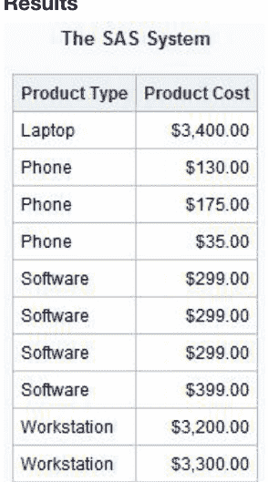

When a GROUP BY clause is used with a summary function, the rows are aggregated in a series of groups. This means that an aggregate function is evaluated on a group of rows and not on a single row at a time. Suppose that the least expensive product in each product type category (PRODTYPE) needs to be identified. A separate query for each product category could be specified using the MIN function to determine the cheapest product. But this would require separate runs to be executed—not a very good approach. A better way to do this would be to specify a GROUP BY clause in a single statement as follows.

## SQL Code

```
PROC SQL;
    SELECT prodtype,
           MIN(prodcost) AS Cheapest
           format=dollar9.2 label='Least Expensive'
    FROM PRODUCTS
         GROUP BY prodtype;
QUIT;
```

## Results

| Product Type | Least Expensive |
|---|---:|
| Laptop | $3,400.00 |
| Phone | $35.00 |
| Software | $299.00 |
| Workstation | $3,200.00 |

## Grouping Data and Sorting

In the absence of an ORDER BY clause, the SQL procedure automatically sorts the results from a grouped query in the same order as specified in the GROUP BY clause. When both an ORDER BY clause and GROUP BY clause are specified for the same column(s) or column order, no additional processing occurs to satisfy the request. Because the ORDER BY clause and GROUP BY clause are not mutually exclusive, they can be used together. Internally, the GROUP BY clause first sorts the results on the grouping column(s) and then aggregates the rows of the query by the same grouping column.

But what happens when the column(s) specified in the ORDER BY clause and GROUP BY clause are not the same? In these situations, additional processing requirements are generally required. The additional processing, in a worse-case scenario, may require merging summary statistics with the original data. In other cases, additional sorting requirements may be necessary. Suppose that

information about the least expensive product in each product category is desired. But instead of automatically sorting the results in ascending order by product type, as before, the results will be displayed in ascending order by the least expensive product for each product type.

## SQL Code

```
PROC SQL;
SELECT prodtype,
    MIN(prodcost) AS Cheapest
        Format=dollar9.2 Label='Least Expensive'
FROM PRODUCTS
    GROUP BY prodtype
        ORDER BY cheapest;
QUIT;
```

## Results

## The SAS System

| Product Type | Least Expensive |
|--------------|-----------------|
| Phone        | $35.00          |
| Software     | $299.00         |
| Workstation  | $3,200.00       |
| Laptop       | $3,400.00       |

## Subsetting Groups with the HAVING Clause

When processing groups of data, it is frequently useful to subset aggregated rows (or groups) of data. This way, aggregated data can be filtered one group at a time in contrast to filtering one row at a time. SQL provides a convenient way to subset (or filter) groups of data by using the GROUP BY clause and the HAVING clause. The HAVING clause is optional, but when specified is used in combination with the GROUP BY clause.

The HAVING clause is similar to the WHERE clause in that it specifies conditions that must be satisfied in order for results to become part of the subset. It differs from the WHERE clause in that it can refer to the results derived from summary functions after the aggregation of all observations for each of the groups. The groups that evaluate to true based on the HAVING clause are retained, and the groups that evaluate to false are automatically removed from consideration.

Suppose that you wanted to identify only those product groupings that have an average cost that is less than $400.00 from the PRODUCTS table. Your first inclination might be to use a summary function in a WHERE clause. But, this would not be valid because a WHERE clause restricts the number of rows selected. In contrast, the HAVING clause restricts the number of groups selected.

and is always performed after the GROUP BY clause. For those already familiar with subqueries as discussed in Chapter 7, “Coding Complex Queries,” you could also approach the problem as a complex query. But, there is an easier and more straightforward way of identifying and selecting the desired product groups using the GROUP BY clause and HAVING clause, as follows.

## SQL Code

```
PROC SQL;
    SELECT prodtype,
        AVG(prodcost)
            FORMAT=DOLLAR9.2 LABEL='Average Product Cost'
    FROM PRODUCTS
        GROUP BY prodtype
            HAVING AVG(prodcost) <= 400.00;
QUIT;
```

## Results

## The SAS System

| Product Type | Average Product Cost |
|--------------|----------------------|
| Phone        | $113.33              |
| Software     | $324.00              |

To illustrate the GROUP BY clause and the HAVING clause further, suppose you have a $400.00 spending limit and you want to identify the least expensive product within each product grouping from the PRODUCTS table. The next example returns only those product types that are within the $400.00 spending limit, as follows.

## SQL Code

```
PROC SQL;
    SELECT prodtype,
        MIN(prodcost) AS Cheapest
            FORMAT=DOLLAR9.2 LABEL='Least Expensive'
    FROM PRODUCTS
        GROUP BY prodtype
            HAVING Cheapest <= 400.00;
QUIT;
```


### 结果

| 产品类型 | 最便宜 |
|---|---|
| Phone | $35.00 |
| Software | $299.00 |

当 WHERE 子句、GROUP BY 子句和 HAVING 子句一起在 SELECT 语句中使用时，WHERE 子句首先被处理。然后，WHERE 子句返回的行根据 GROUP BY 子句进行分组。最后，在生成结果之前，HAVING 子句中指定的条件会应用于这些组。下一个示例返回那些在 $400.00 支出限制内的软件和硬件产品类型。

### SQL 代码

```
PROC SQL;
    SELECT prodtype,
        AVG(productcost) AS Average_Product_Cost
            FORMAT=dollar12.2
    FROM PRODUCTS
        WHERE prodtype IN ('Software', 'Hardware')
        GROUP BY prodtype
            HAVING Average_Product_Cost < 400;
QUIT;
```

### 结果

| 产品类型 | Average_Product_Cost |
|---|---|
| Software | $324.00 |

## 使用输出传送系统格式化输出

SAS 为用户提供了一种熟悉且自动的方式在列表文件中查看输出。虽然使用起来很简单，但在创建美观的输出方面灵活性并不极强。SAS 输出传送系统（ODS）提供了许多格式化输出的方法，通过控制输出的访问方式和格式。ODS 可用的输出格式很多，包括传统的 SAS 等宽字体（即 Listing）。

ODS 最早在版本 7 中引入，作为改善传统 SAS 输出外观的一种方式。它能够在无需导入到 Microsoft Word 等文字处理程序的情况下生成质量良好的输出。此后，SAS 用户可利用的输出格式化功能和选项变得越来越多。有了 ODS，用户可以轻松而强大地创建和访问格式化过程和 DATA 步输出。

## ODS 和输出格式

ODS 语句被归类为全局语句，并由 SAS 立即处理。借助内置的格式引擎，即称为输出目标，ODS 使用特殊格式和布局准备输出。图 3.1 说明了可使用 ODS 生成的输出类型。

图 3.1：ODS 输出目标

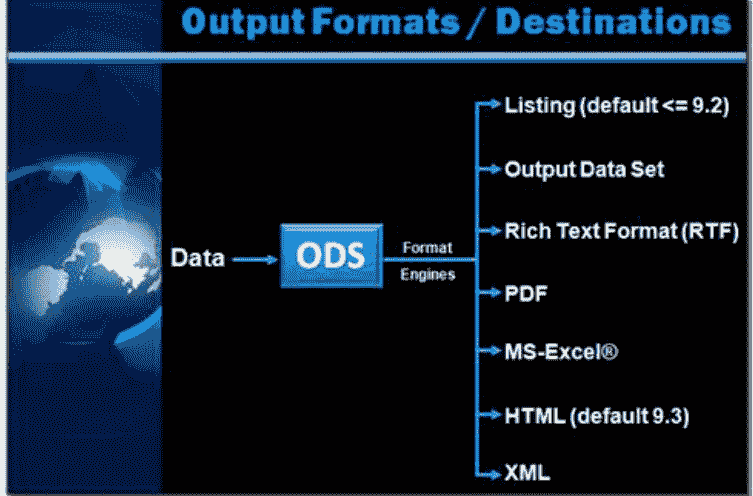

PROC 步和 DATA 步以输出对象的形式向一个或多个打开的目标产生输出。输出目标控制在某一步或直到指定另一个 ODS 语句时打开哪个格式引擎。一个或多个输出目标可以同时打开。当目标打开时，一个或多个输出对象可以发送到它。相反，当目标关闭时，输出对象不会发送到该目标。

有几本非常好的 ODS 书籍可供进一步研究这一令人兴奋的功能，包括 Lauren Haworth、Cynthia L. Zender 和 Michele Burlew 合著的 *Output Delivery System: The Basics and Beyond*；以及 Sunil Kumar Gupta 的 *Quick Results with the Output Delivery System*。

## 将输出发送到 SAS 数据集

SQL 过程产生的输出也可以用作另一厂商的 SQL 过程或 DATA 步的输入。ODS 为创建 SAS 结果表提供了一种简便且一致的替代方法。对于已经熟悉 ODS 的用户，此方法只需在 ODS 语句中指定 OUTPUT 目标即可。对于更喜欢传统 ANSI SQL 方法的用户，CREATE TABLE 语句（请参阅第 5 章“创建、填充和删除表”，了解更多详细信息）将是首选方法。根据您最终使用的方法，创建 SAS 输出表的优点是所有 SAS 用户都应熟悉的一项便捷功能。

尽管 CREATE TABLE 语句是 PROC SQL 中创建表的标准方法，但也可以指定 ODS OUTPUT 语句来生成表。使用 ODS OUTPUT 语句，结果表是一个矩形结构，由一个或多个行和列组成。在此示例中，SQL 过程的结果存储在对象 SQL_Results 中，然后通过 ODS OUTPUT 目标发送到数据集 SQL_DATA。生成的数据集使用 VIEWTABLE 显示。

### SQL 代码

```
ODS LISTING CLOSE;
ODS OUTPUT SQL_Results = SQL_DATA;

PROC SQL;
    TITLE1 'Delivering Output to a Data Set';
    SELECT prodname, prodtype, prodcost, prodnum
        FROM PRODUCTS
        ORDER BY prodtype;
QUIT;

ODS OUTPUT CLOSE;
ODS LISTING;
```

### 结果

|  | 产品名称 | 产品类型 | 产品成本 | 产品编号 |
|---|---|---|---|---|
| 1 | Travel Laptop | Laptop | $3,400.00 | 1700 |
| 2 | Office Phone | Phone | $130.00 | 2200 |
| 3 | Digital Cell Phone | Phone | $175.00 | 2102 |
| 4 | Analog Cell Phone | Phone | $35.00 | 2101 |
| 5 | Spreadsheet Software | Software | $299.00 | 5001 |
| 6 | Graphics Software | Software | $299.00 | 5004 |
| 7 | Wordprocessor Software | Software | $299.00 | 5003 |
| 8 | Database Software | Software | $399.00 | 5002 |
| 9 | Dream Machine | Workstation | $3,200.00 | 1110 |
| 10 | Business Machine | Workstation | $3,300.00 | 1200 |

## 将输出转换为富文本格式

富文本格式（RTF）是包含表示特殊格式属性的代码的文本。虽然最常与文字处理程序在复制粘贴操作期间读取和创建封装文本字体和突出显示属性的能力相关联，但 ODS RTF 目标允许由 SAS 生成的输出被打包为 RTF。这使您可以生成可共享的输出。

下一个示例说明了 SQL 输出如何使用 RTF 格式引擎发送到外部 RTF 文件。首先，默认的 Listing 目标被关闭，然后使用 RTF 格式引擎打开一个外部文件目标，SQL 结果将被路由到该目标。SQL 过程执行后，RTF 目标被关闭，默认的 Listing 目标被打开。

注意：打开 RTF 文件会自动调用系统的默认文字处理程序并显示文件内容。

### SQL 代码

```
ODS LISTING CLOSE;
ODS RTF FILE='c:\SQL_Results.rtf';

PROC SQL;
    TITLE1 'Delivering Output to Rich Text Format';
    SELECT prodname, prodtype, prodcost, prodnum
    FROM PRODUCTS
        ORDER BY prodtype;
QUIT;

ODS RTF CLOSE;
ODS LISTING;
```

### 结果

## Delivering Output to Rich Text Format

| 产品名称 | 产品类型 | 产品成本 | 产品编号 |
|---|---|---:|---:|
| Travel Laptop | Laptop | $3,400.00 | 1700 |
| Office Phone | Phone | $130.00 | 2200 |
| Digital Cell Phone | Phone | $175.00 | 2102 |
| Analog Cell Phone | Phone | $35.00 | 2101 |
| Spreadsheet Software | Software | $299.00 | 5001 |
| Graphics Software | Software | $299.00 | 5004 |
| Wordprocessor Software | Software | $299.00 | 5003 |
| Database Software | Software | $399.00 | 5002 |
| Dream Machine | Workstation | $3,200.00 | 1110 |
| Business Machine | Workstation | $3,300.00 | 1200 |

## 将数据和输出导出到 Excel

SAS 为用户提供了一系列功能和选项，可将数据和输出导出到 Microsoft Excel。一种方法可将数据和输出传输到逗号分隔值（CSV）文件。CSV 文件是一种广泛支持的文件格式，用于从数据库应用程序向电子表格传输和存储表格数据。CSV 文件以纯文本形式存储文本和数字，然后可使用文本编辑器查看和/或读取。使用输出传送系统（ODS）与 SQL 过程，数据和输出可以从 SAS 发送到 CSV 文件。在下面的示例中，指定 ODS CSV 语句以生成 CSV 文件，然后可在 Microsoft Excel 中打开并保存为 Microsoft Excel 电子表格文件。生成的 CSV 文件在 Microsoft Excel 中显示如下。

### SQL 代码

```
ODS LISTING CLOSE;
ODS CSV file='sas-to-excel.csv';

PROC SQL;
    SELECT *
        FROM PRODUCTS;
QUIT;
```

```
ODS CSV CLOSE;
ODS LISTING;
```

### 结果

|  | A | B | C | D | E |
|---|---|---|---|---|---|
| 1 | 产品编号 | 产品名称 | 制造商编号 | 产品类型 | 产品成本 |
| 2 | 1110 | Dream Machine | 111 | Workstation | $3,200.00 |
| 3 | 1200 | Business Machine | 120 | Workstation | $3,300.00 |
| 4 | 1700 | Travel Laptop | 170 | Laptop | $3,400.00 |
| 5 | 2101 | Analog Cell Phone | 210 | Phone | $35.00 |
| 6 | 2102 | Digital Cell Phone | 210 | Phone | $175.00 |
| 7 | 2200 | Office Phone | 220 | Phone | $130.00 |
| 8 | 5001 | Spreadsheet Software | 500 | Software | $299.00 |
| 9 | 5002 | Database Software | 500 | Software | $399.00 |
| 10 | 5003 | Wordprocessor Software | 500 | Software | $299.00 |
| 11 | 5004 | Graphics Software | 500 | Software | $299.00 |

将数据和输出导出到 Microsoft Excel 的另一种方法是使用 ODS HTML 语句（请参阅“将结果传送到 Web”部分了解详情）。超文本标记语言（HTML）目标实际上是一个包含导入数据和输出到 Excel 格式的指令的标签集。在下一个示例中，指定 ODS HTML 语句以将输出导入到 Microsoft Excel 电子表格文件。生成的 XLS 文件在 Microsoft Excel 中显示如下。

### SQL 代码

```
ODS LISTING CLOSE;
ODS HTML file='sas-to-excel.xls';

PROC SQL;
    SELECT *
        FROM PRODUCTS;
QUIT;

ODS HTML CLOSE;
ODS LISTING;
```


### 结果

|  | A | B | C | D | E |
|---|---|---|---|---|---|
| 1 | 产品编号 | 产品名称 | 制造商编号 | 产品类型 | 产品成本 |
| 2 |  |  |  |  | |
| 3 |  | 1110 梦想机器 | 111 | 工作站 | $3,200.00 |
| 4 |  | 1200 商务机器 | 120 | 工作站 | $3,300.00 |
| 5 |  | 1700 旅行笔记本电脑 | 170 | 笔记本电脑 | $3,400.00 |
| 6 |  | 2101 模拟手机 | 210 | 电话 | $35.00 |
| 7 |  | 2102 数字手机 | 210 | 电话 | $175.00 |
| 8 |  | 2200 办公电话 | 220 | 电话 | $130.00 |
| 9 |  | 5001 电子表格软件 | 500 | 软件 | $299.00 |
| 10 |  | 5002 数据库软件 | 500 | 软件 | $399.00 |
| 11 |  | 5003 文字处理软件 | 500 | 软件 | $299.00 |
| 12 |  | 5004 图形软件 | 500 | 软件 | $299.00 |

## 将结果发布到 Web

随着互联网的普及，您可能会发现在内部网或网站上部署选定的输出非常有用。ODS 使向 Web 部署输出变得轻而易举。HTML 输出目标会创建语法正确的 HTML 代码，可用于主流 Internet 浏览器。

使用 ODS HTML 输出目标可以生成四种类型的文件：

- 正文
- 目录
- 页面
- 框架

必须为使用 ODS HTML 语句创建的每个文件分配唯一的文件名。当每个文件与框架文件组合时，会自动创建自定义且集成的文件结构。为了改善信息的导航和访问，Web 浏览器会在必要时自动在生成的页面上放置水平和垂直滚动条。

下一个示例演示如何使用 HTML 格式引擎将 PROC SQL 输出发送到外部 HTML 文件。首先，关闭默认的 Listing 输出目标，然后打开 HTML 格式引擎，并指定 BODY、CONTENTS、PAGE 和 FRAME 外部文件来路由 SQL 过程的结果。SQL 过程执行后，关闭 HTML 输出目标并打开默认的 Listing 输出目标。

### SQL 代码

```
ODS LISTING CLOSE;
ODS HTML
    BODY='Products-body.html'
    CONTENTS='Products-contents.html'
    PAGE='Products-page.html'
```

```
FRAME='Products-frame.html';

PROC SQL;
    TITLE1 'Products List';
    SELECT prodname, prodtype, prodcost, prodnum
    FROM PRODUCTS
        ORDER BY prodtype;
QUIT;

ODS HTML CLOSE;
ODS LISTING;
```

### 结果

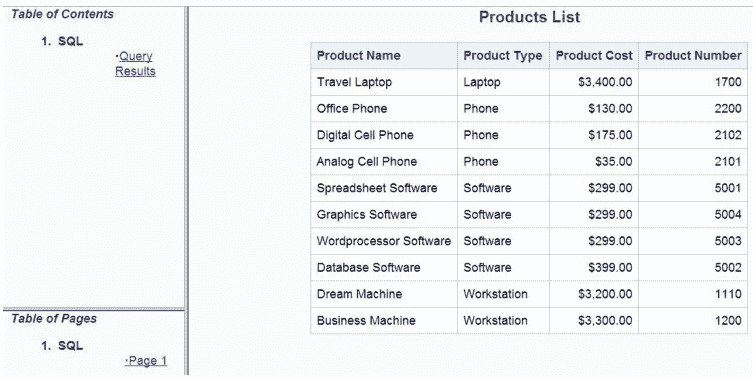

## 摘要

- 1. 可以在每一行输出之间显示一个空行（参见“在每行之间写入空行”一节）。
- 2. 可以将列连接起来形成单列数据（参见“连接字符串”一节）。
- 3. 可以在选定列之间插入文本和常量（参见“在列之间插入文本和常量”一节）。
- 4. 可以使用表达式生成数值或字符标量值（参见“将标量表达式用于选定的列”一节）。
- 5. 可以将用户定义的值分配给派生的列标题（参见“将标量表达式用于选定的列”一节）。
- 6. 可以分配并永久存储格式，以自动显示用户定义的格式化值而不是未格式化的值（参见“将标量表达式用于选定的列”一节）。

## 简介

SQL 过程中的表达式可以简单也可以复杂，由列、符号、运算符、函数、常量和字面量的组合表示。表达式在 SQL 语句和子句中指定，通常用于条件逻辑结构中，以测试或比较一个值与另一个值。在 CASE 表达式中应用表达式，可以使用一个或多个表达式对单独的数据行进行处理和分组。特别是，可以对数据进行重新编码和重塑，以扩展数据分析和处理的视角。

## 条件逻辑

经验丰富的 PROC SQL 程序员都知道，经常需要将条件测试为真或为假。从编程角度来看，条件的求值决定了程序将遵循哪条替代路径。SQL 过程中的条件逻辑通常在 WHERE 子句中实现，以引用常量以及列和值之间的关系。SQL 过程还允许使用 CASE 表达式（将在下一节中描述）在 SELECT 语句中识别和赋值数据值。为了说明如何在 WHERE 子句中引用常量和关系，下面给出了一个简单示例。

下一个示例展示了一个 WHERE 子句，从 PRODUCTS 表中筛选出成本低于 $400.00 的产品。在执行过程中，当 PRODCOST 的值小于 $400.00 时，表达式的计算结果为真。否则，当 PRODCOST 的值大于或等于 $400.00 时，表达式的计算结果为假。这是一个重要的概念，因为只有当 WHERE 子句表达式的计算结果为真时，才会选择数据行。

### SQL 代码

```
PROC SQL;
    SELECT *
        FROM PRODUCTS
        WHERE PRODCOST < 400.00;
QUIT;
```

在下一个示例中，以下关系评估产品（PRODCOST）的成本是否大于 $400.00。当 WHERE 子句表达式的计算结果为真（意味着 PRODCOST 大于 $400.00）时，选择数据行。否则，当值小于或等于 $400.00 时，表达式的计算结果为假。

### SQL 代码

```
PROC SQL;
    SELECT *
        FROM PRODUCTS
        WHERE PRODCOST > 400.00;
QUIT;
```

关系也可以与非数值字面量和非数值列一起使用。在下一个示例中，构造了一个区分大小写的表达式来表示制造商生产的产品类型（PRODTYPE）。求值时，根据 PRODTYPE 的当前值是否与字面量“Software”逐字符相同，会产生真或假的条件。当出现真条件时，会选择满足表达式的数据行；否则，不会选择它们。

为了确保字符值逐字符匹配，可以使用 UPCASE 函数指定前面的表达式，如下所示。

### SQL 代码

```
PROC SQL;
    SELECT *
        FROM PRODUCTS
            WHERE UPCASE(PRODTYPE) = "SOFTWARE";
QUIT;
```

当为非数值定义关系 < 和 > 时，需要考虑由实现决定的字符排序序列问题。例如，“A” < “B” 为真，“Y” < “Z” 为“真”，“B” < “A” 为“假”，等等。有关字符排序序列的更多信息，请参阅您特定操作系统的文档。

## CASE 表达式

在 SQL 过程中，CASE 表达式提供了一种方法，用于确定表（或视图）中所有行的结果值。与 DATA 步 SELECT 语句（或 IF-THEN/ELSE 语句）类似，CASE 表达式基于某个条件，该条件使用 WHEN-THEN 子句来确定结果值。如果 WHEN 条件中标识的表达式均不满足，则可以指定可选的 ELSE 表达式来处理替代操作。

SQL 过程支持两种形式的 CASE 表达式：简单 CASE 表达式和搜索 CASE 表达式。CASE 表达式可以在 SELECT 子句、WHERE 子句、ORDER BY 子句、HAVING 子句、连接结构以及任何可以使用表达式的地方指定。CASE 表达式必须是有效的 PROC SQL 表达式，并符合类似于 DATA 步 SELECT-WHEN 语句的语法规则。在显示具体的 CASE 表达式示例之前，有必要先说明基本语法，如下所示。

```
CASE <column-name>
    WHEN when-condition THEN result-expression
    <WHEN when-condition THEN result-expression> ...
    <ELSE result-expression>
END
```

CASE 语法包含从 CASE 到 END 的所有内容。可以选择将列名指定为 CASE 表达式的一部分。如果存在，它会自动提供给每个 WHEN 条件。如果未指定，则必须在每个 WHEN 条件中编码列名。让我们研究一下 CASE 表达式是如何工作的。

在 CASE 表达式中可以指定一个或多个 WHEN 条件，并按列出的顺序进行求值。如果表（或视图）中的一行满足 WHEN 条件，则认为该条件为“真”，并处理 THEN 关键字后面的结果表达式。将跳过 CASE 表达式中剩余的 WHEN 条件。如果 WHEN 条件为“假”，则计算下一个 WHEN 条件。SQL 会逐个计算每个 WHEN 条件，直到找到“真”条件。或者，如果所有 WHEN 条件都为“假”，则执行 ELSE 表达式并将其值分配给 CASE 表达式的结果。当未指定 ELSE 表达式且每个 WHEN 条件都为“假”时，将为 CASE 表达式分配一个缺失值。

## 简单 CASE 表达式

顾名思义，简单 CASE 表达式提供了一种执行最简单类型比较的有用方法。语法要求将底层表中的列名指定为 CASE 表达式的一部分。这不仅消除了在每个 WHEN 条件中不断重复列名的需要，还减少了击键次数，使代码更易于阅读（和支持）。简单 CASE 表达式具有以下特点：

- 仅允许相等检查。
- 按指定顺序计算指定的 WHEN 条件。
- 计算每个 WHEN 条件的输入表达式。
- 返回第一个计算结果为“真”的输入表达式的结果表达式。
- 如果没有输入表达式的计算结果为“真”，则处理 ELSE 条件。
- 当未指定 ELSE 条件时，分配 NULL 值。

## SELECT 子句中的简单 CASE 表达式

为了最好地展示简单 CASE 表达式的工作原理，下面演示了一个 SELECT 子句中的示例。目标要求将“东部”分配给佛罗里达州的制造商，“中部”分配给得克萨斯州的制造商，“西部”分配给加利福尼亚州的制造商，或“未知”分配给不在佛罗里达州、得克萨斯州和加利福尼亚州的制造商。在 CASE 表达式中指定了制造商所在州（MANUSTAT）列及其相关的 WHEN 条件和分配的值。最后，使用 AS 关键字将列标题 Region 分配给派生的输出列。


## SQL Code
```
PROC SQL;
    SELECT MANUNAME,
            MANUSTAT,
            CASE MANUSTAT
                WHEN 'CA' THEN 'West'
                WHEN 'FL' THEN 'East'
                WHEN 'TX' THEN 'Central'
                ELSE 'Unknown'
            END AS Region
    FROM MANUFACTURERS;
QUIT;
```

## Results

The SAS System

| Manufacturer Name | Manufacturer State | Region |
|---|---|---|
| Cupid Computer | TX | Central |
| Global Comm Corp | CA | West |
| World Internet Corp | FL | East |
| Storage Devices Inc | CA | West |
| KPL Enterprises | CA | West |
| San Diego PC Planet | CA | West |

下一个示例说明了在 SELECT 子句中使用简单的 CASE 表达式对产品进行分类的过程。来自 PRODUCTS 表的 PRODTYPE 列用于为每种产品类型分配 “Hardware”、“Software” 或 “Unknown” 的字符值（例如 Laptop、Phone、Software 和 Workstation）。与 FORMAT 过程中的分配过程类似，新的数据值与 PRODTYPE 列中的值相关联。WHEN-THEN 条件将 “Laptop” 等同于 “Hardware”，“Phone” 等同于 “Hardware”，“Software” 等同于 “Software”，“Workstation” 等同于 “Hardware”。对于不匹配任何 WHEN-THEN 逻辑条件 的产品，将分配 “Unknown” 值。最后，使用 AS 关键字为新列分配 Product_Classification 列标题。

## SQL Code
```
PROC SQL;
    SELECT PRODNAME,
            CASE PRODTYPE
```
```
END AS Product_Classification
FROM PRODUCTS
ORDER BY PRODNUM;
QUIT;
```

## Results

| Product Name | Product Number | Product_Classification |
|---|---:|---|
| Dream Machine | 1110 | Laptop/Workstation |
| Business Machine | 1200 | Laptop/Workstation |
| Travel Laptop | 1700 | Laptop/Workstation |
| Analog Cell Phone | 2101 | Phone |
| Digital Cell Phone | 2102 | Phone |
| Office Phone | 2200 | Phone |
| Spreadsheet Software | 5001 | Software |
| Database Software | 5002 | Software |
| Wordprocessor Software | 5003 | Software |
| Graphics Software | 5004 | Software |

下一个示例应用子查询（有关更多信息，请参阅第 7 章“Coding Complex Queries”中的“Subqueries”部分）从前一个示例中创建的 Product_Classification 结果中筛选出软件产品。

## SQL Code
```
PROC SQL;
    SELECT *
        FROM
            (SELECT PRODNAME,
                    PRODNUM,
                    CASE SUBSTR(PUT(PRODNUM,4.),1,1)
                        WHEN '1' THEN 'Laptop/Workstation'
                        WHEN '2' THEN 'Phone'
                        WHEN '5' THEN 'Software'
                        ELSE 'Unknown'
```
```
END AS Product_Classification
FROM PRODUCTS
)
WHERE Product_Classification = 'Software';
QUIT;
```

## Results

| Product Name | Product Number | Product_Classification |
|---|---|---|
| Spreadsheet Software | 5001 | Software |
| Database Software | 5002 | Software |
| Wordprocessor Software | 5003 | Software |
| Graphics Software | 5004 | Software |

## Simple CASE Expression in a WHERE Clause

在上一节中，我们研究了 SELECT 子句中简单 CASE 表达式的语法和应用。在本节中，我们将探讨 WHERE 子句中简单 CASE 表达式的语法和应用。由于 SQL 过程支持在任何可以使用表达式的地方使用 CASE 表达式，我们将了解到查询可以通过将 CASE 表达式的结果值直接传递给 WHERE 子句来代替硬编码值而受益。

## SQL Code
```
PROC SQL;
    SELECT MANUNAME,
        MANUSTAT
    FROM MANUFACTURERS
    WHERE CASE MANUSTAT
        WHEN 'CA' THEN 1
        ELSE 0
    END;
QUIT;
```

## Results

| Manufacturer Name | Manufacturer State |
|---|---|
| Global Comm Corp | CA |
| Storage Devices Inc | CA |
| KPL Enterprises | CA |
| San Diego PC Planet | CA |

## Creating a Customized List with a Simple CASE Expression

可以使用 SELECT 和 ORDER BY 子句中的简单 CASE 表达式对显示和顺序进行自定义编码。以下示例说明了通过为 PRODUCTS 表中的每个产品编码单独的 Case 逻辑来创建产品和可用性列表的独特方法。生成的输出显示值为 “1” 以指示其对输出列表有贡献，或值为 “0” 以指示其未对输出列表有贡献。

## SQL Code
```
OPTIONS LS=120;
PROC SQL;
SELECT PRODNAME,
    PRODCOST,
    CASE PRODTYPE WHEN 'Laptop'      THEN 1 ELSE 0 END
        AS LaptopRequest,
    CASE PRODTYPE WHEN 'Workstation' THEN 1 ELSE 0 END
        AS WorkstationRequest,
    CASE PRODTYPE WHEN 'Phone'       THEN 1 ELSE 0 END
        AS PhoneRequest,
    CASE PRODTYPE WHEN 'Software'    THEN 1 ELSE 0 END
        AS SoftwareRequest
FROM PRODUCTS
ORDER BY CASE PRODTYPE WHEN 'Laptop'      THEN 1 ELSE 0 END,
    CASE PRODTYPE WHEN 'Workstation' THEN 1 ELSE 0 END,
    CASE PRODTYPE WHEN 'Phone'       THEN 1 ELSE 0 END,
    CASE PRODTYPE WHEN 'Software'    THEN 1 ELSE 0 END;
QUIT;
```

## Results

| Product Name | Product Cost | LaptopRequest | WorkstationRequest | PhoneRequest | SoftwareRequest |
|---|---:|---:|---:|---:|---:|
| Wordprocessor Software | $299.00 | 0 | 0 | 0 | 1 |
| Graphics Software | $299.00 | 0 | 0 | 0 | 1 |
| Spreadsheet Software | $299.00 | 0 | 0 | 0 | 1 |
| Database Software | $399.00 | 0 | 0 | 0 | 1 |
| Office Phone | $130.00 | 0 | 0 | 1 | 0 |
| Digital Cell Phone | $175.00 | 0 | 0 | 1 | 0 |
| Analog Cell Phone | $35.00 | 0 | 0 | 1 | 0 |
| Dream Machine | $3,200.00 | 0 | 1 | 0 | 0 |
| Business Machine | $3,300.00 | 0 | 1 | 0 | 0 |
| Travel Laptop | $3,400.00 | 1 | 0 | 0 | 0 |

## Simple CASE Expression in a HAVING Clause

HAVING 子句用于在 SQL 查询中过滤 GROUP BY 子句中指定的聚合。在此示例中，SELECT 子句返回 MANUFACTURERS 表中的制造商名称及其居住州。HAVING 子句中的 CASE 表达式将 SELECT 子句返回的内容限制为仅居住在加利福尼亚州的制造商。

## SQL Code
```
PROC SQL;
    SELECT MANUNAME,
           MANUSTAT
    FROM MANUFACTURERS
    HAVING CASE MANUSTAT
           WHEN 'CA' THEN 1
           ELSE 0
           END;
QUIT;
```

## Results

The SAS System

| Manufacturer Name | Manufacturer State |
|---|---|
| Global Comm Corp | CA |
| Storage Devices Inc | CA |
| KPL Enterprises | CA |
| San Diego PC Planet | CA |

在下一个示例中，SELECT 子句返回 PRODUCTS 表中最昂贵的产品（s），并且 HAVING 子句中的 CASE 表达式将结果限制为成本超过 $300.00 的软件产品。

## SQL Code
```
PROC SQL;
    SELECT PRODNAME,
            PRODTYPE,
            MAX(PRODCOST) AS Product_Cost FORMAT=DOLLAR10.2
    FROM PRODUCTS
    HAVING CASE PRODTYPE
            WHEN 'Software' THEN PRODCOST
            ELSE 0
        END > 300;
QUIT;
```

## Results

The SAS System

| Product Name | Product Type | Product_Cost |
|---|---|---|
| Database Software | Software | $3,400.00 |

## Simple CASE Expression in a Join Construct

可以在 JOIN 构造中指定 CASE 表达式以过滤 GROUP BY 子句中指定的聚合。在此示例中，SELECT 子句返回 MANUFACTURERS 表中的制造商名称及其居住州。CASE 表达式在
HAVING 子句中将 SELECT 子句返回的内容限制为仅居住在加利福尼亚州的制造商。

## SQL Code
```
PROC SQL;
    SELECT PRODNAME,
           PRODTYPE,
           MANUNAME
    FROM PRODUCTS P,
         MANUFACTURERS M
    WHERE P.MANUNUM = M.MANUNUM AND
          CASE PRODTYPE
            WHEN 'Software' THEN 1
            ELSE 0
          END;
QUIT;
```

## Results

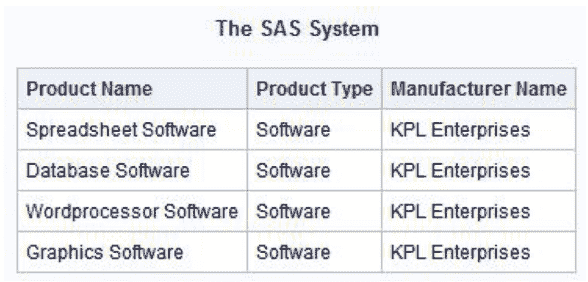

## Preventing Division by Zero with a Simple CASE Expression

除零错误可能导致查询出现许多问题，包括严重的性能下降。在下一个示例中，在 SELECT 子句中指定了一个简单的 CASE 表达式以防止除零错误。使用 INVENTORY 表，CASE 表达式告诉 SAS 忽略对 INVENQTY 值为零的产品执行任何计算（通过分配布尔值 false）。否则，将计算方程 INVENCST / INVENQTY，并且 WHERE 子句将选择成本超过 $1,000.00 的产品。使用 AS 关键字为新列分配名为 Average_Cost 的列标题。

## SQL Code
```
PROC SQL;
    SELECT PRODNUM,
           INVENQTY,
           INVENCST,
           CASE INVENQTY
```


```sas
WHEN 0 THEN 0
ELSE INVEN CST / INVENQTY
END AS Average_Cost FORMAT=DOLLAR10.2
FROM INVENTORY
WHERE INVEN CST / INVENQTY > 1000;
QUIT;
```

### 结果

| 产品编号 | 库存数量 | 库存成本 | 平均成本 |
|---:|---:|---:|---:|
| 1110 | 20 | $45,000.00 | $2,250.00 |
| 1700 | 10 | $28,000.00 | $2,800.00 |

在下一个示例中，一个简单的 CASE 表达式在 WHERE 子句中实现，以防止除零错误。与之前一样，CASE 表达式的 WHEN 条件告诉 SAS 忽略对 INVENQTY 值为零的产品执行任何计算（通过分配布尔值 false）。否则，计算等式 INVENCST / INVENQTY，并由 WHERE 子句选择成本超过 $1,000.00 的产品。

### SQL 代码

```sas
PROC SQL;
    SELECT PRODNUM,
           INVENQTY,
           INVENCST
    FROM INVENTORY
    WHERE CASE INVENQTY
          WHEN 0 THEN 0
          ELSE INVENCST / INVENQTY
          END > 1000;
QUIT;
```

### 结果

| 产品编号 | 库存数量 | 库存成本 |
|---:|---:|---:|
| 1110 | 20 | $45,000.00 |
| 1700 | 10 | $28,000.00 |

### 嵌套简单 CASE 表达式

关于软件构建相关的技术，尤其是与程序和/或代码设计相关的方面，已经有很多论述。当讨论程序复杂性时，人们普遍认为，通过将解决方案分解为更小的部分，可以降低程序的复杂程度。这种思维规则在 Steve McConnell 的《代码大全：软件构建的实用手册》第二版（2004）中得到了最好的讨论：“人类往往更容易理解几个简单的信息片段，而不是一个复杂的信息片段。”

尽管存在许多改善程序设计过程的设计策略，但经常被提及的一种策略是嵌套过程。嵌套涉及将复杂和/或繁琐的逻辑场景转换为两个（或更多）更简单的逻辑条件。其主要目标是提高程序的可维护性和可读性。SQL 过程支持使用 CASE 表达式结构进行嵌套，进一步强化了这一思维规律。

嵌套是一种有用的技术，因为它为 SQL 用户提供了一种处理复杂代码的有效方式。但是，不必要的嵌套或仅为嵌套而嵌套实际上会使代码更难理解和维护。根据我的经验，嵌套绝不应超过三到四层。超过这个深度，复杂程度会显著增加。一般规则是编写不仅易于理解，而且希望包含更少错误的代码。为了说明嵌套过程，一个简单的 CASE 表达式被嵌套两层，用于识别 PRODUCTS 表中成本低于 $300.00 的软件产品。

### SQL 代码

```sas
PROC SQL;
    SELECT PRODNAME,
            PRODTYPE,
            PRODCOST,
            CASE PRODTYPE
                WHEN 'Software' THEN
                    CASE
                        WHEN PRODCOST < 300 THEN 'Match'
                        ELSE 'No Match'
                    END
                ELSE 'Not Software'
            END AS Product_Type_Cost
    FROM PRODUCTS;
QUIT;
```

### 结果

### SAS 系统

| 产品名称 | 产品类型 | 产品成本 | 产品类型成本 |
|---|---|---|---|
| 梦想机器 | 工作站 | $3,200.00 | 非软件 |
| 商务机器 | 工作站 | $3,300.00 | 非软件 |
| 旅行笔记本电脑 | 笔记本电脑 | $3,400.00 | 非软件 |
| 模拟手机 | 手机 | $35.00 | 非软件 |
| 数字手机 | 手机 | $175.00 | 非软件 |
| 办公电话 | 手机 | $130.00 | 非软件 |
| 电子表格软件 | 软件 | $299.00 | 匹配 |
| 数据库软件 | 软件 | $399.00 | 不匹配 |
| 文字处理软件 | 软件 | $299.00 | 匹配 |
| 图形软件 | 软件 | $299.00 | 匹配 |

### 使用简单 CASE 表达式条件性更新表

可以指定 CASE 表达式来条件性更新表的内容。有关更新表中数据的更多信息，请参阅第 6 章“修改和更新表与索引”。该示例说明了使用 UPDATE 语句和简单 CASE 表达式条件性更新表中数据的过程，将 PURCHASES 表中“Chair”的单位成本（UNITCOST）从 $179.00 增加 $10.00 至 $189.00。

注意：表必须以更新模式打开才能更新其内容。

### SQL 代码

```
PROC SQL;
    TITLE1 'Before Update Operation';
    SELECT *
        FROM PURCHASES2;
    UPDATE PURCHASES2
        SET UNITCOST = UNITCOST +
            CASE ITEM
                WHEN 'Chair' THEN 10.00
                ELSE 0
            END;
    TITLE1 'After Update Operation';
```

```
SELECT *
    FROM PURCHASES2;
QUIT;
```

### 结果

### 更新操作前

| 客户编号 | 项目 | 单位数量 | 单位成本 |
|---|---|---|---|
| 1 | 椅子 | 1 | $179.00 |
| 1 | 笔 | 12 | $0.89 |
| 1 | 纸 | 4 | $6.95 |
| 1 | 订书机 | 1 | $8.95 |
| 7 | 鼠标垫 | 1 | $11.79 |
| 7 | 笔 | 24 | $1.59 |
| 13 | 马克笔 | . | $0.99 |

### 更新操作后

| 客户编号 | 项目 | 单位数量 | 单位成本 |
|---|---|---|---|
| 1 | 椅子 | 1 | $189.00 |
| 1 | 笔 | 12 | $0.89 |
| 1 | 纸 | 4 | $6.95 |
| 1 | 订书机 | 1 | $8.95 |
| 7 | 鼠标垫 | 1 | $11.79 |
| 7 | 笔 | 24 | $1.59 |
| 13 | 马克笔 | . | $0.99 |

### 搜索式 CASE 表达式

搜索式 CASE 表达式为 SQL 用户提供了执行更复杂比较的能力。虽然与简单 CASE 表达式相比，按键次数可能更多，但搜索式 CASE 表达式提供了最大的灵活性，是 SQL 程序员使用的主要形式。CASE 表达式中明显没有列名，这使得可以在 WHEN-THEN/ELSE 逻辑场景中从底层表中指定任意数量的列。

搜索式 CASE 表达式会评估一个或多个 WHEN 条件，直到遇到一个计算结果为“真”的条件。然后它分配 THEN 关键字后指定的相应结果表达式。如果所有 WHEN 条件都不为“真”，则返回指定 ELSE 关键字后的结果。如果没有任何 WHEN 条件为“真”且未指定 ELSE 条件，则搜索式 CASE 表达式返回空值。搜索式 CASE 表达式具有以下特性：

- 允许算术运算符（即 =、<、<=、>、>= 等）。
- 使用逻辑运算符（即 AND、OR 和 NOT）来组合任意数量的表达式。
- 按以下默认顺序评估复合表达式：NOT、AND 或 OR，除非指定括号来控制评估顺序。
- 按指定顺序评估指定的 WHEN 条件。
- 评估每个 WHEN 条件的输入表达式。
- 返回第一个评估为“真”的输入表达式的结果表达式。
- 如果没有输入表达式评估为“真”，则处理 ELSE 条件。
- 当未指定 ELSE 条件时，分配 NULL 值。

### SELECT 子句中的搜索式 CASE 表达式

为了说明搜索式 CASE 表达式如何工作，考虑一个示例，该示例使用来自 UNITS 和 UNITCOST 列的计算美元金额，为低于 $1,000 的购买分配“小额购买”值，为 $1,000 至 $7,500 之间的购买分配“平均购买”值，为大于 $7,500 的购买分配“大额购买”值，并为 PURCHASES 表中的所有其他值分配“未知购买”值。使用来自 UNITS 和 UNITCOST 列的计算金额 Purchase_Amount，构建一个 CASE 表达式以在每行数据中分配所需的值。最后，使用 AS 关键字将列标题 Type_of_Purchase 分配给计算列。注意：CALCULATED 关键字必须与 SELECT 子句中创建的任何列一起指定，该列在 FROM 子句引用的表中不存在。


### SQL 代码

```
PROC SQL;
    SELECT
        PRODNUM,
        UNITS,
        UNITCOST,
        UNITS * UNITCOST
            AS Purchase_Amount
            FORMAT=DOLLAR12.2,
        CASE
            WHEN CALCULATED
    Purchase_Amount < 1000 THEN 'Small Purchase'
            WHEN CALCULATED
    Purchase_Amount BETWEEN 1000 AND 7500 THEN 'Average Purchase'
            WHEN CALCULATED
    Purchase_Amount > 7500 THEN 'Large Purchase'
            ELSE 'Unknown Purchase'
        END AS Type_of_Purchase
        FROM PURCHASES
            ORDER BY CALCULATED
    Purchase_Amount DESC;
QUIT;
```

### 结果

| 制造商名称 | 制造商所在州 | 区域 |
|---|---|---|
| Cupid Computer | TX | Central |
| Global Comm Corp | CA | West |
| World Internet Corp | FL | East |
| Storage Devices Inc | CA | West |
| KPL Enterprises | CA | West |
| San Diego PC Planet | CA | West |

## 使用搜索 CASE 表达式进行复杂比较

如前所述，搜索 CASE 表达式为 SQL 用户提供了执行更复杂比较的能力。结合逻辑和比较运算符，CASE 表达式与其 WHERE 子句对应部分一起提供了构建复杂逻辑场景的能力。在下一个示例中，使用搜索 CASE 表达式显示制造商及其产品的列表，以将佛罗里达州的制造商分配值为“East”，德克萨斯州的制造商分配值为“Central”，加利福尼亚州的制造商分配值为“West”，MANUFACTURERS 表中其他所有制造商分配值为“Unknown”。使用制造商居住州 MANUSTAT 列，构建一个 CASE 表达式以在数据的每一行中分配所需的值。最后，使用 AS 关键字为新列分配 Region 列标题。

### SQL 代码

```
PROC SQL;
    SELECT MANUNAME,
        CASE
            WHEN MANUSTAT IN ('FL','TX','CA') THEN
                CASE
                    WHEN PRODTYPE IN ('Laptop', 'Workstation') THEN
                        "Computer Hardware Manufacturer"
                    ELSE "Not a Computer Manufacturer"
                END
            ELSE "Unknown Manufacturer"
        END AS ManufacturerType,
        PRODNAME,
        PRODCOST
    FROM MANUFACTURERS M,
        PRODUCTS P
    WHERE M.MANUNUM = P.MANUNUM;
QUIT;
```

### 结果

| 制造商名称 | ManufacturerType | 产品名称 | 产品成本 |
|---|---|---|---|
| Cupid Computer | Computer Hardware Manufacturer | Dream Machine | $3,200.00 |
| Storage Devices Inc | Computer Hardware Manufacturer | Business Machine | $3,300.00 |
| Global Comm Corp | Not a Computer Manufacturer | Analog Cell Phone | $35.00 |
| Global Comm Corp | Not a Computer Manufacturer | Digital Cell Phone | $175.00 |
| KPL Enterprises | Not a Computer Manufacturer | Spreadsheet Software | $299.00 |
| KPL Enterprises | Not a Computer Manufacturer | Database Software | $399.00 |
| KPL Enterprises | Not a Computer Manufacturer | Wordprocessor Software | $299.00 |
| KPL Enterprises | Not a Computer Manufacturer | Graphics Software | $299.00 |

## 使用搜索 CASE 表达式创建自定义列表

与前面说明的简单 CASE 表达式类似，可以使用 SELECT 子句中的搜索 CASE 表达式指定自定义显示。以下示例说明了通过为 PRODUCTS 表中的每个产品编码单独的 Case 逻辑条件来创建产品和可用性列表的独特方法。 resulting 输出显示值为“1”以指示其对输出列表有贡献，或值为“0”以指示其未对输出列表有贡献。

### SQL 代码

```
OPTIONS LS=120;
PROC SQL;
   SELECT PRODNAME,
          PRODCOST,
          CASE WHEN PRODTYPE='Laptop' AND
                    PRODCOST < 1000 THEN 1
               ELSE 0
          END AS InexpensiveLaptop,
          CASE WHEN PRODTYPE='Laptop' AND
                    PRODCOST BETWEEN 1000 AND 2500 THEN 1
               ELSE 0
          END AS MediumPricedLaptop,
          CASE WHEN PRODTYPE='Laptop' AND
                    PRODCOST > 2500 THEN 1
               ELSE 0
          END AS ExpensiveLaptop
      FROM PRODUCTS
      WHERE PRODTYPE='Laptop'
      ORDER BY PRODCOST;
QUIT;
```

### 结果

**The SAS System**

| 产品名称 | 产品成本 | InexpensiveLaptop | MediumPricedLaptop | ExpensiveLaptop |
|---|---|---|---|---|
| Travel Laptop | $3,400.00 | 0 | 0 | 1 |

## 使用搜索 CASE 表达式的另一个自定义列表

扩展前一个搜索 CASE 表达式示例中的功能，创建了一个自定义列表。在此示例中，使用了一种独特的方法来创建产品及其各自库存数量的列表。查询在 PRODUCTS 和 INVENTORY 表上执行等值连接，并将 Case 逻辑条件嵌套两层，以捕获 PRODUCTS 表中每个产品的库存数量。

### SQL 代码

```
PROC SQL;
    SELECT PRODNAME,
        P.PRODNUM,
        CASE WHEN SUBSTR(PUT(P.PRODNUM,4.),1,1) = '1' THEN
            CASE WHEN INVENQTY > 0 THEN INVENQTY
            END
        END AS ComputerHardware,
        CASE WHEN SUBSTR(PUT(P.PRODNUM,4.),1,1) = '2' THEN
            CASE WHEN INVENQTY > 0 THEN INVENQTY
            END
        END AS OfficeEquipment,
        CASE WHEN SUBSTR(PUT(P.PRODNUM,4.),1,1) = '5' THEN
            CASE WHEN INVENQTY > 0 THEN INVENQTY
            END
        END AS ComputerSoftware
    FROM PRODUCTS  P,
        INVENTORY  I
    WHERE P.PRODNUM = I.PRODNUM
        ORDER BY PRODNAME;
QUIT;
```

### 结果

| 产品名称 | 产品编号 | ComputerHardware | OfficeEquipment | ComputerSoftware |
|---|---|---|---|---|
| Database Software | 5002 | . | . | 3 |
| Dream Machine | 1110 | 20 | . | . |
| Graphics Software | 5004 | . | . | 20 |
| Spreadsheet Software | 5001 | . | . | 5 |
| Spreadsheet Software | 5001 | . | . | 2 |
| Travel Laptop | 1700 | 10 | . | . |
| Wordprocessor Software | 5003 | . | . | 10 |

## Case 逻辑与 COALESCE 表达式

SQL 程序员中流行的惯例是在表达式中指定 COALESCE 函数以执行 Case 逻辑。如第 2 章“PROC SQL 中使用数据”所述，COALESCE 函数允许为一个或多个缺失的列值替换新值。通过在表达式中指定 COALESCE，PROC SQL 从左到右评估每个参数是否存在非缺失值。找到的第一个非缺失值将被返回；否则，将返回缺失值或指定值。这种方法不仅节省了编程时间，而且使编码结构更易于维护。

在一种或多种 WHEN-THEN/ELSE 条件中表达逻辑表达式通常易于编码、理解和维护。但随着与 Case 逻辑相关的复杂性增加，编码量也会增加。在以下示例中，展示了一个简单的 CASE 表达式，说明了当 CUSTCITY 缺失时如何分配并显示“Unknown”值。

### SQL 代码

```
PROC SQL;
    SELECT CUSTNAME,
        CASE
            WHEN CUSTCITY IS NOT NULL THEN CUSTCITY
            ELSE 'Unknown'
        END AS Customer_City
    FROM CUSTOMER;
QUIT;
```

为了说明 COALESCE 函数作为 Case 逻辑替代方案的有用性，可以修改相同的查询以实现之前相同的结果。通过以下方式用 COALESCE 表达式替换 Case 逻辑，CUSTCITY 的值会自动显示，除非它缺失。对于字符数据，将显示“Unknown”值。这种技术使 COALESCE 函数成为非常有用且确实是简写方法。

在下一个示例中，FORMAT 过程用于根据 INVENQTY 的值范围分配临时格式化值。执行此简单的三步（非 SQL 过程）程序的结果显示，实际的 INVENQTY 值暂时被用户定义格式中的“匹配”值替换。FORMAT 语句执行查找过程以确定应如何显示数据。在此过程中，实际被查找的数据值不会被更改（或修改），但会确定其值应如何显示。BY 语句指定 BY 组处理应如何构建。显示的结果显示产品编号与其各自库存数量状态的关系。

### 非 SQL 代码

```
PROC FORMAT;
  VALUE INVQTY
    0 - 5 = 'Low on Stock - Reorder'
    6 - 10 = 'Stock Levels OK'
    11 - 99 = 'Plenty of Stock'
    100 - 999 = 'Excessive Quantities';
RUN;

PROC SORT DATA=INVENTORY;
  BY INVENQTY;
RUN;

PROC PRINT DATA=INVENTORY(KEEP=PRODNUM INVENQTY) NOOBS;
  FORMAT INVENQTY INVQTY.;
RUN;
```


## Results

| prodnum | invenqty |
| --- | --- |
| 5001 | Low on Stock - Reorder |
| 5002 | Low on Stock - Reorder |
| 5001 | Low on Stock - Reorder |
| 1700 | Stock Levels OK |
| 5003 | Stock Levels OK |
| 1110 | Plenty of Stock |
| 5004 | Plenty of Stock |

The same results can also be derived using a CASE expression in the SQL procedure. In the next example, a CASE expression is constructed using the INVENTORY table to assign values to the user-defined column Inventory_Status. The biggest difference between the FORMAT procedure approach and a CASE expression is that the latter uses one step and does not replace the actual data value with the recoded result. Instead, it creates a new column that contains the result of the CASE expression.

## SQL Code

```
PROC SQL;
    SELECT PRODNUM,
        CASE
            WHEN INVENQTY LE 5
                THEN 'Low on Stock - Reorder'
            WHEN 6 LE INVENQTY LE 10
                THEN 'Stock Levels OK'
            WHEN 11 LE INVENQTY LE 99
                THEN 'Plenty of Stock'
            ELSE 'Excessive Quantities'
        END AS Inventory_Status
    FROM INVENTORY
    ORDER BY INVENQTY;
QUIT;
```

## Results

The SAS System

| Product Number | Inventory_Status |
|---|---|
| 5001 | Low on Stock - Reorder |
| 5002 | Low on Stock - Reorder |
| 5001 | Low on Stock - Reorder |
| 1700 | Stock Levels OK |
| 5003 | Stock Levels OK |
| 1110 | Plenty of Stock |
| 5004 | Plenty of Stock |

## Logic and Nulls

The existence of null values frequently introduces complexities for programmers. Instead of coding two-valued logic conditions, such as “True” and “False,” logic conditions must be designed to handle three-valued logic: “True,” “False,” and “Unknown.” When developing logic conditions, programmers need to be ready to deal with the possibility of having null values. Program logic should test whether the current value of an expression contains a value or is empty (null).

Let’s examine a CASE expression that is meant to handle the possibility of having missing values in a table. Returning to an example presented earlier in this chapter, suppose that you want to assign a value of “South East,” “Central,” “South West,” “Missing,” or “Unknown” to each of the manufacturers based on their state of residence.

## SQL Code

```
PROC SQL;
    SELECT MANUNAME,
           MANUSTAT,
           CASE
               WHEN MANUSTAT = 'CA' THEN 'South West'
               WHEN MANUSTAT = 'FL' THEN 'South East'
               WHEN MANUSTAT = 'TX' THEN 'Central'
               WHEN MANUSTAT = ' ' THEN 'Missing'
               ELSE 'Unknown'
           END AS Region
    FROM MANUFACTURERS;
QUIT;
```

## Results

| Manufacturer Name | Manufacturer State | Region |
|---|---|---|
| Cupid Computer | TX | Central |
| Global Comm Corp | CA | South West |
| World Internet Corp | FL | South East |
| Storage Devices Inc | CA | South West |
| KPL Enterprises | CA | South West |
| San Diego PC Planet | CA | South West |

The results indicate that there were no missing or null values in our database for the column being tested. But, suppose a new row of data was added containing null values in the manufacturer’s city and state of residence columns so our new row looked something like following:

```
Manufacturer Number: 800
Manufacturer Name: Spring Valley Products
Manufacturer City: <Missing>
Manufacturer State: <Missing>.
```

If you rerun the previous code, the result would look something like the following.

## SQL Code

```
PROC SQL;
    SELECT MANUNAME,
           MANUSTAT,
           CASE
               WHEN MANUSTAT = 'CA' THEN 'South West'
               WHEN MANUSTAT = 'FL' THEN 'South East'
               WHEN MANUSTAT = 'TX' THEN 'Central'
               WHEN MANUSTAT = ' ' THEN 'Missing'
               ELSE 'Unknown'
           END AS Region
    FROM MANUFACTURERS;
QUIT;
```

## Results

The SAS System

| Manufacturer Name | Manufacturer State | Region |
|---|---|---|
| Cupid Computer | TX | Central |
| Global Comm Corp | CA | South West |
| World Internet Corp | FL | South East |
| Storage Devices Inc | CA | South West |
| KPL Enterprises | CA | South West |
| San Diego PC Planet | CA | South West |
| Spring Valley Products |  | Missing |

## Interfacing PROC SQL with the Macro Language

Many software vendors’ SQL implementation permits SQL to be interfaced with a host language. The SAS SQL implementation is no different. The SAS macro language enables you customize the way SAS software behaves, and in particular enables you to extend the capabilities of the SQL procedure. PROC SQL users can apply the macro facility’s many powerful features by interfacing the SQL procedure with the macro language to provide a wealth of programming opportunities.

From creating and using user-defined macro variables and automatic variables (which are supplied by SAS), reducing redundant code, and performing common and repetitive tasks, to building powerful and simple macro applications, the macro language has the tools PROC SQL users need to improve efficiency. The best part is that you do not have to be a macro language heavyweight to begin reaping the rewards of this versatile interface between two powerful Base SAS software languages.

This section will introduce you to a number of techniques that, with a little modification, could be replicated and used in your own programming environment. You will learn how to use the SQL procedure with macro programming techniques, as well as learn to explore how dictionary tables (see Chapter 2, “Working with Data in PROC SQL,” for details) and the SAS macro facility can be combined with PROC SQL to develop useful utilities to inquire about the operating environment and other information. For more information about the SAS macro language, see Carpenter’s Complete Guide to the SAS Macro Language, Second Edition by Art Carpenter; SAS Macro Programming Made Easy, Second Edition by Michele M. Burlew; and SAS Macro Language: Reference by SAS Institute Inc.

## Exploring Macro Variables and Values

Macro variables and their values provide PROC SQL users with a convenient way to store text strings in SAS code. Whether user-defined macro variables are created or automatic macro variables supplied by SAS are referenced, macro variables can be defined and used to improve a program’s efficiency and usefulness. A number of useful techniques are presented in this section to illustrate the capabilities afforded users when interfacing PROC SQL with macro variables.

## Creating a Macro Variable with %LET

The %LET macro statement creates a single macro variable and assigns or changes a text string value. It can be specified inside or outside a macro and used with PROC SQL. In the next example, a macro variable called PRODTYPE is created with a value of SOFTWARE assigned in a %LET statement. The PRODTYPE macro variable is referenced in the TITLE statement and enclosed in quotation marks in the PROC SQL WHERE clause. This approach of assigning macro variable values at the beginning of a program makes it easy and convenient to make changes because the values are all at the beginning of the program.

## SQL Code

```
%LET PRODTYPE=SOFTWARE;
TITLE "Listing of &PRODTYPE Products";
PROC SQL;
    SELECT PRODNAME,
           PRODCOST
    FROM PRODUCTS
    WHERE UPCASE(PRODTYPE) = "&PRODTYPE"
    ORDER BY PRODCOST;
QUIT;
```

## Results

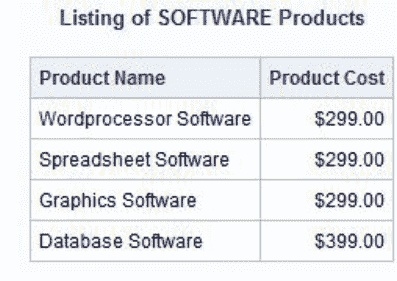

In the next example, a macro named VIEW creates a macro variable called NAME and assigns a value to it with a %LET statement. When VIEW is executed, a value of PRODUCTS, MANUFACTURERS, or INVENTORY is substituted for the macro variable. The value supplied for the macro variable determines what view is referenced. If the value supplied to the macro

variable is not one of these three values, then a program warning message is displayed in the SAS log. Invoking the macro with %VIEW(Products) produces the following results.

```
```sas
%MACRO VIEW(NAME);
%IF %UPCASE(&NAME) ^= %STR(PRODUCTS) AND
%UPCASE(&NAME) ^= %STR(MANUFACTURERS) AND
%UPCASE(&NAME) ^= %STR(INVENTORY) %THEN %DO;
%PUT A valid view name was not supplied and no output will be generated!;
%END;
%ELSE %DO;
PROC SQL;
TITLE "Listing of &NAME View";
%IF %UPCASE(&NAME)=%STR(PRODUCTS) %THEN %DO;
SELECT PRODNAME,
PRODCOST
FROM &NAME._view
ORDER BY PRODCOST;
%END;
%ELSE %IF %UPCASE(&NAME)=%STR(MANUFACTURERS) %THEN %DO;
SELECT MANUNAME,
MANUCITY,
MANUSTAT
FROM &NAME._view
ORDER BY MANUCITY;
%END;
%ELSE %IF %UPCASE(&NAME)=%STR(INVENTORY) %THEN %DO;
SELECT PRODNUM,
INVENQTY,
INVENCOST
FROM &NAME._view
ORDER BY INVENCOST;
%END;
QUIT;
%END;
%END;
%MEND VIEW;
```
```

In the previous example, if a name is supplied to the macro variable &NAME that is not valid, then the user-defined program warning message would be displayed in the SAS log. Suppose we invoked the VIEW macro by entering %VIEW(Customers). The results are displayed in the SAS log.

```
```sas
%VIEW(Customers);
```
```

### 150 PROC SQL: Beyond the Basics Using SAS, Second Edition


## SAS 日志结果

```
%VIEW(Customers);
A valid view name was not supplied and no output will be generated!
```

## 从表行列创建宏变量

在 PROC SQL 中，可以通过指定 INTO 子句从表中第一行的列值创建宏变量。宏变量使用 SELECT 列表中指定的列的值从所选的第一行进行赋值。冒号 (:) 与正在定义的宏变量名一起使用。在下一个示例中，使用 NOPRINT 选项抑制输出结果，同时使用 INTO 子句创建两个宏变量，并在 SAS 日志中显示其值。注意：在没有 WHERE 子句的情况下，用于填充宏变量的表中的第一行是被选中的行。

### SQL 代码

```
PROC SQL NOPRINT;
    SELECT PRODNAME,
           PRODCOST
           INTO :PRODNAME,
                 :PRODCOST
           FROM PRODUCTS;
QUIT;
%PUT &PRODNAME &PRODCOST;
```

## SAS 日志结果

```
PROC SQL NOPRINT;
    SELECT PRODNAME,
           PRODCOST
           INTO :PRODNAME,
                 :PRODCOST
           FROM PRODUCTS;
QUIT;
NOTE: PROCEDURE SQL used:
      real time          0.38 seconds

%PUT &PRODNAME &PRODCOST;
Dream Machine          $3,200.00
```

在下一个示例中，使用 INTO 子句和 WHERE 子句创建两个宏变量，以控制用于宏变量赋值的是哪一行。使用 WHERE 子句可以确保在宏变量赋值时使用除第一行之外的行。它们的值在 SAS 日志中显示。

### SQL 代码

```
PROC SQL NOPRINT;
    SELECT PRODNAME,
        PRODCOST
        INTO :PRODNAME,
            :PRODCOST
        FROM PRODUCTS
            WHERE UPCASE(PRODTYPE) IN ('SOFTWARE');
QUIT;
%PUT &PRODNAME &PRODCOST;
```

## SAS 日志结果

```
PROC SQL NOPRINT;
    SELECT PRODNAME,
        PRODCOST
        INTO :PRODNAME,
            :PRODCOST
        FROM PRODUCTS
            WHERE UPCASE(PRODTYPE) IN ('SOFTWARE');
QUIT;
NOTE: PROCEDURE SQL used:
    real time          0.04 seconds

%PUT &PRODNAME &PRODCOST;
Spreadsheet Software    $299.00
```

## 使用聚合函数创建宏变量

将数据转换为信息然后将结果保存为宏变量，使用汇总（聚合）函数很容易。SQL 过程提供许多有用的汇总函数来帮助在 SELECT 语句或 HAVING 子句中执行计算、描述性统计和其他聚合计算。这些函数旨在汇总信息，而不是设计用于显示数据的详细信息。在下一个示例中，使用 MIN 汇总函数确定 PRODUCTS 表中最便宜的产品，并使用 INTO 子句将该值存储在宏变量 MIN_PRODCOST 中。结果在 SAS 日志中显示。

### SQL 代码

```
PROC SQL NOPRINT;
    SELECT MIN(PRODCOST) FORMAT=DOLLAR10.2
        INTO :MIN_PRODCOST
        FROM PRODUCTS;
QUIT;
%PUT &MIN_PRODCOST;
```

## SAS 日志结果

```
PROC SQL NOPRINT;
    SELECT MIN(PRODCOST) FORMAT=DOLLAR10.2
        INTO :MIN_PRODCOST
        FROM SQL.PRODUCTS;
QUIT;
NOTE: PROCEDURE SQL used:
      real time          0.05 seconds

%PUT &MIN_PRODCOST;
$35.00
```

## 创建多个宏变量

PROC SQL 使您能够为 SELECT 语句返回的每一行创建一个宏变量。使用 PROC SQL 关键字 THROUGH 或连字符 (-) 与 INTO 子句，可以轻松创建两个或更多宏变量的范围。这是从表中多行创建宏变量的便捷功能。例如，假设我们想为 PRODUCTS 表中最便宜的三个产品创建宏变量。INTO 子句创建三个宏变量，并从 PRODNAME 和 PRODCOST 列的前三行分配值。ORDER BY 子句也指定为对产品成本（PRODCOST）进行升序排序，以确保数据按从最便宜到最昂贵的所需顺序排列。结果在 SAS 日志中显示。

### SQL 代码

```
PROC SQL NOPRINT;
    SELECT PRODNAME,
           PRODCOST
        INTO :PRODUCT1 - :PRODUCT3,
             :COST1 - :COST3
        FROM PRODUCTS
        ORDER BY PRODCOST;
QUIT;
%PUT &PRODUCT1 &COST1;
%PUT &PRODUCT2 &COST2;
%PUT &PRODUCT3 &COST3;
```

## SAS 日志结果

```
PROC SQL NOPRINT;
SELECT PRODNAME,
PRODCOST
INTO :PRODUCT1 - :PRODUCT3,
:COST1 - :COST3
FROM PRODUCTS
ORDER BY PRODCOST;
QUIT;
NOTE: PROCEDURE SQL used:
real time 0.26 seconds
%PUT &PRODUCT1 &COST1;
Analog Cell Phone $35.00
%PUT &PRODUCT2 &COST2;
Office Phone $130.00
%PUT &PRODUCT3 &COST3;
Digital Cell Phone $175.00
```

## 使用 WHERE 子句控制宏变量的选择和填充

与前一个示例中对所选处理的行几乎没有控制不同，SELECT 子句中的 WHERE 子句为 SQL 程序员提供了使用 INTO 子句、关键字 THROUGH 或连字符 (-) 以及 WHERE 子句控制哪些行和值被选中并填充为宏变量所需的控制。假设您想为 PRODUCTS 表中前四个“Software”产品创建并填充宏变量。INTO 子句创建四个宏变量并从与 WHERE 子句表达式匹配的前四行分配值。任何与 WHERE 子句表达式不匹配的行都将被排除在结果之外。指定 ORDER BY 子句以按产品名称（PRODNAME）进行升序排序，并在 SAS 日志中显示宏解析结果。

### SQL 代码

```
PROC SQL NOPRINT;
SELECT PRODNAME,
PRODCOST
INTO :PRODUCT1 - :PRODUCT4,
:COST1 - :COST4
FROM PRODUCTS
WHERE PRODTYPE = 'Software'
ORDER BY PRODNAME;
QUIT;
%PUT &PRODUCT1 &COST1;
%PUT &PRODUCT2 &COST2;
%PUT &PRODUCT3 &COST3;
%PUT &PRODUCT4 &COST4;
```

## SAS 日志结果

```
PROC SQL NOPRINT;
  SELECT PRODNAME,
         PRODCOST
    INTO :PRODUCT1 - :PRODUCT4,
         :COST1 - :COST4
    FROM PRODUCTS
    WHERE PRODTYPE = 'Software'
    ORDER BY PRODNAME;
QUIT;
NOTE: PROCEDURE SQL used (Total process time):
      real time          0.06 seconds
      cpu time           0.00 seconds

%PUT &PRODUCT4 &COST4;
Database Software $399.00
%PUT &PRODUCT3 &COST3;
Graphics Software $299.00
%PUT &PRODUCT2 &COST2;
Spreadsheet Software $299.00
%PUT &PRODUCT1 &COST1;
Wordprocessor Software $299.00
```

## 在宏变量中创建值列表

将单个列的值连接成一个宏变量，使您能够创建可在 SAS 日志中显示或可输出到 SAS 数据集的值列表。使用带有 SEPARATED BY 关键字的 INTO 子句可创建值列表。例如，假设您想创建一个包含 MANUFACTURERS 表中制造商名称（MANUNAME）的空白分隔列表。创建一个名为 &MANUNAME 的宏变量，并将制造商名称分配给以两个空格分隔的空白分隔列表。WHERE 子句将列表的内容限制为仅位于圣地亚哥的制造商。

### SQL 代码

```
PROC SQL NOPRINT;
  SELECT MANUNAME
    INTO :MANUNAME SEPARATED BY '  '
    FROM MANUFACTURERS
    WHERE UPCASE(MANUCITY)='SAN DIEGO';
QUIT;
%PUT &MANUNAME;
```

## SAS 日志结果

```
PROC SQL NOPRINT;
    SELECT MANUNAME
        INTO :MANUNAME SEPARATED BY '  '
            FROM MANUFACTURERS
                WHERE UPCASE(MANUCITY)='SAN DIEGO';
QUIT;
NOTE: PROCEDURE SQL used:
        real time            0.00 seconds

%PUT &MANUNAME;
Global Comm Corp  Global Software  San Diego PC Planet
```

在下一个示例中，创建了一个类似的包含圣地亚哥制造商的列表。但与前一个示例中用两个空格分隔每个名称不同，这里改用逗号。

### SQL 代码

```
PROC SQL NOPRINT;
    SELECT MANUNAME
        INTO :MANUNAME SEPARATED BY ', '
            FROM MANUFACTURERS
                WHERE UPCASE(MANUCITY)='SAN DIEGO';
QUIT;
%PUT &MANUNAME;
```

## SAS 日志结果

```
PROC SQL NOPRINT;
    SELECT MANUNAME
        INTO :MANUNAME SEPARATED BY ', '
            FROM MANUFACTURERS
                WHERE UPCASE(MANUCITY)='SAN DIEGO';
QUIT;
NOTE: PROCEDURE SQL used:
        real time            0.00 seconds

%PUT &MANUNAME;
Global Comm Corp, Global Software, San Diego PC Planet
```

## 使用自动宏变量控制处理

SAS 提供的三个自动宏变量在 SQL 处理期间被赋予值，以提供处理控制信息。SQL 用户可以使用 SQLOBS 宏变量确定处理的行数，使用 SQLRC 宏变量评估 PROC SQL 语句是否成功，以及使用 SQLLOOPS 宏变量识别 SQL 查询内部循环处理的迭代次数。要检查所有


要在安装中查看自动宏变量，请在 %PUT 语句中使用 _AUTOMATIC_ 选项。

## Code

```
%PUT _AUTOMATIC_;
```

## SAS Log Results

```
%PUT _AUTOMATIC_;
AUTOMATIC AFDSID 0
AUTOMATIC AFDSNAME
AUTOMATIC AFLIB
AUTOMATIC AFSTR1
AUTOMATIC AFSTR2
AUTOMATIC FSPBDV
AUTOMATIC SYSBUFFR
AUTOMATIC SYSCC 0
AUTOMATIC SYSCHARWIDTH 1
AUTOMATIC SYSCMD
AUTOMATIC SYSDATE 10JUN04
AUTOMATIC SYSDATE9 10JUN2004
AUTOMATIC SYSDAY Thursday
AUTOMATIC SYSDEVIC
AUTOMATIC SYSDMG 0
AUTOMATIC SYSDSN WORK    INVENTORY
AUTOMATIC SYSENDIAN LITTLE
AUTOMATIC SYSENV FORE
AUTOMATIC SYSERR 0
AUTOMATIC SYSFILRC 0
AUTOMATIC SYSINDEX 3
AUTOMATIC SYSINFO 0
AUTOMATIC SYSJOBID 3580
AUTOMATIC SYSLAST WORK.INVENTORY
AUTOMATIC SYSLOCKRC 0
AUTOMATIC SYSLIBRC 0
AUTOMATIC SYSMACRONAME
AUTOMATIC SYSMAXLONG 2147483647
AUTOMATIC SYSMENV S
AUTOMATIC SYSMSG
AUTOMATIC SYSNCPU 1
AUTOMATIC SYSPARM
AUTOMATIC SYSPBUFF
AUTOMATIC SYSPROCESSID 41D4E614295031274020000000000000
AUTOMATIC SYSPROCESSNAME DMS Process
AUTOMATIC SYSPROCNAME
AUTOMATIC SYSRC 0
AUTOMATIC SYSSCP WIN
AUTOMATIC SYSSCPL XP_HOME
AUTOMATIC SYSSITE 0045254001
AUTOMATIC SYSSIZEOFLONG 4
AUTOMATIC SYSSIZEOFUNICODE 2
AUTOMATIC SYSSTARTID
AUTOMATIC SYSSTARTNAME
AUTOMATIC SYSTIME 12:50
AUTOMATIC SYSUSERID Valued Sony Customer
AUTOMATIC SYSVER 9.1
AUTOMATIC SYSVLONG 9.01.01M0P111803
AUTOMATIC SYSVLONG4 9.01.01M0P11182003
```

## Building Macro Tools and Applications

宏设施结合 SQL 过程的能力，使得能够创建多功能宏工具和通用应用程序。在开发用户编写的宏时，一个主要的设计目标应该是它们有用且易于使用。最好避免使用不符合您需求的宏，或者名称复杂难以记住的宏。

作为工具，宏应设计为满足尽可能多用户的需求。它们不应存在歧义，应包含独特的宏变量名，避免宏变量与数据集变量之间的命名冲突，并且不要试图做太多事情。这种实用主义的宏设计方法有助于获得用户的广泛认可和接受。

## Creating Simple Macro Tools

宏工具可以构建来执行各种有用的任务。最有效的宏是那些简单且执行常见任务的宏。在着手构建一个或多个宏工具之前，先探索当前正在执行的流程，然后通过与受影响的人员沟通来确定用户的常见需求并找出空白。一旦完成此项工作，您将处于更有利的位置来构建简单且有用的宏工具，以便用户接受。

假设在非正式的需求分析阶段，您识别出一些用户在工作中使用各种方法和方法来创建数据集和变量交叉引用列表。为了防止不必要的重复劳动，您决定构建一个简单的宏工具，可供所有用户使用，以检索一个或多个 SAS 数据集中的列信息。

## Cross-Referencing Columns

列交叉引用列表在您需要快速识别列定义所在的 SAS 库数据集时很有用。使用 COLUMNS 字典表（有关更多信息，请参阅第 2 章“在 PROC SQL 中使用数据”），可以创建一个宏来捕获列级信息，包括列名、类型、长度、位置、标签、格式、 informat、索引，以及包含列在指定 SAS 库中位置的交叉引用列表。在下一个示例中，COLUMNS 宏由一个 PROC SQL 查询组成，可访问 SAS 库中的任何单个列。如果宏被用户请求

```
%COLUMNS(WORK, CUSTNUM);
```

调用，则宏将为用户库 WORK 中的列 CUSTNUM 在所有 DATA 类型中生成交叉引用列表。

## SQL Code

```
%MACRO COLUMNS(LIB, COLNAME);
    PROC SQL;
        SELECT LIBNAME, MEMNAME, NAME, TYPE, LENGTH
        FROM DICTIONARY.COLUMNS
            WHERE LIBNAME="&LIB" AND
                UPCASE(NAME)="&COLNAME" AND
                MEMTYPE="DATA";
    QUIT;
%MEND COLUMNS;
%COLUMNS(WORK,CUSTNUM);
```

值得注意的是，在包含区分大小写名称的数据库中可能会找到多个匹配项。这将允许同时显示“employee”和“EMPLOYEE”作为匹配项。这在实践中不太可能经常发生，但确实是一种可能性。

## Results

| Library Name | Member Name | Column Name | Column Type | Column Length |
| WORK | CUSTOMERS | custnum | num | 3 |
| WORK | CUSTOMERS2 | custnum | num | 3 |
| WORK | CUSTOMERS_BACKUP | custnum | num | 8 |
| WORK | INVOICE | custnum | num | 3 |
| WORK | PURCHASES | custnum | num | 4 |
| WORK | PURCHASES2 | Custnum | num | 8 |

## Determining the Number of Rows in a Table

有时在不先读取所有行之前了解表中的观测值（或行）数量很有用。虽然真正的 SAS 表的行数可用，但使用 libname 引擎的 DBMS 表的行数不可用。在下一个示例中，用户定义的宏 NOBS 访问 TABLES 字典表（有关更多信息，请参阅第 2 章）。宏 NOBS 设计为接受并处理两个用户提供的值：库引用和表名。一旦提供这些值，结果将在输出窗口中显示。

## SQL Code

```
%MACRO NOBS(LIB, TABLE);
    PROC SQL;
        SELECT LIBNAME, MEMNAME, NOBS
            FROM DICTIONARY.TABLES
                WHERE UPCASE(LIBNAME)="&LIB" AND
                      UPCASE(MEMNAME)="&TABLE" AND
                      UPCASE(MEMTYPE)="DATA";
    QUIT;
%MEND NOBS;

%NOBS(WORK,PRODUCTS);
```

## Results

| Library Name | Member Name | Number of Physical Observations |
|--------------|-------------|---------------------------------|
| WORK         | PRODUCTS    | 10                              |

## Identifying Duplicate Rows in a Table

有时能够识别表中的重复行很有用。在下一个示例中，使用 COUNT 汇总函数和 HAVING 子句的 SELECT 语句用于用户定义的宏 DUPS。宏 DUPS 设计为接受并处理三个用户提供的值：库引用、表名和 GROUP BY 列表中的列。一旦通过提交宏 DUPS 提供这些值，宏将被执行，结果将在输出窗口中显示。

## SQL Code

```
%MACRO DUPS(LIB, TABLE, GROUPBY);
    PROC SQL;
        SELECT &GROUPBY, COUNT(*) AS Duplicate_Rows
            FROM &LIB..&TABLE
                GROUP BY &GROUPBY
                    HAVING COUNT(*) > 1;
    QUIT;
%MEND DUPS;

%DUPS(WORK,PRODUCTS,PRODTYPE);
```

## Results

| Product Type | Duplicate_Rows |
|---|---:|
| Phone | 3 |
| Software | 4 |
| Workstation | 2 |

## Summary

- 1. CASE 表达式是 PROC SQL 中的一种结构，用于评估是否满足特定条件（请参阅“CASE 表达式”部分）。
- 2. CASE 表达式可用于有条件地处理表的行（请参阅“CASE 表达式”部分）。
- 3. 从对表中每一行的求值中返回单个值（请参阅“CASE 表达式”部分）。
- 4. 逻辑条件可以使用 AND 和 OR 逻辑运算符组合（请参阅“逻辑和空值”部分）。
- 5. 当未指定 ELSE 表达式且每个 WHEN 条件均为“false”时，返回缺失或 NULL 值（请参阅“逻辑和空值”部分）。
- 6. 缺失值与 0（零）值或空白字符不同，因为它代表唯一值或缺乏值（请参阅“逻辑和空值”部分）。
- 7. PROC SQL 可与 SAS 宏设施一起使用来执行常见和重复性任务（请参阅“将 PROC SQL 与宏语言接口”部分）。
- 8. 可以为所有用户创建简单但有效的用户定义宏，结合 SQL 过程（请参阅“构建宏工具和应用程序”部分）。
- 9. 可以使用 INTO 子句定义单值宏变量（请参阅“使用聚合函数创建宏变量”部分）。
- 10. 可以使用 INTO 子句和 SEPARATED BY 关键字定义值列表宏变量（请参阅“使用 WHERE 子句控制宏变量的选择和填充”部分）。


# 第 5 章：创建、填充和删除表

简介 ........................................................................................ 164
创建表................................................................................................ 164
  使用列定义列表创建表............................................... 165
  使用 LIKE 子句创建表 ........................................................... 169
  从现有表派生表和数据............................................. 170
填充表 ............................................................................................ 172
  使用 SET 子句向表添加数据 ....................................................... 173
  向行的所有列添加数据..................................................... 176
  向行的部分列添加数据 ................................................ 181
  使用 SELECT 查询添加数据.................................................................... 185
  从 Microsoft Excel 批量加载数据 ........................................................... 186
完整性约束 ....................................................................................... 192
  定义完整性约束........................................................................... 192
  完整性约束的类型........................................................................... 192
  使用 NOT NULL 约束防止空值 ....................................... 192
  使用 UNIQUE 约束强制唯一值........................................... 195
  使用 CHECK 约束验证列值 ....................................... 196
  引用完整性约束...................................................................... 197
  建立主键............................................................................... 198
  建立外键 ............................................................................... 199
  显示完整性约束....................................................................... 202
删除表中的行.................................................................................. 203
  删除表中的单行....................................................................... 203
  删除表中的多行........................................................... 204
  删除表中的所有行 ............................................................................ 204
删除表 ................................................................................................ 205
  删除单个表..................................................................................... 205
  删除多个表................................................................................... 206
  删除包含完整性约束的表........................................... 206
总结 ........................................................................................................... 208

## 简介

之前的章节在示例中提供的表已经创建并填充了数据。但如果您需要创建表、用数据填充它，或删除不再需要或不想要的数据行或表怎么办？

在本章中，讨论和示例重点关注表创建、填充和删除的方式。这些是重要的操作，也是 PROC SQL 的基本要素，特别是如果您想提高对 SQL 流程的理解并加深对这种强大语言的理解。

## 创建表

表创建中的一个重要要素是表设计。表设计包括表如何结构化——行和列如何定义、索引如何创建以及列如何引用其他列中的值。如果您希望在该领域获得更深入的理解，请查阅本书末尾列出的许多参考资料。在表设计过程中应牢记以下概述。

在构建表时，重要的是要投入足够的时间来规划其设计并理解每个表旨在满足的需求。此过程涉及许多活动，例如需求和可行性分析，包括拟议表的成本/效益分析、数据源的逻辑描述的开发以及逻辑数据模型的物理实现。一旦这些任务完成，您就可以评估每个表需要提供的任何特殊业务需求。业务评估有助于最大限度地减少表创建后需要进行的更改次数。

接下来，确定哪些表将纳入您的应用程序数据库。这需要了解每个表预计提供的价值。它还防止重要性不大或不重要的表被纳入数据库。最后一步也是至关重要的一步是定义每个表的列、属性和内容。

一旦表设计过程完成，每个表就可以使用 CREATE TABLE 语句创建。创建表的目的是创建一个尚不存在的对象。在 SAS 实现中，可以根据需要指定 CREATE TABLE 语句的三种变体：

- 使用列定义列表创建表
- 使用 LIKE 子句创建表
- 从现有表派生表和数据

### 使用列定义列表创建表

虽然是 SQL 标准的一部分，但列定义列表（类似于 DATA 步中的 LENGTH 语句）是一种繁琐且不太优雅的创建表的方法。这种方式创建表的缺点是需要定义每个列的属性，包括其数据类型、长度、信息格式和格式。此方法经常用于在另一表中不存在时创建列。使用此方法会创建空表（无行）。下面显示了用于创建 CUSTOMERS 表的代码。此示例说明了使用列定义列表创建表。

### SQL 代码

```
PROC SQL;
    CREATE TABLE CUSTOMERS
        (CUSTNUM    NUM        LABEL='Customer Number',
         CUSTNAME   CHAR(25)   LABEL='Customer Name',
         CUSTCITY   CHAR(20)   LABEL='Customer''s Home City');
QUIT;
```

#### SAS 日志结果

```
PROC SQL;
    CREATE TABLE CUSTOMERS
        (CUSTNUM    NUM        LABEL='Customer Number',
         CUSTNAME   CHAR(25)   LABEL='Customer Name',
         CUSTCITY   CHAR(20)   LABEL='Customer''s Home City');
NOTE: Table CUSTOMERS created, with 0 rows and 3 columns.
    QUIT;
NOTE: PROCEDURE SQL used:
    real time          0.81 seconds
```

您应该知道 SQL 过程会忽略数值列的宽度规范。当定义数值列时，它会以 8 字节的宽度创建，这是 SAS 允许的最大精度。PROC SQL 在值小于 8 字节时会忽略数值长度规范。为了说明这一点，CUSTOMERS 表的部分 CONTENTS 过程输出显示如下。

### 结果


| Alphabetic List of Variables and Attributes |
|---|---|---|---|
| # | Variable | Type | Len | Label |
| 3 | CUSTCITY | Char | 20 | Customer's Home City |
| 2 | CUSTNAME | Char | 25 | Customer Name |
| 1 | CUSTNUM | Num | 8 | Customer Number |

为了节省存储空间（CUSTNUM 只需 3 字节提供的最大精度），可以在 DATA 步中使用 LENGTH 语句将 CUSTNUM 定义为 3 字节列而不是 8 字节列。

#### DATA 步代码

```
DATA CUSTOMERS;
    LENGTH CUSTNUM 3.;
    SET CUSTOMERS;
    LABEL CUSTNUM = 'Customer Number';
RUN;
```


## Results


| # | Variable | Type | Len | Format | Label |
|---:|---|---|---:|---|---|
| 3 | MANUNUM | Num | 8 |  | Manufacturer Number |
| 5 | PRODCOST | Num | 8 | DOLLAR9.2 | Product Cost |
| 2 | PRODNAME | Char | 25 |  | Product Name |
| 1 | PRODNUM | Num | 8 |  | Product Number |
| 4 | PRODTYPE | Char | 15 |  | Product Type |

与之前一样，为了节省存储空间，你可以在 DATA 步中使用 LENGTH 语句来覆盖数值列默认的 8 字节列定义。

## DATA Step Code

```
DATA PRODUCTS;
    LENGTH PRODNUM MANUNUM 3.
           PRODCOST 5.;
    SET PRODUCTS (DROP=PRODNUM MANUNUM PRODCOST);
    LABEL PRODNUM = 'Product Number'
          MANUNUM = 'Manufacturer Number'
          PRODCOST = 'Product Cost';
    FORMAT PRODCOST DOLLAR9.2;
RUN;
```

## Results

## The CONTENTS Procedure

|  | Alphabetic List of Variables and Attributes |  |  |  |  |
|---|---|---|---|---|---|
| # | Variable | Type | Len | Format | Label |
| 2 | MANUNUM | Num | 3 |  | Manufacturer Number |
| 3 | PRODCOST | Num | 5 | DOLLAR9.2 | Product Cost |
| 4 | PRODNAME | Char | 25 |  | Product Name |
| 1 | PRODNUM | Num | 3 |  | Product Number |
| 5 | PRODTYPE | Char | 15 |  | Product Type |

## Creating a Table Using the LIKE Clause

在 CREATE TABLE 语句中引用现有表是创建新表的一种有效方法。事实上，这可以节省大量时间，因为它避免了像列定义列表那样逐个定义每一列。LIKE 子句（在 CREATE TABLE 语句中）会触发将现有表的结构复制到新表，同时减去使用 KEEP= 或 DROP= 数据集（表）选项删除的列。它将列名和属性从现有表结构复制到新表结构。使用此方法会创建一个空表（不含行）。为了说明这种创建新表的方法，将使用 LIKE 子句创建一个名为 HOT_PRODUCTS 的表。

## SQL Code

```
PROC SQL;
    CREATE TABLE HOT_PRODUCTS
        LIKE PRODUCTS;
QUIT;
```

## SAS Log Results

```
PROC SQL;
    CREATE TABLE HOT_PRODUCTS
        LIKE PRODUCTS;
NOTE: Table HOT_PRODUCTS created, with 0 rows and 5 columns.
QUIT;
NOTE: PROCEDURE SQL used:
      real time          0.00 seconds
```

由于执行了 CREATE TABLE 语句和 LIKE 子句，新表包含零行数据，但确实包含了所有列定义，而没有来自现有表和/或视图的任何数据行。这意味着只有元数据（描述数据的 data）被复制到新表。被复制的特定定义包括：列名、数据类型、长度、精度、标签、informat、格式等。

下一个示例说明了如何通过仅选择你感兴趣的列来创建新表。此方法不受 SQL ANSI 标准支持。假设你想要来自 PRODUCTS 表的三个列（PRODNAME、PRODTYPE 和 PRODCOST）。以下代码说明了如何使用 KEEP= 数据集（表）选项来实现这一点。

注意：数据集也可以称为表。

## SQL Code

```
PROC SQL;
    CREATE TABLE HOT_PRODUCTS (KEEP=PRODNAME PRODTYPE PRODCOST)
    LIKE PRODUCTS;
QUIT;
```

## SAS Log Results

```
PROC SQL;
    CREATE TABLE HOT_PRODUCTS (KEEP=PRODNAME PRODTYPE PRODCOST)
    LIKE PRODUCTS;
NOTE: Table HOT_PRODUCTS created, with 0 rows and 3 columns.
QUIT;
NOTE: PROCEDURE SQL used:
real time          0.00 seconds
```

## Deriving a Table and Data from an Existing Table

从现有表派生新表是从现有表创建表的最流行和最有效的方法。此方法使用查询表达式，结果存储在新表中，而不是作为 SAS 输出显示。此方法不仅存储列名及其属性，还存储满足查询表达式的数据行。下一个示例说明了如何使用查询表达式创建新表。

## SQL Code

```
PROC SQL;
    CREATE TABLE HOT_PRODUCTS AS
    SELECT *
    FROM PRODUCTS;
QUIT;
```

## SAS Log Results

```
PROC SQL;
    CREATE TABLE HOT_PRODUCTS AS
        SELECT *
        FROM PRODUCTS;
NOTE: Table WORK.HOT_PRODUCTS created, with 10 rows and 5 columns.
QUIT;
NOTE: PROCEDURE SQL used:
    real time          0.00 seconds
```

你可能会注意到，在检查前一个示例中的 SAS 日志后，SELECT 语句从现有表（PRODUCTS）中提取了所有行并将其复制到新表（HOT_PRODUCTS）。在没有 WHERE 子句的情况下，结果表（HOT_PRODUCTS）包含与父表 PRODUCTS 相同数量的行。

因此，CREATE TABLE 语句的强大之处在于其能够从现有表创建新表。在此定义中经常被忽视的是 CREATE TABLE 语句能够形成父表子集的能力。更常见的是，新表代表其父表的子集。因此，这种创建表的方法是最强大且使用最广泛的。假设你想要创建一个名为 HOT_PRODUCTS 的表，其中包含“Software”和“Phones”产品类型的子集。以下查询表达式将实现此目的。

## SQL Code

```
PROC SQL;
    CREATE TABLE HOT_PRODUCTS AS
        SELECT *
        FROM PRODUCTS
            WHERE UPCASE(PRODTYPE) IN ("SOFTWARE", "PHONE");
QUIT;
```

## SAS Log Results

```
PROC SQL;
    CREATE TABLE HOT_PRODUCTS AS
        SELECT *
        FROM PRODUCTS
            WHERE UPCASE(PRODTYPE) IN ("SOFTWARE", "PHONE");
NOTE: Table WORK.HOT_PRODUCTS created, with 7 rows and 5 columns.
QUIT;
NOTE: PROCEDURE SQL used:
      real time          0.38 seconds
```

让我们再看一个例子。假设你想要创建另一个名为 NOT_SO_HOT_PRODUCTS 的表，其中包含除“Software”和“Phones”产品类型之外的所有内容的子集。以下查询表达式将实现此目的。

## SQL Code

```
PROC SQL;
    CREATE TABLE NOT_SO_HOT_PRODUCTS AS
        SELECT *
            FROM PRODUCTS
                WHERE UPCASE(PRODTYPE) NOT IN ("SOFTWARE", "PHONE");
QUIT;
```

## SAS Log Results

```
PROC SQL;
    CREATE TABLE NOT_SO_HOT_PRODUCTS AS
        SELECT *
            FROM sql.PRODUCTS
                WHERE UPCASE(PRODTYPE) NOT IN ("SOFTWARE", "PHONE");
NOTE: Table NOT_SO_HOT_PRODUCTS created, with 3 rows and 5 columns.
QUIT;
NOTE: PROCEDURE SQL used:
        real time          1.20 seconds
```

## Populating Tables

创建表后，可以向其中填充数据。除非新创建的表被定义为现有表的子集或其内容保持静态，否则最终可能需要添加一个或多个数据行。SQL 标准提供了 INSERT INTO 语句作为添加数据行的工具。事实上，INSERT INTO 语句根本不会插入数据行。它只是将每一行添加到表的末尾。

本节中的示例查看了多种填充表的方法。随着新数据行被添加到目标表或在目标表中被更改，后台必须保持许多事情受控，包括执行或提交对表的任何永久更改的需求。此重要步骤检查每个写操作是否存在错误，如果发生一个或多个错误，则为 SAS 提供完全回滚或撤消自上次提交以来更改的能力。例如，在允许行插入进入分配了完整性约束的表之前，它首先被标记为未提交，然后根据分配的完整性约束进行验证，如果没有违规，则行插入被提交到表中。以下行插入方法将被说明：

- 使用 SET 子句向表添加数据
- 向行的所有列添加数据
- 向行的部分列添加数据
- 使用 SELECT 查询添加数据
- 使用 Microsoft Excel 批量加载数据


## 使用 SET 子句向表中添加数据

您使用 INSERT INTO 语句向表中填充数据。INSERT INTO 语句指定三个参数：表名、要插入值的列名以及值本身。通过 SET 子句向表中插入一行或多行数据。假设您想要向 CUSTOMERS 表中插入（或添加）一行数据，该行由三列组成（客户编号、客户姓名和家庭城市）。

### SQL 代码

```
PROC SQL;
    INSERT INTO CUSTOMERS
        SET CUSTNUM=702,
            CUSTNAME='Mission Valley Computing',
            CUSTCITY='San Diego';
QUIT;
```

SAS 日志显示以下消息，指出已向 CUSTOMERS 表中插入了一行。

### SAS 日志结果

```
PROC SQL;
    INSERT INTO CUSTOMERS
        SET CUSTNUM=702,
            CUSTNAME='Mission Valley Computing',
            CUSTCITY='San Diego';
NOTE: 1 row was inserted into WORK.CUSTOMERS.
    QUIT;
NOTE: PROCEDURE SQL used:
        real time            0.08 seconds
```

来自 INSERT INTO 语句和 SET 子句的插入数据行被添加到 CUSTOMERS 表的末尾。

|  | Customer Number | Customer Name | Customer's Home City |
|---|---|---|---|
| 1 | 101 La Mesa Computer Land | La Mesa |
| 2 | 201 Vista Tech Center | Vista |
| 3 | 301 Coronado Internet Zone | Coronado |
| 4 | 401 La Jolla Computing | La Jolla |
| 5 | 501 Alpine Technical Center | Alpine |
| 6 | 601 Oceanside Computer Land | Oceanside |
| 7 | 701 San Diego Byte Store | San Diego |
| 8 | 801 Jamul Hardware & Software | Jamul |
| 9 | 901 Del Mar Tech Center | Del Mar |
| 10 | 1001 Lakeside Software Center | Lakeside |
| 11 | 1101 Bonsall Network Store | Bonsall |
| 12 | 1201 Rancho Santa Fe Tech | Rancho Santa Fe |
| 13 | 1301 Spring Valley Byte Center | Spring Valley |
| 14 | 1401 Poway Central | Poway |
| 15 | 1501 Valley Center Tech Center | Valley Center |
| 16 | 1601 Fairbanks Tech USA | Fairbanks Ranch |
| 17 | 1701 Blossom Valley Tech | Blossom Valley |
| 18 | 1801 Chula Vista Networks |  |
| 19 | 702 Mission Valley Computing | San Diego |

向包含索引的表中输入新行会自动将该值添加到索引中（有关索引的更多信息，请参阅第 6 章“修改和更新表和索引”）。以下示例说明了使用 SET 子句添加三行数据。

### SQL 代码

```
PROC SQL;
    INSERT INTO CUSTOMERS
        SET CUSTNUM=402,
            CUSTNAME='La Jolla Tech Center',
            CUSTCITY='La Jolla'
        SET CUSTNUM=502,
            CUSTNAME='Alpine Byte Center',
            CUSTCITY='Alpine'
        SET CUSTNUM=1702,
            CUSTNAME='Rancho San Diego Tech',
            CUSTCITY='Rancho San Diego';
    QUIT;
```

SAS 日志显示已向 CUSTOMERS 表中插入了三行数据。

### SAS 日志结果

```
PROC SQL;
    INSERT INTO CUSTOMERS
        SET CUSTNUM=402,
            CUSTNAME='La Jolla Tech Center',
            CUSTCITY='La Jolla'
        SET CUSTNUM=502,
            CUSTNAME='Alpine Byte Center',
            CUSTCITY='Alpine'
        SET CUSTNUM=1701,
            CUSTNAME='Rancho San Diego Tech',
            CUSTCITY='Rancho San Diego';
NOTE: 3 rows were inserted into WORK.CUSTOMERS.
QUIT;
NOTE: PROCEDURE SQL used:
      real time          0.01 seconds
```

来自 INSERT INTO 语句和 SET 子句的插入数据行被添加到 CUSTOMERS 表的末尾。

|  | Customer Number | Customer Name | Customer's Home City |
|---|---|---|---|
| 1 | 101 La Mesa Computer Land | La Mesa |
| 2 | 201 Vista Tech Center | Vista |
| 3 | 301 Coronado Internet Zone | Coronado |
| 4 | 401 La Jolla Computing | La Jolla |
| 5 | 501 Alpine Technical Center | Alpine |
| 6 | 601 Oceanside Computer Land | Oceanside |
| 7 | 701 San Diego Byte Store | San Diego |
| 8 | 801 Jamul Hardware & Software | Jamul |
| 9 | 901 Del Mar Tech Center | Del Mar |
| 10 | 1001 Lakeside Software Center | Lakeside |
| 11 | 1101 Bonsall Network Store | Bonsall |
| 12 | 1201 Rancho Santa Fe Tech | Rancho Santa Fe |
| 13 | 1301 Spring Valley Byte Center | Spring Valley |
| 14 | 1401 Poway Central | Poway |
| 15 | 1501 Valley Center Tech Center | Valley Center |
| 16 | 1601 Fairbanks Tech USA | Fairbanks Ranch |
| 17 | 1701 Blossom Valley Tech | Blossom Valley |
| 18 | 1801 Chula Vista Networks |  |
| 19 | 702 Mission Valley Computing | San Diego |
| 20 | 402 La Jolla Tech Center | La Jolla |
| 21 | 502 Alpine Byte Center | Alpine |
| 22 | 1702 Rancho San Diego Tech | Rancho San Diego |

## 向行的所有列中添加数据

另一种填充表数据的方法是使用 VALUES 子句与 INSERT INTO 语句一起使用。如前一节所述，使用 INSERT INTO 语句和 VALUES 子句指定三个参数：表名、要插入值的列名以及值本身。通过 VALUES 子句向表中插入数据值。假设您想要向 CUSTOMERS 表中插入（或添加）一行数据，该行由三列组成（客户编号、客户姓名和家庭城市）。

### SQL 代码

```
PROC SQL;
    INSERT INTO CUSTOMERS (CUSTNUM, CUSTNAME, CUSTCITY)
        VALUES (703, 'Sonic Boom Analytics', 'Spring Valley');
QUIT;
```

SAS 日志显示以下消息，指出已向 CUSTOMERS 表中插入了一行。

### SAS 日志结果

```
PROC SQL;
    INSERT INTO CUSTOMERS
        (CUSTNUM, CUSTNAME, CUSTCITY)
        VALUES (703, 'Sonic Boom Analytics', 'Spring Valley');
NOTE: 1 row was inserted into WORK.CUSTOMERS.
QUIT;
NOTE: PROCEDURE SQL used:
    real time          0.54 seconds
```

来自之前的 INSERT INTO 语句的插入数据行被添加到 CUSTOMERS 表的末尾。

|  | Customer Number | Customer Name | Customer's Home City |
|---|---|---|---|
| 1 | 101 La Mesa Computer Land | La Mesa |
| 2 | 201 Vista Tech Center | Vista |
| 3 | 301 Coronado Internet Zone | Coronado |
| 4 | 401 La Jolla Computing | La Jolla |
| 5 | 501 Alpine Technical Center | Alpine |
| 6 | 601 Oceanside Computer Land | Oceanside |
| 7 | 701 San Diego Byte Store | San Diego |
| 8 | 801 Jamul Hardware & Software | Jamul |
| 9 | 901 Del Mar Tech Center | Del Mar |
| 10 | 1001 Lakeside Software Center | Lakeside |
| 11 | 1101 Bonsall Network Store | Bonsall |
| 12 | 1201 Rancho Santa Fe Tech | Rancho Santa Fe |
| 13 | 1301 Spring Valley Byte Center | Spring Valley |
| 14 | 1401 Poway Central | Poway |
| 15 | 1501 Valley Center Tech Center | Valley Center |
| 16 | 1601 Fairbanks Tech USA | Fairbanks Ranch |
| 17 | 1701 Blossom Valley Tech | Blossom Valley |
| 18 | 1801 Chula Vista Networks |  |
| 19 | 702 Mission Valley Computing | San Diego |
| 20 | 402 La Jolla Tech Center | La Jolla |
| 21 | 502 Alpine Byte Center | Alpine |
| 22 | 1702 Rancho San Diego Tech | Rancho San Diego |
| 23 | 703 Sonic Boom Analytics | Spring Valley |

向包含索引的表中输入新行会自动将该值添加到索引中（有关索引的更多信息，请参阅第 6 章“修改和更新表和索引”）。INSERT INTO 语句还可以向表中添加多行数据。以下示例说明了使用 VALUES 子句添加三行数据。

### SQL 代码

```
PROC SQL;
    INSERT INTO CUSTOMERS
        (CUSTNUM, CUSTNAME, CUSTCITY)
    VALUES (402, 'La Jolla Tech Center', 'La Jolla')
    VALUES (502, 'Alpine Byte Center', 'Alpine')
    VALUES (1702, 'Rancho San Diego Tech', 'Rancho San Diego');

    SELECT *
        FROM CUSTOMERS
        ORDER BY CUSTNUM;
QUIT;
```

SAS 日志显示已向 CUSTOMERS 表中插入了三行数据。

### SAS 日志结果

```
PROC SQL;
    INSERT INTO CUSTOMERS
        (CUSTNUM, CUSTNAME, CUSTCITY)
        VALUES (402, 'La Jolla Tech Center', 'La Jolla')
        VALUES (502, 'Alpine Byte Center', 'Alpine')
        VALUES (1701,'Rancho San Diego Tech','Rancho San Diego');
NOTE: 3 rows were inserted into WORK.CUSTOMERS.

    SELECT *
        FROM CUSTOMERS
            ORDER BY CUSTNUM;
QUIT;
NOTE: PROCEDURE SQL used:
    real time                1.03 seconds
```


新行按 CUSTNUM 升序显示。

| Customer Number | Customer Name | Customer's Home City |
|---|---|---|
| 101 | La Mesa Computer Land | La Mesa |
| 201 | Vista Tech Center | Vista |
| 301 | Coronado Internet Zone | Coronado |
| 401 | La Jolla Computing | La Jolla |
| 402 | La Jolla Tech Center | La Jolla |
| 402 | La Jolla Tech Center | La Jolla |
| 501 | Alpine Technical Center | Alpine |
| 502 | Alpine Byte Center | Alpine |
| 502 | Alpine Byte Center | Alpine |
| 601 | Oceanside Computer Land | Oceanside |
| 701 | San Diego Byte Store | San Diego |
| 702 | Mission Valley Computing | San Diego |
| 703 | Sonic Boom Analytics | Spring Valley |
| 801 | Jamul Hardware & Software | Jamul |
| 901 | Del Mar Tech Center | Del Mar |
| 1001 | Lakeside Software Center | Lakeside |
| 1101 | Bonsall Network Store | Bonsall |
| 1201 | Rancho Santa Fe Tech | Rancho Santa Fe |
| 1301 | Spring Valley Byte Center | Spring Valley |
| 1401 | Poway Central | Poway |
| 1501 | Valley Center Tech Center | Valley Center |
| 1601 | Fairbanks Tech USA | Fairbanks Ranch |
| 1701 | Blossom Valley Tech | Blossom Valley |
| 1702 | Rancho San Diego Tech | Rancho San Diego |
| 1702 | Rancho San Diego Tech | Rancho San Diego |
| 1801 | Chula Vista Networks |  |

INSERT INTO 语句也可以用于在不指定列名的情况下插入数据行，只要为表中的每一列都按表中列指定的确切顺序键入一个值即可。注意：了解表的列顺序可能需要从 CONTENTS 过程产生输出，和/或检查 Dictionary.columns 表或 SASHELP.VCOLUMNS 视图中的元数据列 VARNUM。以下示例说明了在 INSERT INTO 语句中省略表的列名的情况，使用 VALUES 子句添加了三行数据。

## SQL Code
```
PROC SQL;
    INSERT INTO CUSTOMERS
        VALUES (402, 'La Jolla Tech Center', 'La Jolla')
        VALUES (502, 'Alpine Byte Center', 'Alpine')
        VALUES (1702,'Rancho San Diego Tech','Rancho San Diego');

    SELECT *
        FROM CUSTOMERS
            ORDER BY CUSTNUM;
QUIT;
```

SAS 日志显示有三行数据被插入到 CUSTOMERS 表中。

## SAS Log Results
```
PROC SQL;
    INSERT INTO CUSTOMERS
        VALUES (402, 'La Jolla Tech Center', 'La Jolla')
        VALUES (502, 'Alpine Byte Center', 'Alpine')
        VALUES (1701,'Rancho San Diego Tech','Rancho San Diego');
NOTE: 3 rows were inserted into WORK.CUSTOMERS.

    SELECT *
        FROM CUSTOMERS
            ORDER BY CUSTNUM;
QUIT;
NOTE: PROCEDURE SQL used:
        real time            0.04 seconds
```

新行按 CUSTNUM 升序显示。

| Customer Number | Customer Name | Customer's Home City |
|---|---|---|
| 101 | La Mesa Computer Land | La Mesa |
| 201 | Vista Tech Center | Vista |
| 301 | Coronado Internet Zone | Coronado |
| 401 | La Jolla Computing | La Jolla |
| 402 | La Jolla Tech Center | La Jolla |
| 501 | Alpine Technical Center | Alpine |
| 502 | Alpine Byte Center | Alpine |
| 601 | Oceanside Computer Land | Oceanside |
| 701 | San Diego Byte Store | San Diego |
| 702 | Mission Valley Computing | San Diego |
| 801 | Jamul Hardware & Software | Jamul |
| 901 | Del Mar Tech Center | Del Mar |
| 1001 | Lakeside Software Center | Lakeside |
| 1101 | Bonsall Network Store | Bonsall |
| 1201 | Rancho Santa Fe Tech | Rancho Santa Fe |
| 1301 | Spring Valley Byte Center | Spring Valley |
| 1401 | Poway Central | Poway |
| 1501 | Valley Center Tech Center | Valley Center |
| 1601 | Fairbanks Tech USA | Fairbanks Ranch |
| 1701 | Blossom Valley Tech | Blossom Valley |
| 1702 | Rancho San Diego Tech | Rancho San Diego |
| 1801 | Chula Vista Networks |  |

## Adding Data to Some of the Columns in a Row

在向表添加数据行时，存在一个或多个列值未分配的情况并不少见。当这种情况发生时，SQL 必须能够处理将行添加到表中，就好像所有值都存在一样。但 SQL 如何处理未指定的值呢？你将在以下示例中看到，SQL 会为未指定值的列分配缺失值。如前所述，使用 INSERT INTO 语句指定了三个参数：表的名称、要插入值的列的名称以及值本身。假设你必须向 CUSTOMERS 表中添加两行不完整的数据，其中指定了三个列中的两列（Customer Number 和 Customer Name）。

## SQL Code
```
PROC SQL;
    INSERT INTO CUSTOMERS
        (CUSTNUM, CUSTNAME)
        VALUES (102, 'La Mesa Byte & Floppy')
        VALUES (902, 'Del Mar Technology Center');
    SELECT *
        FROM CUSTOMERS
        ORDER BY CUSTNUM;
QUIT;
```

SAS 日志显示有两行数据被添加到 CUSTOMERS 表中。

## SAS Log Results
```
PROC SQL;
    INSERT INTO CUSTOMERS
        (CUSTNUM, CUSTNAME)
        VALUES (102, 'La Mesa Byte & Floppy')
        VALUES (902, 'Del Mar Technology Center');
NOTE: 2 rows were inserted into WORK.CUSTOMERS.
    SELECT *
        FROM CUSTOMERS
        ORDER BY CUSTNUM;
QUIT;
NOTE: PROCEDURE SQL used:
    real time               0.00 seconds
```

新行按 CUSTNUM 升序显示，并为字符列 CUSTCITY 分配了缺失值。

| Customer Number | Customer Name | Customer's Home City |
|---|---|---|
| 101 | La Mesa Computer Land | La Mesa |
| 102 | La Mesa Byte & Floppy |  |
| 201 | Vista Tech Center | Vista |
| 301 | Coronado Internet Zone | Coronado |
| 401 | La Jolla Computing | La Jolla |
| 402 | La Jolla Tech Center | La Jolla |
| 402 | La Jolla Tech Center | La Jolla |
| 501 | Alpine Technical Center | Alpine |
| 502 | Alpine Byte Center | Alpine |
| 502 | Alpine Byte Center | Alpine |
| 601 | Oceanside Computer Land | Oceanside |
| 701 | San Diego Byte Store | San Diego |
| 702 | Mission Valley Computing | San Diego |
| 703 | Sonic Boom Analytics | Spring Valley |
| 801 | Jamul Hardware & Software | Jamul |
| 901 | Del Mar Tech Center | Del Mar |
| 902 | Del Mar Technology Center |  |
| 1001 | Lakeside Software Center | Lakeside |
| 1101 | Bonsall Network Store | Bonsall |
| 1201 | Rancho Santa Fe Tech | Rancho Santa Fe |
| 1301 | Spring Valley Byte Center | Spring Valley |
| 1401 | Poway Central | Poway |
| 1501 | Valley Center Tech Center | Valley Center |
| 1601 | Fairbanks Tech USA | Fairbanks Ranch |
| 1701 | Blossom Valley Tech | Blossom Valley |
| 1702 | Rancho San Diego Tech | Rancho San Diego |
| 1702 | Rancho San Diego Tech | Rancho San Diego |
| 1801 | Chula Vista Networks |  |

在前面的示例中，缺失值被分配给了字符列 CUSTCITY。假设你想向 PRODUCTS 表中添加两行部分数据，其中指定了五个列中的四列（Product Number、Product Name、Product Type 和 Product Cost），并且每行的缺失值是数值列 MANUNUM。

## SQL Code
```
PROC SQL;
    INSERT INTO PRODUCTS
        (PRODNUM, PRODNAME, PRODTYPE, PRODCOST)
    VALUES (6002,'Security Software','Software',375.00)
    VALUES (1701,'Travel Laptop SE', 'Laptop',  4200.00);
```
```
SELECT *
    FROM PRODUCTS
    ORDER BY PRODNUM;
QUIT;
```

SAS 日志显示有两行数据被添加到 PRODUCTS 表中。

## SAS Log Results
```
PROC SQL;
    INSERT INTO PRODUCTS
        (PRODNUM, PRODNAME, PRODTYPE, PRODCOST)
        VALUES (6002,'Security Software','Software',375.00)
        VALUES (1701,'Travel Laptop SE','Laptop', 4200.00);
NOTE: 2 rows were inserted into WORK.PRODUCTS.

    SELECT *
        FROM PRODUCTS
        ORDER BY PRODNUM;
QUIT;
NOTE: PROCEDURE SQL used:
      real time          0.75 seconds
```

新行按 PRODNUM 升序显示，并为数值列 MANUNUM 分配了缺失值。

| Product Number | Product Name | Manufacturer Number | Product Type | Product Cost |
|---|---|---|---|---|
| 1110 | Dream Machine | 111 | Workstation | $3,200.00 |
| 1200 | Business Machine | 120 | Workstation | $3,300.00 |
| 1700 | Travel Laptop | 170 | Laptop | $3,400.00 |
| 1701 | Travel Laptop SE | . | Laptop | $4,200.00 |
| 2101 | Analog Cell Phone | 210 | Phone | $35.00 |
| 2102 | Digital Cell Phone | 210 | Phone | $175.00 |
| 2200 | Office Phone | 220 | Phone | $130.00 |
| 5001 | Spreadsheet Software | 500 | Software | $299.00 |
| 5002 | Database Software | 500 | Software | $399.00 |
| 5003 | Wordprocessor Software | 500 | Software | $299.00 |
| 5004 | Graphics Software | 500 | Software | $299.00 |
| 6002 | Security Software | . | Software | $375.00 |

## Adding Data with a SELECT Query

你也可以使用带有 INSERT INTO 语句的 SELECT 查询向表中添加数据。查询表达式本质上是通过先创建一个临时表然后将临时表的内容插入到正在填充的目标表中来执行封闭的查询。在填充目标表的过程中，列列表中省略的任何列都会自动分配缺失值。

在下一个示例中，使用 SELECT 查询将 PRODUCTS 表中的一行数据添加到 SOFTWARE_PRODUCTS 表中。指定的查询通过使用 WHERE 子句控制将数据插入到目标 SOFTWARE_PRODUCTS 表中。

## SQL Code
```
PROC SQL;
    INSERT INTO SOFTWARE_PRODUCTS
        (PRODNUM, PRODNAME, PRODTYPE, PRODCOST)
    SELECT PRODNUM, PRODNAME, PRODTYPE, PRODCOST
        FROM PRODUCTS
        WHERE PRODTYPE IN ('Software') AND
            PRODCOST > 300;
QUIT;
```

SAS 日志显示有一行数据被添加到 SOFTWARE_PRODUCTS 表中。


## SAS 日志结果

```
PROC SQL;
    INSERT INTO SOFTWARE_PRODUCTS
        (PRODNUM, PRODNAME, PRODTYPE, PRODCOST)
    SELECT PRODNUM, PRODNAME, PRODTYPE, PRODCOST
        FROM PRODUCTS
        WHERE PRODTYPE IN ('Software') AND
            PRODCOST > 300;
NOTE: 1 row was inserted into WORK.SOFTWARE_PRODUCTS.
QUIT;
NOTE: PROCEDURE SQL used:
      real time          0.07 seconds
      cpu time           0.01 seconds
```

上一个 INSERT INTO 语句插入的数据行被添加到 SOFTWARE_PRODUCTS 表的末尾。

|  | 产品编号 | 产品名称 | 产品类型 | 产品成本 |
|---|---|---|---|---|
| 1 | 5001 | 电子表格软件 | Software | $299.00 |
| 2 | 5002 | 数据库软件 | Software | $399.00 |
| 3 | 5003 | 文字处理软件 | Software | $299.00 |
| 4 | 5004 | 绘图软件 | Software | $299.00 |
| 5 | 5002 | 数据库软件 | Software | $399.00 |

## 从 Microsoft Excel 批量加载数据

尽管没有用于将大量数据批量加载到表中的特定 SQL 过程语句或子句，但批量加载操作的 processing 技术包括使用 IMPORT 过程、逗号分隔值 CSV 文件，或使用 Excel 引擎的 LIBNAME 语句来填充表。在填充目标表的过程中，批量加载中省略的任何列都会自动分配为缺失值。

在下一个示例中，IMPORT 过程用于访问和读取 Excel 文件 PURCHASES.xls 中的数据，并创建 SAS 表 PURCHASES。指定 REPLACE 选项以在 PURCHASES 表已存在时替换它。下面的 Excel 电子表格文件如下所示。

### 表 5.1：PURCHASES Excel 文件

|  | A | B | C | D |
|---|---|---|---|---|
| 1 | custnum | prodnum | units | unitcost |
| 2 | 1701 | 1110 | 1 | $3,200.00 |
| 3 | 101 | 5001 | 7 | $299.00 |
| 4 | 701 | 5001 | 11 | $299.00 |
| 5 | 701 | 5003 | 8 | $299.00 |
| 6 | 701 | 5002 | 4 | $399.00 |
| 7 | 701 | 5004 | 3 | $299.00 |
| 8 | 701 | 1700 | 2 | $3,400.00 |
| 9 | 701 | 1200 | 3 | $3,300.00 |
| 10 | 701 | 1110 | 2 | $3,200.00 |
| 11 | 1301 | 5001 | 3 | $299.00 |
| 12 | 1301 | 5003 | 5 | $299.00 |
| 13 | 1301 | 5002 | 2 | $399.00 |
| 14 | 901 | 1700 | 2 | $3,400.00 |
| 15 | 901 | 1200 | 3 | $3,300.00 |
| 16 | 901 | 1110 | 5 | $3,200.00 |
| 17 | 901 | 5001 | 9 | $299.00 |
| 18 | 901 | 5002 | 5 | $399.00 |
| 19 | 901 | 5003 | 8 | $299.00 |
| 20 | 901 | 5004 | 2 | $299.00 |
| 21 | 401 | 5001 | 11 | $299.00 |
| 22 | 401 | 5002 | 5 | $399.00 |
| 23 | 401 | 5003 | 7 | $299.00 |
| 24 | 401 | 5004 | 3 | $299.00 |
| 25 | 401 | 1700 | 3 | $3,400.00 |
| 26 | 401 | 1200 | 6 | $3,300.00 |
| 27 | 201 | 5001 | 6 | $299.00 |
| 28 | 201 | 5001 | 6 | $299.00 |
| 29 | 201 | 5003 | 9 | $299.00 |
| 30 | 201 | 5002 | 4 | $399.00 |
| 31 | 201 | 1700 | 3 | $3,400.00 |
| 32 | 901 | 5001 | 2 | $299.00 |
| 33 | 201 | 5001 | 2 | $299.00 |
| 34 | 201 | 2102 | 5 | $175.00 |
| 35 | 1101 | 2102 | 9 | $175.00 |
| 36 | 1301 | 2102 | 11 | $175.00 |
| 37 | 1401 | 2102 | 7 | $175.00 |
| 38 | 801 | 2102 | 5 | $175.00 |
| 39 | 501 | 2102 | 12 | $175.00 |
| 40 | 301 | 2102 | 8 | $175.00 |
| 41 | 1101 | 2200 | 3 | $130.00 |
| 42 | 101 | 2102 | 9 | $175.00 |
| 43 | 101 | 5003 | 3 | $299.00 |
| 44 | 101 | 5004 | 2 | $299.00 |
| 45 | 101 | 1200 | 3 | $3,300.00 |
| 46 | 101 | 1700 | 5 | $3,400.00 |
| 47 | 1301 | 1700 | 3 | $3,400.00 |
| 48 | 1601 | 1700 | 7 | $3,400.00 |
| 49 | 1801 | 1700 | 4 | $3,400.00 |
| 50 | 1001 | 1700 | 5 | $3,400.00 |
| 51 | 1101 | 1700 | 2 | $3,400.00 |
| 52 | 1201 | 1200 | 8 | $3,300.00 |
| 53 | 501 | 5001 | 3 | $299.00 |
| 54 | 501 | 5003 | 5 | $299.00 |
| 55 | 501 | 5004 | 1 | $299.00 |
| 56 | 501 | 1700 | 4 | $3,400.00 |
| 57 | 301 | 5001 | 6 | $299.00 |
| 58 | 501 | 2102 | 9 | $175.00 |

### SQL 代码

```
PROC IMPORT FILE='PURCHASES.XLS'
    OUT=PURCHASES
    DBMS=EXCEL
    REPLACE;
RUN;
```

SAS 日志显示从 PURCHASES 电子表格导入了 57 行数据。

### SAS 日志结果

```
PROC IMPORT FILE='PURCHASES.XLS'
    OUT=PURCHASES
    DBMS=EXCEL
    REPLACE;
NOTE: 57 rows were imported into WORK.PURCHASES.
RUN;
```

导入后 PURCHASES SAS 表如下所示。

### 表 5.2：PURCHASES SAS 表

|  | Custnum | Prodnum | Units | Unitcost |
|---|---|---|---|---|
| 1 | 1701 | 1110 | 1 | $3,200.00 |
| 2 | 101 | 5001 | 7 | $299.00 |
| 3 | 701 | 5001 | 11 | $299.00 |
| 4 | 701 | 5003 | 8 | $299.00 |
| 5 | 701 | 5002 | 4 | $399.00 |
| 6 | 701 | 5004 | 3 | $299.00 |
| 7 | 701 | 1700 | 2 | $3,400.00 |
| 8 | 701 | 1200 | 3 | $3,300.00 |
| 9 | 701 | 1110 | 2 | $3,200.00 |
| 10 | 1301 | 5001 | 3 | $299.00 |
| 11 | 1301 | 5003 | 5 | $299.00 |
| 12 | 1301 | 5002 | 2 | $399.00 |
| 13 | 901 | 1700 | 2 | $3,400.00 |
| 14 | 901 | 1200 | 3 | $3,300.00 |
| 15 | 901 | 1110 | 5 | $3,200.00 |
| 16 | 901 | 5001 | 9 | $299.00 |
| 17 | 901 | 5002 | 5 | $399.00 |
| 18 | 901 | 5003 | 8 | $299.00 |
| 19 | 901 | 5004 | 2 | $299.00 |
| 20 | 401 | 5001 | 11 | $299.00 |
| 21 | 401 | 5002 | 5 | $399.00 |
| 22 | 401 | 5003 | 7 | $299.00 |
| 23 | 401 | 5004 | 3 | $299.00 |
| 24 | 401 | 1700 | 3 | $3,400.00 |
| 25 | 401 | 1200 | 6 | $3,300.00 |
| 26 | 201 | 5001 | 6 | $299.00 |
| 27 | 201 | 5001 | 6 | $299.00 |
| 28 | 201 | 5003 | 9 | $299.00 |
| 29 | 201 | 5002 | 4 | $399.00 |
| 30 | 201 | 1700 | 3 | $3,400.00 |
| 31 | 901 | 5001 | 2 | $299.00 |
| 32 | 201 | 5001 | 2 | $299.00 |
| 33 | 201 | 2102 | 5 | $175.00 |
| 34 | 1101 | 2102 | 9 | $175.00 |
| 35 | 1301 | 2102 | 11 | $175.00 |
| 36 | 1401 | 2102 | 7 | $175.00 |
| 37 | 801 | 2102 | 5 | $175.00 |
| 38 | 501 | 2102 | 12 | $175.00 |
| 39 | 301 | 2102 | 8 | $175.00 |
| 40 | 1101 | 2200 | 3 | $130.00 |
| 41 | 101 | 2102 | 9 | $175.00 |
| 42 | 101 | 5003 | 3 | $299.00 |
| 43 | 101 | 5004 | 2 | $299.00 |
| 44 | 101 | 1200 | 3 | $3,300.00 |
| 45 | 101 | 1700 | 5 | $3,400.00 |
| 46 | 1301 | 1700 | 3 | $3,400.00 |
| 47 | 1601 | 1700 | 7 | $3,400.00 |
| 48 | 1801 | 1700 | 4 | $3,400.00 |
| 49 | 1001 | 1700 | 5 | $3,400.00 |
| 50 | 1101 | 1700 | 2 | $3,400.00 |
| 51 | 1201 | 1200 | 8 | $3,300.00 |
| 52 | 501 | 5001 | 3 | $299.00 |
| 53 | 501 | 5003 | 5 | $299.00 |
| 54 | 501 | 5004 | 1 | $299.00 |
| 55 | 501 | 1700 | 4 | $3,400.00 |
| 56 | 301 | 5001 | 6 | $299.00 |
| 57 | 501 | 2102 | 9 | $175.00 |

IMPORT 过程也可以用于访问和读取逗号分隔值 CSV 文件以填充 SAS 表。在下一个示例中，PURCHASES CSV 文件 PURCHASES.csv 被读取以填充 SAS 表 PURCHASES。指定 DBMS=CSV 选项以指示要读取 CSV 文件，并且 REPLACE 选项允许在 PURCHASES 表已存在时替换它。

### SQL 代码

```
PROC IMPORT FILE='PURCHASES.CSV'
             OUT=PURCHASES
             DBMS=CSV
             REPLACE;
RUN;
```

SAS 日志显示从 PURCHASES CSV 文件导入了 57 行数据。

### SAS 日志结果

```
PROC IMPORT FILE='PURCHASES.CSV'
    OUT=PURCHASES
    DBMS=CSV
    REPLACE;
NOTE: 57 rows were imported into WORK.PURCHASES.
RUN;
```

SAS 还可以使用 LIBNAME 语句访问和读取 Excel 电子表格文件。这允许 Excel 文件中的工作表文件以与 SAS 库中处理 SAS 数据集非常相似的方式进行处理。使用 EXCEL 引擎的 LIBNAME 语句的一般语法如下：

```
LIBNAME libref EXCEL 'spreadsheet-file-name.XLS';
```

libref 是库引用，就像您对 SAS 数据库使用它一样。EXCEL 是要使用的引擎的名称。spreadsheet-file-name 指要使用的 Excel 文件。下一个示例说明了将 Excel LIBNAME 引擎分配为使用 SQL 过程将 PURCHASES 电子表格文件批量加载插入到 PURCHASES 表中。注意：需要单独的 SAS/ACCESS 软件 for PC 文件许可证才能使用 Excel LIBNAME 引擎。

### SQL 代码

```
LIBNAME MYEXCEL EXCEL 'PURCHASES.XLS';

PROC SQL;
    INSERT INTO PURCHASES
        SELECT *
        FROM MYEXCEL.PURCHASES;
QUIT;
```

SAS 日志显示使用 Excel LIBNAME 引擎从 PURCHASES 电子表格向 WORK.PURCHASES 表插入了 57 行数据。

### SAS 日志结果

```
LIBNAME MYEXCEL EXCEL 'PURCHASES.XLS';

PROC SQL;
    INSERT INTO PURCHASES
        SELECT *
        FROM MYEXCEL.PURCHASES;
NOTE: 57 rows were inserted into WORK.PURCHASES.
QUIT;
```


## 完整性约束

数据库及其内部数据的可靠性对每个组织都至关重要。决策活动依赖于关键应用程序、信息系统、数据库、决策支持和查询工具以及其他关键系统中包含的任何数据的正确性和准确性。即使是不可靠数据的最轻微迹象也会影响决策能力、报告的准确性，并在最坏的情况下，导致用户对数据库环境本身的信心丧失。

由于数据应正确且无问题，因此每个数据库环境的一个组成部分是一组数据应遵守的规则。这些规则通常被称为数据库强制约束，应用于数据库表结构本身，并决定允许在列和表中出现的数据类型和内容。

通过实施数据库强制完整性约束，您可以显著减少与数据相关的问题以及应用程序中的额外编程工作。无需在各个应用程序程序中编码复杂的数据检查和验证，您可以将数据库强制约束构建到数据库本身中。这项工作可以消除列重复、无效和缺失值、丢失链接以及其他与数据相关的问题的传播。

## 定义完整性约束

您可以通过在创建表时使用 CREATE TABLE 语句指定列定义和约束，或通过使用 ALTER TABLE 语句添加、更改或删除表的列定义来定义完整性约束。然后，表中的行将根据定义的完整性约束进行验证。

## 完整性约束的类型

第一种完整性约束称为列和表约束。这种约束本质上建立了附加到特定表或列的规则。约束类型通常通过以下一两个子句及其特定值指定。

## 列和表约束

- NOT NULL
- UNIQUE
- CHECK

## 使用 NOT NULL 约束防止空值

空值本质上是数据中缺失或未知的值。如果不加以检查，空值往往会在整个数据库中传播。当 NULL 出现在数学方程中时，返回的结果也是空值或缺失值。当 NULL 用于比较或逻辑表达式时，返回的结果是未知的。空值的出现会在搜索、连接和索引操作期间带来问题。使用 NOT NULL 约束防止列中空值的传播是 SQL 过程的一个强大功能。此约束应作为防止因空值存在以及查询处理数据时的交互而导致潜在问题的第一道防线。

使用 CREATE TABLE 或 ALTER TABLE 语句，您可以对数据中出现缺失、未知或不适当值的任何列应用 NOT NULL 约束。假设您需要避免在 CUSTOMER_CITY 表的 CUSTCITY（客户家庭城市）列中传播缺失值。通过在 CREATE TABLE 语句中为 CUSTCITY 列指定 NOT NULL 约束，您可以防止空值在表中传播。

### SQL 代码

```
PROC SQL;
    CREATE TABLE CUSTOMER_CITY
        (CUSTNUM NUM,
         CUSTCITY CHAR(20) NOT NULL);
QUIT;
```

一旦创建 CUSTOMER_CITY 表并为 CUSTCITY 列定义 NOT NULL 约束，则只能输入 CUSTCITY 列的非缺失数据。使用带有 VALUES 子句的 INSERT INTO 语句，您可以在遵守分配的 NOT NULL 完整性约束的同时填充 CUSTOMER_CITY 表。

### SQL 代码

```
PROC SQL;
    INSERT INTO CUSTOMER_CITY
        VALUES(101,'La Mesa Computer Land')
        VALUES(1301,'Spring Valley Byte Center');
QUIT;
```

SAS 日志显示满足 NOT NULL 约束的两行数据，并且行成功添加到 CUSTOMER_CITY 表中。

### SAS 日志结果

```
PROC SQL;
    INSERT INTO CUSTOMER_CITY
        VALUES(101,'La Mesa Computer Land')
        VALUES(1301,'Spring Valley Byte Center');
NOTE: 2 rows were inserted into WORK.CUSTOMER_CITY.

    QUIT;
NOTE: PROCEDURE SQL used:
      real time          0.22 seconds
      cpu time           0.02 seconds
```

当您定义 NOT NULL 约束然后尝试使用一个或多个缺失数据值填充表时，行将被拒绝，表将恢复到其原始状态。本质上，插入失败，因为 NOT NULL 约束阻止任何缺失值填充到定义的列中。在下一个示例中，包含定义的 NOT NULL 约束的几行数据被阻止填充到 CUSTOMER_CITY 表中，因为其中一行包含缺失的 CUSTCITY 值。

### SQL 代码

```
PROC SQL;
    INSERT INTO CUSTOMER_CITY
        VALUES (101,'La Mesa Computer Land')
        VALUES (1301,'Spring Valley Byte Center')
        VALUES (1801,'');
QUIT;
```

SAS 日志显示 NOT NULL 约束已阻止三行数据填充到 CUSTOMER_CITY 表中。违规导致错误消息，从而导致添加/更新操作失败。UNDO_POLICY = REQUIRED 选项会撤消到错误点为止已执行的所有添加/更新操作。这可以防止错误或部分数据在数据库表中传播。以下 SAS 日志结果说明了导致添加/更新操作失败的错误条件。

### SAS 日志结果

```
PROC SQL;
    INSERT INTO CUSTOMER_CITY
        VALUES (101,'La Mesa Computer Land')
        VALUES (1301,'Spring Valley Byte Center')
        VALUES (1801,'');
ERROR: Add/Update failed for data set WORK.CUSTOMER_CITY because data value(s) do not comply with integrity constraint _NM0001_.
NOTE: This insert failed while attempting to add data from VALUES clause 3 to the data set.
NOTE: Deleting the successful inserts before error noted above to restore table to a consistent state.
    QUIT;
NOTE: The SAS System stopped processing this step because of errors.
NOTE: PROCEDURE SQL used:
        real time           0.02 seconds
        cpu time            0.00 seconds
```

NOT NULL 约束也可以通过 ALTER TABLE 语句应用于包含数据的现有表的列。要成功施加 NOT NULL 约束，您不应在要定义约束的列中存在缺失或空值。这意味着现有表列中存在一个或多个空值将阻止 NOT NULL 约束的创建。

假设 CUSTOMERS 表在 CUSTCITY 列中包含一个或多个缺失值。如果您尝试添加 NOT NULL 约束，它将被拒绝。您只能在缺失值被重新分类或重新编码后成功应用 NOT NULL 约束。

### SQL 代码

```
PROC SQL;
    ALTER TABLE CUSTOMERS
        ADD CONSTRAINT NOT_NULL_CUSTCITY NOT NULL(CUSTCITY);
QUIT;
```

SAS 日志显示，当列数据包含一个或多个缺失值时，无法在现有表中定义 NOT NULL 约束。违规产生错误消息，导致约束被拒绝。

### SAS 日志结果

```
PROC SQL;
    ALTER TABLE CUSTOMERS
        ADD CONSTRAINT NOT_NULL_CUSTCITY NOT NULL(CUSTCITY);
ERROR: Integrity constraint NOT_NULL_CUSTCITY was rejected because 1 observations failed the constraint.
QUIT;
NOTE: The SAS System stopped processing this step because of errors.
NOTE: PROCEDURE SQL used:
      real time          0.01 seconds
      cpu time           0.00 seconds
```

## 使用 UNIQUE 约束强制唯一值

UNIQUE 约束可防止重复值在表中传播。如果您使用 CREATE TABLE 语句，则可以对不希望出现重复数据的任何列应用 UNIQUE 约束。假设您希望避免在名为 CUSTOMER_CITY 的新表中的 CUSTNUM（客户编号）列中传播重复值。通过使用 CREATE TABLE 语句为 CUSTNUM 列指定 UNIQUE 约束，您可以防止重复值填充表。

### SQL 代码

```
PROC SQL;
    CREATE TABLE CUSTOMER_CITY
        (CUSTNUM NUM UNIQUE,
         CUSTCITY CHAR(20));
QUIT;
```

当您定义 UNIQUE 约束并尝试使用重复数据值填充表时，行将被拒绝，表将恢复到添加操作发生之前的原始状态。本质上，插入失败，因为 UNIQUE 约束阻止任何重复值填充到定义的列中。在下一个示例中，若干行数据


由于其中一行包含重复的 CUSTNUM 值，因此具有已定义 UNIQUE 约束的行无法填充到 CUSTOMER_CITY 表中。

### SQL 代码

```
PROC SQL;
    INSERT INTO CUSTOMER_CITY
    VALUES (101,'La Mesa Computer Land')
    VALUES (1301,'Spring Valley Byte Center')
    VALUES (1301,'Chula Vista Networks');
QUIT;
```

SAS 日志显示，UNIQUE 约束阻止了这三行数据填充到 CUSTOMER_CITY 表中。该违规行为产生了一条错误消息，导致添加/更新操作失败。

### SAS 日志结果

```
PROC SQL;
    INSERT INTO CUSTOMER_CITY
    VALUES (101,'La Mesa Computer Land')
    VALUES (1301,'Spring Valley Byte Center')
    VALUES (1301,'Chula Vista Networks');
ERROR: Add/Update failed for data set WORK.CUSTOMER_CITY because data value(s) do not comply with integrity constraint _UNO001_.
NOTE: This insert failed while attempting to add data from VALUES clause 3 to the data set.
NOTE: Deleting the successful inserts before error noted above to restore table to a consistent state.
QUIT;
NOTE: The SAS System stopped processing this step because of errors.
NOTE: PROCEDURE SQL used:
    real time          1.12 seconds
    cpu time           0.06 seconds
```

## 使用 CHECK 约束验证列值

CHECK 约束在填充表之前，会根据值列表、最小值和最大值以及值范围来验证数据值。使用 CREATE TABLE 或 ALTER TABLE 语句，你可以对任何需要执行数据验证的列应用 CHECK 约束。在下一个示例中，假设你想验证 PRODUCTS 表中 PRODTYPE（产品类型）列的数据值。当你使用 ALTER TABLE 语句对 PRODTYPE 列指定 CHECK 约束时，产品类型值必须首先匹配定义的值列表，否则相应的行将被拒绝。

### SQL 代码

```
PROC SQL;
    ALTER TABLE PRODUCTS
        ADD CONSTRAINT CHECK_PRODUCT_TYPE
        CHECK (PRODTYPE IN ('Laptop',
            'Phone',
            'Software',
            'Workstation'));
QUIT;
```

定义了 CHECK 约束后，在表填充之前，每一行都必须满足为列指定的验证规则。如果任何行未通过基于既定验证规则的验证检查，则添加/更新操作失败，且表会自动恢复到操作发生之前的状态。在下一个示例中，将根据为 PRODTYPE 列定义的 CHECK 约束对三行数据进行验证。

### SQL 代码

```
PROC SQL;
    INSERT INTO PRODUCTS
        VALUES (5005,'Internet Software',500,'Software',99.)
        VALUES (1701,'Elite Laptop',170,'Laptop',3900.)
        VALUES (2103,'Digital Cell Phone',210,'Fone',199.);
QUIT;
```

SAS 日志显示了尝试添加这三行数据后的结果。由于其中一行包含“Fone”值，违反了 CHECK 约束，因此这些行不会被添加到 PRODUCTS 表中。该违规行为产生一条错误消息，导致添加/更新操作失败。

### SAS 日志结果

```
PROC SQL;
    INSERT INTO PRODUCTS
        VALUES (5005,'Internet Software',500,'Software',99.)
        VALUES (1701,'Elite Laptop',170,'Laptop',3900.)
        VALUES (2103,'Digital Cell Phone',210,'Fone',199.);
ERROR: Add/Update failed for data set WORK.PRODUCTS because data value(s) do not comply with integrity constraint CHECK_PRODUCT_TYPE.
NOTE: This insert failed while attempting to add data from VALUES clause 3 to the data set.
NOTE: Deleting the successful inserts before error noted above to restore table to a consistent state.
QUIT;
NOTE: The SAS System stopped processing this step because of errors.
NOTE: PROCEDURE SQL used:
    real time          0.09 seconds
    cpu time           0.02 seconds
```

## 引用完整性约束

SQL 过程中可用的第二种约束类型称为引用完整性约束。引用完整性约束通过两个或多个表之间的主键和外键来强制实施，内置于数据库环境中，以防止发生数据完整性问题。使用特定类型的引用完整性约束和约束操作子句来强制执行更新和删除操作，具体包括以下内容：

### 引用完整性约束

- 主键
- 外键

### 引用完整性约束操作子句

- RESTRICT（默认）
- SET NULL
- CASCADE

操作子句将在本章的“建立外键”一节中讨论。

### 建立主键

主键由一个或多个具有唯一值的列组成，用于标识表中的各个行。根据所用列的性质，可能只需要一个列即可标识特定行。而在其他情况下，可能需要两个或更多列才能充分标识被引用表中的一行。假设你需要唯一标识 MANUFACTURERS 表中的特定行。通过将制造商编号（MANUNUM）建立为行的唯一标识符，就建立了一个键。下一个示例指定 ALTER TABLE 语句，使用 MANUFACTURERS 表中的 MANUNUM 创建主键。

### SQL 代码

```
PROC SQL;
  ALTER TABLE MANUFACTURERS
    ADD CONSTRAINT PRIM_KEY PRIMARY KEY (MANUNUM);
QUIT;
```

SAS 日志显示，使用 MANUNUM 列创建主键后，MANUFACTURERS 表已成功修改。

### SAS 日志结果

```
PROC SQL;
  ALTER TABLE MANUFACTURERS
    ADD CONSTRAINT PRIM_KEY PRIMARY KEY (MANUNUM);
NOTE: Table WORK.MANUFACTURERS has been modified, with 4 columns.
QUIT;
NOTE: PROCEDURE SQL used:
  real time          0.07 seconds
  cpu time           0.01 seconds
```

假设你还需要唯一标识 PRODUCTS 表中的特定行。通过将 PRODNUM（产品编号）指定为主键，下一个示例指定 ALTER TABLE 语句来创建表中行的唯一标识符。

### SQL 代码

```
PROC SQL;
    ALTER TABLE PRODUCTS
        ADD CONSTRAINT PRIM_PRODUCT_KEY PRIMARY KEY (PRODNUM);
QUIT;
```

SAS 日志显示，使用 PRODNUM 列建立主键后，PRODUCTS 表已成功修改。

### SAS 日志结果

```
PROC SQL;
    ALTER TABLE PRODUCTS
        ADD CONSTRAINT PRIM_PRODUCT_KEY PRIMARY KEY (PRODNUM);
NOTE: Table WORK.PRODUCTS has been modified, with 5 columns.
    QUIT;
NOTE: PROCEDURE SQL used:
        real time           0.03 seconds
        cpu time            0.01 seconds
```

### 建立外键

外键由表中的一个或多个列组成，这些列引用或关联另一个表中的值。用作外键的列必须与被引用表中的列匹配。外键的目的是确保一个表中的数据行存在于另一个表中，从而防止表之间丢失或缺失链接的可能性。引用完整性规则的执行对数据可靠性问题具有积极而直接的影响。

假设你想确保 INVENTORY 表中的数据值与 PRODUCTS 表中有对应且匹配的数据值。通过将 PRODNUM（产品编号）建立为 INVENTORY 表中的外键，你可以确保两个表之间具有高水平的数据完整性。这实质上验证了 INVENTORY 表中的关键数据存在于 PRODUCTS 表中。在下一个示例中，通过指定 ALTER TABLE 语句，使用 INVENTORY 表中的 PRODNUM 列创建外键。

### SQL 代码

```
PROC SQL;
    ALTER TABLE INVENTORY
        ADD CONSTRAINT FOREIGN_PRODUCT_KEY FOREIGN KEY (PRODNUM)
            REFERENCES PRODUCTS
                ON DELETE RESTRICT
                ON UPDATE RESTRICT;
QUIT;
```


SAS 日志显示 PRODNUM 列已成功作为外键创建在 INVENTORY 表中。通过指定默认值的 ON DELETE RESTRICT 和 ON UPDATE RESTRICT 子句，当在外键中找到匹配值时，你限制了更改主键数据值的能力。在 SQL 处理期间，任何可能违反这些引用完整性规则的 SQL 语句的执行都会被阻止。

## SAS 日志结果

```
PROC SQL;
    ALTER TABLE INVENTORY
    ADD CONSTRAINT FOREIGN_PRODUCT_KEY FOREIGN KEY (PRODNUM)
        REFERENCES PRODUCTS
        ON DELETE RESTRICT
        ON UPDATE RESTRICT;
NOTE: Table WORK.INVENTORY has been modified, with 5 columns.
    QUIT;
NOTE: PROCEDURE SQL used:
      real time           0.01 seconds
      cpu time            0.01 seconds
```

假设某个制造商的某种产品不再供应并且已被停产。为了处理这种情况，当产品从 PRODUCTS 表中删除时，INVENTORY 表中的数据值应设为缺失。下一个示例使用 INVENTORY 表中的 PRODNUM 列建立外键，并使用 ON DELETE 子句将值设为 null。

### SQL 代码

```
PROC SQL;
    ALTER TABLE INVENTORY
    ADD CONSTRAINT FOREIGN_MISSING_PRODUCT_KEY FOREIGN KEY (PRODNUM)
        REFERENCES PRODUCTS
        ON DELETE SET NULL;
QUIT;
```

SAS 日志显示 PRODNUM 列已成功作为外键创建在 INVENTORY 表中，以及 ON DELETE SET NULL 子句的效果。指定此子句会将外键值更改为缺失或 null，适用于在主键中找到匹配值的所有行。在 SQL 处理期间，任何可能违反这些引用完整性规则的 SQL 语句的执行都会被阻止。

## SAS 日志结果

```
PROC SQL;
    ALTER TABLE INVENTORY
    ADD CONSTRAINT FOREIGN_MISSING_PRODUCT_KEY FOREIGN KEY (PRODNUM)
        REFERENCES PRODUCTS
        ON DELETE SET NULL;
NOTE: Table WORK.INVENTORY has been modified, with 5 columns.
    QUIT;
NOTE: PROCEDURE SQL used:
    real time          0.02 seconds
    cpu time           0.02 seconds
```

假设你希望确保对 PRODUCTS 表中键值的更改会自动流向或级联到 INVENTORY 表中的行。这是通过首先使用 ADD CONSTRAINT 子句在 INVENTORY 表中创建 PRODNUM（产品编号）作为外键并引用 PRODUCTS 表来实现的。然后你指定 ON UPDATE CASCADE 子句，以使对 PRODUCTS 表所做的任何更改都能自动级联到 INVENTORY 表。这确保了对 PRODUCTS 表中产品编号值的更改也会自动发生在 INVENTORY 表中。

### SQL 代码

```
PROC SQL;
    ALTER TABLE INVENTORY
    ADD CONSTRAINT FOREIGN_PRODUCT_KEY FOREIGN KEY (PRODNUM)
        REFERENCES PRODUCTS
        ON UPDATE CASCADE
        ON DELETE RESTRICT  /* DEFAULT VALUE */;
QUIT;
```

SAS 日志显示 PRODNUM 列已成功作为外键创建在 INVENTORY 表中。当指定 ON UPDATE 和 ON DELETE 子句时，任何可能违反引用完整性规则的 SQL 语句的执行都被严格禁止。

## SAS 日志结果

```
PROC SQL;
ALTER TABLE INVENTORY
ADD CONSTRAINT FOREIGN_PRODUCT_KEY FOREIGN KEY (PRODNUM)
REFERENCES PRODUCTS
ON UPDATE CASCADE
ON DELETE RESTRICT  /* DEFAULT VALUE */;
NOTE: Table WORK.INVENTORY has been modified, with 5 columns.
QUIT;
NOTE: PROCEDURE SQL used:
real time          0.06 seconds
cpu time           0.01 seconds
```

## 约束与变更控制

为了保留变更控制，SAS 禁止对包含已定义引用完整性约束的表进行更改或修改。当你尝试删除、重命名或替换包含引用完整性约束的表时，会生成错误消息并且处理停止。下一个示例说明了针对包含引用完整性约束的表执行的表复制操作，该操作会生成错误消息并停止处理。

## SAS 日志结果

```
PROC COPY IN=SQLBOOK OUT=WORK;
SELECT INVENTORY;
RUN;

NOTE: Copying SQLBOOK.INVENTORY to WORK.INVENTORY (memtype=DATA).
ERROR: A rename/delete/replace attempt is not allowed for a data set involved in a referential integrity constraint. WORK.INVENTORY.DATA
ERROR: File WORK.INVENTORY.DATA has not been saved because copy could not be completed.
NOTE: Statements not processed because of errors noted above.
NOTE: PROCEDURE COPY used:
real time          0.44 seconds
cpu time           0.02 seconds
NOTE: The SAS System stopped processing this step because of errors.
```

## 显示完整性约束

使用 DESCRIBE TABLE 语句，SQL 过程会在 SAS 日志中与表描述一起显示完整性约束。能够捕获此类信息有助于文档过程，通过描述完整性约束的名称和类型以及它们引用的贡献列。

### SQL 代码

```
PROC SQL;
DESCRIBE TABLE MANUFACTURERS;
QUIT;
```

SAS 日志显示了用于创建 MANUFACTURERS 表的 SQL 语句，以及已定义的完整性约束的字母顺序列表。

## SAS 日志结果

```
PROC SQL;
    DESCRIBE TABLE MANUFACTURERS;
NOTE: SQL table WORK.MANUFACTURERS was created like:

create table WORK.MANUFACTURERS( bufsize=4096 )
(
    manunum num label='Manufacturer Number',
    manuname char(25) label='Manufacturer Name',
    manucity char(20) label='Manufacturer City',
    manustat char(2) label='Manufacturer State'
);
create unique index manunum on WORK.MANUFACTURERS(manunum);

    -----Alphabetical List of Integrity Constraints-----
                Integrity
    #   Constraint    Type            Variables
    fffffffffffffffffffffffffffffffffffffffff
    1   PRIM_KEY      Primary Key     manunum

QUIT;
NOTE: PROCEDURE SQL used:
    real time       0.19 seconds
    cpu time        0.01 seconds
```

## 删除表中的行

在数据管理的世界中，从表中删除不需要的数据行的能力与能够向表填充数据一样重要。事实上，如果没有删除数据行的能力，数据管理活动将受到严重阻碍。DELETE 语句和可选的 WHERE 子句可以根据 WHERE 子句中指定的内容从表中删除一行或多行不需要的行。

### 删除表中的单行

DELETE 语句可以指定为通过在唯一值上构造显式的 WHERE 子句来删除单行数据。构造 WHERE 子句以满足这种形式的行删除可能需要复杂的逻辑结构。因此，在将其应用于表以确定其是否按预期执行之前，请务必彻底测试表达式。以下示例说明了通过在 WHERE 子句中指定客户名称（CUSTNAME）来从 CUSTOMERS 表中删除单个客户。

### SQL 代码

```
PROC SQL;
    DELETE FROM CUSTOMERS2
        WHERE UPCASE(CUSTNAME) = "LAUGHLER";
QUIT;
```

## SAS 日志结果

```
PROC SQL;
    DELETE FROM CUSTOMERS2
        WHERE UPCASE(CUSTNAME) = "LAUGHLER";
NOTE: 1 row was deleted from WORK.CUSTOMERS2.
QUIT;
NOTE: PROCEDURE SQL used:
real time                      0.37 seconds
```

### 删除表中的多行

经常，行删除会影响表中的多于一行。在这些情况下，WHERE 子句引用出现多次的值。以下示例说明了通过在 WHERE 子句中指定产品类型（PRODTYPE）来从 PRODUCTS 表中删除单个客户。

### SQL 代码

```
PROC SQL;
    DELETE FROM PRODUCTS
        WHERE UPCASE(PRODTYPE) = `PHONE`;
QUIT;
```

## SAS 日志结果

```
PROC SQL;
    DELETE FROM PRODUCTS
        WHERE UPCASE(PRODTYPE) = `PHONE`;
NOTE: 3 rows were deleted from WORK.PRODUCTS.
    QUIT;
NOTE: PROCEDURE SQL used:
real time                      0.05 seconds
```

### 删除表中的所有行

SQL 提供了删除表中所有行的简单方法。以下示例显示，当省略 WHERE 子句时，CUSTOMERS 表中的所有行都可以被删除。使用 DELETE 语句的这种形式时请谨慎，因为表中的每一行都会自动被删除。


### SQL 代码

```
PROC SQL;
    DELETE FROM CUSTOMERS;
QUIT;
```

# SAS 日志结果

```
PROC SQL;
    DELETE FROM CUSTOMERS;
NOTE: 28 rows were deleted from WORK.CUSTOMERS.
QUIT;
NOTE: PROCEDURE SQL used:
       real time          0.00 seconds
```

# 删除表

SQL 标准允许从数据库（SAS 库）中删除（或删除）一个或多个不需要的表。在大型程序处理过程中，WORK 库中经常会创建临时表。这些表的创建和累积可能会对内存和存储性能区域产生负面影响，这可能会由于资源不足而导致潜在问题。从数据库管理的角度来看，能够删除任何不需要的表以避免此类资源问题非常重要。以下是需要牢记的几点指导原则。

在删除表之前，应验证对表的所有权（即对表的独占访问）。虽然某些 SQL 实现要求表为空才能删除它，但 SAS 实现允许在有或没有数据行的情况下删除表。删除表后，对该表的任何引用都将不再被识别，并会导致语法错误。此外，对已删除表在视图中的任何引用也会导致错误（参见第 8 章“使用视图”）。此外，与已删除表关联的任何索引都会自动删除（参见第 6 章“修改和更新表和索引”）。

# 删除单个表

从数据库环境中删除表与使表变空不同。虽然空表不包含数据，但它仍然具有结构；已删除的表不包含数据或相关结构。本质上，已删除的表不存在，因为表及其数据和结构已被永久物理删除。从数据库环境中删除单个表需要在 DROP TABLE 语句中引用单个表名。在下一个示例中，位于 WORK 库中的名为 HOT_PRODUCTS 的单个表使用 DROP TABLE 语句被物理删除。

### SQL 代码

```
PROC SQL;
    DROP TABLE HOT_PRODUCTS;
QUIT;
```

# SAS 日志结果

```
PROC SQL;
    DROP TABLE HOT_PRODUCTS;
NOTE: Table WORK.HOT_PRODUCTS has been dropped.
QUIT;
NOTE: PROCEDURE SQL used:
        real time            0.38 seconds
```

# 删除多个表

SQL 标准还允许在单个 DROP TABLE 语句中指定一个以上的表。下一个示例及其对应的日志显示两个表（HOT_PRODUCTS 和 NOT_SO_HOT_PRODUCTS）从 WORK 库中被删除。

### SQL 代码

```
PROC SQL;
    DROP TABLE HOT_PRODUCTS, NOT_SO_HOT_PRODUCTS;
QUIT;
```

# SAS 日志结果

```
PROC SQL;
    DROP TABLE HOT_PRODUCTS, NOT_SO_HOT_PRODUCTS;
NOTE: Table WORK.HOT_PRODUCTS has been dropped.
NOTE: Table WORK.NOT_SO_HOT_PRODUCTS has been dropped.
QUIT;
NOTE: PROCEDURE SQL used:
        real time            0.00 seconds
```

# 删除包含完整性约束的表

如本章前面所述，为了确保数据库环境中数据完整性的高水平，SQL 标准允许对表施加一个或多个完整性约束。根据 SQL 标准，包含一个或多个约束的表在先删除定义的约束之前不能被删除。这种行为进一步保护并防止出现意外情况，例如意外删除主表或支持表。

在下一个示例中，SAS 日志显示在尝试删除包含 ON DELETE RESTRICT 引用完整性约束的表时产生了错误。引用完整性约束导致 DROP TABLE 语句失败，导致 INVENTORY 表未被删除。

# SAS 日志结果

```
PROC SQL;
    DROP TABLE INVENTORY;
ERROR: A rename/delete/replace attempt is not allowed for a data set
involved in a referential integrity constraint. WORK.INVENTORY.DATA
WARNING: Table WORK.INVENTORY has not been dropped.
QUIT;
NOTE: The SAS System stopped processing this step because of errors.
NOTE: PROCEDURE SQL used:
      real time           0.00 seconds
      cpu time            0.00 seconds
```

要启用包含一个或多个完整性约束的表的删除，您必须指定诸如 ALTER TABLE 语句以及 DROP COLUMN 或 DROP CONSTRAINT 子句之类的 SQL 语句。一旦删除表的完整性约束，表就可以被删除。

在下面的 SAS 日志中，使用 DROP CONSTRAINT 子句从 INVENTORY 表中删除了 FOREIGN_PRODUCT_KEY 约束。删除约束后，使用 DROP TABLE 语句删除 INVENTORY 表。

# SAS 日志结果

```
PROC SQL;
    ALTER TABLE INVENTORY
        DROP CONSTRAINT FOREIGN_PRODUCT_KEY;
NOTE: Integrity constraint FOREIGN_PRODUCT_KEY deleted.
NOTE: Table WORK.INVENTORY has been modified, with 5 columns.
QUIT;
NOTE: PROCEDURE SQL used:
      real time           0.01 seconds
      cpu time            0.01 seconds

PROC SQL;
    DROP TABLE INVENTORY;
NOTE: Table WORK.INVENTORY has been dropped.
QUIT;
NOTE: PROCEDURE SQL used:
      real time           0.34 seconds
      cpu time            0.02 seconds
```

# 摘要

- 1. 使用列定义列表创建表类似于使用 DATA 步中的 LENGTH 语句定义表的结构（参见“使用列定义列表创建表”部分）。
- 2. 使用 LIKE 子句将列名和属性从现有表结构复制到新表结构（参见“使用 LIKE 子句创建表”部分）。
- 3. 从现有表派生表将结果存储在新表中，而不是作为 SAS 输出显示（参见“从现有表派生表和数据”部分）。
- 4. 在填充表时，使用 INSERT INTO 语句指定三个参数：表的名称、插入值的列名以及值本身（参见“向一行中的所有列添加数据”部分）。
- 5. 可以对数据库表结构应用数据库强制约束，以强制执行允许的数据类型和内容（参见“完整性约束”部分）。
- 6. DELETE 语句结合 WHERE 子句从表中选择性地删除一行或多行数据（参见“删除表中的单行”部分）。
- 7. SQL 标准允许从数据库（SAS 库）中删除一个或多个不需要的表（参见“删除多个表”部分）。

# 第 6 章：修改和更新表和索引

介绍 ........................................................................................ 210

修改表 ........................................................................................ 210

添加新列 ........................................................................................ 210

控制表中列的位置 ........................................................................................ 212

更改列的长度 ........................................................................................ 214

更改列的格式 ........................................................................................ 218

更改列的标签 ........................................................................................ 219

重命名列 ........................................................................................ 219

重命名表 ........................................................................................ 221

索引 ........................................................................................ 222

设计索引 ........................................................................................ 224

基数 ........................................................................................ 225

索引选择性 ........................................................................................ 225

定义索引 ........................................................................................ 227

创建简单索引 ........................................................................................ 228

创建复合索引 ........................................................................................ 228

防止索引中出现重复值 ........................................................................................ 229

修改包含索引的列 ........................................................................................ 229

删除（删除）索引 ........................................................................................ 229

更新表中的数据 ........................................................................................ 230

摘要 ........................................................................................ 232


## 引言

在表被定义并填充数据后，列及其结构可能需要被修改。SQL 标准提供了数据定义语言（DDL）语句，以允许对表的结构及其数据进行更改。在本章中，您将看到添加和删除列、修改列属性、添加和删除索引、重命名表以及更新数据行中的值的示例。

## 修改表

PROC SQL 中的一个重要元素是其 DDL 功能。从创建和删除表（参见第 5 章“创建、填充和删除表”）和索引，到更改表结构和列，DDL 为程序员提供了一种更改（或重新定义）一个或多个现有表的定义的方法。ALTER TABLE 语句允许使用 ADD、MODIFY 或 DROP 子句在表中添加、修改或删除列。当表的列或属性被修改时，表的结构动态也会发生变化。以下各节将探讨在 SQL 过程中可以修改表的各种方式。

## 添加新列

随着需求和需要发生变化，数据库的初始设计可能需要添加一个或多个新列。要实现这一点，必须授予对表的完全所有权。当您拥有独占访问权限时，每个新列都会自动添加到表的描述符记录的末尾。这意味着 ALTER TABLE 语句的 ADD 子句会修改表，而无需读取或写入数据。

假设您被要求提出一项新需求，以改善您跟踪库存水平状态的能力。确定您的组织可以通过向 INVENTORY 表添加一个新列来实现这一新功能。ADD 子句在 ALTER TABLE 语句中使用来定义新列 INVENTORY_STATUS 及其属性。新列的目的是标识以下库存状态值：“In-Stock”、“Out-of-Stock”和“Back Ordered。”

### SQL 代码

```
PROC SQL;
    ALTER TABLE INVENTORY
        ADD inventory_status char(12);
QUIT;
```

添加新列后，SAS 日志指示 INVENTORY 表中存在 6 列。

## SAS 日志结果

```
PROC SQL;
ALTER TABLE INVENTORY
  ADD inventory_status char(12);
NOTE: Table WORK.INVENTORY has been modified, with 6
columns.
QUIT;
NOTE: PROCEDURE SQL used:
      real time          0.44 seconds
```

POSITION 选项按 PROC CONTENTS 指定显示，新列 INVENTORY_STATUS 已被添加到 INVENTORY 表的末尾。

### 结果

|  | Alphabetic List of Variables and Attributes |  |  |  |  |  |
|---|---|---|---|---|---|---|
| # | Variable | Type | Len | Format | Informat | Label |
| 4 | invencst | Num | 6 | DOLLAR10.2 |  | Inventory Cost |
| 2 | invenqty | Num | 3 |  |  | Inventory Quantity |
| 6 | inventory_status | Char | 12 |  |  |  |
| 5 | manunum | Num | 3 |  |  | Manufacturer Number |
| 3 | orddate | Num | 4 | MMDDYY10. | MMDDYY10. | Date Inventory Last Ordered |
| 1 | prodnum | Num | 3 |  |  | Product Number |

|  | Variables in Creation Order |  |  |  |  |  |
|---|---|---|---|---|---|---|
| # | Variable | Type | Len | Format | Informat | Label |
| 1 | prodnum | Num | 3 |  |  | Product Number |
| 2 | invenqty | Num | 3 |  |  | Inventory Quantity |
| 3 | orddate | Num | 4 | MMDDYY10. | MMDDYY10. | Date Inventory Last Ordered |
| 4 | invencst | Num | 6 | DOLLAR10.2 |  | Inventory Cost |
| 5 | manunum | Num | 3 |  |  | Manufacturer Number |
| 6 | inventory_status | Char | 12 |  |  |  |

## 控制表中列的位置

在关系数据库处理中，列位置通常并不重要。但有时需要特定的列顺序，例如指定 SELECT *（选择所有）语法时。要按指定顺序添加一个或多个列，SQL 标准提供了几种选择。

- 您可以使用所需顺序的列创建一个新表，并将数据加载到新表中。
- 您可以创建一个将列按所需顺序排列的视图，然后访问该视图而不是表（有关详细说明，请参见第 8 章“使用视图”）。

假设您希望添加 INVENTORY_STATUS 列，使其插入在 ORDDATE 和 INVENCST 列之间，而不是仅作为表的最后一列添加到表中。以下示例展示了如何实现这一点。如前所述，首先将 INVENTORY_STATUS 列添加到 INVENTORY 表。然后，创建一个名为 INVENTORY_COPY 的新表，并以以下列顺序从 INVENTORY 表加载数据：PRODNUM、INVENQTY、ORDDATE、INVENTORY_STATUS、INVENCST 和 MANUNUM。

### SQL 代码

```
PROC SQL;
    ALTER TABLE INVENTORY
        ADD INVENTORY_STATUS CHAR(12);
    CREATE TABLE INVENTORY_COPY AS
        SELECT PRODNUM, INVENQTY, ORDDATE, INVENTORY_STATUS,
               INVENCST, MANUNUM
        FROM INVENTORY;
QUIT;
PROC CONTENTS DATA=INVENTORY_COPY POSITION;
RUN;
```

下面的 PROC CONTENTS 输出显示了新 INVENTORY_COPY 表中列的定位，包括之前添加的新 INVENTORY_STATUS 列。

### 结果

|  | Alphabetic List of Variables and Attributes |  |  |  |  |  |
|---|---|---|---|---|---|---|
| # | Variable | Type | Len | Format | Informat | Label |
| 4 | INVENTORY_STATUS | Char | 12 |  |  |  |
| 5 | invencst | Num | 6 | DOLLAR10.2 |  | Inventory Cost |
| 2 | invenqty | Num | 3 |  |  | Inventory Quantity |
| 6 | manunum | Num | 3 |  |  | Manufacturer Number |
| 3 | orddate | Num | 4 | MMDDYY10. | MMDDYY10. | Date Inventory Last Ordered |
| 1 | prodnum | Num | 3 |  |  | Product Number |

|  | Variables in Creation Order |  |  |  |  |  |
|---|---|---|---|---|---|---|
| # | Variable | Type | Len | Format | Informat | Label |
| 1 | prodnum | Num | 3 |  |  | Product Number |
| 2 | invenqty | Num | 3 |  |  | Inventory Quantity |
| 3 | orddate | Num | 4 | MMDDYY10. | MMDDYY10. | Date Inventory Last Ordered |
| 4 | INVENTORY_STATUS | Char | 12 |  |  |  |
| 5 | invencst | Num | 6 | DOLLAR10.2 |  | Inventory Cost |
| 6 | manunum | Num | 3 |  |  | Manufacturer Number |

控制表列顺序的另一种方法是创建视图或虚拟表（有关视图的更多信息，请参见第 8 章“使用视图”）从现有表按指定列顺序创建。使用 CREATE VIEW 语句和 SELECT 查询，您可以构造一个新视图，以便列按特定顺序出现。从本质上讲，视图仅包含用于创建它的 PROC SQL 查询的指令。它不包含数据。创建视图以重新排列表中定义的列的最大优势是，视图不仅避免了物理表的创建，而且视图还隐藏了敏感数据，防止未经授权的查看。在下一个示例中，从 INVENTORY 表创建了一个名为 INVENTORY_VIEW 的新视图，其中选定的列按特定顺序出现。

### SQL 代码

```
PROC SQL;
    CREATE VIEW INVENTORY_VIEW AS
        SELECT PRODNUM, INVENQTY, INVENTORY_STATUS
            FROM INVENTORY;
QUIT;
```

下面的 PROC CONTENTS 输出显示了新视图中列的定位，包括之前添加的新 INVENTORY_STATUS 列。

### 结果

| # | Variable | Type | Len | Label |
|---:|---|---|---:|---|
| 1 | prodnum | Num | 3 | Product Number |
| 2 | invenqty | Num | 3 | Inventory Quantity |
| 3 | INVENTORY_STATUS | Char | 12 |  |

## 更改列的长度

列定义（长度、informat、format 和 label）可以使用 ALTER TABLE 语句中的 MODIFY 子句进行修改。PROC SQL 允许字符或数字列的长度更改。在下一个示例中，假设您希望将 MANUFACTURERS 表中字符列 MANUCITY 的长度从 20 字节减少到 15 字节以节省空间。CHAR 列定义在 ALTER TABLE 语句的 MODIFY 子句中使用来重新定义列的长度。

### SQL 代码

```
PROC SQL;
    ALTER TABLE MANUFACTURERS
        MODIFY MANUCITY CHAR(15);
QUIT;
```

## SAS 日志结果

```
PROC SQL;
    ALTER TABLE MANUFACTURERS
        MODIFY MANUCITY CHAR(15);
NOTE: Table WORK.MANUFACTURERS has been modified, with 4 columns.
QUIT;
NOTE: PROCEDURE SQL used:
      real time           0.50 seconds
```


## 更改列的长度

下面的 PROC CONTENTS 输出说明了对 MANUFACTURERS 表中 MANUCITY 列所做的列长度更改。

### 结果

**按创建顺序排列的变量**

| # | Variable | Type | Len | Label |
|---|---------|------|-----|-------|
| 1 | manunum | Num | 3 | Manufacturer Number |
| 2 | manuname | Char | 25 | Manufacturer Name |
| 3 | manucity | Char | 15 | Manufacturer City |
| 4 | manustat | Char | 2 | Manufacturer State |

列长度也可以使用 CREATE TABLE 语句的 SELECT 子句中的 PROC SQL LENGTH= 选项来更改。使用这种结构，您无需使用 ALTER TABLE 语句，如前例所示，也无需使用 DATA 步。下一个示例显示了 LENGTH= 选项将 MANUCITY 列的长度从 20 字节减少到 15 字节。

### SQL 代码

```
PROC SQL;
    CREATE TABLE MANUFACTURERS_MODIFIED AS
        SELECT MANUNUM, MANUNAME, MANUCITY LENGTH=15, MANUSTAT
            FROM MANUFACTURERS;
QUIT;
```

### SAS 日志结果

```
PROC SQL;
    CREATE TABLE MANUFACTURERS_MODIFIED AS
        SELECT MANUNUM, MANUNAME, MANUCITY LENGTH=15, MANUSTAT
            FROM MANUFACTURERS;
NOTE: Table WORK.MANUFACTURERS_MODIFIED created, with 6 rows and 4 columns.

QUIT;
NOTE: PROCEDURE SQL used (Total process time):
      real time           0.12 seconds
      cpu time            0.01 seconds
```

最初定义为数值的列也可以在 PROC SQL 中更改其长度。SQL 过程在这些情况下会忽略字段宽度，并将所有数值列定义为最大宽度为 8 字节。原因是数值列始终使用 SAS 允许的最大精度定义。为了覆盖此限制，建议您在 CREATE TABLE 语句的 SELECT 子句中使用 LENGTH= 选项，或在 DATA 步中使用 LENGTH 语句为任何数值列分配（或重新分配）所需大小的长度。您还可以通过仅对具有许多唯一值或在连接中经常使用的列分配索引来改善查询结果。

在下一个示例中，数值列 MANUNUM 使用 CREATE TABLE 语句的 SELECT 子句中的 LENGTH= 选项将其长度从 3 字节更改（或重新定义）为 4 字节。

注意：目标表中的递归引用可能会导致数据完整性问题。因此，您应避免在 CREATE TABLE 语句中指定与 FROM 子句中指定的相同表名。

### SQL 代码

```
PROC SQL;
    CREATE TABLE MANUFACTURERS_MODIFIED AS
        SELECT MANUNUM LENGTH=4, MANUNAME, MANUCITY, MANUSTAT
            FROM MANUFACTURERS;
QUIT;
```

PROC CONTENTS 输出说明了分配给 MANUFACTURERS_MODIFIED 表中数值 MANUNUM 列的更改列长度。

### 结果

| # | Variable | Type | Len | Label |
|---|---------|------|-----|-------|
| 3 | manucity | Char | 15 | Manufacturer City |
| 2 | manuname | Char | 25 | Manufacturer Name |
| 1 | manunum | Num | 4 | Manufacturer Number |
| 4 | manustat | Char | 2 | Manufacturer State |

| # | Variable | Type | Len | Label |
|---|---------|------|-----|-------|
| 1 | manunum | Num | 4 | Manufacturer Number |
| 2 | manuname | Char | 25 | Manufacturer Name |
| 3 | manucity | Char | 15 | Manufacturer City |
| 4 | manustat | Char | 2 | Manufacturer State |

在下一个示例中，数值列 MANUNUM 使用 DATA 步中的 LENGTH 语句将其长度从 3 字节更改（或重新定义）为 4 字节。为了避免截断或数据问题，您应验证具有较短长度的列是否可以处理现有数据。因为 PROC SQL 在数值被截断时不会产生任何注释或警告，所以您需要了解您的数据。

### DATA 步代码

```
DATA MANUFACTURERS;
LENGTH MANUNUM 4.;
SET MANUFACTURERS;
RUN;
```

### SAS 日志结果

```
DATA MANUFACTURERS;
    LENGTH MANUNUM 4.;
    SET MANUFACTURERS;
RUN;

NOTE: There were 6 observations read from the dataset WORK.MANUFACTURERS.
NOTE: The data set WORK.MANUFACTURERS has 6 observations and 4 variables.
NOTE: DATA statement used:
      real time          0.44 seconds
```

下面的 PROC CONTENTS 输出说明了分配给 MANUFACTURERS 表中数值 MANUNUM 列的更改列长度。

### 结果

**变量和属性的字母顺序列表**

| # | Variable | Type | Len | Label |
|---|---------|------|-----|-------|
| 1 | MANUNUM | Num | 4 | Manufacturer Number |
| 3 | manucity | Char | 15 | Manufacturer City |
| 2 | manuname | Char | 25 | Manufacturer Name |
| 4 | manustat | Char | 2 | Manufacturer State |

**按创建顺序排列的变量**

| # | Variable | Type | Len | Label |
|---|---------|------|-----|-------|
| 1 | MANUNUM | Num | 4 | Manufacturer Number |
| 2 | manuname | Char | 25 | Manufacturer Name |
| 3 | manucity | Char | 15 | Manufacturer City |
| 4 | manustat | Char | 2 | Manufacturer State |

## 更改列的格式

您可以使用 ALTER TABLE 语句的 MODIFY 子句永久更改列的格式，而不仅仅是步骤的持续时间。假设您想将 DOLLARw.d 格式从 DOLLAR9.2 增加到 DOLLAR12.2，以便 PRODUCTS 表中更大的产品成本（PRODCOST）值能够正确打印。

### SQL 代码

```
PROC SQL;
    ALTER TABLE PRODUCTS
        MODIFY PRODCOST FORMAT=DOLLAR12.2;
QUIT;
```

### SAS 日志结果

```
PROC SQL;
    ALTER TABLE PRODUCTS
        MODIFY PRODCOST FORMAT=DOLLAR12.2;
NOTE: Table WORK.PRODUCTS has been modified, with 5 columns.
QUIT;
NOTE: PROCEDURE SQL used:
      real time          0.33 seconds
```

## 更改列的标签

您可以使用 ALTER TABLE 语句 MODIFY 子句修改列的标签信息。因为标签信息是描述符记录的一部分，所以对该值的更改不会影响数据本身。假设您想更改 PRODUCTS 表中对应于产品成本（PRODCOST）列的标签，以便打印时显示“Retail Product Cost”。

### SQL 代码

```
PROC SQL;
    ALTER TABLE PRODUCTS
        MODIFY PRODCOST LABEL="Retail Product Cost";
QUIT;
```

### SAS 日志结果

```
PROC SQL;
    ALTER TABLE PRODUCTS
        MODIFY PRODCOST LABEL="Retail Product Cost";
NOTE: Table WORK.PRODUCTS has been modified, with 5 columns.
QUIT;
NOTE: PROCEDURE SQL used:
      real time          0.00 seconds
```

## 重命名列

SQL 过程提供了一种 ANSI 方法来重命名表中的列。通过在 CREATE TABLE 语句中指定 SELECT 子句，您可以重命名列，尽管如果表中存在大量列，这可能会很繁琐。下一个示例说明了 SELECT 子句在 CREATE TABLE 语句中用于将 PURCHASES 表中的 ITEM 列重命名为 ITEM_PURCHASED。如以下示例所示，您应避免在 CREATE TABLE 语句中指定与 FROM 子句中指定的相同表名。目标表的递归引用可能会导致数据完整性问题。

```
PROC SQL;
CREATE TABLE PURCHASES AS
SELECT CUSTNUM, ITEM AS ITEM_PURCHASED, UNITS, UNITCOST
FROM PURCHASES;
QUIT;
```

```
PROC SQL;
CREATE TABLE PURCHASES AS
SELECT CUSTNUM, ITEM AS ITEM_PURCHASED, UNITS, UNITCOST
FROM PURCHASES;
WARNING: This CREATE TABLE statement recursively references the target table. A consequence of this is a possible data integrity problem.
NOTE: Table WORK.PURCHASES created, with 7 rows and 4 columns.
QUIT;
NOTE: PROCEDURE SQL used (Total process time):
real time 0.41 seconds
cpu time 0.02 seconds
```

重命名表中列的另一种方法是在 SELECT 语句的 FROM 子句中使用 RENAME= SAS 数据集选项。假设您想将 PURCHASES 表中的 ITEM 重命名为 ITEM_PURCHASED。在下一个示例中，RENAME= SAS 数据集选项可以以两种方式之一指定，如下所示说明。两种方法在语法上都是正确的。

```
PROC SQL;
SELECT *
FROM PURCHASES (RENAME=ITEM=ITEM_PURCHASED) ;
QUIT;
```

或

```
PROC SQL;
SELECT *
FROM PURCHASES (RENAME= (ITEM=ITEM_PURCHASED) ) ;
QUIT;
```


# SAS 日志结果

```
PROC SQL;
    SELECT *
        FROM PURCHASES (RENAME=ITEM=ITEM_PURCHASED);
    QUIT;
NOTE: PROCEDURE SQL used:
    real time            0.31 seconds
    cpu time             0.02 seconds
```

## 重命名表

SQL 过程未提供在 SAS 库中重命名表的标准 ANSI 方法。因此，DATASETS 过程是完成此相对简单任务的推荐方法。假设您想将 WORK 库中的 PRODUCTS 表重命名为 MANUFACTURED_PRODUCTS。

## SAS 代码

```
PROC DATASETS LIBRARY=WORK DETAILS;
    CHANGE PRODUCTS = MANUFACTURED_PRODUCTS;
QUIT;
```

## SAS 结果

| Directory |
|---|---| 
| Libref | WORK |
| Engine | V9 |
| Physical Name | C:\Users\KPL\AppData\Local\Temp\SAS Temporary Files\_TD3004_KPL-PC_ |
| Filename | C:\Users\KPL\AppData\Local\Temp\SAS Temporary Files\_TD3004_KPL-PC_ |

| # | Name | Member Type | Obs, Entries or Indexes | Vars | Label | File Size | Last Modified |
|---|---|---|---|---|---|---|---|
| 1 | CUSTOMERS | DATA | 18 | 3 |  | 5120 | 01Sep13:20:09:10 |
| 2 | INVENTORY | DATA | 7 | 5 |  | 5120 | 01Sep13:20:09:10 |
| 3 | INVOICE | DATA | 7 | 6 |  | 5120 | 01Sep13:20:09:10 |
| 4 | MANUFACTURED_PRODUCTS | DATA | 10 | 5 |  | 17408 | 01Sep13:20:09:10 |
|  | MANUFACTURED_PRODUCTS | INDEX | 2 |  |  | 13312 | 01Sep13:20:09:10 |
| 5 | MANUFACTURERS | DATA | 6 | 4 |  | 5120 | 01Sep13:20:09:10 |
| 6 | PURCHASES | DATA | 57 | 4 |  | 5120 | 01Sep13:20:09:10 |

已使用多种新颖的方法来重命名表。下面所示的一种方法使用 CREATE TABLE 语句配合 SELECT 查询来创建具有所需表名的新表，然后使用 DROP TABLE 语句删除旧表。然而，您应该意识到，这并不是重命名表的高效方法。

### SQL 代码

```
PROC SQL;
    CREATE TABLE MANUFACTURED_PRODUCTS AS
        SELECT *
            FROM PRODUCTS;
    DROP TABLE PRODUCTS;
QUIT;
```

## 索引

在数据库系统中，索引是一种用于定位表中特定数据行的结构。索引使用关键字或其他标识符来搜索感兴趣的特定行。为了更好地理解索引是什么，想象一下位于书籍末尾的索引。在其最纯粹的形式中，书籍的索引包含按字母顺序排列的关键字以及按升序显示的相应页码，如图 6.1 所示。索引通常提供给读者以便跳到书籍的不同页面或位置。值得一提的是，为了使索引保持其固有价值，关键字和页码必须正确访问感兴趣的页面。阅读书籍的更传统方法是按页顺序逐页阅读。这些不同的方法通常分别称为直接访问与顺序访问。

图 6.1：书籍中的关键字索引

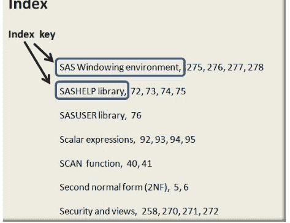

索引为 SAS 用户提供了一种避免大表扫描和磁盘排序的访问方法，而当优化器无法找到高效服务查询的方法时，这些操作经常被使用。索引由一个或多个列组成，表示键，用于在表中唯一标识行。当使用索引时，它会找到查询搜索条件请求的行存储位置并检索这些数据行。

索引最好表示为倒置树结构，有时称为平衡树（或 b-tree），并在以下图表中显示。如图 6.2 所示，索引由单个根页面级别（起点）、零个或多个中间级别（或节点）以及实际数据行存储的叶级别组成。

## 图 6.2：称为 B-Tree 的倒置树结构

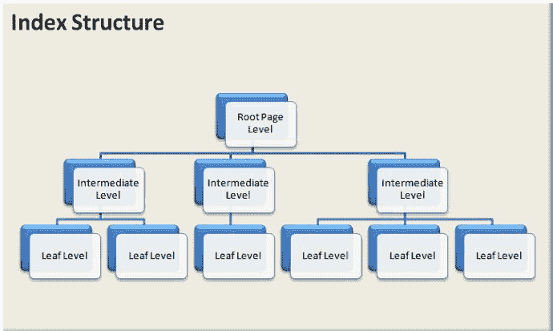

由于索引经常太大而无法完全放入主存储器（内存）中，因此它们存储在磁盘等二级存储类型上。在 b-tree 数据结构中，数据记录或行存储在称为叶的位置。B-tree 最适合处理部分数据驻留在二级存储中的情况。这提供了一个环境，可以减少二级磁盘访问次数（更少的 I/O 操作），从而实现更具成本效益的处理。

索引通常用于提高访问数据子集的速度，并由一个或多个字符、数值或混合（字母数字）类型的列组成。与顺序访问数据行或物理排序表（使用 ORDER BY 子句或 PROC SORT 中的 BY 语句执行）不同，索引旨在在无需物理排序的情况下设置逻辑数据排列。这具有明显的优势，即减少 CPU 和内存需求，并在使用 WHERE 子句处理时减少数据访问时间。

## 设计索引

没有规定表必须具有索引的规则，但当索引可用时，它可以使信息访问和检索更高效、更快。

当在 SAS 软件中执行查询时，SQL 优化器会评估可用方法的成本，并使用最有效的方法处理数据。处理可以使用顺序表扫描进行，也可以使用索引进行，如果存在的话。当执行顺序表扫描时，SAS 从表的开头开始，按行顺序遍历表中的所有行，并处理（检索）与查询 WHERE 子句中指定的选择条件匹配的行。

索引应设计为在查询中触发（或引用）时提供高效的数据库处理。为了更好地理解索引对数据库应用程序的影响，应牢记以下几点：

- 索引可以提高不修改数据的查询性能，因为优化器有更多选择来确定访问数据的最快方式。

- 具有太多索引的表在使用 INSERT、MODIFY 或 DELETE 操作时可能会出现性能下降，因为所有索引都必须调整以对应对表中数据所做的更改。

- 指定精确匹配比较的查询可以从索引中受益。例如，
```
WHERE prodnum = 5001;
        < or >
WHERE prodtype = "Laptop";
```

- 指定值在值范围之间的查询可以从索引中受益。例如，
```
WHERE invenqty BETWEEN 3 AND 10;
        < or >
WHERE invenqty >= 3 AND invenqty <= 10;
```

- 不指定显式排序操作的查询会产生排序输出。

- 使用 LIKE 比较运算符的查询在搜索模式以特定字符字符串开头时可以从索引中受益，例如 "Lap%"，但在搜索模式以通配符开头时则不能，例如 "%ware"。

- 使用 IDXWHERE= 或 IDXNAME= 数据集选项强制 SQL 优化器在查询中使用索引时，对于小表可能会阻碍性能，因为 SAS 会遍历

例如，一旦已知特定零件号，就可以使用索引来查找零件的位置以及其制造商、成本和可用性，比其他方法更高效。有关在 SAS 中使用索引的更多信息，请参阅 Michael Raithel 所著的 *The Complete Guide to Using SAS Indexes*，该书可在 SAS 书店获得。

索引查找匹配项，而不是允许软件使用顺序表扫描处理数据。

## 基数

在数据库表的上下文中，基数是指表中特定列中包含的数据值的唯一性或缺乏唯一性。值集的基数是指集合中元素的唯一数量。例如，集合 CUSTNUM= {101, 201, 301, 401} 包含四个唯一元素，基数为四。相比之下，集合 PRODTYPE = {Workstation, Laptop, Software, Software} 包含四个元素，其中三个是唯一的，结果基数为三。

了解基数规则以及基数如何影响数据库应用程序可以帮助确定最佳查询计划。表 6.1 说明并描述了三种基数类型：低、正常和高。集合的基数随着列中包含的唯一元素越多而变得越高。相反，基数越低，列中包含的重复元素越多。

**表 6.1：基数规则**

| 数据值包含大量重复值 | 数据值包含一些唯一/一些重复值 | 数据值包含大量唯一值 |
|---|---|---|
| 低基数包含很少或没有唯一值。具有低基数的列值的典型示例包括标志和开关、布尔值或性别。此类列通常包含大量重复值，是较差的索引。 | 正常基数包含有限数量的可能值。具有正常基数的列值的典型示例包括产品类型、制造商州、客户姓名或客户家庭城市。此类列通常同时包含一些唯一值和一些重复值。 | 高基数包含高度唯一的值。具有高基数的列值通常用于标识目的，包括制造商编号、发票编号或电子邮件地址。此类列通常由大量唯一值组成，是最佳的索引。 |

## 索引选择性

索引在高度选择性时最有效。这意味着具有高基数的列（上一节中介绍过）在不同值与表中行数之比尽可能接近 1 时最具选择性。索引的选择性公式可量化如下：

Selectivity = Unique (Distinct) Rows / Total Number Rows

> 注：完美选择性只能在 NOT NULL 列上达到。


要确定表中任意列的选择度、不同行数以及总行数，请使用以下 SQL 语句：

```
SELECT  COUNT (DISTINCT (column-name))  /  COUNT (*)  AS
SELECTIVITY,
        COUNT (DISTINCT (column-name))  AS DISTINCT_VALUES,
        COUNT (*)  AS TOTAL_ROWS
FROM  table-name;

<or>

SELECT  COUNT (DISTINCT (column-name))  /  COUNT (*)  AS SELECTIVITY
FROM  table-name;
```

为了说明一个良好（并且在这种情况下是完美）选择度的示例，以下查询选择 CUSTOMERS 表中 CUSTNUM 列除以总行数来计算选择度比率：

## SQL Code

```
PROC SQL;
    SELECT  COUNT (DISTINCT (CUSTNUM))  /  COUNT(*) AS SELECTIVITY
    FROM CUSTOMERS;
QUIT;
```

## SAS Results

| SELECTIVITY |
| 1 |

结果为 1（18 个不同值 / 18 行总行数）表示完美选择度，是索引的理想候选，因为它对表中的行具有 100% 的选择性。

为了说明一个较差（并且在这种情况下很差）选择度的示例，以下查询选择 PRODUCTS 表中 PRODTYPE 列除以总行数来计算选择度比率：

## SQL Code

```
PROC SQL;
    SELECT  COUNT (DISTINCT (PRODTYPE))  /  COUNT(*) AS SELECTIVITY
    FROM PRODUCTS;
QUIT;
```

## SAS Results

| SELECTIVITY |
| 0.4 |

结果为 0.4（4 个不同值 / 10 行总行数）表示基数较低以及选择性不佳。因此，该列可能不是索引的理想候选，因为顺序全表扫描可能是处理表中行更有效的方式。

注意：列的选择度应不时重新计算，因为行插入、更新和删除可能会改变选择度比率。

## Defining Indexes

定义索引时，首先要了解索引要服务的用途。关于索引需要记住的重要一点是，只有在绝对必要时才应创建。过多的或不必要的索引会占用计算机资源并阻碍性能。尽管典型的索引占用的空间通常小于表本身所需的空间，但它仍然代表了表的一部分的副本，因此需要存储空间来存储其内容。因此，在决定何时以及创建哪些索引时应谨慎使用。

为了帮助确定索引是否必要，请考虑现有数据以及基表将如何使用。熟悉被归类为关键任务和/或对组织或流程成功至关重要的查询。然后，通过使用分析工具（如 FREQ 过程）确定底层基表中的数据如何分散（或数据的可变性）。

如果索引用于指定表中的某种顺序，例如 PRODUCTS 表中的制造商编号或产品编号，则应充分评估该索引的影响。

有时构成索引的列是显而易见的，有时则不是。索引应提供最大的灵活性，以便可以访问和检索表中的每一列。通过为表中最具区分度的列（或具有许多唯一值的列）以及在查询中经常使用的列分配索引，也可以改善查询结果。

当为一个或多个表指定索引时，连接过程实际上可能会处理得更快。SQL 优化器可能会在某些条件允许使用时决定使用索引。在创建索引之前请考虑以下几点：

- 如果表很小，顺序处理可能与使用索引的处理一样快，甚至更快。
- 如果 CONTENTS 过程中显示的页数少于三页，则索引可能几乎没有或没有价值。
- 避免创建不必要的索引。
- 如果索引的数据子集很大，则顺序访问可能比使用索引更有效。
- 如果匹配百分比大约为总体人口的 15% 或更少（称为 15% 规则），则索引使用可能有益。
- 与维护索引相关的成本可能会超过其性能价值，因为每次向表中添加、删除或修改一行时，索引都会被更新。

在 PROC SQL 中可以定义和使用两种类型的索引：简单和复合。当创建简单索引时，它仅引用单个列。相比之下，复合索引引用表中的两列或更多列。

## Creating a Simple Index

简单索引专门为表中的一列定义，并且必须与列名相同。假设您想创建一个由 PRODUCTS 表中的产品类型（PRODTYPE）组成的索引。创建后，索引将成为位于 SAS 库中的单独对象。

## SQL Code

```
PROC SQL;
    CREATE INDEX PRODTYPE ON PRODUCTS(PRODTYPE);
QUIT;
```

## SAS Log Results

```
PROC SQL;
    CREATE INDEX PRODTYPE ON PRODUCTS(PRODTYPE);
NOTE: Simple index PRODTYPE has been defined.
QUIT;
NOTE: PROCEDURE SQL used:
real time          0.37 seconds
```

1 简单索引被分配了 PRODTYPE 的名称，该名称必须与列名相同。

2 简单索引定义在 PRODUCTS 表上。

3 PRODUCTS 表中的 PRODTYPE 列被指定为索引要使用的列。

## Creating a Composite Index

复合索引专门为表中的两列或更多列定义，并且必须与列名不同。假设您想创建一个由 PRODUCTS 表中位于的制造商编号（MANUNUM）和产品类型（PRODTYPE）组成的索引。您应该知道，每个列集只允许一个复合索引，但允许多个复合索引。复合索引与简单索引一样，成为位于 SAS 库中的单独对象。

## SQL Code

```
PROC SQL;
    CREATE INDEX MANUNUM_PRODTYPE ON PRODUCTS (MANUNUM, PRODTYPE);
QUIT;
```

## SAS Log Results

```
PROC SQL;
    CREATE INDEX
        MANUNUM_PRODTYPE ON PRODUCTS (MANUNUM, PRODTYPE);
NOTE: Composite index MANUNUM_PRODTYPE has been defined.
QUIT;
NOTE: PROCEDURE SQL used:
real time          0.00 seconds
```

① 复合索引被分配了 MANUNUM_PRODTYPE 的名称，该名称用于表示 MANUNUM 和 PRODTYPE 列名。

② 复合索引定义在 PRODUCTS 表上。

③ PRODUCTS 表中的 MANUNUM 和 PRODTYPE 列被指定为索引要使用的列。

## Preventing Duplicate Values in an Index

UNIQUE 关键字可防止在索引中输入重复值。您应谨慎使用此关键字，因为有时在表中可能需要一个数据值的多次出现。当在表中出现多个相同值的出现时，UNIQUE 关键字将被拒绝，并且该特定列的索引不会被创建。

## Modifying Columns Containing Indexes

更改包含关联索引（简单或复合）的列的属性并不会禁止更改后的列中的值使用索引。但是，如果删除包含索引的列，则索引也会被删除。因此，当删除列时，该索引中的任何数据也会丢失。

## Deleting (Dropping) Indexes

当一个或多个索引不再需要时，可以使用 DROP INDEX 语句将其删除。假设由于处理要求已更改，您不再需要复合索引 MANUNUM_PRODTYPE（之前创建的）。下一个示例说明了从 SAS 库中删除单个复合索引。

## SQL Code

```
PROC SQL;
    DROP INDEX MANUNUM_PRODTYPE
        FROM PRODUCTS;
QUIT;
```

## SAS Log Results

```
PROC SQL;
    DROP INDEX MANUNUM_PRODTYPE
        FROM PRODUCTS;
NOTE: Index MANUNUM_PRODTYPE has been dropped.
QUIT;
NOTE: PROCEDURE SQL used:
      real time          0.00 seconds
```

根据 ANSI SQL 标准，DROP INDEX 语句中也可以删除两个或多个索引。下一个示例说明了 MANUNUM 和 PRODTYPE 索引在单个 DROP INDEX 语句中从 SAS 库中删除。

## SQL Code

```
PROC SQL;
    DROP INDEX MANUNUM, PRODTYPE
        FROM PRODUCTS;
QUIT;
```

## SAS Log Results

```
PROC SQL;
    DROP INDEX MANUNUM, PRODTYPE
        FROM PRODUCTS;
NOTE: Index MANUNUM has been dropped.
NOTE: Index PRODTYPE has been dropped.
QUIT;
NOTE: PROCEDURE SQL used (Total process time):
      real time          0.00 seconds
      cpu time           0.01 seconds
```

## Updating Data in a Table

一旦表填充了数据，您可能需要更新其中一个或多个行的值。现有行中的列值可以用 UPDATE 语句更新。成功更新行的关键是创建结构良好的 SET 子句和 WHERE 表达式。如果 WHERE 表达式构造不正确，则更新错误发生的可能性很大。

假设 PRODUCTS 表中的所有笔记本电脑刚刚被降价 20%，新价格将立即生效。更新将仅为“笔记本电脑”计算机计算折扣产品成本。例如，笔记本电脑的折扣价将从 $3,400.00 降至 $2,720.00。


### SQL 代码

```
PROC SQL;
    UPDATE PRODUCTS
        SET PRODCOST = PRODCOST - (PRODCOST * 0.2)
            WHERE UPCASE(PRODTYPE) = 'LAPTOP';

    SELECT *
        FROM PRODUCTS;
QUIT;
```

## SAS 日志结果

```
PROC SQL;
    UPDATE PRODUCTS
        SET PRODCOST = PRODCOST - (PRODCOST * 0.2)
            WHERE UPCASE(PRODTYPE) = 'LAPTOP';
NOTE: 1 row was updated in WORK.PRODUCTS.
    SELECT *
        FROM PRODUCTS;
QUIT;
NOTE: PROCEDURE SQL used:
      real time           0.00 seconds
```

### 结果

| 产品编号 | 产品名称 | 制造商编号 | 产品类型 | 产品成本 |
|---|---|---|---|---|
| 1110 | Dream Machine | 111 | Workstation | $3,200.00 |
| 1200 | Business Machine | 120 | Workstation | $3,300.00 |
| 1700 | Travel Laptop | 170 | Laptop | $2,720.00 |
| 2101 | Analog Cell Phone | 210 | Phone | $35.00 |
| 2102 | Digital Cell Phone | 210 | Phone | $175.00 |
| 2200 | Office Phone | 220 | Phone | $130.00 |
| 5001 | Spreadsheet Software | 500 | Software | $299.00 |
| 5002 | Database Software | 500 | Software | $399.00 |
| 5003 | Wordprocessor Software | 500 | Software | $299.00 |
| 5004 | Graphics Software | 500 | Software | $299.00 |

## 摘要

- 1. 数据定义语言 (DDL) 语句为程序员提供了一种重新定义一个或多个现有表的定义的方法（参见“修改表”部分）。
- 2. 当向表中添加一个或多个新列时，每个列都会自动添加到表的描述符记录的末尾（参见“添加新列”部分）。
- 3. 要按指定顺序添加一个或多个列，SQL 标准提供了一些可供选择的选项（参见“控制表中列的位置”部分）。
- 4. PROC SQL 允许字符列（但不是数值列）更改其长度（参见“更改列的长度”部分）。
- 5. 列的格式和标签信息可以用 MODIFY 子句进行修改（参见“更改列的格式”和“更改列的标签”部分）。
- 6. 在 FROM 子句中重命名列名时必须使用 RENAME= SAS 数据集选项（参见“重命名列”部分）。
- 7. DATASETS 过程是重命名表的推荐方法（参见“重命名表”部分）。
- 8. 索引由一个或多个用于唯一标识表中每一行的列组成（参见“索引”部分）。
- 9. 理解基数规则及其对数据库应用程序的影响有助于确定最佳查询计划（参见“创建简单索引”部分）。
- 10. 索引在选择性很高时最有效（参见“创建复合索引”部分）。
- 11. 表中现有行的列值可以用 UPDATE 语句进行修改（参见“更新表中的数据”部分）。

## 第 7 章：编码复杂查询

- - 引言 ........................................................ 234
- - 介绍复杂查询 ....................................... 234
- - 连接 .............................................................. 235
- - 为什么连接很重要 ............................................ 235
- - 基于关系的检索 ..................... 235
- - DATA 步合并与 PROC SQL 连接 ........................... 236
- - 复杂查询类型 ......................................... 236
- - 揭秘连接算法 ..................................... 239
- - 用一点魔力影响连接 ............................. 239
- - 笛卡尔积连接 ............................................ 242
- - 内连接 ........................................................ 242
- - 等值连接 ....................................................... 243
- - 非等值连接 ................................................... 245
- - 自连接或自引用连接 .......................................... 247
- - 在连接中使用表别名 ..................................... 249
- - 在连接中执行计算 ................................ 250
- - 三表连接 .......................................... 251
- - 三表以上连接 ............................... 253
- - 外连接 ........................................................ 255
- - 左外连接 ............................................... 255
- - 右外连接 .............................................. 258
- - 全外连接 ............................................... 259
- - 子查询 ........................................................ 261
- - 子查询的替代方法 .............................. 261
- - 使用子查询传递单个值 .......................... 262
- - 使用子查询传递多行 ...................... 266
- - 比较一组值 ...................................... 267
- - 相关子查询 .......................................... 269
- - 集合操作 .................................................... 271
- - 集合运算符规则 ........................................ 271

## 集合运算符和优先级...............................................272

## 访问两个查询的交集中的行...................................272

## 访问两个查询的组合中的行 ...................................274

## 连接两个查询的行...................................................276

## 比较两个查询的行 .......................................................278

## 复杂查询应用 ...........................................................280

## 一对一、一对多、多对一和多对多关系 280

## 处理 BY 组中的首行、末行和中间行...........................285

## 确定输入表中的行数.......................................290

## 识别索引最多的表 ...............................................291

## 摘要 ..............................................................................293

## 引言

在前几章中，我们对查询的讨论仅限于使用 SELECT 语句引用的单个表。关系方法的真正优势在于它能够构建引用多个表甚至其他查询的查询的能力。这些类型的查询被称为 *复杂查询*。PROC SQL 支持用于由多个表组成的内连接和外连接的编码结构，通过一种称为嵌套的过程实现控制其他查询的查询，以及将多个查询的输出组合为单个表。

## 介绍复杂查询

让我们来看一些利用 SQL 过程所有功能的更复杂的查询。本章说明了四种复杂查询结构。

- - 内连接
  SELECT 语句的 FROM 和可选 WHERE 子句中最多可以引用 256 个表。
- - 外连接
  SELECT 语句的 FROM 和 ON 子句中最多引用两个表。
- - 子查询
  查询嵌入（嵌套）在主查询的 WHERE 子句中。

## 第 7 章：编码复杂查询 235

## 集合操作

结果由两个或多个独立查询创建。

## 连接

连接两个或多个数据表是关系模型中的一项强大功能。SQL 过程使您可以快速轻松地连接信息表。当至少有一个列对每个表都通用时，将一个信息与另一信息链接成为可能。最多可以使用常规（内）连接技术组合 256 个表，而外连接技术一次最多只能使用两个表。

本章讨论了许多连接主题，包括为什么连接很重要、各种连接技术之间的差异、WHERE 子句在创建连接中的重要性、创建和使用表别名、连接三个或更多数据表、外（左、右和全）连接、子查询和集合操作。重要的是要认识到，其中许多技术都可以使用 DATA 步编程技术实现，但 SQL 过程中找到的简单性和灵活性使其成为从业者不可或缺的工具。

## 为什么连接很重要

随着关系数据库系统的普及不断增长，访问存储在单独表中的规范化数据变得越来越重要。通过将一个表中键列中的匹配值与另一个表（或多个表）中的键列相关联，您可以检索信息，就好像数据存储在一个巨大的文件中一样。结果可以为可能的数据关系提供新的令人兴奋的见解。

## 基于关系的检索

能够定义多个表之间的关系并基于这些关系检索信息是关系模型的一个强大功能。两个或多个表的连接提供了一种在单个 SELECT 语句中收集和操作数据的方法。您通过在 SELECT 语句中指定表名来连接两个或多个表。连接一次指定至少两个表，其中每个表中的一列用于连接两个表。连接列应具有“相似”的值和相同的列属性，因为连接的成功取决于这些值。

在典型的连接中，您在 SELECT 语句中命名相关列，在 FROM 子句中指定要连接的表，并在 WHERE 子句中指定您想要揭示的关系。也就是说，您描述要生成的数据子集。为了有用（并且大小可管理），您的连接需要 WHERE 子句来约束结果并确保其实用性和相关性。


> 注意：当你创建没有 WHERE 子句的连接时，你正在创建一个称为笛卡尔积的内部虚拟表。该表可能非常庞大，因为它代表了连接表中行和列的所有可能组合。

## DATA 步合并与 PROC SQL 连接

本节的目的是简要解释 DATA 步合并与 PROC SQL 连接之间的差异（和相似之处）。之所以讨论这个主题，是因为多年来人们一直在询问哪种方法更优、更劣、更快、更慢、更好、更差、更容易、更难、更高效、效率更低、对程序员时间要求更高、对程序员时间要求更低、更易于维护、更难维护等。我的通常回复是，“只有你和你的组织才能完全回答这个问题，原因如下。”

除了使用 DATA 步结构进行合并和使用 SAS 提供的过程进行连接的明显语法和实现方法差异外，这两种方法基本上都能实现相同的结果。事实上，这两种方法都通过匹配键水平地组合两个或多个数据集（或表），并且能够处理一对一、一对多、多对一和多对多匹配组合。表 7.1 列出了每个 SAS 和 SQL 用户在决定使用哪种方法之前都应提出并回答的几点考虑因素。

## 表 7.1：合并与连接功能/考虑因素

| 功能 / 考虑因素 | DATA 步合并 | PROC SQL 连接 |
|---|---|---|
| 除了磁盘空间外，处理的 数据集（或表）数量是否有 限制？ | 否 | 是（最多 256 个表） |
| 代码是否可移植到其他 数据库实现？ | 否 | 是 |
| 该方法是否是指定数据库 请求的标准方法？ | 否 | 是 |
| 处理 BY 组时是否需要 执行排序？ | 是 | 否 |
| 组合数据集（或表）时 是否需要公共变量名？ | 是 | 否 |
| 组合数据集（或表）时 匹配列是否会自动覆盖？ | 是 | 否 |
| 组合数据集（或表）后 结果是否自动打印？ | 否 | 是 |

## 复杂查询的类型

SQL 过程支持多种复杂查询结构（有时称为连接类型）。从内连接到左、右和全外连接，本章全面介绍了可用于操作和转换多个表的各种形式的 SELECT 语句。SQL 过程支持四类数据关系：一对一、一对多、多对一和多对多，其中每个类别由各表中行的相互关系进行分类。

一对一关系代表最简单的连接操作。其特征是表具有 BY 组列，且在任何表中 BY 值均无重复（唯一的 BY 列）。它假设每个表中的数据行具有完全相同的相对顺序，其中组合结果将包含表一中的第 1 行与表二中的第 1 行，表一中的第 2 行与表二中的第 2 行，表一中的第 3 行与表二中的第 3 行，依此类推。

一对多和多对一关系与一对一关系没有更复杂，并且可由 SQL 过程轻松表示。这类关系的特征是一个表没有 BY 值的重复，而另一个表有一个或多个 BY 值的重复。

多对多关系可能比一对一、一对多和多对一关系稍微复杂一些。多对多关系的特征是所有表都有一或多个 BY 值的重复。使用 SQL 过程执行这类连接具有显著优势。首先，源表中的列名不必完全相同。其次，无需预先对表进行排序，因为 SQL 优化器将确定是否有可用的索引（参见第 6 章“修改和更新表和索引”）或是否需要使用隐含的 ORDER BY 子句对数据进行排序。

其他主题和示例包括子查询和集合操作，如 UNION、INTERSECT 和 EXCEPT 运算符。表 7.2 介绍了 SQL 过程中可用的各种复杂查询类型。

## 表 7.2：复杂查询的类型

| 查询类型 | 描述 |
|---|---|
| 笛卡尔积或交叉连接 | 一个创建表示两个或多个表中的行和列所有组合的表的连接。它由 WHERE 子句的缺失表示。 |
| 内连接 | 一个仅检索两个或多个表中具有匹配值的行的连接（最多 256 个表）。这种类型的连接被称为常规类型的连接。 |
| 等值连接 | 在两个或多个表中的列之间指定相等条件（例如等号“=”）的连接。 |
| 非等值连接 | 在两个或多个表中的列之间指定不等条件（例如 NE、>、<）的连接。 |
| 自连接或 reflexive 连接 | 一个将表与其自身组合的连接。 |
| 外连接 | 一个检索具有匹配值的行同时保留一个或两个表中部分或全部未匹配行的连接（最多 2 个表）。 |
| 左外连接 | 一个保留左表中未匹配行的连接。 |
| 右外连接 | 一个保留右表中未匹配行的连接。 |
| 全外连接 | 一个保留左表和右表中未匹配行的连接。 |
| 子查询 | 一个在另一个查询内的查询，有时称为嵌套查询，用于基于另一表中的值从一个表检索行。 |
| 简单子查询 | 一个在另一个查询内的自包含且独立的查询，可从内部查询返回单个或多个值。 |
| 相关子查询 | 一个将值传递给内部查询的外层查询，执行后将结果传回外层查询。 |
| 集合操作 | 这些运算符垂直组合或连接查询结果。 |
| UNION | 组合两个查询中的所有唯一（非重复）行。 |
| INTERSECT | 组合第一个查询中的所有匹配行与第二个查询中的行。 |
| EXCEPT | 生成第一个查询中未出现在第二个查询中的行。 |
| OUTER UNION | 连接（追加）两个查询的结果。 |

## 揭秘连接算法

SQL 过程包含一个优化器，其目的是使用最佳计划执行查询。连接算法会为每个连接属性的每个不同值定位每个关系中显示该值的有序元素列表。SQL 优化器使用标准来确定使用哪种连接算法来优化查询。连接结构、数据的结构、索引的定义、可用实际内存以及其他因素都可能影响优化器选择的连接算法。下面描述了每种连接算法的具体细节。

### 嵌套循环

当处理小型数据表且一个表明显小于另一个表、连接条件不包含相等条件、优先匹配第一行，或已排除使用排序合并或哈希连接时，SQL 优化器可能会选择嵌套循环连接算法。该算法通过遍历较小的表来查找较大表中的匹配键。嵌套循环连接算法对右表的内容极其敏感，因为它为左表的每一行处理右表。因此，随着表大小的增加，这种连接算法往往比其他选择更耗 CPU。

### 排序合并

当表为小到中等大小时，SQL 优化器可能会选择排序合并连接算法。该算法首先使用一个或多个键列对数据表进行排序（如果需要），然后对于左表中的每一行，算法读取右表中所有匹配的行。当使用索引或哈希连接算法的条件被排除在考虑之外时，SQL 优化器会考虑使用排序合并连接算法。

### 索引

当在参与连接关系的每个列上创建的索引会提高性能时，SQL 优化器可能会选择索引连接算法。该算法通过访问较大表的索引来查找较小表的每一行。SQL 优化器在较大表具有包含所有连接键的关联索引、表以相等条件相关、和/或连接条件在多个表达式之间使用 AND 运算符时，会考虑使用索引连接算法。

### 哈希

当系统有足够的内存可用，并且 BUFFERSIZE 选项足够大以将较小表存储到内存中时，SQL 优化器可能会选择哈希连接算法。该算法通过顺序扫描较大表并对较小表执行逐行查找来操作。SQL 优化器在索引连接算法被排除在考虑之外时，会考虑使用哈希连接算法。

## 用一点魔法影响连接

SQL 过程支持各种选项来影响特定连接算法的执行。以下 SQL 过程选项可用：


## 表 7.3：SQL 过程选项

| Option | Description |
|---|---|
| MAGIC=101 | 影响 SQL 优化器选择嵌套循环连接算法。 |
| MAGIC=102 | 影响 SQL 优化器选择排序-合并连接算法。 |
| MAGIC=103 | 影响 SQL 优化器选择哈希连接算法。 |

在下一个示例中，指定了 PROC SQL 选项 MAGIC=101 以影响优化器为查询执行选择嵌套循环连接算法。

### SQL 代码

```
proc sql magic=101;
    select c.custname,
        p1.prodnum, p1.prodname, p2.units, p2.unitcost,
        p2.units * p2.unitcost as Total_Cost format=dollar12.2
    from products  p1,
        purchases  p2,
        customers  c
    where p1.prodnum = p2.prodnum  AND
        p2.custnum = c.custnum
    order by c.custname, p1.prodname;
quit;
```

以下日志结果显示，当指定 MAGIC=101 选项时，SQL 优化器（或规划器）选择了嵌套循环（顺序循环）连接算法。

### SAS 日志结果

```
proc sql magic=101;
    select c.custname,
        p1.prodnum, p1.prodname, p2.units, p2.unitcost,
        p2.units * p2.unitcost as Total_Cost format=dollar12.2
    from products  p1,
        purchases  p2,
        customers  c
    where p1.prodnum = p2.prodnum  AND
        p2.custnum = c.custnum
    order by c.custname, p1.prodname;
NOTE: PROC SQL planner chooses sequential loop join.
NOTE: PROC SQL planner chooses sequential loop join.
quit;
NOTE: PROCEDURE SQL used (Total process time):
      real time          0.08 seconds
      cpu time           0.07 seconds
```

在下一个示例中，指定了 PROC SQL 选项 MAGIC=102 以影响优化器为查询执行选择排序-合并连接算法。

### SQL 代码

```
proc sql magic=102;
    select c.custname,
        p1.prodnum, p1.prodname, p2.units, p2.unitcost,
        p2.units * p2.unitcost as Total_Cost format=dollar12.2
    from products  p1,
        purchases  p2,
        customers  c
    where p1.prodnum = p2.prodnum  AND
        p2.custnum = c.custnum
    order by c.custname, p1.prodname;
quit;
```

以下日志结果显示，当指定 MAGIC=102 选项时，SQL 优化器（或规划器）选择了排序-合并（合并）连接算法。

### SAS 日志结果

```
proc sql magic=102;
    select c.custname,
        p1.prodnum, p1.prodname, p2.units, p2.unitcost,
        p2.units * p2.unitcost as Total_Cost format=dollar12.2
    from products  p1,
        purchases  p2,
        customers  c
    where p1.prodnum = p2.prodnum  AND
        p2.custnum = c.custnum
    order by c.custname, p1.prodname;
NOTE: PROC SQL planner chooses merge join.
NOTE: PROC SQL planner chooses merge join.
quit;
NOTE: PROCEDURE SQL used (Total process time):
      real time          0.14 seconds
      cpu time           0.09 seconds
```

在下一个示例中，指定了 PROC SQL 选项 MAGIC=103 以影响优化器为查询执行选择哈希连接算法。

### SQL 代码

```
proc sql magic=103;
    select c.custname,
        p1.prodnum, p1.prodname, p2.units, p2.unitcost,
        p2.units * p2.unitcost as Total_Cost format=dollar12.2
    from products  p1,
        purchases  p2,
        customers  c
    where p1.prodnum = p2.prodnum  AND
        p2.custnum = c.custnum
    order by c.custname, p1.prodname;
quit;
```

日志显示，SQL 优化器（或规划器）最初选择了合并连接算法，但在指定 MAGIC=103 选项时，将合并连接转换为了哈希连接算法。

### SAS 日志结果

```
proc sql magic=103;
    select c.custname,
        p1.prodnum, p1.prodname, p2.units, p2.unitcost,
        p2.units * p2.unitcost as Total_Cost format=dollar12.2
    from products p1,
        purchases p2,
        customers c
    where p1.prodnum = p2.prodnum  AND
        p2.custnum = c.custnum
    order by c.custname, p1.prodname;
NOTE: PROC SQL planner chooses merge join.
NOTE: PROC SQL planner chooses merge join.
NOTE: A merge join has been transformed to a hash join.
NOTE: A merge join has been transformed to a hash join.
quit;
NOTE: PROCEDURE SQL used (Total process time):
    real time        0.08 seconds
    cpu time         0.07 seconds
```

## 笛卡尔积连接

如前所述，笛卡尔积（或交叉连接）表示连接表中行和列的所有可能组合。准确地说，它表示输入表的列数之和加上输入表的行数之积。换句话说，它表示第一个表中的每一行与第二个表中的每一行相匹配，以此类推。例如，如果你对一个包含 100,000 行的表和一个包含 10,000 行的第二个表执行连接操作，你将得到一个包含 10 百万行的笛卡尔积。

尽管笛卡尔积在关系模型中具有非常有用的目的，但对于用户来说，有意将其作为最终表产生几乎毫无意义。除了体积庞大之外，笛卡尔积包含的信息过多，使得从业者难以甚至不可能选择出重点。只有当你使用 WHERE 子句对笛卡尔积进行子集化时，你的数据才变得可量化且可管理。有关笛卡尔积连接的更多信息以及说明这些连接结果的示例，请访问本书的作者页面 support.sas.com/lafler。

## 内连接

如前所述，内连接一次最多可处理 256 个表，并且是最被认可和最广泛使用的连接类型。它们主要用于限制行，其中

### 结果

| Product Name | Product Cost | Manufacturer Number | Manufacturer Name |
|---|---|---|---|
| Dream Machine | $3,200.00 | 111 | Cupid Computer |
| Business Machine | $3,300.00 | 120 | Storage Devices Inc |
| Analog Cell Phone | $35.00 | 210 | Global Comm Corp |
| Digital Cell Phone | $175.00 | 210 | Global Comm Corp |
| Spreadsheet Software | $299.00 | 500 | KPL Enterprises |
| Database Software | $399.00 | 500 | KPL Enterprises |
| Wordprocessor Software | $299.00 | 500 | KPL Enterprises |
| Graphics Software | $299.00 | 500 | KPL Enterprises |

上一个示例可以通过在 WHERE 子句中添加另一个条件来进一步限定。例如，假设你只想显示由制造商 KPL Enterprises 生产的产品。以下连接标识了由 WHERE 子句中指定的 KPL Enterprises 制造的所有产品（所有不符合 WHERE 子句条件的行都会自动从连接结果中排除）。

注意：此连接假设你知道 KPL Enterprises 的唯一制造商编号。

### SQL 代码

```
PROC SQL;
    SELECT prodname, prodcost,
        manufacturers.manunum, manuname
    FROM PRODUCTS, MANUFACTURERS
    WHERE products.manunum =
        manufacturers.manunum AND
        products.manunum = 500;
QUIT;
```

① WHERE 子句中 AND 逻辑运算符的指定表示必须两个条件都为真才能从两个表中检索行。

### 结果

| Product Name | Product Cost | Manufacturer Number | Manufacturer Name |
|---|---|---|---|
| Spreadsheet Software | $299.00 | 500 | KPL Enterprises |
| Graphics Software | $299.00 | 500 | KPL Enterprises |
| Wordprocessor Software | $299.00 | 500 | KPL Enterprises |
| Database Software | $399.00 | 500 | KPL Enterprises |

让我们通过确定由 KPL Enterprises 制造的产品所占用的资金来扩展我们对等值连接的了解。为了实现这一点，你需要做两件事。首先，你需要在匹配 WHERE 子句条件的每一行上对产品成本（PRODCOST）列求和。因为等值连接的目标是计算由 KPL Enterprises 制造的产品总额，所以你需要防止结果中出现重复行。为了防止重复行，你需要指定 DISTINCT 关键字。

### SQL 代码

```
PROC SQL;
    SELECT DISTINCT SUM(prodcost) AS Total_Cost
        FORMAT=DOLLAR10.2,
        manufacturers.manunum
    FROM PRODUCTS, MANUFACTURERS
    WHERE products.manunum =
        manufacturers.manunum AND
        manufacturers.manuname = 'KPL Enterprises';
QUIT;
```

① DISTINCT 关键字可防止重复行出现在结果中。

### 结果

| Total_Cost | Manufacturer Number |
|---|---|
| $1,296.00 | 500 |

## 非等值连接

另一种内连接类型称为非等值连接。正如其名称所示，非等值连接在其 WHERE 子句中没有指定等号“=”。例如，


假设您想要显示由 KPL 企业制造的、成本超过 299.00 美元的产品。使用大于号“>”运算符，这种类型的连接由此得名。

注意：当 SQL 过程优化器无法通过减少笛卡尔积来优化连接查询时，SAS 日志中会显示一条消息，表明该连接需要执行一个或多个笛卡尔积连接，且无法优化。

### SQL 代码

```
PROC SQL;
    SELECT prodname, prodtype, prodcost,
            manufacturers.manunum, manufacturers.manuname
    FROM PRODUCTS, MANUFACTURERS
    WHERE manufacturers.manunum = 500 AND
          prodtype = 'Software' AND
          prodcost > 299.00;
QUIT;
```

① 在 WHERE 子句中指定大于号“>”运算符表示非等值连接场景。

## SAS 日志结果

```
PROC SQL;
    SELECT prodname, prodtype, prodcost,
            manufacturers.manunum, manufacturers.manuname
    FROM PRODUCTS, MANUFACTURERS
    WHERE manufacturers.manunum = 500 AND
          prodtype = 'Software' AND
          prodcost > 299.00;
NOTE: The execution of this query involves performing one or more Cartesian product joins that cannot be optimized.
    QUIT;
NOTE: PROCEDURE SQL used:
      real time           0.01 seconds
      cpu time            0.01 seconds
```

### 结果

| 产品名称 | 产品类型 | 产品成本 | 制造商编号 | 制造商名称 |
|--------------|--------------|--------------|---------------------|-------------------|
| 数据库软件 | 软件 | $399.00 | 500 | KPL 企业 |

## 反射连接或自连接

最后一种内连接类型称为反射连接（reflexive join），也称为自连接（self join）。顾名思义，自连接会创建表的一个内部副本，然后将该副本与自身连接。本质上，这种连接是将表的一个副本与自身连接，以便利用和展示表值之间的比较。例如，假设您希望按产品类型并排比较产品价格，价格较低的产品排在前面（如示例结果的前三列所示）。

### SQL 代码

```
PROC SQL;
    SELECT products.prodname, products.prodtype,
            products.prodcost,
            products_copy.prodname, products_copy.prodtype,
            products_copy.prodcost
        FROM PRODUCTS, PRODUCTS PRODUCTS_COPY
        WHERE products.prodtype =
                products_copy.prodtype AND
                products.prodcost <
                products_copy.prodcost;
QUIT;
```

1 PRODUCTS 表是在 FROM 子句中指定的主表。

2 名为 PRODUCTS_COPY 的 PRODUCTS 表副本与 PRODUCTS 表连接。

3 WHERE 子句要求对相同类型的产品进行并排比较，价格较低的产品排在最前面。

### 结果

| 产品名称 | 产品类型 | 产品成本 | 产品名称 | 产品类型 | 产品成本 |
|---|---|---|---|---|---|
| 梦幻机 | 工作站 | $3,200.00 | 商务机 | 工作站 | $3,300.00 |
| 模拟手机 | 电话 | $35.00 | 办公电话 | 电话 | $130.00 |
| 模拟手机 | 电话 | $35.00 | 数字手机 | 电话 | $175.00 |
| 办公电话 | 电话 | $130.00 | 数字手机 | 电话 | $175.00 |
| 电子表格软件 | 软件 | $299.00 | 数据库软件 | 软件 | $399.00 |
| 文字处理软件 | 软件 | $299.00 | 数据库软件 | 软件 | $399.00 |
| 图形软件 | 软件 | $299.00 | 数据库软件 | 软件 | $399.00 |

让我们看另一个示例。假设您想查找客户名称和发票金额，并针对每位客户列出发票金额更大的客户名称和发票金额。下一个示例展示了自连接的一个有用应用。

### SQL 代码

```
PROC SQL;
SELECT invoice.custnum, invoice.invprice,
    invoice_copy.custnum, invoice_copy.invprice
FROM INVOICE, INVOICE INVOICE_COPY
WHERE invoice.invprice <
    invoice_copy.invprice;
QUIT;
```

- ① INVOICE 表是在 FROM 子句中指定的主表。
- ② 名为 INVOICE_COPY 的 INVOICE 表副本与 INVOICE 表连接。
- ③ WHERE 子句生成发票金额更大的客户名称。

### 结果

| 客户编号 | 发票单价 | 客户编号 | 发票单价 |
|---|---|---|---|
| 201 | $1,495.00 | 1301 | $1,598.00 |
| 201 | $1,495.00 | 501 | $9,600.00 |
| 201 | $1,495.00 | 401 | $23,100.00 |
| 1301 | $1,598.00 | 501 | $9,600.00 |
| 1301 | $1,598.00 | 401 | $23,100.00 |
| 101 | $245.00 | 201 | $1,495.00 |
| 101 | $245.00 | 1301 | $1,598.00 |
| 101 | $245.00 | 501 | $9,600.00 |
| 101 | $245.00 | 801 | $798.00 |
| 101 | $245.00 | 901 | $396.00 |
| 101 | $245.00 | 401 | $23,100.00 |
| 501 | $9,600.00 | 401 | $23,100.00 |
| 801 | $798.00 | 201 | $1,495.00 |
| 801 | $798.00 | 1301 | $1,598.00 |
| 801 | $798.00 | 501 | $9,600.00 |
| 801 | $798.00 | 401 | $23,100.00 |
| 901 | $396.00 | 201 | $1,495.00 |
| 901 | $396.00 | 1301 | $1,598.00 |
| 901 | $396.00 | 501 | $9,600.00 |
| 901 | $396.00 | 801 | $798.00 |
| 901 | $396.00 | 401 | $23,100.00 |

## 在连接中使用表别名

SAS 库中的每个表都必须有唯一的名称以供引用。表名称必须符合有效的 SAS 命名约定，这意味着表名称的最大长度可以为 32 个字符，并且必须以字母或下划线开头（有关更多详细信息，请参阅《SAS 语言参考：概念》）。

为了减少引用连接查询中指定表所需的击键次数，可以为每个表指定一个别名或临时表名称引用。指定后，这些任意别名提供了对表本身的快捷方式，并且在连接查询期间有效，但之后不再有效。在下一个示例中，在 FROM 子句中，将表别名“P”分配给 PRODUCTS 表，将别名“M”分配给 MANUFACTURERS 表。SELECT 语句和 WHERE 子句中的表名称引用也变得更加容易。

### SQL 代码

```
PROC SQL;
    SELECT prodnum, prodname, prodtype, M.manunum
        FROM PRODUCTS  P, MANUFACTURERS  M
            WHERE P.manunum  = M.manunum AND
                M.manuname  = 'KPL Enterprises';
QUIT;
```

① 在 FROM 子句中分配表别名“P”和表别名“M”，为引用较长的表名 PRODUCTS 和 MANUFACTURERS 提供了快捷方式。

### 结果

| 产品编号 | 产品名称 | 产品类型 | 制造商编号 |
|---|---|---|---|
| 5001 | 电子表格软件 | 软件 | 500 |
| 5002 | 数据库软件 | 软件 | 500 |
| 5003 | 文字处理软件 | 软件 | 500 |
| 5004 | 图形软件 | 软件 | 500 |

## 在连接中执行计算

连接查询与较简单的查询一样，可以充分利用 SQL 过程的功能。逻辑和算术运算符、谓词和汇总函数都可以供您使用。连接查询是必不可少的组件，因为存储的信息并非总是以您需要的形式提供。

PROC SQL 提供了对包含数值的列执行基本算术运算的能力，例如加、减、乘、除。本质上，这使任何查询都能执行列加法、减法、乘法和除法。假设您想计算在加利福尼亚州销售的所有制造产品的 7.75% 的销售税。在下一个示例中，SELECT 语句显示加利福尼亚销售税的计算（使用产品成本列和固定销售税百分比），并为结果列分配列别名以及格式和标签，以增强结果的可读性。

### SQL 代码

```
PROC SQL;
    SELECT prodname, prodtype, prodcost,
        prodcost * .0775 AS SalesTax
        FORMAT=dollar10.2 LABEL='California Sales Tax'
    FROM PRODUCTS P, MANUFACTURERS M
        WHERE P.manunum = M.manunum AND
            M.manustat = 'CA';
QUIT;
```

① 在 SELECT 语句中执行基本算术运算以及为结果分配列别名的能力是 SQL ANSI 标准的一部分。

### 结果

| 产品名称 | 产品类型 | 产品成本 | 加利福尼亚销售税 |
|---|---|---|---|
| 商务机 | 工作站 | $3,300.00 | $255.75 |
| 模拟手机 | 电话 | $35.00 | $2.71 |
| 数字手机 | 电话 | $175.00 | $13.56 |
| 电子表格软件 | 软件 | $299.00 | $23.17 |
| 数据库软件 | 软件 | $399.00 | $30.92 |
| 文字处理软件 | 软件 | $299.00 | $23.17 |
| 图形软件 | 软件 | $299.00 | $23.17 |

## 三表连接

到目前为止，我们的示例仅限于两表连接。但如果需要的信息超出两个表所能提供的范围怎么办？要提取所需的信息，可能需要访问第三个表。三表连接是两表连接的相当简单的扩展。

与之前一样，每个可连接的列必须具有相同的列属性，并包含相同类型的信息。除了在 FROM 子句中列出所有必需的表之外，WHERE 子句还需要包含所有限制条件，以便仅对所需行进行子集化。例如，假设您只想显示在 INVOICE 表中出现、制造商为 KPL 企业（manunum=500）的那些产品及其发票数量。


# 252 PROC SQL：使用SAS超越基础（第二版）

```sql
PROC SQL;
SELECT P.prodname,
P.prodcost,
M.manuname,
I.invqty
FROM PRODUCTS P,
MANUFACTURERS M,
INVOICE I
WHERE P.manunum = M.manunum AND
P.prodnum = I.prodnum AND
M.manunum = 500;
QUIT;
```

| 产品名称 | 产品成本 | 制造商名称 | 发票数量—已售单位 |
|--------------|--------------|-------------------|--------------------------------|
| 电子表格软件 | $299.00 | KPL Enterprises | 5 |
| 数据库软件 | $399.00 | KPL Enterprises | 2 |

让我们进一步研究一下这个三表连接的WHERE子句的构造。PRODUCTS、MANUFACTURERS和INVOICE表中包含制造商编号的列，通过WHERE子句中的AND逻辑运算符进行连接。此外，WHERE子句将结果表限制为仅包含制造商（manunum=500）的产品发票。在下一个示例中，三表连接列出了产品名称和成本，以及购买每种产品的客户。

```sql
PROC SQL;
SELECT P.prodname,
P.prodcost,
C.custprice,
I.invprice
FROM PRODUCTS P,
INVOICE I,
CUSTOMERS C
WHERE P.prodnum = I.prodnum AND
I.custnum = C.custnum;
QUIT;
```

### 结果

| 产品名称 | 产品成本 | 客户名称 | 发票单价 |
|---|---|---|---|
| 模拟手机 | $35.00 | La Mesa Computer Land | $245.00 |
| 电子表格软件 | $299.00 | Vista Tech Center | $1,495.00 |
| 商用机器 | $3,300.00 | La Jolla Computing | $23,100.00 |
| 梦幻机器 | $3,200.00 | Alpine Technical Center | $9,600.00 |
| 数据库软件 | $399.00 | Jamul Hardware & Software | $798.00 |

## 超过三个表的连接

有时，需要从四个、五个或更多表（最多256个表）中提取信息。四个或更多表的连接可以像访问两个或三个表一样构造。唯一的区别是FROM子句中表引用的数量以及WHERE子句中限制保留行的复杂性。假设你想根据发票知道在2000年9月1日之前订购的产品数量。一种查找此信息的方法是执行四表连接。

## SQL代码

```
PROC SQL;
    SELECT sum(inventory.invenqty)
        AS Products_Ordered_Before_09012000
    FROM PRODUCTS,
        INVOICE,
        CUSTOMERS,
        INVENTORY
    WHERE inventory.orddate < mdy(09,01,00) AND
        products.prodnum = invoice.prodnum AND
        invoice.custnum = customers.custnum AND
        invoice.prodnum = inventory.prodnum;
QUIT;
```

### 结果

| 2000年9月1日前订购的产品数量 |
|---|
| 8 |

如果你想知道这个结果是否可以用另一种方式得出，那你猜对了。你也可以使用以下两表连接代码，根据发票确定在2000年9月1日之前订购的产品数量。与这个示例一样，通常有不止一种构造连接来提取所需信息的方法。

## SQL代码

```
PROC SQL;
    SELECT sum(inventory.invenqty)
        AS Products_Ordered_Before_09012000
    FROM INVOICE I,
        INVENTORY I2
    WHERE inventory.orddate < mdy(09,01,00) AND
        invoice.prodnum = inventory.prodnum;
QUIT;
```

### 结果

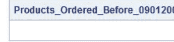

为了加深你对超过三个表连接的理解，下面的示例说明了一个四表连接。假设你想知道哪些产品正在被购买以及谁在购买它们。下一个示例展示了连接MANUFACTURERS、PRODUCTS、INVOICE和CUSTOMERS表的四向内连接。

## SQL代码

```
PROC SQL;
    SELECT products.prodname,
        products.prodtype,
        customers.custname,
        manufacturers.manuname
    FROM MANUFACTURERS,
        PRODUCTS,
        INVOICE,
        CUSTOMERS
    WHERE manufacturers.manunum = products.manunum AND
        manufacturers.manunum = invoice.manunum AND
        products.prodnum = invoice.prodnum AND
        invoice.custnum = customers.custnum;
QUIT;
```

### 结果

| 产品名称 | 产品类型 | 客户名称 | 制造商名称 |
|---|---|---|---|
| 模拟手机 | 电话 | La Mesa Computer Land | Global Comm Corp |
| 电子表格软件 | 软件 | Vista Tech Center | KPL Enterprises |
| 梦幻机器 | 工作站 | Alpine Technical Center | Cupid Computer |
| 数据库软件 | 软件 | Jamul Hardware & Software | KPL Enterprises |

## 外连接

如本章前面的示例所示，内连接会忽略不满足搜索条件的任何行。这与外连接分组表的方式有很大不同。与内连接相反，外连接保留符合ON（搜索）条件的行，同时保留来自一个或两个表中部分或全部不匹配的数据。本质上，外连接保留一个表中的行，即使它们与第二个表中的行不匹配。这一区别至关重要，因为它真正区分了外连接和内连接。

其次，外连接一次最多能处理两个表，而（在SAS实现下）内连接最多能处理256个表。

另一个区别与外连接的语法指定方式有关。在内连接的FROM子句中用于将一个表与另一个表分隔开的逗号，在外连接中被以下关键字之一替换：LEFT JOIN、RIGHT JOIN或FULL JOIN。此外，用于限制结果表中保留行的WHERE子句表达式被替换为ON关键字。

最后，外连接被认为是一种不对称连接（Lorie, Raymond A., 和 Jean-Jacques Daudenarde, SQL & Its Applications, 第87页）。与内连接不同，外连接不会从其组成部分或表中按比例选择行。

## 左外连接

让我们看看左连接在现实世界中的应用场景。假设你想查看所有制造商、其所在城市、制造商编号、产品类型和产品成本（如果有），而不遗漏那些还没有产品的制造商。这意味着MANUFACTURERS表（左表）作为主表，保留其行，而PRODUCTS表（右表）作为从表（附属表）。下面的左外连接示例有效地保留了来自两个表的匹配行，以及保留了左表中在右表中没有匹配的行。

## SQL代码

```
PROC SQL;
    SELECT manuname, manucity, manufacturers.manunum,
        products.prodtype, products.prodcost
    FROM MANUFACTURERS LEFT JOIN PRODUCTS
        ON manufacturers.manunum =
            products.manunum;
QUIT;
```

① LEFT JOIN规范保留左表（MANUFACTURERS）中的所有行，即使右表（PRODUCTS）中没有匹配的行。

② ON子句充当WHERE子句，在连接结果中选择所需行。

如左外连接结果所示，左（MANUFACTURERS）表中与右（PRODUCTS）表中行匹配的行被包含在结果表中。因此，有8行匹配，这可以通过分配给产品类型和产品成本的值来证明。此外，左表中与右表中行不匹配（基于搜索条件）的两行也被保留（加粗显示）。因此，MANUFACTURERS表中在PRODUCTS表中没有匹配值的每一行都会被添加到结果虚拟表中，并在产品类型和产品成本列中带有空值。

### 结果

| 制造商名称 | 制造商城市 | 制造商编号 | 产品类型 | 产品成本 |
| Cupid Computer | 休斯顿 | 111 | 工作站 | $3,200.00 |
| Storage Devices Inc | 圣马特奥 | 120 | 工作站 | $3,300.00 |
| Global Comm Corp | 圣地亚哥 | 210 | 电话 | $175.00 |
| Global Comm Corp | 圣地亚哥 | 210 | 电话 | $35.00 |
| KPL Enterprises | 圣地亚哥 | 500 | 软件 | $299.00 |
| KPL Enterprises | 圣地亚哥 | 500 | 软件 | $299.00 |
| KPL Enterprises | 圣地亚哥 | 500 | 软件 | $299.00 |
| KPL Enterprises | 圣地亚哥 | 500 | 软件 | $399.00 |
| World Internet Corp | 迈阿密 | 600 |  | . |
| San Diego PC Planet | 圣地亚哥 | 700 |  | . |


## 指定 WHERE 子句

为了提供更大的子集功能以及增加灵活性，SQL 过程在构造外连接时除了 ON 子句外，还允许指定可选的 WHERE 子句。能够在外连接中结合 ON 子句指定 WHERE 子句，可以更好地控制行的子集。一个示例将有助于说明 WHERE 子句在外连接中的用法。假设您想将之前的左外连接的结果限制为仅成本低于 $300.00 的产品。在此示例中，左外连接语法使用 WHERE 子句将行结果子集化为非缺失且成本低于 $300.00 的产品。

### SQL 代码

```
PROC SQL;
    SELECT manuname, manucity, manufacturers.manunum,
            products.prodtype, products.prodcost
    FROM MANUFACTURERS LEFT JOIN PRODUCTS
    ON manufacturers.manunum =
        products.manunum
    WHERE prodcost < 300 AND
        prodcost NE .;
QUIT;
```

在外连接中除了 ON 子句之外指定的可选 WHERE 子句，进一步对连接结果进行子集化。

### 结果

| Manufacturer Name | Manufacturer City | Manufacturer Number | Product Type | Product Cost |
|---|---|---|---|---|
| Global Comm Corp | San Diego | 210 | Phone | $175.00 |
| Global Comm Corp | San Diego | 210 | Phone | $35.00 |
| KPL Enterprises | San Diego | 500 | Software | $299.00 |
| KPL Enterprises | San Diego | 500 | Software | $299.00 |
| KPL Enterprises | San Diego | 500 | Software | $299.00 |

## 指定聚合函数

假设您需要生成一份按制造商汇总的月度发票金额报告。可以使用外连接语法指定聚合函数，结合 GROUP BY 子句执行分组计算。在下一个示例中，左连接使用 SUM 函数和 GROUP BY 子句计算每个制造商的总发票金额。

### SQL 代码

```
PROC SQL;
    SELECT manuname,
        SUM(invoice.invprice) AS Total_Invoice_Amt
            FORMAT=DOLLAR10.2
        FROM MANUFACTURERS LEFT JOIN INVOICE
        ON manufacturers.manunum =
            invoice.manunum
        GROUP BY MANUNAME;
QUIT;
```

- SUM 函数计算每个制造商的总发票金额。
- GROUP BY 子句将与制造商关联的所有行分组为单行。

结果显示，没有活动的制造商在聚合的 Total_Invoice_Amt 列中具有空值或缺失值。

### 结果

| Manufacturer Name | Total_Invoice_Amt |
|---|---|
| Cupid Computer | $9,600.00 |
| Global Comm Corp | $245.00 |
| KPL Enterprises | $25,789.00 |
| San Diego PC Planet | . |
| Storage Devices Inc | . |
| World Internet Corp | $1,598.00 |

## 右外连接

右连接与左连接类似，只是保留右侧（第二个）表中的行。因此，结果包含对称连接的行加上右侧表中每个未匹配行的行。左表的值会自动用空值替代。假设您想查看所有制造商及其各自的产品。在下一个示例中，使用右外连接构造从 PRODUCTS 和 MANUFACTURERS 表生成包含产品、产品类型、制造商编号和制造商名称的简单报告。

### SQL 代码

```
PROC SQL;
    SELECT prodname, prodtype,
        products.manunum, manuname
    FROM PRODUCTS RIGHT JOIN MANUFACTURERS
        ON products.manunum = manufacturers.manunum;
QUIT;
```

- RIGHT JOIN 规范保留右侧表（MANUFACTURERS）中的所有行，即使左侧表（PRODUCTS）中没有匹配行。

结果显示，在 MANUFACTURERS 表中出现但在 PRODUCTS 表中没有列出产品的制造商，其产品名称、产品类型和制造商编号列中具有空值或缺失值。

Note: 要从结果中删除具有缺失值的行，可以指定 WHERE 子句。

### 结果

| Product Name | Product Type | Manufacturer Number | Manufacturer Name |
| Dream Machine | Workstation | 111 | Cupid Computer |
| Business Machine | Workstation | 120 | Storage Devices Inc |
| Digital Cell Phone | Phone | 210 | Global Comm Corp |
| Analog Cell Phone | Phone | 210 | Global Comm Corp |
| Spreadsheet Software | Software | 500 | KPL Enterprises |
| Graphics Software | Software | 500 | KPL Enterprises |
| Wordprocessor Software | Software | 500 | KPL Enterprises |
| Database Software | Software | 500 | KPL Enterprises |
|  |  | . | World Internet Corp |
|  |  | . | San Diego PC Planet |

## 全外连接

全外连接通过保留左侧和右侧表中的行，结合了左连接和右连接的强大功能。虽然全连接不像左连接或右连接构造那样常用，但在两个表的信息都缺失时可能很有用。在下一个示例中，指定全外连接以生成包含没有产品的制造商和没有已知制造商的产品的报告。

### SQL 代码

```
PROC SQL;
    SELECT prodname, prodtype,
        products.manunum, manuname
    FROM PRODUCTS FULL JOIN MANUFACTURERS
        ON products.manunum =
            manufacturers.manunum;
QUIT;
```

- 全连接规范保留左侧表（PRODUCTS）中的所有行以及右侧表（MANUFACTURERS）中的所有行，即使没有匹配行。

### 结果

| Product Name | Product Type | Manufacturer Number | Manufacturer Name |
|---|---|---|---|
| Dream Machine | Workstation | 111 | Cupid Computer |
| Business Machine | Workstation | 120 | Storage Devices Inc |
| Travel Laptop | Laptop | 170 |  |
| Digital Cell Phone | Phone | 210 | Global Comm Corp |
| Analog Cell Phone | Phone | 210 | Global Comm Corp |
| Office Phone | Phone | 220 |  |
| Spreadsheet Software | Software | 500 | KPL Enterprises |
| Graphics Software | Software | 500 | KPL Enterprises |
| Wordprocessor Software | Software | 500 | KPL Enterprises |
| Database Software | Software | 500 | KPL Enterprises |
|  |  | . | World Internet Corp |
|  |  | . | San Diego PC Planet |

## 子查询

现在您已经了解了如何通过连接查询组合两个或多个表，请将注意力转向另一种复杂查询类型，即子查询。子查询是嵌套在另一个查询表达式中的查询表达式。其目的是让内部查询产生一个值或多个值，然后将其传递给外部查询进行处理。您可以通过将 SELECT 语句嵌入外部查询的 SELECT 语句、INSERT 语句、DELETE 语句或 HAVING 子句的 WHERE 子句中来实现此目的。

Note: 由于这会引入概念和处理上的复杂性，您应避免嵌套超过两层子查询。

典型的子查询由（内部）查询与另一个（外部或主）查询的谓词中组合而成。处理时，内部查询将布尔值传递给外部查询，如果返回至少一行则为 True，如果子查询未返回任何行则为 False。内部查询的结果存储在临时结果表中，并用作主查询的输入。我们对子查询的探索将涉及使用比较运算符、IN 谓词以及 ANY 和 ALL 关键字，并将以一种称为相关子查询的特殊子查询类型结束。

## 子查询的替代方法

子查询是一个非常有用的构造，尤其是在需要关联来自多个表的信息时。不幸的是，子查询并不总是容易构造，而且可能更难理解。因此，在用子查询构造每个表关系之前，请仔细考虑您的选择。

当所有信息都可用在单个表中时，简单的查询可能就是所需全部。假设您想生成一份由 Global Comm Corp 组成的发票信息报告。让我们进一步假设您知道 Global Comm Corp 的特定制造商编号。知道这一点意味着您不必进入 MANUFACTURERS 表去查找它。在下一个示例中，构造一个简单查询以从 INVOICE 表检索所有发票信息。

### 简单查询

```
PROC SQL;
    SELECT *
        FROM INVOICE
        WHERE manunum = 210;
QUIT;
```


### 结果

| 发票号码 | 制造商号码 | 客户号码 | 发票数量 - 销售单位 | 发票单价 | 产品号码 |
|---|---|---|---|---|---|
| 1003 | 210 | 101 | 7 | $245.00 | 2101 |

但是，如果所有信息都不在单个表中会怎样？而且如果 Global Comm Corp 的制造商号码未知会怎样？如前所述，连接可以像子查询一样轻松构建。一些用户更喜欢连接而不是子查询，因为连接更容易理解和维护。事实上，连接通常比子查询性能更好。在下一个示例中，Global Comm Corp 的制造商号码未知。因此，需要一个简单的内连接来检索来自 MANUFACTURERS 和 INVOICE 表中与 Global Comm Corp 相关的所有行。

## 简单连接

### SQL 代码

```
PROC SQL;
    SELECT M.manunum, M.manuname, I.invnum,
        I.invqty, I.invprice
    FROM MANUFACTURERS M, INVOICE I
    WHERE M.manunum = I.manunum AND
        M.manuname = 'Global Comm Corp';
QUIT;
```

### 结果

| 制造商号码 | 制造商名称 | 发票号码 | 发票数量 - 销售单位 | 发票单价 |
|---|---|---|---|---|
| 210 | Global Comm Corp | 1003 | 7 | $245.00 |

## 使用子查询传递单个值

让我们看看如何构造一个子查询来提供与连接相同的结果。如前所述，假设你想提取 Global Comm Corp 的所有发票，但只知道制造商名称（或至少是名称的一部分），而不知道制造商号码（MANUNUM）。以下子查询在其外部查询 WHERE 子句中使用 =（等于号）来实现这一点。

由于制造商号码未知，因此构造了一个子查询来首先在 MANUFACTURERS 表中搜索制造商号码。实际上，子查询方法比之前的查询方法更灵活，因为它不需要唯一的制造商号码，而制造商号码通常比制造商名称更难记住。它还能够在制造商号码发生变化时进行快速搜索。

当整个查询执行时，SQL 首先评估外部查询 WHERE 子句中的内部查询（或子查询）。它以与独立查询相同的方式执行内部查询。它在 MANUFACTURERS 表中搜索制造商名称等于字符字符串 Global Comm Corp 的任何行，然后提取该行的 MANUNUM 值。SQL 然后将从内部查询派生的 MANUNUM 值 210 代入主查询（外部查询）谓词中。由此产生的替换使 SQL 查询看起来与前面提到的查询完全相同。

### SQL 代码

```
PROC SQL;
    SELECT *
    FROM INVOICE
    WHERE manunum =
        (SELECT manunum
         FROM MANUFACTURERS
         WHERE manuname = 'Global Comm Corp');
QUIT;
```

### 生成的查询

```
PROC SQL;
    SELECT *
    FROM INVOICE
    WHERE manunum = 210;
QUIT;
```

1. PROC SQL 评估外部查询 WHERE 子句中的内部查询，以搜索制造商 Global Comm Corp 的制造商号码。
2. 在将从内部查询派生的制造商号码值代入后生成的查询评估为单个值，然后作为主（外部）查询执行。

### 结果

| 发票号码 | 制造商号码 | 客户号码 | 发票数量 - 销售单位 | 发票单价 | 产品号码 |
|---|---|---|---|---|---|
| 1003 | 210 | 101 | 7 | $245.00 | 2101 |

让我们再看一个子查询。假设你想从 INVOICE 表中检索制造 Dream Machine 工作站的制造商的发票。以下子查询（内部查询）提取与 Dream Machine 关联的产品号码（PRODNUM），并将单个值传递给外部查询进行处理。

### SQL 代码

```
PROC SQL FEEDBACK;
    SELECT *
    FROM INVOICE
    WHERE prodnum =
        (SELECT prodnum
         FROM PRODUCTS
         WHERE prodname LIKE 'Dream%');
QUIT;
```

### 生成的查询

```
PROC SQL;
    SELECT *
    FROM INVOICE
    WHERE prodnum = 1110;
QUIT;
```

1. PROC SQL 评估外部查询 WHERE 子句中的内部查询，以搜索 Dream Machine 产品对应的产品号码。
2. 在将派生的产品号码值代入后生成的查询然后作为主（外部）查询执行。

### 结果

| 发票号码 | 制造商号码 | 客户号码 | 发票数量 - 销售单位 | 发票单价 | 产品号码 |
|---|---|---|---|---|---|
| 1004 | 111 | 501 | 3 | $9,600.00 | 1110 |

很幸运的是，前一个示例中的子查询只向主（外部）查询传递了一行或一个值。如果它从 PRODUCTS 表返回多于一个值，则 SQL 过程将无法将条件评估为真或假，并会在外部查询中产生错误。让我们再看一个子查询返回多于一个值的示例。

在下一个示例中，内部查询返回多于一行，使主查询无法评估为真或假。因此，产生错误，外部查询未执行。一般来说，最好避免在子查询表达式中使用 =（等于号）和其他比较运算符（<、>、<=、>= 和 <>），除非你事先知道子查询的结果是一个包含单行数据的表（尽管有时可能无法提前知道这一点）。在本章“使用子查询传递多于一行”部分中，你将看到通过使用 IN 谓词解决了此问题。

### SQL 代码

```
PROC SQL;
    SELECT *
    FROM INVOICE
    WHERE manunum =
        (SELECT manunum
         FROM MANUFACTURERS
         WHERE UPCASE(manucity) LIKE 'SAN DIEGO%');
QUIT;
```

### SAS 日志结果

```
PROC SQL;
    SELECT *
    FROM INVOICE
    WHERE manunum =
        (SELECT manunum
         FROM MANUFACTURERS
         WHERE UPCASE(manucity) LIKE 'SAN DIEGO%');
ERROR: Subquery evaluated to more than one row.
QUIT;
NOTE: The SAS System stopped processing this step because of errors.
NOTE: PROCEDURE SQL used:
      real time 0.00 seconds
```

让我们再看一个使用比较运算符 <（小于）的子查询示例。内部查询中指定的汇总函数强制产生单行结果。在下一个示例中，子查询使用 AVG 汇总（聚合）函数来确定哪些产品（基于其发票数量）购买量低于平均产品购买量。

### SQL 代码

```
PROC SQL;
    SELECT prodnum, invnum, invqty, invprice
    FROM INVOICE
    WHERE invqty <
        (SELECT AVG(invqty)
         FROM INVOICE);
QUIT;
```

### 生成的查询

```
PROC SQL;
    SELECT prodnum, invnum, invqty, invprice
    FROM INVOICE
    WHERE invqty < 4.285714;
QUIT;
```

1. PROC SQL 评估外部查询 WHERE 子句中的内部查询以生成平均发票数量。
2. 生成的查询将派生的平均发票数量 4.285714 作为单个值传递给主（外部）查询以供执行。

### 结果

| 产品号码 | 发票号码 | 发票数量 - 销售单位 | 发票单价 |
|---|---|---|---|
| 6001 | 1002 | 2 | $1,598.00 |
| 1110 | 1004 | 3 | $9,600.00 |
| 5002 | 1005 | 2 | $798.00 |
| 6000 | 1006 | 4 | $396.00 |

## 使用子查询传递多于一行

PROC SQL 不允许子查询选择多于一列。为了防止与向主（外部）查询传递多于一个值相关的问题，可以在子查询中指定 IN 谓词。与 DATA 步中的 IN 运算符类似，IN 谓词允许 SQL 过程将多个行值从（内部）子查询传递到主（外部）查询而不产生错误。

下一个示例展示了如何使用 IN 谓词将多个行值从子查询传递到主（外部）查询，用于 San Diego 制造商。

### SQL 代码

```
PROC SQL;
    SELECT *
    FROM INVOICE
    WHERE manunum IN
        (SELECT manunum
         FROM MANUFACTURERS
         WHERE UPCASE(manucity) LIKE 'SAN DIEGO%');
QUIT;
```

### 生成的查询

```
PROC SQL;
    SELECT *
    FROM INVOICE
    WHERE manunum IN (210, 500, 700);
QUIT;
```

1. PROC SQL 的 IN 谓词在外部查询中指定，以处理从内部查询传递的值列表。


+   2 PROC SQL 在外部查询的 WHERE 子句中评估内部查询，以生成圣地亚哥制造商的制造商编号列表。
+   3 生成的内部查询将多个行值传递给主（外部）查询以供执行。

## Results

| Invoice Number | Manufacturer Number | Customer Number | Invoice Quantity - Units Sold | Invoice Unit Price | Product Number |
|---|---|---|---|---|---|
| 1001 | 500 | 201 | 5 | $1,495.00 | 5001 |
| 1003 | 210 | 101 | 7 | $245.00 | 2101 |
| 1005 | 500 | 801 | 2 | $798.00 | 5002 |
| 1006 | 500 | 901 | 4 | $396.00 | 6000 |
| 1007 | 500 | 401 | 7 | $23,100.00 | 1200 |

## Comparing a Set of Values

子查询可以为单个列向外部查询返回多个值。但存在特殊关键字可允许在子查询中使用比较运算符来处理多个值。特殊关键字 ANY 和 ALL 可用于比较由子查询返回的值集。让我们看看这些关键字的工作方式。

假设你想要查看库存数量大于或等于最低平均库存数量的产品。以下示例说明了在主查询表达式的 WHERE 子句中指定了 ANY 关键字的子查询。当指定 ANY 时，如果子查询返回至少一个值，则整个 WHERE 子句为真。

## SQL Code

```
PROC SQL;
    SELECT manunum, prodnum, invqty, invprice
        FROM INVOICE
            WHERE invprice GE ANY      ①
                (SELECT invprice
                 FROM INVOICE
                     WHERE prodnum IN (5001,5002));      ②
QUIT;
```

## Result of Inner Query

```
PROC SQL;
    SELECT manunum, prodnum, invqty, invprice
      FROM INVOICE
        WHERE invprice > ANY ($1,495.,$798.);
QUIT;
```

+   1. PROC SQL 从外部查询中检索发票价格大于或等于从内部查询传递的行值的任何发票。
+   2. 内部查询的 WHERE 子句检索产品编号为 5001 和 5002 的任何发票价格并将其传递给外部查询。
+   3. 生成的内部查询将多个行值传递给主（外部）查询以供执行。

## Results

| Manufacturer Number | Product Number | Invoice Quantity - Units Sold | Invoice Unit Price |
|---|---|---|---|
| 500 | 5001 | 5 | $1,495.00 |
| 600 | 6001 | 2 | $1,598.00 |
| 111 | 1110 | 3 | $9,600.00 |
| 500 | 5002 | 2 | $798.00 |
| 500 | 1200 | 7 | $23,100.00 |

ALL 关键字与 ANY 关键字的工作方式非常不同。当你在子查询表达式前指定 ALL 时，只有当比较对子查询返回的值为真时，子查询才为真。例如，假设你想要查看库存数量小于平均库存数量的产品？

## SQL Code

```
PROC SQL;
    SELECT manunum, prodnum, invqty, invprice
      FROM INVOICE
        WHERE invprice < ALL
          (SELECT invprice
           FROM INVOICE
             WHERE prodnum IN (5001,5002));
QUIT;
```

## Result of Inner Query

```
PROC SQL;
    SELECT manunum, prodnum, invqty, invprice
      FROM INVOICE
        WHERE invprice < ALL ($1,495.,$798.);
QUIT;
```

+   1. PROC SQL 从外部查询中检索发票价格小于从内部查询传递的行值的全部发票。
+   2. 内部查询的 WHERE 子句检索产品编号为 5001 和 5002 的所有发票价格并将其传递给外部查询。
+   3. 生成的内部查询将多个行值传递给主（外部）查询以供执行。

## Results

| Manufacturer Number | Product Number | Invoice Quantity - Units Sold | Invoice Unit Price |
|---|---|---|---|
| 210 | 2101 | 7 | $245.00 |
| 500 | 6000 | 4 | $396.00 |

## Correlated Subqueries

在前面显示的子查询示例中，子查询（内部查询）独立于主（外部）查询运行。基本上，子查询的结果被评估并用作主（外部）查询的输入。虽然这是子查询执行的常见方式，但并非唯一方式。SQL 还允许子查询从其外部查询接收一个或多个值。子查询执行后，结果再传递回外部查询。这类子查询称为相关子查询。以这种方式构造子查询的能力为 SQL 提供了强大的扩展。

前面讨论的子查询与相关子查询之间的区别在于 WHERE 子句的构造方式。相关子查询将子查询中的列与外部查询中的列关联起来，以确定匹配的行或在某些情况下不匹配表达式的行。假设，例如，你想要查看 PRODUCTS 表中未出现在 INVOICE 表中的产品。一种方法是构造相关子查询。

在下一个示例中，子查询将 PRODUCTS 表中的产品编号列与 INVOICE 表中的产品编号列进行比较。如果找到至少一次匹配（产品同时出现在 PRODUCTS 和 INVOICE 表中），则子查询的结果表将不为空，NOT EXISTS 条件将为假。但是，如果未找到匹配项，则子查询返回空表，导致 NOT EXISTS 条件为真，从而选择主（外部）查询中当前行的产品编号、产品名称和产品类型。

## SQL Code

```
PROC SQL;
    SELECT prodnum, prodname, prodtype
    FROM PRODUCTS
        WHERE NOT EXISTS  ①
        (SELECT *
        FROM INVOICE
            WHERE PRODUCTS.prodnum = INVOICE.prodnum);  ②
QUIT;
```

① （内部）子查询从主（外部）查询接收其值。用这些值，子查询运行并将结果传回主查询，在主查询中处理 WHERE 子句和 NOT EXISTS 条件。

② 内部查询选择匹配的产品和发票信息并将其传递给外部查询。

## Results

| Product Number | Product Name | Product Type |
|---|---|---|
| 1700 | Travel Laptop | Laptop |
| 2102 | Digital Cell Phone | Phone |
| 2200 | Office Phone | Phone |
| 5003 | Wordprocessor Software | Software |
| 5004 | Graphics Software | Software |

相关子查询对于使用 HAVING 子句（或与 GROUP BY 子句结合时，对整个组）对整个查询的结果施加限制非常有用。假设你想要知道哪些制造商有超过一种已开票产品。

在下一个示例中，子查询将 PRODUCTS 表中的制造商编号与 INVOICE 表中的制造商编号进行比较。指定了 HAVING 子句和 COUNT 函数以选择有两张或以上发票的所有制造商。由于在可选的 HAVING 子句中使用了聚合（汇总）函数，因此不需要 GROUP BY 子句来选择有两张或以上发票的制造商。EXISTS 条件指定在外部查询的 WHERE 子句中，以仅捕获与子查询匹配的制造商。

## SQL Code

```
PROC SQL;
    SELECT prodnum, prodname, prodtype
    FROM PRODUCTS
        WHERE EXISTS  ①
        (SELECT *
```

```
FROM INVOICE
WHERE PRODUCTS.manunum = INVOICE.manunum
HAVING COUNT(*) > 1;
```

（内部）子查询从主（外部）查询接收其值。用这些值，子查询运行并将结果传回主查询，在主查询中处理 WHERE 子句和 EXISTS 条件。

内部查询指定 HAVING 子句以便对有两张或以上发票的制造商进行子集化。

## Results

| Product Number | Product Name | Product Type |
|---|---|---|
| 5001 | Spreadsheet Software | Software |
| 5002 | Database Software | Software |
| 5003 | Wordprocessor Software | Software |
| 5004 | Graphics Software | Software |

## Set Operations

现在你已经了解了如何使用连接查询和子查询组合表，让我们来看另一种复杂查询类型。SQL 过程为用户提供了几个表运算符：INTERSECT、UNION、OUTER UNION 和 EXCEPT，通常称为集合运算符。与连接和子查询以水平方式组合查询结果不同，每个集合运算符的目的是以垂直方式组合或连接查询结果。本质上，集合运算符通过组合两个或多个查询的结果集来构造复合查询。

## Rules for Set Operators

-   1. 如果 SELECT 语句包含多个集合运算符，则集合运算符将按指定顺序应用。
-   
-   2. 默认情况下，结果中会消除重复行。
-   
-   3. 要允许重复，必须在集合运算符中指定 ALL 选项。
-   
-   4. 参数按从左到右的顺序求值。
-   
-   5. 集合运算符可用于
  a. 查询
  b. 子查询

## Chapter 7: Coding Complex Queries 271


c. 派生表
d. 视图定义
e. 带 SELECT 子句的 INSERT

## 集合运算符和优先级

集合运算符遵循优先级顺序。适用以下优先级规则：

- 1. 当指定多个集合运算符时，每个运算符按指定的顺序应用：
  a. 从上到下
  b. 从左到右
- 2. 处理集合运算符的默认优先级顺序如下：
  a. INTERSECT
  b. UNION 和/或 EXCEPT
  c. 当指定括号时，可以改变默认的优先级顺序。

## 访问两个查询交集中的行

INTERSECT 运算符创建的查询结果由两个查询交集中的所有唯一行组成。换句话说，两个查询（A 和 B）的交集由 C 表示，表示产生的行同时出现在 A 中和 B 中。如图 7.1 所示，两个查询的交集由阴影区域（C）表示。

图 7.1：两个查询的交集

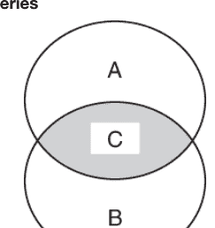

要查看所有价格低于 $300.00 且产品类型分类为“phone”的产品，您可以构造一个带有 WHERE 子句的简单查询，或指定两个单独查询的交集。下一个示例说明了一个简单的查询，该查询指定 WHERE 子句以显示价格低于 $300.00 的手机。

### SQL 代码

```
PROC SQL;
    SELECT *
        FROM PRODUCTS
        WHERE prodcost < 300.00 AND
            prodtype = 'Phone';
QUIT;
```

### 结果

| Product Number | Product Name | Manufacturer Number | Product Type | Product Cost |
| 2101 | Analog Cell Phone | 210 | Phone | $35.00 |
| 2102 | Digital Cell Phone | 210 | Phone | $175.00 |
| 2200 | Office Phone | 220 | Phone | $130.00 |

INTERSECT 方法可以构造以产生与前一个示例中相同的结果。INTERSECT 过程假定每个查询中的表在结构上彼此相同。它根据 SELECT 语句中的位置将两个查询的列重叠。如果您尝试将两个具有不同表结构的查询相交，过程可能会因列类型不同而失败，或者结果可能包含数据完整性问题。

这两个方法之间最显著的区别，并且可能影响大表处理的是，第一个查询示例（使用 AND 运算符）处理时间更短：0.05 秒，而第二个方法（使用 INTERSECT 运算符）为 0.17 秒。下一个示例显示了 INTERSECT 运算符如何以较低效率实现相同结果。

### SQL 代码

```
PROC SQL;
    SELECT * ①
        FROM PRODUCTS
        WHERE prodcost < 300.00
INTERSECT ②
SELECT * ①
    FROM PRODUCTS
    WHERE prodtype = "Phone";
QUIT;
```

① 假定两个查询中的表在结构上是相同的，因为在 SELECT 语句中指定了通配符字符“*”。

② INTERSECT 运算符产生两个查询共有的行。

### 结果

| Product Number | Product Name | Manufacturer Number | Product Type | Product Cost |
| 2101 | Analog Cell Phone | 210 | Phone | $35.00 |
| 2102 | Digital Cell Phone | 210 | Phone | $175.00 |
| 2200 | Office Phone | 220 | Phone | $130.00 |

## 访问两个查询组合中的行

UNION 运算符保留查询组合中的所有唯一行。结果与使用 OR 运算符组合每个查询的结果相同。换句话说，两个查询（A 和 B）的并集表示 A 中的行或 B 中的行或 A 和 B 中的行。如图 7.2 所示，并集表示整个阴影区域（A、B 和 C）。

### 图 7.2：两个查询的并集

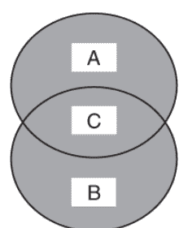

UNION 运算符会自动从结果中消除重复行，除非将 ALL 关键字指定为 UNION 运算符的一部分。分配给结果的列名源自第一个查询中的名称。

为了使两个或多个查询的并集成功，每个查询必须指定相同数量的列，且类型相同或兼容。类型兼容意味着列属性以相同的方式定义。因为列名和属性源自第一个表，所以数据类型必须是相同类型。结果列的数据类型源自源表。

要查看所有价格低于 $300.00 的产品或分类为工作站的产品，您可以选择使用以下查询中所示的 OR 或下一个查询中所示的 UNION。如两个查询的输出所示，无论使用哪个查询，结果都是相同的。

### SQL 代码

```
PROC SQL;
    SELECT *
        FROM PRODUCTS
            WHERE prodcost < 300.00 OR
                prodtype = "Workstation";
    QUIT;
```

### 结果

| Product Number | Product Name | Manufacturer Number | Product Type | Product Cost |
|---|---|---|---|---|
| 1110 | Dream Machine | 111 | Workstation | $3,200.00 |
| 1200 | Business Machine | 120 | Workstation | $3,300.00 |
| 2101 | Analog Cell Phone | 210 | Phone | $35.00 |
| 2102 | Digital Cell Phone | 210 | Phone | $175.00 |
| 2200 | Office Phone | 220 | Phone | $130.00 |
| 5001 | Spreadsheet Software | 500 | Software | $299.00 |
| 5003 | Wordprocessor Software | 500 | Software | $299.00 |
| 5004 | Graphics Software | 500 | Software | $299.00 |

在下一个示例中，指定 UNION 运算符以组合两个查询的结果。

### SQL 代码

```
PROC SQL;
    SELECT *
        FROM PRODUCTS
            WHERE prodcost < 300.00
    UNION
    SELECT *
        FROM PRODUCTS
            WHERE prodtype = 'Workstation';
QUIT;
```

① UNION 运算符组合两个查询的结果。

### 结果

| Product Number | Product Name | Manufacturer Number | Product Type | Product Cost |
|---|---|---|---|---|
| 1110 | Dream Machine | 111 | Workstation | $3,200.00 |
| 1200 | Business Machine | 120 | Workstation | $3,300.00 |
| 2101 | Analog Cell Phone | 210 | Phone | $35.00 |
| 2102 | Digital Cell Phone | 210 | Phone | $175.00 |
| 2200 | Office Phone | 220 | Phone | $130.00 |
| 5001 | Spreadsheet Software | 500 | Software | $299.00 |
| 5003 | Wordprocessor Software | 500 | Software | $299.00 |
| 5004 | Graphics Software | 500 | Software | $299.00 |

## 串联两个查询的行

OUTER UNION 运算符串联两个查询的结果。与 DATA 步或 PROC APPEND 串联一样，结果由垂直组合的行组成。换句话说，两个查询（A 和 B）的外部并集表示 A 和 B 中的所有行且无重叠。如图 7.3 所示，外部并集表示整个阴影区域（A 和 B）。

图 7.3：两个查询的外部并集

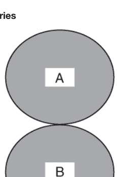

下一个示例串联两个查询的结果。如结果所示，两个查询的行被串联。

### SQL 代码

```
PROC SQL;
    SELECT prodnum, prodname, prodtype, prodcost
    FROM PRODUCTS
    OUTER UNION
    SELECT prodnum, prodname, prodtype, prodcost
    FROM PRODUCTS;
QUIT;
```

① OUTER UNION 运算符串联两个查询的结果。

### 结果

| Product Number | Product Name | Product Type | Product Cost | Product Number | Product Name | Product Type | Product Cost |
|---|---|---|---|---|
| 1110 | Dream Machine | Workstation | $3,200.00 | . |  |  | . |
| 1200 | Business Machine | Workstation | $3,300.00 | . |  |  | . |
| 1700 | Travel Laptop | Laptop | $3,400.00 | . |  |  | . |
| 2101 | Analog Cell Phone | Phone | $35.00 | . |  |  | . |
| 2102 | Digital Cell Phone | Phone | $175.00 | . |  |  | . |
| 2200 | Office Phone | Phone | $130.00 | . |  |  | . |
| 5001 | Spreadsheet Software | Software | $299.00 | . |  |  | . |
| 5002 | Database Software | Software | $399.00 | . |  |  | . |
| 5003 | Wordprocessor Software | Software | $299.00 | . |  |  | . |
| 5004 | Graphics Software | Software | $299.00 | . |  |  | . |
| . |  |  | . | 1110 | Dream Machine | Workstation | $3,200.00 |
| . |  |  | . | 1200 | Business Machine | Workstation | $3,300.00 |
| . |  |  | . | 1700 | Travel Laptop | Laptop | $3,400.00 |
| . |  |  | . | 2101 | Analog Cell Phone | Phone | $35.00 |
| . |  |  | . | 2102 | Digital Cell Phone | Phone | $175.00 |
| . |  |  | . | 2200 | Office Phone | Phone | $130.00 |
| . |  |  | . | 5001 | Spreadsheet Software | Software | $299.00 |
| . |  |  | . | 5002 | Database Software | Software | $399.00 |
| . |  |  | . | 5003 | Wordprocessor Software | Software | $299.00 |
| . |  |  | . | 5004 | Graphics Software | Software | $299.00 |

OUTER UNION 运算符会自动将两个查询的行串联且无重叠，除非将 CORRESPONDING（CORR）关键字指定为运算符的一部分。分配给结果的列名源自第一个查询中的名称。在下一个示例中，CORR 关键字使具有相同名称和属性的列能够重叠。

### SQL 代码


# 278 PROC SQL：使用 SAS 的高级基础，第二版

```
PROC SQL;
SELECT prodnum, prodname, prodtype, prodcost
FROM PRODUCTS
OUTER UNION CORR
SELECT prodnum, prodname, prodtype, prodcost
FROM PRODUCTS;
QUIT;
```

带 CORR 关键字的 OUTER UNION 操作符将两个查询的结果进行连接和叠加。

| 产品编号 | 产品名称 | 产品类型 | 产品成本 |
| 1110 | Dream Machine | Workstation | $3,200.00 |
| 1200 | Business Machine | Workstation | $3,300.00 |
| 1700 | Travel Laptop | Laptop | $3,400.00 |
| 2101 | Analog Cell Phone | Phone | $35.00 |
| 2102 | Digital Cell Phone | Phone | $175.00 |
| 2200 | Office Phone | Phone | $130.00 |
| 5001 | Spreadsheet Software | Software | $299.00 |
| 5002 | Database Software | Software | $399.00 |
| 5003 | Wordprocessor Software | Software | $299.00 |
| 5004 | Graphics Software | Software | $299.00 |
| 1110 | Dream Machine | Workstation | $3,200.00 |
| 1200 | Business Machine | Workstation | $3,300.00 |
| 1700 | Travel Laptop | Laptop | $3,400.00 |
| 2101 | Analog Cell Phone | Phone | $35.00 |
| 2102 | Digital Cell Phone | Phone | $175.00 |
| 2200 | Office Phone | Phone | $130.00 |
| 5001 | Spreadsheet Software | Software | $299.00 |
| 5002 | Database Software | Software | $399.00 |
| 5003 | Wordprocessor Software | Software | $299.00 |
| 5004 | Graphics Software | Software | $299.00 |

EXCEPT 操作符比较两个查询的行以确定对第一个表所做的更改。以下结果显示了在第一个表中新增和更改的行，而这些行不在第二个表中，但不会显示从第二个表中删除的行。

second table. 如图 7.4 所示，指定 EXCEPT 操作符的结果表示阴影区域（A）。

## 图 7.4：比较两个表以确定新增和更改

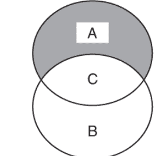

在处理包含相似信息的两个表时，可以使用 EXCEPT 操作符来确定新增和修改的行。EXCEPT 操作符用于识别第一个表（或查询）中的行，但不用于识别第二个表（或查询）中的行。它还唯一地标识从第一个表到第二个表已更改的行。列按其在 SELECT 语句中出现的顺序进行比较。

如果在 SELECT 语句中指定了通配符字符“*”，则假定两个表在结构上彼此相同。让我们看一个例子。

假设你有 CUSTOMERS 文件的主表和备份表，并且想要比较它们以识别新增和更改的行。EXCEPT 操作符如下一个示例所示返回 CUSTOMERS 表中所有新增或更改的行，这些行在 CUSTOMERS_BACKUP 表中不存在。如结果所示，有三行新客户被添加到 CUSTOMERS 表中，这些行之前在 CUSTOMERS_BACKUP 表中不存在。

### SQL 代码

```
PROC SQL;
    SELECT *
        FROM CUSTOMERS_BACKUP
    EXCEPT
    SELECT *
        FROM CUSTOMERS;
QUIT;
```

1 EXCEPT 操作符比较两个表中的行以识别存在于第一个表但不存在于第二个表中的行。

### 结果

| 客户编号 | 客户名称 | 客户所在城市 |
| 1302 | Software Intelligence Cor | Spring Valley |
| 1901 | Shipp Consulting | San Pedro |
| 1902 | Gupta Programming | Simi Valley |

## 复杂查询应用

查询应用形式多样，通常可分为三类：

- **面向生产的查询**很少更改，按需运行（例如，每天、每周、每月等），并由 SQL 语句、参数列表和/或操作查询组成。
- **临时查询**通常按需构建，通常只使用一次或以某种不可预测的方式使用，以解决特定需求或问题。
- **自定义查询**被归类为介于面向生产和临时查询之间，其中查询每次运行时基本相同，但存在条件、参数、操作处理（例如，创建新表、更新一个或多个表中的行、删除一个或多个表中的行，以及向现有表追加一个或多个行）和数据差异，必须进行处理。

在本节中，介绍了一些复杂的查询应用，以展示如何使用 SQL 过程来满足特定的处理和/或数据管理要求。这些应用部分基于许多 SAS 用户的需求、将流行的 DATA 步技术模拟为 SQL 查询，以及分享有趣的 SQL 过程编码技术和方法。

## 一对一、一对多、多对一和多对多关系

输入表通常根据一个表中的行与另一个表中的一个或多个行的关系来表征。此过程称为两个或多个表之间的数据关系，分为四类：

- 一对一
- 一对多
- 多对一
- 多对多

为了更好地理解如何处理数据源以产生理想的结果，能够区分四类数据关系是有帮助的。以下示例说明了在 SQL 过程中应用一对一、一对多、多对一和多对多数据关系的编码约定。

### SQL 代码

```
/* *************************************************************************/
/** PROGRAM NAME: DATA-RELATIONSHIPS.SAS                                 **/
/** PURPOSE..... : Derive one-to-one, one-to-many, many-to-one,          **/
/**               and many-to-many data relationships using              **/
/**               complex queries.                                        **/
/** AUTHOR...... : Kirk Paul Lafler                                       **/
/** DATE WRITTEN: August 30, 2012                                         **/
/***********************************************************************/
proc sql noprint;
/***********************************************************************/
/** ROUTINE..... : ONE-TO-ONE                                            **/
/** PURPOSE..... : Produce a one-to-one data relationship using          **/
/**               a base table with a unique key and a lookup             **/
/**               table with a unique key in an EQUIJOIN.                 **/
/***********************************************************************/
    create table one_to_one as
        select m.manunum,
               m.manuname,
               p.prodtype,
               p.prodcost
          from manufacturers  m,
               products        p
         where m.manunum=p.manunum;
/***********************************************************************/
/** ROUTINE..... : ONE-TO-MANY                                           **/
/** PURPOSE..... : Produce a one-to-many data relationship               **/
/**               using the table with the unique key as a               **/
/**               lookup table and a LEFT JOIN.                          **/
/***********************************************************************/
    create table one_to_many as
        select p1.prodnum,
               p1.prodname,
               p2.units,
               p2.unitcost,
               p2.units * p2.unitcost as Total_Cost format=dollar12.2
          from products  p1
               LEFT JOIN
               purchases  p2
             on p1.prodnum=p2.prodnum;
/***********************************************************************/
```

# 282 PROC SQL：使用 SAS 的高级基础，第二版

```
/** ROUTINE.....: MANY-TO-ONE **/
/** PURPOSE.....: Produce a many-to-one data relationship **/
/** using a LEFT OUTER JOIN. **/
/*******************************************************************/
create table many_to_one as
select p2.prodnum,
p2.prodname,
p1.units,
p1.unitcost,
p1.units * p1.unitcost as Total_Cost format=dollar12.2
from purchases p1
LEFT JOIN
products p2
on p1.prodnum=p2.prodnum;
```

```
/** ROUTINE.....: MANY-TO-MANY **/
/** PURPOSE.....: Produce a many-to-many data relationship **/
/** using the table with the unique key and a **/
/** lookup table in an EQUIJOIN construct. **/
/*******************************************************************/
create table many_to_many as
select p1.prodnum,
p1.prodname,
p2.units,
p2.unitcost,
p2.units * p2.unitcost as Total_Cost format=dollar12.2
from products p1,
purchases p2
where p1.prodnum=p2.prodnum;
quit;
```

结果

一对一、一对多、多对一和多对多数据关系的结果表显示在图 7.5 至图 7.8 中。

## 图 7.5：一对一数据关系

| 制造商编号 | 制造商名称 | 产品类型 | 产品成本 |
| --- | --- | --- | --- |
| 1 | 111 Cupid Computer | Workstation | $3,200.00 |
| 2 | 120 Storage Devices Inc | Workstation | $3,300.00 |
| 3 | 210 Global Comm Corp | Phone | $35.00 |
| 4 | 210 Global Comm Corp | Phone | $175.00 |
| 5 | 500 KPL Enterprises | Software | $299.00 |
| 6 | 500 KPL Enterprises | Software | $399.00 |
| 7 | 500 KPL Enterprises | Software | $299.00 |
| 8 | 500 KPL Enterprises | Software | $299.00 |


## 图 7.6：一对多数据关系

|  | 产品编号 | 产品名称 | 单位 | 单位成本 | 总成本 |
|---|---|---|---|---|---|
| 1 | 1110 Dream Machine | 2 | $3,200.00 | $6,400.00 |
| 2 | 1110 Dream Machine | 1 | $3,200.00 | $3,200.00 |
| 3 | 1110 Dream Machine | 5 | $3,200.00 | $16,000.00 |
| 4 | 1200 Business Machine | 3 | $3,300.00 | $9,900.00 |
| 5 | 1200 Business Machine | 3 | $3,300.00 | $9,900.00 |
| 6 | 1200 Business Machine | 3 | $3,300.00 | $9,900.00 |
| 7 | 1200 Business Machine | 6 | $3,300.00 | $19,800.00 |
| 8 | 1200 Business Machine | 8 | $3,300.00 | $26,400.00 |
| 9 | 1700 Travel Laptop | 2 | $3,400.00 | $6,800.00 |
| 10 | 1700 Travel Laptop | 2 | $3,400.00 | $6,800.00 |
| 11 | 1700 Travel Laptop | 3 | $3,400.00 | $10,200.00 |
| 12 | 1700 Travel Laptop | 7 | $3,400.00 | $23,800.00 |
| 13 | 1700 Travel Laptop | 3 | $3,400.00 | $10,200.00 |
| 14 | 1700 Travel Laptop | 4 | $3,400.00 | $13,600.00 |
| 15 | 1700 Travel Laptop | 5 | $3,400.00 | $17,000.00 |
| 16 | 1700 Travel Laptop | 3 | $3,400.00 | $10,200.00 |
| 17 | 1700 Travel Laptop | 4 | $3,400.00 | $13,600.00 |
| 18 | 1700 Travel Laptop | 2 | $3,400.00 | $6,800.00 |
| 19 | 1700 Travel Laptop | 5 | $3,400.00 | $17,000.00 |
| 20 | 2101 Analog Cell Phone |  |  |  |
| 21 | 2102 Digital Cell Phone | 11 | $175.00 | $1,925.00 |
| ... | ... | ... | ... | ... |
| 47 | 5003 Wordprocessor Software | 9 | $299.00 | $2,691.00 |
| 48 | 5003 Wordprocessor Software | 5 | $299.00 | $1,495.00 |
| 49 | 5003 Wordprocessor Software | 5 | $299.00 | $1,495.00 |
| 50 | 5003 Wordprocessor Software | 7 | $299.00 | $2,093.00 |
| 51 | 5003 Wordprocessor Software | 3 | $299.00 | $897.00 |
| 52 | 5003 Wordprocessor Software | 8 | $299.00 | $2,392.00 |
| 53 | 5003 Wordprocessor Software | 8 | $299.00 | $2,392.00 |
| 54 | 5004 Graphics Software | 3 | $299.00 | $897.00 |
| 55 | 5004 Graphics Software | 1 | $299.00 | $299.00 |
| 56 | 5004 Graphics Software | 3 | $299.00 | $897.00 |
| 57 | 5004 Graphics Software | 2 | $299.00 | $598.00 |
| 58 | 5004 Graphics Software | 2 | $299.00 | $598.00 |

## 图 7.7：多对一数据关系

|  | 产品编号 | 产品名称 | 单位 | 单位成本 | 总成本 |
|---|---|---|---|---|---|
| 1 | 1110 Dream Machine |  | 2 | $3,200.00 | $6,400.00 |
| 2 | 1110 Dream Machine |  | 1 | $3,200.00 | $3,200.00 |
| 3 | 1110 Dream Machine |  | 5 | $3,200.00 | $16,000.00 |
| 4 | 1200 Business Machine |  | 3 | $3,300.00 | $9,900.00 |
| 5 | 1200 Business Machine |  | 3 | $3,300.00 | $9,900.00 |
| 6 | 1200 Business Machine |  | 3 | $3,300.00 | $9,900.00 |
| 7 | 1200 Business Machine |  | 6 | $3,300.00 | $19,800.00 |
| 8 | 1200 Business Machine |  | 8 | $3,300.00 | $26,400.00 |
| 9 | 1700 Travel Laptop |  | 2 | $3,400.00 | $6,800.00 |
| 10 | 1700 Travel Laptop |  | 2 | $3,400.00 | $6,800.00 |
| 11 | 1700 Travel Laptop |  | 3 | $3,400.00 | $10,200.00 |
| 12 | 1700 Travel Laptop |  | 7 | $3,400.00 | $23,800.00 |
| 13 | 1700 Travel Laptop |  | 3 | $3,400.00 | $10,200.00 |
| 14 | 1700 Travel Laptop |  | 4 | $3,400.00 | $13,600.00 |
| 15 | 1700 Travel Laptop |  | 5 | $3,400.00 | $17,000.00 |
| 16 | 1700 Travel Laptop |  | 3 | $3,400.00 | $10,200.00 |
| 17 | 1700 Travel Laptop |  | 4 | $3,400.00 | $13,600.00 |
| 18 | 1700 Travel Laptop |  | 2 | $3,400.00 | $6,800.00 |
| 19 | 1700 Travel Laptop |  | 5 | $3,400.00 | $17,000.00 |
| 20 | 2102 Digital Cell Phone |  | 11 | $175.00 | $1,925.00 |
| 21 | 2102 Digital Cell Phone |  | 9 | $175.00 | $1,575.00 |
| ... | ... | ... | ... | ... | ... |
| 47 | 5003 Wordprocessor Software |  | 5 | $299.00 | $1,495.00 |
| 48 | 5003 Wordprocessor Software |  | 5 | $299.00 | $1,495.00 |
| 49 | 5003 Wordprocessor Software |  | 7 | $299.00 | $2,093.00 |
| 50 | 5003 Wordprocessor Software |  | 3 | $299.00 | $897.00 |
| 51 | 5003 Wordprocessor Software |  | 8 | $299.00 | $2,392.00 |
| 52 | 5003 Wordprocessor Software |  | 8 | $299.00 | $2,392.00 |
| 53 | 5004 Graphics Software |  | 3 | $299.00 | $897.00 |
| 54 | 5004 Graphics Software |  | 1 | $299.00 | $299.00 |
| 55 | 5004 Graphics Software |  | 3 | $299.00 | $897.00 |
| 56 | 5004 Graphics Software |  | 2 | $299.00 | $598.00 |
| 57 | 5004 Graphics Software |  | 2 | $299.00 | $598.00 |

## 图 7.8：多对多数据关系

|  | 产品编号 | 产品名称 | 单位 | 单位成本 | 总成本 |
|---|---|---|---|---|---|
| 1 | 1110 | Dream Machine | 1 | $3,200.00 | $3,200.00 |
| 2 | 5001 | Spreadsheet Software | 7 | $299.00 | $2,093.00 |
| 3 | 5001 | Spreadsheet Software | 11 | $299.00 | $3,289.00 |
| 4 | 5003 | Wordprocessor Software | 8 | $299.00 | $2,392.00 |
| 5 | 5002 | Database Software | 4 | $399.00 | $1,596.00 |
| 6 | 5004 | Graphics Software | 3 | $299.00 | $897.00 |
| 7 | 1700 | Travel Laptop | 2 | $3,400.00 | $6,800.00 |
| 8 | 1200 | Business Machine | 3 | $3,300.00 | $9,900.00 |
| 9 | 1110 | Dream Machine | 2 | $3,200.00 | $6,400.00 |
| 10 | 5001 | Spreadsheet Software | 3 | $299.00 | $897.00 |
| 11 | 5003 | Wordprocessor Software | 5 | $299.00 | $1,495.00 |
| 12 | 5002 | Database Software | 2 | $399.00 | $798.00 |
| 13 | 1700 | Travel Laptop | 2 | $3,400.00 | $6,800.00 |
| 14 | 1200 | Business Machine | 3 | $3,300.00 | $9,900.00 |
| 15 | 1110 | Dream Machine | 5 | $3,200.00 | $16,000.00 |
| 16 | 5001 | Spreadsheet Software | 9 | $299.00 | $2,691.00 |
| 17 | 5002 | Database Software | 5 | $399.00 | $1,995.00 |
| 18 | 5003 | Wordprocessor Software | 8 | $299.00 | $2,392.00 |
| 19 | 5004 | Graphics Software | 2 | $299.00 | $598.00 |
| 20 | 5001 | Spreadsheet Software | 11 | $299.00 | $3,289.00 |
| 21 | 5002 | Database Software | 5 | $399.00 | $1,995.00 |
| ... | ... | ... | ... | ... | ... |
| 47 | 1700 | Travel Laptop | 7 | $3,400.00 | $23,800.00 |
| 48 | 1700 | Travel Laptop | 4 | $3,400.00 | $13,600.00 |
| 49 | 1700 | Travel Laptop | 5 | $3,400.00 | $17,000.00 |
| 50 | 1700 | Travel Laptop | 2 | $3,400.00 | $6,800.00 |
| 51 | 1200 | Business Machine | 8 | $3,300.00 | $26,400.00 |
| 52 | 5001 | Spreadsheet Software | 3 | $299.00 | $897.00 |
| 53 | 5003 | Wordprocessor Software | 5 | $299.00 | $1,495.00 |
| 54 | 5004 | Graphics Software | 1 | $299.00 | $299.00 |
| 55 | 1700 | Travel Laptop | 4 | $3,400.00 | $13,600.00 |
| 56 | 5001 | Spreadsheet Software | 6 | $299.00 | $1,794.00 |
| 57 | 2102 | Digital Cell Phone | 9 | $175.00 | $1,575.00 |

## 处理 BY-and 组的第一行、最后一行和中间行

偶尔，SAS 用户可能会发现 SQL 过程在提供“开箱即用”的 SAS 编程技术解决方案方面存在不足。因此，出于沮丧，用户放弃寻找可能的 SQL 解决方案，转而使用熟悉的 DATA 步技术或众多过程之一（通常在 SQL 过程之外）。

作为一个典型例子，使用 DATA 步 BY 语句进行 BY 组处理以识别 FIRST、LAST 和 BETWEEN 观测值是 SAS 用户的流行技术。不幸的是，使用 SQL 过程的等效处理要么不存在，要么不容易找到。在多年研究并未能成功找到一种能够模拟这种 DATA 步处理常青技术的 SQL 技术后，我决定自行开发一个解决方案。以下 SQL 代码模拟了 FIRST、LAST 和 BETWEEN 处理的行为。

### SQL 代码

```
/*************************************************************************/
/** PROGRAM NAME: FIRST-BETWEEN-LAST-ROWS.SAS                           **/
/** PURPOSE..... : Derive the first (min) row, last (max) row           **/
/**               and between rows for each by-group using              **/
/**               subqueries.                                            **/
/** AUTHOR...... : Kirk Paul Lafler                                      **/
/** DATE WRITTEN: June 4, 2012                                           **/
/*************************************************************************/
/*************************************************************************/
/** ROUTINE..... : FIRST-BY-GROUP-ROWS                                  **/
/** PURPOSE..... : Derive the first (min) row within each               **/
/**               by-group using a subquery.                            **/
/*************************************************************************/
proc sql;
    create table first_bygroup_rows as
        select custnum,
               prodnum,
               units,
               unitcost,
               'FirstRow' as ByGroup
        from purchases P1
        where prodnum =
              (select min(prodnum)
               from purchases P2
               where P1.custnum = P2.custnum)
    order by custnum, prodnum;
/*************************************************************************/
/** ROUTINE..... : LAST-BY-GROUP-ROWS                                   **/
/** PURPOSE..... : Derive the last (max) row within each                **/
/**               by-group using a subquery.                            **/
/*************************************************************************/
    create table last_bygroup_rows as
        select custnum,
               prodnum,
               units,
               unitcost,
               'LastRow' as ByGroup
        from purchases P1
        where prodnum =
              (select max(prodnum)
               from purchases P2
               where P1.custnum = P2.custnum)
    order by custnum, prodnum;
/*************************************************************************/
/** ROUTINE..... : BETWEEN-BY-GROUP-ROWS                                **/
/** PURPOSE..... : Derive all rows between the first (min) row,        **/
```


## PROC SQL：使用 SAS 的基础知识之外，第二版

```sql
/**
            and the last (max) row within each by-group  **/
/**
            using a subquery.                    **/
/****************************************************************/
    create table between_bygroup_rows as
        select custnum,
                prodnum,
                units,
                unitcost,
                min(prodnum) as Min_Prodnum,
                max(prodnum) as Max_Prodnum,
                'BetweenRow' as ByGroup
        from purchases
            group by custnum
            having CALCULATED min_Prodnum NOT =
                    CALCULATED max_Prodnum AND
                    CALCULATED min_Prodnum NOT =
                        prodnum            AND
                    CALCULATED max_Prodnum NOT = prodnum
            order by custnum, prodnum;
/****************************************************************/
/** ROUTINE.....: CONCATENATE-FIRST-BETWEEN-LAST                **/
/** PURPOSE.....: Concatenate the results from the first (min)  **/
/**
                row, between rows, and last (max) row within  **/
/**
                each by-group using UNION ALL set operators. **/
/****************************************************************/
    create table first_between_last_rows as
        select custnum,
                prodnum,
                units,
                unitcost,
                bygroup
        from first_bygroup_rows
    UNION ALL
        select custnum,
                prodnum,
                units,
                unitcost,
                bygroup
        from between_bygroup_rows
    UNION ALL
        select custnum,
                prodnum,
                units,
                unitcost,
                bygroup
        from last_bygroup_rows;
/****************************************************************/
/** ROUTINE.....: PRINT-FIRST-BETWEEN-LAST                      **/
/** PURPOSE.....: Print the results from the first (min) row,   **/
/**
                between rows, and last (max) row within each  **/
/**
                by-group using a select query.                 **/
```

```sql
/******************************/
reset number;
select *
from first_between_last_rows;
quit;
```

### 结果

FIRST.、LAST. 和 BETWEEN. 行的结果显示在图 7.9 至图 7.11 中。

### 图 7.9：FIRST. 行结果

| Custnum | Prodnum | Units | Unitcost | ByGroup |
|---------|---------|-------|----------|---------|
| 1 | 101 | 1200 | $3,300.00 | FirstRow |
| 2 | 201 | 1700 | $3,400.00 | FirstRow |
| 3 | 301 | 2102 | $175.00 | FirstRow |
| 4 | 401 | 1200 | $3,300.00 | FirstRow |
| 5 | 501 | 1700 | $3,400.00 | FirstRow |
| 6 | 701 | 1110 | $3,200.00 | FirstRow |
| 7 | 801 | 2102 | $175.00 | FirstRow |
| 8 | 901 | 1110 | $3,200.00 | FirstRow |
| 9 | 1001 | 1700 | $3,400.00 | FirstRow |
| 10 | 1101 | 1700 | $3,400.00 | FirstRow |
| 11 | 1201 | 1200 | $3,300.00 | FirstRow |
| 12 | 1301 | 1700 | $3,400.00 | FirstRow |
| 13 | 1401 | 2102 | $175.00 | FirstRow |
| 14 | 1601 | 1700 | $3,400.00 | FirstRow |
| 15 | 1701 | 1110 | $3,200.00 | FirstRow |
| 16 | 1801 | 1700 | $3,400.00 | FirstRow |

### 图 7.10：LAST. 行结果

|  | Custnum | Prodnum | Units | Unitcost | ByGroup |
|---|---|---|---|---|---|
| 1 | 101 | 5004 | 2 | $299.00 | LastRow |
| 2 | 201 | 5003 | 9 | $299.00 | LastRow |
| 3 | 301 | 5001 | 6 | $299.00 | LastRow |
| 4 | 401 | 5004 | 3 | $299.00 | LastRow |
| 5 | 501 | 5004 | 1 | $299.00 | LastRow |
| 6 | 701 | 5004 | 3 | $299.00 | LastRow |
| 7 | 801 | 2102 | 5 | $175.00 | LastRow |
| 8 | 901 | 5004 | 2 | $299.00 | LastRow |
| 9 | 1001 | 1700 | 5 | $3,400.00 | LastRow |
| 10 | 1101 | 2200 | 3 | $130.00 | LastRow |
| 11 | 1201 | 1200 | 8 | $3,300.00 | LastRow |
| 12 | 1301 | 5003 | 5 | $299.00 | LastRow |
| 13 | 1401 | 2102 | 7 | $175.00 | LastRow |
| 14 | 1601 | 1700 | 7 | $3,400.00 | LastRow |
| 15 | 1701 | 1110 | 1 | $3,200.00 | LastRow |
| 16 | 1801 | 1700 | 4 | $3,400.00 | LastRow |

### 图 7.11：BETWEEN. 行结果

|  | Custnum | Prodnum | Units | Unitcost | Min_Prodnum | Max_Prodnum | ByGroup |
|---|---|---|---|---|---|---|---|
| 1 | 101 | 1700 | 5 | $3,400.00 | 1200 | 5004 | BetweenRow |
| 2 | 101 | 2102 | 9 | $175.00 | 1200 | 5004 | BetweenRow |
| 3 | 101 | 5001 | 7 | $299.00 | 1200 | 5004 | BetweenRow |
| 4 | 101 | 5003 | 3 | $299.00 | 1200 | 5004 | BetweenRow |
| 5 | 201 | 2102 | 5 | $175.00 | 1700 | 5003 | BetweenRow |
| 6 | 201 | 5001 | 6 | $299.00 | 1700 | 5003 | BetweenRow |
| 7 | 201 | 5001 | 2 | $299.00 | 1700 | 5003 | BetweenRow |
| 8 | 201 | 5001 | 6 | $299.00 | 1700 | 5003 | BetweenRow |
| 9 | 201 | 5002 | 4 | $399.00 | 1700 | 5003 | BetweenRow |
| 10 | 401 | 1700 | 3 | $3,400.00 | 1200 | 5004 | BetweenRow |
| 11 | 401 | 5001 | 11 | $299.00 | 1200 | 5004 | BetweenRow |
| 12 | 401 | 5002 | 5 | $399.00 | 1200 | 5004 | BetweenRow |
| 13 | 401 | 5003 | 7 | $299.00 | 1200 | 5004 | BetweenRow |
| 14 | 501 | 2102 | 9 | $175.00 | 1700 | 5004 | BetweenRow |
| 15 | 501 | 2102 | 12 | $175.00 | 1700 | 5004 | BetweenRow |
| 16 | 501 | 5001 | 3 | $299.00 | 1700 | 5004 | BetweenRow |
| 17 | 501 | 5003 | 5 | $299.00 | 1700 | 5004 | BetweenRow |
| 18 | 701 | 1200 | 3 | $3,300.00 | 1110 | 5004 | BetweenRow |
| 19 | 701 | 1700 | 2 | $3,400.00 | 1110 | 5004 | BetweenRow |
| 20 | 701 | 5001 | 11 | $299.00 | 1110 | 5004 | BetweenRow |
| 21 | 701 | 5002 | 4 | $399.00 | 1110 | 5004 | BetweenRow |
| 22 | 701 | 5003 | 8 | $299.00 | 1110 | 5004 | BetweenRow |
| 23 | 901 | 1200 | 3 | $3,300.00 | 1110 | 5004 | BetweenRow |
| 24 | 901 | 1700 | 2 | $3,400.00 | 1110 | 5004 | BetweenRow |
| 25 | 901 | 5001 | 9 | $299.00 | 1110 | 5004 | BetweenRow |
| 26 | 901 | 5001 | 2 | $299.00 | 1110 | 5004 | BetweenRow |
| 27 | 901 | 5002 | 5 | $399.00 | 1110 | 5004 | BetweenRow |
| 28 | 901 | 5003 | 8 | $299.00 | 1110 | 5004 | BetweenRow |
| 29 | 1101 | 2102 | 9 | $175.00 | 1700 | 2200 | BetweenRow |
| 30 | 1301 | 2102 | 11 | $175.00 | 1700 | 5003 | BetweenRow |
| 31 | 1301 | 5001 | 3 | $299.00 | 1700 | 5003 | BetweenRow |
| 32 | 1301 | 5002 | 2 | $399.00 | 1700 | 5003 | BetweenRow |

## 确定输入表中的行数

SQL 过程提供用户使用 VERBOSE 选项确定一个或多个输入表贡献的行数的能力。VERBOSE 选项用于在我们寻求了解更多关于输入数据、查询的处理需求以及资源利用率的信息的过程中提供重要的“需要知道”信息，例如输入行数和表的逻辑记录长度。下一个示例显示了一个指定了 SQL 过程 VERBOSE 选项的四表连接查询。

### SQL 代码

```sql
PROC SQL VERBOSE;
    SELECT products.prodname,
        products.prodtype,
        customers.custname,
        manufacturers.manuname
    FROM MANUFACTURERS,
        PRODUCTS,
        INVOICE,
        CUSTOMERS
    WHERE manufacturers.manunum = products.manunum  AND
        manufacturers.manunum = invoice.manunum  AND
        products.prodnum      = invoice.prodnum  AND
        invoice.custnum       = customers.custnum;
QUIT;
```

如以下 SAS 日志所示，当指定 VERBOSE SQL 过程选项时，会为每个表生成有关输入行数以及逻辑记录长度 LRECL 的信息。

## SAS 日志结果

```
PROC SQL VERBOSE;
    SELECT P.prodname,
        P.prodtype,
        C.custname,
        M.manuname
    FROM MANUFACTURERS  M,
        PRODUCTS        P,
        INVOICE         I,
        CUSTOMERS       C
    WHERE M.manunum = P.manunum  AND
        M.manunum = I.manunum  AND
        P.prodnum = I.prodnum  AND
        I.custnum = C.custnum;
Data Set Tags.
Data Set WORK.MANUFACTURERS is num=1 and tag=0001. NOBS=6, lrecl=50.
Data Set WORK.PRODUCTS is num=2 and tag=0002. NOBS=10, lrecl=51.
Data Set WORK.INVOICE is num=3 and tag=0004. NOBS=7, lrecl=20.
Data Set WORK.CUSTOMERS is num=4 and tag=0008. NOBS=18, lrecl=48.
QUIT;
```

## 识别索引最多的表

数据库管理员和用户支持人员关注数据库环境的安装、配置、管理和维护，并因此对包括数据库应用程序的性能和健康状况在内的各种活动特别感兴趣。他们特别需要了解可能影响未来扩展需求的问题。数据库环境中大量索引可能会影响 I/O 和存储性能。因此，我经常发现了解有多少


indexes 也存在，以及哪些表定义了最多的索引。下一个示例说明了一个 SQL 查询，该查询访问 DICTIONARY 表内容（参见第 2 章，“在 PROC SQL 中处理数据”），以识别数据库环境中索引最多的表。

### SQL 代码

```
/*************************************************************************/
/** PROGRAM NAME: TABLES-WITH-THE-MOST-INDEXES.SAS                     **/
/** PURPOSE..... : Perform an index analysis to identify the           **/
/**               tables with the most indexes.                         **/
/** AUTHOR...... : Kirk Paul Lafler                                     **/
/** DATE WRITTEN: August 22, 2012                                       **/
/*************************************************************************/
proc sql;
    create table Tables_with_most_Indexes as
        select i.libname,
               i.memname,
               i.name,
               i.idxusage,
               i.indxname,
               count(i.memname) as ctr_memname
               label='Number of Defined Indexes',
               t.nobs
        from dictionary.indexes i,
             dictionary.tables t
        where upcase(i.libname) = upcase(t.libname) and
              upcase(i.memname) = upcase(t.memname) and
              upcase(i.idxusage) IN ('SIMPLE','COMPOSITE','BOTH')
        group by i.libname, i.memname
        order by ctr_memname desc, t.nobs;
quit;
```

### 结果

索引最多的表的結果显示在图 7.12 中。

## 图 7.12：TABLES_WITH_MOST_INDEXES

|  | 库名称 | 成员名称 | 列名称 | 列索引类型 | 索引名称 | 定义的索引数 | 物理观测值数 |
|---|---|---|---|---|---|---|---|
| 1 | WORK | PRODUCTS | manunum | COMPOSITE | MANUNUM_PRODTYP | 3 | 10 |
| 2 | WORK | PRODUCTS | prodtype | COMPOSITE | MANUNUM_PRODTYP | 3 | 10 |
| 3 | WORK | PRODUCTS | prodtype | SIMPLE | prodtype | 3 | 10 |
| 4 | MYDATA | PRODUCTS | manunum | COMPOSITE | MANUNUM_PRODTYP | 3 | 12 |
| 5 | MYDATA | PRODUCTS | prodtype | COMPOSITE | MANUNUM_PRODTYP | 3 | 12 |
| 6 | MYDATA | PRODUCTS | prodtype | SIMPLE | prodtype | 3 | 12 |
| 7 | SASUSER | MYFUNCTIONS | _Key_ | SIMPLE | _Key_ | 1 | 111 |

## 摘要

- 1. 当需要一个或多个不同数据片段之间的关系或连接时，使用 PROC SQL 连接构造（参见“为什么连接很重要”部分）。
- 2. 你使用连接通过称为列匹配的过程将一个表与另一个表关联起来（参见“介绍复杂查询”部分）。
- 3. 你可以为表分配表别名，以最小化在连接查询中引用表的击键次数（参见“在连接中使用表别名”部分）。
- 4. 当一个查询放在另一个查询的谓词中时，它被称为子查询。换句话说，子查询是一个嵌入在另一个 SELECT 语句的 WHERE 子句中的 SELECT 语句（参见“子查询”部分）。
- 5. IN 谓词允许 PROC SQL 将多个值从子查询传递到主查询，而不会产生错误（参见“使用子查询传递多行”部分）。
- 6. 子查询也可以构造为对主（外部）查询访问的每一行数据进行多次评估（参见“比较一组值”部分）。
- 7. INTERSECT 运算符创建一个输出表，该表由两个查询表达式交集中的所有唯一行组成（参见“访问两个查询的交集中的行”部分）。
- 8. UNION 运算符创建一个输出表，该表由查询表达式组合中的所有唯一行组成（参见“访问两个查询的组合中的行”部分）。

## 第 8 章：使用视图

介绍 ........................................................................................................................ 296

视图——数据的窗口................................................................................................................ 296

视图不是什么............................................................................................................................... 297

视图类型............................................................................................................................... 297

创建视图 ............................................................................................................................... 299

显示视图内容 ............................................................................................................................... 300

描述视图定义............................................................................................................................... 301

在 SAS 中创建和使用视图 ............................................................................................................................... 302

视图和 SAS 过程 ............................................................................................................................... 303

视图和 DATA 步............................................................................................................................... 305

消除冗余............................................................................................................................... 307

限制数据访问——安全 ............................................................................................................................... 307

隐藏逻辑复杂性............................................................................................................................... 308

嵌套视图 ............................................................................................................................... 310

可更新视图............................................................................................................................... 312

插入新数据行............................................................................................................................... 313

更新现有数据行 ............................................................................................................................... 317

删除数据行............................................................................................................................... 320

删除视图 ............................................................................................................................... 321

摘要 ............................................................................................................................... 322

## 介绍

在前几章中，示例假设每个表都有物理存在，即每个表中的数据占用存储空间。在本章中，让我们将注意力转向一种不同类型的表结构，它没有任何真正的物理存在。这种结构被称为虚拟表或视图，为用户和程序员提供了难以置信的灵活性和控制力。这使得视图成为从各种角度以及根据不同用户需求查看数据的理想方式。与表不同，视图不存储任何数据，只有“虚拟”存在。你将在本章的许多示例中学习如何创建、访问和删除视图。

## 视图——数据的窗口

视图是 SQL 过程中最强大的功能之一。它们通常被称为“虚拟表”，以区别于基表。简单的区别在于视图不是表，而是由可执行指令组成的文件。作为查询，视图似乎表现得像一个表，只有一个显著的区别——它不存储任何数据。当被引用时，视图始终产生最新的结果，就像表一样。那么视图如何获取其数据？视图从一个或多个底层表（基表）或其他视图访问数据，为你提供对数据的个人访问，并且可以在 DATA 步以及 SAS 过程中使用。

视图可以用来扩展动态环境中的安全功能，在这些环境中，数据重复或数据冗余、逻辑复杂性和数据安全是一个问题。当设计得当，视图可以被制作为遵守行级和列级安全要求，通过只允许访问与应用程序信息需求相关的那些列和/或行数据。任何被认为“禁止访问”或被归类为“受限”的列和/或行数据都可以从视图的选择列表中消除。因此，视图可以构造为只允许访问每个用户被允许访问的底层表（或表）的那些部分。

视图的另一个重要特性是它们通过创建基于某些算术公式（或算法）的计算（计算）列来确保一致派生的数据。数据库纯粹主义者通常设计表以免除计算列，从而依赖视图创建计算列。通过允许视图而不是表本身执行数据聚合，可以将处理成本推迟到需要或请求时。

作为一种屏蔽用户免受复杂逻辑构造影响的手段，视图可以被设计成看起来数据库是专门为单个用户以及具有不同需求的用户组设计的。数据引用只需编码一次，并且在完全测试并准备好投入生产后，可以方便地存储在所有人都可以访问的公共共享库中。视图确保使用最当前输入数据，而无需复制输入数据的部分或完整副本。它们也只需要很少的存储空间，因为视图只包含其定义，而不包含其呈现的数据的副本。


视图在应用程序中多次重复使用查询或子查询时也很有益。在这些情况下，添加视图只需更改一次，从而通过减少时间和资源来提高生产率。应考虑创建视图库，以便组织中的用户能够像使用宏一样轻松访问一系列生产率例程。

## 视图不是什么

视图不是表，但它们是包含访问一个或多个底层表的已编译代码的文件构造。因为视图不物理存储数据，所以它们被称为“虚拟”表。与表不同，视图不物理包含或存储数据行。然而，视图确实具有物理存在并占用空间。视图的存储需求很小，因为唯一保存的部分是 SELECT 语句或查询本身。另一方面，表在其结构中存储一个或多个数据行及其属性。

视图使用 CREATE VIEW 语句创建，而表使用 CREATE TABLE 语句创建。因为你使用一个或多个底层表来创建一个虚拟（派生）表，所以视图为你提供了访问数据源的强大方法。

尽管视图具有许多独特而强大的功能，但它们也存在陷阱。首先，视图通常比表处理时间更长。每次引用视图时，都会访问并处理当前的底层表或表。因为视图在被访问之前不会被物理物化，所以可以预期更高的利用成本，特别是对于较大的视图。此外，因为视图不是数据文件（表）并且不包含数据，所以无法为视图创建索引。但是，如果视图是从具有定义索引的数据文件创建的，那么 SQL 优化器可能会尝试在处理其关联的 WHERE 子句表达式时使用该索引。最后，如果在同一程序中多次使用视图的结果，将结果保存并在表中重用可能更有效，从而避免多次重新执行（物化）视图。

## 视图类型

视图可以设计来实现多个目标：

- 引用单个表
- 在一行上生成汇总数据
- 隐藏敏感信息
- 创建可更新视图
- 基于汇总函数或 HAVING 子句的分组数据
- 使用集合运算符
- 在连接操作中组合两个或多个表
- 在另一个视图中嵌套一个视图

为了区分各种类型的视图，Joe Celko 引入了一种基于所用 SELECT 语句类型的分类系统。参见《SQL for Smarties: Advanced SQL Programming》（Morgan Kaufman, 1999）。

为了帮助你理解不同的视图类型，本章描述并说明了视图的构造以及它们如何被使用。视图也可以具有一种或多种视图类型的特征，从而被归类为混合类型。例如，混合视图可以设计为引用两个或多个表、执行更新并包含复杂计算。表 8.1 介绍了不同的视图类型及其目的的简要描述。

## 表 8.1：各种视图类型的描述

| 视图类型 | 描述 |
|---|---|
| 单表视图 | 单表视图引用单个底层（基）表。它是最常见的视图类型。可以根据需要显示或隐藏选定的列和行。 |
| 计算列视图 | 计算列视图提供跨行的汇总数据。 |
| 只读视图 | 只读视图防止数据被更新（与可更新视图相反）并且仅用于显示数据。这也用于隐藏敏感信息的保护目的。 |
| 可更新视图 | 可更新视图添加（插入）、修改或删除数据行。 |
| 分组视图 | 分组视图使用基于包含 GROUP BY 子句的查询的查询表达式。 |
| 集合操作视图 | 集合操作视图包括两个表的并集、删除重复行、结果的连接以及查询结果的比较。 |
| 连接视图 | 连接视图基于两个或多个基表的连接。这种类型的视图通常用于表查找操作，以将编码数据扩展（或翻译）为文本。 |
| 嵌套视图 | 嵌套视图基于一个视图依赖于另一个视图，例如使用子查询。 |
| 混合视图 | 一种或多种视图类型的集成，用于处理更复杂的任务。 |

## 创建视图

你使用 SQL 过程中的 CREATE VIEW 语句来创建视图。当 SQL 处理器读取 CREATE VIEW 关键字时，它期望找到分配给新创建视图的名称。SELECT 语句定义分配给视图列的名称及其顺序。

视图通常构造为列顺序与基表不同。在下一个示例中，视图的列出现的顺序与原始 MANUFACTURERS 基表不同。视图的 SELECT 语句在此步骤中不会执行，因为其唯一目的是在 CREATE VIEW 语句中定义视图。

### SQL 代码

```
PROC SQL;
    CREATE VIEW MANUFACTURERS_VIEW AS
        SELECT manuname, manunum, manucity, manustat
            FROM MANUFACTURERS;
QUIT;
```

### SAS 日志结果

```
PROC SQL;
    CREATE VIEW MANUFACTURERS_VIEW AS
        SELECT manuname, manunum, manucity, manustat
            FROM MANUFACTURERS;
NOTE: SQL view WORK.MANUFACTURERS_VIEW has been defined.
    QUIT;
NOTE: PROCEDURE SQL used:
    real time            0.44 seconds
```

当你创建视图时，可以创建在构建视图的基表中不存在的列。也就是说，你可以创建由一个或多个基表中一个或多个列的操作（加法、减法、乘法等）的结果组成的列。你也可以使用一个或多个基表的一个或多个未修改的列构建视图。以这种方式创建的列称为派生列或计算列。在下一个示例中，假设你想创建一个视图，该视图由 INVENTORY 基表的产品名称、库存数量和库存成本组成，以及库存中存储的平均产品成本的派生列。

### SQL 代码

```
PROC SQL;
    CREATE VIEW INVENTORY_VIEW AS
        SELECT prodnum, invenqty, invencst,
            invencst/invenqty AS AverageAmount
            FROM INVENTORY;
QUIT;
```

## SAS 日志结果

```
PROC SQL;
    CREATE VIEW INVENTORY_VIEW AS
        SELECT prodnum, invenqty, invencst,
               invencst/invenqty AS AverageAmount
        FROM INVENTORY;
NOTE: SQL view WORK.INVENTORY_VIEW has been defined.
QUIT;
NOTE: PROCEDURE SQL used:
      real time          0.00 seconds
```

## 显示视图的内容

你会期望 CONTENTS 过程显示 SAS 数据库及其表的物理特征信息。但你可能不知道的是，CONTENTS 过程也可以用于显示视图的信息。从 CONTENTS 过程生成的输出显示视图不包含行（观测值），通过在 Observations 字段中显示缺失值以及成员类型为 VIEW 来表示。使用的引擎是 SQLVIEW。以下示例说明了在 Windows 环境中使用 CONTENTS 过程显示 INVENTORY_VIEW 视图内容的方法。

### SQL 代码

```
PROC CONTENTS DATA=INVENTORY_VIEW;
RUN;
```

## SAS 输出结果

### CONTENTS 过程

| 数据集名称 | WORK.INVENTORY_VIEW | 观测值 | . |
| 成员类型 | VIEW | 变量 | 4 |
| 引擎 | SQLVIEW | 索引 | 0 |
| 创建 | Wed, Sep 04, 2013 02:15:38 AM | 观测长度 | 32 |
| 最后修改 | Wed, Sep 04, 2013 02:15:38 AM | 已删除观测值 | 0 |
| 保护 |  | 压缩 | NO |
| 数据集类型 |  | 已排序 | NO |
| 标签 |  |  |  |
| 数据表示 | Default |  |  |
| 编码 | Default |  |  |

### 变量和属性的字母顺序列表

| # | 变量 | 类型 | Len | 标志 | 格式 | 标签 |
| 4 | AverageAmount | Num | 8 | P- |  |  |
| 3 | invencst | Num | 6 | -C- | DOLLAR10.2 | 库存成本 |
| 2 | invenqty | Num | 3 | -C- |  | 库存数量 |
| 1 | prodnum | Num | 3 | -- |  | 产品编号 |

## 描述视图定义

因为视图由部分编译的可执行语句组成，通常你将无法读取视图定义中的代码。然而，SQL 过程提供了一条语句来检查包含在视图定义中的可执行指令（存储查询表达式）的内容。没有这种能力，视图的底层指令（PROC SQL 代码）将永远是个谜，并且使修改或自定义查询表达式的能力几乎不可能。无论你的工作是维护还是自定义视图，DESCRIBE VIEW 语句都是你查看构成视图的语句的方式。让我们看看如何描述视图定义。


## SAS 日志结果

```
PROC SQL;
    CREATE VIEW NO_CAN_DO_VIEW AS
        SELECT *
            FROM NO_CAN_DO_VIEW;
NOTE: SQL view WORK.NO_CAN_DO_VIEW has been defined.
    SELECT *
        FROM NO_CAN_DO_VIEW;
ERROR: The SQL View WORK.NO_CAN_DO_VIEW is referenced recursively.
    QUIT;
NOTE: The SAS System stopped processing this step because of errors.
NOTE: PROCEDURE SQL used (Total process time):
        real time           0.00 seconds
        cpu time            0.01 seconds
```

## 视图与 SAS 过程

在大多数情况下（但并非所有情况），视图可以像输入 SAS 数据集一样用于所有可用的 SAS 过程。在第一个示例中，INVENTORY_VIEW 视图被用作 MEANS 过程的输入，为数值变量生成简单的单变量描述性统计。访问 INVENTORY_VIEW 视图与访问 INVENTORY 表不同，因为视图内部编译过的可执行语句会被处理，从而将底层表中的当前数据提供给视图本身。视图语句以及 MEANS 过程中的语句和选项决定了会生成哪些信息。

下一个示例使用 INVENTORY_VIEW 视图作为 MEANS 过程的输入，为数值变量生成简单的单变量描述性统计。访问 INVENTORY_VIEW 视图与访问 INVENTORY 表不同，因为视图会从底层表派生并提供当前数据给视图本身。视图语句以及 MEANS 过程中的语句和选项决定了会生成哪些信息。

## SAS 代码

```
PROC MEANS DATA=INVENTORY_VIEW;
    TITLE1 'Inventory Statistical Report';
    TITLE2 'Demonstration of a View used in PROC MEANS';
RUN;
```

## SAS 日志结果

```
PROC MEANS DATA=INVENTORY_VIEW;
TITLE1 'Inventory Statistical Report';
TITLE2 'Demonstration of a View used in PROC MEANS';
RUN;
NOTE: There were 7 observations read from the dataset WORK.INVENTORY.
NOTE: There were 7 observations read from the dataset WORK.INVENTORY_VIEW.
NOTE: PROCEDURE MEANS used:
real time          0.32 seconds
```

### 结果

## 库存统计报告
在 PROC MEANS 中使用视图的演示
MEANS 过程

| 变量 | 标签 | N | 均值 | 标准差 | 最小值 | 最大值 |
| prodnum | 产品编号 | 7 | 3974.43 | 1763.50 | 1110.00 | 5004.00 |
| invqty | 库存数量 | 7 | 10.0000000 | 7.5055535 | 2.0000000 | 20.0000000 |
| invcnst | 库存成本 | 7 | 11357.14 | 17866.72 | 900.0000000 | 45000.00 |
| AverageAmount |  | 7 | 917.1428571 | 1121.71 | 70.0000000 | 2800.00 |

下一个示例使用 INVENTORY_VIEW 视图作为 PRINT 过程的输入，生成底层基表中包含值的详细列表。

注意：值得一提的是，与所有过程一样，所有过程选项和语句都可通过视图使用。

## SAS 代码

```
PROC PRINT DATA=INVENTORY_VIEW N NOOBS UNIFORM;
TITLE1 'Inventory Detail Listing';
TITLE2 'Demonstration of a View used in PROC PRINT';
format AverageAmount dollar10.2;
RUN;
```

## SAS 日志结果

```
PROC PRINT DATA=INVENTORY_VIEW N NOOBS UNIFORM;
    TITLE1 'Inventory Detail Listing';
    TITLE2 'Demonstration of a View used in a Procedure';
    format AverageAmount dollar10.2;
RUN;
NOTE: There were 7 observations read from the dataset WORK.INVENTORY.
NOTE: There were 7 observations read from the dataset WORK.INVENTORY_VIEW.
NOTE: PROCEDURE PRINT used:
      real time          0.04 seconds
```

### 结果

库存详细列表
在 PROC PRINT 中使用视图的演示

| prodnum | invqty | invcnst | AverageAmount |
|---------|--------|---------|---------------|
| 1110    | 20       | $45,000.00 | $2,250.00 |
| 1700    | 10       | $28,000.00 | $2,800.00 |
| 5001    | 5        | $1,000.00  | $200.00 |
| 5002    | 3        | $900.00    | $300.00 |
| 5003    | 10       | $2,000.00  | $200.00 |
| 5004    | 20       | $1,400.00  | $70.00 |
| 5001    | 2        | $1,200.00  | $600.00 |
|         |          | N = 7     |               |

## 视图与 DATA 步

正如你已经看到的，视图可以像数据集一样用作 SAS 过程的输入。现在你将看到，视图也是一个多用途组件，可以在 DATA 步中使用。这为你提供了一种受控的方式，可以在自定义报表程序中使用视图访问数据表。下一个示例将 INVENTORY_VIEW 视图用作 DATA 步的输入，就像它是一个 SAS 基表一样。注意，KEEP= 数据集选项只从 INVENTORY_VIEW 视图中读取两个变量。

## SAS 代码

```
OPTIONS FORMCHAR="|----|+|----+=|-|\/<>'*";
DATA _NULL_;
    SET INVENTORY_VIEW (KEEP=PRODNUM AVERAGEAMOUNT);
    FILE PRINT HEADER=H1;
    PUT @10 PRODNUM
        @30 AVERAGEAMOUNT DOLLAR10.2;
RETURN;
H1: PUT @9 'Using a View in a DATA Step'
    /// @5 'Product Number'
    @26 'Average Amount';
RETURN;
RUN;
```

## SAS 日志结果

```
OPTIONS FORMCHAR="|----|+|----+=|-|\/<>'*";
DATA _NULL_;
    SET INVENTORY_VIEW (KEEP=PRODNUM AVERAGEAMOUNT);
    FILE PRINT HEADER=H1;
    PUT @10 PRODNUM
        @30 AVERAGEAMOUNT DOLLAR10.2;
RETURN;
H1: PUT @9 'Using a View in a DATA Step'
    /// @5 'Product Number'
    @26 'Average Amount';
RETURN;
RUN;
NOTE: 11 lines were written to file PRINT.
NOTE: There were 7 observations read from the dataset WORK.INVENTORY.
NOTE: There were 7 observations read from the dataset WORK.INVENTORY_VIEW.
NOTE: DATA statement used:
      real time          0.00 seconds
```

## 输出

在 DATA 步中使用视图

产品编号    平均金额
1110              $2,250.00
1700              $2,800.00
5001              $200.00
5002              $300.00
5003              $200.00
5004              $70.00
5001              $600.00

## 消除冗余

数据冗余通常发生在两个或更多用户希望以不同方式查看相同数据时。为了防止冗余，组织应创建并维护一个主数据库环境，而不是在用户群体中传播一个或多个数据子集。后一种方法创造的环境不仅对组织有问题，对其用户和客户也是如此。

视图提供了一种消除或至少减少数据冗余程度的方法。视图不是让相同数据以多种形式存在，而是为所有人创建一个虚拟且可共享的数据库环境。与访问和报告过时信息以及与表和程序变更控制相关的问题都将被消除。

## 限制数据访问——安全性

随着数据安全问题对全球组织越来越重要，视图在控制或限制对敏感信息的访问方面提供了强大的替代方案。视图与表一样，可以防止未经授权的用户访问敏感数据部分。这一点很重要，因为安全漏洞不仅对组织的数据资源构成巨大风险，也对客户构成巨大风险。

可以构建视图来显示与底层基表中物理存在的数据不同的数据视图。可以显示特定列，而隐藏其他列。这有助于防止工资、医疗或信用卡数据等敏感信息落入不当之手。或者，视图可以包含一个任意复杂度的 WHERE 子句，以限制一组用户可以看到的行，同时隐藏其他行。在下一个示例中，创建了一个名为 SOFTWARE_PRODUCTS_VIEW 的视图，它显示原始表中的所有列，但不包括产品成本（PRODCOST）列，并且仅从 PRODUCTS 表中限制除 "Software" 之外的所有行。

### SQL 代码

```
PROC SQL;
    CREATE VIEW SOFTWARE_PRODUCTS_VIEW AS
        SELECT prodnum, prodname, manunum, prodtype
            FROM PRODUCTS
                WHERE UPCASE(PRODTYPE) IN ('SOFTWARE');
QUIT;
```

## SAS 日志结果

```
PROC SQL;
CREATE VIEW SOFTWARE_PRODUCTS_VIEW AS
SELECT prodnum, prodname, manunum, prodtype
FROM PRODUCTS
WHERE UPCASE(PRODTYPE) IN ('SOFTWARE');
NOTE: SQL view WORK.SOFTWARE_PRODUCTS_VIEW has been defined.
QUIT;
NOTE: PROCEDURE SQL used:
real time            0.17 seconds
```

SOFTWARE_PRODUCTS_VIEW 视图的功能就像它是一个基表一样，尽管它不包含任何数据行。除产品成本（PRODCOST）列之外，所有其他列均继承自 PRODUCTS 表中选定的列。视图决定从底层表处理哪些列和行，并且可选地，引用该视图的 SELECT 查询可以在处理过程中提供附加条件。在下一个示例中，在 SELECT 查询中引用了 SOFTWARE_PRODUCTS_VIEW 视图，并按产品名称（PRODNAME）升序排列。

### SQL 代码

```
PROC SQL;
SELECT *
FROM SOFTWARE_PRODUCTS_VIEW
ORDER BY prodname;
QUIT;
```

### 结果

| 产品编号 | 产品名称 | 制造商编号 | 产品类型 |
|---|---|---|---|
| 5002 | 数据库软件 | 500 | 软件 |
| 5004 | 图形软件 | 500 | 软件 |
| 5001 | 电子表格软件 | 500 | 软件 |
| 5003 | 文字处理软件 | 500 | 软件 |

## 隐藏逻辑复杂性

因为复杂的逻辑结构（如多路表连接、子查询或难以理解的数据关系）可能超出你所在领域其他员工的技能范围，你可能希望构建或定制视图，以便其他人可以轻松访问信息。下一个示例展示了如何


一个包含双向连接（two-way join）的复杂查询被构建并保存为视图，以简化其他用户的使用。

### SQL 代码

```
PROC SQL;
    CREATE VIEW PROD_MANF_VIEW AS
        SELECT DISTINCT SUM(prodcost) FORMAT=DOLLAR10.2,
               M.manunum,
               M.manuname
          FROM PRODUCTS AS P, MANUFACTURERS AS M
         WHERE P.manunum = M.manunum AND
               M.manuname = 'KPL Enterprises';
QUIT;
```

## SAS 日志结果

```
PROC SQL;
    CREATE VIEW PROD_MANF_VIEW AS
        SELECT DISTINCT SUM(prodcost) FORMAT=DOLLAR10.2,
               M.manunum,
               M.manuname
          FROM PRODUCTS AS P, MANUFACTURERS AS M
         WHERE P.manunum = M.manunum AND
               M.manuname = 'KPL Enterprises';
NOTE: SQL view WORK.PROD_MANF_VIEW has been defined.
QUIT;
NOTE: PROCEDURE SQL used:
real time          0.00 seconds
```

在下一个示例中，PROD_MANF_VIEW 在 SELECT 查询中被直接引用。由于该视图的 SELECT 语句对产品成本（PRODCOST）列使用了汇总函数，但没有包含 GROUP BY 子句，因此 SAS 日志中会出现注释“The query requires remerging summary statistics back with the original data.”。这种情况会导致先计算总和，然后将计算结果与正在处理的表中的每一行重新合并。

### SQL 代码

```
PROC SQL;
    SELECT *
      FROM PROD_MANF_VIEW;
QUIT;
```

## SAS 日志结果

```
PROC SQL;
    SELECT *
        FROM PROD_MANF_VIEW;
NOTE: The query requires remerging summary statistics back with the original data.
QUIT;
NOTE: PROCEDURE SQL used:
      real time            0.05 seconds
```

### 结果

|  | 制造商编号 | 制造商名称 |
|---|---|---|
| $1,296.00 | 500 | KPL Enterprises |

## 嵌套视图

视图的一个重要特性是它们可以基于其他视图。这称为嵌套。一个视图可以访问来自另一个视图的数据。实际上，可以定义的视图层数没有限制。因此，视图可以成为程序员检索信息的一种非常方便且灵活的方式。尽管可嵌套的视图数量几乎不受限制，但程序员应当谨慎，避免将视图嵌套得过深。这可能会导致与性能和维护相关的问题，特别是当视图构建了很多层的时候。

为了了解视图如何基于其他视图，将创建两个视图——一个视图引用 PRODUCTS 表，另一个视图引用 INVOICE 表。在第一个示例中，WORKSTATION_PRODUCTS_VIEW 仅包含与工作站相关的产品，并且排除了制造商编号。该视图产生如下所示的结果。

### SQL 代码

```
PROC SQL;
    CREATE VIEW WORKSTATION_PRODUCTS_VIEW AS
        SELECT PRODNUM, PRODNAME, PRODTYPE, PRODCOST
            FROM PRODUCTS
                WHERE UPCASE(PRODTYPE)="WORKSTATION";
QUIT;
```

### 结果

|  | 产品编号 | 产品名称 | 产品类型 | 产品成本 |
|---|---|---|---|---|
| 1 | 1110 | Dream Machine | Workstation | $3,200.00 |
| 2 | 1200 | Business Machine | Workstation | $3,300.00 |

在下一个示例中，INVOICE_1K_VIEW 包含发票价格大于或等于 $1,000.00 的行，并排除了制造商编号。从 SAS 窗口环境访问时，该视图呈现如下所示的结果。

### SQL 代码

```
PROC SQL;
    CREATE VIEW INVOICE_1K_VIEW AS
        SELECT INVNUM, CUSTNUM, PRODNUM, INVQTY, INVPRICE
        FROM INVOICE
            WHERE INVPRICE >= 1000.00;
QUIT;
```

### 结果

|  | 发票编号 | 客户编号 | 产品编号 | 发票数量 - 已售单位 | 发票单价 |
|---|---|---|---|---|---|
| 1 | 1001 | 201 | 5001 | 5 | $1,495.00 |
| 2 | 1002 | 1301 | 6001 | 2 | $1,598.00 |
| 3 | 1004 | 501 | 1110 | 3 | $9,600.00 |
| 4 | 1007 | 401 | 1200 | 7 | $23,100.00 |

下一个示例演示了如何从 WORKSTATION_PRODUCTS_VIEW 和 INVOICE_1K_VIEW 视图的连接中创建视图。生成的视图嵌套了两层。从 SAS 窗口环境访问时，该视图呈现如下所示的结果。

### SQL 代码

```
PROC SQL;
    CREATE VIEW JOINED_VIEW AS
        SELECT V1.PRODNUM, V1.PRODNAME,
            V2.CUSTNUM, V2.INVQTY, V2.INVPRICE
        FROM WORKSTATION_PRODUCTS_VIEW  V1,
            INVOICE_1K_VIEW  V2
            WHERE V1.PRODNUM = V2.PRODNUM;
QUIT;
```

### 结果

|  | 产品编号 | 产品名称 | 客户编号 | 发票数量 - 已售单位 | 发票单价 |
|---|---|---|---|---|---|
| 1 | 1110 | Dream Machine | 501 | 3 | $9,600.00 |
| 2 | 1200 | Business Machine | 401 | 7 | $23,100.00 |

在下一个示例中，为了查找最大发票金额，在前一个视图之上再嵌套第三层视图。在下一个示例中，构建了一个视图，该视图使用 MAX 汇总函数计算发票价格（INVPRICE）与发票数量（INVQTY）的乘积，从而从 JOINED_VIEW 视图中查找最大发票金额。

从 SAS 窗口环境访问时，该视图产生如下所示的结果。

### SQL 代码

```
PROC SQL;
    CREATE VIEW LARGEST_AMOUNT_VIEW AS
        SELECT MAX(INVPRICE*INVQTY) AS Maximum_Price
            FORMAT=DOLLAR12.2
            LABEL="Largest Invoice Amount"
        FROM JOINED_VIEW;
QUIT;
```

### 结果

|  | 最大发票金额 |
|---|---|
| 1 | $161,700.00 |

## 可更新视图

一旦从一个物理表创建了视图，就可以使用该视图来修改单个基础表的数据。本质上，当视图被更新时，更改会通过视图传递到底层基表。以这种方式设计的视图称为可更新视图，可以对构造该视图的单个表执行 INSERT、UPDATE 和 DELETE 操作。

由于视图依赖于从基表获取数据，并且自身没有物理存在，因此在构建可更新视图时应格外小心。尽管可更新视图在修改表中的行时很有用，但它们确实有一些程序员和用户应该注意的限制。

- 可更新视图只能关联一个基表。这意味着基础表不能用于连接操作或任何集合运算符。由于可更新视图的每一行仅与基础表中的一行相关联，任何涉及两个或多个表的操作都将产生错误，并导致更新操作无法执行。
- 可更新视图不能包含子查询。子查询是一种复杂查询，由包含在另一条语句中的 SELECT 语句组成。这违反了可更新视图的规则，因此是不允许的。
- 可更新视图可以使用视图的列别名更新列，但不能包含 DISTINCT 关键字，也不能包含任何聚合（汇总）函数、计算列或派生列。由于这些列是由表达式生成的，因此它们是不允许的。
- 可更新视图可以包含 WHERE 子句，但不能包含其他子句，例如 ORDER BY、GROUP BY 或 HAVING。

在接下来的部分中，将考察三种类型的可更新视图：

- 插入一行或多行数据的视图
- 更新现有数据行的视图
- 从单个基础表中删除一行或多行数据的视图

## 插入新数据行

您可以使用 INSERT INTO 语句在视图中添加或插入新数据行。假设您有一个仅包含软件产品的视图，名为 SOFTWARE_PRODUCTS_VIEW。用于创建此视图的 PROC SQL 代码由一个带有 WHERE 子句的 SELECT 语句组成。视图中定义了四列：产品编号、产品名称、产品类型和产品成本，顺序如上。从 SAS 窗口环境访问时，该视图产生如下所示的结果。

### SQL 代码

```
PROC SQL;
    CREATE VIEW SOFTWARE_PRODUCTS_VIEW AS
        SELECT prodnum, prodname, prodtype, prodcost
            FORMAT=DOLLAR8.2
        FROM PRODUCTS
            WHERE UPCASE(PRODTYPE) IN ('SOFTWARE');
QUIT;
```


### 结果

|  | 产品编号 | 产品名称 | 产品类型 | 产品成本 |
|---|---|---|---|---|
| 1 | 5001 | 电子表格软件 | 软件 | $299.00 |
| 2 | 5002 | 数据库软件 | 软件 | $399.00 |
| 3 | 5003 | 文字处理软件 | 软件 | $299.00 |
| 4 | 5004 | 绘图软件 | 软件 | $299.00 |

假设你想向此视图添加一行新数据。这可以通过在 VALUES 子句中指定相应的值来实现，如下所示。

### SQL 代码

```sql
PROC SQL;
    INSERT INTO SOFTWARE_PRODUCTS_VIEW
        VALUES (6002, 'Security Software', 'Software', 375.00);
QUIT;
```

从视图结果可以看到，INSERT INTO 语句添加了与视图中 WHERE 逻辑相对应的新数据行。视图包含新行，其中产品编号为 6002，产品名称为“Security Software”，产品类型为“Software”，产品成本为 $375.00。

### 视图结果

|  | 产品编号 | 产品名称 | 产品类型 | 产品成本 |
|---|---|---|---|---|
| 1 | 5001 | 电子表格软件 | 软件 | $299.00 |
| 2 | 5002 | 数据库软件 | 软件 | $399.00 |
| 3 | 5003 | 文字处理软件 | 软件 | $299.00 |
| 4 | 5004 | 绘图软件 | 软件 | $299.00 |
| 5 | 6002 | 安全软件 | 软件 | $375.00 |

如表结果所示，新数据行已通过名为 SOFTWARE_PRODUCTS_VIEW 的视图添加到 PRODUCTS 表中。PRODUCTS 表中的新行中，产品编号为 6002，产品名称为“Security Software”，产品类型为“Software”，产品成本为 $375.00。制造商编号列被分配为空值（缺失值）。

### 表结果

|  | 产品编号 | 产品名称 | 制造商编号 | 产品类型 | 产品成本 |
|---|---|---|---|---|---|
| 1 | 1110 | 梦幻机器 | 111 | 工作站 | $3,200.00 |
| 2 | 1200 | 商务机器 | 120 | 工作站 | $3,300.00 |
| 3 | 1700 | 旅行笔记本电脑 | 170 | 笔记本电脑 | $3,400.00 |
| 4 | 2101 | 模拟手机 | 210 | 手机 | $35.00 |
| 5 | 2102 | 数字手机 | 210 | 手机 | $175.00 |
| 6 | 2200 | 办公电话 | 220 | 手机 | $130.00 |
| 7 | 5001 | 电子表格软件 | 500 | 软件 | $299.00 |
| 8 | 5002 | 数据库软件 | 500 | 软件 | $399.00 |
| 9 | 5003 | 文字处理软件 | 500 | 软件 | $299.00 |
| 10 | 5004 | 绘图软件 | 500 | 软件 | $299.00 |
| 11 | 6002 | 安全软件 | . | 软件 | $375.00 |

现在，让我们看看当通过一个视图添加数据行而该视图不符合视图中 WHERE 子句中的条件时会出现什么情况。假设你想在 SOFTWARE_PRODUCTS_VIEW 视图中添加一行数据，其中产品编号为 1701，产品名称为“Travel Laptop SE”，产品类型为“Laptop”，产品成本为 $4200.00。

### SQL 代码

```sql
PROC SQL;
    INSERT INTO SOFTWARE_PRODUCTS_VIEW
    VALUES (1701, 'Travel Laptop SE', 'Laptop', 4200.00);
QUIT;
```

由于新行的产品类型值为“Laptop”，该值违反了创建 SOFTWARE_PRODUCTS_VIEW 视图时 WHERE 子句的条件。因此，新数据行被拒绝，未添加到 PRODUCTS 表中。SQL 过程还防止新行出现在视图中，因为基表控制视图包含的内容。

可更新视图完全按照其设计的功能执行——即在将每一行添加到基表时验证每一行新数据。每当违反 WHERE 子句条件时，视图会自动拒绝该行为无效，并通过拒绝错误行并删除错误发生前成功插入的所有行来将表恢复到更新前的状态。在本例中，已向 SAS 日志发出以下错误消息，以确认视图已在更新发生前恢复到其原始状态。

### SAS 日志结果

```log
PROC SQL;
    INSERT INTO SOFTWARE_PRODUCTS_VIEW
        VALUES(1701,'Travel Laptop SE','Laptop',4200.00);
ERROR: The new values do not satisfy the view's where expression. This update or add is not allowed.
NOTE: This insert failed while attempting to add data from VALUES clause 1 to the dataset.
NOTE: Deleting the successful inserts before error noted above to restore table to a consistent state.
    QUIT;
NOTE: The SAS System stopped processing this step because of errors.
NOTE: PROCEDURE SQL used:
        real time              0.04 seconds
```

当 VALUES 子句中的列数与视图中定义的列数不匹配时，视图不会接受添加到基表的新行，除非要插入的列被指定。在下一个示例中，使用 VALUES 子句插入一行数据的部分列列表。由于插入的数据行不包含产品成本值，因此新行不会添加到 PRODUCTS 表中。结果的错误消息表明 VALUES 子句指定的列数少于视图本身存在的列数，如 SAS 日志所示。

### SQL 代码

```sql
PROC SQL;
    INSERT INTO SOFTWARE_PRODUCTS_VIEW
    VALUES(6003,'Cleanup Software','Software');
QUIT;
```

### SAS 日志结果

```log
PROC SQL;
    INSERT INTO SOFTWARE_PRODUCTS_VIEW
    VALUES(6003,'Cleanup Software','Software');
ERROR: VALUES clause 1 attempts to insert fewer columns than specified after the INSERT table name.
    QUIT;
NOTE: The SAS System stopped processing this step because of errors.
NOTE: PROCEDURE SQL used:
        real time              0.00 seconds
```

假设创建了一个名为 SOFTWARE_PRODUCTS_TAX_VIEW 的视图，其唯一目的是派生每个软件产品的销售税金额。

### SQL 代码

```sql
PROC SQL;
    CREATE VIEW SOFTWARE_PRODUCTS_TAX_VIEW AS
        SELECT prodnum, prodname, prodtype, prodcost,
            prodcost * .07 AS Tax
            FORMAT=DOLLAR8.2 LABEL='Sales Tax'
        FROM PRODUCTS
        WHERE UPCASE(PRODTYPE) IN ('SOFTWARE');
QUIT;
```

在下一个示例中，尝试通过 SOFTWARE_PRODUCTS_TAX_VIEW 视图插入包含所有定义列的 VALUES 子句来添加新行。该行被拒绝并产生错误，因为尝试对包含计算列的视图进行更新。尽管 VALUES 子句为视图中定义的所有列包含值，但该行未插入到 PRODUCTS 表中的原因是引用了计算列 TAX（销售税），如 SAS 日志结果所示。

### SQL 代码

```sql
PROC SQL;
    INSERT INTO SOFTWARE_PRODUCTS_TAX_VIEW
        VALUES (6003,'Cleanup Software','Software',375.00,26.25);
QUIT;
```

### SAS 日志结果

```log
PROC SQL;
    INSERT INTO SOFTWARE_PRODUCTS_TAX_VIEW
        VALUES (6003,'Cleanup Software','Software',375.00,26.25);
WARNING: Cannot provide Tax with a value because it references a derived column that can't be inserted into.
QUIT;
NOTE: The SAS System stopped processing this step because of errors.
NOTE: PROCEDURE SQL used:
    real time          0.00 seconds
```

## 更新现有数据行

SQL 过程允许通过视图更新行。用于在 PROC SQL 中修改现有数据的 DML 语句是 UPDATE 语句。假设你想创建一个视图来仅从 PRODUCTS 表中选择笔记本电脑。用于创建视图的 SQL 过程代码称为 LAPTOP_PRODUCTS_VIEW，它由一个带有 WHERE 子句的 SELECT 语句组成。有四个定义列：产品编号、产品名称、产品类型和产品成本，按特定顺序排列。访问时，视图会生成下面显示的结果。

```sql
PROC SQL;
CREATE VIEW LAPTOP_PRODUCTS_VIEW AS
SELECT PRODNUM, PRODNAME, PRODTYPE, PRODCOST
FROM PRODUCTS
WHERE UPCASE(PRODTYPE) = 'LAPTOP';
QUIT;
```

|  | 产品编号 | 产品名称 | 产品类型 | 产品成本 |
|---|---|---|---|---|
| 1 | 1700 | 旅行笔记本电脑 | 笔记本电脑 | $3,400.00 |

在下一个示例中，所有笔记本电脑将折扣 20%，新价格将立即生效。通过 LAPTOP_PRODUCTS_VIEW 视图应用的更改使用 UPDATE 语句和相应的 SET 子句计算 PRODUCTS 表中“Laptop”计算机的折扣产品成本。

```sql
PROC SQL;
UPDATE LAPTOP_PRODUCTS_VIEW
SET PRODCOST = PRODCOST - (PRODCOST * 0.2);
QUIT;
```

```log
PROC SQL;
UPDATE LAPTOP_PRODUCTS_VIEW
SET PRODCOST = PRODCOST - (PRODCOST * 0.2);
NOTE: 1 row was updated in WORK.LAPTOP_PRODUCTS_VIEW.
QUIT;
NOTE: PROCEDURE SQL used:
real time 0.04 seconds
```

|  | 产品编号 | 产品名称 | 产品类型 | 产品成本 |
|---|---|---|---|---|
| 1 | 1700 | 旅行笔记本电脑 | 笔记本电脑 | $2,720.00 |

有时通过视图应用的更新会更改基表中的数据行，以至于更新后基表中的行不再符合视图中的条件。当这种情况发生时，更改后的数据行无法通过视图显示。基本上，匹配 WHERE 子句条件的已更新行不再匹配 WHERE 子句中的条件


view 的 WHERE 子句在更新之后。结果是，视图更新了具有指定更改的行，但它不再能够显示已更改的数据行。

假设你想要创建一个视图来从 PRODUCTS 表中选择成本低于 $2,800.00 的笔记本电脑。用于创建名为 LAPTOP_DISCOUNT_VIEW 的视图的 SQL 过程代码由一个带有 WHERE 子句的 SELECT 语句组成。有四个定义的列：产品编号、产品名称、产品类型和产品成本，按此顺序。当访问时，视图产生下面显示的结果。

### SQL 代码

```
PROC SQL;
    CREATE VIEW LAPTOP_DISCOUNT_VIEW AS
        SELECT PRODNUM, PRODNAME, PRODTYPE, PRODCOST
          FROM PRODUCTS
         WHERE UPCASE(PRODTYPE) = 'LAPTOP' AND
               PRODCOST < 2800.00;
QUIT;
```

### 结果

|  | Product Number | Product Name | Product Type | Product Cost |
|---|---|---|---|---|
| 1 | 1700 Travel Laptop | Laptop | $2,720.00 |

下一个示例说明了如何在 Windows 环境中通过视图应用更新，以便表中行不再满足视图的标准。假设对所有笔记本电脑收取 15% 的附加费。指定 UPDATE 语句和 SET 子句以允许通过视图更新 PRODUCTS 表中的行。更新执行后访问视图时，会出现一个对话框，指示没有可显示的行，因为 PRODUCTS 表中的数据不再满足视图的 WHERE 子句表达式。

### SQL 代码

```
PROC SQL;
    UPDATE LAPTOP_DISCOUNT_VIEW
        SET PRODCOST = PRODCOST + (PRODCOST * 0.15);
QUIT;
```

## SAS 日志结果

```
PROC SQL;
    UPDATE LAPTOP_DISCOUNT_VIEW
    SET PRODCOST = PRODCOST + (PRODCOST * 0.15);
NOTE: 1 row was updated in WORK.LAPTOP_DISCOUNT_VIEW.
    QUIT;
NOTE: PROCEDURE SQL used:
    real time          0.06 seconds
```

### 结果

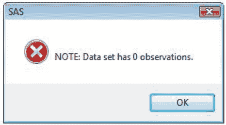

## 删除数据行

现在你已经看到了可更新视图如何添加或修改一个或多个数据行，你可能已经对如何创建可更新视图以删除一个或多个数据行有了相当好的概念。请考虑以下可更新视图，它会从基础 PRODUCTS 表中删除制造商编号为 600 的制造商。

### SQL 代码

```
PROC SQL;
    DELETE FROM SOFTWARE_PRODUCTS_VIEW
    WHERE MANUNUM=600;
QUIT;
```

## SAS 日志结果

```
PROC SQL;
    DELETE FROM SOFTWARE_PRODUCTS_VIEW
    WHERE MANUNUM=600;
NOTE: 2 rows were deleted from WORK.SOFTWARE_PRODUCTS_VIEW.
    QUIT;
NOTE: PROCEDURE SQL used:
        real time          0.04 seconds
```

## 删除视图

当视图不再需要时，很高兴知道有一种方法可以将其删除。没有这种能力，程序维护活动会更困难。要删除不需要的视图，请指定 DROP VIEW 语句和视图的名称。在下一个示例中，INVENTORY_VIEW 视图从 WORK 库中删除。

### SQL 代码

```
PROC SQL;
    DROP VIEW INVENTORY_VIEW;
QUIT;
```

## SAS 日志

```
PROC SQL;
    DROP VIEW INVENTORY_VIEW;
NOTE: View WORK.INVENTORY_VIEW has been dropped.
    QUIT;
NOTE: PROCEDURE SQL used:
        real time            0.10 seconds
```

当需要删除多个视图时，DROP VIEW 语句同样适用。删除两个或多个视图时，在每个视图名称之间指定逗号。

### SQL 代码

```
PROC SQL;
    DROP VIEW INVENTORY_VIEW, LAPTOP_PRODUCTS_VIEW;
QUIT;
```

## SAS 日志

```
PROC SQL;
    DROP VIEW INVENTORY_VIEW, LAPTOP_PRODUCTS_VIEW;
NOTE: View WORK.INVENTORY_VIEW has been dropped.
NOTE: View WORK.LAPTOP_PRODUCTS_VIEW has been dropped.
    QUIT;
NOTE: PROCEDURE SQL used:
        real time            0.00 seconds
```

## 摘要

- 1. 视图不是表，因此不存储数据（参见“视图——数据的窗口”部分）。
- 2. 视图访问一个或多个基础表（基表）或其他视图（参见“视图——数据的窗口”部分
- 3. 视图在构建为“通用”例程集时改善变更控制过程（参见“视图——数据的窗口”部分）。
- 4. 视图消除或减少数据冗余（参见“消除冗余”部分）。
- 5. 视图在显示特定列和/或行时隐藏不需要或敏感的信息（参见“限制数据访问——安全”部分）。
- 6. 视图保护用户免于逻辑和/或数据错误（参见“隐藏逻辑复杂性”部分）。
- 7. 过度嵌套视图会产生不必要的混淆和维护困难（参见“嵌套视图”部分）。
- 8. 可更新视图添加、修改或删除数据行（参见“可更新视图”部分）。
- 9. 视图在不再需要时可以被删除（参见“删除视图”部分）。

## 第 9 章：故障排除和调试

- 引言 ........................................................................................ 323
- 错误的世界................................................................................ 324
- 调试过程 ........................................................................ 324
- 问题类型 ................................................................................ 326
- 故障排除和调试技术 ........................................ 327
  - 使用 VALIDATE 语句验证查询................................ 327
  - 文档化的 PROC SQL 选项和语句................................... 328
- 未文档化的 PROC SQL 选项 ....................................................... 342
  - 宏变量 ................................................................................ 343
  - 故障排除和调试示例.......................................... 345
- 摘要 ................................................................................................ 350

## 引言

在追踪 SQL 编程问题来源时，用户可以非常有资源。为了找到所有那些讨厌的错误、警告、注释和意外结果，你需要仔细检查 SAS 日志以及代码审查和示例运行的明显线索。使用可靠的故障排除和调试技术将有助于找到任何可能对 PROC SQL 程序成功执行造成问题的语法、数据、系统相关和逻辑错误的根源。

本章介绍了用于故障排除和调试 SQL 过程编码问题的多种策略和技术。本章中介绍的指南将帮助你了解不同类型的错误、故障排除问题的步骤、可能发生的错误类型，以及 SQL 过程中可用于故障排除和调试问题的选项和语句。

## 错误的世界

自软件行业诞生以来，软件问题（通常称为 *bug*）一直由各个技能水平的程序员（和用户）在几乎所有可想象的形式中创建。错误是软件或程序执行了它不应该执行的事情。当软件遇到错误时，它可能导致软件停止运行或行为异常。

错误有各种形式、形状和大小。在使用 SQL 过程时发生错误并直接违反语言规则的问题被称为 *使用错误*。这些类型错误的严重程度取决于违规的性质以及对用户的影响。一般来说，使用错误会导致语法错误并停止程序或步骤。

其他类型的错误也可能有问题。资源问题、数据依赖性和实现错误等错误可能导致程序步骤停止或产生不可靠的结果，然后在 SAS 日志中显示错误或警告。

## 调试过程

调试过程包括纠正已识别问题并验证其不再出现的若干推荐步骤。目标是以尽可能快和简单的方式识别、分类、修复和验证 PROC SQL 步骤、程序或应用程序中的问题。并非每个问题都需要应用本章推荐的每个步骤。相反，你可以从建议中挑选和选择以有效纠正问题并确保它们不再出现。遵循系统和有效的调试过程会增加问题被正确识别和修复的可能性，从而加快和改善你处理问题的方式。

要进一步探索此主题，请参阅 William E. Perry 所著的 *Effective Methods for Software Testing*（Wiley Publishing, Inc., 2006）和 Matthew A. Telles 与 Yuan Hsieh 所著的 *The Science of Debugging*（The Coriolis Group, 2001）。

调试过程包括五个步骤。参见表 9.1。


## 表 9.1：调试流程步骤与任务

| 调试步骤 | 任务描述 |
|---|---|
| 问题识别 | 1. 确定代码中是否存在 bug。<br>2. 通过扮演侦探来确定问题是什么。<br>3. 描述为什么该问题是一个 bug。<br>4. 确定代码应该做什么。<br>5. 确定代码正在做什么。 |
| 信息收集 | 1. 收集用户评论和反馈。<br>6. 收集个人观察和症状。<br>7. 查看 SAS 日志信息。<br>8. 收集突出问题的测试用例。<br>9. 捕获环境信息（例如，系统设置、运行环境、外部元素等）。 |
| 问题评估与分类 | 1. 提出关于问题原因的理论。<br>10. 查看代码。<br>11. 将问题分类为以下类别之一：<br>- 需求问题<br>- 语法错误<br>- CPU 问题<br>- 内存问题<br>- 存储问题<br>- I/O 问题<br>- 逻辑问题 |
| 问题解决 | 1. 提出解决方案。<br>12. 描述为什么该解决方案能修复问题。<br>13. 验证该解决方案不会导致额外问题。<br>14. 通过实施解决方案修复问题。 |
| 验证解决方案 | 1. 验证问题是否仍然存在。<br>15. 验证问题是否可以重新创建或重现。<br>16. 确定是否其他方法会导致相同问题发生。<br>17. 验证解决方案不会导致其他问题。 |

## 问题类型

SQL 编程问题的常见原因包括误用语言语法；错误引用数据，尤其是列数据；忽略或错误指定系统参数；以及构建语法正确但逻辑不良的代码，导致结果不符合预期。

使用错误可能导致 SAS 停止处理、产生警告或产生意外结果。表 9.2 说明了四种使用错误类型并简要描述了每种类型。

## 表 9.2：使用错误类型

| 问题 | 描述 |
|---|---|
| 语法 | 语法问题是由于违反了一个或多个 SQL 过程语言结构造成的。这些问题可能阻止程序处理，直到您做出必要的更改。例如，在 SELECT 语句中引用的变量在引用表中找不到，会导致程序停止。 |
| 数据 | 数据问题是由于数据与程序规范不一致造成的。这些问题可能阻止程序处理，但也可能允许处理继续并导致分配缺失、不完整或不可靠的数据。例如，当字符数据被错误引用为数值数据时，列中可能会生成缺失值。 |
| 系统相关 | 系统相关问题通常是由于指定不兼容的系统选项或选择错误的系统选项值造成的。这些问题可能阻止程序处理，但最常见的是允许处理以不令人满意的结果进行。例如，忘记指定标题语句对输出的产生影响很小，但可能会迫使程序在添加一个或多个标题后重新运行。 |
| 逻辑 | 逻辑问题通常是由于未正确指定编码条件造成的。例如，当需要 AND 条件时指定 OR 条件，可能会在没有任何警告、错误或注释的情况下产生错误结果。 |

其他问题来源可能因多种原因出现在程序中。表 9.3 说明了这些其他问题来源并简要描述了每个来源。

## 表 9.3：其他错误类型

| 问题 | 描述 |
|---|---|
| 功能蔓延 | 在设计、实施或测试阶段，额外的功能可能会渗入程序或应用程序。这会增加出现问题的可能性。 |
| 解决方案复杂性 | 更复杂或晦涩的解决方案也可能转化为问题。难以维护的程序可能会因此产生。 |
| 需求 | 需求可能陈述不充分、被误解或被遗漏。在这些情况下，程序可能无法满足用户社区的需求并被归类为 bug。 |
| 测试环境 | 不充分的测试环境、不良的测试计划或测试时间不足通常会导致 bug 众多的程序。在这些情况下，bug 可能在测试阶段溜走并进入生产环境。 |

## 故障排除和调试技术

PROC SQL 为从业者提供了众多故障排除和调试功能可供选择。从语句到选项再到宏变量，您可以使用各种技术快速轻松地控制查找和收集 SQL 过程编码问题信息的过程。

## 使用 VALIDATE 语句验证查询

SQL 过程语法检查器在处理任何数据之前识别语法错误。语法检查在 SQL 过程中自动开启，无需指定任何语句或选项。但为了在不自动执行步骤的情况下启用语法检查，您可以在 SELECT 语句开头指定 VALIDATE 语句，或如后面将介绍的那样，指定 NOEXEC 选项。

VALIDATE 语句可供 SAS 用户控制要检查的 SELECT 语句。由于您在 SELECT 语句之前指定 VALIDATE 语句，因此您能更好地控制调试代码的过程。当代码语法有效时，SAS 日志中会自动显示表明语法正确的消息。否则，会显示错误消息以标识编码违规。在下一个示例中，在 SELECT 语句开头指定 VALIDATE 语句以启用语法检查而不执行代码。SAS 日志显示代码包含有效语法并自动显示相应消息。

### SQL 代码

```
PROC SQL;
    VALIDATE
        SELECT *
            FROM PRODUCTS
                WHERE PRODTYPE = 'Software';
QUIT;
```

## SAS 日志结果

```
PROC SQL;
    VALIDATE
        SELECT *
            FROM PRODUCTS
                WHERE PRODTYPE = 'Software';
NOTE: PROC SQL statement has valid syntax.
QUIT;
```

## 已记录的 PROC SQL 选项和语句

本节说明了广泛使用且有文档记录的故障排除和调试 SQL 选项以及 RESET 语句的示例。下面提供了每个选项和语句的描述和工作示例。

## FEEDBACK/NOFEEDBACK 选项

FEEDBACK 选项在 SELECT 查询中显示额外文档。指定时，此选项会将 SELECT *（通配符）语句扩展为其代表的列列表，通过显示底层表中的每个列名以及任何已解析的宏值和宏变量。SELECT * 语句的列显示顺序由表记录描述符中定义的顺序决定。

以下示例说明了 FEEDBACK 选项。由于 SELECT * 语句不会自动显示其代表的列，因此通过指定 FEEDBACK 选项来扩展单个列名可能很重要。这对于确定所需列是否在输出中存在并可用于文档目的特别有用。扩展列列表的结果显示在 SAS 日志中。

### SQL 代码

```
PROC SQL FEEDBACK;
    SELECT *
        FROM PRODUCTS;
QUIT;
```

## SAS 日志结果

```
PROC SQL FEEDBACK;
    SELECT *
        FROM PRODUCTS;
NOTE: Statement transforms to:
    select PRODUCTS.prodnum, PRODUCTS.prodname, PRODUCTS.manunum,
            PRODUCTS.prodtype, PRODUCTS.prodcost
        from WORK.PRODUCTS;
QUIT;
```

FEEDBACK 选项在连接两个或多个表时确定列顺序特别有帮助。下一个示例说明了在双向等值连接中 SELECT * 语句的列扩展。FEEDBACK 选项显示两个表中的所有列。

### SQL 代码

```
PROC SQL FEEDBACK;
    SELECT *
        FROM PRODUCTS, MANUFACTURERS
            WHERE PRODUCTS.MANUNUM = MANUFACTURERS.MANUNUM AND
                  MANUFACTURERS.MANUNAME = 'KPL Enterprises';
QUIT;
```

## SAS 日志结果

```
PROC SQL FEEDBACK;
    SELECT *
        FROM PRODUCTS, MANUFACTURERS
            WHERE PRODUCTS.MANUNUM = MANUFACTURERS.MANUNUM AND
                  MANUFACTURERS.MANUNAME = 'KPL Enterprises';
NOTE: Statement transforms to:
    select PRODUCTS.prodnum, PRODUCTS.prodname, PRODUCTS.manunum,
            PRODUCTS.prodtype, PRODUCTS.prodcost, MANUFACTURERS.manunum,
            MANUFACTURERS.manuname, MANUFACTURERS.manucity,
            MANUFACTURERS.manustat
        from PRODUCTS, MANUFACTURERS
        where (PRODUCTS.manunum=MANUFACTURERS.manunum) and
              (MANUFACTURERS.manuname='KPL Enterprises');
QUIT;
```

FEEDBACK 选项还可用于显示宏值和宏变量解析。下一个示例显示了宏变量 &LIB、&TABLE 和 &GROUPBY 的宏解析以用于调试目的。


### SQL 代码

```
%MACRO DUPS(LIB, TABLE, GROUPBY);
    PROC SQL FEEDBACK;
        SELECT &GROUPBY, COUNT(*) AS Duplicate_Rows
            FROM &LIB..&TABLE
                GROUP BY &GROUPBY
                    HAVING COUNT(*) > 1;
    QUIT;
%MEND DUPS;
%DUPS(WORK,PRODUCTS,PRODTYPE);
```

# SAS 日志结果

```
%MACRO DUPS(LIB, TABLE, GROUPBY);
    PROC SQL FEEDBACK;
        SELECT &GROUPBY, COUNT(*) AS Duplicate_Rows
            FROM &LIB..&TABLE
                GROUP BY &GROUPBY
                    HAVING COUNT(*) > 1;
    QUIT;
%MEND DUPS;
%DUPS(WORK,PRODUCTS,PRODTYPE);
NOTE: Statement transforms to:
    select PRODUCTS.prodtype, COUNT(*) as Duplicate_Rows
        from WORK.PRODUCTS
            group by PRODUCTS.prodtype
                having COUNT(*)>1;
```

你也可以指定 %PUT 语句而不是 FEEDBACK 选项来在宏解析后显示宏变量的值。下一个示例说明在 QUIT 和 %MEND 语句之间插入宏语句 %PUT LIB = &LIB TABLE = &TABLE GROUPBY = &GROUPBY 以产生下面所示的结果。

### SQL 代码

```
%MACRO DUPS(LIB, TABLE, GROUPBY);
    PROC SQL;
        SELECT &GROUPBY, COUNT(*) AS Duplicate_Rows
            FROM &LIB..&TABLE
                GROUP BY &GROUPBY
                    HAVING COUNT(*) > 1;
    QUIT;
    %PUT LIB = &LIB TABLE = &TABLE GROUPBY = &GROUPBY;
%MEND DUPS;
%DUPS(WORK,PRODUCTS,PRODTYPE);
```

# SAS 日志结果

```
%MACRO DUPS(LIB, TABLE, GROUPBY);
... code not shown ...
LIB = WORK TABLE = PRODUCTS GROUPBY = PRODTYPE
```

# _METHOD 和 _TREE 选项配合 MSGLEVEL=I

作为故障排除和调试工具，PROC SQL 支持 _METHOD 和 _TREE 选项。这些选项对于分别理解 SQL 优化器选择的<|message|>处理方法层次结构以及查询计划的内部形式非常有用。为了帮助用户理解从 _METHOD 选项生成并在 SAS 日志中显示的具体代码，Table 9.4 中列出了代码表以及简要描述。

当与 _METHOD 和 _TREE 选项结合使用时，MSGLEVEL=I 系统选项会在 SAS 日志中显示与索引使用、合并处理和排序实用程序使用相关的额外消息。

# 表 9.4：从 _METHOD 选项生成并在 SAS 日志中显示的代码

| Code | Description |
|------|-------------|
| SQXCRTA | Create table as Select. |
| SQXSLCT | Select statement or clause. |
| SQXJSL | Step loop join (Cartesian). |
| SQXJM | Merge join operation. |
| SQXJNDX | Index join operation. |
| SQXJHSH | Hash join operation. |
| SQXSORT | Sort operation. |
| SQXSRC | Source rows from table. |
| SQXFIL | Rows filtration. |
| SQXSUMG | Summary stat (aggregates) with GROUP BY clause. |
| SQXSUMN | Summary stat with no GROUP BY clause. |

### SQL 代码

```
OPTIONS MSGLEVEL=I;
PROC SQL _METHOD _TREE;
SELECT sum(inventory.inventqty)
AS Products_Ordered_Before_09012000
FROM PRODUCTS P,
INVOICE I,
CUSTOMERS C,
INVENTORY I2
WHERE I2.orddate < mdy(09,01,00) AND
    P.prodnum = I.prodnum AND
    I.custnum = C.custnum AND
    I.prodnum = I2.prodnum;
QUIT;
```

# SAS 日志结果

```
OPTIONS MSGLEVEL=I;
PROC SQL _METHOD _TREE;
    SELECT sum(inventory.invenqty)
        AS Products_Ordered_Before_09012000
    FROM PRODUCTS    P,
        INVOICE      I,
        CUSTOMERS    C,
        INVENTORY    I2
    WHERE I2.orddate < mdy(09,01,00) AND
          P.prodnum  = I.prodnum AND
          I.custnum  = C.custnum AND
          I.prodnum  = I2.prodnum;

NOTE: SQL execution methods chosen are:
    sqxslct
        sqxsum
            sqxjhsh
                sqxjhsh
                    sqxjhsh
                        sqxsrc( WORK.CUSTOMERS(alias = C) )
                        sqxsrc( WORK.INVOICE(alias = I) )
                        sqxsrc( WORK.PRODUCTS(alias = P) )
                    sqxsrc( WORK.INVENTORY(alias = I2) )
```

_TREE 选项在指定时，提供查询优化器处理查询执行方式的图形表示。基本上，查询执行计划显示了优化器基于使用的语句、子句、选项、关键字和其他编码结构如何解释和执行查询。

当提交查询执行时，优化器确定执行查询的最优方式，从而构建执行计划。通常，基于成本的优化器选择什么执行计划的决定会受到估计的 CPU 和 IO 处理成本以及查询预计执行速度的影响。结果是一个查询执行计划，描绘了标签、节点、输入源、连接参数、where 子句条件和其他描述性信息的树形结构，如下所示。

```
Tree as planned.
/-SYM-A-(Products_Ordered_Before_09012000:1 flag=0039)
/-OBJ----
/-AGGR---
/-OBJ----
/-SYM-V-(I2.invenqty:2 flag=0001)
--JOIN---
/-OBJ----
/-OBJ----
/-SYM-V-(P.prodnum:1 flag=0001)
--SYM-V-(I.prodnum:5 flag=0001)
--SYM-V-(I.custnum:3 flag=0001)
\-SYM-V-(C.custnum:1 flag=0001)
/-JOIN---
/-OBJ----
/-SYM-V-(I.prodnum:6 flag=0001)
--SYM-V-(I.custnum:3 flag=0001)
\-SYM-V-(C.custnum:1 flag=0001)
/-JOIN---
/-SYM-V-(C.custnum:1 flag=0001)
/-OBJ----
/-SRC----
\-TABL[WORK].CUSTOMERS opt=''
--FROM---
/-SYM-V-(I.prodnum:6 flag=0001)
/-OBJ----
--SYM-V-(I.custnum:3 flag=0001)
\-SRC----
\-TABL[WORK].INVOICE opt=''
--empty-
\-CEQ----
/-SYM-V-(C.custnum:1)
\-SYM-V-(I.custnum:3)
--FROM---
/-OBJ----
/-SYM-V-(P.prodnum:1 flag=0001)
\-SRC----
\-TABL[WORK].PRODUCTS opt=''
--empty-
/-SYM-V-(I.prodnum:6)
\-CEQ----
\-SYM-V-(P.prodnum:1)
/-SYM-V-(I2.invenqty:2 flag=0001)
/-OBJ----
--SYM-V-(I2.prodnum:1 flag=0001)
\-SRC----
--TABL[WORK].INVENTORY opt=''
--NAME--(orddate:3)
\-CLT----
\-LITN(14854) DATE.
--empty-
/-SYM-V-(I.prodnum:6)
\-CEQ----
\-SYM-V-(I2.prodnum:1)
--empty-
--empty-
--empty-
--empty-
/-SYM-A-(Products_Ordered_Before_09012000:1 flag=0039)
/-ASGN----
\-SYM-G-(#TEMG001:2 stat=8,0 from invenqty(0,0))
/-OBJ----
--empty-
/-SYM-G-(#TEMG001:2 stat=8,0 from invenqty(0,0))
/-TLST----
/-SYM-S-(invenqty:3 ss=0220x)
\-SLST----
--SSEL----
```

# INOBS= 选项

INOBS= 选项通过限制 PROC SQL 处理的行数来减少查询执行时间。该选项最常用于故障排除或调试目的，在这些情况下只需要少量行而不是表源中的所有行。使用 INOBS= 选项控制输入时处理的行数与指定 SAS 系统选项 OBS= 类似。以下示例说明 INOBS= 选项限制为 PRODUCTS 表中的前 10 行。SAS 日志中还显示了一条警告消息，指出由于 INOBS= 选项，已读取的记录数限制为 10。

### SQL 代码

```
PROC SQL INOBS=10;
  SELECT *
    FROM PRODUCTS;
QUIT;
```

# SAS 日志结果

```
PROC SQL INOBS=10;
  SELECT *
    FROM PRODUCTS;
WARNING: Only 10 records were read from WORK.PRODUCTS due to INOBS=
option.
QUIT;
```

在下一个示例中，INOBS= 选项设置为 5，用于笛卡尔积连接（WHERE 子句缺失）。在没有 WHERE 子句的情况下指定 INOBS=5 的双向连接会将每个表中的行数限制为 5，从而产生最多 25 行。

### SQL 代码

```
PROC SQL INOBS=5;
  SELECT prodname, prodcost, manufacturers.manunum, manuname
    FROM PRODUCTS, MANUFACTURERS;
QUIT;
```

# SAS 日志结果

```
PROC SQL INOBS=5;
  SELECT prodname, prodcost, manufacturers.manunum, manuname
    FROM PRODUCTS, MANUFACTURERS;
NOTE: The execution of this query involves performing one or more
Cartesian product joins that cannot be optimized.
WARNING: Only 5 records were read from WORK.MANUFACTURERS due to
INOBS= option.
WARNING: Only 5 records were read from WORK.PRODUCTS due to
INOBS= option.
QUIT;
```

# LOOPS= 选项

LOOPS= 选项通过限制查询内部循环的处理次数来减少查询执行时间。与 INOBS= 和 OUTOBS= 选项一样，LOOPS= 选项用于故障排除或调试，以防止消耗过多的计算机资源或在处理多表连接时创建大型内部表。以下示例显示 LOOPS= 选项限制为通过 PRODUCTS 表中的行进行八次内部循环。


### SQL 代码
```
PROC SQL LOOPS=8;
    SELECT *
    FROM PRODUCTS;
QUIT;
```

## SAS 日志结果
```
PROC SQL LOOPS=8;
    SELECT *
    FROM PRODUCTS;
WARNING: PROC SQL statement interrupted by LOOPS=8 option.
QUIT;
```

### 结果

| 产品编号 | 产品名称 | 制造商编号 | 产品类型 | 产品成本 |
|---|---|---|---|---|
| 1110 | 梦想机器 | 111 | 工作站 | $3,200.00 |
| 1200 | 商用机器 | 120 | 工作站 | $3,300.00 |
| 1700 | 旅行笔记本电脑 | 170 | 笔记本电脑 | $3,400.00 |

下一个示例展示了在三表连接中应用 LOOPS= 选项时会发生什么，通过将处理的内层循环数限制为 50，以防止创建庞大且低效的内部表。要确定赋予 LOOPS= 选项的适当值，可以在 %PUT 语句中指定 &SQLLOOPS 宏变量。要了解有关此宏变量的更多信息，请参阅本章后面的“宏变量”一节。

### SQL 代码
```
PROC SQL LOOPS=50;
    SELECT P.prodname, P.prodcost,
        M.manuname,
        I.invqty
    FROM PRODUCTS  P,
        MANUFACTURERS  M,
        INVOICE  I
    WHERE P.manunum = M.manunum AND
        P.prodnum = I.prodnum AND
        M.manunum = 500;
QUIT;
```

### 结果

| 产品名称 | 产品成本 | 制造商名称 | 发票数量 - 已售单位 |
|---|---|---|---|
| 电子表格软件 | $299.00 | KPL Enterprises | 5 |
| 数据库软件 | $399.00 | KPL Enterprises | 2 |

## RESET 语句

RESET 语句用于添加、删除或更改一个或多个 PROC SQL 选项，而无需重新启动过程。一旦指定了某个选项，它将一直有效，直到被更改或重置。使用 RESET 语句更改选项是一种方便的调试技术。下面的示例演示了如何通过将 FEEDBACK 选项重置为 NOFEEDBACK 来关闭该选项。关闭此选项后，可以防止 SELECT *（通配符）语句展开为其所代表的列列表。

### SQL 代码
```
PROC SQL FEEDBACK;
    SELECT *
        FROM PRODUCTS;
RESET NOFEEDBACK;
    SELECT *
        FROM PRODUCTS
            WHERE PRODTYPE='Software';
QUIT;
```

## SAS 日志结果
```
SELECT *
    FROM PRODUCTS;
NOTE: Statement transforms to:
select PRODUCTS.prodnum, PRODUCTS.prodname, PRODUCTS.manunum,
    PRODUCTS.prodtype, PRODUCTS.prodcost
    from PRODUCTS;
RESET NOFEEDBACK;
SELECT *
    FROM PRODUCTS
        WHERE PRODTYPE='Software';
```

可以在一个 RESET 语句中重置多个选项。PROC SQL 和 RESET 语句中的选项可以按任意顺序指定。下一个示例演示了如何在一个 RESET 语句中，通过 NODOUBLE 选项将双倍行距输出更改为单倍行距输出，通过 NONUMBER 选项抑制行号，并通过 OUTOBS= 选项将输出行数更改为最大行数。

### SQL 代码
```
PROC SQL DOUBLE NUMBER OUTOBS=1;
  SELECT *
    FROM PRODUCTS
    WHERE PRODTYPE='Software';
RESET NODOUBLE NONUMBER OUTOBS=MAX;
  SELECT *
    FROM PRODUCTS
    WHERE PRODTYPE='Software';
QUIT;
```

## SAS 日志结果
```
PROC SQL DOUBLE NUMBER OUTOBS=1;
  SELECT *
    FROM PRODUCTS
    WHERE PRODTYPE='Software';
WARNING: Statement terminated early due to OUTOBS=1 option.
RESET NODOUBLE NONUMBER OUTOBS=MAX;
  SELECT *
    FROM PRODUCTS
    WHERE PRODTYPE='Software';
QUIT;
```

## 输出结果

| 行 | 产品编号 | 产品名称 | 制造商编号 | 产品类型 | 产品成本 |
| --- | --- | --- | --- | --- | --- |
| 1 | 5001 | 电子表格软件 | 500 | 软件 | $299.00 |

| 产品编号 | 产品名称 | 制造商编号 | 产品类型 | 产品成本 |
| --- | --- | --- | --- | --- |
| 5001 | 电子表格软件 | 500 | 软件 | $299.00 |
| 5002 | 数据库软件 | 500 | 软件 | $399.00 |
| 5003 | 文字处理软件 | 500 | 软件 | $299.00 |
| 5004 | 图形软件 | 500 | 软件 | $299.00 |

下一个示例展示了一个 UPDATE 查询，该查询使用 UNDO_POLICY=REQUIRED（默认值）选项来撤销在出错之前执行的所有更新。（注意：由于这是该选项的默认值，因此可以省略。）在第二个更新查询之前发出 RESET UNDO_POLICY=NONE 语句，以更改更新的处理方式。NONE 选项会保留所有已进行的更新，无论是否检测到错误。系统会显示一条警告消息，提醒您更新处理方式已发生更改。

### SQL 代码
```
PROC SQL UNDO_POLICY=REQUIRED;
    UPDATE PRODUCTS
        SET PRODCOST = PRODCOST - (PRODCOST * 0.2)
        WHERE UPCASE(PRODTYPE) = 'LAPTOP';
    RESET UNDO_POLICY=NONE;
    UPDATE PRODUCTS
        SET PRODCOST = PRODCOST - (PRODCOST * 0.2)
        WHERE UPCASE(PRODTYPE) = 'LAPTOP';
QUIT;
```

## SAS 日志结果
```
PROC SQL UNDO_POLICY=REQUIRED;
    UPDATE PRODUCTS
        SET PRODCOST = PRODCOST - (PRODCOST * 0.2)
        WHERE UPCASE(PRODTYPE) = 'LAPTOP';
NOTE: 1 row was updated in WORK.PRODUCTS.
RESET UNDO_POLICY=NONE;
    UPDATE PRODUCTS
        SET PRODCOST = PRODCOST - (PRODCOST * 0.2)
        WHERE UPCASE(PRODTYPE) = 'LAPTOP';
WARNING: The SQL option UNDO_POLICY=REQUIRED is not in effect. If an error is detected when processing this UPDATE statement, that error will not cause the entire statement to fail.
NOTE: 1 row was updated in WORK.PRODUCTS.
QUIT;
```

## EXEC/NOEXEC 选项

NOEXEC 选项检查 SQL 过程内所有非查询语句（如 CREATE TABLE 或 ALTER TABLE）是否存在与语法相关的错误，并在 SAS 日志中显示任何已识别的错误。NOEXEC 选项与 VALIDATE 语句类似，它检查语法正确性，而不执行任何输入数据。NOEXEC 选项与 VALIDATE 语句之间的唯一区别在于它们的指定方式。如前所述，VALIDATE 语句在每条 SELECT 语句之前指定；而 NOEXEC/EXEC 选项可以作为 PROC SQL 语句选项指定，也可以在 RESET 语句中指定。

为了说明故障排除和调试过程，将使用 NOEXEC 和 EXEC 选项展示以下非查询 SQL 代码。下一个示例说明，在检查语法正确性后，非查询 CREATE TABLE 语句不会被执行。由于指定了 NOEXEC 选项，任何与语法相关的错误都会自动显示在 SAS 日志中。

### SQL 代码
```
PROC SQL NOEXEC;
    CREATE TABLE SOFTWARE_PRODUCTS
        SELECT *
            FROM PRODUCTS
                WHERE PRODTYPE = 'Software';
```

如 SAS 日志所示，发现一个语法错误，并显示由此产生的错误。

## SAS 日志结果
```
PROC SQL NOEXEC;
    CREATE TABLE SOFTWARE_PRODUCTS
        SELECT *
        ------
            73
ERROR 73-322: Expecting an AS.
            FROM PRODUCTS
                WHERE PRODTYPE = 'Software';
```

在下一个示例中，在 NOEXEC 选项仍然有效的情况下，CREATE TABLE 语句中指定了 AS 关键字，从而纠正了上一个示例中显示的语法错误。

### SQL 代码
```
CREATE TABLE SOFTWARE_PRODUCTS AS
    SELECT *
        FROM PRODUCTS
            WHERE PRODTYPE = 'Software';
```

如 SAS 日志所示，未发现语法错误，但由于 NOEXEC 选项仍然有效，CREATE TABLE 语句未被执行。

## SAS 日志结果
```
PROC SQL NOEXEC;
    CREATE TABLE SOFTWARE_PRODUCTS AS
        SELECT *
            FROM PRODUCTS
                WHERE PRODTYPE = 'Software';
NOTE: Statement not executed due to NOEXEC option.
```

下一个示例演示了使用 RESET 语句将 NOEXEC 选项更改为 EXEC，从而使无错误的非查询代码得以执行。

### SQL 代码
```
RESET EXEC;
CREATE TABLE SOFTWARE_PRODUCTS  AS
    SELECT *
        FROM PRODUCTS
            WHERE PRODTYPE = 'Software';
QUIT;
```

如 SAS 日志所示，未发现语法错误。并且由于指定了 RESET 语句将 NOEXEC 选项更改为 EXEC，CREATE TABLE 语句得以执行。

## SAS 日志结果
```
RESET EXEC;
CREATE TABLE SOFTWARE_PRODUCTS  AS
    SELECT *
        FROM PRODUCTS
            WHERE PRODTYPE = 'Software';
NOTE: Table WORK.SOFTWARE_PRODUCTS created, with 4 rows and 5 columns.
```

## ERRORSTOP/NOERRORSTOP 选项

ERRORSTOP 选项指示 SQL 在遇到错误时停止执行语句，并在非交互式或批处理会话中继续检查语法。相反，NOERRORSTOP 选项指示 SQL 在遇到错误时执行语句，并继续检查语法。ERRORSTOP/NOERRORSTOP 选项可以作为 PROC SQL 语句选项指定，也可以在 RESET 语句中指定。下一个示例演示了 CREATE TABLE 语句的错误用法，并显示了指定 ERRORSTOP 选项时生成的 SAS 日志结果。

### SQL 代码
```
PROC SQL ERRORSTOP;
    CREATE TABLE SOFTWARE_PRODUCTS
        SELECT *
            FROM PRODUCTS
                WHERE PRODTYPE = 'Software';
QUIT;
```

如 SAS 日志所示，当遇到语法错误时，ERRORSTOP 选项会自动停止执行 SQL 语句，并显示 SAS 日志错误消息。


## SAS 日志结果

```
PROC SQL ERRORSTOP;
    CREATE TABLE SOFTWARE_PRODUCTS
        SELECT *
            -----
                73
ERROR 73-322: Expecting an AS.
        FROM PRODUCTS
        WHERE PRODTYPE = 'Software';
```

## OUTOBS= 选项

OUTOBS= 选项通过限制 PROC SQL 作为输出发送到指定输出源的行数，来减少查询执行时间。与 INOBS= 选项一样，OUTOBS= 选项最常用于故障排除或调试目的，此时输出表中只需要少量行。使用 OUTOBS= 选项控制作为输出发送的行数，类似于设置 SAS 系统选项 OBS=（或数据集选项 OBS=）。以下示例创建了一个由 OUTOBS= 选项指定为五行的输出表。SAS 日志警告消息显示新表包含五行。

### SQL 代码

```
PROC SQL OUTOBS=5;
    CREATE TABLE PRODUCTS_SAMPLE AS
        SELECT *
            FROM PRODUCTS;
QUIT;
```

## SAS 日志结果

```
PROC SQL OUTOBS=5;
    CREATE TABLE PRODUCTS_SAMPLE AS
        SELECT *
            FROM PRODUCTS;
WARNING: Statement terminated early due to OUTOBS=5 option.
NOTE: Table WORK.PRODUCTS_SAMPLE created, with 5 rows and 5 columns.
QUIT;
```

## PROMPT 选项

PROMPT 选项在交互式会话期间发出，当达到 INOBS=、LOOPS= 和/或 OUTOBS= 选项的限制时，提示用户继续或停止处理。如果 PROMPT 选项与这些选项中的一个或多个一起指定，将出现一个对话框，指示已达到指定选项的限制，并询问是停止还是继续处理。此提示功能是逐步执行运行中应用程序的有用过程。

以下示例显示了发出 PROMPT 选项以启动 SQL 过程会话与用户之间的对话。PROMPT 选项指定 INOBS= 选项将输入处理限制为 PRODUCTS 表中的前五行。读取五行后，会自动出现一个对话框，询问是停止还是继续处理。如果继续处理，则再处理五行，并且如果有其他行可供处理，则会出现另一个提示对话框。此对话过程持续进行，直到所有行都被处理或直到用户停止处理。

### SQL 代码

```
PROC SQL PROMPT INOBS=5;
    SELECT *
    FROM PRODUCTS;
QUIT;
```

## SAS 日志结果

```
PROC SQL PROMPT INOBS=5;
    SELECT *
    FROM PRODUCTS;
WARNING: Only 5 records were read from WORK.PRODUCTS due to INOBS= option.
QUIT;
```

## 未记录的 PROC SQL 选项

本节列出了几个未记录的 PROC SQL 选项。尽管可以自由探索和使用未记录的选项，但在使用之前应仔细考虑其影响。由于未来版本中可能出现的未宣布更改、可能删除或不支持，因此在 SQL 过程应用程序中使用它们时应谨慎。然而，未记录的选项为识别和解决编码问题提供了大量机会。表 9.5 列出了其中一些用于故障排除和调试目的的未记录 SQL 过程选项。

## 表 9.5：未记录的 PROC SQL 选项

| 选项 | 描述 |
|---|---|
| _AGGR | 在 SAS 日志中显示一个树状结构，包含前后摘要。 |
| _ASGN | 在 SAS 日志中显示一个树状结构，由解析后的前后名称组成。 |
| _DFR | 在 SAS 日志中以标记树状结构显示前后的数据流和子调用解析。 |
| _PJD | 显示各种表属性，包括观测（行）数、逻辑记录长度（lrecl）、受限行数以及表的大小（以字节为单位）。 |
| _RSLV | 在 SAS 日志中显示一个树状结构，由前后的早期语义检查组成。 |
| _SUBQ | 在 SAS 日志中以树状结构显示子查询转换。 |
| _UTIL | 在 SAS 日志中显示过程中定义的每个步骤的明细，包括每行的缓冲区长度、每个列的名称以及每个行（或偏移量）中的列位置。 |

## 宏变量

为了帮助排除故障和调试有问题的编码构造，PROC SQL 在每条语句执行后为三个自动宏变量赋值。这三个宏变量的内容可用于测试 SQL 过程代码的有效性，以及评估是否应继续处理。

## SQLOBS 宏变量

SQLOBS 宏变量显示由 SQL 过程语句处理的行数。要在 SAS 日志中显示 SQLOBS 宏变量的内容，请指定 %PUT 宏语句。以下示例从 PRODUCTS 表中检索软件产品，并使用 SELECT 语句显示 SAS 输出。%PUT 语句显示处理并发送到 SAS 输出的行数为四行。

### SQL 代码

```
PROC SQL;
    SELECT *
        FROM PRODUCTS
        WHERE PRODTYPE='Software';
    %PUT SQLOBS = &SQLOBS;
QUIT;
```

## SAS 日志结果

```
PROC SQL;
    SELECT *
        FROM PRODUCTS
        WHERE PRODTYPE='Software';
    %PUT SQLOBS = &SQLOBS;
SQLOBS = 4
QUIT;
```

下一个示例显示了使用 INSERT INTO 语句向 PRODUCTS 表插入两个新产品。%PUT 语句显示添加到 PRODUCTS 表的行数为两行。

### SQL 代码

```
PROC SQL;
    INSERT INTO PRODUCTS
        (PRODNUM, PRODNAME, PRODTYPE, PRODCOST)
        VALUES(6002,'Security Software','Software',375.00)
        VALUES(1701,'Travel Laptop SE', 'Laptop', 4200.00);
    %PUT SQLOBS = &SQLOBS;
QUIT;
```

## SAS 日志结果

```
PROC SQL;
    INSERT INTO PRODUCTS
        (PRODNUM, PRODNAME, PRODTYPE, PRODCOST)
        VALUES(6002,'Security Software','Software',375.00)
        VALUES(1701,'Travel Laptop SE', 'Laptop', 4200.00);
NOTE: 2 rows were inserted into WORK.PRODUCTS.
%PUT SQLOBS = &SQLOBS;
SQLOBS = 2
QUIT;
```

## SQLLOOPS 宏变量

SQLLOOPS 宏变量显示 SQL 过程处理内循环的次数。要在 SAS 日志中显示 SQLLOOPS 宏变量的内容，请指定 %PUT 宏语句。以下示例从 PRODUCTS 表中检索软件产品，并使用 SELECT 语句显示 SAS 输出。%PUT 语句显示内循环被处理的次数为 15 次，尽管只有 10 个产品行。随着查询变得更加复杂，SQL 过程内循环处理的次数也按比例增加。

### SQL 代码

```
PROC SQL;
    SELECT *
    FROM PRODUCTS
        WHERE PRODTYPE='Software';
%PUT SQLLOOPS = &SQLLOOPS;
QUIT;
```

## SAS 日志结果

```
PROC SQL;
    SELECT *
    FROM PRODUCTS
        WHERE PRODTYPE='Software';
%PUT SQLLOOPS = &SQLLOOPS;
SQLLOOPS = 15
QUIT;
```

## SQLRC 宏变量

SQLRC 宏变量显示一个状态值，指示 PROC SQL 语句是否成功。指定 %PUT 宏语句以显示 SQLRC 宏变量的内容。以下示例从 PRODUCTS 表中检索软件产品，并使用 SELECT 语句显示 SAS 输出。%PUT 语句显示返回代码为零，这表示 SELECT 语句成功。

### SQL 代码

```
PROC SQL;
    SELECT *
    FROM PRODUCTS
        WHERE PRODTYPE='Software';
    %PUT SQLRC = &SQLRC;
    QUIT;
```

## SAS 日志结果

```
PROC SQL;
    SELECT *
    FROM PRODUCTS
        WHERE PRODTYPE='Software';
    %PUT SQLRC = &SQLRC;
    SQLRC = 0
    QUIT;
```

## 故障排除和调试示例

本节展示了我本人在处理 SQL 过程问题时亲自遇到的若干错误。虽然这并不代表所有可能发生的错误，但它确实说明了一组常见问题以及纠正每个问题的技术方法。

## 错误 78-322：应为逗号

## 问题描述

语法错误消息有时会针对手头的具体问题提供令人困惑的信息。一个典型的例子是错误 78-322：Expecting a ','。在下面的示例中，起初看起来 SELECT 语句中的两个列名之间缺少逗号。仔细检查后，实际的问题在于违反了列命名约定，这是因为在 AS 关键字中指定的列别名中包含了无效字符。

## 代码和错误

```
PROC SQL;
    SELECT CUSTNUM, ITEM, UNITS * UNITCOST AS Total-Cost
                                            -
78
ERROR 78-322: Expecting a ','.
```


# 错误：引用不明确，列

## 问题描述

在下一个示例中，语法错误指向一个在SELECT语句中指定的列名出现在多个表中的问题，导致列引用不明确。这个问题不仅会给SQL处理器造成混淆，还会阻止查询执行。

## 代码与错误

```
PROC SQL;
    SELECT prodname, prodcost,
           manunum, manuname
    FROM PRODUCTS AS P, MANUFACTURERS AS M
        WHERE P.manunum = M.manunum;
ERROR: Ambiguous reference, column manunum is in more than one table.
QUIT;
```

## 纠正措施

要消除所有列引用不明确的问题，您应该在SELECT语句及其子句中，为出现在两个或更多表中的每一列加上各自的表名进行引用。例如，要引用MANUFACTURERS表中的MANUNUM列并消除所有歧义，您可以在SELECT语句中将该列指定为MANUFACTURERS.MANUNUM。

# 错误200-322：无法识别该符号，该符号将被忽略

## 问题描述

在下一个示例中，语法错误指向第二个SELECT语句的WHERE子句末尾的左括号，并将其标记为无效。找到实际问题的关键在于从标记错误的位置开始，逐行回溯。使用这种方法，您会发现第二个SELECT语句是一个子查询（或内部查询），不符合有效的语法规则。与其他语法错误一样，该查询以及子查询都无法执行。

## 代码与错误

```
PROC SQL;
    SELECT *
        FROM INVOICE
        WHERE manunum IN
            SELECT manunum
                FROM MANUFACTURERS
                WHERE UPCASE(manucity) LIKE 'SAN DIEGO%');
```

```
ERROR 22-322: Syntax error, expecting one of the following: ;, !, !!, &, *, **, +, -, //, AND, ESCAPE, EXCEPT, GROUP, HAVING, INTERSECT, OR, ORDER, OUTER, UNION, |, ||.
ERROR 200-322: The symbol is not recognized and will be ignored.
QUIT;
```

## 纠正措施

子查询必须符合有效的语法规则。要纠正此问题，必须在第二个SELECT语句的开头、IN子句之后立即添加一个右括号。

# 错误22-322：应为以下之一：名称、(、'.'、AS、ON

## 问题描述

在下一个示例中，语法错误标识出在左外连接中使用的WHERE子句。尽管SQL过程允许在外连接语法中指定可选的WHERE子句，但同时也必须指定ON子句。

## 代码与错误

```
PROC SQL;
    SELECT prodname, prodtype,
        products.manunum, invenqty
    FROM PRODUCTS LEFT JOIN INVENTORY
    WHERE products.manunum =
    -----
    22
    76
ERROR 22-322: Syntax error, expecting one of the following: a name, (, '.', AS, ON.
ERROR 76-322: Syntax error, statement will be ignored.
    inventory.manunum;
QUIT;
```

## 纠正措施

要纠正此问题并符合有效的外连接语法要求，请在用于对连接结果进行子集化的可选WHERE子句之前指定ON子句。

# 错误180-322：语句无效或其使用顺序不当

## 问题描述

在下一个示例中，语法错误将UNION语句标识为无效或其使用顺序不当。进一步检查后，可以发现以下两个问题之一：SQL过程代码由两个独立的查询组成，但指定了无效的UNION运算符；或者第一个SELECT查询末尾出现了位置错误的分号。

## 代码与错误

```
PROC SQL;
    SELECT *
        FROM products
        WHERE prodcost < 300.00;
    UNION
    -----
    180
ERROR 180-322: Statement is not valid or it is used out of proper order.
    SELECT *
        FROM products
        WHERE prodtype = 'Workstation';
QUIT;
```

## 纠正措施

要纠正此问题并符合UNION操作的有效语法规则，请删除第一个SELECT查询后的分号。

# 错误73-322：应为AS

## 问题描述

在下一个示例中，语法错误标识出CREATE VIEW语句中缺少AS关键字，并突出显示了视图的SELECT语句。如果未指定AS关键字，CREATE VIEW步骤将不会执行，视图也不会被创建。

## 代码与错误

```
PROC SQL;
    CREATE VIEW WORKSTATION_PRODUCTS_VIEW
    SELECT PRODNUM, PRODNAME, PRODTYPE, PRODCOST
    -----
    73
ERROR 73-322: Expecting an AS.
    FROM PRODUCTS
        WHERE UPCASE(PRODTYPE) = "WORKSTATION";
QUIT;
```

## 纠正措施

要纠正此问题，请在CREATE VIEW语句中添加AS关键字，以遵循有效的语法规则并定义视图的查询。

350 PROC SQL：超越基础，使用SAS（第二版）

- 1. 调试过程的目标是尽可能快速、轻松地识别、分类、修复和验证PROC SQL步骤、程序或应用程序中的问题（参见“调试过程”一节）。
- 2. 使用错误可能导致SAS系统停止处理、产生警告或产生意外结果（参见“问题类型”一节）。
- 3. PROC SQL为从业者提供了大量的故障排除和调试功能（参见“故障排除与调试技术”一节）。
- 4. PROC SQL选项提供了有效的故障排除和调试技术，用于解决编码问题（参见“有文档记录的PROC SQL选项和语句”一节）。
- 5. 有几个有用但非生产用的PROC SQL选项可用于故障排除和调试（参见“无文档记录的PROC SQL选项”一节）。

# 第10章：性能与效率调优

简介 ........................................................................................ 351

理解性能调优 ....................................................................... 352

排序与性能 ............................................................................... 352

用户指定排序（SORTPGM= 系统选项） ................................... 353

自动排序 ............................................................................... 353

分组与性能 ............................................................................ 354

拆分表 ................................................................................. 354

索引与性能 ............................................................................... 354

检查CONTENTS输出和系统消息 ................................... 355

使用索引优化WHERE子句处理 ................................... 358

构建高效逻辑条件 ................................................... 359

避免使用UNION ................................................................................ 361

小结 ............................................................................................. 365

## 简介

如果不对查询优化和性能进行一些讨论，一本关于PROC SQL的书就不够完整。要使查询高效运行，需要编写能够利用PROC SQL查询优化器的代码。由于PROC SQL旨在处理各种流程，同时适应从小型到大型的数据库环境，本章介绍了一些查询调优策略、技术和选项，帮助您编写更高效的PROC SQL代码。在本章中，您将找到有助于识别查询可能存在的低效之处并执行调优过程以实现最佳性能的提示和建议。

## 理解性能调优

性能调优是改进程序运行方式的过程。它涉及对程序进行分析，以智能、可控的方式改进其性能。正如您可能想象的那样，一个经过调优的程序是能够从现有硬件和软件环境中获得最大收益的程序。

性能调优包括测量、评估和修改程序，直到程序以最少的计算机资源完成执行为止。调优过程最大的问题是，有时很难确定程序使用了多少计算机资源。更复杂的是，关于资源利用的充分而完整的信息往往不可用。事实上，不存在简单的公式来确定程序的运行效率。通常，评估程序是否高效运行的唯一方法是在不同条件下评估其性能，例如在交互使用期间，或在内存和存储等特定资源短缺期间。

性能问题可能难以识别。有可能一个程序在运行过程中没有明显问题，但其效率并没有达到应有的水平。事实上，一个程序可能在一个环境中表现良好，而在另一个环境中表现不佳。例如，假设某个组织的直接存取存储设备（DASD）短缺。在这种情况下，一个过度使用此资源的程序可能被视为性能不佳。但如果同一个程序在DASD充足的环境中运行，它可能不会被怀疑或标记为性能不佳。这种区别表明了判断程序性能表现的主观性，以及它与组织在任何时间点的特定需求（与资源问题相关）之间的关联。

## 排序与性能

在SQL过程中对数据进行排序，与在SAS的其他部分一样，涉及CPU和内存密集型操作。当表的大小很大，且CPU和/或内存资源短缺或根本不可用时，必须尽量减少程序中的排序次数。您可以通过了解查询需求并记住几条简单的指导原则来尽量减少问题。

如果排序在磁盘上执行而不是在内存中执行，则可能会出现性能瓶颈，因为磁盘处理通常比内存处理慢。执行排序最合理、最高效的位置是在内存中。如果排序所需的空间超过可用内存容量，则必须在磁盘上执行排序。目标是在执行排序之前确定排序所需的空间量以及将在何处执行排序。

排序的性能受查询中选择的行数影响最大。为了减少行数，应选择表的特定部分进行处理，而不是选择整个表。另一个性能考虑因素是减少ORDER BY子句中指定的列数。可以使用将两个或多个列连接起来的技术，而不是逐个指定每一列。最后，排序性能还可能受到列大小的影响，这些列...

在 ORDER BY 子句中指定。要减小列的长度，可以使用 SUBSTR 和 TRIM 等内置函数。

## 用户指定的排序（SORTPGM= 系统选项）

您可以通过指定 SORTPGM= 系统选项来控制 SAS 在执行排序时使用哪种排序工具，从而指导 SAS 针对所述环境使用最佳排序工具。SORTPGM= 系统选项如表10.1所示。

表10.1：SORTPGM= 系统选项

| 排序选项 | 用途 |
|---|---|
| BEST | BEST 选项使用最适合数据的排序工具。 |
| HOST | HOST 选项告诉 SAS 使用主机计算机上可用的主机排序工具。对于包含许多数据行的大型表，此选项可能是最高效的。 |
| SAS | SAS 选项告诉 SAS 使用 SAS 附带的排序工具。 |

下一个示例演示如何使用 SORTPGM= 选项来选择最适合数据的排序工具。这两个选项都使用 SORTNAME= 选项中指定的名称。

```
OPTIONS SORTPGM=BEST;

<or>

OPTIONS SORTPGM=HOST;
```

## 自动排序

使用 SELECT DISTINCT 子句会调用内部排序来删除重复行。唯一的例外是存在索引时。如果存在索引，则使用索引来消除重复行。

分组查询的结果使用分组列自动排序。当 SELECT 子句仅包含 GROUP BY 子句中列出的列以及任何汇总函数时，一旦执行任何定义的汇总函数，就会立即删除基于分组列的每个组中的重复项。如果随后 SELECT 子句中出现了其他列，则行不会被折叠，因此不会删除重复项。

## 分组与性能

与 ORDER BY 子句一样，GROUP BY 子句等过程也会影响查询速度。由于 GROUP BY 子句可能触发排序处理，因此关于 ORDER BY 子句的许多讨论也同样适用。此外，建议通过将分组列数保持在最低限度来避免对冗余列进行分组。

## 拆分表

拆分表涉及将某些行从一个表移动到另一个表。拆分数据是为了分隔某个预定的数据范围，例如将历史数据与当前数据分开，从而提高查询性能。这减轻了仅访问当前数据的查询所承受的负担。下一个示例显示了将当前年份的数据从一个包含五年数据的表中复制并删除的过程。

### SQL 代码

```
PROC SQL;
    CREATE TABLE INVENTORY_CURRENT AS
        SELECT *
            FROM INVENTORY
                WHERE YEAR(ORDDATE) = YEAR(TODAY());

    DELETE FROM INVENTORY
        WHERE YEAR(ORDDATE) = YEAR(TODAY());
QUIT;
```

## 索引与性能

索引可用于快速访问表行。索引并非对表进行物理排序（如 ORDER BY 子句或 PROC SORT 所执行的操作），而是为数据建立逻辑排列，而无需物理排序。这样做的优点是减少了 CPU、I/O 和内存需求。在使用 WHERE 子句处理时，它还减少了数据访问时间（这将在“使用索引优化 WHERE 子句处理”一节中讨论）。

索引很有用，但也有缺点。当表中的数据被插入、修改或删除时，必须更新索引以应对这些更改。此自动功能需要额外的 CPU 资源来处理表中的任何更改。此外，索引作为一个独立的结构，会消耗大量存储空间。因此，应注意不要创建过多索引，而应将索引分配给表中区分度最高的变量。以下是创建索引的一些建议：

- 在创建索引之前，先按关键字列对数据进行升序排序。
- 首先按关键变量对数据进行排序，以获得最大的性能提升。
- 在将数据追加到表之前，先按关键变量对数据进行升序排序。
- 尽可能创建简单索引，以供大多数查询使用。
- 避免为所有查询创建一个单一索引。
- 将索引分配给区分度最高的变量（参见第6章中的表6.1，基数规则）。
- 选择经常作为汇总函数（COUNT、SUM、AVG、MIN、MAX 等）对象的列。
- 只创建实际需要的索引。
- 通过选择不频繁更改的列，避免与索引维护相关的 CPU 资源消耗（在插入、修改和删除期间维护索引）。
- 在某些操作系统上，索引作为磁盘上的独立文件存储，这会使用额外的内存和磁盘空间来存储该结构。
- 为避免过多且不必要的 I/O 操作，在创建索引之前，请按区分度最高的关键字列对数据进行升序排序。
- 尝试在索引中使用区分度最高的变量作为第一个变量来定义复合索引。
- 选择没有大量空值的列，因为空值会导致很大百分比的行的值相同。

**注意：** 只应在需要优化查询搜索时间的表上创建索引。任何不必要的索引都可能迫使 SAS 无谓地消耗资源——在插入、更新和删除操作之后进行更新和重组。更糟糕的是，SQL 优化器可能会在不应使用索引时意外使用索引。

**注意：** 当创建索引不切实际或不可行时，请考虑根据查询需要访问表的前半部分还是后半部分数据，将数据按升序（或降序）存储。这通常会带来更高效的查询，因为一旦 WHERE 子句表达式得到满足，查询就会停止处理。

## 检查 CONTENTS 输出和系统消息

虽然没有两个组织是完全相同的，但发现程序无法以最高效率运行的原因有无数种，这并不奇怪。性能经常受到组织特定需求或资源不足的影响。SAS 用户需要学习尽可能多的技术来纠正与查询性能不佳相关的问题。应关注单个程序功能，因为查询性能不佳往往指向使用了一种或多种低效技术。

可以使用两种方法来更好地理解潜在的性能问题。第一种方法使用 PROC CONTENTS 输出来检查引擎/主机信息和库数据集（表）。该输出提供的信息用于确定表是否足够大。（以下输出中的页数显示了索引带来的性能改进）。SQL 处理器遵循的一般规则是，当表相对较小时（通常少于三页），使用索引没有真正优势。事实上，对小表使用索引实际上会降低性能水平，因为在这些情况下，顺序处理与使用索引一样快。

### 结果

| CONTENTS 过程 |
|---|---|
| 数据集名称 | WORK.INVENTORY | 观测数 | 7 |
| 成员类型 | DATA | 变量数 | 5 |
| 引擎 | V9 | 索引数 | 0 |
| 创建时间 | 2013年9月4日星期三 08:43:16 | 观测长度 | 20 |
| 最后修改 | 2013年9月4日星期三 08:43:16 | 已删除观测数 | 0 |
| 保护 |  | 压缩 | NO |
| 数据集类型 |  | 排序 | NO |
| 标签 |  |  |  |
| 数据表示 | WINDOWS_32 |  |  |
| 编码 | wlatin1 Western (Windows) |  |  |

| 引擎/主机相关信息 |
|---|---|
| 数据集页大小 | 4096 |
| 数据集页数 | 1 |
| 第一个数据页 | 1 |
| 每页最大观测数 | 202 |
| 第一个数据页中的观测数 | 7 |
| 数据集修复次数 | 0 |
| 文件名 | C:\Users\KPL\AppData\Local\Temp\SAS Temporary Files\_TD5444_KPL-PC_\inventory.sas7bdat |
| 创建版本 | 9.0301M0 |
| 主机创建环境 | W32_VSPRO |

| 变量和属性的字母顺序列表 |
|---|---|---|---|---|---|
| # | 变量 | 类型 | 长度 | 格式 | 输入格式 | 标签 |
| 4 | invencst | Num | 6 | DOLLAR10.2 |  | 库存成本 |
| 2 | invenqty | Num | 3 |  |  | 库存数量 |
| 5 | manunum | Num | 3 |  |  | 制造商编号 |
| 3 | orddate | Num | 4 | MMDDYY10. | MMDDYY10. | 上次订购库存日期 |
| 1 | prodnum | Num | 3 |  |  | 产品编号 |


第二种方法使用PROC SQL访问字典表TABLES和COLUMNS，以判断表是否足够大，从而利用索引带来的性能改进。请参见下面的输出。

## SQL代码

```
PROC SQL;
    SELECT MEMNAME, NPAGE
        FROM DICTIONARY.TABLES
        WHERE LIBNAME='WORK' AND
            MEMNAME='INVENTORY';

    SELECT VARNUM, NAME, TYPE, LENGTH, FORMAT,
            INFORMAT, LABEL
        FROM DICTIONARY.COLUMNS
        WHERE LIBNAME='WORK' AND
            MEMNAME='INVENTORY';
QUIT;
```

### 结果

| 成员名称 | 页数 |
|---|---:|
| INVENTORY | 1 |

| 表中列序号 | 列名 | 列类型 | 列长度 | 列格式 | 列输入格式 | 列标签 |
|---:|---|---|---:|---|---|---|
| 1 | prodnum | num | 3 |  |  | 产品编号 |
| 2 | inventqty | num | 3 |  |  | 库存数量 |
| 3 | orddate | num | 4 | MMDDYY10. | MMDDYY10. | 最近一次订购库存日期 |
| 4 | invencst | num | 6 | DOLLAR10.2 |  | 库存成本 |
| 5 | manunum | num | 3 |  |  | 制造商编号 |

表10.2比较了顺序表访问与索引表访问。尽管性能提升取决于数据，但将索引应用于WHERE子句中一小部分数据时，能够实现最大的提升。

## 表10.2：顺序访问与索引访问对比

| 条件 | 顺序访问 | 索引 |
|---|---|---|
| 页数 < 3 页（根据CONTENTS输出） | 是 | 否 |
| 表较小 | 是 | 否 |
| 表频繁更新 | 是 | 否 |
| 基于WHERE处理的数据子集较大 | 是 | 否 |
| 表访问不频繁 | 是 | 否 |
| 内存和磁盘空间有限 | 是 | 否 |
| 数据子集较小（数据总量的1%–25%） | 否 | 是 |

系统消息会显示出来，提供有助于调整与任何数据集关联的索引的信息。将系统选项MSGLEVEL=设置为“I”，允许SAS显示与一个或多个索引的存在相关的关键信息（如果有），用于优化WHERE子句处理。启用MSGLEVEL=选项后，SAS日志显示，在WHERE子句处理的优化过程中选择了简单索引INVENQTY。

## SAS日志

```
PROC SQL;
    CREATE INDEX INVENQTY ON INVENTORY;
NOTE: Simple index invenqty has been defined.
NOTE: PROCEDURE SQL used:
      real time          0.04 seconds
    SELECT *
      FROM INVENTORY
      WHERE invenqty < 3;
INFO: Index invenqty selected for WHERE clause optimization.
    QUIT;
NOTE: PROCEDURE SQL used:
      real time          0.65 seconds
```

## 使用索引优化WHERE子句处理

为了从包含SQL过程代码的程序中获得尽可能好的性能，可以将索引和WHERE子句一起使用（请参见下面的列表）。使用WHERE子句将表处理限制为所选行的子集（更多信息，请参见第2章“使用PROC SQL处理数据”）。当索引存在时，SQL处理器会在WHERE子句处理过程中决定是否利用该索引。尽管SQL优化器会确定使用索引最终是否有利于性能，但当它使用索引时，处理速度可能会得到提升。

-   比较运算符，如 EQ (=)、LT (<)、GT (>)、LE (<=)、GE (>=) 和 NOT
-   与 IN 运算符一起使用的比较运算符
-   带有冒号修饰符的比较运算符（例如，NOT =:"Ab"）
-   CONTAINS 运算符
-   IS NULL 或 IS MISSING 运算符
-   模式匹配运算符，如 LIKE 和 NOT LIKE

## 构建高效逻辑条件

构建高效逻辑条件会直接影响处理成本。由于SQL优化器从左到右评估一系列AND表达式，因此WHERE子句中的AND条件链应首先指定限制性最强的表达式。这样指定，可以绕过不满足WHERE子句中第一个条件值的行，从而消耗更少的资源。例如，下面的SQL查询可能会消耗更多资源并运行更慢，因为即使产品成本超过99.00美元时，也首先要判断第一个条件“SOFTWARE”。

## SQL代码（效率较低）

```
PROC SQL;
    SELECT *
        FROM PRODUCTS
            WHERE UPCASE(PRODTYPE) = 'SOFTWARE' AND
                PRODCOST < 100.00;
QUIT;
```

对于这些数据，要在减少CPU资源的同时产生与前一示例相同的结果，一种更高效的方法是将最不可能出现的条件放在前面，如下所示。

## SQL代码（更高效）

```
PROC SQL;
    SELECT *
        FROM PRODUCTS
            WHERE PRODCOST < 100.00 AND
                UPCASE(PRODTYPE) = 'SOFTWARE';
QUIT;
```

另一种常见的构造是使用一系列OR条件相等性测试或IN谓词来选择匹配多个条件的行。程序员通常按数值大小或字母顺序指定这些列表，以便于阅读和/或维护。更好、更高效的方式是按出现频率从高到低的顺序构造常量列表。

## SAS日志结果

```
PROC SQL STIMER;
NOTE: SQL Statement used (Total process time):
    real time          0.00 seconds
    cpu time           0.01 seconds

SELECT *
    FROM PRODUCTS
    WHERE UPCASE(PRODTYPE) IN ('LAPTOP', 'SOFTWARE');
NOTE: SQL Statement used (Total process time):
    real time          0.08 seconds
    cpu time           0.04 seconds
```

一种在不改变结果的同时更高效处理相同数据的方法是，将条件“SOFTWARE”放在前面，如下所示：

## SQL代码（更高效）

```
PROC SQL STIMER;
SELECT *
    FROM PRODUCTS
    WHERE UPCASE(PRODTYPE) IN ('SOFTWARE', 'LAPTOP');
QUIT;
```

## SAS日志结果

```
PROC SQL STIMER;
SELECT *
    FROM PRODUCTS
    WHERE UPCASE(PRODTYPE) IN ('SOFTWARE', 'LAPTOP');
NOTE: SQL Statement used (Total process time):
    real time          0.02 seconds
    cpu time           0.03 seconds

QUIT;
```

## 避免使用UNION

UNION通过创建两个内部集合，然后将结果合并排序来执行。重复行会自动从最终结果中消除。两个集合的UNION的维恩图表示集合中所有不同的元素，如图10.1所示。

## 图10.1：维恩图

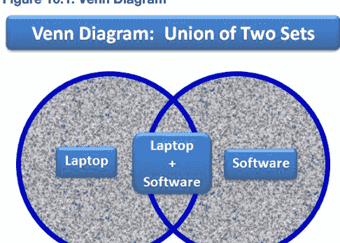

例如，表示UNION集合的SQL过程代码首先从每个查询构造两个结果集，将这两个结果集合并排序，然后从最终结果中消除重复行。

## SQL代码（效率较低）

```
OPTIONS FULLSTIMER;
PROC SQL;
    SELECT *
        FROM PRODUCTS
            WHERE UPCASE(PRODTYPE) = 'LAPTOP'

    UNION

    SELECT *
        FROM PRODUCTS
            WHERE UPCASE(PRODTYPE) = 'SOFTWARE';
QUIT;
```

## SAS日志结果

```
OPTIONS FULLSTIMER;
PROC SQL;
    SELECT *
        FROM PRODUCTS
            WHERE UPCASE(PRODTYPE) = 'LAPTOP'

    UNION

    SELECT *
        FROM PRODUCTS
            WHERE UPCASE(PRODTYPE) = 'SOFTWARE';
QUIT;
NOTE: PROCEDURE SQL used (Total process time):
    real time          0.16 seconds
    user cpu time      0.00 seconds
    system cpu time    0.04 seconds
    memory             634.09k
    OS Memory          6768.00k
    Timestamp          06/03/2012 04:59:57 PM
```

为了提高UNION性能，可以将SQL过程代码转换为在WHERE子句中使用OR条件的单一查询。下一个示例说明如何通过将UNION转换为在WHERE子句中使用OR运算符的单一查询，使前面的SQL过程代码更高效。

## SQL代码（高效）

```
OPTIONS FULLSTIMER;
PROC SQL;
    SELECT DISTINCT *
        FROM PRODUCTS
        WHERE UPCASE(PRODTYPE) = 'SOFTWARE' OR
              UPCASE(PRODTYPE) = 'LAPTOP';
QUIT;
```

## SAS日志结果

```
OPTIONS FULLSTIMER;
PROC SQL;
    SELECT DISTINCT *
        FROM PRODUCTS
        WHERE UPCASE(PRODTYPE) = 'SOFTWARE' OR
              UPCASE(PRODTYPE) = 'LAPTOP';
QUIT;
NOTE: PROCEDURE SQL used (Total process time):
    real time          0.10 seconds
    user cpu time      0.04 seconds
    system cpu time    0.01 seconds
    memory             565.60k
    OS Memory          6768.00k
    Timestamp          06/03/2012 05:06:55 PM
```

下一个示例说明如何通过将UNION转换为在WHERE子句中使用IN谓词的单一查询，使前面的SQL过程代码更高效。

## SQL代码（高效）

```
OPTIONS FULLSTIMER;
PROC SQL;
    SELECT DISTINCT *


FROM PRODUCTS
    WHERE UPCASE(PRODTYPE) IN ('SOFTWARE', 'LAPTOP');
QUIT;

## SAS 日志结果

```
OPTIONS FULLSTIMER;
PROC SQL;
    SELECT DISTINCT *
        FROM PRODUCTS
            WHERE UPCASE(PRODTYPE) IN ('SOFTWARE', 'LAPTOP');
QUIT;
NOTE: PROCEDURE SQL used (Total process time):
    real time            0.07 seconds
    user cpu time        0.01 seconds
    system cpu time      0.04 seconds
    memory               561.41k
    OS Memory            6768.00k
    Timestamp            06/03/2012 05:12:56 PM
```

另一种可以改善使用 SET 操作符的查询性能的方法是指定 ALL 关键字，只要重复项不是问题或表中的行都是唯一的即可。因为 ALL 关键字阻止 SQL 两次处理数据并且不删除重复行，所以 CPU 资源可能会得到改善。下一个示例显示了 UNION ALL 编码构造被用来执行相当于追加操作的操作，从而完全绕过了排序，因为重复行不会被删除。

## SQL 代码（效率较低）

```
OPTIONS FULLSTIMER;
PROC SQL;
    SELECT *
        FROM PRODUCTS
            WHERE UPCASE(PRODTYPE) = 'LAPTOP'

    UNION ALL

    SELECT *
        FROM PRODUCTS
            WHERE UPCASE(PRODTYPE) = 'SOFTWARE';
QUIT;
```

## SAS 日志结果

```
OPTIONS FULLSTIMER;
PROC SQL;
    SELECT *
        FROM PRODUCTS
            WHERE UPCASE(PRODTYPE) = 'LAPTOP'

UNION ALL
SELECT *
    FROM PRODUCTS
        WHERE UPCASE(PRODTYPE) = 'SOFTWARE';
QUIT;
NOTE: PROCEDURE SQL used (Total process time):
    real time            0.06 seconds
    user cpu time        0.00 seconds
    system cpu time      0.04 seconds
    memory               226.42k
    OS Memory            6768.00k
    Timestamp            06/03/2012 05:22:14 PM
```

## 摘要

- 1. 性能调优涉及测量、评估和修改查询的执行，以在相互竞争的计算机资源之间实现最佳平衡（参见“理解性能调优”部分）。
- 2. 在创建表或视图时避免指定 ORDER BY 子句（参见“排序与性能”部分）。
- 3. 当排序是必要的时，指定 SORTPGM= 系统选项以指示 SAS 系统根据数据库环境的大小使用最佳可能的排序实用程序（参见“用户指定的排序”部分）。
- 4. 建议将 GROUP BY 子句中的分组列数量保持在尽可能小的范围内（参见“拆分表”部分）。
- 5. 应谨慎地将索引分配给表中的那些区分变量，并避免创建过多的索引（参见“索引与性能”部分）。
- 6. 当表相对较小时（通常少于三页），创建或使用索引没有任何优势（参见“查看 CONTENTS 输出和系统消息”部分）。
- 7. 将 MSGLEVEL= 系统选项设置为“I”允许 SAS 显示有关一个或多个索引存在与否以优化 WHERE 子句处理的重要信息（如果可用）（参见“查看 CONTENTS 输出和系统消息”部分）。
- 8. 应用 WHERE 子句处理以限制结果表的行数（参见“使用索引优化 WHERE 子句处理”部分）。
- 9. 在 WHERE 子句中构造 AND 条件链时，先指定最严格的条件值（参见“构造高效的逻辑条件”部分）。

## 索引

A
ADD 子句 210–211
加法 (+) 操作符 38–40
ad-hoc 查询 280
_AGGR 选项 342
聚合函数
  使用聚合函数创建宏变量 152–153
  指定 257–258
ALL 关键字 268
ALTER TABLE 语句 193–202, 207, 210–211, 214–219, 338–340
模糊引用，列错误 347
AND 操作符 36–38
ANSI（美国国家标准学会） 7–8
APPEND 过程 276
算术数据 29–32
算术操作符 38–40
AS 关键字 32–34
_ASGN 选项 342
星号 (*) 通配符 59
使用自动宏变量控制处理 156–158
自动排序 353
AVG 函数 59

B
BEST 选项 353
BETWEEN 谓词 63–65
B-tree 223
错误 324
从 Microsoft Excel 批量加载数据 186–191
Burlew, Michele M.
  Output Delivery System: The Basics and Beyond 114

SAS Macro Programming Guide Made Easy, Second Edition 148
BY 语句 144

C
计算列视图 298
计算列 299
基数 225
Carpenter, Art
  Carpenter's Complete Guide to the SAS Macro Language, Second Edition 148
Carpenter's Complete Guide to the SAS Macro Language, Second Edition (Carpenter) 148
笛卡尔积连接 242
笛卡尔积查询 237
CASE 表达式
  关于 123–124
  分配标签和分组数据 143–146
  案例逻辑与 COALESCE 表达式 142–143
  逻辑和空值 146–148
  搜索的 137–142
  简单的 124–136
案例逻辑，COALESCE 表达式与 142–143
CAT 函数 41
CATALOGS 字典表 73, 79
CATS 函数 41
CATX 函数 100
Celko, Joe
  SQL for Smarties: Advanced SQL Programming 4, 47, 48, 298
变更控制，保留 202
CHECK 约束 196–197
CHECK_CONSTRAINTS 字典表 73
COALESCE 表达式，案例逻辑与 142–143
COALESCE 函数 49, 142–143
Code Complete: A Practical Handbook of Software Construction, Second Edition (McConnell) 134
编码
    参见复杂查询编码
编码逻辑
    关于 123
    CASE 表达式 123–148
    条件逻辑 122–123
    接口 PROC SQL 与宏语言 148–161
列别名，创建 32–33
列约束 192
使用列定义列表创建表 165–169
列
    向行中添加数据 176–185
    向表中添加 210–211
    计算的 299
    更改格式 218–219
    更改标签 219
    更改长度 214–218
    控制表中位置 212–214
    交叉引用 158–159
    派生的 299
    在列之间插入文本和常量 99–101
    修改包含索引的列 229
    按列排序输出 104–107
    重命名 219–221
    使用标量表达式与所选列 101–104
COLUMNS 字典表 73, 79–80
逗号分隔值 CSV 文件 116
比较操作符 35–36
The Complete Guide to Using SAS Indexes (Raithel) 224
使用搜索 CASE 表达式进行复杂比较 139–140
复杂查询编码
    关于 234–235
    笛卡尔积连接 242
    复杂查询应用 280–292
    内连接 237, 242–255
    连接 235–255
    外连接 238, 255–260
    集合操作 238, 271–280
    子查询 238, 261–271
    类型 236–239
复杂查询应用
    关于 280
    确定输入表中的行数 290–291
    识别索引最多的表 291–292
    多对多关系 237, 280–285
    多对一关系 237, 280–285
    一对多关系 237, 280–285
    一对一关系 237, 280–285
    处理 BY-and 组的第一行、最后一行和中间行 285–290
复合索引 228–229
在连接中执行计算 250–251
连接
    字符字符串 97–101
    来自两个查询的行 276–278
连接字符串 40–41
连接字符字符串操作符 (||) 97–101
概念数据库设计 2–3
条件逻辑 122–123
在列之间插入常量 99–101
CONSTRAINT_COLUMN_USAGE 字典表 73
CONSTRAINT_TABLE_USAGE 字典表 73
CONTENTS 过程 211–216, 218, 300–301, 355–358
相关子查询 238, 261, 269–271
COUNT 函数 59, 60, 160–161

CREATE TABLE 语句 74–75, 114–115, 164, 169–172, 193–197, 215–216, 219–222, 338–340
CREATE VIEW 语句 213–214, 297, 299–300
Cross Join 查询 237
交叉引用列 158–159
CSS 函数 59
CSV（逗号分隔值）文件 116
自定义查询 280
CUSTOMERS 表 9, 12, 15
自定义列表
  使用搜索 CASE 表达式创建 140–142
  使用简单 CASE 表达式创建 129–130
CV 函数 59

D
DASD（直接访问存储设备） 352
数据
  关于 24
  访问字典表的内容 78–88
  向行中的列添加数据 176–185
  使用 SET 子句向表中添加数据 173–175
  使用 SELECT 查询添加数据 185–186
  算术 29–32
  算术操作符 38–40
  从 Microsoft Excel 批量加载数据 186–191
  字符 28
  字符字符串操作符和函数 40–58
  比较操作符 35–36
  日期和时间列定义 27–28
  删除数据行 320
  字典表列名 75–78
  字典表 72–88
  显示字典表定义 74–75
  导出到 Microsoft Excel 116–118
  分组 107–110, 143–146
  使用汇总函数分组 107–109
逻辑操作符 36–38
元数据和字典表 72–74
缺失 29–32
缺失值 28–29, 66–68
NULL 值 3, 28–29, 66–68
数值 24–27
谓词 62–71
排序 109–110
SQL 关键字 32–34
SQL 操作符和函数 35–71
汇总 58–62
类型 24
更新表中的数据 230–231
更新数据行 313–320
数据定义语言 DDL 语句 210
数据完整性 8–9
数据问题 326
数据安全 307–308
DATA 步 25, 42–43, 113, 216, 217–218, 236, 305–306
数据库设计
  关于 2
  列名 7–8
  数据库的概念视图 2–3
  数据完整性 8–9
  本书中使用的数据库表 9–20
  规范化 4–7
  重复信息 3–4
  保留字 7–8
  表定义 3
数据库结构 14
数据库表
  参见表
数据库强制约束
  参见完整性约束
DATAITEMS 字典表 73
DATASETS 过程 221–222
日期列定义 26–27
DDL（数据定义语言）语句 210


-   按列对输出排序 104–107
  - 使用输出传递系统（ODS）112–119
- 标量表达式 101–104
- 将输出发送到 SAS 数据集 114–115
- 使用 HAVING 子句对组进行子集选择 110–112
- 在行之间写入空行 92–93
- 第四范式（4NF）7
- FREQ 函数 59
- FROM 子句 78, 104–107
- 完全外连接 259–260
- 函数：参见 SQL 运算符和函数
- FUNCTIONS 字典表 73

## G
- GOPTIONS 字典表 73
- 大于运算符（>）35–36, 246
- GROUP BY 子句 58, 107–112, 257–258, 354
- 分组视图 298
- 分组 107–110, 143–146, 354
- 组，使用 HAVING 子句进行子集选择 110–112
- Gupta, Sunil Kumar：使用输出传递系统快速获得结果 114

## H
- 哈希连接算法 239
- HAVING 子句 58, 110–112, 130–131, 152–153, 160–161, 269–271
- Haworth, Lauren：输出传递系统：基础与扩展 114
- HOST 选项 353
- Hsieh, Yuan：调试的科学 324
- HTML 语句 118–119
- 混合视图 298
- 超文本标记语言（HTML）117

## I
- IMPORT 过程 186, 190
- IN 谓词 65–66
- INDEX 函数 45
- 索引连接算法 239
- 索引
  - 关于 210, 222–224
  - 复合索引 228–229
  - 创建 228–229
  - 定义 227–228
  - 删除 229–230
  - 设计 224–225
  - 识别索引最多的表 291–292
  - 修改包含索引的列 229
  - 使用索引优化 WHERE 子句处理 358–365
  - 性能与索引 354–355
  - 防止索引中的重复值 229
  - 索引中的选择性 225–227
- INDEXES 字典表 73, 83
- INFOMAPS 字典表 73
- 信息收集
  - 基于关系 235–236
  - 作为调试过程中的步骤 325
- 内连接
  - 关于 237, 242–243
  - 等值连接 237, 243–245
  - 涉及三个以上表的连接 253–255
  - 非等值连接 237, 245–246
  - 在连接中执行计算 250–251
  - 自反连接 237, 247–249
  - 自连接 237, 247–249
  - 涉及三个表的连接 251–253
  - 在连接中使用表别名 249–250
- INOBS= 选项 333–334
- INSERT INTO 语句 172–186, 313–317, 343–344
- 完整性 9
- 完整性约束
  - 关于 192
  - 定义 192
  - 删除包含约束的表 206–208
  - 显示 202–203
  - 使用 NOT NULL 约束防止空值 192–195
  - 参照完整性约束 197–198
  - 类型 192
- INTERSECT 运算符 238, 273–274
- INTO 子句 151–152, 153–154, 154–155, 155–156
- INVENTORY 表 10, 12, 16
- INVOICE 表 10, 12, 16
- IS MISSING 谓词 67–68
- IS NOT NULL 谓词 67
- IS NULL 谓词 66–68

## J
- JOIN 构造 131–132
- 连接视图 298
- 连接
  - 关于 235
  - 算法 239
  - 连接的重要性 235–242
  - 影响连接 239–242
  - 涉及三个以上表的连接 253–255
  - 在连接中执行计算 250–251
  - 涉及三个表的连接 251–253
  - 使用表别名 249–250

## L
- LABEL= 选项 103–104
- 标签，分配 143–146
- LEFT 函数 43–44
- 左外连接 255–258
- LENGTH 函数 42
- LENGTH= 修饰符 25–26
- LENGTH 语句 25, 166, 168, 216, 217–218
- %LET，使用其创建宏变量 149–151
- LIBNAME 语句 186
- LIBNAMES 字典表 73
- 使用 LIKE 子句创建表 169–170
- LIKE 谓词 68–70
- 逻辑
  - 条件逻辑 122–123
  - 空值与逻辑 146–148
- 隐藏逻辑复杂性 308–310
- 逻辑问题 326
- 逻辑设计 2–3
- 逻辑运算符 36–38
- LOOPS= 选项 334–336
- LOWCASE 函数 45–46

## M
- 构建宏应用程序 158–161
- 宏语言，与 PROC SQL 接口 148–161
- 构建宏工具 158–161
- 宏变量和值
  - 关于 149
  - 控制处理 156–158
  - 使用 WHERE 子句控制选择和填充 154–155
  - 从表行列创建 151–152
  - 创建值列表 155–156
  - 创建多个宏变量 153–154
  - 使用聚合函数创建 152–153
  - 使用 %LET 创建 149–151
  - 使用宏变量进行故障排除和调试 343–345
- MACROS 字典表 73, 83–84
- MAGIC 选项 239–242
- MANUFACTURERS 表 10–11, 13, 17
- 多对多关系 237, 280–285
- 多对一关系 237, 280–285
- MAX 函数 59
- McConnell, Steve：代码大全：软件构造实践手册（第二版）134
- MEAN 函数 59
- MEMBERS 字典表 73, 84–85
- 元数据，字典表与 72–74
- _METHOD 选项 331–333
- Microsoft Excel
  - 从 Microsoft Excel 批量加载 186–191
  - 将数据和输出导出到 Microsoft Excel 116–118
- MIN 函数 59, 60
- 缺失数据 29–32
- 缺失值 28–29, 66–68
- MODIFY 子句 214–218, 218–219
- MONOTONIC() 函数 52–58
- MSGLEVEL=1 331–333
- 乘法（*）运算符 38–40

## N
- N 函数 59
- 嵌套循环连接算法 239
- 嵌套视图 298
- 嵌套 134–135, 310–312
- NMISS 函数 59
- NOBS 159–160
- NOFEEDBACK 选项 328–331
- 选择非连续值 65–66
- 非等值连接 237, 245–246
- 规范化 4–7
- NOT IS NULL 谓词 67
- NOT NULL 约束 192–195
- NOT 运算符 36–38, 68
- NULL 值 3, 28–29, 66–68
- 空值，逻辑与 146–148
- NUMBER 选项 55–58
- 数值数据 24–27

## O
- ODS（输出传递系统）112–119
- ODS 语句 114–115
- 180-322：语句无效或使用顺序不当错误 348–349
- 一对多关系 237, 280–285
- 一对一关系 237, 280–285
- 运算符，与函数结合 42–43
  - 另请参见 SQL 运算符和函数
- OPTIONS 字典表 73, 85–86
- OR 运算符 36–38, 64
- ORDER BY 子句 104–107, 109–110, 154–155
- 外连接
  - 关于 238, 255
  - 完全外连接 259–260
  - 左外连接 255–258
  - 右外连接 258–259
- OUTER UNION 运算符 238, 276–278
- OUTOBS= 选项 341
- 输出，格式化：参见格式化输出
- 输出传递系统（ODS）112–119
- 输出传递系统：基础与扩展（Haworth、Zender 和 Burlew）114
- OUTPUT 语句 114–115

## P
- 模式
  - 在字符串中查找模式 68–70
  - 使用 INDEX 函数查找模式出现位置 45
- 百分号（%）68–70
- 性能：参见调优过程
- 句点（.）29
- Perry, William E.：软件测试的有效方法 324
- 语音匹配 47–49
- 物理设计 2–3
- _PJD 选项 342
- 填充表 172–191
- 优先级，集合运算符与 272
- 谓词
  - 关于 62–63
  - 在字符串中查找模式 68–70
  - 选择非连续值 65–66
  - 选择值的范围 63–65
  - 测试值是否存在 71
  - 测试 NULL 或缺失值 66–68
- 主键 9, 198–199
- PRINT 过程 52, 92, 93, 304–305
- 问题评估和分类，作为调试过程中的步骤 325
- 问题识别，作为调试过程中的步骤 325
- 问题解决，作为调试过程中的步骤 325
- PROC 步骤 113
- PRODTYPE 宏变量 149
- 面向生产的查询 280
- PRODUCTS 表 11, 13, 17
- PROMPT 选项 341–342
- PROMPTS 字典表 74
- PROMPTSXML 字典表 74
- 空值的传播 29
- PRT 函数 59
- PURCHASES 表 11, 13, 18–20
- %PUT 语句 330, 343–344

## Q
- 查询
  - 另请参见复杂查询，编码
  - 从两个查询的组合中访问行 274–276
  - 从两个查询的交集中访问行 272–274
  - 临时查询 280
  - 比较两个查询中的行 278–280
  - 连接两个查询中的行 276–278
  - 交叉连接 237
  - 自定义查询 280
  - 面向生产的查询 280
  - 使用 VALIDATE 语句验证查询 327–328
- 使用输出传递系统快速获得结果（Gupta）114
- QUIT 语句 93

## R
- Raithel, Michael：SAS 索引使用完全指南 224
- RANGE 函数 59
- 只读视图 298
- 消除冗余 307
- 冗余信息，在数据库设计中 3–4
- 参照完整性 9, 197–198
- REFERENTIAL_CONSTRAINTS 字典表 74
- 自反连接 237, 247–249
- 基于关系的信息检索 235–236
- REMEMBER 字典表 74
- 重命名
  - 重命名列 219–221
  - 重命名表 221–222
- 需求问题 327
- 保留字 7–8
- RESET 语句 93, 336–338
- 将输出转换为富文本格式 115–116
- RIGHT 函数 43–44
- 右外连接 258–259
- 行
  - 从两个查询的组合中访问行 274–276
  - 从两个查询的交集中访问行 272–274
  - 在列中添加数据 176–185
  - 比较两个查询中的行 278–280
  - 连接两个查询中的行 276–278
  - 删除表中的行 203–205
  - 删除数据行 320
  - 确定表中的行数 159–160
  - 显示行号 93–96
  - 识别表中的重复行 160–161
  - 使用子查询传递多行 266–267
  - 生成行号 52–58
  - 更新数据行 313–317, 317–320
  - 在行之间写入空行 92–93
- _RSLV 选项 343

## S
- 数据库表示例 14–20
- SAS 数据集，将输出发送到 114–115
- *SAS 语言参考：字典* 8, 27
- *SAS 宏语言：参考*（SAS Institute Inc.）148
- *SAS 宏编程指南轻松掌握（第二版）*（Burlew）148
- *SAS 过程指南* 75
- SASHELP 视图 72–75
- 标量表达式，与选定的列一起使用 101–104
- SCAN 函数 43
- *调试的科学*（Telles 和 Hsieh）324
- 搜索 CASE 表达式
  - 关于 137
  - 使用搜索 CASE 表达式进行复杂比较 139–140
  - 使用搜索 CASE 表达式创建自定义列表 140–142
  - 在 SELECT 子句中 137–138
- 第二范式（2NF）5–6
- 2NF（第二范式）5–6
- 安全性，数据 307–308
- SELECT 子句
  - CREATE TABLE 语句 215–216, 219–221
  - 搜索 CASE 表达式在 SELECT 子句中 137–138
  - 简单 CASE 表达式在 SELECT 子句中 124–128, 130–131
- SELECT 查询 185–186, 213–214, 222
- SELECT 语句
  - FROM 子句 78
  - 使用聚合函数创建宏变量 152–154
  - 创建视图 299–300, 302–303
  - 查找第一个非缺失值 49
  - 使用汇总函数对数据进行分组 107–109
  - 与连接一起使用 235
- MONOTONIC() 函数 52–58
- SQLLOOPS 宏变量 344
- SQLRC 宏变量 345
- 汇总数据 58
- 更新数据行 313–320
- 将标量表达式与选定的列一起使用 101–104
- 验证查询 327–328
- 查询中的通配符 279
- 选择性，索引的 225–227
- 自连接 237, 247–249
- SET 子句 173–175, 230–231
- 集合操作视图 298
- 集合操作
  - 关于 238, 271
  - 从两个查询的组合中访问行 274–276
  - 从两个查询的交集中访问行 272–274
  - 比较两个查询中的行 278–280
  - 连接两个查询中的行 276–278
  - 优先级与 272
  - 集合运算符规则 271–272
- 73-322：期望出现 AS 错误 345–346, 349
- 单表视图 298
- 解决方案复杂性问题 327
- 排序
  - 自动排序 353
  - 数据排序 109–110
  - 性能与排序 352–353
  - 用户指定的排序 353
- 排序合并连接算法 239
- SORTPGM= 系统选项 353
- SOUNDEX 函数 48–49
- 发音相似运算符（=*）47–49
- 拆分表 354
- *聪明人的 SQL：高级 SQL 编程*（Celko）4, 47, 48, 298
- SQL 关键字 32–34
- SQL 语言 7–8
- SQL 运算符和函数
  - 关于 35
  - 聚合函数 152–153, 257–258
  - 算术运算符 38–40
  - 字符串 40–58
  - 将函数与运算符结合 42–43


- 比较运算符 35–36
- 逻辑运算符 36–38
- 谓词 62–71
- 汇总数据 58–62
- SQL 过程 250–251, 328–349
- SQL 过程连接，DATA 步合并与之对比 236
- SQLOBS 宏变量 156–158, 343–344
- SQLOOPS 宏变量 156–158, 344
- SQLRC 宏变量 156–158, 345
- 语句
  - 参见特定语句
- STD 函数 59
- STDERR 函数 59
- 策略，规范化 5–7
- 字符串
  - 更改大小写 45–46
  - 连接 40–41
  - 从中提取信息 46–47
  - 查找长度 42
  - 查找模式 68–70
- 结构，数据库 14
- STYLES 字典表 74
- _SUBQ 选项 343
- 子查询
  - 关于 238, 261
  - 替代方法 261–262
  - 相关 238, 261, 269–271
  - 使用子查询传递多行 266–267
  - 使用子查询传递单个值 262–266
- SUBSTR 函数 46–47, 126
- 减法 (-) 运算符 38–40
- SUM 函数 59, 60–61
- 汇总数据 58–62
- 汇总函数，使用分组汇总数据 107–109
- SUMWGT 函数 59
- 语法问题 326
- 系统消息，查看 355–358
- 系统相关问题 326

## T
- T 函数 59
- 表别名，在连接中使用 249–250
- 表约束 192
- 表行列，从中创建宏变量 151–152
- TABLE_CONSTRAINTS 字典表 74
- 表
  - 关于 164, 210
  - 向表中添加列 210–211
  - 使用 SET 子句向表中添加数据 173–175
  - 基数 225
  - 控制表中列的位置 212–214
  - 创建 164–172
  - 从现有表创建 170–172
  - 使用列定义列表创建 165–169
  - 使用 LIKE 子句创建 169–170
  - 删除 205–208
  - 删除表中的行 203–205
  - 识别具有最多索引的表 291–292
  - 完整性约束 192–203
  - 连接超过三个表 253–255
  - 连接三个表 251–253
  - 修改 210–222
  - 填充 172–191
  - 重命名 221–222
  - 示例 14–20
  - 分割 354
  - 更新表中的数据 230–231
  - 本书中使用 9–20
- TABLES 字典表 74, 86–87
- Telles, Matthew A.
  - The Science of Debugging 324
- 测试
  - 环境问题 327
  - 值是否存在 71
  - 缺失值 66–68
  - NULL 值 66–68
- 文本，在列之间插入 99–101
- 第三范式 (3NF) 4, 6–7
- 时间列定义 26–27
- TITLE 语句 149
- TITLES 字典表 74, 87–88
- _TREE 选项 331–333
- TRIM 函数 43, 98–99
- 故障排除
  - 另见调试
  - 关于 323
  - 示例 345–349
  - 使用宏变量 343–345
  - 技术 327–342
  - 问题类型 326–327
- 截断字符串比较运算符 36
- 调优过程
  - 关于 351–352
  - 自动排序 353
  - 避免 UNION 361–365
  - 构建高效的逻辑条件 359–361
  - 分组与性能 354
  - 索引与性能 354–355
  - 使用索引优化 WHERE 子句处理 358–365
  - 查看 CONTENTS 输出和系统消息 355–358
  - 排序与性能 352–353
  - SORTPGM= 系统选项 353
  - 分割表 354
  - 用户指定排序 353
- 200-322：未识别符号且将被忽略错误 347–348
- 202-322：未识别选项或参数且将被忽略错误 346

## U
- 下划线 (_) 70
- 未记录的 SQL 过程选项 342–349
- UNION 运算符 238, 274–276
- UNION，回避 361–365
- UNIQUE 关键字 32–34, 80, 195–196, 229
- 唯一值，查找 34
- UPCASE 函数 45–46
- 可更新视图 298, 312–320
- UPDATE 查询 337–338
- UPDATE 语句 42–43, 230–231, 317–320
- 更新
  - 表中的数据 230–231
  - 数据行 317–320
  - 使用简单 CASE 表达式有条件地更新表 135–136
- 用法错误 324
- 用户指定排序 353
- USS 函数 59
- _UTIL 选项 343

## V
- 验证解决方案，作为调试过程中的步骤 325
- VALIDATE 语句 327–328
- 值
  - 另见宏变量和值
  - 比较值集合 267–269
  - 在宏变量中创建值列表 155–156
  - 查找重复值 33–34
  - 查找第一个非缺失值 49–52
  - 查找唯一值 34
  - 缺失 28–29, 66–68
  - NULL 3, 28–29, 66–68
  - 使用子查询传递单个值 262–266
  - 防止索引中重复 229
  - 选择不连续值 65–66
  - 选择值范围 63–65
  - 测试是否存在 71
- VALUES 子句 176–181, 316
- VAR 函数 59
- 视图
  - 关于 296–297
  - 创建 299–303
  - 数据安全 307–308
  - DATA 步与 305–306
  - 删除 321
  - 删除数据行 320
  - 描述定义 301–302
  - 显示内容 300–301
  - 消除冗余 307
  - 隐藏逻辑复杂性 308–310
  - 嵌套 310–312
  - SAS 过程与 303–305
  - 类型 297–298
  - 可更新 298, 312–320
  - 更新现有数据行 317–320
  - 在 SAS 中使用 302–303
- VIEWS 字典表 74, 88

## W
- Web，向其交付结果 118–119
- WHEN 条件 124, 137
- WHERE 子句
  - CATALOGS 字典 79
  - 组合函数和运算符 43
  - 比较值集合 267–269
  - 条件逻辑 122–123
  - 使用 WHERE 控制宏变量的选择和填充 154–155
  - 从表行列创建宏变量 151–152
  - 用于删除表中的行 203–205
  - 大于运算符 (>) 246
  - 连接与 251–256
  - 使用索引优化处理 358–365
  - 使用子查询传递单个值 262–266
  - 使用简单 CASE 表达式防止除零 132–133
  - 选择值范围 63–64
  - 集合操作 272–274
  - WHERE 中的简单 CASE 表达式 128–129
  - 指定 257
  - 使用 HAVING 子句子集分组 110–112
  - TABLES 字典 86–87
  - 更新数据行 313–317, 317–320
- WHERE 表达式 230–231

## Y
- YEAR 函数 63–64

## Z
- Zender, Cynthia L.
  - Output Delivery System: The Basics and Beyond 114
- 零，除法 132–133

## 符号和数字
- + (加法) 运算符 38–40
- * (星号) 通配符 59
- || (连接字符字符串运算符) 97–101
- / (除法) 运算符 38–40
- = (等于运算符) 38–40, 243, 245, 262–266
- ** (指数) 运算符 38–40
- > (大于运算符) 35–36, 246
- * (乘法) 运算符 38–40
- % (百分号) 68–70
- . (句点) 29
- =* (相似运算符) 47–49
- - (减法) 运算符 38–40
- _ (下划线) 70
- 1NF (第一范式) 5
- 2NF (第二范式) 5–6
- 3NF (第三范式) 4, 6–7
- 4NF (第四范式) 7
- 5NF (第五范式) 7
- 73-322：期望 AS 错误 345–346, 349
- 180-322：语句无效或使用顺序不当错误 348–349
- 200-322：未识别符号且将被忽略错误 347–348
- 202-322：未识别选项或参数且将被忽略错误 346

