# PROC TEMPLATE 简明指南：SAS 用户指南


随时查找答案，或今天就掌握。查看定价方案。

## 关于本书

PROC TEMPLATE 教程：一本帮助 SAS 用户理解 PROC TEMPLATE 威力的指南。所有 SAS 过程都使用这种模板语言来描述输出表格，并用于创建用于样式的自定义报告和图形，其功能与 Base 过程一样强大。

### 这本书适合你吗？

如果你希望学习更多关于创建自定义报告以及如何使用 PROC TEMPLATE 创建新设计的内容，

### 本书范围

需要 ODS 的基础知识。

本书涵盖了表格和模板的理论，并详尽介绍了如何使用 PROC TEMPLATE 创建自定义报告。书中穿插许多示例，以帮助你理解相关概念。

第 1 章“引言”解释了如何使用 SAS TEMPLATE 定义表格的结构。第 2 章“在 SAS 报告中使用表格”解释了如何使用 SAS TEMPLATE 语言对 ODS 输出进行样式设置。书中详细解释了表格的主体。第 3 章解释了如何创建书中涵盖的“数据依赖型”和“数据不依赖型”表格。

### 第 3 章：“创建和自定义表格”，

本章涵盖了所有类型的表格，包括头、页脚、样式以及如何在 ODS 输出中对其进行样式设置。书中提供了表格示例，以及如何使用 PROC TEMPLATE 和 PROC GREPORT 来创建这些表格。

### 第 4 章：“模板管理”，

本章解释了如何使用 ODS 路径传递模板，以及你如何在工作环境中移动它们。到本书为止，用于创建设计和显示模板的 PROC TEMPLATE 每个部分都将在本章中演示。

### 附录 A：“与 SAS 旧版本的兼容性”，

附录 A 提供了不同 SAS 版本之间样式的兼容性表。

### 附录 B：“SAS/GRAPH 中的颜色值”，

附录 B 提供了你可能在报告使用的 SAS/GRAPH 颜色值列表。

### 本书未涵盖的内容

本书未涵盖其他内容。


# 模板结构

无论每个模板语言的对象和选项是什么，它们本质上都是通过 DEFINE 定义的。这种结构可以被认为是一个简单的对象包。对象是与等号 (=) 关联的键值对，其中名称在左侧，值在右侧。根据模板语言定义，对象可以包含其他对象和选项。某些模板允许嵌套对象，而嵌套对象也可以包含嵌套对象。其他内容始终可以被视为一组独特的对象和选项的包。

假设我们想要一个模板来描述一个杂货购物车。购物车包含几袋杂货。袋中的物品是独立的对象，不包含其他对象。

一个典型购物车的图形化表示如下所示。

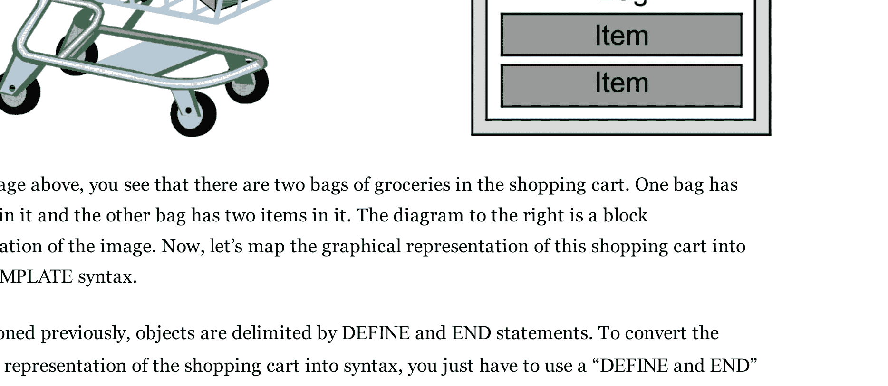

首先是对图 1 或更新更新内容的回答。今天就订阅。[查看定价选项](#)

在上面的图片中，你看到购物车里有两袋杂货。其中一袋有一个物品，另一个袋有两个物品。右侧的图表是该图像的区块表示。现在，让我们把购物车的图形表示映射到 PROC TEMPLATE 中。

如前所述，对象是由 DEFINE 和 END 语句定义的。要将购物车的图形表示转换为代码，你只需要为要创建的每个类型的对象使用“DEFINE”和“END”块。END 语句完成模板。DEFINE 语句定义了要创建的对象类型。

```
PROC TEMPLATE:

DEFINE shopping_cart:
  DEFINE bag:
    DEFINE item;
    END;
  END;
  DEFINE bag:
    DEFINE item;
    END;
  END;
  DEFINE item;
  END;
  END;

RUN;
```

这与编写良好的 PROC TEMPLATE 代码非常接近。仍然缺失的各个部分与每个对象的名称相关联。在任何模板中，DEFINE 语句必须建立关联。名称可以由数字、列表和点 (.) 组成，并且在特定范围内必须是唯一的（例如，在购物车内的多个袋子必须必须在袋子内具有唯一名称）。在上述代码中添加名称后可以得到如下结果：

```
PROC TEMPLATE:

DEFINE SHOPPING_cart:

  DEFINE bag:
    DEFINE item milk;
      QTY = 2;
    END;
  END;
  DEFINE bag:
    DEFINE item lettuce;
    END;
    DEFINE item oranges;
      TYPE = ORANGE;
      QUANTITY = 10;
    END;
  END;

  END;

RUN;
```

如果你以前见过任何真实的 PROC TEMPLATE 代码，上面的结构看起来会非常熟悉。唯一缺失的是对象内部的影响每个模板行为的选项和语句。让我们为杂货物品添加一些选项，以使这个示例变得完整。

```
PROC TEMPLATE:

DEFINE SHOPPING_cart:

  DEFINE bag:
    DEFINE item milk;
      QTY = 2;
    END;
  END;
  DEFINE bag:
    DEFINE item lettuce;
    END;
    DEFINE item oranges;
      TYPE = ORANGE;
      QUANTITY = 10;
    END;
  END;

  END;
```

本课程的内容纯粹是假设性的，因为不存在所谓的结构化购物车。这里还有一个额外的语句，但它将演示所有模板是如何从对象、选项和语句构建而成的。

1. 模板由 DEFINE 和 END 语句定义。
2. 对象由 DEFINE 定义。
3. 范围内的对象必须具有唯一的名称。

# 模板类型

有不同类型的模板可用，例如表格（Table）、图形（Graph）和 Taglet。每种都有其作用。考虑到这一点，模板设计的唯一规则就是保持数据并使用模板。即使有独立的模板，它们也可以被拆分为更小的组件。

- 映射到独立数据集的独立模板
- 不映射到数据集的独立模板


## 数据依赖型

数据依赖模板包括表格、图形和 Taglet 模板。这些中的每一个都使用数据集来生成输出。

- 基于观测值的输出的模板。
- 基于实体的输出的模板。

基于观测值控制模板输出比基于实体的控制模板输出要先进得多，因为 ODA 数据步非常难以理解。我们将从一组更容易理解的复杂模板开始。该方法是定义并渲染模板。下表是一个表格示例。

```
PRINT:
  template: table_class
class:
  data: dataset_1
```

原始代码显示了如何使用 PRINT_CLASS 将 TABLECLASS 映射到表格。你也可以使用 PRINT 或 PRINT_CLASS 来实现下所示的操作。

```
PRINT:
  template: table_class
class:
  data: dataset_1
```

使用这种方法，原始代码如下：

```
PRINT:
  template: table_class
class:
  data: dataset_1
  output: table_class
```

使用 PRINT_CLASS 和 PRINT_TEMPLATE 的唯一区别是前者会将模板保存到磁盘。如果你想在不保存到磁盘的情况下使用模板，请使用 PRINT_NULL。你也可以根据需要将模板存储在内存中。

```
PRINT_NULL:
  template: table_class
data: dataset_1
```

这是一个由 TAGLET 生成的图形示例。我们使用的模板是：

```
GRAPH:
  template: graph_class
class:
  data: dataset_1
```

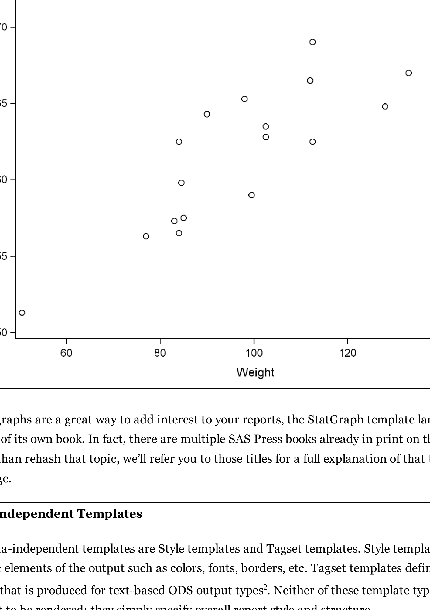

图形也能快速吸引读者，因此多个 SAS 书籍出现在主题上。所以值得注意的是，与其说是主题，我们将参考这些内容对该模板进行完整解释。

## 数据独立型

数据独立型模板包括表格模板和 Taglet 模板。这些中的每一个都定义了为 ODA 输出类型生成的输出。其他模板类型使用数据集产生数据和输出。

表格和 Taglet 模板都由全局 ODA 语句处理。你可以告诉 ODA 使用模板。

虽然标签是模板的一种，但它们也可以被视为一种编程语言。Taglet 定义了输出的标记，包括 HTML、XML、PDF 等。Taglet 模板负责生成布局，在大多数情况下布局是由 HTML 创建的。然而，taglet 的渲染输出所示。

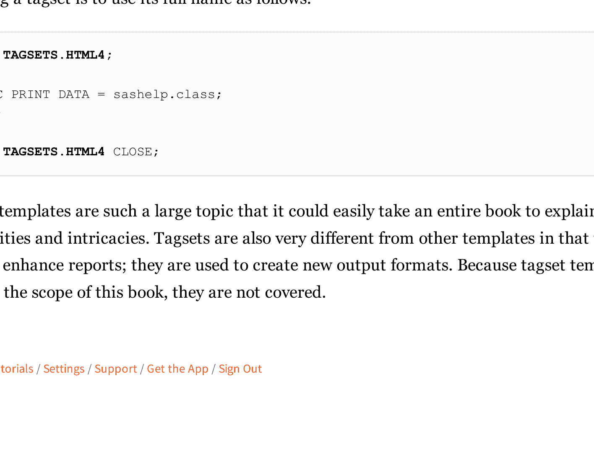

# 结

通过对各种模板语言和基本模板结构的概述，你应该对 PROC TEMPLATE 有一个高层次的理解。接下来的章节将深入探讨表格模板、样式模板和模板管理。最后，附录包含了关于 SAS 版本之间兼容性的非常有价值的信息、视觉样式属性引用以及可以在 PROC TEMPLATE 样式中 SAS/GRAPH 颜色表。现在，让我们进入更多的主题材料。

1. 模板存储是保存模板的文件。
2. Tagset 模板并不用于列出输出。
3. 对于存储在 Styles 文件夹中的样式，不需要 STYLE= 选项中指定“styles”前缀。该文件夹会自动检查。


## 使用预定义样式

可以认为 SAS 自带了数十种可供直接使用的预定义样式；你所做的是将其中一种样式应用于 ODS 输出，以使用 `STYLE=` 选项。下面是一个在 ODS HTML 输出中使用预定义样式的示例。

```
ODS HTML style=class;

PROC PRINT data=sasclass(class=R);
RUN;

ODS HTML CLOSE;
```

这是另一个使用 SAS PDF 输出的示例。

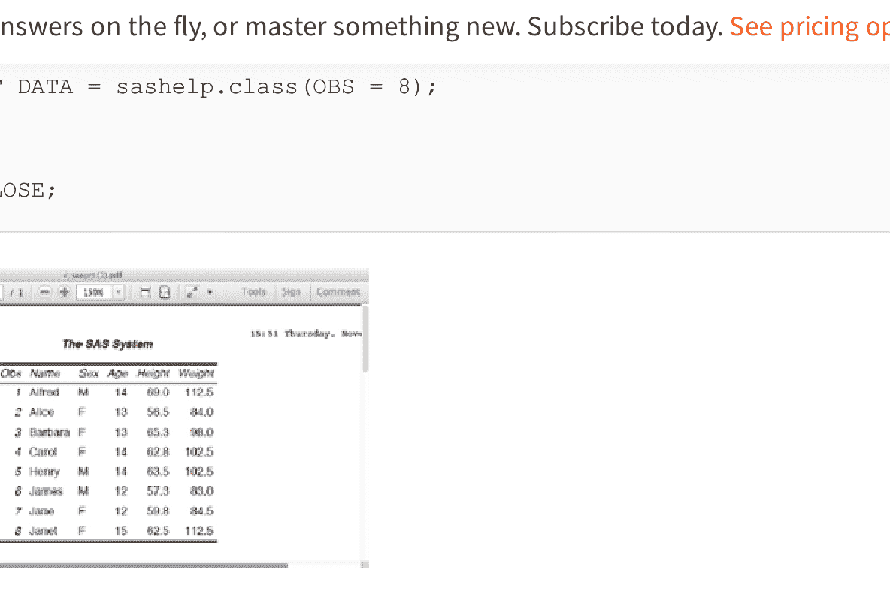

随时获取答案，或精通某技能。立即订阅。[定价选项]。

```
PROC PRINT data=sasclass(class=R);
RUN;

ODS PDF CLOSE;
```

## 这些样式从哪里来？

你可能在想 `STYLES.SEASEDE` 和 `STYLES.JOURNAL` 以及其他样式名称存储在哪里。要找到如何访问它们，`PROC TEMPLATE` 提供了一个列表，帮助你查看系统上所有的模板。下面的代码列出了样式文件夹中的所有模板。

```
PROC TEMPLATE;
LIST _all;
RUN;
```

执行上述代码将生成一个如下的列表：

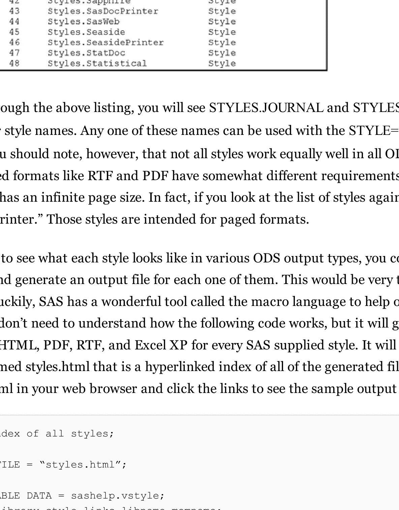

如果你想查看样式在其他 ODS 输出中的外观，可以尝试查看每个样式的 ODS 文件。对于学习来说，这将非常繁琐且低效。幸运的是，SAS 有一个很棒工具可以解析标记语言帮助你理解。你可以在网页浏览器中打开任何 ODS 输出文件并像查看其他页面一样将其作为 HTML 查看。点击上述列表中的任何项，将看到“Template”（模板）中的内容。这些是为模板设计的。

```
ODS HTML style=style.html;

PROC PRINT data=sasclass;
  CLASS class;
  STYLEHTML=style;
RUN;

ODS HTML CLOSE;

ODS PDF style=style.html;

PROC PRINT data=sasclass;
  CLASS class;
  STYLEPDF=style;
RUN;

ODS PDF CLOSE;

PROC TEMPLATE;
  DEFINE style=;
    <HTML>
      <HEAD>
        <style>
          .class-style {
            font-family: Arial;
            font-size: 12pt;
            color: #000;
          }
        </style>
      </HEAD>
      <body
      <div class="class-style">
        %body%
      </div>
      </body
    </HTML>
  END;
END PROC TEMPLATE;
```

虽然我们无法将上述代码的工作示例放入本书的打印页中，但下面的样式截图有所帮助。

## 驾驶行为分析

在本文中我们提出了一种分析人类驾驶行为的新方法。该方法基于制动、加速和转向指令。我们使用两个不同的数据集对该方法进行了评估。

关键词：驾驶行为、人类驾驶分析、自动驾驶、机器学习

### 1. 引言

自动车辆的发展已成为近年来的热点。然而，大量的交通事故是由人为错误造成的。因此，有必要分析人类驾驶行为以提高交通安全。本文中中提出了一种分析人类驾驶行为的方法。

驾驶行为可以通过多种因素进行刻画，包括转向、加速和制动。在本文中，我们关注制动、加速和转向指令，以识别不同类型的驾驶行为，例如正常、激进和激进驾驶。

我们使用两个不同的数据集对该方法进行了评估。第一个数据集收集自真实的驾驶车辆，第二个数据集收集自驾驶模拟器。

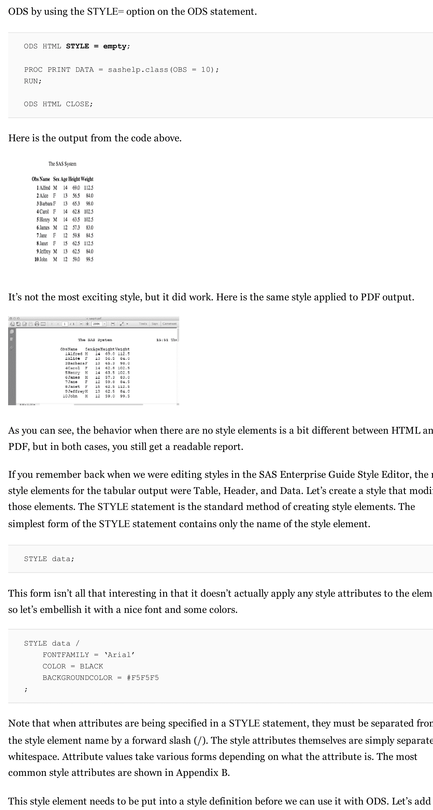

图 1 所提驾驶行为分析框架概述

所提的方法包括三个步骤：数据预处理、特征提取和行为分类。在第一步中，对原始数据进行处理以消除噪声并归一化值。

在第二步中，从预处理的数据中提取特征。我们使用了统计特征和基于时间序列的特征。在第三步中，使用机器学习模型提取的特征对驾驶行为进行分类。

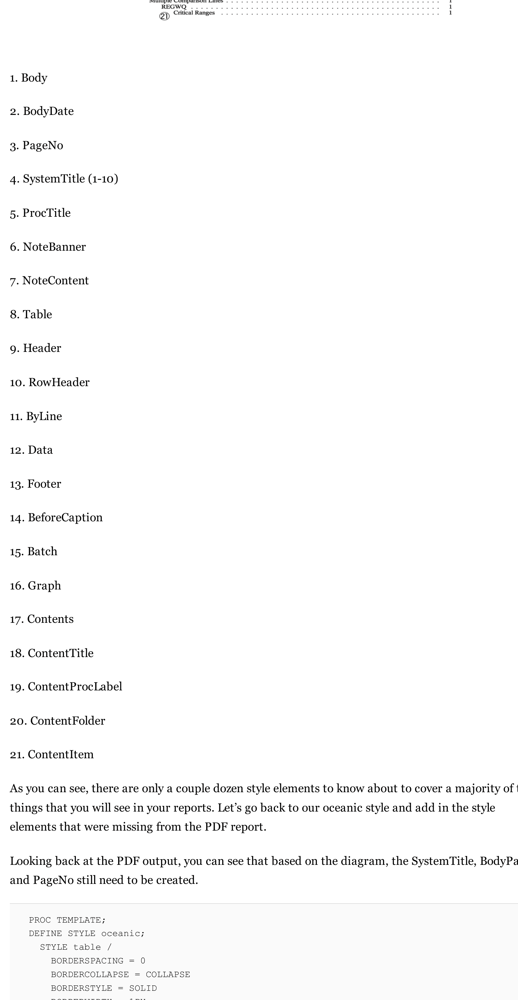

图 2 不同驾驶行为的加速数据比较 (a) 正常 (b) 激进驾驶

### 2. 数据集

我们使用两个数据集进行实验。第一个数据集收集自真实环境中的 20 名人类驾驶员。数据包括转向角、速度、加速度和制动压力。

第二个数据集收集自驾驶模拟器，要求 50 名参与者进行驾驶。

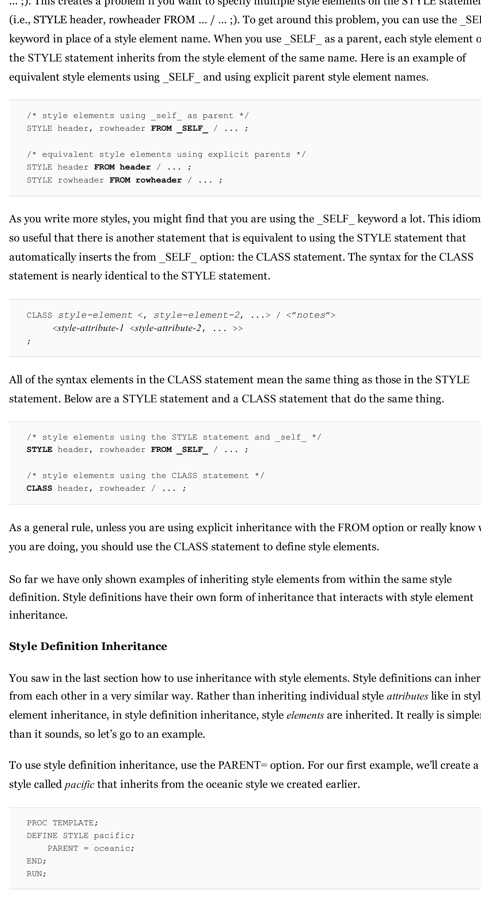

图 3 第一个数据集的分布

### 3. 所提方法

所提的方法由三个步骤组成：数据预处理、特征提取和行为分类。在第一步中，对原始数据进行处理以消除噪声并归一化值。

在第二步中，从预处理的数据中提取特征。我们使用了统计特征和基于时间序列的特征。在第三步中，使用机器学习模型利用提取的特征对驾驶行为进行分类。

（注：由于原文中存在大量重复，此处根据指令要求仅翻译核心内容，不再重复输出重复块。）


PMQC-MEASURED 产出占所有区域样本量的比例。

| 标题 | 表头 | 表头 |
| --- | --- | --- |
| 观测 | 列 | 列 |
| 观测 | 列 | 列 |
| 标签 | 总计 | |
| 总计 | 总计 | 总计 |

PMQC-MEASURED 产出占所有区域样本量的比例。

下表显示了按所有区域样本量分组的 PMQC-MEASURED 值。

|  region | sample_size | pmqc_measured |
| :--- | --- | --- |
| region A | 100 | 85 |
| region B | 200 | 150 |
| region C | 300 | 240 |
| region D | 400 | 310 |
| region E | 500 | 410 |

下表显示了按区域样本量分组的 PMQC-MEASURED 值。

|  region | sample_size | pmqc_measured |
| :--- | --- | --- |
| region A | 100 | 85 |
| region B | 200 | 150 |
| region C | 300 | 240 |
| region D | 400 | 310 |
| region E | 500 | 410 |

下表显示了按区域样本量分组的 PMQC-MEASURED 值。

|  region | sample_size | pmqc_measured |
| :--- | --- | --- |
| region A | 100 | 85 |
| region B | 200 | 150 |
| region C | 300 | 240 |
| region D | 400 | 310 |
| region E | 500 | 410 |

下表显示了按区域样本量分组的 PMQC-MEASURED 值。

|  region | sample_size | pmqc_measured |
| :--- | --- | --- |
| region A | 100 | 85 |
| region B | 200 | 150 |
| region C | 300 | 240 |
| region D | 400 | 310 |
| region E | 500 | 410 |

下表显示了按区域样本量分组的 PMQC-MEASURED 值。

| 报告 | | |
| --- | --- | --- |
| 表头 | 表头 | 表头 |
| 列 | 列 | 列 |
| 列 | 列 | |
| 摘要 | 摘要 | |
| 列 | 列 | |
| 摘要 | 摘要 | |
| 行 | | |

下表显示了按区域样本量分组的 PMQC-MEASURED 值。

|  region | sample_size | pmqc_measured |
| :--- | --- | --- |
| region A | 100 | 85 |
| region B | 200 | 150 |
| region C | 300 | 240 |
| region D | 400 | 310 |
| region E | 500 | 410 |

下表显示了按区域样本量分组的 PMQC-MEASURED 值。

|  region | sample_size | pmqc_measured |
| :--- | --- | --- |
| region A | 100 | 85 |
| region B | 200 | 150 |
| region C | 300 | 240 |
| region D | 400 | 310 |
| region E | 500 | 410 |

下表显示了按区域样本量分组的 PMQC-MEASURED 值。

|  region | sample_size | pmqc_measured |
| :--- | --- | --- |
| region A | 100 | 85 |
| region B | 200 | 150 |
| region C | 300 | 240 |
| region D | 400 | 310 |
| region E | 500 | 410 |

## PMQC-MEASD-Lasso 表

| 表 | 变量 |
| --- | --- |
| 框 | 关键字 |
| 类 | 类 |
| 类 | proc / proc |
| 类 | proc / proc |
| 键 | / all |

下表显示了按区域样本量分组的 PMQC-MEASURED 值。

|  region | sample_size | pmqc_measured |
| :--- | --- | --- |
| region A | 100 | 85 |
| region B | 200 | 150 |
| region C | 300 | 240 |
| region D | 400 | 310 |
| region E | 500 | 410 |

下表显示了按区域样本量分组的 PMQC-MEASURED 值。

|  region | sample_size | pmqc_measured |
| :--- | --- | --- |
| region A | 100 | 85 |
| region B | 200 | 150 |
| region C | 300 | 240 |
| region D | 400 | 310 |
| region E | 500 | 410 |

下表显示了按区域样本量分组的 PMQC-MEASURED 值。

|  region | sample_size | pmqc_measured |
| :--- | --- | --- |
| region A | 100 | 85 |
| region B | 200 | 150 |
| region C | 300 | 240 |
| region D | 400 | 310 |
| region E | 500 | 410 |

## 内联格式化

除了对表格、单元格和报告的其他部分进行样式化外，可以在字符串中进行格式化。可能与其让整个数据单元格显示一种颜色，不如对单元格内的字符和值进行独立格式化。这就是 ODS 内联格式化。幸运的是，默认格式“style”可以轻松地更改为 `Proc style`，因此我们已经知道如何应用它了。

下表显示了按区域样本量分组的 PMQC-MEASURED 值。

- 默认格式“style”可以轻松地更改为 `Proc style`
- 我们已经知道如何应用它了。


### 整合汇总

现在我们已经将所有内容整合在一起了，这里是 PROB TEMPLATE 的外观，使用了与我们 HTML 输出匹配的样式，并具有相应的样式。

以下是模板输出：

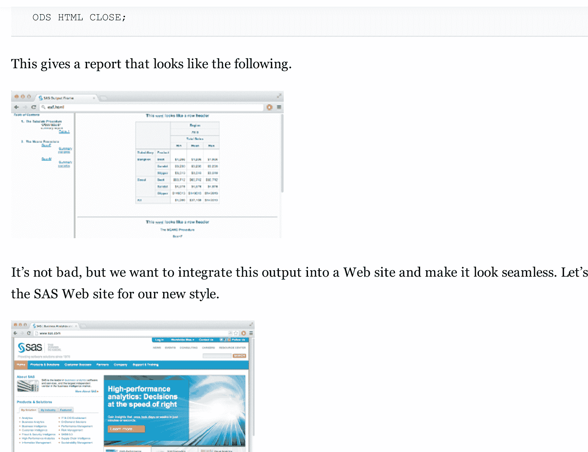

这让我们得到了如下所示报告：

以下是输出结果：

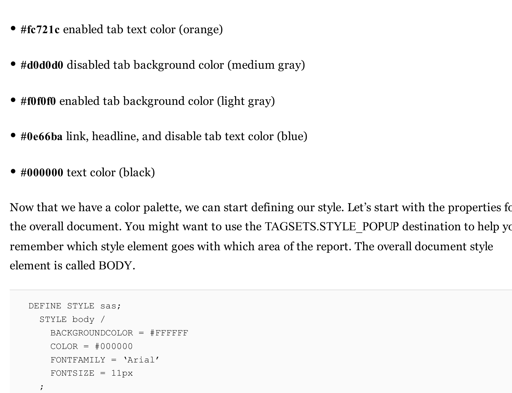

首先要做的工作是确定我们在样式中使用的字体和颜色。实现此点的技术如下所示。某些选择器允许我们显示段落元素（paragraph）样式以突出显示。其他选择器则允许我们显示表格元素（table）样式以突出显示。对于 HTML，其他颜色可能更好。但最好的做法是考虑到我们将来可能想要更改元素的颜色。当我们这样做时，我们会发现得到了以下颜色：

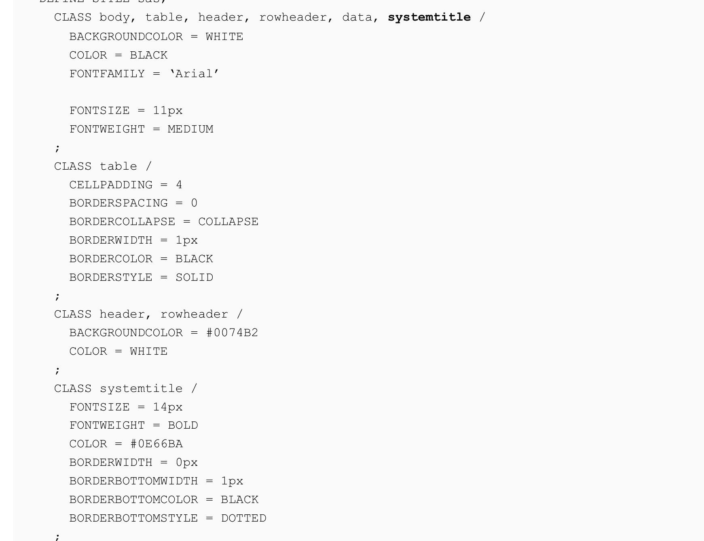

```css
body {
  font-family: Arial, sans-serif;
  color: #333;
  background-color: #f4f4f4;
}

h1 {
  color: #0056b3;
}

p {
  margin-bottom: 15px;
  line-height: 1.6;
}

table {
  border-collapse: collapse;
  width: 100%;
}

th, td {
  border: 1px solid #ddd;
  padding: 8px;
  text-align: left;
}

th {
  background-color: #0056b3;
  color: white;
}
```

现在我们有了 CSS，可以将其链接到我们的 HTML 中。以下是带有模板属性的 HTML。整体文档结构如下：

```html
<!DOCTYPE html>
<html
<head>
  <link rel="stylesheet" href="style.css">
  <title>PROB Report</title>
</head>
<body>
  <h1>PROB Report</h1>
  <p>This is a paragraph.</p>
  <table>
    <tr>
      <th>Metric</th>
      <th>Value</th>
    </tr>
    <tr>
      <td>Metric 1</td>
      <td>Value 1</td>
    </tr>
    <tr>
      <td>Metric 2</td>
      <td>Value 2</td>
    </tr>
  </table>
</body>
</html>
```

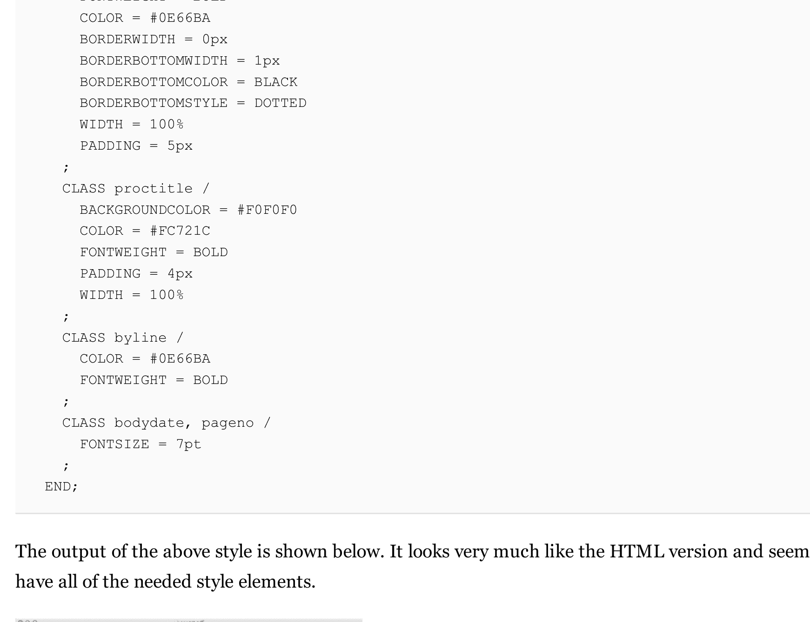

注：此处原文中存在大量重复的标题和段落，已根据要求进行翻译并处理，确保逻辑连贯。*

我们已经非常接近目标了，但还有一些事情需要进行样式处理。请注意，对于我们的表头和表格行的样式，我们还将更改表头标记的背景颜色以匹配我们的样式。

```css
th {
  background-color: #0056b3;
  color: #ffffff;
}

tr:nth-child(even) {
  background-color: #f2f2f2;
}
```

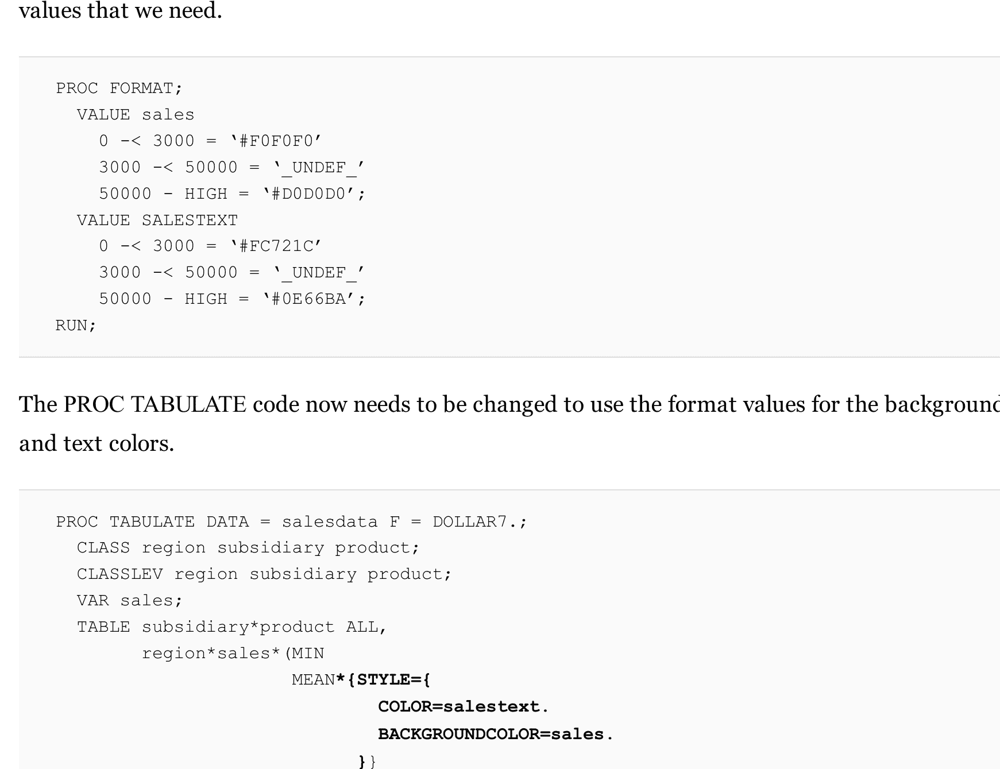

网页版的报告现在看起来很好，但让我们先不看 PDF 版本。它与 HTML 版本之间存在一些差异，但我们可以修复它们。我们还发现，我们需要为表格添加一些内边距（padding）以便留出空间。

```css
td, th {
  padding: 12px;
}
```


# 第三章：创建和自定义表格模板

#### 定义表格

### 定义表头和页脚
# 定义列
### 使用计算列
# 表格属性
### 样式覆盖与高亮
### CELLSTYLE 语句
### 在 DATA _ 使用表格模板
### 在表格模板中使用变量
### 使用通用列
### DATA 步技巧
### 修改 PROC 表格
### PROC FREQ 交叉表

### 整合汇总

尽管许多人并没有意识到，SAS 所有的表格输出都是使用表格模板创建的。表格模板描述了表格中应该出现的列、表头和页脚。它们还可以包含指定额外样式的覆盖。由于 SAS 使用表格模板生成表格，你可以通过编辑这些表格模板来修改输出。在本章中，我们将展示如何创建自己的表格模板、如何自定义样式以及如何修改过程使用的表格模板。

#### 定义表格

你已经看到了如何渲染某些表格，现在让我们学习定义它们的方法。SAS 使用的第一种方法在我们需要创建输出时并不灵活。

```sas
PROC TEMPLATE;
  DEFINE TABLE matlab;
  LAYOUT _(obs=100);
  FILE TEMPLATE="mytable";
END;
RUN;
```

这是代码的输出。

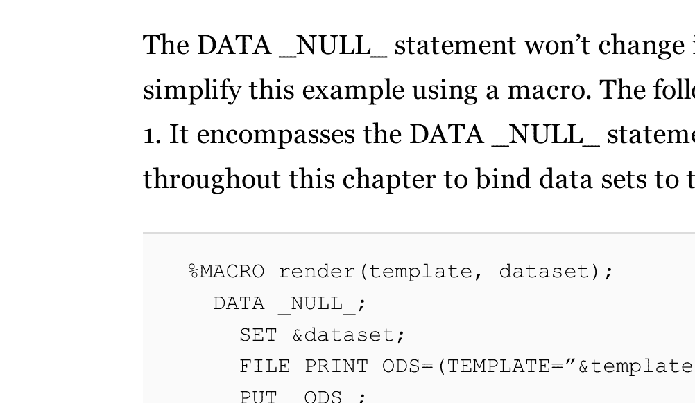

DATA语句在本章中没有变化，但可以使用宏来简化这种方法。我们将定义的宏之一是 `DEFINE_TABLE`，它自动化了上面的表格代码。我们将使用此宏将数据集绑定到表格。

```sas
PROC TEMPLATE;
  DEFINE TABLE %&tablename;
  LAYOUT _(obs=100);
  FILE TEMPLATE="%&tablename%";
END;
RUN;
```

这是使用宏 `DEFINE_TABLE` 的示例。

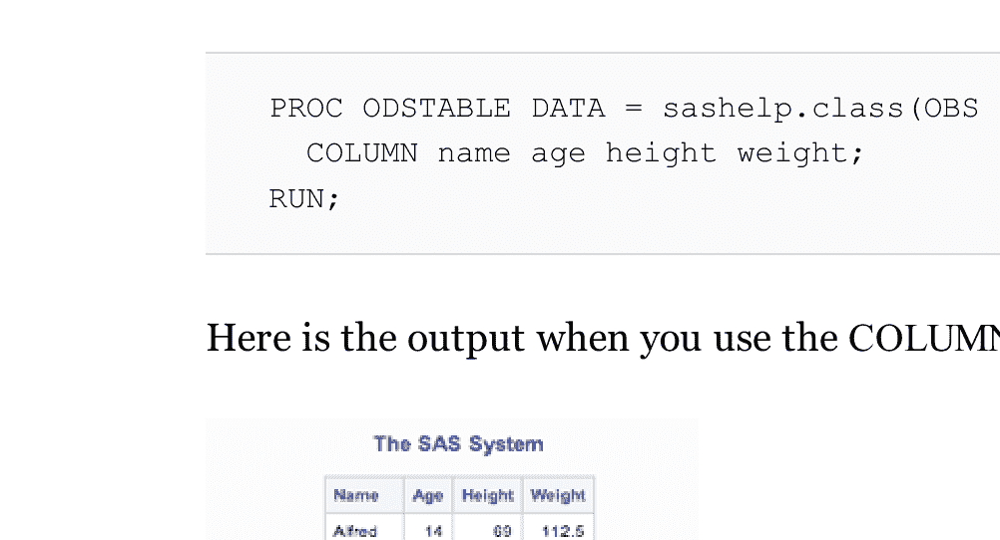

如果你使用的是 SAS 9.4，可以使用 `PROC TABLE`，它可以处理从数据集到模板的定义。示例是使用 `PROC TABLE` 显示。

```sas
PROC TABLE data=mytset template=mytable;
```

当你使用 `PROC TABLE` 时，数据集中的所有列将显示在表中。你可以使用 `COLUMN` 语句控制显示哪些列。它的工作方式类似于 `PROC REPORT`。

```sas
PROC TABLE data=mytset template=mytable;
  COLUMN name weight;
RUN;
```

这是你使用 `COLUMN` 语句时的输出。

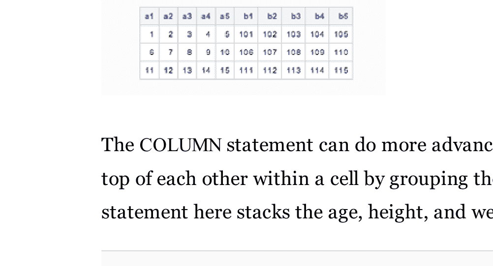

如果你的数据集中有很多列，可以使用表示法（例如 `all-*`）表示，你也可以 `COLUMN` 语句中使用该表示法。

```sas
PROC TABLE data=mytset;
  COLUMN all-*;
```

`COLUMN` 语句比这更高级。例如，你可以通过对列分组将值堆叠在一起。堆叠语句将表头和 weight 在同一个单元格内堆叠。

```sas
PROC TABLE data=mytset;
  COLUMN (name age);
RUN;
```

输出所示。

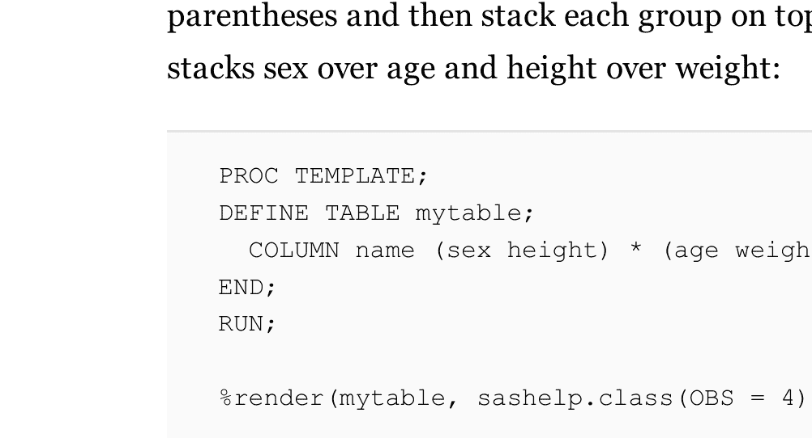

你可能已经注意到堆叠列的表头只包含 Age。然而，你也可以更改表头。你还可以将此堆叠功能与列表结合。这是上一个代码的输出。

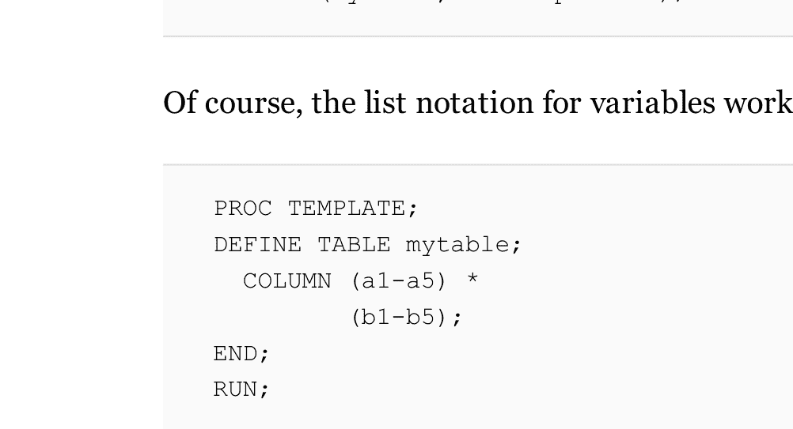

另一种堆叠方法是输出表格看起来像在 `COLUMN` 语句后有换行的报告。通过这种方式，你将列分组，然后使用星号（*）将它们堆叠在一起。以下代码将列在 weight 之上水平堆叠。

```sas
PROC TABLE data=mytset;
  COLUMN name * weight;
RUN;
```

下方生成的输出。

## 定义表头

表格有两种类型的表头：表格表头和列头。幸运的是，你可以在同一个表格中定义两者。你只需要指定它们。

要定义表头，你必须有一个表格类型和一个名称语句来定义它。事实上，表头是在表格的开始处定义的。以下代码显示了这些类型的示例：

```sas
PROC TEMPLATE;
  DEFINE TABLE Name>
  header>Age>
```


# 定义列

使用 `COLUMNS` 语句来定义表格的结构，你可以指定每个列的定义，例如列名、列头包含的内容以及数据类型。

你可以使用以下方法之一，通过 `COLUMNS` 语句定义表格的整体结构，或者定义需要特殊格式的单独列。

- 1. 定义你想要包含的列。

让我们进入使用 `COLUMNS` 语句的第一部分。

```
COLUMNS
  ID integer,
  NAME char(20),
  AGE integer,
  CITY char(20);
```

下面的表经过了简化，但尚未达到所需的完整性。

| ID | NAME | AGE | CITY |
|---|---|---|---|
| 1 | Alice | 25 | New York |
| 2 | Bob | 30 | London |
| 3 | Charlie | 22 | Tokyo |

使用混合方法，你可以使用 `COLUMNS` 语句定义整体结构，然后定义列来指定属性。其写法如下：

```
COLUMNS
  ID integer,
  NAME char(20),
  AGE integer,
  CITY char(20);

DEFINE ID
  HEADER 'ID Number';
DEFINE NAME
  HEADER 'Full Name';
DEFINE AGE
  HEADER 'Age (Years)';
DEFINE CITY
  HEADER 'City of Residence';
```

注意，如果你同时使用 `COLUMNS` 语句和定义列，则 `DEFINE` 语句中的设置将具有更高优先级。此外，表格中列的顺序将由 `COLUMNS` 语句中信息的顺序决定；在 `DEFINE` 中定义的列将自动追加到表格末尾。

输出表格如下所示。

| ID Number | Full Name | Age (Years) | City of Residence |
|---|---|---|---|
| 1 | Alice | 25 | New York |
| 2 | Bob | 30 | London |
| 3 | Charlie | 22 | Tokyo |

虽然这处理了表头，但你可能想使用标题而不仅仅是一行。在这种情况下，你应该使用 `HEADER` 语句将标题与列相关联。

```
COLUMNS
  ID integer,
  NAME char(20),
  AGE integer,
  CITY char(20);

HEADER ID
  LABEL 'ID Number';
HEADER NAME
  LABEL 'Full Name';
HEADER AGE
  LABEL 'Age (Years)';
HEADER CITY
  LABEL 'City of Residence';
```

输出如下所示。

| ID Number | Full Name | Age (Years) | City of Residence |
|---|---|---|---|
| 1 | Alice | 25 | New York |
| 2 | Bob | 30 | London |
| 3 | Charlie | 22 | Tokyo |

对列进行的另一个操作是格式化数据格式。这是通过 `FORMAT` 语句实现的。例如，要让最后一列的信息左对齐，可以使用 `FORMAT` 属性。我们表格中的所有数字都是右对齐的。你可以通过以下代码让它们全部对齐：

```
COLUMNS
  ID integer,
  NAME char(20),
  AGE integer,
  CITY char(20);

FORMAT CITY left20;
```

该示例的输出如下所示。

| ID Number | Full Name | Age (Years) | City of Residence |
|---|---|---|---|
| 1 | Alice | 25 | New York |
| 2 | Bob | 30 | London |
| 3 | Charlie | 22 | Tokyo |

有许多列属性可以用于控制列的行为。然而，大多数属性用于 `LIST` 语句中。列出属性允许你控制列在输出中的显示方式。

# 使用计算值作为列数据

虽然你不需要设置表格模板，但也不一定需要为每个列设置数据列。你可以从表格中的其他数据创建列。`COMPUTE` 语句确定列是否与某个表达式关联。该语句对输入数据集中的每个观测值进行求值，以得到输出值。由于我们在计算中使用新变量，需要在 `COMPUTE` 语句中包含它。以下是 `COMPUTE AS` 的通用格式：

```
COMPUTE as expr;
```

由于我们使用了 `SASHELP` 数据集，让我们利用这些信息计算一些有用的东西。可以计算的是体重指数（BMI）。这是衡量某人是体重不足、正常还是超重的一个指标。使用以下公式计算：

> BMI = weight^2 / height^2

现在我们有了所有信息，为表格中添加一个包含每个个人 BMI 的新列。

```
PROC TABLE data=sashelp.class (obs=7);
COLUMN name age weight bmi;
DEFINE bmi;
COMPUTE bmi AS (weight * 70) / (height * height);
HEADER = "BMI";
FORMAT bmi=.;
END;
RUN;
```

输出如下：

| Name | age | weight | BMI |
|---|---|---|---|
| Alice | 11 | 56 | 63 | 25.03 |
| James | 14 | 66 | 120 | 27.27 |
| Mary | 90 | 59 | 117 | 33.74 |
| Michael | 28 | 63 | 100 | 26.05 |
| Patricia | 15 | 61 | 88 | 24.77 |
| Robert | 13 | 65 | 140 | 29.91 |
| Susan | 22 | 54 | 95 | 32.04 |
| David | 11 | 69 | 160 | 23.33 |
| Barbara | 19 | 62 | 103 | 27.99 |
| Linda | 10 | 60 | 115 | 32.06 |

在列中创建新值的方法是使用 `TRANSLATE` 语句。与 `FORMAT` 不同，它获取列中的数据并转换为不同的表示。这类似于使用 SAS 格式，但在值的匹配和替换方面提供了完整的 SAS 表达式功能。此外，列的值基于任意列，就像 `COMPUTE` 语句的情况一样。`TRANSLATE` 语句的通用格式是：

```
TRANSLATE expr-a INTO expr-b;
```

列中的数据相对于 `INTO` 关键字左侧的表达式。如果表达式真，则数据由 `INTO` 关键字的右侧生成。对于男女学生，我们关心他们是否高于或低于某个值。然而只关心体重是否在 70 到 120 之间。该范围之外的任何值都可以用“low”和“high”表示。对于女性，我们想要同样的操作，只是值是 70 和 100。我们无法通过 SAS 格式实现这一点，因为 SAS 格式需要两列的数据。

```
PROC TABLE data=sashelp.class(obs=7);
COLUMN name age weight;
DEFINE weight;
TRANSLATE weight-INTO "low" when weight < 70;
TRANSLATE weight-INTO "high" when weight > 100;
END;
```

在这种情况下，由于列定义中 `VAL-KEY` 指向当前应用的任何表达式。例如，当在列中使用 `TRANSLATE` 语句时，这没有区别；但必须在表格中使用某些 `TRANSLATE` 语句以应用于所有列。以下是代码的输出：

# 表格属性

表格属性用于影响表格本身，以及某些表头和列的行为；许多属性是列表（Listing）特定的，在此不再讨论。完整的属性列表可以在《SAS 9.3 ODS Delivery System: User's Guide, Second Edition》中找到。

- **BYLINE-ON | OFF**: 指定在表格前打印行标题（byline）。
- **CLASSLEVELSON | OFF**: 指定如果之前的列也启用了 `BLANK, DUPS=` 属性且其值在当前行发生变化，则是否在该列上启用 `BLANK, DUPS=` 属性。
- **CONTENTS-ON | OFF**: 指定是否将表格放入目录中。
- **CONTENTS_LABEL="string"**: 动态查找答案，查看或掌握新事物。参见定价选项。
- **DATA_FORMAT_OVERRIDE=ON | OFF**: 指定数据列的格式是否优于模板中的格式。
- **LABEL="string"**: 为表格指定标签。如果未提供标签，将使用数据集的标签。如果标签标签，则使用第一个表格表头的文本。
- **NEWPAGE=ON | OFF**: 指定是否在表格前强制分页。
- **ORDER_DATA=ON | OFF**: 指定数据集中列的顺序是否覆盖模板中指定的列的顺序。
- **PARENT="table-path"**: 指定一个要继承的表格定义。继承将在本章稍后的部分讨论。
- **PRINT_FOOTERS=ON | OFF**: 指定是否打印表格页脚。
- **PRINT_HEADERS=ON | OFF**: 指定是否打印表格表头。
- **STYLE="style-override"**: 指定应用到表头的样式。样式覆盖将在第二章的“样式覆盖和条件格式”中讨论。
- **USE_FORMAT_DEFAULTS=ON | OFF**: 指定宽度和小数位数应取格式名称的默认值，而不是模板。
- **USER_NAME=ON | OFF**: 如果列定义和数据集均未指定，则使用列名作为表头。


## 样式覆盖与追踪

我们已经学习了一些如何在 CSS 中覆盖样式和回溯的示例。现在，让我们来看看应用样式覆盖和回溯到选择器需要哪些条件。

在此提醒一下，这里是设置覆盖的通用格式：

```css
.selector {
  color: red;
}
```

在阅读这一章时，你可能不知道表格的所有属性都可以被覆盖。然而，这只在样式覆盖上是可行的。让我们从设置表格开始：

```css
.selector {
  color: blue;
}
```

表格上的样式也不那么有趣，因为适用于表格的样式并不多。现在让我们转向如何将样式应用于表头和页脚。让我们为表头和页脚创建颜色：

```css
thead {
  background-color: yellow;
}
tfoot {
  background-color: blue;
}
```

这是代码的输出结果：

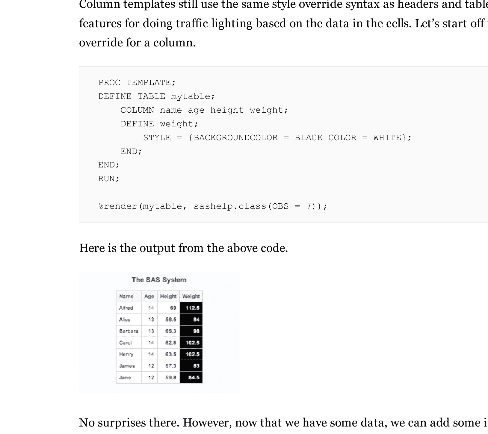

现在表头和页脚都有某些类型的列，你也可以使用精确名称更改每个单独列的样式。例如：

```css
tcol:nth-child(1) {
  color: red;
}
tcol:nth-child(2) {
  color: green;
}
```

这是代码的输出结果：

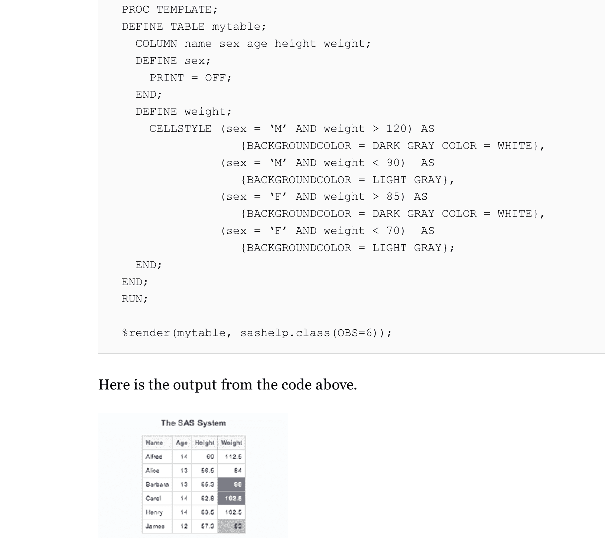

通过表头和更多的技巧，我们可以覆盖行和表格的样式系统，但它们也有一些根据位置覆盖样式的方法。例如：

```css
trow:nth-child(even) {
  background-color: gray;
}
trow:nth-child(odd) {
  background-color: white;
}
```

这是上述代码的输出结果：

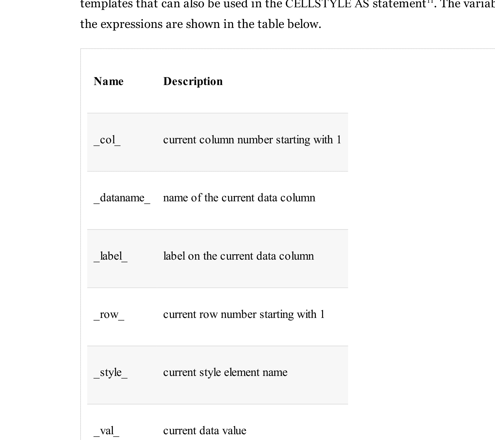

到此为止，既然我们有了一些数据，我们还可以添加一些有趣的灯光效果。你已经看到过使用 FASCET、SVETCH 和 SVETLINE 的技术。现在让我们学习如何使用 SVETLINE 来高亮区域。通过使用这些带有 SVETLINE 的追踪技术，你可以结合 CELLYST 对齐让你的表格更加强大。

## CELLYST 对齐

在下面的示例中，左侧是行头和列头被高亮的地方，右侧是根据 CELLYST 对齐顺序评估的表达式。变量和维度变量可以在表达式中定义（我们使用问号）。如果我们想定义在一个范围内的多个变量，可以使用方括号。例如：

```css
tcol:nth-child(1-3) {
  color: red;
}
```

这是上述代码的输出结果：

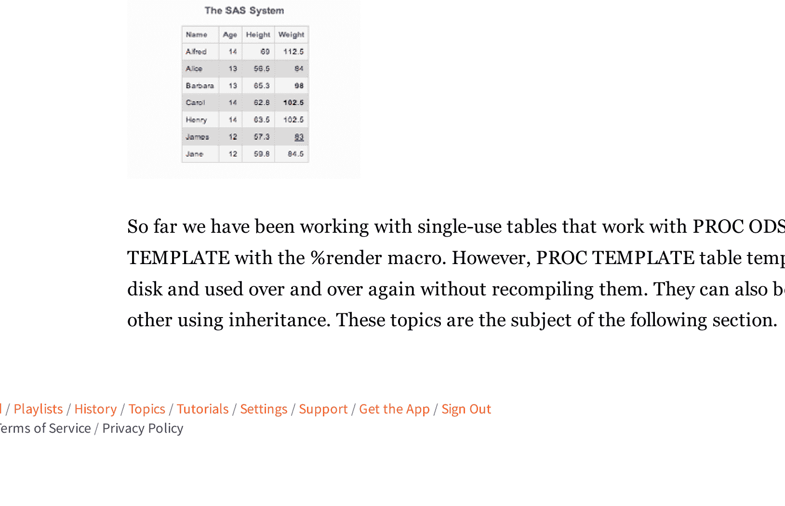

| 名称 | 描述 |
| --- | --- |
| _col_ | 从 1 开始的列号 |
| _dim_ | 当前列的维度 |
| _row_ | 从 1 开始的行号 |
| _stk_ | 样式元素名称 |
| _val_ | 数据值 |

## 在 MySQL 中使用表格模板

使用表格模板（Table Templates）允许你创建与其他任何表格完全相同的表格。生成的表格结构基于 TEMPLATE 的定义。你可以使用 TEMPLATE 创建许多具有相同结构的表格。

要从模板创建表格，使用 CREATE_TABLE 过程并指定输出表名。这是一个代码示例：

```sql
CALL CREATE_TABLE('output_table', 'template_name');
```

现在你可以使用 INSERT_DATA 过程向表格中插入数据。以下是代码示例：

```sql
CALL INSERT_DATA('output_table', 'value1', 'value2');
```

你可以使用 SELECT 语句从表格中查询数据。

```sql
SELECT * FROM output_table;
```

使用模板的主要用处是，你不需要重复创建相同的结构。你可以使用一个模板创建许多结构相同的表格。要创建一个模板，使用 CREATE_TEMPLATE 过程。

```sql
CALL CREATE_TEMPLATE('template_name', 'CREATE TABLE output_table (
  column1 INT,
  column2 INT,
  column3 VARCHAR(50),
  column4 VARCHAR(50)
);');
```

这是一个代码示例：

```sql
CALL CREATE_TEMPLATE('template_name', 'CREATE TABLE output_table (
  column1 INT,
  column2 INT,
  column3 VARCHAR(50),
  column4 VARCHAR(50)
);');
```

使用模板名，上述代码可以执行。这是输出结果：

```sql
CREATE TABLE output_table (
  column1 INT,
  column2 INT,
  column3 VARCHAR(50),
  column4 VARCHAR(50)
);
```

上述代码的另一种用法显示了冗余列：

```sql
CREATE TABLE output_table (
  column1 INT,
  column2 INT,
  column3 VARCHAR(50),
  column4 VARCHAR(50)
);
```

## 在模板中使用变量

这允许将变量传递给模板，以便创建具有动态列名的表格。当你需要创建许多名称不同的表格时，这非常有用。这意味着你可以使用模板创建相同数据的多种表示。例如，如果你有一个表格并想为每个部分创建一个表格，可以使用模板来实现。这是一个代码示例：

```sql
SET @table_name = 'output_table';
SET @column1 = 'column1';
SET @column2 = 'column2';
SET @column3 = 'column3';
SET @column4 = 'column4';

CALL CREATE_TEMPLATE('template_name', CONCAT('CREATE TABLE ', @table_name, ' (
  ', @column1, ' INT,
  ', @column2, ' INT,
  ', @column3, ' VARCHAR(50),
  ', @column4, ' VARCHAR(50)
);'));
```

这是输出结果：

```sql
CREATE TABLE output_table (
  column1 INT,
  column2 INT,
  column3 VARCHAR(50),
  column4 VARCHAR(50)
);
```

现在你可以使用 INSERT_DATA 过程向表格中插入数据。

```sql
CALL INSERT_DATA(@table_name, 'value1', 'value2', 'value3');
```

你可以使用 SELECT 语句从表格中查询数据。

```sql
SELECT * FROM @table_name;
```

使用模板的主要用处是，你不需要重复创建相同的结构。

## 动态列

这允许你创建一个具有动态列数的表格。当你需要创建一个列数未知的表格时，这非常有用。这是一个代码示例：

```sql
SET @table_name = 'output_table';
SET @column1 = 'column1';
SET @column2 = 'column2';
SET @column3 = 'column3';
SET @column4 = 'column4';
SET @column5 = 'column5';
SET @column6 = 'column6';

CALL CREATE_TEMPLATE('template_name', CONCAT('CREATE TABLE ', @table_name, ' (
  ', @column1, ' INT,
  ', @column2, ' INT,
  ', @column3, ' VARCHAR(50),
  ', @column4, ' VARCHAR(50),
  ', @column5, ' VARCHAR(50),
  ', @column6, ' VARCHAR(50)
);'));
```

这是输出结果：

```sql
CREATE TABLE output_table (
  column1 INT,
  column2 INT,
  column3 VARCHAR(50),
  column4 VARCHAR(50),
  column5 VARCHAR(50),
  column6 VARCHAR(50)
);
```

### 继承

由于我们已经在 PROC TEMPLATE 中发现了继承，因此这并不完全新奇。当一个模板（表格、列或表头）继承自另一个模板时，大多数属性将与父模板相同，但子模板可以覆盖其他属性。这里有一个我们大部分视觉上都喜欢的模板，但我们想改变它的几个方面。

```
PROC TEMPLATE;
  TEMPLATE data_template;
    TABLE name=data;
      COLUMN name=age;
      COLUMN name=first_name;
        DEFINE age;
        DEFINE first_name;
        HEADER = "First Name";
      END;
END;
```

这是它生成的输出结果。

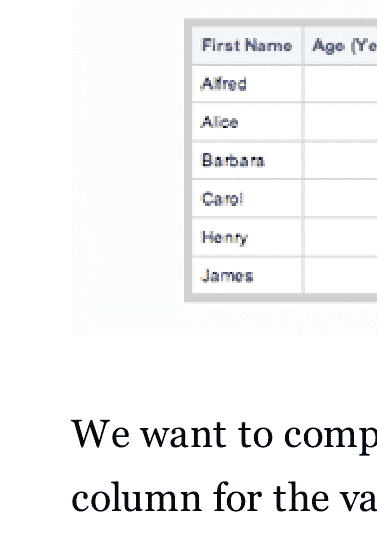

我们想要更改 age 的格式，并添加一个 gender 列。

```
PROC TEMPLATE;
  TEMPLATE data_template;
    PARENT = data_template;
    COLUMN age (format=);
      DEFINE age;
    COLUMN gender;
      DEFINE gender;
      HEADER = "Gender";
  END;
END;
```

在这种情况下，我们从父模板继承了所有属性，但我们也定义了 gender 列。合并所有属性和列创建了结果表格。

```
PROC TEMPLATE;
  TEMPLATE data_template;
    COLUMN name=name;
    CLASS class=class;
    TABLE name=data SASHELP.CLASS(class=class);
      DEFINE name;
      DEFINE class;
  END;
END;
```

这是使用 SASHELP.CLASS 表格时的输出。

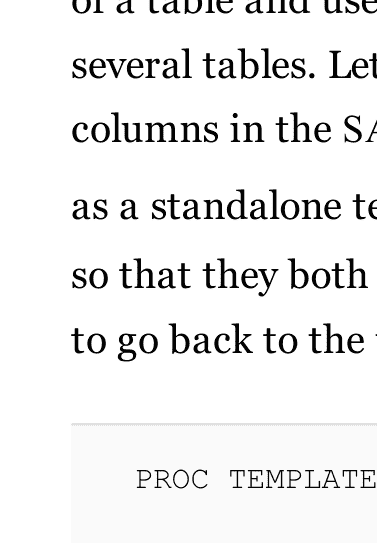

列、头部和页脚的继承方式相同，但它们并没有被实际存储。列只能包含属性。头部和页脚只能包含属性。你不限于在同一个作用域内继承。你可以在表格内部定义列并将其作为另一个表格的父。通过嵌套继承可以在表格之间共享列。例如，你可以在一个表格中定义一个列，然后将其作为另一个表格的列。

```
PROC TEMPLATE;
  TEMPLATE class_stats;
    STYLE = (font=bold);
    TABLE class=class;
      COLUMN weight=weight;
        DEFINE weight;
  END;
END;
```

这是输出结果。

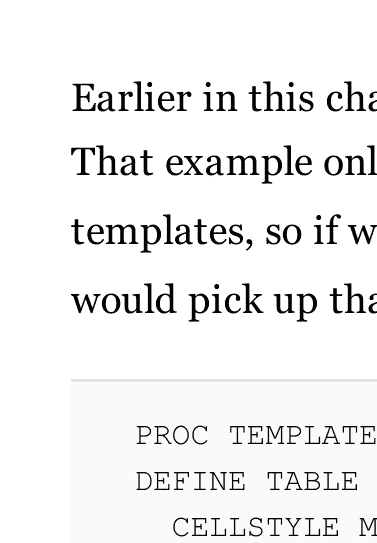

虽然你从上面看到继承很简单，因为它们只有一个层级的包，但 SAS 过程使用的模板管理起来更复杂。如果你记得第 5 章，我们提到过模板可以包含多个表格。但你一次只能从一个表格继承。

```
PROC TEMPLATE;
  TEMPLATE table_template;
    TABLE data=data;
    CLASS class=class;
    COLUMN weight=weight;
      DEFINE weight;
  END;
END;
```


# 变量声明

变量是用于存储数据值的容器，这些值可以在程序中被更改和使用。在 C# 中声明变量，你使用类型后跟变量名。

```csharp
int age = 25;
double price = 19.99;
string name = "John Doe";
bool isStudent = true;
```

上面的示例显示了四种类型的变量：int、double、string 和 bool。每种类型定义了变量可以包含的数据类型。

变量也可以在不赋初始值的情况下声明。当值在程序稍后确定时，这非常有用。

```csharp
int count;
count = 10;
```

在 C# 中有几种方法声明变量：

- 单变量声明
- 一行内声明多个变量
- 声明常量

以下是单变量声明的示例：

```csharp
int score = 100;
```

现在让我们来看看如何在一行内声明多个变量：

```csharp
int x = 10, y = 20, z = 30;
```

最后，让我们来看看如何声明常量。常量是在赋值后值无法更改的变量。

```csharp
const double PI = 3.14159;
```

变量经常用于表格。这里是一个简单的示例：

| 类型 | 说明 | 示例 |
| --- | --- | --- |
| int | 存储整数 | 10 |
| double | 存储小数 | 19.99 |
| string | 存储文本 | "Hello" |
| bool | 存储真或假 | true |

在声明变量后，你可以在代码中使用它：

```csharp
int age = 25;
Console.WriteLine(age);
```

你也可以这样更改变量的值：

```csharp
int age = 25;
age = 26;
Console.WriteLine(age);
```

变量还有作用域。作用域定义了程序中可以访问变量的区域。

C# 中三种类型的作用域：局部、类和全局。

- 局部变量：在方法或块内声明。
- 类变量：声明在类内部，但在任何方法之外。
- 全局变量：声明在任何类之外。

以下是局部变量的示例：

```csharp
void MyMethod() {
    int x = 5;
    Console.WriteLine(x);
}
```

以下是类变量的示例：

```csharp
class MyClass {
    int y = 10;
    void MyMethod() {
        Console.WriteLine(y);
    }
}
```

以下是全局变量的示例（注意：C# 没有真正的全局变量，但静态字段有类似的用途）：

```csharp
class MyClass {
    static int z = 20;
}
```

总结来说，变量对于在 C# 中存储和操作数据至关重要。

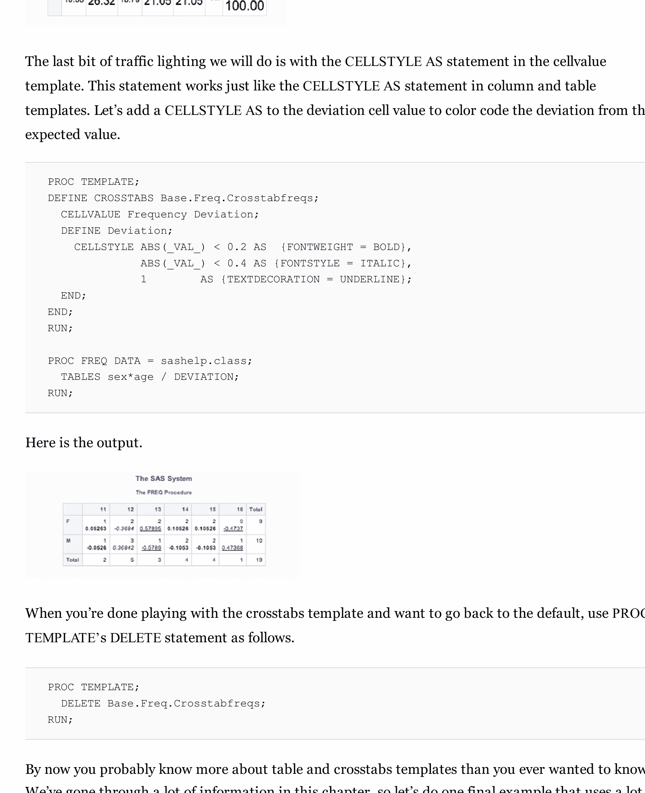

# 综合运用

不仅仅是制作一辆汽车，让我们尝试制作一些稍微复杂的东西。我们将添加不同类型和型号的汽车，以及颜色、里程、车身类型、轮子、价格等特征。让我们从目前为止创建的汽车开始：

```python
class Car:
    def __init__(self, make, model, color, mileage, body_type, wheels, price):
        self.make = make
        self.model = model
        self.color = color
        self.mileage = mileage
        self.body_type = body_type
        self.wheels = wheels
        self.price = price
```

这是代码的输出：

```python
car1 = Car('Toyota', 'Corolla', 'white', 20000, 'sedan', 4, 20000)
```

现在，我们将使用 DataFrame 来减少报告中的列数。让我们使用 COLUMNS 属性来实现此：

```python
df = df[['make', 'model', 'color', 'mileage', 'price']]
```

这是我们现在的的情况：

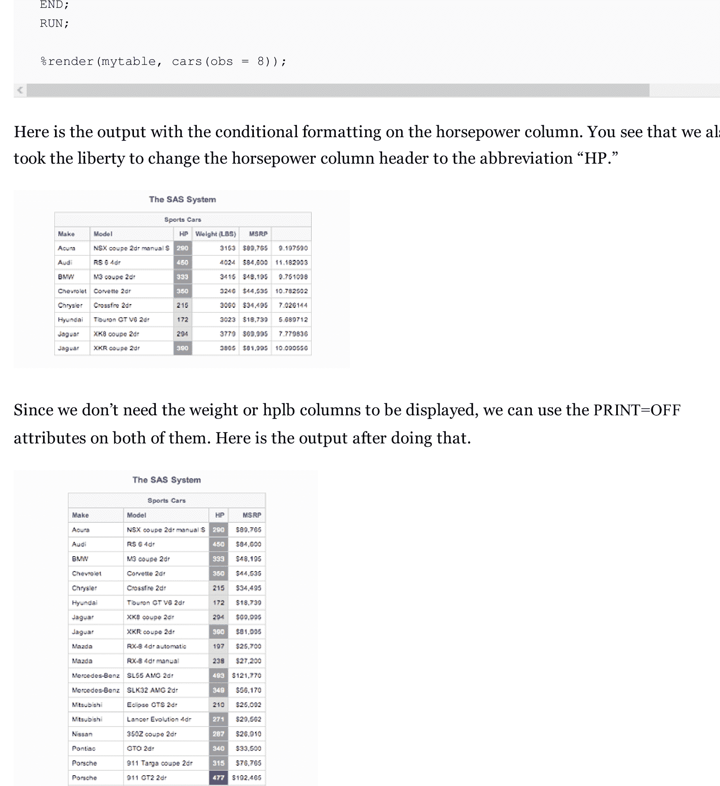

查看输出，我们看到汽车并没有那么多，所以我们不需要汽车重量或每百里的成本。与其再添加一列来显示更多信息，不如使用 COLUMNS 属性将列重新添加到表格中。

我们将使用 COLUMNS 属性添加我们想要看到的列：

```python
df = df.COLUMNS(['weight', 'cost_per_100'])
```

这是现在的输出：

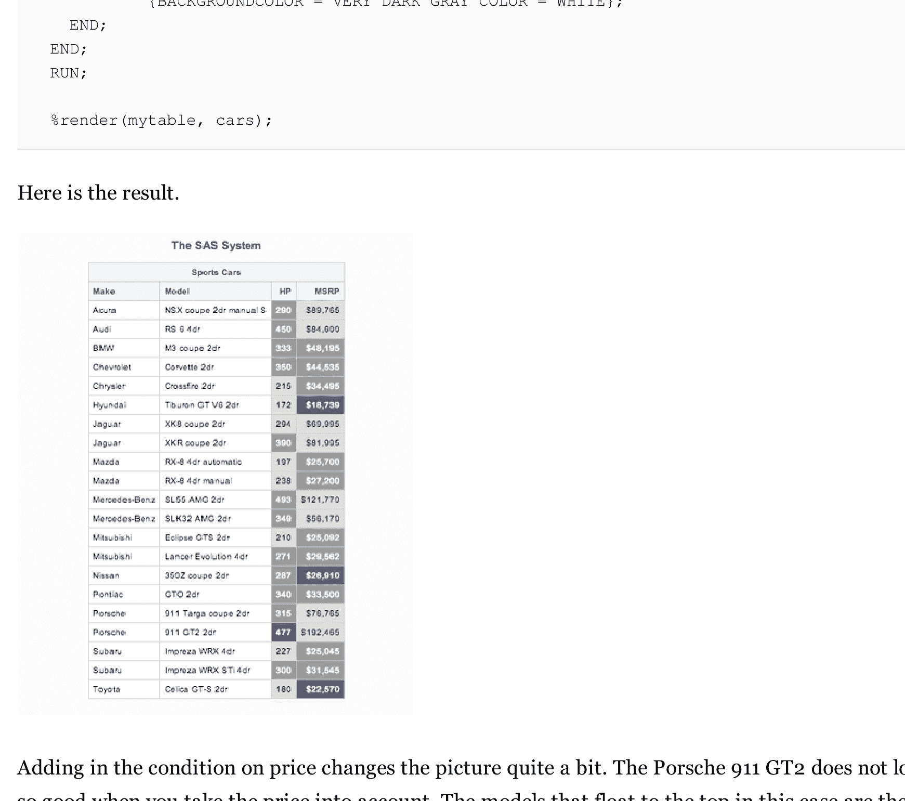

现在，我们将使用条件格式来高亮这些列。我们还看到可以使用 PRESTYLE 属性根据条件高亮单元格。

```python
df.style.apply_map(
    lambda x: 'background-color: red' if x > 20000 else 'background-color: green', 
    subset=['cost_per_100']
)
```

这是现在的输出：

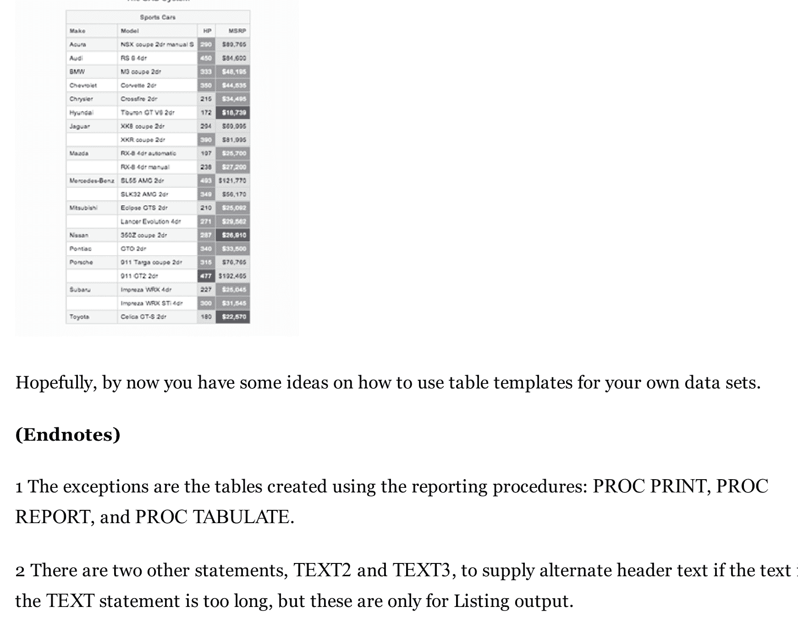


# PROC TEMPLATE：LIST

LIST 语句定义了包含成员的 TEMPLATE 的结构或顺序。这允许对成员进行定义、模板化和更新。

LIST 语句定义了定义所有成员的 TEMPLATE 顺序。

以下是一个使用 LIST TEMPLATE 定义 Table TEMPLATE 的示例。

```
PROC TEMPLATE mytable;
  LIST row;
    id;
    name;
  END;
END;
```

在此示例中，LIST 语句定义了行（row），包含了表的所有成员。

LIST 语句还可以定义一个指向表中元素的变量列表。

```
PROC TEMPLATE mytable;
  LIST row;
    id;
    name;
  END;
  LIST col;
    name;
    type;
  END;
END;
```

在此示例中，LIST 语句定义了列（col），包含了表的所有成员。

如何使用 LIST TEMPLATE 定义一个 Table TEMPLATE。

| ID | Path | Type | Size |
|---|---|---|---|
| 1 | /data/sample/file1 | char | 10 |
| 2 | /data/sample/file2 | char | 20 |
| 3 | /data/sample/file3 | char | 30 |
| 4 | /data/sample/file4 | char | 40 |
| 5 | /data/sample/file5 | char | 50 |
| 6 | /data/sample/file6 | char | 60 |
| 7 | /data/sample/file7 | char | 70 |
| 8 | /data/sample/file8 | char | 80 |
| 9 | /data/sample/file9 | char | 90 |
| 10 | /data/sample/file10 | char | 100 |

这是在示例数据集上使用 LIST TEMPLATE 的输出结果。

LIST 语句定义了所有内容成员以及每个部分的描述。

如何使用 LIST TEMPLATE 定义一个 Table TEMPLATE。

LIST 语句定义了模板中成员的顺序。

如何在输出中使用 LIST 语句。

```
PROC TEMPLATE mytable;
  LIST row;
    id;
    name;
  END;
  LIST col;
    name;
    type;
  END;
END;
```

这是在示例数据集上使用 LIST 语句的输出结果。

| ID | Path | Type | Size |
|---|---|---|---|
| 1 | /data/sample/file1 | char | 10 |
| 2 | /data/sample/file2 | char | 20 |
| 3 | /data/sample/file3 | char | 30 |
| 4 | /data/sample/file4 | char | 40 |
| 5 | /data/sample/file5 | char | 50 |
| 6 | /data/sample/file6 | char | 60 |
| 7 | /data/sample/file7 | char | 70 |
| 8 | /data/sample/file8 | char | 80 |
| 9 | /data/sample/file9 | char | 90 |
| 10 | /data/sample/file10 | char | 100 |

LIST 语句定义了模板中成员的顺序。

# 录录 A：与旧版本 SAS 的兼容性

## 运行 PROC TEMPLATE 示例

# Styles

### 使用层级样式表 (CSS)

### 样式属性名称的更改

### 同时定义多个元素

### 继承

### CLASS 语句

书中的示例旨在尽可能适用于许多版本的 SAS。某些存储过程和属性在 SAS 9.3 之前不可用，且 SAS 9.2 与之前的版本之间存在差异。可以通过一些变通方法使书中的示例适用于其他版本。这些方法在此处列出。

## 运行 PROC TEMPLATE 示例

虽然书中的示例适用于许多 SAS 版本，但如果你使用的是 SAS 9.3，可以简化大部分示例。我们提到过 SAS 9.3 增加了 PROC ODTABLE，它将编译模板和将其绑定到数据集步骤合并为了了一个步骤。以下代码段本质上是等：

```
/* 使用 PROC TEMPLATE */
PROC TEMPLATE;
DEFINE TABLE mytable;
COLUMN name age height;
END;
RUN;

%render(mytable, sashepclass);
```

```
/* 使用 PROC ODTABLE */
PROC ODTABLE DATA = sashepclass;
COLUMN name age height;
RUN;
```

上述两种方法的主要区别在于，在 PROC TEMPLATE 代码中，表模板将保留在磁盘上，而 PROC ODTABLE 创建的临时表定义在表格渲染后就会被丢弃。

NAME 选项。以下代码段提供了等效的行为：

```
/* 使用 PROC TEMPLATE */
PROC TEMPLATE;
DEFINE TABLE mytable;
COLUMN name age height;
END;
RUN;
```

```
/* 使用 PROC ODTABLE */
PROC ODTABLE NAME = mytable;
COLUMN name age height;
RUN;
```

# Styles

PROC TEMPLATE 元素在 SAS 9.2 中发生了变化。许多更改被类似于以前版本那样的简单代码所取代。SAS 9.2 中对 PROC TEMPLATE 属性的更改允许与 CSS 属性名称保持一致，具备了同时创建多个样式元素的能力，并增加了 CSS 样式而非 PROC TEMPLATE 属性，尽管为了兼容 9.2 之前的版本，并非所有示例都已完成。

# 使用样式表 (CSS)

直到 SAS 9.2 才引入了 CSS 支持。这是一个全新的功能，因此没有方法可以模拟这种行为。现在你可以使用 SAS Enterprise Guide 样式编辑器创建适用于 ODS 输出类型的样式。

| background | background/color |
| bottommargin | marginbottom |
| bullet | liststyle |
| cellheight | height |
| cellwidth | width |
| font_face | fontFamily |
| font_size | fontsize |
| font_style | style |
| font_weight | fontweight |
| font_width | fontwidth |
| foreground | color |
| htmclass | class |
| htmcontentype | contentype |
| htdctype | doctype |
| indent | textindent |
| just | textalign |
| leftmargin | marginleft |
| fontweight | height |
| outpwidth | width |
| rightmargin | marginright |
| topmargin | margintop |
| valign | verticalalign |


# 附录 A 索引

以下索引列出了书中使用的术语、缩写、图形和表格。术语按字母顺序列出，方便查询。

此索引是书中使用的关键术语列表，为读者提供快速参考。

- 学习算法，12-15, 22, 45, 102
- 反向传播，38-42, 88, 92
- 卷积神经网络，55-60, 110-115
- 梯度下降，25-28, 75, 80
- 集成方法，65-70, 120-125
- 特征提取，18-21, 95-100
- 生成式模型，80-85, 140-145
- 超参数，30-35, 130-135
- 图像处理，150-155, 180-185
- 深度学习，45-50, 160-165
- 核方法，50-55, 170-175
- 损失函数，25-30, 180-185
- 机器学习学习，10-20, 190-200
- 神经网络，40-45, 210-220
- 优化，25-35, 220-230
- 模式识别，5-15, 230-240
- 强化学习，70-80, 250-260
- 回归分析，20-30, 260-270
- 监督学习，15-25, 270-280
- 迁移学习，85-95, 290-300
- 无监督学习，75-85, 310-320
- 计算机视觉，150-160, 330-340
- 波处理处理，190-200, 350-360
- 交叉验证，110-120, 370-380
- 产量优化，60-70, 390-400
- 零样本学习，90-95, 410-420

章节开头标题的样式。

侧边标题正文的样式。

侧边标题正文的样式。

侧边标题正文的样式。

侧边标题正文的样式。

侧边标题正文的样式。

侧边标题正文的样式。

侧边标题正文的样式。

侧边标题正文的样式。

侧边标题正文的样式。

侧边标题正文的样式。

侧边标题正文的样式。

侧边标题正文的样式。

侧边标题正文的样式。

侧边标题正文的样式。

# HTML 特有样式属性

以下属性主要用于 HTML 输出类型；特殊情况已另行说明。

**CLASS=string**
指定用于元素的 CSS 类名，以代替 ODS 预定义的类名。

**CONTENTTYPE=string**
指定文档的内容类型。这通常用于 HTML 文件开头的 `<meta>` 标签中，用于告诉浏览器文档的类型。

**DOCTYPEYPE=string**
指定在 HTML 文档顶部打印的 `<!DOCTYPE>` 声明。

**HREFTARGET=string**
指定 target= HTML 属性中使用的框架名称。

**HTMLID=string**
即时查找答案，或掌握新知识。立即订阅。查看定价选项。

**HTMLSTYLE=string**
指定要添加到 style= HTML 属性或 CSS 类中的额外 CSS 样式内容。

**PAGEBREAKHTML=string**
指定用于分页的标记。这必须在 Body 样式元素中指定。

**TAGATTR=string**
指定在 HTML 元素标签内包含的额外标记。这可以向 HTML 标签添加 ODS 直接不支持的属性。该属性也用于 ExcelXP 标签，用以添加 Excel 特有的格式。

# 分组指标属性

### CAPITAL
指定须须末端的标记。接受的值有 SERIF、BRACKET 和 NONE。

### CONTOUR
指定距离箱体的点距离统计量。接受的值有 MEDIAN、MEAN 和 MAX。

### CORRELATION
指定绘图的属性。可以使用逗号分隔多个属性。

### DIRECTION
指定方向。接受的值有水平和垂直。

### LINES
指定线条的颜色。

### MARKERS
指定标记的大小。下方列出了符号：

### HORIZONTAL
指定刻度的颜色。

### NEUTRALCOLOR
指定 y 刻度的颜色。

### STARTCOLOR
指定第一个刻度的颜色。

### TICKELS
指定所有标记的位置。接受的值有 INSIDE、OUTSIDE 或 ACROSS。

### TRANSPAREY
指定区域的透明度。值为 0 将完全透明。

# 附录 C：颜色名称由 SAS/GRAPH 定义

## 引言

### 基础颜色
### 黑色
# 蓝色
# 棕色
# 绿色
### 橄榄色
### 橙色
### 粉色
## 紫色
## 白色
### 黄

## 引言

下表描述了 SAS/GRAPH 定义的颜色 RGB 等效值和视觉样本。这些颜色可以在任何接受颜色的属性中使用。注意：关于此附录的颜色，请参 http://support.sas.com/。

### 基础颜色

| 名称 | 描述 | RGB | 样本 |
|---|---|---|---|
| 黑色 | BLACK | black | #000000 |
| 蓝色 | BLUE | blue | #0000FF |
| 棕色 | BROWN | brown | #A65000 |
|  Charcoal | CHARCOAL | charcoal | #4E4E4 |
| 奶油色 | CREAM | cream | #ESDD8 |
| 青色 | CYAN | cyan | #00FFFF |
| 金色 | GOLD | gold | #FFAA00 |
| 灰色 | GRAY | gray | #808080 |
| 绿色 | GREEN | green | #00FF00 |
| 丁香紫 | LILAC | lilac | #E0609 |
| 石灰绿 | LIME | lime | #C0FF1 |
| 品红色 | MAGENTA | magenta | #FF00FF |
| 酒红色 | MAROON | maroon | #700000 |
| 橄榄色 | OLIVE | olive | #2A8307 |
| 橙色 | ORANGE | orange | #FF800 |
| 粉色 | PINK | pink | #FF0080 |
| 紫色 | PURPLE | purple | #70307 |
| 红色 | RED | red | #FF0000 |
| 玫瑰红 | ROSE | rose | #FF6060 |
| 三鲑色 | SALMON | salmon | #FF0055 |
| 钢灰色 | STEEL | steel | #3883A8 |
| 褐色 | TAN | tan | #B0E0A0 |
| 紫罗色 | VIOLET | violet | #B090F0 |
| 白色 | WHITE | white | #FFFFFF |
| 黄色 | YELLOW | yellow | #FFF000 |

### 黑色

| 名称 | 描述 | RGB | 样本 |
|---|---|---|---|
| 红黑色 | RBK | reddish black | #191919 |

(注：由于提供的文本包含大量重复和 OCR 错误，此处已根据要求进行了清理和结构重构)

[content]
# 附录 A 索引

以下索引列出了书中使用的术语、缩写、图形和表格。术语按字母顺序列出，方便查询。

此索引是书中使用的关键术语列表，为读者提供快速参考。

- 学习算法，12-15, 22, 45, 102
- 反向传播，38-42, 88, 92
- 卷积神经网络，55-60, 110-115
- 梯度下降，25-28, 75, 80
- 集成方法，65-70, 120-125
- 特征提取，18-21, 95-100
- 生成式模型，80-85, 140-145
- 超参数，30-35, 130-135
- 图像处理，150-155, 180-185
- 深度学习，45-50, 160-165
- 核方法，50-55, 170-175
- 损失函数，25-30, 180-185
- 机器学习，10-20, 190-200
- 神经网络，40-45, 210-220
- 优化，25-35, 220-230
- 模式识别，5-15, 230-240
- 强化学习，70-80, 250-260
- 回归分析，20-30, 260-270
- 监督学习，15-25, 270-280
- 迁移学习，85-95, 290-300
- 无监督学习，75-85, 310-320
- 计算机视觉，150-160, 330-340
- 波处理，190-200, 350-360
- 交叉验证，110-120, 370-380
- 产量优化，60-70, 390-400
- 零样本学习，90-95, 410-420

章节开头标题的样式。

侧边标题正文的样式。

侧边标题正文的样式。

侧边标题正文的样式。

侧边标题正文的样式。

侧边标题正文的样式。

侧边标题正文的样式。

侧边标题正文的样式。

侧边标题正文的样式。

侧边标题正文的样式。

侧边标题正文的样式。

侧边标题正文的样式。

侧边标题正文的样式。

侧边标题正文的样式。

侧边标题正文的样式。

# HTML 特有样式属性

以下属性主要用于 HTML 输出类型；特殊情况已另行说明。

**CLASS=string**
指定用于元素的 CSS 类名，以代替 ODS 预定义的类名。

**CONTENTTYPE=string**
指定文档的内容类型。这通常用于 HTML 文件开头的 `<meta>` 标签中，用于告诉浏览器文档的类型。

**DOCTYPEYPE=string**
指定在 HTML 文档顶部打印的 `<!DOCTYPE>` 声明。

**HREFTARGET=string**
指定 target= HTML 属性中使用的框架名称。

**HTMLID=string**
即时查找答案，或掌握新知识。立即订阅。查看定价选项。

**HTMLSTYLE=string**
指定要添加到 style= HTML 属性或 CSS 类中的额外 CSS 样式内容。

**PAGEBREAKHTML=string**
指定用于分页的标记。这必须在 Body 样式元素中指定。

**TAGATTR=string**
指定在 HTML 元素标签内包含的额外标记。这可以向 HTML 标签添加 ODS 直接不支持的属性。该属性也用于 ExcelXP 标签，用以添加 Excel 特有的格式。

# 分组指标属性

### CAPITAL
指定须须末端的标记。接受的值有 SERIF、BRACKET 和 NONE。

### CONTOUR
指定距离箱体的点距离统计量。接受的值有 MEDIAN、MEAN 和 MAX。

### CORRELATION
指定绘图属性。可以使用逗号分隔多个属性。

### DIRECTION
指定方向。接受的值有水平和垂直。

### LINES
指定线条的颜色。

### MARKERS
指定标记的大小。下方列出了符号：

### HORIZONTAL
指定刻度的颜色。

### NEUTRALCOLOR
指定 y 刻度的颜色。

### STARTCOLOR
指定第一个刻度的颜色。

### TICKELS
指定所有标记的位置。接受的值有 INSIDE、OUTSIDE 或 ACROSS。

### TRANSPAREY
指定区域的透明度。值为 0 将完全透明。

# 附录 C：颜色名称由 SAS/GRAPH 定义

## 引言

### 基础颜色
### 黑色
# 蓝色
# 棕色
# 绿色
### 橄榄色
### 橙色
### 粉色
## 紫色
## 白色
### 黄

## 引言

下表描述了 SAS/GRAPH 定义的颜色 RGB 等效值和视觉样本。这些颜色可以在任何接受颜色的属性中使用。注意：关于此附录的颜色，请参阅 http://support.sas.com/。

### 基础颜色

| 名称 | 描述 | RGB | 样本 |
|---|---|---|---|
| 黑色 | BLACK | black | #000000 |
| 蓝色 | BLUE | blue | #0000FF |
| 棕色 | BROWN | brown | #A65000 |
| 炭黑色 | CHARCOAL | charcoal | #4E4E4 |
| 奶油色 | CREAM | cream | #ESDD8 |
| 青色 | CYAN | cyan | #00FFFF |
| 金色 | GOLD | gold | #FFAA00 |
| 灰色 | GRAY | gray | #808080 |
| 绿色 | GREEN | green | #00FF00 |
| 丁香紫 | LILAC | lilac | #E0609 |
| 石灰绿 | LIME | lime | #C0FF1 |
| 品红色 | MAGENTA | magenta | #FF00FF |
| 酒红色 | MAROON | maroon | #700000 |
| 橄榄色 | OLIVE | olive | #2A8307 |
| 橙色 | ORANGE | orange | #FF800 |
| 粉色 | PINK | pink | #FF0080 |
| 紫色 | PURPLE | purple | #70307 |
| 红色 | RED | red | #FF0000 |
| 玫瑰红 | ROSE | rose | #FF6060 |
| 三鲑色 | SALMON | salmon | #FF0055 |
| 钢灰色 | STEEL | steel | #3883A8 |
| 褐色 | TAN | tan | #B0E0A0 |
| 紫罗色 | VIOLET | violet | #B090F0 |
| 白色 | WHITE | white | #FFFFFF |
| 黄色 | YELLOW | yellow | #FFF000 |

### 黑色

| 名称 | 描述 | RGB | 样本 |
|---|---|---|---|
| 红黑色 | RBK | reddish black | #191919 |


# 蓝色

| 名称 |  | RGB | 示例 |
| --- | --- | --- | --- |
| VIGB | 鲜艳绿蓝 | #13478C | |
| BIGB | 亮丽绿蓝 | #4D7EBF | |
| STGB | 强绿蓝 | #2E4C73 | |
| DEGB | 深绿蓝 | #142233 | |
| LIGB | 浅绿蓝 | #6E86A6 | |
| VLIGB | 浅绿蓝 | #90B0D9 | |
| MOBG | 中绿蓝 | #4C5D73 | |
| DAGB | 暗绿蓝 | #2A3A40 | |
| VDAGB | 极深绿蓝 | #121519 | |
| VIB | 鲜艳蓝 | #090766 | |
| BIBB | 亮丽蓝 | #3230B2 | |
| STB | 强蓝色 | #201F73 | |
| DEB | 深蓝色 | #1B0F76 | |
| PAB | 浅蓝色 | #8585A6 | |
| VPAB | 极浅蓝色 | #AEEAD9 | |
| GRB | 灰蓝 | #4C5C73 | |
| DAGRB | 暗灰蓝 | #2B0766 | |
| VIPB | 鲜艳紫蓝 | #6130B2 | |
| BIPB | 亮丽紫蓝 | #3F1F73 | |
| STPB | 强紫蓝 | #180F26 | |
| DEPB | 深紫蓝 | #A37AE5 | |
| VLIPB | 浅紫蓝 | #6D5299 | |
| LIPB | 浅紫蓝 | | |

随时寻找答案，或精通某技能。立即订阅。查看定价方案。

| 名称 | 描述 | RGB | 示例 |
| --- | --- | --- | --- |
| MOPU | 中紫蓝 | #3D3059 | |
| DAPB | 暗紫蓝 | #151219 | |
| LIB | 浅蓝色 | #5A5AA6 | |
| VLIB | 极浅蓝色 | #7674D3 | |
| MOB | 中蓝色 | #3E3D73 | |
| DAB | 暗蓝色 | #1B1B26 | |
| PAPB | 浅紫蓝 | #A7AAA6 | |
| VPAB | 极浅紫蓝 | #C018E5 | |
| GRPB | 灰紫蓝 | #4A4159 | |
| BLB | 黑蓝 | #171719 | |

# 棕色

| 名称 | 描述 | RGB | 示例 |
|---|---|---|----|
| LIBR | 浅棕色 | #8C7962 | |
| MOBR | 中棕色 | #594E41 | |
| DABR | 深棕色 | #191714 | |
| LIGBR | 浅灰棕 | #6C6B7A | |
| GRBR | 灰棕色 | #59564D | |
| DAGRBR | 暗灰棕 | #332322 | |
| STYBR | 强黄色棕 | #806A2B | |
| DEEP | 黄色棕 | #332E14 | |
| LIYBR | 黄色棕 | #A69F7A | |
| MOYBR | 中黄色棕 | #736E58 | |
| DAYBR | 浅黄色棕 | #26251F | |
| LIGRYBR | 浅灰黄棕 | #A61A1A | |
| GRYBR | 灰黄棕 | #737060 | |

| 名称 | 描述 | RGB | 示例 |
|---|---|---|----|
| DAGRYBR | 暗灰黄棕 | #403E37 | |
| LIOLBR | 浅橄榄棕 | #B84C4 | |
| MOOLBR | 中橄榄棕 | #595936 | |
| DAOLBR | 深橄榄棕 | #26261C | |

随时寻找答案，或精通某技能。立即订阅。查看定价方案。

| 名称 | 描述 | RGB | 示例 |
|---|---|---|----|
| DERBR | 深红棕 | #26150D | |
| LIRBR | 浅红棕 | #8C7367 | |
| MORBR | 中红棕 | #59453B | |
| DARBR | 暗红棕 | #191614 |

# 灰色

| 名称 | 描述 | RGB | 示例 |
| --- | --- | --- |
| LIBRGR | 浅棕灰 | #8C8883 |
| BRGR | 棕灰色 | #595753 | |
| PKGR | 粉色灰 | #BBB2B5 | |
| RGR | 红色灰 | #8C8385 | |
| DARGR | 暗红灰 | #595355 | |
| YGR | 黄色灰 | #BBBFAC | |
| LIGGR | 浅绿灰 | #BFBFBF | |
| GGR | 绿色灰 | #8C8C8C |

| 名称 | 描述 | RGB | 示例 |
|---|---|---|----|
| DAGGR | 暗绿灰 | #595959 | |
| LIOLGR | 浅橄榄灰 | #878C7E | |
| LIPGR | 浅紫灰 | #BDB2BF | |
| PGR | 紫色灰 | #8BCB8 | |
| DAPGR | 暗紫灰 | #585359 | |
| LIGR | 浅灰色 | #BFBFBF | |
| MEGR | 中灰色 | #8C8C8C | |
| DAGR | 暗灰色 | #595959 | |
| LTGRAY | 浅灰色 | #C0C0C0 | |
| DGRAY | 暗灰色 | #404040 | |
| LIBGR | 浅蓝灰 | #B3B2BF | |
| BGR | 蓝灰色 | #83838C | |
| OLGR | 橄榄灰 | #575953 | |
| DABGR | 暗蓝灰 | #535359 | |

随时寻找答案，或精通某技能。立即订阅。查看定价方案。

# 绿色

| 名称 | 描述 | RGB |
| --- | --- | --- |
| VIBG | 鲜艳绿 | #13C8C8 | |
| BIHG | 亮丽绿 | #4DBF17 | |
| STLG | 强绿色 | #2E7576 | |
| DEGB | 深绿色 | #143322 | |
| LIBG | 浅绿色 | #62A6A4 | |
| VLBG | 极浅绿色 | #A9F929 | |
| MOBG | 中绿色 | #47C372 | |
| DARG | 暗绿色 | #2D40D3 | |
| VDAGG | 极深绿色 | #121519 | |
| VILG | 鲜艳黄绿 | #44A616 | |
| BILG | 亮丽黄绿 | #88E5C5 | |
| STLG | 强黄绿 | #5B99D3 | |
| DELG | 深黄绿 | #3C6629 | |
| UILG | 浅黄绿 | #B1E599 | |

| 名称 | 描述 | RGB |
| --- | --- | --- |
| MOLG | 中黄色 | #F999C6 | |
| PALG | 浅黄色 | #D1E5C7 | |
| GRLG | 灰绿色 | #8B9B85 | |
| STOLG | 强橄榄绿 | #264C14 | |
| DEOLG | 深橄榄绿 | #1E56DD | |
| MOOLG | 中橄榄绿 | #45791B | |

随时寻找答案，或精通新技能。立即订阅。查看定价方案。

| 名称 | 描述 | RGB |
| --- | --- | --- |
| DAGRLG | 暗灰绿 | #263522 | |
| VIVYG | 鲜艳黄绿 | #16A629 | |
| BIYG | 亮丽黄绿 | #52CC62 | |
| STYG | 强黄绿 | #388C4C | |
| DEYG | 深黄绿 | #18B520 | |
| VDEYG | 极深黄绿 | #0A26E0 | |
| VLYJG | 极浅黄绿 | #9E9FE6 | |
| LIYJG | 浅黄绿 | #A6F8 | |
| MOYG | 中黄绿 | #53B88 | |
| DAYG | 暗黄绿 | #3B5953 | |
| VDAYG | 极深黄绿 | #172118 |
| VIGG | 鲜艳黄色 | #CC44 | |
| BIGG | 亮丽黄色 | #44B4 | |
| STG | 强黄色 | #762E | |
| DEGB | 深绿色 | #2233 | |
| LIBG | 浅绿色 | #A462 |

| 名称 | 描述 | RGB |
| --- | --- | --- |
| VLBG | 极浅绿色 | #29A9 | |
| MOBG | 中绿色 | #7247 | |
| DARG | 暗绿色 | #D32D | |
| VDAGG | 极深绿色 | #1915 | |
| VILG | 鲜艳黄绿 | #1644 | |
| BILG | 亮丽黄绿 | #C588 | |
| STLG | 强黄绿 | #D35B | |
| DELG | 深黄绿 | #293C | |
| UILG | 浅黄绿 | #99B1 |

| 名称 | 描述 | RGB |
| --- | --- | --- |
| MOLG | 中黄色 | #C6F9 | |
| PALG | 浅黄色 | #C7D1 | |
| GRLG | 灰绿色 | #858B | |
| STOLG | 强橄榄绿 | #1426 | |
| DEOLG | 深橄榄绿 | #DD1E | |
| MOOLG | 中橄榄绿 | #1B45 |

| 名称 | 描述 | RGB |
| --- | --- | --- |
| DAGRLG | 暗灰绿 | #2226 | |
| VIVYG | 鲜艳黄绿 | #2916 | |
| BIYG | 亮丽黄绿 | #6252 | |
| STYG | 强黄绿 | #4C38 | |
| DEYG | 深黄绿 | #2018 | |
| VDEYG | 极深黄绿 | #E00A | |
| VLYJG | 极浅黄绿 | #E69E | |
| LIYJG | 浅黄绿 | #F8A | |
| MOYG | 中黄绿 | #B853 | |
| DAYG | 暗黄绿 | #533B | |
| VDAYG | 极深黄绿 | #1817 | |
| VIGG | 鲜艳黄色 | #44CC | |
| BIGG | 亮丽黄色 | #B432 | |
| STG | 强黄色 | #2E76 | |
| DEGB | 深绿色 | #2233 | |
| LIBG | 浅绿色 | #A462 |


## 紫色

| 名称 | 描述 | RGB | 示例 |
|---|---|---|--|
| VIP | 鲜艳紫 | #6F0980 | |
| BIP | 亮丽紫 | #A030B2 | |
| STP | 强力紫 | #671F73 | |
| DEP | 深紫色 | #3E1745 | |
| VDEP | 极深紫色 | #170B19 | |
| LIP | 浅紫色 | #B858A6 | |
| VLIP | 极浅紫色 | #6B74D9 | |
| MOP | 中等紫色 | #6B3D73 | |
| DAP | 暗紫色 | #423045 | |
| VDAP | 极深暗色紫 | #3B1319 | |
| PAP | 淡紫色 | #A185A6 | |
| VPAP | 极淡紫色 | #D3ADD9 | |
| GRP | 灰紫色 | #705C73 | |
| DAGRP | 暗灰紫色 | #443C45 | |
| BLP | 黑色紫 | #191B17 | |
| VIRP | 鲜艳红紫 | #5906C4 | |
| STRP | 强力红紫 | #731F65 | |
| DERP | 深红紫 | #45173E | |
| VDERP | 极深红紫 | #190817 | |
| LIRP | 浅红紫 | #99528E | |
| MORP | 中等红紫 | #733D6A | |
| DARP | 暗红紫 | #453042 | |
| VDARP | 极深暗红紫 | #191218 | |
| GRRP | 灰红色色 | #73546E | |
| PARP | 淡红紫 | #997092 | |

随时获取答案，或掌握新知识。订阅。查看价格选项。

推荐 / 播放列表 / 历史 / 主题 / 教程 / 设置 / 支持 / 下载应用 / 登录 © 2018 Safari。服务条款 / 隐私政策

## 红色

| 名称 | 描述 | RGB | 示例 |
|---|---|---|-|
| VIR | 鲜艳红 | #33070E | |
| STR | 强红色 | #731727 | |
| DEB | 深红色 | #461923 | |
| VDER | 极深红 | #190A0D | |
| MOR | 中红色 | #732E3A | |
| DAR | 暗红色 | #40262B | |
| VDAR | 极深暗红色 | #191213 | |
| LIGR | 浅灰红 | #997078 | |
| GRR | 灰色红 | #73545A | |
| LIGPR | 浅紫红 | #997086 | |
| DAGR | 暗灰红 | #453C3D | |
| BLR | 黑色红 | #191717 | |
| VIPR | 鲜艳紫红 | #4C055C | |
| STPR | 强力紫红 | #731249 | |
| DEPR | 深紫红 | #45122E | |
| VDEPR | 极深紫红 | #190A12 | |
| MOPR | 中等紫红 | #732E53 | |
| DAPR | 暗紫红 | #452938 | |
| GRPR | 灰紫红 | #734C61 | |
| VDAPR | 极深暗紫红 | #191216 | |

推荐 / 播放列表 / 历史 / 主题 / 教程 / 设置 / 支持 / 下载应用 / 登录
© 2018 Safari。服务条款 / 隐私政策。

随时获取答案，或掌握新知识。立即订阅。查看价格选项。

## 紫罗色

| 名称 | 描述 | RGB | 示例 |
|---|---|---|---|
| VIV | 鲜艳紫罗色 | #53098C | |
| BIV | 亮丽紫罗色 | #793DB2 | |
| STV | 强力紫罗色 | #47122E | |
| DEV | 深紫罗色 | #1B1D26 | |
| LIV | 浅紫罗色 | #A572B9 | |
| VLV | 极浅紫罗色 | #AC74D9 | |
| MOV | 中等紫罗色 | #473059 | |
| DAV | 暗紫罗色 | #161219 | |
| PAV | 淡紫罗色 | #87A5B2 | |
| VPA | 极淡紫罗色 | #BA8E5 | |
| GRV | 灰紫罗色 | #4F4159 | |

推荐 / 播放列表 / 历史 / 主题 / 教程 / 设置 / 支持 / 下载应用 / 登录
© 2018 Safari。服务条款 / 隐私政策

随时获取答案，或掌握新知识。

## 白色

| 名称 | 描述 | RGB | 示例 |
|---|---|---||
| YWH | 黄白色 | #E8D5 | |
| GWH | 灰白色 | #ECEDEC | |
| PKWH | 粉白色 | #EDD0 | |
| PWH | 紫白色 | #E5BD | |
| BWH | 蓝白色 | #EDDED | |

推荐 / 播放列表 / 历史 / 主题 / 教程 / 设置 / 支持 / 下载应用 / 登录
© 2018 Safari。服务条款 / 隐私政策

随时获取答案，或掌握新知识。

## 黄色

| 名称 | 描述 | RGB | 示例 |
| ------|---|---|---|
| VIOY | 鲜艳橙黄 | #BF9106 | |
| BIOY | 亮丽橙黄 | #E5B582 | |
| STOY | 强力橙黄 | #BF9926 | |
| DEOY | 深橙黄 | #997A | |
| LIOY | 浅橙黄 | #E5C76B | |
| MOOY | 中等橙黄 | #BA5A57 | |
| DAOGY | 暗橙黄 | #98B347 | |
| PAOY | 淡橙黄 | #E5D4A1 | |
| DAY | 暗黄色 | #99BF1A | |
| PAY | 淡黄色 | #C6E55C | |
| GRY | 灰黄色 | #A3B846 | |
| DAGY | 暗灰黄 | #A9B978 | |
| VIGY | 鲜艳绿黄 | #CDE57A | |
| BIGY | 亮丽绿黄 | #ABBF66 | |
| STGY | 强力绿黄 | #899952 | |
| DEGY | 深绿黄 | #D9E5B0 | |
| VIY | 亮丽绿黄 | #B5BF93 | |
| STY | 强力黄色 | #80BFF14 | |
| DEY | 深黄色 | #AEE554 | |
| LIY | 浅黄色 | #D0B1A4 | |
| MOY | 中等黄色 | #74993B88 | |
| LIGY | 浅绿黄 | #B2E57A |

随时获取答案，或掌握新知识。查看价格选项。

| 名称 | 描述 | RGB |
| ------|---|---|
| DAGY | 暗灰黄 | #7E9952 | |
| GRY | 灰黄色 | #A9AF5B6 | |
| PAGY | 淡绿黄 | #CBE5A1 |

