# C# 6 与 .NET Core 1.0 高级指南

谨以此书献给我的家人——Angela、Stephanie和Matthias——我爱你们！

## 关于技术编辑

**ISTVÁN NOVÁK**是SoftwArt（一家匈牙利小型IT咨询公司）的合伙人兼首席技术顾问。他担任软件架构师和社区布道师。在过去25年中，他参与了50多个企业软件开发项目。2002年，他合著了第一本关于.NET开发的匈牙利语书籍。2007年，他获得了微软最有价值专家（MVP）称号，并于2011年成为微软区域总监。István合著了*Visual Studio 2010 and .NET 4 Six-in-One*（Wiley，2010年）和*Beginning Windows 8 Application Development*（Wiley，2012年），并撰写了*Beginning Visual Studio LightSwitch Development*（Wiley，2011年）。István拥有匈牙利布达佩斯理工大学的硕士学位，并获得了软件技术博士学位。他与妻子和两个女儿住在匈牙利Dunakeszi。他是一名狂热的水肺潜水爱好者。您很有可能在红海水下遇到他，无论一年中的哪个季节。


## 制作人员

| 角色 | 姓名 |
| --- | --- |
| 高级策划编辑 | Ken Brown |
| 项目编辑 | Charlotte Kughen |
| 技术编辑 | István Novák |
| 生产编辑 | Dassi Zeidel |
| 内容开发与汇编经理 | Mary Beth Wakefield |
| 生产经理 | Kathleen Wisor |
| 营销总监 | David Mayhew |
| 营销经理 | Carrie Sherrill |
| 专业技术与战略总监 | Barry Pruett |
| 业务经理 | Amy Knies |
| 副出版人 | Jim Minatel |
| 封面项目协调员 | Patrick Redmond |
| 校对员 | Amy J. Schneider |
| 索引编制员 | John Sleeva |
| 封面设计 | Wiley |
| 封面图片 | © Digital Storm/Shutterstock |

## 致谢

**我要感谢** Charlotte Kughen，她使我的文字变得易读得多。我经常在深夜写作，而.NET Core在不断演进。Charlotte在将我的想法转化为优美易读的文字方面提供了巨大帮助。我几乎可以肯定，Charlotte现在对编程的了解已经超出了她本人的意愿。

特别感谢István Novák，他撰写了几本出色的书籍。尽管快速演进的.NET Core以及我在写作本书时使用的临时构建版本给我们带来了各种问题，István仍然激励我改进代码示例，使您——读者——能够更好地理解流程。谢谢你们，Charlotte和István——你们对本书的质量帮助巨大。

我还要感谢Kenyon Brown和Jim Minatel，以及Wiley的其他所有帮助出版这本优秀书籍第10版的人。我还要感谢我的妻子和孩子们支持我的写作。你们理解并帮助了我花费在本书上的时间，包括晚上、夜间和周末。Angela、Stephanie和Matthias——你们是我最爱的人。没有你们，这一切都不可能实现。

## 广告

## 最终用户许可协议

## 插图列表

### 第 1 章

- 图 1.1
- 图 1.2
- 图 1.3
- 图 1.4
- 图 1.5

### 第 2 章

- 图 2.1
- 图 2.2
- 图 2.3
- 图 2.4
- 图 2.5
- 图 2.6
- 图 2.7
- 图 2.8
- 图 2.9

### 第 5 章

- 图 5.1
- 图 5.2
- 图 5.3
- 图 5.4
- 图 5.5
- 图 5.6
- 图 5.7

### 第 7 章

- 图 7.1

### 第 17 章

- 图 17.8
- 图 17.9
- 图 17.10
- 图 17.11
- 图 17.12
- 图 17.13
- 图 17.14
- 图 17.15
- 图 17.16
- 图 17.17
- 图 17.18
- 图 17.19
- 图 17.20
- 图 17.21
- 图 17.22
- 图 17.23
- 图 17.24
- 图 17.25
- 图 17.26
- 图 17.27
- 图 17.28
- 图 17.29
- 图 17.30
- 图 17.31
- 图 17.32
- 图 17.33
- 图 17.34
- 图 17.35
- 图 17.36
- 图 17.37
- 图 17.38
- 图 17.39
- 图 17.40
- 图 17.41
- 图 17.42
- 图 17.43
- 图 17.44
- 图 17.45
- 图 17.46
- 图 17.47
- 图 17.48
- 图 17.49
- 图 17.50
- 图 17.51
- 图 17.52
- 图 17.53
- 图 17.54
- 图 17.55
- 图 17.56
- 图 17.57
- 图 17.58
- 图 17.59

### 第 18 章

- 图 18.1
- 图 18.2
- 图 18.3
- 图 18.4
- 图 18.5
- 图 18.6
- 图 18.7
- 图 18.8

### 第 19 章

- 图 19.1
- 图 19.2
- 图 19.3
- 图 19.4
- 图 19.5
- 图 19.6
- [图 19.7](#)
- [图 19.8](#)
- [图 19.9](#)
- [图 19.10](#)
- [图 19.11](#)
- [图 19.12](#)
- [图 19.13](#)
- [图 19.14](#)
- [图 19.15](#)
- [图 19.16](#)
- [图 19.17](#)
- [图 19.18](#)

### 第 20 章

- [图 20.1](#)
- [图 20.2](#)
- [图 20.3](#)
- [图 20.4](#)
- [图 20.5](#)
- [图 20.6](#)
- [图 20.7](#)
- [图 20.8](#)
- [图 20.9](#)

### 第 22 章

- [图 22.1](#)
- [图 22.2](#)

### 第 23 章

- [图 23.1](#)
- [图 23.2](#)
- [图 23.3](#)
- [图 23.4](#)

### 第 24 章

- [图 24.1](#)
- [图 24.2](#)

### 第 25 章

- [图 25.1](#figure-25.1)
- [图 25.2](#figure-25.2)
- [图 25.3](#figure-25.3)
- [图 25.4](#figure-25.4)
- [图 25.5](#figure-25.5)

### 第 26 章

- [图 26.1](#figure-26.1)
- [图 26.2](#figure-26.2)
- [图 26.3](#figure-26.3)
- [图 26.4](#figure-26.4)
- [图 26.5](#figure-26.5)
- [图 26.6](#figure-26.6)
- [图 26.7](#figure-26.7)
- [图 26.8](#figure-26.8)

### 第 28 章

- [图 28.1](#figure-28.1)
- [图 28.2](#figure-28.2)
- [图 28.3](#figure-28.3)
- [图 28.4](#figure-28.4)
- [图 28.5](#figure-28.5)
- [图 28.6](#figure-28.6)
- [图 28.7](#figure-28.7)
- [图 28.8](#figure-28.8)
- [图 28.9](#figure-28.9)
- [图 28.10](#figure-28.10)
- [图 28.11](#figure-28.11)
- [图 28.12](#figure-28.12)

### 第 29 章

- [图 29.1](#figure-29.1)

### 第 30 章

- [图 30.1](#figure-30.1)
- [图 30.2](#figure-30.2)
- [图 30.3](#figure-30.3)
- [图 30.4](#figure-30.4)
- 图 30.5
- 图 30.6
- 图 30.7
- 图 30.8
- 图 30.9
- 图 30.10
- 图 30.11
- 图 30.12
- 图 30.13
- 图 30.14
- 图 30.15
- 图 30.16
- 图 30.17
- 图 30.18
- 图 30.19
- 图 30.20
- 图 30.21
- 图 30.22
- 图 30.23
- 图 30.24
- 图 30.25
- 图 30.26
- 图 30.27
- 图 30.28
- 图 30.29
- 图 30.30
- 图 30.31
- 图 30.32

### 第 31 章

- 图 31.1
- 图 31.2
- 图 31.3
- 图 31.4
- 图 31.5
- 图 31.6
- 图 31.7
- 图 31.8
- 图 31.9
- 图 31.10
- 图 31.11

### 第 32 章

- 图 32.1
- 图 32.2
- 图 32.3
- 图 32.4
- 图 32.5
- 图 32.6
- 图 32.7
- 图 32.8
- 图 32.9
- 图 32.10
- 图 32.11
- 图 32.12
- 图 32.13
- 图 32.14
- 图 32.15
- 图 32.16
- 图 32.17
- 图 32.18
- 图 32.19
- 图 32.20
- 图 32.21
- 图 32.22
- 图 32.23
- 图 32.24
- 图 32.25
- 图 32.26
- 图 32.27
- 图 32.28
- 图 32.29
- 图 32.30

### 第 33 章

- 图 33.1
- 图 33.2
- 图 33.3
- 图 33.4
- 图 33.5
- 图 33.6
- 图 33.7
- 图 33.8
- 图 33.9
- 图 33.10
- 图 33.11
- 图 33.12
- 图 33.13
- 图 33.14
- 图 33.15
- 图 33.16
- 图 33.17

### 第 34 章

- 图 34.1
- 图 34.2
- 图 34.3
- 图 34.4
- 图 34.5
- 图 34.6
- 图 34.7
- 图 34.8
- 图 34.9
- 图 34.10
- 图 34.11
- 图 34.12
- 图 34.13
- 图 34.14
- 图 34.15
- 图 34.16
- 图 34.17
- 图 34.18
- 图 34.19
- 图 34.20
- 图 34.21
- 图 34.22
- 图 34.23
- 图 34.24
- 图 34.25
- 图 34.26
- 图 34.27
- 图 34.28
- 图 34.29
- 图 34.30

### 第 35 章

- 图 35.1
- 图 35.2
- 图 35.3
- 图 35.3
- 图 35.4
- 图 35.5
- 图 35.6
- 图 35.7
- 图 35.8
- 图 35.9
- 图 35.10
- 图 35.11
- 图 35.12
- 图 35.13
- 图 35.14

### 第 36 章

- 图 36.1
- 图 36.2
- 图 36.3
- 图 36.4
- 图 36.5
- 图 36.6
- 图 36.7
- 图 36.8
- 图 36.9
- 图 36.10
- 图 36.11
- 图 36.12
- 图 36.13

### 第 37 章

- 图 37.1
- 图 37.2

### 第 38 章

- 图 38.1

### 第 39 章

- 图 39.1
- 图 39.2
- 图 39.3
- 图 39.4
- 图 39.5
- 图 39.6
- 图 39.7
- 图 39.8
- 图 39.9
- 图 39.10
- 图 39.11
- 图 39.12
- 图 39.13
- 图 39.14
- 图 39.15
- 图 39.16

### 第 40 章

- 图 40.1
- 图 40.2
- 图 40.3
- 图 40.4
- 图 40.5
- 图 40.6
- 图 40.7
- 图 40.8
- 图 40.9
- 图 40.10
- 图 40.11
- 图 40.12
- 图 40.13
- 图 40.14
- 图 40.15
- 图 40.16
- 图 40.17
- 图 40.18

### 第 41 章

- 图 41.1
- 图 41.2
- 图 41.3
- 图 41.4
- 图 41.5
- 图 41.6
- 图 41.7
- 图 41.8
- 图 41.9
- 图 41.10
- 图 41.11
- 图 41.12
- 图 41.13
- 图 41.14
- 图 41.15
- 图 41.16

### 第 42 章

- 图 42.1
- 图 42.2
- 图 42.3
- 图 42.4

### 第 43 章

- 图 43.1
- 图 43.2
- 图 43.3
- 图 43.4
- 图 43.5
- 图 43.6
- 图 43.7
- 图 43.8
- 图 43.9
- 图 43.10
- 图 43.11

### 第 44 章

- 图 44.1
- 图 44.2
- 图 44.3
- 图 44.4
- 图 44.5
- 图 44.6
- 图 44.7
- 图 44.8
- 图 44.9
- 图 44.10
- 图 44.11
- 图 44.12

### 第 45 章

- 图 45.1
- 图 45.2
- 图 45.3
- 图 45.4
- 图 45.5
- 图 45.6
- 图 45.7
- 图 45.8
- 图 45.9
- 图 45.10
- 图 45.11
- 图 45.12
- 图 45.13
- 图 45.14
- 图 45.15
- 图 45.16
- 图 45.17
- 图 45.18

## 简介

如果你把 C# 语言和 .NET 描述为开发者可用的最重要技术，那一点也不夸张。.NET 旨在提供一个环境，让你可以在其中开发几乎任何能在 Windows 上运行的应用程序。在 Windows 上运行——等等，对于以前版本的 .NET Framework，我也会这么说。新版本 .NET Core 1.0 不仅可以在 Windows 上运行，还可以在 Linux 和 Mac 系统上运行。C# 编程语言是专门为与 .NET 配合使用而设计的。例如，使用 C#，你可以编写网页、Windows Presentation Foundation (WPF) 应用程序、REST Web 服务、分布式应用程序的组件、数据库访问组件、经典的 Windows 桌面应用程序，甚至支持离线和在线功能的通用 Windows 平台 (UWP) 应用程序。本书涵盖 .NET Core 1.0，也涵盖完整的 .NET Framework 技术栈，即 .NET Framework 4.6。如果你使用的是任何早期版本的 .NET Framework 进行编码，那么本书的某些部分可能不适用于你。

在可行的情况下，本书示例会使用 .NET Core 1.0。本书代码是在 Windows 系统上构建的，但你也可以在其它平台上运行这些示例；在 Linux 上运行时可能需要进行一些小的更改。请阅读第 1 章“.NET 应用程序架构”，了解如何为 Linux 平台构建应用程序。什么无法在 Linux 上运行？WPF 应用程序仍然需要完整的 .NET Framework，并且只能在 Windows 上运行。UWP 应用程序使用的是 .NET Core，但也需要 Windows 运行时。这些应用程序同样需要 Windows。这些 UI 技术将在本书第三部分“核心应用”中介绍。

那么 .NET 和 C# 有什么了不起的呢？

### .NET Core 的重要性

要理解 .NET Core 的重要性，你必须考虑到历史悠久的 .NET Framework。.NET Framework 1.0 于 2002 年发布。从那时起，大约每两年就会推出一个新的主要版本。在使用 Visual Studio 2013 时，我们有了 C# 5 和 .NET 4.5。.NET Framework 4.5 非常庞大，包含超过 20,000 个类。

> 想要了解更多 .NET Framework 和 C# 版本的详细信息，请参阅第 1 章。

这个庞大的框架存在哪些问题？.NET Core 如何解决这些问题？

对于新开发者来说，进入这个庞大框架并不容易。很多东西对于遗留应用程序很重要，但它们并不


对于新应用程序来说，这一点非常重要。对于经验丰富的开发人员来说，要在这些技术之间*做出决定*并选出最佳方案并不容易。你必须为 Web 应用程序在 ASP.NET Web Forms 和 ASP.NET MVC 之间做出选择，为客户端应用程序在 Windows Forms 和 WPF 或通用 Windows 平台之间做出选择，为数据访问在 Entity Framework 和 LINQ to SQL 之间做出选择，为存储集合在 `ArrayList` 和 `List<T>` 之间做出选择……对于某些经验丰富的开发人员来说，选择是显而易见的；但对大多数人来说，这并不容易。对于刚刚开始学习 .NET 的开发人员来说，这甚至更加困难。

.NET Core 基于更小的单元，即小型 NuGet 包。`Console` 类仅在控制台应用程序中需要。在 .NET Framework 中，`Console` 类随 `mscorlib` 提供，这是一个每个 .NET 应用程序都会引用的程序集。使用 .NET Core 时，你必须明确决定使用 `System.Console` NuGet 包。否则，`Console` 类不可用。

更小的包还能让你更容易地摆脱框架的某些部分。如果你需要为旧版应用程序使用较旧的集合类，它们可通过 NuGet 包 `System.Collections.NonGeneric` 获得。对于新应用程序，你可以定义可用的包列表，而 `System.Collections.NonGeneric` 可以从此列表中排除。

如今，开发速度要快得多。对于许多产品，客户会收到持续的产品更新，而不是每两年收到一个新版本。甚至 Windows 10 也处于这种快速节奏中。客户在每次更新中获得较小的功能，但获得频率更高。如今，.NET Framework 的两年发布周期速度不够快。一些技术，如 Entity Framework，已经通过 NuGet 包提供新功能来规避这个问题，这些 NuGet 包可以独立于 .NET Framework 发布。

更新更小的部分可以加快创新。基于许多小型 NuGet 包的 .NET Core 可以更容易地进行更改。.NET Core 和 ASP.NET 现在是开源的。你可以在 http://www.github.com/dotnet 找到 .NET Core 的源代码，在 http://www.github.com/aspnet 找到 ASP.NET 的源代码。

当 .NET 发布时，Windows 在客户端和服务器上都占有很大的市场份额。现在世界更加碎片化。公司决定不使用 ASP.NET 运行服务器端代码，因为它不能在 Linux 上运行。与 .NET Core 配合使用的 ASP.NET Core 1.0 可以在 Linux 上运行。.NET Core 是平台无关的，支持 Windows、Linux 和 Mac 系统。对于客户端应用程序，你可以在 iPhone 和 Android 上使用带 Xamarin 的 .NET。

.NET Framework 要求在目标系统上安装与开发期间使用的 .NET 运行时相同的版本。许多应用程序开发一直受到基于客户端需求而使用的 .NET Framework 版本的限制。这不仅对基于客户端的应用程序开发是一个问题，对服务器也是如此。我不得不切换回较旧的 .NET 运行时版本，因为我的服务提供商不支持最新的版本。使用 .NET Core，运行时与应用程序一起提供。

在构建 ASP.NET 时，与使用 JavaScript 或 VBScript 代码在服务器上运行的前代技术 Active Server Pages (ASP) 的兼容性是一个重要方面。如今这不再需要了。ASP.NET Web Forms 的构建理念是开发人员无需了解 JavaScript 和 HTML，一切都可以通过服务器端代码完成。现在，由于大量的 JavaScript 框架和 HTML 的增强，需要对 JavaScript 和 HTML 有更多的控制。

在新版 ASP.NET 中，性能在框架架构中扮演着重要角色。你只需要为你真正需要的东西付出性能影响。如果你的 Web 应用程序没有静态文件，你必须明确决定是否使用它，否则你不会为此付出性能影响。通过细粒度控制，你可以决定需要哪些功能。

为了获得更大的性能提升，.NET Core 可以编译为本机代码。这不仅可以在 Windows 上实现，也可以在 Linux 和 Mac 系统上实现。这样你可以获得性能提升，尤其是在程序启动时，并且使用更少的内存。

现在有一个关于遗留应用程序的问题。大多数应用程序无法那么容易地切换到 .NET Core。完整的 .NET Framework——仅在 Windows 上运行——也在不断发展。它不像 .NET Core 那样大步前进，但它是一个成熟的框架。在撰写本文时，.NET 4.6.1 已经发布，与之前的版本相比只有小幅更新。使用 Windows Forms 或 ASP.NET Web Forms 编写的应用程序仍然需要使用完整的框架，但它们可以利用 .NET 4.6.1 的增强功能。使用 .NET 4.6.1，你还可以使用为 .NET Core 构建的 NuGet 包。许多新的 NuGet 包都是以可移植方式构建的。对于 ASP.NET MVC 5 Web 应用程序，你还可以决定改用运行在 ASP.NET Core 1.0 上的 ASP.NET MVC 6。ASP.NET Core 1.0 允许使用 .NET Core 或 .NET 4.6。这可以使切换更容易。然而，为了在 Linux 上运行 ASP.NET MVC，你需要将 ASP.NET MVC 应用程序迁移到 .NET Core，但之前也无法在 Linux 上运行。

以下是 .NET Core 的一些功能摘要：

- .NET Core 是开源的。
- 更小的 NuGet 包允许更快的创新。
- .NET Core 支持多种平台。
- .NET Core 可以编译为本机代码。
- ASP.NET 可以在 Windows 和 Linux 上运行。
- 现有的应用程序仍然可以运行，并能在未来继续演进。

正如你在 .NET Core 的功能中所看到的，这项技术自 .NET 第一个版本以来，为 .NET 带来了历史上最大的变化。这是一个新的开始。从这里，我们可以继续以快速的速度踏上新的开发之旅。

## C# 的意义

当 C# 在 2002 年发布时，它是为 .NET Framework 开发的一种语言。C# 的设计借鉴了 C++、Java 和 Pascal 的思想。安德斯·海尔斯伯格从 Borland 来到微软，并带来了 Delphi 语言开发的经验。在微软，海尔斯伯格在创建 C# 之前，曾从事微软版本的 Java（名为 J++）的工作。

C# 不仅是一种面向对象的通用编程语言，还是一种基于组件的编程语言，支持属性、事件、特性（注解）以及构建程序集（包含元数据的二进制文件）。

随着时间的推移，C# 增加了泛型、语言集成查询 (LINQ)、lambda 表达式、动态特性和更简单的异步编程等增强功能。C# 不是一种容易的编程语言，因为它提供了许多特性，但它不断演进，添加实用且易用的特性。因此，C# 不仅仅是一种面向对象或基于组件的语言；它还包含了函数式编程的思想——这些思想对于开发各种应用程序的通用语言具有实际用途。

## C# 6 的新特性

使用 C# 6，可以获得一个新的 C# 编译器。这不仅完成了源代码清理；编译器管线的功能现在可以被自定义程序使用，并且被 Visual Studio 的许多功能所使用。这个新的编译器平台使得用许多新特性增强 C# 成为可能。尽管没有一个特性像 LINQ 或 `async` 关键字那样具有重大影响，但许多增强功能提高了开发人员的生产力。C# 6 有哪些变化？

### 静态 `using`

静态 `using` 声明允许在调用静态方法时省略类名：

**在 C# 5 中**

null 传播运算符简化了 null 检查：

**在 C# 5 中**

```csharp
int? age = p == null ? null : p.Age;
```

**在 C# 6 中**

```csharp
int? age = p?.Age;
```

新语法在触发事件时也有优势：

**在 C# 5 中**

```csharp
var handler = Event;
if (handler != null)
{
    handler(source, e);
}
```

**在 C# 6 中**

```csharp
handler?.Invoke(source, e);
```

第 8 章将介绍 null 传播运算符。

### 字符串插值

字符串插值消除了对 `string.Format` 的调用。字符串中不再使用编号格式占位符，占位符可以包含表达式：

**在 C# 5 中**

```csharp
public override string ToString()
{
    return string.Format("{0}, {1}", Title, Publisher);
}
```

**在 C# 6 中**

```csharp
public override string ToString() => $"{Title} {Publisher}";
```

与 C# 5 语法相比，C# 6 示例大大缩减，因为它不仅使用了字符串插值，还使用了表达式主体方法。字符串插值还可以使用字符串格式，并在将其赋值给 `FormattableString` 时获得特殊功能。第 10 章“字符串和正则表达式”将介绍字符串插值。

### 字典初始化器

字典现在可以使用字典初始化器进行初始化——类似于集合初始化器。

**在 C# 5 中**

```csharp
var dict = new Dictionary<int, string>();
dict.Add(3, "three");
dict.Add(7, "seven");
```

**在 C# 6 中**

```
var dict = new Dictionary<int, string>()
{
    [3] = "three",
    [7] = "seven"
};
```

字典初始化器在第 11 章“集合”中讨论。

### 异常筛选器

异常筛选器允许你在捕获异常之前先对异常进行筛选。

**在 C# 5 中**

```
try
{
    //etc.
}
catch (MyException ex)
{
    if (ex.ErrorCode != 405) throw;
    // etc.
}
```

**在 C# 6 中**

```
try
{
    //etc.
}
catch (MyException ex) when (ex.ErrorCode == 405)
{
    // etc.
}
```

新语法的一大优势不仅在于减少了代码长度，还在于不会改变堆栈跟踪——而 C# 5 的变体却会如此。异常筛选器在第 14 章“错误与异常”中讨论。

### 在 `catch` 中使用 `await`

现在可以在 `catch` 子句中使用 `await` 了。C# 5 需要变通方法。

**在 C# 5 中**

```
bool hasError = false;
string errorMessage = null;
try
{
    //etc.
}
catch (MyException ex)
{
    hasError = true;
    errorMessage = ex.Message;
}
if (hasError)
{
    await new MessageDialog().ShowAsync(errorMessage);
}
```

**在 C# 6 中**

```
try
{
    //etc.
}
catch (MyException ex)
{
    await new MessageDialog().ShowAsync(ex.Message);
}
```

这个特性并不需要对 C# 语法进行增强；它现在就能正常工作。为了实现这个功能，微软投入了大量精力，但这对你这个平台的使用者来说并不重要。对你而言，这意味着需要编写的代码更少——只要比较一下两个版本就知道了。

> **注意** *新的 C# 6 语言特性在前述章节中介绍，并且本书所有章节都使用了新的 C# 语法。*

## 通用 Windows 平台的新特性

Windows 8 引入了一个新的编程 API——Windows Runtime。使用 Windows Runtime 的应用程序可以通过 Microsoft Store 提供，并曾有过许多不同的名称。首先是 Metro 应用或 Metro 风格应用，后来也被称为 Modern 应用、Windows Store 应用（尽管它们也可以在不使用商店的情况下通过 PowerShell 脚本安装）以及 Universal 应用。可能还有一些我漏掉的名称。如今，这些都只是运行在通用 Windows 平台（UWP）上的 Windows 应用。

这些应用的构想是让最终用户能够轻松地通过 Microsoft Store 找到它们，并提供一种适合触控的环境、一个美观流畅且支持自然交互的现代用户界面，以及可信赖的应用。除此之外，还要让那些已经熟悉 Windows 用户界面的用户被吸引来使用这个新环境。

第一版设计指南非常严格，而且存在一些缺陷。用户如何在应用里搜索内容？许多用户没有发现右侧的超级按钮栏（charms bar），却发现它允许在许多应用中进行搜索。Windows 8.1 将搜索移到了桌面上的一个搜索框中。此外，如果用户没有执行从顶部到底部或从底部到顶部的触摸手势，常常找不到位于顶部或底部的应用栏。

Windows 10 让设计变得开放得多。你可以使用对你的应用有用的功能，并根据用户和应用的最佳匹配来决定用户界面。当然，创建一个美观、流畅且顺滑的设计仍然是最好的选择。这有助于用户愉快地与应用交互，而且他们不应该难以弄清楚如何完成操作。

新的 Windows Runtime，即 Windows Runtime 3.0，在先前版本的基础上构建，用于定义 XAML 用户界面、实现应用程序生命周期，并允许后台功能、应用程序之间的数据共享等。事实上，新版本的运行时在所有方面都提供了更多功能。

Windows 应用现在使用 .NET Core。你可以在 Windows 应用中使用通过 NuGet 包获得的相同 .NET 库。最后，本机代码会被编译，以获得更快的应用启动速度和更少的内存消耗。

比提供的新功能更重要的，可能是现在可用的通用性。Visual Studio 2013 的第一次更新为 Windows 8 应用引入了一种新的项目类型：通用应用（Universal apps）。这里，通用应用是通过三个项目完成的：一个 Windows 应用项目、一个 Windows Phone 应用项目和一个共享代码项目。甚至可以在这些平台之间共享 XAML 代码。新的通用项目模板只包含一个项目。你不仅可以将同一个二进制文件用于 Windows 和 Windows Phone，还可以用于 Xbox、物联网（IoT）设备、HoloLens 等。当然，这些不同平台提供的功能并非在所有地方都可用，但利用这种不同功能，你仍然可以创建一个能在每台 Windows 10 设备上运行的单一二进制映像。

## 编写和运行 C# 代码需要什么

.NET Core 可以在 Windows、Linux 和 Mac 操作系统上运行。你可以使用 Visual Studio Code（https://code.visualstudio.com）在上述任何操作系统中创建和构建程序。最佳开发者工具，也是本书使用的工具，是 Visual Studio 2015。你可以使用 Visual Studio Community 2015 版（https://www.visualstudio.com），但其中展示的某些功能只有 Visual Studio Enterprise 版才提供。文中会指出哪里需要 Enterprise 版。Visual Studio 2015 需要 Windows 操作系统。需要 Windows 8.1 或更高版本。

要构建和运行本书中展示的 WPF 应用程序，你需要 Windows 平台。在 Windows 7 上仍然支持运行 WPF 应用程序。

要构建通用 Windows 应用，你可以使用带 Visual Studio 的 Windows 8.1，但要测试和运行这些应用，你需要一台 Windows 10 设备。

## 本书内容

本书首先在第 1 章回顾 .NET 的整体架构，为你提供编写托管代码所需的背景知识。你将了解不同的应用程序类型，并学习如何使用新的开发环境 CLI 进行编译。之后，本书分为若干部分，涵盖 C# 语言及其在各个领域的应用。

### 第一部分：C# 语言

本部分为 C# 语言打下坚实的基础。本部分不假定你了解任何特定语言，但确实假定你是一位有经验的程序员。你将从了解 C# 的基本语法和数据类型开始，然后探索 C# 的面向对象特性，接着再学习更高级的 C# 编程主题，如委托、Lambda 表达式、语言集成查询（LINQ）、反射和异步编程。

### 第二部分：.NET Core 和 Windows Runtime

本部分从工具开始，介绍全球 C# 开发者使用的主要集成开发环境（IDE）：Visual Studio 2015。你将在第 17 章“Visual Studio 2015”中了解 Enterprise 版 Visual Studio 提供的工具。

你还将在第 18 章“.NET Compiler Platform”中了解 C# 编译器的内部机制，以及如何使用 .NET Compiler Platform 以编程方式更改代码。

当你使用 C# 代码创建功能时，不要跳过创建单元测试这一步。这在一开始会花费更多时间，但随着时间推移，在添加功能和维护代码时你会看到好处。第 19 章“测试”介绍了创建单元测试、Web 测试和编码 UI 测试。


第 20 章到第 28 章涵盖 .NET Core 和 Windows Runtime 中与应用程序类型无关的主题。在第 20 章“诊断和 Application Insights”中，你将学习如何从应用程序写入诊断信息，这些信息也可以在生产环境中使用。第 21 章“任务和并行编程”和第 22 章“任务同步”介绍了使用任务并行库（TPL）进行并行编程以及各种同步对象。在第 23 章“文件和流”中，你将了解如何访问文件系统以及读取文件和目录。通过使用流，你将学习如何使用 `System.IO` 命名空间中的流以及 Windows Runtime 中的流来编写 Windows 应用。在第 24 章“安全性”中，当你学习安全、如何加密数据以及如何进行安全转换时，会用到流。你还将学习网络的核心基础知识，使用套接字，以及使用像 `HttpClient` 这类更高级的抽象（第 25 章“网络”）。第 26 章“组合”介绍了 Microsoft Composition，它允许在容器和部件之间创建独立性。在第 27 章“XML 和 JSON”中，你将学习将对象序列化为 XML 和 JSON，以及用于读写 XML 的不同技术。最后，在第 28 章“本地化”中，你将学习使用本地化技术来本地化应用程序，这些技术对 Windows 和 Web 应用程序都很重要。

### 第三部分：Windows 应用

本节介绍如何使用 XAML 构建应用程序——包括通用 Windows 应用和 WPF。你将在第 29 章“核心 XAML”中学习 XAML 的基础知识，包括 XAML 语法、依赖属性，以及可让你创建自己的 XAML 语法的标记扩展。在第 30 章“XAML 样式和资源”中，你将学习如何为基于 XAML 的应用设置样式。第 31 章“XAML 应用模式”重点关注 MVVM（模型-视图-视图模型）模式。在这里，你将学习如何利用基于 XAML 的应用的数据绑定功能，这些功能允许在 UWP 应用和 WPF 应用之间共享大量代码。你还可以使用 Xamarin 为 iPhone 和 Android 平台开发，并共享大量代码。但是，本书不涵盖使用 Xamarin 进行开发。在涵盖了 UWP 应用和 WPF 应用两方面的入门章节之后，有两个章节专门介绍 UWP 应用的特定功能，还有两个章节介绍 WPF 应用。在第 32 章“Windows 应用：用户界面”和第 33 章“高级 Windows 应用”中，你将了解 UWP 应用的特定 XAML 控件，例如 `RelativePanel` 和 `AdaptiveTrigger`、新的编译绑定、应用程序生命周期、共享数据以及创建后台任务。第 34 章“使用 WPF 的 Windows 桌面应用程序”和第 35 章“使用 WPF 创建文档”深入探讨了 WPF 特有的功能，例如 Ribbon 控件、用于显示分层数据的 `TreeView`、WPF 特有的数据绑定功能、创建流文档和固定文档，以及创建 XML 纸张规范（XPS）文件。

本节以第 36 章的部署内容作为结尾，介绍如何使用 ClickOnce 部署 WPF 应用程序，以及如何将 UWP 应用发布到应用商店的信息。

### 第四部分：Web 应用程序和服务

在本节中，你将了解 Web 应用程序和服务。你还会在本节中找到两章关于 ADO.NET 的内容。虽然你也可以在客户端应用程序中使用 ADO.NET（第 37 章“ADO.NET”）和实体框架（第 38 章“Entity Framework Core”），但通常这些技术在服务器端使用，而你在客户端调用服务。

在第 39 章“Windows 服务”中，你可以了解如何创建在操作系统启动时运行的自定义 Windows 服务。

### 源代码

阅读本书的示例时，你可以选择手动输入所有代码，或使用随书提供的源代码文件。本书中使用的所有源代码都可以从 www.wrox.com/go/professionalcsharp6 下载。访问该网站时，只需找到本书的标题（使用搜索框或使用标题列表），然后点击图书详情页面上的 Download Code 链接，即可获取本书的所有源代码。

> **注意** 由于许多书籍书名相似，按 ISBN 搜索可能是最简单的方法；本书的 ISBN 是 978-1-119-09660-3。

下载代码后，只需使用你喜欢的压缩工具将其解压。或者，你也可以访问 Wrox 代码下载主页 http://www.wrox.com/dynamic/books/download.aspx，查看本书及所有其他 Wrox 图书可用的代码。

随着 .NET Core 的快速更新，本书的源代码也可在 http://www.github.com/ProfessionalCSharp 获取。请注意，GitHub 上的源代码提供了动态的源文件，这些文件将随 Visual Studio 的次要更新版本以及新的实验性 C# 功能而更新。要获取本书发布后的源代码更新和附加示例，请查看 GitHub 站点。与印刷图书内容对应的稳定版源代码可从 Wrox 网站获取。

### 勘误

我们尽一切努力确保文本或代码中没有错误。然而，人非圣贤，错误在所难免。如果你在我们的某本书中发现错误，比如拼写错误或代码片段有问题，我们将非常感谢你的反馈。通过提交勘误，你也许能帮助其他读者免遭数小时的挫折，同时也能帮助我们提供更高质量的信息。

要查找本书的勘误页面，请访问 http://www.wrox.com，使用搜索框或标题列表找到本书。然后，在图书详情页面上，点击 Book Errata 链接。在此页面上，你可以查看已提交并由 Wrox 编辑发布的本书所有勘误。完整图书列表（包含每本书的勘误链接）也可在 www.wrox.com/misc-pages/booklist.shtml 上找到。

如果你在“图书勘误”页面上没有发现你遇到的错误，请访问 www.wrox.com/contact/techsupport.shtml 并在那里填写表格，把你发现的错误发送给我们。我们会核实信息，如果合适的话，会在图书的勘误页面上发布消息并修正该错误。

## 第一部分：C# 语言

- **第 1 章：** `.NET 应用程序架构`

- **第 2 章：** `C# 核心`

- **第 3 章：** `对象和类型`

- **第 4 章：** `继承`

- **第 5 章：** `托管和非托管资源`

- **第 6 章：** `泛型`

- **第 7 章：** `数组和元组`

- **第 8 章：** `运算符和强制转换`

- **第 9 章：** `委托`、`Lambda 表达式`和`事件`

- **第 10 章：** `字符串`和`正则表达式`

- **第 11 章：** `集合`

- **第 12 章：** `特殊集合`

- **第 13 章：** `语言集成查询`

- **第 14 章：** `错误和异常`

- **第 15 章：** `异步编程`

- **第 16 章：** `反射`、`元数据`和`动态编程`

### 1 .NET 应用程序架构

#### 本章内容

- 回顾 .NET 的历史

- 了解 .NET Framework 4.6 与 .NET Core 1.0 之间的差异

- 程序集和 NuGet 包

- 公共语言运行时

- Windows 运行时的特性

- 编写“Hello, World!”程序

- 通用 Windows 平台

- 创建 Windows 应用的技术

- 创建 Web 应用的技术

#### 本章的 Wrox.com 代码下载

本章的 wrox.com 代码下载可在 www.wrox.com/go/professionalcsharp6 的 Download Code 标签页中找到。本章代码分为以下主要示例：

- `DotnetHelloWorld`

- `HelloWorldApp` (.NET Core)

#### 选择你的技术

近年来，.NET 已成为在 Windows 平台上创建各种应用程序的大型生态系统。使用 .NET，你可以创建 Windows 应用、Web 服务、Web 应用程序以及 Windows Phone 应用。

.NET 的最新版本与上一版本相比有了很大变化——这可能是 .NET 自发明以来最大的变化。.NET 的大部分代码已成为开源代码，你也可以为其他平台创建应用程序。新版 .NET（.NET Core）和 NuGet 包使微软能够提供更快的更新周期来交付新功能。决定应该使用哪种技术来创建应用程序并不容易。本章将帮助你做出决定。本章提供了用于创建 Windows 和 Web 应用程序及服务的不同技术信息，为数据库访问的选择提供了指导，并着重介绍了 .NET 与 .NET Core 之间的差异。

#### 回顾 .NET 历史

为了更好地理解 .NET 和 C# 所提供的功能，最好了解一下它的历史。下表展示了 .NET 版本与公共语言运行时（CLR）、C# 版本以及 Visual Studio 版本之间的关系，从中可以大致了解相应版本发布的时间。除了了解应该使用什么技术之外，了解哪些技术不被推荐（因为有替代品）也是有益的。

| .NET | CLR | C# | Visual Studio |

|---|---|---|---|

| 1.0 | 1.0 | 1.0 | 2002 |

| 1.1 | 1.1 | 1.2 | 2003 |

| 2.0 | 2.0 | 2.0 | 2005 |

| 3.0 | 2.0 | 2.0 | 2005 + Extensions |

| 3.5 | 2.0 | 3.0 | 2008 |

| 4.0 | 4.0 | 4.0 | 2010 |

| 4.5 | 4.0 | 5.0 | 2012 |

| 4.5.1 | 4.0 | 5.0 | 2013 |

| 4.6 | 4.0 | 6 | 2015 |

| .NET Core 1.0 | CoreCLR | 6 | 2015 + Extensions |

以下各节将详细介绍此表以及 C# 和 .NET 的发展历程。

##### C# 1.0——一门新语言

C# 1.0 是一门为 .NET Framework 设计的全新编程语言。在它开发时，.NET Framework 由大约 3,000 个类和 CLR 组成。

在法院（由创建 Java 的 Sun 公司提起的诉讼）禁止微软修改 Java 代码之后，Anders Hejlsberg 设计了 C#。在为微软工作之前，Hejlsberg 出身于 Borland，并在那里设计了 Delphi 编程语言（Object Pascal 的一种方言）。在微软，他负责 J++（微软版本的 Java 编程语言）。考虑到 Hejlsberg 的背景，C# 编程语言主要受 C++、Java 和 Pascal 的影响。

因为 C# 比 Java 和 C++ 诞生得晚，微软分析了其他语言中常见的编程错误，并采取了一些不同的做法来避免这些错误。一些差异包括：

- 对于 `if` 语句，要求使用布尔表达式（C++ 也允许在此使用整数值）。

- 可以使用 `struct` 创建值类型和引用类型。

以及类关键字（Java只允许创建自定义引用类型；在C++中，结构体和类的区别仅在于访问修饰符的默认值）。

- 允许虚拟和非虚拟方法（这与C++类似；Java总是创建虚拟方法）。

当然，当你阅读本书时，还会看到更多的变化。

此时，C#是一种纯粹的面向对象编程语言，具有继承、封装和多态的特性。C#还提供了基于组件的编程增强功能，例如委托和事件。

在带有CLR的.NET出现之前，每种编程语言都有自己的运行时。对于C++，C++运行时与每个C++程序链接在一起。Visual Basic 6有自己的运行时VBRUN。Java的运行时是Java虚拟机——它可以与CLR类比。CLR是一种被每种.NET编程语言使用的运行时。当CLR登上舞台时，除了C#之外，微软还提供了JScript.NET、Visual Basic .NET和托管C++。JScript.NET是微软的JavaScript编译器，用于CLR和.NET类。Visual Basic.NET是提供.NET支持的Visual Basic名称。如今它又被称为Visual Basic。托管C++是一种将本机C++代码与托管.NET代码混合的语言的名称。如今与.NET一起使用的较新C++语言是C++/CLR。

.NET编程语言的编译器生成中间语言（IL）代码。IL代码看起来像面向对象的机器代码，可以使用工具`ildasm.exe`打开包含.NET代码的DLL或EXE文件来检查。CLR包含一个即时（JIT）编译器，当程序开始运行时，它从IL代码生成本机代码。

> **注意** IL代码也称为托管代码。

CLR的其他部分包括垃圾收集器（GC），它负责清理不再被引用的托管内存；一种安全机制，使用代码访问安全性来验证代码允许做什么；调试器的扩展，允许在不同编程语言之间进行调试会话（例如，从Visual Basic开始调试会话，然后在C#库中继续调试）；以及一个线程设施，负责在底层平台上创建线程。

.NET Framework在版本1时就已经很庞大了。类被组织在命名空间中，以帮助浏览可用的3,000个类。命名空间用于对类进行分组，并通过允许在不同命名空间中使用相同的类名来解决冲突。.NET Framework 1.0版允许使用Windows Forms（命名空间`System.Windows.Forms`）创建Windows桌面应用程序，使用ASP.NET Web Forms（`System.Web`）创建Web应用程序，使用ASP.NET Web Services与应用程序和Web服务通信，使用.NET Remoting在.NET应用程序之间更快地通信，以及使用Enterprise Services创建COM+组件以在应用程序服务器中运行。

ASP.NET Web Forms是一种用于创建Web应用程序的技术，其目标是让开发者无需了解任何HTML和JavaScript。与Windows Forms类似工作的服务器端控件自己创建HTML和JavaScript。

C# 1.2和.NET 1.1主要是一个错误修复版本，带有少量增强。

> **注意** *继承将在第4章“继承”中讨论；委托和事件将在第9章“委托、Lambda表达式和事件”中介绍。*

> **注意** *.NET的每个新版本都伴随着本书《Professional C#》的新版本。在.NET 1.0时代，本书已经是第二版，因为第一版是在.NET 1.0 Beta 2时出版的。你现在手里拿的是本书的第10版。*

### C# 2 和 .NET 2 与泛型

C# 2和.NET 2是一次巨大的更新。在这个版本中，C#编程语言和IL代码都发生了改变；这就是为什么需要一个新的CLR来支持IL代码的添加。其中一个重大变化是`泛型`。泛型使得创建类型时无需知道使用哪些内部类型成为可能。所使用的内部类型在实例化时定义，即创建实例时。

C#编程语言的这一进步也在框架中带来了许多新类型——例如，在命名空间`System.Collections.Generic`中发现的新的泛型集合类。因此，使用1.0定义的旧集合类在新应用程序中已很少使用。当然，旧的类在今天仍然有效，即使在新的.NET Core版本中也是如此。

> **注意** *本书通篇使用泛型，但在第6章“泛型”中详细解释。第11章“集合”涵盖泛型集合类。*

### .NET 3——Windows Presentation Foundation

随着.NET 3.0的发布，不再需要新版本的C#。3.0只是一个提供新库的版本，但却是一个拥有许多新类型和命名空间的巨大版本。Windows Presentation Foundation（WPF）可能是用于创建Windows桌面应用程序的新框架中最大的一部分。Windows Forms包装了本机Windows控件并基于像素，而WPF基于DirectX自行绘制每个控件。WPF中的矢量图形允许无缝调整每个窗体的大小。WPF中的模板还允许完全自定义外观。例如，苏黎世机场的应用程序可以包含一个看起来像飞机的按钮。因此，应用程序的观感可能与当时开发的传统Windows应用程序非常不同。命名空间`System.Windows`之下的所有内容都属于WPF，除了`System.Windows.Forms`之外。使用WPF，可以使用一种XML语法来设计用户界面：可扩展应用程序标记语言（XAML）。

在.NET 3之前，ASP.NET Web Services和.NET Remoting用于应用程序之间的通信。消息队列是另一种通信方式。各种技术都有不同的优点和缺点，并且都有不同的编程API。典型的企业应用程序不得不使用多个通信API，因此有必要学习其中几种。Windows Communication Foundation（WCF）解决了这个问题。WCF将所有其他API的选项合并为一个API。但是，要支持WCF必须提供的所有功能，你需要配置WCF。

.NET 3.0版本的第三大部分是Windows Workflow Foundation（WF），其命名空间为`System.Workflow`。与其为几个不同的应用程序创建自定义工作流引擎（微软自己也针对不同产品创建了多个工作流引擎），现在工作流引擎作为.NET的一部分提供。

在.NET 3.0中，框架的类数量从.NET 2.0中的8,000个类型增加到约12,000个类型。

> **注意** 在本书中，WPF在第29、30、31、34、35和36章中介绍。你可以在第44章“Windows Communication Foundation”中阅读有关WCF的信息。

### C# 3 和 .NET 3.5——LINQ

.NET 3.5与C# 3的新版本一同发布。主要增强是使用C#定义的查询语法，允许使用相同的语法对对象列表、XML文件和数据库进行过滤和排序。这些语言增强不需要对IL代码进行任何更改，因为这里使用的C#特性只是语法糖。所有这些增强都可以用旧的语法实现，只是需要更多的代码。C#语言使这些查询变得非常容易。借助LINQ和lambda表达式，可以使用相同的查询语法访问对象集合、数据库和XML文件。


# 为了访问数据库和创建LINQ查询

为了访问数据库和创建LINQ查询，LINQ to SQL作为.NET 3.5的一部分发布。随着.NET 3.5的第一次更新，Entity Framework的第一个版本发布了。LINQ to SQL和Entity Framework都提供了层次结构到数据库关系的映射以及LINQ提供程序。Entity Framework更强大，但LINQ to SQL更简单。随着时间的推移，LINQ to SQL的功能已在Entity Framework中实现，而现在这个（Entity Framework）将会保留下来。（如今它看起来与发布的第一个版本非常不同。）

作为.NET 3.5的一部分引入的另一项技术是`System.AddIn`命名空间，它提供加载项模型。该模型提供了强大的功能，甚至可以在进程外运行加载项，但使用起来也很复杂。

> **注意** LINQ在第13章“语言集成查询”中详细讨论。Entity Framework的最新版本与.NET 3.5版本非常不同；它将在第38章“Entity Framework Core”中描述。

## C# 4 和 .NET 4——动态与TPL

C# 4的主题是动态——集成脚本语言并使COM集成更容易使用。C#语法通过`dynamic`关键字、命名参数和可选参数，以及对泛型协变和逆变的增强而得到扩展。

在.NET Framework中也进行了其他增强。随着多核CPU的出现，并行编程变得越来越重要。任务并行库（TPL）通过使用`Task`和`Parallel`类对线程进行抽象，使创建并行运行的代码变得更加容易。

由于使用.NET 3.0创建的工作流引擎没有兑现其承诺，因此一个全新的Windows Workflow Foundation成为.NET 4.0的一部分。为了避免与旧工作流引擎冲突，较新的工作流引擎定义在`System.Activity`命名空间中。

C# 4的增强也需要新版本的运行时。运行时从版本2跳到了4。

随着Visual Studio 2010的发布，一种用于创建Web应用程序的新技术随之推出：ASP.NET MVC 2.0。与ASP.NET Web Forms不同，该技术要求编写HTML和JavaScript，并使用C#和.NET实现服务器端功能。由于该技术非常新，并且对Visual Studio和.NET来说是带外（OOB）发布，ASP.NET MVC得以定期更新。

多处。许多改进都得益于一个名为 Roslyn 的新编译器引擎。

> 注意 Roslyn 将在第 18 章“.NET 编译器平台”中介绍。

完整的 .NET Framework 并不是近年来唯一使用的 .NET Framework。某些场景需要更小的框架。2007 年，Microsoft Silverlight 的第一个版本发布了（代号 WPF/E，即 WPF Everywhere）。Silverlight 是一个允许动态内容的 Web 浏览器插件。Silverlight 的第一个版本仅支持通过 JavaScript 进行编程。第二个版本包含了 .NET Framework 的一个子集。当然，服务器端库是不需要的，因为 Silverlight 总是在客户端运行，但随 Silverlight 一起提供的 Framework 也从核心功能中移除了一些类和方法，以使其轻量化并易于移植到其他平台。Silverlight 的最后一个桌面版本（版本 5）于 2011 年 12 月发布。Silverlight 也曾被用于 Windows Phone 的编程。Silverlight 8.1 进入了 Windows Phone 8.1，但该版本的 Silverlight 也与桌面版本不同。

在 Windows 桌面上，.NET 是一个如此庞大的框架，而又需要越来越快的开发节奏，因此也需要进行大的变革。在 DevOps 的世界中，开发人员和运维人员一起工作，甚至可能是同一批人，来持续向用户交付应用程序和新功能，这就需要快速提供新功能。对于包含许多依赖项的庞大框架来说，创建新功能或修复 Bug 并非易事。

随着多个较小的 .NET Framework 可用（例如 Silverlight、用于 Windows Phone 的 Silverlight），在桌面版 .NET 和较小版本之间共享代码变得很重要。在不同 .NET 版本之间共享代码的一种技术是可移植类库。随着时间的推移，面对许多不同的 .NET Framework 和版本，可移植类库的管理变成了一场噩梦。

面对这些问题，.NET 的新版本是必要的。（是的，这确实是解决这些问题的要求。）框架的新版本被命名为 .NET Core。.NET Core 更小，使用模块化的 NuGet 包，其运行时随每个应用程序一起分发，是开源的，并且不仅可用于 Windows 桌面版，还适用于许多不同的 Windows 设备，以及 Linux 和 OS X。

对于创建 Web 应用程序，ASP.NET Core 1.0 是对 ASP.NET 的完全重写。此版本与旧版本并非完全向后兼容，需要更改现有 ASP.NET MVC 代码（使用 ASP.NET MVC 6）。然而，与旧版本相比，它也有许多优点，例如每次网络请求的开销更低——这带来了更好的性能——并且它还可以在 Linux 上运行。ASP.NET Web Forms 不包含在此版本中，因为 ASP.NET Web Forms 并非为最佳性能而设计；它是为了开发人员的友好性而设计的，基于 Windows Forms 应用程序开发人员已知的模式。

当然，并非所有应用程序都能轻松更改以使用 .NET Core。这就是为什么庞大的框架也获得了改进——即使这些改进的完成速度不如 .NET Core。完整的 .NET Framework 的新版本是 4.6。在完整的 .NET 技术栈上，ASP.NET Web Forms 也有小更新。

> **注意** Roslyn 将在第 18 章介绍。C# 语言的更改将在第一部分的所有语言章节中介绍——例如，只读属性在第 33 章“对象和类型”中；`nameof` 运算符和 null 传播在第 8 章“运算符和强制转换”中；字符串内插在第 10 章“字符串和正则表达式”中；异常筛选器在第 14 章“错误和异常”中。

在可能的情况下，本书使用 .NET Core。你可以在本章后面阅读有关 .NET Core 和 NuGet 包的更多信息。

## 选择技术并展望未来

当你了解了 Framework 中相互竞争的技术的缘由后，就能更容易地选择用于编程应用程序的技术。例如，如果你正在创建新的 Windows 应用程序，押注 Windows Forms 并不是一个好主意。相反，你应该使用基于 XAML 的技术，例如使用 WPF 的 Windows 应用或 Windows 桌面应用程序。

如果你正在创建 Web 应用程序，一个安全的选择是使用 ASP.NET Core 和 ASP.NET MVC 6。做出这一选择就排除了使用 ASP.NET Web Forms。如果你要访问数据库，应该使用 Entity Framework 而不是 LINQ to SQL，并且应该选择 Managed Extensibility Framework 而不是 System.AddIn。

遗留应用程序仍然使用 Windows Forms、ASP.NET Web Forms 和其他一些较旧的技术。仅仅为了使用新技术而更改现有应用程序是没有意义的。做出更改必须有巨大的优势——例如，当代码维护已经是一场噩梦，并且需要大量重构来转向客户要求的更快的发布周期时，或者当使用新技术可以减少更新的编码时间时。根据遗留应用程序的类型，切换到新技术可能不值得。你可以让应用程序继续基于旧技术，因为 Windows Forms 和 ASP.NET Web Forms 在未来许多年内仍将受支持。

本书的内容基于较新的技术，以展示创建新应用程序的最佳选择。如果你仍然需要维护遗留应用程序，可以参考本书的旧版，这些版本涵盖了 ASP.NET Web Forms、Windows Forms、`System.AddIn` 以及其他仍然是 .NET Framework 一部分并随其提供的旧技术。

## .NET 2015

.NET 2015 是所有 .NET 技术的总称。[图1.1](#figure-1-1) 展示了这些技术的总体情况。左侧表示 .NET Framework 4.6 技术，如 WPF 和 ASP.NET 4。如该图所示，ASP.NET Core 1.0 也可以运行在 .NET Framework 4.6 上。右侧表示新的 .NET Core 技术。ASP.NET Core 1.0 和通用 Windows 平台（UWP）都运行在 .NET Core 上。你还可以创建在 .NET Core 上运行的控制台应用程序。

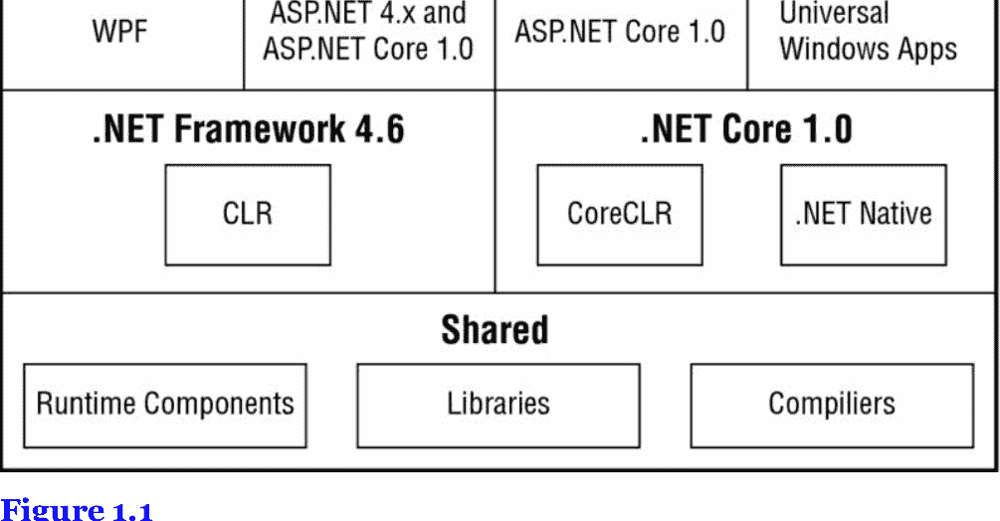

**图1.1**

.NET Core 的一部分是一个新的运行时：CoreCLR。该运行时用于 ASP.NET Core 1.0。除了使用 CoreCLR 运行时，.NET 也可以编译为原生代码。UWP 自动利用这一特性；这些 .NET 应用程序在从 Windows 应用商店提供之前会编译为原生代码。你还可以将其他 .NET Core 应用程序——以及运行在 Linux 上的应用程序——编译为原生代码。

在[图1.1](#figure-1-1)的下半部分，你可以看到 .NET Framework 4.6 与 .NET Core 之间也有一些共享。*运行时组件*，如垃圾回收器的代码和 RyuJIT（这是一个新的 JIT 编译器，用于将 IL 代码编译为原生代码）是共享的。垃圾回收器被 CLR、CoreCLR 和 .NET Native 使用。RyuJIT 即时编译器被 CLR 和 CoreCLR 使用。

| 命名空间 | 描述 |
|---|---|
| System.Collections | 这是集合的根命名空间。集合也位于子命名空间中，如 `System.Collections.Concurrent` 和 `System.Collections.Generic`。 |
| System.Data | 这是访问数据库的命名空间。`System.Data.SqlClient` 包含访问 SQL Server 的类。 |
| System.Diagnostics | 这是诊断信息的根命名空间，例如事件日志和跟踪（在 `System.Diagnostics.Tracing` 命名空间中）。 |
| System.Globalization | 这是包含应用程序全球化和本地化类的命名空间。 |
| System.IO | 这是文件 I/O 的命名空间，包含访问文件和目录的类。读取器、写入器和流都在这里。 |
| System.Net | 这是核心网络的命名空间，例如访问 DNS 服务器以及使用 `System.Net.Sockets` 创建套接字。 |
| System.Threading | 这是线程和任务的根命名空间。任务定义在 `System.Threading.Tasks` 中。 |
| System.Web | 这是 ASP.NET 的根命名空间。在此命名空间下，定义了许多子命名空间，如 `System.Web.UI`、`System.Web.UI.WebControls` 和 `System.Web.Hosting`。 |
| System.Windows | 这是使用 WPF 的 Windows 桌面应用程序的根命名空间。示例子命名空间有 `System.Windows.Shapes`、`System.Windows.Data` 和 `System.Windows.Documents`。 |

> **注意** 一些新的 .NET 类使用的命名空间以 `Microsoft` 开头而不是 `System`，例如用于 Entity Framework 的 `Microsoft.Data.Entity` 和用于新依赖注入框架的 `Microsoft.Extensions.DependencyInjection`。

## .NET Core 1.0

.NET Core 1.0 是新的 .NET，它被所有新技术和

它在本书中是一个重点。这个框架是*开源*的——你可以在 [http://www.github.com/dotnet](http://www.github.com/dotnet) 找到它。运行时是 *CoreCLR* 仓库；包含集合类、文件系统访问、控制台、XML 等更多内容的框架位于 *CoreFX* 仓库。

与 .NET Framework 不同，后者要求应用程序所需的特定版本必须安装在系统上；而使用 .NET Core 1.0 时，框架（包括运行时）随应用程序一起交付。以前，您可能会在将 ASP.NET Web 应用程序部署到共享服务器时遇到问题，因为服务提供商安装了旧版本的 .NET；那些日子已经一去不复返了。现在，您可以随应用程序一起交付运行时，而无需依赖服务器上安装的版本。

.NET Core 1.0 采用模块化方式设计。框架被拆分成大量的 NuGet 包。您可以根据应用程序决定需要哪些包。.NET Framework 随着新功能的添加而变得越来越庞大。无法移除不再需要的旧功能，例如旧的集合类（由于泛型集合类的加入而变得不必要）、已被新通信技术取代的 .NET Remoting，或者已更新为 Entity Framework 的 LINQ to SQL。如果移除某些内容，应用程序可能会崩溃。这并不适用于 .NET Core，因为应用程序会分发它所需要的框架部分。

.NET Core 的框架目前与 .NET Framework 4.6 一样庞大。然而，这种情况可能会改变，它也可能会变得更大，但由于模块化，这种增长潜力不是问题。.NET Core 已经非常庞大，以至于本书无法涵盖每一种类型。只需查看 [http://www.github.com/dotnet/corefx](http://www.github.com/dotnet/corefx) 即可看到所有源代码。例如，.NET Core 已经包含了旧的非泛型集合类，以便更容易地将遗留代码迁移到新平台。

.NET Core 可以快速更新。即使更新运行时也不会影响现有应用程序，因为运行时是随应用程序一起安装的。现在 Microsoft 可以以更快的发布周期改进 .NET Core，包括运行时。

> **注意** *为了开发使用 .NET Core 的应用程序，Microsoft 创建了名为 .NET Core 命令行 (CLI) 的新命令行实用工具。这些工具将在本章稍后的“使用 CLI 编译”一节的“Hello, World!”应用程序中介绍。*

## 程序集

.NET 程序的库和可执行文件统称为程序集。*程序集*是包含面向 .NET Framework 的已编译 IL 代码的逻辑单元。

程序集是完全自描述的，是逻辑单元而非物理单元，这意味着它可以存储在多个文件中。（实际上，动态程序集存储在内存中，而不是文件中。）如果一个程序集存储在多个文件中，则会有一个包含入口点并描述程序集中其他文件的主文件。

可执行代码和库代码使用相同的程序集结构。唯一的区别是可执行程序集包含主程序入口点，而库程序集不包含。

程序集的一个重要特征是包含描述相应代码中定义的类型和方法的元数据。然而，程序集还包含描述该程序集的程序集元数据。这些程序集元数据位于称为*清单*的区域中，可以对程序集的版本及其完整性进行检查。

由于程序集包含程序元数据，调用给定程序集中代码的应用程序或其他程序集无需引用注册表或任何其他数据源即可了解如何使用该程序集。

在 .NET Framework 4.6 中，程序集分为两种类型：*私有*程序集和*共享*程序集。共享程序集不适用于通用 Windows 平台，因为所有代码都会编译为一个本机映像。

### 私有程序集

私有程序集通常随软件一起发布，并且仅供该软件使用。发布私有程序集的常见场景是：以可执行文件和多个库的形式提供应用程序，其中库包含仅应与该应用程序一起使用的代码。

系统保证私有程序集不会被其他软件使用，因为应用程序只能加载位于主可执行文件所在文件夹或其子文件夹中的私有程序集。

因为您通常期望商业软件总是安装在自己的目录中，所以不存在一个软件包覆盖、修改或意外加载专用于另一个包的私有程序集的风险。而且，由于私有程序集只能由它们所针对的软件包使用，因此您可以更好地控制哪些软件使用它们。因此，也就不太需要采取安全预防措施，因为不存在例如某个其他商业软件用其新版本覆盖您的程序集的风险（除非是专门设计用来进行恶意破坏的软件）。也不存在名称冲突的问题。如果您的私有程序集中的类恰好与某人的类同名

NuGet 包是一个 zip 文件，其中包含程序集（或多个程序集）以及配置信息和 PowerShell 脚本。

使用 NuGet 包的另一个原因是它们很容易找到；不仅可以从 Microsoft 获得，还可以从第三方获得。NuGet 包可以方便地在 NuGet 服务器上访问，网址为 [http://www.nuget.org](http://www.nuget.org)。

在 Visual Studio 项目的引用中，您可以打开 NuGet 包管理器（参见图 1.2）。您可以在那里搜索包并将它们添加到应用程序中。此工具使您能够搜索尚未发布的包（包括预发布选项），并定义用于搜索包的 NuGet 服务器。

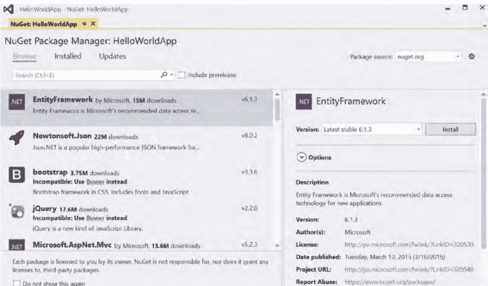

**图 1.2**

> **注意** 当您使用 NuGet 服务器上的第三方包时，如果某个包在日后不可用，您总是面临风险。您还需要检查包的支持可用性。在使用包之前，始终检查有关包信息的项目链接。使用包源时，您可以选择 Microsoft 和 .NET，以仅获取 Microsoft 支持的包。第三方包也包含在 Microsoft 和 .NET 部分中，但这些是 Microsoft 支持的第三方包。

您和您的开发团队还可以使用自己的 NuGet 服务器。您可以定义仅允许开发团队使用来自您自己服务器上的包。

由于 .NET Core 非常模块化，所有应用程序——除了最简单的应用程序之外——都需要额外的 NuGet 包。为了让您更容易找到所需的包，本书中每个使用 .NET Core 构建的示例应用程序都会显示一个表格，列出需要添加的包和命名空间。

> **注意** 第 17 章“Visual Studio 2015”中提供了有关 NuGet 包管理器的更多信息。


### 公共语言运行时

通用 Windows 平台使用 `.NET Native` 将 IL 编译为本机代码。在所有其他场景中，无论是使用 .NET Framework 4.6 的应用程序还是使用 .NET Core 1.0 的应用程序，都需要公共语言运行时 (CLR)。然而，.NET Core 使用 CoreCLR，而 .NET Framework 使用 CLR。那么，CLR 做什么呢？

在应用程序可以由 CLR 执行之前，您开发的任何源代码（使用 C# 或其他语言）都需要编译。在 .NET 中，编译分为两个步骤：

- 1. 将源代码编译为 Microsoft 中间语言 (IL)
- 2. 由 CLR 将 IL 编译为平台特定的本机代码

IL 代码包含在 .NET 程序集中。在运行时，即时 (JIT) 编译器编译 IL 代码并生成平台特定的本机代码。

新的 CLR 和 CoreCLR 包含一个名为 RyuJIT 的新 JIT 编译器。新的 JIT 编译器不仅比以前更快，而且在 Visual Studio 中调试时对“编辑并继续”功能提供了更好的支持。“编辑并继续”功能使您可以在调试时编辑代码，并且可以继续调试会话，而无需停止和重新启动进程。

运行时还包含一个带有类型加载器的类型系统，该加载器负责从程序集加载类型。安全基础设施与类型系统一起验证某些类型系统结构是否被允许——例如，继承。

创建类型实例后，这些实例还需要被销毁，内存也需要被回收。运行时的另一个功能是垃圾回收器。垃圾回收器清理托管堆中不再被引用的内存。第 5 章“托管和非托管资源”解释了这是如何完成的以及何时发生。

运行时还负责线程处理。使用 C# 创建的托管线程不一定对应于底层操作系统中的线程。线程由运行时虚拟化和管理。

> **注意** *第 21 章“任务与并行编程”和第 22 章“任务同步”介绍了如何从 C# 创建和管理线程。*

### .NET Native

.NET 2015 的一项新特性是将托管程序编译为本机代码，即 `.NET Native`。对于 Windows 应用，这会生成优化代码，其启动时间最多可缩短 60%，内存占用减少 15% 到 20%。

`.NET Native` 最初是将 UWP 应用编译为本机代码，用于部署到 Windows 应用商店的应用。现在，`.NET Native` 也可用于其他 .NET Core 应用程序。你可以将同时在 Windows 和 Linux 上运行的 .NET Core 应用程序编译为本机代码。当然，你需要为每个平台生成不同的本机映像。在幕后，`.NET Native` 使用 C++ 优化器来生成本机代码。

### Windows 运行时

从 Windows 8 开始，Windows 操作系统提供了另一个框架：Windows 运行时（Windows Runtime）。该运行时被通用 Windows 平台（UWP）使用，在 Windows 8 中是版本 1，在 Windows 8.1 中是版本 2，在 Windows 10 中是版本 3。

与 .NET Framework 不同，此框架是使用本机代码创建的。当它与 .NET 应用程序一起使用时，其中包含的类型和方法看起来就像 .NET 的一部分。借助语言投影，Windows 运行时可用于 JavaScript、C++ 和 .NET 语言，并且看起来就像是编程环境原生的。方法不仅在区分大小写方面表现不同；而且方法和类型的名称也可能因其使用位置不同而不同。

Windows 运行时提供了按以 Windows 开头的命名空间组织的对象层次结构。仔细查看这些类，你会发现与 .NET Framework 功能重复的类并不多；相反，它提供了额外的功能，可供在通用 Windows 平台上运行的应用程序使用。

| 命名空间 | 描述 |
|---|---|
| `Windows.ApplicationModel` | 此命名空间及其子命名空间（例如 `Windows.ApplicationModel.Contacts`）定义了管理应用生命周期以及与其他应用通信的类。 |
| `Windows.Data` | `Windows.Data` 定义了用于处理文本、JSON、PDF 和 XML 数据的子命名空间。 |
| `Windows.Devices` | 通过 `Windows.Devices` 的子命名空间可以访问地理位置、智能卡、服务点设备、打印机、扫描仪和其他设备。 |
| `Windows.Foundation` | `Windows.Foundation` 定义核心功能。集合接口由命名空间 `Windows.Foundation.Collections` 定义。你在这里找不到具体的集合类。相反，.NET 集合类型的接口会映射到 Windows 运行时类型。 |
| `Windows.Media` | `Windows.Media` 是播放和捕获视频与音频、访问播放列表以及进行语音输出的根命名空间。 |
| `Windows.Networking` | 这是套接字编程、后台数据传输和推送通知的根命名空间。 |
| `Windows.Security` | `Windows.Security.Credentials` 中的类为密码提供安全存储；`Windows.Security.Credentials.UI` 提供一个选择器，用于从用户获取凭据。 |
| `Windows.Services.Maps` | 此命名空间包含用于位置服务和路线规划的类。 |
| `Windows.Storage` | 通过 `Windows.Storage` 及其子命名空间，可以访问文件和目录，也可以使用流和压缩。 |
| `Windows.System` | `Windows.System` 命名空间及其子命名空间提供关于系统和用户的信息，同时也提供一个 `Launcher` 来启动其他应用。 |
| `Windows.UI.Xaml` | 在此命名空间中，你可以找到大量用于用户界面的类型。 |

### Hello, World

让我们开始编写代码，创建一个 *Hello, World* 应用程序。自 20 世纪 70 年代 Brian Kernighan 和 Dennis Ritchie 撰写《*C程序设计语言*》以来，使用 Hello, World 应用程序开始学习编程语言已成为一种传统。有趣的是，Hello, World 的语法在 C# 6 中发生了变化；这是自 C# 发明以来，这个简单程序的写法第一次发生改变。

最初的几个示例将不使用 Visual Studio 创建，这样你可以通过命令行工具和简单的文本编辑器（如记事本）创建应用程序，看到幕后发生的事情。之后，你会改用 Visual Studio，因为它可以让编程变得更轻松。

在文本编辑器中输入以下源代码，并以 `.cs` 扩展名保存（例如 `HelloWorld.cs`）。`Main` 方法是 .NET 应用程序的入口点。CLR 在启动时调用静态 `Main` 方法。`Main` 方法必须放在类中。这里，类名为 `Program`，但你也可以给它起任何名字。`WriteLine` 是 `Console` 类的 `static` 方法。第一行的 `using` 声明使 `Console` 类的所有静态成员可用。`using static System.Console` 使 `Console` 类的静态成员可用，这样你在调用 `WriteLine` 方法时无需输入类名（代码文件 `Dotnet/HelloWorld.cs`）：

```
using static System.Console;

class Program
{
    static void Main()
    {
        WriteLine("Hello, World!");
    }
}
```

如前所述，Hello, World 的语法在 C# 6 中略有变化。在 C# 6 之前，`using static` 不可用，`using` 声明只能打开命名空间。当然，以下代码在 C# 6 中仍然可以正常工作（代码文件 `Dotnet/HelloWorld2.cs`）：

```
using System;

class Program
{
    static void Main()
    {
        Console.WriteLine("Hello, World!");
    }
}
```

`using` 声明的作用是通过打开命名空间来减少代码量。另一种编写 Hello, World 程序的方法是删除 `using` 声明，并在调用 `WriteLine` 方法时在 `Console` 类前面添加 `System` 命名空间（代码文件 `Dotnet/HelloWorld3.cs`）：

```
class Program
{
    static void Main()
    {
        System.Console.WriteLine("Hello, World!");
    }
}
```

编写完源代码后，你需要编译代码才能运行它。

### 使用 .NET 4.6 编译

你只需对源文件运行 C# 命令行编译器（`csc.exe`），即可编译此程序，如下所示：

```
csc HelloWorld.cs
```

如果你想使用 `csc` 命令从命令行编译代码，你应当注意，包括 `csc` 在内的 .NET 命令行工具只有在设置了某些环境变量后才可用。取决于你如何安装 .NET（以及 Visual Studio），你的机器上可能是这样，也可能不是这样。

> **注意** 如果你没有设置环境变量，你有三种选择：第一种是在调用 `csc` 可执行文件时添加路径。它位于 `%Program Files%\MSBuild\14.0\Bin\csc.exe`。如果安装了 `dotnet` 工具，你也可以在 `%ProgramFiles%\dotnet\bin\csc.exe` 找到 `csc`。第二种选择是在运行 `csc` 之前，从命令提示符运行批处理文件 `%Microsoft Visual Studio 2015%\Common7\Tools\vsvars32.bat`，其中 `%Microsoft Visual Studio 2015%` 是 Visual Studio 2015 的安装文件夹。第三种（也是最简单的方法）是使用 Visual Studio 2015 命令提示符，而不是 Windows 命令提示符。若要从开始菜单找到 Visual Studio 2015 命令提示符，请选择“程序 ⇨ Microsoft Visual Studio 2015 ⇨ Visual Studio Tools”。Visual Studio 2015 命令提示符只是一个打开时会自动运行 `vsvars32.bat` 的命令提示符窗口。

编译代码会生成一个名为 `HelloWorld.exe` 的可执行文件，你可以从命令行运行它。你也可以像运行任何其他可执行文件一样，从 Windows 资源管理器中运行它。试一下吧：

```
> csc HelloWorld.cs
Microsoft (R) Visual C# Compiler version 1.1.0.51109
Copyright (C) Microsoft Corporation. All rights reserved.
> HelloWorld
Hello, World!
```

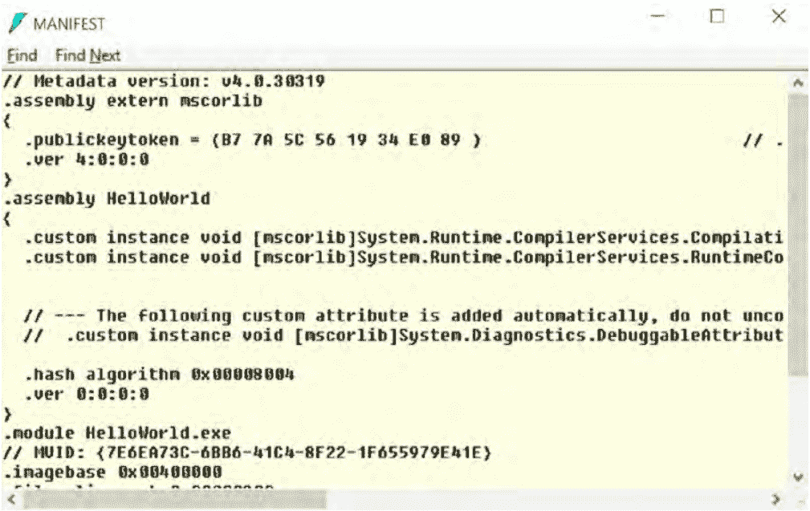

**图 1.4**

双击 `Main` 方法以显示该方法的 IL 代码（参见图 1.5）。无论你编译的是哪个版本的 Hello, World 代码，结果都是相同的。字符串 Hello, World! 在调用 `mscorlib` 程序集中定义的 `System.Console.WriteLine` 方法之前被加载，并将该字符串传递给它。CLR 的一个特性是 JIT 编译器。JIT 编译器在应用程序运行时将 IL 代码编译为本机代码。

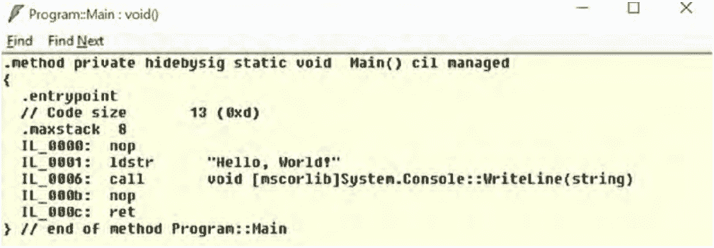

**图 1.5**

### 使用 .NET Core CLI 编译

使用新的 .NET Core 命令行（CLI），在没有 Visual Studio 帮助的情况下编译应用程序需要做一些准备工作。接下来让我们看看这些用于编译 Hello, World 示例应用程序的新工具。

#### 设置环境

如果你已安装带有最新更新的 Visual Studio 2015，则可以立即开始使用 CLI 工具。否则，你需要安装 .NET Core 和 CLI 工具。你可以在 http://dotnet.github.io 找到适用于 Windows、Linux 和 OS X 的下载说明。

在 Windows 上，不同版本的 .NET Core 运行时以及 NuGet 包都安装在用户配置文件中。随着你使用 .NET 工作，这个文件夹会越来越大。随着时间的推移，当你创建多个项目时，NuGet 包不再存储在项目本身中，而是存储在这个用户专属文件夹中。这样做的好处是，你不必为每个不同的项目下载 NuGet 包。一旦下载了 NuGet 包，它就在你的系统上了。正如不同版本的 NuGet 包和运行时都可用一样，所有不同版本都存储在这个文件夹中。时不时地检查这个文件夹并删除不再需要的旧版本会是一个不错的做法。

安装 .NET Core CLI 工具后，你便有了 `dotnet` 工具作为启动所有这些工具的入口。只需启动

```
> dotnet
```

即可查看 `dotnet` 工具提供的所有不同选项。

`repl`（读取、求值、打印、循环）命令非常适合在无需创建程序的情况下学习和测试 C# 的简单功能。使用 `dotnet` 工具启动 `repl`：

```
> dotnet repl
```

这将启动一个交互式 `repl` 会话。你可以输入以下语句，使用变量来实现一个 Hello, World：

```
> using static System.Console;
> var hello ="Hello, World!";
> WriteLine(hello);
```

当你输入最后一条语句时，看到的输出将是 Hello, World! 字符串。

#### 构建应用程序

`dotnet` 工具提供了一种创建 Hello, World 应用程序的简便方法。你创建一个新目录 `HelloWorldApp`，并使用命令提示符切换到该目录。然后输入以下命令：

```
> dotnet new
```

此命令会创建一个 `Program.cs` 文件，其中包含 Hello, World 程序的代码；一个 `NuGet.config` 文件，用于定义应从哪个 NuGet 服务器加载 NuGet 包；以及 `project.json`，即新的项目配置文件。

> **注意** *使用 `dotnet new` 你还可以创建库和 ASP.NET Web 应用程序所需的初始文件（使用 `--type` 选项）。你还可以选择其他编程语言，例如 F# 和 Visual Basic（使用 `--lang` 选项）。*

创建的项目配置文件名为 `project.json`。该文件采用 JavaScript 对象表示法（JSON）格式，定义了框架应用程序信息，如版本、描述、作者、标签、对库的依赖关系以及应用程序支持的框架。生成的项目配置文件显示在以下代码片段中（代码文件 `HelloWorldApp/project.json`）：

```
{
  "version":"1.0.0-*",
  "compilationOptions": {
    "emitEntryPoint": true
  },

  "dependencies": {
    "NetStandard.Library":"1.0.0-*"
  },

  "frameworks" : {
    "netstandardapp1.5": {
      "imports":"dnxcore50"
    }
  },
  "runtimes" : {
    "ubuntu.14.04-x64": { },
    "win7-x64": { },
    "win10-x64": { },
    "osx.10.10-x64": { },
    "osx.10.11-x64": { }
  }
}
```

通过 `compilationOptions` 设置，可以设置 `emitEntryPoint`。如果你创建 `Main` 方法作为程序入口点，这是必需的。当你运行应用程序时，会调用这个 `Main` 方法。对于库来说，此设置不是必需的。

在 `dependencies` 部分，你可以添加程序的所有依赖项，例如编译程序所需的额外 NuGet 包。默认情况下，`NetStandard.Library` 会作为依赖项添加。`NetStandard.Library` 是一个引用 NuGet 包——一个引用其他 NuGet 包的包。借助它，你可以避免添加许多其他包，例如用于 `Console` 类的 `System.Console`、用于泛型集合类的 `System.Collections` 等等。`NetStandard.Library 1.0` 是一个标准，它定义了所有 .NET 平台必须支持的程序集列表。在网站 https://github.com/dotnet/corefx/blob/master/Documentation/project-docs/standard-platform.md 上，你可以找到一长串属于 1.0 标准一部分的程序集及其版本号，以及 .NET 标准 1.1、1.2、1.3 和 1.4 新增的程序集。


如果依赖`NetStandard.Library` 1.0，你可以支持 .NET Framework 4.5.2 及更高版本（对 .NET 4、4.5、4.5.1 的支持已于 2016 年 1 月结束）、.NET Core 1.0、UWP 10.0，以及其他 .NET Framework，如 Windows Phone Silverlight 8.0、Mono 和 Mono/Xamarin。改用 1.3 版本会将支持范围限制为 .NET 4.6、.NET Core 1.0、UWP 10.0 和 Mono/Xamarin 平台。1.4 版本会将支持范围限制为 .NET 4.6.1、.NET Core 1.0 和 Mono/Xamarin 平台，但你可以获得更新的版本和更多可用的程序集列表。

`project.json` 中的 `frameworks` 部分列出了应用程序支持的 .NET Framework。默认情况下，应用程序仅针对 .NET Core 1.0 构建，如 `netstandardapp1.5` 标识符所指定。`netstandardapp1.5` 用于为 .NET Core 构建的应用程序。对于库，你可以使用 `netstandard1.0` 标识符。这样，.NET Core 应用程序和使用 .NET Framework 的应用程序都可以使用该库。`netstandardapp1.5` 中的 `imports` 部分引用了旧名称 `dnxcore50`，它将旧标识符映射到新标识符。这允许使用仍在使用旧名称的包。

.NET Core 是该框架的新开源版本，可在 Windows、Linux 和 OS X 上使用。需要支持的运行时必须添加到 `runtimes` 部分。前面的代码片段显示了对 Ubuntu Linux 发行版、Windows 7（也允许在 Windows 8 上运行应用程序）、Windows 10 和 OS X 的支持。

添加字符串 `net46` 后，程序也会针对 .NET Framework 4.6 版本构建：

```
"frameworks" : {
  "netstandardapp1.5" : { }
  "net46" : { }
}
```

将 `net46` 添加到 `frameworks` 部分也意味着不再支持非 Windows 运行时，因此你需要移除这些运行时。

你还可以添加其他元数据，例如描述、作者信息、标签、项目和许可证 URL：

```
"version":"1.0.0-*",
"description":"HelloWorld Sample App for Professional C#",
"authors": ["Christian Nagel" ],
"tags": ["Sample","Hello","Wrox" ],
"projectUrl":"http://github.com/professionalCSharp/",
"licenseUrl":"",
```

当你向 `project.json` 文件添加多个框架时，可以在框架下方的 `dependencies` 部分中指定每个框架特有的依赖项。所指定的依赖项列出了受支持框架的内容，并列出了在安装 NuGet 包之前所需的程序集依赖项。

要发布应用程序，目标系统上也需要运行时。可以使用 `dotnet publish` 命令创建发布所需的文件：

```
> dotnet publish
```

使用可选参数，你可以指定仅为某个特定的运行时发布（选项 `-r`）或指定不同的输出目录（选项 `-o`）。在 Windows 系统上运行此命令后，你会找到一个 `win7-x64` 文件夹，其中包含目标系统所需的所有文件。请注意，.NET Core 已包含运行时；因此目标系统安装了什么运行时版本并不重要。

## 应用程序类型和技术

你可以使用 C# 创建控制台应用程序；在本书前几章的大多数示例中，你所要做的正是这件事。对于真正的程序，控制台应用程序并不那么常用。你可以使用 C# 创建使用许多与 .NET 相关技术的应用程序。本节概述了你可以用 C# 编写的不同类型的应用程序。

### 数据访问

在查看应用程序类型本身之前，我们先来看看所有应用程序类型都会使用的技术：数据访问。

文件和目录可以通过简单的 API 调用来访问；然而，对于某些场景，简单的 API 调用不够灵活。使用流 API 你会获得很大的灵活性，而且流还提供了更多功能，例如加密或压缩。读取器和写入器使流的使用更加容易。这里可用的所有不同选项都将在第 23 章“文件和流”中介绍。还可以将完整的对象序列化为 XML 或 JSON 格式。第 27 章“XML 和 JSON”讨论了这些选项。

要读写数据库，你可以直接使用 ADO.NET（参见第 37 章“ADO.NET”），也可以使用抽象层 ADO.NET Entity Framework（第 38 章“Entity Framework Core”）。Entity Framework 提供了对象层次结构与数据库关系之间的映射。

ADO.NET Entity Framework 经历了多次迭代。不同版本的 Entity Framework 值得讨论；这能让你很好地了解为什么 NuGet 包是一个好主意。你还将了解 Entity Framework 的哪些部分在今后不应再使用。

下表描述了 Entity 的不同版本

Entity Framework 及其每个版本的新特性。

| Entity Framework | 描述 |

|---|---|

| 1.0 | 随 .NET 3.5 SP1 提供。该版本提供了通过 XML 文件将表映射到对象的映射方式。 |

| 4.0 | 随 .NET 4 一起发布，Entity Framework 从版本 1 跃升至 4。 |

| 4.1 | Code First 支持。 |

| 4.2 | Bug 修复。 |

| 4.3 | 新增迁移功能。 |

| 5.0 | 与 .NET 4.5 一同发布，带来了性能改进，并支持新的 SQL Server 功能。 |

| 6.0 | 已移至 NuGet 包。 |

| 7.0 | 完全重写，同时支持 NoSQL，并且也能在 Windows 应用上运行。 |

下面来了解一些细节。Entity Framework 最初作为 .NET Framework 类的一部分发布，这些类随 .NET Framework 预装。Entity Framework 1 是 .NET 3.5 第一个服务包（一个功能更新）的一部分：.NET 3.5 Update 1。

第二个版本新增了大量功能，因此决定随 .NET 4 一起将版本升级到 4。此后，Entity Framework 的发布节奏快于 .NET Framework。要获取更新版本的 Entity Framework，必须在应用程序中添加 NuGet 包（版本 4.1、4.2、4.3）。这种方法存在问题：已经随 .NET Framework 提供的类必须按原样使用。只有额外的功能（如 Code First）是通过 NuGet 包添加的。

随 .NET 4.5 一起，Entity Framework 5.0 发布了。同样，部分类随预装的 .NET Framework 提供，而额外功能则属于 NuGet 包。NuGet 包还允许在 .NET 4.0 应用程序中安装 Entity Framework 5.0 的 NuGet 包。然而实际上，当 Entity Framework 5.0 被添加到 .NET 4.0 项目时，该包（通过脚本）会决定结果是 Entity Framework 4.4，因为某些所需类型属于 .NET 4.5，而不是 .NET 4 的一部分。

Entity Framework 的下一版本通过将所有 Entity Framework 类型移到 NuGet 包中解决了这个问题；Framework 自带的类型会被忽略。这使得 6.0 可以与较早版本的 Framework 一起使用；你不再局限于 4.5。为了避免与 Framework 的类冲突，一些类型被移到了不同的命名空间。ASP.NET Web Forms 的某些功能因此遇到了问题，因为已经使用了 Entity Framework 的原始类，而这些类不容易映射到新类。

在多个版本发布过程中，Entity Framework 提供了不同的选项来将数据库表映射到类。前两个选项是 Database First 和 Model First。通过这两个选项，映射都是通过 XML 文件完成的。XML 文件通过图形设计器呈现，可以将实体从工具箱拖到设计器中来完成映射。

从版本 4.1 开始，增加了通过代码进行映射的方式：Code First。Code First 并不是说数据库不能预先存在。两种方式都是可能的：数据库可以动态创建，也可以在编写代码之前数据库就已存在。使用 Code First，你不通过 XML 文件进行映射，而是通过特性或 Fluent API 以编程方式定义映射。

Entity Framework Core 1.0 是对 Entity Framework 的完全重新设计，从新名称中也能看出这一点。要将应用程序从旧版 Entity Framework 迁移到新版本，需要修改代码。旧式映射变体（如 Database First 和 Model First）已被弃用，因为 Code First 是更好的替代方案。这种完全重新设计也是为了不仅支持关系数据库，还支持 NoSQL。Azure Table Storage 就是现在可以使用 Entity Framework 的选项之一。

### Windows 桌面应用程序

在创建 Windows 桌面应用程序时，有两种技术可用：Windows Forms 和 Windows Presentation Foundation。Windows Forms 由包装原生 Windows 控件的类组成，它基于像素图形。Windows Presentation Foundation（WPF）是较新的技术，并且基于矢量图形。

WPF 在构建应用程序时使用 XAML。XAML 代表 eXtensible Application Markup Language（可扩展应用程序标记语言）。这种在 Microsoft 环境中创建应用程序的方式于 2006 年引入，是 .NET Framework 3.0 的一部分。.NET 4.5 为 WPF 引入了新功能，例如功能区控件和实时整形。

XAML 是用于创建窗体的 XML 声明，该窗体表示 WPF 应用程序的所有视觉方面和行为。虽然你可以通过编程方式处理 WPF 应用程序，但 WPF 是朝着声明式编程方向迈出的一步，而这也是行业正在转向的方向。声明式编程意味着，不是通过 C#、Visual Basic 或 Java 等编译语言编写程序来创建对象，而是通过 XML 类型的编程来声明一切。第 29 章“核心 XAML”介绍了 XAML（它也用于 XML Paper Specification、Windows Workflow Foundation 和 Windows Communication Foundation）。第 30 章介绍 XAML 样式和资源。第 34 章“使用 WPF 的 Windows 桌面应用程序”详细介绍了控件、布局和数据绑定。打印和创建文档是 WPF 的另一个重要方面，将在第 35 章“使用 WPF 创建文档”中介绍。

WPF 的未来是什么？难道 UWP 不是未来新应用要使用的 UI 平台吗？UWP 在支持移动设备方面也有优势。只要你的部分用户尚未升级到 Windows 10，你就需要支持 Windows 7 等更旧的操作系统。UWP 应用无法在 Windows 7 或 Windows 8 上运行。你可以使用 WPF。如果你还想支持移动设备，最好尽可能多地共享代码。你可以通过支持 MVVM 模式，使用尽可能多的共享代码，同时创建 WPF 和 UWP 应用。该模式将在第 31 章“XAML 应用模式”中介绍。

### 通用 Windows 平台

通用 Windows 平台（UWP）是微软的一个战略性平台。当你使用 UWP 创建 Windows 应用时，你仅限于 Windows 10 及更新版本的 Windows。但你并不局限于 Windows 的桌面版本。借助 Windows 10，你有很多不同的选择，例如 Phone、Xbox、Surface Hub、HoloLens 和 IoT。有一个 API 可以在所有这些设备上运行！

一个 API 适用于所有这些设备？是的！每个设备家族都可以添加自己的软件开发工具包（SDK），以添加一些不属于所有设备通用 API 的功能。添加这些 SDK 不会破坏应用程序，但你需要以编程方式检查应用运行所在的平台上，此类 SDK 中的某个 API 是否可用。根据你需要区分的 API 调用数量，代码可能会变得一团糟；依赖注入或许是更好的选择。

> 注意：依赖注入将在第 31 章讨论，同时还会介绍其他对基于 XAML 的应用程序有用的模式。

你可以决定你的应用程序支持哪些设备家族。并非所有设备家族对每个应用都有用。

Windows 10 之后还会有更新的 Windows 版本吗？Windows 11 并没有计划。对于 Windows 应用（也称为 Metro 应用、Windows 商店应用、Modern 应用和通用 Windows 应用），你此前针对的是 Windows 8 或 Windows 8.1。Windows 8 应用通常也能在 Windows 8.1 上运行，但反过来则不一定。现在情况大不相同了。当你为通用 Windows 平台创建应用时，你针对的是 10.0.10130.0 这样的版本，并定义可用的最低版本以及测试过的最新版本，同时还假设它也能在未来的版本上运行。根据你可以为应用使用的功能以及你期望用户拥有的版本，你可以决定支持的最低版本。个人用户通常会自动更新到较新版本；企业用户可能会坚持使用旧版本。

在通用 Windows 平台上运行的 Windows 应用使用 Windows Runtime 和 .NET Core。这些应用类型最重要的章节是第 32 章“Windows 应用：用户界面”和第 33 章“高级 Windows 应用”。这些应用也在其他许多章节中涉及，例如第 23 章以及第 29 章至第 31 章。

### 使用 WCF 的 SOAP 服务

Windows Communication Foundation（WCF）是一种功能丰富的技术，旨在通过提供基于 SOAP 的通信来取代 WCF 之前可用的所有通信技术，这些通信具有基于标准的 Web 服务所使用的所有功能，例如安全性、事务、双工和单向通信、路由、发现等。WCF 使您能够一次构建服务，然后通过修改配置文件，以多种方式（甚至在不同的协议下）公开此服务。WCF 是连接不同系统的强大但复杂的方式。第 44 章“Windows Communication Foundation”对此进行了详细说明。

### 使用 ASP.NET Web API 的 Web 服务

ASP.NET Web API 是一种通信更简单且能满足分布式应用 90% 以上需求的选择。该技术基于 REST（表述性状态转移），它为无状态、可扩展的 Web 服务定义了指导方针和最佳实践。

客户端可以接收 JSON 或 XML 数据。JSON 和 XML 也可以按照开放数据规范（OData）进行格式化。

这个新 API 的特性使得使用 JavaScript 的 Web 客户端以及使用通用 Windows 平台的客户端都能轻松使用它。

ASP.NET Web API 是创建微服务的好方法。构建微服务的方法定义了更小的服务，这些服务可以独立运行和部署，并控制自己的数据存储。

在 ASP.NET 5 中，旧版从 ASP.NET MVC 中分离出来的 ASP.NET Web API 现已与 ASP.NET MVC 6 合并，并使用相同的类型和特性。

> 注意：第 42 章介绍了 ASP.NET Web API 和更多关于微服务的信息。

### WebHooks 和 SignalR

对于实时 Web 功能以及客户端和服务器之间的双向通信，可以使用 WebHooks 和 SignalR 这些 ASP.NET 技术。

SignalR 允许在信息可用时立即将信息推送到已连接的客户端。SignalR 使用 WebSocket 技术，并且在 WebSocket 不可用时，它会回退到基于拉取的通信机制。

WebHooks 允许您与公共服务集成，这些服务可以调用您的公共 ASP.NET Web API 服务。WebHooks 是一种从 GitHub、Dropbox 等众多服务接收推送通知的技术。

第 43 章“WebHooks 和 SignalR”讨论了 SignalR 连接管理、连接分组，以及 WebHooks 授权和集成的基础知识。

### Windows 服务

Web 服务，无论是使用 WCF 还是 ASP.NET Web 服务实现，都需要宿主才能运行。Internet Information Server 通常是一个不错的选择，因为它提供了各种服务，但宿主也可以是自定义程序。如果选择自定义选项，创建一个随 Windows 启动而运行的后台进程就是 Windows 服务。这是一种设计用于在基于 Windows NT 内核的操作系统中后台运行的程序。当您希望程序持续运行并准备好响应事件，而无需用户显式启动时，服务非常有用。一个很好的例子是 Web 服务器上的万维网服务，它会侦听来自客户端的 Web 请求。

使用 C# 编写服务很容易。`System.ServiceProcess` 命名空间中的 .NET Framework 基类可用于处理与服务相关的许多样板任务。此外，Visual Studio .NET 使您能够创建 C# Windows 服务项目，该项目使用 C# 源代码作为基本 Windows 服务。第 39 章“Windows 服务”探讨了如何编写 C# Windows 服务。

### Web 应用程序

最初引入的 ASP.NET 1 从根本上改变了 Web 编程模型。ASP.NET 5 是新的主要版本，允许使用 .NET Core 来实现高性能和可扩展性。这个新版本还可以在 Linux 系统上运行，而这是一项高需求。

在 ASP.NET 5 中，不再介绍 ASP.NET Web Forms（它仍然可以使用，并随 .NET 4.6 更新），因此本书重点关注现代技术 ASP.NET MVC 6，它是 ASP.NET 5 的一部分。


ASP.NET MVC 基于众所周知的模型-视图-控制器（MVC）模式，以便于单元测试。它还允许使用 HTML、CSS 和 JavaScript 来编写用户界面代码，从而实现清晰分离，并且只在后端使用 C#。

> 注意：第 41 章“ASP.NET MVC”介绍了 ASP.NET MVC 6。

## Microsoft Azure

如今，在考虑开发前景时，你无法忽视云。虽然本书没有专门的云技术章节，但在多个章节中都引用了 Microsoft Azure。

Microsoft Azure 提供软件即服务（SaaS）、基础设施即服务（IaaS）和平台即服务（PaaS），有时这些服务介于这些类别之间。让我们来看看 Microsoft Azure 的一些产品。

### 软件即服务

SaaS 提供完整的软件；您无需处理服务器管理、更新等事务。Office 365 是通过云服务使用电子邮件和其他服务的 SaaS 产品之一。与开发人员相关的一个 SaaS 产品是 *Visual Studio Online*，它不是浏览器中运行的 Visual Studio。Visual Studio Online 是云中的 Team Foundation Server，可用作私有代码存储库，用于跟踪 Bug 和工作项，以及用于构建和测试服务。

### 基础设施即服务

另一种服务产品是 IaaS。该产品提供虚拟机。您负责管理操作系统并维护更新。创建虚拟机时，您可以在不同的硬件产品之间进行选择，从共享核心到多达 32 个核心（在撰写本文时如此，但情况变化很快）。32 个核心、448 GB RAM 和 6,144 GB 本地 SSD 属于机器的“G 系列”，该系列以哥斯拉命名。

通过预安装的操作系统，您可以在 Windows、Windows Server、Linux 以及预装了 SQL Server、BizTalk Server、SharePoint 和 Oracle 的操作系统之间进行选择。

我经常将虚拟机用于每周只需要几个小时的环境，因为虚拟机是按小时计费的。如果您想在 Linux 上编译和运行 .NET Core 程序，但没有 Linux 机器，那么在 Microsoft Azure 上安装这样的环境是很容易的。

### 平台即服务

对开发人员而言，Microsoft Azure 最相关的部分是 PaaS。您可以访问用于存储和读取数据的服务，使用应用服务的计算和网络功能，并在应用程序中集成开发人员服务。

若要在云中存储数据，可以使用关系数据存储 SQL Database。SQL Database 几乎与本地版本的 SQL Server 相同。还有一些 NoSQL 解决方案，例如存储 JSON 数据的 DocumentDB，以及存储 Blob（例如图像或视频）和表格数据的 Storage（速度非常快，并提供大量数据）。

Web 应用可用于托管您的 ASP.NET MVC 解决方案，API 应用可用于托管您的 ASP.NET Web API 服务。

Visual Studio Online 是开发人员服务产品的一部分。在这里您还可以找到 Visual Studio Application Insights。随着发布周期越来越快，获取用户如何使用应用程序的信息变得越来越重要。哪些菜单从未被使用，因为用户可能找不到它们？用户在应用程序中完成其任务时会走哪些路径？借助 Visual Studio Application Insights，您可以获得良好的匿名用户信息，以找出用户使用应用程序时遇到的问题，并且凭借 DevOps，您能快速修复。

> 注意：在第 20 章“诊断和 Application Insights”中，您可以了解跟踪功能以及如何使用 Microsoft Azure 的 Visual Studio Application Insights 服务。第 45 章“网站和服务的部署”不仅展示了如何部署到本地 Internet Information Server (IIS)，还描述了如何部署到 Microsoft Azure Web Apps。

## 开发工具

本章的最后一部分（在下一章开始大量 C# 代码之前）介绍开发工具和 Visual Studio 2015 的各种版本。

### Visual Studio Community

此 Visual Studio 版本是免费版，具有以前 Professional 版才有的功能。其使用条件存在许可限制。它对于开源项目和培训是免费的，对学术机构和小型专业团队也是免费的。与之前作为免费版的 Visual Studio Express 版不同，该产品允许在 Visual Studio 中使用加载项。

### 带 MSDN 的 Visual Studio Professional

此版本包含比 Community 版更多的功能，例如用于源代码管理和团队协作的 CodeLens 和 Team Foundation Server。使用此版本，您还可以获得 MSDN 订阅，其中包含 Microsoft 的多个服务器产品，用于开发和测试。

### 带 MSDN 的 Visual Studio Enterprise

Visual Studio 2013 有 Premium 版和 Ultimate 版。Visual Studio 2015 则提供 Enterprise 版。此版本提供 Ultimate 版，以高级定价模式为特色。与专业版一样，此版本包含大量测试工具，例如 Web 负载与性能测试、使用 Microsoft Fakes 进行单元测试隔离，以及编码 UI 测试。（单元测试是 Visual Studio 所有版本的一部分。）借助 Code Clone，你可以在解决方案中查找代码克隆。Visual Studio Enterprise 还包含用于分析和验证解决方案体系结构的体系结构与建模工具。

> **注意**：请注意，拥有 MSDN 订阅后，你可以在特定每月限额内免费使用 Microsoft Azure，具体限额取决于你拥有的 MSDN 订阅类型。

> **注意**：第 17 章“Visual Studio 2015”包含使用 Visual Studio 2015 多项功能的详细信息。第 19 章“测试”深入介绍了单元测试、Web 测试和创建编码 UI 测试的细节。

> **注意**：对于书中的某些功能——例如编码 UI 测试——你需要 Visual Studio Enterprise。本书的大部分内容你可以使用 Visual Studio Community 版来完成。

## Visual Studio Code

Visual Studio Code 与其他 Visual Studio 版本相比，是一款完全不同的开发工具。Visual Studio 2015 提供基于项目的功能，并附带了丰富的模板和工具，而 Visual Studio Code 则是一个几乎不支持项目管理的代码编辑器。不过，Visual Studio Code 不仅可以在 Windows 上运行，还可以在 Linux 和 OS X 上运行。

在本书的许多章节中，你可以使用 Visual Studio Code 作为你的开发编辑器。你不能做的是创建 WPF、UWP 或 WCF 应用程序，而且你也无法使用第 17 章“Visual Studio 2015”中介绍的功能。你可以使用 Visual Studio Code 来开发 .NET Core 控制台应用程序，以及使用 .NET Core 的 ASP.NET Core 1.0 Web 应用程序。

你可以从 [http://code.visualstudio.com](http://code.visualstudio.com) 下载 Visual Studio Code。

## 小结

本章涵盖了广泛的内容，回顾了重要技术以及技术的变化。了解某些技术的历史有助于你决定在新应用程序中应使用哪种技术，以及对于现有应用程序你应该怎么做。

你阅读了 .NET Framework 4.6 和 .NET Core 1.0 之间的差异，并了解了如何在不使用 Visual Studio 的情况下，在所有这些环境中创建和运行 Hello, World 应用程序。

你已经了解了公共语言运行时（CLR）的功能，并了解了用于访问数据库和创建 Windows 应用程序的技术。你还回顾了 ASP.NET Core 1.0 的优势。

第 2 章将开始使用 Visual Studio 创建 Hello, World 应用程序，并继续讨论 C# 的语法。

# 2 C# 核心

## 本章内容

- 使用 Visual Studio 创建 Hello, World!
- 声明变量
- 变量的初始化和作用域
- C# 预定义数据类型
- 控制 C# 程序中的执行流
- 枚举
- 命名空间
- `Main()` 方法
- 使用内部注释和文档功能
- 预处理器指令
- C# 良好编程的指南和约定

## 本章的 Wrox.com 代码下载

本章的 wrox.com 代码下载可在 `www.wrox.com/go/professionalcsharp6` 的 Download Code 选项卡上找到。本章代码分为以下主要示例：

- `HelloWorldApp`
- `VariablesSample`
- `VariableScopeSample`
- `IfStatement`
- `ForLoop`
- `EnumerationsSample`
- `NamespacesSample`
- `ArgumentsSample`
- `StringSample`

## C# 基础知识

既然你已经更了解 C# 能做什么，你需要知道如何使用它。本章通过提供对 C# 编程基础的基本理解，为你指明了一个良好的开端，后续章节将在此基础上继续深入。到本章结束时，你将掌握足够的 C# 知识来编写简单程序（尽管不会使用继承或其他面向对象的功能，这些将在后面的章节中介绍）。

## 使用 Visual Studio 创建 Hello, World!

第 1 章“.NET 应用程序体系结构”解释了如何使用 .NET 4.6 的 `csc` 编译器以及 .NET Core 1.0 的 `dotnet` 工具编写“Hello, World!” C# 程序。你也可以使用 Visual Studio 2015 创建它，本章将这样做。

> **注意**：在本书的前几章中，Visual Studio 仅用作代码编辑器和编译器，而未使用 Visual Studio 的所有其他功能。第 17 章“Visual Studio 2015”将更详细地介绍 Visual Studio 提供的所有其他选项和功能。

### 创建解决方案

首先，在 Visual Studio 中创建解决方案文件。解决方案使你能够将多个项目分组，并同时打开解决方案的所有项目。

你可以通过选择“文件”→“新建项目”，然后选择“已安装”→“模板”→“其他项目类型”→“Visual Studio 解决方案”来创建空解决方案。选择“空白解决方案”模板（参见图 2.1）。在“新建项目”对话框中，你可以定义解决方案的名称以及解决方案的存储目录。你还可以定义是否应将解决方案添加到 Git 存储库以进行源代码管理。

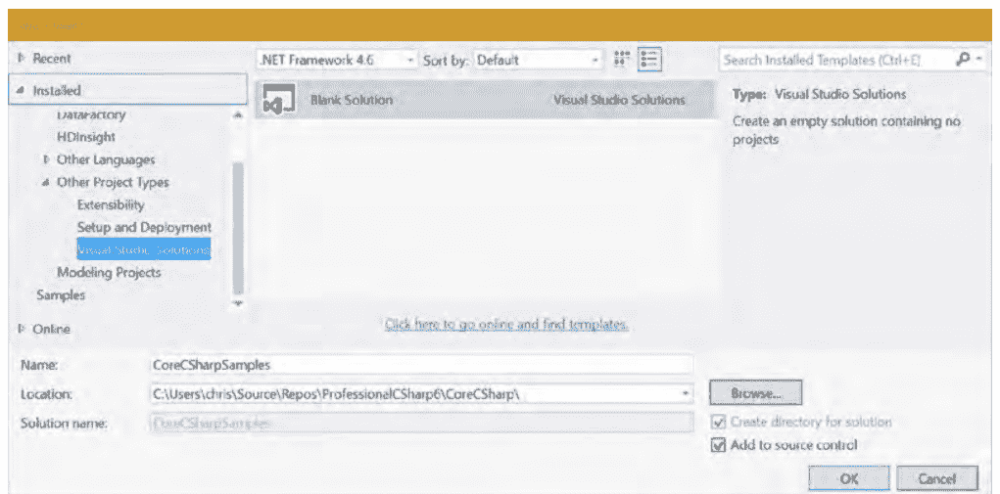

图 2.1

创建解决方案后，你将在解决方案资源管理器中看到解决方案的内容（参见图 2.2）。目前，只有一个没有任何内容的解决方案文件。

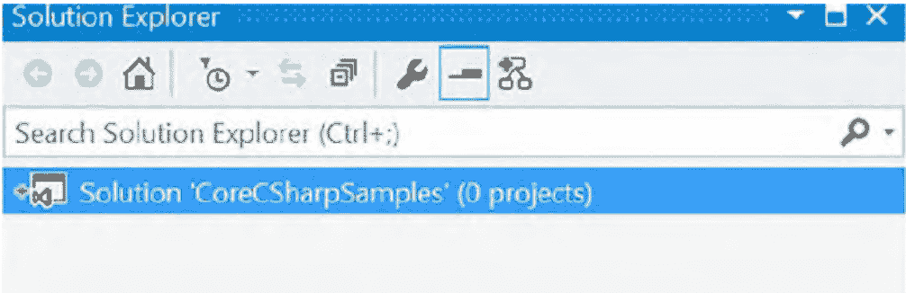

图 2.2

### 创建新项目

现在添加一个新项目来创建 Hello, World! 应用。在解决方案资源管理器中右键单击解决方案，或使用键盘上的菜单按钮打开上下文菜单（参见图 2.2），然后打开应用程序上下文菜单并选择“添加”→“新建项目”以打开“添加新项目”对话框。或者，你可以选择“文件”→“添加”→“新建项目”。在“添加新项目”对话框中，选择“控制台应用程序（包）”模板来创建面向 .NET Core 的控制台应用程序。你可以在此项目类型的树中的“已安装”→“模板”→“Visual C#”→“Web”下找到它（参见图 2.3）。将应用程序的名称设置为 `HelloWorldApp`。

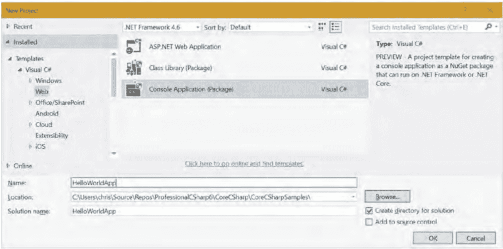

图 2.3

> **注意**：要打开应用程序的上下文菜单，你有多种选择：在要打开上下文菜单的项目上右键单击（如果你是左撇子，则左键单击），或者选择该项目并按键盘上的菜单键（通常位于右侧 Alt 和 Ctrl 键之间）。如果你的键盘没有菜单键，请按 Shift + F10。最后，如果你有触摸板，可以用双指轻触。

解决方案资源管理器不再为空。它现在显示该项目以及属于该项目的所有文件（参见图 2.4）。

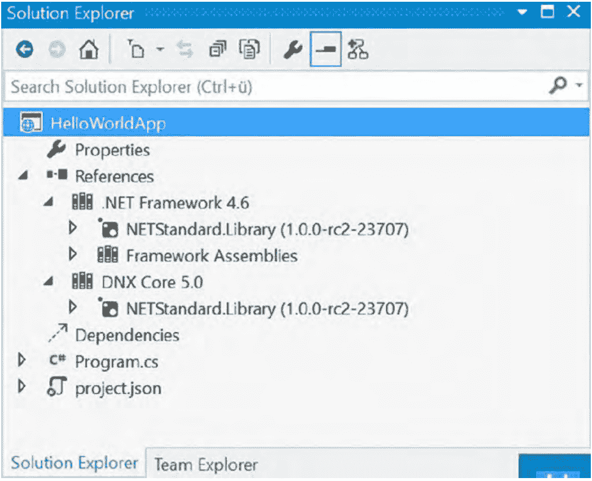

图 2.4

在第 1 章中，项目文件是由 `dotnet` 工具创建的，现在则是由 Visual Studio 模板创建的。指定了两个框架——.NET 4.6 和 .NET Core 1.0。对于这两个框架，都引用了 `NetStandard.Library` 1.0（代码文件 `HelloWorldApp/project.json`）：

```json
{
  "version":"1.0.0-*",
  "description":"",
  "authors": ["" ],
  "tags": ["" ],
  "projectUrl":"",
  "licenseUrl":"",

  "dependencies": {
    "NETStandard.Library":"1.0.0-*"
  },

  "frameworks": {
    "net46": { },
    "netstandardapp1.5": {
      "dependencies": { },
      "imports":"dnxcore50"
    }
  },
  "runtimes": {
    "win7-x64": { },
    "win10-x64": { }
  }
}
```

生成的 C# 源文件 `Program.cs` 在 `Program` 类中包含一个 `Main()` 方法，而 `Program` 类本身定义在命名空间 `HelloWorldApp` 中（代码文件 `HelloWorldApp/Program.cs`）：

```csharp
using System;
using System.Collections.Generic;
using System.Linq;
using System.Threading.Tasks;

namespace HelloWorldApp
{
    class Program
    {
        static void Main(string[] args)
        {
        }
    }
}
```

将此更改为 Hello, World! 应用。你需要打开命名空间以使用 `Console` 类的 `WriteLine()` 方法，并且需要调用 `WriteLine()` 方法。你还需要更改 `Program` 类的命名空间。`Program` 类现在定义在命名空间 `Wrox.HelloWorldApp` 中（代码文件 `HelloWorldApp/Program.cs`）：

```csharp
using static System.Console;

namespace Wrox.HelloWorldApp
{
    class Program
    {
        static void Main()
        {
            WriteLine("Hello, World!");
        }
    }
}
```

在解决方案资源管理器中选择项目，然后使用上下文菜单打开“属性”（或“视图”→“属性页”）以打开项目配置（参见图 2.5）。在“应用程序”选项卡中，你可以选择应用程序的名称、默认命名空间（仅用于添加的新项），以及解决方案应使用的 .NET Core 版本。如果你选择的版本不同于默认选择，则会创建一个包含此配置设置的 `global.json` 文件。

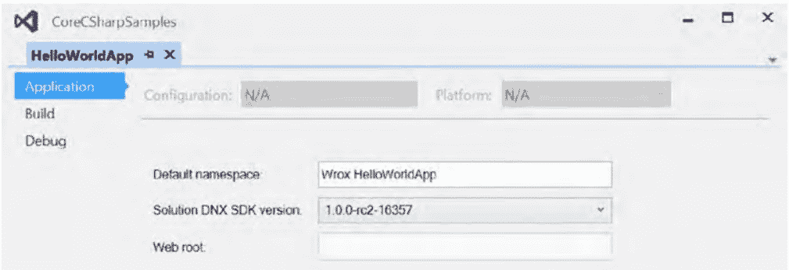

**图 2.5**

### 编译并运行程序

“生成”菜单提供了不同的选项来生成程序。你可以使用“生成” → “生成解决方案”来生成解决方案中的所有项目，也可以使用“生成” → “生成 `HelloWorldApp`”来生成单个项目。另外，请查看“生成”菜单中提供的其他选项。

要生成持久化文件，你可以在项目属性的“生成”选项卡上勾选“在生成时生成输出”（见图 2.6）。

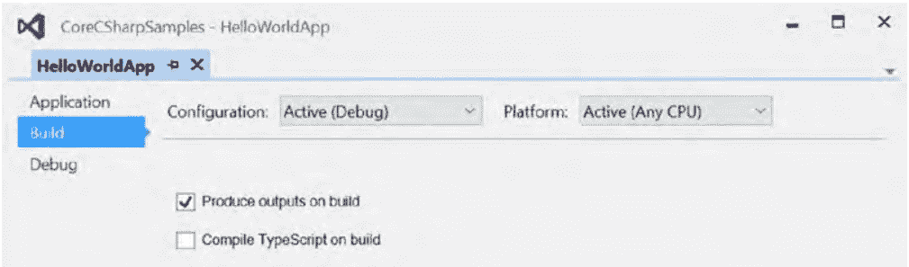

**图 2.6**

选中“在生成时生成输出”选项并生成程序后，你可以在文件资源管理器中看到 `artifacts` 目录，其中包含所有支持的 .NET Framework 版本的子目录以及二进制文件。

你可以通过在 Visual Studio 中使用“调试” → “开始执行(不调试)”来运行应用程序。这将启动应用程序，如图 2.7 所示。

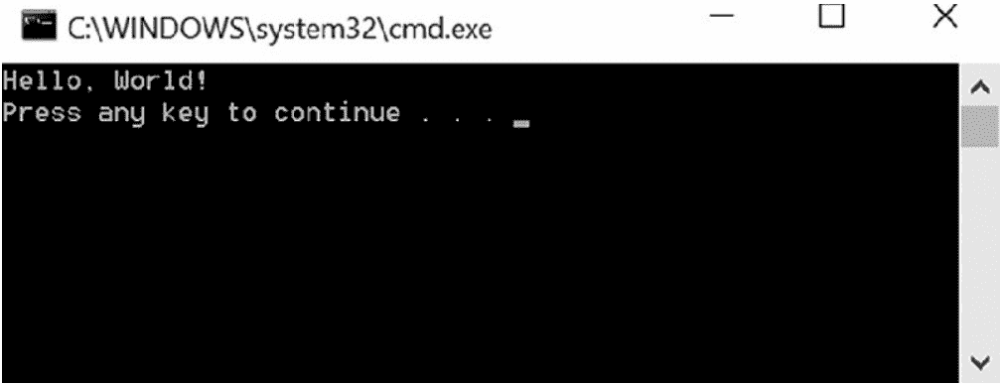

**图 2.7**

> **注意**：请务必不要使用“调试” → “开始调试”来启动应用程序；如果这样做，你将看不到应用程序的输出，因为控制台窗口会在应用程序完成后立即关闭。你可以使用此方法运行应用程序，方法是设置断点并进入应用程序进行调试，或者在 `Main()` 方法结束之前添加 `ReadLine()` 方法。

你可以使用项目属性中的“调试”选项卡来配置运行应用程序时应使用的运行时版本（见图 2.8）。

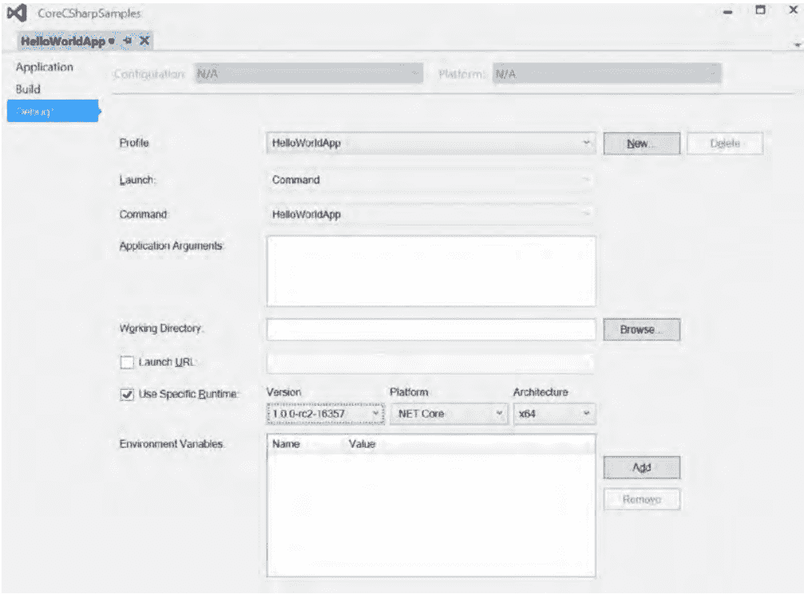

**图 2.8**

> **提示**：当同一解决方案中有多个项目时，你可以通过选择“解决方案资源管理器”中的项目并打开上下文菜单来定义应运行哪个项目。在上下文菜单中，单击“设为启动项目”（或“项目” → “设为启动项目”）。


> 或者，你可以选择“解决方案资源管理器”中的解决方案，然后选择“设置启动项目”以打开解决方案的属性页，在其中可以选择启动项目。你还可以定义多个项目来启动。

### 仔细查看代码

现在让我们专注于 C# 源代码。首先，我想对 C# 语法进行一些总体说明。在 C# 中，与其他 C 风格语言一样，语句以分号（`;`）结尾，并且可以跨多行而无需续行符。语句可以使用花括号（`{ }`）组合成块。单行注释以两个正斜杠字符（`//`）开头，多行注释以斜杠和星号（`/*`）开头，并以反转相同的组合（`*/`）结尾。在这些方面，C# 与 C++ 和 Java 相同，但与 Visual Basic 不同。正是分号和花括号使得 C# 代码在视觉上与 Visual Basic 代码如此不同。如果你的背景主要是 Visual Basic，请特别注意在每个语句的末尾加上分号。省略分号通常是刚接触 C 风格语言的开发人员中最常见的编译错误原因之一。另一件要记住的事情是 C# 区分大小写。这意味着名为 `myVar` 和 `MyVar` 的变量是两个不同的变量。

前面代码示例的前几行与命名空间（本章后面会提到）有关，这是一种将相关类分组的方法。`namespace` 关键字声明了你的类应关联的命名空间。其后花括号中的所有代码都被视为位于该命名空间内。`using` 声明指定了一个命名空间，编译器应查找该命名空间以找到在你的代码中引用但未在当前命名空间中定义的所有类。这与 Java 中的 `import` 语句以及 C++ 中的 `using namespace` 语句的作用相同。

```
using static System.Console;

namespace Wrox
{
```

在 `Program.cs` 文件中存在 `using static` 声明的原因是你将要使用一个库类：`System.Console`。`using static System.Console` 声明使你可以引用此类的静态成员，并省略命名空间和类名。如果你只声明 `using System;` 则需要添加类名来调用 `WriteLine` 方法：

```
using System;

// etc.

Console.WriteLine("Hello World!");
```

完全省略 `using` 声明后，你需要在使用 `WriteLine` 方法时添加命名空间名称：

```
System.Console.WriteLine("Hello World!");
```

标准的 `System` 命名空间是大多数常用 .NET 类型所在的位置。重要的是要认识到你在 C# 中所做的一切都依赖于 .NET 基类。在本例中，你使用 `System` 命名空间中的 `Console` 类来写入控制台窗口。C# 没有自己的内置输入或输出关键字；它完全依赖 .NET 类。

> **注意** 由于本章和下一章中的几乎每个示例都使用了 `Console` 类的静态成员，因此我们将假设所有代码片段中文件都包含 `using static System.Console;` 语句。

在源代码中，声明了一个名为 `Program` 的类。但是，由于它被放在名为 `Wrox.HelloWorldApp` 的命名空间中，因此该类的完全限定名是 `Wrox.HelloWorldApp.Program`：

```
namespace Wrox.HelloWorldApp
{
    class Program
    {
```

所有 C# 代码都必须包含在一个类中。类声明由 `class` 关键字、类名和一对花括号组成。与该类关联的所有代码都应放在这些花括号之间。

`Program` 类包含一个名为 `Main` 的方法。每个 C# 可执行文件（例如控制台应用程序、Windows 应用程序、Windows 服务和 Web 应用程序）都必须有一个入口点——`Main` 方法（注意大写 M）。

```
static void Main()
{
```

该方法在程序启动时被调用。此方法必须返回 `void`（无返回值）或 `int`（整数）。请注意 C# 中方法定义的格式：

```
[modifiers] return_type MethodName([parameters])
{
    // Method body. NB. This code block is pseudo-code.
}
```

这里，第一个方括号表示某些可选关键字。修饰符用于指定你所定义方法的某些特性

```
true or false
int x = 10, bool y = true; // This won't compile!
```

注意前面示例中的 `//` 及其后的文本。这些是注释。`//` 字符序列告诉编译器忽略此行后面的文本，因为它是为了让人类更好地理解程序而包含的；它不是程序本身的一部分。注释将在本章后面的“使用注释”一节中进一步说明。

### 初始化变量

变量初始化展示了 C# 对安全性的重视。简而言之，C# 编译器要求任何变量在操作中引用之前都必须用某个起始值进行初始化。大多数现代编译器会将违反此规则的行为标记为警告，但始终保持警惕的 C# 编译器会将此类违规视为错误。这可以防止你不小心从内存中获取其他程序遗留的无用值。

C# 有两种方法确保变量在使用之前已初始化：

- 如果类或结构体中的字段变量没有显式初始化，则默认在创建时被清零（类和结构体将在后面讨论）。

- 方法中的局部变量必须在使用其值的任何语句之前，在代码中显式初始化。在这种情况下，初始化不必发生在变量声明时，但编译器会检查方法中的所有可能路径，如果检测到局部变量的值在使用前可能未被初始化，则会标记错误。

例如，你不能在 C# 中执行以下操作：

```
static int Main()
{
    int d;
    WriteLine(d); // Can't do this! Need to initialize d before use
    return 0;
}
```

请注意，此代码片段演示了如何定义 `Main` 使其返回 `int` 而不是 `void`。

如果你尝试编译前面的代码行，你将收到以下错误消息：

```
Use of unassigned local variable 'd'
```

考虑以下语句：

```
Something objSomething;
```

在 C# 中，这行代码只会为 `Something` 创建一个引用

对象，但这个引用实际上还不指向任何对象。尝试对该变量调用方法或属性都会导致错误。

要在 C# 中实例化一个引用对象，你必须使用 `new` 关键字。你先像前面的示例那样创建一个引用，然后使用 `new` 关键字将该引用指向堆上分配的一个对象：

```
objSomething = new Something();    // 这会在堆上创建一个 Something 对象
```

### 使用类型推断

类型推断使用 `var` 关键字。声明变量的语法会随之改变，即使用 `var` 关键字代替真实的类型。编译器根据变量的初始化值来“推断”该变量的类型。例如：

```
var someNumber = 0;
```

变成：

```
int someNumber = 0;
```

即使 `someNumber` 从未被声明为 `int` 类型，编译器也能推断出来，并且在 `someNumber` 处于作用域内的期间，它都是一个 `int` 类型。编译后，上述两条语句是等价的。

下面是一个简短的演示程序（代码文件 `VariablesSample/Program.cs`）：

```
using static System.Console;

namespace Wrox
{
    class Program
    {
        static void Main()
        {
            var name = "Bugs Bunny";
            var age = 25;
            var isRabbit = true;
            Type nameType = name.GetType();
            Type ageType = age.GetType();
            Type isRabbitType = isRabbit.GetType();
            WriteLine($"name is type {nameType}");
            WriteLine($"age is type {ageType}");
            WriteLine($"isRabbit is type {isRabbitType}");
        }
    }
}
```

该程序的输出如下：

```
name is type System.String
age is type System.Int32
isRabbit is type System.Boolean
```

有一些规则需要遵循：

- 变量必须初始化。否则，编译器就没有任何可以用来推断类型的信息。

- 初始化器不能是 `null`。

- 初始化器必须是一个表达式。

- 你无法将初始化器设置为某个对象，除非在初始化器中创建了一个新对象。

第 3 章“对象和类型”在讨论匿名类型时会更详细地介绍这些规则。

变量被声明并推断出类型后，其类型就不能再更改。一旦确定，变量的类型就要遵循强类型规则：任何对该变量的赋值都必须符合推断出的类型。

### 理解变量作用域

变量的*作用域*是指可以访问该变量的代码区域。一般来说，作用域由以下规则决定：

- 类的一个*字段*（也称为成员变量）在其包含类处于作用域内的期间，都在作用域内。

- 一个*局部变量*在其所在块语句或方法的结束大括号出现之前，都在作用域内。

- 在 `for`、`while` 或类似语句中声明的局部变量，在该循环的循环体内处于作用域内。

#### 局部变量的作用域冲突

在大型程序中，通常会在程序的不同部分为不同的变量使用相同的变量名。只要这些变量被限定在程序完全不同的部分，从而不会产生歧义，这种做法是可以的。但是请注意，相同名称的局部变量不能在同一个作用域内声明两次。例如，你不能这样做：

```
int x = 20;
// 更多代码
int x = 30;
```

考虑以下代码示例（代码文件 `VariableScopeSample/Program.cs`）：

```
using static System.Console;

namespace VariableScopeSample
{
    class Program
    {
        static int Main()
        {
            for (int i = 0; i < 10; i++)
            {
                WriteLine(i);
            } // i 在这里超出作用域
            // 我们可以再次声明名为 i 的变量，因为
            // 当前作用域中没有其他同名变量
            for (int i = 9; i >= 0; i--)
            {
                WriteLine(i);
            } // i 在这里超出作用域。
            return 0;
        }
    }
}
```

这段代码只是使用两个 `for` 循环打印从 0 到 9，然后再从 9 到 0 的数字。需要注意的是，你在这段代码的同一个方法中声明了两次变量 `i`。你之所以可以这样做，是因为 `i` 是在两个独立的循环中声明的，所以每个 `i` 变量都是各自循环内部的局部变量。

下面是另一个示例（代码文件 `VariableScopeSample2/Program.cs`）：

```
static int Main()
{
    int j = 20;
    for (int i = 0; i < 10; i++)
    {
        int j = 30; // 不能这样做；j 仍然在作用域内
        WriteLine(j + i);
    }
    return 0;
}
```

如果你尝试编译这段代码，会遇到类似下面的错误：

```
error CS0136: 局部变量 'j' 无法在此作用域中声明，因为该名称已在外层局部作用域中用于定义局部变量或参数
```

发生这种情况是因为变量 `j` 在 `for` 循环开始之前定义，它在 `for` 循环内部仍然处于作用域内，而且直到 `Main` 方法执行完毕才会超出作用域。尽管第二个 `j`（非法的那个）位于循环的作用域内，但该作用域嵌套在 `Main` 方法的作用域内部。编译器无法区分这两个变量，因此不允许声明第二个变量。

#### 字段和局部变量的作用域冲突

在某些情况下，你可以区分两个名称相同（尽管完全限定名称不同）且作用域相同的标识符，在这种情况下，编译器允许你声明第二个变量。这是因为 C# 对在类型级别声明的变量（字段）和在方法内部声明的变量（局部变量）做出了根本性的区分。

考虑下面的代码片段（代码文件 `VariableScopeSample3/Program.cs`）：

```
using static System.Console;

namespace Wrox
{
    class Program
    {
        static int j = 20;
        static void Main()
        {
            int j = 30;
            WriteLine(j);
            return;
        }
    }
}
```

这段代码可以编译，尽管在 `Main` 方法的作用域内有两个名为 `j` 的变量：一个是在类级别定义的 `j`，它在 `Program` 类被销毁（即 `Main` 方法终止、程序结束）之前不会超出作用域；另一个是在 `Main` 内部定义的 `j`。在这种情况下，你在 `Main` 方法中声明的名为 `j` 的新变量隐藏了同名的类级别变量，因此当你运行这段代码时，显示的是数字 30。

如果你想引用类级别的变量该怎么办？实际上，你可以使用 `object.fieldname` 这样的语法，从对象外部访问类或结构的字段。在前面的示例中，你是从静态方法访问静态字段（你会在下一节中了解这意味着什么），因此不能使用类的实例，只能使用类本身的名称：

```
// 等等
static void Main()
{
    int j = 30;
    WriteLine(j);
    WriteLine(Program.j);
}
// 等等
```

如果你访问的是实例字段（属于类的特定实例的字段），则需要改用 `this` 关键字。

### 使用常量

顾名思义，常量是指在整个生命周期内其值都无法改变的变量。在声明和初始化变量时加上 `const` 关键字，即可将该变量指定为常量：

```
const int a = 100; // 此值不能被更改。
```

常量具有以下特征：

- 它们必须在声明时初始化。赋值之后，就永远不能被覆盖。

- 常量的值必须能在编译时计算。因此，你不能使用从变量中获取的值来初始化常量。如果需要这样做，则必须使用只读字段（这将在第 3 章中解释）。

- 常量始终是隐式静态的。但是请注意，你不必（实际上也不允许）在常量声明中包含 `static` 修饰符。

在程序中使用常量至少有三个优点：

- 常量使程序更易于阅读，它用可读的名称取代了魔法数字和魔法字符串，而这些名称的值很容易理解。

- 常量使程序更易于修改。例如，假设你的某个 C# 程序中有一个 `SalesTax` 常量，且该常量被赋值为 6%。如果销售税率后来发生变化，你只需为这个常量赋一个新值，就能修改所有税额计算的行为；你不必在代码中搜索 `.06` 的值并逐一修改，还得祈望能找到所有地方。

- 常量有助于防止程序出错。如果在程序中的某个地方（常量声明处除外）试图给常量赋另一个值，编译器会标记该错误。

### 使用预定义数据类型

现在你已经了解了如何声明变量和常量，让我们更仔细地看看 C# 中可用的数据类型。你会看到，C# 在可用类型及其定义方面比其他一些语言要严格得多。

#### 值类型和引用类型

在深入了解 C# 中的数据类型之前，理解 C# 区分了两种数据类型类别是很重要的：

- 值类型

- 引用类型

接下来的几节将详细研究值类型和引用类型的语法。从概念上讲，区别在于*值类型*直接存储其值，而*引用类型*存储对值的引用。

这些类型存储在内存中的不同位置；值类型存储在称为*栈*的区域中，引用类型存储在称为*托管堆*的区域中。了解某个类型是值类型还是引用类型很重要，因为每次赋值时产生的影响不同。例如，`int` 是值类型，这意味着下面的语句会在内存中产生两个位置来存储值 `20`：

```csharp
// i and j are both of type int
i = 20;
j = i;
```

但是，考虑下面的示例。对于这段代码，假设你定义了一个名为 `Vector` 的类，`Vector` 是引用类型，并且有一个名为 `Value` 的 `int` 成员变量：

```csharp
Vector x, y;
x = new Vector();
x.Value = 30; // Value is a field defined in Vector class
y = x;
WriteLine(y.Value);
y.Value = 50;
WriteLine(x.Value);
```

要理解的关键点是，在执行此代码之后，只有一个 `Vector` 对象：`x` 和 `y` 都指向包含此对象的内存位置。因为 `x` 和 `y` 是引用类型的变量，声明每个变量只是保留一个引用——它不会实例化给定类型的对象。这两种情况都不会真正创建对象。要创建对象，你必须使用 `new` 关键字，如图所示。因为 `x` 和 `y` 引用同一个对象，对 `x` 所做的更改将影响 `y`，反之亦然。因此，代码将显示 30，然后显示 50。

如果变量是引用，则可以通过将其值设置为 `null` 来表示它不引用任何对象：

```csharp
y = null;
```

如果引用被设置为 `null`，那么显然无法对其调用任何非静态成员函数或字段；这样做会在运行时引发异常。


在 C# 中，诸如 `bool` 和 `long` 之类的基本数据类型是值类型。这意味着如果你声明一个 `bool` 变量并将其赋值为另一个 `bool` 变量的值，你将获得两个独立的内存 `bool` 值。之后，如果你更改原始 `bool` 变量的值，第二个 `bool` 变量的值不会改变。这些类型是按值复制的。

相反，大多数更复杂的 C# 数据类型（包括你自己声明的类）都是引用类型。它们在堆上分配，生命周期可以跨越多个函数调用，并且可以通过一个或多个别名访问。CLR 实现了一个精细的算法来跟踪哪些引用变量仍然可访问，哪些已成为孤立对象。CLR 会定期销毁孤立对象，并将其曾经占用的内存返回给操作系统。这是由垃圾回收器完成的。

C# 这样设计的原因是：将原始类型（如 `int` 和 `bool`）保留为值类型，而将包含许多字段的较大类型（通常类就是这样）设为引用类型，最能满足高性能需求。如果你想将自己的类型定义为值类型，则应将其声明为 `struct`。

### .NET 类型

C# 数据类型的关键字——例如 `int`、`short` 和 `string`——由编译器映射到 .NET 数据类型。例如，当你在 C# 中声明一个 `int` 时，实际上声明的是一个 .NET 结构体的实例：`System.Int32`。这听起来可能是个小细节，但却有着深远的意义：这意味着你可以在语法上将所有原始数据类型视为支持某些方法的类。例如，要将一个 `int i` 转换为 `string`，可以编写以下代码：

```csharp
string s = i.ToString();
```

需要强调的是，在这种语法便利的背后，这些类型实际上仍以原始类型存储，因此原始类型在概念上由 .NET 结构体表示，但绝不会产生任何性能成本。

以下各节回顾 C# 中视为内置类型的类型。每种类型都会列出其定义和对应的 .NET 类型名称。C# 有 15 种预定义类型：13 种值类型和 2 种（`string` 和 `object`）引用类型。

#### 预定义值类型

内置 .NET 值类型表示原始类型，如整数、浮点数、字符和布尔类型。

##### 整数类型

C# 支持八种预定义的整数类型，如下表所示。

| 名称 | .NET 类型 | 描述 | 范围（最小:最大） |

|------|-----------|------|-------------------|

| `sbyte` | `System.SByte` | 8 位有符号整数 | −128:127 (−2⁷:2⁷−1) |

| `short` | `System.Int16` | 16 位有符号整数 | −32,768:32,767 (−2¹⁵:2¹⁵−1) |

| `int` | `System.Int32` | 32 位有符号整数 | −2,147,483,648:2,147,483,647 (−2³¹:2³¹−1) |

| `long` | `System.Int64` | 64 位有符号整数 | −9,223,372,036,854,775,808:9,223,372,036,854,775,807 (−2⁶³:2⁶³−1) |

| `byte` | `System.Byte` | 8 位无符号整数 | 0:255 (0:2⁸−1) |

| `ushort` | `System.UInt16` | 16 位无符号整数 | 0:65,535 (0:2¹⁶−1) |

| `uint` | `System.UInt32` | 32 位无符号整数 | 0:4,294,967,295 (0:2³²−1) |

| `ulong` | `System.UInt64` | 64 位无符号整数 | 0:18,446,744,073,709,551,615 (0:2⁶⁴−1) |

一些 C# 类型与 C++ 和 Java 类型具有相同的名称，但定义不同。例如，在 C# 中，`int` 始终是 32 位有符号整数。在 C++ 中，`int` 是有符号整数，但位数取决于平台（在 Windows 上为 32 位）。在 C# 中，所有数据类型都以平台无关的方式定义，以便将来可能将 C# 和 .NET 移植到其他平台。

`byte` 是标准 8 位类型，取值范围为 0 到 255（含）。请注意，为了强调类型安全，C# 将 `byte` 类型和 `char` 类型视为完全不同的类型，两者之间的任何程序化转换都必须显式请求。另外请注意，与整数族中的其他类型不同，`byte` 类型默认是无符号的。它的有符号版本有专门的名称 `sbyte`。

在 .NET 中，`short` 不再那么短；它现在是 16 位长。`int` 类型是 32 位长。`long` 类型为值保留 64 位。所有整数类型的变量都可以用十进制或十六进制表示法赋值。后者需要 `0x` 前缀：

```csharp
long x = 0x12ab;
```

如果某个整数是 `int`、`uint`、`long` 还是 `ulong` 存在歧义，则默认为 `int`。若要指定该值应采用其他哪种整数类型，可以将以下字符之一附加到数字后：

```csharp
uint ui = 1234U;
long l = 1234L;
ulong ul = 1234UL;
```

你也可以使用小写的 `u` 和 `l`，但后者可能会与整数 1（一）混淆。

#### 浮点类型

虽然 C# 提供了大量的整数数据类型，它也支持浮点类型。

| 名称 | .NET 类型 | 描述 | 有效位数 | 范围（近似） |

|------|-----------|------|----------|---------------|

| `float` | `System.Single` | 32 位单精度浮点 | 7 | ±1.5 × 10⁻⁴⁵ 到 ±3.4 × 10³⁸ |

| `double` | `System.Double` | 64 位双精度浮点 | 15/16 | ±5.0 × 10⁻³²⁴ 到 ±1.7 × 10³⁰⁸ |

`float` 数据类型用于较小、精度要求较低的浮点值。`double` 数据类型比 `float` 数据类型占用更大，但提供两倍的精度（15 位数字）。

如果你硬编码一个非整数（如 12.3），编译器通常假定你希望将该数字解释为 `double`。若要指定该值是 `float`，请在其后附加字符 F（或 f）：

```csharp
float f = 12.3F;
```

#### decimal 类型

`decimal` 类型表示更高精度的浮点数，如下表所示。

| 名称 | .NET 类型 | 描述 | 有效位数 | 范围（近似） |

|------|-----------|------|----------|---------------|

| `decimal` | `System.Decimal` | 128 位高精度十进制表示法 | 28 | ±1.0 × 10⁻²⁸ 到 ±7.9 × 10²⁸ |

.NET 和 C# 数据类型的一大优点是提供了专门的 `decimal` 类型用于财务计算。如何使用 `decimal` 类型提供的 28 位数字由你决定。换句话说，你可以以更高的精度跟踪较小的美元金额（精确到美分），也可以跟踪较大的美元金额（小数部分有更多舍入）。但请记住，`decimal` 在底层并不是作为原始类型实现的，因此使用 `decimal` 会对计算产生性能影响。

要指定你的数字是 `decimal` 类型而不是 `double`、`float` 或整数，可以在值后附加 `M`（或 `m`）字符，如下所示：

```csharp
decimal d = 12.30M;
```

#### 布尔类型

C# 的 `bool` 类型用于包含 `true` 或 `false` 的布尔值。

| 名称 | .NET 类型 | 描述 | 有效位数 | 范围 |

|------|-----------|------|----------|------|

| `bool` | `System.Boolean` | 表示 true 或 false | 不适用 | true 或 false |

你不能将 `bool` 值与整数值进行隐式转换。如果变量（或函数返回类型）声明为 `bool`，则只能使用 `true` 和 `false` 值。如果你试图使用零表示 `false`、使用非零值表示 `true`，则会出错。

#### 字符类型

为了存储单个字符的值，C# 支持 `char` 数据类型。

| 名称 | .NET 类型 | 值 |

|------|-----------|-----|

| `char` | `System.Char` | 表示单个 16 位（Unicode）字符 |

`char` 类型的字面量通过用单引号括起来表示，例如 `'A'`。如果你试图将字符用双引号括起来，编译器会将该字符视为字符串并抛出错误。

除了将 `chars` 表示为字符字面量外，你还可以用四位十六进制 Unicode 值（例如 `'\u0041'`）、带强制转换的整数值（例如 `(char)65`）或十六进制值（例如 `'\x0041'`）来表示它们。你还可以使用转义序列来表示它们，如下表所示。

### 预定义引用类型

C# 支持两种预定义引用类型：`object` 和 `string`，如下表所述。

| 名称 | .NET 类型 | 说明 |

|---|---|---|

| `object` | System.Object | 根类型。所有其他类型（包括值类型）都派生自 `object`。 |

| `string` | System.String | Unicode 字符串 |

### object 类型

许多编程语言和类层次结构都提供了一个根类型，层次结构中的所有其他对象都派生自该根类型。C# 和 .NET 也不例外。在 C# 中，`object` 类型是所有其他内建类型和用户定义类型的最终父类型。这意味着你可以将 `object` 类型用于两个目的：

- 你可以使用 `object` 引用来绑定任何特定子类型的对象。例如，在第 8 章“运算符和强制转换”中，你会看到如何使用 `object` 类型将栈上的值对象装箱并移动到堆上；当代码必须操作特定类型未知的对象时，`object` 引用在反射中也非常有用。

- `object` 类型实现了一些基本的通用方法，包括 `Equals`、`GetHashCode`、`GetType` 和 `ToString`。负责任的用户定义类可能需要使用一种称为*重写*的面向对象技术来提供其中某些方法的替代实现，这将在第 4 章“继承”中讨论。例如，当你重写 `ToString` 时，你为你的类配备了一个能够智能地提供其自身字符串表示的方法。如果你没有在类中为这些方法提供自己的实现，编译器会使用 `object` 中的实现，这些实现在你的类的上下文中可能正确，也可能不正确或不合理。

你将在后续章节中更详细地研究 `object` 类型。

### string 类型

C# 识别 `string` 关键字，它在底层被转换为 .NET 类 `System.String`。有了它，字符串连接和字符串复制等操作变得轻而易举：

```csharp
string str1 ="Hello";
string str2 ="World";
string str3 = str1 + str2; // string concatenation
```

尽管采用了这种赋值方式，`string` 仍然是引用类型。在幕后，字符串对象被分配在堆上，而不是栈上；当你将一个字符串变量赋值给另一个字符串时，你会在内存中得到对同一个字符串的两个引用。然而，`string` 与引用类型的通常行为不同。例如，字符串是不可变的。

对其中一个字符串进行修改会创建一个全新的字符串对象，而另一个字符串保持不变。请考虑以下代码（代码文件 `StringSample/Program.cs`）：

```csharp
using static System.Console;

class Program
{
    static void Main()
    {
        string s1 ="a string";
        string s2 = s1;
        WriteLine("s1 is " + s1);
        WriteLine("s2 is " + s2);
        s1 ="another string";
        WriteLine("s1 is now " + s1);
        WriteLine("s2 is now " + s2);
    }
}
```

其输出如下：

```
s1 is a string
s2 is a string
s1 is now another string
s2 is now a string
```

改变 `s1` 的值对 `s2` 没有影响，这与你对引用类型的预期相反！这里发生的事情是：当 `s1` 被初始化为值 `a string` 时，在堆上分配了一个新的字符串对象。当 `s2` 被初始化时，引用指向同一个对象，因此 `s2` 也具有值 `a string`。然而，当你现在更改 `s1` 的值时，并不是替换原始值，而是在堆上为新值分配一个新对象。`s2` 变量仍然指向原始对象，因此它的值不变。在底层，这是运算符重载的结果，这个主题将在第 8 章中探讨。总的来说，`string` 类的实现使得其语义符合你通常对字符串的直觉预期。

字符串字面量用双引号（`"`）括起来；如果你试图用单引号将字符串括起来，编译器会将该值视为 `char` 并抛出错误。C# 字符串可以包含与 `char` 相同的 Unicode 和十六进制转义序列。由于这些转义序列以反斜杠开头，你不能在字符串中使用未转义的反斜杠。相反，你需要使用两个反斜杠（`\\`）对其进行转义：

```csharp
string filepath ="C:\\ProCSharp\\First.cs";
```

即使你确信自己总能记得这样做，输入所有这些双反斜杠也可能很烦人。幸运的是，C# 为你提供了另一种选择。你可以用 at 字符（`@`）作为字符串字面量的前缀，其后的所有字符都按字面值对待；它们不会被解释为转义序列：

```csharp
string filepath = @"C:\ProCSharp\First.cs";
```

这甚至允许你在字符串字面量中包含换行符：

```csharp
string jabberwocky = @"'Twas brillig and the slithy toves
Did gyre and gimble in the wabe.";
```

在这种情况下，`jabberwocky` 的值将是：

```
'Twas brillig and the slithy toves
Did gyre and gimble in the wabe.
```

C# 6 定义了一种新的字符串插值格式，使用 `$` 前缀作为标记。你之前在“使用变量”一节中已经见过这个前缀。你可以将前面演示字符串连接的代码片段改为使用字符串插值格式。给字符串加上 `$` 前缀，你就可以在字符串中放入包含变量——甚至代码表达式——的花括号。变量或代码表达式的结果会被放到字符串中花括号所在的位置：

```csharp
public static void Main()
{
    string s1 ="a string";
    string s2 = s1;
    WriteLine($"s1 is {s1}");
    WriteLine($"s2 is {s2}");
    s1 ="another string";
    WriteLine($"s1 is now {s1}");
    WriteLine($"s2 is now {s2}");
}
```

> 注意 字符串和字符串插值的特性将在第 10 章“字符串和正则表达式”中详细介绍。

### 控制程序流

本节讨论语言的真正核心内容：那些允许你控制程序*流程*的语句，而不是按代码在程序中出现的顺序执行每一行。

#### 条件语句

条件语句允许你根据是否满足特定条件或表达式的值来分支代码。C# 有两种用于代码分支的结构：`if` 语句（测试是否满足特定条件）和 `switch` 语句（将表达式与多个不同的值进行比较）。

#### if 语句

对于条件分支，C# 继承了 C 和 C++ 的 `if.else` 结构。对于任何使用过程式语言进行过编程的人来说，该语法应该相当直观：

```
if (condition)
    statement(s)
else
    statement(s)
```

如果任一条件需要执行多条语句，则需要使用花括号（`{ . }`）将这些语句连接成一个块。（这也适用于其他可以将语句连接成块的 C# 结构，例如 `for` 和 `while` 循环）：

```
bool isZero;
if (i == 0)
{
    isZero = true;
    WriteLine("i is Zero");
}
else
{
    isZero = false;
    WriteLine("i is Non-zero");
}
```

如果你愿意，可以使用没有末尾 `else` 语句的 `if` 语句。你还可以组合 `else if` 子句来测试多个条件（代码文件 `IfStatement/Program.cs`）：

```csharp
using static System.Console;

namespace Wrox
{
    class Program
    {
        static void Main()
        {
            WriteLine("Type in a string");
            string input;
            input = ReadLine();
            if (input =="")
```


```csharp
{
    WriteLine("You typed in an empty string.");
}
else if (input.Length < 5)
{
    WriteLine("The string had less than 5 characters.");
}
else if (input.Length < 10)
{
    WriteLine("The string had at least 5 but less than 10 characters.");
}
WriteLine("The string was " + input);
}
```

你可以向一个 `if` 子句添加任意多个 `else if`，数量不限。

请注意，前面的示例声明了一个名为 `input` 的字符串变量，让用户在命令行输入文本，将其存入 `input`，然后测试该字符串变量的长度。这段代码还展示了在 C# 中进行字符串操作可以有多简单。例如，要获取 `input` 的长度，请使用 `input.Length`。

关于 `if` 语句，还有一点需要注意：当条件分支中只有一条语句时，不需要使用花括号：

```csharp
if (i == 0)
    WriteLine("i is Zero"); // This will only execute if i == 0
WriteLine("i can be anything"); // Will execute whatever the value of i
```

然而，为了保持一致性，许多程序员每次使用 `if` 语句时都倾向于使用花括号。

> **提示** `if` 语句不使用花括号可能会导致维护代码时出错。这种情况太常见了：在 `if` 语句中添加第二条语句，而无论 `if` 返回 `true` 还是 `false`，它都会执行。每次都使用花括号可以避免这种编码错误。
>
> 关于 `if` 语句的一个良好准则是：只有在语句与 `if` 语句写在同一行时，才允许程序员不使用花括号。有了这个准则，程序员就不太会在不添加花括号的情况下再添加第二条语句。

这里展示的 `if` 语句还说明了 C# 中一些用于比较值的运算符。特别是要注意，C# 使用 `==` 来比较变量是否相等。不要为此使用 `=`；单独的 `=` 用于赋值。

在 C# 中，`if` 子句中的表达式必须求值为布尔值。不能直接测试整数（例如，从函数返回的整数）。你必须将返回的整数转换为布尔值 `true` 或 `false`，例如，可以通过将该值与零或 `null` 进行比较：

```csharp
if (DoSomething() != 0)
{
    // Non-zero value returned
}
else
{
    // Returned zero
}
```

### `switch` 语句

`switch`/`case` 语句适合从一组互斥的执行分支中选择一个分支。它的形式是一个 `switch` 参数后跟一系列 `case` 子句。当 `switch` 参数中的表达式求值为某个 `case` 子句旁的值之一时，紧接该 `case` 子句之后的代码就会执行。这就是一个无需使用花括号将语句组成块的例子；相反，你要使用 `break` 语句来标记每个 `case` 代码的结束。你还可以在 `switch` 语句中包含一个 `default` 分支，如果表达式没有求值为其他任何分支的值，它就会执行。下面这个 `switch` 语句测试 `integerA` 变量的值：

```csharp
switch (integerA)
{
    case 1:
        WriteLine("integerA = 1");
        break;
    case 2:
        WriteLine("integerA = 2");
        break;
    case 3:
        WriteLine("integerA = 3");
        break;
    default:
        WriteLine("integerA is not 1, 2, or 3");
        break;
}
```

请注意，`case` 值必须是常量表达式；不允许使用变量。

尽管 C 和 C++ 程序员应该对 `switch`/`case` 语句很熟悉，但 C# 的 `switch`/`case` 比 C++ 的对应版本更安全一些。具体来说，它几乎在所有情况下都禁止贯穿（fall-through）行为。这意味着，如果某个 `case` 子句在块中较早触发，后面的子句就不能再触发，除非你使用 `goto` 语句表明你也希望它们触发。编译器会将每个未配备 `break` 语句的 `case` 子句都标记为错误，以此强制执行这一限制：

```text
Control cannot fall through from one case label ('case 2:') to another
```

虽然在少数情况下贯穿行为确实可取，但在绝大多数情况下，它都是无意的，并会导致难以发现的逻辑错误。为常规情况编写代码，而不是为例外情况编写代码，难道不是更好吗？

通过创造性地使用 `goto` 语句，你可以在 `switch` 分支中复现贯穿功能。然而，如果你发现自己真的很想这样做，那么你或许应该重新考虑你的方法。下面的代码既演示了如何使用 `goto` 模拟贯穿，也说明了最终代码可能会多么凌乱：

```csharp
// assume country and language are of type string
switch (country)
{
    case "America":
        CallAmericanOnlyMethod();
        goto case "Britain";
    case "France":
        language = "French";
        break;
    case "Britain":
        language = "English";
        break;
}
```

不过，禁止贯穿的规则有一个例外：如果某个 `case` 为空，你可以从一个 `case` 贯穿到下一个 `case`。这让你可以用相同的方式处理两个或多个 `case`（无需 `goto` 语句）：

```csharp
switch (country)
{
    case "au":
    case "uk":
    case "us":
        language = "English";
        break;
    case "at":
    case "de":
        language = "German";
        break;
}
```

关于 C# 的 `switch` 语句，一个有趣之处是 `case` 的顺序无关紧要——你甚至可以把 `default` 分支放在最前面！因此，不能有两个相同的 `case`。这包括具有相同值的不同常量，所以，例如你不能这样做：

```csharp
// assume country is of type string
const string england = "uk";
const string britain = "uk";
switch (country)
{
    case england:
    case britain:    // This will cause a compilation error.
        language = "English";
        break;
}
```

前面的代码还展示了 C# 的 `switch` 语句与 C++ 的另一个不同之处：在 C# 中，允许使用字符串作为被测试的变量。

### 循环

C# 提供了四种不同的循环（`for`、`while`、`do...while` 和 `foreach`），让你可以重复执行一段代码，直到满足某个条件。

#### `for` 循环

C# 的 `for` 循环提供了一种循环迭代机制：在执行另一次迭代之前，先测试某个特定条件是否成立。语法如下：

```csharp
for (initializer; condition; iterator)
    statement(s)
```

其中：

- `initializer` 是在第一次循环执行之前求值的表达式（通常将局部变量初始化为循环计数器）。
- `condition` 是每次新的循环迭代之前检查的表达式（必须求值为 `true` 才会执行另一次迭代）。
- `iterator` 是每次迭代之后求值的表达式（通常递增循环计数器）。

当条件求值为 `false` 时，迭代结束。

`for` 循环是一种所谓的前测循环，因为循环条件是在执行循环语句之前求值的；因此，如果循环条件为 `false`，循环体根本不会执行。

`for` 循环非常适合按预定次数重复执行一条语句或一个语句块。下面的示例演示了 `for` 循环的典型用法。它会输出从 0 到 99 的所有整数：

```csharp
for (int i = 0; i < 100; i = i + 1)
{
    WriteLine(i);
}
```

在这里，你声明了一个名为 `i` 的 `int`，并将其初始化为零，它被用作循环计数器。然后立即测试它是否小于 100。由于该条件求值为 `true`，你执行循环中的代码，显示值 0。然后将计数器加 1，再重复这一过程。当 `i` 达到 100 时，循环结束。

实际上，前一个循环的写法并不是你通常的写法。C# 有一种给变量加 1 的简写形式，因此你可以直接写 `i++`，而不是 `i = i + 1`：

```csharp
for (int i = 0; i < 100; i++)
{
    // etc.
}
```

在前面的示例中，你也可以对迭代变量 `i` 使用类型推断。使用类型推断后，循环结构如下所示：

```csharp
for (var i = 0; i < 100; i++)
{
    // etc.
}
```

嵌套 `for` 循环并不罕见，这样对于外层循环的每次迭代，内层循环都会完整执行一次。这种方法通常用于遍历矩形多维数组中的每个元素。最外层循环遍历每一行，内层循环遍历特定行中的每一列。下面的代码显示多行数字。它还使用了另一个 `Console` 方法 `Console.Write`，该方法与 `Console.WriteLine` 的功能相同，但不会向输出发送回车符（代码文件 `ForLoop/Program.cs`）：

```csharp
using static System.Console;

namespace Wrox
{
    class Program
    {
        static void Main()
        {
            // This loop iterates through rows
            for (int i = 0; i < 100; i+=10)
            {
                // This loop iterates through columns
                for (int j = i; j < i + 10; j++)
                {
                    Write($"  {j}");
                }
                WriteLine();
            }
        }
    }
}
```

尽管 `j` 是整数，但它会自动转换为字符串，以便进行串联。

上述示例产生如下输出：

```text
0   1   2   3   4   5   6   7   8   9
10  11  12  13  14  15  16  17  18  19
20  21  22  23  24  25  26  27  28  29
30  31  32  33  34  35  36  37  38  39
40  41  42  43  44  45  46  47  48  49
50  51  52  53  54  55  56  57  58  59
60  61  62  63  64  65  66  67  68  69
70  71  72  73  74  75  76  77  78  79
80  81  82  83  84  85  86  87  88  89
90  91  92  93  94  95  96  97  98  99
```

从技术上讲，`for` 循环的测试条件中也可以计算计数器变量以外的内容，但这肯定不是典型的用法。`for` 循环中也可以省略一个（甚至全部）表达式。不过，在这种情况下，你应该考虑使用 `while` 循环。

#### `while` 循环

与 `for` 循环一样，`while` 是一种前测循环。语法类似，但 `while` 循环只接受一个表达式：

```csharp
while(condition)
    statement(s);
```

与 `for` 循环不同，`while` 循环最常用于在循环开始前不知道次数的情况下重复执行一条语句或一个语句块。通常，`while` 循环体内的语句会在某次迭代时将布尔标志设置为 `false`，从而触发循环结束，如下例所示：

```csharp
bool condition = false;
while (!condition)
{
    // This loop spins until the condition is true.
    DoSomeWork();
    condition = CheckCondition();  // assume CheckCondition() returns a bool
}
```

#### `do...while` 循环

`do...while` 循环是 `while` 循环的后测版本。这意味着循环的测试条件在循环体执行之后才进行求值。因此，`do...while` 循环适用于必须至少执行一次语句块的情况，如下例所示：

```csharp
bool condition;
do
{
    // This loop will at least execute once, even if Condition is false.
    MustBeCalledAtLeastOnce();
    condition = CheckCondition();
} while (condition);
```

#### `foreach` 循环

`foreach` 循环使你可以遍历集合中的每一项。目前，不必担心集合到底是什么（将在第 11 章“集合”中全面解释）；只需理解它是一个表示对象列表的对象。从技术上讲，一个对象要算作集合，必须支持名为 `IEnumerable` 的接口。集合的示例包括 C# 数组、`System.Collections` 命名空间中的集合类，以及用户定义的集合类。如果你假设 `arrayOfInts` 是一个 `int` 数组（这并不令人意外），那么可以从下面的代码中了解 `foreach` 的语法：

```csharp
foreach (int temp in arrayOfInts)
{
    WriteLine(temp);
}
```

在这里，`foreach` 逐个元素地遍历数组。对于每个元素，它将该元素的值放入名为 `temp` 的 `int` 变量中，然后执行一次循环迭代。

这里是可以使用类型推断的另一种情况。`foreach` 循环将变成如下形式：

```csharp
foreach (var temp in arrayOfInts)
{
    // etc.
}
```

`temp` 将被推断为 `int`，因为这就是集合项的类型。

使用 `foreach` 时需要注意的重要一点是，你不能更改集合中项的值（前面代码中的 `temp`），因此如下代码将无法编译：

```csharp
foreach (int temp in arrayOfInts)
{
    temp++;
    WriteLine(temp);
}
```

如果需要遍历集合中的项并更改其值，则必须改用 `for` 循环。

### 跳转语句

C# 提供了许多语句，使你可以立即跳转到程序中的另一行。其中第一个当然就是臭名昭著的 `goto` 语句。

#### `goto` 语句

`goto` 语句使你可以直接跳转到程序中由*标签*（只是一个标识符后跟一个冒号）指示的另一指定行：

```csharp
goto Label1;
    WriteLine("This won't be executed");
Label1:
    WriteLine("Continuing execution from here");
```

`goto` 涉及一些限制。你不能跳入 `for` 循环这样的代码块，不能跳出类，也不能在 `try...catch` 块之后退出 `finally` 块（第 14 章“错误和异常”将介绍如何使用 `try...catch...finally` 进行异常处理）。

`goto` 语句的名声可能早已为人所知，而且在大多数情况下，使用它是极不受欢迎的。总的来说，它肯定不符合良好的面向对象编程实践。

#### `break` 语句

你已经简要了解了 `break` 语句——在 `switch` 语句中使用它退出某个 `case` 时。实际上，`break` 也可以用于退出 `for`、`foreach`、`while` 或 `do...while` 循环。控制权会切换到循环结束后的下一条语句。

如果该语句出现在嵌套循环中，控制权会切换到最内层循环的末尾。如果 `break` 出现在 `switch` 语句或循环之外，则会发生编译时错误。

#### `continue` 语句

`continue` 语句与 `break` 类似，你必须在 `for`、`foreach`、`while` 或 `do...while` 循环中使用它。不过，它只退出当前循环迭代，这意味着执行会从循环的下一次迭代开始处重新开始，而不是完全在循环外部重新开始。

#### `return` 语句


`return` 语句用于退出类的方法，并将控制权返回给方法的调用者。如果方法具有返回类型，`return` 必须返回该类型的值；否则，如果方法返回 `void`，则应使用不带表达式的 `return`。

## 使用枚举

`枚举`是一种用户定义的整数类型。声明枚举时，需要指定该枚举的实例可以包含的一组可接受值。不仅如此，你还可以为这些值指定用户友好的名称。如果在代码中的某处尝试将不在可接受值集合中的值分配给该枚举的实例，编译器会标记错误。

从长远来看，创建枚举可以节省大量时间和麻烦。使用枚举而不是普通整数至少有三个好处：

- 如前所述，枚举有助于确保你的变量只被赋予合法且预期的值，从而使代码更易于维护。

- 枚举允许你用描述性名称而非晦涩的“魔法数字”来引用整数值，从而使代码更清晰。

- 枚举使代码更易于输入。当你开始为枚举类型的实例赋值时，Visual Studio 2015 会使用 IntelliSense 弹出一个可接受值的列表框，以省去你的一些按键操作，并提醒你可能的选择。

你可以这样定义一个枚举：

```
public enum TimeOfDay
{
    Morning = 0,
    Afternoon = 1,
    Evening = 2
}
```

在这种情况下，你使用一个整数值来表示枚举中一天中的每个时段。现在你可以将这些值作为枚举的成员来访问。例如，`TimeOfDay.Morning` 返回值 0。你通常会使用这个枚举来向方法传递适当的值，并在 `switch` 语句中遍历可能的值（代码文件 EnumerationSample/Program.cs）：

```
class Program
{
    static void Main()
    {
        WriteGreeting(TimeOfDay.Morning);
    }

    static void WriteGreeting(TimeOfDay timeOfDay)
    {
        switch(timeOfDay)
        {
            case TimeOfDay.Morning:
                WriteLine("Good morning!");
                break;
            case TimeOfDay.Afternoon:
                WriteLine("Good afternoon!");
                break;
            case TimeOfDay.Evening:
                WriteLine("Good evening!");
                break;
            default:
                WriteLine("Hello!");
                break;
        }
    }
}
```

C# 中枚举的真正强大之处在于，在幕后它们被实例化为派生自基类 `System.Enum` 的结构。这意味着可以对它们调用方法以执行一些有用的任务。请注意，由于 .NET Framework 的实现方式，将枚举在语法上视为结构不会带来性能损失。实际上，在代码编译之后，枚举以原始类型的形式存在，就像 `int` 和 `float` 一样。

你可以获取枚举的字符串表示形式，例如下面的示例使用早先的 `TimeOfDay` 枚举：

```
TimeOfDay time = TimeOfDay.Afternoon;
WriteLine(time.ToString());
```

这将返回字符串 `Afternoon`。

或者，你也可以从字符串中获取枚举值：

```
TimeOfDay time2 = (TimeOfDay)
Enum.Parse(typeof(TimeOfDay),"afternoon", true);
WriteLine((int)time2);
```

前面的代码片段同时演示了从字符串获取枚举值和转换为整数。要从字符串转换，你需要使用静态的 `Enum.Parse` 方法，如所示，该方法接受三个参数。第一个参数是你想要考虑的枚举类型。语法是关键字 `typeof` 后跟括号中的枚举类名称。（第 8 章将更详细地探讨 `typeof` 运算符。）第二个参数是要转换的字符串，第三个参数是一个 `bool`，指示在转换过程中是否应忽略大小写。最后，请注意 `Enum.Parse` 实际上返回一个对象引用——你需要将其显式转换为所需的枚举类型（这是一个装箱操作的示例）。对于前面的代码，这会以对象形式返回值 1，对应于 `TimeOfDay.Afternoon` 的枚举值。显式转换为 `int` 后，再次产生值 1。

`System.Enum` 上的其他方法可以返回枚举定义中值的数量或列出值的名称等。完整细节请参阅 MSDN 文档。

## 使用命名空间组织代码

正如本章前面所讨论的，命名空间提供了一种组织相关类和其他类型的方法。与文件或组件不同，命名空间是一种逻辑分组，而非物理分组。当你在 C# 文件中定义一个类时，可以将其包含在命名空间定义中。稍后，当你在另一个文件中定义另一个执行相关工作的类时，可以将其包含在同一个命名空间中，从而创建一种逻辑分组，向使用这些类的其他开发人员表明它们之间的关联和使用方式：

```
using System;

namespace CustomerPhoneBookApp
{
    public struct Subscriber
    {
        // Code for struct here..
    }
}
```

将类型置于命名空间中，实际上就是将该类型赋予一个长名称，该名称由类型的命名空间作为一系列用句点（`.`）分隔的名称组成，并以类名结尾。在前面的示例中，`Subscriber` 结构的完整名称是 `CustomerPhoneBookApp.Subscriber`。这使得具有相同短名称的不同类可以在同一程序中使用而不会产生歧义。这个完整名称通常称为完全限定名称。

你也可以在命名空间中嵌套其他命名空间，为你的类型创建层次结构：

```
namespace Wrox
{
    namespace ProCSharp
    {
        namespace Basics
        {
            class NamespaceExample
            {
                // Code for the class here..
            }
        }
    }
}
```

每个命名空间名称由它所处的各级命名空间名称组成，以句点分隔，从最外层的命名空间开始，以它自己的短名称结束。因此，`ProCSharp` 命名空间的完整名称是 `Wrox.ProCSharp`，而 `NamespaceExample` 类的完整名称是 `Wrox.ProCSharp.Basics.NamespaceExample`。

你还可以使用这种语法来组织命名空间定义中的命名空间，因此前面的代码也可以写成如下形式：

```
namespace Wrox.ProCSharp.Basics
{
    class NamespaceExample
    {
        // Code for the class here..
    }
}
```

请注意，不允许在另一个命名空间内声明多部分命名空间。

命名空间与程序集无关。在同一个程序集中包含不同的命名空间，或者在不同程序集中定义相同命名空间中的类型，都是完全可以接受的。

你应该在开始项目之前定义好命名空间层次结构。通常接受的格式是 `CompanyName.ProjectName.SystemSection`。在前面的示例中，`Wrox` 是公司名称，`ProCSharp` 是项目名称，就本章而言，`Basics` 是部分名称。

## using 指令

显然，命名空间可能变得相当长，输入起来也很烦人，而以如此具体的方式指示特定类的功能可能并不总是必需的。幸运的是，正如本章前面所述，C# 允许你缩写类的完整名称。为此，请在文件顶部列出类的命名空间，并加上 `using` 关键字前缀。在文件的其余部分，你可以仅通过类型名称来引用命名空间中的类型：

```
using System;
using Wrox.ProCSharp;
```

如前所述，许多 C# 文件都有 `using System;` 语句，仅仅是因为微软提供的许多有用的类都包含在 `System` 命名空间中。

如果 `using` 语句引用的两个命名空间包含同名类型，你需要使用完整（或至少较长）的名称形式，以确保编译器知道要访问哪个类型。例如，假设名为 `NamespaceExample` 的类同时存在于 `Wrox.ProCSharp.Basics` 和 `Wrox.ProCSharp.OOP` 命名空间中。如果你随后在 `Wrox.ProCSharp` 命名空间中创建一个名为 `Test` 的类，并在此类中实例化其中一个 `NamespaceExample` 类，你需要指定你所说的是这两个类中的哪一个：

```
using Wrox.ProCSharp.OOP;
using Wrox.ProCSharp.Basics;

namespace Wrox.ProCSharp
{
    class Test
    {
        static void Main()
        {
            Basics.NamespaceExample nSEx = new Basics.NamespaceExample();
            // do something with the nSEx variable.
        }
    }
}
```

你的组织可能希望花费一些时间来制定命名空间约定，以便其开发人员能够快速找到所需的功能，并且组织内部开发的类名称不会与现成的类库中的名称冲突。关于建立自己的命名空间约定的指南以及其他命名建议，将在本章后面讨论。

## 命名空间别名

`using` 关键字的另一个用途是为类和命名空间分配别名。如果你需要在代码中多次引用一个非常长的命名空间名称，但又不想将其包含在简单的 `using` 语句中（例如，为了避免类型名称冲突），你可以为该命名空间分配一个别名。其语法如下：

```
using alias = NamespaceName;
```

以下示例（前一个示例的修改版本）将别名 `Introduction` 分配给 `Wrox.ProCSharp.Basics` 命名空间，并使用它来实例化一个在此命名空间中定义的 `NamespaceExample` 对象。请注意命名空间别名限定符（`::`）的使用。这强制搜索从 `Introduction` 命名空间别名开始。如果在此之前已经引入了一个名为 `Introduction` 的类，在相同作用域中，就会发生冲突。`::` 运算符使得即使存在冲突，也能引用该别名。`NamespaceExample` 类有一个方法 `GetNamespace`，它使用每个类都公开的 `GetType` 方法访问表示类类型的 `Type` 对象。可以使用该对象返回类命名空间的名称（代码文件：NamespaceSample/Program.cs）：

```
using Introduction = Wrox.ProCSharp.Basics;
using static System.Console;

class Program
{
    static void Main()
    {
        Introduction::NamespaceExample NSEx =
            new Introduction::NamespaceExample();
        WriteLine(NSEx.GetNamespace());
    }
}

namespace Wrox.ProCSharp.Basics
{
    class NamespaceExample
    {
        public string GetNamespace()
        {
            return this.GetType().Namespace;
        }
    }
}
```

## 理解 Main 方法

如本章开头所述，C# 程序从名为 `Main` 的方法开始执行。根据执行环境的不同，有不同的要求。

- 必须应用 `static` 修饰符

- 所在的类可以是任意名称

- 返回类型为 `int` 或 `void`

尽管通常显式指定 `public` 修饰符——因为按定义该方法必须从程序外部调用——但实际上为入口点方法分配什么可访问性级别并不重要；即使将方法标记为 `private`，它也会运行。

到目前为止的示例仅展示了不带任何参数的 `Main` 方法。不过，在调用程序时，可以通过包含一个参数让 CLR 将任何命令行参数传递给程序。该参数是一个字符串数组，传统上称为 `args`（尽管 C# 接受任何名称）。程序可以使用此数组来访问程序启动时通过命令行传入的任何选项。

下面的示例循环访问传入 `Main` 方法的字符串数组，并将每个选项的值写入控制台窗口（代码文件：ArgumentsSample/Program.cs）：

```
using System;
using static System.Console;

namespace Wrox
{
    class Program
    {
        static void Main(string[] args)
        {
            for (int i = 0; i < args.Length; i++)
            {
                WriteLine(args[i]);
            }
        }
    }
}
```

若要在从 Visual Studio 2015 运行应用程序时向程序传递参数，可以在项目属性的“调试”部分中定义这些参数，如图 2.9 所示。运行应用程序后，结果会将所有参数值显示到控制台。

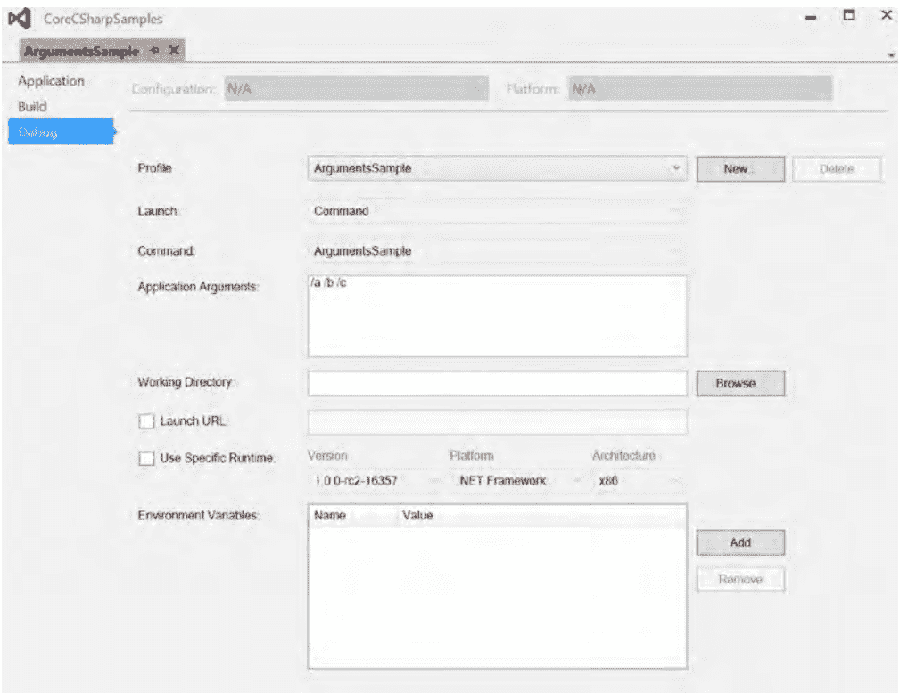

图 2.9

## 使用注释

下一个主题——为代码添加注释——表面上看起来非常简单，但实际上可能很复杂。注释对可能查看代码的其他开发人员很有帮助。此外，稍后你将看到，可以使用注释为代码生成文档，供其他开发人员使用。

### 源文件中的内部注释

如本章前面所述，C# 使用传统的 C 风格单行（`//..`）和多行（`/* .. */`）注释：

```
// This is a single-line comment
/* This comment
    spans multiple lines. */
```

单行注释中从 `//` 到行尾的所有内容都会被编译器忽略；多行注释组合中从开头的 `/*` 到下一个 `*/` 之间的所有内容也都会被忽略。显然，不能在多行注释中包含 `*/` 组合，因为它会被视为注释的结束。

也可以将多行注释放在一行代码中：

```
WriteLine(/* Here's a comment! */"This will compile.");
```

请谨慎使用内联注释，因为它们可能使代码难以阅读。然而，在调试时它们可能很有用，例如，如果你临时想尝试在某个位置使用不同的值来运行代码：

```
DoSomething(Width, /*Height*/ 100);
```

当然，字符串字面量中包含的注释字符会像普通字符一样被处理：

```
string s = "/* This is just a normal string. */";
```

### XML 文档

除了上一节介绍的 C 风格注释之外，C# 还有一个非常简洁的功能：可以从特殊注释自动生成 XML 格式的文档。这些注释是单行注释，但以三个斜杠（`///`）而不是通常的两个开头。在这些注释中，可以放置 XML 标记，其中包含代码中类型和类型成员的文档。

编译器可识别下表中的标记。

| 标记 | 说明 |
| --- | --- |
| `<c>` | 将行内文本标记为代码——例如，`<c>int i = 10;</c>`。 |
| `<code>` | 将多行标记为代码。 |
| `<example>` | 标记代码示例。 |
| `<exception>` | 记录异常类。（语法由编译器验证。） |
| `<include>` | 包含另一个文档文件中的注释。（语法由编译器验证。） |
| `<list>` | 在文档中插入列表。 |
| `<para>` | 为文本提供结构。 |
| `<param>` | 标记方法参数。（语法由编译器验证。） |
| `<paramref>` | 指示某个词是方法参数。（语法由编译器验证。） |
| `<permission>` | 记录对成员的访问权限。（语法由编译器验证。） |
| `<remarks>` | 为成员添加说明。 |
| `<returns>` | 记录方法的返回值。 |
| `<see>` | 提供对另一个参数的交叉引用。（语法由编译器验证。） |
| `<seealso>` | 在描述中提供“另请参阅”部分。（语法由编译器验证。） |
| `<summary>` | 提供类型或成员的简短摘要。 |
| `<typeparam>` | 在泛型类型的注释中描述类型参数。 |
| `<typeparamref>` | 提供类型参数的名称。 |
| `<value>` | 描述属性。 |

向上一节的 `Calculator.cs` 文件添加一些 XML 注释。为类及其 `Add` 方法添加一个 `<summary>` 元素，并为 `Add` 方法添加一个 `<returns>` 元素和两个 `<param>` 元素：


```
// MathLib.cs
namespace Wrox.MathLib
{
    /// <summary>
    ///     Wrox.MathLib.Calculator class.
    ///     Provides a method to add two doubles.
    /// </summary>
    public class Calculator
    {
        /// <summary>
        ///     The Add method allows us to add two doubles.
        /// </summary>
        /// <returns>Result of the addition (double)</returns>
        /// <param name="x">First number to add</param>
        /// <param name="y">Second number to add</param>
        public static double Add(double x, double y) => x + y;
    }
}
```

### 理解 C# 预处理器指令

除了你到目前为止已经遇到过的大部分常规关键字之外，C# 还包含许多称为*预处理器指令*的命令。这些命令实际上永远不会被转换成可执行代码中的任何命令，但它们会影响编译过程的某些方面。例如，可以使用预处理器指令阻止编译器编译代码的某些部分。如果你计划发布软件的两个版本——基础版和具有更多功能的企业版，就可以这样做。在编译软件的基础版本时，可以使用预处理器指令阻止编译器编译与附加功能相关的代码。另一种情况是，你可能编写了一些用于提供调试信息的代码片段；当真正发布软件时，你可能不希望编译这些代码。

所有预处理器指令的共同特征是以 `#` 符号开头。

> **注意** C++ 开发人员会认识到预处理器指令在 C 和 C++ 中扮演着重要角色。然而，C# 中的预处理器指令种类较少，使用频率也没有那么高。C# 提供了其他机制，例如自定义属性，可以实现与 C++ 指令相同的某些效果。此外，请注意 C# 实际上并不像 C++ 那样拥有独立的预处理器。所谓的预处理器指令实际上由编译器处理。尽管如此，C# 仍然保留“预处理器指令”这一名称，因为这些命令给人一种预处理器的印象。

下面几节将简要介绍预处理器指令的用途。

#### `#define` 和 `#undef`

`#define` 的用法如下：

```
#define DEBUG
```

这告诉编译器，一个具有给定名称（此处为 `DEBUG`）的符号存在。这有点像声明一个变量，只不过这个变量实际上没有值——它只是存在。此外，该符号不是你实际代码的一部分；它只在编译器编译代码时为了编译器的利益而存在，并且在 C# 代码本身中没有任何意义。

`#undef` 的作用正好相反，它会移除某个符号的定义：

```
#undef DEBUG
```

如果该符号一开始就不存在，那么 `#undef` 不会产生任何效果。同样，如果符号已经存在，`#define` 也不会产生任何效果。

你需要将所有的 `#define` 和 `#undef` 指令放在 C# 源文件的开头，放在任何声明要编译的对象的代码之前。

`#define` 单独使用并没有多大用处，但当它与其他预处理器指令（尤其是 `#if`）结合时，就会变得非常强大。

> **注意** 顺便提一下，你可能会注意到与通常的 C# 语法有些不同。预处理器指令不以分号结尾，而且它们通常构成一行中的唯一命令。这是因为对于预处理器指令，C# 放弃了要求命令用分号分隔的常规做法。如果编译器看到预处理器指令，它会假定下一条命令在下一行。

#### `#if`、`#elif`、`#else` 和 `#endif`

这些指令告知编译器是否编译某段代码。考虑以下方法：

```
int DoSomeWork(double x)
{
    // 做某些事情
    #if DEBUG
        WriteLine($"x is {x}");
    #endif
}
```

这段代码正常编译，除了 `#if` 子句内的 `Console.WriteLine` 方法调用。只有当符号 `DEBUG` 已由之前的 `#define` 指令定义时，这一行才会被执行。当编译器遇到 `#if` 指令时，它会检查相关符号是否存在，并且仅当该符号确实存在时才编译 `#if` 子句内的代码。否则，编译器会直接忽略所有代码，直到遇到匹配的 `#endif` 指令。典型的做法是：在调试期间定义符号 `DEBUG`，并在 `#if` 子句中放置各种与调试相关的代码。然后，当你接近发布时，只需注释掉 `#define` 指令，所有调试代码就会神奇地消失，可执行文件的大小会变小，最终用户也不会因为看到调试信息而感到困惑。（显然，你需要做更多测试来确保代码在没有定义 `DEBUG` 的情况下仍然能正常工作。）这种技术在 C 和 C++ 编程中非常常见，被称为条件编译。

`#elif`（即 else if）和 `#else` 指令可以在 `#if` 块中使用，其含义不言自明。`#if` 块也可以嵌套：

```
#define ENTERPRISE
#define W10
// 文件后面部分
#if ENTERPRISE
    // 做某些事情
    #if W10
        // 某些仅与企业版在 W10 上运行相关的代码
    #endif
#elif PROFESSIONAL
    // 做其他事情
#else
    // 针对精简版的代码
#endif
```

`#if` 和 `#elif` 也支持有限的逻辑运算符，使用运算符 `!`、`==`、`!=` 和 `||`。如果符号存在，则视为 `true`；如果不存在，则视为 `false`。例如：

```
#if W10 && (ENTERPRISE==false) // 如果定义了 W10 但未定义 ENTERPRISE
```

#### `#warning` 和 `#error`

另外两个非常有用的预处理器指令是 `#warning` 和 `#error`。当编译器遇到它们时，会分别引发警告或错误。如果编译器看到 `#warning` 指令，它会将 `#warning` 后面的文本显示给用户，然后继续编译。如果它遇到 `#error` 指令，它会将后续文本作为编译错误消息显示给用户，然后立即中止编译，因此不会生成 IL 代码。

你可以使用这些指令来检查你的 `#define` 语句是否做了任何愚蠢的事情；你也可以使用 `#warning` 语句来提醒自己做某些事情：

```
#if DEBUG && RELEASE
    #error "You've defined DEBUG and RELEASE simultaneously!"
#endif
#warning "Don't forget to remove this line before the boss tests the code!"
    WriteLine("*I hate this job.*");
```

#### `#region` 和 `#endregion`

`#region` 和 `#endregion` 指令用于指示某个代码块应被视为具有给定名称的单个块，如下所示：

```
#region Member Field Declarations
    int x;
    double d;
    Currency balance;
#endregion
```

这本身看起来没什么用；它不会以任何方式影响编译过程。然而，真正的优势在于，这些指令会被某些编辑器识别，包括 Visual Studio 编辑器。这些编辑器可以利用这些指令在屏幕上更好地布局你的代码。你将在第 17 章了解其工作原理。

#### `#line`

`#line` 指令可用于更改编译器在警告和错误消息中输出的文件名和行号信息。你可能不会经常使用这个指令。当你与另一个在将代码发送给编译器之前修改你所输入代码的包一起编码时，它最为有用。在这种情况下，编译器报告的行号或文件名与你正在编辑的文件中的行号或文件名不匹配。`#line` 指令可用于恢复匹配。你还可以使用语法 `#line default` 将行号恢复为默认行号：

```
#line 164 "Core.cs"  // 我们碰巧知道这是 Core.cs 文件中的第 164 行，
                    // 在中间包处理之前。
// 稍后
#line default        // 恢复默认行号
```

#### `#pragma`

`#pragma` 指令可以抑制或恢复特定的编译器警告。与命令行选项不同，`#pragma` 指令可以在类或方法级别实现，从而对哪些警告被抑制以及何时抑制进行细粒度控制。以下示例禁用“字段未使用”警告，然后在 `MyClass` 类编译后恢复该警告：

```
#pragma warning disable 169
public class MyClass
{
    int neverUsedField;
}
#pragma warning restore 169
```

### C# 编程指南

本章的最后一部分提供了你在编写 C# 程序时需要牢记的指南。这些是大多数 C# 开发者使用的指南。当你使用这些指南时，其他开发者会感到你的代码易于协作。

#### 标识符规则

本节探讨了关于变量、类、方法等可以使用哪些名称的规则。请注意，本节介绍的规则不仅仅是指南：它们是由 C# 编译器强制执行的。

标识符是你为变量、用户定义类型（如类和结构体）以及这些类型的成员所起的名称。标识符区分大小写，因此，例如，名为 `interestRate` 和 `InterestRate` 的变量会被识别为不同的变量。以下是确定可以在 C# 中使用哪些标识符的一些规则：

- 它们必须以字母或下划线开头，但可以包含数字字符。

- 不能使用 C# 关键字作为标识符。

下表列出了 C# 保留关键字。

|  |  |  |  |
| --- | --- | --- | --- |
| `abstract` | `event` | `new` | `struct` |
| `as` | `explicit` | `null` | `switch` |
| `base` | `extern` | `object` | `this` |
| `bool` | `false` | `operator` | `throw` |
| `break` | `finally` | `out` | `true` |
| `byte` | `fixed` | `override` | `try` |
| `case` | `float` | `params` | `typeof` |
| `catch` | `for` | `private` | `uint` |
| `char` | `foreach` | `protected` | `ulong` |
| `checked` | `goto` | `public` | `unchecked` |
| `class` | `if` | `readonly` | `unsafe` |
| `const` | `implicit` | `ref` | `ushort` |
| `continue` | `in` | `return` | `using` |
| `decimal` | `int` | `sbyte` | `virtual` |
| `default` | `interface` | `sealed` | `void` |
| `delegate` | `internal` | `short` | `volatile` |
| `do` | `is` | `sizeof` | `while` |
| `double` | `lock` | `stackalloc` |  |
| `else` | `long` | `static` |  |
| `enum` | `namespace` | `string` |  |

如果你需要将其中一个词用作标识符（例如，当你访问用另一种语言编写的类时），你可以在标识符前面加上 `@` 符号，以向编译器指示后面的内容应被视为标识符，而不是 C# 关键字（因此 `abstract` **不是**有效标识符，但 `@abstract` 是）。

最后，标识符还可以包含 Unicode 字符，使用语法 `\uXXXX` 指定，其中 `XXXX` 是 Unicode 字符的四位十六进制代码。以下是一些有效标识符的示例：

- `Name`

- `Überfluß`

- `_Identifier`

- `\u005fIdentifier`

此列表中的最后两项相同且可互换（因为`005f`是下划线字符的Unicode编码），所以显然这两个标识符不能在同一作用域中同时声明。请注意，尽管语法上允许在标识符中使用下划线字符，但在大多数情况下并不推荐这样做。这是因为不符合微软编写的变量命名指南，该指南旨在确保开发者使用相同的约定，从而更容易阅读彼此的代码。

> **注意** 你可能想知道为什么最近几个C#版本新增的一些关键字不在保留关键字列表中。原因是如果将它们添加到保留关键字列表，就会破坏已经使用这些新C#关键字的现有代码。解决方案是通过将这些关键字定义为上下文关键字来增强语法；它们只能在某些特定的代码位置使用。例如，`async`关键字只能用于方法声明，将它用作变量名也是可以的。编译器对此不会有冲突。

#### 使用约定

在任何开发语言中，通常会出现某些传统的编程风格。这些风格不是语言本身的一部分，而是约定——例如，变量如何命名，或者某些类、方法或函数如何使用。如果大多数使用该语言的开发者遵循相同的约定，那么不同的开发者就更容易理解彼此的代码——这通常也有助于程序的可维护性。然而，约定确实依赖于语言和环境。例如，在Windows平台上进行C++编程的开发者传统上使用`psz`或`lpsz`前缀来表示字符串——`char *pszResult; char *lpszMessage;`——但在Unix机器上，更常见的是不使用任何这样的前缀：`char *Result; char *Message;`。

请注意，从本书的示例代码中可以看出，C#中的约定是变量命名时不加前缀：`string Result; string Message;`。

> **注意** 变量名用代表数据类型的字母作为前缀的约定被称为匈牙利命名法。这意味着阅读代码的其他开发者可以立即从变量名看出该变量代表什么数据类型。在智能编辑器和IntelliSense盛行的今天，匈牙利命名法被广泛认为是多余的。

许多语言的用法约定只是随着语言的使用而自然演化，但对于C#和整个.NET Framework，微软编写了非常全面的使用指南，这些指南在.NET/C# MSDN文档中有详细说明。这意味着，从一开始，.NET程序在开发者能够理解代码方面就具有高度的互操作性。这些指南也是凭借面向对象编程约20年的后见之明制定出来的。从相关新闻组来看，这些指南经过深思熟虑，并在开发者社区中广受好评。因此，这些指南非常值得遵循。

但请注意，这些指南并不等同于语言规范。你应尽量在可能时遵循指南。尽管如此，如果你有充分的理由不遵循，也不会遇到问题——例如，你不会因为不遵循这些指南而得到编译错误。一般规则是：如果不遵循使用指南，你必须有一个令人信服的理由。当你偏离指南时，应当是一个有意识的决定，而不是仅仅懒得去做。此外，如果你将指南与本书其余部分的示例进行比较，你会注意到在许多示例中我选择不遵循这些约定。那通常是因为这些约定是为比示例大得多的程序而设计的；虽然如果你在编写完整的软件包时这些指南很好，但它们并不真正适合只有20行的小型独立程序。在许多情况下，遵循约定反而会使示例更难理解，而不是更容易。

关于良好编程风格的完整指南相当广泛。本节仅限于描述一些比较重要的指南，以及那些最可能让你感到意外的指南。要想绝对确保你的代码完全遵循使用指南，你需要查阅MSDN文档。

#### 命名约定

使程序易于理解的一个重要方面是如何选择为项目命名——这包括命名变量、方法、类、枚举和命名空间。

直观上很明显，名称应反映项目的用途，并且不应与其他名称冲突。.NET Framework的总体理念也是：变量的名称应反映该变量实例的用途，而不是数据类型。例如，`height`是一个好的变量名，而`integerValue`则不是。然而，你可能会发现这一原则是一个难以实现的理想。尤其是在处理控件时，大多数情况下你可能会更愿意坚持使用像`confirmationDialog`和`chooseEmployeeListBox`这样的变量名，这些名称确实在名字中表明了数据类型。

以下各节将介绍在选择名称时需要考虑的一些事项。

##### 名称的大小写

在许多情况下，名称应使用*帕斯卡大小写*。对于帕斯卡大小写，名称中每个单词的首字母都要大写：`EmployeeSalary`, `ConfirmationDialog`, `PlainTextEncoding`。

请注意，基类中几乎所有命名空间、类和成员的名称都遵循帕斯卡大小写。特别是，不鼓励使用下划线字符连接单词。因此，尽量不要使用像`employee_salary`这样的名称。在其他语言中，常量名使用全大写也很常见。在C#中不建议这样做，因为这样的名称更难阅读——约定是全程使用帕斯卡大小写：

```
const int MaximumLength;
```

建议你使用的另一种大小写约定是*驼峰大小写*。驼峰大小写与帕斯卡大小写类似，不同之处在于名称中第一个单词的首字母不用大写：`employeeSalary`、`confirmationDialog`、`plainTextEncoding`。以下三种情况建议使用驼峰大小写：

- 类型中所有私有成员字段的名称：

  ```
  private int subscriberId;
  ```

  但请注意，通常给成员字段名称加下划线前缀也是一种约定：

  ```
  private int _subscriberId;
  ```

- 传给方法的所有参数的名称：

  ```
  public void RecordSale(string salesmanName, int quantity);
  ```

- 用于区分本来可能同名的项。一个常见示例是当属性包装字段时：

  ```
  private string employeeName;
  public string EmployeeName
  {
      get
      {
          return employeeName;
      }
  }
  ```


如果你用属性包装字段，应始终对私有成员使用驼峰大小写，对公共或受保护成员使用帕斯卡大小写，这样使用你的代码的其他类只会看到帕斯卡大小写的名称（参数名除外）。

你还应该警惕大小写敏感性。C#是区分大小写的，因此在C#中名称仅因大小写而不同在语法上是正确的，如前几个示例所示。但是请记住，你的程序集在某些时候可能会被Visual Basic应用程序调用——而`Visual Basic不区分大小写`。因此，如果你确实使用仅大小写不同的名称，重要的是只在两个名称绝不会在程序集外部被看到的情况下这样做。（前一个示例是可行的，因为驼峰大小写用于与私有变量关联的名称。）否则，你可能会阻止用Visual Basic编写的其他代码正确使用你的程序集。

### 名称风格

名称风格要一致。例如，如果一个类中的某个方法叫`ShowConfirmationDialog`，那么你不应该给另一个方法起`ShowDialogWarning`或`WarningDialogShow`这样的名字。另一个方法应该叫`ShowWarningDialog`。

### 命名空间名称

选择命名空间名称尤其重要，以避免自己的某个命名空间最终与他人使用的命名空间同名。请记住，命名空间名称是.NET区分共享程序集中对象名称的唯一方式。因此，如果你的软件包与另一个包使用相同的命名空间名称，并且同一程序同时使用这两个包，就会出现问题。因此，几乎总是建议创建一个以公司名称命名的顶级命名空间，然后嵌套后续命名空间，逐步缩小到你从事的技术领域、所在的小组或部门，或者你的类所针对的软件包名称。微软建议命名空间以`<CompanyName>.<TechnologyName>`开头，如下两个示例：

```
WeaponsOfDestructionCorp.RayGunControllers
WeaponsOfDestructionCorp.Viruses
```

### 名称与关键字

名称不能与任何关键字冲突，这一点很重要。事实上，如果你试图用正好是C#关键字的单词来命名代码中的某个项，你几乎肯定会遇到语法错误，因为编译器会假定该名称指的是语句。然而，由于你的类可能会被用其他语言编写的代码访问，因此不使用其他.NET语言中的关键字作为名称也很重要。一般来说，C++关键字与C#关键字类似，因此与C++混淆的可能性不大，而且Visual C++独有的常见关键字往往以两个下划线字符开头。与C#一样，C++关键字都是小写拼写的，所以如果你坚持用帕斯卡式名称来命名公共类和成员，它们的名称中总会至少包含一个大写字母，也就不会有与C++关键字冲突的风险。不过，你更可能遇到Visual Basic的问题，它的关键字比C#多得多，而且不区分大小写，这意味着你不能依赖`Pascal`风格的名称来命名你的类和方法。请在`http://msdn.microsoft.com/library`查阅`MSDN`文档。在“开发工具和语言”下的“C# 参考”中，你会找到一长串`C#`关键字，这些关键字不能用于类和成员。如果`Visual Basic`可能作为访问你类的语言，也请查阅`Visual Basic`关键字的列表。

## 属性和方法的使用

关于类的一个容易引起混淆的领域是：某个特定的量应该用属性还是方法来表示。规则并非一成不变，但通常，如果某个东西看起来像变量并且行为也像变量，就应该使用属性。（如果你不确定什么是属性，请参阅第 3 章。）这意味着，除其他外：

-   客户端代码应该能够读取其值。不建议使用只写属性，因此，例如，使用`SetPassword`方法，而不是只写的`Password`属性。

-   读取值不应花费太长时间。某物是属性这一事实通常表明读取它会相对较快。

-   读取值不应有任何可观察到的、意外的副作用。此外，设置属性的值不应有任何与该属性不直接相关的副作用。设置对话框的宽度具有改变对话框在屏幕上外观的明显效果。这没问题，因为显然与所讨论的属性相关。

-   应该能够以任意顺序设置属性。特别是，在设置属性时因为另一个相关属性尚未设置而抛出异常并不是好的做法。例如，要使用访问数据库的类，你需要设置`ConnectionString`、`UserName`和`Password`，然后类的作者应确保类的实现方式能让用户以任意顺序设置它们。

-   连续读取一个属性应得到相同的结果。如果属性的值可能无法预测地变化，则应将其编码为方法。在监视汽车运动的类中，`Speed`不适合作为属性。此处使用`GetSpeed`方法；但`Weight`和`EngineSize`很适合作为属性，因为它们对于给定的对象不会改变。

如果你编码的项满足上述所有条件，那么它很可能适合作为属性。否则，你应该使用方法。

## 字段的使用

这里的指导原则非常简单。字段几乎总是应该

## 3

## 对象和类型

### 本章内容

-   类与结构体之间的差异

-   类成员

-   表达式体成员

-   按值和按引用传递参数

-   方法重载

-   构造函数和静态构造函数

-   只读字段

-   枚举

-   分部类

-   静态类

-   `Object`类，所有其他类型均派生自该类

### 本章的 Wrox.com 代码下载

本章的`wrox.com`代码下载可在“下载代码”选项卡上的`www.wrox.com/go/professionalcsharp6`找到。本章代码分为以下主要示例：

-   `MathSample`

-   `MethodSample`

-   `StaticConstructorSample`

-   `StructsSample`

-   `PassingByValueAndByReference`

-   `OutKeywordSample`

-   `EnumSample`

-   `ExtensionMethods`

### 创建和使用类

到目前为止，你已经了解了`C#`语言的一些构建块，包括变量、数据类型和程序流语句，并且你已经看到了一些非常简短的完整程序，它们仅包含`Main`方法而已。你还没有看到的是如何将所有这些元素组合在一起形成一个更长的完整程序。关键在于使用类——这是本章的主题。请注意，第 4 章“继承”涵盖了继承以及与继承相关的功能。

> **注意** 本章介绍与类相关的基本语法。但是，我们假设你已经熟悉使用类的基本原理——例如，你知道什么是构造函数或属性。本章主要局限于在`C#`代码中应用这些原理。

### 类与结构体

类和结构体本质上是可以从中创建对象的模板。每个对象都包含数据，并具有操作和访问这些数据的方法。类定义了该类的每个特定对象（称为*实例*）可以包含哪些数据和行为。例如，如果你有一个表示客户的类，它可能定义诸如`CustomerID`、`FirstName`、`LastName`和`Address`之类的字段，这些字段用于保存有关特定客户的信息。它还可能定义作用于这些字段中存储的数据的功能。然后，你可以实例化此类的对象来表示一个特定客户，为该实例设置字段值，并使用其功能：

```
class PhoneCustomer
{
    public const string DayOfSendingBill ="Monday";
    public int CustomerID;
    public string FirstName;
    public string LastName;
}
```

结构体与类不同，因为它们不需要在堆上分配内存（类是引用类型，总是在堆上分配）。结构体是值类型，通常存储在栈上。此外，结构体不能从基结构体派生。

出于性能原因，你通常将结构体用于较小的数据类型。然而，在语法方面，结构体看起来与类非常相似；主要区别在于你使用关键字`struct`而不是`class`来声明它们。例如，如果你希望所有`PhoneCustomer`实例都分配在栈上而不是托管堆上，你可以编写以下代码：

```
struct PhoneCustomerStruct
{
    public const string DayOfSendingBill ="Monday";
    public int CustomerID;
    public string FirstName;
    public string LastName;
}
```

对于类和结构体，你都使用关键字`new`来声明实例。该关键字创建对象并初始化它；在以下示例中，默认行为是将其字段清零：

```
var myCustomer = new PhoneCustomer();      // works for a class
var myCustomer2 = new PhoneCustomerStruct(); // works for a struct
```

在大多数情况下，你使用类的频率远高于结构体。因此，本章首先介绍类，然后介绍类与结构体之间的差异，以及你可能会选择使用结构体而不是类的具体原因。然而，除非另有说明，否则你可以假定为类提供的代码同样适用于结构体。

> **注意** 类与结构体之间的一个重要区别是，类类型的对象按引用传递，而结构体类型的对象按值传递。本章后面的“按值和按引用传递参数”一节将对此进行解释。

### 类

类包含成员，这些成员可以是静态成员或实例成员。静态成员属于类；实例成员属于对象。对于静态字段，每个对象的值都相同。对于实例字段，每个对象可以有不同的值。静态成员带有`static`修饰符。

| 成员 | 描述 |

|---|---|

| 字段 | 字段是类的数据成员。它是类成员类型的变量。 |

| 常量 | 常量与类相关联（尽管它们没有`static`修饰符）。编译器在用到的每一处都会将常量替换为实际值。 |

| 方法 | 方法是与特定类关联的函数。 |

| 属性 | 属性是一组函数，客户端可以像访问类的公共字段一样访问它们。`C#`为在类上实现读写属性提供了特定语法，因此你不必使用以`Get`或`Set`为前缀的方法名称。由于属性具有区别于普通函数的专用语法，因此对于客户端代码而言，对象作为真实事物的错觉得以增强。 |

| 构造函数 | 构造函数是在实例化对象时自动调用的特殊函数。它们必须与所属类具有相同的名称，并且不能有返回类型。构造函数对于初始化很有用。 |

| 成员 | 描述 |

| --- | --- |

| **索引器** | 索引器允许你的对象像数组一样被访问。索引器在第8章“运算符和强制转换”中解释。 |

| **运算符** | 运算符，最简单地说，就是像`+`或`−`这样的操作。当你将两个整数相加时，严格来说，你是在使用整数的`+`运算符。`C#`还允许你指定现有运算符如何作用于你自己的类（运算符重载）。第8章详细介绍运算符。 |

| **事件** | 事件是类成员，允许对象在发生值得注意的事情时通知订阅者，例如类的字段或属性发生变化，或发生某种形式的用户交互。客户端可以有代码（称为事件处理程序）来响应事件。第9章“委托、Lambda 和事件”详细介绍事件。 |

| **析构函数** | 析构函数或终结器的语法与构造函数类似，但它们在`CLR`检测到对象不再需要时被调用。它们与类同名，前面带有波浪号（`~`）。无法精确预测终结器何时会被调用。终结器在第5章“托管和非托管资源”中讨论。 |

| **类型** | 类可以包含内部类。如果内部类型仅与外部类型一起使用，这很有趣。 |

让我们深入了解类成员的细节。

### 字段

*字段*是与类关联的任何变量。在前面的示例中，你已经在`PhoneCustomer`类中看到了字段的使用。

实例化`PhoneCustomer`对象后，你可以使用`object.FieldName`语法访问这些字段，如下例所示：

```
var customer1 = new PhoneCustomer();
customer1.FirstName = "Simon";
```

*常量*可以与类关联，方式与变量相同。你使用`const`关键字声明常量。如果它被声明为`public`，则可以从类外部访问它：

```
class PhoneCustomer
{
    public const string DayOfSendingBill = "Monday";
    public int CustomerID;
    public string FirstName;
    public string LastName;
}
```

*不*将字段声明为`public`是一个好主意。如果你更改类的公共成员，使用此公共成员的每个调用者都需要更改。例如，如果你希望在下一个版本中引入最大字符串长度的检查，则需要将公共字段更改为属性。使用公共字段的现有代码必须重新编译才能使用此属性（尽管调用者的语法看起来与属性相同）。如果你只是在现有属性中更改检查，则调用者无需重新编译即可使用新版本。

好的做法是将字段声明为`private`并使用属性来访问字段，如下一节所述。

### 属性

*属性*的概念是，它是一个方法或一对方法，看起来像字段。让我们将上一示例中用于名字的字段更改为变量名为`_firstName`的`private`字段。名为`FirstName`的属性包含一个`get`和一个`set`访问器，用于检索和设置支持字段的值：

```
class PhoneCustomer
{
    private string _firstName;
    public string FirstName
    {
        get { return _firstName; }
        set { _firstName = value; }
    }
    // 等等。
}
```

`get`访问器不带参数，并且必须返回与声明的属性相同的类型。你也不应为`set`访问器指定任何显式参数，但编译器假定它接受一个参数，该参数再次是相同的类型，称为`value`。

让我们看另一个采用不同命名约定的示例。以下代码包含一个名为`Age`的属性，它设置一个名为`age`的字段。在此示例中，`age`被称为属性`Age`的支持变量：

```
private int age;
public int Age
{
    get { return age; }
    set { age = value; }
}
```

注意此处使用的命名约定。你可以利用`C#`区分大小写的特性，使用相同的名称——公共属性使用`Pascal`大小写，等效的私有字段（如果有）使用`camel`大小写。在早期版本的`.NET`中，此命名约定是`Microsoft C#`团队的首选。最近他们改用下划线前缀字段名的命名约定。这提供了一种极其方便的方式来将字段与局部变量区分开来。

> **注意** *Microsoft`团队使用其中一种或另一种命名约定。对于使用类型的私有成员，`.NET`没有严格的命名约定。但是，在团队内部应使用相同的约定。`.NET Core`团队改用下划线前缀字段，这是本书大多数地方使用的约定（参见`https://github.com/dotnet/corefx/blob/master/Documentation/coding-guidelines/coding-style.md`）。*

### 自动实现的属性

如果属性的`set`和`get`中不会有任何逻辑，则可以使用自动实现的属性。自动实现的属性会自动实现支持成员变量。前面`Age`示例的代码将如下所示：

```
public int Age { get; set; }
```

不需要声明私有字段。编译器会自动创建它。使用自动实现的属性，你无法直接访问该字段，因为不知道编译器生成的名称。

通过使用自动实现的属性，无法在属性`set`时进行属性验证。因此，对于`Age`属性，你无法检查是否设置了无效的年龄。

可以使用*属性初始值设定项*来初始化自动实现的属性：

```
public int Age { get; set; } = 42;
```

### 属性的访问修饰符

`C#`允许`set`和`get`访问器具有不同的访问修饰符。这允许属性具有公共的`get`和私有或受保护的`set`。这有助于控制如何或何时设置属性。在以下代码示例中，注意`set`具有私有访问修饰符，但`get`没有。在这种情况下，`get`采用属性的访问级别。其中一个访问器必须遵循属性的访问级别。如果`get`访问器关联了`protected`访问级别，则会产生编译错误，因为这将使两个访问器具有不同于属性的访问级别。

```
public string Name
{
    get
    {
        return _name;
    }
    private set
    {
        _name = value;
    }
}
```

也可以为自动实现的属性设置不同的访问级别：

```
public int Age { get; private set; }
```

> **注意** 你还可以定义仅具有`get`或`set`访问器的属性。在创建仅具有`set`访问器的属性之前，最好改为创建方法。你可以将仅具有`get`访问器的属性用于只读访问。仅具有`get`访问器的自动实现属性是`C# 6`中的新功能，将在“只读成员”一节中讨论。

> **注意** 一些开发人员可能担心前面几节中介绍了许多标准`C#`编码实践导致非常小的函数的情况——例如，通过属性而不是直接访问字段。额外的函数调用开销会损害性能吗？答案是不会。无需担心`C#`中这类编程方法会导致性能损失。回想一下，`C#`代码被编译为`IL`，然后在运行时由`JIT`编译为本机可执行代码。`JIT`编译器旨在生成高度优化的代码，并会在适当时毫不留情地内联代码（换句话说，它用内联代码替换函数调用）。一个方法或属性的实现只是调用另一个方法或返回一个字段，几乎肯定会被内联。

>

> 通常你不需要更改内联行为，但你可以通过某种方式告知编译器有关内联的信息。使用`MethodImpl`特性，你可以定义方法不应被内联（`MethodImplOptions.NoInlining`），或者编译器应积极地进行内联（`MethodImplOptions.AggressiveInlining`）。对于属性，你需要将此特性直接应用于`get`和`set`访问器。特性将在第16章“反射、元数据和动态编程”中详细解释。

### 方法


析构函数，以及——或许有些出人意料——属性。它们与数据成员形成对比：字段、常量和事件。

### 声明方法

在 C# 中，方法的定义由任意方法修饰符（例如方法的可访问性）开头，后跟返回值类型，后跟方法名，后跟用括号括起来的输入参数列表，最后是用花括号括起来的方法体：

```
[modifiers] return_type MethodName([parameters])
{
    // Method body
}
```

每个参数由参数类型名称以及可在方法体中引用该参数的名称组成。此外，如果方法返回一个值，则必须使用带返回值的 return 语句来指示每个退出点，如下例所示：

```
public bool IsSquare(Rectangle rect)
{
    return (rect.Height == rect.Width);
}
```

如果方法不返回任何内容，请指定返回类型为 `void`，因为不能完全省略返回类型；如果方法不带参数，则仍然需要在方法名后加上一对空括号。在这种情况下，包含 return 语句是可选的——当到达右花括号时，方法会自动返回。

### 表达式体方法

如果方法的实现仅由一条语句组成，C# 6 为方法定义提供了一种简化语法：表达式体方法。使用新语法时，无需编写花括号和 return 关键字。使用运算符 `=>`（lambda 运算符）将该运算符左侧的声明与右侧的实现区分开来。

下面的示例与之前的方法 `IsSquare` 相同，但使用了表达式体方法语法实现。lambda 运算符的右侧定义了方法的实现。不需要花括号和 return 语句。返回的是语句的结果，并且结果必须与左侧声明的方法类型相同，在此代码片段中该类型是 `bool`：

```
public bool IsSquare(Rectangle rect) => rect.Height == rect.Width;
```

### 调用方法

尚未介绍。

### 方法重载

C# 支持方法重载——即同一方法的多个版本，它们具有不同的签名（即名称相同，但参数个数和/或参数数据类型不同）。要重载方法，只需声明具有相同名称但参数类型个数不同的方法即可：

```
class ResultDisplayer
{
    public void DisplayResult(string result)
    {
        // implementation
    }

    public void DisplayResult(int result)
    {
        // implementation
    }
}
```

不仅仅是参数类型可以不同；参数个数也可以不同，如下一个示例所示。一个重载方法可以调用另一个重载方法：

```
class MyClass
{
    public int DoSomething(int x)
    {
        return DoSomething(x, 10); // invoke DoSomething with two parameters
    }

    public int DoSomething(int x, int y)
    {
        // implementation
    }
}
```

> **注意** 对于方法重载，仅靠返回类型不同是不够的，仅靠参数名称不同也是不够的。参数个数和/或类型必须不同。

### 命名参数

调用方法时，无需在调用中添加变量名。但是，如果你有如下方法签名来移动矩形：

```
public void MoveAndResize(int x, int y, int width, int height)
```

并且使用以下代码片段调用它，那么从调用中无法清楚地看出哪些数字用于什么用途：

```
r.MoveAndResize(30, 40, 20, 40);
```

你可以修改调用，使其立即清楚地表明这些数字的含义：

```
r.MoveAndResize(x: 30, y: 40, width: 20, height: 40);
```

任何方法都可以使用命名参数来调用。你只需写出变量名，后跟冒号和传入的值。编译器会去掉名称，并像变量名不存在一样创建方法调用——因此在编译后的代码中没有区别。

你也可以用这种方式改变变量的顺序，编译器会将其重新排列为正确的顺序。其真正优势将在下一节关于可选参数的内容中体现。

### 可选参数

参数也可以是可选的。你必须为可选参数提供默认值，并且这些参数必须是最后定义的参数：

```
public void TestMethod(int notOptionalNumber, int optionalNumber = 42)
{
    WriteLine(optionalNumber + notOptionalNumber);
}
```

现在可以使用一个或两个参数来调用此方法。传入一个参数时，编译器会将方法调用改为传入 42 作为第二个参数。

```
TestMethod(11);
TestMethod(11, 22);
```

> **注意** 由于编译器会修改带有可选参数的方法以传入默认值，因此默认值不应随着程序集的更新版本而更改。如果在新版本中更改了默认值，而调用方位于未被重新编译的不同程序集中，那么调用方将使用旧默认值。这就是为什么你应该只使用值永不更改的可选参数。如果默认值更改时调用方法始终被重新编译，则不存在此问题。

你可以定义多个可选参数，如下所示：

```
public void TestMethod(int n, int opt1 = 11, int opt2 = 22, int opt3 = 33)
{
    WriteLine(n + opt1 + opt2 + opt3);
}
```

这样，该方法可以使用 1、2、3 或 4 个参数来调用。以下代码的第一行让可选参数保持为 11、22 和 33。第二行传递前三个参数，最后一个参数的值为 33：

```
TestMethod(1);
TestMethod(1, 2, 3);
```

使用多个可选参数时，命名参数的特性就显现出来了。使用命名参数，你可以传递任意可选参数——例如，此示例只传递最后一个参数：

```
TestMethod(1, opt3: 4);
```

> **注意** 使用可选参数时要注意版本控制问题。一个问题是更改新版本中的默认值；另一个问题是更改参数个数。添加另一个可选参数可能看起来很诱人，因为它毕竟是可选的。然而，编译器会修改调用代码以填充所有参数，这就是为什么如果稍后添加另一个参数，早期编译的调用方会失败的原因。

### 可变数量参数

使用可选参数，你可以定义可变数量的参数。但是，还有一种不同的语法允许传递可变数量的参数——并且这种语法不存在版本控制问题。

声明数组类型的参数（示例代码使用 `int` 数组）并添加 `params` 关键字后，该方法可以使用任意数量的 `int` 参数来调用。

```
public void AnyNumberOfArguments(params int[] data)
{
    foreach (var x in data)
    {
        WriteLine(x);
    }
}
```

> **注意** 数组将在第 7 章“数组和元组”中详细解释。

由于方法 `AnyNumberOfArguments` 的参数类型是 `int[]`，你可以传入一个 `int` 数组，或者由于 `params` 关键字，你可以传入一个或任意数量的 `int` 值：

```
AnyNumberOfArguments(1);
AnyNumberOfArguments(1, 3, 5, 7, 11, 13);
```

如果应将不同类型的参数传递给方法，可以使用 `object` 数组：

```
public void AnyNumberOfArguments(params object[] data)
{
    // etc.
}
```

现在可以调用此方法并传入任何类型：

```
AnyNumberOfArguments("text", 42);
```

如果 `params` 关键字与方法签名中定义的多个参数一起使用，则 `params` 只能使用一次，并且必须是最后一个参数：

```
WriteLine(string format, params object[] arg);
```

现在你已经了解了方法的许多方面，接下来让我们进入构造函数，它是一种特殊类型的方法。

### 构造函数

声明基本构造函数的语法是：一个与包含类同名且没有任何返回类型的方法：

```
public class MyClass
{
    public MyClass()
    {
    }
    // rest of class definition
}
```

并非必须为类提供构造函数。到目前为止，本书中的任何示例都没有提供构造函数。一般来说，如果你不提供任何构造函数，编译器会在后台生成一个默认构造函数。它将是一个非常基础的构造函数，将所有成员字段初始化为零值（引用类型为 `null`，数值类型为 `0`，`bool` 为 `false`）。通常这已经足够；如果不够，你需要编写自己的构造函数。

构造函数遵循与其他方法相同的重载规则——也就是说，只要签名明显不同，你可以提供任意数量的构造函数重载：

```
public MyClass()    // zero-parameter constructor
{
    // construction code
}

public MyClass(int number)    // another overload
{
    // construction code
}
```

但是，如果你提供了任何带参数的构造函数，编译器就不会自动提供默认构造函数。只有在根本没有定义任何构造函数时，编译器才会自动生成。在以下示例中，由于定义了一个单参数构造函数，编译器会假定这是你希望可用的唯一构造函数，因此它不会隐式提供其他构造函数：

```csharp
public class MyNumber
{
    private int _number;
    public MyNumber(int number)
    {
        _number = number;
    }
}
```

如果现在尝试使用无参构造函数实例化 `MyNumber` 对象，会出现编译错误：

```csharp
var numb = new MyNumber(); // causes compilation error
```

请注意，可以将构造函数定义为 `private` 或 `protected`，这样它们对无关类中的代码同样是不可见的：

```csharp
public class MyNumber
{
    private int _number;
    private MyNumber(int number) // another overload
    {
        _number = number;
    }
}
```

此示例实际上没有为 `MyNumber` 定义任何 `public` 甚至 `protected` 构造函数。这实际上会使外部代码无法使用 `new` 运算符实例化 `MyNumber`（不过你可以在 `MyNumber` 中编写一个能够实例化该类的公共静态属性或方法）。这在两种情况下很有用：

- 如果你的类仅用作某些静态成员或属性的容器，因此永远不应被实例化。在这种情况下，你可以使用 `static` 修饰符声明该类。使用此修饰符后，该类只能包含静态成员，并且不能被实例化。

- 如果你希望该类只能通过调用静态成员函数来实例化（这就是所谓的对象实例化工厂模式方法）。下面的代码片段展示了单例模式的一种实现。

```csharp
public class Singleton
{
    private static Singleton s_instance;
    private int _state;
    private Singleton(int state)
    {
        _state = state;
    }
    public static Singleton Instance
    {
        get { return s_instance ?? (s_instance = new Singleton(42)); }
    }
}
```

`Singleton` 类包含一个私有构造函数，因此只能在类本身内部实例化它。要实例化它，静态属性 `Instance` 会返回 `s_instance` 字段。如果该字段尚未初始化（为 `null`），则会通过调用实例构造函数创建新实例。这里的 `null` 检查使用了合并运算符。如果该运算符左侧为 `null`，则处理右侧并调用实例构造函数。

> 注意：合并运算符将在第 8 章详细说明。

### 从其他构造函数调用构造函数

有时你可能会遇到这样的情况：类中有多个构造函数，可能是为了容纳一些可选参数，而这些构造函数有部分公共代码。例如，考虑以下代码：

```csharp
class Car
{
    private string _description;
    private uint _nWheels;

    public Car(string description, uint nWheels)
    {
        _description = description;
        _nWheels = nWheels;
    }

    public Car(string description)
    {
        _description = description;
        _nWheels = 4;
    }
    // etc.
}
```

两个构造函数初始化了相同的字段。显然，将所有代码放在一处会更简洁。C# 提供了一种称为构造函数初始化器的特殊语法来实现这一点：

```csharp
class Car
{
    private string _description;
    private uint _nWheels;

    public Car(string description, uint nWheels)
    {
        _description = description;
        _nWheels = nWheels;
    }

    public Car(string description) : this(description, 4)
    {
    }
    // etc
}
```

在这个上下文中，`this` 关键字只是让参数最匹配的构造函数被调用。请注意，任何构造函数初始化器都会在构造函数体之前执行。假设运行以下代码：

```csharp
var myCar = new Car("Proton Persona");
```

在此示例中，双参数构造函数会在单参数构造函数体内的任何代码之前执行（不过在这个特定例子中，因为单参数构造函数体中没有代码，所以没有任何区别）。

C# 构造函数初始化器可以包含对同一个类中另一个构造函数的一次调用（使用刚才展示的语法），也可以包含对直接基类中构造函数的一次调用（使用相同语法，但使用关键字 `base` 而不是 `this`）。初始化器中不能包含多个调用。

### 静态构造函数

C# 的一个特性是，还可以为类编写静态无参构造函数。这样的构造函数只执行一次，而不像到目前为止编写的构造函数那样——那些是实例构造函数，只要创建该类的对象就会执行：

```csharp
class MyClass
{
    static MyClass()
    {
        // initialization code
    }
    // rest of class definition
}
```

编写静态构造函数的一个原因是，如果你的类有一些静态字段或属性需要在类首次使用之前从外部源进行初始化。

.NET 运行时并不保证静态构造函数何时执行，因此你不应在其中放置任何依赖特定时间执行（例如在加载程序集时）的代码。也无法预测不同类的静态构造函数将以什么顺序执行。不过，可以保证的是，静态构造函数最多运行一次，并且会在你的代码引用该类之前被调用。在 C# 中，静态构造函数通常紧接在对该类任何成员的首次调用之前执行。

请注意，静态构造函数没有任何访问修饰符。它永远不会被任何其他 C# 代码显式调用，而是在类加载时由 .NET 运行时调用，因此任何访问修饰符（如 `public` 或 `private`）都没有意义。出于同样的原因，静态构造函数不能接受任何参数，并且一个类只能有一个静态构造函数。此外，显然静态构造函数只能访问类的静态成员，而不能访问实例成员。

同一个类中既可以定义静态构造函数，也可以定义零参数实例构造函数。尽管参数列表相同，但不会产生冲突，因为静态构造函数在类加载时执行，而实例构造函数在创建实例时执行。因此，不会混淆哪个构造函数何时执行。

如果有多个类具有静态构造函数，那么哪个静态构造函数先执行是不确定的。因此，你不应在静态构造函数中放置任何依赖其他静态构造函数是否已执行的代码。但是，如果任何静态字段已被赋予默认值，这些字段会在静态构造函数被调用之前分配。

下一个示例演示了静态构造函数的用法。该示例基于一个具有用户偏好设置的程序（这些设置可能存储在某些配置文件中）。为简单起见，假设只有一个用户偏好——一个名为 `BackColor` 的量，它可能表示应用程序中使用的背景色。因为我们不想在这里深入介绍从外部源读取数据的代码细节，所以还假设该偏好是：工作日背景色为红色，周末为绿色。整个程序所做的只是在控制台窗口中显示该偏好，但这足以看到静态构造函数的工作过程。

`UserPreferences` 类使用 `static` 修饰符声明，因此它不能被实例化，只能包含静态成员。静态构造函数根据星期几来初始化 `BackColor` 属性（代码文件：`StaticConstructorSample/UserPreferences.cs`）：


```csharp
public static class UserPreferences
{
    public static Color BackColor { get; }

    static UserPreferences()
    {
        DateTime now = DateTime.Now;
        if (now.DayOfWeek == DayOfWeek.Saturday
            || now.DayOfWeek == DayOfWeek.Sunday)
        {
            BackColor = Color.Green;
        }
        else
        {
            BackColor = Color.Red;
        }
    }
}
```

这段代码使用了 .NET Framework 提供的 `System.DateTime` 结构。`DateTime` 实现了一个静态属性 `Now`，返回当前时间。`DayOfWeek` 是 `DateTime` 的一个实例属性，返回类型为 `DayOfWeek` 的枚举值。

`Color` 被定义为一种枚举类型，包含几种颜色。枚举类型将在后面的“枚举”一节中详细说明（代码文件：`StaticConstructorSample/Enum.cs`）：

```csharp
public enum Color
{
    White,
    Red,
    Green,
    Blue,
    Black
}
```

`Main` 方法只是调用了 `WriteLine` 方法，并将用户的偏好 `BackColor` 写入控制台（代码文件 `StaticConstructorSample/Program.cs`）：

```csharp
class Program
{
    static void Main()
    {
        WriteLine(
            $"User-preferences: BackColor is: {UserPreferences.BackColor}");
    }
}
```

编译并运行上述代码，将产生以下输出：

```text
User-preferences: BackColor is: Color Red
```

当然，如果代码在周末执行，那么你的颜色偏好将是 `Green`。

### 只读成员

如果不希望在初始化后更改数据成员，可以使用 `readonly` 关键字。让我们深入了解只读字段和只读属性。

#### 只读字段

为了保证对象的字段不能被更改，可以使用 `readonly` 修饰符来声明字段。带有 `readonly` 修饰符的字段只能从构造函数中赋值。这与 `const` 修饰符不同。使用 `const` 修饰符时，编译器会在所有使用该变量的地方用其值替换它。编译器已经知道常量的值。只读字段在运行时通过构造函数赋值。与 `const` 字段相反，只读字段可以是实例成员。若要将只读字段用作类成员，则需要为该字段指定 `static` 修饰符。

假设你有一个用于编辑文档的程序，并且出于许可原因，你想限制可以同时打开的文档数量。同时还假设你销售不同版本的软件，并且客户可以升级其许可证以打开更多文档。显然，这意味着你不能在源代码中硬编码最大数量。你可能需要一个字段来表示这个最大数量。每次程序启动时，这个字段都必须被读取——可能来自注册表键或其他文件存储。因此，你的代码可能类似于：

```csharp
public class DocumentEditor
{
    private static readonly uint s_maxDocuments;

    static DocumentEditor()
    {
        s_maxDocuments = DoSomethingToFindOutMaxNumber();
    }
}
```

在这种情况下，字段是 `static` 的，因为最大文档数量只需要在程序运行实例中存储一次。这就是为什么它在静态构造函数中初始化。如果你有一个实例只读字段，你会在实例构造函数中初始化它。例如，大概你编辑的每个文档都有一个创建日期，你不会希望用户更改它（因为那将是重写历史！）。

如前所述，日期由 `System.DateTime` 类表示。以下代码使用 `DateTime` 结构在构造函数中初始化 `_creationTime` 字段。`Document` 类初始化后，创建时间就不能再更改了：

```csharp
public class Document
{
    private readonly DateTime _creationTime;
    public Document()
    {
        _creationTime = DateTime.Now;
    }
}
```

前面代码片段中的 `CreationDate` 和 `MaxDocuments` 与其他字段一样处理，只不过由于它们是只读的，不能在构造函数之外赋值：

```csharp
void SomeMethod()
{
    s_maxDocuments = 10; // compilation error here. MaxDocuments is readonly
}
```

还值得注意的是，你不一定非要在构造函数中为只读字段赋值。如果不赋值，它将保留其特定数据类型的默认值，或者你在声明时初始化的任何值。这适用于静态和实例只读字段。

#### 只读属性

可以通过省略属性定义中的 `set` 访问器来创建只读属性。因此，要使 `Name` 成为只读属性，你可以这样做：

```csharp
private readonly string _name;

public string Name
{
    get
    {
        return _name;
    }
}
```

使用 `readonly` 修饰符声明字段只允许在构造函数中初始化该属性的值。

类似地，可以通过省略 `get` 访问器来创建只写属性。然而，这被认为是不良编程实践，因为它可能会让客户端代码的编写者感到困惑。通常，建议如果你打算这样做，应该改用方法。

#### 自动实现的只读属性

C# 6 提供了一种使用自动实现属性的简单语法，用于创建访问只读字段的只读属性。这些属性可以使用属性初始化器进行初始化。

```csharp
public string Id { get; } = Guid.NewGuid().ToString();
```

在幕后，编译器会创建一个只读字段和一个带有 `get` 访问器的属性来访问该字段。初始化器中的代码移动到构造函数的实现中，并在构造函数体调用之前被调用。

当然，只读属性也可以从构造函数中初始化，如下面的代码片段所示：

```csharp
public class Person
{
    public Person(string name)
    {
        Name = name;
    }
    public string Name { get; }
}
```

#### 表达式体属性

C# 6 中关于属性的另一个扩展是表达式体属性。与表达式体方法类似，表达式体属性不需要花括号和 `return` 语句。表达式体属性是带有 `get` 访问器的属性，但你不需要编写 `get` 关键字。只需在 lambda 运算符后面跟上 `get` 访问器的实现。在 `Person` 类中，`FullName` 属性使用表达式体属性实现，该属性返回 `FirstName` 和 `LastName` 属性组合后的值：

```csharp
public class Person
{
    public Person(string firstName, string lastName)
    {
        FirstName = firstName;
        LastName = lastName;
    }
    public string FirstName { get; }
    public string LastName { get; }
    public string FullName => $"{FirstName} {LastName}";
}
```

### 不可变类型

如果类型包含可以更改的成员，则它是可变类型。使用 `readonly` 修饰符时，如果状态被更改，编译器会发出警告。状态只能在构造函数中初始化。如果对象没有任何可以更改的成员——只有只读成员——那么它就是不可变类型。内容只能在初始化时设置。这在多线程环境中非常有用，因为多个线程可以访问同一个对象，而该对象的信息永远不会改变。由于内容不能改变，因此不需要同步。

不可变类型的一个例子是 `String` 类。该类没有定义任何允许更改其内容的成员。诸如 `ToUpper`（将字符串更改为大写）之类的方法总是返回一个新字符串，但传递给构造函数的原始字符串保持不变。

### 匿名类型

第 2 章“核心 C#”讨论了与隐式类型变量相关的 `var` 关键字。当与 `new` 关键字一起使用时，可以创建匿名类型。匿名类型只是一个继承自 `object` 的无名类。类的定义是从初始化器中推断出来的，就像隐式类型变量一样。

例如，如果你需要一个包含一个人的名、中间名和姓的对象，声明将如下所示：

```csharp
var captain = new
{
    FirstName = "James",
    MiddleName = "T",
    LastName = "Kirk"
};
```

这将产生一个带有 `FirstName`、`MiddleName` 和 `LastName` 属性的对象。如果你创建另一个看起来像这样的对象：

```csharp
var doctor = new
{
    FirstName = "Leonard",
    MiddleName = string.Empty,
    LastName = "McCoy"
};
```

那么 `captain` 和 `doctor` 的类型是相同的。你可以设置

让 .NET 运行时费尽周折引入堆，并承担所有性能影响，仅仅为了存储两个 `double` 值。

如前所述，要将类型定义为结构而不是类，只需在代码中将关键字 `class` 替换为 `struct`：

```csharp
public struct Dimensions
{
    public double Length { get; set; }
    public double Width { get; set; }
}
```

为结构定义函数也完全等同于为类定义函数。以下代码演示了结构的构造函数和属性（代码文件 `StructsSample/Dimension.cs`）：

```csharp
public struct Dimensions
{
    public double Length { get; set; }
    public double Width { get; set; }

    public Dimensions(double length, double width)
    {
        Length = length;
        Width = width;
    }

    public double Diagonal => Math.Sqrt(Length * Length + Width * Width);
}
```

结构是值类型，而不是引用类型。这意味着它们存储在栈中或内联（如果它们是存储在堆上的另一个对象的一部分），并且具有与简单数据类型相同的生命周期限制：

- 结构不支持继承。

- 结构的构造函数工作方式存在一些差异。如果你不提供默认构造函数，编译器会自动创建一个并将成员初始化为其默认值。

- 对于结构，你可以指定字段在内存中的布局方式（这将在第 16 章中讨论，该章介绍特性）。

由于结构的真正目的是将数据项分组在一起，你有时会发现它们的大多数或所有字段都被声明为 `public`。严格来说，这违背了 .NET 代码编写指南——根据 Microsoft 的说法，字段（`const` 字段除外）应始终为 `private`，并由公共属性包装。然而，对于简单的结构，许多开发人员认为公共字段是可接受的编程实践。

以下各节将更详细地探讨结构和类之间的一些差异。

### 结构是值类型

尽管结构是值类型，但在语法上你通常可以像对待类一样对待它们。例如，在前一节中定义了 `Dimensions` 结构之后，你可以编写如下代码：

```csharp
var point = new Dimensions();
point.Length = 3;
point.Width = 6;
```

请注意，由于结构是值类型，`new` 运算符的工作方式与类和引用类型不同。`new` 运算符不会在堆上分配内存，而是根据传入的参数调用相应的构造函数，初始化所有字段。实际上，对于结构来说，这样写完全合法：

```csharp
Dimensions point;
point.Length = 3;
point.Width = 6;
```

如果 `Dimensions` 是一个类，这会产生编译错误，因为 `point` 包含一个未初始化的引用——一个不指向任何位置的地址，因此你无法开始为其字段赋值。然而，对于结构，变量声明实际上会在栈上为整个结构分配空间，因此可以直接为其赋值。但下面的代码会引起编译错误，编译器会报错说你使用了未初始化的变量：

```csharp
Dimensions point;
double D = point.Length;
```

结构遵循与其他任何数据类型相同的规则：所有内容都必须在使用前初始化。当 `new` 运算符被调用，或所有字段都被逐个赋值时，结构才被视为已完全初始化。当然，作为类成员字段的结构，也会在包含它的对象被初始化时自动清零。

结构是值类型这一事实会影响性能，但根据你使用结构的方式，这既可能是好事也可能是坏事。有利的一面是，为结构分配内存非常快，因为这种分配是内联的，或者在栈上进行。当结构超出作用域时也是如此：结构会被迅速清理，无需等待垃圾回收。不利的一面是，每当将结构作为参数传递，或将一个结构赋值给另一个结构（如 `A = B`，其中 `A` 和 `B` 都是结构）时，结构的全部内容都会被复制，而类则只复制引用。这会导致不同程度的性能损失，具体取决于结构的大小，这也强调了结构确实适用于小型数据结构。

不过请注意，当将结构作为参数传递给方法时，可以通过将其作为 `ref` 参数传递来避免这种性能损失——此时只会传入结构在内存中的地址，与传递类一样快。但这样做时需要注意，这意味被调用的方法原则上可以更改结构的值。本章后面的“按值和按引用传递参数”一节将对此进行说明。

### 结构与继承

结构并不是为继承而设计的。这意味着不能继承自一个结构。唯一的例外是，结构（与 C# 中的其他所有类型一样）最终都派生自 `System.Object` 类。因此，结构也可以访问 `System.Object` 的方法，甚至可以在结构中重写这些方法；一个明显的例子就是重写 `ToString` 方法。结构的实际继承链是：每个结构都派生自 `System.ValueType` 类，而 `System.ValueType` 又派生自 `System.Object`。`ValueType` 没有向 `Object` 添加任何新成员，但提供了更适合结构的一些基类成员的重写实现。请注意，不能为结构提供其他基类：每个结构都派生自 `ValueType`。

### 结构的构造函数

你可以像为类定义构造函数一样，以完全相同的方式为结构定义构造函数。

即便如此，将所有字段初始化为零值的默认构造函数始终隐式存在，即使你提供了其他带参数的构造函数。

在 C# 6 中，还可以实现默认构造函数并为字段提供初始值（这在早期 C# 版本中是不可能的）。你只需要初始化每个数据成员即可：

```csharp
public Dimensions()
{
    Length = 0;
    Width = 1;
}
public Dimensions(double length, double width)
{
    Length = length;
    Width = width;
}
```

顺便提一下，你可以像为类提供 `Close` 或 `Dispose` 方法一样，为结构提供这些方法。`Dispose` 方法将在第 5 章中详细讨论。

### 按值和按引用传递参数

假设你有一个名为 `A` 的类型，其中有一个类型为 `int` 的属性 `X`。`ChangeA` 方法接收一个类型为 `A` 的参数，并将 `X` 的值更改为 2（代码文件 `PassingByValueAndByReference/Program.cs`）：

```csharp
public static void ChangeA(A a)
{
    a.X = 2;
}
```

`Main` 方法创建类型 `A` 的一个实例，将 `X` 初始化为 1，并调用 `ChangeA` 方法：

```csharp
static void Main()
{
    A a1 = new A { X = 1 };
    ChangeA(a1);
    WriteLine($"a1.X: {a1.X}");
}
```

你猜输出是什么？1 还是 2？

答案是……看情况。你需要知道 `A` 是类还是结构。我们先从 `A` 是结构开始：

```csharp
public struct A
{
    public int X { get; set; }
}
```

结构是按值传递的；因此，`ChangeA` 方法中的变量 `a` 会获得放在栈上的变量 `a1` 的副本。只有该副本被更改，并在 `ChangeA` 方法结束时被销毁。`a1` 的内容从未改变，仍然是 1。

如果 `A` 是类，情况则完全不同：

```csharp
public class A
{
    public int X { get; set; }
}
```

类是按引用传递的。这样，`a` 是一个引用堆上同一对象的变量，与变量 `a1` 引用的是同一个对象。当 `ChangeA` 更改 `a` 的 `X` 属性的值时，因为它是同一个对象，所以更改会作用于 `a1.X`。因此，结果是 2。

#### `ref` 参数

你还可以按引用传递结构。通过添加 `ref` 修饰符来更改 `ChangeA` 方法的声明，该变量将按引用传递——即使 `A` 是结构类型也是如此：


```
public static void ChangeA(ref A a)
{
    a.X = 2;
}
```

从调用方角度了解这一点也很好。因此，对于应用了 `ref` 修饰符的方法参数，在调用方法时也需要添加它：

```
static void Main()
{
    A a1 = new A { X = 1 };
    ChangeA(ref a1);
    WriteLine($"a1.X: {a1.X}");
}
```

现在，结构与类类型一样按引用传递，因此结果是 2。

那么将 `ref` 修饰符用于类类型会怎样呢？让我们将 `ChangeA` 方法的实现改为如下：

```
public static void ChangeA(A a)
{
    a.X = 2;
    a = new A { X = 3 };
}
```

使用类类型的 `A`，现在可以预期什么结果？当然，`Main` 方法的结果不会是 1，因为类类型是按引用传递的。将 `a.X` 设置为 2 后，原始对象 `a1` 被修改。然而，下一行 `a = new A { X = 3 }` 在堆上创建了一个新对象，并且 `a` 引用了新对象。`Main` 方法中使用的变量 `a1` 仍引用值为 2 的旧对象。`ChangeA` 方法结束后，堆上的新对象不再被引用，可以被垃圾回收。因此，这里的结果是 2。

将 `ref` 修饰符与类类型 `A` 一起使用时，传递的是引用的引用（用 C++ 的行话来说，是指针的指针），这允许分配新对象，而 `Main` 方法显示的结果为 3：

```
public static void ChangeA(ref A a)
{
    a.X = 2;
    a = new A { X = 3 };
}
```

最后，重要的是要理解，C# 始终对传递给方法的参数应用初始化要求。任何变量在传递给方法之前都必须是已初始化的，无论是按值传递还是按引用传递。

#### out 参数

如果一个方法返回一个值，该方法通常会声明返回类型并返回结果。如果一个方法需要返回多个值，甚至可能是不同类型的值，该怎么办？有几种不同的选择。一种选择是声明一个类或结构，并将所有需要返回的信息定义为该类型的成员。另一种选择是使用元组类型。元组将在第 7 章中解释。第三种选择是使用 `out` 关键字。

让我们通过使用 `Int32` 类型定义的 `Parse` 方法来看一个示例。`ReadLine` 方法从用户输入中获取一个字符串。假设用户输入了一个数字，`int.Parse` 方法会将字符串转换并返回该数字（代码文件 `OutKeywordSample/Program.cs`）：

```
string input1 = ReadLine();
int n = int.Parse(input1);
WriteLine($"n: {n}");
```

然而，用户并不总会输入你期望的数据。如果用户没有输入数字，就会抛出异常。当然，你可以捕获异常并相应地与用户互动，但针对“正常”情况这并不是一个好主意。也许用户输入错误数据可以被视为“正常”情况。异常处理将在第 14 章“错误与异常”中介绍。

处理错误数据类型的一个更好方式是使用 `Int32` 类型的另一个方法：`TryParse`。`TryParse` 被声明为返回 `bool` 类型，表示解析是否成功。解析结果（如果成功）通过使用 `out` 修饰符的参数返回：

```
public static bool TryParse(string s, out int result);
```

调用此方法时，需要在调用前定义 `result` 变量。对于 `out` 参数，变量不需要事先初始化；变量会在方法内部初始化。与 `ref` 关键字类似，在调用方法时需要提供 `out` 关键字，而不仅仅是在方法声明中：

```
string input2 = ReadLine();
int result;
if (int.TryParse(input2, out result))
{
    WriteLine($"result: {result}");
}
else
{
    WriteLine("not a number");
}
```

### 可空类型

引用类型（类）的变量可以是 `null`，而值类型（结构体）的变量不能是 `null`。在某些场景下这可能是个问题，例如将 C# 类型映射到数据库或 XML 类型时。数据库或 XML 中的数字可以是 `null`，而 `int` 或 `double` 不能是 `null`。

解决这种冲突的一种方式是使用映射到数据库数字类型的类（Java 就是这么做的）。使用映射到数据库数字的引用类型以允许 `null` 值有一个重要缺点：它会产生额外开销。引用类型需要垃圾回收器来清理。值类型则不需要垃圾回收器清理；当变量超出作用域时它们会从内存中移除。

C# 对此有一个解决方案：可空类型。可空类型是一种可以为 `null` 的值类型。你只需在类型（必须是结构体）后面加上 `?` 即可。可空类型与底层结构体相比，唯一的额外开销是一个用于指示它是否为 `null` 的布尔成员。

在以下代码片段中，`x1` 是普通的 `int`，`x2` 是可空 `int`。因为 `x2` 是可空 `int`，所以可以将 `null` 赋给 `x2`：

```
int x1 = 1;
int? x2 = null;
```

因为 `int` 不能有一个无法赋值给 `int?` 的值，所以将 `int` 变量传递给 `int?` 总是成功的，并且编译器会接受：

```
int? x3 = x1;
```

反过来则不行。`int?` 不能直接赋给 `int`。这可能会失败，因此需要强制转换：

```
int x4 = (int)x3;
```

当然，在 `x3` 为 `null` 的情况下，强制转换会生成异常。处理这个问题的更好方式是使用可空类型的 `HasValue` 和 `Value` 属性。`HasValue` 根据可空类型是否有值返回 `true` 或 `false`，而 `Value` 返回底层值。使用条件运算符，`x5` 可以在不产生可能异常的情况下被赋值。当 `x3` 为 `null` 时，`HasValue` 返回 `false`，此时将 `-1` 赋给变量 `x5`：

```
int x5 = x3.HasValue ? x3.Value : -1;
```

使用空合并运算符，可空类型可以有一种更短的语法。当 `x3` 为 `null` 时，将 `-1` 赋给变量 `x6`；否则取 `x3` 的值：

```
int x6 = x3 ?? -1;
```

> 注意：对于可空类型，你可以使用底层类型可用的所有运算符——例如，`int?` 的 `+`、`-`、`*`、`/` 等。你可以对任何结构体类型使用可空类型，而不仅仅是预定义的 C# 类型。你可以在第 6 章“泛型”中了解更多关于可空类型及其幕后原理的内容。

### 枚举

枚举是一种包含命名常量列表的值类型，如下面所示的 `Color` 类型。枚举类型通过 `enum` 关键字定义（代码文件 `EnumSample/Color.cs`）：

```
public enum Color
{
    Red,
    Green,
    Blue
}
```

你可以声明枚举类型的变量，例如变量 `c1`，并通过设置以枚举类型名称作为前缀的命名常量之一来为枚举赋值（代码文件 `EnumSample/Program.cs`）：

```
Color c1 = Color.Red;
WriteLine(c1);
```

运行该程序时，控制台输出显示 `Red`，这是枚举的常量值。

默认情况下，枚举类型背后的类型是 `int`。底层类型可以更改为其他整型（`byte`、`short`、`int`、`long`，包括有符号和无符号变体）。命名常量的值是从 0 开始递增的，但也可以更改为其他值：

```
public enum Color : short
{
    Red = 1,
    Green = 2,
    Blue = 3
}
```

你可以使用强制转换将数字转换为枚举值，也可以将枚举值转换回数字。

```
Color c2 = (Color)2;
short number = (short)c2;
```

你还可以使用枚举类型为变量分配多个选项，而不只是一个枚举常量。要做到这一点，赋给常量的值必须是不同的位，并且需要使用 `Flags` 特性设置枚举。

`DaysOfWeek` 枚举类型为每一天定义了不同的值。使用十六进制值可以轻松设置不同的位，这些值以 `0x` 前缀赋值。`Flags` 特性是提供给编译器的信息，用于创建不同的字符串表示——例如，将值 3 赋给 `DaysOfWeek` 类型的变量，在使用 `Flags` 特性时结果会显示 `Monday, Tuesday`（代码文件 `EnumSample/DaysOfWeek.cs`）：

```
[Flags]
public enum DaysOfWeek
{
    Monday = 0x1,
    Tuesday = 0x2,
    Wednesday = 0x4,
    Thursday = 0x8,
    Friday = 0x10,
    Saturday = 0x20,
    Sunday = 0x40
}
```

有了这样的枚举声明，你可以使用逻辑 OR 运算符为变量分配多个值（代码文件 `EnumSample/Program.cs`）：

```
DaysOfWeek mondayAndWednesday = DaysOfWeek.Monday |
DaysOfWeek.Wednesday;
WriteLine(mondayAndWednesday);
```

运行该程序时，输出是这些天的字符串表示：

```
Monday, Wednesday
```

通过设置不同的位，还可以组合单个位来覆盖多个值，例如 `Weekend` 的值为 `0x60`，它使用逻辑 OR 运算符组合了 `Saturday` 和 `Sunday`；`Workday` 组合了从 `Monday` 到 `Friday` 的所有天；`AllWeek` 使用逻辑 OR 运算符组合了 `Workday` 和 `Weekend`（代码文件 `EnumSample/DaysOfWeek.cs`）：

```
[Flags]
public enum DaysOfWeek
{
    Monday = 0x1,
    Tuesday = 0x2,
    Wednesday = 0x4,
    Thursday = 0x8,
    Friday = 0x10,
    Saturday = 0x20,
    Sunday = 0x40,
    Weekend = Saturday | Sunday,
    Workday = 0x1f,
    AllWeek = Workday | Weekend
}
```

有了这个定义，可以直接将 `DaysOfWeek.Weekend` 赋给变量，但使用逻辑 OR 运算符组合 `DaysOfWeek.Saturday` 和 `DaysOfWeek.Sunday` 这两个单独的值也会得到相同的结果。显示的输出是 `Weekend` 的字符串表示。

```
DaysOfWeek weekend = DaysOfWeek.Saturday | DaysOfWeek.Sunday;
WriteLine(weekend);
```

在处理枚举时，`Enum` 类有时对动态获取枚举类型的一些信息有很大帮助。`Enum` 提供了一些方法来解析字符串以获得相应的枚举常量，并获取枚举类型的所有名称和值。

以下代码片段使用字符串通过 `Enum.TryParse` 获取相应的 `Color` 值（代码文件 `EnumSample/Program.cs`）：

```
Color red;
if (Enum.TryParse<Color>("Red", out red))
{
    WriteLine($"successfully parsed {red}");
}
```

> 注意：`Enum.TryParse<T>()` 是一个泛型方法，其中的 `T` 是泛型参数类型。该参数类型需要在调用方法时指定。泛型方法将在第 6 章中详细解释。

`Enum.GetNames` 方法返回一个包含枚举所有名称的字符串数组：

```
foreach (var day in Enum.GetNames(typeof(Color)))
{
    WriteLine(day);
}
```

当你运行该应用程序时，输出如下：

```
Red
Green
Blue
```

要获取枚举的所有值，你可以使用 `Enum.GetValues` 方法。`Enum.GetValues` 返回枚举值的 `Array`。要获取整数值，需要将其强制转换为枚举的底层类型，这在 `foreach` 语句中完成：

```
foreach (short val in Enum.GetValues(typeof(Color)))
{
    WriteLine(val);
}
```

### 分部类

`partial` 关键字允许类、结构体、方法或接口跨多个文件存在。通常，某种代码生成器会生成类的一部分，将类放在多个文件中可能是有益的。假设你想对一个由工具自动生成的类进行一些补充。如果工具重新运行，那么你的更改就会丢失。`partial` 关键字有助于将类拆分为两个文件，并将你的更改放入不是由代码生成器定义的文件中。

要使用 `partial` 关键字，只需将 `partial` 放在 `class`、`struct` 或 `interface` 之前。在下面的示例中，`SampleClass` 类位于两个独立的源文件中：`SampleClassAutogenerated.cs` 和 `SampleClass.cs`：

```
//SampleClassAutogenerated.cs
partial class SampleClass
{
    public void MethodOne() { }
}
```

```
//SampleClass.cs
partial class SampleClass
{
    public void MethodTwo() { }
}
```

当这两个源文件所属的项目被编译时，将会创建一个名为 `SampleClass` 的类型，其中包含两个方法：`MethodOne` 和 `MethodTwo`。

如果在描述类时使用了以下任何关键字，则这些关键字必须同样应用于同一类型的所有分部：

- `public`
- `private`
- `protected`
- `internal`
- `abstract`
- `sealed`
- `new`
- 泛型约束

只要嵌套类型中 `partial` 关键字位于 `class` 关键字之前，就允许嵌套分部。当分部类型编译为该类型时，特性、XML 注释、接口、泛型类型参数特性和成员都会被合并。给定以下两个源文件：

```csharp
// SampleClassAutogenerated.cs
[CustomAttribute]
partial class SampleClass: SampleBaseClass, ISampleClass
{
    public void MethodOne() { }
}

// SampleClass.cs
[AnotherAttribute]
partial class SampleClass: IOtherSampleClass
{
    public void MethodTwo() { }
}
```

编译后，等效的源文件如下所示：

```csharp
[CustomAttribute]
[AnotherAttribute]
partial class SampleClass: SampleBaseClass, ISampleClass,
IOtherSampleClass
{
    public void MethodOne() { }

    public void MethodTwo() { }
}
```

> 注意 尽管可能有人想创建跨越多个文件的大型类，并让不同的开发人员处理不同文件但同一个类，但 `partial` 关键字并非为此用途而设计。在这种情况下，最好将大类拆分为几个较小的类，让每个类只专注于一个目的。

分部类可以包含分部方法。如果生成的代码需要调用可能根本不存在的方法，这将非常有用。扩展分部类的程序员可以决定为分部方法创建自定义实现，或者不执行任何操作。以下代码片段包含一个分部类，其中有 `MethodOne` 方法调用 `APartialMethod` 方法。`APartialMethod` 方法使用 `partial` 关键字声明，因此它不需要任何实现。如果没有实现，编译器会删除对此方法的调用：

```csharp
// SampleClassAutogenerated.cs
partial class SampleClass
{
    public void MethodOne()
    {
        APartialMethod();
    }

    partial void APartialMethod();
}
```

分部方法的实现可以在分部类的任何其他部分中完成，如下面的代码片段所示。有了这个方法，编译器会在 `MethodOne` 中生成代码，以调用此处声明的 `APartialMethod`：

```csharp
// SampleClass.cs
partial class SampleClass: IOtherSampleClass
{
    partial void APartialMethod()
    {
        // implementation of APartialMethod
    }
}
```

分部方法必须是 `void` 类型。否则，在没有实现的情况下，编译器无法移除该调用。

### 扩展方法

扩展类的方法有很多种。继承是向对象添加功能的一种很好的方式，这将在第 4 章中介绍。扩展方法是另一种选择，也可以用来向类添加功能。当无法使用继承时（例如，类是密封的），这种选择也是可行的。

> 注意 扩展方法可用于扩展接口。这样，你可以为所有实现此接口的类提供通用功能。接口在第 4 章中说明。


扩展方法是静态方法，它们看起来像是类的一部分，但实际上并不在类的源代码中。

假设你想为 `string` 类型扩展一个方法，用于计算字符串中的单词数。`GetWordCount` 方法使用 `String.Split` 方法将字符串拆分为字符串数组，并使用 `Length` 属性计算数组中的元素数量（代码文件 `ExtensionMethods/Program.cs`）：

```csharp
public static class StringExtension
{
    public static int GetWordCount(this string s) =>
        s.Split().Length;
}
```

通过将 `this` 关键字用于第一个参数来扩展 `string`。此关键字定义了被扩展的类型。

即使扩展方法是静态的，你仍可以使用标准的方法语法。请注意，你使用 `fox` 变量调用 `GetWordCount`，而不是使用类型名称：

```csharp
string fox = "the quick brown fox jumped over the lazy dogs down "
    + "9876543210 times";
int wordCount = fox.GetWordCount();
WriteLine($"{wordCount} words");
```

在幕后，编译器会将其改为调用静态方法：

```csharp
int wordCount = StringExtension.GetWordCount(fox);
```

使用实例方法语法而不是直接从代码中调用静态方法，会得到更优美的语法。这种语法还有一个优点，即该方法的实现可以被不同的类替换，而无需更改代码——只需重新编译一次即可。

编译器如何为特定类型查找扩展方法？`this` 关键字是匹配类型的扩展方法所必需的，但同时还需要打开定义扩展方法的静态类所在的命名空间。如果将 `StringExtension` 类放在命名空间 `Wrox.Extensions` 中，则只有使用 `using` 指令打开 `Wrox.Extensions` 时，编译器才能找到 `GetWordCount` 方法。如果类型还定义了同名的实例方法，则永远不会使用扩展方法。类中已有的任何实例方法都优先。如果有多个同名扩展方法扩展同一类型，并且这些类型的所有命名空间都已打开，编译器会报错，指出调用具有歧义，无法在多个实现之间做出决定。但是，如果调用代码位于这些命名空间之一中，则该命名空间优先。

> 注意 语言集成查询（LINQ）使用了许多扩展方法。LINQ 将在第 13 章“语言集成查询”中讨论。

### Object 类

如前所述，所有 .NET 类最终都派生自 `System.Object`。实际上，如果在定义类时未指定基类，编译器会自动假定该类派生自 `Object`。由于本章尚未使用继承，你在此处看到的每个类实际上都派生自 `System.Object`。（如前所述，对于结构体，这种派生是间接的——结构体始终派生自 `System.ValueType`，而后者又派生自 `System.Object`。）

这的实际意义在于——除了你定义的方法、属性等之外——你还可以访问为 `Object` 类定义的许多公共和受保护成员方法。这些方法在你定义的所有其他类中都是可用的。

目前，以下列表总结了每个方法的用途：

- `ToString`——一种相当基本、快速简便的字符串表示形式。当你想要快速了解对象的内容时（例如用于调试），可以使用它。它在数据格式化方式上提供的选择很少。例如，日期原则上可以用多种格式表示，但 `DateTime.ToString` 在这方面不提供任何选择。如果你需要更复杂的字符串表示形式——例如，需要考虑格式化偏好或区域性（区域设置）的表示形式——那么你应该实现 `IFormattable` 接口（参见第 10 章“字符串和正则表达式”）。

- `GetHashCode`——如果对象被放置在称为映射（也称为哈希表或字典）的数据结构中，操作这些结构的类会使用它来确定对象在结构中的位置。如果你打算将类用作字典的键，则需要重写 `GetHashCode`。对于如何实现重载，存在一些相当严格的要求，你将在第 11 章“集合”中了解字典时学习到这些要求。

- `Equals`（两个版本）和 `ReferenceEquals`——正如你会注意到存在三种旨在比较对象相等性的方法一样，.NET Framework 具有相当复杂的用于度量相等性的方案。这三种方法以及比较运算符 `==` 在预期使用方式上存在细微差别。此外，如果你选择重写虚拟的单参数版本 `Equals`，那么在如何重写方面也有一定限制，因为 `System.Collections` 命名空间中的某些基类会调用该方法，并期望它以特定方式运行。你将在第 8 章研究运算符时探讨这些方法的用法。

- `Finalize`——第 5 章介绍该方法，它被设计为 C# 中最接近 C++ 风格析构函数的东西。当引用对象被垃圾回收以清理资源时会调用它。`Object` 对 `Finalize` 的实现实际上不执行任何操作，并且会被垃圾回收器忽略。如果对象拥有对非托管资源的引用，而这些资源需要在对象被删除时移除，你通常会重写 `Finalize`。垃圾回收器无法直接执行此操作，因为它只知道托管资源，因此它依赖于你提供的任何终结器。

- `GetType`——该方法返回一个派生自 `System.Type` 的类的实例，因此它可以提供关于你的对象所属类的大量信息，包括基类型、方法、属性等。`System.Type` 也是 .NET 反射技术的入口点。第 16 章将讨论该主题。

- `MemberwiseClone`——这是 `System.Object` 中唯一在本书中未详细讨论的成员。因为它的概念相当简单。它只是创建对象的副本并返回对该副本的引用（如果是值类型，则返回装箱引用）。请注意，所创建的副本是浅拷贝，这意味着它会复制类中的所有值类型。如果类包含任何嵌入的引用，则只复制这些引用，而不是所引用的对象。该方法是受保护的，不能被调用来复制外部对象。它也不是虚拟的，因此你不能重写其实现。

### 小结

本章探讨了用于声明和操作对象的 C# 语法。你已经了解了如何声明静态字段和实例字段、属性、方法和构造函数。你还了解了 C# 6 新增的一些功能，例如表达式体方法和属性、自动实现的只读属性，以及结构体的默认构造函数。

你还了解了 C# 中的所有类型最终都派生自 `System.Object` 类型，这意味着所有类型都从一组有用的基础方法开始，包括 `ToString`。

本章多次提到继承，你将在第 4 章中探讨 C# 中的实现继承和接口继承。

### 4 继承

#### 本章内容

- 继承的类型

- 实现继承

- 访问修饰符

- 接口

- `is` 和 `as` 运算符

#### Wrox.com 本章代码下载

本章的 wrox.com 代码下载可在 `www.wrox.com/go/professionalcsharp6` 的 Download Code 选项卡中找到。本章代码分为以下主要示例：

- `VirtualMethods`

- `InheritanceWithConstructors`

- `UsingInterfaces`

#### 继承

面向对象的三个最重要概念是继承、封装和多态。第 3 章“对象和类型”讨论了创建各个类来安排属性、方法和字段。当类型的成员被声明为私有成员时，它们无法从外部访问。它们被封装在类型内部。本章的重点是继承和多态。

前一章解释了所有类最终都派生自 `System.Object` 类。本章介绍如何创建类层次结构以及多态如何与 C# 配合使用。它还描述了与继承相关的所有 C# 关键字。

#### 继承的类型

让我们首先回顾一些面向对象（OO）术语，并看看 C# 在继承方面支持什么和不支持什么。

- 单一继承——使用单一继承，一个类只能从一个基类派生。这是 C# 中可能的情况。

- 多重继承——多重继承允许从多个基类派生。C# 不支持类的多重继承，但允许接口的多重继承。

- 多层继承——多层继承允许在更大的层次结构中进行继承。类 B 从类 A 派生，类 C 从类 B 派生。在这里，类 B 也称为中间基类。C# 支持并经常使用这种继承。

- 接口继承——接口继承定义的是接口之间的继承。在这种情况下，可以进行多重继承。接口和接口继承将在本章后面的“接口”一节中解释。

让我们讨论一些与继承和 C# 相关的具体问题。

#### 多重继承

一些语言（如 C++）支持所谓的多重继承，即一个类从多个其他类派生。对于实现继承，即使在不使用多重继承的情况下，多重继承也会增加复杂度并增加生成代码的开销。因此，C# 的设计者决定不支持类的多重继承，因为支持多重继承即使在不使用的情况下也会增加复杂度并带来开销。

C# 确实允许类型从多个接口派生。一个类型可以实现多个接口。这意味着一个 C# 类可以派生自一个其他类，以及任意数量的接口。实际上，我们可以更精确地说：由于 `System.Object` 作为公共基类型的存在，每个 C# 类（除了 `Object`）都恰好有一个基类，并且每个 C# 类还可以额外拥有任意数量的基接口。

#### 结构体和类

第 3 章区分了结构体（值类型）和类（引用类型）。使用结构体的一项限制是它们不支持继承，除了每个结构体都自动从 `System.ValueType` 派生这一事实之外。虽然你确实不能编写结构体的类型层次结构，但结构体可以实现接口。换句话说，结构体并不真正支持实现继承，但它们确实支持接口继承。以下总结了为你定义的任何类型所提供的情况：

- 结构体始终派生自 `System.ValueType`。它们还可以派生自任意数量的接口。

- 类始终派生自 `System.Object` 或你选择的某个类。它们还可以派生自任意数量的接口。

#### 实现继承

如果你想声明一个类从另一个类派生，请使用以下语法：

```
class MyDerivedClass: MyBaseClass
{
    // members
}
```

如果类（或结构体）还派生自接口，则基类和接口的列表用逗号分隔：

```
public class MyDerivedClass: MyBaseClass, IInterface1,
IInterface2
{
    // members
}
```

> 注意 如果同时从类和接口派生，则类必须始终位于接口之前。

对于结构体，语法如下（它只能使用接口继承）：

```
public struct MyDerivedStruct: IInterface1, IInterface2
{
    // members
}
```

如果在类定义中未指定基类，C# 编译器会假定 `System.Object` 是基类。因此，从 `Object` 类派生（或使用 `object` 关键字）与不定义基类是一样的。

```
class MyClass // implicitly derives from System.Object
{
    // members
}
```

让我们看一个定义基类 `Shape` 的示例。形状——无论是矩形还是椭圆形——共同的特征是它们都有位置和大小。对于位置和大小，定义了相应的类，并包含在 `Shape` 类中。`Shape` 类定义了只读属性 `Position` 和 `Size`，它们使用自动属性初始化器进行初始化（代码文件 `VirtualMethods/Shape.cs`）：

```
public class Position
{
    public int X { get; set; }
    public int Y { get; set; }
}
```

```
public class Size
{
    public int Width { get; set; }
    public int Height { get; set; }
}
```

```
public class Shape
{
    public Position Position { get; } = new Position();
    public Size Size { get; } = new Size();
}
```

### 虚方法

通过将基类方法声明为 `virtual`，你可以允许该方法在任何派生类中被重写：

```
public class Shape
{
    public virtual void Draw()
    {
        WriteLine($"Shape with {Position} and {Size}");
    }
}
```

如果实现是一行代码，使用 C# 6，表达式主体方法（使用 lambda 运算符）也可以与 `virtual` 关键字一起使用。此语法可以独立于所应用的修饰符使用：

```
public class Shape
{
    public virtual void Draw() => WriteLine($"Shape with {Position} and {Size}");
}
```

也可以将属性声明为 `virtual`。对于虚属性或重写属性，其语法与非虚属性相同，只是在定义中添加了关键字 `virtual`。语法如下：

```
public virtual Size Size { get; set; }
```

当然，也可以为虚属性使用完整的属性语法：

```
private Size _size;
public virtual Size Size
{
    get
    {
        return _size;
    }
    set
    {
        _size = value;
    }
}
```

为简单起见，下面的讨论主要集中于方法，但同样适用于属性。

C# 中虚函数的概念与标准的 OOP 概念相同。你可以在派生类中重写虚函数；当调用该方法时，会调用适合对象类型的方法。在 C# 中，函数默认不是虚的，但（除了构造函数外）可以显式声明为 `virtual`。这遵循了 C++ 的方法论：出于性能考虑，除非指示，函数不是虚的。相比之下，在 Java 中，所有函数都是虚的。不过，C# 与 C++ 的语法不同，因为它要求你在派生类的函数重写另一个函数时，使用 `override` 关键字进行声明（代码文件 `VirtualMethods/ConcreteShapes.cs`）：

```
public class Rectangle : Shape
{
    public override void Draw() =>
        WriteLine($"Rectangle with {Position} and {Size}");
}
```

这种重写方法的语法消除了在 C++ 中容易出现的潜在运行时错误，即当派生类中的方法签名无意中与基类的版本稍有不同时，导致该方法无法重写基类版本。在 C# 中，这会被视为编译时错误，因为编译器会看到一个标记为 `override` 的函数，但找不到它可以重写的基类方法。

`Size` 和 `Position` 类型重写了 `ToString` 方法。该方法在基类 `Object` 中被声明为 `virtual`：

```
public class Position
{
    public int X { get; set; }
    public int Y { get; set; }
    public override string ToString() => $"X: {X}, Y: {Y}";
}
```

```
public class Size
{
    public int Width { get; set; }
    public int Height { get; set; }
    public override string ToString() => $"Width: {Width}, Height: {Height}";
}
```

> 注意 基类 `Object` 的成员将在第 3 章中解释。

> 注意 当重写基类的方法时，签名（所有参数类型和方法名）以及返回类型必须完全匹配。如果不是这样，你可以创建一个不重写基类成员的新成员。

在 `Main` 方法中，实例化了一个名为 `r` 的矩形，初始化其属性，并调用 `Draw` 方法（代码文件 `VirtualMethods/Program.cs`）：

```
var r = new Rectangle();
r.Position.X = 33;
r.Position.Y = 22;
r.Size.Width = 200;
r.Size.Height = 100;
r.Draw();
```

运行程序以查看 `Draw` 方法的输出：

```
Rectangle with X: 33, Y: 22 and Width: 200, Height: 100
```

成员字段和静态函数都不能声明为 `virtual`。对于除实例函数成员之外的任何类成员，这个概念根本无意义。

### 多态

通过多态，被调用的方法是在运行时动态确定的，而不是在编译时。编译器创建一个虚方法表（vtable），列出可以在运行时调用的方法，并在运行时根据类型调用相应的方法。

让我们看一个例子。方法 `DrawShape` 接收一个 `Shape` 参数，并调用 `Shape` 类的 `Draw` 方法（代码文件 `VirtualMethods/Program.cs`）：

```
public static void DrawShape(Shape shape)
{
    shape.Draw();
}
```

使用之前创建的矩形来调用该方法。尽管该方法声明接收 `Shape` 对象，但任何派生自 `Shape` 的类型（包括 `Rectangle`）都可以传递给该方法：

```
DrawShape(r);
```

运行程序以查看 `Rectangle.Draw` 方法的输出，而不是 `Shape.Draw` 方法。输出行以 `Rectangle` 开头。如果基类的方法不是虚的，或者派生类的方法没有重写，那么将使用声明对象类型（`Shape`）的 `Draw` 方法，因此输出将以 `Shape` 开头：


```
Rectangle with X: 33, Y: 22 and Width: 200, Height: 100
```

### 隐藏方法

如果在基类和派生类中都声明了具有相同签名的方法，但方法没有分别使用 `virtual` 和 `override` 修饰符声明，则称派生类版本隐藏了基类版本。

在大多数情况下，你会希望重写方法而不是隐藏它们。通过隐藏方法，你可能会为给定的类实例调用错误的方法。然而，如下例所示，C# 语法旨在确保开发人员在编译时收到有关此潜在问题的警告，因此如果你有意隐藏方法，这样做会更安全。这对类库开发人员也有版本控制方面的好处。

假设你在一个类库中有一个名为 `Shape` 的类：

```
public class Shape
{
    // various members
}
```

在将来的某个时候，你编写了一个派生类 `Ellipse`，它向 `Shape` 基类添加了一些功能。特别是，你添加了一个名为 `Move` 的方法，该方法在基类中不存在：

```
public class Ellipse : Shape
{
    public void Move(Position newPosition)
    {
        Position.X = newPosition.X;
        Position.Y = newPosition.Y;
    }
}
```

稍后，基类的开发人员决定扩展基类的功能，并且碰巧添加了一个也名为 `Move` 的方法，该方法与你的方法具有相同的名称和签名；但是，它可能不会做同样的事情。这个新方法可能会被声明为 `virtual`，也可能不会。

如果你重新编译派生类，会得到编译器警告，因为可能存在方法冲突。然而，也很容易发生这样的情况：新的基类被使用，而没有编译派生类；它只是替换了基类程序集。基类程序集可以安装在全局程序集缓存中（许多 Framework 程序集都是这样做的）。

现在假设基类的 `Move` 方法被声明为 `virtual`，并且基类本身调用了 `Move` 方法。那么将会调用哪个方法？是基类的方法，还是之前定义的派生类的 `Move` 方法？由于派生类的 `Move` 方法没有使用 `override` 关键字定义（这不可能，因为基类 `Move` 方法之前不存在），编译器假定派生类的 `Move` 方法是一个完全不同的方法，与基类的方法没有任何关系；只是名字相同而已。该方法被视为如同它有不同的名字一样。

编译 `Ellipse` 类会产生一个编译警告，提醒你使用 `new` 关键字来隐藏方法。实际上，使用 `new` 关键字会产生相同的编译结果，但可以避免编译器警告：

```
public class Ellipse : Shape
{
    new public void Move(Position newPosition)
    {
        Position.X = newPosition.X;
        Position.Y = newPosition.Y;
    }
    //... other members
}
```

除了使用 `new` 关键字，你也可以重命名该方法，或者

如果基类的方法声明为 `virtual` 并且用途相同，就重写该方法。但是，如果其他方法已经调用了此方法，简单的重命名可能会导致其他代码被破坏。

> **注意** 不应故意使用 `new` 方法修饰符来隐藏基类的成员。该修饰符的主要目的是处理版本冲突，并在派生类完成后应对基类的更改。

### 调用方法的基类版本

C# 有一种特殊的语法可以从派生类调用方法的基类版本：`base.<MethodName>`。例如，你在基类 `Shape` 中声明了 `Move` 方法，并希望在派生类 `Rectangle` 中调用它，以使用基类中的实现。要添加派生类的功能，你可以使用 `base` 调用它（代码文件 `VirtualMethods/Shape.cs`）：

```csharp
public class Shape
{
    public virtual void Move(Position newPosition)
    {
        Position.X = newPosition.X;
        Position.Y = newPosition.Y;
        WriteLine($"moves to {Position}");
    }
    //... other members
}
```

`Move` 方法在 `Rectangle` 类中被重写，以便将 `Rectangle` 字样输出到控制台。在写入此文本后，使用 `base` 关键字调用基类的方法（代码文件 `VirtualMethods/ConcreteShapes.cs`）：

```csharp
public class Rectangle: Shape
{
    public override void Move(Position newPosition)
    {
        Write("Rectangle");
        base.Move(newPosition);
    }
    //... other members
}
```

现在将矩形移动到新位置（代码文件 `VirtualMethods/Program.cs`）：

```csharp
r.Move(new Position { X = 120, Y = 40 });
```

运行应用程序，查看 `Rectangle` 和 `Shape` 类中 `Move` 方法执行后的输出结果：

```
Rectangle moves to X: 120, Y: 40
```

> **注意** `base` 关键字可以调用基类的任何方法——而不仅仅是已被重写的方法。

### 抽象类与抽象方法

C# 允许将类和方法声明为抽象。抽象类不能被实例化，而抽象方法没有实现，并且必须在任何非抽象的派生类中重写。显然，抽象方法*自动*是虚拟的（尽管你不需要提供 `virtual` 关键字，这样做反而会导致语法错误）。如果某个类包含任何抽象方法，那么该类也是抽象的，并且也必须声明为抽象。

让我们将 `Shape` 类改为 `abstract`。这样一来，就必须从该类派生。新的 `Resize` 方法被声明为抽象，因此它不能在 `Shape` 类中有任何实现（代码文件 `VirtualMethods/Shape.cs`）：

```csharp
public abstract class Shape
{
    public abstract void Resize(int width, int height);   // abstract method
}
```

从抽象基类派生类型时，必须实现所有抽象成员。否则，编译器会报错：

```csharp
public class Ellipse : Shape
{
    public override void Resize(int width, int height)
    {
        Size.Width = width;
        Size.Height = height;
    }
}
```

当然，实现也可以像下面的示例这样。抛出类型为 `NotImplementedException` 的异常也是一种实现，只是这不是预期中的实现，通常只是开发期间的临时实现：

```csharp
public override void Resize(int width, int height)
{
    throw new NotImplementedException();
}
```

> **注意** `异常` 将在第14章“错误与异常”中详细说明。

使用抽象的 `Shape` 类和派生的 `Ellipse` 类，你可以声明一个 `Shape` 类型的变量。你不能实例化它，但可以实例化一个 `Ellipse`，并将其赋值给 `Shape` 变量（代码文件 `VirtualMethods/Program.cs`）：

```csharp
Shape s1 = new Ellipse();
DrawShape(s1);
```

### 密封类与密封方法

如果不允许创建从你的类派生的类，那么你的类应该是 `sealed`。给类添加 `sealed` 修饰符后，就不允许你创建它的子类。密封一个方法意味着无法重写该方法。

```csharp
sealed class FinalClass
{
    // etc
}

class DerivedClass : FinalClass        // wrong. Cannot derive from sealed class.
{
    // etc
}
```

最有可能将类或方法标记为 `sealed` 的情况是：该类或方法对你正在编写的库、类或其他类的内部操作至关重要，而任何试图重写其某些功能的尝试都可能导致代码不稳定。例如，也许你尚未对继承进行过测试，也没有为继承的设计决策投入精力。如果是这种情况，最好将你的类标记为 `sealed`。

密封类还有另一个原因。对于 `sealed` 类，编译器知道不可能有派生类，因此用于虚拟方法的虚表（virtual table）可以被缩减或消除，从而提高性能。`string` 类就是 `sealed` 的。由于我还没有见过哪个应用程序不使用字符串，因此最好让这个类型尽可能高效。将类设为 `sealed` 对编译器来说是一个很好的提示。

将方法声明为 `sealed` 的目的与类相似。该方法可以是从基类重写而来的方法，但在下面的示例中，编译器知道另一个类不能为此方法扩展虚表；它到此为止。

```csharp
class MyClass : MyBaseClass
{
    public sealed override void FinalMethod()
    {
        // implementation
    }
}

class DerivedClass : MyClass
{
    public override void FinalMethod()  // wrong. Will give compilation error
    {
    }
}
```

要在方法或属性上使用 `sealed` 关键字，它必须首先从基类重写。如果你不希望基类中的方法或属性被重写，那就不要将其标记为 `virtual`。

### 派生类的构造函数

第3章讨论了构造函数如何应用于各个类。一个有趣的问题出现了：当你开始为层次结构中的类定义自己的构造函数时，会发生什么？这些类继承自其他可能也带有自定义构造函数的类。

假设你没有为任何类定义任何显式构造函数。这意味着编译器会为你的所有类提供默认的零初始化构造函数。实际上，这种情况发生时，底层会有很多事情在运作，但编译器能够进行安排，使整个类层次结构中的一切都能顺利运作，并且每个类中的每个字段都被初始化为其默认值。然而，当你添加自己的构造函数时，实际上就控制了构造过程。这会一直影响到派生类的整个层次结构，因此你必须确保不会无意中做任何阻碍构造过程在层次结构中顺利进行的事情。

你可能会想，为什么派生类会存在什么特殊问题。原因在于，当你创建派生类的实例时，有多个构造函数在起作用。你实例化的类的构造函数本身不足以初始化该类；还必须调用基类的构造函数。这就是我们一直在讨论的通过层次结构进行构造的原因。

在之前的 `Shape` 类型示例中，属性是使用自动属性初始化器初始化的：

```csharp
public class Shape
{
    public Position Position { get; } = new Position();
    public Size Size { get; } = new Size();
}
```

在幕后，编译器会为类创建一个默认构造函数，并将属性初始化器移入该构造函数中：

```csharp
public class Shape
{
    public Shape()
    {
        Position = new Position();
        Size = new Size();
    }
    public Position Position { get; }
    public Size Size { get; }
}
```

```csharp
public Rectangle(int width, int height, int x, int y)
    : base(width, height, x, y)
{
}
```

将初始化放在构造函数块内部就太迟了，因为基类的构造函数在派生类的构造函数被调用之前就会执行。因此需要在构造函数块之前声明一个构造函数初始化器。

如果你希望允许通过默认构造函数来创建 `Rectangle` 对象，这仍然是可以做到的。即使基类的构造函数没有默认构造函数，你也可以这样做。你只需要在构造函数初始化器中为基类构造函数赋值，如所示代码那样。在下面的代码片段中，使用了命名参数，因为否则很难区分传入的 `width`、`height`、`x` 和 `y` 值。

```csharp
public Rectangle()
    : base(width: 0, height: 0, x: 0, y: 0)
{
}
```

> **注意** `命名参数` 将在第 3 章中讨论。

正如你所看到的，这是一个非常简洁且设计良好的过程。每个构造函数都负责初始化那些明显属于自身职责范围的变量；在此过程中，你的类被正确地实例化并准备好使用。如果你在为自己的类编写构造函数时遵循同样的原则，那么即使是最复杂的类也应该能够顺利初始化，而不会出现任何问题。

### 修饰符

你已经接触到了相当多的所谓修饰符——可以应用于类型或成员的关键字。修饰符可以表示方法的可见性，例如 `public` 或 `private`，也可以表示某项的性质，例如方法是 `virtual` 还是 `abstract`。C# 中有许多修饰符，此时值得花一点时间给出完整的列表。

#### 访问修饰符

访问修饰符指明哪些其他代码项可以查看某个项。

| 修饰符 | 适用对象 | 说明 |

|---|---|---|

| `public` | 任何类型或成员 | 该项对任何其他代码都可见。 |

| `protected` | 类型的任何成员，以及任何嵌套类型 | 该项仅对任何派生类型可见。 |

| `internal` | 任何类型或成员 | 该项仅在其所在程序集内可见。 |

| `private` | 类型的任何成员，以及任何嵌套类型 | 该项仅在其所属类型内部可见。 |

| `protected internal` | 类型的任何成员，以及任何嵌套类型 | 该项对其所在程序集内的任何代码以及派生类型内的任何代码可见。 |

> **注意** `public`、`protected` 和 `private` 是逻辑访问修饰符。`internal` 是物理访问修饰符，其边界是程序集。

请注意，类型定义可以是 `internal` 或 `public`，具体取决于你是否希望该类型在其所在程序集之外可见：

```csharp
public class MyClass
{
    // 等等
```

你不能将类型定义为 `protected`、`private` 或 `protected internal`，因为这些可见性级别对于包含在命名空间中的类型来说毫无意义。因此，这些可见性只能应用于成员。但是，你可以使用这些可见性来定义嵌套类型（即包含在其他类型中的类型），因为在这种情况下，该类型也具有成员的地位。因此，以下代码是正确的：

```csharp
public class OuterClass
{
    protected class InnerClass
    {
        // 等等
    }
    // 等等
}
```

如果你有一个嵌套类型，内部类型总是能够看到外部类型的所有成员。因此，对于上述代码，`InnerClass` 内的任何代码总是可以访问 `OuterClass` 的所有成员，即使这些成员是 `private` 的也是如此。

#### 其他修饰符

下表中的修饰符可以应用于类型的成员，并且具有各种用途。其中少数修饰符在应用于类型时也有意义。

| 修饰符 | 适用对象 | 说明 |

|---|---|---|

| `new` | 函数成员 | 该成员隐藏具有相同签名的继承成员。 |

| `static` | 所有成员 | 该成员不针对类的特定实例进行操作。这也被称为类成员，而非实例成员。 |

| `virtual` | 仅限函数成员 | 该成员可以被派生类重写。 |

| `abstract` | 仅限函数成员 | 一个虚拟成员，定义了成员的签名但没有提供实现。 |

| `override` | 仅限函数成员 | 该成员重写继承的 `virtual` 或 `abstract` 成员。 |

| `sealed` | 类、方法和属性 | 对于类，该类不能被继承。对于属性和方法，该成员重写了继承的虚拟成员，但不能被任何派生类中的任何成员重写。必须与 `override` 结合使用。 |

| `extern` | 仅限静态 `[DllImport]` 方法 | 该成员以不同语言在外部实现。此关键字的用法将在第 5 章“托管和非托管资源”中解释。 |

### 接口

如前所述，通过从接口派生，类声明它实现了某些函数。由于并非所有面向对象语言都支持接口，本节将详细探讨 C# 对接口的实现。它将通过展示微软预定义的一个接口的完整定义来说明接口：`System.IDisposable`。`IDisposable` 包含一个方法 `Dispose`，该方法旨在由类实现以清理代码：

```csharp
public interface IDisposable
{
 void Dispose();
}
```

这段代码表明，声明接口在语法上与声明抽象类非常相似。但请注意，不允许为接口的任何成员提供实现。通常，接口只能包含方法、属性、索引器和事件的声明。

将接口与抽象类进行比较：抽象类可以有实现，也可以有抽象成员而没有实现。然而，接口永远不能有任何实现；它是纯粹抽象的。由于接口的成员总是抽象的，因此接口不需要 `abstract` 关键字。

与抽象类类似，你永远不能实例化接口；它只包含其成员的签名。此外，你可以声明接口类型的变量。


接口既没有构造函数（怎么可能构造一个无法实例化的东西呢？也没有字段（因为那将暗示某种内部实现）。接口也不允许包含运算符重载——尽管这种可能性在语言设计中总是被讨论，并且可能在将来的某个时候发生变化。

在接口定义中也不允许声明修饰符。接口成员总是隐式地为 `public`，并且不能声明为 `virtual`。这由实现类来决定。因此，实现类可以声明访问修饰符，正如本节示例中所展示的那样。

例如，考虑 `IDisposable`。如果一个类想公开声明它实现了 `Dispose` 方法，它必须实现 `IDisposable`，用 C# 的术语说，就是该类派生于 `IDisposable`：

```csharp
class SomeClass: IDisposable
{
    // 这个类必须包含一个
    // IDisposable.Dispose() 方法的实现，否则
    // 会产生编译错误。
    public void Dispose()
    {
        // Dispose() 方法的实现
    }
    // 类的其余部分
}
```

在这个示例中，如果 `SomeClass` 派生自 `IDisposable` 但没有包含与 `IDisposable` 中定义的签名完全一致的 `Dispose` 实现，则会产生编译错误，因为该类违反了对实现 `IDisposable` 的约定。当然，如果某个类有 `Dispose` 方法但没有派生自 `IDisposable`，这对编译器来说毫无问题。问题在于，其他代码将无法识别 `SomeClass` 已同意支持 `IDisposable` 功能。

> **注意** `IDisposable` *是一个相对简单的接口，因为它只定义了一个方法。大多数接口包含更多成员。正确实现 `IDisposable` 其实并不那么简单；这将在第 5 章中介绍。*

### 定义和实现接口

本节通过开发一个遵循接口继承范式的简短程序，演示如何定义和使用接口。该示例基于银行账户。假设你正在编写代码，最终将支持银行账户之间的计算机化转账。还假设在这个示例中，有许多公司实现银行账户，但它们都共同同意，任何表示银行账户的类都将实现一个接口 `IBankAccount`，该接口公开了存款或取款的方法，以及一个返回余额的属性。正是这个接口使外部代码能够识别不同银行实现的各种银行账户类。尽管目标是让银行账户能够相互通信以允许账户之间的资金转账，但该功能暂不引入。

为简单起见，你将示例的所有代码保存在同一个源文件中。当然，如果类似示例在现实中使用，你可以推测不同的银行账户类不仅会被编译到不同的程序集中，而且还会托管在不同银行拥有的不同机器上。对于这个示例来说，这太复杂了。然而，为了保持一定的现实性，你为不同的公司定义了不同的命名空间。

首先，你需要定义 `IBankAccount` 接口（代码文件 `UsingInterfaces/IBankAccount.cs`）：

```csharp
namespace Wrox.ProCSharp
{
    public interface IBankAccount
    {
        void PayIn(decimal amount);
        bool Withdraw(decimal amount);
        decimal Balance { get; }
    }
}
```

注意接口的名称 `IBankAccount`。最佳实践约定是以字母 I 开头命名接口，以表明它是一个接口。

> **注意** 第 2 章“核心 C#”指出，在大多数情况下，.NET 使用准则不鼓励所谓的匈牙利命名法，即在名称前面加上一个字母来表示所定义对象的类型。接口是推荐使用匈牙利命名法的少数例外之一。

现在的想法是，你可以编写表示银行账户的类。这些类不必以任何方式相互关联；它们可以是完全不同的类。然而，它们都将通过实现 `IBankAccount` 接口这一事实来声明它们代表银行账户。

让我们从第一个类开始，即金星皇家银行（Royal Bank of Venus）的储蓄账户（代码文件 `UsingInterfaces/VenusBank.cs`）：

```csharp
namespace Wrox.ProCSharp.VenusBank
{
    public class SaverAccount : IBankAccount
    {
        private decimal _balance;

        public void PayIn(decimal amount) => _balance += amount;

        public bool Withdraw(decimal amount)
        {
            if (_balance >= amount)
            {
                _balance -= amount;
                return true;
            }
            WriteLine("Withdrawal attempt failed.");
            return false;
        }

        public decimal Balance => _balance;

        public override string ToString() =>
            $"Venus Bank Saver: Balance = {_balance,6:C}";
    }
}
```

这个类实现的功能应该很明显。你维护一个私有字段 `_balance`，并在存入或取出资金时调整此金额。如果因资金不足而尝试取款失败，你会显示一条错误消息。还要注意，为了使代码尽可能简单，我们不会实现额外属性，例如账户持有人姓名！在现实生活中，这当然是必不可少的信息，但对于此示例来说，这会使问题变得不必要的复杂。

这段代码中唯一真正有趣的行是类声明：

```csharp
public class SaverAccount : IBankAccount
```

你已经声明 `SaverAccount` 派生自一个接口 `IBankAccount`，并且没有显式指定任何其他基类（这意味着 `SaverAccount` 直接派生自 `System.Object`）。顺便提一下，从接口派生与从类派生是完全独立的。

从 `IBankAccount` 派生意味着 `SaverAccount` 获得 `IBankAccount` 的所有成员；但因为接口实际上并不实现其任何方法，所以 `SaverAccount` 必须提供所有这些方法的自己的实现。如果缺少任何实现，你可以放心，编译器会发出抱怨。还要回顾一下，接口只是表明其成员的存在。类自己决定是否希望其中任何成员是虚拟或抽象的（尽管抽象函数仅在类本身为抽象时才允许）。对于这个特定示例，你没有任何理由使任何接口函数成为虚拟的。

为了说明不同的类如何实现同一个接口，假设木星行星银行（Planetary Bank of Jupiter）也实现了一个表示其银行账户的类——黄金账户（代码文件 `UsingInterfaces/JupiterBank.cs`）：

```csharp
namespace Wrox.ProCSharp.JupiterBank
{
    public class GoldAccount : IBankAccount
    {
        // 等等
    }
}
```

`GoldAccount` 类的细节这里不展示；在示例代码中，它基本上与 `SaverAccount` 的实现相同。我们要强调，`GoldAccount` 与 `SaverAccount` 没有联系，除了它们恰好实现了同一个接口。

现在你已经有了这些类，可以测试它们了。你首先需要几个 using 语句：

```csharp
using Wrox.ProCSharp;
using Wrox.ProCSharp.VenusBank;
using Wrox.ProCSharp.JupiterBank;
using static System.Console;
```

现在你需要一个 `Main` 方法（代码文件 `UsingInterfaces/Program.cs`）：

```csharp
namespace Wrox.ProCSharp
{
    class Program
    {
        static void Main()
        {
            IBankAccount venusAccount = new SaverAccount();
            IBankAccount jupiterAccount = new GoldAccount();

            venusAccount.PayIn(200);
            venusAccount.Withdraw(100);
            WriteLine(venusAccount.ToString());

            jupiterAccount.PayIn(500);
            jupiterAccount.Withdraw(600);
            jupiterAccount.Withdraw(100);
            WriteLine(jupiterAccount.ToString());
        }
    }
}
```

此代码产生以下输出：

```text
BankAccounts
Venus Bank Saver: Balance = $100.00
Withdrawal attempt failed.
Jupiter Bank Saver: Balance = $400.00
```

关于这段代码，需要注意的主要一点是，你将两个引用变量都声明为 `IBankAccount` 引用。这意味着它们可以指向实现此接口的任何类的任何实例。然而，这也意味着你只能通过这些引用调用属于此接口的方法——如果你想调用某个类实现的但不属于该接口的方法，你需要将引用强制转换为适当的类型。在示例代码中，你能够调用 `ToString`（不是由 `IBankAccount` 实现的）而无需任何显式强制转换，纯粹是因为 `ToString` 是 `System.Object` 方法，所以 C# 编译器知道任何类都会支持它（换句话说，从任何接口到 `System.Object` 的强制转换是隐式的）。第 8 章“运算符和强制转换”介绍了执行强制转换的语法。

接口引用在所有方面都可以像类引用一样对待——但接口引用的强大之处在于它可以引用实现该接口的任何类。例如，这允许你形成接口数组，其中数组的每个元素是不同的类：

```csharp
IBankAccount[] accounts = new IBankAccount[2];
accounts[0] = new SaverAccount();
accounts[1] = new GoldAccount();
```

但请注意，如果你尝试这样做，会得到编译器错误：

```csharp
accounts[1] = new SomeOtherClass();    // SomeOtherClass 没有实现 IBankAccount：错误！！
```

上述操作会导致类似于以下的编译错误：

```text
Cannot implicitly convert type 'Wrox.ProCSharp.SomeOtherClass' to 'Wrox.ProCSharp.IBankAccount'
```

#### 接口继承

接口之间可以像类一样相互继承。这个概念通过定义一个新接口 `ITransferBankAccount` 来说明，该接口具有与 `IBankAccount` 相同的特性

还定义了一种直接将资金转账到另一个账户的方法（代码文件 `UsingInterfaces/ITransferBankAccount`）：

```
namespace Wrox.ProCSharp
{
    public interface ITransferBankAccount: IBankAccount
    {
        bool TransferTo(IBankAccount destination, decimal amount);
    }
}
```

因为 `ITransferBankAccount` 派生自 `IBankAccount`，所以它除拥有自己的成员外，还拥有 `IBankAccount` 的所有成员。这意味着，任何实现（派生自）`ITransferBankAccount` 的类都必须实现 `IBankAccount` 的所有方法，以及 `ITransferBankAccount` 中定义的新 `TransferTo` 方法。如果没有实现所有这些方法，就会导致编译错误。

注意，`TransferTo` 方法使用 `IBankAccount` 接口引用来表示目标账户。这体现了接口的用处：在实现并调用该方法时，你无需知道接收转账的对象是什么类型——你只需要知道该对象实现了 `IBankAccount` 即可。

为了说明 `ITransferBankAccount`，假设木星行星银行（Planetary Bank of Jupiter）也提供一种活期账户。`CurrentAccount` 类的大部分实现与 `SaverAccount` 和 `GoldAccount` 的实现相同（同样，这仅仅是为了让示例保持简单——通常不会是这样），所以在下面的代码中只突出显示了不同之处（代码文件 `UsingInterfaces/JupiterBank.cs`）：

```
public class CurrentAccount: ITransferBankAccount
{
    private decimal _balance;

    public void PayIn(decimal amount) => _balance += amount;

    public bool Withdraw(decimal amount)
    {
        if (_balance >= amount)
        {
            _balance -= amount;
            return true;
        }
        WriteLine("Withdrawal attempt failed.");
        return false;
    }

    public decimal Balance => _balance;

    public bool TransferTo(IBankAccount destination, decimal amount)
    {
        bool result = Withdraw(amount);
        if (result)
        {
            destination.PayIn(amount);
        }
        return result;
    }

    public override string ToString() =>
        $"Jupiter Bank Current Account: Balance = {_balance,6:C}";
}
```

这个类可以用下面的代码来演示：

```
static void Main()
{
    IBankAccount venusAccount = new SaverAccount();
    ITransferBankAccount jupiterAccount = new CurrentAccount();
    venusAccount.PayIn(200);
    jupiterAccount.PayIn(500);
    jupiterAccount.TransferTo(venusAccount, 100);
    WriteLine(venusAccount.ToString());
    WriteLine(jupiterAccount.ToString());
}
```

上述代码产生如下输出，你可以验证这些输出表明正确的金额已转移：

```
> CurrentAccount
Venus Bank Saver: Balance = $300.00
Jupiter Bank Current Account: Balance = $400.00
```

#### `is` 和 `as` 运算符

在结束接口和类的继承内容之前，我们需要看一下与继承相关的两个重要运算符：`is` 和 `as` 运算符。

你已经看到，如果类型在继承层次结构中有直接关系，就可以将特定类型的对象直接赋值给基类或接口。例如，前面创建的 `SaverAccount` 可以直接赋值给 `IBankAccount`，因为 `SaverAccount` 类型实现了 `IBankAccount` 接口：

```
IBankAccount venusAccount = new SaverAccount();
```

如果你有一个接受 `object` 类型参数的方法，并且想访问 `IBankAccount` 的成员，该怎么办？`object` 类型并不包含 `IBankAccount` 接口的成员。这时你可以进行强制转换。将对象（你也可以使用任意接口类型的参数，并将其转换为所需类型）转换为 `IBankAccount`，然后使用它：

```
public void WorkWithManyDifferentObjects(object o)
{
    IBankAccount account = (IBankAccount)o;
    // work with the account
}
```

只要总是向该方法提供 `IBankAccount` 类型的对象，这种方法就能正常工作。当然，如果方法接受 `object` 类型，就可能传入无效对象。这时就会抛出 `InvalidCastException`。在正常情况下，**绝不**应该依赖异常。你可以在第 14 章中了解更多相关内容。这时 `is` 和 `as` 运算符就派上了用场。


与其直接进行强制转换，不如先检查参数是否实现了 `IBankAccount` 接口。`as` 运算符在类层次结构中的作用与强制转换运算符类似——它返回对象的引用。然而，它永远不会抛出 `InvalidCastException`。相反，如果对象不是所要求的类型，该运算符会返回 null。在这里，最好在使用引用之前检查是否为 null；否则之后使用该引用时会抛出 `NullReferenceException`：

```
public void WorkWithManyDifferentObjects(object o)
{
    IBankAccount account = o as IBankAccount;
    if (account != null)
    {
        // work with the account
    }
}
```

除了使用 `as` 运算符，你也可以使用 `is` 运算符。`is` 运算符会根据条件是否满足以及对象是否为指定类型，返回 `true` 或 `false`。在确认条件为 `true` 之后，就可以进行强制转换了，因为此时强制转换总会成功：

```
public void WorkWithManyDifferentObjects(object o)
{
    if (o is IBankAccount)
    {
        IBankAccount account = (IBankAccount)o;
        // work with the account
    }
}
```

使用 `is` 和 `as` 运算符，类层次结构内的转换可以顺利进行，而不会因强制转换异常而产生意外。

### 小结

本章描述了如何在 C# 中编写继承代码。本章介绍了 C# 如何为多重接口继承和单一实现继承提供丰富支持，并解释了 C# 提供了一系列有用的语法构造，旨在帮助使代码更加健壮。其中包括 `override` 关键字（指示函数何时应重写基类函数）、`new` 关键字（指示函数何时隐藏基类函数），以及严格的构造函数初始化器规则，这些规则旨在确保构造函数能够以健壮的方式相互协作。

下一章将介绍 `IDisposable` 接口的详细信息，并说明如何管理从本机代码分配的资源。

### 5 托管和非托管资源

#### 本章内容

- 在运行时在栈和堆上分配空间

- 垃圾回收

- 使用析构函数和 `System.IDisposable` 接口释放非托管资源

- 在 C# 中使用指针的语法

- 使用指针实现基于栈的高性能数组

- 平台调用（Platform Invoke）以访问本机 API

#### 本章的 Wrox.com 代码下载

本章的 wrox.com 代码下载可在 www.wrox.com/go/professionalcsharp6 的 Download Code 选项卡中找到。本章代码分为以下几个主要示例：

- PointerPlayground

- PointerPlayground2

- QuickArray

- PlatformInvokeSample

#### 资源

资源（Resources）是一个多义词。资源这个术语的其中一种用法出现在本地化中。在本地化中，资源被用来翻译文本和图像。根据用户的区域性，会加载相应的资源。（这将在第 28 章“本地化”中讨论。）你可以在本章中读到资源这个术语的另一种用法。在这里，资源用于一个不同的主题：使用托管和非托管资源——即存储在托管堆或本机堆上的对象。虽然垃圾回收器会释放存储在托管堆中的托管对象，但它不负责本机堆中的对象。你必须自行释放它们。

当你使用托管环境时，很容易被误导而不去关注内存管理，因为 `垃圾回收器`（GC）无论如何都会处理这些事情。GC 做了大量工作；了解它的工作原理、什么是小型对象堆和大型对象堆、以及哪些数据类型存储在栈中，都是非常实用的。另外，既然垃圾回收器处理托管资源，那么非托管资源呢？你必须自行释放它们。也许你的程序是完全托管的程序，但那些……的类型呢？

框架？例如，文件类型（在第23章“文件和流”中讨论）包装了一个本机文件句柄。这个文件句柄需要被释放。要提前释放此句柄，最好了解本章将介绍的 `IDisposable` 接口和 `using` 语句。

本章首先介绍内存管理和内存访问的各个方面。深入了解内存管理并掌握 C# 提供的指针能力，将能更好地帮助你集成 C# 代码与遗留代码，并在性能关键系统中高效地进行内存操作。

### 底层的内存管理

C# 编程的优势之一在于程序员无需担心详细的内存管理；垃圾回收器会代你处理内存清理问题。因此，你可以在不承担像 C++ 那样手动管理内存的复杂性的情况下，获得接近 C++ 等语言的效率。然而，尽管你不需要手动管理内存，但仍然值得了解幕后发生的事情。理解你的程序如何在底层管理内存，将有助于提升应用程序的速度和性能。本节将探讨在分配变量时计算机内存中发生的情况。

> **注意** 本节中许多主题的精确细节此处不予展开。本节仅作为一般流程的简要指南，而非具体实现的说明。

#### 值数据类型

Windows 使用一种称为 `虚拟寻址` 的系统，其中从程序看到的内存地址到硬件内存实际位置的映射完全由 Windows 管理。因此，32 位应用程序的每个进程都能看到 4GB 的可用内存，无论你的计算机实际拥有多少硬件内存（在 64 位处理器上的 64 位应用程序中，这个数字更大）。该内存包含程序的一切组成部分，包括可执行代码、代码加载的任何 DLL，以及程序运行时使用的所有变量的内容。这 4GB 内存被称为 `虚拟地址空间` 或 `虚拟内存`。为方便起见，本章使用简称 `内存`。

> **注意** 使用 `*.NET Core` 应用程序时，你可以通过选择 Visual Studio 项目属性中的“调试”设置里的体系结构来指定调试 32 位还是 64 位应用程序（参见图 5.1）。当选择 x86 时，你调试的是可在 32 位和 64 位系统上运行的 32 位应用程序；当选择 x64 时，你调试的是可在 64 位系统上运行的 64 位应用程序。如果你在这里看不到不同选项，则需要安装特定的运行时，如第 1 章“.NET 应用程序架构”中所述。

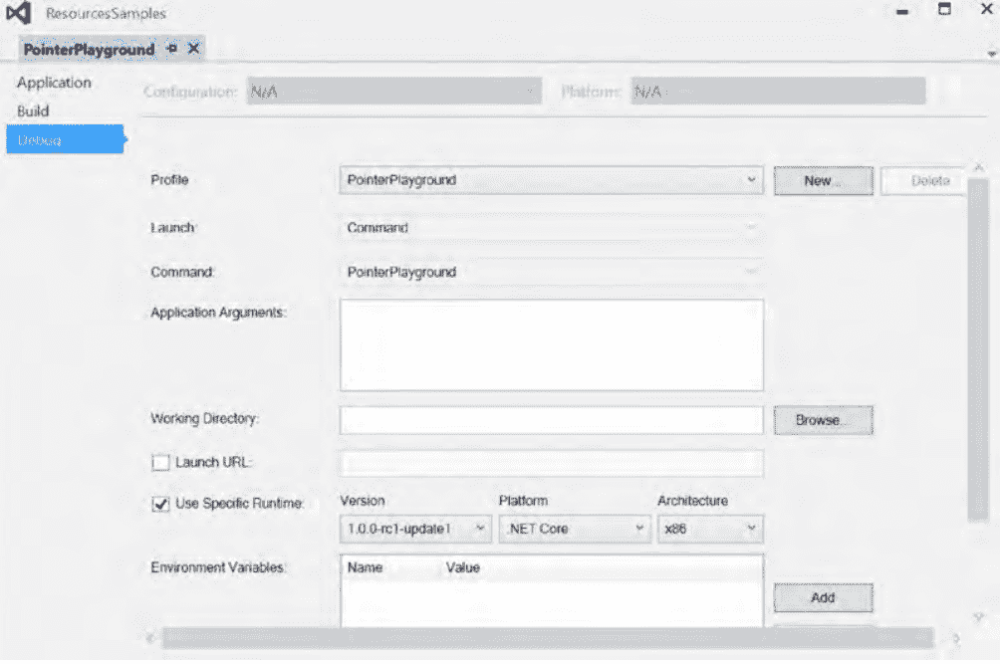

图 5.1

可用 4GB 中的每个内存位置都从零开始编号。要访问存储在内存中特定位置的值，你需要提供表示该内存位置的编号。在任何编译型高级语言中，编译器会将人类可读的变量名转换为处理器能够理解的内存地址。

在处理器的虚拟内存中，有一个被称为 `栈` 的区域。`栈` 存储不属于对象成员的值数据类型。此外，当你调用方法时，栈用于保存传递给方法的任何参数的副本。要理解栈的工作原理，你需要理解 C# 中变量 `作用域` 的重要性。如果变量 a 先于变量 b 进入作用域，那么 b 总是会先离开作用域。考虑以下代码：

```csharp
{
    int a;
    // do something
    {
        int b;
        // do something else
    }
}
```

首先，声明变量 a。然后，在内部代码块中声明 b。接着，内部代码块结束，b 离开作用域，然后 a 离开作用域。因此，b 的生命周期完全包含在 a 的生命周期内。你总是以与分配变量相反的顺序释放变量，这一思想对于栈的工作方式至关重要。

请注意，b 与代码处于不同的块中（由不同嵌套的花括号定义）。因此，它位于不同的作用域内。这称为块作用域或结构作用域。

你并不确切知道栈在地址空间中的位置——对于 C# 开发来说，你也不需要知道。栈指针（由操作系统维护的一个变量）标识栈上的下一个空闲位置。当程序首次开始运行时，栈指针将指向为栈保留的内存块的末尾之后。栈向下填充，从高内存地址到低地址。随着数据放入栈中，栈指针会相应调整，因此它始终指向下一个空闲位置之后。图 5.2 展示了这一点，其中栈指针的值为 800000（十六进制为 0xc3500）；下一个空闲位置是地址 799999。

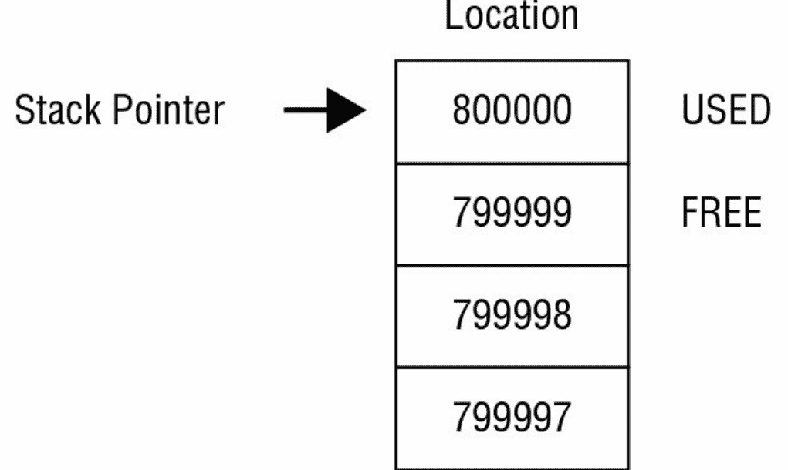

图 5.2

下面的代码告诉编译器，你需要在内存中分配空间来存储一个整数和一个 double，这些内存位置分别称为 `nRacingCars` 和 `engineSize`。声明每个变量的行标明了你开始需要访问该变量的点。声明这些变量的块结束花括号标识了两个变量离开作用域的点：

```csharp
{
    int nRacingCars = 10;
    double engineSize = 3000.0;
    // do calculations;
}
```

假设你使用图 5.2 所示的栈，当变量 `nRacingCars` 进入作用域并被赋值为 10 时，值 10 被放置在位置 799996 到 799999，即栈指针所指向位置下方正好 4 个字节处（4 个字节是因为存储 int 需要这么多内存）。为了容纳这一点，栈指针的值减去 4，因此它现在指向位置 799996，即新的第一个空闲位置（799995）之后。

下一行代码声明变量 `engineSize`（一个 double）并将其初始化为 3000.0。double 占用 8 个字节，因此值 3000.0 被放置在栈上的位置 799988 到 799995，栈指针减 8，使其再次指向栈上下一个空闲位置之后的位置。

当 `engineSize` 离开作用域时，运行时知道不再需要它。由于变量生命周期总是嵌套的，你可以保证无论 `engineSize` 在作用域内发生了什么，栈指针现在都指向存储 `engineSize` 的位置。要将 `engineSize` 从栈中移除，栈指针加 8，现在它指向 `engineSize` 结束之后的位置。在此代码点，你位于结束花括号处，因此 `nRacingCars` 也离开作用域。栈指针加 4。当另一个变量在 `engineSize` 和 `nRacingCars` 被从栈中移除后进入作用域时，它会从存储 `nRacingCars` 的位置 799999 开始向下覆盖内存。

如果编译器遇到像 `int i, j,` 这样的代码行，变量进入作用域的顺序看起来是不确定的。两个变量同时声明并且同时离开作用域。在这种情况下，两个变量从内存中移除的顺序并不重要。编译器在内部总是确保先放入内存的那个变量最后移除，从而保持禁止变量生命周期交叉的规则。

#### 引用数据类型

尽管栈提供了非常高的性能，但它的灵活性不足以用于所有变量。变量生命周期必须嵌套的要求对许多用途而言过于严格。通常，你需要使用一种方法来分配内存以存储数据，并在该方法退出后很长时间内保持这些数据可用。每当使用 `new` 运算符请求存储空间时——所有引用类型都是如此——这种可能性就存在。这就是托管堆发挥作用的地方。

如果你做过任何需要底层内存管理的 C++ 编码，你会熟悉堆。托管堆并非

托管堆与 C++ 使用的本机堆并不完全相同；然而，托管堆在垃圾回收器的控制下工作，与传统堆相比具有显著优势。

托管堆（简称堆）只是处理器可用内存中的另一个内存区域。以下代码演示了堆的工作方式以及如何为引用数据类型分配内存：

```
void DoWork()
{
    Customer arabel;
    arabel = new Customer();
    Customer otherCustomer2 = new EnhancedCustomer();
}
```

此代码假定存在两个类：`Customer` 和 `EnhancedCustomer`。`EnhancedCustomer` 类继承自 `Customer` 类。

首先，你声明一个名为 `arabel` 的 `Customer` 引用。其空间分配在栈上，但请记住，这只是一个引用，而不是实际的 `Customer` 对象。`arabel` 引用占用 4 个字节，足以保存 `Customer` 对象将要存储的地址。（你需要 4 个字节来将内存地址表示为一个介于 0 到 4GB 之间的整数值。）

下一行代码，

```
arabel = new Customer();
```

会执行几项操作。首先，它在堆上分配内存来存储一个 `Customer` 对象（一个真实的对象，而不仅仅是一个地址）。然后，它将变量 `arabel` 的值设置为其为新的 `Customer` 对象分配的内存的地址。（它还会调用相应的 `Customer` 构造函数来初始化类实例中的字段，但这里你无需担心这一点。）

`Customer` 实例并非放在栈上，而是放在堆上。在此示例中，你无法确切知道 `Customer` 对象占用多少字节，但为了便于讨论，假设它占用 32 个字节。这 32 个字节包含 `Customer` 的实例字段，以及 .NET 用于识别和管理其类实例的一些信息。

为了在堆上为新的 `Customer` 对象查找存储位置，.NET 运行时会在堆中查找，并抓取第一个相邻的、未使用的 32 字节块。同样，为了便于讨论，假设该位置恰好是地址 200000，而 `arabel` 引用在栈上占据位置 799996 到 799999。这意味着在实例化 `arabel` 对象之前，内存内容类似于图 5.3。

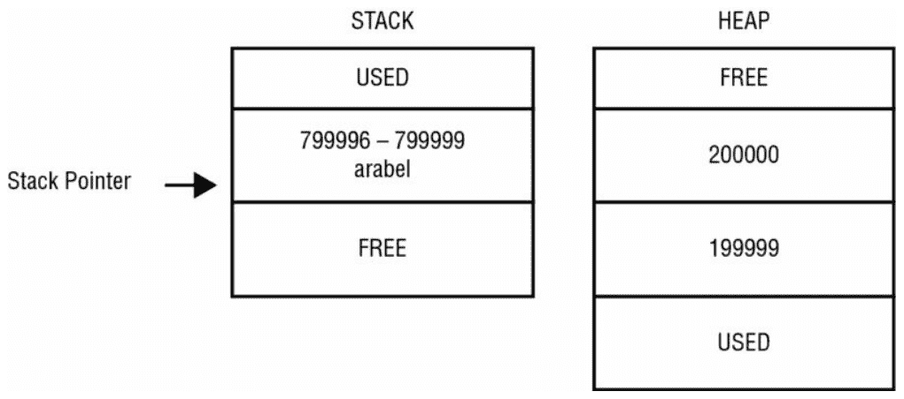

**图 5.3**

分配新的 `Customer` 对象后，内存内容如图 5.4 所示。请注意，与栈不同，堆中的内存是向上分配的，因此可用空间位于已用空间之上。

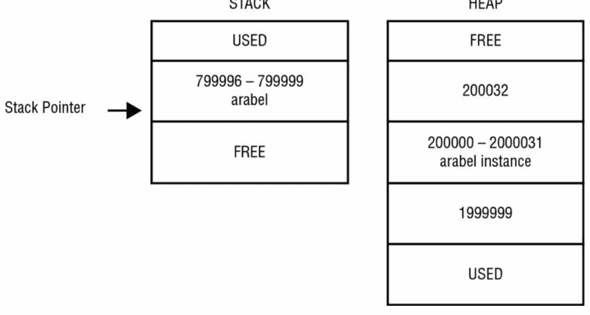

**图 5.4**

下一行代码既声明了一个 `Customer` 引用，又实例化了一个 `Customer` 对象。在本例中，通过一行代码，在栈上为 `otherCustomer2` 引用分配了空间，并在堆上为 `otherCustomer2` 对象分配了空间：

```
Customer otherCustomer2 = new EnhancedCustomer();
```

这行代码在栈上分配 4 个字节来保存 `otherCustomer2` 引用，存储位置为 799992 到 799995。`otherCustomer2` 对象从位置 200032 开始在堆上分配空间。

从示例中可以清楚地看出，设置引用变量的过程比设置值变量的过程更复杂，并且存在性能开销。事实上，这里的过程有些过于简化，因为 .NET 运行时需要维护堆状态的信息，并且每当有新数据添加到堆中时，这些信息都需要更新。尽管存在这种开销，你现在有了一种不受栈限制的变量分配机制。通过将一个引用变量的值赋给另一个同类型的引用变量，你就拥有了两个引用内存中同一对象的变量。当引用变量超出作用域时，它会按照上一节所述从栈中移除，但被引用对象的数据仍留在堆上。该数据将一直保留在堆上，直到程序终止或垃圾回收器将其移除，而垃圾回收器移除它的条件是该数据不再被任何变量引用。

这就是引用数据类型的强大之处，你会看到这一特性在 C# 代码中被广泛使用。这意味着你对数据的生命周期有高度的控制权，因为只要你还保持着对它的某个引用，它就保证会存在于堆中。

### 垃圾回收

前面的讨论和图示表明，托管堆的工作方式非常类似于栈，连续的对象在内存中彼此相邻放置。这意味着你可以通过一个指示下一个空闲内存位置的堆指针来确定下一个对象的放置位置，该指针会随着向堆中添加更多对象而调整。然而，事情变得复杂是因为基于堆的对象生命周期与引用它们的各个基于栈的变量的作用域并不耦合。

当垃圾回收器运行时，它会从堆中移除所有不再被引用的对象。GC 从引用根表中找到所有被引用的对象，并继续遍历被引用对象的树。紧接着，堆上会散布着各种对象，它们与刚刚释放的内存混杂在一起（见图 5.5）。

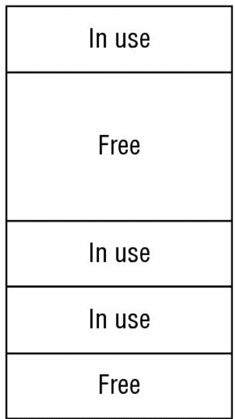

**图 5.5**

如果托管堆一直保持这种状态，那么为新对象分配空间将是一个非常棘手的过程，运行时必须搜索整个堆，以找到一个足够大的内存块来存储每个新对象。然而，垃圾回收器并不会让堆保持这种状态。一旦垃圾回收器释放了所有能释放的对象，它就会压缩堆，将所有剩余对象移动到一起，形成一个连续的内存块。这意味着，就定位新对象的存储位置而言，堆可以继续像栈一样工作。当然，当对象被移动时，所有指向这些对象的引用都需要更新为正确的新地址，但垃圾回收器也会处理这一点。

垃圾回收器的这种压缩操作，正是托管堆与非托管堆工作方式截然不同之处。对于托管堆，只需读取堆指针的值即可，而无需遍历地址链表来寻找放置新数据的位置。

> **注意** 通常，当 .NET 运行时确定需要垃圾回收时，垃圾回收器就会运行。你可以通过调用 `System.GC.Collect` 来强制垃圾回收器在代码中的某个时刻运行。`System.GC` 类是表示垃圾回收器的 .NET 类，`Collect` 方法会启动一次垃圾回收。`GC` 类用于少数已知适合调用垃圾回收器的情况；例如，当你刚刚在代码中取消引用大量对象时。但是，垃圾回收器的逻辑并不保证所有未被引用的对象都会在单次垃圾回收过程中从堆中移除。

> **注意** 在测试期间运行 `GC.Collect` 很有用。通过这种方式，你可以发现本应被垃圾回收却仍然存活的对象所导致的内存泄漏。由于垃圾回收器表现出色，在生产代码中以编程方式回收内存并不是一个好主意。如果以编程方式调用 `Collect`，对象会更快地移动到下一代，如下所示。这会导致 GC 运行时间更长。

当对象被创建时，它们会被放置在托管堆中。堆的第一部分称为第 0 代部分，简称 gen 0。随着新对象的创建，它们会被移入堆的这个部分。因此，这里是最新对象所在的位置。

你的对象会一直留在那里，直到通过垃圾回收过程进行首次对象回收。在此次清理后仍然存活的对象会被压缩，然后移动到堆的下一个部分或代际部分——第 1 代（即 gen 1）部分。

此时，第 0 代部分为空，所有新对象再次被放置在该部分。在 GC（垃圾回收）过程中幸存下来的较旧对象则位于第 1 代部分的更下方。老对象的这种移动实际上还会再发生一次。接下来发生的下一次回收过程会重复这一过程。这意味着，在第 1 代部分中于 GC 过程幸存下来的对象会被移动到第 2 代部分，而第 0 代对象则会进入第 1 代，再次为第 0 代留出空间以容纳新对象。

> **注意** 当你分配的项超过第 0 代部分的容量，或者调用 `GC.Collect` 时，就会发生一次垃圾回收。

这个过程极大地提高了应用程序的性能。通常，最新的对象是那些可以被回收的对象，并且大量与较新对象相关的对象也可能会被回收。如果这些对象在堆中彼此相邻存放，那么垃圾回收会更快。此外，由于相关对象彼此相邻存放，整个程序执行速度也会更快。


在 .NET 中，垃圾回收另一个与性能相关的方面是框架如何处理添加到堆中的大型对象。在 .NET 底层，大型对象拥有自己的托管堆，称为大型对象堆。当使用超过 85,000 字节的对象时，它们会进入这个特殊的堆，而不是主堆。您的 .NET 应用程序不会察觉这种区别，因为这一切都由系统为您管理。由于压缩堆中的大型条目开销很大，因此不会对大型对象堆中的对象执行压缩。

为了进一步改进`GC`，现在在第 2 代区域和大型对象堆上的回收在后台线程上执行。这意味着应用程序线程仅在第 0 代和第 1 代回收时被阻塞，从而减少了总暂停时间，尤其是对于大规模服务器应用。此功能默认在服务器和工作站上均处于开启状态。

另一个有助于提高应用程序性能的优化是`GC`平衡。这专门针对服务器`GC`。通常，服务器会有一个线程池执行大致相同的操作。所有线程的内存分配情况类似。对于服务器，每个逻辑服务器有一个`GC`堆。因此，当其中一个堆内存耗尽并触发`GC`时，所有其他堆很可能也会从这次`GC`中受益。如果某个线程恰好比其他线程使用多得多的内存并引发`GC`，那么其他线程可能还远未到需要`GC`的程度，因此效率不高。`GC`会平衡各堆——既包括小对象堆，也包括大型对象堆。通过执行这种平衡过程，可以减少不必要的回收。

为了利用具有大量内存的硬件，`GC`添加了`GCSettings.LatencyMode`属性。将该属性设置为`GCLatencyMode`枚举中的某个值，可以对`GC`执行回收的方式稍加控制。下表列出了可用的`GCLatencyMode`值。

| Member | Description |
|---|---|
| `Batch` | 禁用并发设置，将`GC`设置为最大吞吐量，但以响应性为代价。这会覆盖配置设置。 |
| `Interactive` | 工作站上的默认行为。使用垃圾回收并发，并在吞吐量和响应性之间取得平衡。 |
| `LowLatency` | 保守式`GC`。仅在系统面临内存压力时才进行完全回收。此设置只应在短时间内用于执行特定操作。 |
| `SustainedLowLatency` | 仅在系统内存压力较大时执行完全阻塞式回收。 |
| `NoGCRegion` | .NET 4.6 中的新增功能。对于`GCSettings`，这是一个只读属性。您可以在调用`GC.TryStartNoGCRegion`和`EndNoGCRegion`的代码块中设置它。调用`TryStartNoGCRegion`时，您定义需要可用的内存大小，`GC`会尝试达到该大小。成功调用`TryStartNoGCRegion`之后，您定义垃圾回收器不应运行——直到调用`EndNoGCRegion`。 |

使用`LowLatency`或`NoGCRegion`设置的时间应保持在最短。分配的内存量应尽可能小。如果不小心，可能会发生内存不足错误。

### 强引用和弱引用

垃圾回收器无法回收仍具有引用（即强引用）的对象的内存。它可以回收未被根表直接或间接引用的托管内存。然而，人们很容易忘记释放引用。

> **注意** 如果存在相互引用但未从根表引用的对象——例如对象 A 引用 B，B 引用 C，C 引用 A——`GC`可以销毁所有这些对象。

当类或结构在应用程序代码中实例化时，只要有其他代码引用它，它就具有强引用。例如，如果您有一个名为`MyClass`的类，并且基于该类创建对象引用，并将变量命名为`myClassVariable`，如下所示，只要`myClassVariable`在作用域内，就存在对`MyClass`对象的强引用：

```
var myClassVariable = new MyClass();
```

这意味着垃圾回收器无法清理`MyClass`对象使用的内存。通常这是一件好事，因为您可能需要访问`MyClass`对象。您可能会创建一个缓存对象，其中包含对多个其他对象的引用，如下所示：

```
var myCache = new MyCache();
myCache.Add(myClassVariable);
```

现在您已经使用完`myClassVariable`。它可能会超出作用域，或者您为其分配`null`：

```
myClassVariable = null;
```

如果垃圾回收器现在运行，它无法释放`myClassVariable`所引用的内存，因为该对象仍然被缓存对象引用。这样的引用很容易被遗漏，而使用`WeakReference`可以避免这种情况。

> **注意** 对于事件，很容易遗漏引用的清理。在这里，您也可以使用弱引用。事件以及带有事件的弱引用将在第 9 章“委托、Lambda 表达式和事件”中介绍。

弱引用允许对象被创建和使用，但如果垃圾回收器恰好运行，它会回收该对象并释放内存。这通常不是您想要做的事情，因为可能存在 bug 和性能问题，但在某些情况下它确实有意义。弱引用对于小对象也没有意义，因为弱引用本身有开销，而且开销可能比小对象还大。

使用`WeakReference`类创建弱引用。使用构造函数时，可以传入强引用。示例代码创建了一个`DataObject`，并传入了构造函数返回的引用。使用`WeakReference`时，可以检查`IsAlive`属性。若要再次使用该对象，`WeakReference`的`Target`属性会返回强引用。如果返回的属性值不为`null`，则可以使用该强引用。由于对象可能随时被回收，因此在尝试引用它之前，确保对象仍然存在非常重要。成功获取强引用后，您就可以正常使用它，并且此时它不会被垃圾回收，因为您又拥有了强引用：

```
// Instantiate a weak reference to MathTest object
var myWeakReference = new WeakReference(new DataObject());

if (myWeakReference.IsAlive)
{
    DataObject strongReference = myWeakReference.Target as DataObject;
    if (strongReference != null)
    {
        // use the strongReference
    }
    else
    {
        // reference not available
    }
}
```

### 使用非托管资源

垃圾回收器的存在意味着您通常无需担心不再需要的对象；只需让对这些对象的所有引用超出作用域，并让垃圾回收器按需释放内存即可。然而，垃圾回收器并不知道如何释放非托管资源（如文件句柄、网络连接和数据库连接）。当托管类封装了对非托管资源的直接或间接引用时，您需要做出特别安排，以确保在类的实例被垃圾回收时释放这些非托管资源。

定义类时，可以使用两种机制来自动释放非托管资源。这两种机制通常一起实现，因为各自提供了略有不同的方法：

- 声明一个*析构函数*（或终结器）作为类的成员。
- 在类中实现`System.IDisposable`接口。

### 析构函数或终结器

您已经看到，构造函数使您能够指定在创建类实例时必须执行的操作。相反，析构函数在对象被垃圾回收器销毁之前调用。鉴于这种行为，析构函数最初似乎是放置释放非托管资源和执行常规清理代码的好地方。不幸的是，事情并非如此简单。

> **注意** 虽然在 C# 中我们讨论的是析构函数，但在底层 .NET 架构中，它们被称为终结器。在 C# 中定义析构函数时，编译器向程序集发出的实际上是一个`Finalize`方法。它不会影响您的任何源代码，但在检查生成的中间语言 (IL) 代码时，您需要意识到这一点。

析构函数的语法对于 C++ 开发人员来说会很熟悉。它看起来像

它就像一个方法，与包含它的类同名，但以波浪号（~）作为前缀。它没有返回类型，也不接受参数或访问修饰符。下面是一个示例：

```
class MyClass
{
    ~MyClass()
    {
        // Finalizer implementation
    }
}
```

当 C# 编译器编译析构函数时，它会隐式地将析构函数代码转换为对`Finalize`方法的重写，从而确保父类的`Finalize`方法得以执行。下面的示例展示了编译器为`~MyClass`析构函数生成的中间语言（IL）所对应的 C# 代码：

```
protected override void Finalize()
{
    try
    {
        // Finalizer implementation
    }
    finally
    {
        base.Finalize();
    }
}
```

如图所示，在`~MyClass`析构函数中实现的代码被包装在`Finalize`方法内的一个`try`块中。通过将调用放在`finally`块中，确保了父类`Finalize`方法会被调用。你可以在第 14 章“错误和异常”中了解`try`和`finally`块的相关内容。

经验丰富的 C++ 开发人员会大量使用析构函数，有时不仅是为了清理资源，还为了提供调试信息或执行其他任务。C# 析构函数的使用频率远低于 C++ 中的析构函数。与 C++ 中的析构函数相比，C# 析构函数的问题在于它们是不确定的。当 C++ 对象被销毁时，其析构函数会立即执行。然而，由于 C# 中垃圾回收器的运作方式，我们无法得知对象的析构函数究竟何时会执行。因此，你不能在析构函数中放置任何依赖特定时机运行的代码，也不应依赖析构函数按特定顺序对不同类实例进行调用。当你的对象持有需要尽快释放的稀缺且关键的资源时，你不会希望等待垃圾回收。

C# 析构函数的另一个问题是，析构函数的实现会延迟对象从内存中被最终移除。没有析构函数的对象只需垃圾回收器一次遍历即可从内存中移除，而具有析构函数的对象则需要两次遍历才能被销毁：第一次遍历调用析构函数而不移除对象，第二次遍历才真正删除对象。此外，运行时使用单个线程来执行所有对象的`Finalize`方法。如果你频繁使用析构函数，并让它们执行耗时的清理任务，对性能的影响可能会非常明显。

### IDisposable 接口

在 C# 中，使用析构函数的推荐替代方案是使用`System.IDisposable`接口。`IDisposable`接口定义了一种模式（具有语言级支持），该模式提供了一种确定性机制来释放非托管资源，并避免了析构函数固有的与垃圾回收器相关的问题。`IDisposable`接口声明了一个名为`Dispose`的方法，该方法不接受任何参数并返回`void`。以下是`MyClass`的实现：

```
class MyClass: IDisposable
{
    public void Dispose()
    {
        // implementation
    }
}
```

`Dispose`的实现应显式释放对象直接使用的所有非托管资源，并对所有也实现了`IDisposable`接口的封装对象调用`Dispose`。这样，`Dispose`方法就提供了对非托管资源何时释放的精确控制。

假设你有一个名为`ResourceGobbler`的类，它依赖某些外部资源并实现了`IDisposable`。如果你想实例化这个类的一个对象，使用它，然后释放它，你可以这样做：

```
var theInstance = new ResourceGobbler();

// do your processing

theInstance.Dispose();
```

不幸的是，如果在处理过程中发生异常，这段代码将无法释放`theInstance`消耗的资源，因此你应该使用`try`块编写如下代码（详见第 14 章）：

```
ResourceGobbler theInstance = null;
try
{
    theInstance = new ResourceGobbler();
    // do your processing
}
finally
{
    theInstance?.Dispose();
}
```

### using 语句

使用`try/finally`可以确保在`theInstance`上始终调用`Dispose`，并且即使处理过程中发生异常，它所消耗的任何资源也始终会被释放。然而，如果你总是需要重复这样的构造，代码就会变得混乱。C# 提供了一种语法，可以保证在实现`IDisposable`的对象的引用超出作用域时，自动对其调用`Dispose`。实现这一点的语法涉及`using`关键字——尽管现在它的上下文与此前的完全不同，与命名空间毫无关系。下面的代码生成的 IL 代码与刚才所示的`try`块等效：

```
using (var theInstance = new ResourceGobbler())
{
    // do your processing
}
```

`using`语句后跟括号内的引用变量声明和实例化，使该变量限定在附带的语句块作用域内。此外，当该变量超出作用域时，其`Dispose`方法会被自动调用，即使发生异常也是如此。

> **注意** *C# 中的`using`关键字有多种用途。`using`声明用于导入命名空间。`using`语句则作用于实现`IDisposable`的对象，并在 using 作用域结束时调用`Dispose`方法。*

> **注意** *在 .NET Framework 的多个类中，同时存在`Close`和`Dispose`方法。如果关闭资源（例如文件和数据库）是常见的操作，那么`Close`和`Dispose`都已实现。在这里，`Close`方法只是调用`Dispose`。这种方法为这些类的使用提供了清晰性，并支持`using`语句。较新的类只实现`Dispose`方法，正如我们已经习惯的那样。*

### 实现 IDisposable 和析构函数

前面的部分讨论了释放你创建的类所使用的非托管资源的两种替代方案：

-   析构函数的执行由运行时强制进行，但它是非确定性的，并且由于垃圾回收的工作方式，会给运行时带来不可接受的负担。
-   `IDisposable`接口提供了一种机制，使类的使用者能够控制资源何时释放，但需要遵守纪律以确保调用`Dispose`。

如果你正在创建终结器，还应该实现`IDisposable`接口。你实现`IDisposable`是假设大多数程序员会正确调用`Dispose`，但也要实现一个析构函数作为安全机制，以防`Dispose`未被调用。以下是一个双重实现的示例：

```
using System;

public class ResourceHolder: IDisposable
{
    private bool _isDisposed = false;

    public void Dispose()
    {
        Dispose(true);
        GC.SuppressFinalize(this);
    }

    protected virtual void Dispose(bool disposing)
    {
        if (!_isDisposed)
        {
            if (disposing)
            {
                // Cleanup managed objects by calling their
                // Dispose() methods.
            }
            // Cleanup unmanaged objects
        }
        _isDisposed = true;
    }

    ~ResourceHolder()
    {
        Dispose(false);
    }

    public void SomeMethod()
    {
        // Ensure object not already disposed before execution of any method
        if (_isDisposed)
        {
            throw new ObjectDisposedException("ResourceHolder");
        }

        // method implementation...
    }
}
```

你可以从这段代码中看到，还有一个接受一个`bool`参数的`protected`重载`Dispose`——而正是这个方法负责所有的清理工作。`Dispose(bool)`被析构函数和`IDisposable.Dispose`两者调用。这种做法的要点是确保所有清理代码都集中在一个地方。

传递给`Dispose(bool)`的参数指示是否

`Dispose(bool)`已由析构函数或`IDisposable.Dispose`调用——不应在代码中的任何其他位置调用`Dispose(bool)`。其思路如下：

- 如果使用者调用`IDisposable.Dispose`，则表示该对象关联的所有托管和非托管资源都应被清理。
- 如果析构函数已被调用，则所有资源仍然需要清理。但在这种情况下，你知道析构函数必定是由垃圾回收器调用的，你不应再尝试访问其他托管对象，因为你无法再确定它们的状态。在这种情形下，你能做的最好的事情就是清理已知的非托管资源，并希望任何被引用的托管对象也拥有析构函数来执行它们自身的清理。

`_isDisposed`成员变量表示该对象是否已被释放，并确保你不会多次尝试释放成员变量。它还使你能够在执行任何实例方法之前测试对象是否已被释放，如`SomeMethod`中所示。这种简单的方法不是线程安全的，并且依赖于调用者确保只有一个线程同时调用该方法。要求使用者强制同步是一个合理的假设，并且在 .NET 类库中反复使用（例如在`Collection`类中）。线程和同步将在第 21 章“任务和并行编程”和第 22 章“任务同步”中讨论。


最后，`IDisposable.Dispose` 包含对 `System.GC.SuppressFinalize` 方法的调用。`GC` 是表示垃圾回收器的类，`SuppressFinalize` 方法告诉垃圾回收器，某个类不再需要调用其析构函数。因为你的 `Dispose` 实现已经完成了所有必要的清理，析构函数就无事可做了。调用 `SuppressFinalize` 意味着垃圾回收器将把该对象视为根本没有析构函数。

### IDisposable 和终结器规则

学习了终结器和 `IDisposable` 接口之后，你已经了解了 Dispose 模式以及使用这些构造的一些规则。由于释放资源是托管代码中非常重要的方面，现将这些规则总结如下：

- 如果你的类定义了实现 `IDisposable` 的成员，则该类也应实现 `IDisposable`。

- 实现 `IDisposable` 并不意味着你也应该实现终结器。终结器在创建对象和释放对象内存时都会带来额外开销，因为垃圾回收器需要额外的一次遍历。只有在需要时才应实现终结器——例如，用于释放非托管资源。要释放非托管资源，确实需要终结器。

- 如果实现了终结器，你也应该实现 `IDisposable` 接口。这样，非托管资源就可以更早地被释放，而不必等到垃圾回收器发现占用资源时才释放。

- 在终结代码实现中，不要访问可能已经被终结的对象。终结器的顺序是不保证的。

- 如果你使用的对象实现了 `IDisposable` 接口，请在不再需要该对象时调用 `Dispose` 方法。如果你在方法内使用该对象，`using` 语句会很有用。如果该对象是类的成员，则应让该类也实现 `IDisposable`。

### 不安全代码

正如你刚才所看到的，由于垃圾回收器和引用的使用，C# 非常擅长向开发者隐藏许多基本的内存管理细节。然而，有时你会希望直接访问内存。例如，你可能希望访问外部（非 .NET）DLL 中的某个函数，该函数要求以参数形式传递指针（许多 Windows API 函数都是如此），或者可能是出于性能原因。本节将探讨 C# 提供的直接访问内存内容的设施。

#### 使用指针直接访问内存

虽然我把 `指针` 当作一个新话题来介绍，但实际上指针并不新鲜。你一直在代码中自由地使用引用，而引用只是一种类型安全的指针。你已经看到，表示对象和数组的变量实际上存储了相应数据（`所指对象`）所在的内存地址。指针只是一个以与引用相同的方式存储其他内容地址的变量。`区别` 在于，C# 不允许你直接访问引用变量中包含的地址。对于引用，变量在语法上被当作存储了所指对象的实际内容来处理。

C# 引用的设计目的是使语言更易于使用，并防止你无意中做出破坏内存内容的事情。然而，使用指针时，你可以获得实际的内存地址。这为你执行新类型的操作提供了很大的能力。例如，你可以向地址添加 4 个字节，以检查甚至修改内存中恰好存储在该地址之后 4 个字节处的任何数据。

使用指针有两个主要原因：

- **向后兼容性**——尽管 .NET 运行时提供了各种设施，但仍然可以调用本机 Windows API 函数，对于某些操作，这可能是完成任务的唯一方法。这些 API 函数通常用 C++ 或 C# 编写，并且经常需要指针作为参数。然而，在许多情况下，可以编写 `DllImport` 声明来避免使用指针——例如，通过使用 `System.IntPtr` 类。

- **性能**——在速度至关重要的场合，指针可以提供优化性能的途径。如果你知道自己在做什么，就可以确保以最有效的方式访问或操作数据。但请注意，在大多数情况下，你的代码中很可能还有其他领域可以做出必要的性能改进，而不必诉诸使用指针。尝试使用代码分析器来查找代码中的瓶颈；Visual Studio 就包含一个代码分析器。

低级内存访问是有代价的。使用指针的语法比引用类型更复杂，而且指针无疑更难正确使用。你需要良好的编程技能以及出色地、仔细且合乎逻辑地思考代码正在做什么的能力，才能成功使用指针。否则，在使用指针时很容易在程序中引入细微且难以发现的 bug。例如，很容易覆盖其他变量、导致堆栈溢出、访问不存储任何变量的内存区域，甚至覆盖 .NET 运行时所需的关于代码的信息，从而使程序崩溃。

此外，如果使用指针，你的代码必须被运行时的代码访问安全机制授予高级别的信任，否则将不允许执行。在默认的代码访问安全策略下，只有当你的代码在本地机器上运行时才有可能。如果你的代码必须从远程位置（如 Internet）运行，用户必须授予你的代码额外的权限才能使其工作。除非用户信任你和你的代码，否则他们不太可能授予这些权限。代码访问安全将在第 24 章“安全性”中更详细地讨论。

尽管存在这些问题，指针在编写高效代码时仍然是一种非常强大且灵活的工具。

> **警告** `我强烈建议不要不必要地使用指针，因为你的代码不仅会变得更难编写和调试，而且还会无法通过 CLR 强制实施的内存类型安全检查。`

#### 使用 unsafe 关键字编写不安全代码

由于与指针相关的风险，C# 允许使用

指针只能在你专门为此标记的代码块中使用。实现这一目的的关键字是 `unsafe`。你可以像这样将单个方法标记为 `unsafe`：

```
unsafe int GetSomeNumber()
{
    // code that can use pointers
}
```

任何方法都可以标记为 `unsafe`，无论它已经应用了哪些其他修饰符（例如 `static` 方法或 `virtual` 方法）。对于方法而言，`unsafe` 修饰符应用于方法的参数，使你能够将指针用作参数。你还可以将整个类或结构体标记为 `unsafe`，这意味着其所有成员都被视为不安全：

```
unsafe class MyClass
{
    // any method in this class can now use pointers
}
```

类似地，你可以将成员标记为 `unsafe`：

```
class MyClass
{
    unsafe int* pX; // declaration of a pointer field in a class
}
```

或者，你可以将方法中的代码块标记为 `unsafe`：

```
void MyMethod()
{
    // code that doesn't use pointers
    unsafe
    {
        // unsafe code that uses pointers here
    }
    // more 'safe' code that doesn't use pointers
}
```

但请注意，你不能单独将局部变量标记为 `unsafe`：

```
int MyMethod()
{
    unsafe int *pX; // WRONG
}
```

如果你想使用不安全的局部变量，你需要在某个不安全的方法或代码块中声明并使用它。在使用指针之前，还有一步要做。除非你告诉编译器你的代码包含不安全代码块，否则 C# 编译器会拒绝不安全代码。使用 DNX 时，你可以通过 `project.json` 文件（代码文件 `PointerPlayground/project.json`）中的 `compilationOptions` 将 `allowUnsafe` 设置为 true：

```
"compilationOptions": {"allowUnsafe": true},
```

使用传统的 csc 编译器，你可以设置 `/unsafe` 选项，或者在 Visual Studio 2015 的项目设置中将生成配置设置为“允许不安全代码”（Allow Unsafe Code）：

```
csc /unsafe MySource.cs
```

### 指针语法

在将代码块标记为 `unsafe` 之后，你可以使用以下语法声明指针：

```
int* pWidth, pHeight;
double* pResult;
byte*[] pFlags;
```

这段代码声明了四个变量：`pWidth` 和 `pHeight` 是指向整数的指针，`pResult` 是指向 `double` 的指针，`pFlags` 是指向字节的指针数组。通常的做法是在指针变量名称前加上前缀 `p`，以表明它们是指针。在变量声明中，符号 `*` 表示你在声明一个指针（即存储指定类型变量地址的对象）。

当你声明了指针类型的变量后，你可以像使用普通变量一样使用它们，但首先你需要学习另外两个运算符：

- `&` 表示取地址，它将值数据类型转换为指针——例如，`int` 转换为 `*int`。该运算符称为地址运算符。

- `*` 表示获取该地址的内容，它将指针转换为值数据类型——例如，`*float` 转换为 `float`。该运算符称为间接运算符（或解引用运算符）。

从这些定义可以看出，`&` 和 `*` 具有相反的作用。

> **注意** 你可能会想，怎么可能以这种方式使用 `&` 和 `*` 符号，因为这些符号也指按位与（`&`）和乘法（`*`）运算符。实际上，对于你来说，对于编译器来说，通常都能知道每种情况下意味着什么，因为作为指针含义时，这些符号总是作为一元运算符出现——它们只作用于一个变量，并且在代码中出现在该变量的前面。相比之下，按位与和乘法是二元运算符——它们需要两个操作数。

以下代码展示了如何使用这些运算符的示例：

```
int x = 10;
int* pX, pY;
pX = &x;
pY = pX;
*pY = 20;
```

首先，你声明一个整数 `x`，值为 `10`，接着声明两个指向整数的指针 `pX` 和 `pY`。然后，你将 `pX` 设置为指向 `x`（也就是说，你将 `pX` 的内容设置为 `x` 的地址）。接着，你将 `pX` 的值赋给 `pY`，这样 `pY` 也指向 `x`。最后，在语句 `*pY = 20` 中，你将值 20 赋给 `pY` 所指向位置的内容——实际上，这会将 `x` 改为 20，因为 `pY` 恰好指向 `x`。请注意，变量 `pY` 和 `x` 之间没有特殊的关联。只是目前 `pY` 恰好指向存放 `x` 的内存位置。

为了更好地理解正在发生的事情，假设整数 `x` 存储在栈上的内存位置 0x12F8C4 到 0x12F8C7（十进制 1243332 到 1243335）（有四个位置，因为 `int` 占用 4 个字节）。由于栈向下分配内存，这意味着变量 `pX` 将存储在位置 0x12F8C0 到 0x12F8C3，而 `pY` 最终将位于位置 0x12F8BC 到 0x12F8BF。请注意，`pX` 和 `pY` 也各占用 4 个字节。这不是因为 `int` 占用 4 个字节，而是因为在 32 位应用程序中，你需要 4 个字节来存储一个地址。使用这些地址，在执行完前面的代码后，栈将如图 5.6 所示。

| 地址范围 | 内容 |

| --- | --- |

| 0x12F8C4-0x12F8C7 | x=20 (=0x14) |

| 0x12F8C0-0x12F8C3 | pX=0x12F8C4 |

| 0x12F8BC-0x12F8BF | pY=0x12F8C4 |

**图 5.6**

> 注意 `虽然此过程以整数为例，在 32 位处理器上整数在栈上连续存储，但并非所有数据类型都是如此。原因是 32 位处理器在以 4 字节块从内存中检索数据时效率最高。这类机器上的内存往往被划分为 4 字节块，在 Windows 下每个块有时被称为 DWORD，因为这是 .NET 之前时代 32 位无符号整数的名称。从内存中获取 DWORD 最有效率——跨 DWORD 边界存储数据通常会导致硬件性能损失。因此，.NET 运行时通常会对数据类型进行填充，使它们占用的内存是 4 的倍数。例如，`short` 占用 2 个字节，但如果 `short` 被放置在栈上，栈指针仍会减 4，而不是 2，因此下一个入栈的变量仍将从 DWORD 边界开始。`

你可以声明指向任何值类型的指针（即任何预定义类型，如 `uint`、`int`、`byte` 等，或指向结构体）。但是，不能声明指向类或数组的指针；这是因为这样做可能会给垃圾回收器带来问题。为了正常工作，垃圾回收器需要准确知道在堆上创建了哪些类实例以及它们在哪里；但如果你的代码开始使用指针操作类，你就很容易破坏 .NET 运行时为垃圾回收器维护的关于类的堆信息。在这种情况下，任何垃圾回收器可以访问的数据类型都称为 `托管类型`。指针只能声明为 `非托管` 类型，因为垃圾回收器无法处理它们。

### 将指针转换为整数类型

因为指针实际上存储的是一个表示地址的整数，所以当你得知任何指针中的地址都可以与任何整数类型相互转换时，你不会感到惊讶。指针到整数类型的转换必须是显式的。这类转换不支持隐式转换。例如，编写以下代码是完全合法的：

```
int x = 10;
int* pX, pY;
pX = &x;
pY = pX;
*pY = 20;
ulong y = (ulong)pX;
int* pD = (int*)y;
```

指针 `pX` 中保存的地址被转换为 `ulong` 并存储在变量 `y` 中。然后你将 `y` 转换回 `int*` 并存储在新变量 `pD` 中。因此，现在 `pD` 也指向 `x` 的值。

将指针值转换为整数类型的主要原因是为了显示它。内插字符串（以及 `Console.Write`）没有可以接受指针的任何重载，但它们确实接受并显示已转换为整数类型的指针值：

```
WriteLine($"Address is {pX}"); // wrong -- will give a compilation error
WriteLine($"Address is {(ulong)pX}"); // OK
```

你可以将指针转换为任何整数类型。然而，由于在 32 位系统上地址占用 4 个字节，将指针转换为 `uint`、`long` 或 `ulong` 以外的任何类型几乎肯定会导致溢出错误。（`int` 会引发问题，因为它的范围大约从 −20 亿到 20 亿，而地址的范围是从 0 到大约 40 亿。）如果你正在创建 64 位应用程序，则需要将指针转换为 `ulong`。

同样重要的是要注意，`checked` 关键字不适用于涉及指针的转换。对于此类转换，即使在 `checked` 上下文中，发生溢出时也不会引发异常。.NET 运行时假定，如果你正在使用指针，你知道你在做什么

执行操作时不必担心可能的溢出。

### 指针类型之间的强制转换

你还可以在不同类型的指针之间进行显式转换。例如，以下代码是完全合法的：

```
byte aByte = 8;
byte* pByte = &aByte;
double* pDouble = (double*)pByte;
```

但是，如果尝试类似的操作，请务必小心。在此示例中，如果你查看 `pDouble` 所指向的 double 值，实际上是在查看包含一个字节（`aByte`）的某些内存，并将其与一些其他内存组合在一起，然后将其视为该内存区域包含一个 double，这不会给你一个有意义的数值。不过，你可能希望在类型之间进行转换以实现 C 语言联合体的等效功能，或者你可能希望将其他类型的指针强制转换为指向 `sbyte` 的指针，以便检查内存的各个字节。

### void 指针

如果你想保留一个指针但不指定它指向什么类型的数据，可以将其声明为指向 `void` 的指针：

```
int* pointerToInt;
void* pointerToVoid;
pointerToVoid = (void*)pointerToInt;
```

其主要用途是当你需要调用要求 `void*` 参数的 API 函数时。在 C# 语言中，使用 void 指针能做的事情并不多。特别是，如果你尝试使用 `*` 运算符取消引用 void 指针，编译器会报错。

### 指针算术

可以对指针进行整数加减运算。不过，编译器在处理这种运算时相当智能。例如，假设你有一个指向 `int` 的指针，并尝试对其值加 1。编译器会假定你实际上是想查看该 `int` 之后的内存位置，因此它会将该值增加 4 个字节——即 `int` 的大小。如果是指向 `double` 的指针，加 1 实际上会使指针的值增加 8 个字节，即 `double` 的大小。只有当指针指向 `byte` 或 `sbyte`（各占 1 个字节）时，给指针的值加 1 才会真正使其值变化 1。

你可以对指针使用运算符 `+`、`-`、`+=`、`-=`、`++` 和 `--`，这些运算符右侧的变量可以是 `long` 或 `ulong`。

> **注意** 不允许对 void 指针执行算术运算。

例如，假设有以下定义：

```
uint u = 3;
byte b = 8;
double d = 10.0;
uint* pUint = &u;      // uint 的大小为 4
byte* pByte = &b;      // byte 的大小为 1
double* pDouble = &d;  // double 的大小为 8
```

接下来，假设这些指针指向的地址如下：

- pUint：1243332

- pByte：1243328

- pDouble：1243320

然后执行以下代码：

```
++pUint;            // 给 pUint 加 (1*4) = 4 个字节
pByte -= 3;         // 从 pByte 减去 (3*1) = 3 个字节
double* pDouble2 = pDouble + 4; // pDouble2 = pDouble + 32 个字节 (4*8 字节)
```

现在指针包含的值如下：

- pUint：1243336

- pByte：1243325

- pDouble2：1243352

> **注意** 一般规则是：将数字 x 加到类型为 T、值为 P 的指针上，结果为 P + x*(sizeof(T))。如果给定类型的连续值存储在连续的内存位置中，指针加法会非常有效，使你能够在内存位置之间移动指针。但是，如果你处理的是 `byte` 或 `char` 等类型，其大小不是 4 的倍数，那么默认情况下连续的值不会存储在连续的内存位置中。

如果两个指针指向相同的数据类型，你还可以用一个指针减去另一个指针。在这种情况下，结果是一个 `long`，其值等于两个指针值之差除以它们所代表的类型的大小：


```
double* pD1 = (double*)1243324; // 注意，像这样初始化指针是完全合法的。
double* pD2 = (double*)1243300;
long L = pD1 - pD2;             // 结果为 3 (= 24 / sizeof(double))
```

### `sizeof` 运算符

本节一直在讨论各种数据类型的大小。如果你需要在代码中使用某个类型的大小，可以使用 `sizeof` 运算符，它以数据类型名称作为参数，并返回该类型所占用的字节数，如下例所示：

```
int x = sizeof(double);
```

这将把 `x` 设置为值 8。

使用 `sizeof` 的好处是你不必在代码中硬编码数据类型的大小，从而使代码更具可移植性。对于预定义的数据类型，`sizeof` 返回以下值：

```
sizeof(sbyte) = 1;    sizeof(byte) = 1;
sizeof(short) = 2;    sizeof(ushort) = 2;
sizeof(int) = 4;      sizeof(uint) = 4;
sizeof(long) = 8;     sizeof(ulong) = 8;
sizeof(char) = 2;     sizeof(float) = 4;
sizeof(double) = 8;   sizeof(bool) = 1;
```

你也可以对自己定义的结构体使用 `sizeof`，但在这种情况下，结果取决于结构体中包含哪些字段。你不能对类使用 `sizeof`。

### 指向结构体的指针：指针成员访问运算符

指向结构体的指针与指向预定义值类型的指针工作方式完全相同。不过，有一个条件：结构体不能包含任何引用类型。这是由于前面提到的限制：指针不能指向任何引用类型。为了避免这种情况，如果你创建指向任何包含引用类型的结构体的指针，编译器会报错。

假设你定义了这样一个结构体：

```
struct MyStruct
{
    public long X;
    public float F;
}
```

你可以像这样定义一个指向它的指针：

```
MyStruct* pStruct;
```

然后可以像这样初始化它：

```
var myStruct = new MyStruct();
pStruct = &myStruct;
```

还可以通过指针访问结构体的成员值：

```
(*pStruct).X = 4;
(*pStruct).F = 3.4f;
```

不过，这种语法有点复杂。因此，C# 定义了另一个运算符，使你可以通过指针以更简单的语法访问结构体的成员。它被称为指针成员访问运算符，符号是一个短划线后跟一个大于号，看起来像一个箭头：`->`。

> **注意** C++ 开发人员会认出这个指针成员访问运算符，因为 C++ 出于同样的目的使用了相同的符号。

使用指针成员访问运算符，前面的代码可以重写为：

```
pStruct->X = 4;
pStruct->F = 3.4f;
```

你还可以直接设置适当类型的指针来指向结构体中的字段，

```
long* pL = &(myStruct.X);
float* pF = &(myStruct.F);
```

或者，

```
long* pL = &(pStruct->X);
float* pF = &(pStruct->F);
```

### 指向类成员的指针

如前所述，不能创建指向类的指针。这是因为垃圾回收器不维护关于指针的任何信息——只维护关于引用的信息——因此创建指向类的指针可能会导致垃圾回收无法正常工作。

然而，大多数类确实包含值类型成员，你可能希望创建指向它们的指针。这是可能的，但需要特殊的语法。例如，假设你将前面示例中的结构体重写为一个类：

```
class MyClass
{
    public long X;
    public float F;
}
```

然后你可能想以与之前相同的方式创建指向其字段 `X` 和 `F` 的指针。不幸的是，这样做会产生编译错误：

```
var myObject = new MyClass();
long* pL = &(myObject.X);  // 错误 —— 编译错误
float* pF = &(myObject.F); // 错误 —— 编译错误
```

尽管 `X` 和 `F` 是非托管类型，但它们嵌入在位于堆上的对象中。在垃圾回收期间，垃圾回收器可能会将 `myObject` 移动到新位置，这会使 `pL` 和 `pF` 指向错误的内存地址。因此，编译器不允许你以这种方式将托管类型成员的地址赋给指针。

解决方案是使用 `fixed` 关键字，它告诉垃圾回收器可能存在指向某些对象成员的指针，因此这些对象不能被移动。当你只想声明一个指针时，使用 `fixed` 的语法如下：

```
var myObject = new MyClass();
fixed (long* pObject = &(myObject.X))
{
    // 做某事
}
```

你在关键字 `fixed` 后面的括号中定义并初始化指针变量。这个指针变量（示例中的 `pObject`）的作用域限定在花括号标识的 fixed 块内。这样，垃圾回收器就知道在 fixed 块内的代码执行期间不能移动 `myObject` 对象。

如果你想声明多个指针，可以在同一个代码块之前放置多个 fixed 语句：

```
var myObject = new MyClass();
fixed (long* pX = &(myObject.X))
fixed (float* pF = &(myObject.F))
{
    // 做某事
}
```

如果你想在不同时间段固定多个指针，可以嵌套整个 fixed 块：

```
var myObject = new MyClass();
fixed (long* pX = &(myObject.X))
{
    // 使用 pX 做某事
    fixed (float* pF = &(myObject.F))
    {
        // 使用 pF 做其他事
    }
}
```

如果多个变量类型相同，你也可以在同一个 fixed 块中初始化多个变量：

```
var myObject = new MyClass();
var myObject2 = new MyClass();
fixed (long* pX = &(myObject.X), pX2 = &(myObject2.X))
{
    // 等等
}
```

在所有这些情况下，你声明的各个指针是指向同一对象或不同对象中的字段，还是指向与任何类实例无关的静态字段，都无关紧要。

### 指针示例：PointerPlayground

为了理解指针，最好的方法是编写一个使用指针的程序并使用调试器。以下代码片段来自一个名为 PointerPlayground 的示例。它执行一些简单的指针操作并显示结果，使你能够看到正在发生的事情。

内存以及变量存储的位置（代码文件 `PointerPlayground/Program.cs`）：

```
using System;
using static System.Console;

namespace PointerPlayground
{
    public class Program
    {
        unsafe public static void Main()
        {
            int x = 10;
            short y = -1;
            byte y2 = 4;
            double z = 1.5;
            int* pX = &x;
            short* pY = &y;
            double* pZ = &z;

            WriteLine($"Address of x is 0x{(ulong)&x:X}," +
                $"size is {sizeof(int)}, value is {x}");
            WriteLine($"Address of y is 0x{(ulong)&y:X}," +
                $"size is {sizeof(short)}, value is {y}");
            WriteLine($"Address of y2 is 0x{(ulong)&y2:X}," +
                $"size is {sizeof(byte)}, value is {y2}");
            WriteLine($"Address of z is 0x{(ulong)&z:X}," +
                $"size is {sizeof(double)}, value is {z}");
            WriteLine($"Address of pX=&x is 0x{(ulong)&pX:X}," +
                $"size is {sizeof(int*)}, value is 0x{(ulong)pX:X}");
            WriteLine($"Address of pY=&y is 0x{(ulong)&pY:X}," +
                $"size is {sizeof(short*)}, value is 0x{(ulong)pY:X}");
            WriteLine($"Address of pZ=&z is 0x{(ulong)&pZ:X}," +
                $"size is {sizeof(double*)}, value is 0x{(ulong)pZ:X}");

            *pX = 20;
            WriteLine($"After setting *pX, x = {x}");
            WriteLine($"*pX = {*pX}");

            pZ = (double*)pX;
            WriteLine($"x treated as a double = {*pZ}");

            ReadLine();
        }
    }
}
```

这段代码声明了四个值变量：

- 一个 `int` 类型的 `x`
- 一个 `short` 类型的 `y`
- 一个 `byte` 类型的 `y2`
- 一个 `double` 类型的 `z`

它还声明了指向其中三个值的指针：`pX`、`pY` 和 `pZ`。

接下来，你显示这些变量的值以及它们的大小和地址。请注意，在获取 `pX`、`pY` 和 `pZ` 的地址时，你实际上是在查看指针的指针——即一个值的地址的地址。此外，按照显示地址时的惯例，你在 `WriteLine` 命令中使用了 `{0:X}` 格式说明符，以确保内存地址以十六进制格式显示。

最后，你使用指针 `pX` 将 `x` 的值改为 20，并进行一些指针类型转换，看看如果试图将 `x` 的内容当作 `double` 处理会发生什么。

编译并运行这段代码，会得到以下输出：

```
Address of x is 0x376943D5A8, size is 4, value is 10
Address of y is 0x376943D5A0, size is 2, value is -1
Address of y2 is 0x376943D598, size is 1, value is 4
Address of z is 0x376943D590, size is 8, value is 1.5
Address of pX=&x is 0x376943D588, size is 8, value is 0x376943D5A8
Address of pY=&y is 0x376943D580, size is 8, value is 0x376943D5A0
Address of pZ=&z is 0x376943D578, size is 8, value is 0x376943D590
After setting *pX, x = 20
*pX = 20
x treated as a double = 9.88131291682493E-323
```

> **注意** 当你使用 CoreCLR 运行应用程序时，每次运行时显示的地址都会不同。

仔细检查这些结果，可以确认本章前面“内存管理揭秘”部分对堆栈运行方式的描述。它分配连续变量的方式是向内存下方移动。还要注意，这也证实了堆栈上的内存块总是按 4 字节的倍数分配。例如，`y` 是一个 `short`（大小为 2），其（十六进制）地址为 `0xD4E712`，这表明为它保留的内存位置是 `0xD4E710` 到 `0xD4E713`。如果 .NET 运行时严格地将变量紧挨着打包，`y` 应该只占用两个位置，即 `0xD4E712` 和 `0xD4E713`。

下一个示例演示了指针算术，以及指向结构体和类成员的指针。这个示例名为 PointerPlayground2。首先，你定义一个名为 CurrencyStruct 的结构体，它以美元和美分表示货币值。你还定义一个等效的类 CurrencyClass（代码文件 `PointerPlayground2/Currency.cs`）：

```
internal struct CurrencyStruct
{
    public long Dollars;
    public byte Cents;

    public override string ToString() => $"$ {Dollars}.{Cents}";
}

internal class CurrencyClass
{
    public long Dollars = 0;

    public byte Cents = 0;

    public override string ToString() => $"$ {Dollars}.{Cents}";
}
```

现在你已经定义了结构体和类，可以对它们应用一些指针了。以下是新示例的代码。由于代码相当长，我将详细讲解。首先，你显示 CurrencyStruct 的大小，创建几个 CurrencyStruct 实例，并创建一些 CurrencyStruct 指针。你使用 `pAmount` 指针初始化 `amount1` 这个 CurrencyStruct 的成员，然后显示你的变量的地址（代码文件 `PointerPlayground2/Program.cs`）：

```
unsafe public static void Main()
{
    WriteLine($"Size of CurrencyStruct struct is {sizeof(CurrencyStruct)}");
    CurrencyStruct amount1, amount2;
    CurrencyStruct* pAmount = &amount1;
    long* pDollars = &(pAmount->Dollars);
    byte* pCents = &(pAmount->Cents);

    WriteLine($"Address of amount1 is 0x{(ulong)&amount1:X}");
    WriteLine($"Address of amount2 is 0x{(ulong)&amount2:X}");
    WriteLine($"Address of pAmount is 0x{(ulong)&pAmount:X}");
    WriteLine($"Address of pDollars is 0x{(ulong)&pDollars:X}");
    WriteLine($"Address of pCents is 0x{(ulong)&pCents:X}");
    pAmount->Dollars = 20;
    *pCents = 50;
    WriteLine($"amount1 contains {amount1}");
```

现在你进行一些依赖于你对堆栈工作原理了解的指针操作。由于变量声明的顺序，你知道 `amount2` 将被存储在 `amount1` 紧下方的地址。`sizeof(CurrencyStruct)` 运算符返回 16（如后面的屏幕输出所示），因此 `CurrencyStruct` 占用 4 字节的倍数。因此，在你递减货币指针后，它将指向 `amount2`：

```
--pAmount;   // this should get it to point to amount2
WriteLine($"amount2 has address 0x{(ulong)pAmount:X}" +
    $" and contains {*pAmount}");
```

请注意，当你调用 `WriteLine` 时，你显示了 `amount2` 的内容，但你还没有初始化它。显示的是随机的垃圾数据——即执行示例之前恰好存储在该内存位置的内容。这里有一个重要的一点：通常情况下，C# 编译器会阻止你使用未初始化的变量，但当你开始使用指针时，很容易绕过许多常规的编译检查。在这种情况下，你之所以能这样做，是因为编译器无法知道你实际上是在显示 `amount2` 的内容。只有你知道这一点，因为你对堆栈的了解使你能判断递减 `pAmount` 会产生什么效果。一旦你开始进行指针算术，你会发现你可以访问各种变量和内存位置，而编译器通常会阻止你访问这些，因此指针算术被描述为不安全的。

接下来，你在 `pCents` 指针上进行一些指针算术。`pCents` 当前指向 `amount1.Cents`，但这里的目标是让它指向 `amount2.Cents`，同样是通过指针操作而不是直接告诉编译器你想这么做。为此，你需要将 `pCents` 中包含的地址减去 `sizeof(CurrencyStruct)`：


```
// do some clever casting to get pCents to point to cents
// inside amount2
CurrencyStruct* pTempCurrency = (CurrencyStruct*)pCents;
pCents = (byte*)--pTempCurrency;
WriteLine("Address of pCents is now 0x{0:X}", (ulong)pCents);
```

最后，你使用 `fixed` 关键字创建一些指向类实例字段的指针，并使用这些指针设置该实例的值。注意，这也是你第一次能够查看堆上存储项的地址，而不是栈上的地址：

```
WriteLine("\nNow with classes");
// now try it out with classes
var amount3 = new CurrencyClass();

fixed(long* pDollars2 = &(amount3.Dollars))
fixed(byte* pCents2 = &(amount3.Cents))
{
    WriteLine($"amount3.Dollars has address 0x{(ulong)pDollars2:X}");
    WriteLine($"amount3.Cents has address 0x{(ulong)pCents2:X}");
    *pDollars2 = -100;
    WriteLine($"amount3 contains {amount3}");
}
```

编译并运行这段代码，会得到类似如下的输出：

```
Size of CurrencyStruct struct is 16
Address of amount1 is 0xD290DCD7C0
Address of amount2 is 0xD290DCD7B0
Address of pAmount is 0xD290DCD7A8
Address of pDollars is 0xD290DCD7A0
Address of pCents is 0xD290DCD798
amount1 contains $ 20.50
amount2 has address 0xD290DCD7B0 and contains $ 0.0
Address of pCents is now 0xD290DCD7B8

Now with classes
amount3.Dollars has address 0xD292C91A70
amount3.Cents has address 0xD292C91A78
amount3 contains $ -100.0
```

请注意此输出中显示的 `amount2` 的未初始化值，并注意 `CurrencyStruct` 结构体的大小是 16——考虑到其字段的大小（一个 `long` 和一个 `byte` 总共应为 9 字节），这比预期的要大一些。

## 使用指针优化性能

目前为止，所有示例都是为了演示你可以用指针做的各种事情。你以一种或许只对那些喜欢了解底层机制的人感兴趣的方式玩弄了内存，但这并不能真正帮助你写出更好的代码。现在你将运用你对指针的理解，看一个示例，了解明智地使用指针如何带来显著的性能优势。

## 创建基于栈的数组

本节探讨指针有用的主要领域之一：在栈上创建高性能、低开销的数组。正如第 2 章“核心 C#”中所讨论的，C# 对处理数组提供了丰富的支持。第 7 章“数组与元组”更详细地介绍了数组。尽管 C# 使得使用一维数组、矩形数组或交错多维数组都非常容易，但它的缺点在于这些数组实际上是对象；它们是 `System.Array` 的实例。这意味着数组存储在堆上，并带来所有相关的开销。在某些情况下，你可能需要创建一个短生命周期的高性能数组，而不希望有引用对象的开销。你可以使用指针来实现这一点，但这仅对于一维数组来说比较容易。

要创建高性能数组，你需要使用一个新关键字：`stackalloc`。`stackalloc` 命令指示 .NET 运行时在栈上分配一定数量的内存。当你调用 `stackalloc` 时，需要提供两条信息：

- 你要存储的数据类型
- 你需要存储的这些数据项的数量

例如，要分配足够的内存来存储 10 个 `decimal` 数据项，可以编写以下代码：

```
decimal* pDecimals = stackalloc decimal[10];
```

此命令只是分配栈内存；它不会尝试将内存初始化为任何默认值。对于此示例而言，这没有问题，因为你正在创建一个高性能数组，而对值进行不必要的初始化会损害性能。

类似地，若要存储 20 个 `double` 数据项，可以这样编写：

```
double* pDoubles = stackalloc double[20];
```

尽管这行代码将要存储的变量数量指定为常量，但它同样可以是在运行时计算出的数量。因此，你可以将前面的示例写成这样：

```
int size;
size = 20; // 或者在运行时计算出的其他值
double* pDoubles = stackalloc double[size];
```

从这些代码片段可以看出，`stackalloc` 的语法略微不寻常。它后面紧接着你要存储的数据类型的名称（必须是值类型），然后是所需存储空间的项数，放在方括号中。分配的字节数等于这个数字乘以 `sizeof(数据类型)`。前面的代码示例中使用方括号暗示了数组，这并不令人意外。如果你为 20 个 `double` 分配了空间，那么你所拥有的就是一个包含 20 个 `double` 的数组。你可以拥有的最简单的数组类型是一块内存，它一个接一个地存储元素（见图 5.7）。

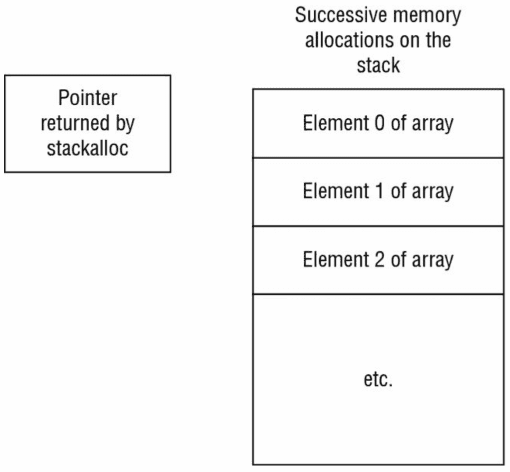

*图 5.7*

此图还显示了 `stackalloc` 返回的指针，它始终是指向所分配数据类型的指针，并且指向新分配内存块的顶部。要使用该内存块，你只需解引用返回的指针即可。例如，要分配 20 个 `double` 的空间，然后将第一个元素（数组的元素 0）设置为值 3.0，可以这样编写：

```
double* pDoubles = stackalloc double[20];
*pDoubles = 3.0;
```

要访问数组的下一个元素，你可以使用指针运算。如前所述，如果对指针加 1，其值将增加它所指向数据类型的大小。在这种情况下，这个增量恰好足以带你到达已分配块中的下一个空闲内存位置。因此，你可以将数组的第二个元素（元素编号 1）设置为值 8.4：

```
double* pDoubles = stackalloc double[20];
*pDoubles = 3.0;
*(pDoubles + 1) = 8.4;
```

同理，你可以使用表达式 `*(pDoubles + x)` 访问数组中索引为 `x` 的元素。

实际上，你拥有了一种可以访问数组元素的方法，但对于通用用途来说，这种语法过于复杂。幸运的是，C# 定义了一种使用方括号的替代语法。当方括号应用于指针时，C# 对方括号给出了非常精确的含义；如果变量 `p` 是任何指针类型，`x` 是整数，那么表达式 `p[x]` 总是被编译器解释为 `*(p+x)`。这对于所有指针都成立，不仅限于使用 `stackalloc` 初始化的指针。借助这种简写符号，你现在有了一种非常便捷的语法来访问数组。事实上，这意味着你访问基于栈的一维数组的语法与访问由 `System.Array` 类表示的基于堆的数组的语法完全相同：

```
double* pDoubles = stackalloc double [20];
pDoubles[0] = 3.0; // pDoubles[0] 等同于 *pDoubles
pDoubles[1] = 8.4; // pDoubles[1] 等同于 *(pDoubles+1)
```

> 注意：将数组语法应用于指针的想法并不新鲜。自从 C 和 C++ 语言发明以来，这一直是这两种语言的基本组成部分。事实上，C++ 开发人员会认识到，使用 `stackalloc` 获得的基于栈的数组与经典的基于栈的 C 和 C++ 数组基本一致。这种语法及其将指针和数组联系起来的方式，是 C 语言在 20 世纪 70 年代流行起来的原因之一，也是指针使用在 C 和 C++ 中成为一种如此流行的编程技术的主要原因。

尽管你的高性能数组可以像普通 C# 数组一样访问，但仍需提醒一句。以下 C# 代码会引发异常：

```
double[] myDoubleArray = new double [20];
myDoubleArray[50] = 3.0;
```

异常发生是因为你试图使用越界的索引访问数组；索引为 50，而允许的最大值是 19。然而，如果你使用 `stackalloc` 声明等效数组，则数组周围没有可以执行边界检查的对象。因此，以下代码不会引发异常：

```
double* pDoubles = stackalloc double [20];
pDoubles[50] = 3.0;
```

在这段代码中，你分配了足够的内存来容纳 20 个 `double`。然后你从该内存起始位置加上 `50*sizeof(double)` 的位置开始，设置 `sizeof(double)` 个内存位置来存放 `double` 值 3.0。不幸的是，该内存位置远远超出了你为这些 `double` 分配的内存区域。无法知道该地址可能存储着什么数据。最好的情况是，你可能使用了一些当前未使用的内存，但同样有可能你刚刚覆盖了栈中某些用于存储其他变量，甚至存储当前正在执行的方法的返回地址的位置。同样，你会看到，从指针中获得的高性能是有代价的；你需要确定自己知道自己在做什么，否则你将会遇到一些非常奇怪的运行时错误。

## QuickArray 示例

关于指针的讨论以一个名为 QuickArray 的 `stackalloc` 示例结束。在此示例中，程序只是询问用户希望为数组分配多少个元素。然后代码使用 `stackalloc` 分配一个该大小的 `long` 数组。该数组的元素被填充为从 0 开始的整数的平方，并将结果显示在控制台上（代码文件 `QuickArray/Program.cs`）：

```
using static System.Console;

namespace QuickArray
{
    public class Program
    {
        unsafe public static void Main()
        {
            Write("How big an array do you want? \n>");
            string userInput = ReadLine();
            uint size = uint.Parse(userInput);

            long* pArray = stackalloc long[(int) size];
            for (int i = 0; i < size; i++)
            {
                pArray[i] = i*i;
            }

            for (int i = 0; i < size; i++)
            {
                WriteLine($"Element {i} = {*(pArray + i)}");
            }

            ReadLine();
        }
    }
}
```

以下是 QuickArray 示例的输出：

```
How big an array do you want?
> 15
```

```
Element 0 = 0
Element 1 = 1
Element 2 = 4
Element 3 = 9
Element 4 = 16
Element 5 = 25
Element 6 = 36
Element 7 = 49
Element 8 = 64
Element 9 = 81
Element 10 = 100
Element 11 = 121
Element 12 = 144
Element 13 = 169
Element 14 = 196
```

## 平台调用

并非所有的 Windows API 调用功能都可以从 .NET Framework 中使用。这不仅适用于旧的 Windows API 调用，也适用于 Windows 10 或 Windows Server 2016 中的全新功能。也许你已经编写了一些导出非托管方法的 DLL，并且也希望从 C# 中使用它们。

要重用不包含 COM 对象的非托管库——它只包含导出的函数——你可以使用平台调用（P/Invoke）。借助 P/Invoke，CLR 会加载包含应调用函数的 DLL，并对参数进行封送处理。

要使用非托管函数，首先必须确定该函数导出时的名称。你可以使用带有 `/exports` 选项的 `dumpbin` 工具来完成此操作。

例如，以下命令

```
dumpbin /exports c:\windows\system32\kernel32.dll | more
```

会列出 DLL `kernel32.dll` 中所有导出的函数。在该示例中，可以使用 `CreateHardLink` Windows API 函数为现有文件创建硬链接。使用此 API 调用，你可以让多个文件名引用同一个文件，只要这些文件名位于同一块硬盘上。此 API 调用在 .NET Framework 4.5.1 中不可用，因此必须使用平台调用。

要调用原生函数，你必须定义一个 C# 外部方法，其参数数量相同，并且非托管方法中定义的自变量类型必须在托管代码中具有匹配的类型。

Windows API 调用 `CreateHardLink` 在 C++ 中的定义如下：

```
BOOL CreateHardLink(
    LPCTSTR lpFileName,
    LPCTSTR lpExistingFileName,
    LPSECURITY_ATTRIBUTES lpSecurityAttributes);
```

此定义必须映射到 .NET 数据类型。非托管代码中的返回类型是 `BOOL`；它直接映射到 `bool` 数据类型。`LPCTSTR` 定义了一个指向 const 字符串的长指针。Windows API 对数据类型使用了匈牙利命名约定。`LP` 表示长指针，`C` 表示 const，`STR` 表示以 null 结尾的字符串。`T` 将该类型标记为泛型类型，该类型会解析为 `LPCSTR`（ANSI 字符串）或 `LPWSTR`（宽 Unicode 字符串），具体取决于编译器设置到 32 位还是 64 位。C 字符串映射到 .NET 的 `String` 类型。`LPSECURITY_ATTRIBUTES` 是一个指向 `SECURITY_ATTRIBUTES` 结构体的长指针。因为可以向此参数传递 `NULL`，所以将该类型映射到 `IntPtr` 是可以的。此方法的 C# 声明必须标记为 `extern` 修饰符，因为 C# 代码中没有此方法的实现。相反，该方法实现位于 `kernel32.dll` 中，并通过 `[DllImport]` 属性进行引用。.NET 声明 `CreateHardLink` 的返回类型是 `bool`，而原生方法 `CreateHardLink` 返回的是 `BOOL`，因此一些额外的说明会很有用。由于 C++ 中存在不同的布尔数据类型（例如原生 `bool` 和 Windows 定义的 `BOOL`，它们的值不同），`[MarshalAs]` 属性指定了 .NET 的 `bool` 类型应映射到哪种原生类型：

```
[DllImport("kernel32.dll", SetLastError = true, EntryPoint = "CreateHardLinkW", CharSet = CharSet.Unicode)]
[return: MarshalAs(UnmanagedType.Bool)]
public static extern bool CreateHardLink(string newFileName, string existingFileName, IntPtr securityAttributes);
```

> 注意：网站 `http://www.pinvoke.net` 对于从原生代码到托管代码的转换非常有帮助。

可以使用 `[DllImport]` 属性指定的设置如下表所示。

| DllImport 属性或字段 | 描述 |
| --- | --- |
| `EntryPoint` | 你可以为函数的 C# 声明指定一个与非托管库中不同的名称。非托管库中方法的名称在 `EntryPoint` 字段中定义。 |
| `CallingConvention` | 根据用于编译非托管函数的编译器或编译器设置，你可以使用不同的调用约定。调用约定定义了如何处理参数以及如何将它们压入栈中。你可以通过设置枚举值来定义调用约定。Windows API 在 Windows 操作系统上通常使用 `StdCall` 调用约定，而在 Windows CE 上使用 `Cdecl` 调用约定。将值设置为 `CallingConvention.Winapi` 可在 Windows 和 Windows CE 环境中都适用于 Windows API。 |
| `CharSet` | 字符串参数可以是 ANSI 或 Unicode。通过 `CharSet` 设置，你可以定义如何管理字符串。`CharSet` 枚举定义的可能值有 `Ansi`、`Unicode` 和 `Auto`。`CharSet.Auto` 在 Windows NT 平台上使用 Unicode，在 Microsoft 较早的操作系统上使用 ANSI。 |
| `SetLastError` | 如果非托管函数使用 Windows API `SetLastError` 设置了错误，你可以将 `SetLastError` 字段设置为 `true`。这样，之后就可以使用 `Marshal.GetLastWin32Error` 读取错误号。 |

为了使 `CreateHardLink` 方法更易于在 .NET 环境中使用，你应该遵循以下准则：


- 创建一个名为 `NativeMethods` 的内部类，用于封装平台调用方法。
- 创建一个公共类，向 .NET 应用程序提供原生方法功能。
- 使用安全属性标记所需的安全性。

在下面的示例中，`FileUtility` 类中的公共方法 `CreateHardLink` 是 .NET 应用程序可以使用的方法。与原生 Windows API 方法 `CreateHardLink` 相比，此方法的文件名参数顺序相反。第一个参数是现有文件的名称，第二个参数是新文件。这与框架中的其他类（如 `File.Copy`）类似。由于此实现不使用用于传递新文件名的安全属性的第三个参数，因此公共方法只有两个参数。返回类型也发生了变化。它不会通过返回 `false` 来返回错误，而是抛出异常。发生错误时，非托管方法 `CreateHardLink` 会使用非托管 API `SetLastError` 设置错误号。要从 .NET 读取此值，需要将 `[DllImport]` 的 `SetLastError` 字段设置为 `true`。在托管方法 `CreateHardLink` 中，通过调用 `Marshal.GetLastWin32Error` 读取错误号。要从该数字创建错误消息，需要使用命名空间 `System.ComponentModel` 中的 `Win32Exception` 类。此类通过构造函数接受错误号，并返回本地化的错误消息。发生错误时，会抛出 `IOException` 类型的异常，其内部异常类型为 `Win32Exception`。公共方法 `CreateHardLink` 应用了 `FileIOPermission` 属性，以检查调用方是否具有必要的权限。你可以阅读第 24 章（代码文件 `PInvokeSample/NativeMethods.cs`）中有关 .NET 安全的更多内容。

```csharp
using System;
using System.ComponentModel;
using System.IO;
using System.Runtime.InteropServices;
using System.Security;
using System.Security.Permissions;

namespace Wrox.ProCSharp.Interop
{
    [SecurityCritical]
    internal static class NativeMethods
    {
        [DllImport("kernel32.dll", SetLastError = true,
            EntryPoint = "CreateHardLinkW", CharSet = CharSet.Unicode)]
        [return: MarshalAs(UnmanagedType.Bool)]
        private static extern bool CreateHardLink(
            [In, MarshalAs(UnmanagedType.LPWStr)] string newFileName,
            [In, MarshalAs(UnmanagedType.LPWStr)] string existingFileName,
            IntPtr securityAttributes);

        internal static void CreateHardLink(string oldFileName,
            string newFileName)
        {
            if (!CreateHardLink(newFileName, oldFileName,
            IntPtr.Zero))
            {
                var ex = new Win32Exception(Marshal.GetLastWin32Error());
                throw new IOException(ex.Message, ex);
            }
        }
    }

    public static class FileUtility
    {
        [FileIOPermission(SecurityAction.LinkDemand, Unrestricted = true)]
        public static void CreateHardLink(string oldFileName,
            string newFileName)
        {
            NativeMethods.CreateHardLink(oldFileName, newFileName);
        }
    }
}
```

现在你可以使用这个类轻松创建硬链接。如果程序第一个参数传入的文件不存在，你会得到一个异常，消息为：系统找不到指定的文件。如果文件存在，你会得到一个新文件名，它引用原始文件。你可以通过在一个文件中更改文本轻松验证这一点；它也会出现在另一个文件中（代码文件 `PInvokeSample/Program.cs`）：

```csharp
using PInvokeSampleLib;
using System.IO;
using static System.Console;

namespace PInvokeSample
{
    public class Program
    {
        public static void Main(string[] args)
        {
            if (args.Length != 2)
            {
                WriteLine("usage: PInvokeSample" +
                    "existingfilename newfilename");
                return;
            }
            try
            {
                FileUtility.CreateHardLink(args[0], args[1]);
            }
            catch (IOException ex)
            {
                WriteLine(ex.Message);
            }
        }
    }
}
```

对于原生方法调用，你经常需要使用 Windows 句柄。Windows 句柄是一个 32 位或 64 位的值，根据句柄类型的不同，某些值是不允许的。对于 .NET 1.0 中的句柄，通常使用 `IntPtr` 结构，因为你可以通过该结构设置任何可能的 32 位值。然而，对于某些句柄类型，这导致了安全问题、潜在的线程竞态条件以及终结阶段句柄泄漏。这就是为什么 .NET 2.0 引入了 `SafeHandle` 类。`SafeHandle` 类是所有 Windows 句柄的抽象基类。`Microsoft.Win32.SafeHandles` 命名空间内的派生类有 `SafeHandleZeroOrMinusOneIsInvalid` 和 `SafeHandleMinusOneIsInvalid`。顾名思义，这些类不接受无效的 `0` 或 `-1` 值。进一步派生的句柄类型包括 `SafeFileHandle`、`SafeWaitHandle`、`SafeNCryptHandle` 和 `SafePipeHandle`，它们可以被特定的 Windows API 调用使用。

例如，要映射 Windows API `CreateFile`，你可以使用以下声明来返回一个 `SafeFileHandle`。当然，通常你可以改用 .NET 类 `File` 和 `FileInfo`。

```csharp
[DllImport("Kernel32.dll", SetLastError = true,
    Charset = Charset.Unicode)]
internal static extern SafeFileHandle CreateFile(
string fileName,
[MarshalAs(UnmanagedType.U4)] FileAccess fileAccess,
[MarshalAs(UnmanagedType.U4)] FileShare fileShare,
IntPtr securityAttributes,
[MarshalAs(UnmanagedType.U4)] FileMode creationDisposition,
int flags,
SafeFileHandle template);
```

## 总结

请记住，要成为一名真正熟练的 C# 程序员，你必须对内存分配和垃圾回收的工作原理有扎实的理解。本章描述了 CLR 如何在堆和栈上管理和分配内存。还说明了如何编写正确释放非托管资源的类，以及如何在 C# 中使用指针。这些都是高级主题，新手程序员往往理解不足且经常错误实现。至少，本章应该帮助你理解如何使用 `IDisposable` 接口和 `using` 语句释放资源。

下一章继续介绍一个重要的 C# 语言构造，它也会影响 IL 代码的生成：泛型。

## 6 泛型

### 本章内容

- 泛型概述
- 创建泛型类
- 泛型类的特性
- 泛型接口
- 泛型结构
- 泛型方法

### 本章代码下载

本章的 wrox.com 代码下载可在 `www.wrox.com/go/professionalcsharp6` 的“下载代码”选项卡中找到。本章代码分为以下主要示例：

- 链表对象
- 链表示例
- 文档管理器
- 变体
- 泛型方法
- 特化

### 泛型概述

泛型不仅对于 C#，对于 .NET 而言也是一个重要概念。泛型不仅仅是 C# 编程语言的一部分；它们与程序集中的 IL（中间语言）代码深度集成。通过泛型，你可以创建独立于所包含类型的类和方法。不需要为不同类型编写大量功能相同的类或方法，只需创建一个方法或类。

减少代码量的另一种选择是使用 `Object` 类。然而，使用从 `Object` 类派生的类型进行传递并不安全。泛型类使用泛型类型，这些类型会根据需要替换为特定类型。这实现了类型安全：如果泛型类不支持某个特定类型，编译器就会发出警告。

泛型不仅限于类；在本章中，你还会看到泛型接口和泛型方法。你可以在第 9 章“委托、Lambda 表达式和事件”中了解泛型委托。

泛型并非 C# 独有；其他语言也存在类似的概念。例如，C++ 模板与泛型有一些相似之处。然而，C++ 模板和 .NET 泛型之间有一个很大的区别。对于 C++ 模板，当模板以特定类型实例化时，需要模板的源代码。C++ 编译器为每个特定模板实例的类型生成独立的二进制代码。与 C++ 模板不同，泛型不仅是 C# 语言的一种构造，还与公共语言运行时（CLR）一起定义。这使得即使泛型类是用 C# 定义的，也可以在 Visual Basic 中以特定类型实例化泛型。

以下各节探讨泛型的优点和缺点，特别是以下方面：

- 性能
- 类型安全
- 二进制代码复用
- 代码膨胀
- 命名指南

### 性能

泛型的一大优点是性能。在第 11 章“集合”中，你会看到来自命名空间 `System.Collections` 和 `System.Collections.Generic` 的非泛型和泛型集合类。将值类型与非泛型集合类一起使用时，当值类型转换为引用类型以及反向转换时，会发生装箱和拆箱。

> **注意** 装箱和拆箱在第 8 章“运算符和强制转换”中讨论。这里仅对这些术语作简短回顾。

值类型存储在栈上，而引用类型存储在堆上。C# 类是引用类型，结构是值类型。.NET 使得将值类型转换为引用类型变得容易，因此你可以在任何需要对象（即引用类型）的地方使用值类型。例如，可以将 `int` 赋值给对象。从值类型到引用类型的转换称为*装箱*。如果方法要求对象作为参数，并且传递了值类型，则会自动发生装箱。相反方向，可以使用拆箱将装箱的值类型转换为值类型。使用拆箱时，需要强制转换运算符。

下面的示例展示了来自命名空间 `System.Collections` 的 `ArrayList` 类存储对象；`Add` 方法被定义为需要对象作为参数，因此整数类型会被装箱。当从 `ArrayList` 中读取值时，将对象转换为整数类型时会发生拆箱。这可能从用于将 `ArrayList` 集合的第一个元素赋给变量 `i1` 的强制转换运算符中显而易见，但在 `foreach` 语句中，当访问 `int` 类型的变量 `i2` 时，同样会发生拆箱：

```csharp
var list = new ArrayList();
list.Add(44);    // boxing - convert a value type to a reference type

int i1 = (int)list[0];    // unboxing - convert a reference type to
                        // a value type

foreach (int i2 in list)
{
    WriteLine(i2);    // unboxing
}
```

装箱和拆箱易于使用，但会对性能产生很大影响，尤其是在迭代许多项时。

与使用对象不同，来自命名空间 `System.Collections.Generic` 的 `List<T>` 类允许你在使用时定义类型。在此示例中，`List<T>` 类的泛型类型被定义为 `int`，因此 `int` 类型用于即时（JIT）编译器动态生成的类中。装箱和拆箱不再发生：

```csharp
var list = new List<int>();
list.Add(44);    // no boxing - value types are stored in the List<int>

int i1 = list[0];    // no unboxing, no cast needed

foreach (int i2 in list)
{
    WriteLine(i2);
}
```

### 类型安全

泛型的另一个特性是类型安全。与 `ArrayList` 类一样，如果使用对象，则可以向该集合添加任何类型。下面的示例展示了将整数、字符串和 `MyClass` 类型的对象添加到类型为 `ArrayList` 的集合中：

```csharp
var list = new ArrayList();
list.Add(44);
list.Add("mystring");
list.Add(new MyClass());
```

如果使用下面的 `foreach` 语句迭代该集合（该语句使用整数元素迭代），编译器会接受此代码。但是，由于集合中并非所有元素都可以转换为 `int`，因此会发生运行时异常：

```csharp
foreach (int i in list)
{
    WriteLine(i);
}
```

错误应尽可能早地被检测到。使用泛型类 `List<T>` 时，泛型类型 `T` 定义了允许的类型。若定义为 `List<int>`，则只有整数类型可以添加到集合中。编译器不会编译以下代码，因为 `Add` 方法的参数无效：

```csharp
var list = new List<int>();
list.Add(44);
list.Add("mystring");    // compile time error
list.Add(new MyClass());    // compile time error
```

### 二进制代码复用

泛型能够实现更好的二进制代码复用。一个泛型类可以只定义一次，并可用许多不同的类型进行实例化。与 C++ 模板不同，无需访问源代码。

例如，这里将 `System.Collections.Generic` 命名空间中的 `List<T>` 类分别用 `int`、`string` 和 `MyClass` 类型实例化：

```csharp
var list = new List<int>();
list.Add(44);

var stringList = new List<string>();
stringList.Add("mystring");

var myClassList = new List<MyClass>();
myClassList.Add(new MyClass());
```

泛型类型可以用一种语言定义，并从任何其他 .NET 语言中使用。

### 代码膨胀

你可能想知道，当使用不同的具体类型实例化泛型时，会生成多少代码。由于泛型类定义会进入程序集，使用具体类型实例化泛型类不会在 IL 代码中复制这些类。然而，当泛型类由 JIT 编译器编译为本地代码时，每种特定值类型都会创建一个新类。引用类型则共享相同本地类的同一实现。这是因为对于引用类型，在泛型实例化类中仅需要 4 字节内存地址（在 32 位系统中）来引用引用类型。而值类型包含在泛型实例化类的内存中；由于每种值类型可能有不同的内存需求，因此每种值类型都会实例化一个新类。

### 命名指南

如果在程序中使用泛型，那么能够区分泛型类型和非泛型类型会很有帮助。以下是泛型类型的命名指南：

- 使用字母 `T` 作为泛型类型名称的前缀。

- 如果泛型类型没有特殊要求，可以被任何类替换，并且只使用一个泛型类型，那么字符 `T` 作为泛型类型名称就很合适：

  ```csharp
  public class List<T> { }
  public class LinkedList<T> { }
  ```

- 如果泛型类型有特殊要求（例如，它必须实现某个接口或派生自某个基类），或者使用了两个或更多泛型类型，请为这些类型名称使用描述性名称：

  ```csharp
  public delegate void EventHandler<TEventArgs>(object sender, TEventArgs e);
  public delegate TOutput Converter<TInput, TOutput>(TInput from);
  public class SortedList<TKey, TValue> { }
  ```

### 创建泛型类

本节示例从一个普通的、非泛型的简化链表类开始，该类可以包含任意类型的对象，然后将此类转换为泛型类。


在链表中，一个元素引用下一个元素。因此，必须创建一个类，将对象包装在链表中并引用下一个对象。`LinkedListNode` 类包含一个名为 `Value` 的属性，该属性由构造函数初始化。除此之外，`LinkedListNode` 类还包含对列表中下一个和上一个元素的引用，可通过属性访问（代码文件 `LinkedListObjects/LinkedListNode.cs`）：

```
public class LinkedListNode
{
    public LinkedListNode(object value)
    {
        Value = value;
    }

    public object Value { get; private set; }

    public LinkedListNode Next { get; internal set; }
    public LinkedListNode Prev { get; internal set; }
}
```

`LinkedList` 类包含类型为 `LinkedListNode` 的 `First` 和 `Last` 属性，用于标记链表的开头和结尾。`AddLast` 方法将新元素添加到链表末尾。首先，创建一个 `LinkedListNode` 类型的对象。如果链表为空，则 `First` 和 `Last` 属性被设置为该新元素；否则，新元素作为最后一个元素添加到链表中。通过实现 `GetEnumerator` 方法，可以使用 `foreach` 语句遍历链表。`GetEnumerator` 方法利用 `yield` 语句创建枚举器类型：

```
public class LinkedList: IEnumerable
{
    public LinkedListNode First { get; private set; }
    public LinkedListNode Last { get; private set; }

    public LinkedListNode AddLast(object node)
    {
        var newNode = new LinkedListNode(node);
        if (First == null)
        {
            First = newNode;
            Last = First;
        }
        else
        {
            LinkedListNode previous = Last;
            Last.Next = newNode;
            Last = newNode;
            Last.Prev = previous;
        }
        return newNode;
    }

    public IEnumerator GetEnumerator()
    {
        LinkedListNode current = First;
        while (current != null)
        {
            yield return current.Value;
            current = current.Next;
        }
    }
}
```

> 注意：`yield` 语句为枚举器创建了一个状态机。该语句将在第 7 章“数组和元组”中说明。

现在你可以使用 `LinkedList` 类处理任何类型。以下代码片段实例化了一个新的 `LinkedList` 对象，并添加了两个整数类型和一个字符串类型。当整数类型转换为 `object` 时，会发生装箱（boxing），如本章前面所述。使用 `foreach` 语句时会发生拆箱（unboxing）。在 `foreach` 语句中，列表中的元素被强制转换为整数，因此列表中的第三个元素会导致运行时异常，因为转换为 `int` 失败（代码文件 `LinkedListObjects/Program.cs`）：

```
var list1 = new LinkedList();
list1.AddLast(2);
list1.AddLast(4);
list1.AddLast("6");

foreach (int i in list1)
{
    WriteLine(i);
}
```

现在制作链表的泛型版本。泛型类的定义方式与普通类类似，但带有泛型类型声明。然后，你可以在类中将泛型类型用作字段成员或方法的参数类型。`LinkedListNode` 类使用泛型类型 `T` 声明。现在 `Value` 属性的类型是 `T` 而不是 `object`；构造函数也改为接受类型为 `T` 的对象。泛型类型也可以被返回和设置，因此 `Next` 和 `Prev` 属性现在为 `LinkedListNode<T>` 类型（代码文件 `LinkedListSample/LinkedListNode.cs`）：

```
public class LinkedListNode<T>
{
    public LinkedListNode(T value)
    {
        Value = value;
    }

    public T Value { get; private set; }
    public LinkedListNode<T> Next { get; internal set; }
    public LinkedListNode<T> Prev { get; internal set; }
}
```

在下面的代码中，`LinkedList` 类也被改为泛型类。`LinkedList<T>` 包含 `LinkedListNode<T>` 元素。来自 `LinkedList` 的类型 `T` 定义了 `First` 和 `Last` 属性的类型 `T`。`AddLast` 方法现在接受类型为 `T` 的参数，并实例化一个 `LinkedListNode<T>` 对象。

除了 `IEnumerable` 接口之外，还有一个泛型版本：`IEnumerable<T>`。`IEnumerable<T>` 派生自 `IEnumerable`，并添加了返回 `IEnumerator<T>` 的 `GetEnumerator` 方法。`LinkedList<T>` 实现了泛型接口 `IEnumerable<T>`（代码文件 `LinkedListSample/LinkedList.cs`）：

> 注意：枚举器以及 `IEnumerable` 和 `IEnumerator` 接口将在第 7 章讨论。

```
public class LinkedList<T>: IEnumerable<T>
{
    public LinkedListNode<T> First { get; private set; }
    public LinkedListNode<T> Last { get; private set; }

    public LinkedListNode<T> AddLast(T node)
    {
        var newNode = new LinkedListNode<T>(node);
        if (First == null)
        {
            First = newNode;
            Last = First;
        }
        else
        {
            LinkedListNode<T> previous = Last;
            Last.Next = newNode;
            Last = newNode;
        }
    }
}
```

```
Last.Prev = previous;
}
return newNode;
}

public IEnumerator<T> GetEnumerator()
{
    LinkedListNode<T> current = First;

    while (current != null)
    {
        yield return current.Value;
        current = current.Next;
    }
}

IEnumerator IEnumerable.GetEnumerator() => GetEnumerator();
}
```

使用泛型 `LinkedList<T>`，可以用 `int` 类型实例化它，并且不会发生装箱。另外，如果使用 `AddLast` 方法时没有传入 `int`，编译器会报错。使用泛型 `IEnumerable<T>`，`foreach` 语句也是类型安全的，如果 `foreach` 语句中的变量不是 `int`，编译器会报错（代码文件 `LinkedListSample/Program.cs`）：

```
var list2 = new LinkedList<int>();
list2.AddLast(1);
list2.AddLast(3);
list2.AddLast(5);

foreach (int i in list2)
{
    WriteLine(i);
}
```

类似地，你可以将泛型 `LinkedList<T>` 与 `string` 类型一起使用，并向 `AddLast` 方法传递字符串：

```
var list3 = new LinkedList<string>();
list3.AddLast("2");
list2.AddLast("four");
list3.AddLast("foo");

foreach (string s in list3)
{
    WriteLine(s);
}
```

> 注意 每个处理 `object` 类型的类都可能是泛型实现的候选者。此外，如果类使用了层次结构，泛型对于避免强制转换非常有帮助。

### 泛型特性

创建泛型类时，可能需要一些额外的 C# 关键字。如果泛型类型不需要 `Object` 类的功能，但你又需要在泛型类中调用某些特定方法，则可以定义约束。

本节讨论以下主题：

- 默认值

- 约束

- 继承

- 静态成员

此示例从一个泛型文档管理器开始，用于从队列中读取文档以及向队列写入文档。首先创建一个名为 `DocumentManager` 的新控制台项目，并添加 `DocumentManager<T>` 类。`AddDocument` 方法将文档添加到队列中。如果队列不为空，只读属性 `IsDocumentAvailable` 返回 `true`（代码文件 `DocumentManager/DocumentManager.cs`）：

> 注意 使用 .NET Core 时，此示例需要引用 NuGet 包 `System.Collections`。

```
using System;
using System.Collections.Generic;

namespace Wrox.ProCSharp.Generics
{
    public class DocumentManager<T>
    {
        private readonly Queue<T> documentQueue = new Queue<T>();

        public void AddDocument(T doc)
        {
            lock (this)
            {
                documentQueue.Enqueue(doc);
            }
        }

        public bool IsDocumentAvailable => documentQueue.Count > 0;
    }
}
```

线程和 `lock` 语句将在第 21 章“任务与并行编程”和第 22 章“任务同步”中讨论。

#### 默认值

现在你向 `DocumentManager<T>` 类中添加一个 `GetDocument` 方法。在此方法内部，类型 `T` 应被赋值为 `null`。然而，不能将 `null` 赋给泛型类型。这是因为泛型类型也可以实例化为值类型，而 `null` 只允许用于引用类型。要避免此问题，可以使用 `default` 关键字。使用 `default` 关键字时，`null` 被赋给引用类型，`0` 被赋给值类型：

```
public T GetDocument()
{
    T doc = default(T);
    lock (this)
    {
        doc = documentQueue.Dequeue();
    }
    return doc;
}
```

> 注意 `default` 关键字根据上下文具有多种含义。`switch` 语句使用 `default` 来定义默认分支，而在泛型中，`default` 用于将泛型类型初始化为 `null` 或 `0`，具体取决于它是引用类型还是值类型。

#### 约束

如果泛型类需要调用泛型类型的某些方法，你必须添加约束。

在 `DocumentManager<T>` 中，所有文档标题都应在 `DisplayAllDocuments` 方法中显示。`Document` 类实现了具有 `Title` 和 `Content` 属性的 `IDocument` 接口（代码文件 `DocumentManager/Document.cs`）：

```
public interface IDocument
{
    string Title { get; set; }
    string Content { get; set; }
}
```

```
public class Document: IDocument
{
    public Document()
    {
    }

    public Document(string title, string content)
    {
        Title = title;
        Content = content;
    }

    public string Title { get; set; }
    public string Content { get; set; }
}
```

要使用 `DocumentManager<T>` 类显示文档，你可以将类型 `T` 强制转换为 `IDocument` 接口以显示标题（代码文件 `DocumentManager/DocumentManager.cs`）：

```
public void DisplayAllDocuments()
{

foreach (T doc in documentQueue)
{
    WriteLine(((IDocument)doc).Title);
}
}
```

这里的问题是，如果类型 `T` 没有实现 `IDocument` 接口，进行强制转换会导致运行时异常。更好的做法是使用 `DocumentManager<TDocument>` 类定义一个约束，指定类型 `TDocument` 必须实现 `IDocument` 接口。为了在泛型类型名称中明确这一要求，将 `T` 改为 `TDocument`。`where` 子句定义了实现 `IDocument` 接口的要求：

```
public class DocumentManager<TDocument>
    where TDocument: IDocument
{
```

> 注意 为泛型类型添加约束时，最好在泛型参数名称中包含一些信息。示例代码现在使用 `TDocument` 而不是 `T` 作为泛型参数。对于编译器来说，参数名称并不重要，但更具可读性。

这样，你就可以编写 `foreach` 语句，使得 `TDocument` 类型包含 `Title` 属性。你将获得 Visual Studio IntelliSense 和编译器的支持：

```
public void DisplayAllDocuments()
{
    foreach (TDocument doc in documentQueue)
    {
        WriteLine(doc.Title);
    }
}
```

在 `Main` 方法中，使用实现了所需 `IDocument` 接口的 `Document` 类型实例化 `DocumentManager<TDocument>` 类。然后添加并显示新文档，并检索其中一个文档（代码文件 `DocumentManager/Program.cs`）：

```
public static void Main()
{
    var dm = new DocumentManager<Document>();
    dm.AddDocument(new Document("Title A","Sample A"));
    dm.AddDocument(new Document("Title B","Sample B"));

    dm.DisplayAllDocuments();

    if (dm.IsDocumentAvailable)
    {
        Document d = dm.GetDocument();
        WriteLine(d.Content);
    }
}
```

现在，`DocumentManager` 可以与任何实现 `IDocument` 接口的类一起使用。

在示例应用程序中，你已经看到了接口约束。泛型支持多种约束类型，如下表所示。

| 约束 | 说明 |

|---|---|

| `where T: struct` | `struct` 约束要求类型 `T` 必须是值类型。 |

| `where T: class` | `class` 约束表示类型 `T` 必须是引用类型。 |

| `where T: IFoo` | 指定类型 `T` 必须实现接口 `IFoo`。 |

| `where T: Foo` | 指定类型 `T` 必须派生自基类 `Foo`。 |

| `where T: new()` | 构造函数约束；指定类型 `T` 必须具有默认构造函数。 |

| `where T1: T2` | 使用约束还可以指定类型 `T1` 派生自泛型类型 `T2`。 |


> 注意 构造函数约束只能为默认构造函数定义，不能为其他构造函数定义构造函数约束。

对于泛型类型，你还可以组合多个约束。`MyClass<T>` 声明中的约束 `where T: IFoo, new()` 指定类型 `T` 实现接口 `IFoo` 并具有默认构造函数：

```
public class MyClass<T>
    where T: IFoo, new()
{
    //...
```

> 注意 关于 C# 的 `where` 子句，一个重要限制是：无法定义必须由泛型类型实现的运算符。运算符不能在接口中定义。使用 `where` 子句只能定义基类、接口和默认构造函数。

#### 继承

前面创建的 `LinkedList<T>` 类实现了 `IEnumerable<T>` 接口：

```
public class LinkedList<T>: IEnumerable<T>
{
    //...
```

泛型类型可以实现泛型接口，也可以通过派生自一个类来实现。泛型类可以派生自泛型基类：

```
public class Base<T>
{
}
```

```
public class Derived<T>: Base<T>
{
}
```

要求是必须重复接口的泛型类型，或者必须指定基类的类型，如此处所示：

```
public class Base<T>
{
}
```

```
public class Derived<T>: Base<string>
{
}
```

这样，派生类可以是泛型类或非泛型类。例如，你可以定义一个抽象泛型基类，并在派生类中用具体类型实现它。这使你可以针对特定类型编写 `泛型特化`：

```
public abstract class Calc<T>
{
    public abstract T Add(T x, T y);
    public abstract T Sub(T x, T y);
}
```

```
public class IntCalc: Calc<int>
{
    public override int Add(int x, int y) => x + y;
    public override int Sub(int x, int y) => x - y;
}
```

你还可以创建部分特化，例如从 `Query` 派生 `StringQuery` 类，并且只定义其中一个泛型参数，例如为 `TResult` 指定 `string`。要实例化 `StringQuery`，你只需要为 `TRequest` 提供类型：

```
public class Query<TRequest, TResult>
{
}
```

```
public class StringQuery<TRequest> : Query<TRequest, string>
{
}
```

### 静态成员

泛型类的静态成员仅在该类的一个实例化中共享，并且需要特别注意。考虑以下示例，其中类 `StaticDemo<T>` 包含静态字段 `x`：

```
public class StaticDemo<T>
{
    public static int x;
}
```

因为类 `StaticDemo<T>` 同时与 `string` 类型和 `int` 类型一起使用，所以会存在两组静态字段：

```
StaticDemo<string>.x = 4;
StaticDemo<int>.x = 5;
WriteLine(StaticDemo<string>.x);    // writes 4
```

### 泛型接口

使用泛型，你可以定义带有泛型参数方法的接口。在链表示例中，你已经实现了 `IEnumerable<out T>` 接口，该接口定义了一个返回 `IEnumerator<out T>` 的 `GetEnumerator` 方法。.NET 为不同场景提供了许多泛型接口；例如 `IComparable<T>`、`ICollection<T>` 和 `IExtensibleObject<T>`。通常也存在同一接口的较旧的非泛型版本；例如，.NET 1.0 有一个基于对象的 `IComparable` 接口。

`IComparable<in T>` 基于一个泛型类型：

```
public interface IComparable<in T>
{
    int CompareTo(T other);
}
```

> 注意 不要被泛型参数使用的 `in` 和 `out` 关键字弄混淆。它们很快会在“协变与逆变”一节中解释。

较旧的非泛型 `IComparable` 接口要求一个带有 `CompareTo` 方法的对象。这需要转换为特定类型，例如转换为 `Person` 类以使用 `LastName` 属性：

```
public class Person: IComparable
{
    public int CompareTo(object obj)
    {
        Person other = obj as Person;
        return this.lastname.CompareTo(other.LastName);
    }
    //
```

实现泛型版本后，不再需要将 `object` 强制转换为 `Person`：

```
public class Person: IComparable<Person>
{
    public int CompareTo(Person other) => LastName.CompareTo(other.LastName);
    //...
```

### 协变与逆变

在 .NET 4 之前，泛型接口是不变的。.NET 4 为泛型接口和泛型委托添加了重要的变化：协变和逆变。协变和逆变用于处理带有参数和返回类型的类型转换。例如，你能将 `Rectangle` 传递给一个要求 `Shape` 的方法吗？让我们看一些示例，以了解这些扩展的优点。

在 .NET 中，参数类型是协变的。假设你有 `Shape` 和 `Rectangle` 两个类，且 `Rectangle` 派生自 `Shape` 基类。`Display` 方法声明为其参数接受 `Shape` 类型的对象：

```
public void Display(Shape o) { }
```

现在，你可以传递任何派生自 `Shape` 基类的对象。因为 `Rectangle` 派生自 `Shape`，所以 `Rectangle` 满足 `Shape` 的所有要求，编译器会接受此方法调用：

```
var r = new Rectangle { Width= 5, Height=2.5 };
Display(r);
```

方法的返回类型是逆变的。当方法返回 `Shape` 时，无法将其赋值给 `Rectangle`，因为 `Shape` 不一定总是 `Rectangle`；但相反的情况是可能的。如果某个方法（如 `GetRectangle` 方法）返回 `Rectangle`，

```
public Rectangle GetRectangle();
```

则其结果可以赋值给 `Shape`：

```
Shape s = GetRectangle();
```

在 .NET Framework 4 之前，泛型不支持这种行为。自 C# 4 起，该语言得到扩展，支持泛型接口和泛型委托的协变与逆变。让我们首先定义一个 `Shape` 基类和一个 `Rectangle` 类（代码文件 `Variance/Shape.cs` 和 `Rectangle.cs`）：

```
public class Shape
{
    public double Width { get; set; }
    public double Height { get; set; }

    public override string ToString() => $"Width: {Width}, Height: {Height}";
}
```

```
public class Rectangle: Shape
{
}
```

#### 泛型接口的协变

如果泛型类型用 `out` 关键字标注，则泛型接口是协变的。这也意味着类型 `T` 只允许用于返回类型。接口 `IIndex` 对类型 `T` 是协变的，从一个只读索引器返回此类型（代码文件 `Variance/IIndex.cs`）：

```
public interface IIndex<out T>
{
    T this[int index] { get; }
    int Count { get; }
}
```

`IIndex<T>` 接口由 `RectangleCollection` 类实现。`RectangleCollection` 将 `Rectangle` 用作泛型类型 `T`：

> 注意 如果对 `IIndex` 接口使用读写索引器，泛型类型 `T` 会被传入方法并从方法中获取。这对于协变是不可能的；泛型类型必须定义为不变。定义不变类型时不使用 `out` 和 `in` 注解（代码文件 `Variance/RectangleCollection.cs`）：

```
public class RectangleCollection: IIndex<Rectangle>
{
    private Rectangle[] data = new Rectangle[3]
    {
        new Rectangle { Height=2, Width=5 },
        new Rectangle { Height=3, Width=7 },
        new Rectangle { Height=4.5, Width=2.9 }
    };

    private static RectangleCollection _coll;
    public static RectangleCollection GetRectangles() =>
        _coll ?? (_coll = new RectangleCollection());

    public Rectangle this[int index]
    {
        get
        {
            if (index < 0 || index > data.Length)
                throw new ArgumentOutOfRangeException("index");
            return data[index];
        }
    }

    public int Count => data.Length;
}
```

> 注意 `RectangleCollection.GetRectangles` 方法使用了合并运算符。如果变量 `_coll` 为 `null`，则调用运算符右侧来创建 `RectangleCollection` 的新实例，并将其赋给变量 `_coll`，随后从该方法返回该实例。该运算符在第 8 章中详细解释。

`RectangleCollection.GetRectangles` 方法返回一个实现了 `IIndex<Rectangle>` 接口的 `RectangleCollection`，因此你可以将返回值赋给一个类型为 `IIndex<Rectangle>` 的变量 `rectangle`。因为该接口是协变的，也可以将返回值赋给类型为 `IIndex<Shape>` 的变量。`Shape` 并不需要 `Rectangle` 提供之外的任何东西。使用 `shapes` 变量，在 `for` 循环中会用到接口的索引器和 `Count` 属性（代码文件 `Variance/Program.cs`）：

```
public static void Main()
{
    IIndex<Rectangle> rectangles = RectangleCollection.GetRectangles();
    IIndex<Shape> shapes = rectangles;

    for (int i = 0; i < shapes.Count; i++)
    {
        WriteLine(shapes[i]);
    }
}
```

#### 泛型接口的逆变

如果泛型类型用 `in` 关键字标注，则泛型接口是逆变的。这样，该接口只允许将泛型类型 `T` 用作其方法的输入（代码文件 `Variance/IDisplay.cs`）：

```
public interface IDisplay<in T>
{
    void Show(T item);
}
```

`ShapeDisplay` 类实现了 `IDisplay<Shape>`，并使用 `Shape` 对象作为输入参数（代码文件 `Variance/ShapeDisplay.cs`）：

```
public class ShapeDisplay: IDisplay<Shape>
{
    public void Show(Shape s) =>
        WriteLine($"{s.GetType().Name} Width: {s.Width}, Height: {s.Height}");
}
```

创建 `ShapeDisplay` 的新实例会返回 `IDisplay<Shape>`，该值赋给 `shapeDisplay` 变量。因为 `IDisplay<T>` 是逆变的，所以可以将结果赋给 `IDisplay<Rectangle>`，其中 `Rectangle` 派生自 `Shape`。这一次，接口的方法仅将泛型类型用作输入，而 `Rectangle` 满足 `Shape` 的所有要求（代码文件 `Variance/Program.cs`）：

```
public static void Main()
{
    //...
    IDisplay<Shape> shapeDisplay = new ShapeDisplay();
    IDisplay<Rectangle> rectangleDisplay = shapeDisplay;
    rectangleDisplay.Show(rectangles[0]);
}
```

### 泛型结构

与类相似，结构体也可以是泛型的。它们与泛型类非常相似，只是没有继承特性。在本节中，你将了解由 .NET Framework 定义的泛型结构体 `Nullable<T>`。

.NET Framework 中泛型结构体的一个示例是 `Nullable<T>`。数据库中的数字和编程语言中的数字有一个重要区别：数据库中的数字可以为 `null`，而 C# 中的数字不能为 `null`。`Int32` 是一个结构体，由于结构体是作为值类型实现的，它们不能为 `null`。这种差异常常导致头痛，并需要大量额外工作来映射数据。这个问题不仅存在于数据库中，也存在于将 XML 数据映射到 .NET 类型时。

一种解决方案是将数据库和 XML 文件中的数字映射为引用类型，因为引用类型可以具有 `null` 值。然而，这也意味着运行时会有额外的开销。

使用结构体 `Nullable<T>` 可以轻松解决这个问题。以下代码片段展示了 `Nullable<T>` 定义的简化版本。结构体 `Nullable<T>` 定义了一个约束，指定泛型类型 `T` 必须是结构体。如果使用类作为泛型类型，则低开销的优势将消失；而且因为类的对象本身就可以为 `null`，所以使用 `Nullable<T>` 类型配合类没有意义。除了 `Nullable<T>` 定义的 `T` 类型之外，唯一的开销是 `hasValue` 布尔字段，它定义值是已设置还是为 `null`。除此之外，这个泛型结构体还定义了只读属性 `HasValue` 和 `Value`，以及一些运算符重载。将 `Nullable<T>` 类型转换为 `T` 的运算符重载被定义为显式的，因为在 `hasValue` 为 `false` 时它可能抛出异常。将 `T` 转换为 `Nullable<T>` 的运算符重载被定义为隐式的，因为它总是成功：

```
public struct Nullable<T>
    where T: struct
{
    public Nullable(T value)
    {
        _hasValue = true;
        _value = value;
    }
    private bool _hasValue;
    public bool HasValue => _hasValue;

    private T _value;
    public T Value
    {
        get
        {
            if (!_hasValue)
            {
                throw new InvalidOperationException("no value");
            }
            return _value;
        }
    }

    public static explicit operator T(Nullable<T> value) => value.Value;

    public static implicit operator Nullable<T>(T value) => new Nullable<T>(value);

    public override string ToString() => !HasValue ? string.Empty : _value.ToString();
}
```

在此示例中，`Nullable<T>` 以 `Nullable<int>` 的形式实例化。变量 `x` 现在可以像 `int` 一样使用，可以赋值并使用运算符进行计算。这种行为是通过 `Nullable<T>` 类型的强制转换运算符实现的。然而，`x` 也可以为 `null`。`Nullable<T>` 的属性 `HasValue` 和 `Value` 可以检查是否有值，并且可以访问该值：

```
Nullable<int> x;
x = 4;
x += 3;
if (x.HasValue)
{
    int y = x.Value;
}
x = null;
```

由于可空类型经常使用，C# 提供了一种特殊语法来定义此类型的变量。除了使用泛型结构的语法外，还可以使用 `?` 运算符。在下面的示例中，变量 `x1` 和 `x2` 都是可空 `int` 类型的实例：

```
Nullable<int> x1;
int? x2;
```

可空类型可以与 `null` 和数字进行比较，如下所示。这里，`x` 的值与 `null` 比较，如果不为 `null`，则与小于 0 的值比较：


```
int? x = GetNullableType();
if (x == null)
{
    WriteLine("x is null");
}
else if (x < 0)
{
    WriteLine("x is smaller than 0");
}
```

既然你已经了解了 `Nullable<T>` 是如何定义的，让我们来讨论使用可空类型。可空类型也可以与算术运算符一起使用。变量 `x3` 是变量 `x1` 和 `x2` 的总和。如果任何可空类型的值为 null，则结果也为 null：

```
int? x1 = GetNullableType();
int? x2 = GetNullableType();
int? x3 = x1 + x2;
```

> **注意** 这里调用的 `GetNullableType` 方法只是任何返回可空 int 的方法的占位符。为了测试，你可以实现它，让它简单地返回 null 或返回任何整数值。

非可空类型可以转换为可空类型。从非可空类型转换为可空类型时，可以进行隐式转换，不需要强制转换。这种转换总是成功：

```
int y1 = 4;
int? x1 = y1;
```

在相反的情况下，从可空类型转换为非可空类型可能会失败。如果可空类型的值为 null，并且将该 null 值赋给非可空类型，则会抛出 `InvalidOperationException` 类型的异常。这就是为什么需要强制转换运算符来执行显式转换：

```
int? x1 = GetNullableType();
int y1 = (int)x1;
```

除了进行显式转换之外，还可以使用合并运算符将可空类型转换为非可空类型。合并运算符使用 `??` 语法，在可空类型的值为 null 的情况下为转换定义默认值。这里，如果 `x1` 为 null，`y1` 将获得值 0：

```
int? x1 = GetNullableType();
int y1 = x1 ?? 0;
```

### 泛型方法

除了定义泛型类之外，还可以定义泛型方法。对于泛型方法，泛型类型是在方法声明时定义的。泛型方法可以定义在非泛型类中。

方法 `Swap<T>` 将 `T` 定义为泛型类型，用于两个参数和一个变量 `temp`：

```
void Swap<T>(ref T x, ref T y)
{
    T temp;
    temp = x;
    x = y;
    y = temp;
}
```

可以通过在方法调用时指定泛型类型来调用泛型方法：

```
int i = 4;
int j = 5;
Swap<int>(ref i, ref j);
```

然而，由于 C# 编译器可以通过调用 `Swap` 方法获取参数的类型，因此在方法调用时不需要指定泛型类型。泛型方法可以像非泛型方法一样简单地调用：

```
int i = 4;
int j = 5;
Swap(ref i, ref j);
```

#### 泛型方法示例

此示例使用泛型方法来累加集合的所有元素。为了展示泛型方法的特性，使用了以下包含 `Name` 和 `Balance` 属性的 `Account` 类（代码文件 `GenericMethods/Account.cs`）：

> **注意** 使用 .NET Core 时，此示例需要引用 NuGet 包 `System.Collections`。

```
public class Account
{
    public string Name { get; }
    public decimal Balance { get; private set; }
    public Account(string name, Decimal balance)
    {
        Name = name;
        Balance = balance;
    }
}
```

需要累加余额的所有账户都被添加到一个类型为 `List<Account>` 的账户列表中（代码文件 `GenericMethods/Program.cs`）：

```
var accounts = new List<Account>
{
    new Account("Christian", 1500),
    new Account("Stephanie", 2200),
    new Account("Angela", 1800),
    new Account("Matthias", 2400)
};
```

累加所有 `Account` 对象的传统方式是使用 `foreach` 语句循环遍历它们，如下所示。由于 `foreach` 语句使用 `IEnumerable` 接口来迭代集合的元素，`AccumulateSimple` 方法的参数类型为 `IEnumerable`。`foreach` 语句适用于任何实现 `IEnumerable` 的对象。这样，`AccumulateSimple` 方法可以用于所有实现了 `IEnumerable<Account>` 接口的集合类。在这个方法的实现中，直接访问 `Account` 对象的 `Balance` 属性（代码文件 `GenericMethods/Algorithms.cs`）：

```
public static class Algorithms
{
    public static decimal AccumulateSimple(IEnumerable<Account> source)
    {
        decimal sum = 0;
        foreach (Account a in source)
        {
            sum += a.Balance;
        }
        return sum;
    }
}
```

`AccumulateSimple` 方法这样调用：

```
decimal amount = Algorithms.AccumulateSimple(accounts);
```

#### 带约束的泛型方法

第一个实现的问题在于它只适用于 `Account` 对象。使用泛型方法可以避免这个问题。

`Accumulate` 方法的第二个版本接受任何实现了 `IAccount` 接口的类型。正如你之前看到的泛型类，你可以使用 `where` 子句限制泛型类型。你可以将用于泛型类的相同子句用于泛型方法。`Accumulate` 方法的参数被改为 `IEnumerable<T>`，这是一个由泛型集合类实现的泛型接口（代码文件 `GenericMethods/Algorithms.cs`）：

```
public static decimal Accumulate<TAccount>(IEnumerable<TAccount> source)
        where TAccount : IAccount
{
    decimal sum = 0;

    foreach (TAccount a in source)
    {
        sum += a.Balance;
    }
    return sum;
}
```

`Account` 类现在被重构为实现 `IAccount` 接口（代码文件 `GenericMethods/Account.cs`）：

```
public class Account : IAccount
{
    //...
}
```

`IAccount` 接口定义了只读属性 `Balance` 和 `Name`（代码文件 `GenericMethods/IAccount.cs`）：

```
public interface IAccount
{
    decimal Balance { get; }
    string Name { get; }
}
```

新的 `Accumulate` 方法可以通过定义 `Account` 来调用

你可以重载泛型方法，以便为特定类型定义专用版本。对于带有泛型参数的方法也是如此。`Foo` 方法定义了四个版本。第一个版本接受一个泛型参数；第二个是针对 `int` 参数的专用版本。第三个 `Foo` 方法接受两个泛型参数，第四个是第三个的专用版本，其第一个参数类型为 `int`。在编译期间，会选择最佳匹配。如果传入的是 `int`，则会选择带有 `int` 参数的方法。对于任何其他参数类型，编译器会选择该方法的泛型版本（代码文件 `Specialization/Program.cs`）：

```
public class MethodOverloads
{
    public void Foo<T>(T obj)
    {
        WriteLine($"Foo<T>(T obj), obj type: {obj.GetType().Name}");
    }

    public void Foo(int x)
    {
        WriteLine("Foo(int x)");
    }

    public void Foo<T1, T2>(T1 obj1, T2 obj2)
    {
        WriteLine($"Foo<T1, T2>(T1 obj1, T2 obj2); {obj1.GetType().Name}" +
            $"{obj2.GetType().Name}");
    }

    public void Foo<T>(int obj1, T obj2)
    {
        WriteLine($"Foo<T>(int obj1, T obj2); {obj2.GetType().Name}");
    }

    public void Bar<T>(T obj)
    {
        Foo(obj);
    }
}
```

现在可以使用任何参数类型调用 `Foo` 方法。示例代码传递 `int` 和 `string` 值来调用全部四个 `Foo` 方法：

```
static void Main()
{
    var test = new MethodOverloads();
    test.Foo(33);
    test.Foo("abc");
    test.Foo("abc", 42);
    test.Foo(33,"abc");
}
```

运行该程序，你可以通过输出看到选择的是最佳匹配的方法：

```
Foo(int x)
Foo<T>(T obj), obj type: String
```

### 7 数组和元组

#### 本章内容

- 简单数组

- 多维数组

- 交错数组

- `Array` 类

- 数组作为参数

- 枚举

- 元组

- 结构比较

#### Wrox.com 本章代码下载

本章的 wrox.com 代码下载位于 [`www.wrox.com/go/professionalcsharp6`](www.wrox.com/go/professionalcsharp6) 的 Download Code 选项卡。本章代码分为以下主要示例：

- SimpleArrays

- SortingSample

- ArraySegment

- YieldsSample

- TuplesSample

- StructuralComparison

#### 多个相同类型和不同类型的对象

如果你需要处理多个相同类型的对象，可以使用集合（见第 11 章“集合”）和数组。C# 有特殊的表示法来声明、初始化和使用数组。在幕后，`Array` 类会发挥作用，它提供了多种方法来排序和过滤数组中的元素。使用枚举器，你可以遍历数组中的所有元素。

要使用多个不同类型的对象，可以使用 `Tuple` 类型。有关该类型的详细信息，请参阅本章后面的“元组”一节。

#### 简单数组

如果你需要处理多个相同类型的对象，可以使用数组。数组是一种数据结构，包含若干个相同类型的元素。

#### 数组声明

声明数组时，先定义数组内元素的类型，后跟空方括号和变量名。例如，包含整数元素的数组声明如下：

```
int[] myArray;
```

#### 数组初始化

声明数组后，必须分配内存来容纳数组的所有元素。数组是引用类型，因此必须在堆上分配内存。你可以使用 `new` 运算符，并指定类型和数组中的元素数量来初始化数组变量。这里，你需要指定数组的大小：

```
myArray = new int[4];
```

> 注意 值类型和引用类型在第 3 章“对象和类型”中介绍。

通过这种声明和初始化，变量 `myArray` 引用了托管堆上分配的四个整数值（见图 7.1）。

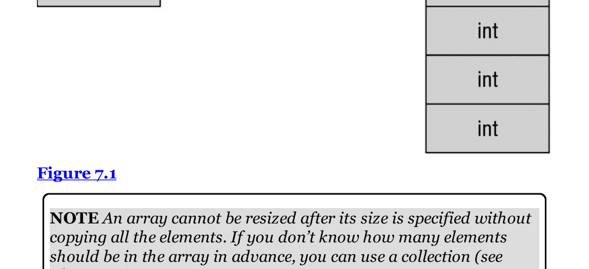

> 注意 数组的大小指定后，如果不复制所有元素，就无法调整其大小。如果你事先不知道数组中应包含多少个元素，可以使用集合（见第 11 章）。

除了使用单独的行来声明和初始化数组外，你也可以在一行中完成：

```
int[] myArray = new int[4];
```

你还可以使用数组初始化器为每个数组元素赋值。数组初始化器只能在声明数组变量时使用，不能在数组声明之后使用：

```
int[] myArray = new int[4] {4, 7, 11, 2};
```

如果使用花括号初始化数组，你也可以省略数组的大小，因为编译器可以统计元素的数量：

```
int[] myArray = new int[] {4, 7, 11, 2};
```

利用 C# 编译器，还有一种更简短的写法。使用花括号，你可以编写数组的声明和初始化。编译器生成的代码与之前的结果相同：

```
int[] myArray = {4, 7, 11, 2};
```

#### 访问数组元素

数组声明并初始化后，你可以使用索引器访问数组元素。数组仅支持具有整数参数的索引器。

使用索引器时，传入元素编号以访问数组。索引器始终从 0 开始表示第一个元素。因此，你可以传给索引器的最大数字是元素数量减一，因为索引从零开始。在下面的示例中，数组 `myArray` 被声明并初始化为四个整数值。可以使用索引器值 0、1、2 和 3 访问这些元素。

```
int[] myArray = new int[] {4, 7, 11, 2};
int v1 = myArray[0];    // 读取第一个元素
int v2 = myArray[1];    // 读取第二个元素
myArray[3] = 44;        // 更改第四个元素
```

> 注意 如果使用了超出数组长度的错误索引器值，会抛出 `IndexOutOfRangeException` 类型的异常。

如果你不知道数组中的元素数量，可以使用 `Length` 属性，如下面的 `for` 语句所示：

```
for (int i = 0; i < myArray.Length; i++)
{
    WriteLine(myArray[i]);
}
```

除了使用 `for` 语句遍历数组的所有元素外，你也可以使用 `foreach` 语句：

```
foreach (var val in myArray)
{
    WriteLine(val);
}
```

> 注意 `foreach` 语句使用 `IEnumerable` 和 `IEnumerator` 接口，并从第一个索引遍历到最后一个索引。本章后面会详细讨论这一点。

#### 使用引用类型

除了能够声明预定义类型的数组外，你还可以声明自定义类型的数组。让我们从下面的 `Person` 类开始，它使用自动实现的属性 `FirstName` 和 `LastName`，并重写了 `Object` 类的 `ToString` 方法（代码文件 `SimpleArrays/Person.cs`）：

```csharp
public class Person
{
    public string FirstName { get; set; }
    public string LastName { get; set; }

    public override string ToString() => $"{FirstName} {LastName}";
}
```

声明包含两个 `Person` 元素的数组与声明 `int` 数组类似：

```csharp
Person[] myPersons = new Person[2];
```

但是，请注意，如果数组中的元素是引用类型，则必须为每个数组元素分配内存。如果你使用数组中尚未分配内存的项，则会抛出 `NullReferenceException`。

> 注意 有关错误和异常的信息，请参阅第 14 章“错误和异常”。

你可以通过从 0 开始的索引器为数组的每个元素分配内存：

```csharp
myPersons[0] = new Person { FirstName="Ayrton", LastName="Senna" };
myPersons[1] = new Person { FirstName="Michael", LastName="Schumacher" };
```

图 7.2 显示了托管堆中带有 `Person` 数组的对象。`myPersons` 是存储在栈上的一个变量。该变量引用了一个存储在托管堆上的 `Person` 元素数组。该数组有足够的空间容纳两个引用。数组中的每一项都引用一个也存储在托管堆上的 `Person` 对象。

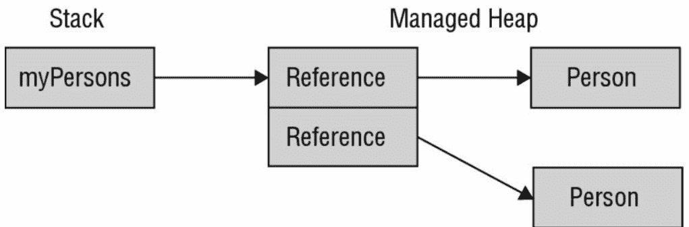

**图 7.2**

与 `int` 类型类似，你也可以在自定义类型上使用数组初始化器：

```
Person[] myPersons2 =
{
    new Person { FirstName="Ayrton", LastName="Senna" },
    new Person { FirstName="Michael", LastName="Schumacher" }
};
```

### 多维数组

普通数组（也称为一维数组）通过单个整数进行索引。多维数组通过两个或多个整数进行索引。


图 7.3 显示了一个具有三行三列的二维数组的数学表示法。第一行的值为 1、2、3，第三行的值为 7、8、9。


**图 7.3**

要用 C# 声明这个二维数组，需要在方括号内放入一个逗号。数组通过指定每个维度（也称为秩）的大小来初始化。然后就可以使用索引器通过两个整数访问数组元素：

```
int[,] twodim = new int[3, 3];
twodim[0, 0] = 1;
twodim[0, 1] = 2;
twodim[0, 2] = 3;
twodim[1, 0] = 4;
twodim[1, 1] = 5;
twodim[1, 2] = 6;
twodim[2, 0] = 7;
twodim[2, 1] = 8;
twodim[2, 2] = 9;
```

> **注意** 声明数组之后，你不能更改秩。

如果你事先知道元素的值，也可以使用数组初始化器来初始化二维数组。初始化数组时，使用一个外层花括号，每一行在外层花括号内部使用花括号进行初始化：

```
int[,] twodim = {
    {1, 2, 3},
    {4, 5, 6},
    {7, 8, 9}
};
```

> **注意** 使用数组初始化器时，必须初始化数组中的每一个元素。不能将某些值的初始化推迟到以后进行。

在方括号内使用两个逗号，可以声明一个三维数组：

```
int[,,] threedim = {
    { { 1, 2 }, { 3, 4 } },
    { { 5, 6 }, { 7, 8 } },
    { { 9, 10 }, { 11, 12 } }
};
```

```
WriteLine(threedim[0, 1, 1]);
```

### 交错数组

二维数组具有矩形大小（例如 3 × 3 个元素）。交错数组在数组大小上提供了更大的灵活性。对于交错数组，每一行都可以有不同的尺寸。

图 7.4 对比了一个包含 3 × 3 个元素的二维数组和一个交错数组。所示的交错数组包含三行，第一行包含两个元素，第二行包含六个元素，第三行包含三个元素。

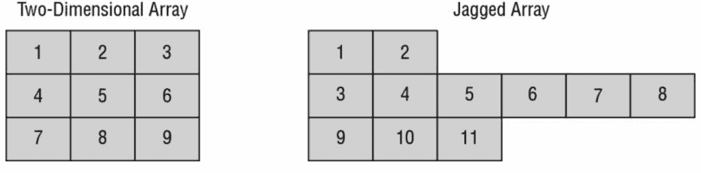

**图 7.4**

声明交错数组时，需要连续放置一对对开括号和闭括号。初始化交错数组时，只设置第一对方括号中定义行数的大小。第二对方括号（用于定义行内元素的数量）保持为空，因为每一行的元素数量不同。

接下来，可以为每一行设置该行的元素数量：

```
int[][] jagged = new int[3][];
jagged[0] = new int[2] { 1, 2 };
jagged[1] = new int[6] { 3, 4, 5, 6, 7, 8 };
jagged[2] = new int[3] { 9, 10, 11 };
```

你可以使用嵌套的 `for` 循环遍历交错数组中的所有元素。在外层 `for` 循环中遍历每一行，内层 `for` 循环遍历一行中的每个元素：

```
for (int row = 0; row < jagged.Length; row++)
{
    for (int element = 0; element < jagged[row].Length; element++)
    {
        WriteLine($"row: {row}, element: {element}, value: {jagged[row][element]}");
    }
}
```

迭代的输出会显示每一行以及行内的每个元素：

```
row: 0, element: 0, value: 1
row: 0, element: 1, value: 2
row: 1, element: 0, value: 3
row: 1, element: 1, value: 4
row: 1, element: 2, value: 5
row: 1, element: 3, value: 6
row: 1, element: 4, value: 7
row: 1, element: 5, value: 8
row: 2, element: 0, value: 9
row: 2, element: 1, value: 10
row: 2, element: 2, value: 11
```

### Array 类

使用方括号声明数组是 C# 的一种表示法，其基于 `Array` 类。在后台，使用 C# 语法会创建一个从抽象基类 `Array` 派生的新类。这使得每个 C# 数组都可以使用 `Array` 类中定义的方法和属性。例如，你已经使用了 `Length` 属性，或者使用 `foreach` 语句遍历数组。这样做时，你使用的是 `Array` 类的 `GetEnumerator` 方法。

`Array` 类实现的其他属性包括 `LongLength`（用于元素数量无法容纳在整数中的数组）和 `Rank`（用于获取维数）。

让我们通过各个特性来了解 `Array` 类的其他成员。

#### 创建数组

`Array` 类是抽象的，因此不能使用构造函数来创建数组。不过，除了使用 C# 语法创建数组实例之外，还可以使用静态的 `CreateInstance` 方法来创建数组。如果你事先不知道元素的类型，这会非常有用，因为类型可以作为 `Type` 对象传递给 `CreateInstance` 方法。

以下示例展示了如何创建一个大小为 5 的 `int` 类型数组。`CreateInstance` 方法的第一个参数需要元素类型，第二个参数定义大小。可以使用 `SetValue` 方法设置值，使用 `GetValue` 方法读取值（代码文件 `SimpleArrays/Program.cs`）：

```
Array intArray1 = Array.CreateInstance(typeof(int), 5);
for (int i = 0; i < 5; i++)
{
    intArray1.SetValue(33, i);
}

for (int i = 0; i < 5; i++)
{
    WriteLine(intArray1.GetValue(i));
}
```

还可以将创建的数组强制转换为声明为 `int[]` 的数组：

```
int[] intArray2 = (int[])intArray1;
```

`CreateInstance` 方法有许多重载，用于创建多维数组以及创建不是从 0 开始的数组。以下示例创建了一个包含 2 × 3 个元素的二维数组。第一个维度从 1 开始；第二个维度从 10 开始：

```
int[] lengths = { 2, 3 };
int[] lowerBounds = { 1, 10 };
Array racers = Array.CreateInstance(typeof(Person), lengths, lowerBounds);
```

在设置数组元素时，`SetValue` 方法接受每个维度的索引：

```
racers.SetValue(new Person
{
    FirstName ="Alain",
    LastName ="Prost"
}, 1, 10);
racers.SetValue(new Person
{
    FirstName ="Emerson",
    LastName ="Fittipaldi"
}, 1, 11);
racers.SetValue(new Person
{
    FirstName ="Ayrton",
    LastName ="Senna"
}, 1, 12);
racers.SetValue(new Person
{
    FirstName ="Michael",
    LastName ="Schumacher"
}, 2, 10);
racers.SetValue(new Person
{
    FirstName ="Fernando",
    LastName ="Alonso"
}, 2, 11);
racers.SetValue(new Person
{
    FirstName ="Jenson",
    LastName ="Button"
}, 2, 12);
```

尽管数组不是从 0 开始的，你仍然可以用正常的 C# 表示法将其赋值给一个变量。只需要注意不要越界：

```
Person[,] racers2 = (Person[,])racers;
Person first = racers2[1, 10];
Person last = racers2[2, 12];
```

#### 复制数组

由于数组是引用类型，将一个数组变量赋值给另一个变量只会得到两个引用同一个数组的变量。为了复制数组，数组实现了接口 `ICloneable`。该接口定义的 `Clone` 方法会创建数组的浅表副本。

如果数组的元素是值类型，如下面的代码段所示，那么所有值都会被复制（参见图 7.5）：

```
int[] intArray1 = {1, 2};
int[] intArray2 = (int[])intArray1.Clone();
```

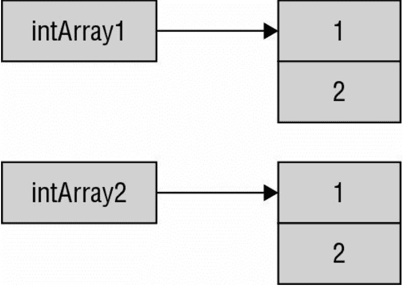

**图 7.5**

如果数组包含引用类型，则只复制引用，而不是元素。图 7.6 显示了变量 `beatles` 和 `beatlesClone`，其中 `beatlesClone` 是通过调用 `beatles` 的 `Clone` 方法创建的。`beatles` 和 `beatlesClone` 所引用的 `Person` 对象是相同的。如果更改 `beatlesClone` 的某个元素的属性，也就更改了 `beatles` 的同一个对象（代码文件 `SimpleArray/Program.cs`）：

```
Person[] beatles = {
    new Person { FirstName="John", LastName="Lennon" },
    new Person { FirstName="Paul", LastName="McCartney" }
};
Person[] beatlesClone = (Person[])beatles.Clone();
```

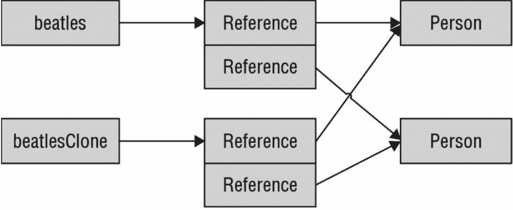

**图 7.6**

除了使用 `Clone` 方法，你也可以使用 `Array.Copy` 方法，它同样会创建浅拷贝。不过，`Clone` 和 `Copy` 有一个重要区别：`Clone` 会创建一个新数组；而使用 `Copy` 时，你必须传入一个秩相同且元素数量足够的现有数组。

> **注意** *如果你需要包含引用类型的数组的深拷贝，你必须遍历数组并创建新对象。*

### 排序

`Array` 类使用快速排序算法对数组中的元素进行排序。`Sort` 方法要求数组中的元素实现 `IComparable` 接口。诸如 `System.String` 和 `System.Int32` 之类的简单类型实现了 `IComparable`，因此你可以对包含这些类型的元素进行排序。

在示例程序中，`names` 数组包含 `string` 类型的元素，可以对该数组排序（代码文件 `SortingSample/Program.cs`）：

```
string[] names = {
    "Christina Aguilera",
    "Shakira",
    "Beyonce",
    "Lady Gaga"
};

Array.Sort(names);

foreach (var name in names)
{
    WriteLine(name);
}
```

应用程序的输出显示了数组排序后的结果：

```
Beyonce
Christina Aguilera
Lady Gaga
Shakira
```

如果你将自定义类用于数组，你必须实现 `IComparable` 接口。该接口只定义了一个方法 `CompareTo`，如果要比较的对象相等，该方法返回 0；如果实例应排在参数对象之前，则返回小于 0 的值；如果实例应排在参数对象之后，则返回大于 0 的值。

修改 `Person` 类以实现 `IComparable<Person>` 接口。比较时首先使用 `String` 类的 `Compare` 方法对 `LastName` 的值进行比较。如果 `LastName` 值相同，再比较 `FirstName`（代码文件 `SortingSample/Person.cs`）：

```
public class Person: IComparable<Person>
{
    public int CompareTo(Person other)
    {
        if (other == null) return 1;

        int result = string.Compare(this.LastName, other.LastName);
        if (result == 0)
        {
            result = string.Compare(this.FirstName, other.FirstName);
        }
        return result;
    }
    //...
```

现在可以按姓氏对 `Person` 对象数组进行排序（代码文件 `SortingSample/Program.cs`）：

```
Person[] persons = {
    new Person { FirstName="Damon", LastName="Hill" },
    new Person { FirstName="Niki", LastName="Lauda" },
    new Person { FirstName="Ayrton", LastName="Senna" },
    new Person { FirstName="Graham", LastName="Hill" }
};

Array.Sort(persons);
foreach (var p in persons)
{
    WriteLine(p);
}
```

使用 `Person` 类的排序，输出返回按姓氏排序的名字：

```
Damon Hill
Graham Hill
Niki Lauda
Ayrton Senna
```

如果 `Person` 对象需要以不同方式排序，或者你无法更改用作数组元素的类，你可以实现 `IComparer` 或 `IComparer<T>` 接口。这些接口定义了 `Compare` 方法。这两个接口都不需要由被比较的类实现。`IComparer` 接口独立于要比较的类。这就是为什么 `Compare` 方法定义了两个需要比较的参数。返回值与 `IComparable` 接口的 `CompareTo` 方法类似。

`PersonComparer` 类实现了 `IComparer<Person>` 接口，以便按 `FirstName` 或 `LastName` 对 `Person` 对象进行排序。枚举 `PersonCompareType` 定义了 `PersonComparer` 可用的不同排序选项：`FirstName` 和 `LastName`。比较方式通过 `PersonComparer` 类的构造函数定义，该构造函数设置了一个 `PersonCompareType` 值。`Compare` 方法使用 `switch` 语句实现，以按 `LastName` 或 `FirstName` 进行比较（代码文件 `SortingSample/PersonComparer.cs`）：

```
public enum PersonCompareType
{
    FirstName,
    LastName
}

public class PersonComparer: IComparer<Person>
{
    private PersonCompareType _compareType;

    public PersonComparer(PersonCompareType compareType)
    {
        _compareType = compareType;
    }

    public int Compare(Person x, Person y)
    {
        if (x == null && y == null) return 0;
        if (x == null) return 1;
        if (y == null) return -1;

        switch (_compareType)
        {
            case PersonCompareType.FirstName:
                return string.Compare(x.FirstName, y.FirstName);
            case PersonCompareType.LastName:
                return string.Compare(x.LastName, y.LastName);
            default:
                throw new ArgumentException("unexpected compare type");
        }
    }
}
```

现在你可以将一个 `PersonComparer` 对象传递给 `Array.Sort` 方法的第二个参数。这里，人员按名字排序（代码文件 `SortingSample/Program.cs`）：


```csharp
Array.Sort(persons, new PersonComparer(PersonCompareType.FirstName));

foreach (var p in persons)
{
    WriteLine(p);
}
```

`persons` 数组现在按名字排序：

```
Ayrton Senna
Damon Hill
Graham Hill
Niki Lauda
```

> **注意** `Array` 类还提供了需要委托作为参数的 `Sort` 方法。使用该参数，你可以传递一个方法来比较两个对象，而不必依赖 `IComparable` 或 `IComparer` 接口。第 9 章“委托、Lambda 表达式和事件”讨论了如何使用委托。

### 数组作为参数

数组可以作为参数传递给方法，也可以从方法返回。返回数组时，你只需将数组声明为返回类型，如下面的 `GetPersons` 方法所示：

```csharp
static Person[] GetPersons()
{
    return new Person[] {
        new Person { FirstName="Damon", LastName="Hill" },
        new Person { FirstName="Niki", LastName="Lauda" },
        new Person { FirstName="Ayrton", LastName="Senna" },
        new Person { FirstName="Graham", LastName="Hill" }
    };
}
```

将数组传递给方法时，数组通过参数声明，如下面的 `DisplayPersons` 方法所示：

```csharp
static void DisplayPersons(Person[] persons)
{
    //...
}
```

### 数组协变

数组支持协变。这意味着数组可以声明为基类型，而派生类型的元素可以被赋值给元素。

例如，你可以声明一个 `object[]` 类型的参数，如下所示，并将一个 `Person[]` 传递给它：

```csharp
static void DisplayArray(object[] data)
{
    // ...
}
```

> **注意** 数组协变仅适用于引用类型，不适用于值类型。此外，数组协变有一个只能通过运行时异常解决的问题。如果你将 `Person` 数组赋给对象数组，那么该对象数组随后可用于任何派生自 `object` 的类型。编译器会接受例如将字符串传递给数组元素的操作。然而，由于对象数组引用的是一个 `Person` 数组，运行时就会抛出 `ArrayTypeMismatchException` 异常。

### `ArraySegment<T>`

结构 `ArraySegment<T>` 表示数组的一个片段。如果你处理的是一个大数组，并且不同的方法处理数组的不同部分，你可以将数组部分复制给这些方法。与其创建多个数组，更高效的做法是使用一个数组并将整个数组传递给这些方法。这些方法应该只使用数组的一部分。为此，你可以传递数组中的偏移量以及方法应使用的元素数量，再加上数组本身。这样，至少需要三个参数。使用数组片段时，只需要一个参数。`ArraySegment<T>` 结构包含有关片段的信息（偏移量和计数）。

`SumOfSegments` 方法接受一个 `ArraySegment<int>` 元素数组，用于计算这些片段所定义的所有整数的总和，并返回该总和（代码文件 `ArraySegmentSample/Program.cs`）：

```csharp
static int SumOfSegments(ArraySegment<int>[] segments)
{
    int sum = 0;
    foreach (var segment in segments)
    {
        for (int i = segment.Offset; i < segment.Offset + segment.Count; i++)
        {
            sum += segment.Array[i];
        }
    }
    return sum;
}
```

该方法通过传递一个片段数组来使用。第一个数组元素引用 `ar1` 中从第一个元素开始的三个元素；第二个数组元素引用 `ar2` 中从第四个元素开始的三个元素：

```csharp
int[] ar1 = { 1, 4, 5, 11, 13, 18 };
int[] ar2 = { 3, 4, 5, 18, 21, 27, 33 };

var segments = new ArraySegment<int>[2]
{
    new ArraySegment<int>(ar1, 0, 3),
    new ArraySegment<int>(ar2, 3, 3)
};

var sum = SumOfSegments(segments);
```

> **注意** 数组段不会复制原数组的元素。相反，可以通过 `ArraySegment<T>` 访问原数组。如果更改了数组段的元素，则可以在原数组中看到这些更改。

### 枚举器

通过使用 `foreach` 语句，您可以在无需知道集合中元素数量的情况下迭代集合中的元素（参见第11章）。`foreach` 语句使用枚举器。图7.7展示了调用 `foreach` 方法的客户端与集合之间的关系。数组或集合通过 `GetEnumerator` 方法实现 `IEnumerable` 接口。`GetEnumerator` 方法返回一个实现 `IEnumerator` 接口的枚举器。然后 `foreach` 语句使用 `IEnumerator` 接口来迭代集合。

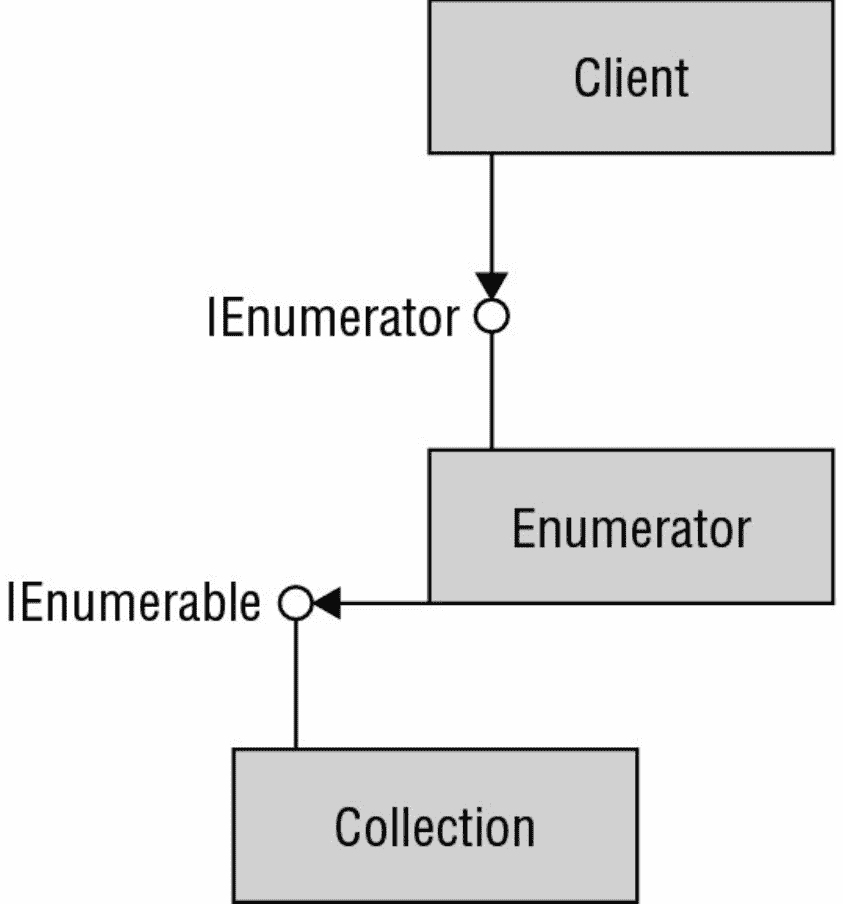

图 7.7

> **注意** `GetEnumerator` 方法是使用 `IEnumerable` 接口定义的。`foreach` 语句实际上并不需要集合类实现这个接口。只要有一个名为 `GetEnumerator` 的方法返回实现 `IEnumerator` 接口的对象就足够了。

### `IEnumerator` 接口

`foreach` 语句使用 `IEnumerator` 接口的方法和属性来迭代集合中的所有元素。为此，`IEnumerator` 定义了属性 `Current` 用于返回光标所在位置的元素，以及方法 `MoveNext` 用于移动到集合中的下一个元素。`MoveNext` 在有元素时返回 `true`，如果没有更多元素则返回 `false`。

此接口的泛型版本 `IEnumerator<T>` 派生自 `IDisposable` 接口，因此定义了一个 `Dispose` 方法来清理枚举器分配的资源。

> **注意** `IEnumerator` 接口还为COM互操作性定义了 `Reset` 方法。许多.NET枚举器通过抛出 `NotSupportedException` 类型的异常来实现此方法。

### `foreach` 语句

C# 的 `foreach` 语句在IL代码中并不是一个 `foreach` 语句。相反，C# 编译器将 `foreach` 语句转换为 `IEnumerator` 接口的方法和属性。下面是一个简单的 `foreach` 语句，用于迭代 `persons` 数组中的所有元素并逐个人显示它们：

```csharp
foreach (var p in persons)
{
    WriteLine(p);
}
```

`foreach` 语句被解析为以下代码段。首先，调用 `GetEnumerator` 方法为数组获取一个枚举器。在 `while` 循环内，只要 `MoveNext` 返回 `true`，就使用 `Current` 属性访问数组的元素：

```csharp
IEnumerator<Person> enumerator = persons.GetEnumerator();
while (enumerator.MoveNext())
{
    Person p = enumerator.Current;
    WriteLine(p);
}
```

### `yield` 语句

自 C# 首次发布以来，使用 `foreach` 语句迭代集合就变得很容易。在 C# 1.0 中，创建枚举器仍然需要大量的工作。C# 2.0 添加了 `yield` 语句，可以轻松创建枚举器。`yield return` 语句返回集合的一个元素并将位置移动到下一个元素，`yield break` 停止迭代。

下一个示例展示了使用 `yield return` 语句实现的简单集合。类 `HelloCollection` 包含方法 `GetEnumerator`。`GetEnumerator` 方法的实现包含两个 `yield return` 语句，分别返回字符串 `Hello` 和 `World`（代码文件 `YieldSample/Program.cs`）：

```csharp
using System;
using System.Collections;

namespace Wrox.ProCSharp.Arrays
{
    public class HelloCollection
    {
        public IEnumerator<string> GetEnumerator()
        {
            yield return "Hello";
            yield return "World";
        }
    }
}
```

> **注意** 包含 `yield` 语句的方法或属性也称为迭代器块。迭代器块必须声明为返回 `IEnumerator` 或 `IEnumerable` 接口，或这些接口的泛型版本。此块可以包含多个 `yield return` 或 `yield break` 语句；不允许使用 `return` 语句。

现在可以使用 `foreach` 语句迭代该集合：

```csharp
public void HelloWorld()
{
    var helloCollection = new HelloCollection();
    foreach (var s in helloCollection)
    {
        WriteLine(s);
    }
}
```

使用迭代器块时，编译器会生成一个 `yield` 类型，包括一个状态机，如下面的代码段所示。`yield` 类型实现了 `IEnumerator` 和 `IDisposable` 接口的方法和属性。在示例中，您可以将 `yield` 类型视为内部类 `Enumerator`。外部类的 `GetEnumerator` 方法实例化并返回一个新的 `yield` 类型。在 `yield` 类型内部，变量 `state` 定义迭代的当前位置，并且在每次调用 `MoveNext` 方法时都会更改。`MoveNext` 封装了迭代器块的代码，并设置 current 变量的值，以便 `Current` 属性根据位置返回对象：

```csharp
public class HelloCollection
{
    public IEnumerator GetEnumerator() => new Enumerator(0);

    public class Enumerator : IEnumerator<string>, IEnumerator, IDisposable
    {
        private int _state;
        private string _current;

        public Enumerator(int state)
        {
            _state = state;
        }

        bool System.Collections.IEnumerator.MoveNext()
        {
            switch (_state)
            {
                case 0:
                    _current = "Hello";
                    _state = 1;
                    return true;
                case 1:
                    _current = "World";
                    _state = 2;
                    return true;
                case 2:
                    break;
            }

            return false;
        }

        void System.Collections.IEnumerator.Reset()
        {
            throw new NotSupportedException();
        }

        string System.Collections.Generic.IEnumerator<string>.Current => _current;

        object System.Collections.IEnumerator.Current => _current;

        void IDisposable.Dispose()
        {
        }
    }
}
```

> **注意** 请记住，`yield` 语句生成的是枚举器，而不仅仅是填充了项的列表。这个枚举器由 `foreach` 语句调用。每次从 `foreach` 访问一个项时，都会访问枚举器。这使得可以迭代大量数据，而无需一次性将所有数据读入内存。

### 迭代集合的不同方式

与 Hello World 示例相比，在一个稍大且更真实的示例中，您可以使用 `yield return` 语句以不同方式迭代集合。类 `MusicTitles` 允许通过 `GetEnumerator` 方法以默认方式迭代标题，通过 `Reverse` 方法以逆序迭代，以及通过 `Subset` 方法迭代子集（代码文件 `YieldSample/MusicTitles.cs`）：

```csharp
public class MusicTitles
{
    string[] names = { "Tubular Bells", "Hergest Ridge", "Ommadawn", "Platinum" };

    public IEnumerator<string> GetEnumerator()
    {
        for (int i = 0; i < 4; i++)
        {
            yield return names[i];
        }
    }

    public IEnumerable<string> Reverse()
    {
        for (int i = 3; i >= 0; i--)
        {
            yield return names[i];
        }
    }

    public IEnumerable<string> Subset(int index, int length)
    {
        for (int i = index; i < index + length; i++)
        {
            yield return names[i];
        }
    }
}
```

> **注意** 类支持的默认迭代是 `GetEnumerator` 方法，该方法定义为返回 `IEnumerator`。命名迭代返回 `IEnumerable`。

用于迭代字符串数组的客户端代码首先使用 `GetEnumerator` 方法，您不必在代码中编写它，因为在 `foreach` 语句的实现中默认使用它。然后标题以逆序迭代，最后通过将索引和要迭代的项数传递给 `Subset` 方法来迭代子集（代码文件 `YieldSample/Program.cs`）：

```csharp
var titles = new MusicTitles();
foreach (var title in titles)
{
    WriteLine(title);
}
WriteLine();

WriteLine("reverse");
foreach (var title in titles.Reverse())
{
    WriteLine(title);
}
WriteLine();
WriteLine("subset");
foreach (var title in titles.Subset(2, 2))
{
    WriteLine(title);
}
```

### 使用 `yield return` 返回枚举器

使用 `yield` 语句，你还可以做更复杂的事情，例如通过 `yield return` 返回枚举器。以下面的井字棋游戏为例，玩家轮流在九个方格中的一个中放入叉号或圆圈。这些移动由 `GameMoves` 类模拟。`Cross` 和 `Circle` 方法是用于创建迭代器类型的迭代器块。变量 `cross` 和 `circle` 在 `GameMoves` 类的构造函数中被设置为 `Cross` 和 `Circle`。通过设置这些字段，方法并未被调用，而是被设置为迭代器块定义的迭代器类型。在 `Cross` 迭代器块中，移动信息被写入控制台，并且移动编号递增。如果移动编号大于 8，迭代以 `yield break` 结束；否则，每次迭代都返回圆形迭代器类型的枚举器对象。`Circle` 迭代器块与 `Cross` 迭代器块非常相似；它只是每次迭代返回叉形迭代器类型（代码文件 `YieldSample/GameMoves.cs`）：


```csharp
public class GameMoves
{
    private IEnumerator _cross;
    private IEnumerator _circle;

    public GameMoves()
    {
        _cross = Cross();
        _circle = Circle();
    }

    private int _move = 0;
    const int MaxMoves = 9;

    public IEnumerator Cross()
    {
        while (true)
        {
            WriteLine($"Cross, move {_move}");
            if (++_move >= MaxMoves)
            {
                yield break;
            }
            yield return _circle;
        }
    }

    public IEnumerator Circle()
    {
        while (true)
        {
            WriteLine($"Circle, move {_move}");
            if (++_move >= MaxMoves)
            {
                yield break;
            }
            yield return _cross;
        }
    }
}
```

在客户端程序中，你可以按如下方式使用 `GameMoves` 类。第一步是通过将枚举器设置为 `game.Cross` 返回的枚举器类型来完成的。在 `while` 循环中，调用 `enumerator.MoveNext`。第一次调用时，会调用 `Cross` 方法，该方法通过 `yield` 语句返回另一个枚举器。返回值可以通过 `Current` 属性访问，并设置为下一个循环的枚举器变量：

```csharp
var game = new GameMoves();
IEnumerator enumerator = game.Cross();
while (enumerator.MoveNext())
{
    enumerator = enumerator.Current as IEnumerator;
}
```

该程序的输出显示了交替移动，直到最后一次移动：

```
Cross, move 0
Circle, move 1
Cross, move 2
Circle, move 3
Cross, move 4
Circle, move 5
Cross, move 6
Circle, move 7
Cross, move 8
```

### 元组

数组组合的是相同类型的对象，而元组可以组合不同类型的对象。元组起源于 F# 等函数式编程语言，在这些语言中经常使用。借助 .NET Framework，所有 .NET 语言都可以使用元组。

.NET Framework 定义了八个泛型 `Tuple` 类和一个充当元组工厂的静态 `Tuple` 类。不同的泛型 `Tuple` 类支持不同数量的元素——例如，`Tuple<T1>` 包含一个元素，`Tuple<T1, T2>` 包含两个元素，依此类推。

`Divide` 方法演示了返回包含两个成员的元组：`Tuple<int, int>`。泛型类的参数定义了成员的类型，这里两个成员都是整数。该元组使用静态 `Tuple` 类的静态 `Create` 方法创建。同样，`Create` 方法的泛型参数定义了所实例化的元组类型。新创建的元组使用 `result` 和 `remainder` 变量初始化，以返回除法结果（代码文件 `TupleSample/Program.cs`）：

```csharp
public static Tuple<int, int> Divide(int dividend, int divisor)
{
    int result = dividend / divisor;
    int remainder = dividend % divisor;

    return Tuple.Create(result, remainder);
}
```

下面的示例演示了如何调用 `Divide` 方法。可以使用 `Item1` 和 `Item2` 属性访问元组的各项：

```csharp
var result = Divide(5, 2);
WriteLine($"result of division: {result.Item1}, remainder: {result.Item2}");
```

如果你需要在一个元组中包含超过八个项，可以使用包含八个参数的 `Tuple` 类定义。最后一个模板参数名为 `TRest`，表示你必须传递一个元组本身。这样，你就可以创建包含任意数量参数的元组。

下面的示例演示了这一功能：

```csharp
public class Tuple<T1, T2, T3, T4, T5, T6, T7, TRest>
```

这里，最后一个模板参数本身就是一个元组类型，因此你可以创建包含任意数量项的元组：

```csharp
var tuple = Tuple.Create<string, string, string, int, int, int, double,
    Tuple<int, int>>("Stephanie", "Alina", "Nagel", 2009, 6, 2, 1.37,
    Tuple.Create<int, int>(52, 3490));
```

### 结构化比较

数组和元组都实现了 `IStructuralEquatable` 和 `IStructuralComparable` 接口。这些接口不仅比较引用，还比较内容。这些接口是显式实现的，因此在使用时必须将数组和元组强制转换为这些接口。`IStructuralEquatable` 用于比较两个元组或数组是否具有相同的内容；`IStructuralComparable` 用于对元组或数组进行排序。

在演示 `IStructuralEquatable` 的示例中，使用了实现 `IEquatable` 接口的 `Person` 类。`IEquatable` 定义了一个强类型的 `Equals` 方法，该方法比较 `FirstName` 和 `LastName` 属性的值（代码文件 `StructuralComparison/Person.cs`）：

```csharp
public class Person : IEquatable<Person>
{
    public int Id { get; private set; }
    public string FirstName { get; set; }
    public string LastName { get; set; }

    public override string ToString() => $"{Id}, {FirstName} {LastName}";

    public override bool Equals(object obj)
    {
        if (obj == null)
        {
            return base.Equals(obj);
        }
        return Equals(obj as Person);
    }

    public override int GetHashCode() => Id.GetHashCode();

    public bool Equals(Person other)
    {
        if (other == null)
            return base.Equals(other);

        return Id == other.Id && FirstName == other.FirstName &&
            LastName == other.LastName;
    }
}
```

现在创建了两个包含 `Person` 项的数组。两个数组都包含变量名为 `janet` 的同一个 `Person` 对象，以及两个内容相同但不同的 `Person` 对象。比较运算符 `!=` 返回 `true`，因为确实存在两个不同的数组，分别由 `persons1` 和 `persons2` 两个变量名引用。由于 `Array` 类没有重写带一个参数的 `Equals` 方法，因此与使用 `==` 运算符比较引用时的情况相同，它们并不相同（代码文件 `StructuralComparison/Program.cs`）：

```csharp
var janet = new Person { FirstName = "Janet", LastName = "Jackson" };
Person[] persons1 = {
    new Person
    {
        FirstName = "Michael",
        LastName = "Jackson"
    },
    janet
};

Person[] persons2 = {
    new Person
    {
        FirstName = "Michael",
        LastName = "Jackson"
    },
    janet
};

if (persons1 != persons2)
{
    WriteLine("not the same reference");
}
```

调用 `IStructuralEquatable` 接口定义的 `Equals` 方法——即第一个参数类型为 `object`、第二个参数类型为 `IEqualityComparer` 的方法——可以通过传递一个实现 `IEqualityComparer<T>` 的对象来定义比较方式。`IEqualityComparer` 的默认实现由 `EqualityComparer<T>` 类完成。该实现会检查类型是否实现了 `IEquatable` 接口，并调用 `IEquatable.Equals` 方法。如果类型没有实现 `IEquatable`，则会调用基类 `Object` 的 `Equals` 方法进行比较。

`Person` 实现了 `IEquatable<Person>`，其中会比较对象的内容，而这两个数组确实包含相同的内容：

```csharp
if ((persons1 as IStructuralEquatable).Equals(persons2,
    EqualityComparer<Person>.Default))
{
    WriteLine("the same content");
}
```

接下来，你将看到如何使用元组完成同样的事情。这里创建了两个内容相同的元组实例。当然，由于引用 `t1` 和 `t2` 引用的是两个不同的对象，比较运算符 `!=` 返回 `true`：

```csharp
var t1 = Tuple.Create(1, "Stephanie");
var t2 = Tuple.Create(1, "Stephanie");
if (t1 != t2)
{
    WriteLine("not the same reference to the tuple");
}
```

`Tuple<>` 类提供了两个 `Equals` 方法：一个是从 `Object` 基类重写而来的，以对象作为参数；另一个是由 `IStructuralEquatable` 接口定义的，以对象和 `IEqualityComparer` 作为参数。如所示，可以将另一个元组传递给第一个方法。该方法使用 `EqualityComparer<object>.Default` 获取一个 `ObjectEqualityComparer<object>` 来进行比较。这样，元组中的每一项都会通过调用 `Object.Equals` 方法进行比较。如果每一项都返回 `true`，则 `Equals` 方法的结果为 `true`，这里在 `int` 和 `string` 值相同的情况下正是如此：

```csharp
if (t1.Equals(t2))
{
    WriteLine("the same content");
}
```

你还可以创建自定义的 `IEqualityComparer`，如下面的示例所示，使用 `TupleComparer` 类。该类实现了 `IEqualityComparer` 接口的 `Equals` 和 `GetHashCode` 两个方法：

```csharp
class TupleComparer : IEqualityComparer
{
    public new bool Equals(object x, object y) => x.Equals(y);

    public int GetHashCode(object obj) => obj.GetHashCode();
}
```

> **注意** `IEqualityComparer` 接口的 `Equals` 方法的实现需要 `new` 修饰符或隐式接口实现，因为基类 `Object` 也定义了一个带有两个参数的静态 `Equals` 方法。

`TupleComparer` 被使用，将一个新实例传递给 `Tuple<T1, T2>` 类的 `Equals` 方法。`Tuple` 类的 `Equals` 方法会对每个要比较的项调用 `TupleComparer` 的 `Equals` 方法。因此，对于 `Tuple<T1, T2>` 类，`TupleComparer` 会被调用两次，以检查所有项是否相等：

```csharp
if (t1.Equals(t2, new TupleComparer()))
{
    WriteLine("equals using TupleComparer");
}
```

### 小结

在本章中，你已经了解了用于创建和使用简单数组、多维数组和交错数组的 C# 表示法。C# 数组在幕后使用 `Array` 类，使你能够通过数组变量调用该类的属性和方法。

你已经了解了如何使用 `IComparable` 和 `IComparer` 接口对数组中的元素进行排序；并且你已学会如何创建和使用枚举器、`IEnumerable` 和 `IEnumerator` 接口以及 `yield` 语句。

最后，你已经了解了如何将相同类型的对象组合成数组，以及将不同类型的对象组合成元组。

下一章将重点介绍运算符和强制转换。

### 8 运算符和强制转换

#### 本章内容

- C# 中的运算符

- 使用新的 C# 6 运算符 `nameof` 和 `null` 传播

- 隐式和显式转换

- 使用装箱将值类型转换为引用类型

- 比较值类型和引用类型

- 为自定义类型重载标准运算符

- 实现索引运算符

- 通过强制转换在引用类型之间进行转换

#### Wrox.com 本章代码下载

本章的 wrox.com 代码下载可在 www.wrox.com/go/professionalcsharp6 的“下载代码”选项卡中找到。本章代码分为以下主要示例：

- `OperatorOverloadingSample`

- `OperatorOverloadingSample2`

- `OverloadingComparisonSample`

- `CustomIndexerSample`

- `CastingSample`

#### 运算符和强制转换

前面的章节已经涵盖了使用 C# 编写实用程序所需的大部分内容。本章将完成对基本语言元素的讨论，并展示 C# 的一些强大功能，使你能够扩展其能力。

#### 运算符

C# 运算符与 C++ 和 Java 运算符非常相似，但也存在差异。

C# 支持下表中列出的运算符：

| 类别 | 运算符 |
| --- | --- |
| 算术 | `+ - * / %` |
| 逻辑 | `& \| ^ ~ && \|\| !` |
| 字符串连接 | `+` |
| 递增和递减 | `++ --` |
| 位移 | `<< >>` |
| 比较 | `== != < > <= >=` |
| 赋值 | `= += -= *= /= %= &= \|= ^= <<= >>=` |
| 成员访问（用于对象和结构） | `.` |
| 索引（用于数组和索引器） | `[]` |
| 强制转换 | `()` |
| 条件（三元运算符） | `?:` |
| 委托连接和移除（在第 9 章“委托、Lambda 和事件”中讨论） | `+ -` |
| 对象创建 | `new` |
| 类型信息 | `sizeof is typeof as` |
| 溢出异常控制 | `checked unchecked` |
| 间接寻址和地址 | `* -> & []` |
| 命名空间别名限定符（在第 2 章“核心 C#”中讨论） | `::` |
| 空合并运算符 | `??` |
| 空传播运算符 | `?. ?[]` |
| 标识符的名称 | `nameof()` |

> **注意** *请注意，四个特定的运算符（`sizeof`、`*`、`->` 和 `&`）仅在非安全代码（绕过 C# 类型安全检查的代码）中可用，这将在第 5 章“托管和非托管资源”中讨论。*

使用 C# 运算符时需要注意的最大陷阱之一是，与其他 C 风格语言一样，C# 对赋值（`=`）和比较（`==`）使用不同的运算符。例如，以下语句表示“让 `x` 等于 3”：

```csharp
x = 3;
```

如果现在想将 `x` 与某个值进行比较，需要使用双等号 `==`：

```csharp
if (x == 3)
{
}
```

幸运的是，C# 严格的类型安全规则防止了在逻辑语句中执行赋值而不是比较这一非常常见的 C 错误。这意味着在 C# 中，以下语句将产生编译器错误：


```csharp
if (x = 3)
{
}
```

习惯于使用与号（`&`）连接字符串的 Visual Basic 程序员需要进行调整。在 C# 中，加号（`+`）用于连接，而 `&` 符号表示两个不同整数值之间的逻辑与。管道符号 `|` 允许你在两个整数之间执行逻辑或。Visual Basic 程序员可能也不认识取模（`%`）算术运算符。它返回除法后的余数，例如，如果 x 等于 7，则 `x % 5` 返回 2。

在 C# 中，你很少会使用指针，因此也很少使用间接寻址运算符。更具体地说，你只会在非安全代码块中使用它们，因为这是 C# 中唯一允许使用指针的地方。指针和非安全代码将在第 5 章讨论。

#### 运算符快捷方式

下表显示了 C# 中可用的完整快捷赋值运算符列表：

| 快捷运算符 | 等效于 |

| --- | --- |

| `x++, ++x` | `x = x + 1` |

| `x--, --x` | `x = x - 1` |

| `x += y` | `x = x + y` |

| `x -= y` | `x = x - y` |

| `x *= y` | `x = x * y` |

| `x /= y` | `x = x / y` |

| `x %= y` | `x = x % y` |

| `x >>= y` | `x = x >> y` |

| `x <<= y` | `x = x << y` |

| `x &= y` | `x = x & y` |

| `x \|= y` | `x = x \| y` |

你可能想知道为什么 `++` 递增和 `--` 递减运算符各有两个示例。将运算符放在表达式之前称为前缀；将运算符放在表达式之后称为后缀。请注意，它们的行为方式有所不同。

递增和递减运算符既可以作为整个表达式，也可以用在表达式中。单独使用时，前缀和后缀版本的效果相同，都对应于语句 `x = x + 1`。在更大的表达式中使用时，前缀运算符会在表达式求值之前递增 `x` 的值；换句话说，`x` 被递增，然后新值用于表达式。相反，后缀运算符会在表达式求值之后递增 `x` 的值——表达式使用 `x` 的原始值进行求值。以下示例使用递增运算符（`++`）来演示前缀和后缀行为之间的区别：

```csharp
int x = 5;

if (++x == 6)  // true - x is incremented to 6 before the evaluation
{
    WriteLine("This will execute");
}

if (x++ == 7)  // false - x is incremented to 7 after the evaluation
{
    WriteLine("This won't");
}
```

第一个 `if` 条件的计算结果为 `true`，因为 `x` 在表达式求值之前从 5 递增到 6。然而，第二个 `if` 语句中的条件为 `false`，因为 `x` 只有在整个表达式求值之后（此时 `x == 6`）才递增到 7。

前缀和后缀运算符——`--x` 和 `x--`——的行为方式相同，但是递减而不是递增操作数。

其他快捷运算符，如 `+=` 和 `-=`，需要两个操作数，用于通过对第一个操作数执行算术或逻辑运算来修改其值。例如，下面两行是等价的：

```csharp
x += 5;
x = x + 5;
```

以下各节将介绍你将在 C# 代码中经常使用的一些主要运算符和强制转换运算符。

#### 条件运算符 (?:)

条件运算符（`?:`），也称为三元运算符，是 `if...else` 结构的简写形式。它之所以得名，是因为它涉及三个操作数。它允许你计算一个条件，如果该条件为真，则返回一个值；如果为假，则返回另一个值。语法如下：

```text
condition ? true_value : false_value
```

这里，`condition` 是要计算的布尔表达式，`true_value` 是在 `condition` 为真时返回的值，`false_value` 是在其他情况下返回的值。

如果谨慎使用，条件运算符可以为你的程序增添一丝简洁。它特别适合用于提供某个……

给正在调用的函数传递几个参数。你可以使用它快速地将布尔值转换为字符串值 true 或 false。它也很适合用于显示单词正确的单数或复数形式：

```csharp
int x = 1;
string s = x + "";
s += (x == 1 ? "man" : "men");
WriteLine(s);
```

这段代码在 x 等于 1 时显示 1 man，但对于任何其他数字则显示正确的复数形式。但请注意，如果你的输出需要本地化为不同的语言，就必须编写更复杂的例程，以考虑不同语言的不同语法规则。

### checked 和 unchecked 运算符

考虑以下代码：

```csharp
byte b = byte.MaxValue;
b++;
WriteLine(b);
```

byte 数据类型只能保存 0 到 255 范围内的值。将 byte.MaxValue 赋给 byte 会得到 255。对于 255，byte 中可用的 8 位全部被置位：11111111。将此值加一会导致溢出，结果为 0。

CLR 如何处理这种情况取决于许多因素，包括编译器选项；因此，只要存在意外溢出的风险，就需要某种方法来确保获得你想要的结果。

为此，C# 提供了 checked 和 unchecked 运算符。如果将代码块标记为 checked，CLR 将强制执行溢出检查，并在发生溢出时抛出 OverflowException。以下代码修改了前面的代码，加入了 checked 运算符：

```csharp
byte b = 255;
checked
{
    b++;
}
WriteLine(b);
```

尝试运行此代码时，你会看到类似这样的错误消息：

```
System.OverflowException: Arithmetic operation resulted in an overflow.
```

> 注意 你可以通过指定 /checked 编译器选项，对程序中所有未标记的代码强制执行溢出检查。

如果希望取消溢出检查，可以将代码标记为 `unchecked`：

```csharp
byte b = 255;
unchecked
{
    b++;
}
WriteLine(b);
```

在这种情况下，不会引发异常，但你会丢失数据，因为 `byte` 类型无法保存 256 这个值，溢出的位会被丢弃，你的 `b` 变量的值为零（0）。

请注意，`unchecked` 是默认行为。唯一可能需要显式使用 `unchecked` 关键字的情况是，在显式标记为 `checked` 的较大块中，需要少量未检查的代码行。

> 注意 默认编译设置为 `/unchecked`，因为强制检查会影响性能。使用 `/checked` 时，每次算术运算的结果都需要验证值是否超出范围。算术运算也通过使用 `i++` 的 `for` 循环完成。为了避免这种性能影响，最好保留默认的 `/unchecked` 编译器设置，并在需要的地方使用 `checked` 运算符。

### is 运算符

`is` 运算符允许你检查对象是否与特定类型兼容。“兼容”意味着对象要么是该类型，要么派生自该类型。例如，若要检查变量是否与 `object` 类型兼容，可以使用以下代码：

```csharp
int i = 10;
if (i is object)
{
    WriteLine("i is an object");
}
```

`int` 与所有 C# 数据类型一样，继承自 `object`；因此，在这种情况下，表达式 `i is object` 的计算结果为 `true`，并会显示相应的消息。

### as 运算符

`as` 运算符用于对引用类型执行显式类型转换。如果要转换的类型与指定类型兼容，则转换成功执行。但是，如果类型不兼容，`as` 运算符将返回值 `null`。如下面的代码所示，如果 `object` 引用实际上并不引用字符串实例，则尝试将 `object` 引用转换为 `string` 会返回 `null`：

```csharp
object o1 = "Some String";
object o2 = 5;

string s1 = o1 as string; // s1 = "Some String"
string s2 = o2 as string; // s2 = null
```

as 运算符允许你在单个步骤中执行安全的类型转换，而无需先使用 is 运算符测试类型，然后再执行转换。

> 注意 is 和 as 运算符将在第 4 章“继承”中结合继承展示。

### sizeof 运算符

你可以使用 sizeof 运算符来确定值类型在栈上所需的大小（以字节为单位）：

```csharp
WriteLine(sizeof(int));
```

这会显示数字 4，因为 int 的长度为 4 个字节。

如果对复杂类型（而非基元类型）使用 sizeof 运算符，则需要将代码块放在 unsafe 块中，如下所示：

```csharp
unsafe
{
    WriteLine(sizeof(Customer));
}
```

第 5 章将更详细地介绍不安全代码。

### typeof 运算符

typeof 运算符返回表示指定类型的 System.Type 对象。例如，typeof(string) 返回表示 System.String 类型的 Type 对象。当你希望使用反射动态查找有关对象的信息时，这很有用。有关更多信息，请参阅第 16 章“反射、元数据和动态编程”。

### nameof 运算符

nameof 运算符是 C# 6 中新增的。该运算符接受符号、属性或方法，并返回其名称。

它有什么用处？一个例子是需要变量名称时，例如检查参数是否为 null：

```csharp
public void Method(object o)
{
    if (o == null) throw new ArgumentNullException(nameof(o));
}
```

当然，不使用 nameof 运算符，而是传入一个字符串来抛出异常，效果也类似。但是，如果拼错名称，传入字符串不会产生编译器错误。此外，当你更改参数名称时，很容易忘记更改传递给 ArgumentNullException 构造函数的字符串。

```csharp
if (o == null) throw new ArgumentNullException("o");
```

使用 nameof 运算符获取变量名称只是一个用例。你还可以使用它获取属性名称——例如，在属性 set 访问器中触发更改事件（使用 INotifyPropertyChanged 接口）并传递属性名称。

```csharp
public string FirstName
{
    get { return _firstName; }
    set
    {
        _firstName = value;
        OnPropertyChanged(nameof(FirstName));
    }
}
```

nameof 运算符还可以用于获取方法的名称。即使方法被重载，这也同样有效，因为所有重载都会产生相同的值：方法的名称。

```csharp
public void Method()
{
    Log($"{nameof(Method)} called");
}
```

### index 运算符

在第 7 章“数组和元组”中，你已经使用索引运算符（方括号）访问数组。这里，索引运算符通过传递数字 2 来访问名为 arr1 的数组的第三个元素：

```csharp
int[] arr1 = {1, 2, 3, 4};
int x = arr1[2]; // x == 3
```

与访问数组元素类似，索引运算符也在集合类中实现（将在第 11 章“集合”中讨论）。

索引运算符不要求括号内必须是整数。索引运算符可以使用任何类型定义。以下代码片段创建了一个泛型字典，其中键是 string，值是 int。对于字典，键可以与索引器一起使用。在下面的示例中，字符串 first 被传递给索引运算符以在字典中设置此元素，然后将相同的字符串传递给索引器以检索此元素：

```csharp
var dict = new Dictionary<string, int>();
dict["first"] = 1;
int x = dict["first"];
```

> 注意 在本章后面的“实现自定义索引运算符”一节中，你可以了解如何在自己的类中创建索引运算符。

### 可空类型和运算符

值类型和引用类型之间的一个重要区别是引用类型可以为 null。而 int 这样的值类型不能为 null。这在将 C# 类型映射到数据库类型时是一个特殊问题。数据库中的数字可以为 null。在早期 C# 版本中，解决方案是使用引用类型来映射可空的数据库数字。然而，这种方法会影响性能，因为垃圾回收器需要处理引用类型。现在你可以使用可空 int 而不是普通 int。这样做的开销只是一个额外的 Boolean，用于检查或设置 null 值。可空类型仍然是值类型。

在下面的代码片段中，变量 i1 是一个 int，被赋值为 1。i2 是一个可空 int，被赋值为 2。可空性通过将 ? 与类型一起使用来定义。int? 可以像 i1 的赋值一样被赋予整数值。变量 i3 演示了可空类型也可以被赋予 null。

```csharp
int i1 = 1;
int? i2 = 2;
int? i3 = null;
```

每个结构体都可以定义为可空类型，如 long? 和 DateTime? 所示：

```csharp
long? l1 = null;
DateTime? d1 = null;
```

如果在程序中使用可空类型，则必须始终考虑 null 值在与各种运算符一起使用时可能产生的影响。通常，当对可空类型使用一元或二元运算符时，如果一个或两个操作数为 null，则结果将为 null。例如：

```csharp
int? a = null;

int? b = a + 4;      // b = null
int? c = a * 5;      // c = null
```

比较可空类型时，如果只有一个操作数为 null，则比较结果始终为 false。这意味着你不能仅仅因为条件的相反情况为 false 就假定条件为 true，而在使用非可空类型的程序中这种情况经常发生。例如，在下面的示例中，如果 a 为 null，那么无论 b 的值是 +5 还是 -5，都会始终执行 else 子句。

```csharp
int? a = null;
int? b = -5;

if (a >= b)
{
    WriteLine("a >= b");
}
else
{
    WriteLine("a < b");
}
```

> 注意 表达式中出现 null 值的可能性意味着你不能随意将可空类型和非可空类型组合在一起。本章后面的“类型转换”一节将对此进行讨论。

> 注意 当你在类型声明中使用 C# 关键字 ?（例如 int?）时，编译器会将其解析为使用泛型类型 Nullable<int>。C# 编译器将简写形式转换为泛型类型，以减少键入需求。

### 空合并运算符

空合并运算符（??）提供了一种简写机制，用于处理可空类型和引用类型中可能出现 null 值的情况。该运算符放在两个操作数之间——第一个操作数必须是可空类型或引用类型，第二个操作数必须与第一个操作数的类型相同，或者是可隐式转换为第一个操作数类型的类型。空合并运算符的求值规则如下：

- 如果第一个操作数不为 null，则整个表达式的值为第一个操作数。

- 如果第一个操作数为 null，则整个表达式的值为第二个操作数。

例如：

```csharp
int? a = null;
int b;

b = a ?? 10;      // b has the value 10
a = 3;
b = a ?? 10;      // b has the value 3
```

如果第二个操作数无法隐式转换为第一个操作数的类型，则会产生编译时错误。

空合并运算符不仅对可空类型很重要，对引用类型也很重要。在下面的代码片段中，属性 Val 仅在 `_val` 变量不为 null 时返回其值；如果它为 null，则创建 MyClass 的新实例，将其赋值给 `_val` 变量，并最终从该属性返回。get 访问器内表达式的第二部分仅在变量 `_val` 为 null 时执行。

```csharp
private MyClass _val;
public MyClass Val
{
    get { return _val ?? (_val = new MyClass()); }
}
```

### null 传播运算符

C# 6 的一个重要新特性是 null 传播运算符。生产代码中有大量代码行用于验证 null 条件。在访问作为方法参数传递的变量的成员之前，需要检查该变量是否为 null。否则会抛出 NullReferenceException。.NET 设计准则规定，代码不应抛出这些类型的异常，并且应始终检查 null 条件。然而，这样的检查很容易被遗漏。以下代码片段验证传入的参数 p 是否不为 null；如果它为 null，则方法直接返回而不继续执行：

```csharp
public void ShowPerson(Person p)
{
    if (p == null) return;
    string firstName = p.FirstName;
    //...
}
```

使用 null 传播运算符访问 FirstName 属性（`p?.FirstName`）时，如果 p 为 null，则只返回 null，而不会继续计算表达式的右侧部分。

```csharp
public void ShowPerson(Person p)
{
    string firstName = p?.FirstName;
    //...
}
```


当使用 null 传播运算符访问 int 类型的属性时，结果不能直接赋值给 int 类型，因为结果可能是 null。解决此问题的一种选择是将结果赋值给可空 int：

```
int? age = p?.Age;
```

当然，你也可以使用空合并运算符解决此问题，并在左侧结果为 null 时定义另一个结果（例如 0）：

```
int age = p?.Age ?? 0;
```

多个 null 传播运算符也可以组合使用。此处访问 Person 对象的 Address 属性，而该属性又定义了 City 属性。需要对 Person 对象进行 null 检查，如果它不为 null，还要对 Address 属性的结果进行 null 检查：

```
Person p = GetPerson();
string city = null;
if (p != null && p.Address != null)
{
    city = p.Address.City;
}
```

使用 null 传播运算符时，代码会变得简单得多：

```
string city = p?.Address?.City;
```

你还可以将 null 传播运算符用于数组。在下面的代码片段中，使用索引运算符访问为 null 的数组变量的元素时会抛出 NullReferenceException：

```
int[] arr = null;
int x1 = arr[0];
```

当然，传统的 null 检查可以避免这种异常情况。更简单的版本使用 `?[0]` 访问数组的第一个元素。如果结果为 null，空合并运算符会返回 x1 变量的值：

```
int x1 = arr?[0] ?? 0;
```

### 运算符优先级和结合性

下表显示了 C# 运算符的优先级顺序。表格顶部的运算符优先级最高（即在包含多个运算符的表达式中最先被计算的运算符）。

| 组 | 操作符 |
|---|---|
| 主要 | `.` `?.` `()` `[]` `?[]` `x++` `x--` `new` `typeof` `sizeof` `checked` `unchecked` |
| 一元 | `+` `-` `!` `~` `++x` `--x` 和强制转换 |
| 乘法/除法 | `*` `/` `%` |
| 加法/减法 | `+` `-` |
| 移位运算符 | `<<` `>>` |
| 关系 | `<` `>` `<=` `>=` `is` `as` |
| 比较 | `==` `!=` |
| 逻辑与 | `&` |
| 逻辑异或 | `^` |
| 逻辑或 | `\|` |
| 条件与 | `&&` |
| 条件或 | `\|\|` |
| 空合并 | `??` |
| 条件运算符 | `?:` |
| 赋值和 Lambda | `=` `+=` `-=` `*=` `/=` `%=` `&=` `\|=` `^=` `<<=` `>>=` `=>` |

除了运算符优先级外，对于二元运算符，你还需要注意运算符求值是从左到右还是从右到左。除少数例外情况，所有二元运算符都是左结合的。

例如，

```
x + y + z
```

的计算方式为

```
(x + y) + z
```

在考虑结合性之前，你需要先注意运算符优先级。对于以下表达式，首先将 y 和 z 相乘，然后将乘法结果赋值给 x，因为乘法的优先级高于加法：

```
x + y * z
```

结合性的重要例外是赋值运算符；这些运算符是右结合的。以下表达式从右到左求值：

```
x = y = z
```

由于右结合性，变量 x、y 和 z 的值都为 3，因为它是从右到左求值的。如果该运算符从左到右求值，则不会出现这种情况：

```
int z = 3;
int y = 2;
int x = 1;
x = y = z;
```

一个可能引起误导的重要右结合运算符是条件运算符。表达式

```
a ? b: c ? d: e
```

的计算方式为

```
a ? b: (c ? d: e)
```

因为它是右结合的。

> 注意 在复杂表达式中，避免依赖运算符优先级来产生正确结果。使用括号指定希望运算符应用的顺序，可以使代码更清晰并防止潜在的混淆。

### 类型安全

第 1 章“.NET 应用程序架构”指出，中间语言（IL）对其代码强制实施强类型安全。强类型支持 .NET 提供的许多服务，包括安全性和语言互操作性。正如你对编译为 IL 的语言所期望的那样，C# 也是强类型语言。除此之外，这意味着数据类型并不总是可以无缝互换。本节讨论基元类型之间的转换。

> 注意 C# 还支持不同引用类型之间的转换，并允许你定义所创建的数据类型在与其他类型相互转换时的行为。这两个主题都将在本章后面讨论。

> 然而，泛型使你能够避免某些最常见的需要进行类型转换的情况。有关详细信息，请参阅第 6 章“泛型”和第 11 章“集合”。

### 类型转换

通常，你需要将数据从一种类型转换为另一种类型。考虑以下代码：

```
byte value1 = 10;
byte value2 = 23;
byte total;
total = value1 + value2;
WriteLine(total);
```

当你尝试编译这些代码行时，会出现以下错误

消息：

```
Cannot implicitly convert type 'int' to 'byte'
```

这里的问题在于，当你将两个 `byte` 相加时，结果返回的是 `int`，而不是另一个 `byte`。这是因为 `byte` 只能包含 8 位数据，所以两个 `byte` 相加的结果很可能无法存储在一个 `byte` 中。如果你想将此结果存储在 `byte` 变量中，就必须将其转换回 `byte`。以下各节将讨论 C# 支持的两种转换机制——隐式转换和显式转换。

### 隐式转换

通常，只有在能够保证值不会以任何方式改变时，才能自动（隐式地）完成类型之间的转换。这就是之前代码失败的原因；尝试从 `int` 转换为 `byte` 时，你可能会丢失 3 字节的数据。除非你明确指定要进行这种转换，否则编译器不会允许你这样做。但是，如果你将结果存储在 `long` 而不是 `byte` 中，则不会遇到任何问题：

```
byte value1 = 10;
byte value2 = 23;
long total;          // this will compile fine
total = value1 + value2;
WriteLine(total);
```

此时你的程序已编译无误，因为 `long` 比 `byte` 能容纳更多字节的数据，因此不存在数据丢失的风险。在这种情况下，编译器很乐意为您完成转换，而无需您明确要求。

下表显示了 C# 支持的隐式类型转换：

| 源类型 | 目标类型 |
| --- | --- |
| `sbyte` | `short`, `int`, `long`, `float`, `double`, `decimal`, `BigInteger` |
| `byte` | `short`, `ushort`, `int`, `uint`, `long`, `ulong`, `float`, `double`, `decimal`, `BigInteger` |
| `short` | `int`, `long`, `float`, `double`, `decimal`, `BigInteger` |
| `ushort` | `int`, `uint`, `long`, `ulong`, `float`, `double`, `decimal`, `BigInteger` |
| `int` | `long`, `float`, `double`, `decimal`, `BigInteger` |
| `uint` | `long`, `ulong`, `float`, `double`, `decimal`, `BigInteger` |
| `long`, `ulong` | `float`, `double`, `decimal`, `BigInteger` |
| `float` | `double`, `BigInteger` |
| `char` | `ushort`, `int`, `uint`, `long`, `ulong`, `float`, `double`, `decimal`, `BigInteger` |

正如你所期望的那样，你只能从较小的整数类型隐式转换为较大的整数类型，而不能从较大的转换为较小的。你也可以在整数和浮点值之间进行转换；但这里的规则略有不同。虽然你可以在相同大小的类型之间进行转换，例如 `int`/`uint` 到 `float`，以及 `long`/`ulong` 到 `double`，你也可以从 `long`/`ulong` 转换回 `float`。这样做可能会丢失 4 字节的数据，但这仅仅意味着你得到的 `float` 值比使用 `double` 时精度更低；编译器认为这是可接受的潜在错误，因为数值的大小不受影响。只要无符号类型的取值范围在有符号类型的取值范围内，你也可以将无符号变量赋值给有符号变量。

在对值类型进行隐式转换时，可空类型会引入额外的注意事项：

- 可空类型按照上表中描述的非可空类型的转换规则隐式转换为其他可空类型；也就是说，`int?` 隐式转换为 `long?`、`float?`、`double?` 和 `decimal?`。

- 非可空类型按照前面表中描述的转换规则隐式转换为可空类型；也就是说，`int` 隐式转换为 `long?`、`float?`、`double?` 和 `decimal?`。

- 可空类型不会隐式转换为非可空类型；必须按照下一节所述执行显式转换。这是因为可空类型的值可能是 `null`，而 `null` 不能用非可空类型表示。

### 显式转换

许多类型之间无法进行隐式转换，如果尝试进行任何此类转换，编译器都会返回错误。以下是一些无法隐式进行的转换：

- `int` 到 `short`——可能会丢失数据。

- `int` 到 `uint`——可能会丢失数据。

- `uint` 到 `int`——可能会丢失数据。

- `float` 到 `int`——小数点后的所有内容都会丢失。

- 任何数值类型到 `char`——可能会丢失数据。

- `decimal` 到任何数值类型——`decimal` 类型的内部结构与整数和浮点数都不同。

- `int?` 到 `int`——可空类型的值可能是 `null`。

但是，你可以使用强制转换显式地执行此类转换。当你将一种类型强制转换为另一种类型时，你是在有意强制编译器进行转换。强制转换的形式如下：

```
long val = 30000;
int i = (int)val;    // A valid cast. The maximum int is 2147483647.
```

你可以通过在待转换值前面的括号中放置要转换到的类型的名称来指定目标类型。如果你熟悉 C，这就是强制转换的典型语法。如果你熟悉 C++ 的特殊转换关键字，如 `static_cast`，请注意 C# 中没有这些关键字；你必须使用较老的 C 风格语法。

强制转换可能是一项危险的操作。如果原始 `long` 的值大于 `int` 的最大值，即使是简单的从 `long` 到 `int` 的强制转换也可能会引发问题：

```
long val = 3000000000;
int i = (int)val;        // An invalid cast. The maximum int is 2147483647.
```

在这种情况下，你既不会得到错误，也不会得到预期的结果。如果你运行这段代码并输出存储在 `i` 中的值，你将得到：

```
-1294967296
```

好的做法是假定显式强制转换不会返回你期望的结果。如前所述，C# 提供了一个 `checked` 运算符，可用于测试某个操作是否会导致算术溢出。你可以使用 `checked` 运算符来确认强制转换是安全的，并在不安全时强制运行时抛出溢出异常：

```
long val = 3000000000;
int i = checked((int)val);
```

请记住，所有显式强制转换都可能是不安全的，因此要注意在应用程序中包含处理强制转换可能失败的代码。第 14 章“错误和异常”介绍了使用 `try` 和 `catch` 语句的结构化异常处理。

使用强制转换，你可以将大多数原始数据类型从一种类型转换为另一种类型；例如，在以下代码中，0.5 被添加到 `price`，然后总和被强制转换为 `int`：

```
double price = 25.30;
int approximatePrice = (int)(price + 0.5);
```

这将价格四舍五入到最接近的美元。但是，在这种转换中会丢失数据——即小数点后的所有内容。因此，如果你想继续使用这个修改后的价格值进行更多计算，则绝不应使用这种转换。但是，如果你想输出已完成或部分完成的计算的近似值——如果你不想用小数点后的大量数字打扰用户，这将非常有用。

以下示例展示了将无符号整数转换为 `char` 时会发生什么：

```
ushort c = 43;
char symbol = (char)c;
WriteLine(symbol);
```

输出的是 ASCII 值为 43 的字符：+ 号。你可以在数值类型（包括 `char`）之间尝试任何你想要的转换，并且都会生效，例如将 `decimal` 转换为 `char`，反之亦然。

如你所见，值类型之间的转换不仅限于单独的变量。你可以将 `double` 类型的数组元素转换为 `int` 类型的结构体成员变量：

```
struct ItemDetails
{
    public string Description;
    public int ApproxPrice;
}

// ...

double[] Prices = { 25.30, 26.20, 27.40, 30.00 };

ItemDetails id;
id.Description = "Hello there.";
id.ApproxPrice = (int)(Prices[0] + 0.5);
```

要将可空类型转换为非可空类型或另一个可能丢失数据的可空类型，必须使用显式强制转换。即使是在相同基础类型的元素之间进行转换时也是如此——例如 `int?` 到 `int` 或 `float?` 到 `float`。这是因为可空类型的值可能是 `null`，而非可空类型无法表示 `null`。只要两个等效的非可空类型之间可以进行显式强制转换，可空类型之间的显式强制转换同样可以进行。但是，当从可空类型强制转换为非可空类型且变量的值为 `null` 时，会抛出 `InvalidOperationException`。例如：

```
int? a = null;
int b = (int)a;      // Will throw exception
```

使用显式强制转换并稍加注意和小心，你可以将任何简单值类型的实例转换为几乎任何其他类型。但是，对于显式类型转换，你可以做的事情存在限制——就值类型而言，你只能与数值类型、`char` 类型和 `enum` 类型相互转换。你不能直接将布尔值转换为任何其他类型，反之亦然。

如果需要在数值和字符串之间进行转换，可以使用 .NET 类库中提供的方法。`Object` 类实现了 `ToString` 方法，该方法已在所有 .NET 预定义类型中被重写，并返回对象的字符串表示形式：

```
int i = 10;
string s = i.ToString();
```

类似地，如果需要解析字符串以获取数值或布尔值，可以使用所有预定义值类型支持的 `Parse` 方法：

```
string s = "100";
int i = int.Parse(s);
Console.WriteLine(i + 50);    // Add 50 to prove it is really an int
```

注意，如果 Parse 无法转换字符串（例如，尝试将字符串 Hello 转换为整数），它会通过抛出异常来报告错误。同样，异常将在第14章中介绍。

### 装箱和拆箱

在第2章中，你学到了所有类型——包括 `int` 和 `char` 这样的简单预定义类型，以及类和结构体这样的复杂类型——都派生自 `object` 类型。这意味着你甚至可以将字面值当作对象来处理：

```
string s = 10.ToString();
```

不过，你还看到 C# 的数据类型分为值类型和引用类型：值类型在栈上分配，引用类型在托管堆上分配。如果 `int` 只是栈上的一个 4 字节值，这与在 `int` 上调用方法的能力如何相符呢？

C# 通过一种称为“装箱”的魔法来实现这一点。装箱及其相反的操作“拆箱”使你可以将值类型转换为引用类型，然后再转换回值类型。我们将这个问题放在强制转换一节中讨论，因为这本质上就是你在做的事情——将值强制转换为 `object` 类型。“装箱”这个术语用来描述从值类型到引用类型的转换。基本上，运行时会在托管堆上为对象创建一个临时的引用类型箱子。

这种转换可以是隐式的，如前面的示例所示，但你也可以显式执行：

```
int myIntNumber = 20;
object myObject = myIntNumber;
```

“拆箱”是描述相反过程的术语，即将先前已装箱的值类型的值强制转换回值类型。这里我们使用“强制转换”一词，因为这必须显式完成。其语法与前面描述过的显式类型转换类似：

```
int myIntNumber = 20;
object myObject = myIntNumber;      // Box the int
int mySecondNumber = (int)myObject;    // Unbox it back into an int
```

一个变量只有在被装箱之后才能拆箱。如果 `myObject` 不是装箱后的 `int`，你执行最后一行时就会在运行时抛出异常。

提醒一句：拆箱时，你必须小心，确保接收值变量有足够的空间存储被拆箱值的所有字节。例如，C# 的 `int` 只有 32 位长，所以将一个 `long` 值（64 位）拆箱为 `int`，如下所示，会导致 `InvalidCastException`：

```
long myLongNumber = 333333423;
object myObject = (object)myLongNumber;
int myIntNumber = (int)myObject;
```

### 比较对象的相等性


在讨论了运算符并简要涉及相等运算符之后，值得花点时间思考一下：在处理类和结构体的实例时，相等意味着什么。理解对象相等的机制对于编写逻辑表达式至关重要，并且在实现运算符重载和强制转换（本章其余部分的主题）时也很重要。

对象相等的机制根据你比较的是引用类型（类的实例）还是值类型（基本数据类型、结构体的实例或枚举）而有所不同。以下各节分别介绍引用类型和值类型的相等性。

#### 比较引用类型的相等性

你可能会惊讶地发现，`System.Object` 定义了三种不同的方法来比较对象的相等性：`ReferenceEquals` 和两个版本的 `Equals`。再加上比较运算符 `==`，你实际上有四种比较相等性的方式。这些不同方法之间存在一些细微差别，接下来将逐一介绍。

##### ReferenceEquals 方法

`ReferenceEquals` 是一个静态方法，用于测试两个引用是否指向同一个类的实例，具体地说，就是两个引用是否包含相同的内存地址。作为一个静态方法，它不能被重写，因此你始终使用的是 `System.Object` 的实现。如果提供给 `ReferenceEquals` 的两个引用指向同一个对象实例，它总是返回 `true`，否则返回 `false`。不过，它确实认为 `null` 等于 `null`：

```
SomeClass x, y;
x = new SomeClass();
y = new SomeClass();
bool B1 = ReferenceEquals(null, null);      // returns true
bool B2 = ReferenceEquals(null,x);          // returns false
bool B3 = ReferenceEquals(x, y);            // returns false because x and y point to different objects
```

##### 虚拟 Equals 方法

`System.Object` 对 `Equals` 虚拟版本的实现也是通过比较引用来实现的。然而，由于这个方法是虚拟的，你可以在自己的类中重写它，以按值比较对象。特别是，如果你打算将类的实例用作字典中的键，就需要重写此方法以比较值。否则，根据你如何重写 `object.GetHashCode`，包含你的对象的字典类要么根本无法工作，要么工作效率极低。注意，在重写 `Equals` 时，你的重写不应抛出异常。再次强调，这是因为这样做会给字典类以及可能一些在内部调用此方法的其他 .NET 基类带来问题。

##### 静态 Equals 方法

`Equals` 的静态版本实际上执行的操作与虚拟实例版本相同。区别在于静态版本接收两个参数并比较它们是否相等。当任一对象为 `null` 时，这个方法能够妥善处理；因此，如果存在对象可能为 `null` 的风险，它提供了额外的防止抛出异常的保障。静态重载首先检查传入的引用是否为 `null`。如果两者都为 `null`，则返回 `true`（因为 `null` 被认为等于 `null`）。如果只有其中一个为 `null`，则返回 `false`。如果两个引用实际上都指向某个对象，它会调用虚拟实例版本的 `Equals`。这意味着，当你重写实例版本的 `Equals` 时，其效果等同于你也重写了静态版本。

##### 比较运算符 (`==`)

最好将比较运算符视为严格的值比较和严格的引用比较之间的中间选项。在大多数情况下，编写以下代码意味着你在比较引用：

```
bool b = (x == y);   // x, y object references
```

然而，人们也承认有些类如果被视为值，其含义会更直观。在这些情况下，最好重载比较运算符以执行值比较。重载运算符将在下一节讨论，但一个明显的例子是 `System.String` 类，Microsoft 已经重载了该运算符，使其比较字符串的内容而不是引用。

#### 比较值类型的相等性

在比较值类型的相等性时，与引用类型遵循相同的原则：`ReferenceEquals` 用于比较引用，`Equals` 用于比较值，而比较运算符被视为中间情况。然而，最大的区别是，值类型需要被装箱转换为引用，才能对其执行方法。此外，Microsoft 已经在 `System.ValueType` 类中重载了实例 `Equals` 方法，以测试适合值类型的相等性。如果你调用 `sA.Equals(sB)`，其中 `sA` 和 `sB` 是某个结构体的实例，返回值是 `true` 或 `false`，取决于 `sA` 和 `sB` 的所有字段是否包含相同的值。另一方面，对于你自己定义的结构体，默认情况下没有可用的 `==` 重载。在任何表达式中编写 (`sA == sB`) 都会导致编译错误，除非你在代码中为该结构体提供了 `==` 的重载。

另一点是，`ReferenceEquals` 应用于值类型时总是返回 `false`，因为要调用此方法，值类型需要被装箱为对象。即使你编写以下代码，仍然会得到 `false`：

```
bool b = ReferenceEquals(v,v);  // v is a variable of some
value type
```

原因是，在转换每个参数时，`v` 会被分别装箱，这意味着你会得到不同的引用。因此，实际上没有理由调用 `ReferenceEquals` 来比较值类型，因为这没有多大意义。

尽管 `System.ValueType` 提供的 `Equals` 默认重写几乎肯定足以满足你定义的大多数结构体，但你可能希望为自己的结构体重写它以提高性能。此外，如果值类型包含引用类型作为字段，你可能希望重写 `Equals` 为这些字段提供适当的语义，因为 `Equals` 的默认重写只会比较它们的地址。

### 运算符重载

本节讨论你可以为类或结构体定义的另一种成员：运算符重载。运算符重载对于 C++ 开发者来说是很熟悉的内容。然而，由于这个概念对 Java 和 Visual Basic 开发者都是陌生的，我们将在这里进行解释。C++ 开发者可能会更喜欢跳到主要的运算符重载示例。

运算符重载的意义在于，你并不总是只想在对象上调用方法或属性。通常，你需要做一些事情，比如将数量相加、相乘，或者执行逻辑操作，例如比较对象。假设你定义了一个表示数学矩阵的类。在数学世界中，矩阵可以像数字一样相加和相乘。因此，你很可能想要编写如下代码：

```
Matrix a, b, c;
// assume a, b and c have been initialized
Matrix d = c * (a + b);
```

通过重载运算符，你可以告诉编译器 `+` 和 `*` 做什么

当与 `Matrix` 对象结合使用时，使你能编写类似前面的代码。如果你使用不支持运算符重载的语言进行编码，就必须定义方法来执行这些操作。结果肯定不那么直观，可能看起来像这样：

```csharp
Matrix d = c.Multiply(a.Add(b));
```

到目前为止，你所学到的运算符（如`+`和`*`）严格用于预定义数据类型，这有充分的理由：编译器知道这些数据类型的所有常见运算符的含义。例如，它知道如何将两个`long`相加，或者如何用一个`double`除以另一个`double`，并且可以生成相应的中间语言代码。然而，当你定义自己的类或结构体时，你必须告诉编译器一切：有哪些方法可以调用，每个实例要存储哪些字段，等等。同样，如果你想在自定义类型上使用运算符，你必须告诉编译器相关运算符在该类上下文中的含义。你可以通过定义运算符重载来做到这一点。

需要强调的另一件事是，重载不仅仅涉及算术运算符。你还需要考虑比较运算符：`==`、`<`、`>`、`!=`、`>=`和`<=`。以语句`if (a==b)`为例。对于类，默认情况下，该语句会比较引用`a`和`b`。它测试引用是否指向内存中的同一位置，而不是检查实例是否包含相同的数据。对于`string`类，此行为已被重写，因此比较字符串实际上是比较每个字符串的内容。你可能希望为自己的类也这样做。对于结构体，默认情况下`==`运算符不会执行任何操作。除非你显式重载`==`来告诉编译器如何执行比较，否则试图比较两个结构体以确定它们是否相等会产生编译错误。

在许多情况下，能够重载运算符使你能够生成更具可读性和直观性的代码，包括以下场景：

-   几乎任何数学对象，如坐标、向量、矩阵、张量、函数等。如果你正在编写进行某些数学或物理建模的程序，几乎肯定会使用表示这些对象的类。

-   图形程序在计算屏幕位置时使用数学或坐标相关对象。

-   表示金额的类（例如，在财务程序中）。

-   使用表示句子、从句等类的文字处理或文本分析程序。你可能希望使用运算符来合并句子（字符串连接的更复杂版本）。

然而，也有很多类型与运算符重载无关。不恰当地使用运算符重载会使任何使用你的类型的代码更难理解。例如，将两个`DateTime`对象相乘在概念上没有任何意义。

### 运算符的工作原理

为了理解如何重载运算符，思考编译器遇到运算符时会发生什么非常有用。以加法运算符（`+`）为例，假设编译器处理以下代码行：

```csharp
int myInteger = 3;
uint myUnsignedInt = 2;
double myDouble = 4.0;
long myLong = myInteger + myUnsignedInt;
double myOtherDouble = myDouble + myInteger;
```

现在考虑编译器遇到这一行时会发生什么：

```csharp
long myLong = myInteger + myUnsignedInt;
```

编译器识别出需要将两个整数相加并将结果赋给`long`。然而，表达式`myInteger + myUnsignedInt`实际上只是调用一个将两个数相加的方法的直观且便捷的语法。该方法接受两个参数`myInteger`和`myUnsignedInt`，并返回它们的和。因此，编译器所做的与任何方法调用相同：它根据参数类型查找加法运算符的最佳匹配重载——在本例中，是一个接受两个整数的重载。与普通的重载方法一样，期望的返回类型不会影响编译器选择调用哪个版本的方法。碰巧，该示例中调用的重载接受两个`int`参数并返回`int`；这个返回值随后被转换为`long`。

下一行导致编译器使用加法运算符的另一个重载：

```csharp
double myOtherDouble = myDouble + myInteger;
```

在这种情况下，参数是`double`和`int`，但加法运算符没有接受这种参数组合的重载。相反，编译器认定加法运算符的最佳匹配重载是接受两个`double`作为参数的版本，并隐式地将`int`转换为`double`。将两个`double`相加的过程与两个整数相加不同。浮点数以尾数和指数存储。相加时涉及将其中一个`double`的尾数进行位移，使两个指数具有相同的值，然后将尾数相加，再移动结果的尾数并调整其指数，以在答案中保持尽可能高的精度。

现在你可以看到如果编译器遇到类似下面的代码会发生什么：

```csharp
Vector vect1, vect2, vect3;
// initialize vect1 and vect2
vect3 = vect1 + vect2;
vect1 = vect1 * 2;
```

**这里**，`Vector`是将在下一节中定义的结构体。编译器看到需要将两个`Vector`实例`vect1`和`vect2`相加。它会查找一个以两个`Vector`实例为参数的加法运算符重载。

如果编译器找到合适的重载，它会调用该运算符的实现。如果找不到，它会检查是否存在任何其他`+`的重载可以作为最佳匹配——也许某个重载具有两个其他数据类型的参数，可以隐式转换为`Vector`实例。如果编译器找不到合适的重载，它会引发编译错误，就像无法为任何其他方法调用找到合适的重载一样。

### 运算符重载示例：`Vector` 结构体

本章的示例使用以下依赖项和命名空间（除非另有说明）：

#### 依赖项

```text
NETStandard.Library
```

#### 命名空间

```text
System

static System.Console
```

本节通过开发一个名为`Vector`的结构体来演示运算符重载，该结构体表示一个三维数学向量。如果数学不是你的强项，不必担心——向量示例非常简单。就你在这里所关注的而言，三维向量只是一组三个数字（`double`），用于告诉物体移动的距离。表示这些数字的变量被称为`_x`、`_y`和`_z`：`_x`告诉物体向东移动多远，`_y`告诉物体向北移动多远，`_z`告诉物体向上（高度）移动多远。将这三个数字组合起来，就能得到总的移动量。例如，如果`_x = 3.0`、`_y = 3.0`、`_z = 1.0`（通常你会写成`(3.0, 3.0, 1.0)`），那么你正在向东移动3个单位，向北移动3个单位，并上升1个单位。

你可以将向量与其他向量或数字相加或相乘。顺便说一下，在此上下文中，我们使用术语*标量*，这是数学中对简单数字的说法——在C#术语中就是一个`double`。加法的意义应该很清楚。如果你先按向量`(3.0, 3.0, 1.0)`移动，再按向量`(2.0, -4.0, -4.0)`移动，那么你移动的总量可以通过将这两个向量相加来确定。向量相加意味着将每个分量分别相加，因此你得到`(5.0, -1.0, -3.0)`。在这种情况下，数学家写作 `c = a + b`，其中`a`和`b`是向量，`c`是结果向量。你希望能够以同样的方式使用`Vector`结构体。

> 注意：本示例作为结构体而非类来开发，这一点对于运算符重载并不重要。运算符重载对于结构体和类的工作方式相同。

以下是`Vector`的定义——包含只读属性、构造函数和一个`ToString`重写，以便你可以轻松查看`Vector`的内容，最后，还有那个运算符重载（代码文件`OperatorOverloadingSample/Vector.cs`）：

```csharp
struct Vector
{
    public Vector(double x, double y, double z)
    {
        X = x;
        Y = y;
        Z = z;
    }

    public Vector(Vector v)
    {
        X = v.X;
        Y = v.Y;
        Z = v.Z;
    }

    public double X { get; }
    public double Y { get; }
    public double Z { get; }

    public override string ToString() => $"( {X}, {Y}, {Z} )";
}
```

这个示例有两个构造函数，要求指定向量的初始值，要么通过传入每个分量的值，要么通过提供另一个`Vector`，其值可以被复制。像第二个构造函数那样接受单个`Vector`参数的构造函数通常被称为复制构造函数，因为它们实际上使你能够通过复制另一个实例来初始化类或结构体实例。

下面是`Vector`结构体中有趣的部分——为加法运算符提供支持的运算符重载：

```csharp
public static Vector operator +(Vector left, Vector right) =>
    new Vector(left.X + right.X, left.Y + right.Y, left.Z + right.Z);
```

运算符重载的声明方式与静态方法非常相似，不同之处在于`operator`关键字告诉编译器你实际上正在定义的是一个运算符重载。`operator`关键字后面是相关运算符的实际符号，在本例中是加法运算符（`+`）。返回类型是使用此运算符时得到的任何类型。将两个向量相加得到的结果是一个向量；因此，

返回类型也是一个 `Vector`。对于这个特定的加法运算符重载，返回类型与包含它的类相同，但并非总是如此，稍后你会在这个示例中看到。两个参数是你操作的对象。对于二元运算符（即接受两个参数的运算符），如加法和减法运算符，第一个参数是运算符左边的值，第二个参数是运算符右边的值。

该运算符的实现返回一个新的 `Vector`，它使用来自左侧和右侧变量的 `X`、`Y` 和 `Z` 属性进行初始化。

C# 要求所有运算符重载都必须声明为 `public` 和 `static`，这意味着它们与它们的类或结构体关联，而不是与特定实例关联。因此，运算符重载的主体无法访问非静态类成员或 `this` 标识符。这没问题，因为参数提供了运算符执行其任务所需的全部输入数据。

现在你只需要编写一些简单代码来测试 `Vector` 结构体（代码文件 `OperatorOverloadingSample/Program.cs`）：

```
static void Main()
{
    Vector vect1, vect2, vect3;

    vect1 = new Vector(3.0, 3.0, 1.0);
    vect2 = new Vector(2.0, -4.0, -4.0);
    vect3 = vect1 + vect2;

    WriteLine($"vect1 = {vect1}");
    WriteLine($"vect2 = {vect2}");
    WriteLine($"vect3 = {vect3}");
}
```

编译并运行这段代码会返回以下结果：

```
vect1 = ( 3, 3, 1 )
vect2 = ( 2, -4, -4 )
vect3 = ( 5, -1, -3 )
```

除了向量加法之外，你还可以对向量进行乘法和减法运算，并比较它们的值。在本节中，你将进一步扩展 `Vector` 示例，添加更多运算符重载。你不会开发出一个功能完整的 `Vector` 类型所需的所有重载，但你会开发足够的内容来演示运算符重载的其他方面。首先，你将重载乘法运算符，以支持向量与标量相乘以及向量与向量相乘。

将向量乘以标量，就是把每个分量分别乘以该标量：例如，`2 * (1.0, 2.5, 2.0)` 返回 `(2.0, 5.0, 4.0)`。相关的运算符重载类似于这样（代码文件 `OperatorOverloadingSample2/Vector.cs`）：


```
public static Vector operator *(double left, Vector right) =>
    new Vector(left * right.X, left * right.Y, left * right.Z);
```

然而，仅凭这个还不够。如果 `a` 和 `b` 被声明为 `Vector` 类型，你可以编写如下代码：

```
b = 2 * a;
```

编译器会将整数 `2` 隐式转换为 `double`，以匹配运算符重载的签名。然而，下面这样的代码无法编译：

```
b = a * 2;
```

关键在于，编译器对待运算符重载就像对待方法重载一样。它会检查给定运算符的所有可用重载，以找到最佳匹配。上面的语句要求第一个参数是 `Vector`，第二个参数是整数，或者是整数可以隐式转换成的类型。你还没有提供这样的重载。编译器不能随意交换参数的顺序，因此你提供了一个先接受 `double` 后接受 `Vector` 的重载是不够的。你还需要显式定义一个先接受 `Vector` 后接受 `double` 的重载。实现此功能有两种方法。第一种方法与迄今为止所有运算符的做法一样，将向量乘法运算分解开来：

```
public static Vector operator *(Vector left, double right) =>
    new Vector(right * left.X, right * left.Y, right * left.Z);
```

不过，既然你已经编写了实现基本相同操作的代码，你或许更倾向于通过编写以下代码来重用那段代码：

```
public static Vector operator *(Vector left, double right) =>
    right * left;
```

这段代码实际上是在告诉编译器，当它看到一个 `Vector` 乘以一个 `double` 时，可以直接交换参数并调用另一个运算符重载。本章的示例代码使用了第二个版本，因为它看起来更简洁，并且能实际说明这一思想。这个版本还提高了代码的可维护性，因为它避免了在两个单独的重载中复制执行乘法的代码。

接下来，你需要重载乘法运算符以支持向量乘法。数学中提供了几种向量相乘的方法，但这里关注的是所谓的点积或内积，它实际上返回一个标量结果。这也是这个示例的目的——演示算术运算符不必返回与其所在类相同的类型。

用数学术语来说，如果你有两个向量 `(x, y, z)` 和 `(X, Y, Z)`，那么内积被定义为 `x*X + y*Y + z*Z` 的值。这可能看起来是一种奇怪的相乘方式，但它实际上非常有用，因为它可以用来计算各种其他量。如果你曾经编写过显示复杂 3D 图形的代码，例如使用 `Direct3D` 或 `DirectDraw`，你几乎肯定会发现，你的代码经常需要计算向量的内积，作为计算屏幕上对象放置位置的中间步骤。这里相关的是，你希望 `Vector` 的用户能够编写 `double X = a*b` 来计算两个 `Vector` 对象（`a` 和 `b`）的内积。相关的重载如下：

```
public static double operator *(Vector left, Vector right) =>
    left.X * right.X + left.Y * right.Y + left.Z * right.Z;
```

现在你了解了算术运算符，可以使用一个简单的测试方法来确认它们能正常工作（代码文件 `OperatorOverloadingSample2/Program.cs`）：

```
static void Main()
{
    // stuff to demonstrate arithmetic operations
    Vector vect1, vect2, vect3;

    vect1 = new Vector(1.0, 1.5, 2.0);
    vect2 = new Vector(0.0, 0.0, -10.0);
    vect3 = vect1 + vect2;

    WriteLine($"vect1 = {vect1}");
    WriteLine($"vect2 = {vect2}");
    WriteLine($"vect3 = vect1 + vect2 = {vect3}");
    WriteLine($"2 * vect3 = {2 * vect3}");
    WriteLine($"vect3 += vect2 gives {vect3 += vect2}");
    WriteLine($"vect3 = vect1 * 2 gives {vect3 = vect1 * 2}");
    WriteLine($"vect1 * vect3 = {vect1 * vect3}");
}
```

运行这段代码会生成以下结果：

```
vect1 = ( 1, 1.5, 2 )
vect2 = ( 0, 0, -10 )
vect3 = vect1 + vect2 = ( 1, 1.5, -8 )
2 * vect3 = ( 2, 3, -16 )
vect3 += vect2 gives ( 1, 1.5, -18 )
vect3 = vect1 * 2 gives ( 2, 3, 4 )
vect1 * vect3 = 14.5
```

这表明运算符重载给出了正确的结果；但如果你仔细查看测试代码，你可能会惊讶地发现，它实际上使用了一个未被重载的运算符——加法赋值运算符 `+=`：

```
WriteLine($"vect3 += vect2 gives {vect3 += vect2}");
```

尽管 `+=` 通常被视为单个运算符，但它可以分解为两个步骤：加法和赋值。与 `C++` 语言不同，`C#` 不允许你重载 `=` 运算符；但如果你重载了 `+`，编译器会自动使用你的 `+` 重载来执行 `+=` 操作。同样的原理适用于所有赋值运算符，如 `-=`、`*=`、`/=`、`&=` 等。

### 重载比较运算符

正如前面“运算符”一节所述，`C#` 有六个比较运算符，它们按如下方式配对：

- `==` 和 `!=`
- `>` 和 `<`
- `>=` 和 `<=`

> 注意：`.NET` 指南规定，如果 `==` 运算符在比较两个对象时返回 `true`，那么它应该始终返回 `true`。这就是为什么你应该只在不可变类型上重载 `==` 运算符。

`C#` 语言要求你必须成对重载这些运算符。也就是说，如果你重载了 `==`，就必须同时重载 `!=`；否则会产生编译错误。此外，比较运算符必须返回 `bool`。这是比较运算符与算术运算符之间的根本区别。例如，两个量相加或相减的结果理论上可以是任何类型，具体取决于这些量。你已经看到，两个 `Vector` 对象相乘可以实现为返回一个标量。另一个例子是 `.NET` 基类 `System.DateTime`。可以减去两个 `DateTime` 实例，但结果不是 `DateTime`，而是 `System.TimeSpan` 实例。相比之下，比较运算返回 `bool` 以外的类型确实没有多大意义。

除了这些差异之外，重载比较运算符遵循与重载算术运算符相同的原则。然而，比较量并不总是像你想象的那么简单。例如，如果你只是比较两个对象引用，你比较的是对象存储的内存地址。这很少是比较运算符的预期行为，因此你必须编写运算符来比较对象的值，并返回适当的布尔响应。以下示例为 `Vector` 结构体重写了 `==` 和 `!=` 运算符。以下是 `==` 的实现（代码文件 `OverloadingComparisonSample/Vector.cs`）：

```
public static bool operator ==(Vector left, Vector right)
{
    if (object.ReferenceEquals(left, right)) return true;

    return left.X == right.X && left.Y == right.Y && left.Z == right.Z;
}
```

这种方法只是根据两个 `Vector` 对象的分量值来比较它们是否相等。对于大多数结构体来说，这大概就是你想做的，尽管在某些情况下你可能需要仔细思考“相等”对你意味着什么。例如，如果有嵌入的类，你是应该只比较引用是否指向同一个对象（浅比较），还是这些值是否...

对象是否相同（深度比较）？

浅比较时，对象指向内存中的同一位置，而深度比较则通过对象的值和属性来判断相等性。你可以根据深度需求执行相等性检查，以帮助你决定要验证的内容。

> **NOTE** *不要被诱惑去重载比较运算符而调用从 `System.Object` 继承的实例版本的 `Equals` 方法。如果你这样做，然后尝试评估 `(objA == objB)`，当 `objA` 恰好为 `null` 时，你会得到一个异常，因为 `.NET` 运行时会尝试评估 `null.Equals(objB)`。反过来操作是安全的（重写 `Equals` 以调用比较运算符）。*

你还需要重载 `!=` 运算符。这里是简单的做法：

```
public static bool operator !=(Vector left, Vector right) => !(left == right);
```

现在重写 `Equals` 和 `GetHashCode` 方法。当重写 `==` 运算符时，这些方法始终应该被重写。否则编译器会发出警告。

```
public override bool Equals(object obj)
{
    if (obj == null) return false;
    return this == (Vector)obj;
}
```

```
public override int GetHashCode() =>
    X.GetHashCode() + (Y.GetHashCode() << 4) + (Z.GetHashCode() << 8);
```

`Equals` 方法可以依次调用 `==` 运算符。哈希码的实现应快速且对同一对象始终返回相同的值。该方法在使用字典时很重要。在字典内部，它用于为对象构建树，因此最好将返回的值分布在整数范围内。`double` 类型的 `GetHashCode` 方法返回 `double` 的整数表示。对于 `Vector` 类型，底层类型的哈希值只是相加。为了使哈希码具有不同的值——例如，对于值 `(5.0, 2.0, 0.0)` 和 `(2.0, 5.0, 0.0)`——在数字相加之前，返回的哈希值的 `Y` 和 `Z` 值会分别进行 4 位和 8 位的位移。

对于值类型，你还应实现接口 `IEquatable<T>`。该接口是基类 `Object` 定义的 `Equals` 方法的强类型版本。既然其他代码都已就位，你可以轻松实现它：

```
public bool Equals(Vector other) => this == other;
```

像往常一样，你应该用一些测试代码快速确认你的重写是否有效。这次你将定义三个 `Vector` 对象并比较它们（代码文件 `OverloadingComparisonSample/Program.cs`）：

```
static void Main()
{
    var vect1 = new Vector(3.0, 3.0, -10.0);
    var vect2 = new Vector(3.0, 3.0, -10.0);
    var vect3 = new Vector(2.0, 3.0, 6.0);

    WriteLine($"vect1 == vect2 returns {(vect1 == vect2)}");
    WriteLine($"vect1 == vect3 returns {(vect1 == vect3)}");
    WriteLine($"vect2 == vect3 returns {(vect2 == vect3)}");

    WriteLine();

    WriteLine($"vect1 != vect2 returns {(vect1 != vect2)}");
    WriteLine($"vect1 != vect3 returns {(vect1 != vect3)}");
    WriteLine($"vect2 != vect3 returns {(vect2 != vect3)}");
}
```

运行示例会在命令行产生以下结果：

```
vect1 == vect2 returns True
vect1 == vect3 returns False
vect2 == vect3 returns False

vect1 != vect2 returns False
vect1 != vect3 returns True
vect2 != vect3 returns True
```

### 可以重载哪些运算符？

并非所有可用的运算符都可以重载。你可以重载的运算符列在下表中：

| 类别 | 运算符 | 限制 |
|----------|-----------|--------------|
| 算术二元 | `+`, `*`, `/`, `-`, `%` | 无 |
| 算术一元 | `+`, `-`, `++`, `--` | 无 |
| 位运算二元 | `&`, `\|`, `^`, `<<`, `>>` | 无 |
| 位运算一元 | `!`, `~`, `true`, `false` | `true` 和 `false` 运算符必须成对重载。 |
| 比较 | `==`, `!=`, `<`, `>`, `<=`, `>=` | 比较运算符必须成对重载。 |
| 赋值 | `+=`, `-=`, `*=`, `/=`, `>>=`, `<<=`, `%=`, `&=`, `\|=`, `^=` | 你不能显式重载这些运算符；当你重载 `+`、`-`、`%` 等单个运算符时，它们会被隐式重写。 |
| 索引 | `[]` | 你不能直接重载索引运算符。索引器成员类型在第 2 章中讨论，允许你在类和结构上支持索引运算符。 |
| 转换 | `()` | 你不能直接重载转换运算符。用户定义的转换（在本章最后一节讨论）允许你定义自定义转换行为。 |

> **NOTE** 你可能会想知道重载 `true` 和 `false` 运算符的原因。有一个很好的理由：什么整数值是 `true` 或 `false` 取决于你使用的技术或框架。许多技术中，`0` 为 `false`，`1` 为 `true`；其他技术定义任何非 `0` 值都为 `true`。你也可以找到将 `-1` 定义为 `false` 的技术。

### 实现自定义索引运算符

自定义索引器不能使用运算符重载语法实现，但可以使用与属性非常相似的语法实现。

首先查看访问数组元素的情况。这里创建了一个 `int` 元素的数组。第二行代码使用索引器访问第二个元素并传递 `42`。第三行使用索引器访问第三个元素并将元素传递给变量 `x`。

```
int[] arr1 = {1, 2, 3};
arr1[1] = 42;
int x = arr1[2];
```

> **NOTE** 数组在第 7 章中解释。

`CustomIndexerSample` 使用了这些依赖项和命名空间：

#### 依赖项

- `NETStandard.Library`

#### 命名空间

- `System`
- `System.Collections.Generic`
- `System.Linq`
- `static System.Console`

要创建自定义索引器，首先创建一个 `Person` 类，具有只读属性 `FirstName`、`LastName` 和 `Birthday`（代码文件 `CustomIndexerSample/Person.cs`）：

```
public class Person
{
    public DateTime Birthday { get; }
    public string FirstName { get; }
    public string LastName { get; }

    public Person(string firstName, string lastName, DateTime birthDay)
    {
        FirstName = firstName;
        LastName = lastName;
        Birthday = birthDay;
    }

    public override string ToString() => $"{FirstName} {LastName}";
}
```

类 `PersonCollection` 定义了一个包含 `Person` 元素的私有数组字段，以及一个构造函数，可以传递多个 `Person` 对象（代码文件 `CustomIndexerSample/PersonCollection.cs`）：

```
public class PersonCollection
{
    private Person[] _people;

    public PersonCollection(params Person[] people)
    {
        _people = people.ToArray();
    }
}
```

为了允许使用索引器语法访问 `PersonCollection` 并返回 `Person` 对象，你可以创建一个索引器。索引器看起来与属性非常相似，因为它也包含 `get` 和 `set` 访问器。不同之处在于名称。指定索引器使用 `this` 关键字。`this` 关键字后跟的括号指定与索引一起使用的类型。数组提供 `int` 类型的索引器，因此这里也使用 `int` 类型来直接传递给包含的数组 `_people`。`set` 和 `get` 访问器的使用与属性非常相似。`get` 访问器在检索值时被调用，`set` 访问器在右侧传递（`Person` 对象）时被调用。

```
public Person this[int index]
{
    get { return _people[index]; }
    set { _people[index] = value; }
}
```


使用索引器时，你不仅可以定义 `int` 类型作为索引类型。任何类型都可以使用，如下所示使用 `DateTime` 结构作为索引类型。此索引器用于返回具有指定生日的所有人。因为多个人的生日可能相同，所以返回的不是单个 `Person` 对象，而是具有接口 `IEnumerable<Person>` 的人员列表。使用的 `Where` 方法基于 lambda 表达式进行过滤。`Where` 方法定义在命名空间 `System.Linq` 中：

```
public IEnumerable<Person> this[DateTime birthDay]
{
    get { return _people.Where(p => p.Birthday == birthDay); }
}
```

使用 `DateTime` 类型的索引器提供检索人员对象，但不允许设置人员对象，因为只有 `get` 访问器而没有 `set` 访问器。从 C# 6 开始，存在一种简写表示法来创建相同的代码，使用表达式体成员（与属性中可用的相同语法）：

```
public IEnumerable<Person> this[DateTime birthDay] =>
    _people.Where(p => p.Birthday == birthDay);
```

示例应用程序的主方法创建一个 `PersonCollection` 对象并向构造函数传递四个 `Person` 对象。使用第一个 `WriteLine` 方法，使用 `int` 参数的索引器的 `get` 访问器访问第三个元素。在 `foreach` 循环中，使用 `DateTime` 参数的索引器传递指定日期（代码文件 `CustomIndexerSample/Program.cs`）：

```
static void Main()
{
    var p1 = new Person("Ayrton","Senna", new DateTime(1960, 3, 21));
    var p2 = new Person("Ronnie","Peterson", new DateTime(1944, 2, 14));
    var p3 = new Person("Jochen","Rindt", new DateTime(1942, 4, 18));
    var p4 = new Person("Francois","Cevert", new DateTime(1944, 2, 25));
    var coll = new PersonCollection(p1, p2, p3, p4);

    WriteLine(coll[2]);
```

```
foreach (var r in coll[new DateTime(1960, 3, 21)])
{
    WriteLine(r);
}
ReadLine();
}
```

运行程序后，第一个 `WriteLine` 方法将 Jochen Rindt 写入控制台；`foreach` 循环的结果是 Ayrton Senna，因为该人的生日与第二个索引器中分配的生日相同。

## 用户定义的转换

在本章前面（参见“显式转换”一节），你了解了可以通过强制转换的过程在预定义数据类型之间转换值。你还看到 C# 允许两种不同类型的强制转换：隐式和显式。本节将介绍这些类型的强制转换。

对于显式转换，你在代码中通过将目标数据类型放在括号内来显式标记转换：

```
int i = 3;
long l = i;            // implicit
short s = (short)i;    // explicit
```

对于预定义数据类型，如果转换可能会失败或丢失某些数据，则需要显式转换。以下是一些示例：

- 从 `int` 转换为 `short` 时，`short` 可能不够大，无法容纳 `int` 的值。

- 从有符号数据类型转换为无符号数据类型时，如果有符号变量包含负值，则返回不正确的结果。

- 从浮点数据类型转换为整数数据类型时，数字的小数部分将丢失。

- 从可空类型转换为不可空类型时，`null` 值会导致异常。

通过在代码中显式转换，C# 强制你确认自己理解存在数据丢失的风险，因此大概你已编写代码将其考虑在内。

因为 C# 允许你定义自己的数据类型（结构体和类），所以你需要支持与这些数据类型之间的转换。机制是将转换定义为相关类之一的成员运算符。你的转换运算符必须标记为隐式或显式，以指示你打算如何使用它。预期你会遵循与预定义转换相同的准则：如果你知道无论源变量保存什么值，转换总是安全的，那么你将其定义为隐式。相反，如果你知道对于某些值存在出错的风险——可能是一些数据丢失或抛出异常——那么你应该将转换定义为显式。

> 注意：如果存在任何会导致转换失败的源数据值，或者有任何抛出异常的风险，你应将编写的任何自定义转换定义为显式。

定义转换的语法类似于本章前面讨论的重载运算符的语法。这不是巧合——转换被视为一种运算符，其作用是将源类型转换为目标类型。为了说明语法，下面取自名为 `Currency` 的示例结构体，该结构体将在本节稍后引入：

```
public static implicit operator float (Currency value)
{
    // processing
}
```

运算符的返回类型定义了转换操作的目标类型，单个参数是转换的源对象。这里定义的转换允许你隐式地将 `Currency` 的值转换为 `float`。请注意，如果转换被声明为隐式，编译器允许隐式或显式使用它。如果被声明为显式，编译器只允许显式使用。与其他运算符重载一样，转换必须同时声明为 `public` 和 `static`。

> 注意：C++ 开发者会注意到这与 C++ 不同，在 C++ 中转换是类的实例成员。

### 实现用户定义的转换

本节通过一个名为 `CastingSample` 的示例说明隐式和显式用户定义转换的使用。在此示例中，你定义了一个结构体 `Currency`，它保存一个正的美元（$）货币值。C# 为此提供了 `decimal` 类型，但如果你需要执行复杂的财务处理并希望在此类上实现特定方法，你仍然可能希望编写自己的结构体或类来表示货币值。

> 注意：转换的语法对于结构体和类是一样的。这个示例恰好是用于结构体，但如果你将 `Currency` 声明为类，它也同样适用。

最初，`Currency` 结构体的定义如下（代码文件 `CastingSample/Currency.cs`）：

```
public static explicit operator Currency (float value)
{
    uint dollars = (uint)value;
    ushort cents = (ushort)((value-dollars)*100);
    return new Currency(dollars, cents);
}
```

以下代码现在可以成功编译：

```
float amount = 45.63f;
Currency amount2 = (Currency)amount;
```

但是，如果你尝试以下代码，它将生成编译错误，因为它试图隐式地使用显式转换：

```
float amount = 45.63f;
Currency amount2 = amount;    // wrong
```

通过使转换显式，你警告开发人员要小心，因为可能发生数据丢失。然而，你很快就会看到，这不是你希望 `Currency` 结构体表现的方式。尝试编写一个测试工具并运行该示例。下面是 `Main` 方法，它实例化一个 `Currency` 结构体并尝试一些转换。在这段代码的开头，你用两种不同的方式写出 `balance` 的值——这是为了在示例后面说明某事（代码文件 `CastingSample/Program.cs`）：

```
static void Main()
{
    try
    {
        var balance = new Currency(50,35);

        WriteLine(balance);
        WriteLine($"Balance is {balance}"); // implicitly invokes ToString

        float balance2 = balance;
        WriteLine($"After converting to float, = {balance2}");

        balance = (Currency) balance2;

        WriteLine($"After converting back to Currency, = {balance}");
        WriteLine("Now attempt to convert out of range value of -$50.50 to a Currency:");

        checked
        {
            balance = (Currency) (-50.50);
            WriteLine($"Result is {balance}");
        }
    }
    catch(Exception e)
    {
        WriteLine($"Exception occurred: {e.Message}");
    }
}
```

请注意，整个代码都放在一个 `try` 块中，以捕获转换期间发生的任何异常。此外，测试将超出范围的值转换为 `Currency` 的行放在一个 `checked` 块中，以试图捕获负值。运行此代码会产生以下输出：

```
50.35
Balance is $50.35
After converting to float, = 50.35
After converting back to Currency, = $50.34
Now attempt to convert out of range value of -$50.50 to a Currency:
Result is $4294967246.00
```

此输出表明代码没有完全按预期工作。首先，从 `float` 转换回 `Currency` 得到了错误的结果 $50.34，而不是 $50.35。其次，当你尝试转换一个明显超出范围的值时，没有产生异常。

第一个问题是由舍入错误引起的。如果使用强制转换将 `float` 转换为 `uint`，计算机会截断数字而不是四舍五入。计算机以二进制而不是十进制存储数字，分数 0.35 不能精确表示为二进制分数（正如 1/3 不能精确表示为十进制分数；它变为无限循环小数 0.3333...）。计算机最终存储的值略低于 0.35，但可以在二进制格式中精确表示。乘以 100，你得到略小于 35 的数字，该数字被截断为 34 美分。显然，在这种情况下，截断导致的错误很严重，避免它们的方法是确保在数值转换中执行一些智能舍入。

幸运的是，微软编写了一个执行此操作的类：`System.Convert`。`System.Convert` 对象包含大量用于执行各种数值转换的静态方法，我们想要的是 `Convert.ToUInt16`。请注意，`System.Convert` 方法所付出的额外谨慎是以性能为代价的。你应仅在必要时使用它们。

让我们检查第二个问题——为什么没有抛出预期的溢出异常。这里的问题是：溢出实际发生的地方实际上根本不在 `Main` 例程中——而是在转换运算符的代码内部，该运算符从 `Main` 方法调用。此方法中的代码未标记为 `checked`。

解决方案是确保转换本身也在 `checked` 上下文中计算。同时包含此更改和对第一个问题的修复后，转换的修订代码如下所示：

```
public static explicit operator Currency (float value)
{
    checked
    {
        uint dollars = (uint)value;
        ushort cents = Convert.ToUInt16((value-dollars)*100);
        return new Currency(dollars, cents);
    }
}
```

请注意，如前所述，你在计算美分时使用 `Convert.ToUInt16`，但在计算金额的美元部分时不要使用它。计算美元金额时不需要 `System.Convert`，因为此时你想要的正是截断 `float` 值。

> 注意：`System.Convert` 方法也会执行自身的溢出检查。因此，在我们讨论的这个特定场景中，无需将对 `Convert.ToUInt16` 的调用放在 `checked` 上下文中。不过，对于将 `value` 显式转换为美元的部分，`checked` 上下文仍然是必需的。

由于你之后还要在本节中继续对 `CastingSample` 示例进行更多修改，因此暂时还看不到使用这个新的 `checked` 强制转换后产生的新结果集。

> 注意：如果你定义的是一个会被非常频繁使用、且对性能要求极高的强制转换，那么你可能会倾向于不进行任何错误检查。只要你的转换行为以及缺少错误检查这一点被非常清晰地记录在文档中，这也是一种合理的解决方案。

### 类之间的强制转换

`Currency` 示例只涉及与 `float`（预定义数据类型之一）之间进行转换的类。然而，并不一定要涉及任何简单数据类型。你完全可以定义强制转换，在你自定义的不同结构或类的实例之间进行转换。不过，你需要注意几个限制：

- 如果其中一个类是从另一个类派生的，则不能定义强制转换（正如你稍后会看到的，这些类型的转换已经存在）。

- 强制转换必须定义在源数据类型或目标数据类型定义的内部。

为了说明这些要求，假设你有如图 8.1 所示的类层次结构。

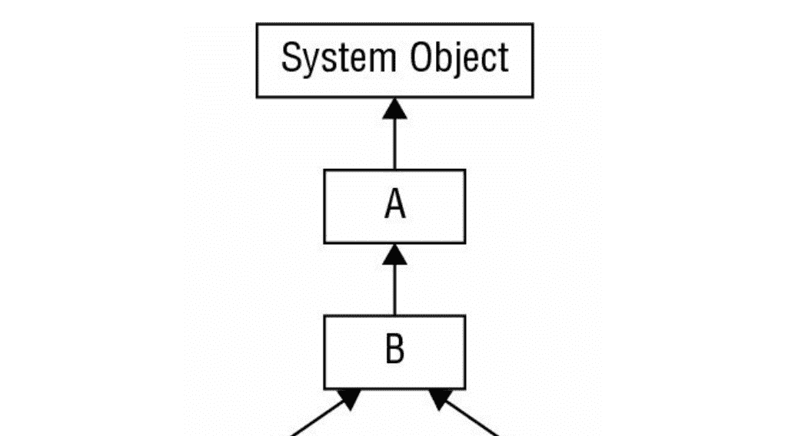

**图 8.1**

换句话说，类 `C` 和 `D` 是间接从 `A` 派生的。在这种情况下，`A`、`B`、`C` 或 `D` 之间唯一合法的用户自定义强制转换，就是在类 `C` 和 `D` 之间进行转换，因为这些类不是彼此派生的。实现这一点的代码可能如下所示（假设你希望强制转换是显式的，在用户自定义类之间定义强制转换时通常如此）：

```
public static explicit operator D(C value)
{
//...
}

public static explicit operator C(D value)
{
//...
}
```

对于这些强制转换中的每一个，你都可以选择定义的位置——放在类 `C` 的类定义内部，或放在类 `D` 的类定义内部，但不能放在任何其他地方。C# 要求你将强制转换的定义放在源类（或结构）或目标类（或结构）内部。这带来的一个副作用是，除非你至少能够编辑其中一个类的源代码，否则你无法在两个类之间定义强制转换。这是明智的，因为它可以防止第三方将强制转换引入你的类中。

在其中一个类内部定义了强制转换之后，你就不能在另一个类内部也定义同样的强制转换。显然，每次转换只能有一个强制转换；否则，编译器将不知道应该使用哪一个。

### 基类和派生类之间的强制转换

为了了解这些强制转换如何工作，首先考虑源类型和目标类型都是引用类型的情况，并考虑两个类 `MyBase` 和 `MyDerived`，其中 `MyDerived` 直接或间接派生自 `MyBase`。

首先，从 `MyDerived` 到 `MyBase`，始终可以这样写（假设构造函数可用）：

```
MyDerived derivedObject = new MyDerived();
MyBase baseCopy = derivedObject;
```

这里，你是在从 `MyDerived` 隐式强制转换为 `MyBase`。这之所以可行，是因为有一条规则：对 `MyBase` 类型的任何引用都允许引用 `MyBase` 类的对象，或任何从 `MyBase` 派生的对象。在面向对象编程中，派生类的实例在真实意义上就是基类的实例，再加上一些额外的东西。基类上定义的所有函数和字段在派生类中也都有定义。

或者，你可以这样写：

```
MyBase derivedObject = new MyDerived();
MyBase baseObject = new MyBase();
MyDerived derivedCopy1 = (MyDerived) derivedObject; // OK
MyDerived derivedCopy2 = (MyDerived) baseObject; // Throws exception
```

这段代码在 C# 中完全合法（在语法意义上），它演示了从基类到派生类的强制转换。然而，最后一条语句在执行时会抛出异常。当你执行强制转换时，会对所引用的对象进行检查。因为基类引用原则上可以引用派生类实例，所以这个对象有可能实际上是你试图转换到的那个派生类的一个实例。如果是这种情况，强制转换成功，派生引用会被设置为指向该对象。但是，如果所涉及的对象不是该派生类（或任何从它派生的类）的实例，则强制转换失败，并抛出异常。

注意，编译器提供的那些用于在基类和派生类之间进行转换的强制转换，实际上并没有对所涉及的对象进行任何数据转换。它们所做的只是，如果该转换合法，则让新引用指向该对象。就此而言，这些强制转换在本质上与你通常自己定义的那些有很大不同。例如，在之前的 `CastingSample` 示例中，你定义了在 `Currency` 结构和 `float` 之间进行转换的强制转换。在 `float` 到 `Currency` 的强制转换中，你实际上实例化了一个新的 `Currency` 结构，并用所需的值为其初始化。而基类和派生类之间预定义的强制转换不会这样做。如果你想将一个 `MyBase` 实例转换为一个真正的 `MyDerived` 对象，并使其值基于 `MyBase` 实例的内容，你不能使用强制转换语法来实现。最合理的选择通常是定义一个以基类实例为参数的派生类构造函数，并让该构造函数执行相关的初始化：


```
class DerivedClass: BaseClass
{
    public DerivedClass(BaseClass base)
    {
        // 从 Base 实例初始化对象
    }
    // 等等
```

### 装箱和拆箱强制转换

前面的讨论集中在基类和派生类之间的强制转换，其中双方都是引用类型。类似的原理也适用于值类型的强制转换，尽管这种情况下不可能简单地复制引用——必须发生一些数据复制。

当然，不可能从结构或原始值类型进行派生。基类和派生结构之间的强制转换，总是意味着在原始类型或结构与 `System.Object` 之间进行强制转换。（理论上，在结构和 `System.ValueType` 之间进行强制转换是可能的，虽然很难看出你为什么会想要这样做。）

从任何结构（或原始类型）到 `object` 的强制转换总是可以作为隐式强制转换使用——因为它是从派生类型到基类型的强制转换——并且这正是我们熟悉的装箱过程。例如，使用 `Currency` 结构：

```
var balance = new Currency(40,0);
object baseCopy = balance;
```

当执行这个隐式强制转换时，`balance` 的内容会被复制到堆上一个已装箱的对象中，`baseCopy` 对象引用会设置为指向该对象。在幕后实际发生的事情是这样：当你最初定义 `Currency` 结构时，.NET 框架隐式地提供了另一个（隐藏的）类，一个装箱的 `Currency` 类，它包含与 `Currency` 结构相同的字段，但它是存储在堆上的引用类型。每当你定义值类型（无论是结构还是枚举）时都会发生这种情况，并且对应于 `int`、`double`、`uint` 等所有原始值类型的类似装箱引用类型也存在。在源代码中无法也不必直接以编程方式访问这些装箱类中的任何一个，但每当值类型被强制转换为 `object` 时，它们就是在幕后工作的对象。当你隐式地将 `Currency` 强制转换为 `object` 时，会实例化一个装箱的 `Currency` 实例，并用 `Currency` 结构中的所有数据对其初始化。在前面的代码中，`baseCopy` 引用的正是这个装箱的 `Currency` 实例。通过这种方式，从派生类型到基类型的强制转换在语法上就可以对值类型和引用类型以相同的方式工作。

反向的强制转换称为拆箱。与基引用类型和派生引用类型之间的强制转换一样，它是显式强制转换，因为如果被转换的对象类型不正确，就会抛出异常：

```
object derivedObject = new Currency(40,0);
```

```csharp
object baseObject = new object();
Currency derivedCopy1 = (Currency)derivedObject;    // OK
Currency derivedCopy2 = (Currency)baseObject;       // Exception thrown
```

这段代码的工作方式与前面为引用类型展示的代码类似。将 `derivedObject` 强制转换为 `Currency` 之所以可行，是因为 `derivedObject` 实际上引用的是一个已装箱的 `Currency` 实例——该转换通过将字段从已装箱的 `Currency` 对象复制到一个新的 `Currency` 结构体中来执行。第二次转换失败，因为 `baseObject` 并不引用已装箱的 `Currency` 对象。

在使用装箱和取消装箱时，务必理解这两个过程实际上都会将数据复制到新的已装箱或已取消装箱的对象中。因此，例如对已装箱对象进行操作，并不会影响原始值类型的内容。

### 多重转换

在定义转换时，你需要注意一点：如果 C# 编译器遇到没有直接转换可执行所需转换的情况，它会尝试寻找组合转换的方式来完成转换。例如，对于 `Currency` 结构体，假设编译器遇到这样几行代码：

```csharp
var balance = new Currency(10,50);
long amount = (long)balance;
double amountD = balance;
```

你首先初始化了一个 `Currency` 实例，然后尝试将其转换为 `long`。问题在于你并没有定义执行该转换的强制转换。然而，这段代码仍然可以成功编译。其过程如下：编译器意识到你已经定义了一个从 `Currency` 到 `float` 的隐式转换，并且编译器已经知道如何将 `float` 显式转换为 `long`。因此，它会将该行代码编译成 IL 代码，先把 `balance` 转换为 `float`，再把结果转换为 `long`。代码的最后一行也是如此，将 `balance` 转换为 `double`。不过，由于从 `Currency` 到 `float` 的转换以及从 `float` 到 `double` 的预定义转换都是隐式的，你可以在代码中将此转换写成隐式转换。如果你愿意，也可以显式指定转换路径：

```csharp
var balance = new Currency(10,50);
long amount = (long)(float)balance;
double amountD = (double)(float)balance;
```

然而，在大多数情况下，这会被视为不必要地使代码复杂化。相比之下，以下代码会产生编译错误：

```csharp
var balance = new Currency(10,50);
long amount = balance;
```

原因是编译器能够找到的最佳转换匹配仍然是先转换为 `float`，然后再转换为 `long`。不过，从 `float` 到 `long` 的转换必须显式指定。

这些规则本身并不会给你带来太多麻烦。毕竟，这些规则相当直观，其设计目的是防止在开发者不知情的情况下发生任何数据丢失。然而，问题在于，如果你在定义转换时不够小心，编译器有可能选择一条导致意外结果的路径。例如，假设编写 `Currency` 结构体的团队中有其他人想到，能够将包含金额总美分数（以美分为单位，而不是以美元为单位，因为这样做的目的是不丢失美元的分数部分）的 `uint` 转换为 `Currency` 将会很有用。于是，可能会编写这样的转换来实现这个目的：

```csharp
// 不要这样做！
public static implicit operator Currency (uint value) =>
    new Currency(value/100u, (ushort)(value%100));
```

注意这段代码中第一个 100 后面的 `u`，这是为了确保 `value/100u` 被解释为 `uint`。如果你写成 `value/100`，编译器会将其解释为 `int`，而不是 `uint`。

代码中明确标注了注释 `不要这样做！`，原因如下：下面的代码片段仅仅是将一个包含 350 的 `uint` 转换为 `Currency`，然后再转换回来；但你认为执行完这段代码后，`bal2` 会包含什么值呢？

```csharp
uint bal = 350;
Currency balance = bal;
uint bal2 = (uint)balance;
```

答案不是 350，而是 3！而且这一切都符合逻辑。你将 350 隐式转换为 `Currency`，得到结果 `balance.Dollars = 3, balance.Cents = 50`。然后编译器像往常一样，找出最佳路径进行回转。`balance` 最终被隐式转换为 `float`（值 3.5），再被显式转换为值为 3 的 `uint`。

当然，还存在其他将一种数据类型转换再转回导致数据丢失的情况。例如，将一个包含 5.8 的 `float` 转换为 `int`，再转回 `float`，会丢失小数部分，得到结果 5。但丢失一个数字的小数部分与将一个整数除以 100 多，在原则上是略有不同的。`Currency` 突然变成了一个相当危险的类，会对整数做一些奇怪的事情！

问题在于，你的转换在解释整数时存在冲突。`Currency` 与 `float` 之间的转换将整数 1 解释为对应 1 美元，但最新的 `uint` 到 `Currency` 的转换却将该值解释为 1 美分。这是一个设计极差的例子。如果你希望自己的类易于使用，就应该确保所有转换的行为相互兼容，即它们直觉上给出相同的结果。在这种情况下，解决方案显然就是重写 `uint` 到 `Currency` 的转换，使其将整数 1 解释为 1 美元：

```csharp
public static implicit operator Currency (uint value) =>
    new Currency(value, 0);
```

顺便提一下，你可能会想这个新转换是否真的有必要。答案是它可能很有用。如果没有这个转换，编译器执行 `uint` 到 `Currency` 转换的唯一方式就是通过 `float`。在这种情况下，直接转换效率要高得多，因此添加这个额外的转换可以带来性能上的好处，不过你需要确保它与通过 `float` 转换得到的结果一致，而你现在已经做到了。在其他情况下，你可能还会发现为不同的预定义数据类型单独定义转换，可以使更多的转换成为隐式转换而不是显式转换，虽然这里的情况并非如此。

一个检验你的转换是否兼容的好方法是，询问一次转换是否会给出相同的结果（除了像 `float` 到 `int` 转换中可能出现的精度损失），而不管它走的是哪条路径。`Currency` 类为此提供了一个很好的例子。考虑以下代码：

```csharp
var balance = new Currency(50, 35);
ulong bal = (ulong) balance;
```

目前，编译器只有一种方法可以完成此转换：先将 `Currency` 隐式转换为 `float`，然后将其显式转换为 `ulong`。`float` 到 `ulong` 的转换需要显式转换，但这没关系，因为你已经在这里指定了显式转换。

然而，假设你随后又添加了一个转换，即从 `Currency` 隐式转换为 `uint`。实际上，你需要通过修改 `Currency` 结构体，添加上下文所展示的双向转换（代码文件 `CastingSample/Currency.cs`）：

```csharp
public static implicit operator Currency (uint value) =>
    new Currency(value, 0);

public static implicit operator uint (Currency value) =>
    value.Dollars;
```

现在编译器有了另一条从 `Currency` 转换为 `ulong` 的可能路径：先从 `Currency` 隐式转换为 `uint`，然后隐式转换为 `ulong`。它会选择这两条路径中的哪一条呢？C# 对于编译器在存在多种可能性时选择最佳路径有一些精确的规则。（本书不涉及这些规则，但如果你对细节感兴趣，可以参阅 MSDN 文档。）最好的答案是，你应该设计你的转换，使所有路径都给出相同的结果（除了可能的精度损失），这样编译器选择哪一条路径并不重要。（在本例中，编译器会选择 `Currency` → `uint` → `ulong` 路径，而不是 `Currency` → `float` → `ulong`。）

为了测试将 `Currency` 转换为 `uint`，请将以下测试代码添加到 `Main` 方法中（代码文件 `CastingSample/Program.cs`）：

```csharp
static void Main()
{
    try
    {
        var balance = new Currency(50,35);

        WriteLine(balance);
        WriteLine($"balance is {balance}");

        uint balance3 = (uint) balance;

        WriteLine($"Converting to uint gives {balance3}");
    }
    catch (Exception ex)
    {
        WriteLine($"Exception occurred: {ex.Message}");
    }
}
```

运行示例现在会得到以下结果：

```
50
balance is $50.35
Converting to uint gives 50
```

输出显示转换到 `uint` 已成功，不过正如预期的那样，在进行此转换时你已丢失了 `Currency` 的分部分。将负浮点数转换为 `Currency` 也产生了预期的溢出异常，因为 `float` 到 `Currency` 的转换本身现在定义了一个已检查的上下文。

然而，输出也展示了你在处理转换时需要意识到的最后一个潜在问题。输出的第一行并没有正确显示余额，显示的是 50 而不是 50.35。

发生了什么？问题在于当你将转换与方法重载结合使用时，你会得到另一个不可预测性的来源。

使用格式字符串的 `WriteLine` 语句会隐式调用 `Currency.ToString` 方法，确保 `Currency` 以字符串形式显示。

然而，第一个 `WriteLine` 方法只是将原始 `Currency` 结构体传递给 `WriteLine`。现在，`WriteLine` 有许多重载，但其中没有一个接受 `Currency` 结构体。因此，编译器开始寻找它可以将 `Currency` 转换为什么类型以使其匹配 `WriteLine` 的某个重载。碰巧的是，`WriteLine` 的其中一个重载是为快速高效地显示 `uint` 而设计的，并且它接受 `uint` 作为参数——你现在提供了一个将 `Currency` 隐式转换为 `uint` 的转换。

事实上，`WriteLine` 还有另一个重载接受 `double` 作为参数并显示该 `double` 的值。如果你仔细查看之前运行示例的输出，其中不存在转换到 `uint`，你会看到第一行输出将 `Currency` 显示为 `double`，使用了这个重载。在那个示例中，没有从 `Currency` 到 `uint` 的直接转换，所以编译器选择 `Currency` 到 `float` 再到 `double` 作为其匹配可用转换到可用 `WriteLine` 重载的首选方式。然而，现在在 `SimpleCurrency2` 中存在直接转换到 `uint`，编译器选择了这条路径。

由此得出的结论是，如果你有一个具有多个重载的方法调用，并且你尝试传递一个数据类型与任何重载都不完全匹配的参数，那么你就迫使编译器不仅决定使用什么转换来执行数据转换，还要决定选择哪个重载，以及因此选择哪种数据转换。编译器总是按逻辑并根据严格规则工作，但结果可能不是你所期望的。如果有任何疑问，你最好明确指定要使用的转换。

### Summary

本章介绍了 C# 提供的标准运算符，描述了对象相等性的机制，并检查了编译器如何将标准数据类型从一种转换为另一种。它还演示了如何使用运算符重载在你的数据类型上实现自定义运算符支持。最后，你研究了一种特殊的运算符重载类型，即转换运算符，它使你能够指定如何将你的类型的实例转换为其他数据类型。

下一章将解释委托、lambda 表达式和事件。

### 9 Delegates, Lambdas, and Events

#### What’s In This Chapter?

- Delegates
- Lambda expressions
- Closures
- Events
- Weak Events

#### Wrox.com Code Downloads for This Chapter

本章在 `www.wrox.com/go/professionalcsharp6` 的 Download Code 标签下可以找到 wrox.com 代码下载。本章的代码分为以下主要示例：

- Simple Delegates
- Bubble Sorter
- Lambda Expressions
- Events Sample
- Weak Events

#### Referencing Methods

委托是 .NET 中指向方法的地址的变体。将其与 C++ 相比，在 C++ 中，函数指针只不过是指向内存位置的指针，而且不是类型安全的。你不知道指针到底指向什么，诸如参数和返回类型等项目是未知的。这与 .NET 完全不同；委托是类型安全的类，定义了返回类型和参数类型。委托类不仅包含对方法的引用，还可以保存对多个方法的引用。

Lambda 表达式与委托直接相关。当参数是委托类型时，你可以使用 lambda 表达式来实现从委托引用的方法。

本章解释了委托和 lambda 表达式的基础知识，并展示了如何使用 lambda 表达式实现由委托调用的方法。它还演示了 .NET 如何使用委托作为实现事件的手段。

#### Delegates

委托适用于你想要将方法传递给其他方法的情况。要了解这意味着什么，请考虑这行代码：

```
int i = int.Parse("99");
```

你已经习惯于将数据作为参数传递给方法，就像这个例子一样，以至于你不会有意识地思考它，所以将方法而不是数据传递的想法可能听起来有点奇怪。然而，有时你有一个执行某些操作的方法，而不是对数据进行操作，该方法可能需要执行某些涉及调用另一个方法的操作。更复杂的是，你在编译时并不知道这个第二方法是什么。该信息只有在运行时才可用，因此需要作为参数传递给第一个方法。这听起来可能令人困惑，但通过几个例子应该会变得更清晰：

- **Threads and tasks**—在 C# 中，可以让计算机在并行于当前正在执行的操作的同时启动一个新的执行序列。这种序列被称为 *thread*，你使用 `System.Threading.Thread` 基类之一实例上的 `Start` 方法来启动它。如果你告诉计算机启动一个新的执行序列，你必须告诉它从哪里开始该序列；也就是说，你必须提供一个方法在其中可以开始执行的细节。换句话说，`Thread` 类的构造函数接受一个参数，该参数定义了线程将调用的方法。


- **Generic library classes**—许多库包含执行各种标准任务的代码。通常，这些库可以是自包含的，因为你在编写库时确切知道任务必须如何执行。然而，有时任务包含一个子任务，只有使用库的单个客户端代码才知道如何执行。例如，假设你想编写一个类，它接受一个对象数组并按升序对它们进行排序。排序过程的一部分涉及反复取出数组中的两个对象并比较它们以查看哪个应该排在前面。如果你想使该类能够对任何对象的数组进行排序，就没有办法提前知道如何进行此比较。向你的类提供对象数组的客户端代码还必须告诉你的类如何为其想要排序的特定对象执行此比较。客户端代码必须向你的类传递适当方法的详细信息，以便调用该方法来执行比较。
- **Events**—这里的总体思路是，通常你有需要被告知某些事件发生时代码。当事件被引发时，运行时需要知道应该执行什么方法。这是通过将处理事件的方法作为参数传递给委托来完成的。本章后面会讨论这一点。

在 C 和 C++ 中，你可以简单地取一个函数的地址并将其作为一个参数。C 语言没有类型安全。你可以将任意函数传递给需要函数指针的方法。不幸的是，这种直接方式不仅会引发一些类型安全问题，还忽略了一个事实：在进行面向对象编程时，方法很少独立存在；它们通常需要与类实例关联后才能被调用。由于这些问题，.NET Framework 在语法上不允许这种直接方式。相反，如果你想传递方法，就必须将方法的细节包装到一种新型对象中，即委托（delegate）。简单来说，委托是一种特殊类型的对象——特殊之处在于，迄今为止定义的所有对象都包含数据，而委托包含的是方法的地址，或多个方法的地址。

### 声明委托

在 C# 中使用类时，需要分两个阶段进行。首先，需要定义类——也就是说，需要告诉编译器这个类由哪些字段和方法组成。然后（除非你只使用静态方法），实例化该类的一个对象。委托也是如此。首先声明要使用的委托。声明委托就是告诉编译器该类型的委托将表示哪种方法。然后，必须创建该委托的一个或多个实例。在幕后，编译器会创建一个表示该委托的类。

声明委托的语法如下所示：

```
delegate void IntMethodInvoker(int x);
```

这将声明一个名为`IntMethodInvoker`的委托，并指明该委托的每个实例都可以持有对一个方法的引用，该方法接受一个`int`参数并返回`void`。关于委托，需要理解的关键点是它们是类型安全的。定义委托时，必须提供其所表示方法的签名和返回类型的完整细节。

> **注意** 理解委托的一个好方法是将委托视为给方法签名和返回类型命名的东西。

假设你想定义一个名为`TwoLongsOp`的委托，它表示一个接受两个`long`参数并返回`double`的方法。你可以这样做：

```
delegate double TwoLongsOp(long first, long second);
```

或者，要定义一个表示不带参数且返回字符串的方法的委托，可以这样写：

```
delegate string GetAString();
```

该语法与方法定义的语法相似，只是没有方法体，并且定义以关键字`delegate`开头。因为你在这里所做的基本上就是定义一个新类，所以你可以在定义类的任何地方定义委托——也就是说，可以在另一个类内部、任何类外部，或者在命名空间中作为顶级对象。根据你希望定义的可见性以及委托的作用域，你可以将任何常规访问修饰符应用于委托定义——`public`、`private`、`protected`等：

```
public delegate string GetAString();
```

> **注意** 当我们把定义委托描述为定义一个新类时，我们确实是这个意思。委托是作为从`System.MulticastDelegate`类派生的类实现的，而`System.MulticastDelegate`又派生自基类`System.Delegate`。C# 编译器知道这个类，并使用其委托语法来隐藏这个类操作的细节。这是 C# 与基类协同工作以尽可能简化编程的另一个好例子。

定义委托后，你可以创建它的一个实例，以便用它来存储有关特定方法的详细信息。

> **注意** 这里有一个不幸的术语问题。在讨论类时，有两个不同的术语：class（类），表示较宽泛的定义；object（对象），表示类的一个实例。不幸的是，对于委托，只有一个术语；delegate（委托）既可以指类，也可以指对象。当你创建委托的一个实例时，所创建的东西也被称为委托。在讨论委托时，你需要根据上下文来了解使用的是哪个含义。

### 使用委托

下面的代码片段演示了委托的使用。这是一种相当啰嗦的调用`int`的`ToString`方法的方式（代码文件`GetAStringDemo/Program.cs`）：

```
private delegate string GetAString();

public static void Main()
{
    int x = 40;
    GetAString firstStringMethod = new GetAString(x.ToString);
    WriteLine($"String is {firstStringMethod()}");
    // With firstStringMethod initialized to x.ToString(),
    // the above statement is equivalent to saying
    // Console.WriteLine($"String is {x.ToString()}");
}
```

这段代码实例化了一个`GetAString`类型的委托，并对其进行初始化，使其引用整数变量`x`的`ToString`方法。在 C# 中，委托在语法上总是接受一个单参数构造函数，该参数就是委托所引用的方法。此方法必须与你最初定义委托时的签名匹配。在这种情况下，如果你试图用任何不带参数且不返回字符串的方法来初始化变量`firstStringMethod`，就会收到编译错误。注意，由于`int.ToString`是一个实例方法（与静态方法相对），你需要同时指定实例（`x`）和方法名称，才能正确初始化委托。

下一行实际上使用委托来显示字符串。在任何代码中，提供委托实例的名称，后跟包含任何参数的括号，与调用该委托包装的方法具有完全相同的效果。因此，在前面的代码片段中，`Console.WriteLine`语句与注释掉的那行完全等价。

实际上，给委托实例加上括号等同于调用委托类的`Invoke`方法。因为`firstStringMethod`是委托类型的变量，C# 编译器会将`firstStringMethod`替换为`firstStringMethod.Invoke`：

```
firstStringMethod();
firstStringMethod.Invoke();
```

为了减少输入，在需要委托实例的任何地方，你都可以直接传递方法名称。这被称为*委托推断*（delegate inference）。只要编译器能将委托实例解析为特定类型，这个 C# 功能就能正常工作。该示例使用委托`GetAString`的一个新实例初始化了类型为`GetAString`的变量`firstStringMethod`：

```
GetAString firstStringMethod = new GetAString(x.ToString);
```

你可以只将方法名称与变量`x`一起传递给变量`firstStringMethod`，实现同样的效果：

```
GetAString firstStringMethod = x.ToString;
```

C# 编译器生成的代码是相同的。编译器检测到`firstStringMethod`需要委托类型，因此它会创建委托类型`GetAString`的一个实例，并将方法地址与对象`x`一起传递给构造函数。

> **注意** 请注意，你不能在方法名后面加上括号，写成`x.ToString()`，并将其传递给委托变量。那将是对方法的调用。`ToString`方法的调用会返回一个字符串对象，不能赋值给委托变量。你只能将方法的地址赋给委托变量。

现在你可以如下使用`GetAString`实例（代码文件`GetAStringDemo/Program.cs`）：

```
private delegate string GetAString();

public static void Main()
{
    int x = 40;
    GetAString firstStringMethod = x.ToString;
    WriteLine($"String is {firstStringMethod()}");

    var balance = new Currency(34, 50);

    // firstStringMethod references an instance method
    firstStringMethod = balance.ToString;
    WriteLine($"String is {firstStringMethod()}");

    // firstStringMethod references a static method
    firstStringMethod = new GetAString(Currency.GetCurrencyUnit);
    WriteLine($"String is {firstStringMethod()}");
}
```

这段代码演示了如何通过委托调用方法，并随后重新分配委托，使其引用不同类实例上的不同方法，甚至是静态方法或针对不同类型类实例的方法，前提是每个方法的签名都与委托定义匹配。

运行应用程序时，你会得到由委托引用的不同方法所返回的输出：

```
String is 40
String is $34.50
String is Dollar
```

然而，你还没有看到真正将委托传递给另一个方法的过程。而且，目前这还没有实现任何特别有用的功能。调用`int`和`Currency`对象的`ToString`方法，可以比使用委托更直接。遗憾的是，委托的本质决定了你需要一个相当复杂的示例才能真正体会到它们的用处。下一节将介绍两个委托示例。第一个示例只是使用委托来调用几个不同的操作。它说明了如何将委托传递给方法，以及如何使用委托数组——尽管可以说，它并没有做到不用委托也能更简单完成的事情。第二个示例要复杂得多，它介绍了一个`BubbleSorter`类，该类实现了一个将对象数组按升序排序的方法。如果不使用委托，这个类将很难编写。

### 简单的委托示例

这个示例定义了一个`MathOperations`类，该类使用几个静态方法对`double`执行两种操作。然后你使用委托来调用这些方法。`MathOperations`类如下所示：

```
class MathOperations
{
    public static double MultiplyByTwo(double value) => value * 2;
    public static double Square(double value) => value * value;
}
```

你可以按如下方式调用这些方法（代码文件`SimpleDelegate/Program.cs`）：

```
using static System.Console;

namespace Wrox.ProCSharp.Delegates
{
    delegate double DoubleOp(double x);

    class Program
    {
        static void Main()
        {
            DoubleOp[] operations =
            {
                MathOperations.MultiplyByTwo,
                MathOperations.Square
            };

            for (int i=0; i < operations.Length; i++)
            {
                WriteLine($"Using operations[{i}]:");
                ProcessAndDisplayNumber(operations[i], 2.0);
                ProcessAndDisplayNumber(operations[i], 7.94);
                ProcessAndDisplayNumber(operations[i], 1.414);
                WriteLine();
            }
        }

        static void ProcessAndDisplayNumber(DoubleOp action, double value)
        {
            double result = action(value);
            WriteLine($"Value is {value}, result of operation is {result}");
        }
    }
}
```

在这段代码中，你实例化了一个`DoubleOp`委托数组（请记住，定义了一个委托类之后，基本上就可以像普通类一样实例化它的实例，所以把一些实例放到数组中是没有问题的）。数组中的每个元素都被初始化为引用`MathOperations`类实现的不同操作。然后，你遍历这个数组，将每个操作应用于三个不同的值。这展示了委托的一种使用方式——将方法分组到数组中，以便在循环中调用多个方法。

这段代码中的关键行是实际将每个委托传递给`ProcessAndDisplayNumber`方法的那些行，例如：

```
ProcessAndDisplayNumber(operations[i], 2.0);
```

上面的代码传入了一个委托的名称，但没有带任何参数。鉴于`operations[i]`是一个委托，从语法上讲：

- `operations[i]` 表示*委托*（即由该委托所表示的方法）

- `operations[i](2.0)` 表示*实际调用这个方法，并把括号中的值传进去*

`ProcessAndDisplayNumber`方法被定义为将委托作为其第一个参数：

```
static void ProcessAndDisplayNumber(DoubleOp action, double value)
```

然后，在该方法内部，你调用：

```
double result = action(value);
```

这实际上会调用被`action`委托实例所包装的方法，并将其返回值存储在`result`中。运行这个示例会得到以下结果：

```
SimpleDelegate
Using operations[0]:
Value is 2, result of operation is 4
Value is 7.94, result of operation is 15.88
Value is 1.414, result of operation is 2.828

Using operations[1]:
Value is 2, result of operation is 4
Value is 7.94, result of operation is 63.0436
Value is 1.414, result of operation is 1.999396
```

### `Action<T>` 与 `Func<T>` 委托

与其为每个参数和返回类型定义一个新的委托类型，你可以使用`Action<T>`和`Func<T>`委托。泛型`Action<T>`委托用于引用具有`void`返回类型的方法。这个委托类有不同的变体，以便你可以传递多达 16 种不同的参数类型。不带泛型参数的`Action`类用于调用没有参数的方法。`Action<in T>`用于调用带一个参数的方法；`Action<in T1, in T2>`用于调用带两个参数的方法；`Action<in T1, in T2, in T3, in T4, in T5, in T6, in T7, in T8>`用于调用带八个参数的方法。

`Func<T>`委托可以用类似的方式使用。`Func<T>`允许你调用具有返回类型的方法。与`Action<T>`类似，`Func<T>`也有不同的变体，可以传递多达 16 种参数类型以及一种返回类型。`Func<out TResult>`是用于调用具有返回类型且无参数的方法的委托类型。`Func<in T, out TResult>`用于带一个参数的方法，而`Func<in T1, in T2, in T3, in T4, out TResult>`用于带四个参数的方法。

前一节的示例声明了一个带`double`参数和`double`返回类型的委托：

```
delegate double DoubleOp(double x);
```

与其声明自定义委托`DoubleOp`，你可以使用`Func<in T, out TResult>`委托。你可以声明一个该委托类型的变量，或者像这里所示，声明一个该委托类型的数组：

```
Func<double, double>[] operations =
{
    MathOperations.MultiplyByTwo,
    MathOperations.Square
};
```

并将其作为参数与`ProcessAndDisplayNumber`方法一起使用：


### BubbleSorter 示例

现在你已经准备好来看一个能够真正展示委托实用价值的示例。你将编写一个名为 `BubbleSorter` 的类。该类实现一个静态方法 `Sort`，该方法将对象数组作为其第一个参数，并将该数组重新排列为升序。例如，如果你传入这样一个 `int` 数组 `{0, 5, 6, 2, 1}`，它会将该数组重新排列为 `{0, 1, 2, 5, 6}`。

冒泡排序算法是一种众所周知且非常简单的数字排序方法。它最适合于小规模数字集合，因为对于较大规模的数字集合（超过大约 10 个），有高效得多的算法可用。它的工作方式是反复循环遍历数组，比较每对数字，并在必要时交换它们，从而使最大的数字逐渐向数组末尾移动。对于 `int` 排序，执行冒泡排序的方法可能类似于下面这样：

```
bool swapped = true;
do
{
    swapped = false;
    for (int i = 0; i < sortArray.Length-1; i++)
    {
        if (sortArray[i] > sortArray[i+1]) // problem with this test
        {
            int temp = sortArray[i];
            sortArray[i] = sortArray[i + 1];
            sortArray[i + 1] = temp;
            swapped = true;
        }
    }
} while (swapped);
```

这对于 `int` 来说没问题，但你希望你的 `Sort` 方法能够对任意对象进行排序。换句话说，如果某些客户端代码向你传递一个 `Currency` 结构体数组，或者其他任何它可能定义的类或结构体的数组，你需要能够对该数组进行排序。这在前面的代码行 `if (sortArray[i] > sortArray[i+1])` 中带来了一个问题，因为那要求你比较数组中的两个对象以确定哪个更大。你可以对 `int` 这样做，但对于一个没有实现 `<` 运算符的新类，你该如何做呢？答案是，知道该类的客户端代码必须传入一个委托，该委托包装一个执行比较的方法。另外，不要为临时变量使用 `int` 类型，而是可以使用泛型类型来实现一个泛型 `Sort` 方法。

对于一个接受类型 `T` 的泛型 `Sort<T>` 方法，需要有一个比较方法，该方法带有两个类型为 `T` 的参数，并且返回类型为 `bool`，以便用于 `if` 比较。这个方法可以由 `Func<T1, T2, TResult>` 委托来引用，其中 `T1` 和 `T2` 是相同的类型：`Func<T, T, bool>`。

这样一来，你就为你的 `Sort<T>` 方法赋予了以下签名：

```
static public void Sort<T>(IList<T> sortArray, Func<T, T, bool> comparison)
```

该方法的文档说明，`comparison` 必须引用一个接受两个参数的方法，并且当第一个参数的值小于第二个参数时返回 `true`。

现在一切就绪。以下是 `BubbleSorter` 类的定义（代码文件 `BubbleSorter/BubbleSorter.cs`）：

```
class BubbleSorter
{
    static public void Sort<T>(IList<T> sortArray, Func<T, T, bool> comparison)
    {
        bool swapped = true;
        do
        {
            swapped = false;
            for (int i = 0; i < sortArray.Count-1; i++)
            {
                if (comparison(sortArray[i+1], sortArray[i]))
                {
                    T temp = sortArray[i];
                    sortArray[i] = sortArray[i + 1];
                    sortArray[i + 1] = temp;
                    swapped = true;
                }
            }
        } while (swapped);
    }
}
```

要使用这个类，你需要定义另一个类，用于设置一个需要排序的数组。对于这个示例，假设 Mortimer Phones 移动电话公司有一个员工列表，希望按照薪水对他们进行排序。每个员工都由一个 `Employee` 类的实例表示，该类看起来类似于下面这样（代码文件 `BubbleSorter/Employee.cs`）：

```csharp
class Employee
{
    public Employee(string name, decimal salary)
    {
        Name = name;
        Salary = salary;
    }

    public string Name { get; }
    public decimal Salary { get; private set; }

    public override string ToString() => $"{Name}, {Salary:C}";

    public static bool CompareSalary(Employee e1, Employee e2) =>
        e1.Salary < e2.Salary;
}
```

请注意，为了匹配 `Func<T, T, bool>` 委托的签名，你必须在该类中将 `CompareSalary` 定义为接受两个 `Employee` 引用并返回布尔值。在实现中，基于薪水的比较被执行。

现在你可以编写一些客户端代码来请求排序（代码文件 `BubbleSorter/Program.cs`）：

```csharp
using static System.Console;

namespace Wrox.ProCSharp.Delegates
{
    class Program
    {
        static void Main()
        {
            Employee[] employees =
            {
                new Employee("Bugs Bunny", 20000),
                new Employee("Elmer Fudd", 10000),
                new Employee("Daffy Duck", 25000),
                new Employee("Wile Coyote", 1000000.38m),
                new Employee("Foghorn Leghorn", 23000),
                new Employee("RoadRunner", 50000)
            };

            BubbleSorter.Sort(employees, Employee.CompareSalary);

            foreach (var employee in employees)
            {
                WriteLine(employee);
            }
        }
    }
}
```

运行此代码显示员工已根据薪水正确排序：

```text
Elmer Fudd, $10,000.00
Bugs Bunny, $20,000.00
Foghorn Leghorn, $23,000.00
Daffy Duck, $25,000.00
RoadRunner, $50,000.00
Wile Coyote, $1,000,000.38
```

### 多播委托

到目前为止，你使用的每个委托都只包装一个方法调用。调用委托相当于调用该方法。如果你想调用多个方法，你需要通过委托显式地多次调用。然而，委托可以包装多个方法。这种委托被称为多播委托。当多播委托被调用时，它会按顺序依次调用每个方法。为此工作，委托签名应返回 `void`；否则，你只会得到委托调用的最后一个方法的结果。

对于 `void` 返回类型，你可以使用 `Action<double>` 委托（代码文件 `MulticastDelegates/Program.cs`）：

```csharp
class Program
{
    static void Main()
    {
        Action<double> operations = MathOperations.MultiplyByTwo;
        operations += MathOperations.Square;
```

在之前的示例中，你想存储对两个方法的引用，因此你实例化了一个委托数组。在这里，你只需将两个操作都添加到同一个多播委托中。多播委托识别运算符 `+` 和 `+=`。或者，你可以扩展前述代码的最后两行，如以下片段所示：

```csharp
Action<double> operation1 = MathOperations.MultiplyByTwo;
Action<double> operation2 = MathOperations.Square;
Action<double> operations = operation1 + operation2;
```

多播委托还识别运算符 `-` 和 `-=` 以从委托中移除方法调用。

> **注意** 就内部实现而言，多播委托是一个派生自 `System.MulticastDelegate` 的类，而 `System.MulticastDelegate` 又派生自 `System.Delegate`。`System.MulticastDelegate` 具有额外的成员，允许将方法调用链接到一个列表中。

为了说明多播委托的使用，以下代码将 `SimpleDelegate` 示例重写为一个新的示例：`MulticastDelegate`。因为现在委托需要引用返回 `void` 的方法，所以你必须重写 `MathOperations` 类中的方法，使其显示结果而不是返回它们（代码文件 `MulticastDelegates/MathOperations.cs`）：

```csharp
class MathOperations
{
    public static void MultiplyByTwo(double value)
    {
        double result = value * 2;
        WriteLine($"Multiplying by 2: {value} gives {result}");
    }

    public static void Square(double value)
    {
        double result = value * value;
        WriteLine($"Squaring: {value} gives {result}");
    }
}
```

为了适应这一变化，你还必须重写 `ProcessAndDisplayNumber`（代码文件 `MulticastDelegates/Program.cs`）：

```csharp
static void ProcessAndDisplayNumber(Action<double> action, double value)
{
    WriteLine();
    WriteLine($"ProcessAndDisplayNumber called with value = {value}");
    action(value);
}
```

现在你可以尝试你的多播委托：

```csharp
static void Main()
{
    Action<double> operations = MathOperations.MultiplyByTwo;
    operations += MathOperations.Square;

    ProcessAndDisplayNumber(operations, 2.0);
    ProcessAndDisplayNumber(operations, 7.94);
    ProcessAndDisplayNumber(operations, 1.414);
    WriteLine();
}
```

每次调用 `ProcessAndDisplayNumber` 时，它都会显示一条消息，说明它已被调用。然后以下语句会导致 `action` 委托实例中的每个方法调用依次被调用：

```csharp
action(value);
```

运行前述代码会产生以下结果：

```text

ProcessAndDisplayNumber called with value = 2
Multiplying by 2: 2 gives 4
Squaring: 2 gives 4

ProcessAndDisplayNumber called with value = 7.94
Multiplying by 2: 7.94 gives 15.88
Squaring: 7.94 gives 63.0436

ProcessAndDisplayNumber called with value = 1.414
Multiplying by 2: 1.414 gives 2.828
Squaring: 1.414 gives 1.999396
```

如果你使用多播委托，请注意，链接到同一委托的方法的调用顺序在形式上是未定义的。因此，避免编写依赖于此类方法按特定顺序调用的代码。

通过一个委托调用多个方法可能会导致更大的问题。多播委托包含一组委托，按顺序依次调用它们。如果委托调用的方法之一抛出异常，整个迭代就会停止。考虑以下 `MulticastIteration` 示例。这里使用了返回 `void` 且无参数的简单委托 `Action`。该委托旨在调用方法 `One` 和 `Two`，它们满足委托的参数和返回类型要求。请注意方法 `One` 抛出异常（代码文件 `MulticastDelegateWithIteration/Program.cs`）：

```csharp
using System;
using static System.Console;

namespace Wrox.ProCSharp.Delegates
{
    class Program
    {
        static void One()
        {
            WriteLine("One");
            throw new Exception("Error in one");
        }

        static void Two()
        {
            WriteLine("Two");
        }
    }
}
```

在 `Main` 方法中，委托 `d1` 被创建以引用方法 `One`；接下来，方法 `Two` 的地址被添加到同一委托中。调用 `d1` 以调用两个方法。异常在 `try/catch` 块中被捕获：

```csharp
static void Main()
{
    Action d1 = One;
    d1 += Two;

    try
    {
        d1();
    }
    catch (Exception)
    {
        WriteLine("Exception caught");
    }
}
```

只有第一个方法被委托调用。因为第一个方法抛出异常，委托的迭代在此停止，方法 `Two` 从未被调用。结果可能有所不同，因为调用方法的顺序未定义：

> **注意** *错误和异常在第 14 章“错误和异常”中有详细解释。*

在这种情况下，你可以通过自行迭代列表来避免该问题。`Delegate` 类定义了 `GetInvocationList` 方法，它返回一个 `Delegate` 对象数组。现在你可以使用此委托直接调用与它们关联的方法，捕获异常并继续下一次迭代：

```csharp
static void Main()
{
    Action d1 = One;
    d1 += Two;

    Delegate[] delegates = d1.GetInvocationList();
    foreach (Action d in delegates)
    {
        try
        {
            d();
        }
        catch (Exception)
        {
            WriteLine("Exception caught");
        }
    }
}
```

当你使用代码更改运行应用程序时，你可以看到在捕获异常后迭代会继续下一个方法：

```text
One
Exception caught
Two
```

### 匿名方法

到目前为止，委托工作时必须已经存在一个方法（即委托使用与将要使用的一个或多个方法相同的签名定义）。然而，使用委托的另一种方式是使用匿名方法。匿名方法是一段用作委托参数的代码块。


定义使用匿名方法的委托的语法不会改变。变化发生在委托实例化时。以下简单的控制台应用程序展示了如何使用匿名方法（代码文件 `AnonymousMethods/Program.cs`）：

```csharp
using static System.Console;
using System;

namespace Wrox.ProCSharp.Delegates
{
```

```csharp
class Program
{
    static void Main()
    {
        string mid = ", middle part,";

        Func<string, string> anonDel = delegate(string param)
        {
            param += mid;
            param += " and this was added to the string.";
            return param;
        };
        WriteLine(anonDel("Start of string"));
    }
}
```

委托 `Func<string, string>` 接受一个字符串参数并返回一个字符串。`anonDel` 是该委托类型的一个变量。这个变量没有被赋予某个方法的名称，而是使用了一段简单的代码块，前缀为 `delegate` 关键字，后面跟着一个字符串参数。

如你所见，这段代码块使用了方法级字符串变量 `mid`，它是在匿名方法之外定义的，并将它添加到传入的参数中。然后代码返回该字符串值。当委托被调用时，字符串作为参数传入，返回的字符串输出到控制台。

使用匿名方法的好处是减少了需要编写的代码量。你无需仅仅为了配合委托而定义方法。当你为事件定义委托时（事件将在本章后面讨论），这一点尤其明显，并且有助于降低代码的复杂性，特别是在定义了多个事件时。使用匿名方法并不会让代码执行得更快。编译器仍然会定义一个方法；只不过这个方法的名称是自动分配的，你无需知道。

使用匿名方法时必须遵循几条规则。匿名方法中不能有跳出匿名方法外部的跳转语句（`break`、`goto` 或 `continue`）。反过来也一样：匿名方法外部的跳转语句不能跳入匿名方法内部。

匿名方法内部无法访问不安全代码，也无法访问在匿名方法外部使用的 `ref` 和 `out` 参数。但在匿名方法外部定义的其他变量可以被使用。

如果你需要多次编写相同的功能，就不要使用匿名方法。这种情况下，不要重复代码，而是编写一个命名方法。你只需编写一次，然后通过名称引用它。

> **注意**：匿名方法的语法是在 C# 2 中引入的。对于新程序，你实际上不再需要这种语法，因为 lambda 表达式（将在下一节说明）提供了相同甚至更多的功能。然而，在现有源代码的许多地方你都会看到匿名方法的语法，因此了解它是有好处的。

> 自 C# 3 开始，lambda 表达式已经可用。

### Lambda 表达式

lambda 表达式的一种使用方式是将 lambda 表达式赋给委托类型：内联实现代码。只要你有委托参数类型，就可以使用 lambda 表达式。之前使用匿名方法的示例在这里被修改为使用 lambda 表达式。

```csharp
using System;
using static System.Console;

namespace Wrox.ProCSharp.Delegates
{
    class Program
    {
        static void Main()
        {
            string mid = ", middle part,";

            Func<string, string> lambda = param =>
            {
                param += mid;
                param += " and this was added to the string.";
                return param;
            };

            WriteLine(lambda("Start of string"));
        }
    }
}
```

lambda 运算符 `=>` 的左侧列出了所需的参数。lambda 运算符右侧的代码定义了赋给变量 `lambda` 的方法实现。

#### 参数

使用 lambda 表达式有多种定义参数的方式。如果只有一个参数，只需要参数名称即可。以下 lambda 表达式使用了名为 `s` 的参数。因为委托类型定义了字符串参数，所以 `s` 是 `string` 类型。该实现调用 `String.Format` 方法返回一个字符串，并在委托被调用时最终写入控制台：

转换为大写测试（代码文件 `LambdaExpressions/Program.cs`）：

```csharp
Func<string, string> oneParam = s =>
    $"change uppercase {s.ToUpper()}";
WriteLine(oneParam("test"));
```

如果委托使用多个参数，可以将参数名放在括号内组合。这里，参数 `x` 和 `y` 是 `double` 类型，正如 `Func<double, double, double>` 委托所定义的那样：

```csharp
Func<double, double, double> twoParams = (x, y) => x * y;
WriteLine(twoParams(3, 2));
```

为了方便，你还可以在括号内将参数类型加到变量名前面。如果编译器无法匹配某个重载版本，使用参数类型有助于解析匹配的委托：

```csharp
Func<double, double, double> twoParamsWithTypes = (double x,
double y) => x * y;
WriteLine(twoParamsWithTypes(4, 2));
```

#### 多行代码

如果 lambda 表达式只包含一条语句，则不需要带花括号的方法块和 `return` 语句。编译器会隐式地添加一个 `return`：

```csharp
Func<double, double> square = x => x * x;
```

添加花括号、`return` 语句和分号是完全合法的。通常，不写这些会让代码更易读：

```csharp
Func<double, double> square = x =>
{
    return x * x;
};
```

但是，如果 lambda 表达式的实现需要多条语句，则必须使用花括号和 `return` 语句：

```csharp
Func<string, string> lambda = param =>
{
    param += mid;
    param += " and this was added to the string.";
    return param;
};
```

#### 闭包

使用 lambda 表达式可以访问 lambda 表达式代码块外部的变量，这被称为*闭包*。闭包是一项很棒的特性，但如果使用不当，也可能非常危险。

在下面的示例中，类型为 `Func<int, int>` 的 lambda 表达式需要一个 `int` 参数并返回一个 `int`。lambda 表达式的参数由变量 `x` 定义。该实现还访问了位于 lambda 表达式外部的变量 `someVal`。只要你不会误以为 lambda 表达式创建了一个在之后调用 `f` 时才使用的新方法，这看起来并不会让人困惑。看这段代码，调用 `f` 返回的值应该是 `x` 加上 5，但实际可能并非如此：

```csharp
int someVal = 5;
Func<int, int> f = x => x + someVal;
```

假设变量 `someVal` 随后被更改，然后再调用 lambda 表达式，那么会使用 `someVal` 的新值。这里调用 `f(3)` 的结果是 10：

```csharp
someVal = 7;
WriteLine(f(3));
```

类似地，当你在 lambda 表达式内部更改闭包变量的值时，你也可以在 lambda 表达式外部访问这个更改后的值。

现在，你可能会想知道，在 lambda 表达式内部怎么可能访问到外部的变量。要理解这一点，请考虑编译器在定义 lambda 表达式时做了什么。对于 lambda 表达式 `x => x + someVal`，编译器会创建一个匿名类，该类有一个构造函数用于传入外部变量。构造函数取决于你从外部访问了多少变量。在这个简单示例中，构造函数接受一个 `int`。该匿名类包含一个匿名方法，其实现由 lambda 表达式定义，包括参数和返回类型：

```csharp
public class AnonymousClass
{
    private int someVal;
    public AnonymousClass(int someVal)
    {
        this.someVal = someVal;
    }
    public int AnonymousMethod(int x) => x + someVal;
}
```

使用 lambda 表达式并调用该方法时，会创建匿名类的一个实例，并在调用时传入变量的值。

> **注意**：如果你在多线程中使用闭包，可能会遇到并发冲突。最好只对闭包使用不可变类型。这样就能保证值不会改变，也不需要同步。

> **注意** 只要类型是委托，你就可以在任何地方使用 lambda 表达式。lambda 表达式的另一种用途是当类型为 `Expression` 或 `Expression<T>` 时，此时编译器会创建表达式树。此特性将在第13章“语言集成查询”中讨论。

### 事件

事件基于委托，并为委托提供发布/订阅机制。在整个框架中，事件无处不在。在 Windows 应用程序中，`Button` 类提供了 `Click` 事件。这类事件是一个委托。需要定义一个处理程序方法，该方法在 `Click` 事件被触发时调用，其参数由委托类型定义。

在本节所示的代码示例中，事件用于连接 `CarDealer` 和 `Consumer` 类。`CarDealer` 类在新车到达时提供一个事件。`Consumer` 类订阅该事件，以便在新车到达时得到通知。

#### 事件发布者

首先从一个基于事件提供订阅的 `CarDealer` 类开始。`CarDealer` 使用 `event` 关键字定义了名为 `NewCarInfo` 的事件，其类型为 `EventHandler<CarInfoEventArgs>`。在 `NewCar` 方法内部，通过调用 `RaiseNewCarInfo` 方法来触发 `NewCarInfo` 事件。该方法的实现会验证委托是否为非空，然后引发事件（代码文件 `EventsSample/CarDealer.cs`）：

```csharp
using static System.Console;
using System;

namespace Wrox.ProCSharp.Delegates
{
    public class CarInfoEventArgs: EventArgs
    {
        public CarInfoEventArgs(string car)
        {
            Car = car;
        }

        public string Car { get; }
    }

    public class CarDealer
    {
        public event EventHandler<CarInfoEventArgs> NewCarInfo;

        public void NewCar(string car)
        {
            WriteLine($"CarDealer, new car {car}");

            NewCarInfo?.Invoke(this, new CarInfoEventArgs(car));
```

> **注意** 上一个示例中使用的 null 传播运算符 `?.` 是 C# 6 的新特性。该运算符在第8章“运算符和强制转换”中讨论。

`CarDealer` 类提供了类型为 `EventHandler<CarInfoEventArgs>` 的 `NewCarInfo` 事件。按照约定，事件通常使用带有两个参数的方法；第一个参数是 `object` 类型，包含事件的发送者；第二个参数提供有关事件的信息。第二个参数因事件类型而异。.NET 1.0 为所有不同数据类型的事件定义了数百个委托。有了泛型委托 `EventHandler<T>`，就不再需要这样做了。`EventHandler<TEventArgs>` 定义了一个返回 `void` 且接受两个参数的处理程序。对于 `EventHandler<TEventArgs>`，第一个参数必须是 `object` 类型，第二个参数是 `T` 类型。`EventHandler<TEventArgs>` 还对 `T` 定义了一个约束；它必须派生自基类 `EventArgs`，`CarInfoEventArgs` 正是如此：

```csharp
public event EventHandler<CarInfoEventArgs> NewCarInfo;
```

委托 `EventHandler<TEventArgs>` 定义如下：

```csharp
public delegate void EventHandler<TEventArgs>(object sender, TEventArgs e)
    where TEventArgs : EventArgs;
```

用一行定义事件是 C# 的简写形式。编译器会创建一个委托类型 `EventHandler<CarInfoEventArgs>` 的变量，并添加用于订阅和取消订阅该委托的方法。下面显示了该简写形式的完整写法。这与自动属性和完整属性非常相似。对于事件，使用 `add` 和 `remove` 关键字来向委托添加和移除处理程序：

```csharp
private EventHandler<CarInfoEventArgs> newCarInfo;
public event EventHandler<CarInfoEventArgs> NewCarInfo
{
    add
    {
        newCarInfo += value;
    }
    remove
    {
        newCarInfo -= value;
    }
}
```

> **注意** 如果除了添加和移除事件处理程序之外还需要做更多事情，例如为多线程访问添加同步，那么定义事件的完整写法很有用。WPF 控件使用完整写法为事件添加冒泡和隧道功能。你可以在第29章“核心 XAML”中阅读更多关于事件冒泡和隧道事件的内容。

`CarDealer` 类通过调用委托的 `Invoke` 方法来触发事件。这会调用订阅该事件的所有处理程序。请记住，如前面对多播委托所展示的，调用方法的顺序是不保证的。为了对调用处理程序方法有更多控制，可以使用 `Delegate` 类的 `GetInvocationList` 方法来访问委托列表中的每一项，并单独调用每一项，如前所示。

```csharp
NewCarInfo?.Invoke(this, new CarInfoEventArgs(car));
```

触发事件仅需一行代码。然而，这只有 C# 6 才有。在 C# 6 之前，触发事件要更复杂。下面是 C# 6 之前实现的相同功能。触发事件之前，你需要检查事件是否为 null。由于在 null 检查和触发事件之间，事件可能被另一个线程设置为 null，因此使用了一个局部变量，如下例所示：

```csharp
EventHandler<CarInfoEventArgs> newCarInfo = NewCarInfo;
if (newCarInfo != null)
{
    newCarInfo(this, new CarInfoEventArgs(car));
}
```

使用 C# 6，所有这些都可以通过 null 传播替换为一行代码，正如你之前所看到的。

在触发事件之前，有必要检查委托 `NewCarInfo` 是否为 `null`。如果没有人订阅，该委托就是 `null`：

```csharp
protected virtual void RaiseNewCarInfo(string car)
{
    NewCarInfo?.Invoke(this, new CarInfoEventArgs(car));
}
```

#### 事件监听器

`Consumer` 类用作事件监听器。该类订阅 `CarDealer` 的事件，并定义了 `NewCarIsHere` 方法，该方法满足 `EventHandler<CarInfoEventArgs>` 委托的要求，参数类型为 `object` 和 `CarInfoEventArgs`（代码文件 `EventsSample/Consumer.cs`）：

```csharp
using static System.Console;

namespace Wrox.ProCSharp.Delegates
{
    public class Consumer
```

使用事件时，发布者和监听器是直接连接的。这可能会给垃圾回收带来问题。例如，如果某个监听器不再被直接引用，发布者仍然持有对它的引用。垃圾回收器无法清理监听器的内存，因为发布者仍然持有引用并向监听器触发事件。

这种强连接可以通过使用弱事件模式，并使用 `WeakEventManager<T>` 作为发布者和监听器之间的中介来解决。

本节对前面的以 `CarDealer` 为发布者、`Consumer` 为监听器的示例进行了修改，以使用弱事件模式。


`WeakEventManager<T>` 定义在 `System.Windows` 程序集中，该程序集不属于 .NET Core。此示例是使用 .NET Framework 4.6 控制台应用程序完成的，不能在其他平台上运行。

> **注意** 对于动态创建的订阅者，为了避免资源泄漏的危险，你需要特别注意事件。也就是说，你需要确保在订阅者超出作用域（不再需要）之前取消订阅事件，或者使用弱事件。事件通常是应用程序中内存泄漏的一个原因，因为订阅者的作用域很长，因此源对象也无法被垃圾回收。

使用弱事件时，事件发布者（示例代码中的 `CarDealer` 类）不需要更改。无论使用紧密耦合的事件还是弱事件，实现都是相同的。不同的是消费者的实现。消费者需要实现接口 `IWeakEventListener`。该接口定义了方法 `ReceiveWeakEvent`，当事件到达时，弱事件管理器会调用该方法。该方法实现充当代理，进而调用 `NewCarIsHere` 方法（代码文件 `WeakEvents/Consumer.cs`）：

```csharp
using System;
using static System.Console;
using System.Windows;

namespace Wrox.ProCSharp.Delegates
{
    public class Consumer: IWeakEventListener
    {
        private string _name;

        public Consumer(string name)
        {
            this._name = name;
        }

        public void NewCarIsHere(object sender, CarInfoEventArgs e)
        {
            WriteLine($"{_name}: car {e.Car} is new");
        }

        bool IWeakEventListener.ReceiveWeakEvent(Type managerType,
            object sender, EventArgs e)
        {
            NewCarIsHere(sender, e as CarInfoEventArgs);
            return true;
        }
    }
}
```

在 `Main` 方法内部发布者和监听器连接的地方，连接现在是通过 `WeakEventManager<TEventSource, TEventArgs>` 类的静态 `AddHandler` 和 `RemoveHandler` 方法来完成的（代码文件 `WeakEventsSample/Program.cs`）：

```csharp
var dealer = new CarDealer();
var daniel = new Consumer("Daniel");
WeakEventManager<CarDealer, CarInfoEventArgs>.AddHandler(dealer,
    "NewCarInfo", daniel.NewCarIsHere);
dealer.NewCar("Mercedes");
var sebastian = new Consumer("Sebastian");
WeakEventManager<CarDealer, CarInfoEventArgs>.AddHandler(dealer,
    "NewCarInfo", sebastian.NewCarIsHere);
dealer.NewCar("Ferrari");
WeakEventManager<CarDealer, CarInfoEventArgs>.RemoveHandler(dealer,
    "NewCarInfo", sebastian.NewCarIsHere);
dealer.NewCar("Red Bull Racing");
```

## Summary

本章介绍了委托、lambda 表达式和事件的基础知识。你学习了如何声明委托并将方法添加到委托列表；你学习了如何使用 lambda 表达式实现由委托调用的方法；以及如何声明事件处理程序以响应事件，以及如何创建自定义事件并使用引发事件的模式。

在大型应用程序的设计中使用委托和事件可以减少依赖关系和层之间的耦合。这使你能够开发具有更高可重用性因子的组件。

Lambda 表达式是基于委托的 C# 语言特性。有了它们，你可以减少需要编写的代码量。Lambda 表达式不仅与委托一起使用，正如你在第 13 章中所看到的那样。

下一章将介绍字符串和正则表达式的使用。

## 10 Strings and Regular Expressions

### What’s In This Chapter?

- Building strings

- Formatting expressions

- Using regular expressions

### Wrox.com Code Downloads for This Chapter

本章在 www.wrox.com/go/professionalcsharp6 的 Download Code 选项卡上可以找到 wrox.com 代码下载。本章的代码分为以下主要示例：

- StringSample

- StringFormats

- RegularExpressionPlayground

字符串自本书开始以来一直被一致使用，因为每个程序都需要字符串。然而，你可能没有意识到 C# 中的 `string` 关键字实际上指的是 `System.String` .NET 基类。`String` 是一个非常强大和多功能的类，但它绝不是 .NET 武器库中唯一的字符串相关类。本章首先回顾 `String` 的特性，然后使用 .NET 中的其他类——特别是 `System.Text` 和 `System.Text.RegularExpressions` 命名空间中的类——来查看你可以用字符串做一些巧妙的事情。本章涵盖以下领域：

- **Building strings**—如果你对字符串进行重复修改——例如在显示之前或传递给其他方法或应用程序之前构建一个冗长的字符串——`String` 类可能非常低效。当你发现自己处于这种情况下时，另一个类 `System.Text.StringBuilder` 更适合，因为它正是为这种场景设计的。

- **Formatting expressions**—本章更详细地介绍了在过去几章的 `Console.WriteLine` 方法中使用的格式表达式。这些格式表达式使用两个有用的接口进行处理：`IFormatProvider` 和 `IFormattable`。通过在自己的类上实现这些接口，你可以定义自己的格式序列，以便 `Console.WriteLine` 和类似的类以你指定的方式显示你的类的值。

- **Regular expressions**—.NET 还提供了一些非常复杂的类来处理需要识别或提取满足某些相当复杂的标准子字符串的情况；例如，在字符串中查找字符或一组字符重复出现的所有情况；查找以“s”开头并包含至少一个“n”的所有单词；或遵循员工 ID 或社会安全号码构造的字符串。虽然你可以使用 String 类编写方法来执行这种处理，但编写此类方法很麻烦。相反，一些类，特别是来自 `System.Text.RegularExpressions` 的类，旨在执行这种处理。

### Examining System.String

在深入研究其他字符串类之前，本节简要回顾了 String 类本身中可用的一些方法。

`System.String` 是一个专门设计用于存储字符串并允许对字符串进行大量操作的类。此外，由于这种数据类型的重要性，C# 拥有自己的关键字和相关语法，使使用此类操作字符串变得特别容易。

你可以使用运算符重载连接字符串：

```csharp
string message1 = "Hello"; // returns "Hello"
message1 += ", There"; // returns "Hello, There"
string message2 = message1 + "!"; // returns "Hello, There!"
```

C# 还允许使用类似索引器的语法提取特定字符：

```csharp
string message = "Hello";
char char4 = message[4]; // returns 'o'. Note the string is zero-indexed
```

这使你能够执行诸如替换字符、删除空白和更改大小写等常见任务。下面的表格介绍了关键方法。

| Method | Description |

|--------|-------------|

| Compare | 比较字符串的内容，考虑到文化在评估某些字符等价性时的作用。 |

| CompareOrdinal | 与 Compare 相同，但不考虑文化。 |

| Concat | 将单独的字符串实例组合成单个实例。 |

| CopyTo | 将从选定索引开始的指定数量的字符复制到 Unicode 字符数组中。 |

| Format | 格式化包含各种值并指定每个值应如何格式化的字符串。 |

| IndexOf | 定位字符串中给定子字符串或字符的第一次出现。 |

| IndexOfAny | 定位字符串中一组字符中的任何一个的第一次出现。 |

| Insert | 在指定索引处将一个字符串实例插入到另一个字符串实例中。 |

| Join | 通过组合字符串数组构建新字符串。 |

| LastIndexOf | 与 IndexOf 相同但查找最后一次出现。 |

| LastIndexOfAny | 与 IndexOfAny 相同但查找最后一次出现。 |

| PadLeft | 通过在字符串左侧添加指定的重复字符来填充字符串。 |

| PadRight | 通过在字符串右侧添加指定的重复字符来填充字符串。 |

| Replace | 用另一个字符或子字符串替换字符串中给定字符或子字符串的出现。 |

| Split | 将字符串拆分为子字符串数组；中断发生在给定字符出现的位置。 |

| Substring | 检索从字符串中指定位置开始的子字符串。 |

| ToLower | 将字符串转换为小写。 |

| ToUpper | 将字符串转换为大写。 |

| Trim | 删除前导和尾随空白。 |

> **NOTE** 请注意，此表并不全面；它旨在让你了解字符串提供的功能。

### Building Strings

正如你所见，String 是一个非常强大的类，实现了大量非常有用的方法。然而，String 类有一个缺点，使其在对给定字符串进行重复修改时效率非常低——它实际上是一个不可变数据类型，这意味着在初始化字符串对象后，该字符串对象永远不会改变。看起来修改字符串内容的方法和运算符实际上会创建新的字符串，如果必要的话会复制旧字符串的内容。例如，考虑以下代码（代码文件 `StringSample/Program.cs`）：

```csharp
string greetingText = "Hello from all the guys at Wrox Press. ";
greetingText += "We do hope you enjoy this book as much as we enjoyed writing it.";
```

本章中的示例使用了以下依赖项和命名空间（除非另有说明）：

**Dependencies**

NETStandard.Library

**Namespaces**

System

System.Text

static System.Console

当此代码执行时，首先创建类型为 `System.String` 的对象并初始化为保存文本 Hello from all the guys at Wrox Press. （注意句号后有一个空格）。发生这种情况时，.NET 运行时在字符串中分配足够的内存来保存此文本（39 个字符），变量 `greetingText` 设置为引用此字符串实例。

在下一行，语法上看起来好像有更多文本被添加到字符串上，但事实并非如此。相反，创建一个新的字符串实例，并分配足够的内存来存储组合文本——总共 103 个字符。原始文本 Hello from all the guys at Wrox Press. 被复制到这个新字符串实例中，并加上额外文本：We do hope you enjoy this book as much as we enjoyed writing it。然后，存储在变量 `greetingText` 中的地址被更新，以便变量正确指向新的 String 对象。旧的 String 对象现在未被引用——没有任何变量引用它——因此下次垃圾收集器清理应用程序中任何未使用的对象时，它将被删除。

单独来看，这看起来不太糟糕，但假设你想通过将字符串中每个字符的 ASCII 值加 1 来创建一个非常简单的加密方案。这将把字符串更改为 Ifmmp gspn bmm uif hvst bu Xspy Qsftt. Xf ep ipqf zpv fokpz uijt cppl bt nvdi bt xf fokpzfe xsjujoh ju. 存在几种方法可以做到这一点，但最简单的方法（如果你限制自己使用 String 类）几乎肯定是最有效的方法是使用 `String.Replace` 方法，该方法替换字符串中给定子字符串的所有出现

使用另一个子字符串。使用 Replace，编码文本的代码如下所示（代码文件 `StringSample/Program.cs`）：

```csharp
string greetingText = "Hello from all the guys at Wrox Press.";
greetingText += "We do hope you enjoy this book as much as we" + "enjoyed writing it.";

WriteLine($"Not encoded:\n {greetingText}");

for(int i = 'z'; i>= 'a'; i--)
{
    char old1 = (char)i;
    char new1 = (char)(i+1);
    greetingText = greetingText.Replace(old1, new1);
}

for(int i = 'Z'; i>='A'; i--)
{
    char old1 = (char)i;
    char new1 = (char)(i+1);
    greetingText = greetingText.Replace(old1, new1);
}

WriteLine($"Encoded:\n {greetingText}");
```

> **注意** 简单来说，这段代码不会将 Z 改为 A，也不会将 z 改为 a。这些字母分别被编码为 `[` 和 `{`。

在这个例子中，Replace 方法以一种相当智能的方式工作，实际上，除非确实对旧字符串进行了更改，否则它不会创建新字符串。原始字符串包含 23 个不同的小写字符和 3 个不同的大写字符。因此，Replace 方法总共会分配 26 次新字符串，每次新字符串存储 103 个字符。这意味着由于加密过程，将有能够存储总计 2,678 个字符的字符串对象现在位于堆上等待被垃圾回收！显然，如果大量使用字符串进行文本处理，应用程序将遇到严重的性能问题。

为了解决这类问题，微软提供了 `System.Text.StringBuilder` 类。就支持的方法数量而言，`StringBuilder` 不如 `String` 强大。你可以对 `StringBuilder` 进行的处理仅限于替换以及向字符串中追加或从中删除文本。然而，它的工作方式要高效得多。

当你使用 `String` 类构造字符串时，只分配刚好足以容纳该字符串对象的内存。然而，`StringBuilder` 通常分配比实际需要更多的内存。作为开发人员，你可以选择指示 `StringBuilder` 应分配多少内存；但如果不指定，该数量将默认为一个值，该值根据初始化 `StringBuilder` 实例所使用的字符串大小而变化。`StringBuilder` 类有两个主要属性：

- `Length`——指示它实际包含的字符串长度

- `Capacity`——指示内存分配中字符串的最大长度

对字符串的任何修改都发生在分配给 `StringBuilder` 实例的内存块内，这使得追加子字符串和替换字符串中的单个字符非常高效。删除或插入子字符串仍然不可避免地效率较低，因为这意味着字符串的后续部分必须移动。只有当你执行的操作超过字符串容量时，才有必要分配新内存，并可能移动整个包含的字符串。在增加额外容量时，根据我们的实验，如果 `StringBuilder` 检测到容量已被超过且未设置新的容量值，它的容量似乎会翻倍。

例如，如果你使用 `StringBuilder` 对象来构造原始问候字符串，你可能会编写如下代码：

```csharp
var greetingBuilder =
    new StringBuilder("Hello from all the guys at Wrox Press.", 150);
greetingBuilder.AppendFormat("We do hope you enjoy this book as much" +
    "as we enjoyed writing it");
```

> **注意** 要在代码中使用 `StringBuilder` 类，需要引用 `System.Text`。

这段代码为 `StringBuilder` 设置了 `150` 的初始容量。设置一个能够覆盖字符串可能最大长度的容量总是一个好主意，以确保 `StringBuilder` 不会因为容量被超过而需要重新分配。默认情况下，容量设置为 16。理论上，你可以设置一个和 `int` 中传递的数字一样大的数字，尽管如果你真的尝试分配最大二十亿字符（`StringBuilder` 实例理论上允许包含的最大值），系统可能会抱怨内存不足。


然后，在调用 `AppendFormat` 方法时，剩余文本被放置在空白空间中，无需分配更多内存。然而，使用 `StringBuilder` 的真正效率提升是在你进行重复文本替换时实现的。例如，如果你尝试以与之前相同的方式加密文本，你可以在不分配任何更多内存的情况下执行整个加密：

```
var greetingBuilder =
    new StringBuilder("Hello from all the guys at Wrox Press.", 150);
greetingBuilder.AppendFormat("We do hope you enjoy this book as much" +
    "as we enjoyed writing it");

WriteLine("Not Encoded:\n" + greetingBuilder);

for(int i = 'z'; i>='a'; i--)
{
    char old1 = (char)i;
    char new1 = (char)(i+1);
    greetingBuilder = greetingBuilder.Replace(old1, new1);
}

for(int i = 'Z'; i>='A'; i--)
{
    char old1 = (char)i;
    char new1 = (char)(i+1);
    greetingBuilder = greetingBuilder.Replace(old1, new1);
}

WriteLine("Encoded:\n" + greetingBuilder);
```

这段代码使用了 `StringBuilder.Replace` 方法，它执行与 `String.Replace` 相同的操作，但在此过程中不会复制字符串。在前面的代码中，为保存字符串而分配的总内存包括：`StringBuilder` 实例的 150 个字符，以及在最终 `WriteLine` 语句内部执行的字符串操作期间分配的内存。

通常，你会希望使用 `StringBuilder` 来执行任何字符串操作，并使用 `String` 来存储或显示最终结果。

### StringBuilder 成员

你已经看到了 `StringBuilder` 的一个构造函数演示，该构造函数将初始字符串和容量作为参数。还有其他构造函数。例如，你可以只提供字符串：

```
var sb = new StringBuilder("Hello");
```

或者你可以创建一个具有给定容量的空 `StringBuilder`：

```
var sb = new StringBuilder(20);
```

除了 `Length` 和 `Capacity` 属性之外，还有一个只读的 `MaxCapacity` 属性，它指示给定 `StringBuilder` 实例允许增长到的限制。默认情况下，此值由 `int.MaxValue` 指定（如前所述，大约二十亿），但你可以在构造 `StringBuilder` 对象时将此值设置为较小的值：

```
// This will set the initial capacity to 100, but the max will be 500.
// Hence, this StringBuilder can never grow to more than 500 characters,
// otherwise it will raise an exception if you try to do that.
var sb = new StringBuilder(100, 500);
```

你也可以随时显式设置容量，不过如果你将容量设置为小于字符串当前长度的值或超过最大容量的值，则会引发异常：

```
var sb = new StringBuilder("Hello");
sb.Capacity = 100;
```

下表列出了主要的 `StringBuilder` 方法。

| 方法 | 描述 |
| --- | --- |
| `Append` | 将一个字符串追加到当前字符串。 |
| `AppendFormat` | 追加一个已根据格式说明符格式化的字符串。 |
| `Insert` | 在当前字符串中插入一个子字符串。 |
| `Remove` | 从当前字符串中移除字符。 |
| `Replace` | 将当前字符串中所有出现的某个字符替换为另一个字符，或将某个子字符串替换为另一个子字符串。 |
| `ToString` | 返回当前字符串，转换为 `System.String` 对象（从 `System.Object` 重写）。 |

这些方法中有许多存在多个重载。

> **注意** 实际上，当你调用 `Console.WriteLine` 时，最终调用的方法就是 `AppendFormat`，它负责确定所有格式表达式（如 `{0:D}`）应替换为的内容。下一节将介绍此方法。

不存在从 `StringBuilder` 到 `String` 的转换（无论是隐式还是显式）。如果你想将 `StringBuilder` 的内容作为 `String` 输出，则必须使用 `ToString` 方法。

既然你已经了解了 `StringBuilder` 类，并学会了使用它来提高性能的一些方法，那么请注意，这个类并不总能带来你所追求的性能提升。基本上，当你在操作多个字符串时，应该使用 `StringBuilder` 类。然而，如果你只是做连接两个字符串这样简单的事情，你会发现 `System.String` 的性能更好。

### 字符串格式

在前面的章节中，你已经看到了使用 `$` 前缀将变量传递给字符串。本章探讨 C# 6 这个新特性背后的内容，并涵盖格式字符串提供的所有其他功能。

#### 字符串插值

C# 6 通过为字符串使用 `$` 前缀引入了字符串插值。下面的示例使用 `$` 前缀创建字符串 `s2`。此前缀允许在花括号中使用占位符来引用代码中的结果。`{s1}` 是字符串中的一个占位符，编译器将变量 `s1` 的值放入字符串 `s2` 中（代码文件 `StringFormats/Program.cs`）：

```csharp
string s1 = "World";
string s2 = $"Hello, {s1}";
```

实际上，这仅仅是语法糖。对于带有 `$` 前缀的字符串，编译器会生成对 `String.Format` 方法的调用。因此，前面的代码片段会被转换成这样：

```csharp
string s1 = "World";
string s2 = String.Format("Hello, {0}", s1);
```

这里使用的 `String.Format` 方法，其第一个参数接受一个格式字符串，其中有从 0 开始编号的占位符，随后是用于填充字符串孔洞的参数。

新的字符串格式要方便得多，也不需要编写那么多代码。

你不仅可以使用变量来填充字符串的孔洞。任何返回值的方法都可以使用：

```csharp
string s2 = $"Hello, {s1.ToUpper()}";
```

这会转换为类似的语句：

```csharp
string s2 = String.Format("Hello, {0}", s1.ToUpper());
```

字符串中也可以有多个孔洞，就像这样：

```csharp
int x = 3, y = 4;
string s3 = $"The result of {x} + {y} is {x + y}";
```

它会被转换为：

```csharp
string s3 = String.Format("The result of {0} + {1} is {2}", x, y, x + y);
```

#### FormattableString

通过将内插字符串赋值给 `FormattableString`，可以很容易地看出它会被转换为怎样的形式。内插字符串可以直接赋值给它，因为 `FormattableString` 是比普通字符串更好的匹配。这个类型定义了一个 `Format` 属性，返回结果格式字符串；一个 `ArgumentCount` 属性；以及用于返回值的 `GetArgument` 方法：

```csharp
int x = 3, y = 4;
FormattableString s = $"The result of {x} + {y} is {x + y}";
WriteLine($"format: {s.Format}");
for (int i = 0; i < s.ArgumentCount; i++)
{
    WriteLine($"argument {i}: {s.GetArgument(i)}");
}
```

运行这段代码会产生如下输出：

```
format: The result of {0} + {1} is {2}
argument 0: 3
argument 1: 4
argument 2: 7
```

> **注意** *`FormattableString` 类定义在 `System` 命名空间中，但需要 .NET 4.6。如果你希望将 `FormattableString` 用于更早的 .NET 版本，你可以自己创建这个类型，或者使用 `StringInterpolationBridge` NuGet 包。*

#### 使用其他区域性进行字符串内插

默认情况下，内插字符串使用当前区域性。这可以很容易地被更改。辅助方法 `Invariant` 将内插字符串改为使用固定区域性而不是当前区域性。由于内插字符串可以赋值给 `FormattableString` 类型，所以可以将它们传递给这个方法。`FormattableString` 定义了一个允许传递 `IFormatProvider` 的 `ToString` 方法。`IFormatProvider` 接口由 `CultureInfo` 类实现。将 `CultureInfo.InvariantCulture` 传递给 `IFormatProvider` 参数，可以将字符串改为使用固定区域性：

```csharp
private string Invariant(FormattableString s) =>
    s.ToString(CultureInfo.InvariantCulture);
```

> **注意** *第28章“本地化”讨论了格式字符串的语言特定问题，以及区域性和固定区域性。*

在下面的代码片段中，`Invariant` 方法被用来将一个字符串传递给第二个 `WriteLine` 方法。第一次调用 `WriteLine` 使用当前区域性，而第二次调用使用固定区域性：

```csharp
var day = new DateTime(2025, 2, 14);
WriteLine($"{day:d}");
WriteLine(Invariant($"{day:d}"));
```

如果你的区域性设置为英语（美国），结果如下所示。如果你的系统配置了不同的区域性，第一个结果会有所不同。无论如何，你都会看到与固定区域性之间的差异：

```
2/14/2025
02/14/2025
```

要使用固定区域性，你不需要实现自己的方法；你可以直接使用 `FormattableString` 类的静态 `Invariant` 方法：

```csharp
WriteLine(FormattableString.Invariant($"{day:d}"));
```

#### 转义花括号

如果你希望在内插字符串中使用花括号，可以使用双花括号进行转义：

```csharp
string s = "Hello";
WriteLine($"{{s}} displays the value of s: {s}");
```

`WriteLine` 方法会被转换为如下实现：

```csharp
WriteLine(String.Format("{s} displays the value of s: {0}", s));
```

因此输出是：

```
{s} displays the value of s: Hello
```

你还可以通过转义花括号，从格式字符串构建一个新的格式字符串。让我们看看下面的代码片段：

```csharp
string formatString = $"{s}, {{ {0} }}";
string s2 = "World";
WriteLine(formatString, s2);
```

使用字符串变量 `formatString` 时，编译器通过放入一个占位符 0 来插入变量 `s`，从而创建对 `String.Format` 的调用：

```csharp
string formatString = String.Format("{0}, {{ {0} }}", s);
```

这反过来会产生如下格式字符串，其中变量 `s` 被替换为值 `Hello`，并且第二个格式的最外层花括号被移除：

```csharp
string formatString = "Hello, {0}";
```

在最后一行使用 `WriteLine` 方法时，使用变量 `s2` 的值将字符串 `World` 插入到新的占位符 0 中：

```csharp
WriteLine("Hello, World");
```

#### DateTime 和数字格式

除了在占位符中使用字符串格式之外，还可以根据数据类型使用特定格式。我们先从日期开始。格式字符串跟在占位符内的表达式之后，用冒号分隔。这里展示的例子是 `DateTime` 类型的 `D` 和 `d` 格式：

```csharp
var day = new DateTime(2025, 2, 14);
WriteLine($"{day:D}");
WriteLine($"{day:d}");
```

结果显示，大写 `D` 对应长日期格式字符串，小写 `d` 对应短日期字符串：

```
Friday, February 14, 2025
2/14/2025
```

`DateTime` 类型会根据使用大写还是小写字符串而产生不同的输出。根据系统的语言设置，输出可能会有所不同。日期和时间是语言相关的。

`DateTime` 类型支持许多不同的标准格式字符串，以表示所有的日期和时间形式——例如，`t` 表示短时间格式，`T` 表示长时间格式，`g` 和 `G` 用于显示日期和时间。这里不讨论所有其他选项，因为可以在 MSDN 文档中找到 `DateTime` 类型的 `ToString` 方法的全部内容。

> **注意** 需要提到的一点是，为 `DateTime` 构建自定义格式字符串。自定义日期和时间格式字符串可以组合格式说明符，例如 `dd-MMM-yyyy`：

```csharp
WriteLine($"{day:dd-MMM-yyyy}");
```

> 结果如下所示：

```
14-Feb-2025
```

> 这个自定义格式字符串使用 `dd` 显示两位数的日期（如果日期在 10 号之前，这一点很重要；这里可以看到 `d` 和 `dd` 的区别），使用 `MMM` 显示月份的缩写名称（注意大写，`mm` 表示分钟），以及使用 `yyyy` 显示四位数的年份。同样，你可以在 MSDN 文档中找到自定义日期和时间格式字符串的所有其他格式说明符。

数字的格式字符串不区分大小写。让我们看看 `n`、`e`、`x` 和 `c` 标准数字格式字符串：

```csharp
int i = 2477;
WriteLine($"{i:n} {i:e} {i:x} {i:c}");
```

`n` 格式字符串定义了一种数字格式，显示带有组分隔符的整数和小数位；`e` 使用指数表示法；`x` 转换为十六进制；`c` 显示货币：

```
2,477.00 2.477000e+003 9ad $2,477.00
```

对于数字表示，你也可以使用自定义格式字符串。`#` 格式说明符是一个数字占位符，如果有数字则显示数字，否则不显示任何数字。`0` 格式说明符是一个零占位符，显示相应数字；如果不存在数字，则显示零。

```csharp
double d = 3.1415;
WriteLine($"{d:###.###}");
WriteLine($"{d:000.000}");
```

对于示例代码中的 `double` 值，第一个结果将逗号后的值四舍五入到三位数字；第二个结果还会显示逗号前的三位数字：

```
3.142
003.142
```

MSDN 文档提供了关于所有标准数字格式字符串的信息，涵盖百分比、往返和定点显示，以及用于指数值显示、小数点、组分隔符等不同外观的自定义格式字符串。

#### 自定义字符串格式

格式字符串不仅限于内置类型；你可以为自定义类型创建自己的格式字符串。只需实现 `IFormattable` 接口。

从一个简单的 `Person` 类开始，该类包含 `FirstName` 和 `LastName` 属性（代码文件 `StringFormats/Person.cs`）：

```
public class Person
{
    public string FirstName { get; set; }
    public string LastName { get; set; }
}
```

为了对该类进行简单的字符串表示，需要重写基类的 `ToString` 方法。该方法返回由 `FirstName` 和 `LastName` 组成的字符串：

```
public override string ToString() => FirstName + " " + LastName;
```

除了简单的字符串表示之外，`Person` 类还应支持格式字符串 `F`（仅返回名字）、`L`（返回姓氏）以及 `A`（代表“all”，与 `ToString` 方法返回相同的字符串表示）。要实现自定义字符串，接口 `IFormattable` 定义了带有两个参数的 `ToString` 方法：一个用于格式的字符串参数和一个 `IFormatProvider` 参数。示例代码中未使用 `IFormatProvider` 参数。你可以根据区域性使用该参数实现不同的表示，因为 `CultureInfo` 类实现了此接口。


实现此接口的其他类包括 `NumberFormatInfo` 和 `DateTimeFormatInfo`。你可以使用这些类为数字和 `DateTime` 配置字符串表示，通过将实例传递给 `ToString` 方法的第二个参数。`ToString` 方法的实现仅使用 `switch` 语句，根据格式字符串返回不同的字符串。为了允许仅使用格式字符串而不提供格式提供程序直接调用 `ToString` 方法，重载了 `ToString` 方法。该方法接着调用带有两个参数的 `ToString` 方法：

```
public class Person : IFormattable
{
    public string FirstName { get; set; }
    public string LastName { get; set; }

    public override string ToString() => FirstName + " " + LastName;

    public virtual string ToString(string format) =>
ToString(format, null);

public string ToString(string format, IFormatProvider formatProvider)
{
    switch (format)
    {
        case null:
        case "A":
            return ToString();
        case "F":
            return FirstName;
        case "L":
            return LastName;
        default:
            throw new FormatException($"invalid format string {format}");
    }
}
```

有了这些，你可以通过传入格式字符串显式调用 `ToString` 方法，或通过字符串内插隐式调用。隐式调用使用两参数 `ToString`，并向 `IFormatProvider` 参数传递 `null`（代码文件 `StringFormats/Program.cs`）：

```
var p1 = new Person { FirstName = "Stephanie", LastName = "Nagel" };
WriteLine(p1.ToString("F"));
WriteLine($"{p1:F}");
```

### 正则表达式

正则表达式是一种小巧的技术辅助手段，在各种程序中都非常有用。你可以将正则表达式视为一种小型编程语言，其唯一目的是在较大的字符串表达式中定位子字符串。它不是一门新技术；它起源于 UNIX 环境，常用于 Perl 编程语言以及 JavaScript。.NET 命名空间 `System.Text.RegularExpressions` 中的多个类支持正则表达式。你还可以在 .NET Framework 的各个部分找到正则表达式的使用。例如，它们在 ASP.NET 验证服务器控件中使用。

如果你不熟悉正则表达式语言，本节将介绍正则表达式及其相关的 .NET 类。如果你熟悉正则表达式，可以略读本节，找出与 .NET 基类相关的引用。你可能会想了解，.NET 正则表达式引擎被设计为主要与 Perl 5 正则表达式兼容，不过它还有一些额外功能。

#### 正则表达式简介

正则表达式语言是专门为字符串处理而设计的。它包含两个特性：

- 一组用于标识特定类型字符的转义码。你可能熟悉在命令行表达式中使用 `*` 字符表示任意子字符串。（例如，命令 `Dir Re*` 会列出以 `Re` 开头的文件名。）正则表达式使用许多类似的序列来表示诸如 *任意一个字符*、*单词边界*、*一个可选字符* 等。
- 一种在搜索操作期间对子字符串部分和中间结果进行分组的系统。

使用正则表达式，你可以对字符串执行非常复杂和高层次的操作。例如，你可以完成以下所有操作：

- 标识字符串中的所有重复单词（并可能标记或删除）（例如，将“The computer books books”变为“The computer books”）
- 将所有单词转换为标题大小写（例如，将“this is a Title”变为“This Is A Title”）
- 将长度超过三个字符的所有单词转换为标题大小写（例如，将“this is a Title”变为“This is a Title”）
- 确保句子正确大写
- 分离 URI 的各种元素（例如，给定 `http://www.wrox.com`，提取协议、计算机名、文件名等）

当然，这些任务都可以在 C# 中使用 `System.String` 和 `System.Text.StringBuilder` 的各种方法完成。然而，在某些情况下，这将需要编写大量的 C# 代码。使用正则表达式，这些代码通常可以压缩到几行。基本上，你实例化一个 `System.Text.RegularExpressions.Regex` 对象（或者更简单，调用静态的 `Regex` 方法），将要处理的字符串传递给它，并传入一个正则表达式（一个包含正则表达式语言指令的字符串），然后完成。

正则表达式字符串乍一看很像普通字符串，但其中穿插着具有特殊含义的转义序列和其他字符。例如，序列 `\b` 表示单词的开头或结尾（单词边界），因此如果你想表示查找单词开头的字符 `th`，你应搜索正则表达式 `\bth`（即序列 单词边界-t-h）。如果你想搜索单词结尾的所有 `th`，你应写 `th\b`（序列 t-h-单词边界）。然而，正则表达式远比这复杂，例如，它包含存储搜索操作中找到的文本部分的功能。本节只是触及了正则表达式强大功能的皮毛。

> **注意** *有关正则表达式的更多信息，请参阅 Andrew Watt 的《正则表达式入门》（John Wiley & Sons，2005 年）。*

假设你的应用程序需要将美国电话号码转换为国际格式。在美国，电话号码格式为 314-123-1234，通常写作 (314) 123-1234。将此国内格式转换为国际格式时，必须添加 +1（美国国家代码），并在区号周围加上括号：+1 (314) 123-1234。就查找和替换操作而言，这并不太复杂。如果使用 `String` 类来实现此目的，仍然需要一些编码工作（意味着你必须使用 `System.String` 提供的方法编写代码）。正则表达式语言可以让你构造一个简短的字符串来实现相同的结果。

本节仅作为一个非常简单的示例，因此侧重于搜索字符串以识别特定子字符串，而不是修改它们。

#### RegularExpressionsPlayground 示例

本章的正则表达式示例使用以下依赖项和命名空间：

##### 依赖项

```
NETStandard.Library
```

##### 命名空间

```
System
```

```
System.Text.RegularExpressions
```

```
static System.Console
```

本节的其余部分将开发一个名为 `RegularExpressionsPlayground` 的简短示例，它演示了正则表达式的一些特性，以及如何通过执行和显示一些搜索结果来在 C# 中使用 .NET 正则表达式引擎。你将用作示例文档的文本是本书前一版引言的一部分（代码文件 `RegularExpressionsPlayground/Program.cs`）：

```
const string input =
    @"This book is perfect for both experienced C# programmers looking to" +
    "sharpen their skills and professional developers who are using C# for" +
    "the first time. The authors deliver unparalleled coverage of" +
    "Visual Studio 2013 and .NET Framework 4.5.1 additions, as well as" +
    "new test-driven development and concurrent programming features." +
    "Source code for all the examples are available for download, so you" +
    "can start writing Windows desktop, Windows Store apps, and ASP.NET" +
    "web applications immediately.";
```

> **注意** *这段代码很好地说明了以 `@` 符号为前缀的逐字字符串的实用价值。这个前缀在处理正则表达式时极其有用。*

这段文本被称为*输入字符串*。为了让你熟悉情况并习惯 .NET 类的正则表达式，你先从一个基本的纯文本搜索开始，这个搜索不涉及任何转义序列或正则表达式命令。假设你想查找字符串 `ion` 的所有出现位置。这个搜索字符串被称为*模式*。使用正则表达式和之前声明的 `input` 变量，你可以编写如下代码：

```
public static void Find1(string text)
{
    const string pattern = "ion";
    MatchCollection matches = Regex.Matches(text, pattern,
                                    RegexOptions.IgnoreCase |
                                    RegexOptions.ExplicitCapture);

    foreach (Match nextMatch in matches)
    {
        Console.WriteLine(nextMatch.Index);
    }
}
```

这段代码使用了 `System.Text.RegularExpressions` 命名空间中 `Regex` 类的静态方法 `Matches`。该方法接受的参数包括一些输入文本、一个模式，以及一组取自 `RegexOptions` 枚举的可选标志。在本例中，你指定了所有搜索都应当不区分大小写。另一个标志 `ExplicitCapture` 以一种方式修改了匹配的收集方式，就你的目的而言，这使搜索效率更高——你会在本章后面看到原因（尽管它还有其他我们这里不探讨的用途）。`Matches` 返回一个对 `MatchCollection` 对象的引用。*匹配*（match）是在表达式中找到模式实例的结果的技术术语。它由 `System.Text.RegularExpressions.Match` 类表示。因此，你返回一个包含所有匹配项的 `MatchCollection`，每个匹配项由一个 `Match` 对象表示。在前面的代码中，你只是遍历该集合并使用 `Match` 类的 `Index` 属性，该属性返回在输入文本中找到匹配项的位置索引。运行这段代码会产生三个匹配项。下表详细说明了一些 `RegexOptions` 枚举。

| 成员名称 | 说明 |
|---|---|
| `CultureInvariant` | 指定忽略字符串的区域性。 |
| `ExplicitCapture` | 通过确保有效的捕获是那些被显式命名的捕获来修改匹配的收集方式。 |
| `IgnoreCase` | 忽略输入字符串的大小写。 |
| `IgnorePatternWhitespace` | 移除字符串中未转义的空白，并启用以井号或哈希符号指定的注释。 |
| `Multiline` | 更改字符 `^` 和 `$`，使其应用于每一行的开头和结尾，而不仅仅是整个字符串的开头和结尾。 |
| `RightToLeft` | 使输入的字符串从右向左读取，而不是默认的从左向右（这对于某些亚洲语言和其他按此方向阅读的语言来说很理想）。 |
| `Singleline` | 指定单行模式，其中点号 (`.`) 的含义变为匹配每个字符。 |

到目前为止，除了某些 .NET 基类之外，前面的示例并没有带来什么新东西。然而，正则表达式的威力正是来自那个模式字符串。原因是模式字符串不仅限于纯文本。正如前面所暗示的，它还可以包含所谓的元字符，这些特殊字符提供命令，以及转义序列，其工作方式与 C# 转义序列非常相似。它们是以反斜杠（`\`）为前缀并具有特殊含义的字符。

例如，假设你想查找以 n 开头的单词。你可以使用转义序列 `\b`，它表示单词边界（单词边界只是一个位置，在该位置，字母数字字符的前面或后面是空白字符或标点符号）：

```
const string pattern = @"\bn";
MatchCollection myMatches = Regex.Matches(input, pattern,
    RegexOptions.IgnoreCase |
    RegexOptions.ExplicitCapture);
```

注意字符串前面的 `@` 字符。你希望 `\b` 在运行时被传递给 .NET 正则表达式引擎——你不希望反斜杠被一个好心的 C# 编译器拦截，因为它认为这是源代码中的转义序列。如果你想查找以序列 `ions` 结尾的单词，你可以这样写：

```
const string pattern = @"ions\b";
```

如果你想查找所有以字母 a 开头并以序列 `ions` 结尾的单词（在示例中，它的唯一匹配项是单词 *additions* 和 *applications*），你需要在代码上多花点心思。你显然需要一个以 `\ba` 开头并以 `ions\b` 结尾的模式，但中间是什么呢？你需要以某种方式告诉应用程序，在 `a` 和 `ions` 之间可以有任意数量的字符，只要它们都不是空白字符。事实上，正确的模式是这样的：

```
const string pattern = @"\ba\S*ions\b";
```

在处理正则表达式时，你最终会习惯看到这样奇怪的字符序列。实际上它的逻辑非常清晰。转义序列 `\S` 表示任何不是空白字符的字符。`*` 被称为*量词*。它表示前面的字符可以重复任意次数，包括零次。序列 `\S*` 表示*任意数量的字符，只要它们不是空白字符*。因此，前面的模式匹配任何以 `a` 开头并以 `ions` 结尾的单个单词。

下表列出了你可以使用的一些主要特殊字符或转义序列。该表并不全面；更完整的列表可在 MSDN 文档中找到。

| 符号 | 说明 | 示例 | 匹配结果 |
|---|---|---|---|
| `^` | 输入文本的开头 | `^B` | B，但仅限于文本中的第一个字符 |
| `$` | 输入文本的结尾 | `X$` | X，但仅限于文本中的最后一个字符 |
| `.` | 除换行符（`\n`）以外的任意单个字符 | `i.ation` | isation、ization |
| `*` | 前面的字符可以重复零次或多次 | `ra*t` | rt、rat、raat、raaat 等 |
| `+` | 前面的字符可以重复一次或多次 | `ra+t` | rat、raat、raaat 等，但不能是 rt |
| `?` | 前面的字符可以重复零次或一次 | `ra?t` | 仅 rt 和 rat |
| `\s` | 任意空白字符 | `\sa` | [空格]a、`\ta`、`\na`（`\t` 和 `\n` 与 C# 中的含义相同） |
| `\S` | 任何不是空白的字符 | `\SF` | aF、rF、cF，但不能是 `\tf` |
| `\b` | 单词边界 | `ion\b` | 任何以 `ion` 结尾的单词 |
| `\B` | 任何不是单词边界的位置 | `\Bx\B` | 单词中间的任意 `x` |

如果你想搜索元字符之一，可以通过在相应字符前面加上反斜杠来转义它。例如，点号 `.`（单个句点）表示除换行符以外的任意单个字符，而 `\.` 表示一个句点。

你可以通过将可选字符放在方括号中来请求包含替代字符的匹配。例如，`[1c]` 表示一个可以是 1 或 c 的字符。如果你想搜索单词 `map` 或 `man` 的任何出现，你可以使用序列 `ma[np]`。在方括号内，你还可以表示一个范围，例如 `[a-z]` 表示任意一个小写字母，`[A-E]` 表示 A 到 E 之间的任意大写字母（包括字母 A 和 E 本身），或者 `[0-9]` 表示一个数字。`[0-9]` 的简写是 `\d`。如果你想搜索一个整数（即一个只包含 0 到 9 字符的序列），你可以写 `[0-9]+` 或 `[\d]+`。

`^` 在方括号内使用时具有不同的含义。在方括号外使用时，它标记输入文本的开头。在方括号内，它表示除以下字符之外的任意字符。

> **注意** *使用 `+` 字符指定必须至少有一位这样的数字，但可能有多位——因此这会匹配 9、83、854 等等。*

### 显示结果

在本节中，你将编写 `RegularExpressionsPlayground` 示例，以了解正则表达式的工作方式。


示例的核心是一个名为 `WriteMatches` 的方法，它以一种更详细的格式写出 `MatchCollection` 中的所有匹配项。对于每个匹配，它显示匹配在输入字符串中找到的索引、匹配的字符串以及一个稍长的字符串，该字符串由匹配项加上输入文本中最多 10 个周围字符组成——匹配前最多 5 个字符，匹配后最多 5 个字符。（如果匹配发生在输入文本开头或结尾的 5 个字符以内，则少于 5 个字符。）换句话说，在之前引用 `RegularExpressionPlayground` 示例时，如果匹配发生在输入文本末尾附近的单词 `applications` 上，将显示 `web applications imme`（匹配前后各 5 个字符），但匹配最后一个单词 `immediately` 时将显示 `ions immediately`（匹配后仅 1 个字符），因为之后就到了字符串的结尾。这个较长的字符串使你能更清楚地看到正则表达式定位匹配的位置：

```
public static void WriteMatches(string text, MatchCollection matches)
{
    WriteLine($"Original text was: \n\n{text}\n");
    WriteLine($"No. of matches: {matches.Count}");

    foreach (Match nextMatch in matches)
    {
        int index = nextMatch.Index;
        string result = nextMatch.ToString();
        int charsBefore = (index < 5) ? index : 5;
        int fromEnd = text.Length - index - result.Length;
        int charsAfter = (fromEnd < 5) ? fromEnd : 5;
        int charsToDisplay = charsBefore + charsAfter +
result.Length;
        WriteLine($"Index: {index}, \tString: {result}, \t" +
        $"{text.Substring(index - charsBefore, charsToDisplay)}");
    }
}
```

此方法中的大部分处理都用于计算较长子字符串中可以显示多少字符而不超出输入文本开头或结尾的逻辑。请注意，你使用了 `Match` 对象上的另一个属性 `Value`，它包含为匹配标识的字符串。除此之外，`RegularExpressionsPlayground` 仅包含一些方法，名称如 `Find1`、`Find2` 等，它们基于本节中的示例执行一些搜索。例如，`Find2` 查找任何包含单词开头为 `a`、结尾为 `ions` 的字符串：

```
public static void Find2(string text)
{
    string pattern = @"\ba\S*ions\b";
    MatchCollection matches = Regex.Matches(text, pattern,
        RegexOptions.IgnoreCase);
    WriteMatches(text, matches);
}
```

此外还有一个简单的 `Main` 方法，你可以编辑它来选择其中一个 `Find<n>` 方法：

```
public static void Main()
{
    Find2();
    ReadLine();
}
```

代码还需要使用 `RegularExpressions` 命名空间：

```
using System;
using System.Text.RegularExpressions;
```

使用前面显示的 `Find2` 方法运行示例会得到以下结果：

```
No. of matches: 2
Index: 243,     String: additions,     .5.1 additions, as
Index: 469,     String: applications,  web applications imme
```

### 匹配、组和捕获

正则表达式的一个很好的特性是你可以对字符进行分组。它的工作方式与 C# 中的复合语句相同。在 C# 中，你可以通过将任意数量的语句放在花括号中来分组，结果被视为一个复合语句。在正则表达式模式中，你可以对任何字符（包括元字符和转义序列）进行分组，结果被视为单个字符。唯一的区别是你使用圆括号而不是花括号。生成的序列称为组。

例如，模式 `(an)+` 定位任何出现的序列 `an`。`+` 量词仅适用于前一个字符，但因为你已将字符分组在一起，它现在适用于被视为一个单元的 `an` 的重复。这意味着如果你将 `(an)+` 应用于输入文本 `bananas came to Europe late in the annals of history`，会识别出 `bananas` 中的 `anan`；然而，如果你写 `an+`，程序会从 `annals` 中选择 `ann`，以及从 `bananas` 中选择两个独立的 `an` 序列。表达式 `(an)+` 识别 `an`、`anan`、`ananan` 等的出现，而表达式 `an+` 识别 `an`、`ann`、`annn` 等的出现。

> 注意：你可能会想，为什么在前面的例子中 `(an)+` 从单词 “bananas” 中选择了 `anan`，却没有识别同一个单词中两处单独的 `an`。规则是匹配不能重叠。如果几个可能的匹配会重叠，那么默认情况下会匹配最长的可能序列。

组的功能远不止于此。默认情况下，当你将模式的一部分组成一个组时，你还要求正则表达式引擎记住仅针对该组的任何匹配，以及针对整个模式的任何匹配。换句话说，你将这个组视为一个要匹配并单独返回的模式。如果你想将字符串拆分为组成部分，这将非常有用。

例如，URI 的格式为 `<protocol>://<address>:<port>`，其中端口是可选的。一个例子是 http://www.wrox.com:80。假设你想从 URI 中提取协议、地址和端口，该 URI 后面可能紧跟空白（但没有标点），也可能没有。你可以使用以下表达式来完成：

```
\b(https?)(://)([.\w]+)([\s:]([\d]{2,5})?)?\b
```

这个表达式的工作原理如下：首先，开头的和结尾的 `\b` 序列确保你只考虑整个单词的文本部分。在其中，第一个组 `(https?)` 识别 http 或 https 协议。`s` 字符后面的 `?` 指定该字符可能出现 0 次或 1 次，因此允许 http 和 https。括号使协议被存储为一个组。

第二个组是一个简单的 `(://)`。它只是按顺序指定字符 `://`。

第三个组 `([.\w]+)` 更有趣。这个组包含一个括号表达式，可以是 `.` 字符（点），也可以是 `\w` 指定的任何字母数字字符。这些字符可以任意重复，因此匹配 www.wrox.com。

第四个组 `([\s:] ([\d]{2,5})?)` 是一个较长的表达式，包含一个内部组。该组中的第一个括号表达式允许 `\s` 指定的空白字符或冒号。内部组用 `[\d]` 指定一个数字。表达式 `{2,5}` 指定前面的字符（数字）至少出现两次，最多出现五次。带数字的完整表达式允许出现 0 次或 1 次，由内部组后面的 `?` 指定。使这个组可选非常重要，因为端口号并不总是在 URI 中指定；事实上，它通常是不存在的。

让我们定义一个字符串来运行这个表达式（代码文件 `RegularExpressionsPlayground/Program.cs`）：

```
string line ="Hey, I've just found this amazing URI at" +
```

在与每个匹配一起使用 `Groups` 属性和索引器来写出组名和值时，代码如下：

```
Regex r = new Regex(pattern, RegexOptions.ExplicitCapture);

MatchCollection mc = r.Matches(line);
foreach (Match m in mc)
{
    WriteLine($"match: {m} at {m.Index}");

    foreach (var groupName in r.GetGroupNames())
    {
        WriteLine($"match for {groupName}:\n{m.Groups[groupName].Value}");
    }
}
```

运行程序，你可以看到组名及其值：

```
match: https://www.wrox.com at 70
match for 0: https://www.wrox.com
match for protocol: https
match for address: www.wrox.com
match for port:

match: http://www.wrox.com:80 at 94
match for 0: http://www.wrox.com:80
match for protocol: http
match for address: www.wrox.com
match for port: 80
```

### 总结

在使用 .NET Framework 时，你可以使用相当多的数据类型。在你的应用程序中（尤其是那些专注于提交和检索数据的应用程序），最常用的类型之一是字符串数据类型。字符串的重要性是本书用一整章来介绍如何使用字符串数据类型并在应用程序中操作它的原因。

过去处理字符串时，通常只需使用连接来按需切分和拼接字符串。借助 .NET Framework，你可以使用 `StringBuilder` 类来完成大部分此类任务，而且性能比以前更好。

字符串的另一个特性是新的 C# 6 字符串插值。在大多数应用程序中，此功能可以使字符串处理变得更加容易。

最后但同样重要的是，使用正则表达式进行高级字符串操作是搜索和验证字符串的绝佳工具。

下一章是介绍不同集合类的两部分中的第一部分。

### 11 集合

- 理解集合接口和类型
- 使用列表、队列和栈
- 使用链表和排序列表
- 使用字典和集合
- 评估性能

本章的 wrox.com 代码下载可在 http://www.wrox.com/go/professionalcsharp6 的 Download Code 选项卡中找到。本章代码分为以下主要示例：

- 列表示例
- 队列示例
- 链表示例
- 排序列表示例
- 字典示例
- 集合示例

第7章“数组和元组”介绍了数组以及 `Array` 类实现的接口。数组的大小是固定的。如果元素数量是动态的，则应使用集合类而非数组。

`List<T>` 是一个可以与数组相比的集合类；但还有其它类型的集合：队列、栈、链表、字典和集合。其它集合类在访问集合中的元素时具有部分不同的 API，并且通常在内存中存储项的内部结构也不同。本章介绍所有这些集合类及其差异，包括性能差异。

本章还讨论位数组和可供多个线程使用的并发集合。

大多数集合类位于 `System.Collections` 和 `System.Collections.Generic` 命名空间中。泛型集合类位于 `System.Collections.Generic` 命名空间中。专门用于特定类型的集合类位于 `System.Collections.Specialized` 命名空间中。线程安全的集合类位于 `System.Collections.Concurrent` 命名空间中。不可变集合类位于 `System.Collections.Immutable` 命名空间中。

当然，还有其它方式对集合类进行分组。根据集合类实现的接口，可以将集合分为列表、集合和字典。

> **注意** *你可以在第7章中阅读关于接口 `IEnumerable` 和 `IEnumerator` 的详细信息。*

下表描述了集合和列表实现的最重要接口。

| 接口 | 描述 |
|---|---|
| `IEnumerable<T>` | `foreach` 语句需要 `IEnumerable` 接口。该接口定义了 `GetEnumerator` 方法，该方法返回一个实现 `IEnumerator` 接口的枚举器。 |
| `ICollection<T>` | `ICollection<T>` 由泛型集合类实现。通过它你可以获取集合中的项数（`Count` 属性），并将集合复制到数组（`CopyTo` 方法）。你还可以添加和删除集合中的项（`Add`、`Remove`、`Clear`）。 |
| `IList<T>` | `IList<T>` 接口用于可以从其位置访问元素的列表。该接口定义了一个索引器，以及从特定位置插入或删除项的方法（`Insert`、`RemoveAt` 方法）。`IList<T>` 派生自 `ICollection<T>`。 |
| `ISet<T>` | 此接口由集合实现。集合允许将不同的集合并为并集，获取两个集合的交集，并检查两个集合是否重叠。`ISet<T>` 派生自 `ICollection<T>`。 |
| `IDictionary<TKey, TValue>` | `IDictionary<TKey, TValue>` 接口由具有键和值的泛型集合类实现。通过该接口可以访问所有键和值，可以使用 `key` 类型的索引器访问项，并且可以添加或删除项。 |
| `ILookup<TKey, TValue>` | 与 `IDictionary<TKey, TValue>` 接口类似，查找具有键和值。但是，对于查找，集合可以用一个键包含多个值。 |
| `IComparer<T>` | `IComparer<T>` 接口由比较器实现，用于通过 `Compare` 方法对集合中的元素进行排序。 |
| `IEqualityComparer<T>` | `IEqualityComparer<T>` 由可用于字典中键的比较器实现。通过此接口，可以比较对象是否相等。 |

#### 列表

对于可调整大小的列表，.NET Framework 提供了泛型类 `List<T>`。此类实现了 `IList`、`ICollection`、`IEnumerable`、`IList<T>`、`ICollection<T>` 和 `IEnumerable<T>` 接口。

以下示例使用 `Racer` 类的成员作为要添加到集合中的元素，以表示一级方程式赛车手。该类有五个属性：`Id`、`FirstName`、`LastName`、`Country` 和 `Wins` 数量。通过该类的构造函数，可以传递赛车手的姓名和获胜次数来设置成员。`ToString` 方法被重写以返回赛车手的姓名。`Racer` 类还实现了泛型接口 `IComparable<T>` 以对赛车手元素进行排序，以及 `IFormattable`（代码文件 `ListSamples/Racer.cs`）：


```
public class Racer: IComparable<Racer>, IFormattable
{
    public int Id { get; }
    public string FirstName { get; set; }
    public string LastName { get; set; }
    public string Country { get; set; }
    public int Wins { get; set; }

    public Racer(int id, string firstName, string lastName, string country)
        : this(id, firstName, lastName, country, wins: 0)
    { }

    public Racer(int id, string firstName, string lastName, string country, int wins)
    {
        Id = id;
        FirstName = firstName;
        LastName = lastName;
        Country = country;
        Wins = wins;
    }
    public override string ToString() => $"{FirstName} {LastName}";
    public string ToString(string format, IFormatProvider formatProvider)
    {
        if (format == null) format = "N";
        switch (format.ToUpper())
        {
            case "N": // name
                return ToString();
            case "F": // first name
                return FirstName;
            case "L": // last name
                return LastName;
            case "W": // Wins
                return $"{ToString()}, Wins: {Wins}";
            case "C": // Country
                return $"{ToString()}, Country: {Country}";
            case "A": // All
                return $"{ToString()}, Country: {Country} Wins: {Wins}";
            default:
                throw new FormatException(String.Format(formatProvider, $"Format {format} is not supported"));
        }
    }
    public string ToString(string format) => ToString(format, null);
    public int CompareTo(Racer other)
    {
        int compare = LastName?.CompareTo(other?.LastName) ?? -1;
        if (compare == 0)
        {
            return FirstName?.CompareTo(other?.FirstName) ?? -1;
        }
        return compare;
    }
}
```

### 创建列表

你可以通过调用默认构造函数来创建列表对象。对于泛型类 `List<T>`，必须在声明中指定列表值的类型。以下代码演示了如何声明一个 `int` 类型的 `List<T>` 和一个包含 `Racer` 元素的列表。`ArrayList` 是一个非泛型列表，其元素接受任何 `Object` 类型。

使用默认构造函数会创建一个空列表。一旦向列表添加元素，列表的容量就会扩展为允许 4 个元素。如果添加第五个元素，列表会调整为允许 8 个元素。如果 8 个元素还不够，列表会再次调整为包含 16 个元素。每次调整大小，列表的容量都会翻倍。

```
var intList = new List<int>();
var racers = new List<Racer>();
```

当列表的容量发生变化时，整个集合会重新分配到新的内存块。在 `List<T>` 的实现中，使用了类型为 `T` 的数组。重新分配时，会创建一个新数组，`Array.Copy` 将元素从旧数组复制到新数组。为了节省时间，如果你预先知道列表中应包含的元素数量，可以通过构造函数定义容量。以下示例创建了一个容量为 10 个元素的集合。如果容量不足以容纳添加的元素，容量会调整为 20，然后调整为 40 个元素——再次翻倍：

```
List<int> intList = new List<int>(10);
```

你可以使用 `Capacity` 属性获取和设置集合的容量：

```
intList.Capacity = 20;
```

容量与集合中元素的数量不同。集合中元素的数量可以通过 `Count` 属性读取。当然，容量总是大于或等于项的数量。只要没有向列表添加元素，计数就为 0：

```
WriteLine(intList.Count);
```

如果你已完成向列表中添加元素，并且不想再添加更多元素，可以通过调用 `TrimExcess` 方法去除不需要的容量；但是，由于重新分配需要时间，如果项数超过容量的 90%，`TrimExcess` 将不起作用：

```
intList.TrimExcess();
```

### 集合初始化器

还可以使用集合初始化器向集合赋值。集合初始化器的语法类似于数组初始化器，后者在第 7 章中说明。使用集合初始化器时，在集合初始化时，值在大括号内赋给集合：

```
var intList = new List<int>() {1, 2};
var stringList = new List<string>() {"one","two"};
```

> 注意 集合初始化器不会反映在编译程序集的 IL 代码中。编译器会将集合初始化器转换为对初始化器列表中每一项调用 `Add` 方法。

### 添加元素

可以使用 `Add` 方法向列表添加元素，如下例所示。泛型实例化类型定义了 `Add` 方法的参数类型：

```
var intList = new List<int>();
intList.Add(1);
intList.Add(2);
```

```
var stringList = new List<string>();
stringList.Add("one");
stringList.Add("two");
```

变量 `racers` 被定义为类型 `List<Racer>`。使用 `new` 运算符创建相同类型的新对象。由于 `List<T>` 类是用具体类 `Racer` 实例化的，现在只能通过 `Add` 方法添加 `Racer` 对象。在下面的示例代码中，创建了五位 F1 赛车手并添加到集合中。前三位使用集合初始化器添加，后两位通过显式调用 `Add` 方法添加（代码文件 `ListSamples/Program.cs`）：

```
var graham = new Racer(7,"Graham","Hill","UK", 14);
var emerson = new Racer(13,"Emerson","Fittipaldi","Brazil", 14);
var mario = new Racer(16,"Mario","Andretti","USA", 12);
```

```
var racers = new List<Racer>(20) {graham, emerson, mario};
```

```
racers.Add(new Racer(24,"Michael","Schumacher","Germany", 91));
racers.Add(new Racer(27,"Mika","Hakkinen","Finland", 20));
```

使用 `List<T>` 类的 `AddRange` 方法，可以一次向集合添加多个元素。`AddRange` 方法接受 `IEnumerable<T>` 类型的对象，因此也可以传递数组，如下所示：

```
racers.AddRange(new Racer[] {
    new Racer(14,"Niki","Lauda","Austria", 25),
    new Racer(21,"Alain","Prost","France", 51)});
```

> 注意 集合初始化器只能在声明集合时使用。`AddRange` 方法可以在集合初始化之后调用。如果在创建集合后动态获取数据，则需要调用 `AddRange`。

如果在实例化列表时已知集合的某些元素，也可以将任何实现 `IEnumerable<T>` 的对象传递给类的构造函数。这与 `AddRange` 方法非常相似：

```
var racers = new List<Racer>(
    new Racer[] {
        new Racer(12,"Jochen","Rindt","Austria", 6),
        new Racer(22,"Ayrton","Senna","Brazil", 41) });
```

### 插入元素

可以使用 `Insert` 方法在指定位置插入元素：

```
racers.Insert(3, new Racer(6,"Phil","Hill","USA", 3));
```

`InsertRange` 方法提供了插入多个元素的能力，类似于前面展示的 `AddRange` 方法。

如果设置的索引大于集合中的元素数量，则会抛出 `ArgumentOutOfRangeException` 类型的异常。

### 访问元素

所有实现 `IList` 和 `IList<T>` 接口的类都提供索引器，因此可以通过使用索引器并传入项编号来访问元素。第一个项可以用索引值 0 访问。例如，指定 `racers[3]` 可以访问列表的第四个元素：

```
Racer r1 = racers[3];
```

当使用 `Count` 属性获取元素数量时，可以使用 `for` 循环遍历集合中的每一项，也可以使用索引器访问每一项：

```
for (int i = 0; i < racers.Count; i++)
{
    WriteLine(racers[i]);
}
```

> 注意 对集合类的索引访问可用于 `ArrayList`、`StringCollection` 和 `List<T>`。

因为 `List<T>` 实现了 `IEnumerable` 接口，所以也可以使用 `foreach` 语句遍历集合中的项：

```
foreach (var r in racers)
{
    WriteLine(r);
}
```

> 注意 第 7 章解释了编译器如何解析 `foreach` 语句以使用 `IEnumerable` 和 `IEnumerator` 接口。

### 移除元素

可以按索引移除元素，或传递要移除的项。这里从集合中移除第四个元素：

```
racers.RemoveAt(3);
```

也可以直接将 `Racer` 对象传递给 `Remove` 方法来移除该元素。按索引移除速度更快，因为这里必须搜索集合才能找到要移除的项。`Remove` 方法首先在集合中搜索，使用 `IndexOf` 方法获取项的索引，然后使用该索引移除项。`IndexOf` 首先检查项类型是否实现了 `IEquatable<T>` 接口。如果实现了，则调用该接口的 `Equals` 方法，在集合中查找与传递方法相同的项。如果未实现该接口，则使用 `Object` 类的 `Equals` 方法比较各项。`Object` 类中 `Equals` 方法的默认实现会对值类型进行逐位比较，但对于引用类型仅比较引用。

> 注意 第 8 章“运算符和强制转换”解释了如何重写 `Equals` 方法。

在下面的示例中，变量 `graham` 引用的赛车手从集合中移除。变量 `graham` 是在填充集合时早些时候创建的。由于 `IEquatable<T>` 接口和 `Object.Equals` 方法没有在 `Racer` 类中重写，因此无法创建一个与要移除项内容相同的新对象并将其传递给 `Remove` 方法：

```
if (!racers.Remove(graham))
{
WriteLine("object not found in collection");
}
```

`RemoveRange` 方法从集合中移除多个项。第一个参数指定开始移除项的索引；第二个参数指定要移除的项数：

```
int index = 3;
int count = 5;
racers.RemoveRange(index, count);
```

要从集合中移除所有具有某些特定特征的项，可以使用 `RemoveAll` 方法。此方法在搜索元素时使用 `Predicate<T>` 参数，这将在后面讨论。要从集合中移除所有元素，请使用 `ICollection<T>` 接口定义的 `Clear` 方法。

### 搜索

有多种方法可以搜索集合中的元素。你可以获取找到项的索引，或获取项本身。可以使用 `IndexOf`、`LastIndexOf`、`FindIndex`、`FindLastIndex`、`Find` 和 `FindLast` 等方法。若仅检查某项是否存在，`List<T>` 类提供 `Exists` 方法。

`IndexOf` 方法需要一个对象作为参数，如果在集合中找到该项，则返回该项的索引。如果未找到该项，则返回 -1。请记住，`IndexOf` 使用 `IEquatable<T>` 接口来比较元素（代码文件 `ListSamples/Program.cs`）：

```
int index1 = racers.IndexOf(mario);
```

使用 `IndexOf` 方法时，还可以指定不搜索整个集合，而是指定搜索开始的索引以及应迭代比较的元素数。

除了使用 `IndexOf` 方法搜索特定项之外，还可以搜索具有某些特定特征的项，这些特征可以用 `FindIndex` 方法定义。`FindIndex` 需要一个 `Predicate` 类型的参数：

```
public int FindIndex(Predicate<T> match);
```

`Predicate<T>` 类型是一个返回布尔值且需要类型 `T` 作为参数的委托。如果谓词返回 `true`，则表示匹配，并且找到了元素。如果返回 `false`，则未找到元素，并继续搜索。

```
public delegate bool Predicate<T>(T obj);
```

对于使用 `Racer` 对象作为类型 `T` 的 `List<T>` 类，你可以传递一个返回 `bool` 并定义一个

你可以将类型为 `Predicate<Racer>` 的参数传递给 `FindIndex` 方法。要查找特定国家的第一个车手，可以按如下所示创建 `FindCountry` 类。`FindCountryPredicate` 方法具有 `Predicate<T>` 委托定义的签名和返回类型。`FindCountryPredicate` 方法使用变量 `_country` 来搜索国家，该国家可以通过类的构造函数传入（代码文件 `ListSamples/FindCountry.cs`）：

```
public class FindCountry
{
    public FindCountry(string country)
    {
        _country = country;
    }
    private string _country;

    public bool FindCountryPredicate(Racer racer) =>
        racer?.Country == _country;
}
```

使用 `FindIndex` 方法，你可以创建一个 `FindCountry` 类的新实例，将国家字符串传递给构造函数，并传递 `FindCountryPredicate` 方法的地址。在下面的示例中，`FindIndex` 成功完成后，`index2` 包含第一个 `Country` 属性设置为芬兰的车手的索引（代码文件 `ListSamples/Program.cs`）：

```
int index2 = racers.FindIndex(new FindCountry("Finland").FindCountryPredicate);
```

除了创建带有处理程序方法的类之外，你也可以在这里使用 lambda 表达式。结果与之前完全相同。现在 lambda 表达式定义了搜索 `Country` 属性设置为芬兰的项目的实现：

```
int index3 = racers.FindIndex(r => r.Country == "Finland");
```

与 `IndexOf` 方法类似，使用 `FindIndex` 方法时也可以指定搜索应开始的索引以及应遍历的项目数。要从集合的最后一个元素开始进行索引搜索，可以使用 `FindLastIndex` 方法。

`FindIndex` 方法返回找到的项目的索引。除了获取索引之外，你还可以直接进入集合中的项目。`Find` 方法需要类型为 `Predicate<T>` 的参数，就像 `FindIndex` 方法一样。以下示例中的 `Find` 方法搜索列表中第一个 `FirstName` 属性设置为 Niki 的车手。当然，你也可以执行 `FindLast` 搜索以找到满足谓词的最后一个项目。

```
Racer racer = racers.Find(r => r.FirstName == "Niki");
```


要获取不仅一个而是所有满足谓词要求的项目，可以使用 `FindAll` 方法。`FindAll` 方法使用与 `Find` 和 `FindIndex` 方法相同的 `Predicate<T>` 委托。

类 `RacerComparer` 为 `Racer` 类型实现了接口 `IComparer<T>`。此类使你能够按名字、姓氏、国家或获胜次数进行排序。应执行的排序种类由内部枚举类型 `CompareType` 定义。`CompareType` 通过类 `RacerComparer` 的构造函数设置。接口 `IComparer<Racer>` 定义了排序所需的方法 `Compare`。在此方法的实现中，使用了 `string` 和 `int` 类型的 `Compare` 和 `CompareTo` 方法（代码文件 `ListSamples/RacerComparer.cs`）：

```
public class RacerComparer : IComparer<Racer>
{
    public enum CompareType
    {
        FirstName,
        LastName,
        Country,
        Wins
    }

    private CompareType _compareType;
    public RacerComparer(CompareType compareType)
    {
        _compareType = compareType;
    }

    public int Compare(Racer x, Racer y)
    {
        if (x == null && y == null) return 0;
        if (x == null) return -1;
        if (y == null) return 1;
        int result;
        switch (_compareType)
        {
            case CompareType.FirstName:
                return string.Compare(x.FirstName, y.FirstName);
            case CompareType.LastName:
                return string.Compare(x.LastName, y.LastName);
            case CompareType.Country:
                result = string.Compare(x.Country, y.Country);
                if (result == 0)
                    return string.Compare(x.LastName, y.LastName);
                else
                    return result;
            case CompareType.Wins:
                return x.Wins.CompareTo(y.Wins);
            default:
                throw new ArgumentException("Invalid Compare Type");
        }
    }
}
```

> **NOTE** `Compare` 方法如果传入的两个元素在顺序上相等则返回 0。如果返回小于 0 的值，则第一个参数小于第二个。如果返回大于 0 的值，则第一个参数大于第二个。传入 null 作为参数时，该方法不应抛出 `NullReferenceException`。相反，null 应排在任何其他元素之前；因此如果第一个参数为 null 则返回 −1，如果第二个参数为 null 则返回 +1。

现在你可以使用 `RacerComparer` 类的实例与 `Sort` 方法。传递枚举 `RacerComparer.CompareType.Country` 会按 `Country` 属性对集合进行排序：

```
racers.Sort(new RacerComparer(RacerComparer.CompareType.Country));
```

另一种排序方式是使用重载的 `Sort` 方法，该方法需要 `Comparison<T>` 委托：

```
public void List<T>.Sort(Comparison<T>);
```

`Comparison<T>` 是指向一个方法的委托，该方法有两个类型为 T 的参数和返回类型 `int`。如果参数值相等，该方法必须返回 0。如果第一个参数小于第二个，则必须返回小于零的值；否则返回大于零的值：

```
public delegate int Comparison<T>(T x, T y);
```

现在你可以将 lambda 表达式传递给 `Sort` 方法，按获胜次数进行排序。两个参数的类型为 `Racer`，在实现中通过使用 `int` 方法 `CompareTo` 比较 `Wins` 属性。此外，在实现中 `r2` 和 `r1` 的顺序是反的，因此获胜次数按降序排序。方法调用后，完整的车手列表将基于车手的获胜次数排序：

```
racers.Sort((r1, r2) => r2.Wins.CompareTo(r1.Wins));
```

你也可以通过调用 `Reverse` 方法来反转整个集合的顺序。

### 只读集合

集合创建后，当然是读写；否则你就无法向其中填充任何值。然而，在集合填充后，你可以创建一个只读集合。`List<T>` 集合具有 `AsReadOnly` 方法，它返回类型为 `ReadOnlyCollection<T>` 的对象。类 `ReadOnlyCollection<T>` 实现与 `List<T>` 相同的接口，但所有更改集合的方法和属性都会抛出 `NotSupportedException`。除了 `List<T>` 的接口之外，`ReadOnlyCollection<T>` 还实现了接口 `IReadOnlyCollection<T>` 和 `IReadOnlyList<T>`。使用这些接口的成员，集合无法被更改。

### 队列

队列是一个集合，其元素按 *先进先出*（FIFO）处理，意味着最先放入队列的项目最先被读取。队列的例子有在机场排队、人力资源队列处理员工申请、等待处理的打印作业打印队列，以及以轮转方式等待 CPU 的线程。有时队列中的元素优先级不同。例如，在机场的队列中，商务旅客优先于经济舱旅客。在这种情况下，可以使用多个队列，每个优先级一个队列。在机场，这很容易通过为商务旅客和经济舱旅客分别设置单独的办理登机手续队列来处理。打印队列和线程也是如此。你可以有一个队列的数组或列表，其中数组中的一个项目代表一个优先级。在每个数组项目中都有一个队列，处理遵循 FIFO 原则。

> **NOTE** 本章后面将使用链表的不同实现来定义优先级列表。

队列在命名空间 `System.Collections.Generic` 中使用 `Queue<T>` 类实现。内部，`Queue<T>` 类使用类型为 `T` 的数组，与 `List<T>` 类型类似。它实现了接口 `IEnumerable<T>` 和 `ICollection`，但它没有实现 `ICollection<T>`，因为该接口定义了 `Add` 和 `Remove` 方法，而这些方法不应该对队列可用。

`Queue<T>` 类没有实现接口 `IList<T>`，因此你不能使用索引器访问队列。队列只允许你向其中添加一个项目，该项目被放在队列的末尾（使用 `Enqueue` 方法），并从队列头部获取项目（使用 `Dequeue` 方法）。

图 11.1 显示了队列的项目。`Enqueue` 方法将项目添加到队列的一端；项目在队列的另一端被读取并移除，使用 `Dequeue` 方法。再次调用 `Dequeue` 方法会移除下一个项目。

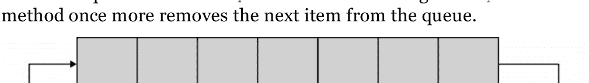

图 11.1

`Queue<T>` 类的方法在下表中描述。

| 选定的 `Queue<T>` 成员 | 描述 |

|---|---|

| `Count` | 返回队列中的项数。 |

| `Enqueue` | 将项添加到队列末尾。 |

| `Dequeue` | 从队列头部读取并移除一项。如果在调用 `Dequeue` 方法时队列中不再有项，则抛出类型为 `InvalidOperationException` 的异常。 |

| `Peek` | 从队列头部读取一项，但不移除该项。 |

| `TrimExcess` | 调整队列的容量。`Dequeue` 方法会从队列中移除项，但不会调整队列的容量。若要清除队列开头的空项，请使用 `TrimExcess` 方法。 |

创建队列时，可以使用与 `List<T>` 类型相似的构造函数。默认构造函数创建一个空队列，但也可以使用构造函数指定容量。随着项添加到队列，如果未定义容量，容量会依次扩充为 4、8、16 和 32 项。与 `List<T>` 类类似，容量总是按需加倍。非泛型 `Queue` 类的默认构造函数有所不同，因为它会创建一个包含 32 个空项的初始数组。通过构造函数的重载，还可以传入任何其他实现了 `IEnumerable<T>` 接口的集合，该集合会被复制到队列中。

下面的示例演示了 `Queue<T>` 类的用法，它是一个文档管理应用程序。一个线程用于向队列添加文档，另一个线程从队列读取文档并处理它们。

队列中存储的项的类型为 `Document`。`Document` 类定义了标题和内容（代码文件 `QueueSample/Document.cs`）：

```
public class Document
{
    public string Title { get; private set; }
    public string Content { get; private set; }

    public Document(string title, string content)
    {
        Title = title;
        Content = content;
    }
}
```

`DocumentManager` 类是围绕 `Queue<T>` 类的轻量封装。它定义了如何处理文档：使用 `AddDocument` 方法将文档添加到队列，使用 `GetDocument` 方法从队列获取文档。

在 `AddDocument` 方法内部，使用 `Enqueue` 方法将文档添加到队列末尾。在 `GetDocument` 内部，使用 `Dequeue` 方法读取队列中的第一个文档。由于多个线程可以并发访问 `DocumentManager`，因此使用 `lock` 语句锁定对队列的访问。

> 注意：线程和 `lock` 语句将在第 21 章“任务与并行编程”和第 22 章“任务同步”中讨论。

`IsDocumentAvailable` 是一个只读布尔属性，如果队列中有文档则返回 true，否则返回 false（代码文件 `QueueSample/DocumentManager.cs`）：

```
public class DocumentManager
{
    private readonly Queue<Document> _documentQueue = new Queue<Document>();

    public void AddDocument(Document doc)
    {
        lock (this)
        {
            _documentQueue.Enqueue(doc);
        }
    }

    public Document GetDocument()
    {
        Document doc = null;
        lock (this)
        {
            doc = _documentQueue.Dequeue();
        }
        return doc;
    }

    public bool IsDocumentAvailable => _documentQueue.Count > 0;
}
```

`ProcessDocuments` 类在单独的任务中处理队列中的文档。唯一可以从外部访问的方法是 `Start`。在 `Start` 方法中，实例化一个新任务。创建一个 `ProcessDocuments` 对象来启动任务，并将 `Run` 方法定义为任务的启动方法。`TaskFactory` 的 `StartNew` 方法（通过 `Task` 类的静态 `Factory` 属性访问）需要一个 `Action` 委托参数，可以将 `Run` 方法的地址传递给它。`TaskFactory` 的 `StartNew` 方法会立即启动任务。

使用 `ProcessDocuments` 类的 `Run` 方法定义了一个无限循环。在此循环内，使用 `IsDocumentAvailable` 属性判断队列中是否有文档。如果有，则从 `DocumentManager` 中取出文档并进行处理。本例中的处理仅是将信息写入控制台。在实际应用程序中，文档可以写入文件、写入数据库或通过网络发送（代码文件 `QueueSample/ProcessDocuments.cs`）：

```
public class ProcessDocuments
{
    public static void Start(DocumentManager dm)
    {
        Task.Run(new ProcessDocuments(dm).Run);
    }

    protected ProcessDocuments(DocumentManager dm)
    {
        if (dm == null)
            throw new ArgumentNullException(nameof(dm));
        _documentManager = dm;
    }

    private DocumentManager _documentManager;

    protected async Task Run()
    {
        while (true)
        {
            if (_documentManager.IsDocumentAvailable)
            {
                Document doc = _documentManager.GetDocument();
                WriteLine("Processing document {0}", doc.Title);
            }
            await Task.Delay(new Random().Next(20));
        }
    }
}
```

在应用程序的 `Main` 方法中，实例化一个 `DocumentManager` 对象，并启动文档处理任务。然后创建 1000 个文档并将其添加到 `DocumentManager` 中（代码文件 `QueueSample/Program.cs`）：

```
public class Program
{
    public static void Main()
    {
        var dm = new DocumentManager();

        ProcessDocuments.Start(dm);

        // Create documents and add them to the DocumentManager
        for (int i = 0; i < 1000; i++)
        {
            var doc = new Document($"Doc {i.ToString()}","content");
            dm.AddDocument(doc);
            WriteLine($"Added document {doc.Title}");
            Thread.Sleep(new Random().Next(20));
        }
    }
}
```

当你启动应用程序时，文档会被添加到队列中并从队列中移除，你会得到类似下面的输出：

```
Added document Doc 279
Processing document Doc 236
Added document Doc 280
Processing document Doc 237
Added document Doc 281
Processing document Doc 238
Processing document Doc 239
Processing document Doc 240
Processing document Doc 241
Added document Doc 282
Processing document Doc 242
Added document Doc 283
Processing document Doc 243
```

使用示例应用程序所述任务的真实场景可能是处理通过 Web 服务接收的文档的应用程序。

### 栈

栈是另一种与队列非常相似的容器。只需使用不同的方法来访问栈。最后添加到栈中的项最先被读取，因此栈是后进先出（LIFO）容器。

图 11.2 展示了栈的表示形式，其中 `Push` 方法将项添加到栈中，`Pop` 方法获取最后添加的项。

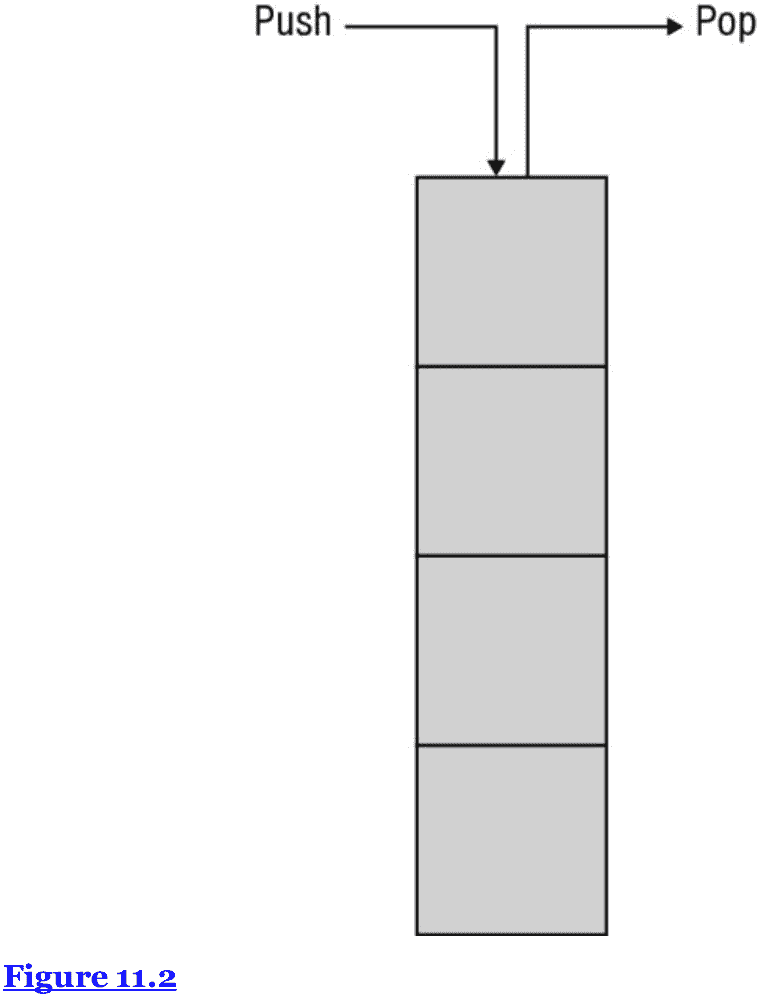

[图 11.2](Figure 11.2)

与 `Queue<T>` 类类似，`Stack<T>` 类实现了 `IEnumerable<T>` 和 `ICollection` 接口。

下表列出了 `Stack<T>` 类的成员。

| 选定的 `Stack<T>` 成员 | 描述 |

|---|---|


| 成员 | 说明 |
| --- | --- |
| `Count` | 返回栈中的项数。 |
| `Push` | 将项添加到栈顶。 |
| `Pop` | 从栈顶移除并返回一项。如果栈为空，则抛出类型为 `InvalidOperationException` 的异常。 |
| `Peek` | 从栈顶返回一项，但不移除该项。 |
| `Contains` | 检查某项是否在栈中，如果是则返回 `true`。 |

在本例中，使用 `Push` 方法向栈中添加了三个项。通过 `foreach` 方法，使用 `IEnumerable` 接口迭代所有项。栈的枚举器不会移除项，只是逐项返回它们（代码文件 `StackSample/Program.cs`）：

```
var alphabet = new Stack<char>();
alphabet.Push('A');
alphabet.Push('B');
alphabet.Push('C');

foreach (char item in alphabet)
{
    Write(item);
}
WriteLine();
```

因为这些项按照从最后添加到最先添加的顺序读取，所以产生以下结果：

```
CBA
```

使用枚举器读取项不会改变项的状态。使用 `Pop` 方法，读取的每一项也会从栈中移除。这样，你可以使用 `while` 循环迭代集合，并通过 `Count` 属性检查是否还有项存在：

```
var alphabet = new Stack<char>();
alphabet.Push('A');
alphabet.Push('B');
alphabet.Push('C');

Write("First iteration:");
foreach (char item in alphabet)
{
    Write(item);
}
WriteLine();

Console.Write("Second iteration:");
while (alphabet.Count > 0)
{
    Write(alphabet.Pop());
}
WriteLine();
```

结果会给出两次 CBA——每次迭代一次。第二次迭代后，栈为空，因为第二次迭代使用了 `Pop` 方法：

```
First iteration: CBA
Second iteration: CBA
```

### 链表

`LinkedList<T>` 是一个双向链表，其中一个元素引用下一个元素和上一个元素，如图 11.3 所示。这样，你可以通过移动到下一个元素轻松地向前遍历整个列表，或者通过移动到上一个元素向后遍历。

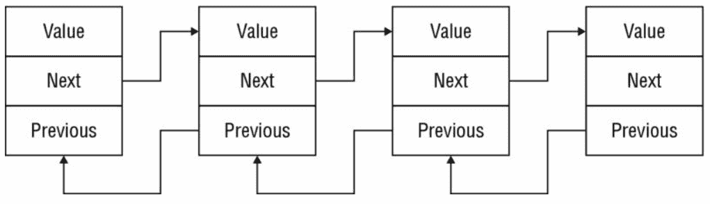

#### 图 11.3

链表的好处是，如果项目被插入到列表中的任何位置，链表的速度非常快。插入项目时，只需更改前一个项目的 `Next` 引用和后一个项目的 `Previous` 引用，使其指向新插入的项目即可。而对于 `List<T>` 类，插入一个元素后，所有后续元素都必须移动位置。

当然，链表也有缺点。链表中的项目只能一个接一个地访问。要找到位于列表中间或末尾的项目需要花费很长时间。

链表不能只存储列表中的项目；每有一个项目，链表还必须包含关于下一个和上一个项目的信息。这就是为什么 `LinkedList<T>` 包含 `LinkedListNode<T>` 类型的项目。使用 `LinkedListNode<T>` 类，你可以访问列表中的下一个和上一个项目。`LinkedListNode<T>` 类定义了 `List`、`Next`、`Previous` 和 `Value` 属性。`List` 属性返回与该节点关联的 `LinkedList<T>` 对象。`Next` 和 `Previous` 用于遍历列表并访问下一个或上一个项目。`Value` 返回与该节点关联的项目，其类型为 `T`。

`LinkedList<T>` 类本身定义了成员，用于访问列表的第一个（`First`）和最后一个（`Last`）项目，在特定位置插入项目（`AddAfter`、`AddBefore`、`AddFirst`、`AddLast`），从特定位置移除项目（`Remove`、`RemoveFirst`、`RemoveLast`），以及从列表开头（`Find`）或末尾（`FindLast`）开始搜索元素。

演示链表的示例应用程序将链表和列表结合使用。链表包含文档，就像队列示例中那样，但这些文档还具有与之关联的额外优先级。链表中的文档将根据优先级进行排序。如果有多个文档具有相同的优先级，则元素按照文档插入的时间进行排序。

图 11.4 描述了示例应用程序的集合。`LinkedList<Document>` 是包含所有 `Document` 对象的链表。图中显示了文档的标题和优先级。标题表示文档何时添加到列表中：第一个添加的文档标题为“One”，第二个文档标题为“Two”，依此类推。你可以看到文档 One 和 Four 具有相同的优先级 8，但由于 One 在 Four 之前添加，所以它在列表中更早。

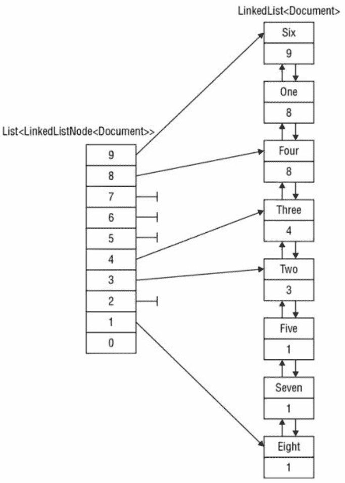

#### 图 11.4

当新文档添加到链表时，它们应被添加到具有相同优先级的最后一个文档之后。`LinkedList<Document>` 集合包含 `LinkedListNode<Document>` 类型的元素。`LinkedListNode<T>` 类添加了 `Next` 和 `Previous` 属性，用于从一个节点移动到下一个节点。为了引用这些元素，`List<T>` 被定义为 `List<LinkedListNode<Document>>`。为了快速访问每个优先级的最后一个文档，集合 `List<LinkedListNode>` 最多包含 10 个元素，每个元素引用每个优先级的最后一个文档。在接下来的讨论中，对每个优先级最后一个文档的引用被称为优先级节点。

使用前面的示例，`Document` 类被扩展为包含优先级，该优先级通过类的构造函数设置（代码文件 `LinkedListSample/Document.cs`）：

```csharp
public class Document
{
    public string Title { get; private set; }
    public string Content { get; private set; }
    public byte Priority { get; private set; }

    public Document(string title, string content, byte priority)
    {
        Title = title;
        Content = content;
        Priority = priority;
    }
}
```

解决方案的核心是 `PriorityDocumentManager` 类。这个类非常易于使用。通过该类的公共接口，可以添加新的 `Document` 元素到链表中，检索第一个文档，并且出于测试目的，它还有一个方法可以显示集合中所有元素在链表中是如何链接的。

`PriorityDocumentManager` 类包含两个集合。类型为 `LinkedList<Document>` 的集合包含所有文档。类型为 `List<LinkedListNode<Document>>` 的集合包含多达 10 个元素的引用，这些元素是添加特定优先级新文档的入口点。两个集合变量都在 `PriorityDocumentManager` 类的构造函数中初始化。列表集合也用 `null` 初始化（代码文件 `LinkedListSample/PriorityDocumentManager.cs`）：

```csharp
public class PriorityDocumentManager
{
    private readonly LinkedList<Document> _documentList;

    // priorities 0-9
    private readonly List<LinkedListNode<Document>> _priorityNodes;

    public PriorityDocumentManager()
    {
        _documentList = new LinkedList<Document>();

        _priorityNodes = new List<LinkedListNode<Document>>(10);
        for (int i = 0; i < 10; i++)
        {
            _priorityNodes.Add(new LinkedListNode<Document>(null));
        }
    }
}
```

该类的公共接口的一部分是 `AddDocument` 方法。`AddDocument` 只调用私有方法 `AddDocumentToPriorityNode`。将实现放在另一个方法中的原因是 `AddDocumentToPriorityNode` 可能会被递归调用，这一点你很快就会看到：

```csharp
public void AddDocument(Document d)
{
    if (d == null) throw new ArgumentNullException("d");

    AddDocumentToPriorityNode(d, d.Priority);
}
```

`AddDocumentToPriorityNode` 实现中首先要做的操作是检查优先级是否在允许的优先级范围内。这里允许的范围是 0 到 9。如果传入了错误的值，则会抛出 `ArgumentException` 类型的异常。

接下来，你需要检查是否已存在一个与传入优先级相同的优先级节点。如果列表集合中没有这样的优先级节点，则会以递减的优先级值递归调用 `AddDocumentToPriorityNode`，以检查下一个较低优先级的节点是否存在。

如果既不存在相同优先级的节点，也不存在任何较低优先级的节点，则可以通过调用 `AddLast` 方法安全地将文档添加到链表的末尾。此外，该链表节点会被负责该文档优先级的优先级节点引用。

如果已存在一个优先级节点，你可以获取文档应插入的链表位置。在下面的示例中，你必须确定是否已存在一个具有正确优先级的优先级节点，或者是否只是一个引用较低优先级文档的优先级节点。在第一种情况下，你可以在优先级节点引用的位置之后插入新文档。因为优先级节点必须始终引用具有特定优先级的最后一个文档，所以必须设置优先级节点的引用。如果只存在一个引用较低优先级文档的优先级节点，情况会更复杂。在这种情况下，必须在所有与优先级节点具有相同优先级的文档之前插入该文档。为了找到具有相同优先级的第一个文档，`while` 循环使用 `Previous` 属性遍历所有链表节点，直到到达一个具有不同优先级的链表节点。这样，你就知道了文档必须插入的位置，并且可以设置优先级节点：

```csharp
private void AddDocumentToPriorityNode(Document doc, int priority)
{
    if (priority > 9 || priority < 0)
        throw new ArgumentException("Priority must be between 0 and 9");
    if (_priorityNodes[priority].Value == null)
    {
        --priority;
        if (priority <= 0)
        {
            // check for the next lower priority
            AddDocumentToPriorityNode(doc, priority);
        }
        else // now no priority node exists with the same priority or lower
        {
            // add the new document to the end
            _documentList.AddLast(doc);
            _priorityNodes[doc.Priority] = _documentList.Last;
        }
        return;
    }
    else // a priority node exists
    {
        LinkedListNode<Document> prioNode = _priorityNodes[priority];
        if (priority == doc.Priority)
            // priority node with the same priority exists
        {
            _documentList.AddAfter(prioNode, doc);
            // set the priority node to the last document with the same priority
            _priorityNodes[doc.Priority] = prioNode.Next;
        }
        else // only priority node with a lower priority exists
        {
            // get the first node of the lower priority
            LinkedListNode<Document> firstPrioNode = prioNode;
            while (firstPrioNode.Previous != null &&
                firstPrioNode.Previous.Value.Priority ==
            prioNode.Value.Priority)
            {
                firstPrioNode = prioNode.Previous;
                prioNode = firstPrioNode;
            }
            _documentList.AddBefore(firstPrioNode, doc);
            // set the priority node to the new value
            _priorityNodes[doc.Priority] = firstPrioNode.Previous;
        }
    }
}
```

现在只剩下简单的方法需要讨论。`DisplayAllNodes` 使用 `foreach` 循环将每个文档的优先级和标题显示到控制台。

`GetDocument` 方法从链表中返回第一个文档（优先级最高的文档），并将其从列表中移除：

```
public void DisplayAllNodes()
{
    foreach (Document doc in documentList)
    {
        WriteLine($"priority: {doc.Priority}, title {doc.Title}");
    }
}

// returns the document with the highest priority
// (that's first in the linked list)
public Document GetDocument()
{
    Document doc = _documentList.First.Value;
    _documentList.RemoveFirst();
    return doc;
}
```

在 `Main` 方法中，使用 `PriorityDocumentManager` 来演示其功能。向链表中添加八个具有不同优先级的新文档，然后显示完整列表（代码文件 `LinkedListSample/Program.cs`）：

```
public static void Main()
{
    var pdm = new PriorityDocumentManager();
    pdm.AddDocument(new Document("one","Sample", 8));
    pdm.AddDocument(new Document("two","Sample", 3));
    pdm.AddDocument(new Document("three","Sample", 4));
    pdm.AddDocument(new Document("four","Sample", 8));
    pdm.AddDocument(new Document("five","Sample", 1));
    pdm.AddDocument(new Document("six","Sample", 9));
    pdm.AddDocument(new Document("seven","Sample", 1));
    pdm.AddDocument(new Document("eight","Sample", 1));

    pdm.DisplayAllNodes();
}
```

通过处理结果，您可以看到文档首先按优先级排序，其次按文档添加的时间排序：

```
priority: 9, title six
priority: 8, title one
priority: 8, title four
priority: 4, title three
priority: 3, title two
priority: 1, title five
priority: 1, title seven
priority: 1, title eight
```

### 排序列表


如果你需要的集合需要按键排序，可以使用 `SortedList<TKey, TValue>`。这个类根据键对元素进行排序。你可以使用任何类型作为值，也可以使用任何类型作为键。

下面的示例创建了一个键和值都是 `string` 类型的排序列表。默认构造函数创建一个空列表，然后使用 `Add` 方法添加两本书。通过重载的构造函数，你可以定义列表的容量，并传入一个实现 `IComparer<TKey>` 接口的对象，该接口用于对列表中的元素进行排序。

`Add` 方法的第一个参数是键（书名），第二个参数是值（ISBN）。除了使用 `Add` 方法，你还可以使用索引器向列表添加元素。索引器要求键作为索引参数。如果键已经存在，`Add` 方法会抛出 `ArgumentException` 类型的异常。如果对索引器使用相同的键，新值将替换旧值（代码文件 `SortedListSample/Program.cs`）：

```
var books = new SortedList<string, string>();
books.Add("Professional WPF Programming","978-0-470-04180-2");
books.Add("Professional ASP.NET MVC 5","978-1-118-79475-3");
books["Beginning Visual C# 2012"] ="978-1-118-31441-8";
books["Professional C# 5 and .NET 4.5.1"] ="978-1-118-83303-2";
```

> 注意：`SortedList<TKey, TValue>` 每个键只允许一个值。如果你需要每个键有多个值，可以使用 `Lookup<TKey, TElement>`。

你可以使用 `foreach` 语句遍历列表。枚举器返回的元素类型为 `KeyValuePair<TKey, TValue>`，用于基于键访问元素。字典也称为哈希表或映射。字典的主要特性是基于键的快速查找。你还可以自由添加和移除项，有点像 `List<T>`，但没有必须将后续项在内存中移动的性能开销。

图 11.5 展示了字典的简化表示。这里，诸如 `B4711` 的员工ID 是添加到字典中的键。键被转换为哈希。通过哈希生成一个数字，将索引与值关联起来。索引随后包含指向值的链接。该图是简化的，因为单个索引项可以关联多个值，并且索引可以存储为树。

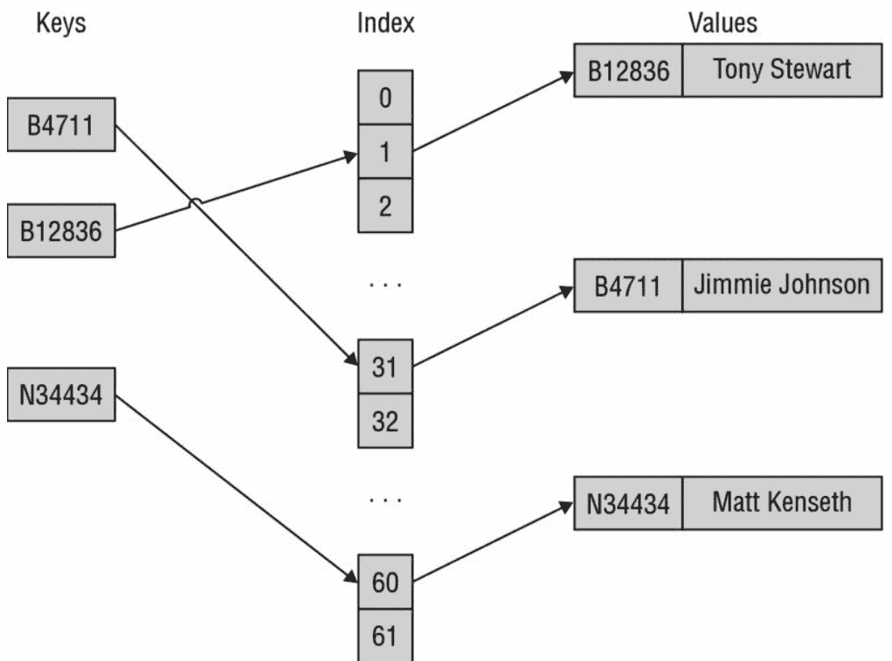

#### 图 11.5

.NET Framework 提供了多个字典类。你使用的主要类是 `Dictionary<TKey, TValue>`。

### 字典初始化器

C# 6 定义了一种在声明时初始化字典的新语法。一个键为 `int`、值为 `string` 的字典可以按如下方式初始化：

```
var dict = new Dictionary<int, string>()
{
    [3] ="three",
    [7] ="seven"
};
```

这里，向字典中添加了两个元素。第一个元素的键为 `3`，字符串值为 `three`；第二个元素的键为 `7`，字符串值为 `seven`。这种初始化语法易读，并且与访问字典中的元素使用相同的语法。

#### 键类型

在字典中用作键的类型必须重写 `object` 类的 `GetHashCode` 方法。每当字典类需要确定某个项的位置时，它都会调用 `GetHashCode` 方法。`GetHashCode` 返回的 `int` 被字典用来计算元素放置位置的索引。我们不会深入讨论这部分算法；你应该知道的是它涉及质数，因此字典的容量是质数。

`GetHashCode` 的实现必须满足以下要求：

- 同一个对象应始终返回相同的值。

- 不同的对象可以返回相同的值。

- 它不能抛出异常。

- 它应至少使用一个实例字段。

- 哈希码在对象的生命周期内不应改变。

除了 `GetHashCode` 实现必须满足的要求外，满足以下要求也是良好实践：

- 它应尽可能快地执行；计算成本必须低廉。

- 哈希码值应在 `int` 可以存储的整个数字范围内均匀分布。

> 注意 字典的良好性能基于 `GetHashCode` 方法的良好实现。

为什么需要让哈希码值在整数范围内均匀分布呢？如果两个键返回的哈希具有相同的索引，字典类就需要开始寻找最近的可用空闲位置来存储第二项，并且之后检索该项时也必须进行一些搜索。这显然会损害性能。此外，如果你的许多键倾向于为它们应该存储的位置提供相同的存储索引，这种冲突就会更可能发生。然而，由于微软那部分算法的实现方式，当计算出的哈希值在 `int.MinValue` 和 `int.MaxValue` 之间均匀分布时，这种风险会降到最低。

除了实现 `GetHashCode` 之外，键类型还必须实现 `IEquatable<T>.Equals` 方法，或重写来自 `Object` 类的 `Equals` 方法。因为不同的键对象可能返回相同的哈希码，字典在比较键时会使用 `Equals` 方法。字典检查两个键，例如 `A` 和 `B` 是否相等；它会调用 `A.Equals(B)`。这意味着你必须确保以下条件始终为真：

如果 `A.Equals(B)` 为 `true`，则 `A.GetHashCode` 和 `B.GetHashCode` 必须始终返回相同的哈希码。

这看起来似乎是一个相当微妙的点，但它至关重要。如果你想出某种方法重写这些方法，使得上述陈述不再始终为真，使用此类实例作为键的字典将无法正常工作。相反，你会发现一些奇怪的事情发生。例如，你可能会将一个对象放入字典中，然后发现你永远无法检索它，或者你尝试检索一个条目，却返回了错误的条目。

> NOTE 因此，如果你提供了 `Equals` 的重写但没有提供 `GetHashCode` 的重写，C# 编译器会显示编译警告。

对于 `System.Object` 来说，这个条件是成立的，因为 `Equals` 只是比较引用，而 `GetHashCode` 实际返回的哈希完全基于对象的地址。这意味着基于未重写这些方法的键的哈希表将能正确工作。然而，这种方法的问题在于，只有当它们是同一个对象时，键才被视为相等。这意味着当你将对象放入字典时，你必须保留对键的引用；你不能稍后用相同的值实例化另一个键对象。如果你不重写 `Equals` 和 `GetHashCode`，该类型在字典中使用起来就不太方便。

顺便说一下，`System.String` 实现了 `IEquatable` 接口并适当地重写了 `GetHashCode`。`Equals` 提供值比较，而 `GetHashCode` 返回基于字符串值的哈希。字符串可以方便地用作字典中的键。

诸如 `Int32` 之类的数字类型也实现了 `IEquatable` 接口并重写了 `GetHashCode`。然而，这些类型返回的哈希码只是映射到该值。如果你希望用作键的数字本身并没有分布在整数可能值的范围内，使用整数作为键就无法满足将键值均匀分布以获得最佳性能的规则。`Int32` 并非用于在字典中使用。

如果你需要使用一种键类型，该类型未实现 `IEquatable` 并且未根据你存储在字典中的键值重写 `GetHashCode`，你可以创建一个实现 `IEqualityComparer<T>` 接口的比较器。`IEqualityComparer<T>` 定义了 `GetHashCode` 和 `Equals` 方法，其参数为传入的对象，因此你可以提供与对象类型本身不同的实现。`Dictionary<TKey, TValue>` 构造函数的重载允许传递实现 `IEqualityComparer<T>` 的对象。如果将此类对象分配给字典，则该类将用于生成哈希码和比较键。

### Dictionary Example

本节中的字典示例是一个程序，它设置了一个员工字典。字典以 `EmployeeId` 对象为索引，而存储在字典中的每个项都是一个 `Employee` 对象，该对象存储员工的详细信息。

`EmployeeId` 结构体被实现为在字典中使用的键。结构体的成员是员工的前缀字符和编号。这两个变量都是只读的，并且只能在构造函数中初始化，以确保字典中的键不会更改。当你拥有只读变量时，可以保证它们不会被更改。字段在构造函数中填充。`ToString` 方法被重写以获取员工 ID 的字符串表示形式。作为键类型所必需的，`EmployeeId` 实现了 `IEquatable` 接口并重写了 `GetHashCode` 方法（代码文件 `DictionarySample/EmployeeId.cs`）：

```csharp
public class EmployeeIdException : Exception
{
    public EmployeeIdException(string message) : base(message) {
    }
}

public struct EmployeeId : IEquatable<EmployeeId>
{
    private readonly char _prefix;
    private readonly int _number;

    public EmployeeId(string id)
    {
        Contract.Requires<ArgumentNullException>(id != null);

        _prefix = (id.ToUpper())[0];
        int numLength = id.Length - 1;
        try
        {
            _number = int.Parse(id.Substring(1, numLength > 6 ? 6 : numLength));
        }
        catch (FormatException)
        {
            throw new EmployeeIdException("Invalid EmployeeId format");
        }
    }

    public override string ToString() => _prefix.ToString() + $"{_number,6:000000}";

    public override int GetHashCode() => (_number ^ _number << 16) * 0x15051505;

    public bool Equals(EmployeeId other) =>
        (_prefix == other._prefix && _number == other._number);

    public override bool Equals(object obj) =>
        Equals((EmployeeId)obj);

    public static bool operator ==(EmployeeId left, EmployeeId right) =>
        left.Equals(right);

    public static bool operator !=(EmployeeId left, EmployeeId right) =>
        !(left == right);
}
```

由 `IEquatable<T>` 接口定义的 `Equals` 方法比较两个 `EmployeeId` 对象的数值，并在两个值相同时返回 `true`。代替实现 `IEquatable<T>` 接口的 `Equals` 方法，你也可以重写来自 `Object` 类的 `Equals` 方法：

```csharp
public bool Equals(EmployeeId other) =>
    (_prefix == other._prefix && _number == other._number);
```

对于 `number` 变量，预计员工的取值范围为 1 到约 190,000。这并没有填满整数的范围。`GetHashCode` 使用的算法将数字左移 16 位，然后与原始数字进行 XOR（异或）运算，最后将结果乘以十六进制值 `15051505`。哈希码在整数范围内分布相当均匀：

```csharp
public override int GetHashCode() => (_number ^ _number << 16) * 0x15051505;
```

> NOTE 在互联网上，你可以找到很多更复杂的算法，它们在整数范围内的分布更好。你也可以使用字符串的 `GetHashCode` 方法来返回哈希。

`Employee` 类是一个简单的实体类，包含员工的姓名、薪水和 ID。构造函数初始化所有值，而 `ToString` 方法返回实例的字符串表示形式。`ToString` 的实现使用格式字符串来创建字符串表示形式，原因是为了性能（代码文件 `DictionarySample/Employee.cs`）：

```csharp
public class Employee
{
    private string _name;
    private decimal _salary;
    private readonly EmployeeId _id;

    public Employee(EmployeeId id, string name, decimal salary)
    {
        _id = id;
        _name = name;
        _salary = salary;
    }

    public override string ToString() => $"{_id.ToString()}: {_name,-20} {_salary:C}";
}
```

在示例应用程序的 `Main` 方法中，创建了一个新的 `Dictionary<TKey, TValue>` 实例，其中键的类型为 `EmployeeId`，值的类型为 `Employee`。构造函数分配了 31 个元素的容量。请记住，容量基于质数。然而，当你分配一个非质数的值时，不必担心。`Dictionary<TKey, TValue>` 类本身会采用传递给构造函数的整数之后的下一个质数来分配容量。创建员工对象和 ID 后，它们使用新的字典初始化器语法添加到新创建的字典中。当然，你也可以调用字典的 `Add` 方法来添加对象（代码文件 `DictionarySample/Program.cs`）：

```csharp
public static void Main()
{
    var idTony = new EmployeeId("C3755");
    var tony = new Employee(idTony, "Tony Stewart", 379025.00m);

    var idCarl = new EmployeeId("F3547");
    var carl = new Employee(idCarl, "Carl Edwards", 403466.00m);

    var idKevin = new EmployeeId("C3386");
    var kevin = new Employee(idKevin, "Kevin Harwick", 415261.00m);

    var idMatt = new EmployeeId("F3323");
    var matt = new Employee(idMatt, "Matt Kenseth", 1589390.00m);

    var idBrad = new EmployeeId("D3234");
    var brad = new Employee(idBrad, "Brad Keselowski", 322295.00m);

    var employees = new Dictionary<EmployeeId, Employee>(31)
    {
        [idTony] = tony,
        [idCarl] = carl,
        [idKevin] = kevin,
        [idMatt] = matt,
        [idBrad] = brad
    };

    foreach (var employee in employees.Values)
    {
        WriteLine(employee);
    }
}
```

在将条目添加到字典后，在 `while` 循环内部从字典读取员工。用户会被要求输入一个员工编号存储在 `userInput` 变量中，用户可以通过输入 `X` 退出应用程序。如果键在字典中，则使用 `Dictionary<TKey, TValue>` 类的 `TryGetValue` 方法进行检查。`TryGetValue` 如果找到键则返回 `true`，否则返回 `false`。如果找到值，则与键关联的值存储在 `employee` 变量中。此值被写入控制台。

赛车手通过使用 lambda 表达式 `r => r.Country` 根据其国家进行选择。`foreach` 循环通过索引器仅访问来自澳大利亚的赛车手（代码文件 `LookupSample/Program.cs`）：

```csharp
var racers = new List<Racer>();
racers.Add(new Racer("Jacques","Villeneuve","Canada", 11));
racers.Add(new Racer("Alan","Jones","Australia", 12));
racers.Add(new Racer("Jackie","Stewart","United Kingdom", 27));
racers.Add(new Racer("James","Hunt","United Kingdom", 10));
racers.Add(new Racer("Jack","Brabham","Australia", 14));

var lookupRacers = racers.ToLookup(r => r.Country);

foreach (Racer r in lookupRacers["Australia"])
{
    WriteLine(r);
}
```


> 注意 你可以在第 13 章“语言集成查询”中了解更多关于扩展方法的内容。Lambda 表达式在第 9 章“委托、Lambda 和事件”中进行了说明。

输出显示来自澳大利亚的赛车手：

```
Alan Jones
Jack Brabham
```

### 有序字典

`SortedDictionary<TKey, TValue>` 是一种二叉搜索树，其中项目基于键进行排序。键类型必须实现接口 `IComparable<TKey>`。如果键类型不可排序，你还可以创建一个实现 `IComparer<TKey>` 的比较器，并将该比较器作为有序字典的构造函数参数分配。

在本章前面，你了解了 `SortedList<TKey, TValue>`。`SortedDictionary<TKey, TValue>` 和 `SortedList<TKey, TValue>` 具有相似的功能，但由于 `SortedList<TKey, TValue>` 是作为基于数组的列表实现的，而 `SortedDictionary<TKey, TValue>` 是作为字典实现的，因此这两个类具有不同的特性：

- `SortedList<TKey, TValue>` 比 `SortedDictionary<TKey, TValue>` 使用更少的内存。

- `SortedDictionary<TKey, TValue>` 在元素的插入和移除方面更快。

- 当使用已排序的数据填充集合时，如果不需要更改容量，`SortedList<TKey, TValue>` 会更快。

> 注意 `SortedList` 比 `SortedDictionary` 消耗更少的内存。`SortedDictionary` 在插入和移除未排序数据时更快。

### 集合

仅包含不同项目的集合称为集合（set）。.NET Framework 包含两个集合，`HashSet<T>` 和 `SortedSet<T>`，它们都实现了接口 `ISet<T>`。`HashSet<T>` 包含一个无序的不同项目列表；而 `SortedSet<T>` 的列表是有序的。

`ISet<T>` 接口提供了创建多个集合并集、创建集合交集，或提供某个集合是否为另一个集合的超集或子集信息的方法。

在以下示例代码中，创建了三个新的 `string` 类型集合并填充了一级方程式赛车。`HashSet<T>` 类实现了 `ICollection<T>` 接口。但是，`Add` 方法是显式实现的，并且该类提供了不同的 `Add` 方法，你可以在此处看到。该 `Add` 方法的区别在于返回类型；返回一个布尔值以提供元素是否已添加的信息。如果元素已在集合中，则不会添加，并返回 `false`（代码文件 `SetSample/Program.cs`）：

```csharp
var companyTeams = new HashSet<string>()
{"Ferrari","McLaren","Mercedes" };
var traditionalTeams = new HashSet<string>()
{"Ferrari","McLaren" };
var privateTeams = new HashSet<string>()
{"Red Bull","Lotus","Toro Rosso","Force India","Sauber" };

if (privateTeams.Add("Williams"))
{
    WriteLine("Williams added");
}
if (!companyTeams.Add("McLaren"))
{
    WriteLine("McLaren was already in this set");
}
```

这两个 `Add` 方法的结果被写入控制台：

```
Williams added
McLaren was already in this set
```

方法 `IsSubsetOf` 和 `IsSupersetOf` 将一个集合与实现 `IEnumerable<T>` 接口的集合进行比较，并返回一个布尔结果。此处，`IsSubsetOf` 验证 `traditionalTeams` 中的每个元素是否都包含在 `companyTeams` 中，情况确实如此；`IsSupersetOf` 验证 `traditionalTeams` 与 `companyTeams` 相比是否有任何额外的元素：

```csharp
if (traditionalTeams.IsSubsetOf(companyTeams))
{
    WriteLine("traditionalTeams is a subset of companyTeams");
}

if (companyTeams.IsSupersetOf(traditionalTeams))
{
    WriteLine("companyTeams is a superset of traditionalTeams");
}
```

此验证的输出如下所示：

```
traditionalTeams is a subset of companyTeams
companyTeams is a superset of traditionalTeams
```

Williams 也是一个传统车队，这就是为什么该车队被添加到 `traditionalTeams` 集合中的原因：

```csharp
traditionalTeams.Add("Williams");
if (privateTeams.Overlaps(traditionalTeams))
{
    WriteLine("At least one team is the same with traditional and private teams.");
}
```

因为存在重叠，所以结果是：

```
At least one team is the same with traditional and private teams.
```

变量 `allTeams` 引用一个新的 `SortedSet<string>`，通过调用 `UnionWith` 方法将其填充为 `companyTeams`、`privateTeams` 和 `traditionalTeams` 的并集：

```csharp
var allTeams = new SortedSet<string>(companyTeams);
allTeams.UnionWith(privateTeams);
allTeams.UnionWith(traditionalTeams);

WriteLine();
WriteLine("all teams");
foreach (var team in allTeams)
{
    WriteLine(team);
}
```

此处，返回了所有车队，但每个车队只列出一次，因为该集合只包含唯一值；并且由于容器是 `SortedSet<string>`，结果是有序的：

```
Ferrari
Force India
Lotus
McLaren
Mercedes
Red Bull
Sauber
Toro Rosso
Williams
```

方法 `ExceptWith` 从 `allTeams` 集合中移除所有私人车队：

```csharp
allTeams.ExceptWith(privateTeams);
WriteLine();

WriteLine("no private team left");
foreach (var team in allTeams)
{
    WriteLine(team);
}
```

集合中剩余的元素不包含任何私人车队：

```
Ferrari
McLaren
Mercedes
```

### 性能

许多集合类提供与其他类相同的功能；例如，`SortedList` 提供的功能与 `SortedDictionary` 几乎相同。然而，在性能上通常存在巨大差异。一个集合消耗更少的内存，而另一个集合类在元素检索方面更快。MSDN 文档通常提供关于集合方法的性能提示，以 big-O 表示法给出操作所需的时间信息：

- `O(1)`

- `O(log n)`

- `O(n)`

`O(1)` 表示此操作所需的时间是恒定的，无论集合中有多少项目。例如，`ArrayList` 有一个具有 `O(1)` 行为的 `Add` 方法。无论列表中有多少元素，将一个新元素添加到列表末尾总是花费相同的时间。`Count` 属性提供项目的数量，因此很容易找到列表的末尾。

`O(n)` 表示对集合执行操作需要最坏情况下的时间 `N`。如果需要对集合进行重新分配，`ArrayList` 的 `Add` 方法可能是 `O(n)` 操作。更改容量会导致列表被复制，并且复制时间随每个元素线性增长。

`O(log n)` 表示操作所需的时间随集合中的每个元素而增加，但每个元素的增加时间不是线性的，而是对数的。`SortedDictionary<TKey, TValue>` 在集合内部进行插入操作时具有 `O(log n)` 行为；`SortedList<TKey, TValue>` 对于相同的功能具有 `O(n)` 行为。此处，`SortedDictionary<TKey, TValue>` 快得多，因为将元素插入树结构比插入列表更高效。

下表列出了集合类及其在不同操作（如添加、插入和移除项目）中的性能。使用此表，你可以为应用程序的目的选择最佳的集合类。

| 集合 | 添加 | 插入 | 移除 | 项目 | 排序 | 查找 |

|---|---|---|---|---|---|---|

| `List<T>` | `O(1)` 或 `O(n)`（如果必须调整集合大小） | `O(n)` | `O(n)` | `O(1)` | `O(n log n)`，最坏情况 `O(n^2)` | `O(n)` |

| `Stack<T>` | `Push`，`O(1)`，或 `O(n)`（如果必须调整栈大小） | 不适用 | `Pop`，`O(1)` | 不适用 | 不适用 | 不适用 |

| `Queue<T>` | `Enqueue`，`O(1)`，或 `O(n)`（如果必须调整队列大小） | 不适用 | `Dequeue`，`O(1)` | 不适用 | 不适用 | 不适用 |

| `HashSet<T>` | `O(1)` 或 `O(n)`（如果必须调整集合大小） | `Add`，`O(1)` 或 `O(n)` | `O(1)` | 不适用 | 不适用 | 不适用 |

| `SortedSet<T>` | `O(log n)` | `Add`，`O(log n)` | `O(log n)` | 不适用 | 不适用 | 不适用 |

| `LinkedList<T>` | `AddLast`，`O(1)` | `AddAfter`，`O(1)` | `O(1)` | 不适用 | 不适用 | `O(n)` |

| `Dictionary<TKey, TValue>` | `O(1)` 或 `O(n)` | 不适用 | `O(1)` | `O(1)` | 不适用 | 不适用 |

| `SortedDictionary<TKey, TValue>` | `O(log n)` | 不适用 | `O(log n)` | `O(log n)` | 不适用 | 不适用 |

| `SortedList<TKey, TValue>` | 未排序数据为 `O(n)`，列表末尾为 `O(log n)`，需要调整大小则为 `O(n)` | 不适用 | `O(n)` | 读取/写入为 `O(log n)`，键在列表中为 `O(log n)`，键不在列表中为 `O(n)` | 不适用 | 不适用 |

### 摘要

本章介绍了使用不同种类的泛型集合。数组的大小是固定的，但可以使用列表来获得动态增长的集合。若要按先进先出的方式访问元素，可以使用队列；对于后进先出的操作，可以使用堆栈。链表允许快速插入和移除元素，但搜索速度较慢。使用键和值，可以使用字典，它在搜索和插入元素时速度很快。集合（Set）对于唯一项非常有用，可以是有序的（`SortedSet<T>`）也可以是无序的（`HashSet<T>`）。

第 12 章“特殊集合”将详细介绍一些特殊的集合类。

### 12 特殊集合

#### 本章内容

- 使用位数组和位向量

- 使用可观察集合

- 使用不可变集合

- 使用并发集合

#### 本章的 Wrox.com 代码下载

本章的 wrox.com 代码下载可在 `http://www.wrox.com/go/professionalcsharp6` 的 Download Code 标签页中找到。本章代码分为以下几个主要示例：

- `BitArray` 示例

- `BitVector` 示例

- 可观察集合示例

- 不可变集合示例

- 管道示例

#### 概述

第 11 章“集合”介绍了列表、队列、堆栈、字典和链表。本章继续介绍特殊集合，例如处理位的集合、更改时可被观察的集合、不可更改的集合，以及可从多个线程同时访问的集合。

#### 使用位

如果需要处理许多位，可以使用 `BitArray` 类和 `BitVector32` 结构。`BitArray` 位于 `System.Collections` 命名空间中，`BitVector32` 位于 `System.Collections.Specialized` 命名空间中。这两种类型最重要的区别是：`BitArray` 是可调整大小的——如果事先不知道需要的位数，这将非常有用——并且它可以包含大量位。`BitVector32` 基于堆栈，因此速度更快。`BitVector32` 只包含 32 位，存储在一个整数中。

#### BitArray

`BitArray` 类是一个引用类型，包含一个 `int` 数组，每 32 位使用一个新整数。此类的成员如下表所示。

| BitArray 成员 | 说明 |

| --- | --- |

| Count Length | `Count` 和 `Length` 的 `get` 访问器都返回数组中的位数。通过 `Length` 属性，还可以定义新的大小并调整集合的大小。 |

| Item Get Set | 可以使用索引器读写数组中的位。索引器的类型是 `bool`。除了使用索引器，还可以使用 `Get` 和 `Set` 方法访问数组中的位。 |

| SetAll | `SetAll` 方法根据传递给该方法的参数设置所有位的值。 |

| Not | `Not` 方法生成数组中所有位的逆值。 |

| And Or Xor | 使用 `And`、`Or` 和 `Xor` 方法可以组合两个 `BitArray` 对象。`And` 方法执行二进制 AND，只有当两个输入数组中的位都设置时，结果位才被设置。`Or` 方法执行二进制 OR，只要两个输入数组中有一个或两个设置了位，结果位就会被设置。`Xor` 方法是异或，仅当输入位中只有一个被设置时，结果位才被设置。 |

辅助方法 `DisplayBits` 遍历 `BitArray`，并根据位是否被设置向控制台显示 `1` 或 `0`（代码文件 `BitArraySample/Program.cs`）：

```csharp
public static void DisplayBits(BitArray bits)
{
    foreach (bool bit in bits)
    {
        Write(bit ? 1 : 0);
    }
}
```

`BitArraySample` 使用以下依赖项和命名空间：

**依赖项**

`NETStandard.Library`

**命名空间**

`System`

`System.Collections`

`static System.Console`

演示 `BitArray` 类的示例创建了一个包含 8 位的位数组，索引从 0 到 7。`SetAll` 方法将所有 8 位设置为 `true`。然后，`Set` 方法将位 1 更改为 `false`。除了使用 `Set` 方法，还可以使用索引器，如索引 5 和 7 所示：

```csharp
var bits1 = new BitArray(8);
bits1.SetAll(true);
bits1.Set(1, false);
bits1[5] = false;
bits1[7] = false;
Write("initialized:");
DisplayBits(bits1);
WriteLine();
```

以下是初始化位的显示结果：

```
initialized: 10111010
```

`Not` 方法生成 `BitArray` 位的逆值：

```csharp
Write(" not");
DisplayBits(bits1);
bits1.Not();
Write(" =");
DisplayBits(bits1);
WriteLine();
```

`Not` 的结果是所有位都被反转。如果位原来是 `true`，则变为 `false`；如果原来是 `false`，则变为 `true`：

```
not 10111010 = 01000101
```

在下面的示例中，创建了一个新的 `BitArray`。通过构造函数，使用变量 `bits1` 来初始化数组，因此新数组具有相同的值。然后，将位 0、1 和 4 的值设置为不同的值。在使用 `Or` 方法之前，会显示位数组 `bits1` 和 `bits2`。`Or` 方法会更改 `bits1` 的值：

```csharp
var bits2 = new BitArray(bits1);
bits2[0] = true;
bits2[1] = false;
bits2[4] = true;
DisplayBits(bits1);
Write(" or");
DisplayBits(bits2);
Write(" =");
bits1.Or(bits2);
DisplayBits(bits1);
WriteLine();
```

使用 `Or` 方法时，会从两个输入数组中获取已设置的位。在结果中，如果该位在第一个数组或第二个数组中已设置，则结果位将被设置：

```
01000101 or 10001101 = 11001101
```

接下来，使用 `And` 方法对 `bits2` 和 `bits1` 进行操作：

```csharp
DisplayBits(bits2);
Write(" and");
DisplayBits(bits1);
Write(" =");
bits2.And(bits1);
DisplayBits(bits2);
WriteLine();
```

`And` 方法的结果只设置两个输入数组中均被设置的位：

```
10001101 and 11001101 = 10001101
```

最后，使用 `Xor` 方法执行异或操作：


```csharp
DisplayBits(bits1);
Write(" xor");
DisplayBits(bits2);
bits1.Xor(bits2);
Write(" =");
DisplayBits(bits1);
WriteLine();
```

使用 `Xor` 方法时，只有在第一个或第二个输入中设置了该位（但不能同时在两个输入中设置）时，结果位才会被设置：

```
11001101 xor 10001101 = 01000000
```

## BitVector32

如果事先知道需要多少位，则可以使用 `BitVector32` 结构而不是 `BitArray`。`BitVector32` 更高效，因为它是一个值类型，将位存储在整数内的堆栈上。一个整数可以容纳 32 位。如果需要更多位，可以使用多个 `BitVector32` 值或使用 `BitArray`。`BitArray` 可以根据需要增长；而 `BitVector32` 无法做到这一点。

下表显示了与 `BitArray` 有很大不同的 `BitVector` 成员：

| BitVector 成员 | 说明 |

| --- | --- |

| `Data` | `Data` 属性将 `BitVector32` 背后的数据作为整数返回。 |

| `Item` | 可以使用索引器设置 `BitVector32` 的值。索引器已重载；可以使用掩码或 `BitVector32.Section` 类型的节来获取和设置值。 |

| `CreateMask` | `CreateMask` 是一个静态方法，可用于创建掩码以访问 `BitVector32` 中的特定位。 |

| `CreateSection` | `CreateSection` 是一个静态方法，可用于在 32 位中创建多个节。 |

`BitVectorSample` 使用以下依赖项和命名空间：

### 依赖项

`NETStandard.Library`

`System.Collections.Specialized`

### 命名空间

`System.Collections.Specialized`

`System.Text`

`static System.Console`

下面的示例使用默认构造函数创建了一个 `BitVector32`，所有 32 位都初始化为 false。然后创建掩码以访问位向量中的位。第一次调用 `CreateMask` 会创建一个访问第一个位的掩码。调用 `CreateMask` 后，`bit1` 的值为 1。再次调用 `CreateMask` 并将第一个掩码作为参数传递给 `CreateMask`，会返回一个访问第二个位的掩码，该掩码为 2。接着 `bit3` 的值为 4，用于访问第 3 位；`bit4` 的值为 8，用于访问第 4 位。

然后，将掩码与索引器结合使用，以访问位向量中的位并相应地设置字段（代码文件 `BitVectorSample/Program.cs`）：

```csharp
var bits1 = new BitVector32();
int bit1 = BitVector32.CreateMask();
int bit2 = BitVector32.CreateMask(bit1);
int bit3 = BitVector32.CreateMask(bit2);
int bit4 = BitVector32.CreateMask(bit3);
int bit5 = BitVector32.CreateMask(bit4);

bits1[bit1] = true;
bits1[bit2] = false;
bits1[bit3] = true;
bits1[bit4] = true;
bits1[bit5] = true;
WriteLine(bits1);
```

`BitVector32` 重写了 `ToString` 方法，该方法不仅显示类的名称，还会根据位是否被设置而显示 1 或 0：

```
BitVector32{000000000000000000000000000011101}
```

除了使用 `CreateMask` 方法创建掩码之外，还可以自己定义掩码；也可以一次设置多个位。十六进制值 `abcdef` 与二进制值 `1010 1011 1100 1101 1110 1111` 相同。由该值定义的所有位都被设置：

```csharp
bits1[0xabcdef] = true;
WriteLine(bits1);
```

通过显示的输出，可以验证已设置的位：

```
BitVector32{00000000101010111100110111101111}
```

将 32 位分成不同的节可能非常有用。例如，IPv4 地址被定义为一个四字节的数字，存储在一个整数中。可以通过定义四个节来拆分该整数。在多播 IP 消息中，会使用多个 32 位值。其中的一个

这些 32 位值被分为以下几个部分：16 位用于源数量，8 位用于查询者的查询间隔代码，3 位用于查询者的鲁棒性变量，1 位抑制标志，以及 4 位保留位。您还可以定义自己的位含义以节省内存。

下面的示例模拟接收值 `0x79abcdef`，并将该值传递给 `BitVector32` 的构造函数，以便相应地设置这些位：

```
int received = 0x79abcdef;
BitVector32 bits2 = new BitVector32(received);
WriteLine(bits2);
```

这些位在控制台上显示为初始化状态：

```
BitVector32{01111001101010111100110111101111}
```

然后创建六个部分。第一部分需要 12 位，由十六进制值 `0xfff` 定义（设置了 12 位）；B 部分需要 8 位；C 部分需要 4 位；D 和 E 部分各需要 3 位；F 部分需要 2 位。第一次调用 `CreateSection` 仅接收 `0xfff` 来分配前 12 位。在第二次调用 `CreateSection` 时，将第一个部分作为参数传递，因此下一个部分从第一个部分结束的地方继续。`CreateSection` 返回一个 `BitVector32.Section` 类型的值，其中包含该部分的偏移量和掩码：

```
// sections: FF EEE DDD CCCC BBBBBBBB AAAAAAAAAAAA
BitVector32.Section sectionA = BitVector32.CreateSection(0xfff);
BitVector32.Section sectionB = BitVector32.CreateSection(0xff,
sectionA);
BitVector32.Section sectionC = BitVector32.CreateSection(0xf,
sectionB);
BitVector32.Section sectionD = BitVector32.CreateSection(0x7,
sectionC);
BitVector32.Section sectionE = BitVector32.CreateSection(0x7,
sectionD);
BitVector32.Section sectionF = BitVector32.CreateSection(0x3,
sectionE);
```

将 `BitVector32.Section` 传递给 `BitVector32` 的索引器会返回一个 `int`，该 `int` 正好映射到位向量的该部分。如下所示，辅助方法 `IntToBinaryString` 获取该 `int` 数字的字符串表示：

```
WriteLine($"Section A: {IntToBinaryString(bits2[sectionA],
true)}");
WriteLine($"Section B: {IntToBinaryString(bits2[sectionB],
true)}");
WriteLine($"Section C: {IntToBinaryString(bits2[sectionC],
true)}");
WriteLine($"Section D: {IntToBinaryString(bits2[sectionD],
true)}");
WriteLine($"Section E: {IntToBinaryString(bits2[sectionE],
true)}");
WriteLine($"Section F: {IntToBinaryString(bits2[sectionF],
true)}");
```

方法 `IntToBinaryString` 接收一个整数中的位，并返回包含 0 和 1 的字符串表示。在实现中，会遍历整数的 32 位。在迭代中，如果位被设置，则向 `StringBuilder` 追加 1；否则追加 0。在循环内，会发生一次位移，以检查下一位是否被设置：

```csharp
public static string IntToBinaryString(int bits, bool removeTrailingZero)
{
    var sb = new StringBuilder(32);

    for (int i = 0; i < 32; i++)
    {
        if ((bits & 0x80000000) != 0)
        {
            sb.Append("1");
        }
        else
        {
            sb.Append("0");
        }
        bits = bits << 1;
    }
    string s = sb.ToString();
    if (removeTrailingZero)
    {
        return s.TrimStart('0');
    }
    else
    {
        return s;
    }
}
```

结果显示 A 到 F 各部分的位表示，现在您可以使用传递到位向量的值进行验证：

```
Section A: 110111101111
Section B: 10111100
Section C: 1010
Section D: 1
Section E: 111
Section F: 1
```

## 可观察集合

当您需要集合中的项被移除或添加时的信息时，可以使用 `ObservableCollection<T>` 类。这个类最初是为 WPF 定义的，以便用户界面能够获知集合的变化。现在它同样用于 Windows 应用程序。使用 .NET Core 时，您需要引用 NuGet 包 `System.ObjectModel`。该类的命名空间是 `System.Collections.ObjectModel`。

`ObservableCollection<T>` 派生自基类 `Collection<T>`，该基类可用于创建自定义集合，并且内部使用 `List<T>`。通过重写基类的虚方法 `SetItem` 和 `RemoveItem` 来触发 `CollectionChanged` 事件。此类的客户端可以通过使用 `INotifyCollectionChanged` 接口来注册此事件。

下一个示例演示了使用 `ObservableCollection<string>`，其中 `Data_CollectionChanged` 方法注册到 `CollectionChanged` 事件。向末尾添加两个项——插入一个项，并移除一个项（代码文件 `ObservableCollectionSample/Program.cs`）：

```csharp
var data = new ObservableCollection<string>();
data.CollectionChanged += Data_CollectionChanged;
data.Add("One");
data.Add("Two");
data.Insert(1, "Three");
data.Remove("One");
```

`ObservableCollectionSample` 使用了以下依赖项和命名空间：

### 依赖项

- `NETStandard.Library`

- `System.ObjectModel`

### 命名空间

- `System.Collections.ObjectModel`

- `System.Collections.Specialized`

- `static System.Console`

方法 `Data_CollectionChanged` 接收包含有关集合更改信息的 `NotifyCollectionChangedEventArgs`。`Action` 属性提供有关项是添加还是移除的信息。对于移除的项，会设置 `OldItems` 属性并列出移除的项。对于添加的项，会设置 `NewItems` 属性并列出新项：

```csharp
public static void Data_CollectionChanged(object sender,
NotifyCollectionChangedEventArgs e)
{
    WriteLine($"action: {e.Action.ToString()}");

    if (e.OldItems != null)
    {
        WriteLine($"starting index for old item(s): {e.OldStartingIndex}");
        WriteLine("old item(s):");
        foreach (var item in e.OldItems)
        {
            WriteLine(item);
        }
    }
    if (e.NewItems != null)
    {
        WriteLine($"starting index for new item(s): {e.NewStartingIndex}");
        WriteLine("new item(s):");
        foreach (var item in e.NewItems)
        {
            WriteLine(item);
        }
    }
    WriteLine();
}
```

运行应用程序会得到以下输出。首先，项 `One` 和 `Two` 被添加到集合中，因此 `Add` 操作显示索引 0 和 1。第三项 `Three` 插入到位置 1，因此显示 `Add` 操作索引 1。最后，项 `One` 被移除，如 `Remove` 操作和索引 0 所示：

```
action: Add
starting index for new item(s): 0
new item(s):
One

action: Add
starting index for new item(s): 1
new item(s):
Two

action: Add
starting index for new item(s): 1
new item(s):
Three

action: Remove
starting index for old item(s): 0
old item(s):
One
```

## 不可变集合

如果对象可以更改其状态，则难以从多个同时运行的任务中使用它。对于这些集合，同步是必要的。如果对象无法更改状态，则从多个线程使用它会容易得多。无法更改的对象是不可变对象。无法更改的集合是不可变集合。

> **注意** 关于使用多个任务和线程以及使用异步方法进行编程的主题将在第 15 章“异步编程”和第 21 章“任务与并行编程”中详细说明。

要使用不可变集合，您可以添加 NuGet 包 `System.Collections.Immutable`。该库在命名空间 `System.Collections.Immutable` 中包含集合类。

将上一章讨论的只读集合与不可变集合进行比较，有一个很大的区别：只读集合使用可变集合的接口。使用此接口时，集合无法更改。但是，如果某人仍然持有对可变集合的引用，则它仍然可以被更改。而对于不可变集合，没有人可以更改此集合。

`ImmutableCollectionSample` 使用了以下依赖项和命名空间：

### 依赖项

- `NETStandard.Library`

- `System.Collections.Immutable`

### .NET Core 包

- `System.Console`

- `System.Collections`

- `System.Collections.Immutable`

### 命名空间

- `System.Collections.Generic`

- `System.Collections.Immutable`

- `static System.Console`

让我们从一个简单的不可变字符串数组开始。您可以按所示使用静态的 `Create` 方法创建该数组。`Create` 方法被重载，此方法的其他变体允许传递任意数量的元素。请注意，这里使用了两种不同的类型：具有静态 `Create` 方法的非泛型 `ImmutableArray` 类，以及由 `Create` 方法返回的泛型 `ImmutableArray` 结构体。在以下代码片段中，创建了一个空数组（代码文件 `ImmutableCollectionSample/Program.cs`）：

```csharp
ImmutableArray<string> a1 = ImmutableArray.Create<string>();
```

空数组并不是很有用。`ImmutableArray<T>` 类型提供了 `Add` 方法来添加元素。然而，与其他集合类相反，`Add` 方法不会更改不可变集合本身。而是返回一个新的不可变集合。因此，在调用 `Add` 方法后，`a1` 仍然是一个空集合，而 `a2` 是一个包含一个元素的不可变集合。`Add` 方法返回新的不可变集合：

```csharp
ImmutableArray<string> a2 = a1.Add("Williams");
```

有了这个，就可以以流畅的方式使用此 API，并一个接一个地调用 `Add` 方法。变量 `a3` 现在引用一个包含四个元素的不可变集合：

```csharp
ImmutableArray<string> a3 =
    a2.Add("Ferrari").Add("Mercedes").Add("Red Bull Racing");
```

在使用不可变数组的每个阶段，完整集合不会在每一步都被复制。相反，不可变类型

利用共享状态，并且仅在必要时复制集合。

不过，更高效的做法是先把集合填满，再将其变成不可变数组。当需要进行某些操作时，可以再次使用可变集合。不可变类型提供的 `Builder` 类可以帮助实现这一点。


为了实际演示这一点，首先创建一个放入集合的`Account`类。该类型本身是不可变的，并且由于使用了只读自动属性而无法被修改（代码文件`ImmutableCollectionSample/Account.cs`）：

```
public class Account
{
    public Account(string name, decimal amount)
    {
        Name = name;
        Amount = amount;
    }
    public string Name { get; }
    public decimal Amount { get; }
}
```

接下来，创建一个`List<Account>`集合并用示例账户填充（代码文件`ImmutableCollectionSample/Program.cs`）：

```
var accounts = new List<Account>()
{
    new Account("Scrooge McDuck", 667377678765m),
    new Account("Donald Duck", -200m),
    new Account("Ludwig von Drake", 20000m)
};
```

通过`ToImmutableList`扩展方法，可以从`accounts`集合创建不可变集合。只要打开`System.Collections.Immutable`命名空间，即可使用该扩展方法。

```
ImmutableList<Account> immutableAccounts =
accounts.ToImmutableList();
```

变量`immutableAccounts`可以像其他集合一样被枚举，只是不能修改：

```
foreach (var account in immutableAccounts)
{
    WriteLine($"{account.Name} {account.Amount}");
}
```

除了使用`foreach`语句来迭代不可变列表，你还可以使用`ImmutableList<T>`定义的`ForEach`方法。该方法要求一个`Action<T>`委托作为参数，因此可以传入 lambda 表达式：

```
immutableAccounts.ForEach(a => WriteLine($"{a.Name} {a.Amount}"));
```

使用这些集合时，可以使用`Contains`、`FindAll`、`FindLast`、`IndexOf`等方法。由于这些方法类似于第 11 章讨论的其他集合类中的方法，这里不再明确展示。

如果需要修改不可变集合的内容，集合提供了`Add`、`AddRange`、`Remove`、`RemoveAt`、`RemoveRange`、`Replace`和`Sort`等方法。这些方法与普通集合类的方法有很大不同：用于调用这些方法的不可变集合永远不会被修改，而是返回一个新的不可变集合。

### 在不可变集合中使用`Builder`

使用前面提到的`Add`、`Remove`和`Replace`方法，可以轻松地从现有集合创建新的不可变集合。但如果需要执行多次更改（例如为新集合添加和移除元素），这种做法效率并不高。为了通过更多更改来创建新的不可变集合，可以创建一个`Builder`。

让我们继续使用示例代码，对集合中的 account 对象进行多项更改。为此，可以通过调用`ToBuilder`方法创建一个`Builder`。该方法返回一个你可以更改的集合。在示例代码中，所有金额大于 0 的账户都会被移除。原始的不可变集合不会被修改。使用`Builder`完成更改后，通过调用`Builder`的`ToImmutable`方法创建新的不可变集合。接下来，该集合用于输出所有透支账户：

```
ImmutableList<Account>.Builder builder =
immutableAccounts.ToBuilder();
for (int i = 0; i < builder.Count; i++)
{
    Account a = builder[i];
    if (a.Amount > 0)
    {
        builder.Remove(a);
    }
}

ImmutableList<Account> overdrawnAccounts =
builder.ToImmutable();

overdrawnAccounts.ForEach(a => WriteLine($"{a.Name} {a.Amount}"));
```

除了使用`Remove`方法移除元素外，`Builder`类型还提供了`Add`、`AddRange`、`Insert`、`RemoveAt`、`RemoveAll`、`Reverse`和`Sort`等方法来修改可变集合。完成可变操作后，调用`ToImmutable`再次获取不可变集合。

### 不可变集合类型与接口

除了`ImmutableArray`和`ImmutableList`之外，NuGet 包`System.Collections.Immutable`还提供了更多不可变集合类型，如下表所示：

| 不可变类型 | 描述 |
| --- | --- |
| `ImmutableArray<T>` | `ImmutableArray<T>` 是一个结构，内部使用数组类型，但不允许更改底层类型。该结构实现了 `IImmutableList<T>` 接口。 |
| `ImmutableList<T>` | `ImmutableList<T>` 在内部使用二叉树来映射对象，并实现 `IImmutableList<T>` 接口。 |
| `ImmutableQueue<T>` | `ImmutableQueue<T>` 实现 `IImmutableQueue<T>` 接口，该接口允许通过 Enqueue、Dequeue 和 Peek 以先进先出的方式访问元素。 |
| `ImmutableStack<T>` | `ImmutableStack<T>` 实现 `IImmutableStack<T>` 接口，该接口允许通过 Push、Pop 和 Peek 以先进后出的方式访问元素。 |
| `ImmutableDictionary<TKey, TValue>` | `ImmutableDictionary<TKey, TValue>` 是一个不可变集合，包含无序的键/值对元素，实现 `IImmutableDictionary<TKey, TValue>` 接口。 |
| `ImmutableSortedDictionary<TKey, TValue>` | `ImmutableSortedDictionary<TKey, TValue>` 是一个不可变集合，包含有序的键/值对元素，实现 `IImmutableDictionary<TKey, TValue>` 接口。 |
| `ImmutableHashSet<T>` | `ImmutableHashSet<T>` 是一个不可变的无序哈希集，实现 `IImmutableSet<T>` 接口。该接口提供第 11 章中介绍的集合功能。 |
| `ImmutableSortedSet<T>` | `ImmutableSortedSet<T>` 是一个不可变的有序集合，实现 `IImmutableSet<T>` 接口。 |

与普通集合类一样，不可变集合也实现接口——例如 `IImmutableList<T>`、`IImmutableQueue<T>` 和 `IImmutableStack<T>`。这些不可变接口的最大区别在于，所有对集合进行更改的方法都会返回一个新集合。

### 在不可变数组中使用 LINQ

要在不可变数组中使用 LINQ，`ImmutableArrayExtensions` 类为 LINQ 方法（如 `Where`、`Aggregate`、`All`、`First`、`Last`、`Select` 和 `SelectMany`）定义了优化版本。你只需直接使用 `ImmutableArray` 类型并打开 `System.Linq` 命名空间，即可使用这些优化版本。

`ImmutableArrayExtensions` 类型定义的 `Where` 方法如下所示，用于扩展 `ImmutableArray<T>` 类型：

```
public static IEnumerable<T> Where<T>(
    this ImmutableArray<T> immutableArray, Func<T, bool> predicate);
```

普通的 LINQ 扩展方法扩展的是 `IEnumerable<T>`。由于 `ImmutableArray<T>` 是更好的匹配项，因此在调用 LINQ 方法时会使用优化版本。

> 注意：LINQ 将在第 13 章“语言集成查询”中详细讲解。

### 并发集合

不可变集合可以轻松地在多线程中使用，因为它们无法被修改。如果你希望使用可由多个线程修改的集合，.NET 在 `System.Collections.Concurrent` 命名空间中提供了线程安全的集合类。线程安全集合能够防止多个线程以冲突方式访问它们。

为实现集合的线程安全访问，定义了 `IProducerConsumerCollection<T>` 接口。该接口最重要的方法是 `TryAdd` 和 `TryTake`。`TryAdd` 尝试向集合添加项，但如果集合被锁定，无法添加项，则可能失败。为了提供此信息，该方法返回一个布尔值，指示成功或失败。`TryTake` 以相同方式告知调用者成功或失败，并在成功时从集合返回一个项。以下列表描述了 `System.Collections.Concurrent` 命名空间中的集合类及其功能：

- `ConcurrentQueue<T>` — 此类使用无锁算法实现，并使用多个 32 项数组，这些数组以链表形式组合在一起。

在内部，访问队列元素的方法有 `Enqueue`、`TryDequeue` 和 `TryPeek`。这些方法的命名与你已经熟悉的 `Queue<T>` 的方法非常相似，区别在于 `Try` 前缀表示方法调用可能会失败。

由于该类实现了 `IProducerConsumerCollection<T>` 接口，`TryAdd` 和 `TryTake` 方法只是调用了 `Enqueue` 和 `TryDequeue`。

-   `ConcurrentStack<T>`——与 `ConcurrentQueue<T>` 非常相似，但具有其他项访问方法，该类定义了 `Push`、`PushRange`、`TryPeek`、`TryPop` 和 `TryPopRange` 方法。在内部，此类使用其项的链表。

-   `ConcurrentBag<T>`——该类不定义添加或取出项的任何顺序。它使用一种将线程映射到内部使用的数组的概念，从而尝试减少锁。访问元素的方法有 `Add`、`TryPeek` 和 `TryTake`。

-   `ConcurrentDictionary<TKey, TValue>`——这是一个线程安全的键值对集合。`TryAdd`、`TryGetValue`、`TryRemove` 和 `TryUpdate` 是以非阻塞方式访问成员的方法。由于项基于键和值，`ConcurrentDictionary<TKey, TValue>` 不实现 `IProducerConsumerCollection<T>`。

-   `BlockingCollection<T>`——一个会阻塞并等待直到可以添加或取出项来完成任务的集合，`BlockingCollection<T>` 提供了使用 `Add` 和 `Take` 方法添加和移除项的接口。这些方法会阻塞线程并等待直到任务变为可能。`Add` 方法有一个重载，你还可以传入一个 `CancellationToken`。此令牌可以取消阻塞调用。如果你不希望线程无限期等待，并且你也不希望从外部取消调用，还提供了 `TryAdd` 和 `TryTake` 方法，你还可以指定超时值，以表示你希望阻塞线程并在调用失败前等待的最长时间。

`ConcurrentXXX` 集合类是线程安全的，如果某个操作在当前线程状态下无法执行，则返回 `false`。你必须在继续之前检查添加或取出项是否成功。你不能指望集合总能完成任务。

`BlockingCollection<T>` 是任何实现 `IProducerConsumerCollection<T>` 接口的类的装饰器，并且默认使用 `ConcurrentQueue<T>`。通过构造函数，你还可以传入任何其他实现 `IProducerConsumerCollection<T>` 的类，例如 `ConcurrentBag<T>` 和 `ConcurrentStack<T>`。

### 创建管道

这些并发集合类的一个很好的用途是管道。一个任务向集合类写入一些内容，而另一个任务可以同时从集合中读取。

以下示例应用程序演示了将 `BlockingCollection<T>` 类与多个任务一起使用以形成管道。第一个管道如图 12.1 所示。第一阶段的线程任务读取文件名并将它们添加到队列中。在此任务运行时，阶段 2 的任务已经可以开始从队列中读取文件名并加载其内容。结果被写入另一个队列。阶段 3 可以同时启动，从第二个队列读取内容并处理它。在这里，结果被写入字典。

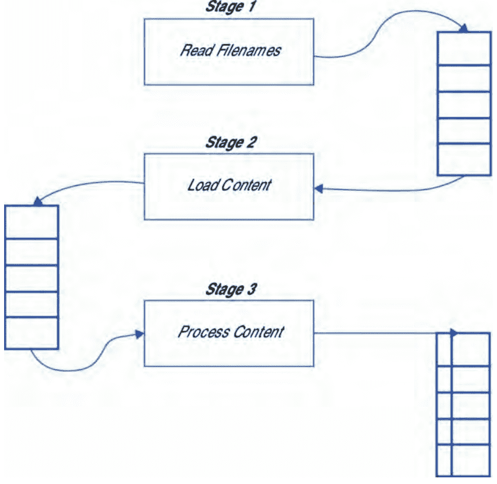

#### 图 12.1

在此场景中，下一阶段只能在阶段 3 完成并且内容最终处理完毕且结果完整存入字典后才能开始。后续步骤如图 12.2 所示。阶段 4 从字典中读取，转换数据，并将其写入队列。阶段 5 向项添加颜色信息，并将它们放入另一个队列。最后阶段显示信息。阶段 4 到 6 也可以并发运行。

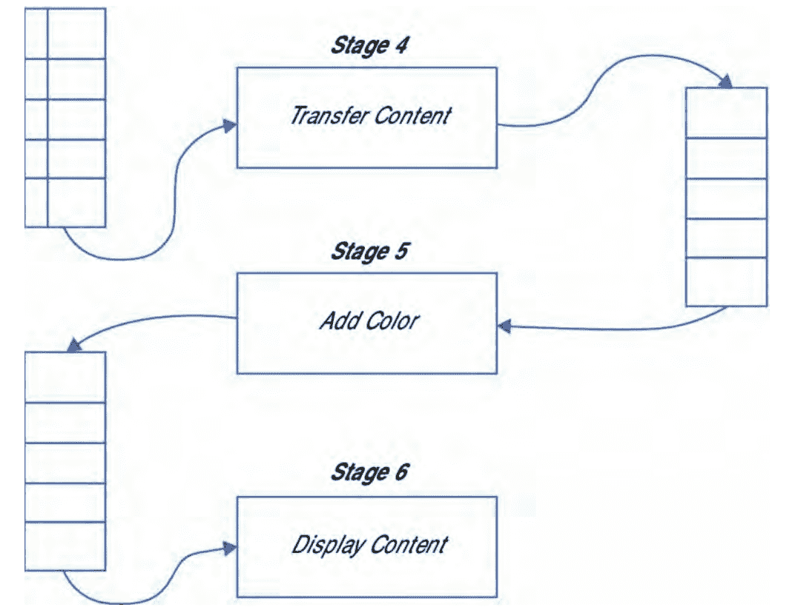

#### 图 12.2

`Info` 类表示由管道维护的项（代码文件 `PipelineSample/Info.cs`）：

```
public class Info
{
    public string Word { get; set; }
    public int Count { get; set; }
    public string Color { get; set; }
    public override string ToString() => $"{Count} times: {Word}";
}
```

`PipelineSample` 使用以下依赖项和命名空间：

#### 依赖项

`NETStandard.Library`

#### 命名空间

- `System.Collections.Generic`
- `System.Collections.Concurrent`
- `System.IO`
- `System.Linq`
- `System.Threading.Tasks`
- `static System.Console`

查看此示例应用程序的代码，完整管道在方法 `StartPipeline` 中管理。在这里，集合被实例化并传递给管道的各个阶段。第一阶段使用 `ReadFilenamesAsync` 处理，第二阶段和第三阶段 `LoadContentAsync` 和 `ProcessContentAsync` 同时运行。然而，第四阶段只能在第一到第三阶段完成后才能开始（代码文件 `PipelineSample/Program.cs`）：

```
public static async Task StartPipelineAsync()
{
    var fileNames = new BlockingCollection<string>();
    var lines = new BlockingCollection<string>();
    var words = new ConcurrentDictionary<string, int>();
    var items = new BlockingCollection<Info>();
    var coloredItems = new BlockingCollection<Info>();
    Task t1 = PipelineStages.ReadFilenamesAsync("@../../..", fileNames);
    ColoredConsole.WriteLine("started stage 1");
    ConsoleHelper.WriteLine("started stage 2");
    Task t2 = PipelineStages.LoadContentAsync(fileNames, lines);
    Task t3 = PipelineStages.ProcessContentAsync(lines, words);
    await Task.WhenAll(t1, t2, t3);
    ConsoleHelper.WriteLine("stages 1, 2, 3 completed");
    Task t4 = PipelineStages.TransferContentAsync(words, items);
    Task t5 = PipelineStages.AddColorAsync(items, coloredItems);
    Task t6 = PipelineStages.ShowContentAsync(coloredItems);
    ColoredConsole.WriteLine("stages 4, 5, 6 started");
    await Task.WhenAll(t4, t5, t6);
    ColoredConsole.WriteLine("all stages finished");
}
```

> 注意 此示例应用程序使用了任务以及 `async` 和 `await` 关键字，这些将在第 15 章详细解释。你可以在第 21 章阅读更多关于线程、任务和同步的内容。文件 I/O 在第 23 章“文件和流”中讨论。


该示例使用 `ColoredConsole` 类向控制台写入信息。该类提供了一种更改控制台输出颜色的简便方法，并使用同步来避免返回颜色错误的输出（代码文件 PipelineSample/ColoredConsole.cs）：

```
public static class ColoredConsole
{
    private static object syncOutput = new object();
    public static void WriteLine(string message)
    {
        lock (syncOutput)
        {
            Console.WriteLine(message);
        }
    }
    public static void WriteLine(string message, string color)
    {
        lock (syncOutput)
        {
            Console.ForegroundColor = (ConsoleColor)Enum.Parse(
                typeof(ConsoleColor), color);
            Console.WriteLine(message);
            Console.ResetColor();
        }
    }
}
```

### 使用 BlockingCollection

让我们进入管道的第一阶段。`ReadFilenamesAsync` 接收一个 `BlockingCollection<T>`，它可以将其输出写入其中。此方法的实现使用枚举器来迭代指定目录及其子目录中的 C# 文件。文件名通过 `Add` 方法添加到 `BlockingCollection<T>`。添加文件名完成后，调用 `CompleteAdding` 方法以通知所有读取者，它们不应再等待集合中的任何其他项（代码文件 PipelineSample/PipelineStages.cs）：

```
public static class PipelineStages
{
    public static Task ReadFilenamesAsync(string path,
        BlockingCollection<string> output)
    {
        return Task.Factory.StartNew(() =>
        {
            foreach (string filename in
                Directory.EnumerateFiles(path, "*.cs",
                    SearchOption.AllDirectories))
            {
                output.Add(filename);
                ColoredConsole.WriteLine($"stage 1: added {filename}");
            }
            output.CompleteAdding();
        }, TaskCreationOptions.LongRunning);
    }
    // . . .
```

> 注意 如果有一个读取者从 `BlockingCollection<T>` 中读取，同时写入者添加项，那么调用 `CompleteAdding` 方法非常重要。否则，读取者会在 `foreach` 循环中等待更多项的到达。

下一阶段是读取文件并将其内容添加到另一个集合，这是由 `LoadContentAsync` 方法完成的。该方法使用通过输入集合传递的文件名，打开文件，并将文件的所有行添加到输出集合。在 `foreach` 循环中，调用 `GetConsumingEnumerable` 并传入输入阻塞集合以迭代项。也可以直接使用输入变量而不调用 `GetConsumingEnumerable`，但这只会迭代集合的当前状态，而不会迭代之后添加的项。

```
public static async Task
LoadContentAsync(BlockingCollection<string> input,
    BlockingCollection<string> output)
{
    foreach (var filename in input.GetConsumingEnumerable())
    {
        using (FileStream stream = File.OpenRead(filename))
        {
            var reader = new StreamReader(stream);
            string line = null;
            while ((line = await reader.ReadLineAsync()) != null)
            {
                output.Add(line);
                ColoredConsole.WriteLine($"stage 2: added {line}");
            }
        }
    }
    output.CompleteAdding();
}
```

> 注意：如果读取器在集合被填充的同时读取集合，则需要使用 `GetConsumingEnumerable` 方法获取阻塞集合的枚举器，而不是直接迭代该集合。

#### 使用 ConcurrentDictionary

阶段 3 在 `ProcessContentAsync` 方法中实现。该方法从输入集合中获取各行，然后将单词拆分并筛选到输出字典中。`AddOrUpdate` 方法是 `ConcurrentDictionary` 类型的一个方法。如果该键尚未添加到字典中，则第二个参数定义应设置的值。如果该键已经存在于字典中，则 `updateValueFactory` 参数定义应如何更改该值。在本例中，现有值仅递增 1：

```
public static Task ProcessContentAsync(
    BlockingCollection<string> input,
    ConcurrentDictionary<string, int> output)
{
    return Task.Factory.StartNew(() =>
    {
        foreach (var line in input.GetConsumingEnumerable())
        {
            string[] words = line.Split(' ', ';', '\t', '{', '}', '(', ')', ':', ',', '"');
            foreach (var word in words.Where(w => !string.IsNullOrEmpty(w)))
            {
                output.AddOrUpdate(key: word, addValue: 1, updateValueFactory: (s, i) => ++i);
                ColoredConsole.WriteLine($"stage 3: added {word}");
            }
        }
    }, TaskCreationOptions.LongRunning);
}
```

运行包含前三个阶段的应用时，你会看到类似下面的输出，其中各个阶段交错运行：

```
stage 3: added DisplayBits
stage 3: added bits2
stage 3: added Write
stage 3: added =
stage 3: added bits1.Or
stage 2: added             DisplayBits(bits2);
stage 2: added             Write(" and");
stage 2: added             DisplayBits(bits1);
stage 2: added             WriteLine();
stage 2: added             DisplayBits(bits2);
```

#### 完成管道

前三个阶段完成后，接下来的三个阶段可以再次并行运行。`TransferContentAsync` 从字典获取数据，将其转换为 `Info` 类型，并放入输出 `BlockingCollection<T>`（代码文件 `PipelineSample/PipelineStages.cs`）：

```
public static Task TransferContentAsync(
    ConcurrentDictionary<string, int> input,
    BlockingCollection<Info> output)
{
    return Task.Factory.StartNew(() =>
    {
        foreach (var word in input.Keys)
        {
            int value;
            if (input.TryGetValue(word, out value))
            {
                var info = new Info { Word = word, Count = value };
                output.Add(info);
                ColoredConsole.WriteLine($"stage 4: added {info}");
            }
        }
        output.CompleteAdding();
    }, TaskCreationOptions.LongRunning);
}
```

管道阶段 `AddColorAsync` 根据 `Count` 属性的值设置 `Info` 类型的 `Color` 属性：

```
public static Task AddColorAsync(BlockingCollection<Info> input,
    BlockingCollection<Info> output)
{
    return Task.Factory.StartNew(() =>
    {
        foreach (var item in input.GetConsumingEnumerable())
        {
            if (item.Count > 40)
            {
                item.Color = "Red";
            }
            else if (item.Count > 20)
            {
                item.Color = "Yellow";
            }
            else
            {
                item.Color = "Green";
            }
            output.Add(item);
            ColoredConsole.WriteLine($"stage 5: added color {item.Color} to {item}");
```

### 13 语言集成查询

#### 本章内容

- 使用 `List` 对对象进行传统查询
- 扩展方法
- LINQ 查询运算符
- 并行 LINQ
- 表达式树

#### 本章的 Wrox.com 代码下载

本章的 wrox.com 代码下载位于 `www.wrox.com/go/professionalcsharp6` 的 Download Code 选项卡上。本章代码分为以下几个主要示例：

- LINQ 简介
- `Enumerable` 示例
- 并行 LINQ
- 表达式树

#### LINQ 概述

LINQ（语言集成查询）将查询语法集成到 C# 编程语言中，从而可以使用相同的语法访问不同的数据源。LINQ 通过提供抽象层来实现这一点。

本章介绍 LINQ 的核心原理，以及使 C# LINQ 查询成为可能的 C# 语言扩展。

> 注意：有关跨数据库使用 LINQ 的详细信息，请阅读第 38 章“Entity Framework Core”。有关查询 XML 数据的信息，请在阅读本章后阅读第 27 章“XML 和 JSON”。

本章从一个简单的 LINQ 查询开始，然后深入探讨 LINQ 的全部潜力。C# 语言提供了一种集成查询语言，它会转换为方法调用。本节展示这种转换的样子，以便你可以使用 LINQ 的所有可能性。

#### 列表和实体

本章中的 LINQ 查询是在一个包含 1950 年至 2015 年 Formula-1 冠军的集合上执行的。这些数据需要使用实体类和列表来准备。

对于实体，定义了 `Racer` 类型。`Racer` 定义了多个属性和一个重载的 `ToString` 方法，以字符串格式显示车手。该类实现了 `IFormattable` 接口以支持不同格式字符串变体，以及 `IComparable<Racer>` 接口，该接口可用于根据 `LastName` 对车手列表进行排序。对于更高级的查询，`Racer` 类不仅包含 `FirstName`、`LastName`、`Wins`、`Country` 和 `Starts` 等单值属性，还包含 `Cars` 和 `Years` 等包含集合的属性。`Years` 属性列出冠军头衔的所有年份。有些车手赢得过不止一个头衔。`Cars` 属性用于列出车手在夺冠年份中使用过的所有赛车（代码文件 `DataLib/Racer.cs`）：

```
using System;
using System.Collections.Generic;

namespace Wrox.ProCSharp.LINQ
{
    public class Racer : IComparable<Racer>, IFormattable
    {
        public Racer(string firstName, string lastName, string country,
                     int starts, int wins)
            : this(firstName, lastName, country, starts, wins, null,
                   null)
        {
        }

        public Racer(string firstName, string lastName, string country,
                     int starts, int wins, IEnumerable<int> years,
                     IEnumerable<string> cars)
        {
            FirstName = firstName;
            LastName = lastName;
            Country = country;
            Starts = starts;
            Wins = wins;
            Years = years != null ? new List<int>(years) : new List<int>();
            Cars = cars != null ? new List<string>(cars) : new List<string>();
        }

        public string FirstName { get; set; }
        public string LastName { get; set; }
        public int Wins { get; set; }
        public string Country { get; set; }
        public int Starts { get; set; }
        public IEnumerable<string> Cars { get; }
        public IEnumerable<int> Years { get; }

        public override string ToString() => $"{FirstName} {LastName}";

        public int CompareTo(Racer other) => LastName.CompareTo(other?.LastName);

        public string ToString(string format) => ToString(format, null);

        public string ToString(string format, IFormatProvider formatProvider)
        {
            switch (format)
            {
                case null:
                case "N":
                    return ToString();
                case "F":
```


```csharp
                    return FirstName;

                case "L":

                    return LastName;

                case "C":

                    return Country;

                case "S":

                    return Starts.ToString();

                case "W":

                    return Wins.ToString();

                case "A":

                    return $"{FirstName} {LastName}, {Country}; starts: {Starts}, wins: {Wins}";

                default:

                    throw new FormatException($"Format {format} not supported");

            }

        }

    }

}
```

第二个实体类是 `Team`。该类仅包含名称和一个用于车队总冠军的年份数组。与车手总冠军类似，每年也会评选出一支最佳车队，并授予车队总冠军（代码文件 `DataLib/Team.cs`）：

```csharp
public class Team

{

    public Team(string name, params int[] years)

    {

        Name = name;

        Years = years != null ? new List<int>(years) : new List<int>();

    }

    public string Name { get; }

    public IEnumerable<int> Years { get; }

}
```

`Formula1` 类在 `GetChampions` 方法中返回车手列表。该列表填充了 1950 年至 2015 年的所有 `Formula-1` 冠军（代码文件 `DataLib/Formula1.cs`）：

```csharp
using System.Collections.Generic;

namespace Wrox.ProCSharp.LINQ

{

    public static class Formula1

    {

        private static List<Racer> _racers;

        public static IList<Racer> GetChampions()

        {

            if (_racers == null)

{
    _racers = new List<Racer>(40);
    _racers.Add(new Racer("Nino", "Farina", "Italy", 33, 5,
        new int[] { 1950 }, new string[] { "Alfa Romeo" }));
    _racers.Add(new Racer("Alberto", "Ascari", "Italy", 32, 10,
        new int[] { 1952, 1953 }, new string[] { "Ferrari" }));
    _racers.Add(new Racer("Juan Manuel", "Fangio", "Argentina", 51, 24,
        new int[] { 1951, 1954, 1955, 1956, 1957 },
        new string[] { "Alfa Romeo", "Maserati", "Mercedes", "Ferrari" }));
    _racers.Add(new Racer("Mike", "Hawthorn", "UK", 45, 3,
        new int[] { 1958 }, new string[] { "Ferrari" }));
    _racers.Add(new Racer("Phil", "Hill", "USA", 48, 3, new int[] { 1961 },
        new string[] { "Ferrari" }));
    _racers.Add(new Racer("John", "Surtees", "UK", 111, 6,
        new int[] { 1964 }, new string[] { "Ferrari" }));
    _racers.Add(new Racer("Jim", "Clark", "UK", 72, 25,
        new int[] { 1963, 1965 }, new string[] { "Lotus" }));
    _racers.Add(new Racer("Jack", "Brabham", "Australia", 125, 14,
        new int[] { 1959, 1960, 1966 },
        new string[] { "Cooper", "Brabham" }));
    _racers.Add(new Racer("Denny", "Hulme", "New Zealand", 112, 8,
        new int[] { 1967 }, new string[] { "Brabham" }));
    _racers.Add(new Racer("Graham", "Hill", "UK", 176, 14,
        new int[] { 1962, 1968 }, new string[] { "BRM", "Lotus" }));
    _racers.Add(new Racer("Jochen", "Rindt", "Austria", 60, 6,
        new int[] { 1970 }, new string[] { "Lotus" }));
    _racers.Add(new Racer("Jackie", "Stewart", "UK", 99, 27,
        new int[] { 1969, 1971, 1973 },
        new string[] { "Matra", "Tyrrell" }));
    //...

    return _racers;

}

}

}

}
```

当查询跨越多个列表时，下面的 `GetConstructorChampions` 方法返回所有制造商冠军的列表（这些锦标赛自 1958 年以来一直存在）：

```csharp
private static List<Team> _teams;

public static IList<Team> GetConstructorChampions()

{

    if (_teams == null)

    {

        _teams = new List<Team>()

        {

            new Team("Vanwall", 1958),

            new Team("Cooper", 1959, 1960),

            new Team("Ferrari", 1961, 1964, 1975, 1976, 1977, 1979, 1982,

                1983, 1999, 2000, 2001, 2002, 2003, 2004, 2007, 2008),

            new Team("BRM", 1962),

            new Team("Lotus", 1963, 1965, 1968, 1970, 1972, 1973, 1978),

            new Team("Brabham", 1966, 1967),

            new Team("Matra", 1969),

            new Team("Tyrrell", 1971),

            new Team("McLaren", 1974, 1984, 1985, 1988, 1989, 1990, 1991, 1998),

            new Team("Williams", 1980, 1981, 1986, 1987, 1992, 1993, 1994, 1996, 1997),

            new Team("Benetton", 1995),

            new Team("Renault", 2005, 2006),

            new Team("Brawn GP", 2009),

            new Team("Red Bull Racing", 2010, 2011, 2012, 2013),

            new Team("Mercedes", 2014, 2015)

        };

    }

    return _teams;

}
```

### LINQ 查询

利用这些准备好的列表和实体，你可以执行 LINQ 查询——例如，获取来自巴西的所有世界冠军并按获胜次数从高到低排序。为此，你可以使用 `List<T>` 类的方法，例如 `FindAll` 和 `Sort` 方法。

不过，一旦你习惯了 LINQ，就会有更简单的语法（代码文件 `LINQIntro/Program.cs`）：

```csharp
private static void LinqQuery()

{

    var query = from r in Formula1.GetChampions()

                where r.Country == "Brazil"

                orderby r.Wins descending

                select r;

    foreach (Racer r in query)

    {

        WriteLine($"{r:A}");

    }

}
```

该查询的结果显示了按获胜次数排序的巴西世界冠军：

```text
Ayrton Senna, Brazil; starts: 161, wins: 41

Nelson Piquet, Brazil; starts: 204, wins: 23

Emerson Fittipaldi, Brazil; starts: 143, wins: 14
```

### 表达式

```csharp
from r in Formula1.GetChampions()

where r.Country == "Brazil"

orderby r.Wins descending

select r;
```

这是一个 LINQ 查询。`from`、`where`、`orderby`、`descending` 和 `select` 子句是该查询中的预定义关键字。

查询表达式必须以 `from` 子句开始，并以 `select` 或 `group` 子句结束。在两者之间，你可以选择使用 `where`、`orderby`、`join`、`let` 以及额外的 `from` 子句。

> 注意：变量 `query` 只是被分配了 LINQ 查询。该查询不会在分配时执行，而是在使用 `foreach` 循环访问查询时才执行。这将在后面的“延迟查询执行”一节中更详细地讨论。

### 扩展方法

编译器会将 LINQ 查询转换为方法调用，而不是直接使用 LINQ 查询。LINQ 为 `IEnumerable<T>` 接口提供了各种扩展方法，因此你可以在任何实现该接口的集合上使用 LINQ 查询。扩展方法定义为静态方法，其第一个参数定义了它要扩展的类型，并且它声明在静态类中。

扩展方法使你可以为某个类添加该类一开始并未提供的方法。你还可以向实现特定接口的任何类添加方法，因此多个类可以使用同一个实现。

例如，你难道不想让 `String` 类也有一个 `Foo` 方法吗？`String` 类是密封的，因此无法继承该类；但你可以创建一个扩展方法，如下面的代码所示：

```csharp
public static class StringExtension

{

    public static void Foo(this string s)

    {

        WriteLine($"Foo invoked for {s}");

    }

}
```

`Foo` 方法扩展了 `string` 类，这是通过第一个参数定义的。为了将扩展方法与普通静态方法区分开来，扩展方法还需要在第一个参数上使用 `this` 关键字。

事实上，现在可以在 `string` 类型上使用 `Foo` 方法：

```csharp
string s = "Hello";

s.Foo();
```

结果会在控制台中显示 `Foo invoked for Hello`，因为 `Hello` 是传递给 `Foo` 方法的字符串。

这可能看起来违反了面向对象规则，因为它在不改变类型或继承类型的情况下为类型定义了新方法。然而，事实并非如此。扩展方法不能访问它所扩展类型的私有成员。调用扩展方法只是调用静态方法的一种新语法。对于 `string`，你可以通过以下方式调用 `Foo` 方法来获得相同的结果：

```csharp
string s = "Hello";

StringExtension.Foo(s);
```

要调用静态方法，请写出类名后跟方法名。扩展方法是调用静态方法的一种不同方式。你无需提供静态方法所在类的名称。相反，编译器会根据参数类型选择该静态方法。你只需导入包含该类的命名空间，就能在 `String` 类的作用域中获得 `Foo` 扩展方法。

定义 LINQ 扩展方法的类之一是 `System.Linq` 命名空间中的 `Enumerable`。你只需导入该命名空间，即可打开这个类的扩展方法的作用域。下面代码展示了 `Where` 扩展方法的一个示例实现。`Where` 方法包含 `this` 关键字的第一个参数类型为 `IEnumerable<T>`。这使 `Where` 方法可用于任何实现 `IEnumerable<T>` 的类型。实现该接口的类型包括数组和 `List<T>`。第二个参数是一个 `Func<T, bool>` 委托，它引用一个返回布尔值且需要类型 `T` 参数的方法。该谓词在实现中被调用，以检查来自 `IEnumerable<T>` 源的项是否应被添加到目标集合中。如果委托引用了该方法，`yield return` 语句就会将项从源返回给目标：

```csharp
public static IEnumerable<TSource> Where<TSource>(

    this IEnumerable<TSource> source,

    Func<TSource, bool> predicate)

{

    foreach (TSource item in source)

        if (predicate(item))

            yield return item;

}
```

> 注意：谓词是返回布尔值的方法。

由于 `Where` 是作为泛型方法实现的，因此它适用于集合中包含的任何类型。任何实现 `IEnumerable<T>` 的集合都受支持。

> 注意：这里的扩展方法定义在 `System.Core` 程序集的 `System.Linq` 命名空间中。

现在可以使用 `Enumerable` 类中的扩展方法 `Where`、`OrderByDescending` 和 `Select`。由于这些方法每个都返回 `IEnumerable<TSource>`，因此可以依次调用这些方法，将前一个结果作为下一个方法调用。扩展方法的参数可以使用匿名方法，这些匿名方法为委托参数提供实现（代码文件 `LINQIntro/Program.cs`）：

```csharp
static void ExtensionMethods()

{

    var champions = new List<Racer>(Formula1.GetChampions());

    IEnumerable<Racer> brazilChampions =

        champions.Where(r => r.Country == "Brazil").

            OrderByDescending(r => r.Wins).

            Select(r => r);

    foreach (Racer r in brazilChampions)

    {

        WriteLine($"{r:A}");

    }

}
```

### 延迟查询执行

在运行时，查询表达式不会在定义时立即执行。只有在迭代项时才会执行查询。

让我们再看一下扩展方法 `Where`。这个扩展方法使用 `yield return` 语句返回谓词为 `true` 的元素。由于使用了 `yield return` 语句，编译器会创建一个枚举器，并在从枚举中访问项时立即返回这些项：

```csharp
public static IEnumerable<T> Where<T>(this IEnumerable<T> source,

    Func<T, bool> predicate)

{

    foreach (T item in source)

    {

        if (predicate(item))

        {

            yield return item;

        }

    }

}
```


这会产生一个非常有趣且重要的效果。在下面的示例中，创建了一个字符串元素集合，并用名字填充。接下来，定义了一个查询，用于获取集合中首字母为 J 的所有名字。该集合还应进行排序。迭代不会在定义查询时发生，而是在使用 `foreach` 语句迭代所有项时发生。集合中只有一个元素以字母 J 开头，满足 `where` 表达式的要求：Juan。迭代完成并将 Juan 写入控制台后，向集合中添加了四个新名字。然后再次进行迭代：

```csharp
var names = new List<string>
{ "Nino", "Alberto", "Juan", "Mike", "Phil" };

var namesWithJ = from n in names
                 where n.StartsWith("J")
                 orderby n
                 select n;

WriteLine("First iteration");
foreach (string name in namesWithJ)
{
    WriteLine(name);
}

WriteLine();
names.Add("John");
names.Add("Jim");
names.Add("Jack");
names.Add("Denny");

WriteLine("Second iteration");
foreach (string name in namesWithJ)
{
    WriteLine(name);
}
```

由于迭代不会在定义查询时发生，而是在每次 `foreach` 时发生，因此可以看到变化，正如应用程序的输出所示：

```
First iteration
Juan

Second iteration
Jack
Jim
John
Juan
```

当然，你还必须意识到，扩展方法在每次迭代中使用查询时都会被调用。大多数时候这非常实用，因为你可以检测源数据中的变化。但有时这也可能不实用。你可以通过调用 `ToArray`、`ToList` 等扩展方法来改变这种行为。在下面的示例中，你可以看到 `ToList` 会立即遍历集合，并返回一个实现 `IList<string>` 的集合。返回的列表随后会被遍历两次；在两次遍历之间，数据源会获得新名字：

```csharp
var names = new List<string>
{ "Nino", "Alberto", "Juan", "Mike", "Phil" };

var namesWithJ = (from n in names
                  where n.StartsWith("J")
                  orderby n
                  select n).ToList();

WriteLine("First iteration");
foreach (string name in namesWithJ)
{
    WriteLine(name);
}

WriteLine();
names.Add("John");
names.Add("Jim");
names.Add("Jack");
names.Add("Denny");

WriteLine("Second iteration");
foreach (string name in namesWithJ)
{
    WriteLine(name);
}
```

| 运算符 | 描述 |
| --- | --- |
| `GroupBy`<br>`ToLookup` | `GroupBy` 运算符根据公共键对元素进行分组。`ToLookup` 通过创建一对多字典来对元素进行分组。 |
| `Any`<br>`All`<br>`Contains` | *量词运算符* 在序列的元素满足特定条件时返回布尔值。`Any`、`All` 和 `Contains` 都是量词运算符。`Any` 确定集合中是否存在满足谓词函数的元素；`All` 确定集合中是否所有元素都满足谓词。`Contains` 检查集合中是否存在特定元素。 |
| `Take`<br>`Skip`<br>`TakeWhile`<br>`SkipWhile` | *分区运算符* 返回集合的子集。`Take`、`Skip`、`TakeWhile` 和 `SkipWhile` 都是分区运算符。使用这些运算符可以得到部分结果。使用 `Take` 时，需要指定要从集合中获取的元素数量；`Skip` 会忽略指定数量的元素并获取其余元素。`TakeWhile` 在条件为 true 时获取元素。`SkipWhile` 在条件为 true 时跳过元素。 |
| `Distinct`<br>`Union`<br>`Intersect`<br>`Except`<br>`Zip` | *集合运算符* 返回一个集合。`Distinct` 从集合中移除重复项。除 `Distinct` 之外，其他集合运算符都需要两个集合。`Union` 返回两个集合中任一集合出现的唯一元素。`Intersect` 返回两个集合中都出现的元素。`Except` 返回仅在一个集合中出现的元素。`Zip` 将两个集合合并为一个。 |
| `First`<br>`FirstOrDefault`<br>`Last`<br>`LastOrDefault`<br>`ElementAt`<br>`ElementAtOrDefault`<br>`Single`<br>`SingleOrDefault` | *元素运算符* 只返回一个元素。`First` 返回满足条件的第一个元素。`FirstOrDefault` 与 `First` 类似，但如果找不到元素，则返回该类型的默认值。`Last` 返回满足条件的最后一个元素。通过 `ElementAt`，可以指定要返回的元素位置。`Single` 只返回满足条件的一个元素。如果满足条件的元素不止一个，则会抛出异常。所有 `XXOrDefault` 方法都与具有相同前缀的方法类似，但如果找不到元素，它们会返回该类型的默认值。 |
| `Count`<br>`Sum`<br>`Min`<br>`Max`<br>`Average`<br>`Aggregate` | *聚合运算符* 从集合中计算单个值。使用聚合运算符，可以获得所有值的总和、所有元素的数量、最低或最高值的元素、平均值等。 |
| `ToArray`<br>`AsEnumerable`<br>`ToList`<br>`ToDictionary`<br>`Cast<TResult>` | *转换运算符* 将集合转换为数组、`IEnumerable`、`IList`、`IDictionary` 等。`Cast` 方法将集合中的每一项强制转换为泛型参数类型。 |
| `Empty`<br>`Range`<br>`Repeat` | *生成运算符* 返回一个新序列。使用 `Empty` 运算符时集合为空；`Range` 返回数字序列；`Repeat` 返回包含一个重复值的集合。 |

以下各节提供了一些示例，演示如何使用这些运算符。

### 筛选

本节将介绍一些查询示例。

使用 `where` 子句，可以组合多个表达式——例如，仅获取来自巴西和奥地利且获胜超过 15 场比赛的车手。传递给 `where` 子句的表达式的返回类型只需为 `bool` 类型：

```csharp
var racers = from r in Formula1.GetChampions()
             where r.Wins > 15 &&
                 (r.Country == "Brazil" || r.Country == "Austria")
             select r;

foreach (var r in racers)
{
    WriteLine($"{r:A}");
}
```

使用此 LINQ 查询启动程序会返回 Niki Lauda、Nelson Piquet 和 Ayrton Senna，如下所示：

```
Niki Lauda, Austria, Starts: 173, Wins: 25
Nelson Piquet, Brazil, Starts: 204, Wins: 23
Ayrton Senna, Brazil, Starts: 161, Wins: 41
```

并非所有查询都可以使用 LINQ 查询语法完成，也并非所有扩展方法都映射到 LINQ 查询子句。高级查询需要使用扩展方法。为了更好地理解使用扩展方法的复杂查询，最好看看简单查询是如何映射的。使用扩展方法 `Where` 和 `Select` 生成的查询与之前的 LINQ 查询非常相似：

```csharp
var racers = Formula1.GetChampions().
    Where(r => r.Wins > 15 &&
        (r.Country == "Brazil" || r.Country == "Austria")).
    Select(r => r);
```

`Select(r => r);`

### 使用索引进行筛选

一种无法使用 LINQ 查询的场景是 `Where` 方法的重载。使用 `Where` 方法的重载时，可以传递第二个参数，即索引。索引是过滤器返回的每个结果的计数器。可以在表达式中使用索引来基于索引执行某些计算。在下面的示例中，`Where` 扩展方法调用的代码中使用了索引，以返回仅当索引为偶数时姓氏以 A 开头的车手（代码文件 `EnumerableSample/Program.cs`）：

```
var racers = Formula1.GetChampions().
    Where((r, index) => r.LastName.StartsWith("A") && index % 2 == 0);

foreach (var r in racers)
{
    WriteLine($"{r:A}");
}
```

姓氏以字母 A 开头的车手是 Alberto Ascari、Mario Andretti 和 Fernando Alonso。由于 Mario Andretti 位于奇数索引中，因此他不在结果中：

```
Alberto Ascari, Italy; starts: 32, wins: 10
Fernando Alonso, Spain; starts: 252, wins: 32
```

### 类型筛选

对于基于类型的筛选，可以使用 `OfType` 扩展方法。这里数组 `data` 包含 `string` 和 `int` 对象。使用 `OfType` 扩展方法，将 `string` 类传递给泛型参数，只返回集合中的字符串（代码文件 `EnumerableSample/Program.cs`）：

```
object[] data = { "one", 2, 3, "four", "five", 6 };
var query = data.OfType<string>();

foreach (var s in query)
{
    WriteLine(s);
}
```

运行此代码，将显示字符串 one、four 和 five：

```
one
four
five
```

### 复合 from

如果需要基于对象本身就是一个序列的成员进行筛选，可以使用复合 `from`。`Racer` 类定义了 `Cars` 属性，其中 `Cars` 是一个字符串数组。对于筛选所有曾驾驶法拉利夺冠的车手，可以使用下面所示的 LINQ 查询。第一个 `from` 子句访问 `Formula1.GetChampions` 返回的 `Racer` 对象。第二个 `from` 子句访问 `Racer` 类的 `Cars` 属性，以返回所有类型为 `string` 的汽车。接下来使用 `where` 子句筛选仅驾驶法拉利夺冠的车手（代码文件 `EnumerableSample/Program.cs`）：

```
var ferrariDrivers = from r in Formula1.GetChampions()
    from c in r.Cars
    where c == "Ferrari"
    orderby r.LastName
    select r.FirstName + " " + r.LastName;
```

如果你好奇此查询的结果，以下是所有驾驶法拉利的 F1 冠军：

- Alberto Ascari
- Juan Manuel Fangio
- Mike Hawthorn
- Phil Hill
- Niki Lauda
- Kimi Räikkönen
- Jody Scheckter
- Michael Schumacher
- John Surtees

C# 编译器将 LINQ 查询中的复合 `from` 子句转换为 `SelectMany` 扩展方法。`SelectMany` 可用于迭代序列的序列。示例中使用的 `SelectMany` 方法的重载如下所示：

```
public static IEnumerable<TResult> SelectMany<TSource,
TCollection, TResult> (
    this IEnumerable<TSource> source,
    Func<TSource,
    IEnumerable<TCollection>> collectionSelector,
    Func<TSource, TCollection, TResult> resultSelector);
```

第一个参数是隐式参数，接收来自 `GetChampions` 方法的 `Racer` 对象序列。第二个参数是 `collectionSelector` 委托，在其中定义内部序列。使用 lambda 表达式 `r => r.Cars`，应返回汽车集合。第三个参数是一个委托，现在为每辆车调用，并接收 `Racer` 和 `Car` 对象。lambda 表达式创建了一个具有 `Racer` 和 `Car` 属性的匿名类型。由此 `SelectMany` 方法的结果是，车手和汽车的层次结构被展平，并返回每个汽车的匿名类型的新对象集合。

此新集合传递给 `Where` 方法，以便仅筛选驾驶法拉利的车手。最后调用 `OrderBy` 和 `Select` 方法：

```
var ferrariDrivers = Formula1.GetChampions()
    .SelectMany(r => r.Cars, (r, c) => new { Racer = r, Car = c })
    .Where(r => r.Car == "Ferrari")
    .OrderBy(r => r.Racer.LastName)
    .Select(r => r.Racer.FirstName + " " + r.Racer.LastName);
```

将泛型 `SelectMany` 方法解析为此处使用的类型，类型解析如下。在此情况下，`source` 的类型为 `Racer`，筛选后的集合为 `string` 数组，当然返回的匿名类型的名称未知，这里显示为 `TResult`：

```
public static IEnumerable<TResult> SelectMany<Racer, string, TResult> (
    this IEnumerable<Racer> source,
    Func<Racer, IEnumerable<string>> collectionSelector,
    Func<Racer, string, TResult> resultSelector);
```

由于查询只是从 LINQ 查询转换为扩展方法，结果与之前相同。

### 排序

为了对序列进行排序，已经使用了 `orderby` 子句。本节回顾了之前的示例，现在使用 `orderby descending` 子句。这里车手是根据按降序指定的键选择器中的获胜次数进行排序的（代码文件 `EnumerableSample/Program.cs`）：

```
var racers = from r in Formula1.GetChampions()
    where r.Country == "Brazil"
    orderby r.Wins descending
    select r;
```

`orderby` 子句解析为 `OrderBy` 方法，而 `orderby descending` 子句解析为 `OrderByDescending` 方法：

```
var racers = Formula1.GetChampions()
    .Where(r => r.Country == "Brazil")
    .OrderByDescending(r => r.Wins)
    .Select(r => r);
```

`OrderBy` 和 `OrderByDescending` 方法返回 `IOrderedEnumerable<TSource>`。此接口派生自接口 `IEnumerable<TSource>`，但包含一个额外的方法 `CreateOrderedEnumerable<TSource>`。此方法用于对序列进行进一步排序。如果两个项目基于键选择器相同，则可以使用 `ThenBy` 和 `ThenByDescending` 方法继续排序。这些方法需要一个 `IOrderedEnumerable<TSource>` 来工作，但也返回此接口。因此，你可以添加任意数量的 `ThenBy` 和 `ThenByDescending` 方法来对集合进行排序。

使用 LINQ 查询，你只需将用于排序的所有不同键（用逗号分隔）添加到 `orderby` 子句中。在下一个示例中，对所有车手的排序首先基于国家/地区，接下来基于姓氏，最后基于名字。添加到 LINQ 查询结果的 `Take` 扩展方法用于返回前 10 个结果：

```
var racers = (from r in Formula1.GetChampions()
    orderby r.Country, r.LastName, r.FirstName
```


```
select r).Take(10);
```

排序后的结果如下所示：

- Argentina: Fangio, Juan Manuel
- Australia: Brabham, Jack
- Australia: Jones, Alan
- Austria: Lauda, Niki
- Austria: Rindt, Jochen
- Brazil: Fittipaldi, Emerson
- Brazil: Piquet, Nelson
- Brazil: Senna, Ayrton
- Canada: Villeneuve, Jacques
- Finland: Hakkinen, Mika

使用扩展方法执行相同操作会使用 `OrderBy` 和 `ThenBy` 方法：

```
var racers = Formula1.GetChampions()

    .OrderBy(r => r.Country)

    .ThenBy(r => r.LastName)

    .ThenBy(r => r.FirstName)

    .Take(10);
```

### 分组

为了基于键值对查询结果进行分组，可以使用 `group` 子句。现在应按国家/地区对 F1 冠军进行分组，并列出每个国家/地区的冠军人数。子句 `group r by r.Country into g` 根据 `Country` 属性对所有车手进行分组，并定义一个新的标识符 `g`，可在以后用于访问分组结果信息。`group` 子句的结果基于应用于分组结果的扩展方法 `Count` 进行排序；如果计数相同，则基于键进行排序。这是国家/地区，因为这是用于分组的键。`where` 子句基于具有至少两个项目的组来筛选结果，而 `select` 子句创建具有 `Country` 和 `Count` 属性的匿名类型（代码文件 `EnumerableSample/Program.cs`）：

```
var countries = from r in Formula1.GetChampions()

    group r by r.Country into g

    orderby g.Count() descending, g.Key

    where g.Count() >= 2

    select new {

        Country = g.Key,

        Count = g.Count()

    };

foreach (var item in countries)

{

    WriteLine($"{item.Country, -10} {item.Count}");

}
```

结果显示具有 `Country` 和 `Count` 属性的对象集合：

| Country | Count |
| ------- | ----- |
| UK | 10 |
| Brazil | 3 |
| Finland | 3 |
| Australia | 2 |
| Austria | 2 |
| Germany | 2 |
| Italy | 2 |

对于扩展方法，同样是针对分组子句解析为 `GroupBy` 方法。`GroupBy` 方法的一个有趣之处在于，它返回一个实现了 `IGrouping` 接口的对象枚举。`IGrouping` 接口定义了 `Key` 属性，因此你可以在调用此方法后访问分组的键：

```
public static IEnumerable<IGrouping<TKey, TSource>>

GroupBy<TSource, TKey>(

this IEnumerable<TSource> source, Func<TSource, TKey> keySelector);
```

`group r.Country into g` 子句被解析为 `GroupBy(r => r.Country)` 并返回分组序列。该分组序列首先通过 `OrderByDescending` 方法排序，然后通过 `ThenBy` 方法排序。接下来，调用你已经熟悉的 `Where` 和 `Select` 方法：

```
var countries = Formula1.GetChampions()

.GroupBy(r => r.Country)

.OrderByDescending(g => g.Count())

.ThenBy(g => g.Key)

.Where(g => g.Count() >= 2)

.Select(g => new { Country = g.Key,

Count = g.Count() });
```

### LINQ 查询中的变量

对于用于分组的 LINQ 查询，`Count` 方法被多次调用。你可以通过使用 `let` 子句来改变这一点。`let` 允许在 LINQ 查询中定义变量：

```
var countries = from r in Formula1.GetChampions()

group r by r.Country into g

let count = g.Count()

orderby count descending, g.Key

where count >= 2

select new

{

Country = g.Key,

Count = count

};
```

使用方法语法时，`Count` 方法同样被多次调用。为了定义要传递给下一个方法的额外数据（这正是 `let` 子句所做的事情），你可以使用 `Select` 方法来创建匿名类型。这里创建了一个带有 `Group` 和 `Count` 属性的匿名类型。具有这些属性的项目集合被传递给 `OrderByDescending` 方法，排序基于此匿名类型的 `Count` 属性：

```
var countries = Formula1.GetChampions()

.GroupBy(r => r.Country)

.Select(g => new { Group = g, Count = g.Count() })

.OrderByDescending(g => g.Count)

.ThenBy(g => g.Group.Key)

.Where(g => g.Count >= 2);
```

### 品味问题：

```
var racersAndTeams =

    (from r in

        from r1 in Formula1.GetChampions()

        from yr in r1.Years

        select new

        {

            Year = yr,

            Name = r1.FirstName + " " + r1.LastName

        }

        join t in

        from t1 in Formula1.GetConstructorChampions()

        from yt in t1.Years

        select new

        {

            Year = yt,

            Name = t1.Name

        }

        on r.Year equals t.Year

        orderby t.Year

        select new

        {

            Year = r.Year,

            Racer = r.Name,

            Team = t.Name

        }).Take(10);
```

输出显示了在同时举办车手和车队锦标赛的前 10 年中，来自匿名类型的数据：

| 年份 | 世界冠军 | 车队冠军 |
| --- | --- | --- |
| 1958 | Mike Hawthorn | Vanwall |
| 1959 | Jack Brabham | Cooper |
| 1960 | Jack Brabham | Cooper |
| 1961 | Phil Hill | Ferrari |
| 1962 | Graham Hill | BRM |
| 1963 | Jim Clark | Lotus |
| 1964 | John Surtees | Ferrari |
| 1965 | Jim Clark | Lotus |
| 1966 | Jack Brabham | Brabham |
| 1967 | Denny Hulme | Brabham |

### 左外连接

上一个连接示例的输出从 1958 年开始——这是车手和车队锦标赛同时开始的第一年。车手锦标赛更早开始，在 1950 年。使用内连接，只有在找到匹配记录时才会返回结果。要获得包含所有年份的结果，你可以使用左外连接。左外连接返回左侧序列中的所有元素，即使在右侧序列中未找到匹配项也是如此。

前面的 LINQ 查询被更改为左外连接。左外连接通过 `join` 子句结合 `DefaultIfEmpty` 方法定义。如果查询的左侧（车手）没有匹配的车队冠军，则右侧的默认值由 `DefaultIfEmpty` 方法定义（代码文件 `EnumerableSample/Program.cs`）：

```
var racersAndTeams =

    (from r in racers

    join t in teams on r.Year equals t.Year into rt

    from t in rt.DefaultIfEmpty()

    orderby r.Year

    select new

    {

        Year = r.Year,

        Champion = r.Name,

        Constructor = t == null ? "no constructor championship" :

                t.Name

    }).Take(10);
```

使用此查询运行应用程序，输出从 1950 年开始，如下所示：

| 年份 | 冠军 | 车队冠军 |
| --- | --- | --- |
| 1950 | Nino Farina | 无车队锦标赛 |
| 1951 | Juan Manuel Fangio | 无车队锦标赛 |
| 1952 | Alberto Ascari | 无车队锦标赛 |
| 1953 | Alberto Ascari | 无车队锦标赛 |
| 1954 | Juan Manuel Fangio | 无车队锦标赛 |
| 1955 | Juan Manuel Fangio | 无车队锦标赛 |
| 1956 | Juan Manuel Fangio | 无车队锦标赛 |
| 1957 | Juan Manuel Fangio | 无车队锦标赛 |
| 1958 | Mike Hawthorn | Vanwall |
| 1959 | Jack Brabham | Cooper |

#### 分组连接

左外连接使用了分组连接以及 `into` 子句。它部分使用了与分组连接相同的语法。分组连接只是不需要 `DefaultIfEmpty` 方法。

使用分组连接，可以将两个独立的序列连接起来，其中一个序列包含另一个序列中某个元素的列表项。

以下示例使用两个独立的序列。一个是你从前面的示例中已经知道的冠军列表。第二个序列是 `Championship` 类型的集合。`Championship` 类型在下一个代码片段中显示。该类包含锦标赛年份以及该年获得第一、第二和第三名的车手，属性为 `Year`、`First`、`Second` 和 `Third`（代码文件 `DataLib/Championship.cs`）：

```
public class Championship

{

    public int Year { get; set; }

    public string First { get; set; }

    public string Second { get; set; }

    public string Third { get; set; }

}
```

锦标赛集合从 `GetChampionships` 方法返回，如下面的代码片段所示（代码文件 `DataLib/Formula1.cs`）：

```
private static List<Championship> championships;

public static IEnumerable<Championship> GetChampionships()

{

    if (championships == null)

    {

        championships = new List<Championship>();

        championships.Add(new Championship

        {

            Year = 1950,

            First = "Nino Farina",

            Second = "Juan Manuel Fangio",

            Third = "Luigi Fagioli"

        });

        championships.Add(new Championship

        {

            Year = 1951,

            First = "Juan Manuel Fangio",

            Second = "Alberto Ascari",

            Third = "Froilan Gonzalez"

        });

        // …
```

冠军列表应当与每年锦标赛前三名中的车手列表相结合，并显示每一年的结果。

应显示的信息由 `RacerInfo` 类定义，如下所示（代码文件 `EnumerableSample/RacerInfo.cs`）：

```
public class RacerInfo

{

    public int Year { get; set; }

    public int Position { get; set; }

    public string FirstName { get; set; }

    public string LastName { get; set; }

}
```

使用 join 语句可以将两个列表中的车手组合起来。

因为在锦标赛列表中每个项目包含三名车手，所以需要首先展平此列表。一种方法是使用 `SelectMany` 方法。`SelectMany` 使用一个 lambda 表达式，该表达式为列表中的每个项目返回一个包含三个项目的列表。在 lambda 表达式的实现中，由于 `RacerInfo` 包含 `FirstName` 和 `LastName` 属性，而接收到的集合仅包含带有 `First`、`Second` 和 `Third` 属性的名称，因此需要拆分字符串。你可以借助扩展方法 `FirstName` 和 `LastName` 来完成此操作（代码文件 `EnumerableSample/Program.cs`）：

```csharp
var racers = Formula1.GetChampionships()
    .SelectMany(cs => new List<RacerInfo>()
    {
        new RacerInfo {
            Year = cs.Year,
            Position = 1,
            FirstName = cs.First.FirstName(),
            LastName = cs.First.LastName()
        },
        new RacerInfo {
            Year = cs.Year,
            Position = 2,
            FirstName = cs.Second.FirstName(),
            LastName = cs.Second.LastName()
        },
        new RacerInfo {
            Year = cs.Year,
            Position = 3,
            FirstName = cs.Third.FirstName(),
            LastName = cs.Third.LastName()
        }
    });
```

扩展方法 `FirstName` 和 `LastName` 只是利用最后一个空格字符来拆分字符串：

```csharp
public static class StringExtension
{
    public static string FirstName(this string name)
    {
        int ix = name.LastIndexOf(' ');
        return name.Substring(0, ix);
    }
    public static string LastName(this string name)
    {
        int ix = name.LastIndexOf(' ');
        return name.Substring(ix + 1);
    }
}
```


现在可以将这两个序列进行连接。`Formula1.GetChampions` 返回一个 `Racers` 列表，而 `racers` 变量返回包含年份、名次以及车手姓名的 `RacerInfo` 列表。仅通过姓氏来比较这两个集合中的元素是不够的。有时列表中会同时出现一位车手和他的父亲（例如 Damon Hill 和 Graham Hill），因此必须同时比较 `FirstName` 和 `LastName`。为此，你需要为两个列表都创建新的匿名类型。通过 `into` 子句，第二个集合的结果被放入变量 `yearResults` 中。`yearResults` 是针对第一个集合中的每一位车手创建的，并包含第二个集合中姓名匹配的结果。最后，通过 LINQ 查询创建一个包含所需信息的匿名类型：

```csharp
var q = (from r in Formula1.GetChampions()
    join r2 in racers on
    new
    {
        FirstName = r.FirstName,
        LastName = r.LastName
    }
    equals
    new
    {
        FirstName = r2.FirstName,
        LastName = r2.LastName
    }
    into yearResults
    select new
    {
        FirstName = r.FirstName,
        LastName = r.LastName,
        Wins = r.Wins,
```

（国家为 Italy）以及排序。对于合并来说，这一点很重要，因为第一个集合中的第 1 项与第二个集合中的第 1 项合并，第 2 项与第 2 项合并，依此类推。如果两个序列的数量不同，`zip` 会在到达较小集合的末尾时停止。

第一个集合中的项具有 `Name` 属性，第二个集合中的项具有 `LastName` 和 `Starts` 属性。

在集合 `racerNames` 上使用 `zip` 方法时，需要将第二个集合 `racerNamesAndStarts` 作为第一个参数。第二个参数的类型为 `Func<TFirst, TSecond, TResult>`。该参数以 lambda 表达式实现，通过参数 `first` 接收第一个集合中的元素，通过参数 `second` 接收第二个集合中的元素。该实现会创建并返回一个字符串，包含第一个元素的 `Name` 属性和第二个元素的 `Starts` 属性（代码文件 `EnumerableSample/Program.cs`）：

```csharp
var racerNames = from r in Formula1.GetChampions()
                 where r.Country == "Italy"
                 orderby r.Wins descending
                 select new
                 {
                     Name = r.FirstName + " " + r.LastName
                 };
```

```csharp
var racerNamesAndStarts = from r in Formula1.GetChampions()
                          where r.Country == "Italy"
                          orderby r.Wins descending
                          select new
                          {
                              LastName = r.LastName,
                              Starts = r.Starts
                          };
```

```csharp
var racers = racerNames.Zip(racerNamesAndStarts,
                            (first, second) => first.Name + ", starts:" + second.Starts);

foreach (var r in racers)
{
    WriteLine(r);
}
```

合并的结果如下所示：

- Alberto Ascari, starts: 32
- Nino Farina, starts: 33

### 分区

分区操作（例如扩展方法 `Take` 和 `Skip`）可用于轻松实现分页——例如，第一页只显示五位车手，后续页面继续显示接下来的五位。

在下面的 LINQ 查询中，扩展方法 `Skip` 和 `Take` 被添加到查询末尾。`Skip` 方法首先根据页面大小和实际页码忽略计算出的项数；然后 `Take` 方法根据页面大小获取若干项（代码文件 `EnumerableSample/Program.cs`）：

```csharp
int pageSize = 5;
int numberPages =
(int)Math.Ceiling(Formula1.GetChampions().Count() /
    (double)pageSize);
for (int page = 0; page < numberPages; page++)
{
    WriteLine($"Page {page}");
    var racers = (from r in Formula1.GetChampions()
                  orderby r.LastName, r.FirstName
                  select r.FirstName + " " + r.LastName).
        Skip(page * pageSize).Take(pageSize);
    foreach (var name in racers)
    {
        WriteLine(name);
    }
    WriteLine();
}
```

以下是前三页的输出：

```text
Page 0
Fernando Alonso
Mario Andretti
Alberto Ascari
Jack Brabham
Jenson Button
Page 1
Jim Clark
Juan Manuel Fangio
Nino Farina
Emerson Fittipaldi
Mika Häkkinen
Page 2
Lewis Hamilton
Mike Hawthorn
Damon Hill
Graham Hill
Phil Hill
```

分页在 Windows 或 Web 应用程序中非常有用，可以只向用户显示部分数据。

> 注意此分页机制的一个重要行为：由于每次翻页都会执行查询，因此底层数据的变化会影响结果。当分页继续时，会显示新的对象。根据你的具体场景，这可能对你的应用程序有利。如果你不需要这种行为，可以不对原始数据源进行分页，而是使用映射到原始数据的缓存来进行分页。

使用 `TakeWhile` 和 `SkipWhile` 扩展方法，你还可以传入一个谓词，根据谓词的结果来获取或跳过项目。

### 聚合运算符

聚合运算符（如 `Count`、`Sum`、`Min`、`Max`、`Average` 和 `Aggregate`）不返回序列，而是返回单个值。

`Count` 扩展方法返回集合中的项数。在以下示例中，`Count` 方法应用于 `Racer` 的 `Years` 属性，以筛选出那些赢得超过三次冠军的车手。由于在同一个查询中需要多次使用相同的计数，因此使用 `let` 子句定义了一个变量 `numberYears`（代码文件 `EnumerableSample/Program.cs`）：

```csharp
var query = from r in Formula1.GetChampions()
    let numberYears = r.Years.Count()
    where numberYears >= 3
    orderby numberYears descending, r.LastName
    select new
    {
        Name = r.FirstName + " " + r.LastName,
        TimesChampion = numberYears
    };
foreach (var r in query)
{
    WriteLine($"{r.Name} {r.TimesChampion}");
}
```

结果如下所示：

| 姓名 | 夺冠次数 |
| --- | --- |
| Michael Schumacher | 7 |
| Juan Manuel Fangio | 5 |
| Alain Prost | 4 |
| Sebastian Vettel | 4 |
| Jack Brabham | 3 |
| Niki Lauda | 3 |
| Nelson Piquet | 3 |
| Ayrton Senna | 3 |
| Jackie Stewart | 3 |

`Sum` 方法汇总序列中的所有数字并返回结果。在下一个示例中，`Sum` 用于计算一个国家所有比赛胜利次数的总和。首先，车手按国家分组；然后，在创建的新匿名类型中，将 `Wins` 属性赋值为某个国家所有胜利次数的总和：

```csharp
var countries = (from c in
                     from r in Formula1.GetChampions()
                     group r by r.Country into c
                     select new
                     {
                         Country = c.Key,
                         Wins = (from r1 in c
                                 select r1.Wins).Sum()
                     }
                     orderby c.Wins descending, c.Country
                     select c).Take(5);
foreach (var country in countries)
{
    WriteLine($"{country.Country} {country.Wins}");
}
```

根据一级方程式赛车冠军统计，最成功的国家如下：

| 国家 | 胜利次数 |
| --- | --- |
| UK | 186 |
| Germany | 130 |
| Brazil | 78 |
| France | 51 |
| Finland | 45 |

`Min`、`Max`、`Average` 和 `Aggregate` 方法的使用方式与 `Count` 和 `Sum` 相同。`Min` 返回集合中的最小值，`Max` 返回最大值。`Average` 计算平均值。使用 `Aggregate` 方法，你可以传入一个 lambda 表达式，对所有值执行聚合操作。

### 转换运算符

在本章中你已经看到，查询执行会延迟到访问项时才会进行。在迭代中使用查询时，查询才会执行。而使用转换运算符，查询会立即执行，并将结果返回为数组、列表或字典。

在下一个示例中，调用了 `ToList` 扩展方法，以立即执行查询并将结果放入 `List<T>` 中（代码文件 `EnumerableSample/Program.cs`）：

```csharp
List<Racer> racers = (from r in Formula1.GetChampions()
    where r.Starts > 150
    orderby r.Starts descending
    select r).ToList();
foreach (var racer in racers)
{
    WriteLine($"{racer} {racer:S}");
}
```

要将返回的对象放入列表中，并非那么简单。例如，为了在集合类中从汽车快速访问到车手，可以使用新的类 `Lookup<TKey, TElement>`。

> 注意 `Dictionary<TKey, TValue>` 类仅支持一个键对应一个值。使用命名空间 `System.Linq` 中的 `Lookup<TKey, TElement>` 类，你可以让一个键对应多个值。这些类将在第 11 章“集合”中详细讨论。

使用复合 `from` 查询，可以将车手和汽车的序列扁平化，并创建一个具有 `Car` 和 `Racer` 属性的匿名类型。对于返回的查找表，键应为引用汽车的 `string` 类型，值应为 `Racer` 类型。为了进行这种选择，你可以向 `ToLookup` 方法的一个重载传入键选择器和元素选择器。键选择器引用 `Car` 属性，并且元素选择器引用了 `Racer` 属性：

```csharp
var racers = (from r in Formula1.GetChampions()
    from c in r.Cars
    select new
    {
        Car = c,
        Racer = r
    }).ToLookup(cr => cr.Car, cr => cr.Racer);
```

```csharp
if (racers.Contains("Williams"))
{
    foreach (var williamsRacer in racers["Williams"])
    {
        WriteLine(williamsRacer);
    }
}
```

使用 `Lookup` 类的索引器访问所有“Williams”冠军的结果如下：

```text
Alan Jones
Keke Rosberg
Nigel Mansell
Alain Prost
Damon Hill
Jacques Villeneuve
```

如果你需要对非类型化集合（如 `ArrayList`）使用 LINQ 查询，可以使用 `Cast` 方法。在下面的示例中，一个基于 `Object` 类型的 `ArrayList` 集合填充了 `Racer` 对象。要定义强类型查询，可以使用 `Cast` 方法：

```csharp
var list = new System.Collections.ArrayList(Formula1.GetChampions()
    as System.Collections.ICollection);
var query = from r in list.Cast<Racer>()
    where r.Country == "USA"
    orderby r.Wins descending
    select r;
foreach (var racer in query)
{
    WriteLine($"{racer:A}", racer);
}
```

结果包括唯一的美国一级方程式冠军：

```text
Mario Andretti, country: USA, starts: 128, wins: 12
Phil Hill, country: USA, starts: 48, wins: 3
```

### 生成运算符

生成运算符 `Range`、`Empty` 和 `Repeat` 不是扩展方法，而是返回序列的普通静态方法。在使用 LINQ to Objects 时，这些方法可通过 `Enumerable` 类使用。

你是否曾经需要填充一系列数字？没有什么比使用 `Range` 方法更简单了。该方法接收第一个参数作为起始值，第二个参数作为项数：

```csharp
var values = Enumerable.Range(1, 20);
foreach (var item in values)
{
    Write($"{item} ", item);
}
WriteLine();
```

> **注意** `Range` 方法不会返回按定义填充了值的集合。与其他方法类似，该方法执行延迟查询执行。它返回一个 `RangeEnumerator`，该枚举器只对递增的值执行 yield return。

当然，结果现在看起来是这样的：

```text
1 2 3 4 5 6 7 8 9 10 11 12 13 14 15 16 17 18 19 20
```

你可以将结果与其他扩展方法结合使用以获得不同结果——例如，使用 `Select` 扩展方法：

```csharp
var values = Enumerable.Range(1, 20).Select(n => n * 3);
```


`Empty` 方法返回一个不返回值的迭代器。这可用于需要集合的参数，你可以将空集合传递给它。

`Repeat` 方法返回一个迭代器，该迭代器会重复返回同一个值指定次数。

### 并行 LINQ

`System.Linq` 命名空间中的 `ParallelEnumerable` 类将查询的工作分解到多个同时运行的线程上。虽然 `Enumerable` 类定义了 `IEnumerable<T>` 接口的扩展方法，但 `ParallelEnumerable` 类的大多数扩展方法是 `ParallelQuery<TSource>` 类的扩展。一个重要的例外是 `AsParallel` 方法，它扩展了 `IEnumerable<TSource>` 并返回 `ParallelQuery<TSource>`，因此普通集合类可以以并行方式查询。

#### 并行查询

为了演示并行 LINQ（PLINQ），需要一个大集合。使用小集合时，当集合适合 CPU 缓存时你不会看到任何效果。在下面的代码中，一个大的 int 集合被随机值填充（代码文件 `ParallelLinqSample/Program.cs`）：

```csharp
static IEnumerable<int> SampleData()
{
    const int arraySize = 50000000;
    var r = new Random();
    return Enumerable.Range(0, arraySize).Select(x =>
        r.Next(140)).ToList();
}
```

现在你可以使用 LINQ 查询来过滤数据、进行一些计算，并获取过滤后数据的平均值。该查询使用 `where` 子句定义过滤器，只汇总值小于 20 的项，然后调用聚合函数 `sum`。与目前所见 LINQ 查询的唯一区别是调用了 `AsParallel` 方法：

```csharp
var res = (from x in data.AsParallel()
    where Math.Log(x) < 4
    select x).Average();
```

与已展示的 LINQ 查询一样，编译器会将语法转换为调用 `AsParallel`、`Where`、`Select` 和 `Average` 方法。`AsParallel` 在 `ParallelEnumerable` 类中定义，用于扩展 `IEnumerable<T>` 接口，因此可以简单地使用数组调用。`AsParallel` 返回 `ParallelQuery<TSource>`。由于返回类型的原因，编译器选择的 `Where` 方法是 `ParallelEnumerable.Where` 而不是 `Enumerable.Where`。在下面的代码中，`Select` 和 `Average` 方法也来自 `ParallelEnumerable`。与 `Enumerable` 类的实现相比，`ParallelEnumerable` 类会将查询分区，以便多个线程可以同时处理查询。集合可以被拆分成多个部分，不同的线程分别处理每部分以过滤剩余项。分区工作完成后，必须进行合并以获得所有部分的汇总结果：

```csharp
var res = data.AsParallel().Where(x => Math.Log(x) < 4).
    Select(x => x).Average();
```

运行此代码时，你还可以打开任务管理器确认系统所有 CPU 都在忙碌。如果移除 `AsParallel` 方法，则可能无法使用多个 CPU。当然，如果你的系统没有多个 CPU，则不要期望并行版本会有所改善。

#### 分区器

`AsParallel` 方法不仅扩展了 `IEnumerable<T>` 接口，还扩展了 `Partitioner` 类。这样你可以影响要创建的分区。

`Partitioner` 类定义在 `System.Collections.Concurrent` 命名空间中，并有不同的变体。`Create` 方法接受数组或实现 `IList<T>` 的对象。根据这些，以及参数 `loadBalance`（布尔类型，在该方法的一些重载中可用），会返回不同类型的分区器。对于数组，使用 `DynamicPartitionerForArray<TSource>` 和 `StaticPartitionerForArray<TSource>` 类，两者都派生自抽象基类 `OrderablePartitioner<TSource>`。

在下面的示例中，“并行查询”部分的代码被修改为手动创建分区器，而不是依赖默认分区器：

```csharp
var result = (from x in Partitioner.Create(data,
    true).AsParallel()
    where Math.Log(x) < 4
    select x).Average();
```

你还可以通过调用 `WithExecutionMode` 和 `WithDegreeOfParallelism` 方法来影响并行度。使用 `WithExecutionMode` 你可以传入 `ParallelExecutionMode` 的值，该值可以是 `Default` 或 `ForceParallelism`。默认情况下，并行 LINQ 会避免高开销的并行化。使用 `WithDegreeOfParallelism` 方法，你可以传入一个整数值来指定应并行运行的最大任务数。如果查询不应使用所有 CPU 核心，这很有用。

> 注意 你可以在第 21 章“任务与并行编程”和第 22 章“任务同步”中了解更多关于任务和线程的内容。

### 取消

.NET 提供了一种取消长时间运行任务的标准方式，并行 LINQ 也是如此。

要取消长时间运行的查询，你可以向查询添加 `WithCancellation` 方法，并将 `CancellationToken` 传递给参数。`CancellationToken` 由 `CancellationTokenSource` 创建。查询在单独线程中运行，在该线程中捕获 `OperationCanceledException` 类型的异常。如果查询被取消，则会触发此异常。在主线程中，可以通过调用 `CancellationTokenSource` 的 `Cancel` 方法来取消任务：

```csharp
var cts = new CancellationTokenSource();

Task.Run(() =>
{
    try
    {
        var res = (from x in data.AsParallel().WithCancellation(cts.Token)
            where Math.Log(x) < 4
            select x).Average();
        WriteLine($"query finished, sum: {res}");
    }
    catch (OperationCanceledException ex)
    {
        WriteLine(ex.Message);
    }
});
```

```csharp
WriteLine("query started");
Write("cancel?");
string input = ReadLine();
if (input.ToLower().Equals("y"))
{
    // cancel!
    cts.Cancel();
}
```

> 注意：你可以在第21章了解更多关于取消和 `CancellationToken` 的详细信息。

### 表达式树

对于 LINQ to Objects，扩展方法需要一个委托类型作为参数；这样，lambda 表达式可以赋给该参数。lambda 表达式也可以赋给类型为 `Expression<T>` 的参数。C# 编译器根据类型的不同，为 lambda 表达式定义不同的行为。如果类型是 `Expression<T>`，编译器将从 lambda 表达式创建表达式树并将其存储在程序集中。表达式树可以在运行时进行分析，并针对数据源优化查询。

让我们转向之前使用过的查询表达式（代码文件 `ExpressionTreeSample/Program.cs`）：

```csharp
var brazilRacers = from r in racers
    where r.Country == "Brazil"
    orderby r.Wins
    select r;
```

前面的查询表达式使用了扩展方法 `Where`、`OrderBy` 和 `Select`。`Enumerable` 类定义了 `Where` 扩展方法，其委托类型 `Func<T, bool>` 作为谓词参数：

```csharp
public static IEnumerable<TSource> Where<TSource>(
    this IEnumerable<TSource> source, Func<TSource, bool> predicate);
```

这样，lambda 表达式被赋给谓词。这里，lambda 表达式类似于匿名方法，如前所述：

```csharp
Func<Racer, bool> predicate = r => r.Country == "Brazil";
```

`Enumerable` 类不是定义 `Where` 扩展方法的唯一类。`Where` 扩展方法也由 `Queryable` 类定义。该类有 `Where` 扩展方法的不同定义：

```csharp
public static IQueryable<TSource> Where<TSource>(
    this IQueryable<TSource> source,
    Expression<Func<TSource, bool>> predicate);
```

这里，lambda 表达式被赋给类型 `Expression<T>`，其行为有所不同：

```csharp
Expression<Func<Racer, bool>> predicate = r => r.Country == "Brazil";
```

编译器不是使用委托，而是向程序集发出表达式树。表达式树可以在运行时读取。表达式树由派生自抽象基类 `Expression` 的类构建。`Expression` 类与 `Expression<T>` 不同。一些继承自 `Expression` 的表达式类包括 `BinaryExpression`、`ConstantExpression`、`InvocationExpression`、`LambdaExpression`、`NewExpression`、`NewArrayExpression`、`TernaryExpression`、`UnaryExpression` 等。编译器根据 lambda 表达式创建表达式树。

例如，lambda 表达式 `r.Country == "Brazil"` 利用 `ParameterExpression`、`MemberExpression`、`ConstantExpression` 和 `MethodCallExpression` 来创建树并将树存储在程序集中。然后，此树在运行时用于为底层数据源创建优化的查询。

实现 `DisplayTree` 方法是为了在控制台上以图形方式显示表达式树。在下面的示例中，可以传递一个 `Expression` 对象，根据表达式类型，将有关该表达式的一些信息写入控制台。根据表达式的不同类型，递归调用 `DisplayTree`：

> 注意：此方法并不处理所有表达式类型，只处理以下示例表达式所使用的类型。

```csharp
private static void DisplayTree(int indent, string message, Expression expression)
{
    string output = $"{string.Empty.PadLeft(indent, '>')}{message}" +
        $"! NodeType: {expression.NodeType}; Expr: {expression}";
    indent++;
    switch (expression.NodeType)
    {
        case ExpressionType.Lambda:
            Console.WriteLine(output);
            LambdaExpression lambdaExpr = (LambdaExpression)expression;
            foreach (var parameter in lambdaExpr.Parameters)
            {
                DisplayTree(indent, "Parameter", parameter);
            }
            DisplayTree(indent, "Body", lambdaExpr.Body);
            break;
        case ExpressionType.Constant:
            ConstantExpression constExpr = (ConstantExpression)expression;
            WriteLine($"{output} Const Value: {constExpr.Value}");
            break;
        case ExpressionType.Parameter:
            ParameterExpression paramExpr = (ParameterExpression)expression;
            WriteLine($" {output} Param Type: {paramExpr.Type.Name} ");
            break;
        case ExpressionType.Equal:
        case ExpressionType.AndAlso:
        case ExpressionType.GreaterThan:
            BinaryExpression binExpr = (BinaryExpression)expression;
            if (binExpr.Method != null)
            {
                WriteLine($" {output} Method: {binExpr.Method.Name} ");
            }
            else
            {
                WriteLine(output);
            }
            DisplayTree(indent, "Left", binExpr.Left);
            DisplayTree(indent, "Right", binExpr.Right);
            break;
        case ExpressionType.MemberAccess:
            MemberExpression memberExpr = (MemberExpression)expression;
            WriteLine($" {output} Member Name: {memberExpr.Member.Name}, " +
                $"Type: {memberExpr.Type.Name}");
            DisplayTree(indent, "Member Expr", memberExpr.Expression);
            break;
        default:
            WriteLine();
            WriteLine($" {expression.NodeType} {expression.Type.Name} ");
            break;
    }
}
```

用于展示树的表达式已经周知。它是一个带有 `Racer` 参数的 lambda 表达式，表达式的主体仅选择来自巴西且获胜次数超过六次的赛车手：

```csharp
Expression<Func<Racer, bool>> expression =
    r => r.Country == "Brazil" && r.Wins > 6;
DisplayTree(0, "Lambda", expression);
```

查看树结果，你可以从输出中看到，lambda 表达式由 `Parameter` 和 `AndAlso` 节点类型组成。`AndAlso` 节点类型左侧是 `Equal` 节点类型，右侧是 `GreaterThan` 节点类型。`AndAlso` 节点类型左侧的 `Equal` 节点类型左侧是 `MemberAccess` 节点类型，右侧是 `Constant` 节点类型，依此类推：

```text
Lambda! NodeType: Lambda; Expr: r => ((r.Country == "Brazil") AndAlso (r.Wins > 6))
> Parameter! NodeType: Parameter; Expr: r Param Type: Racer
> Body! NodeType: AndAlso; Expr: ((r.Country == "Brazil") AndAlso (r.Wins > 6))
>> Left! NodeType: Equal; Expr: (r.Country == "Brazil") Method: op_Equality


```text
>>> Left! NodeType: MemberAccess; Expr: r.Country Member Name: Country, Type: String
>>>> Member Expr! NodeType: Parameter; Expr: r Param Type: Racer
>>> Right! NodeType: Constant; Expr: "Brazil" Const Value: Brazil
>> Right! NodeType: GreaterThan; Expr: (r.Wins > 6)
>>> Left! NodeType: MemberAccess; Expr: r.Wins Member Name: Wins, Type: Int32
>>>> Member Expr! NodeType: Parameter; Expr: r Param Type: Racer
>>> Right! NodeType: Constant; Expr: 6 Const Value: 6
```

使用`Expression<T>`类型的例子包括ADO.NET实体框架以及WCF数据服务的客户端提供程序。这些技术定义了带有`Expression<T>`参数的方法。这样，访问数据库的LINQ提供程序可以通过读取表达式来创建运行时优化的查询，从而从数据库获取数据。

### LINQ 提供程序

.NET 包含多个 LINQ 提供程序。LINQ 提供程序为特定数据源实现标准查询运算符。LINQ 提供程序可能实现比 LINQ 定义的扩展方法更多的方法，但必须至少实现标准运算符。LINQ to XML 还实现了对 XML 特别有用的额外方法，例如`System.Xml.Linq`命名空间中`Extensions`类定义的`Elements`、`Descendants`和`Ancestors`等方法。

LINQ 提供程序的选择基于命名空间和第一个参数的类型。必须打开实现扩展方法的类的命名空间；否则，扩展类不在作用域内。LINQ to Objects 定义的`Where`方法与 LINQ to Entities 定义的`Where`方法的参数不同。

LINQ to Objects 的`Where`方法在`Enumerable`类中定义：

```csharp
public static IEnumerable<TSource> Where<TSource>(
    this IEnumerable<TSource> source, Func<TSource, bool> predicate);
```

在`System.Linq`命名空间中，还有另一个实现`Where`运算符的类。此实现供 LINQ to Entities 使用。你可以在`Queryable`类中找到该实现：

```csharp
public static IQueryable<TSource> Where<TSource>(
    this IQueryable<TSource> source,
    Expression<Func<TSource, bool>> predicate);
```

这两个类都实现于`System.Core`程序集的`System.Linq`命名空间中。编译器如何选择要使用的方法？`Expression`类型的神奇之处又是什么？无论 lambda 表达式是作为`Func<TSource, bool>`参数传递，还是作为`Expression<Func<TSource, bool>>`参数传递，lambda 表达式都是相同的——只有编译器的行为不同。选择是根据源参数进行的。该方法编译器会根据其参数选择最匹配的一个。ADO.NET Entity Framework 定义的`ObjectContext`类的`CreateQuery<T>`方法返回一个实现了`IQueryable<TSource>`的`ObjectQuery<T>`对象，因此 Entity Framework 使用`Queryable`类的`Where`方法。

### 小结

本章描述并演示了 LINQ 查询以及该查询所基于的语言构造，例如扩展方法和 lambda 表达式。你已经了解了各种 LINQ 查询运算符——不仅包括对数据源进行筛选和排序的运算符，还包括用于分区、分组、转换、联接等的运算符。

通过 Parallel LINQ，你已经看到了较长的查询如何能够轻松地并行化。

本章另一个重要概念是表达式树。表达式树使得能够在运行时构建对数据源的查询，因为树存储在程序集中。你可以在第 38 章中了解其巨大优势。LINQ 是一个非常深入的主题，你可以在第 27 章中查看更多信息。此外，还有其他第三方提供程序可供下载，例如 LINQ to MySQL、LINQ to Amazon、LINQ to Flickr、LINQ to LDAP 和 LINQ to SharePoint。无论你的数据源是什么，使用 LINQ 都可以使用相同的查询语法。

下一章将介绍错误和异常，并解释如何捕获异常。

### 14 错误和异常

#### 本章内容

- 查看异常类
- 使用 `try...catch...finally` 捕获异常
- 筛选异常
- 创建用户定义的异常
- 检索调用方信息

#### Wrox.com 本章代码下载

本章的 wrox.com 代码下载可在 www.wrox.com/go/professionalcsharp6 的 Download Code 选项卡中找到。本章代码分为以下主要示例：

- Simple Exceptions
- ExceptionFilters
- RethrowExceptions
- Solicit Cold Call
- Caller Information

#### 简介

错误总会发生，而且并不总是由编写应用程序的人造成的。有时，你的应用程序会因为应用程序最终用户发起的操作而产生错误，或者可能仅仅是由于代码运行的环境上下文所致。无论如何，你都应该预见应用程序中可能发生的错误，并相应地编写代码。

.NET Framework 增强了处理错误的方式。C# 的处理错误条件机制使你能为每种错误条件提供自定义处理，并将标识错误的代码与处理错误的代码分离开来。

无论你的编码多么出色，你的程序都应能够处理可能发生的任何错误。例如，在代码的某些复杂处理过程中，你可能发现没有权限读取文件；或者在发送网络请求时，网络可能中断。在这种异常情况下，方法仅仅返回一个适当的错误代码是不够的——可能嵌套了 15 或 20 个方法调用，因此你真正希望程序做的是跳回所有这些调用，完全退出任务并采取适当的反制措施。C# 语言通过称为*异常处理*的机制，为处理这类情况提供了非常好的设施。

本章介绍在许多不同场景中捕获和抛出异常。你将看到来自不同命名空间的异常类型及其层次结构，并了解如何创建自定义异常类型。你将发现捕获异常的不同方法——例如，如何通过精确的异常类型或基类来捕获异常。你还将了解如何处理嵌套的 `try` 块，以及如何通过这种方式捕获异常。对于无论是否发生异常或代码是否继续执行任何错误都应调用的代码，你将了解如何创建 `try/finally` 代码块。本章还介绍了 C# 6 的一个新功能：异常筛选器。

本章结束时，你将能很好地掌握 C# 应用程序中的高级异常处理。

#### 异常类

在 C# 中，异常是在特定异常错误条件发生时创建（或*抛出*）的一个对象。该对象包含有助于识别问题的信息。尽管你可以创建自己的异常类（稍后会这样做），但 .NET 包含许多预定义的异常类——数量太多，无法在此列出完整列表。图 14.1 中的类层次结构图显示了其中的一些类，让你了解一般模式。本节简要概述 .NET 基类库中可用的一些异常。

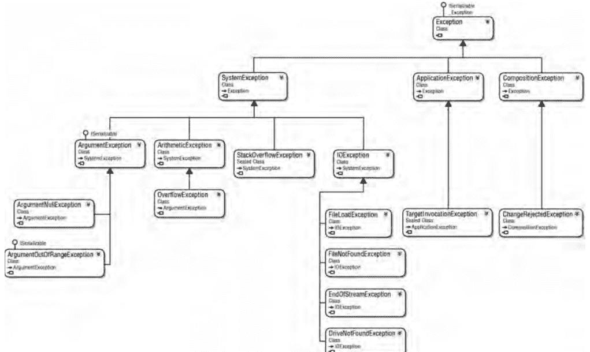

图 14.1

除了 `IOException` 和 `CompositionException` 以及派生自这两个类的类之外，图 14.1 中的所有类都属于 `System` 命名空间。`IOException` 及其派生类属于 `System.IO` 命名空间。`System.IO` 命名空间处理文件的读写。`CompositionException` 及其派生类属于 `System.ComponentModel.Composition` 命名空间。该命名空间处理动态加载部件和组件。一般来说，异常没有特定的命名空间。异常类应放在与可能生成它们的类相匹配的任何命名空间中——因此，与 I/O 相关的异常位于 `System.IO` 命名空间中。你会在相当多的基类命名空间中找到异常类。

通用异常类 `System.Exception` 派生自 `System.Object`，正如你对 .NET 类所期望的那样。一般来说，你不应在代码中抛出通用的 `System.Exception` 对象，因为它们不提供有关错误条件的任何具体信息。

层次结构中两个重要的类派生自 `System.Exception`：

- `SystemException`——此类用于通常由 .NET 运行时抛出的异常，或被视为具有通用性质且几乎任何应用程序都可能抛出的异常。例如，如果 .NET 运行时检测到堆栈已满，则会抛出 `StackOverflowException`。但是，如果检测到方法被以不适当的参数调用，你可以在自己的代码中选择抛出 `ArgumentException` 或其子类。`SystemException` 的子类包括表示致命错误和非致命错误的类。

- `ApplicationException`——在 .NET Framework 的初始设计中，此类旨在作为自定义应用程序异常类的基类。然而，一些由 CLR 抛出的异常类派生自此基类（例如 `TargetInvocationException`），而应用程序抛出的异常则派生自 `SystemException`（例如 `ArgumentException`）。因此，从 `ApplicationException` 派生自定义异常类型不再是一个好的做法，因为这没有任何好处。相反，自定义异常类可以直接从 `Exception` 基类派生。.NET Framework 中的许多异常类直接派生自 `Exception`。

其他可能派上用场的异常类包括：

- `StackOverflowException`——当分配给堆栈的内存区域已满时抛出此异常。如果方法连续递归调用自身，则可能发生堆栈溢出。这通常是致命错误，因为它会阻止应用程序执行除终止以外的任何操作（在这种情况下，甚至连 `finally` 块也不太可能执行）。试图自己处理此类错误通常毫无意义；相反，你应该让应用程序优雅地退出。

- `EndOfStreamException`——`EndOfStreamException` 的常见原因是在文件末尾之后进行读取尝试。*流*表示数据源之间的数据流。第 25 章“网络”将详细介绍流。

- `OverflowException`——发生这种情况的一个示例是，在 `checked` 上下文中，你尝试将包含值 `-40` 的 `int` 转换为 `uint`。

图 14.1 中显示的其他异常类在此不做讨论。它们只是为了说明异常类的层次结构。

异常类的层次结构有些独特，因为大多数类都没有为其各自的基类添加任何功能。然而，在异常处理的情况下，添加继承类的常见原因是为了指明更具体的错误条件。通常，没有必要重写方法或添加新方法（尽管添加携带关于错误条件的额外信息的额外属性并不少见）。例如，你可能有一个基类 `ArgumentException`，用于传入不适当值的方法调用，以及一个派生自它的 `ArgumentNullException` 类，用于处理传入 `null` 参数的情况。

#### 捕获异常

鉴于 .NET Framework 包含一系列预定义的基类异常对象，本节将介绍如何在代码中使用它们来捕获错误条件。在处理 C# 代码中可能出现的错误条件时，你通常将程序的相关部分划分为三种不同类型的块：

- `try` 块封装构成程序正常运行部分且可能遇到某些严重错误条件的代码。

- `catch` 块封装处理各种错误条件的代码，这些错误条件可能是在执行伴随的 `try` 块中的任何代码时遇到的。此块也可用于记录错误。

- `finally` 块封装清理任何资源或执行你通常希望在 `try` 或 `catch` 块结束时处理的任何其他操作的代码。重要的是要理解，无论是否抛出异常，`finally` 块都会执行。由于 `finally` 块的目的是包含应始终执行的清理代码，因此如果在 `finally` 块中放置 `return` 语句，编译器会标记错误。使用 `finally` 块的一个示例是关闭在 `try` 块中打开的任何连接。请理解 `finally` 块是完全可选的。如果你的应用程序不需要任何清理代码（例如释放或关闭任何打开的对象），那么就不需要这个块。

以下步骤概述了这些块如何协同工作来捕获错误条件：

- 1. 执行流程首先进入`try`块。
- 2. 如果在`try`块中没有发生错误，执行将正常通过该块，当到达`try`块末尾时，如果存在`finally`块，执行流程将跳转到`finally`块（步骤5）。但是，如果`try`块中确实发生错误，执行将跳转到`catch`块（步骤3）。
- 3. 错误条件在`catch`块中处理。
- 4. 在`catch`块末尾，如果存在`finally`块，执行将自动转移到`finally`块。
- 5. 执行`finally`块（如果存在）。

用于实现这一切的C#语法大致如下：

```csharp
try
{
    // code for normal execution
}
catch
{
    // error handling
}
finally
{
    // clean up
}
```

实际上，这个主题存在一些变体：

- 你可以省略`finally`块，因为它是可选的。
- 你还可以根据需要提供任意数量的`catch`块来处理特定类型的错误。但是，你不要太过火，拥有大量的`catch`块。
- 你可以使用`catch`块定义筛选器，仅当筛选器匹配时，才用特定块捕获异常。
- 你可以完全省略`catch`块，在这种情况下，该语法并非用于识别异常，而是作为一种保证当执行离开`try`块时`finally`块中的代码一定会被执行的方式。如果`try`块包含多个退出点，这很有用。

到目前为止一切顺利，但尚未回答的问题是：如果代码在`try`块中运行，当发生错误时，它如何知道何时切换到`catch`块？如果检测到错误，代码会执行一种称为*抛出异常*的操作。换句话说，它实例化一个异常对象类并将其抛出：

```csharp
throw new OverflowException();
```

这是因为你可以在`try`块内部多个方法调用中嵌套`throw`语句，但即使执行流进入这些其他方法，同一个`try`块仍然适用。如果应用程序遇到`throw`语句，它会立即沿着栈上的所有方法调用回溯，寻找包含它的`try`块的末尾以及相应`catch`块的开头。在此过程中，中间方法调用中的所有局部变量将正确地超出作用域。这使得`try...catch`架构非常适合本节开头描述的情况，即错误发生在嵌套在15或20个方法调用内部的方法调用中，并且处理必须立即停止。

正如你可能从这段讨论中得出的结论，`try`块在控制代码执行流程方面可以发挥非常重要的作用。然而，重要的是要理解异常是为异常情况设计的，因此得名。你不会希望将它们用作控制何时退出`do...while`循环的方式。

#### 实现多个 Catch 块

要了解`try...catch...finally`块在实践中如何工作，最简单的方法是看几个示例。第一个示例名为`SimpleExceptions`。它反复要求用户输入一个数字，然后显示该数字。但是，为了这个示例，假设数字必须在0到5之间；否则，程序无法正确处理该数字。因此，如果用户输入任何超出此范围的内容，你将抛出异常。然后程序继续要求输入更多数字进行处理，直到用户仅按Enter键而不输入任何内容。

> 注意 你应该注意，这段代码并没有提供何时使用异常处理的好例子，但它展示了如何使用异常处理的良好实践。正如其名称所示，异常是为非正常情况提供的。用户经常输入愚蠢的内容，所以这种情况实际上不算。通常，你的程序会通过执行即时检查来处理不正确的用户输入，并在输入无效时要求用户重新输入。然而，在一个几分钟内就能读完的小示例中，产生异常情况是困难的，所以我会容忍这个不太理想的示例来演示异常如何工作。接下来的示例会呈现更现实的情况。

`SimpleExceptions`的示例代码使用了以下依赖项和命名空间：

`NETStandard.Library`

#### 命名空间

```text
System
static System.Console
```

`SimpleExceptions`的代码如下所示（代码文件`SimpleExceptions/Program.cs`）：

```csharp
using System;
using static System.Console;

namespace Wrox.ProCSharp.ErrorsAndExceptions
{
    public class Program
    {
        public static void Main()
        {
            while (true)
            {
                try
                {
                    string userInput;
                    Write("Input a number between 0 and 5" +
                        " (or just hit return to exit)>");
                    userInput = ReadLine();
                    if (string.IsNullOrEmpty(userInput))
                    {
                        break;
                    }
                    int index = Convert.ToInt32(userInput);
```


```csharp
                    if (index < 0 || index > 5)
                    {
                        throw new IndexOutOfRangeException($"You typed in {userInput}");
                    }
                    WriteLine($"Your number was {index}");
                }
                catch (IndexOutOfRangeException ex)
                {
                    WriteLine("Exception:" +
                        $"Number should be between 0 and 5. {ex.Message}");
                }
                catch (Exception ex)
                {
                    WriteLine($"An exception was thrown. Message was: {ex.Message}");
                }
                finally
                {
                    WriteLine("Thank you\n");
                }
            }
        }
    }
}
```

这段代码的核心是一个`while`循环，它不断使用`ReadLine`来请求用户输入。`ReadLine`返回一个字符串，因此你的首要任务是使用`System.Convert.ToInt32`方法将其转换为`int`。`System.Convert`类包含各种有用的方法来执行数据转换，并且它提供了`int.Parse`方法的替代方案。一般来说，`System.Convert`包含执行各种类型转换的方法。回想一下，C#编译器将`int`解析为`System.Int32`基类的实例。

> 注意 还值得指出的是，传递给`catch`块的参数的作用域仅限于该`catch`块——这就是为什么你能在前面的代码中在连续的`catch`块中使用相同的参数名`ex`。

在前面的示例中，你还检查了空字符串，因为这是你退出`while`循环的条件。注意，`break`语句实际上直接跳出了封闭的`try`块以及`while`循环，因为这是有效行为。当然，当执行跳出`try`块时，`finally`块中的`WriteLine`语句会被执行。尽管你在这里只是显示一条问候语，但更常见的任务是关闭文件句柄、调用各种对象的`Dispose`方法以执行清理工作。在应用程序离开`finally`块之后，它只是继续执行假如没有`finally`块时本应执行的下一条语句。不过，在这个示例的情况下，你会迭代回`while`循环的开始，并再次进入`try`块（除非`finally`块是因为执行`while`循环中的`break`语句而进入的，在这种情况下，你只是退出`while`循环）。

接下来，你检查异常条件：

```csharp
if (index < 0 || index > 5)
{
    throw new IndexOutOfRangeException($"You typed in {userInput}");
}
```

在抛出异常时，你需要指定要抛出的异常类型。虽然`System.Exception`类可用，但它仅用作基类。将此类实例作为异常抛出被认为是不良编程实践，因为它不传达有关错误条件性质的任何信息。相反，.NET Framework包含许多从`Exception`派生的其他异常类。每一个都匹配特定类型的异常条件，你也可以自由定义自己的异常类。目标是尽可能多地提供关于特定异常条件的信息，方法是抛出与特定错误条件匹配的类的实例。在前面的示例中，`System.IndexOutOfRangeException`是这种情况下的最佳选择。`IndexOutOfRangeException`有多个构造函数重载。示例中选择的那个重载接受一个字符串，该字符串描述错误。或者，你也可以选择在应用程序的上下文中派生自己的自定义`Exception`对象来描述错误情况。

假设用户接下来输入了一个不在 0 到 5 之间的数字。这个数字会被`if`语句检测到，然后实例化并抛出一个`IndexOutOfRangeException`对象。此时，应用程序会立即退出`try`块，并寻找能够处理`IndexOutOfRangeException`的`catch`块。它遇到的第一个`catch`块是：

```csharp
catch (IndexOutOfRangeException ex)
{
    WriteLine($"Exception: Number should be between 0 and 5. {ex.Message}");
}
```

由于这个`catch`块接收了适当类的参数，因此`catch`块会接收异常实例并执行。在这种情况下，你会显示一条错误信息以及`Exception.Message`属性（该属性对应于传递给`IndexOutOfRangeException`构造函数的字符串）。执行完这个`catch`块后，控制权会切换到`finally`块，就像没有发生异常一样。

请注意，在示例中你还提供了另一个`catch`块：

```csharp
catch (Exception ex)
{
    WriteLine($"An exception was thrown. Message was: {ex.Message}");
}
```

如果不是因为此类异常已经被前一个`catch`块捕获，这个`catch`块本来也能够处理`IndexOutOfRangeException`。对基类的引用也可以引用从它派生的任何类的实例，并且所有异常都派生自`Exception`。当抛出`IndexOutOfRangeException`类型的异常时，这个`catch`块不会被执行，因为应用程序只会从可用的`catch`块列表中执行它找到的第一个合适的`catch`块。第二个`catch`块会捕获从`Exception`基类派生的其他异常。请注意，`try`块中对方法的三次单独调用（`Console.ReadLine`、`Console.Write`和`Convert.ToInt32`）可能会抛出其他异常。

如果用户输入了不是数字的内容——比如 a 或 hello——`Convert.ToInt32`方法会抛出`System.FormatException`类的异常，以指示传入`ToInt32`的字符串不是可以转换为`int`的格式。当这种情况发生时，应用程序会回溯方法调用，寻找能够处理此异常的处理器。你的第一个`catch`块（接收`IndexOutOfRangeException`的那个）不适用。然后应用程序会查看第二个`catch`块。这个块适用，因为`FormatException`派生自`Exception`，所以`FormatException`实例可以在此处作为参数传入。

这个示例的结构实际上是具有多个`catch`块时的典型情况。你从设计用于捕获特定错误条件的`catch`块开始，然后以更通用的块结束，以涵盖你没有编写特定错误处理程序的所有错误。事实上，`catch`块的顺序很重要。如果你将前面两个块按相反的顺序编写，代码将无法编译，因为第二个`catch`块是不可达的（`Exception` `catch`块会捕获所有异常）。因此，最顶层的`catch`块应该是可用的最细粒度的选项，最后以最通用的选项结束。

现在你已经分析了示例的代码，可以运行它了。以下输出说明了不同输入会发生什么情况，并演示了抛出的`IndexOutOfRangeException`和`FormatException`：

```text
SimpleExceptions

Input a number between 0 and 5 (or just hit return to exit)> 4
Your number was 4
Thank you

Input a number between 0 and 5 (or just hit return to exit)> 0
Your number was 0
Thank you

Input a number between 0 and 5 (or just hit return to exit)> 10
Exception: Number should be between 0 and 5. You typed in 10
Thank you

Input a number between 0 and 5 (or just hit return to exit)>
hello
An exception was thrown. Message was: Input string was not in a correct format.
Thank you

Input a number between 0 and 5 (or just hit return to exit)>
Thank you
```

### 捕获来自其他代码的异常

前面的示例演示了两种异常的处理。其中，`IndexOutOfRangeException`是由你自己的代码抛出的，另一个`FormatException`是从某个基类内部抛出的。库代码在检测到问题发生，或者某个方法因被传入错误参数而被不恰当地调用时，抛出异常是非常常见的。然而，库代码很少尝试捕获异常；这被认为是客户端代码的责任。

通常，在调试时，异常会从基类库中抛出。调试的过程在某种程度上涉及确定异常为何被抛出并消除原因。你的目标应该是确保在实际发布代码时，异常只在非常特殊的情况下发生，并且如果可能，在你的代码中得到适当处理。

### System.Exception 属性

该示例仅演示了异常对象`Message`属性的使用。然而，`System.Exception`中还有许多其他可用属性，如下表所示。

| 属性 | 描述 |
|---|---|
| `Data` | 允许你向异常添加键/值语句，这些语句可用于提供有关异常的额外信息。 |
| `HelpLink` | 指向提供有关异常更多信息的帮助文件的链接。 |
| `InnerException` | 如果此异常是在`catch`块内部抛出的，则`InnerException`包含使代码进入该`catch`块的异常对象。 |
| `Message` | 描述错误情况的文本。 |
| `Source` | 导致异常的应用程序或对象的名称。 |
| `StackTrace` | 提供有关堆栈上方法调用的详细信息（以帮助追踪抛出异常的方法）。 |

如果堆栈跟踪可用，`StackTrace`的属性值由 .NET 运行时自动提供。`Source`总是由 .NET 运行时填写为引发异常的程序集名称（尽管你可能希望在代码中修改该属性以提供更具体的信息），而`Data`、`Message`、`HelpLink`和`InnerException`必须由抛出异常的代码在抛出异常之前立即设置这些属性来填充。例如，抛出异常的代码可能如下所示：

```csharp
if (ErrorCondition == true)
{
    var myException = new ClassMyException("Help!!!!");
    myException.Source = "My Application Name";
    myException.HelpLink = "MyHelpFile.txt";
    myException.Data["ErrorDate"] = DateTime.Now;
    myException.Data.Add("AdditionalInfo", "Contact Bill from the Blue Team");
    throw myException;
}
```

这里，`ClassMyException`是你正在抛出的特定异常类的名称。请注意，所有异常类的名称通常都以`Exception`结尾。另外，请注意`Data`属性有两种赋值方式。

### 异常筛选器

C# 6 的一个新功能是异常筛选器。你可以让不同的`catch`块在捕获不同类型的异常时表现出不同的行为。在某些场景下，根据异常的内容让`catch`块表现出不同的行为会很有用。例如，在使用 Windows 运行时，你经常会为各种不同类型的异常获取 COM 异常；或者在进行网络调用时，你可能会在许多不同的场景下获得网络异常——例如，服务器不可用，或提供的数据不符合预期。最好能对这些错误做出不同的反应。有些异常可以通过不同的方式恢复，而对于其他异常，用户可能需要一些信息。

以下代码示例抛出了`MyCustomException`类型的异常，并设置了该异常的`ErrorCode`属性（代码文件`ExceptionFilters/Program.cs`）：

```csharp
public static void ThrowWithErrorCode(int code)
{
    throw new MyCustomException("Error in Foo") { ErrorCode = code };
}
```

在`Main`方法中，`try`块使用两个`catch`块来保护方法调用。第一个`catch`块使用`when`关键字，仅筛选`ErrorCode`属性等于 405 的异常。`when`子句的表达式需要返回一个布尔值。如果结果为`true`，则此`catch`块处理该异常。如果为`false`，则会查找其他`catch`块。向`ThrowWithErrorCode`方法传递 405 时，筛选器返回`true`，第一个`catch`处理该异常。传递其他值时，筛选器返回`false`，第二个`catch`处理该异常。使用筛选器，你可以有多个处理程序来处理相同的异常类型。

当然，你也可以移除第二个`catch`块，在这种情况下不处理该异常。

```csharp
try
{
    ThrowWithErrorCode(405);
}
catch (MyCustomException ex) when (ex.ErrorCode == 405)
{
    WriteLine($"Exception caught with filter {ex.Message} and {ex.ErrorCode}");
}
catch (MyCustomException ex)
{
    WriteLine($"Exception caught {ex.Message} and {ex.ErrorCode}");
}
```

### 重新抛出异常

当你捕获异常时，重新抛出异常也很常见。你可以在再次抛出异常时更改异常类型。这样可以向调用方提供有关发生了什么的更多信息。原始异常可能没有足够的信息来说明当时发生的上下文。你也可以记录异常信息并向调用方提供不同的信息。例如，对于运行应用程序的用户来说，异常信息并没有什么帮助。阅读日志文件的系统管理员可以根据情况做出相应的反应。

重新抛出异常的一个问题是，调用方通常需要找出早期异常发生的原因，以及它发生在哪里。根据异常的抛出方式，堆栈跟踪信息可能会丢失。为了让你了解重新抛出异常的不同选项，示例程序`RethrowExceptions`展示了不同的选项。

重新抛出异常的代码示例使用了以下依赖项和命名空间：

#### Dependencies

```text
NETStandard.Library
```

#### Namespaces

```text
System
static System.Console
```

对于本示例，创建了两种自定义异常类型。第一个`MyCustomException`在基类`Exception`的成员之外定义了属性`ErrorCode`；第二个`AnotherCustomException`支持传递内部异常（代码文件`RethrowExceptions/MyCustomException.cs`）：

```csharp
public class MyCustomException : Exception
{
    public MyCustomException(string message)
        : base(message)
    {
    }

    public int ErrorCode { get; set; }
}

public class AnotherCustomException : Exception
{
    public AnotherCustomException(string message, Exception innerException)
        : base(message, innerException)
    {
    }
}
```

方法`HandleAll`调用方法`HandleAndThrowAgain`、`HandleAndThrowWithInnerException`、`HandleAndRethrow`和`HandleWithFilter`。抛出的异常会被捕获以将异常消息以及堆栈跟踪写入控制台。为了更好地找到堆栈跟踪中引用的行号，使用了`#line`预处理器指令来重新开始行号计数。这样，使用委托`m`调用方法位于第 114 行（代码文件`RethrowExceptions/Program.cs`）：

```csharp
#line 100

public static void HandleAll()
{
    var methods = new Action[]
    {
        HandleAndThrowAgain,
        HandleAndThrowWithInnerException,
        HandleAndRethrow,
        HandleWithFilter
    };
```


# 异常处理与重新抛出

## 基础异常处理示例

```csharp
foreach (var m in methods)
{
    try
    {
        m();  // line 114
    }
    catch (Exception ex)
    {
        WriteLine(ex.Message);
        WriteLine(ex.StackTrace);
        if (ex.InnerException != null)
        {
            WriteLine($"\tInner Exception: {ex.Message}");
            WriteLine(ex.InnerException.StackTrace);
        }
        WriteLine();
    }
}
```

方法 `ThrowAnException` 是抛出第一个异常的方法。此异常在第 8002 行抛出。在开发过程中，了解此异常抛出位置很有帮助：

```csharp
#line 8000
public static void ThrowAnException(string message)
{
    throw new MyCustomException(message);  // line 8002
}
```

### Naïve Use to Rethrow the Exception

方法 `HandleAndThrowAgain` 除了将异常记录到控制台并使用 `throw ex` 再次抛出它之外什么也不做：

```csharp
#line 4000
public static void HandleAndThrowAgain()
{
    try
    {
        ThrowAnException("test 1");
    }
    catch (Exception ex)
    {
        WriteLine($"Log exception {ex.Message} and throw again");
        throw ex;  // you shouldn't do that - line 4009
    }
}
```

运行应用程序后，显示堆栈跟踪的简化输出（不包含命名空间和代码文件的完整路径）如下所示：

```
Log exception test 1 and throw again
test 1
at Program.HandleAndThrowAgain() in Program.cs:line 4009
at Program.HandleAll() in Program.cs:line 114
```

堆栈跟踪显示了 `HandleAll` 方法中对 `m` 方法的调用，而该方法又调用了 `HandleAndThrowAgain` 方法。异常最初抛出位置的信息在最终 catch 的调用堆栈中完全丢失。这使得很难找到错误的原始原因。通常，不应该只是使用 `throw` 传递异常对象来抛出相同的异常。

### Changing the Exception

一个有用的场景是更改异常类型并向错误添加信息。这在方法 `HandleAndThrowWithInnerException` 中完成。记录错误后，会抛出类型为 `AnotherCustomException` 的新异常，并将 `ex` 作为内部异常传递：

```csharp
#line 3000
public static void HandleAndThrowWithInnerException()
{
    try
    {
        ThrowAnException("test 2"); // line 3004
    }
    catch (Exception ex)
    {
        WriteLine($"Log exception {ex.Message} and throw again");
        throw new AnotherCustomException("throw with inner exception", ex); // 3009
    }
}
```

检查外部异常的堆栈跟踪，你会看到与之前类似的行号 3009 和 114。然而，内部异常给出了错误的原始原因。它给出了调用出错方法的行（3004）以及原始（内部）异常被抛出的行（8002）：

```
Log exception test 2 and throw again
throw with inner exception
at Program.HandleAndThrowWithInnerException() in Program.cs:line 3009
at Program.HandleAll() in Program.cs:line 114
Inner Exception: throw with inner exception
at Program.ThrowAnException(String message) in Program.cs:line 8002
at Program.HandleAndThrowWithInnerException() in Program.cs:line 3004
```

这样不会丢失任何信息。

> **NOTE** 当尝试找出错误的原因时，请查看是否存在内部异常。这通常能提供有用的信息。

> **NOTE** 在捕获异常时，重新抛出时更改异常是良好的做法。例如，捕获 `SqlException` 可能导致抛出业务相关的异常，例如 `InvalidIsbnException`。

### Rethrowing the Exception

如果异常类型不应更改，则可以使用 `throw` 语句重新抛出相同的异常。使用不传递异常对象的 `throw` 会抛出 catch 块的当前异常并保留异常信息：

```csharp
#line 2000
public static void HandleAndRethrow()
{
    try
    {
        ThrowAnException("test 3");
    }
    catch (Exception ex)
    {
        WriteLine($"Log exception {ex.Message} and rethrow");
        throw;  // line 2009
    }
}
```

这样，堆栈信息不会丢失。异常最初在第 8002 行抛出，并在第 2009 行重新抛出。第 114 行包含调用 `HandleAndRethrow` 的委托 `m`：

```
Log exception test 3 and rethrow
test 3
    at Program.ThrowAnException(String message) in Program.cs:line 8002
    at Program.HandleAndRethrow() in Program.cs:line 2009
    at Program.HandleAll() in Program.cs:line 114
```

### Using Filters to Add Functionality

当使用 `throw` 语句重新抛出异常时，调用堆栈包含 `throw` 的地址。当你使用异常过滤器时，可以完全不改变调用堆栈。现在添加 `when` 关键字以传递过滤器方法。此过滤器方法名为 `Filter`，它记录消息并始终返回 `false`。因此 catch 块永远不会被调用：

```csharp
#line 1000
public static void HandleWithFilter()
{
    try
    {
        ThrowAnException("test 4");  // line 1004
    }
    catch (Exception ex) when (Filter(ex))
    {
        WriteLine("block never invoked");
    }
}

#line 1500
public static bool Filter(Exception ex)
{
    WriteLine($"just log {ex.Message}");
    return false;
}
```

现在当你查看堆栈跟踪时，异常源自 `HandleAll` 方法中的第 114 行，该方法又调用 `HandleWithFilter`，第 1004 行包含对 `ThrowAnException` 的调用，而第 8002 行包含异常被抛出的行：

```
just log test 4
test 4
    at Program.ThrowAnException(String message) in Program.cs:line 8002
    at Program.HandleWithFilter() in Program.cs:line 1004
    at RethrowExceptions.Program.HandleAll() in Program.cs:line 114
```

> **NOTE** 异常过滤器的主要用途是根据异常的值过滤异常。异常过滤器也可以用于其他效果，例如在不更改调用堆栈的情况下写入日志信息。然而，异常过滤器应快速运行，因此你应该只做简单的检查。

### What Happens If an Exception Isn’t Handled?

有时可能会抛出异常，但你的代码中没有 catch 块能够处理那种类型的异常。`SimpleExceptions` 示例可以说明这一点。假设，例如，你省略了 `FormatException` 和捕获所有异常的 catch 块，只提供了捕获 `IndexOutOfRangeException` 的块。在这种情况下，如果抛出 `FormatException` 会发生什么？

答案是 .NET 运行时会捕获它。本节后面你将学习如何嵌套 `try` 块；事实上，示例中背后已经有一个嵌套的 `try` 块。.NET 运行时有效地将整个程序放在另一个巨大的 `try` 块内——它对每个 .NET 程序都这样做。此 `try` 块有一个可以捕获任何类型异常的 catch 处理程序。如果发生你的代码未处理的异常，执行流程 simply 直接退出你的程序并被 .NET 中的此 catch 块捕获。

运行时。但是，这样做的结果很可能并非你所愿，因为你的代码执行会立即被终止。用户会看到一个对话框，提示你的代码未处理该异常，并显示 .NET 运行时能够检索到的有关该异常的任何详细信息。至少异常已经被捕获了！

一般而言，如果你在编写可执行程序，请尽量合理地捕获尽可能多的异常，并以合理的方式处理它们。如果你在编写类库，通常最好是捕获那些能以有用方式处理的异常，或者能够在上下文中添加附加信息并按上一节所示抛出其他异常类型。要假定调用代码会处理它遇到的任何错误。

## 用户定义的异常类

在上一节中，你已经创建了一个用户定义的异常。现在，我们来看一个更大的示例来演示异常。这个示例名为 `SolicitColdCall`，包含两个嵌套的 `try` 块，演示了定义自己的自定义异常类以及从 `try` 块内部抛出另一个异常的实践。

这个示例假设一家销售公司想扩大客户群。公司的销售团队将给一份名单上的人打电话，邀请他们成为客户，这种做法在销售术语中称为*冷呼叫*。为此，你有一个文本文件，其中包含要被冷呼叫的人员姓名。该文件应采用明确定义的格式：第一行包含文件中的人数，随后每一行包含下一个人的姓名。换句话说，一个格式正确的姓名文件可能如下所示：

```
4
George Washington
Benedict Arnold
John Adams
Thomas Jefferson
```

这个版本的冷呼叫设计为在屏幕上显示人名（也许供销售人员阅读）。因此，文件中只包含姓名，而不包含电话号码。

在这个示例中，你的程序要求用户输入文件名，然后简单地将它读入并显示人名。这听起来是一项简单的任务，但即便如此，仍可能有几处出错，需要你放弃整个过程：

- 用户可能输入了一个不存在的文件名。这会被捕获为 `FileNotFoundException`。
- 文件格式可能不正确。有两种可能

```csharp
public class Program
{
    public static void Main()
    {
        Write("Please type in the name of the file " +
            "containing the names of the people to be cold called >");
        string fileName = ReadLine();
        ColdCallFileReaderLoop(fileName);
        WriteLine();
        ReadLine();
    }

    public static void ColdCallFileReaderLoop(string fileName)
    {
        var peopleToRing = new ColdCallFileReader();
        try
        {
            peopleToRing.Open(fileName);
            for (int i = 0; i < peopleToRing.NPeopleToRing; i++)
            {
                peopleToRing.ProcessNextPerson();
            }
            WriteLine("All callers processed correctly");
        }
        catch (FileNotFoundException)
        {
            WriteLine($"The file {fileName} does not exist");
        }
        catch (ColdCallFileFormatException ex)
        {
            WriteLine($"The file {fileName} appears to have been corrupted");
            WriteLine($"Details of problem are: {ex.Message}");
            if (ex.InnerException != null)
            {
                WriteLine($"Inner exception was: {ex.InnerException.Message}");
            }
        }
        catch (Exception ex)
        {
            WriteLine($"Exception occurred:\n{ex.Message}");
        }
        finally
        {
            peopleToRing.Dispose();
        }
    }
}
```


这段代码不仅仅是一个处理文件中人员的循环。你首先要求用户输入文件名。然后实例化一个名为 `ColdCallFileReader` 的类的对象，这个类稍后会定义。`ColdCallFileReader` 类负责处理文件读取。请注意，你没有在最初的 `try` 块内执行此操作——因为你在这里实例化的变量需要在随后的 `catch` 和 `finally` 块中可用；如果你在 `try` 块内声明它们，它们会在 `try` 块的右花括号处超出作用域，编译器会对此提出报错。

在 `try` 块中，你打开文件（使用 `ColdCallFileReader.Open` 方法）并遍历文件中的所有人员。`ColdCallFileReader.ProcessNextPerson` 方法读取并显示文件中下一个人的姓名，`ColdCallFileReader.NPeopleToRing` 属性指示文件中应该有多少人（通过读取文件的第一行获得）。这里有三个 `catch` 块：一个用于 `FileNotFoundException`，一个用于 `ColdCallFileFormatException`，另一个用于捕获任何其他 .NET 异常。

对于 `FileNotFoundException`，你会显示一条相应的消息。请注意，在这个 `catch` 块中，异常实例实际上完全没有被使用。这个 `catch` 块用于演示应用程序的用户友好性。异常对象通常包含对开发人员有用的技术信息，但不是你想要展示给最终用户的那种内容。因此，在这种情况下，你自己创建一条更简单的消息。

对于 `ColdCallFileFormatException` 的处理程序，你则做了相反的事情，指定了如何获取更完整的技术信息，包括内部异常的详细信息（如果存在的话）。

最后，如果你捕获到任何其他通用异常，你会显示一条用户友好的消息，而不是让这些异常直接落到 .NET 运行时。请注意，这里你没有处理任何不是派生自 `System.Exception` 的其他异常，因为你没有直接调用非 .NET 代码。

`finally` 块用于清理资源。在本例中，这意味着关闭任何已打开的文件——由 `ColdCallFileReader.Dispose` 方法执行。

> **注意** C# 提供了 `using` 语句，编译器会自动创建 `try/finally` 块，并在 finally 块中调用 `Dispose` 方法。`using` 语句可用于实现了 `Dispose` 方法的对象。你可以在第5章“托管和非托管资源”中阅读有关 `using` 语句的详细信息。

### 抛出用户定义的异常

现在来看一下处理文件读取并（可能）抛出用户自定义异常的类：`ColdCallFileReader`。由于这个类维护着一个外部文件连接，你需要按照第4章“继承”中概述的对象释放原则，确保它被正确释放。因此，你让这个类派生自 `IDisposable`。

首先，你声明一些私有字段（代码文件 `SolicitColdCall/ColdCallFileReader.cs`）：

```csharp
public class ColdCallFileReader : IDisposable
{
    private FileStream _fs;
    private StreamReader _sr;
    private uint _nPeopleToRing;
    private bool _isDisposed = false;
    private bool _isOpen = false;
}
```

`FileStream` 和 `StreamReader` 都位于 `System.IO` 命名空间中，是用于读取文件的基类。`FileStream` 使你能够首先连接到文件，而 `StreamReader` 专门用于读取文本文件，并实现了一个 `ReadLine` 方法，用来从文件中读取一行文本。你将在第23章“文件和流”中更详细地了解 `StreamReader`，该章深入讨论了文件处理。

`_isDisposed` 字段指示 `Dispose` 方法是否已被调用。`ColdCallFileReader` 的实现方式是：在调用 `Dispose` 之后，不允许重新打开连接并重用该对象。`_isOpen` 也用于错误检查——在本例中，检查 `StreamReader` 是否确实连接到一个已打开的文件。

打开文件并读取第一行（即告诉你文件中有多少人那一行）的过程由 `Open` 方法处理：

```csharp
public void Open(string fileName)
{
    if (_isDisposed)
    {
        throw new ObjectDisposedException("peopleToRing");
    }
    _fs = new FileStream(fileName, FileMode.Open);
    _sr = new StreamReader(_fs);
    try
    {
        string firstLine = _sr.ReadLine();
        _nPeopleToRing = uint.Parse(firstLine);
        _isOpen = true;
    }
    catch (FormatException ex)
    {
        throw new ColdCallFileFormatException(
            $"First line isn't an integer {ex}");
    }
}
```

在此方法中（与所有其他 `ColdCallFileReader` 方法一样），你要做的第一件事是检查客户端代码是否在对象已被释放后不适当地调用了它，如果是，则抛出一个预定义的 `ObjectDisposedException` 对象。`Open` 方法检查 `_isDisposed` 字段，以确定 `Dispose` 是否已被调用。因为调用 `Dispose` 意味着调用者已经完成了对该对象的使用，所以你会认为尝试打开一个

如果已调用 `Dispose`，则新建文件连接。

接下来，该方法包含两个内部 `try` 块中的第一个。此 `try` 块的目的是捕获因文件第一行未包含整数而导致的任何错误。如果出现该问题，.NET 运行时将抛出 `FormatException`，您可以捕获该异常并将其转换为含义更明确的异常，以指示冷呼叫文件格式有问题。请注意，这里的 `System.FormatException` 用于指示基本数据类型的格式问题，而不是文件格式问题，因此在这种情况下，它不是向调用例程传递的特别有用的异常。所抛出的新异常将被最外层的 `try` 块捕获。因为这里不需要清理工作，所以也就无需 `finally` 块。

如果一切正常，则将 `isOpen` 字段设置为 true，以表明现在存在一个有效的文件连接，可以从中读取数据。

`ProcessNextPerson` 方法也包含一个内部 `try` 块：

```csharp
public void ProcessNextPerson()
{
    if (_isDisposed)
    {
        throw new ObjectDisposedException("peopleToRing");
    }
    if (!_isOpen)
    {
        throw new UnexpectedException(
            "Attempted to access coldcall file that is not open");
    }
    try
    {
        string name = _sr.ReadLine();
        if (name == null)
        {
            throw new ColdCallFileFormatException("Not enough names");
        }
        if (name[0] == 'B')
        {
            throw new SalesSpyFoundException(name);
        }
        WriteLine(name);
    }
    catch(SalesSpyFoundException ex)
    {
        WriteLine(ex.Message);
    }
    finally
    {
    }
}
```

这里，文件存在两个可能的问题（假设确实存在一个打开的文件连接；`ProcessNextPerson` 方法会首先检查这一点）。其一，您可能读入下一个姓名，却发现它是一个销售间谍。如果出现这种情况，异常会被该方法中的第一个 `catch` 块捕获。由于该异常已在此处（循环内部）被捕获，这意味着程序可以在 `Main` 方法中继续执行，并且文件中的后续姓名将继续被处理。

另一种可能的问题是，当您尝试读取下一个姓名时，发现已经到达文件末尾。`StreamReader` 对象的 `ReadLine` 方法的工作方式如下：如果它已经越过了文件末尾，它不会抛出异常，而只是返回 null。因此，如果发现一个 null 字符串，您就知道文件格式不正确，因为文件第一行中的数字所指示的姓名数量多于文件中实际存在的姓名数量。如果发生这种情况，您将抛出 `ColdCallFileFormatException`，它会被外部异常处理程序捕获（从而导致执行终止）。

同样，这里不需要 `finally` 块，因为没有需要清理的内容；不过，这次包含了一个空的 `finally` 块，只是为了说明如果需要，您可以这样做。

这个示例快完成了。只需要再看 `ColdCallFileReader` 的两个成员：`NPeopleToRing` 属性（返回文件中应有的人数）和 `Dispose` 方法（用于关闭打开的文件）。请注意，如果 `Dispose` 方法已被调用，它会立即返回——这是实现它的推荐方式。它还会在关闭文件流之前确认确实存在要关闭的文件流。这里展示此示例是为了说明防御性编码技巧：

```csharp
public uint NPeopleToRing
{
    get
    {
        if (_isDisposed)
        {
            throw new ObjectDisposedException("peopleToRing");
        }
        if (!_isOpen)
        {
            throw new UnexpectedException(
                "Attempted to access cold-call file that is not open");
        }
        return _nPeopleToRing;
    }
}

public void Dispose()
{
    if (_isDisposed)
    {
        return;
    }
    _isDisposed = true;
    _isOpen = false;
    _fs?.Dispose();
    _fs = null;
}
```

### 定义用户定义的异常类

最后，您需要定义三个自己的异常类。定义自己的异常类非常容易，因为通常不需要添加任何额外的方法。只需实现一个构造函数，确保正确调用基类构造函数即可。以下是 `SalesSpyFoundException` 的完整实现（代码文件 `SoliciteColdCall/SalesSpyFoundException.cs`）：

```csharp
public class SalesSpyFoundException: Exception
{
    public SalesSpyFoundException(string spyName)
        : base($"Sales spy found, with name {spyName}")
    {
    }

    public SalesSpyFoundException(string spyName, Exception innerException)
        : base($"Sales spy found with name {spyName}", innerException)
    {
    }
}
```

请注意，它派生自 `Exception`，正如您对自定义异常所期望的那样。实际上，在实践当中，您可能会添加一个中间类，例如 `ColdCallFileException`，它派生自 `Exception`，然后让您的两个异常类都派生自该类。这样可以确保处理代码在哪个异常处理程序处理哪个异常方面具有更精细的控制程度。但为了使示例简单，这里不会这样做。

您在 `SalesSpyFoundException` 中做了一点处理。您假设传入其构造函数的消息只是所找到的间谍的姓名，因此您将这个字符串转换为更有意义的错误消息。您还提供了两个构造函数：一个只接受消息，另一个还接受内部异常作为参数。在定义自己的异常类时，最好至少包含这两个构造函数（尽管在示例中实际上不会使用第二个 `SalesSpyFoundException` 构造函数）。

接下来是 `ColdCallFileFormatException`。它遵循与上一个异常相同的原则，但您不对消息进行任何处理（代码文件 `SoliciteColdCall/ColdCallFileFormatException.cs`）：

```csharp
public class ColdCallFileFormatException: Exception
{
    public ColdCallFileFormatException(string message)
        : base(message)
    {
    }

    public ColdCallFileFormatException(string message, Exception innerException)
        : base(message, innerException)
    {
    }
}
```

最后是 `UnexpectedException`，它与 `ColdCallFileFormatException` 非常相似（代码文件 `SolicitColdCall/UnexpectedException.cs`）：

```csharp
public class UnexpectedException: Exception
{
    public UnexpectedException(string message)
        : base(message)
    {
    }

    public UnexpectedException(string message, Exception innerException)
        : base(message, innerException)
    {
    }
}
```

现在，您已经准备好测试程序了。首先，尝试 `people.txt` 文件。其内容定义如下：

```text
4
George Washington
Benedict Arnold
John Adams
Thomas Jefferson
```

这个文件有四个姓名（与文件第一行给出的数字相符），其中包含一名间谍。然后尝试下面的 `people2.txt` 文件，它有一个明显的格式错误：

```text
49
George Washington
Benedict Arnold
John Adams
Thomas Jefferson
```

最后，再次运行示例，但指定一个不存在的文件的名称，例如 `people3.txt`。针对这三个文件名分别运行程序三次，会得到以下结果：

```text
SolicitColdCall
Please type in the name of the file containing the names of the people to be cold
    called > people.txt
George Washington
Sales spy found, with name Benedict Arnold
John Adams
Thomas Jefferson
All callers processed correctly

SolicitColdCall
Please type in the name of the file containing the names of the people to be cold
    called > people2.txt
George Washington
Sales spy found, with name Benedict Arnold
John Adams
Thomas Jefferson
The file people2.txt appears to have been corrupted.
Details of the problem are: Not enough names
```

```text
SolicitColdCall
Please type in the name of the file containing the names of the people to be cold
    called > people3.txt
The file people3.txt does not exist.
```


此应用程序演示了在处理您自己的应用程序中可能遇到的错误和异常时可以使用的多种不同方式。

### 调用方信息

在处理错误时，获取有关错误发生位置的信息通常非常有用。在本章前面，使用`#line`预处理器指令来更改代码的行号，以便借助调用堆栈获得更好的信息。要从代码中获取行号、文件名和成员名称，可以使用 C# 编译器直接支持的属性和可选参数。属性`CallerLineNumber`、`CallerFilePath`和`CallerMemberName`定义在`System.Runtime.CompilerServices`命名空间中，可以应用于参数。通常，对于可选参数，如果调用信息中未提供这些参数，编译器会在方法调用时分配默认值。而对于调用方信息属性，编译器不会填充默认值；而是填充行号、文件路径和成员名称。

代码示例`CallerInformation`使用了以下依赖项和命名空间：

#### 依赖项

- `NETStandard.Library`

#### 命名空间

- `System`
- `System.Runtime.CompilerServices`
- `static System.Console`

以下代码片段中的`Log`方法演示了如何使用这些属性。通过该实现，信息会写入控制台（代码文件`CallerInformation/Program.cs`）：

```csharp
public void Log([CallerLineNumber] int line = -1,
    [CallerFilePath] string path = null,
    [CallerMemberName] string name = null)
{
    WriteLine((line < 0) ? "No line" : "Line" + line);
    WriteLine((path == null) ? "No file path" : path);
    WriteLine((name == null) ? "No member name" : name);
    WriteLine();
}
```

让我们用几种不同的场景来调用这个方法。在下面的`Main`方法中，`Log`方法分别通过`Program`类的实例、在属性的 set 访问器内以及 lambda 表达式内被调用。没有向该方法传入参数值，因此编译器可以替我们填充它们：

```csharp
public static void Main()
{
    var p = new Program();
    p.Log();
    p.SomeProperty = 33;
    Action a1 = () => p.Log();
    a1();
}

private int _someProperty;

public int SomeProperty
{
    get { return _someProperty; }
    set
    {
        Log();
        _someProperty = value;
    }
}
```

运行该程序的结果如下所示。在调用`Log`方法的位置，你可以看到行号、文件名和调用方成员名称。当`Log`位于`Main`方法内部时，成员名称是`Main`。在属性`SomeProperty`的 set 访问器内调用`Log`方法时，显示的是`SomeProperty`。lambda 表达式内的`Log`方法不会显示生成的方法名，而是显示调用该 lambda 表达式的方法名（`Main`），这当然更有用。

```text
Line 12
c:\ProCSharp\ErrorsAndExceptions\CallerInformation\Program.cs
Main
Line 26
c:\ProCSharp\ErrorsAndExceptions\CallerInformation\Program.cs
SomeProperty
Line 14
c:\ProCSharp\ErrorsAndExceptions\CallerInformation\Program.cs
Main
```

在构造函数中使用`Log`方法时，调用方成员名称显示为`ctor`。对于析构函数，调用方成员名称是`Finalize`，因为这是生成的方法名。

> **注意**：`CallerMemberName` **特性**的一个绝佳用途是配合 `INotifyPropertyChanged` *接口的实现*来使用。这个*接口*要求在方法实现中传入属性名。在本书的多个章节中可以看到该接口的实现，例如第 31 章“XAML 应用模式”。

### 小结

本章探讨了 C# 通过异常来处理错误情况所提供的丰富机制。你不限于处理代码可能输出的通用错误代码；相反，你可以深入并专门处理最细粒度的错误情况。有时这些错误情况由 .NET Framework 本身提供；不过，有时你可能需要像本章所示那样编写自己的错误情况。无论哪种情况，你都有很多方法可以保护应用程序的工作流免受不必要且危险的故障影响。

下一章将深入介绍异步编程的重要关键字：`async` 和 `await`。

后台任务可能需要一段时间，并且可能需要在任务仍在运行时将其取消。本章将说明如何做到这一点。

第 21 章“任务与并行编程”和第 22 章“任务同步”涵盖了并行编程的其他信息。

当应用程序不能立即响应请求时，用户会感到很烦。对于鼠标操作，我们已经习惯了延迟，因为这种体验是几十年来养成的。而使用触摸 UI 时，应用程序需要立即响应用户请求。否则，用户会尝试重新执行该操作。

由于在旧版 .NET Framework 中难以实现异步编程，因此在应该采用异步编程的地方，它并不总是被采用。有一款相当频繁阻塞 UI 线程的应用程序，就是旧版 Visual Studio。在那个版本中，打开一个包含数百个项目的解决方案，意味着你可以去享受一段漫长的咖啡休息时间。从 Visual Studio 2012 开始，情况不再如此，因为项目会在后台异步加载，并且首先加载所选项目。Visual Studio 2015 的一项新进展是 NuGet 包管理器，它不再以模态对话框的形式实现。新的 NuGet 包管理器可以在你同时做其他事情时异步加载包信息。这些只是 Visual Studio 2015 中与异步编程相关的重要变化的一小部分例子。

.NET Framework 中的许多 API 同时提供同步和异步版本。由于 API 的同步版本使用起来容易得多，因此经常被用在不适合的地方。在新的 Windows Runtime (WinRT) 中，如果 API 调用预计耗时超过 40 毫秒，则只有异步版本可用。自 C# 5 起，异步编程已经变得和同步编程一样容易，因此使用异步 API 不应有任何障碍。

### 异步模式

在深入介绍新的 `async` 和 `await` 关键字之前，最好先了解 .NET Framework 中的异步模式。自 .NET 1.0 起就有了异步功能，.NET Framework 中的许多类实现了一种或多种此类模式。异步模式也可用于委托类型。

由于使用异步模式在 UI（无论是 Windows Forms 还是 WPF）上执行更新相当复杂，.NET 2.0 引入了基于事件的异步模式。在这种模式中，事件处理程序从拥有同步上下文的线程中调用，因此使用这种模式可以轻松处理 UI 代码的更新。

以前，这种模式也被称为异步*组件模式*。

.NET 4.5 引入了另一种实现异步编程的方式：*基于任务的异步模式*（TAP）。这种模式基于 `Task` 类型，并利用编译器对 `async` 和 `await` 关键字的支持。

为了理解 `async` 和 `await` 关键字的优势，第一个示例应用程序使用 Windows Presentation Foundation (WPF) 和网络编程来概览异步编程。如果你没有 WPF 和网络编程经验，不要灰心。你仍然可以跟上这里的要点，理解异步编程是如何实现的。下面的示例演示了这些异步模式之间的差异。看完这些示例后，你将通过一些简单的控制台应用程序了解异步编程的基础知识。

> **注意**：*WPF 将在第 29 章至第 31 章以及第 34 章至第 36 章中详细讲解。网络编程在第 25 章“网络”中讨论。*

用来展示异步模式差异的示例应用是一个 WPF 应用，它使用了类库中的类型。该应用使用 Bing 和 Flickr 服务在网上查找图像。用户可以输入搜索词来查找图像，搜索词会通过一个简单的 HTTP 请求发送到 Bing 和 Flickr 服务。

Visual Studio 设计器中的 UI 设计如 _图 15.1_ 所示。屏幕顶部是一个文本输入框，后面是几个按钮，用于启动搜索或清空结果列表。控件区域下方的左侧包含一个 `ListBox`，用于显示所有找到的图像。右侧是一个 `Image` 控件，用于以更高分辨率显示在 `ListBox` 控件中选中的图像。


**图 15.1**

为了理解示例应用，我们先从包含几个辅助类的类库`AsyncLib`开始。这些类由 WPF 应用使用。

`SearchItemResult` 类表示结果集合中的一个项，用于显示图像以及图像的标题和来源。这个类只定义了简单的属性：`Title`、`Url`、`ThumbnailUrl` 和 `Source`。`ThumbnailUrl` 属性用于引用缩略图，`Url` 属性包含指向更大尺寸图像的链接，`Title` 包含描述图像的一些文本。`SearchItemResult` 的基类是 `BindableBase`。该基类通过实现 `INotifyPropertyChanged` 接口来实现通知机制，WPF 使用该接口通过数据绑定进行更新（代码文件 `AsyncLib/SearchItemResult.cs`）：

```
namespace Wrox.ProCSharp.Async
{
    public class SearchItemResult : BindableBase
    {
        private string _title;
        public string Title
        {
            get { return _title; }
            set { SetProperty(ref _title, value); }
        }
        private string _url;
        public string Url
        {
            get { return _url; }
            set { SetProperty(ref _url, value); }
        }
        private string _thumbnailUrl;
        public string ThumbnailUrl
        {
            get { return _thumbnailUrl; }
            set { SetProperty(ref _thumbnailUrl, value); }
        }
        private string _source;
        public string Source
        {
            get { return _source; }
            set { SetProperty(ref _source, value); }
        }
    }
}
```

`SearchInfo` 类是另一个用于数据绑定的类。`SearchTerm` 属性包含用户输入，用于搜索此类图像。`List` 属性返回一个列表，其中包含以 `SearchItemResult` 类型表示的所有已找到图像（代码文件 `AsyncLib/SearchInfo.cs`）：

```
using System.Collections.ObjectModel;

namespace Wrox.ProCSharp.Async
{
    public class SearchInfo : BindableBase
    {
```

```xml
<StackPanel HorizontalAlignment="Stretch" Orientation="Vertical" Background="{StaticResource linearBackgroundBrush}">
    <TextBlock Text="{Binding Source}" Foreground="White" />
    <TextBlock Text="{Binding Title}" Foreground="White" />
    <Image HorizontalAlignment="Center" Source="{Binding ThumbnailUrl}" Width="100" />
</StackPanel>
</Grid>
</DataTemplate>
</ListBox.ItemTemplate>
</ListBox>
<GridSplitter Grid.Column="1" Width="3" HorizontalAlignment="Left" />
<Image Grid.Column="1" Source="{Binding List/Url}" />
</Grid>
```

现在让我们进入`BingRequest`类。这个类包含一些关于如何向 Bing 服务发起请求的信息。该类的`Url`属性返回一个 URL 字符串，可用于请求图片。该请求由搜索词、应请求的图片数量（`Count`）和要跳过的图片数量（`Offset`）组成。使用 Bing 需要进行身份验证。用户 ID 通过`AppId`定义，并与`Credentials`属性一起使用，该属性返回一个`NetworkCredential`对象。要运行该应用程序，你需要在 Windows Azure Marketplace 中注册并订阅 Bing Search API。在撰写本文时，每月最多有 5000 次免费事务——这应该足够运行示例应用程序了。每次搜索算一次事务。Bing Search API 的注册链接是 https://datamarket.azure.com/dataset/bing/search。注册后，你需要复制账户密钥。获得应用程序账户密钥后，将其复制到`BingRequest`类的`AppID`中。

通过使用创建的 URL 向 Bing 发送请求后，Bing 会返回 XML。`BingRequest`类的`Parse`方法解析该 XML，并返回一个`SearchItemResult`对象的集合（代码文件`AsyncLib/BingRequest.cs`）：

> 注意：`BingRequest`和`FlickrRequest`类中的`Parse`方法使用了 LINQ to XML。有关如何使用 LINQ to XML，请参阅第 27 章“XML 和 JSON”。

```csharp
using System.Collections.Generic;
using System.Linq;
using System.Net;
using System.Xml.Linq;

namespace Wrox.ProCSharp.Async
{
    public class BingRequest : IImageRequest
    {
        private const string AppId = "enter your Bing AppId here";

        public BingRequest()
        {
            Count = 50;
            Offset = 0;
        }

        private string _searchTerm;
        public string SearchTerm
        {
            get { return _searchTerm; }
            set { _searchTerm = value; }
        }

        public ICredentials Credentials => new NetworkCredential(AppId, AppId);

        public string Url =>
            $"https://api.datamarket.azure.com/" +
            "Data.ashx/Bing/Search/v1/Image?Query=%27{SearchTerm}%27&" +
            "$top={Count}&$skip={Offset}&$format=Atom";

        public int Count { get; set; }
        public int Offset { get; set; }

        public IEnumerable<SearchItemResult> Parse(string xml)
        {
            XElement respXml = XElement.Parse(xml);
            XNamespace d = XNamespace.Get(
                "http://schemas.microsoft.com/ado/2007/08/dataservices");
            XNamespace m = XNamespace.Get(
```


"http://schemas.microsoft.com/ado/2007/08/dataservices/metadata");

return (from item in respXml.Descendants(m + "properties")

select new SearchItemResult

{

Title = new string(item.Element(d + "Title").Value.Take(50).ToArray()),

Url = item.Element(d + "MediaUrl").Value,

ThumbnailUrl = item.Element(d + "Thumbnail").Element(d + "MediaUrl").Value,

Source = "Bing"

}).ToList();

}

}

}

```

BingRequest 类和 FlickrRequest 类都实现了 `IImageRequest` 接口。该接口定义了 `SearchTerm` 和 `Url` 属性以及 `Parse` 方法，这样可以方便地遍历两个图片服务提供者（代码文件 `AsyncLib/IImageRequest.cs`）：

```csharp

using System;

using System.Collections.Generic;

using System.Net;

namespace Wrox.ProCSharp.Async

{

}

```

```csharp

Take(50).ToArray(),

Url =

string.Format("http://farm{0}.staticflickr.com/" +

"{1}/{2}_{3}_z.jpg",

item.Attribute("farm").Value,

item.Attribute("server").Value,

item.Attribute("id").Value,

item.Attribute("secret").Value),

ThumbnailUrl = string.Format("http://farm{0}." +

"staticflickr.com/{1}/{2}_{3}_t.jpg",

item.Attribute("farm").Value,

item.Attribute("server").Value,

item.Attribute("id").Value,

item.Attribute("secret").Value),

Source = "Flickr"

}).ToList();

}

}

}

```

现在你需要将库中的类型与 WPF 应用程序连接起来。在 `MainWindow` 类的构造函数中，你创建了一个 `SearchInfo` 实例，并将窗口的 `DataContext` 设置为此实例。这样就可以进行数据绑定了，如前文 XAML 代码所示（代码文件 `AsyncPatternsWPF/MainWindow.xaml.cs`）：

```csharp

public partial class MainWindow : Window

{

private SearchInfo _searchInfo = new SearchInfo();

public MainWindow()

{

InitializeComponent();

this.DataContext = _searchInfo;

}

// . . .

}

```

`MainWindow` 类还包含一个辅助方法 `GetSearchRequests`，它返回一个 `IImageRequest` 对象的集合，这些对象的类型为 `BingRequest` 和 `FlickrRequest`。如果你只注册了其中一个服务，你可以修改此代码，使其只返回你注册的那个服务。当然，你也可以创建其他服务的 `IImageRequest` 类型——例如，使用 Google 或 Yahoo! 然后将这些请求类型添加到返回的集合中：

```csharp

private IEnumerable<IImageRequest> GetSearchRequests()

{

return new List<IImageRequest>

{

new BingRequest { SearchTerm = _searchInfo.SearchTerm },

new FlickrRequest { SearchTerm = _searchInfo.SearchTerm}

};

}

```

### 同步调用

现在一切都已设置好，先从对这些服务的同步调用开始。Sync 按钮的点击处理程序 `OnSearchSync` 遍历 `GetSearchRequests` 返回的所有搜索请求，并使用 `Url` 属性通过 WebClient 类发起 HTTP 请求。`DownloadString` 方法会阻塞，直到收到结果。得到的 XML 被赋给 `resp` 变量。XML 内容借助 `Parse` 方法进行解析，该方法返回一个 `SearchItemResult` 对象的集合。然后将这些集合中的项添加到 `_searchInfo` 中的列表里（代码文件 `AsyncPatternsWPF/MainWindow.xaml.cs`）：

```csharp

private void OnSearchSync(object sender, RoutedEventArgs e)

{

foreach (var req in GetSearchRequests())

{

var client = new WebClient();

client.Credentials = req.Credentials;

string resp = client.DownloadString(req.Url);

IEnumerable<SearchItemResult> images = req.Parse(resp);

foreach (var image in images)

{

_searchInfo.List.Add(image);

}

}

}

```

当你运行该应用程序（见图 15.2）时，用户界面会被阻塞，直到 `OnSearchSync` 方法完成对 Bing 和 Flickr 的网络调用并解析完结果。完成这些调用所需的时间会因你的网络速度以及 Bing 和 Flickr 当前的负载而有所不同。但无论如何，这种等待对用户来说都是不愉快的。


因此，改为异步调用。

### 异步模式

实现异步调用的一种方式是使用异步模式。异步模式定义了一个 `BeginXXX` 方法和一个 `EndXXX` 方法。例如，如果提供了一个同步方法 `DownloadString`，那么它的异步变体就会是 `BeginDownloadString` 和 `EndDownloadString`。`BeginXXX` 方法接收同步方法的所有输入参数，而 `EndXXX` 则接收输出参数和返回类型以返回结果。在异步模式中，`BeginXXX` 方法还定义了一个 `AsyncCallback` 类型的参数，该参数接受一个委托，这个委托在异步方法完成时立即被调用。`BeginXXX` 方法返回 `IAsyncResult`，可用于轮询以检查调用是否完成，并等待方法的结束。

`WebClient` 类没有提供异步模式的实现。不过，可以使用 `HttpWebRequest` 类，它通过 `BeginGetResponse` 和 `EndGetResponse` 方法提供了这种模式。下面的示例并不是这样做的。相反，该示例使用了一个委托。委托类型定义了一个 `Invoke` 方法来执行同步方法调用，以及 `BeginInvoke` 和 `EndInvoke` 方法用于异步模式。这里，声明了类型为 `Func<string, ICredentials, string>` 的委托 `downloadString`，用于引用一个具有 `string` 和 `ICredentials` 参数并返回 `string` 的方法。`downloadString` 变量所引用的方法通过 lambda 表达式实现，并调用 `WebClient` 类的同步方法 `DownloadString`。通过调用 `BeginInvoke` 方法异步调用该委托。此方法使用线程池中的一个线程来执行异步调用。

`BeginInvoke` 方法的第一个参数是 `Func` 委托的第一个泛型 string 参数，可以在这里传入 URL。第二个参数的类型是 `AsyncCallback`。`AsyncCallback` 是一个委托，要求 `IAsyncResult` 作为参数。该委托引用的方法在异步方法完成时立即被调用。那时，会调用 `downloadString.EndInvoke` 来获取结果，并像之前一样处理结果，解析 XML 内容并获得项集合。然而，这里无法直接返回 UI，因为 UI 绑定在单个线程上，而回调方法在后台线程中运行。因此，需要使用窗口的 `Dispatcher` 属性切换回 UI 线程。`Dispatcher` 的 `Invoke` 方法需要一个委托作为参数；这就是为什么指定了 `Action<SearchItemResult>` 委托，它会向绑定到 UI 的集合添加一个项（代码文件 `AsyncPatternsWPF/MainWindow.xaml.cs`）：

```csharp

private void OnSearchAsyncPattern(object sender, RoutedEventArgs e)

{

Func<string, ICredentials, string> downloadString = (address, cred) =>

{

var client = new WebClient();

client.Credentials = cred;

return client.DownloadString(address);

};

}

```

```csharp

Action<SearchItemResult> addItem = item =>

_searchInfo.List.Add(item);

foreach (var req in GetSearchRequests())

{

downloadString.BeginInvoke(req.Url, req.Credentials, ar =>

{

string resp = downloadString.EndInvoke(ar);

IEnumerable<SearchItemResult> images = req.Parse(resp);

foreach (var image in images)

{

this.Dispatcher.Invoke(addItem, image);

}

}, null);

}

```

异步模式的一个优点是，只需使用委托的功能便可轻松实现。该程序现在的行为符合预期；UI 不再被阻塞。然而，使用异步模式是困难的。幸运的是，.NET 2.0 引入了基于事件的异步模式，这使得处理 UI 更新更容易。接下来将讨论这种模式。

> 注意 第 8 章“委托、Lambda 表达式和事件”中介绍了委托类型和 Lambda 表达式。第 21 章中介绍了任务和并行编程。

### 基于事件的异步模式

`OnAsyncEventPattern` 方法使用了基于事件的异步模式。该模式由 `WebClient` 类实现，因此可以直接使用。

该模式定义了一个带有 `Async` 后缀的方法。因此，例如，对于同步方法 `DownloadString`，`WebClient` 类提供了异步变体 `DownloadStringAsync`。异步方法完成时，不是定义要调用的委托，而是定义一个事件。一旦异步方法 `DownloadStringAsync` 完成，就会引发 `DownloadStringCompleted` 事件。分配给事件处理程序的方法在 Lambda 表达式内实现。其实现与之前非常相似，但现在可以直接访问 UI 元素，因为事件处理程序是从具有同步上下文的线程调用的，而在 Windows 窗体（Windows Forms）和 WPF 应用程序中，该线程就是 UI 线程（代码文件 `AsyncPatternsWPF/MainWindow.xaml.cs`）：

```csharp

private void OnAsyncEventPattern(object sender, RoutedEventArgs e)

{

foreach (var req in GetSearchRequests())

{

var client = new WebClient();

client.Credentials = req.Credentials;

client.DownloadStringCompleted += (sender1, el) =>

{

string resp = el.Result;

IEnumerable<SearchItemResult> images = req.Parse(resp);

foreach (var image in images)

{

_searchInfo.List.Add(image);

}

};

client.DownloadStringAsync(new Uri(req.Url));

}

}

```

基于事件的异步模式的一个优点是易于使用。但是请注意，在自定义类中实现这种模式并不那么容易。使用这种模式的现有实现来使同步方法异步化的一种方法是使用 `BackgroundWorker` 类。`BackgroundWorker` 实现了基于事件的异步模式。

这让代码简单得多。然而，与同步方法调用相比，顺序是颠倒的。在调用异步方法之前，需要定义方法调用完成时发生什么。下一节将深入探讨使用 `async` 和 `await` 关键字的异步编程新世界。

### 基于任务的异步模式

`WebClient` 类在 .NET 4.5 中更新，也提供了基于任务的异步模式（TAP）。该模式定义了一个带有 `Async` 后缀的方法，该方法返回 `Task` 类型。因为 `WebClient` 类已经提供了具有 `Async` 后缀的方法来实现基于任务的异步模式，所以新方法的名称为 `DownloadStringTaskAsync`。

`DownloadStringTaskAsync` 方法被声明为返回 `Task<string>`。你不需要声明 `Task<string>` 变量来接收 `DownloadStringTaskAsync` 的结果；相反，你可以声明一个 `string` 类型的变量，并使用 `await` 关键字。`await` 关键字解除线程的阻塞（在本例中是 UI 线程），以便执行其他任务。一旦 `DownloadStringTaskAsync` 方法完成其后台处理，UI 线程就可以继续，并从后台任务中将结果赋给字符串变量 `resp`。同时，这行之后的代码也会继续执行（代码文件 `AsyncPatternsWPF/MainWindow.xaml.cs`）：

```csharp

private async void OnTaskBasedAsyncPattern(object sender,

RoutedEventArgs e)

{

foreach (var req in GetSearchRequests())

{

var client = new WebClient();

client.Credentials = req.Credentials;

string resp = await client.DownloadStringTaskAsync(req.Url);

IEnumerable<SearchItemResult> images = req.Parse(resp);

foreach (var image in images)

{

_searchInfo.List.Add(image);

}

}

}


> 注意 `async` 关键字创建的状态机类似于 `yield return` 语句，后者在第 7 章“数组和元组”中介绍。

现在代码简单多了。没有阻塞，也无需手动切换回 UI 线程，因为这是自动完成的。此外，代码的顺序也与同步编程中的习惯相同。

接下来，代码改为使用一个不同于 `WebClient` 的类——该类更直接地实现了基于任务的异步模式，并且不提供同步方法。这个在 .NET 4.5 中新增的类就是 `HttpClient`。你通过 `GetAsync` 方法发出异步 GET 请求。然后，要读取内容，你需要另一个异步方法。`ReadAsStringAsync` 返回格式化为字符串的内容：

```csharp
private async void OnTaskBasedAsyncPattern(object sender, RoutedEventArgs e)
{
    foreach (var req in GetSearchRequests())
    {
        var clientHandler = new HttpClientHandler
        {
            Credentials = req.Credentials
        };
        var client = new HttpClient(clientHandler);
        var response = await client.GetAsync(req.Url);
        string resp = await response.Content.ReadAsStringAsync();
        IEnumerable<SearchItemResult> images = req.Parse(resp);
        foreach (var image in images)
        {
            _searchInfo.List.Add(image);
        }
    }
}
```

解析 XML 字符串可能需要一段时间。因为解析代码在 UI 线程中运行，所以 UI 线程此时无法响应用户请求。要从同步功能创建后台任务，可以使用 `Task.Run`。在以下示例中，`Task.Run` 包装了 XML 字符串的解析，以返回 `SearchItemResult` 集合：

```csharp
private async void OnTaskBasedAsyncPattern(object sender, RoutedEventArgs e)
{
    foreach (var req in GetSearchRequests())
    {
        var clientHandler = new HttpClientHandler
        {
            Credentials = req.Credentials
        };
        var client = new HttpClient(clientHandler);
        var response = await client.GetAsync(req.Url, cts.Token);
        string resp = await response.Content.ReadAsStringAsync();
        await Task.Run(() =>
        {
            IEnumerable<SearchItemResult> images = req.Parse(resp);
            foreach (var image in images)
            {
                _searchInfo.List.Add(image);
            }
        });
    }
}
```

因为传递给 `Task.Run` 的方法在后台线程中运行，所以这里我们遇到了与之前引用一些 UI 代码时相同的问题。一种解决方案是仅在 `Task.Run` 方法内执行 `req.Parse`，然后在任务外执行 `foreach` 循环，将结果添加到 UI 线程中的列表。不过，WPF 提供了一个更好的解决方案，它能够从后台线程填充绑定到 UI 的集合。此扩展只需要使用 `BindingOperations.EnableCollectionSynchronization` 来启用集合同步，如以下代码片段所示：

```csharp
public partial class MainWindow : Window
{
    private SearchInfo _searchInfo = new SearchInfo();
    private object _lockList = new object();

    public MainWindow()
    {
        InitializeComponent();
        this.DataContext = _searchInfo;
        BindingOperations.EnableCollectionSynchronization(
            _searchInfo.List, _lockList);
    }
}
```

既然你已经看到了 `async` 和 `await` 关键字的优势，下一节将介绍这些关键字背后的编程基础。

### 异步编程的基础

`async` 和 `await` 关键字只是编译器的一项功能。编译器通过使用 `Task` 类创建代码。如果不使用这些新关键字，你可以使用 C# 4 和 `Task` 类的方法获得相同的功能；只是不那么方便。

本节介绍编译器如何使用 `async` 和 `await` 关键字。它向你展示了一种创建异步方法的简单方法，并演示了如何调用多个并行使用异步方法。你还将了解如何使用新关键字更改类以提供异步模式。

所有 `Foundations` 示例的示例代码都使用了以下依赖项和命名空间：

#### 依赖项

`NETStandard.Library`

#### 命名空间

- `System`
- `System.Threading`
- `System.Threading.Tasks`
- `static System.Console`

### 创建任务

让我们从同步方法 `Greeting` 开始，该方法需要一段时间才能返回字符串（代码文件 `Foundations/Program.cs`）：

```csharp
static string Greeting(string name)
{
    Task.Delay(3000).Wait();
    return $"Hello, {name}";
}
```

要将这样的方法变为异步，你可以定义 `GreetingAsync` 方法。基于任务的异步模式规定，异步方法以 `Async` 后缀命名并返回一个任务。`GreetingAsync` 被定义为与 `Greeting` 方法具有相同的输入参数，但返回 `Task<string>`。`Task<string>` 定义了一个将来返回字符串的任务。返回任务的一种简单方式是使用 `Task.Run` 方法。泛型版本 `Task.Run<string>()` 创建一个返回字符串的任务：

```csharp
static Task<string> GreetingAsync(string name)
{
    return Task.Run<string>(() =>
    {
        return Greeting(name);
    });
}
```

### 调用异步方法

你可以通过使用 `await` 关键字对返回的任务调用这个异步方法 `GreetingAsync`。`await` 关键字要求方法使用 `async` 修饰符声明。在 `GreetingAsync` 方法完成之前，此方法内的代码不会继续执行。不过，你可以复用启动 `CallerWithAsync` 方法的线程。该线程不会被阻塞：

```csharp
private async static void CallerWithAsync()
{
```

或者位于 `ContinueWith` 方法的代码块内。

对于控制台应用程序，这通常不是问题。但是，你必须确保在应完成的所有后台任务完成之前，至少有一个前台线程仍在运行。示例应用程序调用 `Console.ReadLine` 来保持主线程运行，直到按下回车键。

对于某些操作绑定到特定线程的应用程序（例如，在 WPF 应用程序或 Windows 应用中，UI 元素只能从 UI 线程访问），这就是一个问题。

使用 `async` 和 `await` 关键字，你无需采取任何特殊操作即可在 `await` 完成后访问 UI 线程。默认情况下，生成的代码会将线程切换到具有同步上下文的线程。WPF 应用程序设置 `DispatcherSynchronizationContext`，Windows Forms 应用程序设置 `WindowsFormsSynchronizationContext`。如果异步方法的调用线程被分配到该同步上下文，那么在 `await` 之后的持续执行中，默认会使用相同的同步上下文。如果不应使用相同的同步上下文，则必须调用 `Task` 方法 `ConfigureAwait(continueOnCapturedContext: false)`。一个说明这一用处的示例是 WPF 应用程序，其中 `await` 之后的代码不使用任何 UI 元素。在这种情况下，避免切换到同步上下文会更快。

### 使用多个异步方法

在异步方法内，你可以调用多个异步方法。如何编码取决于一个异步方法的结果是否被另一个需要。

#### 按顺序调用异步方法

你可以使用 `await` 关键字调用每个异步方法。当一个方法依赖于另一个方法的结果时，这非常有用。在这里，对 `GreetingAsync` 的第二次调用完全独立于对 `GreetingAsync` 的第一次调用的结果。因此，如果不针对每个单独的方法使用 `await`，整个 `MultipleAsyncMethods` 方法就能更快地返回结果，如以下示例所示：

```csharp
private async static void MultipleAsyncMethods()
{
    string s1 = await GreetingAsync("Stephanie");
    string s2 = await GreetingAsync("Matthias");
    WriteLine($"Finished both methods.\nResult 1: {s1}\n Result 2: {s2}");
}
```

#### 使用组合器

如果异步方法彼此不依赖，那么不分别对每个方法使用 `await` 会快得多；而是将异步方法的返回值赋给一个 `Task` 变量。`GreetingAsync` 方法返回 `Task<string>`。这两个方法现在可以并行运行。*组合器*可以帮助实现这一点。组合器接受多个相同类型的参数并返回相同类型的值。传入的参数被“组合”为一个。`Task` 组合器接受多个 `Task` 对象作为参数并返回一个 `Task`。

示例代码调用 `Task.WhenAll` 组合器方法，你可以 `await` 它来等待两个任务都完成：

```csharp
private async static void MultipleAsyncMethodsWithCombinators1()
{
    Task<string> t1 = GreetingAsync("Stephanie");
    Task<string> t2 = GreetingAsync("Matthias");
    await Task.WhenAll(t1, t2);
    WriteLine("Finished both methods.\n" +
        $"Result 1: {t1.Result}\n Result 2: {t2.Result}");
}
```

`Task` 类定义了 `WhenAll` 和 `WhenAny` 组合器。`WhenAll` 方法返回的 `Task` 在所有传递给该方法的任务完成时才完成；`WhenAny` 方法返回的 `Task` 在传递给该方法的任务中任何一个完成时即完成。

`Task` 类型的 `WhenAll` 方法定义了多个重载。如果所有任务返回相同类型，你可以使用该类型的数组作为 `await` 的结果。`GreetingAsync` 方法返回 `Task<string>`，等待此方法会得到一个 `string`。因此，你可以使用 `Task.WhenAll` 返回一个 `string` 数组：

```csharp
private async static void MultipleAsyncMethodsWithCombinators2()
{
    Task<string> t1 = GreetingAsync("Stephanie");
    Task<string> t2 = GreetingAsync("Matthias");
    string[] result = await Task.WhenAll(t1, t2);
    WriteLine("Finished both methods.\n" +
        $"Result 1: {result[0]}\n Result 2: {result[1]}");
}
```

### 转换异步模式

并非 .NET Framework 中的所有类都引入了新的异步方法风格。仍有许多类使用 `BeginXXX` 和 `EndXXX` 方法提供异步模式，而不是基于任务的异步方法；当你使用框架中的不同类时会发现这一点。但是，你可以将异步模式转换为新的基于任务的异步模式。

首先，借助委托从先前定义的同步方法 `Greeting` 创建一个异步方法。`Greeting` 方法接收一个字符串作为参数并返回一个字符串；因此使用 `Func<string, string>` 委托的变量来引用此方法。

根据异步模式，`BeginGreeting` 方法除了 `AsyncCallback` 和 `object` 参数外还接收一个字符串参数，并返回 `IAsyncResult`。`EndGreeting` 方法返回 `Greeting` 方法的结果——一个字符串——并接收一个 `IAsyncResult` 参数。这样，仅通过使用委托，同步方法 `Greeting` 就变成了异步方法。

```csharp
private Func<string, string> greetingInvoker = Greeting;

private IAsyncResult BeginGreeting(string name, AsyncCallback callback, object state)
{
    return greetingInvoker.BeginInvoke(name, callback, state);
}

private string EndGreeting(IAsyncResult ar)
{
    return greetingInvoker.EndInvoke(ar);
}
```

现在 `BeginGreeting` 和 `EndGreeting` 方法可用，应将它们转换为使用 `async` 和 `await` 关键字来获取结果。`TaskFactory` 类定义了 `FromAsync` 方法，允许将使用异步模式的方法转换为 TAP。

在示例代码中，`Task` 类型的第一个泛型参数 `Task<string>` 定义了所调用方法的返回值。`FromAsync` 方法的泛型参数定义了方法的输入类型。这里输入类型同样是 string 类型。对于 `FromAsync` 方法的参数，前两个参数是委托类型，用于传递 `BeginGreeting` 和 `EndGreeting` 方法的地址。在这两个参数之后，依次是输入参数和对象状态参数。对象状态未被使用，因此赋为 null。由于 `FromAsync` 方法返回 `Task` 类型，在示例代码中为 `Task<string>`，你可以使用 `await`，如下所示：

```csharp
private static async void ConvertingAsyncPattern()
{
    string s = await Task<string>.Factory.FromAsync<string>(
        BeginGreeting, EndGreeting, "Angela", null);
    WriteLine(s);
}
```

### 错误处理

第 14 章“错误和异常”提供了关于错误和异常处理的详细说明。但是，在异步方法的上下文中，你应当注意一些特殊的错误处理方式。

所有 `ErrorHandling` 示例的示例代码都使用了以下依赖项和命名空间：

#### 依赖项

`NETStandard.Library`

#### 命名空间

```csharp
using System;
using System.Threading.Tasks;
using static System.Console;
```

让我们从一个延迟后抛出异常的简单方法开始（代码文件 `ErrorHandling/Program.cs`）：

```csharp
static async Task ThrowAfter(int ms, string message)
{
    await Task.Delay(ms);
    throw new Exception(message);
}
```

如果在没有等待的情况下调用异步方法，你可以将异步方法放在 `try/catch` 块中——但异常不会被捕获。这是因为 `DontHandle` 方法在 `ThrowAfter` 抛出异常之前就已经完成了。你需要等待 `ThrowAfter` 方法，如下一节中的示例所示。请注意，在此代码片段中异常不会被捕获：

```csharp
private static void DontHandle()
{
    try
    {
```


```csharp
        ThrowAfter(200,"first");

        // exception is not caught because this method is finished
        // before the exception is thrown

    }

    catch (Exception ex)

    {

        WriteLine(ex.Message);

    }

}
```

> **警告** 返回 `void` 的异步方法无法被等待。这样做的结果是，从 `async void` 方法中抛出的异常无法被捕获。因此，最好从异步方法返回 `Task` 类型。事件处理程序方法或重写的基类方法不受此规则限制。

### 使用异步方法处理异常

处理异步方法异常的一个好方法是使用 `await` 并在其周围放置 `try/catch` 语句，如下面的代码片段所示。`HandleOneError` 方法在异步调用 `ThrowAfter` 方法后释放线程，但它会保留对 `Task` 的引用，以便在任务完成时立即继续执行。当这种情况发生时（在本例中，即两秒后抛出异常），`catch` 匹配并执行 `catch` 块中的代码：

```csharp
private static async void HandleOneError()
{
    try
    {
        await ThrowAfter(2000,"first");
    }
    catch (Exception ex)
    {
        WriteLine($"handled {ex.Message}");
    }
}
```

#### 使用多个异步方法处理异常

如果调用了两个异步方法并且两者都抛出异常会怎样？在下面的示例中，首先调用 `ThrowAfter` 方法，该方法在两秒后抛出一个带有消息为 “first” 的异常。此方法完成后，再调用 `ThrowAfter` 方法，该方法在一秒后抛出异常。由于第一次调用 `ThrowAfter` 已经抛出异常，`try` 块中的代码不会继续调用第二个方法，而是进入 `catch` 块来处理第一个异常：

```csharp
private static async void StartTwoTasks()
{
    try
    {
        await ThrowAfter(2000,"first");
        await ThrowAfter(1000,"second"); // the second call is not invoked
    }
    catch (Exception ex)
    {
        WriteLine($"handled {ex.Message}");
    }
}
```

现在并行启动对 `ThrowAfter` 的两个调用。第一个方法在两秒后抛出异常，第二个在一秒后抛出。使用 `Task.WhenAll`，你可以等待两个任务都完成，无论是否抛出异常。因此，大约两秒后，`Task.WhenAll` 完成，`catch` 语句会捕获异常。但是，你只会看到传递给 `WhenAll` 方法的第一个任务的异常信息。它不是最先抛出异常的任务（即第二个任务），而是列表中的第一个任务：

```csharp
private async static void StartTwoTasksParallel()
{
    try
    {
        Task t1 = ThrowAfter(2000,"first");
        Task t2 = ThrowAfter(1000,"second");
        await Task.WhenAll(t1, t2);
    }
    catch (Exception ex)
    {
        // just display the exception information of the first task
        // that is awaited within WhenAll
        WriteLine($"handled {ex.Message}");
    }
}
```

从所有任务获取异常信息的一种方法是将任务变量 `t1` 和 `t2` 声明在 `try` 块之外，以便可以在 `catch` 块中访问它们。在这里，你可以检查任务的状态，通过 `IsFaulted` 属性确定它们是否处于故障状态。如果发生异常，`IsFaulted` 属性返回 `true`。异常信息本身可以通过使用 `Task` 类的 `Exception.InnerException` 来访问。另一种（通常更好的）从所有任务检索异常信息的方法将在下面演示。

#### 使用 `AggregateException` 信息

要从所有失败的任务中获取异常信息，你可以将 `Task.WhenAll` 的结果写入一个 `Task` 变量。然后等待该任务，直到所有任务完成。否则仍然会错过异常。如上一节所述，使用 `catch` 语句只能检索第一个任务的异常。但是，现在你可以访问外部任务的 `Exception` 属性。`Exception` 属性的类型是 `AggregateException`。此异常类型定义了 `InnerExceptions` 属性（不仅限于 `InnerException`），它包含一个所有已被等待的异常的列表。现在你可以轻松遍历所有异常：

```csharp
private static async void ShowAggregatedException()
{
    Task taskResult = null;
    try
    {
        Task t1 = ThrowAfter(2000,"first");
        Task t2 = ThrowAfter(1000,"second");
        await (taskResult = Task.WhenAll(t1, t2));
    }
    catch (Exception ex)
    {
        WriteLine($"handled {ex.Message}");
        foreach (var ex1 in taskResult.Exception.InnerExceptions)
        {
            WriteLine($"inner exception {ex1.Message}");
        }
    }
}
```

### 取消

对于在某些场景中可能运行较长时间的后台任务，取消这些任务非常有用。.NET 为取消提供了一种标准机制。该机制可与基于任务的异步模式一起使用，如下面的代码片段中的 `catch` 处理程序所示：

```csharp
private async void OnTaskBasedAsyncPattern(object sender,
    RoutedEventArgs e)
{
    _cts = new CancellationTokenSource();
    try
    {
        foreach (var req in GetSearchRequests())
        {
            var clientHandler = new HttpClientHandler
            {
                Credentials = req.Credentials,
            };
            var client = new HttpClient(clientHandler);
            var response = await client.GetAsync(req.Url, _cts.Token);
            string resp = await response.Content.ReadAsStringAsync();
            // . . .
        }
    }
    catch (OperationCanceledException ex)
    {
        MessageBox.Show(ex.Message);
    }
}
```

#### 取消自定义任务

那么需要被取消的自定义任务呢？`Task` 类的 `Run` 方法也提供了一个重载，可以传递一个 `CancellationToken`。然而，对于自定义任务，有必要检查是否请求了取消。在下面的示例中，这是在 `foreach` 循环中实现的。可以使用 `IsCancellationRequested` 属性来检查令牌。如果在抛出异常之前需要进行一些清理工作，最好先验证取消是否已被请求。如果不需要清理，可以在检查后立即抛出异常，这通过 `ThrowIfCancellationRequested` 方法完成：

```csharp
await Task.Run(() =>
{
    var images = req.Parse(resp);
    foreach (var image in images)
    {
        _cts.Token.ThrowIfCancellationRequested();
        _searchInfo.List.Add(image);
    }
}, _cts.Token);
```

现在，用户可以取消长时间运行的任务。

### 小结

本章介绍了 `async` 和 `await` 关键字。通过几个示例，你已经看到了基于任务的异步模式相对于早期 .NET 版本中可用的异步模式和基于事件的异步模式的优势。

你还看到了借助 `Task` 类创建异步方法有多么容易，并学会了如何使用 `async` 和 `await` 关键字来等待这些方法而不阻塞线程。最后，你了解了异步方法的错误处理方面。

有关并行编程的更多信息，以及线程和任务的详细信息，请参阅第 21 章。

下一章将继续介绍 C# 和 .NET 的核心功能，并详细说明反射、元数据和动态编程。

### 16 反射、元数据与动态编程

#### 本章内容

- 使用自定义特性
- 使用反射在运行时检查元数据
- 从支持反射的类构建访问点
- 理解动态语言运行时
- 使用 `dynamic` 类型
- 托管 DLR `ScriptRuntime`
- 使用 `DynamicObject` 和 `ExpandoObject` 创建动态对象

#### 本章的 Wrox.com 代码下载

本章的 wrox.com 代码下载可在 `www.wrox.com/go/professionalcsharp6` 的 Download Code 选项卡中找到。本章代码分为以下几个主要示例：

- `LookupWhatsNew`
- `TypeView`
- `VectorClass`
- `WhatsNewAttributes`
- `DLRHost`
- `Dynamic`
- `DynamicFileReader`
- `ErrorExample`

#### 在运行时检查代码与动态编程

本章重点介绍自定义特性、反射和动态编程。自定义特性是一种机制，允许你将自定义元数据与程序元素关联起来。这些元数据在编译时创建并嵌入到程序集中。反射是一个通用术语，描述在运行时检查和操作程序元素的能力。例如，反射允许你执行以下操作：

- 枚举类型的成员
- 实例化新对象
- 执行对象的成员
- 获取有关类型的信息
- 获取有关程序集的信息
- 检查应用于类型的自定义特性
- 创建并编译新程序集

这个列表代表了大量的功能，涵盖了.NET Framework类库所提供的一些最强大、最复杂的能力。由于一章的篇幅无法覆盖反射的所有能力，我将重点介绍你最可能经常使用的那些元素。

为了演示自定义特性和反射，在本章中你将首先开发一个示例，其背景是一家定期发布软件升级版本的公司，希望自动记录这些升级的详细信息。在该示例中，你定义自定义特性来指示程序元素最后修改的日期以及所做的更改。然后你使用反射开发一个应用程序，在程序集中查找这些特性，并自动显示自给定日期以来软件所做升级的所有详细信息。

本章中的另一个示例考虑了一个读写数据库的应用程序，它使用自定义特性来标记哪些类和属性对应于哪些数据库表和列。通过在运行时从程序集读取这些特性，程序可以自动检索数据或将数据写入数据库中的适当位置，而无需为每个表或列编写特定逻辑。

本章的第二个重要方面是动态编程，自 C# 4.0 版本添加 `dynamic` 类型以来，它一直是 C# 语言的一部分。Ruby 和 Python 等语言的发展以及 JavaScript 的日益普及，加剧了人们对动态编程的兴趣。尽管 C# 仍然是一种静态类型语言，但动态编程的新增功能为 C# 语言提供了某些开发人员所期望的能力。使用动态语言功能可以从 C# 内部调用脚本函数，也使 COM 互操作更加容易。

在本章中，你将了解 `dynamic` 类型及其使用规则。你还将看到 `DynamicObject` 的实现方式以及如何使用它。本章还介绍了 `ExpandoObject`，它是框架对 `DynamicObject` 的实现。

#### 自定义特性

你在本书中已经看到了如何在程序中的各种项目上定义特性。这些特性由 Microsoft 作为 .NET Framework 类库的一部分定义，其中许多特性受到 C# 编译器的特殊支持。这意味着对于这些特定特性，编译器可以以特定方式自定义编译过程——例如，根据 `StructLayout` 特性中的详细信息在内存中布局结构体。

.NET Framework 还允许你定义自己的特性。显然，这些特性对编译过程没有任何影响，因为编译器对它们没有内在的感知。然而，当这些特性应用于程序元素时，它们会作为元数据被写入编译后的程序集中。

仅凭这一点，这些元数据可能对文档目的很有用，但真正让特性变得强大的原因是，通过使用反射，你的代码可以读取这些元数据并在运行时利用它做出决策。这意味着你定义的自定义特性可以直接影响代码的运行方式。例如，自定义特性可用于为自定义权限类启用声明式代码访问安全检查，将信息与程序元素关联起来供测试工具使用，或用于开发允许加载插件或模块的可扩展框架。

##### 编写自定义特性

要理解如何编写自己的自定义特性，有必要了解编译器在遇到代码中应用了自定义特性的元素时会做什么。以数据库示例为例，假设你有一个如下所示的 C# 属性声明：

```csharp
[FieldName("SocialSecurityNumber")]
public string SocialSecurityNumber
{
    get {
        // etc.
```

当 C# 编译器识别到该属性应用了一个特性（`FieldName`）时，它会首先将字符串 `Attribute` 附加到这个名称后面，形成组合名称 `FieldNameAttribute`。然后编译器在其搜索路径中的所有命名空间（即在 `using` 语句中提及的那些命名空间）中查找具有指定名称的类。请注意，如果你用一个名称已经以字符串 `Attribute` 结尾的特性来标记某个项目，编译器不会再次将该字符串添加到名称中；它会保持特性名称不变。因此，前面的代码等同于以下代码：

```csharp
[FieldNameAttribute("SocialSecurityNumber")]
public string SocialSecurityNumber
{
    get {
        // etc.
```

编译器期望找到一个具有此名称的类，并且期望该类直接或间接派生自 `System.Attribute`。编译器还期望该类包含管理特性使用的信息。特别是，特性类需要指定以下内容：

- 特性可以应用到的程序元素类型（类、结构体、属性、方法等）
- 该特性多次应用于同一程序元素是否合法
- 当特性应用于类或接口时，是否会被派生类和接口继承
- 特性所需的必需参数和可选参数

如果编译器找不到相应的特性类，或者找到了一个特性类但你使用该特性的方式与特性类中的信息不匹配，编译器会引发编译错误。例如，如果特性类指示该特性只能应用于类，但你将其应用于结构体定义，则会发生编译错误。

继续该示例，假设你已经像这样定义了 `FieldName` 特性：

```csharp
[AttributeUsage(AttributeTargets.Property,
    AllowMultiple=false,
    Inherited=false)]
public class FieldNameAttribute : Attribute
{
    private string _name;

    public FieldNameAttribute(string name)
    {
        _name = name;
    }
}
```


以下各节将讨论此定义的每个元素。

### 指定AttributeUsage特性

首先要注意的是，特性类本身也被一个特性标记——`System.AttributeUsage`特性。这是`Microsoft`定义的一个特性，`C#`编译器为其提供了特殊支持。（你可以争辩说`AttributeUsage`根本不是特性；它更像是一个元特性，因为它只应用于其他特性，而不只是应用于任何类。）`AttributeUsage`的主要目的是标识你的自定义特性可以应用到的程序元素类型。此信息由`AttributeUsage`特性的第一个参数提供。该参数是必需的，它是枚举类型`AttributeTargets`。在前面的示例中，你已经指明`FieldName`特性只能应用于属性，这没问题，因为在之前的代码片段中你正是将其应用于属性。`AttributeTargets`枚举的成员如下：

- `All`

- 程序集
- 类
- 构造函数
- 委托
- 枚举
- 事件
- 字段
- 泛型参数
- 接口
- 方法
- 模块
- 参数
- 属性
- 返回值
- 结构

此列表标识了可以对其应用特性的所有程序元素。请注意，将特性应用于程序元素时，需要将特性放在紧跟元素之前的方括号中。但是，上述列表中有两个值不对应任何程序元素：`Assembly` 和 `Module`。特性可以作为一个整体应用于程序集或模块，而不是应用于代码中的某个元素；在这种情况下，特性可以放在源代码中的任意位置，但必须带有 `Assembly` 或 `Module` 关键字前缀：

```csharp
[assembly:SomeAssemblyAttribute(Parameters)]

[module:SomeAssemblyAttribute(Parameters)]
```

当指示自定义特性的有效目标元素时，可以使用按位 OR 运算符组合这些值。例如，如果要指示 `FieldNameAttribute` 特性可以同时应用于属性和字段，可以使用以下代码：

```csharp
[AttributeUsage(AttributeTargets.Property |
    AttributeTargets.Field,
    AllowMultiple=false, Inherited=false)]
public class FieldNameAttribute: Attribute
```

还可以使用 `AttributeTargets.All` 来指示你的特性可以应用于所有类型的程序元素。`AttributeUsage` 特性还包含另外两个参数：`AllowMultiple` 和 `Inherited`。这两个参数使用 `<ParameterName>=<ParameterValue>` 的语法指定，而不是简单地指定这些参数的值。这些参数是可选的——你可以省略它们。

`AllowMultiple` 参数指示是否可以多次将同一个特性应用于同一项。如果该参数设置为 false，则编译器在遇到如下内容时会引发错误：

```csharp
[FieldName("SocialSecurityNumber")]
[FieldName("NationalInsuranceNumber")]
public string SocialSecurityNumber
{
    // etc.
```

如果将 `Inherited` 参数设置为 true，则应用于类或接口的特性也会自动应用于所有派生的类或接口。如果该特性应用于方法或属性，它也会自动应用于该方法或属性的任何重写，依此类推。

### 指定特性参数

本节演示如何指定自定义特性所接受的参数。当编译器遇到如下语句时，它会检查传入该特性的参数——本例中是一个字符串——并查找接受这些参数的特性构造函数：

```csharp
[FieldName("SocialSecurityNumber")]
public string SocialSecurityNumber
{
    // etc.
```

如果编译器找到合适的构造函数，它会向程序集发出指定的元数据。如果编译器找不到合适的构造函数，则会发生编译错误。正如本章后面所讨论的，反射涉及从程序集读取元数据（特性）并实例化它们所表示的特性类。因此，编译器必须确保存在一个合适的构造函数，允许在运行时实例化指定的特性。

在示例中，你只为 `FieldNameAttribute` 提供了一个构造函数，并且该构造函数接受一个字符串参数。因此，当将 `FieldName` 特性应用于属性时，必须提供一个字符串作为参数，如前面的代码所示。

为了允许选择应该为特性提供哪些类型的参数，你可以提供不同的构造函数重载，尽管通常的做法是只提供一个构造函数，并使用属性来定义其他可选参数，如下一节所述。

### 指定可选特性参数

正如 `AttributeUsage` 特性所演示的，另一种语法允许向特性添加可选参数。该语法涉及指定可选参数的名称和值。它通过特性类中的公共属性或字段来工作。例如，假设你要修改 `the` 的定义

本节首先介绍核心的 `WhatsNewAttributes` 程序集。源代码包含在文件 `WhatsNewAttributes.cs` 中，该文件位于本章示例代码的 `WhatsNewAttributes` 解决方案的 `WhatsNewAttributes` 项目中。

`WhatsNewAttributes` 的示例代码使用了以下依赖项和命名空间：

#### 依赖项

- `NETStandard.Library`

#### 命名空间

- `System`

`WhatsNewAttributes.cs` 文件定义了两个特性类，`LastModifiedAttribute` 和 `SupportsWhatsNewAttribute`。你使用 `LastModifiedAttribute` 特性来标记某项内容上次修改的时间。它接受两个必选参数（传递给构造函数的参数）：修改日期和一个包含变更描述的字符串。一个名为 `issues` 的可选参数（存在对应的 `public` 属性）可用于描述该项的任何未解决问题。

在实践中，你可能希望将此特性应用于任何内容。为了保持代码简单，此处将其用法限制为类和方法。你允许它多次应用于同一项（`AllowMultiple=true`），因为一项内容可能被多次修改，而每次修改都必须用单独的特性实例来标记。

`SupportsWhatsNew` 是一个较小的类，表示一个不接受任何参数的特性。此程序集特性的目的是标记你通过 `LastModifiedAttribute` 为其维护文档的程序集。这样，之后检查该程序集的程序就会知道，它读取的程序集正是你实际使用自动化文档流程的程序集。以下是该示例这一部分的完整源代码（代码文件 `WhatsNewAttributes/WhatsNewAttributes.cs`）：

```csharp
using System;

namespace WhatsNewAttributes
{
    [AttributeUsage(AttributeTargets.Class |
        AttributeTargets.Method,
        AllowMultiple=true, Inherited=false)]
    public class LastModifiedAttribute: Attribute
    {
        private readonly DateTime _dateModified;
        private readonly string _changes;

        public LastModifiedAttribute(string dateModified, string changes)
        {
            _dateModified = DateTime.Parse(dateModified);
            _changes = changes;
        }

        public DateTime DateModified => _dateModified;
        public string Changes => _changes;
        public string Issues { get; set; }
    }

    [AttributeUsage(AttributeTargets.Assembly)]
    public class SupportsWhatsNewAttribute: Attribute
    {
    }
}
```

基于上述讨论，这段代码应该相当清晰。但请注意，`DateModified` 和 `Changes` 属性是只读的。使用表达式语法，编译器会创建 `get` 访问器。不需要 `set` 访问器，因为你要求这些参数在构造函数中作为必选参数进行设置。你需要 `get` 访问器，以便读取这些特性的值。

### VectorClass 程序集

要使用这些特性，你需要使用前面 `VectorAsCollection` 示例的修改版本。注意，你需要引用刚刚创建的 `WhatsNewAttributes` 库。你还需要使用 `using` 语句指示相应的命名空间，以便编译器能够识别这些特性（代码文件 `VectorClass/Vector.cs`）：

```csharp
using System;
using System.Collections;
using System.Collections.Generic;
using System.Text;
using WhatsNewAttributes;

[assembly: SupportsWhatsNew]
```

这段代码还添加了一行，用 `SupportsWhatsNew` 特性标记程序集本身。

`VectorClass` 的示例代码使用了以下依赖项和命名空间：

#### 依赖项

- `NETStandard.Library`
- `WhatsNewAttributes`

#### 命名空间

- `System`
- `System.Collections`
- `System.Collections.Generic`
- `System.Text`

### WhatsNewAttributes

现在是向量类的代码。你对这个类没有做任何大的改动；你只添加了几个 `LastModified` 属性来标记你在本章中对该类所做的修改：

```csharp
namespace VectorClass
{
    [LastModified("6 Jun 2015", "updated for C# 6 and .NET Core")]
    [LastModified("14 Feb 2010", "IEnumerable interface implemented: " + "Vector can be treated as a collection")]
    [LastModified("10 Feb 2010", "IFormattable interface implemented: " + "Vector accepts N and VE format specifiers")]
    public class Vector : IFormattable, IEnumerable<double>
    {
        public Vector(double x, double y, double z)
        {
            X = x;
            Y = y;
            Z = z;
        }

        public Vector(Vector vector)
            : this(vector.X, vector.Y, vector.Z)
        {
        }

        public double X { get; }
        public double Y { get; }
        public double Z { get; }

        public string ToString(string format, IFormatProvider formatProvider)
        {
            //...
        }
    }
}
```

你还将包含的 `VectorEnumerator` 类标记为新类：

```csharp
[LastModified("6 Jun 2015", "Changed to implement the generic interface IEnumerator<T>")]
[LastModified("14 Feb 2010", "Class created as part of collection support for Vector")]
private class VectorEnumerator : IEnumerator<double>
{
}
```

就目前而言，你只能做到这一步。此时你还无法运行任何东西，因为你只有两个库。在下一节了解反射之后，你将开发该示例的最后部分，在其中查找并显示这些属性。

上一节中的代码用于完成 `WhatsNewAttributes` 示例。

### The System.Type Class

到目前为止，你只使用 `Type` 类来保存对类型的引用，如下所示：

```csharp
Type t = typeof(double);
```

虽然之前被称为类，但 `Type` 是一个抽象基类。每当你实例化一个 `Type` 对象时，你实际上是在实例化一个派生自 `Type` 的类。`Type` 有一个派生类对应于每个实际数据类型，不过通常派生类只是提供各种 `Type` 方法和属性的不同重载，返回对应数据类型的正确数据。它们通常不会添加新的方法或属性。一般来说，获取指向任意给定类型的 `Type` 引用的三种常见方法如下。

- 你可以使用前面代码中所示的 C# `typeof` 运算符。该运算符以类型名称作为参数（但不是用引号括起来）。
- 你可以使用 `GetType` 方法，所有类都从 `System.Object` 继承该方法：

  ```csharp
  double d = 10;
  Type t = d.GetType();
  ```

  `GetType` 是针对变量调用的，而不是采用类型名称。请注意，尽管如此，返回的 `Type` 对象仍然只与该数据类型相关联。它不包含与该类型实例相关的任何信息。`GetType` 方法在你有一个对象引用但不确定该对象实际是哪个类的实例时很有用。
- 你可以调用 `Type` 类的静态方法 `GetType`：

  ```csharp
  Type t = Type.GetType("System.Double");
  ```

`Type` 实际上是反射功能的大部分入口。它实现了大量的方法和属性——多到无法在此处提供完整列表。然而，以下小节应该能让你很好地了解使用 `Type` 类可以做什么。注意，所有可用的属性都是只读的；你使用 `Type` 来了解数据类型——你不能用它来对类型做任何修改！

#### Type Properties

`Type` 实现的属性可以分为三类。首先，多个属性检索包含与类关联的各种名称的字符串，如下表所示：

| Property | Returns |
|---|---|
| `Name` | The name of the data type |
| `FullName` | The fully qualified name of the data type (including the namespace name) |
| `Namespace` | The name of the namespace in which the data type is defined |

其次，可以检索对表示相关类的进一步类型对象的引用，如下表所示。

| Property | Returns Type Reference Corresponding To |
|---|---|
| `BaseType` | The immediate base type of this type |
| `UnderlyingSystemType` | The type to which this type maps in the .NET runtime (recall that certain .NET base types actually map to specific predefined types recognized by IL). This member is only available in the full Framework. |

多个布尔属性指示该类型是否为 `class`、`enum` 等。这些属性包括 `IsAbstract`、`IsArray`、`IsClass`、`IsEnum`、`IsInterface`、`IsPointer`、`IsPrimitive`（其中一个预定义的原始数据类型）、`IsPublic`、`IsSealed` 和 `IsValueType`。以下示例使用原始数据类型：

```csharp
Type intType = typeof(int);
WriteLine(intType.IsAbstract);      // writes false
WriteLine(intType.IsClass);         // writes false
WriteLine(intType.IsEnum);          // writes false
WriteLine(intType.IsPrimitive);     // writes true
WriteLine(intType.IsValueType);    // writes true
```

此示例使用 `Vector` 类：

```csharp
Type vecType = typeof(Vector);
WriteLine(vecType.IsAbstract);      // writes false
```


```csharp
WriteLine(vecType.IsClass);         // writes true

WriteLine(vecType.IsEnum);          // writes false

WriteLine(vecType.IsPrimitive);     // writes false

WriteLine(vecType.IsValueType);    // writes false
```

最后，你还可以检索类型所定义的程序集的引用。这作为对 `System.Reflection.Assembly` 类实例的引用返回，该类将在稍后进行检查：

```csharp
Type t = typeof(Vector);

Assembly containingAssembly = t.Assembly;
```

#### Methods

`System.Type` 的大多数方法用于获取对应数据类型的成员的详细信息——构造函数、属性、方法、事件等。存在相当多的此类方法，但它们都遵循相同的模式。例如，两个方法检索数据类型的详细信息：`GetMethod` 和 `GetMethods`。`GetMethod` 返回对 `System.Reflection.MethodInfo` 对象的引用，其中包含有关方法的信息。`GetMethods` 返回此类引用的数组。顾名思义，区别在于 `GetMethods` 返回有关所有方法的信息，而 `GetMethod` 返回有关仅具有指定参数列表的一个方法的信息。两种方法都有重载，可接受一个额外的参数，即 `BindingFlags` 枚举值，指示应返回哪些成员——例如，是否返回公共成员、实例成员、静态成员等。

例如，`GetMethods` 的最简单重载不带参数，并返回数据类型的所有公共方法的详细信息：

```csharp
Type t = typeof(double);

foreach (MethodInfo nextMethod in t.GetMethods())

{

    // etc.

}
```

遵循相同模式的 `Type` 的成员方法如下表所示。请注意，复数名称返回数组。

| Type of object returned | Method(s) |
|---|---|
| `ConstructorInfo` | `GetConstructor`, `GetConstructors` |
| `EventInfo` | `GetEvent`, `GetEvents` |
| `FieldInfo` | `GetField`, `GetFields` |
| `MemberInfo` | `GetMember`, `GetMembers`, `GetDefaultMembers` |
| `MethodInfo` | `GetMethod`, `GetMethods` |
| `PropertyInfo` | `GetProperty`, `GetProperties` |

`GetMember` 和 `GetMembers` 方法返回有关数据类型任何或所有成员的详细信息，无论这些成员是构造函数、属性、方法等。

#### The `TypeView` Example

本节通过一个简短的示例 `TypeView` 演示 `Type` 类的一些功能，你可以使用它来列出数据类型的成员。该示例演示了如何将 `TypeView` 用于 `double`；然而，你只需更改示例代码中的一行，就可以用任何其他数据类型替换此类型。

运行应用程序的结果是向控制台输出以下内容：

```
Analysis of type Double

Type Name: Double

Full Name: System.Double

Namespace: System

Base Type: ValueType
```

公共成员：
- System.Double Method IsInfinity
- System.Double Method IsPositiveInfinity
- System.Double Method IsNegativeInfinity
- System.Double Method IsNaN
- System.Double Method CompareTo
- System.Double Method CompareTo
- System.Double Method Equals
- System.Double Method op_Equality
- System.Double Method op_Inequality
- System.Double Method op_LessThan
- System.Double Method op_GreaterThan
- System.Double Method op_LessThanOrEqual
- System.Double Method op_GreaterThanOrEqual
- System.Double Method Equals
- System.Double Method GetHashCode
- System.Double Method ToString
- System.Double Method ToString
- System.Double Method ToString
- System.Double Method ToString
- System.Double Method Parse
- System.Double Method Parse
- System.Double Method Parse
- System.Double Method Parse
- System.Double Method TryParse
- System.Double Method TryParse
- System.Double Method GetTypeCode
- System.Object Method GetType
- System.Double Field MinValue
- System.Double Field MaxValue
- System.Double Field Epsilon
- System.Double Field NegativeInfinity
- System.Double Field PositiveInfinity
- System.Double Field NaN

控制台显示数据类型的名称、完整名称、命名空间以及基类型的名称。接下来，它简单地遍历该数据类型的所有公共实例成员，并显示每个成员的声明类型、成员类型（方法、字段等）和成员名称。声明类型是实际声明该类型成员的类的名称（例如，如果成员是在 `System.Double` 中定义或重写的，则显示 `System.Double`；如果成员只是从基类继承的，则显示相应基类型的名称）。

`TypeView` 不显示方法的签名，因为你是通过 `MemberInfo` 对象检索所有公共实例成员的详细信息，而 `MemberInfo` 对象不提供参数信息。要检索这些信息，你需要引用 `MethodInfo` 和其他更具体的对象，这意味着你需要分别获取每种成员类型的详细信息。

`TypeView` 的示例代码使用了以下依赖项和命名空间：

#### 依赖项

```
NETStandard.Library
```

#### 命名空间

- `System`
- `System.Reflection`
- `System.Text`
- `static System.Console`

`TypeView` 确实显示了所有公共实例成员的详细信息；但对于 `double` 类型，唯一定义的详细信息是字段和方法。`TypeView` 的代码如下。首先，你需要添加一些 `using` 语句：

```
using System;

using System.Reflection;

using System.Text;

using static System.Console;
```

你需要 `System.Text`，因为你使用 `StringBuilder` 对象来构建文本。整个代码在一个类 `Program` 中，该类有几个静态方法和一个静态字段，即一个名为 `OutputText` 的 `StringBuilder` 实例，用于构建要在消息框中显示的文本。`Main` 方法和类声明如下：

```csharp
class Program

{

    private static StringBuilder OutputText = new StringBuilder();

    static void Main()

    {

        // modify this line to retrieve details of any other data type

        Type t = typeof(double);

        AnalyzeType(t);

        WriteLine($"Analysis of type {t.Name}");

        WriteLine(OutputText.ToString());

        ReadLine();

    }

}
```

`Main` 方法的实现首先声明一个 `Type` 对象来表示你选择的数据类型。然后调用 `AnalyzeType` 方法，该方法从 `Type` 对象中提取信息并用于构建输出文本。最后，将输出写入控制台。`AnalyzeType` 是完成大部分工作的地方：

```csharp
static void AnalyzeType(Type t)

{

    TypeInfo typeInfo = t.GetTypeInfo();

    AddToOutput($"Type Name: {t.Name}");

    AddToOutput($"Full Name: {t.FullName}");

    AddToOutput($"Namespace: {t.Namespace}");

    Type tBase = t.BaseType;

    if (tBase != null)

    {

        AddToOutput($"Base Type: {tBase.Name}");

    }

}
```

```csharp
}

AddToOutput("\npublic members:");

foreach (MemberInfo NextMember in t.GetMembers())

{

#if DNXCORE

AddToOutput($"{member.DeclaringType} {member.Name} ");

#else

AddToOutput($"{member.DeclaringType} {member.MemberType} {member.Name} ");

#endif

}
```

在 `AnalyzeType` 方法中，你通过访问 `Type` 对象的各种属性来获取所需的类型名称信息，然后调用 `GetMembers` 方法获取一个 `MemberInfo` 对象数组，用于显示每个成员的详细信息。请注意，你使用辅助方法 `AddToOutput` 来构建要显示的文本：

```csharp
static void AddToOutput(string Text)

{

    OutputText.Append("\n" + Text);

}
```

### `Assembly` 类

`Assembly` 类定义在 `System.Reflection` 命名空间中，提供对给定程序集元数据的访问。它还包含一些方法，使你能够加载甚至执行程序集——前提是该程序集是可执行文件。与 `Type` 类一样，`Assembly` 包含太多的方法和属性，无法在此一一介绍，因此本节仅介绍入门所需以及完成 `WhatsNewAttributes` 示例所需的方法和属性。

在对 `Assembly` 实例执行任何操作之前，你需要将相应的程序集加载到正在运行的进程中。你可以使用静态成员 `Assembly.Load` 或 `Assembly.LoadFrom` 来完成。这两个方法的区别在于，`Load` 接受程序集的名称，运行时会在多个位置搜索以尝试定位该程序集。这些位置包括本地目录和全局程序集缓存。`LoadFrom` 接受程序集的完整路径名，不会尝试在其他任何位置查找该程序集：

```csharp
Assembly assembly1 = Assembly.Load("SomeAssembly");

Assembly assembly2 = Assembly.LoadFrom

(@"C:\My Projects\Software\SomeOtherAssembly");
```

这两个方法还有多个其他重载，提供额外的安全信息。加载程序集后，你可以使用它的各种属性来获取信息，例如其完整名称：

```csharp
string name = assembly1.FullName;
```

### 获取有关程序集中定义类型的详细信息

`Assembly` 类的一个不错的功能是，它使你能够获取相应程序集中定义的所有类型的详细信息。你只需调用 `Assembly.GetTypes` 方法，该方法返回包含所有类型详细信息的 `System.Type` 引用数组。然后，你可以按照上一节所述操作这些 `Type` 引用：

```csharp
Type[] types = theAssembly.GetTypes();

foreach(Type definedType in types)

{

    DoSomethingWith(definedType);

}
```

### 获取有关自定义特性的详细信息

你用来查找程序集或类型上定义了哪些自定义特性的方法，取决于特性所附加到的对象类型。如果你想查找作为整体的程序集上附加了哪些自定义特性，需要调用 `Attribute` 类的静态方法 `GetCustomAttributes`，并传入对程序集的引用：

> 注意：这其实非常重要。你可能想知道，为什么在定义自定义特性时，要费尽周折为它们编写类，为什么 Microsoft 没有提供更简单的语法。答案就在这里。自定义特性确实以对象的形式存在，当程序集加载时，你可以读取这些特性对象，检查它们的属性，并调用它们的方法。

```csharp
Attribute[] definedAttributes = Attribute.GetCustomAttributes(assembly1);

// assembly1 is an Assembly object
```

用于获取程序集特性的 `GetCustomAttributes` 有几个重载。如果在调用时除了程序集引用之外不指定任何参数，它只会返回为该程序集定义的所有自定义特性。你也可以通过指定第二个参数来调用 `GetCustomAttributes`，该参数是一个 `Type` 对象，指示你感兴趣的特性类。在这种情况下，`GetCustomAttributes` 返回一个数组，其中包含所有指定类型的特性。

请注意，所有特性都是作为普通的 `Attribute` 引用检索的。如果你想调用为自定义特性定义的任何方法或属性，需要将这些引用显式转换为相应的自定义特性类。你可以通过调用 `Assembly.GetCustomAttributes` 的另一个重载（这次传入一个 `Type`）来获取附加到给定数据类型上的自定义特性的详细信息。

该引用描述了要检索任何附加属性的类型。然而，若要获取附加到方法、构造函数、字段等上的属性，则需要调用 `GetCustomAttributes` 方法，该方法是 `MethodInfo`、`ConstructorInfo`、`FieldInfo` 等类之一的成员。

如果你只期望给定类型的单个属性，可以改为调用 `GetCustomAttribute` 方法，该方法返回单个 `Attribute` 对象。在 `WhatsNewAttributes` 示例中，你将使用 `GetCustomAttribute` 来查明 `SupportsWhatsNew` 属性是否存在于程序集中。为此，你调用 `GetCustomAttribute`，传入对 `WhatsNewAttributes` 程序集的引用，以及 `SupportsWhatsNewAttribute` 属性的类型。如果此属性存在，你会得到一个 `Attribute` 实例。如果程序集中没有定义它的任何实例，你会得到 `null`。如果找到两个或多个实例，`GetCustomAttribute` 会抛出 `System.Reflection.AmbiguousMatchException`。该调用如下所示：

```
Attribute supportsAttribute =

    Attribute.GetCustomAttribute(assembly1,

typeof(SupportsWhatsNewAttribute));
```

### 完成 `WhatsNewAttributes` 示例

你现在已有足够的信息来完成 `WhatsNewAttributes` 示例，即为示例中的最终程序集 `LookUpWhatsNew` 编写源代码。应用程序的这一部分是控制台应用程序。不过，它需要引用 `WhatsNewAttributes` 和 `VectorClass` 的其他程序集。

`LookupWhatsNew` 项目的示例代码使用了以下依赖项和命名空间：

#### 依赖项

- `NETStandard.Library`
- `VectorClass`
- `WhatsNewAttributes`

#### 命名空间

- `System`
- `System.Collections.Generic`
- `System.Linq`
- `System.Reflection`
- `System.Text`
- `WhatsNewAttributes`
- `static System.Console`

在此文件的源代码中，你首先指明要引入的命名空间。`System.Text` 出现在这里是因为你需要再次使用 `StringBuilder` 对象。`System.Linq` 用于过滤某些属性（代码文件 `LookupWhatsNew/Program.cs`）：

```
using System;

using System.Collections.Generic;

using System.Linq;

using System.Reflection;
```


using System.Text;

using WhatsNewAttributes;

using static System.Console;

namespace LookUpWhatsNew

{

包含主程序入口点以及其他方法的类是 `Program`。你定义的所有方法都在这个类中，该类还有两个静态字段——`outputText` 和 `backDateTo`。`outputText` 包含在准备写入消息框时构建的文本；`backDateTo` 存储你选择的日期。将显示自该日期以来所做的所有修改。通常，你会显示一个对话框，邀请用户选择此日期，但我们不想陷入那种代码中。因此，`backDateTo` 被硬编码为 2015 年 2 月 1 日。你下载代码后可以轻松更改此日期：

class Program

{

    private static readonly StringBuilder outputText = new StringBuilder(1000);

    private static DateTime backDateTo = new DateTime(2015, 2, 1);

    static void Main()

    {

        Assembly theAssembly = Assembly.Load(new AssemblyName("VectorClass"));

        Attribute supportsAttribute = theAssembly.GetCustomAttribute(

            typeof(SupportsWhatsNewAttribute));

        string name = theAssembly.FullName;

        AddToMessage($"Assembly: {name}");

        if (supportsAttribute == null)

        {

            AddToMessage("This assembly does not support WhatsNew attributes");

            return;

        }

        else

        {

            AddToMessage("Defined Types:");

        }

        IEnumerable<Type> types = theAssembly.ExportedTypes;

        foreach(Type definedType in types)

        {

            DisplayTypeInfo(definedType);

        }

    }

}

AddToOutput($"{method.ReturnType} {method.Name} ()");

foreach (Attribute attribute in attributesToMethods)

{

    WriteAttributeInfo(attribute);

}

}

}

请注意，在此方法中，你首先做的是检查传递给你的 `Type` 引用是否实际表示一个类。因为为了简单起见，你已指定 `LastModified` 属性只能应用于类或成员方法，所以如果该项不是类（它可能是类、委托或枚举），进行任何处理都会浪费时间。

接下来，你使用 `type.GetTypeInfo().GetCustomAttributes()` 方法来确定该类是否附加了任何 `LastModifiedAttribute` 实例。如果是，则使用辅助方法 `WriteAttributeInfo` 将它们的详细信息添加到输出文本中。

最后，你使用 `TypeInfo` 类型的 `DeclaredMembers` 属性来遍历此数据类型的所有成员方法，然后对每个方法执行与类相同的操作——检查它是否附加了任何 `LastModifiedAttribute` 实例；如果是，则使用 `WriteAttributeInfo` 显示它们。

接下来的代码展示了 `WriteAttributeInfo` 方法，该方法负责确定为给定的 `LastModifiedAttribute` 实例显示什么文本。请注意，此方法接收一个 `Attribute` 引用，因此它需要先将其转换为 `LastModifiedAttribute` 引用。完成转换后，它使用你最初为此属性定义的属性来检索其参数。它会确认该属性的日期足够新，然后才将其实际添加到要显示的文本中：

private static void WriteAttributeInfo(Attribute attribute)

{

    LastModifiedAttribute lastModifiedAttrib =

        attribute as LastModifiedAttribute;

    if (lastModifiedAttrib == null)

    {

        return;

    }

    // check that date is in range

    DateTime modifiedDate = lastModifiedAttrib.DateModified;

    if (modifiedDate < backDateTo)

    {

        return;

    }

    AddToOutput($" modified: {modifiedDate:D}: {lastModifiedAttrib.Changes}");

    if (lastModifiedAttrib.Issues != null)

    {

        AddToOutput($" Outstanding issues: {lastModifiedAttrib.Issues}");

    }

}

#### 最后，这里是辅助方法 `AddToOutput`：

static void AddToOutput(string message)

{

    outputText.Append("\n" + message);

}

#### 运行此代码会产生如下所示的结果：

What's New since Sunday, February 1, 2015

Assembly: VectorClass, Version=1.0.0.0, Culture=neutral, PublicKeyToken=null

Defined Types:

class Vector

  modified: Saturday, June 6, 2015: updated for C# 6 and .NET Core

  changes to methods of this class:

System.String ToString()

System.Collections.Generic.IEnumerator`1[System.Double] GetEnumerator()

  modified: Saturday, June 6, 2015: added to implement IEnumerable<T>

请注意，当你列出 `VectorClass` 程序集中定义的类型时，实际上会拾取两个类：`Vector` 和嵌入的 `VectorEnumerator` 类。此外，请注意，因为此示例中硬编码了 `backDateTo` 日期为 2 月 1 日，所以你实际拾取的是日期为 6 月 6 日（即代码改为支持 Core CLR 时）的属性，而不是更早日期的属性。

### 使用动态语言扩展进行反射

到目前为止，你一直使用反射来读取元数据。你还可以使用反射从编译时未知的类型动态创建实例。下一个示例演示了在编译器编译时不知道 `Calculator` 类的情况下创建该类的实例。程序集 `CalculatorLib` 在未添加引用的情况下被动态加载。在运行时，实例化 `Calculator` 对象，并调用一个方法。在你知道如何使用反射 API 之后，你将使用 C# 的 `dynamic` 关键字做同样的事情。自 C# 4 版本以来，该关键字一直是 C# 语言的一部分。

#### 创建 Calculator 库

被加载的库是一个简单的类库（包），包含 `Calculator` 类型，该类型带有 `Add` 和 `Subtract` 方法的实现。由于这些方法非常简单，它们使用表达式语法实现（代码文件 `CalculatorLib/Calculator.cs`）：

namespace CalculatorLib

{

    public class Calculator

    {

        public double Add(double x, double y) => x + y;

        public double Subtract(double x, double y) => x - y;

    }

}

编译库之后，将 DLL 复制到文件夹 `c:/addins`。要从类库（包）项目生成输出，请在“项目属性”的“生成”选项卡中，选择“生成时生成输出”选项（参见图 16.1）。

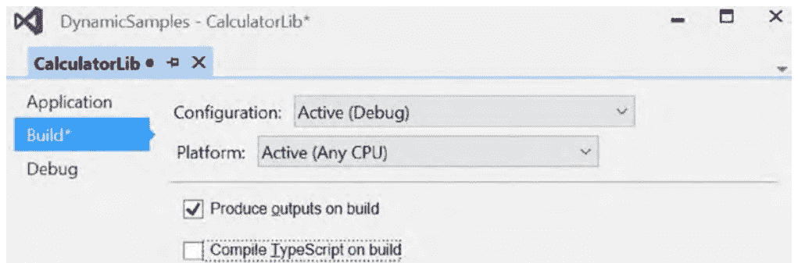

图 16.1

根据你使用的是 .NET Core 还是 .NET Framework 版本的客户端应用程序，你需要将相应的库复制到 `c:/addins` 文件夹。若要从 Visual Studio 内部选择运行应用程序的平台，请在“项目属性”中选择“调试”设置，并选择“平台”设置，如图 16.2 所示。

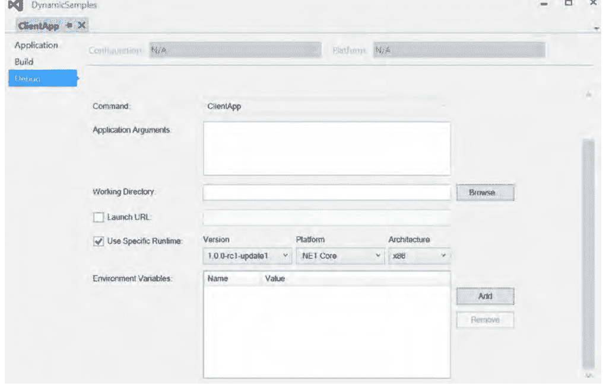

图 16.2

### 动态实例化类型

为了使用反射动态创建 Calculator 实例，你需要创建一个名为 ClientApp 的控制台应用程序（包）。

常量 `CalculatorLibPath`、`CalculatorLibName` 和 `CalculatorTypeName` 分别定义了库的路径、程序集的名称以及 Calculator 类型的名称（包括命名空间）。`Main` 方法调用了执行反射的两种变体方法 `ReflectionOld` 和 `ReflectionNew`（代码文件 `DynamicSamples/ClientApp/Program.cs`）：

class Program

{

    private const string CalculatorLibPath = @"c:/addins/CalculatorLib.dll";

    private const string CalculatorLibName = "CalculatorLib";

    private const string CalculatorTypeName = "CalculatorLib.Calculator";

    static void Main()

    {

        ReflectionOld();

        ReflectionNew();

    }

    // etc.

}

在使用反射调用方法之前，你需要实例化 Calculator 类型。有多种方法可以做到这一点。使用 .NET Framework 时，`GetCalculator` 方法通过 `Assembly.LoadFile` 方法动态加载程序集，并使用 `CreateInstance` 方法创建 Calculator 类型的实例。使用预处理器指令 `#if NET46`，这部分代码仅针对 .NET 4.6 编译（代码文件 `DynamicSamples/ClientApp/Program.cs`）：

#if NET46

private static object GetCalculator()

{

    Assembly assembly = Assembly.LoadFile(CalculatorLibPath);

    return assembly.CreateInstance(CalculatorTypeName);

}

#endif

该代码片段在编译 .NET 4.6 代码时使用了 NET46 符号。之所以可能，是因为对于 project.json 文件中列出的框架，会自动创建同名的符号；框架名称只是转换为大写。你还可以在 `compilationOptions` 声明中定义自己的符号。在框架声明的 `compilationOptions` 中指定 define 部分时，该符号仅针对特定框架定义。以下代码片段仅在应用程序为 .NET Core 编译时定义符号 DOTNETCORE（代码文件 `DynamicSamples/ClientApp/project.json`）：

{

  "frameworks": {

    "net46": {

      "defines": [ "NET46" ]

    },

    "netcoreapp1.0": {

      "defines": [ "DOTNETCORE" ]

    }

  }

}

{

  "frameworks": {

    "net46": {},

    "netstandard1.0": {

      "dependencies": {},

      "compilationOptions": {

        "define": ["DOTNETCORE"]

      }

    }

  }

}

.NET Core 的实现需要跨平台；因此不可能为 .NET Core 编译前面的代码。这里需要更多代码来加载程序集。首先，获取 `IAssemblyLoadContext` 以从文件系统加载程序集。获取加载上下文后，添加 `DirectoryLoader`（下一步将实现）以从文件系统加载程序集。设置好上下文后，可以使用 `Load` 方法加载程序集，并通过 `Activator` 类的 `CreateInstance` 方法动态实例化类型（代码文件 `DynamicSamples/ClientApp/Program.cs`）：

#if DOTNETCORE

private static object GetCalculator()

{

    IAssemblyLoadContext loadContext = PlatformServices.Default.

        AssemblyLoadContextAccessor.Default;

    using (PlatformServices.Default.AssemblyLoaderContainer.AddLoader(

        new DirectoryLoader(CalculatorLibPath, loadContext)))

    {

        Assembly assembly = Assembly.Load(new AssemblyName(CalculatorLibName));

        Type type = assembly.GetType(CalculatorTypeName);

        return Activator.CreateInstance(type);

    }

}

#endif

与加载上下文一起使用的 `DirectoryLoader` 类实现了 `IAssemblyLoader` 接口。该接口定义了 `Load` 和 `LoadUnmanagedLibrary` 方法。由于示例应用只加载托管程序集，因此只需要实现 `Load` 方法。该实现利用上下文来加载程序集文件（代码文件 `DynamicSamples/ClientApp/Program.cs`）：

public class DirectoryLoader : IAssemblyLoader

{

    private readonly IAssemblyLoadContext _context;

    private readonly string _path;

    public DirectoryLoader(string path, IAssemblyLoadContext context)

    {

        _path = path;

        _context = context;

    }

    public Assembly Load(AssemblyName assemblyName) =>

        _context.LoadFile(_path);

    public IntPtr LoadUnmanagedLibrary(string name)

    {

        throw new NotImplementedException();

    }

}


`ClientApp` 的示例代码使用了以下依赖项和 .NET 命名空间：

#### 依赖项

- `NETStandard.Library`
- `Microsoft.CSharp`
- `Microsoft.Extensions.PlatformAbstractions`

#### .NET 命名空间

- `Microsoft.CSharp.RuntimeBinder`
- `Microsoft.Extensions.PlatformAbstractions`
- `System`
- `System.Reflection`
- `static System.Console`

#### 使用反射 API 调用成员

接下来，使用反射 API 调用 `Calculator` 实例的 `Add` 方法。首先，通过辅助方法 `GetCalculator` 获取 Calculator 实例。如果想添加对 `CalculatorLib` 的引用，可以使用 `new Calculator` 创建实例。但这里没那么简单。

使用反射调用方法的好处是，类型不必在编译时可用。你可以在以后通过将库复制到指定目录来添加它。要使用反射调用成员，需要通过 `GetType`（基类 `Object` 的方法）获取实例的 `Type` 对象。借助扩展方法 `GetMethod`（该方法定义在 NuGet 包 `System.Reflection.TypeExtensions` 中），可以访问 `Add` 方法的 `MethodInfo` 对象。`MethodInfo` 定义了 `Invoke` 方法，可以使用任意数量的参数来调用该方法。`Invoke` 方法的第一个参数需要是成员被调用处的类型实例。第二个参数的类型是 `object[]`，用于传递调用所需的所有参数。在这里你传入 `x` 和 `y` 变量的值。如果你使用的是没有类型扩展的旧版 .NET Framework，调用该方法的代码在注释中给出。你不能在 .NET Core 中使用此代码（代码文件 `DynamicSamples/ClientApp/Program.cs`）：

```csharp
private static void ReflectionOld()
{
    double x = 3;
    double y = 4;
    object calc = GetCalculator();
    // object result = calc.GetType().InvokeMember("Add",
    //     BindingFlags.InvokeMethod, null, calc, new object[] { x, y });
    object result = calc.GetType().GetMethod("Add")
        .Invoke(calc, new object[] { x, y });
    WriteLine($"the result of {x} and {y} is {result}");
}
```

运行程序时，会调用 Calculator 实例，并将结果写入控制台：

```
The result of 3 and 4 is 7
```

动态调用成员需要做不少工作。下一节将展示使用 `dynamic` 关键字有多么简单。

#### 使用动态类型调用成员

在反射中使用 `dynamic` 关键字时，从 `GetCalculator` 方法返回的对象被赋值给一个动态类型的变量。方法本身没有改变；它仍然返回一个对象。结果被赋给一个类型为 `dynamic` 的变量。这样，就可以调用 `Add` 方法，并向其传递两个 double 值（代码文件 `DynamicSamples/ClientApp/Program.cs`）：

```csharp
private static void ReflectionNew()
{
    double x = 3;
    double y = 4;
    dynamic calc = GetCalculator();
    double result = calc.Add(x, y);
    WriteLine($"the result of {x} and {y} is {result}");
}
```

语法非常简单；看起来就像使用强类型访问调用方法一样。但是，由于没有 IntelliSense，你无法在 Visual Studio 编辑器中立即看到编码错误，所以很容易出现拼写错误。

也没有编译时检查。当你调用 `Multiply` 方法时，编译器可以正常通过。只需记住，你只为计算器定义了 `Add` 和 `Subtract` 方法。

```csharp
try
{
    result = calc.Multiply(x, y);
}
catch (RuntimeBinderException ex)
{
    WriteLine(ex);
}
```

当你运行应用程序并调用 `Multiply` 方法时，会得到 `RuntimeBinderException`：

```
Microsoft.CSharp.RuntimeBinder.RuntimeBinderException:
'CalculatorLib.Calculator' does not contain a definition for 'Multiply'
```

```
'Multiply'
    at CallSite.Target(Closure, CallSite, Object, Double, Double)
    at CallSite.Target(Closure, CallSite, Object, Double, Double)
    at ClientApp.Program.ReflectionNew() in...
```

使用 `dynamic` 类型与以强类型方式访问对象相比也有更大的开销。因此，该关键字仅在某些特定场景下有用，例如反射。你没有编译器检查 `Type` 的 `InvokeMember` 方法的调用；相反，会传递一个字符串作为成员的名称。在这种场景下，使用语法更简单的 `dynamic` 类型与使用反射 API 相比具有很大的优势。

在更详细讨论 `dynamic` 关键字之后，如下所示，`dynamic` 类型也可以与 COM 集成和脚本环境一起使用。

### The Dynamic Type

`dynamic` 类型使你能够编写绕过编译时类型检查的代码。编译器假设为 `dynamic` 类型对象定义的操作是有效的。如果该操作无效，则错误不会在编译时被检测到，而是在运行时才会被检测到。这在以下示例中有所体现：

```csharp
class Program
{
    static void Main()
    {
        var staticPerson = new Person();
        dynamic dynamicPerson = new Person();
        staticPerson.GetFullName("John", "Smith");
        dynamicPerson.GetFullName("John", "Smith");
    }
}
```

```csharp
class Person
{
    public string FirstName { get; set; }
    public string LastName { get; set; }
    public string GetFullName() => $"{FirstName} {LastName}";
}
```

此示例无法编译，因为调用了 `staticPerson.GetFullName()`。`Person` 对象上没有接受两个参数的方法，因此编译器会引发错误。如果将该行代码注释掉，示例将可以编译。如果执行，将会发生运行时错误。引发的异常是 `RuntimeBinderException`。`RuntimeBinder` 是运行时中评估调用以确定 `Person` 是否真正支持所调用方法的对象。绑定将在本章后面讨论。

与 `var` 关键字不同，被定义为 `dynamic` 的对象可以在运行时更改类型。请记住，使用 `var` 关键字时，对象类型的确定会被延迟。在类型确定后，就无法更改它。不仅可以更改 dynamic 对象的类型，而且可以多次更改。这与将对象从一种类型强制转换为另一种类型不同。当你强制转换对象时，你正在创建一个具有不同但兼容类型的新对象。例如，你不能将 `int` 强制转换为 `Person` 对象。在以下示例中，你可以看到如果对象是 dynamic 对象，你可以将其从 `int` 更改为 `Person`：

```csharp
dynamic dyn;
dyn = 100;
WriteLine(dyn.GetType());
WriteLine(dyn);
dyn = "This is a string";
WriteLine(dyn.GetType());
WriteLine(dyn);
dyn = new Person() { FirstName = "Bugs", LastName = "Bunny" };
WriteLine(dyn.GetType());
WriteLine($"{dyn.FirstName} {dyn.LastName}");
```

执行此代码的结果是 `dyn` 对象实际上从 `System.Int32` 更改类型为 `System.String` 再到 `Person`。如果 `dyn` 被声明为 `int` 或 `string`，代码将无法编译。

> NOTE `dynamic` 类型有一些限制。`dynamic` 对象不支持扩展方法。而且匿名函数（lambda 表达式）不能用作 `dynamic` 方法调用的参数，因此 LINQ 与 `dynamic` 对象配合得不好。大多数 LINQ 调用都是扩展方法，并且 lambda 表达式用作这些扩展方法的参数。

### Dynamic Behind the Scenes

那么在幕后发生了什么，使得 C# 中可以使用 `dynamic` 功能？C# 是一种静态类型语言。这并没有改变。看看使用 `dynamic` 类型时生成的 IL（中间语言）。

首先，这是你正在查看的示例 C# 代码：

```csharp
using static System.Console;

namespace DecompileSample
{
    class Program
    {
        static void Main()
        {
            StaticClass staticObject = new StaticClass();
            DynamicClass dynamicObject = new DynamicClass();
            WriteLine(staticObject.IntValue);
            WriteLine(dynamicObject.DynValue);
            ReadLine();
        }
    }

    class StaticClass
    {
        public int IntValue = 100;
    }

    class DynamicClass
    {
        public dynamic DynValue = 100;
    }
}
```

你有两个类：`StaticClass` 和 `DynamicClass`。`StaticClass` 有一个返回 `int` 的单个字段。`DynamicClass` 有一个返回 `dynamic` 对象的单个字段。`Main` 方法创建这些对象并打印出方法返回的值。很简单。

现在像这样注释掉 `Main` 中对 `DynamicClass` 的引用：

```csharp
static void Main()
{
    StaticClass staticObject = new StaticClass();
    //DynamicClass dynamicObject = new DynamicClass();
    WriteLine(staticObject.IntValue);
    //WriteLine(dynamicObject.DynValue);
    ReadLine();
}
```

使用 `ildasm` 工具，你可以查看为 `Main` 方法生成的 IL：

```
.method private hidebysig static void  Main() cil managed
{
    .entrypoint
    // Code size       26 (0x1a)
    .maxstack  1
    .locals init ([0] class DecompileSample.StaticClass staticObject)
    IL_0000:  nop
    IL_0001:  newobj       instance void DecompileSample.StaticClass::.ctor()
    IL_0006:  stloc.0
    IL_0007:  ldloc.0
    IL_0008:  ldfld       int32 DecompileSample.StaticClass::IntValue
    IL_000d:  call        void [mscorlib]System.Console::WriteLine(int32)
    IL_0012:  nop
    IL_0013:  call        string [mscorlib]System.Console::ReadLine()
    IL_0018:  pop
    IL_0019:  ret
} // end of method Program::Main
```

不用深入 IL 的细节，仅通过查看这段代码，你仍然可以大致看出发生了什么。第 0001 行，调用了 `StaticClass` 构造函数。第 0008 行调用了

```
[Microsoft.CSharp]Microsoft.CSharp.RuntimeBinder.CSharpArgumentInfo
::Create(valuetype [Microsoft.CSharp]
Microsoft.CSharp.RuntimeBinder.CSharpArgumentInfoFlags,
string)
IL_003f: stelem.ref
IL_0040: call class [System.Core]
System.Runtime.CompilerServices.CallSiteBinder
[Microsoft.CSharp]Microsoft.CSharp.RuntimeBinder.Binder::
InvokeMember(valuetype [Microsoft.CSharp]
string,
class [mscorlib]System.Collections.Generic.IEnumerable`1
<class [mscorlib]System.Type, class [mscorlib]System.Type,
class
[mscorlib]System.Collections.Generic.IEnumerable`1
<class [Microsoft.CSharp]
Microsoft.CSharp.RuntimeBinder.CSharpArgumentInfo>)
IL_0045: call class [System.Core]
System.Runtime.CompilerServices.CallSite`1<!0>
class [System.Core]System.Runtime.CompilerServices.CallSite`1
<class [System.Core]
System.Runtime.CompilerServices.CallSiteBinder
class [mscorlib]System.Type,object>>::
Create(class [System.Core]
System.Runtime.CompilerServices.CallSiteBinder)
IL_004a: stsfld class [System.Core]
System.Runtime.CompilerServices.CallSite`1
<class [mscorlib]System.Type,object>>
DecompileSample.Program/`<o_0`::`<p_0`
IL_004f: ldsfld class
[System.Core]System.Runtime.CompilerServices.CallSite`1<class
[mscorlib]
System.Action`3<class [System.Core]
System.Runtime.CompilerServices.CallSite,
class [mscorlib]System.Type,object>>
DecompileSample.Program/`<o_0`::`<p_0`
IL_0054: ldfld !0 class [System.Core]
System.Runtime.CompilerServices.CallSite`1<class [mscorlib]
System.Action`3<class [System.Core]
System.Runtime.CompilerServices.CallSite,
class [mscorlib]System.Type,object>>
IL_0059: ldsfld class [System.Core]
System.Runtime.CompilerServices.CallSite`1<class [mscorlib]


`System.Action`3`<class [System.Core]

`System.Runtime.CompilerServices.CallSite`,

class [mscorlib]`System.Type`,`object`>>

`DecompileSample.Program`/`<o_0`::`<p_0`

IL_005e: ldtoken [mscorlib]`System.Console`

IL_0063: call class [mscorlib]`System.Type`

`System.Type`::`GetTypeFromHandle`(valuetype [mscorlib]

`System.RuntimeTypeHandle`)

IL_0068: ldloc.0

IL_0069: ldfld object

`DecompileSample.DynamicClass`::`DynValue`

```

```

IL_006e: callvirt instance void class [mscorlib]`System.Action`3

<class [System.Core]`System.Runtime.CompilerServices.CallSite`, class [mscorlib]`System.Type`,`object`>::Invoke(!0, !1, !2)

IL_0073: nop

IL_0074: call string [mscorlib]`System.Console`::`ReadLine`()

IL_0079: pop

IL_007a: ret

} // end of method `Program`::`Main`

```

可以肯定地说，C# 编译器为支持动态类型做了一些额外的工作。查看生成的代码，可以看到对 `System.Runtime.CompilerServices.CallSite` 和 `System.Runtime.CompilerServices.CallSiteBinder` 的引用。

`CallSite` 是一种在运行时处理查找的类型。当在运行时对动态对象进行调用时，必须检查该对象以确定成员是否确实存在。调用站点会缓存此信息，因此无需重复执行查找。如果没有此过程，循环结构中的性能就会令人质疑。

`CallSite` 完成成员查找后，会调用 `CallSiteBinder`。它从调用站点获取信息，并生成一个表达式树，表示该绑定器所绑定的操作。

显然这里涉及很多工作。为优化这个看似非常复杂的操作倾注了大量心血。显然，使用动态类型可能很有用，但确实需要付出代价。

## 动态语言运行时

使用 `dynamic` 关键字的一个重要场景是使用动态语言运行时（DLR）。DLR 是一组添加到公共语言运行时（CLR）中的服务，用于支持 Python 和 Ruby 等动态语言的加入。它还使 C# 能够具备这些动态语言所拥有的一些动态功能。

原始 DLR 的核心功能现在是完整 .NET 4.5 框架中 `System.Dynamic` 和 `System.Runtime.CompilerServices` 命名空间的一部分。要与 IronPython 和 IronRuby 等脚本语言集成，需要安装 DLR 中作为集成部分的额外类型。该 DLR 是 IronPython 和 IronRuby 环境的一部分。你可以从 http://ironpython.codeplex.com 下载。

IronRuby 和 IronPython 是使用 DLR 的 Ruby 和 Python 语言的开源版本。Silverlight 也使用 DLR。通过托管 DLR，可以为应用程序添加脚本功能。脚本运行时使你可以将变量传入和传出脚本。

## 托管 DLR ScriptRuntime

想象一下能够为应用程序添加脚本功能，或者将值传入和传出脚本，以便应用程序可以利用脚本完成的工作。这就是在应用程序中托管 DLR 的 `ScriptRuntime` 所能提供的能力。IronPython 和 IronRuby 作为托管脚本语言受到支持。

`ScriptRuntime` 使你可以执行代码片段或存储在文件中的完整脚本。你可以选择适当的语言引擎，或让 DLR 自行确定使用哪个引擎。脚本可以在自己的应用程序域或当前应用程序域中创建。你不仅可以将值传入和传出脚本，还可以调用脚本中创建的动态对象上的方法。

这种灵活性为托管 `ScriptRuntime` 提供了无数用途。以下示例演示了使用 `ScriptRuntime` 的一种方式。想象一个购物车应用程序。其中一个要求是根据特定条件计算折扣。这些折扣会随着新促销活动的开始和完成而频繁变化。处理这种需求的方法有很多；此示例展示了如何使用 `ScriptRuntime` 和少量 Python 脚本完成此操作。

为简单起见，该示例是一个 WPF Windows 桌面应用程序。使用 DLR 的应用程序也可以是 Web 应用程序或任何其他应用程序的一部分。图 16.3 显示了示例应用程序的屏幕。为了使用运行时，示例应用程序添加了 IronPython NuGet 包。

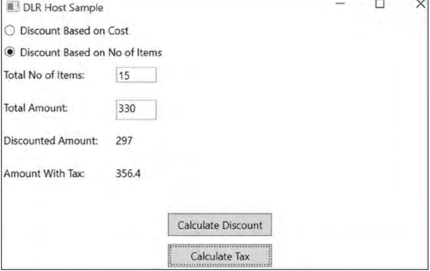

图 16.3

应用程序根据提供的商品数量和总成本，结合所选的单选按钮来应用折扣。在真实应用程序中，系统会使用稍微复杂一点的技术来确定要应用的折扣，但对于此示例，单选按钮就足够了。

以下是执行折扣的代码（代码文件 `DLRHostSample/MainWindow.xaml.cs`）：

```csharp
private void OnCalculateDiscount(object sender, RoutedEventArgs e)

{

    string scriptToUse;

    if (CostRadioButton.IsChecked.Value)

    {

        scriptToUse ="Scripts/AmountDisc.py";

    }

    else

    {

        scriptToUse ="Scripts/CountDisc.py";

    }

    ScriptRuntime scriptRuntime = ScriptRuntime.CreateFromConfiguration();

    ScriptEngine pythEng = scriptRuntime.GetEngine("Python");

    ScriptSource source = pythEng.CreateScriptSourceFromFile(scriptToUse);

    ScriptScope scope = pythEng.CreateScope();

    scope.SetVariable("prodCount", Convert.ToInt32(totalItems.Text));

    scope.SetVariable("amt", Convert.ToDecimal(totalAmt.Text));

    source.Execute(scope);

    textDiscAmount.Text = scope.GetVariable("retAmt").ToString();

}

```

第一部分确定要使用哪个脚本：`AmountDisc.py` 或 `CountDisc.py`。`AmountDisc.py` 根据购买金额计算折扣（代码文件 `DLRHostSample/Scripts/AmountDisc.py`）：

```python
discAmt = .25

retAmt = amt

if amt > 25.00:

    retAmt = amt-(amt*discAmt)

```

应用折扣所需的最低金额为 25 美元。如果金额低于该值，则不应用折扣；否则，应用 25% 的折扣。

`CountDisc.py` 根据购买的商品数量应用折扣（代码文件 `DLRHostSample/Scripts/CountDisc.py`）：

```python
discCount = 5

discAmt = .1

retAmt = amt

if prodCount > discCount:

    retAmt = amt-(amt*discAmt)

```

在这个 Python 脚本中，购买的商品数量必须大于 5，才能对总成本应用 10% 的折扣。

下一步是设置 `ScriptRuntime` 环境。为此，需要执行四个具体任务：创建 `ScriptRuntime` 对象、设置适当的 `ScriptEngine`、创建 `ScriptSource` 和创建 `ScriptScope`。

`ScriptRuntime` 对象是托管的起点或基础。它包含托管环境的全局状态。`ScriptRuntime` 是使用 `CreateFromConfiguration` 静态方法创建的。配置文件如下所示（代码文件 `DLRHostSample/app.config`）：

```xml
<configuration>

    <configSections>

        <section name="microsoft.scripting"

            type="Microsoft.Scripting.Hosting.Configuration.Section, Microsoft.Scripting" />

        </configSections>

        <microsoft.scripting>

            <languages>

                <language names="IronPython;Python;py" extensions=".py"

                    displayName="IronPython 2.7.5"

                    type="IronPython.Runtime.PythonContext, IronPython" />

            </languages>

        </microsoft.scripting>

</configuration>

```

该代码为 `microsoft.scripting` 定义了一个节，并为 IronPython 语言引擎设置了一些属性。

接下来，从 `ScriptRuntime` 获取对 `ScriptEngine` 的引用。在示例中，你指定需要 Python 引擎，但 `ScriptRuntime` 本来可以根据脚本的 `py` 扩展名自行确定这一点。

`ScriptEngine` 负责执行脚本代码。有多种方法可以从文件或代码片段执行脚本。`ScriptEngine` 还提供 `ScriptSource` 和 `ScriptScope`。

`ScriptSource` 对象使你可以访问脚本。它表示脚本的源代码。借助它，你可以操作脚本的源，从磁盘加载它，逐行解析它，甚至将脚本编译为 `CompiledCode` 对象。如果同一个脚本多次执行，这很方便。

`ScriptScope` 对象本质上是一个命名空间。要将值传入或传出脚本，可以将变量绑定到 `ScriptScope`。在以下示例中，你调用 `SetVariable` 方法将 `prodCount` 和 `amt` 变量传入 Python 脚本。这些变量分别是 `totalItems` 和 `totalAmt` 文本框中的值。通过使用 `GetVariable` 方法从脚本中检索计算出的折扣。在此示例中，`retAmt` 变量包含你要查找的值。

`CalcTax` 按钮演示了如何调用 Python 对象上的方法。脚本 `CalcTax.py` 是一个非常简单的函数，它接收输入值，加上 20% 的税，然后返回新值。以下是代码（code file `DLRHostSample/Scripts/CalcTax.py`）：

```python
def CalcTax(amount):

    return amount*1.2

```

Here is the C# code to call the `CalcTax` method (code file `DLRHostSample/MainWindow.xaml.cs`):

```csharp
private void OnCalculateTax(object sender, RoutedEventArgs e)

{

    ScriptRuntime scriptRuntime = ScriptRuntime.CreateFromConfiguration();

    dynamic calcRate = scriptRuntime.UseFile("Scripts/CalcTax.py");

    decimal discountedAmount;

    if (!decimal.TryParse(textDiscAmount.Text, out discountedAmount))

    {

        discountedAmount = Convert.ToDecimal(totalAmt.Text);

    }

    totalTaxAmount.Text = calcRate.CalcTax(discountedAmount).ToString();

}

```

It’s a very simple process: You create the `ScriptRuntime` object using the same configuration settings as before. `calcRate` is a `ScriptScope` object. You defined it as dynamic so you can easily call the `CalcTax` method. This is an example of how the dynamic type can make life a little easier.

## DynamicObject and ExpandoObject

What if you want to create your own dynamic object? You have a couple of options for doing that: by deriving from `DynamicObject` or by using `ExpandoObject`. Using `DynamicObject` is a little more work than using `ExpandoObject` because with `DynamicObject` you have to override a couple of methods. `ExpandoObject` is a sealed class that is ready to use.

### DynamicObject

Consider an object that represents a person. Normally, you would define properties for the first name, middle name, and last name. Now imagine the capability to build that object during runtime, with the system having no prior knowledge of what properties the object might have or what methods the object might support. That’s what having a `DynamicObject`-based object can provide. There might be very few times when you need this sort of functionality, but until now the C# language had no way of accommodating such a requirement.

First take a look at what the `DynamicObject` looks like (code file `DynamicSamples/DynamicSample/WroxDynamicObject.cs`):

```csharp
public class WroxDynamicObject : DynamicObject

{

    private Dictionary<string, object> _dynamicData = new Dictionary<string, object>();

    public override bool TryGetMember(GetMemberBinder binder, out object result)

    {

        bool success = false;

        result = null;

        if (_dynamicData.ContainsKey(binder.Name))

        {

            result = _dynamicData[binder.Name];

            success = true;

        }

        else

        {

            result = "Property Not Found!";

            success = false;

        }

        return success;

    }

    public override bool TrySetMember(SetMemberBinder binder, object value)

    {

        _dynamicData[binder.Name] = value;

        return true;

    }

    public override bool TryInvokeMember(InvokeMemberBinder binder,


```csharp
        object[] args, out object result)
    {
        dynamic method = _dynamicData[binder.Name];
        result = method((DateTime)args[0]);
        return result != null;
    }
}
```

In this example, you’re overriding three methods: `TrySetMember`, `TryGetMember`, and `TryInvokeMember`.

`TrySetMember` adds the new method, property, or field to the object. In this case, you store the member information in a `Dictionary` object. The `SetMemberBinder` object that is passed into the `TrySetMember` method contains the `Name` property, which is used to identify the element in the `Dictionary`.

The `TryGetMember` retrieves the object stored in the `Dictionary` based on the `GetMemberBinder` `Name` property.

Here is the code that makes use of the new dynamic object just created (code file `DynamicSamples/DynamicSample/Program.cs`):

```csharp
dynamic wroxDyn = new WroxDynamicObject();
wroxDyn.FirstName = "Bugs";
wroxDyn.LastName = "Bunny";
WriteLine(wroxDyn.GetType());
WriteLine($" {wroxDyn.FirstName} {wroxDyn.LastName} ");
```

It looks simple enough, but where is the call to the methods you override? That’s where the .NET Framework helps. `DynamicObject` handles the binding for you; all you have to do is reference the

At first glance it might seem that this is no different from using the `dynamic` type, but there are a couple of subtle differences that are important. First, you can’t just create an empty `dynamic` typed object. The `dynamic` type has to have something assigned to it. For example, the following code won’t work:

```csharp
dynamic dynObj;
dynObj.FirstName = "Joe";
```

As shown in the previous example, this is possible with `ExpandoObject`.

Second, because the `dynamic` type has to have something assigned to it, it reports back the type assigned to it if you do a `GetType` call. For example, if you assign an `int`, it reports back that it is an `int`. This doesn’t happen with `ExpandoObject` or an object derived from `DynamicObject`.

If you have to control the addition and access of properties in your dynamic object, then deriving from `DynamicObject` is your best option. With `DynamicObject`, you can use several methods to override and control exactly how the object interacts with the runtime. For other cases, using the `dynamic` type or the `ExpandoObject` might be appropriate.

Following is another example of using `dynamic` and `ExpandoObject`. Assume that the requirement is to develop a general-purpose comma-separated values (CSV) file parsing tool. You won’t know from one execution to another what data will be in the file, only that the values will be comma-separated and that the first line will contain the field names.

First, open the file and read in the stream. You can use a simple helper method to do this (code file `DynamicSamples/DynamicFileReader/DynamicFileHelper.cs`):

```csharp
private StreamReader OpenFile(string fileName)
{
    if(File.Exists(fileName))
    {
        return new StreamReader(fileName);
    }
    return null;
}
```

This just opens the file and creates a new `StreamReader` to read the file contents.

Now you want to get the field names, which you can do easily by reading in the first line from the file and using the `Split` function to create a string array of field names:

```csharp
string[] headerLine =
fileStream.ReadLine().Split(',').Trim().ToArray();
```

Next is the interesting part. You read in the next line from the file, create a string array just like you did with the field names, and start creating your dynamic objects. Here’s what the code looks like (code file `DynamicSamples/DynamicFileReader/DynamicFileHelper.cs`):

```csharp
public IEnumerable<dynamic> ParseFile(string fileName)
{
    var retList = new List<dynamic>();
    while (fileStream.Peek() > 0)
    {
        string[] dataLine =
            fileStream.ReadLine().Split(',').Trim().ToArray();
        dynamic dynamicEntity = new ExpandoObject();
        for(int i=0;i<headerLine.Length;i++)
        {
            ((IDictionary<string,object>)dynamicEntity).Add(headerLine[i],
            dataLine[i]);
        }
        retList.Add(dynamicEntity);
    }
    return retList;
}
```

After you have the string array of field names and data elements, you create a new `ExpandoObject` and add the data to it. Notice that you cast the `ExpandoObject` to a `Dictionary` object. You use the field name as the key and the data as the value. Then you can add the new object to the `retList` object you created and return it to the code that called the method.

What makes this nice is you have a section of code that can handle any data you give it. The only requirements in this case are ensuring that the field names are the first line and that everything is comma-separated. This concept could be expanded to other file types or even to a `DataReader`.

Using this CSV file content that is available with the sample code download

```text
FirstName, LastName, City, State
Niki, Lauda, Vienna, Austria
Carlos, Reutemann, Santa Fe, Argentine
Sebastian, Vettel, Thurgovia, Switzerland
```

and this Main method to read the sample file `EmployeeList.txt` (code file `DynamicSamples/DynamicFileReader/Program.cs`):

```csharp
static void Main()
{
    var helper = new DynamicFileHelper();
    var employeeList = helper.ParseFile("EmployeeList.txt");
    foreach (var employee in employeeList)
    {
        WriteLine($"{employee.FirstName} {employee.LastName} lives in" +
            $"{employee.City}, {employee.State}.");
    }
    ReadLine();
}
```

results in this output to the console:

尼基·劳达居住在奥地利维也纳。

卡洛斯·鲁埃特曼居住在阿根廷圣菲。

塞巴斯蒂安·维特尔居住在瑞士图尔高。

### 摘要

本章介绍了`Type`和`Assembly`类的使用，它们是通过反射访问所提供广泛功能的主要入口点。

此外，本章演示了反射的一个特定方面，即自定义属性的检查，你很可能会比其他任何方面更频繁地使用它。你学习了如何定义和应用自己的自定义属性，以及如何在运行时检索有关自定义属性的信息。

本章的第二个重点是使用动态类型。使用`ExpandoObject`代替多个对象可以显著减少代码行数。此外，使用 DLR 并添加 Python 或 Ruby 等脚本语言可以帮助你构建一个更具多态性的应用程序，该应用程序可以在不重新编译的情况下轻松更改。

下一章详细介绍了 Visual Studio 2015 可用的许多功能。

### 17 Visual Studio 2015

#### 本章内容？

- 使用 Visual Studio 2015
- 创建和处理项目
- 调试
- 使用 Visual Studio 重构
- 处理各种技术：WPF、WCF 等
- 架构工具
- 分析应用程序

#### 本章 Wrox.com 代码下载

本章没有代码下载。

#### 使用 Visual Studio 2015

到目前为止，你应该熟悉 C# 语言，并且几乎准备好进入本书的应用部分，这些部分涵盖了如何使用 C# 编程各种应用程序。在此之前，了解如何使用 Visual Studio 以及 .NET 环境提供的一些功能来充分发挥程序的作用非常重要。

本章解释了在 .NET 环境中编程在实践中意味着什么。它涵盖了 Visual Studio，即你编写、编译、调试和优化 C# 程序的主要开发环境，并提供了编写良好应用程序的指导。Visual Studio 是用于众多目的的主要 IDE，包括编写 ASP.NET 应用程序、Windows Presentation Foundation (WPF) 应用程序以及通用 Windows 平台 (UWP) 应用，以及访问由 ASP.NET Web API 创建的服务，或使用 ASP.NET MVC 的 Web 应用程序。

本章还探讨了构建以 .NET Core 1.0 和 .NET Framework 4.6 为目标的应用程序所需的条件。

Visual Studio 2015 是一个完全集成的开发环境。它旨在使编写代码、调试它并将其编译为要发布的程序集的过程尽可能简单。这意味着 Visual Studio 为你提供了一个非常复杂的多个文档界面应用程序，你可以在其中完成与开发代码相关的几乎所有事情。它提供以下功能：

- 文本编辑器—使用此编辑器，你可以编写 C#（以及 Visual Basic、C++、F#、JavaScript、XAML、JSON 和 SQL）代码。此文本编辑器相当复杂。例如，随着你的输入，它会自动通过缩进行、匹配代码块的开始和结束括号以及为关键字着色来布局你的代码。它还在你输入时执行一些语法检查，并对导致编译错误的`<|message|>`进行下划线，这也称为设计时调试。此外，它还具有 IntelliSense 功能，会在你开始输入时自动显示类、字段或方法的名称。随着你开始为方法输入参数，它还会显示可用重载的参数列表。图 17.1 显示了 IntelliSense 功能在 UWP 应用中的实际效果。

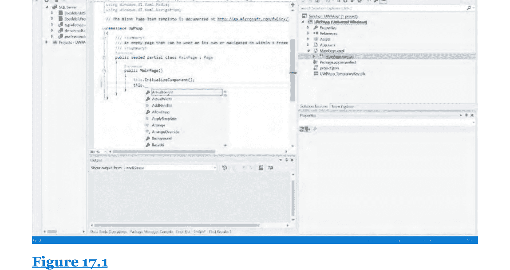

> 注意 通过按 Ctrl+Space，你可以在需要时或出于任何原因不可见时重新调出 IntelliSense 列表框。如果想在 IntelliSense 框下方查看一些代码，只需一直按住 Ctrl 键即可。

- 设计视图编辑器—此编辑器使你能够在项目中放置用户界面和数据访问控件；Visual Studio 会自动向你的源文件添加必要的 C# 代码，以在项目中实例化这些控件。（这是可能的，因为所有 .NET 控件都是特定基类的实例。）

- 支持窗口—这些窗口使你能够查看和修改项目的各个方面，例如源代码中的类，以及 Windows Forms 和 Web Forms 类的可用属性（及其启动值）。你还可以使用这些窗口指定编译选项，例如构建中包含哪些程序集。

```csharp
using Windows.UI.Xaml.Controls;
using Windows.UI.Xaml.Navigation;
/// <summary>
/// The Blank Page item template is documented at http://go.microsoft.com/fwlink/?LinkId=234238
/// </summary>
public sealed partial class MainPage : Page
{
    public MainPage()
    {
        this.InitializeComponent();
    }
}
```


你的代码需要引用。

- **集成调试器**—编程的本质是你的代码第一次尝试运行时不会正确运行。或者第二次。或者第三次。Visual Studio 无缝链接到调试器，使你能够从环境内部设置断点并监视变量。
- **集成 MSDN 帮助**—Visual Studio 使你能够从 IDE 内部访问 MSDN 文档。例如，如果你在文本编辑器中使用关键字时不确定其含义，只需选择该关键字并按 F1 键，Visual Studio 就会访问 MSDN 以显示相关主题。同样，如果你不确定某个编译错误意味着什么，你可以通过选择错误消息并按 F1 来调出该错误的文档。
- **访问其他程序**—Visual Studio 还可以访问许多其他实用程序，使你能够检查和修改计算机或网络的各个方面，而无需离开开发环境。使用可用的工具，你可以检查正在运行的服务和数据库连接，直接查看 SQL Server 表，浏览你的 Microsoft Azure 云服务，甚至使用 Internet Explorer 窗口浏览 Web。
- **Visual Studio 扩展**—一些 Visual Studio 扩展已随 Visual Studio 的正常安装一起安装，还有许多来自 Microsoft 和第三方提供的扩展。这些扩展使你能够分析代码，提供项目或项目模板，访问其他服务等等。随着 .NET Compiler Platform 的出现，工具与 Visual Studio 的集成变得更容易。

Visual Studio 的最新版本取得了有趣的进展。一个重要部分是用户界面，另一个重要部分是后台功能和 .NET Compiler Platform。

就用户界面而言，Visual Studio 2010 将外壳重新设计为基于 WPF 而不是原生 Windows 控件。Visual Studio 2012 在此基础上进行了一些用户界面 (UI) 更改。特别是，UI 增强为更专注于主要工作区——编辑器——并允许直接从代码编辑器执行更多任务，而无需使用许多其他工具。当然，你需要在代码编辑器之外使用一些工具，但更多功能已构建到其中一些工具中，因此通常需要的工具数量可以减少。Visual Studio 2015 对一些 UI 功能进行了更多增强。例如，NuGet 包管理器不再是模态对话框。使用包管理器的新版本，你可以在包管理器从服务器加载信息时继续执行其他任务。

随着 .NET Compiler Platform（代号 Roslyn），.NET 编译器已完全重写；它现在在编译器管道中集成了各种功能，例如语法分析、语义分析、绑定和代码生成。基于此，Microsoft 必须重写许多 Visual Studio 集成工具。代码编辑器、IntelliSense 和重构都基于 .NET Compiler Platform。

> 注意 第 18 章“ .NET Compiler Platform ”演示了可与 .NET Compiler Platform 一起使用的 API。

对于 XAML 代码编辑，Visual Studio 2010 和 Expression Blend 4（现名为 Blend for Visual Studio 2015）具有不同的编辑器引擎。自 Visual Studio 2013 起，团队已合并，虽然在 UI 中提供的功能略有不同，但代码引擎是相同的。不仅代码引擎相同：虽然 Visual Studio 2013 从 Blend 获得了 XAML 引擎，但现在使用 Blend for Visual Studio 2015，Blend 获得了来自 Visual Studio 的外壳。当你启动 Blend for Visual Studio 时，你会看到它看起来像 Visual Studio，并且可以立即开始使用它。

Visual Studio 的另一个特殊功能是搜索。Visual Studio 有如此多的命令和功能，以至于经常很难找到你要查找的菜单或工具栏按钮。只需将你要查找的命令的一部分输入到快速启动中，你就会看到可用的选项。快速启动位于窗口的右上角（见图 17.2）。搜索功能还可从工具箱、解决方案资源管理器、代码编辑器（可通过按 Ctrl+F 调出）、引用管理器的程序集等处获得。

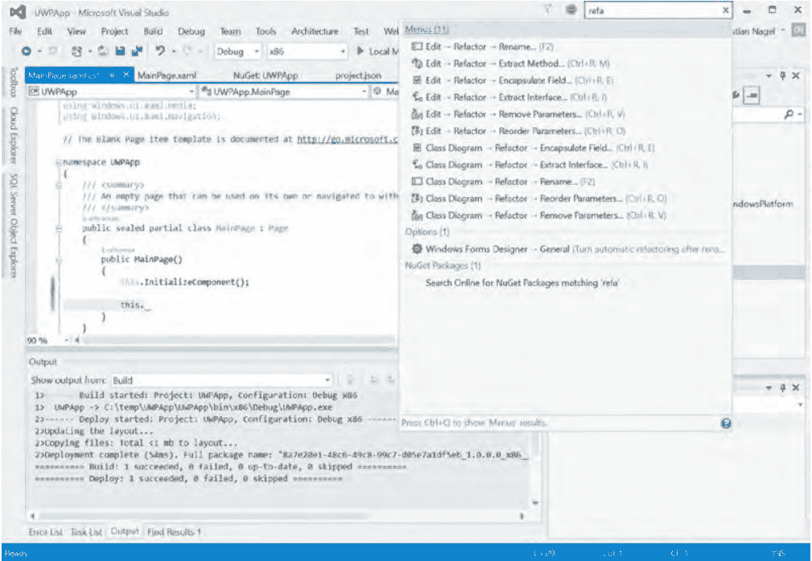

图 17.2

#### Visual Studio 版本

Visual Studio 2015 有几种版本。最便宜的是 Visual Studio 2015 社区版，在某些情况下是免费的。它对个人开发者、开源项目、学术研究、教育和小型专业团队免费。

你可以购买专业版和企业版。只有企业版包含所有功能。企业版独有 IntelliTrace、负载测试和一些架构工具。Microsoft Fakes 框架（单元测试隔离）仅在 Visual Studio 企业版中提供。本章对 Visual Studio 2015 的讲解包含一些仅在特定版本中可用的功能。有关 Visual Studio 2015 各版本功能的详细信息，请参阅 http://www.microsoft.com/visualstudio/en-us/products/compare。

#### Visual Studio 设置

首次启动 Visual Studio 时，系统会要求你选择与你的环境匹配的设置集合，例如“常规开发”、“Visual Basic”、“Visual C#”、“Visual C++”或“Web 开发”。这些不同的设置反映了这些语言历史上使用的不同工具。在 Microsoft 平台上编写应用程序时，使用了不同的工具来创建 Visual Basic、C++ 和 Web 应用程序。同样，Visual Basic、Visual C++ 和 Visual InterDev 具有完全不同的编程环境，以及完全不同的设置和工具选项。现在，你可以使用 Visual Studio 为所有这些技术创建应用程序，但 Visual Studio 仍然提供你可以根据 Visual Basic、Visual C++ 和 Visual InterDev 选择的键盘快捷键。当然，你也可以选择特定的 C# 设置。

选择主要设置类别以定义键盘快捷键、菜单和工具窗口位置后，你可以通过“工具” → “自定义”（工具栏和命令）和“工具” → “选项”（这里可以找到所有工具的设置）更改每个设置。你还可以通过“工具” → “导入和导出设置”重置设置集合，这将调用一个向导，使你可以选择新的默认设置集合（参见图 17.3）。

图 17.3

以下各节将逐步介绍创建、编码和调试项目的过程，并演示 Visual Studio 在每个阶段如何帮助你。

#### 创建项目

安装 Visual Studio 2015 后，你会想要启动第一个项目。使用 Visual Studio，你很少会像本书前几章那样，从空白文件开始然后添加 C# 代码。（当然，如果你确实想从头开始编写代码，或者打算创建一个包含多个项目的解决方案，也可以选择空应用程序项目。）

相反，其理念是，你大致告诉 Visual Studio 要创建的项目类型，它会生成提供该类型项目框架的文件和 C# 代码。然后你继续将代码添加到这个框架中。例如，如果要构建 Windows 桌面应用程序（WPF 应用程序），Visual Studio 会为你提供一个 XAML 文件和一个包含用于创建基本窗体的 C# 源代码的文件。此窗体能够与 Windows 通信并接收事件。它可以最大化、最小化或调整大小；你只需添加所需的控件和功能。如果你的应用程序是命令行实用程序（控制台应用程序），Visual Studio 会为你提供一个基本命名空间、一个类和一个 Main 方法来帮助你入门。

最后但同样重要的是，在创建项目时，Visual Studio 还会设置你可能提供给 C# 编译器的编译选项——无论是编译为命令行应用程序、库还是 WPF 应用程序。它还告诉编译器你需要引用哪些基类库和 NuGet 包（WPF GUI 应用程序需要引用许多与 WPF 相关的库；控制台应用程序可能不需要）。当然，如果需要，你可以在编辑过程中修改所有这些设置。

首次启动 Visual Studio 时，你会看到一个包含菜单、工具栏以及一个页面的 IDE，该页面包含入门信息、操作视频和最新新闻（参见图 17.4）。“起始页”包含指向有用网站的各种链接，以及指向一些实际文章的链接，并且允许你打开现有项目或开始一个全新项目。

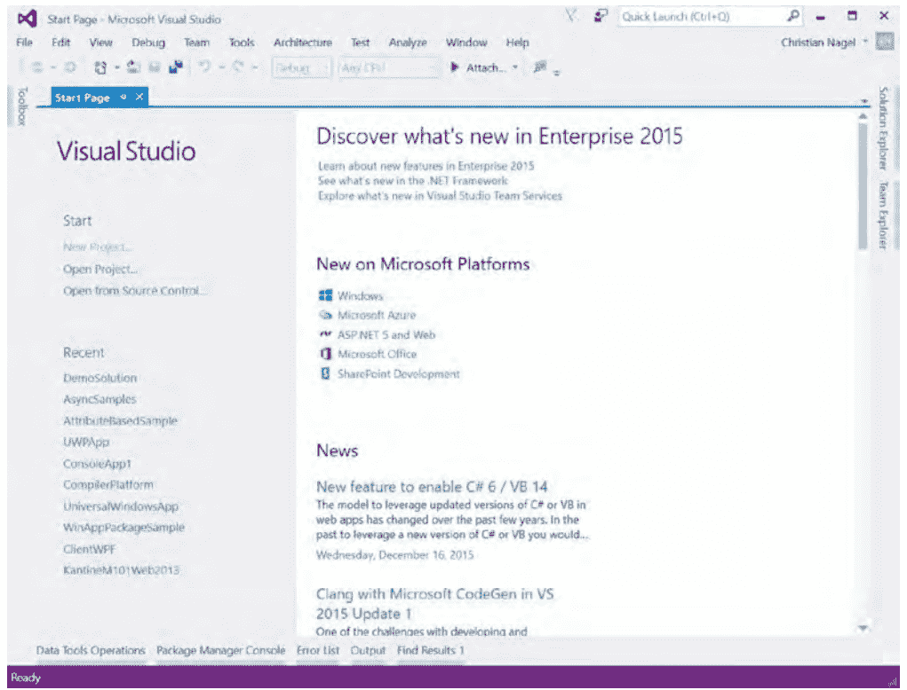

图 17.4

对于图 17.4 的情况，“起始页”反映的是你已使用 Visual Studio 2015 后显示的内容，因为它包含最近编辑的项目列表。你只需点击其中一个项目即可再次打开它。

#### .NET Framework 多目标

Visual Studio 使你可以面向要使用的 .NET Framework 版本。当你打开“新建项目”对话框（如图 17.5 所示）时，对话框顶部区域的一个下拉列表会显示可用选项。

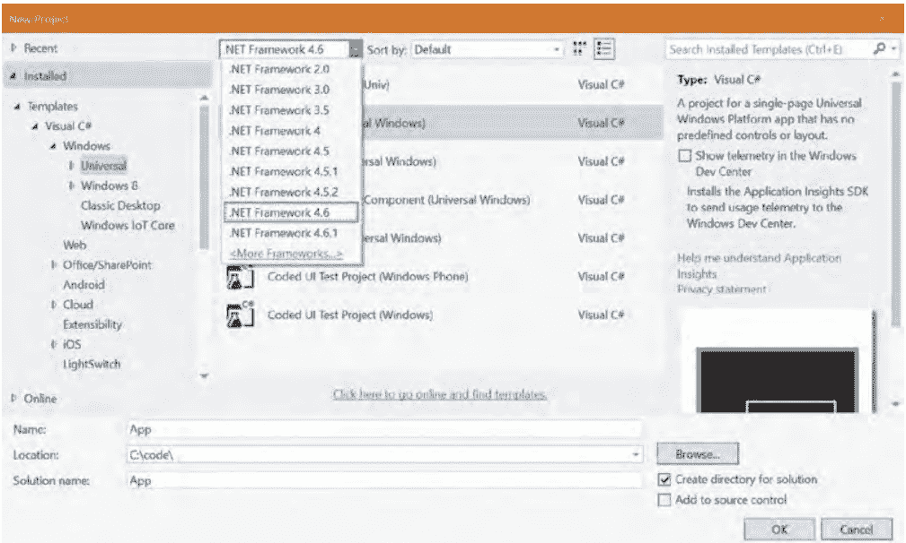

图 17.5

在这种情况下，你可以看到下拉列表使你能够面向 .NET Framework 2.0、3.0、3.5、4、4.5、4.5.1、4.5.2、4.6 和 4.6.1。你也可以通过单击“更多框架”链接安装其他版本的 .NET Framework。此链接会打开一个网站，从该网站你可以下载其他版本的 .NET Framework——例如 2.0 + 3.5 SP1——以及用于服务（Microsoft Azure、OneDrive）和设备（Xamarin）的框架。

如果要更改解决方案使用的框架版本，请右键单击项目并选择解决方案的属性。如果你正在处理 WPF 项目，会看到如图 17.6 所示的对话框。

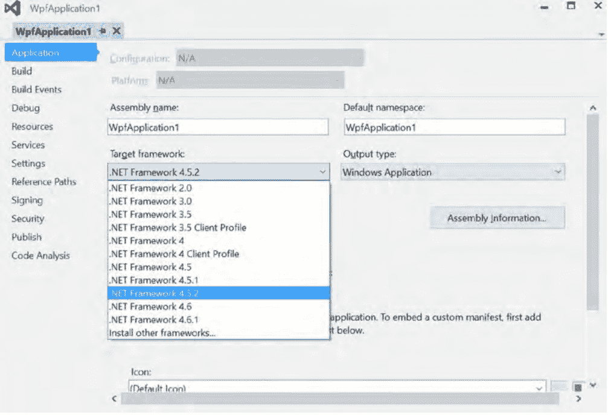

图 17.6

在此对话框中，“应用程序”选项卡使你可以更改应用程序使用的框架版本。

#### 选择项目类型

要创建新项目，请从 Visual Studio 菜单中选择“文件” → “新建项目”。“新建项目”对话框会显示出来（参见图 17.7），让你第一次了解到可以创建的各种项目。

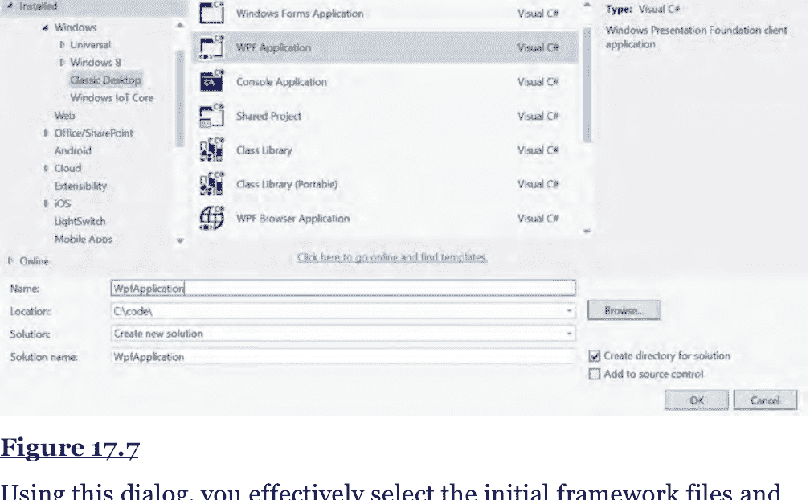

图 17.7

使用此对话框，你可以有效地选择希望 Visual Studio 为你生成的初始框架文件和代码、希望用来创建项目的编程语言，以及不同类别的应用程序类型。

下表描述了 Visual C# 项目下最重要的可用选项。

##### 使用 Windows 经典桌面项目模板

第一个表格列出了 Windows 类别下可用的项目：

| 如果你选择... | 你会得到用于生成...的 C# 代码和编译选项 |
|---|---|
| Windows 窗体应用程序 | 一个响应事件的基本空窗体。Windows 窗体封装本机 Windows 控件，并使用基于像素的图形和 GDI+。 |
| WPF 应用程序 | 一个响应事件的基本空窗体。虽然此项目类型类似于 Windows 窗体应用程序项目类型（Windows 窗体），但此 Windows 应用程序项目类型使你能够构建基于 XAML 的智能客户端解决方案，该解决方案使用基于矢量的图形和样式。 |
| 控制台应用程序 | 在命令行提示符或控制台窗口中运行的应用程序。此控制台应用程序使用 MSBuild 环境来编译应用程序。你可以在 Web 类别中找到 .NET Core 1.0 的控制台应用程序。 |
| 共享项目 | 此项目不创建自己的二进制文件，但你可以将源代码与其他项目一起使用。与库不同，源代码会在使用它的每个项目中编译。你可以使用预处理器语句，根据使用共享项目的具体项目来处理源代码中的差异。 |
| 类库 | 可被其他代码调用的 .NET 类库。 |
| 类库（可移植） | 可供不同技术使用的类库，例如 WPF、通用 Windows 平台应用、Xamarin 应用等。 |
| WPF 浏览器应用程序 | 与 WPF 的 Windows 应用程序非常相似，此变体使你能够构建面向浏览器的基于 XAML 的应用程序。但是，它只能在 Internet Explorer 中运行，不能在 Microsoft Edge 中运行。如今，你应该考虑为此使用其他技术，例如使用 ClickOnce 或 HTML 5 的 WPF 应用程序。 |
| 空项目 | 一个空项目，只包含应用程序配置文件和控制台应用程序的设置。 |
| Windows 服务 | 一种 Windows 服务，可随 Windows 自动启动，并以特权本地系统的身份运行。 |

| 如果你选择... | 你将获得用于生成...的 C# 代码和编译选项 |
| --- | --- |
| 空白应用（通用 Windows） | 一个基本的空通用 Windows 应用，包含 XAML，没有样式和其他基类。 |
| 类库（通用 Windows） | 一个可由其他使用 .NET 编程的 Windows 商店应用调用的 .NET 类库。你可以在此库中使用 Windows 运行时的 API。 |
| Windows 运行时组件（通用 Windows） | 一个可由其他使用不同编程语言（C#、C++、JavaScript）开发的 Windows 商店应用调用的 Windows 运行时类库。 |
| 单元测试应用（通用 Windows） | 一个包含通用 Windows 平台应用单元测试的库。 |
| 编码 UI 测试项目（Windows Phone） | 一个用于定义 Windows Phone 编码 UI 测试的项目。 |
| 编码 UI 测试项目（Windows） | 一个用于定义 Windows 应用编码 UI 测试的项目。 |

> **注意** 对于 Windows 10，通用应用默认模板的数量已经减少。对于 Windows 8，要创建 Windows 商店应用，Visual Studio 提供了更多项目模板来预定义基于网格、基于拆分或基于中心的应用。对于 Windows 10，只有一个空模板可用。你可以从空模板开始，或者考虑使用 Template10 作为入门。安装 Microsoft 提供的 Template10 Visual Studio 扩展后即可使用 Template10 项目模板，该扩展可通过“工具”⇨“扩展和更新”获得。

> **注意** 如果使用 Visual Studio 安装 Windows 8 项目模板，还会提供多个 Windows、Windows Phone 和通用项目模板。这些模板是适用于 Windows 8 和 8.1 上运行的应用的通用模板的前身，本书不涉及这些模板。

#### 使用 Web 项目模板

Visual Studio 2015 的 Web 项目模板提供了一些有趣的增强功能。最初有三个选择，如下表所述。

| 如果你选择... | 你将获得用于生成...的 C# 代码和编译选项 |
| --- | --- |
| ASP.NET Web 应用程序 | 这是创建任何 Web 应用程序时选择的模板，无论它是向客户端返回 HTML 代码的网站，还是返回 JSON 或 XML 的服务。选择此项目模板后可用的选项将在下一个表中描述。 |
| 类库（包） | 此模板使用基于 project.json 的项目创建类库。你可以将此库用于所有新项目类型。这是一个使用 .NET Core 构建的库。 |
| 控制台应用程序（包） | 与前面讨论的 Windows 经典桌面项目模板中的控制台应用程序相反，此控制台应用程序使用 project.json，因此允许使用 .NET Core 1.0。 |

选择 ASP.NET Web 应用程序模板后，你可以选择一些预配置的模板，如图 17.8 所示。顶部是 ASP.NET 4.6 模板的主组，下面是 ASP.NET Core 1.0 的较低组。这两组模板将在下两个表中描述。

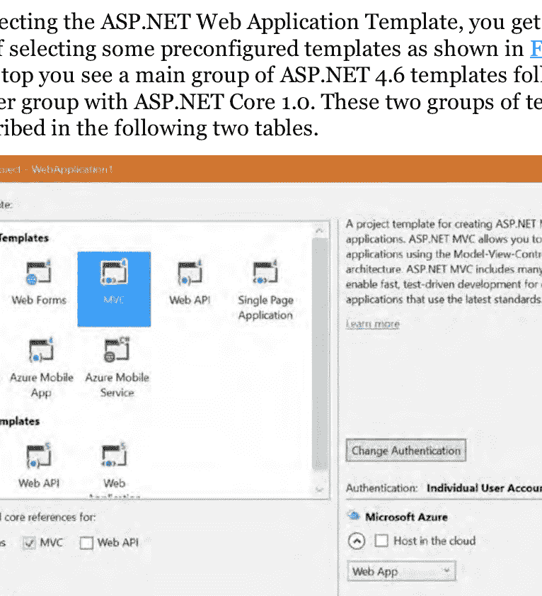

> 图 17.8

以下表格显示了为 ASP.NET 4.6 Web 应用程序提供的模板。选择这些模板时，你可以看到 Web Forms、MVC 和 Web API 的默认选择，这些选择定义了创建的文件夹和核心引用。你可以选中 Web Forms、MVC 和 Web API 复选框，在一个项目中使用多种技术，例如将旧的 Web Forms 技术与较新的 ASP.NET MVC 一起使用。

| 如果你选择... | 你将获得用于生成...的 C# 代码和编译选项 |
| --- | --- |
| 空 | 此模板没有任何内容。非常适合创建包含 HTML 和 CSS 页面的网站。 |
| Web Forms | 此模板默认添加 Web Forms 文件夹。你可以添加 MVC 和 Web API 配置来混合使用。 |
| MVC | 此模板将模型-视图-控制器模式用于 Web 应用程序（ASP.NET MVC 5）。你可以使用它创建 Web 应用程序。 |
| Web API | Web API 模板可以轻松创建 RESTful 服务。MVC 文件夹和核心引用也随此模板添加，因为服务的文档是使用 ASP.NET MVC 5 创建的。 |
| 单页应用程序 | 单页应用程序模板使用 MVC 创建结构，其中通常只使用一个页面；它利用 JavaScript 代码从服务器检索数据。 |
| Azure API 应用 | 此模板创建 ASP.NET Web API 结构，以创建由 Microsoft Azure 托管的服务。为了更容易发现所提供的服务，Swagger 被添加到该模板中。 |
| Azure 移动应用 | 这是一个功能强大的 Azure 移动应用模板，不仅适用于移动客户端。此模板会根据 ASP.NET Web API 服务定义的表自动创建 SQL Server 后端。还可以轻松集成基于 OAuth 的用户身份验证，以集成 Facebook、Google 和 Microsoft 帐户。 |

尽管前一个列表中的模板使用 ASP.NET 4.6 或更早版本的框架，但以下模板使用 ASP.NET Core 1.0。由于切换到 ASP.NET Core 1.0 不是自动的，需要一些代码更改，而且 ASP.NET 4.6 提供的功能并非全部在 ASP.NET Core 1.0 中可用，因此将这些组明确分开是很好的。ASP.NET Core 1.0 不提供的一个示例是 ASP.NET Web Forms。Web Forms 是一项自 .NET 1.0 以来就存在的技术，但它不能轻松使用新的 HTML 和 JavaScript 功能。ASP.NET 4.6 仍为 Web Forms 提供了新功能，你可以在未来许多年使用这项技术，但它将不适用于新框架 ASP.NET Core 1.0。

| 如果你选择... | 你将获得用于生成...的 C# 代码和编译选项 |
| --- | --- |
| 空 | 此模板具有用于 ASP.NET Core 1.0 托管的初始内容。此模板是第 40 章“ASP.NET Core”中使用的主要模板。 |
| Web API | 此模板添加使用 ASP.NET Core 1.0 的 ASP.NET Web API 控制器。此模板是第 42 章“ASP.NET Web API”中使用的主要模板。 |
| Web 应用程序 | 此模板为 ASP.NET MVC 6 应用程序创建控制器和视图。此模板是第 41 章“ASP.NET MVC”中使用的主要模板。 |

#### 使用 WCF 项目模板

要创建支持客户端和服务器之间通信的 Windows Communication Foundation (WCF) 应用程序，你可以从以下 WCF 项目模板中进行选择。

| 如果你选择... | 你将获得用于生成...的 C# 代码和编译选项 |
| --- | --- |
| WCF 服务库 | 一个包含示例服务协定和实现以及配置的库。该项目配置为启动 WCF 服务主机，该主机承载服务和一个测试客户端应用程序。 |
| WCF 服务应用程序 | 一个使用 .NET Framework 的 Web 项目，包含 WCF 协定和服务实现。 |
| WCF 工作流服务应用程序 | 一个承载 WCF 服务并带有工作流运行时的 Web 项目。 |
| 联合服务库 | 一个包含 WCF 协定和实现、承载 RSS 或 ATOM 提要的 WCF 服务库。 |

这并不是 Visual Studio 2015 项目模板的完整列表，但它反映了一些最常用的模板。此版本 Visual Studio 的主要新增功能是通用 Windows 项目模板和 ASP.NET Core 1.0 项目模板。这些新功能将在本书后面的其他章节中介绍。请务必

请查看第 29 章至第 34 章，其中涵盖了通用 Windows 平台，以及第 40 章至第 42 章中关于 ASP.NET Core 1.0 的内容。

#### 探索和编码项目

本节介绍 Visual Studio 提供的功能，帮助你为项目添加和探索代码。你将了解如何使用解决方案资源管理器来浏览文件和代码，使用编辑器中的功能——例如 IntelliSense 和代码片段——以及探索其他窗口，例如属性窗口和文档大纲。

#### 构建环境：CLI 和 MSBuild

Visual Studio 2015 的许多复杂性和问题源于构建环境发生了重大变化。有两种构建环境可用：MSBuild，其配置主要基于 XML 文件；以及 .NET 命令行界面 CLI，其配置主要基于 JSON 文件。在 MSBuild 中，用于编译项目的所有文件都在一个 XML 文件中定义。在 CLI 中，文件夹中的所有文件都用于构建项目；所有文件都不需要配置。

有了这两种构建环境，你有三种变体可供使用。一种变体是使用 MSBuild 系统。该构建系统用于长期存在的项目类型，例如 WPF 应用程序，或使用 ASP.NET 4.5.2 模板的 ASP.NET Web 应用程序。项目文件是一个 XML 文件，列出属于项目的所有文件，引用编译文件所需的所有工具，并列出构建步骤。

你使用 CLI 构建系统配合 ASP.NET Core 1.0 项目模板。你使用扩展名为 `xproj` 的基于 XML 的项目文件进行初始配置。该文件——`ConsoleApp1.xproj`——包含有关 Visual Studio 工具构建路径的信息以及全局定义。DNX 构建系统使用 JSON 文件 `project.json`，该文件定义了可用的命令，引用 NuGet 包和程序集，并包含有关项目的描述。不需要列出属于项目的 文件列表，因为文件夹和子文件夹中的所有文件都用于编译项目。

> NOTE 名称为 .NET Core 命令行 CLI 的 DNX 命令行工具在第 1 章“ .NET 应用程序架构”中进行了说明。

第三种 CLI 和 MSBuild 的选项用于通用 Windows 应用。在这里，同时使用 XML 项目文件和 `project.json`。`project.json` 文件不再列出项目描述和命令，只列出对 NuGet 包的依赖，以及使用的运行时（对于通用 Windows 平台应用，ARM、x86 和 x64）。项目描述和构建命令在项目 XML 文件中

因此，能够在 Visual Studio 中将它们全部作为一个整体单元进行编辑是非常有用的。Visual Studio 通过将所有项目视为构成一个解决方案，并将解决方案作为读取和允许你操作的单元来实现这一点。

到目前为止，本章一直在松散地讨论创建控制台项目。事实上，在你正在处理的示例中，Visual Studio 已经为你创建了一个解决方案——尽管这个特定解决方案只包含一个项目。你可以在解决方案资源管理器中看到这种情况（见图 17.9），它包含一个定义解决方案的树形结构。

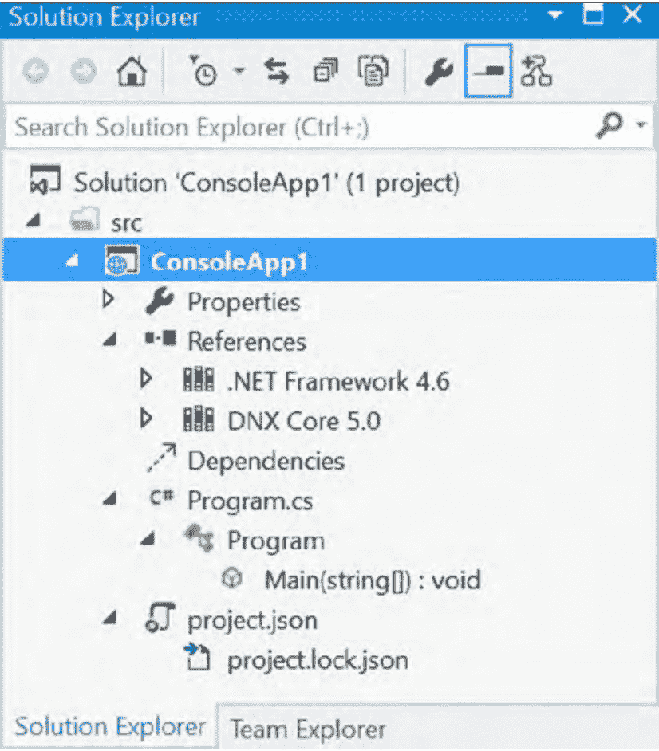

**Figure 17.9**

在这种情况下，项目包含你的源文件 `Program.cs`，以及项目配置文件 `project.json`，它使你能够定义项目描述、版本和依赖项。解决方案资源管理器还指示项目引用的 NuGet 包和程序集。你可以通过在解决方案资源管理器中展开 References 文件夹来查看。

如果你没有更改 Visual Studio 中的任何默认设置，你可能会发现解决方案资源管理器位于屏幕右上角。如果看不到它，只需转到视图菜单并选择解决方案资源管理器。

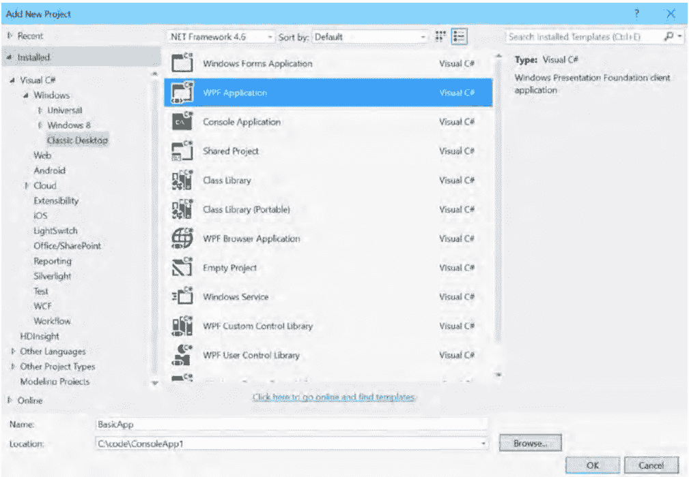

**Figure 17.10**

如果你选择此选项，将添加一个新项目，因此 ConsoleApp1 解决方案现在包含一个控制台应用程序和一个 WPF 应用程序。

> NOTE 根据 Visual Studio 的语言独立性，新项目不必是 C# 项目。将 C# 项目、Visual Basic 项目和 C++ 项目放在同一个解决方案中是完全可以接受的。我们在这里坚持使用 C#，因为这是一本 C# 书！

当然，这意味着 ConsoleApp1 已不再是解决方案的合适名称。要更改名称，你可以右键单击解决方案的名称并从上下文菜单中选择重命名。将新解决方案命名为 DemoSolution。解决方案资源管理器窗口现在应如下图 17.11 所示。

要同时启动多个项目，请在解决方案资源管理器中单击解决方案并选择上下文菜单设置启动项目。这将打开如图 17.12 所示的对话框。选中多个启动项目后，你可以定义应启动哪些项目。

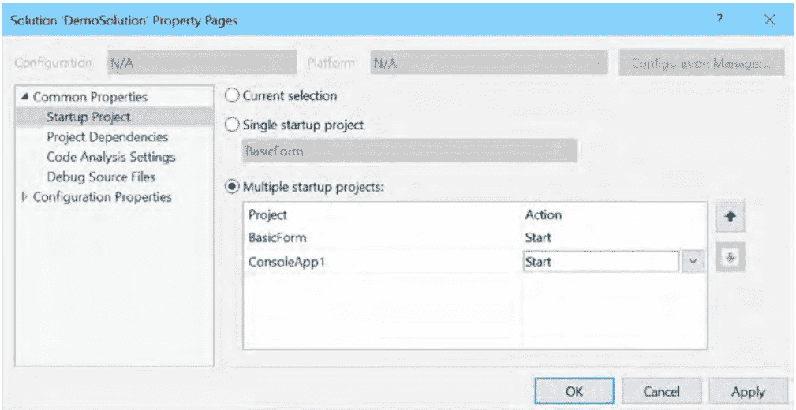

**Figure 17.12**

#### 发现类型和成员

当 Visual Studio 首次创建时，WPF 应用程序包含的初始代码比控制台应用程序多得多。那是因为创建窗口本质上是一个更复杂的过程。第 34 章详细讨论了 WPF 应用程序的代码。现在，请查看 `MainWindow.xaml` 中的 XAML 代码以及 C# 源代码 `MainWindow.xaml.cs`。还有一些隐藏的生成的 C# 代码。在解决方案资源管理器中遍历树，在 `MainWindow.xaml.cs` 下方你会找到类 `MainWindow`。对于所有代码文件，解决方案资源管理器都会显示该文件中的类型。在类型 `MainWindow` 内，你可以看到类的成员。`_contentLoaded` 是类型为 bool 的字段。单击此字段会打开文件 `MainWindow.g.i.cs`。该文件是 `MainWindow` 类的一部分，由设计器生成并包含初始化代码。

#### 预览项目

解决方案资源管理器提供的一个功能是预览所选项目的按钮。当此按钮启用并且你在解决方案资源管理器中单击一个项目时，该项目的编辑器会像往常一样打开。但是，如果该项目之前未打开，编辑器的选项卡流会将新打开的项目显示在最右侧位置。现在，当你单击另一个项目时，先前打开的项目将被关闭。这有助于显著减少打开项目的数量。

在预览项目的编辑器选项卡中是保持打开按钮，它会使项目在单击另一个项目时仍保持打开；你保持打开的项目的选项卡会移动到左侧。

#### 使用作用域

设置作用域允许你专注于解决方案的特定部分。解决方案资源管理器显示的项目列表可能会变得非常庞大。例如，打开类型的上下文菜单可让你从菜单基类型中选择基类型。在这里，你可以看到类型的完整继承层次结构，如图 17.13 所示。

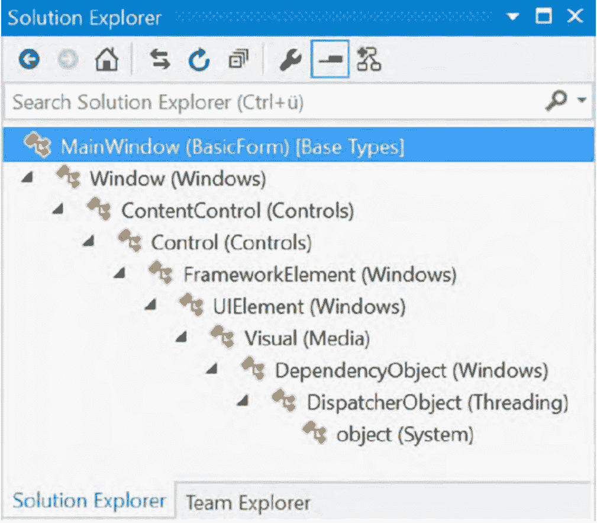

**Figure 17.13**

由于解决方案资源管理器包含的信息比一个屏幕上可以轻松查看的更多，你可以使用菜单选项新建解决方案资源管理器视图同时打开多个解决方案资源管理器窗口，并且可以通过从上下文菜单中选择作用域到此，将作用域设置为特定元素——例如项目或类。要返回到上一个作用域，请单击后退按钮。

#### 向项目添加项目

可以直接从解决方案资源管理器中向项目添加不同的项目。选择项目并选择上下文菜单添加 → 新建项目将打开如图 17.14 所示的对话框。另一种到达同一对话框的方法是使用主菜单项目 → 添加新项目。在这里你会找到许多不同的类别，例如用于添加类或接口的代码项目，用于使用 Entity Framework 或其他数据访问技术的数据项目，以及更多内容。

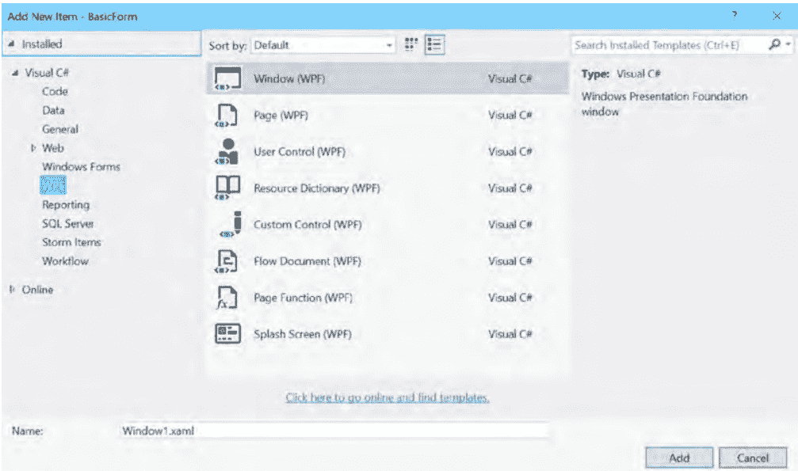

图 17.14

#### 管理引用

使用 Visual Studio 添加引用时需要一些特殊考虑，因为项目类型存在差异。如果你使用的是完整框架——即 .NET 4.6——那么添加对 .NET Framework 程序集的引用仍然是一项重要任务。无论你使用的是较旧的模板（如 WPF）还是较新的模板（如控制台应用程序（包）），都没有关系。请记住：使用较新的模板时，除了 .NET Core 1.0，你仍然可以面向 .NET 4.5.2（或 .NET 4.6）。

如图 17.15 所示，引用管理器使你可以添加对 .NET Framework 程序集的引用，也可以添加对通过库项目创建的程序集的引用。

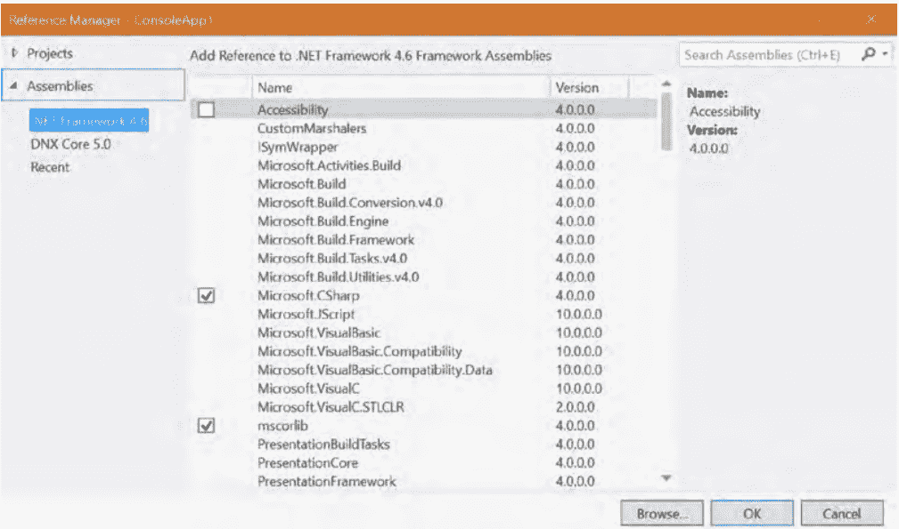

图 17.15

引用管理器会根据你要添加引用的项目类型提供不同的选项。图 17.16 显示的是从 WPF 应用程序打开的引用管理器。在这里，你可以引用共享项目和 COM 对象，还可以浏览程序集。


图 17.16

当你创建通用 Windows 平台应用时，会看到引用管理器的一个新功能，如图 17.17 所示。在这里，你可以引用通用 Windows 扩展，例如 Windows IoT 或 Windows Mobile 提供的 API 扩展。

通过选择“工具”菜单 → “选项”打开选项对话框。在选项对话框中，在树状视图中选择“NuGet 包管理器” → “包源”（参见图 17.19）。默认情况下，Microsoft 的 NuGet 服务器已经配置，但你也可以配置其他 NuGet 服务器或你自己的服务器。对于 .NET Core 和 ASP.NET Core 1.0，Microsoft 提供了每日更新的 NuGet 包源。


使用 NuGet 包管理器，你不仅可以选择包源，还可以选择筛选器来查看所有已安装的包或可升级的包，并在服务器上搜索包。

> 注意：对于 ASP.NET Core 1.0，不再通过 NuGet 服务器使用 JavaScript 库。相反，Visual Studio 2015 直接支持 NPM 和 Bower 等 JavaScript 包管理器。这将在第 40 章中讨论。

Visual Studio 代码编辑器是你大部分开发工作所进行的地方。在从默认配置中删除了一些工具栏，并移除了菜单、工具栏和选项卡标题的边框后，该编辑器在 Visual Studio 中的尺寸变大。接下来的部分将介绍该编辑器的一些最实用的功能。

Visual Studio 的一个显著特点是使用可折叠编辑器作为默认代码编辑器。图 17.20 显示了你之前生成的控制台应用程序的代码。请注意窗口左侧的小减号。这些减号标记了编辑器认为新代码块（或文档注释）开始的位置。你可以点击这些图标来折叠对应代码块的视图，就像在树控件中关闭节点一样（参见图 17.21）。


图 17.20


图 17.21

这意味着，在编辑时，你可以只关注你想查看的代码区域，隐藏当前不感兴趣的代码部分。如果你不喜欢编辑器自动划分代码块的方式，你可以使用 C# 预处理器指令 `#region` 和 `#endregion` 来指定自己的可折叠代码块。例如，要折叠 `Main` 方法中的代码，你可以添加如图 17.22 所示的代码。


图 17.22

代码编辑器会自动检测 `#region` 块，并在 `#region` 指令旁放置一个新的减号，使你能够折叠该区域。将这段代码放在区域中，编辑器就可以将其折叠（参见图 17.23），并用你在 `#region` 指令中指定的注释标记该区域。然而，编译器会忽略这些指令，并照常编译 `Main` 方法。


图 17.23

#### 在编辑器内导航

编辑器的顶行有三个组合框。右侧的组合框使你可以在此类型的成员之间导航。中间的组合框使你可以在类型之间导航。左侧的组合框是 Visual Studio 2015 新增的；它使你可以在此应用程序或框架之间导航。例如，如果你正在处理共享项目的源代码，可以在编辑器左侧的组合框中选择使用该共享项目的其中一个项目，以查看所选项目处于活动状态的代码。未为所选项目编译的代码会变暗。你可以使用 C# 预处理器命令为不同平台创建代码段。

#### IntelliSense

除了可折叠编辑器功能外，Visual Studio 的代码编辑器还集成了 Microsoft 广受欢迎的 IntelliSense 功能，它不仅可以节省你的输入，还可以确保你使用正确的参数。IntelliSense 会记住你的首选选择，并首先从这些选择开始，而不是从 IntelliSense 现在可能提供的有时相当长的列表的开头开始。

代码编辑器还会对代码进行一些语法检查，即使在编译代码之前，也会用短的波浪线为这些错误加下划线。将鼠标指针悬停在带下划线的文本上时，会显示一个小框，其中包含错误的说明。

#### CodeLens

Visual Studio 2013 中一个很棒的新功能是 CodeLens。在 Visual Studio 2015 中，此功能已在专业版中提供。

你是否曾经修改了一个方法，然后想知道：“我是否遗漏了调用此方法的某个方法？”现在查找调用方变得非常容易。引用数量直接显示在编辑器中（参见图 17.24）。当你点击引用链接时，CodeLens 会打开，以便你可以查看调用方的代码并导航到它们。你还可以通过另一个新功能“代码映射”查看引用。稍后将在“架构工具”一节中讨论代码映射。


图 17.24

如果源代码已使用 Git 或 TFS 签入到 Visual Studio Online 等源代码控制系统中，你还可以看到作者和所做的更改。

#### 使用代码片段

代码编辑器中提高工作效率的重要功能是*代码片段*。只需在编辑器中输入 `cw<tab><tab>`，编辑器就会创建 `Console.WriteLine();`。Visual Studio 附带了许多代码片段，包括以下内容：—

-   `do`、`for`、`forr`、`foreach` 和 `while` 用于创建循环
-   `equals` 用于实现 `Equals` 方法
-   `attribute` 和 `exception` 用于创建派生自 `Attribute` 和 `Exception` 的类型

通过选择“工具 → 代码片段管理器”，你可以查看代码片段管理器中提供的所有代码片段（参见图 17.25）。你还可以创建自定义片段。


图 17.25

你还可以在 http://xamlsnippets.codeplex.com 使用适用于 XAML 代码的代码片段。

#### 了解其他窗口

除了代码编辑器和解决方案资源管理器，Visual Studio 还提供了许多其他窗口，使你可以从不同角度查看和/或管理项目。

> **注意** *本节其余部分将介绍其他几个窗口。如果这些窗口中有任何一个在您的屏幕上不可见，您可以从“视图”菜单中选择它们。要显示设计视图和代码编辑器，请在解决方案资源管理器中右键单击文件名，然后从上下文菜单中选择“视图设计器”或“查看代码”，或者从解决方案资源管理器顶部的工具栏中选择相应项。设计视图和代码编辑器共享同一个选项卡式窗口。*

#### 使用设计视图窗口

如果你正在设计用户界面应用程序（例如 WPF 应用程序或 Windows 控件库），则可以使用设计视图窗口。该窗口会以可视方式呈现你的窗体外观。你通常会将设计视图窗口与称为*工具箱*的窗口结合使用。工具箱包含大量 .NET 组件，你可以将它们拖到你的程序中。工具箱组件因项目类型而异。[图 17.26](#) 显示了 WPF 应用程序中显示的项目。


**图17.26**

要将你自己的自定义类别添加到工具箱，请执行以下步骤：

- 1. 右键单击任意类别。
- 2. 从上下文菜单中选择“添加选项卡”。

你也可以通过从同一个上下文菜单中选择“选择项”来将其他工具放入工具箱；这对于添加你自己的自定义组件或默认情况下工具箱中没有的 .NET Framework 组件特别有用。

#### 使用“属性”窗口

如本书第一部分所述，.NET 类可以实现属性。“属性”窗口可用于项目和文件，也可以在使用“设计”视图选择项时使用。图17.27 显示了带有 Windows 服务的“属性”视图。


**图17.27**

使用此窗口，你可以查看某项的所有属性并相应地配置它。你可以通过在文本框中输入文本来更改某些属性；其他属性具有预定义的选择，还有一些属性具有自定义编辑器。你还可以使用“属性”窗口向事件添加事件处理程序。

对于 UWP 和 WPF 应用程序，“属性”窗口看起来非常不同，如图17.28 所示。此窗口提供了更多的图形反馈，并允许对属性进行图形化配置。这个属性窗口最初来自 Blend 工具。如前所述，Visual Studio 和 Blend for Visual Studio 有很多相似之处。


**图17.28**

#### 使用“类视图”窗口

虽然“解决方案资源管理器”可以显示类和类成员，但这通常是“类视图”的工作（见图17.29）。要调用类视图，请选择“视图”→“类视图”。“类视图”显示代码中命名空间和类的层次结构。它提供了一个树状视图，你可以展开以查看哪些命名空间包含哪些类，以及哪些类包含哪些成员。


**图17.29**

“类视图”的一个很好的功能是，如果你右键单击可以访问其源代码的任何项的名称，上下文菜单会显示“转到定义”选项，该选项会将你带到代码编辑器中该项的定义。或者，你可以通过双击“类视图”中的项来完成此操作（或者，实际上，在源代码编辑器中右键单击你想要的项，并从出现的上下文菜单中选择相同的选项）。上下文菜单还允许你向类添加字段、方法、属性或索引器。换句话说，你可以在对话框中指定相关成员的详细信息，然后代码就会为你添加。此功能对于添加属性和索引器特别有用，因为它可以为你节省相当多的键入工作。

#### 使用“对象浏览器”窗口

在 .NET 环境中编程的一个重要方面是能够查明基类和你从程序集引用的任何其他库中有哪些方法和其他代码项可用。此功能可通过名为“对象浏览器”的窗口获得（见图17.30）。你可以通过从 Visual Studio 2015 的“视图”菜单中选择“对象浏览器”来访问此窗口。使用此工具，你可以浏览并选择现有的组件集——例如 .NET Framework 2.0 到 4.6 版本、.NET 可移植子集、Windows 运行时中可用的内容以及适用于 UWP 的 .NET——并查看此子集中可用的类和类成员。你也可以通过在“浏览”下拉列表中选择“Windows”来选择 Windows 运行时，以查找适用于 UWP 应用的这个原生新 API 的所有命名空间、类型和方法。


**图17.30**

#### 使用“服务器资源管理器”窗口

你可以使用如图17.31 所示的“服务器资源管理器”窗口，在编码时了解网络中计算机的各个方面。通过“服务器”部分，你可以找到有关正在运行的服务的相关信息（这对于开发 Windows 服务极其有用）、创建新的性能计数器以及访问事件日志。“数据连接”部分不仅允许连接到现有数据库和查询数据，还可以创建新数据库。Visual Studio 2015 还在服务器资源管理器中内置了大量 Windows Azure 信息，包括 Windows Azure 计算、移动服务、存储、服务总线和虚拟机等选项。

**图17.31**

#### 使用“云资源管理器”

“云资源管理器”（见图17.32）是一个新的资源管理器，如果你安装 Azure SDK 和云资源管理器扩展，它可在 Visual Studio 2015 中使用。通过云资源管理器，你可以访问你的 Microsoft Azure 订阅并访问你的资源、查看日志文件、附加调试器，以及直接转到 Azure 门户。

**图17.32**

#### 使用“文档大纲”

WPF 和 UWP 应用可用的一个窗口是“文档大纲”。图17.33 显示了该窗口在来自第34章的一个应用程序中打开的样子。在这里，你可以查看 XAML 元素的逻辑结构和层次结构，锁定元素以防止意外更改，在层次结构中轻松移动元素，将元素分组到新的容器元素中，以及更改布局类型。


**图17.33**

使用此工具，你还可以创建 XAML 模板并以图形方式编辑数据绑定。

#### 排列窗口

在探索 Visual Studio 时，你可能已经注意到许多窗口具有一些有趣的功能，这些功能更像是工具栏的功能。特别是，它们都可以浮动（也可以在第二个显示器上），或者可以被停靠。当它们被停靠时，每个窗口右上角的最小化按钮旁边会显示一个额外的图标，看起来像一枚图钉。这个图标确实像图钉一样——你可以用它来固定窗口并使其保持打开。固定住的窗口（图钉垂直显示）的行为就像你习惯的常规窗口一样。然而，当窗口未被固定（图钉水平显示）时，它们仅在具有焦点时保持打开。一旦失去焦点（因为你单击或移动鼠标到其他地方），它们就会平滑地缩回到整个 Visual Studio 应用程序周围的主边框内。固定和取消固定窗口提供了另一种充分利用屏幕有限空间的方法。

Visual Studio 2015 的一个新功能是你可以存储不同的布局。很可能你在不同的环境中运行。例如，在办公室，你可能已将笔记本电脑连接到两个大屏幕，但在飞机上编程时情况并非如此，那里只有一个屏幕。过去，你可能总是根据自己的需求排列窗口，并且不得不一天更改好几次。另一种可能需要不同布局的场景是当你进行 Web 开发并创建 UWP 和 Xamarin 应用时。现在，你可以保存布局并轻松地在不同布局之间切换。从“窗口”菜单中选择“保存窗口布局”以保存你当前的工具排列。使用“窗口”→“应用窗口布局”来选择你保存的布局之一，以按照你保存的方式排列窗口。

#### 生成项目

Visual Studio 不仅仅用于为你的项目编码。它实际上是一个管理项目完整生命周期的 IDE，包括生成或编译你的解决方案。本节探讨 Visual Studio 为生成项目所提供的选项。

##### 生成、编译和构建代码

在检查各种生成选项之前，有必要澄清一些术语。你经常会看到三个不同的术语与从源代码到某种可执行代码的过程相关：编译（compiling）、生成（building）和构建（making）。这三个术语的起源反映了这样一个事实：直到最近，从源代码到可执行代码的过程涉及多个步骤（在 C++ 中仍然如此）。这很大程度上是由于程序中的源文件数量众多。

例如，在 C++ 中，每个源文件都需要单独编译。这会产生所谓的对象文件，每个文件包含类似可执行代码的内容，但每个对象文件只与一个源文件相关。要生成可执行文件，需要将这些对象文件链接在一起，这一过程正式称为链接。合并后的过程通常被称为——至少在 Windows 平台上——生成你的代码。然而，在 C# 中，编译器更复杂，能够读取并把你所有的源文件作为一个整体块处理。因此，实际上没有单独的链接阶段，所以在 C# 的上下文中，编译和生成这两个术语可以互换使用。

术语“构建”的含义与“生成”基本相同，尽管它在 C# 的上下文中并不真正使用。“构建”一词起源于旧的大型机系统，当项目由许多源文件组成时，会编写一个单独的文件，其中包含关于如何生成项目的编译器指令——要包含哪些文件以及要链接哪些库等等。这个文件通常称为 makefile，在 UNIX 系统上仍然相当标准。MSBuild 项目文件实际上类似于旧式的 makefile，只是它是一种新的高级 XML 变体。使用 MSBuild 项目时，你可以使用 MSBuild 命令并以项目文件作为输入，所有源代码都将被编译。使用构建文件在单独的构建服务器上非常有帮助，所有开发人员都在上面提交代码，并且在夜间完成构建过程。第 1 章提到了 .NET Core 命令行 (CLI) 工具，使用 .NET Core 环境进行构建的命令行。

#### 调试和发布构建

拥有单独构建的想法对 C++ 开发者来说非常熟悉，对 Visual Basic 背景的开发者来说程度稍低。这里的要点是，当你正在调试时，通常希望你的可执行文件在行为上与准备发布软件时有所不同。当你准备发布软件时，你希望可执行文件尽可能小且快速。不幸的是，这两个需求与你在调试代码时的需求不兼容，如以下各节所述。

##### 优化

高性能部分是通过编译器对代码的许多优化实现的。这意味着编译器在编译时主动查看你的源代码，以识别可以在不改变整体效果的情况下修改你所做操作的精确细节从而使其更高效的地方。例如，假设编译器遇到了以下源代码：

```


`double InchesToCm(double ins) => ins * 2.54;`

// later on in the code

`Y = InchesToCm(X);`

它可能会将其替换为：

`Y = X * 2.54;`

同样，它也可能将

```
{
    string message ="Hi";
    Console.WriteLine(message);
}
```

替换为：

`Console.WriteLine("Hi");`

这样做，编译器就绕过了在过程中声明任何不必要的对象引用的需要。

不可能完全确定 C# 编译器做了哪些优化——也不确定之前的两个示例是否会在任何特定情况下实际发生——因为这类细节并未记录在案。（对于 C# 等托管语言，很可能之前的优化会在 JIT 编译时发生，而不是在 C# 编译器将源代码编译为程序集时发生。）显然，出于专有原因，编写编译器的公司通常非常不愿意提供有关其编译器所使用的技巧的许多细节。请注意，优化不会影响你的源代码——它们只影响可执行代码的内容。然而，之前的示例应该能让你很好地了解可以从优化中期待什么。

问题是，虽然像刚才所示的优化示例在使代码运行更快方面帮助很大，但它们对调试是有害的。在第一个示例中，假设你想在 `InchesToCm` 方法内部设置一个断点，以查看其中发生了什么。如果你无法做到这一点怎么办，因为可执行代码实际上并没有 `InchesToCm` 方法，因为编译器已经将其删除了？此外，当编译代码中也不存在 `Message` 变量时，你如何设置对 `Message` 变量的监视？

##### 调试器符号

在调试期间，你经常需要查看变量的值，并且你通过其源代码名称指定它们。问题是，可执行代码通常不包含这些名称——编译器用内存地址替换了名称。.NET 在某种程度上修改了这种情况，即程序集中的某些项目以其名称存储，但这仅适用于少数项目——例如公共类和方法——并且这些名称在程序集被 JIT 编译时仍会被删除。如果调试器在检查可执行代码时只看到地址而在任何地方都看不到对名称 `HeightInInches` 的引用，那么要求调试器告诉你名为 `HeightInInches` 的变量中的值就不会取得很大进展。

因此，为了正确调试，你需要在可执行文件中提供额外的调试信息。此信息包括其他内容在内，变量名称和行信息，使调试器能够匹配哪些可执行机器汇编语言指令对应于你的原始源代码指令。然而，你不会希望在发布构建中包含该信息，既出于专有原因（调试信息使其他人反汇编你的代码变得容易得多），也因为它增加了可执行文件的大小。

##### 额外的源代码调试命令

相关的问题是，在调试时，你的代码中经常会有额外的行来显示关键的调试相关信息。显然，在你发布软件之前，你希望完全从可执行文件中删除相关命令。你可以手动执行此操作，但如果能简单地以某种方式标记这些语句，以便编译器在编译要发布的代码时忽略它们，不是会容易得多吗？你已经在本书的第一部分看到，这可以通过在 C# 中定义合适的处理器符号来实现，并且可能与 `Conditional` 属性结合使用，这就是所谓的条件编译。

所有这些因素加起来意味着，你需要在调试时以与最终发布的产品略有不同的方式编译几乎所有商业软件。Visual Studio 可以处理这个问题，因为，正如你已经看到的，它存储了在编译你的代码时应传递给编译器的所有选项的详细信息。Visual Studio 所需要做的就是存储多于一个这样的详细信息集来支持不同类型的构建。这些不同的构建信息集被称为配置。当你创建一个项目时，Visual Studio 会自动为你提供两个配置——Debug 和 Release：

- **Debug**—此配置通常指定不进行优化，可执行文件中存在额外的调试信息，并且编译器假定调试预处理器符号 `DEBUG` 存在，除非在源代码中明确 `#undef` 它。
- **Release**—此配置指定编译器应优化编译，可执行文件中不应有额外的调试信息，并且编译器不应假定任何特定预处理器符号存在。

你也可以定义自己的配置。例如，你可能希望这样做，以便设置专业级构建和企业级构建，以便你可以发布软件的两个版本。在过去，由于与 Unicode 字符编码在 Windows NT 上受支持但在 Windows 95 上不受支持相关的问题，C++ 项目通常具有 Unicode 配置和 MBCS（多字节字符集）配置。

##### 选择配置

此时你可能会想知道，鉴于 Visual Studio 存储了多个配置的详细信息，它在安排项目构建时如何确定使用哪一个。答案是始终存在一个活动配置，即在你要求 Visual Studio 构建项目时使用的配置。（请注意，配置是针对每个项目设置的，而不是每个解决方案。）

默认情况下，当你创建一个项目时，Debug 配置是活动配置。你可以通过单击 Build 菜单选项并选择 Configuration Manager 项目来更改活动配置。它也可以通过主 Visual Studio 工具栏中的下拉菜单使用。

##### 编辑配置

除了选择活动配置之外，你还可以检查和编辑配置。要执行此操作，请在解决方案资源管理器中选择相关项目，然后从项目菜单中选择属性。这会打开一个复杂的对话框。（或者，你也可以通过在解决方案资源管理器中右键单击项目名称，然后从上下文菜单中选择属性来访问相同的对话框。）

此对话框包含一个选项卡视图，使你能够选择许多不同的通用区域进行检查或编辑。篇幅不允许展示所有这些区域，但本节概述了其中几个最重要的区域。

根据应用程序是 MSBuild 还是 CLI，可用的选项非常不同。首先，查看图 17.34 中 WPF 应用程序的属性，该图显示了可用属性的选项卡视图。此屏幕截图显示了常规应用程序设置。


**图 17.34**

需要注意的要点是，你可以选择程序集的名称以及要生成的程序集类型。这里的选项是控制台应用程序、Windows 应用程序和类库。当然，如果你愿意，可以更改程序集类型。（尽管可以说，你可能会想知道为什么在最初要求 Visual Studio 为你生成项目时没有选择正确的项目类型！）

图 17.35 显示了 CLI 基于应用程序的相同配置。你也可以看到应用程序设置，但选项仅限于默认命名空间名称和运行时选择。在此屏幕截图中，选择了 RC 2 的特定版本。


图 17.35

图 17.36 显示了 WPF 应用程序的生成配置属性。请注意，对话框顶部附近的一个列表框使你可以指定要查看的配置。你可以看到——以 Debug 配置为例——编译器假定已经定义了 `DEBUG` 和 `TRACE` 预处理器符号。此外，代码未被优化，并且会生成额外的调试信息。


图 17.36

图 17.37 显示了一个 CLI 项目的生成配置属性。在这里，你可以选择在生成时产生输出。TypeScript 设置仅与包含 TypeScript 代码的应用程序相关。TypeScript 会被编译为 JavaScript。


图 17.37

#### 调试你的代码

此时，你已经可以运行和调试应用程序了。在 C# 中，与 .NET 之前的语言一样，调试所涉及的主要技术就是设置断点，并用它们来检查代码在执行的某个特定时刻正在发生什么。

##### 设置断点

你可以从 Visual Studio 在你代码中实际执行的任何一行上设置断点。最简单的方式是在代码编辑器中点击该行，具体位置在文档窗口最左侧附近的阴影区域内（或者当选中相应行时按 F9 键）。这会在那一行设置一个断点，当执行过程中到达该行时，执行会暂停并将控制权移交给调试器。与早期版本的 Visual Studio 一样，断点通过代码编辑器中该行左侧的一个红色圆圈来指示。Visual Studio 还会通过以不同的颜色显示文本和背景来突出显示该行。再次点击该圆圈可移除断点。

如果你总是需要在某个特定行处中断，而这并不足以解决你的特定问题，你还可以设置条件断点。为此，请选择“调试”→“窗口”→“断点”。这将打开一个对话框，要求你提供要设置的断点的详细信息。在可用的选项中，你可以执行以下操作：

- 指定只有在断点被经过一定次数后才中断执行。
- 指定只有在该行被到达特定次数后才激活断点——例如，每执行该行二十次才中断一次。（这在调试大型循环时很有用。）
- 相对于变量而不是指令来设置断点。在这种情况下，会监视变量的值，并且每当该变量的值发生变化时都会触发断点。不过，你可能会发现使用此选项会大大降低代码的执行速度。在每条指令之后检查变量值是否发生变化会占用大量处理器时间。

使用此对话框，你还可以选择导出和导入断点设置，这对于根据你要调试的场景使用不同的断点布局以及存储调试设置非常有用。

##### 使用数据提示和调试器可视化器

命中断点后，你通常希望检查变量的值。最简单的方法是将鼠标光标悬停在代码编辑器中变量名称的上方。这会弹出一个小的数据提示框（如图 17.38 所示），其中显示该变量的值，并且可以展开以查看更详细的信息。


图 17.38

数据提示中显示的某些值带有放大镜图标。点击此放大镜会根据类型提供一个或多个使用调试器可视化器的选项。对于 WPF 控件，WPF 可视化器使你能够更仔细地查看该控件（见图 17.39）。使用此可视化器，你可以查看运行期间使用的可视化树，包括所有实际的属性设置。该可视化树还会提供你在树中所选元素的预览。

图 17.39

图 17.40 显示了显示 JSON 内容的 JSON 可视化器。还有许多其他可视化器可用，例如 HTML、XML 和文本可视化器。

图 17.40

#### 实时可视化树

Visual Studio 2015 为基于 XAML 的应用程序提供的一项新功能是实时可视化树（Live Visual Tree）。在调试 UWP 和 WPF 应用程序时，你可以通过“调试”→“窗口”→“实时可视化树”打开实时可视化树（见图 17.41），以在“实时属性资源管理器”中查看 XAML 元素的实时树及其属性。使用此窗口，你可以单击“选择”按钮在 UI 中选择一个元素，以在实时树中查看其元素。在“实时属性资源管理器”中，你可以直接更改属性，并在正在运行的应用程序上看到结果。


图 17.41

##### 监视和更改变量

有时你可能希望更持续地查看值。为此，你可以使用“自动”、“局部变量”和“监视”窗口来检查变量的内容。这些窗口中的每一个都设计用于监视不同的变量：

- **自动**—监视程序执行过程中最近访问的几个变量。
- **局部变量**—监视当前正在执行的方法中可访问的变量。
- **监视**—监视你通过将其名称输入到“监视”窗口中而显式指定的任何变量。你可以将变量拖放到“监视”窗口中。

这些窗口仅在程序在调试器下运行时可见。如果看不到它们，请选择“调试”→“窗口”，然后选择所需的菜单。“监视”窗口提供四个不同的窗口，以防有太多需要监视的内容而你想要对其分组。使用所有这些窗口，你既可以查看也可以更改值，从而无需离开调试器即可尝试程序中的不同路径。“局部变量”窗口如图 17.42 所示。


图 17.42

另一个与前文讨论的其他窗口没有直接关系，但对于监视和更改变量仍然很重要的窗口是`即时窗口`。此窗口还使你可以查看变量值。你可以使用此窗口输入代码并运行它。当你在调试会话期间进行某些测试时，这非常有用；它使你能够集中关注细节、试用方法，并动态地更改调试运行。

##### 异常

当你准备发布应用程序时，异常非常有用，可以确保错误情况得到妥善处理。如果使用得当，它们可以确保用户永远不会看到技术性的或令人烦恼的对话框。不幸的是，在尝试调试应用程序时，异常并不是那么有用。问题有两个方面：

- 在调试过程中如果发生异常，你通常不希望它被自动处理——尤其是如果自动处理意味着优雅退出并终止执行！相反，你希望调试器帮助你确定异常发生的原因。当然，如果你编写了良好、健壮的防御性代码，你的程序几乎会自动处理一切——包括你想要检测到的 bug！
- 如果发生了一个你未编写处理程序的异常，

### 18 .NET 编译器平台

#### 本章内容

- 编译器管道概述
- 语法分析
- 语义分析
- 代码转换
- 代码重构

#### 本章 Wrox.com 代码下载

本章的 wrox.com 代码下载可在 www.wrox.com/go/professionalcsharp6 的 Download Code 选项卡上找到。
本章的代码分为以下主要示例：

- WPFSyntaxTree
- SyntaxQuery
- SyntaxWalker
- SemanticsCompilation
- TransformMethods
- SyntaxRewriter
- PropertyCodeRefactoring

#### 引言

C# 6 最重要的变化是 C# 有了一个由 .NET 编译器平台提供的全新编译器（代号 Roslyn）。
最初，C# 编译器是用 C++ 编写的。现在它的主要部分是用 C# 和 .NET 创建的。编译器平台可在 http://github.com/dotnet/Roslyn 以开源形式获得。

这次更新的一个优势是，Microsoft 清理了过去 20 年内编写的大量遗留代码。借助新的代码库，使用 C# 实现新功能变得容易得多；新代码更易于维护。这就是为什么在版本 6 中你会看到许多小的 C# 语言改进的原因。这不仅仅是 Microsoft 面临的情况；对于维护多年的项目，使用源代码进行更新变得困难。到了某个阶段，从头开始项目会更好。

重写 C# 编译器的一个更大的优势是，现在可以利用编译器管道，在编译器管道的每一步添加功能，并且还可以分析和转换源代码。

大多数开发人员只会通过使用 Visual Studio 中利用 .NET 编译器平台本身的工具来受益，但对于许多人来说，创建自定义代码分析器（可在团队内使用）以及代码转换——例如，将遗留代码迁移并转换为新技术——将非常有用。

你可以在 Visual Studio 的哪里看到 .NET 编译器平台的使用？一个例子是代码编辑器，在你输入时 API 不断被使用。当你使用智能标记实现接口时，Visual Studio 2015 与以前版本之间有一个有趣的区别：当你实现接口 `IDisposable` 并单击智能标记时，你不仅可以看到 Implement Interface 和 Implement Interface Explicitly 选项，还可以看到 Implement Interface with Dispose Pattern 和 Implement Interface Explicitly with Dispose Pattern 选项（见图 18.1）。在 Visual Studio 的早期版本中，实现接口的唯一自动方式是自动生成接口中定义的方法和属性的方法存根和属性存根，其中接口的实现会抛出 `NotImplementedException`。现在你可以根据接口类型拥有不同的实现。对于接口 `IDisposable`，实现的不仅仅是 `Dispose` 方法：为此接口所需完整模式，例如带布尔参数的 `Dispose` 方法；检查对象是否已被释放但仍被调用；以及可选的终结器也被实现。


图 18.1

本章描述了 .NET 编译器平台的功能以及如何分析和转换源代码。使用调试器了解类型和成员对本书的所有章节都有帮助。对于本章，使用调试器极其有帮助。.NET 编译器平台 SDK 包含数千种类型和一个

让我们从一个简单的任务开始：使用 Syntax API 进行语法分析。使用 Syntax API，你可以从 C# 源代码构建语法节点树。示例应用程序是一个 WPF 应用程序，你可以在其中加载任何 C# 源文件，并在树视图中显示源文件的层次结构。

> 注意 XAML 和 WPF 的详细说明从第 29 章“Core XAML”开始，并在其后的章节中继续。你可以在第 34 章“Windows Desktop Applications with WPF”中阅读有关树视图控件的更多信息。

示例应用程序定义了一个用户界面，其中包含一个用于加载 C# 源文件的按钮控件、一个 TreeView 控件，以及一些用于显示文档大纲（见图 18.2）和 XAML 设计器（见图 18.3）中节点的详细信息的 TextBlock 和 ListBox 控件。数据绑定用于将信息内容绑定到 UI 元素。


图 18.2


图 18.3

当你运行应用程序后，单击 Load 按钮后，会在 `OpenFileDialog` 类的帮助下提示你选择一个 C# 文件。单击此对话框中的 OK 后，文件将被加载到语法树中（代码文件 WPFSyntaxTree/MainWindow.xaml.cs）：

```csharp
private async void OnLoad(object sender, RoutedEventArgs e)
{
    var dlg = new OpenFileDialog();
    dlg.Filter ="C# Code (.cs)|*.cs";
    if (dlg.ShowDialog() == true)
    {
        string code = File.ReadAllText(dlg.FileName);
        // load the syntax tree
    }
}
```


> 注意 文件输入/输出（I/O）在第 23 章“Files and Streams”中讨论。

## Syntax API 核心

Syntax API 的核心是 `SyntaxTree` 类。`SyntaxTree` 对象是通过使用 `CSharpSyntaxTree.ParseText` 解析 C# 文件内容创建的。要从树中获取节点，`GetRootAsync`（或 `GetRoot`）方法返回根节点。所有节点都是派生自基类 `SyntaxNode` 的类的实例。为了在用户界面中显示根节点，`SyntaxNode` 在添加到 `Nodes` 属性之前会被 `SyntaxNodeViewModel` 类包装：

```csharp
private async void OnLoad(object sender, RoutedEventArgs e)
{
    // etc.

    SyntaxTree tree = CSharpSyntaxTree.ParseText(code);

    SyntaxNode node = await tree.GetRootAsync();

    Nodes.Add(new SyntaxNodeViewModel(node));
}
```

`Nodes` 属性的类型为 `ObservableCollection<SyntaxNodeViewModel>`。当集合更改时，它会更新用户界面。

```csharp
public ObservableCollection<SyntaxNodeViewModel> Nodes { get; }
= new ObservableCollection<SyntaxNodeViewModel>();
```

`SyntaxNodeViewModel` 类将 `SyntaxNode` 包装以在用户界面中显示。它定义了 `Children` 属性以递归显示所有子节点。`Children` 属性通过调用 `ChildNodes` 方法从语法树访问所有子节点，并将 `SyntaxNode` 对象的集合转换为 `SyntaxNodeViewModel`。此类还定义了稍后在本节中讨论的 `Tokens` 和 `Trivia` 属性。`TypeName` 属性返回由 `SyntaxNodeViewModel` 类包装的真实类型的名称。这应该是派生自基类 `SyntaxNode` 的类型（代码文件 `WPFSyntaxTree/ViewModels/SyntaxNodeViewModel.cs`）：

```csharp
public class SyntaxNodeViewModel
{
    public SyntaxNodeViewModel(SyntaxNode syntaxNode)
    {
        SyntaxNode = syntaxNode;
    }

    public SyntaxNode SyntaxNode { get; }

    public IEnumerable<SyntaxNodeViewModel> Children =>
        SyntaxNode.ChildNodes().Select(n => new SyntaxNodeViewModel(n));

    public IEnumerable<SyntaxTokenViewModel> Tokens =>
        SyntaxNode.ChildTokens().Select(t => new SyntaxTokenViewModel(t));

    public string TypeName => SyntaxNode.GetType().Name;

    public IEnumerable<SyntaxTriviaViewModel> Trivia
    {
        get
        {
            var leadingTrivia = SyntaxNode.GetLeadingTrivia().Select(
                t => new SyntaxTriviaViewModel(TriviaKind.Leading, t));

            var trailingTrivia =
            SyntaxNode.GetTrailingTrivia().Select(
                t => new SyntaxTriviaViewModel(TriviaKind.Trailing, t));

            return leadingTrivia.Union(trailingTrivia);
        }
    }
}
```

在用户界面中，`TreeView` 控件绑定到 `Nodes` 属性。`HierarchicalDataTemplate` 定义了树视图中项目的外观。通过此数据模板，`TypeName` 属性的值会显示在 `TextBlock` 中。为了显示所有子节点，`HierarchicalDataTemplate` 的 `ItemsSource` 属性绑定到 `Children` 属性（代码文件 `WPFSyntaxTree/MainWindow.xaml`）：

```xml
<TreeView x:Name="treeView" ItemsSource="{Binding Nodes, Mode=OneTime}" SelectedItemChanged="OnSelectSyntaxNode" Grid.Row="1" Grid.Column="0">
    <TreeView.ItemTemplate>
        <HierarchicalDataTemplate ItemsSource="{Binding Children}">
            <StackPanel>
                <TextBlock Text="{Binding TypeName}" />
            </StackPanel>
        </HierarchicalDataTemplate>
    </TreeView.ItemTemplate>
</TreeView>
```

使用示例应用程序打开的代码文件是一个简单的 Hello, World! 代码文件，其中还包含一些注释：

```csharp
using static System.Console;

namespace SyntaxTreeSample
{
    // Hello World! Sample Program
    public class Program
    {
        // Hello World! Sample Method
        public void Hello()
        {
            WriteLine("Hello, World!");
        }
    }
}
```

运行应用程序时，可以看到以下表格中显示的语法节点类型的树。`SyntaxNode` 使你能够遍历层次结构并访问父节点、祖先节点和后代节点。当使用返回 `TextSpan` 结构体的 `Span` 属性时，会返回源代码中的位置信息。以下表格第一列显示层次级别（2 是 1 的子节点；3 是 2 的子节点）；第二列给出节点类的类型；第三列列出节点的内容（如果内容较长，则显示省略号）；第四列给出 `Span` 属性的 `Start` 和 `End` 位置。通过此树，可以看到跨越完整源代码的 `CompilationUnitSyntax`。此节点的子节点是 `UsingDirectiveSyntax` 和 `NamespaceDeclarationSyntax`。`UsingDirectiveSyntax` 由用于导入静态 `System.Console` 类的 `using` 声明组成。`UsingDirectiveSyntax` 的子节点是 `QualifiedNameSyntax`，它本身包含两个 `IdentifierNameSyntax` 节点：

| Hierarchy Level | Syntax Node Type | Content | Span Start/End |
|---:|---|---|---:|
| 1 | `CompilationUnitSyntax` | `using static System.Console; ...` | `0.27...` |
| 2 | `UsingDirectiveSyntax` | `using static System.Console;` | `0.28...` |
| 3 | `QualifiedNameSyntax` | `System.Console` | `13.2...` |
| 4 | `IdentifierNameSyntax` | `System` | `13.1...` |
| 4 | `IdentifierNameSyntax` | `Console` | `20.2...` |
| 2 | `NamespaceDeclarationSyntax` | `namespace SyntaxTreeSample...` | `32.2...` |
| 3 | `IdentifierNameSyntax` | `SyntaxTreeSample` | `42.5...` |
| 3 | `ClassDeclarationSyntax` | `public class Program ...` | `103...` |
| 4 | `MethodDeclarationSyntax` | `public void Hello...` | `179...` |
| 5 | `PredefinedTypeSyntax` | `void` | `186...` |
| 5 | `ParameterListSyntax` | `()` | `196...` |
| 5 | `BlockSyntax` | `{ WriteLine(...` | `208...` |
| 6 | `ExpressionStatementSyntax` | `WriteLine("Hello,...` | `223` |
| 7 | `InvocationExpressionSyntax` | `WriteLine("Hello...` | `223` |
| 8 | `IdentifierNameSyntax` | `WriteLine` | `223` |
| 8 | `ArgumentListSyntax` | `("Hello, World!")` | `232` |
| 9 | `ArgumentSyntax` | `"Hello, World!"` | `233` |
| 10 | `LiteralExpressionSyntax` | `"Hello, World!"` | `233` |

语法节点并不是程序所需的一切。程序还需要标记。例如，示例程序的 `NamespaceDeclarationSyntax` 包含三个标记：`namespace`、`{` 和 `}`。`NamespaceDeclarationSyntax` 的子节点 `IdentifierNameSyntax` 具有值为 `SyntaxTreeSample` 的标记，即命名空间的名称。访问修饰符也是用标记定义的。`ClassDeclarationSyntax` 定义了五个标记：`public`、`class`、`Program`、`{` 和 `}`。

要在 WPF 应用程序中显示标记，定义了 `SyntaxTokenViewModel` 类来包装 `SyntaxToken`（代码文件 `WPFSyntaxTree/ViewModels/SyntaxTokenViewModel.cs`）：

```csharp
public class SyntaxTokenViewModel
{
    public SyntaxTokenViewModel(SyntaxToken syntaxToken)
    {
        SyntaxToken = syntaxToken;
    }

    public SyntaxToken SyntaxToken { get; }

    public string TypeName => SyntaxToken.GetType().Name;

    public override string ToString() => SyntaxToken.ToString();
}
```

为了编译程序，你需要节点和标记。要重建源文件，你需要更多内容：trivia。Trivia 定义空白字符和注释。为了显示 trivia，定义了 `SyntaxTriviaViewModel`（代码文件 `WPFSyntaxTree/ViewModels/SyntaxTriviaViewModel.cs`）：

```csharp
public enum TriviaKind
{
    Leading,
    Trailing,
    Structured,
    Annotated
}

public class SyntaxTriviaViewModel
{
    public SyntaxTriviaViewModel(TriviaKind kind, SyntaxTrivia syntaxTrivia)
    {
        TriviaKind = kind;
        SyntaxTrivia = syntaxTrivia;
    }

    public SyntaxTrivia SyntaxTrivia { get; }

    public TriviaKind TriviaKind { get; }

    public override string ToString() =>
        $"{{TriviaKind}, Start: {SyntaxTrivia.Span.Start}, " +
        $"Length: {SyntaxTrivia.Span.Length}: {SyntaxTrivia}";
}
```

运行应用程序并打开文件 `HelloWorld.cs` 时，可以看到带有标记和 trivia 的节点树，如图 18.4 所示。通过 trivia 你经常会看到空白字符，但也会看到注释。

```csharp
}

public int bar { get; set; }
```

与之前使用 Syntax API 的方式类似，使用类 `CSharpSyntaxTree` 和 `SyntaxTree` 获取根节点：

```csharp
static async Task CheckLowercaseMembers()
{
    string code = File.ReadAllText("../../Program.cs");

    SyntaxTree tree = CSharpSyntaxTree.ParseText(code);

    SyntaxNode root = await tree.GetRootAsync();

    // etc.
}
```

要获取树中遵循根节点的所有节点，`SyntaxNode` 类定义了方法 `DescendantNodes`。它返回节点的全部子节点以及子节点的子节点。之前示例中使用的方法 `ChildNodes` 只返回直接子节点。结果节点使用 `OfType` 方法进行过滤，以仅返回类型为 `MethodDeclarationSyntax` 的节点。`MethodDeclarationSyntax` 是一个派生自 `SyntaxNode` 的类，表示树中为方法的节点。你可以使用之前的示例 `WPFSyntaxTree` 查看现有源代码的所有节点类型。第一个 `Where` 方法定义了下一个过滤器。在这里，获取方法标识符（即方法名），并只获取第一个字符。使用方法 `char.IsLower` 确定第一个字符是否为小写。过滤器仅在该表达式为 true 时返回方法节点。对小写字符的此检查并不能满足我们所有的要求。还应仅返回公共成员。此过滤器由下一个 `Where` 方法定义。要检查公共访问修饰符，`MethodDeclarationSyntax` 定义了 `Modifiers` 属性。此属性返回方法的所有修饰符。`Where` 方法检查 `public` 修饰符是否属于修饰符列表。满足所有条件的方法会写入控制台。

```csharp
// etc.

    var methods = root.DescendantNodes()
        .OfType<MethodDeclarationSyntax>()
        .Where(m => char.IsLower(m.Identifier.ValueText.First()))
        .Where(m => m.Modifiers.Select(t => t.Value).Contains("public"));

    WriteLine("Public methods with lowercase first character:");

    foreach (var m in methods)
    {
        WriteLine(m.Identifier.ValueText);
    }

    // etc.
```

检索子元素和父元素的其他方法如下：

- `DescendantNodesAndSelf` 返回调用该方法的节点以及所有后代。
- `DescendantTokens` 返回所有后代标记
- `DescendantTrivia` 返回 trivia 信息
- `Ancestors` 检索父节点和父节点的父节点

若干方法是对前面列出方法的组合，例如 `DescendantNodesAndTokensAndSelf`。你可以在树中的每个 `SyntaxNode` 上使用这些方法。

要检索具有相同条件的属性，语法类似。你只需要获取类型为 `PropertyDeclarationSyntax` 的语法节点：

```csharp
// etc.

var properties = root.DescendantNodes()
    .OfType<PropertyDeclarationSyntax>()
```


    .Where(p => char.IsLower(p.Identifier.ValueText.First()))

    .Where(p => p.Modifiers.Select(t => t.Value).Contains("public"));

WriteLine("Public properties with lowercase first character:");

foreach (var p in properties)

{

    WriteLine(p.Identifier.ValueText);

}

```

运行应用程序时，你会看到以下结果并相应地更改源文件以满足指南：

```text

Public methods with lowercase first character:

foo

Public properties with lowercase first character:

bar

```

### Walking Through Nodes

除了执行查询之外，还有另一种高效地基于特定节点类型过滤源代码树的方法：语法遍历器。语法遍历器会访问语法树中的所有节点。这意味着在解析语法树时，会调用语法遍历器的不同 `VisitXXX` 方法。

下一个示例定义了一个语法遍历器，用于检索所有 using 指令，以显示指定目录下所有 C# 文件所需导入的列表。

你通过创建一个派生自 `CSharpSyntaxWalker` 的类来创建语法遍历器。类 `UsingCollector` 重写方法 `VisitUsingDirective` 以从语法树中收集所有 using 指令。传递给此方法的 `UsingDirectiveSyntax` 节点会被添加到集合中（代码文件 `SyntaxWalker/UsingCollector.cs`）：

```csharp

class UsingCollector: CSharpSyntaxWalker

{

    private readonly List<UsingDirectiveSyntax> _usingDirectives =

        new List<UsingDirectiveSyntax>();

}


```csharp

public IEnumerable<UsingDirectiveSyntax> UsingDirectives =>

    _usingDirectives;

public override void VisitUsingDirective(UsingDirectiveSyntax node)

{

    _usingDirectives.Add(node);

}

}

```

类 `CSharpSyntaxWalker` 为许多不同类型的节点定义了可被重写的虚拟方法。你可以使用 `VisitToken` 和 `VisitTrivia` 来获取标记和 trivia 信息。你也可以收集特定源代码语句的信息，例如 `VisitWhileStatement`、`VisitWhereClause`、`VisitTryStatement`、`VisitThrowStatement`、`VisitThisExpression`、`VisitSwitchStatement`，以及更多。

`Main` 方法会检查程序参数是否包含应检查 using 声明的 C# 源文件目录（代码文件 `SyntaxWalker/Program.cs`）：

```csharp

static void Main(string[] args)

{

    if (args.Length != 1)

    {

        ShowUsage();

        return;

    }

    string path = args[0];

    if (!Directory.Exists(path))

    {

        ShowUsage();

        return;

    }

}

```

```csharp

static void ShowUsage()

{

    WriteLine("Usage: SyntaxWalker directory");

}

```

方法 `ProcessUsingsAsync` 执行所有处理。首先，创建一个 `UsingCollector` 实例。为了遍历传入目录中的所有文件，使用 `Directory.EnumerateFiles` 方法并使用搜索模式 `*.cs` 来检索所有 C# 文件。然而，自动生成的 C# 文件应被排除——因此使用 `Where` 方法过滤掉文件扩展名为 `.g.i.cs` 和 `.g.cs` 的文件。在下面的 `foreach` 语句中，语法树被构建并传递给 `UsingCollector` 实例的 `Visit` 方法：

```csharp

static async Task ProcessUsingsAsync(string path)

{

    const string searchPattern = "*.cs";

    var collector = new UsingCollector();

    IEnumerable<string> fileNames =

        Directory.EnumerateFiles(path, searchPattern,

        SearchOption.AllDirectories)

        .Where (filename => !filename.EndsWith(".g.i.cs") &&

        !filename.EndsWith(".g.cs"));

    foreach (var filename in fileNames)

    {

        string code = File.ReadAllText(filename);

        SyntaxTree tree = CSharpSyntaxTree.ParseText(code);

        SyntaxNode root = await tree.GetRootAsync();

        collector.Visit(root);

        // etc.

    }

}

```

调用 Visit 方法后，using 指令会收集在 UsingCollector 的 UsingDirectives 属性中。在将 using 指令写入控制台之前，需要对其进行排序，并删除可能存在于多个源文件中的重复项。对 using 指令进行排序有一些特殊问题，通过以下 LINQ 查询得到解决：using static 声明应放在最后，并且跟随 using 声明的分号不应用于定义排序顺序：

```csharp

var usings = collector.UsingDirectives;

var usingStatics =

    usings.Select(n => n.ToString())

    .Distinct()

    .Where(u => u.StartsWith("using static"))

    .OrderBy(u => u);

var orderedUsings =

    usings.Select(n => n.ToString())

    .Distinct()

    .Except(usingStatics)

    .OrderBy(u => u.Substring(0, u.Length-1));

foreach (var item in orderedUsings.Union(usingStatics))

{

    WriteLine(item);

}

```

当你运行该应用程序并传入之前创建的 WPF Syntax Tree 应用程序的目录时，会显示以下 using 声明：

- using Microsoft.CodeAnalysis;
- using Microsoft.CodeAnalysis.CSharp;
- using Microsoft.Win32;
- using System;
- using System.Collections.Generic;
- using System.Collections.ObjectModel;
- using System.ComponentModel;
- using System.IO;
- using System.Linq;
- using System.Reflection;
- using System.Resources;
- using System.Runtime.CompilerServices;
- using System.Runtime.InteropServices;
- using System.Windows;
- using WPFSyntaxTree.ViewModels;
- using static System.Console;

### Semantics Analysis

语法 API 对于获取源文件结构的信息非常强大。然而，它不会提供源文件是否可以编译、变量的类型等信息。要获取这些信息，需要编译程序，这需要有关程序集引用、编译器选项和一组源文件的信息。使用这些信息被称为 *语义分析*。在这里，你可以使用 Symbol 和 Binding API。这些 API 提供有关名称和引用符号（类型、命名空间、成员、变量）的表达式的信息。

示例控制台应用程序提供了关于以下 Hello, World! 程序的语义，该程序不仅定义了方法 Hello，还定义了一个名为 hello 的变量（代码文件 SemanticsCompilation/HelloWorld.cs）：

```csharp

using static System.Console;

namespace SemanticsCompilation

{

    // Hello World! Sample Program

    class Program

    {

        // Hello World! Sample Method with a variable

        public void Hello()

        {

            string hello ="Hello, World!";

            WriteLine(hello);

        }

        static void Main()

        {

            var p = new Program();

            p.Hello();

        }

    }

}

```

首先，使用语法 API 从树中检索 Hello 方法和 hello 变量的节点。使用 LINQ 查询，从树中检索 Hello 方法的 MethodDeclarationSyntax 和 hello 变量的 VariableDeclarationSyntax（代码文件 SemanticsCompilation/Program.cs）：

```csharp

string source = File.ReadAllText("HelloWorld.cs");

SyntaxTree tree = CSharpSyntaxTree.ParseText(source);

var root = await tree.GetRootAsync() as CompilationUnitSyntax;

// get Hello method

MethodDeclarationSyntax helloMethod = root.DescendantNodes()

    .OfType<MethodDeclarationSyntax>()

    .Where(m => m.Identifier.ValueText =="Hello")

    .FirstOrDefault();

// get hello variable

VariableDeclaratorSyntax helloVariable = root.DescendantNodes()

    .OfType<VariableDeclaratorSyntax>()

    .Where(v => v.Identifier.ValueText =="hello")

    .FirstOrDefault();

```

### Compilation

要获取语义信息，需要编译代码。你可以创建一个编译，该编译调用 CSharpCompilation 类的静态 Create 方法。此方法返回一个表示已编译代码的 CSharpCompilation 实例。必需的参数是生成的程序集的名称。可选参数是语法树、程序集引用和编译器选项。你也可以通过调用方法来添加这些信息。示例代码通过调用 AddReferences 方法添加程序集引用，并通过调用 AddSyntaxTrees 方法添加语法树。你可以通过调用 WithOptions 方法并传递 CompilationOptions 类型的对象来配置编译器选项，但这里仅使用默认选项（代码文件 SemanticsCompilation/Program.cs）：

```csharp

var compilation = CSharpCompilation.Create("HelloWorld")

.AddReferences(

    MetadataReference.CreateFromFile(

        typeof(object).Assembly.Location

    )

)

.AddSyntaxTrees(tree);

```

实际编译器与几年前大学里教授的编译器构建之间存在差异：程序不是在执行前只编译一次；编译需要多次进行。通过在代码编辑器中添加一些字符，如果编译出错，编译需要显示错误代码下的波浪线。这种行为是由于新的编译过程而发生的。使用 CSharpCompilation 对象，可以进行小的更改，其中可以使用来自上一次编译的缓存信息。编译器是为此过程而构建的，以便在此功能下具有高性能。

你可以使用 AddReferences 和 AddSyntaxTrees 添加语法树和引用；使用 RemoveReferences 和 RemoveSyntaxTrees 删除它们。要生成编译二进制文件，可以调用 Emit 方法：

```csharp

EmitResult result = compilation.Emit("HelloWorld.exe");

```

使用编译，可以检索编译过程的诊断信息。编译对象还提供有关符号的一些信息。例如，可以检索方法 Hello 的符号：

```csharp

ISymbol helloVariableSymbol =

    compilation.GetSymbolsWithName(name => name

    =="Hello").FirstOrDefault();

```

### Semantic Model

为了对程序进行分析并访问与树中节点绑定的符号，可以创建一个 SemanticModel 对象以从 CSharpCompilation 对象调用 GetSemanticModel 方法（代码文件 SemanticsCompilation/Program.cs）：

### 代码转换

在遍历代码树并对语义分析有了初步了解之后，现在是时候进行一些代码更改了。代码树的一个重要特点是它们是不可变的，因此无法被更改。相反，你使用方法来更改树中的节点，这些方法总是返回新的节点而保持原始节点不变。

> **注意** *代码树存储在不可变的集合类中。这些集合在第 12 章“特殊集合”中讨论。*

### 创建新树

以下代码片段定义了一个 `Sample` 类，其方法名以小写字母开头。此类的公共方法应更改为以大写字符开头（代码文件 `TransformMethods/Sample.cs`）：

```

namespace TransformMethods

{

    class Sample

    {

        public void foo()

        {

        }

        public void bar()

        {

        }

        private void fooBar()

        {

        }

    }

}

```

控制台应用程序的 `Main` 方法读取此文件并调用 `TransformMethodToUppercaseAsync`（代码文件 `TransformMethods/Program.cs`）：

```

static void Main()

{

    string code = File.ReadAllText("Sample.cs");

    TransformMethodToUppercaseAsync(code).Wait();

}

```

`TransformMethodToUppercaseAsync` 首先获取树中类型为 `MethodDeclarationSyntax` 的所有公共节点，并且第一个字符为小写。所有节点都被添加到名为 `methods` 的集合中。（此查询之前已在“查询节点”部分讨论过。）

```

static async Task TransformMethodToUppercaseAsync(string code)

{

    SyntaxTree tree = CSharpSyntaxTree.ParseText(code);

    SyntaxNode root = await tree.GetRootAsync();

    var methods = root.DescendantNodes()

        .OfType<MethodDeclarationSyntax>()

        .Where(m => char.IsLower(m.Identifier.ValueText.First()))


.Where(m => m.Modifiers.Select(t => t.Value).Contains("public")).ToList();

// etc.

}

```

有趣的部分现在开始。`ReplaceNodes` 是 `SyntaxNode` 的一个方法，用于替换存储在 `methods` 集合中的所有 `MethodDeclarationSyntax` 节点。要替换单个节点，`SyntaxNode` 类定义了 `ReplaceNode` 方法。对于多个节点（像本例这种情况），你可以使用 `ReplaceNodes` 方法。第一个参数接收所有应被替换的原始节点。在示例代码中，这是 `MethodDeclarationSyntax` 节点的列表。第二个参数定义了一个委托 `Func<TNode, TNode, SyntaxNode>`。在示例代码中，`TNode` 的类型为 `MethodDeclarationSyntax`，因为第一个参数传递的集合就是此类型。委托的实现以 lambda 表达式完成，接收原始节点作为第一个参数，新的节点作为第二个参数。通过 lambda 表达式的实现，可以通过 `oldMethod.Identifier.ValueText` 访问原始方法名。以此名称，将第一个字符更改为大写并写入变量 `newName`。

对于创建新节点和标记，可以使用 `SyntaxFactory` 类。`SyntaxFactory` 是一个静态类，定义了用于创建不同种类节点、标记和 trivia 的成员。在这里，需要一个新方法名——一个标识符。要创建标识符，使用静态方法 `Identifier`。当你传递新的方法名时，会返回一个 `SyntaxToken`。现在可以使用该标识符与 `WithIdentifier` 方法。`WithIdentifier` 是 `MethodDeclarationSyntax` 的一个方法，用于返回一个新的 `MethodDeclarationSyntax` 并传递更改。最后，这个新的 `MethodDeclarationSyntax` 节点从 lambda 表达式返回。反过来，使用根对象调用的 `ReplaceNodes` 方法返回一个包含所有更改的新不可变集合：

```
static async Task TransformMethodToUppercaseAsync(string code)

{

    // etc.

    root = root.ReplaceNodes(methods, (oldMethod, newMethod) =>

    {

        string newName = char.ToUpperInvariant(oldMethod.Identifier.ValueText[0]) +

            oldMethod.Identifier.ValueText.Substring(1);

        return newMethod.WithIdentifier(SyntaxFactory.Identifier(newName));

    });

    WriteLine();

    WriteLine(root.ToString());

}

```

运行应用程序时，可以看到公共方法已更改，但私有方法保持不变：

```csharp

namespace TransformMethods

{

    class Sample

    {

        public void Foo()

        {

        }

        public void Bar()

        {

        }

        private void fooBar()

        {

        }

    }

}

```

对于转换源代码，最重要的部分是 `SyntaxFactory`、`WithXX` 和 `ReplaceXX` 方法。

由于节点是不可变的，因此节点的属性无法更改，你需要 `SyntaxFactory` 类。此类使你能够创建节点、标记和 trivia。例如：

- 方法 `MethodDeclaration` 创建一个新的 `MethodDeclarationSyntax`。
- 方法 `Argument` 创建一个新的 `ArgumentSyntax`。
- 方法 `ForEachStatement` 创建一个 `ForEachStatementSyntax`。

你可以使用从 `SyntaxFactory` 创建的对象与方法来转换语法节点。例如，`WithIdentifier` 基于现有节点创建一个新节点，其中标识符被更改。在示例应用程序中，`WithIdentifier` 使用 `MethodDeclarationSyntax` 对象调用。其他 `WithXX` 方法的几个示例包括以下内容：

- `WithModifiers` 用于更改访问修饰符
- `WithParameterList` 用于更改方法的参数
- `WithReturnType` 用于更改返回类型
- `WithBody` 用于更改方法的实现

所有 `WithXX` 方法只能更改节点的直接子节点。`ReplaceXX` 方法可以更改所有后代节点。`ReplaceNode` 替换单个节点；`ReplaceNodes`（如示例应用中使用）替换节点列表。其他 `ReplaceXX` 方法是 `ReplaceSyntax`、`ReplaceToken` 和 `ReplaceTrivia`。

### 使用语法重写器

在遍历语法节点时，你已经看到了 `CSharpSyntaxWalker` 作为读取特定节点的高效方式。当更改节点时，有一个类似的选项：派生自 `CSharpSyntaxRewriter` 的类。以这种方式进行重写是基于现有语法树通过更改节点构建新语法树的高效方式。

以下代码片段取自转换。`Sample` 类定义了完整的属性 `Text` 和 `X`，应将其转换为自动实现的属性。类的其他成员不应更改（代码文件 `SyntaxRewriter/Sample.cs`）：

```

namespace SyntaxRewriter

{

    class Sample

    {

        // these properties can be converted to auto-implemented properties

        private int _x;

        public int X

        {

            get { return _x; }

            set { _x = value; }

        }

        private string _text;

        public string Text

        {

            get { return _text; }

            set { _text = value; }

        }

        // this is already a auto-implemented property

        public int Y { get; set; }

        // this shouldn't be converted

        private int _z = 3;

        public int Z

        {

            get { return _z; }

        }

    }

}

```

要更改语法节点，类 `AutoPropertyRewriter` 派生自基类 `CSharpSyntaxRewriter`。为了在重写器中访问符号和绑定信息，`SemanticModel` 需要传递给重写器的构造函数（代码文件 `SyntaxRewriter/AutoPropertyRewriter.cs`）：

```

class AutoPropertyRewriter : CSharpSyntaxRewriter

{

    private readonly SemanticModel _semanticModel;

    public AutoPropertyRewriter(SemanticModel semanticModel)

    {

        _semanticModel = semanticModel;

    }

    // etc.

```

基类 `CSharpSyntaxRewriter` 为不同语法节点类型定义了多个虚拟 `VisitXX` 方法。在这里，重写了 `VisitPropertyDeclaration` 方法。当重写器在树中找到属性时，会调用此方法。在此类方法中你可以修改此节点（包括其子节点）以影响重写的结果。此方法的实现首先调用 `HasBothAccessors` 辅助方法，检查该属性是否属于需要更改的属性。如果该方法返回 `true`，则通过调用 `ConvertToAutoProperty` 转换该属性，并返回转换后的属性。如果属性不匹配，则原样返回，将其保留在树中：

```

public override SyntaxNode VisitPropertyDeclaration(

    PropertyDeclarationSyntax node)

{

    if (HasBothAccessors(node))

    {

        // etc.

        PropertyDeclarationSyntax property =

ConvertToAutoProperty(node)

            .WithAdditionalAnnotations(Formatter.Annotation);

        return property;

    }

    return node;

}

```

另一个类 `CSharpSyntaxRewriter` 提供了近 200 个可重写的方法。例如，`VisitClassDeclaration` 用于更改类声明，`VisitTryStatement`、`VisitCatchClause`、`VisitCatchDeclaration`、`VisitCatchFilterClause` 用于处理异常。就当前示例代码而言，你暂时只关心修改属性，因此重写了 `VisitPropertyDeclaration` 方法。

`HasBothAccessors` 方法用于验证属性声明是否同时包含 get 和 set 访问器。该方法还会检查这些访问器的主体，并确保主体只定义单个语句。如果使用了多条语句，则无法将该属性转换为自动实现的属性：

```

private static bool

HasBothAccessors(BasePropertyDeclarationSyntax property)

{

    var accessors = property.AccessorList.Accessors;

    var getter = accessors.FirstOrDefault(

        ad => ad.Kind() == SyntaxKind.GetAccessorDeclaration);

    var setter = accessors.FirstOrDefault(

        ad => ad.Kind() == SyntaxKind.SetAccessorDeclaration);

    return getter?.Body?.Statements.Count == 1 &&

           setter?.Body?.Statements.Count == 1;

}

```

`ConvertToAutoProperty` 方法使用 `WithAccessorList` 方法更改 `propertyDeclaration` 的子节点。访问器列表本身及其子节点都借助 `SyntaxFactory` 类创建。`SyntaxFactory.AccessorDeclaration` 通过传入 `SyntaxKind.GetAccessorDeclaration` 和 `SyntaxKind.SetAccessorDeclaration` 枚举值来创建 get 和 set 访问器：

```

private PropertyDeclarationSyntax ConvertToAutoProperty(

    PropertyDeclarationSyntax propertyDeclaration)

{

    var newProperty = propertyDeclaration

        .WithAccessorList(

            SyntaxFactory.AccessorList(

                SyntaxFactory.List(new[]

                {

SyntaxFactory.AccessorDeclaration(SyntaxKind.GetAccessorDeclaration)

                    .WithSemicolonToken(

                        SyntaxFactory.Token(SyntaxKind.SemicolonToken)),

SyntaxFactory.AccessorDeclaration(SyntaxKind.SetAccessorDeclaration)

                    .WithSemicolonToken(

                        SyntaxFactory.Token(SyntaxKind.SemicolonToken))

                }))); 

    return newProperty;

}

```

在 `Program` 类中，获取语义模型后会实例化 `AutoPropertyRewriter`。然后通过调用 `Visit` 方法，使用该语法树开始重写（代码文件 SyntaxRewriter/Program.cs）：

```

static async Task ProcessAsync(string code)

{

    SyntaxTree tree = CSharpSyntaxTree.ParseText(code);

    var compilation = CSharpCompilation.Create("Sample")

        .AddReferences(MetadataReference.CreateFromFile(

            typeof(object).Assembly.Location))

        .AddSyntaxTrees(tree);

    SemanticModel semanticModel =

    compilation.GetSemanticModel(tree);

    var propertyRewriter = new

    AutoPropertyRewriter(semanticModel);

    SyntaxNode root = await

    tree.GetRootAsync().ConfigureAwait(false);

    SyntaxNode rootWithAutoProperties =

    propertyRewriter.Visit(root);

    // etc.

}

```

运行程序并检查新代码时，完整属性会被转换为自动实现的属性。但是，完整属性对应的字段仍然留在代码树中，你需要将其删除。然而，通过 `VisitPropertyDeclaration` 方法只能更改属性本身，无法更改字段。对于 `CSharpSyntaxRewriter` 类中被重写的方法，只能更改接收到的节点及其子元素，无法更改层次结构中的其他节点。

你可以通过 `VisitPropertyDeclaration` 方法更改属性，也可以通过 `VisitFieldDeclaration` 方法更改字段。`CSharpSyntaxRewriter` 的方法按自顶向下的顺序调用。`VisitNamespaceDeclaration` 会在 `VisitClassDeclaration` 之前调用，随后会调用类中各成员的 `VisitXX` 方法。这样一来，可以更改节点及其后代节点，但在 `VisitXX` 方法内无法更改祖先节点或兄弟节点。当字段和属性位于语法树的同一层次时，它们互为兄弟节点。

`VisitFieldDeclaration` 和 `VisitPropertyDeclaration` 哪个方法先被调用，取决于代码中的顺序。属性对应的字段可以声明在属性之前或之后，因此无法保证这些方法的调用顺序。

不过，你可以从属性访问其后备字段，并将其添加到一个可从 `AutoPropertyRewriter` 访问的列表中。后备字段通过辅助方法 `GetBackingFieldFromGetter` 获取，该方法利用语义模型来访问符号。借助这个符号，可以获取指向 `FieldDeclarationSyntax` 的语法引用，并将该字段的信息添加到 `_fieldsToRemove` 集合中（代码文件 `SyntaxRewriter/AutoPropertyRewriter.cs`）：

```


```csharp
private readonly List<string> _fieldsToRemove = new List<string>();
public IEnumerable<string> FieldsToRemove => _fieldsToRemove;

public override SyntaxNode VisitPropertyDeclaration(PropertyDeclarationSyntax node)
{
	if (HasBothAccessors(node))
	{
		IFieldSymbol backingField = GetBackingFieldFromGetter(
			node.AccessorList.Accessors.Single(
				ad => ad.Kind() == SyntaxKind.GetAccessorDeclaration));
		SyntaxNode fieldDeclaration = backingField.DeclaringSyntaxReferences
			.First()
			.GetSyntax()
			.Ancestors()
			.Where(a => a is FieldDeclarationSyntax)
			.FirstOrDefault();
		_fieldsToRemove.Add((fieldDeclaration as FieldDeclarationSyntax)?.GetText().ToString());
		PropertyDeclarationSyntax property = ConvertToAutoProperty(node)
			.WithAdditionalAnnotations(Formatter.Annotation);
		return property;
	}
	return node;
}
```

辅助方法 `GetBackingFieldFromGetter` 使用 get 访问器的 return 语句和语义模型来获取该字段的符号：

```csharp
private IFieldSymbol GetBackingFieldFromGetter(AccessorDeclarationSyntax getter)
{
	// method body not fully transcribed
}
```

```
{

    if (getter.Body?.Statements.Count != 1) return null;

    var statement = getter.Body.Statements.Single() as ReturnStatementSyntax;

    if (statement?.Expression == null) return null;

    return

        _semanticModel.GetSymbolInfo(statement.Expression).Symbol

            as IFieldSymbol;

}
```

现在，你可以创建另一个语法重写器来移除后备字段。`RemoveBackingFieldRewriter` 是一个语法重写器，它会移除所有通过构造函数传入的字段。`VisitFieldDeclaration` 的重写会检查接收到的节点是否包含在传给构造函数的字段集合中，如果匹配则返回 null（代码文件 `SyntaxRewriter/RemoveBackingFieldRewriter.cs`）：

```
class RemoveBackingFieldRewriter: CSharpSyntaxRewriter

{

    private IEnumerable<string> _fieldsToRemove;

    private readonly SemanticModel _semanticModel;

    public RemoveBackingFieldRewriter(SemanticModel semanticModel,

        params string[] fieldsToRemove)

    {

        _semanticModel = semanticModel;

        _fieldsToRemove = fieldsToRemove;

    }

    public override SyntaxNode

    VisitFieldDeclaration(FieldDeclarationSyntax node)

    {

        if (_fieldsToRemove.Contains(node.GetText().ToString()))

        {

            return null;

        }

        return base.VisitFieldDeclaration(node);

    }

}
```

现在，你可以在 `ProcessAsync` 方法中开始另一阶段的重写，以重写语法树。属性重写器的访问完成后，会启动新的编译，将更新后的语法树传入以调用字段重写器（代码文件 `SyntaxRewriter/Program.cs`）：

```
SyntaxTree tree = CSharpSyntaxTree.ParseText(code);

var compilation = CSharpCompilation.Create("Sample")

    .AddReferences(MetadataReference.CreateFromFile(

        typeof(object).Assembly.Location))

    .AddSyntaxTrees(tree);

SemanticModel semanticModel =

compilation.GetSemanticModel(tree);

var propertyRewriter = new AutoPropertyRewriter(semanticModel);

SyntaxNode root = await

tree.GetRootAsync().ConfigureAwait(false);

SyntaxNode rootWithAutoProperties =

propertyRewriter.Visit(root);
```

```csharp

compilation = compilation.RemoveAllSyntaxTrees()

    .AddSyntaxTrees(rootWithAutoProperties.SyntaxTree);

semanticModel = compilation.GetSemanticModel(

    rootWithAutoProperties.SyntaxTree);

var fieldRewriter = new

    RemoveBackingFieldRewriter(semanticModel,

        propertyRewriter.FieldsToRemove.ToArray());

SyntaxNode rootWithFieldsRemoved =

    fieldRewriter.Visit(rootWithAutoProperties);

WriteLine(rootWithFieldsRemoved);
```

现在运行程序时，简单的完整属性会被更改为自动实现的属性，并且属性的 backing 字段会被移除。

> 注意 该程序只是一个示例程序，用于向您展示如何使用 .NET 编译器平台。此转换匹配您可能不喜欢转换为自动实现属性的完整属性。在使用此程序处理您的代码之前，请检查转换结果，并可能添加更多检查以匹配您想要转换的属性。

### Visual Studio Code 重构

让我们进入 Visual Studio 扩展中的代码转换和语法分析。您将使用编辑器并在上下文菜单中选择快速操作，以添加自己的功能来更改代码。此集成需要使用程序集 `Microsoft.CodeAnalysis.Workspaces` 中定义的 Workspace API，此外还包括本章中已使用的其他 API。

之前，您已经看到如何使用 `CSharpSyntaxRewriter` 将完整属性更改为自动实现属性。有时需要反向操作：您需要将自动实现属性转换为完整属性。支持通过接口 `INotifyPropertyChanged` 进行通知的属性将是此类场景的有用实现。本节中的示例代码允许在 Visual Studio 编辑器中选择一个或多个自动实现属性并将其转换为完整属性。

您开始使用的项目类型是代码重构（VSIX）项目模板，此项目的名称为 `PropertyCodeRefactoring`。项目模板创建两个项目：用于创建 VSIX 包的项目 `PropertyCodeRefactoring.Vsix`，以及一个名为 `PropertyCodeRefactoring` 的便携式库。

#### VSIX 包

为了与 Visual Studio 集成，您需要创建一个 VSIX 包。自 Visual Studio 2010 起，Visual Studio 已通过 add-in 形式的 VSIX 包提供集成。VSIX 是一个包含


图 18.6

现在 VSIX 项目还需要做更多事情。项目包含文件 `source .extension.vsixmanifest`。此文件是 add-in 的描述，需要进行配置。当您从 Visual Studio 打开此文件时，用于配置元数据、安装目标、资源和依赖项的特殊设计器也会打开。
元数据配置如图 18.7 所示。通过这些设置，您可以定义描述、许可证、发行说明以及应显示的图像。当您配置安装目标时，您可以定义您的 Visual Studio 版本以及 add-in 应可用的情况。使用 Visual Studio 2015，您可以定义 add-in 仅在 Enterprise 版本可用，或也在 Professional 和 Community 版本可用。您还可以定义 add-in 应与 Visual Studio shell 一起使用。Visual Studio 的 shell 由 Microsoft 或第三方提供的多个项目使用。


图 18.7

资源设置定义应包含在 VSIX 项目中的文件。如果您添加图像和包含 add-in 描述的 readme 文件，则需要将这些文件添加到资源中。无论如何都需要添加到资源中的一个文件是来自另一个项目创建的二进制文件（见图 18.8）。使用代码重构提供程序构建时，您需要将类型设置为 `Microsoft.VisualStudio.MefComponent`。设计器的最后设置定义了在目标系统上安装 add-in 之前需要安装的依赖项，例如 .NET Framework 4.6。


图 18.8

#### 代码重构提供程序

现在您已配置 VSIX 包，让我们进入源代码。生成的类 `PropertyCodeRefactoringProvider` 使用属性 `ExportCodeRefactoringProvider`。此属性用于定义可与 Visual Studio 包含的 MEF 部分。基类 `CodeRefactoringProvider` 是由 Workspace API 在程序集 `Microsoft.CodeAnalysis.Workspaces` 中定义的类（代码文件 `PropertyCodeRefactoring/CodeRefactoringProvider.cs`）：

```
[ExportCodeRefactoringProvider(LanguageNames.CSharp,

    Name = nameof(PropertyCodeRefactoringProvider)), Shared]

internal class PropertyCodeRefactoringProvider:

CodeRefactoringProvider

{

    // etc.

}
```

基类 `CodeRefactoringProvider` 定义了方法 `ComputeRefactoringsAsync`，当代码编辑器的用户在上下文菜单中启动快速操作时会被调用。基于用户的选择，通过此方法的实现，需要决定 add-in 是否应提供其中一个选项以允许代码更改。参数 `CodeRefactoringContext` 使可以通过 `Span` 属性访问用户选择，并通过 `Document` 属性访问完整文档。通过实现，检索文档的根节点和所选节点：

```
public sealed override async Task ComputeRefactoringsAsync(

    CodeRefactoringContext context)

{

    SyntaxNode root = await context.Document.GetSyntaxRootAsync(

        context.CancellationToken).ConfigureAwait(false);

    SyntaxNode selectedNode = root.FindNode(context.Span);

    // etc.

}
```

从 `Document` 属性返回的 `Document` 类允许访问语法根和树节点（`GetSyntaxRootAsync`、`GetSyntaxTreeAsync`），以及语义模型（`GetSemanticModelAsync`）。您还可以访问所有文本更改（`GetTextChangesAsync`）。

只有在选择自动实现属性时，代码重构提供程序才会继续其工作。因此接下来检查 `selectedNode` 是否为 `PropertyDeclarationSyntax` 类型。对 `PropertyDeclarationSyntax` 的检查还不够，因为代码重构应仅适用于自动实现属性。这就是调用辅助方法 `IsAutoImplementedProperty` 进行检查的原因：

```
public sealed override async Task ComputeRefactoringsAsync(

    CodeRefactoringContext context)

{

    // etc.

    var propertyDecl = selectedNode as PropertyDeclarationSyntax;

    if (propertyDecl == null ||

!IsAutoImplementedProperty(propertyDecl))

    {

        return;

    }

    // etc.

}
```

辅助方法 `IsAutoImplementedProperty` 的实现验证 get 和 set 访问器都存在，并且这些访问器的主体为空：

```
private bool IsAutoImplementedProperty(PropertyDeclarationSyntax propertyDecl)

{

    SyntaxList<AccessorDeclarationSyntax> accessors =

        propertyDecl.AccessorList.Accessors;

    AccessorDeclarationSyntax getter = accessors.FirstOrDefault(

        ad => ad.Kind() == SyntaxKind.GetAccessorDeclaration);

    AccessorDeclarationSyntax setter = accessors.FirstOrDefault(

        ad => ad.Kind() == SyntaxKind.SetAccessorDeclaration);

    if (getter == null || setter == null) return false;

    return getter.Body == null && setter.Body == null;

}
```

如果所选代码由自动实现属性组成，则会创建 `CodeAction`，并将此操作注册用于代码重构。`CodeAction` 是通过调用静态 `Create` 方法创建的。第一个参数定义显示给用户的标题。用户可以使用此名称应用代码操作。第二个参数是一个委托，它接收 `CancellationToken` 并返回 `Task<Document>`。当用户取消操作时，`CancellationToken` 会提供取消请求的信号，任务可以停止。需要返回的 `Document` 包含来自代码重构操作的变化。委托被实现为 lambda 表达式以调用方法 `ChangeToFullPropertyAsync`。

```
public sealed override async Task ComputeRefactoringsAsync(

    CodeRefactoringContext context)

{

    // etc.

    var action = CodeAction.Create("Apply full property",

        cancellationToken =>

            ChangeToFullPropertyAsync(context.Document, propertyDecl,

                cancellationToken));

    context.RegisterRefactoring(action);

}
```


> 注意 取消令牌在第 15 章“异步编程”中进行了说明。

方法`ChangeToFullPropertyAsync`从文档中检索语义模型和根节点，并使用类`CodeGeneration`调用静态方法`ImplementFullProperty`：

```csharp
private async Task<Document> ChangeToFullPropertyAsync(
    Document document, PropertyDeclarationSyntax propertyDecl,
    CancellationToken cancellationToken)
{
    SemanticModel model =
        await document.GetSemanticModelAsync(cancellationToken);
    var root = await document.GetSyntaxRootAsync(
        cancellationToken) as CompilationUnitSyntax;
    document = document.WithSyntaxRoot(
        CodeGeneration.ImplementFullProperty(root, model,
        propertyDecl,
            document.Project.Solution.Workspace));
    return document;
}
```

代码生成类需要将自动实现属性更改为完整属性，并添加一个字段作为类的成员，并在属性实现中使用该字段。为此，方法`ImplementFullProperty`首先检索创建字段和属性所需的所有信息：通过访问将要更改的属性的祖先元素来检索类型声明，并借助语义模型检索属性的类型符号。backing 字段的名称是通过将属性名的首字母改为小写，并以下划线为前缀。之后，通过调用方法`ReplaceNodes`，节点`propertyDecl`和`typeDecl`被替换为新版本。你已在“代码转换”部分见过`ReplaceNodes`方法。

以下是`ReplaceNodes`方法的一个有趣用法，用于替换不同类型的节点。在这里，需要替换一个`PropertyDeclarationSyntax`和一个`TypeDeclarationSyntax`节点。`PropertyDeclarationSyntax`节点是表示为完整属性语法而更新的属性的节点。`TypeDeclarationSyntax`节点需要更新以添加变量字段。`ReplaceNodes`调用的方法（由委托参数定义）同时接收原始节点和更新后的节点，这非常有帮助。请记住，使用 .NET 编译器平台的树是不可变的。当第一个被调用的方法更改一个节点时，第二个方法调用需要采用第一个方法的更新来创建自己的结果。方法`ExpandProperty`和`ExpandType`被调用以对属性和类型节点进行必要的更改（代码文件`PropertyCodeRefactoring/CodeGeneration.cs`）：

```csharp
internal static class CodeGeneration
{

    internal static CompilationUnitSyntax ImplementFullProperty(
        CompilationUnitSyntax root,
        SemanticModel model,
        PropertyDeclarationSyntax propertyDecl,
        Workspace workspace)
    {
        TypeDeclarationSyntax typeDecl =
            propertyDecl.FirstAncestorOrSelf<TypeDeclarationSyntax>();
        string propertyName = propertyDecl.Identifier.ValueText;
        string backingFieldName =
            $"_{char.ToLower(propertyName[0])}{propertyName.Substring(1)}";
        ITypeSymbol propertyTypeSymbol =
            model.GetDeclaredSymbol(propertyDecl).Type;

        root = root.ReplaceNodes(
            new SyntaxNode[] { propertyDecl, typeDecl },
            (original, updated) =>
                original.IsKind(SyntaxKind.PropertyDeclaration)
                ? ExpandProperty((PropertyDeclarationSyntax)original,
                    (PropertyDeclarationSyntax)updated, backingFieldName) as SyntaxNode
                : ExpandType((TypeDeclarationSyntax)original,
                    (TypeDeclarationSyntax)updated, propertyTypeSymbol,
                    backingFieldName, model, workspace) as SyntaxNode
        );

        return root;
    }

    // etc.

}
```

方法`ExpandProperty`使用`WithAccessorList`方法更改 get 和 set 访问器，通过使用大括号传递新创建的访问器方法（`SyntaxFactory.Block`）并在块中添加语句以设置和获取值。返回的属性声明被注释为属性已更新。此注释可用于在向类型添加字段时将字段定位在属性之前：

```csharp
private static SyntaxAnnotation UpdatedPropertyAnnotation =
    new SyntaxAnnotation("UpdatedProperty");

private static PropertyDeclarationSyntax ExpandProperty(
    PropertyDeclarationSyntax original,
    PropertyDeclarationSyntax updated,
    string backingFieldName)
{
    AccessorDeclarationSyntax getter =
        original.AccessorList.Accessors.FirstOrDefault(
            ad => ad.Kind() == SyntaxKind.GetAccessorDeclaration);
    var returnFieldStatement =
        SyntaxFactory.ParseStatement($"return {backingFieldName};");
    getter = getter
        .WithBody(SyntaxFactory.Block(
            SyntaxFactory.SingletonList(returnFieldStatement)))
        .WithSemicolonToken(default(SyntaxToken));
    AccessorDeclarationSyntax setter =
        original.AccessorList.Accessors.FirstOrDefault(
            ad => ad.Kind() == SyntaxKind.SetAccessorDeclaration);
    var setPropertyStatement = SyntaxFactory.ParseStatement(
        $"{backingFieldName} = value;");
    setter = setter.WithBody(SyntaxFactory.Block(SyntaxFactory.SingletonList(
        setPropertyStatement)))
        .WithSemicolonToken(default(SyntaxToken));
    updated = updated
        .WithAccessorList(SyntaxFactory.AccessorList(
            SyntaxFactory.List(new[] { getter, setter })))
        .WithAdditionalAnnotations(Formatter.Annotation)
        .WithAdditionalAnnotations(UpdatedPropertyAnnotation);
    return updated;
}
```

在添加完整属性语法后，让我们添加字段。前面展示的方法`ImplementFullProperty`调用方法`ExpandProperty`和`ExpandType`。`ExpandType`在`TypeDeclarationSyntax`对象上调用方法`WithBackingField`：

```csharp
private static TypeDeclarationSyntax ExpandType(
    TypeDeclarationSyntax original,
    TypeDeclarationSyntax updated,
    ITypeSymbol typeSymbol,
    string backingFieldName,
    SemanticModel model,
    Workspace workspace)
{
    return updated.WithBackingField(typeSymbol, backingFieldName, model,
        workspace);
}
```

`WithBackingField`方法是一个扩展方法，它首先查找属性上的注释，使用方法`InsertNodesBefore`将新创建的字段定位在属性之前。字段本身是通过调用辅助方法`GenerateBackingField`创建的：

```csharp
private static TypeDeclarationSyntax WithBackingField(
    this TypeDeclarationSyntax node,
    ITypeSymbol typeSymbol,
    string backingFieldName,
    SemanticModel model,
    Workspace workspace)
{
    PropertyDeclarationSyntax property =
        node.ChildNodes().Where(n =>
            n.HasAnnotation(UpdatedPropertyAnnotation))
            .FirstOrDefault() as PropertyDeclarationSyntax;
    if (property == null)
    {
        return null;
    }
    MemberDeclarationSyntax fieldDecl =
        GenerateBackingField(typeSymbol, backingFieldName, workspace);
    node = node.InsertNodesBefore(property, new[] { fieldDecl });
    return node;
}
```

`GenerateBackingField`方法的实现使用`ParseMember`辅助方法使用占位符`_field_Type_`创建一个`FieldDeclarationSyntax`节点，表示类型。在此字段声明中，类型被替换为从语法生成器返回的`SyntaxNode`类型：

```csharp
private static MemberDeclarationSyntax GenerateBackingField(
    ITypeSymbol typeSymbol,
    string backingFieldName,
    Workspace workspace)
{
    var generator = SyntaxGenerator.GetGenerator(
        workspace, LanguageNames.CSharp);
    SyntaxNode type = generator.TypeExpression(typeSymbol);
    FieldDeclarationSyntax fieldDecl =
        ParseMember($"private _field_Type_ {backingFieldName};") as
        FieldDeclarationSyntax;
    return fieldDecl.ReplaceNode(fieldDecl.Declaration.Type,
        type.WithAdditionalAnnotations(Simplifier.SpecialTypeAnnotation));
}
```

辅助方法`ParseMember`使用`SyntaxFactory`创建一个小的编译单元并返回传递给该方法的成员的语法节点：

```csharp
private static MemberDeclarationSyntax ParseMember(string member)
{
    MemberDeclarationSyntax decl =
        (SyntaxFactory.ParseCompilationUnit($@"class x

{{
{member}
}}").Members[0] as ClassDeclarationSyntax).Members[0];
    return decl.WithAdditionalAnnotations(Formatter.Annotation);
}
```


在所有这些就绪后，你可以调试 VSIX 项目，这将启动另一个 Visual Studio 实例。在新的 Visual Studio 实例中，你可以打开一个项目或创建一个新项目，定义一个自动实现的属性，选择它并选择快速操作上下文菜单。这反过来会调用代码重构提供程序，显示生成的可供使用的结果。当你使用第二个 Visual Studio 实例进行编辑时，你可以使用第一个实例来调试代码重构提供程序。

### Summary

在本章中，你见识了 .NET 编译器平台的广阔世界。仅用一章来涵盖这项技术并不容易。可以写多本书来介绍它。然而，通过这一章，你已经看到了该技术的各个重要部分，涵盖了不同的方面，例如使用 LINQ 查询从源代码中查询节点，以及语法遍历器。你已看到用于检索符号信息的语义分析。通过代码转换，你已看到如何使用 `WithXX` 和 `ReplaceXX` 方法基于现有语法树创建新的语法树。本章的最后一部分向你展示了如何将所有先前的方面与 Workspace API 结合使用，以创建可在 Visual Studio 中使用的代码重构提供程序。

下一章将展示 Visual Studio 的另一个重要方面，用于创建不同的测试以检查源代码的功能。

### 19

### 测试

#### 本章内容

- 使用 MSTest 和 xUnit 进行单元测试
- 使用 Fakes 框架
- 使用 IntelliTest 创建测试
- 使用 xUnit 与 .NET Core
- 编码 UI 测试
- Web 测试

#### 本章 Wrox.com 代码下载

本章的 wrox.com 代码下载可在 www.wrox.com/go/professionalcsharp6 的 Download Code 标签页找到。本章的代码分为以下主要示例：

- 单元测试示例
- MVVM 示例
- Web 应用示例

> 注意 本章的 UI 测试和 Web 测试需要 Visual Studio Enterprise 版。单元测试也可以使用 Visual Studio Professional 进行。

#### 概述

应用程序开发正在变得敏捷。当使用瀑布流程模型分析需求时，很不寻常的是你设计应用程序架构，进行实现，然后在两三年后才发现你构建的应用程序用户并不需要。相反，软件开发变得敏捷，发布周期更快，最终用户更早参与。只要看看 Windows 10：凭借数百万名提供早期版本反馈的 Windows 内部人士，更新每隔几个月甚至几周就会发生。在 Windows 10 Beta 程序期间的某个特殊周，Windows 内部人士在一周内收到了三个 Windows 10 版本。Windows 10 是一个庞大的项目，但微软成功地大幅改变了开发方式。此外，如果你参与 .NET Core 的开源项目，你可以获得 NuGet 包的 nightly build。如果你足够大胆，甚至可以写一本关于即将到来的技术的书。

在如此快速且持续的变化下——以及你正在

app 确实安装在数百台设备上。不要假设人类会在云端启动数百台设备上的 app 并点击其可能的交互。这需要使用 UI 测试来自动化。

首先，让我们开始创建单元测试。

#### 使用 MSTest 进行单元测试

编写单元测试有助于代码维护。例如，当你进行代码更新时，你希望确信更新不会破坏其他功能。拥有自动化的单元测试有助于确保在代码更改后所有功能都得以保留。Visual Studio 2015 提供了一个单元测试框架，你也可以在 Visual Studio 中使用其他测试框架。

##### 使用 MSTest 创建单元测试

以下示例测试名为 UnitTestingSamples 的类库中的一个非常简单的方法。这是一个 .NET 4.6 类库，因为如前所述，目前 .NET Core 不适用于 MSTest 环境。当然，你可以创建任何其他基于 MSBuild 的项目。类 DeepThought 包含 TheAnswerToTheUltimateQuestionOfLifeTheUniverseAndEverything 方法，该方法返回 42 作为结果（代码文件 UnitTestingSamples/DeepThought.cs）：

```csharp
public class DeepThought
{
    public int TheAnswerToTheUltimateQuestionOfLifeTheUniverseAndEverything() => 42;
}
```

为确保没有人更改该方法使其返回错误的结果（也许是没读过《银河系漫游指南》的人），创建了一个单元测试。要创建单元测试，你可以使用 Visual C# 项目组中提供的单元测试项目模板。开始创建单元测试项目的一种简便方法是选择一个方法（例如方法 TheAnswerToTheUltimateQuestionOfLifeTheUniverseAndEverything），右键单击以打开上下文菜单，或在触控板上使用两指单击，或单击键盘上的上下文菜单键，或（如果你的键盘没有上下文菜单键，按 Shift + F10，或如果功能键配置为次要键则按 FN + Shift + F10），并选择创建单元测试。图 19.1 所示的对话框会弹出，你可以在其中选择已安装的测试框架之一，并可以决定创建新的测试项目或选择现有项目。此外，你可以指定不同的名称，例如测试项目名称、命名空间名称、文件名、类名和方法名。默认情况下会添加 Tests 或 Test 作为后缀，但你可以决定更改此设置。从此对话框中，你还可以安装额外的测试框架。


#### 图 19.1

单元测试类使用 TestClass 属性标记，测试方法使用 TestMethod 属性标记。实现创建了 DeepThought 的实例并调用要测试的方法：TheAnswerToTheUltimateQuestionOfLifeTheUniverseAndEverything。返回值使用 Assert.AreEqual 与值 42 进行比较。如果 Assert.AreEqual 失败，则测试失败（代码文件 UnitTestingSamplesTest/DeepThoughtTests.cs）：

```csharp
[TestClass]
public class TestProgram
{
    [TestMethod]
    public void TestTheAnswerToTheUltimateQuestionOfLifeTheUniverseAndEverything()
    {
        // arrange
        int expected = 42;
        var dt = new DeepThought();
        // act
        int actual = dt.TheAnswerToTheUltimateQuestionOfLifeTheUniverseAndEverything();
        // assert
        Assert.AreEqual(expected, actual);
    }
}
```

单元测试由三个 A 定义：Arrange、Act 和 Assert。首先，一切都为单元测试的开始做好安排。在第一个测试中，在 arrange 阶段，变量 expected 被赋值为调用要测试的方法所期望的值，并实例化 DeepThought 类。现在一切都准备好测试功能了。这在 act 阶段发生——方法被调用。完成 act 阶段后，你需要验证结果是否如预期。这在 assert 阶段使用 Assert 类的方法完成。

Assert 类是 MSTest 框架的一部分，位于 Microsoft.VisualStudio.TestTools.UnitTesting 命名空间中。该类提供了多个静态方法，可用于单元测试。默认情况下，Assert.Fail 方法被添加到自动创建的单元测试中，以提供测试尚未实现的信息。其中一些其他方法有 AreNotEqual，用于验证两个对象是否不相同；IsFalse 和 IsTrue，用于验证布尔结果；IsNull 和 IsNotNull，用于验证 null 结果；以及 IsInstanceOfType 和 IsNotInstanceOfType，用于验证传递的类型。

#### 运行单元测试

使用测试资源管理器（通过 Test ⇨ Windows ⇨ Test Explorer 打开），你可以从解决方案运行测试（见图 19.2）。


图 19.2

图 19.3 显示了一个失败的测试，其中包含有关失败的所有详细信息。


图 19.3

当然，这是一个非常简单的场景；测试通常不是这么简单。例如，方法可能会抛出异常；它们可能有不同的路径返回其他值；并且它们可能会使用其他代码（例如数据库访问代码，或被调用的服务），这些不应该与单个单元一起测试。现在让我们看一个更复杂的单元测试场景。

以下类 StringSample 定义了一个带字符串参数的构造函数、方法 GetStringDemo 和一个字段。方法 GetStringDemo 根据第一个和第二个参数使用不同的路径，并返回由这些参数产生的字符串（代码文件 UnitTestingSamples/StringSample.cs）：

```csharp
public class StringSample
{
    public StringSample(string init)
    {
        if (init == null)
            throw new ArgumentNullException(nameof(init));
        _init = init;
    }

    private string _init;

    public string GetStringDemo(string first, string second)
    {
        if (first == null)
        {
            throw new ArgumentNullException(nameof(first));
        }

        if (string.IsNullOrEmpty(first))
        {
            throw new ArgumentException("empty string is not allowed", first);
        }

        if (second == null)
        {
            throw new ArgumentNullException(nameof(second));
        }

        if (second.Length > first.Length)
        {
            throw new ArgumentOutOfRangeException(nameof(second), "must be shorter than first");
        }

        int startIndex = first.IndexOf(second);
        if (startIndex < 0)
        {
            return $"{second} not found in {first}";
        }
        else if (startIndex < 5)
        {
            string result = first.Remove(startIndex, second.Length);
            return $"removed {second} from {first}: {result}";
        }
        else
        {
            return _init.ToUpperInvariant();
        }
    }
}
```

注意：在编写复杂方法的单元测试时，单元测试有时也会变得复杂。此时，调试单元测试以了解发生了什么会很有帮助。调试单元测试很简单：只需在单元测试代码中添加断点，然后从测试资源管理器的上下文菜单中选择“调试选定的测试”（参见图 19.4）。


### 图 19.4

如下所述，单元测试应覆盖所有可能的执行路径和异常检查。

### 使用 MSTest 预期异常

当调用 StringSample 类的构造函数并调用带 null 参数的 GetStringDemo 方法时，预期会抛出 ArgumentNullException。你可以通过测试代码轻松检查异常：如下例所示，将 ExpectedException 特性应用于测试方法。这样，测试方法会因异常而成功（代码文件 UnitTestingSamplesTests/StringSampleTests.cs）：

```csharp
[TestMethod]
[ExpectedException(typeof(ArgumentNullException))]
public void TestStringSampleNull()
{
    var sample = new StringSample(null);
}
```

你可以用类似的方式处理 GetStringDemo 方法抛出的异常。

### 测试所有代码路径

为了测试所有代码路径，你可以创建多个测试，每个测试走不同的路径。下面的测试示例将字符串 a 和 b 传递给 GetStringDemo 方法。由于第二个字符串不包含在第一个字符串中，因此应用 if 语句的第一条路径。相应地检查结果（代码文件 UnitTestingSamplesTests/StringSampleTests.cs）：

```csharp
[TestMethod]
public void GetStringDemoAB()
{
    string expected = "b not found in a";
    var sample = new StringSample(String.Empty);
    string actual = sample.GetStringDemo("a", "b");
    Assert.AreEqual(expected, actual);
}
```

下一个测试方法验证 GetStringDemo 方法的另一条路径。这里，第二个字符串在第一个字符串中被找到，且索引小于 5；因此，它进入 if 语句的第二个代码块：

```csharp
[TestMethod]
public void GetStringDemoABCDBC()
{
    string expected = "removed bc from abcd: ad";
    var sample = new StringSample(String.Empty);
    string actual = sample.GetStringDemo("abcd", "bc");
    Assert.AreEqual(expected, actual);
}
```

所有其他代码路径都可以类似地进行测试。要查看单元测试覆盖了哪些代码，以及还有哪些代码没有覆盖，你可以打开“代码覆盖率结果”窗口，如图 19.5 所示。从菜单“测试”⇨“分析代码覆盖率”打开“代码覆盖率结果”窗口。


图 19.5

### 外部依赖

许多方法依赖于应用程序控制之外的一些功能，例如调用 Web 服务或访问数据库。也许在某些测试运行期间服务或数据库不可用，这会测试这些外部资源的可用性。或者更糟的是，数据库或服务随着时间的推移返回不同的数据，并且很难将其与预期数据进行比较。这种应该在测试范围之外的功能必须从单元测试中排除。

下面的示例依赖于某些外部功能。ChampionsByCountry 方法从 Web 服务器访问一个 XML 文件，该文件包含一级方程式世界冠军列表，包含 Firstname、Lastname、Wins 和 Country 元素。该列表按国家/地区筛选，并使用 Wins 元素的值按数字顺序排序。返回的数据是一个 XElement，其中包含转换后的 XML 代码（代码文件 UnitTestingSamples/Formula1.cs）：

```csharp
public XElement ChampionsByCountry(string country)
{
    XElement champions = XElement.Load(F1Addresses.RacersUrl);
    var q = from r in champions.Elements("Racer")
            where r.Element("Country").Value == country
            orderby int.Parse(r.Element("Wins").Value) descending
            select new XElement("Racer",
                new XAttribute("Name", r.Element("Firstname").Value + "" + r.Element("Lastname").Value),
                new XAttribute("Country", r.Element("Country").Value),
                new XAttribute("Wins", r.Element("Wins").Value));
}
```


```
    return new XElement("Racers", q.ToArray());

}
```

> 注意 有关 LINQ to XML 的更多信息，请阅读第 27 章“XML 和 JSON”。

XML 文件的链接由 `F1Addresses` 类定义（代码文件 `UnitTestingSamples/F1Addresses.cs`）：

```
public class F1Addresses
{
    public const string RacersUrl =
        "http://www.cninnovation.com/downloads/Racers.xml";
}
```

对于 `ChampionsByCountry` 方法，你应该进行单元测试。测试不应依赖于服务器上的源。服务器不可用是一个问题，但也可以预期服务器上的数据会随时间变化，返回新的冠军和其他值。当前的测试应确保过滤按预期完成，返回正确过滤的列表，并且顺序正确。

创建独立于数据源的单元测试的一种方法是通过使用依赖注入模式重构 `ChampionsByCountry` 方法的实现。这里，创建了一个返回 `XElement` 的工厂来替换 `XElement.Load` 方法。接口 `IChampionsLoader` 是 `ChampionsByCountry` 方法使用的唯一外部需求。接口 `IChampionsLoader` 定义了 `LoadChampions` 方法，该方法可以替换前述方法（代码文件 `UnitTestingSamples/IChampionsLoader.cs`）：

```
public interface IChampionsLoader
{
    XElement LoadChampions();
}
```

`ChampionsLoader` 类通过使用 `XElement.Load` 方法（即之前由 `ChampionsByCountry` 方法使用的方法）实现接口 `IChampionsLoader`（代码文件 `UnitTestingSamples/ChampionsLoader.cs`）：

```
public class ChampionsLoader: IChampionsLoader
{
    public XElement LoadChampions() =>
        XElement.Load(F1Addresses.RacersUrl);
}
```

> 注意 依赖注入模式将在第 31 章“XAML 应用模式”中更详细地解释。

现在，可以通过使用接口加载冠军而不是直接使用 `XElement.Load` 来更改 `ChampionsByCountry` 方法的实现（新方法命名为 `ChampionsByCountry2`，以便两种变体都可用于单元测试）。`IChampionsLoader` 通过 `Formula1` 类的构造函数传递，然后该加载器被 `ChampionsByCountry2` 使用：（代码文件 `UnitTestingSamples/Formula1.cs`）：

```
public class Formula1
{
    private IChampionsLoader _loader;

    public Formula1(IChampionsLoader loader)
    {
        _loader = loader;
    }

    public XElement ChampionsByCountry2(string country)
    {
        var q = from r in _loader.LoadChampions().Elements("Racer")
                where r.Element("Country").Value == country
                orderby int.Parse(r.Element("Wins").Value)
                descending
                select new XElement("Racer",
                    new XAttribute("Name",
                        r.Element("Firstname").Value + "" +
                        r.Element("Lastname").Value),
                    new XAttribute("Country",
                        r.Element("Country").Value),
                    new XAttribute("Wins", r.Element("Wins").Value));
        return new XElement("Racers", q.ToArray());
    }
}
```

在典型实现中，会将 `ChampionsLoader` 实例传递给 `Formula1` 构造函数，以从服务器检索赛车手。

在创建单元测试时，你可以实现一个返回示例一级方程式冠军的自定义方法，如方法 `Formula1SampleData` 所示（代码文件 `UnitTestingSamplesTests/Formula1Tests.cs`）：

```
internal static string Formula1SampleData()
```

### LoadStreamLoadOptions。

所有这些 shim 成员都是委托类型。该委托允许指定自定义方法。此自定义方法在测试中的方法内部被调用，替代原本的方法调用。单元测试方法 `TestChampionsByCountry` 将对 `XElement.Load` 方法的单个参数调用替换为对 `XElement.Parse` 的调用，从而访问示例数据。

`ShimXElement.LoadString` 指定新的实现。

使用 shims 时，需要创建一个上下文，可以使用 `ShimsContext.Create` 来完成。该上下文一直有效，直到 `using` 块末尾调用 `Dispose` 方法（代码文件 `UnitTestingSamplesTests/Formula1Tests.cs`）：

```
[TestMethod]
public void TestChampionsByCountry()
{
    using (ShimsContext.Create())
    {
        ShimXElement.LoadString = s =>
            XElement.Parse(Formula1SampleData());

        Formula1 f1 = new Formula1();
        XElement actual = f1.ChampionsByCountry("Finland");

        Assert.AreEqual(Formula1VerificationData().ToString(),
            actual.ToString());
    }
}
```

虽然最好让要测试的代码具有灵活的实现，但 Fakes 框架提供了一种有用的方法来更改实现，使其在测试时不依赖于外部资源。

### IntelliTest

Visual Studio 2015 Enterprise 提供的一个新测试功能是 IntelliTest，它通过对代码进行白盒分析来自动创建单元测试。IntelliTest 分析代码，通过传递尽可能少的参数来找到所有迭代。当你在代码编辑器中选择一个方法时，可以从上下文菜单中选择“运行 IntelliTest”来创建测试，如图 19.6 所示。对于 `GetStringDemo` 方法，IntelliTest 会创建 10 个测试方法，为输入参数传递不同的字符串。你可以检查这些方法是否符合目的，也可以检查是否因为你在方法中遗漏了验证输入参数而出现错误。


### 图 19.6

如果测试是好的，你可以保存并将其适配到单元测试项目中。这是 IntelliTest 生成的测试之一。除了 `TestMethod` 属性和使用 `Assert` 类之外，你还可以看到 `PexGeneratedBy` 属性。此属性将测试标记为由 IntelliTest 创建：

```
[TestMethod]
[PexGeneratedBy(typeof(StringSampleTest))]
public void GetStringDemo727()
{
    StringSample stringSample;
    string s;
    stringSample = new StringSample("\0");
    s = this.GetStringDemo(stringSample, "\0", "");
    Assert.AreEqual<string>(" not found in \0", s);
    Assert.IsNotNull((object)stringSample);
}
```

> 注意 `Pex` 是用于自动生成单元测试的原始 Microsoft Research 项目。IntelliTest 源自 `Pex`。从 `Pex` 你仍然可以查找 http://www.pexforfun.com 使用 `Pex` 的帮助解决代码谜题。

### 使用 xUnit 进行单元测试

如前所述，随 Visual Studio 安装一起提供的单元测试框架 MSTest 不支持 .NET Core。MSTest 仅支持基于 MSBuild 的项目模板。然而，Visual Studio Test 环境确实支持其他测试框架。诸如 NUnit、xUnit、Boost（用于 C++）、Chutzpah（用于 JavaScript）和 Jasmine（用于 JavaScript）之类的测试适配器可通过 Extensions and Updates 获得；这些测试适配器与 Visual Studio Test Explorer 集成。xUnit 是一个很棒的测试框架，它也被 Microsoft 用于 .NET Core 和 ASP.NET Core 的开源代码，因此 xUnit 是本节的重点。

### 使用 .NET Core 的 xUnit

对于 .NET Framework 应用程序模板，你可以以类似于 MSTest 测试的方式创建 xUnit 测试。你在编辑器中从上下文菜单使用 `Create Unit Test` 命令。对于 .NET Core 应用程序则不同，因为此菜单项不可用。此外，使用 DNX 环境进行单元测试而不是使用使用完整框架的测试库是个好主意。当你使用 DNX 环境时，你也可以在 Linux 平台上运行这些测试。让我们看看如何做到这一点。

你创建与之前相同的示例库，但使用名称 `UnitTestingSamplesCore` 和 Visual Studio 项目模板 `Class Library (Package)`。此库包含之前显示的用于测试的相同类型：`DeepThought` 和 `StringSample`。

对于单元测试，你创建另一个名为 `UnitTestingSamplesCoreTests` 的 .NET Core 库。此项目需要引用 NuGet 包 `System.Xml.XDocument`（用于示例代码）、`xunit`（用于单元测试）、`xunit.runner.dnx`（在 DNX 环境中运行单元测试）和 `UnitTestingSamplesCore`（应被测试的代码）。

### 创建 Facts

创建测试的方式与之前所做的非常相似。对方法 `TheAnswerToTheUltimateQuestionOfLifeTheUniverseAndEverything` 进行测试的差异仅在于使用 `Fact` 属性注释的测试方法以及不同的 `Assert.Equal` 方法（代码文件 `UnitTestingSamplesCoreTests/DeepThoughtTests.cs`）：

```
public class DeepThoughtTests
{
    [Fact]
    public void TheAnswerToTheUltimateQuestionOfLifeTheUniverseAndEverythingTest
    {
        int expected = 42;
        var dt = new DeepThought();
        int actual = dt.TheAnswerToTheUltimateQuestionOfLifeTheUniverseAndEverything();
        Assert.Equal(expected, actual);
    }
}
```

现在使用的 `Assert` 类在 `xUnit` 命名空间中定义。此类为验证定义了比 MSTest 的 `Assert` 方法更多的方法。例如，而不是添加属性来指定预期异常，使用 `Assert.Throws` 方法，它允许在单个测试方法内进行多次异常检查：

```
[Fact]
public void TestGetStringDemoExceptions()
{
    var sample = new StringSample(string.Empty);
    Assert.Throws<ArgumentNullException>((() => sample.GetStringDemo(null, "a")));
    Assert.Throws<ArgumentNullException>((() => sample.GetStringDemo("a", null)));
    Assert.Throws<ArgumentException>((() => sample.GetStringDemo(string.Empty, "a")));
}
```

### 创建 Theories

xUnit 为不需要参数的测试方法定义 `Fact` 属性。使用 xUnit 你也可以调用需要参数的单元测试方法；你使用 `Theory` 属性并提供数据来添加派生自 `Data` 的属性。这使得可以通过单个方法定义多个单元测试成为可能。

在以下代码片段中，`Theory` 属性应用于 `TestGetStringDemo` 单元测试方法。方法 `StringSample.GetStringDemo` 定义了取决于输入数据的不同路径。如果第二个参数传递的字符串不包含在第一个参数内，则到达第一条路径。如果第二个字符串包含在第一个字符串的前五个字符内，则到达第二条路径。如果 `else` 子句，则到达第三条路径。为了到达所有不同的路径，三个 `InlineData` 属性应用于测试方法。这些属性中的每一个都定义了四个参数，这些参数直接以相同的顺序发送到单元测试方法的调用。属性还定义了被测方法应返回的值（代码文件 `UnitTestingSamplesCoreTests/StringSampleTests.cs`）：

```
[InlineData("", "longer string", "nger", "removed nger from longer string: lo string")]
[InlineData("init", "longer string", "string", "INIT")]
public void TestGetStringDemo(string init, string a, string b, string expected)
{
    var sample = new StringSample(init);
    string actual = sample.GetStringDemo(a, b);
    Assert.Equal(expected, actual);
}
```

属性 `InlineData` 派生自属性 `Data`。不是直接使用属性为测试方法提供值，值也可以来自属性、方法或类。以下示例定义了一个返回 `IEnumerable<object>` 对象的静态方法（代码文件 `UnitTestingSamplesCoreTests/StringSampleTests.cs`）：

```
public static IEnumerable<object[]> GetStringSampleData() =>
    new[]
    {
        new object[] { "", "a", "b", "b not found in a" },
        new object[] { "", "longer string", "nger", "removed nger from longer string: lo string" },
        new object[] { "init", "longer string", "string", "INIT" }
    };
```

单元测试方法现在使用 `MemberData` 属性更改。此属性允许使用返回 `IEnumerable<object>` 的静态属性或方法来填充单元测试方法的参数：

```
[Theory]
[MemberData("GetStringSampleData")]
public void TestGetStringDemoUsingMember(string init, string a, string b, string expected)
{
    var sample = new StringSample(init);
    string actual = sample.GetStringDemo(a, b);
    Assert.Equal(expected, actual);
}
```


### 使用 dotnet 工具运行单元测试

你可以直接从 Visual Studio 运行 xUnit 单元测试，与运行 MSTest 单元测试的方式类似。因为 xUnit 支持 CLI，你也可以从命令行运行 xUnit 测试。对于此方法，`test` 命令在 `projects.json` 文件中定义（代码文件 `UnitTestingSamplesCoreTests/project.json`）：

```json
{
  "version": "1.0.0-*",
  "description": "UnitTestingSamplesCoreTests Class Library",
  "authors": ["Christian"],
  "tags": [""],
  "projectUrl": "",
  "licenseUrl": "",
  "dependencies": {
    "NETStandard.Library": "1.0.0-*",
    "System.Threading.Tasks": "4.0.11-*",
    "System.Xml.XDocument": "4.0.11-*",
    "UnitTestingSamplesCore": { "target": "project" },
    "xunit": "2.2.0-*",
    "dotnet-test-xunit": "1.0.0-*"
  },
  "testRunner": "xunit",
  "frameworks": {
    "netstandard1.0": {
      "dependencies": {}
    }
  }
}
```

现在当你从命令提示符运行 `dotnet test` 时，项目定义的所有测试都会运行：

```
>dotnet test

xUnit.net DNX Runner (64-bit win7-x64)

    Discovering: UnitTestingSamplesCoreTests

    Discovered:  UnitTestingSamplesCoreTests

    Starting:    UnitTestingSamplesCoreTests

    Finished:    UnitTestingSamplesCoreTests

=== TEST EXECUTION SUMMARY ===

    UnitTestingSamplesCoreTests  Total: 11, Errors: 0, Failed: 0, Skipped: 0, Time: 0.107s

C:\Users\chris\Source\Repos\ProfessionalCSharp6\Testing\UnitTest:

UnitTestingSamplesCoreTests>
```

### 使用模拟库

让我们进入一个更复杂的示例：为第 31 章中的 MVVM 应用程序创建客户端服务的单元测试。该服务使用依赖注入注入由接口 `IBooksRepository` 定义的存储库。用于测试方法 `AddOrUpdateBookAsync` 的单元测试不应测试存储库；它们只测试方法内的功能。对于存储库，应另行进行单元测试（代码文件 `MVVM/Services/BooksService.cs`）：

```csharp
public class BooksService: IBooksService
{
    private ObservableCollection<Book> _books = new ObservableCollection<Book>();
    private IBooksRepository _booksRepository;

    public BooksService(IBooksRepository repository)
    {
        _booksRepository = repository;
    }

    public async Task LoadBooksAsync()
    {
        if (_books.Count > 0) return;

        IEnumerable<Book> books = await _booksRepository.GetItemsAsync();

        _books.Clear();

        foreach (var b in books)
        {
            _books.Add(b);
        }
    }

    public Book GetBook(int bookId) =>
        _books.Where(b => b.BookId == bookId).SingleOrDefault();

    public async Task<Book> AddOrUpdateBookAsync(Book book)
    {
        if (book == null) throw new ArgumentNullException(nameof(book));

        Book updated = null;

        if (book.BookId == 0)
        {
            updated = await _booksRepository.AddAsync(book);
            _books.Add(updated);
        }
        else
        {
            updated = await _booksRepository.UpdateAsync(book);
            Book old = _books.Where(b => b.BookId == updated.BookId).Single();
            int ix = _books.IndexOf(old);
            _books.RemoveAt(ix);
            _books.Insert(ix, updated);
        }

        return updated;
    }

    IEnumerable<Book> IBooksService.Books => _books;
}
```

由于用于 `AddOrUpdateBookAsync` 的单元测试不应测试用于 `IBooksRepository` 的存储库，因此需要实现一个用于测试的存储库。为了便于操作，可以使用自动填充空白的模拟库。常用的模拟库是 Moq。在单元测试项目中，添加了 NuGet 包 `Moq`；你还添加了 NuGet 包 `xunit` 和 `xunit.runner.visualstudio`。

在单元测试 `AddBooksAsyncTest` 中，实例化一个模拟对象以传递泛型参数 `IBooksRepository`。`Mock` 构造函数为接口创建实现。由于你需要从存储库获取除 `null` 之外的一些结果来创建有用的测试，因此 `Setup` 方法定义了可以传递哪些参数，而 `ReturnsAsync` 方法定义了从方法存根返回的结果。你通过使用 `Mock` 类的 `Object` 属性访问模拟对象，并将其传递以创建 `BooksService` 类。在设置好这些后，你可以调用 `AddOrUpdateBookAsync` 方法来传递应添加的书籍对象（代码文件 `MVVM/Services.Tests/BooksServiceTest.cs`）：

```csharp
[Fact]
public async Task AddBookAsyncTest()
{
    // arrange
    var mock = new Mock<IBooksRepository>();

    var book =
        new Book
        {
            BookId = 0,
            Title = "Test Title",
            Publisher = "A Publisher"
        };

    var expectedBook =
        new Book
        {
            BookId = 1,
            Title = "Test Title",
            Publisher = "A Publisher"
        };

    mock.Setup(r => r.AddAsync(book)).ReturnsAsync(expectedBook);

    var service = new BooksService(mock.Object);

    // act
    Book actualAdded = await service.AddOrUpdateBookAsync(book);
    Book actualRetrieved = service.GetBook(actualAdded.BookId);
    Book notExisting = service.GetBook(2);

    // assert
    Assert.Equal(expectedBook, actualAdded);
    Assert.Equal(expectedBook, actualRetrieved);
    Assert.Equal(null, notExisting);
}
```

当你添加一本书时，`AddOrUpdateBookAsync` 方法的 `if` 子句会被调用。当你更新一本书时，`else` 子句会生效。方法的这一部分由 `UpdateBookAsyncTest` 方法进行测试。如前所述，你为接口创建了一个模拟对象 `IBooksRepository`。当你更新一本书时，你测试不同的场景，例如更新存在的书籍和不存在的书籍（代码文件 `MVVM/Services.Tests/BooksServiceTest.cs`）：

```csharp
[Fact]
public async Task UpdateBookAsyncTest()
{
    // arrange
    var mock = new Mock<IBooksRepository>();

    var origBook =
        new Book
        {
            BookId = 0,
            Title = "Title",
            Publisher = "A Publisher"
        };

    var addedBook =
        new Book
        {
            BookId = 1,
            Title = "Title",
            Publisher = "A Publisher"
        };

    var updateBook =
        new Book
        {
            BookId = 1,
            Title = "New Title",
            Publisher = "A Publisher"
        };

    var notExisting =
        new Book
        {
            BookId = 99,
            Title = "Not",
            Publisher = "Not"
        };

    mock.Setup(r => r.UpdateAsync(updateBook)).ReturnsAsync(updateBook);
    mock.Setup(r => r.UpdateAsync(notExisting)).ReturnsAsync(notExisting);
    mock.Setup(r => r.AddAsync(origBook)).ReturnsAsync(addedBook);

    var service = new BooksService(mock.Object);

    // fill in first book to test update
    await service.AddOrUpdateBookAsync(origBook);

    // act
    Book actualUpdated = await service.AddOrUpdateBookAsync(updateBook);
    Book actualRetrieved = service.GetBook(1);

    // assert
    Assert.Equal(updateBook, actualUpdated);
    Assert.Equal(updateBook, actualRetrieved);

    await Assert.ThrowsAsync<InvalidOperationException>(async () =>
        await service.AddOrUpdateBookAsync(notExisting));

    await Assert.ThrowsAsync<ArgumentNullException>(async () =>
        await service.AddOrUpdateBookAsync(null));
}
```

当你使用 MVVM 模式与基于 XAML 的应用程序以及 MVC 模式与基于 Web 的应用程序时，你可以降低用户界面的复杂性并减少对复杂 UI 测试的需求。然而，仍有一些场景应使用 UI 进行测试——例如，页面导航、元素的拖放等。这就是 Visual Studio 的 UI 测试功能发挥作用的地方。

### UI 测试

对于用户界面的测试，Visual Studio 提供了用于通用 Windows 应用、Windows Phone 应用、WPF 应用程序和 Windows 窗体的 Coded UI Test Project 模板。当你创建新项目时，可以在 Test 组中找到 WPF 和 Windows 窗体的项目模板。但是，此模板不适用于 Windows 应用。通用 Windows 应用的项目模板位于 Universal 组中。请注意，Windows 应用不支持自动录制。

在本章中，你为 MVVM WPF 应用程序创建了一个 UI 测试。该应用程序是本章下载文件的一部分，因此你可以使用它进行测试。有关该应用程序的详细信息，请阅读第 31 章。

当你创建新的 Coded UI Test Project 时，你会看到图 19.7 所示的对话框。在这里，你可以指定创建新的录制。


图 19.7

当你创建新的录制时，你会看到 Coded UI Test Builder（见图 19.8）。对于 WPF 应用程序，你可以单击 Recording 按钮来录制操作。


#### 图 19.8

在运行示例应用程序时，你可以单击 Load 按钮加载书籍列表，单击 Add 按钮添加新书，在文本框元素中输入一些文本，然后单击 Save 按钮。当你在 Coded UI Test Builder 中单击 Show Recorded Steps 按钮时，你会看到如图 19.9 所示的录制内容。


#### 图 19.9

当你单击 Generate Code 按钮时，会要求你输入一个方法名称以使用录制内容生成代码（见图 19.10）。

### 生成代码 - Coded UI 测试生成器

方法名称：

（例如：`MyMethod`）

`AddANewBook`

方法描述：

添加一本新书

添加并生成

#### 图 19.10

使用生成的 `AddANewBook` 方法可以看到，局部变量用于引用正在使用的 WPF 控件：

```csharp
public void AddNewBook()
{
    WpfButton uILoadButton =
        this.UIBooksDesktopAppWindow.UIBooksViewCustom.UILoadButton;
    WpfButton uIAddButton =
        this.UIBooksDesktopAppWindow.UIBooksViewCustom.UIAddButton;
    WpfEdit uIItemEdit =
        this.UIBooksDesktopAppWindow.UIBookViewCustom.UISaveButton.UIItem;
    WpfEdit uIItemEdit1 =
        this.UIBooksDesktopAppWindow.UIBookViewCustom.UISaveButton.UIItem;
    WpfButton uISaveButton =
        this.UIBooksDesktopAppWindow.UIBookViewCustom.UISaveButton;

    // etc.
}
```

按钮是通过属性引用的——例如以下代码片段中显示的 `UILoadButton`。在首次访问时，会使用 Name 属性按名称搜索 `WpfButton`（代码文件 `BooksDesktopAppUITest/AddNewBookUIMap.Designer.cs`）：

```csharp
public WpfButton UILoadButton
{
    get
    {
```


如果`this.mUILoadButton == null`：

```csharp
this.mUILoadButton = new WpfButton(this);
this.mUILoadButton.SearchProperties[WpfButton.PropertyNames.Name] = "Load";
this.mUILoadButton.WindowTitles.Add("Books Desktop App");
```

返回`this.mUILoadButton`。

`AddNewBook`继续使用从录制中创建的方法。首先，使用静态方法`Mouse.Click`单击鼠标。`Mouse.Click`方法定义了多个重载：用于在屏幕坐标内单击——使用鼠标修饰符——以及单击控件。第一次单击方法单击`Load`按钮。第二参数定义的坐标相对于控件内部。因此，如果在新版本中重新定位此控件，则很重要，您需要再次运行测试而无需大幅更改；这就是为什么控件是通过其名称访问的原因。除了`Mouse`类之外，您还可以使用`Keyboard`类发送按键输入：

```csharp
public void AddNewBook()
{
    // etc.
    // Click 'Load' button
    Mouse.Click(uILoadButton, new Point(20, 11));
    // Click 'Add' button
    Mouse.Click(uIAddButton, new Point(14, 9));
    // Type 'new book' in first text box next to 'Save' button
    uIItemEdit.Text = this.AddANewBookParams.UIItemEditText;
    // Type '{Tab}' in first text box next to 'Save' button
    Keyboard.SendKeys(uIItemEdit,
    this.AddANewBookParams.UIItemEditSendKeys,
        ModifierKeys.None);
    // Type 'new' in text box numbered 2 next to 'Save' button
    uIItemEdit1.Text = this.AddANewBookParams.UIItemEdit1Text;
    // Click 'Save' button
    Mouse.Click(uISaveButton, new Point(29, 19));
}
```

文本控件的输入保存在辅助类`AddNewBookParams`中，因此您可以轻松地在一个地方更改输入：

```csharp
public class AddNewBookParams
{
    public string UIItemEditText ="new book";
    public string UIItemEditSendKeys ="{Tab}";
    public string UIItemEdit1Text ="new";
}
```

在创建录制后，您需要定义断言来检查结果是否正确。您可以使用 Coded UI 测试生成器创建断言。单击添加断言按钮以打开图 19.11 所示的对话框。使用此对话框，您可以看到打开窗口的控件，查看其当前属性值，并添加断言。定义断言后，您需要再次生成代码。


#### 图 19.11

生成的`Assert`方法验证所选控件中是否包含正确的值；如果控件中包含错误的值，它会写入错误消息：

```csharp
public void AssertNewBook()
{
    WpfList uiItemList =
    this.UIBooksDesktopAppWindow1.UIBooksViewCustom.UIAddButton.UIIt;

    Assert.AreEqual(
    this.AssertNewBookExpectedValues.UIItemListSelectedItemsAsString
    uiItemList.SelectedItemsAsString,"problem adding book in list");
}
```

对于代码的更改，您不应更改设计器生成的代码文件。相反，您打开`.uitest`文件以打开图 19.12 所示的对话框。在这里，您可以将操作拆分为新方法，在操作前添加延迟，并删除操作。此外，您可以将源代码从设计器生成的`<|message|>`移动到自定义文件，您可以在其中稍后更改代码。


#### 图 19.12

现在，您可以像本章前面所示的那样以相同的方式运行 UI 测试，就像运行单元测试一样。

### Web 测试

要测试 Web 应用程序，您可以创建调用控制器、存储库和实用程序类方法的单元测试。Tag helpers 是简单的测试可以通过单元测试覆盖的方法。单元测试用于测试方法算法的功能——换句话说，方法内部的逻辑。对于 Web 应用程序，创建性能和负载测试也是一个很好的做法。应用程序是否可扩展？应用程序在一台服务器上可以支持多少用户？需要多少台服务器来支持特定数量的用户？哪个瓶颈不容易扩展？Web 测试可以帮助回答这些问题。

使用 Web 测试，HTTP 请求从客户端发送到服务器。Visual Studio 还提供了一个记录器，需要在 Internet Explorer 中使用插件。截至本文撰写时，Microsoft Edge 不能用作记录器，因为该浏览器目前不支持插件。

### 创建 Web 测试

要创建 Web 测试，您可以创建一个名为`WebApplicationSample`的 ASP.NET Core 1.0 ASP.NET Web 应用程序。此模板内置了足够的功能，允许创建测试。要创建 Web 测试，您向解决方案添加一个名为`WebAndLoadTestProject`的 Web 性能和负载测试项目。单击`WebTest1.webtest`文件以打开 Web 测试编辑器。然后通过单击添加记录按钮开始 Web 记录。对于此记录，您必须安装了 Visual Studio 安装的 Internet Explorer 的 Web 测试记录器插件。记录器记录发送到服务器的所有 HTTP 请求。单击`WebApplicationSample` Web 应用程序上的一些链接，例如 About 和 Context，并注册一个新用户。然后单击停止按钮停止记录。

记录完成后，您可以使用 Web 测试编辑器编辑记录。您可能会看到对`browserLinkSignalR`的请求，如果您没有禁用浏览器链接。浏览器链接使您能够在无需重新启动浏览器的情况下更改 HTML 代码。对于测试，这些请求不相关，您可以删除它们。记录显示在图 19.13 中。您可以看到所有请求的标头信息以及您可以影响和更改的表单 POST 数据。


#### 图 19.13

单击生成代码按钮以生成源代码以以编程方式发送所有请求。对于 Web 测试，测试类派生自基类`WebTest`并重写`GetRequestEnumerator`方法。此方法按顺序返回一个请求（代码文件`WebApplicationSample/WebAndLoadTestProject/NavigateAndRegister.c`：

```csharp
public class NavigateAndRegister: WebTest
{
    public NavigateAndRegister()
    {
        this.PreAuthenticate = true;
        this.Proxy ="default";
    }
    public override IEnumerator<WebTestRequest>
    GetRequestEnumerator()
    {
        // etc.
    }
}
```

`GetRequestEnumerator`方法定义对网站的请求——例如，对 About 页面的请求。对于此请求，会添加一个 HTTP 标头以定义请求源自主页：

```csharp
public override IEnumerator<WebTestRequest>
GetRequestEnumerator()
{
    // etc.
    WebTestRequest request2 =
        new WebTestRequest("http://localhost:13815/Home/About");
    request2.Headers.Add(new WebTestRequestHeader("Referer",
        "http://localhost:13815/"));
    yield return request2;
    request2 = null;
    // etc.
}
```

这是发送 HTTP POST 请求到 Register 页面并传递表单数据的请求：

```csharp
WebTestRequest request6 =
    new WebTestRequest("http://localhost:13815/Account/Register");
request6.Method ="POST";
request6.ExpectedResponseUrl ="http://localhost:13815/";
request6.Headers.Add(new WebTestRequestHeader("Referer",
    "http://localhost:13815/Account/Register"));
FormPostHttpBody request6Body = new FormPostHttpBody();
request6Body.FormPostParameters.Add("Email","sample1@test.com");
request6Body.FormPostParameters.Add("Password","Pa$$w0rd");
request6Body.FormPostParameters.Add("ConfirmPassword","Pa$$w0rd");
request6Body.FormPostParameters.Add("__RequestVerificationToken",
this.Context["$HIDDEN1.__RequestVerificationToken"].ToString());
request6.Body = request6Body;
ExtractHiddenFields extractionRule2 = new ExtractHiddenFields();
extractionRule2.Required = true;
extractionRule2.HtmlDecode = true;
extractionRule2.ContextParameterName ="1";
request6.ExtractValues +=
    new EventHandler<ExtractionEventArgs>
(extractionRule2.Extract);
yield return request6;
request6 = null;
```

对于您在表单中输入的一些数据，通过从数据源获取数据来添加灵活性是一个好主意。使用 Web 测试编辑器，您可以添加数据库、CSV 文件或 XML 文件作为数据源（见图 19.14）。使用此对话框，您可以将表单参数更改为从数据源获取数据。

##### 图 19.14

添加数据源会修改测试代码。使用数据源时，测试类会用`DeploymentItem`属性进行注解（如果使用 CSV 或 XML 文件），并使用`DataSource`和`DataBinding`属性：

```csharp
[DeploymentItem("webandloadtestproject\\EmailTests.csv", "webandloadtestproject")]
[DataSource("EmailDataSource", "Microsoft.VisualStudio.TestTools.DataSource.CSV", "|DataDirectory|\\webandloadtestproject\\EmailTests.csv", Microsoft.VisualStudio.TestTools.WebTesting.DataBindingAccessMethod.Sequential, Microsoft.VisualStudio.TestTools.WebTesting.DataBindingSelectMethod.BoundColumns, "EmailTests#csv")]
[DataBinding("EmailDataSource","EmailTests#csv","sample1@test#com", "EmailDataSource.EmailTests#csv.sample1@test#com")]
public class NavigateAndRegister1: WebTest
{
    // etc.
}
```


现在，在代码中，可以使用 `WebTest` 的 `Context` 属性访问数据源，该属性返回 `WebTestContext` 以通过索引访问所需的数据源：

#### 新建测试数据源向导

#### 选择数据源类型

数据源名称：`DataSource1`

数据源类型：
- 数据库
- CSV 文件
- XML 文件

请选择将作为此数据源基础的数据类型。

< 上一步 下一步 > 完成 取消

#### 图 19.16

#### Web 负载测试

使用 Web 负载测试，您可以模拟对 Web 应用程序的高负载。 对于非常高的负载，一个测试服务器是不够的；您可以使用测试服务器列表。 使用 `Visual Studio 2015`，您可以直接使用 `Microsoft Azure` 的基础设施并选择基于云的负载测试，如图 19.17 所示。


#### 图 19.17

您可以通过向 `WebAndLoadTestProject` 项目添加新项 `Web Load Test` 来创建负载测试。 这将启动一个向导，您可以在其中执行以下操作：

- 定义恒定负载或随时间增加的负载（参见图 19.18）
- 建立基于测试次数或虚拟用户数量的测试混合模型
- 将测试添加到负载中并定义哪个测试应运行的百分比与其他测试相比
- 指定网络混合以模拟快速和慢速网络（如果服务器被快速网络的客户端占用，慢速网络用户的结果会怎样？）
- 确定浏览器混合以使用 `Internet Explorer`、`Chrome`、`Firefox` 和其他浏览器进行测试
- 建立运行设置以运行测试所需的时间


#### 图 19.18

### 摘要

在本章中，您已了解有关测试应用程序的最重要方面：创建单元测试、编码的 UI 测试和 Web 测试。

`Visual Studio` 提供了一个 `Test Explorer` 来运行单元测试，无论它们是使用 `MSTest` 还是 `xUnit` 创建的。 `xUnit` 的优势在于支持 `.NET Core`。 本章还向您展示了三 `A` 的实际应用：`Arrange`、`Act` 和 `Assert`。

通过编码的 UI 测试，您已了解如何创建录制并调整录制以按需修改 UI 测试代码。

对于 Web 应用程序，您已了解如何创建 Web 测试以向服务器发送请求。 您还了解了如何更改请求。

尽管测试有助于在应用程序部署前修复问题，但第 20 章“诊断和 Application Insights”可帮助您修复正在运行的应用程序。

### 20 诊断和 Application Insights

#### 本章内容

- 使用 `EventSource` 进行简单跟踪
- 使用 `EventSource` 进行高级跟踪
- 创建自定义跟踪侦听器
- 使用 `Application Insights`

#### 本章 Wrox.com 代码下载

本章的 `wrox.com` 代码下载可在 `www.wrox.com/go/professionalcsharp6` 的 `Download Code` 选项卡上找到。 本章的代码分为以下主要示例：

- `SimpleEventSourceSample`
- `EventSourceSampleInheritance`
- `EventSourceSampleAnnotations`
- `ClientApp/MyApplicationEvents`
- `WinAppInsights`

#### 诊断概述

随着应用程序的发布周期变得越来越快，了解应用程序在生产环境中运行时如何表现变得越来越重要。 发生了哪些异常？ 了解使用哪些功能也很重要。 用户是否找到了应用程序的新功能？ 他们在页面中停留了多长时间？ 要回答这些问题，您需要有关应用程序的实时信息。

本章解释了如何获取有关正在运行的应用程序的实时信息，以便在生产期间识别可能出现的问题或监控资源使用情况以确保可以容纳更高的用户负载。 这就是命名空间 `System.Diagnostics.Tracing` 发挥作用的地方。 该命名空间提供用于使用 Windows 事件跟踪（ETW）进行跟踪的类。

当然，处理应用程序中的错误的一种方法是抛出异常。 然而，应用程序可能不会因异常而失败，但仍然表现不正常。 应用程序可能在大多数系统上运行良好，但在少数系统上出现问题。 在实时系统中，您可以通过启动跟踪收集器来更改日志并获取有关应用程序内部发生情况的详细实时信息。 您可以使用 `ETW` 来完成此操作。

如果应用程序出现问题，系统管理员需要被告知。 事件查看器是一个常用的工具，不仅系统管理员应该了解，软件开发人员也应该了解。 使用事件查看器，您可以交互式监控应用程序的问题，并可以添加订阅以获取有关发生的特定事件的通知。 `ETW` 使您能够编写有关应用程序的信息。

`Application Insights` 是 `Microsoft Azure` 云服务，使您能够监控云中的应用程序。 只需几行代码，您就可以获得有关应用程序或服务使用情况的详细信息。

本章解释了这些功能并演示了如何将它们用于您的应用程序。

> **注意** `System.Diagnostics` 命名空间还提供其他用于跟踪的类，例如 `Trace` 和 `TraceSource`。 这些类已在 `.NET` 的早期版本中使用。 本章仅涉及跟踪的最新的技术：`EventSource`。 您可以在 `Professional C# 5.0 and .NET 4.5.1` 中阅读有关旧跟踪类型的信息。

#### 使用 EventSource 进行跟踪

跟踪使您能够看到有关正在运行的应用程序的信息性消息。 要获取有关正在运行的应用程序的信息，您可以启动调试器中的应用程序。 在调试期间，您可以逐步遍历应用程序并在特定行和达到特定条件时设置断点。 调试的问题在于，带有发布代码的程序的行为可能与带有调试代码的程序不同。 例如，当程序在断点处停止时，应用程序的其他线程也会被挂起。 此外，使用发布版本，编译器生成的输出会被优化，因此可能会出现不同的效果。 使用优化的发布代码，垃圾回收比调试代码更积极。 方法内的调用顺序可能会改变，并且某些方法可能会被完全删除并就地调用。 也有必要从程序的发布版本中获取运行时信息。 跟踪消息在调试和发布代码中都会写入。

下面描述了一个跟踪如何提供帮助的场景。 部署后，应用程序在一个系统上运行没有问题，而在另一个系统上出现间歇性问题。 当您启用详细跟踪时，出现问题的系统会为您提供有关应用程序内部发生情况的详细信息。 运行正常的系统仅将跟踪配置为将错误消息重定向到 Windows 事件日志系统。 关键错误会被系统管理员看到。 跟踪的开销非常小，因为您仅在需要时才配置跟踪级别。

`Tracing` 在 `.NET` 中有着相当悠久的历史。在 `.NET` 的第一个版本中仅提供简单的 `tracing` 功能以及 `Trace` 类之后，`.NET 2.0` 对 `tracing` 进行了巨大改进并引入了 `TraceSource` 类。`TraceSource` 背后的架构在分离源、侦听器以及基于 `trace` 级别列表来打开和关闭 `tracing` 的开关方面非常灵活。

从 `.NET 4.5` 开始，又引入了新的 `tracing` 类，并在 `.NET 4.6` 中得到增强：`EventSource` 类。该类定义在 `NuGet` 包 `System.Diagnostics` 中的 `System.Diagnostics.Tracing` 命名空间里。

新的 `tracing` 架构基于 `Event Tracing for Windows (ETW)`，`ETW` 是在 `Windows Vista` 中引入的。它允许快速的系统范围消息传递，也被 Windows 事件日志和性能监视设施所使用。

让我们深入了解 `ETW tracing` 和 `EventSource` 类的概念。

- 一个 `ETW provider` 是触发 `ETW` 事件的库。本章创建的应用程序就是 `ETW provider`。
- 一个 `ETW manifest` 描述了可以从 `ETW provider` 触发的事件。使用预定义 `manifest` 的优点是，系统管理员在应用程序安装后就已经知道应用程序可以触发哪些事件。这样管理员就可以提前配置对特定事件的监听。`EventSource` 的新版本同时允许自描述事件和由 `manifest` 描述的事件。
- `ETW keywords` 可用于为事件创建类别。它们被定义为位标志。
- `ETW tasks` 是对事件进行分组的另一种方式。可以创建任务来根据程序的不同场景定义事件。任务通常与 `opcodes` 一起使用。
- `ETW opcodes` 在任务内标识操作。任务和 `opcodes` 均使用整数值定义。
- 一个 `event source` 是触发事件的类。你可以直接使用 `EventSource` 类，也可以创建一个派生自基类 `EventSource` 的类。
- 一个 `event method` 是 `event source` 中触发事件的方法。派生自 `EventSource` 类后，每个 `void` 方法如果未用 `NonEvent` 属性标注即为 `event method`。`Event methods` 可以用 `Event` 属性标注。
- `event level` 定义了事件的严重性或详细程度。这可用于区分 `critical`、`error`、`warning`、`informational` 和 `verbose` 事件。
- `ETW channels` 是事件的接收端。事件可以写入通道和日志文件。`Admin`、`Operational`、`Analytic` 和 `Debug` 是预定义的通道。

使用 `EventSource` 类，你将看到 `ETW` 概念的实际应用。

### Examining a Simple Use of EventSource

使用 `EventSource` 类的示例代码使用了以下依赖项和命名空间：

#### Dependencies

`NETStandard.Library`

`System.Net.Http`

#### Namespaces

`System`

`System.Collections.Generic`

`System.Diagnostics.Tracing`

`System.IO`

`System.Net.Http`

`System.Threading.Tasks`

`static System.Console`

随着 `.NET 4.6` 的发布——以及 `.NET Core 1.0`——`EventSource` 类被扩展并简化，允许在无需派生类的情况下实例化并使用它。这使得在小型场景中使用它变得更简单。

使用 `EventSource` 的第一个示例展示了一个简单案例。`EventSource` 作为 `Program` 类的静态成员实例化，使用 `Console Application (Package)` 项目。通过构造函数指定了事件源的名称（代码文件 `SimpleEventSourceSample/Program.cs`）：

```csharp
private static EventSource sampleEventSource =
    new EventSource("Wrox-EventSourceSample1");
```

通过 `Program` 类的 `Main` 方法，使用 `Guid` 属性获取事件源的唯一标识符。该标识符是基于事件源名称创建的。之后，写入第一个事件以调用 `EventSource` 的 `Write` 方法。所需参数是需要传递的事件名称。其他参数可通过对象的重载提供。传递的第二个参数是一个匿名对象，定义了 `Info` 属性。这可用于向事件日志传递有关事件的任何信息：

```csharp
static void Main()
{
    WriteLine($"Log Guid: {sampleEventSource.Guid}");
    WriteLine($"Name: {sampleEventSource.Name}");
    sampleEventSource.Write("Startup", new { Info = "started app" });
    NetworkRequestSample().Wait();
    ReadLine();
    sampleEventSource?.Dispose();
}
```

> **NOTE** *除了向 `Write` 方法传递包含自定义数据的匿名对象外，你还可以创建一个派生自基类 `EventSource` 的类并用 `EventData` 属性标记它。本章后面会展示该属性。*

从 `Main` 方法调用的 `NetworkRequestSample` 方法进行网络请求并写入 `trace` 日志，将请求的 `URL` 传递给 `trace` 信息。网络调用完成后再次写入 `trace` 信息。异常处理代码展示了写入 `trace` 信息的另一个方法重载。不同的重载允许传递在下一节中展示的特定信息。以下代码片段展示了 `EventSourceOptions` 设置 `trace` 级别。通过写入错误信息设置了 `Error` 事件级别。该级别可用于过滤特定 `trace` 信息。通过过滤，你可以决定只读取错误信息——例如，错误级别的信息以及比错误级别更关键的信息。在另一次 `tracing` 会话中，你可以决定使用 `verbose` 级别读取所有 `trace` 信息。`EventLevel` 枚举定义了 `LogAlways`、`Critical`、`Error`、`Warning`、`Informational` 和 `Verbose` 值：

```csharp
private static async Task NetworkRequestSample()
{
    try
    {
        using (var client = new HttpClient())
        {
            string url = "http://www.cninnovation.com";
            sampleEventSource.Write("Network", new { Info = $"requesting {url}" });
            string result = await client.GetStringAsync(url);
            sampleEventSource.Write("Network", new { Info = $"completed call to {url}, result string length: {result.Length}" });
        }
        WriteLine("Complete..................");
    }
    catch (Exception ex)
    {
        sampleEventSource.Write("Network Error", new EventSourceOptions { Level = EventLevel.Error }, new { Message = ex.Message, Result = ex.HResult });
        WriteLine(ex.Message);
    }
}
```

在运行应用程序之前，你需要进行一些配置并使用读取 `traces` 的工具。下一节将解释如何操作。

> **NOTE** *简单的 `EventSource` 用法仅在 `.NET 4.6`、`.NET Core 1.0` 及更高版本中可用。使用早期 `.NET` 版本创建的程序需要创建派生自 `EventSource` 的类，如下一节所示。或者，要使用更简单的选项，可以使用适用于旧版 `.NET` 的 `NuGet` 包 `Microsoft.Diagnostics.Tracing.EventSource`。*

### Understanding Tools for Tracing

用于分析 `trace` 信息，有多种工具可用。`logman` 是 `Windows` 的一部分工具。可使用 `logman` 创建和管理事件 `trace` 会话，并将 `ETW traces` 写入二进制日志文件。`tracerpt` 也随 `Windows` 提供。该工具可将 `logman` 写入的二进制信息转换为 `CSV`、`XML` 或 `EVTX` 文件格式。`PerfView` 是一款提供 `ETW traces` 图形信息的工具。

#### Logman

让我们开始使用 `logman` 从之前创建的应用程序创建 `trace` 会话。你需要先启动应用程序以复制为应用程序创建的 `GUID`。你需要此 `GUID` 来使用 `logman` 启动日志会话。`start` 选项启动新的会话以记录日志。`-p` 选项定义提供程序的名称；此处使用 `GUID` 来标识提供程序。`-o` 选项定义输出文件，`-ets` 选项将命令直接发送到事件跟踪系统而不进行调度。确保在有写入权限的目录中启动 `logman`；否则它将无法写入输出文件 `mytrace.etl`：

```bash
logman start mysession -p {3b0e7fa6-0346-5781-db55-49d84d7103de} -o mytrace.etl -ets
```

运行应用程序后，你可以使用 `stop` 命令停止 `trace` 会话：

```bash
logman stop mysession -ets
```


> **NOTE** `logman` 还有很多未在此涵盖的命令。使用 `logman`，你可以查看所有已安装的 ETW trace provider 及其名称和标识符，创建在指定时间启动和停止的数据采集器，定义最大日志文件大小等。你可以通过 `logman -h` 查看 `logman` 的不同选项。

## `Tracerpt`


**图 20.1**

## 从 `EventSource` 派生

与其直接使用 `EventSource` 的实例，最好将所有可追踪的信息定义在单一位置。对于许多应用程序而言，定义一个事件源就足够了。该事件源可以定义在单独的日志程序集中。事件源类需要派生自基类 `EventSource`。借助此自定义类，所有应写入的跟踪信息都可以通过调用基类的 `WriteEvent()` 方法的单独方法来定义。该类使用单例模式实现，提供了一个静态 `Log` 属性来返回实例。将此属性命名为 `Log` 是事件源使用的约定。私有构造函数调用基类的构造函数以设置事件源名称（代码文件 `EventSourceSampleInheritance/SampleEventSource.cs`）：

```
public class SampleEventSource : EventSource

{

    private SampleEventSource()

        : base("Wrox-SampleEventSource2")

    {

    }

    public static SampleEventSource Log = new SampleEventSource();

    public void Startup()

    {

        base.WriteEvent(1);

    }

    public void CallService(string url)

    {

        base.WriteEvent(2, url);

    }

    public void CalledService(string url, int length)

    {

        base.WriteEvent(3, url, length);

    }

    public void ServiceError(string message, int error)

    {

        base.WriteEvent(4, message, error);

    }

}
```

事件源类的所有 `void` 方法都用于写入事件信息。如果要定义一个辅助方法，则需要使用 `NonEvent` 属性进行标注。

在仅需写入信息消息的简单场景中，不需要更多内容。除了向跟踪日志传递事件 ID 外，`WriteEvent()` 方法还有 18 个重载，允许传递消息字符串、`int` 和 `long` 值以及任意数量的对象。

借助此实现，可以使用 `SampleEventSource` 类型的成员来写入跟踪消息，如 `Program` 类所示。`Main()` 方法通过调用 `Startup()` 方法进行跟踪日志记录，调用 `NetworkRequestSample()` 方法通过 `CallService()` 方法创建跟踪日志，并在发生错误时进行跟踪日志记录（代码文件 `EventSourceSampleInheritance/Program.cs`）：

```
public class Program

{

    public static void Main()

    {

        SampleEventSource.Log.Startup();

        WriteLine($"Log Guid: {SampleEventSource.Log.Guid}");

        WriteLine($"Name: {SampleEventSource.Log.Name}");

        NetworkRequestSample().Wait();

        ReadLine();

    }

    private static async Task NetworkRequestSample()

    {

        try

        {

            var client = new HttpClient();

            string url ="http://www.cninnovation.com";

            SampleEventSource.Log.CallService(url);

            string result = await client.GetStringAsync(url);

            SampleEventSource.Log.CalledService(url, result.Length);

            WriteLine("Complete................");

        }

        catch (Exception ex)

        {

            SampleEventSource.Log.ServiceError(ex.Message, ex.HResult);

            WriteLine(ex.Message);

        }

    }

}
```

使用开发人员命令提示符从项目目录运行以下命令时，会生成包含跟踪信息的 XML 文件：

```
> logman start mysession -p"{1cedea2a-a420-5660-1ff0-f718b8ea5138}"
    -o log2.etl -ets
> dotnet run
> logman stop mysession -ets
> tracerpt log2.etl -o log2.xml -of XML
```

此处显示了关于服务调用的事件信息：

```
<Event
xmlns="http://schemas.microsoft.com/win/2004/08/events/event">

    <System>

        <Provider Name="Wrox-SampleEventSource2"

            Guid="{1cedea2a-a420-5660-1ff0-f718b8ea5138}" />

        <EventID>7</EventID>

        <Version>0</Version>

        <Level>4</Level>

        <Task>0</Task>

        <Opcode>0</Opcode>

        <Keywords>0xF00000000000</Keywords>

        <TimeCreated SystemTime="2015-09-06T07:55:28.865368800Z" />

        <Correlation ActivityID="{00000000-0000-0000-0000-000000000000}" />

        <Execution ProcessID="11056" ThreadID="10816"

ProcessorID="0"

            KernelTime="30" UserTime="90" />

        <Channel />

        <Computer />

    </System>

    <EventData>

        <Data Name="url">http://www.cninnovation.com</Data>

    </EventData>

    <RenderingInfo Culture="en-US">

        <Task>CallService</Task>

    </RenderingInfo>

</Event>
```

## 使用注释与 `EventSource`

创建派生自 `EventSource` 的事件源类时，可以更好地控制跟踪信息的定义。可以通过使用属性为方法添加注释。

默认情况下，事件源的名称与类的名称相同，但可以通过应用 `EventSource` 属性来更改名称和唯一标识符。每个事件跟踪方法都可以伴随 `Event` 属性。在此可以定义事件的 ID、操作码、跟踪级别、自定义关键字和任务。此信息用于为 Windows 创建清单信息以定义要记录的信息。方法中使用 `EventSource` 调用的基方法 `WriteEvent()` 需要与 `Event` 属性定义的事件 ID 匹配，并且传递给 `WriteEvent()` 方法的变量名称需要与声明的方法的参数名称匹配。

在示例类 `SampleEventSource` 中，自定义关键字由内部类 `Keywords` 定义。此类的成员被强制转换为枚举类型 `EventKeywords`。`EventKeywords` 是一种基于标志的 `long` 类型枚举，仅定义从第 42 位开始的高位值。可以使用所有低位来定义自定义关键字。`Keywords` 类为最低的四位定义了 `Network`、`Database`、`Diagnostics` 和 `Performance` 的值。枚举 `EventTask` 也是类似的基于标志的枚举。与 `EventKeywords` 相反，`int` 足以作为其存储，后备存储中没有预定义值（仅预定义枚举值 `None = 0`）。与 `Keywords` 类类似，`Task` 类为 `EventTask` 枚举定义了自定义任务（代码文件 `EventSourceSampleAnnotations/SampleEventSource.cs`）：

```
[EventSource(Name="EventSourceSample", Guid="45FFF0E2-7198-4E4F-9FC3-DF6934680096")]
class SampleEventSource : EventSource
{
    public class Keywords
    {
        public const EventKeywords Network = (EventKeywords)1;
        public const EventKeywords Database = (EventKeywords)2;
        public const EventKeywords Diagnostics = (EventKeywords)4;
        public const EventKeywords Performance = (EventKeywords)8;
    }
    public class Tasks
    {
        public const EventTask CreateMenus = (EventTask)1;
        public const EventTask QueryMenus = (EventTask)2;
    }
    private SampleEventSource()
    {
    }
    public static SampleEventSource Log = new SampleEventSource();
    [Event(1, Opcode=EventOpcode.Start, Level=EventLevel.Verbose)]
    public void Startup()
    {
        base.WriteEvent(1);
    }
    [Event(2, Opcode=EventOpcode.Info, Keywords=Keywords.Network, Level=EventLevel.Verbose, Message="{0}")]
    public void CallService(string url)
    {
        base.WriteEvent(2, url);
    }
    [Event(3, Opcode=EventOpcode.Info, Keywords=Keywords.Network, Level=EventLevel.Verbose, Message="{0}, length: {1}")]
    public void CalledService(string url, int length)
    {
        base.WriteEvent(3, url, length);
    }
    [Event(4, Opcode=EventOpcode.Info, Keywords=Keywords.Network, Level=EventLevel.Error, Message="{0} error: {1}")]
    public void ServiceError(string message, int error)
    {
        base.WriteEvent(4, message, error);
    }
    [Event(5, Opcode=EventOpcode.Info, Task=Tasks.CreateMenus, Level=EventLevel.Verbose, Keywords=Keywords.Network)]
    public void SomeTask()
    {
        base.WriteEvent(5);
    }
}
```

The `Program` class to write these events is unchanged. The information from these events can now be used on using a listener and filtering only events for specific keywords, for specific log levels, or for specific tasks. You see how to create listeners later in this chapter in the “Creating Custom Listeners” section.

## Creating Event Manifest Schema

Creating a custom event source class has the advantage that you can create a manifest that describes all the trace information. Using the `EventSource` class without inheritance, the `Settings` property is set to the value `EtwSelfDescribingEventFormat` of the enumeration `EventSourceSettings`. The events are directly described by the methods invoked. When you use a class that inherits from `EventSource`, the `Settings` property has the value `EtwManifestEventFormat`. The event information is described by a manifest.

You can create the manifest file by using the static method `GenerateManifest()` of the `EventSource` class. The first parameter defines the class of the event source; the second parameter describes the path of the assembly that contains the event source type (code file `EventSourceSampleAnnotations/Program.cs`):

```
public static void GenerateManifest()

{

    string schema = SampleEventSource.GenerateManifest(

        typeof(SampleEventSource),".");

    File.WriteAllText("sampleeventsource.xml", schema);

}
```

This is the manifest information containing tasks, keywords, events, and templates for the event messages (code file `EventSourceSampleAnnotations/sampleeventsource.xml`):

```
<instrumentationManifest

    xmlns="http://schemas.microsoft.com/win/2004/08/events">

    <instrumentation xmlns:xs="http://www.w3.org/2001/XMLSchema"

        xmlns:xsi="http://www.w3.org/2001/XMLSchema-instance"

    xmlns:win="http://manifests.microsoft.com/win/2004/08/windows/eve

        <events

    xmlns="http://schemas.microsoft.com/win/2004/08/events">
```


# EventSourceSample 清单配置

```xml
<provider name="EventSourceSample"
          guid="{45fff0e2-7198-4e4f-9fc3-df6934680096}"
          resourceFileName="."
          messageFileName="."
          symbol="EventSourceSample">
    <tasks>
        <task name="CreateMenus"
              message="$(string.task_CreateMenus)"
              value="1"/>
        <task name="QueryMenus"
              message="$(string.task_QueryMenus)"
              value="2"/>
        <task name="EventSourceMessage"
              message="$(string.task_EventSourceMessage)"
              value="65534"/>
    </tasks>

    <opcodes>
    </opcodes>

    <keywords>
        <keyword name="Network"
                 message="$(string.keyword_Network)"
                 mask="0x1"/>
        <keyword name="Database"
                 message="$(string.keyword_Database)"
                 mask="0x2"/>
        <keyword name="Diagnostics"
                 message="$(string.keyword_Diagnostics)"
                 mask="0x4"/>
        <keyword name="Performance"
                 message="$(string.keyword_Performance)"
                 mask="0x8"/>
        <keyword name="Session3"
                 message="$(string.keyword_Session3)"
                 mask="0x100000000000"/>
        <keyword name="Session2"
                 message="$(string.keyword_Session2)"
                 mask="0x200000000000"/>
        <keyword name="Session1"
                 message="$(string.keyword_Session1)"
                 mask="0x400000000000"/>
        <keyword name="Session0"
                 message="$(string.keyword_Session0)"
                 mask="0x800000000000"/>
    </keywords>

    <events>
        <event value="0" version="0" level="win:LogAlways"
               symbol="EventSourceMessage"
               task="EventSourceMessage"
               template="EventSourceMessageArgs"/>
        <event value="1" version="0" level="win:Verbose"
               symbol="Startup"
               opcode="win:Start"/>
        <event value="2" version="0" level="win:Verbose"
               symbol="CallService"
               message="$(string.event_CallService)"
               keywords="Network"
               template="CallServiceArgs"/>
        <event value="3" version="0" level="win:Verbose"
               symbol="CalledService"
               message="$(string.event_CalledService)"
               keywords="Network"
               template="CalledServiceArgs"/>
        <event value="4" version="0" level="win:Error"
               symbol="ServiceError"
               message="$(string.event_ServiceError)"
               keywords="Network"
               template="ServiceErrorArgs"/>
        <event value="5" version="0" level="win:Verbose"
               symbol="SomeTask"
               keywords="Network"
               task="CreateMenus"/>
    </events>

    <templates>
        <template tid="FileName_EventSourceMessageArgs">
            <data name="message" inType="win:UnicodeString"/>
        </template>
        <template tid="CallServiceArgs">
            <data name="url" inType="win:UnicodeString"/>
        </template>
        <template tid="CalledServiceArgs">
            <data name="url" inType="win:UnicodeString"/>
            <data name="length" inType="win:Int32"/>
        </template>
        <template tid="ServiceErrorArgs">
            <data name="message" inType="win:UnicodeString"/>
            <data name="error" inType="win:Int32"/>
        </template>
    </templates>
</provider>
```

</events>

</instrumentation>

<localization>
    <resources culture="en-GB">
        <stringTable>
            <string id="FileName_event_CalledService" value="%1 length: %2"/>
            <string id="FileName_event_CallService" value="%1"/>
            <string id="FileName_event_ServiceError" value="%1 error: %2"/>
            <string id="FileName_keyword_Database" value="Database"/>
            <string id="FileName_keyword_Diagnostics" value="Diagnostics"/>
            <string id="FileName_keyword_Network" value="Network"/>
            <string id="FileName_keyword_Performance" value="Performance"/>
            <string id="FileName_keyword_Session0" value="Session0"/>
            <string id="FileName_keyword_Session1" value="Session1"/>
            <string id="FileName_keyword_Session2" value="Session2"/>
            <string id="FileName_keyword_Session3" value="Session3"/>
            <string id="FileName_task_CreateMenus" value="CreateMenus"/>
            <string id="FileName_task_EventSourceMessage" value="EventSourceMessage"/>
            <string id="FileName_task_QueryMenus" value="QueryMenus"/>
        </stringTable>
    </resources>
</localization>

</instrumentationManifest>

拥有这些元数据并将其注册到系统后，系统管理员可以筛选特定事件，并在发生情况时收到通知。注册有两种方式：静态注册和动态注册。静态注册需要管理员权限，并通过 `wevtutil.exe` 命令行工具完成，该工具传递包含清单的 DLL。`EventSource` 类还提供了首选的动态注册方式。这在运行时无需管理员权限即可完成，可在事件流中返回清单，或作为对标准 ETW 命令的响应。

## 使用活动 ID

`TraceSource` 新版本的新功能使编写活动 ID 变得简单。当有多个任务运行时，了解哪些跟踪消息相互关联，而不仅仅基于时间，会很有帮助。例如，在使用 Web 应用程序进行跟踪时，客户端的多个请求会并发处理，因此知道哪些跟踪消息属于同一个请求非常重要。此类问题不仅出现在服务器上；在客户端应用程序中，只要运行多个任务，或在调用异步方法时使用 C# `async` 和 `await` 关键字，也会出现此问题。不同的任务会发挥作用。

当创建一个从 `TraceSource` 派生的类时，要创建活动 ID，只需定义以 `Start` 和 `Stop` 结尾的方法。

下面展示活动 ID 实际效果的示例中，创建了一个支持 .NET 4.6 和 .NET Core 1.0 的类库（包）。早期版本的 .NET 不支持活动 ID 的新 `TraceSource` 功能。`ProcessingStart` 和 `RequestStart` 方法用于启动活动；`ProcessingStop` 和 `RequestStop` 方法用于停止活动（代码文件 `MyApplicationEvents/SampleEventSource`）：

```csharp
public class SampleEventSource : EventSource
{
    private SampleEventSource()
        : base("Wrox-SampleEventSource")
    {
    }

    public static SampleEventSource Log = new SampleEventSource();

    public void ProcessingStart(int x)
    {
        base.WriteEvent(1, x);
    }

    public void Processing(int x)
    {
        base.WriteEvent(2, x);
    }

    public void ProcessingStop(int x)
    {
        base.WriteEvent(3, x);
    }

    public void RequestStart()
    {
        base.WriteEvent(4);
    }

    public void RequestStop()
    {
        base.WriteEvent(5);
    }
}
```

编写事件的客户端应用程序使用以下依赖项和命名空间：

### 依赖项

`NETStandard.Library`

`System.Diagnostics.Tracing`

`System.Threading.Tasks.Parallel`

`System.Net.Http`

`MyApplicatonEvents`

### 命名空间

`System`

`System.Collections.Generic`

`System.Diagnostics.Tracing`

`System.Net.Http`

`System.Threading.Tasks`

`static System.Console`

`ParallelRequestSample` 方法调用 `RequestStart` 和 `RequestStop` 方法来启动和停止活动。在这两个调用之间，使用 `Parallel.For` 创建了一个并行循环。`Parallel` 类使用多个任务并发运行，通过调用第三个参数的委托来实现。该参数被实现为 lambda 表达式，用于调用 `ProcessTaskAsync` 方法（代码文件 `ClientApp/Program.cs`）：

```csharp
private static void ParallelRequestSample()
{
    SampleEventSource.Log.RequestStart();
    Parallel.For(0, 20, x =>
    {
        ProcessTaskAsync(x).Wait();
    });
    SampleEventSource.Log.RequestStop();
    WriteLine("Activity complete");
}
```

> 注意 `Parallel` 类在第 21 章“任务和并行编程”中有详细说明。

`ProcessTaskAsync` 方法使用 `ProcessingStart` 和 `ProcessingStop` 写入跟踪。在这里，一个活动在另一个活动内部启动。正如你从分析日志的输出中可以看到的那样，活动可以是分层的（代码文件 `ClientApp/Program.cs`）：

```csharp
private static async Task ProcessTaskAsync(int x)
{
    SampleEventSource.Log.ProcessingStart(x);
    var r = new Random();
    await Task.Delay(r.Next(500));
```


using (var client = new HttpClient())
{
    var response = await client.GetAsync("http://www.bing.com");
}

SampleEventSource.Log.ProcessingStop(x);

```

之前，你已经使用 PerfView 工具打开了 ETL 日志文件。PerfView 也可以分析正在运行的应用程序。你可以使用以下选项运行 PerfView：

```
PerfView /onlyproviders=*Wrox-SampleEventSource collect
```

选项 `collect` 启动数据收集。使用限定符 `/onlyproviders` 关闭内核和 CLR 提供程序，只记录所列提供程序的消息。使用限定符 `-h` 查看 PerfView 的可能选项和限定符。当你以这种方式启动 PerfView 时，数据收集会立即开始并持续到你单击停止收集按钮为止（见图 20.2）。


### 图 20.2

当你在开始跟踪收集后运行应用程序，然后在之后停止收集时，你可以看到使用事件类型 `Wrox-SampleEventSource/ProcessingStart/Start` 生成的活动 ID。ID 允许层次结构，例如 `//1/2`，其中有一个父活动和一个子活动。对于每次循环迭代，你都会看到不同的活动 ID（见图 20.3）。使用事件类型 `Wrox-SampleEventSource/ProcessingStop/Stop`，你可以看到与同一活动相关的相同活动 ID。


### 图 20.3

使用 PerfView，你可以在左侧选择多个事件类型，并添加过滤器——例如 `//1/4`——以便查看属于此活动的所有事件（见图 20.4）。在这里你可以看到，活动 ID 可以跨多个线程。同一活动的开始和停止事件使用不同的线程。


### 图 20.4

### 创建自定义侦听器

在你编写跟踪消息时，你已经看到了如何使用 `logman`、`tracert` 和 `PerfView` 等工具读取它们。你也可以创建一个自定义的进程内事件侦听器来将事件写入你想要的位置。

你可以通过创建派生自基类 `EventListener` 的类来创建自定义事件侦听器。你需要做的就是重写 `OnEventWritten` 方法。通过此方法，跟踪消息会传递给类型为 `EventWrittenEventArgs` 的参数。示例实现发送有关事件的信息，包括有效负载，即传递给 `EventSource` 的 `WriteEvent` 方法的附加数据（代码文件 `ClientApp/MyEventListener.cs`）：

```csharp
public class MyEventListener : EventListener
{
    protected override void OnEventSourceCreated(EventSource eventSource)
    {
        WriteLine($"created {{eventSource.Name}} {{eventSource.Guid}}");
    }

    protected override void OnEventWritten(EventWrittenEventArgs eventData)
    {
        WriteLine($"event id: {{eventData.EventId}} source:
        {{eventData.EventSource.Name}}");
        foreach (var payload in eventData.Payload)
        {
            WriteLine($"\t{payload}");
        }
    }
}
```

侦听器在 `Program` 类的 `Main` 方法中被激活。你可以通过调用 `EventSource` 类的静态方法 `GetSources` 来访问事件源（代码文件 `ClientApp/Program.cs`）：

```csharp
IEnumerable<EventSource> eventSources = 
EventSource.GetSources ();
InitListener(eventSources);
```

`InitListener` 方法调用自定义侦听器的 `EnableEvents` 方法并传递每个事件源。示例代码注册设置 `EventLevel.LogAlways` 以监听每个写入的日志消息。你也可以指定只写入信息消息——这也包括错误——或只写入错误。

```csharp
private static void InitListener(IEnumerable<EventSource> sources)
{
    listener = new MyEventListener();
    foreach (var source in sources)
    {
        listener.EnableEvents(source, EventLevel.LogAlways);
    }
}
```

当你运行应用程序时，你会看到 `FrameworkEventSource` 和 `Wrox-SampleEventSource` 的事件写入控制台。使用这样的自定义事件侦听器，你可以轻松地将事件写入 Application Insights，这是一种云端遥测服务，将在下一节中进行说明。

### 使用 Application Insights

Application Insights 是 Microsoft Azure 的一项技术，允许监控应用程序的使用情况和性能，无论它们在哪里使用。你可以获得有关用户在使用你的应用程序时遇到问题的报告——例如，你可以了解异常情况——你还可以了解用户从你的应用程序中使用的功能。例如，假设你向应用添加了新功能。用户是否找到了激活该功能的按钮？

当你使用 Application Insights 时，很容易识别用户在使用应用程序时遇到的问题。微软之所以让将 Application Insights 与各种应用程序（包括 Web 和 Windows 应用）集成变得容易是有充分理由的。

> **注意** `以下是用户在使用微软自己的产品时遇到困难的一些功能示例。Xbox 是第一个提供带大磁贴的用户界面的设备。搜索功能直接位于磁贴下方。虽然该按钮直接在用户面前可用，但用户没有看到它。微软将搜索功能移入磁贴中，现在用户能够找到它。另一个例子是 Windows Phone 上的物理搜索按钮。该按钮本意是用于在应用内搜索。用户抱怨无法在电子邮件中搜索选项，因为他们没有想到按此物理按钮来搜索电子邮件。微软更改了功能。现在物理搜索按钮仅用于搜索网络内容，而邮件应用有自己的搜索按钮。Windows 8 也存在类似的搜索问题；用户没有使用魅力栏中的搜索功能在应用内搜索。Windows 8.1 更改了指南，使用魅力栏进行搜索，现在应用包含自己的搜索框；在 Windows 10 中还有自动建议框。看起来有些共同点吗？`

### 创建通用 Windows 应用

用于使用 Application Insights 的示例应用之一是一个通用 Windows 平台应用，具有两个页面——`MainPage` 和 `SecondPage`——以及几个按钮和文本框控件，用于模拟操作、抛出异常以及在页面之间导航。用户界面在以下代码片段中定义（代码文件 `WinAppInsights/MainPage.xaml`）：

```xml
<StackPanel Orientation="Vertical">
    <Button Content="Navigate to SecondPage" Click="OnNavigateToSecondPage" />
    <TextBox x:Name="SampleDataText" Header="Sample Data" />
    <Button Content="Action" Click="OnAction" />
    <Button Content="Create Error" Click="OnError" />
</StackPanel>
```

单击“Navigate to SecondPage”按钮会调用 `OnNavigateToSecondPage` 事件处理程序方法并导航到第二个页面（代码文件 `WinAppInsights/MainPage.xaml.cs`）：

```csharp
private void OnNavigateToSecondPage(object sender,
    RoutedEventArgs e)
{
    this.Frame.Navigate(typeof(SecondPage));
}
```

使用 `OnAction` 方法，会显示一个对话框，显示用户输入的数据：

```csharp
private async void OnAction(object sender, RoutedEventArgs e)
{
    var dialog = new ContentDialog
    {
        Title = "Sample",
        Content = $"您输入了 {sampleDataText.Text}",
        PrimaryButtonText = "确定"
    };
    await dialog.ShowAsync();
}
```

而 `OnError` 方法抛出了一个未处理的异常：

```csharp
private void OnError(object sender, RoutedEventArgs e)
{
    throw new Exception("something bad happened");
}
```

> **注意** 您可以阅读更多关于使用通用 Windows 平台创建应用的信息，从第 29 章“核心 XAML”开始，尤其是第 32 章“Windows 应用：用户界面”和第 33 章“高级 Windows 应用”。

### 创建 Application Insights 资源

要使用 Application Insights，您需要在您的 Microsoft Azure 帐户中创建一个 Application Insights 资源。在 Microsoft Azure 门户（`http://portal.azure.com`）中，您可以在开发人员服务下找到该资源。创建此资源时，您需要指定服务的名称、应用程序类型、资源组、订阅和位置（见图 20.5）。


**图 20.5**

创建 Application Insights 资源后，会显示一个资源窗口，您可以在其中查看有关应用程序的已收集信息。您需要从这个管理用户界面中获取的是“属性”设置中可用的检测密钥。

> **注意** 如果您没有 Microsoft Azure 帐户，可以免费试用一个。关于 Application Insights 的定价，不同价格级别提供不同的功能。有一个免费版本，每月最多提供 500 万个数据点。有关更多信息，请查看 `http://azure.microsoft.com`。

> **注意** 您也可以不通过 Web 门户创建此资源，而是从项目模板中选择 Application Insights，以便在 Microsoft Azure 中创建此资源。

### 配置 Windows 应用

创建通用 Windows 应用后，您可以通过在解决方案资源管理器中选择项目，打开应用程序上下文菜单（单击鼠标右键或按键盘上的应用程序上下文键），然后选择“添加 Application Insights 遥测”，从而添加 Application Insights。从那里，您可以选择之前创建的 Application Insights 资源（见图 20.6）或创建新资源。此配置会添加对 NuGet 包 `Microsoft.ApplicationInsights.WindowsApps` 和配置文件 `ApplicationInsights.config` 的引用。如果您以编程方式添加此配置文件，则需要从 Azure 门户复制检测密钥，并将其添加到 `InstrumentationKey` 元素中（代码文件 `WinAppInsights/ApplicationInsights.config`）：

```xml
<?xml version="1.0" encoding="utf-8" ?>
<ApplicationInsights>
  <InstrumentationKey>在此处添加您的检测密钥</InstrumentationKey>
</ApplicationInsights>
```


**图 20.6**

您需要将此文件的“生成操作”设置为“内容”，并且需要将该文件复制到输出目录（只需在属性窗口中设置相应属性即可）。

接下来，您通过调用 `WindowsAppInitializer` 类（命名空间 `Microsoft.ApplicationInsights`）的 `InitializeAsync` 方法来初始化 Application Insights。此方法允许您定义应使用哪些 Windows 收集器；默认情况下，会配置元数据、会话、页面视图和未处理异常收集器（代码文件 `WinAppInsights/App.xaml.cs`）：

```csharp
public App()
{
    WindowsAppInitializer.InitializeAsync(WindowsCollectors.Metadata |
        WindowsCollectors.Session | WindowsCollectors.PageView |
        WindowsCollectors.UnhandledException);

    this.InitializeComponent();
    this.Suspending += OnSuspending;
}
```

> **注意** `InitializeAsync` 方法默认从文件 `ApplicationInsights.config` 中读取检测密钥。您也可以使用此方法的重载，通过第一个参数传递检测密钥。

### 使用收集器

您无需再做任何其他事情，就能从 Application Insights 中获得有价值的信息。只需启动应用程序；`InitializeAsync` 方法定义的收集器就会自动执行其任务。运行应用程序、在页面之间导航并生成异常后，您可以前往 Azure 门户查看已报告的信息。请注意，使用调试器运行时，信息会立即传输到云，而无需调试器时，信息会缓存在本地并按数据包提交。信息显示可能需要等待几分钟。

有关页面视图，请参见图 20.7。您可以看到会话和用户的数量、打开了哪个页面以及打开频率，以及有关用户的信息，例如用户的设备、区域、IP 地址等。


**图 20.7**

您还可以看到有关应用程序所有崩溃的信息。图 20.8 显示了异常，以及异常发生的地点和时间。某些错误可能与特定设备或特定区域有关。对于我在 Microsoft 商店中使用 Microsoft Bing 服务的图片搜索应用，我看到了中国的相关问题；一些用户可能位于防火墙之后，无法访问该服务。如果您对这个应用感到好奇，只需在 Microsoft 商店中搜索“Picture Search”，然后安装并运行该应用程序即可。


**图 20.8**

### 编写自定义事件

您还可以定义自己的遥测信息，并将其写入云服务。要编写自定义遥测数据，您需要实例化一个 `TelemetryClient` 对象。此类是线程安全的，因此您可以在多个线程中使用一个实例。在这里，`OnAction` 方法被修改为写入调用 `TrackEvent` 的事件信息。您可以通过传递事件名称、可选属性和指标来调用 `TrackEvent`，也可以传递一个 `EventTelemetry` 类型的对象（代码文件 `WinAppInsights/MainPage.xaml.cs`）：

```csharp
private TelemetryClient _telemetry = new TelemetryClient();

private async void OnAction(object sender, RoutedEventArgs e)
{
    _telemetry.TrackEvent("OnAction",
        properties: new Dictionary<string, string>()
        { ["data"] = sampleDataText.Text });
    var dialog = new ContentDialog
    {
        Title = "示例",
        Content = $"您输入了 {sampleDataText.Text}",
        PrimaryButtonText = "确定"
    };
    await dialog.ShowAsync();
}
```

此事件信息显示在图 20.9 中。使用属性，您可以传递一个字符串对象字典，所有这些内容都会显示在云门户中。使用指标，您可以传递一个字符串和双精度值的字典，您可以在其中传递分析应用使用情况所需的任何计数。

**自定义事件属性**


| 属性 | 值 |

| --- | --- |

| 事件时间 | 10/14/2015 2:39:03 PM |

| 事件名称 | OnAction |

| 设备 ID | Rt96DYW/fdr5zGIGJb0gRTnWFOK3vdqtyGmk0eR67bA= |

**自定义数据**

| 属性 | 值 |

| --- | --- |

| data | Hello World to Application Insights |

**相关项目**

| 属性 | 值 |

| --- | --- |

| 此用户会话的所有遥测数据 | 2 |

| 此事件前后 5 分钟内的所有遥测数据 | 2 |

**图 20.9**

当您捕获异常时，可以通过调用 `TrackException` 来写入错误信息。使用 `TrackException`，您还可以传递属性和指标，并使用 `ExceptionTelemetry` 类传递有关异常的信息：

```
private void OnError(object sender, RoutedEventArgs e)
{
    try
    {
        throw new Exception("something bad happened");
    }
    catch (Exception ex)
    {
        _telemetry.TrackException(
            new ExceptionTelemetry
            {
                Exception = ex,
                HandledAt = ExceptionHandledAt.UserCode,
                SeverityLevel = SeverityLevel.Error
            });
    }
}
```

您还可以用来编写自定义事件的其他方法包括：`TrackMetric` 用于跟踪指标信息，`TrackPageView` 用于发送有关页面的信息，`TrackTrace` 用于提供总体跟踪信息（您可以指定跟踪级别），以及 `TrackRequest`（主要适用于 Web 应用程序）。

### 总结

在本章中，您了解了跟踪和日志记录功能，这些功能可以帮助您发现应用程序中偶发的问题。您应该尽早规划并将这些功能构建到应用程序中；这样做将帮助您避免以后出现许多疑难解答问题。

通过跟踪，您可以向应用程序写入调试消息，这些消息也可用于最终交付的产品。如果出现问题，您可以通过更改配置值打开跟踪并找到问题所在。

通过 Application Insights，您了解到使用这项云服务时，许多功能都是开箱即用的。只需几行代码，您就可以轻松分析应用崩溃和页面视图。如果您再添加几行代码，就可以发现用户是否因为难以找到某些功能而未使用它们。

尽管本章只简要介绍了使用 `Parallel` 类的代码片段，但下一章将更详细地介绍使用 `Task` 和 `Parallel` 类进行并行编程的内容。

### 21

任务与并行编程

#### 本章内容

- 多线程概述

- 使用 `Parallel` 类

- 使用任务（Task）

- 使用取消框架

- 使用数据流库

#### 本章的 Wrox.com 代码下载

本章的 wrox.com 代码下载可在 www.wrox.com/go/professionalcsharp6 的 Download Code 选项卡中找到。本章的代码分为以下几个主要示例：

- Parallel

- Task

- Cancellation

- DataFlow

#### 概述

使用多线程的原因有很多。假设你正在从一个应用程序中发起一次网络调用，这可能会花费一些时间。你不想让用户界面停滞，也不想强迫用户无聊地等待服务器返回响应。在此期间，用户本可以执行其他操作，甚至取消发送到服务器的请求。使用线程就可以解决这些问题。

对于所有需要等待的活动——例如，由于文件、数据库或网络访问——你可以启动一个新线程来同时完成其他活动。即使你只有处理密集型任务，线程也会有所帮助。单个进程的多个线程可以同时在不同的 CPU 上运行，或者在如今的多核 CPU 的不同核心上运行。

然而，在运行多个线程时，你必须注意一些问题。因为它们可能在同一时间运行，如果这些线程访问同一份数据，就很容易出现问题。为了避免这种情况，你必须实现同步机制。

自 .NET 4 起，.NET 提供了一种针对线程的抽象机制：任务（Task）。任务允许在任务之间建立关系——例如，当第一个任务完成时，应该继续执行另一个任务。你还可以构建由多个任务组成的层次结构。

依赖项和命名空间：

#### 依赖项

```
NETStandard.Library
System.Threading.Tasks.Parallel
System.Threading.Thread
```

#### 命名空间

```
System.Threading
System.Threading.Tasks
static System.Console
```

> 注意 本示例使用了命令行参数。为了体验不同的功能，请在示例应用程序启动时传入不同的参数，或者查看 `Main` 方法。在 Visual Studio 中，你可以在项目属性的“调试”选项中传入命令行参数。使用 dotnet 命令行时，若要传入命令行参数 `-pf`，可以运行 `dotnet run -- -pf`。

为了获取线程和任务的相关信息，下面的 `Log` 方法会将任务标识符和线程标识符写入控制台（代码文件 ParallelSamples/Program.cs）：

```
public static void Log(string prefix)
{
    WriteLine($"{prefix}, task: {Task.CurrentId}," +
        $"thread: {Thread.CurrentThread.ManagedThreadId}");
}
```

接下来我们看一下 `Parallel.For` 方法。使用此方法时，前两个参数定义循环的起始值和结束值。下面的示例循环从 0 到 9。第三个参数是一个 `Action<int>` 委托。整数参数是传递给委托所引用方法的循环迭代次数。`Parallel.For` 的返回类型是 `ParallelLoopResult` 结构，该结构提供有关循环是否完成的信息：

```
public static void ParallelFor()
{
    ParallelLoopResult result =
        Parallel.For(0, 10, i =>
        {
            Log($"S {i}");
            Task.Delay(10).Wait();
            Log($"E {i}");
        });
    WriteLine($"Is completed: {result.IsCompleted}");
}
```

在 `Parallel.For` 的方法体中，索引、任务标识符和线程标识符会被写入控制台。从下面的输出可以看出，顺序是不确定的。如果你再次运行此程序，将会看到不同的结果。本次运行中，顺序为 0-4-6-2-8...，共使用了 9 个任务和 6 个线程。任务不一定映射到一个线程上：一个线程可以被不同的任务重用。

```
S 0, task: 5, thread: 1
S 4, task: 7, thread: 6
S 6, task: 8, thread: 7
S 2, task: 6, thread: 5
S 8, task: 9, thread: 8
E 8, task: 9, thread: 8
S 9, task: 14, thread: 8
E 4, task: 7, thread: 6
S 5, task: 17, thread: 6
E 6, task: 8, thread: 7
S 7, task: 18, thread: 7
E 0, task: 5, thread: 1
S 3, task: 5, thread: 1
E 2, task: 6, thread: 5
S 1, task: 16, thread: 10
E 7, task: 18, thread: 7
E 5, task: 17, thread: 6
E 9, task: 14, thread: 8
E 1, task: 16, thread: 10
E 3, task: 5, thread: 1
Is completed: True
```

并行方法体中的延迟会等待 10 毫秒，这样更有可能创建新线程。如果删除这一行，你会看到使用的线程和任务数量更少。

从结果中你还可以看到，每次循环的结束日志都使用与开始日志相同的线程和任务。使用 `Task.Delay` 配合 `Wait` 方法会阻塞当前线程，直到延迟结束。

将之前的示例改为在 `Task.Delay` 方法中使用 `await` 关键字：

```
public static void ParallelForWithAsync()
{
    ParallelLoopResult result =
        Parallel.For(0, 10, async i =>
        {
            Log($"S {i}");
            await Task.Delay(10);
            Log($"E {i}");
        });
    WriteLine($"is completed: {result.IsCompleted}");
}
```

结果如下面的代码片段所示。从 `Thread.Delay` 方法之后的输出可以看出线程发生了变化。例如，循环迭代 8 在延迟之前使用的是线程 ID 7，而延迟之后使用的是线程 ID 5。你还可以看到任务已不再存在——只剩下线程——并且这里重用了之前的线程。另一个重要方面是，`Parallel` 类的 `For` 方法在未等待延迟结束的情况下就已完成。`Parallel` 类会等待它创建的任务，但不会等待其他后台活动。你甚至可能完全看不到延迟之后的方法输出——如果主线程（这是一个前台线程）结束，所有后台线程都会被停止。前台线程和后台线程将在下一章中讨论。

```
S 0, task: 5, thread: 1
S 8, task: 8, thread: 7
S 6, task: 7, thread: 8
S 4, task: 9, thread: 6
S 2, task: 6, thread: 5
S 7, task: 7, thread: 8
S 1, task: 5, thread: 1
S 5, task: 9, thread: 6
S 9, task: 8, thread: 7
S 3, task: 6, thread: 5
Is completed: True
E 2, task: , thread: 8
E 0, task: , thread: 8
E 8, task: , thread: 5
E 6, task: , thread: 7
E 4, task: , thread: 6
E 5, task: , thread: 7
E 7, task: , thread: 7
E 1, task: , thread: 6
E 3, task: , thread: 5
E 9, task: , thread: 8
```

> **警告** 正如这里所演示的，虽然使用 .NET 4.5 和 C# 的异步功能非常容易，但了解幕后发生的事情仍然很重要，而且你必须注意某些问题。

### 提前停止 Parallel.For

你也可以提前中断 `Parallel.For`，而不必遍历所有迭代。`For` 方法的一个重载接受第三个参数，类型为 `Action<int, ParallelLoopState>`。通过定义一个带有这些参数的方法，你可以调用 `ParallelLoopState` 的 `Break` 或 `Stop` 方法来影响循环的结果。

请记住，迭代的顺序是不确定的（代码文件 ParallelSamples/Program.cs）：

```
public static void StopParallelForEarly()
{
    ParallelLoopResult result =
        Parallel.For(10, 40, (int i, ParallelLoopState pls) =>
        {
            Log($"S {i}");
            if (i > 12)
            {
                pls.Break();
                Log($"break now... {i}");
            }
            Task.Delay(10).Wait();
            Log($"E {i}");
        });

    WriteLine($"Is completed: {result.IsCompleted}");
    WriteLine($"lowest break iteration: {result.LowestBreakIteration}");
}
```

本次应用程序运行结果表明，当迭代值大于 12 时会中断，但其他任务可能同时运行，并且其他值的任务也可能运行。所有在中断之前已经启动的任务都可以继续运行到结束。你可以使用 `LowestBreakIteration` 属性来忽略不需要的任务结果：

```
S 31, task: 6, thread: 8
S 17, task: 7, thread: 5
S 10, task: 5, thread: 1
S 24, task: 8, thread: 6
break now 24, task: 8, thread: 6
S 38, task: 9, thread: 7
break now 38, task: 9, thread: 7
break now 31, task: 6, thread: 8
break now 17, task: 7, thread: 5
E 17, task: 7, thread: 5
E 10, task: 5, thread: 1
S 11, task: 5, thread: 1
E 38, task: 9, thread: 7
E 24, task: 8, thread: 6
E 31, task: 6, thread: 8
E 11, task: 5, thread: 1
S 12, task: 5, thread: 1
E 12, task: 5, thread: 1
S 13, task: 5, thread: 1
break now 13, task: 5, thread: 1
E 13, task: 5, thread: 1
Is completed: False
lowest break iteration: 13
```

### 并行 For 的初始化

`Parallel.For` 可能会使用多个线程来执行循环。如果你需要针对每个线程进行初始化，可以使用 `Parallel.For<TLocal>` 方法。`For` 方法的泛型版本除了接受起始值和结束值之外，还接受三个委托参数。第一个参数的类型是 `Func<TLocal>`。由于这里的示例使用 `string` 作为 `TLocal`，因此该方法的定义必须是 `Func<string>`，即一个返回字符串的方法。这个方法只为执行迭代的每个线程调用一次。

第二个委托参数定义了方法体的委托。在示例中，该参数的类型是 `Func<int, ParallelLoopState, string, string>`。第一个参数是循环迭代；第二个参数 `ParallelLoopState` 可以用于停止循环，如前面所示。通过第三个参数，方法体接收到从初始化方法返回的值。方法体还需要返回一个类型与泛型 `For` 参数定义的类型一致的值。

`For` 方法的最后一个参数指定一个委托，即 `Action<TLocal>`；在示例中，接受一个字符串。这个方法，一个

线程退出方法在每个线程中仅调用一次（代码文件 ParallelSamples/Program.cs）：

```
public static void ParallelForWithInit()
{
    Parallel.For<string>(0, 10, () =>
    {
        // invoked once for each thread
        Log($"init thread");
        return $"t{Thread.CurrentThread.ManagedThreadId}";
    },
    (i, pls, str1) =>
    {
        // invoked for each member
        Log($"body i {i} str1 {str1}");
        Task.Delay(10).Wait();
        return $"i {i}";
    },
    (str1) =>
    {
        // final action on each thread
        Log($"finally {str1}");
    });
}
```

运行该程序一次的结果如下所示：


```
init thread task: 7,  thread: 6
init thread task: 6,  thread: 5
body i: 4 str1: t6 task: 7,  thread: 6
body i: 2 str1: t5 task: 6,  thread: 5
init thread task: 5,  thread: 1
body i: 0 str1: t1 task: 5,  thread: 1
init thread task: 9,  thread: 8
body i: 8 str1: t8 task: 9,  thread: 8
init thread task: 8,  thread: 7
body i: 6 str1: t7 task: 8,  thread: 7
body i: 1 str1: i 0 task: 5,  thread: 1
finally i 2 task: 6,  thread: 5
init thread task: 16,  thread: 5
finally i 8 task: 9,  thread: 8
init thread task: 17,  thread: 8
body i: 9 str1: t8 task: 17,  thread: 8
finally i 6 task: 8,  thread: 7
init thread task: 18,  thread: 7
body i: 7 str1: t7 task: 18,  thread: 7
finally i 4 task: 7,  thread: 6
init thread task: 15,  thread: 10
body i: 3 str1: t10 task: 15,  thread: 10
body i: 5 str1: t5 task: 16,  thread: 5
finally i 1 task: 5,  thread: 1
finally i 5 task: 16,  thread: 5
finally i 3 task: 15,  thread: 10
finally i 7 task: 18,  thread: 7
finally i 9 task: 17,  thread: 8
```

输出显示，`init` 方法在每个线程中仅调用一次；循环体接收来自初始化的第一个字符串，并将该字符串传递给同一线程的下一次循环体迭代。最后，最终操作在每个线程中调用一次，并接收每个 `body` 的最后一个结果。

有了这一功能，该方法非常适合累加大数据集合的结果。

### 使用 `Parallel.ForEach` 方法进行循环

`Parallel.ForEach` 以类似于 `foreach` 语句的方式遍历实现 `IEnumerable` 的集合，但以异步方式进行。同样，顺序无法保证（代码文件 `ParallelSamples/Program.cs`）：

```
public static void ParallelForEach()
{
    string[] data = {"zero","one","two","three","four","five",
        "six","seven","eight","nine","ten","eleven","twelve"};

    ParallelLoopResult result =
        Parallel.ForEach<string>(data, s =>
        {
            WriteLine(s);
        });
}
```

如果需要中断循环，可以使用带有 `ParallelLoopState` 参数的 `ForEach` 方法重载。你可以像之前对 `For` 方法那样做。`ForEach` 方法的一个重载也可以用来访问索引器以获取迭代次数，如下所示：

```
Parallel.ForEach<string>(data, (s, pls, l) =>
{
    WriteLine($"{s} {l}");
});
```

### 使用 `Parallel.Invoke` 方法调用多个方法

如果有多个任务应该并行运行，可以使用 `Parallel.Invoke` 方法，它提供了任务并行模式。`Parallel.Invoke` 允许传递一个 `Action` 委托数组，通过该数组可以指定应该运行的方法。示例代码传递 `Foo` 和 `Bar` 方法以并行调用（代码文件 `ParallelSamples/Program.cs`）：

```
public static void ParallelInvoke()
{
    Parallel.Invoke(Foo, Bar);
}
public static void Foo()
{
    WriteLine("foo");
}

public static void Bar()
{
    WriteLine("bar");
}
```

`Parallel` 类非常易于使用——无论对于任务并行还是数据并行。如果需要更多控制，并且不想等待通过 `Parallel` 类启动的操作完成，那么 `Task` 类就派上用场了。当然，也可以将 `Task` 类与 `Parallel` 类结合使用。

### 任务

为了对并行操作进行更多控制，可以使用命名空间 `System.Threading.Tasks` 中的 `Task` 类。任务表示应该完成的某个工作单元。这个工作单元可以在单独的线程中运行，也可以以同步方式启动任务，这会导致对调用线程的等待。使用任务，你既拥有一个抽象层，又对底层线程拥有大量控制。

任务在组织需要做的工作方面提供了更大的灵活性。例如，你可以定义继续工作——任务完成后应该做什么。这可以根据任务是否成功来区分。你还可以将任务组织为层次结构。例如，父任务可以创建新的子任务。可选地，这会创建依赖关系，因此取消父任务也会取消其子任务。

### 启动任务

要启动任务，可以使用 `TaskFactory`，也可以使用 `Task` 的构造函数和 `Start` 方法。`Task` 构造函数在创建任务时提供了更大的灵活性。

`TaskSamples` 的示例代码使用了以下依赖项和命名空间：

#### 依赖项

`NETStandard.Library`

`System.Threading.Thread`

#### 命名空间

`System.Threading`

`System.Threading.Tasks`

`static System.Console`

启动任务时，可以创建 `Task` 类的实例，并且可以使用 `Action` 或 `Action<object>` 委托分配应该运行的代码，这些委托要么没有参数，要么有一个 `object` 参数。在下面的示例中，定义了一个带一个参数的方法：`TaskMethod`。该实现调用 `Log` 方法，将任务 ID 和线程 ID 写入控制台，同时还会写入线程是否来自线程池、以及线程是否为后台线程的信息。通过使用 `lock` 关键字与 `s_logLock` 同步对象，可以同步向控制台写入多条消息。这样，可以并行调用 `Log`，多次写入控制台也不会互相交织。否则，标题可能由一个任务写入，而线程信息由另一个任务随后写入（代码文件 `TaskSamples/Program.cs`）：

```
public static void TaskMethod(object o)
{
    Log(o?.ToString());
}

private static object s_logLock = new object();

public static void Log(string title)
{
    lock (s_logLock)
    {
        WriteLine(title);
        WriteLine($"Task id: {Task.CurrentId?.ToString() ??"no task"}," +
            $"thread: {Thread.CurrentThread.ManagedThreadId}");
#if (!DNXCORE)
        WriteLine($"is pooled thread:
{Thread.CurrentThread.IsThreadPoolThread}");
#endif
        WriteLine($"is background thread:
{Thread.CurrentThread.IsBackground}");
        WriteLine();
    }
}
```

> 注意 `Thread` API `IsThreadPoolThread` 在 .NET Core 1.0 运行时中不可用；因此使用了预处理指令。

以下各节描述了启动新任务的不同方式。

### 使用线程池的任务

本节展示使用线程池中的线程来启动任务的不同方式。线程池提供了一个后台线程池。线程池自行管理线程，根据需要增加或减少池中的线程数量。池中的线程用于执行某些操作，完成后返回池中。

创建任务的第一种方式是使用实例化的 `TaskFactory`，将 `TaskMethod` 方法传递给 `StartNew` 方法，任务立即启动。第二种方式使用 `Task` 类的静态 `Factory` 属性来访问 `TaskFactory`，并调用 `StartNew` 方法。这与第一种方式非常相似，因为它使用了工厂，但对工厂创建的控制较少。第三种方式使用 `Task` 类的构造函数。当 `Task` 对象被实例化时，任务不会立即运行。相反，它会被赋予 `Created` 状态。然后通过调用 `Task` 类的 `Start` 方法来启动任务。第四种方式调用 `Run` 方法，立即启动任务的 `Task.Run` 方法。`Run` 方法没有重载变体来传递 `Action<object>` 委托，但很容易通过分配类型为 `Action` 的 lambda 表达式来模拟这一点，并在其实现中使用该参数（代码文件 `TaskSamples/Program.cs`）：

```csharp
public void TasksUsingThreadPool()
{
    var tf = new TaskFactory();
    Task t1 = tf.StartNew(TaskMethod,"using a task factory");
    Task t2 = Task.Factory.StartNew(TaskMethod,"factory via a task");
    var t3 = new Task(TaskMethod,"using a task constructor and Start");
    t3.Start();
    Task t4 = Task.Run(() => TaskMethod("using the Run method"));
}
```

使用这些变体返回的输出如下。所有这些版本都会创建一个新任务，并且使用线程池中的一个线程：

```
factory via a task
Task id: 5, thread: 6
is pooled thread: True
is background thread: True

using the Run method
Task id: 6, thread: 7
is pooled thread: True
is background thread: True

using a task factory
Task id: 7, thread: 5
is pooled thread: True
is background thread: True

using a task constructor and Start
Task id: 8, thread: 8
is pooled thread: True
is background thread: True
```

使用 `Task` 构造函数和 `TaskFactory` 的 `StartNew` 方法时，可以传递来自枚举 `TaskCreationOptions` 的值。使用此创建选项，可以更改任务应表现不同的方式，如下一节所示。

### 同步任务

任务不一定意味着使用线程池中的线程——它也可以使用其他线程。任务也可以同步运行，与调用线程使用同一线程。以下代码片段使用 `Task` 类的 `RunSynchronously` 方法（代码文件 `TaskSamples/Program.cs`）：

```csharp
private static void RunSynchronousTask()
{
    TaskMethod("just the main thread");
    var t1 = new Task(TaskMethod,"run sync");
    t1.RunSynchronously();
}
```

这里，`TaskMethod` 首先由主线程直接调用，然后再由新创建的 `Task` 调用。从以下控制台输出可以看出，主线程没有任务 ID。它不是池化线程。调用 `RunSynchronously` 方法使用与调用线程完全相同的线程，但如果之前未创建则会创建一个任务：

```
just the main thread
Task id: no task, thread: 1
is pooled thread: False
is background thread: True

run sync
Task id: 5, thread: 1
is pooled thread: False
is background thread: True
```

> 注意 如果你没有使用 .NET Core 运行时，线程是前台线程。这是旧 .NET 运行时和新运行时之间有趣的差异。在旧运行时中，主线程是前台线程；在新运行时中，它是后台线程。

### 使用单独线程的任务

如果任务的代码应运行更长时间，则应使用 `TaskCreationOptions.LongRunning` 来指示任务调度程序创建一个新线程，而不是使用线程池中的线程。这样，线程就不必由线程池管理。当从线程池获取线程时，任务调度程序可以决定等待已运行任务完成并使用该线程，而不是使用池创建新线程。对于长时间运行的线程，任务调度程序立即知道等待它没有意义。以下代码片段创建了一个长时间运行的任务（代码文件 `TaskSamples/Program.cs`）：

```csharp
private static void LongRunningTask()
{
    var t1 = new Task(TaskMethod,"long running",
        TaskCreationOptions.LongRunning);
    t1.Start();
}
```

确实，使用选项 `TaskCreationOptions.LongRunning`，不会使用线程池中的线程。相反，会创建一个新线程：

```
long running
Task id: 5, thread: 7
is pooled thread: False
is background thread: True
```

### Futures——来自任务的结果

任务完成后，可以将一些有状态信息写入共享对象。这样的共享对象必须是线程安全的。另一个选项是使用返回结果的任务。这种任务也被称为 *future*，因为它在将来返回结果。在任务并行库（TPL）的早期版本中，该类的名称也是 `Future`。现在它是一个通用的 `Task` 类版本。通过此类，可以定义任务返回的结果类型。

由任务调用以返回结果的方法可以用任何返回类型声明。以下示例方法 `TaskWithResult` 借助 `Tuple` 返回两个 `int` 值。该方法的输入可以是 `void` 或 `object` 类型，如下所示（代码文件 `TaskSamples/Program.cs`）：

```csharp
public static Tuple<int, int> TaskWithResult(object division)
{
    Tuple<int, int> div = (Tuple<int, int>)division;
    int result = div.Item1 / div.Item2;
    int remainder = div.Item1 % div.Item2;
    WriteLine("task creates a result...");

    return Tuple.Create(result, remainder);
}
```

> **注意** *元组允许你将多个值组合成一个。元组在第 7 章“数组和元组”中进行了说明。*

当你定义一个任务来调用方法 `TaskWithResult` 时，使用泛型类 `Task<TResult>`。泛型参数定义返回类型。使用构造函数，将方法传递给 `Func` 委托，第二个参数定义输入值。因为此任务需要在 `object` 参数中需要两个输入值，所以也创建了一个元组。接下来，启动任务。`Task` 实例 `t1` 的 `Result` 属性会阻塞并等待任务完成。任务完成后，`Result` 属性包含来自任务的结果：

```csharp
public static void TaskWithResultDemo()
{
    var t1 = new Task<Tuple<int,int>>(TaskWithResult,
        Tuple.Create(8, 3));
    t1.Start();
    WriteLine(t1.Result);
    t1.Wait();
    WriteLine($"result from task: {t1.Result.Item1} {t1.Result.Item2}");
}
```

### 延续任务

使用任务，可以指定在任务完成后应启动另一个特定任务——例如，使用前一个任务的结果的新任务，或在前一个任务失败时执行一些清理。

而任务处理程序没有参数或有一个 `object` 参数，延续处理程序有一个类型为 `Task` 的参数。在这里，你可以访问有关源任务的信息（代码文件 `TaskSamples/Program.cs`）：


```csharp
private static void DoOnFirst()
{
    WriteLine($"doing some task {Task.CurrentId}");
    Task.Delay(3000).Wait();
}

private static void DoOnSecond(Task t)
{
    WriteLine($"task {t.Id} finished");
    WriteLine($"this task id {Task.CurrentId}");
    WriteLine("do some cleanup");
    Task.Delay(3000).Wait();
}
```

延续任务是通过在任务上调用 `ContinueWith` 方法定义的。你也可以为此使用 `TaskFactory`。`t1.ContinueWith(DoOnSecond)` 意味着一旦任务 `t1` 完成，就应启动一个调用方法 `DoOnSecond` 的新任务。你可以在一个任务完成后启动多个任务，并且延续任务可以有另一个延续任务，如下一个示例所示（代码文件 `TaskSamples/Program.cs`）：

```csharp
public static void ContinuationTasks()
{
    Task t1 = new Task(DoOnFirst);
    Task t2 = t1.ContinueWith(DoOnSecond);
    Task t3 = t1.ContinueWith(DoOnSecond);
    Task t4 = t2.ContinueWith(DoOnSecond);
    t1.Start();
}
```

到目前为止，延续任务在前一个任务完成后启动，而不管结果如何。使用 `TaskContinuationOptions` 的值，可以定义延续任务只有在源任务成功（或出现故障）时才应启动。一些可能的值是 `OnlyOnFaulted`、`NotOnFaulted`、`OnlyOnCanceled`、`NotOnCanceled` 和 `OnlyOnRanToCompletion`：

```csharp
Task t5 = t1.ContinueWith(DoOnError,
    TaskContinuationOptions.OnlyOnFaulted);
```

> 注意 第 15 章中讨论的 `await` 关键字的编译器生成代码使用了延续任务。

### 任务层次结构

使用任务延续，一个任务在另一个任务之后启动。任务也可以形成层次结构。当一个任务启动一个新任务时，会启动一个父/子层次结构。

在下面的代码片段中，在父任务的任务中，创建一个新的任务对象，并启动任务。创建子任务的代码与创建父任务相同。唯一的区别是任务是从另一个任务（代码文件 `TaskSamples/Program.cs`）中创建的：

```csharp
public static void ParentAndChild()
{
    var parent = new Task(ParentTask);
    parent.Start();
    Task.Delay(2000).Wait();
    WriteLine(parent.Status);
    Task.Delay(4000).Wait();
    WriteLine(parent.Status);
}

private static void ParentTask()
{
    WriteLine($"task id {Task.CurrentId}");
    var child = new Task(ChildTask);
    child.Start();
    Task.Delay(1000).Wait();
    WriteLine("parent started child");
}

private static void ChildTask()
{
    WriteLine("child");
    Task.Delay(5000).Wait();
    WriteLine("child finished");
}
```

如果父任务在子任务之前完成，则父任务的状态显示为 `WaitingForChildrenToComplete`。父任务在所有子任务完成后，其状态会变为 `RanToCompletion`。当然，如果父任务使用 `TaskCreationOptions.DetachedFromParent` 创建任务，则情况并非如此。

取消父任务也会取消子任务。取消框架将在下一节讨论。

### 从方法返回任务

返回结果的任务的方法声明为返回 `Task<T>` ——例如，返回包含字符串集合的任务的方法：

```csharp
public Task<IEnumerable<string>> TaskMethodAsync()
{
}
```

访问网络或数据访问的方法通常是异步的，并带有此类结果，因此你可以使用任务功能来处理结果（例如，通过使用 `async` 关键字，如第 15 章所述）。如果存在同步路径，或需要实现以同步代码定义的方式定义的接口，则无需为结果值而创建任务。`Task` 类提供了使用 `FromResult` 方法创建具有已完成任务的结果，该任务以 `RanToCompletion` 状态完成：

```csharp
return Task.FromResult<IEnumerable<string>>(
    new List<string>() {"one","two" });
```

### 等待任务

你可能已经看到 `Task` 类的 `WhenAll` 和 `WaitAll` 方法，并想知道它们之间的区别。两种方法都会等待传递给这些方法的全部任务完成。`WaitAll` 方法（自 .NET 4 起可用）在所有被等待的任务完成之前会阻塞调用任务。`WhenAll` 方法（自 .NET 4.5 起可用）返回一个任务，该任务允许你使用 `async` 关键字等待结果，并且不会阻塞等待任务。

尽管 `WhenAll` 和 `WaitAll` 方法在所有等待的任务完成后即结束，但你也可以使用 `WhenAny` 和 `WaitAny` 等待列表中的任一任务完成。与 `WhenAll` 和 `WaitAll` 方法类似，`WaitAny` 方法会阻塞调用任务，而 `WhenAny` 返回一个可以 `await` 的任务。

一个已经被多次使用并附带多个示例的方法是 `Task.Delay` 方法。你可以指定等待毫秒数，然后从该方法返回的任务才会完成。

如果唯一需要做的是放弃 CPU 从而允许其他任务运行，则可以调用 `Task.Yield` 方法。此方法放弃 CPU 并让其他任务运行。如果没有其他任务等待运行，则调用 `Task.Yield` 的任务会立即继续。否则，它需要等待直到 CPU 再次调度给调用任务。

### 取消框架

.NET 4.5 引入了取消框架，以以标准方式启用长时间运行任务的取消。每个阻塞调用都应支持此机制。当然，并非所有阻塞调用目前都实现了这项新技术，但越来越多地实现了。已经提供此机制的技术包括任务、并发集合类和 Parallel LINQ，以及多种同步机制。

取消框架基于协作行为；它不是强制性的。长时间运行的任务会检查是否被取消并相应地返回控制。

支持取消的方法接受 `CancellationToken` 参数。此类定义了 `IsCancellationRequested` 属性，通过该属性可以检查长时间操作是否应中止。长时间操作检查取消的其他方式包括使用在令牌被取消时发出信号的 `WaitHandle` 属性，或使用 `Register` 方法。`Register` 方法接受 `Action` 和 `ICancelableOperation` 类型的参数。当令牌被取消时，由 `Action` 委托引用的方法将被调用。这类似于 `ICancelableOperation`，其中在取消完成时实现此接口的对象的 `Cancel` 方法将被调用。

`CancellationSamples` 的示例代码使用了以下依赖项和命名空间：

#### 依赖项

- `NETStandard.Library`

- `System.Threading.Tasks.Parallel`

#### 命名空间

- `System`

- `System.Threading`

- `System.Threading.Tasks`

- `static System.Console`

### Parallel.For 的取消

本节从使用 `Parallel.For` 方法的简单示例开始。`Parallel` 类为 `For` 方法提供了重载，你可以传递 `ParallelOptions` 类型的参数。通过 `ParallelOptions`，你可以传递 `CancellationToken`。`CancellationToken` 是通过创建 `CancellationTokenSource` 生成的。`CancellationTokenSource` 实现 `ICancelableOperation` 接口，因此可以用 `CancellationToken` 进行注册，并允许使用 `Cancel` 方法进行取消。示例并未直接调用 `Cancel` 方法，而是利用了 .NET 4.5 的新方法，在 500 毫秒后使用 `CancelAfter` 方法取消令牌。

在 `For` 循环的实现中，`Parallel` 类会验证 `CancellationToken` 的结果并取消操作。取消后，`For` 方法会抛出 `OperationCanceledException` 类型的异常，该异常在示例中被捕获。通过 `CancellationToken`，可以注册以获取取消完成时的信息。这是通过调用 `Register` 方法并传递在取消时被调用的委托来实现的（代码文件 `CancellationSamples/Program.cs`）：

```csharp
public static void CancelParallelFor()
{
    var cts = new CancellationTokenSource();
    cts.Token.Register(() => WriteLine("*** token cancelled"));

    // send a cancel after 500 ms
    cts.CancelAfter(500);

    try
    {
        ParallelLoopResult result =
            Parallel.For(0, 100, new ParallelOptions
            {
                CancellationToken = cts.Token,
            },
            x =>
            {
                WriteLine($"loop {x} started");
                int sum = 0;
                for (int i = 0; i < 100; i++)
                {
                    Task.Delay(2).Wait();
                    sum += i;
                }
                WriteLine($"loop {x} finished");
            });
    }
    catch (OperationCanceledException ex)
    {
        WriteLine(ex.Message);
    }
}
```

运行应用程序时，你会得到类似以下的输出。迭代 0、50、25、75 和 1 都已启动。这是在四核 CPU 系统上进行的。通过取消，所有其他迭代在启动前都被取消。已启动的迭代被允许完成，因为取消始终以协作方式进行，以避免在迭代中途取消时资源泄漏的风险：

```
loop 0 started
loop 50 started
loop 25 started
loop 75 started
loop 1 started
*** token cancelled
loop 75 finished
loop 50 finished
loop 1 finished
loop 0 finished
loop 25 finished
The operation was canceled.
```

### 任务的取消

任务也使用相同的取消模式。首先，创建一个新的 `CancellationTokenSource`。如果只需要一个取消令牌，可以通过访问 `Task.Factory.CancellationToken` 使用默认令牌。然后，与之前的代码类似，任务在 500 毫秒后被取消。在循环中执行主要工作的任务通过 `TaskFactory` 对象接收取消令牌。取消令牌通过在构造函数中设置它分配给 `TaskFactory`。任务通过检查 `CancellationToken` 的 `IsCancellationRequested` 属性来使用此取消令牌检查是否请求取消（代码文件 `CancellationSamples/Program.cs`）：

```csharp
public void CancelTask()
{
    var cts = new CancellationTokenSource();
    cts.Token.Register(() => WriteLine("*** task cancelled"));
    // send a cancel after 500 ms
    cts.CancelAfter(500);
    Task t1 = Task.Run(() =>
    {
        WriteLine("in task");
        for (int i = 0; i < 20; i++)
        {
            Task.Delay(100).Wait();
            CancellationToken token = cts.Token;
            if (token.IsCancellationRequested)
            {
                WriteLine("cancelling was requested, " +
                    "cancelling from within the task");
                token.ThrowIfCancellationRequested();
                break;
            }
            WriteLine("in loop");
        }
        WriteLine("task finished without cancellation");
    }, cts.Token);
    try
    {
        t1.Wait();
    }
    catch (AggregateException ex)
    {
        WriteLine($"exception: {ex.GetType().Name}, {ex.Message}");
        foreach (var innerException in ex.InnerExceptions)
        {
            WriteLine($"inner exception: {innerException.GetType()}, {innerException.Message}");
        }
    }
}
```

运行应用程序时，可以看到任务启动，运行几个循环后，收到取消请求。任务被取消并抛出 `TaskCanceledException`，该异常由 `ThrowIfCancellationRequested` 方法调用发起。由于调用方正在等待任务，可以看到捕获到 `AggregateException` 异常，并且包含内部异常 `TaskCanceledException`。这用于取消的层级——例如，如果在也被取消的任务中运行 `Parallel.For`。任务的最终状态为 `Canceled`：

```
in task
in loop
in loop
in loop
in loop
*** task cancelled
cancelling was requested, cancelling from within the task
exception: AggregateException, One or more errors occurred.
inner exception: TaskCanceledException, A task was canceled.
```

### 数据流

`Parallel` 和 `Task` 类以及 Parallel LINQ 在数据并行方面帮助很大。然而，这些类并不直接支持处理数据流或并行转换数据。为此，可以使用 *Task Parallel Library Data Flow*，或 *TPL Data Flow*。

数据流示例的示例代码使用了以下依赖项和命名空间：

#### 依赖项

- `NETStandard.Library`

- `System.Threading.Tasks.Dataflow`

#### 命名空间

- `System`

- `System.IO`

- `System.Threading`

- `System.Threading.Tasks`

- `System.Threading.Tasks.Dataflow`

- `static System.Console`

#### 使用 Action Block

TPL Data Flow 的核心是数据块。这些块可以作为源提供某些数据，或作为目标接收数据，或两者兼具。让我们从一个简单的示例开始，一个接收数据并将其写入控制台的数据块。以下代码片段定义了一个 `ActionBlock`，它接收一个字符串并将信息写入控制台。`Main` 方法在 `while` 循环中读取用户输入，并通过调用 `Post` 方法将读取的每个字符串发布到 `ActionBlock`。`Post` 方法将项目发布到 `ActionBlock`，该块异步处理消息，将信息写入控制台（代码文件 `SimpleDataFlowSample/Program.cs`）：


```csharp
static void Main()
{
    var processInput = new ActionBlock<string>(s =>
    {
        WriteLine($"user input: {s}");
    });

    bool exit = false;
    while (!exit)
    {
        string input = ReadLine();
        if (string.Compare(input, "exit", ignoreCase: true) == 0)
        {
            exit = true;
        }
        else
        {
            processInput.Post(input);
        }
    }
}
```

#### 源和目标块

当为前一个示例分配给 `ActionBlock` 的方法执行时，`ActionBlock` 使用一个任务以并行方式执行。你可以通过检查任务和线程标识符并将其写入控制台来验证这一点。每个块都实现 `IDataflowBlock` 接口，该接口包含返回 `Task` 的 `Completion` 属性，以及 `Complete` 和 `Fault` 方法。调用 `Complete` 方法后，块不再接受任何输入或产生更多输出。调用 `Fault` 方法会使块进入故障状态。

如前所述，块可以是源或目标，或两者兼具。在此情况下，`ActionBlock` 是一个目标块，因此实现 `ITargetBlock` 接口。`ITargetBlock` 派生自 `IDataflowBlock` 并在 `IDataflowBlock` 接口成员之外定义了 `OfferMessage` 方法。`OfferMessage` 发送可由块消费的消息。比 `OfferMessage` 更易于使用的 API 是 `Post` 方法，它作为 `ITargetBlock` 接口的扩展方法实现。示例应用程序也使用了 `Post` 方法。

`ISourceBlock` 接口由可作为数据源的块实现。`ISourceBlock` 在 `IDataflowBlock` 接口成员之外提供链接到目标块和消费消息的方法。

`BufferBlock` 同时充当源和目标，实现 `ISourceBlock` 和 `ITargetBlock`。在下一个示例中，此 `BufferBlock` 用于发布消息和接收消息（代码文件 `SimpleDataFlowSample/Program.cs`）：

```csharp
private static BufferBlock<string> s_buffer = new BufferBlock<string>();
```

`Producer` 方法从控制台读取字符串并通过调用 `Post` 方法将其写入 `BufferBlock`：

```csharp
public static void Producer()
{
    bool exit = false;
    while (!exit)
    {
        string input = ReadLine();
        if (string.Compare(input, "exit", ignoreCase: true) == 0)
        {
            exit = true;
        }
        else
        {
            s_buffer.Post(input);
        }
    }
}
```

`Consumer` 方法包含一个循环，用于通过 `ReceiveAsync` 方法从 `BufferBlock` 接收数据。`ReceiveAsync` 是 `ISourceBlock` 接口的扩展方法：

```csharp
public static async Task ConsumerAsync()
{
    while (true)
    {
        string data = await s_buffer.ReceiveAsync();
        WriteLine($"user input: {data}");
    }
}
```

现在，只需启动生产者和消费者即可。你在 `Main` 方法中使用两个独立的任务来完成此操作：

```csharp
static void Main()
{
    Task t1 = Task.Run(() => Producer());
    Task t2 = Task.Run(async () => await ConsumerAsync());
    Task.WaitAll(t1, t2);
}
```

运行应用程序时，生产者任务从控制台读取数据，消费者接收数据并将其写入控制台。

#### 连接块

本节通过连接多个块创建管道。首先创建了三个将由块使用的方法。`GetFileNames` 方法接收目录路径并生成以 `.cs` 扩展名结尾的文件名（代码文件 `DataFlowSample/Program.cs`）：

```csharp
public static IEnumerable<string> GetFileNames(string path)
{
    foreach (var fileName in Directory.EnumerateFiles(path, "*.cs"))
    {
        yield return fileName;
    }
}
```

`LoadLines` 方法接收文件名列表并生成文件的每一行：

```csharp
public static IEnumerable<string> LoadLines(IEnumerable<string> fileNames)
{
    foreach (var fileName in fileNames)
    {
        using (FileStream stream = File.OpenRead(fileName))
        {
            var reader = new StreamReader(stream);
            string line = null;
            while ((line = reader.ReadLine()) != null)
            {
                //WriteLine($"LoadLines {line}");
                yield return line;
            }
        }
    }
}
```

最后，将块相互连接。`fileNamesForPath` 链接到 `lines` 块。`fileNamesForPath` 的结果传递给 `lines` 块。`lines` 块链接到 `words` 块，`words` 块链接到 `display` 块。最后，返回启动管道的块：

```csharp
fileNamesForPath.LinkTo(lines);
lines.LinkTo(words);
words.LinkTo(display);
return fileNamesForPath;
}
```

`Main` 方法现在需要启动管道。通过调用 `Post` 方法传递目录，管道启动并最终将 C# 源代码中的单词写入控制台。在这里，可以为管道启动多个请求，传递多个目录，并在并行执行这些任务：

```csharp
static void Main()
{
    var target = SetupPipeline();
    target.Post(".");
    ReadLine();
}
```

通过对 TPL Data Flow 库的简要介绍，你已经看到了使用此技术的核心方式。此库提供更多功能，例如处理数据不同的块。`BroadcastBlock` 允许将输入源传递给多个目标（例如，将数据写入文件并显示它），`JoinBlock` 将多个源连接至一个目标，而 `BatchBlock` 将输入批处理为数组。使用 `DataflowBlockOptions` 选项可以配置块，例如在单个任务中处理的项目最大数量，以及传递允许取消管道的取消令牌。通过链接，你还可以过滤消息，仅传递满足指定谓词的消息。

### 总结

本章探讨了如何使用 `System.Threading.Tasks` 命名空间编写使用多个任务的应用程序。在应用程序中使用多线程需要仔细规划。线程过多会导致资源问题，线程不足会导致应用程序反应迟缓且性能不佳。通过任务，你获得了对线程的抽象。此抽象有助于避免创建过多线程，因为线程是从池中重用的。

你已经看到了创建多个任务的各种方法，例如 `Parallel` 类，它通过 `Parallel.Invoke`、`Parallel.ForEach` 和 `Parallel.For` 提供任务并行和数据并行。使用 `Task` 类，你已经看到了如何获得对并行编程的更多控制。任务可以在调用线程中同步运行，使用线程池中的线程，并可以创建单独的新线程。任务还提供层级

该模型支持创建子任务，并提供了一种取消整个层次结构的方法。

取消框架提供了一种标准机制，可以与不同的类以相同的方式使用，以便提前取消任务。

下一章介绍使用任务时的一个重要概念：同步。

### 22 任务同步

#### 本章内容

- 线程问题

- `lock` 关键字

- 使用 `Monitor` 进行同步

- `Mutex`

- `Semaphore` 和 `SemaphoreSlim`

- `ManualResetEvent`、`AutoResetEvent` 和 `CountdownEvent`

- `Barrier`

- 读写锁

- 计时器

#### 本章的 Wrox.com 代码下载

本章的 wrox.com 代码下载可在 `www.wrox.com/go/professionalcsharp6` 的 Download Code 选项卡上找到。本章的代码分为以下主要示例：

- `ThreadingIssues`

- `SynchronizationSamples`

- `SemaphoreSample`

- `EventSample`

- `EventSampleWithCountdownEvent`

- `BarrierSample`

- `ReaderWriterLockSample`

- `WinAppTimer`

#### 概述

第21章“任务与并行编程”介绍了如何使用 `Task` 和 `Parallel` 类创建多线程应用程序。本章涵盖多个进程、任务和线程之间的同步。

最好的情况是，通过不在线程之间共享数据来避免同步。当然，这并不总是可能的。如果必须共享数据，就必须使用同步技术，以便一次只有一个任务访问和更改共享状态。如果不注意同步，可能会出现竞争条件和死锁。这些问题的一个大问题在于错误会不时地发生。

```
using static System.Console;
```

您可以使用命令行参数启动示例应用程序 `ThreadingIssues`，以模拟竞争条件或死锁。

#### 竞争条件

如果两个或多个线程访问相同的对象，并且对共享状态的访问未同步，就可能发生竞争条件。为了演示竞争条件，下面的示例定义了类 `StateObject`，该类有一个 `int` 字段和方法 `ChangeState`。在 `ChangeState` 的实现中，会验证 `state` 变量来确定它是否包含 `5`；如果包含，则将该值递增。下一条语句是 `Trace.Assert`，它立即验证 `state` 现在包含值 `6`。

在将包含值 `5` 的变量递增 `1` 之后，您可能会假设该变量现在具有值 `6`；但事实并非一定如此。例如，如果某个线程刚刚执行完 `if (_state == 5)` 语句，它可能会被抢占，由调度程序运行另一个线程。第二个线程现在进入 `if` 体，因为 `state` 仍然具有值 `5`，所以 `state` 递增 `1` 变为 `6`。然后第一个线程再次被调度，在接下来的语句中 `state` 被递增到 `7`。这时就会发生竞争条件，并显示断言消息（代码文件 `ThreadingIssues/SampleTask.cs`）：

```csharp
public class StateObject
{
    private int _state = 5;

    public void ChangeState(int loop)
    {
        if (_state == 5)
        {
            _state++;
            Trace.Assert(_state == 6,
                $"Race condition occurred after {loop} loops");
        }
        _state = 5;
    }
}
```

您可以通过为任务定义一个方法来验证这一点。`SampleTask` 类的 `RaceCondition` 方法将 `StateObject` 作为参数。在一个无尽的 `while` 循环中，调用 `ChangeState` 方法。变量 `i` 仅用于在断言消息中显示循环编号：

```csharp
public class SampleTask
{
    public void RaceCondition(object o)
    {
        Trace.Assert(o is StateObject, "o must be of type StateObject");
        StateObject state = o as StateObject;

        int i = 0;
        while (true)
        {
            state.ChangeState(i++);
        }
    }
}
```

在程序的 `Main` 方法中，创建了一个新的 `StateObject`，它在所有任务之间共享。通过使用传递给 `Task` 的 `Run` 方法的 lambda 表达式调用 `RaceCondition` 方法来创建 `Task` 对象。然后主线程等待用户输入。然而，程序很可能会在读取用户输入之前停止，因为会发生竞争条件：

```csharp
public void RaceConditions()
{
    var state = new StateObject();
    for (int i = 0; i < 2; i++)
    {
        Task.Run(() => new SampleTask().RaceCondition(state));
    }
}
```

当您启动程序时，会遇到竞争条件。第一次竞争条件发生所需的时间取决于您的系统以及您是将程序构建为发行版还是调试版。对于发行版，问题发生得更频繁，因为代码经过了优化。如果您的系统中有多个 CPU 或双核/四核 CPU，多个线程可以并发运行，那么问题也比单核 CPU 更常发生。单核 CPU 也会发生问题，因为线程调度是抢占式的，但问题不会那么频繁。

图 22.1 显示了程序的断言，其中竞争条件在 `1121` 次循环后发生。如果您多次启动该应用程序，您总是会得到不同的结果。


您可以通过锁定共享对象来避免该问题。在线程内部，您可以使用 `lock` 语句锁定在线程之间共享的 `state` 变量，如下例所示。对于 `state` 对象，`lock` 块内只能存在一个线程。由于该对象在所有线程之间共享，如果另一个线程拥有 `state` 的锁，一个线程必须在锁处等待。一旦获得锁，该线程就拥有该锁，并在 `lock` 块结束时释放它。如果每个更改 `state` 变量所引用对象的线程都使用锁，则不再发生竞争条件：

```csharp
public class SampleTask
{
    public void RaceCondition(object o)
    {
        Trace.Assert(o is StateObject, "o must be of type StateObject");
        StateObject state = o as StateObject;

        int i = 0;
        while (true)
        {
            lock (state) // no race condition with this lock
            {
                state.ChangeState(i++);
            }
        }
    }
}
```

> **注意** 对于下载的示例代码，您需要取消注释 `lock` 语句以解决竞争条件问题。

除了在使用共享对象时执行锁定，您还可以使共享对象成为线程安全的。在下面的代码中，`ChangeState` 方法包含一个 `lock` 语句。因为不能锁定 `state` 变量本身（只有引用类型可用于锁定），所以定义了一个 `object` 类型的变量 `_sync`，并与 `lock` 语句一起使用。如果每次更改 `state` 值时都使用相同的同步对象进行锁定，就不会再发生竞争条件：

```csharp
public class StateObject
{
    private int _state = 5;
    private object _sync = new object();

    public void ChangeState(int loop)
    {
        lock (_sync)
        {
            if (_state == 5)
            {
                _state++;
                Trace.Assert(_state == 6,
                    $"Race condition occurred after {loop} loops");
            }
            _state = 5;
        }
    }
}
```

#### 死锁


过多的锁定也会给您带来麻烦。在死锁中，至少有两个线程停止并等待彼此释放锁。由于两个线程互相等待，就会发生死锁，线程将无休止地等待。

为了演示死锁，下面的代码实例化了两个`StateObject`类型的对象，并将它们传递给`SampleTask`类的构造函数。创建了两个任务：一个任务运行`Deadlock1`方法，另一个任务运行`Deadlock2`方法（代码文件`ThreadingIssues/Program.cs`）：

```csharp
var state1 = new StateObject();
var state2 = new StateObject();
new Task(new SampleTask(state1, state2).Deadlock1).Start();
new Task(new SampleTask(state1, state2).Deadlock2).Start();
```

方法`Deadlock1`和`Deadlock2`现在更改两个对象的状态：`s1`和`s2`。这就是为什么会产生两个锁。`Deadlock1`首先对`s1`加锁，然后对`s2`加锁。`Deadlock2`首先对`s2`加锁，并且然后对于`s1`。现在，有时会偶尔发生`Deadlock1`中`s1`的锁被释放。接下来，发生一次线程切换，`Deadlock2`开始运行并获取`s2`的锁。第二个线程现在等待`s1`的锁。由于它需要等待，线程调度器再次调度第一个线程，而第一个线程现在等待`s2`。两个线程现在都在等待，并且只要锁块未结束就不会释放锁。这是一个典型的死锁（代码文件`ThreadingIssues/SampleTask.cs`）：

```csharp
public class SampleTask
{
    public SampleTask(StateObject s1, StateObject s2)
    {
        _s1 = s1;
        _s2 = s2;
    }
    private StateObject _s1;
    private StateObject _s2;

    public void Deadlock1()
    {
        int i = 0;
        while (true)
        {
            lock (_s1)
            {
                lock (_s2)
                {
                    _s1.ChangeState(i);
                    _s2.ChangeState(i++);
                    WriteLine($"still running, {i}");
                }
            }
        }
    }

    public void Deadlock2()
    {
        int i = 0;
        while (true)
        {
            lock (_s2)
            {
                lock (_s1)
                {
                    _s1.ChangeState(i);
                    _s2.ChangeState(i++);
                    WriteLine($"still running, {i}");
                }
            }
        }
    }
}
```

结果，程序运行若干次循环，很快变得无响应。“still running” 消息只会写入控制台几次。同样，问题出现的快慢取决于你的系统配置，结果会有所不同。

死锁问题并不总是像这里这样明显。一个线程锁定`_s1`然后`_s2`；另一个线程锁定`_s2`然后`_s1`。在这种情况下，你只需要改变顺序，使两个线程都以相同的顺序执行锁。在更大的应用程序中，锁可能隐藏在方法深处。你可以通过在应用程序的初始架构中设计良好的锁顺序，并为锁定义超时来防止此问题，如下一节所示。

### The `lock` Statement and Thread Safety

C# 有自己的用于多个线程同步的关键字：`lock`语句。`lock`语句提供了一种简单的方式来持有和释放锁。在添加`lock`语句之前，让我们先看另一个竞态条件。类`SharedState`演示了线程之间使用共享状态并共享一个整数值（代码文件`SynchronizationSamples/SharedState.cs`）：

```csharp
public class SharedState
{
    public int State { get; set; }
}
```

以下所有同步示例的代码（`SingletonWPF`除外）都使用了以下依赖项和命名空间：

### Dependencies

- `NETStandard.Library 1.0.0`
- `System.Threading.Tasks.Parallel`
- `System.Threading.Thread`

### Namespaces

- `System`
- `System.Collections.Generic`
- `System.Linq`
- `System.Text`
- `System.Threading`
- `System.Threading.Tasks`
- `static System.Console`

类`Job`包含方法`DoTheJob`，它是新任务的入口点。通过实现，`SharedState`对象的`State`会递增 50,000 次。变量`sharedState`在该类的构造函数中初始化（代码文件`SynchronizationSamples/Job.cs`）：

```csharp
public class Job
{
    private SharedState _sharedState;
    public Job(SharedState sharedState)
    {
        _sharedState = sharedState;
    }

    public void DoTheJob()
    {
        for (int i = 0; i < 50000; i++)
        {
            _sharedState.State += 1;
        }
    }
}
```

在`Main`方法中，创建一个`SharedState`对象并传递给 20 个`Task`对象的构造函数。所有任务都已启动。启动任务后，`Main`方法会等待全部 20 个任务完成。任务完成后，共享状态的汇总值会写入控制台。以 50,000 次循环和 20 个任务计算，预计值为 1,000,000。然而，通常情况并非如此（代码文件`SynchronizationSamples/Program.cs`）：

```csharp
class Program
{
    static void Main()
    {
        int numTasks = 20;
        var state = new SharedState();
        var tasks = new Task[numTasks];
        for (int i = 0; i < numTasks; i++)
        {
            tasks[i] = Task.Run(() => new Job(state).DoTheJob());
        }

        Task.WaitAll(tasks);

        WriteLine($"summarized {state.State}");
    }
}
```

多次运行应用程序的结果如下：

```text
summarized 424687
summarized 465708
summarized 581754
summarized 395571
summarized 633601
```

行为每次都不同，但没有任何结果是正确的。如前所述，你会在调试和发布构建之间看到很大的差异，你使用的 CPU 类型也会影响结果。如果将循环次数改为更小的值，你通常会得到正确的值——但并非每次都如此。在这种情况下，应用程序足够小，可以很容易地看到问题；在大型应用程序中，此类问题的原因可能很难找到。

你必须为此程序添加同步。为此，使用`lock`关键字。对对象使用`lock`语句定义意味着你等待获取指定对象的锁。你只能传递引用类型。对值类型加锁只会锁定副本，这没有任何意义。无论如何，如果使用`lock`语句使用值类型，C# 编译器会发出错误。一旦获得锁——只有一个线程获得锁——`lock`语句块就可以运行。在`lock`语句块结束时，对象的锁将被释放，等待锁的另一个线程可以获得访问权限：

```csharp
lock (obj)
{
    // synchronized region
}
```

要锁定静态成员，可以将锁放在类型对象或静态成员上：

```csharp
lock (typeof(StaticClass))
{
}
```

你可以通过使用`lock`关键字使类的实例成员线程安全。这样，一次只有一个线程可以访问同一实例的`DoThis`和`DoThat`方法：

```csharp
public class Demo
{
    public void DoThis()
    {
        lock (this)
        {
            // only one thread at a time can access the DoThis and DoThat methods
        }
    }

    public void DoThat()
    {
        lock (this)
        {
        }
    }
}
```

然而，由于实例的对象也可以从外部用于同步访问，并且你无法从类本身控制这一点，因此可以应用`SyncRoot`模式。使用`SyncRoot`模式，会创建一个名为`_syncRoot`的私有对象，并使用该对象进行`lock`语句：

```csharp
public class Demo
{
    private object _syncRoot = new object();

    public void DoThis()
    {
        lock (_syncRoot)
        {
            // only one thread at a time can access the DoThis and DoThat methods
        }
    }

    public void DoThat()
    {
        lock (_syncRoot)
        {
        }
    }
}
```

使用锁需要花费时间，并不总是必要的。你可以创建类的两个版本：同步和非同步。这在下一个示例代码中通过更改类`Demo`来演示。类`Demo`未同步，如`DoThis`和`DoThat`方法的实现所示。该类还定义了`IsSynchronized`属性，通过它客户端可以获取有关类同步选项的信息。要使`Demo`类的同步变体，你使用静态方法`Synchronized`传递一个非同步对象，此方法返回一个类型为`SynchronizedDemo`的对象。`SynchronizedDemo`实现为派生自基类`Demo`的内部类，并重写基类的虚拟成员。重写成员使用`SyncRoot`模式：

```csharp
public class Demo
{
    private class SynchronizedDemo: Demo
    {
        private object _syncRoot = new object();
        private Demo _d;

        public SynchronizedDemo(Demo d)
        {
            _d = d;
        }

        public override bool IsSynchronized => true;

        public override void DoThis()
        {
            lock (_syncRoot)
            {
                _d.DoThis();
            }
        }

        public override void DoThat()
        {
            lock (_syncRoot)
            {
                _d.DoThat();
            }
        }
    }

    public virtual bool IsSynchronized => false;

    public static Demo Synchronized(Demo d)
    {
        if (!d.IsSynchronized)
        {
            return new SynchronizedDemo(d);
        }

        return d;
    }
}
```

```csharp
public class SynchronizedDemo
{
    public virtual void DoThis()
    {
    }

    public virtual void DoThat()
    {
    }
}
```

请记住，当你使用`SynchronizedDemo`类时，只有方法会被同步。对该类的其他成员的调用没有同步。

现在，将最初未同步的`SharedState`类改为使用`SyncRoot`模式。如果你尝试通过使用`SyncRoot`模式锁定属性的访问来使`SharedState`类线程安全，你仍然会得到“Race Conditions”部分中前面显示的竞争条件：

```csharp
public class SharedState
{
    private int _state = 0;
    private object _syncRoot = new object();

    public int State // 仍然存在竞争条件，
    // 不要这样做！
    {
        get { lock (_syncRoot) { return _state; } }
        set { lock (_syncRoot) { _state = value; } }
    }
}
```

调用`DoTheJob`方法的线程正在访问`SharedState`类的`get`访问器以获取`state`的当前值，然后`set`访问器设置`state`的新值。在调用`get`和`set`访问器之间，对象未被锁定，另一个线程可以读取中间值（代码文件`SynchronizationSamples/Job.cs`）：

```csharp
public void DoTheJob()
{
    for (int i = 0; i < 50000; i++)
    {
        _sharedState.State += 1;
    }
}
```

因此，最好将`SharedState`类保持为之前的样子，不具备线程安全（代码文件`SynchronizationSamples/SharedState.cs`）：

```csharp
public class SharedState
{
    public int State { get; set; }
}
```

此外，在合适的位置添加`lock`语句，放在`DoTheJob`方法内部（代码文件`SynchronizationSamples/Job.cs`）：

```csharp
public void DoTheJob()
{
    for (int i = 0; i < 50000; i++)
    {
        lock (_sharedState)
        {
            _sharedState.State += 1;
        }
    }
}
```

这样，应用程序的结果始终如预期：

```text
summarized 10000000
```

> 注意 在一个地方使用`lock`语句并不意味着所有其他访问该对象的线程都在等待。你必须在使用每个访问共享状态的线程时显式使用同步。

当然，你也可以更改`SharedState`类的设计并提供递增作为原子操作。这是一个设计问题——类的原子功能应该是什么？下面的代码片段只是保持递增被锁定：

```csharp
public class SharedState
{
    private int _state = 0;
    private object _syncRoot = new object();
    public int State => _state;
    public int IncrementState()
    {
        lock (_syncRoot)
        {
            return ++_state;
        }
    }
}
```

然而，有一种更快的方式来锁定`state`的递增，如下所示。

`Interlocked`类用于使变量的简单语句变为原子。`i++`不是线程安全的。它包括从内存中获取值，将值递增 1，并将值写回内存。这些操作可能被线程调度程序中断。`Interlocked`类提供了用于递增、递减、交换和以线程安全方式读取值的方法。使用`Interlocked`类比其他同步技术快得多。然而，你只能将其用于简单的同步问题。


例如，而不是使用 `lock` 语句在设置 `someState` 为新值时锁定对变量 `someState` 的访问，如果它为 `null`，你可以使用 `Interlocked` 类，它更快：

```csharp
lock (this)
{
    if (someState == null)
    {
        someState = newState;
    }
}
```

具有相同功能的更快版本使用 `Interlocked.CompareExchange` 方法：

```csharp
Interlocked.CompareExchange<SomeState>(ref someState, newState, null);
```

而不是在 `lock` 语句内部执行递增，如下所示：

```csharp
public int State
{
    get
    {
        lock (this)
        {
            return ++_state;
        }
    }
}
```

你可以使用 `Interlocked.Increment`，它更快：

```csharp
public int State
{
    get
    {
        return Interlocked.Increment(ref _state);
    }
}
```

### Monitor

C# 编译器将 `lock` 语句解析为使用 `Monitor` 类。下面的 `lock` 语句

```csharp
lock (obj)
{
    // obj 的同步区域
}
```

会被解析为调用 `Enter` 方法，该方法会等待直到线程获得对象的锁。一次只有一个线程可以拥有对象锁的所有权。一旦锁被解决，线程就可以进入同步区。`Monitor` 类的 `Exit` 方法释放锁。编译器将 `Exit` 方法放入 `try` 块的 `finally` 处理程序中，以便在抛出异常时锁也会被释放：

```csharp
Monitor.Enter(obj);
try
{
    // obj 的同步区域
}
finally
{
    Monitor.Exit(obj);
}
```

> 注意 第 14 章“Errors and Exceptions”涵盖了 `try/finally` 块。

`Monitor` 类相比 C# 的 `lock` 语句有一个很大的优势：你可以为等待获取锁添加超时值。因此，而不是无限期地等待获取锁，你可以使用 `TryEnter` 方法，如以下示例所示，传递一个超时值来定义等待锁的最长时间。如果 `obj` 的锁被获取，`TryEnter` 将布尔 `ref` 参数设置为 `true` 并对由对象 `obj` 保护的状态执行同步访问。如果 `obj` 被另一个线程锁定超过 500 毫秒，`TryEnter` 将变量 `lockTaken` 设置为 `false`，线程不再等待，而是被用来做其他事情。也许稍后，线程可以再次尝试获取锁。

```csharp
bool lockTaken = false;
Monitor.TryEnter(obj, 500, ref lockTaken);
if (lockTaken)
{
    try
    {
        // 已获取锁
        // obj 的同步区域
    }
    finally
    {
        Monitor.Exit(obj);
    }
}
else
{
    // 未获取锁，做其他事情
}
```

### SpinLock

如果基于对象的锁对象（`Monitor`）由于垃圾回收而开销过高，你可以使用 `SpinLock` 结构体。`SpinLock` 在你有大量锁（例如列表中的每个节点）并且持有时间总是极短时很有用。你应避免持有超过一个 `SpinLock`，并且不要调用可能阻塞的内容。

除了架构上的差异外，`SpinLock` 在使用上与 `Monitor` 类非常相似。你使用 `Enter` 或 `TryEnter` 获取锁，使用 `Exit` 释放锁。`SpinLock` 还提供两个属性来提供当前是否被锁定的信息：`IsHeld` 和 `IsHeldByCurrentThread`。

> 注意 在传递 `SpinLock` 实例时要小心。因为 `SpinLock` 被定义为结构体，将一个变量赋给另一个变量会创建副本。始终通过引用传递 `SpinLock` 实例。

### WaitHandle

`WaitHandle` 是一个抽象基类，你可以使用它来等待信号被设置。你可以等待不同的事情，因为 `WaitHandle` 是一个基类并且有一些类派生自它。

等待句柄也由简单的异步委托使用。`TakesAWhileDelegate` 定义如下（代码文件 `AsyncDelegate/Program.cs`）：

```csharp
public delegate int TakesAWhileDelegate(int x, int ms);
```

异步委托的 `BeginInvoke` 方法返回一个实现 `IAsyncResult` 接口的对象。使用 `IAsyncResult`，你可以使用 `AsyncWaitHandle` 属性访问 `WaitHandle`。当你调用 `WaitOne` 方法时，线程会等待直到接收到与等待句柄关联的信号，或超时发生。调用 `EndInvoke` 方法时，线程最终会阻塞直到结果到来：

```csharp
static void Main()
{
    TakesAWhileDelegate d1 = TakesAWhile;

    IAsyncResult ar = d1.BeginInvoke(1, 3000, null, null);
    while (true)
    {
        Write(".");
        if (ar.AsyncWaitHandle.WaitOne(50))
        {
            WriteLine("Can get the result now");
            break;
        }
    }
    int result = d1.EndInvoke(ar);
    WriteLine($"result: {result}");
}

public static int TakesAWhile(int x, int ms)
{
    Task.Delay(ms).Wait();
    return 42;
}
```

> 注意 委托在第 9 章“委托、Lambda 和事件”中进行了说明。

运行程序时，你会得到以下结果：

```
............
..Can get the result now
result: 42
```

使用 `WaitHandle`，你可以等待一个信号发生（`WaitOne`）、多个对象全部被触发（`WaitAll`），或多个对象中的一个（`WaitAny`）。`WaitAll` 和 `WaitAny` 是 `WaitHandle` 类的静态成员，接受一个 `WaitHandle` 参数数组。

`WaitHandle` 具有 `SafeWaitHandle` 属性，你可以通过它为操作系统资源分配一个原生句柄并等待该句柄。例如，你可以分配一个 `SafeFileHandle` 来等待文件 I/O 操作完成。

`Mutex`、`EventWaitHandle` 和 `Semaphore` 类都派生自基类 `WaitHandle`，因此你可以使用其中任何一个进行等待。

### Mutex

`Mutex`（互斥）是 .NET Framework 中的一个类，提供跨多个进程的同步。它与 `Monitor` 类非常相似，因为只有一个所有者。也就是说，只有 一个线程可以获得对互斥体的锁定并访问由互斥体保护的同步代码区域。

使用 `Mutex` 类的构造函数，你可以定义互斥体是否应最初由调用线程拥有、为互斥体定义一个名称，并确定互斥体是否已存在。在下面的示例中，第三个参数被定义为 `out` 参数，以接收互斥体是否新创建的布尔值。如果返回的值为 `false`，则互斥体已存在。

互斥体可能在不同的进程中定义，因为具有名称的互斥体为操作系统所知，并在不同进程之间共享。如果未为互斥体分配名称，则互斥体为无名且不同进程之间不共享。

```csharp
bool createdNew;
var mutex = new Mutex(false, "ProCSharpMutex", out createdNew);
```

要打开现有的互斥体，你也可以使用 `Mutex.OpenExisting` 方法，该方法不需要与使用构造函数创建互斥体相同的 .NET 权限。

由于 `Mutex` 类派生自基类 `WaitHandle`，你可以执行 `WaitOne` 来获取互斥体锁并在该时间内成为互斥体的所有者。互斥体通过调用 `ReleaseMutex` 方法释放：

```csharp
if (mutex.WaitOne())
{
    try
    {
        // synchronized region
    }
    finally
    {
        mutex.ReleaseMutex();
    }
}
else
{
    // some problem happened while waiting
}
```

由于命名互斥体在系统范围内已知，你可以使用它来防止应用程序被启动两次。在下面的 WPF 应用程序中，`Mutex` 对象的构造函数被调用。然后验证名为 `SingletonWinAppMutex` 的互斥体是否已存在。如果存在，应用程序将退出（代码文件 `SingletonWPF/App.xaml.cs`）：

```csharp
public partial class App : Application
{
    protected override void OnStartup(StartupEventArgs e)
    {
        bool mutexCreated;
        var mutex = new Mutex(false,"SingletonWinAppMutex", out mutexCreated);
        if (!mutexCreated)
        {
            MessageBox.Show("You can only start one instance of the application");
            Application.Current.Shutdown();
        }

        base.OnStartup(e);
    }
}
```

### Semaphore

信号量与互斥体非常相似，但与互斥体不同，信号量可以同时被多个线程使用。信号量是一个计数互斥体，这意味着使用信号量你可以定义允许同时访问由信号量保护的资源 的线程数。这在你需要限制可以访问可用资源的线程数时很有用。例如，如果系统有三个物理 I/O 端口可用，则三个线程可以同时访问它们，但第四个线程需要等待其中一个线程释放资源。

.NET Core 1.0 提供了两个具有信号量功能的类：`Semaphore` 和 `SemaphoreSlim`。`Semaphore` 可以命名，可以使用系统范围的资源，并允许不同进程之间的同步。`SemaphoreSlim` 是一个轻量级版本，针对更短的等待时间进行了优化。

在下面的示例应用程序中，在 `Main` 方法中创建了六个任务以及一个计数为 3 的信号量。在 `Semaphore` 类的构造函数中，你可以定义可以使用信号量获取的锁的数量（第二个参数）和初始时可用的锁的数量（第一个参数）。如果第一个参数的值低于第二个参数，则两者之间的差值定义了已分配的信号量计数。与互斥体一样，你也可以为信号量分配名称以在不同进程之间共享它。这里创建了一个 `SemaphoreSlim` 对象，只能在进程内使用。创建 `SemaphoreSlim` 对象后，启动了六个任务，它们都等待同一个信号量（代码文件 `SemaphoreSample/Program.cs`）：

```csharp
class Program
{
    static void Main()
    {
        int taskCount = 6;
        int semaphoreCount = 3;

        var semaphore = new SemaphoreSlim(semaphoreCount,
        semaphoreCount);
        var tasks = new Task[taskCount];
        for (int i = 0; i < taskCount; i++)
        {
            tasks[i] = Task.Run(() => TaskMain(semaphore));
        }

        Task.WaitAll(tasks);
        WriteLine("All tasks finished");
    }
    // etc
```

在任务的主方法 `TaskMain` 中，任务执行 `Wait` 以锁定信号量。请记住信号量的计数为 3，因此三个任务可以获取锁。任务 4 必须等待，这里将超时时间定义为 600 毫秒作为最大等待时间。如果在等待时间过去后仍无法获取锁，任务会向控制台写入一条消息并在循环中重复等待。一旦获取锁，线程会向控制台写入一条消息，休眠一段时间，然后释放锁。同样，在释放锁时，重要的是在所有情况下都释放资源。这就是为什么在 `finally` 处理程序中调用 `SemaphoreSlim` 类的 `Release` 方法：

```csharp
// etc
public static void TaskMain(SemaphoreSlim semaphore)
{
    bool isCompleted = false;
    while (!isCompleted)
    {
        if (semaphore.Wait(600))
        {
            try
```

> 注意 C# 中在第 9 章介绍的 `event` 关键字与 `System.Threading` 命名空间中的事件类无关；`event` 关键字基于委托。然而，这两个事件类都是对用于同步的系统范围原生事件资源的 .NET 包装器。

你可以使用事件来通知其他任务某些数据已存在、某些操作已完成等等。事件可以被触发或未被触发。任务可以借助前面讨论的 `WaitHandle` 类等待事件处于已触发状态。

`ManualResetEventSlim` 通过调用 `Set` 方法被触发，并通过 `Reset` 方法返回到未触发状态。如果多个线程正在等待事件被触发并且调用了 `Set` 方法，则所有等待的线程都会被释放。此外，如果线程调用 `WaitOne` 方法但事件已处于触发状态，则等待线程可以立即继续。

`AutoResetEvent` 也通过调用 `Set` 方法被触发，你可以使用 `Reset` 方法将其设置回未触发状态。然而，如果线程正在等待自动重置事件被触发，则在第一个线程的等待状态结束时，事件会自动更改为未触发状态。这样，如果多个线程正在等待事件被设置，只有 一个线程会被释放出其等待状态。不是等待事件被触发时间最长的线程，而是优先级最高的等待线程。

为了演示使用 `ManualResetEventSlim` 类的事件，下面的 `Calculator` 类定义了方法 `Calculation`，它是任务的入口点。通过此方法，任务接收计算的输入数据并将结果写入可以从 `Result` 属性访问的变量 `result`。一旦结果完成（在随机时间后），事件通过调用 `ManualResetEventSlim` 的 `Set` 方法被触发（代码文件 `EventSample/Calculator.cs`）：

```csharp
public class Calculator
{
    private ManualResetEventSlim _mEvent;

    public int Result { get; private set; }

    public Calculator(ManualResetEventSlim ev)
    {
        _mEvent = ev;
    }

    public void Calculation(int x, int y)
    {
        WriteLine($"Task {Task.CurrentId} starts calculation");
        Task.Delay(new Random().Next(3000)).Wait();
        Result = x + y;

        // signal the event-completed!
```

```csharp
WriteLine($"Task {Task.CurrentId} is ready");
_mEvent.Set();
}
}
```

程序的 `Main` 方法定义了四个 `ManualResetEventSlim` 对象数组和四个 `Calculator` 对象数组。每个 `Calculator` 在构造函数中都使用一个 `ManualResetEventSlim` 对象进行初始化，因此每个任务都有自己的事件对象来在完成时发出信号。现在，`Task` 类被用来使不同的任务运行计算（代码文件 `EventSample/Program.cs`）：


```
class Program
{
    static void Main()
    {
        const int taskCount = 4;

        var mEvents = new ManualResetEventSlim[taskCount];
        var waitHandles = new WaitHandle[taskCount];
        var calcs = new Calculator[taskCount];

        for (int i = 0; i < taskCount; i++)
        {
            int i1 = i;
            mEvents[i] = new ManualResetEventSlim(false);
            waitHandles[i] = mEvents[i].WaitHandle;
            calcs[i] = new Calculator(mEvents[i]);
            Task.Run(() => calcs[i1].Calculation(i1 + 1, i1 + 3));
        }
        //...
```

现在使用 `WaitHandle` 类来等待数组中任意一个事件。`WaitAny` 会等待其中任意一个事件被发出信号。与 `ManualResetEvent` 不同，`ManualResetEventSlim` 并不是从 `WaitHandle` 派生的。这就是为什么要保留一个单独的 `WaitHandle` 对象集合，它是从 `ManualResetEventSlim` 类的 `WaitHandle` 属性填充而来的。`WaitAny` 返回一个索引值，提供有关哪个事件被发出的信息。返回的值与传递给 `WaitAny` 的 `WaitHandle` 数组的索引相匹配。利用此索引，可以读取来自发出信号的事件的信息：

```
for (int i = 0; i < taskCount; i++)
{
    int index = WaitHandle.WaitAny(waitHandles);
    if (index == WaitHandle.WaitTimeout)
    {
        WriteLine("Timeout!!");
    }
    else
    {
        mEvents[index].Reset();
        WriteLine($"finished task for {index}, result: {calcs[index].Result}");
    }
}
```

```
var cEvent = new CountdownEvent(taskCount);
var calcs = new Calculator[taskCount];

for (int i = 0; i < taskCount; i++)
{
    calcs[i] = new Calculator(cEvent);

    int il = i;
    Task.Run(() => calcs[il].Calculation, Tuple.Create(il + 1, il + 3));
}
cEvent.Wait();
WriteLine("all finished");
for (int i = 0; i < taskCount; i++)
{
    WriteLine($"task for {i}, result: {calcs[i].Result}");
}
```

### Barrier

对于同步，`Barrier` 类非常适合工作被分叉到多个任务中并且之后需要重新汇合的场景。`Barrier` 用于需要同步的参与者。在作业活跃期间，可以动态添加参与者——例如从父任务创建的子任务。参与者可以在所有其他参与者完成工作后再继续之前等待。

`BarrierSample` 有点复杂，但它值得用来演示 `Barrier` 类型的功能。该示例创建了多个包含 200 万个随机字符串的集合。多个任务用于遍历集合并统计以 a、b、c 等开头的字符串数量。工作不仅在不同任务之间分配，也在任务内部进行。在所有任务遍历完第一个字符串集合后，结果会被汇总，然后任务继续处理下一个集合。

方法 `FillData` 创建一个集合并用随机字符串填充它（代码文件 `BarrierSample/Program.cs`）：

```
public static IEnumerable<string> FillData(int size)
{
    var r = new Random();
    return Enumerable.Range(0, size).Select(x => GetString(r));
}
```

```
private static string GetString(Random r)
{
    var sb = new StringBuilder(6);
    for (int i = 0; i < 6; i++)
    {
        sb.Append((char)(r.Next(26) + 97));
    }
    return sb.ToString();
}
```

使用方法 `LogBarrierInformation` 定义了一个辅助方法来显示 `Barrier` 的信息：

```
private static void LogBarrierInformation(string info, Barrier barrier)
{
    WriteLine($"Task {Task.CurrentId}: {info}." +
        $" {barrier.ParticipantCount} current and {barrier.ParticipantsRemaining} remaining participants, " +
        $"phase {barrier.CurrentPhaseNumber}");
}
```

`CalculationInTask` 方法定义了任务执行的工作。参数中，第三个参数引用 `Barrier` 实例。用于计算的数据是一个 `IList<string>` 数组。最后一个参数，一个锯齿状 `int` 数组，将用于随着任务的进行写入结果。

任务在循环中进行处理。每次循环都会处理 `IList<string>[]` 的一个数组元素。每次循环完成后，任务通过调用 `SignalAndWait` 方法发出就绪信号，并等待所有其他任务也完成此处理。该循环会一直继续，直到任务完全完成。然后任务通过调用 `RemoveParticipant` 方法将自身从 barrier 中移除：

```
private static void CalculationInTask(int jobNumber, int partitionSize,
    Barrier barrier, IList<string>[] coll, int loops, int[][] results)
{
    LogBarrierInformation("CalculationInTask started", barrier);

    for (int i = 0; i < loops; i++)
    {
        var data = new List<string>(coll[i]);

        int start = jobNumber * partitionSize;
        int end = start + partitionSize;

        WriteLine($"Task {Task.CurrentId} in loop {i}: partition" +
            $"from {start} to {end}");

        for (int j = start; j < end; j++)
        {
            char c = data[j][0];
            results[i][c - 97]++;
        }
    }

    WriteLine($"Calculation completed from task {Task.CurrentId}" +
        $"in loop {i}. {results[i][0]} times a, {results[i][25]} times z");

    LogBarrierInformation("sending signal and wait for all", barrier);
    barrier.SignalAndWait();
    LogBarrierInformation("waiting completed", barrier);

    barrier.RemoveParticipant();
    LogBarrierInformation("finished task, removed participant", barrier);
}
```

使用 `Main` 方法，创建一个 `Barrier` 实例。在构造函数中，可以指定参与者数量。在示例中，该数量为 3（`numberTasks + 1`），因为有两个创建的任务，而 `Main` 方法本身也是一个参与者。使用 `Task.Run`，创建了两个任务以将集合的迭代分叉为两部分。在启动任务后，使用 `SignalAndWait`，主方法发出其完成的信号并等待所有剩余参与者发出完成信号或将自身从 barrier 中移除。一旦所有参与者准备好一次迭代，结果就会通过 `Zip` 扩展方法与任务的结果合并。然后进行下一次迭代以等待来自任务的下一个结果：

```
static void Main()
{
    const int numberTasks = 2;
    const int partitionSize = 1000000;
    const int loops = 5;

    var taskResults = new Dictionary<int, int[][]>();
    var data = new List<string>[loops];
    for (int i = 0; i < loops; i++)
    {
        data[i] = new List<string>(FillData(partitionSize * numberTasks));
    }

    var barrier = new Barrier(numberTasks + 1);
    LogBarrierInformation("initial participants in barrier", barrier);

    for (int i = 0; i < numberTasks; i++)
    {
        barrier.AddParticipant();

        int jobNumber = i;
        taskResults.Add(i, new int[loops][]);
        for (int loop = 0; loop < loops; loop++)
        {
            taskResult[i, loop] = new int[26];
        }
        WriteLine("Main - starting task job {jobNumber}");
        Task.Run(() => CalculationInTask(jobNumber, partitionSize,
            barrier, data, loops, taskResults[jobNumber]));
    }

    for (int loop = 0; loop < 5; loop++)
    {
        LogBarrierInformation("main task, start signaling and wait", barrier);
        barrier.SignalAndWait();
        LogBarrierInformation("main task waiting completed", barrier);

        int[][] resultCollection1 = taskResults[0];
        int[][] resultCollection2 = taskResults[1];
        var resultCollection = resultCollection1[loop].Zip(
            resultCollection2[loop], (c1, c2) => c1 + c2);

        char ch = 'a';
        int sum = 0;

        foreach (var x in resultCollection)
        {
            WriteLine($"{ch++}, count: {x}");
            sum += x;
        }

        LogBarrierInformation($"main task finished loop {loop}, sum: {sum}", barrier);
    }
    WriteLine("finished all iterations");
    ReadLine();
}
```

> **NOTE** `Jagged arrays` are explained in Chapter 7, “Arrays and Tuples.” The `zip` extension method is explained in Chapter 13, “Language Integrated Query.”

When you run the application, you can see output similar to the following. In the output you can see that every call to `AddParticipant` increases the participant count as well as the remaining participant count. As soon as one participant invokes `SignalAndWait`, the remaining participant count is decremented. When the remaining participant count reaches 0, the wait of all participants ends, and the next phase begins:

```
Task : initial participants in barrier. 1 current and 1
remaining participants,
phase 0.
Main - starting task job 0
Main - starting task job 1
Task : main task, starting signaling and wait. 3 current and
3 remaining participants, phase 0.
Task 4: CalculationInTask started. 3 current and 2 remaining
participants, phase 0.
Task 5: CalculationInTask started. 3 current and 2 remaining
participants, phase 0.
Task 4 in loop 0: partition from 0 to 1000000
Task 5 in loop 0: partition from 1000000 to 2000000
Calculation completed from task 4 in loop 0. 38272 times a,
38637 times z
Task 4: sending signal and wait for all. 3 current and
2 remaining participants, phase 0.
Calculation completed from task 5 in loop 0. 38486 times a,
38781 times z
Task 5: sending signal and wait for all. 3 current and
1 remaining participants, phase 0.
Task 5: waiting completed. 3 current and 3 remaining
participants, phase 1
Task 4: waiting completed. 3 current and 3 remaining
participants, phase 1
Task : main waiting completed. 3 current and 3 remaining
participants, phase 1
...
```

### ReaderWriterLockSlim

In order for a locking mechanism to allow multiple readers, but only

one writer, for a resource, you can use the class `ReaderWriterLockSlim`. This class offers a locking functionality whereby multiple readers can access the resource if no writer locked it, and only a single writer can lock the resource.


The `ReaderWriterLockSlim` class has blocking and nonblocking methods to acquire a read lock, such as `EnterReadLock` (blocking) and `TryEnterReadLock` (nonblocking), and to acquire a write lock with `EnterWriteLock` (blocking) and `TryEnterWriteLock` (nonblocking). If a task reads first and writes afterward, it can acquire an upgradable read lock with `EnterUpgradableReadLock` or `TryEnterUpgradableReadLock`. With this lock, the write lock can be acquired without releasing the read lock.

Several properties of this class offer information about the held locks, such as `CurrentReadCount`, `WaitingReadCount`, `WaitingUpgradableReadCount`, and `WaitingWriteCount`.

The following example creates a collection containing six items and a `ReaderWriterLockSlim` object. The method `ReaderMethod` acquires a read lock to read all items of the list and write them to the console. The method `WriterMethod` tries to acquire a write lock to change all values of the collection. In the `Main` method, six tasks are started that invoke either the method `ReaderMethod` or the method `WriterMethod` (code file `ReaderWriterLockSample/Program.cs`):

```
using System.Collections.Generic;
using System.Threading;
using System.Threading.Tasks;
using static System.Console;

namespace ReaderWriterLockSample
{
    class Program
    {
        private static List<int> _items = new List<int>() { 0, 1, 2, 3, 4, 5};
        private static ReaderWriterLockSlim _rwl =
            new ReaderWriterLockSlim(LockRecursionPolicy.SupportsRecursion);

        public static void ReaderMethod(object reader)
        {
            try
            {
                _rwl.EnterReadLock();

                for (int i = 0; i < _items.Count; i++)
                {
                    WriteLine($"reader {reader}, loop: {i}, item: {_items[i]}");
                    Task.Delay(40).Wait();
                }
            }
            finally
            {
                _rwl.ExitReadLock();
            }
        }

        public static void WriterMethod(object writer)
        {
            try
            {
                while (! _rwl.TryEnterWriteLock(50))
                {
                    WriteLine($"Writer {writer} waiting for the write lock");
                    WriteLine($"current reader count: {_rwl.CurrentReadCount}");
                }
                WriteLine($"Writer {writer} acquired the lock");
                for (int i = 0; i < _items.Count; i++)
                {
                    _items[i]++;
                    Task.Delay(50).Wait();
                }
                WriteLine($"Writer {writer} finished");
            }
            finally
            {
                _rwl.ExitWriteLock();
            }
        }

        static void Main()
        {
            var taskFactory = new TaskFactory(TaskCreationOptions.LongRunning, TaskContinuationOptions.None);
            var tasks = new Task[6];
            tasks[0] = taskFactory.StartNew(WriterMethod, 1);
            tasks[1] = taskFactory.StartNew(ReaderMethod, 1);
            tasks[2] = taskFactory.StartNew(ReaderMethod, 2);
            tasks[3] = taskFactory.StartNew(WriterMethod, 2);
            tasks[4] = taskFactory.StartNew(ReaderMethod, 3);
            tasks[5] = taskFactory.StartNew(ReaderMethod, 4);

            Task.WaitAll(tasks);
        }
    }
}
```

When you run the application, the following shows that the first writer gets the lock first. The second writer and all readers need to wait. Next, the readers can work concurrently, while the second writer still waits for the resource:

```
Writer 1 acquired the lock
Writer 2 waiting for the write lock
current reader count: 0
Writer 2 waiting for the write lock
current reader count: 0
Writer 2 waiting for the write lock
current reader count: 0
Writer 2 waiting for the write lock
current reader count: 0
Writer 1 finished
reader 4, loop: 0, item: 1
reader 1, loop: 0, item: 1
Writer 2 waiting for the write lock
```

```
current reader count: 4
reader 2, loop: 0, item: 1
reader 3, loop: 0, item: 1
reader 4, loop: 1, item: 2
reader 1, loop: 1, item: 2
reader 3, loop: 1, item: 2
reader 2, loop: 1, item: 2
Writer 2 waiting for the write lock
current reader count: 4
reader 4, loop: 2, item: 3
reader 1, loop: 2, item: 3
reader 2, loop: 2, item: 3
reader 3, loop: 2, item: 3
Writer 2 waiting for the write lock
current reader count: 4
reader 4, loop: 3, item: 4
reader 1, loop: 3, item: 4
reader 2, loop: 3, item: 4
reader 3, loop: 3, item: 4
reader 4, loop: 4, item: 5
reader 1, loop: 4, item: 5
Writer 2 waiting for the write lock
current reader count: 4
reader 2, loop: 4, item: 5
reader 3, loop: 4, item: 5
reader 4, loop: 5, item: 6
reader 1, loop: 5, item: 6
reader 2, loop: 5, item: 6
reader 3, loop: 5, item: 6
Writer 2 waiting for the write lock
current reader count: 4
Writer 2 acquired the lock
Writer 2 finished
```

### Timers

With a timer, you can do a repeat invocation of a method. Two timers will be covered in this section: the `Timer` class from the `System.Threading` namespace, and the `DispatcherTimer` for XAML-based apps.

Using the `System.Threading.Timer` class, you can pass the method to be invoked as the first parameter in the constructor. This method must fulfill the requirements of the `TimerCallback` delegate, which defines a `void` return type and an `object` parameter. With the second parameter, you can pass any object, which is then received with the object argument in the callback method. For example, you can pass an `Event` object to signal the caller. The third parameter specifies the time span during which the callback should be invoked the first time. With the last parameter, you specify the repeating interval for the callback. If the timer should fire only once, set the fourth parameter to the value −1.

If the time interval should be changed after creating the `Timer` object, you can pass new values with the `Change` method (code file `TimerSample/Program.cs`):

```
private static void ThreadingTimer()
{
    using (var t1 = new Timer(TimeAction, null,
    TimeSpan.FromSeconds(2), TimeSpan.FromSeconds(3))
    {
        Task.Delay(15000).Wait();
    }
}

private static void TimeAction(object o)
{
    WriteLine($"System.Threading.Timer {DateTime.Now:T}");
}
```

来自 `System.Windows.Threading`（用于使用 WPF 的 Windows 桌面应用程序）和 `Windows.UI.Xaml`（用于 Windows 应用）命名空间的 `DispatcherTimer` 是一种用于基于 XAML 的应用的计时器，其事件处理程序在 UI 线程中调用，因此可以直接访问用户界面元素。

用于演示 `DispatcherTimer` 的示例应用是一个 Windows 应用，它显示的钟表指针每秒转动一次。以下 XAML 代码定义了用于启动和停止时钟的命令（代码文件 `WinAppTimer/MainPage.xaml`）：

```xml
<Page.TopAppBar>
    <CommandBar IsOpen="True">
        <AppBarButton Icon="Play" Click="{x:Bind OnTimer}" />
        <AppBarButton Icon="Stop" Click="{x:Bind OnStopTimer}" />
    </CommandBar>
</Page.TopAppBar>
```

钟表指针使用 `Line` 形状定义。要旋转线条，可以使用 `RotateTransform` 元素：

```xml
<Canvas Width="300" Height="300">
    <Ellipse Width="10" Height="10" Fill="Red" Canvas.Left="145" Canvas.Top="145" />
    <Line Canvas.Left="150" Canvas.Top="150" Fill="Green" StrokeThickness="3" Stroke="Blue" X1="0" Y1="0" X2="120" Y2="0" >
        <Line.RenderTransform>
            <RotateTransform CenterX="0" CenterY="0" Angle="270" x:Name="rotate" />
        </Line.RenderTransform>
    </Line>
</Canvas>
```

> **注意** XAML 形状在第 30 章“XAML 应用样式”中进行说明。

`DispatcherTimer` 对象在 `MainPage` 类中创建。在构造函数中，将处理程序方法分配给 `Tick` 事件，并将 `Interval` 指定为一秒。计时器在 `OnTimer` 方法中启动——当用户单击 `CommandBar` 中的 Play 按钮时调用该方法（代码文件 `WinAppTimer/MainPage.xaml.cs`）：

```csharp
private DispatcherTimer _timer = new DispatcherTimer();
public MainPage()
{
    this.InitializeComponent();
    _timer.Tick += OnTick;
    _timer.Interval = TimeSpan.FromSeconds(1);
}
private void OnTimer()
{
    _timer.Start();
}
private void OnTick(object sender, object e)
{
    double newAngle = rotate.Angle + 6;
    if (newAngle >= 360) newAngle = 0;
    rotate.Angle = newAngle;
}
private void OnStopTimer()
{
    _timer.Stop();
}
```

运行该应用程序时，会显示时钟指针（参见图 22.2）。


图 22.2

### 小结

第 21 章介绍了如何使用任务将应用程序并行化。本章涵盖了使用多个任务时可能遇到的问题，例如争用条件和死锁。


你已经看到了 .NET 中可用的几种同步对象，以及每种同步对象在何种场景下具有优势。使用`lock`关键字可以轻松实现同步。在后台，`Monitor`类型允许设置超时，而这是`lock`关键字无法做到的。对于进程间同步，`Mutex`对象提供了类似的功能。通过`Semaphore`对象，你会看到一种带计数的同步对象——允许一定数量的任务并发运行。为了通知其他任务信息已就绪，我们讨论了几种不同类型的事件对象，例如`AutoResetEvent`、`ManualResetEvent`和`CountdownEvent`。`ReaderWriterLock`提供了一种允许多个读取器和一个写入器的简单方式。`Barrier`类型提供了更复杂的场景，其中多个任务可以并发运行，直到达到某个同步点。一旦所有任务都到达该点，所有任务都可以继续并发运行，并在下一个同步点再次汇合。

以下是一些关于线程的最终指导原则：

- 尽量将同步需求降到最低。同步很复杂，而且会阻塞线程。如果你尽量避免共享状态，就可以避免同步。当然，这并不总是可行的。

- 类的静态成员应该是线程安全的。通常，.NET Framework 中的类就是这样。

- 实例状态不需要是线程安全的。为了获得最佳性能，同步最好在需要它的类的外部使用，而不是与类的每个成员一起使用。.NET Framework 类的实例成员通常不是线程安全的。在 MSDN 库中，你可以在每个 .NET Framework 类的“线程安全性”部分找到相关文档。

下一章介绍另一个 .NET 核心主题：文件和流。

### 23 文件和流

#### 本章内容

- 探索目录结构

- 移动、复制和删除文件与文件夹

- 在文件中读取和写入文本

- 使用流读写文件

- 使用读取器和写入器读写文件

- 压缩文件

- 监视文件更改

- 使用管道通信

- 使用 Windows 运行时流

#### 本章的 Wrox.com 代码下载

本章的 wrox.com 代码下载可以在 www.wrox.com/go/professionalcsharp6 的 Download Code 选项卡中找到。本章代码分为以下几个主要示例：

- `DriveInformation`

- `WorkingWithFilesAndFolders`

- `WPFEditor`

- `StreamSamples`

- `ReaderWriterSamples`

- `CompressFileSample`

- `FileMonitor`

- `MemoryMappedFiles`

- `NamedPipes`

- `AnonymousPipes`

- `WindowsAppEditor`

#### 简介

在读取和写入文件与目录时，你可以使用简单的 API，也可以使用提供更多功能的高级 API。你还必须区分 .NET 类与 Windows 运行时提供的功能。从通用 Windows 平台（UWP）Windows 应用中，你无法访问任何目录中的文件系统；你只能访问特定目录。或者，你可以让用户自行选择文件。本章涵盖所有这些选项。你将使用简单 API 读写文件，并通过使用流来深入更多功能。你将同时使用 .NET 类型和 Windows 运行时的类型，并将这两种技术结合起来，以利用 .NET 功能与 Windows 运行时。

在使用流时，你还会了解如何压缩数据，以及如何使用内存映射文件和管道在不同任务之间共享数据。

#### 管理文件系统

用于浏览文件系统并执行移动、复制和删除文件等操作的类如图 23.1 所示。


图 23.1

以下列表说明了这些类的功能：

- `FileSystemInfo`——表示任何文件系统对象的基类

- `FileInfo` 和 `File`——这些类表示文件系统上的文件。

- `DirectoryInfo` 和 `Directory`——这些类表示文件系统上的文件夹。

- `Path`——这个类包含可用于操作路径名的静态成员。

- `DriveInfo`——这个类提供一些属性和方法，用于提供有关所选驱动器的信息。

> **注意** *在 Windows 中，包含文件并用于组织文件系统的对象称为文件夹。例如，在路径 `C:\My Documents\ReadMe.txt` 中，`ReadMe.txt` 是一个文件，而 `My Documents` 是一个文件夹。“文件夹”是一个非常 Windows 特有的术语。在所有其他操作系统上，几乎都用“目录”一词来代替“文件夹”；根据 Microsoft 将 .NET 设计为平台无关技术的目标，相应的 .NET 基类被称为 `Directory` 和 `DirectoryInfo`。然而，由于可能与 LDAP 目录混淆，而且这是一本 Windows 书籍，所以在本次讨论中我坚持使用“文件夹”一词。*

请注意，在上面的列表中，有两个类用于处理文件夹，两个类用于处理文件。你使用哪一个类在很大程度上取决于你需要访问该文件夹或文件的操作次数：

- `Directory` 和 `File` 只包含静态方法，并且从不实例化。使用这些类时，每当调用成员方法时，都需要提供相应文件系统对象的路径。如果你只需要对文件夹或文件执行一次操作，使用这些类效率更高，因为节省了创建 .NET 对象的开销。

- `DirectoryInfo` 和 `FileInfo` 实现了与 `Directory` 和 `File` 大致相同的公共方法，以及一些公共属性和构造函数，但它们是有状态的，并且这些类的成员不是静态的。你需要在每个实例与特定文件夹或文件关联之前实例化这些类。这意味着，如果你要使用同一个对象执行多个操作，这些类会更高效。这是因为它们在构造时会读取相应文件系统对象的身份验证信息和其他信息，之后无论你对该对象（类实例）调用多少方法等，都不需要再次读取这些信息。相比之下，相应的无状态类每次调用方法时都需要再次检查文件或文件夹的详细信息。

#### 检查驱动器信息

在处理文件和文件夹之前，让我们先检查系统的驱动器。你可以使用`DriveInfo`类，它可以扫描系统以提供可用驱动器列表，然后深入检查以提供有关任何驱动器的大量详细信息。

为了演示`DriveInfo`类的用法，以下示例创建了一个简单的控制台应用程序，用于列出计算机上所有可用驱动器的信息。

`DriveInformation`的示例代码使用了以下内容

依赖项和命名空间：

#### 依赖项

- `NETStandard.Library`

- `System.IO.FileSystem.DriveInfo`

#### 命名空间

- `System.IO`

- `static System.Console`

以下代码片段调用静态方法`DriveInfo.GetDrives`。该方法返回一个`DriveInfo`对象数组。借助此数组，可以访问每个已就绪的驱动器以写入有关驱动器名称、类型和格式的信息，并显示大小信息（代码文件 `DriveInformation/Program.cs`）：

```csharp
DriveInfo[] drives = DriveInfo.GetDrives();
foreach (DriveInfo drive in drives)
{
    if (drive.IsReady)
    {
        WriteLine($"Drive name: {drive.Name}");
        WriteLine($"Format: {drive.DriveFormat}");
        WriteLine($"Type: {drive.DriveType}");
        WriteLine($"Root directory: {drive.RootDirectory}");
        WriteLine($"Volume label: {drive.VolumeLabel}");
        WriteLine($"Free space: {drive.TotalFreeSpace}");
        WriteLine($"Available space: {drive.AvailableFreeSpace}");
        WriteLine($"Total size: {drive.TotalSize}");
        WriteLine();
    }
}
```

当我在我的系统上运行此程序时，该系统没有 DVD 驱动器，但有一个固态硬盘（SSD）和一张存储卡，我看到以下信息：

```csharp
Drive name: C:\
Format: NTFS
Type: Fixed
Root directory: C:\
Volume label: Windows
Free space: 225183154176
Available space: 225183154176
Total size: 505462910976

Drive name: D:\
Format: exFAT
Type: Removable
Root directory: D:\
Volume label:
Free space: 19628294144
Available space: 19628294144
Total size: 127831375872
```

#### 使用 Path 类

要访问文件和目录，需要定义文件和目录的名称——包括父文件夹。当你使用字符串连接运算符组合多个文件夹和文件时，很容易遗漏分隔符字符或使用太多字符。`Path`类可以帮助解决这个问题，因为该类会添加缺失的分隔符字符，并且还能处理 Windows 和基于 Unix 的系统上的不同平台要求。

`Path`类公开了一些使路径名操作更简单的静态方法。例如，假设你想显示文件`ReadMe.txt`在文件夹`D:\Projects`中的完整路径名。你可以使用以下代码找到文件的路径：

```csharp
WriteLine(Path.Combine(@"D:\Projects", "ReadMe.txt"));
```

`Path.Combine`是你最有可能经常使用的此类方法，但`Path`还实现了其他提供有关路径的信息或其所需格式的方法。

通过公共字段`VolumeSeparatorChar`、`DirectorySeparatorChar`、`AltDirectorySeparatorChar`和`PathSeparator`，你可以获取用于分隔驱动器、文件夹和文件的平台特定字符，以及多个路径的分隔符。在 Windows 上，这些字符分别是`:`、`\`、`/`和`;`。

`Path`类还可帮助访问用户特定的临时文件夹（`GetTempPath`）以及创建临时（`GetTempFileName`）和随机文件名（`GetRandomFileName`）。请注意，方法`GetTempFileName`包含文件夹，而`GetRandomFileName`仅返回不带任何文件夹的文件名。

`WorkingWithFilesAndFolders`的示例代码使用了以下依赖项和命名空间：

#### 依赖项

- `NETStandard.Library`

- `System.IO.FileSystem`

#### 命名空间

- `System`

- `System.Collections.Generic`

- `System.IO`

- `static System.Console`

此示例应用程序提供多个命令行参数以启动程序的不同功能。只需在不带命令行参数的情况下启动程序，或查看源代码以查看所有不同选项。

`Environment`类定义了用于访问 .NET 4.6 中特殊文件夹的特殊文件夹列表。以下代码片段通过将枚举值`SpecialFolder`的`MyDocuments`传递给`GetFolderPath`方法返回文档文件夹。`Environment`类的此功能在 .NET Core 中不可用；因此在以下代码中，使用了环境变量`HOMEDRIVE`和`HOMEPATH`的值（代码文件 `WorkingWithFilesAndFolders/Program.cs`）：

```csharp
private static string GetDocumentsFolder()
{
#if NET46
    return Environment.GetFolderPath(Environment.SpecialFolder.MyDocuments);
#else
    string drive = Environment.GetEnvironmentVariable("HOMEDRIVE");
    string path = Environment.GetEnvironmentVariable("HOMEPATH");
    return Path.Combine(drive, path, "documents");
#endif
}
```

`Environment.SpecialFolder`是一个巨大的枚举，为音乐、图片、程序文件、应用程序数据等许多其他文件夹提供值。

#### 创建文件和文件夹

现在让我们开始使用`File`、`FileInfo`、`Directory`和`DirectoryInfo`类。首先，方法`CreateAFile`创建文件`Sample1.txt`并将字符串`Hello, World!`添加到文件中。创建文本文件的一种简单方法是调用`File`类的`WriteAllText`方法。此方法接受文件名和应写入文件中的字符串。所有操作都通过一次调用完成（代码文件 `WorkingWithFilesAndFolders/Program.cs`）：

```csharp
const string Sample1FileName = "Sample1.txt";
// etc.

public static void CreateAFile()
{
    string fileName = Path.Combine(GetDocumentsFolder(), Sample1FileName);
    File.WriteAllText(fileName, "Hello, World!");
}
```

要复制文件，可以使用`File`类的`Copy`方法或`FileInfo`类的`CopyTo`方法：

```csharp
var file = new FileInfo(@".\ReadMe.txt");
file.CopyTo(@"C:\Copies\ReadMe.txt");

File.Copy(@".\ReadMe.txt", @"C:\Copies\ReadMe.txt");
```

第一个使用`FileInfo`的代码片段执行时间稍长一些，因为需要实例化一个名为`file`的对象，但它会使`file`准备好供你对同一文件执行进一步操作。当你使用第二个示例时，无需实例化对象即可复制文件。

你可以通过向构造函数传递包含相应文件系统对象路径的字符串来实例化`FileInfo`或`DirectoryInfo`类。你刚刚看到了文件的处理过程。对于文件夹，代码看起来类似：

```csharp
var myFolder = new DirectoryInfo(@"C:\Program Files");
```

如果路径表示的对象不存在，在构造时不会抛出异常；相反，它会在第一次调用实际需要相应文件系统对象存在的方法时抛出。你可以通过检查`Exists`属性来确定对象是否存在且类型正确，这两个类都实现了该属性：

```csharp
var test = new FileInfo(@"C:\Windows");
WriteLine(test.Exists);
```

请注意，对于此属性返回 true，相应的文件系统对象必须是适当的类型。换句话说，如果你通过提供文件夹的路径实例化`FileInfo`对象，或通过提供文件的路径实例化`DirectoryInfo`对象，则`Exists`的值为 false。这些对象的大多数属性和方法如果可能则返回一个值——它们不会仅仅因为调用了错误类型的对象就一定会抛出异常，除非它们被要求执行不可能的操作。例如，前面的代码片段可能首先显示 false（因为`C:\Windows`是一个文件夹），但它仍然显示文件夹的创建时间，因为文件夹具有该信息。但是，如果你尝试使用`FileInfo.Open`方法将文件夹作为文件打开，你会得到一个异常。

你使用`FileInfo`和`DirectoryInfo`类的`MoveTo`和`Delete`方法移动和删除文件或文件夹。`File`和`Directory`类上的等效方法是`Move`和`Delete`。`FileInfo`和`File`类还分别实现了`CopyTo`和`Copy`方法。然而，不存在复制完整文件夹的方法——你需要通过复制文件夹中的每个文件来完成此操作。

使用所有这些方法非常直观。你可以在 MSDN 文档中找到详细说明。

#### 访问和修改文件属性

让我们获取有关文件的信息。你可以使用`File`和`FileInfo`类来访问文件信息。`File`类定义静态方法，而`FileInfo`类提供实例方法。以下代码片段展示了如何使用`FileInfo`检索多个信息。如果你改用`File`类，访问会更慢，因为每次访问都意味着检查用户是否被允许获取此信息。使用`FileInfo`类时，检查仅在调用构造函数时发生。

示例代码创建一个新的`FileInfo`对象并将属性`Name`、`DirectoryName`、`IsReadOnly`、`Extension`、`Length`、`CreationTime`、`LastAccessTime`和`Attributes`的结果写入控制台（代码文件 `WorkingWithFilesAndFolders/Program.cs`）：

```csharp
private static void FileInformation(string fileName)
{
    var file = new FileInfo(fileName);

    WriteLine($"Name: {file.Name}");
    WriteLine($"Directory: {file.DirectoryName}");
    WriteLine($"Read only: {file.IsReadOnly}");
    WriteLine($"Extension: {file.Extension}");
    WriteLine($"Length: {file.Length}");
```


WriteLine($"Creation time: {file.CreationTime:F}");

WriteLine($"Access time: {file.LastAccessTime:F}");

WriteLine($"File attributes: {file.Attributes}");

}

```
```

### 将当前目录的 Program.cs 文件名传递给此方法，

```
```csharp

FileInfo("./Program.cs");

```
```

### 结果是此输出（在我机器上）：

```
```

Name: Program.cs

Directory: C:\Users\Christian\Source\Repos\ProfessionalCSharp6\FilesAndStreamsSamples\WorkingWithFilesAndFolders

Read only: False

Extension: .cs

Length: 7888

Creation time: Friday, September 25, 2015 5:22:11 PM

Access time: Sunday, December 20, 2015 8:59:23 AM

File attributes: Archive

```
```

FileInfo 类的一些属性无法设置；它们仅定义 get 访问器。无法检索文件名、文件扩展名和文件长度。创建时间和最后访问时间可以设置。ChangeFileProperties 方法将文件的创建时间写入控制台，然后将创建时间更改为 2023 年的某个日期。

```
```csharp

private static void ChangeFileProperties()

{

 string fileName = Path.Combine(GetDocumentsFolder(), Sample1FileName);

 var file = new FileInfo(fileName);

 if (!file.Exists)

 {

  WriteLine($"Create the file {Sample1FileName} before calling this method");

  WriteLine("You can do this by invoking this program with the -c argument");

  return;

 }

 WriteLine($"creation time: {file.CreationTime:F}");

 file.CreationTime = new DateTime(2023, 12, 24, 15, 0, 0);

 WriteLine($"creation time: {file.CreationTime:F}");

}

```
```

运行程序会显示文件的初始创建时间以及更改后的创建时间。使用此技术可以创建未来文件（至少指定创建时间）。

creation time: Sunday, December 20, 2015 9:41:49 AM

creation time: Sunday, December 24, 2023 3:00:00 PM

> NOTE 能够手动修改这些属性乍一看似乎很奇怪，但它可能非常有用。例如，如果你有一个程序通过简单地读取文件、删除它并创建具有新内容的新文件来有效地修改文件，那么你可能希望将创建日期修改为与旧文件原始创建日期相匹配。

### 创建一个简单的编辑器

为了展示读取和写入文件是多么简单，你可以使用 WPF 创建一个简单的 Windows 桌面应用程序。该应用程序名为 WPFEditor，允许打开文件并再次保存它。

> NOTE 本章后面，你将使用 Windows 通用平台创建一个类似的编辑器。

用户界面使用 XAML 定义，并使用 MenuItem 控件用于打开和保存命令，以及一个允许多行输入的 TextBox，通过设置 AcceptsReturn 属性（代码文件 WPFEditor/MainWindow.xaml）：

```
<Window.CommandBindings>
    <CommandBinding Command="Open" Executed="OnOpen" />
    <CommandBinding Command="Save" Executed="OnSave" />
</Window.CommandBindings>
<DockPanel>
    <Menu DockPanel.Dock="Top">
        <MenuItem Header="File">
            <MenuItem Header="Open" Command="Open" />
            <MenuItem Header="Save As" Command="Save" />
        </MenuItem>
    </Menu>
    <TextBox x:Name="text1" AcceptsReturn="True" AcceptsTab="True" />
</DockPanel>
```

OnOpen 方法打开一个对话框，用户可以在其中选择要打开的文件。你可以通过设置 OpenFileDialog 的属性来配置对话框，例如以下内容：

- 它是否检查路径和文件是否存在？

- 什么过滤器定义要打开的文件类型？

- 初始目录是什么？

如果用户打开文件（并且没有取消对话框），ShowDialog 方法返回 true。然后 TextBox 控件的 Text 属性会被 File.ReadAllText 方法的结果填充。此方法返回文本文件完整内容在字符串中（代码文件 WPFEditor/MainWindow.xaml.cs）：

```
private void OnOpen(object sender, ExecutedRoutedEventArgs e)
{
    var dlg = new OpenFileDialog()
    {
        Title ="Simple Editor - Open File",
        CheckPathExists = true,
        CheckFileExists = true,
        Filter ="Text files (*.txt)|*.txt|All files|*.*",
        InitialDirectory = Environment.GetFolderPath(
            Environment.SpecialFolder.MyDocuments)
    };
    if (dlg.ShowDialog() == true)
    {
        text1.Text = File.ReadAllText(dlg.FileName);
    }
}
```

运行应用程序的对话框显示在图 23.2 中。如配置所示，打开了文档文件夹，Filter 属性的值显示在右下角的组合框中。


#### 图 23.2

要保存文件，将显示 SaveFileDialog。你可以使用 File.WriteAllText 从字符串写入文本文件，如下所示：

```
private void OnSave(object sender, ExecutedRoutedEventArgs e)
{
    var dlg = new SaveFileDialog()
    {
        Title ="Simple Editor - Save As",
        DefaultExt ="txt",
        Filter ="Text files (*.txt)|*.txt|All files|*.*",
    };
    if (dlg.ShowDialog() == true)
    {
        File.WriteAllText(dlg.FileName, text1.Text);
    }
}
```

读取和写入字符串中的文件对于小型文本文件效果很好。然而，以这种方式读取和保存完整文件存在限制。

```
"Some Like It Hot"
};

File.WriteAllLines(fileName, movies);
}
```

要将字符串追加到现有文件，你使用 File.AppendAllLines：

```
string[] moreMovies =
{
    "Psycho",
    "Easy Rider",
    "Star Wars",
    "The Matrix"
};
File.AppendAllLines(fileName, moreMovies);
```

### 枚举文件

对于处理多个文件，你可以使用 Directory 类。Directory 定义了 GetFiles 方法，它返回目录中所有文件的字符串数组。GetDirectories 方法返回所有目录的字符串数组。

所有这些方法都定义了允许传递搜索模式和 SearchOption 枚举值的重载。SearchOption 使你能够遍历所有子目录或使用 AllDirectories 或 TopDirectoriesOnly 值停留在顶级目录。搜索模式不允许传递第 10 章“字符串和正则表达式”中讨论的正则表达式；它只传递使用 * 表示任意字符和 ? 表示单个字符的简单表达式。

当你遍历巨大的目录（或子目录）时，GetFiles 和 GetDirectories 方法需要在结果返回之前拥有完整结果。一种替代方案是使用 EnumerateDirectories 和 EnumerateFiles 方法。这些方法为搜索模式和选项提供相同的参数，但它们立即开始使用 IEnumerable<string> 返回结果。

让我们进入一个示例：在目录及其所有子目录中，所有以 Copy 结尾的文件在存在具有相同名称和大小的另一个文件的情况下将被删除。你可以通过在键盘上按 Ctrl+A 选择文件夹中的所有文件，按 Ctrl+C 复制，然后在鼠标仍在同一文件夹中时按 Ctrl+V 粘贴来轻松模拟此操作。新的文件会应用 Copy 后缀。

DeleteDuplicateFiles 方法使用第一个参数传递的目录迭代所有文件，使用 SearchOption.AllDirectories 选项遍历所有子目录。在 foreach 语句中，迭代中的当前文件与前一次迭代中的文件进行比较。在文件名相同且仅 Copy 后缀不同，并且文件大小也相同的情况下，

通过调用 FileInfo.Delete 删除复制的文件（代码文件 WorkingWithFilesAndFolders/Program.cs）：

```
private void DeleteDuplicateFiles(string directory, bool checkOnly)
{
    IEnumerable<string> fileNames =
    Directory.EnumerateFiles(directory,
        "*", SearchOption.AllDirectories);

    string previousFileName = string.Empty;

    foreach (string fileName in fileNames)
    {
        string previousName =
        Path.GetFileNameWithoutExtension(previousFileName);
        if (!string.IsNullOrEmpty(previousFileName) &&
            previousName.EndsWith("Copy") &&
            fileName.StartsWith(previousFileName.Substring(
                0, previousFileName.LastIndexOf(" - Copy"))))
        {
            var copiedFile = new FileInfo(previousFileName);
            var originalFile = new FileInfo(fileName);
            if (copiedFile.Length == originalFile.Length)
            {
                WriteLine($"delete {copiedFile.FullName}");
                if (!checkOnly)
                {
                    copiedFile.Delete();
                }
            }
        }
        previousFileName = fileName;
    }
}
```

### 使用流

现在让我们进入在处理文件时可用的更强大的选项：流。流的概念已经存在很长时间了。流是用于传输数据的对象。数据可以在两个方向之一传输：

- 如果数据是从某个外部源传输到你的程序中，则称为从流读取。

- 如果数据是从你的程序传输到某个外部源，则称为向流写入。

非常经常，外部源将是一个文件，但并非总是如此。其他可能性包括以下内容：

- 使用某种网络协议在网络上读取或写入数据，其目的是让此数据被另一台计算机拾取或发送

- 从命名管道读取或写入

- 从内存区域读取或写入

某些流仅允许写入，某些流仅允许读取，而某些流允许随机访问。随机访问使你能够在流中随机定位光标——例如，从流的开头开始读取，然后移动到流的末尾，并在流的中间位置继续。

在这些示例中，Microsoft 提供了用于向内存写入或从内存读取的 .NET 类：`System.IO.MemoryStream` 对象。`System.Net.Sockets.NetworkStream` 对象处理网络数据。Stream 类不对数据源的性质做任何假设。它可以是文件流、内存流、网络流，或你能想到的任何数据源。

某些流也可以被链接。例如，`DeflateStream` 可用于压缩数据。该流反过来可以写入 `FileStream`、`MemoryStream` 或 `NetworkStream`。`CryptoStream` 使你能够加密数据。也可以将 `DeflateStream` 链接到 `CryptoStream`，然后再写入 `FileStream`。

> **NOTE** 第 24 章“Security”解释了如何使用 `CryptoStream`。

使用流时，外部源甚至可能是你自己代码中的一个变量。这听起来可能很矛盾，但使用流在变量之间传输数据的技术可以成为在数据类型之间转换数据的有用技巧。C 语言使用了类似的东西——`sprintf` 函数——在整数数据类型和字符串之间转换，或格式化字符串。

拥有一个用于数据传输的单独对象，而不是使用 `FileInfo` 或 `DirectoryInfo` 类来执行此操作的优点在于，将数据传输的概念与特定数据源分离，使得更容易交换数据源。流对象本身包含大量关于在外部源和代码中的变量之间移动数据的通用代码。通过将此代码与任何特定数据源的概念分离，你使此代码更容易在不同情况下重用。

虽然直接读取和写入流并不容易，但你可以使用读取器和写入器。这又是关注点的分离。读取器和写入器可以读取和写入流。例如，`StringReader` 和 `StringWriter` 类与稍后用于读取和写入文本文件的两个类的继承树相同。这些类在幕后几乎肯定会共享大量代码。图 23.3 说明了 `System.IO` 命名空间中流相关类的层次结构。


*Figure 23.3*

就读取和写入文件而言，我们最关心的类如下：

- `FileStream`—此类用于在文件中读取和写入二进制数据。

- `StreamReader` 和 `StreamWriter`—这些类专门设计用于从流中读取和写入，提供文本格式的 API。

- `BinaryReader` 和 `BinaryWriter`—这些类设计用于读取和写入流，提供二进制数据的 API。

使用这些类与直接使用底层流对象之间的区别在于，基本流以字节为单位工作。例如，假设作为保存某文档过程的一部分，你想将一个类型为 `long` 的变量的内容写入二进制文件。每个 `long` 占用 8 个字节，如果你使用普通的二进制流，你必须显式写入那 8 个字节的内存。

在 C# 代码中，你必须执行一些按位操作来从 `long` 值中提取那 8 个字节。使用 `BinaryWriter` 实例，你可以将整个操作封装在 `BinaryWriter.Write` 方法的重载中，该方法接受一个 `long` 作为参数，并将那 8 个字节放入流中（如果流指向文件，则放入文件）。相应的 `BinaryReader.Read` 方法从流中提取 8 个字节并恢复 `long` 的值。

### Working with File Streams

让我们开始编程流读取和写入文件。`FileStream` 实例用于从文件读取或向文件写入数据。要构造一个 `FileStream`，你需要四条信息：

1. 你想要访问的 *file*。

2. *mode*，指示你想要如何打开文件。例如，你是打算创建新文件还是打开现有文件？如果你打开现有文件，写入操作应解释为覆盖文件内容还是追加到文件？

3. *access*，指示你想要如何访问文件。例如，你想要从文件中读取、写入文件还是同时进行？

4. *share* 访问，指定你是否想要独占访问文件。或者，你是否愿意让其他流同时访问文件？如果是，是否应允许其他流读取文件、写入文件或同时进行？


第一条信息通常由包含文件完整路径名的字符串表示，本章仅考虑需要此处的字符串的构造函数。除此之外，还有一些额外的构造函数接受对文件的原生 Windows 句柄。其余三条信息由三个 .NET 枚举 `FileMode`、`FileAccess` 和 `FileShare` 表示。这些枚举的值在下表中列出，并且不言自明：

| Enumeration | Values |
|---|---|
| `FileMode` | `Append`, `Create`, `CreateNew`, `Open`, `OpenOrCreate`, or `Truncate` |
| `FileAccess` | `Read`, `ReadWrite`, or `Write` |
| `FileShare` | `Delete`, `Inheritable`, `None`, `Read`, `ReadWrite`, or `Write` |

请注意，在 `FileMode` 的情况下，如果你请求与文件现有状态不一致的模式，则可能会抛出异常。`Append`、`Open` 和 `Truncate` 如果文件尚不存在则抛出异常，而 `CreateNew` 如果文件存在则抛出异常。`Create` 和 `OpenOrCreate` 可以处理两种情况，但 `Create` 会删除任何现有文件以替换为新的、初始为空的文件。`FileAccess` 和 `FileShare` 枚举是按位标志，因此值可以用 C# 按位或运算符 `|` 组合。

### Creating a FileStream

`StreamSamples` 的示例代码使用了以下依赖项和命名空间：

**Dependencies**

- `NETStandard.Library`

- `System.IO.FileSystem`

**Namespaces**

- `System`

- `System.Collections.Generic`

- `System.Globalization`

- `System.IO`

- `System.Linq`

- `System.Text`

- `System.Threading.Tasks`

- `static System.Console`

`FileStream` 有大量构造函数。以下示例使用一个具有四个参数的构造函数（代码文件 `StreamSamples/Program.cs`）：

- 文件名
- 具有 `Open` 值的 `FileMode` 枚举以打开现有文件
- 具有 `Read` 值的 `FileAccess` 枚举以读取文件
- 具有 `Read` 值的 `FileShare` 枚举以允许其他程序同时读取但不更改文件

```csharp
private void ReadFileUsingFileStream(string fileName)
{
    const int bufferSize = 4096;
    using (var stream = new FileStream(fileName, FileMode.Open,
        FileAccess.Read, FileShare.Read))
    {
        ShowStreamInformation(stream);
        Encoding encoding = GetEncoding(stream);
        //...
```

代替使用 `FileStream` 类的构造函数创建 `FileStream` 对象，你也可以使用 `File` 类的 `OpenRead` 方法直接创建 `FileStream`。`OpenRead` 方法打开文件（类似于 `FileMode.Open`），返回可读取的流（`FileAccess.Read`），并且还允许其他进程读取访问（`FileShare.Read`）：

```csharp
using (FileStream stream = File.OpenRead(filename))
{
    //...
```

### Getting Stream Information

`Stream` 类定义了 `CanRead`、`CanWrite`、`CanSeek` 和 `CanTimeout` 属性，你可以读取它们以获取有关流可以执行的操作的信息。对于读写流，超时值 `ReadTimeout` 和 `WriteTimeout` 指定以毫秒为单位的超时。设置这些值在网络场景中可能很重要，以确保用户在读取或写入流失败时不必等待太久。`Position` 属性返回流中光标的当前位置。每次从流读取一些数据时，位置都会移动到下一个将被读取的字节。示例代码将有关流的信息写入控制台（代码文件 `StreamSamples/Program.cs`）：

```
private void ShowStreamInformation(Stream stream)
{
    WriteLine($"stream can read: {stream.CanRead}," +
        $"can write: {stream.CanWrite}, can seek: {stream.CanSeek}," +
        $"can timeout: {stream.CanTimeout}");
    WriteLine($"length: {stream.Length}, position: {stream.Position}");
    if (stream.CanTimeout)
    {
        WriteLine($"read timeout: {stream.ReadTimeout}" +
            $"write timeout: {stream.WriteTimeout}");
    }
}
```

当使用已打开的文件流运行程序时，你会得到以下输出。位置目前为 0，因为尚未进行读取：

> stream can read: True, can write: False, can seek: True, can timeout: False

> length: 1113, position: 0

### 分析文本文件编码

对于文本文件，下一步是读取流的前几个字节——前言。前言提供了有关文件编码方式的信息，即使用的文本格式。这也称为字节顺序标记 BOM。

你可以使用读取单个字节的 `ReadByte` 或填充字节数组的 `Read` 方法来读取流。在 `GetEncoding` 示例方法中，创建了一个 5 字节的数组，并使用 `Read` 方法从中填充字节数组。第二和第三个参数指定字节数组内的偏移量和可用于填充的字节数。`Read` 方法返回读取的字节数；流可能小于缓冲区。如果没有更多字符可读，`Read` 方法返回 0。

示例代码分析流的第一个字符以返回检测到的编码并将流定位到编码字符之后（代码文件 `StreamSamples/Program.cs`）：

```
private Encoding GetEncoding(Stream stream)
{
    if (!stream.CanSeek) throw new ArgumentException(
        "require a stream that can seek");

    Encoding encoding = Encoding.ASCII;

    byte[] bom = new byte[5];
    int nRead = stream.Read(bom, offset: 0, count: 5);
    if (bom[0] == 0xff && bom[1] == 0xfe && bom[2] == 0 && bom[3] == 0)
    {
        WriteLine("UTF-32");
        stream.Seek(4, SeekOrigin.Begin);
        return Encoding.UTF32;
    }
    else if (bom[0] == 0xff && bom[1] == 0xfe)
    {
        WriteLine("UTF-16, little endian");
        stream.Seek(2, SeekOrigin.Begin);
        return Encoding.Unicode;
    }
    else if (bom[0] == 0xfe && bom[1] == 0xff)
    {
        WriteLine("UTF-16, big endian");
        stream.Seek(2, SeekOrigin.Begin);
        return Encoding.BigEndianUnicode;
    }
    else if (bom[0] == 0xef && bom[1] == 0xbb && bom[2] == 0xbf)
    {
        WriteLine("UTF-8");
        stream.Seek(3, SeekOrigin.Begin);
        return Encoding.UTF8;
    }
    stream.Seek(0, SeekOrigin.Begin);
    return encoding;
}
```

文件的开头可以以字符 FF 和 FE 开始。这些字节的顺序提供了有关文档存储方式的信息。双字节 Unicode 可以以小端或大端存储。以 FF 后跟 FE 为小端，以 FE 后跟 FF 为大端。这种字节序可以追溯到使用大端字节序的 IBM 大型机，以及使用小端字节序的 Digital Equipment 的 PDP11 系统。在具有不同字节序的计算机之间通过网络通信时，需要在一侧更改字节顺序。如今，Intel CPU 架构使用小端，ARM 架构允许在小端和大端之间切换。

这些编码之间的其他区别是什么？对于 ASCII，每个字符只需要 7 位。最初基于英语字母，ASCII 提供小写、大写和控制字符。扩展 ASCII 利用第 8 位来允许切换到特定语言的字符。切换并不容易，因为它需要关注代码映射，并且也不足以提供某些亚洲语言所需的字符。UTF-16（Unicode 文本格式）通过为每个字符提供 16 位来解决这个问题。由于 UTF-16 对于历史字形仍然不够用，UTF-32 为每个字符使用 32 位。虽然 Windows NT 3.1 已将 UTF-16 切换为默认文本编码（之前使用的是 ASCII 的 Microsoft 扩展），但如今最常用的文本格式是 UTF-8。随着网络的发展，UTF-8 自 2007 年以来成为最常用的文本格式（这取代了之前最常见的字符编码 ASCII）。UTF-8 对字符定义使用可变长度。一个字符使用 1 到 6 个字节定义。UTF-8 通过文件开头的该字符序列检测：0xEF, 0xBB, 0xBF。

### 读取流

打开文件并创建流后，使用 `Read` 方法读取文件。这会重复进行，直到方法返回 0。字符串使用从前面定义的 `GetEncoding` 方法创建的编码器创建。不要忘记使用 `Dispose` 方法关闭流。如果可能，使用 `using` 语句——正如本代码示例中所做的那样——以自动释放流（代码文件 `StreamSamples/Program.cs`）：

```
public static void ReadFileUsingFileStream(string fileName)
{
    const int BUFFERSIZE = 256;
    using (var stream = new FileStream(fileName, FileMode.Open,
        FileAccess.Read, FileShare.Read))
    {
        ShowStreamInformation(stream);
        Encoding encoding = GetEncoding(stream);

        byte[] buffer = new byte[BUFFERSIZE];

        bool completed = false;
        do
        {
            int nread = stream.Read(buffer, 0, BUFFERSIZE);
            if (nread == 0) completed = true;
            if (nread < BUFFERSIZE)
            {
                Array.Clear(buffer, nread, BUFFERSIZE - nread);
            }

            string s = encoding.GetString(buffer, 0, nread);
            WriteLine($"read {nread} bytes");
            WriteLine(s);
        } while (!completed);
    }
}
```

### 写入流

如何写入流可以通过向文本文件写入简单字符串来演示。要创建可写入的流，可以使用 `File.OpenWrite` 方法。这次使用 `Path.GetTempFileName` 的帮助创建了一个临时文件名。`GetTempFileName` 定义的默认文件扩展名使用 `Path.ChangeExtension` 改为 txt（代码文件 `StreamSamples/Program.cs`）：

```
public static void WriteTextFile()
{
    string tempTextFileName =
    Path.ChangeExtension(Path.GetTempFileName(),
        "txt");

    using (FileStream stream = File.OpenWrite(tempTextFileName))
    {
        //etc.
```

当写入 UTF-8 文件时，前言需要写入文件。这可以通过使用 `WriteByte` 方法将 UTF-8 前言的 3 个字节发送到流来完成：

```
stream.WriteByte(0xef);
stream.WriteByte(0xbb);
stream.WriteByte(0xbf);
```

还有另一种方法可以做到这一点。你不需要记住指定编码的字节。`Encoding` 类已经包含此信息。`GetPreamble` 方法返回文件的字节顺序标记的字节数组。此字节数组使用 `Stream` 类的 `Write` 方法写入：

```
byte[] preamble = Encoding.UTF8.GetPreamble();
stream.Write(preamble, 0, preamble.Length);
```

现在可以写入文件的内容了。由于 `Write` 方法需要字节数组进行写入，因此字符串需要转换。对于将字符串转换为 UTF-8 字节数组，`Encoding.UTF8.GetBytes` 在字节数组写入之前完成此工作：

```
string hello ="Hello, World!";
byte[] buffer = Encoding.UTF8.GetBytes(hello);
stream.Write(buffer, 0, buffer.Length);
WriteLine($"file {stream.Name} written");
}
```

你可以使用记事本等编辑器打开临时文件，它将使用正确的编码。

### 复制流

现在让我们通过复制文件内容来结合从流中读取和写入。使用下一个代码片段，可读流使用 `File.OpenRead` 打开，可写流使用 `File.OpenWrite` 打开。使用 `Stream.Read` 方法读取缓冲区并使用 `Stream.Write` 写入（代码文件 `StreamSamples/Program.cs`）：

```
public static void CopyUsingStreams(string inputFile, string outputFile)
{
    const int BUFFERSIZE = 4096;
    using (var inputStream = File.OpenRead(inputFile))
    using (var outputStream = File.OpenWrite(outputFile))
    {
        byte[] buffer = new byte[BUFFERSIZE];
        bool completed = false;
        do
        {
            int nRead = inputStream.Read(buffer, 0, BUFFERSIZE);
            if (nRead == 0) completed = true;
            outputStream.Write(buffer, 0, nRead);
        } while (!completed);
    }
}
```

为了复制流，不必编写读取和写入流的代码。相反，你可以使用 `Stream` 类的 `CopyTo` 方法，如下所示（代码文件 `StreamSamples/Program.cs`）：

```
public static void CopyUsingStreams2(string inputFile, string outputFile)
{
    using (var inputStream = File.OpenRead(inputFile))
    using (var outputStream = File.OpenWrite(outputFile))
    {
        inputStream.CopyTo(outputStream);
    }
}
```

### 使用随机访问流

流的随机访问提供了一个优势：即使对于大文件，你也可以快速访问文件中的特定位置。


为了演示随机访问，下面的代码片段创建了一个大文件。该代码片段创建文件 `sampleddata.data`，其中的记录长度相同，每条记录包含一个数字、一段文本和一个随机日期。传递给方法的记录数量借助 `Enumerable.Range` 方法生成。`Select` 方法创建了一个包含 `Number`、`Text` 和 `Date` 属性的匿名类型。根据这些记录，生成一个带有 `#` 前缀和后缀的字符串，每个值都有固定长度，值之间用 `;` 分隔符分隔。`WriteAsync` 方法将记录写入流中（代码文件 `StreamSamples/Program.cs`）：

```
const string SampleFilePath = "./samplefile.data";

public static async Task CreateSampleFile(int nRecords)
{
    FileStream stream = File.Create(SampleFilePath);
    using (var writer = new StreamWriter(stream))
    {
        var r = new Random();

        var records = Enumerable.Range(0, nRecords).Select(x => new
        {
            Number = x,
            Text = $"Sample text {r.Next(200)}",
            Date = new DateTime(Math.Abs((long)((r.NextDouble() * 2 - 1) * DateTime.MaxValue.Ticks)))
        });

        foreach (var rec in records)
        {
            string date = rec.Date.ToString("d", CultureInfo.InvariantCulture);
            string s =
                $"#{rec.Number,8};{rec.Text,-20};{date}#\n";
            await writer.WriteAsync(s);
        }
    }
}
```

注意：第 5 章“托管和非托管资源”解释了所有实现 `IDisposable` 的对象都应被释放。在上面的代码片段中，看起来 `FileStream` 没有被释放。但事实并非如此。`StreamWriter` 接管了所用资源，并在 `StreamWriter` 被释放时释放该流。如果要让流的打开时间比 `StreamWriter` 更长，可以通过 `StreamWriter` 的构造函数进行配置。在这种情况下，你需要显式释放流。

现在，让我们在流中随机定位游标以读取不同的记录。系统会要求用户输入要访问的记录编号。要访问的流中的字节位置基于记录编号和记录大小。`Stream` 类的 `Seek` 方法现在使您能够在流中定位游标。第二个参数指定该位置是基于流的开头、流的末尾还是当前位置（代码文件 `StreamSamples/Program.cs`）：

```
public static void RandomAccessSample()
{
    try
    {
        using (FileStream stream = File.OpenRead(SampleFilePath))
        {
            byte[] buffer = new byte[RECORDSIZE];
            do
            {
                try
                {
                    Write("record number (or 'bye' to end):");
                    string line = ReadLine();
                    if (line.ToUpper().CompareTo("BYE") == 0) break;

                    int record;
                    if (int.TryParse(line, out record))
                    {
                        stream.Seek((record - 1) * RECORDSIZE, SeekOrigin.Begin);
                        stream.Read(buffer, 0, RECORDSIZE);
                        string s = Encoding.UTF8.GetString(buffer);
                        WriteLine($"record: {s}");
                    }
                }
                catch (Exception ex)
                {
                    WriteLine(ex.Message);
                }
            } while (true);
            WriteLine("finished");
        }
    }
    catch (FileNotFoundException)
    {
        WriteLine("Create the sample file using the option -sample first");
    }
}
```

这样，你就可以尝试创建包含 150 万条甚至更多记录的文件。这么大的文件用记事本打开会很慢，但使用随机访问则非常快。具体到你的系统以及 CPU 和磁盘类型，测试时可能需要使用更高或更低的值。

> 注意：如果需要访问的记录不是固定大小，那么对大文件使用随机访问仍然很有用。一种处理方法是将记录的位置写入文件开头。另一种选择是读取可能包含记录的较大块，并在内存块中找到记录标识符和记录分隔符。

## 使用缓冲流

出于性能原因，当您从文件读取或向文件写入数据时，输出会被缓冲。这意味着，如果您的程序请求文件流的下一个 2 字节，并且流将请求传递给 Windows，那么 Windows 不会连接文件系统、定位并仅从磁盘读取 2 字节。相反，Windows 会一次检索文件的一大块数据，并将其存储在称为缓冲区（buffer）的内存区域中。随后对流数据的请求将由缓冲区满足，直到缓冲区耗尽，此时 Windows 会从文件中获取另一块数据。

写入文件也是如此。对于文件，操作系统会自动完成此操作，但您可能必须编写一个流类来从其他未缓冲的设备读取数据。如果是这样，您可以创建一个 `BufferedStream`，它自身实现了一个缓冲区，并将需要缓冲的流传递给构造函数。但请注意，`BufferedStream` 并不是为应用程序频繁地在读取和写入数据之间切换的情况而设计的。

## 使用读取器和写入器

使用 `FileStream` 类读写文本文件需要处理字节数组并处理上一节所述的编码。有一种更简单的方法：使用读取器和写入器。您可以使用 `StreamReader` 和 `StreamWriter` 类来读写 `FileStream`，而不必处理字节数组和编码，工作会更轻松。

这是因为这些类在稍高的层次上工作，并且专门针对文本读写。它们实现的方法可以根据流的内容自动检测合适的停止读取文本的位置。具体来说：

- 这些类实现了每次读取或写入一行文本的方法：`StreamReader.ReadLine` 和 `StreamWriter.WriteLine`。就读取而言，这意味着流会自动确定下一个回车符的位置并在此处停止读取。就写入而言，这意味着流会自动将回车符-换行符组合附加到它写出的文本末尾。

- 通过使用 `StreamReader` 和 `StreamWriter` 类，您无需担心文件中使用的编码。

`ReaderWriterSamples` 的示例代码使用了以下依赖项和命名空间：

### 依赖项

```
NETStandard.Library
System.IO.FileSystem
```

### 命名空间

```
System
System.Collections.Generic
System.Globalization
System.IO
System.Linq
System.Text
System.Threading.Tasks
static System.Console
```

### StreamReader 类

让我们从 `StreamReader` 开始，将之前的示例转换为使用 `StreamReader` 读取文件。现在看起来容易多了。`StreamReader` 的构造函数接收 `FileStream`。您可以使用 `EndOfStream` 属性检查文件末尾，并使用 `ReadLine` 方法读取各行（代码文件 `ReaderWriterSamples/Program.cs`）：

```
public static void ReadFileUsingReader(string fileName)
{
    var stream = new FileStream(fileName, FileMode.Open,
    FileAccess.Read,
                        FileShare.Read);
    using (var reader = new StreamReader(stream))
    {
        while (!reader.EndOfStream)
        {
            string line = reader.ReadLine();
            WriteLine(line);
        }
    }
}
```

请记住，`StreamWriter` 默认使用 UTF-8 格式写入文本内容。您可以通过在构造函数中设置 `Encoding` 对象来定义替代内容。此外，与 `StreamReader` 的构造函数类似，`StreamWriter` 允许指定缓冲区大小以及在关闭写入器时是否不应关闭底层流。

`StreamWriter` 的 `Write` 方法定义了 17 个重载，允许传递字符串和多种 .NET 数据类型。使用传递 .NET 数据类型的方法时，请记住所有这些都将使用指定的编码转换为字符串。要以二进制格式写入数据类型，您可以使用接下来所示的 `BinaryWriter`。

## 读取和写入二进制文件

要读取和写入二进制文件，一个选项是直接使用流类型；在这种情况下，使用字节数组进行读写是很好的。另一个选项是使用为此场景定义的读写器：`BinaryReader` 和 `BinaryWriter`。您使用它们的方式与使用 `StreamReader` 和 `StreamWriter` 方式类似，只是 `BinaryReader` 和 `BinaryWriter` 不使用任何编码。文件以二进制格式而不是文本格式写入。

与 `Stream` 类型不同，`BinaryWriter` 为 `Write` 方法定义了 18 个重载。重载接受不同类型，如以下代码片段所示，该片段写入一个 `double`、一个 `int`、一个 `long` 和一个字符串（代码文件 `ReaderWriterSamples/Program.cs`）：

```
public static void WriteFileUsingBinaryWriter(string binFile)
{
    var outputStream = File.Create(binFile);
    using (var writer = new BinaryWriter(outputStream))
    {
        double d = 47.47;
        int i = 42;
        long l = 987654321;
        string s ="sample";
        writer.Write(d);
        writer.Write(i);
        writer.Write(l);
        writer.Write(s);
    }
}
```

写入文件后，您可以使用 Visual Studio 中的二进制编辑器打开它，如图 23.4 所示。

> 注意：`DeflateStream` 和 `GZipStream` 使用的算法是 deflate 算法。该算法由 RFC 1951（https://tools.ietf.org/html/rfc1951）定义。该算法被广泛认为不受专利覆盖，这就是它被广泛使用的原因。

`CompressFileSample` 的示例代码使用了以下依赖项和命名空间：

### Dependencies

- `NETStandard.Library`

- `System.IO.Compression`

- `System.IO.Compression.ZipFile`

### Namespaces

- `System.Collections.Generic`

- `System.IO`

- `System.IO.Compression`

- `static System.Console`

## 使用 Deflate 流

如前所述，流的一个特性是您可以将它们链接起来。要压缩一个流，只需创建 `DeflateStream` 并将另一个流（在本例中为写入文件的 `outputStream`）传递给构造函数，使用 `CompressionMode.Compress` 参数进行压缩。写入此流，无论是使用 `Write` 方法还是使用其他功能，例如 `CopyTo` 方法，如此代码片段所示，就是文件压缩所需的一切（代码文件 `CompressFileSample/Program.cs`）：

```
public static void CompressFile(string fileName, string compressedFileName)
{
    using (FileStream inputStream = File.OpenRead(fileName))
    {
        FileStream outputStream =
File.OpenWrite(compressedFileName);
        using (var compressStream =
            new DeflateStream(outputStream, CompressionMode.Compress))
        {
            inputStream.CopyTo(compressStream);
        }
    }
}
```

要再次解压缩 deflate 压缩的文件，以下代码片段使用 `FileStream` 打开文件并使用 `CompressionMode.Decompress` 创建 `DeflateStream` 对象，传递文件流进行解压缩。`Stream.CopyTo` 方法将解压缩的流复制到 `MemoryStream`。此代码片段随后使用 `StreamReader` 从 `MemoryStream` 读取数据并将输出写入控制台。`StreamReader` 配置为保持分配的 `MemoryStream` 打开（使用 `leaveOpen` 参数），因此在关闭读取器后也可以使用 `MemoryStream`：

```
```csharp

public static void DecompressFile(string fileName)

{

    FileStream inputStream = File.OpenRead(fileName);

    using (MemoryStream outputStream = new MemoryStream())

    using (var compressStream = new DeflateStream(inputStream, CompressionMode.Decompress))

    {

        compressStream.CopyTo(outputStream);

        outputStream.Seek(0, SeekOrigin.Begin);

        using (var reader = new StreamReader(outputStream, Encoding.UTF8, detectEncodingFromByteOrderMarks: true, bufferSize: 4096, leaveOpen: true))

        {

            string result = reader.ReadToEnd();

            WriteLine(result);

        }

        // could use the outputStream after the StreamReader is closed

    }

}

```
```

## 压缩文件

今天，ZIP 文件格式是许多不同文件类型的标准。Word 文档（docx）以及 NuGet 包都存储为 ZIP 文件。使用 .NET，很容易创建 ZIP 归档。


要创建 ZIP 归档，您可以创建 `ZipArchive` 对象。`ZipArchive` 包含多个 `ZipArchiveEntry` 对象。`ZipArchive` 类不是流，但它使用流进行读写（这与前面讨论的读写器类类似）。以下代码片段创建一个 `ZipArchive`，将压缩内容写入使用 `File.OpenWrite` 打开的文件流。添加到 ZIP 归档的内容由传递的目录定义。`Directory.EnumerateFiles` 枚举目录中的所有文件，并为每个文件创建一个 `ZipArchiveEntry` 对象。调用 `Open` 方法会创建一个 `Stream` 对象。通过读取流的 `CopyTo` 方法，文件会被压缩并写入 `ZipArchiveEntry`（代码文件 `CompressFileSample/Program.cs`）：

```csharp
public static void CreateZipFile(string directory, string zipFile)
{
    FileStream zipStream = File.OpenWrite(zipFile);

    using (var archive = new ZipArchive(zipStream, ZipArchiveMode.Create))
    {
        IEnumerable<string> files = Directory.EnumerateFiles(
            directory, "*", SearchOption.TopDirectoryOnly);

        foreach (var file in files)
        {
            // code cut off in image
        }
    }
}

ZipArchiveEntry entry =
archive.CreateEntry(Path.GetFileName(file));
using (FileStream inputStream = File.OpenRead(file))
using (Stream outputStream = entry.Open())
{
    inputStream.CopyTo(outputStream);
}
}
}
```

### 监视文件更改

使用 `FileSystemWatcher`，您可以监视文件更改。创建、重命名、删除和更改文件时都会触发事件。这可用于需要对文件更改做出反应的场景——例如，当文件上传到服务器时，或在文件缓存在内存中且文件更改时需要使缓存失效的情况下。

由于 `FileSystemWatcher` 易于使用，让我们直接进入示例。`FileMonitor` 的示例代码使用了以下依赖项和命名空间：

#### Dependencies

```
NETStandard.Library

System.IO.FileSystem.Watcher
```

#### Namespaces

```
System.IO

static System.Console
```

示例代码在方法 `WatchFiles` 中开始监视文件。使用 `FileSystemWatcher` 的构造函数，您可以提供应被监视的目录。您还可以提供过滤器以仅过滤与过滤器表达式匹配的特定文件。当您设置 `IncludeSubdirectories` 属性时，您可以定义是否只应监视指定目录中的文件，或者是否也应监视子目录中的文件。通过 `Created`、`Changed`、`Deleted` 和 `Renamed` 事件，提供事件处理程序。所有这些事件的类型都是 `FileSystemEventHandler`，`Renamed` 事件除外，其类型为 `RenamedEventHandler`。`RenamedEventHandler` 派生自 `FileSystemEventHandler` 并提供有关事件的附加信息（代码文件 `FileMonitor/Program.cs`）：

```csharp
public static void WatchFiles(string path, string filter)
{
    var watcher = new FileSystemWatcher(path, filter)
    {
        IncludeSubdirectories = true
    };
    watcher.Created += OnFileChanged;
    watcher.Changed += OnFileChanged;
    watcher.Deleted += OnFileChanged;

    watcher.Renamed += OnFileRenamed;

    watcher.EnableRaisingEvents = true;
    WriteLine("watching file changes...");
}
```

文件更改时接收到的信息类型为 `FileSystemEventArgs`。它包含更改的文件名称以及更改类型，该类型是 `WatcherChangeTypes` 类型的枚举：

```csharp
private static void OnFileChanged(object sender,
FileSystemEventArgs e)
{
    WriteLine($"file {e.Name} {e.ChangeType}");
}
```

重命名文件时，会通过 `RenamedEventArgs` 参数接收附加信息。此类型派生自 `FileSystemEventArgs`，并定义了有关文件原始名称的附加信息：

```csharp
private static void OnFileRenamed(object sender,
RenamedEventArgs e)
{
    WriteLine($"file {e.OldName} {e.ChangeType} to {e.Name}");
}
```

当你通过指定要监视的文件夹和 `*.txt` 作为筛选器来启动应用程序时，以下是创建文件 `sample1.txt`、添加内容、将其重命名为 `sample2.txt` 并最终删除后的输出：

```
watching file changes...
file New Text Document.txt Created
file New Text Document.txt Renamed to sample1.txt
file sample1.txt Changed
file sample1.txt Changed
file sample1.txt Renamed to sample2.txt
file sample2.txt Deleted
```

### 使用内存映射文件

内存映射文件使您能够从不同进程访问文件或共享内存。此技术有几种应用场景和功能：

- 使用文件映射快速随机访问大文件
- 在不同进程或任务之间共享文件
- 在不同进程或任务之间共享内存
- 使用访问器直接读写内存位置
- 使用流进行读写

内存映射文件 API 允许您使用物理文件或共享内存——其中系统页面文件用作后备存储。

共享内存可能大于可用物理内存，因此需要后备存储。您可以针对特定文件或共享内存创建内存映射文件。使用这两种选项中的任何一种，您都可以为内存映射指定名称。使用名称可以使不同进程访问同一共享内存。

创建内存映射后，您可以创建视图。视图用于映射完整内存映射文件的一部分，以便对其进行读取或写入访问。

`MemoryMappedFilesSample` 使用了以下依赖项和命名空间：

#### 依赖项

```
NETStandard.Library

System.IO.MemoryMappedFiles
```

#### 命名空间

```
System

System.IO

System.IO.MemoryMappedFiles

System.Threading

System.Threading.Tasks

static System.Console
```

示例应用程序演示了如何使用视图访问器和流，通过多个任务使用内存映射文件。一个任务创建内存映射文件并向其写入数据；另一个任务读取数据。

> 注意 示例代码使用了任务和事件。有关任务的更多信息，请参阅第 21 章“任务与并行编程”；有关事件的更多信息，请参阅第 22 章“任务同步”。

创建任务以及在地图就绪和数据写入时发出信号需要一些基础结构。地图的名称和 `ManualResetEventSlim` 对象被定义为 `Program` 类的成员（代码文件 `MemoryMappedFilesSample/Program.cs`）：

```csharp
private ManualResetEventSlim _mapCreated =
    new ManualResetEventSlim(initialState: false);
private ManualResetEventSlim _dataWrittenEvent =
    new ManualResetEventSlim(initialState: false);
private const string MAPNAME ="SampleMap";
```

任务在 `Main` 方法中使用 `Task.Run` 方法启动：

```csharp
public void Run()
{
    Task.Run(() => WriterAsync());

    Task.Run(() => Reader());
    WriteLine("tasks started");
    ReadLine();
}
```

### 使用访问器创建内存映射文件

要创建基于内存的内存映射文件，写入方调用 `MemoryMappedFile.CreateOrOpen` 方法。此方法要么打开第一个参数指定名称的对象，要么在对象不存在时创建一个新对象。要打开现有文件，可以使用 `OpenExisting` 方法。要访问物理文件，可以使用 `CreateFromFile` 方法。

示例代码中使用的其他参数是内存映射文件的大小和所需的访问权限。创建内存映射文件后，会发出 `_mapCreated` 事件，以告知其他任务内存映射文件已创建并可打开。调用 `CreateViewAccessor` 方法会返回一个 `MemoryMappedViewAccessor` 以访问共享内存。使用视图访问器，您可以定义此任务使用的偏移量和大小。当然，您可以使用的最大大小是内存映射文件本身的大小。此视图用于写入，因此文件访问设置为 `MemoryMappedFileAccess.Write`。

接下来，您可以使用 `MemoryMappedViewAccessor` 的重载 `Write` 方法将原始数据类型写入共享内存。`Write` 方法始终需要位置信息来指定数据应写入的位置。所有数据写入后，会发出一个事件通知读取方现在可以开始读取（代码文件 `MemoryMappedFilesSample/Program.cs`）：

```csharp
private async Task WriterAsync()
{
    try
    {
        using (MemoryMappedFile mappedFile =
MemoryMappedFile.CreateOrOpen(
            MAPNAME, 10000, MemoryMappedFileAccess.ReadWrite))
        {
            _mapCreated.Set(); // signal shared memory segment created
            WriteLine("shared memory segment created");

            using (MemoryMappedViewAccessor accessor =
mappedFile.CreateViewAccessor(
                0, 10000, MemoryMappedFileAccess.Write))
            {
                for (int i = 0, pos = 0; i < 100; i++, pos += 4)
                {
                    accessor.Write(pos, i);
                    WriteLine($"written {i} at position {pos}");
                    await Task.Delay(10);
                }
            }
            _dataWrittenEvent.Set(); // signal all data written
            WriteLine("data written");
        }
    }
    catch (Exception ex)
    {
        WriteLine($"writer {ex.Message}");
    }
}

private void Reader()
{
    try
    {
        WriteLine("reader");

        _mapCreated.Wait();

        WriteLine("reader starting");

        using (MemoryMappedFile mappedFile =
            MemoryMappedFile.OpenExisting(
                MAPNAME, MemoryMappedFileRights.Read))
        {
            using (MemoryMappedViewAccessor accessor =
                mappedFile.CreateViewAccessor(
                    0, 10000, MemoryMappedFileAccess.Read))
            {
                _dataWrittenEvent.Wait();

                WriteLine("reading can start now");

                for (int i = 0; i < 400; i += 4)
                {
                    int result = accessor.ReadInt32(i);
                    WriteLine($"reading {result} from position {i}");
                }
            }
        }
    }
    catch (Exception ex)
    {
        WriteLine($"reader {ex.Message}");
    }
}
```

读取方首先等待地图创建完成，然后使用 `MemoryMappedFile.OpenExisting` 打开内存映射文件。读取方只需要对地图的读取访问权限。之后，与之前的写入方类似，创建一个视图访问器。在读取数据之前，需要等待 `_dataWrittenEvent` 被设置。读取与写入类似，需要提供数据访问的位置，但定义了不同的 `Read` 方法（如 `ReadInt32`）来读取不同的数据类型：

运行应用程序时，您可能会看到类似以下的输出：

```
reader

reader starting

tasks started

shared memory segment created

written 0 at position 0

written 1 at position 4

written 2 at position 8

...

written 99 at 396
```


```
private async Task ReaderUsingStreams()
{
    try
    {
        WriteLine("reader");
        _mapCreated.Wait();
        WriteLine("reader starting");

        using (MemoryMappedFile mappedFile =
MemoryMappedFile.OpenExisting(
            MAPNAME, MemoryMappedFileRights.Read))
        {
            MemoryMappedViewStream stream =
            mappedFile.CreateViewStream(
                0, 10000, MemoryMappedFileAccess.Read);
            using (var reader = new StreamReader(stream))
            {
                _dataWrittenEvent.Wait();
                WriteLine("reading can start now");

                for (int i = 0; i < 100; i++)
                {
                    long pos = stream.Position;
                    string s = await reader.ReadLineAsync();
                    WriteLine($"read {s} from {pos}");
                }
            }
        }
    }
    catch (Exception ex)
    {
        WriteLine($"reader {ex.Message}");
    }
}
```

运行应用程序时，你可以看到数据的写入和读取。当数据正在写入时，流中的位置始终会更新，因为 `AutoFlush` 属性已设置。当数据被读取时，始终读取 1024 字节的块。

```
tasks started
reader
reader starting
shared memory segment created
writing some data 0 at 0
writing some data 1 at 13
writing some data 2 at 26
writing some data 3 at 39
writing some data 4 at 52
...
data written
reading can start now
read some data 0 from 0
read some data 1 from 1024
read some data 2 from 1024
read some data 3 from 1024
...
```

通过内存映射文件进行通信时，你必须同步读取器和写入器，以便读取器知道何时有数据可用。下一节讨论的管道在这种场景下提供了其他选项。

### 使用管道进行通信

对于线程和进程之间的通信，以及不同系统之间快速通信，你可以使用管道。在 .NET 中，管道实现为流，因此你不仅可以将字节发送到管道，还可以使用所有流功能，例如读取器和写入器。

管道实现为不同类型——作为 *命名管道*，名称可用于连接到每一端，以及 *匿名管道*。匿名管道不能用于在不同系统之间通信；它们只能用于子进程和父进程之间的通信，或不同任务之间的通信。

所有管道示例的代码都使用了以下依赖项和命名空间：

#### 依赖项

```
NETStandard.Library
```

```
System.IO.Pipes
```

#### 命名空间

```
System
```

```
System.IO
```

```
System.IO.Pipes
```

```
System.Threading
```

```
System.Threading.Tasks
```

```
static System.Console
```

让我们从用于不同进程之间通信的命名管道开始。使用第一个示例应用程序，使用了两个控制台应用程序。一个充当服务器并从管道读取数据；另一个将消息写入管道。

#### 创建命名管道服务器

你通过创建 `NamedPipeServerStream` 的新实例来创建服务器。`NamedPipeServerStream` 派生自基类 `PipeStream`，后者又派生自 `Stream` 基类，因此可以使用流的所有功能——例如，你可以创建 `CryptoStream` 或 `GZipStream` 将加密或压缩数据写入命名管道。构造函数需要管道的名称，可由通过管道通信的多个进程使用。

以下代码片段中使用的第二个参数定义了管道的方向。服务器流用于读取，因此方向设置为 `PipeDirection.In`。命名管道也可以是双向的用于读写；你使用 `PipeDirection.InOut`。匿名管道只能是单向的。接下来，命名管道等待写入方通过调用 `WaitForConnection` 方法连接。接下来，在循环内（直到接收到消息“bye”），管道服务器读取消息到缓冲区数组并将消息写入控制台（代码文件 `PipesReader/Program.cs`）：

```
private static void PipesReader(string pipeName)
{
    try
    {
        using (var pipeReader =
        new NamedPipeServerStream(pipeName, PipeDirection.In))
        {
            pipeReader.WaitForConnection();
            WriteLine("reader connected");

            const int BUFFERSIZE = 256;

            bool completed = false;
            while (!completed)
            {
                byte[] buffer = new byte[BUFFERSIZE];
                int nRead = pipeReader.Read(buffer, 0, BUFFERSIZE);
                string line = Encoding.UTF8.GetString(buffer, 0, nRead);
                WriteLine(line);
                if (line =="bye") completed = true;
            }
            WriteLine("completed reading");
            ReadLine();
        }
        catch (Exception ex)
        {
            WriteLine(ex.Message);
        }
    }
```

以下是在命名管道中可以配置的其他选项：

- 你可以将枚举 `PipeTransmissionMode` 设置为 `Byte` 或 `Message`。使用字节时，发送连续流；使用消息时，每条消息都可以被检索。

- 使用管道选项，你可以指定 `WriteThrough` 以立即写入管道而不是缓存。

- 你可以为输入和输出配置缓冲区大小。

- 你配置管道安全性以指定谁被允许读取和写入管道。安全性在第 24 章中讨论。

- 你可以配置管道句柄的可继承性，这对于与子进程通信很重要。

因为 `NamedPipeServerStream` 是一个 `Stream`，你可以使用 `StreamReader` 而不是从字节数组读取；这种方法简化了代码：

```
var pipeReader = new NamedPipeServerStream(pipeName,
PipeDirection.In);
using (var reader = new StreamReader(pipeReader))
{
    pipeReader.WaitForConnection();
    WriteLine("reader connected");

    bool completed = false;
    while (!completed)
    {
        string line = reader.ReadLine();
        WriteLine(line);
        if (line =="bye") completed = true;
    }
}
```

#### 创建命名管道客户端

现在你需要一个客户端。因为服务器读取消息，所以客户端写入它们。

你通过实例化 `NamedPipeClientStream` 对象来创建客户端。因为命名管道可以在网络间通信，所以除了管道名称之外，你还需要服务器名称和管道方向。客户端通过调用 `Connect` 方法进行连接。连接成功后，通过在 `StreamWriter` 上调用 `WriteLine` 将消息发送到服务器。默认情况下，消息不会立即发送；它们会被缓存。消息通过调用 `Flush` 方法推送到服务器。你也可以在不调用 `Flush` 方法的情况下立即传递所有消息。为此，你需要在创建管道时配置选项以绕过缓存写入（代码文件 `PipesWriter/Program.cs`）：

```
public static void PipesWriter(string pipeName)
{
    var pipeWriter = new NamedPipeClientStream("TheRocks", pipeName, PipeDirection.Out);
    using (var writer = new StreamWriter(pipeWriter))
    {
        pipeWriter.Connect();
        WriteLine("writer connected");

        bool completed = false;
        while (!completed)
        {
            string input = ReadLine();
            if (input =="bye") completed = true;

            writer.WriteLine(input);
            writer.Flush();
        }
    }
    WriteLine("completed writing");
}
```

要在 Visual Studio 中启动两个项目，你可以使用 Debug。⇨.Set Startup Projects 配置多个启动项目。运行应用程序时，一个控制台的输入会在另一个控制台中回显。

#### 创建匿名管道

让我们用匿名管道做类似的事情。使用匿名管道

```
{
    WriteLine(ex.Message);
}
}
```

客户端代码等待变量 `_pipeHandleSet` 被发出信号，因此可以打开由 `_pipeHandle` 变量引用的管道句柄。稍后处理将继续使用 `StreamWriter`：

```
private void Writer()
{
    WriteLine("anonymous pipe writer");
    _pipeHandleSet.Wait();

    var pipeWriter = new AnonymousPipeClientStream(
        PipeDirection.Out, _pipeHandle);
    using (var writer = new StreamWriter(pipeWriter))
    {
        writer.AutoFlush = true;
        WriteLine("starting writer");
        for (int i = 0; i < 5; i++)
        {
            writer.WriteLine($"Message {i}");
            Task.Delay(500).Wait();
        }
        writer.WriteLine("end");
    }
}
```

运行应用程序时，两个任务通信并在任务之间发送数据。

### 使用 Windows Runtime 的文件和流

使用 Windows Runtime，你使用原生类型实现流。尽管它们使用原生代码实现，但它们看起来像 .NET 类型。然而，有一个区别你需要注意：对于流，Windows Runtime 在命名空间 `Windows.Storage.Streams` 中实现了自己的类型。在这里你可以找到诸如 `FileInputStream`、`FileOutputStream` 和 `RandomAccessStream` 等类。所有这些类都基于接口，例如 `InputStream`、`IOutputStream` 和 `IRandomAccessStream`。你还会找到读取器和写入器的概念。Windows Runtime 读取器和写入器是类型 `DataReader` 和 `DataWriter`。

让我们看看与迄今为止看到的 .NET 流有什么不同，以及 .NET 流和类型如何映射到这些原生类型。

#### Windows 应用编辑器

本章前面，你创建了一个 WPF 编辑器来读写文件。现在你创建一个新的编辑器作为 Windows 应用，从 Windows 通用空白应用 Visual Studio 模板开始。

要添加打开和保存文件的命令，`CommandBar` 与 `AppBarButton` 元素被添加到主页面（代码文件 `WindowsAppEditor/MainPage.xaml`）：

```xaml
<Page.BottomAppBar>
    <CommandBar IsOpen="True">
        <AppBarButton Icon="OpenFile" Label="Open" Click="{x:Bind OnOpen}" />
        <AppBarButton Icon="Save" Label="Save" Click="{x:Bind OnSave}" />
    </CommandBar>
</Page.BottomAppBar>
```

添加至 `Grid` 的 `TextBox` 用于接收文件的内容：

```xaml
<Grid Background="{ThemeResource ApplicationPageBackgroundThemeBrush}">
    <TextBox x:Name="text1" AcceptsReturn="True" />
</Grid>
```

`OnOpen` 处理器首先启动一个对话框，用户可以在其中选择文件。回想一下，你之前使用了 `OpenFileDialog`。对于 Windows 应用，你可以使用选择器（pickers）。要打开文件，`FileOpenPicker` 是首选类型。你可以配置此选择器来定义用户建议的起始位置。将 `SuggestedStartLocation` 设置为 `PickerLocationId.DocumentsLibrary`，以打开用户的文档文件夹。`PickerLocationId` 是一个枚举，定义了各种特殊文件夹。

接下来，`FileTypeFilter` 集合指定应向用户列出的文件类型。最后，`PickSingleFileAsync` 方法返回用户选择的文件。要允许用户选择多个文件，可以改用 `PickMultipleFilesAsync` 方法。此方法返回一个 `StorageFile`。`StorageFile` 定义在 `Windows.Storage` 命名空间中。该类相当于 `FileInfo` 类，用于打开、创建、复制、移动和删除文件（代码文件 `WindowsAppEditor/MainPage.xaml.cs`）：

```csharp
public async void OnOpen()
{
    try
    {
        var picker = new FileOpenPicker()
        {
            SuggestedStartLocation = PickerLocationId.DocumentsLibrary
        };
        picker.FileTypeFilter.Add(".txt");

        StorageFile file = await picker.PickSingleFileAsync();
        //...
```

现在，使用 `OpenReadAsync` 打开文件。此方法返回一个流，该流实现了 `IRandomAccessStreamWithContentType` 接口，该接口派生自 `IRandomAccessStream`、`IInputStream`、`IOutputStream`、`IContentProvider` 和 `IDisposable` 接口。`IRandomAccessStream` 允许通过 `Seek` 方法对流进行随机访问，并提供有关流大小的信息。`IInputStream` 定义了用于从流中读取的 `ReadAsync` 方法。


`IOutputStream` 则相反；它定义了 `WriteAsync` 和 `FlushAsync` 方法。`IContentTypeProvider` 定义了属性 `ContentType`，该属性提供有关文件内容的信息。还记得文本文件的编码吗？现在可以调用 `ReadAsync` 方法来读取流的内容。但是，Windows 运行时也了解之前讨论过的读取器和写入器的概念。`DataReader` 通过构造函数接受 `IInputStream`。`DataReader` 类型定义了读取基本数据类型的方法，如 `ReadInt16`、`ReadInt32` 和 `ReadDateTime`。你可以使用 `ReadBytes` 读取字节数组，使用 `ReadString` 读取字符串。`ReadString` 方法需要读取的字符数。该字符串被赋值给 `TextBox` 控件的 `Text` 属性以显示内容：

```csharp
//...
if (file != null)
{
    IRandomAccessStreamWithContentType stream = await file.OpenReadAsync();
    using (var reader = new DataReader(stream))
    {
        await reader.LoadAsync((uint)stream.Size);
        text1.Text = reader.ReadString((uint)stream.Size);
    }
}
catch (Exception ex)
{
    var dlg = new MessageDialog(ex.Message,"Error");
    await dlg.ShowAsync();
}
```

> 注意 与 .NET Framework 的读取器和写入器类似，`DataReader` 和 `DataWriter` 管理通过构造函数传递的流。释放读取器或写入器时，流也会被释放。对于 .NET 类，若要更长时间地保持底层流打开，可以在构造函数中设置 `leaveOpen` 参数。对于 Windows 运行时类型，你可以通过调用 `DetachStream` 方法将流从读取器和写入器中分离。

在保存文档时，会调用 `OnSave` 方法。首先，使用 `FileSavePicker` 允许用户选择文档——类似于 `FileOpenPicker`。接下来，使用 `OpenTransactedWriteAsync` 打开文件。NTFS 文件系统支持事务；这些事务并未在 .NET Framework 中涉及，但可在 Windows 运行时中使用。`OpenTransactedWriteAsync` 返回一个 `StorageStreamTransaction` 对象，该对象实现了 `IStorageStreamTransaction` 接口。该对象本身并不是流（尽管其名称可能会让你这样认为），但它包含一个流，你可以通过 `Stream` 属性引用该流。此属性可以通过 `System.Runtime.WindowsRuntime` 程序集中的 `AsStreamForRead` 扩展方法进行转换（必须引用该程序集）。此方法创建一个管理 `IInputStream` 的新 `Stream` 对象。现在，你可以像之前展示的那样将其用作普通 .NET 流——例如，将它传递给 `StreamReader` 并使用该读取器访问文件：

```csharp
public async void OnOpenDotnet()
{
    try
    {
        var picker = new FileOpenPicker()
        {
            SuggestedStartLocation = PickerLocationId.DocumentsLibrary
        };
        picker.FileTypeFilter.Add(".txt");

        StorageFile file = await picker.PickSingleFileAsync();
        if (file != null)
        {
            IRandomAccessStreamWithContentType wrtStream =
                await file.OpenReadAsync();
            Stream stream = wrtStream.AsStreamForRead();
            using (var reader = new StreamReader(stream))
            {
                text1.Text = await reader.ReadToEndAsync();
            }
        }
    }
    catch (Exception ex)
    {
        var dlg = new MessageDialog(ex.Message,"Error");
        await dlg.ShowAsync();
    }
}
```

所有 Windows 运行时流类型都可以轻松地转换为 .NET 流，反之亦然。下表列出了所需的方法：

| 转换自 | 转换为 | 方法 |
|---|---|---|
| `IRandomAccessStream` | `Stream` | `AsStream` |
| `IInputStream` | `Stream` | `AsStreamForRead` |
| `IOutputStream` | `Stream` | `AsStreamForWrite` |
| `Stream` | `IInputStream` | `AsInputStream` |
| `Stream` | `IOutputStream` | `AsOutputStream` |
| `Stream` | `IRandomAccessStream` | `AsRandomAccessStream` |

现在也将更改保存到文件。用于写入的流通过扩展方法 `AsStreamForWrite` 进行转换。现在，可以使用 `StreamWriter` 类写入此流。代码片段还将 UTF-8 编码的 BOM 写入文件：

```csharp
public async void OnSaveDotnet()
{
    try
    {
        var picker = new FileSavePicker()
        {
            SuggestedStartLocation = PickerLocationId.DocumentsLibrary,
            SuggestedFileName = "New Document"
        };
        picker.FileTypeChoices.Add("Plain Text", new List<string>() {".txt" });

        StorageFile file = await picker.PickSaveFileAsync();
        if (file != null)
        {
            StorageStreamTransaction tx = await file.OpenTransactedWriteAsync();
            using (var writer = new StreamWriter(tx.Stream.AsStreamForWrite()))
            {
                byte[] preamble = Encoding.UTF8.GetPreamble();
                await stream.WriteAsync(preamble, 0, preamble.Length);
                await writer.WriteAsync(text1.Text);
                await writer.FlushAsync();
                tx.Stream.Size = (ulong)stream.Length;
                await tx.CommitAsync();
            }
        }
    }
    catch (Exception ex)
    {
        var dlg = new MessageDialog(ex.Message,"Error");
        await dlg.ShowAsync();
    }
}
```

### 本章小结

在本章中，你了解了如何在 C# 代码中使用 .NET 类访问文件系统。你已经看到，在两种情况下，基类都提供了简单但强大的对象模型，使得在这些领域中执行几乎所有操作都非常容易。对于文件系统，这些操作包括复制文件；移动、创建和删除文件与文件夹；以及读取和写入二进制文件和文本文件。

你已经了解了如何使用 deflate 算法和 ZIP 文件压缩文件。`FileSystemWatcher` 用于在文件更改时获取信息。你还了解了如何借助共享内存以及命名管道和匿名管道进行通信。最后，你看到了如何将 .NET 流映射到 Windows 运行时流，以便在 Windows 应用中使用 .NET 功能。

在本书的其他一些章节中，你可以看到流的实际应用。例如，第 25 章“网络”使用流跨网络发送数据。第 27 章“XML 和 JSON”展示了 XML 文件的读写以及大型 XML 文件的流式处理。

在下一章中，你将了解安全性以及如何保护文件。你还将了解如何通过添加安全信息在不同进程之间使用内存映射文件。你还会看到 `CryptoStream` 对流进行加密的实际应用，无论这些流用于文件还是网络。

## 服务器呢？

本章探讨 .NET 中可用于帮助你管理安全性的功能，演示 .NET 如何保护你免受恶意代码的攻击、如何管理安全策略，以及如何以编程方式访问安全子系统。

### 验证用户信息

安全性的两大基本支柱是身份验证和授权。*身份验证*是标识用户的过程，*授权*则随后发生，用于验证被标识的用户是否被允许访问特定资源。本节将介绍如何通过标识和主体获取用户信息。

#### 使用 Windows 标识

你可以使用一个*标识*来标识正在运行应用程序的用户。`WindowsIdentity` 类表示 Windows 用户。如果不用 Windows 帐户标识用户，你可以使用实现 `IIdentity` 接口的其他类。通过此接口，你可以访问用户的名称、用户是否已通过身份验证的信息以及身份验证类型。

*主体*是一个对象，包含用户标识和用户所属的角色。`IPrincipal` 接口定义了 `Identity` 属性（返回 `IIdentity` 对象）和 `IsInRole` 方法，你可以通过该方法验证用户是否是特定角色的成员。*角色*是具有相同安全权限的用户的集合，也是用户的管理单元。角色可以是 Windows 组，也可以是你定义的字符串集合。

.NET 中可用的主体类有 `WindowsPrincipal`、`GenericPrincipal` 和 `RolePrincipal`。从 .NET 4.5 开始，这些主体类型派生自基类 `ClaimsPrincipal`。你也可以创建实现 `IPrincipal` 接口或派生自 `ClaimsPrincipal` 的自定义主体类。

示例代码使用了以下依赖项和命名空间：

##### 依赖项

- `NETStandard.Library`
- `System.Security.Principal.Windows`

##### 命名空间

- `System.Collections.Generic`
- `System.Security.Claims`
- `System.Security.Principal`
- `static System.Console`

下面的示例创建了一个控制台应用程序（包），它可以在应用程序中提供对主体的访问，从而使你能够访问底层 Windows 帐户。你需要导入 `System.Security.Principal` 和 `System.Security.Claims` 命名空间。`Main` 方法调用 `ShowIdentityInformation` 方法向控制台写入有关 `WindowsIdentity` 的信息，调用 `ShowPrincipal` 写入主体可用的附加信息，并调用 `ShowClaims` 写入有关声明的信息（代码文件 `WindowsPrincipal/Program.cs`）：

```csharp
static void Main()
{
    WindowsIdentity identity = ShowIdentityInformation();
    WindowsPrincipal principal = ShowPrincipal(identity);
    ShowClaims(principal.Claims);
}
```

`ShowIdentityInformation` 方法通过调用 `WindowsIdentity` 的静态 `GetCurrent` 方法创建 `WindowsIdentity` 对象，并访问其属性来显示标识类型、标识名称、身份验证类型和其他值（代码文件 `WindowsPrincipal/Program.cs`）：

```csharp
public static WindowsIdentity ShowIdentityInformation()
{
    WindowsIdentity identity = WindowsIdentity.GetCurrent();
    if (identity == null)
    {
        WriteLine("not a Windows Identity");
        return null;
    }

    WriteLine($"IdentityType: {identity}");
    WriteLine($"Name: {identity.Name}");
    WriteLine($"Authenticated: {identity.IsAuthenticated}");
    WriteLine($"Authentication Type:
{identity.AuthenticationType}");
    WriteLine($"Anonymous? {identity.IsAnonymous}");
    WriteLine($"Access Token:
{identity.AccessToken.DangerousGetHandle()}");
    WriteLine();
    return identity;
}
```

所有标识类（如 `WindowsIdentity`）都实现 `IIdentity` 接口，该接口包含三个属性——`AuthenticationType`、`IsAuthenticated` 和 `Name`——供所有派生标识类实现。你在 `WindowsIdentity` 上看到的其他属性是这种标识特有的。

运行该应用程序时，你会看到如下所示的信息。身份验证类型显示为 CloudAP，因为我是使用 Microsoft Live 帐户登录系统的。如果你使用的是 Active Directory，身份验证类型中会显示 Active Directory：

```
IdentityType: System.Security.Principal.WindowsIdentity
Name: THEROCKS\Christian
Authenticated: True
Authentication Type: CloudAP
Anonymous? False
Access Token: 1072
```

#### Windows 主体

主体包含一个标识，并提供其他信息，例如用户所属的角色。主体实现 `IPrincipal` 接口，该接口除了提供 `Identity` 属性外，还提供 `IsInRole` 方法。在 Windows 中，用户所属的所有 Windows 组都会被映射到角色。`IsInRole` 方法被重载，可以接受安全标识符、角色字符串或 `WindowsBuiltInRole` 枚举的枚举值。示例代码验证用户是否属于内置角色 `User` 和 `Administrator`（代码文件 `WindowsPrincipal/Program.cs`）：

```csharp
public static WindowsPrincipal ShowPrincipal(WindowsIdentity
identity)
{
    WriteLine("Show principal information");
    WindowsPrincipal principal = new WindowsPrincipal(identity);
    if (principal == null)
    {
        WriteLine("not a Windows Principal");
        return null;
    }
    WriteLine($"Users?
{principal.IsInRole(WindowsBuiltInRole.User)}");
    WriteLine(
        $"Administrators?
{principal.IsInRole(WindowsBuiltInRole.Administrator)}");
    WriteLine();
    return principal;
}
```

当我运行该应用程序时，我的帐户属于 Users 角色，但不属于 Administrator，得到以下结果：

```
Show principal information
Users? True
Administrator? False
```

能够轻松访问当前用户及其角色的详细信息，会带来巨大的好处。借助这些信息，你可以决定应允许或拒绝哪些操作。能够利用角色和 Windows 用户组还有一个额外好处：可以使用标准的用户管理工具进行管理，而且当用户角色变化时，通常无需更改代码。

从 .NET 4.5 开始，所有主体类都派生自基类 `ClaimsPrincipal`。这样，就可以通过主体对象的 `Claims` 属性访问用户的声明。下一节将介绍声明。

#### 使用声明


## 声明与 Windows 标识

```
Subject: System.Security.Principal.WindowsIdentity
Issuer: AD AUTHORITY
Type:
http://schemas.microsoft.com/ws/2008/06/identity/claims/groupsid
Value type: http://www.w3.org/2001/XMLSchema#string
Value: S-1-5-114
Property:
http://schemas.microsoft.com/ws/2008/06/identity/claims/
windows subauthority NTAuthority
...
```

你可以从声明提供程序向 Windows 标识添加声明。你也可以从简单的客户端程序添加声明，例如下面的年龄声明：

```
identity.AddClaim(new Claim("Age", "25"));
```

当声明来自程序时，事情就只是是否信任该声明的问题。这个声明是真的吗——年龄 25 岁？声明也可能是谎言。从客户端应用程序添加此声明时，你会看到此声明的颁发者是 LOCAL AUTHORITY。来自 AD AUTHORITY（Active Directory）的信息更值得信任，但在这里你需要信任 Active Directory 系统管理员。

从基类 `ClaimsIdentity` 派生的 `WindowsIdentity` 提供了几种方法来检查声明或检索特定声明。若要测试某个声明是否可用，你可以使用 `HasClaim` 方法：

```
bool hasName = identity.HasClaim(c => c.Type == 
ClaimTypes.Name);
```

若要检索特定声明，`FindAll` 方法需要一个谓词来定义匹配条件：

```
var groupClaims = identity.FindAll(c => c.Type == 
ClaimTypes.GroupSid);
```

> 注意：声明类型可以是简单的字符串，比如之前使用的 `"Age"` 类型。`ClaimType` 定义了一组已知类型，如 `Country`、`Email`、`Name`、`MobilePhone`、`UserData`、`Surname`、`PostalCode` 等。

> 注意：使用 ASP.NET Web 应用程序对用户进行身份验证的内容将在第 41 章“ASP.NET MVC”中讨论。

## 加密数据

机密数据应受到保护，以防被无权限用户读取。这既适用于通过网络发送的数据，也适用于存储的数据。你可以使用对称加密或非对称加密密钥。

使用对称密钥时，可以使用相同的密钥进行加密和解密。使用非对称加密时，加密和解密使用不同的密钥：公钥和私钥。用公钥加密的东西可以用对应的私钥解密。这也可以反过来使用：用私钥加密的东西可以用对应的公钥解密，但不能用私钥解密。从另一个密钥计算出私钥或公钥在实践中是不可能的。

公钥和私钥总是成对创建。公钥可以向所有人公开，甚至可以放在网站上，但私钥必须安全地锁好。以下是一些示例，演示公钥和私钥如何用于加密。

如果 Alice 向 Bob 发送消息（见图 24.1），并且她希望除了 Bob 之外的任何人都无法阅读该消息，她会使用 Bob 的公钥。消息使用 Bob 的公钥加密。Bob 打开消息并可以使用他秘密存储的私钥解密它。这种密钥交换保证了除了 Bob 之外没有人可以阅读 Alice 的消息。


### 图 24.1

然而，有一个问题：Bob 不能确定邮件来自 Alice。Eve 可以使用 Bob 的公钥加密发送给 Bob 的消息并假装是 Alice。我们可以使用公钥/私钥扩展这一原理。让我们再次从 Alice 向 Bob 发送消息开始。在 Alice 使用 Bob 的公钥加密消息之前，她添加自己的签名并使用自己的私钥加密签名。然后她使用 Bob 的公钥加密邮件。因此，可以保证除了 Bob 之外没有人可以阅读该消息。当

在 RSA 实验室开发，比 SHA1 更快。SHA1 对抗暴力攻击更强。SHA 算法由国家安全局（NSA）设计。MD5 使用 128 位哈希大小；SHA 使用 160 位。其他 SHA 算法在名称中包含哈希大小。SHA512 是这些算法中最强的，哈希大小为 512 位；它也是最慢的。RIPEMD160 使用 160 位哈希大小；它旨在替代 128 位 MD4 和 MD5。RIPEMD 是从名为 RIPE（Race Integrity Primitives Evaluation）的欧盟项目开发的。

### 对称

```
DES DESCryptoServiceProvider TripleDESTripleDESCryptoServiceProvider Aes AesCryptoServiceProvider AesManaged RC2 RC2CryptoServiceProvider Rijndael RijndaelManaged
```

对称密钥算法使用相同的密钥对数据进行加密和解密。数据加密

### 非对称

- `DSA`
- `DSACryptoServiceProvider`
- `ECDsa`
- `ECDsaCng`
- `ECDiffieHellman`
- `ECDiffieHellmanCng`
- `RSA`
- `RSACryptoServiceProvider`
- `RSACng`

标准（DES 现在被认为不安全，因为它仅使用 56 位作为密钥大小并且可以在不到 24 小时内被破解。Triple-DES 是 DES 的继任者，密钥长度为 168 位，但其提供的有效安全性仅为 112 位。高级加密标准（AES）具有 128、192 或 256 位的密钥大小。Rijndael 与 AES 非常相似，但提供更多密钥大小选项。AES 是美国政府采用的加密标准。

非对称算法使用不同的密钥进行加密和解密。Rivest、Shamir、Adleman（RSA）算法是第一个用于签名和加密的算法。该算法

在电子商务协议中广泛使用。`RSACng` 是 .NET 4.6 和 .NET 5 Core 的新类，基于 Cryptography Next Generation（CNG）实现。数字签名算法（DSA）是美国联邦政府的数字签名标准。椭圆曲线 DSA（ECDSA）和 EC Diffie-Hellman 使用基于椭圆曲线组的算法。这些算法更安全，密钥大小更短。例如，DSA 的 1024 位密钥大小与 ECDSA 的 160 位安全性相似。因此，ECDSA 快得多。EC Diffie-Hellman 是一种用于在

|  |  | 公共通道上安全地交换私钥的算法。 |

以下部分包括一些示例，演示如何以编程方式使用这些算法。

## 创建和验证签名

第一个示例演示使用前表中所述的 ECDSA 算法进行签名。Alice 创建一个用她的私钥加密的签名，可以使用她的公钥访问。这样可以保证签名来自 Alice。

示例应用程序 `SigningDemo` 使用以下依赖项和命名空间：

### 依赖项

- `NETStandard.Library`
- `System.Security.Cryptography.Algorithms`
- `System.Security.Cryptography.Cng`

### 命名空间

- `System`
- `System.Security.Cryptography`
- `System.Text`
- `static System.Console`

首先，查看 `Main` 方法中的主要步骤：Alice 的密钥被创建，并且字符串 `"Alice"` 被签名，然后通过使用公钥验证签名确实来自 Alice。被签名的消息通过使用 `Encoding` 类转换为字节数组。为了将加密的签名写入控制台，包含签名的字节数组通过 `Convert.ToBase64String` 方法转换为字符串（代码文件 `SigningDemo/Program.cs`）：

```
private CngKey _aliceKeySignature;
private byte[] _alicePubKeyBlob;
static void Main()
{
    var p = new Program();
    p.Run();
}
public void Run()
{
    InitAliceKeys();
    byte[] aliceData = Encoding.UTF8.GetBytes("Alice");
    byte[] aliceSignature = CreateSignature(aliceData, aliceKeySignature);
    WriteLine($"Alice created signature: {Convert.ToBase64String(aliceSignature)}");
    if (VerifySignature(aliceData, aliceSignature, alicePubKeyBlob))
```

```
```csharp

WriteLine("Alice signature verified successfully");

}

}

```
```

> **警告** 永远不要使用 `Encoding` 类将加密数据转换为字符串。`Encoding` 类会验证并转换 Unicode 中不允许的无效值；因此，将字符串转换回字节数组可能会产生不同的结果。

`InitAliceKeys` 是为 Alice 创建新密钥对的方法。此密钥对存储在静态字段中，因此可以从其他方法访问。`CngKey` 的 `Create` 方法将算法作为参数，以为算法定义密钥对。通过 `Export` 方法，密钥对的公钥被导出。此公钥可以交给 Bob 以验证签名。Alice 保留私钥。除了使用 `CngKey` 类创建密钥对外，您还可以打开存储在密钥存储中的现有密钥。通常 Alice 会在她的私有存储中拥有包含密钥对的证书，并且可以通过 `CngKey.Open` 访问存储：

```
```csharp

private void InitAliceKeys()

{

    _aliceKeySignature = CngKey.Create(CngAlgorithm.ECDsaP521);

    _alicePubKeyBlob = aliceKeySignature.Export(CngKeyBlobFormat.GenericPublicBlob);

}

```
```

有了密钥对，Alice 可以使用 `ECDsaCng` 类创建签名。此类的构造函数接收来自 Alice 的 `CngKey`——包含公钥和私钥。私钥用于通过 `SignData` 方法签名数据。`SignData` 方法在 .NET Core 中略有不同。.NET Core 需要算法：

```
```csharp

public byte[] CreateSignature(byte[] data, CngKey key)

{

    byte[] signature;

    using (var signingAlg = new ECDsaCng(key))

    {

#if NET46

        signature = signingAlg.SignData(data);

        signingAlg.Clear();

#else

        signature = signingAlg.SignData(data,

            HashAlgorithmName.SHA512);

#endif

    }

    return signature;

}

```
```

为了验证签名确实来自 Alice，Bob 通过使用来自 Alice 的公钥检查签名。包含公钥 blob 的字节数组可以通过静态 `Import` 方法导入到 `CngKey` 对象。`ECDsaCng` 类随后用于通过调用 `VerifyData` 验证签名：

```csharp
public bool VerifySignature(byte[] data, byte[] signature,
byte[] pubKey)
{
    bool retValue = false;
    using (CngKey key = CngKey.Import(pubKey,
CngKeyBlobFormat.GenericPublicBlob))
    using (var signingAlg = new ECDsaCng(key))
    {
#if NET46
        retValue = signingAlg.VerifyData(data, signature);
        signingAlg.Clear();
#else
        retValue = signingAlg.VerifyData(data, signature,
HashAlgorithmName.SHA512);
#endif
    }
    return retValue;
}
```

## 实现安全数据交换

本节使用一个更复杂的示例来演示如何使用 EC Diffie-Hellman 算法交换对称密钥以进行安全传输。

> 注意 在撰写本文时，.NET Core 仅包含可由实现者用于创建具体类的 `ECDiffieHellman` 抽象基类。具体的类尚未提供，这就是本示例仅使用 .NET 4.6 的原因。

示例应用程序 `SecureTransfer` 使用以下依赖项和命名空间：

### 依赖项

- `NETStandard.Library`
- `System.Security.Cryptography.Algorithms`
- `System.Security.Cryptography.Cng`
- `System.Security.Cryptography.Primitives`

### 命名空间

- `System`
- `System.IO`
- `System.Security.Cryptography`
- `System.Text`
- `System.Threading.Tasks`
- `static System.Console`

`Main` 方法包含主要功能。Alice 创建加密消息并发送给 Bob。在消息创建并发送之前，会为 Alice 和 Bob 创建密钥对。Bob 只能访问 Alice 的公钥，Alice 只能访问 Bob 的公钥（代码

```csharp
file SecureTransfer/Program.cs:

private CngKey _aliceKey;
private CngKey _bobKey;
private byte[] _alicePubKeyBlob;
private byte[] _bobPubKeyBlob;

static void Main()
{
    var p = new Program();
    p.RunAsync().Wait();
    ReadLine();
}

public async Task RunAsync()
{
    try
    {
        CreateKeys();
        byte[] encryptedData = await AliceSendsDataAsync("This is a secret message for Bob");
        await BobReceivesDataAsync(encryptedData);
    }
    catch (Exception ex)
    {
        WriteLine(ex.Message);
    }
}
```

在 `CreateKeys` 方法的实现中，创建密钥以用于 EC Diffie-Hellman 521 算法：

```csharp
public void CreateKeys()
{
    aliceKey = CngKey.Create(CngAlgorithm.ECDiffieHellmanP521);
    bobKey = CngKey.Create(CngAlgorithm.ECDiffieHellmanP521);
    alicePubKeyBlob = aliceKey.Export(CngKeyBlobFormat.EccPublicBlob);
    bobPubKeyBlob = bobKey.Export(CngKeyBlobFormat.EccPublicBlob);
}
```

在 `AliceSendsDataAsync` 方法中，包含文本字符的字符串通过 `Encoding` 类转换为字节数组。创建并使用 Alice 的密钥对初始化 `ECDiffieHellmanCng` 对象。Alice 通过调用 `DeriveKeyMaterial` 方法使用自己的密钥对和 Bob 的公钥创建对称密钥。返回的对称密钥与对称算法 AES 一起使用来加密数据。`AesCryptoServiceProvider` 需要密钥和初始化向量（IV）。IV 由 `GenerateIV` 方法动态生成。对称密钥在 EC Diffie-Hellman 算法的帮助下交换，但 IV 也必须交换。从安全角度来看，将 IV 未加密地在网络上传输是可以的——只有密钥交换必须得到保护。IV 首先作为内存流中的内容存储，其后是加密数据，其中 `CryptoStream` 类使用 `AesCryptoServiceProvider` 类创建的加密器。在从内存流访问加密数据之前，必须关闭加密流。否则，加密数据将缺少末尾位：


```csharp
public async Task<byte[]> AliceSendsDataAsync(string message)
{
    WriteLine($"Alice sends message: {message}");
    byte[] rawData = Encoding.UTF8.GetBytes(message);
    byte[] encryptedData = null;

    using (var aliceAlgorithm = new ECDiffieHellmanCng(aliceKey))
    using (CngKey bobPubKey = CngKey.Import(bobPubKeyBlob,
            CngKeyBlobFormat.EccPublicBlob))
    {
        byte[] symmKey =
        aliceAlgorithm.DeriveKeyMaterial(bobPubKey);
        WriteLine("Alice creates this symmetric key with" +
            $"Bobs public key information:
{Convert.ToBase64String(symmKey)}");

        using (var aes = new AesCryptoServiceProvider())
        {
            aes.Key = symmKey;
            aes.GenerateIV();
            using (ICryptoTransform encryptor = aes.CreateEncryptor())
            using (var ms = new MemoryStream())
            {
                // create CryptoStream and encrypt data to send
                using (var cs = new CryptoStream(ms, encryptor,
                        CryptoStreamMode.Write))
                {
                    // write initialization vector not encrypted
                    await ms.WriteAsync(aes.IV, 0, aes.IV.Length);
                    cs.Write(rawData, 0, rawData.Length);
                }
                encryptedData = ms.ToArray();
            }
            aes.Clear();
        }
    }
    WriteLine("Alice: message is encrypted:"+
        "{Convert.ToBase64String(encryptedData)}");

    WriteLine();
    return encryptedData;
}
```

Bob 在 `BobReceivesDataAsync` 方法的参数中接收加密数据。首先，必须读取未加密的初始化向量。`AesCryptoServiceProvider` 类的 `BlockSize` 属性返回块的位数。字节数可以通过除以 8 计算出来，最快的方法是进行 3 位的位移（移位 1 位为除以 2，2 位为除以 4，3 位为除以 8）。使用 `for` 循环，将包含未加密 IV 的原始字节的前几个字节写入数组 `iv`。接下来，使用 Bob 的密钥对实例化 `ECDiffieHellmanCng` 对象。使用 Alice 的公钥，方法 `DeriveKeyMaterial` 返回对称密钥。

比较 Alice 和 Bob 创建的对称密钥可知，创建了相同的密钥值。使用此对称密钥和初始化向量，可以使用

### `AesCryptoServiceProvider` 类解密 Alice 的消息：

```csharp
public async Task BobReceivesDataAsync(byte[] encryptedData)
{
    WriteLine("Bob receives encrypted data");
    byte[] rawData = null;
    var aes = new AesCryptoServiceProvider();
    int nBytes = aes.BlockSize * 3;
    byte[] iv = new byte[nBytes];
    for (int i = 0; i < iv.Length; i++)
    {
        iv[i] = encryptedData[i];
    }
    using (var bobAlgorithm = new ECDiffieHellmanCng(bobKey))
    using (CngKey alicePubKey = CngKey.Import(alicePubKeyBlob,
        CngKeyBlobFormat.EccPublicBlob))
    {
        byte[] symmKey =
        bobAlgorithm.DeriveKeyMaterial(alicePubKey);
        WriteLine("Bob creates this symmetric key with" +
        $"Alice's public key information:
{Convert.ToBase64String(symmKey)}");
        aes.Key = symmKey;
        aes.IV = iv;
        using (ICryptoTransform decryptor = aes.CreateDecryptor())
        using (MemoryStream ms = new MemoryStream())
        {
            using (var cs = new CryptoStream(ms, decryptor,
                CryptoStreamMode.Write))
            {
                await cs.WriteAsync(encryptedData, nBytes,
                    encryptedData.Length - nBytes);
            }
            rawData = ms.ToArray();
            WriteLine("Bob decrypts message to:" +
            $" {Encoding.UTF8.GetString(rawData)}");
        }
    }
    aes.Clear();
}
```

运行应用程序返回的输出类似于以下内容。Alice 的消息被加密，然后 Bob 使用安全交换的对称密钥解密。

```
Alice sends message: this is a secret message for Bob
Alice creates this symmetric key with Bobs public key information:
q4D182m7lyev9Nlp6f0av2Jvc0+LmHF5zEjXw101I3Y=
Alice: message is encrypted:
WpOxvUoWH5XY31wC8aXcDWeDUWa6zaSObfGcQpKixzLTJ9exb
tkF5Hp2WPSZWLY9n13toBg7hgjPbrVzN2A==
Bob receives encrypted data
Bob creates this symmetric key with Alices public key information:
q4D182m7lyev9Nlp6f0av2Jvc0+LmHF5zEjXw101I3Y=
```

Bob 将消息解密为：这是给 Bob 的秘密消息

### 使用 RSA 进行签名和哈希

.NET 4.6 和 .NET Core 1.0 新增的一个密码算法类是 `RSACng`。RSA（该名称来自算法设计者 Ron Rivest、Adi Shamir 和 Leonard Adleman）是一种被广泛使用的非对称算法。虽然 .NET 中已经通过 `RSA` 和 `RSACryptoServiceProvider` 类提供了 RSA 算法，但 `RSACng` 是一个基于 CNG API 的类，在使用方式上类似于前面展示的 `ECDsaCng` 类。

在本节所示的示例应用程序中，Alice 创建一份文档，对其进行哈希以确保文档不被更改，并用签名对文档进行签名，以保证文档确实由 Alice 生成。Bob 收到文档后，会验证 Alice 的保证，以确保文档没有被篡改。

RSA 示例代码使用了以下依赖项和命名空间：

#### 依赖项

- `NETStandard.Library`

- `System.Security.Cryptography.Algorithms`

- `System.Security.Cryptography.Cng`

#### 命名空间

- `Microsoft.Extensions.DependencyInjection`

- `System`

- `System.IO`

- `System.Linq`

- `static System.Console`

```
class Program
{
  private CngKey _aliceKey;
  private byte[] _alicePubKeyBlob;

  static void Main()
  {
    var p = new Program();
    p.Run();
  }

  public void Run()
  {
    byte[] document;
    byte[] hash;
    byte[] signature;
    AliceTasks(out document, out hash, out signature);
    BobTasks(document, hash, signature);
  }
  //...
}
```

`AliceTasks` 方法首先创建 Alice 所需的密钥，将消息转换为字节数组，对字节数组进行哈希，然后添加签名：

```
public void AliceTasks(out byte[] data, out byte[] hash, out byte[] signature)
{
    InitAliceKeys();

    data = Encoding.UTF8.GetBytes("Best greetings from Alice");
    hash = HashDocument(data);
    signature = AddSignatureToHash(hash, _aliceKey);
}
```

与之前类似，Alice 所需的密钥使用 `CngKey` 类创建。由于现在使用的是 RSA 算法，因此将枚举值 `CngAlgorithm.Rsa` 传递给 `Create` 方法来创建公钥和私钥。只有公钥会提供给 Bob，因此通过 `Export` 方法提取公钥：

```
private void InitAliceKeys()
{
    _aliceKey = CngKey.Create(CngAlgorithm.Rsa);
    _alicePubKeyBlob = _aliceKey.Export(CngKeyBlobFormat.GenericPublicBlob);
}
```

`HashDocument` 方法从 Alice 的任务中调用，用于为文档创建哈希码。哈希码使用哈希算法类之一（`SHA384`）创建。无论文档有多长，哈希码的长度总是相同的。对同一文档再次创建哈希码，结果相同。Bob 需要对文档使用相同的算法。如果得到相同的哈希码，则说明文档未被更改。

```
private byte[] HashDocument(byte[] data)
{
    using (var hashAlg = SHA384.Create())
    {
        return hashAlg.ComputeHash(data);
    }
}
```

添加签名可以保证文档来自 Alice。这里使用 `RSACng` 类对哈希进行签名。Alice 的 `CngKey`（包括公钥和私钥）被传递给 `RSACng` 类的构造函数；签名通过调用 `SignHash` 方法创建。对哈希签名时，`SignHash` 方法需要知道哈希使用的算法；`HashAlgorithmName.SHA384` 就是用于创建该哈希的算法。此外，还需要 RSA 填充。`RSASignaturePadding` 枚举中可选的选项有 `Pss` 和 `Pkcs1`：

```
private byte[] AddSignatureToHash(byte[] hash, CngKey key)
{
    using (var signingAlg = new RSACng(key))
    {
        byte[] signed = signingAlg.SignHash(hash,
            HashAlgorithmName.SHA384, RSASignaturePadding.Pss);
        return signed;
    }
}
```

在 Alice 完成哈希和签名之后，Bob 的任务可以在 `BobTasks` 方法中开始。Bob 收到文档数据、哈希码和签名，并使用 Alice 的公钥。首先，使用 `CngKey.Import` 导入 Alice 的公钥，并将其赋值给 `aliceKey` 变量。接下来，Bob 使用辅助方法 `IsSignatureValid` 和 `IsDocumentUnchanged` 来验证签名是否有效以及文档是否未被更改。只有两个条件都满足时，文档才会被写入控制台：

```
public void BobTasks(byte[] data, byte[] hash, byte[] signature)
{
    CngKey aliceKey = CngKey.Import(_alicePubKeyBlob,
        CngKeyBlobFormat.GenericPublicBlob);
    if (!IsSignatureValid(hash, signature, aliceKey))
    {
        WriteLine("signature not valid");
        return;
    }
    if (!IsDocumentUnchanged(hash, data))
    {
        WriteLine("document was changed");
        return;
    }
    WriteLine("signature valid, document unchanged");
    WriteLine($"document from Alice: {Encoding.UTF8.GetString(data)}");
}
```

为了验证签名是否有效，使用 Alice 的公钥创建 `RSACng` 类的实例。使用该类时，通过 `VerifyHash` 方法传入哈希、签名以及之前使用的算法信息。这样 Bob 就能确认信息确实来自 Alice：

```
private bool IsSignatureValid(byte[] hash, byte[] signature, CngKey key)
{
    using (var signingAlg = new RSACng(key))
    {
        return signingAlg.VerifyHash(hash, signature,
            HashAlgorithmName.SHA384,
            RSASignaturePadding.Pss);
    }
}
```

为了验证文档数据未被更改，Bob 再次对文档进行哈希，并使用 LINQ 扩展方法 `SequenceEqual` 来验证哈希码是否与之前发送的相同。如果哈希相同，则可以认为文档没有被更改：

```
private bool IsDocumentUnchanged(byte[] hash, byte[] data)
{
    byte[] newHash = HashDocument(data);
    return newHash.SequenceEqual(hash);
}
```

当你运行该应用程序时，会看到类似于下面所示的输出。当你调试该应用程序时，可以在文档经过 Alice 的哈希之后修改文档数据，然后观察 Bob 是否会拒绝被修改的文档。要修改文档数据，你可以轻松地在调试器的“监视”窗口中更改该值。

```
signature valid, document unchanged
document from Alice: Best greetings from Alice
```

### 实现数据保护

.NET 中另一个与加密相关的特性是新的 .NET Core 库对 `数据保护` 的支持。命名空间 `System.Security.DataProtection` 包含一个 `DpapiDataProtector` 类，它封装了本机 Windows 数据保护 API（DPAPI）。这些类无法提供 Web 服务器所需的灵活性和功能，因此 ASP.NET 团队创建了 `Microsoft.AspNet.DataProtection` 命名空间下的类。


这个库存在的意义在于：需要将受信任的信息存储起来以供日后检索，但存储介质（例如使用第三方托管环境）本身可能不可信，因此信息需要在主机上加密存储。

示例应用程序是一个简单的控制台应用程序（包），它允许你使用数据保护来读写信息。通过这个示例，你可以了解 ASP.NET 数据保护的灵活性和特性。

数据保护示例代码使用了以下依赖项和命名空间：

#### 依赖项

- `NETStandard.Library`
- `Microsoft.AspNet.DataProtection`
- `Microsoft.AspNet.DataProtection.Abstractions`
- `Microsoft.Extensions.DependencyInjection`

#### 命名空间

- `Microsoft.Extensions.DependencyInjection`
- `System`
- `System.IO`
- `System.Linq`
- `static System.Console`

你可以使用`-r`和`-w`命令行参数启动该控制台应用程序，以从存储中读取或写入。此外，你还需要在命令行中指定一个用于读写的文件名。在检查命令行参数之后，会调用`InitProtection`辅助方法来初始化数据保护。该方法返回一个`MySafe`类型的对象，其中嵌入了`IDataProtector`。之后，根据命令行参数的不同，会调用`Write`或`Read`方法（代码文件 `DataProtectionSample/Program.cs`）：

```
class Program
{
    private const string readOption = "-r";
    private const string writeOption = "-w";
    private readonly string[] options = { readOption, writeOption };

    static void Main(string[] args)
    {
        if (args.Length != 2 || args.Intersect(options).Count() != 1)
        {
            ShowUsage();
            return;
        }
        string fileName = args[1];

        MySafe safe = InitProtection();

        switch (args[0])
        {
            case writeOption:
                Write(safe, fileName);
                break;
            case readOption:
                Read(safe, fileName);
                break;
            default:
                ShowUsage();
                break;
        }
    }
    //etc.
}
```

`MySafe`类持有`IDataProtector`成员。该接口定义了`Protect`和`Unprotect`成员，用于加密和解密数据。此接口定义了带有字节数组参数并返回字节数组的`Protect`和`Unprotect`方法。然而，示例代码通过`Microsoft.AspNet.DataProtection.Abstractions` NuGet包中定义的扩展方法，直接向`Encrypt`和`Decrypt`方法发送字符串并返回字符串。`MySafe`类通过依赖注入接收一个`IDataProtectionProvider`接口。通过该接口，传入一个用途字符串即可返回一个`IDataProtector`。在读写这个 safe 时必须使用同一个字符串（代码文件 `DataProtectionSample/MySafe.cs`）：

```
public class MySafe
{
 private IDataProtector _protector;
 public MySafe(IDataProtectionProvider provider)
 {
 _protector = provider.CreateProtector("MySafe.MyProtection.v1");
 }

 public string Encrypt(string input) =>
 _protector.Protect(input);

 public string Decrypt(string encrypted) =>
 _protector.Unprotect(encrypted);
}
```

通过`InitProtection`方法，会调用`AddDataProtection`和`ConfigureDataProtection`扩展方法来通过依赖注入添加数据保护并进行配置。`AddDataProtection`方法通过调用静态方法`DataProtectionServices.GetDefaultServices`来注册默认服务。

`ConfigureDataProtection`方法中包含一个有趣的特殊部分。在这里定义了密钥应如何持久化。示例代码将密钥持久化到实际目录，通过将`DirectoryInfo`实例传递给`PersistKeysToFileSystem`方法来实现。另一个选项是将密钥持久化到注册表（`PersistKeysToRegistry`），你也可以创建自己的方法将密钥持久化到自定义存储。密钥的生命周期由`SetDefaultKeyLifetime`方法定义。接下来，通过调用`ProtectKeysWithDpapi`来保护密钥。此方法使用 DPAPI 保护密钥，该方法使用当前用户加密存储的密钥。`ProtectKeysWithCertificate`允许使用证书进行密钥保护。API 还定义了`UseEphemeralDataProtectionProvider`方法，其中密钥仅存储在内存中。当应用程序再次启动时，需要生成新的密钥。这对于单元测试来说是一个很棒的功能（代码文件 `DataProtectionSample/Program.cs`）：

```
public static MySafe InitProtection()
{
 var serviceCollection = new ServiceCollection();
 serviceCollection.AddDataProtection();

 serviceCollection.ConfigureDataProtection(c =>
 c.PersistKeysToFileSystem(new DirectoryInfo("."))
 .SetDefaultKeyLifetime(TimeSpan.FromDays(20))
 .ProtectKeysWithDpapi()
 );

 IServiceProvider services = serviceCollection.BuildServiceProvider();

 return ActivatorUtilities.CreateInstance<MySafe>(services);
}
```

现在数据保护应用程序的核心已经实现，`Write`和`Read`方法可以利用`MySafe`来加密和解密用户的内容：

```
public static void Write(MySafe safe, string fileName)
{
    WriteLine("enter content to write:");
    string content = ReadLine();
    string encrypted = safe.Encrypt(content);
    File.WriteAllText(fileName, encrypted);
    WriteLine($"content written to {fileName}");
}

public static void Read(MySafe safe, string fileName)
{
    string encrypted = File.ReadAllText(fileName);
    string decrypted = safe.Decrypt(encrypted);
    WriteLine(decrypted);
}
```

### 访问资源控制

操作系统资源，如文件和注册表键，以及命名管道的句柄，都是通过访问控制列表（ACL）来保护的。图 24.2 显示了此映射的结构。与资源关联的是一个安全描述符，其中包含有关资源所有者的信息。它引用了两个访问控制列表：自由裁量访问控制列表（DACL）和系统访问控制列表（SACL）。DACL 定义谁有权访问；SACL 定义安全事件日志记录的审计规则。ACL 包含访问控制条目（ACE）列表，其中包含类型、安全标识符和权限。DACL 中的 ACE 可以是允许访问或拒绝访问类型。您可以为文件设置和获取的一些权限有创建、读取、写入、删除、修改、更改权限和获取所有权。


#### 图 24.2

用于读取和修改访问控制的类位于命名空间`System.Security.AccessControl`中。以下程序演示了从文件中读取访问控制列表。

示例应用程序 `FileAccessControl` 使用以下依赖项和命名空间：

#### 依赖项

- `NETStandard.Library`
- `System.IO.FileSystem`
- `System.IO.FileSystem.AccessControl`

#### 命名空间

- `System.IO`
- `System.Security.AccessControl`
- `System.Security.Principal`
- `static System.Console`

`FileStream`类定义了`GetAccessControl`方法，该方法返回一个`FileSecurity`对象。`FileSecurity`是表示文件安全描述符的 .NET 类。`FileSecurity`派生自基类`ObjectSecurity`、`CommonObjectSecurity`、`NativeObjectSecurity`和`FileSystemSecurity`。其他表示安全描述符的类有`CryptoKeySecurity`、`EventWaitHandleSecurity`、`MutexSecurity`、`RegistrySecurity`、`SemaphoreSecurity`、`PipeSecurity`和`ActiveDirectorySecurity`。所有这些对象都可以使用 ACL 进行保护。一般来说，对应的 .NET 类定义了`GetAccessControl`方法以返回相应的安全类；例如，`Mutex.GetAccessControl`方法返回`MutexSecurity`，而`PipeStream.GetAccessControl`方法返回`PipeSecurity`。

`FileSecurity`类定义了读取和更改 DACL 和 SACL 的方法。`GetAccessRules`方法以`AuthorizationRuleCollection`类的形式返回 DACL。要访问 SACL，可以使用`GetAuditRules`方法。

使用`GetAccessRules`方法时，可以指定是否应使用继承的访问规则，而不仅仅是对象直接定义的访问规则。最后一个参数定义应返回的安全标识符的类型。此类型必须派生自基类`IdentityReference`。可选类型有`NTAccount`和`SecurityIdentifier`。这两个类都表示用户或组；`NTAccount`类通过其名称查找安全对象，而`SecurityIdentifier`类通过唯一的 security identifier 查找安全对象。

返回的`AuthorizationRuleCollection`包含`AuthorizationRule`对象。`AuthorizationRule`是 ACE 的 .NET 表示形式。在以下示例中，访问的是文件，因此`AuthorizationRule`可以强制转换为`FileSystemAccessRule`。对于其他资源的 ACE，存在不同的 .NET 表示形式，例如`MutexAccessRule`和`PipeAccessRule`。使用`FileSystemAccessRule`类，属性`AccessControlType`、`FileSystemRights`和`IdentityReference`返回有关 ACE 的信息（代码文件 `FileAccessControl/Program.cs`）。

```csharp
class Program
{
    static void Main(string[] args)
    {
        string filename = null;
        if (args.Length == 0) return;

        filename = args[0];

        using (FileStream stream = File.Open(filename, FileMode.Open))
        {
            FileSecurity securityDescriptor = stream.GetAccessControl();
            AuthorizationRuleCollection rules =
                securityDescriptor.GetAccessRules(true, true, typeof(NTAccount));

            foreach (AuthorizationRule rule in rules)
            {
                var fileRule = rule as FileSystemAccessRule;
                WriteLine($"Access type: {fileRule.AccessControlType}");
                WriteLine($"Rights: {fileRule.FileSystemRights}");
                WriteLine($"Identity: {fileRule.IdentityReference.Value}");
                WriteLine();
            }
        }
    }
}
```

通过运行应用程序并传递文件名，可以看到文件的 ACL。以下输出列出了对 Administrators 和 System 的完全控制，对经过身份验证的用户的修改权限，以及对属于 Users 组的用户的读取和执行权限：

```
Access type: Allow
Rights: FullControl
Identity: BUILTIN\Administrators

Access type: Allow
Rights: FullControl
Identity: NT AUTHORITY\SYSTEM

Access type: Allow
Rights: FullControl
Identity: BUILTIN\Administrators

Access type: Allow
Rights: FullControl
Identity: TheOtherside\Christian
```

设置访问权限与读取访问权限非常相似。为了设置访问权限，多个可以保护的资源类提供了 `SetAccessControl` 和 `ModifyAccessControl` 方法。以下代码通过调用 `File` 类的 `SetAccessControl` 方法来修改文件的 ACL。此方法传递一个 `FileSecurity` 对象。`FileSecurity` 对象填充了 `FileSystemAccessRule` 对象。这里列出的访问规则拒绝 Sales 组的写入访问，给予 Everyone 组的读取访问，并给予 Developers 组的完全控制：

> 注意 此程序仅在 Windows 组 Sales 和 Developers 已定义时在你的系统上运行。你可以更改程序以使用环境中可用的组。


```
private void WriteAcl(string filename)
{
    var salesIdentity = new NTAccount("Sales");
    var developersIdentity = new NTAccount("Developers");
    var everyOneIdentity = new NTAccount("Everyone");

    var salesAce = new FileSystemAccessRule(salesIdentity,
        FileSystemRights.Write, AccessControlType.Deny);
    var everyoneAce = new FileSystemAccessRule(everyOneIdentity,
        FileSystemRights.Read, AccessControlType.Allow);
    var developersAce = new
FileSystemAccessRule(developersIdentity,
        FileSystemRights.FullControl, AccessControlType.Allow);

    var securityDescriptor = new FileSecurity();
    securityDescriptor.SetAccessRule(everyoneAce);
    securityDescriptor.SetAccessRule(developersAce);
    securityDescriptor.SetAccessRule(salesAce);

    File.SetAccessControl(filename, securityDescriptor);
}
```

> 注意 你可以通过打开属性窗口并在 Windows 资源管理器中选择一个文件来验证访问规则。选择安全选项卡以查看 ACL。

### 使用证书分发代码

你可以使用数字证书并签署程序集，以便软件使用者可以验证软件发布者的身份。根据应用程序的使用位置，可能需要证书。例如，使用 ClickOnce，安装应用程序的用户可以验证证书以信任发布者。使用 Windows 错误报告，Microsoft 使用证书来确定将错误报告映射到哪个供应商。

> 注意 ClickOnce 在第 36 章“部署 Windows 应用程序”中进行了说明。

在商业环境中，你可以从 Verisign 或 Thawte 等公司获取证书。购买供应商的证书而不是自行创建的优势在于，它提供了对证书真实性的高度信任；供应商充当可信的第三方。然而，为了测试目的，.NET 包含一个命令行实用程序，可用于创建测试证书。创建证书并将其用于发布软件的过程很复杂，但本节将介绍一个简单的示例。

示例代码是为一家名为 ABC Corporation 的虚构公司提供的。该公司的软件产品`simple.exe`应该被信任。首先，通过键入以下命令创建测试证书：

```
>makecert -sv abckey.pvk -r -n"CN=ABC Corporation"
abccorptest.cer
```

该命令在名称为 ABC Corporation 下创建测试证书并将其保存到名为`abccorptest.cer`的文件中。`-sv abckey.pvk`参数创建密钥文件以存储私钥。在创建密钥文件时，会要求你输入一个密码，你应该记住它。

创建证书后，你可以使用软件发布者证书测试工具`Cert2spc.exe`创建软件发布者测试证书：

```
>cert2spc abccorptest.cer abccorptest.spc
```

有了存储在`spc`文件中的证书和存储在`pvk`文件中的密钥文件，你就可以使用`pvk2pfx`实用程序创建包含两者的`pfx`文件：

```
>pvk2pfx -pvk abckey.pvk -spc abccorptest.spc -pfx abccorptest.pfx
```

现在你可以使用`signtool.exe`实用程序签署程序集。`sign`选项用于签名，`-f`指定`pfx`文件中的证书，`-v`用于详细输出：

```
>signtool sign -f abccorptest.pfx -v simple.exe
```

要为证书建立信任，请使用证书管理器`certmgr`或 MMC 插件证书将其安装到受信任的根证书颁发机构和受信任的发布者中。然后你可以使用`signtool`验证签名是否成功：

```
>signtool verify -v -a simple.exe
```

### 摘要

本章介绍了 .NET 应用程序安全的几个方面。用户由身份和主体表示，它们实现了`IIdentity`和`IPrincipal`接口。你还看到了如何从身份中访问声明。

密码学的简要概述演示了如何通过签署和加密数据以安全的方式交换密钥。.NET 提供了对称和非对称加密算法以及哈希和签名。

使用访问控制列表，你可以读取和修改对操作系统资源（如文件）的访问。你以与编程安全管道、注册表项、Active Directory 条目以及许多其他操作系统资源类似的方式编程 ACL。

在许多情况下，你可以从更高抽象级别处理安全。例如，使用 HTTPS 访问 Web 服务器时，加密密钥在幕后交换。使用 WCF，你可以通过更改配置文件来定义要使用的安全算法。借助完整的 .NET 堆栈，`File`类提供`Encrypt`方法（使用 NTFS 文件系统）来轻松加密文件。尽管如此，了解此功能背后发生的事情仍然很重要。

下一章介绍网络。在创建跨网络通信的应用程序时，了解安全非常重要。通过阅读下一章，你可以让 Alice 和 Bob 跨网络通信，而不仅仅是在本章中完成的进程内通信。第 25 章“网络”涵盖了网络的基础。

### 25 网络

#### 本章内容

- 使用`HttpClient`

- 操作 IP 地址并执行 DNS 查找

- 使用`WebListener`创建服务器

- 使用 TCP、UDP 和套接字类进行套接字编程

#### Wrox.com 本章代码下载

本章的 wrox.com 代码下载可在`http://www.wrox.com/go/professionalcsharp6`的下载代码选项卡上找到。本章的代码分为以下主要示例：

- `HttpClientSample`

- `WinAppHttpClient`

- `HttpServer`

- `Utilities`

- `DnsLookup`

- `HttpClientUsingTcp`

- `TcpServer`

- `WPFAppTcpClient`

- `UdpReceiver`

- `UdpSender`

- `SocketServer`

- `SocketClient`

### 网络

本章对网络采取了相当实用的方法，将示例与相关的理论和网络概念讨论混合在一起。本章不是计算机网络指南，而是使用 .NET Framework 进行网络通信的介绍。

本章向你展示如何使用网络协议创建客户端和服务器。它从最简单的情况开始：向服务器发送 HTTP 请求并将响应中发送回的信息存储起来。

- `System.Net.Http.Headers`

- `System.Threading`

- `System.Threading.Tasks`

- `static System.Console`

第一个代码片段实例化一个 `HttpClient` 对象。`HttpClient` 对象是线程安全的，因此单个 `HttpClient` 对象可用于处理多个请求。每个 `HttpClient` 实例维护自己的线程池，因此 `HttpClient` 实例之间的请求是隔离的。通过调用 `Dispose` 方法释放资源。

调用 `GetAsync` 向服务器发出 HTTP GET 请求。你传入要调用的方法的地址。`GetAsync` 调用重载为接受字符串或 `URI` 对象。示例调用 Microsoft 的 OData 示例站点 `http://services.odata.org`，但你可以更改该地址以调用任意数量的 REST Web 服务。

对 `GetAsync` 的调用返回一个 `HttpResponseMessage` 对象。`HttpResponseMessage` 类表示包括标头、状态和内容的响应。检查响应的 `IsSuccessfulStatusCode` 属性可告诉你请求是否成功。对于成功的调用，使用 `ReadAsStringAsync` 方法将返回的内容检索为字符串（代码文件 `HttpClientSample/Program.cs`）：

```
private const string NorthwindUrl =
    "http://services.data.org/Northwind/Northwind.svc/Regions";
private const string IncorrectUrl =
    "http://services.data.org/Northwind1/Northwind.svc/Regions";

private async Task GetDataSimpleAsync()
{
    using (var client = new HttpClient())
    {
        HttpResponseMessage response = await
        client.GetAsync(NorthwindUrl);

        if(response.IsSuccessStatusCode)
        {
            WriteLine($"Response Status Code:
{(int)response.StatusCode} {response.ReasonPhrase}");
            string responseBodyAsText = await
            response.Content.ReadAsStringAsync();
            WriteLine($"Received payload of
{responseBodyAsText.Length} characters");
            WriteLine();
            WriteLine(responseBodyAsText);
        }
    }
}
```

使用命令行参数 `-s` 执行此代码应产生以下输出：

```
Response Status Code: 200 OK
Received payload of 3379 characters
```

```xml
<?xml version="1.0" encoding="utf-8"?>
<!-- ... -->
```

> **NOTE** 因为`HttpClient`类使用带`await`关键字的`GetAsync`方法调用，所以调用线程返回并可以执行其他工作。当`GetAsync`方法的结果可用时，一个线程继续执行该方法，并将响应写入`response`变量。`await`关键字在第 15 章“异步编程”中进行了说明。创建和使用任务在第 21 章“任务和并行编程”中进行了说明。

### Throwing Exceptions

默认情况下，通过`HttpClient`类调用`GetAsync`方法在方法失败时不会生成异常。这可以通过使用`HttpResponseMessage`调用`EnsureSuccessStatusCode`方法轻松更改。此方法检查`IsSuccessStatusCode`是否为 false，并抛出异常（代码文件`HttpClientSample/Program.cs`）：

```csharp
private async Task GetDataWithExceptionsAsync()
{
    try
    {
        using (var client = new HttpClient())
        {
            HttpResponseMessage response = await client.GetAsync(IncorrectUrl);
            response.EnsureSuccessStatusCode();

            WriteLine($"Response Status Code: {((int)response.StatusCode)}" + $"{response.ReasonPhrase}");
            string responseBodyAsText = await response.Content.ReadAsStringAsync();
            WriteLine($"Received payload of {responseBodyAsText.Length} characters");
            WriteLine();
            WriteLine(responseBodyAsText);
        }
    }
    catch (Exception ex)
    {
        WriteLine($"{ex.Message}");
    }
}
```

### Passing Headers

你在发出请求时没有设置或更改任何头部，但`HttpClient`上的`DefaultRequestHeaders`属性使你能够做到这一点。你可以使用`Add`方法向集合中添加头部。设置头部值后，该头部和头部值会随此`HttpClient`实例发送的每个请求一起发送。

默认情况下响应内容将以 XML 格式返回。你可以通过向请求添加`Accept`头部来更改为使用 JSON。在调用`GetAsync`之前添加以下行，内容将以 JSON 格式返回：

```csharp
client.DefaultRequestHeaders.Add("Accept", "application/json;odata=verbose");
```

添加和删除头部并运行示例将导致内容以 XML 和 JSON 两种格式返回。

从`DefaultRequestHeaders`属性返回的`HttpRequestHeaders`对象为许多标准头部提供了几个辅助属性。你可以从这些属性读取头部的值，但它们是只读的。要设置值，需要使用`Add`方法。在代码片段中，添加了 HTTP `Accept`头部。根据服务器收到的`Accept`头部，服务器可以根据客户端的需求返回不同的数据格式。当你发送`Accept`头部 application/json 时，客户端告知服务器它接受 JSON 格式的数据。头部信息通过`ShowHeaders`方法显示，该方法在从服务器接收响应时也会被调用（代码文件`HttpClientSample/Program.cs`）：

```csharp
public static async Task GetDataWithHeadersAsync()
{
    try
    {
        using (var client = new HttpClient())
        {
            client.DefaultRequestHeaders.Add("Accept",
                "application/json;odata=verbose");
            ShowHeaders("Request Headers:",
                client.DefaultRequestHeaders);

            HttpResponseMessage response = await
                client.GetAsync(NorthwindUrl);
            response.EnsureSuccessStatusCode();

            ShowHeaders("Response Headers:", response.Headers);
            //etc.
        }
    }
    catch (Exception ex)
    {
        WriteLine($"{ex.Message}");
    }
}
```

与之前的示例相反，添加了`ShowHeaders`方法，它接受`HttpHeaders`对象作为参数。`HttpHeaders`是`HttpRequestHeaders`和`HttpResponseHeaders`的基类。专用类都添加了辅助属性以直接访问头部。头部对象定义为`KeyValuePair<string, IEnumerable<string>>`。这意味着每个头部在集合中可以有多个值。因此，如果你想更改头部中的值，就需要删除原始值并添加新值。

`ShowHeaders`函数非常简单。它遍历`HttpHeaders`中的所有头部。枚举器返回`KeyValuePair<string, IEnumerable<string>>`元素，并为每个键显示值的字符串化版本：

```csharp
public static void ShowHeaders(string title, HttpHeaders headers)
{
    WriteLine(title);
    foreach (var header in headers)
    {
        string value = string.Join("", header.Value);
        WriteLine($"Header: {header.Key} Value: {value}");
    }
    WriteLine();
}
```

运行此代码现在将显示请求的任何头部：


```
Request Headers:
Header: Accept Value: application/json; odata=verbose

Response Headers:
Header: Vary Value: *
Header: X-Content-Type-Options Value: nosniff
Header: DataServiceVersion Value: 2.0;
Header: Access-Control-Allow-Origin Value: *
Header: Access-Control-Allow-Methods Value: GET
Header: Access-Control-Allow-Headers Value: Accept, Origin, Content-Type, MaxDataServiceVersion
Header: Access-Control-Expose-Headers Value: DataServiceVersion
Header: Cache-Control Value: private
Header: Date Value: Mon, 06 Jul 2015 09:00:48 GMT
Header: Set-Cookie: ARRAffinity=a5ee7717b148daedb0164e619088a78c47693a60e5742287d7e011fb1e5;Path=/;Domain=services.odata.org
Header: Server Value: Microsoft-IIS/8.0
Header: X-AspNet-Version Value: 4.0.30319
Header: X-Powered-By Value: ASP.NET
```

由于客户端现在请求 JSON 数据，服务器返回 JSON，你也可以看到此信息：

```
Response Status Code: 200 OK
Received payload of 1551 characters

{"d":{"results":[{"__metadata":{"id":"http://services.odata.org/Northwind/Northwind.svc/Regions(1)","uri":"http://services.odata.org/Northwind/Northwind.svc/Regions(1)"}}]}}
```

### Accessing the Content

之前的代码片段已向你展示了如何访问 `Content` 属性以检索字符串。响应中的 `Content` 属性返回一个 `HttpContent` 对象。为了从 `HttpContent` 对象获取数据，你需要使用其中提供的方法之一。在示例中，使用了 `ReadAsStringAsync` 方法。它返回内容的字符串表示形式。顾名思义，这是一个异步调用。除了使用 `async` 关键字外，也可以使用 `Result` 属性。调用 `Result` 属性会阻塞调用直到完成，然后继续执行。

从 `HttpContent` 对象获取数据的其他方法有 `ReadAsByteArrayAsync`，它返回数据的字节数组，以及

```csharp
public class SampleMessageHandler : HttpClientHandler
{
    private string _message;

    public SampleMessageHandler(string message)
    {
        _message = message;
    }

    protected override Task<HttpResponseMessage> SendAsync(
        HttpRequestMessage request, CancellationToken
        cancellationToken)
    {
        WriteLine($"In SampleMessageHandler { _message}");
        if(_message == "error")
        {
            var response = new HttpResponseMessage(HttpStatusCode.BadRequest);
            return Task.FromResult<HttpResponseMessage>(response);
        }
        return base.SendAsync(request, cancellationToken);
    }
}
```

添加自定义处理程序有很多原因。处理程序管道设置为可以添加多个处理程序。除了默认处理程序外，还有 `DelegatingHandler`，它执行一些代码然后将调用“委托”回内部或下一个处理程序。`HttpClientHandler` 是队列中最后一个处理程序，并将请求发送给收件人。图 25.1 显示了管道。每个添加的 `DelegatingHandler` 都会调用下一个或内部处理程序，最终以基于 `HttpClientHandler` 的处理程序结束。


Figure 25.1

### Creating an HttpRequestMessage Using SendAsync

在幕后，`HttpClient` 类的 `GetAsync` 方法调用 `SendAsync` 方法。除了使用 `GetAsync` 方法外，你也可以使用 `SendAsync` 方法发送 HTTP 请求。使用 `SendAsync` 你可以更全面地控制请求定义。`HttpRequestMessage` 类的构造函数重载以传递 `HttpMethod` 的值。`GetAsync` 方法使用 `HttpMethod.Get` 创建 HTTP 请求。使用 `HttpMethod`，你不仅可以发送 GET、POST、PUT 和 DELETE 请求，还可以发送 HEAD、OPTIONS 和 TRACE。`HttpRequestMessage` 对象就位后，你可以使用 `HttpClient` 调用 `SendAsync` 方法：

```csharp
private async Task GetDataAdvancedAsync()
{
    using (var client = new HttpClient())
    {
        var request = new HttpRequestMessage(HttpMethod.Get, NorthwindUrl);

        HttpResponseMessage response = await client.SendAsync(request);
        //etc.
    }
}
```

> 注意：本章仅使用 `HttpClient` 类发送 HTTP GET 请求。`HttpClient` 类还允许通过 `PostAsync`、`PutAsync` 和 `DeleteAsync` 方法发送 HTTP POST、PUT 和 DELETE 请求。这些方法将在第 42 章“ASP.NET Web API”中用到，届时这些请求用于调用 Web 服务中相应的操作方法。

创建 `HttpRequestMessage` 对象后，可以通过 `Headers` 和 `Content` 属性提供标头和内容。通过 `Version` 属性，可以指定 HTTP 版本。

> 注意：HTTP/1.0 于 1996 年发布，几年后 1.1 紧随其后。使用 1.0 时，服务器返回数据后连接总是关闭；使用 1.1 时，增加了 keep-alive 标头，客户端可以表达希望保持连接活跃的意愿，因为客户端可能发出更多请求，不仅要接收 HTML 代码，还要接收 CSS 和 JavaScript 文件以及图像。HTTP/1.1 于 1999 年定义，之后过了 16 年，直到 2015 年 HTTP/2 才完成。版本 2 有什么优势？HTTP/2 允许在同一连接上进行多个并发请求，压缩标头信息，客户端可以决定哪些资源更重要，服务器还可以通过服务器推送向客户端发送资源。支持服务器推送的 HTTP/2 意味着，一旦 HTTP/2 得到全面支持，WebSockets 实际上将变得过时。所有较新版本的浏览器，以及运行在 Windows 10 和 Windows Server 2016 上的 IIS，都支持 HTTP/2。

### 在 Windows 运行时中使用 HttpClient

在撰写本书时，用于控制台应用程序和 WPF 的 `HttpClient` 类不支持 HTTP/2。然而，用于通用 Windows 平台的 `HttpClient` 类有一个基于 Windows 10 API 功能的不同实现。因此，`HttpClient` 支持 HTTP/2，甚至默认使用该版本。

下一个代码示例展示了一个通用 Windows 应用，它对在 `TextBox` 中输入的链接发送 HTTP 请求，并显示结果以及 HTTP 版本信息。下面的代码片段展示了 XAML 代码，图 25.2 显示了设计视图（代码文件 `WinAppHttpClient/MainPage.xaml`）：

```
<StackPanel Orientation="Horizontal">
    <TextBox Header="Url" Text="{x:Bind Url, Mode=TwoWay}" MinWidth="200" Margin="5" />
    <Button Content="Send" Click="{x:Bind OnSendRequest}"
Margin="10,5,5,5"
    VerticalAlignment="Bottom" />
</StackPanel>
<TextBox Header="Version" Text="{x:Bind Version, Mode=OneWay}"
Grid.Row="1"
    Margin="5" IsReadOnly="True" />
<TextBox AcceptsReturn="True" IsReadOnly="True" Text="{x:Bind Result,
    Mode=OneWay}" Grid.Row="2"
ScrollViewer.HorizontalScrollBarVisibility="Auto"
    ScrollViewer.VerticalScrollBarVisibility="Auto" />
```


#### 图 25.2

> 注意：XAML 代码和依赖属性将在第 29 章“核心 XAML”中说明，编译绑定将在第 31 章“XAML 应用模式”中介绍。

`Url`、`Version` 和 `Result` 属性实现为依赖属性，以便自动更新 UI。下面的代码片段展示了 `Url` 属性（代码文件 `WinAppHttpClient/MainPage.xaml.cs`）：

```
public string Url
{
    get { return (string)GetValue(UrlProperty); }
    set { SetValue(UrlProperty, value); }
}

public static readonly DependencyProperty UrlProperty =
    DependencyProperty.Register("Url", typeof(string),
typeof(MainPage),
    new PropertyMetadata(string.Empty));
```

`HttpClient` 类在 `OnSendRequest` 方法中使用。此方法在 UI 中单击 Send 按钮时调用。与前面的示例一样，使用 `SendAsync` 方法发出 HTTP 请求。为了确认请求确实使用了 HTTP/2 版本，你可以在调试器中检查 `request.Version` 属性。服务器从 `response.Version` 返回的版本会被写入绑定在 UI 中的 `Version` 属性。如今，大多数服务器只支持 HTTP 1.1 版本。如前所述，Windows Server 2016 支持 HTTP/2：

```csharp
private async void OnSendRequest()
{
    try
    {
        using (var client = new HttpClient())
        {
            var request = new HttpRequestMessage(HttpMethod.Get, Url);
            HttpResponseMessage response = await
client.SendAsync(request);
            Version = response.Version.ToString();
            response.EnsureSuccessStatusCode();
            Result = await response.Content.ReadAsStringAsync();
        }
    }
    catch (Exception ex)
    {
        await new MessageDialog(ex.Message).ShowAsync();
    }
}
```

运行应用程序时，你可以向 `https://http2.akamai.com/demo` 发出请求，以查看返回的 HTTP/2。

### 使用 WebListener 类

使用 Internet Information Server (IIS) 作为 HTTP 服务器通常是一个很好的方法，因为你可以使用许多功能，例如可伸缩性、运行状况监视、用于管理的图形用户界面等等。不过，你也可以轻松创建自己的简单 HTTP 服务器。自 .NET 2.0 以来，你一直可以使用 `HttpListener`，但现在有了 .NET Core 1.0，有了一个新的侦听器：`WebListener` 类。

#### 依赖项

- `NETStandard.Library`

- `Microsoft.Net.Http.Server`

#### 命名空间

- `Microsoft.Net.Http.Server`

- `System`

- `System.Collections.Generic`

- `System.Linq`

- `System.Net`

- `System.Reflection`

- `System.Text`

- `System.Threading.Tasks`

- `static System.Console`

HTTP 服务器的示例代码是一个控制台应用程序（包），它允许传递一个 URL 前缀列表，用于定义服务器的侦听位置。此类前缀的一个示例是 `http://localhost:8082/samples`，其中服务器仅侦听 localhost 上 8082 端口且路径以 samples 开头的请求。无论后续路径如何，服务器都会处理该请求。为了不仅仅支持来自 localhost 的请求，你可以使用 `+` 字符，例如 `http://+:8082/samples`。这样，服务器也可以从其所有主机名访问。如果你没有以提升模式启动 Visual Studio，运行侦听器的用户需要获得权限。你可以通过以提升模式运行命令提示符，并使用以下 `netsh` 命令添加 URL 来完成此操作：

```text
>netsh http add urlacl url=http://+:8082/samples user=Everyone
```

示例代码检查参数是否至少传递了一个前缀，然后调用 `StartServer` 方法（代码文件 `HttpServer/Program.cs`）：

```csharp
static void Main(string[] args)

{

    if (args.Length < 1)

    {

        ShowUsage();

        return;

    }

    StartServerAsync(args).Wait();

    ReadLine();

}

private static void ShowUsage()

{

    WriteLine("Usage: HttpServer Prefix [Prefix2] [Prefix3] [Prefix4]");

}
```

程序的核心是 `StartServer` 方法。在这里，实例化 `WebListener` 类，并添加由命令行参数列表定义的前缀。调用 `WebListener` 类的 `Start` 方法会在系统上注册端口。接下来，在调用 `GetContextAsync` 方法之后，侦听器会等待客户端连接并发送数据。一旦客户端发送 HTTP 请求，就可以从 `GetContextAsync` 返回的 `HttpContext` 对象中读取该请求。对于来自客户端的请求和发送的应答，都使用 `HttpContext` 对象。`Request` 属性返回一个 `Request` 对象。`Request` 对象包含 HTTP 标头信息。对于 HTTP POST 请求，`Request` 还包含正文。`Response` 属性返回一个 `Response` 对象，该对象允许你返回标头信息（使用 `Headers` 属性）、状态代码（`StatusCode` 属性）和响应正文（`Body` 属性）：


```
public static async Task StartServerAsync(params string[] prefixes)
{
    try
    {
        WriteLine($"server starting at");
        var listener = new WebListener();
        foreach (var prefix in prefixes)
        {
            listener.UrlPrefixes.Add(prefix);
            WriteLine($"\t{prefix}");
        }

        listener.Start();

        do
        {
            using (RequestContext context = await listener.GetContextAsync())
            {
                context.Response.Headers.Add("content-type", new string[] {"text/html"});
                context.Response.StatusCode = (int)HttpStatusCode.OK;

                byte[] buffer = GetHtmlContent(context.Request);
                await context.Response.Body.WriteAsync(buffer, 0, buffer.Length);
            }
        } while (true);
    }
    catch (Exception ex)
    {
        WriteLine(ex.Message);
    }
}
```

示例代码返回一个使用`GetHtmlContent`方法检索的 HTML 文件。此方法使用`htmlFormat`格式字符串，其中标题和正文有两个占位符。`GetHtmlContent`方法使用`string.Format`方法填充占位符。为了填充 HTML 正文，使用了两个辅助方法，它们从请求中检索标头信息以及`Request`对象的所有属性值——`GetHeaderInfo`和`GetRequestInfo`：

```
private static string htmlFormat =
    "<!DOCTYPE html><html><head><title>{0}</title></head>" +
    "<body>{1}</body></html>";

private static byte[] GetHtmlContent(Request request)
{
    string title ="Sample WebListener";

    var sb = new StringBuilder("<h1>Hello from the server</h1>");
    sb.Append("<h2>Header Info</h2>");
    sb.Append(string.Join("", GetHeaderInfo(request.Headers)));
    sb.Append("<h2>Request Object Information</h2>");
```

```
sb.Append(string.Join("", GetRequestInfo(request)));
string html = string.Format(htmlFormat, title, sb.ToString());
return Encoding.UTF8.GetBytes(html);
}
```

`GetHeaderInfo`方法从`HeaderCollection`中检索键和值，返回包含每个键和值的`div`元素：

```
private static IEnumerable<string>
GetHeaderInfo(HeaderCollection headers) =>
    headers.Keys.Select(key =>
        $"<div>{key}: {string.Join(",", headers.GetValues(key))}</div>");
```

`GetRequestInfo`方法使用反射来获取`Request`类型的所有属性，并返回属性名及其值：

```
private static IEnumerable<string> GetRequestInfo(Request
request) =>
    request.GetType().GetProperties().Select(
        p => $"<div>{p.Name}: {p.GetValue(request)}</div>");
```

> NOTE The `GetHeaderInfo` and `GetRequestInfo` methods make use of expression-bodied member functions, LINQ, and reflection. Expression-bodied member functions are explained in Chapter 3, “Objects and Types.” Chapter 13, “Language Integrated Query,” explains LINQ. Chapter 16, “Reflection, Metadata, and Dynamic Programming,” includes reflection as an important topic.

运行服务器并使用浏览器（如 Microsoft Edge）通过 URL `http://[hostname]:8082/samples/Hello?sample=text` 访问服务器，输出结果如图 25.3 所示。

### Hello from the server

- `Accept`: text/html.application/xhtml+xml.image/jxr/*/*
- `Accept-Encoding`: gzip,deflate
- `Accept-Language`: en-US,en;q=0.8,de-AT;q=0.6,de-DE;q=0.4,de;q=0.2
- `Connection`: Keep-Alive
- `Host`: therocks8082
- `User-Agent`: Mozilla/5.0 (Windows NT 10.0; Win64; x64) AppleWebKit/537.36 (KHTML, like Gecko) Chrome/42.0.2311.135 Safari/537.36 Edge/12.10240
- `QueryString`: ?sample-text
- `ContentLength`:
- `Headers`: `Microsoft.Net.Http.Server.HeaderCollection`
- `Method`: GET
- `IsHeadMethod`: False
- `Body`: `System.IO.Stream+NullStream`
- `PathBase`: /samples
- `Path`: /Hello
- `IsLocal`: True
- `IsSecureConnection`: False
- `ProtocolVersion`: 1.1
- `HasEntityBody`: False
- `RemoteIpAddress`: fe80::9581:6763:1d6b:5176
- `LocalIpAddress`: fe80::9581:6763:1d6b:5176
- `RemotePort`: 20986
- `LocalPort`: 8082
- `Scheme`: http
- `ContentType`:

### Figure 25.3

### Working with Utility Classes

在使用了像`HttpClient`和`WebListener`这样抽象 HTTP 协议的类来处理 HTTP 请求和响应之后，让我们看看一些在处理 URI 和 IP 地址时使 Web 编程更简单的实用类。

在 Internet 上，你可以通过 IP 地址或主机名（也称作域名系统（DNS）名称）来标识服务器和客户端。一般来说，主机名是你在 Web 浏览器窗口中输入的人类友好名称，例如 `www.wrox.com` 或 `www.cninnovation.com`。IP 地址是计算机用来识别彼此的标识符。IP 地址是确保 Web 请求和响应到达相应机器的标识符。一台计算机甚至可以有多个 IP 地址。

IP 地址可以是 32 位或 128 位的值，具体取决于使用的是 Internet 协议版本 4（IPv4）还是 Internet 协议版本 6（IPv6）。32 位 IP 地址的一个例子是 `192.168.1.100`。由于现在有太多计算机和其他设备争相连接到 Internet，因此开发了 IPv6。IPv6 理论上可以提供最大约 3 × 10³⁸ 个唯一地址。.NET Framework 使应用程序能够同时使用 IPv4 和 IPv6。

为了让主机名生效，你必须首先发送一个网络请求，将主机名转换为 IP 地址——这项任务由一个或多个 DNS 服务器执行。*DNS 服务器*存储一个表，该表将它知道的所有计算机的主机名映射到 IP 地址，以及用于查找它不知道的主机名的其他 DNS 服务器的 IP 地址。你的本地计算机应该始终至少知道一个 DNS 服务器。网络管理员在设置计算机时配置此信息。

在发送请求之前，你的计算机首先要求 DNS 服务器提供与输入的主机名对应的 IP 地址。当获得正确的 IP 地址后，计算机就可以对请求进行寻址并将其发送到网络上。所有这些工作通常都在用户浏览网页时在后台完成。

.NET Framework 提供了许多类，能够帮助完成查找 IP 地址和查找主机计算机信息的过程。

示例代码使用了以下依赖项和命名空间：

### Dependencies

```
NETStandard.Library
```

### Namespaces

```
System
System.Net
static System.Console
```

#### URLs

`Uri`和`UriBuilder`是`System`命名空间中的两个类，两者都用于表示 URI。`Uri`使你可以解析、组合和比较 URI，而`UriBuilder`使你可以根据组件部分的字符串构建 URI。

以下代码片段演示了`Uri`类的功能。构造函数允许传递相对和绝对 URL。这个类定义了多个只读属性，用于访问 URL 的各个部分，如方案、主机名、端口号、查询字符串和 URL 的段（代码文件`Utilities/Program.cs`）：

```
public static void UriSample(string url)
{
    var page = new Uri(url);
    WriteLine($"scheme: {page.Scheme}");
#if NET46
WriteLine($"host: {page.Host}, type:
{page.HostNameType}");
#else
WriteLine($"host: {page.Host}, type:
{page.HostNameType}," +
    $"idn host: {page.IdnHost}");
#endif
    WriteLine($"port: {page.Port}");
    WriteLine($"path: {page.AbsolutePath}");
    WriteLine($"query: {page.Query}");
    foreach (var segment in page.Segments)
    {
        WriteLine($"segment: {segment}");
    }

    // etc.
}
```

当您运行应用程序并传入此 URL 和包含路径和查询字符串的字符串

`http://www.amazon.com/Professional-C-6-0-Christian-Nagel/dp/111909660X/ref=sr_1_4?ie=UTF8&amqid=1438459506&sr=8-4&keywords=professional+c%23+6`

您将获得以下输出：


```
scheme: http
host: www.amazon.com, type: Dns
port: 80
path: /Professional-C-6-0-Christian-Nagel/dp/111909660X/ref=sr_1_4
query: ?ie=UTF8&qid=1438459506&sr=8-4&keywords=professional+c%23+6
segment: /
segment: Professional-C-6-0-Christian-Nagel/
segment: dp/
segment: 111909660X/
segment: ref=sr_1_4
```

Unlike the `Uri` class, the `UriBuilder` defines read-write properties, as shown in the following code snippet. You can create an `UriBuilder` instance, assign these properties, and get a URL returned from the `Uri` property:

```
public static void UriSample(string url)
{
    // etc.

    var builder = new UriBuilder();
    builder.Host ="www.cinnovation.com";
    builder.Port = 80;
    builder.Path ="training/MVC";
    Uri uri = builder.Uri;
    WriteLine(uri);
}
```

Instead of using properties with the `UriBuilder`, this class also offers several overloads of the constructor where the parts of an URL can be passed as well.

#### IPAddress

`IPAddress` represents an IP address. The address itself is available as a byte array using the `GetAddressBytes` property and may be converted to a dotted decimal format with the `ToString` method. `IPAddress` also implements static `Parse` and `TryParse` methods that effectively perform the reverse conversion of `ToString`—converting from a dotted decimal string to an `IPAddress`. The code sample also accesses the `AddressFamily` property and converts an IPv4 address to IPv6, and vice versa (code file `Utilities/Program.cs`):

```
public static void IPAddressSample(string ipAddressString)
{
    IPAddress address;
    if (!IPAddress.TryParse(ipAddressString, out address))
    {
        WriteLine($"cannot parse {ipAddressString}");
        return;
    }
    byte[] bytes = address.GetAddressBytes();
    for (int i = 0; i < bytes.Length; i++)
    {
        WriteLine($"byte {i}: {bytes[i]:X}");
    }
    WriteLine($"family: {address.AddressFamily}," +
        $"map to ipv6: {address.MapToIPv6()}, map to ipv4: {address.MapToIPv4()}");

    // etc.
}
```

Passing the address 65.52.128.33 to the method results in this output:

```
byte 0: 41
byte 1: 34
byte 2: 80
byte 3: 21
family: InterNetwork, map to ipv6: ::ffff:65.52.128.33, map to ipv4: 65.52.128.33
```

The `IPAddress` class also defines static properties to create special addresses such as loopback, broadcast, and anycast:

```
public static void IPAddressSample(string ipAddressString)
{
    // etc.
    WriteLine($"IPv4 loopback address: {IPAddress.Loopback}");
    WriteLine($"IPv6 loopback address: {IPAddress.IPv6Loopback}");
    WriteLine($"IPv4 broadcast address: {IPAddress.Broadcast}");
    WriteLine($"IPv4 any address: {IPAddress.Any}");
    WriteLine($"IPv6 any address: {IPAddress.IPv6Any}");
}
```

With a loopback address, the network hardware is bypassed. This is the IP address that represents the hostname localhost.

The broadcast address is an address that addresses every node in a local network. Such an address is not available with IPv6, as this concept is not used with the newer version of the Internet Protocol. After the initial definition of IPv4, multicasting was added for IPv6. With multicasting, a group of nodes is addressed instead of all nodes. With

在 IPv6 中，多播完全取代了广播。本章后面使用 UDP 的代码示例中，会同时展示广播和多播。

`任播`同样使用一对多路由，但数据流只传输到网络中最近的节点。这对于负载均衡很有用。在 IPv4 中，使用边界网关协议（BGP）路由协议寻找网络中的最短路径；在 IPv6 中，这一特性是内建的。

运行该应用程序时，你可以看到以下 IPv4 和 IPv6 地址：

```
IPv4 loopback address: 127.0.0.1
IPv6 loopback address: ::1
IPv4 broadcast address: 255.255.255.255
IPv4 any address: 0.0.0.0
IPv6 any address: ::
```

### IPHostEntry

`IPHostEntry` 类封装与特定主机计算机相关的信息。该类通过 `HostName` 属性（返回字符串）提供主机名，而 `AddressList` 属性返回 `IPAddress` 对象数组。你将在下一个示例中使用 `IPHostEntry` 类。

### Dns

`Dns` 类可以与你的默认 DNS 服务器通信以检索 IP 地址。

`DnsLookup` 示例代码使用了以下依赖项和命名空间：

#### 依赖项

```
NETStandard.Library
System.Net.NameResolution
```

#### 命名空间

```
System
System.Net
System.Threading.Tasks
static System.Console
```

示例应用程序实现为一个控制台应用程序（包），它循环询问用户主机名（你也可以输入 IP 地址代替），以通过 `Dns.GetHostEntryAsync` 获取 `IPHostEntry`。从 `IPHostEntry` 中，使用 `AddressList` 属性访问地址列表。主机的所有地址以及 `AddressFamily` 都会被写入控制台（代码文件 `DnsLookup/Program.cs`）：

> 注意：`Dns` 类有些局限——例如，你无法指定使用与默认 DNS 服务器不同的服务器。此外，`IPHostEntry` 的 `Aliases` 属性不会从 `GetHostEntryAsync` 方法填充。它只会从 `Dns` 类的过时方法填充，而这些方法也不能完全填充该属性。为了充分利用 DNS 查找功能，最好使用第三方库。

现在，是时候进入一些较低层的协议，如 TCP 和 UDP。

### 使用 TCP

HTTP 协议基于传输控制协议（TCP）。使用 TCP 时，客户端需要先与服务器建立连接，然后才能发送命令。对于 HTTP，发送的是文本命令。`HttpClient` 和 `WebListener` 类隐藏了 HTTP 协议的细节。当你使用 TCP 类并发送 HTTP 请求时，需要更多地了解 HTTP 协议。TCP 类不提供 HTTP 协议的功能；你必须自己实现。另一方面，TCP 类提供了更大的灵活性，因为这些类也可以用于基于 TCP 的其他协议。

TCP 类提供了在两个端点之间连接和发送数据的简单方法。端点是 IP 地址和端口号的组合。现有协议具有明确定义的端口号——例如，HTTP 使用 80 端口，而 SMTP 使用 25 端口。互联网号码分配机构（IANA，www.iana.org）为这些知名服务分配端口号。除非你正在实现一项知名服务，否则应选择大于 1,024 的端口号。

如今，TCP 流量构成了互联网流量的大部分。它通常是首选协议，因为它提供了有保证的交付、错误纠正和缓冲。`TcpClient` 类封装了 TCP 连接，并提供多个属性来调节连接，包括缓冲、缓冲区大小和超时。读写操作通过 `GetStream` 方法获取 `NetworkStream` 对象来完成。

`TcpListener` 类通过 `Start` 方法侦听传入的 TCP 连接。当连接请求到达时，你可以使用 `AcceptSocket` 方法返回一个套接字以与远程计算机通信，或者使用 `AcceptTcpClient` 方法，通过更高级别的 `TcpClient` 对象进行通信。了解 `TcpListener` 和 `TcpClient` 类如何协作的最简单方法是查看一些示例。

### 使用 TCP 创建 HTTP 客户端

首先，创建一个将 HTTP 请求发送到 Web 服务器的控制台应用程序（包）。你之前已经使用 `HttpClient` 类完成过此操作，但使用 `TcpClient` 类时，你需要更深入地了解 HTTP 协议。

`HttpClientUsingTcp` 示例代码使用了以下依赖项和命名空间：

#### 依赖项

```
NETStandard.Library
```

#### 命名空间

```
System
System.IO
System.Net.Sockets
System.Text
System.Threading.Tasks
static System.Console
```

该应用程序接受一个命令行参数来传递服务器名称。然后调用 `RequestHtmlAsync` 方法向服务器发起 HTTP 请求。它通过 `Task` 的 `Result` 属性返回一个字符串（代码文件 `HttpClientUsingTcp/Program.cs`）：

```
static void Main(string[] args)
{
    if (args.Length != 1)
    {
        ShowUsage();
    }
    Task<string> t1 = RequestHtmlAsync(args[0]);
    WriteLine(t1.Result);
    ReadLine();
}

private static void ShowUsage()
{
    WriteLine("Usage: HttpClientUsingTcp hostname");
}
```

现在让我们来看看 `RequestHtmlAsync` 方法最重要的部分。首先，实例化一个 `TcpClient` 对象。其次，通过 `ConnectAsync` 方法，在 80 端口（HTTP 的默认端口）上建立到主机的 TCP 连接。第三，通过 `GetStream` 方法获取使用此连接进行读写的流：

```
private const int ReadBufferSize = 1024;

public static async Task<string> RequestHtmlAsync(string hostname)
{
    try
    {
```

```
using (var client = new TcpClient())
{
    await client.ConnectAsync(hostname, 80);
    NetworkStream stream = client.GetStream();

    //etc.
}
}
```

现在可以使用该流向服务器写入请求并读取响应。HTTP 是一种基于文本的协议；这就是为什么很容易在字符串中定义请求。要向服务器发起一个简单请求，头部定义 HTTP 方法 GET，后跟 URL 路径 `/` 以及 HTTP 版本 `HTTP/1.1`。第二行定义带有主机名和端口号的 `Host` 头，第三行定义 `Connection` 头。通常，客户端会在 `Connection` 头中请求 `keep-alive`，以要求服务器保持连接打开，因为客户端期望发出更多请求。这里，我们只向服务器发起单个请求，因此服务器应关闭连接，所以将 `Connection` 头设置为 `close`。要结束头部信息，你需要使用 \r\n 向请求中添加一个空行。通过调用 `NetworkStream` 的 `WriteAsync` 方法，头部信息以 UTF-8 编码发送。为了立即将缓冲区发送到服务器，需要调用 `FlushAsync` 方法。否则，数据可能会保留在本地缓存中：

```
//etc.
string header ="GET / HTTP/1.1\r\n" +
    $"Host: {hostname}:80\r\n" +
    "Connection: close\r\n" +
    "\r\n";
byte[] buffer = Encoding.UTF8.GetBytes(header);
await stream.WriteAsync(buffer, 0, buffer.Length);
await stream.FlushAsync();
```

现在，你可以继续从服务器读取响应。由于你不知道响应会有多大，因此创建一个可动态增长的 `MemoryStream`。来自服务器的响应会使用 `ReadAsync` 方法临时写入字节数组，然后将该字节数组的内容添加到 `MemoryStream` 中。从服务器读取完所有数据后，`StreamReader` 接管控制，将流中的数据读取为字符串并返回给调用者：

```
var ms = new MemoryStream();
buffer = new byte[ReadBufferSize];
int read = 0;
do
{
    read = await stream.ReadAsync(buffer, 0, ReadBufferSize);
    ms.Write(buffer, 0, read);
    Array.Clear(buffer, 0, buffer.Length);
} while (read > 0);
ms.Seek(0, SeekOrigin.Begin);
var reader = new StreamReader(ms);
return reader.ReadToEnd();
```

```
}
}
catch (SocketException ex)
{
    WriteLine(ex.Message);
    return null;
}
}
```

当你向程序传递一个网站时，你会在控制台看到成功的请求以及显示的 HTML 内容。

现在是时候创建一个具有自定义协议的 TCP 监听器了。

### 创建 TCP 监听器

基于 TCP 创建自己的协议需要在架构上进行一些提前思考。你可以定义自己的二进制协议，其中每个位都在数据传输中得到保存，但它更复杂难以阅读；或者，你可以使用基于文本的格式，如 HTTP 或 FTP。会话应该保持打开还是每次请求都关闭？服务器是否需要为客户端保留状态，还是所有数据都随每次请求一起发送？

自定义服务器将支持一些简单功能，例如回显和反转发送的消息。自定义服务器的另一个功能是客户端可以发送状态信息并使用另一个调用再次检索它。状态暂时存储在会话状态中。虽然这是一个简单的场景，但你能了解到设置此功能所需的要点。

`TcpServer` 示例代码实现为控制台应用程序（Package），并使用了以下依赖项和命名空间：

#### 依赖项

```
NETStandard.Library
```

#### 命名空间


`System`

`System.Collections`

`System.Collections.Concurrent`

`System.Linq`

`System.Net.Sockets`

`System.Text`

`System.Threading`

`System.Threading.Tasks`

`static System.Console`

`static TcpServer.CustomProtocol`

自定义 TCP 监听器支持以下表中所示的几个请求。

| Request | Description |

|---|---|

| `HELO::v1.0` | 此命令需要在建立连接后发送。其他命令将被拒绝。 |

| `ECHO::message` | `ECHO` 命令将消息返回给调用者。 |

| `REV::message` | `REV` 命令保留消息并将其返回给调用者。 |

| `BYE` | `BYE` 命令关闭连接。 |

| `SET::key=value` | `SET` 命令设置可通过 `GET` 命令检索的服务器端状态。 |

| `GET::key` |  |

请求的第五行是会话标识符，以 `ID` 为前缀。此标识符需要在除 `HELO` 请求之外的每个请求中发送。它用作状态标识符。

协议的所有常量都定义在静态类 `CustomProtocol` 中（代码文件 `TcpServer/CustomProtocol.cs`）：

```
public static class CustomProtocol
{
    public const string SESSIONID ="ID";
    public const string COMMANDHELO ="HELO";
    public const string COMMANDECHO ="ECHO";
    public const string COMMANDREV ="REV";
    public const string COMMAND BYE ="BYE";
    public const string COMMANDSET ="SET";
    public const string COMMANDGET ="GET";

    public const string STATUSOK ="OK";
    public const string STATUSCLOSED ="CLOSED";
    public const string STATUSINVALID ="INV";
    public const string STATUSUNKNOWN ="UNK";
    public const string STATUSNOTFOUND ="NOTFOUND";
    public const string STATUSTIMEOUT ="TIMEOUT";

    public const string SEPARATOR ="::";

    public static readonly TimeSpan SessionTimeout =
TimeSpan.FromMinutes(2);
}
```

`Run` 方法（由 `Main` 方法调用）启动一个计时器，每分钟清理所有会话状态。`Run` 方法的主要功能是通过调用 `RunServerAsync` 方法启动服务器（代码文件 `TcpServer/Program.cs`）：

```
static void Main()
{
    var p = new Program();
    p.Run();
}

public void Run()
{
    using (var timer = new Timer(TimerSessionCleanup, null,
TimeSpan.FromMinutes(1), TimeSpan.FromMinutes(1))
{
    RunServerAsync().Wait();
}
```

关于 `TcpListener` 类，服务器最重要的部分在 `RunServerAsync` 方法中。`TcpListener` 使用 IP 地址和端口号的构造函数实例化，监听器可以在该地址和端口访问。调用 `Start` 方法后，监听器开始监听客户端连接。`AcceptTcpClientAsync` 等待客户端连接。一旦客户端连接，就返回一个 `TcpClient` 实例，允许与客户端通信。此实例传递给 `RunClientRequest` 方法，在该方法中处理请求。

```
private async Task RunServerAsync()
{
    try
    {
        var listener = new TcpListener(IPAddress.Any, portNumber);
        WriteLine($"listener started at port {portNumber}");
        listener.Start();

        while (true)
        {
            WriteLine("waiting for client...");
            TcpClient client = await listener.AcceptTcpClientAsync();
            Task t = RunClientRequest(client);
        }
    }
    catch (Exception ex)
    {
        WriteLine($"Exception of type {ex.GetType().Name}, Message: {ex.Message}");
    }
}
```

要从客户端读取和写入，`TcpClient` 的 `GetStream` 方法返回一个 `NetworkStream`。首先需要从客户端读取请求。你可以通过使用 `ReadAsync` 方法来实现。`ReadAsync` 方法填充一个字节数组。此字节数组使用 `Encoding` 类转换为字符串。接收到的信息写入控制台并传递给 `ParseRequest` 辅助方法。根据 `ParseRequest` 方法的结果，为客户端创建答案并使用 `WriteAsync` 方法返回给客户端。

```
private Task RunClientRequestAsync(TcpClient client)
{
    return Task.Run(async () =>
    {
        try
        {
            using (client)
            {
                WriteLine("client connected");

                using (NetworkStream stream = client.GetStream())
                {
bool completed = false;
do
{
    byte[] readBuffer = new byte[1024];
    int read = await stream.ReadAsync(
        readBuffer, 0, readBuffer.Length);
    string request =
Encoding.ASCII.GetString(readBuffer, 0, read);
    WriteLine($"received {request}");

    string sessionId;
    string result;
    byte[] writeBuffer = null;
    string response = string.Empty;

    ParseResponse resp = ParseRequest(
        request, out sessionId, out result);
    switch (resp)
    {
        case ParseResponse.OK:
            string content = $"{STATUSOK}::{SESSIONID}::
{sessionId}";
            if (!string.IsNullOrEmpty(result))
            {
                content += $"{SEPARATOR}{result}";
            }
            response = $"{STATUSOK}{SEPARATOR}{SESSIONID}
{SEPARATOR}" +
                $"{sessionId}{SEPARATOR}{content}";
            break;
        case ParseResponse.CLOSE:
            response = $"{STATUSCLOSED}";
            completed = true;
            break;
        case ParseResponse.TIMEOUT:
            response = $"{STATUSTIMEOUT}";
            break;
        case ParseResponse.ERROR:
            response = $"{STATUSINVALID}";
            break;
        default:
            break;
    }
    writeBuffer = Encoding.ASCII.GetBytes(response);
    await stream.WriteAsync(writeBuffer, 0,
writeBuffer.Length);
    await stream.FlushAsync();
    WriteLine($"returned {Encoding.ASCII.GetString(
        writeBuffer, 0, writeBuffer.Length)}");
    } while (!completed);
}
}
}
catch (Exception ex)
{
    WriteLine($"Exception in client request handling" +
        "of type {ex.GetType().Name}, Message: {ex.Message}");
}
WriteLine("client disconnected");
});
}
```

`ParseRequest` 方法解析请求并过滤出会话标识符。对服务器的第一次调用（`HELO`）是唯一一次客户端不传递会话标识符的调用；此时它使用 `SessionManager` 创建。第二个及之后的请求中，`requestColl[0]` 必须包含 `ID`，且 `requestColl[1]` 必须包含会话标识符。使用此标识符，`TouchSession` 方法更新会话标识符的当前时间，如果会话仍然有效。如果无效，则返回超时。对于服务的功能，会调用 `ProcessRequest` 方法：

```
private ParseResponse ParseRequest(string request, out string sessionId,
    out string response)
{
    sessionId = string.Empty;
    response = string.Empty;
    string[] requestColl = request.Split(
        new string[] { SEPARATOR },
StringSplitOptions.RemoveEmptyEntries);

    if (requestColl[0] == COMMANDHELO)  // first request
    {
        sessionId = _sessionManager.CreateSession();
    }
    else if (requestColl[0] == SESSIONID)  // any other valid request
    {
        sessionId = requestColl[1];

        if (!_sessionManager.TouchSession(sessionId))
        {
            return ParseResponse.TIMEOUT;
        }

        if (requestColl[2] == COMMAND BYE)
        {
            return ParseResponse.CLOSE;
        }
        if (requestColl.Length >= 4)
        {
            response = ProcessRequest(requestColl);
        }
    }
    else
    {
        return ParseResponse.ERROR;
    }
    return ParseResponse.OK;
}
```

`ProcessRequest` 方法包含一个 `switch` 语句来处理不同的请求。此方法反过来使用 `CommandActions` 类来回显或反转接收到的消息。为了存储和检索会话状态，使用了 `SessionManager`：

```
private string ProcessRequest(string[] requestColl)
{
    if (requestColl.Length < 4)
        throw new ArgumentException("invalid length requestColl");

    string sessionId = requestColl[1];
    string response = string.Empty;
    string requestCommand = requestColl[2];
```

string requestAction = requestColl[3];

switch (requestCommand)

{

    case COMMANDECHO:

        response = _commandActions.Echo(requestAction);

        break;

    case COMMANDREV:

        response = _commandActions.Reverse(requestAction);

        break;

    case COMMANDSET:

        response = _sessionManager.ParseSessionData(sessionId,

requestAction);

        break;

    case COMMANDGET:

        response = $"{_sessionManager.GetSessionData(sessionId,

requestAction)}";

        break;

    default:

        response = STATUSUNKNOWN;

        break;

}

return response;

}

`CommandActions` 类定义了简单的 `Echo` 和 `Reverse` 方法，它们返回 `action` 字符串或返回反转后的字符串（代码文件 `TcpServer/CommandActions.cs`）：

```
public class CommandActions
{
    public string Reverse(string action) => string.Join("",
action.Reverse());

    public string Echo(string action) => action;
}
```

在用 `Echo` 和 `Reverse` 方法检查服务器主要功能后，是时候进入会话管理了。服务器需要一个标识符和会话最后访问时间，以便删除最旧的会话（代码文件 `TcpServer/SessionManager.cs`）：

```
public struct Session
{
    public string SessionId { get; set; }
    public DateTime LastAccessTime { get; set; }
}
```

`SessionManager` 包含线程安全的字典来存储所有会话和会话数据。当使用多个客户端时，字典可能被多个线程同时访问。这就是为什么使用命名空间 `System.Collections.Concurrent` 中的线程安全字典。`CreateSession` 方法创建一个新会话并将其添加到 `_sessions` 字典中：

```
public class SessionManager
{
    private readonly ConcurrentDictionary<string, Session>
_sessions =
    new ConcurrentDictionary<string, Session>();
```


``` 
private readonly ConcurrentDictionary<string, Dictionary<string, string>>
    _sessionData =
        new ConcurrentDictionary<string, Dictionary<string, string>>
();

public string CreateSession()
{
    string sessionId = Guid.NewGuid().ToString();
    if (_sessions.TryAdd(sessionId,
        new Session
        {
            SessionId = sessionId,
            LastAccessTime = DateTime.UtcNow
        }))
    {
        return sessionId;
    }
    else
    {
        return string.Empty;
    }
}
//...
}
```

`CleanupAllSessions` 方法每分钟由定时器线程调用，以删除最近未使用的所有会话。此方法进而调用 `CleanupSession`，它删除单个会话。`CleanupSession` 也在客户端发送 `BYE` 消息时被调用：

``` 
public void CleanupAllSessions()
{
    foreach (var session in _sessions)
    {
        if (session.Value.LastAccessTime + SessionTimeout >= DateTime.UtcNow)
        {
            CleanupSession(session.Key);
        }
    }
}
```

``` 
public void CleanupSession(string sessionId)
{
    Dictionary<string, string> removed;
    if (_sessionData.TryRemove(sessionId, out removed))
    {
        WriteLine($"removed {sessionId} from session data");
    }
    Session header;
    if (_sessions.TryRemove(sessionId, out header))
    {
        WriteLine($"removed {sessionId} from sessions");
    }
}
```

`TouchSession` 方法更新会话的 `LastAccessTime`，如果会话不再有效则返回 `false`：

``` 
public bool TouchSession(string sessionId)
{
    Session oldHeader;
    if (!_sessions.TryGetValue(sessionId, out oldHeader))
    {
        return false;
    }

    Session updatedHeader = oldHeader;
    updatedHeader.LastAccessTime = DateTime.UtcNow;
    _sessions.TryUpdate(sessionId, updatedHeader, oldHeader);
    return true;
}
```

对于设置会话数据，需要解析请求。用于会话数据的 action 包含由等号分隔的键和值，例如 `x=42`。这由 `ParseSessionData` 方法解析，该方法进而调用 `SetSessionData` 方法：

``` 
public string ParseSessionData(string sessionId, string requestAction)
{
    string[] sessionData = requestAction.Split('=');
    if (sessionData.Length != 2) return STATUSUNKNOWN;
    string key = sessionData[0];
    string value = sessionData[1];
    SetSessionData(sessionId, key, value);
    return $"{key}={value}";
}
```

`SetSessionData` 要么在字典中添加或更新会话状态。`GetSessionData` 检索值，或返回 `NOTFOUND`：

``` 
public void SetSessionData(string sessionId, string key, string value)
{
    Dictionary<string, string> data;
    if (!_sessionData.TryGetValue(sessionId, out data))
    {
        data = new Dictionary<string, string>();
        data.Add(key, value);
        _sessionData.TryAdd(sessionId, data);
    }
    else
    {
        string val;
        if (data.TryGetValue(key, out val))
        {
            data.Remove(key);
        }
        data.Add(key, value);
    }
}
```

``` 
public string GetSessionData(string sessionId, string key)
{
    Dictionary<string, string> data;
    if (_sessionData.TryGetValue(sessionId, out data))
    {
        string value;
        if (data.TryGetValue(key, out value))
        {
            return value;
        }
    }
    return STATUSNOTFOUND;
}
```

编译监听器后，你可以启动程序。现在你需要一个客户端来连接到服务器。

### 创建 TCP 客户端

示例的客户端是一个名为 `WPFAppTCPClient` 的 WPF 桌面应用程序。此应用程序允许连接到 TCP 服务器以及发送自定义协议支持的所有不同命令。

> NOTE 在撰写本书时，`TcpClient` 类在 Windows 应用中不可用。你可以改用套接字类，后续章节会介绍它们，来访问此 TCP 服务器。

应用程序的用户界面如图 25.4 所示。左上部分允许连接到服务器。右上部分中，`ComboBox` 列出所有命令，`Send` 按钮将命令发送到服务器。中间部分将显示会话标识符和发送请求的狀態。下部控件显示从服务器接收到的信息并允许清除这些信息。


#### Figure 25.4

类 `CustomProtocolCommand` 和 `CustomProtocolCommands` 用于用户界面的数据绑定。`CustomProtocolCommand` 中，`Name` 属性显示命令的名称，而 `Action` 属性是用户输入以随命令发送的数据。类 `CustomProtocolCommands` 包含绑定到 `ComboBox` 的命令列表（代码文件 `WPFAppTcpClient/CustomProtocolCommands.cs`）：

``` 
public class CustomProtocolCommand
{
    public CustomProtocolCommand(string name)

: this(name, null)
{
}

public CustomProtocolCommand(string name, string action)
{
    Name = name;
    Action = action;
}

public string Name { get; }
public string Action { get; set; }

public override string ToString() => Name;
}

public class CustomProtocolCommands :
IEnumerable<CustomProtocolCommand>
{
    private readonly List<CustomProtocolCommand> _commands =
        new List<CustomProtocolCommand>();

    public CustomProtocolCommands()
    {
        string[] commands = {"HELO","BYE","SET","GET","ECO","REV" };
        foreach (var command in commands)
        {
            _commands.Add(new CustomProtocolCommand(command));
        }
        _commands.Single(c => c.Name =="HELO").Action ="v1.0";
    }

    public IEnumerator<CustomProtocolCommand> GetEnumerator() =>
        _commands.GetEnumerator();

    IEnumerator IEnumerable.GetEnumerator() =>
_commands.GetEnumerator();
}
```

类 `MainWindow` 包含绑定到 XAML 代码的属性以及基于用户交互调用的方法。此类创建 `TcpClient` 类的实例以及绑定到用户界面的多个属性。

``` 
public partial class MainWindow : Window,
    INotifyPropertyChanged, IDisposable
{
    private TcpClient _client = new TcpClient();
    private readonly CustomProtocolCommands _commands =
        new CustomProtocolCommands();

    public MainWindow()
    {
        InitializeComponent();
    }

    private string _remoteHost = "localhost";
    public string RemoteHost
    {
        get { return _remoteHost; }
        set { SetProperty(ref _remoteHost, value); }
    }

    private int _serverPort = 8800;

    public int ServerPort
    {
        get { return _serverPort; }
        set { SetProperty(ref _serverPort, value); }
    }

    private string _sessionId;

    public string SessionId
    {
        get { return _sessionId; }
        set { SetProperty(ref _sessionId, value); }
    }

    private CustomProtocolCommand _activeCommand;

    public CustomProtocolCommand ActiveCommand
    {
        get { return _activeCommand; }
        set { SetProperty(ref _activeCommand, value); }
    }

    private string _log;

    public string Log
    {
        get { return _log; }
        set { SetProperty(ref _log, value); }
    }

    private string _status;

    public string Status
    {
        get { return _status; }
        set { SetProperty(ref _status, value); }
    }

    //...
}
```

当用户点击“连接”按钮时，会调用 `OnConnect` 方法。通过调用 `TcpClient` 类的 `ConnectAsync` 方法建立到 TCP 服务器的连接。如果连接处于过期状态，并且再次调用 `OnConnect` 方法，则会抛出 `SocketException`，其 `ErrorCode` 设置为 `0x2748`。这里使用 C# 6 异常筛选器来处理这种情况并创建新的 `TcpClient`，因此再次调用 `OnConnect` 很可能会成功：

``` 
private async void OnConnect(object sender, RoutedEventArgs e)
{
    try
    {
        await _client.ConnectAsync(RemoteHost, ServerPort);
    }
    catch (SocketException ex) when (ex.ErrorCode == 0x2748)
    {
        _client.Close();
        _client = new TcpClient();
        MessageBox.Show("please retry connect");
    }
    catch (Exception ex)
    {
        MessageBox.Show(ex.Message);
    }
}
```

向 TCP 服务器发送请求由 `OnSendCommand` 方法处理。这里的代码与服务器上的发送和接收代码非常相似。`GetStream` 方法返回一个 `NetworkStream`，用于向服务器写入（`WriteAsync`）数据和从服务器读取（`ReadAsync`）数据：

``` 
private async void OnSendCommand(object sender, RoutedEventArgs e)
{
    try
    {
        if (!VerifyIsConnected()) return;

        NetworkStream stream = _client.GetStream();
        byte[] writeBuffer = Encoding.ASCII.GetBytes(GetCommand());
        await stream.WriteAsync(writeBuffer, 0, writeBuffer.Length);
        await stream.FlushAsync();

        byte[] readBuffer = new byte[1024];
        int read = await stream.ReadAsync(readBuffer, 0, readBuffer.Length);
        string messageRead = Encoding.ASCII.GetString(readBuffer, 0, read);
        Log += messageRead + Environment.NewLine;
        ParseMessage(messageRead);
    }
    catch (Exception ex)
    {
        MessageBox.Show(ex.Message);
    }
}
```

为了构造可以发送到服务器的数据，在 `OnSendCommand` 中会调用 `GetCommand` 方法。`GetCommand` 又调用 `GetSessionHeader` 方法来构造会话标识符，然后获取包含所选命令名称和输入数据的 `ActiveCommand` 属性（类型为 `CustomProtocolCommand`）：

``` 
private string GetCommand() =>
    $"{GetSessionHeader()}{ActiveCommand?.Name}::{ActiveCommand?.Action}";

private string GetSessionHeader()
{
    if (string.IsNullOrEmpty(SessionId)) return string.Empty;
    return $"ID::{SessionId}::";
}
```

从服务器接收到数据后，会使用 `ParseMessage` 方法。该方法将消息拆分，以设置 `Status` 和 `SessionId` 属性：

``` 
private void ParseMessage(string message)
{
    if (string.IsNullOrEmpty(message)) return;
```


```csharp
    string[] messageColl = message.Split(

        new string[] { "::" },

        StringSplitOptions.RemoveEmptyEntries);

    Status = messageColl[0];

    SessionId = GetSessionId(messageColl);

}
```

运行应用程序时，你可以连接到服务器、选择命令、设置回显和反向返回的值，并查看来自服务器的所有消息，如图 25.5 所示。


图 25.5

### TCP 与 UDP

接下来介绍的协议是 UDP（用户数据报协议）。UDP 是一种简单的协议，开销很小。使用 TCP 发送和接收数据之前，需要建立连接。而 UDP 则不需要。使用 UDP，只需开始发送或接收即可。当然，这意味着 UDP 比 TCP 开销更小，但也更不可靠。当你使用 UDP 发送数据时，不会在数据被接收时得到通知。UDP 通常用于速度和性能要求高于可靠性要求的场景，例如视频流。UDP 还支持向一组节点广播消息。另一方面，TCP 提供了许多功能来确认数据的送达。TCP 在数据包丢失或损坏时提供纠错和重传功能。最后但同样重要的是，TCP 会缓冲传入和传出的数据，并确保在传输过程中被打乱的报文序列在交付给应用程序之前被重新组装。即使有额外的开销，TCP 仍然是互联网上使用最广泛的协议，因为它具有高可靠性。

### 使用 UDP

为了演示 UDP，你需要创建两个控制台应用程序（包）项目，它们展示 UDP 的各种功能：直接向主机发送数据、向本地网络中的所有主机广播数据，以及向属于同一组的节点组多播数据。

`UdpSender`和`UdpReceiver`项目使用以下依赖项和命名空间：

#### 依赖项

- `NETStandard.Library`
- `System.Net.NameResolution`

#### 命名空间

- `System`
- `System.Linq`
- `System.Net`
- `System.Net.Sockets`
- `System.Text`
- `System.Threading.Tasks`
- `static System.Console`

### 构建 UDP 接收器

从接收端应用程序开始。该应用程序使用命令行参数，你可以通过它们控制应用程序的不同功能。必需的命令行参数是`-p`，它指定接收器接收数据所用的端口号。可选参数是`-g`，用于指定多播的组地址。`ParseCommandLine`方法解析命令行参数，并将结果放入变量`port`和`groupAddress`中（代码文件`UdpReceiver/Program.cs`）：

```csharp
static void Main(string[] args)
{
    int port;
    string groupAddress;
    if (!ParseCommandLine(args, out port, out groupAddress))
    {
        ShowUsage();
        return;
    }
    ReaderAsync(port, groupAddress).Wait();
    ReadLine();
}

private static void ShowUsage()
{
    WriteLine("Usage: UdpReceiver -p port  [-g groupaddress]");
}
```

`Reader`方法使用程序参数中传入的端口号创建一个`UdpClient`对象。`ReceiveAsync`方法会一直等待，直到有数据到达。该数据可以通过包含`Buffer`属性的`UdpReceiveResult`获取。数据被编码为字符串后，会写入控制台，然后继续循环，等待接收下一条数据：

```csharp
private static async Task ReaderAsync(int port, string groupAddress)
{
    using (var client = new UdpClient(port))
    {
        if (groupAddress != null)
        {
            client.JoinMulticastGroup(IPAddress.Parse(groupAddress));
            WriteLine(
                $"joining the multicast group

{IPAddress.Parse(groupAddress)}");
        }
        bool completed = false;
        do
        {
            WriteLine("starting the receiver");
            UdpReceiveResult result = await client.ReceiveAsync();
            byte[] datagram = result.Buffer;
            string received = Encoding.UTF8.GetString(datagram);
            WriteLine($"received {received}");
            if (received =="bye")
            {
                completed = true;
            }
        } while (!completed);
        WriteLine("receiver closing");
        if (groupAddress != null)
        {
            client.DropMulticastGroup(IPAddress.Parse(groupAddress));
        }
    }
}
```

启动应用程序后，它会等待发送端发送数据。目前，请忽略多播组，只使用带端口号的参数，因为多播将在你创建发送端之后讨论。

### 创建 UDP 发送器

UDP 发送器应用程序也允许你通过传递命令行选项来配置它。它比接收端应用程序有更多选项。除了用于指定端口号的命令行参数`-p`之外，发送器还允许使用`-b`向本地网络中的所有节点广播，使用`-h`指定特定主机，使用`-g`指定组，以及使用`-ipv6`表示应使用 IPv6 而不是 IPv4（代码文件`UdpSender/Program.cs`）：

```csharp
static void Main(string[] args)
{
    int port;
    string hostname;
    bool broadcast;
    string groupAddress;
    bool ipv6;
    if (!ParseCommandLine(args, out port, out hostname, out broadcast,
        out groupAddress, out ipv6))
    {
        ShowUsage();
        ReadLine();
        return;
    }
}
IPEndpoint endpoint = GetIPEndPoint(port, hostname, broadcast,
    groupAddress, ipv6).Result;
Sender(endpoint, broadcast, groupAddress).Wait();
WriteLine("Press return to exit...");
ReadLine();
}

private static void ShowUsage()
{
    WriteLine("Usage: UdpSender -p port [-g groupaddress | -b | -h hostname]" +
        "[-ipv6]");
    WriteLine("\t-p port number\tEnter a port number for the sender");
    WriteLine("\t-g group address\tGroup address in the range 224.0.0.0" +
        "to 239.255.255.255");
    WriteLine("\t-b\tFor a broadcast");
    WriteLine("\t-h hostname\tUse the hostname option if the message should" +
        "be sent to a single host");
}
```

要发送数据，你需要一个`IPEndPoint`。根据程序参数的不同，你可以通过不同的方式创建它。对于广播，IPv4 定义了地址 255.255.255.255，该地址由`IPAddress.Broadcast`返回。IPv6 没有用于广播的地址，因为 IPv6 不支持广播。IPv6 替代广播的是多播。多播也已添加到 IPv4 中。当传递主机名时，使用`Dns`类通过 DNS 查找解析主机名。方法`GetHostEntryAsync`返回一个`IPHostEntry`，其中可以从`AddressList`属性获取`IPAddress`。根据使用的是 IPv4 还是 IPv6，会从该列表中选择不同的`IPAddress`。根据你的网络环境，这些地址类型中可能只有一种可用。如果向该方法传递组地址，则使用`IPAddress.Parse`解析该地址：

```csharp
public static async Task<IPEndPoint> GetIPEndPoint(int port,

string hostName,

    bool broadcast, string groupAddress, bool ipv6)
{
    IPEndPoint endpoint = null;
    try
    {
        if (broadcast)
        {
            endpoint = new IPEndPoint(IPAddress.Broadcast, port);
        }
        else if (hostName != null)
        {
            IPHostEntry hostEntry = await Dns.GetHostEntryAsync(hostName);
            IPAddress address = null;
            if (ipv6)
            {
                address = hostEntry.AddressList.Where(
                    a => a.AddressFamily == AddressFamily.InterNetworkV6)
                    .FirstOrDefault();
            }
            else
            {
                address = hostEntry.AddressList.Where(
                    a => a.AddressFamily == AddressFamily.InterNetwork)
                    .FirstOrDefault();
            }
            if (address == null)
            {
                Func<string> ipversion = () => ipv6 ?"IPv6" :"IPv4";
                WriteLine($"no {ipversion()} address for {hostName}");
                return null;
            }
            endpoint = new IPEndPoint(address, port);
        }
        else if (groupAddress != null)
        {
            endpoint = new IPEndPoint(IPAddress.Parse(groupAddress), port);
        }
        else
        {
            throw new InvalidOperationException($"{nameof(hostName)}," +"{nameof(broadcast)}, or {nameof(groupAddress)} must be set");
        }
    }
    catch (SocketException ex)
    {
        WriteLine(ex.Message);
    }
    return endpoint;
}
```

接下来是关于 UDP 协议中发送方最重要的部分。创建`UdpClient`实例并将字符串转换为字节数组后，使用`SendAsync`方法发送数据。注意，接收方不需要监听，发送方也不需要连接。UDP 非常简单。然而，如果发送方将数据发送到无处可去——没有人接收数据——你也不会收到任何错误消息：

```csharp
private async Task Sender(IPEndpoint endpoint, bool broadcast,
    string groupAddress)
{
    try
    {
        string localhost = Dns.GetHostName();
        using (var client = new UdpClient())
        {
            client.EnableBroadcast = broadcast;
            if (groupAddress != null)
            {
                client.JoinMulticastGroup(IPAddress.Parse(groupAddress));
            }
            bool completed = false;
            do
            {
                WriteLine("Enter a message or bye to exit");
                string input = ReadLine();
                WriteLine();
                completed = input =="bye";
                byte[] datagram = Encoding.UTF8.GetBytes($"{input} from {localhost}");
                int sent = await client.SendAsync(datagram,
                    datagram.Length, endpoint);
            } while (!completed);
            if (groupAddress != null)
            {
                client.DropMulticastGroup(IPAddress.Parse(groupAddress));
            }
        }
    }
    catch (SocketException ex)
    {
        WriteLine(ex.Message);
    }
}
```

现在，你可以使用以下选项启动接收方：

```text
-p 9400
```

以及使用以下选项启动发送方：

```text
-p 9400 -h localhost
```

你可以在发送方输入数据，这些数据将到达接收方。如果停止接收方，你可以继续发送而不会检测到任何错误。你也可以尝试使用主机名而不是 localhost，并在不同的系统上运行接收方。

对于发送方，你可以添加`-b`选项并删除主机名，以向同一网络上监听端口 9400 的所有节点发送广播：

```text
-p 9400 -b
```

请注意，广播不会穿过大多数路由器，当然，你也不能在互联网上使用广播。多播的情况则不同，接下来将讨论。

### 使用多播

广播不会穿过路由器，但多播可以。多播的发明是为了向一组系统发送消息——所有属于同一组的节点。对于 IPv4，特定 IP 地址被保留用于多播。地址范围从 224.0.0.0 到 239.255.255.253。其中许多地址被保留给特定协议——例如，用于路由器——但 239.0.0.0/8 可以在组织内私有使用。这与 IPv6 非常相似，IPv6 为不同的路由协议提供了著名的 IPv6 多播地址。地址 ff::/16 是组织内的本地地址；地址 ff xe::/16 具有全局范围，可以在公共互联网上路由。

对于发送方或接收方来说，要使用多播，必须通过调用 `UdpClient` 的 `JoinMulticastGroup` 方法加入多播组：

```csharp
client.JoinMulticastGroup(IPAddress.Parse(groupAddress));
```

要再次离开该组，可以调用 `DropMulticastGroup` 方法：


```csharp
client.DropMulticastGroup(IPAddress.Parse(groupAddress));
```

当你使用以下选项同时启动接收方和发送方时，

```
-p 9400 -g 230.0.0.1
```

它们都属于同一组，多播即生效。与广播一样，你可以启动多个接收方和多个发送方。接收方将收到来自每个接收方的几乎所有消息。

### 使用套接字

HTTP 协议基于 TCP，因此 `Httpxx` 类提供了对 `TcpXX` 类的抽象层。不过，`TcpXX` 类给了你更多控制。使用套接字，你甚至可以比 `TcpXX` 或 `UdpXX` 类获得更多控制。使用套接字，你可以使用不同的协议，不仅仅是基于 TCP 或 UDP 的协议，还可以创建自己的协议。更重要的是，你可以对基于 TCP 或 UDP 的协议进行更多控制。

`SocketServerSender` 和 `SocketClient` 项目被实现为控制台应用程序（包），并使用以下依赖项和命名空间：

#### 依赖项

- `NETStandard.Library`
- `System.Net.NameResolution`

#### 命名空间

- `System`
- `System.Linq`
- `System.IO`
- `System.Net`
- `System.Net.Sockets`
- `System.Text`
- `System.Threading`
- `System.Threading.Tasks`
- `static System.Console`

### 使用套接字创建监听器

让我们从一个监听传入请求的服务器开始。服务器需要一个端口号，该端口号通过程序参数提供。然后，它调用 `Listener` 方法（代码文件 `SocketServer/Program.cs`）：

```
static void Main(string[] args)
{
    if (args.Length != 1)
    {
        ShowUsage();
        return;
    }

    int port;
    if (!int.TryParse(args[0], out port))
    {
        ShowUsage();
        return;
    }

    Listener(port);
    ReadLine();
}

private void ShowUsage()
{
    WriteLine("SocketServer port");
}
```

关于套接字最重要的代码在下面的代码片段中。监听器创建一个新的 `Socket` 对象。通过构造函数，提供了 `AddressFamily`、`SocketType` 和 `ProtocolType`。`AddressFamily` 是一个大型枚举，提供了许多不同的网络。例如，`DECnet`（1975 年由 Digital Equipment 发布，用作 PDP-11 系统之间的主要网络通信）、`Banyan VINES`（用于连接客户端机器），当然还有用于 IPv4 的 `InterNetwork` 和用于 IPv6 的 `InternetWorkV6`。如前所述，你可以将套接字用于大量网络协议。第二个参数 `SocketType` 指定套接字的类型。例如，`Stream` 用于 TCP，`Dgram` 用于 UDP，或者 `Raw` 用于原始套接字。第三个参数是 `ProtocolType` 的枚举。例如，`IP`、`Ucmp`、`Udp`、`IPv6` 和 `Raw`。你选择的设置需要匹配。例如，在 IPv4 上使用 TCP，地址族必须是 `InterNetwork`，套接字类型必须是 `Stream`，协议类型必须是 `Tcp`。要使用 IPv4 创建 UDP 通信，地址族需要设置为 `InterNetwork`，套接字类型设置为 `Dgram`，协议类型设置为 `Udp`。

```
public static void Listener(int port)
{
    var listener = new Socket(AddressFamily.InterNetwork,
        SocketType.Stream,
        ProtocolType.Tcp);
    listener.ReceiveTimeout = 5000; // receive timout 5 seconds
    listener.SendTimeout = 5000; // send timeout 5 seconds
    // etc.
```

```csharp
WriteLine($"{((IPEndPoint) client.RemoteEndpoint).Port}");
Task t = CommunicateWithClientUsingSocketAsync(client);
listener.Dispose();
WriteLine("Listener task closing");
}, cts.Token);
```

对于与客户端的通信，会创建一个新的任务。这使得监听任务可以立即进行下一次迭代，等待下一个客户端连接。`Socket` 类的 `Receive` 方法接受一个可以读取数据的缓冲区以及套接字的标志。该字节数组被转换为字符串，并使用 `Send` 方法带少量修改后发回客户端：

```csharp
private static Task CommunicateWithClientUsingSocketAsync(Socket socket)
{
	return Task.Run(() =>
	{
		try
		{
			using (socket)
			{
				bool completed = false;
				do
				{
					byte[] readBuffer = new byte[1024];
					int read = socket.Receive(readBuffer, 0, 1024,
						SocketFlags.None);
					string fromClient = Encoding.UTF8.GetString(readBuffer, 0, read);
					WriteLine($"read {read} bytes: {fromClient}");
					if (string.Compare(fromClient, "shutdown", ignoreCase: true) == 0)
					{
						completed = true;
					}
					byte[] writeBuffer = Encoding.UTF8.GetBytes($"echo {fromClient}");
					int send = socket.Send(writeBuffer);
					WriteLine($"sent {send} bytes");
				}
				while (!completed);
				WriteLine("closed stream and client socket");
			}
		}
		catch (Exception ex)
		{
			WriteLine(ex.Message);
		}
	});
}
```

服务器就绪状态保持不变。然而，让我们通过扩展抽象级别来查看不同的读写通信方式。

### 使用 Sockets 的 NetworkStream

你已经使用 `NetworkStream` 类与 `TcpClient` 和 `TcpListener` 类一起使用。`NetworkStream` 构造函数允许传递一个 `Socket`，因此你可以使用 `Stream` 方法 `Read` 和 `Write` 而不是套接字的 `Send` 和 `Receive` 方法。使用 `NetworkStream` 的构造函数你可以定义流是否应该拥有套接字。如果——像本代码片段中一样——流拥有套接字，则在关闭流时套接字将被关闭（代码文件 `SocketServer/Program.cs`）：

```
private static async Task
CommunicateWithClientUsingNetworkStreamAsync(
    Socket socket)
{
    try
    {
        using (var stream = new NetworkStream(socket, ownsSocket: true))
        {
            bool completed = false;
            do
            {
                byte[] readBuffer = new byte[1024];
                int read = await stream.ReadAsync(readBuffer, 0, 1024);
                string fromClient = Encoding.UTF8.GetString(readBuffer, 0, read);
                WriteLine($"read {read} bytes: {fromClient}");
                if (string.Compare(fromClient,"shutdown", ignoreCase: true) == 0)
                {
                    completed = true;
                }
                byte[] writeBuffer = Encoding.UTF8.GetBytes($"echo {fromClient}");
                await stream.WriteAsync(writeBuffer, 0, writeBuffer.Length);
            } while (!completed);
        }
        WriteLine("closed stream and client socket");
    }
    catch (Exception ex)
    {
        WriteLine(ex.Message);
    }
}
```

要在代码示例中使用此方法，你需要更改 `Listener` 方法以调用方法 `CommunicateWithClientUsingNetworkStreamAsync` 而不是方法 `CommunicateWithClientUsingSocketAsync`。

### 使用 Sockets 的 Readers 和 Writers

让我们再添加一层抽象层。因为 `NetworkStream` 派生自 `Stream` 类，所以你也可以使用读取器和写入器来访问套接字。你需要注意的是读取器和写入器的生命周期。调用读取器或写入器的 `Dispose` 方法也会释放底层流。这就是为什么选择了 `StreamReader` 和 `StreamWriter` 的构造函数，其中 `leaveOption` 参数可以设置为 `true`。这样，在释放读取器和写入器时，底层流不会被释放。`NetworkStream` 在外部 `using` 语句结束时被释放，这反过来会关闭套接字，因为这里套接字是被拥有的。使用套接字时使用写入器时需要注意的另一个方面是：默认情况下写入器不会刷新数据，因此它们会保留在缓存中，直到缓存填满。使用网络流时，你可能需要更快地获得答案。这里你可以将 `AutoFlush` 属性设置为 `true`（另一种选择是调用 `FlushAsync` 方法）：

```
public static async Task
CommunicateWithClientUsingReadersAndWritersAsync(
    Socket socket)
{
    try
    {
        using (var stream = new NetworkStream(socket, ownsSocket: true))
        using (var reader = new StreamReader(stream, Encoding.UTF8, false, 8192, leaveOpen: true))
        using (var writer = new StreamWriter(stream, Encoding.UTF8, 8192, leaveOpen: true))
        {
            writer.AutoFlush = true;
            bool completed = false;
            do
            {
                string fromClient = await reader.ReadLineAsync();
                WriteLine($"read {fromClient}");
                if (string.Compare(fromClient,"shutdown", ignoreCase: true) == 0)
                {
                    completed = true;
                }
                await writer.WriteLineAsync($"echo {fromClient}");
            } while (!completed);
        }
        WriteLine("closed stream and client socket");
    }
    catch (Exception ex)
    {
        WriteLine(ex.Message);
    }
}
```

要在代码示例中使用此方法，你需要更改 `Listener` 方法以调用方法 `CommunicateWithClientUsingReadersAndWritersAsync` 而不是方法 `CommunicateWithClientUsingSocketAsync`。

```csharp
{
    WriteLine("no IPv4 address");
    return;
}

using (var client = new Socket(AddressFamily.InterNetwork,
    SocketType.Stream, ProtocolType.Tcp))
{
    client.Connect(ipAddress, port);
    WriteLine("client successfully connected");
    var stream = new NetworkStream(client);
    var cts = new CancellationTokenSource();
    Task tSender = Sender(stream, cts);
    Task tReceiver = Receiver(stream, cts.Token);
    await Task.WhenAll(tSender, tReceiver);
}

}
catch (SocketException ex)
{
    WriteLine(ex.Message);
}
}
```

> **NOTE** *如果将地址列表的过滤更改为获取 IPv6 地址而不是 IPv4 地址，你还需要更改 `Socket` 调用以创建用于 IPv6 地址族的套接字。*

`Sender` 方法提示用户输入并使用 `WriteAsync` 方法将此数据发送到网络流。`Receiver` 方法使用 `ReadAsync` 方法从流接收数据。在用户输入终止字符串后，取消会通过 `CancellationToken` 从 `Sender` 任务发送：

```csharp
public static async Task Sender(NetworkStream stream,
    CancellationTokenSource cts)
{
    WriteLine("Sender task");
    while (true)
    {
        WriteLine("enter a string to send, shutdown to exit");
        string line = ReadLine();
        byte[] buffer = Encoding.UTF8.GetBytes($"{line}\r\n");
        await stream.WriteAsync(buffer, 0, buffer.Length);
        await stream.FlushAsync();
        if (string.Compare(line,"Shutdown", ignoreCase: true) == 0)
        {
            cts.Cancel();
            WriteLine("sender task closes");
            break;
        }
    }
}
```

```csharp
private const int ReadBufferSize = 1024;

public static async Task Receiver(NetworkStream stream,
    CancellationToken token)
{
    try
    {
        stream.ReadTimeout = 5000;
        WriteLine("Receiver task");
```


```
byte[] readBuffer = new byte[ReadBufferSize];

while (true)
{
    Array.Clear(readBuffer, 0, ReadBufferSize);
    int read = await stream.ReadAsync(readBuffer, 0, ReadBufferSize, token);
    string receivedLine = Encoding.UTF8.GetString(readBuffer, 0, read);
    WriteLine($"received {receivedLine}");
}
}
catch (OperationCanceledException ex)
{
    WriteLine(ex.Message);
}
```

当你同时运行客户端和服务器时，你可以看到 TCP 跨越的通信。

> **NOTE** *示例代码实现了一个 TCP 客户端和服务器。TCP 在发送和接收数据之前需要连接；这是通过调用 `Connect` 方法完成的。对于 UDP，也可以调用 `Connect` 方法，但它不会进行连接。对于 UDP，可以使用 `SendTo` 和 `ReceiveFrom` 方法代替调用 `Connect` 方法。这些方法需要一个 `EndPoint` 参数，其中端点在发送和接收时定义。*

> **NOTE** *取消令牌在第 21 章中进行了说明。*

### Summary

本章描述了 `System.Net` 命名空间中用于跨网络通信的 .NET Framework 类。你已经看到了一些处理在网络和互联网上打开客户端连接的 .NET 基础类，以及如何向服务器发送请求并从服务器接收响应。

作为一条经验法则，使用 `System.Net` 命名空间中的类进行编程时，你应该始终尝试使用尽可能通用的类。例如，使用 `TcpClient` 类而不是 `Socket` 类可以使你的代码与许多低级套接字细节隔离。再往上一步，`HttpClient` 类是使用 HTTP 协议的一种简单方法。

本书涵盖的网络内容远不止本章中看到的核心网络功能。第 42 章涵盖 ASP.NET Web

## 26 组合

- 组合框架的架构
- 使用属性进行组合
- 基于约定的注册
- 契约
- 部件的导出和导入
- 主机应用程序使用的容器
- 部件的延迟加载

本章的 wrox.com 代码下载可在 www.wrox.com/go/professionalssharp6 的 Download Code 选项卡上找到。本章的代码分为以下主要示例：

- 基于属性的示例
- 基于约定的示例
- UI 计算器（WPF 和 UWP）

Microsoft Composition 是一个用于在部件和容器之间创建独立性的框架。部件可以从容器中使用，而容器无需了解其实现或其他细节。容器只需要一个契约——例如，使用部件的接口。

Microsoft Composition 可用于不同的场景，例如依赖注入容器，或者甚至可以在应用程序发布后通过动态加载插件到应用程序中来为应用程序添加功能。要进入这些场景，你需要一个基础。

为了使应用程序的开发更轻松，遵循关注点分离（SoC）是一种良好的实践。SoC 是一种设计原则，用于将程序分离为不同的部分，每个部分都有自己的职责。拥有不同的部分可以让你在彼此独立的情况下重用和更新这些部分。

这些部分或组件之间存在紧密耦合，使得在彼此独立的情况下重用和更新这些组件变得困难。低耦合——例如通过使用接口——有助于实现独立性目标

使用接口进行耦合，并允许它们独立于任何具体实现而发展，被称为 *依赖注入* 设计模式。依赖注入实现了控制反转，其中定义使用何种实现的控制权被反转。使用接口的组件通过属性（属性注入）或通过构造函数（构造函数注入）接收实现。仅通过接口使用组件，就无需了解实现。不同的实现可用于不同的场景——例如，在单元测试中，可以使用提供测试数据的不同实现。

依赖注入可以通过使用 *依赖注入容器* 来实现。当你使用依赖注入容器时，容器定义了对于哪个接口应使用哪个实现。Microsoft Composition 可以承担容器的功能。这是该技术在其他用途中的一种用例。

> **NOTE** *依赖注入在第 31 章“使用 XAML 应用的模式”中进行了详细解释。第 31 章展示了依赖注入容器* `Microsoft.Framework.DependencyInjection.` *的使用。*

插件（或外挂）使你能够为现有应用程序添加功能。你可以创建一个主机应用程序，随着时间的推移获得越来越多的功能——此类功能可能由你的开发团队编写，但不同的供应商也可以通过创建插件来扩展你的应用程序。

如今，插件被用于许多不同的应用程序，例如 Internet Explorer 和 Visual Studio。Internet Explorer 是一个主机应用程序，它提供了一个插件框架，被许多公司用于在查看网页时提供扩展。Shockwave Flash 对象使你能够查看包含 Flash 内容的网页。Google 工具栏提供了特定的 Google 功能，可从 Internet Explorer 快速访问。Visual Studio 也有一个插件模型，使你能够以不同级别的扩展来扩展 Visual Studio。Visual Studio 插件使用了托管可扩展性框架（MEF），即 Microsoft Composition 的第一个版本。

对于你的自定义应用程序，始终可以创建插件模型来动态加载和使用程序集中的功能。然而，与查找和使用插件相关联的所有问题都需要解决。你可以通过使用 Microsoft Composition 自动完成此操作。该技术有助于创建边界并在部件与其客户端或调用者之间移除依赖关系。

> NOTE Microsoft Composition 的前一个版本被称为 Microsoft Extensibility Framework（MEF）。MEF 1.x 仍可与完整的 .NET Framework 一起使用，命名空间为 `System.ComponentModel.Composition`。Microsoft Composition 的新命名空间是 `System.Composition`。Microsoft Composition 可通过 NuGet 包获得。
> 
> MEF 1.x 提供了不同的目录——例如 `AssemblyCatalog` 或 `DirectoryCatalog`——用于在程序集或目录内查找类型。新版本的 Microsoft Composition 不提供此功能。但是，你可以自行构建此部分。第 16 章“反射、元数据和动态编程”展示了如何使用 .NET 4.6 和 .NET Core 5 动态加载程序集。你可以使用此信息构建自己的目录目录。

> NOTE MEF（或 Composition）自 .NET 4.0 起就可用于使用 .NET 创建插件。.NET Framework 提供了另一种用于编写动态加载插件的灵活应用程序的技术：托管插件框架（MAF）。MAF 自 .NET 3.5 起就可用。MAF 使用管道在插件和主机应用程序之间进行通信，这使得开发过程更复杂，但通过应用程序域甚至不同的进程提供了插件的分离。在这方面，Composition 是这两种技术中更简单的。MAF 和 MEF 可以结合使用以获得各自的优势，但工作量加倍。MAF 未移植到 .NET Core，仅在完整框架中可用。

本章涵盖的主要命名空间是 `System.Composition`。

### 组合库的架构

Microsoft Composition 由部件和容器构建，如图 26.1 所示。容器找到导出的部件并将导入连接到导出，从而使部件可供主机应用程序使用。


#### 图 26.1

以下是部件如何被加载的完整图示。如前所述，部件是通过导出找到的。导出可以使用属性定义，也可以使用 C# 代码中的流畅 API 定义。多个导出提供程序可以连接成链以自定义导出——例如，使用自定义导出提供程序仅允许特定用户或角色的部件。容器使用导出提供程序将导入连接到导出，并且本身也是一个导出提供程序。

Microsoft Composition 由图 26.2 所示的 NuGet 包组成。该图还显示了库的依赖关系。


#### 图 26.2

下表解释了这些 NuGet 包的内容。

| NuGet 包 | 描述 |
|---|---|
| `System.Composition.AttributedModel` | 此 NuGet 包包含 `Export` 和 `Import` 属性。此包允许使用属性导出和导入部件。 |
| `System.Composition.Convention` | 使用此 NuGet 包，可以使用普通旧 CLR 对象（POCO）作为部件。可以以编程方式应用规则来定义导出。 |
| `System.Composition.Runtime` | 此 NuGet 包包含运行时，因此主机应用程序需要它。该包中包含 `CompositionContext` 类。`CompositionContext` 是一个抽象类，允许获取上下文的导出。 |
| `System.Composition.Hosting` | 此 NuGet 包包含 `CompositionHost`。`CompositionHost` 派生自基类 `CompositionContext`，因此提供了一个具体的类来检索导出。 |
| `System.Composition.TypedParts` | 此 NuGet 包定义了 `ContainerConfiguration` 类。借助 `ContainerConfiguration`，你可以定义应为导出使用哪些程序集和部件。`CompositionContextExtensions` 类定义了 `CompositionContext` 的扩展方法 `SatisfyImports`，以使匹配导入和导出变得容易。 |

### 使用属性进行组合

让我们从一个简单的示例开始来演示 Composition 架构。主机应用程序可以加载插件。在 Microsoft Composition 中，插件被称为部件。部件被定义为导出，并加载到导入部件的容器中。

`AttributeBasedSample` 的示例代码定义了这些引用

and namespaces:

### `CalculatorContract` (Class Library)

Namespaces

`System.Collections.Generic`

### `SimpleCalculator` (Class Library)

References

`CalculatorContract`

`System.Composition.AttributedModel`

Namespaces

`System`

`System.Collections.Generic`

`System.Composition`

### `AdvancedCalculator` (Class Library)

References

`CalculatorContract`

`System.Composition.AttributedModel`

Namespaces

`System`

`System.Collections.Generic`

`System.Composition`

### `SimpleHost` (Console Application)

References

`CalculatorContract`

`SimpleCalculator`

`System.Composition.AttributedModel`

`System.Composition.Hosting`

`System.Composition.Runtime`

`System.Composition.TypedParts`

Namespaces

`System`

`System.Collections.Generic`

`System.Composition`

`System.Composition.Hosting`

`static System.Console`

在此示例中，创建了一个控制台应用程序（Package）来托管来自库的计算器部件。为了使主机与计算器部件保持独立，需要三个项目。其中一个项目 `CalculatorContract` 包含由插件程序集和托管可执行文件共同使用的契约。项目 `simpleCalculator` 包含部件并实现了由契约程序集定义的契约。主机使用契约程序集来调用部件。

程序集 `CalculatorContract` 中的契约由两个接口定义：`ICalculator` 和 `IOperation`。`ICalculator` 接口定义了 `GetOperations` 和 `Operate` 方法。`GetOperations` 方法返回插件计算器支持的所有操作列表，而通过 `Operate` 方法调用一个操作。此接口具有灵活性，因为计算器可以支持不同的操作。如果接口改为定义 `Add` 和 `Subtract` 方法而不是灵活的 `Operate` 方法，则需要新版本的接口来支持 `Divide` 和 `Multiply` 方法。然而，使用本示例中定义的 `ICalculator` 接口，计算器可以提供任意数量的操作和任意数量的操作数（代码文件 `AttributeBasedSample/CalculatorContract/ICalculator.cs`）：

```
public interface ICalculator
{
    IList<IOperation> GetOperations();
    double Operate(IOperation operation, double[] operands);
}
```

`ICalculator` 接口使用 `IOperation` 接口来返回操作列表并调用操作。`IOperation` 接口定义了只读属性 `Name` 和 `NumberOperands`（代码文件 `AttributeBasedSample/CalculatorContract/IOperation.cs`）：

```
public interface IOperation
{
    string Name { get; }
    int NumberOperands { get; }
}
```

`CalculatorContract` 程序集不需要引用 `System.Composition` 程序集。它仅包含简单的 .NET 接口。

插件程序集 `simpleCalculator` 包含实现了契约所定义接口的类。类 `Operation` 实现了接口 `IOperation`。此类仅包含接口所定义的两个属性。接口定义了属性的 get 访问器；内部 set 访问器用于在程序集内部设置属性（代码文件 `AttributeBasedSample/SimpleCalculator/Operation.cs`）：

```
public class Operation: IOperation
{
    public string Name { get; internal set; }
    public int NumberOperands { get; internal set; }
```

`Calculator` 类通过实现 `ICalculator` 接口提供了此插件的功能。`Calculator` 类作为部件导出，如 `Export` 属性所定义。此属性在 NuGet 包 `System.Composition.AttributedModel` 中的 `System.Composition` 命名空间中定义（代码文件 `AttributeBasedSample/SimpleCalculator/Calculator.cs`）：

```
[Export(typeof(ICalculator))]
public class Calculator: ICalculator
{
    public IList<IOperation> GetOperations() =>
        new List<IOperation>()
        {
            new Operation { Name="+", NumberOperands=2},
            new Operation { Name="-", NumberOperands=2},
            new Operation { Name="/", NumberOperands=2},
            new Operation { Name="*", NumberOperands=2}
        };

    public double Operate(IOperation operation, double[] operands)
    {
        double result = 0;
        switch (operation.Name)
        {
            case"+":
                result = operands[0] + operands[1];
                break;
            case"-":
                result = operands[0]-operands[1];
                break;
            case"/":
                result = operands[0] / operands[1];
                break;
            case"*":
                result = operands[0] * operands[1];
                break;
            default:
                throw new InvalidOperationException($"invalid operation {operation.Name}");
        }
```


# 托管应用程序示例

## 基于特性的托管应用程序

```
        return result;

    }

}
```

托管应用程序是一个控制台应用程序（Package）。部件使用 `Export` 属性来定义导出的内容；对于托管应用程序，`Import` 属性定义了使用的内容。在这里，`Import` 属性标注了 `Calculator` 属性，该属性设置并获取实现 `ICalculator` 的对象。因此，任何实现此接口的计算器插件都可以在此处使用（代码文件 `AttributeBasedSample/SimpleHost/Program.cs`）：

```
class Program
{
    [Import]
    public ICalculator Calculator { get; set; }
    //etc.
}
```

在控制台应用程序的入口方法 `Main` 中，创建了 `Program` 类的新实例，然后调用 `Bootstrapper` 方法。在 `Bootstrapper` 方法中，创建了一个 `ContainerConfiguration`。使用 `ContainerConfiguration`，可以使用流畅 API 来配置此对象。方法 `WithPart<Calculator>` 查找 `Calculator` 类的导出，以便使其可从组合主机获得。`CompositionHost` 实例使用 `ContainerConfiguration` 的 `CreateContainer` 方法创建（代码文件 `AttributeBasedSample/SimpleHost/Program.cs`）：

```
public static void Main()
{
    var p = new Program();
    p.Bootstrapper();
    p.Run();
}

public void Bootstrapper()
{
    var configuration = new ContainerConfiguration()
        .WithPart<Calculator>();
    using (CompositionHost host = configuration.CreateContainer())
    {
        //etc.
    }
}
```

除了使用方法 `WithPart`（它也有重载和泛型版本以及非泛型版本）之外，你还可以使用 `WithParts` 添加部件列表，并使用 `WithAssembly` 或 `WithAssemblies` 添加程序集的导出。

使用 `CompositionHost`，你可以使用 `GetExport` 和 `GetExports` 方法访问导出的部件：

```
Calculator = host.GetExport<ICalculator>();
```

你也可以使用更“神奇”的方式。无需指定需要访问的所有导出类型，你可以使用 `SatisfyImports` 方法，它是 `CompositionHost` 的扩展方法。第一个参数需要一个具有导入的对象。由于 `Program` 类本身定义了一个带有 `Import` 属性的属性，因此可以将 `Program` 类的实例传递给 `SatisfyImports` 方法。调用 `SatisfyImports` 后，你会看到 `Program` 类的 `Calculator` 属性被填充（代码文件 `AttributeBasedSample/SimpleHost/Program.cs`）：

```
using (CompositionHost host = configuration.CreateContainer())
{
    host.SatisfyImports(this);
}
```

有了 `Calculator` 属性，你就可以使用接口 `ICalculator` 的方法。`GetOperations` 调用之前创建的插件的方法，返回四个操作。在询问用户应调用哪个操作并请求操作数值后，调用插件方法 `Operate`：

```
public void Run()
{
    var operations = Calculator.GetOperations();
    var operationsDict = new SortedList<string, IOperation>();
    foreach (var item in operations)
    {
        WriteLine($"Name: {item.Name}, number operands:" +
            $"{item.NumberOperands}");
        operationsDict.Add(item.Name, item);
    }

    WriteLine();
    string selectedOp = null;
    do
    {
        try
        {
            Write("Operation?");
            selectedOp = ReadLine();
            if (selectedOp.ToLower() == "exit" ||
                !operationsDict.ContainsKey(selectedOp))
                continue;

            var operation = operationsDict[selectedOp];
            double[] operands = new double[operation.NumberOperands];
            for (int i = 0; i < operation.NumberOperands; i++)
            {
                Write($"\t operand {i + 1}?");
                string selectedOperand = ReadLine();
                operands[i] = double.Parse(selectedOperand);
            }

            WriteLine("calling calculator");
            double result = Calculator.Operate(operation, operands);
            WriteLine($"result: {result}");
        }
        catch (FormatException ex)
        {
            WriteLine(ex.Message);
            WriteLine();
            continue;
        }
    } while (selectedOp != "exit");
}
```

应用程序一次示例运行的输出如下所示：

```
Name: +, number operands: 2
Name: -, number operands: 2
Name: /, number operands: 2
Name: *, number operands: 2
Operation? +
    operand 1? 3
    operand 2? 5
calling calculator
result: 8
Operation? -
    operand 1? 7
    operand 2? 2
calling calculator
result: 5
Operation? exit
```

### 使用 AdvancedCalculator 作为替换部件

在主机应用程序中无需任何代码更改，就可以使用完全不同的库作为部件。项目 `AdvancedCalculator` 为 `Calculator` 类定义了不同的实现，以提供更多操作。你可以通过引用项目 `AdvancedCalculator` 与 `SimpleHost` 项目来代替使用另一个计算器。

```
[Export(typeof(ICalculator))]
public class Calculator: ICalculator
{
    public IList<IOperation> GetOperations() =>
        new List<IOperation>()
        {
            new Operation { Name="+", NumberOperands=2},
            new Operation { Name="-", NumberOperands=2},
            new Operation { Name="/", NumberOperands=2},
            new Operation { Name="*", NumberOperands=2},
            new Operation { Name="%", NumberOperands=2},
            new Operation { Name="++", NumberOperands=1},
            new Operation { Name="--", NumberOperands=1}
        };

    public double Operate(IOperation operation, double[] operands)
    {
        double result = 0;
        switch (operation.Name)
        {
            case "+":
                result = operands[0] + operands[1];
                break;
            case "-":
                result = operands[0] - operands[1];
                break;
            case "/":
                result = operands[0] / operands[1];
                break;
            case "*":
                result = operands[0] * operands[1];
                break;
            case "%":
                result = operands[0] % operands[1];
                break;
            case "++":
                result = ++operands[0];
                break;
            case "--":
                result = --operands[0];
                break;
            default:
                throw new InvalidOperationException($"invalid operation {operation.Name}");
        }

        return result;
    }
}
```

- `System.Composition.AttributedModel`
- `System.Composition.Convention`
- `System.Composition.Hosting`
- `System.Composition.Runtime`
- `System.Composition.TypedParts`

- `System`
- `System.Collections.Generic`
- `System.Composition`
- `System.Composition.Hosting`
- `static System.Console`

> **NOTE:** 你需要在编译解决方案前创建目录 `c:/addins`。此示例解决方案的主机应用程序从目录 `c:/addins` 加载程序集。这就是为什么在项目 `SimpleCalculator` 中定义了 post-build 命令以将库复制到 `c:/addins` 目录的原因。

## 基于约定的托管应用程序

当你创建主机应用程序时，所有这些变得更有趣了。与之前类似，创建了一个类型为 `ICalculator` 的属性，如以下代码片段所示——它只是没有应用 `Import` 属性（代码文件 `ConventionBasedSample/SimpleHost/Program.cs`）：

```
public ICalculator Calculator { get; set; }
```

你可以将 `Import` 属性应用于属性 `Calculator` 并仅对导出使用约定。你可以混合使用，仅对导出或导入使用约定，或同时使用——正如本示例所示。

`Program` 类的 `Main` 方法与之前类似；创建了 `Program` 的一个新实例，因为 `Calculator` 属性是此类实例属性，然后调用 `Bootstrap` 和 `Run` 方法（代码文件 `ConventionBasedSample/SimpleHost/Program.cs`）：

```
public static void Main()
{
    var p = new Program();
    p.Bootstrap();
    p.Run();
}
```

`Bootstrap` 方法现在创建了一个新的 `ConventionBuilder`。

`ConventionBuilder` 派生自基类 `AttributedModelBuilder`；因此它可以在需要此基类的地方使用。不是使用 `Export` 属性，而是为派生自 `ICalculator` 的类型定义约定规则以导出 `ICalculator`，使用方法 `ForTypesDerivedFrom` 和 `Export`。`ForTypesDerivedFrom` 返回一个 `PartConventionBuilder`，它允许使用流畅 API 继续进行部件定义以在部件类型上调用 `Export` 方法。不是使用 `Import` 属性，而是使用 `Program` 类的约定规则来导入类型为 `ICalculator` 的属性。该属性是使用 lambda 表达式定义的（代码文件 `ConventionBasedSample/SimpleHost/Program.cs`）：

```
public void Bootstrap()
{
    var conventions = new ConventionBuilder();
    conventions.ForTypesDerivedFrom<ICalculator>()
        .Export<ICalculator>();
    conventions.ForType<Program>()
        .ImportProperty<ICalculator>(p => p.Calculator);
    // etc.
}
```

在定义约定规则后，实例化 `ContainerConfiguration` 类。使用容器配置来使用由 `ConventionBuilder` 定义的约定，使用方法 `WithDefaultConventions`。`WithDefaultConventions` 需要任何派生自基类 `AttributedModelProvider` 的参数，而该类是 `ConventionBuilder`。在定义使用约定后，你可以像以前一样使用 `WithPart` 方法来指定应应用约定的部件或部件。为了使其比以前更灵活，现在使用 `WithAssemblies` 方法来指定应应用的程序集。传递给此方法的所有程序集都会被过滤以查找派生自接口 `ICalculator` 的类型以应用导出。在容器配置就绪后，像前一个示例中一样创建 `CompositionHost`（代码文件 `ConventionBasedSample/SimpleHost/Program.cs`）：

```
public void Bootstrap()
{
    // etc.
    var configuration = new ContainerConfiguration()
        .WithDefaultConventions(conventions)
        .WithAssemblies(GetAssemblies("c:/addins"));
    using (CompositionHost host = configuration.CreateContainer())
    {
        host.SatisfyImports(this, conventions);
    }
}
```

`GetAssemblies` 方法从给定目录加载所有程序集（代码文件 `ConventionBasedSample/SimpleHost/Program.cs`）：

```
private IEnumerable<Assembly> GetAssemblies(string path)
{
    IEnumerable<string> files = Directory.EnumerateFiles(path, "*.dll");
```


    var assemblies = new List<Assembly>();
    foreach (var file in files)
    {
        Assembly assembly = Assembly.LoadFile(file);
        assemblies.Add(assembly);
    }
    return assemblies;
}

如你所见，`ConventionBuilder` 是基于约定的部件注册和 Microsoft Composition 的核心。它使用流畅 API 并提供与属性一样的所有灵活性。约定可以应用于特定类型，使用 `ForType`；或应用于派生自基类或实现接口的类型，使用 `ForTypesDerivedFrom`。`ForTypesMatching` 允许指定灵活的谓词。例如，`ForTypesMatching(t => t.Name.EndsWith("ViewModel"))` 将约定应用于所有名称以 `ViewModel` 结尾的类型。

选择类型的方法返回一个 `PartBuilder`。使用 `PartBuilder` 可以定义导出和导入，以及应用元数据。`PartBuilder` 提供多种方法来定义导出：`Export` 用于导出特定类型，`ExportInterfaces` 用于导出接口列表，以及 `ExportProperties` 用于导出属性。使用导出方法导出多个接口或属性时，可以应用谓词来进一步定义选择。导入属性或构造函数时同样适用，使用 `ImportProperty`、`ImportProperties` 和 `SelectConstructors`。

现在我们简要了解了使用 Microsoft Composition 的两种方式——属性和约定，下一个部分将通过使用 Windows 应用程序来托管部件深入探讨细节。

## 定义契约

以下示例应用程序扩展了第一个应用程序。主机应用程序由 WPF（Windows Presentation Foundation）应用程序和 UWP（通用 Windows 平台）应用组成，它们加载计算器部件以提供计算功能；其他插件将自己的用户界面带入主机。

> **NOTE:** 有关编写 UWP 和 WPF 应用程序的更多信息，请参阅第 29 章至第 36 章。

`UICalculator` 是一个相当大的解决方案，至少对于一本书来说是这样。它演示了使用 Microsoft Composition 与多种技术——UWP 和 WPF。当然，你可以专注于其中一种技术，仍然可以利用示例应用程序的大量功能。解决方案的项目及其依赖关系如图 26.3 所示。`WPFCalculatorHost` 和 `UWPCalculatorHost` 项目加载和管理部件。之前定义的一个类似部件 `SimpleCalculator` 被定义并提供了一些方法。与之前的计算器示例不同的是，此部件使用了另一个部件：`AdvancedOperations`。提供用户界面的其他部件

接口使用 `FuelEconomy` 和 `TemperatureConversion` 定义。用户界面使用 WPF 和 UWP 定义，但通用功能在共享项目中定义。


**图 26.3**

这些是带引用和命名空间所需项目：

### CalculatorContract (类库)

命名空间：`System.Collections.Generic`

### CalculatorUtils (类库)

引用：`System.Composition.AttributedModel`

命名空间：`System`、`System.Collections.Generic`、`System.ComponentModel`、`System.Composition`、`System.Runtime.CompilerServices`

### SimpleCalculator (类库)

引用：`System.Composition.AttributedModel`

命名空间：`System`、`System.Collections.Generic`、`System.Composition`

### AdvancedOperations (类库)

引用：`System.Composition.AttributedModel`

命名空间：`System.Composition`、`System.Threading.Tasks`

### Fuel Economy and Temp. Conversion UWP (通用 Windows 类库)

引用：`System.Composition.AttributedModel`

命名空间：`System.Collections.Generic`、`System.Composition`、`Windows.UI.Xaml.Controls`

### Fuel Economy and Temp. Conversion WPF (WPF 类库)

引用：`System.Composition.AttributedModel`

命名空间：`System.Collections.Generic`、`System.Composition`、`System.Windows.Controls`

### Calculator View Models (类库)

引用：`System.Composition.AttributedModel`、`System.Composition.Hosting`、`System.Composition.TypedParts`

命名空间：`System`、`System.Collections.Generic`、`System.Collections.ObjectModel`、`System.Composition`、`System.Composition.Hosting`

### WPF Calculator Host (WPF 应用程序)

- `System.Linq`
- `System.Windows.Input`

- `CalculatorContract`
- `SimpleCalculator`
- `System.Composition.AttributedModel`
- `System.Composition.Hosting`
- `System.Composition.TypedParts`

- `System`
- `System.Globalization`
- `System.IO`
- `System.Windows`
- `System.Windows.Controls`
- `System.Windows.Data`
- `System.Windows.Media.Imaging`

对于计算，使用的是之前定义的相同契约：`ICalculator` 和 `IOperation`。添加到此示例中的是另一个契约：`ICalculatorExtension`。此接口定义了可由托管应用程序使用的 UI 属性。此属性的 get 访问器返回一个 `FrameworkElement`。属性类型定义为 object 类型，以便此接口同时支持 WPF 和 UWP 应用程序。使用 WPF 时，`FrameworkElement` 定义在命名空间 `System.Windows` 中；使用 UWP 时则在命名空间 `Windows.UI.Xaml` 中。将属性定义为 object 类型还允许不向库添加 WPF 或 UWP 相关依赖项。

```csharp
public interface ICalculatorExtension
{
    object UI { get; }
}
```

.NET 接口用于移除实现接口者与使用者的依赖关系。这样，.NET 接口也是 Composition 的良好契约，用于移除托管应用程序与插件之间的依赖关系。如果接口定义在单独的程序集中，如 `CalculatorContract` 程序集，则托管应用程序和插件之间没有直接依赖关系。相反，托管应用程序和插件只需引用契约程序集。

从 Composition 的角度来看，接口契约根本不是必需的。契约可以是一个简单的字符串。为了避免与其他契约冲突，字符串的名称应包含命名空间名称——例如 `Wrox.ProCSharp.Composition.SampleContract`，如以下代码片段所示。在这里，类 `Foo` 使用 `Export` 属性导出，并将字符串传递给属性而不是接口：

```csharp
[Export("Wrox.ProCSharp.Composition.SampleContract")]
public class Foo
{
    public string Bar()
    {
        return"Foo.Bar";
    }
}
```

使用字符串作为契约的问题在于，类型提供的方法、属性和事件并未强类型定义。要么调用方需要对类型 `Foo` 的引用来使用它，要么可以使用 .NET 反射来访问其成员。C# 4 的 `dynamic` 关键字使反射更容易使用，在此类场景中非常有帮助。

托管应用程序可以使用 `dynamic` 类型导入名为 `Wrox.ProCSharp.Composition.SampleContract` 的契约：

```csharp
[Import("Wrox.ProCSharp.MEF.SampleContract")]
public dynamic Foo { get; set; }
```

使用 `dynamic` 关键字后，`Foo` 属性现在可用于直接访问 `Bar` 方法。对此方法的调用在运行时解析：

```csharp
string s = Foo.Bar();
```

契约名称和接口也可以结合使用，以定义只有在接口和契约名称都相同时才使用契约。这样，你就可以对不同的契约使用相同的接口。

> 注意 `dynamic` 类型在第 16 章中进行了说明。

## 导出部件

前面的示例展示了部件 `SimpleCalculator`，它导出类型 `Calculator` 及其所有方法和属性。以下示例同样包含 `SimpleCalculator`，其实现与之前所示相同；并导出了另外两个部件，`TemperatureConversion` 和 `FuelEconomy`。这些部件为托管应用程序提供 UI。

## 创建部件

名为 `TemperatureConversionWPF` 的 WPF 用户控件库定义了如图 26.4 所示的用户界面。此控件提供摄氏度、华氏度和开尔文度量之间的转换。你使用第一个和第二个组合框选择转换源和目标。单击 `Calculate` 按钮开始执行转换计算。


**图 26.4**

对于 UWP，还定义了一个名为 `TemperatureConversionUWP` 的库。这两个项目共享一个共享库中的通用代码，`TemperatureConversionShared`。这些 UI 插件使用的所有 C# 代码实际上都在此共享项目中。UI 的 XAML 代码不同，并在 WPF 和 UWP 项目中定义。

用户控件对温度转换的实现很简单。枚举 `TempConversionType` 定义了该控件可能进行的各种转换。显示在两个组合框中的枚举值绑定到 `TemperatureConversionViewModel` 中的 `TemperatureConversionTypes` 属性。方法 `ToCelsiusFrom` 将参数 `t` 从其原始值转换为摄氏度。温度源类型由第二个参数 `TempConversionType` 定义。

方法 `FromCelsiusTo` 将摄氏值转换为所选温度刻度。方法 `OnCalculate` 被分配给 `Calculate` 命令，并调用 `ToCelsiusFrom` 和 `FromCelsiusTo` 方法以根据用户选择的转换类型执行转换（代码文件：`UICalculator/TemperatureConversionShared/TemperatureConversionVi`）。

```csharp
public enum TempConversionType
{
    Celsius,
    Fahrenheit,
    Kelvin
}

public class TemperatureConversionViewModel: BindableBase
{
    public TemperatureConversionViewModel()
    {
        CalculateCommand = new DelegateCommand(OnCalculate);
    }

    public DelegateCommand CalculateCommand { get; }

    public IEnumerable<string> TemperatureConversionTypes =>
        Enum.GetNames(typeof(TempConversionType));

    private double ToCelsiusFrom(double t, TempConversionType conv)
    {
        switch (conv)
        {
            case TempConversionType.Celsius:
                return t;
            case TempConversionType.Fahrenheit:
                return (t-32) / 1.8;
            case TempConversionType.Kelvin:
                return (t-273.15);
            default:
                throw new ArgumentException("invalid enumeration value");
        }
    }

    private double FromCelsiusTo(double t, TempConversionType conv)
    {
        switch (conv)
        {
            case TempConversionType.Celsius:
                return t;
            case TempConversionType.Fahrenheit:
                return (t * 1.8) + 32;
            case TempConversionType.Kelvin:
                return t + 273.15;
            default:
                throw new ArgumentException("invalid enumeration value");
        }
    }

    private string _fromValue;

    public string FromValue
    {
        get { return _fromValue; }
        set { SetProperty(ref _fromValue, value); }
    }

    private string _toValue;
    public string ToValue
    {
        get { return _toValue; }
        set { SetProperty(ref _toValue, value); }
    }

    private TempConversionType _fromType;
    public TempConversionType FromType
    {
        get { return _fromType; }
        set { SetProperty(ref _fromType, value); }
    }

    private TempConversionType _toType;
    public TempConversionType ToType
    {
        get { return _toType; }
        set { SetProperty(ref _toType, value); }
    }

    public void OnCalculate()
    {
        double result = FromCelsiusTo(
            ToCelsiusFrom(double.Parse(FromValue), FromType), ToType);
        ToValue = result.ToString();
    }
}
```

到目前为止，这个控件只是一个简单的用户界面控件，带有一个视图模型。要创建一个部件，类 `TemperatureCalculatorExtension` 通过使用 `Export` 属性导出。该类实现了接口 `ICalculatorExtension`，以从 `UI` 属性返回用户控件 `TemperatureConversion`。对于 UWP 和 WPF，会生成不同的二进制代码。UWP 和 WPF 项目都定义了 `TemperatureConversionUC` 控件类，但命名空间不同。命名空间的选择是通过预处理器指令完成的（代码文件：`UICalculator/TemperatureConversion/TemperatureCalculatorExtension`）。


```
#if WPF
using TemperatureConversionWPF;
#endif
#if WINDOWS_UWP
using TemperatureConversionUWP;
#endif
using System.Composition;

namespace Wrox.ProCSharp.Composition
{
    [Export(typeof(ICalculatorExtension))]
    [CalculatorExtensionMetadata(
        Title ="Temperature Conversion",
        Description ="Temperature conversion",
        ImageUri ="Images/Temperature.png")]
    public class TemperatureConversionExtension:
ICalculatorExtension
    {
```

```
private object _control;
public object UI =>
	_control ?? (_control = new TemperatureConversionUC());
}
```

目前，忽略上一段代码片段中使用的 `CalculatorExtension` 属性。它将在本章后面的“导出元数据”部分进行解释。

第二个实现接口 `ICalculatorExtension` 的用户控件是 `FuelEconomy`。使用此控件，可以计算每加仑英里数或每 100 公里升数。用户界面如图 26.5 所示。


下面的代码片段显示了类 `FuelEconomyViewModel`，它定义了多个从用户界面绑定的属性，例如 `FuelEcoTypes` 列表，使用户可以在英里和公里之间选择，以及由用户填充的 `Fuel` 和 `Distance` 属性（代码文件 UI Calculator/FuelEconomyShared/FuelEconomyViewModel.cs）：

```
public class FuelEconomyViewModel: BindableBase
{
	public FuelEconomyViewModel()
	{
		InitializeFuelEcoTypes();
		CalculateCommand = new DelegateCommand(OnCalculate);
	}
}
```

```
}

public DelegateCommand CalculateCommand { get; }

// etc.

public List<FuelEconomyType> FuelEcoTypes { get; } =
    new List<FuelEconomyType>();

private void InitializeFuelEcoTypes()
{
    var t1 = new FuelEconomyType
    {
        Id ="lpk",
        Text ="L/100 km",
        DistanceText ="Distance (kilometers)",
        FuelText ="Fuel used (liters)"
    };
    var t2 = new FuelEconomyType
    {
        Id ="mpg",
        Text ="Miles per gallon",
        DistanceText ="Distance (miles)",
        FuelText ="Fuel used (gallons)"
    };
    FuelEcoTypes.AddRange(new FuelEconomyType[] { t1, t2 });
}

private FuelEconomyType _selectedFuelEcoType;

public FuelEconomyType SelectedFuelEcoType
{
    get { return _selectedFuelEcoType; }
    set { SetProperty(ref _selectedFuelEcoType, value); }
}

private string _fuel;
public string Fuel
{
    get { return _fuel; }
    set { SetProperty(ref _fuel, value); }
}

private string _distance;
public string Distance
{
    get { return _distance; }
    set { SetProperty(ref _distance, value); }
}

private string _result;
public string Result
{
    get { return _result; }
    set { SetProperty(ref _result, value); }
}
}
```

> 注意 与示例代码一起使用的基类 `BindableBase` 只是提供了接口 `INotifyPropertyChanged` 的实现。此类位于 `CalculatorUtils` 项目中。

计算在 `OnCalculate` 方法内进行。`OnCalculate` 是计算按钮的 `Click` 事件的处理程序（代码文件 UICalculator/FuelEconomyShared/FuelEconomyViewModel.cs）：

```
public void OnCalculate()
{
    double fuel = double.Parse(Fuel);
    double distance = double.Parse(Distance);
    FuelEconomyType ecoType = SelectedFuelEcoType;
    double result = 0;
    switch (ecoType.Id)
    {
        case"lpk":
            result = fuel / (distance / 100);
            break;
        case"mpg":
            result = distance / fuel;
            break;
        default:
            break;
    }
    Result = result.ToString();
}
```

再次，接口 `ICalculatorExtension` 被实现并通过 `Export` 属性导出（代码文件 UICalculator/FuelEconomyShared/FuelCalculatorExtension.cs）：

```
[Export(typeof(ICalculatorExtension))]
[CalculatorExtensionMetadata(
    Title ="Fuel Economy",
    Description ="Calculate fuel economy",
    ImageUri ="Images/Fuel.png")]
public class FuelCalculatorExtension: ICalculatorExtension
{
    private object _control;
    public object UI => _control ?? (_control = new FuelEconomyUC());
}
```

在继续主机应用程序导入用户控件之前，让我们看看导出还有哪些其他选项。部件本身可以导入其他部件，并且可以向导出添加元数据信息。

### 部件使用部件

`Calculator` 类现在不再直接实现 `Add` 和 `Subtract` 方法，而是使用执行这些操作的其它部件。为了定义提供单一操作的部件，接口 `IBinaryOperation` 被定义（代码文件 UICalculator/CalculatorContract/IBinaryOperation.cs）：

```
public interface IBinaryOperation
{
    double Operation(double x, double y);
}
```

类 `Calculator` 定义了一个属性，其中匹配的 `Subtract` 方法的部件将被导入。导入被命名为 `Subtract`，因为并非所有 `IBinaryOperation` 的导出都是必需的——只需要命名为 `Subtract` 的导出（代码文件 `UICalculator/SimpleCalculator/Calculator.cs`）：

```
[Import("Subtract")]
public IBinaryOperation SubtractMethod { get; set; }
```

类 `Calculator` 中的 `Import` 与 `SubtractOperation` 的 `Export` 匹配（代码文件 `UICalculator/AdvancedOperations/Operations.cs`）：

```
[Export("Subtract", typeof(IBinaryOperation))]
public class SubtractOperation: IBinaryOperation
{
    public double Operation(double x, double y) => x-y;
}
```

现在只需更改 `Calculator` 类的 `Operate` 方法的实现即可使用内部部件。`Calculator` 本身无需创建容器来匹配内部部件。只要导出的部件在已注册的类型或程序集中可用，这就已由主机容器自动完成（代码文件 `UICalculator/SimpleCalculator/Calculator.cs`）：

```
public double Operate(IOperation operation, double[] operands)
{
    double result = 0;
    switch (operation.Name)
    {
        // etc.
        case"-":
            result = SubtractMethod.Operation(operands[0], operands[1]);
            break;
        // etc.
```

### 导出元数据

使用导出时，还可以附加元数据信息。元数据使您能够提供除名称和类型之外的额外信息。这可用于添加功能信息，并在导入端确定应使用哪些导出。

`Calculator` 类不仅为 `Subtract` 方法使用内部部件，也为 `Add` 方法使用内部部件。以下代码片段中的 `AddOperation` 使用名为 `Add` 的 `Export` 属性，结合 `SpeedMetadata` 属性。`SpeedMetadata` 属性指定 `Speed` 信息 `Speed.Fast`（代码文件 `UICalculator/AdvancedOperations/Operations.cs`）：

```
[Export("Add", typeof(IBinaryOperation))]
[SpeedMetadata(Speed = Speed.Fast)]
```

```csharp
public class AddOperation : IBinaryOperation
{
    public double Operation(double x, double y) => x + y;
}
```

还有一个带有 `SpeedMetadata` `Speed.Slow` 的 Add 方法导出（代码文件 `UICalculator/AdvancedOperations/Operations.cs`）：

```csharp
[Export("Add", typeof(IBinaryOperation))]
[SpeedMetadata(Speed = Speed.Slow)]
public class SlowAddOperation : IBinaryOperation
{
    public double Operation(double x, double y)
    {
        Task.Delay(3000).Wait();
        return x + y;
    }
}
```

Speed 只是一个有两个值的枚举（代码文件 `UICalculator/CalculatorUtils/SpeedMetadata.cs`）：

```csharp
public enum Speed
{
    Fast,
    Slow
}
```

你可以通过创建一个应用了 `MetadataAttribute` 的特性类来定义元数据。然后该特性会像在 `AddOperation` 和 `SlowAddOperation` 类型中看到的那样应用到一个部件上（代码文件 `UICalculator/CalculatorUtils/SpeedMetadataAttribute.cs`）：

```csharp
[MetadataAttribute]
[AttributeUsage(AttributeTargets.Class)]
public class SpeedMetadataAttribute : Attribute
{
    public Speed Speed { get; set; }
}
```

> 注意 有关如何创建自定义特性的更多信息，请阅读第 16 章。

要通过导入访问元数据，则定义了类 `SpeedMetadata`。`SpeedMetadata` 定义的属性与 `SpeedMetadataAttribute` 相同（代码文件 `UICalculator/CalculatorUtils/SpeedMetadata.cs`）：

```csharp
public class SpeedMetadata
{
    public Speed Speed { get; set; }
}
```

定义了多个 Add 导出后，按之前所示使用 Import 属性会在运行时失败。多个导出无法匹配仅一个导入。如果存在同名同类型的多个导出，则使用属性 `ImportMany`。该属性应用于类型为数组或 `IEnumerable<T>` 的属性上。

由于元数据是随导出一起应用的，因此匹配 Add 导出的属性类型是 `Lazy<IBinaryOperation, SpeedMetadata>` 的数组（代码文件 `UICalculator/SimpleCalculator/Calculator.cs`）：

```csharp
[ImportMany("Add")]
public Lazy<IBinaryOperation, SpeedMetadata>[] AddMethods { get; set; }
```

`ImportMany` 将在下一节中更详细地解释。`Lazy` 类型允许使用泛型定义 `Lazy<T, TMetadata>` 来访问元数据。类 `Lazy<T>` 用于在首次使用时支持类型的延迟初始化。`Lazy<T, TMetadata>` 派生自 `Lazy<T>`，除了基类之外，还支持通过 `Metadata` 属性访问元数据信息。

对 Add 方法的调用现在改为遍历 `Lazy<IBinaryOperation, SpeedMetadata>` 元素的集合。通过 `Metadata` 属性检查该功能的关键；如果 `Speed` 功能的值为 `Speed.Fast`，则使用 `Lazy<T>` 的 `Value` 属性调用操作来调用操作（代码文件 `UICalculator/SimpleCalculator/Calculator.cs`）：

```csharp
public double Operate(IOperation operation, double[] operands)
{
    double result = 0;
    switch (operation.Name)
    {
        case "+":
            foreach (var addMethod in AddMethods)
            {
                if (addMethod.Metadata.Speed == Speed.Fast)
                {
                    result = addMethod.Value.Operation(operands[0], operands[1]);
                }
            }
            break;
        // etc.
```

### 使用元数据进行延迟加载

使用元数据进行 Microsoft Composition 不仅有助于根据元数据信息选择部件。另一个很好的用途是，在部件实例化之前向宿主应用程序提供有关该部件的信息。

以下示例实现了为计算器扩展 FuelEconomy 和 TemperatureConversion 提供标题、描述以及图像链接（代码文件 `UICalculator/CalculatorUtils/CalculatorExtensionMetadataAttribute.cs`）：


```csharp
[MetadataAttribute]
[AttributeUsage(AttributeTargets.Class)]
public class CalculatorExtensionMetadataAttribute : Attribute
{
    public string Title { get; set; }
    public string Description { get; set; }
    public string ImageUri { get; set; }
}
```

对于一个部件，会应用 `CalculatorExtensionMetadata` 特性。以下是一个示例——`FuelCalculatorExtension`（代码文件 `UICalculator/FuelEconomyShared/FuelCalculatorExtension.cs`）：

```csharp
[Export(typeof(ICalculatorExtension))]
[CalculatorExtensionMetadata(
    Title = "Fuel Economy",
    Description = "Calculate fuel economy",
    ImageUri = "Images/Fuel.png")]
public class FuelCalculatorExtension : ICalculatorExtension
{
    private object _control;
    public object UI => _control ?? (_control = new FuelEconomyUC());
}
```

部件可能会消耗大量内存。如果用户没有实例化该部件，就没有必要消耗这部分内存。相反，可以在实例化之前访问标题、描述和图像，以向用户提供有关该部件的信息。

### 导入部件

现在让我们看看如何使用用户控件部件与宿主应用程序。WPF 宿主应用程序的设计视图如图 26.6 所示。


**Figure 26.6**

对于每种部件类型，都会创建单独的导入、管理器和视图模型。对于使用实现 `ICalculator` 接口的部件，使用 `CalculatorImport` 来定义导入，使用 `CalculatorManager` 来创建 `CompositionHost` 并加载部件，使用 `CalculatorViewModel` 来定义绑定到用户界面的属性和命令。对于使用实现 `ICalculatorExtension` 接口的部件，则相应地定义 `CalculatorExtensionImport`、`CalculatorExtensionManager` 和 `CalculatorExtensionViewModel`。

让我们从 `CalculatorImport` 类开始。在第一个示例中，只是在 `Program` 类中定义了一个属性来导入部件。最好为导入定义一个单独的类。通过这个类，你还可以定义一个用 `OnImportsSatisfied` 属性标注的方法。该属性标记在导入匹配时被调用的方法。在示例代码中，会触发 `ImportsSatisfied` 事件。`Calculator` 属性应用了 Import 属性。这里的类型是 `Lazy<ICalculator>`，用于延迟实例化。部件仅在访问 `Lazy` 类型的值时才会被实例化（代码文件 `UICalculator/CalculatorViewModels/CalculatorImport.cs`）：

```csharp
public class CalculatorImport
{
    public event EventHandler<ImportEventArgs> ImportsSatisfied;

    [Import]
    public Lazy<ICalculator> Calculator { get; set; }

    [OnImportsSatisfied]
    public void OnImportsSatisfied()
    {
        ImportsSatisfied?.Invoke(this,
            new ImportEventArgs
            {
                StatusMessage = "ICalculator import successful"
            });
    }
}
```

`CalculatorManager` 类在构造函数中实例化 `CalculatorImport` 类。通过 `InitializeContainer` 方法，实例化 `ContainerConfiguration` 类以使用传递给该方法的类型创建 `CompositionHost` 容器。`SatisfyImports` 方法将导出与导入匹配（代码文件 `UICalculator/CalculatorViewModels/CalculatorManager.cs`）：

```csharp
public class CalculatorManager
{
    private CalculatorImport _calcImport;
    public event EventHandler<ImportEventArgs> ImportsSatisfied;

    public CalculatorManager()
    {
        _calcImport = new CalculatorImport();
        _calcImport.ImportsSatisfied += (sender, e) =>
        {
            ImportsSatisfied?.Invoke(this, e);
        };
    }

    public void InitializeContainer(params Type[] parts)
    {
        var configuration = new ContainerConfiguration().WithParts(parts);
        using (CompositionHost host = configuration.CreateContainer())
        {
            host.SatisfyImports(_calcImport);
        }
    }
    // etc.
}
```

`CalculatorManager` 的 `GetOperators` 方法调用 `Calculator` 的 `GetOperations` 方法。该方法用于在用户界面中显示所有可用的运算符。一旦定义了计算，就会调用 `InvokeCalculator` 方法来传递操作和操作数，进而在计算器中调用 `Operate` 方法（代码文件 `UICalculator/CalculatorViewModels/CalculatorManager.cs`）：

```csharp
public class CalculatorManager
{
    // etc.
    public IEnumerable<IOperation> GetOperators() =>
        _calcImport.Calculator.Value.GetOperations();
}

public double InvokeCalculator(IOperation operation, double[] operands) =>
    _calcImport.Calculator.Value.Operate(operation, operands);
}
```

`CalculatorViewModel` 需要什么？这个视图模型定义了多个属性：`CalcAddInOperators` 属性用于列出可用的运算符，`Input` 属性包含用户输入的计算式，`Result` 属性显示操作结果，以及 `CurrentOperation` 属性包含当前操作。它还定义了 `_currentOperands` 字段来保存所选的操作数。通过 `Init` 方法，容器被初始化，并且运算符从 `Calculator` 部分获取。`OnCalculate` 方法使用该部分进行计算（代码文件 `UICalculator/CalculatorViewModels/CalculatorViewModel.cs`）：

```csharp
public class CalculatorViewModel: BindableBase
{
    public CalculatorViewModel()
    {
        _calculatorManager = new CalculatorManager();
        _calculatorManager.ImportsSatisfied += (sender, e) =>
        {
            Status += $"{e.StatusMessage}\n";
        };
        CalculateCommand = new DelegateCommand(OnCalculate);
    }

    public void Init(params Type[] parts)
    {
        _calculatorManager.InitializeContainer(parts);
        var operators = _calculatorManager.GetOperators();
        CalcAddInOperators.Clear();
        foreach (var op in operators)
        {
            CalcAddInOperators.Add(op);
        }
    }

    private CalculatorManager _calculatorManager;

    public ICommand CalculateCommand { get; set; }

    public void OnCalculate()
    {
        if (_currentOperands.Length == 2)
        {
            string[] input = Input.Split(' ');
            _currentOperands[1] = double.Parse(input[2]);
            Result =
            _calculatorManager.InvokeCalculator(_currentOperation,
                _currentOperands);
        }
    }

    private string _status;
    public string Status
    {
        get { return _status; }
        set { SetProperty(ref _status, value); }
    }
}

private string _input;
public string Input
{
    get { return _input; }
    set { SetProperty(ref _input, value); }
}

private double _result;
public double Result
{
    get { return _result; }
    set { SetProperty(ref _result, value); }
}

private IOperation _currentOperation;
public IOperation CurrentOperation
{
    get { return _currentOperation; }
    set { SetCurrentOperation(value); }
}

private double[] _currentOperands;

private void SetCurrentOperation(IOperation op)
{
    try
    {
        _currentOperands = new double[op.NumberOperands];
        _currentOperands[0] = double.Parse(Input);
        Input += $" {op.Name}";
        SetProperty(ref _currentOperation, op, nameof(CurrentOperation));
    }
    catch (FormatException ex)
    {
        Status = ex.Message;
    }
}
public ObservableCollection<IOperation> CalcAddInOperators { get; } =
    new ObservableCollection<IOperation>();
}
```

### Importing Collections

导入连接到导出。当使用导出的部分时，需要导入来建立连接。使用 `Import` 属性，可以连接到单个导出。如果需要加载多个部分，则需要 `ImportMany` 属性，并且必须定义为数组类型或 `IEnumerable<T>`。由于托管的计算器应用程序允许加载多个实现接口 `ICalculatorExtension` 的计算器扩展，因此类 `CalculatorExtensionImport` 定义了类型为 `IEnumerable<ICalculatorExtension>` 的 `CalculatorExtensions` 属性，以访问所有计算器扩展部分（代码文件 `UICalculator/CalculatorViewModels/CalculatorExtensionsImport.cs`）：

```csharp
public class CalculatorExtensionsImport
{
    public event EventHandler<ImportEventArgs> ImportsSatisfied;
```

`type Lazy<T>` 能够延迟实例化任何类型 `T`，并定义属性 `IsValueCreated` 和 `Value`。`IsValueCreated` 是一个布尔值，返回包含的类型 `T` 是否已被实例化的信息。`Value` 在首次访问时初始化包含的类型 `T` 并返回实例。

导入的插件可以声明为 `Lazy<T>` 类型，如 `Lazy<ICalculator>` 示例所示（代码文件 `UICalculator/CalculatorViewModels/CalculatorImport.cs`）：

```csharp
[Import]
    public Lazy<ICalculator> Calculator { get; set; }
```

调用导入的属性也需要一些更改来访问 `Lazy<T>` 类型的 `Value` 属性。`calcImport` 是类型为 `CalculatorImport` 的变量。`Calculator` 属性返回 `Lazy<ICalculator>`。`Value` 属性延迟实例化导入的类型并返回 `ICalculator` 接口，从而可以调用 `GetOperations` 方法以从计算器插件获取所有支持的操作（代码文件 `UICalculator/CalculatorViewModels/CalculatorManager.cs`）：

```csharp
public IEnumerable<IOperation> GetOperators() =>
    _calcImport.Calculator.Value.GetOperations();
```

### Reading Metadata

`FuelEconomy` 和 `TemperatureConversion` 部分——所有实现接口 `ICalculatorExtension` 的部分——也是延迟加载的。如前所述，可以使用 `IEnumerable<T>` 属性导入集合。延迟实例化部分时，属性可以是 `IEnumerable<Lazy<T>>` 类型。在实例化之前需要有关这些部分的信息，以便向用户显示有关这些部分可提供内容的预期信息。这些部分使用元数据提供额外信息，如前所述。元数据信息可以使用具有两个泛型参数的 `Lazy` 类型访问。

使用 `Lazy<ICalculatorExtension, CalculatorExtensionMetadataAttribute>`，第一个泛型参数 `ICalculatorExtension` 用于访问实例化类型的成员；第二个泛型参数 `ICalculatorExtensionMetadataAttribute` 用于访问元数据信息（代码文件 `UICalculator/CalculatorViewModels/CalculatorExtensionsImport.cs`）：

```csharp
[ImportMany()]
public IEnumerable<Lazy<ICalculatorExtension,
    CalculatorExtensionMetadataAttribute>> CalculatorExtensions {
get; set; }
```

`GetExtensionInformation` 方法返回 `Lazy<ICalculatorExtension, CalculatorExtensionMetadataAttribute>` 数组，可用于在不实例化部分的情况下访问部分的元数据信息


```xml
Tag="{Binding Path=Extension, Mode=OneTime}"
LargeImageSource="{Binding Extension.Metadata.ImageUri,
    Converter={StaticResource bitmapConverter},
    Mode=OneTime}"
Command="{Binding ActivateCommand}" />
</DataTemplate>
</RibbonGroup.ItemTemplate>
</RibbonGroup>
```

[图 26.7](#) 显示了正在运行的应用程序，其中读取了来自计算器扩展的元数据——包括图像、标题和描述。通过 [图 26.8](#) 可以看到已激活的计算器扩展。


[图 26.7](#)


#### 图 26.8

### Summary

在本章中，你学习了 Microsoft Composition 的部分、导出、导入和容器。你学习了如何构建一个应用程序，使其完全独立于其部分，并动态加载可能来自不同程序集的部分。

你看到了如何使用属性或约定来匹配导出和导入。使用约定允许使用无法更改源代码以添加属性的部分，并且还提供了基于 Composition 创建框架的选项，而无需框架用户为导入部分添加属性。

你还学习了如何延迟加载部分，以便仅在需要时实例化它们。部分可以提供元数据，为客户端提供足够的信息来决定是否应实例化该部分。

下一章将介绍 XML 和 JSON——两种可用于序列化对象以及用于读取和分析这些格式数据的格式。

# 27 XML 和 JSON

## 本章内容？

- XML 标准
- `XmlReader` 和 `XmlWriter`
- `XmlDocument`
- `XPathNavigator`
- LINQ to XML
- 使用 `System.Xml.Linq` 命名空间中的对象进行工作
- 使用 LINQ 查询 XML 文档
- 创建 JSON
- 将对象转换为 JSON 以及从 JSON 转换回对象

## 本章 Wrox.com 代码下载

本章的 wrox.com 代码下载可在 [www.wrox.com/go/professionalcsharp6](http://www.wrox.com/go/professionalcsharp6) 的 Download Code 标签页找到。本章代码分为以下主要示例：

- `XmlReaderAndWriter`
- `XmlDocument`
- `XPathNavigator`
- `ObjectToXmlSerialization`
- `ObjectToXmlSerializationWOAttributes`
- `LinqToXmlSample`
- `JsonSample`

## 数据格式

可扩展标记语言（XML）自 1996 年以来一直在信息技术中发挥着重要作用。该语言用于描述数据，并且与配置文件、源代码文档、使用 SOAP 的 Web 服务等一起使用。近年来，它在某些方面已被 JavaScript Object Notation（JSON）取代（例如配置文件和基于 REST 的 Web 服务的数据传输），因为该技术开销更小，并且可以轻松地从 JavaScript 使用。然而，JSON 并不能在所有使用 XML 的场景中完全取代 XML。这两种数据格式都可以用 .NET 应用程序使用，如本章所述。

对于处理 XML，有不同的选项可用。您可以使用 `XmlDocument` 类读取完整文档并在文档对象模型（DOM）层次结构中导航，也可以使用 `XmlReader` 和 `XmlWriter`。使用 `XmlReader` 更复杂，但可以读取更大的文档。使用 `XmlDocument` 时，完整文档会加载到内存中。使用 `XmlReader` 时可以逐节点读取。

另一种处理 XML 的方式是使用 `System.Xml.Serialization` 命名空间将 .NET 对象树序列化为 XML，并将 XML 数据反序列化回 .NET 对象。

在查询和过滤 XML 内容时，您可以使用 XML 标准 XPath 或使用 LINQ to XML。这两种技术都在本章中介绍。LINQ to XML 还提供了一种轻松创建 XML 文档和片段的方式。

> **NOTE** *如果您想了解更多关于 XML 的信息，Wrox 的 Professional XML（Wiley, 2007）是一个很好的起点。*

讨论从 XML 标准的现状简要概述开始。

## XML

第一个 XML 示例使用文件 `books.xml` 作为数据源。您可以从 Wrox 网站（www.wrox.com）下载此文件和本章的其他代码示例。`books.xml` 文件是一个虚构书店的图书目录。它包含图书信息，如类型、作者姓名、价格和国际标准书号（ISBN）。

`books.xml` 文件看起来如下：

```
<?xml version='1.0'?>
<!-- This file represents a fragment of a book store inventory database -->
<bookstore>
    <book genre="autobiography" publicationdate="1991" ISBN="1-861003-11-0">
        <title>The Autobiography of Benjamin Franklin</title>
        <author>
            <first-name>Benjamin</first-name>
            <last-name>Franklin</last-name>
        </author>
        <price>8.99</price>
    </book>
    <book genre="novel" publicationdate="1967" ISBN="0-201-63361-2">
        <title>The Confidence Man</title>
        <author>
            <first-name>Herman</first-name>
            <last-name>Melville</last-name>
        </author>
        <price>11.99</price>
    </book>
</bookstore>
```

```
<book genre="philosophy" publicationdate="1991" ISBN="1-861001-57-6">
    <title>The Gorgias</title>
    <author>
        <name>Plato</name>
    </author>
    <price>9.99</price>
</book>
</bookstore>
```

让我们看看这个 XML 内容的各个部分。XML 文档应以 XML 声明开头，指定 XML 版本号：

```
<?xml version='1.0'?>
```

您可以在 XML 文档中标记外的任何位置放置注释。它们以 <!-- 开始，以 --> 结束：

```
<!-- This file represents a fragment of a book store inventory database -->
```

完整文档只能包含单个根元素（而 XML 片段可以包含多个元素）。对于 `books.xml` 文件，根元素是 `bookstore`：

```
<bookstore>
    <!-- child elements here -->
</bookstore>
```

XML 元素可以包含子元素。`author` 元素包含子元素 `first-name` 和 `last-name`。`first-name` 元素本身包含内部文本 `Benjamin`。`first-name` 是 `author` 的子元素，这也意味着 `author` 是 `first-name` 的父元素。`first-name` 和 `last-name` 是兄弟元素：

```
<author>
    <first-name>Benjamin</first-name>
    <last-name>Franklin</last-name>
</author>
```

XML 元素也可以包含属性。`book` 元素包含属性 `genre`、`publicationdate` 和 `ISBN`。属性的值需要用引号括起来。

```
<book genre="novel" publicationdate="1967" ISBN="0-201-63361-2">
</book>
```

> NOTE HTML5 规范不需要属性使用引号。HTML 不是 XML；HTML 语法更宽松，而 XML 严格。HTML 文档也可以使用 XHTML 编写，它使用 XML 语法。

## .NET 中的 XML 标准支持

万维网联盟（W3C）制定了一套赋予 XML 强大功能和潜力的标准。没有这些标准，XML 就不会对开发世界产生如此大的影响。W3C 网站（www.w3.org）是所有 XML 相关事物的宝贵资源。

.NET Framework 支持以下 W3C 标准：

- XML 1.0（www.w3.org/TR/REC-xml），包括 DTD 支持
- XML 命名空间（www.w3.org/TR/REC-xml-names），流级和 DOM
- XML 模式（www.w3.org/XML/Schema）
- XPath 表达式（www.w3.org/TR/xpath）
- XSLT 转换（www.w3.org/TR/xslt）
- DOM Level 1 Core（www.w3.org/TR/REC-DOM-Level-1）
- DOM Level 2 Core（www.w3.org/TR/DOM-Level-2-Core）
- SOAP 1.2（www.w3.org/TR/SOAP）

随着 W3C 更新推荐标准，以及 Microsoft 和社区更新 .NET Core，标准支持的级别会发生变化。因此，您需要确保自己了解标准以及提供的支持级别。

## 在框架中处理 XML

.NET Framework 为读写 XML 提供了许多不同的选项。您可以直接使用 DOM 树，使用 `XmlDocument` 和 `System.Xml` 命名空间以及 `System.Xml.XmlDocument` NuGet 包中的类进行工作。这对于适合内存的文件来说效果很好，也很容易实现。

为了快速读写 XML，您可以使用 `XmlReader` 和 `XmlWriter` 类。这些类允许流式处理，使处理大型 XML 文件成为可能。这些类也在 `System.Xml` 命名空间中，但位于不同的 NuGet 包中：`System.Xml.ReaderWriter`。

为了使用 XPath 标准导航和查询 XML，您可以使用 `XPathNavigator` 类。这是在 `System.Xml.XPath` 命名空间中定义的，位于 NuGet 包 `System.Xml.XmlDocument` 中。

自 .NET 3.5 以来，.NET 提供了另一种查询 XML 的语法：LINQ。虽然 LINQ to XML 不支持 W3C DOM 标准，但它提供了在 XML 树中导航的更简单选项，并且也允许更轻松地创建 XML 文档或片段。这里需要的命名空间是 `System.Xml.Linq`，NuGet 包是 `System.Xml.XDocument`。

> **NOTE** *LINQ 在第 13 章“语言集成查询”中介绍。LINQ 的特定实现 LINQ to XML 在本章中介绍。*

要将 .NET 对象序列化为 XML 并反序列化，您可以使用 `XmlSerializer`。对于 .NET Core，这里需要的 NuGet 包是 `System.Xml.XmlSerializer`，命名空间为 `System.Xml.Serialization`。

WCF 使用另一种 XML 序列化方法：数据契约序列化。虽然 `XmlSerializer` 允许您在属性和元素之间区分序列化，但使用 `DataContractSerializer` 序列化 XML 时这是不可能的。

> **NOTE** *WCF 在第 44 章“Windows Communication Foundation”中介绍。*

## JSON

JavaScript Object Notation（JSON）近年来出现，因为它可以直接从 JavaScript 使用，并且与 XML 相比开销更小。JSON 由 IETF RFC 7159（`https://tools.ietf.org/html/rfc7159`）定义，以及 ECMA 标准 404（`http://www.ecma-international.org/publications/files/ECMA-ST/ECMA-404.pdf`）。

用于发送 JSON 文档，有官方 MIME 类型 `"application/json"`。一些框架仍使用旧的、非官方的 MIME 类型 `"text/json"` 或 `"text/javascript"`。

与之前的 XML 文件相同的内容在此使用 JSON 描述。元素数组包含在方括号中。在示例中，JSON 文件包含多个 `book` 对象。大括号定义对象或字典。键和值用冒号分隔。键需要加引号；值是字符串：

```
"book": {
  "genre":"autobiography",
  "publicationdate": 1991,
  "ISBN":"1-861003-11-0",
  "title":"The Autobiography of Benjamin Franklin"
  "author": {
    "first-name":"Benjamin",
    "last-name":"Franklin"
  },
  "price": 8.99
},
"book": {
  "genre":"novel",
  "publicationdate": 1967,
  "ISBN":"0-201-63361-2",
  "title":"The Confidence Man"
{

  "author": {

    "first-name":"Herman",

    "last-name":"Melville"

  },

  "price": 11.99

},

"book": {

  "genre":"philosophy",

  "publicationdate": 1991,

  "ISBN":"1-861001-57-6",

  "title":"The Georgias",

  "author": {

    "name":"Plato",

  },

  "price": 9.99

}
```

在 .NET 中，JSON 被用于许多不同的地方。当你创建新的 DNX 项目时，可以看到 JSON 被用作项目配置文件。它与 Web 项目一起使用，用于通过 ASP.NET Web API 将数据从客户端序列化并序列化到客户端（参见第 42 章“ASP.NET Web API。”），并用于诸如与 Microsoft Azure 提供的 NoSQL 数据库 DocumentDB 之类的数据存储。

在使用 JSON 与 .NET 时，你有多种选择。其中一种 JSON 序列化器是 `DataContractJsonSerializer`。该类型派生自基类 `XmlObjectSerializer`，虽然它与 XML 并没有真正的关联。当数据契约序列化技术被发明时（这是在 .NET 3.0 中发生的），想法是今后所有序列化都是 XML（XML 的二进制格式也可用）。随着时间的推移，这一假设不再成立。JSON 被广泛使用。事实上，JSON 已被添加到层次结构中以支持数据契约序列化。然而，一个更快、更灵活的实现赢得了市场，现在由 Microsoft 支持并与许多 .NET 应用程序一起使用：Json.NET。因为这个库是与 .NET 应用程序一起使用最多的，所以本章对其进行了介绍。

除了核心 JSON 标准之外，JSON 也在不断发展。XML 中已知的功能被添加到 JSON 中。让我们进入 JSON 改进的示例，并将其与 XML 功能进行比较。XML 架构定义（XSD）描述 XML 词汇表；截至本文撰写时，具有类似功能的 JSON Schema 仍在进行中。使用 WCF，XML 可以使用自定义二进制格式进行压缩。你也可以以比文本格式更紧凑的二进制形式序列化 JSON。JSON 的二进制版本由 BSON（Binary JSON）描述：http://bsonspec.org。跨网络发送 SOAP（一种 XML 格式）使用 Web 服务描述语言（WSDL）来描述服务。对于提供 JSON 数据的 REST 服务，也提供描述：Swagger（http://swagger.io）。

**NOTE** *第 42 章介绍了 ASP.NET Web API 和 Swagger。*

现在是时候进入 .NET Framework 类的具体使用。

## 读取和写入流式 XML

`XmlReader` 和 `XmlWriter` 类提供了一种快速读取和写入大型 XML 文档的方法。基于 `XmlReader` 的类提供了一个非常快速的、只向前、只读的光标，用于流式传输 XML 数据以供处理。因为它是一个流式模型，所以内存需求并不高。然而，你不具备 DOM 基于模型所提供的导航灵活性和读取或写入能力。基于 `XmlWriter` 的类生成符合 W3C XML 1.0（第 4 版）的 XML 文档。

使用 `XmlReader` 和 `XmlWriter` 的示例代码使用了以下依赖项和命名空间：

### 依赖项

```
NETStandard.Library
System.Xml.ReaderWriter
```

### 命名空间

```

```


# System.Xml

## 静态 System.Console

该应用程序使你能够为所有不同的示例用例指定多个命令行参数，这些用例定义为 `const` 值，并且还指定要读取和写入的文件名（代码文件 `XmlReaderAndWriterSample/Program.cs`）：

```csharp
class Program
{
    private const string BooksFileName = "books.xml";
    private const string NewBooksFileName = "newbooks.xml";
    private const string ReadTextOption = "-r";
    private const string ReadElementContentOption = "-c";
    private const string ReadElementContentOption2 = "-c2";
    private const string ReadDecimalOption = "-d";
    private const string ReadAttributesOption = "-a";
    private const string WriteOption = "-w";
    // etc
}
```

`Main` 方法根据传递的命令行调用特定的示例方法：

```csharp
static void Main(string[] args)
{
    if (args.Length != 1)
    {
        ShowUsage();
        return;
    }
}

switch (args[0])
{
    case ReadTextOption:
        ReadTextNodes();
        break;
    case ReadElementContentOption:
        ReadElementContent();
        break;
    case ReadElementContentOption2:
        ReadElementContent2();
        break;
    case ReadDecimalOption:
        ReadDecimal();
        break;
    case ReadAttributesOption:
        ReadAttributes();
        break;
    default:
        ShowUsage();
        break;
}
```

## 使用 XmlReader 读取 XML

`XmlReader` 使你能够读取大型 XML 流。它被实现为一个拉模型解析器，以将数据拉入请求它的应用程序。

以下是读取 XML 数据的非常简单的示例；稍后你将更详细地查看 `XmlReader` 类。因为 `XmlReader` 是一个抽象类，所以它不能直接实例化。相反，会调用工厂方法 `Create` 来返回派生自基类 `XmlReader` 的实例。`Create` 方法提供了几个重载，其中第一个参数可以提供文件名、`TextReader` 或 `Stream`。示例代码直接将文件名传递给 `Books.xml` 文件。创建读取器后，可以使用 `Read` 方法读取节点。一旦没有节点可用，`Read` 方法返回 `false`。你可以通过 `while` 循环进行调试，查看从 `books.xml` 文件返回的所有节点类型。只有对于类型为 `XmlNodeType.Text` 的节点，其值才会被写入控制台（代码文件 `XMLReaderAndWriterSample/Program.cs`）：

```csharp
public static void ReadTextNodes()
{
    using (XmlReader reader = XmlReader.Create(BooksFileName))
    {
        while (reader.Read())
        {
            if (reader.NodeType == XmlNodeType.Text)
            {
                WriteLine(reader.Value);
            }
        }
    }
}
```

使用 `-r` 选项运行应用程序会显示所有文本

### 节点的值：

The Autobiography of Benjamin Franklin
Benjamin
Franklin
8.99
The Confidence Man
Herman
Melville
11.99
The Gorgias
Plato
9.99

### 使用读取方法

有几种方法可以遍历文档。如前例所示，`Read` 会带你到下一个节点。然后你可以验证节点是否有值（`HasValue`）或，如你稍后看到的，节点是否有任何属性（`HasAttributes`）。你也可以使用 `ReadStartElement` 方法，它会验证当前节点是否为开始元素，然后将你定位到下一个节点。如果不在开始元素上，则会引发 `XmlException`。调用此方法等同于调用 `IsStartElement` 方法然后调用 `Read` 方法。

`ReadElementString` 与 `ReadString` 类似，只是你可以选择性地传入元素的名称。如果下一个内容节点不是开始标签，或者 `Name` 参数与当前节点 `Name` 不匹配，则会引发异常。

下面是一个使用 `ReadElementString` 的示例。请注意它使用了 `FileStreams`，因此你需要确保导入 `System.IO` 命名空间（代码文件 `XMLReaderAndWriterSample/Program.cs`）：

```csharp
public static void ReadElementContent()
{
    using (XmlReader reader = XmlReader.Create(BooksFileName))
    {
        while (!reader.EOF)
        {
            if (reader.MoveToContent() == XmlNodeType.Element &&
                reader.Name == "title")
            {
                WriteLine(reader.ReadElementContentAsString());
            }
            else
            {
                // move on
                reader.Read();
            }
        }
    }
}
```

在 `while` 循环中，`MoveToContent` 方法用于查找每个类型为 `XmlNodeType.Element` 且名称为 `title` 的节点。`XmlTextReader` 的 `EOF` 属性检查循环结束条件。如果节点不是 `Element` 类型或名称不是 `title`，则 `else` 子句会发出 `Read` 方法以移动到下一个节点。当找到符合条件的节点时，结果会写入控制台。这应该只会将书籍标题写入控制台。请注意，在成功调用 `ReadElementString` 后，你不需要发出 `Read` 调用，因为 `ReadElementString` 会消耗整个元素并将你定位到下一个节点。

如果你从 `if` 子句中删除 `&& rdr.Name=="title"`，则在抛出 `XmlException` 时必须捕获它。查看 XML 数据文件，`MoveToContent` 找到的第一个元素是 `<bookstore>` 元素。因为它是一个元素，所以通过了 `if` 语句中的检查。然而，因为它不包含简单的文本类型，所以会导致 `ReadElementString` 引发 `XmlException`。一种解决方法是在异常处理程序中捕获异常并调用 `Read` 方法（代码文件 `XmlReaderAndWriterSample/Program.cs`）：

```csharp
public static void ReadElementContent2()
{
    using (XmlReader reader = XmlReader.Create(BooksFileName))
    {
        while (!reader.EOF)
        {
            if (reader.MoveToContent() == XmlNodeType.Element)
            {
                try
                {
                    WriteLine(reader.ReadElementContentAsString());
                }
                catch (XmlException ex)
                {
                    reader.Read();
                }
            }
            else
            {
                // move on
                reader.Read();
            }
        }
    }
}
```

运行此示例后，结果应与之前相同。`XmlReader` 还可以读取强类型数据。有几个 `ReadElementContentAs` 方法，例如 `ReadElementContentAsDouble`、`ReadElementContentAsBoolean` 等。以下示例展示了如何将值读入十进制并对值进行一些数学运算。在这种情况下，`price` 元素的值增加了 25%（代码文件 `XmlReaderAndWriterSample/Program.cs`）：

```csharp
public static void ReadDecimal()
{
    using (XmlReader reader = XmlReader.Create(BooksFileName))
    {
        while (reader.Read())
        {
            if (reader.NodeType == XmlNodeType.Element)
            {
                if (reader.Name == "price")
                {
                    decimal price = reader.ReadElementContentAsDecimal();
                    WriteLine($"Current Price = {price}");
                    price += price * .25m;
                    WriteLine($"New price {price}");
                }
                else if (reader.Name == "title")
                {
                    WriteLine(reader.ReadElementContentAsString());
                }
            }
        }
    }
}
```

## 检索属性数据

在你使用示例代码时，可能会注意到在读取节点时看不到任何属性。这是因为属性不被视为文档结构的一部分。当你位于元素节点上时，可以检查属性是否存在，并选择性地检索属性值。

例如，`HasAttributes` 属性如果存在属性则返回 `true`；否则返回 `false`。`AttributeCount` 属性告诉你有多少个属性，而 `GetAttribute` 方法按名称或按索引获取属性。如果你想一次迭代一个属性，可以使用 `MoveToFirstAttribute` 和 `MoveToNextAttribute` 方法。

下面的示例遍历 `books.xml` 文档的属性（代码文件 `XmlReaderAndWriterSample/Program.cs`）：

```csharp
public static void ReadAttributes()
{
    using (XmlReader reader = XmlReader.Create(BooksFileName))
    {
        while (reader.Read())
        {
            if (reader.NodeType == XmlNodeType.Element)
            {
                for (int i = 0; i < reader.AttributeCount; i++)
                {
                    WriteLine(reader.GetAttribute(i));
                }
            }
        }
    }
}
```

这时你正在查找元素节点。找到后，你会遍历所有属性，并使用 `GetAttribute` 方法将属性值加载到列表框中。在前面的示例中，这些属性将是 `genre`、`publicationdate` 和 `ISBN`。

## 使用 XmlWriter 类

`XmlWriter` 类使你能够将 XML 写入流、文件、`StringBuilder`、`TextWriter` 或另一个 `XmlWriter` 对象。与 `XmlTextReader` 类似，它以只向前、非缓存的方式进行操作。`XmlWriter` 是可配置的，使你能够指定诸如是否缩进内容、缩进量、属性值中使用的引号字符以及是否支持命名空间等事项。此配置使用 `XmlWriterSettings` 对象完成。

下面是一个简单的示例，展示了如何使用 `XmlTextWriter` 类（代码文件 `XmlReaderAndWriterSample/Program.cs`）：

```csharp
public static void WriterSample()
{
    var settings = new XmlWriterSettings
    {
        Indent = true,
        NewLineOnAttributes = true,
        Encoding = Encoding.UTF8,
        WriteEndDocumentOnClose = true
    }

    StreamWriter stream = File.CreateText(NewBooksFileName);
    using (XmlWriter writer = XmlWriter.Create(stream, settings))
    {
        writer.WriteStartDocument();
        //Start creating elements and attributes
        writer.WriteStartElement("book");
        writer.WriteAttributeString("genre", "Mystery");
        writer.WriteAttributeString("publicationdate", "2001");
        writer.WriteAttributeString("ISBN", "123456789");
        writer.WriteElementString("title", "Case of the Missing Cookie");
        writer.WriteStartElement("author");
        writer.WriteElementString("name", "Cookie Monster");
        writer.WriteEndElement();
        writer.WriteElementString("price", "9.99");
        writer.WriteEndElement();
        writer.WriteEndDocument();
    }
}
```

在这里，你正在写入一个名为 `newbook.xml` 的新 XML 文件，添加一本新书的数据。请注意，`XmlWriter` 会用新文件覆盖现有文件。（本章后面你将阅读有关向现有文档插入新元素或节点的内容。）你是通过使用 `Create` 静态方法实例化 `XmlWriter` 对象。在此示例中，一个表示文件名的字符串作为参数传递，以及一个 `XmlWriterSettings` 类的实例。

`XmlWriterSettings` 类具有控制 XML 生成方式的属性。`CheckedCharacters` 属性是一个布尔值，如果 XML 中的字符不符合 W3C XML 1.0 建议，则会引发异常。`Encoding` 类设置用于生成的 XML 的编码；默认值为 `Encoding.UTF8`。`Indent` 属性是一个布尔值，决定元素是否应缩进。`IndentChars` 属性设置为用于缩进的字符字符串。默认是两个空格。`NewLine` 属性用于确定换行符的字符。在前面的示例中，`NewLineOnAttribute` 设置为 `true`。这会将每个属性放在单独的行中，这可以使生成的 XML 更易于阅读。

`WriteStartDocument` 添加文档声明。现在开始写入数据。首先是 `book` 元素；接下来，你添加 `genre`、`publicationdate` 和 `ISBN` 属性。然后写入 `title`、`author` 和 `price` 元素。请注意，`author` 元素有一个子元素 `name`。

当你单击按钮时，你会生成 `booknew.xml` 文件，其内容如下：


<?xml version="1.0" encoding="utf-8"?>

<book

    genre="Mystery"

    publicationdate="2001"

    ISBN="123456789">

    <title>Case of the Missing Cookie</title>

    <author>

        <name>Cookie Monster</name>

    </author>

    <price>9.99</price>

</book>

```

元素的嵌套是通过注意何时开始和结束写入元素和属性来控制的。你可以在向 `authors` 元素添加 `name` 子元素时看到这一点。请注意 `WriteStartElement` 和 `WriteEndElement` 方法调用的排列方式，以及这种排列如何产生输出文件中的嵌套元素。

除了 `WriteElementString` 和 `WriteAttributeString` 方法之外，还有几个其他专门的写入方法。`WriteComment` 以正确的 XML 格式写入注释。`WriteChars` 写入字符缓冲区的內容。`WriteChars` 需要一个缓冲区（字符数组）、写入的起始位置（整数）以及要写入的字符数（整数）。

使用基于 `XmlReader` 和 `XmlWriter` 的类读取和写入 XML 是灵活且简单的。接下来，你将了解 DOM 如何通过 `System.Xml` 命名空间中的 `XmlDocument` 和 `XmlNode` 类实现。

### 在 .NET 中使用 DOM

.NET 中的 DOM 实现支持 W3C DOM 规范。DOM 通过 `XmlNode` 类实现，`XmlNode` 是一个抽象类，表示 XML 文档的节点。具体类有 `XmlDocument`、`XmlDocumentFragment`、`XmlAttribute` 和 `XmlNotation`。`XmlLinkedNode` 是一个从 `XmlNode` 派生的抽象类。从 `XmlLinkedNode` 派生的具体类有 `XmlDeclaration`、`XmlDocumentType`、`XmlElement` 和 `XmlProcessingInstruction`。

`XmlNodeList` 类是一个有序的节点列表。这是一个实时节点列表，任何对节点的更改都会立即反映在列表中。`XmlNodeList` 支持索引访问或迭代访问。

`XmlNode` 和 `XmlNodeList` 类构成了 .NET Framework 中 DOM 实现的核心。

使用 `XmlDocument` 的示例代码使用了以下依赖项和命名空间：

#### 依赖项

- `NETStandard.Library`
- `System.Xml.XmlDocument`

#### 命名空间

- `System`
- `System.IO`
- `System.Xml`
- `static System.Console`

### 使用 XmlDocument 类读取

`XmlDocument` 是一个表示 .NET 中 XML DOM 的类。与 `XmlReader` 和 `XmlWriter` 不同，`XmlDocument` 提供了读写功能以及对 DOM 树的随机访问。

本节介绍的示例创建一个 `XmlDocument` 对象，从磁盘加载文档，并使用 `title` 元素的数据填充文本框。这与“使用 `XmlReader` 读取 XML”一节中构建的一个示例类似。不同之处在于，这里你选择要操作的节点，而不是像基于 `XmlReader` 的示例那样遍历整个文档。

以下是创建 `XmlDocument` 对象的代码。与 `XmlReader` 示例相比，它看起来非常简单（代码文件 `XmlDocumentSample/Program.cs`）：

```
public static void ReadXml()

{

    using (FileStream stream = File.OpenRead(BooksFileName))

    {

        var doc = new XmlDocument();

        doc.Load(stream);

        XmlNodeList titleNodes = doc.GetElementsByTagName("title");

        foreach (XmlNode node in titleNodes)

        {

            WriteLine(node.OuterXml);

        }

    }

}

```

如果这就是你想要做的全部，使用 `XmlReader` 读取文件会更加高效，因为你只需遍历文档一次然后就完成了。这正是 `XmlReader` 设计的工作类型。然而，如果你想要重新访问某个节点，使用 `XmlDocument` 会更好。

### 在层次结构中导航

`XmlDocument` 类的一个巨大优势是你可以导航 DOM 树。下面的示例访问所有 `author` 元素并将外部 XML 写入控制台（这是包含 `author` 元素的 XML），内部 XML（不含 `author` 元素），下一个兄弟节点，上一个兄弟节点，第一个子节点，以及父节点（代码文件 `XmlDocumentSample/Program.cs`）：

```
public static void NavigateXml()

{

    using (FileStream stream = File.OpenRead(BooksFileName))

    {

        var doc = new XmlDocument();

        doc.Load(stream);

        XmlNodeList authorNodes =

        doc.GetElementsByTagName("author");

        foreach (XmlNode node in authorNodes)

        {

            WriteLine($"Outer XML: {node.OuterXml}");

            WriteLine($"Inner XML: {node.InnerXml}");

            WriteLine($"Next sibling outer XML:

{node.NextSibling.OuterXml}");

            WriteLine($"Previous sibling outer XML:

{node.PreviousSibling.OuterXml}");

            WriteLine($"First child outer Xml:

{node.FirstChild.OuterXml}");

            WriteLine($"Parent name: {node.ParentNode.Name}");

            WriteLine();

        }

    }

}

```

运行应用程序时，你可以看到第一个找到的元素的值如下：

```

Outer XML: <author><first-name>Benjamin</first-name>

    <last-name>Franklin</last-name></author>

Inner XML: <first-name>Benjamin</first-name><last-name>Franklin</last-name>

Next sibling outer XML: <price>8.99</price>

Previous sibling outer XML:

    <title>The Autobiography of Benjamin Franklin</title>

First child outer Xml: <first-name>Benjamin</first-name>

Parent name: book

```

### 使用 XmlDocument 插入节点

之前，你查看过一个使用 `XmlWriter` 类创建新文档的示例。其局限性在于它不会向当前文档插入节点。使用 `XmlDocument` 类，你就可以做到这一点。

下面的代码示例使用 `CreateElement` 创建 `book` 元素，添加一些属性，添加一些子元素，并在创建完整的 `book` 元素后将其添加到 XML 文档的根元素中（代码文件 `XmlDocumentSample/Program.cs`）：

```
public static void CreateXml()

{

    var doc = new XmlDocument();

    using (FileStream stream = File.OpenRead("books.xml"))

    {

        doc.Load(stream);

    }

    //create a new 'book' element

    XmlElement newBook = doc.CreateElement("book");

    //set some attributes

    newBook.SetAttribute("genre","Mystery");

    newBook.SetAttribute("publicationdate","2001");

    newBook.SetAttribute("ISBN","123456789");

    //create a new 'title' element

    XmlElement newTitle = doc.CreateElement("title");

    newTitle.InnerText ="Case of the Missing Cookie";

    newBook.AppendChild(newTitle);

    //create new author element

    XmlElement newAuthor = doc.CreateElement("author");

    newBook.AppendChild(newAuthor);

    //create new name element

    XmlElement newName = doc.CreateElement("name");

    newName.InnerText ="Cookie Monster";

    newAuthor.AppendChild(newName);

    //create new price element

    XmlElement newPrice = doc.CreateElement("price");

    newPrice.InnerText ="9.95";

    newBook.AppendChild(newPrice);

    //add to the current document

    doc.DocumentElement.AppendChild(newBook);

    var settings = new XmlWriterSettings

    {

        Indent = true,

        IndentChars ="\t",

        NewLineChars = Environment.NewLine

    };

    //write out the doc to disk

    using (StreamWriter streamWriter =

    File.CreateText(NewBooksFileName))

    using (XmlWriter writer = XmlWriter.Create(streamWriter,

    settings))

    {

        doc.WriteContentTo(writer);

    }

    XmlNodeList nodeLst = doc.GetElementsByTagName("title");

    foreach (XmlNode node in nodeLst)

    {

        WriteLine(node.OuterXml);

    }

}

```

运行应用程序时，以下 `book` 元素会被添加到 `bookstore` 中并写入文件 `newbooks.xml`：

```
<book genre="Mystery" publicationdate="2001" ISBN="123456789">
<title>Case of the Missing Cookie</title>
<author>
<name>Cookie Monster</name>
</author>
<price>9.95</price>
</book>
```

创建文件后，应用程序会将所有 `title` 节点写入控制台。你可以看到添加的元素现在已包含在内：

```
<title>The Autobiography of Benjamin Franklin</title>
<title>The Confidence Man</title>
<title>The Gorgias</title>
<title>Case of the Missing Cookie</title>
```


当你想要对文档进行随机访问时应使用 `XmlDocument` 类。当你想要流式模型时使用基于 `XmlReader` 的类。记住，`XmlNode` 基于的 `XmlDocument` 类的灵活性是有代价的：内存需求更高，读取文档的性能不如使用 `XmlReader` 时好。遍历 XML 文档的另一种方式是 `XPathNavigator`。

`XPathNavigator` 可用于使用 XPath 语法从 XML 文档中选择、迭代和查找数据。`XPathNavigator` 可以从 `XPathDocument` 创建。`XPathDocument` 不能更改；它专为性能和只读使用而设计。与 `XmlReader` 不同，`XPathNavigator` 不是流式模型，因此文档只读取和解析一次。与 `XmlDocument` 类似，它需要将完整文档加载到内存中。

`System.Xml.XPath` 命名空间定义在 NuGet 包 `System.Xml.XPath` 中，专为速度而构建。它提供 XML 文档的只读视图，因此没有编辑功能。该命名空间中的类专为以粗略方式对 XML 文档进行快速迭代和选择而构建。

## `System.Xml.XPath` 中的关键类

下表列出了 `System.Xml.XPath` 中的关键类，并简要描述了每个类的用途。

| Class Name | Description |
| --- | --- |
| `XPathDocument` | Provides a view of the entire XML document. Read-only. |
| `XPathNavigator` | Provides the navigational capabilities to an `XPathDocument`. |
| `XPathNodeIterator` | Provides iteration capabilities to a node set. |
| `XPathExpression` | Represents a compiled XPath expression. Used by `SelectNodes()`, `SelectSingleNodes()`, `Evaluate()`, and `Matches()`. |

## 示例代码的依赖项和命名空间

示例代码使用了以下依赖项和命名空间：

### Dependencies

- `NETStandard.Library`
- `System.Xml.XmlDocument`
- `System.Xml.XPath`

### Namespaces

- `System.IO`
- `System.Xml`
- `System.Xml.XPath`
- `static System.Console`

## `XPathDocument`

`XPathDocument` 不提供 `XmlDocument` 类的任何功能。其唯一目的是创建 `XPathNavigator` 对象。事实上，除了 `Object` 提供的之外，这是 `XPathDocument` 类上唯一可用的方法。

你可以以多种不同的方式创建 `XPathDocument`。你可以将 `XmlReader` 或基于 `Stream` 的对象传递给构造函数。这提供了很大的灵活性。

## `XPathNavigator`

`XPathNavigator` 包含用于移动和选择元素的方法。`Move` 方法将迭代器的当前位置设置为应移动到的元素。你可以移动到元素的特定属性：`MoveToFirstAttribute()` 方法移动到第一个属性，`MoveToNextAttribute()` 方法移动到下一个属性。`MoveToAttribute()` 允许指定特定的属性名称。你可以使用 `MoveToFirst()`、`MoveToNext()`、`MoveToPrevious()` 和 `MoveToLast()` 移动到兄弟节点。也可以移动到子元素（`MoveToChild()`、`MoveToFirstChild()`）、父元素（`MoveToParent()`）以及直接移动到根元素（`MoveToRoot()`）。

你可以使用 `Select()` 方法使用 XPath 表达式进行选择。为了基于树中的特定节点和当前位置过滤选择，还存在其他方法。`SelectAncestor()` 仅过滤祖先节点，而 `SelectDescendants()` 过滤所有后代。只有直接子节点才会被 `SelectChildren()` 过滤。`SelectSingleNode()` 接受 XPath 表达式并返回单个匹配节点。

`XPathNavigator` 还允许使用 `Insert` 方法之一更改 XML 树，前提是 `CanEdit` 属性返回 `true`。随 .NET Core 提供的 `XPathNavigator` 总是返回 `false`，并且这些方法通过抛出 `NotImplementedException` 异常来实现。在 .NET 4.6 中，当你使用 `XmlDocument` 类创建 `XPathNavigator` 时，导航器的 `CanEdit` 属性返回 `true`，从而允许使用 `Insert` 方法进行更改。

## `XPathNodeIterator`

`XPathDocument` 表示完整的 XML 文档，`XPathNavigator` 使你能够选择节点并在文档中移动光标到特定节点，而 `XPathNodeIterator` 使你能够迭代一组节点。

`XPathNodeIterator` 由 `XPathNavigator` 的 `Select()` 方法返回。你使用它来迭代由 `XPathNavigator` 的 `Select()` 方法返回的节点集。使用 `XPathNodeIterator` 的 `MoveNext()` 方法不会更改创建它的 `XPathNavigator` 的位置。但是，你可以使用 `XPathNodeIterator` 的 `Current` 属性获取新的 `XPathNavigator`。`Current` 属性返回一个设置为当前位置的 `XPathNavigator`。

## 使用 XPath 导航 XML

了解这些类如何使用最好的方式是查看一些迭代 `books.xml` 文档的代码。这使你可以看到导航是如何工作的。

第一个示例迭代定义 `genre` 为 `novel` 的所有书籍。首先，创建一个 `XPathDocument` 对象，该对象在构造函数中接收 XML 文件名。此对象保存 XML 文件的只读内容，提供 `CreateNavigator()` 方法来创建 `XPathNavigator`。当你使用此导航器时，可以将 XPath 表达式传递给 `Select()` 方法。当你使用 XPath 时，可以使用 `/` 在层级之间访问元素树。`/bookstore/book` 检索 `bookstore` 元素内的所有 `book` 节点。`@genre` 是访问 `genre` 属性的简写表示法。`Select()` 方法返回一个 `XPathNodeIterator`，使你能够迭代匹配表达式的所有节点。第一个 `while` 循环迭代所有匹配的 `book` 元素，通过调用 `MoveNext()` 方法。每次迭代时，都会在当前 `XPathNavigator` 上调用另一个 select 方法——`SelectDescendants()`。`SelectDescendants()` 返回所有后代，这意味着子节点，以及子 of the child nodes, and the children of those children through the complete hierarchy. With the `SelectDescendants()` method, the overload is taken to match only element nodes and to exclude the `book` element itself. The second `while` loop iterates this collection and writes the name and value to the console (code file `XPathNavigatorSample/Program.cs`):

```csharp
public static void SimpleNavigate()
{
    //modify to match your path structure
    var doc = new XPathDocument(BooksFileName);

    //create the XPath navigator
    XPathNavigator nav = doc.CreateNavigator();

    //create the XPathNodeIterator of book nodes
    // that have genre attribute value of novel
    XPathNodeIterator iterator =
        nav.Select("/bookstore/book[@genre='novel']");

    while (iterator.MoveNext())
    {
        XPathNodeIterator newIterator =
            iterator.Current.SelectDescendants(
                XPathNodeType.Element, matchSelf: false);

        while (newIterator.MoveNext())
        {
            WriteLine($"{newIterator.Current.Name}: {newIterator.Current.Value}");
        }
    }
}
```

运行应用程序时，可以看到唯一匹配小说类型的书籍的内容，以及它所有的子节点，就像 `first-name` 和 `last-name` 元素包含在 `author` 中一样：

```
title: The Confidence Man
author: Herman Melville
first-name: Herman
last-name: Melville
price: 11.99
```

## 使用 XPath 评估

XPath 不仅允许快速访问树中的 XML 节点，还定义了一些函数——例如，`ceiling()`、`floor()`、`number()`、`round()` 和 `sum()`——用于数字。以下示例与前一个示例有些相似；它访问所有 `book` 元素，而不是仅匹配小说类型的元素。迭代 `book` 元素时，仅通过将当前位置移动到第一个子 `title` 节点来访问 `title` 子元素。从 `title` 节点，名称和值被写入控制台。非常特殊的代码段由最后一条语句定义。XPath `sum()` 函数在 `/bookstore/book/price` 元素的值上被调用。此类函数可以通过在 `XPathNavigator` 上调用 `Evaluate()` 方法来求值（代码文件 `XPathNavigatorSample/Program.cs`）：

```csharp
public static void UseEvaluate()
{
    //modify to match your path structure
    var doc = new XPathDocument(BooksFileName);

    //create the XPath navigator
    XPathNavigator nav = doc.CreateNavigator();

    //create the XPathNodeIterator of book nodes
    XPathNodeIterator iterator = nav.Select("/bookstore/book");

    while (iterator.MoveNext())
    {
        if (iterator.Current.MoveToChild("title", string.Empty))
        {
            WriteLine($"{iterator.Current.Name}: {iterator.Current.Value}");
        }
    }

    WriteLine("============================");
    WriteLine($"Total Cost = {nav.Evaluate("sum(/bookstore/book/price)")}");
}
```

运行应用程序时，可以看到所有书籍标题和汇总价格：

```
title: The Autobiography of Benjamin Franklin
title: The Confidence Man
title: The Gorgias
============================
Total Cost = 30.97
```

## 使用 XPath 修改 XML

接下来，使用 XPath 进行一些更改。这部分代码仅适用于完整的 .NET Framework，因此使用了预处理器指令来处理代码差异。要创建可更改的 `XPathNavigator`，在 .NET 4.6 中使用 `XmlDocument` 类。使用 .NET Core，`XmlDocument` 不提供 `CreateNavigator()` 方法，因此导航器始终为只读。在 .NET 4.6 中，`XPathNavigator` 的 `CanEdit` 属性返回 `true`，因此可以调用 `InsertAfter()` 方法。使用 `InsertAfter()`，在 `price` 元素之后作为同级添加折扣。新的 XML 文档通过导航器的 `OuterXml` 属性访问，并保存为新的 XML 文件（代码文件 `XPathNavigatorSample/Program.cs`）：

```csharp
public static void Insert()
{
#if DNX46
    var doc = new XmlDocument();
    doc.Load(BooksFileName);
#else
    var doc = new XPathDocument(BooksFileName);
#endif

    XPathNavigator navigator = doc.CreateNavigator();

    if (navigator.CanEdit)
    {
        XPathNodeIterator iter =
            navigator.Select("/bookstore/book/price");
        while (iter.MoveNext())
        {
            iter.Current.InsertAfter("<disc>5</disc>");
        }
    }

    using (var stream = File.CreateText(NewBooksFileName))
    {
        var outDoc = new XmlDocument();
        outDoc.LoadXml(navigator.OuterXml);
        outDoc.Save(stream);
    }
}
```

使用 .NET 4.6 运行应用程序时，新生成的 XML 包含 `disc` 元素：

```xml
<?xml version="1.0" encoding="utf-8"?>
<!-- This file represents a fragment of a book store inventory database -->
<bookstore>
    <book genre="autobiography" publicationdate="1991" ISBN="1-861003-11-0">
        <title>The Autobiography of Benjamin Franklin</title>
        <author>
            <first-name>Benjamin</first-name>
            <last-name>Franklin</last-name>
        </author>
        <price>8.99</price>
        <disc>5</disc>
    </book>
    <book genre="novel" publicationdate="1967" ISBN="0-201-63361-2">
        <title>The Confidence Man</title>
        <author>
            <first-name>Herman</first-name>
            <last-name>Melville</last-name>
        </author>
        <price>11.99</price>
        <disc>5</disc>
    </book>
    <book genre="philosophy" publicationdate="1991" ISBN="1-861001-57-6">
        <title>The Gorgias</title>
        <author>
            <name>Plato</name>
        </author>
        <price>9.99</price>
        <disc>5</disc>
    </book>
</bookstore>


### 在 XML 中序列化对象

序列化是将对象持久化到磁盘的过程。应用程序的另一部分，甚至是单独的应用程序，都可以反序列化该对象，并且它将处于序列化之前的状态。.NET Framework 包含几种执行此操作的方法。

本节介绍 `System.Xml.Serialization` 命名空间，其中包含 NuGet 包 `System.Xml.XmlSerializer`，其中包含用于将对象序列化为 XML 文档或流的类。这意味着对象的公共属性和公共字段将被转换为 XML 元素、属性或两者。

`System.Xml.Serialization` 命名空间中最重要的类是 `XmlSerializer`。要序列化对象，首先需要实例化一个 `XmlSerializer` 对象，指定要序列化的对象的类型。然后需要实例化一个流/写入器对象，将文件写入流/文档。最后一步是在 `XmlSerializer` 上调用 `Serialize` 方法，将流/写入器对象和要序列化的对象作为参数传递。

可以序列化的 `element`；`XmlAttribute` 属性指定序列化为属性。`XmlRoot` 属性指定要序列化为根元素的类（代码文件 `ObjectToXmlSerializationSample/Product.cs`）：

```csharp
[XmlRoot]
public class Product
{
    [XmlAttribute(AttributeName = "Discount")]
    public int Discount { get; set; }

    [XmlElement]
    public int ProductID { get; set; }

    [XmlElement]
    public string ProductName { get; set; }

    [XmlElement]
    public int SupplierID { get; set; }

    [XmlElement]
    public int CategoryID { get; set; }

    [XmlElement]
    public string QuantityPerUnit { get; set; }

    [XmlElement]
    public Decimal UnitPrice { get; set; }

    [XmlElement]
    public short UnitsInStock { get; set; }

    [XmlElement]
    public short UnitsOnOrder { get; set; }

    [XmlElement]
    public short ReorderLevel { get; set; }

    [XmlElement]
    public bool Discontinued { get; set; }

    public override string ToString() =>
        $"{ProductID} {ProductName} {UnitPrice:C}";
}
```

通过这些属性，可以使用属性类型的属性来影响要生成的名称、命名空间和类型。

下面的代码示例创建 `Product` 类的实例，填充其属性，并将其序列化到文件。创建 `XmlSerializer` 需要将要序列化的类的类型作为构造函数参数传递。`Serialize` 方法重载可接受 `Stream`、`TextWriter` 和 `XmlWriter`，以及要序列化的对象（代码文件 `ObjectToXmlSerializationSample/Program.cs`）：

```csharp
public static void SerializeProduct()
{
    var product = new Product
    {
        ProductID = 200,
        CategoryID = 100,
        Discontinued = false,
        ProductName = "Serialize Objects",
    };
}
```

注意 要从 XML 序列化中忽略属性，可以使用 `XmlIgnore` 属性。

### 序列化对象树

如果有派生类以及返回数组的属性怎么办？`XmlSerializer` 也涵盖了这种情况。下一个示例稍微复杂一点，以便能够处理这些问题。

除了 `Product` 类之外，还创建了 `BookProduct`（派生自 `Product`）和 `Inventory` 类。`Inventory` 类包含另外两个类。

`BookProduct` 类派生自 `Product` 并添加了 `ISBN` 属性。该属性使用 .NET 属性 `XmlAttribute` 作为 XML 属性 `Isbn` 存储（代码文件 `ObjectToXmlSerializationSample/BookProduct.cs`）：

```csharp
public class BookProduct : Product
{
    [XmlAttribute("Isbn")]
    public string ISBN { get; set; }
}
```

`Inventory` 类包含库存项的数组。库存项可以是 `Product` 或 `BookProduct`。序列化器需要知道存储在数组中的所有派生类，否则无法反序列化它们。数组的项使用 `XmlArrayItem` 属性定义（代码文件 `ObjectToXmlSerializationSample/Inventory.cs`）：

```csharp
public class Inventory
{
    [XmlArrayItem("Product", typeof(Product)),
     XmlArrayItem("Book", typeof(BookProduct))]
    public Product[] InventoryItems { get; set; }

    public override string ToString()
    {
        var outText = new StringBuilder();
        foreach (Product prod in InventoryItems)
        {
            outText.AppendLine(prod.ProductName);
        }
        return outText.ToString();
    }
}
```

在 `SerializeInventory` 方法中，在创建并填充了 `Product` 和 `BookProduct` 的 `Inventory` 对象后，库存将被序列化（代码文件 `ObjectToXmlSerializationSample/Program.cs`）：

```csharp
public static void SerializeInventory()
{
    var product = new Product
```

`XmlSerializer` 的：

```csharp
public static void DeserializeInventory()
{
    using (FileStream stream = File.OpenRead(InventoryFileName))
    {
        var serializer = new XmlSerializer(typeof(Inventory));
        Inventory newInventory = serializer.Deserialize(stream) as Inventory;
        foreach (Product prod in newInventory.InventoryItems)
        {
            WriteLine(prod.ProductName);
        }
    }
}
```

### 不使用属性进行序列化

好吧，这一切都运行良好，但如果您无法访问正在序列化的类型的源代码怎么办？如果没有源代码就无法添加属性。还有另一种方法：您可以使用 `XmlAttributes` 类和 `XmlAttributeOverrides` 类。这两个类共同使您能够实现与前一个示例完全相同的事情，但无需添加属性。本节演示了其工作原理。

对于此示例，`Inventory`、`Product` 和派生的 `BookProduct` 类也可能位于单独的库中。由于序列化与其无关，并且为了使示例结构更简单，这些类与前面的示例位于同一项目中，但请注意，现在 `Inventory` 类上没有添加任何属性（代码文件 `ObjectToXmlSerializationWOAttributes/Inventory.cs`）：

```csharp
public class Inventory
{
    public Product[] InventoryItems { get; set; }

    public override string ToString()
    {
        var outText = new StringBuilder();
        foreach (Product prod in InventoryItems)
        {
            outText.AppendLine(prod.ProductName);
        }
        return outText.ToString();
    }
}
```

`Product` 和 `BookProduct` 类的属性也被删除了。

用于序列化的实现与之前类似，不同之处在于使用创建 `XmlSerializer` 的不同重载。此重载接受 `XmlAttributeOverrides`。这些重写来自辅助方法 `GetInventoryXmlAttributes`（代码文件 `ObjectToXmlSerializationWOAttributes/Program.cs`）：

```csharp
public static void SerializeInventory()
{
    var product = new Product
    {
        ProductID = 100,
        ProductName = "Product Thing",
        SupplierID = 10
    };

    var book = new BookProduct
    {
        ProductID = 101,
        ProductName = "How To Use Your New Product Thing",
        SupplierID = 10,
        ISBN = "1234567890"
    };

    Product[] products = { product, book };

    var inventory = new Inventory
    {
        InventoryItems = products
    };

    using (FileStream stream = File.Create(InventoryFileName))
    {
        var serializer = new XmlSerializer(typeof(Inventory), GetInventoryXmlAttributes());
        serializer.Serialize(stream, inventory);
    }
}
```

辅助方法 `GetInventoryXmlAttributes` 返回所需的 `XmlAttributeOverrides`。之前，`Inventory` 类应用了 `XmlArrayItem` 属性。现在通过创建 `XmlAttributes` 并将 `XmlArrayItemAttributes` 添加到 `XmlArrayItems` 集合来实现。另一个更改是 `Product` 和 `BookProduct` 类对 `Discount` 和 `ISBN` 属性应用了 `XmlAttribute`。为了在不直接将属性应用于属性的情况下定义相同的行为，会创建 `XmlAttributeAttribute` 对象并将其分配给 `XmlAttributes` 对象的 `XmlAttribute` 属性。所有这些创建的 `XmlAttributes` 然后被添加到包含 `XmlAttributes` 集合的 `XmlAttributeOverrides` 中。当您调用 `XmlAttributeOverrides` 的 `Add` 方法时，您需要属性应应用到的类型、属性的名称以及相应的 `XmlAttributes`（代码文件 `ObjectToXmlSerializationWOAttributes/Program.cs`）：

```csharp
private static XmlAttributeOverrides GetInventoryXmlAttributes()
{
    var inventoryAttributes = new XmlAttributes();
    inventoryAttributes.XmlArrayItems.Add(new XmlArrayItemAttribute("Book", typeof(BookProduct)));
    inventoryAttributes.XmlArrayItems.Add(new XmlArrayItemAttribute("Product", typeof(Product)));

    var bookIsbnAttributes = new XmlAttributes();
    bookIsbnAttributes.XmlAttribute = new XmlAttributeAttribute("Isbn");

    var productDiscountAttributes = new XmlAttributes();
    productDiscountAttributes.XmlAttribute = new XmlAttributeAttribute("Discount");

    var overrides = new XmlAttributeOverrides();
    overrides.Add(typeof(Inventory), "InventoryItems", inventoryAttributes);
    overrides.Add(typeof(BookProduct), "ISBN", bookIsbnAttributes);
    overrides.Add(typeof(Product), "Discount", productDiscountAttributes);

    return overrides;
}
```

当您运行应用程序时，会创建与之前相同的 XML 内容：

```xml
<?xml version="1.0"?>
<Inventory xmlns:xsi="http://www.w3.org/2001/XMLSchema-instance" xmlns:xsd="http://www.w3.org/2001/XMLSchema">
    <InventoryItems>
        <Product Discount="0">
            <ProductID>100</ProductID>
            <ProductName>Product Thing</ProductName>
            <SupplierID>10</SupplierID>
            <CategoryID>0</CategoryID>
            <UnitPrice>0</UnitPrice>
            <UnitsInStock>0</UnitsInStock>
            <UnitsOnOrder>0</UnitsOnOrder>
            <ReorderLevel>0</ReorderLevel>
            <Discontinued>false</Discontinued>
        </Product>
        <Book Discount="0" Isbn="1234567890">
            <ProductID>101</ProductID>
            <ProductName>How To Use Your New Product Thing</ProductName>
            <SupplierID>10</SupplierID>
            <CategoryID>0</CategoryID>
            <UnitPrice>0</UnitPrice>
            <UnitsInStock>0</UnitsInStock>
            <UnitsOnOrder>0</UnitsOnOrder>
            <ReorderLevel>0</ReorderLevel>
            <Discontinued>false</Discontinued>
        </Book>
    </InventoryItems>
</Inventory>


LINQ to XML 在 `System.Xml.Linq` 命名空间中为这个查询添加了一些 XML 特有的功能。LINQ to XML 还提供了比基于标准的 `XmlDocument` XML 创建更简单的 XML 内容创建方式。

以下各节介绍 LINQ to XML 可用的对象。

> **注意** `本节中的许多示例使用名为 Hamlet.xml 的文件，你可以在 http://metalab.unc.edu/bosak/xml/eg/shaks200.zip 找到它。该文件包含莎士比亚所有戏剧的 XML 文件。`

示例代码使用以下依赖项和命名空间：

#### 依赖项

- `NETStandard.Library`
- `System.Xml.XDocument`

#### 命名空间

- `System`
- `System.Collections.Generic`
- `System.Linq`
- `System.Xml.Linq`
- `static System.Console`

### XDocument

`XDocument` 表示一个 XML 文档，类似于 `XmlDocument` 类，但更易于使用。`XDocument` 对象与此领域中的其他新对象一起使用，例如 `XNamespace`、`XComment`、`XElement` 和 `XAttribute` 对象。

`XDocument` 对象中比较重要的成员之一是 `Load` 方法。此处它将常量 `HamletFileName` 定义的文件 `hamlet.xml` 加载到内存中：

```
XDocument doc = XDocument.Load(HamletFileName);
```

你还可以将 `TextReader` 或 `XmlReader` 对象传递给 `Load` 方法。接下来，你可以以编程方式处理 XML 代码，如下面的代码片段所示，以访问根元素的名称并检查根元素是否具有属性（代码文件 `LinqToXmlSample/Program.cs`）：

```
XDocument doc = XDocument.Load(HamletFileName);

WriteLine($"root name: {doc.Root.Name}");

WriteLine($"has root attributes? {doc.Root.HasAttributes}");
```

这将生成以下结果：

```
root name: PLAY

has root attributes? False
```

另一个需要注意的重要成员是 `Save` 方法，与 `Load` 方法一样，它允许你保存到物理磁盘位置，或保存到 `TextWriter` 或 `XmlWriter` 对象：

```
XDocument doc = XDocument.Load(HamletFileName);

doc.Save(SaveFileName);
```

### XElement

你会经常使用的一个对象是 `XElement` 对象。使用 `XElement` 对象，你可以轻松创建本身是 XML 文档的单元素对象，以及 XML 片段。你可以像对 `XDocument` 使用 `Load` 方法一样，对 `XElement` 使用 `Load` 方法。下面的代码片段演示了如何将 XML 元素及其相应值写入控制台：

```
var company = new XElement("Company","Microsoft Corporation");

WriteLine(company);
```

在创建 `XElement` 对象时，你可以定义元素的名称以及元素中使用的值。在本例中，元素名称为 `<Company>`，`<Company>` 元素的值是 Microsoft Corporation。在控制台应用程序中运行此代码将生成以下结果：

```
<Company>Microsoft Corporation</Company>
```

你可以使用多个 `XElement` 对象创建更完整的 XML 文档，如以下示例所示（代码文件 `LinqToXmlSample/Program.cs`）：

```
public static void CreateXml()

{

    var company =

        new XElement("Company",

            new XElement("CompanyName","Microsoft Corporation"),

            new XElement("CompanyAddress",

                new XElement("Address","One Microsoft Way"),

                new XElement("City","Redmond"),

                new XElement("Zip","WA 98052-6399"),

                new XElement("State","WA"),

                new XElement("Country","USA")));

    WriteLine(company);

}
```

这个 API 的妙处在于 XML 的层次结构由 API 表示。`XElement` 的第一次实例化将字符串“Company”传递给第一个参数。该参数的类型为 `XName`，表示 XML 元素的名称。第二个参数是另一个 `XElement`。这第二个 `XElement` 定义了 `Company` 的 XML 子元素。这第二个元素定义

将“CompanyName”作为 `XName`，将“Microsoft Corporation”作为其值。指定公司地址的 `XElement` 是 `Company` 元素的另一个子元素。随后出现的所有其他 `XElement` 对象都是 `CompanyAddress` 的直接子对象。该构造函数允许传递任意数量的对象，这些对象由类型 `params object[]` 定义。所有此类对象都被视为子对象。

运行此应用程序会生成以下结果：

```
<Company>

    <CompanyName>Microsoft Corporation</CompanyName>

    <CompanyAddress>

        <Address>One Microsoft Way</Address>

        <City>Redmond</City>

        <Zip>WA 98052-6399</Zip>

        <State>WA</State>

        <Country>USA</Country>

    </CompanyAddress>

</Company>
```

> 注意 `XElement` 的构造函数语法允许轻松创建层次结构的 XML。这使得从 LINQ 查询创建 XML（将对象树转换为 XML）变得容易，如本节后面所示，你也可以将一种 XML 语法转换为另一种 XML 语法。

### XNamespace

`XNamespace` 是一个表示 XML 命名空间的对象，可以轻松应用于文档中的元素。例如，你可以采用前面的示例，通过创建 `XNamespace` 对象轻松地将命名空间应用于根元素（代码文件 `LinqToXmlSample/Program.cs`）：

```
public static void WithNamespace()

{

    XNamespace ns ="http://www.cninnovation.com/samples/2015";

    var company =

        new XElement(ns +"Company",

            new XElement("CompanyName","Microsoft Corporation"),

            new XElement("CompanyAddress",

                new XElement("Address","One Microsoft Way"),

                new XElement("City","Redmond"),

                new XElement("Zip","WA 98052-6399"),

                new XElement("State","WA"),

                new XElement("Country","USA")));

    WriteLine(company);

}
```

在本例中，通过将 `XNamespace` 对象的值分配为 `http://www.cninnovation.com/samples/2015` 来创建该对象。随后，在实例化 `XElement` 对象时，它被实际用于根元素 `<Company>`。

这将生成以下结果：

```
<Company>

    <CompanyName>Microsoft Corporation</CompanyName>

    <CompanyAddress>

        <Address>One Microsoft Way</Address>

        <City>Redmond</City>

        <Zip>WA 98052-6399</Zip>

        <State>WA</State>

        <Country>USA</Country>

    </CompanyAddress>

</Company>
```

> 注意 `XNamespace` 允许通过将字符串分配给 `XNamespace` 来创建，而不使用 `new` 运算符，因为该类实现了从字符串的隐式转换运算符。也可以将字符串放在右侧，使用 `+` 运算符与 `XNamespace` 对象一起使用，因为 `+` 运算符的实现返回 `XName`。运算符重载在第 8 章“运算符和强制转换”中解释。

除了仅处理根元素之外，你还可以将命名空间应用于所有元素，如以下示例所示（代码文件 `LinqToXmlSample/Program.cs`）：

```
public static void With2Namespace()

{

    XNamespace ns1 ="http://www.cninnovation.com/samples/2015";

    XNamespace ns2

    ="http://www.cninnovation.com/samples/2015/address";

    var company =

        new XElement(ns1 +"Company",

            new XElement(ns2 +"CompanyName","Microsoft Corporation"),

            new XElement(ns2 +"CompanyAddress",

                new XElement(ns2 +"Address","One Microsoft Way"),

                new XElement(ns2 +"City","Redmond"),

                new XElement(ns2 +"Zip","WA 98052-6399"),

                new XElement(ns2 +"State","WA"),

                new XElement(ns2 +"Country","USA")));

    WriteLine(company);

}
```

这将生成以下结果：

```
<Company xmlns="http://www.cninnovation.com/samples/2015">

    <CompanyName

xmlns="http://www.cninnovation.com/samples/2015/address">

        Microsoft Corporation</CompanyName>

    <CompanyAddress

xmlns="http://www.cninnovation.com/samples/2015/address">

        <Address>One Microsoft Way</Address>

        <City>Redmond</City>

        <Zip>WA 98052-6399</Zip>

        <State>WA</State>

        <Country>USA</Country>

    </CompanyAddress>

</Company>
```

在这种情况下，你可以看到子命名空间已应用于你指定的所有内容，除了 `<Address>`、`<City>`、`<State>` 和 `<Country>` 元素，因为它们继承自其父元素 `<CompanyAddress>`，该元素具有命名空间声明。

### XComment

`XComment` 对象使你能够轻松地向 XML 文档添加 XML 注释。下面的示例展示了向文档顶部以及 `Company` 元素内添加注释（代码文件 `LinqToXmlSample/Program.cs`）：

```
public static void WithComments()

{

    var doc = new XDocument();

    XComment comment = new XComment("Sample XML for Professional C#.");

    doc.Add(comment);

    var company =

        new XElement("Company",

            new XElement("CompanyName","Microsoft Corporation"),

            new XComment("A great company"),

            new XElement("CompanyAddress",

                new XElement("Address","One Microsoft Way"),

                new XElement("City","Redmond"),

                new XElement("Zip","WA 98052-6399"),

                new XElement("State","WA"),

                new XElement("Country","USA")));

    doc.Add(company);

    WriteLine(doc);

}
```

当你运行应用程序并调用 `WithComments` 方法时，可以看到生成的 XML 注释：

```
<!--Sample XML for Professional C#.-->

<Company>

    <CompanyName>Microsoft Corporation</CompanyName>

    <!--A great company-->

    <CompanyAddress>

        <Address>One Microsoft Way</Address>

        <City>Redmond</City>

        <Zip>WA 98052-6399</Zip>

        <State>WA</State>

        <Country>USA</Country>

    </CompanyAddress>

</Company>
```

### XAttribute

除了元素之外，XML 的另一个重要因素是属性。你通过使用 `XAttribute` 对象来添加和操作属性。下面的示例展示了向根 `<Company>` 节点添加属性（代码文件 `LinqToXmlSample/Program.cs`）：

```
public static void WithAttributes()

{

    var company =

        new XElement("Company",

            new XElement("CompanyName","Microsoft Corporation"),

            new XAttribute("TaxId","91-1144442"),

            new XComment("A great company"),

            new XElement("CompanyAddress",

                new XElement("Address","One Microsoft Way"),

                new XElement("City","Redmond"),

                new XElement("Zip","WA 98052-6399"),

                new XElement("State","WA"),

                new XElement("Country","USA")));

    WriteLine(company);

}
```

该属性显示如下，与 `Company` 元素一起显示：

```
<Company TaxId="91-1144442">

    <CompanyName>Microsoft Corporation</CompanyName>

    <!--A great company-->

    <CompanyAddress>

        <Address>One Microsoft Way</Address>

        <City>Redmond</City>

        <Zip>WA 98052-6399</Zip>


<State>WA</State>

<Country>USA</Country>

</CompanyAddress>

</Company>

现在你可以将 XML 文档加载到`XDocument`对象中并操作此文档的各个部分，你还可以使用 LINQ to XML 查询 XML 文档并处理结果。

### 使用 LINQ 查询 XML 文档

你会注意到，使用 LINQ to XML 查询静态 XML 文档几乎不需要任何工作。下面的示例使用了`hamlet.xml`文件并查询以获取出现在剧本中的所有演员。每位演员都在 XML 文档中用`<PERSONA>`元素定义。`XDocument`类的`Descendants`方法返回一个包含树中所有`PERSONA`元素的`IEnumerable<XElement>`。对于该树的每个`PERSONA`元素，LINQ 查询都会访问`Value`属性并将其写入结果集合（代码文件`LinqToXmlSample/Program.cs`）：

```csharp
public static void QueryHamlet()
{
    XDocument doc = XDocument.Load(HamletFileName);
    IEnumerable<string> persons = (from people in
    doc.Descendants("PERSONA")
                    select people.Value).ToList();
    WriteLine($"{persons.Count()} Players Found");
    WriteLine();
    foreach (var item in persons)
    {
        WriteLine(item);
    }
}
```

当你运行应用程序时，可以看到来自剧作*Hamlet*的以下结果。你不能说你没有从一本 C# 编程书中学习文学：

```
26 Players Found

CLAUDIUS, king of Denmark.
HAMLET, son to the late king, and nephew to the present king.
POLONIUS, lord chamberlain.
HORATIO, friend to Hamlet.
LAERTES, son to Polonius.
LUCIANUS, nephew to the king.
VOLTIMAND
CORNELIUS
ROSENCRANTZ
GUILDENSTERN
OSRIC
A Gentleman
A Priest.
MARCELLUS
BERNARDO
FRANCISCO, a soldier.
REYNALDO, servant to Polonius.
Players.
Two Clowns, grave-diggers.
FORTINBRAS, prince of Norway.
A Captain.
English Ambassadors.
GERTRUDE, queen of Denmark, and mother to Hamlet.
OPHELIA, daughter to Polonius.
Lords, Ladies, Officers, Soldiers, Sailors, Messengers, and other Attendants.
Ghost of Hamlet's Father.
```

### 查询动态 XML 文档

如今网上有大量动态 XML 文档。你可以找到博客订阅源、播客订阅源等，它们通过向特定 URL 端点发送请求来提供 XML 文档。你可以在浏览器中查看这些订阅源，通过 RSS 聚合器查看，或作为纯 XML 查看。下一个示例演示了如何直接从代码中处理 Atom 订阅源。

在这里，你可以看到`XDocument`的`Load`方法指向一个 URL，在该 URL 处检索 XML。对于 Atom 订阅源，根元素是包含有关订阅源的信息的直接子元素以及每个文章的`entry`元素列表的`feed`元素。访问元素时可能不会被忽略的是 Atom 命名空间`http://www.w3.org/2005/Atom`，否则结果将为空。

使用示例代码，首先访问作为根元素的子元素定义的`title`和`subtitle`元素的值。Atom 订阅源可以包含多个`link`元素。当你使用 LINQ 查询时，只会检索包含`rel`属性值为`alternate`的第一个`link`元素。在将有关订阅源的总体信息写入控制台后，将检索所有`entry`元素以创建具有`Title`、`Published`、`Summary`、`Url`和`Comments`属性的匿名类型（代码文件`LinqToXmlSample/Program.cs`）：

```csharp
public static void QueryFeed()
{
    XNamespace ns ="http://www.w3.org/2005/Atom";
    XDocument doc =
XDocument.Load(@"http://blog.cninnovation.com/feed/atom/");
    WriteLine($"Title: {doc.Root.Element(ns +"title").Value}");
    WriteLine($"Subtitle: {doc.Root.Element(ns
+"subtitle").Value}");
    string url = doc.Root.Elements(ns +"link")
        .Where(e => e.Attribute("rel").Value =="alternate")
        .FirstOrDefault()
        ?.Attribute("href")?.Value;
    WriteLine($"Link: {url}");
    WriteLine();
    var queryPosts = from myPosts in doc.Descendants(ns +"entry")
                      select new
      {
        Title = myPosts.Element(ns
+"title")?.Value,
        Published = DateTime.Parse(
            myPosts.Element(ns +"published")?.Value),
        Summary = myPosts.Element(ns
+"summary")?.Value,
        Url = myPosts.Element(ns +"link")?.Value,
        Comments = myPosts.Element(ns
+"comments")?.Value
      };
    foreach (var item in queryPosts)
    {
        string shortTitle = item.Title.Length > 50 ?
            item.Title.Substring(0, 50)+"..." : item.Title;
        WriteLine(shortTitle);
    }
}
```

运行应用程序以查看订阅源的总体信息：

```
Title: Christian Nagel's CN innovation
Subtitle: Infos f&uuml;r Windows- und Web-Entwickler
Link: http://blog.cninnovation.com
```

以及显示所有标题的查询结果：

```
A New Hello, World!
Ein heisser Sommer: Visual Studio 2015, .NET Core ...
Ein Operator Namens Elvis &#8211; oder A Lap Aroun...
.NET 2015, C# 6 und Visual Studio 2015 Update Trai...
Building Bridges &#8211; Build 2015
Slides und Samples vom Global Azure Boot Camp
Code Samples von der BASTA! 2015 Spring
.NET User Group Austria &#8211; F&uuml;nf Gr&uuml;nde f&uuml;r
Me...
.NET User Group Austria &#8211; Welche Storage Tec...
Universal Apps f&uuml;r Windows 10
```

### 转换为对象

使用 LINQ to SQL，将 XML 文档转换为对象树变得非常容易。Hamlet 文件包含戏剧的所有角色。一些属于组的角色被分组在`PGROUP`元素内。组内包含组名在`GRPDESC`元素中，以及组内的角色在`PERSONA`元素中。以下示例为每个组创建对象并将组名和角色添加到对象中。代码示例使用 LINQ 方法语法而不是 LINQ 查询，以便使用提供索引参数的`Select`方法的重载。索引也进入新创建的对象中。`XDocument`的`Descendants`方法过滤所有`PGROUP`元素。每个组都通过`Select`方法选择，并在其中创建一个匿名对象来填充`Number`、`Description`和`Characters`属性。`Characters`属性本身是组内所有`PERSONA`元素值的列表（代码文件`LinqToXmlSample/Program.cs`）：

```csharp
public static void TransformingToObjects()
{
    XDocument doc = XDocument.Load(HamletFileName);
    var groups =
        doc.Descendants("PGROUP")
            .Select((g, i) =>
                new
                {
                    Number = i + 1,
                    Description = g.Element("GRPDESCR").Value,
                    Characters = g.Elements("PERSONA").Select(p =>
        p.Value)
                });
    foreach (var group in groups)
    {
        WriteLine(group.Number);
        WriteLine(group.Description);
        foreach (var name in group.Characters)
        {
            WriteLine(name);
        }
        WriteLine();
    }
}
```

运行应用程序以调用`TransformingToObjects`方法并查看带有其角色的两个组：

```
1
courtiers.
VOLTIMAND
CORNELIUS
ROSENCRANTZ
GUILDENSTERN
OSRIC

2
officers.
MARCELLUS
BERNARDO
```

### 转换为 XML

由于可以使用`XElement`类及其灵活的构造函数传递任意数量的子元素来轻松创建 XML，前面的示例可以更改为创建 XML 而不是对象列表。查询与前面的代码示例相同。不同之处在于创建了一个新的`XElement`，传递名称`hamlet`。`hamlet`是此生成 XML 的根元素。子元素由`Descendants`方法之后的`Select`方法的结果定义，以选择所有`PGROUP`元素。对于每个组，都会创建一个新的`group` XElement。每个组都包含一个带有组`number`的属性、一个带有`description`的属性，以及一个包含`name`元素列表的`characters`元素（代码文件`LinqToXmlSample/Program.cs`）：

```csharp
public static void TransformingToXml()
{
    XDocument doc = XDocument.Load(HamletFileName);
    var hamlet =
        new XElement("hamlet",
            doc.Descendants("PGROUP")
                .Select((g, i) =>
                    new XElement("group",
                        new XAttribute("number", i + 1),
                        new XAttribute("description",
                            g.Element("GRPDESCR").Value),
                        new XElement("characters",
                            g.Elements("PERSONA").Select(p => new
                                XElement("name", p.Value)
                            )
                        )
                    )
                )
        );

    WriteLine(hamlet);
}
```

运行应用程序时，您可以看到此生成的 XML 片段：

```xml
<hamlet>
    <group number="1" description="courtiers.">
        <characters>
            <name>VOLTIMAND</name>
            <name>CORNELIUS</name>
            <name>ROSENCRANTZ</name>
            <name>GUILDENSTERN</name>
            <name>OSRIC</name>
        </characters>
    </group>
    <group number="2" description="officers.">
        <characters>
            <name>MARCELLUS</name>
            <name>BERNARDO</name>
        </characters>
    </group>
</hamlet>
```

### JSON

在对 .NET Framework 的许多 XML 功能进行了长时间的探索之后，让我们进入 JSON 数据格式。*Json.NET* 提供了一个大型 API，您可以在其中使用 JSON 来完成本章中关于 XML 的许多方面，其中一些内容将在此处介绍。

示例代码使用了以下依赖项和命名空间：

#### 依赖项

- `NETStandard.Library`
- `Newtonsoft.Json`
- `System.Xml.XDocument`

#### 命名空间

- `Newtonsoft.Json`
- `Newtonsoft.Json.Linq`
- `System`
- `System.IO`
- `System.Xml.Linq`
- `static System.Console`

### 创建 JSON

要使用 JSON.NET 手动创建 JSON 对象，`Newtonsoft.Json.Linq`命名空间中提供了几种类型。`JObject`表示 JSON 对象。`JObject`是一个字典，其键为字符串（带 .NET 对象的属性名），值为`JToken`。这样`JObject`提供了索引访问。JSON 对象数组由`JArray`类型定义。`JObject`和`JArray`都派生自抽象基类`JContainer`，该类包含`JToken`对象的列表。

以下代码片段通过使用索引字典访问填充`title`和`publisher`值来创建`JObject` `book1`和`book2`对象。两个书对象都添加到一个`JArray`中（代码文件`JsonSample/Program.cs`）：

```csharp
public static void CreateJson()
{
    var book1 = new JObject();
    book1["title"] = "Professional C# 6 and .NET 5 Core";
    book1["publisher"] = "Wrox Press";
    var book2 = new JObject();
    book2["title"] = "Professional C# 5 and .NET 4.5.1";
    book2["publisher"] = "Wrox Press";
}
```


运行应用程序以查看生成的此 JSON 代码：

```csharp
var books = new JArray();
books.Add(book1);
books.Add(book2);
var json = new JObject();
json["books"] = books;
WriteLine(json);
}
```

```json
{
  "books": [
    {
```
```csharp
JsonConvert.DeserializeObject<Inventory>(json);
foreach (var product in newInventory.InventoryItems)
{
    WriteLine(product.ProductName);
}
```

运行应用程序显示生成的 JSON 生成的 `Inventory` 类型的控制台输出：

```json
{
  "InventoryItems": [
    {
      "Discount": 0,
      "ProductID": 100,
      "ProductName": "Product Thing",
      "SupplierID": 10,
      "CategoryID": 0,
      "QuantityPerUnit": null,
      "UnitPrice": 0.0,
      "UnitsInStock": 0,
      "UnitsOnOrder": 0,
      "ReorderLevel": 0,
      "Discontinued": false
    },
    {
      "ISBN": "1234567890",
      "Discount": 0,
      "ProductID": 101,
      "ProductName": "How To Use Your New Product Thing",
      "SupplierID": 10,
      "CategoryID": 0,
      "QuantityPerUnit": null,
      "UnitPrice": 0.0,
      "UnitsInStock": 0,
      "UnitsOnOrder": 0,
      "ReorderLevel": 0,
      "Discontinued": false
    }
  ]
}
```

将 JSON 转换回对象时，产品名称会显示：

```text
Product Thing
How To Use Your New Product Thing
```

## 序列化对象

与 `XmlSerializer` 类似，您也可以将 JSON 字符串直接流式传输到文件。以下代码片段检索 `Inventory` 对象并使用 `JsonSerializer` 将其写入文件流（代码文件 `JsonSample/Program.cs`）：

```csharp
public static void SerializeJson()
{
    using (StreamWriter writer =
        File.CreateText(InventoryFileName))
    {
        JsonSerializer serializer = JsonSerializer.Create(
            new JsonSerializerSettings { Formatting =
            Formatting.Indented });
        serializer.Serialize(writer, GetInventoryObject());
    }
}
```

您可以通过在 `JsonSerializer` 上调用 `Deserialize` 方法从流中转换 JSON：

```csharp
public static void DeserializeJson()
{
    using (StreamReader reader = File.OpenText(InventoryFileName))
    {
        JsonSerializer serializer = JsonSerializer.Create();
        var inventory = serializer.Deserialize(reader, typeof(Inventory)) as Inventory;
        foreach (var item in inventory.InventoryItems)
        {
            WriteLine(item.ProductName);
        }
    }
}
```

## 摘要

本章探讨了 .NET Framework 的 `System.Xml` 命名空间的许多方面。您了解了如何使用基于非常快速的 `XmlReader` 和 `XmlWriter` 的类来读写 XML 文档。您看到了 .NET 中 DOM 的实现方式以及如何使用 `XmlDocument` 类使用 DOM 的强大功能。此外，您还访问了 `XPath`，将对象序列化为 XML，并能够通过只调用几个方法将其取回。

通过使用 `LINQ to XML`，您已经了解了如何轻松创建 XML 文档和片段，并使用 XML 数据创建查询。

除了 XML 之外，您还了解了如何使用 `Json.NET` 序列化对象为 JSON，以及如何解析 JSON 字符串以构建 .NET 对象。

下一章将展示如何通过使用基于 XML 的资源文件来本地化 .NET 应用程序。

## 28 本地化

### 本章内容

- 数字和日期的格式
- 使用资源进行本地化内容
- 本地化 WPF 桌面应用程序
- 本地化 ASP.NET Core Web 应用程序
- 本地化通用 Windows 应用
- 创建自定义资源读取器
- 创建自定义区域性

### 本章在 Wrox.com 的代码下载

本章在 wrox.com 的代码下载可在 www.wrox.com/go/professionalcsharp6 的 Download Code 标签页找到。本章的代码分为以下主要示例：

- `NumberAndDateFormatting`
- `SortingDemo`
- `CreateResource`
- `WPFCultureDemo`
- `ResourcesDemo`
- `WPFApplication`
- `WebApplication`
- `UWPLocalization`
- `DatabaseResourceReader`
- `CustomCultures`

### 全球市场

NASA 的火星气候轨道器于 1999 年 9 月 23 日以 1.25 亿美元的成本丢失，因为一个工程团队使用公制单位，而另一个团队为关键的航天器操作使用了英寸。当为国际发行编写应用程序时，必须考虑到不同的文化和地区。

不同的文化有不同的日历，并使用不同的数字和日期格式；对字符串进行排序可能会导致不同的结果，因为 A–Z 的顺序是根据文化定义的。为了使全球市场的应用程序可用，您必须对其进行全球化和本地化。

本章涵盖了 .NET 应用程序的全球化和本地化。*全球化*是关于国际化应用程序：为国际市场准备应用程序。通过全球化，应用程序支持根据文化、日历等而变化的数字和日期格式。*本地化*是关于为特定文化翻译应用程序。对于字符串的翻译，您可以使用 .NET 资源或 WPF 资源字典等资源。

.NET 支持 Windows 和 Web 应用程序的全球化和本地化。要全球化应用程序，您可以使用 `System.Globalization` 命名空间中的类；要本地化应用程序，您可以使用 `System.Resources` 命名空间支持的资源。

### 命名空间 System.Globalization

`System.Globalization` 命名空间包含支持不同日期格式、不同数字格式甚至不同日历所需的所有文化和区域类，这些日历在 `GregorianCalendar`、`HebrewCalendar`、`JapaneseCalendar` 等类中表示。通过使用这些类，您可以根据用户的区域设置显示不同的表示形式。

本节介绍在使用 `System.Globalization` 命名空间时需要考虑的以下问题和注意事项：

- Unicode 问题
- 文化和区域
- 一个展示所有文化及其特征的示例
- 排序

#### Unicode 问题

Unicode 字符有 16 位，因此可容纳 65,536 个字符。这对于信息技术中当前使用的所有语言来说足够吗？以中文为例，需要超过 80,000 个字符。幸运的是，Unicode 已被设计为处理此问题。使用 Unicode，您必须区分基本字符和组合字符。您可以将多个组合字符添加到基本字符以构建单个显示字符或文本元素。

例如，冰岛字符 Ogonek。Ogonek 可以通过使用基本字符 `0x006F`（拉丁小写字母 o），以及组合字符 `0x0328`（组合 Ogonek）和 `0x0304`（组合 Macron）组合而成，如图 28.1 所示。组合字符在 `0x0300` 到 `0x0345` 范围内定义。对于美国和欧洲市场，存在预定义字符以便于处理特殊字符。字符 Ogonek 也由


对于亚洲市场，仅中文就需要超过 80,000 个字符，这样的预定义字符并不存在。在亚洲语言中，您总是必须处理组合字符。问题在于获取正确的显示字符或文本元素数量，以及获取基本字符而不是组合字符。命名空间 `System.Globalization` 提供了类 `StringInfo`，您可以使用它来处理此问题。

| 方法 | 描述 |
|--------|-------------|
| `GetNextTextElement` | 返回指定字符串的第一个文本元素（基本字符和所有组合字符） |
| `GetTextElementEnumerator` | 返回一个 `TextElementEnumerator` 对象，允许迭代字符串的所有文本元素 |
| `ParseCombiningCharacters` | 返回一个整数数组，引用字符串的所有基本字符 |

> **注意** 单个显示字符可以包含多个 Unicode 字符。为了解决此问题，当您编写支持国际市场的应用程序时，不要使用数据类型 `char`；改用 `string`。字符串可以保存包含基本字符和组合字符的文本元素，而 `char` 则不能。

世界分为多个文化和区域，应用程序必须意识到这些文化和区域差异。文化是基于用户语言和文化习惯的一组偏好。RFC 4646（http://www.ietf.org/rfc/rfc4646.txt）定义了在全球范围内使用的文化名称，取决于语言和国家或地区。一些示例是 `en-AU`、`en-CA`、`en-GB` 和 `en-US`，分别代表澳大利亚、加拿大、英国和美国的英语。

`System.Globalization` 命名空间中最重要的类可能是 `CultureInfo`。`CultureInfo` 表示一种文化，并定义了日历、数字和日期的格式，以及与该文化一起使用的排序字符串。

类 `RegionInfo` 表示区域设置（例如货币），并指示该区域是否使用公制系统。一些区域可以使用多种语言。一个例子是西班牙地区，它有巴斯克语（`eu-ES`）、加泰罗尼亚语（`ca-ES`）、西班牙语（`es-ES`）和加利西亚语（`gl-ES`）文化。与一个区域有多种语言类似，一种语言可以在不同的区域使用；例如，西班牙语在墨西哥、西班牙、危地马拉、阿根廷和秘鲁等国家使用，仅举几例。

#### 特定、neutral 和不变的文化

在使用 .NET Framework 中的文化时，您必须区分三种类型：特定、neutral 和不变的文化。特定文化与 RFC 4646 中定义的真实、现有文化相关联，如前一节所述。特定文化可以映射到 neutral 文化。例如，`de` 是特定文化 `de-AT`、`de-DE`、`de-CH` 等的 neutral 文化。`de` 是德语（Deutsch）的缩写；AT、DE 和 CH 分别是奥地利、德国和瑞士的缩写。

在翻译应用程序时，通常没有必要为每个区域进行翻译；奥地利和德国的德语之间没有太大差异。您可以改用 neutral 文化来本地化应用程序。

不变的文化独立于真实的文化。当将格式化的数字或日期存储在文件中，或通过网络发送到服务器时，使用独立于任何用户设置的文化是最好的选择。

图 28.2 显示了文化类型之间的关系。


**图 28.2**

#### CurrentCulture 和 CurrentUICulture

设置文化时，您需要区分用户界面的文化和数字与日期格式的文化。文化与线程相关联，并且通过这两种文化类型，可以将两种文化设置应用于线程。`CultureInfo` 类具有静态属性 `CurrentCulture` 和 `CurrentUICulture`。属性 `CurrentCulture` 用于设置用于格式和排序选项的文化，而属性 `CurrentUICulture` 用于用户界面的语言。

用户可以通过在 Windows 设置中选择 Region & Language 来将其他语言安装到 Windows 操作系统（见图 28.3）。配置为默认的语言是当前的 UI 文化。


**图 28.3**

要更改当前区域性，请使用图 28.3 所示对话框中的“其他日期、时间及区域设置”链接。从那里，您单击“更改日期、时间或数字格式”选项以查看图 28.4 所示的对话框。格式的语言设置会影响当前区域性。还可以在不依赖区域性的情况下，独立更改数字格式、时间格式和日期格式的默认值。


**图 28.4**

这些设置提供了非常好的默认值，在许多情况下您无需更改默认行为。如果需要更改区域性，可以通过编程方式轻松完成，例如将两种区域性都更改为西班牙区域性，如以下代码片段所示（使用命名空间 `System.Globalization`）：

```csharp
var ci = new CultureInfo("es-ES");
CultureInfo.CurrentCulture = ci;
CultureInfo.CurrentUICulture = ci;
```

现在您知道了如何设置区域性，以下各节将讨论数字和日期格式化，它们受 `CurrentCulture` 设置的影响。

### 数字格式化

`System` 命名空间中的 `Int16`、`Int32`、`Int64` 等数字结构具有重载的 `ToString()` 方法。您可以使用此方法根据区域设置创建数字的不同表示形式。对于 `Int32` 结构，`ToString()` 重载了以下四个版本：

```csharp
public string ToString();
public string ToString(IFormatProvider);
public string ToString(string);
public string ToString(string, IFormatProvider);
```

不带参数的 `ToString()` 返回不带格式选项的字符串。您还可以传递一个字符串和一个实现 `IFormatProvider` 的类。

字符串指定表示的格式。格式可以是标准数字格式字符串或图片数字格式字符串。对于标准数字格式，字符串是预定义的，其中 `C` 指定货币表示法，`D` 创建十进制输出，`E` 创建科学输出，`F` 创建定点输出，`G` 创建常规输出，`N` 创建数字输出，`X` 创建十六进制输出。使用图片数字格式字符串，可以指定位数、分隔符和分组分隔符、百分比表示法等。图片数字格式字符串 `###,###` 表示由分组分隔符分隔的两个三位块。

`IFormatProvider` 接口由 `NumberFormatInfo`、`DateTimeFormatInfo` 和 `CultureInfo` 类实现。该接口定义了单个方法 `GetFormat()`，它返回一个格式对象。

您可以使用 `NumberFormatInfo` 定义数字的自定义格式。使用 `NumberFormatInfo` 的默认构造函数，将创建文化无关或不变的对象。使用 `NumberFormatInfo` 的属性，可以更改所有格式选项，例如正号、百分比符号、数字分组分隔符、货币符号等。只读的、文化无关的 `NumberFormatInfo` 对象可从静态属性 `InvariantInfo` 返回。从静态属性 `CurrentInfo` 返回的 `NumberFormatInfo` 对象，其格式值基于当前线程的 `CultureInfo`。

示例代码 `NumberAndDateFormatting` 使用以下依赖项和命名空间：

#### 依赖项

```text
NETStandard.Library
```

#### 命名空间

- `System`
- `System.Globalization`
- `static System.Console`

要创建下一个示例，可以从控制台应用程序（包）项目开始。在此代码中，第一个示例显示了按当前区域性格式显示的数字（此处：英语-US，即操作系统的设置）。第二个示例使用带有 `IFormatProvider` 参数的 `ToString()` 方法。`CultureInfo` 实现 `IFormatProvider`，因此使用法语区域性创建一个 `CultureInfo` 对象。第三个示例更改当前区域性。通过使用 `CultureInfo` 实例的 `CurrentCulture` 属性将区域性更改为德语（代码文件 `NumberAndDateFormatting\Program.cs`）：

```csharp
public static void NumberFormatDemo()
{
    int val = 1234567890;
    // culture of the current thread
```


```
    WriteLine(val.ToString("N"));

    // use IFormatProvider

    WriteLine(val.ToString("N", new CultureInfo("fr-FR")));

    // change the current culture

    CultureInfo.CurrentCulture = new CultureInfo("de-DE");

    WriteLine(val.ToString("N"));

}
```

> **注意** 在 .NET 4.6 之前，`CultureInfo` 类的 `CurrentCulture` 属性为只读。使用早期版本的 .NET，可以使用 `Thread.CurrentThread.CurrentCulture` 设置区域性。

您可以看到以下针对美国英语、法语和德语的不同输出，分别如下所示：

```
1,234,567,890.00

1 234 567 890,00

1.234.567.890,00
```

### 日期格式化

日期也提供与数字相同的支持。`DateTime` 结构具有用于日期到字符串转换的 `ToString` 方法的重载。您可以传递字符串格式并指定不同的区域性：

```
public string ToString();

public string ToString(IFormatProvider);

public string ToString(string);

public string ToString(string, IFormatProvider);
```

使用 `ToString` 方法的字符串参数，您可以指定预定义的格式字符或用于将日期转换为字符串的自定义格式字符串。类 `DateTimeFormatInfo` 指定可能的值。使用 `DateTimeFormatInfo`，格式字符串的大小写具有不同的含义。`D` 定义长日期格式；`d` 定义短日期格式。其他可能的格式示例有 `ddd` 表示星期几的缩写，`dddd` 表示星期几的全称，`yyyy` 表示年份，`T` 表示长时，`t` 表示短时。使用 `IFormatProvider` 参数，您可以指定区域性。使用不带 `IFormatProvider` 参数的重载方法意味着使用当前区域性：

```
public static void DateFormatDemo()
{
    var d = new DateTime(2015, 09, 27);

    // current culture
    WriteLine(d.ToLongDateString());

    // use IFormatProvider
    WriteLine(d.ToString("D", new CultureInfo("fr-FR")));

    // use current culture
    WriteLine($"{CultureInfo.CurrentCulture}: {d:D}");

    CultureInfo.CurrentCulture = new CultureInfo("es-ES");

    WriteLine($"{CultureInfo.CurrentCulture}: {d:D}");
}
```

此示例程序的输出显示了使用线程当前区域性的 `ToLongDateString`、传递 `CultureInfo` 实例给 `ToString` 方法的法语版本，以及将线程的 `CurrentCulture` 属性更改为 `es-ES` 的西班牙语版本：

```
Sunday, September 27, 2015

dimanche 27 septembre 2015

en-US: Sunday, September 27, 2015

es-ES: domingo, 27 de septiembre de 2015
```

### 区域性实战

要查看所有区域性，可以使用一个示例 Windows Presentation Foundation (WPF) 应用程序，该应用程序列出所有区域性并演示区域性属性的不同特征。图 28.5 显示了该应用程序在 Visual Studio 2015 WPF 设计器中的用户界面。


**图 28.5**

在应用程序初始化期间，所有可用区域性都会添加到放置在应用程序左侧的 `TreeView` 控件中。此初始化发生在 `SetupCultures` 方法中，该方法在 `MainWindow` 类的构造函数中调用（代码文件 `WPFCultureDemo/MainWindow.xaml.cs`）：

```
public MainWindow()
{
    InitializeComponent();
    SetupCultures();
}
```

对于在用户界面中显示的数据，创建了自定义类 `CultureData`。此类可以绑定到 `TreeView` 控件，因为它具有包含 `CultureData` 列表的属性 `SubCultures`。因此，`TreeView` 控件可以遍历此树。除了子区域性之外，`CultureData` 还包含 `CultureInfo` 类型以及数字、日期和时间的示例值。数字以特定区域性的数字格式返回字符串，日期和时间也以特定区域性格式返回字符串。`CultureData` 包含一个 `RegionInfo` 类以显示区域。对于某些中性区域性（例如英语），创建 `RegionInfo` 会抛出异常，因为只有特定区域性才有区域。然而，对于其他中性区域性（例如德语），创建 `RegionInfo` 会成功并映射到默认区域。此处抛出的异常会被处理（代码文件 `WPFCultureDemo/CultureData.cs`）：

```
public class CultureData
{
    public CultureInfo CultureInfo { get; set; }

    public List<CultureData> SubCultures { get; set; }

    double numberSample = 9876543.21;

    public string NumberSample => numberSample.ToString("N", CultureInfo);

    public string DateSample => DateTime.Today.ToString("D", CultureInfo);

    public string TimeSample => DateTime.Now.ToString("T", CultureInfo);

    public RegionInfo RegionInfo
    {
        get
        {
            RegionInfo ri;

            try
            {
                ri = new RegionInfo(CultureInfo.Name);
            }
            catch (ArgumentException)
            {
                // with some neutral cultures regions are not available
                return null;
            }

            return ri;
        }
    }
}
```

在 `SetupCultures` 方法中，您可以从静态方法 `CultureInfo.GetCultures` 获取所有区域性。将 `CultureTypes.AllCultures` 传递给此方法会返回所有可用区域性的未排序数组。结果按区域性名称排序。根据排序后的区域性结果，创建一个 `CultureData` 对象集合，并且


```
<TextBlock Grid.Row="0" Grid.Column="0" Text="Culture Name:" />
<TextBlock Grid.Row="0" Grid.Column="1" Text="{Binding
CultureInfo.Name}"
    Width="1000" />
<TextBlock Grid.Row="0" Grid.Column="2" Text="Neutral Culture"
    Visibility="{Binding CultureInfo.IsNeutralCulture,
    Converter={StaticResource boolToVisibility}}" />
<TextBlock Grid.Row="1" Grid.Column="0" Text="English Name:" />
<TextBlock Grid.Row="1" Grid.Column="1" Grid.ColumnSpan="2"
    Text="{Binding CultureInfo.EnglishName}" />
<TextBlock Grid.Row="2" Grid.Column="0" Text="Native Name:" />
<TextBlock Grid.Row="2" Grid.Column="1" Grid.ColumnSpan="2"
           Text="{Binding CultureInfo.NativeName}" />
<TextBlock Grid.Row="3" Grid.Column="0" Text="Default Calendar:"
           />
<TextBlock Grid.Row="3" Grid.Column="1" Grid.ColumnSpan="2"
           Text="{Binding CultureInfo.Calendar,
                 Converter={StaticResource calendarConverter}}" />
<TextBlock Grid.Row="4" Grid.Column="0" Text="Optional
Calendars:" />
<ListBox Grid.Row="4" Grid.Column="1" Grid.ColumnSpan="2"
         ItemsSource="{Binding CultureInfo.OptionalCalendars}">
  <ListBox.ItemTemplate>
    <DataTemplate>
      <TextBlock Text="{Binding
                   Converter={StaticResource calendarConverter}}" />
    </DataTemplate>
  </ListBox.ItemTemplate>
</ListBox>
```

将布尔值转换为`Visibility`枚举的转换器定义在`BooleanToVisibilityConverter`类中（代码文件`WPFCultureDemo\\Converters\\BooleanToVisibilityConverter.cs`）：

```
using System;
using System.Globalization;
using System.Windows;
using System.Windows.Data;

namespace CultureDemo.Converters
{
    public class BooleanToVisibilityConverter: IValueConverter
    {
        public object Convert(object value, Type targetType, object parameter,
            CultureInfo culture)
        {
            bool b = (bool)value;
            if (b)
                return Visibility.Visible;
            else
                return Visibility.Collapsed;
        }

        public object ConvertBack(object value, Type targetType,
            object parameter, CultureInfo culture)
        {
            throw new NotImplementedException();
        }
    }
}
```

用于显示日历文本的转换器稍微复杂一些。以下是`CalendarTypeToCalendarInformationConverter`类中`Convert`方法的实现。该实现使用类名和日历类型名来返回有用的日历值（代码文件`WPFCultureDemo/Converters/CalendarTypeToCalendarInformationConve...`）

```
public object Convert(object value, Type targetType, object parameter,
CultureInfo culture)
{
    var c = value as Calendar;
    if (c == null) return null;
    var calText = new StringBuilder(50);
    calText.Append(c.ToString());
    calText.Remove(0, 21); // remove the namespace
    calText.Replace("Calendar","");
    GregorianCalendar gregCal = c as GregorianCalendar;
    if (gregCal != null)
    {
        calText.Append($" {{{gregCal.CalendarType}}}");
    }
    return calText.ToString();
}
```

`CultureData`类包含用于显示数字、日期和时间格式的示例信息的属性。这些属性与以下`TextBlock`元素绑定：

```
<TextBlock Grid.Row="0" Grid.Column="0" Text="Number" />
<TextBlock Grid.Row="0" Grid.Column="1" Text="{Binding NumberSample}" />
<TextBlock Grid.Row="1" Grid.Column="0" Text="Full Date" />
<TextBlock Grid.Row="1" Grid.Column="1" Text="{Binding DateSample}" />
<TextBlock Grid.Row="2" Grid.Column="0" Text="Time" />
<TextBlock Grid.Row="2" Grid.Column="1" Text="{Binding TimeSample}" />
```

有关区域的信息显示在XAML代码的最后部分。如果`RegionInfo`不可用，则隐藏整个`GroupBox`。`TextBlock`元素绑定`RegionInfo`类型的`DisplayName`、`CurrencySymbol`、`ISOCurrencySymbol`和`IsMetric`属性：

```
<GroupBox x:Name="groupRegion" Header="Region Information" Grid.Row="6" Grid.Column="0" Grid.ColumnSpan="3" Visibility="{Binding RegionInfo, Converter={StaticResource nullToVisibility}}">
<Grid>
    <Grid.RowDefinitions>
        <RowDefinition />
        <RowDefinition />
        <RowDefinition />
    </Grid.RowDefinitions>
    <Grid.ColumnDefinitions>
        <ColumnDefinition />
        <ColumnDefinition />
        <ColumnDefinition />
    </Grid.ColumnDefinitions>
    <TextBlock Grid.Row="0" Grid.Column="0" Text="Region" />
    <TextBlock Grid.Row="0" Grid.Column="1" Grid.ColumnSpan="2" Text="{Binding RegionInfo.DisplayName}" />
    <TextBlock Grid.Row="1" Grid.Column="0" Text="Currency" />
    <TextBlock Grid.Row="1" Grid.Column="1" Text="{Binding RegionInfo.CurrencySymbol}" />
    <TextBlock Grid.Row="1" Grid.Column="2" Text="{Binding RegionInfo.ISOCurrencySymbol}" />
    <TextBlock Grid.Row="2" Grid.Column="1" Text="Is Metric" Visibility="{Binding RegionInfo.IsMetric,
Converter={StaticResource boolToVisiblity}" />
</Grid>
```

启动应用程序时，可以在树视图中看到所有可用的文化，选择一种文化会列出其特征，如图 28.6 所示。


### Figure 28.6

### Sorting

示例`SortingDemo`使用了以下依赖项和命名空间：

#### Dependencies

```
NETStandard.Library
System.Collections.NonGeneric
```

#### Namespaces

```
System
System.Collections
System.Collections.Generic
System.Globalization
static System.Console
```

字符串的排序因文化而异。默认情况下用于比较字符串排序的算法是特定于文化的。例如，在芬兰语中，字符 V 和 W 被视为相同。为了演示这种行为，使用芬兰语排序，以下代码创建了一个小型控制台应用程序，其中一些美国州未排序地存储在数组中。

下面显示的`DisplayNames`方法用于在控制台上显示数组或集合的所有元素（代码文件`SortingDemo/Program.cs`）：

```
public static void DisplayNames(string title,
IEnumerable<string> e)
{
    WriteLine(title);
    WriteLine(string.Join("-", e));
    WriteLine();
}
```

在`Main`方法中，在创建包含部分美国州的数组后，线程属性`CurrentCulture`被设置为芬兰文化，以便以下`Array.Sort`使用芬兰排序顺序。调用`DisplayNames`方法会在控制台上显示所有州：

```
public static void Main()
{
    string[] names = {"Alabama","Texas","Washington","Virginia",
"Wisconsin","Wyoming","Kentucky","Missouri","Utah",
"Hawaii","Kansas","Louisiana","Alaska","Arizona"};

    CultureInfo.CurrentCulture = new CultureInfo("fi-FI");

    Array.Sort(names);
    DisplayNames("Sorted using the Finnish culture", names);
    // etc.
}
```

在第一次以芬兰排序顺序显示部分美国州之后，数组会再次排序。如果你想要一种与用户文化无关的排序，这在将排序后的数组发送到服务器或存储时很有用，可以使用不变文化。

你可以通过向`Array.Sort`传递第二个参数来实现。`Sort`方法期望第二个参数实现`IComparer`。`System.Collections`命名空间中的`Comparer`类实现了`IComparer`。`Comparer.DefaultInvariant`返回一个使用不变文化比较数组值以进行文化无关排序的`Comparer`对象：

```
public static void Main()
{
    // etc.
    // sort using the invariant culture
    Array.Sort(names,
System.Collections.Comparer.DefaultInvariant);
    DisplayNames("Sorted using the invariant culture", names);
}
```

程序输出显示了使用芬兰文化和文化无关文化的不同排序结果——使用不变排序顺序时 Virginia 在 Washington 之前，而使用芬兰语时则相反：

```
Sorted using the Finnish culture
Alabama-Alaska-Arizona-Hawaii-Kansas-Kentucky-Louisiana-
Missouri-Texas-Utah-
Washington-Virginia-Wisconsin-Wyoming

Sorted using the invariant culture
Alabama-Alaska-Arizona-Hawaii-Kansas-Kentucky-Louisiana-
```

> **NOTE** *如果对集合的排序应与文化无关，则集合必须使用不变文化进行排序。这在将排序结果发送到服务器或存储在文件内时特别有用。要向用户显示排序后的集合，最好使用用户的文化进行排序。*

除了特定于区域的格式和度量系统外，文本和图片也可能因文化而异。这就是资源发挥作用的地方。

### Resources

你可以将图片或字符串表等资源放入资源文件或卫星程序集中。此类资源在本地化应用程序时非常有帮助，而 .NET 具有内置支持来搜索本地化资源。在了解如何使用资源来本地化应用程序之前，以下部分解释了如何在不考虑语言方面时创建和读取资源。

#### Resource Readers and Writers

在 .NET Core 中，资源读取器和写入器与完整 .NET 版本相比有限（截至本文撰写时）。然而，对于许多场景——包括多平台支持——所需的功能是可用的。

`CreateResource`示例应用程序动态创建资源文件并从文件中读取资源。此示例使用了以下依赖项和命名空间：

##### Dependencies

- `NETStandard.Library`
- `System.Resources.ReaderWriter`

##### Namespaces

- `System.Collections`
- `System.IO`
- `System.Resources`
- `static System.Console`

`ResourceWriter`使你能够创建二进制资源文件。写入器的构造函数需要一个使用`File`类创建的`Stream`。你使用`AddResource`方法添加资源。.NET Core 的简单资源写入器需要键和值都为字符串。完整 .NET Framework 的资源写入器定义

> **NOTE** *保存包含 Unicode 字符的文本文件时，必须使用正确的编码保存文件。要选择 UTF8 编码，请使用“另存为”对话框。*

你可以使用资源文件生成器（`Resgen.exe`）实用程序从`Wrox.ProCSharp.Localization.MyResources.txt`创建资源文件。键入以下行

```
resgen Wrox.ProCSharp.Localization.MyResources.txt
```

创建文件`Wrox.ProCSharp.Localization.MyResources.resources`。生成的资源文件可以作为外部文件添加到程序集中，也可以嵌入到 DLL 或 EXE 中。`Resgen`还支持创建基于 XML 的`.resX`资源文件。使用`Resgen`本身构建 XML 文件的一种简便方法是：

```
resgen Wrox.ProCSharp.Localization.MyResources.txt
  Wrox.ProCSharp.Localization.MyResources.resX
```

此命令创建 XML 资源文件`Wrox.ProCSharp.LocalizationMyResources.resX`。`Resgen`支持强类型资源。强类型资源由访问资源的类表示。你可以使用`Resgen`实用程序的`/str`选项创建该类：


```
resgen
/str:C#,Wrox.ProCSharp.Localization,MyResources,MyResources.cs
Wrox.ProCSharp.Localization.MyResources.resX
```

使用 `/str` 选项，按顺序定义语言、命名空间、类名和源代码的文件名。

## Using Resource Files with ResourceManager

使用旧的 C# 编译器 `csc.exe`，你可以使用 `/resource` 选项将资源文件添加到程序集中。使用新的 .NET Core 编译器，你需要将 `resx` 文件添加到文件夹中，它将被嵌入到程序集中。默认情况下，所有 `resx` 文件都嵌入在程序集中。你可以通过在 `project.json` 文件中使用 `resource`、`resourceFiles` 和 `resourceExclude` 节点来自定义此行为。

`resource` 的默认设置是嵌入所有资源文件：

```
"resource": ["embed/** /*.*"]
```

要定义目录 `foo` 和 `bar` 应被排除，你定义 `resourceExclude`：

```
"resourceExclude": ["foo/** /*.resx","bar/** /*.*"],
```

要定义特定资源文件，你使用 `resourceFiles` 节点：

```
"resourceFiles":
["embed/Resources/Sample.resx","embed/Views/View1.resources"],
```

要了解如何使用 `ResourceManager` 类加载资源文件，请创建一个控制台应用程序（Package）并将其命名为 `ResourcesDemo`。此示例使用了以下依赖项和命名空间：

### Dependencies

NETStandard.Library

### Namespaces

- `System.Globalization`

- `System.Reflection`

- `System.Resources`

- `static System.Console`

创建一个 `Resources` 文件夹，并向此文件夹添加 `Messages.resx` 文件。`Messages.resx` 文件填充了英语-US 内容的键和值——例如，键 `GoodMorning` 和值 `Good Morning!` 这将是默认语言。你可以添加其他语言的资源文件，使用添加文化的命名约定，例如 `Messages.de.resx` 用于德语，`Messages.de-AT.resx` 用于奥地利差异。

要访问嵌入的资源，请使用 `System.Resources` 命名空间中的 `ResourceManager` 类和 `System.Resources.ResourceManager` NuGet 包。实例化 `ResourceManager` 时，构造函数的其中一个重载需要资源名称和程序集。应用程序的命名空间是 `ResourcesDemo`；资源文件位于 `Resources` 文件夹中，这定义了子命名空间 Resources，其名称为 `Messages.resx`。这定义了名称 `ResourcesDemo.Resources.Messages`。你可以使用 `Program` 类型的 `GetTypeInfo` 方法检索资源的程序集，该方法定义了 `Assembly` 属性。使用资源实例，`GetString` 方法返回从资源文件传递的键的值。传递诸如 de-AT 之类的文化作为第二个参数会查找 de-AT 资源文件中的资源。如果在那里找不到，则采用 de 的中性语言，即 de 资源文件。如果在那里也找不到，则默认的无文化命名资源文件将成功返回该值（代码文件 `ResourcesDemo/Program.cs`）：

```
var resources = new
ResourceManager("ResourcesDemo.Resources.Messages",
    typeof(Program).GetTypeInfo().Assembly);
string goodMorning = resources.GetString("GoodMorning",
    new CultureInfo("de-AT"));
WriteLine(goodMorning);
```

`ResourceManager` 构造函数的另一个重载只需要类的类型。此 `ResourceManager` 会查找名为 `Program.resx` 的资源文件：

```
var programResources = new ResourceManager(typeof(Program));
```

```
WriteLine(programResources.GetString("Resource1"));
```

## The System.Resources Namespace

在进入下一个示例之前，本节回顾了 System.Resources 命名空间中处理资源的类：

- `ResourceManager`—可用于从程序集或资源文件获取当前文化的资源。使用 `ResourceManager`，你还可以获取特定文化的 `ResourceSet`。

- `ResourceSet`—表示特定文化的资源。当创建 `ResourceSet` 实例时，它会枚举实现 `IResourceReader` 接口的类，并将所有资源存储在 `Hashtable` 中。

- `IResourceReader`—由 `ResourceSet` 用于枚举资源。类 `ResourceReader` 实现此接口。

- `ResourceWriter`—用于创建资源文件。`ResourceWriter` 实现接口 `IResourceWriter`。

## Localization with WPF

使用 WPF，你可以像在控制台应用程序中看到的那样使用 .NET 资源。要查看 WPF 应用程序中使用资源的情况，创建一个仅包含一个按钮的简单 WPF 应用程序，如图 28.7 所示。


图 28.7

此应用程序的 XAML 代码如下所示：

```
<Window x:Class="WpfApplication.MainWindow"
    xmlns:x="http://schemas.microsoft.com/winfx/2006/xaml"
    Title="WPF Sample" Height="350" Width="525">
<Grid>
    <Button Name="button1" Margin="30,20,30,20"
            Click="Button_Click"
            Content="English Button" />
</Grid>
</Window>
```

使用按钮的 `click` 事件的处理程序代码，只会弹出一个包含示例消息的消息框：

```
private void Button_Click(object sender, RoutedEventArgs e)
{
    MessageBox.Show("English Message");
}
```

> **NOTE** 你可以在第 29 章“Core XAML”和第 34 章“Windows Desktop Applications with WPF”中阅读更多关于 WPF 和 XAML 的内容。

你以与向其他应用程序添加资源类似的方式向 WPF 应用程序添加 .NET 资源。在文件 `Resources.resx` 中定义名为 `Button1Text` 和 `Button1Message` 的资源。此文件会随 WPF 项目自动创建。你可以在解决方案资源管理器中的 `Properties` 文件夹中找到它。默认情况下，此资源文件具有 `Internal` 访问修饰符以创建 `Resources` 类。要从 XAML 中使用它，你必须在托管资源编辑器中将其更改为 `Public`。在选择资源文件并打开属性窗口时，你可以看到自定义工具 `PublicResXFileCodeGenerator` 已分配给该文件。此代码生成器创建用于访问资源的类型化代码文件。生成的代码文件提供具有资源键名称的公共静态属性，这些属性访问 `ResourceManager`，你可以在以下代码片段中的 `Button1Text` 属性中看到。此处使用的 `ResourceManager` 是一个返回使用单例模式创建的 `ResourceManager` 类实例的属性：

```
public static string Button1Text
{
    get
    {
        return ResourceManager.GetString("Button1Text",
            resourceCulture);
    }
}
```

要使用生成的资源类，你需要更改 XAML 代码。添加 XML 命名空间别名以引用 .NET 命名空间 `WpfApplication.Properties`，如下所示的代码。这里，别名设置为值 `props`。从 XAML 元素，可以使用 `x:Static` 标记扩展使用此类属性。`Button` 的 `Content` 属性被设置为 `Resources` 类的 `Button1Text` 属性（代码文件 `WPFApplication\MainWindow.xaml`）：

```
<Window x:Class="WpfApplication.MainWindow"
    xmlns="http://schemas.microsoft.com/winfx/2006/xaml/presentation"
    xmlns:x="http://schemas.microsoft.com/winfx/2006/xaml"
    xmlns:props="clr-namespace:WpfApplication.Properties"
    Title="WPF Sample" Height="350" Width="525">
<Grid>
    <Button Name="button1" Margin="30,20,30,20"
            Click="Button_Click"
            Content="{x:Static Member=props:Resources.Button1Text}" />
</Grid>
</Window>
```

要从代码隐藏中使用 .NET 资源，只需直接访问 `Button1Message` 属性（代码文件 `WPFApplication\MainWindow.xaml.cs`）：

```
private void Button_Click(object sender, RoutedEventArgs e)
{
    MessageBox.Show(Properties.Resources.Button1Message);
}
```

现在资源可以像以前一样进行本地化。

## Localization with ASP.NET Core

> **NOTE** 要使用 ASP.NET Core 进行本地化，你需要了解本章讨论的文化和资源，以及创建 ASP.NET Core 应用程序。如果你在 .NET Core 之前没有创建过 ASP.NET Core Web 应用程序，你应该在继续本章的这一部分之前阅读第 40 章“ASP.NET Core”。

对于 ASP.NET Core Web 应用程序的本地化，你可以使用 `CultureInfo` 类和资源，类似于本章前面看到的那样，但有一些额外的需要解决的问题。为整个应用程序设置文化并不能满足通常的需求，因为用户来自不同的文化。因此，有必要对每个请求到服务器设置文化。

你如何知道用户的文化？有不同的选项。浏览器会在每次请求中通过 HTTP 头发送首选语言。此浏览器信息可能来自浏览器设置或浏览器本身检查已安装的语言。另一个选项是定义 URL 参数或为不同语言使用不同的域名。你可以在某些场景中使用不同的域名，例如 `www.cninnovation.com` 用于网站的英文版本，`www.cninnovation.de` 用于德文版本。但 `www.cninnovation.ch` 呢？这应该同时提供德语、法语和可能意大利语。URL 参数例如

## Culture Providers

让我们更详细地了解这些文化提供程序。`QueryStringRequestCultureProvider` 使用查询字符串检索文化。默认情况下，此提供程序使用查询参数 `culture` 和 `ui-culture`，如下所示的 URL：

http://localhost:5000/?culture=de&ui-culture=en-US

你还可以通过设置 `QueryStringRequestCultureProvider` 的 `QueryStringKey` 和 `UIQueryStringKey` 属性来更改查询参数。

`CookieRequestCultureProvider` 定义名为 `ASPNET_CULTURE` 的 cookie（可使用 `CookieName` 属性设置）。从此 cookie 中检索的值用于设置文化。要创建 cookie 并将其发送到客户端，你可以使用静态方法 `MakeCookieValue` 从 `RequestCulture` 创建 cookie 并将其发送到客户端。`CookieRequestCultureProvider` 使用静态方法 `ParseCookieValue` 获取 `RequestCulture`。

使用第三种文化设置选项，你可以使用浏览器发送的 HTTP 头信息。发送的 HTTP 头如下所示：

`Accept-Language: en-us, de-at;q=0.8, it;q=0.7`

`AcceptLanguageHeaderRequestCultureProvider` 使用此信息来设置文化。你使用按质量值定义的顺序最多三个语言值来找到与支持文化的第一匹配。

以下代码片段现在使用请求文化生成 HTML 输出。首先，你使用 `IRequestCultureFeature` 契约访问请求的文化。实现接口 `IRequestCultureFeature` 的 `RequestCultureFeature` 使用第一个匹配文化设置的文化提供程序。如果 URL 定义了匹配文化参数的查询字符串，则使用 `QueryStringRequestCultureProvider` 返回请求的文化。如果 URL 不匹配，但收到了名为 `ASPNET_CULTURE` 的 cookie，则使用 `CookieRequestCultureProvider`，否则使用 `AcceptLanguageHeaderRequestCultureProvider`。用户使用的结果文化使用返回的 `RequestCulture` 的属性写入响应流。然后，使用当前文化将今天的日期写入流。这里使用的类型为 `IStringLocalizer` 的变量需要进一步检查：

```
public void Configure(IApplicationBuilder app,
    IStringLocalizer<Startup> sr)
{
    // etc.

    app.Run(async context =>
    {
        IRequestCultureFeature requestCultureFeature =
```

```
var requestCultureFeature = context.Features.Get<IRequestCultureFeature>();
RequestCulture requestCulture = requestCultureFeature.RequestCulture;

var today = DateTime.Today;
context.Response.StatusCode = 200;
await context.Response.WriteAsync("<h1>Sample Localization</h1>");
await context.Response.WriteAsync(
    $"<div>{requestCulture.Culture} {requestCulture.UICulture}</div>");
await context.Response.WriteAsync($"<div>{today:D}</div>");
// etc.

await context.Response.WriteAsync($"<div>{sr["message1"]}</div>");
await context.Response.WriteAsync($"<div>{sr.GetString("message1")}</div>");
await context.Response.WriteAsync($"<div>{sr.GetString("message2", requestCulture.Culture, requestCulture.UICulture)}</div>");
});
}
```

## 使用 ASP.NET Core 中的资源

资源文件，如你在资源部分所见，可以与 ASP.NET Core 1.0 一起使用。示例项目在 `CustomResources` 文件夹中添加了文件 `Startup.resx`。资源的本地化版本以 `Startup.de.resx` 和 `Startup.de-AT.resx` 提供。

资源所在的文件夹名称是在注入本地化服务时通过选项定义的（代码文件 `WebApplicationSample/Startup.cs`）：


```
public void ConfigureServices(IServiceCollection services)
{
    services.AddLocalization(
        options => options.ResourcesPath = "CustomResources");
}
```

通过依赖注入，`IStringLocalizer<Startup>` 作为 `Configure` 方法的参数被注入。泛型类型 `Startup` 参数用于在资源目录中找到同名的资源文件；这与 `Startup.resx` 相匹配。

```
public void Configure(IApplicationBuilder app,
IStringLocalizer<Startup> sr)
{
    // etc.
}
```

以下代码片段使用类型为 `IStringLocalizer<Startup>` 的 `sr` 变量，通过索引器和 `GetString` 方法访问名为 `message1` 的资源。资源 `message2` 使用字符串格式占位符，这些占位符通过 `GetString` 方法的重载注入，可以传递任意数量的参数：

```
public void Configure(IApplicationBuilder app,
IStringLocalizer<Startup> sr)
{
    // etc.
    app.Run(async context =>
    {
        // etc.
        await context.Response.WriteAsync($"<div>{sr["message1"]}</div>");
        await context.Response.WriteAsync($"<div>{sr.GetString("message1")}</div>");
        await context.Response.WriteAsync($"<div>{sr.GetString("message2", requestCulture.Culture, requestCulture.UICulture)}</div>");
    });
}
string localized1 = sr["message1"];
```

`message2` 的资源使用字符串格式占位符定义：

```
Using culture {0} and UI culture {1}
```

运行 Web 应用程序后，结果显示如图 28.8 所示的视图。


图 28.8

### 使用通用 Windows 平台进行本地化

使用通用 Windows 平台（UWP）进行本地化基于你迄今为止学到的概念，但它带来了本节所述的一些新想法。为了获得最佳体验，你需要安装可通过 Visual Studio 扩展和更新获得的多语言应用工具包。

文化、区域和资源的概念是相同的，但由于 Windows 应用可以用 C# 和 XAML、C++ 和 XAML 以及 JavaScript 和 HTML 编写，这些概念需要对所有语言可用。只有 Windows Runtime 可用于所有这些编程语言和 Windows Store 应用。因此，Windows Runtime 中提供了用于全球化和资源的新命名空间：`Windows.Globalization` 和 `Windows.ApplicationModel.Resources`。借助全球化命名空间，你可以找到 `Calendar`、`GeographicRegion`（与 .NET `RegionInfo` 相比）和 `Language` 类。借助子命名空间，还有根据语言变化的数字和日期格式化类。使用 C# 和 Windows 应用时，你仍然可以使用 .NET 类来处理文化和区域。

让我们通过一个示例来了解通用 Windows 应用中的本地化。创建一个小型应用程序，使用 Blank App（Universal App）Visual Studio 项目模板。将两个 `TextBlock` 控件和一个 `TextBox` 控件添加到页面。

```
protected override void OnNavigatedTo(NavigationEventArgs e)
{
    base.OnNavigatedTo(e);
    txt1.Text = DateTime.Today.ToString("D");
    //...
}
```

#### 在 UWP 中使用资源

在 UWP 中，你可以使用文件扩展名为 `resw` 而不是 `resx` 创建资源文件。在幕后，`resw` 文件使用相同的 XML 格式，并且你可以使用相同的 Visual Studio 资源编辑器创建和修改这些文件。以下示例使用如图 28.9 所示的结构。子目录 `Messages` 包含一个子目录 `en-us`，其中创建了两个资源文件 `Errors.resw` 和 `Messages.resw`。在文件夹 `Strings\en-us` 中，创建了资源文件 `Resources.resw`。


图 28.9

`Messages.resw` 文件包含一些英文文本资源，`Hello` 的值为 `Hello World`，以及名为 `GoodDay`、`GoodEvening` 和 `GoodMorning` 的资源。文件 `Resources.resw` 包含资源 `Text3.Text` 和 `Text3.Width`，其值分别为 `"This is a sample message for Text 4"` 和 `"300"`。

借助代码，你可以使用来自命名空间 `Windows.ApplicationModel.Resources` 的 `ResourceLoader` 类访问资源。在此你使用字符串 `"Messages"` 调用 `GetForCurrentView` 方法。因此，你使用的是资源文件 `Messages.resw`。调用 `GetString` 方法检索键为 `"Hello"` 的资源（代码文件 `UWPLocalization/MainPage.xaml.cs`）：

```
protected override void OnNavigatedTo(NavigationEventArgs e)
{
    // etc.
    var resourceLoader =
ResourceLoader.GetForCurrentView("Messages");
    text2.Text = resourceLoader.GetString("Hello");
}
```

在 UWP Windows 应用中，直接从 XAML 代码使用资源也很简单。以下 `TextBox` 的 `x:Uid` 属性被赋值为 `Text3`。这样，就会在资源文件 `Resources.resw` 中搜索名为 `Text3` 的扩展资源。该资源文件包含键 `Text3.Text` 和 `Text3.Width` 的值。检索值后，`Text` 和 `Width` 属性将被设置（代码文件 `UWPLocalization/MainPage.xaml`）：

```
<TextBox x:Uid="FileName_Text3" HorizontalAlignment="Left" Margin="50" TextWrapping="Wrap" Text="TextBox" VerticalAlignment="Top"/>
```

#### 使用多语言应用工具包进行本地化

要本地化 UWP 应用，你可以下载前面提到的多语言应用工具包。该工具包与 Visual Studio 2015 集成。安装工具包后，你可以在 Visual Studio 中通过菜单 `Tools → Multilingual App Toolkit → Enable Selection` 来启用它。这会在项目文件中添加一个构建命令，并在解决方案资源管理器中添加一个上下文菜单选项。在解决方案资源管理器中打开上下文菜单并选择 `Multilingual App Toolkit → Add Translation Languages` 以调用如图 28.10 所示的对话框，在其中可以选择应翻译的语言。示例使用伪语言、法语、德语和西班牙语。对于这些语言，可使用 Microsoft Translator。此工具现在创建包含所选语言 `.xlf` 文件的 `MultilingualResources` 子目录。`.xlf` 文件使用 XLIFF（XML 本地化互换文件格式）标准定义。这是开放式 XML 作者和本地化参考架构（OAXAL）的标准。


图 28.10

> NOTE 多语言应用工具包也可以从 `http://aka.ms/matinstallv4` 安装，而无需使用 Visual Studio。下载多语言应用工具包。

下一次为项目启动构建过程时，XLIFF 文件将被所有资源的内容填充。当你在解决方案资源管理器中选择 XLIFF 文件时，可以将其发送进行翻译。为此，在选择 `.xlf` 文件时打开解决方案资源管理器中的上下文菜单，并选择 `Multilingual App Toolkit → Export Translations…`，这将打开如图 28.11 所示的对话框。通过此对话框，你可以配置应发送的信息，并可以发送一封附带 XLIFF 文件的电子邮件。


#### 图 28.11

要进行翻译，你也可以使用微软的翻译服务。在 Visual Studio 解决方案资源管理器中选择 `.xlf` 文件，打开上下文菜单后，选择多语言应用工具包 ⇨ 生成机器翻译。

打开 `.xlf` 文件时，会打开多语言编辑器（见图 28.12）。使用该工具，你可以检查自动翻译并进行必要的修改。


#### 图 28.12

不要未经人工审阅就使用机器翻译。该工具会为每个已翻译的资源显示状态。自动翻译后，状态会设置为需要审阅。你可能见过一些应用程序的机器翻译不准确——有时甚至非常可笑。

### 创建自定义区域性

随着时间推移，.NET Framework 支持的语言越来越多。然而，并非世界上所有语言都可用于 .NET，对于这些语言，你可以创建自定义区域性。例如，创建自定义区域性有助于支持某一区域内的少数群体，或为不同方言创建子区域性。

你可以使用 `System.Globalization` 命名空间中的 `CultureAndRegionInfoBuilder` 类创建自定义区域性和区域。该类位于程序集 `sysglob1` 中。

通过 `CultureAndRegionInfoBuilder` 类的构造函数，你可以传入区域性的名称。构造函数的第二个参数需要 `CultureAndRegionModifiers` 类型的枚举。该枚举允许三个值之一：`Neutral` 表示中性区域性，`Replacement` 表示应替换现有的框架区域性，或者 `None`。

实例化 `CultureAndRegionInfoBuilder` 对象后，可以通过设置属性来配置区域性。通过该类的属性，你可以定义所有区域性和区域信息，例如名称、日历、数字格式、度量信息等。如果区域性应基于现有的区域性和区域，可以使用 `LoadDataFromCultureInfo` 和 `LoadDataFromRegionInfo` 方法设置实例的属性，然后再通过设置属性来更改不同的值。

调用 `Register` 方法可在操作系统中注册新的区域性。实际上，你可以在目录 `<windows>\Globalization` 中找到描述该区域性的文件。查找扩展名为 `.nlp` 的文件（代码文件 `CustomCultures\Program.cs`）：

```
using System;
using System.Globalization;
using static System.Console;

namespace CustomCultures
{
    class Program
    {
        static void Main()
        {
            try
            {
                // Create a Styria culture
                var styria = new CultureAndRegionInfoBuilder("de-AT-ST",
                    CultureAndRegionModifiers.None);
                var cultureParent = new CultureInfo("de-AT");
                styria.LoadDataFromCultureInfo(cultureParent);
                styria.LoadDataFromRegionInfo(new RegionInfo("AT"));
                styria.Parent = cultureParent;
                styria.RegionNativeName = "Steiermark";
                styria.RegionEnglishName = "Styria";
                styria.CultureEnglishName = "Styria (Austria)";
                styria.CultureNativeName = "Steirisch";
                styria.Register();
            }
            catch (UnauthorizedAccessException ex)
            {
                WriteLine(ex.Message);
            }
        }
    }
}
```

由于在系统上注册自定义语言需要管理权限，示例应用程序使用控制台应用程序项目模板生成，并添加了应用程序清单文件。该清单文件指定请求的执行权限。在项目属性中，需要在应用程序设置中设置该清单文件：

```
<?xml version="1.0" encoding="utf-8"?>
<asmv1:assembly manifestVersion="1.0" xmlns="urn:schemas-microsoft-com:asm.v1"
xmlns:asmv1="urn:schemas-microsoft-com:asm.v1"
xmlns:asmv2="urn:schemas-microsoft-com:asm.v2" xmlns:xsi="http://www.w3.org/2001/XMLSchema-instance">
    <assemblyIdentity version="1.0.0.0" name="MyApplication.app"/>
    <trustInfo xmlns="urn:schemas-microsoft-com:asm.v2">
        <security>
            <requestedPrivileges xmlns="urn:schemas-microsoft-com:asm.v3">
                <requestedExecutionLevel level="requireAdministrator" uiAccess="false" />
            </requestedPrivileges>
        </security>
    </trustInfo>
</asmv1:assembly>
```

现在，你可以像使用其他区域性一样使用新创建的区域性：

```
var ci = new CultureInfo("de-AT-ST");
CultureInfo.CurrentCulture = ci;
CultureInfo.CurrentUICulture = ci;
```

你可以将该区域性用于格式化和资源。如果启动本章前面编写的 `Cultures In Action` 应用程序，你也可以看到自定义区域性。

### 小结

本章演示了如何对 .NET 应用程序进行全球化和本地化。对于应用程序的全球化，你学习了如何使用 `System.Globalization` 命名空间来格式化依赖于区域性的数字和日期。此外，你还了解到字符串排序默认会因区域性而异，并了解了使用固定区域性进行与区域性无关的排序。通过使用 `CultureAndRegionInfoBuilder` 类，你已经学会了如何创建自定义区域性。

应用程序的本地化是通过使用资源完成的，你可以将资源打包到文件、附属程序集或自定义存储（如数据库）中。用于本地化的类位于 `System.Resources` 命名空间中。要从其他位置（如附属程序集或资源文件）读取资源，你可以创建自定义资源读取器。

你还学习了如何本地化 WPF、ASP.NET Core 以及使用通用 Windows 平台的应用程序。

下一章提供有关 XAML 的信息。XAML 同时用于通用 Windows 平台和 WPF，因此下一章为这两种技术奠定基础。

## 第三部分

## Windows 应用程序

- 第 37 章：ADO.NET

- 第 38 章：Entity Framework Core

- 第 39 章：Windows 服务

- 第 40 章：ASP.NET Core

- 第 41 章：ASP.NET MVC

- 第 42 章：ASP.NET Web API

- 第 43 章：WebHooks 和 SignalR

- 第 44 章：Windows Communication Foundation

- 第 45 章：部署网站和服务

### 第 29 章

### 核心 XAML

#### 本章有哪些内容？

- XAML 语法

- 依赖属性

- 路由事件

- 附加属性

- 标记扩展


#### 本章的 Wrox.com 代码下载

本章的 wrox.com 代码下载可在 [www.wrox.com/go/professionalcsharp6](www.wrox.com/go/professionalcsharp6) 的下载代码选项卡中找到。本章代码分为以下主要示例，适用于 WPF 和通用 Windows 应用：

- 代码简介
- XAML 简介
- 依赖对象
- 路由事件
- 附加属性
- 标记扩展

#### XAML 的用途

在编写 .NET 应用程序时，通常 `C#` 并不是你唯一需要了解的语法。如果你编写通用 Windows 应用、使用 Windows Presentation Foundation (`WPF`) 的 Windows 桌面应用程序，或使用 Windows Workflow Foundation (`WF`) 编写工作流；创建 XPS 文档，或编写 Silverlight 应用，你也需要 `XAML`。`XAML`（可扩展应用程序标记语言）是一种声明性 `XML` 语法，这些应用程序通常都需要它。本章介绍 `XAML` 的语法以及该标记语言可用的扩展机制。本章还描述了 `WPF` 应用程序中的 `XAML` 与使用通用 Windows 平台 (`UWP`) 的 Windows 应用中的 `XAML` 之间的差异。

所有可以用 `XAML` 完成的事情也可以用 `C#` 完成——那么为什么还需要 `XAML`？`XAML` 通常用于描述对象及其属性，并且可以在深层层次结构中实现。例如，`Window` 控件包含 `Grid` 控件；`Grid` 控件包含 `StackPanel` 和其他控件；而 `StackPanel` 包含 `Button` 和 `TextBox` 控件。`XAML` 使得描述这种层次结构变得容易，并且通过 `XML` 属性或元素为对象分配属性。

`XAML` 允许以声明方式编写代码。`C#` 主要是一种命令式编程语言，而 `XAML` 则允许进行声明式定义。使用命令式编程语言时，用 `C#` 代码定义的 `for` 循环，编译器会将其生成为包含中间语言 (`IL`) 代码的 `for` 循环。使用声明式编程语言时，你只需声明要做什么，而不需要说明如何做。尽管 `C#` 不是纯命令式编程语言，但在使用 `LINQ` 时，你也会以声明方式编写语法。

`XAML` 是一种 `XML` 语法，但它对 `XML` 进行了多处增强。`XAML` 仍然是有效的 `XML`，但某些增强具有特殊含义——例如，在 `XML` 属性中使用花括号，以及子元素的命名方式。

在高效使用 `XAML` 之前，你需要了解该语言的一些重要特性。本章介绍以下 `XAML` 特性：

- **依赖属性**——从外部看，依赖属性看起来与普通属性无异。然而，它们需要更少的存储空间，并实现变更通知。
- **路由事件**——从外部看，路由事件与普通 .NET 事件相似。但是，你可以使用带有 `add` 和 `remove` 访问器的自定义事件实现，以支持冒泡和隧道传递。事件可以从外部控件向内部控件隧道传递，也可以从内部控件向外部控件冒泡。
- **附加属性**——使用附加属性，可以向其他控件添加属性。例如，`Button` 控件本身没有用于在 `Grid` 控件中指定特定行和列位置的属性。使用 `XAML` 后，它看起来就像拥有了这样的属性。
- **标记扩展**——与 `XML` 元素相比，编写 `XML` 属性所需的代码更少。然而，`XML` 属性只能是字符串；你可以使用 `XML` 元素编写功能强大得多的语法。为了减少需要编写的代码量，标记扩展允许在属性中编写强大的语法。

> 注意：.NET 属性在第 3 章“对象和类型”中讲解。事件（包括使用 `add` 和 `remove` 访问器编写自定义事件）在第 9 章“委托、Lambda 表达式和事件”中讲解。`XML` 的功能在第 27 章“`XML` 和 `JSON`”中讲解。

#### XAML 基础

`XAML` 代码使用文本 `XML` 声明。你可以使用设计器创建 `XAML` 代码，也可以手动编写 `XAML` 代码。

`Visual Studio` 包含用于为 `WPF`、`Silverlight`、`WF` 或通用 Windows 应用编写 `XAML` 代码的设计器。还有其他工具可用于创建 `XAML`，例如 `Visual Studio 2015` 的 `Blend`。`Visual Studio` 最适合编写源代码，而 `Blend` 最适合创建样式、模板和动画。从 `Visual Studio 2013` 开始，`Blend` 和 `Visual Studio` 开始共享同一个 `XAML` 设计器。`Blend 2015` 被重写为与 `Visual Studio` 共享同一个外壳。作为 `Visual Studio` 用户，你会立刻对 `Blend 2015` 感到得心应手。

让我们进入 `XAML` 的讨论。在 `WPF` 应用程序中，`XAML` 元素映射到 .NET 类，但这并不是 `XAML` 的硬性要求。在 `Silverlight 1.0` 中，插件中不包含 .NET，`XAML` 代码被解释执行，可以通过 `JavaScript` 以编程方式访问。`Silverlight 2.0` 改变了这一情况，其中 .NET Framework 的一个较小版本成为 `Silverlight` 插件的一部分。在 `Silverlight` 或 `WPF` 中，每个 `XAML` 元素都映射到一个 .NET 类；在 Windows 应用中，每个 `XAML` 元素都映射到一个 Windows 运行时类型。

在构建过程中，`XAML` 代码会经历什么？为了编译 `WPF` 项目，`MSBuild` 任务在名为 `PresentationBuildTasks` 的程序集中定义，分别为 `MarkupCompilePass1` 和 `MarkupCompilePass2`。这些 `MSBuild` 任务会创建标记代码的二进制表示，名为 `BAML`（二进制应用程序标记语言），并将其添加到程序集的 .NET 资源中。运行时将使用该二进制表示。

##### 在 WPF 中将元素映射到类

如前所述，通常一个 `XAML` 元素映射到一个 .NET 类或 Windows 运行时类。本节中，你首先通过 `C#` 控制台项目以编程方式在 `Window` 内创建一个 `Button` 对象。以下代码中，`Button` 对象被实例化，`Content` 属性设置为字符串；还定义了一个设置了 `Title` 和 `Content` 属性的 `Window`。要编译这些代码，你需要引用程序集 `PresentationFramework`、`PresentationCore`、`WindowsBase` 和 `System.Xaml`（代码文件 `CodeIntroWPF/Program.cs`）。

```
using System;
using System.Windows;
using System.Windows.Controls;

namespace CodeIntroWPF
{
    class Program
    {
        [STAThread]
        static void Main()
        {
            var b = new Button
            {
                Content = "Click Me!"
            };
            b.Click += (sender, e) =>
            {
                b.Content = "clicked";
            };

            var w = new Window
            {
                Title = "Code Demo",
                Content = b
            };

            var app = new Application();
            app.Run(w);
        }
    }
}
```

> 注意：在 .NET Framework 中，`System.Windows` 命名空间中的一切（`System.Windows.Forms` 除外，它涵盖较旧的 Windows Forms 技术）都属于 `WPF`。

你可以使用 `XAML` 代码创建类似的 UI。和之前一样，你创建一个包含 `Button` 元素的 `Window` 元素。`Window` 元素除了内容之外还设置了 `Title` 属性（代码文件 `XAMLIntroWPF/MainWindow.xaml`）：

```
<Window x:Class="XAMLIntroWPF.MainWindow"
    xmlns:x="http://schemas.microsoft.com/winfx/2006/xaml"
    Title="XAML Demo" Height="350" Width="525">
    <!--etc.-->
    <Button Content="Click Me!" Click="OnButtonClicked" />
    <!--etc.-->
</Window>
```

当然，上一个代码示例中缺少 `Application` 实例。你也可以使用 `XAML` 来定义它。在 `Application` 元素中，设置了 `StartupUri` 属性，该属性链接到包含主窗口的 `XAML` 文件（代码文件 `XAMLIntroWPF/App.xaml`）：

```
<Application x:Class="XAMLIntroWPF.App"
xmlns="http://schemas.microsoft.com/winfx/2006/xaml/presentation"
xmlns:x="http://schemas.microsoft.com/winfx/2006/xaml"
    StartupUri="MainWindow.xaml">
    <Application.Resources>
    </Application.Resources>
</Application>
```

##### 在通用 Windows 应用中将元素映射到类

通用 Windows 平台 (`UWP`) 应用中的类型映射与 `WPF` 中的操作类似，但 Windows 运行时定义了许多完全不同的类型。让我们再次从不使用 `XAML` 开始。你可以使用 Windows 通用应用的空白应用模板创建一个应用，然后删除 `XAML` 文件（包括 `MainPage.xaml` 和 `App.xaml`，以及各自的代码隐藏 `C#` 文件）。为了避免设计器自动生成 `Main` 方法，你必须使用项目属性中的“生成”设置来设置条件编译符号 `DISABLE_XAML_GENERATED_MAIN`。

在 `Main` 方法中，你需要启动应用程序。与 `WPF` 类似，这里使用 `Application` 类。这次，它来自 `Windows.UI.Xaml` 命名空间。该类不是调用实例的 `Run` 方法，而是定义了一个静态的 `Start` 方法。`Start` 方法定义了一个 `ApplicationInitializationCallback` 委托参数，该委托在应用初始化期间被调用。在此初始化过程中，会创建一个 `Button`（命名空间 `Windows.UI.Xaml.Controls`），并激活当前窗口：

```
using System;
using Windows.ApplicationModel.Activation;
using Windows.UI.Xaml;
using Windows.UI.Xaml.Controls;

namespace CodeIntroUWP
{
    partial class Program
    {
        [STAThread]
        public static void Main()
        {
            Application.Start(p =>
            {
                var b = new Button
                {
                    Content = "Click Me!"
                };
                b.Click += (sender, e) =>
                {
                    b.Content = "clicked";
                };
                Window.Current.Content = b;
                Window.Current.Activate();
            });
        }
    }
}
```

要使用 `XAML` 创建相同的 UI，你需要创建一个新的通用 Windows 应用项目。`XAML` 代码看起来与 `WPF XAML` 代码非常相似，但这里使用的是 `Page` 而不是 `Window`。甚至 `XAML` 命名空间也是相同的。然而，`XAML` 类型映射到来自 Windows 运行时的命名空间（代码文件 `XamlIntroUWP/MainPage.xaml`）：

```
<Page x:Class="XamlIntroUWP.MainPage"
xmlns="http://schemas.microsoft.com/winfx/2006/xaml/presentation"
xmlns:x="http://schemas.microsoft.com/winfx/2006/xaml">
<!-- etc. -->
<Button Content="Click Me!" x:Name="button1" />

Click="OnButtonClick" />
    <!--etc.-->
</Page>
```

#### 使用自定义 .NET 类

要在 `XAML` 代码中使用自定义 .NET 类，只需在 `XAML` 中声明 .NET 命名空间，并定义一个 `XML` 别名即可。为此演示，定义了一个简单的 `Person` 类，具有 `FirstName` 和 `LastName` 属性，如下所示（代码文件 `DataLib/Person.cs`）：

```
public class Person
{
    public string FirstName { get; set; }
    public string LastName { get; set; }
    public override string ToString() => $"{FirstName}
{LastName}";
}
```

> 注意 若要在 `WPF` 和 `UWP` 应用中同时使用类型，`DataLib` 库被创建为便携式库。

在 `XAML` 中，定义了一个名为 `datalib` 的 `XML` 命名空间别名，它映射到程序集 `DataLib` 中的 .NET 命名空间 `DataLib`。如果类型位于与窗口相同的程序集中，可以从此声明中删除程序集名称。有了此别名后，就可以通过在元素前加上别名名称来使用此命名空间中的所有类。

在 `XAML` 代码中，你添加了一个包含 `Person` 类型项的 `ListBox`。使用 `XAML` 属性，你设置 `FirstName` 和 `LastName` 属性的值。当你运行应用程序时，`ToString` 方法的输出会显示在 `ListBox` 内部（代码文件 `XAMLIntroWPF/MainWindow.xaml`）：

```
<Window x:Class="XamlIntroWPF.MainWindow"
xmlns="http://schemas.microsoft.com/winfx/2006/xaml/presentation"
    xmlns:x="http://schemas.microsoft.com/winfx/2006/xaml"
    xmlns:datalib="clr-namespace:DataLib;assembly=DataLib"
    Title="XAML Demo" Height="350" Width="525">
    <StackPanel>
        <Button Content="Click Me!" />
        <ListBox>
            <datalib:Person FirstName="Stephanie" LastName="Nagel" />
            <datalib:Person FirstName="Matthias" LastName="Nagel" />
        </ListBox>
    </StackPanel>
</Window>
```

对于 `UWP` 应用，`XAML` 声明有所不同，即使用 `using` 而不是 `clr-namespace`，并且不需要程序集名称（代码文件 `XAMLIntroUWP/MainPage.xaml`）：

```
<Page
    x:Class="XamlIntroUWP.MainPage"

xmlns="http://schemas.microsoft.com/winfx/2006/xaml/presentation"

    xmlns:x="http://schemas.microsoft.com/winfx/2006/xaml"
    xmlns:datalib="using:DataLib">
```

> 注意 `UWP` 应用在别名声明中不使用 `clr-namespace` 的原因在于，`UWP` 中的 `XAML` 既不基于 .NET 也不受其限制。你也可以使用原生 `C++` 与 `XAML`，因此 `clr` 并不是一个合适的选择。

在 `WPF` 应用程序中，除了使用 `XML` 别名定义 .NET 命名空间和程序集名称外，还可以使用库中的 `assembly` 属性 `XmlNsDefinition` 将 .NET 命名空间映射到 `XML` 命名空间。此属性的一个参数定义 `XML` 命名空间，另一个参数定义 .NET 命名空间。使用此属性，还可以将多个 .NET 命名空间映射到单个 `XML` 命名空间：

```
[assembly:
XmlnsDefinition("http://www.wrox.com/Schemas/2015","Wrox.ProCSharp:
```

有了此属性后，`XAML` 代码中的命名空间声明可以更改为映射到 `XML` 命名空间：


```xml
<Window x:Class="Wrox.ProCSharp.XAML.MainWindow"
    xmlns="http://schemas.microsoft.com/winfx/2006/xaml/presentation"
    xmlns:x="http://schemas.microsoft.com/winfx/2006/xaml"
    xmlns:datalib="http://www.wrox.com/Schemas/2015"
    Title="XAML Demo" Height="350" Width="525">
```

## 将属性设置为属性

只要属性类型可以用字符串表示，或者存在从字符串到属性类型的转换，就可以用属性设置属性。以下代码片段使用属性设置 `Button` 元素的 `Content` 和 `Background` 属性：

```xml
<Button Content="Click Me!" Background="LightGoldenrodYellow" />
```

在前面的代码片段中，`Content` 属性的类型为 `object`，因此接受字符串。`Background` 属性的类型为 `Brush`。`Brush` 类型使用 `TypeConverter` 属性将 `BrushConverter` 类定义为转换器类型，该类被此属性注释。

`BrushConverter` 使用颜色列表从 `ConvertFromString` 方法返回 `SolidColorBrush`。

> **注意** *类型转换器* 派生自 `System.ComponentModel` *命名空间* 中的基类 `TypeConverter`。需要转换的类的 *类型* 使用 `TypeConverter` 属性定义 *类型转换器*。WPF 使用许多类型转换器将 XML 属性转换为特定类型，包括 `ColorConverter`、`FontFamilyConverter`、`PathFigureCollectionConverter`、`ThicknessConverter` 和 `GeometryConverter`，*仅举几例。*

## 使用元素作为属性

使用元素语法为属性提供值也是完全可行的。你可以使用子元素 `Button.Background` 设置 `Button` 类的 `Background` 属性。以下代码片段使用与前面使用属性时相同的结果定义 `Button`：

```xml
<Button>
    Click Me!
    <Button.Background>
        <SolidColorBrush Color="LightGoldenrodYellow" />
    </Button.Background>
</Button>
```

使用元素而不是属性可以让你将更复杂的画刷应用于 `Background` 属性，例如 `LinearGradientBrush`，如下例所示（代码文件 `XAMLSyntax/MainWindow.xaml`）：

```xml
<Button>
    Click Me!
    <Button.Background>
        <LinearGradientBrush StartPoint="0.5,0.0" EndPoint="0.5,1.0">
            <GradientStop Offset="0" Color="Yellow" />
            <GradientStop Offset="0.3" Color="Orange" />
            <GradientStop Offset="0.7" Color="Red" />
            <GradientStop Offset="1" Color="DarkRed" />
        </LinearGradientBrush>
    </Button.Background>
</Button>
```

> **注意** 在示例中设置内容时，既没有使用 `Content` 属性，也没有使用 `Button.Content` 元素来编写内容；相反，内容直接作为子值写入 `Button` 元素。这是因为 `Button` 类的基类（`ContentControl`）应用了 `ContentProperty` 属性 `[ContentProperty("Content")]`。此属性将 `Content` 属性标记为 `ContentProperty`。这样 XAML 元素的直接子元素就会应用于 `Content` 属性。

## 使用 XAML 中的集合

在包含 `Person` 元素的 `ListBox` 中，你已经看到了 XAML 中的集合。在 `ListBox` 中，项已直接定义为子元素。此外，`LinearGradientBrush` 包含 `GradientStop` 元素的集合。这是因为基类 `ItemsControl` 将 `ContentProperty` 属性设置为类的 `Items` 属性，而 `GradientBrush` 基类将 `ContentProperty` 属性设置为 `GradientStops`。

以下示例显示了一个较长的版本，它通过直接设置 `GradientStops` 属性并将其子元素定义为 `GradientStopCollection` 元素来定义背景：

```xml
<Button Click="OnButtonClick">
    Click Me!
    <Button.Background>
        <LinearGradientBrush StartPoint="0.5, 0.0" EndPoint="0.5, 1.0">
            <LinearGradientBrush.GradientStops>
                <GradientStopCollection>
                    <GradientStop Offset="0" Color="Yellow" />
                    <GradientStop Offset="0.3" Color="Orange" />
                    <GradientStop Offset="0.7" Color="Red" />
                    <GradientStop Offset="1" Color="DarkRed" />
                </GradientStopCollection>
            </LinearGradientBrush.GradientStops>
        </LinearGradientBrush>
    </Button.Background>
</Button>
```

在 WPF 中，要定义数组，可以使用 `x:Array` 扩展。`x:Array` 扩展具有 `Type` 属性，可让你指定数组项的类型：

```xml
<Window.Resources>
    <x:Array Type="datalib:Person" x:Key="personArray">
        <datalib:Person FirstName="Stephanie" LastName="Nagel" />
        <datalib:Person FirstName="Matthias" LastName="Nagel" />
    </x:Array>
</Window.Resources>
```

## 依赖属性

XAML 使用依赖属性进行数据绑定、动画、属性更改通知、样式等。依赖属性的原因是什么？假设你创建一个包含 100 个 `int` 类型属性的类，并在单个表单上实例化该类 100 次。需要多少内存？因为 `int` 的大小为 4 字节，结果为 4 × 100 × 100 = 40,000 字节。你是否已经查看过 XAML 元素的属性？由于庞大的继承层次结构，XAML 元素定义了数百个属性。属性类型不是简单的 `int` 类型，而是更复杂的类型。我想你能想象到此类属性会消耗大量内存。然而，通常你只更改其中几个属性的值，而大多数属性保持其默认值，这些默认值对所有实例都是通用的。

这一难题可以通过依赖属性来解决。使用依赖属性时，并不会为每个属性和每个实例都分配对象内存。相反，依赖属性系统管理一个包含所有属性的字典，并且仅当有值发生变化时才分配内存。否则，默认值在所有实例之间共享。

依赖属性还内置了对更改通知的支持。对于普通属性，你需要实现接口 `INotifyPropertyChanged` 来进行更改通知。如何实现这一点在第31章“使用 XAML 应用程序的模式”中进行了说明。这种更改机制内置于依赖属性中。对于数据绑定，绑定到 .NET 属性源的 UI 元素的属性必须是依赖属性。现在，让我们深入了解依赖属性的细节。

从外部看，依赖属性看起来像一个普通的 .NET 属性。然而，对于普通的 .NET 属性，你通常还会定义由属性的 `get` 和 `set` 访问器访问的数据成员：

```csharp
private int _value;
public int Value
{
    get { return _value; }
    set { _value = value; }
}
```

依赖属性则不是这样。依赖属性通常也具有属性的 `get` 和 `set` 访问器，这在普通属性中很常见。然而，在 `get` 和 `set` 访问器的实现中，会调用 `GetValue` 和 `SetValue` 方法。`GetValue` 和 `SetValue` 是基类 `DependencyObject` 的成员，该基类也对依赖对象提出了一个要求——它们必须在一个从 `DependencyObject` 派生的类中实现。在 WPF 中，基类定义在命名空间 `System.Windows` 中；在 UWP 中，则定义在命名空间 `Windows.UI.Xaml` 中。

对于依赖属性，数据成员保存在由基类管理的内部集合中，并且仅当值发生变化时才分配数据。如果值未变化，数据可以在不同实例或基类之间共享。`GetValue` 和 `SetValue` 方法需要一个 `DependencyProperty` 参数。该参数由类的一个静态成员定义，该静态成员的名称是在属性名后附加术语 Property 构成的。对于属性 `Value`，静态成员的名称为 `ValueProperty`。`DependencyProperty.Register` 是一个辅助方法，用于在依赖属性系统中注册该属性。下面的代码片段使用 `Register` 方法并传入四个参数，以定义属性名称、属性类型、所有者类型（即类 `MyDependencyObject`），以及借助 `PropertyMetadata` 设置的默认值（代码文件 `DependencyObject[WPF|UWP]/MyDependencyObject.cs`）：

```csharp
public class MyDependencyObject: DependencyObject
{
    public int Value
    {
        get { return (int)GetValue(ValueProperty); }
        set { SetValue(ValueProperty, value); }
    }

    public static readonly DependencyProperty ValueProperty =
        DependencyProperty.Register("Value", typeof(int),
            typeof(MyDependencyObject), new PropertyMetadata(0));
}
```

### 创建依赖属性

本节介绍一个示例，该示例定义了三个依赖属性，而不仅仅是一个。类 `MyDependencyObject` 定义了依赖属性 `Value`、`Minimum` 和 `Maximum`。所有这些属性都是通过 `DependencyProperty.Register` 方法注册的依赖属性。`GetValue` 和 `SetValue` 方法是基类 `DependencyObject` 的成员。对于 `Minimum` 和 `Maximum` 属性，定义了默认值，这些默认值可以通过 `DependencyProperty.Register` 方法的第四个参数来设置 `PropertyMetadata`。使用带有一个参数（`PropertyMetadata`）的构造函数，`Minimum` 属性被设置为 0，`Maximum` 属性被设置为 100（代码文件 `DependencyObject[WPF|UWP]/MyDependencyObject.cs`）：

```csharp
public class MyDependencyObject: DependencyObject
{
    public int Value
    {
        get { return (int)GetValue(ValueProperty); }
        set { SetValue(ValueProperty, value); }
    }

    public static readonly DependencyProperty ValueProperty =
        DependencyProperty.Register(nameof(Value), typeof(int),
            typeof(MyDependencyObject));

    public int Minimum
    {
        get { return (int)GetValue(MinimumProperty); }
        set { SetValue(MinimumProperty, value); }
    }
    public static readonly DependencyProperty MinimumProperty =
        DependencyProperty.Register(nameof(Minimum), typeof(int),
            typeof(MyDependencyObject), new PropertyMetadata(0));

    public int Maximum
    {
        get { return (int)GetValue(MaximumProperty); }
        set { SetValue(MaximumProperty, value); }
    }
}
public static readonly DependencyProperty MaximumProperty =
    DependencyProperty.Register(nameof(Maximum), typeof(int),
        typeof(MyDependencyObject), new PropertyMetadata(100));
}
```

> **注意** *在 `get` 和 `set` 属性访问器的实现中，你不应做任何其他事情，而只应调用 `GetValue` 和 `SetValue` 方法。使用依赖属性时，属性值可以通过 `GetValue` 和 `SetValue` 方法从外部访问，WPF 也是这么做的；因此，强类型属性访问器可能根本不会被调用。它们的存在只是为了方便，这样你就可以在自己的代码中使用正常的属性语法。*

### 值更改回调和事件

为了获取有关值更改的信息，依赖属性还支持值更改回调。你可以在 `DependencyProperty.Register` 方法中添加一个 `DependencyPropertyChanged` 事件处理程序，该处理程序在属性值更改时被调用。在示例代码中，处理程序方法 `OnValueChanged` 被分配给 `PropertyMetadata` 对象的 `PropertyChangedCallback`。在 `OnValueChanged` 方法中，你可以使用 `DependencyPropertyChangedEventArgs` 参数访问属性的旧值和新值（代码文件 `DependencyObject [WPF|UWP]/MyDependencyObject.cs`）：

```csharp
public class MyDependencyObject: DependencyObject
{
    public int Value
    {
        get { return (int)GetValue(ValueProperty); }
        set { SetValue(ValueProperty, value); }
    }

    public static readonly DependencyProperty ValueProperty =
        DependencyProperty.Register(nameof(Value), typeof(int),
            typeof(MyDependencyObject),
            new PropertyMetadata(0, OnValueChanged, CoerceValue));

    // etc.

    private static void OnValueChanged(DependencyObject obj,
        DependencyPropertyChangedEventArgs e)
    {
        int oldValue = (int)e.OldValue;
        int newValue = (int)e.NewValue;
        // etc.
    }
}
```

### 使用 WPF 的强制值回调


在 WPF 中，依赖属性还支持强制。通过强制，你可以检查属性的值，以确定其是否有效——例如，是否落在有效的范围内。这就是示例中包含 `Minimum` 和 `Maximum` 属性的原因。现在，`Value` 属性的注册被修改为将事件处理方法 `CoerceValue` 传递给 `PropertyMetadata` 的构造函数，而该构造函数作为参数传递给 `DependencyProperty.Register` 方法。每次属性值在 `SetValue` 方法的实现中发生变化时，都会调用 `CoerceValue` 方法。在 `CoerceValue` 内部，会检查所设置的值，以确定它是否在指定的最小值和最大值范围内；如果不是，则会相应地设置该值（代码文件 `DependencyObjectWPF/MyDependencyObject.cs`）。

```csharp
using System;
using System.Windows;

namespace DependencyObjectWPF
{
    public class MyDependencyObject : DependencyObject
    {
        public int Value
        {
            get { return (int)GetValue(ValueProperty); }
            set { SetValue(ValueProperty, value); }
        }

        public static readonly DependencyProperty ValueProperty =
            DependencyProperty.Register(nameof(Value), typeof(int),
                typeof(MyDependencyObject),
                new PropertyMetadata(0, OnValueChanged, CoerceValue));

        private static object CoerceValue(DependencyObject d, object baseValue)
        {
            int newValue = (int)baseValue;
            MyDependencyObject control = (MyDependencyObject)d;

            newValue = Math.Max(control.Minimum,
                Math.Min(control.Maximum, newValue));
            return newValue;
        }

        // etc.

        public int Minimum
        {
            get { return (int)GetValue(MinimumProperty); }
            set { SetValue(MinimumProperty, value); }
        }

        public static readonly DependencyProperty MinimumProperty =
            DependencyProperty.Register(nameof(Minimum), typeof(int),
                typeof(MyDependencyObject), new PropertyMetadata(0));

        public int Maximum
        {
            get { return (int)GetValue(MaximumProperty); }
            set { SetValue(MaximumProperty, value); }
        }

        public static readonly DependencyProperty MaximumProperty =
            DependencyProperty.Register(nameof(Maximum),
                typeof(int),
                typeof(MyDependencyObject), new PropertyMetadata(100));
    }
}
```

## 路由事件

第9章介绍了.NET事件模型。在基于XAML的应用程序中，事件模型通过路由事件得到了扩展。元素包含元素以形成层级结构。使用路由事件时，事件会沿着元素层级进行路由。如果某个路由事件从控件（例如 `Button`）触发，那么该事件可以由按钮本身来处理，但随后它会向上路由到所有父控件，同样可以在那里处理。这也被称为*冒泡*——事件通过控件层级向上冒泡。可以通过将事件的 `Handled` 属性设置为 `true` 来停止向父级路由。

### Windows应用中的路由事件

本节提供一个UWP Windows应用的示例。该应用定义了一个UI，包含一个 `CheckBox`，如果选中它，就会停止路由；一个 `Button` 控件，其 `Tapped` 事件设置为 `OnTappedButton` 处理方法；以及一个 `Grid`，其 `Tapped` 事件设置为 `OnTappedGrid` 处理程序。`Tapped` 事件是通用Windows应用的路由事件之一。该事件可以通过鼠标、触摸和笔设备触发（代码文件 `RoutedEventsUWP/MainPage.xaml`）：

```xml
<Grid Tapped="OnTappedGrid">
    <Grid.RowDefinitions>
        <RowDefinition Height="auto" />
        <RowDefinition Height="auto" />
        <RowDefinition />
    </Grid.RowDefinitions>
    <StackPanel Grid.Row="0" Orientation="Horizontal">
        <CheckBox x:Name="CheckStopRouting" Margin="20">Stop Routing</CheckBox>
        <Button Click="OnCleanStatus">Clean Status</Button>
    </StackPanel>
    <Button Grid.Row="1" Margin="20" Tapped="OnTappedButton">Tap me!</Button>
    <TextBlock Grid.Row="2" Margin="20" x:Name="textStatus" />
</Grid>
```

`OnTappedXX` 处理方法将状态信息写入 `TextBlock`，以显示处理方法以及作为事件原始来源的控件（代码文件 `RoutedEventsUWP/MainPage.xaml.cs`）：

```csharp
private void OnTappedButton(object sender, TappedRoutedEventArgs e)
{
    ShowStatus(nameof(OnTappedButton), e);
    e.Handled = CheckStopRouting.IsChecked == true;
}

private void OnTappedGrid(object sender, TappedRoutedEventArgs e)
{
    ShowStatus(nameof(OnTappedGrid), e);
    e.Handled = CheckStopRouting.IsChecked == true;
}

private void ShowStatus(string status, RoutedEventArgs e)
{
    textStatus.Text += $"{status} {e.OriginalSource.GetType().Name}";
    textStatus.Text += "\r\n";
}

private void OnCleanStatus(object sender, RoutedEventArgs e)
{
    textStatus.Text = string.Empty;
}
```

运行应用程序并点击按钮外部但在网格内部时，会看到 `OnTappedGrid` 事件被处理，且 `Grid` 控件作为原始源：

```
OnTappedGrid Grid
```

点击按钮中间位置，可以看到事件被路由。第一个被调用的处理程序是 `OnTappedButton`，随后是 `OnTappedGrid`：

```
OnTappedButton TextBlock
OnTappedGrid TextBlock
```

有趣的是，事件源不是 `Button`，而是 `TextBlock`。原因在于按钮内部使用了 `TextBlock` 来容纳按钮文本。如果你点击按钮内的其他位置，还可以看到 `Grid` 或 `ContentPresenter` 作为原始事件源。`Grid` 和 `ContentPresenter` 也是构成按钮的其他控件。

单击按钮前选中 `CheckStopRouting` 复选框，可以看到事件不再路由，因为事件参数的 `Handled` 属性被设置为 `true`：

```
OnTappedButton TextBlock
```

在 MSDN 事件文档中，你可以在文档的“备注”部分查看某个事件类型是否为路由事件。在通用 Windows 应用中，点击、拖放、键按下和键释放、指针、焦点以及操作事件都是路由事件。

### WPF中的冒泡和隧道事件

与 Windows 通用应用相比，WPF 支持更多的事件路由。除了通过控件层级向上冒泡的概念外，WPF 还支持隧道。隧道事件的方向与冒泡相反——从外部到内部控件。事件要么是冒泡事件、隧道事件，要么是直接事件。

事件通常成对定义。`PreviewMouseMove` 是一个隧道事件，从外部向内部传播。首先外部控件接收该事件，然后是内部控件。`MouseMove` 事件跟在 `PreviewMouseMove` 事件之后，是一个从内部向外部传播的冒泡事件。

为了演示隧道和冒泡，下面的 XAML 代码包含一个网格和一个按钮，二者都分配了 `MouseMove` 和 `PreviewMouseMove` 事件。由于 `MouseMove` 事件可能频繁发生，显示鼠标移动信息的 `TextBlock` 被 `ScrollViewer` 控件包围，以便需要时显示滚动条。通过 `CheckBox` 控件，可以设置停止隧道和冒泡（代码文件 `RoutedEventsWPF/MainWindow.xaml`）：

```xml
<Grid MouseMove="OnGridMouseMove"
    PreviewMouseMove="OnGridPreviewMouseMove">
    <Grid.RowDefinitions>
        <RowDefinition Height="auto" />
        <RowDefinition Height="auto" />
        <RowDefinition />
    </Grid.RowDefinitions>
    <StackPanel Grid.Row="0" Orientation="Horizontal">
        <CheckBox x:Name="CheckStopPreview" Margin="20">
            Stop Preview
        </CheckBox>
        <CheckBox x:Name="CheckStopBubbling" Margin="20">
            Stop Bubbling
        </CheckBox>
        <CheckBox x:Name="CheckIgnoreGridMove" Margin="20">
            Ignore Grid Move
        </CheckBox>
        <Button Margin="20" Click="OnCleanStatus">Clean Status</Button>
    </StackPanel>
    <Button x:Name="button1" Grid.Row="1" Margin="20"
        MouseMove="OnButtonMouseMove"
        PreviewMouseMove="OnButtonPreviewMouseMove">
        Move
    </Button>
    <ScrollViewer Grid.Row="2">
        <TextBlock Margin="20" x:Name="textStatus" />
    </ScrollViewer>
</Grid>
```

在 code-behind 文件中，`ShowStatus` 方法访问 `RoutedEventArgs` 以显示事件信息。与通用 Windows 应用不同，`RoutedEventArgs` 类型不仅包含事件的原始来源，还包含来源，可通过 `Source` 属性访问。此方法同时显示来源的类型和名称（代码文件 `RoutedEventsWPF/MainWindow.xaml.cs`）：

```csharp
private void ShowStatus(string status, RoutedEventArgs e)
{
    textStatus.Text += $"{status} source: {e.Source.GetType().Name} " +
        $"{(e.Source as FrameworkElement)?.Name}, " +
        $"original source: {e.OriginalSource.GetType().Name}";
    textStatus.Text += "\r\n";
}
```

由于 `MouseMove` 事件仍然过多，处理程序被实现为忽略它们，除非事件源为 `button1`，且 `CheckIgnoreGridMove` 复选框被选中。

```csharp
private bool IsButton1Source(RoutedEventArgs e) =>
    (e.Source as FrameworkElement).Name == nameof(button1);

private void OnButtonMouseMove(object sender, MouseEventArgs e)
{
    ShowStatus(nameof(OnButtonMouseMove), e);
    e.Handled = CheckStopBubbling.IsChecked == true;
}

private void OnGridMouseMove(object sender, MouseEventArgs e)
{
    if (CheckIgnoreGridMove.IsChecked == true &&
        !IsButton1Source(e)) return;

    ShowStatus(nameof(OnGridMouseMove), e);
    e.Handled = CheckStopBubbling.IsChecked == true;
}

private void OnGridPreviewMouseMove(object sender, MouseEventArgs e)
{
    if (CheckIgnoreGridMove.IsChecked == true &&
        !IsButton1Source(e)) return;

    ShowStatus(nameof(OnGridPreviewMouseMove), e);
    e.Handled = CheckStopPreview.IsChecked == true;
}

private void OnButtonPreviewMouseMove(object sender, MouseEventArgs e)
{
    ShowStatus(nameof(OnButtonPreviewMouseMove), e);
    e.Handled = CheckStopPreview.IsChecked == true;
}

private void OnCleanStatus(object sender, RoutedEventArgs e)
{
    textStatus.Text = string.Empty;
}
```

运行应用程序并将鼠标移到 `Button` 控件上时，你会看到以下事件处理程序操作：

```
OnGridPreviewMouseMove source: Button button1, original source: Border
OnButtonPreviewMouseMove source: Button button1, original source: Border
OnButtonMouseMove source: Button button1, original source: Border
OnGridMouseMove source: Button button1, original source: Border
```

如果你勾选“停止冒泡”，`Button` 处理程序 `OnButtonMouseMove` 将是最后一个被调用的。这与你之前在冒泡和通用 Windows 应用中看到的相似：

```
OnGridPreviewMouseMove source: Button button1, original source: Border
OnButtonPreviewMouseMove source: Button button1, original source: Border
```


```
OnButtonMouseMove source: Button button1, original source:
Border
```

当你使用隧道事件处理程序停止路由操作时，冒泡不会发生。这是隧道的一个重要特性。如果你在隧道事件处理程序中已经将 `Handled` 属性设置为 `true`，则冒泡事件永远不会发生：

```
OnGridPreviewMouseMove source: Button button1, original source:
Border
```

#### 使用 WPF 实现自定义路由事件

要在自定义类中定义冒泡和隧道事件，`MyDependencyObject` 被修改为支持值变化上的事件。为了支持冒泡和隧道事件，该类必须派生自 `UIElement` 而不是 `DependencyObject`，因为该类为事件定义了 `AddHandler` 和 `RemoveHandler` 方法。

为了使 `MyDependencyObject` 的调用方能够接收到关于值变化的信息，该类定义了 `ValueChanged` 事件。该事件使用显式的 `add` 和 `remove` 处理程序声明，其中调用了基类的 `AddHandler` 和 `RemoveHandler` 方法。这些方法需要 `RoutedEvent` 类型和委托作为参数。名为 `ValueChangedEvent` 的路由事件的声明与依赖属性非常相似。它被声明为静态成员，并通过调用 `EventManager.RegisterRoutedEvent` 方法进行注册。该方法需要事件名称、路由策略（可以是 `Bubble`、`Tunnel` 或 `Direct`）、处理程序的类型以及拥有类的类型。`EventManager` 类还使你能够注册静态事件并获取已注册事件的信息（代码文件 `DependencyObjectWPF/MyDependencyObject.cs`）：

```
using System;
using System.Windows;

namespace Wrox.ProCSharp.XAML
{
    class MyDependencyObject: UIElement
    {
        public int Value
        {
            get { return (int)GetValue(ValueProperty); }
            set { SetValue(ValueProperty, value); }
        }

        public static readonly DependencyProperty ValueProperty =
            DependencyProperty.Register(nameof(Value), typeof(int),
                typeof(MyDependencyObject),
                new PropertyMetadata(0, OnValueChanged, CoerceValue));

        // etc.
```

```
private static void OnValueChanged(DependencyObject d,
DependencyPropertyChangedEventArgs e)
{
    MyDependencyObject control = (MyDependencyObject)d;
    var e1 = new RoutedPropertyChangedEventArgs<int>
((int)e.OldValue,
        (int)e.NewValue, ValueChangedEvent);
    control.OnValueChanged(e1);
}

public static readonly RoutedEvent ValueChangedEvent =
    EventManager.RegisterRoutedEvent(nameof(ValueChanged),
RoutingStrategy.Bubble,
        typeof(RoutedPropertyChangedEventHandler<int>),
typeof(MyDependencyObject));

public event RoutedPropertyChangedEventHandler<int>
ValueChanged
{
    add
    {
        AddHandler(ValueChangedEvent, value);
    }
    remove
    {
        RemoveHandler(ValueChangedEvent, value);
    }
}

protected virtual void
OnValueChanged(RoutedPropertyChangedEventArgs<int> args)
{
    RaiseEvent(args);
}
}
```

现在你可以用冒泡功能使用它，就像之前对按钮 `MouseMove` 事件使用它一样。

#### 附加属性

而依赖属性是特定类型可用的属性，使用附加属性你可以为其他类型定义属性。某些容器控件为其子元素定义附加属性；例如，如果使用 `DockPanel` 控件，则其子元素可用 `Dock` 属性。`Grid` 控件定义 `Row` 和 `Column` 属性。

以下代码片段演示了这在 XAML 中的外观。`Button` 类没有 `Dock` 属性，但它是从 `DockPanel` 附加的：

```
<DockPanel>
    <Button Content="Top" DockPanel.Dock="Top" Background="Yellow" />
    <Button Content="Left" DockPanel.Dock="Left" Background="Blue"
```

附加属性的定义与依赖属性非常相似，如下一个示例所示。定义附加属性的类必须派生自基类 `DependencyObject` 并定义一个普通属性，其中 `get` 和 `set` 访问器调用基类的 `GetValue` 和 `SetValue` 方法。这就是相似之处的结束。不是调用 `DependencyProperty` 类的 `Register` 方法，现在调用 `RegisterAttached`，它注册一个附加属性，现在对每个元素都可用。

```
AttachedPropertyDemo[WPF|UWP]/MyAttachedPropertyProvider.cs:

public class MyAttachedPropertyProvider: DependencyObject
{
    public string MySample
    {
        get { return (string)GetValue(MySampleProperty); }
        set { SetValue(MySampleProperty, value); }
    }

    public static readonly DependencyProperty MySampleProperty =
        DependencyProperty.RegisterAttached(nameof(MySample),
        typeof(string),
        typeof(MyAttachedPropertyProvider), new
        PropertyMetadata(string.Empty);

    public static void SetMySample(UIElement element, string
    value) =>
        element.SetValue(MySampleProperty, value);

    public static int GetMyProperty(UIElement element) =>
        (string)element.GetValue(MySampleProperty);
}
```

> **NOTE** 你可能会认为 `DockPanel.Dock` 只能添加到 `DockPanel` 内的元素。实际上，附加属性可以添加到任何元素。然而，没有人会使用这个属性值。`DockPanel` 知道这个属性并从其子元素读取它以进行排列。

在 XAML 代码中，附加属性现在可以附加到任何元素。第二个 `Button` 控件，名为 `button2`，已附加属性 `MyAttachedPropertyProvider.MySample` 并分配了值 42。

```
AttachedPropertyDemo[WPF|UWP]/Main[Window|Page].xaml:

<Grid x:Name="grid1">
    <Grid.RowDefinitions>
        <RowDefinition Height="Auto" />
        <RowDefinition Height="Auto" />
        <RowDefinition Height="*" />
    </Grid.RowDefinitions>
    <Button Grid.Row="0" x:Name="button1" Content="Button 1" />
    <Button Grid.Row="1" x:Name="button2" Content="Button 2"
            local:MyAttachedPropertyProvider.MySample="42" />
    <ListBox Grid.Row="2" x:Name="list1" />
</Grid>
</Window>
```

在代码后置中执行相同的操作时，有必要调用类 `MyAttachedPropertyProvider` 的静态方法 `SetMyProperty`。不可能通过属性扩展 `Button` 类。`SetProperty` 方法获取应由属性扩展的 `UIElement` 实例和值。在以下代码片段中，属性附加到 `button1` 并将值设置为示例值（代码文件 `AttachedPropertyDemoWPF/MainPage.xaml.cs`）：

```
public MainPage()
{
    InitializeComponent();

    MyAttachedPropertyProvider.SetMySample(button1,"sample value");
    // etc.
}
```

要读取分配给元素的附加属性，可以使用 `VisualTreeHelper` 迭代层次结构中的每个元素并尝试读取其附加属性。`VisualTreeHelper` 用于在运行时读取元素的视觉树。`GetChildrenCount` 方法返回子元素的数量。要访问子元素，传递索引的 `GetChild` 方法返回该元素。该方法实现仅在元素为 `FrameworkElement` 类型（或其派生类型）时返回元素，并且如果使用 `Func` 参数传递的谓词返回 `true`。

```
private IEnumerable<FrameworkElement>
GetChildren(FrameworkElement element,
    Func<FrameworkElement, bool> pred)
{
    int childrenCount =
VisualTreeHelper.GetChildrenCount(rootElement);
    for (int i = 0; i < childrenCount; i++)
    {
        var child = VisualTreeHelper.GetChild(rootElement, i) as FrameworkElement;
        if (child != null && pred(child))
        {
            yield return child;
        }
    }
}
```

`GetChildren` 方法现在从页面构造器内部使用，以将所有具有附加属性的元素添加到 `ListBox` 控件：

```csharp
public MainPage()
{
    InitializeComponent();

    MyAttachedPropertyProvider.SetMySample(button1,"sample value");
    foreach (var item in GetChildren(grid1, e =>

MyAttachedPropertyProvider.GetMySample (e) != 

string.Empty)

{

list1.Items.Add(

$"{item.Name}":

{MyAttachedPropertyProvider.GetMySample(item)} ");

}
```

当你运行应用程序（无论是WPF还是UWP应用）时，你会在`ListBox`中看到两个按钮控件，其值如下：

- `button1`：示例值
- `button2`：42

到目前为止，附加属性的示例代码在WPF和通用Windows应用中是相同的，唯一的区别是WPF使用`MainWindow`控件而不是`MainPage`。然而，WPF有另一种遍历元素的方式。WPF和通用Windows应用都可以使用`VisualTreeHelper`来遍历可视树，该树包含运行时创建的所有元素，包括模板和样式。使用WPF还可以使用`LogicalTreeHelper`。这个辅助类遍历元素的逻辑树。逻辑树与设计时使用的树相同。这棵树也可以在Visual Studio的“文档大纲”中显示（参见图29.1）。


使用`LogicalTreeHelper`，遍历子元素的方法可以修改如下。`LogicalTreeHelper`类提供了一个`GetChildren`方法，而不需要获取子元素的数量并使用`for`循环遍历它们（代码文件`AttachedPropertyDemoWPF/MainWindow.xaml.cs`）：

```csharp
public MainWindow()
{
    InitializeComponent();

    MyAttachedPropertyProvider.SetMySample(button1, "sample value");
}
```

```csharp
foreach (var item in LogicalTreeHelper.GetChildren(grid1).
    OfType<FrameworkElement>().Where(
        e => MyAttachedPropertyProvider.GetMySample(e) !=
string.Empty))
{
    list1.Items.Add(
        $"{item.Name}:
{MyAttachedPropertyProvider.GetMySample(item)}");
}
```

> 注意：第30章“使用XAML样式化应用”以及第31章至第35章将使用XAML演示许多不同的附加属性的实际应用——例如，来自容器控件（如`Canvas`、`DockPanel`和`Grid`）的附加属性，以及`Validation`类的`ErrorTemplate`属性。

#### 标记扩展

使用标记扩展，你可以通过元素语法或属性语法来扩展XAML。如果XML属性包含花括号，那就是标记扩展的标志。通常，带属性的标记扩展被用作替代元素的简写表示法。

这种标记扩展的一个例子是`StaticResourceExtension`，它用于查找资源。下面是一个带有键`gradientBrush1`的线性渐变画刷资源（代码文件`MarkupExtensionsUWP/MainPage.xaml`）：

```
<Page.Resources>

    <LinearGradientBrush x:Key="gradientBrush1"

StartPoint="0.5,0.0" EndPoint="0.5, 1.0">

        <GradientStop Offset="0" Color="Yellow" />

        <GradientStop Offset="0.3" Color="Orange" />

        <GradientStop Offset="0.7" Color="Red" />

        <GradientStop Offset="1" Color="DarkRed" />

    </LinearGradientBrush>

</Page.Resources>
```

可以通过使用带属性语法的`StaticResourceExtension`来引用此资源，以设置`Button`的`Background`属性。属性语法由花括号和扩展类名（不带Extension后缀）定义：

```
<Button Content="Test" Background="{StaticResource gradientBrush1}" />
```

WPF还允许使用元素语法来使用属性简写记法的较长形式，如下一个代码片段所示。`StaticResourceExtension`被定义为`Button.Background`元素的子元素。`ResourceKey`属性通过一个属性设置为`gradientBrush1`。在前面的示例中，资源键不是通过`ResourceKey`属性设置的（那也是可以的），而是通过一个可以设置资源键的构造函数重载来设置的：

```
<Button Content="Test">

    <Button.Background>

        <StaticResourceExtension ResourceKey="gradientBrush1" />

    </Button.Background>

</Button>
```


##### 创建自定义标记扩展

UWP应用只能使用预定义的标记扩展。而使用WPF，你可以创建自定义标记扩展。标记扩展通过定义一个派生自基类`MarkupExtension`的类来创建。大多数标记扩展都有`Extension`后缀（这种命名约定类似于属性的`Attribute`后缀，你可以在第16章“反射、元数据和动态编程”中了解）。对于自定义标记扩展，你只需要重写`ProvideValue`方法，该方法从扩展返回值。返回的类型通过`MarkupExtensionReturnType`特性标注在类上。在调用`ProvideValue`方法时，会传入一个`IServiceProvider`对象。通过这个接口，你可以查询不同的服务，例如`IProvideValueTarget`或`IXamlTypeResolver`。你可以使用`IProvideValueTarget`，通过`TargetObject`和`TargetProperty`属性访问标记扩展所应用到的控件和属性。你可以使用`IXamlTypeResolver`将XAML元素名称解析为CLR对象。自定义标记扩展类`CalculatorExtension`定义了`double`类型的`X`和`Y`属性，以及一个由枚举定义的`Operation`属性。根据`Operation`属性的值，会对`X`和`Y`输入属性执行不同的计算，并返回一个字符串（代码文件`MarkupExtensionsWPF/CalculatorExtension.cs`）：

```csharp
using System;

using System.Windows;

using System.Windows.Markup;

namespace Wrox.ProCSharp.XAML

{

    public enum Operation

    {

        Add,

        Subtract,

        Multiply,

        Divide

    }

    [MarkupExtensionReturnType(typeof(string))]

    public class CalculatorExtension: MarkupExtension

    {

        public CalculatorExtension()

        {

        }

        public double X { get; set; }

        public double Y { get; set; }

        public Operation Operation { get; set; }

        public override object ProvideValue(IServiceProvider serviceProvider)

        {

            IProvideValueTarget provideValue =

            serviceProvider.GetService(typeof(IProvideValueTarget))

                as IProvideValueTarget;

            if (provideValue != null)

            {

                var host = provideValue.TargetObject as

                FrameworkElement;

                var prop = provideValue.TargetProperty as

                DependencyProperty;

            }

            double result = 0;

            switch (Operation)

            {

                case Operation.Add:

                    result = X + Y;

                    break;

                case Operation.Subtract:

                    result = X-Y;

                    break;

                case Operation.Multiply:

                    result = X * Y;

                    break;

                case Operation.Divide:

                    result = X / Y;

                    break;

                default:

                    throw new ArgumentException("invalid operation");

            }

            return result.ToString();

        }

    }

}
```

现在你可以使用该标记扩展：在第一个`TextBlock`中使用属性语法将值3和4相加，或者在第二个`TextBlock`中使用元素语法（代码文件`MarkupExtensionsWPF/MainWindow.xaml`）：

```xml
<Window x:Class="Wrox.ProCSharp.XAML.MainWindow"

xmlns="http://schemas.microsoft.com/winfx/2006/xaml/presentation"

    xmlns:x="http://schemas.microsoft.com/winfx/2006/xaml"

    xmlns:local="clr-namespace:Wrox.ProCSharp.XAML"

    Title="MainWindow" Height="350" Width="525">

<StackPanel>

    <TextBlock Text="{local:Calculator Operation=Add, X=3, Y=4}"/>

    <TextBlock>

        <TextBlock.Text>

            <local:CalculatorExtension>

                <local:CalculatorExtension.Operation>

                    <local:Operation>Multiply</local:Operation>

                </local:CalculatorExtension.Operation>

<local:CalculatorExtension.X>7</local:CalculatorExtension.X>

<local:CalculatorExtension.Y>11</local:CalculatorExtension.Y>

            </local:CalculatorExtension>

        </TextBlock.Text>

    </TextBlock>

</StackPanel>

</Window>
```

##### 使用XAML定义的标记扩展

标记扩展提供了许多功能，事实上，本章已经使用了XAML定义的标记扩展。在“使用集合与XAML”一节中展示的`x:Array`被定义为标记扩展类`ArrayExtension`。对于该标记扩展，不能使用属性语法，因为要定义元素列表会很困难。

其他由XAML定义的标记扩展包括：`TypeExtension (x:Type)`，它根据字符串输入返回类型；`NullExtension (x:Null)`，可用于在XAML中将值设置为null；以及`StaticExtension (x:Static)`，用于调用类的静态成员。

目前仅面向通用Windows应用提供的XAML定义的标记扩展是编译绑定（`x:Bind`），用于实现具有更好性能的数据绑定。这种数据绑定将在第32章“Windows应用：用户界面”中介绍。

WPF、WF、WCF和通用Windows应用定义了特定于这些技术的标记扩展。WPF和通用Windows应用使用标记扩展来访问资源、进行数据绑定和颜色转换；WF应用在活动中使用标记扩展；WCF应用为终结点定义标记扩展。

### 总结

在本章中，你已经通过WPF和通用Windows应用的示例了解了XAML的核心功能。你还了解了一些特定特性，如依赖属性、附加属性、路由事件和标记扩展。通过这些特性，你不仅了解了基于XAML的技术的基础，还了解了如何将C#和.NET的特性（如属性和事件）应用于扩展用例。属性已得到增强，以支持更改通知和验证（依赖属性）。附加属性使你能够在控件本身不提供这些属性的情况下对控件使用这些属性。事件已通过冒泡和隧道功能得到增强。

所有这些特性为不同的XAML技术（如WPF、WF和UWP应用）奠定了基础。

下一章继续讨论XAML，主题是样式和资源。

### 30 样式化 XAML 应用

- WPF 和 UWP 应用的样式
- 使用形状和几何图形创建基础绘图
- 使用变换进行缩放、旋转和倾斜
- 使用画刷填充背景
- 使用样式、模板和资源工作
- 创建动画
- Visual State Manager

本章的 wrox.com 代码下载可在 www.wrox.com/go/professionalscharp6 的 Download Code 标签下找到。本章的代码分为以下主要示例：

- Shapes
- Geometry
- Transformation
- Brushes
- Styles and Resources
- Templates
- Animation
- Transitions
- Visual State

近年来，开发者越来越关注应用的外观。当 Windows Forms 是创建桌面应用程序的技术时，用户界面为样式化应用程序提供的选项很少。控件具有标准的外观，根据应用程序运行的操作系统版本略有不同，但定义完整自定义外观并不容易。

随着 Windows Presentation Foundation (WPF) 的出现情况发生了变化。WPF 基于 DirectX，因此提供矢量图形，允许轻松调整 Windows 和控件的大小。控件完全可定制，可以具有不同的外观。应用程序的样式变得极其重要。应用程序可以具有任何外观。凭借良好的设计，用户可以在无需了解如何使用 Windows 应用程序的情况下使用应用程序。相反，用户只需要具备其领域的知识。例如，苏黎世机场创建了一个 WPF 应用程序，其中按钮看起来像飞机。通过按钮，用户可以获取飞机位置的信息（整个应用程序看起来像机场）。按钮的颜色可以根据配置具有不同的含义：它们可以显示航空公司，或飞机的准点/延误信息。这样，应用的用户可以轻松看到当前在机场的飞机是否有小的或大的延误。

对于通用 Windows 平台 (UWP) 应用而言，拥有不同的应用外观甚至更为重要。对于这些应用，设备可能被从未使用过 Windows 应用程序的用户使用。对于熟悉 Windows 应用程序的用户，您应该考虑通过让用户的工作典型流程易于访问来帮助这些用户提高生产力。

微软并没有为样式化 WPF 应用程序提供太多指导。应用程序的外观主要取决于您（或设计师）的想象力。对于 UWP 应用，微软提供了更多指导和预定义样式，但您仍然可以更改任何您喜欢的内容。

本章从 XAML 的核心元素开始——*形状*，它使您能够绘制线条、椭圆和路径元素。之后您将了解形状的基础——*几何*元素。您可以使用几何元素创建快速的基于矢量的绘图。

使用 *变换*，您可以缩放和旋转任何 XAML 元素。使用 *画刷* 您可以创建纯色、渐变或更高级的背景。您将看到如何在 *样式* 中使用画刷，并在 XAML *资源* 中放置样式。

最后，使用 *模板* 您可以完全自定义控件的外观，并且您还将学习如何在本章中创建动画。

示例代码同时适用于 UWP 应用和 WPF。当然，在仅在其中一种技术中可用的功能，示例代码仅在那里可用。

#### Shapes

形状是 XAML 的核心元素。使用形状，您可以使用矩形、线条、椭圆、路径、多边形和折线绘制二维图形，这些图形由派生自抽象基类 `Shape` 的类表示。形状定义在命名空间 `System.Windows.Shapes`（WPF）和 `Windows.UI.Xaml.Shapes`（UWP）中。

以下 XAML 示例绘制了一个黄色面孔，由一个椭圆表示面部、两个椭圆表示眼睛、两个椭圆表示眼睛中的瞳孔，以及一个路径表示嘴巴（代码文件 `Shapes[WPF|UWP]/Main[Window|Page].xaml`）：

```xml
<Canvas>

    <Ellipse Canvas.Left="10" Canvas.Top="10" Width="100" Height="100" Stroke="Blue" StrokeThickness="4" Fill="Yellow" />

    <Ellipse Canvas.Left="30" Canvas.Top="12" Width="60" Height="30">

        <Ellipse.Fill>

            <LinearGradientBrush StartPoint="0.5,0" EndPoint="0.5, 1">

                <GradientStop Offset="0.1" Color="DarkGreen" />

                <GradientStop Offset="0.7" Color="Transparent" />

            </LinearGradientBrush>

        </Ellipse.Fill>

    </Ellipse>

    <Ellipse Canvas.Left="30" Canvas.Top="35" Width="25" Height="20" Stroke="Blue" StrokeThickness="3" Fill="White" />

    <Ellipse Canvas.Left="40" Canvas.Top="43" Width="6" Height="5" Fill="Black" />

    <Ellipse Canvas.Left="65" Canvas.Top="35" Width="25" Height="20" Stroke="Blue" StrokeThickness="3" Fill="White" />

    <Ellipse Canvas.Left="75" Canvas.Top="43" Width="6" Height="5" Fill="Black" />

    <Path Stroke="Blue" StrokeThickness="4" Data="M 40,74 Q 57,95 80,74" />

</Canvas>
```

图 30.1 显示了 XAML 代码的结果。


#### Figure 30.1

所有这些 XAML 元素都可以以编程方式访问——即使它们是按钮或形状，例如线条或矩形。将 `Name` 或 `x:Name` 属性设置为 `Path` 元素 `mouth` 即可使用变量名 `mouth` 以编程方式访问此元素：

```xml
<Path Name="mouth" Stroke="Blue" StrokeThickness="4"

    Data="M 40,74 Q 57,95 80,74" />
```

通过以下代码更改，面部的嘴巴将从代码后置动态更改。添加了一个带有单击处理程序的按钮，其中调用了 `SetMouth` 方法（代码文件 `Shapes[WPF|UWP]/Main[Window|Page].xaml.cs`）：

```csharp
private void OnChangeShape(object sender, RoutedEventArgs e)

{

    SetMouth();

}

```

当您使用 WPF 时，您可以从代码后置使用路径标记语言（PML），类似于本节代码片段中在 XAML 标记中看到的 `Path` 元素。`Geometry.Parse` 解释 PML 以创建新的 `Geometry` 对象。使用 PML，字母 `M` 定义路径的起点，字母 `Q` 指定二次贝塞尔曲线的控制点和终点（代码文件 `ShapesWPF/MainWindow.xaml.cs`）：

```csharp
private bool _laugh = false;

private void SetMouth2()

{

    if (_laugh)

    {

        mouth.Data = Geometry.Parse("M 40,82 Q 57,65 80,82");

    }

    else

    {

        mouth.Data = Geometry.Parse("M 40,74 Q 57,95 80,74");

    }

    _laugh = !_laugh;

}

```

运行应用程序会得到图 30.2 所示的图像。


Figure 30.2

对于 UWP 应用，`Geometry` 类不提供 `Parse` 方法，您必须使用图形和线段创建几何图形。首先，您创建一个包含用于快乐状态和悲伤状态的三个点的六个点的二维数组（代码文件 `Shapes[WPF|UWP]/Main[Window|Page].xaml.cs`）：

```csharp
private readonly Point[,] _mouthPoints = new Point[2, 3]

{

    {

        new Point(40, 74), new Point(57, 95), new Point(80, 74),

    },

    {

        new Point(40, 82), new Point(57, 65), new Point(80, 82),

    }

};


接下来，您将一个新的 `PathGeometry` 对象分配给 `Path` 的 `Data` 属性。`PathGeometry` 包含一个 `PathFigure`，其起点已定义（设置 `StartPoint` 属性与 PML 中的字母 `M` 相同）。`PathFigure` 包含一个 `QuadraticBezierSegment`，其 `Point1` 和 `Point2` 属性分配了两个 `Point` 对象（与字母 `Q` 和两个点相同）：

```
private bool _laugh = false;

public void SetMouth()
{
    int index = _laugh ? 0: 1;
    var figure = new PathFigure() { StartPoint =
    _mouthPoints[index, 0] };
    figure.Segments = new PathSegmentCollection();
    var segment1 = new QuadraticBezierSegment();
    segment1.Point1 = _mouthPoints[index, 1];
    segment1.Point2 = _mouthPoints[index, 2];
    figure.Segments.Add(segment1);
    var geometry = new PathGeometry();
    geometry.Figures = new PathFigureCollection();
    geometry.Figures.Add(figure);
    mouth.Data = geometry;
    _laugh = !_laugh;
}
```

使用线段和图形将在下一节中更详细地解释。

下表描述了在命名空间 `System.Windows.Shapes` 和 `Windows.UI.Xaml.Shapes` 中可用的形状。

| Shape Class | Description |
|---|---|
| `Line` | 你可以绘制一条从坐标 `x1`, `y1` 到 `x2`, `y2` 的直线。 |
| `Rectangle` | 通过为此类指定 `Width` 和 `Height`，你可以绘制矩形。 |
| `Ellipse` | 你可以绘制一个椭圆。 |
| `Path` | 你可以绘制一系列直线和曲线。`Data` 属性是 `Geometry` 类型。你可以使用从基类 `Geometry` 派生的类来进行绘制，也可以使用路径标记语法来定义几何图形。 |
| `Polygon` | 你可以绘制由连接线构成的封闭形状。多边形由分配给 `Points` 属性的一系列 `Point` 对象定义。 |
| `Polyline` | 与 `Polygon` 类类似，你可以使用 `Polyline` 绘制连接的线。区别在于折线不一定是封闭形状。 |

### 几何图形

前面的示例显示，其中一种形状 `Path` 使用 `Geometry` 进行绘制。你还可以在其他地方使用 `Geometry` 元素，例如与 `DrawingBrush` 一起使用。

从某些方面来看，几何元素与形状非常相似。就像有 `Line`、`Ellipse` 和 `Rectangle` 形状一样，这些图形也有对应的几何元素：`LineGeometry`、`EllipseGeometry` 和 `RectangleGeometry`。但形状和几何图形之间也存在很大差异。`Shape` 是一个 `FrameworkElement`，你可以将它用于任何支持将 `UIElement` 作为其子元素的类。`FrameworkElement` 派生自 `UIElement`。形状参与布局系统并自行渲染。`Geometry` 类不能自行渲染，并且与 `Shape` 相比，功能更少，开销也更低。在 WPF 中，`Geometry` 类派生自 `Freezable` 基类，可以在多个线程之间共享。在 UWP 应用中，`Geometry` 类直接派生自 `DependencyObject`。此处不能使用 `Freezable`。

`Path` 类使用 `Geometry` 进行绘制。可以通过 `Path` 的 `Data` 属性设置几何图形。可以设置的简单几何元素包括用于绘制椭圆的 `EllipseGeometry`、用于绘制直线的 `LineGeometry` 和用于绘制矩形的 `RectangleGeometry`。

#### 使用线段创建几何图形

你还可以使用线段创建几何图形。几何图形类 `PathGeometry` 使用线段进行绘制。以下代码段使用 `BezierSegment` 和 `LineSegment` 元素构建一个红色图形和一个绿色图形，如图 30.3 所示。第一个 `BezierSegment` 在点 70,40（图形的起点）和 150,63 之间绘制一条贝塞尔曲线，控制点为 90,37 和 130,46。接下来的 `LineSegment` 使用贝塞尔曲线的终点，并绘制一条到 120,110 的直线（代码文件 `Geometry [WPF | UWP] / Main [Window | Page].xaml`）：


#### 图 30.3

```
<Path Canvas.Left="0" Canvas.Top="0" Fill="Red" Stroke="Blue" StrokeThickness="2.5">
    <Path.Data>
        <GeometryGroup>
            <PathGeometry>
                <PathGeometry.Figures>
                    <PathFigure StartPoint="70,40" IsClosed="True">
                        <PathFigure.Segments>
                            <BezierSegment Point1="90,37" Point2="130,46" Point3="150,63" />
                            <LineSegment Point="120,110" />
                            <BezierSegment Point1="100,95" Point2="70,90" Point3="45,91" />
                        </PathFigure.Segments>
                    </PathFigure>
                </PathGeometry.Figures>
            </PathGeometry>
        </GeometryGroup>
    </Path.Data>
</Path>

<Path Canvas.Left="0" Canvas.Top="0" Fill="Green" Stroke="Blue" StrokeThickness="2.5">
    <Path.Data>
        <GeometryGroup>
            <PathGeometry>
                <PathGeometry.Figures>
                    <PathFigure StartPoint="160,70">
                        <PathFigure.Segments>
                            <BezierSegment Point1="175,85" Point2="200,99" Point3="215,100" />
                            <LineSegment Point="195,148" />
                            <BezierSegment Point1="174,150" Point2="142,140" Point3="129,115" />

                            <LineSegment Point="160,70" />
                        </PathFigure.Segments>
                    </PathFigure>
                </PathGeometry.Figures>
            </PathGeometry>
        </GeometryGroup>
    </Path.Data>
</Path>
```

除了 `BezierSegment` 和 `LineSegment` 元素之外，你还可以使用 `ArcSegment` 在两点之间绘制椭圆弧。使用 `PolyLineSegment` 可以定义一组直线：`PolyBezierSegment` 由多条贝塞尔曲线组成，`QuadraticBezierSegment` 创建二次贝塞尔曲线，`PolyQuadraticBezierSegment` 由多条二次贝塞尔曲线组成。

#### 使用 PML 创建几何图形

在本章前面，你已经看到了将 PML 用于 `Path` 形状的示例。使用 PML 时，WPF 会在后台使用 `StreamGeometry` 创建高速绘图。UWP 应用的 XAML 会创建图形和线段。以编程方式，你可以通过创建直线、贝塞尔曲线和弧线来定义图形。使用 XAML 时，你可以使用 PML 语法。你可以在 `Path` 类的 `Data` 属性中使用 PML。特殊字符定义点的连接方式。在以下示例中，`M` 标记起点，`L` 是绘制到指定点的直线命令，`Z` 是关闭图形的 `Close` 命令。图 30.4 显示了结果。路径标记语法还允许更多命令，例如水平线（`H`）、垂直线（`V`）、三次贝塞尔曲线（`C`）、二次贝塞尔曲线（`Q`）、平滑三次贝塞尔曲线（`S`）、平滑二次贝塞尔曲线（`T`）和椭圆弧（`A`）（代码文件 `Geometry[WPF|UWP]/Main[Window|Page].xaml`）：


#### 图 30.4

```
<Path Canvas.Left="0" Canvas.Top="200" Fill="Yellow"
Stroke="Blue"
    StrokeThickness="2.5"
    Data="M 120,5 L 128,80 L 220,50 L 160,130 L 190,220 L 100,150

        L 80,230 L 60,140 L0,110 L70,80 Z"
StrokeLineJoin="Round">
</Path>
```

#### 组合几何图形（WPF）

WPF 为几何图形提供了另一个功能特性。使用 WPF，你可以使用 `CombinedGeometry` 类组合几何图形，如下一个示例所示。

`CombinedGeometry` 具有 `Geometry1` 和 `Geometry2` 属性，并允许使用 `GeometryCombineMode` 将它们组合为 `Union`、`Intersect`、`Xor` 和 `Exclude`。`Union` 合并两个几何图形。使用 `Intersect` 时，只有两个几何图形都覆盖的区域可见。`Xor` 与 `Intersect` 相反，它显示仅被其中一个几何图形覆盖的区域，而不显示被两者覆盖的区域。`Exclude` 显示第一个几何图形的区域减去第二个几何图形的区域。

以下示例（代码文件 `GeometryWPF/MainWindow.xaml`）将 `EllipseGeometry` 和 `RectangleGeometry` 组合成一个联合，如图 30.5 所示。


#### 图 30.5

```
<Path Canvas.Top="0" Canvas.Left="250" Fill="Blue" Stroke="Black" >
    <Path.Data>
        <CombinedGeometry GeometryCombineMode="Union">
            <CombinedGeometry.Geometry1>
                <EllipseGeometry Center="80,60" RadiusX="80" RadiusY="40" />
            </CombinedGeometry.Geometry1>
            <CombinedGeometry.Geometry2>
                <RectangleGeometry Rect="30,60 105 50" />
            </CombinedGeometry.Geometry2>
        </CombinedGeometry>
    </Path.Data>
</Path>
```

图 30.5 展示了此 XAML 代码的不同变体——从左到右依次为 `Union`、`Xor`、`Intersect` 和 `Exclude`。

### 变换

由于 XAML 基于矢量，你可以调整每个元素的大小。在下一个示例中，基于矢量的图形将进行缩放、旋转和倾斜。命中测试（例如，通过鼠标移动和鼠标单击）仍然有效，但无需手动计算位置。

图 30.6 以几种不同形式显示一个矩形。所有矩形都放置在水平方向的 `StackPanel` 元素中，使矩形并排排列。第一个矩形保持原始大小和布局。第二个被调整大小，第三个被移动，第四个被旋转，第五个被倾斜，第六个使用变换组进行变换，第七个使用矩阵进行变换。接下来的章节将详细介绍所有这些选项的代码示例。


#### 图 30.6

#### 缩放

将 `ScaleTransform` 元素添加到 `Rectangle` 元素的 `RenderTransform` 属性中，如下所示，可将整个矩形的内容在 x 轴上按 0.5 缩放，在 y 轴上按 0.4 缩放（代码文件 `Transformation [WPF | UWP] / Main [Window | Page] .xaml`）：

```
<Rectangle Width="120" Height="60" Fill="Red" Margin="20">
    <Rectangle.RenderTransform>
        <ScaleTransform ScaleX="0.5" ScaleY="0.4" />
    </Rectangle.RenderTransform>
</Rectangle>
```

你不仅可以转换矩形等简单形状，还可以转换任何 XAML 元素，因为 XAML 定义了矢量图形。在下面的代码中，先前显示的带脸的 `Canvas` 元素被放入名为 `SmilingFace` 的用户控件中，并且该用户控件首先不经转换显示，然后被缩放。你可以在图 30.7 中看到结果。


#### 图 30.7

```
<local:SmilingFace />
<local:SmilingFace>
    <local:SmilingFace.RenderTransform>
        <ScaleTransform ScaleX="1.6" ScaleY="0.8" CenterY="180" />
    </local:SmilingFace.RenderTransform>
</local:SmilingFace>
```

#### 翻译

要沿 x 或 y 方向移动元素，可以使用 `TranslateTransform`。在下面的片段中，通过将 x 分配为 -90，元素向左移动，并通过将 y 分配为 20 向底部方向移动（代码文件 `Transformation [WPF | UWP] / Main [Window | Page] .xaml`）：

```
<Rectangle Width="120" Height="60" Fill="Green" Margin="20">
    <Rectangle.RenderTransform>
        <TranslateTransform X="-90" Y="20" />
    </Rectangle.RenderTransform>
</Rectangle>
```

#### 旋转

你可以使用 `RotateTransform` 旋转元素。使用 `RotateTransform`，可通过 `CenterX` 和 `CenterY` 设置旋转角度和旋转中心（代码文件 `Transformation[WPF|UWP]/Main[Window|Page].xaml`）：

```
<Rectangle Width="120" Height="60" Fill="Orange" Margin="20">
    <Rectangle.RenderTransform>
        <RotateTransform Angle="45" CenterX="10" CenterY="-80" />
    </Rectangle.RenderTransform>
</Rectangle>
```

#### 倾斜

对于倾斜，可以使用 `SkewTransform` 元素。通过倾斜可以为 x 轴和 y 轴分配角度（代码文件 `Transformation[WPF|UWP]/Main[Window|Page].xaml`）：

```
<Rectangle Width="120" Height="60" Fill="LightBlue" Margin="20">
    <Rectangle.RenderTransform>
        <SkewTransform AngleX="20" AngleY="30" CenterX="40" CenterY="390" />
    </Rectangle.RenderTransform>
</Rectangle>
```


### 使用组和复合变换进行变换

一次性执行多个变换的一种简便方法是使用 `CompositeTransform`（适用于 UWP 应用）和 `TransformationGroup` 元素。`TransformationGroup` 元素可以有 `SkewTransform`、`RotateTransform`、`TranslateTransform` 和 `ScaleTransform` 作为其子元素（代码文件 `Transformation[WPF|UWP]/Main[Window|Page].xaml`）：

```
<Rectangle Width="120" Height="60" Fill="LightGreen" Margin="20">
    <Rectangle.RenderTransform>
        <TransformGroup>
            <SkewTransform AngleX="45" AngleY="20" CenterX="-390" CenterY="40" />
            <RotateTransform Angle="90" />
            <ScaleTransform ScaleX="0.5" ScaleY="1.2" />
        </TransformGroup>
    </Rectangle.RenderTransform>
</Rectangle>
```

要同时旋转和倾斜，可以定义包含 `RotateTransform` 和 `SkewTransform` 的 `TransformGroup`。`CompositeTransform` 类定义了属性以一次性执行多个变换——例如用于缩放的 `ScaleX` 和 `ScaleY` 以及用于移动元素的 `TranslateX` 和 `TranslateY`。你还可以定义一个 `MatrixTransform`，其中 `Matrix` 元素指定用于拉伸的属性 `M11` 和 `M22` 以及用于倾斜的 `M12` 和 `M21`，如下一节所示。

### 使用矩阵进行变换

一次性定义多个变换的另一种选择是指定一个矩阵。这里使用 `MatrixTransform`。`MatrixTransform` 定义了一个 `Matrix` 属性，该属性有六个值。设置值 1、0、0、1、0、0 不会改变元素。设置值为 0.5、1.4、0.4、0.5、−200 和 0 时，元素会被缩放、倾斜和转换（代码文件 `Transformation[WPF|UWP]/Main[Window|Page].xaml`）：

```
<Rectangle Width="120" Height="60" Fill="Gold" Margin="20">
    <Rectangle.RenderTransform>
        <MatrixTransform Matrix="0.5, 1.4, 0.4, 0.5, -200, 0" />
    </Rectangle.RenderTransform>
</Rectangle>
```

`Matrix` 类型是一个结构体，因此在 UWP 应用的 XAML 代码中无法实例化它。但是，前面的示例将矩阵的所有值放入一个字符串中，该字符串会被转换。对于 WPF，可以在 XAML 代码中实例化结构体，因此可以通过其名称分配 `Matrix` 属性来定义相同的值。属性 `M11` 和 `M22` 用于缩放，`M12` 和 `M21` 用于倾斜，`OffsetX` 和 `OffsetY` 用于转换：

```
<Rectangle Width="120" Height="60" Fill="Gold" Margin="20">
    <Rectangle.RenderTransform>
        <MatrixTransform>
            <MatrixTransform.Matrix>
                <Matrix M11="0.5" M12="1.4" M21="0.4" M22="0.5" OffsetX="-200" OffsetY="0" />
            </MatrixTransform.Matrix>
        </MatrixTransform>
    </Rectangle.RenderTransform>
</Rectangle>
```

直接将值以字符串形式分配给 `MatrixTransform` 类的 `Matrix` 属性的顺序为：`M11`—`M12`—`M21`—`M22`—`OffsetX`—`OffsetY`。

### 变换布局

变换示例使用了 `RenderTransform`。WPF 还支持 `LayoutTransform`。使用 `RenderTransform` 时，变换在布局阶段完成后进行，因此在元素因变换后需要不同大小时不会考虑。使用 `LayoutTransform`，变换在布局阶段之前发生——这最好通过示例来演示。在下面的代码片段中，两个矩形在 `StackPanel` 中定义。两者定义的高度和宽度相同，但第一个矩形使用渲染变换按 1.5 的因子缩放。查看图 30.8 你可以看到矩形相互重叠。布局阶段在变换之前完成，因此第一个矩形没有足够的空间，只是为了显示而移出了其位置（代码文件 `TransformationWPF/MainWindow.xaml`）：


图 30.8

```
<StackPanel Orientation="Horizontal">
    <Rectangle Width="120" Height="60" Fill="Blue" Margin="20">
        <Rectangle.RenderTransform>
            <ScaleTransform ScaleX="1.5" ScaleY="1.5" />
        </Rectangle.RenderTransform>
    </Rectangle>
    <Rectangle Width="120" Height="60" Fill="Blue" Margin="20" />
</StackPanel>
```

使用相同的矩形和 `ScaleTransform`，但现在使用 `LayoutTransform`（WPF 支持），你可以在图 30.9 中看到会腾出更多空间。布局阶段在变换之后完成。


**图 30.9**

```
<StackPanel Orientation="Horizontal">
    <Rectangle Width="120" Height="60" Fill="Blue" Margin="20">
        <Rectangle.LayoutTransform>
            <ScaleTransform ScaleX="1.5" ScaleY="1.5" />
        </Rectangle.LayoutTransform>
    </Rectangle>
    <Rectangle Width="120" Height="60" Fill="Blue" Margin="20" />
</StackPanel>
```

> **注意** *除了* `LayoutTransform` *之外，还有* `RenderTransform`。`LayoutTransform` *发生在布局阶段之前，而* `RenderTransform` *发生在布局阶段之后。*

### 画刷

本节演示如何使用 XAML 的画刷绘制背景和前景。当使用画刷时，WPF 提供的功能比 UWP 应用多得多。因此，本节首先介绍两种技术都提供的画刷，然后介绍仅在特定 XAML 技术中可用的画刷。

本节中的第一个示例引用图 30.10，该图显示了在 `Button` 元素的 `Background` 中使用各种画刷的效果。


#### Figure 30.10

### `SolidColorBrush`

Figure 30.10 中的第一个按钮使用了 `SolidColorBrush`，其名称所示，使用纯色。整个区域都用相同的颜色绘制。

你只需将 `Background` 属性设置为定义纯色的字符串即可定义纯色。该字符串在 `BrushValueSerializer` 的帮助下被转换为 `SolidColorBrush` 元素（代码文件 `Brushes [WPF|UWP]/Main [Window|Page].xaml`）：

```
<Button Height="30" Background="#FFC9659C">Solid Color</Button>
```

当然，通过设置 `Background` 子元素并添加 `SolidColorBrush` 元素作为其内容，也能得到相同的效果（代码文件 `BrushesDemo/MainWindow.xaml`）。应用程序中的第一个按钮使用十六进制值作为纯色背景：

```
<Button Content="Solid Color" Margin="10">
    <Button.Background>
        <SolidColorBrush Color="#FFC9659C" />
    </Button.Background>
</Button>
```

### `LinearGradientBrush`

为了实现平滑的颜色变化，你可以使用 `LinearGradientBrush`，如 Figure 30.10 中的第二个按钮所示。此画刷定义了 `StartPoint` 和 `EndPoint` 属性。通过此属性，你可以为线性渐变分配二维坐标。默认渐变是从 0,0 到 1,1 的对角线性渐变。通过定义不同的值，渐变可以采用不同的方向。例如，`StartPoint` 为 0,0 且 `EndPoint` 为 0,1 时，可得到垂直渐变。`StartPoint` 和 `EndPoint` 值为 1,0 时会创建水平渐变。

通过此画刷的内容，你可以使用 `GradientStop` 元素在指定偏移处定义颜色值。停止点之间颜色会被平滑过渡（代码文件 `Brushes [WPF|UWP]/Main [Window|Page].xaml`）：

```
<Button Content="Linear Gradient Brush" Margin="10">
    <Button.Background>
        <LinearGradientBrush StartPoint="0,0" EndPoint="0,1">
            <GradientStop Offset="0" Color="LightGreen" />
            <GradientStop Offset="0.4" Color="Green" />
            <GradientStop Offset="1" Color="DarkGreen" />
        </LinearGradientBrush>
    </Button.Background>
</Button>
```

### `ImageBrush`

要将图像加载到画刷中，可以使用 `ImageBrush` 元素。通过此元素，会显示由 `ImageSource` 属性定义的图像。图像可以从文件系统访问，也可以从程序集内的资源中访问。在代码示例中，图像是从文件系统添加的（代码文件 `Brushes [WPF | UWP] / Main [Window | Page] .xaml`）：

```
<Button Content="Image Brush" Width="100" Height="80" Margin="5" Foreground="White">
    <Button.Background>
        <ImageBrush ImageSource="Build2015.png" Opacity="0.5" />
    </Button.Background>
</Button>
```

### `WebViewBrush`

仅在 UWP 应用中可用的强大画刷是 `WebViewBrush`。此画刷使用 `WebView` 的内容作为画刷。

使用 `WebView` 控件时，可以使用随应用程序一起分发的本地 HTML 文件，使用 `ms-appx-web` 前缀，如示例代码所示（代码文件 `BrushesUWP/MainPage.xaml`）：

```
<WebView x:Name="webView1" Source="ms-appx-web:///HTML/HTMLBrushContent.html" LoadCompleted="OnWebViewCompleted" Width="100" Height="80" />
```

除了使用随应用程序分发的文件外，还可以访问 Internet 并使用 `http://` 检索 HTML 文件。当使用 `ms-appdata:///` 前缀时，可以使用本地文件系统中的文件。

`WebViewBrush` 通过 `SourceName` 属性引用 `WebView`：

```
<Button Content="WebView Brush" Width="300" Height="180" Margin="20">
    <Button.Background>
        <WebViewBrush x:Name="webViewBrush" SourceName="webView1" Opacity="0.5" />
    </Button.Background>
</Button>
```

`WebViewBrush` 在 XAML 加载时就会绘制。如果此时 `WebView` 尚未加载源，则需要重绘画刷。这就是为什么 `WebView` 定义了 `LoadCompleted` 事件的原因。通过与此事件关联的事件处理程序，通过调用 `Redraw` 方法重绘 `WebViewBrush`，并将 `WebView` 的 `Visibility` 属性设置为 `Collapsed`。如果 `WebView` 控件从一开始就被折叠，画刷将永远不会显示 HTML 内容（代码文件 `BrushesUWP/MainPage.xaml.cs`）：

```
private void OnWebViewCompleted(object sender,
    NavigationEventArgs e)
{
    webViewBrush.Redraw();
    webView1.Visibility = Visibility.Collapsed;
}
```

### WPF-Only Brushes

上一节中介绍的 `WebViewBrush` 仅在 UWP 应用中可用，但现在我们将转向仅在 WPF 中可用的画刷类别。以下各节中描述的所有画刷只能与 WPF 一起使用。Figure 30.11 显示了仅限 WPF 的画刷 `RadialGradientBrush`、`DrawingBrush` 和 `VisualBrush`（两次）。让我们从 `RadialGradientBrush` 开始。


Figure 30.11

### `RadialGradientBrush`

`RadialGradientBrush` 与 `LinearGradientBrush` 相似之处在于你可以为渐变外观定义一系列颜色。使用 `RadialGradientBrush` 可以以径向方式平滑颜色。在 Figure 30.11 中，最左边的元素是一个使用 `RadialGradientBrush` 的 `Path`。此画刷使用 `GradientOrigin` 点定义颜色起点（代码文件 `BrushesWPF/MainWindow.xaml`）：

```
<Canvas Width="200" Height="150">
    <Path Canvas.Top="0" Canvas.Left="20" Stroke="Black" >
        <Path.Fill>
            <RadialGradientBrush GradientOrigin="0.2,0.2">
                <GradientStop Offset="0" Color="LightBlue" />
                <GradientStop Offset="0.6" Color="Blue" />
                <GradientStop Offset="1.0" Color="DarkBlue" />
            </RadialGradientBrush>
        </Path.Fill>
        <Path.Data>
            <CombinedGeometry GeometryCombineMode="Union">
                <CombinedGeometry.Geometry1>
                    <EllipseGeometry Center="80,60" RadiusX="80" RadiusY="40" />
                </CombinedGeometry.Geometry1>
                <CombinedGeometry.Geometry2>
```


```
                    <RectangleGeometry Rect="30,60 105 50" />
                </CombinedGeometry.Geometry2>
            </CombinedGeometry>
        </Path.Data>
    </Path>
</Canvas>
```

### DrawingBrush

`DrawingBrush` 使你能够定义一个使用画刷创建的绘图。Figure 30.11 中 `Content` 值为 Drawing Brush 的按钮使用 `DrawingBrush` 定义背景。此画刷使用 `GeometryDrawing` 元素。`GeometryDrawing` 又使用两个 `SolidColorBrush` 元素：一个红色，一个蓝色。红色画刷用作背景，蓝色画刷用作画笔，从而在几何元素周围产生描边。`GeometryDrawing` 的内容由 `PathGeometry` 定义，该几何在本书本章的“Geometry”部分中已讨论过（代码文件 `BrushesWPF/MainWindow.xaml`）：

```
<Button Content="Drawing Brush" Margin="10" Padding="10">
    <Button.Background>
        <DrawingBrush>
            <DrawingBrush.Drawing>
                <GeometryDrawing Brush="Red">
                    <GeometryDrawing.Pen>
                        <Pen>
                            <Pen.Brush>
                                <SolidColorBrush>Blue</SolidColorBrush>
                            </Pen.Brush>
                        </Pen>
                    </GeometryDrawing.Pen>
                    <GeometryDrawing.Geometry>
                        <PathGeometry>
                            <PathGeometry.Figures>
                                <PathFigure StartPoint="70,40">
                                    <PathFigure.Segments>
                                        <BezierSegment Point1="90,37" Point2="130,46" Point3="150,63" />
                                        <LineSegment Point="120,110" />
                                        <BezierSegment Point1="100,95" Point2="70,90" Point3="45,91" />
                                        <LineSegment Point="70,40" />
                                    </PathFigure.Segments>
                                </PathFigure>
                            </PathGeometry.Figures>
                        </PathGeometry>
                    </GeometryDrawing.Geometry>
                </GeometryDrawing>
            </DrawingBrush.Drawing>
        </DrawingBrush>
    </Button.Background>
</Button>
```

### VisualBrush

`VisualBrush` 使你能够在画刷中使用其他 XAML 元素。以下示例（代码文件 `BrushesWPF/MainWindow.xaml`）将包含 `Rectangle` 和 `Button` 元素的 `StackPanel` 添加到 `Visual` 属性。Figure 30.11 中从左数第三个元素包含一个 `Rectangle` 和一个 `Button`：

```
<Button Content="Visual Brush" Width="100" Height="80">
    <Button.Background>
        <VisualBrush Opacity="0.5">
            <VisualBrush.Visual>
                <StackPanel Background="White">
                    <Rectangle Width="25" Height="25" Fill="Blue" />
                    <Button Content="Drawing Button" Background="Red" />
                </StackPanel>
            </VisualBrush.Visual>
        </VisualBrush>
    </Button.Background>
</Button>
```

你可以向 `VisualBrush` 添加任何 `UIElement`。例如，你可以使用 `MediaElement` 播放视频：

```
<Button Content="Visual Brush with Media" Width="200" Height="150" Foreground="White">
    <Button.Background>
        <VisualBrush>
            <VisualBrush.Visual>
                <MediaElement Source="./IceSkating.mp4" LoadedBehavior="Play" />
            </VisualBrush.Visual>
        </VisualBrush>
    </Button.Background>
</Button>
```

你也可以使用 `VisualBrush` 创建有趣的效果，例如反射。以下示例中编码的按钮（显示在图 30.11 的最右侧）包含一个 `StackPanel`，其本身包含一个播放视频的 `MediaElement` 和一个 `Border`。`Border` 包含一个用 `VisualBrush` 填充的 `Rectangle`。该画刷定义了不透明度值和变换。`Visual` 属性绑定到 `Border` 元素。变换是通过设置 `VisualBrush` 的 `RelativeTransform` 属性实现的。该变换使用相对坐标。通过将 `ScaleY` 设置为 -1，你可以在 y 轴上创建反射。`TranslateTransform` 将变换在 y 轴上移动，以便反射位于原始对象下方。

```
<Button Width="200" Height="200" Foreground="White" Click="OnMediaButtonClick">
    <StackPanel>
        <MediaElement x:Name="media1" Source="IceSkating.mp4" LoadedBehavior="Manual" />
        <Border Height="100">
            <Rectangle>
                <Rectangle.Fill>
                    <VisualBrush Opacity="0.35" Stretch="None" Visual="{Binding ElementName=media1}">
                        <VisualBrush.RelativeTransform>
                            <TransformGroup>
                                <ScaleTransform ScaleX="1" ScaleY="-1" />
                                <TranslateTransform Y="1" />
                            </TransformGroup>
                        </VisualBrush.RelativeTransform>
                    </VisualBrush>
                </Rectangle.Fill>
            </Rectangle>
        </Border>
    </StackPanel>
</Button>
```

> **注意** 此处使用的数据绑定和`Binding`元素已在第 31 章“使用 XAML 应用的模式”中详细解释。

在代码隐藏代码中，`Button` 的 `Click` 事件处理程序启动视频（代码文件 `BrushesWPF/MainWindow.xaml.cs`）：

```
private void OnMediaButtonClick(object sender, RoutedEventArgs e)
{
    media1.Position = TimeSpan.FromSeconds(0);
    media1.Play();
}
```

你可以在图 30.12 中看到结果。


图 30.12

### 样式和资源

你可以通过使用 `Button` 元素设置诸如 `FontSize` 和 `Background` 之类的属性来定义 XAML 元素的外观和感觉（代码文件 `StylesAndResources [WPF|UWP]/Main[Window|Page].xaml`）：

```
<Button Width="150" FontSize="12" Background="AliceBlue" Content="Click Me!" />
```

与其为每个元素定义外观和感觉，你可以定义存储在资源中的样式。要完全自定义控件的外观，你可以使用模板并将其添加到资源中。

#### 样式

你可以将控件的 `Style` 属性分配给具有相关 `Setter` 的 `Style` 元素。`Setter` 元素定义 `Property` 和 `Value` 属性，以为目标元素设置特定的属性和值。在以下示例中，设置了 `Background`、`FontSize`、`FontWeight` 和 `Margin` 属性。`Style` 设置为 `TargetType` `Button`，以便可以直接访问 `Button` 的属性（代码文件 `StylesAndResources[WPF|UWP]/Main[Window|Page].xaml`）：

```
<Button Width="150" Content="Click Me!">
    <Button.Style>
        <Style TargetType="Button">
            <Setter Property="Background" Value="Yellow" />
            <Setter Property="FontSize" Value="14" />
            <Setter Property="FontWeight" Value="Bold" />
            <Setter Property="Margin" Value="5" />
        </Style>
    </Button.Style>
</Button>
```

直接使用 `Button` 元素设置 `Style` 并不能很好地实现样式共享。样式可以放入资源中。在资源中，你可以将样式分配给特定元素，将样式分配给某一类型的所有元素，或为样式使用键。要将样式分配给某一类型的所有元素，请使用 `Style` 的 `TargetType` 属性并将其分配给 `Button`。要定义需要引用的样式，必须设置 `x:Key`：

```
<Page.Resources>
    <Style TargetType="Button">
        <Setter Property="Background" Value="LemonChiffon" />
        <Setter Property="FontSize" Value="18" />
        <Setter Property="Margin" Value="5" />
    </Style>
    <Style x:Key="ButtonStyle1" TargetType="Button">
        <Setter Property="Background" Value="Red" />
        <Setter Property="Foreground" Value="White" />
        <Setter Property="FontSize" Value="18" />
        <Setter Property="Margin" Value="5" />
    </Style>
</Page.Resources>
```

在示例应用程序中，在页面或窗口中全局定义的样式在 UWP 应用中使用 `<Page.Resources>`，在 WPF 中使用 `<Window.Resources>`。

在以下 XAML 代码中，第一个按钮——其元素属性未定义样式——获得为 `Button` 类型定义的样式。对于下一个按钮，`Style` 属性使用 `StaticResource` 标记扩展设置为 `{StaticResource ButtonStyle}`，而 `ButtonStyle` 指定了前面定义的样式资源的键值，因此该按钮具有红色背景和白色前景：

```
<Button Width="200" Content="Default Button style" Margin="3" />
<Button Width="200" Content="Named style"
    Style="{StaticResource ButtonStyle1}" Margin="3" />
```

与其将按钮的 `Background` 设置为单一值，你可以做更多。你可以将 `Background` 属性设置为具有渐变色定义的 `LinearGradientBrush`：

```
<Style x:Key="FancyButtonStyle" TargetType="Button">
    <Setter Property="FontSize" Value="22" />
    <Setter Property="Foreground" Value="White" />
    <Setter Property="Margin" Value="5" />
    <Setter Property="Background">
        <Setter.Value>
            <LinearGradientBrush StartPoint="0,0" EndPoint="0,1">
                <GradientStop Offset="0.0" Color="LightCyan" />
                <GradientStop Offset="0.14" Color="Cyan" />
                <GradientStop Offset="0.7" Color="DarkCyan" />
            </LinearGradientBrush>
        </Setter.Value>
    </Setter>
</Style>
```

此示例中的下一个按钮具有应用了青色线性渐变的华丽样式：

```
<Button Width="200" Content="Fancy button style"
    Style="{StaticResource FancyButtonStyle}" Margin="3" />
```

样式提供了一种继承机制。一个样式可以基于另一个样式。样式 `AnotherButtonStyle` 基于样式 `FancyButtonStyle`。它使用基本样式（由 `BasedOn` 属性引用）定义的所有设置，除了 `Foreground` 属性——该属性被设置为 `LinearGradientBrush`：

```
<Style x:Key="AnotherButtonStyle" BasedOn="{StaticResource FancyButtonStyle}"
    TargetType="Button">
    <Setter Property="Foreground">
        <Setter.Value>
```


<LinearGradientBrush>

    <GradientStop Offset="0.2" Color="White" />

    <GradientStop Offset="0.5" Color="LightYellow" />

    <GradientStop Offset="0.9" Color="Orange" />

</LinearGradientBrush>

</Setter.Value>

</Setter>

</Style>

```

最后一个按钮应用了 `AnotherButtonStyle`：

```

<Button Width="200" Content="Style inheritance"

    Style="{StaticResource AnotherButtonStyle}" Margin="3" />

```

所有这些按钮在样式化后的结果显示在图 30.13 中。


**Figure 30.13**

### Resources

正如你在样式示例中所看到的，通常样式存储在资源中。你可以在资源中定义任何可冻结的（WPF）或可共享的（UWP 应用）元素。例如，前面为按钮背景样式创建的画刷可以定义为资源，这样你就可以在任何需要画刷的地方使用它。

以下示例在 `StackPanel` 资源内部使用键名 `MyGradientBrush` 定义了一个 `LinearGradientBrush`。`button1` 通过使用 `StaticResource` 标记扩展将 `Background` 属性分配给资源 `MyGradientBrush`（代码文件 `StylesAndResources[WPF|UWP]/ResourceDemo[Page|Window].xaml`）：

```xml
<StackPanel x:Name="myContainer">
    <StackPanel.Resources>
        <LinearGradientBrush x:Key="MyGradientBrush"
            StartPoint="0,0"
                EndPoint="0.3,1">
            <GradientStop Offset="0.0" Color="LightCyan" />
            <GradientStop Offset="0.4" Color="Cyan" />
            <GradientStop Offset="0.7" Color="DarkCyan" />
        </LinearGradientBrush>
    </StackPanel.Resources>
    <Button Width="200" Height="50" Foreground="White" Margin="5"
        Background="{StaticResource MyGradientBrush}"
        Content="Click Me!" />
</StackPanel>
```

这里，资源已使用 `StackPanel` 定义。在前面的示例中，资源是使用 `Page` 或 `Window` 元素定义的。基类 `FrameworkElement` 定义了类型为 `ResourceDictionary` 的 `Resources` 属性。这就是为什么可以在从 `FrameworkElement` 派生的每个类中定义资源——任何 XAML 元素。

资源是按层次结构搜索的。如果你在根元素中定义资源，则它适用于每个子元素。如果根元素包含一个 `Grid`，并且 `Grid` 包含一个 `StackPanel`，并且你使用 `StackPanel` 定义资源，那么资源将适用于 `StackPanel` 内的每个控件。如果 `StackPanel` 包含一个 `Button`，并且你仅对 `Button` 定义资源，那么此样式仅对该 `Button` 有效。

> **NOTE** *关于层次结构，如果你对样式使用没有 `Key` 的 `TargetType`，则需要注意。如果你在 `Canvas` 元素中定义资源并将样式的 `TargetType` 设置为应用于 `TextBox` 元素，则样式将应用于 `Canvas` 内的所有 `TextBox` 元素。即使 `ListBox` 在 `Canvas` 中，样式甚至也适用于包含在 `ListBox` 中的 `TextBox` 元素。*

如果需要在多个窗口中使用相同的样式，则可以使用应用程序定义样式。对于使用 Visual Studio 创建的 WPF 和 UWP 应用，都会创建文件 `App.xaml` 来定义应用程序的全局资源。应用程序样式对应用程序的每个页面或窗口都有效。每个元素都可以访问使用应用程序定义的资源。如果在父窗口中找不到资源，则资源搜索将继续在 `Application` 中进行（代码文件 `StylesAndResourcesUWP/App.xaml`）：

```xml
<Application x:Class="StylesAndResourcesUWP.App"
             xmlns:x="http://schemas.microsoft.com/winfx/2006/xaml"
             RequestedTheme="Light">
    <Application.Resources>

    </Application.Resources>
</Application>
```

### Accessing Resources from Code

要从代码隐藏访问资源，基类 `FrameworkElement` 的 `Resources` 属性返回一个 `ResourceDictionary`。此字典使用资源名称的索引器提供对资源的访问。你可以使用 `ContainsKey` 方法检查资源是否可用。

让我们看看实际操作。`Button` 控件 `button1` 没有指定背景，但 `Click` 事件被分配给方法 `OnApplyResources` 以动态更改此设置（代码文件 `StylesAndResources [WPF | UWP] / ResourceDemo [Page | Window].xaml`）：

```xml
<Button Name="button1" Width="220" Height="50" Margin="5"

    Click="OnApplyResources" Content="Apply Resource

Programmatically" />

```

现在你可以在 WPF 和 UWP 应用中以略有不同的实现方式在层次结构中查找资源。在 WPF 中，`ResourceDictionary` 提供了方法 `FindResource` 和 `TryFindResource` 来从层次结构中获取资源。`FindResource` 在找不到资源时抛出异常；`TryFindResource` 只返回 `null`（代码文件 `StylesAndResources [WPF | UWP] / ResourceDemo.xaml.cs`）：

```csharp
private void OnApplyResources(object sender, RoutedEventArgs e)

{

    Control ctrl = sender as Control;

    ctrl.Background = ctrl.TryFindResource("MyGradientBrush") as Brush;

}

```

在 UWP 应用中，`ResourceDictionary` 不提供 `TryFindResource`。然而，你可以轻松地使用扩展方法实现这样的方法，因此 `OnApplyResources` 的实现可以保持不变。

`TryFindResource` 方法使用 `ContainsKey` 检查请求的资源是否可用，并在资源尚未找到时递归调用该方法（代码文件 `StylesAndResourcesUWP/FrameworkElementExtensions.cs`）：

```csharp
public static class FrameworkElementExtensions

{

    public static object TryFindResource(this FrameworkElement e, string key)

    {

        if (e == null) throw new ArgumentNullException(nameof(e));

        if (key == null) throw new ArgumentNullException(nameof(key));

        if (e.Resources.ContainsKey(key))

        {

            return e.Resources[key];

        }

        else

        {

            var parent = e.Parent as FrameworkElement;

            if (parent == null) return null;

            return TryFindResource(parent, key);

        }

    }

}

```

### Dynamic Resources (WPF)

使用 `StaticResource` 标记扩展，资源在加载时进行搜索。如果资源在程序运行时发生变化，则在 WPF 中可以使用 `DynamicResource` 标记扩展。UWP 应用不支持 `DynamicResource` 标记扩展。

下一个示例使用前面定义的相同资源。之前的示例使用了 `StaticResource`。此按钮使用 `DynamicResource` 标记扩展使用 `DynamicResource`。此按钮的事件处理程序会以编程方式更改资源。处理程序方法 `OnChangeDynamicResource` 被分配给 `Click` 事件处理程序（代码文件 `StylesAndResourcesWPF/ResourceDemo.xaml`）：

```xml
<Button Name="button2" Width="200" Height="50"

Foreground="White" Margin="5"

    Background="{DynamicResource MyGradientBrush}"

Content="Change Resource"

    Click="OnChangeDynamicResource" />

```

`OnChangeDynamicResource` 的实现会清除 `StackPanel` 的资源并添加一个具有相同名称 `MyGradientBrush` 的新资源。此新资源与在 XAML 代码中定义的资源非常相似，但它定义了不同的颜色（代码文件 `StylesAndResourcesWPF/ResourceDemo.xaml.cs`）：

```csharp
private void OnChangeDynamicResource(object sender,

RoutedEventArgs e)

{

    myContainer.Resources.Clear();

    var brush = new LinearGradientBrush

    {

        StartPoint = new Point(0, 0),

        EndPoint = new Point(0, 1)

    };

    brush.GradientStops = new GradientStopCollection()

    {

        new GradientStop(Colors.White, 0.0),

        new GradientStop(Colors.Yellow, 0.14),

        new GradientStop(Colors.YellowGreen, 0.7)

    };

    myContainer.Resources.Add("MyGradientBrush", brush);

}

```

当应用程序运行时，你可以通过单击 `Change Resource` 按钮动态更改资源。当你使用带有 `DynamicResource` 的按钮时，结果是动态创建的资源；当你使用带有 `StaticResource` 的按钮时，结果看起来与之前相同。

### Resource Dictionaries

如果在不同的页面甚至不同的应用中使用相同的资源，将资源放入资源字典会很有用。当你使用资源字典时，可以在多个应用之间共享文件，或者可以将资源字典放入共享的程序集中。

要在程序集中共享资源字典，请创建一个库。你可以在程序集中添加一个资源字典文件——这里是 `Dictionary1.xaml`。对于 WPF，此文件的生成操作必须设置为 `Resource`，以便将其作为资源添加到程序集中。

`Dictionary1.xaml` 定义了两个资源：键为 `CyanGradientBrush` 的 `LinearGradientBrush`，以及一个可通过 `PinkButtonStyle` 键引用的 `Button` 样式（代码文件下载 `ResourcesLib[WPF|UWP]/Dictionary1.xaml`）：

```xml
<ResourceDictionary

xmlns="http://schemas.microsoft.com/winfx/2006/xaml/presentation"

    xmlns:x="http://schemas.microsoft.com/winfx/2006/xaml">

    <LinearGradientBrush x:Key="CyanGradientBrush" StartPoint="0,0" EndPoint="0.3,1">

        <LinearGradientBrush.GradientStops>

            <GradientStop Offset="0.0" Color="LightCyan" />

            <GradientStop Offset="0.14" Color="Cyan" />

            <GradientStop Offset="0.7" Color="DarkCyan" />

        </LinearGradientBrush.GradientStops>

    </LinearGradientBrush>

    <Style x:Key="PinkButtonStyle" TargetType="Button">

        <Setter Property="FontSize" Value="22" />

        <Setter Property="Foreground" Value="White" />

        <Setter Property="Background">

            <Setter.Value>

                <LinearGradientBrush StartPoint="0,0" EndPoint="0,1">

                    <LinearGradientBrush.GradientStops>

                        <GradientStop Offset="0.0" Color="Pink" />

                        <GradientStop Offset="0.3" Color="DeepPink" />

                        <GradientStop Offset="0.9" Color="DarkOrchid" />

                    </LinearGradientBrush.GradientStops>

                </LinearGradientBrush>

            </Setter.Value>

        </Setter>

    </Style>

</ResourceDictionary>
```

在目标项目中，需要引用该库，并将资源字典添加到字典中。可以使用多个资源字典文件，可通过 `ResourceDictionary` 的 `MergedDictionaries` 属性添加。你可以向合并的字典中添加资源字典列表。

库引用的处理方式在 WPF 和 UWP 应用之间有所不同。对于 WPF，使用 pack URI 语法。pack URI 可以指定为绝对路径，即 URI 以 `pack://` 开头，或指定为相对路径，如本示例中使用。对于相对语法，包含字典的引用程序集 `ResourceLibWPF` 在 `/` 后面紧跟 `;component`。`Component` 表示字典作为资源包含在程序集中。之后添加字典文件名 `Dictionary1.xaml`。如果字典添加到子文件夹中，还必须声明文件夹名称（代码文件 `StylesAndResourcesWPF/App.xaml`）：

```xml
<Application x:Class="StylesAndResourcesWPF.App"

xmlns="http://schemas.microsoft.com/winfx/2006/xaml/presentation"

```

背景和深色前景，对于深色主题则为深色背景和浅色前景。两个字典中样式的键相同：`SampleButtonStyle`（代码文件 `StylesAndResourcesUWP/Styles/SampleThemes.xaml`）：


```
<ResourceDictionary
    xmlns="http://schemas.microsoft.com/winfx/2006/xaml/presentation"
    xmlns:x="http://schemas.microsoft.com/winfx/2006/xaml"
    xmlns:local="using:StylesAndResourcesUWP">
    <ResourceDictionary.ThemeDictionaries>
        <ResourceDictionary x:Key="Light">
            <Style TargetType="Button" x:Key="SampleButtonStyle">
                <Setter Property="Background" Value="LightGray" />
                <Setter Property="Foreground" Value="Black" />
            </Style>
        </ResourceDictionary>
        <ResourceDictionary x:Key="Dark">
            <Style TargetType="Button" x:Key="SampleButtonStyle">
                <Setter Property="Background" Value="Black" />
                <Setter Property="Foreground" Value="White" />
            </Style>
        </ResourceDictionary>
    </ResourceDictionary.ThemeDictionaries>
</ResourceDictionary>
```

你可以使用 `ThemeResource` 标记扩展来分配样式。除了使用不同的标记扩展外，其他一切与使用 `StaticResource` 标记扩展相同（代码文件 `StylesAndResourcesUWP/ThemeDemoPage.xaml`）：

```
<Button Style="{ThemeResource SampleButtonStyle}" Click="OnChangeTheme" Content="Change Theme" />
```

根据所选主题，将使用相应的样式。

### 选择主题

选择主题有不同方式。首先，应用本身有一个默认值。`Application` 类的 `RequestedTheme` 属性定义了应用的默认主题。这是在 `App.xaml` 中定义的，也是主题字典文件被引用的位置（代码文件 `StylesAndResourcesUWP/App.xaml`）：

```
<Application
    x:Class="StylesAndResourcesUWP.App"
    xmlns="http://schemas.microsoft.com/winfx/2006/xaml/presentation"
    xmlns:x="http://schemas.microsoft.com/winfx/2006/xaml"
    xmlns:local="using:StylesAndResourcesUWP"
    RequestedTheme="Light">
    <Application.Resources>
        <ResourceDictionary>
            <ResourceDictionary.MergedDictionaries>
                <ResourceDictionary Source="ms-appx:///StylesLib/Dictionary1.xaml" />
                <ResourceDictionary Source="Styles/SampleThemes.xaml" />
            </ResourceDictionary.MergedDictionaries>
        </ResourceDictionary>
    </Application.Resources>
</Application>
```

`RequestedTheme` 属性在 XAML 元素层次结构中定义。每个元素都可以为自身及其子元素覆盖要使用的主题。以下 `Grid` 元素将默认主题更改为 `Dark` 主题。现在这是 `Grid` 及其所有子元素使用的主题（代码文件 `StylesAndResourcesUWP/ThemeDemoPage.xaml`）：

```
<Grid x:Name="grid1"
    Background="{ThemeResource ApplicationPageBackgroundThemeBrush}"
    RequestedTheme="Dark">
    <Button Style="{ThemeResource SampleButtonStyle}"
        Click="OnChangeTheme"
        Content="Change Theme" />
</Grid>
```

你也可以通过代码动态更改主题，方法是设置 `RequestedTheme` 属性（代码文件 `StylesAndResourcesUWP/ThemeDemoPage.xaml.cs`）：

```
private void OnChangeTheme(object sender, RoutedEventArgs e)
{
    grid1.RequestedTheme = grid1.RequestedTheme ==
        ElementTheme.Dark ?
        ElementTheme.Light : ElementTheme.Dark;
}
```

> 注意：仅当资源应根据主题显示不同时，使用 `ThemeResource` 标记扩展才有用。如果资源在所有主题下应保持相同，请继续使用 `StaticResource` 标记扩展。

### 模板

XAML `Button` 控件可以包含任何内容。内容可以是简单文本，但你也可以添加 `Canvas` 元素，其中可包含形状；`Grid`；或视频。事实上，你可以用按钮做更多！对于基于模板的 XAML 控件，控件的功能与其外观完全分离。按钮有一个默认外观，但你可以完全自定义该外观。

WPF 和 UWP 应用提供了几种派生自基类 `FrameworkTemplate` 的模板类型。

| 模板类型 | 描述 |
|---|---|
| `ControlTemplate` | 使你能够指定控件的视觉结构并覆盖其外观。 |
| `ItemsPanelTemplate` | 对于 `ItemsControl`，你可以通过分配 `ItemsPanelTemplate` 来指定其项目的布局。每个 `ItemsControl` 都有默认的 `ItemsPanelTemplate`。对于 `MenuItem`，它是 `WrapPanel`。`StatusBar` 使用 `DockPanel`，`ListBox` 使用 `VirtualizingStackPanel`。 |
| `DataTemplate` | 这些对于对象的图形表示非常有用。在设置 `ListBox` 样式时，默认情况下 `ListBox` 的项目是根据 `ToString` 方法的输出显示的。通过应用 `DataTemplate`，你可以覆盖此行为并定义项目的自定义呈现。 |
| `HierarchicalDataTemplate` | 用于排列对象树。此控件支持 `HeaderedItemsControls`，例如 `TreeViewItem` 和 `MenuItem`。此模板类仅在 WPF 中可用。 |

> **注意**：`HierarchicalDataTemplate` 在第 34 章“使用 WPF 的 Windows 桌面应用程序”中与 `TreeControl` 一并讨论。

### 控件模板

在本章前面你已看到如何设置控件属性的样式。如果设置控件的简单属性无法获得所需的外观，你可以更改 `Template` 属性。通过 `Template` 属性，你可以自定义控件的完整外观。下一个示例演示如何自定义按钮，后续章节中列表视图将逐步自定义，以便你可以看到更改的中间结果。

你在一个单独的资源字典文件中自定义 `Button` 类型：`ControlTemplates.xaml`。在这里，定义了一个键名为 `RoundedGelButton` 的样式。样式 `RoundedGelButton` 设置了 `Background`、`Height`、`Foreground` 和 `Margin` 属性，以及 `Template`。`Template` 是此样式中最有趣的部分。`Template` 指定了一个仅有一行一列的 `Grid`。

在此单元格内，你可以找到一个名为 `GelBackground` 的椭圆。此椭圆的描边使用线性渐变画刷。围绕矩形的描边非常细，因为 `StrokeThickness` 已设置到 `0.5`。

第二个椭圆 `GelShine` 是一个小椭圆，其大小由 `Margin` 属性定义，因此在第一个椭圆内可见。描边是透明的，所以椭圆周围没有线条。这个椭圆使用线性渐变填充画笔，从浅色、部分透明的颜色过渡到完全透明。这使椭圆产生一种闪光效果（代码文件 `Templates[WPF|UWP]/Styles/ControlTemplates.xaml`）：

```
<ResourceDictionary
    xmlns="http://schemas.microsoft.com/winfx/2006/xaml/presentation"
    xmlns:x="http://schemas.microsoft.com/winfx/2006/xaml">
    <Style x:Key="RoundedGelButton" TargetType="Button">
        <Setter Property="Width" Value="100" />
        <Setter Property="Height" Value="100" />
        <Setter Property="Foreground" Value="White" />
        <Setter Property="Template">
            <Setter.Value>
                <ControlTemplate TargetType="Button">
                    <Grid>
                        <Ellipse Name="GelBackground" StrokeThickness="0.5"
                                 Fill="Black">
                            <Ellipse.Stroke>
                                <LinearGradientBrush StartPoint="0,0"
                                                      EndPoint="0,1">
                                    <GradientStop Offset="0" Color="#ff7e7e7e" />
                                    <GradientStop Offset="1" Color="Black" />
                                </LinearGradientBrush>
                            </Ellipse.Stroke>
                        </Ellipse>
                        <Ellipse Margin="15,5,15,50">
                            <Ellipse.Fill>
                                <LinearGradientBrush StartPoint="0,0"
                                                      EndPoint="0,1">
                                    <GradientStop Offset="0" Color="#aaffffff" />
                                    <GradientStop Offset="1" Color="Transparent" />
                                </LinearGradientBrush>
                            </Ellipse.Fill>
                        </Ellipse>
                    </Grid>
                </ControlTemplate>
            </Setter.Value>
        </Setter>
    </Style>
</ResourceDictionary>
```

从 `app.xaml` 文件中，资源字典的引用方式如下（代码文件 `Templates[WPF|UWP]/App.xaml`）：

```
<Application x:Class="TemplateDemo.App"
    xmlns="http://schemas.microsoft.com/winfx/2006/xaml/presentation"
    xmlns:x="http://schemas.microsoft.com/winfx/2006/xaml"
    StartupUri="MainWindow.xaml">
    <Application.Resources>
        <ResourceDictionary Source="Styles/ControlTemplates.xaml" />
    </Application.Resources>
</Application>
```

现在可以将 `Button` 控件与该样式关联。按钮的新外观如图 30.14 所示，并使用代码文件 `Templates[WPF|UWP]/StyledButtons.xaml`：


#### 图 30.14

```
<Button Style="{StaticResource RoundedGelButton}" Content="Click Me!" />
```

该按钮现在拥有了完全不同的外观。但是，按钮自身定义的内容却丢失了。之前创建的模板必须进行扩展，才能将 `Button` 的内容融入新的外观。需要添加的是一个 `ContentPresenter`。`ContentPresenter` 是控件内容的占位符，它定义了内容应放置的位置。在接下来的代码中，内容被放置在 `Grid` 的第一行，`Ellipse` 元素也是如此。`ContentPresenter` 的 `Content` 属性定义内容应该是什么。该内容被设置为 `TemplateBinding` 标记表达式。`TemplateBinding` 绑定模板父级，在这里即 `Button` 元素。`{TemplateBinding Content}` 指定 `Button` 控件的 `Content` 属性值应作为内容放置在占位符内部。图 30.15 显示了结果，内容显示在这里（代码文件 `Templates[WPF|UWP]/Styles/ControlTemplates.xaml`）：


#### 图 30.15


```
<Setter Property="Template">
    <Setter.Value>
        <ControlTemplate TargetType="Button">
            <Grid>
                <Ellipse Name="GelBackground" StrokeThickness="0.5" Fill="Black">
                    <Ellipse.Stroke>
                        <LinearGradientBrush StartPoint="0,0" EndPoint="0,1">
                            <GradientStop Offset="0" Color="#ff7e7e7e" />
                            <GradientStop Offset="1" Color="Black" />
                        </LinearGradientBrush>
                    </Ellipse.Stroke>
                </Ellipse>
                <Ellipse Margin="15,5,15,50">
                    <Ellipse.Fill>
                        <LinearGradientBrush StartPoint="0,0" EndPoint="0,1">
                            <GradientStop Offset="0" Color="#aaffffff" />
                            <GradientStop Offset="1" Color="Transparent" />
                        </LinearGradientBrush>
                    </Ellipse.Fill>
                </Ellipse>
                <ContentPresenter Name="GelButtonContent" VerticalAlignment="Center" HorizontalAlignment="Center" Content="{TemplateBinding Content}" />
            </Grid>
        </ControlTemplate>
    </Setter.Value>
</Setter>
```

> 注意：`TemplateBinding` 允许将控件定义的值传递给模板。这不仅可以用于内容，还可以用于颜色、描边样式等更多方面。

这样样式化的按钮现在在屏幕上看起来非常花哨，但仍然有一个问题：如果单击、触摸按钮或将鼠标移到按钮上，没有任何操作。这不是用户对按钮的典型体验。不过，有一种解决方案。对于模板样式化的按钮，必须有视觉状态或触发器，使按钮能够响应鼠标移动和鼠标点击而呈现不同的外观。视觉状态还利用了动画；因此我将此更改推迟到本章后面。

然而，为了提前了解这一点，你可以使用 Visual Studio 创建按钮模板。无需完全从头创建这样的模板，你可以先在 XAML 设计器或文档资源管理器中选择 `Button` 控件，然后从上下文菜单中选择“编辑模板”。在这里，你可以创建一个空模板，或复制预定义模板。你可以使用模板副本查看预定义模板的外观。你会看到创建样式资源的对话框（见图 30.16）。在这里，你可以定义包含模板的资源是创建在文档、应用程序（用于多个页面和窗口）还是资源字典中。对于之前样式化的按钮，资源字典 `ControlTemplates.xaml` 已存在；在示例代码中，资源就创建在那里。


#### 图 30.16

UWP 应用和 WPF 的默认模板有很大不同——既是因为这些技术可用的功能不同，也是因为设计不同。UWP 应用默认按钮模板的一些突出点显示在以下代码片段中。按钮的若干设置，如 `Background`、`Foreground` 和 `BorderBrush`，取自主题资源。它们根据浅色或深色主题而有所不同。一些值，如 `Padding` 和 `HorizontalAlignment`，是固定的。你可以通过创建自定义样式来更改这些值（代码文件 `TemplatesUWP/Styles/ControlTemplates.xaml`）：

```
<Style x:Key="ButtonStyle1" TargetType="Button">
    <Setter Property="Background"
        Value="{ThemeResource SystemControlBackgroundBaseLowBrush}"/>
    <Setter Property="Foreground"
        Value="{ThemeResource SystemControlForegroundBaseHighBrush}"/>
    <Setter Property="BorderBrush"
        Value="{ThemeResource SystemControlForegroundTransparentBrush}"/>
    <Setter Property="BorderThickness"
        Value="{ThemeResource ButtonBorderThemeThickness}"/>
    <Setter Property="Padding" Value="8,4,8,4"/>
    <Setter Property="HorizontalAlignment" Value="Left"/>
    <Setter Property="VerticalAlignment" Value="Center"/>
    <Setter Property="FontFamily"
        Value="{ThemeResource ContentControlThemeFontFamily}"/>
    <Setter Property="FontWeight" Value="Normal"/>
    <Setter Property="FontSize"
        Value="{ThemeResource ControlContentThemeFontSize}"/>
    <Setter Property="UseSystemFocusVisuals" Value="True"/>
    <Setter Property="Template">
        <Setter.Value>
            <ControlTemplate TargetType="Button">
                <Grid x:Name="RootGrid" Background="{TemplateBinding Background}">
                    <!--Visual State Manager settings removed-->
                    <ContentPresenter x:Name="ContentPresenter"
                        AutomationProperties.AccessibilityView="Raw"
                        BorderBrush="{TemplateBinding BorderBrush}"
                        BorderThickness="{TemplateBinding BorderThickness}"
                        ContentTemplate="{TemplateBinding ContentTemplate}"
                        ContentTransitions="{TemplateBinding ContentTransitions}"
                        Content="{TemplateBinding Content}"
                        HorizontalContentAlignment="
                            "{TemplateBinding HorizontalContentAlignment}"
                        Padding="{TemplateBinding Padding}"
                        VerticalContentAlignment=
                            "{TemplateBinding VerticalContentAlignment}"/>
                </Grid>
            </ControlTemplate>
        </Setter.Value>
    </Setter>
</Style>
```

该控件的模板由一个 `Grid` 和一个 `ContentPresenter` 组成，其中画笔和边框的值使用 `TemplateBinding` 绑定。这样，就可以直接在 `Button` 控件上定义这些值来影响外观。

为了实现动态按钮变化，如果鼠标移到按钮上，或按钮被按下，UWP 应用模板会使用 `VisualStateManager`。在这里，当按钮变为 `PointerOver`、`Pressed` 和 `Disabled` 状态时，会定义关键帧动画：

```
<VisualStateManager.VisualStateGroups>
    <VisualStateGroup x:Name="CommonStates">
        <VisualState x:Name="Normal"/>
        <VisualState x:Name="PointerOver">
            <Storyboard>
                <ObjectAnimationUsingKeyFrames
                    Storyboard.TargetProperty="BorderBrush"
                    Storyboard.TargetName="ContentPresenter">
                    <DiscreteObjectKeyFrame KeyTime="0"
                        Value="{ThemeResource SystemControlHighlightBaseMediumLowBrush}"/>
                </ObjectAnimationUsingKeyFrames>
                <ObjectAnimationUsingKeyFrames
                    Storyboard.TargetProperty="Foreground"
                    Storyboard.TargetName="ContentPresenter">
                    <DiscreteObjectKeyFrame KeyTime="0"
                        Value="{ThemeResource SystemControlHighlightBaseHighBrush}"/>
                </ObjectAnimationUsingKeyFrames>
            </Storyboard>
        </VisualState>
        <VisualState x:Name="Pressed">
            <Storyboard>
                <!--animations removed-->
            </Storyboard>
        </VisualState>
        <VisualState x:Name="Disabled">
            <Storyboard>
                <!--animations removed-->
            </Storyboard>
        </VisualState>
    </VisualStateGroup>
</VisualStateManager.VisualStateGroups>
```

在 WPF 中，默认的按钮模板使用 `StaticResource` 和 `DynamicResource` 标记扩展来获取画刷资源，因为此处不可用主题资源。`x.Static` 标记扩展访问类的静态成员，这里是 `SystemColors.ControlTextBrushKey`。`SystemColors` 类访问可由用户配置的资源，因此用户可以部分设置外观。对于鼠标移过按钮或按钮被点击时的动态外观，使用属性触发器来改变外观（代码文件 `TemplatesWPF/Styles/ControlTemplates.xaml`）：

```
<Style x:Key="ButtonStyle1" TargetType="{x:Type Button}">
    <Setter Property="FocusVisualStyle" Value="{StaticResource FocusVisual}"/>
    <Setter Property="Background"
        Value="{StaticResource Button.Static.Background}"/>
    <Setter Property="BorderBrush"
        Value="{StaticResource Button.Static.Border}"/>
    <Setter Property="Foreground"
        Value="{DynamicResource {x:Static SystemColors.ControlTextBrushKey}}"/>
    <Setter Property="BorderThickness" Value="1"/>
    <Setter Property="HorizontalContentAlignment" Value="Center"/>
    <Setter Property="VerticalContentAlignment" Value="Center"/>
    <Setter Property="Padding" Value="1"/>
    <Setter Property="Template">
        <Setter.Value>
            <ControlTemplate TargetType="{x:Type Button}">
                <Border x:Name="border" BorderBrush="{TemplateBinding BorderBrush}"
                    BorderThickness="{TemplateBinding BorderThickness}"
                    Background="{TemplateBinding Background}"
                    SnapsToDevicePixels="true">
                    <ContentPresenter x:Name="contentPresenter"
                        Focusable="False"
                        HorizontalAlignment="{TemplateBinding HorizontalContentAlignment}"
                        Margin="{TemplateBinding Padding}"
                        RecognizesAccessKey="True"
                        SnapsToDevicePixels="{TemplateBinding SnapsToDevicePixels}"
                        VerticalAlignment="{TemplateBinding VerticalContentAlignment}"/>
                </Border>
                <ControlTemplate.Triggers>
                    <Trigger Property="IsDefaulted" Value="true">
                        <Setter Property="BorderBrush" TargetName="border"
                            Value="{DynamicResource {x:Static SystemColors.HighlightBrushKey}}"/>
                    </Trigger>
                    <Trigger Property="IsMouseOver" Value="true">
                        <Setter Property="Background" TargetName="border"
                            Value="{StaticResource Button.MouseOver.Background}"/>
                        <Setter Property="BorderBrush" TargetName="border"
                            Value="{StaticResource Button.MouseOver.Border}"/>
                    </Trigger>
                    <!--more trigger settings for IsPressed and IsEnabled-->
                </ControlTemplate.Triggers>
            </ControlTemplate>
        </Setter.Value>
    </Setter>
</Style>
```

### Data Templates

`ContentControl` 元素的内容可以是任何内容——不仅是 XAML 元素，还可以是 .NET 对象。例如，`Country` 类型的对象可以分配给 `Button` 类的内容。在下面的示例中，`Country` 类被创建来表示名称和带有图像路径的国旗。该类定义了 `Name` 和 `ImagePath` 属性，并且重写了 `ToString` 方法以提供默认的字符串表示（代码文件 `Models [WPF|UWP]/Country.cs`）：


```
public class Country
{
    public string Name { get; set; }
    public string ImagePath { get; set; }

    public override string ToString() => Name;
}
```

这种内容在 `Button` 或其他 `ContentControl` 中看起来如何？默认情况下，会调用 `ToString` 方法，并显示对象的字符串表示。

为了获得自定义外观，可以为 `Country` 类型创建 `DataTemplate`。示例代码定义了键 `CountryDataTemplate`。你可以使用此键来引用模板。在 `DataTemplate` 内部，主要元素是 `TextBlock`，其 `Text` 属性绑定到 `Country` 的 `Name` 属性，以及 `Image`，其 `Source` 属性绑定到 `Country` 的 `ImagePath` 属性。`Grid` 和 `Border` 元素定义布局和视觉外观（代码文件 `Templates[WPF|UWP]/Styles/DataTemplates.xaml`）：

```
<DataTemplate x:Key="CountryDataTemplate">
    <Border Margin="4" BorderThickness="2" CornerRadius="6">
        <Border.BorderBrush>
            <LinearGradientBrush StartPoint="0,0" EndPoint="0,1">
                <GradientStop Offset="0" Color="#aaa" />
                <GradientStop Offset="1" Color="#222" />
            </LinearGradientBrush>
        </Border.BorderBrush>
        <Border.Background>
            <LinearGradientBrush StartPoint="0,0" EndPoint="0,1">
                <GradientStop Offset="0" Color="#444" />
                <GradientStop Offset="1" Color="#fff" />
            </LinearGradientBrush>
        </Border.Background>
        <Grid Margin="4">
            <Grid.RowDefinitions>
                <RowDefinition Height="auto" />
                <RowDefinition Height="auto" />
            </Grid.RowDefinitions>
            <Image Width="120" Source="{Binding ImagePath}" />
            <TextBlock Grid.Row="1" Opacity="0.6" FontSize="16" VerticalAlignment="Bottom" HorizontalAlignment="Right" Margin="15" FontWeight="Bold" Text="{Binding Name}" />
        </Grid>
    </Border>
</DataTemplate>
```

使用 `Window` 或 `Page` 中的 XAML 代码，定义了一个名为 `button1` 的简单 `Button` 元素：

```
<Button x:Name="countryButton" Grid.Row="2" Margin="20" ContentTemplate="{StaticResource CountryDataTemplate}" />
```

在代码隐藏中，实例化了一个新的 `Country` 对象并将其分配给 `Content` 属性（代码文件 `Templates[WPF|UWP]/StyledButtons.xaml.cs`）：

```
this.countryButton.Content = new Country
{
    Name ="Austria",
    ImagePath ="images/Austria.bmp"
};
```

运行应用程序后，你可以看到 `DataTemplate` 已应用于 `Button`，因为 `Country` 数据类型具有默认模板，如图 30.17 所示。


#### Figure 30.17

当然，你也可以创建控件模板并在其中使用数据模板。

### Styling a `ListView`

更改按钮或标签的样式是一项简单的任务，例如更改包含元素列表的元素的样式。例如，如何更改 `ListView`？同样，此列表控件具有行为和外观。它可以显示元素列表，并且你可以从列表中选择一个或多个元素。对于行为，`ListView` 类定义了方法、属性和事件。`ListView` 的外观与其行为是分离的。它具有默认外观，但你可以通过创建模板来更改此外观。

为了用一些项目填充 `ListView`，`CountryRepository` 类返回一些将要显示的国家/地区列表（代码文件 `Models[WPF|UWP]/CountryRepository.cs`）：

```
public sealed class CountryRepository
{
    private static IEnumerable<Country> s_countries;

    public IEnumerable<Country> GetCountries() =>
        s_countries ?? (s_countries = new List<Country>
        {
            new Country { Name="Austria", ImagePath ="Images/Austria.bmp" },
            new Country { Name="Germany", ImagePath ="Images/Germany.bmp" },
            new Country { Name="Norway", ImagePath ="Images/Norway.bmp" },
            new Country { Name="USA", ImagePath ="Images/USA.bmp" }
        });
}
```

在 `StyledList` 类的构造函数中，代码隐藏文件里创建了只读属性 `Countries`，并通过 `CountryRepository` 的 `GetCountries` 方法填充（代码文件 `Templates[WPF|UWP]/StyledList.xaml.cs`）：

```
public ObservableCollection<Country> Countries { get; } =
    new ObservableCollection<Country>();

public StyledListBox()
{
    this.InitializeComponent();
    this.DataContext = this;
    var countries = new CountryRepository().GetCountries();
    foreach (var country in countries)
    {
        Countries.Add(country);
    }
}
```

`DataContext` 是下一章将要讨论的数据绑定功能。

在 XAML 代码中，定义了名为 `countryList1` 的 `ListView`。`countryList1` 只使用默认样式。`ItemsSource` 属性设置为 `Binding` 标记扩展，该扩展用于数据绑定。从代码隐藏文件中可以看到，绑定是针对 `Country` 对象数组进行的。图 30.18 展示了 `ListView` 的默认外观。默认情况下，只有 `ToString` 方法返回的国家名称会显示在简单列表中（代码文件 `Templates[WPF|UWP]/StyledList.xaml`）：


图 30.18

```
<Grid>
    <ListView ItemsSource="{Binding Countries}" Margin="10" x:Name="countryList1" />
</Grid>
```

### `ListView` 项的 `DataTemplate`

接下来，你将之前创建的 `DataTemplate` 用于 `ListView` 控件。`DataTemplate` 可以直接赋值给 `ItemTemplate` 属性（代码文件 `Templates [WPF|UWP]/StyledList.xaml`）：

```
<ListView ItemsSource="{Binding Countries}" Margin="10" ItemTemplate="{StaticResource CountryDataTemplate}" />
```

有了这个 XAML，项将如图 30.19 所示显示。


图 30.19

当然，也可以定义引用数据模板的样式（代码文件 `Templates [WPF|UWP]/Styles/ListTemplates.xaml`）：

```
<Style x:Key="ListViewStyle1" TargetType="ListView">
    <Setter Property="ItemTemplate"
        Value="{StaticResource CountryDataTemplate}" />
</Style>
```

并从 `ListView` 控件中使用此样式（代码文件 `Templates [WPF|UWP]/StyledList.xaml`）：

```
<ListView ItemsSource="{Binding Countries}" Margin="10"
```

### 项容器样式

数据模板定义了每个项的外观，同时每个项都有一个容器。`ItemContainerStyle` 可以定义每个项容器的外观——例如，当项被选中、按下等时，应使用哪些前景和背景画刷。为了便于查看容器的边界，设置了 `Margin` 和 `Background` 属性（`TemplatesUWP/Styles/ListTemplates.xaml`）：

```
<Style x:Key="ListViewItemStyle1" TargetType="ListViewItem">
    <Setter Property="Background" Value="Orange"/>
    <Setter Property="Margin" Value="5"/>
    <Setter Property="Template">
        <Setter.Value>
            <ControlTemplate TargetType="ListViewItem">
                <ListViewItemPresenter ContentMargin="{TemplateBinding Padding}"
                    FocusBorderBrush="{ThemeResource SystemControlForegroundAltHighBrush}"
                    HorizontalContentAlignment="{TemplateBinding HorizontalContentAlignment}"
                    PlaceholderBackground="{ThemeResource ListViewItemPlaceholderBackgroundThemeBrush}"
                    SelectedPressedBackground="{ThemeResource SystemControlHighlightListAccentHighBrush}"
                    SelectedForeground="{ThemeResource SystemControlHighlightAltBaseHighBrush}"
                    SelectedBackground="{ThemeResource SystemControlHighlightListAccentLowBrush}"
                    VerticalContentAlignment="{TemplateBinding VerticalContentAlignment}"/>
            </ControlTemplate>
        </Setter.Value>
    </Setter>
</Style>
```

对于 WPF，`ListViewItemPresenter` 不可用，但你可以按照以下代码片段使用 `ContentPresenter`（代码文件 `TemplatesWPF/Styles/ListTemplates.xaml`）：

```
<Style x:Key="ListViewItemStyle1" TargetType="{x:Type ListViewItem}">
    <Setter Property="Template">
        <Setter.Value>
            <ControlTemplate TargetType="{x:Type ListViewItem}">
                <Grid Margin="8" Background="Orange">
                    <ContentPresenter />
                </Grid>
            </ControlTemplate>
        </Setter.Value>
    </Setter>
</Style>
```

该样式与 `ListView` 的 `ItemContainerStyle` 属性关联。此样式的结果显示在图 30.20 中。该图清晰地展示了项容器的边界（代码文件 `Templates [WPF | UWP] / StyledList.xaml`）：


图 30.20

```
<ListView ItemsSource="{Binding Countries}" Margin="10"
    ItemContainerStyle="{StaticResource ListViewItemStyle1}"
    Style="{StaticResource ListViewStyle1}" MaxWidth="180" />
```

### 项面板

默认情况下，`ListView` 垂直排列项。这不是项在此视图中的唯一排列方式；你也可以用其他方式排列它们，例如水平排列。在项控件中排列项是项面板的职责。

以下代码片段为 `ItemsPanelTemplate` 定义了一个资源，并将 `ItemsStackPanel` 水平排列而不是垂直排列（代码文件 `TemplatesUWP/Styles/ListTemplates.xaml`）：

```
<ItemsPanelTemplate x:Key="ItemsPanelTemplate1">
    <ItemsStackPanel Orientation="Horizontal" Background="Yellow" />
</ItemsPanelTemplate>
```

WPF 版本略有不同，它使用 `VirtualizingStackPanel` 而不是 `ItemsStackPanel`（代码文件 `TemplatesWPF/Styles/ListTemplates.xaml`）：

```
<ItemsPanelTemplate x:Key="ItemsPanelTemplate1">
    <VirtualizingStackPanel IsItemsHost="True"
Orientation="Horizontal" Background="Yellow"/>
</ItemsPanelTemplate>
```

以下 `ListView` 声明与之前使用相同的 `Style` 和 `ItemContainerStyle`，但添加了 `ItemsPanel` 的资源。图 30.21 展示了项现在水平排列的效果（代码文件 `Templates[WPF|UWP]/StyledList.xaml`）：

```
<ListView ItemsSource="{Binding Countries}" Margin="10"
    ItemContainerStyle="{StaticResource ListViewItemStyle1}"
    Style="{StaticResource ListViewStyle1}"
    ItemsPanel="{StaticResource ItemsPanelTemplate1}" />
```


图 30.21

### `ListView` 控件模板


该控件仍然缺少滚动功能，以防项无法在屏幕上显示完整。可以通过为 `ListView` 控件定义模板来更改此行为。

`ListViewStyle2` 样式根据水平项对齐的要求定义了水平和垂直滚动条行为。此样式还包含对之前定义的数据模板和容器项模板的资源引用。通过设置 `Template` 属性，你现在还可以更改整个 `ListView` 控件的 UI（代码文件 `TemplatesUWP/Styles/ListTemplates.xaml`）：

```xml
<Style x:Key="ListViewStyle2" TargetType="ListView">
    <Setter Property="ScrollViewer.HorizontalScrollBarVisibility" Value="Auto"/>
    <Setter Property="ScrollViewer.VerticalScrollBarVisibility" Value="Disabled"/>
    <Setter Property="ScrollViewer.HorizontalScrollMode" Value="Auto"/>
    <Setter Property="ScrollViewer.IsHorizontalRailEnabled" Value="False"/>
    <Setter Property="ScrollViewer.VerticalScrollMode" Value="Disabled"/>
    <Setter Property="ScrollViewer.IsVerticalRailEnabled" Value="False"/>
    <Setter Property="ScrollViewer.ZoomMode" Value="Disabled"/>
    <Setter Property="ScrollViewer.IsDeferredScrollingEnabled" Value="False"/>
    <Setter Property="ScrollViewer.BringIntoViewOnFocusChange" Value="True"/>
    <Setter Property="ItemTemplate" Value="{StaticResource CountryDataTemplate}" />
    <Setter Property="ItemContainerStyle" Value="{StaticResource ListViewItemStyle1}" />
    <Setter Property="ItemsPanel">
        <Setter.Value>
            <ItemsPanelTemplate>
                <ItemsStackPanel Orientation="Horizontal" Background="Yellow"/>
            </ItemsPanelTemplate>
        </Setter.Value>
    </Setter>
    <Setter Property="Template">
        <Setter.Value>
            <ControlTemplate TargetType="ListView">
                <Border BorderBrush="{TemplateBinding BorderBrush}"
                    BorderThickness="{TemplateBinding BorderThickness}"
                    Background="{TemplateBinding Background}">
                    <ScrollViewer x:Name="ScrollViewer">
                        <!--ScrollViewer definitions removed for clarity-->
                        <ItemsPresenter FooterTransitions="{TemplateBinding FooterTransitions}"
                            FooterTemplate="{TemplateBinding FooterTemplate}"
                            Footer="{TemplateBinding Footer}"
                            HeaderTemplate="{TemplateBinding HeaderTemplate}"
                            Header="{TemplateBinding Header}"
                            HeaderTransitions="{TemplateBinding HeaderTransitions}"
                            Padding="{TemplateBinding Padding}"/>
                    </ScrollViewer>
                </Border>
            </ControlTemplate>
        </Setter.Value>
    </Setter>
</Style>
```

**NOTE** 在 WPF 中，`ListView` 控件的模板看起来与 UWP 模板相似。`ItemsPresenter` 不提供 UWP `ItemsPresenter` 的许多属性，例如与过渡相关的属性。

有了这个资源，`ListView` 的定义变得简单，只需在 `ItemsSource` 获取数据之外再引用 `ListViewStyle2` 即可（代码文件 `Templates [WPF|UWP]/StyledList.xaml`）：

```xml
<ListView ItemsSource="{Binding Countries}" Margin="10"
    Style="{StaticResource ListViewStyle2}" />
```

新的视图显示在图 30.22 中。现在可以使用滚动条了。


图 30.22

## Animations

使用动画，您可以通过移动元素、颜色变化、变换等方式在图像之间实现平滑过渡。XAML 使创建动画变得容易。您可以为任何依赖属性的值设置动画。存在不同的动画类来为不同类型的属性值设置动画，具体取决于其类型。

动画中最重要的元素是时间线。该元素定义了值如何随时间变化。针对不同类型的值变化提供了不同种类的时间线。所有时间线的基类是 `Timeline`。要为类型为 `double` 的属性设置动画，可以使用类 `DoubleAnimation`。`Int32Animation` 是 `int` 值的动画类。您使用 `PointAnimation` 来为点设置动画，使用 `ColorAnimation` 来为颜色设置动画。

您可以通过使用 `Storyboard` 类来组合多个时间线。`Storyboard` 类本身派生自基类 `TimelineGroup`，后者派生自 `Timeline`。

> **NOTE** 动画类的命名空间在 WPF 中为 `System.Windows.Media.Animation`，在 UWP 应用中为 `Windows.UI.Xaml.Media.Animation`。

### Timeline

`Timeline` 定义了值如何随时间变化。以下示例对椭圆的大小进行动画处理。在下面的代码中，`DoubleAnimation` 时间线更改椭圆的缩放和位移；`ColorAnimation` 更改填充画刷的颜色。`Ellipse` 类的 `Triggers` 属性被设置为一个 `EventTrigger`。事件触发器在椭圆加载时触发。`BeginStoryboard` 是一个触发器动作，用于开始故事板。通过故事板，使用 `DoubleAnimation` 元素来为 `CompositeTransform` 类的 `ScaleX`、`ScaleY`、`TranslateX` 和 `TranslateY` 属性设置动画。动画在十秒内将水平缩放更改为 5，垂直缩放更改为 3（代码文件 `AnimationUWP/SimpleAnimation.xaml`）：

```xml
<Ellipse x:Name="ellipse1" Width="100" Height="40"
    HorizontalAlignment="Left" VerticalAlignment="Top">
    <Ellipse.Fill>
        <SolidColorBrush Color="Green" />
    </Ellipse.Fill>
    <Ellipse.RenderTransform>
        <CompositeTransform ScaleX="1" ScaleY="1" TranslateX="0" TranslateY="0" />
    </Ellipse.RenderTransform>
    <Ellipse.Triggers>
        <EventTrigger>
            <BeginStoryboard>
                <Storyboard x:Name="MoveResizeStoryboard">
                    <DoubleAnimation Duration="0:0:10" To="5" Storyboard.TargetName="ellipse1" Storyboard.TargetProperty="(UIElement.RenderTransform).(CompositeTransform.ScaleX)" />
                    <DoubleAnimation Duration="0:0:10" To="3" Storyboard.TargetName="ellipse1" Storyboard.TargetProperty="(UIElement.RenderTransform).(CompositeTransform.ScaleY)" />
                    <DoubleAnimation Duration="0:0:10" To="400" Storyboard.TargetName="ellipse1" Storyboard.TargetProperty="(UIElement.RenderTransform).(CompositeTransform.TranslateX)" />
                    <DoubleAnimation Duration="0:0:10" To="200" Storyboard.TargetName="ellipse1" Storyboard.TargetProperty="(UIElement.RenderTransform).(CompositeTransform.TranslateY)" />
                    <ColorAnimation Duration="0:0:10" To="Red" Storyboard.TargetName="ellipse1" Storyboard.TargetProperty="(Ellipse.Fill).(SolidColorBrush.Color)" />
                </Storyboard>
            </BeginStoryboard>
        </EventTrigger>
    </Ellipse.Triggers>
</Ellipse>
```

在 WPF 中，XAML 代码略有不同。因为没有 `CompositeTransform` 元素，所以使用 `TransformGroup` 元素（代码文件 `AnimationWPF/SimpleAnimation.xaml`）：

```xml
<Ellipse.RenderTransform>
    <TransformGroup>
        <ScaleTransform x:Name="scale1" ScaleX="1" ScaleY="1" />
        <TranslateTransform X="0" Y="0" />
    </TransformGroup>
</Ellipse.RenderTransform>
```

使用 `ScaleTransform` 和 `TranslateTransform` 会导致动画访问 `TransformGroup` 的集合，并通过索引器访问 `ScaleX`、`ScaleY`、`X` 和 `Y` 属性：

```xml
<DoubleAnimation Duration="0:0:10" To="5" Storyboard.TargetName="ellipse1" Storyboard.TargetProperty="(UIElement.RenderTransform).Children[0].(ScaleTransform.ScaleX)" />
<DoubleAnimation Duration="0:0:10" To="3" Storyboard.TargetName="ellipse1" Storyboard.TargetProperty="(UIElement.RenderTransform).Children[0].(ScaleTransform.ScaleY)" />
<DoubleAnimation Duration="0:0:10" To="400" Storyboard.TargetName="ellipse1" Storyboard.TargetProperty="(UIElement.RenderTransform).Children[1].(TranslateTransform.X)" />
<DoubleAnimation Duration="0:0:10" To="200" Storyboard.TargetName="ellipse1" Storyboard.TargetProperty="(UIElement.RenderTransform).Children[1].(TranslateTransform.Y)" />
```

除了在变换组中使用索引器之外，还可以通过其名称访问 `ScaleTransform` 元素。以下代码简化了属性的名称：

```xml
<DoubleAnimation Duration="0:0:10" To="5"
    Storyboard.TargetName="scale1"
    Storyboard.TargetProperty="(ScaleX)" />
```

在 WPF 中，还需要在 `EventTrigger` 中指定 `RoutedEvent` 属性。在 Windows 通用应用中，事件会在元素加载时自动触发。这可以在 WPF 中显式指定：

```xml
<EventTrigger RoutedEvent="Loaded">
    <BeginStoryboard>
```

图 30.23 和图 30.24 显示了动画椭圆的两个状态。


图 30.23


图 30.24

动画远不止是不断出现并立即显示的典型窗口装饰动画。您可以为业务应用程序添加动画，使用户界面感觉更具响应性。光标移动到按钮上或按钮被点击时的外观由动画定义。

下表描述了您可以使用时间线做什么。

| 时间线属性 | 描述 |
|---|---|
| `AutoReverse` | 使用此属性指定动画的值在动画结束后是否应返回到其原始值。 |
| `SpeedRatio` | 使用此属性转换动画移动的速度。您可以在相对于父级的关系中定义它。默认值是 1；将比率设置为较小的值会使动画移动变慢；将值设置为大于 1 会使其移动更快。 |
| `BeginTime` | 使用此项指定从触发事件开始到动画开始时刻的时间跨度。您可以指定天、小时、分钟、秒以及秒的小数部分。这可能不是实际时间，具体取决于速度比率。例如，如果速度比率设置为 2，且开始时间设置为六秒，则动画将在三秒后开始。 |
| `Duration` | 使用此属性指定动画一次迭代的持续时间。 |
| `RepeatBehavior` | 将 `RepeatBehavior` 结构分配给 `RepeatBehavior` 属性后，您可以定义动画应重复多少次或重复多长时间。 |
| `FillBehavior` | 如果父时间线具有不同的持续时间，则此属性很重要。例如，如果父时间线短于实际动画的持续时间，将 `FillBehavior` 设置为 `Stop` 意味着实际动画停止。如果父时间线长于实际动画的持续时间，`HoldEnd` 会在重置为其原始值之前保持实际动画处于活动状态（如果设置了 `AutoReverse`）。 |

根据 `Timeline` 类的类型，可能还有更多属性可用。例如，使用 `DoubleAnimation`，您可以为动画的开始和结束指定 `From` 和 `To` 属性。另一种选择是指定 `By` 属性，其中动画以 `Bound` 属性的当前值为起点，并按 `By` 指定的值递增。

### 缓动函数

到目前为止您看到的动画中，值以线性方式变化。在现实生活中，运动永远不会以线性方式发生。运动可能会缓慢开始并逐渐变快，直到达到最高速度，然后在到达终点前减速。当您让球掉落到地面时，球会在停在地面之前弹跳几次。这种非线性行为可以通过使用缓动函数来创建。


动画类具有`EasingFunction`属性。此属性接受实现`IEasingFunction`接口的对象（使用 WPF）或派生自基类`EasingFunctionBase`（使用 Windows 通用应用）。使用此类型，缓动函数对象可以定义值随时间如何被动画化。有多种缓动函数可用于创建非线性动画。示例包括使用指数公式进行动画的`ExponentialEase`；使用 2、3、4 或 5 次幂的`QuadraticEase`、`CubicEase`、`QuarticEase`和`QuinticEase`；以及具有可配置幂级的`PowerEase`。特别有趣的是使用正弦曲线的`SineEase`；创建弹跳效果的`BounceEase`；以及类似于弹簧来回振荡的动画值的`ElasticEase`。

以下代码片段将`BounceEase`函数添加到`DoubleAnimation`。添加不同的缓动函数会产生非常有趣的动画效果：

```
<DoubleAnimation Storyboard.TargetProperty="(Ellipse.Width)" Duration="0:0:3" AutoReverse="True" FillBehavior=" RepeatBehavior="Forever" From="100" To="300">
<DoubleAnimation.EasingFunction>
<BounceEase EasingMode="EaseInOut" />
</DoubleAnimation.EasingFunction>
</DoubleAnimation>
```

要查看不同的缓动动画效果，下一个示例让椭圆在两个小矩形之间移动。`Rectangle`和`Ellips`元素在`Canvas`内定义，并且椭圆定义了一个`TranslateTransform`变换来移动椭圆（代码文件`Animation[WPF|UWP]\EasingFunctions.xaml`）：

```
<Canvas Grid.Row="1">
<Rectangle Fill="Blue" Width="10" Height="200" Canvas.Left="50" Canvas.Top="100" />
<Rectangle Fill="Blue" Width="10" Height="200" Canvas.Left="550" Canvas.Top="100" />
<Ellipse Fill="Red" Width="30" Height="30" Canvas.Left="60" Canvas.Top="185">
<Ellipse.RenderTransform>
<TranslateTransform x:Name="translate1" X="0" Y="0" />
</Ellipse.RenderTransform>
</Ellipse>
</Canvas>
```

图 30.25 显示了矩形和椭圆。

# 31 使用 XAML 应用的模式

## 本章内容？

- 代码共享
- 创建模型
- 创建存储库
- 创建视图模型
- 定位器
- 依赖注入
- 视图模型之间的消息传递
- 使用 IoC 容器

## 本章 Wrox.com 代码下载

本章的 wrox.com 代码下载可在`www.wrox.com/go/professionalcsharp6`的 Download Code 选项卡上找到。本章的代码分为以下主要示例：

- Books Desktop App (WPF)
- Books Universal App (UWP)

## 为什么使用 MVVM？

技术和框架在不断变化。我使用 ASP.NET Web Forms 创建了我的公司网站（`http://www.cninnovation.com`）的第一个版本。当 ASP.NET MVC 出现时，我尝试将其用于将我网站的一个功能迁移到 MVC。进展比我预期的要快得多。在一天之内，我就将整个网站转换为了 MVC。该网站使用 SQL Server，集成 RSS 源，并显示培训和书籍。有关培训和书籍的信息来自 SQL Server 数据库。快速迁移到 ASP.NET MVC 只有在我从一开始就进行关注点分离的情况下才有可能；我为数据访问和业务逻辑创建了单独的层。使用 ASP.NET Web Forms，可以直接在 ASPX 页面中使用数据源和数据控件。分离数据访问和业务逻辑在开始时花费了更多时间，但最终证明是巨大的优势，因为它允许单元测试和重用。由于我以这种方式分离了事物，因此迁移到另一种技术变得轻而易举。

就 Windows 应用程序而言，技术变化也很快。多年来，Windows Forms 是将原生 Windows 控件包装起来创建桌面应用程序的首选技术。接下来是 Windows Presentation Foundation（WPF），其中用户界面使用 XML for Applications Markup Language（XAML）定义。Silverlight 提供了一个轻量级框架，用于在浏览器内运行基于 XAML 的应用程序。Windows 8 之后推出了 Windows Store 应用，并在 Windows 8.1 中改为可在 PC 和 Windows Phone 上运行的通用 Windows 应用。借助 Windows 8.1 和 Visual Studio 2013，创建了三个具有共享代码的项目，以同时支持 PC 和手机。这一变化在 Visual Studio 2015、Windows 10 和通用 Windows 平台（UWP）中发生。您可以拥有一个项目来支持 PC、手机、Xbox One、Windows IoT、Surface Hub 等大型屏幕，甚至微软的 HoloLens。

一个项目支持所有 Windows 10 平台可能不符合您的需求。您能编写仅支持 Windows 10 的程序吗？有些客户可能仍在使用 Windows 7。在这种情况下，WPF 是答案，但它不支持手机和其他 Windows 10 设备。关于支持 Android 和 iOS 呢？您也可以使用 Xamarin 在此创建`C#`和`.NET`代码，但它有所不同。

目标应该是尽可能重用代码，支持所需的平台，并轻松地从一种技术切换到另一种技术。这些目标——在许多组织中，管理与开发作为 DevOps 结合，以快速向用户提供新功能和错误修复——需要自动化测试。单元测试是必须的，需要由应用程序架构支持。

对于基于 XAML 的应用程序，Model-View-ViewModel（MVVM）设计模式被青睐用于将视图与功能分离。此设计模式由 Expression Blend 团队的 John Gossman 发明，作为对 Model-View-Controller（MVC）和 Model-View-Presenter（MVP）模式的改进，更适合 XAML，因为它使用数据绑定，这是 XAML 的头号功能。

对于基于 XAML 的应用程序，XAML 文件和代码隐藏文件紧密耦合在一起。这使得重用代码隐藏变得困难，也难以进行单元测试。为了解决这个问题，MVVM 模式允许代码与用户界面之间更好地分离。

原则上，MVVM 模式并不难理解。然而，当您基于 MVVM 模式创建应用程序时，您需要关注更多需求：多种模式会发挥作用以使应用程序工作并使重用成为可能，包括用于实现独立性的依赖注入机制以及视图模型之间的通信。

所有这些内容都在本章中介绍，有了这些信息，您就可以不仅使用相同的代码与 Windows 应用和 Windows 桌面应用程序，但借助 Xamarin，你也可以将其用于 iOS 和 Android。本章将为你提供一个示例应用，涵盖支持不同技术所需的各种不同方面和模式，以实现良好的分离。

> **NOTE** 单元测试在第 19 章“Testing”中介绍。

## 定义 MVVM 模式

首先，让我们看看 MVC 设计模式，它是 MVVM 模式的起源之一。*模型-视图-控制器*（MVC）模式将模型、视图和控制器分离开来（参见图 31.1）。模型定义了视图中显示的数据，以及关于如何更改和操作数据的业务规则。控制器是模型和视图之间的管理者，负责更新模型，并将数据发送到视图进行显示。当用户请求到来时，控制器采取行动，使用模型，并更新视图。


**图 31.1**

> **注意** *MVC 模式在 ASP.NET MVC 中被广泛使用，相关内容将在第 41 章“ASP.NET MVC”中介绍。*

使用*模型-视图-展示器*（MVP）模式（参见图 31.2）时，用户与视图交互。展示器包含视图的所有业务逻辑。展示器可以通过使用视图的接口作为契约与视图解耦。这样就便于更改视图实现以进行单元测试。使用 MVP 时，视图和模型彼此完全隔离。


**图 31.2**

基于 XAML 的应用程序使用的主要模式是*模型-视图-视图模型*（MVVM）模式（参见图 31.3）。该模式充分利用了 XAML 的数据绑定功能。使用 MVVM 时，用户与视图交互。视图使用数据绑定访问视图模型中的信息，并调用同样在视图中绑定的视图模型中的命令。视图模型不直接依赖视图。视图模型本身使用模型来访问数据，并从模型获取更改信息。


**图 31.3**

在本章接下来的各节中，你将看到如何在应用程序中使用此架构来创建视图、视图模型、模型以及其他所需模式。

## 共享代码

在创建示例解决方案并开始创建模型之前，我们需要退一步，看看如何在不同平台之间共享代码的不同选项。本节将介绍用于应对你需要支持的不同平台和你所需 API 的不同选项。

### 在通用 Windows 平台上使用 API 契约

通用 Windows 平台定义了一套适用于所有 Windows 10 设备的 API。但是，此 API 可能会随着较新的版本而改变。通过“项目属性”中的“应用程序设置”（参见图 31.4），你可以定义应用程序的*目标版本*（即你要为其构建的版本）和系统所需的*最低版本*。你选择的所有软件开发工具包（SDK）的版本都需要安装在你的系统上，这样你才能验证哪些 API 可用。要使用目标版本中提供、但最低版本中不可用的功能，你需要在调用该 API 之前以编程方式检查设备是否支持你需要的特定功能。


**图 31.4**

使用 UWP，你可以支持不同的设备系列。UWP 定义了多个设备系列：通用、桌面（PC）、移动（平板、平板手机、手机）、IoT（Raspberry Pi、Microsoft Band）、Surface Hub、全息（HoloLens）和 Xbox。随着时间的推移，还会有更多设备系列出现。这些设备系列中的每一个都提供了仅适用于该设备系列的 API。设备系列的 API 通过 API 契约来指定。每个设备系列可以提供多个 API 契约。

你可以使用特定于设备系列的功能，但仍然可以创建一个能在所有设备上运行的二进制映像。通常，你的应用程序不会支持所有设备系列，但可能会支持其中的几个。要支持特定的设备系列并使用这些系列的 API，你可以从解决方案资源管理器中添加扩展 SDK；选择“引用 ➔ 添加引用”，然后选择“通用 Windows ➔ 扩展”（参见图 31.5）。在那里你可以看到已安装的 SDK，并选择你需要的 SDK。


**图 31.5**

选择扩展 SDK 后，一旦验证 API 契约可用，你就可以在代码中使用该 API。`ApiInformation`类（命名空间`Windows.Foundation.Metadata`）定义了`IsApiContractPresent()`方法，你可以通过它检查具有特定主版本和次版本的特定 API 契约是否可用。下面的代码片段请求`Windows.Phone.PhoneContract`主版本 1。如果此契约可用，则可以使用`VibrationDevice`：

```
if
(ApiInformation.IsApiContractPresent("Windows.Phone.PhoneContract", 1))
{
    VibrationDevice vibration = VibrationDevice.GetDefault();
    vibration.Vibrate(TimeSpan.FromSeconds(1));
}
```

你可能会担心最终得到到处使用 API 契约检查的错综复杂的代码。如果你只面向单个设备系列，则无需检查 API 是否存在。在前面的示例中，如果应用程序只面向手机，就不需要 API 检查。如果你面向多个设备平台，则只需检查要调用的设备特定 API。仅使用通用 API，你就能编写出涵盖多个设备系列的有用应用。如果你要支持多个设备系列并涉及大量设备特定 API 调用，我建议你避免使用`ApiInformation`，而是使用依赖注入，这将在本章后面的“服务与依赖注入”一节中介绍。

### 使用共享项目

使用 API 契约共享同一二进制文件只适用于通用 Windows 平台。如果你需要共享代码，例如在 Windows 桌面应用程序（使用 WPF）与 UWP 应用之间，或 Xamarin.Forms 应用与 UWP 应用之间共享，则不能采用此方案。当你创建这些无法使用同一二进制文件的项目类型时，可以使用 Visual Studio 2015 的共享项目模板。

Visual Studio 的共享项目模板创建的项目不会生成二进制文件——不会构建任何程序集。相反，代码会在引用该共享项目的所有项目之间共享。你需要在每个引用共享项目的项目中编译代码。

当你创建如下代码片段所示的类时，此类可以用于所有引用共享项目的项目。你甚至可以使用预处理器指令编写特定于平台的代码。Visual Studio 2015 的通用 Windows 应用模板设置了条件编译符号`WINDOWS_UWP`，因此你可以使用该符号标记那些只应在通用 Windows 平台上编译的代码。对于 WPF，你可以在 WPF 项目中向条件编译符号添加`WPF`。

```
public partial class Demo
{
    public int Id { get; set; }
    public string Title { get; set; }

#if WPF
    public string WPFOnly { get; set; }
#endif

#if WINDOWS_UWP
    public string WinAppOnly {get; set; }
#endif
}
```

使用 Visual Studio 编辑器编辑共享代码时，你可以在左上角栏中选择项目名称，当前项目未激活的代码部分会变暗（参见图 31.6）。编辑文件时，IntelliSense 也会为所选项目提供相应的 API。


**图 31.6**

除了使用预处理器指令，你还可以在 WPF 或通用 Windows 平台项目中维护类的不同部分。将类声明为`partial`是有充分理由的。

> **注意** `C#` `partial` *关键字* 在第 3 章“对象和类型”中解释。

当你在 WPF 项目中以相同命名空间定义相同类名时，就可以扩展共享类。也可以使用基类（如果共享项目没有定义基类）：

```
public class MyBase
{
    // etc.
}
public partial class Demo: MyBase
{
    public string WPFTitle => $"WPF {Title}";
}
```

### 使用可移植类库

还有另一种共享代码的方式：共享库。如果所有技术都可以使用 .NET Core，那就很简单：只需创建一个 .NET Core 库，就可以在不同平台之间共享它。如果你需要支持的技术可以使用 .NET Core NuGet 包，最好使用这些包。如果不能，则可以使用可移植类库。

> **注意** 创建 NuGet 包在第 17 章“Visual Studio 2015”中进行了讨论。

使用可移植库，Microsoft 维护着一个庞大的列表，说明哪些 API 由哪个平台支持。当你创建可移植库时，会看到配置需要支持的目标平台的对话框。图 31.7 显示了对 .NET Framework 4.6、Windows Universal 10.0、Xamarin.Android 和 Xamarin.iOS 的选择。通过此选择，你只能使用所有所选目标平台都可用的 API。通过当前选择，你可以在对话框中看到说明 .NET Framework 4.5、Windows 8 和 Xamarin.iOS（Classic）也会自动被定位，因为这些平台没有任何 API 是不在所选组合交集中的。


**图 31.7**

可移植库的巨大缺点是，你不能拥有仅在特定平台上可用的代码。你只能使用在所有所选目标平台上都可用的内容。作为一种变通方法，你可以使用可移植库来定义合约的代码，并在需要时用特定于平台的库来实现这些合约。要将来自特定于平台的库的代码与非特定于平台的库一起使用，可以使用依赖注入。如何做到这一点是本章更大示例的一部分，在“View Models”部分中进行了介绍。

## 示例解决方案

示例解决方案由一个用于显示和编辑书籍列表的 WPF 应用程序和一个通用 Windows 平台应用程序组成。为此，解决方案使用了以下项目：

- `BooksDesktopApp` — 用于 .NET Framework 4.6 桌面应用程序 UI 的 WPF 项目
- `BooksUniversalApp` — 用于现代应用 UI 的 UWP 应用项目
- `Framework` — 包含对所有基于 XAML 的应用程序有用的类的可移植库
- `ViewModels` — 包含 WPF 和 UWP 共用的视图模型的可移植库


- `Services`—包含视图模型使用的服务的可移植库

- `Models`—包含共享模型的可移植库

- `Repositories`—返回和更新项目的可移植库

- `Contracts`—用于依赖注入的合约接口的可移植库

可移植库配置的目标为 .NET Framework 4.6 和 Windows Universal 10.0。

图 31.8 显示了项目及其依赖关系。Framework 和 Contracts 需要所有其他项目。查看 ViewModels 项目；它会调用服务，但它并不依赖于服务——只是由服务实现的合约。


#### 图 31.8

应用程序的用户界面将有两个视图：一个用于以书籍列表形式显示，另一个用于显示书籍详细信息。当你从列表中选择一本书时，会显示其详细信息。也可以添加和编辑书籍。

#### 模型

让我们从 Models 库开始定义 `Book` 类型。这是将在 UI 中显示和编辑的类型。为了支持数据绑定，从用户界面更新值的属性需要更改通知实现。`BookId` 属性仅显示但不更改，因此该属性不需要更改通知。方法 `SetProperty` 由基类 `BindableBase` 定义（代码文件 `Models/Book.cs`）：

```
public class Book: BindableBase
{
    public int BookId { get; set; }

    private string _title;
    public string Title
    {
        get { return _title; }
        set { SetProperty(ref _title, value); }
    }

    private string _publisher;
    public string Publisher
    {
        get { return _publisher; }
        set { SetProperty(ref _publisher, value); }
    }

    public override string ToString() => Title;
}
```

#### 实现更改通知

XAML 元素的对象源需要依赖属性或 `INotifyPropertyChanged` 以允许数据绑定时的更改通知。对于模型类型，实现 `INotifyPropertyChanged` 是有意义的。为了在不同项目中提供实现，实现在 Framework 库项目中的类 `BindableBase` 中完成。`INotifyPropertyChanged` 接口定义了事件 `PropertyChanged`。为了触发更改通知，方法 `SetProperty` 被实现为通用函数以支持任何属性类型。在触发通知之前，会检查新值是否与当前值不同（代码文件 `Framework/BindableBase.cs`）：

```
public abstract class BindableBase: INotifyPropertyChanged
{
    public event PropertyChangedEventHandler PropertyChanged;

    protected virtual void OnPropertyChanged(
        [CallerMemberName] string propertyName = null)
    {
        PropertyChanged?.Invoke(this, new
        PropertyChangedEventArgs(propertyName));
    }

    protected virtual bool SetProperty<T>(ref T item, T value,
        [CallerMemberName] string propertyName = null)
    {
        if (EqualityComparer<T>.Default.Equals(item, value)) return
        false;
        item = value;
        OnPropertyChanged(propertyName);
        return true;
    }
}
```

> **注意** `依赖属性在第 29 章“Core XAML”中进行了说明。`

#### 使用存储库模式

接下来你需要一种检索、更新和删除 `Book` 对象的方法。你可以使用 ADO.NET Entity Framework 从数据库中读取和写入书籍。尽管 Entity Framework 7 可以从通用 Windows 平台访问，但通常这是后端任务，因此本章不涵盖。要使后端可从客户端应用访问，ASP.NET Web API 是服务器端的首选技术。这些主题在第 38 章“Entity Framework Core”和第 42 章“ASP.NET Web API”中进行了介绍。对于客户端应用程序，最好与数据存储无关。为此，定义了 Repository 设计模式。`Repository` 模式是模型和数据访问层之间的中介；它可以充当对象的内存集合。它提供了数据访问层的抽象，并允许更轻松的单元测试。

通用接口 `IQueryRepository` 定义了按 ID 检索一个项目或项目列表的方法（代码文件 `Contracts/IQueryRepository.cs`）：

```
public interface IQueryRepository<T, in TKey>
    where T: class
{
    Task<T> GetItemAsync(TKey id);
    Task<IEnumerable<T>> GetItemsAsync();
}
```

通用接口 `IUpdateRepository` 定义了添加、更新和删除项目的方法（代码文件 `Contracts/IUpdateRepository.cs`）：

```
public interface IUpdateRepository<T, in TKey>
    where T: class
{
    Task<T> AddAsync(T item);
    Task<T> UpdateAsync(T item);
    Task<bool> DeleteAsync(TKey id);
}
```

`IBooksRepository` 接口通过为通用类型 `T` 定义类型 `Book` 使前两个通用接口具体化（代码文件 `Contracts/IBooksRepository.cs`）：

```
public interface IBooksRepository: IQueryRepository<Book, int>,
    IUpdateRepository<Book, int>
{
}
```

通过使用这些接口，可以更改存储库。创建一个示例存储库 `BooksSampleRepository`，它实现接口 `IBooksRepository` 的成员并包含初始书籍列表（代码文件 `Repositories/BooksSampleRepository.cs`）：

```
public class BooksSampleRepository: IBooksRepository
{
    private List<Book> _books;
    public BooksRepository()
    {
        InitSampleBooks();
    }

    private void InitSampleBooks()
    {
        _books = new List<Book>()
        {
            new Book
            {
                BookId = 1,
                Title = "Professional C# 6 and .NET Core 1.0",
                Publisher = "Wrox Press"
            },
            new Book
            {
                BookId = 2,
                Title = "Professional C# 5.0 and .NET 4.5.1",
                Publisher = "Wrox Press"
            },
            new Book
            {
                BookId = 3,
                Title = "Enterprise Services with the .NET Framework",
                Publisher ="AWL"
            }
        };
    }

    public Task<bool> DeleteAsync(int id)
    {
        Book bookToDelete = _books.Find(b => b.BookId == id);
        if (bookToDelete != null)
        {
            return Task.FromResult<bool>(_books.Remove(bookToDelete));
        }
        return Task.FromResult<bool>(false);
    }

    public Task<Book> GetItemAsync(int id)
    {
        return Task.FromResult(_books.Find(b => b.BookId == id));
    }

    public Task<IEnumerable<Book>> GetItemsAsync() =>
        Task.FromResult<IEnumerable<Book>>(_books);

    public Task<Book> UpdateAsync(Book item)
    {
        Book bookToUpdate = _books.Find(b => b.BookId ==
item.BookId);
        int ix = _books.IndexOf(bookToUpdate);
        _books[ix] = item;
        return Task.FromResult(_books[ix]);
    }

    public Task<Book> AddAsync(Book item)
    {
        item.BookId = _books.Select(b => b.BookId).Max() + 1;
        _books.Add(item);
        return Task.FromResult(item);
    }
}
```

> 注意：仓库定义了异步方法，尽管在目前情况下并不需要，因为书籍仅通过内存进行检索和更新。之所以定义异步方法，是因为用于访问 ASP.NET Web API 或实体框架的仓库本质上是异步的。

#### 视图模型

让我们创建包含视图模型的库。每个视图都有一个视图模型。在示例应用中，`BooksView` 关联了 `BooksViewModel`，`BookView` 关联了 `BookViewModel`。视图和视图模型之间存在一一对应的关系。实际上，视图和视图模型之间存在多对一的映射，因为同一个视图可以用于不同的技术——WPF 和 UWP。这使得视图模型不能了解视图的任何信息，而视图却需要了解视图模型，这一点非常重要。视图模型通过可移植库实现，从而可以在 WPF 和 UWP 中使用。

可移植库 `ViewModels` 引用了 `Contracts`、`Models` 和 `Framework` 库，这些库也都是可移植库。

视图模型包含用于显示项的属性和用于操作的命令。`BooksViewModel` 类定义了属性 `Books`（用于显示书籍列表）和 `SelectedBook`（当前选中的书籍）。`BooksViewModel` 还定义了命令 `GetBooksCommand` 和 `AddBookCommand`（代码文件 `ViewModels/BooksViewModel.cs`）：

```
public class BooksViewModel: ViewModelBase
{
    private IBooksService _booksService;

    public BooksViewModel(IBooksService booksService)
    {
        // etc.
    }

    private Book _selectedBook;
    public Book SelectedBook
    {
        get { return _selectedBook; }
        set
        {
            if (SetProperty(ref _selectedBook, value))
            {
                // etc.
            }
        }
    }

    public IEnumerable<Book> Books => _booksService.Books;
    public ICommand GetBooksCommand { get; }

    public async void OnGetBooks()
    {
        // etc.
    }

    private bool _canGetBooks = true;

    public bool CanGetBooks() => _canGetBooks;

    private void OnAddBook()
    {
        // etc.
    }

    public ICommand AddBookCommand { get; }
}
```

`BookViewModel` 类定义了属性 `Book` 来显示选中的书籍，以及命令 `SaveBookCommand`（代码文件 `ViewModels/BookViewModel.cs`）：

```
public class BookViewModel: ViewModelBase
{
    private IBooksService _booksService;
    public BookViewModel(IBooksService booksService)
    { // etc. }

    public ICommand SaveBookCommand { get; }

    private void LoadBook(object sender, BookInfoEvent bookInfo)
    {
        if (bookInfo.BookId == 0)
        {
            Book = new Book();
        }
        else
        {
            Book = _booksService.GetBook(bookInfo.BookId);
        }
    }

    private Book _book;
    public Book Book
    {
        get { return _book; }
        set { SetProperty(ref _book, value); }
    }

    private async void OnSaveBook()
    {
        Book book = await _booksService.AddOrUpdateBookAsync(Book);
        Book = book;
    }
}
```

视图模型的属性需要更改通知以更新 UI。接口 `INotifyPropertyChanged` 通过基类 `BindableBase` 实现。视图模型类从 `ViewModelBase` 派生以获得此实现。您可以使用 `ViewModelBase` 类来支持视图模型的其他功能，例如提供进度信息和输入验证（代码文件 `Frameworks/ViewModelBase.cs`）：

```
public abstract class ViewModelBase: BindableBase
{
}
```

### 命令

视图模型提供实现了 `ICommand` 接口的命令。命令通过数据绑定实现了视图与命令处理程序方法之间的分离。命令还提供启用或禁用命令的功能。`ICommand` 接口定义了 `Execute` 和 `CanExecute` 方法以及 `CanExecuteChanged` 事件。

为了将命令映射到方法，在 Framework 程序集中定义了 `DelegateCommand` 类。

`DelegateCommand` 定义了两个构造函数，其中可以传递一个委托给应通过命令调用的方法，另一个委托定义该命令是否可用（代码文件 `Framework/DelegateCommand.cs`）：


```csharp
public class DelegateCommand: ICommand
{
    private Action _execute;
    private Func<bool> _canExecute;

    public DelegateCommand(Action execute, Func<bool> canExecute)
    {
        if (execute == null)
            throw new ArgumentNullException("execute");

        _execute = execute;
        _canExecute = canExecute;
    }

    public DelegateCommand(Action execute)
        : this(execute, null)
    { }

    public event EventHandler CanExecuteChanged;

    public bool CanExecute(object parameter) =>
_canExecute?.Invoke() ?? true;

    public void Execute(object parameter)
    {
        _execute();
    }

    public void RaiseCanExecuteChanged()
    {
        CanExecuteChanged?.Invoke(this, EventArgs.Empty);
    }
}
```

`BooksViewModel`的构造函数创建了新的`DelegateCommand`对象，并在命令执行时将`OnGetBooks`和`OnAddBook`方法分配给它。`CanGetBooks`方法根据`GetBooksCommand`是否应该可用来返回`true`或`false`（代码文件`ViewModels/BooksViewModel.cs`）：

```csharp
public BooksViewModel(IBooksService booksService)
{
    // etc.
    GetBooksCommand = new DelegateCommand(OnGetBooks,
CanGetBooks);
    AddBookCommand = new DelegateCommand(OnAddBook);
}
```

分配给`GetBooksCommand`的`CanGetBooks`方法返回`_canGetBooks`的值，其初始值为`true`：

```csharp
private bool _canGetBooks = true;

public bool CanGetBooks() => _canGetBooks;
```

`GetBooksCommand`的处理程序（`OnGetBooks`方法）使用书籍服务加载所有书籍，并更改`GetBooksCommand`的可用性：

```csharp
public async void OnGetBooks()
{
    await _booksService.LoadBooksAsync();
    _canGetBooks = false;
    (GetBooksCommand as DelegateCommand)?.RaiseCanExecuteChanged();
}
```

由书籍服务定义的`LoadBooksAsync`方法将在下一节“服务与依赖注入”中实现。

从 XAML 代码中，可以将`GetBooksCommand`绑定到`Button`的`Command`属性。这在创建视图时会更详细地讨论：

```xml
<Button Content="Load" Command="{Binding ViewModel.GetBooksCommand, Mode=OneTime}" />
```

> 注意：在 WPF 中，目前数据绑定不能用于事件。当为事件添加处理程序时，该处理程序与 XAML 代码强耦合。命令实现了视图和视图模型之间的这种分离，从而允许数据绑定。借助 UWP 中的编译绑定，数据绑定也可以用于事件。在这里，命令为事件处理程序提供了附加功能，因为它们可以告知命令是否可用。

#### 服务与依赖注入

`BooksViewModel`使用了实现`IBooksService`接口的服务。`IBooksService`是通过`BooksViewModel`的构造函数注入的（代码文件`ViewModels/BooksViewModel.cs`）：

```csharp
private IBooksService _booksService;
public BooksViewModel(IBooksService booksService)
{
    _booksService = booksService;
    // etc.
}
```

`BookViewModel`也是如此；它使用相同的`IBooksService`（代码文件`ViewModels/BookViewModel.cs`）：

```csharp
private IBooksService _booksService;
public BookViewModel(IBooksService booksService)
{
    _booksService = booksService;
    // etc.
}
```

`IBooksService`接口定义了视图模型访问书籍所需的全部功能。该契约定义在类似于视图模型的可移植库中，因此视图模型项目可以引用服务契约项目（代码文件`Contracts/IBooksService.cs`）：

```csharp
public interface IBooksService
{
    Task LoadBooksAsync();
    IEnumerable<Book> Books { get; }
    Book GetBook(int bookId);
    Task<Book> AddOrUpdateBookAsync(Book book);
}
```

接口`IBooksService`在`BooksViewModel`的`OnGetBooks`方法中与`GetBooksCommand`的处理程序一起使用（代码文件`ViewModels/BooksViewModel.cs`）：

```csharp
public async void OnGetBooks()
{
    await _booksService.LoadBooksAsync();

    _canGetBooks = false;
    (GetBooksCommand as DelegateCommand)?.RaiseCanExecuteChanged();
}
```

此外，`BookViewModel`也使用了`IBooksService`（代码文件`ViewModels/BookViewModel.cs`）：

```csharp
private async void OnSaveBook()
{
    Book = await _booksService.AddOrUpdateBookAsync(Book);
}
```

视图模型不需要知道`IBooksService`的具体实现——只需要接口即可。这被称为*控制反转（IoC）*原则或*好莱坞原则*（“不要调用我们；我们会调用你”）。该模式名为*依赖注入*。所需的依赖项从其他地方注入（在我们的例子中，是在 WPF 或 UWP 应用中）。

服务本身可以用与便携式库不兼容的项目来实现。它只需要与 UI 技术兼容——例如 WPF 或 UWP。视图模型对服务实现没有直接依赖，因为它只使用接口契约。

类`BooksService`实现了接口`IBooksService`以加载书籍、访问单本书籍以及添加或更新书籍。它进而使用了之前创建的存储库库。`BooksService`也使用了依赖注入。通过构造函数，传递一个实现了接口`IBooksRepository`的实例（代码文件`Services/BooksService.cs`）：

```csharp
public class BooksService : IBooksService
{
    private ObservableCollection<Book> _books = new ObservableCollection<Book>();
    private IBooksRepository _booksRepository;

    public BooksService(IBooksRepository repository)
    {
        _booksRepository = repository;
    }

    public async Task LoadBooksAsync()
    {
        if (_books.Count > 0) return;

        IEnumerable<Book> books = await _booksRepository.GetItemsAsync();
        _books.Clear();
        foreach (var b in books)
        {
            _books.Add(b);
        }
    }

    public Book GetBook(int bookId)
    {
        return _books.Where(b => b.BookId == bookId).SingleOrDefault();
    }

    public async Task<Book> AddOrUpdateBookAsync(Book book)
    {
        Book updated = null;
        if (book.BookId == 0)
        {
            updated = await _booksRepository.AddAsync(book);
            _books.Add(updated);
        }
        else
        {
            updated = await _booksRepository.UpdateAsync(book);
            Book old = _books.Where(b => b.BookId == updated.BookId).Single();
            int ix = _books.IndexOf(old);
            _books.RemoveAt(ix);
            _books.Insert(ix, updated);
        }
        return updated;
    }

    IEnumerable<Book> IBooksService.Books => _books;
}
```

`IBooksRepository`的注入在 WPF 应用的`App`类中完成。`BooksService`属性在首次访问该属性时实例化一个`BooksService`对象并传递一个新的`BooksSampleRepository`（代码文件`BooksDesktopApp/App.xaml.cs`）：

```csharp
private BooksService _booksService;
public BooksService BooksService =>
    _booksService ?? (_booksService =
        new BooksService(new BooksSampleRepository()));
```

`BooksViewModel`在`BooksView`类的`ViewModel`属性初始化器中实例化。在此创建`BooksViewModel`时注入了`BooksService`的具体实现（代码文件`BooksDesktopApp/Views/BooksView.xaml.cs`）：

```csharp
public partial class BooksView : UserControl
{
    // etc.

    public BooksViewModel ViewModel { get; } =
        new BooksViewModel((App.Current as App).BooksService);
}
```

主视图在网格的两列中显示两个用户控件（代码文件`BooksDesktopApp/MainWindow.xaml`）：

```xml
<Window x:Class="BooksDesktopApp.MainWindow"
    xmlns="http://schemas.microsoft.com/winfx/2006/xaml"
    xmlns:local="clr-namespace:BooksDesktopApp"
    xmlns:uc="clr-namespace:BooksDesktopApp.Views"
    Title="Books Desktop App" Height="350" Width="525">
    <Grid>
        <Grid.ColumnDefinitions>
            <ColumnDefinition />
            <ColumnDefinition />
        </Grid.ColumnDefinitions>
        <uc:BooksView Grid.Column="0" />
        <uc:BookView Grid.Column="1" />
    </Grid>
</Window>
```

使用 UWP 项目时，网格以相同方式定义，但使用`Page`而不是`Window`，并且 XML 别名映射到 .NET 命名空间时使用`using`关键字而不是`clr-namespace`（代码文件`BooksUniversalApp/MainPage.xaml`）：

```xml
<Page x:Class="BooksUniversalApp.MainPage"
    xmlns="http://schemas.microsoft.com/winfx/2006/xaml/presentation"
    xmlns:x="http://schemas.microsoft.com/winfx/2006/xaml"
    xmlns:local="using:BooksUniversalApp"
    xmlns:uc="using:BooksUniversalApp.Views">
    <Grid Background="{ThemeResource ApplicationPageBackgroundThemeBrush}">
        <Grid.ColumnDefinitions>
            <ColumnDefinition />
            <ColumnDefinition />
        </Grid.ColumnDefinitions>
        <uc:BooksView Grid.Column="0" />
        <uc:BookView Grid.Column="1" />
    </Grid>
</Page>
```

> **注意** UWP 项目的示例未使用通用 Windows 平台特有的控件，例如`CommandBar`和`RelativePanel`，因为本章重点在于可维护且灵活的应用架构。特定的 UWP UI 控件将在第 32 章“Windows 应用：用户界面”中介绍。

#### 注入视图模型

关于视图，重要的是视图模型如何映射到视图。要将视图模型映射到视图，会在代码后方定义一个`ViewModel`属性，在其中实例化所需的视图模型。对于 WPF 和 UWP 来说代码相同，只是 UWP 使用`sealed`类（代码文件`BooksDesktopApp/Views/BookView.xaml.cs`和`BooksUniversalApp/Views/BookView.xaml.cs`）：

```csharp
public sealed partial class BookView : UserControl
{
    // etc.

    public BooksViewModel ViewModel { get; } =
        new BooksViewModel((App.Current as App).BooksService);
}
```

#### WPF 中的数据绑定

对于 WPF 的数据绑定，需要在 XAML 代码中设置`DataContext`。在使用元素的每个数据绑定中，在父元素的树中会检查`DataContext`以找到绑定的源。通过这种方式，可以根据需要拥有不同的源。然而，为了便于切换到下一节中展示的延迟绑定，`DataContext`只为根元素设置一次。上下文通过元素绑定表达式`{Binding ElementName=booksView}`直接设置到根元素。`UserControl`本身命名为`booksView`（代码文件`BooksDesktopApp/Views/BooksView.xaml`）：


```xml
<UserControl x:Class="BooksDesktopApp.Views.BooksView"
    xmlns="http://schemas.microsoft.com/winfx/2006/xaml/presentation"
    xmlns:x="http://schemas.microsoft.com/winfx/2006/xaml"
    xmlns:local="clr-namespace:BooksDesktopApp.Views"
    x:Name="booksView"
    DataContext="{Binding ElementName=booksView}">
```

对于 `Button` 控件，`Command` 属性绑定到视图模型的 `GetBooksCommand`。由于 `BooksView` 的 `DataContext` 设置为 `BooksView`，而 `BooksView` 具有返回 `BooksViewModel` 的 `ViewModel` 属性，因此命令使用点表示法绑定到 `GetBooksCommand` 和 `AddBookCommand` 属性，属性名前缀为 `ViewModel`。由于命令不会更改，使用 `OneTime` 模式是最好的选择：

```xml
<Button Content="Load"
    Command="{Binding ViewModel.GetBooksCommand, Mode=OneTime}"
/>
<Button Content="Add"
    Command="{Binding ViewModel.AddBookCommand, Mode=OneTime}"
/>
```

数据绑定模式 `OneTime` 不会注册更改通知。将模式设置为 `OneWay` 会注册数据源的更改通知，并根据数据源是否实现为依赖属性或实现 `INotifyPropertyChanged` 接口来更新用户界面。将模式设置为 `TwoWay` 不仅会从源更新 UI，还会从 UI 更新源。

`ListBox` 的 `ItemsSource` 属性绑定到书籍列表。此列表可能会变化；因此你在数据绑定中使用 OneTime 模式。对于列表更新，数据源需要实现 `INotifyCollectionChanged`。你可以像之前在 `BooksService` 实现中看到的那样，将集合类型设为 `ObservableCollection`。在 `ListBox` 中选择一个条目会更新 `SelectedBook` 属性，该属性又应更新 `BookViewModel`。目前另一个视图模型的更新缺失，因为你需要实现一种消息传递机制，这将在本章后面的“使用事件的消息传递”一节中介绍。为了显示 `ListBox` 中的每个条目，你可以使用一个 `DataTemplate`，其中的 `TextBlock` 绑定到 `Book` 的 `Title` 属性：

```xml
<ListBox Grid.Row="1" ItemsSource="{Binding ViewModel.Books, Mode=OneTime}" SelectedItem="{Binding ViewModel.SelectedBook, Mode=TwoWay}">
    <ListBox.ItemTemplate>
        <DataTemplate>
            <StackPanel Orientation="Vertical">
                <TextBlock Text="{Binding Title, Mode=OneWay}" />
            </StackPanel>
        </DataTemplate>
    </ListBox.ItemTemplate>
</ListBox>
```

> 注意 XAML 语法在第 29 章中说明。XAML 样式和数据模板在第 30 章“XAML 应用样式化”中介绍。

对于 `BookView`，没有什么特别之处是 `BooksView` 中尚未涉及过的。只需注意，两个 `TextBox` 控件分别绑定到 `Book` 的 `Title` 和 `Publisher` 属性，`Mode` 设置为 `TwoWay`，因为用户应当能够更改值并更新 `Book` 数据源（代码文件 `BooksDesktopApp/Views/BookView.xaml`）：

```xml
<StackPanel Orientation="Horizontal">
    <Button Content="Save" Command="{Binding ViewModel.SaveBookCommand}" />
</StackPanel>
<StackPanel Orientation="Vertical" Grid.Row="1">
    <TextBox Text="{Binding ViewModel.Book.Title, Mode=TwoWay}" />
    <TextBox Text="{Binding ViewModel.Book.Publisher, Mode=TwoWay}" />
</StackPanel>
```

> 注意 绑定的默认模式因技术而异。例如，在 WPF 中，`TextBox` 元素的 `Text` 属性默认采用 `TwoWay` 绑定。在编译绑定中使用相同属性和元素时，默认采用 `OneTime` 模式。为了避免混淆，最好始终显式指定模式。

> 注意 WPF 数据绑定的所有功能在第 34 章“使用 WPF 的 Windows 桌面应用程序”中展示。WPF 支持的绑定选项比 UWP 更多。另一方面，UWP 提供了 WPF 尚不具备的编译数据绑定。本章重点介绍可以在 WPF 示例中使用的传统数据绑定与 UWP 应用示例中使用的编译数据绑定之间轻松转换的数据绑定。

在应用程序的当前状态下，你可以运行 WPF 应用程序，点击 `Load` 按钮后即可看到书籍列表被填充。尚不能工作的是在 `ListBox` 中选择书籍后填充 `BookView`，因为需要通知 `BookViewModel` 这一更改。这将在实现 UWP 项目的数据绑定之后，在“消息传递”一节中完成。

### UWP 中的编译数据绑定

在 UWP 中，你可以使用与 WPF 相同的数据绑定。然而，绑定表达式使用了 .NET 反射。Microsoft Office 以及 Windows 10 中的一些工具都使用了 XAML，而绑定对于此处使用的数百个控件来说太慢了。直接设置属性要快得多。直接设置属性的缺点是，代码共享和单元测试无法像本章你所看到的视图模型那样容易实现。因此，XAML 团队发明了编译数据绑定，它现在可用于 UWP，但尚未在 WPF 中提供。

当你使用编译数据绑定时，需要使用 `x:Bind` 标记扩展而不是 `Binding`。除了标记扩展元素的名称之外，`x:Bind` 和 `Binding` 看起来非常相似，如下面的代码片段所示：

```xml
<TextBox Text="{Binding ViewModel.Book.Title, Mode=TwoWay}" />
<TextBox Text="{x:Bind ViewModel.Book.Title, Mode=TwoWay}" />
```

在幕后，`TextBox` 的 `Text` 属性被直接访问，在设置 `TextBox` 时从书籍中检索 `Title` 属性。除了更快之外，编译绑定还有一个优点：当你使用不正确的属性名称时，会得到编译器错误。在传统数据绑定中，默认情况下绑定错误会被忽略，你无法看到结果。

让我们看一下 `BooksView` 的 XAML 代码。编译绑定不需要设置 `DataContext`；它不会被使用。相反，绑定总是直接映射到根元素。这就是为什么在 WPF 示例中也将 `DataContext` 设置为根元素，以使绑定相似。

对于 `UserControl` 定义，还需要更多的 .NET 命名空间：

```csharp
public object Convert(object value,
    Type targetType,
    object parameter,
    string language) => value;

public object ConvertBack(object value,
    Type targetType,
    object parameter,
    string language) => value;
}
```

使用用户控件的资源，`ObjectToObjectConverter` 以与键相同的名称实例化，该键用于引用此转换器，并在前面显示的 `ListBox` 中使用 `StaticResource` 标记扩展进行 `ItemsSource` 绑定（代码文件 `BooksUniversalApp/Views/BooksView.xaml`）：

```xml
<UserControl.Resources>
    <conv:ObjectToObjectConverter x:Key="ObjectToObjectConverter" />
</UserControl.Resources>
```

编译绑定的另一个不同之处在于数据模板。将 `TextBlock` 的 `Text` 属性绑定到 `Book` 的 `Title` 属性时，需要知道 `Book`。为此，将 `x:DataType` 添加到 `DataTemplate` 元素中：

```xml
<ListBox.ItemTemplate>
    <DataTemplate x:DataType="model:Book">
        <StackPanel Orientation="Vertical">
            <TextBlock Text="{x:Bind Title, Mode=OneWay}" />
        </StackPanel>
    </DataTemplate>
</ListBox.ItemTemplate>
```

完成编译数据绑定后，UWP 应用就与 WPF 应用程序处于相同的状态。

> 注意 第 32 章和第 33 章“高级 Windows 应用”中也使用了编译绑定。

### 使用事件的消息传递

在应用程序的当前状态下，存在一个问题：当使用 `BooksViewModel` 选择书籍时，`BookViewModel` 需要更新当前书籍。要解决这个问题，可以定义一个约定，让一个视图模型调用另一个视图模型。然而，这只是一个小场景，而应用程序其他部分的此类通知在其他地方也会需要。直接通信很快就会变成一场噩梦。

解决这个问题的一种方式是使用事件。`Framework` 项目中定义了一个泛型 `EventAggregator`。该聚合器定义了一个名为 `Event` 的事件，类型为 `Action<object, TEvent>` 的处理器可以订阅和取消订阅，并且 `Publish` 方法会触发该事件。该聚合器以单例形式实现，使其无需创建实例即可轻松访问（代码文件 `Framework/EventAggregator.cs`）：

```csharp
public class EventAggregator<TEvent>
    where TEvent: EventArgs
{
    private static EventAggregator<TEvent> s_eventAggregator;

    public static EventAggregator<TEvent> Instance =>
        s_eventAggregator ?? (s_eventAggregator = new EventAggregator<TEvent>());

    private EventAggregator()
    {
    }

    public event Action<object, TEvent> Event;

    public void Publish(object source, TEvent ev)
    {
        Event?.Invoke(source, ev);
    }
}
```

> 注意 对于泛型 Singleton 类，不仅会创建一个实例；每个使用的泛型参数类型都会有一个实例。这对于 `EventAggregator` 来说没有问题，因为不同的事件类型不需要共享数据，而且这允许更好的可扩展性。

为了将书籍信息从 `BooksViewModel` 传递给 `BooksView`，只需要书籍标识符，因此定义了 `BookInfoEvent` 类（代码文件 `Contracts/Events/BookInfoEvent.cs`）：

```csharp
public class BookInfoEvent: EventArgs
{
    public int BookId { get; set; }
}
```

`BookViewModel` 现在可以订阅该事件。在 `BookViewModel` 的构造函数中，访问静态成员 `Instance` 来获取 `BookInfoEvent` 类型的单例对象，并将 `LoadBook` 处理方法分配给事件 `Event`。在处理程序方法中，通过书籍服务检索具有请求 ID 的书籍（代码文件 `ViewModels/BookViewModel.cs`）：

```csharp
public class BookViewModel : ViewModelBase, IDisposable
{
    private IBooksService _booksService;
    public BookViewModel(IBooksService booksService)
    {
        _booksService = booksService;

        SaveBookCommand = new DelegateCommand(OnSaveBook);

        EventAggregator<BookInfoEvent>.Instance.Event += LoadBook;
    }
}
```

```csharp
public ICommand SaveBookCommand { get; }

private void LoadBook(object sender, BookInfoEvent bookInfo)
{
    if (bookInfo.BookId == 0)
    {
        Book = new Book();
    }
    else
    {
        Book = _booksService.GetBook(bookInfo.BookId);
    }
}

public void Dispose()
{
    EventAggregator<BookInfoEvent>.Instance.Event -= LoadBook;
}
// etc.
```

事件在 ListBox 中选择书籍时发布，因此 `SelectedBook` 属性会调用 set 访问器。在这里，可以通过静态 `Instance` 属性以类似订阅的方式访问 `EventAggregator`，现在通过调用 `Publish` 方法，该方法传递一个 `BookInfoEvent` 对象（代码文件 `ViewModels/BooksViewModel.cs`）：

```csharp
private Book _selectedBook;
public Book SelectedBook
{
    get { return _selectedBook; }
    set
    {
        if (SetProperty(ref _selectedBook, value))
        {
            EventAggregator<BookInfoEvent>.Instance.Publish(
                this, new BookInfoEvent { BookId = _selectedBook.BookId });
        }
    }
}
```

有了消息机制后，你可以启动应用程序，选择书籍并像图 31.11 所示那样添加它们。


### IoC 容器

使用依赖注入时，你也可以使用一个控制反转（IoC）容器。在之前的代码片段中，你直接从客户端应用程序注入了一个具体类型——例如 `BooksViewModel` 中的 `BooksService` 实例（代码文件 `BooksDesktopApp/Views/BooksView.xaml.cs`）：

```csharp
public BooksViewModel ViewModel { get; } =
    new BooksViewModel((App.Current as App).BooksService);
```

你可以将其更改为让 IoC 容器注入依赖项。有多个 IoC 容器以 NuGet 包形式提供，例如 Castle Windsor (http://castleproject.org/projects/Windsor)、Unity (http://unity.codeplex.com)、Autofac (http://github.com/autofac)、托管可扩展性框架（在第 26 章“组合”中介绍），以及更多。 在 .NET Core 1.0 中，微软提供了一个 IoC 容器，可通过 NuGet 包 `Microsoft.Framework.DependencyInjection` (http://github.com/aspnet/DependencyInjection) 获得。这是一个轻量级框架，支持构造函数注入，也是 ASP.NET Core 1.0 使用的依赖注入容器（参见第 40 章“ASP.NET Core”）。本节中的代码示例使用此 .NET Core 1.0 IoC 容器。


要使用该容器，你需要添加 NuGet 包 `Microsoft.Framework.DependencyInjection`。在 `App` 类中，你可以将服务添加到 `ServiceCollection`（命名空间 `Microsoft.Framework.DependencyInjection`）。`AddTransient` 方法注册的类型在每次解析该类型时都会重新实例化；`AddSingleton` 只实例化一次类型并在每次解析时返回同一实例。传递两个泛型参数（在 `books` 服务和 `books` 仓库中完成），可以请求第一个类型，容器会创建第二个参数的实例。`BuildServiceProvider` 方法返回一个实现 `IServiceProvider` 的对象，可在以后用于解析类型。在 WPF 中，返回的 `IServiceProvider` 对象在 `OnStartup` 方法中分配给 `Container` 方法（代码文件 `BooksDesktopApp/App.xaml.cs`）：

```csharp
private IServiceProvider RegisterServices()
{
    var serviceCollection = new ServiceCollection();
    serviceCollection.AddTransient<BooksViewModel>();
    serviceCollection.AddTransient<BookViewModel>();
    serviceCollection.AddSingleton<IBooksService, BooksService>();
    serviceCollection.AddSingleton<IBooksRepository, BooksSampleRepository>();
    return serviceCollection.BuildServiceProvider();
}
```

```csharp
public IServiceProvider Container { get; private set; }
```

```csharp
protected override void OnStartup(StartupEventArgs e)
{
    base.OnStartup(e);

    Container = RegisterServices();

    var mainWindow = new MainWindow();

    mainWindow.Show();

}
```

对于 UWP 项目，`RegisterServices` 方法和 `Container` 属性在 `App` 类中相同。不同之处在于启动方法 `OnLaunched`，其中调用了 `RegisterServices` 方法（代码文件 `BooksUniversalApp/App.xaml.cs`）：

```csharp
protected override void OnLaunched(LaunchActivatedEventArgs e)
{

    Container = RegisterServices();

    // etc.

}
```

在视图的代码隐藏中，你可以通过调用 `IServiceProvider` 的 `GetService` 方法来初始化 `ViewModel` 属性。`App` 类的 `Container` 属性返回一个 `IServiceProvider`。`GetService` 方法的泛型版本是一个扩展方法，可在命名空间 `Microsoft.Framework.DependencyInjection` 中使用，需要导入该命名空间才能使用此扩展方法（代码文件 `BooksDesktopApp/Views/BooksView.xaml.cs` 和 `BooksUniversalApp/Views/BooksView.xaml.cs`）：

```csharp
public BooksViewModel ViewModel { get; } =

    (App.Current as App).Container.GetService<BooksViewModel>();
```

在 `BookView.xaml.cs` 文件中也需要进行相同的更改，否则会创建不同的 `BooksService` 实例。在可下载的示例文件中，你需要取消注释此属性的设置并注释之前的那一行，以使 IoC 容器成为活动容器。

现在运行应用程序时，`BooksViewModel` 将从容器中实例化。由于此视图模型的构造函数需要类型 `IBooksService`，因此会创建 `BooksService` 实例并传递，因为这些类型也已在容器中注册。`BooksService` 又需要在构造函数中使用 `IBooksRepository`。在这里，注入了 `BooksSampleRepository`。如果遗漏了这些依赖项的注册，将抛出类型为 `InvalidOperationException` 的异常。未能注册 `IBooksRepository` 接口会给出错误信息 `Unable to resolve service for type 'Contracts.IBooksRepository' while attempting to activate 'Services.BooksService'.`

#### 使用框架

通过示例应用程序，你已经看到了在 Framework 项目中定义的类，例如 `BindableBase`、`DelegateCommand` 和 `EventAggregator`。这些类在所有基于 MVVM 的应用程序中都需要，你不需要自己实现它们。实现它们并不困难，但你也可以使用现有的 MVVM 框架。Laurent Bugnion 的 MVVM Light (http://mvvmlight.net) 是一个小型框架，恰好适合 MVVM 应用程序的目的，并且可用于许多不同的平台。

另一个最初由 Microsoft 模式与实践团队创建，现已移交给社区的框架是 Prism.Core (http://github.com/PrismLibrary)。尽管 Prism 框架是一个功能齐全的框架，支持插件和用于放置控件的区域，但 Prism.Core 非常轻量，仅包含少数类型，如 `BindableBase`、`DelegateCommand` 和 `ErrorsContainer`。在代码下载中，你会发现本章的示例也使用 Prism.Core 实现。

### 总结

本章为你提供了围绕 MVVM 模式创建基于 XAML 的应用程序的架构指导。你已经看到了模型、视图和视图模型之间的关注点分离。除此之外，你还看到了使用接口 `INotifyPropertyChanged` 实现更改通知、数据绑定和编译数据绑定、使用仓库模式分离数据访问代码、使用事件在视图模型之间进行消息传递（也可用于与视图通信），以及有无 IoC 容器的依赖注入。

所有这些都允许在仍使用特定平台功能的同时进行代码共享。你可以使用仓库和服务实现中的特定于平台的功能，并且所有平台都提供契约。对于代码共享，你已经看到了 UWP 的 API 契约、共享项目和便携式库。

下一章将指导你了解通用 Windows 平台应用的用户界面功能。

### 32 Windows应用程序：用户界面

#### 本章内容

- 页面之间的导航

- 创建汉堡按钮

- 使用SplitView

- 使用RelativePanel进行布局

- 针对不同屏幕尺寸的自适应UI

- 使用AutoSuggest控件

- 使用Pen与InkCanvas

- 使用应用栏控件定义命令

- 编译绑定功能

#### Wrox.com 本章代码下载

本章的wrox.com代码下载可在 http://www.wrox.com/go/professionalcsharp6 的Download Code选项卡中找到。本章代码包含一个大型示例，展示了本章的各个方面：

- 页面导航

- 应用程序外壳

- 布局

- 控件

- 编译绑定

#### 概述

本章涉及的Windows应用程序是使用通用Windows平台（UWP）的应用程序，这些应用可在Windows 10设备上运行。本章介绍用户界面功能，如页面导航、创建页面布局、定义命令以允许用户执行某些操作、使用新的编译数据绑定，以及使用一些特殊控件。

前面的章节涵盖了XAML：第29章介绍了核心信息，第30章定义了应用程序的样式，第31章介绍了常用于基于XAML的应用程序的几种模式。

本章首先介绍与Windows应用用户界面元素相关的一些特定主题：使用UWP。为UWP创建的应用可以运行在Windows 10、Windows Phone以及其他设备系列上，如Xbox、HoloLens和物联网（IoT）。

本章首先介绍在页面之间创建导航，并使用新的系统返回按钮、汉堡按钮和SplitView来适应不同屏幕尺寸的导航控件。它涵盖了不同类型的页面，如Hub和Pivot控件，以实现不同类型的导航，本章还解释了如何创建自定义应用外壳。

您将了解如何使用VariableSizedWrapGrid和带有自适应触发器的RelativePanel创建单页布局。延迟加载可以更快地显示用户界面。

通过编译绑定，您可以看到另一个性能改进，它可以帮助您更早地检测错误。

在“控件”部分，您会看到一些新控件在实际中的应用，例如AutoSuggest控件和InkCanvas，它们支持使用笔、触摸屏和鼠标轻松绘图。

在阅读本章之前，您应熟悉第29、30和31章中讨论的XAML。本章仅介绍特定的UWP应用功能。

#### 导航

如果您的应用程序由多个页面组成，您需要能够在这些页面之间导航。导航的核心是`Frame`类。`Frame`类使您能够使用`Navigate`方法导航到特定页面，并可选地传递参数。`Frame`类会维护一个您已经导航过的页面堆栈，从而可以向后导航、向前导航、限制堆栈中的页面数量等。

导航的一个重要方面是能够向后导航。在Windows 8中，返回导航通常由页面左上角带有返回箭头的按钮处理。Windows Phone始终有一个物理返回按钮。在Windows 10中，这些功能需要结合起来。以下各节将向您展示使用返回导航的新方法。

##### 导航到初始页面

让我们开始创建一个包含多个页面的Windows应用，以便在页面之间导航。模板生成的代码包含`App`类中的`OnLaunched`方法，其中实例化了一个`Frame`对象，然后通过调用`Navigate`方法导航到`MainPage`（代码文件`PageNavigation/App.xaml.cs`）：

```csharp
protected override void OnLaunched(LaunchActivatedEventArgs e)
{
    Frame rootFrame = Window.Current.Content as Frame;

    if (rootFrame == null)
    {
        rootFrame = new Frame();

        rootFrame.NavigationFailed += OnNavigationFailed;

        if (e.PreviousExecutionState ==
        ApplicationExecutionState.Terminated)
        {
            //TODO: Load state from previously suspended application
        }

        Window.Current.Content = rootFrame;
    }

    if (rootFrame.Content == null)
    {
        rootFrame.Navigate(typeof(MainPage), e.Arguments);
    }
    Window.Current.Activate();
}
```

> 注意：源代码中有一个TODO注释，用于从之前挂起的应用程序加载状态。如何处理挂起将在第33章“高级Windows应用程序”中解释。

`Frame`类维护一个已访问页面的堆栈。`GoBack`方法可以在此堆栈中向后导航（如果`CanGoBack`属性返回`true`），而`GoForward`方法使您能够在向后导航后向前移动一页。`Frame`类还提供了几个用于导航的事件，例如`Navigating`、`Navigated`、`NavigationFailed`和`NavigationStopped`。

为了实际了解导航，除了`MainPage`之外，还创建了`SecondPage`和`ThirdPage`页面，以便在这些页面之间导航。从`MainPage`可以导航到`SecondPage`，再从`SecondPage`导航到`ThirdPage`，并传递一些数据。

由于这些页面之间存在公共功能，因此创建了一个基类`BasePage`，所有这些页面都派生自该类。`BasePage`类派生自基类`Page`，并实现了`INotifyPropertyChanged`接口以进行用户界面更新。

```csharp
public abstract class BasePage : Page, INotifyPropertyChanged
{
    public event PropertyChangedEventHandler PropertyChanged;

    private string _navigationMode;

    public string NavigationMode
    {
        get { return _navigationMode; }
        set
        {
            _navigationMode = value;
            OnPropertyChanged();
        }
    }
}
```

```csharp
protected virtual void OnPropertyChanged(
    [CallerMemberName] string propertyName = null)
{
    PropertyChanged?.Invoke(this, new
PropertyChangedEventArgs(propertyName));
}

// etc.
}
```

> 注意：接口`INotifyPropertyChanged`在第31章“XAML应用程序的模式”中讨论，用于实现更改通知。

##### 重写页面类的导航

`Page`类作为`BasePage`的基类（以及XAML页面的基类）定义了导航中使用的方法。当页面被导航到时，会调用`OnNavigatedTo`方法。在此方法中，您可以读取导航的方式（`NavigationMode`属性）以及导航参数。当您离开页面时，首先调用的是`OnNavigatingFrom`方法。在这里，可以取消导航。当您离开此页面时，最后会调用`OnNavigatedFrom`方法。在这里，您应该清理通过`OnNavigatedTo`方法分配的一些资源（代码文件`PageNavigation/App.xaml.cs`）：

```csharp
public abstract class BasePage : Page, INotifyPropertyChanged
{
    // etc.
    protected override void OnNavigatedTo(NavigationEventArgs e)
    {
        base.OnNavigatedTo(e);

        NavigationMode = $"Navigation Mode: {e.NavigationMode}";
        // etc.
    }

    protected override void
    OnNavigatingFrom(NavigatingCancelEventArgs e)
    {
        base.OnNavigatingFrom(e);
    }

    protected override void OnNavigatedFrom(NavigationEventArgs e)
    {
        base.OnNavigatedFrom(e);
        // etc.
    }
}
```

##### 在页面之间导航

让我们实现这三个页面。为了使用`BasePage`类，需要修改代码隐藏文件，以`BasePage`作为基类

```csharp
// (code file PageNavigation/MainPage.xaml.cs):
public sealed partial class MainPage : BasePage
{
    // etc.
}
```

基类的更改也需要在使用`BasePage`元素而不是`Page`的XAML文件中体现出来（代码文件`PageNavigation/MainPage.xaml`）：

```xml
<local:BasePage
    x:Class="PageNavigation.MainPage"

    xmlns:x="http://schemas.microsoft.com/winfx/2006/xaml"
    xmlns:local="using:PageNavigation"
    xmlns:d="http://schemas.microsoft.com/expression/blend/2008"
    xmlns:mc="http://schemas.openxmlformats.org/markup-compatibility/2006"
    mc:Ignorable="d">
```

`MainPage`包含一个`TextBlock`元素，该元素绑定到`BasePage`中声明的`NavigationMode`属性，以及一个`Button`控件，其`Click`事件绑定到`OnNavigateToSecondPage`方法（代码文件`PageNavigation/MainPage.xaml`）：


```xml
<StackPanel Orientation="Vertical">
    <TextBlock Style="{StaticResource TitleTextBlockStyle}"
        Margin="8">
        Main Page</TextBlock>
    <TextBlock Text="{x:Bind NavigationMode, Mode=OneWay}"
        Margin="8" />
    <Button Content="Navigate to SecondPage"
        Click="OnNavigateToSecondPage"
        Margin="8" />
</StackPanel>
```

处理程序方法`OnNavigateToSecondPage`使用`Frame.Navigate`导航到`SecondPage`。`Frame`是`Page`类的一个属性，返回`Frame`实例（代码文件`PageNavigation/MainPage.xaml.cs`）：

```csharp
public void OnNavigateToSecondPage()
{
    Frame.Navigate(typeof(SecondPage));
}
```

当您从`SecondPage`导航到`ThirdPage`时，会向目标页面传递一个参数。该参数可以在绑定到`Data`属性的`TextBox`中输入（代码文件`PageNavigation/SecondPage.xaml`）：

```xml
<StackPanel Orientation="Vertical">
    <TextBlock Style="{StaticResource TitleTextBlockStyle}"
        Margin="8">
        Second Page</TextBlock>
    <TextBlock Text="{x:Bind NavigationMode, Mode=OneWay}"
        Margin="8" />
    <TextBox Header="Data" Text="{x:Bind Data, Mode=TwoWay}"
        Margin="8" />
</StackPanel>
```

```xml
<Button Content="Navigate to Third Page"
    Click="{x:Bind OnNavigateToThirdPage, Mode=OneTime}"
Margin="8" />
</StackPanel>
```

在带有代码隐藏文件的页面中，`Data` 属性会传递给 `Navigate` 方法（代码文件 `PageNavigation/SecondPage.xaml.cs`）：

```
public string Data { get; set; }

public void OnNavigateToThirdPage()
{
    Frame.Navigate(typeof(ThirdPage), Data);
}
```

在 `ThirdPage` 中接收到的参数。 在 `OnNavigatedTo` 方法中，`NavigationEventArgs` 通过 `Parameter` 属性接收参数。 `Parameter` 属性的类型为 `object`，因为你可以使用页面导航传递任何数据（代码文件 `PageNavigation/ThirdPage.xaml.cs`）：

```
protected override void OnNavigatedTo(NavigationEventArgs e)
{
    base.OnNavigatedTo(e);
    Data = e.Parameter as string;
}

private string _data;
public string Data
{
    get { return _data; }
    set
    {
        _data = value;
        OnPropertyChanged();
    }
}
```

#### 返回按钮

当应用中存在导航时，必须提供返回的方式。 在 Windows 8 中，自定义返回按钮位于页面左上角。 在 Windows 10 中你仍然可以这样做。 事实上，一些 Microsoft 应用包含此类按钮；Microsoft Edge 将返回和前进按钮放在左上角。 当存在前进按钮时，将返回按钮放在附近是有意义的。 在 Windows 10 中，你可以使用系统返回按钮。

根据应用以桌面模式还是平板模式运行，后退按钮位于不同位置。 要启用此返回按钮，需要将 `SystemNavigationManager` 的 `AppViewBackButtonVisibility` 设置为 `AppViewBackButtonVisibility`，当 `Frame.CanGoBack` 属性返回 true 时即为这种情况（代码文件 `PageNavigation/BasePage.cs`）：

```
protected override void OnNavigatedTo(NavigationEventArgs e)
{
    NavigationMode = $"Navigation Mode: {e.NavigationMode}";
    SystemNavigationManager.GetForCurrentView().AppViewBackButtonVisibility =
        Frame.CanGoBack ? AppViewBackButtonVisibility.Visible :
            AppViewBackButtonVisibility.Collapsed;

    base.OnNavigatedTo(e);
}
```

接下来，使用 `SystemNavigationManager` 类的 `BackRequested` 事件。 对 `BackRequestedEvent` 的响应可以像此处所示为整个应用全局处理。 如果你仅需要在少数页面中使用此功能，也可以将此代码放在页面的 `OnNavigatedTo` 方法中（代码文件 `PageNavigation/App.xaml.cs`）：

```
protected override void OnLaunched(LaunchActivatedEventArgs e)
{
    // etc.

    SystemNavigationManager.GetForCurrentView().BackRequested +=
        App_BackRequested;

    Window.Current.Activate();
}
```

处理方法 `App_BackRequested` 在 `frame` 对象上调用 `GoBack` 方法（代码文件 `PageNavigation/App.xaml.cs`）：

```
private void App_BackRequested(object sender,
BackRequestedEventArgs e)
{
    Frame rootFrame = Window.Current.Content as Frame;
    if (rootFrame == null) return;

    if (rootFrame.CanGoBack && e.Handled == false)
    {
        e.Handled = true;
        rootFrame.GoBack();
    }
}
```

当你在桌面模式下运行应用时，可以在顶部边框的左角看到返回按钮（见图 32.1）。 当应用以平板模式运行时，边框不可见，但返回按钮会显示在底部边框的 Windows 按钮旁边（见图 32.2）。 这是应用的新返回按钮。 当应用中无法进行导航时，用户点击返回按钮时会返回到上一个应用。

#### Hub

你也可以使用 `Hub` 控件允许用户在单个页面内的内容之间导航。 一个可以使用它的例子是，如果你想以图像作为应用的入口点，并在用户滚动时显示更多信息（见图 32.4，图片搜索应用）。


#### 图 32.4

使用 `Hub` 控件你可以定义多个区域。 每个区域都有一个标题和内容。 你还可以使标题可点击——例如，导航到详细信息页面。 以下代码示例定义了一个 `Hub` 控件，你可以点击第 2 和第 3 个区域的标题。 当你点击区域标题时，将调用分配给 `Hub` 控件的 `SectionHeaderClick` 事件的方法。 每个区域由一个标题和一些内容组成。 区域的内容由 `DataTemplate` 定义（代码文件 `NavigationControls/HubPage.xaml`）：

```
<Hub Background="{ThemeResource ApplicationPageBackgroundThemeBrush}" SectionHeaderClick="{x:Bind OnHeaderClick}">
    <Hub.Header>
        <StackPanel Orientation="Horizontal">
            <TextBlock>Hub Header</TextBlock>
            <TextBlock Text="{x:Bind Info, Mode=TwoWay}" />
        </StackPanel>
    </Hub.Header>

    <HubSection Width="400" Background="LightBlue" Tag="Section 1">
        <HubSection.Header>
            <TextBlock>Section 1 Header</TextBlock>
        </HubSection.Header>
        <DataTemplate>
            <TextBlock>Section 1</TextBlock>
        </DataTemplate>
    </HubSection>
    <HubSection Width="300" Background="LightGreen"
        IsHeaderInteractive="True"
        Tag="Section 2">
        <HubSection.Header>
            <TextBlock>Section 2 Header</TextBlock>
        </HubSection.Header>
        <DataTemplate>
            <TextBlock>Section 2</TextBlock>
        </DataTemplate>
    </HubSection>
    <HubSection Width="300" Background="LightGoldenrodYellow"
        IsHeaderInteractive="True" Tag="Section 3">
        <HubSection.Header>
            <TextBlock>Section 3 Header</TextBlock>
        </HubSection.Header>
        <DataTemplate>
            <TextBlock>Section 3</TextBlock>
        </DataTemplate>
    </HubSection>
</Hub>
```

当你点击标题区域时，`Info` 依赖属性会被赋值为 `Tag` 属性的值。 `Info` 属性反过来在 `Hub` 控件的标题中绑定（代码文件 `NavigationControls/HubPage.xaml.cs`）：

```
public void OnHeaderClick(object sender,
HubSectionHeaderClickEventArgs e)
{
    Info = e.Section.Tag as string;
}

public string Info
{
    get { return (string)GetValue(InfoProperty); }
    set { SetValue(InfoProperty, value); }
}

public static readonly DependencyProperty InfoProperty =
    DependencyProperty.Register("Info", typeof(string),
    typeof(HubPage),
        new PropertyMetadata(string.Empty));
```

> **NOTE** *依赖属性在第 29 章“核心 XAML”中进行了说明。*

当你运行应用时，可以看到多个 hub 区域（见图 32.5），区域 2 和 3 中有“查看更多”链接，因为对于这些区域 `IsHeaderInteractive` 被设置为 true。 当然，你可以创建自定义标题模板以使标题具有不同的外观。


图 32.5

> **NOTE** *创建自定义模板在第 30 章“设置 XAML 应用样式”中进行了说明。*

#### Pivot

你可以使用 `Pivot` 控件为导航创建类似 pivot 的外观。 在 Windows 8 中，此控件仅适用于手机，但现在它适用于 UWP。

`Pivot` 控件可以包含多个 `PivotItem` 控件。 每个项目控件都有一个标题和内容。 `Pivot` 本身包含左右标题。 示例代码填充了右标题（代码文件 `NavigationControls/PivotPage.xaml`）：

```
<Pivot Title="Pivot Sample"
       Background="{ThemeResource ApplicationPageBackgroundThemeBrush}">
    <Pivot.RightHeader>
        <StackPanel>
            <TextBlock>Right Header</TextBlock>
        </StackPanel>
    </Pivot.RightHeader>
    <PivotItem>
        <PivotItem.Header>Header Pivot 1</PivotItem.Header>
        <TextBlock>Pivot 1 Content</TextBlock>
    </PivotItem>
    <PivotItem>
        <PivotItem.Header>Header Pivot 2</PivotItem.Header>
        <TextBlock>Pivot 2 Content</TextBlock>
    </PivotItem>
    <PivotItem>
        <PivotItem.Header>Header Pivot 3</PivotItem.Header>
        <TextBlock>Pivot 3 Content</TextBlock>
    </PivotItem>
    <PivotItem>
        <PivotItem.Header>Header Pivot 4</PivotItem.Header>
        <TextBlock>Pivot 4 Content</TextBlock>
    </PivotItem>
</Pivot>
```

运行应用程序时，你可以看到 `Pivot` 控件（见图 32.6）。右侧标题始终在右侧可见。点击其中一个标题即可查看该项的内容。


图 32.6

如果所有标题都无法容纳在屏幕上，用户可以滚动。使用鼠标进行导航时，如图 32.7 所示，你可以在左右两侧看到箭头。


图 32.7

#### 应用程序外壳

Windows 10 应用经常使用 `SplitView` 控件。（有关此控件的更多信息，请参阅后面的“拆分视图”部分。）此控件通常用于在左侧显示由图像和/或文本组成的导航菜单，并在右侧显示所选内容。通过汉堡按钮，可以使菜单可见或隐藏。例如，Groove Music 应用的外观取决于可用宽度。图 32.8 显示了应用左侧带有 `SplitView` 面板，使用文本和图标显示菜单。当显示宽度减小后，`SplitView` 面板会留下仅显示图标的折叠视图，如图 32.9 所示。当宽度进一步减小时，菜单会被完全移除，如图 32.10 所示。


图 32.8


图 32.9


图 32.10

示例应用程序使用 `SplitView` 和汉堡按钮，添加了一些更多功能。在使用菜单在多个页面之间导航时，最好让菜单在所有页面中都可用。导航使用 `Frame` 类的方法进行，如本章前面“导航”部分所述。你可以创建一个页面并将其用作应用程序外壳，并在 `SplitView` 的内容中添加一个 frame。`AppShellSample` 应用演示了如何做到这一点。


使用模板生成的代码中，在 `App` 类的 `OnLaunched` 方法中创建了一个 `Frame` 对象，并且 `frame` 导航到 `MainPage`。此代码被更改为创建 `AppShell` 并使用 `AppShell` 内的 `frame`（`shell.AppFrame`）导航到 `MainPage`（代码文件 `AppShellSample/App.xaml.cs`）：

```
protected override void OnLaunched(LaunchActivatedEventArgs e)
{
    AppShell shell = Window.Current.Content as AppShell;

    if (shell == null)
    {
        shell = new AppShell();
        shell.Language = ApplicationLanguages.Languages[0];
        shell.AppFrame.NavigationFailed += OnNavigationFailed;

        if (e.PreviousExecutionState == ApplicationExecutionState.Terminated)
        {
            //TODO: Load state from previously suspended application
        }
    }

    Window.Current.Content = shell;

    if (shell.AppFrame.Content == null)
    {
        shell.AppFrame.Navigate(typeof(MainPage), e.Arguments,
            new SuppressNavigationTransitionInfo());
    }
    Window.Current.Activate();
}
```

创建的应用程序与其它 XAML 页面一样，使用 Blank Page Visual Studio 项目模板创建。为了向应用程序外壳添加 frame，你添加一个 `SplitView` 控件，并在 `SplitView` 的内容中添加一个 `Frame` 元素。使用 `Frame` 时，你还将 `Navigating` 和 `Navigated` 事件分配给页面的事件处理程序（代码文件 `AppShellSample/AppShell.xaml`）：

```
<SplitView x:Name="RootSplitView"
    DisplayMode="Inline"
    OpenPaneLength="256"
    IsTabStop="False">
    <SplitView.Pane>
        <!-- pane content comes here -->
    </SplitView.Pane>
    <Frame x:Name="frame"
        Navigating="OnNavigatingToPage"
        Navigated="OnNavigatedToPage">
        <Frame.ContentTransitions>
            <TransitionCollection>
                <NavigationThemeTransition>
                    <NavigationThemeTransition.DefaultNavigationTransitionInfo>
                        <EntranceNavigationTransitionInfo/>
                    </NavigationThemeTransition.DefaultNavigationTransitionInfo>
                </NavigationThemeTransition>
            </TransitionCollection>
        </Frame.ContentTransitions>
    </Frame>
</SplitView>
```

> 注意 使用 `Frame` 时，你定义一个 `ContentTransition` 来使用 `EntranceNavigationTransitionInfo` 为 `frame` 内的内容制作动画。动画在第 30 章中进行了解释。

为了通过 `AppShell` 类访问 `SplitView` 内的 `Frame` 对象，你添加 `AppFrame` 属性以及 `frame` 导航的处理器方法（代码文件 `AppShellSample/AppShell.xaml.cs`）：

```
public Frame AppFrame => frame;
```

```
private void OnNavigatingToPage(object sender,
NavigatingCancelEventArgs e)
{
}
```

```
private void OnNavigatedToPage(object sender,
NavigationEventArgs e)
{
}
```

### 汉堡按钮

要打开和关闭 `SplitView` 的面板，通常使用汉堡按钮。汉堡按钮在应用程序外壳中定义。此按钮在根 `Grid` 中定义为 `ToggleButton`。样式设置为资源 `SplitViewTogglePaneButtonStyle` 来定义外观。点击此按钮会更改 `IsChecked` 属性的值，该值绑定到接下来定义的 `SplitView` 控件。此绑定会打开和关闭 `SplitView` 的面板（代码文件 `AppShellSample/AppShell.xaml`）：

```
<ToggleButton x:Name="TogglePaneButton"
    TabIndex="1"
    Style="{StaticResource SplitViewTogglePaneButtonStyle}"
    IsChecked="{x:Bind Path=RootSplitView.IsPaneOpen,
Mode=TwoWay,
        Converter={StaticResource boolConverter}}"
    Unchecked="HamburgerMenu_UnChecked"
    AutomationProperties.Name="Menu"
    ToolTipService.ToolTip="Menu" />
```

汉堡按钮的外观主要通过使用字体 `Segoe MDL2 Assets` 的字体字符 `0xe700` 来定义。此字体从资源 `SymbolThemeFontFamily` 中引用（代码文件 `AppShellSample/Styles/Styles.xaml`）：

```
<Style x:Key="SplitViewTogglePaneButtonStyle"
TargetType="ToggleButton">
<Setter Property="FontSize" Value="20" />
<Setter Property="FontFamily"
    Value="{ThemeResource SymbolThemeFontFamily}" />
<Setter Property="Background" Value="Transparent" />
<Setter Property="Foreground" Value=
    "{ThemeResource SystemControlForegroundBaseHighBrush}" />
<Setter Property="Content" Value="&#xE700;" />
<!-- etc. -->
```

> 注意 要查看 `Segoe MDL2 Assets` 字体中所有符号及其字符编号，最好使用如图 32.11 所示的 `Character Map` 桌面应用程序。


图 32.11

应用的汉堡按钮如图 32.12 所示。


图 32.12

### 拆分视图

汉堡按钮控制 `SplitView` 控件的打开和关闭。让我们详细了解 `SplitView`。`SplitView` 的 `OpenPaneLength` 属性定义面板打开时的面板大小。`DisplayMode` 属性有四种不同的模式：`Inline`、`Overlay`、`CompactInline` 和 `CompactOverlay`。内联模式和覆盖模式之间的区别在于打开面板时是覆盖 `SplitView` 的内容（`frame`），还是将内容向右移动以腾出面板位置。紧凑模式具有较小的面板；例如，它们仅显示图标而不是菜单文本。

在 `AppShell` XAML 代码中，`SplitView` 使用 `OpenPaneLength` 为 `256` 和 `DisplayMode Inline` 定义（代码文件 `AppShellSample/AppShell.xaml`）：

```
<SplitView x:Name="RootSplitView"
    DisplayMode="Inline"
    OpenPaneLength="256"
    IsTabStop="False">
    <SplitView.Pane>
        <!-- etc. -->
    </SplitView.Pane>
    <Frame x:Name="frame"
        Navigating="OnNavigatingToPage"
        Navigated="OnNavigatedToPage">
        <Frame.ContentTransitions>
            <TransitionCollection>
                <NavigationThemeTransition>
                    <NavigationThemeTransition.DefaultNavigationTransitionInfo>
                        <EntranceNavigationTransitionInfo/>
                    </NavigationThemeTransition.DefaultNavigationTransitionInfo>
                </NavigationThemeTransition>
            </TransitionCollection>
        </Frame.ContentTransitions>
    </Frame>
</SplitView>
```

要打开和关闭 `SplitView` 的面板，可以设置 `IsPaneOpen` 属性。当你点击汉堡按钮时，面板应打开和关闭；因此你可以使用数据绑定将汉堡按钮连接到 `SplitView`。`IsPaneOpen` 属性的类型为 `bool`，而 `ToggleButton` 的 `IsChecked` 属性的类型为 `bool?`。因此需要 `bool` 和 `bool?` 之间的转换器（代码文件 `AppShellSample/Converters/BoolToNullableBoolConverter`）：

```
public class BoolToNullableBoolConverter : IValueConverter
{
    public object Convert(object value, Type targetType, object parameter,
        string language) => value;

    public object ConvertBack(object value, Type targetType,
object parameter,
    string language)
    {
        bool defaultValue = false;
        if (parameter != null)
        {
            defaultValue = (bool)parameter;
        }

        bool? val = (bool?)value;
        return val ?? defaultValue;
    }
}
```

> 注意 数据绑定在第 31 章中进行了解释。编译时数据绑定是 UWP 的一项功能，在本章后面的“数据绑定”部分中详细介绍了它。

`BoolToNullableBoolConverter` 是使用页面（代码文件 `AppShellSample/AppShell.xaml`）的资源实例化的：

```
<Page.Resources>
    <conv:BoolToNullableBoolConverter x:Key="boolConverter" />
</Page.Resources>
```

使用 `ToggleButton`，`IsChecked` 属性绑定到 `split view` 的 `IsPaneOpen`，并使用作为静态资源引用的 `BoolToNullableBoolConverter`。

```
<ToggleButton x:Name="TogglePaneButton"
              TabIndex="1"
              Style="{StaticResource SplitViewTogglePaneButtonStyle}"
              IsChecked="{x:Bind Path=RootSplitView.IsPaneOpen, Mode=TwoWay, Converter={StaticResource boolConverter}}"
              Unchecked="HamburgerMenu_UnChecked"
              AutomationProperties.Name="Menu"
              ToolTipService.ToolTip="Menu" />
```

> 注意 编译绑定不支持元素到元素的绑定，就像传统绑定那样。然而，由于 `SplitView` 已分配名称 `RootSplitView`，此变量可以直接从代码中使用，因此也可以从编译绑定中使用。

最后，需要在 `SplitView` pane 中添加一些内容。

### 向 SplitView Pane 添加内容

`SplitView` 的 pane 现在应列出用于导航到不同页面的菜单按钮。示例代码在 `ListView` 控件内使用简单的按钮控件。`ListView` 定义了 `Header`、`Footer` 和 `Items` 部分。`Header` 部分包含一个返回按钮。之前，借助 `SystemNavigationManager` 使用了系统返回按钮。取而代之的是，你可以使用自定义按钮，如此处所用。此按钮元素将 `IsEnabled` 属性绑定到 `AppFrame.CanGoBack`，以根据是否有返回栈可用而更改 `IsEnabled` 模式。`ListView` 的 `Footer` 定义了设置按钮。在 `ListView` 的项目列表中，创建了 `Home` 和 `Edit` 按钮以导航到这些对应的页面（代码文件 `AppShellSample/AppShell.xaml`）：


```xml
<SplitView.Pane>
    <ListView TabIndex="3" x:Name="NavMenuList" Margin="0,48,0,0">
        <ListView.Header>
            <Button x:Name="BackButton"
                    TabIndex="2"
                    Style="{StaticResource NavigationBackButtonStyle}"
                    IsEnabled="{x:Bind AppFrame.CanGoBack, Mode=OneWay}"
                    Width="{x:Bind Path=NavMenuList.Width, Mode=OneWay}"
                    HorizontalAlignment="{x:Bind Path=NavMenuList.HorizontalAlignment, Mode=OneWay}"
                    Click="{x:Bind Path=BackButton_Click}"/>
        </ListView.Header>
        <ListView.Items>
            <Button x:Name="HomeButton" Margin="-12" Padding="0"
                    TabIndex="3"
                    Style="{StaticResource HomeButtonStyle}"
                    Width="{x:Bind Path=NavMenuList.Width}"
                    HorizontalAlignment="{x:Bind Path=NavMenuList.HorizontalAlignment}"
                    Click="{x:Bind Path=GoToHomePage}" />
            <Button x:Name="EditButton" Margin="-12" Padding="0"
                    TabIndex="4"
                    Style="{StaticResource EditButtonStyle}"
                    Width="{x:Bind Path=NavMenuList.Width}"
                    HorizontalAlignment="{x:Bind Path=NavMenuList.HorizontalAlignment}"
                    Click="{x:Bind Path=GoToEditPage}" />
        </ListView.Items>
        <ListView.Footer>
            <Button x:Name="SettingsButton"
                    TabIndex="3"
                    Style="{StaticResource SettingsButtonStyle}"
                    Width="{x:Bind Path=NavMenuList.Width}"
                    HorizontalAlignment="{x:Bind Path=NavMenuList.HorizontalAlignment}"
            />
        </ListView.Footer>
    </ListView>
</SplitView.Pane>
```

这些按钮的符号使用 Segoe MDL2 Assets 字体定义，就像之前创建的汉堡按钮一样。这些按钮需要文本和图标。这是在 `Grid` 元素内定义的（代码文件 `AppShellSample/Styles/Styles.xaml`）：

```xml
<Style x:Key="NavigationBackButtonStyle" TargetType="Button"
       BasedOn="{StaticResource NavigationBackButtonNormalStyle}">
    <Setter Property="HorizontalAlignment" Value="Stretch"/>
    <Setter Property="HorizontalContentAlignment"
            Value="Stretch"/>
    <Setter Property="Height" Value="48"/>
    <Setter Property="Width" Value="NaN"/>
    <Setter Property="MinWidth" Value="48"/>
    <Setter Property="AutomationProperties.Name" Value="Back"/>
    <Setter Property="Content">
        <Setter.Value>
            <Grid>
                <Grid.ColumnDefinitions>
                    <ColumnDefinition Width="48" />
                    <ColumnDefinition />
                </Grid.ColumnDefinitions>
                <FontIcon Grid.Column="0" FontSize="16" Glyph="&#xE0D5;"
                          MirroredWhenRightToLeft="True"
                          VerticalAlignment="Center"
                          HorizontalAlignment="Center"/>
                <TextBlock Grid.Column="1" Style="{ThemeResource
                          BodyTextBlockStyle}"
                           Text="Back" VerticalAlignment="Center" />
            </Grid>
        </Setter.Value>
    </Setter>
</Style>
```

点击 Edit 按钮时调用的处理方法 `GoToEditPage` 使用 `SplitView` 内的 `Frame` 导航到 Edit 页面（代码文件 `AppShellSample/AppShell.xaml.cs`）：

```csharp
public void GoToEditPage()
{
    AppFrame?.Navigate(typeof(EditPage));
}
```

当你点击 Home 按钮时，导航不仅应转到主页面，还应清除 `Frame` 中的完整栈。`Frame` 没有直接的清除方法来移除栈中的页面，但只要 `CanGoBack` 返回 `true`，就可以在 `while` 循环中完成此操作（代码文件 `AppShellSample/AppShell.xaml.cs`）：

```csharp
public void GoToHomePage()
{
    while (AppFrame?.CanGoBack ?? false) AppFrame.GoBack();
}
```

运行应用程序时，你可以看到 `SplitView` pane 在图 32.13 中关闭，在图 32.14 中打开。


图 32.13


图 32.14

## 布局

上一节讨论的 `SplitView` 控件已是组织用户界面布局的重要控件。在许多新的 Windows 10 应用中，你可以看到此控件用于主布局。还有其他几个控件可用于定义布局。本节演示 `VariableSizedWrapGrid` 用于在自动换行的网格中排列多个项目，`RelativePanel` 用于相对于彼此或相对于父级排列项目，以及自适应触发器用于根据窗口大小重新排列布局。

### VariableSizedWrapGrid

`VariableSizedWrapGrid` 是一个 wrap 网格，如果网格可用的大小不够大，则会自动换行到下一行或列。此网格的第二个特性是允许具有多个行或列的项目；因此它被称为可变。

以下代码片段创建了一个 `VariableSizedWrapGrid`，其方向为 `Horizontal`，每行最多 20 个项目，行和列的大小为 50（代码文件 `LayoutSamples/Views/VariableSizedWrapGridSample.xaml`）：

```xml
<VariableSizedWrapGrid x:Name="grid1" MaximumRowsOrColumns="20" ItemHeight="50" ItemWidth="50" Orientation="Horizontal" />
```

`VariableSizedWrapGrid` 填充了 30 个具有随机大小和颜色的 `Rectangle` 和 `TextBlock` 元素。根据大小，网格中可以使用 1 到 3 行或列。项目的大小使用附加属性 `VariableSizedWrapGrid.ColumnSpan` 和 `VariableSizedWrapGrid.RowSpan` 设置（代码文件 `LayoutSamples/Views/VariableSizedWrapGridSample.xaml.cs`）：

```csharp
protected override void OnNavigatedTo(NavigationEventArgs e)
{
    base.OnNavigatedTo(e);
    Random r = new Random();
    Grid[] items =
        Enumerable.Range(0, 30).Select(i =>
        {
            byte[] colorBytes = new byte[3];
            r.NextBytes(colorBytes);
            var rect = new Rectangle
            {
                Height = r.Next(40, 150),
                Width = r.Next(40, 150),
                Fill = new SolidColorBrush(new Color
                {
                    R = colorBytes[0],
                    G = colorBytes[1],
                    B = colorBytes[2],
                    A = 255
                })
            };
            var textBlock = new TextBlock
            {
                Text = (i + 1).ToString(),
                HorizontalAlignment =HorizontalAlignment.Center,
                VerticalAlignment = VerticalAlignment.Center
            };
            Grid grid = new Grid();
            grid.Children.Add(rect);
            grid.Children.Add(textBlock);
            return grid;
        }).ToArray();

    foreach (var item in items)
    {
        grid1.Children.Add(item);
        Rectangle rect = item.Children.First() as Rectangle;
        if (rect.Width > 50)
        {
            int columnSpan = ((int)rect.Width / 50) + 1;
            VariableSizedWrapGrid.SetColumnSpan(item, columnSpan);
            int rowSpan = ((int)rect.Height / 50) + 1;
            VariableSizedWrapGrid.SetRowSpan(item, rowSpan);
        }
    }
```

运行应用程序时，你可以看到矩形以及它们在不同窗口大小下的换行情况，如图 32.15 和 32.16 所示。

### RelativePanel

`RelativePanel` 是 UWP 的一个新面板，允许一个元素相对于另一个元素进行定位。如果你使用过带有行列定义的 `Grid` 控件，并且需要插入一行，那么你就必须更改插入行下方所有的元素。原因在于所有的行和列都是通过数字索引的。对于 `RelativePanel` 来说这不是问题，它使你能够将元素相对于彼此放置。

> NOTE 与 `RelativePanel` 相比，`Grid` 控件在自动、星号和固定尺寸方面仍然具有其优势。请阅读第 34 章“使用 WPF 的 Windows 桌面应用程序”，其中详细解释了 `Grid` 控件。该控件是与 WPF 配合介绍的，但你也可以以类似的方式在 UWP 中使用它。

以下代码片段在 `RelativePanel` 中对齐了多个 `TextBlock` 和 `TextBox` 控件、一个 `Button` 以及一个 `Rectangle`。`TextBox` 元素被定位在对应的 `TextBlock` 元素右侧；`Button` 相对于面板底部进行定位；`Rectangle` 与第一个 `TextBlock` 的顶部对齐并位于第一个 `TextBox` 的右侧（代码文件 `LayoutSamples/Views/RelativePanelSample.xaml`）：

```xml
<RelativePanel>
    <TextBlock x:Name="FirstNameLabel" Text="First Name" Margin="8" />
    <TextBox x:Name="FirstNameText" RelativePanel.RightOf="FirstNameLabel" Margin="8" Width="150" />
    <TextBlock x:Name="LastNameLabel" Text="Last Name" RelativePanel.Below="FirstNameLabel" Margin="8" />
    <TextBox x:Name="LastNameText" RelativePanel.RightOf="LastNameLabel" Margin="8" RelativePanel.Below="FirstNameText" Width="150" />
    <Button Content="Save" RelativePanel.AlignHorizontalCenterWith="LastNameText" RelativePanel.AlignBottomWithPanel="True" Margin="8" />
    <Rectangle x:Name="Image" Fill="Violet" Width="150" Height="250" RelativePanel.AlignTopWith="FirstNameLabel" RelativePanel.RightOf="FirstNameText" Margin="8" />
</RelativePanel>
```

图 32.17 显示了运行应用程序时控件的对齐方式。


Figure 32.17

### Adaptive Triggers

`RelativePanel` 是一个很棒的对齐控件。然而，为了支持多种屏幕尺寸并根据屏幕尺寸重新排列控件，你可以使用 `RelativePanel` 控件配合自适应触发器。例如，在小屏幕上 `TextBox` 控件应排列在 `TextBlock` 控件下方，但在较大屏幕上 `TextBox` 控件应位于 `TextBlock` 控件右侧。

在以下代码中，先前的 `RelativePanel` 被修改以移除所有不应适用于所有屏幕尺寸的 `RelativePanel` 附加属性，并添加了一个可选图像（代码文件 `LayoutSamples/Views/AdaptiveRelativePanelSample.xaml`）：


```xml
<RelativePanel ScrollViewer.VerticalScrollBarVisibility="Auto" Margin="16">
    <TextBlock x:Name="FirstNameLabel" Text="First Name" Margin="8" />
    <TextBox x:Name="FirstNameText"  Margin="8" Width="150" />
    <TextBlock x:Name="LastNameLabel" Text="Last Name" Margin="8" />
    <TextBox x:Name="LastNameText"  Margin="8" Width="150" />
    <Button Content="Save" RelativePanel.AlignBottomWithPanel="True" Margin="8" />
    <Rectangle x:Name="Image" Fill="Violet" Width="150" Height="250" Margin="8" />
    <Rectangle x:Name="OptionalImage" RelativePanel.AlignRightWithPanel="True" Fill="Red" Width="350" Height="350" Margin="8" />
</RelativePanel>
```

使用自适应触发器——可通过设置 `MinWindowWidth` 来定义触发时机——可为不同属性设置值，以便根据应用程序可用空间排列元素。随着屏幕尺寸变小，应用程序所需的宽度也会变小。将元素移至下方而不是并排放置可减少所需宽度。相反，用户可以向下滚动。在最小窗口宽度下，可选图像将被设置为折叠（代码文件 `LayoutSamples/Views/AdaptiveRelativePanelSample.xaml`）：

```xml
<VisualStateManager.VisualStateGroups>
    <VisualStateGroup>
        <VisualState x:Name="WideState">
            <VisualState.StateTriggers>
                <AdaptiveTrigger MinWindowWidth="1024" />
            </VisualState.StateTriggers>
            <VisualState.Setters>
                <Setter Target="FirstNameText.(RelativePanel.RightOf)"
                        Value="FirstNameLabel" />
                <Setter Target="LastNameLabel.(RelativePanel.Below)"
                        Value="FirstNameLabel" />
                <Setter Target="LastNameText.(RelativePanel.Below)"
                        Value="FirstNameText" />
                <Setter Target="LastNameText.(RelativePanel.RightOf)"
                        Value="LastNameLabel" />
                <Setter Target="Image.(RelativePanel.AlignTopWith)"
                        Value="FirstNameLabel" />
                <Setter Target="Image.(RelativePanel.RightOf)"
                        Value="FirstNameText" />
            </VisualState.Setters>
        </VisualState>

        <VisualState x:Name="MediumState">
            <VisualState.StateTriggers>
                <AdaptiveTrigger MinWindowWidth="720" />
            </VisualState.StateTriggers>
            <VisualState.Setters>
                <Setter Target="FirstNameText.(RelativePanel.RightOf)"
                        Value="FirstNameLabel" />
                <Setter Target="LastNameLabel.(RelativePanel.Below)"
                        Value="FirstNameLabel" />
                <Setter Target="LastNameText.(RelativePanel.Below)"
                        Value="FirstNameText" />
                <Setter Target="LastNameText.(RelativePanel.RightOf)"
                        Value="LastNameLabel" />
                <Setter Target="Image.(RelativePanel.Below)"
                        Value="LastNameText" />
                <Setter Target="Image.(RelativePanel.AlignHorizontalCenterWith)"
                        Value="LastNameText" />
            </VisualState.Setters>
        </VisualState>

        <VisualState x:Name="NarrowState">
            <VisualState.StateTriggers>
                <AdaptiveTrigger MinWindowWidth="320" />
            </VisualState.StateTriggers>
            <VisualState.Setters>
                <Setter Target="FirstNameText.(RelativePanel.Below)"
                        Value="FirstNameLabel" />
                <Setter Target="LastNameLabel.(RelativePanel.Below)"
                        Value="FirstNameText" />
                <Setter Target="LastNameText.(RelativePanel.Below)"
                        Value="LastNameLabel" />
                <Setter Target="Image.(RelativePanel.Below)"
                        Value="LastNameText" />
                <Setter Target="OptionalImage.Visibility"
                        Value="Collapsed" />
            </VisualState.Setters>
        </VisualState>
    </VisualStateGroup>
</VisualStateManager.VisualStateGroups>
```

你可以通过使用 `ApplicationView` 类设置 `SetPreferredMinSize` 来确定应用程序所需的最小窗口宽度（代码文件 `LayoutSamples/App.xaml.cs`）：

```csharp
protected override void OnLaunched(LaunchActivatedEventArgs e)
{
    ApplicationView.GetForCurrentView().SetPreferredMinSize(
        new Size { Width = 320, Height = 300 });
    // etc.
}
```

运行应用程序时，你可以看到不同布局排列，分别对应最小宽度（见图 32.18）、中等宽度（见图 32.19）和最大宽度（见图 32.20）。


##### Figure 32.18

##### Figure 32.19

##### Figure 32.20

自适应触发器也很好地用于更改 `SplitView` 的外观为 `CompactInline` 或 `Overlay` 模式（代码文件 `AppShellSample/AppShell.xaml`）：

```xml
<VisualStateManager.VisualStateGroups>
    <VisualStateGroup>
        <VisualState>
            <VisualState.StateTriggers>
                <AdaptiveTrigger MinWindowWidth="720" />
            </VisualState.StateTriggers>
            <VisualState.Setters>
                <Setter Target="RootSplitView.DisplayMode" Value="CompactInline"/>
                <Setter Target="RootSplitView.IsPaneOpen" Value="True"/>
            </VisualState.Setters>
        </VisualState>
        <VisualState>
            <VisualState.StateTriggers>
                <AdaptiveTrigger MinWindowWidth="0" />
            </VisualState.StateTriggers>
            <VisualState.Setters>
                <Setter Target="RootSplitView.DisplayMode"
Value="Overlay"/>
            </VisualState.Setters>
        </VisualState>
    </VisualStateGroup>
</VisualStateManager.VisualStateGroups>
```

#### XAML 视图

自适应触发器可以帮助支持许多不同的窗口尺寸，同时也支持应用程序在手机和桌面上运行的布局。如果你的应用程序的用户界面差异超过使用 `RelativePanel` 能够解决的范围，最佳选择是使用不同的 XAML 视图。XAML 视图仅包含 XAML 代码，并使用与对应页面相同的代码隐藏。你可以为同一页面为每个设备族创建不同的 XAML 视图。

你可以通过创建文件夹 `DeviceFamily-Mobile` 来为移动设备定义 XAML 视图。设备特定的文件夹始终以 `DeviceFamily` 开头。其他受支持的设备族示例有 `Team`、`Desktop` 和 `IoT`。你可以使用此设备族名称作为后缀来指定对应设备族的 XAML 视图。你可以使用 XAML View Visual Studio 项目模板创建 XAML 视图。此模板创建 XAML 代码但不创建代码隐藏文件。此视图需要与应被替换的页面的名称相同。

除了为移动 XAML 视图创建不同的文件夹外，你也可以在与页面相同的文件夹中创建视图，但视图文件使用 `DeviceFamily-Mobile` 命名。

#### 延迟加载

为了获得更快的 UI，你可以延迟控件的创建直到它们被需要。在小型设备上，一些控件可能根本不需要，但在更大的屏幕和更快的系统上则需要它们。在 XAML 应用程序的早期版本中，添加到 XAML 代码中的元素也会被实例化。在 Windows 10 中情况不再如此。在这里你可以按需延迟加载控件。

你可以使用自适应触发器进行延迟加载，以便在稍后时间仅加载某些控件。一个有用的示例场景是当你有一个用户可以调整大小以变大的较小窗口时。对于较小的窗口，一些控件不应可见，但在窗口变大时应可见。另一个延迟加载可能有用的场景是当布局的某些部分加载可能需要更长时间时。不要让用户等待直到看到完全加载的布局，你可以使用延迟加载。

要使用延迟加载，你需要将 `x:DeferLoadStrategy` 属性添加到控件中，如以下代码片段中 `Grid` 控件所示。此控件还需要分配一个名称（代码文件 `LayoutSamples/Views/DelayLoadingSample.xaml`）：

```xml
<Grid x:DeferLoadStrategy="Lazy" x:Name="deferGrid">
  <Grid.ColumnDefinitions>
    <ColumnDefinition />
    <ColumnDefinition />
  </Grid.ColumnDefinitions>
  <Grid.RowDefinitions>
    <RowDefinition />
    <RowDefinition />
  </Grid.RowDefinitions>
  <Rectangle Fill="Red" Grid.Row="0" Grid.Column="0" />
  <Rectangle Fill="Green" Grid.Row="0" Grid.Column="1" />
  <Rectangle Fill="Blue" Grid.Row="1" Grid.Column="0" />
  <Rectangle Fill="Yellow" Grid.Row="1" Grid.Column="1" />
</Grid>
```

要使此延迟控件可见，你所需要做的就是调用 `FindName` 方法来访问控件的标识符。这不仅使控件可见，还在控件被显示之前加载控件的 XAML 树（代码文件 `LayoutSamples/Views/DelayLoadingSample.xaml.cs`）：

```csharp
private void OnDeferLoad(object sender, RoutedEventArgs e)
{
  FindName(nameof(deferGrid));
}
```

当你运行应用程序时，你可以使用实时可视化树窗口验证包含 `deferGrid` 元素的树不可用（见图 32.21），但在调用 `FindName` 方法查找 `deferGrid` 元素后，`deferGrid` 元素将被添加到树中（见图 32.22）。

#### 实时可视化树

```text
Search Live Visual Tree (Alt+ö)

+   [RootScrollViewer] (10)
+     [ScrollContentPresenter] (9)
+       [Border] (8)
+         [Frame] (7)
+           [ContentPresenter] (6)
+             [DelayLoadingSample] (5)
+             [Grid] (4)
+             [Button] (3)
+   [FullWindowMediaRoot]
+   [PopupRoot]
```

##### Figure 32.21


##### Figure 32.22

### 命令

本章前面你已经看到如何为用户处理导航。你见过用于导航到不同页面的汉堡按钮和普通按钮。对于应用程序，你需要更多允许用户启动某些操作的控件。Windows 8 对将命令栏带入操作时用户从顶部或底部滑动有一些有趣的方面；隐藏的命令允许屏幕更简洁。一些非常重要的命令控件仍然可以直接放置在屏幕上。微软的 OneNote 有一个有趣的控件，只使用一个小圆圈；当用户点击它时，控件会变大以提供更多选项。此设计的问题是它最终不够直观。用户很难发现哪些应用程序允许从顶部或底部滑动，并且通常不知道他们可以这样做。随着 Windows 10，Windows 应用程序可以在小窗口而不是全屏中运行，这甚至带来更多问题。在 Windows 10 中，始终保持打开的命令栏是可以接受的——只需查看微软 OneNote 的新版本，它有一个看起来像 `Ribbon` 控件的命令控件。

> NOTE `Ribbon` 控件将在第 34 章讨论。

创建用户可激活的控件列表的一种简单方法是使用 `CommandBar` 和 `AppBar` 类。`CommandBar` 更容易使用但没有 `AppBar` 灵活。使用 `CommandBar`，你只能添加特定类型的控件，而 `AppBar` 允许你使用任何元素。


以下代码示例创建了一个位于页面顶部的 `CommandBar`。此 `CommandBar` 包含三个 `AppBarButton` 控件（代码文件 `ControlsSample/Views/InkSample.xaml`）：

```xml
<Page.TopAppBar>
    <CommandBar>
        <AppBarButton Icon="Save" Label="Save" Click="{x:Bind OnSave}" />
        <AppBarButton Icon="OpenFile" Label="Open" Click="{x:Bind OnLoad}" />
        <AppBarButton Icon="Clear" Label="Clear" Click="{x:Bind OnClear}" />
    </CommandBar>
</Page.TopAppBar>
```

`Page` 类包含 `TopAppBar` 和 `BottomAppBar` 属性以将应用栏定位在顶部或底部。这些属性在 Windows 8 中是必要的，但现在只是为了方便。你可以在页面中你希望它所在的位置定位应用栏。

`AppBarButton` 控件被定义为 `CommandBar` 的子元素。`AppBar` 按钮的符号可以以多种方式定义。使用 `Icon` 属性，你可以分配 `BitmapIcon`、`FontIcon`、`PathIcon` 或 `SymbolIcon`。（阅读第 29 章，了解如何使用 `Path` 元素定义矢量图形。）使用 `Icon` 属性，你可以直接分配预定义符号，这反过来设置 `SymbolIcon`。预定义图标的示例有 `Save`、`OpenFile` 和 `Clear`。图 32.23 显示了展开模式下具有三个 `AppBar` 按钮控件的 `CommandBar`。在折叠模式下——你可以通过点击省略号按钮切换——`Label` 属性的值不会显示。


Figure 32.24

`CommandBar` 还允许二级命令。如果需要更多不适合一行的命令——尤其是在移动设备上——你可以使用二级命令。二级命令可以分配给 `CommandBar` 元素的 `SecondaryCommands` 属性。

```xml
<CommandBar>
    <CommandBar.SecondaryCommands>
        <AppBarButton Label="One" Icon="OneBar" />
        <AppBarButton Label="Two" Icon="TwoBars" />
        <AppBarButton Label="Three" Icon="ThreeBars" />
        <AppBarButton Label="Four" Icon="FourBars" />
    </CommandBar.SecondaryCommands>
    <!-- etc. -->
```

在 Windows 10 中，二级命令通过点击省略号按钮打开，如图 32.25 所示。


Figure 32.25

### 编译数据绑定

编译数据绑定是使用在第 31 章引入并已在本章中提及的 `x:Bind` 的 `Binding` 标记扩展的更快替代方案。现在我们深入了解编译绑定的特性。

你可以使用编译数据绑定作为 `Binding` 标记扩展的更快替代方案。只有少数情况下需要旧的绑定语法——例如，在属性更改时触发绑定，而不是在焦点更改时触发。我相信，随着编译绑定在未来的版本中得到进一步增强，这种情况将会改变。目前，这还不足以成为完全不用编译绑定的理由，因为你可以将编译绑定与 `Binding` 标记表达式混合使用。

第 31 章介绍了使用 `x:Bind` 代替 `Binding` 的编译绑定新语法，代码会被编译，你甚至可以得到编译器错误。

由于编译绑定侧重于性能，默认模式是 `OneTime`。如果你需要根据代码中的更改来更新用户界面，则需要显式地将模式设置为 `OneWay`。若要从 UI 更新源，则需要设置 `TwoWay` 模式。编译绑定使用与 `Binding` 表达式相同的模式，但默认值不同。

由于第 31 章已经讨论过编译绑定，本章只介绍编译绑定的一些特殊功能，例如在资源内部使用它，以及控制绑定生命周期。

### 编译绑定生命周期

使用编译绑定时，代码由绑定生成。你也可以通过编程方式影响绑定的生命周期。

让我们从一个简单的 `Book` 类型开始，该类型绑定自用户界面（代码文件 `CompiledBindingSample/Models/Book.cs`）：

```csharp
public class Book : BindableBase
{
    public int BookId { get; set; }
    private string _title;

    public string Title
    {
        get { return _title; }
        set { SetProperty(ref _title, value); }
    }

    public string Publisher { get; set; }

    public override string ToString() => Title;
}
```

在页面类中，创建了一个只读属性 `Book`，它返回一个 `Book` 实例。`Book` 实例的值可以更改，而 `Book` 实例本身是只读的（代码文件 `CompiledBindingSample/Views/LifetimeSample.xaml.cs`）：

```csharp
public Book Book { get; } = new Book
{
    Title = "Professional C# 6",
    Publisher = "Wrox Press"
};
```

在 XAML 代码中，`Title` 属性以 `OneWay` 模式绑定到 `TextBlock` 的 `Text` 属性，而 `Publisher` 在未指定模式的情况下绑定，这意味着它是 `OneTime` 绑定（代码文件 `CompiledBindingSample/Views/LifetimeSample.xaml`）：

```xml
<StackPanel>
    <TextBlock Text="{x:Bind Book.Title, Mode=OneWay}" />
    <TextBlock Text="{x:Bind Book.Publisher}" />
</StackPanel>
```

接下来，多个 `AppBarButton` 控件被绑定以更改编译绑定的生命周期。其中一个按钮的 `Click` 事件绑定到 `OnChangeBook` 方法。此方法更改图书的标题。如果你尝试这样做，标题会立即更新，因为完成了一次 `OneTime` 绑定（代码文件 `CompiledBindingSample/Views/LifetimeSample.xaml.cs`）：

```csharp
public void OnChangeBook()
{
    Book.Title = "Professional C# 6 and .NET Core 5";
}
```

但是，你可以停止绑定的跟踪。使用页面的 `Bindings` 属性（如果你使用编译绑定，则会创建此属性）调用 `StopTracking` 方法，会移除所有绑定侦听器。如果在调用 `OnChangeBook` 方法之前调用此方法，则图书的更新不会反映在用户界面中：

```csharp
private void OnStopTracking()
{
    Bindings.StopTracking();
}
```

若要从绑定的源显式更新用户界面，可以调用 `Update` 方法。调用此方法不仅会反映 `OneWay` 或 `TwoWay` 绑定中的更改，还会反映 `OneTime` 绑定中的更改：

```csharp
private void OnUpdateBinding()
{
    Bindings.Update();
}
```

要将侦听器重新置于适当位置，以便对用户界面进行即时更新，需要调用 `Initialize` 方法。

`Initialize`、`Update` 和 `StopTracking` 是使用编译绑定控制生命周期的三个重要方法。

### 使用资源创建编译数据模板

使用编译绑定定义数据模板很简单；你只需为数据模板指定 `x:DataType` 属性，因为这样

```xml
RequestedTheme="Light">
<Application.Resources>
    <ResourceDictionary>
        <ResourceDictionary.MergedDictionaries>
            <styles:DataTemplates />
        </ResourceDictionary.MergedDictionaries>
    </ResourceDictionary>
</Application.Resources>
</Application>
```

一切就绪后，可以像往常一样引用数据模板——例如，使用 `ListBox` 的 `ItemTemplate`（代码文件 `CompiledBindingSample/Views/BooksListPage.xaml`）：

```xml
<ListBox ItemTemplate="{StaticResource BookTemplate}" ItemsSource="{x:Bind Books}" Margin="8" />
```

### 控件

本书无法涵盖 UWP 提供的所有控件。但是，它们的使用很简单，当你知道如何使用其中一些控件时，使用其他控件并不困难。许多控件与 WPF 控件有相似之处，因此你可以在第 34 章中阅读更多关于控件的信息。

#### TextBox 控件

对于 UWP 控件，值得一提的特殊功能是 `TextBox` 控件上的 `Header` 属性。在本章前面，你已经了解了如何使用 `RelativePanel` 排列编辑表单。在该示例中，`TextBox` 控件与 `TextBlock` 控件结合使用。通常，应在 `TextBox` 中输入的信息通过此文本输入控件附近的标签来描述。`TextBlock` 控件在 `RelativePanel` 的示例中起到了这个作用。还有另一种向 `TextBox` 添加信息的方法。当你使用 `TextBox` 控件的 `Header` 属性时，无需定义单独的 `TextBlock` 控件。填充 `Header` 属性即可。`Header` 属性的值会显示在 `TextBox` 附近（参见图 32.26）。


图 32.26

当你设置 `InputScope` 属性时，可以指定显示哪个屏幕键盘。图 32.27 显示了 Windows 屏幕键盘，其中 `InputScope` 设置为 `Formula`，如以下代码片段所示。使用此键盘，你可以看到一些特定于公式的键（代码文件 `ControlsSamples/Views/TextSample.xaml`）：

```csharp
{
    xmlRacers = XElement.Load(stream);
}
_racers = xmlRacers.Elements("Racer").Select(r => new Racer
{
    FirstName = r.Element("Firstname").Value,
    LastName = r.Element("Lastname").Value,
    Country = r.Element("Country").Value
}).ToList();
```

`Racer` 类包含 `FirstName`、`LastName` 和 `Country` 属性，以及 `ToString` 方法的重载（代码文件 `ControlsSamples/Models/Racer.cs`）：

```csharp
public class Racer
{
    public string FirstName { get; set; }
    public string LastName { get; set; }
    public string Country { get; set; }
    public override string ToString() => $"{FirstName} {LastName}, {Country}";
}
```

只要 `AutoSuggestBox` 的文本发生更改，就会调用 `OnTextChanged` 事件。接收到的参数是 `AutoSuggestBox` 本身（发送者）和 `AutoSuggestBoxTextChangedEventArgs`。通过 `AutoSuggestBoxTextChangedEventArgs`，更改原因显示在 `Reason` 属性中。可能的原因包括 `UserInput`、`ProgrammaticChange` 和 `SuggestionChosen`。仅在原因为 `UserInput` 时，才需要向用户提供建议。此处还会进行检查，以确保用户至少输入了两个字符。用户输入通过访问 `AutoSuggestBox` 的 `Text` 属性来获取。此文本用于根据输入字符串查询名字、姓氏和国家。查询结果被分配给 `AutoSuggestBox` 的 `ItemsSource` 属性（代码文件 `ControlsSamples/Views/AutoSuggestSample.xaml.cs`）：

```csharp
private void OnTextChanged(AutoSuggestBox sender,
    AutoSuggestBoxTextChangedEventArgs args)
{
    if (args.Reason == AutoSuggestionBoxTextChangeReason.UserInput
        &&
        sender.Text.Length >= 2)
    {
        string input = sender.Text;
        var q = _racers.Where(
            r => r.FirstName.StartsWith(input,
            StringComparison.CurrentCultureIgnoreCase))
            .OrderBy(r => r.FirstName).ThenBy(r => r.LastName)
            .ThenBy(r => r.Country).ToArray();
        if (q.Length == 0)
        {
            q = _racers.Where(r => r.LastName.StartsWith(input,
            StringComparison.CurrentCultureIgnoreCase))
            .OrderBy(r => r.LastName).ThenBy(r => r.FirstName)
            .ThenBy(r => r.Country).ToArray();
            if (q.Length == 0)
            {
                q = _racers.Where(r => r.FirstName.StartsWith(input,
                StringComparison.CurrentCultureIgnoreCase) || r.LastName.StartsWith(input,
                StringComparison.CurrentCultureIgnoreCase))
                .OrderBy(r => r.FirstName).ThenBy(r => r.LastName)
                .ThenBy(r => r.Country).ToArray();
            }
        }
    }
}

q = _racers.Where(r => r.Country.StartsWith(input, StringComparison.CurrentCultureIgnoreCase))
    .OrderBy(r => r.Country).ThenBy(r => r.LastName)
    .ThenBy(r => r.FirstName).ToArray();
}
}
    sender.ItemsSource = q;
}
}
```

当您运行应用并在 `AutoSuggestBox` 中输入 `Aus` 时，查询找不到以此文本开头的名字或姓氏，但确实能找到国家/地区。来自以 `Aus` 开头的国家/地区的 F1 世界冠军会出现在建议列表中，如图 32.28 所示。


#### 图 32.28

当用户选择建议之一时，会调用 `OnSuggestionChosen` 处理程序。可以通过 `AutoSuggestBoxSuggestionChosenEventArgs` 的 `SelectedItem` 属性获取建议：

```csharp
private async void OnSuggestionChosen(AutoSuggestBox sender, AutoSuggestBoxSuggestionChosenEventArgs args)
{
    var dlg = new MessageDialog($"suggestion: {args.SelectedItem}");
    await dlg.ShowAsync();
}
```

无论用户是否选择建议，`OnQuerySubmitted` 方法都会被调用来显示结果。结果会在 `AutoSuggestBoxQuerySubmittedEventArgs` 参数的 `QueryText` 属性中显示。如果选中了某个建议，则可以在 `ChosenSuggestion` 属性中找到它：


```
private async void OnQuerySubmitted(AutoSuggestBox sender, AutoSuggestBoxQuerySubmittedEventArgs args)
{
    string message = $"query: {args.QueryText}";
    if (args.ChosenSuggestion != null)
    {
        message += $" suggestion: {args.ChosenSuggestion}";
    }
    var dlg = new MessageDialog(message);
    await dlg.ShowAsync();
}
```

## 墨迹输入

使用新的 `InkCanvas` 控件，通过 UWP 应用可以轻松地使用触控笔进行墨迹输入。该控件支持使用触控笔、触摸屏和鼠标进行墨迹输入，还支持检索所有创建的笔迹，从而允许保存这些信息。

要支持墨迹输入，只需添加一个 `InkCanvas` 控件（代码文件 `ControlsSamples/Views/InkSample.xaml`）：

```
<Grid Background="{ThemeResource ApplicationPageBackgroundThemeBrush}">
    <InkCanvas x:Name="inkCanvas" />
</Grid>
```

默认情况下，`InkCanvas` 控件配置为支持触控笔。你也可以通过设置 `InkPresenter` 的 `InputDevicesType` 属性来定义它支持鼠标和触摸屏（代码文件 `ControlsSamples/Views/InkSample.xaml.cs`）：

```
public InkSample()
{
    this.InitializeComponent();
    inkCanvas.InkPresenter.InputDeviceTypes =
CoreInputDeviceTypes.Mouse |
    CoreInputDeviceTypes.Touch | CoreInputDeviceTypes.Pen;
    ColorSelection = new ColorSelection(inkCanvas);
}
```

```
public ColorSelection ColorSelection { get; }
```

有了 `InkCanvas`，你就可以使用输入设备，用黑色笔绘制相同的图形。本章前面定义命令时，向 `CommandBar` 添加了几个 `AppBarToggleButton` 控件。这些按钮现在用于控制墨迹颜色。`ColorSelection` 类是一个辅助类，用于绑定 `AppBarToggleButton` 控件的选择。`Red`、`Green` 和 `Blue` 属性由 `AppBarToggleButton` 控件的 `IsChecked` 属性绑定。`ColorSelection` 的构造函数接收一个 `InkCanvas` 实例。这样，`InkCanvas` 控件就可以用于修改绘制属性（代码文件 `ControlsSamples/Utilities/ColorSelection.cs`）：

```
public class ColorSelection : BindableBase
{
    public ColorSelection(InkCanvas inkCanvas)
    {
        _inkCanvas = inkCanvas;

Red = false;
Green = false;
Blue = false;
}
private InkCanvas _inkCanvas;

private bool? _red;
public bool? Red
{
    get { return _red; }
    set { SetColor(ref _red, value); }
}
private bool? _green;
public bool? Green
{
    get { return _green; }
    set { SetColor(ref _green, value); }
}
private bool? _blue;
public bool? Blue
{
    get { return _blue; }
    set { SetColor(ref _blue, value); }
}
// etc.
}
```

墨迹颜色以及笔的形状和大小的更改都在 `SetColor` 方法中处理。可以使用 `InkPresenter` 的 `CopyDefaultDrawingAttributes` 检索 `InkCanvas` 的现有绘制属性。`UpdateDefaultDrawingAttributes` 方法设置 `InkCanvas` 的绘制属性。`ColorSelection` 类的 `Red`、`Green` 和 `Blue` 属性用于创建颜色（代码文件 `ControlsSamples/Utilities/ColorSelection.cs`）：

```
public class ColorSelection : BindableBase
{
    // etc.

    public void SetColor(ref bool? item, bool? value)
    {
        SetProperty(ref item, value);

        InkDrawingAttributes defaultAttributes =
            _inkCanvas.InkPresenter.CopyDefaultDrawingAttributes();
        defaultAttributes.PenTip = PenTipShape.Rectangle;
        defaultAttributes.Size = new Size(3, 3);

        defaultAttributes.Color = new Windows.UI.Color()
        {
            A = 255,
            R = Red == true ? (byte)0xff : (byte)0,
            G = Green == true ? (byte)0xff : (byte)0,
            B = Blue == true ? (byte)0xff : (byte)0
        };
        _inkCanvas.InkPresenter.UpdateDefaultDrawingAttributes(
            defaultAttributes);
    }
}
```

运行应用程序时，如图 32.29 所示，可以轻松地使用触控笔创建绘图。如果没有触控笔，也可以使用触摸设备上的手指或使用鼠标，因为 `InputDeviceTypes` 属性已进行了相应配置。


**图 32.29**

### 用于读取和写入笔迹的选取器

如前所述，`InkCanvas` 控件还支持访问所创建的笔迹。在下面的示例中，这些笔迹用于将其存储到文件中。使用 `FileSavePicker` 选择文件。点击之前创建的 `Save AppBarButton` 时，会调用 `OnSave` 方法。`FileSavePicker` 是 `SaveFileDialog` 的 UWP 版本。在 Windows 8 中，此选取器是全屏的，但现在使用 UWP，它可以包含在较小的窗口中，因此该选取器也发生了变化。

首先，通过指定起始位置、文件类型扩展名和文件名来配置 `FileSavePicker`。至少需要添加一个文件类型选项，以允许用户选择文件类型。调用 `PickSaveFileAsync` 方法时，会要求用户选择文件。然后打开此文件以进行事务性写入，调用 `OpenTransactedWriteAsync` 方法。`InkCanvas` 的笔迹存储在 `InkPresenter` 的 `StrokeContainer` 中。可以使用 `SaveAsync` 方法将笔迹直接保存到流中（代码文件 `ControlsSamples/Views/InkSample.xaml.cs`）：

```
private const string FileTypeExtension = ".strokes";
public async void OnSave()
{
    var picker = new FileSavePicker
    {
        SuggestedStartLocation = PickerLocationId.PicturesLibrary,
        DefaultFileExtension = FileTypeExtension,
        SuggestedFileName ="sample"
    };
    picker.FileTypeChoices.Add("Stroke File", new List<string>()
    { FileTypeExtension });
    StorageFile file = await picker.PickSaveFileAsync();
    if (file != null)
    {
        using (StorageStreamTransaction tx = await
        file.OpenTransactedWriteAsync())
        {
            await
            inkCanvas.InkPresenter.StrokeContainer.SaveAsync(tx.Stream);
            await tx.CommitAsync();
        }
    }
}
```

> 注意：有关使用 `FileOpenPicker` 和 `FileSavePicker` 读写流的更多详细信息，请参阅第 23 章“文件和流”。

运行应用程序时，可以打开 `FileSavePicker`，如图 32.30 所示。


**图 32.30**

要加载文件，可使用 `FileOpenPicker` 和带有 `LoadAsync` 方法的 `StrokeContainer`：

```
public async void OnLoad()
{
```

# 33 高级 Windows 应用

## 本章内容

- 应用生命周期
- 共享数据
- 使用应用服务
- 创建后台任务
- 使用摄像头
- 访问地理位置信息
- 使用 `MapControl`
- 使用传感器

## 本章的 Wrox.com 代码下载

本章的 wrox.com 代码下载可以在 http://www.wrox.com/go/professionalcsharp6 的 Download Code 标签页中找到。本章的代码包含一个大型示例，展示了本章的各个方面：

- `AppLifetime` 示例
- 共享示例
- 应用服务
- 摄像头示例
- 地图示例
- 传感器示例
- 滚动弹珠

## 概述

前一章介绍了通用 Windows 平台（UWP）应用的用户界面（UI）元素。本章将继续介绍 UWP 应用特有的几个方面。你会看到 UWP 应用的生命周期管理与桌面应用程序不同。你使用共享合约来创建共享源和目标应用，以在应用之间共享数据。你会使用不同的设备和传感器（例如摄像头拍摄照片和录制视频）、获取位置信息，并通过使用加速度计和倾斜仪等多种传感器来获取用户如何移动设备的信息。

让我们从 Windows 应用的应用生命周期开始，它与桌面应用程序的生命周期非常不同。

## 应用生命周期

Windows 8 为应用引入了一种全新的生命周期，它与桌面应用程序的生命周期完全不同。这种情况在 Windows 8.1 中略有改变，在 Windows 10 中又一次改变。如果你使用的是 Windows 10 且处于 *平板模式*，应用的生命周期与 *桌面模式* 下是不同的。在平板模式下，应用通常为全屏显示。你可以通过断开键盘连接来自动切换到平板模式（对于 Microsoft Surface 等平板设备），也可以使用操作中心里的“平板模式”按钮进行切换。当你在平板模式下运行一个应用时，如果应用转到后台（用户切换到另一个应用），它会被挂起，并且不再占用任何 CPU 资源。这样应用就不会消耗任何电量。应用在后台时只使用内存，一旦用户切换回这个应用，它就会重新被激活。

如果内存资源不足，Windows 可以终止已挂起的应用。终止应用时，进程会被直接结束。不会有任何信息发送给应用，因此应用无法对这个事件做出响应。这就是为什么应用应该在收到挂起事件时采取行动，并在此时保存其状态。等到被终止时再保存状态就太迟了。

当收到挂起事件时，应用应将其状态存储到磁盘上。如果应用再次启动，它可以向用户呈现得好像从未被终止过一样。你只需要存储有关页面堆栈的信息，以便将用户导航到他/她上次离开的页面；通过恢复页面返回堆栈允许用户返回；并用用户输入的数据初始化字段。

本节示例应用——`ApplicationLifetimeSample`——做的正是这件事。通过这个应用，多个页面之间可以进行导航，并且可以输入状态。当应用被挂起时，页面堆栈和状态都会被保存；当应用启动时，两者都会被恢复。

### 应用程序执行状态

应用程序的状态通过 `ApplicationExecutionState` 枚举来定义。该枚举定义了 `NotRunning`、`Running`、`Suspended`、`Terminated` 和 `ClosedByUser` 这些状态。应用需要感知并存储其状态，因为返回应用的用户期望从他们上次离开的地方继续。

通过 `App` 类中的 `OnLaunched` 方法，你可以使用 `LaunchActivatedEventArgs` 参数的 `PreviousExecutionState` 属性获取应用程序之前的执行状态。如果应用程序是在安装后首次启动，或在重启后启动，或是用户从任务管理器中结束了进程后启动，那么以前的执行状态就是 `NotRunning`。如果用户在应用已经运行时通过另一个磁贴激活它，或者它通过某个激活契约被激活，那么应用就处于 `Running` 状态。当应用程序之前被挂起时，`PreviousExecutionState` 属性返回 `Suspended`。通常情况下，在这种情况下不需要做任何特殊处理，因为状态仍保留在内存中。在挂起状态下，应用不消耗任何 CPU 周期，也不访问磁盘。

> 注意：应用程序可以实现一个或多个激活契约，然后可以通过其中一个契约被激活。这类契约的一个例子是共享。通过这个契约，用户可以从另一个应用共享一些数据，并通过将 UWP 应用作为共享目标来启动它。本章后面的“共享数据”一节会介绍如何实现共享契约。

### 页面之间的导航

用于演示 Windows 应用生命周期的示例应用（`ApplicationLifetimeSample`）是基于空白应用模板创建的。创建项目后，你添加 `Page1` 和 `Page2` 页面来实现页面之间的导航。

在 `MainPage` 中，添加两个 `Button` 控件用于导航到 `Page1` 和 `Page2`，并添加两个 `TextBox` 控件以允许通过导航传递数据（代码文件 `ApplicationLifetimeSample/MainPage.xaml`）：

```
<Button Content="Page 1" Click="{x:Bind GotoPage1}" Grid.Row="0" />
<TextBox Text="{x:Bind Parameter1, Mode=TwoWay}" Grid.Row="0" Grid.Column="1" />
<Button Content="Page 2" Click="{x:Bind GotoPage2}" Grid.Row="1" />
<TextBox Text="{x:Bind Parameter2, Mode=TwoWay}" Grid.Row="1" Grid.Column="1" />
```

代码隐藏文件包含导航到 `Page1` 和 `Page2` 的事件处理程序以及用于参数的属性（代码文件 `ApplicationLifetimeSample/MainPage.xaml.cs`）：

```
public void GotoPage1()
{
    Frame.Navigate(typeof(Page1), Parameter1);
}

public string Parameter1 { get; set; }

public void GotoPage2()
{
    Frame.Navigate(typeof(Page2), Parameter2);
}

public string Parameter2 { get; set; }
```

`Page1` 的 UI 元素显示了导航到该页面时接收到的数据、一个允许用户导航到 `Page2` 的 `Button`，以及一个允许用户输入一些应在应用终止时保存的状态信息的 `TextBox`（代码文件 `ApplicationLifetimeSample/Page1.xaml`）：

```
<TextBlock FontSize="30" Text="Page 1" />
<TextBlock Grid.Row="1" Text="{x:Bind ReceivedContent, Mode=OneTime}" />
<TextBox Grid.Row="2" Text="{x:Bind Parameter1, Mode=TwoWay}" />
<Button Grid.Row="3" Content="Navigate to Page 2" Click="{x:Bind GotoPage2, Mode=OneTime}" />
```


与 `MainPage` 类似，`Page1` 的导航代码为通过导航传递的数据定义了一个自动实现的属性，并实现了一个用于导航到 `Page2` 的事件处理程序（代码文件 `ApplicationLifetimeSample/Page1.xaml.cs`）：

```
public void GotoPage2()
{
    Frame.Navigate(typeof(Page2), Parameter1);
}

public string Parameter1 { get; set; }
```

在代码隐藏文件中，导航参数在 `OnNavigatedTo()` 方法的重写中接收。接收到的参数被赋值给自动实现的属性 `ReceivedContent`（代码文件 `ApplicationLifetimeSample/Page1.xaml.cs`）：

```
protected override void OnNavigatedTo(NavigationEventArgs e)
{
    base.OnNavigatedTo(e);
    //...
    ReceivedContent = e.Parameter?.ToString() ?? string.Empty;
    Bindings.Update();
}

public string ReceivedContent { get; private set; }
```

在导航实现方面，`Page2` 与 `Page1` 非常相似，因此这里不再重复其实现。

使用系统后退按钮将在第 32 章“Windows 应用：用户界面”中介绍。在这里，后退按钮的可见性和处理程序在 `BackButtonManager` 类中定义。如果 `Frame` 实例的 `CanGoBack` 属性返回 `true`，构造函数实现会使后退按钮可见。`OnBackRequested()` 方法用于在页面堆栈可用时返回上一页（代码文件 `ApplicationLifetimeSample/Utilities/BackButtonManager.cs`）：

```
public class BackButtonManager: IDisposable
{
    private SystemNavigationManager _navigationManager;
    private Frame _frame;

    public BackButtonManager(Frame frame)
    {
        _frame = frame;
        _navigationManager =
SystemNavigationManager.GetForCurrentView();
        _navigationManager.AppViewBackButtonVisibility =
frame.CanGoBack ?
    AppViewBackButtonVisibility.Visible:
    AppViewBackButtonVisibility.Collapsed;
        _navigationManager.BackRequested += OnBackRequested;
    }

    private void OnBackRequested(object sender,
BackRequestedEventArgs e)
    {
        if (_frame.CanGoBack) _frame.GoBack();
        e.Handled = true;
    }

    public void Dispose()
    {
        _navigationManager.BackRequested -= OnBackRequested;
    }
}
```

在所有页面中，都在 `OnNavigatedTo()` 方法中通过传递 `Frame` 来实例化 `BackButtonManager`，并在 `OnNavigatedFrom()` 方法中将其释放（代码文件 `ApplicationLifetimeSample/MainPage.xaml.cs`）：

```
private BackButtonManager _backButtonManager;
protected override void OnNavigatedTo(NavigationEventArgs e)
{
    base.OnNavigatedTo(e);
    _backButtonManager = new BackButtonManager(Frame);
}

protected override void
OnNavigatingFrom(NavigatingCancelEventArgs e)
{
    base.OnNavigatingFrom(e);
    _backButtonManager.Dispose();
}
```

有了所有这些代码，用户就可以在三个不同页面之间来回导航。接下来需要做的是记住页面和页面堆栈，以便将应用导航到用户最近访问过的页面。

## 导航状态

为了存储和加载导航状态，`NavigationSuspensionManager` 类定义了 `SetNavigationStateAsync()` 和 `GetNavigationStateAsync()` 方法。导航的页面堆栈可以用一个字符串表示。这个字符串被写入一个本地缓存文件，文件名由常量定义。如果该文件在之前的应用运行中已经存在，则会被直接覆盖。你不需要记住多次应用运行之间的页面导航（代码文件 `ApplicationLifetimeSample/Utilities/NavigationSuspensionManager.cs`）：

```csharp
public class NavigationSuspensionManager
{
	private const string NavigationStateFile = "NavigationState.txt";

	public async Task SetNavigationStateAsync(string navigationState)
	{
		StorageFile file = await
		ApplicationData.Current.LocalCacheFolder.CreateFileAsync(
		NavigationStateFile,
		CreationCollisionOption.ReplaceExisting);
		Stream stream = await file.OpenStreamForWriteAsync();
		using (var writer = new StreamWriter(stream))
		{
			await writer.WriteLineAsync(navigationState);
		}
	}
	public async Task<string> GetNavigationStateAsync()
	{
		Stream stream = await
		ApplicationData.Current.LocalCacheFolder.OpenStreamForReadAsync(
		NavigationStateFile);
		using (var reader = new StreamReader(stream))
		{
			return await reader.ReadLineAsync();
		}
	}
}
```

> 注意：`NavigationSuspensionManager` 类利用 Windows 运行时 API 与 .NET `Stream` 类来读写文件内容。这两个特性将在第23章“文件和流”中详细说明。

## 挂起应用

为了在应用程序挂起时保存状态，`App` 类的 `Suspending` 事件在 `OnSuspending()` 事件处理程序中进行设置。当应用程序进入挂起模式时，该事件被触发（代码文件 `ApplicationLifetimeSample/App.xaml.cs`）：

```csharp
public App()
{
	this.InitializeComponent();
	this.Suspending += OnSuspending;
}
```

`OnSuspending()` 方法是一个事件处理程序方法，因此被声明为返回 `void`。这里有一个问题。一旦该方法执行完毕，应用程序就可能被终止。然而，由于该方法被声明为 `void`，无法等待该方法完成。为此，收到的 `SuspendingEventArgs` 参数定义了一个 `SuspendingDeferral`，可以通过调用 `GetDeferral()` 方法获取。一旦代码中的异步功能完成，你需要调用延迟对象的 `Complete()` 方法。这样，调用方就知道方法已完成，应用程序可以被终止（代码文件 `ApplicationLifetimeSample/App.xaml.cs`）：

```csharp
private async void OnSuspending(object sender,
SuspendingEventArgs e)
{
    var deferral = e.SuspendingOperation.GetDeferral();

    //...

    deferral.Complete();
}
```

> 注意：你可以在第15章“异步编程”中阅读有关异步方法的详细信息。

在 `OnSuspending()` 方法的实现中，页面堆栈被写入临时缓存。你可以使用 `Frame` 的 `BackStack` 属性检索页面堆栈上的页面。该属性返回一个 `PageStackEntry` 对象列表，其中每个实例表示类型、导航参数和导航转换信息。为了使用 `SetNavigationStateAsync()` 方法存储页面轨迹，只需要一个包含完整页面堆栈信息的字符串。可以通过调用 `Frame` 的 `GetNavigationState()` 方法获取该字符串（代码文件 `ApplicationLifetimeSample/App.xaml.cs`）：

```csharp
private async void OnSuspending(object sender,
SuspendingEventArgs e)
{
    var deferral = e.SuspendingOperation.GetDeferral();

    var frame = Window.Current.Content as Frame;
    if (frame?.BackStackDepth >= 1)
    {
        var suspensionManager = new NavigationSuspensionManager();
        string navigationState = frame.GetNavigationState();
        if (navigationState != null)
        {
            await
suspensionManager.SetNavigationStateAsync(navigationState);
        }
    }

    //...

    deferral.Complete();
}
```

在 Windows 8 中，在应用程序可能被终止之前，你只有几秒钟的时间来挂起应用程序。在 Windows 10 中，你可以延长这段时间，用于进行网络调用、从服务检索数据、向服务上传数据或进行位置跟踪。为此，你只需在 `OnSuspending()` 方法中创建一个 `ExtendedExecutionSession`，设置一个原因（如 `ExtendedExecutionReason.SavingData`），并通过调用 `RequestExecutionAsync()` 请求延长。只要扩展执行未被拒绝，你就可以继续执行扩展任务。

## 从挂起状态激活应用

`GetNavigationState()` 返回的字符串以逗号分隔，列出页面堆栈的完整信息，包括类型信息和参数。你不应该解析该字符串来获取不同部分，因为这可能会随着 Windows 运行时的新实现而改变。直接使用该字符串在以后通过 `SetNavigationState()` 恢复页面堆栈是可以的。如果字符串格式在未来版本中发生变化，这两个方法也会随之改变。

要在应用程序启动时设置页面堆栈，你需要修改 `OnLaunched()` 方法。此方法是从 `Application` 基类重写的，并在应用程序启动时被调用。参数 `LaunchActivatedEventArgs` 提供了应用程序如何启动的信息。`Kind` 属性返回一个 `ActivationKind` 枚举值，你可以从中读取应用程序是由用户点击磁贴（发出语音命令）启动的，还是由 Windows 启动的（例如作为共享目标启动）。`PreviousExecutionState`（此场景中需要）返回一个 `ApplicationExecutionState` 枚举值，提供应用程序之前如何结束的信息。如果应用程序以 `ClosedByUser` 值结束，则无需特殊操作；应用程序应全新启动。但是，如果应用程序先前被终止，则 `PreviousExecutionState` 包含值 `Terminated`。有了此状态，将应用程序安排到用户之前离开的状态是有用的。在这里，页面堆栈从 `NavigationSuspensionManager` 中检索，并通过将先前保存的字符串传递给 `SetNavigationState()` 方法设置到根框架（代码文件 `ApplicationLifetimeSample/App.xaml.cs`）：

```csharp
protected override async void
OnLaunched(LaunchActivatedEventArgs e)
{
    Frame rootFrame = Window.Current.Content as Frame;

    if (rootFrame == null)
    {
        rootFrame = new Frame();

        rootFrame.NavigationFailed += OnNavigationFailed;

        if (e.PreviousExecutionState ==
ApplicationExecutionState.Terminated)
        {
            var suspensionManager = new NavigationSuspensionManager();
            string navigationState =
                await suspensionManager.GetNavigationStateAsync();
            rootFrame.SetNavigationState(navigationState);

            // etc.
        }
    }
```

```
// Place the frame in the current Window
Window.Current.Content = rootFrame;
}

if (rootFrame.Content == null)
{
    rootFrame.Navigate(typeof(MainPage), e.Arguments);
}
Window.Current.Activate();
}
```

## 测试挂起

现在你可以启动应用程序（见图33.1），导航到另一个页面，然后打开其他应用程序，等待应用程序被终止。使用任务管理器，如果将“状态值”选项设置为“显示挂起状态”，你可以在“详细信息”视图中看到挂起的应用程序。然而，这不是一种简单的测试挂起的方法（因为可能需要很长时间才会发生终止），而且能够调试不同状态会更好。


图33.1

使用调试器时，一切工作方式都不同。如果应用程序在失去焦点时立即被挂起，那么每次到达断点时它都会被挂起。这就是为什么在调试器下运行时挂起被禁用的原因。所以正常的挂起机制不适用。然而，模拟起来很容易。如果打开“调试位置”工具栏，会有三个按钮：挂起、恢复、挂起并关闭（见图33.2）。如果单击“挂起并关闭”，然后再次启动应用程序，应用程序会从 `ApplicationExecutionState.Terminated` 的先前状态继续，从而打开用户之前打开的页面。


图33.2

## 页面状态

用户输入的任何数据也应该被恢复。在本演示中，在 `Page1` 上创建了两个输入字段（代码文件 `ApplicationLifetimeSample/Page1.xaml`）：

```xml
<TextBox Header="Session State 1" Grid.Row="4"
    Text="{x:Bind Data.Session1, Mode=TwoWay}" />
<TextBox Header="Session State 2" Grid.Row="5"
    Text="{x:Bind Data.Session2, Mode=TwoWay}" />
```

此输入字段的数据表示由从 `Data` 属性返回的 `DataManager` 类定义，如以下代码片段所示（代码文件 `ApplicationLifetimeSample/Page1.xaml.cs`）：

```csharp
public DataManager Data { get; } = DataManager.Instance;
```

`DataManager` 类定义了属性 `Session1` 和 `Session2`，其值存储在一个 `Dictionary` 中（代码文件 `ApplicationLifetimeSample/Services/DataManager.cs`）：


```csharp
public class DataManager: INotifyPropertyChanged
{
    private const string SessionStateFile = "TempSessionState.json";
    private Dictionary<string, string> _state = new Dictionary<string, string>()
    {
        [nameof(Session1)] = string.Empty,
        [nameof(Session2)] = string.Empty
    };

    private DataManager()
    {
    }

    public event PropertyChangedEventHandler PropertyChanged;

    protected void OnPropertyChanged(
        [CallerMemberName] string propertyName = null)
    {
        PropertyChanged?.Invoke(this, new PropertyChangedEventArgs(propertyName));
    }

    public static DataManager Instance { get; } = new DataManager();

    public string Session1
    {
        get { return _state[nameof(Session1)]; }
        set
        {
            _state[nameof(Session1)] = value;
            OnPropertyChanged();
        }
    }

    public string Session2
    {
        get { return _state[nameof(Session2)]; }
        set
        {
            _state[nameof(Session2)] = value;
            OnPropertyChanged();
        }
    }
}
```

对于加载和存储会话状态，定义了`SaveTempSessionAsync()`和`LoadTempSessionAsync()`方法。实现使用了 Json.Net 将字典序列化为 JSON 格式。当然，你也可以使用任何你喜欢的序列化方式（代码文件 `ApplicationLifetimeSample/Services/DataManager.cs`）：

```csharp
public async Task SaveTempSessionAsync()
{
    StorageFile file =
        await ApplicationData.Current.LocalCacheFolder.CreateFileAsync(
            SessionStateFile,
            CreationCollisionOption.ReplaceExisting);
    Stream stream = await file.OpenStreamForWriteAsync();

    var serializer = new JsonSerializer();
    using (var writer = new StreamWriter(stream))
    {
        serializer.Serialize(writer, _state);
    }
}

public async Task LoadTempSessionAsync()
{
    Stream stream = await
        ApplicationData.Current.LocalCacheFolder.OpenStreamForReadAsync(
            SessionStateFile);

    var serializer = new JsonSerializer();
    using (var reader = new StreamReader(stream))
    {
        string json = await reader.ReadLineAsync();
        Dictionary<string, string> state =
            JsonConvert.DeserializeObject<Dictionary<string, string>>(json);
        _state = state;

        foreach (var item in state)
        {
            OnPropertyChanged(item.Key);
        }
    }
}
```

> 注意 XML 和 JSON 的序列化在第 27 章“XML 和 JSON”中讨论。

剩下的就是在应用挂起和激活时调用`SaveTempSessionAsync()`和`LoadTempSessionAsync()`方法。这些方法被添加到与页面栈写入和读取相同的位置，即`OnSuspending()`和`OnLaunched()`方法中（代码文件 `ApplicationLifetimeSample/App.xaml.cs`）：

```csharp
private async void OnSuspending(object sender, SuspendingEventArgs e)
{
    var deferral = e.SuspendingOperation.GetDeferral();
    //...

    await DataManager.Instance.SaveTempSessionAsync();

    deferral.Complete();
}

protected override async void OnLaunched(LaunchActivatedEventArgs e)
{
    Frame rootFrame = Window.Current.Content as Frame;

    if (rootFrame == null)
    {
        rootFrame = new Frame();
        rootFrame.NavigationFailed += OnNavigationFailed;

        if (e.PreviousExecutionState == ApplicationExecutionState.Terminated)
        {
            //...
            await DataManager.Instance.LoadTempSessionAsync();
        }
        // Place the frame in the current Window
        Window.Current.Content = rootFrame;
    }

    if (rootFrame.Content == null)
    {
        rootFrame.Navigate(typeof(MainPage), e.Arguments);
    }
    Window.Current.Activate();
}
```

现在你可以运行应用，在`Page2`中输入状态，挂起并终止应用，再次启动后状态会再次显示出来。

通过应用生命周期，你已经看到为了考虑 UWP 应用的电池消耗，需要特殊的编程。下一个主题讨论在应用之间共享数据，这在手机平台上也可用。

## 共享数据

当应用能够与其他应用交互时，其实用性会大大提高。在 Windows 10 中，应用可以使用拖放与桌面应用程序共享数据，甚至在 Windows 应用之间，也可以使用共享契约共享数据。

当你使用共享契约时，一个应用（共享源）可以以多种不同格式共享数据——例如文本、HTML、图像或自定义数据——用户可以选择接受该数据格式的应用作为共享目标。Windows 通过在安装时与应用注册的契约，找到支持相应数据格式的应用。

### 共享源

关于共享，首先要考虑的是确定应以何种格式共享什么数据。可以共享简单文本、富文本、HTML 和图像，甚至是自定义类型。当然，这些类型必须为其他应用程序所知并使用——共享目标。共享自定义类型只能与知道该类型并且是该类型的共享目标的其他应用程序一起使用。示例应用程序以文本格式提供共享数据，并以 HTML 格式提供图书列表。

为了以 HTML 格式提供图书信息，你定义一个简单的`Book`类（代码文件 `SharingSource\Models\Book.cs`）：

```csharp
public class Book
{
    public string Title { get; set; }
    public string Publisher { get; set; }
}
```

`Book`对象的列表由`BooksRepository`类的`GetSampleBooks()`方法返回（代码文件 `SharingSource\Models\BooksRepository.cs`）：

```csharp
public class BooksRepository
{
    public IEnumerable<Book> GetSampleBooks() =>
        new List<Book>()
        {
            new Book
            {
                Title = "Professional C# 6 and .NET 5 Core",
                Publisher = "Wrox Press"
            },
            new Book
            {
                Title = "Professional C# 5.0 and .NET 4.5.1",
                Publisher = "Wrox Press"
            }
        };
```

为了将`Book`对象的列表转换为 HTML，扩展方法`ToHtml()`在 LINQ to XML 的帮助下返回一个 HTML 表格（代码文件 `SharingSource\Utilities\BooksExtensions.cs`）：

```csharp
public static class BookExtensions
{
    public static string ToHtml(this IEnumerable<Book> books) =>
        new XElement("table",
            new XElement("thead",
                new XElement("tr",
                    new XElement("td", "Title"),
                    new XElement("td", "Publisher"))),
            books.Select(b =>
                new XElement("tr",
                    new XElement("td", b.Title),
                    new XElement("td", b.Publisher))).ToString();
}
```

> 注意 LINQ to XML 在第 27 章中介绍。

使用`MainPage`，你定义一个`Button`，用户可以发起共享，以及一个`TextBox`控件供用户输入要共享的文本数据（代码文件 `SharingSource\MainPage.xaml`）：

```xml
<RelativePanel Margin="24">
    <Button x:Name="shareDataButton" Content="Share Data"
        Click="{x:Bind DataSharing.ShowShareUI, Mode=OneTime}"
        Margin="12" />
    <TextBox RelativePanel.RightOf="shareDataButton"
        Text="{x:Bind DataSharing.SimpleText, Mode=TwoWay}"
        Margin="12" />
</RelativePanel>
```

在代码隐藏文件中，`DataSharing`属性返回`ShareDataViewModel`，其中实现了所有重要的共享功能（代码文件 `SharingSource\MainPage.xaml.cs`）：

```csharp
public ShareDataViewModel DataSharing { get; set; } = new ShareDataViewModel();
```

`ShareDataViewModel`定义了`SimpleText`属性，该属性由 XAML 文件绑定以输入要共享的简单文本。对于共享，事件处理方法`ShareDataRequested()`被分配给`DataTransferManager`的`DataRequested`事件。当用户请求共享数据时触发此事件（代码文件 `SharingSource\ViewModels\ShareDataViewModel.cs`）：

```csharp
public class ShareDataViewModel
{
    public ShareDataViewModel()
    {
        DataTransferManager.GetForCurrentView().DataRequested +=
            ShareDataRequested;
    }

    public string SimpleText { get; set; } = string.Empty;

    //...
```

当事件触发时，会调用`OnShareDataRequested()`方法。此方法接收`DataTransferManager`作为第一个参数，`DataRequestedEventArgs`作为第二个参数。在共享数据时，需要填充`args.Request.Data`引用的`DataPackage`。你可以使用`Title`、`Description`和`Thumbnail`属性为用户界面提供信息。应共享的数据必须通过其中一个`SetXXX`方法传递。示例代码共享简单文本和 HTML 代码，因此使用了`SetText()`和`SetHtmlFormat()`方法。`HtmlFormatHelper`类有助于创建共享所需的周围 HTML 代码。图书的 HTML 代码使用前面显示的扩展方法`ToHtml()`创建（代码文件 `SharingSource\ViewModels\ShareDataViewModel.cs`）：

```csharp
private void ShareDataRequested(DataTransferManager sender,
    DataRequestedEventArgs args)
{
    var books = new BooksRepository().GetSampleBooks();

    Uri baseUri = new Uri("ms-appx:///");
    DataPackage package = args.Request.Data;
    package.Properties.Title = "Sharing Sample";
    package.Properties.Description = "Sample for sharing data";
    package.Properties.Thumbnail =
        RandomAccessStreamReference.CreateFromUri(
            new Uri(baseUri, "Assets/Square44x44Logo.png"));
    package.SetText(SimpleText);

    package.SetHtmlFormat(HtmlFormatHelper.CreateHtmlFormat(books.To
```

如果需要在共享操作完成后获取信息——例如从源应用程序中删除数据——`DataPackage`类会触发`OperationCompleted`和`Destroyed`事件。

注意 除了提供文本或 HTML 代码外，其他方法如`SetBitmap()`、`SetRtf()`和`SetUri()`也可用于提供其他数据格式。

注意 如果需要在`ShareDataRequested()`方法内使用异步方法构建共享数据，则需要使用延期在数据可用时提供信息。这与本章前面显示的页面挂起机制类似。使用`DataRequestedEventArgs`类型的`Request`属性，你可以调用`GetDeferral()`方法。此方法返回类型为`DataRequestedDeferral`的延期。通过此对象，你可以在数据准备就绪时调用`Complete()`方法。

最后，需要显示用于共享的用户界面。这使用户能够选择目标应用：

```csharp
public void ShowShareUI()
{
    DataTransferManager.ShowShareUI();
}
```

图33.3展示了调用`DataTransferManager`的`ShowShareUI()`方法后的用户界面。根据所提供的数据格式以及已安装的应用，会显示相应的应用供用户选择。


#### 图33.3

如果选择邮件应用，则会传递HTML信息。图33.4显示了该应用内接收到的数据。

| 标题 | 发布者 |
| --- | --- |
| Professional C# 6 and .NET 5 Core | Wrox Press |


| Professional C# 5.0 and .NET 4.5.1 Wrox Press | |

> 注意 使用Windows 8时，用户可以通过超级按钮栏从应用启动数据共享。此时，如果数据不可共享，务必向用户说明需要进行哪些操作才能共享——例如，先选择某项或输入一些数据。此类错误信息可通过在`DataRequestedEventArgs`类型的`Request`属性上调用`FailWithDisplayText`方法来返回。使用Windows 10时，需要显式提供一个可见控件（例如按钮），用户可通过该控件启动共享。如果没有数据可供共享，则不要提供该可见控件。

### 共享目标

现在来看共享的接收方。如果应用要从共享源接收信息，则必须将其声明为共享目标。图33.5显示了Visual Studio中清单设计器的“声明”页面，可以在其中定义共享目标。在此处添加“共享目标”声明，该声明必须至少包含一种数据格式。可能的数据格式有Text、URI、Bitmap、HTML、StorageItems或RTF。还可以通过添加相应的文件扩展名来指定应支持的文件类型。


#### 图33.5

包清单中的信息在应用注册时使用。这会告知Windows哪些应用可用作共享目标。示例应用`SharingTarget`定义了`Text`和`HTML`的共享目标。

当用户将应用作为共享目标启动时，会调用`App`类中的`OnShareTargetActivated`方法，而不是`OnLaunched`方法。此时，会创建另一个页面（`ShareTargetPage`），当用户选择此应用作为共享目标时，该页面会显示屏幕（代码文件`SharingTarget/App.xaml.cs`）：

```
protected override void
OnShareTargetActivated(ShareTargetActivatedEventArgs args)
{
    Frame rootFrame = CreateRootFrame();
    rootFrame.Navigate(typeof(ShareTargetPage),
    args.ShareOperation);
    Window.Current.Activate();
}
```

为了避免在两个不同位置创建根框架，`OnLaunched`方法已重构，将框架创建代码放入单独的方法`CreateRootFrame`中。现在，`OnShareTargetActivated`和`OnLaunched`都会调用此方法：

```
private Frame CreateRootFrame()
{
    Frame rootFrame = Window.Current.Content as Frame;
    if (rootFrame == null)
    {
        rootFrame = new Frame();
        rootFrame.NavigationFailed += OnNavigationFailed;
        Window.Current.Content = rootFrame;
    }
    return rootFrame;
}
```

此处展示了`OnLaunched`方法的改动。与`OnShareTargetActivated`相反，此方法导航到`MainPage`：

```
protected override void OnLaunched(LaunchActivatedEventArgs e)
{
    Frame rootFrame = CreateRootFrame();
    if (rootFrame.Content == null)
    {
        rootFrame.Navigate(typeof(MainPage), e.Arguments);
    }
    Window.Current.Activate();
}
```

`ShareTargetPage`包含一些控件，用户可以在其中查看共享数据的信息（如标题和描述），以及一个组合框，用于显示用户可选择的数据格式（代码文件`SharingTarget/ShareTargetPage.xaml`）：

```
<StackPanel Orientation="Vertical">
<TextBlock Text="Share Target Page" />
<TextBox Header="Title" IsReadOnly="True"
Text="{x:Bind ViewModel.Title, Mode=OneWay}" Margin="12" />
<TextBox Header="Description" IsReadOnly="True" Text="{x:Bind ViewModel.Description, Mode=OneWay}" Margin="12" />
<ComboBox ItemsSource="{x:Bind ViewModel.ShareFormats, Mode=OneTime}"
SelectedItem="{x:Bind ViewModel.SelectedFormat, Mode=TwoWay}" Margin="12" />
<Button Content="Retrieve Data"
Click="{x:Bind ViewModel.RetrieveData, Mode=OneTime}" Margin="12" />
<Button Content="Report Complete"
Click="{x:Bind ViewModel.ReportCompleted, Mode=OneTime}" Margin="12" />
<TextBox Header="Text" IsReadOnly="True" Text="{x:Bind ViewModel.Text, Mode=OneWay}" Margin="12" />
<TextBox AcceptsReturn="True" IsReadOnly="True"
Text="{x:Bind ViewModel.Html, Mode=OneWay}" Margin="12" />
</StackPanel>
```

在代码隐藏文件中，将`ShareTargetPageViewModel`分配给`ViewModel`属性。在上述XAML代码中，此属性与编译绑定一起使用。此外，通过`OnNavigatedTo`方法，激活`SharedTargetPageViewModel`，并将`ShareOperation`对象传递给`Activate`方法（代码文件`SharingTarget/ShareTargetPage.xaml.cs`）：

```
public sealed partial class ShareTargetPage : Page
{
    public ShareTargetPage()
    {
        this.InitializeComponent();
    }
}
```

```
public ShareTargetPageViewModel ViewModel { get; } =
    new ShareTargetPageViewModel();

protected override void OnNavigatedTo(NavigationEventArgs e)
{
    ViewModel.Activate(e.Parameter as ShareOperation);

    base.OnNavigatedTo(e);
}
}
```

`ShareTargetPageViewModel`类定义了应在页面中显示的值的属性，并通过实现`INotifyPropertyChanged`接口提供更改通知（代码文件`SharingTarget/ViewModels/ShareTargetViewModel.cs`）：

```
public class ShareTargetPageViewModel: INotifyPropertyChanged
{
    public event PropertyChangedEventHandler PropertyChanged;

    public void OnPropertyChanged([CallerMemberName] string propertyName = null)
    {
        PropertyChanged?.Invoke(this, new PropertyChangedEventArgs(propertyName));
    }

    // etc.

    private string _text;
    public string Text
    {
        get { return _text; }
        set
        {
            _text = value;
            OnPropertyChanged();
        }
    }

    private string _html;
    public string Html
    {
        get { return _html; }
        set
        {
            _html = value;
            OnPropertyChanged();
        }
    }

    private string _title;
    public string Title
    {
        get { return _title; }
        set
        {
            _title = value;
            OnPropertyChanged();
        }
    }

    private string _description;
    public string Description
```

```
{
    get { return _description; }
    set
    {
        _description = value;
        OnPropertyChanged();
    }
}
}
```

`Activate`方法是`ShareTargetPageViewModel`的重要部分。在这里，`ShareOperation`对象用于访问有关共享数据的信息，并获取一些元数据以显示给用户，例如`Title`、`Description`和可用数据格式列表。如果发生错误，则通过调用`ShareOperation`的`ReportError`方法向用户显示错误信息：

```
public class ShareTargetPageViewModel: INotifyPropertyChanged
{
    // etc.

    private ShareOperation _shareOperation;
    private readonly ObservableCollection<string> _shareFormats =
        new ObservableCollection<string>();
    public string SelectedFormat { get; set; }
    public IEnumerable<string> ShareFormats => _shareFormats;

    public void Activate(ShareOperation shareOperation)
    {
        string title = null;
        string description = null;
        try
        {
            _shareOperation = shareOperation;

            title = _shareOperation.Data.Properties.Title;
            description = _shareOperation.Data.Properties.Description;
            foreach (var format in
_shareOperation.Data.AvailableFormats)
            {
                _shareFormats.Add(format);
            }

            Title = title;
            Description = description;
        }
        catch (Exception ex)
        {
            _shareOperation.ReportError(ex.Message);
        }
    }
    // etc.
}
```

一旦用户选择数据格式，即可单击按钮检索数据。这进而会调用`RetrieveData`方法。根据用户的选择，会对`Data`属性返回的`DataPackageView`实例调用`GetTextAsync`或`GetHtmlFormatAsync`。在检索数据之前，

`method ReportStarted` 被调用；在数据检索完成后，`method ReportDataRetrieved` 被调用：

```
public class ShareTargetPageViewModel: INotifyPropertyChanged
{
    // etc.
    private bool dataRetrieved = false;
    public async void RetrieveData()
    {
        try
        {
            if (dataRetrieved)
            {
                await new MessageDialog("data already retrieved").ShowAsync();
            }
            _shareOperation.ReportStarted();
            switch (SelectedFormat)
            {
                case"Text":
                    Text = await _shareOperation.Data.GetTextAsync();
                    break;
                case"HTML Format":
                    Html = await
_shareOperation.Data.GetHtmlFormatAsync();
                    break;
                default:
                    break;
            }
            _shareOperation.ReportDataRetrieved();
            dataRetrieved = true;
        }
        catch (Exception ex)
        {
            _shareOperation.ReportError(ex.Message);
        }
    }
    // etc.
}
```

使用示例应用，检索到的数据会显示在用户界面中。对于实际应用，你可以用任何形式使用数据——例如，将其本地存储在客户端，或调用自己的 Web 服务并将数据传递过去。

最后，用户可以在 UI 中点击 Report Completed 按钮。使用 `Click` 处理程序，这会在视图模型中调用 `ReportCompleted` 方法，进而在 `ShareOperation` 实例上调用 `ReportCompleted` 方法。此方法会关闭对话框：

```
public class ShareTargetPageViewModel: INotifyPropertyChanged
{
    // etc.

    public void ReportCompleted()
    {
        _shareOperation.ReportCompleted();
    }

    // etc.
}
```

在你的应用中，你可以在检索数据后更早地调用 `ReportCompleted` 方法。只要记住，调用此方法时应用的对话框将被关闭。

运行中的 `SharingTarget` 应用如图 33.6 所示。


#### Figure 33.6

> **NOTE** 测试与所有你希望支持的格式共享的最佳方式是使用示例应用的 Sharing Content Source 应用示例和 Sharing Content Target 应用示例。两个示例应用均可在 https://github.com/Microsoft/Windows-universal-samples 获取。如果你的应用作为共享源，请使用示例目标应用，反之亦然。

> **NOTE** 调试共享目标的一种简便方法是设置 Debug 选项 Do Not Launch，但 Debug My Code When It Starts。该设置位于 Project Properties 的 Debug 选项卡中（见图 33.7）。使用此设置，你可以启动调试器，并在从数据源应用向此应用共享数据时，应用会立即启动。


#### Figure 33.7

### App Services


在你的应用之间共享数据的另一种方式是使用应用服务。应用服务是 Windows 10 的一项新功能，可与调用 Web 服务相比较，但服务位于用户系统本地。多个应用可以访问同一服务，这就是你在应用之间共享信息的方式。应用服务与 Web 服务之间的一个重要区别是，用户无需通过此功能进行交互；所有操作都可以从应用中完成。

示例应用 `AppServices` 使用服务来缓存 `Book` 对象。通过调用服务，可以检索 `Book` 对象的列表，并向服务添加新的 `Book` 对象。

该应用包含多个项目。

- 一个 .NET 便携式库（`BooksCacheModel`）定义了该应用的模型——`Book` 类。为了便于数据传输，提供了扩展方法将 `Book` 对象转换为 JSON，反之亦然。该库被所有其他项目使用。

- 第二个项目（`BooksCacheService`）是一个 Windows 运行时组件，定义了图书服务本身。此类服务需要在后台运行；因此实现了一个后台任务。

- 后台任务需要向系统注册。该项目是一个 Windows 应用：`BooksCacheProvider`。

- 调用应用服务的客户端应用是一个 Windows 应用：`BooksCacheClient`。

让我们深入了解这些部分。

### Creating the Model

便携式库 `BooksCacheModel` 包含 `Book` 类、借助 NuGet 包 `Newtonsoft.Json` 的 JSON 转换器，以及一个仓库。

`Book` 类定义了 `Title` 和 `Publisher` 属性（代码文件 `AppServices/BooksCacheModel/Book.cs`）：

```
public class Book
{
    public string Title { get; set; }
    public string Publisher { get; set; }
}
```

`BooksRepository` 类保存了 `Book` 对象的内存缓存，允许用户通过 `AddBook` 方法添加图书对象，并通过 `Books` 属性返回所有缓存的图书。为了在不添加新图书的情况下就能看到一本书，初始化时已向列表中添加了一本书（代码文件 `AppServices/BooksCacheModel/BooksRepository.cs`）：

```
public class BooksRepository
{
    private readonly List<Book> _books = new List<Book>()
    {
        new Book {Title ="Professional C# 6", Publisher ="Wrox Press" }
    };
    public IEnumerable<Book> Books => _books;

    private BooksRepository()
    {
    }

    public static BooksRepository Instance = new BooksRepository();

    public void AddBook(Book book)
    {
        _books.Add(book);
    }
}
```

由于跨应用服务传输的数据需要可序列化，扩展类 `BookExtensions` 定义了一些扩展方法，将 `Book` 和 `Book` 列表转换为 JSON 字符串，反之亦然。通过 App 服务传递字符串是一项简单的任务。扩展方法使用了 NuGet 包 `Newtonsoft.Json` 提供的 `JsonConvert` 类（代码文件 `AppServices/BooksCacheModel/BookExtensions.cs`）：

```
public static class BookExtensions
{
    public static string ToJson(this Book book) =>
        JsonConvert.SerializeObject(book);

    public static string ToJson(this IEnumerable<Book> books) =>
        JsonConvert.SerializeObject(books);

    public static Book ToBook(this string json) =>
        JsonConvert.DeserializeObject<Book>(json);

    public static IEnumerable<Book> ToBooks(this string json) =>
        JsonConvert.DeserializeObject<IEnumerable<Book>>(json);
}
```

### Creating a Background Task for App Service Connections

现在让我们深入了解此示例应用的核心：应用服务。你需要将应用服务实现为 Windows 运行时组件库，并作为后台任务实现 `IBackgroundTask` 接口。Windows 后台任务可以在没有用户交互的情况下在后台运行。

有不同种类的后台任务。后台任务可以根据计时器间隔、Windows 推送通知、位置信息、蓝牙设备连接或其他事件启动。

类 `BooksCacheTask` 是应用服务的后台任务。接口 `IBackgroundTask` 定义了需要实现的 `Run` 方法。在实现中，在接收到应用服务连接时定义了一个请求处理程序（代码文件 `AppServices/BooksCacheService/BooksCacheTask.cs`）：

```
public sealed class BooksCacheTask: IBackgroundTask
{
    private BackgroundTaskDeferral _taskDeferral;

    public void Run(IBackgroundTaskInstance taskInstance)
    {
        _taskDeferral = taskInstance.GetDeferral();
        taskInstance.Canceled += OnTaskCanceled;

        var trigger = taskInstance.TriggerDetails as AppServiceTriggerDetails;
        AppServiceConnection connection = trigger.AppServiceConnection;
        connection.RequestReceived += OnRequestReceived;
    }

    private void OnTaskCanceled(IBackgroundTaskInstance sender, BackgroundTaskCancellationReason reason)
    {
        _taskDeferral?.Complete();
    }

    // etc.
```

通过实现 `OnRequestReceived` 处理程序，服务可以读取请求并需要提供答复。接收到的请求包含在 `AppServiceRequestReceivedEventArgs` 的 `Request.Message` 属性中。`Message` 属性返回一个 `ValueSet` 对象。`ValueSet` 是键及其对应值的字典。此处服务需要一个 `command` 键，其值要么为 `GET` 要么为 `POST`。`GET` 命令返回所有图书的列表，而 `POST` 命令需要额外的键 `book`，其值为 `Book` 对象表示的 JSON 字符串。根据接收到的消息，会调用 `GetBooks` 或 `AddBook` 辅助方法。这些消息的返回结果通过调用 `SendResponseAsync` 返回给调用方：

```
private async void OnRequestReceived(AppServiceConnection sender,
    AppServiceRequestReceivedEventArgs args)
{
    AppServiceDeferral deferral = args.GetDeferral();
    try
    {
        ValueSet message = args.Request.Message;
        ValueSet result = null;

        switch (message["command"].ToString())
        {
            case"GET":
                result = GetBooks();
                break;
            case"POST":
                result = AddBook(message["book"].ToString());
                break;
            default:
                break;
        }
        await args.Request.SendResponseAsync(result);
    }
    finally
    {
        deferral.Complete();
    }
}
```

`GetBooks` 方法使用 `BooksRepository` 以 JSON 格式获取所有书籍，并创建一个带有 `result` 键的 `ValueSet`：

```
private ValueSet GetBooks()
{
    var result = new ValueSet();
    result.Add("result",
BooksRepository.Instance.Books.ToJson());
    return result;
}
```

`AddBook` 方法使用存储库添加一本书，并返回一个带有 `result` 键且值为 `ok` 的 `ValueSet`：

```
private ValueSet AddBook(string book)
{
    BooksRepository.Instance.AddBook(book.ToBook());
    var result = new ValueSet();
    result.Add("result","ok");
    return result;
}
```

### 注册 App 服务

现在你需要将应用服务注册到操作系统。这是通过创建一个引用 `BooksCacheService` 的普通 UWP 应用来完成的。借助此应用，你必须在 `package.appxmanifest` 中定义声明（参见图 33.8）。在应用声明列表中添加一个应用服务并为其命名。你需要将入口点设置为后台任务，包括命名空间和类名。


#### 图 33.8

对于客户端应用，你需要使用 `package.appxmanifest` 定义的应用名称以及包名称。要查看包名称，可以调用 `Package.Current.Id.FamilyName`。为了便于查看此名称，它被写入到在用户界面中绑定的属性 `PackageFamilyName`（代码文件 `AppServices/BooksCacheProvider/MainPage.xaml.cs`）：

```
public sealed partial class MainPage: Page
{
    public MainPage()
    {
        this.InitializeComponent();
        PackageFamilyName = Package.Current.Id.FamilyName;
    }

    public string PackageFamilyName
    {
        get { return (string)GetValue(PackageFamilyNameProperty); }
        set { SetValue(PackageFamilyNameProperty, value); }
    }

    public static readonly DependencyProperty
PackageFamilyNameProperty =
        DependencyProperty.Register("PackageFamilyName",
typeof(string),
            typeof(MainPage), new PropertyMetadata(string.Empty));
}
```

运行此应用时，它会注册后台任务并显示客户端应用所需的包名称。

### 调用 App 服务

借助客户端应用，现在可以调用应用服务。客户端应用 `BooksCacheClient` 的主要部分使用视图模型实现。`Books` 属性在 UI 中绑定以显示从服务返回的所有书籍。此集合由 `GetBooksAsync` 方法填充。`GetBooksAsync` 创建一个带有 `GET` 命令的 `ValueSet`，该命令通过辅助方法 `SendMessageAsync` 发送到应用服务。此辅助方法返回一个 JSON 字符串，随后将其转换为 `Book` 集合，用于填充 `Books` 属性的 `ObservableCollection`（代码文件 `AppServices/BooksCacheClient/ViewModels/BooksViewModel.cs`）：

```
public class BooksViewModel
{
    private const string BookServiceName
="com.CNinnovation.BooksCache";
    private const string BooksPackageName =
        "CNinnovation.Samples.BookCache_p2wxv0ry6mv8g";

    public ObservableCollection<Book> Books { get; } =
        new ObservableCollection<Book>();

    public async void GetBooksAsync()
    {
        var message = new ValueSet();
        message.Add("command","GET");
        string json = await SendMessageAsync(message);
        IEnumerable<Book> books = json.ToBooks();
        foreach (var book in books)
        {
            Books.Add(book);
        }
    }
}
```

`PostBookAsync` 方法创建一个 `Book` 对象，将其序列化为 JSON，并通过 `ValueSet` 发送到 `SendMessageAsync` 方法：

```
public string NewBookTitle { get; set; }
    public string NewBookPublisher { get; set; }

    public async void PostBookAsync()
    {
        var message = new ValueSet();
        message.Add("command","POST");
        string json = new Book
        {
            Title = NewBookTitle,
            Publisher = NewBookPublisher
        }.ToJson();
        message.Add("book", json);
        string result = await SendMessageAsync(message);
    }
```

与应用服务相关的客户端代码包含在 `SendMessageAsync` 方法中。在这里，创建了一个 `AppServiceConnection`。使用 `using` 语句在用完后通过释放它来关闭连接。为了将连接映射到正确的服务，需要提供 `AppServiceName` 和 `PackageFamilyName` 属性。设置这些属性后，通过调用 `OpenAsync` 方法打开连接。只有在成功打开连接时，才会使用来自调用方法的 `ValueSet` 发送请求。`AppServiceConnection` 方法 `SendMessageAsync` 向服务发出请求并返回一个 `AppServiceResponse` 对象。响应包含来自服务的結果，并据此进行处理：


```
private async Task<string> SendMessageAsync(ValueSet message)
{
    using (var connection = new AppServiceConnection())
    {
        connection.AppServiceName = BookServiceName;
        connection.PackageFamilyName = BooksPackageName;

        AppServiceConnectionStatus status = await connection.OpenAsync();
        if (status == AppServiceConnectionStatus.Success)
        {
            AppServiceResponse response =
                await connection.SendMessageAsync(message);
            if (response.Status == AppServiceResponseStatus.Success &&
                response.Message.ContainsKey("result"))
            {
                string result = response.Message["result"].ToString();
                return result;
            }
            else
            {
                await ShowServiceErrorAsync(response.Status);
            }
        }
        else
        {
            await ShowConnectionErrorAsync(status);
        }
        return string.Empty;
    }
}
```

构建解决方案并部署提供者和客户端应用后，你可以启动客户端应用并调用服务。你也可以创建多个调用同一服务的客户端应用。

在应用之间通信之后，让我们利用一些硬件。下一节将使用相机来拍摄照片和视频。

#### 相机

随着应用变得越来越视觉化，并且越来越多的设备内置一个或两个摄像头，使用相机已成为应用中越来越重要的方面——并且使用 Windows Runtime 很容易实现。

> 注意 使用相机需要你在清单编辑器中配置 `Webcam` 功能。对于录制视频，你还需要配置 `Microphone` 功能。

照片和视频可以使用 `CameraCaptureUI` 类捕获（在命名空间 `Windows.Media.Capture` 中）。首先，你需要配置照片和视频设置以使用 `CaptureFileAsync` 方法。第一个代码片段捕获照片。在实例化 `CameraCaptureUI` 类后，应用 `PhotoSettings`。可用的照片格式为 JPG、JPGXR 和 PNG。也可以定义裁剪，其中相机捕获的 UI 直接要求用户根据裁剪大小从完整图片中选择一个剪辑。对于裁剪，你可以使用 `CroppedSizeInPixels` 属性定义像素大小，或使用 `CroppedAspectRatio` 定义比率。用户拍摄照片后，示例代码使用 `CaptureFileAsync` 方法返回的 `StorageFile` 在用户选择的目录中将其存储为文件，并借助 `FolderPicker`（代码文件 `CameraSample/MainPage.xaml.cs`）

```
private async void OnTakePhoto(object sender, RoutedEventArgs e)
{
    var cam = new CameraCaptureUI();
    cam.PhotoSettings.AllowCropping = true;
    cam.PhotoSettings.Format = CameraCaptureUIPhotoFormat.Png;
    cam.PhotoSettings.CroppedSizeInPixels = new Size(300, 300);
    StorageFile file = await cam.CaptureFileAsync(CameraCaptureUIMode.Photo);

    if (file != null)
    {
        var picker = new FileSavePicker();
        picker.SuggestedStartLocation = PickerLocationId.PicturesLibrary;
        picker.FileTypeChoices.Add("Image File", new string[] { ".png" });
        StorageFile fileDestination = await picker.PickSaveFileAsync();
        if (fileDestination != null)
        {
            await file.CopyAndReplaceAsync(fileDestination);
        }
    }
}
```

第二个代码片段用于录制视频。如前所述，首先需要进行配置。除了 `PhotoSettings` 属性外，`CameraCaptureUI` 类型还定义了 `VideoSettings` 属性。你可以根据最大分辨率限制视频录制（使用枚举值 `CameraCaptureUIMaxVideoResolution.HighestAvailable` 允许用户选择任何可用分辨率）以及最大时长。可用的视频格式为 WMV 和 MP4：

```
private async void OnRecordVideo(object sender, RoutedEventArgs e)
{
    var cam = new CameraCaptureUI();
    cam.VideoSettings.AllowTrimming = true;
    cam.VideoSettings.MaxResolution = CameraCaptureUIMaxVideoResolution.StandardDefinition;
    cam.VideoSettings.Format = CameraCaptureUIVideoFormat.Wmv;
    cam.VideoSettings.MaxDurationInSeconds = 5;
    StorageFile file = await cam.CaptureFileAsync(CameraCaptureUIMode.Video);

    if (file != null)
    {
        var picker = new FileSavePicker();
        picker.SuggestedStartLocation = PickerLocationId.VideosLibrary;
        picker.FileTypeChoices.Add("Video File", new string[] { ".wmv" });
        StorageFile fileDestination = await picker.PickSaveFileAsync();
        if (fileDestination != null)
        {
            await file.CopyAndReplaceAsync(fileDestination);
        }
    }
}
```

在需要为用户提供拍摄视频或照片选项的情况下，你可以将参数 `CameraCaptureUIMode.PhotoOrVideo` 传递给 `CaptureFileAsync` 方法。

由于相机还会记录位置信息，用户首次运行应用时，系统会询问是否允许记录位置信息（见图33.9）。


图33.9

运行该应用程序，你可以录制照片和视频。

#### 地理定位与MapControl

了解用户的位置是应用的一个重要方面，无论是显示地图的应用、显示用户所在区域天气的应用，还是需要决定将用户数据保存到最近的哪个云中心的应用。当应用中使用广告时，用户位置对于显示附近区域的广告（如果有的话）也很重要。

使用UWP应用，你还可以显示地图。在Windows 10中，`MapControl`作为Windows API的一部分提供，无需使用额外的库（如Bing SDK）即可实现这一点。

示例应用同时使用`Geolocator`（命名空间`Windows.Devices.Geolocation`）来提供用户地址信息，以及`MapControl`（命名空间`Windows.UI.Xaml.Controls.Maps`）。当然，你可以在应用中独立使用这些类型，而无需相互依赖。

##### 使用MapControl

在示例应用中，`MainPage`中定义了一个`MapControl`，其不同的属性和事件绑定到通过页面的`ViewModel`属性访问的`MapsViewModel`中的值。这样，你可以动态更改应用中的某些设置，并查看`MapControl`可用的不同功能（代码文件`MapSample/MainPage.xaml`）：

```
<maps:MapControl x:Name="map"
    Center="{x:Bind ViewModel.CurrentPosition, Mode=OneWay}"
    MapTapped="{x:Bind ViewModel.OnMapTapped, Mode=OneTime}"
    Style="{x:Bind ViewModel.CurrentMapStyle, Mode=OneWay}"
    ZoomLevel="{x:Bind Path=ViewModel.ZoomLevel, Mode=OneWay}"
    DesiredPitch="{x:Bind Path=ViewModel.DesiredPitch, Mode=OneWay}"
    TrafficFlowVisible="{x:Bind checkTrafficFlow.IsChecked, Mode=OneWay, Converter={StaticResource nbtob}}"
    BusinessLandmarksVisible="{x:Bind checkBusinessLandmarks.IsChecked, Mode=OneWay, Converter={StaticResource nbtob}}"
    LandmarksVisible="{x:Bind checkLandmarks.IsChecked, Mode=OneWay, Converter={StaticResource nbtob}}"
    PedestrianFeaturesVisible="{x:Bind checkPedestrianFeatures.IsChecked, Mode=OneWay, Converter={StaticResource nbtob}}" />
```

示例应用在`SplitView`右侧的`Pane`中定义了用于配置`MapControl`的控件，而`MapControl`定义在`SplitView`的内容区域中。你可以在第32章中了解更多关于`SplitView`控件的信息。

在代码隐藏文件中，定义了`ViewModel`属性，并通过将`MapControl`传递给构造函数来实例化`MapsViewModel`。通常最好避免让视图模型直接访问Windows控件，而应仅使用数据绑定来映射。然而，当你使用一些特殊功能（如街景体验）时，直接在`MapsViewModel`类中使用`MapControl`会更方便。由于该视图模型类型不做其他事情，而且也只能在Windows设备上使用，因此将`MapControl`传递给`MapsViewModel`的构造函数是一种折衷方案（代码文件`MapSample/MainPage.xaml.cs`）：

```
public sealed partial class MainPage: Page
{
    public MainPage()
    {
        this.InitializeComponent();
        ViewModel = new MapsViewModel(map);
    }

    public MapsViewModel ViewModel { get; }
}
```

`MapsViewModel`的构造函数初始化了一些绑定到`MapControl`属性的属性，例如将地图位置设置为维也纳市区内的某个位置、地图样式设置为道路变体、俯仰级别设置为0、缩放级别设置为12（代码文件`MapSample/ViewModels/MapsViewModel.cs`）：

```
public class MapsViewModel: BindableBase
{
	private readonly CoreDispatcher _dispatcher;
	private readonly Geolocator _locator = new Geolocator();
	private readonly MapControl _mapControl;

	public MapsViewModel(MapControl mapControl)
	{
		_mapControl = mapControl;
		StopStreetViewCommand = new DelegateCommand(
			StopStreetView, () => IsStreetView);
		StartStreetViewCommand = new DelegateCommand(
			StartStreetViewAsync, () => !IsStreetView);
		if (!DesignMode.DesignModeEnabled)
		{
			_dispatcher = CoreWindow.GetForCurrentThread().Dispatcher;
		}
		_locator.StatusChanged += async (s, e) =>
		{
			await _dispatcher.RunAsync(CoreDispatcherPriority.Low, () =>
				PositionStatus = e.Status);
		};
		// initialize defaults at startup
		CurrentPosition = new Geopoint(
			new BasicGeoposition { Latitude = 48.2, Longitude = 16.3
			});
		CurrentMapStyle = MapStyle.Road;
		DesiredPitch = 0;
		ZoomLevel = 12;
	}
```

使用初始配置启动应用后，你可以看到地图加载了`BasicGeoposition`定义的维也纳位置，右侧有用于管理`MapControl`的控件，以及有关地图加载状态的文本信息（见图33.10）。


图33.10

当你放大、更改俯仰级别，并选择显示地标和商业地标时，你可以看到著名的建筑，如维也纳的史蒂芬大教堂，如图33.11所示。


图33.11

当你切换到鸟瞰视图时，可以看到真实图像，如图33.12所示。

图33.12

某些位置还能通过`Aerial3D`视图显示精美图像，如图33.13所示。


图33.13

##### 使用Geolocator获取位置信息

接下来，你需要借助`Geolocator`实例`_locator`获取用户的实际位置。`GetPositionAsync`方法通过返回`Geoposition`实例来返回地理位置。结果被应用到视图模型的`CurrentPosition`属性，该属性绑定到`MapControl`的中心（代码文件`MapSample/ViewModels/MapsViewModel.cs`）：

```
public async void GetCurrentPositionAsync()
{
    try
    {
        Geoposition position = await _locator.GetGeopositionAsync(
            TimeSpan.FromMinutes(5), TimeSpan.FromSeconds(5));
        CurrentPosition = new Geopoint(new BasicGeoposition
        {
            Longitude = position.Coordinate.Point.Position.Longitude,
            Latitude = position.Coordinate.Point.Position.Latitude
        });
    }
    catch (UnauthorizedAccessException ex)
    {
        await new MessageDialog(ex.Message).ShowAsync();
    }
}
```


从`GetGeopositionAsync`返回的`Geoposition`实例列出了`Geolocator`如何得出位置结论的信息：使用手机蜂窝网络、卫星、记录的Wi-Fi网络或IP地址。当你配置`Geolocator`时，可以指定信息的精确度。通过设置`DesiredAccuracyInMeters`属性，你可以定义位置在多少米范围内的精确度。当然，这是你期望的精确度，但可能无法实现。如果需要更精确的位置，可以使用通过访问卫星信息获得的GPS数据。根据所需技术的不同，会消耗更多电量，因此如果不是真正需要，你不应指定这样的精度。如果设备不支持卫星或蜂窝信息，则无法使用这些功能。在这些情况下，你只能使用Wi-Fi网络（如果有）或IP地址。当然，IP地址可能不精确。也许你得到的是IP提供商的定位，而不是用户的。对于我所使用的设备和网络，我获得了64米的精度，位置来源是Wi-Fi，结果非常准确。你可以在图33.14中看到地图。


图33.14

### 街景体验

`MapControl`提供的另一个功能是街景体验。但并非所有设备都支持此功能。在使用它之前，你需要检查`MapControl`的`IsStreetsideSupported`属性。在设备支持街景的情况下，你可以使用`StreetsidePanorama`类的静态方法`FindNearbyAsync`查找附近的街边地点。街景体验仅适用于部分位置。你可以测试所在位置是否可用。如果`StreetsidePanorama`信息可用，则可将其传递给`StreetsideExperience`构造函数，并赋值给`MapControl`的`CustomExperience`属性（代码文件`MapSample/ViewModels/MapsViewModel.cs`）：

```
public async void StartStreetViewAsync()
{
    if (_mapControl.IsStreetsideSupported)
    {
        var panorama = await
StreetsidePanorama.FindNearbyAsync(CurrentPosition);
        if (panorama == null)
        {
            var dlg = new MessageDialog("No streetside available here");
            await dlg.ShowAsync();
            return;
        }
        IsStreetView = true;
        _mapControl.CustomExperience = new
StreetsideExperience(panorama);
    }
}
```

街景体验的外观如图 33.15 所示。


图 33.15

### 持续请求位置信息

除了使用`Geolocator`仅获取一次位置外，你还可以根据时间间隔或用户的移动来检索位置。使用`Geolocator`，你可以将`ReportInterval`属性设置为位置更新之间的最小时间间隔（以毫秒为单位）。更新仍可能更频繁地发生——例如，如果另一个应用以更短的时间间隔请求地理信息。除了使用时间间隔，你还可以指定用户的移动来触发位置信息。`MovementThreshold`属性指定以米为单位的移动量。

设置时间间隔或移动阈值后，每次位置更新时都会触发`PositionChanged`事件：

```
private Geolocator locator;
private void OnGetContinuousLocation(object sender, RoutedEventArgs e)
{
    locator = new Geolocator();
    locator.DesiredAccuracy = PositionAccuracy.High;
    // locator.ReportInterval = 1000;
    locator.MovementThreshold = 10;
    locator.PositionChanged += (sender1, e1) =>
    {
        // position updated
    };
    locator.StatusChanged += (sender1, e1) =>
    {
        // status changed
    };
}
```

> **注意** 调试位置变化的应用时，你并不需要现在就上车，在路上调试应用。相反，模拟器是一个有用的工具。

### 传感器

对于多种传感器，Windows 运行时提供了直接访问。`Windows.Devices.Sensors`命名空间包含若干传感器的类，这些传感器可能在不同设备上可用。

在进入代码之前，通过下表概览不同的传感器及其用途会很有帮助。有些传感器的功能非常明确，但其他一些则需要稍作解释。Windows 10 还提供了一些新的传感器。

| 传感器 | 功能 |
|---|---|
| `LightSensor`（光线传感器） | 光线传感器以勒克斯（lux）为单位返回光照强度。Windows 使用此信息来设置屏幕亮度。 |
| `Compass`（指南针） | 指南针利用磁力计提供设备指向北方多少度的信息。该传感器区分磁北和地理北。 |
| `Accelerometer`（加速度计） | 加速度计沿设备 x、y、z 轴测量 G 力值。这可用于展示弹珠在屏幕上滚动的应用。 |
| `Gyrometer`（陀螺仪） | 陀螺仪沿设备 x、y、z 轴测量角速度。如果应用关注设备旋转，这是可用的传感器。但移动设备也会影响陀螺仪的值。可能有必要使用加速度计的值来补偿陀螺仪值，以消除设备移动的影响，仅处理真实的角速度。 |
| `Inclinometer`（倾斜计） | 倾斜计给出设备绕 x 轴（俯仰角）、y 轴（横滚角）和 z 轴（偏航角）旋转的度数。一个使用示例是显示匹配偏航、俯仰和横滚角的飞机的应用。 |
| `OrientationSensor`（方向传感器） | 方向传感器使用加速度计、陀螺仪和磁力计的数据，并提供四元数和旋转矩阵两种形式的值。 |
| `Barometer`（气压计，Windows 10 新增） | 气压计测量大气压力。 |
| `Altimeter`（高度计，Windows 10 新增） | 高度计测量相对高度。 |
| `Magnetometer`（磁力计） | 磁力计测量磁场的强度和方向。 |
| `Pedometer`（计步器，Windows 10 新增） | 计步器测量步数。通常你不会带着台式电脑走路，它没有这种传感器，但许多 Windows 10 手机都有计步器。 |
| `ProximitySensor`（接近传感器，Windows 10 新增） | 接近传感器测量附近物体的距离。它使用电磁场或红外传感器来测量距离。 |

取决于你的设备，这些传感器中只有一部分可用。许多传感器仅在移动设备中使用。例如，用台式电脑计算你的步数可能无法得出你一天应达到的步数。

对于返回坐标的传感器，一个重要的方面是，它们使用的不是 Windows 应用所用的显示方向坐标系。相反，它使用设备方向，这可能会因设备而异。例如，默认水平放置的 Surface Pro，x 轴向右，y 轴向上，z 轴远离用户。

用于使用传感器的示例应用以两种方式显示多个传感器的结果：你可以一次性获取传感器值，也可以使用事件连续读取。你可以使用这个应用查看你的设备上有哪些传感器数据，以及移动设备时返回了什么数据。

对于应用中显示的每个传感器，都会在`MainPage`中添加一个包含两个`Button`和两个`Textblock`控件的`RelativePanel`。以下代码片段定义了光线传感器的控件（代码文件`SensorSampleApp/MainPage.xaml`）：

```
<Border BorderThickness="3" Margin="12" BorderBrush="Blue">
    <RelativePanel>
        <Button x:Name="GetLightButton" Margin="8" Content="Get Light" Click="{x:Bind LightViewModel.OnGetLight}" />
        <Button x:Name="GetLightButtonReport" Margin="8" RelativePanel.Below="GetLightButton" Content="Get Light Report" Click="{x:Bind LightViewModel.OnGetLightReport}" />
        <TextBlock x:Name="LightText" Margin="8" RelativePanel.RightOf="GetLightButtonReport" RelativePanel.AlignBottomWith="GetLightButton" Text="{x:Bind LightViewModel.Illuminance, Mode=OneWay}" />
        <TextBlock x:Name="LightReportText" Margin="8" RelativePanel.AlignLeftWith="LightText" RelativePanel.AlignBottomWith="GetLightButtonReport" Text="{x:Bind LightViewModel.IlluminanceReport, Mode=OneWay}" />
    </RelativePanel>
</Border>
```

#### 光线

一旦你知道如何处理一个传感器，其他的就非常相似了。让我们从`LightSensor`开始。首先，通过调用静态方法`GetDefault`访问一个对象。你可以通过调用`GetCurrentReading`方法获取传感器的实际值。对于`LightSensor`，`GetCurrentReading`返回一个`LightSensorReading`对象。该读数对象定义了`IlluminanceInLux`属性，以勒克斯（lux）为单位返回光照度（代码文件`SensorSample/ViewModels/LightViewModel.cs`）：

```
public class LightViewModel: BindableBase
{
    public void OnGetLight()
    {
        LightSensor sensor = LightSensor.GetDefault();
        if (sensor != null)
        {
            LightSensorReading reading = sensor.GetCurrentReading();
            Illuminance = $"Illuminance: {reading?.IlluminanceInLux}";
        }
        else
        {
            Illuminance ="Light sensor not found";
        }
    }

    private string _illuminance;

    public string Illuminance
    {
        get { return _illuminance; }
        set { SetProperty(ref _illuminance, value); }
    }

    // etc.
}
```

要获取连续更新的值，会触发`ReadingChanged`事件。指定`ReportInterval`属性可指定触发事件的时间间隔。该值不得低于`MinimumReportInterval`。在事件中，第二个参数`e`的类型为`LightSensorReadingChangedEventArgs`，并通过`Reading`属性指定`LightSensorReading`：

```
public class LightViewModel: BindableBase
{
    // etc

    public void OnGetLightReport()
    {
        LightSensor sensor = LightSensor.GetDefault();
        if (sensor != null)
        {
            sensor.ReportInterval = Math.Max(sensor.MinimumReportInterval, 1000);
            sensor.ReadingChanged += async (s, e) =>
            {
                LightSensorReading reading = e.Reading;

                await CoreApplication.MainView.Dispatcher.RunAsync(
                    CoreDispatcherPriority.Low, () =>
                    {
                        IlluminanceReport =
                            $"{reading.IlluminanceInLux} {reading.Timestamp:T}";
                    });
            };
        }
    }

    private string _illuminanceReport;
    public string IlluminanceReport
    {
        get { return _illuminanceReport; }
        set { SetProperty(ref _illuminanceReport, value); }
    }
}
```

#### 罗盘

罗盘的使用方式非常相似。`GetDefault`方法返回`Compass`对象，而`GetCurrentReading`则检索表示罗盘当前值的`CompassReading`。`CompassReading`定义了`HeadingAccuracy`、`HeadingMagneticNorth`和`HeadingTrueNorth`属性。

在`HeadingAccuracy`返回`MagnetometerAccuracy`、`Unknown`或`Unreliable`的情况下，需要对罗盘进行校准（代码文件`SensorSampleApp/ViewModels/CompassViewModel.cs`）：

```
public class CompassViewModel: BindableBase
{
    public void OnGetCompass()
    {
        Compass sensor = Compass.GetDefault();
        if (sensor != null)
        {
            CompassReading reading = sensor.GetCurrentReading();
            CompassInfo = $"magnetic north: {reading.HeadingMagneticNorth}" +
                          $"real north: {reading.HeadingTrueNorth}" +
                          $"accuracy: {reading.HeadingAccuracy}";
        }
        else
        {
            CompassInfo = "Compass not found";
        }
    }

    private string _compassInfo;
    public string CompassInfo
    {
        get { return _compassInfo; }
        set { SetProperty(ref _compassInfo, value); }
    }

    // etc.
}
```

##### 罗盘同样提供连续更新：


```
public class CompassViewModel: BindableBase
{
    // etc.

    public void OnGetCompassReport()
    {
        Compass sensor = Compass.GetDefault();
        if (sensor != null)
        {
            sensor.ReportInterval =
            Math.Max(sensor.MinimumReportInterval, 1000);
            sensor.ReadingChanged += async (s, e) =>
            {
                CompassReading reading = e.Reading;
                await CoreApplication.MainView.Dispatcher.RunAsync(
                    CoreDispatcherPriority.Low, () =>
                    {
                        CompassInfoReport =
                        $"magnetic north: {reading.HeadingMagneticNorth}" +
                        $"real north: {reading.HeadingTrueNorth}";
                    });
            };
        }
    }

    // etc.
}
```

```
$"real north: {reading.HeadingTrueNorth}" +
$"accuracy: {reading.HeadingAccuracy}
{reading.Timestamp:T}";
    });
    }
}
private string _compassInfoReport;
public string CompassInfoReport
{
    get { return _compassInfoReport; }
    set { SetProperty(ref _compassInfoReport, value); }
}
}
```

## 加速度计

加速度计提供设备 x、y、z 轴上的 g 力值。对于横向放置的设备，x 轴为水平，y 轴为垂直，z 轴指向用户方向。例如，如果设备直立在桌子上呈直角且 Windows 按钮在底部，则 x 的值为 −1。当你将设备翻转使 Windows 按钮在顶部时，x 的值为 +1。

与迄今为止看到的其他传感器类似，静态方法 `GetDefault()` 返回 `Accelerometer`，而 `GetCurrentReading()` 则通过 `AccelerometerReading` 对象提供实际的加速度计值。`AccelerationX`、`AccelerationY` 和 `AccelerationZ` 是可读取的值（代码文件 `SensorSampleApp/ViewModels/AccelerometerViewModel.cs`）：

```
public class AccelerometerViewModel: BindableBase
{
    public void OnGetAccelerometer()
    {
        Accelerometer sensor = Accelerometer.GetDefault();
        if (sensor != null)
        {
            AccelerometerReading reading = sensor.GetCurrentReading();
            AccelerometerInfo = $"X: {reading.AccelerationX}" +
                $"Y: {reading.AccelerationY} Z:
{reading.AccelerationZ}";
        }
        else
        {
            AccelerometerInfo ="Accelerometer not found";
        }
    }

    private string _accelerometerInfo;
    public string AccelerometerInfo
    {
        get { return _accelerometerInfo; }
        set { SetProperty(ref _accelerometerInfo, value); }
    }
    // etc.
}
```

你可以通过为 `ReadingChanged` 事件分配事件处理程序来获取加速度计的连续值。正如迄今为止介绍的其他传感器一样，代码片段未在书中显示。但是，你可以通过本章的代码下载获得此功能。你可以测试你的设备并在读取加速度计值时连续移动它。

## 倾斜仪

倾斜仪用于高级方向检测；它相对于重力给出以度为单位的偏航、俯仰和横滚值。所得值由属性 `PitchDegrees`、`RollDegrees` 和 `YawDegrees` 指定（代码文件 `SensorSampleApp/ViewModels/InclinometerViewModel.cs`）：

```
public class InclinometerViewModel: BindableBase
{
    public void OnGetInclinometer()
    {
        Inclinometer sensor = Inclinometer.GetDefault();
        if (sensor != null)
        {
            InclinometerReading reading = sensor.GetCurrentReading();
            InclinometerInfo = $"pitch degrees: {reading.PitchDegrees}" +
                $"roll degrees: {reading.RollDegrees}" +
                $"yaw accuracy: {reading.YawAccuracy}" +
                $"yaw degrees: {reading.YawDegrees}";
        }
        else
        {
            InclinometerInfo = "Inclinometer not found";
        }
    }

    private string _inclinometerInfo;
    public string InclinometerInfo
    {
        get { return _inclinometerInfo; }
        set { SetProperty(ref _inclinometerInfo, value); }
    }
    // etc.
}
```

## 陀螺仪

`Gyrometer` 提供 x、y、z 设备轴的角速度值（代码文件 `SensorSampleApp/ViewModels/GyrometerViewModel.cs`）：

```
public class GyrometerViewModel: BindableBase
{
    public void OnGetGyrometer()
    {
        Gyrometer sensor = Gyrometer.GetDefault();
        if (sensor != null)
        {
            GyrometerReading reading = sensor.GetCurrentReading();
            GyrometerInfo = $"X: {reading.AngularVelocityX}" +
                $"Y: {reading.AngularVelocityY} Z: {reading.AngularVelocityZ}";
        }
        else
        {
            GyrometerInfo ="Gyrometer not found";
        }
    }

    private string _gyrometerInfo;
    public string GyrometerInfo
    {
        get { return _gyrometerInfo; }
        set { SetProperty(ref _gyrometerInfo, value); }
    }
    // etc.
}
```

## 方向

`OrientationSensor` 是最复杂的传感器，因为它取自加速度计、陀螺仪和磁力计的值。你可以以四元数形式通过 `Quaternion` 属性或旋转矩阵（`RotationMatrix` 属性）获取所有值。

尝试示例应用以查看值以及移动设备时的情况（代码文件 `SensorSampleApp/ViewModels/OrientationViewModel.cs`）：

```
public static class OrientationSensorExtensions
{
    public static string Output(this SensorQuaternion q) =>
        $"x {q.X} y {q.Y} z {q.Z} w {q.W}";

    public static string Output(this SensorRotationMatrix m) =>
        $"m11 {m.M11} m12 {m.M12} m13 {m.M13}" +
        $"m21 {m.M21} m22 {m.M22} m23 {m.M23}" +
        $"m31 {m.M31} m32 {m.M32} m33 {m.M33}";
}
```

```
public class OrientationViewModel: BindableBase
{
    public void OnGetOrientation()
    {
        OrientationSensor sensor = OrientationSensor.GetDefault();
        if (sensor != null)
        {
            OrientationSensorReading reading =
            sensor.GetCurrentReading();
            OrientationInfo = $"Quaternion:
{reading.Quaternion.Output()}" +
                $"Rotation: {reading.RotationMatrix.Output()}" +
                $"Yaw accuracy: {reading.YawAccuracy}";
        }
        else
        {
            OrientationInfo ="OrientationSensor not found";
        }
    }

    private string _orientationInfo;
    public string OrientationInfo
    {
        get { return _orientationInfo; }
        set { SetProperty(ref _orientationInfo, value); }
    }
    // etc.
```

运行应用时，你可以看到如图 33.16 所示的传感器数据。


图 33.16

## 滚动弹珠示例

为了不只在 `TextBlock` 元素中以结果值查看传感器值，还可以制作一个简单的示例应用，利用 `Accelerometer` 使弹珠在屏幕上滚动。

弹珠由一个红色椭圆表示。将 `Ellipse` 元素放置在 `Canvas` 元素内可以借助附加属性移动 `Ellipse`（代码文件 `RollingMarble/MainPage.xaml`）：

```
<Canvas Background="{ThemeResource ApplicationPageBackgroundThemeBrush}">
    <Ellipse Fill="Red" Width="100" Height="100" Canvas.Left="550" Canvas.Top="400" x:Name="ell1" />
</Canvas>
```

> **NOTE** 附加属性在第 29 章“Core XAML”中进行了说明。有关 `Canvas` 元素的更多信息，请参阅第 34 章“Windows Desktop Applications with WPF。”

`MainPage` 的构造函数初始化 `Accelerometer` 并以最小间隔请求连续读取。为了了解窗口的边界，通过页面的 `LayoutUpdated` 事件，`MaxX` 和 `MaxY` 被设置为窗口的宽度和高度减去椭圆的大小（代码文件 `RollingMarble/MainPage.xaml.cs`）：

```
public sealed partial class MainPage : Page
{
    private Accelerometer _accelerometer;
    private double MinX = 0;
    private double MinY = 0;
    private double MaxX = 1000;
    private double MaxY = 600;
    private double currentX = 0;
    private double currentY = 0;

    public MainPage()
    {
        this.InitializeComponent();
        _accelerometer = Accelerometer.GetDefault();
        _accelerometer.ReportInterval = _accelerometer.MinimumReportInterval;
        _accelerometer.ReadingChanged += OnAccelerometerReading;
        this.DataContext = this;

        this.LayoutUpdated += (sender, e) =>
        {
            MaxX = this.ActualWidth - 100;
            MaxY = this.ActualHeight - 100;
        };
    }
}
```

每次从加速度计接收到值时，椭圆都会在事件处理方法 `OnAccelerometerReading()` 中在 `Canvas` 元素内移动。在设置值之前，会根据窗口的边界进行检查：

```
private async void OnAccelerometerReading(Accelerometer sender, AccelerometerReadingChangedEventArgs args)
{
    currentX += args.Reading.AccelerationX * 80;
    if (currentX < MinX) currentX = MinX;
    if (currentX > MaxX) currentX = MaxX;

    currentY += -args.Reading.AccelerationY * 80;
    if (currentY < MinY) currentY = MinY;
    if (currentY > MaxY) currentY = MaxY;

    await this.Dispatcher.RunAsync(CoreDispatcherPriority.High, () =>
    {
        Canvas.SetLeft(ell1, currentX);
        Canvas.SetTop(ell1, currentY);
    });
}
```

## 34 Windows Desktop Applications with WPF

### What’s In This Chapter?

- WPF Controls
- Layout
- Triggers
- Menu and ribbon controls
- Using commanding for input handling
- Data binding to elements, objects, lists, and XML
- Value conversions and validation
- Using the `TreeView` to display hierarchical data
- Displaying and grouping data with the `DataGrid`
- Live shaping with the `CollectionViewSource`

### Wrox.com Code Downloads for This Chapter


本章的 wrox.com 代码下载可在 `www.wrox.com/go/professionalcsharp6` 的 Download Code 标签下找到。本章的代码分为以下主要示例：

- Controls Sample

- Layout Sample

- Trigger Sample

- Books

- Multi Binding Sample

- Priority Binding Sample

- XML Binding Sample

- Validation Sample

- Formula-1

- Live Shaping

#### Introduction

在第 29 章“Core XAML”和第 30 章“Styling XAML Apps”中，您阅读了 XAML 的一些核心功能。本章继续通过 WPF 使用 XAML 的旅程。在这里，您将阅读有关控件层次结构的重要方面、创建完整应用程序、使用数据绑定和命令处理以及使用 `DataGrid` 控件的内容。数据绑定是将数据从 .NET 类带入用户界面并允许用户更改数据的

> **NOTE** 附加属性在第 29 章“Core XAML”中进行了说明。有关 Canvas 元素的更多信息，请参阅第 34 章“Windows Desktop Applications with WPF。”

`MainPage` 的构造函数初始化 `Accelerometer` 并以最小间隔请求连续读取。为了了解窗口的边界，通过页面的 `LayoutUpdated` 事件，`MaxX` 和 `MaxY` 被设置为窗口的宽度和高度减去椭圆的大小（代码文件 `RollingMarble/MainPage.xaml.cs`）：

```csharp
public sealed partial class MainPage : Page
{
    private Accelerometer _accelerometer;
    private double MinX = 0;
    private double MinY = 0;
    private double MaxX = 1000;
    private double MaxY = 600;
    private double currentX = 0;
    private double currentY = 0;

    public MainPage()
    {
        this.InitializeComponent();
        _accelerometer = Accelerometer.GetDefault();
        _accelerometer.ReportInterval = _accelerometer.MinimumReportInterval;
        _accelerometer.ReadingChanged += OnAccelerometerReading;
        this.DataContext = this;

        this.LayoutUpdated += (sender, e) =>
        {
            MaxX = this.ActualWidth - 100;
            MaxY = this.ActualHeight - 100;
        };
    }
}
```

每次从加速度计接收到值时，椭圆都会在事件处理方法 `OnAccelerometerReading` 中在 `Canvas` 元素内移动。在设置值之前，会根据窗口的边界进行检查：

```csharp
private async void OnAccelerometerReading(Accelerometer sender, AccelerometerReadingChangedEventArgs args)
{
    currentX += args.Reading.AccelerationX * 80;
    if (currentX < MinX) currentX = MinX;
    if (currentX > MaxX) currentX = MaxX;

    currentY += -args.Reading.AccelerationY * 80;
    if (currentY < MinY) currentY = MinY;
    if (currentY > MaxY) currentY = MaxY;

    await this.Dispatcher.RunAsync(CoreDispatcherPriority.High, () =>
    {
        Canvas.SetLeft(ell1, currentX);
        Canvas.SetTop(ell1, currentY);
    });
}
```

### 34 Windows Desktop Applications with WPF

#### What’s In This Chapter?

- WPF Controls

- Layout

- Triggers

- Menu and ribbon controls

- Using commanding for input handling

- Data binding to elements, objects, lists, and XML

- Value conversions and validation

- Using the `TreeView` to display hierarchical data

- Displaying and grouping data with the `DataGrid`

- Live shaping with the `CollectionViewSource`

#### Wrox.com Code Downloads for This Chapter

本章的 wrox.com 代码下载可在 `www.wrox.com/go/professionalcsharp6` 的 Download Code 标签下找到。本章的代码分为以下主要示例：

- Controls Sample

- Layout Sample

- Trigger Sample

- Books

- Multi Binding Sample

- Priority Binding Sample

- XML Binding Sample

- Validation Sample

- Formula-1

- Live Shaping

#### Introduction

在第 29 章“Core XAML”和第 30 章“Styling XAML Apps”中，您阅读了 XAML 的一些核心功能。本章继续通过 WPF 使用 XAML 的旅程。在这里，您将阅读有关控件层次结构的重要方面、创建完整应用程序、使用数据绑定和命令处理以及使用 `DataGrid` 控件的内容。数据绑定是将数据从 .NET 类带入用户界面并允许用户更改数据的重要概念。WPF 不仅允许绑定到简单实体或列表，还提供将一个 UI 属性绑定到多个可能不同类型的属性的多绑定和优先级绑定，这些内容也在本章中讨论。验证用户输入的数据也很重要。在这里，您可以阅读有关不同验证处理方式的内容，包括自 .NET 4.5 起新增的接口 `INotifyDataErrorInfo`。本章还涵盖了命令，这使得可以将 UI 中的事件映射到代码。与事件模型相比，这提供了 XAML 与代码之间更好的分离。本章涵盖了使用预定义命令和创建自定义命令。

`TreeView` 和 `DataGrid` 控件是用于显示绑定数据的 UI 控件。本章解释了如何使用 `TreeView` 控件以树形方式显示数据，其中数据会根据用户选择动态加载。使用 `DataGrid` 控件，您将了解如何使用过滤、排序和分组，以及 .NET 4.5 的一项新功能 `live shaping`，该功能允许实时更改排序或过滤选项。

首先，让我们从 `Menu` 和 `Ribbon` 控件开始。`Ribbon` 控件已包含在 .NET 4.5 的发布中。

#### Controls

由于您可以使用数百个 WPF 控件，因此它们被分为组，每组在以下各节中进行描述。

##### Simple Controls

简单控件是没有 `Content` 属性的控件。`Button` 类在其他章节中出现过，您已看到 `Button` 可以包含任何形状或任何元素。这对于简单控件是不可能的。以下表格描述了简单控件。

| Simple Control | Description |

|---|---|

| TextBox | 此控件用于显示简单、无格式的文本。 |

| RichTextBox | 此控件借助 `FlowDocument` 类支持富文本。`RichTextBox` 和 `TextBox` 派生自相同的基类——`TextBoxBase`。 |

| Calendar | 此控件显示月份、年份或十年。用户可以选择日期或日期范围。 |

| DatePicker | 此控件在屏幕上打开日历供用户选择日期。 |

| PasswordBox | 此控件用于输入密码。它具有用于密码输入的特定属性，例如 `PasswordChar`，用于定义用户输入密码时应显示的字符，或 `Password`，用于访问输入的密码。只要密码更改，就会调用 `PasswordChanged` 事件。 |

| ScrollBar | 此控件包含一个 `Thumb`，使用户能够选择一个值。例如，如果文档不适合屏幕，则可以使用滚动条。某些控件包含滚动条，当内容过大时显示。 |

| ProgressBar | 此控件指示长时间运行操作的进度。 |

| Slider | 此控件允许用户通过移动 `Thumb` 来选择一系列值。`ScrollBar`、`ProgressBar` 和 `Slider` 派生自相同的基类——`RangeBase`。 |

> **NOTE** 尽管简单控件没有 `Content` 属性，但您可以通过定义模板完全自定义控件的外观。模板将在本章后面的“Templates”部分中讨论。

##### Content Controls

`ContentControl` 具有 `Content` 属性，您可以使用它向控件添加任何内容。`Button` 类派生自基类 `ContentControl`，因此您可以向此控件添加任何内容。在之前的示例中，您在 `Button` 内看到了一个 `Canvas` 控件。内容控件在以下表格中描述。

| Content Control | Description |

|---|---|

| Button, RepeatButton, ToggleButton, CheckBox, RadioButton | 类 `Button`、`RepeatButton`、`ToggleButton` 和 `GridViewColumnHeader` 派生自相同的基类——`ButtonBase`。所有按钮都对 `Click` 事件做出反应。`RepeatButton` 会在按钮释放前重复触发 `Click` 事件。`ToggleButton` 是 `CheckBox` 和 `RadioButton` 的基类。这些按钮具有打开和关闭状态。`CheckBox` 可以由用户选中和清除；`RadioButton` 可以由用户选中。清除 `RadioButton` 必须以编程方式完成。 |

| Label | `Label` 类表示控件的文本标签。此类还支持访问键——例如菜单命令。 |

| Frame | `Frame` 控件支持导航。您可以使用 `Navigate` 方法导航到页面的内容。如果内容是网页，则使用 `WebBrowser` 控件进行显示。 |

| ListBoxItem | `ListBox` 控件中的一个项目。 |

| StatusBarItem | `StatusBar` 控件中的一个项目。 |

| ScrollViewer | 一个包含滚动条的内容控件。您可以将任何内容放入此控件；根据需要显示滚动条。 |

| ToolTip | 创建弹出窗口以显示控件的附加信息。 |

| UserControl | 使用此类作为基类可提供创建自定义控件的简单方法。但是，`UserControl` 基类不支持模板。 |

| Window | 此类使您能够创建窗口和对话框。它包含带有最小化/最大化/关闭按钮和系统菜单的框架。显示对话框时，您可以使用 `ShowDialog` 方法；`Show` 方法打开一个窗口。 |

| NavigationWindow | 此类派生自 `Window` 类并支持内容导航。 |

以下 XAML 代码的 `Window` 中仅包含一个 `Frame` 控件。`Source` 属性设置为 `http://www.cninnovation.com`，因此 `Frame` 控件会导航到该网站，如图 34.1 所示（代码文件 `ControlsSample/FramesWindow.xaml`）：

```xml
<Window x:Class="ControlsSamples.FramesWindow"
xmlns:x="http://schemas.microsoft.com/winfx/2006/xaml"
Title="Frames Sample" Height="500" Width="800">
<Frame Source="http://www.cninnovation.com" Grid.Row="1" />
</Window>
```


#### 图 34.1

> 注意 在第 32 章“Windows 应用：用户界面”中，你可以了解如何使用 `Frame` 类在页面之间导航。使用 WPF 时，你也可以使用 `Frame` 类进行导航。

#### 带头内容控件（Headered Content Controls）

带有标题的内容控件派生自基类 `HeaderedContentControl`，而该类本身又派生自基类 `ContentControl`。`HeaderedContentControl` 类有一个 `Header` 属性用于定义标题内容，以及 `HeaderTemplate` 属性用于完全自定义标题。下表列出了派生自 `HeaderedContentControl` 基类的控件。

| HeaderedContentControl | 说明 |

|---|---|

| Expander | 此控件允许你创建一种“高级”模式，使用一个对话框，默认不显示所有信息，但用户可以展开以查看更多详细信息。在未展开模式下，显示标题信息。在展开模式下，内容可见。 |

| GroupBox | 提供一个边框和一个标题，用于对控件进行分组。 |

| TabItem | 这些控件是 `TabControl` 类中的项。`TabItem` 的 `Header` 属性定义与 `TabControl` 的选项卡一起显示的标题内容。 |

下一个示例展示了 `Expander` 控件的简单用法。`Expander` 控件将 `Header` 属性设置为“Click for more（单击了解更多）”。此文本用于显示展开提示。该控件的内容仅在控件展开时显示。图 34.2 显示了带有折叠 `Expander` 控件的应用程序，图 34.3 显示了带有展开 `Expander` 控件的同一应用程序。代码如下（代码文件 `ControlsSample/ExpanderWindow.xaml`）：

```xml
<Window x:Class="ControlsSample.ExpanderWindow"
xmlns="http://schemas.microsoft.com/winfx/2006/xaml/presentation"
xmlns:x="http://schemas.microsoft.com/winfx/2006/xaml"
Title="Expander Sample" Height="300" Width="300">
<StackPanel>
<TextBlock>Short information</TextBlock>
<Expander Header="Additional Information">
<Border Height="200" Width="200" Background="Yellow">
<TextBlock HorizontalAlignment="Center" VerticalAlignment="Center">
More information here!
</TextBlock>
</Border>
</Expander>
</StackPanel>
</Window>
```

#### 折叠面板示例（Expander Sample）

简短信息

附加信息

图 34.2


#### 图 34.3

> 注意 要使 `Expander` 控件的标题文本在控件展开时发生变化，可以创建一个触发器。本章后面的“触发器（Triggers）”一节将介绍触发器。

#### 项控件（Items Controls）

`ItemsControl` 类包含一个项列表，可以通过 `Items` 属性访问。下表显示了派生自 `ItemsControl` 的类。

| ItemsControl | 说明 |

| --- | --- |

| Menu 和 ContextMenu | 这些类派生自抽象基类 `MenuBase`。你可以通过在项列表中放置 `MenuItem` 元素并关联命令，向用户提供菜单。 |

| StatusBar | 此控件通常显示在应用程序底部，用于向用户提供状态信息。你可以将 `StatusBarItem` 元素放入 `StatusBar` 列表中。 |

| TreeView | 使用此控件可以分层显示项。 |


| `ListBox`、`ComboBox`、`TabControl` | 这些控件具有相同的抽象基类 `Selector`。该基类允许从列表中选择项。`ListBox` 显示列表中的项。`ComboBox` 有一个额外的 `Button` 控件，仅在单击按钮时才显示项。使用 `TabControl`，内容可以按选项卡形式排列。 |

| `DataGrid` | 此控件是一个可自定义的网格，用于显示数据。下一章将详细讨论它。 |

##### 带头项控件（Headered Items Controls）

`HeaderedItemsControl` 是包含项但也具有标题的控件的基类。`HeaderedItemsControl` 类派生自 `ItemsControl`。

下表列出了派生自 `HeaderedItemsControl` 的类。

| `HeaderedItemsControl` | 说明 |

| --- | --- |

| `MenuItem` | 菜单类 `Menu` 和 `ContextMenu` 包含 `MenuItem` 类型的项。菜单项可以与命令关联，因为 `MenuItem` 类实现了接口 `ICommandSource`。 |

| `TreeViewItem` | 此类可以包含 `TreeViewItem` 类型的项。 |

| `ToolBar` | 此控件是一组控件的容器，通常是 `Button` 和 `Separator` 元素。你可以将 `ToolBar` 放入 `ToolBarTray` 中，`ToolBarTray` 负责处理工具栏控件的重新排列。 |

#### 装饰（Decoration）

你可以使用 `Decorator` 类向单个元素添加装饰。`Decorator` 是一个基类，具有 `Border`、`Viewbox` 和 `BulletDecorator` 等派生类。主题元素如 `ButtonChrome` 和 `ListBoxChrome` 也是装饰器。

下面的示例演示了 `Border`、`Viewbox` 和 `BulletDecorator`，如图 34.4 所示。`Border` 类通过在 `Children` 元素周围添加边框来装饰它。你可以定义画刷和边框粗细、背景、圆角半径以及子元素的填充（代码文件 `ControlsSample/DecorationsWindow.xaml`）：

```
<Border BorderBrush="Violet" BorderThickness="5.5">
    <Label>Label with a border</Label>
</Border>
```


#### 图 34.4

`Viewbox` 会拉伸并缩放其子元素以适应当前可用空间。`StretchDirection` 和 `Stretch` 属性专属于 `Viewbox` 的功能。这些属性可以指定子元素是否在两个方向上拉伸，以及是否保持宽高比：

```
<Viewbox StretchDirection="Both" Stretch="Uniform">
<Label>Label with a viewbox</Label>
</Viewbox>
```

`BulletDecorator` 类使用项目符号装饰其子元素。子元素可以是任何元素（在此示例中为 `TextBlock`）。同样，项目符号也可以是任何元素。该示例使用了一个 `Image`，但你可以使用任何 `UIElement`：

```
<BulletDecorator>
    <BulletDecorator.Bullet>
        <Image Width="25" Height="25" Margin="5" HorizontalAlignment="Center" VerticalAlignment="Center" Source="/DecorationsDemo;component/images/apple1.jpg" />
    </BulletDecorator.Bullet>
    <BulletDecorator.Child>
        <TextBlock VerticalAlignment="Center" Padding="8">Granny Smith</TextBlock>
    </BulletDecorator.Child>
</BulletDecorator>
```

#### 布局（Layout）

若要定义应用程序的布局，可以使用派生自 `Panel` 基类的类。布局容器需要完成两个主要任务：测量和排列。通过*测量*，容器向其子元素询问首选大小。由于控件请求的完整大小可能不可用，容器会确定可用大小，并相应地*排列*其子元素的位置。本节讨论几个可用的布局容器。

#### StackPanel

`Window` 只能包含单个元素作为内容，但如果想在其中放置多个元素，则可以使用 `StackPanel` 作为 `Window` 的子元素，并将元素添加到 `StackPanel` 的内容中。`StackPanel` 是一个简单的容器控件，它一个接一个地显示元素。`StackPanel` 的方向可以是水平或垂直。`ToolBarPanel` 类派生自 `StackPanel`（代码文件 `LayoutSamples/StackPanelWindow.xaml`）：

```
<Window x:Class="LayoutSamples.StackPanelWindow" xmlns="http://schemas.microsoft.com/winfx/2006/xaml/presentation" xmlns:x="http://schemas.microsoft.com/winfx/2006/xaml" Title="Stack Panel" Height="300" Width="300">
    <StackPanel Orientation="Vertical">
        <Label>Label</Label>
        <TextBox>TextBox</TextBox>
        <CheckBox>CheckBox</CheckBox>
        <CheckBox>CheckBox</CheckBox>
        <ListBox>
            <ListBoxItem>ListBoxItem One</ListBoxItem>
            <ListBoxItem>ListBoxItem Two</ListBoxItem>
        </ListBox>
    </StackPanel>
</Window>
```

图 34.5 显示了 StackPanel 的子控件垂直排列。


图 34.5

#### WrapPanel

`WrapPanel` 将子元素从左到右依次放置，只要它们能在一行内容纳，就继续到下一行。面板的 `Orientation` 可以是水平或垂直（代码文件 `LayoutSamples/WrapPanelWindow.xaml`）：

```
<Window x:Class="LayoutSamples.WrapPanelWindow"
        xmlns="http://schemas.microsoft.com/winfx/2006/
        xaml/presentation"
        xmlns:x="http://schemas.microsoft.com/
        winfx/2006/xaml"
        Title="WrapPanelWindow" Height="300" Width="300">
    <WrapPanel>
        <WrapPanel.Resources>
            <Style TargetType="Button">
                <Setter Property="Width" Value="100" />
                <Setter Property="Margin" Value="5" />
            </Style>
        </WrapPanel.Resources>
        <Button>Button</Button>
        <Button>Button</Button>
        <Button>Button</Button>
        <Button>Button</Button>
        <Button>Button</Button>
        <Button>Button</Button>
        <Button>Button</Button>
        <Button>Button</Button>
    </WrapPanel>
</Window>
```

图 34.6 显示了该面板的输出。如果调整应用程序大小，按钮会相应地重新排列，以使一行内恰好容纳相应数量的按钮。


图 34.6

#### Canvas

`Canvas` 是一个面板，可让你显式定位控件。`Canvas` 定义了附加属性 `Left`、`Right`、`Top` 和 `Bottom`，可由子元素用于在面板内定位（代码文件 `LayoutSamples/CanvasWindow.xaml`）：

```
<Canvas Background="LightBlue">
    <Label Canvas.Top="30" Canvas.Left="20">Enter here:</Label>
    <TextBox Canvas.Top="30" Canvas.Left="120" Width="100" />
    <Button Canvas.Top="70" Canvas.Left="130" Content="Click Me!" Padding="5" />
</Canvas>
```

图 34.7 显示了 `Canvas` 面板及其定位后的子元素 `Label`、`TextBox` 和 `Button` 的输出。

#### 图 34.7

> 注意 `Canvas` 控件最适合用于图形元素的布局，例如第 30 章中所示的 `Shape` 控件。

#### DockPanel

`DockPanel` 与 Windows Forms 的停靠功能非常相似。在这里，你可以指定子控件应如何排列的区域。`DockPanel` 定义了附加属性 `Dock`；你可以在控件的子元素中使用 `Left`、`Right`、`Top` 和 `Bottom` 值设置该属性。图 34.8 显示了在 dock 面板中排列的带边框的文本块的结果。为了便于区分，为各个区域指定了不同的颜色（代码文件 `LayoutSamples/DockPanelWindow.xaml`）：

```
<DockPanel>
    <Border Height="25" Background="AliceBlue" DockPanel.Dock="Top">
        <TextBlock>Menu</TextBlock>
    </Border>
    <Border Height="25" Background="Aqua" DockPanel.Dock="Top">
        <TextBlock>Ribbon</TextBlock>
    </Border>
    <Border Height="30" Background="LightSteelBlue"
DockPanel.Dock="Bottom">
    <TextBlock>Status</TextBlock>
</Border>
<Border Height="80" Background="Azure" DockPanel.Dock="Left">
    <TextBlock>Left Side</TextBlock>
</Border>
<Border Background="HotPink">
    <TextBlock>Remaining Part</TextBlock>
</Border>
</DockPanel>
```


图 34.8

#### Grid

使用 `Grid`，你可以用行和列排列控件。对于每一列，你可以指定一个 `ColumnDefinition`。对于每一行，你可以指定一个 `RowDefinition`。以下示例代码列出了两列和三行。每一列和每一行都可以指定宽度或高度。`ColumnDefinition` 具有 `Width` 依赖属性；`RowDefinition` 具有 `Height` 依赖属性。你可以用像素、厘米、英寸或磅定义高度和宽度，或将其设置为 `Auto` 以根据内容确定大小。网格还允许星号大小调整，这意味着行和列的空间是根据可用空间以及相对于其他行和列计算的。当为列提供可用空间时，你可以将 `Width` 属性设置为 `*`。要使另一列的大小加倍，你指定 `2*`。示例代码定义了两列和三行，但未对列和行定义进行额外设置；默认是星号大小调整。

网格包含多个 `Label` 和 `TextBox` 控件。因为这些控件的父级是网格，所以你可以设置附加属性 `Column`、`ColumnSpan`、`Row` 和 `RowSpan`（代码文件 `LayoutSamples/GridWindow.xaml`）：

```
<Grid ShowGridLines="True">
    <Grid.ColumnDefinitions>
        <ColumnDefinition />
        <ColumnDefinition />
    </Grid.ColumnDefinitions>
    <Grid.RowDefinitions>
        <RowDefinition />
        <RowDefinition />
        <RowDefinition />
    </Grid.RowDefinitions>
    <Label Grid.Column="0" Grid.ColumnSpan="2" Grid.Row="0" VerticalAlignment="Center" HorizontalAlignment="Center" Content="Title" />
    <Label Grid.Column="0" Grid.Row="1" VerticalAlignment="Center" Content="Firstname:" Margin="10" />
    <TextBox Grid.Column="1" Grid.Row="1" Width="100" Height="30" />
    <Label Grid.Column="0" Grid.Row="2" VerticalAlignment="Center" Content="Lastname:" Margin="10" />
    <TextBox Grid.Column="1" Grid.Row="2" Width="100" Height="30" />
</Grid>
```

在网格中排列控件的结果如图 34.9 所示。为了更清晰地查看列和行，将 `ShowGridLines` 属性设置为 `true`。


#### 图 34.9

> 注意 对于每个单元格大小相同的网格，你可以使用 `UniformGrid` 类。

#### Triggers

第 30 章中介绍了如何使用 `Visual State Manager` 动态更改控件的外观。`Visual State Manager` 同时受 WPF 和通用 Windows 平台支持。WPF 还为同一场景提供了属性触发器，并且针对不同场景还有其他触发器类型。本节讨论属性触发器、多触发器和数据触发器。

使用触发器，你可以根据某些事件或属性值更改动态更改控件的外观。例如，当用户将鼠标悬停在按钮上时，按钮可以改变其外观。通常，你需要用 C# 代码来完成此操作。使用 WPF，只要影响 UI，你也可以用 XAML 来完成此操作。

属性触发器在属性值更改时激活。多触发器基于多个属性值。事件触发器触发

> 注意 如果 `IsPressed` 属性设置为 `true`，则 `IsMouseOver` 属性也将为 `true`。按下按钮也需要鼠标位于按钮上方。按下按钮会触发其执行并相应地更改属性。在这里，触发器的顺序很重要。如果将 `IsPressed` 属性触发器移至 `IsMouseOver` 属性触发器之前，`IsMouseOver` 属性触发器将覆盖第一个触发器设置的值。

当触发原因不再有效时，你无需将属性值重置为原始值。例如，你无需为 `IsMouseOver=true` 和 `IsMouseOver=false` 定义触发器。一旦触发原因不再有效，触发器操作所做的更改会自动重置为原始值。

图 34.10 显示了触发器示例应用程序，其中在按钮获得焦点时，其前景色和字体大小从原始值更改。


> 注意 使用属性触发器时，极其容易更改控件的外观、字体、颜色、不透明度等。当鼠标移过它们时，键盘设置焦点——无需一行编程代码。

`Trigger` 类定义了以下属性来指定触发器操作。

| `Trigger` 属性 | 描述 |

|---|---|

| `PropertyValue` | 对于属性触发器，使用 `Property` 和 `Value` 属性指定触发器何时触发——例如，`Property="IsMouseOver"` `Value="True"`。 |

| `Setters` | 一旦触发器触发，你可以使用 `Setters` 定义一组 `Setter` 元素来更改属性值。`Setter` 类定义了属性 `Property`、`TargetName` 和 `Value`，用于更改对象属性。 |


| `EnterActions`, `ExitActions` | 而不是定义 setter，你可以定义 `EnterActions` 和 `ExitActions`。在这两个属性中，你可以定义一组 `TriggerAction` 元素。`EnterActions` 在触发器开始时触发（对于属性触发器，当 `Property`/`Value` 组合适用时）；`ExitActions` 在其结束前触发（就在 `Property`/`Value` 组合不再适用时）。可通过这些操作指定的触发器操作派生自基类 `TriggerAction`，例如 `SoundPlayerAction` 和 `BeginStoryboard`。使用 `SoundPlayerAction`，你可以开始播放声音。`BeginStoryboard` 与本章后面讨论的动画一起使用。

#### MultiTrigger

属性触发器在属性值更改时触发。如果需要因为两个或多个属性具有特定值而设置触发器，可以使用 `MultiTrigger`。

`MultiTrigger` 具有 `Conditions` 属性，可指定属性的有效值。它还具有 `Setters` 属性，可让你指定需要设置的属性。在以下示例中，为 `TextBox` 元素定义了一种样式，使得当 `IsEnabled` 属性为 `True` 且 `Text` 属性值为 `Test` 时触发器适用。尝试在空白文本框中输入 Test。如果两者都适用，则 `TextBox` 的 `Foreground` 属性将设置为 `Red`（代码文件 `TriggerSamples/MultiTriggerWindow.xaml`）：

```
<Window x:Class="TriggerSamples.MultiTriggerWindow"

xmlns="http://schemas.microsoft.com/winfx/2006/xaml/presentation"

    xmlns:x="http://schemas.microsoft.com/winfx/2006/xaml"

    Title="Multi Trigger" Height="300" Width="300">

<Window.Resources>

    <Style TargetType="TextBox">

        <Style.Triggers>

            <MultiTrigger>

                <MultiTrigger.Conditions>

                    <Condition Property="IsEnabled" Value="True" />

                    <Condition Property="Text" Value="Test" />

                </MultiTrigger.Conditions>

                <MultiTrigger.Setters>

                    <Setter Property="Foreground" Value="Red" />

                </MultiTrigger.Setters>

            </MultiTrigger>

        </Style.Triggers>

    </Style>

</Window.Resources>

<Grid>

    <TextBox />

</Grid>

</Window>
```

#### 数据触发器

当绑定到控件的数据满足特定条件时，数据触发器就会触发。在下面的示例中，使用了一个 `Book` 类，该类根据图书的出版商显示不同的内容。

`Book` 类定义了属性 `Title` 和 `Publisher`，并重载了 `ToString` 方法（代码文件：`TriggerSamples/Book.cs`）：

```
public class Book
{
    public string Title { get; set; }
    public string Publisher { get; set; }

    public override string ToString() => Title;
}
```

在 XAML 代码中，为 `ListBoxItem` 元素定义了一个样式。该样式包含 `DataTrigger` 元素，这些元素绑定到与项一起使用的类的 `Publisher` 属性。如果 `Publisher` 属性的值是 `Wrox Press`，`Background` 设置为 `Red`。对于出版商 `Dummies` 和 `Wiley`，`Background` 分别设置为 `Yellow` 和 `DarkGray`（代码文件：`TriggerSamples/DataTriggerWindow.xaml`）：

```
<Window x:Class="TriggerSamples.DataTriggerWindow"
xmlns="http://schemas.microsoft.com/winfx/2006/xaml/presentation"
    xmlns:x="http://schemas.microsoft.com/winfx/2006/xaml"
    Title="Data Trigger" Height="300" Width="300">
<Window.Resources>
    <Style TargetType="ListBoxItem">
        <Style.Triggers>
            <DataTrigger Binding="{Binding Publisher}" Value="Wrox Press">
        <Setter Property="Background" Value="Red" />
    </DataTrigger>
    <DataTrigger Binding="{Binding Publisher}"
Value="Dummies">
        <Setter Property="Background" Value="Yellow" />
    </DataTrigger>
    <DataTrigger Binding="{Binding Publisher}"
Value="Wiley">
        <Setter Property="Background" Value="DarkGray" />
    </DataTrigger>
</Style.Triggers>
</Style>
</Window.Resources>
<Grid>
    <ListBox x:Name="list1" />
</Grid>
</Window>
```

在代码隐藏文件中，名为 `list1` 的列表被初始化为包含多个 `Book` 对象（代码文件：`TriggerSamples/DataTriggerWindow.xaml.cs`）：

```
public DataTriggerWindow()
{
    InitializeComponent();

    list1.Items.Add(new Book
    {
        Title = "Professional C# 6 and .NET Core 1.0",
        Publisher = "Wrox Press"
    });
    list1.Items.Add(new Book
    {
        Title = "C# 5 All-in-One for Dummies",
        Publisher = "For Dummies"
    });
    list1.Items.Add(new Book
    {
        Title = "HTML and CSS: Design and Build Websites",
        Publisher = "Wiley"
    });
}
```

运行应用程序时，`ListBoxItem` 元素会根据出版商的值进行格式化，如[图 34.11](#)所示。


#### 图 34.11

对于 `DataTrigger`，必须为 `MultiDataTrigger` 设置多个属性（类似于 `Trigger` 和 `MultiTrigger`）。

> 注意：数据触发器会在绑定数据变化时更新用户界面（前提是实现了 `INotifyPropertyChanged` 接口）。本章后面的“实时整形”部分包含一个示例。

#### 菜单和功能区控件

许多数据驱动的应用程序包含菜单、工具栏或功能区控件，使用户能够控制操作。从 WPF 4.5 开始，功能区控件也可用，因此这里会同时介绍菜单和功能区控件。

在本节中，你将创建两个新的 WPF 应用程序：`BooksDemoMenu` 和 `BooksDemoRibbon`，以及贯穿本章使用的库 `BooksDemoLib`——不仅用于菜单和功能区控件，还用于命令和数据绑定。该应用程序显示单本图书、图书列表和图书网格。操作从关联了命令的菜单或功能区控件中启动。

#### 菜单控件

使用 WPF 可以轻松创建菜单，只需使用 `Menu` 和 `MenuItem` 元素，如下面的代码片段所示，其中包含两个主菜单项：`File` 和 `Edit`，以及一组子菜单条目。字符前的 `_` 标记特殊字符，用户无需使用鼠标即可轻松访问菜单项。使用 `Alt` 键可使这些字符可见，并可借助该字符访问菜单。其中一些菜单项分配了命令，下一节将对此进行讨论（代码文件：`BooksDemoMenu/MainWindow.xaml`）：

```
<Window x:Class="Wrox.ProCSharp.WPF.MainWindow"
xmlns="http://schemas.microsoft.com/winfx/2006/xaml/presentation"
    xmlns:x="http://schemas.microsoft.com/winfx/2006/xaml"
    xmlns:local="clr-namespace:BooksDemo"
    Title="Books Demo App" Height="400" Width="600">
<DockPanel>
    <Menu DockPanel.Dock="Top">
        <MenuItem Header="_File">
            <MenuItem Header="Show _Book" />
            <MenuItem Header="Show Book_s" />
            <Separator />
            <MenuItem Header="E_xit" />
        </MenuItem>
        <MenuItem Header="_Edit">
            <MenuItem Header="Undo" Command="Undo" />
            <Separator />
            <MenuItem Header="Cut" Command="Cut" />
            <MenuItem Header="Copy" Command="Copy" />
            <MenuItem Header="Paste" Command="Paste" />
        </MenuItem>
    </Menu>
</DockPanel>
</Window>
```

运行应用程序后，会得到如图 34.12 所示的菜单。由于命令尚未激活，这些菜单还不能使用。


图 34.12

#### 功能区控件

功能区控件是菜单控件的替代方案。Microsoft Office 2007 是首个附带 Microsoft 功能区控件发布的应用。推出后不久，许多旧版 Office 的用户抱怨说，他们无法在新 UI 中找到想要的操作。在 Office 2007 之前没有用过 Office 的用户对新 UI 的体验更好；他们能够轻松找到旧版用户难以发现的操作。

当然，如今功能区控件在许多应用程序中都非常常见。自 Windows 8 起，Windows 操作系统附带的许多工具中都使用了功能区——例如 Windows 资源管理器、画图和写字板。

WPF 功能区控件位于命名空间

```
System.Windows.Controls.Ribbon
```

并且需要引用程序集

```
System.Windows.Controls.Ribbon.
```

图 34.13 显示了示例应用程序的功能区控件。窗口标题左侧最顶行是快速访问工具栏。第二行最左侧的项是应用程序菜单，其后是两个功能区选项卡：主页和功能区控件。选中的主页选项卡显示两个组：剪贴板和显示。这两个组都包含一些按钮控件。


图 34.13

`Ribbon` 控件在下面的代码片段中定义。`Ribbon` 元素的第一个子元素由 `QuickAccessToolBar` 属性定义。该工具栏包含两个引用了小图像的 `RibbonButton` 控件。这些按钮为用户提供直接访问，以便快速轻松地完成操作（代码文件：`BooksDemoRibbon/MainWindow.xaml`）：

```xml
<Ribbon DockPanel.Dock="Top">
  <Ribbon.QuickAccessToolBar>
    <RibbonQuickAccessToolBar>
      <RibbonButton SmallImageSource="Assets/one.png" />
      <RibbonButton SmallImageSource="Assets/list.png" />
    </RibbonQuickAccessToolBar>
  </Ribbon.QuickAccessToolBar>
  <!-- etc. -->
</Ribbon>
```

要将这些按钮从快速访问工具栏直接放到窗口的边框（chrome）中，需要将基类改为 `RibbonWindow` 类，而不是 `Window` 类（代码文件：`BooksDemoRibbon/MainWindow.xaml.cs`）：

```csharp
public partial class MainWindow : RibbonWindow
{
```

在代码隐藏中更改基类也需要在 XAML 代码中做相应更改，以使用 `RibbonWindow` 元素：

```xml
<RibbonWindow x:Class="Wrox.ProCSharp.WPF.MainWindow"

    xmlns="http://schemas.microsoft.com/winfx/2006/xaml/presentation"

             xmlns:x="http://schemas.microsoft.com/winfx/2006/xaml"
             xmlns:local="clr-namespace:Wrox.ProCSharp.WPF"
             Title="Books Demo App" Height="400" Width="600">
```

应用程序菜单通过 `ApplicationMenu` 属性定义。应用程序菜单定义了两个菜单项——第一个用于显示图书，第二个用于关闭应用程序：

```xml
<Ribbon.ApplicationMenu>
  <RibbonApplicationMenu SmallImageSource="Assets/books.png">
<RibbonApplicationMenuItem Header="Show _Book" />
<RibbonSeparator />
<RibbonApplicationMenuItem Header="Exit" Command="Close" />
</RibbonApplicationMenu>
</Ribbon.ApplicationMenu>
```

在应用程序菜单之后，`Ribbon` 控件的内容是通过使用 `RibbonTab` 元素来定义的。选项卡的标题使用 `Header` 属性定义。`RibbonTab` 包含两个 `RibbonGroup` 元素。每个 `RibbonGroup` 元素都包含 `RibbonButton` 元素。通过按钮，可以设置 `Label` 以显示文本，并设置 `SmallImageSource` 或 `LargeImageSource` 属性以显示图像：


```
<RibbonTab Header="Home">
    <RibbonGroup Header="Clipboard">
        <RibbonButton Command="Paste" Label="Paste" LargeImageSource="Assets/paste.png" />
        <RibbonButton Command="Cut" SmallImageSource="Assets/cut.png" />
        <RibbonButton Command="Copy" SmallImageSource="Assets/copy.png" />
        <RibbonButton Command="Undo" LargeImageSource="Assets/undo.png" />
    </RibbonGroup>
    <RibbonGroup Header="Show">
        <RibbonButton LargeImageSource="Assets/one.png" Label="Book" />
        <RibbonButton LargeImageSource="Assets/list.png" Label="Book List" />
        <RibbonButton LargeImageSource="Assets/grid.png" Label="Book Grid" />
    </RibbonGroup>
</RibbonTab>
```

第二个 `RibbonTab` 演示了可在 `Ribbon` 控件中使用的不同控件，例如文本框、复选框、组合框、分裂按钮和画廊元素。图 34.14 显示了此选项卡打开的状态。

```
<RibbonTab Header="Ribbon Controls">
    <RibbonGroup Header="Sample">
        <RibbonButton Label="Button" />
        <RibbonCheckBox Label="Checkbox" />
        <RibbonComboBox Label="Combo1">
            <Label>One</Label>
            <Label>Two</Label>
        </RibbonComboBox>
        <RibbonTextBox>Text Box </RibbonTextBox>
        <RibbonSplitButton Label="Split Button">
            <RibbonMenuItem Header="One" />
            <RibbonMenuItem Header="Two" />
        </RibbonSplitButton>
        <RibbonComboBox Label="Combo2" IsEditable="False">
            <RibbonGallery SelectedValuePath="Content" MaxColumnCount="1" SelectedValue="Green">
                <RibbonGalleryCategory>
                    <RibbonGalleryItem Content="Red" Foreground="Red" />
                    <RibbonGalleryItem Content="Green" Foreground="Green" />
                    <RibbonGalleryItem Content="Blue" Foreground="Blue" />
                </RibbonGalleryCategory>
            </RibbonGallery>
        </RibbonComboBox>
```

```
</RibbonGallery>
</RibbonComboBox>
</RibbonGroup>
</RibbonTab>
```


图 34.14

## Commanding

*Commanding* 是 WPF 的一个概念，它在操作的来源（例如按钮）和执行工作的目标（例如处理程序方法）之间创建松散耦合。该概念基于 Gang of Four 中的 *Command* 模式。WPF 中的事件是强耦合的。包含对事件引用的 XAML 代码的编译要求代码隐藏中在编译时已实现并可用的处理程序。命令的耦合是松散的。

> NOTE 命令模式是一种行为设计模式，通过将客户端与命令接收者分离，使单元测试变得更容易。

执行的动作由命令对象定义。命令实现接口 `ICommand`。WPF 中使用的命令类是 `RoutedCommand` 及其派生类 `RoutedUICommand`。`RoutedUICommand` 定义了 `ICommand` 未定义的额外 `Text` 属性。该属性可用作 UI 中的文本信息。`ICommand` 定义了在目标对象上执行的 `Execute()` 和 `CanExecute()` 方法。

*命令源* 是调用命令的对象。命令源实现接口 `ICommandSource`。此类命令源的示例是派生自 `ButtonBase` 的按钮类、`Hyperlink` 和 `InputBinding`。`KeyBinding` 和 `MouseBinding` 是 `InputBinding` 派生类的示例。命令源具有 `Command` 属性，可以为其分配实现 `ICommand` 的命令对象。这会在控件被使用时触发命令，例如按钮的单击。

命令目标是实现处理程序以执行操作的对象。通过命令绑定，定义了将处理程序映射到命令的映射。命令绑定定义了在命令上调用哪个处理程序。命令绑定由 `UIElement` 类中实现的 `CommandBinding` 属性定义。因此，每个派生自 `UIElement` 的类都有 `CommandBinding` 属性。这使得查找映射的处理程序成为一个分层过程。例如，定义在 `StackPanel` 中、在 `ListBox` 内部、在 `Grid` 内部的按钮可以触发命令。处理程序在树上方的某个位置指定——例如 `Window` 的命令绑定。下一节将 `BooksDemoRibbon` 项目的实现更改为使用命令。

### Defining Commands

.NET 为您提供了返回预定义命令的类。`ApplicationCommands` 类定义了静态属性 `New`、`Open`、`Close`、`Print`、`Cut`、`Copy`、`Paste` 等。这些属性返回可用于特定目的的 `RoutedUICommand` 对象。提供命令的其他类有 `NavigationCommands` 和 `MediaCommands`。`NavigationCommands` 不言自明，提供用于导航的常见命令，如 `GoToPage`、`NextPage` 和 `PreviousPage`。`MediaCommands` 可用于运行媒体播放器，具有 `Play`、`Pause`、`Stop`、`Rewind` 和 `Record`。

定义满足应用程序领域特定操作的自定义命令并不困难。为此，创建了 `BooksCommands` 类，它返回具有 `ShowBook` 和 `ShowBooksList` 属性的 `RoutedUICommands`。您还可以为命令分配输入手势，例如 `KeyGesture` 或 `MouseGesture`。在以下示例中，分配了一个 `KeyGesture`，定义了 `Alt` 修饰符下的 `B` 键。输入手势是命令源，因此单击 `Alt+B` 组合会调用命令（代码文件 `BooksDemoLib/Commands/BooksCommands.cs`）：

```
public static class BooksCommands
{
    private static RoutedUICommand s_showBook;
    public static ICommand ShowBook =>
        s_showBook ?? (s_showBook = new RoutedUICommand("Show Book",
            nameof(ShowBook), typeof(BooksCommands)));

    private static RoutedUICommand s_showBooksList;
    public static ICommand ShowBooksList
    {
        get
        {
            if (s_showBooksList == null)
            {
                s_showBooksList = new RoutedUICommand("Show Books",
                    nameof(ShowBooksList), typeof(BooksCommands));
                s_showBooksList.InputGestures.Add(new KeyGesture(Key.B,
                    ModifierKeys.Alt));
            }
        }

```

```
return s_showBooksList;
} 
// etc.
}
```

### Defining Command Sources

每个实现 `ICommandSource` 接口的类都可以作为命令的来源，例如 `Button` 和 `MenuItem`。在前面创建的 `Ribbon` 控件内部，`Command` 属性被分配给多个 `RibbonButton` 元素——例如在快速访问工具栏中——如下面的代码片段所示（代码文件 `BooksDemoRibbon/MainWindow.xaml`）：

```
<Ribbon.QuickAccessToolBar>
< RibbonQuickAccessToolBar>
< RibbonButton SmallImageSource="Assets/one.png"
Command="local:BooksCommands.ShowBook" />
< RibbonButton SmallImageSource="Assets/list.png"
Command="local:BooksCommands.ShowBooksList" />
</RibbonQuickAccessToolBar>
</Ribbon.QuickAccessToolBar>
```

预定义的命令如 `ApplicationCommands.Cut`、`Copy` 和 `Paste` 也被分配给 `RibbonButton` 元素的 `Command` 属性。对于预定义命令，使用了简写表示法：

```
<RibbonGroup Header="Clipboard">
< RibbonButton Command="Paste" Label="Paste"
LargeImageSource="Images/paste.png" />
< RibbonButton Command="Cut" SmallImageSource="Images/cut.png"
/>
< RibbonButton Command="Copy"
SmallImageSource="Images/copy.png" />
< RibbonButton Command="Undo"
LargeImageSource="Images/undo.png" />
</RibbonGroup>
```

### Command Bindings

需要添加命令绑定以将它们连接到处理程序方法。在下面的示例中，命令绑定在 `Window` 元素内定义，因此这些绑定可用于窗口内的所有元素。当执行命令 `ApplicationCommands.Close` 时，将调用 `OnClose()` 方法。当执行命令 `BooksCommands.ShowBooksList` 时，将调用 `OnShowBooksList()` 方法（代码文件 `BooksDemoRibbon/MainWindow.xaml`）：

```
<Window.CommandBindings>
<CommandBinding Command="Close" Executed="OnClose" />
<CommandBinding Command="commands:BooksCommands.ShowBooksList"
Executed="OnShowBooksList" />
</Window.CommandBindings>
```

使用命令绑定时，您还可以指定 `CanExecute` 属性，从而调用方法来验证命令是否

## Data Binding

用户在用户界面中更改信息时，源不会更新。要更新源，需要 *双向* 绑定。

下表显示了绑定模式及其要求。

| Binding Mode | Description |
|---|---|
| One-time | 绑定从源到目标，并且仅在应用程序启动时或数据上下文更改时发生一次。在这里，您获得数据的快照。 |
| One-way | 绑定从源到目标。这对于只读数据很有用，因为无法从用户界面更改数据。要获取用户界面的更新，源必须实现接口 `INotifyPropertyChanged`。 |
| Two-way | 使用双向绑定，用户可以从 UI 对数据进行更改。绑定在两个方向上进行——从源到目标以及从目标到源。源需要实现读写属性，以便可以将更改从 UI 更新到源。 |
| One-way-to-source | 使用单向到源绑定，如果目标属性更改，则源对象将被更新。 |

WPF 数据绑定除了绑定模式之外还涉及许多方面。本节提供了有关绑定到 XAML 元素、绑定到简单的 .NET 对象以及绑定到列表的详细信息。使用更改通知，UI 会随着绑定对象的更改而更新。此处介绍的材料讨论了从对象数据提供程序获取数据以及直接从代码获取数据。`Multibinding` 和 priority binding 演示了除默认绑定之外的不同绑定可能性。本节还描述了动态选择数据模板以及验证绑定值。

让我们从 `BooksDemoRibbon` 示例应用程序开始。

### BooksDemo Application Content

在前面的部分中，使用 `BooksDemoLib` 和 `BooksDemoRibbon` 项目定义了功能区和命令。现在添加内容。通过添加一个 `ListBox`、一个 `Hyperlink` 和一个 `TabControl` 来更改 XAML 文件 `MainWindow.xaml`（代码文件 `BooksDemoRibbon/MainWindow.xaml`）：

```
<ListBox DockPanel.Dock="Left" Margin="5" MinWidth="120">
    <Hyperlink Command="local:BooksCommand.ShowBook">Show Book</Hyperlink>
</ListBox>
<TabControl Margin="5" x:Name="tabControl1">
</TabControl>
```

现在添加一个名为 `BookUC` 的 WPF 用户控件。此用户控件包含一个 `DockPanel`、一个具有多个行和列的 `Grid`、一个 `Label` 和 `TextBox` 控件（代码文件 `BooksDemoLib/Controls/BookUC.xaml`）：


```
<UserControl x:Class="Wrox.ProCSharp.WPF.BookUC"
xmlns="http://schemas.microsoft.com/winfx/2006/xaml/presentation"
xmlns:x="http://schemas.microsoft.com/winfx/2006/xaml"
xmlns:mc="http://schemas.openxmlformats.org/markup-compatibility/2006"
xmlns:d="http://schemas.microsoft.com/expression/blend/2008"
mc:Ignorable="d"
d:DesignHeight="300" d:DesignWidth="300">
<DockPanel>
<Grid>
<Grid.RowDefinitions>
<RowDefinition />
<RowDefinition />
<RowDefinition />
<RowDefinition />
</Grid.RowDefinitions>
<Grid.ColumnDefinitions>
<ColumnDefinition Width="Auto" />
<ColumnDefinition Width="*" />
</Grid.ColumnDefinitions>
<Label Content="Title" Grid.Row="0" Grid.Column="0" Margin="10,0,5,0" HorizontalAlignment="Left" VerticalAlignment="Center" />
<Label Content="Publisher" Grid.Row="1" Grid.Column="0" Margin="10,0,5,0" HorizontalAlignment="Left" VerticalAlignment="Center" />
<Label Content="Isbn" Grid.Row="2" Grid.Column="0" Margin="10,0,5,0" HorizontalAlignment="Left" VerticalAlignment="Center" />
<TextBox Grid.Row="0" Grid.Column="1" Margin="5" />
<TextBox Grid.Row="1" Grid.Column="1" Margin="5" />
<TextBox Grid.Row="2" Grid.Column="1" Margin="5" />
<StackPanel Grid.Row="3" Grid.Column="0" Grid.ColumnSpan="2">
<Button Content="Show Book" Margin="5" Click="OnShowBook" />
</StackPanel>
</Grid>
</DockPanel>
</UserControl>
```

在 `MainWindow.xaml.cs` 中的 `OnShowBook` 处理程序中，创建用户控件 `BookUC` 的新实例并向 `TabControl` 添加一个新的 `TabItem`。然后更改 `TabControl` 的 `SelectedIndex` 属性以打开新选项卡（代码文件 `BooksDemoLib/MainWindow.xaml.cs`）：

```
private void OnShowBook(object sender, ExecutedRoutedEventArgs e)
{
    var bookUI = new BookUC();
    this.tabControl1.SelectedIndex = this.tabControl1.Items.Add(
        new TabItem { Header ="Book", Content = bookUI });
}
```

构建项目后，您可以启动应用程序并通过单击超链接在 `TabControl` 中打开用户控件。

### Binding with XAML

除了作为数据绑定的目标之外，WPF 元素也可以作为源。您可以将一个 WPF 元素的源属性绑定到另一个 WPF 元素的目标。

在下面的代码示例中，使用数据绑定根据滑块调整用户控件内的控件大小。您向用户控件 `BookUC` 添加一个 `StackPanel` 控件，其中包含一个 `Label` 和一个 `Slider` 控件。`Slider` 控件定义了定义比例的 `Minimum` 和 `Maximum` 值，并将初始值 `1` 分配给 `Value` 属性（代码文件 `BooksDemoLib/BooksUC.xaml`）：

```
<DockPanel>
    <StackPanel DockPanel.Dock="Bottom" Orientation="Horizontal" HorizontalAlignment="Right">
        <Label Content="Resize" />
        <Slider x:Name="slider1" Value="1" Minimum="0.4" Maximum="3" Width="150" HorizontalAlignment="Right" />
    </StackPanel>
```

现在您设置 `Grid` 控件的 `LayoutTransform` 属性并添加一个 `ScaleTransform` 元素。使用 `ScaleTransform` 元素，`ScaleX` 和 `ScaleY` 属性是数据绑定的。两个属性都使用 `Binding` 标记扩展设置。在 `Binding` 标记扩展中，`ElementName` 设置为 `slider1` 以引用之前创建的 `Slider` 控件。`Path` 属性设置为 `Value` 属性以获取滑块的值：

```
<Grid>
    <Grid.LayoutTransform>
        <ScaleTransform x:Name="scale1" ScaleX="{Binding Path=Value, ElementName=slider1}" ScaleY="{Binding Path=Value, ElementName=slider1}" />
    </Grid.LayoutTransform>
```

运行应用程序时，您可以移动滑块，从而调整 `Grid` 内的控件大小，如图 34.16 和 34.17 所示。

源对象的属性 `Value`。对于派生自 `FrameworkElement` 的控件，您可以调用 `SetBinding` 方法来定义绑定。但是，`ScaleTransform` 不派生自 `FrameworkElement`，而是派生自 `Freezable` 基类。使用辅助类 `BindingOperations` 来绑定此类控件。`BindingOperations` 类的 `SetBinding` 方法需要一个 `DependencyObject`——示例中为 `ScaleTransform` 实例。使用第二个和第三个参数，`SetBinding` 方法需要目标的依赖属性（应绑定），以及 `Binding` 对象：

```
var binding = new Binding
{
    Path = new PropertyPath("Value"),
    Source = slider1
};
BindingOperations.SetBinding(scale1,
ScaleTransform.ScaleXProperty, binding);
BindingOperations.SetBinding(scale1,
ScaleTransform.ScaleYProperty, binding);
```

> **NOTE** 请记住，所有派生自 `DependencyObject` 的类都可以具有依赖属性。您可以在第 29 章了解有关依赖属性的更多信息。

您可以使用 `Binding` 类配置许多绑定选项，如下表所述：

| Binding Class Members | Description |
|---|---|
| Source | 使用此属性定义数据绑定的源对象。 |
| RelativeSource | 相对于目标对象指定源。这对于在错误源自同一控件时显示错误消息很有用。 |
| ElementName | 如果源是 WPF 元素，则可以使用 `ElementName` 属性指定源。 |
| Path | 使用此属性指定到源对象的路径。这可以是源对象的属性，但也支持索引器和子元素的属性。 |
| XPath | 使用 XML 数据源时，您可以定义 XPath 查询表达式来获取绑定数据。 |
| Mode | 模式定义绑定的方向。`Mode` 属性的类型为 `BindingMode`。`BindingMode` 是一个枚举，具有以下值：`Default`、`OneTime`、`OneWay`、`TwoWay` 和 `OneWayToSource`。默认模式取决于目标：对于 `TextBox`，默认是双向绑定；对于只读的 `Label`，默认是一向。`OneTime` 表示 |
| 属性 | 描述 |
| --- | --- |
| Mode | 使用 `OneTime` 绑定时，数据仅在初始时从源加载；`OneWay` 从源更新到目标。使用 `TwoWay` 绑定时，WPF 元素的更改会写回源。`OneWayToSource` 表示数据永远不会被读取，而是始终从目标写入源。 |
| Converter | 使用此属性指定一个转换器类，用于在 UI 和数据之间进行转换。转换器类必须实现接口 `IValueConverter`，该接口定义了方法 `Convert` 和 `ConvertBack`。您可以使用 `ConverterParameter` 属性向转换器方法传递参数。转换器可以是文化敏感的；并且文化可以用 `ConverterCulture` 属性设置。 |
| FallbackValue | 使用此属性定义一个默认值，当绑定不返回值时使用。 |
| ValidationRules | 使用此属性，您可以定义一个 `ValidationRule` 对象的集合，在从 WPF 目标元素更新源之前对其进行检查。类 `ExceptionValidationRule` 派生自类 `ValidationRule` 并检查异常。 |
| Delay | 此属性在 WPF 4.5 中新增。它使您能够指定在更新绑定源之前等待的时间量。这可用于希望在开始验证之前给用户一些时间输入更多字符的场景。 |

### 简单对象绑定

要绑定到 CLR 对象，只需使用 .NET 类定义属性，如 `Book` 类示例以及属性 `Title`、`Publisher`、`Isbn` 和 `Authors` 所示。此类位于 `BooksDemoLib` 项目的 `Models` 文件夹中（代码文件 `BooksDemoLib/Models/Book.cs`）。

```csharp
using System.Collections.Generic;

namespace BooksDemo.Models
{
    public class Book
    {
        public Book(string title, string publisher, string isbn,
                    params string[] authors)
        {
            Title = title;
            Publisher = publisher;
            Isbn = isbn;
            Authors = authors;
        }

        public Book()
            : this("unknown", "unknown", "unknown")
        {
        }

        public string Title { get; set; }
        public string Publisher { get; set; }
        public string Isbn { get; set; }

        public string[] Authors { get; }

        public override string ToString() => Title;
    }
}
```

在用户控件 `BookUC` 的 XAML 代码中，定义了多个标签和 `TextBox` 控件以显示图书信息。使用 `Binding` 标记扩展，`TextBox` 控件绑定到 `Book` 类的属性。使用 `Binding` 标记扩展，只需定义 `Path` 属性即可将其绑定到 `Book` 类的属性。无需定义源，因为源是通过分配 `DataContext` 定义的，如以下代码隐藏所示。模式由 `TextBox` 元素的默认值定义，这就是双向绑定（代码文件 `BooksDemoLib/Controls/BookUC.xaml`）：

```xml
<TextBox Text="{Binding Title}" Grid.Row="0" Grid.Column="1" Margin="5" />
<TextBox Text="{Binding Publisher}" Grid.Row="1" Grid.Column="1" Margin="5" />
<TextBox Text="{Binding Isbn}" Grid.Row="2" Grid.Column="1" Margin="5" />
```

使用代码隐藏，创建一个新的 `Book` 对象，并将图书分配给用户控件的 `DataContext` 属性。`DataContext` 是使用基类 `FrameworkElement` 定义的依赖属性。将 `DataContext` 分配给用户控件意味着用户控件中的每个元素都有一个默认绑定到相同的数据上下文（代码文件 `BooksDemoRibbon/MainWindow.xaml.cs`）：

```csharp
private void OnShowBook(object sender, ExecutedRoutedEventArgs e)
{
    var bookUI = new BookUC();
    bookUI.DataContext = new Book
    {
        Title = "Professional C# 5.0 and .NET 4.5.1",
        Publisher = "Wrox Press",
        Isbn = "978-0-470-50225-9"
    };
    this.tabControl1.SelectedIndex =
        this.tabControl1.Items.Add(
            new TabItem { Header = "Book", Content = bookUI });
}
```

启动应用程序后，您可以看到绑定的数据，如图 34.18 所示。

Figure 34.18

要查看双向绑定在实际中的效果（对 WPF 元素的输入更改会反映在 CLR 对象内部），用户控件中按钮的 `Click` 事件处理程序 `OnShowBook` 方法已实现。实现后，会弹出消息框以显示图书对象的当前标题和 ISBN 号码。图 34.19 显示了在应用程序运行时用户在输入中输入 Professional C# 6 后消息框的输出（代码文件 `BooksDemoLib/Controls/BookUC.xaml.cs`）：


Figure 34.19

```csharp
private void OnShowBook(object sender, RoutedEventArgs e)
{
    Book theBook = this.DataContext as Book;
    if (theBook != null)
    {
        MessageBox.Show(theBook.Title, theBook.Isbn);
    }
}
```

### 更改通知

使用当前的双向绑定，数据从对象读取并写回。然而，如果数据不是由用户更改，而是直接从代码更改，则 UI 不会收到更改信息。您可以通过向用户控件添加一个按钮并实现点击事件处理程序 `OnChangeBook` 来轻松验证这一点（代码文件 `BooksDemoLib/Controls/BookUC.xaml`）：

```xml
<StackPanel Grid.Row="3" Grid.Column="0" Grid.ColumnSpan="2" Orientation="Horizontal" HorizontalAlignment="Center">
    <Button Content="Show Book" Margin="5" Click="OnShowBook" />
    <Button Content="Change Book" Margin="5" Click="OnChangeBook" />
</StackPanel>
```

在处理程序的实现中，数据上下文中的图书被更改，但用户界面不会显示更改（代码文件 `BooksDemoLib/Controls/BookUC.xaml.cs`）：

```csharp
private void OnChangeBook(object sender, RoutedEventArgs e)
{
    Book theBook = this.DataContext as Book;
    if (theBook != null)
    {
        theBook.Title = "Professional C# 6";
        theBook.Isbn = "978-0-470-31442-5";
    }
}
```


要将更改信息传递给用户界面，实体类必须实现接口 `INotifyPropertyChanged`。不是为每个需要此接口的类提供实现，而是创建抽象基类 `BindableObject`。此基类实现接口 `INotifyPropertyChanged`。接口定义事件 `PropertyChanged`，该事件由 `OnPropertyChanged` 方法触发。为了方便从派生类的属性 `setter` 中触发事件，方法 `SetProperty` 会更改属性并调用 `OnPropertyChanged` 方法以触发事件。此方法利用了 C# 的调用者信息功能，使用 `CallerMemberName` 属性。将参数 `propertyName` 定义为使用此属性的可选参数，C# 编译器会将属性名称作为此参数传递，因此无需在代码中添加硬编码字符串（代码文件 `BooksDemoLib/Models/BindableObject.cs`）：

```csharp
using System.Collections.Generic;
using System.ComponentModel;
using System.Runtime.CompilerServices;

namespace BooksDemo.Model
{
    public abstract class BindableObject : INotifyPropertyChanged
    {
        public event PropertyChangedEventHandler PropertyChanged;

        protected void OnPropertyChanged(string propertyName)
        {
            PropertyChanged?.Invoke(this,
                new PropertyChangedEventArgs(propertyName));
        }

        protected void SetProperty<T>(ref T item, T value,
            [CallerMemberName] string propertyName = null)
        {
            if (!EqualityComparer<T>.Default.Equals(item, value))
            {
                item = value;
                OnPropertyChanged(propertyName);
            }
        }
    }
}
```

> NOTE 调用者信息在第 14 章“错误和异常”中介绍。

类 `Book` 现在被更改为派生自基类 `BindableObject`，以便继承接口 `INotifyPropertyChanged` 的实现。属性 `setter` 被更改为调用 `SetProperty` 方法，如下所示（代码文件 `BooksDemoLib/Data/Book.cs`）：

```csharp
using System.ComponentModel;
using System.Collections.Generic;

namespace Wrox.ProCSharp.WPF.Data
{
    public class Book : BindableObject
    {
        public Book(string title, string publisher, string isbn,
                    params string[] authors)
        {
            Title = title;
            Publisher = publisher;
            Isbn = isbn;
            Authors = authors;
        }

        public Book()
            : this("unknown", "unknown", "unknown")
        {
        }

        private string _title;
        public string Title
        {
            get
            {
                return _title;
            }
            set
            {
                SetProperty(ref _title, value);
            }
        }

        private string _publisher;
        public string Publisher
        {
            get
            {
                return _publisher;
            }
            set
            {
                SetProperty(ref _publisher, value);
            }
        }
        private string _isbn;
        public string Isbn
        {
            get
            {
                return _isbn;
            }
            set
            {
                SetProperty(ref _isbn, value);
            }
        }
        public string[] Authors { get; }
        public override string ToString() => Title;
    }
}
```

通过此更改，可以重新启动应用程序以验证在事件处理程序中发生更改通知后用户界面是否已更新。

#### 对象数据提供程序

与其在代码后置中实例化对象，不如使用 XAML 来完成。要在 XAML 中引用代码后置中的类，您必须在 XML 根元素的命名空间声明中引用命名空间。XML 属性 `xmlns:local="clr-namespace:Wrox.ProCsharp.WPF"` 将 .NET 命名空间 `Wrox.ProCSharp.WPF` 分配给 XML 命名空间别名 `local`。

现在在 `DockPanel` 资源中通过 `Book` 元素定义了 `Book` 类的一个对象。通过为 XML 属性 `Title`、`Publisher` 和 `Isbn` 分配值，您可以设置来自 `Book` 类的属性的值。`x:Key="theBook"` 定义资源的标识符，以便您可以引用图书对象：

```xml
<UserControl x:Class="BooksDemo.BookUC"
xmlns="http://schemas.microsoft.com/winfx/2006/xaml/presentation"
    xmlns:x="http://schemas.microsoft.com/winfx/2006/xaml"
    xmlns:mc="http://schemas.openxmlformats.org/markup-compatibility/2006"
    xmlns:d="http://schemas.microsoft.com/expression/blend/2008"
    xmlns:local="clr-namespace:Wrox.ProCSharp.WPF.Data"
    mc:Ignorable="d"
    d:DesignHeight="300" d:DesignWidth="300">
<DockPanel>
    <DockPanel.Resources>
<local:Book x:Key="theBook" Title="Professional C# 5.0 and .NET 4.5.1"
    Publisher="Wrox Press" Isbn="978-1-118-83303-2" />
</DockPanel.Resources>
```

> 注意 如果要引用的 .NET 命名空间位于不同的程序集中，您必须在 XML 声明中添加程序集：
>
> `xmlns:sys="clr-namespace:System;assembly=mscorlib"`

在 `TextBox` 元素中，`Source` 使用 `Binding` 标记扩展定义，该扩展引用 `theBook` 资源：

```xml
<TextBox Text="{Binding Path=Title, Source={StaticResource theBook}}"
    Grid.Row="0" Grid.Column="1" Margin="5" />
<TextBox Text="{Binding Path=Publisher, Source={StaticResource theBook}}"
    Grid.Row="1" Grid.Column="1" Margin="5" />
<TextBox Text="{Binding Path=Isbn, Source={StaticResource theBook}}"
    Grid.Row="2" Grid.Column="1" Margin="5" />
```

由于所有这些 `TextBox` 元素都包含在同一个控件中，因此可以为父控件分配 `DataContext` 属性，并使用 `TextBox` 绑定元素设置 `Path` 属性。由于 `Path` 属性是默认值，您还可以将 `Binding` 标记扩展简化为以下代码：

```xml
<Grid x:Name="grid1" DataContext="{StaticResource theBook}">
    <!-- ... -->
    <TextBox Text="{Binding Title}" Grid.Row="0" Grid.Column="1" Margin="5" />
    <TextBox Text="{Binding Publisher}" Grid.Row="1" Grid.Column="1" Margin="5" />
    <TextBox Text="{Binding Isbn}" Grid.Row="2" Grid.Column="1" Margin="5" />
```

与其直接在 XAML 代码中定义对象实例，不如定义一个引用要调用方法的类的对象数据提供程序。为了供 `ObjectDataProvider` 使用，最好创建一个工厂类来返回要显示的对象，如 `BooksRepository` 类所示（代码文件 `BooksDemoLib/Models/BooksRepository.cs`）：

```csharp
using System.Collections.Generic;

namespace BooksDemo.Models
{
    public class BooksRepository
    {
        private List<Book> books = new List<Book>();

        public BooksRepository()
        {
            books.Add(new Book
            {
                Title = "Professional C# 5.0 and .NET 4.5.1",
                Publisher = "Wrox Press",
                Isbn = "978-1-118-83303-2"
            });
        }

        public Book GetTheBook() => books[0];
    }
}
```

`ObjectDataProvider` 元素可以在资源部分中定义。XML 属性 `ObjectType` 定义类的名称；使用 `MethodName` 指定调用以获取图书对象的方法的名称（代码文件 `BooksDemoLib/Controls/BookUC.xaml`）：

```xml
<DockPanel.Resources>
    <ObjectDataProvider x:Key="theBook"
        ObjectType="local:BooksRepository"
        MethodName="GetTheBook" />
</DockPanel.Resources>
```

您可以使用 `ObjectDataProvider` 类指定的属性列在下表中：

| `ObjectDataProvider` 属性 | 说明 |
| --- | --- |
| `ObjectType` | 定义要创建实例的类型。 |
| `ConstructorParameters` | 使用 `ConstructorParameters` 集合，您可以向要创建实例的类添加参数。 |
| `MethodName` | 定义由对象数据提供程序调用的方法的名称。 |
| `MethodParameters` | 使用此属性，您可以为使用 `MethodName` 属性定义的方法分配参数。 |
| `ObjectInstance` | 使用此属性，您可以获取和设置 `ObjectDataProvider` 类使用的对象。例如，您可以以编程方式分配现有对象，而不是定义 `ObjectType` 以便 `ObjectDataProvider` 实例化对象。 |
| `Data` | 使您能够访问用于数据绑定的底层对象。如果定义了 `MethodName`，则可以使用 `Data` 属性访问从定义的方法返回的对象。 |

#### 列表绑定

绑定到列表比绑定到简单对象更常见。绑定到列表与绑定到简单对象非常相似。您可以从代码后置将完整列表分配给 `DataContext`，或者您可以使用访问返回列表的对象工厂的 `ObjectDataProvider`。对于支持绑定到列表的元素（例如 `ListBox`），会绑定完整列表。对于仅支持绑定到单个对象的元素（例如 `TextBox`），会绑定当前项。

使用 `BooksRepository` 类，现在返回 `Book` 对象的列表（代码文件 `BooksDemoLib/Models/BooksRepository.cs`）：

```csharp
public class BooksRepository
{
    private List<Book> _books = new List<Book>();

    public BooksRepository()
    {
        _books.Add(new Book("Professional C# 5.0 and .NET 4.5.1","Wrox Press", "978-1-118-83303-2","Christian Nagel","Jay Glynn", "Morgan Skinner"));
        _books.Add(new Book("Professional C# 2012 and .NET 4.5","Wrox Press", "978-0-470-50225-9","Christian Nagel","Bill Evjen", "Jay Glynn","Karli Watson","Morgan Skinner"));
        _books.Add(new Book("Professional C# 4 with .NET 4","Wrox Press", "978-0-470-19137-8","Christian Nagel","Bill Evjen", "Jay Glynn","Karli Watson","Morgan Skinner"));
        _books.Add(new Book("Beginning Visual C# 2010","Wrox Press", "978-0-470-50226-6","Karli Watson","Christian Nagel", "Jacob Hammer Pedersen","Jon D. Reid", "Morgan Skinner","Eric White"));
        _books.Add(new Book("Windows 8 Secrets","Wiley","978-1-118-20413-9", "Paul Thurrott","Rafael Rivera"));
        _books.Add(new Book("C# 5 All-in-One for Dummies","For Dummies", "978-1-118-38536-5","Bill Sempf","Chuck Sphar"));
    }

    public IEnumerable<Book> GetBooks() => _books;
}
```

要使用该列表，请创建一个新的 `BooksUC` 用户控件。此控件的 XAML 代码包含显示单个图书值的 `Label` 和 `TextBox` 控件，以及显示图书列表的 `ListBox` 控件。`ObjectDataProvider` 调用 `BookFactory` 的 `GetBooks` 方法，并使用此提供程序为 `DockPanel` 分配 `DataContext`。`DockPanel` 将 `ListBox` 和 `TextBox` 作为其子元素。`ListBox` 和 `TextBox` 都使用来自 `DockPanel` 的 `DataContext` 进行数据绑定（代码文件 `BooksDemoLib/Controls/BooksUC.xaml`）：

```xml
<UserControl x:Class="Wrox.ProCSharp.WPF.BooksUC"
```


```xml
xmlns="http://schemas.microsoft.com/winfx/2006/xaml/presentation"
    xmlns:x="http://schemas.microsoft.com/winfx/2006/xaml"
    xmlns:mc="http://schemas.openxmlformats.org/markup-compatibility/2006"
    xmlns:d="http://schemas.microsoft.com/expression/blend/2008"
    xmlns:local="clr-namespace:Wrox.ProCSharp.WPF.Data"
    mc:Ignorable="d"
    d:DesignHeight="300" d:DesignWidth="300">
<UserControl.Resources>
    <ObjectDataProvider x:Key="books"
ObjectType="local:BookFactory"
                    MethodName="GetBooks" />
</UserControl.Resources>
<DockPanel DataContext="{StaticResource books}">
    <ListBox DockPanel.Dock="Left" ItemsSource="{Binding}"
Margin="5"
        MinWidth="120" />
    <Grid>
        <Grid.RowDefinitions>
            <RowDefinition />
            <RowDefinition />
            <RowDefinition />
            <RowDefinition />
        </Grid.RowDefinitions>
        <Grid.ColumnDefinitions>
            <ColumnDefinition Width="Auto" />
            <ColumnDefinition Width="*" />
        </Grid.ColumnDefinitions>
        <Label Content="Title" Grid.Row="0" Grid.Column="0"
Margin="10,0,5,0"
            HorizontalAlignment="Left" VerticalAlignment="Center"
/>
        <Label Content="Publisher" Grid.Row="1" Grid.Column="0"
Margin="10,0,5,0"
            HorizontalAlignment="Left" VerticalAlignment="Center"
/>
        <Label Content="Isbn" Grid.Row="2" Grid.Column="0"
Margin="10,0,5,0"
            HorizontalAlignment="Left" VerticalAlignment="Center"
/>
        <TextBox Text="{Binding Title}" Grid.Row="0"
Grid.Column="1" Margin="5" />
        <TextBox Text="{Binding Publisher}" Grid.Row="1"
Grid.Column="1"
            Margin="5" />
        <TextBox Text="{Binding Isbn}" Grid.Row="2" Grid.Column="1" Margin="5" />
    </Grid>
</DockPanel>
</UserControl>
```

新的用户控件通过向 `MainWindow.xaml` 添加一个 `Hyperlink` 来启动。它使用 `Command` 属性分配 `ShowBooks` 命令。还必须指定命令绑定以调用事件处理程序 `OnShowBooksList`。（代码文件 `BooksDemoRibbon/MainWindow.xaml`）：

```xml
<ListBox DockPanel.Dock="Left" Margin="5" MinWidth="120">
    <ListBoxItem>
        <Hyperlink Command="local:BooksCommands.ShowBook">Show Book</Hyperlink>
</ListBoxItem>
<ListBoxItem>
<Hyperlink Command="local:ShowCommands.ShowBooksList">
Show Books List</Hyperlink>
</ListBoxItem>
</ListBox>
```

事件处理程序的实现向 `TabControl` 添加一个新的 `TabItem` 控件，将 `Content` 指定给用户控件 `BooksUC`，并将 `TabControl` 的选择设置为新创建的 `TabItem`（代码文件 `BooksDemoRibbon/MainWindow.xaml.cs`）：

```csharp
private void OnShowBooksList(object sender, ExecutedRoutedEventArgs e)
{
	var booksUI = new BooksUC();
	this.tabControl1.SelectedIndex =
	this.tabControl1.Items.Add(
	new TabItem { Header="Books List", Content=booksUI});
}
```

因为 `DockPanel` 的 `DataContext` 被分配了 `Book` 数组，而 `ListBox` 位于 `DockPanel` 内，所以 `ListBox` 使用默认模板显示所有书籍，如图 34.20 所示。


#### 图 34.20

为了更灵活地布局 `ListBox`，您必须定义一个模板，如第 33 章“高级 Windows 应用”中针对 `ListBox` 样式所讨论的那样。`ListBox` 的 `ItemTemplate` 定义了一个带有 `Label` 元素的 `DataTemplate`。标签的内容绑定到 `Title`。项目模板会为列表中的每一项重复使用。当然，您也可以将项目模板添加到资源内的样式中：

```xml
<ListBox DockPanel.Dock="Left" ItemsSource="{Binding}" Margin="5">
    MinWidth="120">
<ListBox.ItemTemplate>
<DataTemplate>
<Label Content="{Binding Title}" />
</DataTemplate>
</ListBox.ItemTemplate>
</ListBox>
```

#### 主从绑定

与其仅显示列表中的所有元素，您可能希望或需要显示选中项的详细信息。这样做并不需要太多工作。`Label` 和 `TextBox` 控件已经定义；目前，它们只显示列表中的第一个元素。

您需要对 `ListBox` 进行一项重要更改。默认情况下，标签仅绑定到列表的第一个元素。通过将 `ListBox` 属性 `IsSynchronizedWithCurrentItem="True"` 设置后，列表框的选择将设置为当前项（代码文件 `BooksDemoLib/Controls/BooksUC.xaml`）：

```xml
<ListBox DockPanel.Dock="Left" ItemsSource="{Binding}" Margin="5" MinWidth="120" IsSynchronizedWithCurrentItem="True">
<ListBox.ItemTemplate>
<DataTemplate>
<Label Content="{Binding Title}" />
</DataTemplate>
</ListBox.ItemTemplate>
</ListBox>
```

#### 多绑定

`Binding` 是可用于数据绑定的类之一。`BindingBase` 是所有绑定的抽象基类，具有不同的具体实现。除了 `Binding`，还有 `MultiBinding` 和 `PriorityBinding`。`MultiBinding` 使您能够将一个 WPF 元素绑定到多个源。例如，对于具有 `LastName` 和 `FirstName` 属性的 `Person` 类，将这两个属性绑定到一个 WPF 元素是很有意义的（代码文件 `MultiBindingSample/Person.cs`）：

```csharp
public class Person
{
public string FirstName { get; set; }
public string LastName { get; set; }
}
```

对于 `MultiBinding`，没有可用的标记扩展——因此，必须使用 XAML 元素语法来指定绑定。`MultiBinding` 的子元素是指定对各种属性绑定的 `Binding` 元素。在以下示例中，使用了 `FirstName` 和 `LastName` 属性。数据上下文通过 `Grid` 元素设置为引用 `person1` 资源。

为了连接这些属性，`MultiBinding` 使用 `Converter` 将多个值转换为一个值。该转换器使用一个参数，允许根据参数进行不同的转换（代码文件 `MultiBindingSample/MainWindow.xaml`）：

```xml
<Window x:Class="MultiBindingSample.MainWindow"
xmlns="http://schemas.microsoft.com/winfx/2006/xaml/presentation"
    xmlns:x="http://schemas.microsoft.com/winfx/2006/xaml"
    xmlns:system="clr-namespace:System;assembly=mscorlib"
    xmlns:local="clr-namespace:Wrox.ProCSharp.WPF"
    Title="Multi Binding" Height="240" Width="500">
    <Window.Resources>
        <local:Person x:Key="person1" FirstName="Tom" LastName="Turbo" />
        <local:PersonNameConverter x:Key="personNameConverter" />
    </Window.Resources>
    <Grid DataContext="{StaticResource person1}">
        <TextBox>
            <TextBox.Text>
                <MultiBinding Converter="{StaticResource personNameConverter}" >
                    <MultiBinding.ConverterParameter>
                        <system:String>FirstLast</system:String>
                    </MultiBinding.ConverterParameter>
                    <Binding Path="FirstName" />
                    <Binding Path="LastName" />
                </MultiBinding>
            </TextBox.Text>
        </TextBox>
    </Grid>
</Window>
```

多值转换器实现了 `IMultiValueConverter` 接口。该接口定义了两个方法：`Convert` 和 `ConvertBack`。`Convert` 接收来自数据源的多个值作为第一个参数，并返回一个值给目标。实现时，根据参数是 `FirstLast` 还是 `LastFirst`，结果会有所不同（代码文件 `MultiBindingSample/PersonNameConverter.cs`）：

```csharp
using System;
using System.Globalization;
using System.Windows.Data;

namespace MultiBindingSample
{
    public class PersonNameConverter : IMultiValueConverter
    {
        public object Convert(object[] values, Type targetType,
object parameter,
                    CultureInfo culture)
        {
            switch (parameter as string)
            {
                case"FirstLast":
                    return values[0] +"" + values[1];
                case"LastFirst":
                    return values[1] +"," + values[0];
                default:
                    throw new ArgumentException($"invalid argument {parameter}");
```

```
}
}
    public object[] ConvertBack(object value, Type[]
targetTypes,
                        object parameter, CultureInfo
culture)
    {
        throw new NotSupportedException();
    }
}
}
```

在这样简单的场景中，仅用 `MultiBinding` 组合一些字符串并不需要实现 `IMultiValueConverter`。相反，定义一个格式字符串就足够了，如下面的 XAML 代码片段所示。使用 `MultiBinding` 定义的字符串格式首先需要 `{}` 前缀。在 XAML 中，大括号通常定义标记表达式。使用 `{}` 作为前缀可以转义此含义，并定义接下来是普通字符串而不是标记表达式。该示例指定两个 `Binding` 元素之间用逗号和空格分隔（代码文件 `MultiBindingSample/MainWindow.xaml`）：

```xml
<TextBox>
    <TextBox.Text>
        <MultiBinding StringFormat="{}{0}, {1}">
            <Binding Path="LastName" />
            <Binding Path="FirstName" />
        </MultiBinding>
    </TextBox.Text>
</TextBox>
```

#### 优先级绑定

`PriorityBinding` 使绑定不易获取的数据变得容易。如果您需要时间通过 `PriorityBinding` 获取结果，您可以向用户告知进度，以便他们知道需要等待。

为了说明优先级绑定，请使用 `PriorityBindingDemo` 项目创建 `Data` 类。访问 `ProcessSomeData` 属性需要一些时间，这是通过调用 `Thread.Sleep` 方法模拟的（代码文件 `PriorityBindingSample/Data.cs`）：

```csharp
public class Data
{
    public string ProcessSomeData
    {
        get
        {
            Task.Delay(8000).Wait(); // blocking call
            return"the final result is here";
        }
    }
}
```

`Information` 类向用户提供信息。属性 `Info1` 的信息立即返回，而 `Info2` 在五秒后返回信息。在实际实现中，此类可以与处理类关联，以向用户提供预计的时间范围（代码文件 `PriorityBindingSample/Information.cs`）：

```csharp
public class Information
{
    public string Info1 =>"please wait&hellip;";

    public string Info2
    {
        get
        {
            Task.Delay(5000).Wait(); // blocking call
            return"please wait a little more";
        }
    }
}
```


在 `MainWindow.xaml` 文件中，`Data` 和 `Information` 类在 `Window` 的资源中被引用并初始化（代码文件 `PriorityBindingDemo/MainWindow.xaml`）：

```xml
<Window.Resources>
    <local:Data x:Key="data1" />
    <local:Information x:Key="info" />
</Window.Resources>
```

`PriorityBinding` 在 `Label` 的 `Content` 属性中替代普通绑定。它由多个 `Binding` 元素组成，其中除最后一个之外的所有元素都将 `IsAsync` 属性设置为 `True`。因此，如果第一个绑定表达式的结果不能立即获得，绑定过程就会选择下一个。第一个绑定引用了 `Data` 类的 `ProcessSomeData` 属性，该属性需要一些时间。因此，下一个绑定开始起作用，并引用 `Information` 类的 `Info2` 属性。`Info2` 不会立即返回结果，并且由于设置了 `IsAsync`，绑定过程不会等待，而是继续到下一个绑定。最后一个绑定使用 `Info` 属性。如果它不能立即返回结果，您将等待该结果，因为 `IsAsync` 被设置为默认值 `False`：

```xml
<Label>
    <Label.Content>
        <PriorityBinding>
            <Binding Path="ProcessSomeData" Source="{StaticResource data1}"
                IsAsync="True" />
            <Binding Path="Info2" Source="{StaticResource info}"
                IsAsync="True" />
            <Binding Path="Info1" Source="{StaticResource info}"
                IsAsync="False" />
        </PriorityBinding>
    </Label.Content>
</Label>
```

当应用程序启动时，您可以在用户界面中看到消息“请稍候…”。几秒钟后，`Info2` 属性的结果返回为“请再稍等一会儿”。它代替了输出。

### 35

### 使用 WPF 创建文档

#### 本章内容

- 使用文本元素

- 创建流文档

- 创建固定文档

- 创建 XPS 文档

- 打印文档

#### 本章的 Wrox.com 代码下载

本章的 wrox.com 代码下载可在 `www.wrox.com/go/professionalcsharp6` 的 Download Code 选项卡中找到。本章代码分为以下几个主要示例：

- Show Fonts

- Text Effects

- Table

- Flow Documents

- Create XPS

- Printing

#### 简介

创建文档是 WPF 的一个重要部分。命名空间 `System.Windows.Documents` 支持创建流文档和固定文档。该命名空间包含多种元素，借助这些元素，您可以在流文档中获得类似 Word 的丰富体验，并创建所见即所得（WYSIWYG）的固定文档。

`流文档` 面向屏幕阅读；文档内容根据窗口大小进行排列，如果调整窗口大小，文档的流动方式也会随之改变。`固定文档` 主要用于打印和面向页面的内容，其内容始终以相同方式排列。

本章介绍如何创建和打印流文档与固定文档，并涵盖命名空间 `System.Windows.Documents`、`System.Windows.Xps` 和 `System.IO.Packaging`。

#### 文本元素

要构建文档内容，需要文档元素。这些元素的基类是 `TextElement`。该类定义了字体设置、前景色和背景色以及文本效果的公共属性。`TextElement` 是 `Block` 和 `Inline` 类的基类，其功能将在以下各节中探讨。

#### 字体

文本的一个重要方面是外观，因此字体非常重要。使用 `TextElement`，可以通过 `FontWeight`、`FontStyle`、`FontStretch`、`FontSize` 和 `FontFamily` 属性指定字体：

- `FontWeight`——预定义值由 `FontWeights` 类指定，该类提供 `UltraLight`、`Light`、`Medium`、`Normal`、`Bold`、`UltraBold` 和 `Heavy` 等值。

- `FontStyle`——值由 `FontStyles` 类定义，该类提供 `Normal`、`Italic` 和 `Oblique`。

- `FontStretch`——使用此属性指定字体相对于正常宽高比的拉伸程度。`FontStretch` 定义了一系列预定义的拉伸，范围从 50%（`UltraCondensed`）到 200%（`UltraExpanded`）。介于两者之间的预定义值有 `ExtraCondensed (62.5%)`、`Condensed (75%)`、`SemiCondensed (87.5%)`、`Normal (100%)`、`SemiExpanded (112.5%)`、`Expanded (125%)` 和 `ExtraExpanded (150%)`。

- `FontSize`——类型为 `double`，可用于以设备无关单位、英寸、厘米和磅为单位指定字体大小。

- `FontFamily`——用于定义首选字体族的名称，例如 Arial 或 Times New Roman。使用此属性可以指定字体族名称列表，因此如果某个字体不可用，则使用列表中的下一个字体。（如果所选字体和备用字体均不可用，流文档将回退到默认的 `MessageFontFamily`。）您还可以从资源中引用字体族，或使用 URI 引用服务器中的字体。对于固定文档，由于字体随文档提供，因此不会回退到不可用的字体。

为了让您感受不同字体的外观，以下示例 WPF 应用程序包含一个 `ListBox`。该 `ListBox` 为列表中的每一项定义了一个 `ItemTemplate`。此模板使用四个 `TextBlock` 元素，其中 `FontFamily` 绑定到 `FontFamily` 对象的 `Source` 属性。不同的 `TextBlock` 元素分别设置 `FontWeight` 和 `FontStyle`（代码文件 `DocumentsDemos/ShowFontsDemo/MainWindow.xaml`）：

```xml
<ListBox ItemsSource="{Binding}">
    <ListBox.ItemTemplate>
        <DataTemplate>
            <StackPanel Orientation="Horizontal" >
                <StackPanel.Resources>
                    <Style TargetType="TextBlock">
                        <Setter Property="Margin" Value="3,0,3,0" />
                        <Setter Property="FontSize" Value="18" />
                        <Setter Property="FontFamily" Value="{Binding Source}" />
                    </Style>
                </StackPanel.Resources>

                <TextBlock Text="{Binding Path=Source}" />
                <TextBlock FontStyle="Italic" Text="Italic" />
                <TextBlock FontWeight="UltraBold" Text="UltraBold" />
                <TextBlock FontWeight="UltraLight" Text="UltraLight" />
            </StackPanel>
        </DataTemplate>
    </ListBox.ItemTemplate>
</ListBox>
```

在后台代码中，数据上下文设置为 `System.Windows.Media.Fonts` 类的 `SystemFontFamilies` 属性的结果。这将返回所有可用的字体（代码文件 `DocumentsDemos/ShowFontsDemo/MainWindow.xaml.cs`）：

```csharp
public partial class ShowFontsWindow: Window
{
    public ShowFontsWindow()
    {
        InitializeComponent();

        this.DataContext = Fonts.SystemFontFamilies;
    }
}
```

运行该应用程序时，您会看到一长串系统字体族，分别显示为斜体、粗体、超粗体和超细体特征，如图 35.1 所示。


图 35.1

#### TextEffect

现在让我们看看 `TextEffect`，因为它也是所有文档元素的共同特性。`TextEffect` 定义在命名空间 `System.Windows.Media` 中，并继承自基类 `Animatable`，后者支持文本动画。

`TextEffect` 使您能够对裁剪区域、前景画笔和变换进行动画处理。通过 `PositionStart` 和 `PositionCount` 属性，可以指定动画应用于文本中的位置。

为了应用文本效果，需要设置 `Run` 元素的 `TextEffects` 属性。该属性中指定的 `TextEffect` 元素定义了前景和变换。前景使用名为 `brush1` 的 `SolidColorBrush`，它通过 `ColorAnimation` 元素进行动画处理。变换使用名为 `scale1` 的 `ScaleTransform`，它由两个 `DoubleAnimation` 元素驱动动画（代码文件 `DocumentsDemos/TextEffectsDemo/MainWindow.xaml`）：

```xml
<TextBlock>
    <TextBlock.Triggers>
        <EventTrigger RoutedEvent="TextBlock.Loaded">
            <BeginStoryboard>
                <Storyboard>
                    <ColorAnimation AutoReverse="True"
RepeatBehavior="Forever"
                        From="Blue" To="Red" Duration="0:0:16"
                        Storyboard.TargetName="brush1"
                        Storyboard.TargetProperty="Color" />
                    <DoubleAnimation AutoReverse="True"
                        RepeatBehavior="Forever"
                        From="0.2" To="12" Duration="0:0:16"
                        Storyboard.TargetName="scale1"
                        Storyboard.TargetProperty="ScaleX" />
                    <DoubleAnimation AutoReverse="True"
                        RepeatBehavior="Forever"
                        From="0.2" To="12" Duration="0:0:16"
                        Storyboard.TargetName="scale1"
                        Storyboard.TargetProperty="ScaleY" />
                </Storyboard>
            </BeginStoryboard>
        </EventTrigger>
    </TextBlock.Triggers>
    <Run FontFamily="Segoe UI">
        cn|elements
        <Run.TextEffects>
            <TextEffect PositionStart="0" PositionCount="30">
                <TextEffect.Foreground>
                    <SolidColorBrush x:Name="brush1" Color="Blue" />
                </TextEffect.Foreground>
                <TextEffect.Transform>
                    <ScaleTransform x:Name="scale1" ScaleX="3" ScaleY="3" />
                </TextEffect.Transform>
            </TextEffect>
        </Run.TextEffects>
    </Run>
</TextBlock>
```

运行该应用程序时，您可以看到大小和颜色的变化，如图 35.2 和图 35.3 所示。


图 35.2


图 35.3

#### 内联元素

所有内联流内容元素的基类是 `Inline`。您可以在流文档的段落中使用 `Inline` 元素。由于在一个段落中，一个 `Inline` 元素可以跟在另一个 `Inline` 元素后面，因此 `Inline` 类提供了 `PreviousInline` 和 `NextInline` 属性，用于从一个元素导航到另一个元素。还可以通过 `SiblingInlines` 获取所有同级内联元素的集合。

前面用于写入文本的 `Run` 元素是一种用于格式化或非格式化文本的 `Inline` 元素，但还有很多其他元素。可以在 `Run` 元素后面使用 `LineBreak` 元素来换行。

`Span` 元素派生自 `Inline` 类，并支持对 `Inline` 元素进行分组。`Span` 的内容中只允许包含 `Inline` 元素。顾名思义，`Bold`、`Hyperlink`、`Italic` 和 `Underline` 类都派生自 `Span`，因此同样支持将 `Inline` 元素作为其内容，但对这些元素的作用方式不同。下面的 XAML 代码演示了如何使用 `Bold`、`Italic`、`Underline` 和 `LineBreak`，如图 35.4 所示（代码文件 `DocumentsDemos/FlowDocumentsDemo/FlowDocument1.xaml`）：

```xml
<Paragraph FontWeight="Normal">
    <Span>
        <Span>Normal</Span>
        <Bold>Bold</Bold>
        <Italic>Italic</Italic>
        <LineBreak />
        <Underline>Underline</Underline>
    </Span>
</Paragraph>
```


图 35.4

`AnchoredBlock` 是一个派生自 `Inline` 的抽象类，用于将 `Block` 元素锚定到流内容中。`Figure` 和 `Floater` 是派生自 `AnchoredBlock` 的具体类。由于这两个内联元素与块元素相关时更有意思，因此本章稍后将讨论这些元素。

> **注意** 添加到解决方案中的流文档需要设置为 `Build Action` = `Content` 以及 `Copy to Output Directory` = `Copy if newer`，方法是在 Visual Studio 属性窗口中进行设置，以便这些文档与可执行文件位于同一目录中。

另一个用于映射前面章节中所用 UI 元素的 `Inline` 元素是 `InlineUIContainer`。`InlineUIContainer` 允许将所有 `UIElement` 对象（例如 `Button`）添加到文档中。以下代码片段将包含 `ComboBox`、`RadioButton` 和 `TextBox` 元素的 `InlineUIContainer` 添加到文档中（结果如图 35.5 所示）（代码文件 `DocumentsDemos/FlowDocumentsDemo/FlowDocument2.xaml`）：

```xml
<Paragraph TextAlignment="Center">

    <Span FontSize="36">

        <Italic>c|elements</Italic>

    </Span>

    <LineBreak />

    <LineBreak />
```


```xml
<InlineUIContainer>

    <Grid>

        <Grid.RowDefinitions>

            <RowDefinition />

            <RowDefinition />

        </Grid.RowDefinitions>

        <Grid.ColumnDefinitions>

            <ColumnDefinition />

            <ColumnDefinition />

        </Grid.ColumnDefinitions>

        <ComboBox Width="40" Margin="3" Grid.Row="0">

            <ComboBoxItem Content="Filet Mignon" />

            <ComboBoxItem Content="Rib Eye" />

            <ComboBoxItem Content="Sirloin" />

        </ComboBox>

        <StackPanel Grid.Row="0" Grid.RowSpan="2" Grid.Column="1">

            <RadioButton Content="Raw" />

            <RadioButton Content="Medium" />

            <RadioButton Content="Well done" />

        </StackPanel>

        <TextBox Grid.Row="1" Grid.Column="0" Width="140" />

    </Grid>

</InlineUIContainer>
</Paragraph>
```


图 35.5

#### 块级元素

`Block`是块级元素的抽象基类。块能够将包含的元素分组到特定的视图中。所有块共有的属性是`PreviousBlock`、`NextBlock`和`SiblingBlocks`，它们允许您从一个块导航到另一个块。在块开始之前，通过设置`BreakPageBefore`和`BreakColumnBefore`可以进行分页和分栏。`Block`还通过`BorderBrush`和`BorderThickness`属性定义边框。

派生自`Block`的类有`Paragraph`、`Section`、`List`、`Table`和`BlockUIContainer`。`BlockUIContainer`与`InlineUIContainer`类似，您可以在其中添加派生自`UIElement`的元素。

`Paragraph`和`Section`是简单的块；`Paragraph`包含内联元素，`Section`用于分组其他`Block`元素。使用`Paragraph`块，您可以确定是否允许在段落内部或段落之间进行分页或分栏。您可以使用`KeepTogether`来禁止在段落内部换页/分栏；`KeepWithNext`则尝试将一个段落和下一个段落保持在一起。如果段落因分页或分栏而断开，`MinWidowLines`定义断点之后放置的最少行数；`MinOrphanLines`定义断点之前的最少行数。

`Paragraph`块还支持使用`TextDecoration`元素来装饰段落中的文本。预定义的文本装饰由`TextDecorations`定义：`Baseline`、`Overline`、`Strikethrough`和`Underline`。

下面的 XAML 代码展示了多个`Paragraph`元素。一个带有标题的`Paragraph`元素之后跟着一个包含该标题内容的`Paragraph`元素。这两个段落通过属性`KeepWithNext`连接。同时，通过将`KeepTogether`设置为`True`，确保包含内容的段落不会被分页/分栏破坏（代码文件`DocumentsDemos/FlowDocumentsDemo/ParagraphDemo.xaml`）：

```xml
<FlowDocument
    ColumnWidth="300" FontSize="16" FontFamily="Segoe UI"
    ColumnRuleWidth="3"
    ColumnRuleBrush="Violet">
    <Paragraph FontSize="36">
        <Run>Lyrics</Run>
    </Paragraph>
    <Paragraph TextIndent="10" FontSize="24" KeepWithNext="True">
        <Bold>
            <Run>Mary had a little lamb</Run>
        </Bold>
    </Paragraph>
    <Paragraph KeepTogether="True">
        <Run>Mary had a little lamb,</Run>
        <LineBreak />
        <Run>little lamb, little lamb,</Run>
        <LineBreak />
        <Run>Mary had a little lamb,</Run>
        <LineBreak />
        <Run>whose fleece was white as snow.</Run>
        <LineBreak />
        <Run>And everywhere that Mary went,</Run>
        <LineBreak />
        <Run>Mary went, Mary went,</Run>
        <LineBreak />
        <Run>and everywhere that Mary went,</Run>
        <LineBreak />
        <Run>the lamb was sure to go.</Run>
    </Paragraph>
    <Paragraph TextIndent="10" FontSize="24" KeepWithNext="True">
        <Bold>
            <Run>Humpty Dumpty</Run>
        </Bold>
    </Paragraph>
    <Paragraph KeepTogether="True">
        <Run>Humpty dumpty sat on a wall</Run>
        <LineBreak />
        <Run>Humpty dumpty had a great fall</Run>
        <LineBreak />
        <Run>All the King's horses</Run>
        <LineBreak />
        <Run>And all the King's men</Run>
        <LineBreak />
        <Run>Couldn't put Humpty together again</Run>
    </Paragraph>
</FlowDocument>
```

结果如图 35.6 所示。

- [ ] 星期一
- [ ] 星期二
- [ ] 星期三

#### 图 35.7

#### 表格

`Table`类与定义行和列的`Grid`类非常相似（参见第 34 章“Windows 桌面应用程序与 WPF”）。下面的示例演示如何创建包含`Table`的`FlowDocument`。该表现在以编程方式创建，XAML 文件包含`FlowDocumentReader`（代码文件`DocumentsDemos/TableDemo/MainWindow.xaml`）：

```xml
<Window x:Class="TableDemo.MainWindow"
xmlns="http://schemas.microsoft.com/winfx/2006/xaml/presentation"
xmlns:x="http://schemas.microsoft.com/winfx/2006/xaml"
Title="Table Demo" Height="350" Width="525">
<FlowDocumentReader x:Name="reader" />
</Window>
```

表中显示的数据由属性`F1Results`返回（代码文件`DocumentsDemos/TableDemo/MainWindow.xaml.cs`）：

```csharp
private string[][] F1Results =>
new string[][]
{
new string[] { "1.", "Lewis Hamilton", "384" },
new string[] { "2.", "Nico Rosberg", "317" },
new string[] { "3.", "David Ricciardo", "238" },
new string[] { "4.", "Valtteri Botas", "186" },
new string[] { "5.", "Sebastian Vettel", "167"}
};
```

要创建表格，可以将`TableColumn`对象添加到`Columns`属性。使用`TableColumn`可以指定宽度和背景。`Table`还包含`TableRowGroup`对象。`TableRowGroup`有一个`Rows`属性，通过该属性可以添加`TableRow`对象。`TableRow`类定义了一个`Cells`属性，用于添加`TableCell`对象。`TableCell`对象可以包含任何`Block`元素。这里使用了一个包含`Inline`元素`Run`的`Paragraph`：

```csharp
var doc = new FlowDocument();

var t1 = new Table();

t1.Columns.Add(new TableColumn
{
    Width = new GridLength(50, GridUnitType.Pixel)
});
t1.Columns.Add(new TableColumn
{
    Width = new GridLength(1, GridUnitType.Auto)
});
t1.Columns.Add(new TableColumn
{
    Width = new GridLength(1, GridUnitType.Auto)
});

var titleRow = new TableRow { Background = Brushes.LightBlue };
var titleCell = new TableCell
{
    ColumnSpan = 3, TextAlignment = TextAlignment.Center
};
titleCell.Blocks.Add(
    new Paragraph(new Run("Formula 1 Championship 2014")
    {
        FontSize=24, FontWeight = FontWeights.Bold
    }));
titleRow.Cells.Add(titleCell);

var headerRow = new TableRow
{
    Background = Brushes.LightGoldenrodYellow
};
headerRow.Cells.Add(
    new TableCell(new Paragraph(new Run("Pos"))
    {
        FontSize = 14,
        FontWeight=FontWeights.Bold
    }));
headerRow.Cells.Add(new TableCell(new Paragraph(new
Run("Name"))
    {
        FontSize = 14, FontWeight = FontWeights.Bold
    }));
headerRow.Cells.Add(
    new TableCell(new Paragraph(new Run("Points"))
    {
        FontSize = 14, FontWeight = FontWeights.Bold
    }));
var rowGroup = new TableRowGroup();
rowGroup.Rows.Add(titleRow);
rowGroup.Rows.Add(headerRow);

List<TableRow> rows = F1Results.Select(row =>
{
    var tr = new TableRow();
    foreach (var cell in row)
    {
        tr.Cells.Add(new TableCell(new Paragraph(new Run(cell))));
    }
    return tr;
}).ToList();
rows.ForEach(r => rowGroup.Rows.Add(r));
t1.RowGroups.Add(rowGroup);
doc.Blocks.Add(t1);
reader.Document = doc;
```

运行应用程序时，可以看到如图 35.8 所示的格式良好的表格。


图 35.8

#### 锚定到块

现在你已经了解了内联和块元素，可以通过使用类型为`AnchoredBlock`的内联元素将两者结合起来。`AnchoredBlock`是一个抽象基类，有两个具体的实现：`Figure`和`Floater`。

`Floater`会在其内容旁边并行显示主内容，其属性为`HorizontalAlignment`和`Width`。

以之前的示例为起点，添加了一个包含`Floater`的新段落。此`Floater`左对齐，宽度为 120。如图 35.9 所示，下一个段落会围绕它流动（代码文件`DocumentsDemos/FlowDocumentsDemo/ParagraphKeepTogether.xaml`）：

```xml
<Paragraph TextIndent="10" FontSize="24" KeepWithNext="True">
    <Bold>
        <Run>Mary had a little lamb</Run>
    </Bold>
</Paragraph>

<Paragraph>
    <Floater HorizontalAlignment="Left" Width="120">
        <Paragraph Background="LightGray">
            <Run>Sarah Josepha Hale</Run>
        </Paragraph>
    </Floater>
</Paragraph>

<Paragraph KeepTogether="True">
    <Run>Mary had a little lamb</Run>
    <LineBreak />
    <!---->
</Paragraph>
```

#### Mary had a little lamb

Sarah Josepha Hale

Mary had a little lamb,  
little lamb, little lamb,  
Mary had a little lamb,  
whose fleece was white as snow.  
And everywhere that Mary went,  
Mary went, Mary went,  
and everywhere that Mary went,  
the lamb was sure to go.

#### 图 35.9

`Figure`会水平和垂直对齐，并且可以锚定到页面、内容、列或段落。以下代码中的`Figure`锚定到页面中心，但带有水平和垂直偏移。`WrapDirection`被设置为使左右两列都围绕该图形包裹。图 35.10 显示了包裹的结果（代码文件`DocumentsDemos/FlowDocumentsDemo/FigureAlignment.xaml`）：

```xml
<Paragraph>
<Figure HorizontalAnchor="PageCenter" HorizontalOffset="20" VerticalAnchor="PageCenter" VerticalOffset="20" WrapDirection="Both" >

    <Paragraph Background="LightGray" FontSize="24">

        <Run>Lyrics Samples</Run>

    </Paragraph>

</Figure>
</Paragraph>
```


#### 图 35.10

Floater 和 Figure 都用于添加不在主流程中的内容。虽然这两个功能看起来相似，但这些元素的特性却大不相同。下表解释了 Floater 和 Figure 之间的差异。

| 特性 | Floater | Figure |
|---|---|---|
| 位置 | Floater 不能被定位。它会在有空间的地方渲染。 | Figure 可以通过水平和垂直锚点进行定位。它可以相对于页面、内容、列或段落进行停靠。 |
| 宽度 | Floater 只能放置在一列内。如果设置的宽度大于列的大小，则会被忽略。 | Figure 可以跨越多列显示。Figure 的宽度可以设置为 0.5 页或两列。 |
| 分页 | 如果 Floater 大于列的高度，Floater 会断开并分页到下一列或页面。 | 如果 Figure 大于列的高度，只有适合列中的部分会被渲染；其他内容会丢失。 |

#### 流文档

有了所有内联和块元素，现在你就知道应该把什么放入流文档中。`FlowDocument` 类可以包含块元素，而块元素可以根据块的类型包含块或内联元素。

`FlowDocument` 类的一个主要功能是它用于将流程分解为多个页面。这是通过 `IDocumentPaginatorSource` 接口完成的，该接口由 `FlowDocument` 实现。

`FlowDocument` 的其他选项是设置默认字体和前景及背景画刷，以及配置页面和列大小。

以下 `FlowDocument` 的 XAML 代码定义了默认字体和字体大小、列宽以及列之间的标尺：

```xml
<FlowDocument
    xmlns="http://schemas.microsoft.com/winfx/2006/xaml/presentation"
    ColumnWidth="300" FontSize="16" FontFamily="Segoe UI"
    ColumnRuleWidth="3" ColumnRuleBrush="Violet">
</FlowDocument>
```

现在你只需要一种查看文档的方式。以下列表描述了几种查看器：

- `RichTextBox`—一个简单的查看器，也允许编辑（只要 `IsReadOnly` 属性未设置为 `true`）。`RichTextBox` 不会以多列显示文档，而是以滚动模式显示。这类似于 Microsoft Word 中的 Web 布局。通过将 `HorizontalScrollbarVisibility` 设置为 `ScrollbarVisibility.Auto` 可以启用滚动条。
- `FlowDocumentScrollViewer`—一个仅用于阅读而非编辑文档的阅读器。此阅读器支持缩放文档。还有一个带有缩放滑块的工具栏，可以通过 `IsToolbarEnabled` 属性启用。`CanIncreaseZoom`、`CanDecreaseZoom`、`MinZoom` 和 `MaxZoom` 等设置可用于设置缩放功能。
- `FlowDocumentPageViewer`—一个对文档进行分页的查看器。使用此查看器，你不仅有一个用于缩放文档的工具栏，还可以逐页切换。
- `FlowDocumentReader`—一个结合了 `FlowDocumentScrollViewer` 和 `FlowDocumentPageViewer` 功能的查看器。此查看器支持不同的查看模式，可以从工具栏设置或通过 `ViewingMode` 属性设置，该属性的类型为 `FlowDocumentReaderViewingMode`。此枚举的可能值为 `Page`、`TwoPage` 和 `Scroll`。你也可以根据需要禁用查看模式。

演示流文档的示例应用程序定义了多个阅读器，以便可以动态选择一个阅读器。在 `Grid` 元素中可以找到 `FlowDocumentReader`、`RichTextBox`、`FlowDocumentScrollViewer` 和 `FlowDocumentPageViewer`。对于所有阅读器，`Visibility` 属性都设置为 `Collapsed`，因此启动时没有任何阅读器出现。`ComboBox` 是网格中的第一个子元素，使用户能够选择活动的阅读器。

`ComboBox` 的 `ItemsSource` 属性绑定到 `Readers` 属性以显示阅读器列表。在选择阅读器时，会调用 `OnReaderSelectionChanged` 方法（代码文件 `DocumentsDemos/FlowDocumentsDemo/MainWindow.xaml`）：

```xml
<Grid x:Name="grid1">
    <Grid.RowDefinitions>
        <RowDefinition Height="Auto" />
        <RowDefinition Height="*" />
    </Grid.RowDefinitions>
    <Grid.ColumnDefinitions>
        <ColumnDefinition Width="*" />
        <ColumnDefinition Width="Auto" />
    </Grid.ColumnDefinitions>
    <ComboBox ItemsSource="{Binding Readers}" Grid.Row="0" Grid.Column="0" Margin="4" SelectionChanged="OnReaderSelectionChanged" SelectedIndex="0">
        <ComboBox.ItemTemplate>
            <DataTemplate>
                <StackPanel>
                    <TextBlock Text="{Binding Name}" />
                </StackPanel>
            </DataTemplate>
        </ComboBox.ItemTemplate>
    </ComboBox>
    <Button Grid.Column="1" Margin="4" Padding="3" Click="OnOpenDocument">
        Open Document
    </Button>
    <FlowDocumentReader ViewingMode="TwoPage" Grid.Row="1" Visibility="Collapsed" Grid.ColumnSpan="2" />
    <RichTextBox IsDocumentEnabled="True" HorizontalScrollBarVisibility="Auto" VerticalScrollBarVisibility="Auto" Visibility="Collapsed" Grid.Row="1" Grid.ColumnSpan="2" />
    <FlowDocumentScrollViewer Visibility="Collapsed" Grid.Row="1" Grid.ColumnSpan="2" />
    <FlowDocumentPageViewer Visibility="Collapsed" Grid.Row="1" Grid.ColumnSpan="2" />
</Grid>
```

`MainWindow` 类的 `Readers` 属性调用 `GetReaders` 方法以将阅读器返回给 `ComboBox` 数据绑定。`GetReaders` 方法返回分配给变量 `documentReaders` 的列表。如果 `documentReaders` 尚未分配，则使用 `LogicalTreeHelper` 类获取网格 `grid1` 内的所有流文档阅读器。由于没有流文档阅读器的基类，也没有所有阅读器实现的接口，`LogicalTreeHelper` 会查找所有具有 `Document` 属性的 `FrameworkElement` 类型元素。`Document` 属性是所有流文档阅读器的共同属性。对于每个阅读器，都会创建一个新的匿名对象，其属性为 `Name` 和 `Instance`。`Name` 属性用于在 `ComboBox` 中显示以便用户选择活动的阅读器，而 `Instance` 属性保存对阅读器的引用，以便在需要活动时显示阅读器（代码文件 `DocumentsDemos/FlowDocumentsDemo/MainWindow.xaml.cs`）：

```csharp
public IEnumerable<object> Readers => GetReaders();

private List<object> _documentReaders = null;

private IEnumerable<object> GetReaders()
{
    return _documentReaders ??
    (
        _documentReaders =
        LogicalTreeHelper.GetChildren(grid1).OfType<FrameworkElement>()
            .Where(el => el.GetType().GetProperties()
                .Where(pi => pi.Name == "Document").Count() > 0)
            .Select(el => new
            {
                Name = el.GetType().Name,
                Instance = el
            }).Cast<object>().ToList();
    }
}
```

> **注意** 使用 `GetReaders` 方法的合并运算符 (`??`) 在第 8 章“运算符和转换”中有详细说明。

> **注意** 示例代码使用了 `dynamic` 关键字——变量 `activeDocumentReader` 被声明为 `dynamic` 类型。`dynamic` 关键字被使用是因为 `ComboBox` 的 `SelectedItem` 返回的是 `FlowDocumentReader`、`FlowDocumentScrollViewer`、`FlowDocumentPageViewer` 或 `RichTextBox` 中的一个。所有这些类型都是流文档阅读器，都提供类型为 `FlowDocument` 的 `Document` 属性。然而，并没有定义此属性的通用基类或接口。`dynamic` 关键字允许从同一个变量访问这些不同类型并使用 `Document` 属性。`dynamic` 关键字在第 16 章“反射、元数据和动态编程”中有详细说明。

当用户选择一个流文档阅读器时，会调用方法 `OnReaderSelectionChanged`。引用此方法的 XAML 代码之前已显示。在此方法中，通过将其设置为折叠来使之前选择的流文档阅读器不可见，并将变量 `activeDocumentReader` 设置为所选的阅读器：

```csharp
private void OnReaderSelectionChanged(object sender,
                                      SelectionChangedEventArgs e)
{
    dynamic item = (sender as ComboBox).SelectedItem;
    if (_activedocumentReader != null)
    {
        _activedocumentReader.Visibility = Visibility.Collapsed;
    }
    _activedocumentReader = item.Instance;
}

private dynamic _activedocumentReader = null;
```

当用户点击按钮打开文档时，会调用方法 `OnOpenDocument`。使用此方法，`XamlReader` 类用于加载所选的 XAML 文件。如果阅读器返回一个 `FlowDocument`（当 XAML 的根元素为 `FlowDocument` 元素时即为这种情况），则将 `activeDocumentReader` 的 `Document` 属性赋值，并将 `Visibility` 设置为可见：

```csharp
private void OnOpenDocument(object sender, RoutedEventArgs e)
{
    try
    {
        var dlg = new OpenFileDialog();
        dlg.DefaultExt = "*.xaml";
        dlg.InitialDirectory = Environment.CurrentDirectory;
        if (dlg.ShowDialog() == true)
        {
            using (FileStream xamlFile = File.OpenRead(dlg.FileName))
            {
                var doc = XamlReader.Load(xamlFile) as FlowDocument;
                if (doc != null)
                {
                    _activedocumentReader.Document = doc;
                    _activedocumentReader.Visibility = Visibility.Visible;
                }
            }
        }
    }
    catch (XamlParseException ex)
    {
        MessageBox.Show($"Check content for a Flow document:\n{ex.Message}");
    }
}
```

运行中的应用程序如图 35.11 所示。该图显示了一个处于 `TwoPage` 模式的 `FlowDocumentReader` 中的流文档。

#### 图 35.11

#### 固定文档

`固定文档` 无论文档被复制或使用在何处，始终定义相同的外观、相同的分页和相同的字体。WPF 定义了类 `FixedDocument` 来创建固定文档，并定义了类 `DocumentViewer` 来查看固定文档。

本节使用一个示例应用程序，通过请求用户输入菜单计划来以编程方式创建固定文档。菜单计划的数据即为固定文档的内容。图 35.12 显示了此应用程序的主用户界面，用户可以在其中使用 `DatePicker` 类选择一天，在 `DataGrid` 中输入一周的菜单，并点击 Create Doc 按钮创建新的 `FixedDocument`。此应用程序使用在 `NavigationWindow` 中导航的 `Page` 对象。点击 Create Doc 按钮会导航到包含固定文档的新页面。

#### 图 35.12

Create Doc 按钮的事件处理程序 `OnCreateDoc` 会导航到新页面。为此，处理程序实例化新页面：`DocumentPage`。此页面包含一个处理器 — `NavigationService_LoadCompleted`——它被分配给 `NavigationService` 的 `LoadCompleted` 事件。在此处理器内部，新页面可以访问传递给页面的内容。然后通过调用 `Navigate` 方法导航到 `page2`。新页面接收到对象 `menus`，其中包含构建固定页面所需的所有菜单信息。`_menus` 是类型为 `ObservableCollection<MenuEntry>` 的只读变量（代码文件 `CreateXps/CreateXps/MenuPlannerPage.xaml.cs`）：

```csharp
private void OnCreateDoc(object sender, RoutedEventArgs e)
{
    if (_menus.Count == 0)
    {
        MessageBox.Show("Select a date first", "Menu Planner", MessageBoxButton.OK);
        return;
    }

    var page2 = new DocumentPage();
    NavigationService.LoadCompleted += page2.NavigationService_LoadCompleted;
    NavigationService.Navigate(page2, _menus);
}
```

在 `DocumentPage` 中，使用 `DocumentViewer` 提供对固定文档的只读访问。固定文档在方法 `NavigationService_LoadCompleted` 中创建。通过事件处理器，从第一个页面传递的数据会通过 `NavigationEventArgs` 的 `ExtraData` 属性接收到。

接收到的 `ObservableCollection<MenuEntry>` 被分配给 `menus` 变量，该变量用于构建固定页面（代码文件 `CreateXps/CreateXps/MenuDocumentPage.xaml.cs`）：


internal void NavigationService_LoadCompleted(object sender, NavigationEventArgs e)

{

    _menus = e.ExtraData as ObservableCollection<MenuEntry>;

    _fixedDocument = new FixedDocument();

    var pageContent1 = new PageContent();

    _fixedDocument.Pages.Add(pageContent1);

    var page1 = new FixedPage();

    pageContent1.Child = page1;

    page1.Children.Add(GetHeaderContent());

    page1.Children.Add(GetLogoContent());

    page1.Children.Add(GetDateContent());

    page1.Children.Add(GetMenuContent());

    viewer.Document = _fixedDocument;

    NavigationService.LoadCompleted -= NavigationService_LoadCompleted;

}

```

固定文档使用 `FixedDocument` 类创建。

`FixedDocument` 元素仅包含可通过 `Pages` 属性访问的 `PageContent` 元素。`PageContent` 元素必须按其在页面上出现的顺序添加到文档中。`PageContent` 定义单个页面的内容。

`PageContent` 具有 `Child` 属性，这样可以关联一个 `FixedPage`。可以向 `FixedPage` 的 `Children` 集合添加类型为 `UIElement` 的元素。在这里可以添加在过去两章中学习过的所有元素，包括本身可以包含 `Inline` 和 `Block` 元素的 `TextBlock` 元素。

在示例代码中，`FixedPage` 的子元素由辅助方法 `GetHeaderContent`、`GetLogoContent`、`GetDateContent` 和 `GetMenuContent` 创建。

方法 `GetHeaderContent` 创建一个返回的 `TextBlock`。`TextBlock` 添加了 `Inline` 元素 `Bold`，而 `Bold` 又添加了 `Run` 元素。`Run` 元素随后包含文档的标题文本。通过 `FixedPage.SetLeft` 和 `FixedPage.SetTop` 定义 `TextBox` 在固定页面内的位置：

```csharp
private static UIElement GetHeaderContent()
{

    var text1 = new TextBlock

    {

        FontFamily = new FontFamily("Segoe UI"),

        FontSize = 34,

        HorizontalAlignment = HorizontalAlignment.Center

    };

    text1.Inlines.Add(new Bold(new Run("cn|elements")));

    FixedPage.SetLeft(text1, 170);

    FixedPage.SetTop(text1, 40);

    return text1;

}

```

方法 `GetLogoContent` 以 `Ellipse` 和 `RadialGradientBrush` 的形式向固定文档添加徽标：

```csharp
private static UIElement GetLogoContent()
{

    var ellipse = new Ellipse

    {

        Width = 90,

        Height = 40,

        Fill = new RadialGradientBrush(Colors.Yellow,

Colors.DarkRed)

    };

    FixedPage.SetLeft(ellipse, 500);

    FixedPage.SetTop(ellipse, 50);

    return ellipse;

}

```

方法 `GetDateContent` 访问 `menus` 集合以向文档添加日期范围：

```csharp
private UIElement GetDateContent()
{

    string dateString = $"{menus[0].Day:d} to {menus[menus.Count - 1].Day:d}";

    var text1 = new TextBlock

{

    FontSize = 24,

    HorizontalAlignment = HorizontalAlignment.Center

};

text1.Inlines.Add(new Bold(new Run(dateString)));

FixedPage.SetLeft(text1, 130);

FixedPage.SetTop(text1, 90);

return text1;

}

```

最后，`GetMenuContent` 方法创建并返回一个 `Grid` 控件。该网格包含若干列和行，用于显示日期、菜单和价格信息：

```csharp
private UIElement GetMenuContent()
{

    var grid1 = new Grid

    {

        ShowGridLines = true

    };

    grid1.ColumnDefinitions.Add(new ColumnDefinition

    {

        Width = new GridLength(50)

    });

    grid1.ColumnDefinitions.Add(new ColumnDefinition

    {

        Width = new GridLength(300)

    });

    grid1.ColumnDefinitions.Add(new ColumnDefinition

    {

        Width = new GridLength(70)

    });

    for (int i = 0; i < _menus.Count; i++)

    {

        grid1.RowDefinitions.Add(new RowDefinition

        {

            Height = new GridLength(40)

        });

        var t1 = new TextBlock(new Run($"{_menus[i].Day:ddd}"));

        var t2 = new TextBlock(new Run(_menus[i].Menu));

        var t3 = new TextBlock(new Run(_menus[i].Price.ToString()));

        var textBlocks = new TextBlock[] { t1, t2, t3 };

        for (int column = 0; column < textBlocks.Length; column++)

        {

            textBlocks[column].VerticalAlignment =

                VerticalAlignment.Center;

            textBlocks[column].Margin = new Thickness(5, 2, 5, 2);

            Grid.SetColumn(textBlocks[column], column);

            Grid.SetRow(textBlocks[column], i);

            grid1.Children.Add(textBlocks[column]);

        }

    }

    FixedPage.SetLeft(grid1, 100);

    FixedPage.SetTop(grid1, 140);

    return grid1;

}

```

运行应用程序，即可看到创建的固定文档，如图 35.13 所示。


**图 35.13**

#### XPS 文档

使用 Microsoft Word，你可以将文档另存为 PDF 或 XPS 文件。XPS 即 `XML 纸张规范`，是 WPF 的一个子集。Windows 包含一个 XPS 阅读器。

.NET 包含用于读写 XPS 文档的类和接口，它们位于命名空间 `System.Windows.Xps`、`System.Windows.Xps.Packaging` 和 `System.IO.Packaging` 中。

XPS 以 zip 文件格式打包，因此你可以通过将扩展名为 `.xps` 的文件重命名为 `.zip` 并打开该压缩包，轻松分析 XPS 文档。

XPS 文件要求在压缩文档中具有特定的结构，该结构由 XML 纸张规范定义（你可以从 http://www.microsoft.com/whdc/xps/xpsspec.mspx 下载该规范）。该结构基于开放打包约定（OPC），Word 文档（OOXML 或 Office Open XML）也基于此约定。在此类文件中，你可以找到用于元数据、资源（如字体和图片）以及文档本身的各个文件夹。在 XPS 文档的文档文件夹中，包含表示 XAML 的 XPS 子集的 XAML 代码。

要创建 XPS 文档，请使用命名空间 `System.Windows.Xps.Packaging` 中的 `XpsDocument` 类。要使用此类，还需要引用程序集 `ReachFramework`。使用此类，你可以向文档添加缩略图（`AddThumbnail`）和固定文档序列（`AddFixedDocumentSequence`），还可以对文档进行数字签名。固定文档序列通过使用接口 `IXpsFixedDocumentSequenceWriter` 来写入，该接口又使用 `IXpsFixedDocumentWriter` 在序列中写入文档。

如果 `FixedDocument` 已存在，则有一种更简单的写入 XPS 文档的方法。无需逐一添加每个资源和每个文档页面，你可以使用命名空间 `System.Windows.Xps` 中的 `XpsDocumentWriter` 类。对于此类，必须引用 `System.Printing` 程序集。

通过以下代码片段，你可以看到创建 XPS 文档的处理程序。首先，为菜单计划创建一个文件名，该文件名除了使用 `menuplan` 名称之外，还包含周数。周数借助 `GregorianCalendar` 类计算。然后打开 `SaveFileDialog`，使用户能够覆盖已创建的文件名，并选择文件应存储的目录。`SaveFileDialog` 类定义在 `Microsoft.Win32` 命名空间中，包装了本机文件对话框。然后创建一个新的 `XpsDocument`，并将文件名传递给构造函数。请记住，XPS 文件使用 `.zip` 格式压缩内容。使用 `CompressionOption`，你可以指定压缩应针对时间还是空间进行优化。

接下来，借助静态方法 `XpsDocument.CreateXpsDocumentWriter` 创建 `XpsDocumentWriter`。`XpsDocumentWriter` 的 `Write` 方法被重载，以接受不同的内容或内容部件来编写文档。`Write` 方法可接受的内容示例包括 `FixedDocumentSequence`、`FixedDocument`、`FixedPage`、`string` 和 `DocumentPaginator`。在示例代码中，仅传递了之前创建的 `fixedDocument`（代码文件 `CreateXps/CreateXps/MenuDocumentPage.xaml.cs`）：

```csharp
private void OnCreateXPS(object sender, RoutedEventArgs e)
{

    var c = new GregorianCalendar();

    int weekNumber = c.GetWeekOfYear(_menus[0].Day,

        CalendarWeekRule.FirstFourDayWeek, DayOfWeek.Monday);

    var dlg = new SaveFileDialog

    {

        FileName = $"menuplan{weekNumber}",

        DefaultExt = "xps",

        Filter = "XPS Documents|*.xps|All Files|*.*",

        AddExtension = true

    };

    if (dlg.ShowDialog() == true)

    {

        var doc = new XpsDocument(dlg.FileName, FileAccess.Write,

            CompressionOption.Fast);

        XpsDocumentWriter writer =

            XpsDocument.CreateXpsDocumentWriter(doc);

        writer.Write(fixedDocument);

        doc.Close();

    }

}

```

通过运行应用程序存储 XPS 文档，你可以使用 XPS 查看器查看该文档，如图 35.14 所示。


**图 35.14**

对于 `XpsDocumentWriter` 的 `Write` 方法的一个重载，你还可以传递 `Visual`（它是 `UIElement` 的基类），因此你可以将任何 `UIElement` 传递给该 writer，以轻松创建 XPS 文档。此功能将在下面的打印示例中使用。

#### 打印

打印与 `DocumentViewer` 关联并在屏幕上显示的 `FixedDocument`，最简单的方法是调用该 `DocumentViewer` 的 `Print` 方法。在菜单计划应用程序的 `OnPrint` 处理程序中，只需要这样做。`DocumentViewer` 的 `Print` 方法会打开 `PrintDialog`，并将关联的 `FixedDocument` 发送到选定的打印机（代码文件 `CreateXps/CreateXpsDocumentPage.xaml.cs`）：

```csharp
private void OnPrint(object sender, RoutedEventArgs e)
{

    viewer.Print();

}

```

##### 使用 `PrintDialog` 打印

如果你希望更好地控制打印过程，可以实例化 `PrintDialog`，并使用 `PrintDocument` 方法打印文档。`PrintDocument` 方法的第一个参数需要 `DocumentPaginator`。`FixedDocument` 通过 `DocumentPaginator` 属性返回 `DocumentPaginator` 对象。第二个参数定义字符串，该字符串会出现在当前打印机以及打印作业的打印机对话框中：

```csharp
var dlg = new PrintDialog();

if (dlg.ShowDialog() == true)

{

    dlg.PrintDocument(fixedDocument.DocumentPaginator, "Menu Plan");

}

```

##### 打印视觉对象

创建 `UIElement` 对象也很简单。以下 XAML 代码定义了一个 `Ellipse`、一个 `Rectangle` 和一个 `Button`，该 `Button` 在视觉上由两个 `Ellipse` 元素表示。对于 `Button`，有一个 `Click` 处理程序 `OnPrint`，用于启动视觉元素的打印作业（代码文件 `DocumentsDemo/PrintingDemo/MainWindow.xaml`）：

```xml
<Canvas x:Name="canvas1">

    <Ellipse Canvas.Left="10" Canvas.Top="20" Width="180" Height="60" Stroke="Red" StrokeThickness="3" >

        <Ellipse.Fill>

            <RadialGradientBrush>

                <GradientStop Offset="0" Color="LightBlue" />

                <GradientStop Offset="1" Color="DarkBlue" />

            </RadialGradientBrush>

        </Ellipse.Fill>

    </Ellipse>

    <Rectangle Width="180" Height="90" Canvas.Left="50" Canvas.Top="50">
```


<Rectangle.LayoutTransform>

<RotateTransform Angle="30" />

</Rectangle.LayoutTransform>

<Rectangle.Fill>

<LinearGradientBrush>

<GradientStop Offset="0" Color="Aquamarine" />

<GradientStop Offset="1" Color="ForestGreen" />

</LinearGradientBrush>

</Rectangle.Fill>

<Rectangle.Stroke>

<LinearGradientBrush>

<GradientStop Offset="0" Color="LawnGreen" />

<GradientStop Offset="1" Color="SeaGreen" />

</LinearGradientBrush>

</Rectangle.Stroke>

</Rectangle>

<Button Canvas.Left="90" Canvas.Top="190" Content="Print" Click="OnPrint">

<Button.Template>

<ControlTemplate TargetType="Button">

<Grid>

<Grid.RowDefinitions>

<RowDefinition />

<RowDefinition />

</Grid.RowDefinitions>

<Ellipse Grid.Row="0" Grid.RowSpan="2" Width="60" Height="40" Fill="Yellow" />

<Ellipse Grid.Row="0" Width="52" Height="20" HorizontalAlignment="Center">

<Ellipse.Fill>

<LinearGradientBrush StartPoint="0.5,0" EndPoint="0.5,1">

<GradientStop Color="White" Offset="0" />

<GradientStop Color="Transparent" Offset="0.9" />

</LinearGradientBrush>

</Ellipse.Fill>

</Ellipse>

<ContentPresenter Grid.Row="0" Grid.RowSpan="2" HorizontalAlignment="Center" VerticalAlignment="Center" />

</Grid>

</ControlTemplate>

</Button.Template>

</Button>

</Canvas>

```

</ControlTemplate>

</Button.Template>

</Button>

</Canvas>

```

在 `OnPrint` 处理程序中，可以通过调用 `PrintDialog` 的 `PrintVisual` 方法来启动打印作业。`PrintVisual` 接受任何派生自基类 `Visual` 的对象（代码文件 `PrintingDemo/MainWindow.xaml.cs`）：

```

private void OnPrint(object sender, RoutedEventArgs e)

{

    var dlg = new PrintDialog();

    if (dlg.ShowDialog() == true)

    {

        dlg.PrintVisual(canvas1, "Print Demo");

    }

}

```

若要在无需用户干预的情况下以编程方式打印，可以使用 `System.Printing` 命名空间中的 `PrintDialog` 类来创建打印作业并调整打印设置。类 `LocalPrintServer` 提供有关打印队列的信息，并通过 `DefaultPrintQueue` 属性返回默认的 `PrintQueue`。可以使用 `PrintTicket` 配置打印作业。`PrintQueue.DefaultPrintTicket` 返回与该队列关联的默认 `PrintTicket`。`PrintQueue` 的 `GetPrintCapabilities` 方法返回打印机的功能，根据这些功能，可以按照以下代码段所示配置 `PrintTicket`。打印票证配置完成后，静态方法 `PrintQueue.CreateXpsDocumentWriter` 返回一个 `XpsDocumentWriter` 对象。`XpsDocumentWriter` 类此前用于创建 XPS 文档，也可以用它来启动打印作业。`XpsDocumentWriter` 的 `Write` 方法不仅接受 `Visual` 或 `FixedDocument` 作为第一个参数，还接受 `PrintTicket` 作为第二个参数。如果通过第二个参数传递了 `PrintTicket`，则写入器的目标就是与该票证关联的打印机，因此写入器会将打印作业发送到该打印机：

```

var printServer = new LocalPrintServer();

PrintQueue queue = printServer.DefaultPrintQueue;

PrintTicket ticket = queue.DefaultPrintTicket;

PrintCapabilities capabilities =

    queue.GetPrintCapabilities(ticket);

if (capabilities.DuplexingCapability.Contains(Duplexing.TwoSidedLongEdge))

    ticket.Duplexing = Duplexing.TwoSidedLongEdge;

if (capabilities.InputBinCapability.Contains(InputBin.AutoSelect))

    ticket.InputBin = InputBin.AutoSelect;

if (capabilities.MaxCopyCount > 3)

    ticket.CopyCount = 3;

if (capabilities.PageOrientationCapability.Contains(PageOrientation.Landscape))

    ticket.PageOrientation = PageOrientation.Landscape;

if (capabilities.PagesPerSheetCapability.Contains(2))

    ticket.PagesPerSheet = 2;

```

```

if (capabilities.StaplingCapability.Contains(Stapling.StapleBottomLeft))

    ticket.Stapling = Stapling.StapleBottomLeft;

XpsDocumentWriter writer =

    PrintQueue.CreateXpsDocumentWriter(queue);

writer.Write(canvas1, ticket);

```

### 小结

在本章中，你学习了如何将 WPF 功能用于文档，如何创建可根据屏幕尺寸自动调整的流文档，以及如何创建始终保持外观一致的固定文档。你还了解了如何打印文档，以及如何将可视元素发送到打印机。

下一章将以部署为主题，结束本书的客户端应用编程部分。

### 36
部署 Windows 应用

#### 本章内容

- 部署要求
- 部署场景
- 使用 ClickOnce 进行部署
- 部署 UWP 应用

#### 本章的 Wrox.com 代码下载

本章的 wrox.com 代码下载可在 `www.wrox.com/go/professionalcsharp6` 的 Download Code 选项卡中找到。本章代码包含在以下示例中：

- `WPFSampleApp`
- `UniversalWinApp`

### 部署作为应用程序生命周期的一部分

开发过程并不会在源代码编译完成且测试结束时就宣告终止。在这一阶段，将应用程序交付到用户手中的工作才刚刚开始。无论是 ASP.NET 应用程序、WPF 客户端应用程序，还是通用 Windows 平台（UWP）应用，软件都必须部署到目标环境中。

部署应在应用程序设计之初就尽早考虑，因为这可能会影响应用程序本身所使用的技术。

与过去相比，.NET Framework 使部署变得容易得多。注册 COM 组件和向注册表写入新配置单元的麻烦已经消除。

本章从桌面客户端应用程序（WPF）和 UWP 应用两个方面，探讨可用于应用程序部署的选项。

> 注意 Web 应用程序的部署在第 45 章“部署网站和服务”中介绍。

#### 规划部署

通常，部署在开发过程中是事后才考虑的事情，这可能会导致令人头疼甚至代价高昂的意外。为了避免部署场景中的烦恼，你应在初始设计阶段就规划部署过程。任何特殊的部署考虑——例如服务器容量、桌面安全性或程序集的加载位置——都应从一开始就纳入设计中，从而使部署过程更加顺畅。

你应在开发过程早期处理的另一个问题是用于测试部署的环境。虽然应用程序代码的单元测试和部署选项可以在开发人员的系统上完成，但部署必须在与目标系统相似的环境中进行测试。这对于消除目标计算机上不存在的依赖关系非常重要。一个例子是第三方库，它可能在项目早期就已安装在开发人员的计算机上，而目标计算机可能没有这个库。很容易忘记将其包含在部署包中。在开发人员的系统上进行测试无法发现该错误，因为该库已经存在。记录依赖关系有助于消除这个潜在问题。

对于大型应用程序，部署过程可能很复杂。在实际实施部署过程时，规划部署可以节省时间和精力。

你必须像对待正在开发的系统其他方面一样，以同样的细心和规划来选择正确的部署选项。选择错误的选项会使将软件交付到用户手中的过程变得困难和令人沮丧。

#### 部署选项概述

本节概述了可供 .NET 开发人员使用的部署选项。其中大多数选项将在本章后面更详细地讨论：

- `xcopy`——`xcopy` 实用程序允许你将一个程序集或一组程序集复制到应用程序文件夹，从而缩短开发时间。由于程序集是自描述的（也就是说，描述程序集的元数据包含在程序集本身中），你无需在注册表中注册任何内容。

  每个程序集都会跟踪它执行所需的其他程序集。默认情况下，程序集会在当前应用程序文件夹中查找依赖项。将程序集移动（或探测）到其他文件夹的过程将在本章后面讨论。

- `ClickOnce`——`ClickOnce` 技术提供了一种构建自更新 Windows 应用程序的方法。`ClickOnce` 允许将应用程序发布到网站、文件共享甚至 CD。当应用程序的更新和新版本构建完成后，开发团队可以将它们发布到相同的位置或站点。当最终用户使用应用程序时，它可以自动检查该位置以查看是否有可用更新。如果有，则会尝试更新。

- `Windows Installer`——在某些 `ClickOnce` 无法满足需求的情况下存在限制。如果安装需要管理员权限（例如，用于部署 Windows 服务），`Windows Installer` 可能是最佳选择。

- `UWP 应用`——这些应用可以通过 Windows 应用商店或使用命令行工具进行部署。为 Windows 应用商店应用创建包将在本章后面介绍。

#### 部署要求

审视基于 .NET 的应用程序的运行时要求是很有启发性的。在任何托管应用程序可以执行之前，CLR 对目标平台有一定的要求。

必须满足的第一个要求是操作系统。目前，以下操作系统可以运行基于 .NET 4.6 的应用程序：

- Windows Vista SP2
- Windows 7 SP1
- Windows 8（已包含 .NET 4.5）
- Windows 8.1（已包含 .NET 4.5.1）
- Windows 10（已包含 .NET 4.6）

以下服务器平台受支持：

- Windows Server 2008 SP2
- Windows Server 2008 R2 SP1
- Windows Server 2012（已包含 .NET 4.5）
- Windows Server 2012 R2（已包含 .NET 4.5.1）

使用 Visual Studio 2012 创建的 Windows Store 应用可在 Windows 8 和 8.1 上运行。使用 Visual Studio 2013 创建的 Windows Store 应用可在 Windows 8.1 上运行。

部署 .NET 应用时还必须考虑硬件要求。客户端和服务器的最低硬件要求为 1GHz CPU 和 512MB RAM。

为了获得最佳性能，请增加内存——内存越多，.NET 应用运行越好。这对于服务器应用尤其如此。您可以使用性能监视器来分析应用的内存使用情况。

### 部署 .NET 运行时

当您使用 .NET Core 与应用一起使用时，应用包含运行时。当您使用完整框架创建应用时，.NET 运行时需要在目标系统上安装。Windows 10 已包含 .NET 4.6。

您可以从 Microsoft MSDN（`https://msdn.microsoft.com/library/ee942965.aspx`）下载不同版本的 .NET 运行时，提供 Web 安装程序或离线安装程序包。您需要在安装包中提供运行时的安装，或者在应用安装之前运行时必须已安装。

### 传统部署

如果部署是应用原始设计考虑的一部分，部署可以简单到将一组文件复制到目标计算机。本节讨论简单的部署场景和不同的部署选项。

要亲眼看到第一个部署选项，您必须有一个要部署的应用。首先使用 `ClientWPF` 解决方案，它需要库 `AppSupport`。

`ClientWPF` 是一个使用 WPF 的富客户端应用。`AppSupport` 是一个类库，其中包含一个简单的类，该类返回一个包含当前日期和时间的字符串。

示例应用使用 `AppSupport` 用包含当前日期的字符串填充标签。要使用示例，首先加载并构建 `AppSupport`。然后，在 `ClientWPF` 项目中，将引用设置为新构建的 `AppSupport.dll`。

以下是 `AppSupport` 程序集的代码：

```csharp

using System;

namespace AppSupport

{

    public class DateService

    {

        public string GetLongDateInfoString() =>

            $"Today's date is {DateTime.Today:D}";

        public string GetShortDateInfoString() =>

            $"Today's date is {DateTime.Today:d}";

    }

}


这个简单的程序集足以演示可供您使用的部署选项。

#### xcopy 部署

xcopy 部署是指将一组文件复制到目标机器上的文件夹中，然后在客户端执行应用的过程。该术语源自 DOS 命令 `xcopy.exe`。无论程序集数量多少，只要文件被复制到同一文件夹中，应用就会执行——从而使编辑配置设置或注册表变得过时。

要了解 xcopy 部署的工作方式，请执行以下步骤：

- 1. 打开 `ClientWPF` 解决方案（`ClientWPF.sln`），它是示例下载文件的一部分。
- 2. 将目标更改为 Release 并进行完整编译。
- 3. 使用文件资源管理器导航到项目文件夹 `\ClientWPF\bin\Release` 并双击 `ClientWPF.exe` 运行应用。
- 4. 单击按钮以查看当前日期显示在两个文本框中。这验证了应用功能正常。当然，这是 Visual Studio 放置输出的文件夹，因此您期望应用能够工作。
- 5. 创建一个新文件夹并将其命名为 ClientWPFTest。将两个程序集（`AppSupport.dll` 和 `ClientWPF.exe`）仅从发布文件夹复制到此新文件夹，然后删除发布文件夹。再次双击 `ClientWPF.exe` 文件以验证其是否正常工作。

就这么简单；xcopy 部署提供了通过简单地将程序集复制到目标机器来部署完全功能应用的能力。虽然这里使用的示例很简单，但您可以使用此过程部署更复杂的应用。实际上，使用此方法可以部署的程序集的大小或数量没有限制。

您可能不想使用 xcopy 部署的场景是当您需要将程序集放置在全局程序集缓存（GAC）中或向“开始”菜单添加图标时。此外，如果您的应用仍依赖某种类型的 COM 库，您将无法轻松注册 COM 组件。

#### Windows 安装程序

ClickOnce 是 Microsoft 用于安装 Windows 应用的首选技术；它将在本章后面更深入地讨论。然而，ClickOnce 有一些限制。ClickOnce 安装不需要管理员权限，并将应用安装在用户有权限的目录中。如果多个用户在同一系统上工作，应用需要为所有用户安装。此外，不可能安装共享 COM 组件并在注册表中配置它们，将程序集安装到 GAC，并注册 Windows 服务。所有这些任务都需要管理员权限。

要执行这些管理任务，您需要创建一个 Windows 安装程序包。安装程序包是 MSI 文件（可以从 `setup.exe` 启动），它们使用 Windows 安装程序技术。

创建 Windows 安装程序包不是 Visual Studio 2015 的一部分，但您可以使用与 Visual Studio 2015 免费的 InstallShield Limited Edition。项目模板包含有关下载和在 Flexera Software 注册的信息。

InstallShield Limited Edition 提供了一个简单的向导，可根据应用信息（名称、网站、版本号）；安装要求（支持的操作系统和安装前所需的先决条件软件）；应用文件及其在“开始”菜单和桌面上的快捷方式；以及注册表设置来创建安装包。您可以选择提示用户许可协议。

如果这就是您所需，并且您不需要向安装体验添加自定义对话框，InstallShield Limited Edition 可以提供足够的部署解决方案。否则，您需要安装另一个产品，例如 InstallShield 的完整版本（www.flexerasoftware.com/products/installshield.htm）或免费的 WiX 工具集（http://wix.codeplex.com）。

本章将详细介绍 ClickOnce 和 UWP 应用的部署。让我们从 ClickOnce 开始。

### ClickOnce

ClickOnce 是一种部署技术，使应用能够自我更新。应用发布到文件共享、网站或 CD 等媒体上。发布后，ClickOnce 应用可以自动更新，最少需要用户输入。

ClickOnce 还解决了安全权限问题。通常，要安装应用，用户需要管理员权限。使用 ClickOnce，没有管理员权限的用户可以安装和运行应用。然而，应用安装在用户特定的目录中。如果多个用户登录到同一系统，每个用户都需要安装应用。

#### ClickOnce 操作

ClickOnce 应用与其相关联两个基于 XML 的清单文件。一个是应用清单，另一个是部署清单。这两个文件描述了部署应用所需的一切。

`应用清单`包含有关应用的信息，例如所需权限、要包含的程序集和其他依赖项。`部署清单`包含有关应用部署的详细信息，例如设置和应用清单的位置。清单的完整架构在 .NET SDK 文档中。

如前所述，ClickOnce 有一些限制，例如程序集不能添加到 GAC，并且无法在注册表中配置 Windows 服务。在这种情况下，Windows 安装程序显然是更好的选择。但是，您仍然可以对大量应用使用 ClickOnce。

#### 发布 ClickOnce 应用

由于 ClickOnce 需要了解的一切都包含在两个清单文件中，因此将应用发布用于 ClickOnce 部署的过程只是生成清单并将文件放置在正确位置。清单文件可以在 Visual Studio 中生成。还有一个命令行工具（`mage.exe`）和一个带 GUI 的版本（`mageUI.exe`）。

您可以在 Visual Studio 2015 中以两种方式创建清单文件。在项目属性对话框的发布选项卡底部有两个按钮：发布向导和立即发布。发布向导会询问有关应用部署的几个问题，然后生成清单文件并将所有所需文件复制到部署位置。立即发布按钮使用在发布选项卡中设置的值来创建清单文件并将文件复制到部署位置。

要使用命令行工具 `mage.exe`，必须传递各种 ClickOnce 属性的值。可以使用 `mage.exe` 创建和更新清单文件。在命令提示符提供了传递所需值的语法。

`mage.exe` 的图形界面版本（`mageUI.exe`）在外观上与 Visual Studio 2015 中的“发布”选项卡类似。您可以使用此 GUI 工具创建和更新应用程序清单文件和部署清单文件。

ClickOnce 应用程序与其他已安装应用程序一样，出现在“安装/卸载程序”控制面板小程序中。一个主要区别是，用户可以选择卸载应用程序或回滚到以前的版本。ClickOnce 会将以前的版本保留在 ClickOnce 应用程序缓存中。

让我们从创建 ClickOnce 安装的过程开始。作为此过程的前提条件，您需要在系统上安装 Internet 信息服务（IIS），并且必须以提升的权限启动 Visual Studio。ClickOnce 安装程序将直接发布到本地 IIS，这需要管理员权限。

使用 Visual Studio 打开 `clientWPF` 项目，在项目属性中选择“发布”选项卡，然后点击“发布向导”按钮。第一个屏幕（如 [图 36.1](#figure-36-1) 所示）要求提供发布位置。使用本地 `publish\` 文件夹将包发布到本地文件夹。


[图 36.1](#figure-36-1)

> **注意** *在以前版本的 Visual Studio 中，您可以直接从 Visual Studio 将 ClickOnce 包安装到本地 IIS。在 Visual Studio 2015 中不再可能这样做。但是，您可以在本地文件夹中创建安装包，并手动将其添加到 IIS 网站。*

下一个屏幕询问用户将如何安装应用程序——是从网站、文件共享还是 CD-ROM/DVD-ROM 安装（参见 [图 36.2](#figure-36-2)）。

此设置会影响用户获取应用程序更新的方式。


**图 36.2**

第三个屏幕提供了在客户端脱机或仅在客户端系统联机时运行此应用程序的选项（参见图 36.3）。使用联机选项，应用程序直接从网络位置运行。使用脱机选项，应用程序安装在本地。选择脱机选项。


**图 36.3**

在作为第四个屏幕的摘要屏幕之后，您就可以发布了，并且会打开一个浏览器窗口来安装应用程序。您可以在之前选择的文件夹中找到用于安装的应用程序文件——例如 `publish\`。

在使用 ClickOnce 安装应用程序之前，下一节将介绍向导所做的设置。

### ClickOnce 设置

两个清单文件都有多个可用属性。您可以使用 Visual Studio 项目设置中的“发布”选项卡（参见图 36.4）配置其中许多属性。最重要的属性是应用程序应部署到的位置。我使用了网络共享。


**图 36.4**

“发布”选项卡有一个“应用程序文件”按钮，该按钮会调用一个对话框，列出应用程序所需的所有程序集和配置文件（参见图 36.5）。您可以更改此配置；在所有文件的列表中，使用发布状态指示文件是否应包含在包中。默认情况下，调试符号会被排除在外。对于测试场景，您可能需要添加这些文件。

| 文件名 | 发布状态 | 下载组 | 哈希 |
|-----------|----------------|----------------|------|
| `AppSupport.dll` | 包含（自动） | （必需） | 包含 |
| `ClientWPF.exe` | 包含（自动） | （必需） | 包含 |
| `ClientWPF.exe.config` | 包含（自动） | （必需） | 包含 |
| `ClientWPF.exe.manifest` | 包含（自动） | （必需） | 包含 |

☐ 显示所有文件 | 全部重置 | 确定 | 取消


**图 36.6**

“更新”按钮会显示一个对话框（参见图 36.7），其中包含有关应用程序应如何更新的信息。当应用程序的新版本可用时，可以使用 ClickOnce 更新应用程序。选项包括在每次应用程序启动时检查更新，或在后台检查更新。如果选择后台选项，则可以输入两次检查之间的指定时间间隔。还可以选择允许用户拒绝或接受更新。这可用于强制在后台进行更新，使用户永远不会意识到更新正在发生。下次运行应用程序时，将使用新版本而不是旧版本。也可以使用单独的位置来存放更新文件。这样，原始安装包可以位于一个位置并供新用户安装，而所有更新可以暂存在另一个位置。


**图 36.7**

您可以设置应用程序，使其以联机或脱机模式运行。在脱机模式下，可以从“开始”菜单运行应用程序，其行为就像使用 Windows Installer 安装的一样。联机模式意味着应用程序仅在安装文件夹可用时运行。

### ClickOnce 文件的应用程序缓存

通过 ClickOnce 分发的应用程序不会安装在 Program Files 文件夹中。相反，它们被放置在位于 `%LocalAppData%\Apps\2.0` 文件夹中的应用程序缓存中。控制部署的这一方面意味着应用程序的多个版本可以同时驻留在客户端 PC 上。如果应用程序设置为联机运行，则用户访问过的每个版本都会保留。对于设置为本地运行的应用程序，会保留当前版本和以前版本。

这使得将 ClickOnce 应用程序回滚到以前版本的过程非常简单。如果用户选择“安装/卸载程序”控制面板小程序，出现的对话框将包含删除 ClickOnce 应用程序或回滚到以前版本的选项。管理员可以更改清单文件以指向以前版本。如果管理员这样做，下次用户运行该应用程序时，会检查更新。应用程序不会去查找要部署的新程序集，而是无需用户交互即可恢复以前的版本。

### 应用程序安装

现在让我们开始应用程序安装。将文件从发布文件夹复制到创建包时指定的网络共享。然后从网络共享启动 `Setup.exe`。显示的第一个对话框会给出警告（参见图 36.8）。由于系统不信任测试证书的发布者，因此会显示一个红色警告标志。单击“更多信息”链接以获取有关证书的更多信息，并了解该应用程序需要完全信任访问权限。如果您信任该应用程序，则可以单击“安装”按钮进行安装。在将 ClickOnce 包添加到生产环境之前，您可以购买受信任的证书并将其添加到包中。


**图 36.8**

单击“安装”按钮后，应用程序将安装在本地。

安装后，您可以在“开始”菜单中找到该应用程序。此外，它还会列在控制面板的“程序和功能”中，您也可以在那里卸载它（参见图 36.9）。


**图 36.9**

### ClickOnce 部署 API

正如前面讨论的，使用 ClickOnce 设置，您可以配置应用程序自动检查更新。通常这不是一种实用的方法。也许某些超级用户应该更早地获得应用程序的新版本。如果他们对新版本满意，其他用户也应该有权接收更新。对于这种情况，您可以使用自己的用户管理信息数据库，并以编程方式更新应用程序。

对于编程更新，可以使用 `System.Deployment` 程序集和 `System.Deployment` 命名空间中的类来检查应用程序版本信息并执行更新。以下代码片段（代码文件 `MainWindow.xaml.cs`）包含应用程序中“更新”按钮的单击处理程序。它首先通过检查 `ApplicationDeployment` 类的 `IsNetworkDeployed` 属性来检查应用程序是否为 ClickOnce 部署的应用程序。它使用 `CheckForUpdateAsync` 方法确定服务器上是否有较新版本（在 ClickOnce 设置指定的更新目录中）。收到有关更新的信息后，将触发 `CheckForUpdateCompleted` 事件。通过此事件处理程序，第二个参数（类型为 `CheckForUpdateCompletedEventArgs`）包含有关更新、版本号以及是否为强制更新的信息。如果有可用更新，则通过调用 `UpdateAsync` 方法自动安装（代码文件 `ClientWPF/MainWindow.xaml.cs`）：

```csharp
private void OnUpdate(object sender, RoutedEventArgs e)
{
    if (ApplicationDeployment.IsNetworkDeployed)
    {
        ApplicationDeployment.CurrentDeployment.CheckForUpdateCompleted +=
            (sender1, e1) =>
            {
                if (e1.UpdateAvailable)
                {
                    ApplicationDeployment.CurrentDeployment.UpdateCompleted +=
                        (sender2, e2) =>
                        {
                            MessageBox.Show("Update completed");
                        };
                    ApplicationDeployment.CurrentDeployment.UpdateAsync();
                }
                else
                {
                    MessageBox.Show("No update available");
                }
            };
        ApplicationDeployment.CurrentDeployment.CheckForUpdateAsync();
    }
    else
    {
        MessageBox.Show("not a ClickOnce installation");
    }
}
```


通过使用部署 API 代码，您可以直接从应用程序中手动测试更新。

### UWP 应用

安装 Windows 应用则完全是另一回事。对于传统的 .NET 应用程序，一种方法是像前面介绍的 `xcopy` 部署那样，将可执行文件连同 DLL 一起复制。但通用 Windows 应用（Universal Windows apps）不能采用这种方式。

通用 Windows 应用需要打包。这样应用才能在 Windows 商店中广泛分发。还有一种选择是在不添加到 Windows 商店的情况下部署 Windows 应用，这称为旁加载（sideloading）。无论采用哪种方式，都需要创建应用包，那么我们就从创建应用包开始。

### 创建应用包

Windows 应用包是扩展名为 `.appx` 的文件，实际上只是一个 zip 文件。该文件包含所有 XAML 文件、二进制文件、图片和配置。你可以使用 Visual Studio 或命令行工具 `MakeAppx.exe` 创建包。

你可以使用位于“Windows Universal”类别中的 Visual Studio 应用程序模板“空白应用（通用 Windows）”来创建一个简单的 Windows 应用。示例应用名为 `UniversalWindowsApp`。

对于打包而言，重要的是 `Assets` 文件夹中的图片。`Logo`、`SmallLogo` 和 `StoreLogo` 文件代表应用程序的徽标，应替换为自定义的应用徽标。`Package.appxmanifest` 文件是一个 XML 文件，包含应用包所需的所有定义。在解决方案资源管理器中打开此文件会调用包编辑器，其中包含六个选项卡：应用程序、可视资产、功能、声明、内容 URI 和打包。打包对话框如图 36.10 所示。在这里可以配置包名称、商店徽标、版本号和证书。默认情况下，仅创建用于测试目的的证书。当你将应用与商店关联时，证书会被替换。


图 36.10

“应用程序”选项卡可以配置应用程序名称和应用程序描述。在“可视资产”选项卡中，你可以看到所有可与应用关联的徽标——小、方形和宽。可配置的功能因系统功能和应用程序使用的设备而异，例如音乐库或网络摄像头。用户会被告知应用程序正在使用哪些功能。如果应用程序未指定其所需的功能，则在运行时不允许该应用程序使用该功能。通过“声明”选项卡，应用程序可以注册更多功能，例如将其用作共享目标，或指定某些功能是否应在后台运行。

使用 Visual Studio，你可以在解决方案资源管理器中单击项目，然后选择上下文菜单“商店”>“创建应用包”来创建包。此“创建应用包”向导的第一个选择是指定应用程序是否应上传到 Windows 商店。如果不是这种情况，你可以使用旁加载来部署包，如后文所述。如果你尚未使用 Windows 商店注册帐户，请选择旁加载选项。在向导的第二个对话框中，为包选择“发布”而不是“调试代码”；你还可以选择要为其生成包的平台：x86、x64 和 ARM CPU。这就是构建包所需的全部操作（见图 36.11）。要查看包中的内容，可以将 `.appx` 文件重命名为 `.zip` 文件扩展名，然后找到所有图像、元数据和二进制文件。


图 36.11

### Windows 应用认证工具包

在将应用包提交到 Windows 商店之前，以及在将应用旁加载到其他设备之前，你应该运行 Windows 应用认证工具包。此工具是 Windows SDK 的一部分，随 Visual Studio 一起安装。

当你将应用程序部署到 Windows 商店时，应用程序必须满足一些要求。你可以预先检查大部分要求。

运行此工具时，你应该给应用程序留出一些时间。测试应用程序并获取结果需要几分钟。在此期间，你不应与工具或正在运行的应用程序进行交互。该应用将检查：包是否使用发布代码而非调试代码正确构建，应用是否不会崩溃或挂起，是否仅调用受支持的 API，功能是否被正确使用，后台任务的取消处理程序是否已实现，等等。只需启动工具即可查看它运行的所有测试。

图 36.12 显示了一个用于启动认证工具包的对话框，你可以在其中选择要运行的测试。

选择测试

在您的商店应用上选择并运行以下认证测试。

了解有关这些测试的更多信息

- 应用清单资源测试
- 调试配置测试
- 部署和启动测试
- Direct3D 功能测试
- 文件编码测试
- 包合规性测试
- 包完整性测试
- 资源使用测试
- 受支持的 API 测试
- Windows 运行时元数据验证
- Windows 安全功能测试

我们建议在提交到商店之前运行所有测试。带有星号 (*) 的测试无法在当前测试环境中运行。

了解更多

图 36.12

### 旁加载

为了获得最广泛的客户群，你应该将应用发布到 Windows 商店。通过商店，你在许可方面拥有灵活性；也就是说，你可以提供面向个人销售的版本，或批量许可，通过唯一 ID 和设备识别谁在运行应用。你也可以在企业场景中使用商店，即应用在公共市场中不可见。当然，你也有充分的理由不将应用放入商店。从 Windows 10 开始，绕过商店变得容易得多。Windows 8 需要购买密钥才能实现这一点，而在 Windows 10 中，你只需将设备设置为允许旁加载。在“更新和安全”设置的“对于开发人员”选项卡（见图 36.13）中，你可以将设置更改为“旁加载应用”以启用旁加载。当然，在你的系统上，你已配置了开发人员模式，不需要“旁加载”设置。你只需在未配置开发人员模式的系统上启用此设置。


图 36.13

要使用旁加载安装 Windows 应用，可以使用 `WinAppDeployCmd.exe`。此工具是 Windows 10 SDK 的一部分。

此工具允许你使用以下命令扫描网络上可用于安装的所有设备：

```
WinAppDeployCmd.exe devices
```

要在设备上安装应用，请使用以下安装选项：

```
WinAppDeployCmd.exe install -file SampleApp.appx -ip 10.10.0.199 -pin ABC3D5
```

要更新应用，可以使用更新选项：

```
WinAppDeployCmd.exe update -file SampleApp.appx -ip 10.10.0.199
```

要卸载应用，请使用 `uninstall` 选项：

```
WinAppDeployCmd.exe uninstall -package packagename
```

### 摘要

部署是应用程序生命周期的重要组成部分，你需要从项目一开始就考虑它，因为部署方法会影响你使用的技术。本章介绍了不同应用程序类型的部署。

你已经了解了使用 ClickOnce 部署 Windows 应用。ClickOnce 提供了简单的自动更新功能，也可以直接从应用程序内部触发，正如你在 `System.Deployment` API 中看到的那样。

你还学习了如何部署 UWP 应用，你可以将其发布到 Windows 商店，也可以在不使用商店的情况下使用命令行工具进行部署。

下一章是一个涵盖服务和 Web 应用程序系列的第一章，从使用 ADO.NET 访问数据库开始。

# 第四部分

## Web 应用程序与服务

- **第37章：** ADO.NET
- **第38章：** Entity Framework Core
- **第39章：** Windows 服务
- **第40章：** ASP.NET Core
- **第41章：** ASP.NET MVC
- **第42章：** ASP.NET Web API
- **第43章：** WebHooks 和 SignalR
- **第44章：** Windows Communication Foundation
- **第45章：** 部署网站和服务

### 37 ADO.NET

#### 本章内容

- 连接数据库
- 执行命令
- 调用存储过程
- ADO.NET 对象模型

#### 本章的 Wrox.com 代码下载

本章的 wrox.com 代码下载可在 `www.wrox.com/go/professionalcsharp6` 的 Download Code 标签页找到。本章代码分为以下几个主要示例：

- `ConnectionSamples`
- `CommandSamples`
- `AsyncSamples`
- `TransactionSamples`

#### ADO.NET 概述

本章讨论如何使用 ADO.NET 从 C# 程序访问关系数据库（如 SQL Server）。你将了解如何连接和断开数据库、如何使用查询、以及如何添加和更新记录。你还将学习各种命令对象选项，了解如何针对 SQL Server 提供程序类提供的每个选项使用命令；如何使用命令对象调用存储过程；以及如何使用事务。

以前，ADO.NET 附带不同的数据库提供程序：一个用于 SQL Server，一个用于 Oracle，使用 OLE DB 和 ODBC。OLE DB 技术已停止使用，因此新应用程序不应使用该提供程序。对于访问 Oracle 数据库，Microsoft 的提供程序也已停止使用，因为 Oracle 提供的提供程序（`http://www.oracle.com/technetwork/topics/dotnet/`）更符合需求。对于其他数据源（也包括 Oracle），有许多第三方提供程序可用。在使用 ODBC 提供程序之前，你应该使用针对所访问数据源的特定提供程序。本章中的代码示例基于 SQL Server，但你可以轻松更改，使用不同的连接和命令对象，例如访问 Oracle 数据库时使用 `OracleConnection` 和 `OracleCommand`，而不是 `SqlConnection` 和 `SqlCommand`。

> **注意** *本章不涉及在内存中保存表的 `DataSet`。DataSet 使你可以从数据库中检索记录，并将内容存储到带有关系的内存数据表中。你应该改用 Entity Framework，这将在第38章“Entity Framework Core”中讨论。Entity Framework 使你可以使用对象关系，而不是基于表的关系。*

#### 示例数据库

本章的示例使用 `AdventureWorks2014` 数据库。你可以从 `https://msftdbprodsamples.codeplex.com/` 下载该数据库。通过此链接，你可以下载 `AdventureWorks2014` 数据库的备份 zip 文件。选择推荐的下载——`Adventure Works 2014 Full Database Backup.zip`。解压该文件后，可以使用 SQL Server Management Studio 还原数据库备份，如图 37.1 所示。如果你的系统没有 SQL Server Management Studio，可以从 `http://www.microsoft.com/downloads` 下载免费版本。


**图 37.1**

本章使用的 SQL Server 是 SQL Server LocalDB。这是随 Visual Studio 安装的数据库服务器。你也可以使用任何其他 SQL Server 版本；只需相应地更改连接字符串。

#### NuGet 包和命名空间

所有 ADO.NET 示例代码都使用以下依赖项和命名空间：

**依赖项**

- `NETStandard.Library`
- `Microsoft.Extensions.Configuration`
- `Microsoft.Extensions.Configuration.Json`
- `System.Data.SqlClient`

**命名空间**

- `Microsoft.Extensions.Configuration`
- `System`
- `System.Data`
- `System.Data.SqlClient`
- `System.Threading.Tasks`
- `static System.Console`

#### 使用数据库连接

要访问数据库，你需要提供连接参数，例如运行数据库的计算机以及可能的登录凭据。你可以使用 `SqlConnection` 类连接到 SQL Server。

以下代码片段演示了如何创建、打开和关闭到 `AdventureWorks2014` 数据库的连接（代码文件 `ConnectionSamples/Program.cs`）：

```csharp
public static void OpenConnection()
{
    string connectionString = @"server=(localdb)\MSSQLLocalDB;" +
        "integrated security=SSPI;" +
        "database=AdventureWorks2014";
    var connection = new SqlConnection(connectionString);
    connection.Open();
    // Do something useful
    WriteLine("Connection opened");
    connection.Close();
}
```

> **注意** `SqlConnection` 类除了 `Close` 方法外，还实现了带有 `Dispose` 方法的 `IDisposable` 接口。两者作用相同，都是释放连接。因此，你可以使用 `using` 语句来关闭连接。

在示例连接字符串中，使用的参数如下（在连接字符串中参数以分号分隔）：

- `server=(localdb)\MSSQLLocalDB` — 指定要连接的数据库服务器。SQL Server 允许在同一台机器上运行多个独立的数据库服务器实例。这里，你连接的是 LocalDB 服务器以及随 SQL Server 安装创建的 `MSSQLLocalDB` 实例。如果你使用的是本地安装的 SQL Server，请将此部分更改为 `server=(local)`。除了使用关键字 `server`，你也可以使用 `Data Source`。连接到 SQL Azure 时，可以设置 `Data Source=servername.database.windows.net`。
- `database=AdventureWorks2014` — 指定要连接的数据库实例；每个 SQL Server 进程可以公开多个数据库实例。除了使用关键字 `database`，你也可以使用 `Initial Catalog`。
- `integrated security=SSPI` — 使用 Windows 身份验证连接到数据库。如果你使用 SQL Azure，则需要设置 `User Id` 和 `Password`。

> **注意** 你可以在 `http://www.connectionstrings.com` 找到许多不同数据库连接字符串的丰富信息。

`ConnectionSamples` 示例使用定义的连接字符串打开数据库连接，然后关闭该连接。打开连接后，你可以对数据源发出命令；完成后，可以关闭连接。

#### 管理连接字符串

与其在 C# 代码中硬编码连接字符串，不如从配置文件读取。在 .NET 4.6 和 .NET Core 1.0 中，配置文件可以是 JSON 或 XML 格式，也可以从环境变量中读取。在下面的示例中，连接字符串从 JSON 配置文件读取（代码文件 `ConnectionSamples/config.json`）：

```json
{
  "Data": {
    "DefaultConnection": {
      "ConnectionString": "Server=(localdb)\\MSSQLLocalDB;Database=AdventureWorks2014;Trusted_Connection=True;"
    }
  }
}
```

可以使用 NuGet 包 `Microsoft.Extensions.Configuration` 中定义的 Configuration API 读取 JSON 文件。要使用 JSON 配置文件，还需要添加 NuGet 包 `Microsoft.Extensions.Configuration.Json`。为了读取配置文件，可以创建 `ConfigurationBuilder`。`AddJsonFile` 扩展方法将 JSON 文件 `config.json` 添加到配置读取中——如果该文件与程序在同一路径下。要配置不同路径，可以调用 `SetBasePath` 方法。调用 `ConfigurationBuilder` 的 `Build` 方法会从所有添加的配置文件中构建配置，并返回一个实现 `IConfiguration` 接口的对象。这样，就可以检索配置值，例如 `Data:DefaultConnection:ConnectionString` 的配置值（代码文件 `ConnectionSamples/Program.cs`）：

```csharp
public static void ConnectionUsingConfig()
{
    var configurationBuilder =
        new ConfigurationBuilder().AddJsonFile("config.json");
    IConfiguration config = configurationBuilder.Build();
    string connectionString =
        config["Data:DefaultConnection:ConnectionString"];
    WriteLine(connectionString);
}
```


#### 连接池

多年前在构建两层应用程序时，在应用程序启动时打开连接并在应用程序关闭时才关闭它是一个好做法。如今，这不再是一个好做法。这种程序架构的原因是打开连接需要一些时间。现在，关闭连接并不会关闭与服务器的连接。相反，连接会被添加到连接池中。当你再次打开连接时，可以从池中取出，因此打开连接非常快；只有第一次打开连接才会耗时。

可以通过连接字符串中的多个选项来配置连接池。将 `Pooling` 选项设置为 `false` 将禁用连接池；默认情况下它是启用的——`Pooling = true`。`Min Pool Size` 和 `Max Pool Size` 使你可以配置池中的连接数。默认情况下，`Min Pool Size` 的值为 `0`，`Max Pool Size` 的值为 `100`。`Connection Lifetime` 定义连接在真正释放之前在池中保持不活动的时长。

#### 连接信息

创建连接后，你可以注册事件处理程序以获取有关连接的一些信息。`SqlConnection` 类定义了 `InfoMessage` 和 `StateChange` 事件。每次从 SQL Server 返回信息或警告消息时，都会触发 `InfoMessage` 事件。当连接状态发生变化时（例如连接被打开或关闭），会触发 `StateChange` 事件（代码文件 `ConnectionSamples/Program.cs`）：

```csharp
public static void ConnectionInformation()

{

    using (var connection = new SqlConnection(GetConnectionString()))

    {

        connection.InfoMessage += (sender, e) =>

        {

            WriteLine($"warning or info {e.Message}");

        };

        connection.StateChange += (sender, e) =>

        {

            WriteLine($"current state: {e.CurrentState}, before: {e.OriginalState}");

        };

        connection.Open();

        WriteLine("connection opened");

        // Do something useful

    }

}
```

运行该应用程序时，您可以看到 `StateChange` 事件被触发，以及 `Open` 和 `Closed` 状态：

```
current state: Open, before: Closed

connection opened

current state: Closed, before: Open

```

### 命令

“使用数据库连接”一节简要提到了向数据库发出命令的概念。命令的最简形式是包含要发送到数据库的 SQL 语句的文本字符串。命令也可以是存储过程，本节稍后将演示。

可以通过将 SQL 语句作为参数传递给 `Command` 类的构造函数来构造命令，如以下示例所示（代码文件 `CommandSamples/Program.cs`）：

```csharp
public static void CreateCommand()

{

    using (var connection = new SqlConnection(GetConnectionString()))

    {

        string sql = "SELECT BusinessEntityID, FirstName, MiddleName, LastName " +

            "FROM Person.Person";

        var command = new SqlCommand(sql, connection);

        connection.Open();

        // etc.

    }

}
```

也可以通过调用 `SqlConnection` 的 `CreateCommand` 方法并将 SQL 语句分配给 `CommandText` 属性来创建命令：

```csharp
SqlCommand command = connection.CreateCommand();

command.CommandText = sql;
```

命令通常需要参数。例如，以下 SQL 语句需要一个 `EmailPromotion` 参数。不要倾向于使用字符串拼接来构造参数；相反，应始终使用 ADO.NET 的参数功能：

```csharp
string sql = "SELECT BusinessEntityID, FirstName, MiddleName, LastName " +

    "FROM Person.Person WHERE EmailPromotion = @EmailPromotion";

var command = new SqlCommand(sql, connection);
```

当向 `SqlCommand` 对象添加参数时，有一种简单的方法可以使用返回 `SqlParameterCollection` 的 `Parameters` 属性和 `AddWithValue` 方法：

```csharp
command.Parameters.AddWithValue("EmailPromotion", 1);
```

一种效率更高但编程工作量更大的方法是使用 `Add` 方法的重载，传入名称和 SQL 数据类型：

```csharp
command.Parameters.Add("EmailPromotion", SqlDbType.Int);

command.Parameters["EmailPromotion"].Value = 1;
```

也可以创建 `SqlParameter` 对象并将其添加到 `SqlParameterCollection` 中。

> **注意** 不要倾向于使用字符串拼接来构造 SQL 参数。这种做法常被滥用于 SQL 注入攻击。使用 `SqlParameter` 对象可以阻止此类攻击。

定义命令后，需要执行它。根据您期望从该命令返回什么（如果有的话），有多种方式发出语句。`SqlCommand` 类提供以下 `ExecuteXX` 方法：

- `ExecuteNonQuery` — 执行命令但不返回任何输出
- `ExecuteReader` — 执行命令并返回类型化的 `IDataReader`
- `ExecuteScalar` — 执行命令并返回任意结果集第一行第一列的值

`ExecuteNonQuery` 方法通常用于 `UPDATE`、`INSERT` 或 `DELETE` 语句，这些语句唯一返回的值是受影响的记录数。但是，如果您调用具有输出参数的存储过程，此方法也可以返回结果。示例代码在 `Sales.SalesTerritory` 表中创建一条新记录。该表的主键 `TerritoryID` 是标识列，因此在创建记录时无需提供。该表的所有列都不允许为空（见图 37.2），但其中几列有默认值——例如一些销售和成本列、`rowguid` 和 `ModifiedDate`。`rowguid` 列由函数 `newid` 生成，`ModifiedDate` 列由 `getdate` 生成。创建新行时，只需提供 `Name`、`CountryRegionCode` 和 `Group` 列。`ExecuteNonQuery` 方法定义了 `SQL INSERT` 语句，为参数添加值，并调用 `SqlCommand` 类的 `ExecuteNonQuery` 方法（代码文件 `CommandSamples/Program.cs`）：

```csharp
public static void ExecuteNonQuery()

{

    try

    {

        using (var connection = new SqlConnection(GetConnectionString()))

        {

            string sql = "INSERT INTO [Sales].[SalesTerritory] " +

                "([Name], [CountryRegionCode], [Group]) " +

                "VALUES (@Name, @CountryRegionCode, @Group)";

            var command = new SqlCommand(sql, connection);

            command.Parameters.AddWithValue("Name", "Austria");

            command.Parameters.AddWithValue("CountryRegionCode", "AT");

            command.Parameters.AddWithValue("Group", "Europe");

            connection.Open();

            int records = command.ExecuteNonQuery();

            WriteLine($"{records} inserted");

        }

    }

    catch (SqlException ex)

    {

        WriteLine(ex.Message);

    }

}
```


图 37.2

`ExecuteNonQuery` 以 `int` 形式返回命令影响的行数。第一次运行该方法时，会插入一条记录。第二次运行同一方法时，会因唯一索引冲突而引发异常。`Name` 列定义了唯一索引，因此只允许出现一次。要第二次运行该方法，需要先删除创建的记录。

#### ExecuteScalar

在许多情况下，需要从 SQL 语句返回单个结果，例如给定表中的记录数或服务器上的当前日期/时间。在这种情况下，可以使用 `ExecuteScalar` 方法：

```csharp
public static void ExecuteScalar()

{

    using (var connection = new SqlConnection(GetConnectionString()))

    {

        string sql = "SELECT COUNT(*) FROM Production.Product";

        SqlCommand command = connection.CreateCommand();

        command.CommandText = sql;

        connection.Open();

        object count = command.ExecuteScalar();

        WriteLine($"counted {count} product records");

    }

}
```

该方法返回一个对象，如有必要，您可以将其强制转换为适当的类型。如果您调用的 SQL 只返回一列，则最好使用 `ExecuteScalar` 而不是任何其他检索该列的方法。这也适用于返回单个值的存储过程。

#### ExecuteReader

`ExecuteReader` 方法执行命令并返回数据读取器对象。返回的对象可用于遍历返回的记录。`ExecuteReader` 示例使用了 SQL `INNER JOIN` 子句，如下面的代码片段所示。该 SQL `INNER JOIN` 子句用于获取单个产品的价格历史记录。价格历史记录存储在 `Production.ProductCostHistory` 表中，产品名称存储在 `Production.Product` 表中。SQL 语句需要一个产品标识符参数（代码文件 `CommandSamples/Program.cs`）：

```csharp
private static string GetProductInformationSQL() =>

    "SELECT Prod.ProductID, Prod.Name, Prod.StandardCost, Prod.ListPrice, " +

    "CostHistory.StartDate, CostHistory.EndDate, CostHistory.StandardCost " +

    "FROM Production.ProductCostHistory AS CostHistory " +

    "INNER JOIN Production.Product AS Prod ON " +

    "CostHistory.ProductId = Prod.ProductId " +

    "WHERE Prod.ProductId = @ProductId";
```

当调用 `SqlCommand` 对象的 `ExecuteReader` 方法时，会返回一个 `SqlDataReader`。请注意，`SqlDataReader` 在使用后需要释放。另请注意，这次 `SqlConnection` 对象在方法末尾没有被显式释放。将参数 `CommandBehavior.CloseConnection` 传递给 `ExecuteReader` 方法会在关闭读取器时自动关闭连接。如果不提供此设置，则仍需要手动关闭连接。

为了从数据读取器中读取记录，在 `while` 循环中调用 `Read` 方法。第一次调用 `Read` 方法会将游标移动到返回的第一条记录。再次调用 `Read` 时，游标将定位到下一条记录——只要有可用记录。如果下一个位置没有可用记录，`Read` 方法返回 `false`。在访问列的值时，会调用不同的 `GetXXX` 方法，例如 `GetInt32`、`GetString` 和 `GetDateTime`。这些方法是强类型的，因为它们返回所需的特定类型，如 `int`、`string` 和 `DateTime`。传递给这些方法的索引对应于通过 SQL `SELECT` 语句检索到的列，因此即使数据库结构发生变化，索引也保持不变。使用强类型的 `GetXXX` 方法时，需要注意数据库中返回 `null` 的值；这里 `GetXXX` 方法会抛出异常。在检索到的数据中，只有 `CostHistory.EndDate` 可以为 `null`；根据数据库架构，所有其他列都不能为 `null`。为了避免在这种情况下的异常，需要

C# 条件语句 `?:` 用于结合 `SqlDataReader.IsDbNull` 方法检查值是否为 `null`。在这种情况下，`null` 被赋给一个可空 `DateTime`。只有当值不为 `null` 时，才使用 `GetDateTime` 方法访问该 `DateTime`（代码文件 `CommandSamples/Program.cs`）：

```csharp
public static void ExecuteReader(int productId)

{

    var connection = new SqlConnection(GetConnectionString());

    string sql = GetProductInformationSQL();

    var command = new SqlCommand(sql, connection);

    var productIdParameter = new SqlParameter("ProductId", SqlDbType.Int);

    productIdParameter.Value = productId;

    command.Parameters.Add(productIdParameter);

    connection.Open();

    using (SqlDataReader reader =

        command.ExecuteReader(CommandBehavior.CloseConnection))

    {

        while (reader.Read())

        {

            int id = reader.GetInt32(0);

            string name = reader.GetString(1);

            DateTime from = reader.GetDateTime(4);

            DateTime? to =

                reader.IsDBNull(5) ? (DateTime?)null:

                reader.GetDateTime(5);

            decimal standardPrice = reader.GetDecimal(6);

            WriteLine($"{id} {name} from: {from:d} to: {to:d}; " +

                $"price: {standardPrice}");

        }

    }

}
```

当你运行应用程序并将产品 ID `717` 传给 `ExecuteReader` 方法时，会看到以下输出：

```
717 HL Road Frame-Red, 62 from: 5/31/2011 to: 5/29/2012; price: 747.9682

717 HL Road Frame-Red, 62 from: 5/30/2012 to: 5/29/2013; price: 722.2568

717 HL Road Frame-Red, 62 from: 5/30/2013 to: ; price: 868.6342
```

关于产品 ID 的可能值，请查看数据库的内容。

使用 `SqlDataReader` 时，除了使用类型化的 `GetXXX` 方法外，还可以使用返回对象的非类型化索引器。使用这种方式时，你需要将其强制转换为相应的类型：

```csharp
int id = (int)reader[0];
```


`string name = (string)reader[1];`

`DateTime from = (DateTime)reader[2];`

`DateTime? to = (DateTime?)reader[3];`

```csharp
int id = (int)reader["ProductID"];

string name = (string)reader["Name"];

DateTime from = (DateTime)reader["StartDate"];

DateTime? to = (DateTime?)reader["EndDate"];
```

`SqlDataReader`的索引器还允许使用字符串而不是整数，传递列名。在这些不同的选项中，这是最慢的方法，但它可能满足你的需求。与进行服务调用所需的时间相比，访问索引器所需的额外时间可以忽略不计：

```csharp
int id = (int)reader["ProductID"];

string name = (string)reader["Name"];

DateTime from = (DateTime)reader["StartDate"];

DateTime? to = (DateTime?)reader["EndDate"];
```

### 调用存储过程

使用命令对象调用存储过程，只需定义存储过程的名称，为存储过程的每个参数添加定义，然后使用上一节介绍的方法之一执行命令即可。

以下示例调用存储过程`uspGetEmployeeManagers`获取某位员工的所有经理。该存储过程接收一个参数，通过递归查询返回所有经理的记录：

```sql
CREATE PROCEDURE [dbo].[uspGetEmployeeManagers]

    @BusinessEntityID [int]

AS

--...
```

要查看该存储过程的实现，请查阅AdventureWorks2014数据库。

要调用存储过程，需要将`SqlCommand`对象的`CommandText`设置为存储过程的名称，并将`CommandType`设置为`CommandType.StoredProcedure`。除此之外，命令的调用方式与之前看到的类似。该参数使用`SqlCommand`对象的`CreateParameter`方法创建，但是你也可以使用前面使用的其他方法来创建参数。对于该参数，需要设置`SqlDbType`、`ParameterName`和`Value`属性。由于存储过程返回记录，因此通过调用`ExecuteReader`方法来调用它（代码文件`CommandSamples/Program.cs`）：

```csharp
private static void StoredProcedure(int entityId)

{

    using (var connection = new SqlConnection(GetConnectionString()))

    {

        SqlCommand command = connection.CreateCommand();

        command.CommandText = "[dbo].[uspGetEmployeeManagers]";

        command.CommandType = CommandType.StoredProcedure;

        SqlParameter p1 = command.CreateParameter();

        p1.SqlDbType = SqlDbType.Int;

        p1.ParameterName = "@BusinessEntityID";

        p1.Value = entityId;

        command.Parameters.Add(p1);

        connection.Open();

        using (SqlDataReader reader = command.ExecuteReader())

        {

            while (reader.Read())

            {

                int recursionLevel = (int)reader["RecursionLevel"];

                int businessEntityId = (int)reader["BusinessEntityID"];

                string firstName = (string)reader["FirstName"];

                string lastName = (string)reader["LastName"];

                WriteLine($"{recursionLevel} {businessEntityId}" +

                    $" {firstName} {lastName}");

            }

        }

    }

}
```

当你运行应用程序并传递实体ID 251时，会得到该员工的经理，如下所示：

```

0 251 Mikael Sandberg

1 250 Sheela Word

2 249 Wendy Kahn

```

根据存储过程的返回类型，你需要使用`ExecuteReader`、`ExecuteScalar`或`ExecuteNonQuery`来调用存储过程。

对于包含输出参数的存储过程，你需要指定`SqlParameter`的`Direction`属性。默认情况下，该方向为`ParameterDirection.Input`：

```csharp
var pOut = new SqlParameter();

pOut.Direction = ParameterDirection.Output;
```

### 异步数据访问

访问数据库可能会耗费一些时间。在这里，你不应该阻塞用户界面。ADO.NET类在提供同步方法的同时，还提供了异步方法，从而支持基于任务的异步编程。下面的代码片段与之前使用`SqlDataReader`的代码类似，只是使用了异步方法调用。连接通过`SqlConnection.OpenAsync`打开，读取器通过`SqlCommand.ExecuteReaderAsync`方法返回，记录通过`SqlDataReader.ReadAsync`检索。使用所有这些方法，调用线程不会被阻塞，而是在获得结果之前可以处理其他工作（代码文件`AsyncSamples/Program.cs`）：

```csharp
public static void Main()

{

    ReadAsync(714).Wait();

}

public static async Task ReadAsync(int productId)

{

    var connection = new SqlConnection(GetConnectionString());

    string sql =

        "SELECT Prod.ProductID, Prod.Name, Prod.StandardCost, Prod.ListPrice, " +

        "CostHistory.StartDate, CostHistory.EndDate, CostHistory.StandardCost " +

        "FROM Production.ProductCostHistory AS CostHistory " +

        "INNER JOIN Production.Product AS Prod ON " +

        "CostHistory.ProductId = Prod.ProductId " +

        "WHERE Prod.ProductId = @ProductId";

    var command = new SqlCommand(sql, connection);

    var productIdParameter = new SqlParameter("ProductId", SqlDbType.Int);

    productIdParameter.Value = productId;

    command.Parameters.Add(productIdParameter);

    await connection.OpenAsync();

    using (SqlDataReader reader = await command.ExecuteReaderAsync(

        CommandBehavior.CloseConnection))

    {

        while (await reader.ReadAsync())

        {

            int id = reader.GetInt32(0);

            string name = reader.GetString(1);

            DateTime from = reader.GetDateTime(4);

            DateTime? to = reader.IsDBNull(5) ? (DateTime?)null:

                reader.GetDateTime(5);

            decimal standardPrice = reader.GetDecimal(6);

            WriteLine($"{id} {name} from: {from:d} to: {to:d}; " +

                $"price: {standardPrice}");

        }

    }

}
```

使用异步方法调用不仅对Windows应用程序有利，而且在服务器端同时进行多个调用时也很有用。ADO.NET API的异步方法具有支持`CancellationToken`的重载，以便提前停止长时间运行的方法。

> 注意 有关异步方法调用和`CancellationToken`的更多信息，请阅读第15章“异步编程”。

### 事务

默认情况下，单个命令在事务中运行。如果你需要发出多个命令，并且这些命令要么全部执行，要么全部不执行，你可以显式启动和提交事务。

事务用术语ACID来描述。ACID是原子性、一致性、隔离性和持久性这四个词的首字母缩写：

- **原子性**——表示一个工作单元。对于事务，要么整个工作单元成功，要么什么都不会改变。
- **一致性**——事务开始之前和事务完成之后的状态必须是有效的。在事务期间，状态可能会有中间值。
- **隔离性**——并发发生的事务与在事务期间更改的状态相隔离。事务A在事务完成之前，无法看到事务 B 的中间状态。
- **持久性**——事务完成后，必须以持久方式存储。这意味着如果断电或服务器崩溃，重启时必须恢复状态。

> 注意 事务和有效状态可以很容易地用婚礼仪式来比喻。一对新人站在事务协调员面前。事务协调员先问新人中的第一位：“你愿意与身边的这个人结婚吗？”如果第一位同意，再问第二位：“你愿意与这个人结婚吗？”如果第二位拒绝，第一位会收到回滚。这个事务的有效状态只能是双方都结婚，或者双方都不结婚。如果双方都同意，事务提交，双方进入已婚状态。如果一方拒绝，事务中止，双方都保持未婚状态。无效状态是一方已婚而另一方未婚。事务保证结果永远不会处于无效状态。

使用 ADO.NET，可以通过调用`SqlConnection`的`BeginTransaction`方法启动事务。事务始终与一个连接相关联；你不能在多个连接上创建事务。`BeginTransaction` 方法返回一个`SqlTransaction`，该事务需要与在同一事务下运行的命令一起使用（代码文件`TransactionSamples/Program.cs`）：

```csharp
public static void TransactionSample()

{

    using (var connection = new

SqlConnection(GetConnectionString()))

    {

        await connection.OpenAsync();

        SqlTransaction tx = connection.BeginTransaction();

        // etc.

    }

}
```

> 注意 实际上，你可以创建跨多个连接的事务。在 Windows 操作系统上，这需要使用分布式事务协调器。你可以使用`TransactionScope`类创建分布式事务。然而，这个类仅属于完整的 .NET Framework，并未引入 .NET Core；因此本书不涉及。如果你需要了解更多关于`TransactionScope`的信息，请参阅本书的前一版本，例如《Professional C# 5 and .NET 4.5.1》。

代码示例在`Sales.CreditCard`表中创建一条记录。使用 SQL 子句`INSERT INTO`添加记录。`CreditCard` 表定义了一个自增标识符，该标识符由第二条 SQL 语句`SELECT SCOPE_IDENTITY()`返回，该语句返回创建的标识符。实例化`SqlCommand`对象后，通过设置`Connection`属性分配连接，并通过设置`Transaction`属性分配事务。对于 ADO.NET 事务，你无法将事务分配给使用不同连接的命令。但是，你也可以使用同一连接创建与事务无关的命令：

```csharp
public static void TransactionSample()

{

    // etc.

    try

    {

        string sql ="INSERT INTO Sales.CreditCard" +

            "(CardType, CardNumber, ExpMonth, ExpYear)" +

            "VALUES (@CardType, @CardNumber, @ExpMonth, @ExpYear);" +

            "SELECT SCOPE_IDENTITY()";

        var command = new SqlCommand();

        command.CommandText = sql;

        command.Connection = connection;

        command.Transaction = tx;

    // etc.

}

```

定义参数并填充值后，通过调用`ExecuteScalarAsync`方法执行命令。这次`ExecuteScalarAsync`方法与`INSERT INTO`子句一起使用，因为完整的 SQL 语句以返回单个结果结束：创建的标识符从`SELECT SCOPE_IDENTITY()`返回。如果在`WriteLine`方法之后设置断点并检查数据库中的结果，你不会在数据库中看到新记录，尽管创建的标识符已经返回。原因是事务尚未提交：

```csharp
public static void TransactionSample()

{

    // etc.

        var p1 = new SqlParameter("CardType", SqlDbType.NVarChar, 50);

        var p2 = new SqlParameter("CardNumber", SqlDbType.NVarChar, 25);

        var p3 = new SqlParameter("ExpMonth", SqlDbType.TinyInt);

        var p4 = new SqlParameter("ExpYear", SqlDbType.SmallInt);

        command.Parameters.AddRange(new SqlParameter[] { p1, p2, p3, p4 });

        command.Parameters["CardType"].Value ="MegaWoosh";

        command.Parameters["CardNumber"].Value ="08154711123";

        command.Parameters["ExpMonth"].Value = 4;

        command.Parameters["ExpYear"].Value = 2019;

        object id = await command.ExecuteScalarAsync();

        WriteLine($"record added with id: {id}");

    // etc.

}

```

现在可以在同一事务中创建另一条记录。使用示例代码，继续使用相同的命令，该命令仍然关联着连接和事务，只需在再次调用`ExecuteScalarAsync`之前更改值。你也可以创建一个新的`SqlCommand`对象，访问同一数据库中的不同表。通过调用`SqlTransaction`对象的`Commit`方法提交事务。提交之后，你可以在数据库中看到新记录：

```csharp
public static void TransactionSample()

{

    // etc.

    command.Parameters["CardType"].Value ="NeverLimits";

    command.Parameters["CardNumber"].Value ="987654321011";

    command.Parameters["ExpMonth"].Value = 12;

    command.Parameters["ExpYear"].Value = 2025;

    id = await command.ExecuteScalarAsync();

    WriteLine($"record added with id: {id}");

    // throw new Exception("abort the transaction");

    tx.Commit();

}
```


如果发生错误，`Rollback` 方法会撤销同一事务中的所有 SQL 命令。状态会重置为事务开始之前的状态。你可以通过取消注释提交之前的异常语句来轻松模拟回滚：

```
public static void TransactionSample()
{
    // etc.
    catch (Exception ex)
    {
        WriteLine($"error {ex.Message}, rolling back");
        tx.Rollback();
    }
}
```

如果你以调试模式运行程序，并且断点激活时间过长，事务将会中止，因为达到了事务超时时间。事务在激活期间不应有用户输入。为了用户输入而增加事务超时时间也没有用，因为活动事务会导致数据库中的锁。根据你读取和写入的记录，可能会发生行锁、页锁或表锁。你可以通过为创建的事务设置隔离级别来影响锁以及数据库的性能。然而，这也会影响事务的 ACID 属性——例如，并非所有内容都是隔离的。

应用于事务的默认隔离级别是 `ReadCommitted`。下表显示了可以设置的不同选项。

| 隔离级别 | 描述 |
|---|---|
| `ReadUncommitted` | 事务之间互不隔离。使用此级别时，无需等待其他事务锁定的记录。这样，可以从其他事务读取未提交的数据——脏读。此级别通常仅用于读取那些是否读到中间更改并不重要的记录，例如报表。 |
| `ReadCommitted` | 等待其他事务中带有写锁的记录。这样可以避免脏读。此级别对当前读取的记录设置读锁，并对正在写入的记录设置写锁，直到事务完成。在读取一系列记录的过程中，每读取一条新记录，前一条记录就会被解锁。这就是为什么可能发生不可重复读。 |
| `RepeatableRead` | 对已读取的记录持有锁，直到事务完成。这样就避免了不可重复读的问题。幻读仍可能发生。 |
| `Serializable` | 持有范围锁。在事务运行期间，无法添加与正在读取数据所在范围相同的新记录。 |
| `Snapshot` | 使用此级别会对实际数据进行快照。此级别通过复制修改行来减少锁。这样，其他事务仍然可以读取旧数据，而无需等待锁释放。 |
| `Unspecified` | 表示提供程序使用的隔离级别不同于 `IsolationLevel` 枚举定义的值。 |
| `Chaos` | 此级别类似于 `ReadUncommitted`，但除了执行 `ReadUncommitted` 值的操作外，`Chaos` 不锁定更新的记录。 |

下表总结了设置最常用事务隔离级别时可能出现的问题。

| Isolation Level | 脏读 | 不可重复读 | 幻读 |
|---|---|---|---|
| `ReadUncommitted` | Y | Y | Y |
| `ReadCommitted` | N | Y | Y |
| `RepeatableRead` | N | N | Y |
| `Serializable` | N | N | N |

### Summary

在本章中，你已经了解了 ADO.NET 的核心基础。你首先查看了 `SqlConnection` 对象以打开到 SQL Server 的连接。你已了解如何从配置文件中检索连接字符串。

本章解释了如何正确使用连接，以便它们能尽早关闭，从而保留宝贵的资源。所有连接类都实现了 `IDisposable` 接口，当对象置于 `using` 语句中时会被调用。如果你从本章带走一件事，那就是尽早关闭数据库连接的重要性。

使用命令时，你已看到如何传递参数、获取单个返回值，以及使用 `SqlDataReader` 检索记录。你还看到如何使用 `SqlCommand` 对象调用存储过程。

与框架中其他可能需要花费一些时间的处理部分类似，ADO.NET 也实现了任务式异步模式。你还了解了如何使用 ADO.NET 创建和操作事务。

下一章是关于 ADO.NET Entity Framework，它通过在数据库中的关系与对象层次结构之间提供映射来提供对数据访问的抽象，并在你访问关系数据库时在幕后使用 ADO.NET 类。

### 38 Entity Framework Core

- 介绍 Entity Framework Core 1.0
- 使用依赖注入与 Entity Framework
- 使用关系创建模型
- 使用 .NET CLI 工具和 MSBuild 使用迁移
- 对象跟踪
- 更新对象和对象树
- 使用更新时的冲突处理
- 使用事务

本章的 wrox.com 代码下载可在 www.wrox.com/go/professionalcsharp6 的 Download Code 选项卡上找到。本章的代码分为以下主要示例：

- Books Sample
- Books Sample with DI
- Menus Sample
- Menus with Data Annotations
- Conflict Handling Sample
- Transactions Sample

Entity Framework 是一个提供实体到关系映射的框架。有了它，你可以创建映射到数据库表的类型，使用 LINQ 创建数据库查询，创建和更新对象，并将它们写入数据库。

在 Entity Framework 很少变化多年后，最新版本是一个完全重写。让我们回顾一下 Entity Framework 的历史，以了解重写的理由。

- Entity Framework 1—Entity Framework 的第一个版本在 .NET 3.5 发布时尚未准备就绪，但在 .NET 3.5 SP1 中很快可用。另一个提供类似功能的产品 LINQ to SQL 已经随 .NET 3.5 提供。从广义上看，LINQ to SQL 和 Entity Framework 提供了类似的功能。然而，LINQ to SQL 更简单易用，但仅可用于访问 SQL Server。Entity Framework 基于提供程序，可访问多种不同的关系数据库。它包含更多功能，例如无需映射对象即可进行多对多映射，并且 n-to-n 映射是可能的。Entity Framework 的一个缺点是它要求模型类型派生自 `EntityObject` 基类。将对象映射到关系是通过包含 XML 的 EDMX 文件完成的。XML 的定义由三个模式组成：概念模式定义 CSD 定义具有其属性和关联的对象类型；存储模式定义 SSD 定义数据库表、列和关系；以及映射模式语言 MSL 定义 CSD 和 SSD 如何相互映射。

- **Entity Framework 4**—Entity Framework 4 可与 .NET 4 一起使用，并获得了重大改进，其中许多来自 LINQ to SQL 的想法。由于变化很大，版本 2 和 3 已被跳过。在此版本中，`延迟加载` 被添加以在访问属性时获取关系。创建数据库在设计模型后使用 `SQL 数据定义语言` DDL 是可能的。使用 Entity Framework 的两种模型现在是 `Database First` 或 `Model First`。可能添加的最重要功能是对 Plain Old CLR Objects POCO 的支持，因此不再需要派生自基类 `EntityObject`。

随着后续更新 例如 Entity Framework 4.1、4.2，使用 NuGet 包添加了更多功能。这允许更快地添加功能。Entity Framework 4.1 提供了 `Code First` 模型，其中不再使用 EDMX 文件来定义映射。相反，所有映射都使用 C# 代码定义——要么使用属性，要么使用流畅 API 使用代码定义映射。

Entity Framework 4.3 添加了对 `Migrations` 的支持。有了它，可以使用 C# 代码定义对数据库模式的更新。数据库更新可以从应用程序使用数据库自动应用。

- **Entity Framework 5**—Entity Framework 5 的 NuGet 包同时支持 .NET 4.5 和 .NET 4 应用程序。然而，Entity Framework 5 的许多功能已可与 .NET 4.5 一起使用。Entity Framework 仍基于随 .NET 4.5 安装在系统上的类型。此版本的新功能是性能改进以及支持新的 SQL Server 功能，例如空间数据类型。

- **Entity Framework 6**—Entity Framework 6 解决了 Entity Framework 5 的一些问题，后者部分是安装在系统上的框架的一部分，部分通过 NuGet 扩展提供。现在 Entity Framework 的完整代码已移至 NuGet 包。为避免冲突，使用了新的命名空间。移植到新版本的应用程序时，必须更改命名空间。

使用第一个示例，你首先创建数据库。你可以使用 Visual Studio 2015 随附的 SQL Server 对象资源管理器来完成此操作。选择数据库实例 `(localdb)\MSSQLLocalDB` 选择树视图中的 Databases 节点，然后选择 Add New Database。示例数据库只有一个名为 Books 的表。

你可以通过选择 Books 数据库内的 Tables 节点然后选择 Add New Table 来创建表 Books。使用图 38.1 所示的设计器，或在 T-SQL 编辑器中输入 SQL DDL 语句，你可以创建表 Books。以下代码片段显示了创建表的 T-SQL 代码。当你单击 Update 按钮时，可以将更改提交到数据库。

```
CREATE TABLE [dbo].[Books]
(
    [BookId] INT NOT NULL PRIMARY KEY IDENTITY,
    [Title] NVARCHAR(50) NOT NULL,
    [Publisher] NVARCHAR(25) NOT NULL
)
```

### Creating a Model

用于访问 Books 数据库的示例应用程序 BookSample 是一个 Console Application Package。此示例使用了以下依赖项和命名空间：

### Dependencies

- NETStandard.Library
- Microsoft.EntityFrameworkCore
- Microsoft.EntityFrameworkCore.SqlServer

### Namespaces

- Microsoft.EntityFrameworkCore
- System.ComponentModel.DataAnnotations.Schema
- System
- System.Linq
- System.Threading.Tasks
- static System.Console


类 `Book` 是一个简单的实体类型，定义了三个属性。`BookId` 属性映射到表的键，`Title` 属性映射到 Title 列，`Publisher` 属性映射到 Publisher 列。为了将类型映射到 Books 表，`Table` 属性应用于该类型 代码文件 BooksSample/Book.cs：

```
[Table("Books")]
public class Book
{
    public int BookId { get; set; }
    public string Title { get; set; }
    public string Publisher { get; set; }
}
```

### Creating a Context

Book 表与数据库的关联是通过创建 `BooksContext` 类完成的。此类派生自基类 `DbContext`。`BooksContext` 类定义了 `Books` 属性，其类型为 `DbSet<Book>`。此类型允许创建查询并添加 `Book` 实例以将其存储在数据库中。为了定义连接字符串，可以重写 `DbContext` 的 `OnConfiguring` 方法。在这里，`UseSqlServer` 扩展方法将上下文映射到 SQL Server 数据库 代码文件 BooksSample/BooksContext.cs：

```
public class BooksContext : DbContext
{
    private const string ConnectionString =
        @"server=(localdb)\MSSQLLocalDb;database=Books;trusted_connection=true";
    public DbSet<Book> Books { get; set; }
}
```

```csharp
protected override void OnConfiguring(DbContextOptionsBuilder optionsBuilder)
{
    base.OnConfiguring(optionsBuilder);
    optionsBuilder.UseSqlServer(ConnectionString);
}
```

另一种定义连接字符串的方式是使用依赖注入，这将在本章后面展示。

### 写入数据库

Books 表所在的数据库已经创建；模型和上下文类也已定义，现在你可以向表中填充数据。创建了 `AddBookAsync` 方法以便向数据库添加 `Book` 对象。首先，实例化 `BooksContext` 对象。通过 `using` 语句确保数据库连接被关闭。使用 `Add` 方法将对象添加到上下文后，调用 `SaveChangesAsync` 将实体写入数据库（代码文件 BooksSample/Program.cs）：

```csharp
private async Task AddBookAsync(string title, string publisher)
{
    using (var context = new BooksContext())
    {
        var book = new Book
        {
            Title = title,
            Publisher = publisher
        };
        context.Add(book);
        int records = await context.SaveChangesAsync();
        WriteLine($"{records} record added");
    }
    WriteLine();
}
```

若要添加书籍列表，可以使用 `AddRange` 方法（代码文件 BooksSample/Program.cs）：

```csharp
private async Task AddBooksAsync()
{
    using (var context = new BooksContext())
    {
        var b1 = new Book
        {
            Title = "Professional C# 5 and .NET 4.5.1",
            Publisher = "Wrox Press"
        };
        var b2 = new Book
        {
            Title = "Professional C# 2012 and .NET 4.5",
            Publisher = "Wrox Press"
        };
        var b3 = new Book
        {
            Title = "JavaScript for Kids",
            Publisher = "Wrox Press"
        };
        var b4 = new Book
        {
            Title = "Web Design with HTML and CSS",
            Publisher = "For Dummies"
        };
        context.AddRange(b1, b2, b3, b4);
        int records = await context.SaveChangesAsync();
        WriteLine($"{records} records added");
    }
    WriteLine();
}
```

运行应用程序并调用这些方法后，你可以通过“SQL Server 对象资源管理器”查看写入数据库的数据。

### 读取数据库

要从 C# 代码中读取数据，只需调用 `BooksContext` 并访问 `Books` 属性。访问该属性会生成一条 SQL 语句，用于从数据库中检索所有书籍（代码文件 BooksSample/Program.cs）：

```csharp
private void ReadBooks()
{
    using (var context = new BooksContext())
    {
        var books = context.Books;
        foreach (var b in books)
        {
            WriteLine($"{b.Title} {b.Publisher}");
        }
    }
    WriteLine();
}
```

在调试期间打开“IntelliTrace 事件”窗口时，你可以看到发送到数据库的 SQL 语句（这需要 Visual Studio 企业版）：

```sql
SELECT [b].[BookId], [b].[Publisher], [b].[Title]
FROM [Books] AS [b]
```


Entity Framework 提供了一个 LINQ 提供程序。借助它，你可以创建 LINQ 查询来访问数据库。你可以使用方法语法，如下所示：

```csharp
private void QueryBooks()
{
    using (var context = new BooksContext())
    {
        var wroxBooks = context.Books.Where(b => b.Publisher == "Wrox Press");
        foreach (var b in wroxBooks)
        {
            WriteLine($"{b.Title} {b.Publisher}");
        }
    }

    WriteLine();
}
```

或者使用声明式 LINQ 查询语法：

```csharp
var wroxBooks = from b in context.Books
    where b.Publisher == "Wrox Press"
    select b;
```

使用这两种语法变体时，以下 SQL 语句会发送到数据库：

```sql
SELECT [b].[BookId], [b].[Publisher], [b].[Title]
FROM [Books] AS [b]
WHERE [b].[Publisher] = 'Wrox Press'
```

> **注意** LINQ 将在第 13 章“语言集成查询”中详细讨论。

### 更新记录

更新记录只需更改已由上下文加载的对象，然后调用 `SaveChangesAsync` 即可轻松实现（代码文件 `BooksSample/Program.cs`）：

```csharp
private async Task UpdateBookAsync()
{
    using (var context = new BooksContext())
    {
        int records = 0;
        var book = context.Books.Where(b => b.Title == "Professional C# 6")
            .FirstOrDefault();
        if (book != null)
        {
            book.Title = "Professional C# 6 and .NET Core 5";
            records = await context.SaveChangesAsync();
        }

        WriteLine($"{records} record updated");
    }

    WriteLine();
}
```

### 删除记录

最后，让我们清理数据库并删除所有记录。为此，你可以检索所有记录，然后调用 `Remove` 或 `RemoveRange` 方法，将上下文中对象的状态设置为已删除。此时调用 `SaveChangesAsync` 方法将从数据库中删除这些记录，并为每个对象生成 SQL DELETE 语句（代码文件 `BooksSample/Program.cs`）：

```csharp
private async Task DeleteBooksAsync()
{
    using (var context = new BooksContext())
    {
        var books = context.Books;
        context.Books.RemoveRange(books);
        int records = await context.SaveChangesAsync();

        WriteLine($"{records} records deleted");
    }

    WriteLine();
}
```

> **注意** 像 Entity Framework 这样的对象关系映射工具并非在所有场景下都有用。示例代码中删除所有对象的方式并不高效。你可以使用一条 SQL 语句删除所有记录，而不是为每条记录执行一条语句。具体做法将在第 37 章“ADO.NET”中说明。

既然你已经了解了如何添加、查询、更新和删除记录，本章将深入探讨背后的功能，并进入使用 Entity Framework 的高级场景。

### 使用依赖注入

Entity Framework Core 1.0 内置了对依赖注入的支持。无需在派生自 `DbContext` 的类中定义连接和 SQL Server 的使用方式，而是可以通过依赖注入框架来注入连接和 SQL Server 的选择。

为了实际演示这一点，之前的示例已在 `BooksSampleWithDI` 示例项目中进行了修改。

该示例使用了以下依赖项和命名空间：

#### 依赖项

- `NETStandard.Library`
- `Microsoft.EntityFrameworkCore`
- `Microsoft.EntityFrameworkCore.SqlServer`
- `Microsoft.Framework.DependencyInjection`

#### 命名空间

- `Microsoft.EntityFrameworkCore`
- `System.Linq`
- `System.Threading.Tasks`
- `static System.Console`

`BooksContext` 类现在看起来简单多了，只需定义 `Books` 属性（代码文件 `BooksSampleWithDI/BooksContext.cs`）：

```csharp
public class BooksContext : DbContext
{
    public DbSet<Book> Books { get; set; }
}
```

`BooksService` 是使用 `BooksContext` 的新类。在这里，`BooksContext` 通过构造函数注入。`AddBooksAsync` 和 `ReadBooks` 方法与之前示例中的这些方法非常相似，但它们使用 `BooksService` 类的上下文成员，而不是新建一个（代码文件 `BooksSampleWithDI/BooksService.cs`）：

```csharp
public class BooksService
{
    private readonly BooksContext _booksContext;

    public BooksService(BooksContext context)
    {
        _booksContext = context;
    }

    public async Task AddBooksAsync()
    {
        var b1 = new Book
        {
            Title = "Professional C# 5 and .NET 4.5.1",
            Publisher = "Wrox Press"
        };
        var b2 = new Book
        {
            Title = "Professional C# 2012 and .NET 4.5",
            Publisher = "Wrox Press"
        };
        var b3 = new Book
        {
            Title = "JavaScript for Kids",
            Publisher = "Wrox Press"
        };
        var b4 = new Book
        {
            Title = "Web Design with HTML and CSS",
            Publisher = "For Dummies"
        };

        _booksContext.AddRange(b1, b2, b3, b4);
        int records = await _booksContext.SaveChangesAsync();
        WriteLine($"{records} records added");
    }

    public void ReadBooks()
    {
        var books = _booksContext.Books;
        foreach (var b in books)
        {
            WriteLine($"{b.Title} {b.Publisher}");
        }

        WriteLine();
    }
}
```

依赖注入框架的容器在 `InitializeServices` 方法中初始化。这里创建了一个 `ServiceCollection` 实例，并将 `BooksService` 类以瞬态生命周期管理添加到该集合中。这样，每次请求该服务时，都会实例化 `ServiceCollection`。要注册 Entity Framework 和 SQL Server，可以使用扩展方法 `AddEntityFramework`、`AddSqlServer` 和 `AddDbContext`。`AddDbContext` 方法需要一个 `Action` 委托作为参数，该委托接收 `DbContextOptionsBuilder` 参数。利用该 `options` 参数，可以使用 `UseSqlServer` 扩展方法来配置上下文。这与之前示例中注册 SQL Server 与 Entity Framework 的功能类似（代码文件

```csharp
private void InitializeServices()
{
    const string ConnectionString =
        @"server=
(localdb)\MSSQLLocalDb;database=Books;trusted_connection=true";
    var services = new ServiceCollection();
    services.AddTransient<BooksService>();
    services.AddEntityFramework()
        .AddSqlServer()
        .AddDbContext<BooksContext>(options =>
            options.UseSqlServer(ConnectionString));
    Container = services.BuildServiceProvider();
}

public IServiceProvider Container { get; private set; }
```

服务的初始化以及 `BooksService` 的使用都是在 `Main` 方法中完成的。通过调用 `IServiceProvider` 的 `GetService` 方法来获取 `BooksService`（代码文件 `BooksSampleWithDI/Program.cs`）：

```csharp
static void Main()
{
    var p = new Program();
    p.InitializeServices();
    var service = p.Container.GetService<BooksService>();
    service.AddBooksAsync().Wait();
    service.ReadBooks();
}
```

运行该应用程序时，您可以看到记录被添加到 `Books` 数据库并从其中读取。

> 注意 您可以在第31章“使用 XAML 应用程序的模式”中阅读有关依赖注入和 `Microsoft.Framework.DependencyInjection` 包的更多信息，并且还可以在第40章“ASP.NET Core”和第41章“ASP.NET MVC”中看到它的实际应用。

### 创建模型

本章的第一个示例映射了一个单独的表。第二个示例展示了如何在表之间创建关系。本节中，我们使用 C# 代码来创建数据库，而不是使用 SQL DDL 语句（或使用设计器）。

示例应用程序 `MenusSample` 使用了以下依赖项和命名空间：

#### 依赖项

```
NETStandard.Library
```

#### 命名空间

- `Microsoft.EntityFrameworkCore`
- `Microsoft.EntityFrameworkCore.ChangeTracking`
- `System`
- `System.Collections.Generic`
- `System.ComponentModel.DataAnnotations`
- `System.ComponentModel.DataAnnotations.Schema`
- `System.Linq`
- `System.Threading`
- `System.Threading.Tasks`
- `static System.Console`

#### 创建关系

让我们开始创建模型。该示例项目使用 `MenuCard` 和 `Menu` 类型定义了一对多关系。`MenuCard` 包含一个 `Menu` 对象的列表。这个关系简单地通过类型为 `List<Menu>` 的 `Menu` 属性来定义（代码文件 `MenusSample/MenuCard.cs`）：

```csharp
public class MenuCard
{
    public int MenuCardId { get; set; }
    public string Title { get; set; }
    public List<Menu> Menus { get; } = new List<Menu>();

    public override string ToString() => Title;
}
```

这种关系也可以从另一个方向访问；`Menu` 可以通过 `MenuCard` 属性访问 `MenuCard`。指定 `MenuCardId` 属性来定义外键关系（代码文件 `MenusSample/Menu.cs`）：

```csharp
public class Menu
{
    public int MenuId { get; set; }
    public string Text { get; set; }
    public decimal Price { get; set; }
    public int MenuCardId { get; set; }
    public MenuCard MenuCard { get; set; }

    public override string ToString() => Text;
}
```

到数据库的映射由 `MenusContext` 类完成。该类的定义与之前的上下文类型类似；它仅包含两个属性来映射两个对象类型：`Menus` 和 `MenuCards` 属性（代码文件 `MenusSamples/MenusContext.cs`）：

```csharp
public class MenusContext: DbContext
{
    private const string ConnectionString = @"server=(localdb)\\MSSQLLocalDb;" +
        "Database=MenuCards;Trusted_Connection=True";
    public DbSet<Menu> Menus { get; set; }
    public DbSet<MenuCard> MenuCards { get; set; }

    protected override void OnConfiguring(DbContextOptionsBuilder optionsBuilder)
    {
        base.OnConfiguring(optionsBuilder);
        optionsBuilder.UseSqlServer(ConnectionString);
    }
}
```

### 使用 .NET CLI 进行迁移

为了使用 C# 代码自动创建数据库，可以通过 `dotnet-ef` 包为 .NET CLI 工具扩展 `ef` 工具。该包包含用于创建迁移 C# 代码的命令。通过从项目配置文件中的 `tools` 部分引用此包来安装它（代码文件 `MenusSample/project.json`）：

```json
"tools": {
    "dotnet-ef":"1.0.0-*"
}
```

有了 `ef` 命令后，它就提供了 `database`、`dbcontext` 和 `migrations` 命令。`database` 命令用于将数据库升级到特定的迁移状态。`dbcontext` 命令列出项目中所有从 `DbContext` 派生的类型（`dbcontext list`），并从数据库创建上下文和实体（`dbcontext scaffold`）。`migrations` 命令允许创建和删除迁移，以及创建 SQL 脚本来使用所有迁移创建数据库。如果生产数据库只能由 SQL 管理员使用 SQL 代码创建和修改，您可以将生成的脚本交给 SQL 管理员。

要创建初始迁移以从代码创建数据库，可以从开发者命令提示符中调用以下命令。该命令创建名为 `InitMenuCards` 的迁移：

```
>dotnet ef migrations add InitMenuCards
```


`migrations add` 命令通过反射访问从 `DbContext` 派生的类，并进而访问被引用的模型类型。利用这些信息，它会创建两个类来创建和更新数据库。使用 `Menu`、`MenuCard` 和 `MenusContext` 类，创建了两个类：`MenusContextModelSnapshot` 和 `InitMenuCards`。命令成功后，您可以在 `Migrations` 文件夹中找到这两种类型。

`MenusContextModelSnapshot` 类包含用于构建数据库的模型的当前状态：

```csharp
[DbContext(typeof(MenusContext))]
partial class MenusContextModelSnapshot: ModelSnapshot
{
    protected override void BuildModel(ModelBuilder modelBuilder)
    {
        modelBuilder
            .HasAnnotation("ProductVersion","7.0.0-rc1-16348")
            .HasAnnotation("SqlServer:ValueGenerationStrategy",
                SqlServerValueGenerationStrategy.IdentityColumn);

        modelBuilder.Entity("MenusSample.Menu", b =>
        {
            b.Property<int>("MenuId")
                .ValueGeneratedOnAdd();
            b.Property<int>("MenuCardId");
            b.Property<decimal>("Price");
            b.Property<string>("Text");
            b.HasKey("MenuId");
        });

        modelBuilder.Entity("MenusSample.MenuCard", b =>
        {
            b.Property<int>("MenuCardId")
                .ValueGeneratedOnAdd();
            b.Property<string>("Title");
            b.HasKey("MenuCardId");
        });

        modelBuilder.Entity("MenusSample.Menu", b =>
        {
            b.HasOne("MenusSample.MenuCard")
                .WithMany()
                .HasForeignKey("MenuCardId");
        });
    }
}
```

`InitMenuCards` 类定义了 `Up` 和 `Down` 方法。`Up` 方法列出了创建 `MenuCard` 和 `Menu` 表所需的所有操作，包括主键、列和关系。`Down` 方法删除这两个表：

```csharp
public partial class InitMenuCards: Migration
{
    protected override void Up(MigrationBuilder migrationBuilder)
    {
        migrationBuilder.CreateTable(
            name:"MenuCard",
            columns: table => new
            {
                MenuCardId = table.Column<int>(nullable: false)
                    .Annotation("SqlServer:ValueGenerationStrategy",
                        SqlServerValueGenerationStrategy.IdentityColumn),
                Title = table.Column<string>(nullable: true)
            },
            constraints: table =>
            {
                table.PrimaryKey("PK_MenuCard", x => x.MenuCardId);
            });

        migrationBuilder.CreateTable(
            name:"Menu",
            columns: table => new
            {
                MenuId = table.Column<int>(nullable: false)
                    .Annotation("SqlServer:ValueGenerationStrategy",
                        SqlServerValueGenerationStrategy.IdentityColumn),
                MenuCardId = table.Column<int>(nullable: false),
                Price = table.Column<decimal>(nullable: false),
                Text = table.Column<string>(nullable: true)
            },
            constraints: table =>
            {
                table.PrimaryKey("PK_Menu", x => x.MenuId);
                table.ForeignKey(
                    name:"FK_Menu_MenuCard_MenuCardId",
                    column: x => x.MenuCardId,
                    principalTable:"MenuCard",
                    principalColumn:"MenuCardId",
                    onDelete: ReferentialAction.Cascade);
            });
    }

    protected override void Down(MigrationBuilder migrationBuilder)
    {
        migrationBuilder.DropTable("Menu");
        migrationBuilder.DropTable("MenuCard");
    }
}
```

> 注意 每次进行更改时，您都可以创建另一个迁移。新的迁移只定义从先前版本到新版本所需更改的内容。如果客户数据库需要从任何较早版本更新，迁移数据库时会调用所需的迁移。
>
> 在开发过程中，您可能不需要项目中创建的所有迁移，因为可能不存在具有此类中间状态的数据库。在这种情况下，您可以删除一个迁移并创建一个新的、更大的迁移。

## 使用 MSBuild 进行迁移

如果您使用的是基于 MSBuild 的项目（而不是 DNX）上的 Entity Framework 迁移，则迁移命令会有所不同。对于完整框架的 Console 应用程序、WPF 应用程序或 ASP.NET 4.6 项目类型，您需要在 NuGet 包管理器控制台中指定迁移命令，而不是开发者命令提示符。您可以通过“工具”>“库包管理器”>“包管理器控制台”从 Visual Studio 启动包管理器控制台。

使用包管理器控制台，您可以使用 PowerShell 脚本添加和删除迁移。该命令：

> Add-Migration InitMenuCards

运行此命令会创建一个 `Migrations` 文件夹，其中包含迁移类，如前所示。

## 创建数据库

现在，迁移类型就绪后，便可以创建数据库了。`DbContext` 派生类 `MenusContext` 包含一个 `Database` 属性，该属性返回一个 `DatabaseFacade` 对象。通过 `DatabaseFacade`，你可以创建和删除数据库。`EnsureCreated` 方法在数据库不存在时创建数据库；如果数据库已存在，则不执行任何操作。`EnsureDeletedAsync` 方法删除数据库。下面的代码片段在数据库不存在时创建数据库（代码文件 `MenusSample/Program.cs`）：

```csharp
private static async Task CreateDatabaseAsync()
{
    using (var context = new MenusContext())
    {
        bool created = await context.Database.EnsureCreatedAsync();
        string createdText = created ? "created" : "already exists";
        WriteLine($"database {createdText}");
    }
}
```

> 注意 如果数据库已存在但具有较旧的架构版本，`EnsureCreatedAsync` 方法不会应用架构更改。你可以通过调用 `Migrate` 方法来进行架构升级。`Migrate` 是 `DatabaseFacade` 类的扩展方法，定义在 `Microsoft.Data.Entity` 命名空间中。

运行程序时，将创建 `MenuCard` 和 `Menu` 表。根据默认约定，表名与实体类型名称相同。另一个约定用于创建主键：`MenuCardId` 列被定义为主键，因为属性名称以 `Id` 结尾。

```sql
CREATE TABLE [dbo].[MenuCard] (
    [MenuCardId] INT            IDENTITY (1, 1) NOT NULL,
    [Title]      NVARCHAR (MAX) NULL,
    CONSTRAINT [PK_MenuCard] PRIMARY KEY CLUSTERED ([MenuCardId] ASC)
);
```

`Menu` 表定义了 `MenuCardId`，它是 `MenuCard` 表的外键。由于 `DELETE CASCADE`，删除 `MenuCard` 也会删除所有关联的 `Menu` 行：

```sql
CREATE TABLE [dbo].[Menu] (
    [MenuId]     INT            IDENTITY (1, 1) NOT NULL,
    [MenuCardId] INT            NOT NULL,
    [Price]      DECIMAL (18, 2) NOT NULL,
    [Text]       NVARCHAR (MAX) NULL,
    CONSTRAINT [PK_Menu] PRIMARY KEY CLUSTERED ([MenuId] ASC)
);
```

## Fluent API

影响所创建表的另一种方法是使用 Fluent API 以及 DbContext 派生类的 `OnModelCreating` 方法。这样做的好处是，你可以保持实体类型简洁，无需添加任何特性，而且 Fluent API 比你使用特性提供更多选项。

以下代码片段展示了 `MenusContext` 类中 `OnModelCreating` 方法的重写。作为参数接收的 `ModelBuilder` 类提供了几个方法，并且定义了几个扩展方法。`HasDefaultSchema` 是一个扩展方法，它将默认架构应用于该模型，现在该架构会用于所有类型。`Entity` 方法返回一个 `EntityTypeBuilder`，使你能够自定义实体，例如将其映射到特定的表名并定义键和索引（代码文件 `MenusSample/MenusContext.cs`）：

```csharp
protected override void OnModelCreating(ModelBuilder modelBuilder)
{
    base.OnModelCreating(modelBuilder);
    modelBuilder.HasDefaultSchema("mc");
    modelBuilder.Entity<MenuCard>()
        .ToTable("MenuCards")
        .HasKey(c => c.MenuCardId);
    // etc.
    modelBuilder.Entity<Menu>()
        .ToTable("Menus")
        .HasKey(m => m.MenuId);
    // etc.
}
```

`EntityTypeBuilder` 定义了一个 `Property` 方法来配置属性。`Property` 方法返回一个 `PropertyBuilder`，后者又使你能够配置属性的最大长度值、必填设置和 SQL 类型，并指定是否应自动生成值（例如标识列）：

```csharp
protected override void OnModelCreating(ModelBuilder modelBuilder)
{
    // etc.
    modelBuilder.Entity<MenuCard>()
        .Property<int>(c => c.MenuCardId)
        .ValueGeneratedOnAdd();
    modelBuilder.Entity<MenuCard>()
        .Property<string>(c => c.Title)
        .HasMaxLength(50);
    modelBuilder.Entity<Menu>()
        .Property<int>(m => m.MenuId)
        .ValueGeneratedOnAdd();
    modelBuilder.Entity<Menu>()
        .Property<string>(m => m.Text)
        .HasMaxLength(120);
    modelBuilder.Entity<Menu>()
        .Property<decimal>(m => m.Price)
        .HasColumnType("Money");
    // etc.
}
```

为了定义一对多映射，`EntityTypeBuilder` 定义了映射方法。`HasMany` 方法与 `WithOne` 结合定义了许多菜单与一个菜单卡片之间的映射。`HasMany` 需要与 `WithOne` 链式调用。`HasOne` 方法需要与 `WithMany` 或 `WithOne` 链式调用。将 `HasOne` 与 `WithMany` 链接定义一对多关系；将 `HasOne` 与 `WithOne` 链接定义一对一关系：

```csharp
protected override void OnModelCreating(ModelBuilder modelBuilder)
{
    // etc.
    modelBuilder.Entity<MenuCard>()
        .HasMany(c => c.Menus)
        .WithOne(m => m.MenuCard);
    modelBuilder.Entity<Menu>()
        .HasOne(m => m.MenuCard)
        .WithMany(c => c.Menus)
        .HasForeignKey(m => m.MenuCardId);
}
```

在 `OnModelCreating` 方法中完成映射创建后，你可以如前所示创建迁移。

```sql
CREATE TABLE [mc].[Menus] (
    [MenuId] INT IDENTITY (1, 1) NOT NULL,
    [MenuCardId] INT NOT NULL,
    [Price] MONEY NOT NULL,
    [Text] NVARCHAR (50) NULL,
    CONSTRAINT [PK_Menu] PRIMARY KEY CLUSTERED ([MenuId] ASC),
    CONSTRAINT [FK_Menu_MenuCard_MenuCardId] FOREIGN KEY ([MenuCardId]) REFERENCES [mc].[MenuCards] ([MenuCardId]) ON DELETE CASCADE
);
```


### 从数据库搭建模型

除了从模型创建数据库之外，你还可以从数据库创建模型。

若要从 SQL Server 数据库执行此操作，除了其他包之外，你还必须将 `EntityFramework.MicrosoftSqlServer.Design` NuGet 包添加到 DNX 项目中。然后，你可以从开发人员命令提示符中使用以下命令：

> `dnx ef dbcontext scaffold "server=(localdb)\MSSQLLocalDb;database=SampleDatabase;trusted_connection=true" "EntityFramework.MicrosoftSqlServer"`

`dbcontext` 命令使你可以列出项目中的 `DbContext` 对象，并创建 `DbContext` 对象。`scaffold` 命令创建 `DbContext` 派生类以及模型类。`dnx ef dbcontext scaffold` 需要两个必选参数：数据库的连接字符串和要使用的提供程序。使用前面显示的语句，在 `SQL Server (localdb)\MSSQLLocalDb` 上访问了 `SampleDatabase` 数据库。使用的提供程序是 `EntityFramework.MicrosoftSqlServer`。该 NuGet 包以及同名但带有 `Design` 后缀的 NuGet 包都需要添加到项目中。

运行此命令后，你可以看到生成的 `DbContext` 派生类以及模型类型。默认情况下，模型配置是通过 Fluent API 完成的。但是，你可以通过提供 `-a` 选项将其更改为使用数据注解。你还可以影响生成的上下文类名称以及输出目录。只需使用 `-h` 选项查看各种可用选项即可。

### 处理对象状态

创建数据库后，你可以向其中写入数据。在第一个示例中，你向单个表写入了数据。那么如何写入关系呢？

#### 添加具有关系的对象

以下代码片段写入一个关系，即一个包含 `Menu` 对象的 `MenuCard`。此处，`MenuCard` 和 `Menu` 对象被实例化，并分配了双向关联。对于 `Menu`，`MenuCard` 属性被赋予 `MenuCard` 对象；对于 `MenuCard`，`Menus` 属性被填充 `Menu` 对象。通过调用 `MenuCards` 属性的 `Add` 方法，将 `MenuCard` 实例添加到上下文中。当你向上下文添加对象时，默认情况下，所有对象都会以“已添加”状态添加到对象树中。不仅 `MenuCard` 会被保存，`Menu` 对象也会被保存。`IncludeDependents` 被设置。通过此选项，所有关联的 `Menu` 对象也会被添加到上下文中。现在，在上下文上调用 `SaveChanges` 会创建四条记录（代码文件 `MenusSample/Program.cs`）：

```csharp

private static async Task AddRecordsAsync()

{

    // etc.

    using (var context = new MenusContext())

    {

        var soupCard = new MenuCard();

        Menu[] soups =

        {

            new Menu

            {

                Text = "Consommé Célestine (with shredded pancake)",

                Price = 4.8m,

```

在将四个对象添加到上下文之后调用的 `ShowState` 方法会显示与上下文关联的所有对象的状态。`DbContext` 类有一个关联的 `ChangeTracker`，可以通过 `ChangeTracker` 属性访问。`ChangeTracker` 的 `Entries` 方法返回更改跟踪器所知道的所有对象。通过 `foreach` 循环，每个对象及其状态都会被写入控制台（代码文件 `MenusSample/Program.cs`）：

```csharp

public static void ShowState(MenusContext context)

{

    foreach (EntityEntry entry in context.ChangeTracker.Entries())

    {

        WriteLine($"type: {entry.Entity.GetType().Name}, state: {entry.State}," +

            $" {entry.Entity}");

    }

    WriteLine();

}

```

运行应用程序，可以看到这四个对象的 `Added` 状态：

```text

type: MenuCard, state: Added, Soups

type: Menu, state: Added, Consommé Célestine (with shredded pancake)

type: Menu, state: Added, Baked Potato Soup

type: Menu, state: Added, Cheddar Broccoli Soup

```

由于这种状态，`SaveChangesAsync` 方法会创建 SQL Insert 语句，将每个对象写入数据库。

### 对象跟踪

你已经看到上下文知道已添加的对象。然而，上下文还需要知道更改。为了知道更改，每个检索到的对象都需要在上下文中具有其状态。为了实际演示这一点，让我们创建两个返回相同对象的查询。下面的代码片段定义了两种不同的查询，每个查询都返回数据库中存储的菜单所对应的相同对象。实际上，只有一个对象会被物化，因为检测到第二次查询结果返回的记录的主键值与上下文中已引用的对象的主键值相同。验证变量 `m1` 和 `m2` 的引用是否相同，结果会返回同一个对象（代码文件 `MenusSample/Program.cs`）：

```csharp

private static void ObjectTracking()

{

    using (var context = new MenusContext())

    {

        var m1 = (from m in context.Menus

                  where m.Text.StartsWith("Con")

                  select m).FirstOrDefault();

        var m2 = (from m in context.Menus

                  where m.Text.Contains("(")

                  select m).FirstOrDefault();

        if (object.ReferenceEquals(m1, m2))

        {

            WriteLine("the same object");

        }

        else

        {

            WriteLine("not the same");

        }

        ShowState(context);

    }

}

```

第一个 LINQ 查询会生成一个带有 LIKE 比较的 SQL SELECT 语句，用于比较字符串是否以值 `Con` 开头：

```sql

SELECT TOP(1) [m].[MenuId], [m].[MenuCardId], [m].[Price], [m].[Text]

FROM [mc].[Menus] AS [m]

WHERE [m].[Text] LIKE 'Con' + '%'

```

对于第二个 LINQ 查询，也需要查询数据库。这里使用 LIKE 比较来判断文本中间是否存在 `(`：

```sql

SELECT TOP(1) [m].[MenuId], [m].[MenuCardId], [m].[Price], [m].[Text]

FROM [mc].[Menus] AS [m]

WHERE [m].[Text] LIKE ('%' + '(' + '%')

```

运行应用程序时，同一个对象会被写入控制台，并且 `ChangeTracker` 仅保留一个对象。状态是 `Unchanged`：

```text

the same object

type: Menu, state: Unchanged, Consommé Célestine (with shredded pancake)

```

为了不跟踪从数据库查询返回的对象，你可以对 `DbSet` 调用 `AsNoTracking` 方法：

```csharp

var m1 = (from m in context.Menus.AsNoTracking()

    where m.Text.StartsWith("Con")

    select m).FirstOrDefault();

```

你还可以将 `ChangeTracker` 的默认跟踪行为配置为 `QueryTrackingBehavior.NoTracking`：

```csharp

using (var context = new MenusContext())

{

    context.ChangeTracker.QueryTrackingBehavior =

        QueryTrackingBehavior.NoTracking;

}

```

使用这种配置，会向数据库发出两个查询，物化两个对象，并且状态信息为空。

> 注意：当上下文仅用于读取记录而不进行更改时，使用 `NoTracking` 配置非常有用。这会减少上下文的开销，因为不会保留状态信息。

### 更新对象

由于对象被跟踪，它们可以很容易地被更新，如下面的代码片段所示。首先，检索一个 `Menu` 对象。使用这个被跟踪的对象，在将更改写入数据库之前修改价格。在所有这些更改过程中，状态信息会被写入控制台（代码文件 `MenusSample/Program.cs`）：

```csharp

private static async Task UpdateRecordsAsync()

{

    using (var context = new MenusContext())

    {

        Menu menu = await context.Menus

            .Skip(1)

            .FirstOrDefaultAsync();

        ShowState(context);

        menu.Price += 0.2m;

        ShowState(context);

        int records = await context.SaveChangesAsync();

        WriteLine($"{records} updated");

        ShowState(context);

    }

}

```

运行应用程序时，你会看到对象的状态在加载记录后为 `Unchanged`，在属性值更改后为 `Modified`，在保存完成后又变为 `Unchanged`：

```text

type: Menu, state: Unchanged, Baked Potato Soup

type: Menu, state: Modified, Baked Potato Soup

1 updated

type: Menu, state: Unchanged, Baked Potato Soup

```

当你从更改跟踪器访问条目时，默认情况下会自动检测更改。你可以通过设置 `ChangeTracker` 的 `AutoDetectChangesEnabled` 属性来配置这一点。若要手动检查是否已进行了更改，可以调用 `DetectChanges` 方法。调用 `SaveChangesAsync` 后，状态会改回 `Unchanged`。你也可以通过调用 `AcceptAllChanges` 方法手动完成此操作。

### 更新未跟踪对象

对象上下文通常是非常短暂的。在 ASP.NET MVC 中使用 Entity Framework 时，每个 HTTP 请求都会创建一个对象上下文来检索对象。当你收到来自客户端的更新时，服务器上必须再次创建该对象。这个对象与对象上下文没有关联。为了在数据库中更新它，需要将该对象与数据上下文关联，并将状态更改为创建 `INSERT`、`UPDATE` 或 `DELETE` 语句。

下面的代码片段模拟了这种场景。`GetMenuAsync` 方法返回一个与上下文断开的 `Menu` 对象；上下文在方法结束时被释放（代码文件 `MenusSample/Program.cs`）：

```csharp

private static async Task<Menu> GetMenuAsync()

{

    using (var context = new MenusContext())

    {

        Menu menu = await context.Menus

            .Skip(2)

            .FirstOrDefaultAsync();

        return menu;

    }

}

```

`ChangeUntrackedAsync` 方法调用 `GetMenuAsync` 方法。该方法更改了与任何上下文都没有关联的 `Menu` 对象。更改后，将该 `Menu` 对象传递给 `UpdateUntrackedAsync` 方法，以将其保存到数据库中（代码文件 `MenusSample/Program.cs`）：

```csharp

private static async Task ChangeUntrackedAsync()

{

    Menu m = await GetMenuAsync();

    m.Price += 0.7m;

    await UpdateUntrackedAsync(m);

}

```

`UpdateUntrackedAsync` 方法接收更新后的对象，并需要将其与上下文关联。一种将对象与上下文关联的方法是调用 `DbSet` 的 `Attach` 方法，并按需设置状态。`Update` 方法通过一次调用完成两件事：关联对象并将状态设置为 `Modified`（代码文件 `MenusSample/Program.cs`）：

```csharp

private static async Task UpdateUntrackedAsync(Menu m)

{

    using (var context = new MenusContext())

    {

        ShowState(context);

        // EntityEntry<Menu> entry = context.Menus.Attach(m);

        // entry.State = EntityState.Modified;

        context.Menus.Update(m);

        ShowState(context);

        await context.SaveChangesAsync();

    }

}

```

当你使用 `ChangeUntrackedAsync` 方法运行应用程序时，你会看到状态为 `Modified`。该对象一开始是未跟踪的，但由于显式更新了状态，你可以看到 `Modified` 状态：

```text

type: Menu, state: Modified, Cheddar Broccoli Soup

```

### 冲突处理

如果多个用户更改同一条记录然后保存状态，会怎样？更改时谁会胜出？

如果访问同一数据库的多个用户操作不同的记录，则不会发生冲突。所有用户都可以保存自己的数据，而不会干扰其他用户编辑的数据。但是，如果多个用户操作同一条记录，则需要考虑冲突解决方式。你有多种处理方式。最简单的一种是“后写者获胜”。最后保存数据的用户会覆盖先前修改数据的用户的更改。

Entity Framework 还提供了一种“先写者获胜”的方式。使用此选项时，保存记录时需要验证最初读取的数据是否仍在数据库中。如果是这样，则可以继续保存数据，因为读取和写入之间没有发生更改。但是，如果数据已更改，则需要执行冲突解决。

让我们深入了解这些不同的选项。

#### 后写者获胜

默认场景是最后保存更改的人获胜。为了演示对数据库的多次访问，扩展了 `BooksSample` 应用程序。

为了轻松模拟两个用户，`ConflictHandlingAsync` 方法会调用 `PrepareUpdateAsync` 方法两次，对引用同一条记录的两个 `Book` 对象进行不同的更改，并调用 `UpdateAsync` 方法两次。最后，将书籍 ID 传递给 `CheckUpdateAsync` 方法，该方法显示数据库中书籍的实际状态（代码文件

```csharp

public static async Task ConflictHandlingAsync()

{

    // user 1

    Tuple<BooksContext, Book> tuple1 = await PrepareUpdateAsync();

    tuple1.Item2.Title = "updated from user 1";

    // user 2

    Tuple<BooksContext, Book> tuple2 = await PrepareUpdateAsync();

    tuple2.Item2.Title = "updated from user 2";

    // user 1

```


```csharp
    await UpdateAsync(tuple1.Item1, tuple1.Item2);

    // user 2

    await UpdateAsync(tuple2.Item1, tuple2.Item2);

    tuple1.Item1.Dispose();

    tuple2.Item1.Dispose();

    await CheckUpdateAsync(tuple1.Item2.BookId);

}
```

`PrepareUpdateAsync` 方法打开一个 `BooksContext`，并在一个 `Tuple` 对象中返回上下文和图书。请注意，此方法被调用两次，返回的是与不同上下文对象关联的不同 `Book` 对象（代码文件 `BooksSample/Program.cs`）：

```csharp
private static async Task<Tuple<BooksContext, Book>>
PrepareUpdateAsync()
{
    var context = new BooksContext();
    Book book = await context.Books
        .Where(b => b.Title == "Conflict Handling")
        .FirstOrDefaultAsync();

    return Tuple.Create(context, book);
}
```

> 注意 元组将在第 7 章“数组和元组”中说明。

`UpdateAsync` 方法接收已打开的 `BooksContext` 和更新后的 `Book` 对象，以将图书保存到数据库。请注意，此方法同样被调用两次（代码文件 `BooksSample/Program.cs`）：

```csharp
private static async Task UpdateAsync(BooksContext context, Book book)
{
    await context.SaveChangesAsync();
    WriteLine($"successfully written to the database: id {book.BookId}" +
        $" with title {book.Title}");
}
```

`CheckUpdateAsync` 方法将具有指定 `id` 的图书写入控制台（代码文件 `BooksSample/Program.cs`）：

```csharp
private static async Task CheckUpdateAsync(int id)
{
    using (var context = new BooksContext())
    {
        Book book = await context.Books
            .Where(b => b.BookId == id)
            .FirstOrDefaultAsync();
        WriteLine($"updated: {book.Title}");
    }
}
```

运行应用程序会发生什么？你会看到第一次更新成功，第二次更新也成功。在更新记录时，不会验证读取记录后是否有任何更改，这个示例应用程序就是这种情况。第二次更新只会覆盖第一次更新的数据，正如你在应用程序输出中看到的那样：

```text
successfully written to the database: id 7038 with title updated from user 1
successfully written to the database: id 7038 with title updated from user 2
updated: updated from user 2
```

### 先到先得

如果你需要不同的行为，例如将第一个用户的更改保存到记录中，则需要进行一些更改。示例项目 `ConflictHandlingSample` 像之前一样使用 `Book` 和 `BooksContext` 对象，但它处理的是“先到先得”场景。

此示例应用程序使用了以下依赖项和命名空间：

#### 依赖项

- `NETStandard.Library`
- `Microsoft.EntityFrameworkCore`
- `Microsoft.EntityFrameworkCore.SqlServer`

#### 命名空间

- `Microsoft.EntityFrameworkCore`
- `Microsoft.EntityFrameworkCore.ChangeTracking`
- `System`
- `System.Linq`
- `System.Text`
- `System.Threading.Tasks`
- `static System.Console`

对于冲突解决，你需要使用并发令牌指定在读取和更新之间发生任何更改时应验证的属性。根据你指定的属性，SQL `UPDATE` 语句会被修改为不仅验证主键，还验证所有标记了并发令牌的属性。向实体类型添加许多并发令牌会生成带有巨大 `WHERE` 子句的 `UPDATE` 语句，这不是很高效。相反，你可以添加一个属性，该属性会随每条 `UPDATE` 语句由 SQL Server 更新——这正是 `Book` 类所做的。`TimeStamp` 属性在 SQL Server 中被定义为 `timestamp`（代码文件 `ConflictHandlingSample/Book.cs`）：

```csharp
public class Book
{
    public int BookId { get; set; }
    public string Title { get; set; }
    public string Publisher { get; set; }
    public byte[] TimeStamp { get; set; }
}
```

要将 `TimeStamp` 属性定义为 SQL Server 中的 `timestamp` 类型，可以使用 Fluent API。SQL 数据类型通过 `HasColumnType` 方法定义。`ValueGeneratedOnAddOrUpdate` 方法通知上下文，对于每条 SQL `INSERT` 或 `UPDATE` 语句，`TimeStamp` 属性都可能发生变化，并且在这些操作之后需要由上下文设置该属性。`IsConcurrencyToken` 方法将此属性标记为必需，以检查在读取之后它是否没有更改（代码文件 `ConflictHandlingSample/BooksContext.cs`）：

```csharp
protected override void OnModelCreating(ModelBuilder modelBuilder)
{
    base.OnModelCreating(modelBuilder);

    var book = modelBuilder.Entity<Book>();
    book.HasKey(p => p.BookId);
    book.Property(p => p.Title).HasMaxLength(120).IsRequired();
    book.Property(p => p.Publisher).HasMaxLength(50);
    book.Property(p => p.TimeStamp)
        .HasColumnType("timestamp")
        .ValueGeneratedOnAddOrUpdate()
        .IsConcurrencyToken();
}
```

> **注意** 除了使用 Fluent API 的 `IsConcurrencyToken` 方法之外，你还可以将 `ConcurrencyCheck` 特性应用于应检查并发性的属性。

冲突处理检查的过程与之前所做的类似。用户 1 和用户 2 都调用 `PrepareUpdateAsync` 方法，更改图书标题，并调用 `UpdateAsync` 方法在数据库中进行更改（代码文件 `ConflictHandlingSample/Program.cs`）：

```csharp
public static async Task ConflictHandlingAsync()
{
    // user 1
    Tuple<BooksContext, Book> tuple1 = await PrepareUpdateAsync();
    tuple1.Item2.Title = "user 1 wins";

    // user 2
    Tuple<BooksContext, Book> tuple2 = await PrepareUpdateAsync();
    tuple2.Item2.Title = "user 2 wins";

    // user 1
    await UpdateAsync(tuple1.Item1, tuple1.Item2);

    // user 2
    await UpdateAsync(tuple2.Item1, tuple2.Item2);

    tuple1.Item1.Dispose();
    tuple2.Item1.Dispose();

    await CheckUpdateAsync(tuple1.Item2.BookId);
}
```

`PrepareUpdateAsync` 方法在此不再重复，因为该方法的实现方式与之前的示例相同。`UpdateAsync` 方法则完全不同。为了查看更新前后的不同时间戳，为 `byte` 数组实现了一个自定义扩展方法 `StringOutput`，该方法将 `byte` 数组以可读形式写入控制台。接下来，通过调用 `ShowChanges` 辅助方法显示 `Book` 对象的更改。调用 `SaveChangesAsync` 方法将所有更新写入数据库。如果更新因 `DbUpdateConcurrencyException` 失败，则在控制台写入有关失败的信息（代码文件 `ConflictHandlingSample/Program.cs`）：

```csharp
private static async Task UpdateAsync(BooksContext context, Book book,
    string user)
{
    try
    {
        WriteLine($"{user}: updating id {book.BookId}, " +
            $"timestamp: {book.TimeStamp.StringOutput()}");

        ShowChanges(book.BookId, context.Entry(book));

        int records = await context.SaveChangesAsync();
        WriteLine($"{user}: updated {book.TimeStamp.StringOutput()}");
        WriteLine($"{user}: {records} record(s) updated while updating " +
            $"{book.Title}");
    }
    catch (DbUpdateConcurrencyException ex)
    {
        WriteLine($"{user}: update failed with {book.Title}");
        WriteLine($"error: {ex.Message}");

        foreach (var entry in ex.Entries)
        {
            Book b = entry.Entity as Book;
            WriteLine($"{b.Title} {b.TimeStamp.StringOutput()}");

            ShowChanges(book.BookId, context.Entry(book));
        }
    }
}
```

对于与会话关联的对象，你可以使用 `PropertyEntry` 对象访问原始值和当前值。从数据库读取对象时检索到的原始值可以通过 `OriginalValue` 属性访问，当前

```text
True

id: 17, current: Sample, original: Sample, modified: False

user 2 update failed with user 2 wins

user 2 error: Database operation expected to affect 1 row(s) but actually affected 0 row(s).

Data may have been modified or deleted since entities were loaded.

See http://go.microsoft.com/fwlink/?LinkId=527962 for information on understanding and handling optimistic concurrency exceptions.

user 2 wins 0.0.0.0.0.1.1.209.

id: 17, current: user 2 wins, original: sample book, modified: True

id: 17, current: Sample, original: Sample, modified: False

updated: user 1 wins
```

当使用并发令牌并处理 `DbUpdateConcurrencyException` 时，你可以根据需求处理并发冲突。例如，你可以自动解决并发问题。如果不同的属性被更改，你可以检索更改后的记录并合并更改。如果被更改的属性是一个你进行某种计算的数字——例如积分系统——你可以同时从两次更新中递增或递减数值，并在达到极限时抛出异常。你也可以通过向用户提供数据库中当前的信息并询问他或她想要做什么更改，来让用户解决并发问题。只是不要向用户提出过多要求。用户很可能只想摆脱这个很少出现的对话框，这意味着他或她可能会在不阅读内容的情况下点击“确定”或“取消”。对于罕见的冲突，你也可以编写日志并通知系统管理员需要解决的问题。

### 使用事务

第37章介绍使用事务进行编程。每次使用实体框架访问数据库时，也都涉及事务。你可以隐式使用事务，也可以根据需要显式创建带配置的事务。本节使用的示例项目以两种方式演示了事务。此处，`Menu`、`MenuCard` 和 `MenuContext` 类与前面 `MenusSample` 项目中的用法相同。此示例应用程序使用了以下依赖项和命名空间：

#### 依赖项

- `NETStandard.Library`
- `Microsoft.EntityFrameworkCore`
- `Microsoft.EntityFrameworkCore.SqlServer`

#### 命名空间

- `Microsoft.EntityFrameworkCore`
- `Microsoft.EntityFrameworkCore.Storage`
- `System.Linq`
- `System.Threading`
- `System.Threading.Tasks`
- `static System.Console`

#### 使用隐式事务

调用 `SaveChangesAsync` 方法会自动解析为一个事务。如果需要完成的更改中有一部分失败——例如由于数据库约束——则所有已完成的更改都会被回滚。下面的代码片段演示了这一点。这里，第一个 `Menu`（`m1`）使用有效数据创建。通过提供 `MenuCardId` 来引用现有的 `MenuCard`。更新成功后，`Menu` `m1` 的 `MenuCard` 属性会自动填充。然而，创建的第二个 `Menu`（`mInvalid`）通过提供一个比数据库中可用最高 ID 高 1 的 `MenuCardId` 来引用无效的菜单卡。由于 `MenuCard` 和 `Menu` 之间定义了外键关系，添加此对象将失败（代码文件 `TransactionsSample/Program.cs`）：

```csharp
private static async Task AddTwoRecordsWithOneTxAsync()
{
    WriteLine(nameof(AddTwoRecordsWithOneTxAsync));
    try
    {
        using (var context = new MenusContext())
        {
            var card = context.MenuCards.First();
            var m1 = new Menu
            {
                MenuCardId = card.MenuCardId,
                Text = "added",
                Price = 99.99m
            };

            int highestCardId = await context.MenuCards.MaxAsync(c => c.MenuCardId);
            var mInvalid = new Menu
            {
                MenuCardId = ++highestCardId,
                Text = "invalid",
                Price = 999.99m
            };

            context.Menus.AddRange(m1, mInvalid);
```


int records = await context.SaveChangesAsync();

WriteLine($"{records} records added");

}

}

catch (DbUpdateException ex)

{

WriteLine($"{ex.Message}");

WriteLine($"{ex?.InnerException.Message}");

}

WriteLine();

}

运行调用 `AddTwoRecordsWithOneTxAsync` 方法的应用程序后，你可以检查数据库内容，发现没有任何记录被添加。异常消息以及内部异常的消息提供了详细信息：

```
AddTwoRecordsWithOneTxAsync

An error occurred while updating the entries. See the inner exception for details.

The INSERT statement conflicted with the FOREIGN KEY constraint "FK_Menu_MenuCard_MenuCardId".

The conflict occurred in database "MenuCards",

table "mc.MenuCards", column 'MenuCardId'.

```

如果即使第二条记录写入失败，第一条记录也应当成功写入数据库，你需要像下面的代码片段那样多次调用 `SaveChangesAsync` 方法。在 `AddTwoRecordsWithTwoTxAsync` 方法中，第一次调用 `SaveChangesAsync` 插入 `m1` Menu 对象，而第二次调用尝试插入 `mInvalid` Menu 对象（代码文件 `TransactionsSample/Program.cs`）：

```
private static async Task AddTwoRecordsWithTwoTxAsync()

{

    WriteLine(nameof(AddTwoRecordsWithTwoTxAsync));

    try

    {

        using (var context = new MenusContext())

        {

            var card = context.MenuCards.First();

            var m1 = new Menu

            {

                MenuCardId = card.MenuCardId,

                Text = "added",

                Price = 99.99m

            };

            context.Menus.Add(m1);

            int records = await context.SaveChangesAsync();

            WriteLine($"{records} records added");

            int highestCardId = await context.MenuCards.MaxAsync(c => c.MenuCardId);

            var mInvalid = new Menu

            {

                MenuCardId = ++highestCardId,

                Text = "invalid",

                Price = 999.99m

            };

            context.Menus.Add(mInvalid);

            records = await context.SaveChangesAsync();

            WriteLine($"{records} records added");

        }

    }

    catch (DbUpdateException ex)

    {

        WriteLine($"{ex.Message}");

        WriteLine($"{ex?.InnerException.Message}");

    }

    WriteLine();

}

```

运行应用程序时，添加第一条 INSERT 语句成功，但第二条当然会导致 `DbUpdateException`。你可以检查数据库，这次会看到添加了一条记录：

```
AddTwoRecordsWithTwoTxAsync

1 records added

An error occurred while updating the entries. See the inner exception for details.

The INSERT statement conflicted with the FOREIGN KEY constraint "FK_Menu_MenuCard_MenuCardId".

The conflict occurred in database "MenuCards",

table "mc.MenuCards", column 'MenuCardId'.

```

#### 创建显式事务

除了使用隐式创建的事务，你也可以显式创建它们。这样做的好处是，当你的某些业务逻辑失败时，你还可以选择回滚，并且可以在一个事务中组合多次 `SaveChangesAsync` 调用。要启动与 `DbContext` 派生类关联的事务，你需要调用 `Database` 属性返回的 `DatabaseFacade` 类的 `BeginTransactionAsync` 方法。返回的事务实现了 `IDbContextTransaction` 接口。使用关联的 `DbContext` 执行的 SQL 语句会登记到该事务中。要提交或回滚，你必须显式调用 `Commit` 或 `Rollback` 方法。在示例代码中，当到达 `DbContext` 作用域结束时执行提交；在发生异常的情况下执行回滚（代码文件 `TransactionsSample/Program.cs`）：

```
private static async Task TwoSaveChangesWithOneTxAsync()

{

    WriteLine(nameof(TwoSaveChangesWithOneTxAsync));

    IDbContextTransaction tx = null;

    try

    {

        using (var context = new MenusContext())

        using (tx = await context.Database.BeginTransactionAsync())

        {

            var card = context.MenuCards.First();

            var m1 = new Menu

            {

                MenuCardId = card.MenuCardId,

                Text = "added with explicit tx",

                Price = 99.99m

            };

            context.Menus.Add(m1);

            int records = await context.SaveChangesAsync();

            WriteLine($"{records} records added");

            int highestCardId = await context.MenuCards.MaxAsync(c => c.MenuCardId);

            var mInvalid = new Menu

            {

                MenuCardId = ++highestCardId,

                Text = "invalid",

                Price = 999.99m

            };

            context.Menus.Add(mInvalid);

            records = await context.SaveChangesAsync();

            WriteLine($"{records} records added");

            tx.Commit();

        }

    }

    catch (DbUpdateException ex)

    {

        WriteLine($"{ex.Message}");

        WriteLine($"{ex?.InnerException.Message}");

        WriteLine("rolling back...");

        tx.Rollback();

    }

    WriteLine();

}

```

当你运行应用程序时，你可以看到，尽管多次调用了 `SaveChangesAsync` 方法，但没有添加任何记录。`SaveChangesAsync` 的第一次返回列出添加了一条记录，但该记录随后基于 `Rollback` 被移除。根据隔离级别的设置，更新的记录只能在事务内回滚完成之前看到，而在事务外则看不到。

```
TwoSaveChangesWithOneTxAsync

1 records added

An error occurred while updating the entries. See the inner exception for details.

The INSERT statement conflicted with the FOREIGN KEY constraint "FK_Menu_MenuCard_MenuCardId".

The conflict occurred in database 'MenuCards',

table "mc.MenuCards", column 'MenuCardId'.

rolling back...

```

> 注意 使用 `BeginTransactionAsync` 方法，你还可以为隔离级别提供一个值，以指定数据库所需的隔离要求和锁。第 37 章将讨论隔离级别。

### 小结

本章向你介绍了 Entity Framework Core 的特性。你了解了对象上下文如何保留有关已检索和更新实体的信息，以及如何将更改写入数据库。你还看到了如何使用迁移从 C# 代码创建和更改数据库架构。为了定义架构，你已经看到了如何使用数据注解完成数据库映射，并且你还了解了与注解相比提供更多功能的 Fluent API。

你已经了解了在多个用户处理同一条记录时应对冲突的可能性，以及如何隐式或显式地使用事务来获得更多的事务控制。

下一章将展示如何使用 Windows 服务来创建随系统自动启动的程序。你可以在 Windows 服务中使用 Entity Framework。

### 39 Windows 服务

#### 本章内容

- Windows 服务的架构
- 创建 Windows 服务程序
- Windows 服务的安装程序
- Windows 服务的控制程序
- Windows 服务的故障排除

#### Wrox.com 本章代码下载

本章的 wrox.com 代码下载可以在 [www.wrox.com/go/professionalcsharp6](http://www.wrox.com/go/professionalcsharp6) 的 Download Code 标签页找到。代码位于 Chapter 39 下载中，并根据本章中的名称单独命名。

- Quote Server
- Quote Client
- Quote Service
- Service Control

#### 什么是 Windows 服务？

Windows 服务是可以在启动时自动启动的程序，无需任何人登录机器。如果你需要让程序在没有用户交互的情况下启动，或者需要以不同于交互用户的其他用户（可以是拥有更多权限的用户）运行，则可以创建 Windows 服务。一些示例包括 WCF 主机（如果由于某种原因无法使用 Internet Information Services (IIS)）、缓存网络服务器数据的程序，或在后台整理本地磁盘数据的程序。

本章首先介绍 Windows 服务的架构，创建一个承载网络服务器的 Windows 服务，并为你提供启动、监视、控制和排查 Windows 服务的信息。

如前所述，Windows 服务是可以在操作系统启动时自动启动的应用程序。这些应用程序可以在没有交互用户登录系统的情况下运行，并在后台进行一些处理。

例如，在 Windows Server 上，系统网络服务应该无需用户登录服务器即可从客户端访问；而在客户端系统上，服务使你能够执行诸如在线获取新软件版本或对本地磁盘执行一些文件清理等操作。

你可以将 Windows 服务配置为使用专门配置的用户帐户或系统用户帐户（一种拥有比系统管理员更多权限的用户帐户）运行。

> 注意 除非另有说明，否则当我提到服务时，我指的是 Windows 服务。

以下是一些服务的示例：

- Simple TCP/IP Services 是一个承载一些小型 TCP/IP 服务器的服务程序：echo、daytime、quote 等。
- World Wide Web Publishing Service 是 IIS 的一项服务。
- Event Log 是一项将消息记录到事件日志系统的服务。
- Windows Search 是一项在磁盘上创建数据索引的服务。
- Superfetch 是一项将常用应用程序和库预加载到内存中的服务，从而缩短这些应用程序的启动时间。

你可以使用如图 39.1 所示的服务管理工具查看系统上的所有服务。在“开始”屏幕中输入“服务”即可进入该程序。


图 39.1

> 注意 你不能使用 .NET Core 创建 Windows 服务；你需要 .NET Framework。要控制服务，你可以使用 .NET Core。

#### Windows 服务架构


图 39.2

启动时，每个设置为自动启动的服务所对应的进程都会被启动，因此该进程的主函数会被调用。服务负责为其每个服务注册服务主函数。主函数是服务程序的入口点，在此函数中，必须使用 SCM 注册服务主函数的入口点。

#### 主函数、服务主函数和处理函数

服务的主函数是程序的正常入口点，即 `Main` 方法。服务的主函数可能注册多个服务主函数。服务主函数包含服务的实际功能，必须为其提供的每个服务注册一个服务主函数。一个服务程序可以在单个程序中提供许多服务；例如，

```
<windows>\system32\services.exe is the service program that includes Alerter, Application Management, Computer Browser, and DHCP Client, among other items.
```


SCM 为每个应启动的服务调用服务主函数。服务主函数的一项重要任务是向 SCM 注册处理函数。

处理函数是服务程序的第三部分。处理函数必须响应来自 SCM 的事件。服务可以被停止、挂起和恢复，处理函数必须对这些事件做出反应。

在处理函数向 SCM 注册后，服务控制程序可以向 SCM 发送请求以停止、挂起和恢复服务。服务控制程序独立于 SCM 和服务本身。操作系统包含许多服务控制程序，例如前面图 39.1 中显示的 Microsoft 管理控制台 (MMC) 服务管理单元。你也可以编写自己的服务控制程序；一个很好的例子是图 39.3 中显示的、在 MMC 中运行的 SQL Server 配置管理器。


图 39.3

#### 服务控制程序

顾名思义，使用服务控制程序你可以停止、挂起和恢复服务。为此，你可以向服务发送控制代码，处理函数应对这些事件做出反应。你还可以询问服务的实际状态（服务是否正在运行、已挂起或处于某种故障状态），并实现一个响应自定义控制代码的自定义处理函数。

#### 服务配置程序

因为服务必须在注册表中进行配置，所以你不能对服务使用 `xcopy` 安装。注册表包含服务的启动类型，可以设置为自动、手动或禁用。你还需要配置服务程序的用户和服务的依赖项——例如，任何必须在当前服务启动之前启动的服务。所有这些配置都在服务配置程序中完成。安装程序可以使用服务配置程序来配置服务，但该程序也可以稍后用于更改服务配置参数。

#### Windows 服务的类

在 .NET Framework 中，你可以在 `System.ServiceProcess` 命名空间中找到实现服务三部分的服务类：

- 你必须继承 `ServiceBase` 类来实现服务。`ServiceBase` 类用于注册服务并响应启动和停止请求。
- `ServiceController` 类用于实现一个服务控制程序。利用这个类，你可以向服务发送请求。
- 顾名思义，`ServiceProcessInstaller` 和 `ServiceInstaller` 类是用于安装和配置服务程序的类。

现在，你可以创建新的服务了。

### 创建 Windows 服务程序

本章创建的服务托管一个引文服务器。对于来自客户端的每个请求，引文服务器都会从引文文件中返回一条随机引文。解决方案的第一部分使用三个程序集：一个用于客户端，两个用于服务器。图 39.4 提供了解决方案的概要。`QuoteServer` 程序集承载实际功能。服务将引文文件读入内存缓存，并借助套接字服务器响应引文请求。`QuoteClient` 是一个 WPF 富客户端应用程序。该应用程序创建客户端套接字以与 `QuoteServer` 通信。第三个程序集是实际的服务。`QuoteService` 启动和停止 `QuoteServer`；服务控制服务器。


图 39.4

在创建程序的服务部分之前，在一个额外的 C# 类库中创建一个简单的套接字服务器，该服务器将从服务进程中使用。下一节将讨论如何实现这一点。

### 创建服务的核心功能

你可以在 Windows 服务中构建任何功能，例如扫描文件以进行备份或病毒检查，或启动 WCF 服务器。然而，所有服务程序都有一些相似之处。程序必须能够启动（并返回调用方）、停止和暂停。本节将介绍使用套接字服务器实现此类功能的方式。

在 Windows 10 中，可将“简单 TCP/IP 服务”作为 Windows 组件的一部分进行安装。简单 TCP/IP 服务中包含一个“每日引文”（qotd）TCP/IP 服务器。这个简单的服务监听 17 号端口，并对每个请求用 `<windows>\system32\drivers\etc\quotes` 文件中的一条随机消息作出响应。示例服务将构建一个类似的服务器。与返回 ASCII 字符串的 qotd 服务器不同，示例服务器返回 Unicode 字符串。

首先，创建一个名为 `QuoteServer` 的类库，并为服务器实现代码。下面将逐步讲解 `QuoteServer.cs` 文件中的 `QuoteServer` 类源代码：（代码文件 `QuoteServer/QuoteServer.cs`）：

```
using System;
using System.Collections.Generic;
using System.Diagnostics;
using System.IO;
using System.Linq;
using System.Net;
using System.Net.Sockets;
using System.Text;
using System.Threading.Tasks;

namespace Wrox.ProCSharp.WinServices
{
    public class QuoteServer
    {
        private TcpListener _listener;
        private int _port;
        private string _filename;
        private List<string> _quotes;
        private Random _random;
        private Task _listenerTask;

        public QuoteServer()
            : this("quotes.txt")
        {
        }

        public QuoteServer(string filename)
            : this(filename, 7890)
        {
        }

        public QuoteServer(string filename, int port)
        {
            if (filename == null) throw new ArgumentNullException(nameof(filename));
            if (port < IPEndPoint.MinPort || port > IPEndPoint.MaxPort)
                throw new ArgumentException("port not valid", nameof(port));

            _filename = filename;
            _port = port;
        }
    }
}
```

`ReadQuotes` 是一个辅助方法，用于从构造函数中指定的文件中读取所有引文。所有引文都被添加到 `List<string> quotes` 中。此外，你还要创建一个 `Random` 类的实例，用于返回随机引文：

```
protected void ReadQuotes()
{
    try
    {
        _quotes = File.ReadAllLines(_filename).ToList();
        if (_quotes.Count == 0)
        {
            throw new QuoteException("quotes file is empty");
        }
        _random = new Random();
    }
    catch (IOException ex)
    {
        throw new QuoteException("I/O Error", ex);
    }
}
```

另一个辅助方法是 `GetRandomQuoteOfTheDay`。该方法从引文集合中返回一条随机引文：

```
protected string GetRandomQuoteOfTheDay()
{
    int index = _random.Next(0, _quotes.Count);
    return _quotes[index];
}
```

在 `Start` 方法中，通过辅助方法 `ReadQuotes` 将包含引文的完整文件读入 `List<string> quotes`。之后，启动一个新线程，该线程立即调用 `Listener` 方法——这与第 25 章“网络”中的 `TcpReceive` 示例类似。

此处使用任务（task），因为 `Start` 方法不能阻塞并等待客户端；它必须立即返回调用方（SCM）。如果方法未能及时（30 秒内）返回调用方，SCM 将认为启动失败。监听任务是一个长时间运行的后台线程。应用程序可以在不停止该线程的情况下退出：

```
public void Start()
{
    ReadQuotes();
    _listenerTask = Task.Factory.StartNew(Listener, TaskCreationOptions.LongRunning);
}
```

任务函数 `Listener` 创建一个 `TcpListener` 实例。`AcceptSocketAsync` 方法等待客户端连接。一旦客户端连接，`AcceptSocketAsync` 将返回一个与该客户端关联的套接字。接下来，调用 `GetRandomQuoteOfTheDay`，并使用 `clientSocket.Send` 将返回的随机引文发送给客户端：

```
protected async Task ListenerAsync()
{
    try
    {
        IPAddress ipAddress = IPAddress.Any;
        _listener = new TcpListener(ipAddress, _port);
        _listener.Start();

        while (true)
        {
            using (Socket clientSocket = await
                _listener.AcceptSocketAsync())
            {
                string message = GetRandomQuoteOfTheDay();
                var encoder = new UnicodeEncoding();
                byte[] buffer = encoder.GetBytes(message);
                clientSocket.Send(buffer, buffer.Length, 0);
            }
        }
    }
    catch (SocketException ex)
    {
        Trace.TraceError($"QuoteServer {ex.Message}");
        throw new QuoteException("socket error", ex);
    }
}
```

除了 `Start` 方法之外，还需要以下方法 `Stop`、`Suspend` 和 `Resume` 来控制服务：

```
public void Stop() => _listener.Stop();
public void Suspend() => _listener.Stop();
public void Resume() => Start();
```

另一个公开可用的方法是 `RefreshQuotes`。如果包含引文的文件发生变化，可以使用此方法重新读取该文件：

```
public void RefreshQuotes() => ReadQuotes();
}
}
```

在为服务器构建服务之前，最好先构建一个测试程序，该程序仅创建 `QuoteServer` 实例并调用 `Start`。这样，你无需处理与服务相关的问题即可测试功能。你必须手动启动这个测试服务器，并且可以使用调试器轻松地单步执行代码。

测试程序是一个 C# 控制台应用程序 `TestQuoteServer`。你需要引用 `QuoteServer` 类的程序集。创建 `QuoteServer` 实例后，将调用 `QuoteServer` 实例的 `Start` 方法。`Start` 在创建线程后立即返回，因此控制台应用程序会一直运行，直到按下 Return 键（代码文件 `TestQuoteServer/Program.cs`）：

```
static void Main()
{
    var qs = new QuoteServer("quotes.txt", 4567);
    qs.Start();
    WriteLine("Hit return to exit");
    ReadLine();
    qs.Stop();
}
```

请注意，使用此程序时 `QuoteServer` 将在 localhost 上的 4567 端口运行——稍后你必须要在客户端中使用这些设置。

### `QuoteClient` 示例

客户端是一个简单的 WPF Windows 应用程序，你可以在其中向服务器请求引文。该应用程序使用 `TcpClient` 类连接到正在运行的服务器，接收返回的消息，并将其显示在文本框中。用户界面包含两个控件：一个 `Button` 和一个 `TextBlock`。单击按钮即向服务器请求引文，并显示引文。

对于 `Button` 控件，`Click` 事件被分配给方法 `OnGetQuote`，该方法向服务器请求引文；而 `IsEnabled` 属性绑定到 `EnableRequest` 方法，以便在请求进行期间禁用按钮。对于 `TextBlock` 控件，`Text` 属性绑定到 `Quote` 属性，以显示所设置的引文（代码文件 `QuoteClientWPF/MainWindow.xaml`）：

```
<Button Margin="3" VerticalAlignment="Stretch" Grid.Row="0" IsEnabled="{Binding EnableRequest, Mode=OneWay}" Click="OnGetQuote"> Get Quote</Button>
<TextBlock Margin="6" Grid.Row="1" TextWrapping="Wrap" Text="{Binding Quote, Mode=OneWay}" />
```

类 `QuoteInformation` 定义了属性 `EnableRequest` 和 `Quote`。这些属性通过数据绑定在用户界面中显示其值。该类实现了 `INotifyPropertyChanged` 接口，使 WPF 能够接收属性值的变化（代码文件 `QuoteClientWPF/QuoteInformation.cs`）：

```
using System.Collections.Generic;
using System.ComponentModel;
using System.Runtime.CompilerServices;

namespace Wrox.ProCSharp.WinServices
{

public class QuoteInformation: INotifyPropertyChanged
{

public QuoteInformation()
{
EnableRequest = true;
}

private string _quote;

public string Quote
{
get { return _quote; }
internal set { SetProperty(ref _quote, value); }
}

private bool _enableRequest;

public bool EnableRequest
{
get { return _enableRequest; }
internal set { SetProperty(ref _enableRequest, value); }
}

private void SetProperty<T>(ref T field, T value,
[CallerMemberName] string propertyName = null)
{
    if (!EqualityComparer<T>.Default.Equals(field, value))
    {
        field = value;
        PropertyChanged?.Invoke(this, new PropertyChangedEventArgs(propertyName));
    }
}

    public event PropertyChangedEventHandler PropertyChanged;

}
```

> **注意** 实现 `INotifyPropertyChanged` 接口时使用了 `CallerMemberNameAttribute` 特性。该特性在第 14 章“错误和异常”中讲解。

`QuoteInformation` 类的一个实例被赋给 `Window` 类 `MainWindow` 的 `DataContext`，以便直接对其进行数据绑定（代码文件 `QuoteClientWPF/MainWindow.xaml.cs`）：

```
using System;
using System.Net.Sockets;
using System.Text;
using System.Windows;
using System.Windows.Input;

namespace Wrox.ProCSharp.WinServices
{
    public partial class MainWindow : Window
    {
        private QuoteInformation _quoteInfo = new QuoteInformation();

        public MainWindow()
        {
            InitializeComponent();
            this.DataContext = _quoteInfo;
```


你可以在项目属性的“设置”选项卡中配置用于连接服务器的服务器和端口信息（参见图 39.5）。在这里，你可以为 `ServerName` 和 `PortNumber` 设置定义默认值。当 `Scope` 设置为 `User` 时，这些设置可以放入特定于用户的配置文件中，因此应用程序的每个用户都可以有不同的设置。Visual Studio 的这一“设置”功能还会创建一个设置类，以便可以使用强类型类来读写这些设置。


**图 39.5**

客户端的主要功能位于“获取引语”按钮的 `Click` 事件处理程序中：

```csharp
protected async void OnGetQuote(object sender, RoutedEventArgs e)
{
    const int bufferSize = 1024;
    Cursor currentCursor = this.Cursor;
    this.Cursor = Cursors.Wait;
    _quoteInfo.EnableRequest = false;
    string serverName = Properties.Settings.Default.ServerName;
    int port = Properties.Settings.Default.PortNumber;
    var client = new TcpClient();
    NetworkStream stream = null;
    try
    {
        await client.ConnectAsync(serverName, port);
        stream = client.GetStream();
        byte[] buffer = new byte[bufferSize];
        int received = await stream.ReadAsync(buffer, 0, bufferSize);
        if (received <= 0)
        {
            return;
        }
        _quoteInfo.Quote = Encoding.Unicode.GetString(buffer).Trim('\0');
    }
    catch (SocketException ex)
    {
        MessageBox.Show(ex.Message, "Error Quote of the day", MessageBoxButton.OK, MessageBoxImage.Error);
    }
    finally
    {
        stream?.Close();
        if (client.Connected)
        {
            client.Close();
        }
    }
    this.Cursor = currentCursor;
    _quoteInfo.EnableRequest = true;
}
```

启动测试服务器和这个 Windows 应用程序客户端后，你可以测试功能。图 39.6 显示了此应用程序的一次成功运行。


**图 39.6**

此时，你需要在服务器中实现服务功能。程序已经在运行，现在你需要确保服务器程序在系统启动时自动启动，且无需任何人登录系统。你可以通过创建服务程序来实现这一点，接下来将讨论这方面内容。

### Windows 服务程序

使用“新建项目”对话框中的 C# Windows 服务模板，你现在可以创建一个 Windows 服务程序。对于新服务，请使用名称 `QuoteService`。

单击“确定”按钮创建 Windows 服务程序后，设计器图面会出现，但你不能插入任何 UI 组件，因为应用程序无法直接在屏幕上显示任何内容。本章稍后将使用设计器图面添加安装对象、性能计数器和事件日志记录等组件。

打开此服务的属性，会打开“属性”对话框，你可以在其中配置以下值：

- `AutoLog` — 指定服务启动和停止的事件自动写入事件日志。
- `CanPauseAndContinue`、`CanShutdown` 和 `CanStop` — 指定暂停、继续、关闭和停止请求。
- `ServiceName` — 写入注册表并用于控制服务的服务名称。
- `CanHandleSessionChangeEvent` — 定义服务是否可以处理终端服务器会话中的更改事件。
- `CanHandlePowerEvent` — 对于在笔记本电脑或移动设备上运行的服务，这是一个非常有用的选项。如果启用此选项，服务可以响应低电量事件并相应地改变服务行为。电源事件的示例包括电池电量低、电源状态更改（由于在交流电源和电池之间切换）以及切换到挂起状态。

> **注意** 默认服务名是 `Service1`，无论项目叫什么名称。你只能安装一个 `Service1` 服务。如果在测试过程中遇到安装错误，可能已经安装了一个 `Service1` 服务。因此，请确保在服务开发初期就在“属性”对话框中将服务名称改为更合适的名称。

在“属性”对话框中更改这些属性，会在 `InitializeComponent` 方法中设置 `ServiceBase` 派生类的值。你已经从 Windows Forms 应用程序中了解了此方法。服务中的使用方式与此类似。

向导会生成代码，但会将文件名改为 `QuoteService.cs`，将命名空间改为 `Wrox.ProCSharp.WinServices`，并将类名改为 `QuoteService`。稍后将详细讨论服务代码。

### ServiceBase 类

`ServiceBase` 类是所有使用 .NET Framework 开发的 Windows 服务的基类。`QuoteService` 类派生自 `ServiceBase`；该类使用一个未公开的辅助类 `System.ServiceProcess.NativeMethods` 与 SCM 通信，而后者只是 Windows API 调用的一个包装类。`NativeMethods` 类是内部类，因此不能在代码中使用。

图 39.7 中的序列图显示了 SCM、`QuoteService` 类以及 `System.ServiceProcess` 命名空间中的类之间的交互。你可以看到对象的生命线是垂直的，而通信是水平进行的。通信按时间顺序从上到下进行。


**图 39.7**

SCM 启动应启动的服务的进程。启动时，会调用 `Main` 方法。在示例服务的 `Main` 方法中，会调用基类 `ServiceBase` 的 `Run` 方法。`Run` 使用 `NativeMethods.StartServiceCtrlDispatcher` 在 SCM 中注册方法 `ServiceMainCallback`，并向事件日志写入一个条目。

接下来，SCM 在服务程序中调用已注册的方法 `ServiceMainCallback`。`ServiceMainCallback` 本身使用 `NativeMethods.RegisterServiceCtrlHandler[Ex]` 在 SCM 中注册处理程序，并在 SCM 中设置服务状态。然后会调用 `OnStart` 方法。在 `OnStart` 中，你需要实现启动代码。如果 `OnStart` 成功，字符串“Service started successfully”会被写入事件日志。

处理程序是在 `ServiceCommandCallback` 方法中实现的。当请求服务进行更改时，SCM 会调用此方法。`ServiceCommandCallback` 方法会将请求进一步路由到 `OnPause`、`OnContinue`、`OnStop`、`OnCustomCommand` 和 `OnPowerEvent`。

### 主函数

本节探讨服务进程的由应用程序模板生成的主函数。在主函数中，声明了一个 `ServiceBase` 类的数组 `ServicesToRun`。创建 `QuoteService` 类的一个实例，并作为第一个元素传递给 `ServicesToRun` 数组。如果此服务进程中应运行多个服务，则必须向该数组添加更多特定服务类的实例。然后，此数组被传递给 `ServiceBase` 类的静态 `Run` 方法。通过 `ServiceBase` 的 `Run` 方法，你为 SCM 提供了服务入口点的引用。服务进程的主线程现在被阻塞，并等待要终止的服务。

以下是自动生成的代码（代码文件 `QuoteService/Program.cs`）：

```csharp
static void Main()
{
    ServiceBase[] servicesToRun = new ServiceBase[]
    {
        new QuoteService()
    };
    ServiceBase.Run(servicesToRun);
}
```

如果进程中只有一个服务，则可以移除数组；`Run` 方法接受一个从 `ServiceBase` 类派生的单个对象，因此 `Main` 方法可以简化为：

```csharp
ServiceBase.Run(new QuoteService());
```

服务程序 `Services.exe` 包含多个服务。如果你有类似的服务，即在单个进程中运行多个服务，并且必须为多个服务初始化某些共享状态，那么共享初始化必须在 `Run` 方法之前完成。使用 `Run` 方法时，主线程会被阻塞，直到服务进程停止；在服务结束之前，任何后续指令都不会被执行。

初始化时间不应超过 30 秒。如果初始化代码耗时超过此限制，SCM 将假定服务启动失败。你需要考虑最慢的机器，确保此服务能在 30 秒限制内运行。如果初始化耗时较长，你可以在另一个线程中启动初始化，以便主线程及时调用 `Run`。然后可以使用事件对象来通知线程已完成其工作。

### 服务启动

在服务启动时，会调用 `OnStart` 方法。在此方法中，你可以启动之前创建的套接字服务器。你必须引用 `QuoteServer` 程序集才能使用 `QuoteService`。调用 `OnStart` 的线程不能被阻塞；此方法必须返回到调用方，即 `ServiceBase` 类的 `ServiceMainCallback` 方法。`ServiceBase` 类注册处理程序，并在调用 `OnStart` 后通知 SCM 服务已成功启动（代码文件 `QuoteService/QuoteService.cs`）：

```csharp
protected override void OnStart(string[] args)
{
    _quoteServer = new QuoteServer(Path.Combine(
        AppDomain.CurrentDomain.BaseDirectory, "quotes.txt"),
        5678);
    _quoteServer.Start();
}
```

`_quoteServer` 变量在类中声明为私有成员：

```csharp
namespace Wrox.ProCSharp.WinServices
{
    public partial class QuoteService : ServiceBase
    {
        private QuoteServer _quoteServer;
```

### 处理程序方法

当服务停止时，会调用 `OnStop` 方法。你应当在此方法中停止服务的功能（代码文件 `QuoteService/QuoteService.cs`）：

```csharp
protected override void OnStop() => _quoteServer.Stop();
```

除了 `OnStart` 和 `OnStop` 之外，你还可以在服务类中重写以下处理程序：

- `OnPause` — 当服务应暂停时调用。
- `OnContinue` — 当服务暂停后应恢复正常操作时调用。为了使重写的 `OnPause` 和 `OnContinue` 方法能被调用，必须将 `CanPauseAndContinue` 属性设置为 `true`。
- `OnShutdown` — 当 Windows 正在系统关闭时调用。通常，此方法的行为应与 `OnStop` 实现类似；如果关闭需要更多时间，你可以请求更多时间。与 `OnPause` 和 `OnContinue` 类似，必须设置一个属性才能启用此行为：`CanShutdown` 必须设置为 `true`。
- `OnPowerEvent` — 当系统电源状态改变时调用。关于电源状态变化的信息位于 `PowerBroadcastStatus` 类型的参数中。`PowerBroadcastStatus` 是一个枚举，其值包括 `Battery Low` 和 `PowerStatusChange`。在这里，如果系统想要挂起（`QuerySuspend`），你也会收到信息，你可以批准或拒绝。本章后面将详细介绍电源事件。
- `OnCustomCommand` — 这是一个可以为服务控制程序发送的自定义命令提供服务的处理程序。`OnCustomCommand` 的方法签名有一个 `int` 参数，你可以通过它获取自定义命令编号。该值可以在 128 到 256 的范围内；小于 128 的值是系统保留值。在你的服务中，你使用自定义命令 128 重新读取引文文件：

```csharp
protected override void OnPause() => _quoteServer.Suspend();
protected override void OnContinue() =>
    _quoteServer.Resume();
public const int CommandRefresh = 128;
protected override void OnCustomCommand(int command)
{
    switch (command)
    {
        case CommandRefresh:
            _quoteServer.RefreshQuotes();
            break;
        default:
            break;
    }
}
```

### 线程与服务

如本章前面所述，如果初始化时间过长，SCM 会假定服务失败。要处理这个问题，你需要创建一个线程。

你的服务类中的 `OnStart` 方法必须及时返回。如果你调用阻塞方法（如 `TcpListener` 类中的 `AcceptSocket`），则需要启动一个线程来执行此操作。对于处理多个客户端的网络服务器，线程池也非常有用。`AcceptSocket` 应接收调用，并将处理交给线程池中的另一个线程。这样，没有人会等待代码执行，系统看起来响应迅速。

### 服务安装

服务必须在注册表中配置。所有服务都位于 `HKEY_LOCAL_MACHINE\System\CurrentControlSet\Services`。你可以使用 `regedit` 查看注册表项。这里可以找到服务的类型、显示名称、可执行文件的路径、启动配置等。图 39.8 显示了 W3SVC 服务的注册表配置。


图 39.8

你可以使用 `System.ServiceProcess` 命名空间中的安装程序类来完成此配置，如下一节所述。

### 安装程序

你可以通过切换到 Visual Studio 的设计视图，然后从上下文菜单中选择“添加安装程序”选项，向服务添加安装程序。使用此选项，将创建一个新的 `ProjectInstaller` 类，以及一个 `ServiceInstaller` 实例和一个 `ServiceProcessInstaller` 实例。

图 39.9 展示了服务的安装程序类的类图。

在我们查看使用“添加安装程序”选项创建的文件 `ProjectInstaller.cs` 中的源代码时，请记住此图。

#### 安装程序类

`ProjectInstaller` 类派生自 `System.Configuration.Install.Installer`。这是所有自定义安装程序的基类。使用 `Installer` 类，可以构建基于事务的安装。对于基于事务的安装，如果安装失败，你可以回滚到先前状态，并且该安装到此为止所做的任何更改都将被撤消。如图 39.9 所示，`Installer` 类具有 `Install`、`Uninstall`、`Commit` 和 `Rollback` 方法，它们由安装程序调用。


图 39.9

属性 `[RunInstaller(true)]` 表示在安装程序集时应调用 `ProjectInstaller` 类。自定义操作安装程序以及 `installutil.exe`（本章后面将使用）会检查此属性。

`InitializeComponent` 在 `ProjectInstaller` 类的构造函数内被调用（代码文件 `QuoteService/ProjectInstaller.cs`）：

```csharp
using System.ComponentModel;
using System.Configuration.Install;

namespace Wrox.ProCSharp.WinServices
{
    [RunInstaller(true)]
```


public partial class ProjectInstaller : Installer

{

    public ProjectInstaller()

    {

        InitializeComponent();

    }

}

现在让我们转到由项目安装程序调用的安装程序中的其他安装器。

#### 进程安装程序和服务安装程序

在 `InitializeComponent` 的实现中，创建了 `ServiceProcessInstaller` 类和 `ServiceInstaller` 类的实例。这两个类都派生自 `ComponentInstaller` 类，而 `ComponentInstaller` 类本身派生自 `Installer`。

从 `ComponentInstaller` 派生的类可用于安装过程。请记住，一个服务进程可以包含多个服务。`ServiceProcessInstaller` 类用于配置进程，该配置定义此进程中所有服务的值；`ServiceInstaller` 类用于配置服务，因此每个服务都需要一个 `ServiceInstaller` 实例。如果进程中有三个服务，则需要添加三个 `ServiceInstaller` 对象：

```csharp
partial class ProjectInstaller
{
    private System.ComponentModel.IContainer components = null;

    private void InitializeComponent()
    {
        this.serviceProcessInstaller1 =
            new System.ServiceProcess.ServiceProcessInstaller();

        this.serviceInstaller1 =
            new System.ServiceProcess.ServiceInstaller();

        this.serviceProcessInstaller1.Password = null;

        this.serviceProcessInstaller1.Username = null;

        this.serviceInstaller1.ServiceName = "QuoteService";

        this.serviceInstaller1.Description = "Sample Service for Professional C#";

        this.serviceInstaller1.StartType =
            System.ServiceProcess.ServiceStartMode.Manual;

        this.Installers.AddRange(
            new System.Configuration.Install.Installer[]
            {
                this.serviceProcessInstaller1,
                this.serviceInstaller1
            });
    }

    private System.ServiceProcess.ServiceProcessInstaller serviceProcessInstaller1;
    private System.ServiceProcess.ServiceInstaller serviceInstaller1;
}
```

`ServiceProcessInstaller` 类用于安装包含派生自基类 `ServiceBase` 的类的可执行文件。`ServiceProcessInstaller` 具有用于整个服务进程的属性。下表描述了进程中所有服务共享的属性。

| 属性 | 说明 |
| --- | --- |
| `Username`, `Password` | 指示当 `Account` 属性设置为 `ServiceAccount.User` 时，服务运行所用的用户帐户。 |
| `Account` | 通过此属性，可以指定服务的帐户类型。 |
| `HelpText` | 一个只读属性，返回用于设置用户名和密码的帮助文本。 |

用于运行服务的进程可以通过 `ServiceProcessInstaller` 类的 `Account` 属性并使用 `ServiceAccount` 枚举来指定。下表描述了 `Account` 属性的不同值。

| 值 | 说明 |
| --- | --- |
| `LocalSystem` | 设置此值指定服务使用本地系统上具有高权限的用户帐户，并在网络上充当计算机。 |
| `NetworkService` | 与 `LocalSystem` 类似，此值指定将计算机的凭据传递给远程服务器；但与 `LocalSystem` 不同，此类服务在本地系统上充当非特权用户。顾名思义，此帐户仅应用于需要网络资源的服务。 |
| `LocalService` | 此帐户类型向任何远程服务器提供匿名凭据，并在本地具有与 `NetworkService` 相同的权限。 |
| `User` | 将 `Account` 属性设置为 `ServiceAccount.User` 意味着您可以定义服务应使用的帐户。 |

`ServiceInstaller` 是每个服务都需要的类；它对于进程中的每个服务具有以下属性：`StartType`、`DisplayName`、`ServiceName` 和 `ServicesDependentOn`，如下表所述。

| 属性 | 说明 |
| --- | --- |
| `StartType` | `StartType` 属性指示服务是手动启动还是自动启动。可能的值有 `ServiceStartMode.Automatic`、`ServiceStartMode.Manual` 和 `ServiceStartMode.Disabled`。使用最后一个值时，服务无法启动。此选项对于不应在系统上启动的服务很有用。例如，如果所需硬件控制器不可用，您可能希望将该选项设置为 `Disabled`。 |
| `DelayedAutoStart` | 如果 `StartType` 未设置为 `Automatic`，则忽略此属性。在这里，您可以指定服务不应在系统启动时立即启动，而应在之后启动。 |
| `DisplayName` | `DisplayName` 是显示给用户的服务的友好名称。控制和管理服务的工具也使用此名称。 |
| `ServiceName` | `ServiceName` 是服务的名称。此值必须与服务程序中 `ServiceBase` 类的 `ServiceName` 属性相同。此名称将 `ServiceInstaller` 的配置与所需服务程序关联起来。 |
| `ServicesDependentOn` | 指定必须在当前服务启动前启动的服务数组。当服务启动时，所有这些依赖服务会自动启动，然后您的服务将启动。 |

> **注意** 如果更改了 `ServiceBase` 派生类中的服务名称，请务必同时更改 `ServiceInstaller` 对象中的 `ServiceName` 属性！

> **注意** 在测试阶段，将 `StartType` 设置为 `Manual`。这样，如果您无法停止服务（例如，当它存在 bug 时），您仍然可以重启系统；但如果您将 `StartType` 设置为 `Automatic`，服务将在重启时自动启动！当您确定它工作正常后，可以稍后更改此配置。

### ServiceInstallerDialog 类

`System.ServiceProcess.Design` 命名空间中的另一个安装程序类是 `ServiceInstallerDialog`。如果您希望系统管理员在安装期间通过分配用户名和密码来输入服务应使用的帐户，则可以使用此类。

如果将 `ServiceProcessInstaller` 类的 `Account` 属性设置为 `ServiceAccount.User`，并将 `Username` 和 `Password` 属性设置为 `null`，则在安装时会看到“设置服务登录”对话框（参见图 39.10）。此时您也可以取消安装。


**图 39.10**

### installutil

向项目添加安装程序类后，可以使用 `installutil.exe` 实用程序来安装和卸载服务。您可以使用此实用程序安装任何具有 `Installer` 类的程序集。`installutil.exe` 实用程序调用派生自 `Installer` 类的类的 `Install` 方法进行安装，并调用 `Uninstall` 方法进行卸载。

我们的示例服务的安装和卸载命令行输入如下：

```text
installutil quoteservice.exe
installutil /u quoteservice.exe
```

> **注意** 如果安装失败，请务必检查安装日志文件 `InstallUtil.InstallLog` 和 `<servicename>.InstallLog`。通常，您可以找到非常有用的信息，例如“指定的服务已存在”。

服务成功安装后，您可以从“服务”MMC 手动启动服务（有关详细信息，请参阅下一节），然后启动客户端应用程序。

### 监视和控制 Windows 服务

要监视和控制 Windows 服务，可以使用属于“计算机管理”管理工具一部分的“服务”MMC 管理单元。每个 Windows 系统还带有一个命令行实用程序 `net.exe`，可用于控制服务。另一个 Windows 命令行实用程序是 `sc.exe`。此实用程序的功能比 `net.exe` 多得多。您还可以直接从 Visual Studio 服务器资源管理器控制服务。在本节中，您还将创建一个使用 `System.ServiceProcess.ServiceController` 类监视和控制服务的小型 Windows 应用程序。

#### MMC 管理单元

使用 MMC 的“服务”管理单元，可以查看所有服务的状态（参见图 39.11）。还可以向服务发送控制请求以停止、启用或禁用它们，以及更改其配置。“服务”管理单元既是服务控制程序，也是服务配置程序。


**图 39.11**

双击 `QuoteService` 以打开如图 39.12 所示的“属性”对话框。在此处可以查看服务名称、描述、可执行文件的路径、启动类型和状态。该服务当前已启动。可以通过在此对话框中选择“登录”选项卡来更改服务进程的帐户。

**图 39.12**

#### net.exe 实用程序

“服务”管理单元易于使用，但系统管理员无法将其自动化，因为它不能在管理脚本中使用。要使用可通过脚本自动化的工具来控制服务，可以使用命令行实用程序 `net.exe`。`net start` 命令显示所有正在运行的服务，`net start servicename` 启动服务，`net stop servicename` 向服务发送停止请求。还可以使用 `net pause` 和 `net continue` 暂停和继续服务（当然，前提是服务允许）。

#### sc.exe 实用程序

另一个作为操作系统一部分提供的鲜为人知的实用程序是 `sc.exe`。这是处理服务的一个很好的工具。使用 `sc.exe` 可以做的事情比 `net.exe` 实用程序多得多。使用 `sc.exe`，您可以检查服务的实际状态，或配置、删除和添加服务。如果服务无法正常运作，此工具还有助于卸载该服务。

#### Visual Studio 服务器资源管理器

要使用 Visual Studio 中的服务器资源管理器监视服务，请从树视图中选择 `Servers`，然后选择你的计算机，再选择 `Services` 元素。你可以看到所有服务的状态，如图 39.13 所示。通过选择一个服务，你可以查看该服务属性。


图 39.13

### 编写自定义服务控制器

在本节中，你将创建一个小型 WPF 应用程序，该应用程序使用 `ServiceController` 类来监视和控制 Windows 服务。创建一个具有如图 39.14 所示用户界面的 WPF 应用程序。此应用程序的主窗口有一个列表框用于显示所有服务；四个文本框用于显示服务的显示名称、状态、类型和名称；以及六个按钮。四个按钮用于发送控制事件，一个按钮用于刷新列表，一个按钮用于退出应用程序。


图 39.14

> **注意** 你可以在第 29 章至第 35 章中阅读更多关于 WPF 和 XAML 的内容。

#### 监视服务

使用 `ServiceController` 类，你可以获取每个服务的有关信息。下表显示了 `ServiceController` 类的属性：

| 属性 | 描述 |
| --- | --- |
| `CanPauseAndContinue` | 如果可以向服务发送暂停和继续请求，则返回 `true`。 |
| `CanShutdown` | 如果服务具有系统关闭的处理程序，则返回 `true`。 |
| `CanStop` | 如果服务可以停止，则返回 `true`。 |
| `DependentServices` | 返回依赖服务的集合。如果服务被停止，则所有依赖服务会先被停止。 |
| `ServicesDependedOn` | 返回此服务所依赖的服务的集合。 |
| `DisplayName` | 指定应为此服务显示的名称。 |
| `MachineName` | 指定服务运行所在的计算机的名称。 |
| `ServiceName` | 指定服务的名称。 |
| `ServiceType` | 指定服务的类型。服务可以在共享进程内运行，即多个服务使用同一个进程（`Win32ShareProcess`），或以仅有一个服务在一个进程中的方式运行（`Win32OwnProcess`）。如果服务可以与桌面交互，则类型为 `InteractiveProcess`。 |
| `Status` | 指定服务的状态，可以是正在运行、已停止、已暂停，或处于某种中间模式，如启动挂起、停止挂起等。状态值在枚举 `ServiceControllerStatus` 中定义。 |

在示例应用程序中，属性 `DisplayName`、`ServiceName`、`ServiceType` 和 `Status` 用于显示服务信息。`CanPauseAndContinue` 和 `CanStop` 用于启用或禁用暂停、继续和停止按钮。

为了获取用户界面所需的所有信息，创建了类 `ServiceControllerInfo`。此类可用于数据绑定，并提供状态信息、服务名称、服务类型以及应启用或禁用哪些按钮来控制服务的信息。

> **注意** 由于使用了类 `System.ServiceProcess.ServiceController`，你必须引用程序集 `System.ServiceProcess`。

`ServiceControllerInfo` 包含一个嵌入的 `ServiceController`，其在 `ServiceControllerInfo` 类的构造函数中设置。还有一个只读属性 `Controller` 用于访问嵌入的 `ServiceController`（代码文件 `ServiceControlWPF/ServiceControllerInfo.cs`）：

```csharp
public class ServiceControllerInfo
{
    public ServiceControllerInfo(ServiceController controller)
    {
        Controller = controller;
    }

    public ServiceController Controller { get; }

    // etc.
}
```

为了显示服务的当前信息，`ServiceControllerInfo` 类具有只读属性 `DisplayName`、`ServiceName`、`ServiceTypeName` 和 `ServiceStatusName`。属性 `DisplayName` 和 `ServiceName` 的实现只是访问底层 `ServiceController` 类中同名属性。实现属性 `ServiceTypeName` 和 `ServiceStatusName` 需要更多工作——服务的状态和类型不能那么容易返回，因为应显示字符串而不是 `ServiceController` 类返回的数字。属性 `ServiceTypeName` 返回表示服务类型的字符串。从属性 `ServiceController.ServiceType` 获取的 `ServiceType` 表示一组标志，可以通过使用按位或运算符组合。`InteractiveProcess` 位可以与 `Win32OwnProcess` 和 `Win32ShareProcess` 一起设置。因此，首先检查是否设置了 `InteractiveProcess` 位，然后再继续检查其他值。对于服务，返回的字符串将是 `"Win32 Service Process"` 或 `"Win32 Shared Process"`（代码文件 `ServiceControlWPF/ServiceControllerInfo.cs`）：

```csharp
public class ServiceControllerInfo
{
    // etc.

    public string ServiceTypeName
    {
        get
        {
            ServiceType type = controller.ServiceType;
            string serviceTypeName = "";

            if ((type & ServiceType.InteractiveProcess) != 0)
```


# ServiceControllerInfo 类

ServiceControllerInfo 类还有一些其他属性用于启用启动、停止、暂停和继续按钮：`EnableStart`、`EnablePause` 和 `EnableContinue`。这些属性根据服务的当前状态返回布尔值（代码文件 `ServiceControlWPF/ServiceControllerInfo.cs`）：

```csharp
public class ServiceControllerInfo
{
  // etc.
  public bool EnableStart => Controller.Status == ServiceControllerStatus.Stopped;
  // etc.
}

public bool EnableStop => Controller.Status == ServiceControllerStatus.Running;

public bool EnablePause =>
    Controller.Status == ServiceControllerStatus.Running &&
    Controller.CanPauseAndContinue;

public bool EnableContinue => Controller.Status ==
    ServiceControllerStatus.Paused;
}
```

# ServiceControlWindow 类

在 `ServiceControlWindow` 类中，方法 `RefreshServiceList` 使用 `ServiceController.GetServices` 获取所有服务以在列表框中显示。`GetServices` 方法返回 `ServiceController` 实例的数组，表示操作系统上安装的所有 Windows 服务。`ServiceController` 类还具有静态方法 `GetDevices`，它返回表示所有设备驱动程序的 `ServiceController` 数组。返回的数组借助扩展方法 `OrderBy` 进行排序。排序依据是 `DisplayName`，如传递给 `OrderBy` 方法的 lambda 表达式所定义。使用 `Select`，将 `ServiceController` 实例转换为 `ServiceControllerInfo` 类型。在以下代码中，传递了一个 lambda 表达式，该表达式为每个 `ServiceController` 对象调用 `ServiceControllerInfo` 构造函数。最后，结果被分配给窗口的 `DataContext` 属性以进行数据绑定（代码文件 `ServiceControlWPF/MainWindow.xaml.cs`）：

```csharp
protected void RefreshServiceList()
{
    this.DataContext = ServiceController.GetServices().
        OrderBy(sc => sc.DisplayName).
        Select(sc => new ServiceControllerInfo(sc));
}
```

方法 `RefreshServiceList` 用于在列表框中获取所有服务，在 `ServiceControlWindow` 类的构造函数中调用。构造函数还定义了按钮的 `Click` 事件处理程序：

```csharp
public ServiceControlWindow()
{
    InitializeComponent();
    RefreshServiceList();
}
```

现在，你可以定义 XAML 代码以将信息绑定到控件。首先，为 `ListBox` 中显示的信息定义一个 `DataTemplate`。`ListBox` 包含一个 `Label`，其 `Content` 绑定到数据源的 `DisplayName` 属性。由于你绑定的是 `ServiceControllerInfo` 对象数组，`DisplayName` 属性是在 `ServiceControllerInfo` 类中定义的（代码文件 `ServiceControlWPF/MainWindow.xaml`）：

```xml
<Window.Resources>
    <DataTemplate x:Key="listTemplate">
        <Label Content="{Binding DisplayName}"/>
    </DataTemplate>
</Window.Resources>
```

位于窗口左侧的 `ListBox` 将 `ItemsSource` 属性设置为 `{Binding}`。这样，列表中显示的数据将从 `RefreshServiceList` 方法中设置的 `DataContext` 属性接收。`ItemTemplate` 属性引用了前面用 `DataTemplate` 定义的资源 `listTemplate`。`IsSynchronizedWithCurrentItem` 属性被设置为 `True`，因此同一窗口内的 `TextBox` 和 `Button` 控件绑定到 `ListBox` 当前选中的项：

```xml
<ListBox Grid.Row="0" Grid.Column="0" HorizontalAlignment="Left" Name="listBoxServices" VerticalAlignment="Top" ItemsSource="{Binding}" ItemTemplate="{StaticResource listTemplate}" IsSynchronizedWithCurrentItem="True">
</ListBox>
```

为了区分用于启动/停止/暂停/继续服务的 `Button` 控件，定义了以下枚举（代码文件 `ServiceControlWPF/ButtonState.cs`）：

```csharp
public enum ButtonState
{
    Start,
    Stop,
    Pause,
    Continue
}
```

对于 `TextBlock` 控件，`Text` 属性绑定到 `ServiceControllerInfo` 实例的相应属性。`Button` 控件的启用或禁用状态也由数据绑定决定，即把 `IsEnabled` 属性绑定到 `ServiceControllerInfo` 实例中返回布尔值的相应属性。按钮的 `Tag` 属性被赋值为先前定义的 `ButtonState` 枚举值，以便在同一个处理程序方法 `OnServiceCommand` 中区分按钮（代码文件 `ServiceControlWPF/MainWindow.xaml`）：

```xml
<TextBlock Grid.Row="0" Grid.ColumnSpan="2" Text="{Binding /DisplayName, Mode=OneTime}" />
<TextBlock Grid.Row="1" Grid.ColumnSpan="2" Text="{Binding /ServiceStatusName, Mode=OneTime}" />
<TextBlock Grid.Row="2" Grid.ColumnSpan="2" Text="{Binding /ServiceTypeName, Mode=OneTime}" />
<TextBlock Grid.Row="3" Grid.ColumnSpan="2" Text="{Binding /ServiceName, Mode=OneTime}" />
<Button Grid.Row="4" Grid.Column="0" Content="Start" IsEnabled="{Binding /EnableStart, Mode=OneTime}" Tag="{x:Static local:ButtonState.Start}" Click="OnServiceCommand" />
<Button Grid.Row="4" Grid.Column="1" Name="buttonStop" Content="Stop" IsEnabled="{Binding /EnableStop, Mode=OneTime}" Tag="{x:Static local:ButtonState.Stop}" Click="OnServiceCommand" />
<Button Grid.Row="5" Grid.Column="0" Name="buttonPause"
        Content="Pause"
        IsEnabled="{Binding /EnablePause, Mode=OneTime}"
        Tag="{x:Static local:ButtonState.Pause}"
        Click="OnServiceCommand" />
<Button Grid.Row="5" Grid.Column="1" Name="buttonContinue"
        Content="Continue"
        IsEnabled="{Binding /EnableContinue, Mode=OneTime}"
        Tag="{x:Static local:ButtonState.Continue}"
        Click="OnServiceCommand" />
<Button Grid.Row="6" Grid.Column="0" Name="buttonRefresh"
        Content="Refresh"
        Click="OnRefresh" />
<Button Grid.Row="6" Grid.Column="1" Name="buttonExit"
        Content="Exit" Click="OnExit" />
```

## 控制服务

使用 `ServiceController` 类，您还可以向服务发送控制请求。下表描述了可以应用的方法。

| 方法 | 描述 |
|--------|-------------|
| `Start` | 告知 SCM 应启动服务。在示例服务程序中，将调用 `OnStart`。 |
| `Stop` | 如果服务类中的属性 `CanStop` 为 true，则在 SCM 的帮助下调用示例服务程序中的 `OnStop`。 |
| `Pause` | 如果属性 `CanPauseAndContinue` 为 true，则调用 `OnPause`。 |
| `Continue` | 如果属性 `CanPauseAndContinue` 为 true，则调用 `OnContinue`。 |
| `ExecuteCommand` | 允许向服务发送自定义命令。 |

以下代码控制服务。由于启动、停止、挂起和暂停的代码类似，四个按钮只使用一个处理程序（代码文件 `ServiceControllerWPF/MainWindow.xaml.cs`）：

```csharp
protected void OnServiceCommand(object sender, RoutedEventArgs e)
{
    Cursor oldCursor = this.Cursor;
    try
    {
        this.Cursor = Cursors.Wait;
        ButtonState currentButtonState = (ButtonState)(sender as Button).Tag;
        var si = listBoxServices.SelectedItem as ServiceControllerInfo;
        if (currentButtonState == ButtonState.Start)
        {
            si.Controller.Start();
        }
        si.Controller.WaitForStatus(ServiceControllerStatus.Running, TimeSpan.FromSeconds(10));
    }
}
```

# 两种旋流喷嘴的比较研究

带有切向入口的旋流喷嘴比带有导流叶片的普通旋流喷嘴具有更高的流量系数和更稳定的流场。

| 类型 | 流量系数 | 流场稳定性 |
| --- | --- | --- |
| 切向入口 | 更高 | 更稳定 |
| 导流叶片 | 较低 | 稳定性较差 |

实验结果表明，带有切向入口的旋流喷嘴比带有导流叶片的普通旋流喷嘴具有更高的流量系数和更稳定的流场。

旋流喷嘴是一种燃油喷嘴，广泛应用于航空航天发动机。

本文比较了两种旋流喷嘴：一种带有切向入口，另一种带有导流叶片。

对流量系数和流场稳定性进行了测量和分析。

> 带有切向入口的旋流喷嘴具有更高的流量系数和更稳定的流场。

实验结果表明，带有切向入口的旋流喷嘴比带有导流叶片的普通旋流喷嘴具有更高的流量系数和更稳定的流场。

旋流喷嘴是一种燃油喷嘴，广泛应用于航空航天发动机。


将以下内容添加到项目中（应用程序清单文件 `ServiceControlWPF/app.manifest`）：

```xml
<?xml version="1.0" encoding="utf-8"?>
<asmv1:assembly manifestVersion="1.0"
    xmlns:asmv1="urn:schemas-microsoft-com:asm.v1"
    xmlns:asmv2="urn:schemas-microsoft-com:asm.v2"
    xmlns:xsi="http://www.w3.org/2001/XMLSchema-instance">
```


```
<assemblyIdentity version="1.0.0.0" name="MyApplication.app"/>
  <trustInfo xmlns="urn:schemas-microsoft-com:asm.v2">
    <security>
      <requestedPrivileges xmlns="urn:schemas-microsoft-com:asm.v3">
        <requestedExecutionLevel level="requireAdministrator" uiAccess="false" />
      </requestedPrivileges>
    </security>
  </trustInfo>
</asmv1:assembly>
```

图39.15显示了已完成并正在运行的应用程序。


图39.15

### 故障排除与事件日志

对服务进行故障排除不同于对其他类型应用程序的故障排除。本节将介绍一些服务问题、交互式服务特有的问题以及事件日志。

开始构建服务的最佳方式是在实际创建服务之前，先创建一个包含所需功能和测试客户端的程序集。在这里，您可以进行常规的调试和错误处理。一旦应用程序运行起来，您就可以使用该程序集构建服务。当然，服务可能仍然存在一些问题：

- 不要从服务中的消息框中显示错误（除非是在客户端系统上运行的交互式服务）。请改用事件日志服务将错误写入事件日志。当然，在使用该服务的客户端应用程序中，您可以显示一个消息框来告知用户错误。
- 服务无法从调试器内部启动，但调试器可以附加到正在运行的服务进程。打开包含服务源代码的解决方案并设置断点。从 Visual Studio 的“调试”菜单中，选择“进程”并附加正在运行的服务进程。
- 可以使用性能监视器来监视服务的活动，并且您可以向服务添加自己的性能对象。这可以为调试添加一些有用的信息。例如，使用 Quote 服务时，您可以设置一个对象来提供返回的报价总数、初始化所需的时间等。

服务可以通过向事件日志添加事件来报告错误和其他信息。当 `AutoLog` 属性设置为 `true` 时，从 `ServiceBase` 派生的服务类会自动记录事件。`ServiceBase` 类会检查此属性，并在启动、停止、暂停和继续请求时写入日志条目。

图39.16显示了来自服务的日志条目示例。


图39.16

> 注意：您可以在第20章“诊断与 Application Insights”中阅读有关事件日志以及如何编写自定义事件的更多信息。

### 摘要

在本章中，您了解了Windows服务的体系结构，以及如何使用.NET Framework创建它们。应用程序可以在启动时通过Windows服务自动启动，并且您可以使用特权系统帐户作为服务的用户。Windows服务由一个主函数、一个服务主函数和一个处理程序构建而成；您还了解了与Windows服务相关的其他程序，例如服务控制程序和服务安装程序。

.NET Framework对Windows服务提供了强大的支持。构建、控制和安装服务所需的所有底层代码都内置在`System.ServiceProcess`命名空间的.NET Framework类中。通过从`ServiceBase`派生一个类，您可以重写服务暂停、继续或停止时调用的方法。对于服务的安装，`ServiceProcessInstaller`和`ServiceInstaller`类处理服务所需的所有注册表配置。您还可以使用`ServiceController`来控制和监视服务。

在下一章中，您可以了解ASP.NET Core 1.0，这是一种使用Web服务器的技术，该服务器本身通常在Windows服务中运行（如果服务器在Windows操作系统上使用）。

## 40 ASP.NET Core

### 本章内容

- 了解ASP.NET Core 1.0和Web技术
- 使用静态内容
- 处理HTTP请求和响应
- 在ASP.NET中使用依赖注入
- 定义自定义简单路由
- 创建中间件组件
- 使用会话进行状态管理
- 读取配置设置

### 本章的Wrox.com代码下载

本章的wrox.com代码下载可在http://www.wrox.com/go/professionalcsharp6的Download Code选项卡上找到。本章代码包含以下示例项目：`WebSampleApp`。

### ASP.NET Core 1.0

经过15年的ASP.NET发展，ASP.NET Core 1.0是对ASP.NET的完全重写。它具有模块化编程的特性，完全开源，轻量级，最适合云端使用，并且可用于非Microsoft平台。

ASP.NET的完全重写带来了很多优势，但这也意味着需要基于旧版ASP.NET改造现有的Web应用程序。是否有必要将现有的Web应用程序重写为ASP.NET Core 1.0？让我们尝试回答这个问题。

ASP.NET Web Forms不再是ASP.NET Core 1.0的一部分。但是，拥有包含该技术的Web应用程序并不意味着您必须重写它们。仍然可以使用完整框架维护用ASP.NET Web Forms编写的遗留应用程序。ASP.NET Web Forms甚至在新版本ASP.NET 4.6中获得了一些增强，例如异步模型绑定。

ASP.NET MVC仍然是ASP.NET Core 1.0的一部分。由于ASP.NET MVC 6已被完全重写，您需要对使用ASP.NET MVC 5或更早版本编写的Web应用程序进行一些更改，才能将它们迁移到新的应用程序栈。

将ASP.NET Web Forms转换为ASP.NET MVC可能是一项繁重的工作。ASP.NET Web Forms向开发人员隐藏了HTML和JavaScript。使用ASP.NET Web Forms时，无需了解HTML和JavaScript。相反，您可以使用带有C#代码的服务器端控件。服务器端控件本身会返回HTML和JavaScript。这种编程模型类似于旧的Windows Forms编程模型。使用ASP.NET MVC时，开发人员需要了解HTML和JavaScript。ASP.NET MVC基于模型-视图-控制器（MVC）模式，这使得单元测试变得容易。由于ASP.NET Web Forms和ASP.NET MVC基于非常不同的架构模式，将ASP.NET Web Forms应用程序迁移到ASP.NET MVC可能是一项巨大的工程。在承担此任务之前，您应该创建一个清单，列出在解决方案中保留旧技术的优缺点，并将其与采用新技术的优缺点进行比较。您在未来很多年里仍然可以使用ASP.NET Web Forms。

> **注意** *我的网站 http://www.cninnovation.com 最初是使用ASP.NET Web Forms创建的。我已经使用早期版本的ASP.NET MVC将这个网站转换到了新技术栈。由于我的原始站点已经使用了大量独立的组件来抽象数据库和服务代码，所以这实际上并不是一项巨大的工程，而且很快就完成了。我能够直接从ASP.NET MVC中使用数据库和服务代码。另一方面，如果我使用Web Forms控件而不是我自己的控件来访问数据库，那将会花费更多的工作。*

> **注意** *本书不涵盖传统技术ASP.NET Web Forms。ASP.NET MVC 5也不在涵盖范围内。本书聚焦于新技术；因此，对于Web应用程序，内容基于ASP.NET 5和ASP.NET MVC 6。这些技术应用于新的Web应用程序。如果您需要维护较旧的应用程序，则应阅读本书的旧版本，例如《Professional C# 5.0 and .NET 4.5.1》，其中涵盖了ASP.NET 4.5、ASP.NET Web Forms 4.5和ASP.NET MVC 5。*

本章涵盖ASP.NET Core 1.0的基础知识，第41章将介绍如何使用ASP.NET MVC 6，这是一个构建在ASP.NET Core 1.0之上的框架。

### Web技术

在后续介绍ASP.NET基础知识之前，本节将描述创建Web应用程序时需要了解的核心Web技术：HTML、CSS、JavaScript和jQuery。

#### HTML

HTML是Web浏览器解释的标记语言。它定义了用于显示各种标题、表格、列表以及文本框和组合框等输入元素的元素。

自2014年10月起，HTML5已成为W3C推荐标准（http://w3.org/TR/html5），并且所有主流浏览器都已支持它。借助HTML5的功能，不再需要多个浏览器插件（如Flash和Silverlight），因为插件所做的事情现在可以直接使用HTML和JavaScript完成。当然，您可能仍然需要Flash和Silverlight，因为并非所有网站都已迁移到新技术，或者您的用户可能仍在使用不支持HTML5的旧版浏览器。

HTML5添加了新的语义元素，搜索引擎能够更好地利用它们来分析网站。`canvas`元素支持动态使用2D形状和图像，`video`和`audio`元素使`object`元素过时。随着媒体源的最新添加（http://w3c.github.io/media-source），HTML也提供了自适应流媒体；以前这曾是Silverlight的优势。

HTML5还定义了用于拖放、存储、Web套接字等的API。

#### CSS

HTML定义网页的内容，而CSS定义外观。在HTML早期，例如，列表项标签`<li>`定义了列表元素应该显示为圆形、圆点还是方形。如今，这些信息已完全从HTML中移除，而是放入级联样式表（CSS）中。

使用CSS样式，您可以使用灵活的选择器来选择HTML元素，并可以为这些元素定义样式。您可以通过元素的ID或名称来选择元素，并且可以定义CSS类，这些类可以从HTML代码内部引用。使用更新版本的CSS，您可以定义相当复杂的规则来选择特定的HTML元素。

从Visual Studio 2015开始，Web项目模板使用Twitter Bootstrap。这是一组CSS和HTML约定，您可以轻松地适应不同的外观，并下载现成的模板。请访问`www.getbootstrap.com`获取文档和基本模板。

#### JavaScript和TypeScript

并非所有平台和浏览器都能使用.NET代码，但几乎所有浏览器都理解*JavaScript*。关于JavaScript的一个常见误解是它与Java有关。事实上，只有名称相似，因为Netscape（JavaScript的创始者）……

与 Sun 公司（Sun 发明了 Java）达成协议，获准在名称中使用 Java。如今，这两家公司都已不复存在。Sun 被 Oracle 收购，现在 Oracle 拥有 Java 商标。

Java 和 JavaScript（以及 C#）都有相同的根源——C 编程语言。JavaScript 是一种函数式编程语言，不是面向对象的，尽管已为其添加了面向对象的能力。

JavaScript 可以从 HTML 页面访问*文档对象模型*（DOM），从而可以在客户端动态更改元素。

ECMAScript 是定义 JavaScript 语言当前和未来特性的标准。由于其他公司不允许在其语言实现中使用 Java 一词，因此该标准被命名为 ECMAScript。Microsoft 的 JavaScript 实现名为 JScript。请访问 http://www.ecmascript.org 了解 JavaScript 语言的当前状态和未来变化。

尽管许多浏览器不支持最新的 ECMAScript 版本，你仍然可以编写 ECMAScript 5 代码。你可以使用 *TypeScript* 来代替编写 JavaScript 代码。TypeScript 语法基于 ECMAScript，但有一些增强功能，例如强类型代码和注解。你会发现 C# 与 TypeScript 之间有许多相似之处。由于 TypeScript 编译器会将代码编译为 JavaScript，因此 TypeScript 可用于任何需要 JavaScript 的地方。有关 TypeScript 的更多信息，请访问 http://www.typescriptlang.org。

### 脚本库

除了 JavaScript 编程语言之外，你还需要脚本库来简化工作。

- jQuery (http://www.jquery.org) 是一个在访问 DOM 元素和响应事件时抽象了浏览器差异的库。
- Angular (http://angularjs.org) 是一个基于 MVC 模式的库，用于简化单页 Web 应用程序的开发与测试。（与 ASP.NET MVC 不同，Angular 通过客户端代码提供 MVC 模式。）

ASP.NET Web 项目模板包含 jQuery 库和 Bootstrap。Visual Studio 2015 支持 IntelliSense 和 JavaScript 代码调试。

> **注意** *本书不涉及 Web 应用的样式设计和 JavaScript 代码编写。你可以阅读 Jon Duckett 所著的 HTML and CSS: Design and Build Websites（Wiley，2011）了解更多有关 HTML 和样式的内容；并通过 Nicholas C. Zakas 所著的 Professional JavaScript for Web Developers（Wrox，2012）快速掌握相关知识。*

### ASP.NET Web 项目

首先创建一个名为 `WebSampleApp` 的空 ASP.NET Core 1.0 Web 应用程序（参见 [图 40.1](#)）。你从一个空模板开始，随着本章内容的推进逐步添加功能。


图 40.1

> **注意** 使用本章的示例代码下载时，需要取消注释 `Startup` 类中的特定代码块，以激活所讨论的功能。你也可以从头创建项目。要看到所有功能实际运行，需要编写的代码并不多。

创建项目后，你会看到一个解决方案和一个名为 `WebSampleApp` 的项目文件，其中包含一些文件和文件夹（参见 [图 40.2](#)）。


图 40.2

该解决方案包含 `global.json` 配置文件。该文件列出了解决方案中的目录。你可以通过下面代码片段中 `projects` 键的值看到这一点。`src` 目录包含解决方案中所有项目的源代码。`test` 目录用于定义单元测试，尽管目前尚不存在。`sdk` 设置定义了所用 SDK 的版本号（代码文件 `global.json`）。

```json
{
  "projects": ["src", "test"],
  "sdk": {
    "version": "1.0.0-0"
  }
}
```

在项目结构中，用浏览器打开 `Project_Readme.html` 文件时，你会看到一些关于 ASP.NET Core 1.0 的总体信息。你可以在项目文件夹中看到一个 References 文件夹，其中包含所有被引用的 NuGet 包。对于空的 ASP.NET Web 应用程序项目，仅引用了 `Microsoft.AspNetCore.IISPlatformHandler` 和 `Microsoft.AspNetCore.Server.Kestrel` 这两个包。

`IISPlatformHandler` 包含一个用于 IIS 的模块，该模块将 IIS 基础结构映射到 ASP.NET Core 1.0。`Kestrel` 是 ASP.NET Core 1.0 的一个新 Web 服务器，你也可以在 Linux 平台上使用它。

你还可以在 `project.json` 文件中找到 NuGet 包的引用。（在下面的代码片段中，它们位于 `dependencies` 部分。）`frameworks` 部分列出了支持的 .NET 框架，例如 `net452`（.NET 4.5.2）和 `netstandard1.0`（.NET Core 1.0）。你可以移除托管时不需要的那个框架。`exclude` 部分列出了不应用于编译应用程序的文件和目录。`publishExclude` 部分列出了不应发布的文件和文件夹（代码文件 `WebSampleApp/project.json`）：

```json
{
  "version": "1.0.0-*",
  "compilationOptions": {
    "emitEntryPoint": true
  },
  "dependencies": {
    "NETStandard.Library": "1.0.0-*",
    "Microsoft.AspNetCore.IISPlatformHandler": "1.0.0-*",
    "Microsoft.AspNetCore.Server.Kestrel": "1.0.0-*"
  },
  "frameworks": {
    "net452": {},
    "netstandard1.0": {
      "dependencies": {
        "NETStandard.Library": "1.0.0-*"
      }
    }
  },
  "content": ["hosting.json"],
  "exclude": [
    "wwwroot",
    "node_modules"
  ],
  "publishExclude": [
    "**.user",
    "**.vspscc"
  ]
}
```


你可以通过“项目设置”中的“调试”选项，配置在 Visual Studio 中开发时使用的 Web 服务器（见图 40.3）。默认情况下，IIS Express 使用“调试”设置中指定的端口号进行配置。IIS Express 源自 Internet Information Server (IIS)，并提供 IIS 的所有核心功能。这让你可以在与实际托管环境几乎相同的环境中轻松开发 Web 应用程序（如果使用 IIS 托管）。


图 40.3

若要使用 Kestrel 服务器运行应用程序，可以在“调试”项目设置中选择 web 配置文件。“配置文件”选项列表中可用的选项，就是 `project.json` 中列出的命令。

你在 Visual Studio 项目设置中更改的设置会影响 `launchSettings.json` 文件的配置。使用此文件，你可以定义一些附加配置，例如命令行参数（代码文件 `WebSampleApp/Properties/launchSettings.json`）：

```json
{
  "iisSettings": {
    "windowsAuthentication": false,
    "anonymousAuthentication": true,
    "iisExpress": {
      "applicationUrl": "http://localhost:19879/",
      "sslPort": 0
    }
  },
  "profiles": {
    "IIS Express": {
      "commandName": "IISExpress",
      "launchBrowser": true,
      "environmentVariables": {
        "Hosting:Environment": "Development"
      }
    },
    "web": {
      "commandName": "web",
      "launchBrowser": true,
      "launchUrl": "http://localhost:5000/",
      "commandLineArgs": "Environment=Development",
      "environmentVariables": {
        "Hosting:Environment": "Development"
      }
    }
  }
}
```

在解决方案资源管理器中，项目结构里的 `Dependencies` 文件夹显示了 JavaScript 库的依赖项。创建空项目时，此文件夹为空。本章稍后的“添加静态内容”一节中，你将添加依赖项。

`wwwroot` 文件夹用于存放需要发布到服务器的静态文件。目前该文件夹为空，但在学习本章的过程中，你将添加 HTML、CSS 文件和 JavaScript 库。

空项目中也包含一个 C# 源文件——`Startup.cs`。接下来将讨论该文件。

在创建项目期间，需要以下依赖项和命名空间：

#### 依赖项

- `Microsoft.AspNetCore.Http.Abstractions`
- `Microsoft.AspNetCore.IISPlatformHandler`
- `Microsoft.AspNetCore.Server.Kestrel`
- `Microsoft.AspNetCore.StaticFiles`
- `Microsoft.AspNetCore.Session`
- `Microsoft.Extensions.Configuration`
- `Microsoft.Extensions.Configuration.UserSecrets`
- `Microsoft.Extensions.Logging`
- `Microsoft.Extensions.Logging.Console`
- `Microsoft.Extensions.Logging.Debug`
- `Microsoft.Extensions.PlatformAbstractions`
- `Newtonsoft.Json`
- `System.Globalization`
- `System.Text.Encodings.Web`
- `System.Runtime`

#### 命名空间

- `Microsoft.AspNetCore.Builder;`
- `Microsoft.AspNetCore.Hosting;`
- `Microsoft.AspNetCore.Http;`
- `Microsoft.Extensions.Configuration;`
- `Microsoft.Extensions.DependencyInjection`
- `Microsoft.Extensions.Logging`
- `Microsoft.Extensions.PlatformAbstractions`
- `Newtonsoft.Json`
- `System`
- `System.Globalization`
- `System.Linq`
- `System.Text`
- `System.Text.Encodings.Web`
- `System.Threading.Tasks`

### `Startup` 类

现在是时候开始让 Web 应用程序实现一些功能了。要获取客户端信息并返回响应，您需要向 `HttpContext` 写入响应。

空的 ASP.NET Web 应用程序模板会创建一个包含以下代码的 `Startup` 类（代码文件 `WebSampleApp/Startup.cs`）：

```
using Microsoft.AspNetCore.Builder;
using Microsoft.AspNetCore.Hosting;
using Microsoft.AspNetCore.Http;
using Microsoft.Extensions.DependencyInjection;
// etc.

namespace WebSampleApp
{
    public class Startup
    {
        public void ConfigureServices(IServiceCollection services)
        {
        }

        public void Configure(IApplicationBuilder app,
        ILoggerFactory loggerFactory)
        {
            app.UseIISPlatformHandler();
            // etc.
            app.Run(async (context) =>
            {
                await context.Response.WriteAsync("Hello World!");
            });
        }
    }

public static void Main(string[] args)
{
    var host = new WebHostBuilder()
        .UseDefaultConfiguration(args)
        .UseStartup<Startup>()
        .Build();

    host.Run();
}

    }
}
```

Web 应用程序的入口点是 `Main()` 方法。通过您之前在 `project.json` 配置文件中看到的 `emitEntryPoint` 配置，您可以定义是否应该使用 `Main()` 方法。您还在本书中创建的 .NET Core 控制台应用程序中定义了 `Main()` 方法。只有类库不需要 `Main()` 方法。

对于 Visual Studio 模板生成的默认实现，Web 应用程序是借助 `WebHostBuilder` 实例进行配置的。使用 `WebHostBuilder` 时，会调用 `UseDefaultConfiguration()` 方法。此方法接收命令行参数并创建一个配置，该配置包含可选的托管文件（`hosting.json`）、添加环境变量，并将命令行参数添加到配置中。`UseStartup()` 方法定义使用 `Startup` 类，该类进而调用 `ConfigureServices()` 和 `Configure()` 方法。使用 `WebApplicationBuilder` 调用的最后一个方法是 `Build()` 方法，它返回一个实现 `IWebApplication` 接口的对象。使用返回的应用程序对象，调用 `Run()` 方法，该方法启动托管引擎；现在服务器正在侦听并等待请求。

`hosting.json` 文件用于配置服务器（代码文件 `WebSampleApp/hosting.json`）：

```
{
    "server":"Microsoft.AspNetCore.Server.Kestrel",
    "server.urls":"http://localhost:5000"
}
```

由于 `Startup` 类通过泛型模板参数传递给 `UseStartup()` 方法，因此会相应地调用 `ConfigureServices()` 和 `Configure()` 方法。

`Configure()` 方法通过依赖注入接收一个实现 `IApplicationBuilder` 接口的内部应用程序构建器类型。此接口用于定义应用程序使用的服务。调用此接口的 `Use()` 方法，您可以构建 HTTP 请求管道，以定义响应请求时应执行的操作。`Run()` 方法是 `IApplicationBuilder` 接口的扩展方法；它调用 `Use()` 方法。此方法在 `Microsoft.AspNetCore.Http.Abstractions` 程序集和 `Microsoft.AspNetCore.Builder` 命名空间中通过 `RunExtensions` 扩展类实现。

`Run()` 方法的参数是 `RequestDelegate` 类型的委托。此类型接收 `HttpContext` 作为参数，并返回一个 `Task`。使用 `HttpContext`（代码片段中的 `context` 变量），您可以访问来自浏览器的请求信息（HTTP 标头、cookie 和表单数据）并发送响应。代码片段向客户端返回一个简单的字符串——`Hello, World!`——如图 40.4 所示。


#### 图 40.4

注意 如果您使用 Microsoft Edge 测试 Web 应用程序，则需要启用 `localhost`。在 URL 框中输入 `about:flags`，并启用“允许 localhost 环回”（Allow Localhost Loopback）选项（见图 40.5）。除了使用 Microsoft Edge 的内置用户界面设置此选项外，您还可以使用命令行选项：`CheckNetIsolation` 工具。命令 `CheckNetIsolation LoopbackExempt -a -n=Microsoft.MicrosoftEdge_8wekyb3d8bbwe` 启用 `localhost`，与使用更友好的 Microsoft Edge 用户界面类似。如果您想配置其他 Windows 应用以允许 `localhost`，`CheckNetIsolation` 工具非常有用。


#### 图 40.5

向 Web 应用程序添加日志记录信息对于了解正在发生的事情非常有用。为此，`Startup` 类的 `Configure()` 方法接收一个 `ILoggerFactory` 对象。使用此接口，您可以使用 `AddProvider()` 方法添加日志提供程序，并使用 `CreateLogger()` 方法创建一个实现 `ILogger` 接口的日志记录器。以下代码片段中显示的 `AddConsole()` 和 `AddDebug()` 方法是添加不同提供程序的扩展方法。`AddConsole()` 方法添加一个提供程序，用于将日志信息写入控制台；`AddDebug()` 方法添加一个提供程序，用于将日志信息写入调试器。两种方法都不传递参数值时，将使用默认配置来配置日志消息。该默认值指定写入类型为信息及更高级别的日志消息。您可以使用不同的重载来指定其他日志记录筛选器，也可以使用配置文件来配置日志记录（代码文件 `WebSampleApp/Startup.cs`）：

```
public void Configure(IApplicationBuilder app, ILoggerFactory loggerFactory)
{
    // etc.
    loggerFactory.AddConsole();
    loggerFactory.AddDebug();
    // etc.
}
```

使用 `ILogger` 接口，您可以通过 `Log()` 方法编写自定义日志信息。

### 添加静态内容

通常，您不希望仅仅向客户端发送简单的字符串。默认情况下，简单的 HTML 文件和其他静态内容无法发送。ASP.NET 5 尽可能减少开销。即使您未启用静态文件，服务器也不会返回这些文件。

要启用从 Web 服务器提供静态文件，您可以添加扩展方法 `UseStaticFiles()`（并注释掉之前创建的 `Run()` 方法）：

```
public void Configure(IApplicationBuilder app, ILoggerFactory loggerFactory)
{
    app.UseIISPlatformHandler();
    app.UseStaticFiles();
    //etc.
}
```

只要您在 `Configure()` 方法中添加这行大小写相同的代码，编辑器的智能标签就会提供添加 NuGet 包 `Microsoft.AspNet.StaticFiles` 的选项。选择它，NuGet 包将被下载并列在 `project.json` 中：

```
"dependencies": {
    "Microsoft.AspNetCore.IISPlatformHandler":"1.0.0-*",
    "Microsoft.AspNetCore.Server.Kestrel":"1.0.0-*",
    "Microsoft.AspNetCore.StaticFiles":"1.0.0-*"
},
```

您添加静态文件的文件夹是项目中的 `wwwroot` 文件夹。您可以在 `project.json` 文件中使用 `webroot` 设置配置文件夹的名称。如果未配置文件夹，则默认为 `wwwroot`。添加配置和 NuGet 包后，您可以向 `wwwroot` 文件夹添加 HTML 文件（代码文件 `WebSampleApp/wwwroot/Hello.html`），如下所示：

```
<!DOCTYPE html>
<html>
<head>
    <meta charset="utf-8" />
    <title></title>
</head>
<body>
    <h1>Hello, ASP.NET with Static Files</h1>
</body>
</html>
```

现在，启动服务器后，您可以从浏览器向 HTML 文件发出请求——例如，`http://localhost:5000/Hello.html`。根据您使用的配置，项目的端口号可能会有所不同。

> 注意 使用 ASP.NET MVC 创建 Web 应用程序时，您还需要了解 HTML、CSS、JavaScript 以及一些 JavaScript 库。由于本书重点介绍 C# 和 .NET，因此这些主题的内容尽量精简。我只介绍您使用 ASP.NET MVC 和 Visual Studio 时需要了解的最重要任务。

### 使用 JavaScript 包管理器：`npm`

对于 Web 应用程序，您通常需要一些 JavaScript 库。在 Visual Studio 2015 之前，JavaScript 库以 NuGet 包的形式提供——就像 .NET 程序集以 NuGet 包的形式提供一样。由于脚本库社区通常不使用 NuGet 服务器，因此他们也不会创建 NuGet 包。Microsoft 或与 Microsoft 友好的社区需要额外的工作来为 JavaScript 库创建 NuGet 包。JavaScript 社区不使用 NuGet，而是使用功能与 NuGet 相似的服务器。

Node Package Manager（`npm`）是 JavaScript 库的包管理器。`npm` 最初来自 Node.Js（用于服务器端开发的 JavaScript 库），在服务器端脚本方面非常强大。然而，越来越多的客户端脚本库也可以从 `npm` 获得。

使用 Visual Studio 2015，您可以通过从项目模板中添加 NPM 配置文件（NPM Configuration File）来将 `npm` 添加到项目。当您添加

项目模板会将`package.json`文件添加到项目中：

```json
{
  "version": "1.0.0",
  "name": "ASP.NET",
  "private": "true",
  "devDependencies": {
  }
}
```


在Visual Studio中打开该文件时，你可以看到编辑器中的npm徽标，如图40.6所示。


图 40.6

> 注意 只有在解决方案资源管理器中单击“显示所有文件”按钮时，`package.json`文件才可见。

如果你开始向该文件的`devDependencies`部分添加JavaScript库，系统会在你输入时联系npm服务器以完成JavaScript库的补全，并显示可用的版本号。当你在编辑器中选择版本号时，还会看到`^`和`~`前缀的选项。如果没有前缀，则会从服务器检索与你输入的确切名称完全匹配的库版本。使用`^`前缀，会检索具有相同主版本号的最新库；使用`~`前缀，会检索具有相同次版本号的最新库。

下面的`package.json`文件引用了一些gulp库和rimraf库。当你保存`package.json`文件时，npm包会从服务器加载。在解决方案资源管理器的“依赖项”部分，你可以看到已加载的npm库。“依赖项”部分有一个npm子节点，其中显示了所有已加载的库。

```json
{
  "version": "1.0.0",
  "name": "ASP.NET",
  "private": "true",
  "devDependencies": {
    "gulp": "3.9.0",
    "gulp-concat": "2.6.0",
    "gulp-cssmin": "0.1.7",
    "gulp-uglify": "1.2.0",
    "rimraf": "2.4.2"
  }
}
```

这些被引用的JavaScript库有什么用呢？`gulp`是一个构建系统，将在下一节讨论。`gulp-concat`用于连接JavaScript文件；`gulp-cssmin`用于压缩CSS文件；`gulp-uglify`用于压缩JavaScript文件；而`rimraf`允许你删除层级结构中的文件。压缩会移除所有不必要的字符。

添加包之后，你可以通过解决方案资源管理器“依赖项”部分中的npm节点轻松更新或卸载包。

## 使用Gulp构建

`Gulp`是JavaScript的构建系统。如果说npm可以比作NuGet，那么gulp可以比作.NET开发实用工具（DNU）。JavaScript代码是解释执行的；为什么需要构建系统呢？在将HTML、CSS和JavaScript文件放到服务器之前，有很多事情需要处理。使用构建系统，你可以将语法上很棒的样式表（SASS）文件（带脚本功能的CSS）转换为CSS，可以压缩文件，可以为脚本启动单元测试，还可以分析JavaScript代码（例如，使用JSHint）——有很多有用的任务可以完成。

通过npm添加gulp后，可以使用Visual Studio项目模板添加`Gulp配置文件`。该模板会创建以下gulp文件（代码文件`MVCsampleApp/gulpfile.js`）：

```javascript
/*

This file is the main entry point for defining Gulp tasks and

using Gulp plugins.

Click here to learn more. http://go.microsoft.com/fwlink/?

LinkId=518007

*/

var gulp = require('gulp');

gulp.task('default', function () {

    // place code for your default task here

});
```

带有gulp徽标的编辑器如图40.7所示。

```javascript
.pipe(cssmin())

.pipe(gulp.dest("."));

});

gulp.task("min", ["min:js","min:css"]);

```

Visual Studio 2015为gulp文件提供了任务运行器资源管理器（参见[图 40.8](#figure-40.8)）。双击任务即可启动。你还可以将gulp任务映射到Visual Studio命令。这样，当项目打开时、构建前或构建后，或者在“生成”菜单中选择“清理”菜单项时，gulp任务会自动启动。


[图 40.8](#figure-40.8)

> 注意 Visual Studio支持的另一个JavaScript构建系统是Grunt。Grunt的侧重点是通过配置进行构建，而Gulp的侧重点是通过JavaScript代码进行构建。

## 使用Bower管理客户端库

大多数客户端JavaScript库都可以通过`Bower`获得。Bower是一个类似于npm的包管理器。npm项目最初是为服务器端代码提供JavaScript库（尽管许多客户端脚本库也适用于npm），而Bower提供了成千上万个JavaScript客户端库。

可以通过项目模板`Bower配置文件`将Bower添加到ASP.NET Web项目中。该模板会添加`bower.json`文件，如下所示：

```json
{
    "name":"ASP.NET",
    "private": true,
    "dependencies": {
    }
}
```

将Bower添加到项目后，还会添加配置Bower的`.bowerrc`文件。默认情况下，当你使用`directory`设置时，脚本文件（以及脚本库附带的CSS和HTML文件）会被复制到`wwwroot/lib`目录：

```json
{
  "directory":"wwwroot/lib"
}
```

> 注意 与NPM类似，你需要单击解决方案资源管理器中的“显示所有文件”按钮才能看到与bower相关的文件。

Visual Studio 2015对Bower有特殊支持。图40.9显示了编辑器中的Bower徽标。


图 40.9

如果你开始向`bower.json`文件添加脚本库，通过输入库名称和版本号即可获得IntelliSense。与npm类似，当你保存文件时，会从服务器检索库，并可以在“依赖项”文件夹中找到它们。由于`.bowerrc`中的配置，脚本库的文件会被复制到`wwwroot/lib`文件夹（代码文件`MVCSampleApp/.bowerrc`）：

```json
{
  "name":"ASP.NET",
  "private": true,
  "dependencies": {
    "bootstrap":"3.3.5",
    "jquery":"2.1.4",
    "jquery-validation":"1.14.0",
    "jquery-validation-unobtrusive":"3.2.5"
  }
}
```

还可以通过“管理Bower包”工具来管理Bower包，你可以通过单击应用程序上下文菜单中的“管理Bower包”来访问该工具。这个工具与NuGet包管理器非常相似；它只是让管理Bower包变得更加容易（参见图40.10）。


图 40.10

现在基础设施已经就绪，接下来让我们深入了解HTTP请求和响应。

## 请求与响应

使用HTTP协议，客户端向服务器发出请求。该请求会收到一个响应作为答复。

请求由头部信息组成，并且在许多情况下，还向服务器发送主体信息。服务器根据客户端的需要，使用主体信息来定义不同的结果。让我们看看可以从客户端读取哪些信息。

为了向客户端返回HTML格式的输出，`GetDiv`方法创建了一个`div`元素，其中包含带有传入参数`key`和`value`的`span`元素（代码文件`WebSampleApp/RequestAndResponseSample.cs`）：

```csharp
public static string GetDiv(string key, string value) =>

  $"<div><span>{key}:</span><span>{value}</span></div>";
```

因为在接下来的示例中需要这样的HTML `div`和`span`标签来包围字符串，所以创建了扩展方法来覆盖此功能（代码文件`WebSampleApp/HtmlExtensions.cs`）：

```csharp
public static class HtmlExtensions

{

  public static string Div(this string value) =>

    $"<div>{value}</div>";

  public static string Span(this string value) =>

    $"<span>{value}</span>";

}
```

`GetRequestInformation`方法使用`HttpRequest`对象来访问`Scheme`、`Host`、`Path`、`QueryString`、`Method`和`Protocol`属性（代码文件`WebSampleApp/RequestAndResponseSample.cs`）：

```csharp
public static string GetRequestInformation(HttpRequest request)

{

    var sb = new StringBuilder();

    sb.Append(GetDiv("scheme", request.Scheme));

    sb.Append(GetDiv("host", request.Host.HasValue ?

        request.Host.Value :

        "no host"));

    sb.Append(GetDiv("path", request.Path));

    sb.Append(GetDiv("query string", request.QueryString.HasValue

        ?

        request.QueryString.Value : "no query string"));

    sb.Append(GetDiv("method", request.Method));

    sb.Append(GetDiv("protocol", request.Protocol));

    return sb.ToString();

}
```

`Startup`类的`Configure`方法被修改为调用`GetRequestInformation`方法，并通过`HttpContext`的`Request`属性传入`HttpRequest`。结果被写入`Response`对象（代码文件`WebSampleApp/Startup.cs`）：

```csharp
app.Run(async (context) =>

{

    await context.Response.WriteAsync(

        RequestAndResponseSample.GetRequestInformation(context.Request));

});
```

从Visual Studio启动程序会得到以下信息：

```text
scheme:http

host:localhost:5000

path: /

query string: no query string

method: GET

protocol: HTTP/1.1
```

向请求添加路径（如`http://localhost:5000/Index`）后，路径值会设置为：

```text
scheme:http

host:localhost:5000

path: /Index

query string: no query string

method: GET

protocol: HTTP/1.1
```

当您添加查询字符串时，例如 `http://localhost:5000/Add?x=3&y=5`，访问 `QueryString` 属性时会显示查询字符串：

```text

query string: ?x=3&y=5

```

在下一个代码片段中，您使用 `HttpRequest` 的 `Path` 属性来创建一个轻量级的自定义路由。根据客户端设置的路径，会调用不同的方法（代码文件 `WebSampleApp/Startup.cs`）：

```csharp

app.Run(async (context) =>

{

    string result = string.Empty;

    switch (context.Request.Path.Value.ToLower())

    {

        case "/header":

            result =

RequestAndResponseSample.GetHeaderInformation(context.Request);

            break;

        case "/add":

            result =

RequestAndResponseSample.QueryString(context.Request);

            break;

        case "/content":

            result =

RequestAndResponseSample.Content(context.Request);

            break;

        case "/encoded":

            result =

RequestAndResponseSample.ContentEncoded(context.Request);

            break;

        case "/form":

            result =

RequestAndResponseSample.GetForm(context.Request);

            break;

        case "/writecookie":

            result =

RequestAndResponseSample.WriteCookie(context.Response);

            break;

        case "/readcookie":

            result =

RequestAndResponseSample.ReadCookie(context.Request);

            break;

        case "/json":

            result =

RequestAndResponseSample.GetJson(context.Response);

            break;

        default:

            result =

RequestAndResponseSample.GetRequestInformation(context.Request);

            break;

    }

    await context.Response.WriteAsync(result);

});
```

接下来的章节将实现不同的方法，以展示请求头、查询字符串等内容。

## 请求头

让我们看看客户端在 HTTP 请求头中发送了哪些信息。为了访问 HTTP 请求头信息，`HttpRequest` 对象定义了 `Headers` 属性。该属性的类型是 `IHeaderDictionary`，它包含一个字典，其中包含请求头的名称和值的字符串数组。利用这些信息，之前创建的 `GetDiv` 方法被用来为客户端写入 div 元素（代码文件 `WebSampleApp/RequestAndResponseSample.cs`）：

```csharp

public static string GetHeaderInformation(HttpRequest request)

{

    var sb = new StringBuilder();

    IHeaderDictionary headers = request.Headers;

    foreach (var header in request.Headers)

    {

        sb.Append(GetDiv(header.Key, string.Join(";", header.Value)));

    }

    return sb.ToString();

}

```

您看到的结果取决于所使用的浏览器。让我们比较几种浏览器。下面是来自 Windows 10 触摸设备上的 Internet Explorer 11 的结果：

```text

Connection: Keep-Alive

Accept: text/html,application/xhtml+xml,image/jxr,*/*

Accept-Encoding: gzip, deflate

Accept-Language: en-US,en;q=0.8,de-AT;q=0.6,de-DE;q=0.4,de;q=0.2

Host: localhost:5000

User-Agent: Mozilla/5.0 (Windows NT 10.0; WOW64; Trident/7.0; Touch; rv:11.0) like Gecko

```


Google Chrome 47.0 版本会显示这些信息，包括来自 AppleWebKit、Chrome 和 Safari 的版本号：

```
Connection: keep-alive
Accept: text/html,application/xhtml+xml,application/xml;q=0.9,image/webp,*/*
Accept-Encoding: gzip, deflate, sdch
Accept-Language: en-US;en;q=0.8
Host: localhost:5000
User-Agent: Mozilla/5.0 (Windows NT 10.0; WOW64) AppleWebKit/537.36 (KHTML, like Gecko) Chrome 47.0.2526.80 Safari/537.36
```

而 Microsoft Edge 会显示这些信息，包括来自 AppleWebKit、Chrome、Safari 和 Edge 的版本号：

```
Connection: Keep-Alive
Accept: text/html,application/xhtml+xml,image/jxr,*/*
Accept-Encoding: gzip, deflate
Accept-Language: en-US,en;q=0.8,de-AT;q=0.6,de-DE;q=0.4,de;q=0.2
Host: localhost:5000
User-Agent: Mozilla/5.0 (Windows NT 10.0; Win64; x64) AppleWebKit/537.36 (KHTML,
```

您可以从这些请求头信息中得到什么？

`Connection` 请求头是 HTTP 1.1 协议的一项增强。通过该请求头，客户端可以请求保持连接打开。通常对于 HTML，客户端会发出多个请求，例如获取图片、CSS 和 JavaScript 文件。服务器可能会满足该请求，也可能忽略该请求，以防负载过高而更适合关闭连接。

`Accept` 请求头定义了浏览器接收的 MIME 格式。列表按首选格式排序。根据这些信息，您可以根据客户端的需求返回不同格式的数据。IE 首选 HTML，其次是 XHTML 和 JXR。Google Chrome 则有不同的列表。它首选以下格式：HTML、XHTML、XML 和 WEBP。其中一些信息中还定义了量化符。用于输出结果的浏览器都在此列表末尾带有 */*，以接受返回的所有数据。

`Accept-Language` 请求头信息显示用户已配置的语言。利用这些信息，您可以返回本地化信息。本地化将在第 28 章“本地化”中讨论。

> **注意** 在早期，服务器维护着包含大量浏览器特性的列表。这些列表曾被用来了解哪个浏览器支持哪些功能。为了识别浏览器，会使用浏览器的代理字符串来映射这些特性。随着时间推移，浏览器会通过提供错误信息来撒谎，甚至允许用户配置应使用的浏览器名称，从而获得更多功能（因为服务器上的浏览器列表常常不会更新）。在过去，Internet Explorer（IE）通常需要与其他所有浏览器不同的编程方式。Microsoft Edge 与 IE 有很大不同，并且与其他厂商的浏览器有更多共同的特性。这就是为什么 Microsoft Edge 在 `User-Agent` 字符串中显示 Mozilla、AppleWebKit、Chrome、Safari 和 Edge 的原因。最好不要使用这个 `User-Agent` 字符串来获取可用功能列表。相反，应以编程方式检查您需要的特定功能。

到目前为止您看到的由浏览器发送的请求头信息只是非常简单的网站所发送的信息。通常，会有更多细节，例如 cookie、身份验证信息以及自定义信息。要查看与服务器之间发送和接收的所有信息（包括请求头信息），您可以使用浏览器的开发者工具并启动 Network 会话；您不仅会看到发送到服务器的所有请求，还会看到请求头、正文、参数、cookie 和计时信息，如图 40.11 所示。


#### 图 40.11

### 查询字符串

您可以使用 `Add` 方法来分析查询字符串。该方法需要 `x` 和 `y` 参数，如果这些参数是数字，则进行加法运算，并在 div 标签中返回计算结果。上一节中展示的 `GetRequestInformation` 方法演示了如何使用 `HttpRequest` 对象的 `QueryString` 属性访问完整的查询字符串。要访问查询字符串的各个部分，您可以使用 `Query` 属性。以下代码片段使用 `Get` 方法访问 `x` 和 `y` 的值。如果在查询字符串中找不到对应的键，此方法返回 null（代码文件 `WebSampleApp/RequestAndResponseSample.cs`）：

```
public static string QueryString(HttpRequest request)
{
    var sb = new StringBuilder();
    string xtext = request.Query["x"];
    string ytext = request.Query["y"];
    if (xtext == null && ytext == null)
    {
        return "x and y must be set";
    }
    int x, y;
    if (!int.TryParse(xtext, out x))
    {
        return $"Error parsing {xtext}";
    }
    if (!int.TryParse(ytext, out y))
    {
        return $"Error parsing {ytext}";
    }
    return $"{x} + {y} = {x + y}".Div();
}
```

从 `Query` 字符串返回的 `IQueryCollection` 还允许您使用 `Keys` 属性访问所有键，并且它提供了 `ContainsKey` 方法来检查指定键是否可用。

使用 URL `http://localhost:5000/add?x=39&y=3` 会在浏览器中显示以下结果：

```
39 + 3 = 42
```

### 编码

返回用户输入的数据可能是危险的。让我们使用 `Content` 方法来演示。以下方法直接返回通过查询 `data` 字符串传递的数据（代码文件 `WebSampleApp/RequestAndResponseSample.cs`）：

```
public static string Content(HttpRequest request) =>
    request.Query["data"];
```

使用 URL `http://localhost:5000/content?data=sample` 调用此方法时，仅返回字符串 sample。使用同样的方法，用户还可以传递 HTML 内容，例如 `http://localhost:5000/content?data=<h1>Heading 1</h1>`。结果如何？图 40.12 显示了 `h1` 元素被浏览器解释，文本以标题格式显示。有些情况下您可能希望允许这样做——例如，当用户（也许不是匿名用户）正在为某个网站撰写文章时。


图 40.12

如果不检查用户输入，用户还可以传递 JavaScript，例如 `http://localhost:5000/content?data=<script>alert("hacker");</script>`。您可以使用 JavaScript 的 `alert` 函数弹出一个消息框。同样，也很容易将用户重定向到另一个网站。当这种用户输入被存储在站点中时，一个用户可以输入这样的脚本，所有其他打开此页面的用户都会被相应地重定向。

返回用户输入的数据应始终进行编码。让我们看看编码和不编码的结果有何不同。您可以使用 `HtmlEncoder` 类进行 HTML 编码，如下面的代码片段所示（代码文件 `WebSampleApp/RequestAndResponseSample.cs`）：

```
public static string ContentEncoded(HttpRequest request) =>
    HtmlEncoder.Default.Encode(request.Query["data"]);
```

> **注意** 使用 `HtmlEncoder` 需要 NuGet 包 `System.Text.Encodings.Web`。

当应用程序运行时，使用编码的相同 JavaScript 代码通过 `http://localhost:5000/encoded?data= <script>alert("hacker");</script>` 传递，客户端在浏览器中只会看到 JavaScript 代码，而不会被执行（参见图 40.13）。


图 40.13

发送的编码字符串看起来像以下示例——带有字符引用小于号（`<`）、大于号（`>`）和引号（`"`）：

```
&lt;script&gt;alert(&quot;hacker&quot;);&lt;/script&gt;
```

### 表单数据

除了使用查询字符串将数据从用户传递给服务器之外，还可以使用表单 HTML 元素。此示例使用 HTTP POST 请求而不是 GET。使用 POST 请求时，用户数据通过请求正文传递，而不是在查询字符串中传递。

使用表单数据需要两个请求。首先，通过 GET 请求将表单发送到客户端，然后用户填写表单并通过 POST 请求提交数据。当请求 `/form` 路径时，所调用的方法会根据 HTTP 方法类型转而调用 `GetForm` 或 `ShowForm` 方法（代码文件 `WebSampleApp/RequestResponseSample.cs`）：

```
public static string GetForm(HttpRequest request)
{
    string result = string.Empty;
    switch (request.Method)
    {
        case "GET":
            result = GetForm();
            break;
        case "POST":
            result = ShowForm(request);
            break;
        default:
            break;
    }
    return result;
}
```

该表单由一个名为 `text1` 的 input 元素和一个 Submit 按钮构成。单击 Submit 按钮时，会使用 `method` 参数定义的 HTTP 方法调用表单的 `action` 方法：

```
private static string GetForm() =>
    "<form method=\"post\" action=\"/form\">" +
    "<input type=\"text\" name=\"text1\" />" +
    "<input type=\"submit\" value=\"Submit\" />" +
    "</form>";
```

为了读取表单数据，`HttpRequest` 类定义了 `Form` 属性。该属性返回一个 `IFormCollection` 对象，其中包含发送到服务器的表单中的所有数据：

```
private static string ShowForm(HttpRequest request)
{
    var sb = new StringBuilder();
    if (request.HasFormContentType)
    {
        IFormCollection coll = request.Form;
        foreach (var key in coll.Keys)
        {
            sb.Append(GetDiv(key, HtmlEncoder.Default.Encode(coll[key])));
        }
        return sb.ToString();
    }
    else
        return "no form".Div();
}
```

使用 `/form` 链接，通过 GET 请求接收表单（参见图 40.14）。单击 Submit 按钮时，表单通过 POST 请求发送，您可以看到表单数据的 `text1` 键（参见图 40.15）。


图 40.14


图 40.15

### Cookie

为了在多个请求之间记住用户数据，可以使用 cookie。向 `HttpResponse` 对象添加 cookie 会在 HTTP 标头中从服务器向客户端发送 cookie。默认情况下，cookie 是临时的（不会存储在客户端上），如果 URL 与 cookie 来源的域相同，浏览器会将其发送回服务器。您可以通过设置 `Path` 来限制浏览器何时返回 cookie。在这种情况下，只有当 cookie 来自同一域且使用路径 `/cookies` 时，才会返回 cookie。设置 `Expires` 属性后，cookie 成为持久性 cookie，并会存储在客户端上。当过期时间过后，cookie 将被删除。但是，无法保证 cookie 不会被提前删除（代码文件 `WebSampleApp/RequestResponseSample.cs`）：

```
public static string WriteCookie(HttpResponse response)
{
    response.Cookies.Append("color", "red",
        new CookieOptions
        {
            Path = "/cookies",
            Expires = DateTime.Now.AddDays(1)
        });
    return "cookie written".Div();
}
```

可以通过读取 `HttpRequest` 对象来再次读取 cookie。`Cookies` 属性包含浏览器返回的所有 cookie：

```
public static string ReadCookie(HttpRequest request)
{
    var sb = new StringBuilder();
    IRequestCookieCollection cookies = request.Cookies;
    foreach (var key in cookies.Keys)
    {
        sb.Append(GetDiv(key, cookies[key]));
    }
    return sb.ToString();
}
```

要测试 cookie，还可以使用浏览器的开发者工具。这些工具显示关于发送和接收的 cookie 的所有信息。

### 发送 JSON

服务器返回的不仅仅是 HTML 代码，还返回多种不同的数据格式，例如 CSS 文件、图像和视频。客户端借助响应标头中的 MIME 类型来得知它接收的是什么类型的数据。

方法 `GetJson` 从一个包含 `Title`、`Publisher` 和 `Author` 属性的匿名对象创建 JSON 字符串。为了使用 JSON 序列化此对象，添加了 NuGet 包 `Newtonsoft.Json`，并导入了命名空间 `Newtonsoft.Json`。JSON 格式的 MIME 类型是 `application/json`。这是通过 `HttpResponse` 的 `ContentType` 属性设置的（代码文件 `WebSampleApp/RequestResponseSample.cs`）：

```
public static string GetJson(HttpResponse response)
{
    var b = new
    {
        Title = "Professional C# 6",
        Publisher = "Wrox Press",
        Author = "Christian Nagel"
    };
    string json = JsonConvert.SerializeObject(b);
    response.ContentType = "application/json";
    return json;
}
```

> **注意** 要使用 `JsonConvert` 类，需要添加 NuGet 包 `Newtonsoft.Json`。

这是返回给客户端的数据。

```
{"Title":"Professional C# 6","Publisher":"Wrox Press",
"Author":"Christian Nagel"}
```


> **注意** 发送和接收 JSON 的内容将在第 42 章“ASP.NET Web API”中介绍。

### 依赖注入

依赖注入已深度集成到 ASP.NET Core 中。这种设计模式实现了松散耦合，因为服务仅通过接口使用。实现该接口的具体类型会被注入。借助 ASP.NET 内置的依赖注入机制，注入通过构造函数发生，这些构造函数具有所注入的接口类型的参数。

依赖注入将服务契约与服务实现分离。无需知道具体实现即可使用服务——只需要一个契约。这样，只需在单个位置替换服务（例如日志记录），即可对所有使用该服务的地方生效。

让我们通过创建自定义服务来更详细地了解依赖注入。

#### 定义服务

首先，声明一个示例服务的契约。通过接口定义契约使您能够将服务实现与其使用分离开来——例如，为单元测试使用不同的实现（代码文件 `WebSampleApp/Services/ISampleService.cs`）：

```
public interface ISampleService

{

    IEnumerable<string> GetSampleStrings();

}
```

您使用 `DefaultSampleService` 类来实现 `ISampleService` 接口（代码文件 `WebSampleApp/Services/DefaultSampleService.cs`）：

```
public class DefaultSampleService : ISampleService

{

    private List<string> _strings = new List<string> { "one", "two", "three" };

    public IEnumerable<string> GetSampleStrings() => _strings;

}
```

#### 注册服务

使用 `AddTransient` 方法（它是 `IServiceCollection` 的扩展方法，定义在命名空间 `Microsoft.Extensions.DependencyInjection` 中的程序集 `Microsoft.Extensions.DependencyInjection.Abstractions` 中），将 `DefaultSampleService` 类型映射到 `ISampleService`。当您使用 `ISampleService` 接口时，`DefaultSampleService` 类型会被实例化（代码文件 `WebSampleApp/Startup.cs`）：

```
public void ConfigureServices(IServiceCollection services)

{

    services.AddTransient<ISampleService, DefaultSampleService>();

    // etc.

}
```

内置的依赖注入服务定义了几个生命周期选项。使用 `AddTransient` 方法时，每次注入服务都会重新实例化服务。

使用 `AddSingleton` 方法时，服务只会实例化一次。每次注入都使用同一个实例：

```
services.AddSingleton<ISampleService, DefaultSampleService>();
```

`AddInstance` 方法要求您实例化一个服务，并将该实例传递给此方法。这样，您就是在定义服务的生命周期：

```
var sampleService = new DefaultSampleService();

services.AddInstance<ISampleService>(sampleService);
```

对于第四种选项，服务的生命周期基于当前上下文。在 ASP.NET MVC 中，当前上下文基于 HTTP 请求。只要针对同一请求的操作被调用，不同的注入就会使用同一个实例。新请求会创建新实例。要定义基于上下文的生命周期，`AddScoped` 方法会将服务契约映射到服务：

```
services.AddScoped<ISampleService>();
```

#### 注入服务

注册服务后，您可以注入它。在 `Controllers` 目录中创建了一个名为 `HomeController` 的控制器类型。内置的依赖注入框架使用构造函数注入；因此定义了一个接收 `ISampleService` 接口的构造函数。

`Index` 方法接收一个 `HttpContext`，并利用它读取请求信息，同时返回一个 HTTP 状态值。在实现中，使用 `ISampleService` 从服务获取字符串。控制器添加一些 HTML 元素，将字符串放入列表中（代码文件 `WebSampleApp/Controllers/HomeController.cs`）：

```
public class HomeController

{

    private readonly ISampleService _service;

    public HomeController(ISampleService service)

    {

        _service = service;

    }

    public async Task<int> Index(HttpContext context)

    {

        var sb = new StringBuilder();

        sb.Append("<ul>");

        sb.Append(string.Join("",

            _service.GetSampleStrings().Select(

                s => $"<li>{s}</li>").ToArray()));

        sb.Append("</ul>");

        await context.Response.WriteAsync(sb.ToString());

        return 200;

    }

}
```

> **注意** *这个示例控制器直接返回 HTML 代码。更好的做法是将功能与用户界面分离，并由不同的类（视图）来生成 HTML 代码。为实现这种分离，最好使用框架：ASP.NET MVC。该框架将在第 41 章中介绍。*

### 调用控制器

要通过依赖注入实例化控制器，需要将 `HomeController` 类注册到 `IServiceCollection` 服务中。这一次你没有使用接口，因此只需通过 `AddTransient` 方法调用注册服务类型的具体实现（代码文件 `WebSampleApp/Startup.cs`）：

```
public void ConfigureServices(IServiceCollection services)

{

    services.AddTransient<ISampleService, DefaultSampleService>();

    services.AddTransient<HomeController>();

    // etc.

}
```

包含路由信息的 `Configure` 方法现在改为检查 `/home` 路径。如果该表达式返回 `true`，则通过调用已注册应用服务上的 `GetService` 方法，经由依赖注入实例化 `HomeController`。`IApplicationBuilder` 接口定义了一个 `ApplicationServices` 属性，该属性返回一个实现了 `IServiceProvider` 的对象。在这里，你可以访问所有已注册的服务。使用此控制器时，通过传递 `HttpContext` 调用 `Index` 方法。状态码会写入响应对象：

```
public void Configure(IApplicationBuilder app, ILoggerFactory loggerFactory)

{

    app.Run(async (context) =>

    {

        // etc.

        if (context.Request.Path.Value.ToLower() == "/home")

        {

            HomeController controller =

                app.ApplicationServices.GetService<HomeController>();

            int statusCode = await controller.Index(context);

            context.Response.StatusCode = statusCode;

            return;

        }

    });

    // etc.

}
```

[图 40.16](#figure-4016) 展示了当你使用指向主页地址的 URI 运行应用程序时，无序列表的输出。


[图 40.16](#figure-4016)

### 使用 Map 进行路由

在前面的代码片段中，当 URL 的路径等于 `/home` 时，会调用 `HomeController` 类。你没有关注查询字符串或子文件夹。当然，你可以通过仅检查字符串的子集来实现这一点。然而，有一种更好的方法。ASP.NET 通过 `IApplicationBuilder` 的扩展支持子应用程序：`Map` 方法。

以下代码片段定义一个到 `/home2` 路径的映射，并运行 `HomeController` 的 `Invoke` 方法（代码文件 `WebSampleApp/Startup.cs`）：

```
public void Configure(IApplicationBuilder app, ILoggerFactory loggerFactory)

{

    // etc.

    app.Map("/home2", homeApp =>

    {

        homeApp.Run(async context =>

        {

            HomeController controller =

                app.ApplicationServices.GetService<HomeController>();

            int statusCode = await controller.Index(context);

            context.Response.StatusCode = statusCode;

        });

    });

    // etc.

}
```

除了使用 `Map` 方法，你还可以使用 `MapWhen`。在以下代码片段中，当路径以 `/configuration` 开头时，由 `MapWhen` 管理的映射将生效。剩余的路径会写入变量 `remaining`，并可用于区分方法调用：

```
PathString remaining;

app.MapWhen(context =>

    context.Request.Path.StartsWithSegments("/configuration", out remaining),

    configApp =>

    {

        configApp.Run(async context =>

        {

            // etc.

        }

    });
```

除了仅使用路径之外，你还可以访问 `HttpContext` 的任何其他信息，例如客户端的主机信息（`context.Request.Host`）或经过身份验证的用户（`context.User.Identity.IsAuthenticated`）。

### 使用中间件

ASP.NET Core 使得创建在控制器被调用之前调用的模块变得容易。这可用于添加头部信息、验证令牌、构建缓存、创建日志跟踪等。一个中间件模块接一个中间件模块地串联起来，直到所有连接的中间件类型都被调用。

你可以使用 Visual Studio 的项模板“中间件类”来创建中间件类。对于此中间件类型，你需要创建一个构造函数，它接收对下一个中间件类型的引用。`RequestDelegate` 是一个委托，它接收 `HttpContext` 作为参数并返回 `Task`。这正是 `Invoke` 方法的签名。在此方法中，你可以访问请求和响应信息。`HeaderMiddleware` 类型向 `HttpContext` 的响应添加一个示例头部。作为最后一个操作，`Invoke` 方法调用下一个中间件模块（代码文件 `WebSampleApp/Middleware/HeaderMiddleware.cs`）：

```
public class HeaderMiddleware

{

    private readonly RequestDelegate _next;

    public HeaderMiddleware(RequestDelegate next)

    {

        _next = next;

    }

    public Task Invoke(HttpContext httpContext)

    {

        httpContext.Response.Headers.Add("sampleheader",

            new string[] {"addheadermiddleware"});

        return _next(httpContext);

    }

}
```

为了方便配置中间件类型，扩展方法 `UseHeaderMiddleware` 扩展了 `IApplicationBuilder` 接口，并在其中调用了 `UseMiddleware` 方法：

```
public static class HeaderMiddlewareExtensions

{

    public static IApplicationBuilder UseHeaderMiddleware(

        this IApplicationBuilder builder) =>

            builder.UseMiddleware<HeaderMiddleware>();

}
```

另一个中间件类型是 `Heading1Middleware`。该类型与前面的中间件类型类似，它只是将一级标题写入响应中（代码文件 `WebSampleApp/Middleware/Heading1Middleware.cs`）：

```
public class Heading1Middleware

{

    private readonly RequestDelegate _next;

    public Heading1Middleware(RequestDelegate next)

    {

        _next = next;

    }

    public async Task Invoke(HttpContext httpContext)

    {

        await httpContext.Response.WriteAsync("<h1>From Middleware</h1>");

        await _next(httpContext);

    }

}
```

```
public static class Heading1MiddlewareExtensions

{

    public static IApplicationBuilder UseHeading1Middleware(

        this IApplicationBuilder builder) =>

            builder.UseMiddleware<Heading1Middleware>();

}
```

现在，配置所有中间件类型的工作由 `Startup` 类和 `Configure` 方法承担。扩展方法已经准备好供调用（代码文件 `WebSampleApp/Startup.cs`）：

```
public void Configure(IApplicationBuilder app, ILoggerFactory loggerFactory)

{

    // etc.

    app.UseHeaderMiddleware();

    app.UseHeading1Middleware();

    // etc.

}
```


当你运行应用程序时，你会看到返回给客户端的头部（使用浏览器的开发者工具），并且无论你使用之前创建的哪个链接，标题都会显示在每个页面上（参见图 40.17）。


图 40.17

### 会话状态

使用中间件实现的服务是 *会话状态*。会话状态允许在服务器上临时记住来自客户端的数据。会话状态本身是作为中间件实现的。

当用户首次向服务器请求页面时，会话状态启动。当用户持续在服务器上打开页面时，会话会一直持续，直到发生超时（通常为 10 分钟）。为了在用户导航到新页面时在服务器上保持状态，可以将状态写入会话。当达到超时时间时，会话数据将被移除。

为了标识会话，在第一次请求时会创建一个包含会话标识符的临时 Cookie。该 Cookie 会在每次向服务器发出请求时从客户端返回，直到浏览器关闭，然后该 Cookie 被删除。作为使用 Cookie 的替代方案，会话标识符也可以放在 URL 字符串中发送。

在服务器端，会话信息可以存储在内存中。在 Web 场中，存储在内存中的会话状态不会在不同系统之间传播。通过粘性会话配置，用户始终返回同一台物理服务器。使用粘性会话时，其他系统上无法使用相同状态也没关系（除非某台服务器发生故障）。如果不用粘性会话，并且还要应对服务器故障，可以选择将会话状态存储在 SQL Server 数据库的分布式内存中。将会话状态存储在分布式内存中还有助于服务器进程的回收；即使你只使用单个服务器进程，回收也会破坏会话状态。

为了在 ASP.NET 中使用会话状态，你需要添加 NuGet 包 `Microsoft.AspNet.Session`。该包提供`AddSession`扩展方法，可以在`Startup`类的`ConfigureServices`方法内调用。该参数使你可以配置空闲超时和cookie选项。该cookie用于标识会话。会话还使用了一个实现`IDistributedCache`接口的服务。一个简单的实现是进程内会话状态的缓存。`AddCaching`方法添加以下缓存服务（代码文件`WebSampleApp/Startup.cs`）：

```

public void ConfigureServices(IServiceCollection services)

{

    services.AddTransient<ISampleService, DefaultSampleService>();

    services.AddTransient<HomeController>();

    services.AddCaching();

    services.AddSession(options =>

        options.IdleTimeout = TimeSpan.FromMinutes(10));

}

```

> **注意** `IDistributedCache`的其他实现包括NuGet包`Microsoft.Extensions.Caching.Redis`和`Microsoft.Extensions.Caching.SqlServer`中的`RedisCache`和`SqlServerCache`。

要使用会话，你需要通过调用`UseSession`扩展方法来配置会话。你需要在向响应写入任何内容之前调用此方法——就像`UseHeaderMiddleware`和`UseHeading1Middleware`所做的那样——因此`UseSession`在其他方法之前调用。使用会话信息的代码被映射到`/session`路径（代码文件`WebSampleApp/Startup.cs`）：

```

public void Configure(IApplicationBuilder app, ILoggerFactory loggerFactory)

{

    // etc.

    app.UseSession();

    app.UseHeaderMiddleware();

    app.UseHeading1Middleware();

    app.Map("/session", sessionApp =>

    {

        sessionApp.Run(async context =>

        {

            await SessionSample.SessionAsync(context);

        });

    });

    // etc.

}

```

你可以使用`SetXXX`方法写入会话状态，例如`SetString`和`SetInt32`。这些方法定义在从`HttpContext`的`Session`属性返回的`ISession`接口上。会话数据使用`GetXXX`方法检索（代码文件`WebSampleApp/SessionSample.cs`）：

```

public static class SessionSample

{

    private const string SessionVisits = nameof(SessionVisits);

    private const string SessionTimeCreated =

        nameof(SessionTimeCreated);

    public static async Task SessionAsync(HttpContext context)

    {

        int visits = context.Session.GetInt32(SessionVisits) ?? 0;

        string timeCreated =

            context.Session.GetString(SessionTimeCreated) ??

            string.Empty;

        if (string.IsNullOrEmpty(timeCreated))

        {

            timeCreated = DateTime.Now.ToString("t",

                CultureInfo.InvariantCulture);

            context.Session.SetString(SessionTimeCreated,

                timeCreated);

        }

        DateTime timeCreated2 = DateTime.Parse(timeCreated);

        context.Session.SetInt32(SessionVisits, ++visits);

        await context.Response.WriteAsync(

            $"Number of visits within this session: {visits}" +

            $"that was created at {timeCreated2:T};" +

            $"current time: {DateTime.Now:T}");

    }

}

```

> **注意** 示例代码使用固定区域性来存储会话创建的时间。显示给用户的时间使用特定区域性。在服务器上存储特定区域性数据时，使用固定区域性是一种很好的做法。有关固定区域性以及如何设置区域性的信息，请参阅第28章“本地化”。

### 配置ASP.NET

对于Web应用程序，有必要存储可由系统管理员更改的配置信息——例如，连接字符串。在下一章中，你将创建一个需要连接字符串的数据驱动应用程序。

ASP.NET Core 1.0的配置不再像之前版本的ASP.NET那样基于XML配置文件`web.config`和`machine.config`。在旧的配置文件中，程序集引用和程序集重定向与数据库连接字符串和应用程序设置混在一起。现在情况不再如此。你已经看到了用于定义程序集引用的`project.json`文件。连接字符串和应用程序设置不在那里定义。应用程序设置通常存储在`appsettings.json`中，但配置更加灵活，你可以选择使用多个JSON或XML文件以及环境变量进行配置。

默认的ASP.NET配置文件——`appsettings.json`——从项模板“ASP.NET配置文件”添加。该项模板会自动创建`DefaultConnection`设置；`AppSettings`是后来添加的（代码文件`WebSampleApp/appsettings.json`）：

```json

{

  "AppSettings": {

    "SiteName":"Professional C# Sample"

  },

  "Data": {

    "DefaultConnection": {

      "ConnectionString": "Server=(localdb)\\MSSQLLocalDB;Database=_CHANGE_ME;Trusted_Connection=T;"

    }

  }

}

```

你需要配置所使用的配置文件。可以在`Startup`类的构造函数中完成。`ConfigurationBuilder`类用于从配置文件构建配置。配置文件可以有多个。

示例代码使用扩展方法`AddJsonFile`将`appsettings.json`添加到`ConfigurationBuilder`中。配置设置完成后，使用`Build`方法读取配置文件。返回的`IConfigurationRoot`结果被赋给只读属性`Configuration`，这便于稍后读取配置信息（代码文件`WebSampleApp/Startup.cs`）：

```csharp

public Startup(IHostingEnvironment env)

{

    var builder = new ConfigurationBuilder()

        .AddJsonFile("appsettings.json");

    // etc.

    Configuration = builder.Build();

}

public IConfigurationRoot Configuration { get; }

// etc.

```

你可以使用`AddXmlFile`方法添加XML配置文件，使用`AddEnvironmentVariables`方法添加环境变量，使用`AddCommandLine`方法向配置添加命令行参数。

对于配置文件，默认使用Web应用程序的当前目录。如果你需要更改目录，可以在调用`AddJsonFile`方法之前调用`SetBasePath`方法。要获取Web应用程序的目录，可以在构造函数中注入`IApplicationEnvironment`接口，并使用`ApplicationBasePath`属性。

### 读取配置

通过映射`/configuration/appsettings`、`/configuration/database`和`/configuration/secret`链接来读取不同的配置值（代码文件`WebSampleApp/Startup.cs`）：

```

PathString remaining;

app.MapWhen(context =>

    context.Request.Path.StartsWithSegments("/configuration", out remaining),

    configApp =>

    {

        configApp.Run(async context =>

        {

            if (remaining.StartsWithSegments("/appsettings"))

            {

                await ConfigSample.AppSettings(context, Configuration);

            }

            else if (remaining.StartsWithSegments("/database"))

            {

                await ConfigSample.ReadDatabaseConnection(context, Configuration);

            }

            else if (remaining.StartsWithSegments("/secret"))

            {

                await ConfigSample.UserSecret(context, Configuration);

            }

        });

    });

```

现在可以使用`IConfigurationRoot`对象的索引器读取配置。你可以通过冒号访问JSON树的层次结构元素（代码文件`WebSampleApp/ConfigSample.cs`）：

```

public static async Task AppSettings(HttpContext context,

    IConfigurationRoot config)

{

    string settings = config["AppSettings:SiteName"];

    await context.Response.WriteAsync(settings.Div());

}

```

这类似于访问数据库连接字符串：

```

public static async Task ReadDatabaseConnection(HttpContext context,

    IConfigurationRoot config)

{

    string connectionString =

config["Data:DefaultConnection:ConnectionString"];

    await context.Response.WriteAsync(connectionString.Div());

}

```

运行Web应用程序并访问相应的`/configuration` URL，将返回配置文件中的值。

### 基于环境的不同配置

在不同的环境中运行Web应用程序时——例如，在开发、测试和生产期间——你可能还会使用暂存服务器，因为你可能正在使用一些不同的配置。你不会希望将测试数据添加到生产数据库中。

ASP.NET 4为XML文件创建了转换，以定义一个配置与另一个配置之间的差异。这可以在一个

使用 ASP.NET Core 1.0 有一种更简单的方式。对于应该不同的配置值，你可以使用不同的配置文件。

下面的代码片段添加了带有环境名称的 JSON 配置文件——例如，`appsettings.development.json` 或 `appsettings.production.json`（代码文件`WebSampleApp/Startup.cs`）：

```

var builder = new ConfigurationBuilder()

    .AddJsonFile("appsettings.json")

    .AddJsonFile($"appsettings.{env.EnvironmentName}.json", optional: true);

```

你可以通过设置环境变量或在项目属性中设置应用程序参数来配置环境，如图 40.18 所示。


**图 40.18**

要以编程方式验证托管环境，可以为`IHostingEnvironment`定义扩展方法，例如`IsDevelopment`、`IsStaging`和`IsProduction`。要测试任何环境名称，你可以向`IsEnvironment`传递一个验证字符串：

```

if (env.IsDevelopment())

{

    // 等等

}

```

#### 用户机密

只要使用 Windows 身份验证，配置文件中包含连接字符串并不是什么大问题。当你将用户名和密码与连接字符串一起存储时，将连接字符串添加到配置文件并将配置文件与源代码存储库一起存储可能会成为一个大问题。拥有公共存储库并将 Amazon 密钥与配置一起存储可能会导致迅速损失数千美元。黑客的后台任务会扫描公共 GitHub 存储库，以查找 Amazon 密钥来劫持账户并创建虚拟机来挖掘比特币。你可以阅读 http://readwrite.com/2014/04/15/amazon-web-services-hack-bitcoin-miners-github 来了解更多关于这种情况的信息。

ASP.NET Core 1.0 对此有一些缓解措施：用户机密。使用用户机密，配置不会存储在项目的配置文件中；它存储在与你的账户关联的配置文件中。

安装 Visual Studio 时，`SecretManager`已经安装在你的系统上。在其他系统上，你需要安装 NuGet 包`Microsoft.Extensions.SecretManager`。

在`SecretManager`安装完成并且使用应用程序定义了机密之后，你可以使用命令行工具`user-secret`来设置、删除和列出应用程序中的用户机密。

机密存储在此用户特定的位置：

```

%AppData%\Microsoft\UserSecrets

```

管理用户机密的一种简单方法是从 Visual Studio 的解决方案资源管理器中进行。选择项目节点并打开上下文菜单，选择“管理用户机密”。当你第一次在项目中选择此项时，它会向`project.json`添加一个机密标识符（代码文件`WebSampleApp/project.json`）：

```

"userSecretsId": "aspnet5-WebSampleApp-20151215011720"

```


此标识符表示你将在用户特定的 `UserSecrets` 文件夹中找到的相同子目录。“管理用户机密”命令还会打开 `secrets.json` 文件，你可以在其中添加 JSON 配置信息：

```json

{

  "secret1": "this is a user secret"

}

```

现在，只有在托管环境为开发环境时才会添加用户机密（代码文件 `WebSampleApp/Startup.cs`）：

```csharp

if (env.IsDevelopment())

{

    builder.AddUserSecrets();

}

```

这样，你的机密就不会存储在代码存储库中，只有通过入侵你的系统才能窃取它们。

### 总结

在本章中，你探索了 ASP.NET 和 Web 应用程序的基础。你已经看到了诸如 `npm`、`Gulp` 和 `Bower` 之类的工具，以及它们如何与 Visual Studio 集成。本章讨论了处理来自客户端的请求并用响应进行应答。你已经了解了 ASP.NET 的基础，包括依赖注入和服务，并且你已经看到了使用依赖注入的具体实现，例如会话状态。你还了解了配置信息如何以不同方式存储，例如针对开发和生产等不同环境的 JSON 配置，以及如何存储诸如云服务密钥之类的机密。

下一章展示了如何使用 ASP.NET MVC 6（它使用了本章讨论的基础）来创建 Web 应用程序。

### 41 ASP.NET MVC

#### 本章内容

- ASP.NET MVC 6 的特性
- 路由
- 创建控制器
- 创建视图
- 验证用户输入
- 使用过滤器
- 使用 HTML 和标记帮助器
- 创建数据驱动的 Web 应用程序
- 实现身份验证和授权

#### Wrox.com 本章代码下载

本章的 wrox.com 代码下载可在 `http://www.wrox.com/go/professionalcsharp6` 的 Download Code 选项卡中找到。本章的代码分为以下主要示例：

- MVC 示例应用
- 菜单规划器

#### 为 ASP.NET MVC 6 设置服务

第 40 章“ASP.NET Core”向你展示了 ASP.NET Core 1.0 的基础、中间件以及依赖注入如何与 ASP.NET 配合工作。本章通过注入 ASP.NET MVC 服务来使用依赖注入。

ASP.NET MVC 基于 MVC（模型-视图-控制器）模式。如图 41.1 所示，这种标准模式（该模式记录在《设计模式：可复用面向对象软件的元素》一书中，作者为“四人组”[Addison-Wesley Professional, 1994]）定义了一个实现数据实体和数据访问的模型、一个表示向用户显示的信息的视图，以及一个使用模型并将数据发送到视图的控制器。控制器接收来自浏览器的请求并返回响应。为了构建响应，控制器可以使用模型来提供一些数据，并使用视图来定义返回的 HTML。


**图 41.1**

使用 ASP.NET MVC，控制器和模型通常使用在服务器端运行的 C# 和 .NET 代码创建。视图是包含 JavaScript 的 HTML 代码，并且只有少量用于访问服务器端信息的 C# 代码。

MVC 模式中这种分离的最大优势是你可以使用单元测试轻松测试功能。控制器只包含带有参数和返回值的方法，这些方法可以很容易地用单元测试覆盖。

让我们开始为 ASP.NET MVC 6 设置服务。使用 ASP.NET Core 1.0，依赖注入已深度集成，如你在第 40 章中所见。你可以通过选择 ASP.NET Core 1.0 模板“Web 应用程序”来创建 ASP.NET MVC 6 项目。该模板已经包含了 ASP.NET MVC 6 所需的 NuGet 包，以及有助于组织应用程序的目录结构。但是，这里我们将从“空”模板开始（类似于第 40 章），这样你可以看到构建 ASP.NET MVC 6 项目所需的一切，而无需包含你的项目可能不需要的额外内容。

创建的第一个项目名为 `MVCSampleApp`。要在 Web 应用程序 `MVCSampleApp` 中使用 ASP.NET MVC，你需要添加 NuGet 包 `Microsoft.AspNetCore.Mvc`。安装该包后，你可以在 `ConfigureServices` 方法中调用扩展方法 `AddMvc` 来添加 MVC 服务（代码文件 `MVCSampleApp/Startup.cs`）：

```csharp

using Microsoft.AspNetCore.Builder;

using Microsoft.AspNetCore.Hosting;

using Microsoft.AspNetCore.Http;

using Microsoft.Extensions.Configuration;

using Microsoft.Extensions.DependencyInjection;

// 等等

namespace MVCSampleApp

{

    public class Startup

    {

        // 等等

        public void ConfigureServices(IServiceCollection services)

        {

            services.AddMvc();

            // 等等

        }

        // 等等

        public static void Main(string[] args)

        {

            var host = new WebHostBuilder()

                .UseDefaultConfiguration(args)

                .UseStartup<Startup>()

                .Build();

            host.Run();

        }

    }

}

```

`AddMvc` 扩展方法添加并配置了几个 ASP.NET MVC 核心服务，例如配置功能（带有 `MvcOptions` 和 `RouteOptions` 的 `IConfigureOptions`）；控制器工厂和控制器激活器（`IControllerFactory`、`IControllerActivator`）；操作方法选择器、调用器和约束提供程序（`IActionSelector`、`IActionInvokerFactory`、`IActionConstraintProvider`）；参数绑定器和模型验证器（`IControllerActionArgumentBinder`、`IObjectModelValidator`）；以及过滤器提供程序（`IFilterProvider`）。

除了它添加的核心服务之外，`AddMvc` 方法还添加了 ASP.NET MVC 服务以支持授权、CORS、数据注解、视图、Razor 视图引擎等。

#### 定义路由

第 40 章解释了 `IApplicationBuilder` 的 `Map` 扩展方法如何定义简单路由。本章展示了 ASP.NET MVC 路由如何基于这种映射来提供一种灵活的路由机制，用于将 URL 映射到控制器和操作方法。

控制器是根据路由选择的。创建默认路由的一种简单方法是在 `Startup` 类中调用 `UseMvcWithDefaultRoute` 方法（代码文件 `MVCSampleApp/Startup.cs`）：

```csharp

public void Configure(IApplicationBuilder app)

{

    // 等等

    app.UseIISPlatformHandler();

    app.UseStaticFiles();

    app.UseMvcWithDefaultRoute();

    // 等等

}

```

> 说明：有关 `UseStaticFiles` 扩展方法的讨论见第 40 章。该方法需要添加 `Microsoft.AspNet.StaticFiles` NuGet 包。

使用此默认路由，控制器类型名称（不含 `Controller` 后缀）和方法名称构成路由，例如 `http://server[:port]/controller/action`。你还可以使用一个名为 `id` 的可选参数，像这样：`http://server[:port]/controller/action/id`。默认控制器名称为 `Home`；默认操作方法名称为 `Index`。

以下代码片段展示了指定相同默认路由的另一种方式。`UseMvc` 方法可以接收一个 `Action<IRouteBuilder>` 类型的参数。`IRouteBuilder` 接口包含一个已映射的路由列表。你可以使用 `MapRoute` 扩展方法定义路由：

```csharp

app.UseMvc(routes => routes.MapRoute(

    name: "default",

    template: "{controller}/{action}/{id?}",

    defaults: new { controller = "Home", action = "Index" }

));

```

此路由定义与默认路由相同。`template` 参数定义 URL；带 `?` 的 `id` 表示该参数是可选的；`defaults` 参数为 URL 的 `controller` 和 `action` 部分定义默认值。

让我们看看这个 URL：

```text

http://localhost:[port]/UseAService/GetSampleStrings

```

对于这个 URL，`UseAService` 映射为控制器的名称，因为会自动添加 `Controller` 后缀；类型名称为 `UseAServiceController`；`GetSampleStrings` 是操作，表示 `UseAServiceController` 类型中的一个方法。

### 添加路由

添加或更改路由有几个原因。例如，你可以修改路由以使用带链接的操作，将 `Home` 定义为默认控制器，向链接添加条目，或使用多个参数。

你可以定义一个允许用户使用链接（例如 `http://<server>/About`）来访问 `Home` 控制器中 `About` 操作方法而无需传递控制器名称的路由，如下所示。请注意，URL 中省略了控制器名称。`controller` 关键字在路由中是必需的，但你可以通过 `defaults` 提供它：

```csharp

app.UseMvc(routes => routes.MapRoute(

    name: "default",

    template: "{action}/{id?}",

    defaults: new { controller = "Home", action = "Index" }

));

```

本节中描述的内容并不要求必须有视图。

使用 ASP.NET MVC 有一些约定。约定优于配置。对于控制器，你也会看到一些约定。你可以在 `Controllers` 目录中找到控制器，并且控制器类的名称必须以 `Controller` 名称作为后缀。

在创建第一个控制器之前，先创建 `Controllers` 目录。然后，你可以在解决方案资源管理器中选择此目录，从上下文菜单中选择“添加 > 新建项”，并选择 MVC 控制器类项目模板来创建控制器。`HomeController` 是为指定的路由创建的。

生成的代码包含一个派生自基类 `Controller` 的 `HomeController` 类。该类还包含一个对应于 `Index` 操作的 `Index` 方法。当你请求路由定义的操作时，控制器中的方法会被调用（代码文件 `MVCSampleApp/Controllers/HomeController.cs`）：

```csharp

public class HomeController : Controller

{

    public IActionResult Index() => View();

}

```

### 理解操作方法

控制器包含操作方法。一个简单的操作方法是下面代码片段中的 `Hello` 方法（代码文件 `MVCSampleApp/Controllers/HomeController.cs`）：

```csharp

public string Hello() => "Hello, ASP.NET MVC 6";

```

你可以通过链接 `http://localhost:5000/Home/Hello` 调用 `Home` 控制器中的 `Hello` 操作。当然，端口号取决于你的设置，你可以在项目设置的 Web 属性中进行配置。当你在浏览器中打开此链接时，控制器只返回字符串 `Hello, ASP.NET MVC 6`；没有 HTML——只是一个字符串。浏览器会显示该字符串。

操作可以返回任何内容——例如，图像的字节、视频、XML 或 JSON 数据，当然也可以返回 HTML。视图对于返回 HTML 非常有帮助。

### 使用参数

你可以声明带参数的操作方法，如下面的代码片段所示（代码文件 `MVCSampleApp/Controllers/HomeController.cs`）：

```csharp

public string Greeting(string name) =>

    HtmlEncoder.Default.Encode($"Hello, {name}");

```

> 说明：`HtmlEncoder` 需要 NuGet 包 `System.Text.Encodings.Web`。

有了这个声明，`Greeting` 操作方法就可以通过请求此 URL 来调用，以便在 URL 中使用 `name` 参数传递一个值：`http://localhost:18770/Home/Greeting?name=Stephanie`。

为了使用更易于记忆的链接，你可以使用路由信息来指定参数。`Greeting2` 操作方法指定了名为 `id` 的参数。

```csharp

public string Greeting2(string id) =>

    HtmlEncoder.Default.Encode($"Hello, {id}");

```

这与默认路由 `{controller}/{action}/{id?}` 匹配，其中 `id` 被指定为可选参数。现在你可以使用此链接，`id` 参数将包含字符串 `Matthias`：`http://localhost:5000/Home/Greeting2/Matthias`。

你还可以声明带有任意数量参数的操作方法。例如，你可以在 `Home` 控制器中添加一个带有两个参数的 `Add` 操作方法，如下所示：

```csharp

public int Add(int x, int y) => x + y;

```

你可以使用 URL `http://localhost:18770/Home/Add?x=4&y=5` 调用此操作，以填充 `x` 和 `y` 参数。

对于多个参数，你还可以定义一个路由，通过不同的链接传递值。下面的代码片段展示了在路由表中定义的一个额外路由，用于指定填充变量 `x` 和 `y` 的多个参数（代码文件 `MVCSampleApp/Startup.cs`）：

```csharp

app.UseMvc(routes => routes.MapRoute(

    name: "default",

    template: "{controller}/{action}/{id?}",

    defaults: new { controller = "Home", action = "Index" })

    .MapRoute(

        name: "multipleparameters",

        template: "{controller}/{action}/{x}/{y}",

        defaults: new { controller = "Home", action = "Add" },

        constraints: new { x = @"\d", y = @"\d" }));

```

现在你可以使用此 URL 调用与之前相同的操作：`http://localhost:18770/Home/Add/7/2`。

> 说明：在本章稍后的“将数据传递给视图”一节中，你将看到如何使用自定义类型的参数，以及如何将客户端的数据映射到属性。

### 返回数据

到目前为止，你只从控制器返回了字符串值。通常，会返回一个实现 `IActionResult` 接口的对象。

以下是使用 `ResultController` 类的几个示例。第一个代码片段使用 `ContentResult` 类返回简单文本内容。你可以不使用创建 `ContentResult` 类的实例并返回该实例的方式，而是使用基类 `Controller` 的方法来返回 `ActionResults`。在下面的示例中，使用 `Content` 方法返回文本内容。`Content` 方法允许指定内容、MIME 类型和编码（代码文件 `MVCSampleApp/Controllers/ResultController.cs`）：

```csharp

public IActionResult ContentDemo() =>

    Content("Hello World", "text/plain");

```

要返回 JSON 格式的数据，你可以使用 `Json` 方法。以下示例代码创建了一个 `Menu` 对象：

```csharp

public IActionResult JsonDemo()

{

    var m = new Menu

    {

        Id = 3,

        Text = "Grilled sausage with sauerkraut and potatoes",

        Price = 12.90,

        Date = new DateTime(2016, 3, 31),

        Category = "Main"

    };

    return Json(m);

}


Menu 类定义在 Models 目录中，是一个带有几个属性的简单 POCO 类（代码文件 `MVCSampleApp/Models/Menu.cs`）：

```csharp
public class Menu
{
    public int Id { get; set; }
    public string Text { get; set; }
    public double Price { get; set; }
    public DateTime Date { get; set; }
    public string Category { get; set; }
}
```

客户端会在响应正文中看到这些 JSON 数据。JSON 数据可以很容易地作为 JavaScript 对象来使用：

```json
{"Id":3,"Text":"Grilled sausage with sauerkraut and potatoes","Price":12.9,"Date":"2016-03-31T00:00:00","Category":"Main"}
```

使用 `Controller` 类的 `Redirect` 方法，客户端会收到一个 HTTP 重定向响应。收到重定向响应后，浏览器会请求它收到的链接。`Redirect` 方法返回一个 `RedirectResult`（代码文件 `MVCSampleApp/Controllers/ResultController.cs`）：

```csharp
public IActionResult RedirectDemo() =>
    Redirect("http://www.cninnovation.com");
```

你还可以通过指定重定向到另一个控制器和操作来构建对客户端的重定向响应。`RedirectToRoute` 返回一个 `RedirectToRouteResult`，允许指定路由名称、控制器、操作和参数。它会构建一个链接，并通过 HTTP 重定向请求返回给客户端：

```csharp
public IActionResult RedirectRouteDemo() =>
    RedirectToRoute(new { controller = "Home", action = "Hello" });
```

`Controller` 基类的 `File` 方法定义了返回不同类型的不同重载。该方法可以返回 `FileContentResult`、`FileStreamResult` 和 `VirtualFileResult`。不同的返回类型取决于所使用的参数——例如，`VirtualFileResult` 对应字符串，`FileStreamResult` 对应 `Stream`，`FileContentResult` 对应字节数组。

下一个代码片段返回一个图像。创建一个 `Images` 文件夹并添加一个 JPG 文件。为使下一个代码片段正常工作，请在 `wwwroot` 目录下创建 `Images` 文件夹并添加文件 `Matthias.jpg`。示例代码返回一个 `VirtualFileResult`，其第一个参数指定文件名，第二个参数指定 `contentType` 参数，MIME 类型为 `image/jpeg`：

```csharp
public IActionResult FileDemo() =>
    File("~/images/Matthias.jpg", "image/jpeg");
```

下一节演示如何返回不同的 `ViewResult` 变体。

## 使用 Controller 基类和 POCO 控制器

到目前为止，所有创建的控制器都派生自基类 `Controller`。ASP.NET MVC 6 还支持不从该基类派生的控制器——即 POCO（Plain Old CLR Objects）控制器。这样，您可以使用自己的基类来定义带有控制器的类型层次结构。

从 `Controller` 基类中你能得到什么？借助该基类，控制器可以直接访问基类的属性。下表描述了这些属性及其功能。

| 属性 | 描述 |
|---|---|
| `ActionContext` | 此属性包装了一些其他属性。在这里，您可以获取操作描述符的信息，它包含操作名称、控制器、筛选器和方法信息；`HttpContext` 可从 `Context` 属性直接访问；模型状态可从 `ModelState` 属性直接访问；路由信息可从 `RouteData` 属性直接访问。 |
| `Context` | 此属性返回 `HttpContext`。使用此上下文，您可以访问 `ServiceProvider`，以在单个请求中的视图和控制器之间共享信息。默认情况下，`TempData` 会将信息写入会话状态。 |
| `User` | `User` 属性返回有关已认证用户的信息，包括身份和声明。 |

POCO 控制器没有 `Controller` 基类，但访问此类信息仍然很重要。下面的代码片段定义了一个派生自 `object` 基类的 POCO 控制器（您可以使用自己的自定义类型作为基类）。要使用 POCO 类创建 `ActionContext`，您可以创建该类型的属性。`POCOController` 类使用 `ActionContext` 作为该属性的名称，这与 `Controller` 类的做法类似。但是，仅仅有属性并不会自动设置它。您需要应用 `ActionContext` 特性。使用该特性会注入实际的 `ActionContext`。`Context` 属性直接从 `ActionContext` 访问 `HttpContext` 属性。`UserAgentInfo` 操作方法使用 `Context` 属性来访问并返回请求中的 `User-Agent` 标头信息（代码文件 `MVCSampleApp/Controllers/POCOController.cs`）：

```csharp
public class POCOController
{
    public string Index() =>
        "this is a POCO controller";

    [ActionContext]
    public ActionContext ActionContext { get; set; }

    public HttpContext Context => ActionContext.HttpContext;

    public ModelStateDictionary ModelState =>
        ActionContext.ModelState;

    public string UserAgentInfo()
    {
        if (Context.Request.Headers.ContainsKey("User-Agent"))
        {
            return Context.Request.Headers["User-Agent"];
        }
        return "No user-agent information";
    }
}
```

## 创建视图

返回给客户端的 HTML 代码最好通过视图来指定。对于本节中的示例，创建了 `ViewsDemoController`。视图都定义在 `Views` 文件夹内。`ViewsDemo` 控制器的视图需要 `ViewsDemo` 子目录。这是视图的约定（代码文件 `MVCSampleApp/Controllers/ViewsDemoController.cs`）：

```csharp
public ActionResult Index() => View();
```

> **注意** 视图搜索的另一个位置是 `Shared` 目录。您可以将应由多个控制器使用的视图（以及由多个视图使用的特殊分部视图）放入 `Shared` 目录。

在 `Views` 目录中创建 `ViewsDemo` 目录后，可以通过“添加”、“新建项”并选择“MVC 视图页”项模板来创建视图。由于操作方法名为 `Index`，视图文件命名为 `Index.cshtml`。

`Index` 操作方法使用不带参数的 `View` 方法，因此视图引擎会在 `ViewsDemo` 目录中搜索与操作名称同名的视图文件。控制器中使用的 `View` 方法具有重载，可以传递不同的视图名称。在这种情况下，视图引擎会查找传递给 `View` 方法的名称对应的视图。

视图包含 HTML 代码和少量服务器端代码混合，如下代码片段所示（代码文件 `MVCSampleApp/Views/ViewsDemo/Index.cshtml`）：

```cshtml
@{
    Layout = null;
}

<!DOCTYPE html>
<html>
<head>
    <meta charset="utf-8" />
    <meta name="viewport" content="width=device-width, initial-scale=1.0" />
    <title>Index</title>
</head>
<body>
    <div>
    </div>
</body>
</html>
```

服务器端代码使用 `@` 符号编写，该符号会启动 Razor 语法，本章后面会讨论。在深入了解 Razor 语法之前，下一节演示如何将数据从控制器传递到视图。

## 将数据传递给视图

控制器和视图在同一进程中运行。视图直接从控制器内部创建。这使得将数据从控制器传递到视图变得很容易。要传递数据，可以使用 `ViewDataDictionary`。此字典将键存储为字符串，并允许使用对象值。可以将 `ViewDataDictionary` 与 `Controller` 类的 `ViewData` 属性一起使用——例如，您可以向字典传递一个使用键值 `MyData` 的字符串：`ViewData["MyData"] = "Hello"`。更简单的语法使用 `ViewBag` 属性。`ViewBag` 是一种动态类型，允许分配任何属性名称以将数据传递到视图（代码文件 `MVCSampleApp/Controllers/SubmitDataController.cs`）：

```csharp
public IActionResult PassingData()
{
    ViewBag.MyData = "Hello from the controller";
    return View();
}
```

> **注意** 使用动态类型的好处是视图和控制器之间没有直接依赖。动态类型将在第 16 章“反射、元数据和动态编程”中详细说明。

在视图内部，您可以像在控制器中一样访问从控制器传递的数据。视图的基类（`WebViewPage`）定义了一个 `ViewBag` 属性（代码文件 `MVCSampleApp/Views/ViewsDemo/PassingData.cshtml`）：

```cshtml
<div>
    <div>@ViewBag.MyData</div>
</div>
```

## 理解 Razor 语法

正如之前介绍视图时讨论的那样，视图同时包含 HTML 和服务器端代码。使用 ASP.NET MVC，您可以在视图中使用 Razor 语法编写 C# 代码。Razor 使用 `@` 字符作为转换字符。从 `@` 开始，C# 代码开始。

使用 Razor 时，您需要区分返回值的语句和不返回值的语句。返回值可以直接使用。例如，`ViewBag.MyData` 返回一个字符串。该字符串直接放置在 HTML `div` 标签之间，如下所示：

```cshtml
<div>@ViewBag.MyData</div>
```

当您调用返回 `void` 的方法，或指定其他不返回值的语句时，需要 Razor 代码块。以下代码块定义了一个字符串变量：

```cshtml
@{
    string name = "Angela";
}
```

现在您可以使用简单语法来使用该变量；只需使用转换字符 `@` 来访问变量：

```cshtml
<div>@name</div>
```

使用 Razor 语法时，当引擎发现 HTML 元素时，会自动检测 C# 代码的结尾。在某些情况下，无法自动检测 C# 代码的结尾。您可以通过使用括号来解决这个问题，如下面的示例所示，以

当模型信息从操作方法传递到视图时，可以创建强类型视图。强类型视图使用 `model` 关键字声明。传递给视图的模型类型必须与 `model` 指令的声明相匹配。在下面的代码片段中，强类型视图声明的类型 `IEnumerable<Menu>` 与模型类型相匹配。由于 `Menu` 类定义在命名空间 `MVCSampleApp.Models` 中，因此使用 `using` 关键字打开该命名空间。

从 `.cshtml` 文件创建的视图的基类派生自 `RazorPage` 基类。有了模型后，基类类型为 `RazorPage<TModel>`；在下面的代码片段中，基类为 `RazorPage<IEnumerable<Menu>>`。这个泛型参数反过来定义了类型为 `IEnumerable<Menu>` 的 `Model` 属性。在代码片段中，基类的 `Model` 属性用于通过 `@foreach` 遍历 `Menu` 项，并为每个菜单显示一个列表项（代码文件 `MVCSampleApp/ViewsDemo/PassingAModel.cshtml`）：

```cshtml
@using MVCSampleApp.Models
@model IEnumerable<Menu>
@{
    Layout = null;
}

<!DOCTYPE html>
<html>
<head>
    <meta name="viewport" content="width=device-width" />
    <title>PassingAModel</title>
</head>
<body>
    <div>
        <ul>
            @foreach (var item in Model)
            {
                <li>@item.Text</li>
            }
        </ul>
    </div>
</body>
</html>
```

你可以将任何对象作为模型传递——凡是视图所需的对象都可以。例如，当编辑单个 `Menu` 对象时，可以使用类型为 `Menu` 的模型。当显示或编辑列表时，可以使用 `IEnumerable<Menu>`。

运行显示所定义视图的应用程序时，你会在浏览器中看到菜单列表，如图 41.2 所示。

- Schweinsbraten mit Knödel und Sauerkraut
- Erdäpfelgulasch mit Tofu und Gebäck
- Tiroler Bauerngröst'l mit Spiegelei und Krautsalat

**图 41.2**

## 定义布局

通常，Web 应用程序的许多页面都共享部分相同的内容——例如版权信息、徽标和主导航结构。到目前为止，你的所有视图都包含了完整的 HTML 内容，但有一种更简单的方法来管理共享内容。这就是布局页面发挥作用的地方。

要定义布局，需要设置视图的 `Layout` 属性。要为所有视图定义默认属性，可以创建一个视图起始页。你需要将此文件放在 `Views` 文件夹中，并且可以使用项模板 MVC View Start Page 来创建它。这会创建文件 `_ViewStart.cshtml`（代码文件 `MVCSampleApp/Views/_ViewStart.cshtml`）：

```cshtml
@{
    Layout = "_Layout";
}
```

对于不需要布局的所有视图，可以将 `Layout` 属性设置为 `null`：

```cshtml
@{
    Layout = null;
}
```

## 使用默认布局页面

你可以使用项模板 MVC View Layout Page 创建默认布局页面。可以将此页面创建在 `Shared` 文件夹中，以便不同控制器的所有视图都可以使用它。项模板 MVC View Layout Page 会生成以下代码：

```cshtml
<!DOCTYPE html>
<html>
<head>
    <meta name="viewport" content="width=device-width" />
    <title>@ViewBag.Title</title>
</head>
<body>
    <div>
        @RenderBody()
    </div>
</body>
</html>
```

布局页面包含使用该布局页面的所有页面共有的 HTML 内容（例如页眉、页脚和导航）。你已经了解了视图和控制器如何通过 `ViewBag` 进行通信。布局页面也可以使用相同的机制。你可以在内容页面中定义 `ViewBag.Title` 的值；在布局页面中，它会在前面的代码片段的 HTML `title` 元素中显示。基类 `RazorPage` 的 `RenderBody` 方法会渲染内容页面的内容，从而定义内容应放置的位置。

在下面的代码片段中，生成的布局页面被更新为引用样式表，并向每个页面添加页眉、页脚和导航部分。`environment`、`asp-controller` 和 `asp-action` 是创建 HTML 元素的标记帮助程序。标记帮助程序将在本章后面的“帮助程序”部分讨论（代码文件 `MVCSampleApp/Views/Shared/_Layout.cshtml`）：

```cshtml
<!DOCTYPE html>
<html>
<head>
    <meta charset="utf-8" />
    <meta name="viewport" content="width=device-width, initial-scale=1.0" />
    <environment names="Development">
        <link rel="stylesheet" href="~/css/site.css" />
    </environment>
    <environment names="Staging,Production">
```


# ASP.NET MVC 布局与视图

## 布局页面

```html
<link rel="stylesheet" href="~/css/site.min.css" asp-append-version="true" />

</environment>

<title>@ViewBag.Title - My ASP.NET Application</title>

</head>

<body>

    <div class="container">

        <header>

            <h1>ASP.NET MVC Sample App</h1>

        </header>

        <nav>

            <ul>

                <li><a asp-controller="ViewsDemo" asp-action="LayoutSample">Layout Sample</a></li>

                <li><a asp-controller="ViewsDemo" asp-action="LayoutUsingSections">Layout Using Sections</a></li>

            </ul>

        </nav>

        <div>

            @RenderBody()

        </div>

        <hr />

        <footer>

            <p>

                <div>Sample Code for Professional C#</div>

                &copy; @DateTime.Now.Year - My ASP.NET Application

            </p>

        </footer>

    </div>

</body>

</html>
```

为 `LayoutSample` 操作创建了一个视图（代码文件 `MVCSampleApp/Views/ViewsDemo/LayoutSample.cshtml`）。该视图没有设置 `Layout` 属性，因此使用默认布局。下面的代码片段设置了 `ViewBag.Title`，该值在布局的 HTML `title` 元素中使用：

```csharp
@{

    ViewBag.Title ="Layout Sample";

}

<h2>LayoutSample</h2>

<p>

    This content is merged with the layout page

</p>
```

现在运行应用程序时，布局和视图的内容会合并，如图 41.3 所示。


**图 41.3**

## 使用节

渲染主体和使用 `ViewBag` 并不是在布局和视图之间交换数据的唯一方式。使用节区域，你可以定义命名内容在视图中的放置位置。下面的代码片段使用了一个名为 `PageNavigation` 的节。默认情况下，这样的节是必需的，如果未定义该节，视图加载将失败。当 `required` 参数设置为 `false` 时，该节变为可选（代码文件 `MVCSampleApp/Views/Shared/_Layout.cshtml`）：

```html
<!-- etc. -->

<div>

    @RenderSection("PageNavigation", required: false)

</div>

<div>

@RenderBody()

</div>

<!-- etc. -->
```

在视图页面中，`section` 关键字定义节。节的放置位置与其他内容完全无关。视图不定义节在页面中的位置；这由布局来定义（代码文件 `MVCSampleApp/Views/ViewsDemo/LayoutUsingSections.cshtml`）：

```csharp
@{

    ViewBag.Title = "Layout Using Sections";

}

<h2>Layout Using Sections</h2>

Main content here

@section PageNavigation

{

    <div>Navigation defined from the view</div>

    <ul>

        <li>Nav1</li>

        <li>Nav2</li>

    </ul>

}
```

运行应用程序时，视图和布局的内容会根据布局定义的位置合并，如图 41.4 所示。


**图 41.4**

> **注意** 节不仅用于在 HTML 页面主体中放置某些内容；它们还可用于让视图在头部放置某些内容——例如来自页面的元数据。

## 使用分部视图定义内容

布局为 Web 应用程序中的多个页面提供整体定义，而分部视图可用于定义视图内的内容。分部视图没有布局。

除此之外，分部视图与普通视图类似。分部视图使用与普通视图相同的基类，并且它们有一个模型。

下面是一个分部视图的示例。这里从一个模型开始，该模型包含独立集合、事件和菜单的属性，如 `EventsAndMenusContext` 类所定义（代码文件 `MVCSampleApp/Models/EventsAndMenusContext.cs`）：

```csharp
public class EventsAndMenusContext

{

    private IEnumerable<Event> events = null;

    public IEnumerable<Event> Events

    {

        get

        {

            return events ?? (events = new List<Event>()

            {

                new Event

                {

                    Id=1,

                    Text="Formula 1 G.P. Australia, Melbourne",

                    Day=new DateTime(2016, 4, 3)

                },

                new Event

                {

                    Id=2,

                    Text="Formula 1 G.P. China, Shanghai",

                    Day = new DateTime(2016, 4, 10)

                },

                new Event

                {

                    Id=3,

                    Text="Formula 1 G.P. Bahrain, Sakhir",

                    Day = new DateTime(2016, 4, 24)

                },

                new Event

                {

                    Id=4,

                    Text="Formula 1 G.P. Russia, Sochi",

                    Day = new DateTime(2016, 5, 1)

                }

            });

        }

    }

    private List<Menu> menus = null;

    public IEnumerable<Menu> Menus

    {

```

（代码文件 `MVCSampleApp/Controllers/ViewsDemoController.cs`）：

```csharp
public IActionResult UseAPartialView1() => View(_context);
```

视图页面被定义为使用类型为 `EventsAndMenusContext` 的模型。你可以通过使用 HTML Helper 方法 `Html.PartialAsync` 来显示一个分部视图。此方法返回一个 `Task<HtmlString>`。在下面的示例代码中，该字符串使用 Razor 语法写入 `div` 元素的内容中。`PartialAsync` 方法的第一个参数接受分部视图的名称。通过第二个参数，`PartialAsync` 方法可以传递一个模型。如果没有传递模型，分部视图可以访问与视图相同的模型。此处，视图使用类型为 `EventsAndMenusContext` 的模型，而分部视图仅使用其中类型为 `IEnumerable<Event>` 的一部分（代码文件 `MVCSampleApp/Views/ViewsDemo/UseAPartialView1.cshtml`）：

```cshtml
@model MVCSampleApp.Models.EventsAndMenusContext

@{

    ViewBag.Title = "Use a Partial View";

    ViewBag.EventsTitle = "Live Events";

}

<h2>Use a Partial View</h2>

<div>this is the main view</div>

<div>

    @await Html.PartialAsync("ShowEvents", Model.Events)

</div>
```

与使用异步方法不同，你可以使用同步变体 `Html.Partial`。这是一个返回 `HtmlString` 的扩展方法。

在视图中呈现分部视图的另一种方式是使用 HTML Helper 方法 `Html.RenderPartialAsync`，它被定义为返回一个 `Task`。此方法直接将分部视图内容写入响应流。这样，你可以在 Razor 代码块中使用 `RenderPartialAsync`。

创建分部视图的方式与创建普通视图类似。你可以访问模型，也可以访问通过 `ViewBag` 属性访问的字典。分部视图接收字典的副本，以便使用相同的字典数据（代码文件 `MVCSampleApp/Views/ViewsDemo/ShowEvents.cshtml`）：

```cshtml
@using MVCSampleApp.Models

@model IEnumerable<Event>

<h2>

    @ViewBag.EventsTitle

</h2>

<table>

    @foreach (var item in Model)

    {

        <tr>

            <td>@item.Day.ToShortDateString()</td>

            <td>@item.Text</td>

        </tr>

    }

</table>
```

运行应用程序时，视图、分部视图和布局都会被呈现，如图 41.5 所示。


**图 41.5**

## 从控制器返回分部视图

到目前为止，分部视图都是在没有与控制器交互的情况下直接加载的，但你也可以使用控制器来返回分部视图。

在下面的代码片段中，`ViewsDemoController` 类中定义了两个操作方法。第一个操作方法 `UseAPartialView2` 返回一个普通视图；第二个操作方法 `ShowEvents` 使用基类方法 `PartialView` 返回一个分部视图。分部视图 `ShowEvents` 已经在前面创建并使用过，这里也使用了它。通过 `PartialView` 方法，一个包含事件列表的模型被传递给分部视图（代码文件 `MVCSampleApp/Controllers/ViewsDemoController.cs`）：

```csharp
public ActionResult UseAPartialView2() => View();

public ActionResult ShowEvents()

{

    ViewBag.EventsTitle = "Live Events";

    return PartialView(_context.Events);

}
```

当分部视图由控制器提供时，可以从客户端代码直接调用分部视图。下面的代码片段使用了 jQuery：一个事件处理程序被绑定到按钮的点击事件。在事件处理程序内部，通过 jQuery 的 `load` 函数向服务器发出 GET 请求，以请求 `/ViewsDemo/ShowEvents`。该请求返回一个分部视图，分部视图的结果被放置在名为 `events` 的 `div` 元素中（代码文件 `MVCSampleApp/Views/ViewsDemo/UseAPartialView2.cshtml`）：

```html
@model MVCSampleApp.Models.EventsAndMenusContext

@{

    ViewBag.Title = "Use a Partial View";

}

<script src="~/lib/jquery/dist/jquery.js"></script>

<script>

$(function () {

    $("#getEvents").click(function () {

        $("#events").load("/ViewsDemo/ShowEvents");

    });

});

</script>

<h2>Use a Partial View</h2>

<div>this is the main view</div>

<button id="getEvents">Get Events</button>

<div id="events">

</div>
```

## 使用视图组件

ASP.NET MVC 6 为分部视图提供了一种新的替代方案：视图组件。视图组件与分部视图非常相似；主要区别在于视图组件与控制器没有关联。这使得它们很容易在多个控制器中使用。视图组件真正有用的示例包括菜单的动态导航、登录面板或博客中的侧边栏内容。这些场景都是独立于单个控制器的，非常有用。

与控制器和视图一样，视图组件有两个部分。对于视图组件，控制器功能由派生自 `ViewComponent` 的类（或带有 `ViewComponent` 特性的 POCO 类）接管。用户界面的定义方式与视图类似，但调用视图组件的方法不同。

下面的代码片段定义了一个派生自基类 `ViewComponent` 的视图组件。该类使用了之前在 `Startup` 类中注册的 `EventsAndMenusContext` 类型，以便通过依赖注入使用。这与控制器中使用构造函数注入的方式类似。`InvokeAsync` 方法被定义为从显示视图组件的视图中调用。这个方法可以有任意数量和类型的参数，因为 `IViewComponentHelper` 接口定义的方法使用 `params` 关键字来接受灵活数量的参数。除了使用异步方法实现之外，你也可以同步实现此方法，返回 `IViewComponentResult` 而不是 `Task<IViewComponentResult>`。然而，通常异步变体是最好的选择——例如，用于访问数据库。视图组件需要存储在 `ViewComponents` 目录中。该目录本身可以放在项目中的任何位置（代码文件 `MVCSampleApp/ViewComponents/EventListViewComponent.cs`）：

```csharp
public class EventListViewComponent : ViewComponent

{

    private readonly EventsAndMenusContext _context;

    public EventListViewComponent(EventsAndMenusContext context)

    {

        _context = context;

    }

    public Task<IViewComponentResult> InvokeAsync(DateTime from,

DateTime to)

    {

        return Task.FromResult<IViewComponentResult>(

            View(EventsByDateRange(from, to)));

    }

    private IEnumerable<Event> EventsByDateRange(DateTime from,

DateTime to)

    {

        return _context.Events.Where(e => e.Day >= from && e.Day <= to);

    }

}


视图组件的用户界面在下面的代码片段中定义。视图组件的视图可以使用 `MVC View Page` 项模板创建；它使用相同的 Razor 语法。具体来说，它必须放在 `Components/[viewcomponent]` 文件夹中——例如，`Components/EventList`。为了使视图组件对所有控制器都可用，你需要在视图的 `Shared` 文件夹中创建 `Components` 文件夹。如果你只在某一个特定控制器中使用视图组件，你也可以将它放在该控制器的视图文件夹中。不过，这个视图的不同之处在于，它需要被命名为 `default.cshtml`。你也可以创建其他视图名称；你需要通过 `InvokeAsync` 方法返回的 `View` 方法的参数来指定这些视图（代码文件 `MVCSampleApp/Views/Shared/Components/EventList/default.cshtml`）：

```cshtml
@using MVCSampleApp.Models;

@model IEnumerable<Event>

<h3>Formula 1 Calendar</h3>

<ul>

    @foreach (var ev in Model)

    {

        <li><div>@ev.Day.ToString("D")</div><div>@ev.Text</div></li>

    }

</ul>
```

现在视图组件已完成，你可以通过调用 `InvokeAsync` 方法来显示它。`Component` 是视图的一个动态创建属性，它返回一个实现 `IViewComponentHelper` 的对象。`IViewComponentHelper` 允许你调用同步或异步方法，如 `Invoke`、`InvokeAsync`、`RenderInvoke` 和 `RenderInvokeAsync`。当然，你只能调用视图组件实现的这些方法，并且只能相应地使用参数（代码文件 `MVCSampleApp/Views/ViewsDemo/UseViewComponent.cshtml`）：

```
@{

    ViewBag.Title = "View Components Sample";

}
```

### 视图组件示例

```
@await Component.InvokeAsync("EventList", new DateTime(2016, 4, 10), new DateTime(2016, 4, 24))
```

运行应用程序，您可以看到视图组件呈现的结果，如图 41.6 所示。


### 在视图中使用依赖注入

如果直接在视图内部需要某个服务，可以使用`inject`关键字将其注入：

```
@using MVCSampleApp.Services

@inject ISampleService sampleService

<p>@string.Join("*", sampleService.GetSampleStrings())</p>
```

执行此操作时，最好使用`AddScoped`方法注册服务。如前所述，以这种方式注册服务意味着每个 HTTP 请求只实例化一次。使用`AddScoped`在控制器和视图中注入同一个服务时，对于每个请求它也只会实例化一次。

### 为多个视图导入命名空间

之前所有视图示例都使用`using`关键字来打开所需的所有命名空间。无需在每个视图中打开命名空间，您可以使用 Visual Studio 的`MVC View Imports Page`项模板创建一个文件（`_ViewImports.cshtml`），该文件定义所有`using`声明（代码文件 `MVCSampleApp/Views/_ViewImports.cshtml`）：

```
@using MVCSampleApp.Models

@using MVCSampleApp.Services
```

有了这个文件，就不需要再向所有视图添加所有`using`关键字了。

### 从客户端提交数据

到目前为止，您只使用来自客户端的 HTTP GET 请求来从服务器检索 HTML 代码。那么，如何从客户端发送表单数据呢？

要提交表单数据，您需要为`SubmitData`控制器创建`CreateMenu`视图。该视图包含一个 HTML 表单元素，定义了应发送到服务器的数据。表单方法声明为 HTTP POST 请求。定义输入字段的各个输入元素，其名称均与`Menu`类型的属性相对应（代码文件 `MVCSampleApp/Views/SubmitData/CreateMenu.cshtml`）：

```
@{

    ViewBag.Title ="Create Menu";

}

<h2>Create Menu</h2>

<form action="/SubmitData/CreateMenu" method="post">

<fieldset>

    <legend>Menu</legend>

    <div>Id:</div>

    <input name="id"  />

    <div>Text:</div>

    <input name="text"  />

    <div>Price:</div>

    <input name="price"  />

    <div>Category:</div>

    <input name="category"  />

    <div></div>

    <button type="submit">Submit</button>

</fieldset>

</form>
```

图 41.7 显示了在浏览器中打开的页面。

ASP.NET MVC 示例应用

创建菜单

菜单

Id：

文本：

价格：

分类：

提交

*图 41.7*

在`SubmitData`控制器中，创建了两个`CreateMenu`操作方法：一个用于 HTTP GET 请求，另一个用于 HTTP POST 请求。由于 C# 允许方法同名，因此要求参数数量或类型不同。当然，这个要求同样适用于操作方法。操作方法也需要根据 HTTP 请求方法进行区分。默认情况下，请求方法是 GET；当应用`HttpPost`特性时，请求方法为 POST。要读取 HTTP POST 数据，可以使用`Request`对象中的信息。不过，使用参数定义`CreateMenu`方法要简单得多。参数与表单字段的名称匹配（代码文件 `MVCSampleApp/Controllers/SubmitDataController.cs`）：

```
public IActionResult Index() => View();

public IActionResult CreateMenu() => View();

[HttpPost]

public IActionResult CreateMenu(int id, string text, double price,

    string category)

{

    var m = new Menu { Id = id, Text = text, Price = price };

    ViewBag.Info =

        $"menu created: {m.Text}, Price: {m.Price}, category: {m.Category}";

    return View("Index");

}
```

要显示结果，只需展示`ViewBag.Info`的值（代码文件 `MVCSampleApp/Views/SubmitData/Index.cshtml`）：

```
@ViewBag.Info
```

#### 模型绑定器

除了在操作方法中使用多个参数之外，您还可以使用一个包含与传入字段名称匹配的属性的类型（代码文件 `MVCSampleApp/Controllers/SubmitDataController.cs`）：

```
[HttpPost]

public IActionResult CreateMenu2(Menu m)

{

    ViewBag.Info =

        $"menu created: {m.Text}, Price: {m.Price}, category: {m.Category}";

    return View("Index");

}
```

当用户通过表单提交数据时，会调用一个`CreateMenu`方法，显示包含所提交菜单数据的`Index`视图，如图 41.8 所示。


*图 41.8*

模型绑定器负责从 HTTP POST 请求传输数据。模型绑定器实现`IModelBinder`接口。默认情况下，使用`FormCollectionModelBinder`类将输入字段绑定到该模型。该绑定器支持基本类型、模型类（如`Menu`类型）以及实现`ICollection<T>`、`IList<T>`和`IDictionary<TKey, TValue>`的集合。

如果并非参数类型的所有属性都应由模型绑定器填充，您可以使用`Bind`特性。通过该特性，您可以指定应包含在绑定中的属性名称列表。

您还可以使用不带参数的操作方法将输入数据传递给模型，如下一个代码片段所示。这里创建了`Menu`类的一个新实例，并将该实例传递给`Controller`基类的`TryUpdateModelAsync`方法。

如果更新后的模型处于无效状态，`TryUpdateModelAsync`将返回`false`：

```
[HttpPost]

public async Task<IActionResult> CreateMenu3Result() 

{

  var m = new Menu();

  bool updated = await TryUpdateModelAsync<Menu>(m);

  if (updated)

  {

    ViewBag.Info = 

      $"menu created: {m.Text}, Price: {m.Price}, category: {m.Category}";

    return View("Index");

  }

  else

  {

    return View("Error");

  }

}
```

#### 注解与验证

您可以向模型类型添加一些注解；这些注解在更新数据时用于验证。`System.ComponentModel.DataAnnotations`命名空间包含一些特性类型，可用于为客户端数据指定信息，也可用于验证。

`Menu`类型通过添加以下特性进行了修改（代码文件 `MVCSampleApp/Models/Menu.cs`）：

```
public class Menu

{

  public int Id { get; set; }

  [Required, StringLength(50)]

  public string Text { get; set; }

  [Display(Name="Price"), DisplayFormat(DataFormatString="{0:C}")]

  public double Price { get; set; }

  [DataType(DataType.Date)]

  public DateTime Date { get; set; }

  [StringLength(10)]

  public string Category { get; set; }

}
```

可用于验证的特性类型有：`CompareAttribute`（用于比较不同属性）、`CreditCardAttribute`（用于验证有效的信用卡号）、`EmailAddressAttribute`（用于验证电子邮件地址）、`EnumDataTypeAttribute`（用于将输入与枚举值进行比较）以及`PhoneAttribute`（用于验证电话号码）。

您还可以使用其他特性来获取显示值和错误消息——例如，`DataTypeAttribute`和`DisplayFormatAttribute`。

要使用验证特性，您可以在操作方法中使用`ModelState.IsValid`验证模型的状态，如下所示（代码文件 `MVCSampleApp/Controllers/SubmitDataController.cs`）：

```
[HttpPost]

public IActionResult CreateMenu4(Menu m)

{

    if (ModelState.IsValid)

    {

        ViewBag.Info =

            $"menu created: {m.Text}, Price: {m.Price}, category: {m.Category}";

    }

    else

    {

        ViewBag.Info ="not valid";

    }

    return View("Index");

}
```

如果您使用工具生成的模型类，您可能会认为很难向属性添加特性。由于工具生成的类被定义为分部类，您可以通过添加属性和方法、实现额外接口以及实现工具生成类所使用的分部方法来扩展该类。如果无法更改类型的源代码，您就不能向现有属性和方法添加特性，但这类场景是有解决办法的！假设`Menu`类是一个工具生成的分部类。那么，一个名称不同的新类（例如`MenuMetadata`）可以定义与实体类相同的属性，并添加注解，如下所示：

```
public class MenuMetadata

{

    public int Id { get; set; }

    [Required, StringLength(25)]

    public string Text { get; set; }

    [Display(Name="Price"), DisplayFormat(DataFormatString="{0:C}")]

    public double Price { get; set; }

    [DataType(DataType.Date)]

    public DateTime Date { get; set; }

    [StringLength(10)]

    public string Category { get; set; }

}
```

`MenuMetadata`类必须链接到`Menu`类。借助工具生成的分部类，您可以在同一命名空间中创建另一个分部类型，向类型定义添加`MetadataType`特性以建立连接：

```
[MetadataType(typeof(MenuMetadata))]

public partial class Menu

{

}
```

HTML Helper 方法也可以利用注解向客户端添加信息。

### 使用 HTML Helper

HTML Helper 是创建 HTML 代码的辅助方法。您可以使用 Razor 语法直接在视图中使用它们。

`Html`是视图基类`RazorPage`的一个属性，类型为`IHtmlHelper`。HTML Helper 方法以扩展方法的形式实现，用于扩展`IHtmlHelper`接口。

`InputExtensions`类定义了用于创建复选框、密码控件、单选按钮和文本框控件的 HTML Helper 方法。`Action`和`RenderAction`帮助器由`ChildActionExtensions`类定义。用于显示的帮助器方法由`DisplayExtensions`类定义。用于 HTML 表单的帮助器方法由`FormExtensions`类定义。

以下各节将介绍一些使用 HTML Helper 的示例。

### 使用简单帮助器

以下代码片段使用了 HTML Helper 方法`BeginForm`、`Label`和`CheckBox`。`BeginForm`用于启动一个 form 元素。还有用于结束 form 元素的`EndForm`。该示例利用了从`BeginForm`方法返回的`MvcForm`所实现的`IDisposable`接口。在释放`MvcForm`时，会调用`EndForm`。这样，`BeginForm`方法可以用`using`语句包围，在右花括号处结束表单。`DisplayName`方法直接返回参数中的内容；`CheckBox`方法则生成一个 type 属性为 checkbox 的 input 元素（代码文件：`MVCSampleApp/Views/HelperMethods/SimpleHelper.cshtml`）：

```
@using (Html.BeginForm()) {

    @Html.DisplayName("Check this (or not)")

    @Html.CheckBox("check1")

}
```

生成的 HTML 代码显示在下一个代码片段中。`CheckBox`方法会创建两个同名的 input 元素；其中一个设置为 hidden。这种行为有充分的理由：如果复选框的值为`false`，浏览器不会将这一信息随表单内容传递给服务器。只有被选中复选框的值才会传递给服务器。这种 HTML 特性给操作方法的参数自动绑定带来了问题。`CheckBox`帮助器方法提供了一个简单的解决方案。该方法创建一个同名的 hidden input 元素，并将其值设为`false`。如果复选框未被选中，hidden input 元素会被传递给服务器，从而可以绑定`false`值。如果复选框被选中，两个同名的 input 元素都会发送到服务器。第一个 input 元素设置为`true`；第二个设置为`false`。进行自动绑定时，只会选择第一个 input 元素来进行绑定：

```
<form action="/HelperMethods/SimpleHelper" method="post">

    Check this (or not)
```


### 使用模型数据

你可以将帮助器方法与模型数据一起使用。此示例创建了一个 `Menu` 对象。该类型在本书前面的“Models”目录中已声明，并将一个示例菜单作为模型传递给视图（代码文件：`MVCSampleApp/Controllers/HTMLHelpersController.cs`）：

```csharp
public IActionResult HelperWithMenu() => View(GetSampleMenu());

private Menu GetSampleMenu() =>
    new Menu
    {
        Id = 1,
        Text = "Schweinsbraten mit Kn&ouml;del und Sauerkraut",
        Price = 6.9,
        Date = new DateTime(2016, 10, 5),
        Category = "Main"
    };
```

视图将模型定义为 `Menu` 类型。`DisplayName` HTML Helper 返回参数中的文本，如前面的示例所示。`Display` 方法使用表达式作为参数，其中可以以字符串格式传入属性名称。这样，该方法会尝试查找具有该名称的属性，并访问属性访问器以返回该属性的值（代码文件：`MVCSampleApp/Views/HTMLHelpers/HelperWithMenu.cshtml`）：

```cshtml
@model MVCSampleApp.Models.Menu

@{
    ViewBag.Title = "HelperWithMenu";
}

<h2>Helper with Menu</h2>

@Html.DisplayName("Text:")

@Html.Display("Text")

<br />

@Html.DisplayName("Category:")

@Html.Display("Category")
```

通过生成的 HTML 代码，你可以看到调用 `DisplayName` 和 `Display` 方法时的输出：

```html
Text:
Schweinsbraten mit Kn&#246;del und Sauerkraut
<br />
Category:
Main
```

> 注意：帮助器方法还提供强类型变体来访问模型成员。有关更多信息，请参阅“使用强类型帮助器”一节。

### 定义 HTML 属性

大多数 HTML Helper 方法都有重载，允许你传入任意 HTML 属性。例如，下面的 `TextBox` 方法创建了一个 `type` 为 `text` 的 `input` 元素。第一个参数定义名称；第二个参数定义文本框设置的值。`TextBox` 方法的第三个参数类型为 `object`，允许传入一个匿名类型，该匿名类型的每个属性都会转换成 HTML 元素的属性。此处生成的 `input` 元素的 `required` 属性设置为 `required`，`maxlength` 属性设置为 `15`，`class` 属性设置为 `CSSDemo`。由于 `class` 是 C# 关键字，不能直接将其设置为属性，而是使用 `@` 前缀来生成用于 CSS 样式的 `class` 属性：

```cshtml
@Html.TextBox("text1", "input text here", new { required = "required", maxlength = 15, @class = "CSSDemo" });
```

生成的 HTML 输出如下所示：

```html
<input class="CSSDemo" id="text1" maxlength="15" name="text1" required="required" type="text" value="input text here" />
```

### 创建列表

若要显示列表，可以使用 `DropDownList` 和 `ListBox` 等帮助器方法。这些方法会创建 HTML `select` 元素。

在控制器中，首先创建一个包含键和值的字典。然后通过自定义扩展方法 `ToSelectListItems` 将该字典转换为 `SelectListItem` 列表。`DropDownList` 和 `ListBox` 方法使用 `SelectListItem` 集合（代码文件：`MVCSampleApp/Controllers/HTMLHelpersController.cs`）：

```csharp
public IActionResult HelperList()
{
    var cars = new Dictionary<int, string>();
    cars.Add(1, "Red Bull Racing");
    cars.Add(2, "McLaren");
    cars.Add(3, "Mercedes");
    cars.Add(4, "Ferrari");
    return View(cars.ToSelectListItems(4));
}
```

自定义扩展方法 `ToSelectListItems` 定义在 `SelectListItemsExtensions` 类中，该类扩展了 `cars` 集合的类型 `IDictionary<int, string>`。在实现中，针对字典中的每一项都会返回一个新的 `SelectListItem` 对象（代码文件：`MVCSampleApp/Extensions/SelectListItemsExtensions.cs`）：

```csharp
public static class SelectListItemsExtensions
{
    public static IEnumerable<SelectListItem> ToSelectListItems(
        this IDictionary<int, string> dict, int selectedId)
    {
        return dict.Select(item =>
            new SelectListItem
            {
                Selected = item.Key == selectedId,
                Text = item.Value,
                Value = item.Key.ToString()
            });
    }
}
```

在视图中，`DropDownList` 帮助器方法直接访问控制器返回的 `Model`（代码文件：`MVCSampleApp/Views/HTMLHelpers/HelperList.cshtml`）：

```cshtml
@{
    ViewBag.Title = "Helper List";
}

@model IEnumerable<SelectListItem>

<h2>Helper List</h2>

@Html.DropDownList("carslist", Model)
```

生成的 HTML 创建了一个 `select` 元素，其 `option` 子元素由 `SelectListItem` 创建，并根据控制器返回的结果定义选中项：

```html
<select id="carslist" name="carslist">
    <option value="1">Red Bull Racing</option>
    <option value="2">McLaren</option>
    <option value="3">Mercedes</option>
    <option selected="selected" value="4">Ferrari</option>
</select>
```

### 使用强类型帮助器

HTML Helper 方法提供了强类型方法来访问从控制器传递的模型。这些方法都以 `For` 作为后缀命名。例如，这里可以使用 `TextBoxFor` 方法代替 `TextBox` 方法。

下一个示例同样使用一个返回单个实体的控制器（代码文件：`MVCSampleApp/Controllers/HTMLHelpersController.cs`）：

```csharp
public IActionResult StronglyTypedMenu() => View(GetSampleMenu());
```

视图使用 `Menu` 类型作为模型；因此 `DisplayNameFor` 和 `DisplayFor` 方法可以直接访问 `Menu` 属性。默认情况下，`DisplayNameFor` 返回属性名称（在此示例中为 `Text` 属性），`DisplayFor` 返回属性值（代码文件：`MVCSampleApp/Views/HTMLHelpers/StronglyTypedMenu.cshtml`）：

```cshtml
@model MVCSampleApp.Models.Menu

@Html.DisplayNameFor(m => m.Text)

<br />

@Html.DisplayFor(m => m.Text)
```

同样，你可以使用 `Html.TextBoxFor(m => m.Text)`，它会返回一个 `input` 元素，用于设置模型的 `Text` 属性。该方法还会使用添加到 `Menu` 类型的 `Text` 属性上的注解。`Text` 属性添加了 `Required` 和 `StringLength` 属性，这就是 `TextBoxFor` 方法会返回 `data-val-length`、`data-val-length-max` 和 `data-val-required` 属性的原因。

```html
<input data-val="true"
    data-val-length="The field Text must be a string with a maximum length of 50."
    data-val-length-max="50"
    data-val-required="The Text field is required."
    id="FileName_Text" name="Text"
    type="text"
    value="Schweinsbraten mit Kn&ouml;del und Sauerkraut" />
```

### 使用编辑器扩展

不必为每个属性都使用至少一个辅助方法，`EditorExtensions` 类中的辅助方法可以为某个类型的所有属性提供一个编辑器。

使用与之前相同的 `Menu` 模型，通过 `Html.EditorFor(m => m)` 方法即可构建编辑菜单所需的完整用户界面（UI）。该方法调用的结果如图 41.9 所示。


图 41.9

不用 `Html.EditorFor(m => m)`，你可以使用 `Html.EditorForModel`。`EditorForModel` 方法直接使用视图的模型，无需显式指定。`EditorFor` 在使用其他数据源（例如模型提供的属性）时更灵活，而 `EditorForModel` 需要添加的参数更少。

### 实现模板

扩展 HTML Helper 输出的一种好方法是使用模板。*模板*是 HTML Helper 方法隐式或显式使用的一个简单视图。模板存储在特殊的文件夹中。显示模板存储在视图文件夹（例如 `Views/HelperMethods`）中的 `DisplayTemplates` 文件夹内，或者存储在共享文件夹（`Shared/DisplayTemplates`）中。共享文件夹可被所有视图使用；特定视图文件夹仅供该文件夹内的视图使用。编辑器模板存储在 `EditorTemplates` 文件夹中。

现在来看一个例子。在 `Menu` 类型中，`Date` 属性带有 `DataType` 注解，其值为 `DataType.Date`。指定此特性后，`DateTime` 类型默认不显示为日期和时间，而只显示短日期格式（代码文件 `MVCSampleApp/Models/Menu.cs`）：

```csharp
public class Menu
{
    public int Id { get; set; }

    [Required, StringLength(50)]
    public string Text { get; set; }

    [Display(Name = "Price"), DisplayFormat(DataFormatString = "{0:c}")]
    public double Price { get; set; }

    [DataType(DataType.Date)]
    public DateTime Date { get; set; }

    [StringLength(10)]
    public string Category { get; set; }
}
```

现在创建日期的模板。使用此模板时，`Model` 以长日期字符串格式 `D` 返回，并嵌入到带有 CSS 类 `markRed` 的 `div` 标签中（代码文件 `MVCSampleApp/Views/HTMLHelpers/DisplayTemplates/Date.cshtml`）：

```cshtml
<div class="markRed">
    @string.Format("{0:D}", Model)
</div>
```

`markRed` CSS 类在样式表中定义，用于将颜色设置为红色（代码文件 `MVCSampleApp/wwwroot/styles/Site.css`）：

```css
.markRed {
    color: #f00;
}
```

现在，可以使用 `DisplayForModel` 等显示 HTML Helper 来利用已定义的模板。模型是 `Menu` 类型，因此 `DisplayForModel` 方法会显示 `Menu` 类型的所有属性。对于 `Date`，它会找到 `Date.cshtml` 模板，并使用该模板以长日期格式和 CSS 样式显示日期（代码文件 `MVCSampleApp/Views/HTMLHelpers/Display.cshtml`）：

```cshtml
@model MVCSampleApp.Models.Menu

@{
    ViewBag.Title = "Display";
}

<h2>@ViewBag.Title</h2>

@Html.DisplayForModel()
```

如果某个类型在同一个视图中需要不同的呈现方式，可以为模板文件使用其他名称。然后可以使用 `UIHint` 特性指定模板名称，或者使用辅助方法的模板参数来指定模板。

### 了解标签助手

ASP.NET MVC 6 提供了一种可替代 HTML Helper 的新技术：标签助手（Tag Helpers）。使用标签助手时，你不必编写混有 HTML 的 C# 代码，而是使用在服务器上解析的 HTML 属性和元素。如今，许多 JavaScript 库通过自定义属性扩展 HTML（如 Angular），因此能够将自定义 HTML 属性与服务器端技术结合使用非常方便。ASP.NET MVC 的许多标签助手都有 `asp-` 前缀，因此你可以轻松分辨哪些内容会在服务器端解析。这些属性不会发送到客户端，而是在服务器端解析以生成 HTML 代码。

#### 激活标签助手

要使用 ASP.NET MVC 标签助手，你需要通过调用 `addTagHelper` 来激活这些标签助手。第一个参数定义要使用的类型（`*` 会打开程序集中的所有标签助手）；第二个参数定义标签助手的程序集。使用 `removeTagHelper` 可以再次停用标签助手。停用标签助手可能很重要——例如，为了避免与脚本库产生命名冲突。使用带有 `asp-` 前缀的内置标签助手时，你很可能不会遇到冲突，但其他标签助手很容易产生冲突，因为它们可能与其他标签助手或脚本库使用的 HTML 属性同名。

为了使标签助手在所有视图中可用，请将 `addTagHelper` 语句添加到共享文件 `_ViewImports.cshtml` 中（代码文件 `MVCSampleApp/Views/_ViewImports.cshtml`）：

```cshtml
@addTagHelper *, Microsoft.AspNet.Mvc.TagHelpers
```

#### 使用锚点标签助手

让我们从扩展锚点 `a` 元素的标签助手开始。标签助手的示例控制器是 `TagHelpersController`。`Index` 操作方法返回一个用于展示锚点标签助手的视图（代码文件 `MVCSampleApp/Controllers/TagHelpersController.cs`）：

```csharp
public class TagHelpersController : Controller
{
    public IActionResult Index() => View();
    // etc.
}
```

锚点标签助手定义了 `asp-controller` 和 `asp-action` 属性。通过这些属性，控制器和操作方法用于构建锚点元素的 URL。在第二个和第三个示例中，不需要指定控制器，因为视图来自同一个控制器（代码文件 `MVCSampleApp/Views/TagHelpers/Index.cshtml`）：

```html
<a asp-controller="Home" asp-action="Index">Home</a>
<br />
<a asp-action="LabelHelper">Label Tag Helper</a>
<br />
<a asp-action="InputTypeHelper">Input Type Tag Helper</a>
```


以下片段显示了生成的HTML代码。`asp-controller`和`asp-action`属性为`a`元素生成了`href`属性。在第一个示例中，访问Home控制器中的`Index`操作方法，由于两者都是路由定义的默认值，结果中只需一个指向`/`的`href`。当你指定`asp-action`为`LabelHelper`时，`href`指向`/TagHelpers/LabelHelper`，即当前控制器中的`LabelHelper`操作方法：

```html
<a href="/">Home</a>

<br />

<a href="/TagHelpers/LabelHelper">Label Tag Helper</a>

<br />

<a href="/TagHelpers/InputTypeHelper">Input Type Tag Helper</a>
```

#### 使用Label标签助手

在下面的代码片段中，我们演示了`label`标签助手的功能。`LabelHelper`操作方法将一个`Menu`对象传递给视图（代码文件`MVCSampleApp/Controllers/TagHelpersController.cs`）：

```csharp
public IActionResult LabelHelper() => View(GetSampleMenu());

private Menu GetSampleMenu() =>

    new Menu

    {

        Id = 1,

        Text = "Schweinsbraten mit Kn&ouml;del und Sauerkraut",

        Price = 6.9,

        Date = new DateTime(2016, 10, 5),

        Category = "Main"

    };

}
```

`Menu`类应用了一些数据注解来影响标签助手的输出。请看`Text`属性的`Display`特性。它将`Display`特性的`Name`属性设置为`"Menu"`（代码文件`MVCSampleApp/Models/Menu.cs`）：

```csharp
public class Menu

{

    public int Id { get; set; }

    [Required, StringLength(50)]

    [Display(Name = "Menu")]

    public string Text { get; set; }

    [Display(Name = "Price"), DisplayFormat(DataFormatString = "{0:C}")]

    public double Price { get; set; }

    [DataType(DataType.Date)]

    public DateTime Date { get; set; }

    [StringLength(10)]

    public string Category { get; set; }

}
```

视图使用了应用于`label`控件的`asp-for`属性。此属性使用的值是视图模型的一个属性。使用Visual Studio 2015时，你可以借助IntelliSense访问`Text`、`Price`和`Date`属性（代码文件`MVCSampleApp/Views/TagHelpers/LabelHelper.cshtml`）：

```cshtml
@model MVCSampleApp.Models.Menu

@{

    ViewBag.Title = "Label Tag Helper";

}

<h2>@ViewBag.Title</h2>

<label asp-for="Text"></label>

<br/>

<label asp-for="Price"></label>

<br />

<label asp-for="Date"></label>
```

在生成的HTML代码中，你可以看到`for`属性，它引用了与属性名称同名的元素，其内容可以是属性名称或`Display`特性的值。你还可以使用此属性来本地化值：

```html
<label for="Text">Menu</label>

<br/>

<label for="Price">Price</label>

<br />

<label for="Date">Date</label>
```

#### 使用Input标签助手

HTML的`label`元素通常与`input`元素关联。以下代码片段展示了使用带有标签助手的`input`元素所生成的内容：

```html
<label asp-for="Text"></label>

<input asp-for="Text" />

<br/>

<label asp-for="Price"></label>

<input asp-for="Price" />

<br />

<label asp-for="Date"></label>

<input asp-for="Date" />
```

检查所生成的 HTML 代码的结果可以发现，`input` 类型的标记帮助程序会根据属性的类型创建一个 `type` 属性，并且还会应用 `DataType` 属性。`Price` 属性是 `double` 类型，因此对应的输入类型为 number。由于 `Date` 属性应用了值为 `DataType.Date` 的 `DataType`，所以输入类型为 date。此外，你还可以看到由这些注解生成的 `data-val-length`、`data-val-length-max` 和 `data-val-required` 属性：

```html
<label for="Text">Menu</label>

<input type="text" data-val="true"

    data-val-length=

        "The field Menu must be a string with a maximum length of 50."

    data-val-length-max="50"

    data-val-required="The Menu field is required."

    id="FileName_Text" name="Text"

    value="Schweinsbraten mit Kn&ouml;del und Sauerkraut" />

<br/>

<label for="Price">Price</label>

<input type="number" data-val="true"

    data-val-required="The Price field is required."

    id="FileName_Price" name="Price" value="6.9" />

<br />

<label for="Date">Date</label>

<input type="date" data-val="true"

    data-val-required="The Date field is required."

    id="FileName_Date" name="Date" value="10/5/2016" />
```

现代浏览器对 HTML 5 输入控件（如 date 控件）有特殊的显示外观。Microsoft Edge 的 date 输入控件如图 41.10 所示。


Figure 41.10

### 使用带验证的表单

要将数据发送到服务器，输入字段需要包围在表单中。表单的标记帮助程序通过使用 `asp-method` 和 `asp-controller` 来定义 `action` 属性。对于输入控件，你已经看到验证信息是由这些控件定义的。现在需要显示验证错误。为了显示验证错误，验证消息标记帮助程序使用 `asp-validation-for` 来扩展 span 元素（代码文件：`MVCSampleApp/Views/TagHelpers/FormHelper.cs`）：

```html
<form method="post" asp-method="FormHelper">

    <input asp-for="Id" hidden="hidden" />

    <hr />

    <label asp-for="Text"></label>

    <div>

        <input asp-for="Text" />

        <span asp-validation-for="Text"></span>

    </div>

    <br />

    <label asp-for="Price"></label>

    <div>

        <input asp-for="Price" />

        <span asp-validation-for="Price"></span>

    </div>

    <br />

    <label asp-for="Date"></label>

    <div>

        <input asp-for="Date" />

        <span asp-validation-for="Date"></span>

    </div>

    <label asp-for="Category"></label>

    <div>

        <input asp-for="Category" />

        <span asp-validation-for="Category"></span>

    </div>

    <input type="submit" value="Submit" />

</form>
```

控制器通过检查 `ModelState` 来验证接收到的数据是否正确。如果不正确，则再次显示同一个视图（代码文件：`MVCSampleApp/Controllers/TagHelpersController.cs`）：

```csharp
public IActionResult FormHelper() => View(GetSampleMenu());

[HttpPost]

public IActionResult FormHelper(Menu m)

{

    if (!ModelState.IsValid)

    {

        return View(m);

    }

    return View("ValidationHelperResult", m);

}
```

运行应用程序时，你会看到类似图 41.11 所示的错误信息。

### ASP.NET MVC 示例应用

### 表单帮助程序

菜单
Schweinsbraten mit Knödel
价格
12
日期
7/18/2016
分类
此分类太长。分类字段必须是最大长度为 10 的字符串。
提交

Professional C# 的示例代码
© 2015 - My ASP.NET Application

Figure 41.11

### 创建自定义标记帮助程序

除了使用预定义的标记帮助程序之外，你还可以创建自定义标记帮助程序。本节中你将构建的自定义标记帮助程序示例扩展了 HTML table 元素，使其为列表中的每一项显示一行，为每一个属性显示一列。

控制器实现了 `CustomHelper` 方法，以返回一个 `Menu` 对象的列表（代码文件：`MVCSampleApp/Controllers/TagHelpersController.cs`）：

```csharp
public IActionResult CustomHelper() => View(GetSampleMenus());

private IList<Menu> GetSampleMenus() =>

    new List<Menu>()

    {

        new Menu

        {

            Id = 1,

            Text ="Schweinsbraten mit Kn&ouml;del und Sauerkraut",

            Price = 8.5,

            Date = new DateTime(2016, 10, 5),

            Category ="Main"

        },

        new Menu

        {

            Id = 2,

            Text ="Erd&auml;pfelgulasch mit Tofu und Geb&auml;ck",

            Price = 8.5,

            Date = new DateTime(2016, 10, 6),

            Category ="Vegetarian"

        },

        new Menu

        {

            Id = 3,

            Text ="Tiroler Bauerngr&ouml;st'l mit Spiegelei und Krautsalat",

            Price = 8.5,

            Date = new DateTime(2016, 10, 7),

            Category ="Vegetarian"

        }

    };
```

现在进入标记帮助程序部分。自定义实现需要以下命名空间：

```csharp
using Microsoft.AspNet.Mvc.Rendering;

using Microsoft.AspNet.Razor.Runtime.TagHelpers;

using System.Collections.Generic;

using System.Linq;

using System.Reflection;
```

自定义标记帮助程序派生自 `TagHelper` 基类。`TargetElement` 属性定义了标记帮助程序扩展哪些 HTML 元素。此标记帮助程序扩展的是 table 元素，因此将字符串 `"table"` 传给元素的构造函数。通过 `Attributes` 属性，你可以定义分配给 HTML 元素的属性列表，这些属性由标记帮助程序使用。此标记帮助程序使用了 `items` 属性。你可以使用以下语法来使用该标记帮助程序：`<table items="Model"></table>`，其中 `Model` 需要是一个可迭代的列表。如果你创建的标记帮助程序要用于多个 HTML 元素，只需多次应用 `TargetElement` 属性。为了将 `items` 属性的值自动赋值给 `Items` 属性，需要将 `HtmlAttributeName` 属性分配给此属性（代码文件：`MVCSampleApp/Extensions/TableTagHelper.cs`）：

```csharp
[TargetElement("table", Attributes = ItemsAttributeName)]

public class TableTagHelper : TagHelper

{

    private const string ItemsAttributeName ="items";

    [HtmlAttributeName(ItemsAttributeName)]

    public IEnumerable<object> Items { get; set; }

    // etc.

}
```

标记帮助程序的核心在 `Process` 方法中。该方法需要创建从帮助程序返回的 HTML 代码。通过 `Process` 方法的参数，你会收到一个 `TagHelperContext`。此上下文包含应用了标记帮助程序的 HTML 元素的所有属性以及所有子元素。对于 table 元素，可能已经定义了行和列，你可以将结果与现有内容合并。在示例中，这一部分被忽略，只提取属性并将其放入结果中。结果需要写入第二个参数：`TagHelperOutput` 对象。为了创建 HTML 代码，使用了 `TagBuilder` 类型。`TagBuilder` 帮助创建带属性的 HTML 元素，并处理元素的闭合。要向 `TagBuilder` 添加属性，可使用 `MergeAttributes` 方法。该方法需要一个包含所有属性名称及其值的字典。这个字典通过使用 LINQ 扩展方法 `ToDictionary` 创建。通过 `Where` 方法，可获取 table 元素的所有现有属性（不包括 `items` 属性）。`items` 属性用于通过标记帮助程序定义项，但客户端之后并不需要它：

```csharp
public override void Process(TagHelperContext context,

TagHelperOutput output)

{

    TagBuilder table = new TagBuilder("table");

    table.GenerateId(context.UniqueId,"id");

    var attributes = context.AllAttributes

        .Where(a => a.Name != ItemsAttributeName).ToDictionary(a =>

    a.Name);

    table.MergeAttributes(attributes);

    // etc.

}
```


> **注意** 如果需要在标记帮助程序实现中调用异步方法，可以重写 `ProcessAsync` 方法，而不是 `Process` 方法。

> **注意** LINQ 将在第 13 章“语言集成查询”中介绍。

接下来创建表格的第一行。这一行包含一个 `tr` 元素作为 table 元素的子元素，并且为每一个属性包含一个 `td` 元素。要获取所有属性名称，你可以调用 `First` 方法来检索集合中的第一个对象。你使用反射访问此实例的属性，在 `Type` 对象上调用 `GetProperties` 方法，并将属性名称写入 `th` HTML 元素的内部文本：

```

// etc.

var tr = new TagBuilder("tr");

var heading = Items.First();

PropertyInfo[] properties = heading.GetType().GetProperties();

foreach (var prop in properties)

{

    var th = new TagBuilder("th");

    th.InnerHtml.Append(prop.Name);

    th.InnerHtml.AppendHtml(th);

}

table.InnerHtml.AppendHtml(tr);

// etc.

```

> **注意** 反射将在第16章中讲解。

`Process`方法的最后一部分遍历集合中的所有项，并为每一项创建更多的行（`tr`）。对于每个属性，都会添加一个`td`元素，并将属性值作为内部文本写入。最后，将创建的表格元素的内部HTML代码写入输出：

```

foreach (var item in Items)

{

    tr = new TagBuilder("tr");

    foreach (var prop in properties)

    {

        var td = new TagBuilder("td");

        td.InnerHtml.Append(prop.GetValue(item).ToString());

        tr.InnerHtml.AppendHtml(td);

    }

    table.InnerHtml.AppendHtml(tr);

}

output.Content.AppendHtml(table.InnerHtml);

```

创建好标签助手（Tag Helper）后，创建视图就变得非常简单。定义好模型后，你使用`addTagHelper`并传入程序集名称来引用标签助手。当你使用`items`属性定义HTML表格时，标签助手本身就会被实例化（代码文件`MVCSampleApp/Views/TagHelpers/CustomHelper.cshtml`）：

```

@model IEnumerable<Menu>

@addTagHelper "*, MVCSampleApp"

<table items="Model" class="sample"></table>

```

运行应用程序时，你看到的表格应类似于图41.12所示。创建好标签助手后，使用起来非常容易。所有使用CSS定义的格式仍然有效，因为所定义的HTML表格的所有属性仍然保留在最终的HTML输出中。


图41.12

## 实现操作过滤器

ASP.NET MVC在许多方面都是可扩展的。例如，你可以实现一个控制器工厂来搜索并实例化控制器（接口`IControllerFactory`）。控制器实现`IController`接口。通过使用`IActionInvoker`接口来解析在控制器中查找操作方法。你可以使用派生自`ActionMethodSelectorAttribute`的特性类来定义允许的HTTP方法。通过实现`IModelBinder`接口，可以自定义将HTTP请求映射到参数的模型绑定器。“模型绑定器”部分使用了`FormCollectionModelBinder`类型。你可以使用实现`IViewEngine`接口的不同视图引擎。本章使用Razor视图引擎。你还可以通过使用HTML助手、标签助手和操作过滤器来自定义。大多数扩展点不在本书的讨论范围内，但操作过滤器很可能是你会实现或使用的内容，因此这里会加以介绍。

操作过滤器在操作执行之前和之后被调用。它们通过特性应用到控制器或控制器的操作方法上。操作过滤器通过创建一个派生自基类`ActionFilterAttribute`的类来实现。使用这个类，可以重写基类成员`OnActionExecuting`、`OnActionExecuted`、`OnResultExecuting`和`OnResultExecuted`。`OnActionExecuting`在操作方法被调用之前调用，`OnActionExecuted`在操作方法完成时调用。之后，在返回结果之前，会调用`OnResultExecuting`方法，最后调用`OnResultExecuted`。

在这些方法中，你可以访问`Request`对象来获取调用者的信息。使用`Request`对象，你可以根据浏览器决定某些操作，可以访问路由信息，可以动态更改视图结果等等。以下代码片段从路由信息中访问`language`变量。要将此变量添加到路由中，你可以按照本章前面“定义路由”一节所述的方式更改路由。通过向路由信息添加`language`变量，你可以使用`RouteData.Values`访问URL提供的值，如下面的代码片段所示。你可以使用检索到的值来更改用户的文化设置：

```

public class LanguageAttribute : ActionFilterAttribute

{

    private string _language = null;

    public override void OnActionExecuting(ActionExecutingContext filterContext)

    {

        _language = filterContext.RouteData.Values["language"] == null ?

            null :

            filterContext.RouteData.Values["language"].ToString();

        // ...

    }

    public override void OnResultExecuting(ResultExecutingContext filterContext)

    {

    }

}

```

> **注意** 全球化和本地化、设置文化以及其他区域特定内容将在第28章“本地化”中讲解。

使用创建的操作过滤器特性类，你可以将该特性应用到控制器上，如下面的代码片段所示。将特性用于类时，特性类的成员会随每个操作方法一起被调用。你也可以将该特性应用到某个操作方法上，这样只有在调用该操作方法时才会调用这些成员：

```

[Language]

public class HomeController : Controller

{

```

`ActionFilterAttribute`实现了多个接口：`IActionFilter`、`IAsyncActionFilter`、`IResultFilter`、`IAsyncResultFilter`、`IFilter`和`IOrderedFilter`。

ASP.NET MVC包含一些预定义的操作过滤器，例如用于要求HTTPS、授权调用者、处理错误或缓存数据的过滤器。

使用`Authorize`特性将在本章后面的“身份验证和授权”一节中介绍。

## 创建数据驱动应用程序

现在你已经了解了ASP.NET MVC的所有基础知识，是时候研究一个使用ADO.NET实体框架的数据驱动应用程序了。在这里，你可以看到ASP.NET MVC与数据访问结合所提供的功能。

> **注意** ADO.NET实体框架将在第38章“实体框架Core”中详细讲解。

示例应用程序`MenuPlanner`用于维护数据库中的餐厅菜单条目。只有经过身份验证的账户才能执行数据库条目的维护。未经过身份验证的用户应该可以浏览菜单。

该项目通过使用ASP.NET Core 1.0 Web应用程序模板启动。对于身份验证，你使用默认选择的“个人用户账户”。此项目模板为ASP.NET MVC和控制器添加了几个文件夹，包括`HomeController`和`AccountController`。它还添加了几个脚本库。

### 定义模型

首先在Models目录中定义模型。你使用ADO.NET实体框架创建模型。`MenuCard`类型定义了一些属性以及与菜单列表的关系（代码文件`MenuPlanner/Models/MenuCard.cs`）：

```

public class MenuCard

{

    public int Id { get; set; }

    [MaxLength(50)]

    public string Name { get; set; }

    public bool Active { get; set; }

    public int Order { get; set; }

    public virtual List<Menu> Menus { get; set; }

}

```

从`MenuCard`引用的菜单类型由`Menu`类定义（代码文件`MenuPlanner/Models/Menu.cs`）：

```

public class Menu

{

    public int Id { get; set; }

    public string Text { get; set; }

    public decimal Price { get; set; }

    public bool Active { get; set; }

    public int Order { get; set; }

    public string Type { get; set; }

    public DateTime Day { get; set; }

    public int MenuCardId { get; set; }

    public virtual MenuCard MenuCard { get; set; }

}

```

与数据库的连接，以及`Menu`和`MenuCard`两种类型的集合，都由`MenuCardsContext`管理。通过使用`ModelBuilder`，该上下文指定`Menu`类型的`Text`属性不能为null，并且其最大长度为50（代码文件`MenuPlanner/Models/MenuCardsContext.cs`）：

```

public class MenuCardsContext : DbContext

{

    public DbSet<Menu> Menus { get; set; }

    public DbSet<MenuCard> MenuCards { get; set; }

    protected override void OnModelCreating(ModelBuilder modelBuilder)

    {

        modelBuilder.Entity<Menu>().Property(p => p.Text)

            .HasMaxLength(50).IsRequired();

        base.OnModelCreating(modelBuilder);

    }

}

```

Web应用程序的启动代码定义了`MenuCardsContext`作为数据上下文，并从配置文件中读取连接字符串（代码文件`MenuPlanner/Startup.cs`）：

```

public IConfiguration Configuration { get; set; }

public void ConfigureServices(IServiceCollection services)

{

```

```csharp

// Add Entity Framework services to the services container.

services.AddEntityFramework()

    .AddSqlServer()

    .AddDbContext<ApplicationDbContext>(options =>

        options.UseSqlServer(Configuration["Data:DefaultConnection:ConnectionString"]))

    .AddDbContext<MenuCardsContext>(options =>

        options.UseSqlServer(Configuration["Data:MenuCardConnection:ConnectionString"]));

    // etc.

}

```

通过配置文件，添加了 `MenuCardConnection` 连接字符串。此连接字符串引用 Visual Studio 2015 自带的 SQL 实例。当然，您可以更改它，也可以添加一个到 SQL Azure 的连接字符串（代码文件 `MenuPlanner/appsettings.json`）：

```json

{

    "Data": {

        "DefaultConnection": {

            "ConnectionString": "Server=(localdb)\\mssqllocaldb;Database=aspnet5-MenuPlanner-4d3d9092-b53f-4162-8627-f360ef6b2aa8;Trusted_Connection=True;MultipleActiveResultSets=true"

        },

        "MenuCardConnection": {

            "ConnectionString": "Server=(localdb)\\mssqllocaldb;Database=MenuCards;Trusted_Connection=True;MultipleActiveResultSets=true"

        }

    },

    // etc.

}

```

### 创建数据库

您可以使用 Entity Framework 命令来生成创建数据库的代码。在命令行提示符下，使用 .NET Core 命令行界面（CLI）和 `ef` 命令自动生成创建数据库的代码。使用命令提示符时，必须将当前文件夹设置为 `project.json` 文件所在的目录：

```

>dotnet ef migrations add InitMenuCards --context MenuCardsContext

```

> **注意** 有关 dotnet 工具的讨论，请参见第 1 章“.NET 应用程序架构”和第 17 章“Visual Studio 2015”。

由于项目中定义了多个数据上下文（`MenuCardsContext` 和 `ApplicationDbContext`），因此需要使用 `--context` 选项指定数据上下文。`ef` 命令会在项目结构中创建一个 `Migrations` 文件夹，并生成 `InitMenuCards` 类，其中包含用于创建数据库表的 `Up` 方法，以及用于再次删除更改的 `Down` 方法（代码文件 `MenuPlanner/Migrations/[date]InitMenuCards.cs`）：

```csharp

public partial class InitMenuCards : Migration

{

    public override void Up(MigrationBuilder migrationBuilder)

    {

        migrationBuilder.CreateTable(

            name: "MenuCard",

            columns: table => new

            {

                Id = table.Column<int>(nullable: false)

                    .Annotation("SqlServer:ValueGenerationStrategy",

                        SqlServerValueGenerationStrategy.IdentityColumn),

                Active = table.Column<bool>(nullable: false),

                Name = table.Column<string>(nullable: true),

                Order = table.Column<int>(nullable: false)

            },

            constraints: table =>

            {

                table.PrimaryKey("PK_MenuCard", x => x.Id);

            });

        migrationBuilder.CreateTable(

            name: "Menu",

            columns: table => new

            {

                Id = table.Column<int>(nullable: false)


                    .Annotation("SqlServer:ValueGenerationStrategy",

                        SqlServerValueGenerationStrategy.IdentityColumn),

                Active = table.Column<bool>(nullable: false),

                Day = table.Column<DateTime>(nullable: false),

                MenuCardId = table.Column<int>(nullable: false),

                Order = table.Column<int>(nullable: false),

                Price = table.Column<decimal>(nullable: false),

                Text = table.Column<string>(nullable: false),

                Type = table.Column<string>(nullable: true)

            },

            constraints: table =>

            {

                table.PrimaryKey("PK_Menu", x => x.Id);

                table.ForeignKey(

                    name: "FK_Menu_MenuCard_MenuCardId",

                    column: x => x.MenuCardId,

                    principalTable: "MenuCard",

                    principalColumn: "Id",

                    onDelete: ReferentialAction.Cascade);

            });

    }

    public override void Down(MigrationBuilder migration)

    {

        migration.DropTable("Menu");

        migration.DropTable("MenuCard");

    }

}

```

现在，您只需要一些代码来启动迁移过程，并用初始示例数据填充数据库。`MenuCardDatabaseInitializer` 通过在 `Database` 属性返回的 `DatabaseFacade` 对象上调用扩展方法 `MigrateAsync` 来应用迁移过程。这会检查与连接字符串关联的数据库是否已经具有与迁移指定的数据库相同的版本。如果版本不同，

### 42 ASP.NET Web API

#### 本章内容

- ASP.NET Web API 概述
- 创建 Web API 控制器
- 将存储库与依赖注入结合使用
- 创建调用 REST API 的 .NET 客户端
- 在服务中使用 Entity Framework
- 使用 Swagger 创建元数据
- 使用 OData

#### 本章的 Wrox.com 代码下载

本章的 wrox.com 代码下载可在 www.wrox.com/go/professionalcsharp6 的 Download Code 选项卡中找到。本章代码分为以下几个主要示例：

- Book Service 示例
- Book Service Async 示例
- Book Service 客户端应用
- 元数据示例

#### 概述

当 Windows Communication Foundation（WCF）随 .NET 3.0 发布时，它成为通信技术，并取代了 .NET 堆栈中的其他几种技术（这里仅提及几个：.NET Remoting 和 ASP.NET Web Services）。其目标是提供一种非常灵活且能满足所有需求的通信技术。然而，WCF 最初基于 SOAP（简单对象访问协议）。如今，在许多场景下，我们并不需要强大的 SOAP 增强功能。对于更简单的场景（如返回 JSON 的 HTTP 请求），WCF 过于复杂。因此，2012 年引入了另一种技术：ASP.NET Web API。随着 ASP.NET MVC 6 和 Visual Studio 2015 的发布，ASP.NET Web API 的第三个主要版本也随之发布。ASP.NET MVC 和 ASP.NET Web API 之前具有不同的类型和配置（先前版本为 ASP.NET MVC 5 和 ASP.NET Web API 2），但现在 ASP.NET Web API 已成为 ASP.NET MVC 6 的一部分。

ASP.NET Web API 提供了一种基于表述性状态转移（REST）的简单通信技术。REST 是一种基于若干约束的架构风格。让我们将基于 REST 架构风格的服务与使用 SOAP 的服务进行比较，以了解这些约束。

REST 服务和使用 SOAP 协议的服务都使用客户端-服务器技术。SOAP 服务可以是有状态的或无状态的；REST 服务始终是无状态的。SOAP 定义了自己的消息格式，带有标头和正文，用于选择服务的方法。REST 使用 HTTP 动词，如 GET、POST、PUT 和 DELETE。GET 用于检索资源，POST 用于添加新资源，PUT 用于更新资源，DELETE 用于删除资源。

本章将带您了解 ASP.NET Web API 的各个重要方面——创建服务、使用不同的路由方法、创建客户端、使用 OData、保护服务以及使用自定义主机。

> **注意** *SOAP 和 WCF 将在第 44 章“Windows Communication Foundation”中介绍。*

#### 创建服务

让我们从创建服务开始。使用新的 .NET Core 框架，您需要从 ASP.NET Web 应用程序开始，并选择 ASP.NET Core 1.0 模板 Web API（参见 [图 42.1]）。该模板会添加 ASP.NET Web API 所需的文件夹和引用。如果您同时需要网页和服务，也可以使用 Web Application 模板。


#### 图42.1

> 注意 ASP.NET MVC 在第41章“ASP.NET MVC”中讨论，而作为 ASP.NET MVC 基础的核心技术在第40章“ASP.NET Core”中讨论。

使用此模板创建的目录结构包含创建服务所需的文件夹。controllers 目录包含 Web API 控制器。在第41章中你已经见过这样的控制器，实际上，ASP.NET Web API 和 ASP.NET MVC 使用相同的基础架构。以前版本并非如此。

Models 目录用于数据模型。你可以将实体类型以及返回模型类型的仓库添加到该目录。

创建的服务返回书籍章节列表，并允许动态添加和删除章节。提供此服务的示例项目名为 BookServiceSample。

### 定义模型

首先，你需要一个表示要返回和更改的数据的类型。在 Models 目录中定义的类名为 BookChapter，并包含表示章节的简单属性（代码文件 BookServiceSample/Models/BookChapter.cs）：

```csharp
public class BookChapter
{
    public Guid Id { get; set; }
    public int Number { get; set; }
    public string Title { get; set; }
    public int Pages { get; set; }
}
```

### 创建仓库

接下来，创建一个仓库。仓库提供的方法由接口 `IBookChapterRepository` 定义——用于检索、添加和更新书籍章节的方法（代码文件 `BookServiceSample/Models/IBookChaptersRepository.cs`）：

```csharp
public interface IBookChaptersRepository
{
    void Init();
    void Add(BookChapter bookChapter);
    IEnumerable<BookChapter> GetAll();
    BookChapter Find(Guid id);
    BookChapter Remove(Guid id);
    void Update(BookChapter bookChapter);
}
```

仓库的实现由类 `SampleBookChaptersRepository` 定义。书籍章节保存在一个集合类中。由于来自不同客户端请求的多个任务可以并发访问该集合，因此对书籍章节使用了 `ConcurrentList` 类型。这个类线程安全。`Add`、`Remove` 和 `Update` 方法利用该集合添加、移除和更新书籍章节（代码文件 `BookServiceSample/Models/SampleBookChapterRepository.cs`）：

```csharp
public class SampleBookChaptersRepository : IBookChapterRepository
{
    private readonly ConcurrentDictionary<Guid, BookChapter> _chapters =
        new ConcurrentDictionary<Guid, BookChapter>();

    public void Init()
    {
        Add(new BookChapter
        {
            Number = 1,
            Title = "Application Architectures",
            Pages = 35
        });
        Add(new BookChapter
        {
            Number = 2,
            Title = "Core C#",
            Pages = 42
        });
        // more chapters
    }

    public void Add(BookChapter chapter)
    {
        chapter.Id = Guid.NewGuid();
        _chapters[chapter.Id] = chapter;
    }

    public BookChapter Find(Guid id)
    {
        BookChapter chapter;
        _chapters.TryGetValue(id, out chapter);
        return chapter;
    }

    public IEnumerable<BookChapter> GetAll() => _chapters.Values;

    public BookChapter Remove(Guid id)
    {
        BookChapter removed;
        _chapters.TryRemove(id, out removed);
        return removed;
    }

    public void Update(BookChapter chapter)
    {
        _chapters[chapter.Id] = chapter;
    }
}
```

> **注意** *在示例代码中，`Remove` 方法确保通过 `id` 参数传递的 `BookChapter` 不在字典中。如果字典中已经不包含该书籍章节，也没有关系。*
> *`Remove` 方法的另一种实现可以在找不到传递的书籍章节时抛出异常。*

> **注意** *并发集合在第12章“特殊集合”中讨论。*

在启动时，`SampleBookChapterRepository` 通过依赖注入容器的 `AddSingleton` 方法注册，以便为所有请求服务的客户端只创建一个实例。在此代码片段中，使用了 `AddSingleton` 的一个重载方法，该方法允许传递先前创建的实例，从而可以通过调用 `Init` 方法初始化该实例（代码文件 `BookServiceSample/Startup.cs`）：

```csharp
public void ConfigureServices(IServiceCollection services)
{
    services.AddMvc();
    IBookChaptersRepository repos = new SampleBookChaptersRepository();
    repos.Init();
    services.AddSingleton<IBookChaptersRepository>(repos);
    // etc.
}
```

### 创建控制器

ASP.NET Web API 控制器使用该仓库。可以从解决方案资源管理器的上下文菜单中选择“添加新项”->“Web API 控制器类”来创建控制器。管理书籍章节的控制器类名为 `BookChaptersController`。该类派生自基类 `Controller`。控制器的路由通过 `Route` 属性定义。路由以 `api` 开头，后跟控制器名称——即控制器类名去掉 `Controller` 后缀。`BookChaptersController` 的构造函数需要一个实现 `IBookChapterRepository` 接口的对象。该对象通过依赖注入注入（代码文件 `BookServiceSample/Controllers/BookChaptersController.cs`）：

```csharp
[Route("api/[controller]")]
public class BookChaptersController : Controller
{
    private readonly IBookChapterRepository _repository;

    public BookChaptersController(IBookChapterRepository bookChapterRepository)
    {
        _repository = bookChapterRepository;
    }
}
```

从模板创建的 `Get` 方法被重命名并修改为返回 `IEnumerable<BookChapter>` 类型的完整集合：

```csharp
// GET api/bookchapters
[HttpGet]
public IEnumerable<BookChapter> GetBookChapters() => _repository.GetAll();
```

带参数的 `Get` 方法被重命名为 `GetBookChapterById`，并使用 `Find` 方法过滤仓库的字典。过滤器的参数 `id` 从 URL 中获取。如果未找到章节，仓库的 `Find` 方法返回 `null`。在这种情况下，返回 `NotFound`。`NotFound` 返回 404（未找到）响应。当找到对象时，通过创建新的 `ObjectResult` 返回该对象：`ObjectResult` 返回状态码 200，并在正文中包含书籍章节：

```csharp
// GET api/bookchapters/guid
[HttpGet("{id}", Name = nameof(GetBookChapterById))]
public IActionResult GetBookChapterById(Guid id)
{
    BookChapter chapter = _repository.Find(id);
    if (chapter == null)
    {
        return NotFound();
    }
    else
    {
        return new ObjectResult(chapter);
    }
}
```

> **注意** 有关定义路由的信息，请参阅第41章。

在添加新的书籍章节时，添加了 `PostBookChapter` 方法。该方法接收作为 HTTP 正文一部分的 `BookChapter`，在反序列化后分配给方法参数。如果参数 `chapter` 为 `null`，则返回 `BadRequest`（HTTP 错误 400）。添加 `BookChapter` 后，该方法返回 `CreatedAtRoute`。`CreatedAtRoute` 返回 HTTP 状态码 201（已创建）和序列化后的对象。返回的头信息包含指向资源的链接——即指向 `GetBookChapterById` 的链接，其 `id` 设置为新建对象的标识符：

```csharp
// POST api/bookchapters
[HttpPost]
public IActionResult PostBookChapter([FromBody] BookChapter chapter)
{
    if (chapter == null)
    {
        return BadRequest();
    }
    _repository.Add(chapter);
    return CreatedAtRoute(nameof(GetBookChapterById), new { id = chapter.Id }, chapter);
}
```


# 更新项目

更新项目基于 HTTP PUT 请求。`PutBookChapter` 方法更新集合中的现有项目。如果对象尚未在集合中，则返回 `NotFound`。如果找到对象，则更新它，并返回成功结果 `204`——无内容且正文为空：

```
// PUT api/bookchapters/guid

[HttpPut("{id}")]

public IActionResult PutBookChapter(Guid id,

[FromBody]BookChapter chapter)

{

    if (chapter == null || id != chapter.Id)

    {

        return BadRequest();

    }

    if (_repository.Find(id) == null)

    {

        return NotFound();

    }

    _repository.Update(chapter);

    return new NoContentResult();

}
```

使用 HTTP DELETE 请求时，书籍章节会简单地从字典中移除：

```
// DELETE api/bookchapters/5

[HttpDelete("{id}")]

public void Delete(Guid id)

{

    _repository.Remove(id);

}
```

有了这个控制器，就可以从浏览器进行首次测试了。打开链接 `http://localhost:5000/api/BookChapters` 会返回 JSON。

端口 `5000` 是使用 `Kestrel` Web 服务器时的默认端口号。你可以在项目属性的“调试”部分（见图 `42.2`）选择 Web 配置文件来选用此服务器。


图 `42.2`

在浏览器中打开此链接时，会返回一个 JSON 数组，如下所示：

```
[{"Id":"2d0c7eac-cb37-409f-b8da-c8ca497423a2","Number":6,"Title":"Generics","Pages":22},

{"Id":"d62e1182-3254-4504-a56b-f0441ee1ce8e","Number":1,"Title":"Application Architectures","Pages":35},

{"Id":"cb624eed-7e6c-40c6-88f2-28cf03eb652e","Number":4,"Title":"Inheritance","Pages":18},

{"Id":"6e6d48b5-fa04-43b5-b5f5-acd11b72c821","Number":3,"Title":"Objects and Types","Pages":30},

{"Id":"55c1ea93-2c0d-4071-8cee-cc172b3746b5","Number":2,"Title":"Core C#","Pages":42},

{"Id":"5c391b33-76f3-4e12-8989-3a8fbc621e96","Number":5,"Title":"Managed and Unmanaged Resources","Pages":20}]
```

## 更改响应格式

ASP.NET Web API 2 根据客户端请求的格式返回 JSON 或 XML。使用 ASP.NET MVC 6 时，当返回 `ObjectResult` 时，默认返回 JSON。如果还需要返回 XML，可以添加 NuGet 包 `Microsoft.AspNet.Mvc.Formatters.Xml`，并在 `Startup` 类中添加对 `AddXmlSerializerFormatters` 的调用。`AddXmlSerializerFormatters` 是 `IMvcBuilder` 接口的扩展方法，可以通过流式 API 添加到 `AddMvc` 方法中（代码文件 `BooksServiceSample/Startup.cs`）：

```
public void ConfigureServices(IServiceCollection services)

{

    services.AddMvc().AddXmlSerializerFormatters();

    IBookChaptersRepository repos = new SampleBookChaptersRepository();

    repos.Init();

    services.AddSingleton<IBookChaptersRepository>(repos);

}
```

通过控制器，可以使用 `Produces` 特性指定允许的内容类型和可选结果（代码文件 `BooksServiceSample/Controllers/BookChaptersController.cs`）：

```
[Produces("application/json","application/xml")]

[Route("api/[controller]")]

public class BookChaptersController: Controller

{

    // etc.

}
```

> 注意：在本章后面的“从服务接收 XML”一节中，你将看到如何接收 XML 格式的响应。

## REST 结果与状态码

下表总结了服务根据 HTTP 方法返回的结果：

| HTTP 方法 | 描述 | 请求体 | 响应体 |
|---|---|---|---|
| GET | 返回资源 | 空 | 资源 |
| POST | 添加资源 | 要添加的资源 | 资源 |
| PUT | 更新资源 | 要更新的资源 | 无 |
| DELETE | 删除资源 | 空 | 空 |

下表显示了重要的 HTTP 状态码，以及返回状态码时所使用的控制器方法和实例化对象。若要返回任意 HTTP 状态码，可以返回一个用所需状态码初始化的 `StatusCodeResult` 对象：

| HTTP 状态码 | 控制器方法 | 类型 |
|---|---|---|
| 200 OK | `Ok` | `OkResult` |
| 201 Created | `CreatedAtRoute` | `CreatedAtRouteResult` |
| 204 No Content | `NoContent` | `NoContentResult` |
| 400 Bad Request | `BadRequest` | `BadRequestResult` |
| 401 Unauthorized | `Unauthorized` | `UnauthorizedResult` |
| 404 Not Found | `NotFound` | `NotFoundResult` |
| 任意状态码 |  | `StatusCodeResult` |

所有成功状态码都以 `2` 开头；错误状态码以 `4` 开头。你可以在 RFC 2616 中找到状态码列表：`http://www.w3.org/Protocols/rfc2616/rfc2616-sec10.html`

## 创建异步服务

前面的示例代码使用了同步仓储。在仓储中使用 Entity Framework Core 时，可以使用同步或异步方法。Entity Framework 两者都支持。然而，许多技术，例如使用 `HttpClient` 类调用其他服务，只提供异步方法。因此，在项目 `BooksServiceAsyncSample` 中展示了异步仓储。

在异步项目中，`IBookChaptersRepository` 已被改为异步版本。该接口的定义使其可用于访问异步方法的仓储，例如网络或数据库客户端。所有方法都返回一个 `Task`（代码文件 `BooksServiceAsyncSample/Models/IBookChaptersRepository.cs`）：

```
public interface IBookChaptersRepository

{

    Task InitAsync();

    Task AddAsync(BookChapter chapter);

    Task<BookChapter> RemoveAsync(Guid id);

    Task<IEnumerable<BookChapter>> GetAllAsync();

    Task<BookChapter> FindAsync(Guid id);

    Task UpdateAsync(BookChapter chapter);

}
```

`SampleBookChaptersRepository` 类实现了这些异步方法。从字典中读写时不需要异步功能，因此使用 `FromResult` 方法创建要返回的 `Task`（代码文件 `BooksServiceAsyncSample/Models/SampleBookChaptersRepository.cs`）：

```
public class SampleBookChaptersRepository: IBookChaptersRepository

{

    private readonly ConcurrentDictionary<string, BookChapter>

    _chapters =

        new ConcurrentDictionary<string, BookChapter>();

    public async Task InitAsync()

    {

        await AddAsync(new BookChapter

        {

            Number = 1,

            Title = "Application Architectures",

            Pages = 35

        });

        //... more book chapters

    }

    public Task AddAsync(BookChapter chapter)

    {

        chapter.Id = Guid.NewGuid();

        _chapters[chapter.Id] = chapter;

        return Task.FromResult<object>(null);

    }

    public Task<BookChapter> RemoveAsync(Guid id)

    {

        BookChapter removed;

        _chapters.TryRemove(id, out removed);

        return Task.FromResult(removed);

    }

    public Task<IEnumerable<BookChapter>> GetAllAsync() =>

        Task.FromResult<IEnumerable<BookChapter>>(_chapters.Values);

    public Task<BookChapter> FindAsync(Guid id)

    {

        BookChapter chapter;

        _chapters.TryGetValue(id, out chapter);

        return Task.FromResult(chapter);

    }

    public Task UpdateAsync(BookChapter chapter)

    {

        _chapters[chapter.Id] = chapter;

        return Task.FromResult<object>(null);

    }

}
```

API 控制器 `BookChaptersController` 只需做少量修改即可实现为异步。控制器方法同样返回 `Task`。这样一来，可以很方便地调用仓储的异步方法（代码文件 `BooksServiceAsyncSample/Controllers/BookChaptersController.cs`）：

```
[Produces("application/json","application/xml")]

[Route("api/[controller]")]

public class BookChaptersController: Controller

{

    private readonly IBookChaptersRepository _repository;

    public BookChaptersController(IBookChaptersRepository repository)

    {

        _repository = repository;

    }

    // GET: api/bookchapters

    [HttpGet()]

    public Task<IEnumerable<BookChapter>> GetBookChaptersAsync() =>

        _repository.GetAllAsync();

    // GET api/bookchapters/guid

    [HttpGet("{id}", Name = nameof(GetBookChapterByIdAsync))]

    public async Task<IActionResult> GetBookChapterByIdAsync(Guid id)

    {

        BookChapter chapter = await _repository.FindAsync(id);

        if (chapter == null)

        {

            return NotFound();

        }

        else

        {

            return new ObjectResult(chapter);

        }

    }

    // POST api/bookchapters

    [HttpPost]

    public async Task<IActionResult> PostBookChapterAsync(

        [FromBody]BookChapter chapter)

    {

        if (chapter == null)

        {

            return BadRequest();

        }

        await _repository.AddAsync(chapter);

        return CreatedAtRoute(nameof(GetBookChapterByIdAsync),

            new { id = chapter.Id }, chapter);

    }

    // PUT api/bookchapters/guid

    [HttpPut("{id}")]

    public async Task<IActionResult> PutBookChapterAsync(

        string id, [FromBody]BookChapter chapter)

    {

        if (chapter == null || id != chapter.Id)

        {

            return BadRequest();

        }

        if (await _repository.FindAsync(id) == null)

        {

            return NotFound();

        }

        await _repository.UpdateAsync(chapter);

        return new NoContentResult();

    }

    // DELETE api/bookchapters/guid

    [HttpDelete("{id}")]

    public async Task DeleteAsync(Guid id)

    {

        await _repository.RemoveAsync(id);

    }

}


对于客户端来说，控制器是同步实现还是异步实现并不重要。对于这两种实现，客户端都会创建相同的 HTTP 请求。

### 创建 .NET 客户端

使用浏览器调用服务是处理测试的一种简单方式。客户端更通常使用 JavaScript——这正是 JSON 的优势所在——以及 .NET 客户端。在本书中，将创建一个控制台应用程序（包）项目来调用服务。

`BookServiceClientApp` 的示例代码使用了以下依赖项和命名空间：

#### 依赖项

- `NETStandard.Library`
- `Newtonsoft.Json`
- `System.Net.Http`
- `System.Xml.XDocument`

#### 命名空间

- `Newtonsoft.Json`
- `System`
- `System.Collections.Generic`
- `System.Linq`
- `System.Xml.Linq`
- `System.Net.Http`
- `System.Net.Http.Headers`
- `System.Text`
- `System.Threading.Tasks`
- `static System.Console`

#### 发送 GET 请求

对于发送 HTTP 请求，使用 `HttpClient` 类。这个类在第 25 章“网络”中介绍。在本章中，这个类用于发送不同类型的 HTTP 请求。要使用 `HttpClient` 类，需要添加 NuGet 包 `System.Net.Http` 并打开命名空间 `System.Net.Http`。要将 JSON 数据转换为 .NET 类型，需要添加 NuGet 包 `Newtonsoft.Json`。

> 注意：JSON 序列化和使用 Json.NET 将在第 27 章“XML 和 JSON”中讨论。

在示例项目中，创建了泛型类 `HttpClientHelper`，以便为不同数据类型提供一种实现。构造函数期望服务的基地址（代码文件 `BookServiceClientApp/HttpClientHelper.cs`）：

```
public abstract class HttpClientHelper<T>
    where T : class
{
    private Uri _baseAddress;

    public HttpClientHelper(string baseAddress)
    {
        if (baseAddress == null)
            throw new ArgumentNullException(nameof(baseAddress));

        _baseAddress = new Uri(baseAddress);
    }

    // etc.
}
```

方法 `GetInternalAsync` 发出 GET 请求以接收项目列表。此方法调用 `HttpClient` 的 `GetAsync` 方法来发送 GET 请求。`HttpResponseMessage` 包含收到的信息。响应的状态代码被写入控制台以显示结果。如果服务器返回错误，`GetAsync` 方法不会抛出异常。异常会从 `EnsureSuccessStatusCode` 方法抛出，该方法通过返回的 `HttpResponseMessage` 实例调用。如果 HTTP 状态代码是错误类型，此方法会抛出异常。响应的主体包含返回的 JSON 数据。此 JSON 信息作为字符串读取并返回（代码文件 `BookServiceClientApp/HttpClientHelper.cs`）：

```
private async Task<string> GetInternalAsync(string requestUri)
{
    using (var client = new HttpClient())
    {
        client.BaseAddress = _baseAddress;
        HttpResponseMessage resp = await client.GetAsync(requestUri);
        WriteLine($"status from GET {resp.StatusCode}");
        resp.EnsureSuccessStatusCode();
        return await resp.Content.ReadAsStringAsync();
    }
}
```

服务器控制器定义了两种使用 GET 请求的方法：一种返回所有章节，另一种只返回单个章节，但需要 URI 中的章节标识符。`GetAllAsync` 方法调用 `GetInternalAsync` 方法将返回的 JSON 信息转换为集合，而 `GetAsync` 方法将结果转换为单个项。这些方法声明为 `virtual`，以允许派生类重写它们（代码文件 `BookServiceClientApp/HttpClientHelper.cs`）：

```
public async virtual Task<IEnumerable<T>> GetAllAsync(string requestUri)
{
    string json = await GetInternalAsync(requestUri);
    return JsonConvert.DeserializeObject<IEnumerable<T>>(json);
}

public async virtual Task<T> GetAsync(string requestUri)
{
    string json = await GetInternalAsync(requestUri);
    return JsonConvert.DeserializeObject<T>(json);
}
```

客户端代码中没有使用泛型 `HttpClientHelper` 类，而是使用 `BookChapterClient` 类进行了特化。此类继承自 `HttpClientHelper`，并为泛型参数传递 `BookChapter`。该类还重写了基类的 `GetAllAsync` 方法，使返回的章节按章节号排序（代码文件 `BookServiceClientApp/BookChapterClient.cs`）：

```
public class BookChapterClient : HttpClientHelper<BookChapter>
{
    public BookChapterClient(string baseAddress)
        : base(baseAddress) { }

    public override async Task<IEnumerable<BookChapter>> GetAllAsync(string requestUri)
    {
        IEnumerable<BookChapter> chapters = await base.GetAllAsync(requestUri);
        return chapters.OrderBy(c => c.Number);
    }
}
```

`BookChapter` 类包含通过 JSON 内容接收的属性（代码文件 `BookServiceClientApp/BookChapter.cs`）：

```
public class BookChapter
{
    public Guid Id { get; set; }
    public int Number { get; set; }
    public string Title { get; set; }
    public int Pages { get; set; }
}
```

客户端应用程序的 `Main` 方法调用不同的方法来展示 GET、POST、PUT 和 DELETE 请求（代码文件 `BookServiceClientApp/Program.cs`）：

```
static void Main()
{
    WriteLine("Client app, wait for service");
    ReadLine();
    ReadChaptersAsync().Wait();
    ReadChapterAsync().Wait();
    ReadNotExistingChapterAsync().Wait();
    ReadXmlAsync().Wait();
    AddChapterAsync().Wait();
    UpdateChapterAsync().Wait();
    RemoveChapterAsync().Wait();
    ReadLine();
}
```

方法 `ReadChaptersAsync` 调用 `BookChapterClient` 的 `GetAllAsync` 方法以检索所有章节，并在控制台上显示章节标题（代码文件 `BookServiceClientApp/Program.cs`）：

```
private static async Task ReadChaptersAsync()
{
    WriteLine(nameof(ReadChaptersAsync));
    var client = new BookChapterClient(Addresses.BaseAddress);
    IEnumerable<BookChapter> chapters =
        await client.GetAllAsync(Addresses.BooksApi);
    foreach (BookChapter chapter in chapters)
    {
        WriteLine(chapter.Title);
    }

    WriteLine();
}
```

当你运行应用程序（同时启动服务和客户端应用）时，`ReadChaptersAsync` 方法显示 OK 状态代码和章节标题：

```
ReadChaptersAsync
status from GET OK
Application Architectures
Core C#
Objects and Types
Inheritance
Managed and Unmanaged Resources
Generics
```

方法 `ReadChapterAsync` 展示了检索单个章节的 GET 请求。为此，章节的标识符被添加到 URI 字符串中（代码文件 `BookServiceClientApp/Program.cs`）：

```
private static async Task ReadChapterAsync()
{
    WriteLine(nameof(ReadChapterAsync));
    var client = new BookChapterClient(Addresses.BaseAddress);
    var chapters = await client.GetAllAsync(Addresses.BooksApi);
    Guid id = chapters.First().Id;
    BookChapter chapter = await client.GetAsync(Addresses.BooksApi + id);
    WriteLine($"{chapter.Number} {chapter.Title}");
    WriteLine();
}
```

`ReadChapterAsync` 方法的结果如下所示。它显示两次 OK 状态，因为第一次该方法在发送单个章节请求之前检索所有章节：

```
ReadChapterAsync
status from GET OK
status from GET OK
1 Application Architectures
```

如果 GET 请求使用了不存在的章节标识符会怎样？如何处理这一点在方法 `ReadNotExistingChapterAsync` 中展示。调用 `GetAsync` 方法与之前的代码片段类似，但 URI 中添加了一个不存在的标识符。记住，在 `HttpClientHelper` 类的实现中，`HttpClient` 类的 `GetAsync` 方法不会抛出异常。但是，`EnsureSuccessStatusCode` 会抛出异常。此异常被 catch 到 `HttpRequestException` 类型捕获。这里还使用了异常过滤器，仅处理异常代码 404（未找到）（代码文件 `BookServiceClientApp/Program.cs`）：

```
private static async Task ReadNotExistingChapterAsync()
{
    WriteLine(nameof(ReadNotExistingChapterAsync));
    string requestedIdentifier = Guid.NewGuid().ToString();
    try
    {
        var client = new BookChapterClient(Addresses.BaseAddress);
        BookChapter chapter = await client.GetAsync(
            Addresses.BooksApi + requestedIdentifier.ToString());
        WriteLine($"{chapter.Number} {chapter.Title}");
    }
    catch (HttpRequestException ex) when (ex.Message.Contains("404"))
    {
        WriteLine($"book chapter with the identifier {requestedIdentifier} not found");
    }

    WriteLine();
}
```

> 注意：处理异常和使用异常过滤器将在第 14 章“错误和异常”中讨论。

该方法的结果显示了来自服务的 `NotFound` 结果：

```
ReadNotExistingChapterAsync
status from GET NotFound
book chapter with the identifier d38ea0c5-64c9-4251-90f1-e21c07d6937a not found
```

#### 从服务接收 XML

在“更改响应格式”一节中，XML 格式被添加到服务中。对于除了 JSON 之外还支持返回 XML 的服务，可以通过添加接受头值来显式请求 XML 内容，以接受 `application/xml` 内容。

下面的代码片段展示了如何做到这一点。这里，指定了 `application/xml` 的 `MediaTypeWithQualityHeaderValue` 被添加到 `Accept` 头集合中。然后，使用 `XElement` 类将结果解析为 XML（代码文件 `BookServiceClientApp/BookChapterClient.cs`）：

```
public async Task<XElement> GetAllXmlAsync(string requestUri)
{
    using (var client = new HttpClient())
    {
        client.BaseAddress = _baseAddress;
        client.DefaultRequestHeaders.Accept.Add(
            new MediaTypeWithQualityHeaderValue("application/xml"));
        HttpResponseMessage resp = await client.GetAsync(requestUri);
        WriteLine($"status from GET {resp.StatusCode}");
        resp.EnsureSuccessStatusCode();
        string xml = await resp.Content.ReadAsStringAsync();
        XElement chapters = XElement.Parse(xml);

        return chapters;
    }
}
```

> 注意：`XElement` 类和 XML 序列化将在第 27 章讨论。

在 `Program` 类中，调用 `GetAllXmlAsync` 方法直接将 XML 结果写入控制台（代码文件 `BookServiceClientApp/Program.cs`）：

```
private static async Task ReadXmlAsync()
{
    WriteLine(nameof(ReadXmlAsync));
    var client = new BookChapterClient(Addresses.BaseAddress);
    XElement chapters = await client.GetAllXmlAsync(Addresses.BooksApi);
    WriteLine(chapters);
    WriteLine();
}
```

运行此方法时，可以看到服务现在返回的是 XML：

```
ReadXmlAsync
status from GET OK
<ArrayOfBookChapter xmlns:xsi="http://www.w3.org/2001/XMLSchema-instance"
xmlns:xsd="http://www.w3.org/2001/XMLSchema">
  <BookChapter>
    <Id>1439c261-2722-4e73-a328-010e82866511</Id>
```


### 发送 POST 请求

让我们使用 HTTP POST 请求将新对象发送到服务。HTTP POST 请求的工作方式与 GET 请求类似。该请求在服务器端创建新对象。`HttpClient` 类的 `PostAsync` 方法要求将对象作为第二个参数传入。你可以使用 `Json.NET` 的 `JsonConvert` 类将对象序列化为 JSON。成功返回后，`Headers.Location` 属性包含一个链接，通过该链接可以从服务中再次检索该对象。

响应还包含一个带有返回对象的正文。当对象从服务返回时，`Id` 属性已在服务端创建对象时填充。这些新信息会在 JSON 代码反序列化后由 `PostAsync` 方法返回（代码文件 `BookServiceClientApp/HttpClientHelper.cs`）：

```csharp
public async Task<T> PostAsync(string uri, T item)
{
    using (var client = new HttpClient())
    {
        client.BaseAddress = _baseAddress;
        string json = JsonConvert.SerializeObject(item);
        HttpContent content = new StringContent(json, Encoding.UTF8, "application/json");
        HttpResponseMessage resp = await client.PostAsync(uri, content);
        WriteLine($"status from POST {resp.StatusCode}");
        resp.EnsureSuccessStatusCode();
        WriteLine($"added resource at {resp.Headers.Location}");
        json = await resp.Content.ReadAsStringAsync();
        return JsonConvert.DeserializeObject<T>(json);
    }
}
```

通过 `Program` 类，你可以看到添加到服务中的章节。调用 `BookChapterClient` 的 `PostAsync` 方法后，返回的 `Chapter` 包含新的标识符（代码文件 `BookServiceClientApp/Program.cs`）：

```csharp
private static async Task AddChapterAsync()
{
    WriteLine(nameof(AddChapterAsync));
    var client = new BookChapterClient(Addresses.BaseAddress);
    BookChapter chapter = new BookChapter
    {
        Number = 42,
        Title = "ASP.NET Web API",
        Pages = 35
    };
    chapter = await client.PostAsync(Addresses.BooksApi, chapter);
    WriteLine($"added chapter {chapter.Title} with id {chapter.Id}");
    WriteLine();
}
```

`AddChapterAsync` 方法的结果显示了成功创建对象的过程：

```
AddChapterAsync
status from POST Created
added resource at
http://localhost:5000/api/BookChapters/0e99217d-8769-46cd-93a4-2cf615cda5ae
added chapter ASP.NET Web API with id 0e99217d-8769-46cd-93a4-2cf615cda5ae
```

### 发送 PUT 请求

HTTP PUT 请求（用于更新记录）借助 `HttpClient` 的 `PutAsync` 方法发送。`PutAsync` 要求将更新后的内容作为第二个参数，并将包含标识符的服务 URL 作为第一个参数（代码文件 `BookServiceClientApp/HttpClientHelper.cs`）：

```csharp
public async Task PutAsync(string uri, T item)
{
    using (var client = new HttpClient())
    {
        client.BaseAddress = _baseAddress;
        string json = JsonConvert.SerializeObject(item);
        HttpContent content = new StringContent(json, Encoding.UTF8, "application/json");
        HttpResponseMessage resp = await client.PutAsync(uri, content);
        WriteLine($"status from PUT {resp.StatusCode}");
        resp.EnsureSuccessStatusCode();
    }
}
```

在 `Program` 类中，Windows Store Apps 章节被更新为不同的章节号以及标题 Windows Apps（代码文件 `BookServiceClientApp/Program.cs`）：

```csharp
private static async Task UpdateChapterAsync()
{
    WriteLine(nameof(UpdateChapterAsync));
    var client = new BookChapterClient(Addresses.BaseAddress);
    var chapters = await client.GetAllAsync(Addresses.BooksApi);
    var chapter = chapters.SingleOrDefault(c => c.Title == "Windows Store Apps");
    if (chapter != null)
    {
        chapter.Number = 32;
        chapter.Title = "Windows Apps";
        await client.PutAsync(Addresses.BooksApi + chapter.Id, chapter);
        WriteLine($"updated chapter {chapter.Title}");
    }
    WriteLine();
}
```

`UpdateChapterAsync` 方法的控制台输出显示了 HTTP NoContent 结果和更新后的章节标题：

```
UpdateChapterAsync
status from GET OK
status from PUT NoContent
updated chapter Windows Apps
```

### 发送 DELETE 请求

示例客户端演示的最后一个请求是 HTTP DELETE 请求。在调用了 `HttpClient` 类的 `GetAsync`、`PostAsync` 和 `PutAsync` 之后，显而易见，对应的格式就是 `DeleteAsync`。这段代码片段展示的是，`DeleteAsync` 方法只需要一个 URI 参数来标识要删除的对象（代码文件 `BookServiceClientApp/HttpClientHelper.cs`）：

```csharp
public async Task DeleteAsync(string uri)
{
    using (var client = new HttpClient())
    {
        client.BaseAddress = _baseAddress;
        HttpResponseMessage resp = await client.DeleteAsync(uri);
        WriteLine($"status from DELETE {resp.StatusCode}");
        resp.EnsureSuccessStatusCode();
    }
}
```

`Program` 类定义了 `RemoveChapterAsync` 方法（代码文件 `BookServiceClientApp/Program.cs`）：

```csharp
private static async Task RemoveChapterAsync()
{
    WriteLine(nameof(RemoveChapterAsync));
    var client = new BookChapterClient(Addresses.BaseAddress);
    var chapters = await client.GetAllAsync(Addresses.BooksApi);
    var chapter = chapters.SingleOrDefault(c => c.Title == "ASP.NET Web Forms");
    if (chapter != null)
    {
        await client.DeleteAsync(Addresses.BooksApi + chapter.Id);
        WriteLine($"removed chapter {chapter.Title}");
    }
    WriteLine();
}
```

运行应用程序时，`RemoveChapterAsync` 方法首先显示 HTTP GET 方法的状态，因为会先执行 GET 请求来检索所有章节，然后显示成功删除 ASP.NET Web Forms 章节的 DELETE 请求：

```
RemoveChapterAsync
status from GET OK
status from DELETE OK
removed chapter ASP.NET Web Forms
```

### 写入数据库

第 38 章“Entity Framework Core”介绍了如何使用 Entity Framework 将对象映射到关系。ASP.NET Web API 控制器可以轻松使用 `DbContext`。在示例应用中，你完全不需要修改控制器；只需创建并注册一个不同的仓储来使用 Entity Framework。本节将描述所有需要的步骤。

#### 定义数据库

让我们从定义数据库开始。为了在 SQL Server 中使用 Entity Framework，需要将 NuGet 包 `EntityFramework.Core` 和 `EntityFramework.MicrosoftSqlServer` 添加到服务项目中。为了从代码创建数据库，还需要添加 NuGet 包 `EntityFramework.Commands`。

`BookChapter` 类在前面已经定义过。这个类保持不变，用于从数据库填充实例。映射到属性定义在 `BooksContext` 类中。通过该类，重写了 `OnModelCreating` 方法，将 `BookChapter` 类型映射到 `Chapters` 表，并为 `Id` 列定义一个唯一标识符，该标识符使用数据库生成的默认唯一标识符。`Title` 列被限制为最多 120 个字符（代码文件 `BookServiceAsyncSample/Models/BooksContext.cs`）：

```csharp
public class BooksContext: DbContext
{
    public DbSet<BookChapter> Chapters { get; set; }
    protected override void OnModelCreating(ModelBuilder modelBuilder)
    {
        base.OnModelCreating(modelBuilder);
        EntityTypeBuilder<BookChapter> chapter = modelBuilder
            .Entity<BookChapter>();
        chapter.ToTable("Chapters").HasKey(p => p.Id);
        chapter.Property<Guid>(p => p.Id)
            .HasColumnType("UniqueIdentifier")
            .HasDefaultValueSql("newid()");
        chapter.Property<string>(p => p.Title)
            .HasMaxLength(120);
    }
}
```

为了允许使用 .NET CLI 工具创建数据库，在 `project.json` 配置文件中定义了 `ef` 命令，以将其映射到 `EntityFrameworkCore.Commands`（代码文件 `BookServiceAsyncSample/project.json`）：

```json
"tools": {
    "dotnet-ef":"1.0.*"
},
```

使用依赖注入容器时，需要添加 Entity Framework 和 SQL Server，以调用扩展方法 `AddEntityFramework` 和 `AddSqlServer`。刚刚创建的 `BooksContext` 也需要注册。`BooksContext` 通过 `AddDbContext` 方法添加。通过该方法的选项，传入连接字符串（代码文件 `BookServiceAsyncSample/Startup.cs`）：

```csharp
public async void ConfigureServices(IServiceCollection services)
{
    services.AddMvc().AddXmlSerializerFormatters();
    // etc.
    services.AddEntityFramework()
        .AddSqlServer()
        .AddDbContext<BooksContext>(options =>
            options.UseSqlServer(
                Configuration["Data:BookConnection:ConnectionString"]));
    // etc.
}
```

连接字符串本身是通过应用程序设置定义的（代码文件 `BookServiceAsyncSample/appsettings.json`）：

```json
"Data": {
  "BookConnection": {
    "ConnectionString":
      "Server=(localdb)\\mssqllocaldb;Database=BooksSampleDB;
       Trusted_Connection=True;MultipleActiveResultSets=true"
  }
},
```

有了这些设置，现在就可以创建迁移和数据库了。要将基于代码的迁移添加到项目中，可以从“开发者命令提示符”启动此 `dotnet` 命令，并将当前目录更改为项目目录——即放置 `project.json` 文件的目录。该语句使用定义在 `project.json` 文件中的 `ef` 命令来调用迁移，并向项目添加 `InitBooks` 迁移。成功运行此命令后，你可以在项目中看到一个 `Migrations` 文件夹，其中包含用于创建数据库的类：

```text
>dotnet ef migrations add InitBooks
```

以下命令根据启动代码中定义的连接字符串创建数据库：

```text
>dotnet ef database update
```


### 创建存储库

为了使用 `BooksContext`，你需要创建一个实现 `IBookChaptersRepository` 接口的存储库。`BookChaptersRepository` 类使用 `BooksContext`，而不是像 `SampleBookChaptersRepository` 那样使用内存字典（代码文件 `BookServiceAsyncSample/Models/BookChaptersRepository.cs`）：

```csharp
public class BookChaptersRepository: IBookChaptersRepository,

IDisposable

{

    private BooksContext _booksContext;

    public BookChaptersRepository(BooksContext booksContext)

    {

        _booksContext = booksContext;

    }

    public void Dispose()

    {

        _booksContext?.Dispose();

    }

    public async Task AddAsync(BookChapter chapter)

    {

        _booksContext.Chapters.Add(chapter);

        await _booksContext.SaveChangesAsync();

    }

    public Task<BookChapter> FindAsync(Guid id) =>

        _booksContext.Chapters.SingleOrDefaultAsync(c => c.Id == id);

    public async Task<IEnumerable<BookChapter>> GetAllAsync() =>

        await _booksContext.Chapters.ToListAsync();

    public Task InitAsync() => Task.FromResult<object>(null);

    public async Task<BookChapter> RemoveAsync(Guid id)

    {

        BookChapter chapter = await _booksContext.Chapters

            .SingleOrDefaultAsync(c => c.Id == id);

        if (chapter == null) return null;

        _booksContext.Chapters.Remove(chapter);

        await _booksContext.SaveChangesAsync();

        return chapter;

    }

    public async Task UpdateAsync(BookChapter chapter)

    {

        _booksContext.Chapters.Update(chapter);

        await _booksContext.SaveChangesAsync();

    }

}
```

如果你对上下文的使用感到困惑，可以阅读第 38 章，其中涵盖了有关 Entity Framework Core 的更多信息。

要使用此存储库，你必须从容器中的注册中移除 `SampleBookChaptersRepository`（或将其注释掉），并添加 `BookChaptersRepository`，以便在请求 `IBookChaptersRepository` 接口时，让依赖注入容器创建该类的实例（代码文件 `BookServiceAsyncSample/Startup.cs`）：

```csharp
public async void ConfigureServices(IServiceCollection services)

{

    services.AddMvc().AddXmlSerializerFormatters();

    // comment the following three lines to use the BookChaptersRepository

    //IBookChaptersRepository repos = new SampleBookChaptersRepository();

    //services.AddSingleton<IBookChaptersRepository>(repos);

    //await repos.InitAsync();

    services.AddEntityFramework()

        .AddSqlServer()

        .AddDbContext<BooksContext>(options => options.UseSqlServer(

            Configuration["Data:BookConnection:ConnectionString"]));

    services.AddSingleton<IBookChaptersRepository, BookChaptersRepository>();

}
```

现在——无需更改控制器或客户端——你可以再次运行服务和客户端。根据你最初在数据库中输入的数据，你会看到 GET/POST/PUT/DELETE 请求的结果。

### 创建元数据

为服务创建元数据可以获取服务的描述，也允许你使用此元数据创建客户端。

对于使用 SOAP 的 Web 服务，自 SOAP 早期以来就有了元数据——即 Web 服务描述语言（WSDL）。WSDL 在第 44 章中有详细说明。如今，REST 服务的元数据也已出现。目前它还不是像 WSDL 那样的标准，但最流行的 API 描述框架是 Swagger（http://www.swagger.io）。自 2016 年 1 月起，Swagger 规范已更名为 OpenAPI，并且一项标准正在制定中（http://www.openapis.org）。

要将 Swagger 或 OpenAPI 添加到 ASP.NET Web API 服务，你可以使用 Swashbuckle。NuGet 包 `Swashbuckle.SwaggerGen` 包含生成 swagger 的代码，而包 `Swashbuckle.SwaggerUi` 提供动态创建的用户界面。两个包都将用于扩展 `BooksServiceSample` 项目。

添加 NuGet 包后，你需要向服务集合添加 Swagger。`AddSwaggerGen` 是向集合添加 swagger 服务的扩展方法。要配置 Swagger，需要调用 `ConfigureSwaggerDocument` 和 `ConfigureSwaggerSchema` 方法。`ConfigureSwaggerDocument` 配置标题、描述和 API 版本。`ConfigureSwaggerSchema` 定义生成的 JSON 架构的外观。示例代码配置为不显示已过时的属性，枚举值应显示为字符串（代码文件 `BooksServiceSample/Startup.cs`）：

```csharp
public void ConfigureServices(IServiceCollection services)

{

    // Add framework services.

    services.AddMvc();

    IBookChaptersRepository repos = new SampleBookChaptersRepository();

    repos.Init();

    services.AddSingleton<IBookChaptersRepository>(repos);

    services.AddSwaggerGen();

    services.ConfigureSwaggerDocument(options =>

    {

        options.SingleApiVersion(new Info

        {

            Version ="v1",

            Title ="Book Chapters",

            Description ="A sample for Professional C# 6"

        });

        options.IgnoreObsoleteActions = true;

    });

    services.ConfigureSwaggerSchema(options =>

    {

        options.DescribeAllEnumsAsStrings = true;

        options.IgnoreObsoleteProperties = true;

    });

}
```

剩下的就是在 `Startup` 类的 `Configure` 方法中进行 Swagger 配置。扩展方法 `UseSwaggerGen` 指定一个应生成 JSON Schema 文件。使用 `UseSwaggerGen` 配置的默认网址是 `/swagger/{version}/swagger.json`。在前面代码片段配置了文档后，该网址为 `/swagger/v1/swagger.json`。`UseSwaggerUi` 方法用于定义 Swagger 用户界面的网址。不带参数使用该方法时，网址为 `/swagger/ui`，但当然你也可以通过使用 `UseSwaggerUi` 方法的不同重载来更改这个网址：

```csharp
public void Configure(IApplicationBuilder app,

    IHostingEnvironment env,

    ILoggerFactory loggerFactory)

{

    loggerFactory.AddConsole(Configuration.GetSection("Logging"));

    loggerFactory.AddDebug();

    app.UseIISPlatformHandler();

    app.UseStaticFiles();

    app.UseMvc();

    app.UseSwaggerGen();

    app.UseSwaggerUi();

}
```

在配置了 Swagger 的情况下运行应用程序时，你可以看到服务所提供的 API 的详细信息。图 42.3 展示了 `BooksServiceSample`、由 `Values` 服务生成的模板以及 `BooksService` 示例所提供的 API。你还可以看到按 Swagger 文档配置的标题和描述。


图 42.3

图 42.4 展示了 `BookChapters` 服务的详细信息。你可以看到每个 API 的详细信息（包括模型），还可以测试 API 调用。


图 42.4

### 创建和使用 OData 服务

ASP.NET Web API 直接支持开放数据协议（OData）。OData 通过 HTTP 协议提供对数据源的 CRUD 访问。发送 GET 请求可检索实体数据集合；POST 请求创建新实体；PUT 请求更新现有实体；DELETE 请求删除实体。在本章中，你已经看到了映射到控制器中操作方法的各种 HTTP 方法。OData 基于 JSON 和 AtomPub（一种 XML 格式）进行数据序列化。你也已经看到了 ASP.NET Web API 对 JSON 和 XML 的直接支持。OData 的更多优势在于，每个资源都可以通过简单的 URI 查询进行访问。为了了解这一点，以及如何使用 ASP.NET Web API 解决这个问题，让我们进入一个示例，并从数据库开始。

对于服务应用程序 `BooksODataService`，为了提供 OData 功能，需要添加 NuGet 包 `Microsoft.AspNet.OData`。要在 ASP.NET Core 1.0 中使用 OData，你至少需要 `Microsoft.AspNet.OData` 包的 6.0 版本。该示例服务允许你查询 `Book` 和 `Chapter` 对象以及它们之间的关系。

#### 创建数据模型

该示例服务定义了用于模型的 `Book` 和 `Chapter` 类。`Book` 类定义了简单属性以及与 `Chapter` 类型的一对多关系（代码文件 `BooksODataService/Models/Book.cs`）：

```csharp
public class Book

{

    public Book()

    {

        Chapters = new List<Chapter>();

    }

    public int BookId { get; set; }

    public string Isbn { get; set; }

    public string Title { get; set; }

    public List<Chapter> Chapters { get; }

}
```

`Chapter` 类定义了简单属性以及与 `Book` 类型的多对一关系（代码文件 `BooksODataService/Models/Chapter.cs`）：

```csharp
public class Chapter

{

    public int ChapterId { get; set; }

    public int BookId { get; set; }

    public Book Book { get; set; }

    public string Title { get; set; }

    public int Number { get; set; }

    public string Intro { get; set; }

}
```

`BooksContext` 类定义了 `Books` 和 `Chapters` 属性，以及 SQL 数据库关系的定义（代码文件 `BooksODataService/Models/BooksContext.cs`）：

```csharp
public class BooksContext: DbContext

{

    public DbSet<Book> Books { get; set; }

    public DbSet<Chapter> Chapters { get; set; }

    protected override void OnModelCreating(ModelBuilder modelBuilder)

    {

        base.OnModelCreating(modelBuilder);

        EntityTypeBuilder<Book> bookBuilder = modelBuilder.Entity<Book>();

        bookBuilder.HasMany(b => b.Chapters)

            .WithOne(c => c.Book)

            .HasForeignKey(c => c.BookId);

        bookBuilder.Property<string>(b => b.Title)

            .HasMaxLength(120)

            .IsRequired();

        bookBuilder.Property<string>(b => b.Isbn)

            .HasMaxLength(20)

            .IsRequired(false);

        EntityTypeBuilder<Chapter> chapterBuilder = modelBuilder.Entity<Chapter>();

        chapterBuilder.Property<string>(c => c.Title)

            .HasMaxLength(120);

    }

}
```

#### 创建服务

使用 ASP.NET Core 1.0，你可以轻松地添加 OData 服务。你不需要对控制器进行太多修改。当然，你需要将 OData 添加到依赖注入容器中（代码文件 `BooksODataService/Startup.cs`）：

```csharp
public void ConfigureServices(IServiceCollection services)

{

    services.AddMvc();

    services.AddEntityFramework()

        .AddSqlServer()

        .AddDbContext<BooksContext>(options => options.UseSqlServer(

            Configuration["Data:BookConnection:ConnectionString"]));

    services.AddOData();

}
```


`BooksController` 类只需要应用 `EnableQuery` 特性。这使它成为 OData 控制器。你可以使用 OData 查询来访问该控制器。应用于 `BooksController` 类的 `Route` 特性为路由定义了 `odata` 前缀。这只是一个约定，你可以根据自己的需要更改路由（代码文件 `BooksODataService/Controllers/BooksController.cs`）：

```csharp
[EnableQuery]

[Route("odata/[controller]")]

public class BooksController: Controller

{

    private readonly BooksContext _booksContext;

    public BooksController(BooksContext booksContext)

    {

        _booksContext = booksContext;

    }

    [HttpGet]

    public IEnumerable<Book> GetBooks() =>

        _booksContext.Books.Include(b => b.Chapters).ToList();

    // GET api/values/5

    [HttpGet("{id}")]

    public Book GetBook(int id) =>

        _booksContext.Books.SingleOrDefault(b => b.BookId == id);

    // etc.

}
```

除了应用 `EnableQuery` 特性这一更改之外，控制器不需要任何其他特殊操作。

### OData 查询

现在，使用此 URL 从数据库中获取所有书籍变得非常简单（端口号在你的系统上可能不同）：

```
http://localhost:50000/odata/Books
```

要获取单本书籍，可以在 URL 中传递书籍的标识符。此请求调用 `GetBook` 操作方法，并传递返回单个结果的键：

```
http://localhost:50000/odata/Books(9)
```

每本书都有多个章节结果。通过 URL 查询，还可以获取一本书的所有章节结果：

```
http://localhost:50000/odata/Books(9)/Chapters
```

OData 还提供了更多 ASP.NET Web API 支持的查询选项。OData 规范允许向服务器传递参数以进行分页、筛选和排序。让我们来了解一下这些选项。

为了只向客户端返回有限数量的实体，客户端可以使用 `$top` 参数限制数量。这还可以通过 `$skip` 实现分页；例如，你可以跳过 3 个并获取 3 个：

```
http://localhost:50000/odata/Books?$top=3&$skip=3
```

使用 `$skip` 和 `$top` 选项，客户端可以决定要检索的实体数量。如果你想要限制客户端的请求内容——例如，有数百万条记录，绝不应该通过一次调用请求——你可以通过配置 `EnableQuery` 特性来限制这一点。将 `PageSize` 设置为 10，则最多只返回 10 个实体：

```
[EnableQuery(PageSize=10)]
```

`Queryable` 特性还有许多其他命名参数来限制查询——例如，最大跳过和获取数量、最大展开深度以及排序限制。

若要基于 `Book` 类型的属性筛选请求，可以将 `$filter` 选项应用于 `Book` 的属性。若要只筛选来自 Wrox Press 出版社的书籍，可以将 `eq` 运算符（等于）与 `$filter` 一起使用：

```
http://localhost:50000/odata/Books?$filter=Publisher eq 'Wrox Press'
```

你也可以将 `lt`（小于）和 `gt`（大于）逻辑运算符与 `$filter` 一起使用。此请求仅返回超过 40 页的章节：

```
http://localhost:50000/odata/Chapters?$filter=Pages gt 40
```

要请求排序结果，`$orderby` 选项定义排序顺序。添加 `desc` 关键字可以按降序排序：

```
http://localhost:50000/odata/Books(9)/Chapters?$orderby=Pages%20desc
```

你可以使用 `HttpClient` 类轻松地向服务发出所有这些请求。但是，还有其他选项，例如使用 WCF Data Services 创建的代理。

> **注意** 使用该服务时，还可以通过设置 `EnableQuery` 特性的 `AllowedQueryOptions` 来限制查询选项。还可以使用 `AllowedLogicalOperators` 和 `AllowedArithmeticOperators` 属性限制逻辑和算术运算符。

### 小结

本章描述了现已随 ASP.NET MVC 一起提供的 ASP.NET Web API 的特性。借助 `HttpClient` 类，该技术提供了一种简单的方法来创建可从任何客户端（无论是 JavaScript 还是 .NET 客户端）调用的服务。既可以返回 JSON，也可以返回 XML。

依赖注入已在本书的多个章节中使用，特别是在第31章“使用 XAML 应用的模式”中。在本章中，您已经看到了通过使用 Entity Framework，用基于字典的存储库替换基于内存的存储库是多么容易。

本章还向您介绍了 OData，利用它可以轻松地使用资源标识符引用树中的数据。

下一章继续介绍 Web 技术，并介绍发布和订阅技术，如 WebHooks 和 SignalR。

## 第43章：WebHooks 与 SignalR

### 本章内容

- SignalR 概述
- 创建 SignalR 集线器
- 使用 HTML 和 JavaScript 创建 SignalR 客户端
- 创建 SignalR .NET 客户端
- 在 SignalR 中使用组
- WebHooks 概述
- 为 GitHub 和 Dropbox 创建 WebHook 接收器

### 本章 Wrox.com 代码下载

本章的 wrox.com 代码下载可在 www.wrox.com/go/professionalscharp6 的 Download Code 选项卡中找到。本章代码分为以下主要示例：

- 使用 SignalR 的聊天服务器
- 使用 SignalR 的 WPF 聊天客户端
- SaaS WebHooks 接收器示例

### 概述

使用 .NET，您可以使用事件来获取通知。您可以向事件注册事件处理程序方法，也称为订阅事件，一旦事件从其他地方触发，您的方法就会被调用。事件不能用于 Web 应用程序。

前面的章节已经涵盖了很多关于 Web 应用程序和 Web 服务的内容。这些应用程序和服务的共同点是请求总是由客户端应用程序发起。客户端发出 HTTP 请求并接收响应。

如果服务器有一些消息要告诉客户端呢？没有类似可以订阅的事件，或者有吗？通过您目前看到的 Web 技术，这个问题可以通过客户端轮询新信息来解决。客户端必须向服务器发出请求，以询问是否有新信息可用。根据定义的请求间隔，这种通信方式要么导致网络上出现高负载的请求，而这些请求只是得到“没有新信息可用”的结果，要么客户端错过实际信息，并在请求新信息时收到已经旧的信息。

如果客户端本身是一个 Web 应用程序，则通信方向可以反转，服务器可以向客户端发送消息。这就是 WebHooks 的工作方式。

对于防火墙后面的客户端，使用 HTTP 协议，服务器无法发起与客户端的连接。连接总是需要从客户端发起。由于 HTTP 连接是无状态的，并且客户端通常无法连接到除 80 端口以外的其他端口，因此 WebSockets 可以提供帮助。WebSockets 通过 HTTP 请求发起，但会升级为 WebSocket 连接，该连接保持打开状态。使用 WebSockets 协议，一旦服务器有新信息，服务器就可以通过打开的连接将信息发送给客户端。

> **注意** *从较低层 API 调用使用 WebSockets 在第25章“网络”中讨论。*

SignalR 是一种 ASP.NET Web 技术，它提供了对 WebSockets 的简单抽象。使用 SignalR 比使用套接字接口编程要容易得多。此外，如果客户端不支持 WebSocket API，SignalR 会自动切换到轮询机制，而无需您更改程序。

> **注意** *在撰写本文时，SignalR for ASP.NET Core 1.0 尚不可用。因此本章展示了如何将 SignalR 2 与 ASP.NET 4.6 和 ASP.NET Web API 2 结合使用。请查看 [http://www.github.com/ProfessionalCSharp](http://www.github.com/ProfessionalCSharp) 以获取更多有关 SignalR 3 for ASP.NET Core 1.0 的示例，这些示例将在 SignalR 3 可用后提供。*

WebHooks 是一种由许多 SaaS（软件即服务）提供商提供的技术。您可以向此类提供商注册，向服务提供商提供公共 Web API，这样一旦有新信息可用，服务提供商就可以回调。

本章将介绍 SignalR 和 WebHooks。由于这两种技术相辅相成，因此也可以组合使用。

### SignalR 的架构

SignalR 由多个 NuGet 包组成，可用于服务器端和客户端。

| NuGet 包 | 描述 |
|---|---|
| `Microsoft.AspNet.SignalR` | 该包引用其他包用于服务端实现。 |
| `Microsoft.AspNet.SignalR.Core` | 这是 SignalR 的核心包。该包包含 `Hub` 类。 |
| `Microsoft.AspNet.SignalR.SystemWeb` | 该 NuGet 包包含用于 ASP.NET 4.x 定义路由的扩展。 |
| `Microsoft.AspNet.SignalR.JavaScript` | 该 NuGet 包包含用于 SignalR 客户端的 JavaScript 库。 |
| `Microsoft.AspNet.SignalR.Client` | 该 NuGet 包包含用于 .NET 客户端的类型。`HubProxy` 用于连接到 `Hub`。 |

使用 SignalR，服务器定义了一个集线器，客户端连接到该集线器（参见[图43.1](#figure-43-1)）。集线器保持与每个客户端的连接。使用集线器，您可以向每个已连接的客户端发送消息。您可以向所有客户端发送消息，也可以选择特定客户端或客户端组发送消息。


图43.1

### 使用 SignalR 的简单聊天

第一个 SignalR 示例应用程序是一个聊天应用程序，使用 SignalR 可以轻松创建。通过此应用程序，可以启动多个客户端通过 SignalR 集线器相互通信。当其中一个客户端应用程序发送消息时，所有连接的客户端都会依次收到此消息。

服务器应用程序使用 ASP.NET 4.6 编写；其中一个客户端使用 HTML 和 JavaScript 创建，另一个客户端应用程序是使用 WPF 作为用户界面的 .NET 应用程序。

#### 创建集线器

如前所述，SignalR 不支持 ASP.NET Core——至少在撰写本文时是这样。因此，您需要创建一个新的 ASP.NET Web 应用程序，选择 Empty ASP.NET 4.6 模板，并将其命名为 ChatServer。创建项目后，添加一个新项并选择 SignalR Hub 类（参见图43.2）。添加此项还会添加服务器端所需的 NuGet 包。


图43.2

为了定义 SignalR 的 URL，您可以创建一个 OWIN Startup 类（使用 OWIN Startup Class 项模板），并在 `Configuration` 方法中添加对 `MapSignalR` 的调用。`MapSignalR` 方法将 SignalR URI 定义为指向 SignalR 集线器的请求路径（代码文件 `ChatServer/Startup.cs`）：

```
using Microsoft.Owin;

using Owin;

[assembly: OwinStartup(typeof(ChatServer.Startup))]

namespace ChatServer

{

    public class Startup

    {

        public void Configuration(IAppBuilder app)

        {

            app.MapSignalR();

        }

    }

}
```

SignalR 的主要功能是在集线器中定义的。集线器由客户端间接调用，反过来客户端也被调用。`ChatHub` 类继承自基类 `Hub` 以获得所需的集线器功能。`Send` 方法被定义为由客户端应用程序调用，以向其他客户端发送消息。您可以使用任何方法名称和任意数量的参数。客户端代码只需要匹配方法名称和参数即可。要向客户端发送消息，可以使用 `Hub` 类的 `Clients` 属性。`Clients` 属性返回一个 `IHubCallerConnectionContext<dynamic>`，它允许向特定客户端或所有已连接的客户端发送消息。示例代码使用 `All` 属性对所有已连接的客户端调用 `BroadcastMessage` 方法。`All` 属性（以 `Hub` 类作为基类）返回一个动态对象。这样，您可以使用任意数量的参数调用任何您喜欢的方法名称；客户端代码只需要匹配即可（代码文件 `ChatServer/ChatHub.cs`）：

```
public class ChatHub : Hub

{

    public void Send(string name, string message)

    {

        Clients.All.BroadcastMessage(name, message);

    }

}
```

> **注意** 动态类型在第16章“反射、元数据和动态编程”中解释。

> **注意** 除了在集线器实现中使用动态类型，您也可以定义自己的接口，其中包含在客户端调用的方法。本章后面的“连接分组”部分将展示如何实现这一点，届时会添加分组功能。

#### 使用 HTML 和 JavaScript 创建客户端

借助 SignalR JavaScript 库，您可以轻松创建 HTML/JavaScript 客户端来使用 SignalR 集线器。客户端代码连接到 SignalR 集线器，调用 `Send` 方法，并添加一个处理器来接收 `BroadcastMessage` 方法。

对于用户界面，定义了两个简单的输入元素，用于输入要发送的名称和消息，一个按钮用于调用 `Send` 方法，以及一个无序列表，用于显示所有收到的消息（代码文件 `ChatServer/ChatWindow.html`）：

需要包含的脚本如下列代码片段所示。版本可能与你的实现有所不同。`jquery.signalR` 定义了 SignalR 实现的客户端功能。hub 代理用于调用 SignalR 服务器。对脚本 `signalr/hubs` 的引用包含自动生成的脚本代码，这些代码创建与 hub 代码中的自定义代码匹配的 hub 代理（代码文件 `ChatServer/ChatWindow.html`）：

```html
<script src="Scripts/jquery-1.11.3.js"></script>
<script src="Scripts/jquery.signalR-2.2.0.js"></script>
<script src="signalr/hubs"></script>
```

包含脚本文件后，可以创建自定义脚本代码来调用 hub 并接收广播。在以下代码片段中，`$.connection.chatHub` 返回一个 hub 代理，进而调用 `ChatHub` 类的方法。`chat` 是一个定义的变量，用来替代访问 `$.connection.chatHub`。将函数赋值给 `chat.client.broadcastMessage` 可以定义当服务器端 hub 代码调用 `BroadcastMessage` 时要调用的函数。由于 `BroadcastMessage` 方法传递两个字符串参数（名称和消息），声明的函数与这些参数匹配。参数值将被添加到无序列表内的一个列表项元素中。定义了 `broadcastMessage` 调用的实现后，通过 `$.connection.hub.start()` 启动连接来与服务器建立连接。连接启动完成后，将调用传给 `done` 方法的函数。这里定义了 `sendmessage` 按钮的点击处理程序。单击此按钮时，将使用 `chat.server.send` 向服务器发送消息，并传递两个字符串值（代码文件 `ChatServer/ChatWindow.html`）：

```javascript
<script>
    $(function () {
        var chat = $.connection.chatHub;
        chat.client.broadcastMessage = function (name, message) {
            var encodedName = $('<div />').text(name).html();
            var encodedMessage = $('<div />').text(message).html();
```


`$('#messages').append('<li>' + encodedName + ': ' + encodedMessage + '</li>');`;

`$.connection.hub.start().done(function () {`

`$('#sendmessage').click(function () {`

`chat.server.send($('#name').val(), $('#message').val());`

`$('#message').val('');`

`$('#message').focus();`

`});`

`});`

`});`

</script>

```

运行应用程序时，你可以打开多个浏览器窗口——甚至使用不同的浏览器——输入名称和消息进行聊天（参见图 43.3）。


**图 43.3**

当你使用 Internet Explorer 开发者工具（在 Internet Explorer 打开时按 F12）时，可以使用网络监视功能查看从 HTTP 协议升级到 WebSocket 协议的过程，如图 43.4 所示。


**图 43.4**

#### 创建 SignalR .NET 客户端

使用 SignalR 服务器的 .NET 客户端示例应用程序是一个 WPF 应用程序。其功能类似于之前展示的 HTML/JavaScript 应用程序。该应用程序使用了以下 NuGet 包和命名空间：

##### NuGet 包

```

Microsoft.AspNet.SignalR.Client

Microsoft.Extensions.DependencyInjection

Newtonsoft.Json

```

#### 命名空间

```

Microsoft.AspNet.SignalR.Client

Microsoft.Extensions.DependencyInjection

System

System.Collections.ObjectModel

System.Net.Http

System.Windows

```

WPF 应用程序的用户界面定义了两个 TextBox、两个 Button 和一个 ListBox 元素，用于输入名称和消息、连接到服务 hub，并显示已接收消息的列表（代码文件 `WPFChatClient/MainWindow.xaml`）：

```xml

<TextBlock Text="Name" />

<TextBox Text="{Binding ViewModel.Name, Mode=TwoWay}" />

<Button Content="Connect" Command="{Binding ViewModel.ConnectCommand}" />

<TextBlock Text="Message" />

<TextBox Text="{Binding ViewModel.Message, Mode=TwoWay}" />

<Button Content="Send" Command="{Binding ViewModel.SendCommand, Mode=OneTime}" />

<ListBox ItemsSource="{Binding ViewModel.Messages, Mode=OneWay}" />

```

在应用程序的启动代码中，定义了依赖注入容器，并注册了服务和视图模型（代码文件 `WPFChatClient/App.xaml.cs`）：

```csharp

public partial class App : Application

{

    protected override void OnStartup(StartupEventArgs e)

    {

        base.OnStartup(e);

        IServiceCollection services = new ServiceCollection();

        services.AddTransient<ChatViewModel>();

        services.AddTransient<GroupChatViewModel>();

        services.AddSingleton<IMessagingService, MessagingService>();

        Container = services.BuildServiceProvider();

    }

    public IServiceProvider Container { get; private set; }

}

```

在视图的代码隐藏文件中，使用依赖注入容器将 `ChatViewModel` 赋值给 `ViewModel` 属性（代码文件 `WPFChatClient/MainWindow.xaml.cs`）：

```csharp

public partial class MainWindow : Window

{

    public MainWindow()

    {

        InitializeComponent();

        this.DataContext = this;

    }

    public ChatViewModel ViewModel { get; } =

        (App.Current as App).Container.GetService<ChatViewModel>();

}

```

> **注意** `WPF` 在第 34 章“使用 WPF 的 Windows 桌面应用程序”中有详细介绍。`Model-View-ViewModel (MVVM)` 模式在第 31 章“XAML 应用程序的模式”中进行了说明。

`hub` 特定的代码在类 `ChatViewModel` 中实现。首先，看一下绑定属性和命令。属性 `Name` 绑定用于输入聊天名称，`Message` 属性用于输入消息。`ConnectCommand` 属性映射到 `OnConnect` 方法以启动与服务器的连接；`SendCommand` 属性映射到 `OnSendMessage` 方法以发送聊天消息（代码文件 `WPFChatClient/ViewModels/ChatViewModel.cs`）：

```csharp

public sealed class ChatViewModel : IDisposable

{

    private const string ServerURI = "http://localhost:45269/signalr";

    private readonly IMessagingService _messagingService;

    public ChatViewModel(IMessagingService messagingService)

    {

        _messagingService = messagingService;

        ConnectCommand = new DelegateCommand(OnConnect);

        SendCommand = new DelegateCommand(OnSendMessage);

    }

    public string Name { get; set; }

    public string Message { get; set; }

    public ObservableCollection<string> Messages { get; } =

        new ObservableCollection<string>();

    public DelegateCommand SendCommand { get; }

    public DelegateCommand ConnectCommand { get; }

    // etc.

}

```

`OnConnect` 方法启动与服务器的连接。首先，创建一个新的 `HubConnection` 对象，并传递服务器的 URL。使用 `HubConnection`，可以通过 `CreateHubProxy` 创建代理，并传递 hub 的名称。通过代理，可以调用服务的方法。为了注册服务器返回的消息，会调用 `On` 方法。传递给 `On` 方法的第一个参数定义了服务器调用的方法名称；第二个参数定义了所调用方法的委托。`OnMessageReceived` 方法具有由 `On` 方法的泛型参数指定的参数：两个字符串。最后要启动连接时，调用 `HubConnection` 实例的 `Start` 方法（代码文件 `WPFChatClient/ViewModels/ChatViewModel.cs`）：

```csharp

private HubConnection _hubConnection;

private IHubProxy _hubProxy;

public async void OnConnect()

{

    CloseConnection();

    _hubConnection = new HubConnection(ServerURI);

    _hubConnection.Closed += HubConnectionClosed;

    _hubProxy = _hubConnection.CreateHubProxy("ChatHub");

    _hubProxy.On<string, string>("BroadcastMessage", OnMessageReceived);

    try

    {

        await _hubConnection.Start();

    }

    catch (HttpRequestException ex)

    {

        _messagingService.ShowMessage(ex.Message);

    }

    _messagingService.ShowMessage("client connected");

}

```

向 SignalR 发送消息只需调用 `IHubProxy` 的 `Invoke` 方法。第一个参数是服务器应调用的方法名称；接下来的参数是服务器上该方法的参数（代码文件 `WPFChatClient/ViewModels/ChatViewModel.cs`）：

```csharp

public void OnSendMessage()

{

    _hubProxy.Invoke("Send", Name, Message);

}

```

收到消息时，会调用 `OnMessageReceived` 方法。由于该方法从后台线程调用，你需要切换回更新绑定属性和集合的 UI 线程（代码文件 `WPFChatClient/ViewModels/ChatViewModel.cs`）：

```csharp

public void OnMessageReceived(string name, string message)

{

    App.Current.Dispatcher.Invoke(() =>

    {

        Messages.Add($"{name}: {message}");

    });

}

```

运行应用程序时，你可以从 WPF 客户端接收和发送消息，如图 43.5 所示。你还可以同时打开网页并在两者之间通信。


**图 43.5**

#### 分组连接

通常，你并不想在所有客户端之间通信，而是希望在一组客户端之间通信。SignalR 对这种场景提供了开箱即用的支持。

在本节中，你将添加另一个具有分组功能的聊天中心，并了解使用 SignalR 中心的其他可行选项。WPF 客户端应用程序将扩展为进入组并向选定的组发送消息。

##### 使用分组扩展中心

为了支持群聊，你需要创建 `GroupChatHub` 类。在前面的中心中，你已经看到了如何使用 `dynamic` 关键字定义发送给客户端的消息。除了使用动态类型，你还可以创建一个自定义接口，如下面的代码片段所示。该接口被用作基类 `Hub` 的泛型参数（代码文件 `ChatServer/GroupChatHub.cs`）：

```

public interface IGroupClient

{

    void MessageToGroup(string groupName, string name, string message);

}

```

```

public class GroupChatHub: Hub<IGroupClient>

{

    // etc.

}

```

`AddGroup` 和 `LeaveGroup` 是定义为由客户端调用的方法。注册组时，客户端使用 `AddGroup` 方法发送一个组名。`Hub` 类定义了一个 `Groups` 属性，可以在其中注册到组的连接。`Hub` 类的 `Groups` 属性返回 `IGroupManager`。此接口定义了两个方法：`Add` 和 `Remove`。这两个方法都需要一个组名和一个连接标识符，以向组中添加或移除指定连接。连接标识符是与客户端连接关联的唯一标识符。客户端连接标识符——以及有关客户端的其他信息——可以通过 `Hub` 类的 `Context` 属性访问。下面的代码片段调用 `IGroupManager` 的 `Add` 方法来使用连接注册组，并调用 `Remove` 方法来注销组（代码文件 `ChatServer/GroupChatHub.cs`）：

```

public Task AddGroup(string groupName) =>

    Groups.Add(Context.ConnectionId, groupName);

public Task LeaveGroup(string groupName) =>

    Groups.Remove(Context.ConnectionId, groupName);

```

> 注意 `Hub` 类的 `Context` 属性返回一个 `HubCallerContext` 类型的对象。通过该类，你不仅可以访问与连接关联的连接标识符，还可以访问有关客户端的其他信息，例如 HTTP 请求中的标头、查询字符串和 Cookie 信息，以及有关用户的信息。这些信息可用于用户身份验证。

调用 `Send` 方法——这次带有包括组在内的三个参数——将信息发送到与该组关联的所有连接。现在使用 `Clients` 属性来调用 `Group` 方法。`Group` 方法接受一个组字符串，将 `MessageToGroup` 消息发送到与该组名关联的所有连接。通过 `Group` 方法的一个重载，你可以添加应排除的连接 ID。因为 `Hub` 实现了 `IGroupClient` 接口，所以 `Groups` 方法返回 `IGroupClient`。这样，就可以在编译时支持下调用 `MessageToGroup` 方法（代码文件 `ChatServer/GroupChatHub.cs`）：

```

public void Send(string group, string name, string message)

{

    Clients.Group(group).MessageToGroup(group, name, message);

}

```

还定义了一些其他扩展方法，用于向客户端连接列表发送信息。你已经看到了 `Group` 方法，它用于向由组名指定的一组连接发送消息。通过此方法，你可以排除客户端连接。例如，发送消息的客户端可能不需要接收它。`Groups` 方法接受一个组名列表，消息会发送到这些组。你已经看到了 `All` 属性，它用于向所有已连接的客户端发送消息。排除向调用者发送消息的方法是 `OthersInGroup` 和 `OthersInGroups`。这些方法会向一个特定组（排除调用者）发送消息，或者向一组组（排除调用者）发送消息。

你也可以向不基于内置分组功能的自定义组发送消息。此时，你可以重写 `OnConnected`、`OnDisconnected` 和 `OnReconnected` 方法。每次客户端连接时都会调用 `OnConnected` 方法；客户端断开连接时会调用 `OnDisconnected` 方法。在这些方法中，你可以访问 `Hub` 类的 `Context` 属性，以获取客户端信息以及客户端关联的连接 ID。在这里，你可以将连接信息写入共享状态，以便通过访问同一共享状态的多个实例来使服务器可扩展。你也可以基于自己的业务逻辑选择客户端，或者在发送消息时实现优先级，以优待特定客户端。

```

public override Task OnConnected()

{

    return base.OnConnected();

}

public override Task OnDisconnected(bool stopCalled)

{

    return base.OnDisconnected(stopCalled);

}


##### 使用分组扩展 WPF 客户端

在中心的分组功能准备好之后，你可以扩展 WPF 客户端应用程序。对于分组功能，定义了另一个与 `GroupChatViewModel` 类关联的 XAML 页面。

与之前定义的 `ChatViewModel` 相比，`GroupChatViewModel` 类定义了一些额外的属性和命令。`NewGroup` 属性定义了用户要注册的组。`SelectedGroup` 属性定义了用于后续通信（例如向组发送消息或离开组）的组。`SelectedGroup` 属性需要进行更改通知，以便在更改该属性时更新用户界面；这就是为什么 `GroupChatViewModel` 类实现了 `INotifyPropertyChanged` 接口，并且 `SelectedGroup` 属性的 set 访问器会触发通知。加入和离开组的命令也一并定义了：`EnterGroupCommand` 和 `LeaveGroupCommand` 属性（代码文件 `WPFChatClient/ViewModels/GroupChatViewModel.cs`）：

```csharp
public sealed class GroupChatViewModel: IDisposable, INotifyPropertyChanged
{
    private readonly IMessagingService _messagingService;

    public GroupChatViewModel(IMessagingService messagingService)
    {
        _messagingService = messagingService;
        ConnectCommand = new DelegateCommand(OnConnect);
        SendCommand = new DelegateCommand(OnSendMessage);
        EnterGroupCommand = new DelegateCommand(OnEnterGroup);
        LeaveGroupCommand = new DelegateCommand(OnLeaveGroup);
    }

    private const string ServerURI = "http://localhost:45269/signalr";
    public event PropertyChangedEventHandler PropertyChanged;
    public string Name { get; set; }
    public string Message { get; set; }
    public string NewGroup { get; set; }

    private string _selectedGroup;
    public string SelectedGroup
    {
        get { return _selectedGroup; }
        set
        {
            _selectedGroup = value;
            PropertyChanged?.Invoke(this, new PropertyChangedEventArgs(nameof(SelectedGroup)));
        }
    }

    public ObservableCollection<string> Messages { get; } = new ObservableCollection<string>();
    public ObservableCollection<string> Groups { get; } = new ObservableCollection<string>();
    public DelegateCommand SendCommand { get; }
    public DelegateCommand ConnectCommand { get; }
    public DelegateCommand EnterGroupCommand { get; }
    public DelegateCommand LeaveGroupCommand { get; }

    // etc.
}
```

下面的代码片段展示了 `EnterGroupCommand` 和 `LeaveGroupCommand` 命令的处理程序方法。在这里，`AddGroup` 和 `RemoveGroup` 方法会在组中心内被调用（代码文件 `WPFChatClient/ViewModels/GroupChatViewModel.cs`）：

```csharp
public async void OnEnterGroup()
{
    try
    {
        await _hubProxy.Invoke("AddGroup", NewGroup);
        Groups.Add(NewGroup);
        SelectedGroup = NewGroup;
    }
    catch (Exception ex)
    {
        _messagingService.ShowMessage(ex.Message);
    }
}

public async void OnLeaveGroup()
{
    try
    {
        await _hubProxy.Invoke("RemoveGroup", SelectedGroup);
        Groups.Remove(SelectedGroup);
    }
    catch (Exception ex)
    {
        _messagingService.ShowMessage(ex.Message);
    }
}
```

发送和接收消息与之前的示例非常相似，区别在于现在加入了组信息（代码文件 `WPFChatClient/ViewModels/GroupChatViewModel.cs`）：

```csharp
public async void OnSendMessage()
{
    try
    {
        await _hubProxy.Invoke("Send", SelectedGroup, Name, Message);
    }
    catch (Exception ex)
    {
        _messagingService.ShowMessage(ex.Message);
    }
}
```

```csharp
public void OnMessageReceived(string group, string name, string message)
{
    App.Current.Dispatcher.Invoke(() =>
    {
        Messages.Add($"{group}-{name}: {message}");
    });
}
```

运行应用程序时，你可以向所有已加入的组发送消息，并查看所有已注册组收到的消息，如图 43.6 所示。


图 43.6

#### WebHooks 的架构

WebHooks 为 Web 应用程序提供发布/订阅功能。这是 WebHooks 与 SignalR 之间唯一的相似之处。除此之外，WebHooks 和 SignalR 有很大不同，并且可以互相取长补短。在讨论如何将两者结合使用之前，我们先来概述一下 WebHooks。

借助 WebHooks，SaaS（软件即服务）服务可以调用你的网站。你只需在 SaaS 服务中注册你的站点即可。然后 SaaS 服务会调用你的网站（见图 43.7）。在你的网站中，接收控制器会接收来自 WebHooks 发送方的所有消息，并将其转发给相应的接收器。接收器会进行安全验证，检查消息是否来自已注册的发送方，然后将消息转发给处理器。处理器包含你用来处理请求的自定义代码。


图 43.7

与 SignalR 技术不同，发送方和接收器并不总是保持连接。接收器只是提供一个服务 API，供发送方在需要时调用。接收器需要部署在公共互联网地址上才能访问。

WebHooks 的妙处在于接收端的易用性，以及它得到了许多 SaaS 提供商的支持，例如 Dropbox、GitHub、WordPress、PayPal、Slack、SalesForce 等。而且每周都会有更多新的提供商加入。

创建发送方不像创建接收器那么容易，但 ASP.NET Framework 也提供了很好的支持。发送方需要为 WebHook 接收器提供注册选项，这通常通过 Web UI 完成。当然，你也可以创建 Web API 以编程方式进行注册。注册时，发送方会从接收器获得一个密钥（secret），以及它需要调用的 URL。接收器会验证该密钥，只允许拥有此密钥的发送方访问。当发送方发生事件时，发送方会触发一个 WebHook，这实际上涉及调用接收器的 Web 服务并传递（通常为）JSON 信息。

Microsoft 的 ASP.NET NuGet 包通过抽象不同服务之间的差异，使实现不同服务的接收器变得容易。同时，创建 ASP.NET Web API 服务来验证发送方发送的密钥并将调用转发给自定义处理器也很容易。

为了展示 WebHooks 的易用性和妙处，下面将演示一个创建 Dropbox 和 GitHub 接收器的示例应用程序。在创建多个接收器时，你会看到不同提供商之间的差异，以及 NuGet 包提供的功能。你可以用类似的方式为其他 SaaS 提供商创建接收器。

#### 创建 Dropbox 和 GitHub 接收器

要创建并运行 Dropbox 和 GitHub 接收器示例，你需要一个 GitHub 账号和一个 Dropbox 账号。使用 GitHub 时，你需要对某个仓库具有管理员访问权限。当然，为了学习 WebHooks，只使用其中一种技术也完全没问题。无论使用哪种服务，所有接收器都需要你有一种方式让网站可公开访问——例如，通过发布到 Microsoft Azure。

Dropbox (http://www.dropbox.com) 提供云中的文件存储。你可以保存文件和目录，也可以与他人共享。借助 WebHooks，你可以接收 Dropbox 存储中变更的信息——例如，当文件被添加、修改和删除时，你会收到通知。

GitHub (http://www.github.com) 提供源代码仓库。.NET Core 和 ASP.NET Core 1.0 在 GitHub 的公共仓库中可用，本书的源代码也是如此 (http://www.github.com/ProfessionalCSharp/ProfessionalCSharp6)。借助 GitHub WebHook，你可以接收推送事件或仓库所有变更的信息，例如 fork、Wiki 页面更新、问题（issue）等。

##### 创建 Web 应用程序

首先创建一个名为 `SaaSWebHooksReceiverSample` 的 ASP.NET Web 应用程序。在 **ASP.NET 4.6 模板**中选择 **MVC**，并在选项中添加 **Web API**（见图 43.8）。

图 43.8

接下来，添加 NuGet 包 `Microsoft.AspNet.WebHooks.Receivers.Dropbox` 和 `Microsoft.AspNet.WebHooks.Receivers.GitHub`。这些是支持从 Dropbox 和 GitHub 接收消息的 NuGet 包。在 NuGet 包管理器中，你会发现更多支持其他 SaaS 服务的 NuGet 包。

##### 为 Dropbox 和 GitHub 配置 WebHooks

你可以通过调用扩展方法 `InitializeReceiveDropboxWebHooks` 来为 Dropbox 初始化 WebHooks，并通过调用扩展方法 `InitializeReceiveGitHubWebHooks` 来为 GitHub 初始化 WebHooks。在启动代码中，通过 `HttpConfiguration` 调用这些方法（代码文件 `SaaSWebHooksReceiverSample/App_Start/WebApiConfig.cs`）：

```csharp
using System.Web.Http;

namespace SaaSWebHooksReceiverSample
{
    public static class WebApiConfig
    {
        public static void Register(HttpConfiguration config)
        {
            config.MapHttpAttributeRoutes();
            config.Routes.MapHttpRoute(
                name: "DefaultApi",
                routeTemplate: "api/{controller}/{id}",
                defaults: new { id = RouteParameter.Optional }
            );
            config.InitializeReceiveDropboxWebHooks();
            config.InitializeReceiveGitHubWebHooks();
        }
    }
}
```

为了只允许来自指定 SaaS 服务的消息，需要使用密钥。你可以通过应用程序设置来配置这些密钥。设置的键名由 NuGet 包中的代码预定义。对于 Dropbox，使用键 `MS_WebHookReceiverSecret_Dropbox`；对于 GitHub，使用键 `MS_WebHookReceiverSecret_GitHub`。此类密钥的长度至少需要 15 个字符。

如果你希望使用不同的 Dropbox 账户或不同的 GitHub 仓库，可以使用不同的密钥，通过标识符定义多个密钥，如下面的代码片段所示（代码文件 `SaaSWebHooksReceiverSample/web.config`）：

```xml
<appSettings>
    <add key="webpages:Version" value="3.0.0.0" />
    <add key="webpages:Enabled" value="false" />
    <add key="ClientValidationEnabled" value="true" />
    <add key="UnobtrusiveJavaScriptEnabled" value="true" />
    <add key="MS_WebHookReceiverSecret_Dropbox"
        value="123451234512345123456789067890,
        dp1=987654321000987654321000988" />
    <add key="MS_WebHookReceiverSecret_GitHub"
        value="123456789012345678901234567890,
        gh1=98765432109876543210, gh2=8765432109876543210" />
</appSettings>
```

##### 实现处理器

WebHook 的功能在 `WebHookHandler` 中实现。这个处理器可以做些什么？你可以将信息写入数据库、文件，调用其他服务等。但请注意，实现过程不应耗时太长——只需几秒钟。如果实现耗时太长，发送方可能会重新发送请求。对于较长时间的活动，最好将信息写入队列，并在方法完成后处理队列——例如，通过使用后台进程。

在示例应用程序接收事件时，消息会写入 Microsoft Azure 存储队列。要使用此队列系统，你需要在 http://portal.azure.com 创建一个存储账户。在示例应用程序中，存储账户名为 `professionalcsharp`。要使用 Microsoft Azure 存储，你可以将 NuGet 包 `WindowsAzure.Storage` 添加到项目中。

创建 Azure 存储账户后，打开门户并复制账户名称和主访问密钥，然后将此信息添加到配置文件中（代码文件 `SaaSWebHooksReceiverSample/web.config`）：

```xml
<add key="StorageConnectionString"
    value="DefaultEndpointsProtocol=https;
AccountName=add your account name;AccountKey=add your account key==" />
```

要向队列发送消息，需要创建 `QueueManager`。在构造函数中，通过读取配置文件中的配置来创建 `CloudStorageAccount` 对象。`CloudStorageAccount` 允许访问各种 Azure 存储设施，如队列、表和 Blob 存储。`CreateCloudQueueClient` 方法返回一个 `CloudQueueClient`，它可以创建队列并向队列写入消息。如果队列尚不存在，则通过 `CreateIfNotExists` 创建。队列的 `AddMessage` 写入一条消息（代码文件 `SaaSWebHooksSampleReceiver/WebHookHandlers/QueueManager.cs`）：

```csharp


```csharp
public class QueueManager
{
    private CloudStorageAccount _storageAccount;

    public QueueManager()
    {
        _storageAccount = CloudStorageAccount.Parse(
            ConfigurationManager.AppSettings["StorageConnectionString"]);
    }

    public void WriteToQueueStorage(string queueName, string actions,
        string json)
    {
        CloudQueueClient client =
            _storageAccount.CreateCloudQueueClient();
        CloudQueue queue = client.GetQueueReference(queueName);
        queue.CreateIfNotExists();
        var message = new CloudQueueMessage(actions + "—" + json);
        queue.AddMessage(message);
    }
}
```

接下来，让我们进入 WebHook 实现最重要的部分：针对 Dropbox 和 GitHub 事件的自定义处理程序。WebHook 处理程序派生自基类 `WebHookHandler`，并重写基类的抽象方法 `ExecuteAsync`。通过此方法，你可以接收来自 WebHook 的接收器和上下文。接收器包含有关 SaaS 服务的信息——例如示例代码中的 `github` 和 `dropbox`。当负责的接收器收到事件后，所有处理程序会依次被调用。如果每个处理程序都用于不同的服务，最好在执行代码前先检查接收器并与其对应的服务进行比较。在示例代码中，两个处理程序调用相同的功能，唯一区别是队列名称不同。这里，一个处理程序就够了。然而，由于通常你会根据 SaaS 服务提供不同的实现，示例代码中实现了两个处理程序，每个处理程序都检查接收器名称。通过 `WebHookHandlerContext`，你可以访问 `actions` 集合（即触发 WebHook 的原因列表）、来自调用者的请求信息，以及服务发送的 JSON 对象。`actions` 和 JSON 对象被写入 Azure 存储队列（代码文件 `SaaSWebHooksSampleReceiver/WebHookHandlers/GithubWebHookHandler.cs`）：

```csharp
public class GithubWebHookHandler: WebHookHandler
{
    public override Task ExecuteAsync(string receiver,
        WebHookHandlerContext context)
    {
        if ("GitHub".Equals(receiver,
            StringComparison.CurrentCultureIgnoreCase))
        {
            QueueManager queue = null;
            try
            {
                queue = new QueueManager();
                string actions = string.Join(",", context.Actions);
                JObject incoming = context.GetDataOrDefault<JObject>();
                queue.WriteToQueueStorage("githubqueue", actions,
                    incoming.ToString());
            }
            catch (Exception ex)
            {
                queue?.WriteToQueueStorage("githubqueue", "error",
                    ex.Message);
            }
        }
        return Task.FromResult<object>(null);
    }
}
```

在采用生产场景的实现中，你已经可以从 JSON 对象中读取信息并做出相应反应。但是，请记住，你应该在几秒钟内完成处理程序中的工作。否则，服务可能会重新发送 WebHook。此行为因提供商而异。

实现处理程序后，你可以构建项目并将应用程序发布到 Microsoft Azure。你可以直接从 Visual Studio 的“解决方案资源管理器”中发布。选择项目，在上下文菜单中选择“发布”，然后选择 Microsoft Azure App Service 目标。

> 注意：将网站发布到 Microsoft Azure 在第 45 章“部署网站和服务”中介绍。

发布后，你可以配置 Dropbox 和 GitHub。进行这些配置时，网站需要已经可以公开访问。

#### 使用 Dropbox 和 GitHub 配置应用程序

要启用 Dropbox 的 WebHook，你需要在 `https://www.dropbox.com/developers/apps` 的 Dropbox App Console 中创建一个应用，如图 43.9 所示。


图 43.9

要接收来自 Dropbox 的 WebHook，你需要注册网站的公共 URI。当你在 Microsoft Azure 上托管站点时，主机名为 `<hostname>.azurewebsites.net`。接收器服务监听 `/api/webhooks/incoming/provider`——例如，对于 Dropbox，地址为 `https://professionalcsharp.azurewebsites.net/api/webhooks/incoming/`

如果你注册了多个机密，除了其他机密的 URI 外，还需要将机密密钥添加到 URI 中，例如 `/api/webhooks/incoming/dropbox/dp1`。

Dropbox 通过发送一个必须返回的 `challenge` 来验证 URI 是否有效。你可以使用为 Dropbox 配置的接收器来尝试访问 URI `hostname/api/webhooks/incoming/dropbox/?challenge=12345`，该地址应返回字符串 12345。

要启用 GitHub 的 WebHook，请打开 GitHub 仓库的设置（参见图 43.10）。在那里，你需要添加一个有效负载链接，对于本项目，该链接为 `http://<hostname>/api/webhooks/incoming/github`。此外，不要忘记添加 secret，它必须与配置文件中定义的一致。在 GitHub 配置中，你可以选择来自 GitHub 的 `application/json` 或基于表单的 `application/x-www-form-urlencoded` 内容。对于事件，你可以选择仅接收 `push` 事件、所有事件，或选择个别事件。

> 注意：如果你使用 ASP.NET Web 应用，可以使用向导来启用 GitHub 的 WebHook。


图 43.10

#### 运行应用程序

配置好公开的 Web 应用程序后，当你对 Dropbox 文件夹进行更改或对 GitHub 仓库进行更改时，你会发现有新消息到达 Microsoft Azure 存储队列。在 Visual Studio 中，你可以使用 Cloud Explorer 直接访问队列。在“存储帐户”树条目中选择你的存储帐户，可以看到“队列”条目，其中显示所有已生成的队列。打开队列时，你会看到类似图 43.11 所示的消息。


图 43.11

### 总结

本章介绍了 Web 应用程序中的发布/订阅机制。通过 SignalR，可以轻松地利用 WebSocket 技术，该技术保持网络连接打开，允许将信息从服务器传递到客户端。SignalR 也适用于旧版客户端，因为如果 WebSocket 不可用，会使用轮询作为回退方案。

你已了解如何创建 SignalR 中心（Hub），并分别从 JavaScript 客户端和 .NET 客户端进行通信。

借助 SignalR 对组的支持，你已了解服务器如何向一组客户端发送信息。

通过示例代码，你已了解如何使用 SignalR 在多个客户端之间聊天。类似地，你可以在许多其他场景中使用 SignalR——例如，如果设备调用服务器的 Web API 并产生了一些信息，你可以将这些信息通知已连接的客户端。

在 WebHook 的介绍中，你看到了另一种基于发布/订阅机制的技术。WebHook 与 SignalR 不同，它只能用于具有公共互联网地址的接收器，因为发送方（通常是 SaaS 服务）通过调用 Web 服务来发布信息。通过 WebHook 的特性，你已看到许多 SaaS 服务提供 WebHook，并且很容易创建接收器来接收来自这些服务的信息。

要将 WebHook 转发给位于防火墙后面的客户端，你可以将 WebHook 与 SignalR 结合使用。只需将 WebHook 信息传递给已连接的 SignalR 客户端即可。

下一章将介绍 Windows 的相关信息。

### 第44章 Windows Communication Foundation

Windows Communication Foundation (WCF) 是一种基于 SOAP 的成熟技术，可提供高级通信功能。

#### 本章包含哪些内容？

- WCF 概述
- 创建简单的服务和客户端
- 定义服务、操作、数据和消息协定
- 实现服务
- 使用绑定进行通信
- 为服务创建不同的宿主
- 通过服务引用并以编程方式创建客户端
- 使用双工通信
- 使用路由

#### 本章的 Wrox.com 代码下载

你可以在 `www.wrox.com/go/professionalcsharp6` 的 Download Code 标签页上找到本章的 wrox.com 代码下载。本章代码分为以下主要示例：

- 简单的服务和客户端
- WebSockets
- 双工通信
- 路由

#### WCF 概述

第42章介绍了 ASP.NET Web API，这是一种基于表述性状态转移（REST）的通信技术。客户端与服务器之间通信的老大哥是 Windows Communication Foundation（WCF）。这项技术最初随 .NET 3.0 推出，用于取代多种不同的技术，例如用于 .NET 应用程序之间快速通信的 .NET Remoting，以及用于平台无关通信的 ASP.NET Web Services 和 Web Services Enhancements（WSE）。如今，与 ASP.NET Web API 相比，WCF 复杂得多，但它也提供更多功能，例如可靠性、事务和 Web 服务安全性。如果你不需要这些高级通信功能，ASP.NET Web API 可能是更好的选择。WCF 对于这些附加功能以及支持旧版应用程序很重要。

本章涉及的主要命名空间是 `System.ServiceModel`。

**注意** 尽管本书大多数章节基于新的 .NET Framework 技术栈——.NET Core 1.0——但本章需要完整框架。WCF 的客户端部分可用于 .NET Core，但服务器端需要完整的 .NET Framework。这些示例使用 .NET 4.6。在可能的情况下，我会使用 .NET Core。用于定义协定和执行数据访问的库是使用 .NET Core 构建的。

WCF 提供以下功能：

- **组件和服务的承载**——正如你可以使用 .NET Remoting 和 Web Services Enhancements（WSE）中的自定义宿主，你也可以将 WCF 服务托管在 ASP.NET 运行时、Windows 服务、COM+ 进程或 WPF 应用程序中，以实现对等计算。
- **声明式行为**——与必须从基类派生的要求（.NET Remoting 和 Enterprise Services 中存在这一要求）不同，可以使用特性来定义服务。这与使用 ASP.NET 开发的 Web 服务类似。
- **通信通道**——虽然 .NET Remoting 在更换通信通道方面很灵活，但 WCF 提供了同样的灵活性，因此是一个很好的替代方案。WCF 提供多种通道，可以使用 HTTP、TCP 或 IPC 通道进行通信。也可以创建使用不同传输协议的自定义通道。
- **安全基础设施**——要实现平台无关的 Web 服务，必须使用标准化的安全环境。提议的标准已通过 WSE 3.0 实现，而 WCF 延续了这一做法。
- **可扩展性**——.NET Remoting 具有丰富的可扩展性。不仅可以创建自定义通道、格式化器和代理，还可以在客户端和服务端的消息流中注入功能。WCF 提供了类似的可扩展性；不过，这里的扩展是通过使用 SOAP 标头创建的。

最终目标是在客户端和服务之间跨进程或不同系统、跨局域网或 Internet 发送和接收消息。如果需要，应以平台无关的方式并在尽可能快的时间内完成。从远处看，服务提供了一个由协定、绑定和地址描述的终结点。协定定义服务提供的操作；绑定提供有关协议和编码的信息；地址是服务的位置。客户端需要兼容的终结点来访问服务。

图 44.1 显示了参与 WCF 通信的组件。


图 44.1

客户端在代理上调用方法。代理提供服务定义的方法，但会将方法调用转换为消息，并将消息传输到通道。通道具有客户端部分和服务端部分，它们通过网络协议进行通信。消息从通道传递到调度程序，调度程序将消息转换为方法调用，并在服务上执行该方法。

WCF 支持多种通信协议。对于平台无关的通信，支持 Web 服务标准。对于 .NET 应用程序之间的通信，可以使用开销更少、速度更快的通信协议。

第42章描述了使用 REST 编程风格通过 HTTP 进行通信，以 JavaScript 对象表示法（JSON）格式传递对象，并使用 Swagger 描述服务 API。对于 WCF，其他一些技术也很重要：SOAP（一种平台无关的协议，是多个 Web 服务规范的基础，用于支持安全性、事务和可靠性）以及 Web 服务描述语言（WSDL）（提供描述服务的元数据）。

#### SOAP

对于平台无关的通信，可以使用 SOAP 协议；WCF 直接支持该协议。SOAP 最初是 Simple Object Access Protocol（简单对象访问协议）的缩写，但从 SOAP 1.2 开始，情况不再如此。SOAP 不再是一种对象访问协议，因为发送的是可由 XML 架构定义的消息。如今它已不再是缩写；SOAP 就是 SOAP。

SOAP 消息由信封组成，信封包含一个标头和一个正文：

```xml
<s:Envelope xmlns:s="http://schemas.xmlsoap.org/soap/envelope/">
    <s:Header>
    </s:Header>
    <s:Body>
        <ReserveRoom>
            <roomReservation xmlns:a="http://schemas.datacontract.org/2004/07/Wrox.ProCSharp.WCF.Contracts" xmlns:i="http://www.w3.org/2001/XMLSchema-instance">
                <a:Contact>UEFA</a:Contact>
                <a:EndTime>2015-07-28T22:00:00</a:EndTime>
                <a:Id>0</a:Id>
                <a:RoomName>Athens</a:RoomName>
                <a:StartTime>2015-07-28T20:00:00</a:StartTime>
                <a:Text>Panathinaikos-Club Brugge</a:Text>
            </roomReservation>
        </ReserveRoom>
    </s:Body>
</s:Envelope>
```


标头是可选的，可以包含有关寻址、安全性和事务的信息。正文包含消息数据。

### WSDL

Web 服务描述语言（WSDL）文档描述服务的操作和消息。WSDL 定义服务的元数据，可用于为客户端应用程序创建代理。

WSDL 包含以下信息：

- **类型**：定义消息的类型，使用 XML 架构描述。
- **消息**：发送到服务和从服务接收的消息。消息的组成部分是使用 XML 架构定义的类型。
- **端口类型**：映射到服务协定，并列出服务协定定义的操作。操作包含消息；例如，请求/响应序列中使用的输入和输出消息。
- **绑定**：包含端口类型中列出的操作，并定义所用 SOAP 变体的信息。
- **服务**：将端口类型映射到终结点地址的信息。

> 注意：在 WCF 中，WSDL 信息由元数据交换（MEX）终结点提供。

### 创建简单的服务和客户端

在深入了解 WCF 的细节之前，先从简单的服务开始。该服务用于预订会议室。

对于房间预订的后备存储，使用了一个带有 `RoomReservations` 表的简单 SQL Server 数据库。该数据库是使用 `Entity Framework Migrations` 由示例应用程序创建的。

以下是创建服务和客户端的后续步骤：

1. 创建服务和数据契约。
2. 使用 `Entity Framework Core` 创建访问数据库的库。
3. 实现服务。
4. 使用 WCF 服务主机和 WCF 测试客户端。
5. 创建自定义服务主机。
6. 使用元数据创建客户端应用程序。
7. 使用共享契约创建客户端应用程序。
8. 配置诊断。

### 定义服务和数据契约

首先，创建一个名为 `RoomReservation` 的新解决方案。向该解决方案添加一个类库类型的新项目，并将项目命名为 `RoomReservationContracts`。

`RoomReservationContracts` 库的示例代码使用了以下依赖项和命名空间：

#### 依赖项

- `System.ComponentModel.DataAnnotations`
- `System.Runtime.Serialization`
- `System.ServiceModel`

#### 命名空间

- `System`
- `System.Collections.Generic`
- `System.ComponentModel`
- `System.ComponentModel.DataAnnotations`
- `System.Runtime.CompilerServices`
- `System.Runtime.Serialization`
- `System.ServiceModel`

创建一个名为 `RoomReservation` 的新类。该类包含属性 `Id`、`RoomName`、`StartTime`、`EndTime`、`Contact` 和 `Text`，用于定义数据库中所需并通过网络发送的数据。为了通过 WCF 服务发送数据，该类使用 `DataContract` 和 `DataMember` 特性进行标注。来自命名空间 `System.ComponentModel.DataAnnotations` 的 `StringLength` 特性不仅可用于用户输入验证，还可在创建数据库表时定义列架构（代码文件 `RoomReservation/RoomReservationContracts/RoomReservation.cs`）：

```csharp
using System;

using System.Collections.Generic;

using System.ComponentModel;

using System.ComponentModel.DataAnnotations;

using System.Runtime.CompilerServices;

using System.Runtime.Serialization;

namespace Wrox.ProCSharp.WCF.Contracts

{

    [DataContract]

    public class RoomReservation : INotifyPropertyChanged

    {

        private int _id;

        [DataMember]

        public int Id

        {

            get { return _id; }

            set { SetProperty(ref _id, value); }

        }

        private string _roomName;

        [DataMember]

        [StringLength(30)]

        public string RoomName

        {

            get { return _roomName; }

            set { SetProperty(ref _roomName, value); }

        }

        private DateTime _startTime;

        [DataMember]

        public DateTime StartTime

        {

            get { return _startTime; }

            set { SetProperty(ref _startTime, value); }

        }

        private DateTime _endTime;

        [DataMember]

        public DateTime EndTime

        {

            get { return _endTime; }

            set { SetProperty(ref _endTime, value); }

        }

        private string _contact;

        [DataMember]

        [StringLength(30)]

        public string Contact

        {

            get { return _contact; }

            set { SetProperty(ref _contact, value); }

        }

        private string _text;

        [DataMember]

        [StringLength(50)]

        public string Text

        {

            get { return _text; }

            set { SetProperty(ref _text, value); }

        }

        protected virtual void OnNotifyPropertyChanged(string propertyName)

        {

            PropertyChanged?.Invoke(this,

                new PropertyChangedEventArgs(propertyName));

        }

        protected virtual void SetProperty<T>(ref T item, T value,

            [CallerMemberName] string propertyName = null)

        {

            if (!EqualityComparer<T>.Default.Equals(item, value))

            {

                item = value;

                OnNotifyPropertyChanged(propertyName);

            }

        }

        public event PropertyChangedEventHandler PropertyChanged;

    }

}
```

接下来，创建服务契约。服务提供的操作可以通过接口来定义。接口 `IRoomService` 定义了方法 `ReserveRoom` 和 `GetRoomReservations`。服务契约使用 `ServiceContract` 特性定义。服务定义的操作应用了 `OperationContract` 特性（代码文件 `RoomReservation/RoomReservationContracts/IRoomService.cs`）：

```csharp
using System;

using System.ServiceModel;

namespace Wrox.ProCSharp.WCF.Contracts

{

    [ServiceContract(Namespace="http://www.cninnovation.com/RoomReservation/2016")]

    public interface IRoomService

    {

        [OperationContract]

        bool ReserveRoom(RoomReservation roomReservation);

        [OperationContract]

        RoomReservation[] GetRoomReservations(DateTime fromTime, DateTime toTime);

    }

}
```

到数据库的连接字符串。

创建数据库的命令取决于你创建的是 `.NET 4.6` 类库还是 `.NET Core` 类库。使用 `.NET 4.6` 类库时，可以通过 NuGet 包管理器控制台创建数据库，并应用以下命令。使用 `Add-Migration` 命令时，会在项目中创建一个 `Migrations` 文件夹，其中包含创建 `RoomReservation` 表的代码。`Update-Database` 命令会应用迁移并创建数据库。

```
> Add-Migration InitRoomReservation

> Update-Database
```

服务实现将使用的功能由 `RoomReservationRepository` 类定义。`ReserveRoom` 方法向数据库写入新记录，`GetReservations` 方法返回指定时间范围内的 `RoomReservation` 集合（代码文件 `RoomReservation/RoomReservationData/RoomReservationRepository.cs`）：

```csharp
using System;

using System.Linq;

using Wrox.ProCSharp.WCF.Contracts;

namespace Wrox.ProCSharp.WCF.Data

{

    public class RoomReservationRepository

    {

        public void ReserveRoom(RoomReservation roomReservation)

        {

            using (var data = new RoomReservationContext())

            {

                data.RoomReservations.Add(roomReservation);

                data.SaveChanges();

            }

        }

        public RoomReservation[] GetReservations(DateTime fromTime, DateTime toTime)

        {

            using (var data = new RoomReservationContext())

            {

                return (from r in data.RoomReservations

                        where r.StartTime > fromTime && r.EndTime < toTime

                        select r).ToArray();

            }

        }

    }

}
```

> 注意：第 38 章“Entity Framework Core”详细介绍了 ADO .NET Entity Framework，包括如何配置 .NET Core 项目的迁移。

### 服务实现

现在，你可以进入服务的实现。创建一个名为 `RoomReservationService` 的 WCF 服务库。默认情况下，此类库包含服务契约和服务实现。如果客户端应用程序仅使用元数据信息创建代理来访问服务，则此模型可以正常工作。但是，如果客户端可能直接使用契约类型，则最好将契约放在单独的程序集中，就像这里所做的那样。在完成的第一个客户端中，代理是从元数据创建的。稍后你将看到如何创建共享契约程序集的客户端。将契约与实现分离为此做了很好的准备。

服务类 `RoomReservationService` 实现接口 `IRoomService`。该服务仅通过调用 `RoomReservationData` 类的相应方法来实现（代码文件 `RoomReservation/RoomReservationService/RoomReservationService.cs`）：

```csharp
using System;

using System.ServiceModel;

using Wrox.ProCSharp.WCF.Contracts;

using Wrox.ProCSharp.WCF.Data;

namespace Wrox.ProCSharp.WCF.Service

{

    [ServiceBehavior(InstanceContextMode =

    InstanceContextMode.PerCall)]

    public class RoomReservationService : IRoomService

    {

        public bool ReserveRoom(RoomReservation roomReservation)

        {

            var data = new RoomReservationRepository();

            data.ReserveRoom(roomReservation);

            return true;

        }

        public RoomReservation[] GetRoomReservations(DateTime fromTime,

            DateTime toTime)

        {

            var data = new RoomReservationRepository();

            return data.GetReservations(fromTime, toTime);

        }

    }

}
```

图 44.2 显示了目前为止创建的程序集及其依赖关系。`RoomReservationContracts` 程序集被 `RoomReservationData` 和 `RoomReservationService` 共同使用。


图 44.2

### WCF 服务主机和 WCF 测试客户端

WCF 服务库项目模板会创建一个名为 `App.config` 的应用程序配置文件，你需要对其进行调整，使其适应新的类和接口名称。`service` 元素引用服务类型 `RoomReservationService`（包括命名空间）；契约接口需要使用 `endpoint` 元素来定义（配置文件 `RoomReservation/RoomReservationService/app.config`）：

```xml
<?xml version="1.0" encoding="utf-8" ?>

<configuration>

  <system.web>

    <compilation debug="true" />

  </system.web>

  <system.serviceModel>

    <services>

      <service name="Wrox.ProCSharp.WCF.Service.RoomReservationService">

        <endpoint address="" binding="basicHttpBinding"

                  contract="Wrox.ProCSharp.WCF.Service.IRoomReservationService">

          <identity>

            <dns value="localhost" />

          </identity>

        </endpoint>

        <endpoint address="mex" binding="mexHttpBinding"

                  contract="IMetadataExchange" />

        <host>

          <baseAddresses>


进入`/path/to/xxx`目录，找到`xxx.json`。

在表达式`cvar = avar + bvar`中，加法运算符（`+`）将`avar`与`bvar`相加，得到它们的和`cvar`

在`List.of(arg0, arg1, arg2)`中，`List`接口的工厂方法`of()`接受一系列的元素，返回包含它们的只读列表。

之后我们这样调用`cmd`命令：`cmd arg0 arg1 arg2`。

```
if (condVar > someVal) {console.log("xxx")}
```

<add baseAddress="http://localhost:8733/Design_Time_Addresses/RoomReservationService/" />

</baseAddresses>

</host>

</service>

</services>

<behaviors>

<serviceBehaviors>

<behavior>

<serviceMetadata httpGetEnabled="True"

httpsGetEnabled="True"/>

<serviceDebug includeExceptionDetailInFaults="False" />

</behavior>

</serviceBehaviors>

</behaviors>

</system.serviceModel>

</configuration>

```

> 注意：服务地址`http://localhost:8733/Design_Time_Addresses`关联了一个访问控制列表（ACL），该列表允许交互式用户创建侦听器端口。默认情况下，非管理用户不允许以侦听模式打开端口。你可以使用命令行工具`netsh http show urlacl`查看 ACL，并使用`netsh http add urlacl url=http://+:8080/MyURI user=someUser listen=yes`添加新条目。

从 Visual Studio 2015 启动此库会启动 WCF 服务主机，该主机会以图标形式出现在任务栏的通知区域。单击此图标会打开 WCF 服务主机窗口（参见图44.3），在其中可以看到服务的状态。WCF 库应用程序的项目属性包含“WCF 选项”选项卡，你可以选择在从同一解决方案运行项目时是否启动 WCF 服务主机。默认情况下，此选项是打开的。此外，在项目属性的“调试”配置中，你可以找到已定义的命令行参数`/client:"WcfTestClient.exe"`。使用此选项，WCF 服务主机将启动 WCF 测试客户端（参见图44.4），你可以使用它来测试应用程序。当双击某个操作时，应用程序右侧会出现输入字段，你可以填写这些字段以将数据发送到服务。单击 XML 选项卡时，可以看到已发送和已接收的 SOAP 消息。


图44.3


图44.4

## 自定义服务主机

WCF 使服务能够在任何主机中运行。你可以为对等服务创建 Windows Presentation Foundation (WPF) 应用程序。或者，你可以创建 Windows 服务，或使用 Windows 激活服务 (WAS) 或 Internet Information Services (IIS) 来托管服务。控制台应用程序也很适合演示简单的自定义主机。

对于服务主机，除了程序集`System.ServiceModel`之外，还必须引用库`RoomReservationService`。服务通过实例化并打开`ServiceHost`类型的对象来启动。该类在命名空间`System.ServiceModel`中定义。实现服务的`RoomReservationService`类在构造函数中定义。调用`Open`方法会启动服务的侦听器通道——服务即可侦听请求。`Close`方法会停止该通道。该代码片段还添加了`ServiceMetadataBehavior`类型的行为。添加此行为是为了允许使用 WSDL 创建客户端应用程序（代码文件`RoomReservation/RoomReservationHost/Program.cs`）：

```csharp

using System;

using System.ServiceModel;

using System.ServiceModel.Description;

using Wrox.ProCSharp.WCF.Service;

using static System.Console;

namespace Wrox.ProCSharp.WCF.Host

{

    class Program

    {

        internal static ServiceHost s_ServiceHost = null;

        internal static void StartService()

        {

            try

            {

                s_ServiceHost = new ServiceHost(typeof(RoomReservationService),

                    new Uri("http://localhost:9000/RoomReservation"));

                s_ServiceHost.Description.Behaviors.Add(

                    new ServiceMetadataBehavior

                    {

                        HttpGetEnabled = true

                    });

                s_ServiceHost.Open();

            }

            catch (AddressAccessDeniedException)

            {

                WriteLine("either start Visual Studio in elevated admin mode or register the listener port with netsh.exe");

            }

        }

        internal static void StopService()

        {

            if (s_ServiceHost != null &&

                s_ServiceHost.State == CommunicationState.Opened)

            {

                s_ServiceHost.Close();

            }

        }

        static void Main()

        {

            StartService();

            WriteLine("Server is running. Press return to exit");

            ReadLine();

            StopService();

        }

    }

}

```

对于 WCF 配置，你可以将服务库创建的应用程序配置文件复制到主机应用程序中。你可以使用 WCF 服务配置编辑器编辑此配置文件（参见图44.5）。


图44.5

除了使用配置文件之外，你还可以通过编程方式配置所有内容，并使用一些默认值。主机应用程序的示例代码不需要任何配置文件。`ServiceHost`构造函数的第二个参数定义了服务的基础地址。根据此基础地址的协议，会定义一个默认绑定。HTTP 的默认绑定是`BasicHttpBinding`。

使用自定义服务主机时，你可以在 WCF 库的项目设置中取消选中启动 WCF 服务主机的 WCF 选项。

## WCF 客户端

对于客户端，WCF 在可使用的应用程序类型上非常灵活。客户端可以是简单的控制台应用程序。不过，为了预订房间，你可以创建一个包含控件的简单 WPF 应用程序，如图44.6所示。

房间预订

|     |     |
|-----|-----|
| 房间： | |
| 开始时间： | |
| 结束时间： | |
| 联系人： | |
| 事件： | |

预订房间

图44.6

由于服务主机配置了`ServiceMetadataBehavior`，它提供了一个 MEX 端点。启动服务主机后，你可以从 Visual Studio 添加服务引用。添加服务引用后，会弹出如图44.7所示的对话框。输入服务元数据的链接，URL 为`http://localhost:9000/RoomReservation?wsdl`，并将命名空间名称设置为`RoomReservationService`。这将定义生成的代理类的命名空间。

图44.7

添加服务引用会添加对程序集`System.Runtime.Serialization`和`System.ServiceModel`的引用，并且还会添加一个包含绑定信息和服务端点地址的配置文件。

根据数据契约，类`RoomReservation`会作为分部类生成。此类包含契约的所有`[DataMember]`元素。类`RoomReservationServiceClient`是客户端的代理，其中包含由操作协定定义的方法。使用此客户端，你可以将房间预订发送到正在运行的服务。

在代码文件`RoomReservation/RoomReservationClient/MainWindow.xaml.cs`中，`OnReserveRoom`方法通过按钮的`Click`事件调用。`ReserveRoomAsync`通过服务代理调用。`reservation`变量通过数据绑定从 UI 接收数据。

```csharp

public partial class MainWindow : Window

{

    private RoomReservation _reservation;

    public MainWindow()

    {

        InitializeComponent();

        _reservation = new RoomReservation

        {

            StartTime = DateTime.Now,

            EndTime = DateTime.Now.AddHours(1)

        };

        this.DataContext = _reservation;

    }

}

```


```csharp

private async void OnReserveRoom(object sender,

RoutedEventArgs e)

{

    var client = new RoomServiceClient();

    bool reserved = await client.ReserveRoomAsync(reservation);

    client.Close();

    if (reserved)

    {

        MessageBox.Show("reservation ok");

    }

}

}

```

通过`RoomReservation`解决方案的设置，你可以配置多个启动项目，在本例中应为`RoomReservationClient`和`RoomReservationHost`。通过同时运行服务和客户端，你可以向数据库添加房间预订。

## 诊断

在运行客户端和服务应用程序时，了解后台发生的情况会很有帮助。为此，WCF 使用了一个只需配置的跟踪源。你可以使用服务配置编辑器进行跟踪配置，选择“诊断”，并启用跟踪和消息日志记录。将跟踪源的跟踪级别设置为“详细”可生成详细信息。此配置更改会将跟踪源和侦听器添加到应用程序配置文件中，如下所示：

```xml

<?xml version="1.0" encoding="utf-8" ?>

<configuration>

    <connectionStrings>

        <add

            name="RoomReservation"

            providerName="System.Data.SqlClient"

            connectionString="Server=(localdb)\mssqllocaldb;Database=RoomReservation;

            Trusted_Connection=true;MultipleActiveResultSets=True" />

    </connectionStrings>

    <system.diagnostics>

        <sources>

            <source name="System.ServiceModel.MessageLogging"

                switchValue="Verbose,ActivityTracing">

                <listeners>

                    <add type="System.Diagnostics.DefaultTraceListener"

name="Default">

                        <filter type="" />

                    </add>

                    <add name="ServiceModelMessageLoggingListener">

                        <filter type="" />

                    </add>

                </listeners>

            </source>

            <source propagateActivity="true"

name="System.ServiceModel"

                switchValue="Warning,ActivityTracing">

                <listeners>

                    <add type="System.Diagnostics.DefaultTraceListener"

name="Default">

                        <filter type="" />

                    </add>

                    <add name="ServiceModelTraceListener">

                        <filter type="" />

                    </add>

                </listeners>

            </source>

        </sources>

        <sharedListeners>

            <add initializeData="c:\logs\wcf\roomreservation\roomreservationhost\app_messages.svclog"

                type="System.Diagnostics.XmlWriterTraceListener, System,

                Version=4.0.0.0, Culture=neutral,

                PublicKeyToken=b77a5c561934e089"

                name="ServiceModelMessageLoggingListener"

                traceOutputOptions="DateTime, Timestamp, ProcessId,

ThreadId">

                <filter type="" />

            </add>

            <add initializeData="c:\logs\wcf\roomreservation\roomreservationhost\app_tracelog.svclog"

                type="System.Diagnostics.XmlWriterTraceListener, System,

                Version=4.0.0.0, Culture=neutral,

                PublicKeyToken=b77a5c561934e089"

                name="ServiceModelTraceListener"

                traceOutputOptions="DateTime, Timestamp, ProcessId,

ThreadId">

                <filter type="" />

            </add>

        </sharedListeners>

    </system.diagnostics>

    <startup>

        <supportedRuntime version="v4.0"

sku=".NETFramework,Version=v4.6" />

    </startup>

    <system.serviceModel>

        <diagnostics>


```
<messageLogging logEntireMessage="true"
logMalformedMessages="true"
    logMessagesAtTransportLevel="true" />
<endToEndTracing propagateActivity="true"
activityTracing="true"
    messageFlowTracing="true" />
</diagnostics>
</system.serviceModel>
</configuration>
```

> 注意：WCF 类的实现使用名为 `System.ServiceModel` 和 `System.ServiceModel.MessageLogging` 的跟踪源来写入跟踪消息。你可以在第 20 章“诊断和 Application Insights”中了解更多有关跟踪以及配置跟踪源和侦听器的信息。

当你启动应用程序时，在详细跟踪设置下，跟踪文件会很快变得很大。为了分析 XML 日志文件中的信息，.NET SDK 包含了服务跟踪查看器工具 `svctraceviewer.exe`。图 44.8 显示了客户端应用程序，并带有


图 44.9

以下各节将讨论 WCF 的详细信息和不同选项。

### 与客户端共享协定程序集

在前面的 WPF 客户端应用程序中，通过使用元数据创建了一个代理类，并在 Visual Studio 中添加了服务引用。你也可以像现在展示的那样，使用共享协定程序集来创建客户端。使用协定接口时，`ChannelFactory<TChannel>` 类用于实例化连接到服务的通道。

`ChannelFactory<TChannel>` 类的构造函数接受绑定配置和终结点地址。绑定必须与在服务主机中定义的绑定兼容，而使用 `EndpointAddress` 类定义的地址引用正在运行的服务的 URI。`CreateChannel` 方法创建连接到服务的通道。然后你可以调用服务的方法（代码文件 `RoomReservation/RoomReservationClientSharedAssembly/MainWindow.xaml.cs`）：

```csharp
using System;
using System.ServiceModel;
using System.Windows;
using Wrox.ProCSharp.WCF.Contracts;

namespace RoomReservationClientSharedAssembly
{
    public partial class MainWindow : Window
    {
        private RoomReservation _roomReservation;

        public MainWindow()
        {
            InitializeComponent();
            _roomReservation = new RoomReservation
            {
                StartTime = DateTime.Now,
                EndTime = DateTime.Now.AddHours(1)
            };
            this.DataContext = _roomReservation;
        }

        private void OnReserveRoom(object sender, RoutedEventArgs e)
        {
            var binding = new BasicHttpBinding();
            var address = new EndpointAddress(
                "http://localhost:9000/RoomReservation");
            var factory = new ChannelFactory<IRoomService>(binding, address);
            IRoomService channel = factory.CreateChannel();
            if (channel.ReserveRoom(_roomReservation))
            {
                MessageBox.Show("success");
            }
        }
    }
}
```

### 协定

协定定义服务提供哪些功能以及客户端可以使用哪些功能。协定可以完全独立于服务的实现。

WCF 定义的协定可以分为四种不同的类型：数据、服务、消息和错误。协定可以使用 .NET 属性来指定：

- **数据协定**——数据协定定义服务接收和返回的数据。用于发送和接收消息的类带有数据协定属性。
- **服务协定**——服务协定用于定义描述服务的 WSDL。该协定通过接口或类定义。
- **操作协定**——操作协定定义服务的操作，并在服务协定内定义。
- **消息协定**——如果你需要完全控制 SOAP 消息，消息协定可以指定哪些数据应放入 SOAP 标头，哪些属于 SOAP 正文。
- **错误协定**——错误协定定义发送给客户的错误消息。

以下各节将进一步探讨这些协定类型，并讨论在定义协定时应考虑的版本控制问题。

### 数据协定

通过数据协定，CLR 类型被映射到 XML 架构。数据协定不同于其他 .NET 序列化机制：使用运行时序列化时，所有字段都会被序列化（包括私有字段）；使用 XML 序列化时，只有公共字段和属性会被序列化。数据协定要求使用 `DataMember` 属性显式标记应序列化的字段。此属性可以用于私有或公共字段，也可以应用于属性。

```csharp
[DataContract(Namespace="http://www.cninnovation.com/Services/20:
public class RoomReservation
{
    [DataMember] public string Room { get; set; }
    [DataMember] public DateTime StartTime { get; set; }
    [DataMember] public DateTime EndTime { get; set; }
    [DataMember] public string Contact { get; set; }
    [DataMember] public string Text { get; set; }
}
```

为了保持平台无关性，并在不破坏旧客户端和服务的情况下提供通过新版本更改数据的选项，使用数据协定是定义应发送哪些数据的最佳方式。但是，你也可以使用 XML 序列化和运行时序列化。XML 序列化是 ASP.NET Web 服务使用的机制；.NET 远程处理使用运行时序列化。

通过 `DataMember` 属性，你可以指定下表中描述的属性。

| `DataMember` 属性 | 说明 |
| --- | --- |
| `Name` | 默认情况下，序列化元素与应用了 `[DataMember]` 特性的字段或属性同名。可以通过 `Name` 属性更改名称。 |
| `Order` | `Order` 属性定义数据成员的序列化顺序。 |
| `IsRequired` | 通过 `IsRequired` 属性，可以指定序列化时必须接收该元素。此属性可用于版本控制。如果向现有协定添加成员，协定不会中断，因为默认情况下字段是可选的（`IsRequired=false`）。通过将 `IsRequired` 设置为 `true`，可能会破坏现有协定。 |
| `EmitDefaultValue` | `EmitDefaultValue` 属性定义成员在具有默认值时是否应序列化。如果 `EmitDefaultValue` 设置为 `true`，则当成员具有该类型的默认值时，不会序列化该成员。 |

### 版本控制

创建新版本的数据协定时，要注意更改的类型，如果同时需要支持新旧客户端以及新旧服务，则应采取相应的措施。

在定义协定时，应使用 `DataContractAttribute` 的 `Namespace` 属性添加 XML 命名空间信息。如果数据协定的新版本会破坏兼容性，则应更改此命名空间。如果只是添加可选成员，则协定不会被破坏——这是兼容性更改。旧客户端仍然可以向新服务发送消息，因为不需要附加数据。新客户端可以向旧服务发送消息，因为旧服务只是忽略附加数据。

删除字段或添加必填字段会破坏协定。在这种情况下，还应该更改 XML 命名空间。命名空间的名称可以包含年份和月份——例如，`http://www.cninnovation.com/Services/2016/08`。每次进行破坏性更改时，命名空间都会更改——例如，将年份和月份更改为实际值。

### 服务协定和操作协定

服务协定定义服务可以执行的操作。你可以使用 `ServiceContract` 特性与接口或类来定义服务协定。服务提供的方法都应用了 `OperationContract` 特性，正如你在接口 `IRoomService` 中看到的：

```csharp
[ServiceContract]
public interface IRoomService
{
    [OperationContract]
    bool ReserveRoom(RoomReservation roomReservation);
}
```

| `ServiceContract` 属性 | 说明 |
| --- | --- |
| `ConfigurationName` | 此属性定义配置文件中服务配置的名称。 |
| `CallbackContract` | 当服务用于双工消息传递时，`CallbackContract` 属性定义客户端中实现的协定。 |
| `Name` | `Name` 属性定义 WSDL 中 `<portType>` 元素的名称。 |
| `Namespace` | `Namespace` 属性定义 WSDL 中 `<portType>` 元素的 XML 命名空间。 |
| `SessionMode` | 通过 `SessionMode` 属性，可以定义调用此协定的操作是否需要会话。`SessionMode` 枚举定义了可能的值 `Allowed`、`NotAllowed` 和 `Required`。 |
| `ProtectionLevel` | `ProtectionLevel` 属性定义绑定是否必须支持保护通信。`ProtectionLevel` 枚举定义的可能值为 `None`、`Sign` 和 `EncryptAndSign`。 |

使用 `OperationContract`，可以指定属性，如下表所示。

| `OperationContract` 属性 | 说明 |
| --- | --- |
| `Action` | WCF 使用 SOAP 请求的 `Action` 将请求映射到相应的方法。`Action` 的默认值是协定 XML 命名空间、协定名称和操作名称的组合。如果消息是响应消息，`Response` 会追加到 `Action` 字符串中。你可以通过指定 `Action` 属性来覆盖 `Action` 值。如果将值指定为“*”，服务操作将处理所有消息。 |
| `ReplyAction` | `Action` 设置传入 SOAP 请求的 `Action` 名称，而 `ReplyAction` 设置回复消息的 `Action` 名称。 |
| `AsyncPattern` | 如果操作是通过异步模式实现的，请将 `AsyncPattern` 属性设置为 `true`。第 15 章“异步编程”讨论了异步模式。 |
| `IsInitiating` `IsTerminating` | 如果协定由一系列操作组成，则启动操作应分配 `IsInitiating` 属性；序列中的最后一个操作需要分配 `IsTerminating` 属性。启动操作会启动新会话；服务器使用终止操作关闭会话。 |
| `IsOneWay` | 设置 `IsOneWay` 属性后，客户端不会等待回复消息。单向操作的调用方在发送请求消息后无法直接检测到失败。 |
| `Name` | 操作的默认名称是应用操作协定的方法的名称。你可以通过应用 `Name` 属性来更改操作的名称。 |
| `ProtectionLevel` | 通过 `ProtectionLevel` 属性，可以定义消息是应签名还是加密并签名。 |

使用服务协定时，还可以通过 `[DeliveryRequirements]` 特性定义服务对传输的要求。`RequireOrderedDelivery` 属性定义发送的消息必须按相同顺序到达。使用 `QueuedDeliveryRequirements` 属性，可以定义消息应在断开连接的模式下发送，例如，使用消息队列。

### 消息协定

如果需要完全控制 SOAP 消息，则使用消息协定。通过消息协定，可以指定消息的哪一部分应进入 SOAP 标头，哪一部分属于 SOAP 正文。以下示例演示了类 `ProcessPersonRequestMessage` 的消息协定。消息协定通过 `MessageContract` 特性指定。SOAP 消息的标头和正文通过 `MessageHeader` 和 `MessageBodyMember` 特性指定。通过指定 `Position` 属性，可以定义正文中的元素顺序。还可以指定标头和正文字段的保护级别。

```csharp
[MessageContract]
public class ProcessPersonRequestMessage
{
    [MessageHeader]
    public int employeeId;
    [MessageBodyMember(Position=0)]
    public Person person;
}
```

类 `ProcessPersonRequestMessage` 与通过接口 `IProcessPerson` 定义的服务协定一起使用：

```csharp
[ServiceContract]
public interface IProcessPerson
{
    [OperationContract]
    public PersonResponseMessage ProcessPerson(
        ProcessPersonRequestMessage message);
}
```

对 WCF 服务而言，另一个重要的协定是错误协定。下一节将讨论此协定。

### 错误协定

默认情况下，服务中发生的详细异常信息不会返回给客户端应用程序。此行为的原因是安全性。你不想通过服务向第三方提供详细的异常信息。相反，异常应在服务端记录（可以通过跟踪和事件日志记录来执行），并向调用方返回包含有用信息的错误。

你可以通过抛出 `FaultException` 来返回 SOAP 错误。抛出 `FaultException` 会创建非类型化的 SOAP 错误。返回错误的推荐方式是生成强类型 SOAP 错误。

强类型 SOAP 错误应传递的信息通过数据协定定义，如 `RoomReservationFault` 类所示（代码文件 `RoomReservation/RoomReservationContracts/RoomReservationFault.cs`）

```csharp
[DataContract]
public class RoomReservationFault
{
    [DataMember]
    public string Message { get; set; }
}
```

必须使用操作契约中的 `FaultContractAttribute` 定义 SOAP 错误的类型：

```csharp
[FaultContract(typeof(RoomReservationFault))]
[OperationContract]
bool ReserveRoom(RoomReservation roomReservation);
```

在实现中，会抛出 `FaultException<TDetail>`。通过构造函数，你可以分配一个新的 `TDetail` 对象，在示例中即 `RoomReservationFault`。此外，可以在构造函数中分配 `FaultReason` 中的错误信息。`FaultReason` 支持多语言的错误信息。

```csharp
FaultReasonText[] text = new FaultReasonText[2];
text[0] = new FaultReasonText("Sample Error", new CultureInfo("en"));
text[1] = new FaultReasonText("Beispiel Fehler", new CultureInfo("de"));
FaultReason reason = new FaultReason(text);
throw new FaultException<RoomReservationFault>(
    new RoomReservationFault() { Message = m }, reason);
```

在客户端应用程序中，可以捕获 `FaultException<RoomReservationFault>` 类型的异常。异常的原因由 `Message` 属性定义；可通过 `Detail` 属性访问 `RoomReservationFault`：

```csharp
try
{
    // etc.
}
catch (FaultException<RoomReservationFault> ex)
{
    WriteLine(ex.Message);
    RoomReservationFault detail = ex.Detail;
    WriteLine(detail.Message);
}
```


除了捕获强类型的 SOAP 错误外，客户端应用程序还可以捕获`FaultException<Detail>`的基类异常：`FaultException`和`CommunicationException`。通过捕获`CommunicationException`，还可以捕获与 WCF 通信相关的其他异常。

> 注意：在开发期间，你可以将异常返回给客户端。要启用异常的传播，需要使用`serviceDebug`元素配置服务行为配置。`serviceDebug`元素具有属性`IncludeExceptionDetailInFaults`，可将其设置为 true 以返回异常信息。

### 服务行为

服务的实现可以用 `ServiceBehavior` 特性标记，如类 `RoomReservationService` 所示：

```
[ServiceBehavior]
public class RoomReservationService: IRoomService
{
    public bool ReserveRoom(RoomReservation roomReservation)
    {
        // implementation
    }
}
```

`ServiceBehavior` 特性用于描述 WCF 服务提供的行为，以拦截所需功能的代码，如下表所示。

| ServiceBehavior 属性 | 描述 |
|---|---|
| `TransactionAutoCompleteOnSessionClose` | 当当前会话无错误地完成时，事务会自动提交。这类似于 Enterprise Services 中使用的 `AutoComplete` 属性。 |
| `TransactionIsolationLevel` | 要定义服务内事务的隔离级别，可以将属性 `TransactionIsolationLevel` 设置为 `IsolationLevel` 枚举中的一个值。 |
| `ReleaseServiceInstanceOnTransactionComplete` | 当事务完成时，服务的实例会被回收。 |
| `AutomaticSessionShutdown` | 如果不希望在客户端关闭连接时关闭会话，可以将属性 `AutomaticSessionShutdown` 设置为 `false`。默认情况下，会话会关闭。 |
| `InstanceContextMode` | 通过属性 `InstanceContextMode`，你可以定义是使用有状态还是无状态的对象。默认设置为 `InstanceContextMode.PerCall`，即每次方法调用时创建一个新对象。其他可能的设置为 `PerSession` 和 `Single`。使用这两种设置时，都会使用有状态的对象。但是，使用 `PerSession` 时会为每个客户端创建一个新对象。`Single` 允许多个客户端共享同一个对象。 |
| `ConcurrencyMode` | 由于有状态的对象可以被多个客户端（或单个客户端的多个线程）使用，因此你必须注意此类对象类型的并发问题。如果将属性 `ConcurrencyMode` 设置为 `Multiple`，则多个线程可以访问该对象，你必须处理同步问题。如果将该选项设置为 `Single`，则同一时间只有一个线程访问该对象。这里你无需进行同步，但在客户端数量较多时可能会出现可伸缩性问题。值 `Reentrant` 意味着仅从外部调用返回的线程可能访问该对象。对于无状态对象，此设置没有意义，因为每次方法调用都会实例化新对象，因此不会共享任何状态。 |
| `UseSynchronizationContext` | 对于用户界面代码，控件的成员只能从创建线程调用。如果服务托管在 Windows 应用程序中，并且服务方法调用了控件成员，请将 `UseSynchronizationContext` 设置为 `true`。这样，服务将在由 `SynchronizationContext` 定义的线程中运行。 |
| `IncludeExceptionDetailInFaults` | 在 .NET 中，错误以异常的形式出现。SOAP 定义：如果服务器出现问题，则向客户端返回 SOAP 错误。出于安全原因，将服务器端异常的详细信息返回给客户端并不是一个好主意。因此，默认情况下，异常会被转换为未知的错误。要返回特定的错误，请抛出类型为 `FaultException` 的异常。出于调试目的，返回真实的异常信息可能会很有帮助。将 `IncludeExceptionDetailInFaults` 设置为 true 时就是这种情况。此时会抛出 `FaultException<TDetail>`，其中原始异常包含详细信息。 |

- `MaxItemsInObjectGraph`：使用属性 `MaxItemsInObjectGraph`，你可以限制序列化的对象数量。如果序列化一个对象树，默认限制可能太低。
- `ValidateMustUnderstand`：将属性 `ValidateMustUnderstand` 设置为 true 意味着必须理解 SOAP 头（这是默认设置）。

为了演示服务行为，接口 `IStateService` 定义了一个服务契约，其中包含两个用于设置和获取状态的操作。对于有状态的服务契约，需要会话。这就是为什么服务契约的 `SessionMode` 属性被设置为 `SessionMode.Required`。服务契约还通过将 `IsInitiating` 和 `IsTerminating` 属性应用于操作契约来定义启动和关闭会话的方法：

```
[ServiceContract(SessionMode=SessionMode.Required)]
public interface IStateService
{
    [OperationContract(IsInitiating=true)]
    void Init(int i);

    [OperationContract]
    void SetState(int i);

    [OperationContract]
    int GetState();

    [OperationContract(IsTerminating=true)]
    void Close();
}
```

服务契约由类 `StateService` 实现。服务实现定义了 `InstanceContextMode.PerSession`，以在实例中保持状态：

```
[ServiceBehavior(InstanceContextMode=InstanceContextMode.PerSession)]
public class StateService: IStateService
{
    int _i = 0;

    public void Init(int i)
    {
        _i = i;
    }

    public void SetState(int i)
    {
        _i = i;
    }

    public int GetState()
    {
        return _i;
    }

    public void Close()
    {
    }
}
```

现在必须定义与地址和协议的绑定。这里，将 `basicHttpBinding` 分配给服务的终结点：

```
<?xml version="1.0" encoding="utf-8" ?>
<configuration>
    <system.serviceModel>
        <services>
            <service behaviorConfiguration="StateServiceSample.Service1Behavior"
                name="Wrox.ProCSharp.WCF.StateService">
                <endpoint address="" binding="basicHttpBinding"
                    bindingConfiguration=""
                    contract="Wrox.ProCSharp.WCF.IStateService">
                </endpoint>
                <endpoint address="mex" binding="mexHttpBinding"
                    contract="IMetadataExchange" />
                <host>
                    <baseAddresses>
                        <add baseAddress="http://localhost:8731/Design_Time_Addresses/StateServiceSample/Service1/" />
                    </baseAddresses>
                </host>
            </service>
        </services>
    </system.serviceModel>
```

```xml
<behaviors>
    <serviceBehaviors>
        <behavior name="StateServiceSample.Service1Behavior">
            <serviceMetadata httpGetEnabled="True"/>
            <serviceDebug includeExceptionDetailInFaults="False" />
        </behavior>
    </serviceBehaviors>
</behaviors>
</system.serviceModel>
</configuration>
```

如果你使用上述配置启动服务宿主，将会抛出类型为 `InvalidOperationException` 的异常。该异常的错误消息如下：契约需要会话，但绑定 `BasicHttpBinding` 不支持会话，或者未正确配置以支持会话。

并非所有绑定都支持所有服务。因为服务契约通过特性 `[ServiceContract(SessionMode=SessionMode.Required)]` 要求使用会话，而配置的绑定不支持会话，所以宿主启动失败。

一旦你将配置改为支持会话的绑定（例如 `wsHttpBinding`），服务器就能成功启动：

```xml
<endpoint address="" binding="wsHttpBinding" bindingConfiguration="" contract="Wrox.ProCSharp.WCF.IStateService">
</endpoint>
```


在服务实现中，你可以通过 `OperationBehavior` 特性，将下表中的属性应用于服务方法。

| `OperationBehavior` 属性 | 描述 |
|---|---|
| `AutoDisposeParameters` | 默认情况下，所有可释放的参数都会自动释放。如果不应释放参数，可以将 `AutoDisposeParameters` 属性设置为 false。此时由发送方负责释放参数。 |
| `Impersonation` | 使用 `Impersonation` 属性可以模拟调用方，方法将以调用方的身份运行。 |
| `ReleaseInstanceMode` | `InstanceContextMode` 通过服务行为设置来定义对象实例的生存期。通过操作行为设置，你可以基于具体操作覆盖该设置。`ReleaseInstanceMode` 使用枚举 `ReleaseInstanceMode` 定义实例释放模式。值 `None` 使用实例上下文模式的设置。通过值 `BeforeCall`、`AfterCall` 和 `BeforeAndAfterCall`，你可以为操作定义回收时机。 |
| `TransactionScopeRequired` | 通过 `TransactionScopeRequired` 属性，你可以指定操作是否需要事务。如果需要事务且调用方已传递事务，则使用同一事务。如果调用方未传递事务，则会创建一个新事务。 |
| `TransactionAutoComplete` | `TransactionAutoComplete` 属性指定事务是否应自动完成。如果 `TransactionAutoComplete` 属性设置为 true，则在抛出异常时事务会被中止。如果它是根事务且未抛出异常，则事务会被提交。 |

### 绑定

绑定描述了服务希望如何进行通信。通过绑定，你可以指定以下功能：

- 传输协议
- 安全性
- 编码格式
- 事务流
- 可靠性
- 形状更改
- 传输升级

### 标准绑定

绑定由多个绑定元素组成，这些元素描述了所有的绑定需求。你可以创建自定义绑定，也可以使用下表中显示的预定义绑定之一。

| 标准绑定 | 描述 |
| --- | --- |
| `BasicHttpBinding` | `BasicHttpBinding` 是互操作性最广的绑定，适用于第一代 Web 服务。使用的传输协议是 HTTP 或 HTTPS；安全性只能来自传输协议。 |
| `WSHttpBinding` | `WSHttpBinding` 是适用于下一代 Web 服务的绑定，这些服务实现了用于安全性、可靠性和事务的 SOAP 扩展。使用的传输协议是 HTTP 或 HTTPS；安全性通过 WS-Security 规范实现；事务支持如前所述，通过 WS-Coordination、WS-AtomicTransaction 和 WS-BusinessActivity 规范实现；可靠消息传递通过 WS-ReliableMessaging 的实现来支持。WS-Profile 还支持用于发送附件的消息传输优化协议（MTOM）编码。你可以在 http://www.oasis-open.org 找到 WS-* 标准的规范。 |
| `WS2007HttpBinding` | `WS2007HttpBinding` 派生自基类 `WSHttpBinding`，支持结构化信息标准促进组织（OASIS）定义的安全性、可靠性和事务规范。该类提供了更新的 SOAP 标准。 |
| `WSHttpContextBinding` | `WSHttpContextBinding` 派生自基类 `WSHttpBinding`，并增加了在不使用 Cookie 的情况下支持上下文的能力。该绑定增加了 `ContextBindingElement` 来交换上下文信息。Windows Workflow Foundation (WF) 3.0 需要这个上下文绑定元素。 |
| `WebHttpBinding` | 此绑定用于通过 HTTP 请求而不是 SOAP 请求暴露的服务。这对脚本客户端非常有用，例如 ASP.NET AJAX。 |
| `WSFederationHttpBinding` | `WSFederationHttpBinding` 是一种安全且可互操作的绑定，支持在多个系统之间共享身份以进行身份验证和授权。 |
| `WSDualHttpBinding` | 与 `WSHttpBinding` 不同，`WSDualHttpBinding` 绑定支持双工消息传递。 |
| `NetTcpBinding` | 所有以 `Net` 为前缀的标准绑定都使用二进制编码，用于 .NET 应用程序之间的通信。这种编码比使用 `WSxxx` 绑定的文本编码更快。`NetTcpBinding` 绑定使用 TCP/IP 协议。 |
| `NetTcpContextBinding` | 与 `WSHttpContextBinding` 类似，`NetTcpContextBinding` 增加了 `ContextBindingElement`，以通过 SOAP 标头交换上下文。 |
| `NetHttpBinding` | 这是 .NET 4.5 以来新增的绑定，用于支持 Web Socket 传输协议。 |
| `NetPeerTcpBinding` | `NetPeerTcpBinding` 提供了用于对等通信的绑定。 |
| `NetNamedPipeBinding` | `NetNamedPipeBinding` 针对同一系统上不同进程之间的通信进行了优化。 |
| `NetMsmqBinding` | `NetMsmqBinding` 绑定为 WCF 带来了队列通信。在这里，消息被发送到消息队列。 |
| `MsmqIntegrationBinding` | `MsmqIntegrationBinding` 是用于使用消息队列的现有应用程序的绑定。相比之下，`NetMsmqBinding` 绑定要求客户端和服务器都使用 WCF 应用程序。 |
| `CustomBinding` | 使用 `CustomBinding` 可以完全自定义传输协议和安全要求。 |

### 标准绑定的功能

不同的绑定支持不同的功能。以 WS 开头的绑定与平台无关，支持 Web 服务规范。以 Net 开头的绑定使用二进制格式，用于 .NET 应用程序之间的高性能通信。其他功能包括对会话、可靠会话、事务和双工通信的支持；下表列出了支持这些功能的绑定。

| 功能 | 绑定 |
|---|---|
| 会话 | `WSHttpBinding`, `WSDualHttpBinding`, `WSFederationHttpBinding`, `NetTcpBinding`, `NetNamedPipeBinding` |
| 可靠会话 | `WSHttpBinding`, `WSDualHttpBinding`, `WSFederationHttpBinding`, `NetTcpBinding` |
| 事务 | `WSHttpBinding`, `WSDualHttpBinding`, `WSFederationHttpBinding`, `NetTcpBinding`, `NetNamedPipeBinding`, `NetMsmqBinding`, `MsmqIntegrationBinding` |
| 双工通信 | `WSDualHttpBinding`, `NetTcpBinding`, `NetNamedPipeBinding`, `NetPeerTcpBinding` |

除了定义绑定之外，服务还必须定义终结点。终结点依赖于契约、服务地址和绑定。在下面的代码示例中，实例化了一个 `ServiceHost` 对象，并将地址 `http://localhost:8080/RoomReservation`、一个 `WSHttpBinding` 实例以及契约添加到了服务的终结点：

```csharp
static ServiceHost s_host;

static void StartService()
{
    var baseAddress = new Uri("http://localhost:8080/RoomReservation");
    s_host = new ServiceHost(typeof(RoomReservationService));
    var binding1 = new WSHttpBinding();
    s_host.AddServiceEndpoint(typeof(IRoomService), binding1, baseAddress);
    s_host.Open();
}
```

除了以编程方式定义绑定之外，你还可以使用应用程序配置文件来定义它。WCF 的配置位于元素 `<system.serviceModel>` 内部。`<service>` 元素定义了所提供的服务。同样，正如你在代码中所见，服务需要终结点，终结点包含地址、绑定和契约信息。`wsHttpBinding` 的默认绑定配置通过 `bindingConfiguration` XML 属性进行修改，该属性引用了绑定配置 `wsHttpBinding`。这就是你可以在 `<bindings>` 节中找到的绑定配置。

在 WebSocket 协议中，服务器会以升级（upgrade）响应，并从 HTTP 切换到 WebSocket 协议。

在 WCF 中，自 .NET 4.5 起新增的两种绑定支持 WebSocket 协议：`netHttpBinding` 和 `netHttpsBinding`。

现在进入一个运用 WebSocket 协议的示例。先创建一个用于承载服务的空 Web 应用程序。

HTTP 协议的默认绑定是 `basicHttpBinding`。可以更改配置，通过定义 `protocolMapping` 来指定 `netHttpBinding`，如下所示。这样，就无需配置 service 元素来将协定、绑定和地址与终结点匹配。通过该配置，启用了 `serviceMetadata`，允许客户端使用“添加服务引用”对话框引用该服务（配置文件 `WebSocketsSample/WebSocketsSample/Web.config`）。

```
<configuration>
    <!— etc. —>
    <system.serviceModel>
        <protocolMapping>
            <remove scheme="http" />
            <add scheme="http" binding="netHttpBinding" />
            <remove scheme="https" />
            <add scheme="https" binding="netHttpsBinding" />
        </protocolMapping>
        <behaviors>
            <serviceBehaviors>
                <behavior name="">
                    <serviceMetadata httpGetEnabled="true" httpsGetEnabled="true" />
                    <serviceDebug includeExceptionDetailInFaults="false" />
                </behavior>
            </serviceBehaviors>
        </behaviors>
        <serviceHostingEnvironment aspNetCompatibilityEnabled="true" multipleSiteBindingsEnabled="true" />
    </system.serviceModel>
</configuration>
```

服务协定由接口 `IDemoServices` 和 `IDemoCallback` 定义。`IDemoService` 是定义 `StartSendingMessages` 方法的服务接口。客户端调用 `StartSendingMessages` 方法来启动服务向客户端返回消息的过程。因此，客户端需要实现接口 `IDemoCallback`。该接口由服务器调用，由客户端实现。

接口的方法被定义为返回 `Task`。这样，服务可以轻松地利用异步功能，但这一点不会传递到协定中。以异步方式定义方法与生成的 WSDL 无关（代码文件 `WebSocketsSample/WebSocketsSample/IDemoService.cs`）：

```csharp
using System.ServiceModel;
using System.Threading.Tasks;

namespace WebSocketsSample
{
    [ServiceContract]
    public interface IDemoCallback
    {
        [OperationContract(IsOneWay = true)]
        Task SendMessage(string message);
    }

    [ServiceContract(CallbackContract = typeof(IDemoCallback))]
    public interface IDemoService
    {
        [OperationContract]
        void StartSendingMessages();
    }
}
```

服务的实现由 `DemoService` 类完成。在 `StartSendingMessages` 中，通过 `OperationContext.Current.GetCallbackChannel` 获取用于返回客户端的回调接口。当客户端调用该方法时，只要第一次调用 `SendMessage` 方法，它就会立即返回。线程不会一直被阻塞到 `SendMessage` 方法完成。使用 `await`，当 `SendMessage` 完成时，线程会返回到 `StartSendingMessages` 中。然后经过 1 秒的延迟，客户端才会收到下一条消息。如果通信通道关闭，`while` 循环将退出（代码文件 `WebSocketsSample/WebSocketsSample/DemoService.svc.cs`）：

```csharp
using System.ServiceModel;
using System.ServiceModel.Channels;
using System.Threading.Tasks;

namespace WebSocketsSample
{
    public class DemoService : IDemoService
    {
        public async Task StartSendingMessages()
        {
            IDemoCallback callback =
                OperationContext.Current.GetCallbackChannel<IDemoCallback>();
            int loop = 0;
            while ((callback as IChannel).State ==
                CommunicationState.Opened)
            {
                await callback.SendMessage($"Hello from the server {loop++}");
                await Task.Delay(1000);
            }
        }
    }
}
```

客户端应用程序是一个控制台应用程序。由于服务提供元数据，添加服务引用会创建代理类，该代理类可用于调用服务，也可用于实现回调接口。添加服务引用不仅会创建代理类，还会将 `netHttpBinding` 添加到配置文件中。

```csharp
var callbackInstance = new InstanceContext(new
    CallbackHandler());
var client = new DemoServiceClient(callbackInstance);
await client.StartSendingMessagesAsync();
}
}
}
```

当你运行应用程序时，客户端向服务请求消息，服务独立于客户端进行响应：

```
client… wait for the server

next return to exit

message from the server Hello from the server 0

message from the server Hello from the server 1

message from the server Hello from the server 2

message from the server Hello from the server 3

message from the server Hello from the server 4

Press any key to continue . . .
```


### 托管

WCF 在选择运行服务的主机时非常灵活。主机可以是 Windows 服务、WAS 或 IIS、Windows 应用程序，也可以只是一个简单的控制台应用程序。使用 Windows Forms 或 WPF 创建自定义主机时，可以轻松构建点对点解决方案。

#### 自定义托管

先从自定义主机开始。示例代码展示了在控制台应用程序中托管服务；不过，在其他自定义主机类型（如 Windows 服务或 Windows 应用程序）中，也可以按同样的方式编写服务代码。

在 `Main` 方法中，创建了一个 `ServiceHost` 实例。创建 `ServiceHost` 实例后，会读取应用程序配置文件来定义绑定。也可以像前面展示的那样，通过编程方式定义绑定。接下来，调用 `ServiceHost` 类的 `Open` 方法，使服务能够接受客户端调用。对于控制台应用程序，需要小心，在服务应关闭之前不要关闭主线程。在这里，要求用户按 Return 键退出服务。当用户这样做时，会调用 `Close` 方法来真正终止服务：

```csharp
using System;

using System.ServiceModel;

using static System.WriteLine;

class Program

{

    static void Main()

    {

        using (var serviceHost = new ServiceHost())

        {

            serviceHost.Open();

            WriteLine("The service started. Press return to exit");

```

`System.ServiceModel.Web` 程序集位于 `System.ServiceModel.Web` 命名空间中，包含 `WebServiceHost` 类。如果未使用 `WebHttpBinding` 配置默认终结点，该类会为 HTTP 和 HTTPS 基地址创建默认终结点。此外，如果未定义其他行为，该类会添加 `WebHttpBehavior`。使用此行为，无需额外设置即可执行简单的 HTTP GET、POST、PUT 和 DELETE（通过 `WebInvoke` 属性）操作（代码文件 `RoomReservation/RoomReservationWebHost/Program.cs`）。

```csharp
using System;

using System.ServiceModel;

using System.ServiceModel.Web;

using Wrox.ProCSharp.WCF.Service;

using static System.Console;

namespace RoomReservationWebHost

{

    class Program

    {

        static void Main()

        {

            var baseAddress = new

Uri("http://localhost:8000/RoomReservation");

            var host = new

WebServiceHost(typeof(RoomReservationService),

                baseAddress);

            host.Open();

            WriteLine("service running");

            WriteLine("Press return to exit…");

            ReadLine();

            if (host.State == CommunicationState.Opened)

            {

                host.Close();

            }

        }

    }

}

```

若要使用简单的 HTTP GET 请求来接收预订信息，`GetRoomReservation` 方法需要 `WebGet` 属性，以便将方法参数映射为 GET 请求中的输入。在下面的代码中，定义了一个 `UriTemplate`，它要求将 `Reservations` 添加到基地址后，再跟 `From` 和 `To` 参数。`From` 和 `To` 参数又分别映射到 `fromTime` 和 `toTime` 变量（代码文件 `RoomReservationService/RoomReservationService.cs`）。

```csharp
[WebGet(UriTemplate="Reservations?From={fromTime}&To={toTime}")]

public RoomReservation[] GetRoomReservations(DateTime fromTime,

    DateTime toTime)

{

    var data = new RoomReservationData();

    return data.GetReservations(fromTime, toTime);

}

```

现在，可以像前面展示的那样，用一个简单请求调用服务。将返回指定时间段内的所有预订信息。

`http://localhost:8000/RoomReservation/Reservations?From=2012/1/1&To=2012/8/1`

`System.Data.Services.DataServiceHost` 是另一个预配置了功能的类。这个类派生自 `WebServiceHost`。

### 客户端

客户端应用程序需要代理才能访问服务。有三种方式可以为客户端创建代理：

- **Visual Studio 添加服务引用**——该工具根据服务的元数据创建代理类。
- **ServiceModel 元数据实用工具（`Svcutil.exe`）**——你可以使用 `Svcutil` 实用工具创建代理类。该工具读取服务的元数据来创建代理类。
- **`ChannelFactory` 类**——这个类被由 `Svcutil` 生成的代理所使用；不过，它也可以用来以编程方式创建代理。

### 使用元数据

从 Visual Studio 添加服务引用需要访问 WSDL 文档。WSDL 文档由 MEX 终结点创建，该终结点需要与服务一起配置。使用以下配置，相对地址为 `mex` 的终结点使用 `mexHttpBinding` 并实现 `IMetadataExchange` 协定。要通过 HTTP GET 请求访问元数据，需要配置 `behaviorConfiguration MexServiceBehavior`。

```xml
<?xml version="1.0" encoding="utf-8" ?>

<configuration>

    <system.serviceModel>

        <services>

            <service behaviorConfiguration="MexServiceBehavior" name="Wrox.ProCSharp.WCF.RoomReservationService">

                <endpoint address="Test" binding="wsHttpBinding" contract="Wrox.ProCSharp.WCF.IRoomService" />

                <endpoint address="mex" binding="mexHttpBinding" contract="IMetadataExchange" />

                <host>

                    <baseAddresses>

                        <add baseAddress="http://localhost:8733/Design_Time_Addresses/RoomReservationService/" />

                    </baseAddresses>

                </host>

            </service>

        </services>

        <behaviors>

            <serviceBehaviors>

                <behavior name="MexServiceBehavior">

<!-- To avoid disclosing metadata information,

    set the value below to false and remove the metadata endpoint above

    before deployment -->

                <serviceMetadata httpGetEnabled="True"/>

            </behavior>

            </serviceBehaviors>

        </behaviors>

    </system.serviceModel>

</configuration>

```

与 Visual Studio 的“添加服务引用”类似，`Svcutil` 实用工具需要元数据来创建代理类。`Svcutil` 实用工具可以从 MEX 元数据终结点、程序集的元数据或 WSDL 和 XSD 文档创建代理：

```bash
svcutil http://localhost:8080/RoomReservation?wsdl /language:C#

/out:proxy.cs

svcutil CourseRegistration.dll

svcutil CourseRegistration.wsdl CourseRegistration.xsd

```

生成代理类之后，只需要在客户端代码中实例化它，调用相应的方法，最后调用 `Close` 方法即可：

```csharp
var client = new RoomServiceClient();

client.RegisterForCourse(roomReservation);

client.Close();

```

### 共享类型

生成的代理类派生自基类 `ClientBase<TChannel>`，该类包装了 `ChannelFactory<TChannel>` 类。除了使用生成的代理类之外，你也可以直接使用 `ChannelFactory<TChannel>` 类。构造函数需要绑定和终结点地址；接下来，你可以创建通道并调用服务协定中定义的方法。最后，必须关闭工厂：

```csharp
var binding = new WSHttpBinding();

var address = new EndpointAddress("http://localhost:8080/RoomService");

var factory = new ChannelFactory<IRoomService>(binding, address);

IRoomService channel = factory.CreateChannel();

channel.ReserveRoom(roomReservation);

// etc.

factory.Close();

```

`ChannelFactory<TChannel>` 类有多个属性和方法，如下表所示。

| ChannelFactory 成员 | 描述 |
| --- | --- |
| `Credentials` | `Credentials` 是一个只读属性，用于访问分配给通道以便向服务进行身份验证的 `ClientCredentials` 对象。凭据可以随终结点一起设置。 |
| `Endpoint` | `Endpoint` 是一个只读属性，用于访问与通道关联的 `ServiceEndpoint`。终结点可以在构造函数中分配。 |
| `State` | `State` 属性的类型是 `CommunicationState`，用于返回通道的当前状态。`CommunicationState` 是一个枚举，其值包括 `Created`、`Opening`、`Opened`、`Closing`、`Closed` 和 `Faulted`。 |
| `Open` | `Open` 方法用于打开通道。 |
| `Close` | `Close` 方法关闭通道。 |
| `Opening`、`Opened`、`Closing`、`Closed`、`Faulted` | 你可以分配事件处理程序，以便获知通道状态的变化。在通道打开之前和之后、关闭之前和之后以及出现故障时，都会触发事件。 |

### 双工通信

下一个示例应用程序展示了如何在客户端和服务之间进行双工通信。客户端启动到服务的连接。客户端连接到服务后，服务可以回调客户端。前面也展示了使用 WebSocket 协议进行双工通信。除了使用 WebSocket 协议（自 Windows 8 和 Windows Server 2012 以来一直受支持）之外，还可以使用 `WSHttpBinding` 和 `NetTcpBinding` 来实现双工通信，如下所示。

#### 双工通信的协定

对于双工通信，必须指定一个在客户端实现的协定。在这里，客户端的协定由接口 `IMyMessageCallback` 定义。客户端实现的方法是 `OnCallback`。该操作应用了操作协定设置 `IsOneWay=true`。这样，服务就不会等到方法在客户端成功调用。默认情况下，服务实例只能从一个线程调用。（请参阅服务行为的 `ConcurrencyMode` 属性，该属性默认设置为 `ConcurrencyMode.Single`。）

如果服务实现现在向客户端进行回调并等待从客户端获得答复，那么从客户端获取答复的线程必须等待获得服务对象的锁。由于服务对象已被对客户端的请求锁定，因此会发生死锁。WCF 会检测到死锁并抛出异常。为了避免这种情况，你可以将 `ConcurrencyMode` 属性改为 `Multiple` 或 `Reentrant`。使用 `Multiple` 设置时，多个线程可以同时访问该实例。在这种情况下，你必须自己实现锁定。使用 `Reentrant` 设置时，服务实例保持单线程，但允许来自回调请求的答复重新进入上下文。除了更改并发模式之外，你还可以在操作协定中指定 `IsOneWay` 属性。这样，调用方就不会等待答复。当然，只有在不期望返回值的情况下才能进行此设置。

服务的协定由接口 `IMyMessage` 定义。回调协定通过服务协定定义的 `CallbackContract` 属性映射到服务协定（代码文件 `DuplexCommunication/MessageService/IMyMessage.cs`）：

```csharp
public interface IMyMessageCallback

{

    [OperationContract(IsOneWay=true)]

    void OnCallback(string message);

}

```

```csharp
[ServiceContract(CallbackContract=typeof(IMyMessageCallback))]

public interface IMyMessage

{

    [OperationContract]

    void MessageToServer(string message);

}

```

#### 用于双工通信的服务

`MessageService` 类实现了服务协定 `IMyMessage`。该服务将来自客户端的消息写入控制台。要访问回调协定，你可以使用 `OperationContext` 类。`OperationContext.Current` 返回与当前来自客户端的请求关联的 `OperationContext`。通过 `OperationContext`，你可以访问会话信息、消息头和属性，以及在双工通信的情况下访问回调通道。泛型方法 `GetCallbackChannel` 返回指向客户端实例的通道。然后可以使用该通道向客户端发送消息。

通过调用使用回调接口 `IMyMessageCallback` 定义的方法 `OnCallback` 来实现。为了演示也可以独立于方法的完成从服务端使用回调通道，创建了一个接收回调通道的新线程。该新线程通过回调通道向客户端发送消息（代码文件 `DuplexCommunication/MessageService/MessageService.cs`）。

```csharp
public class MessageService: IMyMessage

{

    public void MessageToServer(string message)

    {

        WriteLine($"message from the client: {message}");

        IMyMessageCallback callback =

        OperationContext.Current.GetCallbackChannel<IMyMessageCallback>();

        callback.OnCallback("message from the server");

        Task.Run(() => TaskCallback(callback));

    }

    private async void TaskCallback(object callback)

    {

        IMyMessageCallback messageCallback = callback as IMyMessageCallback;

        for (int i = 0; i < 10; i++)

        {

            messageCallback.OnCallback($"message {i}");
```


宿主服务的构建方式与之前的示例相同，因此此处不再展示。然而，对于双工通信，必须配置一个支持双工通道的绑定。支持双工通道的绑定之一是 `wsDualHttpBinding`，它在应用程序的配置文件中进行配置（配置文件 `DuplexCommunication/DuplexHost/app.config`）：

```xml
<?xml version="1.0" encoding="utf-8" ?>

<configuration>

    <system.serviceModel>

        <services>

            <service name="Wrox.ProCSharp.WCF.MessageService">

                <endpoint address="" binding="wsDualHttpBinding" contract="Wrox.ProCSharp.WCF.IMyMessage" />

                <host>

                    <baseAddresses>

                        <add baseAddress="http://localhost:8733/Design_Time_Addresses/MessageService/Serv..." />

                    </baseAddresses>

                </host>

            </service>

        </services>

    </system.serviceModel>

</configuration>
```

#### 双工通信的客户端应用程序

在客户端应用程序中，必须实现回调契约，如下面的类 `ClientCallback` 所示，该类实现了接口 `IMyMessageCallback`（代码文件 `DuplexCommunication/MessageClient/Program.cs`）：

```csharp
class ClientCallback: IMyMessageCallback

{

    public void OnCallback(string message)

    {

        WriteLine($"message from the server: {message}");

    }

}
```

对于双工通道，不能像之前那样使用 `ChannelFactory` 来发起与服务的连接。要创建双工通道，可以使用 `DuplexChannelFactory` 类。这个类有一个构造函数，除了绑定和地址配置之外，还多一个参数。该参数指定了一个 `InstanceContext`，它包装了 `ClientCallback` 类的一个实例。将这个实例传递给工厂后，服务就可以通过该通道调用该对象。客户端只需要保持连接打开。如果连接关闭，服务将无法通过它发送消息。

```csharp
private async static void DuplexSample()

{

    var binding = new WSDualHttpBinding();

    var address = new EndpointAddress("http://localhost:8733/Service1");

    var clientCallback = new ClientCallback();

    var context = new InstanceContext(clientCallback);

    var factory = new DuplexChannelFactory<IMyMessage>(context, binding, address);

    IMyMessage messageChannel = factory.CreateChannel();

    await Task.Run(() => messageChannel.MessageToServer("From the client"));

}
```

通过启动服务宿主和客户端应用程序即可实现双工通信。

#### 路由

使用 SOAP 协议相比于带有 REST 的 HTTP GET 请求有一定的优势。SOAP 可以实现的高级功能之一是路由。通过路由，客户端不直接寻址服务，而是寻址中间的路由器，由路由器转发请求。

使用此功能有几种不同的场景。一种是用于故障转移（见图 44.10）。如果服务无法访问或返回错误，路由器会调用另一台主机上的服务。这对客户端来说是透明的；客户端只会收到结果。


图 44.10

路由也可以用于更改通信协议（见图 44.11）。客户端可以使用 HTTP 协议调用请求并将其发送到路由器。路由器充当 net.tcp 协议的客户端，并调用服务来转发消息。


图 44.11

使用路由实现可伸缩性是另一种场景（见图 44.12）。根据消息头中的某个字段或消息内容中的信息，路由器可以决定将请求转发到某一台服务器。来自客户的请求，若名称以 A–F 开头，则发送到第一台服务器，G–N 发送到第二台服务器，O–Z 发送到第三台服务器。


图 44.12

#### 示例路由应用程序

在示例路由应用程序中，定义了一个简单的服务契约，调用者可以调用 `IDemoService` 接口中的 `GetData` 操作（代码文件 `RoutingSample/DemoService/IDemoService.cs`）：

### 第45章 部署网站和服务

#### 本章内容

- 部署准备
- 部署到 Internet Information Server
- 部署到 Microsoft Azure
- 使用 Docker 部署

#### Wrox.com 本章代码下载

本章的 wrox.com 代码下载可在 [www.wrox.com/go/professionalcsharp6](http://www.wrox.com/go/professionalcsharp6) 的 Download Code 选项卡中找到。本章的代码位于以下示例中：

- WebDotnetFramework
- WebDotnetCore

#### 部署 Web 应用程序

ASP.NET Web 应用程序传统上一直部署在 Internet Information Server（IIS）上。并且，服务器上必须安装与开发期间使用的相同版本的 .NET Framework，这一点曾非常重要。而使用 .NET Core 后，情况不再如此。.NET Core 不仅可以在 Windows 上运行，也可以在 Linux 上运行。此外，应用程序所需的运行时也作为应用程序的一部分提供。这些变化为你提供了更多的部署选项来运行应用程序。

本章展示了部署 Web 应用程序的不同选项。当然，其中之一是将应用程序部署到本地 Internet Information Server。部署到 Microsoft Azure 也很容易。使用 Microsoft Azure，你可以轻松扩展应用程序，并且不需要预先购买可能需要使用的所有系统。你还可以根据需求添加其他系统，并且只为使用这些系统的时间付费。

> **注意** 本书并未涵盖 IIS 和 Microsoft Azure 的所有不同配置选项，也没有涵盖 Docker 可以做的所有事情。请参阅其他书籍以获取更多详细信息。本章仅为你提供作为开发人员需要了解的关于这些主题的最重要信息。

#### 部署准备

Web 应用程序需要部署哪些内容？静态文件（如 HTML、CSS、JavaScript 和图像文件）、由 C# 源文件编译生成的二进制程序集，以及数据库。配置文件也是必需的。配置文件包含应用程序设置，包括用于连接数据库的连接字符串。很可能，应用程序设置在测试环境和生产环境之间会有所不同。你可能还会有一个预发布环境，以便在迁移到生产环境之前进行一些最终测试。你也需要在不同环境之间更改配置。

为了部署示例应用程序，你将创建两个应用程序：一个使用 .NET Framework 4.6 的应用程序，另一个使用 ASP.NET Core 1.0 和 .NET Core 的应用程序。这两个应用程序都使用一个通过 Entity Framework Core 访问的数据库。

> **注意** 请参阅第 38 章以获取有关 Entity Framework Core 的更多信息。

#### 创建 ASP.NET 4.6 Web 应用程序

使用 Visual Studio 项目模板 ASP.NET Web Application 创建第一个应用程序，命名为 `WebDotnetFramework`。选择 ASP.NET 4.6 模板 MVC，并选择身份验证为“单个用户帐户”（见图 45.1）。

#### 图 45.1

运行此应用程序时，会出现几个屏幕，你可以注册一个新用户（参见图 45.2）。此注册会在随 Visual Studio 安装的 SQL LocalDB 实例上创建一个数据库。


#### 图 45.2

### 创建 ASP.NET Core 1.0 Web 应用程序

再次使用 Visual Studio 项目模板 “ASP.NET Web Application” 创建名为 `WebDotnetCore` 的第二个应用程序，但现在选择 ASP.NET Core 1.0 模板 “Web Application”，并且仍然使用“个人用户帐户”进行身份验证（参见图 45.3）。

选择一个模板：

ASP.NET 4.5.1 模板

- 空
- Web 窗体
- MVC
- Web API
- 单页应用程序

ASP.NET 5 模板

- 空
- Web API
- Web 应用程序

用于创建 ASP.NET 5 应用程序的项目模板。该模板使用 ASP.NET MVC，可用于构建 Web 应用程序和 RESTful HTTP 服务。

了解更多

更改身份验证

身份验证：个人用户帐户

Microsoft Azure

托管在云中

应用服务

为以下项添加文件夹和核心引用：

- Web 窗体
- MVC
- Web API

添加单元测试

测试项目名称：`WebDotNetCore.Tests`


#### 图 45.4

同时拥有这两个应用程序用于部署，可以满足不同的场景：使用运行 .NET 4.6 的 Web 应用程序时，在部署应用程序之前，需要在目标系统上安装 .NET Framework。你需要一个具备 .NET 4.6 的系统；通常使用 IIS（也可在 Microsoft Azure 上）进行部署。

使用 ASP.NET Core 1.0，你可以使用 .NET 4.5 或更高版本托管应用程序，也可以使用 .NET Core 1.0。使用 .NET Core 1.0，你还可以在非 Windows 系统上托管应用程序，并且不需要在部署应用程序之前在目标系统上安装 .NET 运行时。.NET 运行时可以随应用程序一起交付。

使用 ASP.NET Core 1.0，你仍然可以决定使用 .NET 4.6 托管应用程序，这与第一个应用程序的部署方式类似。但是，ASP.NET Core 1.0 的 Web 配置文件与 ASP.NET 4.6 的 Web 配置文件看起来非常不同；因此，我决定在本章中向你提供 ASP.NET 4.6 和 ASP.NET Core 1.0 两个选项，以便你了解应用程序的典型部署需求。

让我们开始在本地 Internet 信息服务（IIS）上部署 Web 应用程序。

### 使用 ASP.NET 4.6 的配置文件

Web 应用程序的一个重要部分是配置文件。在 ASP.NET 4.6 中，配置文件（`Web.config`）采用 XML 格式，包含应用程序设置、数据库连接字符串、ASP.NET 配置（如身份验证和授权、会话状态等）以及程序集重定向配置。

在部署方面，你必须考虑此文件的不同版本。例如，如果你为在本地系统上运行的 Web 应用程序使用不同的数据库，暂存服务器有特殊的测试数据库，当然生产服务器也有一个实际数据库。这些服务器的连接字符串不同。此外，调试配置也不同。如果你为这些场景创建单独的 `Web.config` 文件，然后向本地 `Web.config` 文件添加新的配置值，则很容易忽略更改其他配置文件。

Visual Studio 提供了一个特殊功能来处理此问题。你可以创建一个配置文件，并定义该文件应如何转换到暂存服务器和部署服务器。默认情况下，对于 ASP.NET Web 项目，在解决方案资源管理器中，你会看到 `Web.config` 文件以及 `Web.Debug.config` 和 `Web.Release.config`。后两个文件只包含转换。你还可以添加其他配置文件，例如用于暂存服务器的配置文件。操作方法是在解决方案资源管理器中选择解决方案，打开配置管理器，然后添加一个新配置（例如，一个 Staging 配置，如图 45.5 所示）。一旦新配置可用，你就可以选择 `Web.config` 文件，并从上下文菜单中选择“添加配置转换”选项。然后，这会添加一个以配置名称命名的配置转换文件，例如 `Web.Staging.config`。

1.0. 这里，使用文件名中包含环境名称的 JSON 文件来定义不同的设置（代码文件 `WebCoreFramework/Startup.cs`）：

```csharp
public Startup(IHostingEnvironment env)

{

    var builder = new ConfigurationBuilder()

        .AddJsonFile("appsettings.json")

        .AddJsonFile($"appsettings.{env.EnvironmentName}.json", optional: true);

    if (env.IsDevelopment())

    {

        builder.AddUserSecrets();

    }

    builder.AddEnvironmentVariables();

    Configuration = builder.Build();

}

public IConfigurationRoot Configuration { get; set; }
```


如果你更喜欢 XML 配置而不是 JSON，可以通过添加 NuGet 包 `Microsoft.Extensions.Configuration.Xml` 并使用 `AddXmlFile` 方法来添加 XML 文件。

为了在 Visual Studio 中测试不同的环境配置，你可以在项目属性的“调试”设置中更改环境变量 `EnvironmentName`，如图 45.6 所示。


#### 图 45.6

> **注意** `AddUserSecrets` 方法在开发环境中可用于添加用户机密。机密配置（例如云服务的密钥）最好不要配置在已检入源代码存储库的源代码中。用户机密会将此类信息存储在其他位置，供当前用户使用。此功能将在第 40 章“ASP.NET Core”中介绍。

### 部署到 Internet 信息服务

让我们从部署到 IIS 开始。在将 Web 应用程序部署到 IIS 之前，你需要确保系统中已安装 Internet 信息服务。你可以通过 Windows 功能安装 IIS（选择“程序和功能”，然后使用“启用或关闭 Windows 功能”链接），如图 45.7 所示。至少需要以下选项：

- .NET 可扩展性 4.6
- ASP.NET 4.6
- 默认文档
- 静态内容
- IIS 管理控制台
- IIS 管理脚本和工具
- IIS 管理服务


### 创建应用程序池

Web 应用程序需要一个进程来在其中运行。为此，你需要配置一个应用程序池。在 IIS 管理器中，你可以在左侧树视图中看到“应用程序池”节点。选择此节点可以配置现有的应用程序池，也可以创建新的应用程序池。

图 45.9 展示了如何创建名为 `ProCSharpPool` 的新应用程序池。在“添加应用程序池”对话框中，你可以选择 .NET 运行时的版本（.NET CLR 版本）。对于 .NET Framework 4.6 和其他 4.x 版本，你需要选择 .NET CLR 4.0 作为运行时。请注意，.NET Framework 4.0 之后的版本更新了 4.0 运行时，因此这些更新需要安装在系统上。在 Windows 10 和 Windows Server 2016 上，.NET 4.6 本来就会安装。在此对话框中，你还可以选择托管管道模式。这里你需要了解的是，使用经典管道模式时，本机处理程序和模块会在应用程序池中运行；而使用集成管道模式时，会使用 .NET 模块和处理程序。因此，对于较新的应用程序，通常最好坚持使用集成管道模式。


> [名称] 应用程序池名称是应用程序池的唯一标识符。

### 创建网站

定义应用程序池之后，你可以创建网站。默认网站会监听系统所有 IP 地址的 80 端口。你可以使用这个现有网站，也可以配置一个新网站。图 45.11 配置了一个使用 `ProCSharpPool` 应用程序池的新网站，该网站定义在物理路径 `c:\inetpub\ProCSharpWebRoot` 中，并监听 8080 端口。当有多个网站时，你需要使用不同的端口号，或在系统上配置多个 IP 地址，以便通过不同的地址访问不同的网站，或使用不同的主机名。使用不同的主机名时，客户端需要在 HTTP 头中发送所请求的主机名。这样，IIS 就可以决定请求应转发到哪个网站。


**图 45.11**

之后，你可以通过单击“站点绑定”对话框中的“编辑”按钮来修改绑定到 IP 地址、端口号和主机名的设置（见图 45.12）。你还可以定义其他协议，例如 `net.tcp` 或 `net.http`，用于托管 Windows Communication Foundation (WCF) 应用程序。要使其可用，你需要安装可选的 Windows 功能：在“打开或关闭 Windows 功能”管理工具中，WCF 服务随 .NET Framework 4.6 高级服务一起提供。


**图 45.12**

> **注意** 有关 WCF 的更多信息，请阅读第 44 章“Windows Communication Foundation”。

### 创建应用程序

接下来，你可以创建一个应用程序。图 45.13 显示了在应用程序池 `ProCSharpPool` 中运行的站点 `ProCSharpSite` 内创建名为 `ProCSharpApp` 的应用程序。


**图 45.13**

IIS 管理器中可用的配置按 ASP.NET、IIS 和管理设置等类别分组（见图 45.14）。在这里，你可以配置应用程序设置、连接字符串、会话状态等。此配置主要为 XML 配置文件 `web.config` 提供图形化界面。


**图 45.14**

### 将 Web 部署到 IIS

当你在 IIS 管理器中准备好应用程序后，就可以直接从 Visual Studio 中将 Web 应用程序部署到 IIS。在此之前，请在服务器 `(localdb)\MSSQLLocalDB` 上创建一个名为 `ProCSharpWebDeploy1` 的新空数据库。你可以在 Visual Studio 的 SQL Server 对象资源管理器中执行此操作。选择 SQL Server、数据库，然后选择“添加新数据库”。

使用配置文件 `Web.Staging.config`，将连接字符串添加到新的 SQL Server 数据库实例，并添加所示的转换，以更改由 `Web.config` 定义的连接字符串（代码文件 `WebDotnetFramework/Web.Staging.config`）：

```xml
<connectionStrings>

  <add name="DefaultConnection"

       connectionString="Data Source=(localdb)\MSSQLLocalDB;

       Initial Catalog=WebDeploy1;Integrated Security=True;

       Connect Timeout=30;Encrypt=False;

       TrustServerCertificate=False;ApplicationIntent=ReadWrite;

       MultiSubnetFailover=False"

       providerName="System.Data.SqlClient"

       xdt:Transform="SetAttributes" xdt:Locator="Match(name)" />

</connectionStrings>
```

为了在部署时直接部署数据库，你可以通过项目属性配置“打包/发布 SQL”设置（见图 45.15）。在这里，你可以从 `web.config` 文件导入连接字符串。你还可以使用自定义 SQL 脚本进行部署，并且可以选择仅部署数据库架构，或者同时复制数据。


**图 45.17**

在“设置”选项卡（见图 45.18）中，你可以配置文件发布选项。在这里，你可以选择配置以选择相应的 Web 配置文件。你可以在发布过程中预编译源文件。这样，你就不需要随包一起交付 C# 源文件。此外，你还可以排除 `App_Data` 文件夹中的文件。此文件夹可用于文件上传和本地数据库。如果该文件夹中仅包含测试数据，你可以安全地将其从包中排除。你还可以通过“打包/发布 SQL”配置选择数据库连接字符串。

**图 45.18**

```text
发布 Web

PublishToIIS

配置：Staging

文件发布选项

- 删除目标位置的其他文件

- 在发布期间预编译 配置

- 排除 App_Data 文件夹中的文件

数据库

DefaultConnection

Data Source=(localdb)\MSSQLLocalDB;Initial Catalog=ProCSharpWebDeploy

运行时使用此连接字符串（更新目标 web.config）

更新数据库 配置数据库更新

< 上一步 下一步 > 发布 关闭
```


镜像的缺点在于它们非常庞大，包含完整的操作系统和所需的所有工具。当然，你可以将虚拟机镜像与 Microsoft Azure 一起使用。准备一个镜像，并在安装 Web 服务器基础设施后安装 Web 应用程序。

这与 Docker 截然不同。Docker 采用类似洋葱的系统构建。一层构建在另一层之上。每一层只包含与其他层的差异。你可以使用一个已经准备好的系统，其中包括操作系统要求，添加另一层用于 Web 服务器，然后为你想要部署的网站添加一个或多个层。这些镜像很小，因为只记录了更改。

如果你添加用于 Docker 的 Visual Studio 扩展工具，你将在“发布”菜单中看到另一个选项：部署 Docker 镜像。此部署可用于 Windows Server 2016 以及各种 Linux 变体。只需选择你喜欢的镜像并部署你的网站。当然，当你在 Linux 上运行时，只有 .NET Core 可用。

### 总结

在过去几年中，Web 应用程序的部署方式发生了巨大变化。如今很少使用创建安装程序包的方法。相反，你可以直接从 Visual Studio 发布。

你已经了解了如何发布可以托管在本地（自定义托管的 IIS）的 Internet Information Server，以及如何发布到 Microsoft Azure 上的服务器。使用 Microsoft Azure，可以避免大量管理基础设施的工作。

你还阅读了 Docker 的介绍，这是另一种部署选项，它允许创建小的预备镜像，其中运行应用程序所需的一切都已准备好。


### 与 Wrox 保持联系

- **参与：** 通过参与我们在 p2p.wrox.com 的 P2P 论坛，在线扮演积极角色
- **Wrox Blox：** 下载简短的信息性文章和代码，帮助你了解最新信息并摆脱困境。
- **加入社区：** 在 newsletter.wrox.com 注册我们免费的月度通讯
- **Wrox.com：** 浏览大量 Wrox 图书、电子书和博客，准确找到你所需的内容
- **用户组计划：** 成为会员，享受所有好处
- **Wrox 推特：** 在 Twitter 上关注 @wrox，了解 Wrox 世界的最新新闻。
- **Wrox 脸书：** 在 facebook.com/wroxpress 加入 Wrox Facebook 页面，获取新书和出版物以及即将举行的程序员会议和用户组活动的更新

### Wiley 最终用户许可协议

访问 [www.wiley.com/go/eula](www.wiley.com/go/eula) 以访问 Wiley 的电子书 EULA。

### 目录

- **引言**
  - .NET Core 的重要性
  - C# 的重要性
  - C# 6 中的新特性
  - 通用 Windows 平台的新特性
  - 编写和运行 C# 代码所需的内容
  - 本书涵盖的内容
  - 约定
  - 源代码
  - 勘误表
  - p2p.wrox.com
- **第 I 部分：C# 语言**
  - **第 1 章：.NET 应用程序架构**
    - 选择你的技术
    - 回顾 .NET 历史
    - .NET 2015
    - Hello, World
    - 使用 .NET 4.6 编译
    - 使用 .NET Core CLI 编译
    - 应用程序类型和技术
    - 开发人员工具
    - 总结
  - **第 2 章：核心 C#**
    - C# 基础
    - 使用 Visual Studio 创建 Hello, World!
    - 使用变量
    - 使用预定义数据类型
    - 控制程序流程
    - 使用枚举
    - 使用命名空间组织代码
    - 理解 Main 方法
    - 使用注释
    - 理解 C# 预处理器指令
    - C# 编程指南
    - 总结
  - **第 3 章：对象和类型**
    - 创建和使用类
    - 类和结构
    - 类
    - 匿名类型
  - **第 8 章：运算符和类型转换 — 296**
    - 运算符 — 296
    - 类型安全 — 309
    - 比较对象的相等性 — 315
    - 运算符重载 — 317
    - 实现自定义索引运算符 — 328
    - 用户定义的类型转换 — 331
    - 总结 — 344
  - **第 9 章：委托、Lambda 和事件 — 345**
    - 引用方法 — 345
    - 委托 — 345
    - Lambda 表达式 — 362
    - 事件 — 365
    - 总结 — 370
  - **第 10 章：字符串和正则表达式 — 371**
    - 检查 System.String — 372
    - 字符串格式 — 378
    - 正则表达式 — 384
    - 总结 — 395
  - **第 11 章：集合 — 396**
    - 概述 — 396
    - 集合接口和类型 — 396
    - 列表 — 398
    - 队列 — 409
    - 栈 — 413
    - 链表 — 415
    - 排序列表 — 421
    - 字典 — 422
    - 集合 — 431
    - 性能 — 433
    - 总结 — 436
  - **第 12 章：特殊集合 — 437**
    - 概述 — 437
    - 位操作 — 437
    - 可观察集合 — 443
    - 不可变集合 — 445
    - 并发集合 — 450
    - 总结 — 458
  - **第 13 章：语言集成查询 — 459**
    - LINQ 概述 — 459
    - 标准查询运算符 — 468
    - 并行 LINQ — 489
    - 表达式树
    - LINQ 提供程序
    - 总结
  - **第 14 章：错误和异常**
    - 引言
    - 异常类
    - 捕获异常
    - 用户定义的异常类
    - 调用方信息
    - 总结
  - **第 15 章：异步编程**
    - 为什么异步编程很重要
    - 异步模式
    - 异步编程基础
    - 错误处理
    - 取消
    - 总结
  - **第 16 章：反射、元数据和动态编程**
    - 在运行时检查代码和动态编程
    - 自定义特性
    - 使用反射
    - 使用动态语言扩展进行反射
    - 动态类型
    - 动态语言运行时
    - 主持 DLR ScriptRuntime
    - DynamicObject 和 ExpandoObject
    - 总结
- **第二部分：.NET Core 和 Windows 运行时**
  - **第 17 章：Visual Studio 2015**
    - 使用 Visual Studio 2015
    - 创建项目
    - 探索和编码项目
    - 构建项目
    - 调试代码
    - 重构工具
    - 架构工具
    - 分析应用程序
    - 总结
  - **第 18 章：.NET 编译器平台**
    - 引言
    - 编译器管道
    - 语法分析
    - 语义分析 — 676
    - 代码转换 — 680
    - Visual Studio 代码重构 — 688
    - 总结 — 697
  - **第 19 章：测试 — 698**
    - 概述 — 698
    - 使用 MSTest 进行单元测试 — 700
    - 使用 xUnit 进行单元测试 — 711
    - UI 测试 — 718
    - Web 测试 — 723
    - 总结 — 730
  - **第 20 章：诊断和 Application Insights — 731**
    - 诊断概述 — 731
    - 使用 EventSource 进行跟踪 — 732
    - 创建自定义侦听器 — 748
    - 使用 Application Insights — 749
    - 总结 — 756
  - **第 21 章：任务和并行编程 — 758**
    - 概述 — 758
    - 并行类 — 759
    - 任务 — 766
    - 取消框架 — 773
    - 数据流 — 776
    - 总结 — 781
  - **第 22 章：任务同步 — 783**
    - 概述 — 783
    - 线程问题 — 784
    - lock 语句和线程安全 — 790
    - Interlocked — 795
    - Monitor — 796
    - SpinLock — 797
    - WaitHandle — 798
    - Mutex — 799
    - Semaphore — 800
    - 事件 — 802
    - Barrier — 806
    - ReaderWriterLockSlim — 809
    - 定时器 — 812
    - 总结 — 814
  - **第 23 章：文件和流 — 816**
    - 引言 — 816
    - 管理文件系统 — 817
    - 枚举文件 — 827
    - 使用流 — 828
    - 使用读取器和写入器 — 839
    - 压缩文件 — 843
    - 监视文件更改 — 846
    - 使用内存映射文件 — 847
    - 使用管道进行通信 — 853
    - 使用 Windows 运行时进行文件和流操作 — 857
    - 总结 — 862
  - **第 24 章：安全 — 863**
    - 引言 — 863
    - 验证用户信息 — 864
    - 加密数据 — 868
    - 对资源的访问控制 — 886
    - 使用证书分发代码 — 889
    - 总结 — 890
  - **第 25 章：网络 — 892**
    - 网络 — 892
    - HttpClient 类 — 893
    - 使用 WebListener 类 — 903
    - 使用实用程序类 — 907
    - 使用 TCP — 913
    - 使用 UDP — 928
    - 使用套接字 — 934
    - 总结 — 942
  - **第 26 章：组合 — 944**
    - 引言 — 944
    - 组合库的架构 — 946
    - 定义契约 — 958
    - 导出部件 — 962
    - 导入部件 — 972
    - 总结 — 981
  - **第 27 章：XML 和 JSON — 982**
    - 数据格式 — 982
    - 读取和写入流式 XML — 988
    - 在 .NET 中使用 DOM — 994
    - 使用 XPathNavigator — 998
    - 在 XML 中序列化对象 — 1003
    - LINQ to XML — 1012
    - JSON — 1022
    - 总结 — 1026
  - **第 28 章：本地化 — 1027**
    - 全球市场 — 1027
    - 命名空间 System.Globalization — 1028
    - 资源 — 1044
    - 使用 WPF 进行本地化 — 1048
    - 使用 ASP.NET Core 进行本地化 — 1050
    - 使用通用 Windows 平台进行本地化 — 1055
    - 创建自定义区域性 — 1061
    - 总结 — 1063
- **第三部分：Windows 应用 — 1064**
  - **第 29 章：核心 XAML — 1065**
    - XAML 的用途 — 1065
    - XAML 基础 — 1066
    - 依赖属性 — 1073
    - 路由事件 — 1078
    - 附加属性 — 1083
    - 标记扩展 — 1087
    - 总结 — 1090
  - **第 30 章：设置 XAML 应用样式 — 1091**
    - 样式 — 1091
    - 形状 — 1092
    - 几何 — 1096
    - 变换 — 1100
    - 画刷 — 1104
    - 样式和资源 — 1110
    - 模板 — 1120
    - 动画 — 1137
    - 可视化状态管理器 — 1155
    - 总结 — 1159
  - **第 31 章：XAML 应用模式 — 1161**
    - 为什么是 MVVM？ — 1161
    - 定义 MVVM 模式 — 1163
    - 共享代码 — 1165
    - 示例解决方案 — 1170
    - 模型 — 1171
    - 视图模型 — 1174
    - 视图 — 1181
    - 使用事件进行消息传递 — 1187
    - IoC 容器 — 1189
    - 使用框架 — 1191
    - 总结 — 1192
  - **第 32 章：Windows 应用：用户界面 — 1193**
    - 概述 — 1193
    - 导航 — 1194
  - **第 33 章：高级 Windows 应用**
    - 布局 1214
    - 命令 1225
    - 编译数据绑定 1228
    - 控件 1232
    - 摘要 1240
    - 概述 1241
    - 应用生命周期 1242
    - 应用程序执行状态 1242
    - 导航状态 1245
    - 共享数据 1253
    - 应用服务 1264
    - 相机 1270
    - 地理位置和 MapControl 1272
    - 传感器 1282
    - 摘要 1292
  - **第 34 章：使用 WPF 的 Windows 桌面应用程序**
    - 介绍 1293
    - 控件 1294
    - 布局 1303
    - 触发器 1309
    - 菜单和 Ribbon 控件 1315
    - 命令 1320
    - 数据绑定 1323
    - TreeView 1361
    - DataGrid 1366
    - 摘要 1379
  - **第 35 章：使用 WPF 创建文档**
    - 介绍 1381
    - 文本元素 1381
    - 流文档 1394
    - 固定文档 1399
    - XPS 文档 1403
    - 打印 1405
    - 摘要 1408
  - **第 36 章：部署 Windows 应用**
    - 作为应用程序生命周期一部分的部署 1410
    - 部署规划 1410
    - 传统部署 1412
    - ClickOnce 1414
    - UWP 应用 1424
    - 摘要 1428
- **第四部分：Web 应用程序和服务**
  - **第 37 章：ADO.NET — 1430**
    - ADO.NET 概述 — 1430
    - 使用数据库连接 — 1432
    - 命令 — 1435
    - 异步数据访问 — 1442
    - 事务 — 1443
    - 摘要 — 1448
  - **第 38 章：Entity Framework Core — 1449**
    - Entity Framework 历史 — 1449
    - 介绍 Entity Framework — 1451
    - 使用依赖注入 — 1457
    - 创建模型 — 1459
    - 处理对象状态 — 1468
    - 冲突处理 — 1473
    - 使用事务 — 1479
    - 摘要 — 1483
  - **第 39 章：Windows 服务 — 1485**
    - 什么是 Windows 服务？ — 1485
    - Windows 服务架构 — 1486
    - 创建 Windows 服务程序 — 1490
    - 监控和控制 Windows 服务 — 1508
    - 故障排除和事件日志记录 — 1519
    - 摘要 — 1521
  - **第 40 章：ASP.NET Core — 1522**
    - ASP.NET Core 1.0 — 1522
    - Web 技术 — 1523
    - ASP.NET Web 项目 — 1526
    - 启动 — 1531
    - 添加静态内容 — 1534
    - 请求和响应 — 1541
    - 依赖注入 — 1551
    - 使用 Map 进行路由 — 1554
    - 使用中间件 — 1555
    - 会话状态 — 1557
    - 配置 ASP.NET — 1559
    - 摘要 — 1563
  - **第 41 章：ASP.NET MVC — 1565**
    - 为 ASP.NET MVC 6 设置服务 — 1565
    - 定义路由 — 1567
    - 创建控制器 — 1569
    - 创建视图 — 1575
    - 从客户端提交数据 — 1591
    - 使用 HTML 助手 — 1595
    - 了解 Tag 助手 — 1602
    - 实现操作过滤器 — 1611
    - 创建数据驱动应用程序 — 1612
    - 实现身份验证和授权 — 1625
    - 摘要 — 1631
  - **第 42 章：ASP.NET Web API — 1633**
    - 概述 — 1633
    - 创建服务 — 1634
    - 创建异步服务 — 1642
    - 创建 .NET 客户端 — 1645
    - 写入数据库 — 1653
    - 创建元数据 — 1656
    - 创建和使用 OData 服务 — 1659
    - 摘要 — 1663
  - **第 43 章：WebHooks 和 SignalR — 1664**
    - 概述 — 1664
    - SignalR 架构 — 1665
    - 使用 SignalR 的简单聊天 — 1667
    - 分组连接 — 1674
    - WebHooks 架构 — 1679
    - 创建 Dropbox 和 GitHub 接收器 — 1680
    - 摘要 — 1687
  - **第 44 章：Windows 通信基础 — 1689**
    - WCF 概述 — 1689
    - 创建简单服务和客户端 — 1693
    - 契约 — 1710
    - 服务行为 — 1717
    - 绑定 — 1722
    - 主机 — 1730
    - 客户端 — 1733
    - 双工通信 — 1735
    - 路由 — 1738
    - 摘要 — 1744
  - **第 45 章：部署网站和服务 — 1746**
    - 部署 Web 应用程序 — 1746
    - 部署准备 — 1747
    - 部署到 Internet Information Server — 1755
    - 部署到 Microsoft Azure — 1766
    - 部署到 Docker — 1768
    - 摘要 — 1769
    - 广告 — 1770
