# C++ 高级指南，第三版

加入 p2p.wrox.com 讨论

献给我的父母，他们一直支持我。

# 关于作者

MARC GREGOIRE 是一位来自比利时的软件工程师。他毕业于比利时鲁文纳大学，获得“Burgerlijk ingenieur in de computer wetenschappen”学位（等同于计算机科学工程硕士）。次年，他在同一大学以优等（cum laude）成绩获得了人工智能硕士学位。毕业后，Marc 在的一家名为 Ordina Belgium 的软件咨询公司工作。作为顾问，他曾为西门子和诺基亚西门网络开发运行于南美、美国、欧洲、非洲和亚洲的关键 2G 和 3G 软件。现在，Marc 正在尼康 Metrology 从事 3D 激光扫描软件工作。

他的主要专长 C/C++，特别是 Microsoft C++ 和 MFC 框架。他具有在 Windows 和 Linux 平台上开发 24x7 全天运行的 C++ 程序的经验；例如 KNX/EIB 自动化软件。除了 C/C++，Marc 还使用 PHP 创建页面。

自 2007 年 4 月起，他凭借在 Visual C++ 方面的专长每年获得 Microsoft MVP（最有价值专业）奖。

Marc 是比利时 C++ 用户组（www.becpp.org）的创始人，也是 CodeGuru 论坛的成员（名为 Marc G）。他在 www.nuonsoft.com/blog/ 维护着博客，并热爱旅行和美食餐厅。

# 关于技术编辑

**PETER VAN WEERT** 是一位比利时软件工程师，他的主要兴趣和专长是编程语言、算法和数据结构。

他在比利时鲁文纳大学以优等（cum laude）成绩获得计算机科学硕士学位，并获得委员会的表彰。2010 年，他完成了博士研究，研究方向围绕基于规则的编程语言的高效编译，主要面向该大学的声明式语言和人工智能研究小组。在博士期间，他担任面向对象分析与设计、Java 编程和声明式编程语言课程的助教。

毕业后，Peter 在尼康 Metrology 使用 C++ 开发了 3D 激光扫描和点云检测软件。在空余时间，他合著了两款获奖的 Windows 8 应用。

Richard Swadley

Peter Van Weert

# 致谢

感谢 JOHN WILEY & SONS 和 Wrox Press 的编辑和制作团队的支持。特别感谢 Wiley 执行编辑 Robert Elliott 给我机会编写这个新版本，并感谢项目编辑 Adaobi Obi Tulton 管理此项目。

我还要感谢第一版的原作者 Nicholas A. Solter 和 Scott J. Kleper，他们的工作非常出色，使我可以在此基础上编写新版。

特别感谢我的技术编辑 Peter Van Weert，他提供了卓越的技术评审。他许多建设性的意见和想法无疑让这本书变得更优秀了。还要感谢我的技术校对 Michael B. McLaughlin，他对最终手稿的校对工作非常出色。

当然，我父母、哥哥及其妻子的支持和耐心对于这本书的完成至关重要。

最后，感谢各位读者尝试这种专业的 C++ 软件开发方法。

# 目录

- 预处理器指令
- 异常
- 类型推导部分 2
- `decltype` 关键字
- 使用指针
- 异常
- 变量
- 逻辑求值运算符
- 类
- 多重继承
- 避免组合无关或逻辑上独立的概念
- 总结
- 拷贝构造函数和赋值运算符的常用辅助程序
- `const` 引用数据成员
- 基类的默认访问权限
- 栈回溯与清理
- 使用智能指针
- 捕获、清理并重新抛出
- C++ 标准库概述
- 对和元组
- 类型特质
- 总结
- 访问元素
- 字符串
- 流
- `bitset`
- 总结
- 算法概述
- Lambda 捕获
- 逻辑函数对象
- 绑定器
- 否定器
- 迭代器
- `copy`
- 划分算法
- 重复
- 边界
- `regex_search`
- `regex_iterator` 示例
- 随机数生成
- 元组
- 第部分：精通 C++ 高级特性
- 反向迭代器
- 编写一个 STL 算法
- 编写一个 STL 容器
- 基础哈希映射
- 关于分配器
- 关于序列容器
- 引入模板模板参数
- 关于推导的更多
- 类型推导
- 变长模板
  - 类型安全的变长参数列表
  - 变数量的 Mixin 类
- 元编程
  - 编译时阶乘
  - 循环展开
  - 打印元组
  - 类型特质
  - 使用类型分类
  - 使用类型关系
  - 使用 `enable_if`
  - 元编程结论
- 总结
- 第 22 章：内存管理
  - 动态内存操作
    - 如何理解内存
    - 分配与释放
    - 使用 `new` 和 `delete`
    - 我的好朋友 `malloc` 怎么样的？
    - 当内存分配失败时
  - 数组
    - 基本类型数组
    - 对象数组
    - 删除数组
    - 多维数组
  - 指针操作
    - 指针的心理模型
    - 使用指针进行转换
  - 数组与指针的对偶性
    - 数组就是指针！
    - 并非所有指针都是数组！
  - 低级内存操作
    - 指针算术
    - 自定义内存管理
    - 垃圾收集
    - 对象池
    - 函数指针
    - 指向方法和数据成员的指针
  - 智能指针
    - 旧的已弃用 `auto_ptr`
    - `unique_ptr` 和 `shared_ptr` 智能指针
      - `unique_ptr`
      - `shared_ptr`
      - 移动语义
      - `weak_ptr`
    - 常见内存陷阱
      - 字符串分配不足
      - 访问越界内存
      - 内存泄漏
      - 在 Windows 中使用 Visual C++ 查找修复内存泄漏
      - 在 Linux 中使用 Valgrind 查找修复内存泄漏
      - 双释放和无效指针
    - 总结
- 第 23 章：使用 C++ 多线程编程
  - 简介
  - 竞态条件
  - 死锁
  - 撕裂 (Tearing)
  - 缓存一致性
  - 线程
    - 使用函数指针的线程
    - 使用函数对象的线程
    - 使用 Lambda 表达式的线程
    - 使用成员函数的线程
    - 线程本地存储
    - 取消线程
    - 从线程中获取结果
    - 复制和重新抛出异常
  - 原子操作库
    - 原子类型示例
    - 原子操作
  - 互斥锁
    - 互斥锁类
    - 非定时互斥类
    - 定时互斥类
  - 锁
    - `lock_guard`
    - `unique_lock`
    - `shared_lock`
    - 一次获取多个锁
    - `std::call_once`
    - 使用互斥对象的示例
    - 线程安全的流写入
    - 使用定时锁
    - 双重检查锁定
    - 条件变量
    - 未来 (Futures)
    - 异常处理
    - 示例：多线程日志器类
    - 线程池
    - 线程设计与最佳实践
    - 总结
- 第五部分：C++ 软件工程
- 第 24 章：最大化软件工程方法
  - 过程的需求
  - 软件生命周期模型
  - 分阶段模型与瀑布模型
  - 瀑布模型的优点
  - 瀑布模型的缺点
  - 螺旋模型
  - 螺旋模型的优点
  - 螺旋模型的缺点
  - 理性统一过程 (RUP)
  - 作为一种过程的 RUP
  - RUP 实践
  - 软件工程方法论
  - 敏捷开发
  - Scrum
    - 角色
    - 过程
    - Scrum 的优点
    - Scrum 的缺点
  - 极端编程 (XP)
    - XP 理论
    - XP 实践
  - 软件分诊
  - 构建你自己的过程和方法论
  - 对新想法保持开放态度
  - 提出新想法
  - 识别哪些有效的，哪些无效的
  - 不要做一个叛逆者
  - 源代码控制
  - 总结
- 第 25 章：编写高效的 C++
  - 性能与效率概述
  - 效率的两种方法
  - 程序的两个 K
  - C++ 是一种低效的语言吗？
  - 语言级效率
  - 高效地处理对象
    - 引用传递
    - 引用返回
    - 引用捕异常
    - 使用移动语义
    - 避免临时对象
    - 使用内联方法和函数
  - 设计级效率
    - 必要时进行缓存
    - 缓存失效
    - 使用对象池
    - 池实现
    - 使用对象池
  - 性能分析
    - 使用 gprof 进行性能分析
      - 第一次设计尝试
      - 第二次尝试
      - 第二次尝试
      - 使用 Visual C++ 进行性能分析
      - 第一次设计尝试
    - 总结
- 第 26 章：攻克调试
  - 调试的基本法则
  - 调试技巧
  - 避免 Bug
  - 为调试做计划
  - 错误日志
  - 调试堆栈
  - 调试模式
  - 断言 (Assertions)
  - 崩溃转储 (Dumps)
  - 调试技术
  - 复现 Bug
  - 调试不可复现的 Bug
  - 调试回归
  - 调试内存问题
  - 内存分类
  - 调试错误的技巧
  - 调试多线程程序
  - 调试示例
  - Bug 的类实现
  - 测试类
  - 示例的教训
  - 总结
- 附录 A：C++ 面
  - 第 1 章：C++ 和 STL 速成
  - 第 2 章：字符串、本地化与正则表达式
  - 第 3 章：风格编码
  - 第 4 章：设计专业的 C++ 程序
  - 第 5 章：面向对象的设计
  - 第 6 章：为了重用而设计
  - 第 7 章：类与对象
  - 第 9 章：发现继承技术
  - 第 10 章：C++ 的怪癖、特殊之处与琐事
  - 第 11 章：模板
  - 第 12 章：揭秘 C++ I/O
  - 第 13 章：处理错误
  - 第 14 章：重载 C++ 运算符
  - 第 15、16、17 和 20 章：标准模板库
  - 第 19 章：附加库
  - 第 22 章：内存管理
  - 第 23 章：使用 C++ 多线程编程
  - 第 24 章：最大化软件工程方法
  - 第 25 章：编写高效的 C++
  - 第 26 章：攻克调试
- 附录 B：带注释的参考文献
  - C++
  - 入门 C++
  - 通用 C++
  - I/O 流与字符串
  - C++ 标准库
  - C++11 / C++14
  - C
  - 统一建模语言 (UML)
  - 算法与数据结构
  - 随机数
  - 开源软件
  - 软件工程方法论
  - 编程风格
  - 计算机架构
  - 效率
  - 测试
  - 调试
  - 设计模式
  - 操作系统
  - 多线程编程
- 附录 C：标准库头文件
  - C 标准库
  - 容器
  - 算法、迭代器与分配器
  - 通用工具类
  - 数学工具类
  - 异常
  - I/O 流
  - 线程库
- 索引

# 引言

多年来，C++ 一直是编写快速、强大且企业级面向对象程序的实标准语言。随着 C++ 的演变，完全掌握这门语言变得异常困难。专业 C++ 程序员使用一些简单但强大的技术，这些技术在传统书籍中并没有出现，而且它们是 C++ 中非常实用的部分，即使对经验丰富的程序员来说仍然是一个谜团。

很多编程书籍关注语言的语法，而不是其实际应用。典型的 C++ 章节会在每章中介绍语言的一个大部分，解释语法并提供示例。《专业 C++》并不遵循这种模式。它不会在缺乏真实世界背景的情况下只给你语言的螺丝和螺母，而是将教你如何在现实世界中使用 C++。它将向你展示那些能让你的生活更轻松的鲜为人知的特性，以及将初学者与专业程序员区分开来的编程技术。

# 本书适合人群

即使你已经使用了这门语言多年，你可能仍然对 C++ 的更高级特性并不熟悉，或者没有充分利用这门语言的能力。也许你能够编写胜任的 C++ 代码，或者想学习更多关于 C++ 设计和良好的编程风格。又或者你可能对 C++ 来说是新手，但想从开始就学习“正确”的编程方法。这本书将满足你的需求，并将你的 C++ 技能提升到专业水平。

由于本书侧重于从 C++ 基础或中级知识向专业 C++ 进阶，因此假设你对该语言有一定的了解。第 1 章涵盖了 C++ 的基础作为复习，但它并不是实际训练和使用的替代品。如果你只是开始学习 C++，但在 C、Java 或 C# 等语言方面有丰富经验，你应该能够从第 1 章获取大部分内容。

在任何情况下，你应该对编程基础有坚实的了解。你应该了解循环、函数和变量。你应该知道如何构建程序，并熟悉递归等基础技术。你应该了解常见的数据结构（如哈希表和队列）以及实用的算法（如排序和搜索）。你现在不需要了解面向对象编程——这些将在第 5 章中介绍。

# 本书涵盖内容

专业 C++ 是一种 C++ 编程方法，它既能提高你的代码质量，又能提高编程效率。这第三版《专业 C++》在书中讨论了新的 C++14 特性。新的 C++14 特性不仅限于少数章节或小节；相反，示例已在适当的地方更新为使用这些新特性。

《专业 C++》教授的不仅仅是 C++ 的语法和语言。它还强调编程方法论和良好的编程风格。专业 C++ 方法论涵盖了整个软件开发过程——从设计、编写代码、调试到团队协作。这种方法将使你掌握 C++ 语言及其特性，并能够利用其在大规模软件开发中的强大能力。

想象一下，用户学习了 C++ 的所有语法，却没见过任何一个使用示例。他们简直是太危险了！如果没有示例，他们可能会认为所有代码都应该放在程序的 `main()` 函数中，或者认为所有变量都应该是全局变量——这些做法通常不被认为是良好编程的标志。

专业 C++ 程序员除了语法外，还理解使用该语言的正确方法。他们意识到良好设计的重要性、面向对象的理论以及使用现有库的最佳方法。他们还积累了一系列实用的代码和可重用的思想。

通过阅读和理解本书，你将成为一名专业的 C++ 程序员。你将扩展对 C++ 的知识，涵盖那些少为人知且经常被误解的特性。你将对面向对象的设计产生理解，并获得顶级的调试技能。最重要的是，当你读完这本书时，将拥有丰富的重用思想，这些思想可以应用于你的实际日常工作中。

有很多理由努力成为一名专业的 C++ 程序员，而不是一个只懂 C+ 的程序员。理解语言的真实运作将提高你的代码质量。学习编程方法论和流程将帮助你与团队更好地工作。发现可重用的库将提高你的日常效率，并帮助你停止重复造轮。所有这些课程将使你成为更好的程序员和更有价值的员工。虽然本书不能保证你升职，但它绝对不会阻碍你升职。

# 本书的结构

本书由五部分组成。

第一部分“专业 C++ 简介”从 C++ 基础的速成开始，以确保 C++ 知识的基础。在速成之后，第一部分深入探讨了字符串的操作，因为字符串在示例中被大量使用。第一部分的最后一章节探索了如何编写可读的 C++ 代码。

第二部分“专业 C++ 软件设计”讨论了 C++ 设计方法。你将读到设计的重要性、面向对象的方法论以及代码重用的重要性。

# 引言

第三部分“专业化编码”从专业的角度提供了 C++ 的技术之旅。你将读到如何创建可重用的类，以及如何利用继承等重要的语言特性。你还将学习语言中不寻常和独特的部分、输入输出技术、错误处理、字符串本地化以及如何使用正则表达式。你将读到如何实现运算符重载以及如何编写模板。这部分还解释了 C++ 标准库，包括容器、迭代器和算法。你还将读到标准中提供的其他库，例如处理时间随机随机数的库。

第四部分“精通 C++ 高级特性”演示了你如何充分利用 C++ 的性能。本书的这部分探索了 C++ 的奥秘，并描述了如何使用一些高级特性。你将读到如何根据需求定制和扩展 C++ 标准库、在 C++ 中管理内存的最佳方法、模板编程的细节（包括模板元编程），以及如何使用多线程来利用多处理器和多核系统的优势。

第五部分“软件工程”侧重于编写企业级软件。你将读到今天编程组织使用的工程实践、调试 C++ 程序的技术以及如何编写高效的 C++ 代码。

本书包含了一个关于通过 C++ 技术面试的章节指南、一份注释书目以及对标准中可用 C++ 头文件的总结。

本书并不是 C++ 中提供的每一个类、方法和函数的参考书。这类参考可以在互联网上找到。两个优秀的在线参考资源是：

- www.cppreference.com


你可以在线使用此参考，或者在连接互联网时下载离线版本使用。

- `www.cplusplus.com/reference/`

这些在线参考资源会不断更新和扩展，包含示例代码和新特性，这是书籍无法实现的。

本书有时会通过“标准库参考”来引用详细的 C++ 参考。

# 使用本书需要什么条件

使用本书只需要一台带有 C++ 编译器的电脑。本书仅关注 C++ 中已标准化的部分，而不关注特定厂商的编译器扩展。

注意，本书包含了 C++14 标准中引入的新特性。在编写时，大多数编译器尚未完全兼容 C++14。

你可以使用任何喜欢的 C++ 编译器。如果你还没有 C++ 编译器，可以下载一个免费的。有很多选择。例如，对于 Windows，你可以下载 `Microsoft Visual Studio Express 2013 for Windows Desktop`，它是免费的并包含了 Visual C++。

# 引言

对于 Linux，你可以使用 GCC 或 Clang，它们也是免费的。书中的示例代码已通过 Visual C++ 和 GCC 测试过。

以下章节简要说明了如何使用 Visual C++ 和 GCC。更多细节请参阅编译器附带的文档。

# Microsoft Visual C++

首先，你需要创建一个项目。启动 VC++ 并点击 `File -> New Project`。在左侧的项目模板中选择 `Visual32`。然后在窗口中间选择 `Console Application` 模板。在底部指定项目名称、保存位置并点击 `OK`。打开了一个向导。点击 `Next`，选择 `Console` 和 `Empty Project`，然后点击 `Finish`。

项目加载后，你可以在 `Solution Explorer` 中看到项目列表。如果此停靠窗口不可用，前往 `View -> Solution Explorer`。你可以通过右键点击 `Solution Explorer` 中的项目名称并选择 `Add New Item` 或 `Add Existing Item` 向项目添加新文件或现有文件。

使用 `Build Solution` 编译你的代码。如果编译无错误，你可以通过 `Debug` 运行。

如果程序在在你看到输出之前退出了，点击 `Debug -> Start Debugging`。它会在程序末尾添加一个暂停以便查看输出。

# GCC

使用你喜欢的文本编辑器创建源文件并将其保存到目录中。要编译代码，打开终端并运行以下命令，指定你想编译的所有 `.cpp` 文件：

```
gcc -ldstdc++ -std=c++11 -o <executable_name> [source1.cpp source2.cpp]
```

需要 `-std=c++11` 来告诉 GCC 启用 C++14 支持。

例如，你可以通过编译第一章中的 AirlineTicket 示例，切换到代码所在的目录并运行：

```
gcc -ldstdc++ -std=c++11 -o AirlineTicket AirlineTicket.cpp AirlineTicketTest.cpp
```

编译无错误后，你可以按照如下方式运行：

```
./AirlineTicket
```

> **注意** 关于当前讨论的提示、说明、技巧和旁记被放置在像这里这样的框中。

关于文中的样式：

**在代码示例中，不重要的代码和重要的代码会在当前上下文中高亮显示**或者已经显示的代码将格式化如下所示。

特定于 C++14 标准的段落或章节左侧有一个小的 C++14 图标，正如本段所示。

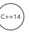

# 源代码

在学习本书中的示例时，你可以选择手动输入所有代码，也可以使用书中附带的源代码示例。书中所使用的所有源代码均可以在 `www.wrox.com/go/proc+3e` 下载。

或者，你也可以访问 Wrox 的主下载页面 `www.wrox.com/dynamic/books/download.aspx` 来查看本书及其他 Wrox 书籍的可用代码。

> **注意** 由于许多书的标题相似，你可能会发现通过 ISBN 搜索最为方便；对于本书，ISBN 为 978-1-118-85805-9。

一旦下载了代码，请使用你喜欢的解压缩工具对其解压。

# 勘误表

我们尽力确保文本或代码中没有错误。然而，没有人是完美的，错误在所难免。如果你在我们的某书中发现错误（例如拼写错误或错误的代码段），我们将非常感谢你的反馈。通过提交勘误信息，你可以为其他读者节省数小时的挫败时间，同时也能帮助我们提供更高质量的信息。

# 引言

要找到本书的勘误页面，请访问 `www.wrox.com` 并使用搜索框或列表之一查找标题。然后在书籍详情页上，点击“Book Errata”（书籍勘误）链接。在该页面上，你可以查看所有提交给本书并由 Wrox 编辑员发布的勘误。

一份完整的书籍列表（包括指向每本书勘误页的链接）也可以在 `www.wrox.com/misc-pages/booklist.html` 找到。

如果你在书籍勘误页面没有发现“你的”错误，请访问 `www.wrox.com/contact/techsupport.html` 并填写那里的表单向我们发送你发现的错误。我们将检查这些信息，并在适当的情况下在 wrox 勘误页面发布消息，并在书籍的后续版本中修复问题。

# P2P.WROX.COM

对于作者和同行讨论，请加入 `p2p.wrox.com` 的 P2P 论坛。论坛是一个基于网络的系统，可以在其中发布有关 Wrox 书籍及相关技术的消息，并与其他读者和技术用户进行互动。论坛提供了订阅功能，当论坛发布新帖子时，可以通过电子邮件向你发送感兴趣的主题。Wrox 的作者、编辑和其他行业专家以及你的读者都活跃在这些论坛中。

在 `p2p.wrox.com`，你会发现许多不同的论坛，它们不仅能在你阅读本书时提供帮助，还能在你开发应用程序时提供帮助。要加入论坛，请遵循以下步骤：

1. 前往 `p2p.wrox.com` 并点击 `Register`（注册）链接。
2. 阅读使用条款并点击 `Agree`（同意）。
3. 完成加入所需的所需的以及你希望提供的可选信息，并点击 `Submit`（提交）。
4. 你将收到一封电子邮件，其中说明了如何验证你的账户并完成加入过程的信息。

> 注意：你可以在不加入 P2P 的情况下阅读论坛消息，但为了发布你自己的消息，必须加入。

一旦加入，你就可以发布新消息并回复其他用户的帖子。如果你希望将某个特定论坛的消息通过电子邮件发送给你，请点击论坛列表中对应名称旁的“Subscribe to this Forum”（订阅此论坛）。

有关关于如何使用 Wrox P2P 的更多信息，请务必阅读 P2P FAQ（常见问题解答），以获取论坛软件如何工作的解答，以及许多针对 P2P 和 Wrox 书籍的常见问题。要阅读 FAQ，请点击任何 P2P 页面上的 FAQ 链接。

# 第一部分

## 专业 C++ 简介

- 第 1 章：C++ 和 STL 快速上手
- 第 2 章：处理字符串
- 第 3 章：风格化编码

# 1 C++ 和 STL 快速上手

## 本章包含什么内容？

- 简要概述 C++ 语言和标准模板库 (STL) 最重要的部分和语法
- 智能指针的基础知识

请注意，本章的所有代码示例均作为本章代码下载的一部分，可在 `www.wrox.com/go/proc+3e` 网站获取。

本章的目标是简要介绍 C++，以便你在开始学习书的其他部分之前拥有基础知识。这不是一个全面的课程。基础知识点，如程序是什么、声明与定义的区别、或 `volatile` 关键字也被省略了。C++ 中某些不相关的部分被省略了，因为将在后面的章节中介绍。

本章旨在涵盖程序员每天都会遇到的 C++ 部分。如果你已经离开 C++ 有段时间并忘记了 `for` 循环的语法，你将在本章中找到。此外，如果你是 C++ 新手，请仔细阅读本章，你将学习 STL 容器、智能指针等基础。

## C++ 基础

### Hello World

正如你预期的，以下代码展示了简单的 C++ 程序：

```cpp
// helloworld.cpp
#include <iostream>
int main()
{
    std::cout << "Hello, World!" << std::endl;
    return 0;
}
```

这段代码在屏幕上输出 "Hello, World!"，展示了这些概念。

- 注释
- 预处理器指令
- `main()` 函数
- I/O 流

这些概念将在后续章节中简要解释。

## 注释

程序的第一行是注释，它只对程序员存在，会被编译器忽略。在 C++ 中，有两种方式标记注释。在前面的示例中，双斜杠表示该行是注释。

```cpp
// helloworld.cpp
```

注释将在第 3 章详细介绍。同样的行为可以通过多行注释来实现。以下代码显示了多行注释：

```cpp
/* 这是一个多行注释
 * 编译器将忽略它 */
```

## 预处理器指令

构建 C++ 程序是一个三步过程。首先，代码通过预处理器，它识别代码的元信息。接下来，代码被编译翻译成机器可读的对象文件。最后，将单独的对象文件链接成一个应用程序。指令以 `#` 字符开头，如前一个示例中的 `#include <iostream>`。在这种情况下，包含指令预处理器包含 `<iostream>` 头文件的内容并供当前文件使用。头文件的最用途是声明在其他地方定义的函数。函数声明告诉编译器如何调用函数，声明参数的数量和类型以及返回值。定义包含函数的实际代码。在 C++ 中，声明通常位于扩展名为 `.h` 的头文件中，而定义通常位于扩展名为 `.cpp` 的源文件中。许多编程语言没有将声明和定义分开，如 C# 和 Java。

`<iostream>` 头文件实现了 C++ 提供的输入输出机制。如果程序没有包含它，将无法执行输出文本的任务。

> 注意：C++ 中的头文件通常以 `.h` 结尾，例如 `<stdio.h>`。在 C++ 中，标准库头文件省略了后缀，例如 `<iostream>`。标准头在 C++ 中仍然存在，但有新的名称。例如，你可以通过包含 `<cstdio>` 来访问 `<stdio.h>` 的功能。

下表显示了一些常用的预处理器指令。

| 预处理器指令 | 功能 | 常见用途 |
|---|---|---|
| `#include [file]` | 将指定的文件插入到指令所在的位置。 | 始终用于包含头文件，以便代码可以使用别处定义的功能。 |
| `#define [key] [value]` | 指定的键的所有出现处都被替换为指定的值。 | 常在 C 中定义常量或宏。C++ 提供了更好的常量和宏机制。宏通常是危险的，请谨慎使用。详见第 10 章。 |
| `#ifdef [key]` ... `#endif` | 位于 `#ifdef`("if defined") 或 `#ifndef`("not defined") 内部的代码将根据指定的键是否通过 `#define` 定义来有条件地包含或排除。 | 最常用于防止循环包含。每个包含文件都以一个 `#ifndef` 开头，检查某个键是否不存在，然后定义该键。包含文件以 `#endif` 结束。这防止了文件被多次包含；请参阅下表后的示例。 |
| `#pragma [xyz]` | `xyz` 的实现随编译器而异。它通常允许程序员在预处理期间遇到该指令时显示警告或错误。 | 请参阅下表后的示例。 |

使用预处理器指令的一个示例是避免多次包含。例如：

```cpp
#ifndef MYHEADER_H
#define MYHEADER_H
// ... 此头文件的内容
#endif
```

如果你的编译器支持 `#pragma once` 指令（大多数现代编译器都支持），可以将其重写为：

```cpp
#pragma once
// 此头文件的内容
```

第 10 章将详细讨论这一点。

## `main()` 函数

`main()` 自然是程序启动的地方。`main()` 返回一个 `int`，表示程序的运行状态。`main()` 函数要么不接受任何参数，要么接受如下两个参数：

```cpp
int main(int argc, char* argv[])
```

`argc` 给传递给程序的参数个数，`argv` 包含这些参数。注意，`argv[0]` 可能是程序名称，但你不应该依赖它，并且永远不要使用它。

## I/O 流

第 12 章将深入介绍 I/O 流，但输出的基础知识非常简单。你丢进它的任何内容都会被恰当输出。`std::cout` 是对应用户控制台或标准输出的通道。还有其他槽位，包括 `std::cerr`，它输出到错误控制台。`<<` 运算符将内容送入通道。在前面的示例中，一个带引号的文本字符串被发送到标准输出。输出流允许在单行代码中顺序发送多个不同类型的数据。

以下代码输出文本 " << <<"，后面跟一个方式，然后是更多文本。

```cpp
std::cout << "There are " << 219 << " ways I love you." << std::endl;
```

`std::endl` 表示行结束。当输出流遇到 `std::endl` 时，它将输出目前为止送入通道的所有内容并移动到下一行。表示行的另一种方法是使用 `\n` 字符。`\n` 是转义字符，代表换行符。转义字符可以使用于带引号字符串。下表显示了最常见的转义字符：

| 字符 | 说明 |
| :--- | :--- |
| `\n` | 换行 |
| `\r` | 回车 |
| `\t` | 制表符 |
| `\\` | 反斜杠字符 |
| `\"` | 引号 |

流也可以用于接受用户的输入。最简单的方法是配合输入流使用 `>>` 运算符。`std::cin` 输入流接受来自用户的键盘输入。用户输入是棘手的，因为你永远无法知道用户会输入什么类型的数据。第 12 章将为 C++ 初学者解释如何使用输入流。

如果你是 C++ 新手且具有 C 背景，你可能在好奇信赖的 `printf()` 去哪里了。虽然 `printf()` 在 C++ 中仍然可以使用，但建议使用流库。

## 命名空间

命名空间解决了不同代码之间的命名冲突问题。例如，你可能正在编写某些带有 `foo()` 函数的代码。某天，你决定使用一个第三方库，而该库也有一个 `foo()` 函数。编译器无法知道你在代码中指的是哪一个版本的 `foo()`。你无法更改库的函数，而且这对你的原有代码来说是一个巨大的变化。

在这种情况下，命名空间可以成为救命稻草，你可以定义定义所在的上下文。要将代码放在命名空间中，将其封装在 `namespace` 块内。假设以下内容位于名为 `namespaces.h` 的文件中：

```cpp
namespace mycode {
    void foo();
}
```

方法或函数的实现也可以在命名空间中处理：

```cpp
#include <iostream>
#include "namespaces.h"
namespace mycode {

void foo() {
    std::cout << "foo called in the mycode namespace" << std::endl;
}
}
```

通过将 `foo()` 版本放在 "mycode" 命名空间中，它就与第三方库提供的 `foo()` 函数隔离开来。要调用启用命名空间的版本的 `foo()`，使用 `::`（也称为作用域解析运算符）在函数前加上命名空间，如下所示：

```cpp
mycode::foo(); // 调用 "mycode" 命名空间中的 "foo" 函数
```

任何落在 "mycode" 命名空间块之外的代码都可以在不显式前加命名空间的情况下调用同一命名空间内的其他代码。这种隐式命名空间对于提高代码可读性很有用。你还可以通过 `using` 指令来避免前加命名空间。该指令告诉编译器随后的代码正在使用指定命名空间的名称。因此，对于以下代码隐含了命名空间：

```cpp
#include <namespaces.h>
using namespace mycode;
int main() {
    foo();
    return 0;
}
```

## 基本类型

| 类型 | 说明 | 示例 |
|---|---|---|
| `float` | 浮点数 | `float f = 7.2f;` |
| `double` | 双精度数；精度至少与 `float` 相同 | `double d = 7.2;` |
| `long double` | 长双精度数；精度至少与 `double` 相同 | `long double d = 16.98L;` |
| `char` | 单个字符 | `char ch = 'm';` |
| `char16_t` | 16 位字符 | `char16_t c16 = 'u';` |
| `char32_t` | 32 位字符 | `char32_t c32 = U'm';` |
| `wchar_t` | 宽字符；大小取决于编译器 | `wchar_t w = L'm';` |
| `bool` | 真或假 | `bool b = true;` |

> C++ 并没有提供基本的字符串类型。但是，标准库提供了一个字符串的标准实现，该实现将在在本章的稍后部分进行描述，并在第 2 章中进行详细介绍。

变量可以通过*强制转换*（casting）转换为其他类型。例如，可以将 `float` 转换为 `int`。C++ 提供了三种显式更改变量类型的方法。第一种方法是 C 语言的遗留，遗憾的是仍然常用。第二种方法看起来更自然，但很少使用。第三种方法是最稳健、最清晰且被推荐的方法。

```cpp
float myFloat = 3.14f;
int i1 = (int)myFloat; // 方法 1
int i2 = int(myFloat);  // 方法 2
int i3 = static_cast<int>(myFloat); // 方法 3
```

生成的整数将是浮点数去掉小数部分的值。第 10 章详细描述了不同的强制转换方法。在某些上下文中，变量可以自动转换或强制转换。例如，`short` 可以自动转换为 `long`，它们表示相同类型的数据，且具有至少相同的精度。


```cpp
long someLong = someShort; // 无显式转换
```

在自动转换变量时，你需要注意潜在的数据丢失。例如，将 `float` 转换为 `int` 会丢弃信息（数字的小数部分）。如果你在没有显式转换的情况下将 `float` 赋值给 `int`，大多数编译器会发出警告。如果你确定左侧类型与右侧类型完全兼容，那么进行隐式转换是可以的。

## 字面量

字面量用于在代码中编写数字或字符串。C++ 支持多种标准字面量。可以使用以下字面量指定数字。所有四个示例代表同一个数字。

- 十进制字面量，例如：`0123`
- 八进制字面量，例如：`0173`
- 十六进制字面量，例如：`0x7B`
- 二进制字面量，例如：`0b1111011`

C++ 中其他字面量的示例：

- 浮点数值：`3.14f`
- 双精度浮点数值：`3.14`
- 单个字符：`'a'`
- 以零终止的字符数组：`"character array"`

也可以定义自定义类型的字面量，这是第 10 章中解释的高级特性。

C++14 允许在数值字面量中使用数字分隔符。数字分隔符是一个单字符。例如：

```cpp
int number1 = 23'456'789; // 数字 23456789
float number2 = 0.123'456f; // 数字 0.123456
```

## 运算符

如果没有值可以改变，变量又算什么？下表显示了 C++ 中最常用的运算符以及使用它们的示例代码。注意，C++ 中的运算符可以是二元的（作用于两个表达式）、一元的（作用于单个表达式）或三元的（作用于三个表达式）。C++ 中只有一个三元运算符，它将在“条件”章节中介绍。

| 运算符 | 说明 | 使用方法 |
|---|---|---|
| `=` | 二元运算符，将右侧的值赋值给左侧表达式。 | `int i; i = 3; int j; j = i;` |
| `!` | 一元运算符，取反表达式的真/假（非 0/0）状态。 | `bool b = !true; bool b2 = !b;` |
| `+` | 加法二元运算符。 | `int i = 3 + 2;` |
| `-` | 减法二元运算符。 | `int j = i + 5;` |
| `*` | 乘法二元运算符。 | `int k = i + j;` |
| `/` | 除法二元运算符。 | `int i = 5-1;` |
| `%` | 除法运算取余数的二元运算符。也称为 mod 或取模运算符。 | `int remainder = 5 % 2;` |
| `++` | 一元运算符，将表达式的值加 1。如果运算符出现在表达式之后或后置增，表达式的结果是未加之前的值。如果运算符出现在表达式之前或前置增，表达式的结果是新值。 | `i++; ++i;` |
| `--` | 一元运算符，将表达式的值减 1。 | `i--; --i;` |
| `+=` | `i = i + j` 的简写语法 | `i += j;` |
| `-=` | `i = i - j` 的简写语法 | `i -= j;` |
| `*=` | `i = i * j` 的简写语法 | `i *= j;` |
| `/=` | `i = i / j` 的简写语法 | `i /= j;` |
| `%=` | `i = i % j` 的简写语法 | `i %= j;` |
| `&=` | 取一个表达式的原始位并与另一个表达式进行按位“与”运算。 | `i = j & k; j &= k;` |
| `\|=` | 取一个表达式的原始位并与另一个表达式进行按位“或”运算。 | `i = j \| k; j \|= k;` |
| `<<` `>>` | 取一个表达式的原始位并将每个位向左 (`<<`) 或向右 (`>>`) 移动指定的位数。 | `i = i << 1; i <<= 4; i >>= 1; i >>= 4;` |
| `^` | 对两个表达式执行按位“异或”，也称为“XOR”操作。 | `i = j ^ k;` |

默认情况下，枚举值的底层类型是整数，但可以通过以下方式进行更改：

```cpp
enum class MyEnumLong : unsigned long
{
  EnumValueLong1,
  EnumValueLong2 = 10,
  EnumValueLong3
};
```

## 结构体

结构体允许你将一个或多个现有类型封装到一个新类型。结构体的经典示例是数据库记录。如果你正在构建一个人事系统来跟踪员工信息，你需要为每位员工存储姓首字母、名首字母、员工编号和工资。包含所有这些信息的结构体在 `employeestruct.h` 头文件中显示：

```cpp
struct Employee {
  char firstInitial;
  char lastInitial;
  int employeeNumber;
  int salary;
};
```

```cpp
#include <iostream>
#include "employeestruct.h"
using namespace std;
int main() {
  // 创建并填充一个员工。
  Employee employee;
  employee.firstInitial = 'M';
  employee.lastInitial = 'G';
  employee.employeeNumber = 42;
  employee.salary = 80000;
  // 输出员工的值。
  cout << "Employee: " << employee.firstInitial 
       << employee.lastInitial << endl;
  cout << "Number: " << employee.employeeNumber << endl;
  cout << "Salary: $" << employee.salary << endl;
  return 0;
}
```

## 条件语句

条件语句让你根据某是否为真来执行代码。正如后续章节所示，C++ 中有三种主要的条件语句。

### if/else 语句

最常见的条件是 `if` 语句，它可以配有 `else`。如果 `if` 语句内部提供的条件为真，则执行该行或代码块。如果不是，则执行将继续到存在的 `else` 情况，或者执行条件语句之后的代码。下面的伪代码显示了一个级联 `if` 语句，这是一种高级说法，表示 `if` 语句带有 `else` 语句，而 `else` 语句又包含另一个 `if` 语句，以此类推。

```cpp
if (i > 4) {
    // 执行些什么。
} else if (i > 2) {
    // 执行些别的。
} else {
    // 执行其他的。
}
```

`if` 语句括号之间的表达式必须是一个布尔值，或者求值为一个布尔值。稍后描述的逻辑求值运算符提供了评估表达式以产生真或假布尔值的方法。

### switch 语句

`switch` 语句是根据表达式的值执行操作的另一种备选语法。在 C++ `switch` 语句中，该表达式必须是整数类型或可转换为整数类型的类型，并且必须与常量进行比较。每个常量代表一个“用例”。如果表达式匹配该 `case`，则执行随后的代码行，直到遇到 `break` 语句。你还可以提供一个 `default` 情况，当其他所有 `case` 都不匹配时，将匹配该情况。下面的伪代码显示了 `switch` 语句的常见用法。

```cpp
switch (menuItem) {
    case OpenMenuItem:
        // 打开文件的代码
        break;
    case SaveMenuItem:
        // 保存文件的代码
        break;
    default:
        // 输出错误信息的代码
        break;
}
```

`switch` 语句始终可以转换为 `if/else` 语句。之前的 `switch` 语句可以转换如下：

```cpp
if (menuItem == OpenMenuItem) {
    // 打开文件的代码
} else if (menuItem == SaveMenuItem) {
    // 保存文件的代码
} else {
    // 输出错误信息的代码
}
```

如果 `case` 部分**未**使用了 `break` 语句，则先执行该 `case` 部分的代码，然后发生贯穿，无论下一个 `case` 是否匹配，都会执行下一个 `case` 部分的代码。这可能是一个 bug 的来源，但有时也是有用的。一个例子是让单个 `case` 部分为多个不同的 `case` 执行。例如：

```cpp
switch (backgroundColor) {
    case ColorDarkBlue:
    case ColorBlack:
        // 针对蓝色或黑色背景颜色执行的代码
        break;
    case ColorRed:
        // 针对红色背景颜色执行的代码
        break;
}
```

`switch` 语句通常用于根据表达式的特定值执行某些操作，而不是根据某些测试表达式。

### 条件运算符

C++ 有一个接受三个参数的运算符，称为三元运算符。它被用作简写的条件表达式，形式为“[内容] [执行操作]，否则 [执行某些其他操作]”。条件运算符由 `?` 和 `:` 表示。下面的代码如果变量 `i` 大于 2，将输出 "yes"，否则输出 "no"。

```cpp
std::cout << ((i > 2) ? "yes" : "no");
```

条件运算符的优点是它可以出现在任何上下文。在前面的示例中，条件运算符用在输出的代码中。记忆语法的一种方便方法是将问号之前的语句视为一个真实的问题。例如，“i 大于2 吗？如果是，结果为 'yes'。”

与 `if` 或 `switch` 语句不同，条件运算符不会根据结果执行代码块。相反，它用在代码内部，如前面的示例所示。通过这样，它实际上是一个运算符（类似于 `+` 和 `-`），而不是真正的条件语句（如 `if` 和 `switch`）。

### 逻辑求值运算符

下表显示了常见的逻辑运算符：

| 运算符 | 描述 | 用法 |
|---|---|---|
| `<` | 判断左侧是否小于右侧 | `if (i < 0)` |
| `<=` | 小于等于右侧 | `if (i <= 0)` |
| `>` | 大于 | `if (i > 0)` |
| `>=` | 大于等于右侧 | `if (i >= 0)` |
| `==` | 判断左侧是否等于右侧 | `if (i == 3)` |
| `!=` | 不等于。左侧不等于右侧为真 | `if (i != 3)` |
| `!` | 逻辑非。反转表达式的真假状态 | `if (!someBoolean)` |
| `&&` | 逻辑与。两部分都真时结果为真 | `if (someBoolean && someBoolean)` |
| `\|\|` | 逻辑或。任一部分为真时结果为真 | `if (someBoolean \|\| someBoolean)` |

C++ 在评估逻辑表达式时使用*短路逻辑*。一旦确定了最终结果，就不会评估表达式剩余部分。例如，如果你对多个布尔表达式执行逻辑或操作（如下所示），只要其中一个为真，结果就确定为真。其余部分不会被评估。

```cpp
bool result = bool1 || bool2 || (i > 7) || (27 / 13 && i + 1) < 2;
```

下面的代码显示了一个使用 `&&` 的语句，由于第二项为 0（始终为假），它将短路：

```cpp
bool result = bool0 && 0 && (i > 7) && !done;
```

## 数组

数组存储一组相同类型的值，可以通过它们在数组中的位置访问。你不能将变量作为大小——它必须是一个常量或常量表达式（`constexpr`），这将在第 10 章中讨论。接下来的代码显示了一个包含三个整数的数组声明，随后是三行将元素初始化为 0 的代码：

```cpp
int myArray[3];
myArray[0] = 0;
myArray[1] = 0;
myArray[2] = 0;
```

下一节将讨论你可以用它来初始化每个元素的循环。然而，除了使用循环或使用之前的初始化机制，你也可以通过以下单行代码实现零初始化：

```cpp
int myArray[3] = {0};
```

请注意，只有在你想要将所有值初始化为 0 时才可行。例如，该行仅会将数组中的第一个元素填充为值 2，并将数组中的所有其他元素填充为值 0：

```cpp
int myArray[3] = {2};
```

数组可以使用初始化列表进行，在这种情况下，编译器可以自动推断数组的大小。例如：

```cpp
int arr[] = {1, 2, 3, 4}; // 编译器创建一个包含 4 个元素的数组。
```

前面的示例展示了一个一维数组，你可以将其看作一行整数，每个整数都有其编号的隔间。C++ 允许多维数组。你可以将二维数组想象成一个棋盘，每个位置在 x 轴上有一个位置，在 y 轴上也有一个位置。三维及更高数组更难想象，且很少使用。以下代码显示了如何为井字棋盘分配一个二维字符数组，并在中心方格中放入一个“o”：

```cpp
char TicTacToeBoard[3][3];
TicTacToeBoard[1][1] = 'o';
```

图 1-1 显示了该棋盘的视觉表示，以及每个方格的位置。

| TicTacToeBoard[0][0] | TicTacToeBoard[0][1] | TicTacToeBoard[0][2] |
|---|---|---|
| TicTacToeBoard[1][0] | TicTacToeBoard[1][1] | TicTacToeBoard[1][2] |
| TicTacToeBoard[2][0] | TicTacToeBoard[2][1] | TicTacToeBoard[2][2] |

> **警告**：在 C++ 中，数组的第一个元素始终位于位置 0，而不是位置 1！数组的最后一个位置始终是数组的大小减 1！

## std::array

上一节讨论的数组来自 C 语言，在 C++ 中仍然有效。然而，C++ 有一种特殊的固定大小容器 `std::array`，定义在 `<array>` 头文件中。它本质上是 C 风格数组的封装。

使用 `std::array` 代替 C 风格数组有许多优点。它们始终知道自己的大小，不会自动获取指针以避免某些类型的错误，并且拥有用于遍历元素的迭代器。迭代器将在本章的晚些部分讨论，并在第 16 章中详细介绍。

接下来的示例演示了如何使用数组。`array` 之间的尖括号（如 `array<int, 3>`）将在第 11 章讨论模板时变得清晰。在使用时，只需记住你必须在尖括号之间指定 2 个参数。第一个表示数组中元素的类型，第二个表示数组的大小。

```cpp
#include <iostream>
#include <array>
using namespace std;
int main() {
    array<int, 3> arr = {9, 8, 7};
    cout << "Array size = " << arr.size() << endl;
    cout << "Element 2 = " << arr[1] << endl;
    return 0;
}
```

> **注意**：C 风格数组和 `std::array` 具有固定的大小，这应该在编译时已知。它们不能在运行时增长或缩小。

如果你想要一个动态大小的数组，建议使用本章稍后将介绍的 `std::vector`。当你向 vector 中添加元素时，它的大小会自动增长。

## 循环

计算机非常擅长重复执行相同的操作。C++ 提供了循环机制：`while` 循环、`do/while` 循环、`for` 循环和范围循环。

### while 循环

`while` 循环允许只要表达式求值为真，就可以重复执行一段代码块。例如，以下完全愚蠢的代码将输出五次“This is silly.”：

```cpp
int i = 0;
while (i < 5) {
    std::cout << "This is silly." << std::endl;
    ++i;
}
```

`break` 关键字可以在循环内部用于立即跳出循环并继续执行程序。`continue` 关键字可以返回循环顶部并重新评估 `while` 表达式。这两者通常被认为是不良风格，因为它们会导致程序的执行毫无章地跳跃，因此应该谨慎使用。必须使用 `break` 的唯一情况是在 `switch` 语句中，如前所示。

### do/while 循环

C++ 还有一种名为 `do/while` 的循环变体。它的工作原理与 `while` 循环类似，但首先执行代码，而是否继续的条件检查在最后进行。当你需要提前执行代码块并可能根据某些条件执行多次时。接下来的示例将输出“This is silly.”，即使条件最终结果为假：

```cpp
int i = 100;
do {
    std::cout << "This is silly." << std::endl;
    ++i;
} while (i < 5);
```

### for 循环

`for` 循环提供了另一种语法。当你提前知道迭代次数时，它通常比 `while` 循环更方便。`for` 循环三个部分：初始化、条件和递增。

```cpp
for (int i = 0; i < 5; i++) {
    std::cout << "This is silly." << std::endl;
}
```

### 范围循环


# 范围循环

范围循环是一种较新的特性，允许对容器进行轻松迭代。它适用于任何具有 `begin()` 和 `end()` 方法的类型，例如 STL 容器。

```cpp
std::array<int, 4> arr = {1, 2, 3, 4};
for (int i : arr) {
    std::cout << i << std::endl;
}
```

要在不创建拷贝的情况下迭代元素，使用引用：

```cpp
std::array<int, 4> arr = {1, 2, 3, 4};
for (const int& i : arr) {
    std::cout << i << std::endl;
}
```

# 函数

对于任何规模的程序，将所有代码放在 `main()` 中都是不可管理的。为了让程序易于理解，你需要将代码拆分或分解为简洁的函数。

在 C++ 中，如果函数在特定文件中使用，通常在源文件中声明并定义该函数。如果函数供其他模块或文件使用，你通常在头文件中声明，在源文件中定义它。

> 注意：函数声明通常被称为“函数原型”或“签名”，以强调它们代表了如何访问函数，而不是背后的代码。

下面显示了一个函数声明。它的返回类型为 `void`，表示函数不向调用者提供结果。调用者必须提供两个参数供函数工作——一个整数和一个字符。

如果没有匹配此声明的实际定义，编译链接阶段将失败，因为使用函数的代码将调用不存在的代码。以下定义打印两个参数的值：

```cpp
void myFunction(int i, char c) {
    std::cout << "the value of i is " << i << std::endl;
    std::cout << "the value of c is " << c << std::endl;
}
```

```cpp
int addNumbers(int number1, int number2)
{
    return number1 + number2;
}
```

该函数可以如下所示调用：

```cpp
int sum = addNumbers(5, 3);
```

每个函数都有一个预定义的局部变量 `__func__`，其如下：

该变量可以用于日志记录：

```cpp
int addNumbers(int number1, int number2)
{
    std::cout << "Entering function " << __func__ << std::endl;
    return number1;
}
```

## 备用函数语法

C++ 仍然在使用其为 C 语言设计时的语法。与此同时，C++ 扩展了许多新功能，并暴露了旧函数语法的许多问题。从 C++11 开始，支持了一种带有尾随类型的备用语法。这种新语法对于普通函数来说作用并不大，但在指定模板返回类型的上下文中非常有用。模板在第 14 章和第 21 章中有详细介绍。

以下示例演示了这种备用语法。在此语境下，`auto` 关键字的含义是使用备用语法开始定义函数原型。

```cpp
auto func(int i) -> int
{
    return i + 2;
}
```

函数的返回类型不再位于开头，而是位于箭头 `->` 后行的结尾。以下代码演示了调用 `func()` 完全相同，并展示了 `main()` 函数也可以使用这种备用语法：

```cpp
auto main() -> int
{
    cout << func(3) << endl;
    return 0;
}
```

## 函数返回类型推导

C++14 允许让编译器自动确定函数的返回类型。要使用此功能，你需要指定 `auto` 为返回类型并省略任何尾随类型：

```cpp
auto divideNumbers(double numerator, double denominator)
{
    if (denominator == 0) { /* ... */ }
    return numerator / denominator;
}
```

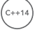

编译器根据返回语句中使用的表达式推导出返回类型。函数中可以有多个返回语句，但它们都应该解析为相同的类型。函数可以包含递归调用（对自身的调用），但函数中的第一个返回语句必须是非递归调用。

## 类型推导部分 1

类型推导允许编译器自动推导出表达式的类型。类型推导有两个关键字：`auto` 和 `decltype`，它们将在接两个章节中讨论。

C++14 引入了 `decltype(auto)`，将在本章后面的“类型推导部分 2”节中讨论。在理解 `decltype(auto)` 之前，你需要学习引用知识。

## auto 关键字

`auto` 关键字有四种完全不同的含义。第一个含义是告诉编译器在编译时自动推导出变量的类型。下一行展示了 `auto` 关键字在上下文中最简单的用法：

```cpp
auto x = 123; // x 将是 int 类型
```

在这个示例中，你输入 `auto` 而不是 `int` 并没有获得什么优势；但对于更复杂的类型，它变得非常有用。假设你有一个返回类型复杂的函数 `getFoo()`。如果你想将调用的结果赋值给变量，可以写出复杂的类型，也可以简单地使用 `auto` 让编译器去推导：

```cpp
auto result = getFoo();
```

`auto` 关键字的更多示例将在书中陆续出现。

`auto` 的第二种用途用于前面介绍过的备用函数语法。

`auto` 的第三种用途用于函数类型推导，之前也讨论过。

最后，`auto` 的第四种用途用于泛型 lambda 表达式，将在第 17 章讨论。

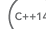

## decltype 关键字

`decltype` 关键字接收表达式作为参数并计算该表达式的类型。

例如：

```cpp
int x = 123;
decltype(x) y = 456;
```

在这个示例中，编译器推导出 `y` 的类型为 `int`，因为那是 `x` 的类型。和用于备用函数语法的 `auto` 关键字一样，`decltype` 关键字初看起来没什么用。但在第 11 章和第 21 章讨论的模板上下文中，`auto` 和 `decltype` 变得非常强大。

## 这些都是基础

到此时，你已经回顾了 C++ 编程的基础要点。如果这一节对你来说轻而容易，请浏览下一节，以确保你跟上了更高级的材料。

如果你在这一节感到很困难，在继续之前，你可能想获取附录 B 中提到的优秀 C++ 入门书籍。

# 深入探索 C++

循环、变量和条件判断是非常棒的构建块，但还有很多内容需要学习。接下来涵盖的主题可能包括许多帮助 C++ 程序员编写代码的功能，以及一些比有帮助更让人困惑的功能。如果你是一个 C++ 经验较少的 C 语言程序员，应该仔细阅读这一节。

## 指针与动态内存

动态内存允许你构建编译时大小不固定的数据程序。大多数非复杂的程序都会使用动态内存。

### 栈与堆

内存被分为两个部分：栈和堆。栈用于局部变量和函数调用，而堆用于动态分配的内存。栈由编译器自动管理，而堆由程序员手动管理。

要在堆上分配内存，你需要使用 `new` 运算符。要释放它，你需要使用 `delete` 运算符。

```cpp
int* ptr = new int(42);
// ...
delete ptr;
ptr = nullptr;
```

```cpp
int i = 8;
int* myIntegerPointer = &i; // 指向值为 8 的变量
```

C++ 处理指向结构体的指针有一种特殊的语法。从技术上讲，如果你有一个指向结构体的指针，可以通过 `*` 对其进行解引用来访问其字段，使用普通语法，如下代码所示（该代码假设存在一个名为 `getEmployee()` 的函数）。

```cpp
Employee* anEmployee = getEmployee();
cout << (*anEmployee).salary << endl;
```

这种语法有点杂乱。`->`（箭头）运算符在一步内同时完成解引用和字段访问。`->` 替换了之前的代码，但更易于阅读：

```cpp
Employee* anEmployee = getEmployee();
cout << anEmployee->salary << endl;
```

通常，当你将变量传递给函数时，你是按值传递的。如果函数接收一个整数参数，那么你传递的实际上是该整数的拷贝。在 C 中，变量指针经常被用于允许函数修改其他栈帧中的变量，本质上是按引用传递。通过对指针进行解引用，函数可以改变代表变量的内存，即使该内不在当前的栈帧中。这在 C++ 中并不常见，因为 C++ 有一种更好的机制，称为“引用”，这将在本章稍后部分介绍。

### 动态分配数组

堆也可以用于动态分配数组。使用 `new[]` 运算符为数组分配内存：

```cpp
int arraySize = 8;
int* myVariableSizedArray = new int[arraySize];
```

这分配了足够满足 `arraySize` 变量数量的整数内存。图 1-3 显示了执行此代码后栈和堆的状况。如你所示，指针变量仍然留在栈上，但动态创建的数组位于堆上。

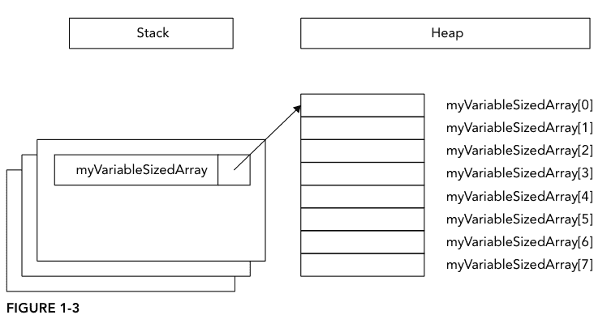

现在内存已经分配，你就可以像操作普通的栈数组一样操作 `myVariableSizedArray` 了：

```cpp
myVariableSizedArray[3] = 2;
```

当你的代码完成对该数组的操作后，应该将其从堆中删除，以便其他变量可以使用该内存。

```cpp
delete[] myVariableSizedArray;
```

`delete` 之后的括号表示你正在删除一个数组！

> 避免使用 C 的 `malloc()` 和 `free()`。相反，使用 `new` 和 `delete`，或者 `new[]` 和 `delete[]`。

> 警告：为了防止内存泄漏，每个 `new` 调用都应该与 `delete` 调用配对，每个 `new[]` 调用都应该与 `delete[]` 调用配对。将 `new[]` 与 `delete` 配对会导致内存泄漏。内存泄漏将在第 22 章讨论。

### 空指针计数器

在 C++11 之前，常量 0 被用于定义数字 0 或空指针。这会导致一些问题。考虑以下示例：

```cpp
void func(char* str) { cout << "char* version" << endl; }
void func(int i) { cout << "int version" << endl; }
int main() {
    func(NULL);
    return 0;
}
```

`main()` 函数使用参数 `NULL` 调用 `func`，这本应该是一个空指针。换句话说，你期望调用 `func()` 的 `char*` 版本，并将空指针作为参数。然而，由于 `NULL` 不是指针，而是等同于整数 0，因此调用了 `func()` 的整数版本。

这个问题通过引入真正的空指针常量 `nullptr` 解决。下面的代码调用了 `char*` 版本。

```cpp
func(nullptr);
```

### 智能指针

为了避免常见的内存问题，你使用智能指针而不是“裸露”的 C 风格指针。当智能指针对象离开作用域或函数结束时，智能指针会自动释放内存。

C++ 中三种智能指针类型：`std::unique_ptr`、`std::shared_ptr` 和 `std::weak_ptr`，它们都定义在 `<memory>` 头文件中。`unique_ptr` 类似于普通指针，例外在于它会在 `unique_ptr` 离开作用域或被删除时自动释放内存或资源。`unique_ptr` 对其所指向的对象拥有唯一所有权。`unique_ptr` 的优势之一是，它简化了在发生异常时必须释放存储的代码。当智能指针离开作用域时，存储会被自动释放。你也可以在 `unique_ptr` 中存储 C 风格数组。使用 `std::make_unique<>()` 来创建一个 `unique_ptr`。

例如，与其编写以下代码：

```cpp
Employee* anEmployee = new Employee;
```

你应该写成：

```cpp
auto anEmployee = std::make_unique<Employee>();
```

`make_unique()` 自 C++14 起可用。如果你的编译器尚未符合 C++14 标准，你可以按照如下方式创建你的 `unique_ptr`。这你现在必须指定两次类型 `Employee`：

```cpp
std::unique_ptr<Employee> anEmployee(new Employee);
```

你可以像使用普通指针一样使用 `unique_ptr` 智能指针。

`unique_ptr` 是一种通用智能指针，可以指向任何类型的内存。这就是为什么它是一个模板。模板需要角括号来指定模板参数。你必须在括号中指定你想让 `unique_ptr` 指向的内存类型。模板将在第 11 和第 12 章讨论。

## 引用

在 C 中，实现这种行为的主要方法是传递指针而不是变量本身。在 C++ 中，有一种显式机制是“按引用传递”。类型后面的 `&` 表示该变量是引用。下面是 `addOne()` 的两种实现。第一个函数对变量没有影响，因为它按值传递。第二个使用引用并更改原始值。

```cpp
void addOne(int i) {
    i++; // 没有影响，因为这是一个拷贝
}
void addOne(int& i) {
    i++; // 实际上改变原始值
}
```

引用整数调用 `addOne` 的语法与直接接收整数没有区别：

```cpp
int myInt = 7;
addOne(myInt);
```

> 注意：`addOne` 实现之间存在差异。按值传递的版本可以接受常量，例如 `addOne(3)` 是合法的。然而，对引用版本的 `addOne()` 执行相同操作会导致编译器错误。这可以通过 `const` 引用来解决。

## C++ 中的字符串

在 C++ 中处理字符串有很多方法：C 风格，将字符串表示为字符数组；C++ 风格，将该表示封装在易用的字符串类型中；以及一类非标准方法。第 2 章提供了详细讨论。

目前，你唯一需要知道的是 C++ 字符串类型定义在 `<string>` 文件中，并且你可以像使用基本类型一样使用 C++ 字符串。就像 I/O 流一样，字符串类型位于 `std` 命名空间。示例展示了如何像字符数组一样使用字符串。

```cpp
std::string myString = "Hello, World";
cout << "The value of myString is " << myString << endl;
```

## 异常

C++ 是一种非常灵活的语言，但不特别安全。编译器允许你编写在随机内存地址上操作的代码，或尝试除以零（计算机不擅长处理无穷大）。试图为语言增加安全性特征之一是异常。

异常是一个意料之外的情况。例如，如果你正在编写一个获取网页的函数，可能会出现几种问题。包含页面的互联网主机可能宕机，页面可能返回空白，或者连接可能会丢失。处理这种情况的一种方法是从函数返回一个特殊值，例如 `nullptr` 或错误代码。异常为处理问题提供了一种得多的机制。

异常带来了一些新术语。当部分代码检测到异常情况时，它会抛出（throw）一个异常。另一部分代码捕获（catch）该异常并采取适当的。下面的示例显示了一个函数 `divideNumbers()`，如果分母为零，它会抛出一个异常：

```cpp
#include <stdexcept>
double divideNumbers(double numerator, double denominator)
{
 if (denominator == 0)
  throw std::invalid_argument("Denominator cannot be 0.");
  return numerator / denominator;
}
```

当执行 `throw` 行时，函数会立即结束而不返回值。如果调用者使用 `try/catch` 块调用该函数（如下代码所示），它将接收异常并能够处理它。

```cpp
#include <iostream>
#include <exception>
int main()
 try {
  std::cout << divideNumbers(2.5, 0.5) << std::endl;
  std::cout << divideNumbers(2.3, 0) << std::endl;
  std::cout << divideNumbers(4.5, 2.5) << std::endl;
 } catch (const std::exception& e) {
  std::cout << "Exception caught: " << e.what() << std::endl;
 }
 return 0;
}
```

对 `divideNumbers()` 的第一次调用执行成功，并将结果输出给用户。第二次调用抛出了异常。没有返回值，唯一的输出是捕获到异常时打印的错误信息。第三次调用永远不会执行，因为第二次调用抛出的异常导致程序跳转到 `catch` 块。上述代码块的输出为：

An exception was caught: Denominator cannot be 0.


异常在 C++ 中处理可能会变得复杂。要正确使用异常，你需要了解当抛出异常时栈变量发生了什么，并且必须小心地捕获和处理必要的异常。先前的示例使用了内置的 `std::invalid_argument` 类型，但最好使用针对所抛出错误更具体的自定义异常类型。与 Java 语言不同，C++ 编译器不会强制你捕获可能发生的每个异常。如果你的代码从未捕获任何异常但抛出了异常，它将由程序本身捕获并终止。异常的这些更复杂的方面将在第 13 章中有更详细的介绍。

## const 的多种用途

`const` 关键字在 C++ 中有多种不同的用法。它的所有用法都相互相关，但存在细微的差别。`const` 的微妙之处是极佳的面试题！第 10 章详细解释了 `const` 的所有用法。接下来的章节概述了最常用的用法。

### const 常量

如果你假设 `const` 关键字与常量有关，那么你正确地发现了它的用途之一。在 C 语言中，程序员经常使用预处理器 `#define` 机制为在程序执行期间不会改变的值（如版本号）定义符号名称。在 C++ 中，鼓励程序员使用 `const` 来定义常量以避免使用 `#define`。使用 `const` 定义常量与定义变量一样，只是编译器不能更改该值。

```cpp
const float versionNumber = 2.0f;
const std::string productName = "Super Hyper Net Modulator";
```

### 使用 const 保护参数

在 C++ 中，你可以将非 `const` 变量转换为 `const` 变量。为什么要这样做？它可以为防止其他代码修改该变量提供某种程度的保护。如果你在其他代码中调用你同事编写的函数，并且你想确保该函数不会更改传递的参数的值，你可以告诉同事让函数接受一个 `const` 参数。如果函数尝试更改参数的值，编译将无法通过。

在下面的代码中，在调用 `mysteryFunction()` 时，`string*` 会被强制转换为 `const string*`。如果 `mysteryFunction()` 的作者尝试更改传递的字符串的值，代码将无法编译。有绕过这一限制的方法，但使用它们需要有意识的努力。C++ 可以防止意外更改 `const` 变量。

```cpp
void mysteryFunction(const std::string someString) {
    // someString = "Test"; // 将无法编译。
}
int main() {
    std::string myString = "The string";
    mysteryFunction(myString);
    return 0;
}
```

### const 引用

你经常发现使用 `const` 引用参数的代码。起初，这似乎是一个矛盾。引用参数允许你在另一个上下文中更改变量的值。`const` 似乎阻止了此类更改。

`const` 引用参数的主要价值在于效率。当你向函数传递一个值时，会创建一个完整的拷贝。当你传递引用时，你只是传递了指向原始值的指针，因此计算机不需要创建拷贝。通过传递 `const` 引用，你兼顾了二者的优点——没有创建拷贝。在处理大型对象时，`const` 引用变得更加重要，因为对它们进行拷贝可能会产生副作用。下面的示例展示了如何传递 `const` 引用：

```cpp
void printString(const std::string& str) {
    std::cout << str << std::endl;
}
int main() {
    std::string myString = "The string";
    printString(myString);
    return 0;
}
```

## 类型推断 2

现在你已经了解了引用、`const` 和 `std::string`，是时候重新回顾类型推断了。为了推导表达式的类型，C++11 引入了 `auto`。例如，假设你有：

```cpp
auto x = 5;
auto y = 3.14;
auto z = "Hello";
```

`auto` 关键字允许编译器根据其初始化值推断变量的类型。这在处理复杂类型（如迭代器）时特别有用。

## 使用 auto 进行类型推断

`auto` 关键字也可以用于 C++11 中的函数返回类型。这允许编译器根据返回语句推断返回类型。

```cpp
auto add(int a, int b) {
    return a + b;
}
```

此外，`auto` 可以用于 C++14 中的函数参数。这允许了更灵活的函数定义，类似于模板函数。

```cpp
auto add(auto a, auto b) {
    return a + b;
}
```

## C++ 作为面向对象的语言

```cpp
int mNumberOfMiles;
bool mHasEliteSuperRewardsStatus;
};
```

该方法与类名相同且没有返回类型，是一个构造函数。它在创建类对象时被自动调用。带有波浪号 (`~`) 字符后类名的方法是析构函数。它在对象销毁时被自动调用。

> 注意：为了遵循常量正确性（const-correctness）原则，将不改变对象任何成员的函数声明为 `const` 是一个好习惯。这些成员函数被称为“检查器”（inspectors），而非 const 成员函数被称为“修改器”（mutators）。

下面显示了 `AirlineTicket` 类一些方法的定义。

```cpp
AirlineTicket::AirlineTicket()
{
    // 初始化成员变量
    mHasEliteSuperRewardsStatus = false;
    mPassengerName = "Unknown Passenger";
    mNumberOfMiles = 0;
}
AirlineTicket::~AirlineTicket()
{
    // 清理工作不需要做什么
}
int AirlineTicket::calculatePriceInDollars() const
{
    if (getEliteSuperRewardsStatus()) {
        // 为精英奖励客户免费提供！
        return 0;
    }
    // 票价成本为里程数乘以
    // 0.1。真实的航空公司可能有更复杂的公式：
    return static_cast<int>(getNumberOfMiles() * 0.1);
}
const string& AirlineTicket::getPassengerName() const
{
    return mPassengerName;
}
void AirlineTicket::setPassengerName(const string& name)
{
    mPassengerName = name;
}
// 为了简单起见，省略了其他 get 和 set 方法。
```

接下来的示例使用了 `AirlineTicket` 类。这个示例展示了栈上 `AirlineTicket` 对象以及堆上对象的创建。

```cpp
AirlineTicket myTicket; // 栈上的 AirlineTicket
myTicket.setPassengerName("Sherman T. Socketrench");
myTicket.setNumberOfMiles(700);
int cost = myTicket.calculatePriceInDollars();
```

```cpp
cout << "This ticket will cost $" << cost << endl;
// 使用智能指针的堆上 AirlineTicket
auto myTicket2 = make_unique<AirlineTicket>();
myTicket2->setPassengerName("Laudimore M. Hallidue");
myTicket2->setNumberMiles(2000);
myTicket2->setHasRefundStatus(true);
int cost = myTicket2->calculatePriceInDollars();
cout << "This other ticket will cost $" << cost << endl;
// 不需要删除 myTicket2；它会自动处理
// 没有智能指针的堆上 AirlineTicket（不推荐）
AirlineTicket* myTicket3 = new AirlineTicket();
// ... 使用 ticket 3
delete myTicket3; // 删除堆对象！
```

前面的示例为你展示了创建和使用类的通用语法。

当然，还有更多需要学习的内容。第 7、8 和 9 章将深入探讨定义类的特定 C++ 机制。

## 标准库

C++ 自带了一个标准库，其中包含许多可以轻松在代码中使用的类。使用标准库类的优点是，你不需要重新发明某些类，也不需要浪费时间去实现已经为你实现的功能。另一个优点是，标准库中的类经过了数千名用户的严格测试和正确性验证。标准库类还针对高性能进行了优化，因此与自己编写实现相比，它们可能会产生更好的性能。

标准库提供的功能非常丰富。第 15 章及后续章节提供了关于标准库的更多细节。当你开始学习 C++ 时，从一开始了解标准库能为你做什么是一个好主意。这对于 C 语言程序员来说尤为重要。作为 C 语言程序员，你可能会尝试用在 C 中解决问题的方法来解决问题。然而，在 C++ 中，标准库类可能有更简单、更安全的解决方案。

你在本章前面已经见过标准库类了；例如 `std::string`、`std::array`、`std::unique_ptr` 智能指针。

## std::vector

标准库提供的另一个功能示例是容器（containers）的概念，在本章中会进一步使用。以 `std::vector` 为例，它定义在 `<vector>` 中。vector 用更灵活、安全的机制取代了 C 数组。作为用户，你不需要担心内存管理，vector 会自动分配足够的内存来存放元素。vector 是动态的，这意味着元素可以在运行时添加和删除。为了方便遍历容器的内容，标准库提供了一个名为迭代器（iterators）的概念。第 16 章将对容器和迭代器进行更详细的介绍，但其基础用法非常直观，这就是为什么在书的开头介绍了它们，以便在示例中使用。下面的示例演示了 `std::vector` 类的基本功能和迭代器的概念。

```cpp
#include <string>
#include <vector>
#include <iostream>
#include <iterator>
using namespace std;
int main() {
    // 使用统一初始化创建一个字符串 vector
    vector<string> myVector = {"A first string", "A second string"};
    // 使用 push_back 向 vector 中添加一些字符串
    myVector.push_back("A third string");
    myVector.push_back("A fourth string");
    // 使用 for 循环遍历 vector 中的一些字符串
    for (const string &str : myVector) {
        cout << str << endl;
    }
    // 遍历 vector
    for (auto iterator = myVector.begin(); iterator != myVector.end(); ++iterator) {
        cout << *iterator << endl;
    }
    return 0;
}
```

```cpp
void fire(); // 辞退员工
void display() const; // 将员工信息输出到控制台
```

```cpp
// Getter 和 setter
void setFirstName(const std::string& firstName);
const std::string& getFirstName() const;
```

```cpp
void setLastName(const std::string& lastName);
const std::string& getLastName() const;
```

```cpp
void setEmployeeNumber(int employeeNumber);
int getEmployeeNumber() const;
```

```cpp
void setSalary(int newSalary);
int getSalary() const;
```

```cpp
bool getHired() const;
```

最后，数据成员被声明为私有（private），这样代码的其他部分无法直接修改它们。setter 和 getter 提供了修改或查询这些值的唯一公共方法。

```cpp
private:
std::string mFirstName;
std::string lastName;
int mEmployeeNumber;
int mSalary;
bool mMired;
```

## Employee.cpp

本节讨论了 `Employee` 成员函数的实现。`Employee` 构造函数为 `Employee` 的数据成员设置初始值。默认情况下，新员工没有姓名、员工编号为 -1、拥有默认工资，且状态为未录用。此构造函数的实现展示了初始化类变量的另一种机制。你可以将初始化放在构造函数体的大括号内，也可以使用构造函数初始化列表，它在构造函数名后跟着一个冒号。

```cpp
#include <iostream>
#include "Employee.h"
using namespace std;
namespace Records
Employee::Employee()
    : mFirstName(""),
      lastName(""),
      mEmployeeNumber(-1),
      mSalary(kDefaultSalary),
      mMired(false)
```

`promote()` 和 `demote()` 方法简单调用 `setSalary()` 方法并传入新值。注意，整数参数的默认值没有出现在源文件中；它们只允许出现在函数声明中，而不允许定义中。

```cpp
void Employee::promote(int raiseAmount)
{
    setSalary(getSalary() + raiseAmount);
}
void Employee::demote(int demeritAmount)
{
    setSalary(getSalary() - demeritAmount);
}
```

`hire()` 和 `fire()` 方法只是相应地设置 `cHired` 数据成员。

```cpp
void Employee::hire() {
    mMired = true;
}
void Employee::fire() {
    mMired = false;
}
```

`display()` 方法使用输出流来显示当前员工的信息。因为这段代码是 `Employee` 类的一部分，它可以直接访问数据成员（如 `mSalary`），而不是使用 `getSalary()`。然而，当存在 getter 和 setter 时，即使在类内部使用它们也被认为是一种良好的风格。

```cpp
void Employee::display() {
    cout << "Employee: " << getLastName() << ", " << getFirstName() << endl;
    cout << "--------------------------------------" << endl;
    cout << (mMired ? "Current Employee" : "Former Employee") << endl;
    cout << "Employee Number: " << getEmployeeNumber() << endl;
    cout << "Salary: $" << getSalary() << endl;
    cout << endl;
}
```

若干 getter 和 setter 执行了获取和设置值的工作。尽管这些方法看起来显而易见，但拥有 getter 和 setter 比将你的数据成员设为公共要好。在将来，你可能想在 `setSalary()` 方法中执行某些检查，例如。getter 和 setter 还使调试变得更容易，因为你可以在检索或设置值时放置断点以检查这些值。另一个原因是，当你决定更改在类中存储数据的方式时，你只需要修改这些 getter 和 setter。

```cpp
// Getter 和 setter
void Employee::setFirstName(const std::string& firstName)
{
    mFirstName = firstName;
}
const std::string& Employee::getFirstName() const
{
    return mFirstName;
}
// ... 为了简洁，省略了其他 getter 和 setter
```

## EmployeeTest.cpp

在编写单个类时，对它们进行孤立测试通常是有用的。以下代码包含一个 `main()` 函数，该函数使用 `Employee` 类执行了一些简单操作。一旦你确认 `Employee` 类工作正常，就应该删除或注释掉此文件，以免尝试编译包含多个 `main()` 函数的代码。


```cpp
#include <iostream>
#include "Employee.h"
using namespace std;
using namespace Records;
int main()
{
    cout << "Testing the Employee class." << endl;
    Employee emp;
    emp.setFirstName("John");
    emp.setLastName("Doe");
    emp.setEmployeeNumber(71);
    emp.setSalary(50000);
    emp.promote();
    emp.promote(50);
    emp.hire();
    emp.display();
    return 0;
}
```

## The Database Class

`Database` 使用标准库中的 `std::vector` 类来存储 `Employee` 对象。

## Database.h

因为数据库将负责为新员工分配员工编号，因此用一个常量定义编号从哪里开始。

```cpp
#pragma once
#include <iostream>
#include <vector>
#include "Employee.h"
namespace Records {
    const int kFirstEmployeeNumber = 10000;
```

数据库通过提供姓和名提供了一种添加新员工的新方法。为了方便起见，此方法返回新员工的引用。外部代码也可以通过调用 `getEmployee()` 方法获取员工引用。该方法有两个版本。一个版本允许获取员工编号。

```cpp
class Database {
public:
    Database();
    Employee& addEmployee(const std::string& firstName, const std::string& lastName);
```

```cpp
Employee& getEmployee(int employeeNumber);
```

```cpp
Employee& addEmployee(const std::string& firstName, const std::string& lastName);
```

因为数据库是员工记录的中央仓库，它拥有处理所有员工、当前录用员工以及不再录用员工的方法。

```cpp
void displayAll() const;
void displayCurrent() const;
void displayFormer() const;
```

private:

`std::vector<Employee> mEmployees;`

`int mNextNumber;`

};

```

## Database.cpp

`Database` 构造函数负责初始化员工编号的初始值。

```cpp

#include <iostream>

#include <stdexcept>

#include "Database.h"

using namespace std;

namespace Records {

Database::Database() : mNextNumber(kFirstEmployeeNumber)

```

`addEmployee` 方法创建一个对象并将其添加到 vector。注意 `mNextNumber` 数据成员在使用后会递增，以便下一个员工将获得新的编号。

```cpp

Employee& Database::addEmployee(const std::string& firstName, const std::string& lastName)

{

    Employee employee;

    employee.setFirstName(firstName);

    employee.setLastName(lastName);

    employee.setEmployeeNumber(mNextNumber++);

    mEmployees.push_back(employee);

    return mEmployees[mEmployees.size() - 1];

}

```

只有一个 `getEmployee()` 方法是可见的。如果未找到匹配项，将抛出异常。

```cpp

Employee& Database::getEmployee(int employeeNumber)

{

    for (auto& employee : mEmployees) {

        if (employee.getEmployeeNumber() == employeeNumber) {

            return employee;

        }

    }

    throw runtime_error("No employee found.");

}

```

`display` 方法都使用类似的算法。它们遍历所有员工并让员工在符合显示标准时向控制台显示。`displayFormer()` 类似于 `displayCurrent()`。

```cpp

void Database::displayAll() const {

    for (const auto& employee : mEmployees) {

        employee.display();

    }

}

void Database::displayCurrent() const {

    for (const auto& employee : mEmployees) {

        if (employee.getHired()) {

            employee.display();

        }

    }

}

void Database::displayFormer() const {

    for (const auto& employee : mEmployees) {

        if (!employee.getHired()) {

            employee.display();

        }

    }

}

```

## DatabaseTest.cpp

对数据库基本功能的简单测试：

```cpp

#include <iostream>

#include "Database.h"

using namespace std;

using namespace Records;

int main() {

    Database myDB;

    Employee emp1 = myDB.addEmployee("Greg", "Wallis");

    emp1.fire();

    Employee emp2 = myDB.addEmployee("Marc", "Gregoire");

    emp2.setSalary(10000);

    Employee emp3 = myDB.addEmployee("John", "Doe");

    emp3.setSalary(10000);

    emp3.promote();

    cout << "all employees: " << endl << endl;

    myDB.displayAll();

    cout << "current employees: " << endl << endl;

    myDB.displayCurrent();

    cout << "former employees: " << endl << endl;

    myDB.displayFormer();

    return 0;

}

```

## 用户界面

程序的最后部分是一个基于菜单的用户界面，它使用户能够方便地操作员工数据库。

## UserInterface.cpp

`main()` 函数是一个循环，它显示菜单、执行选择的操作，然后重复整个过程。对于大多数操作，都定义了独立的函数。对于简单的操作（如显示员工），实际代码被放在对应的 `case` 分中。

```cpp

#include <iostream>

#include <stdexcept>

#include <exception>

#include "Database.h"

using namespace std;

using namespace Records;

int displayMenu();

void doHire(Database& db);

void doFire(Database& db);

void doPromote(Database& db);

void doDemote(Database& db);

int main()

{

    Database employeeDB;

    bool done = false;

    while (!done) {

        int selection = displayMenu();

        switch (selection) {

            case 1:

                doHire(employeeDB);

                break;

            case 2:

                doFire(employeeDB);

                break;

            case 3:

                doPromote(employeeDB);

                break;

            case 4:

                employeeDB.displayAll();

                break;

            case 5:

                employeeDB.displayCurrent();

                break;

            case 6:

                employeeDB.displayFormer();

                break;

            case 0:

                done = true;

                break;

            default:

                cout << "Unknown command." << endl;

        }

    }

    return 0;

}

```

`displayMenu()` 函数输出菜单并获取用户输入。一个重要的注记是，这段代码假设用户会“听话”，并在要求输入数字时输入数字。当你学习第 12 章的读取 I/O 操作时，你将学会如何防止错误的输入。

```cpp

int displayMenu() {

    int selection;

    cout << endl;

    cout << "Employee Database" << endl;

    cout << "--------------------" << endl;

    cout << "1 Hire a new employee" << endl;

    cout << "2) Fire an employee" << endl;

    cout << "3) Promote an employee" << endl;

    cout << "4) List all employees" << endl;

    cout << "5) List all current employees" << endl;

    cout << "6) List all former employees" << endl;

    cout << "0) Quit" << endl;

    cout << endl;

    cout << "----- ";

    cin >> selection;

    return selection;

}

```

`doHire()` 从用户处获取新员工的名字并告诉数据库添加该员工。它通过输出消息并继续执行来相对优雅地处理了错误。

```cpp

void doHire(Database& db) {

    string firstName;

    string lastName;

    cout << "First name? ";

    cin >> firstName;

    cout << "Last name? ";

    cin >> lastName;

    try {

        db.addEmployee(firstName, lastName);

    } catch (const std::exception& exception) {

        cerr << "Unable to add new employee: " << exception.what() << endl;

    }

}

```

`doFire` 和 `doPromote()` 通过员工编号向数据库请求员工，并使用 `Employee` 对象的公共方法进行修改。

```cpp

void doFire(Database db) {

    int employeeNumber;

    cout << "----employee number? ";

    cin >> employeeNumber;

    try {

        Employee& emp = db.getEmployee(employeeNumber);

        emp.fire();

        cout << "Employee " << employeeNumber << " terminated." << endl;

    } catch (const std::exception& exception) {

        cerr << "Unable to terminate employee: " << exception.what() << endl;

    }

}

void doPromote(Database& db)

{

    int employeeNumber;

    int raiseAmount;

    cout << "Employee number? ";

    cin >> employeeNumber;

    cout << "How much of a raise? ";

    cin >> raiseAmount;

    try {

        Employee& emp = db.getEmployee(employeeNumber);

        emp.promote(raiseAmount);

    } catch (const std::exception& exception) {

        cerr << "Unable to promote employee: " << exception.what() << endl;

    }

}
```


## 评估程序

前面的程序涵盖了从非常简单到复杂的许多主题。你有许多方法可以扩展这个程序。例如，用户界面并没有暴露 `Database` 或 `Employee` 类的所有功能。你可以修改 UI 以包含这些特性。你也可以更改 `Database` 类以从 `mEmployees` 中移除已释放的员工。

如果这个程序的某些部分你不理解，请考虑回顾前面的章节以复习这些主题。如果某些地方仍然不明，最好的学习方法是运行代码并尝试。例如，如果你不确定如何使用条件运算符，可以写一个短的 `main()` 函数来尝试。

## 总结

现在你已经掌握了 C++ 的基础知识，准备好成为一名专业的 C++ 程序员了。当你开始书中深入学习 C++ 语言时，请参考本章来复习你可能需要回顾的语言部分。

# 第 2 章 处理字符串

- C 风格字符串与 C++ 字符串之间的区别
- C++ 字符串的细节
- 什么是原始字符串字面量（raw string literals）

## 动态字符串

在将字符串作为一等对象的语言中，字符串具有许多吸引人的特性，例如可以任意扩展大小、提取或替换字符串。在其他语言（如 C）中，字符串几乎是事后考虑的产物；并没有真正良好的“string”类型，只有固定字节数组。C++ 提供的 `cstring` 不仅仅是一系列原始函数的集合。

## C 风格字符串

在 C 语言中，字符串表示为字符数组。字符串的最后一个字符是空字符（`'\0'`），以便处理字符串的操作可以确定它的结束。这个空字符正式称为 `NULL`，只有一个 L，而不是两个。`NULL` 不同于 NULL 指针。即使 C++ 提供了更好的字符串抽象，理解 C 风格字符串技术也是重要的，因为它们在 C++ 编程中仍然存在。常见的情况之一是 C++ 程序调用第三方库的 C 接口或与操作系统交互。

到目前为止，程序员在处理 C 字符串时最常见的错误是忘记为 `'\0'` 字符分配空间。例如，字符串 "hello" 看起来有五个字符长，但存储该值需要六个字符的空间，如图 2-1 所示。

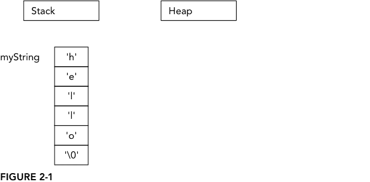

C++ 包含了来自 C 语言的用于操作字符串的函数。这些函数定义在 `<cstring>` 头文件中。作为一条经验法则，这些函数不处理内存分配。例如，`strcpy()` 接受两个字符串作为参数。它将第二个字符串复制到第一个字符串上，无论是否放得下。下面的代码尝试为 `strcpy()` 构建一个包装器，分配正确数量的内存并返回结果，而不是接收一个已经分配好的字符串。它使用 `strlen` 函数来查找字符串的长度。调用者负责释放由 `copyString()` 分配的内存。

```cpp
char* copyString(const char* str)
{
    char* result = new char[strlen(str)]; // BUG！差了1！
    strcpy(result, str);
    return result;
}
```

`copyString()` 函数的写法是错误的。`strlen()` 函数返回的是字符串的长度，而不是存储它所需的内存大小。对于字符串 "hello"，`strlen()` 将返回 5。为字符串分配内存的正确方法是在实际字符所需的空间基础上加 1。随处加 1 似乎有点不自然。遗憾的是，它就是这样运行的，在处理 C 风格字符串时请记住这一点。正确的实现方式如下：

```cpp
char* copyString(const char* str)
{
    char* result = new char[strlen(str) + 1];
    strcpy(result, str);
    return result;
}
```

记住 `strlen()` 只返回字符串中实际字符的数量，一个方法是考虑一下如果你为一个由几个其他字符串组成的字符串分配空间会发生什么。例如，如果你的函数接受三个参数并返回这三个字符串拼接后的字符串，情况会怎样？为了获得恰好足够的空间，应该是三个字符串的长度之和，加上末尾的 `'\0'` 字符。如果 `strlen()` 返回的是包含 `'\0'` 在内的长度，那么分配的内存就太大了。以下代码使用 `strcpy` 和 `strcat` 来执行此操作。

```cpp
char* appendStrings(const char* str1, const char* str2, const char* str3)
{
    char* result = new char[strlen(str1) + strlen(str2) + strlen(str3) + 1];
    strcpy(result, str1);
    strcat(result, str2);
    strcat(result, str3);
    return result;
}
```

C 和 C++ 中的 `sizeof()` 运算符可以用于获取数据类型或变量的大小。例如，`sizeof(char)` 返回 1，因为 `char` 的大小为 1。然而，在 C 风格字符串的语境中，`sizeof()` 等同于 `strlen()`。你不应该使用 `sizeof()` 来尝试获取字符串的大小。如果 C 风格字符串存储为 `char[]`，那么 `sizeof()` 返回的是字符串实际使用的内存，包括 `'\0'` 字符。例如：

```cpp
char text[] = "abcdef";
size_t s1 = sizeof(text); // 是 7
size_t s2 = strlen(text); // 是 6
```

如果 C 风格字符串存储为 `char*`，那么 `sizeof()` 返回的是指针的大小！例如：

```cpp
const char* text2 = "abcdef";
size_t s3 = sizeof(text2); // 取决于平台
size_t s4 = strlen(text2); // 是 6
```

在 32 位下编译时，s3 将为 4，在 64 位下编译将为 8，因为它返回的是 `const char*` 的大小，即一个指针。

操作字符串的函数完整列表可以在 `<cstring>` 头文件中找到。

> **警告**：当你在 Microsoft Visual Studio 中使用 C 风格字符串函数时，编译器可能会向你提供与安全相关的警告，甚至关于这些函数已过时的错误。你可以使用其他 C 标准库函数来消除这些警告，例如 `strcpy_s()` 或 `strcat_s()`，它们是“安全库”标准（ISO/IEC 24731）的一部分。然而，最好的解决方案是切换到 C++ 字符串类，将在本章后面部分讨论。

## 字符串字面量

你可能在 C++ 程序中见过用引号括起来字符串。例如，以下代码通过包含字符串本身来输出字符串 hello，而不是包含它的变量：

```cpp
cout << "hello" << endl;
```

在上一行代码中，"hello" 是一个字符串字面量，因为它是作为一个值编写的，而不是变量。与字符串字面量关联的内存是只读区域。这允许编译器通过重用等效字符串字面量的引用来优化内存使用。也就是说，如果你的程序使用了 500 次字符串字面量 "hello"，编译器允许在内存中只创建一个 hello 的实例。这就是字面量池化。

## 动态字符串 (Dynamic Strings)

字符串需要执行任何内存重新分配，或者在字符串对象被销毁时。你应该在使用结果之前调用该方法，以便它准确地反映字符串当前的内容，你绝对不能从函数中返回在基于栈的字符串上调用的 `c_str()` 结果。

请参阅标准库参考，例如 http://www.cppreference.com/ 或 http://www.cppplus.com/reference/，以获取你可以对字符串执行的所有支持操作的完整列表。

## std::literals (std::字面量)

源代码中的字符串字面量通常被解释为 `const char*`。你可以使用标准用户定义字面量 "s" 将字符串字面量解释为 `std::string` 实例。例如：

```cpp
auto string1 = "Hello"; // string1 将是一个 const char*
auto string2 = "Hello World"s; // string2 将是一个 std::string
```

## 数值转换 (Numeric Conversions)

`std` 命名空间包含了许多辅助函数，可以轻松地将数值转换为字符串或将字符串转换为数值。以下函数可将数值转换为字符串：

- `to_string(int val)`
- `to_string(unsigned val)`
- `to_string(long val)`
- `to_string(unsigned long val)`
- `to_string(long long val)`
- `to_string(unsigned long long val)`
- `to_string(float val)`
- `to_string(double val)`
- `to_string(long double val)`

它们的使用非常简单。例如，以下代码将 long 值转换为字符串：

```cpp
long double d = 3.14L;
string s = to_string(d);
```

反向转换通过以下同样定义在 `std` 命名空间中的函数完成。在这些原型中，`str` 是你想转换的字符串，`idx` 是将接收第一个非转换字符索引的指针，`base` 是转换期间应该使用的数学进制。`idx` 指针可以是空指针，在这种情况下它将被忽略。如果无法执行任何转换，这些函数将抛出 `invalid_argument`；如果转换后的值超出返回类型的范围，则将抛出 `out_of_range`。

```cpp
int stoi(const string& str, size_t *idx=0, int base=10);
long stol(const string& str, size_t *idx=0, int base=10);
unsigned long stoul(const string& str, size_t *idx=0, int base=10);
long long stoll(const string& str, size_t *idx=0, int base=10);
unsigned long long stoull(const string& str, size_t *idx=0, int base=10);
float stof(const string& str, size_t *idx=0);
double stod(const string& str, size_t *idx=0);
long double stold(const string& str, size_t *idx=0);
```

例如：

```cpp
const string s = "1234";
int i = stoi(s); // i 将是 1234
```

## 原始字符串字面量 (Raw String Literals)

原始字符串字面量是可以跨越多行代码的字符串字面量，不需要转义嵌入的双引号，且 `\` 和 `\n` 等转义序列不会被视为转义序列，而是作为普通字符处理。转义序列在第 1 章中讨论。例如，如果你用普通字符串字面量编写以下内容，将得到编译器错误，因为字符串没有包含转义的双引号：

```cpp
string str = "Hello "World"!"; // 错误！
```

在普通字符串中，你必须这样对引号进行转义：

```cpp
string str = "Hello \"World\"!";
```

使用原始字符串，你无需对引号进行转义：

```cpp
string str = R"(Hello "World"!)";
```

原始字符串可以跨越多行：

```cpp
string str = R"(Hello
World!)";
```

## 为公共方法添加注释

为公共方法添加注释可以实现两个作用。首先，你有机会用英文说明任何你在代码中无法表达的内容。例如，在 C++ 代码中，实际上没有方法可以指示数据库对象的 `saveRecord()` 方法只能在调用 `openDatabase()` 方法后才能被调用。然而，注释是记录这一限制的完美之处，如下所示：

```cpp
/**
 * saveRecord()
 * 将给定的记录保存到数据库。
 * 如果没有先调用 `openDatabase()` 方法，则此方法将抛出 "DatabaseNotOpenedException"。
 */
```

对公共方法添加注释的第二个作用是说明用法信息。你所使用的 C++ 语言并没有提供方法让你说明返回值实际代表什么。例如，`saveRecord()` 方法的声明可能指示它返回一个 `int`，但仅仅阅读声明的人并不知道这个 `int` 的什么意思。其他辅助数据也可以包含在注释中，如下例所示：

```cpp
/**
 * saveRecord()
 * 将给定的记录保存到数据库。
 * 参数：
 * Records rec：要保存到数据库的记录。
 * 返回：int
 * 表示已保存记录 ID 的整数。
 * 抛出：
 * 如果没有先调用 `openDatabase()` 方法，则抛出 DatabaseNotOpenedException。
 */
```

有时，函数的参数和返回类型是通用的，可以传递各种信息。在这种情况下，你只需要准确记录传递的是什么类型的类型。例如，Windows 中的消息处理器接受两个参数 `LPARAM` 和 `WPARAM`，并返回一个 `RESULT`。这三者都可以用于传递任何内容，但你无法更改它们的类型。通过类型转换，它们可以用于传递简单的整数或指向某些对象的指针。你的文档可能如下：

```cpp
/**
 * 参数：
 * WPARAM wparam (WPARAM) (int)：表示……的整数。
 * LPARAM lparam (LPARAM) (string)：表示……的字符串。
 * 返回：(RESULT) (Record*)
 * 错误时返回 `nullptr`，否则返回表示……的 Record 指针。
 */
```

大多数编辑器允许你绑定按键来执行某些操作。你可以绑定一个按键，让编辑器自动插入一个标准的注释块，随后你在其中填写正确的信息。例如，该按键可以自动插入以下注释模板。

```cpp
/*
 * func()
 * 函数描述
 * 参数：
 * int param1: 参数 1。
 * 返回：
 * int
 * 表示……的整数。
 * 抛出：
 * Exception1 如果……
 * 注意：
 * 额外的备注……
 */
```

## 为解释复杂代码添加注释

良好的注释在源代码内部也同样重要。在一个处理用户输入并写入控制台的简单程序中，可能很容易阅读并理解所有代码。然而，在专业领域中，你经常需要编写在算法上很复杂或通过肉眼观察难以理解的代码。

考虑以下代码。它写得很好，但可能无法立即看出它在做什么。如果你以前见过这种算法，你可能会认出它，但一个新手可能无法理解代码是如何工作的。

```cpp
void sort(int intArray[], int inSize)
{
  for (int i = 1; i < inSize; i++) {
    int element = intArray[i];
    int j = i - 1;
    while (j >= 0 && intArray[j] > element) {
      intArray[j+1] = intArray[j];
      j--;
    }
    intArray[j+1] = element;
  }
}
```

更好的方法是包含描述正在使用的算法的注释，并记录（循环）不变性。不变性是在代码执行期间必须为真的条件，例如循环迭代。在下面的修改函数中，顶部的详尽注释从高层面解释了算法，内联注释则解释了可能引起困惑的特定行。

```cpp
/*
 * 实现了“插入排序”算法。该算法将
 * 数组分为两部分——排序部分和未排序部分。
 * 检查从位置 1 开始的元素。数组中
 * 较早的所有内容都在排序部分，因此算法会处理每个元素，
 * 直到找到当前元素正确的位置。当
 * 算法处理最后一个元素时，整个数组就已排序完毕。
 */

void sort(int in[], int inSize) {
    // 从位置 1 开始并检查每个元素。
    for (int i = 1; i < inSize; i++) {
        // 不变性：范围 0 到 i-1（包含边界）内的所有元素都是排序的。
        int element = in[i];
        // 标记数组中排序部分的位置。
        int j = i - 1;
        // 只要排序数组中的当前槽位大于元素
        while (j >= 0 && in[j] > element) {
            in[j+1] = in[j];
            j--;
        }
        // 排序数组中的当前位置
        // *不* 大于元素，所以这是它的新位置。
        in[j+1] = element;
    }
}
```

新代码更冗长，但不熟悉排序算法的读者在有注释的情况下，更有可能理解它。

## 为传递信息而添加注释

使用注释的另一个原因是提供比代码更高层次的信息。例如，某些组织可能想要跟踪作者。以下显示了包含日期的几种实例。在某些情况下，内联注释是不受欢迎的。

```cpp
int saveRecord(Record& rec) {
    if (!DatabaseOpen) {
```


```cpp
throw DatabaseOpenedException();
}
}
```

```cpp
int id = db->saveRecord(rec);
if (id == -1) return -1; // 为了解决142
rec.setId(id); // TODO: 如果 setId() 抛出异常怎么办？
return id;
```

日志也可以包含在文件的开头。以下显示了这样的日志。

```cpp
/*
 * 日期变更
 * 110413 REQ#005: <marc> 不要归一化值。
 * 110417 REQ#006: <marc> 使用 nullptr 代替 NULL。
 */
```

然而，当你使用版本控制解决方案（第24章）时，这可能并不是必要的。它们提供了带有日期、作者的修订历史，如果使用得当，还可以记录每次修改并引用更改请求。你应该单独提交每个请求。例如，如果你在一个文件中实现两个更改请求，你应该检出文件，实现第一个更改请求，并提交相应的日志请求。只有这样你才能再次检出文件处理第二个请求。如果你同时工作，可以对源文件进行分支，在一个分支中处理第一个更改请求，在另一个分支中处理第二个更改请求。完成后，你可以合并两个分支，并为每个分支添加相应的注释。通过这种方法，你不需要手动在文件开头维护日志。

很容易过度使用注释。良好的方法是与你的小组讨论哪些类型的注释是最有用的以及格式是什么。例如，如果小组的某成员使用“TODO”来标记需要处理的代码，但其他人不知道这个约定，那么这些代码可能会被忽略。

> 注意 如果你的小组决定使用元数据注释，请确保大家包含的信息相同，否则你的文件将不一致。

## 注释风格

每个组织对代码注释都有不同的方法。在某些环境中，会强制特定的风格以为代码提供通文档标准。在其他情况下，注释的数量和风格留给程序员决定。以下示例展示了各种注释方法。

## 逐行注释

避免缺乏文档的一种方法是强迫自己通过为每一行添加注释来过度文档。为每行代码注释可以确保每一行都有特定的原因。

你所写的每一个内容。在现实中，在大规模范围内进行大量的注释是不可扩展的、混乱且枯燥的。例如，考虑以下无用的注释。

```cpp
int result; // Declare an integer to hold the result.
result = doocad.getResult(); // Get the dood's result.
if (result % 2 == 0) { // If the result mod 2 is 0 ...
    logError(); // then log an error,
} else { // otherwise
    logSuccess(); // log success.
} // End If/else
return result; // Return the result
```

这段代码中的注释每一行都有，像构成了一个易于阅读的故事。如果你假设读者至少具有基础的 C++ 技能，这完全没有用处。注释没有为代码增加额外的信息。具体来说，看这一行：

```cpp
if (result % 2 == 0) { // If the result mod 2 is 0 ...
```

这条注释只是代码的英文翻译。它没有解释程序员为什么要对值 2 使用取模运算符。一个更好的注释应该是：

```cpp
if (result % 2 == 0) { // If the result is even ...
```

修改后的注释对大多数程序员来说仍然很直观，但它提供了关于代码的额外信息。结果被 2 取模是因为代码需要检查结果是否为偶数。

尽管注释倾向于冗长和多余，但在代码原本难以理解的情况下，大量的注释可能是很有用的。下面的代码也注释了每一行，但这些注释实际上是有帮助的。

```cpp
// Calculate the doodad. The start, end, and offset values come from the
// on page 96 of the "Dood API v1.6".
result = doocad.calculate(kStart, kEnd, kOffset);
// To determine success or failure, we need to bitwise AND the result with
// the processor-specific mask (see "Dood API v1.6", page 201).
result &= getProcessorMask();
// Set the field value based on the "Marigold Formula.
// (see "Dood API v1.6", page 136)
setUserField(result + kMarigoldOffset) / MarigoldConstant + MarigoldConstant);
```

这段代码脱离了上下文，但注释让你对每一行的作用有一个很好的理解。如果没有这些注释，涉及 `&` 和神秘的“Marigold 公式”的计算将难以解读。

> 注意：注释每一行代码通常是没用的，但如果代码复杂到需要注释，请不要将代码翻译成英文：而是要解释到底发生了什么。

## 前缀注释 (Prefix Comments)

你的小组可能决定在所有源文件的开头使用一个标准注释。这是记录关于程序和特定文件的重要信息的绝佳机会。你可能想在每个文件的顶部记录的信息示例包括：

- 最后修改日期
- 原始作者
- 如前所述的变更日志
- 该文件解决的功能 ID
- 版权信息
- 对文件/类的简要描述
- 未完成的功能
- 已知 Bug

你的开发环境可能允许你创建一个模板，在创建新文件时自动带上你的前缀注释。某些版本控制系统（如 Subversion (SVN)）甚至可以通过填充元数据来提供帮助。如果你的注释包含 `$Id$`，SVN 可以自动扩展注释以包含作者、文件名、修订号和日期。

这里显示了一个前缀注释的示例：

```cpp
/*
 * $Id: Watermelon.cpp,123 2004/03/10 12:52:33 marcg $
 * Implements the basic functionality of a watermelon. All units are expressed
 * in terms of seeds per cubic centimeter. Watermelon theory is based on the
 * white paper "Algorithms for Water Processing.
 * The following code is (c) copyright 2011, FruitSoft, Inc. ALL RIGHTS RESERVED
 */
```

## 固定格式注释 (Fixed-Format Comments)

以可以被外部文档构建器解析的标准格式编写注释是一种日益流行的编程实践。在 Java 语言中，程序员可以使用标准格式编写注释，允许一个名为 JavaDoc 的工具自动为项目创建超链接文档。对于 C++，有一个名为 Doxygen 的免费工具（可在 www.doxygen.org 获取），它可以解析注释以自动构建 HTML 文档、类图、UNIX 手册页和其他有用文档。Doxygen 识别并解析 C++ 程序中 JavaDoc 风格的注释。以下代码显示了

```cpp
/**
 * Implements the basic functionality of a watermelon
 * TODO: Implement updated algorithms!
 */
class Watermelon
{
public:
```

```cpp
/**
 * @param initialSeeds The starting number of seeds
 * Watermelon(int initialSeeds);
/**
 * Computes the seed ratio, using the Marigold algorithm.
 * @param slowCac Whether or not to use long (slow) calculations
 * @return The Marigold ratio
 */
double calcSeedRatio(bool slowCac);
```

Doxygen 识别 C++ 语法和特殊指令（如 `@param` 和 `@return`）以生成可自定义的输出。图 3-1 显示了 Doxygen 生成的 HTML 类引用示例。图 3-1 中自动生成的文档文件在开发过程中非常有帮助，因为它允许开发者浏览类及其关系的高层描述。你的小组可以根据你们所采用的注释样式轻松地自定义 Doxygen 等工具。理想情况下，你的小组设置了一台机器。

## 随笔注释 (Ad Hoc Comments)

大多数时候，根据需要使用注释。以下是注释的指南：

- 不要把注释放在代码内部。
- 使用注释来解释“为什么”，而不是“是什么”。
- 使用注释记录复杂的逻辑。
- 避免冗余的注释。

## 自文档代码 (Self-Documenting Code)

编写得良好的代码并不总是需要注释。如果你发现自己在为每一行代码添加注释，请考虑重写代码。目标是让代码足够清晰，使其意图一目易见。

## 通过重构进行分解

有时候，当你喝了几杯咖啡并真正进入编程状态时，写代码的速度会非常快，导致生成的代码虽然完全按照预期运行，但远不美观。所有程序员都会偶尔遇到这种情况。在项目过程中，短时间内的高强度编码有时是效率最高的时候。随着代码的修改，密集代码也会随着推推产生。随着新需求和 Bug 修复的出现，现有代码会通过细小的修改进行调整。计算技艺指的是小量代码的逐渐积累，最终将一段原本优雅的代码变成一个补丁和特例的各种杂烩。

重构是调整代码结构的行为。以下是一些你可以用于重构代码的示例技术。请参考附录 B 列出的重构书籍以获取更全面的列表。

- 允许抽象的技术：
    - 封装字段（`Encapsulate Field`）：将其设置为私有，并通过 getter 和 setter 方法提供访问权限。
    - 泛化类型（`Generalize Type`）：创建更通用的类型以允许更多的代码共享。

- 将代码拆分为更具逻辑部分的技术：
    - 提取方法（`Extract Method`）：将一个大方法的一部分转换为新方法，使其更易理解。
    - 提取类（`Extract Class`）：将现有类的一部分代码移动到新类中。

- 改进名称和代码位置的技术：
    - 移动方法或移动字段（`Move Method` 或 `Move Field`）：移动到更合适的类或源文件中。
    - 重命名方法或重命名字段（`Rename Method` 或 `Rename Field`）：更改名称以更好地揭示其目的。
    - 下推（`Push Down`）：在面向对象编程中，移动到派生类。

无论你的代码在初始时是一块密集的不可读代码，还是演变成那样的，定期通过重构来清除积累的临时补丁都是必要的。通过重构，你重新审现有代码并重写它们，使其更具可读性和可维护性。重构是一个重新审代码分解的机会。如果代码的目的发生了变化，或者它从根本没有被分解，当你重构代码时，请审视它并判断是否需要将其分解成更小的部分。

## 通过设计进行分解

如果你使用模块化分解，并在处理每个模块或函数时都考虑哪些部分可以推迟到以后处理，那么你的程序通常会比你在编码时完整实现每个功能要稀疏且更有组织。

当然，在跳入代码之前，你仍然应该对你的程序进行一些设计。

## 书中的分解

你将在本书的许多示例中看到分解。在很多情况下，提到了方法但没有显示实现，因为它们与示例无关且会占用过多的空间。

## 命名

编译器有几条命名规则。名称不能以数字开头。你还不能使用包含双下划线的名称（例如，`__name`）或以下划线开头的名称（例如，`_Name`），因为这些是预留给编译器和标准库实现的。除此外，名称的存在仅仅是为了帮助你和你的同事与程序中的各个元素工作。鉴于此目的，程序员在程序中使用不具体或不恰当名称的频率之高，令人惊讶。

## 选择良好的名称

变量、方法、函数或类的最佳名称能够准确地描述该项的用途。名称还可以隐含信息，例如类型或特定用法。当然，真正的测试是其他程序员是否理解你正试图通过某个特定名称传达的内容。

除了你组织遵循的规则外，命名没有固定的规则。然而，有些名称很少是合适的。下表显示了命名连续体两端的的一些名称。

| 好的名称 | 坏名称 |
| --- | --- |
| sourceName, destinationName | thing1, thing2 |
| 区分两个对象 | 太泛泛 |
| gSettings | globalUserSpecificSettingsAndPreferences |
| 传达全局状态 | 太长 |
| mNameCounter | mNC |
| 传达数据成员状态 | 太晦涩、简洁 |
| calculateOffset | doAction() |
| 简单、准确 | 太泛泛、不精确 |
| mTypeString | typeSTR256 |
| 视觉上舒适 | 一个只有计算机才会爱的名称 |
| mWelshRebeit | mIHateLarry |
| 可以接受的内部梗 | 不可接受的内部梗 |
| errorMessage | string |
| 描述性名称 | 非描述性名称 |
| sourceFile, destinationFile | srcFile, dFile |
| 无缩写 | 有缩写 |

## 命名规范

选择名称并不总是需要大量的思考和创造。在很多情况下，你可能希望使用标准的命名技术。以下是你可以使用标准名称的一些数据类型。

### 计数器

在编程生涯的早期，你可能看到使用变量“i”作为计数器的代码。习惯上分别使用 `i` 和 `j` 作为计数器和内循环计数器。然而，要小心嵌套循环，当你实际上指的是“jth”元素时却提到了“th”元素，这是一个常见的错误。有些程序员倾向于使用 `outerLoopIndex` 和 `innerLoopIndex` 等计数器，有些人甚至对使用 `i` 和 `j` 作为计数器表示反感。

### 前缀

许多程序员以一个字母开头，提供有关变量类型或用用的信息。另一方面，许多程序员反感使用任何种的前缀，因为它们可能会使未来的演变得难以维护。例如，如果一个变量改为非静态，这意味着你必须重命名该名称的所有引用。这通常非常耗时，大多数程序员不会这样做。

下表显示了用于命名变量的潜在前缀：

| 示例名称 | 字面含义 | 用途 |
| --- | --- | --- |
| m | 成员 | 数据成员 |
| s | 静态 | 静态变量 |
| ms | 静态 | 静态成员 |
| k | 常量 | 常量值 |
| b | 布尔值 | 布尔值 |
| is | 布尔值 | 布尔值 |
| n | 数字 | 计数器 |

## Getter 和 Setter

如果你的类包含一个数据成员，如 `mStatus`，习惯上通过 `getStatus()` 和 `setStatus()` 提供访问权限。C++ 语言对这些方法没有命名规定，但你的组织可能希望这样做。

## 大写

代码名称的大小写有多种方式。作为大多数代码元素，重要的是你的小组采用一种方法。一种导致代码混乱的方法是用下划线表示边界（`priority_queue`），另一种是使用大写（`Queue`）。函数和方法传统上大写，但正如你看到的，我在书中使用了小写函数和方法以示区别。类似的写写风格用于类和数据名称。

## 命名空间常量

假设你正在编写一个带有图形界面的程序。程序有几个菜单，包括 File、Edit 和 Help。为了引用每个菜单的 ID，你可能决定使用常量。引用 Help 菜单的完美名称是 `kHelp`。

当你为主窗口添加一个按钮时，`kHelp` 这个名称将不再工作。你还需要一个常量来引用按钮的 ID，但 `kHelp` 已经被占用了。

一个可能的解决方案是将你的常量放在不同的命名空间中，这在第一章中讨论。你创建了命名空间 `Menu` 和 `Button`。每个命名空间都有一个 `kHelp` 常量，你可以使用 `Menu::kHelp` 和 `Button::kHelp`。另一种更优的解决方案是使用枚举，这些在第一章中介绍。

## 匈牙利命名

匈牙利命名是一种在 Microsoft Windows 程序员中流行的变量和数据成员命名规范。基本思想是不再使用单字母前缀如 `m`，而是使用更详细的前缀来指示额外的。

以下行代码使用了匈牙利命名风格：

“匈牙利命名”术语源于其发明者 Charles Simony 是匈牙利人。有些人也说，使用匈牙利法的程序最终看起来就像是用外语编写的。由于这个原因，某些程序员倾向于不喜欢匈牙利命名。在书中，使用了前缀，但不是匈牙利命名。命名良好的变量不需要前缀之外的额外上下文。例如，数据成员 `mName` 就已经说明了一切。

## 以风格化的使用语言特性

> 注意：良好的命名可以传达其用途信息，而又不会让代码变得不可读。

## 带风格的 C++ 语言特性

C++ 语言允许你进行各种糟糕的、不可读的操作。看看这个荒谱的：

```cpp
i++ + i;
```

这种写法不清晰，但更重要的是，它的行为在 C++ 标准中是未定义的。问题在于 `i++` 使用了 `i` 的值，但具有递增它的副作用。标准没有规定这个递增是在何时完成的，只说该副作用（递增）将在序列点 `";"` 之后可见；编译器可以在执行该行代码的任何点执行它。你无法知道 `i` 的哪个值将用于用于 `++`。在不同的编译器和平台上运行可能会导致不同的结果。下面是另一个你应该避免的未定义行为示例。

```cpp
a[i] = i;
```


凭借 C++ 提供的强大功能，考虑如何以风格化而非恶劣的方式来使用这些语言特性是非常重要的。

## 使用常量

糟糕的代码通常充斥着“魔数”。在某些函数中，代码可能在使用 `2.71828`。为什么要用 `2.71828`？这个值意味着什么？具有数学背景的人可能觉得显而易见，这代表了超越数 `e` 的近似值，但大多数人并不知道。语言提供了为不改变的值赋予符号名称，例如 `2.71828`。

```cpp
const double kApproximationForE = 2.71828182845904523536;
```

## 使用引用代替指针

传统上，C 程序员首先学习 C。在 C 中，指针是唯一的按引用传递机制，并且它们在多年里一直运行良好。在某些情况下仍然需要指针，但在很多情况下你会切换到引用。如果你先学了 C，你可能认为引用并没有为语言添加任何新功能。你可能认为它们仅仅是为已经能提供的指针引入了一种新语法。

使用引用而不是指针有几个优点。首先，引用比指针更安全，因为它们不直接处理内存地址且不能为 `nullptr`。其次，引用在风格上比指针更美观，因为它们使用与变量相同的语法，避免了 `*` 和 `&`。它们也容易使用，所以你将引用纳入你的风格调中应该没有问题。遗憾的是，有些程序员认为如果

# 第 3 章 编码风格

在函数调用中看到 `&`，被调用的函数就会改变对象；如果他们没有看到 `&`，则必须是按值传递。对于引用，他们说除非查看原型，否则不知道函数是否会改变对象。这是一种错误的思维方式。传递指针可能是 `const T`。指针和引用都可以修改对象，也可以不，取决于函数原型是否使用 `const T`、`T*`、`const T&` 或 `T*`。因此，你需要查看原型来判断函数可能会更改对象。

引用的另一个用处是它们明确了内存的所有权。如果你正在编写一个方法，另一个程序员向你传递一个对象的引用，那么很清楚你可以读取并可能修改该对象，你没有办法释放它的内存。如果你传递一个指针，这一点就很明确：你需要删除对象来清理内存吗？还是由调用者这样做？处理内存的首选方法是使用第 1 章引入的智能指针。

## 使用自定义异常

C++ 让忽略异常变得容易。语法上没有任何东西强迫你处理异常，你可以很容易用传统的机制（如返回 `nullptr` 或错误标志）编写出容错性程序。

异常提供了一种丰富得错误处理机制，而自定义异常允许你根据需求定制这种机制。例如，用于网络浏览器的自定义类型可以包含以下字段：指定包含错误的网页、错误发生时的网络状态以及额外的上下文信息。

第 13 章包含了大量关于 C++ 的信息。

> 注意：语言特性的存在是为了帮助程序员。理解并利用有助于良好编程风格的特性。

## 格式化

许多小组因为代码格式的争论而破裂，友谊毁。在大学里，我的一个朋友和同学就 `if` 语句中使用空格发生过激烈辩论，以至于人们停下来确保一切正常。

如果你的组织有代码格式标准，请认为自己很幸运。你可能不喜欢他们实施的标准，但至少你不需要为此争论。如果你团队中的每个人都在写自己的代码风格，请尽量表现得宽容。正如你所看到的，有些做法仅仅是口味问题，而另一些实际上会让团队工作变得困难。

## 大括号对齐之争

也许最经常被争论的点是把标记代码块的大括号放在哪里。大括号的使用有几种风格。在本书中，大括号放在与前导语句同一行，但函数、类或方法名除外。这种风格在代码（以及整本书）中显示。

```cpp
void someFunction()

{

  if (condition()) {

    cout << "condition was true" << endl;

  } else {

    cout << "condition was false" << endl;

  }

}
```

这种风格节省了垂直空间，同时通过缩进显示代码块。一些程序员会认为，保留垂直空间在现实世界的编码中并不重要。这里显示了一种更冗长的的风格。

```cpp
void someFunction()

{

  if (condition())

  {

    cout << "condition was true" << endl;

  }

  else

  {

    cout << "condition was false" << endl;

  }

}
```

有些程序员甚至在水平空间上非常慷慨，产生这样的代码：

```cpp
void someFunction() {

  if (condition()) {

    cout << "condition was true" << endl;

  } else {

    cout << "condition was false" << endl;

  }

}
```

当然，我不会推荐任何，因为

> 注意：在选择代码块风格时，重要的考虑因素是你能清晰看到哪个块属于哪个。

## 关于空格和括号的争论

单行代码的格式也是争议的来源。再次，我不会提倡特定的方法，但显示了一些你可能会遇到的风格。

在本书中，我在任何关键字后使用空格，在任何运算符前后使用空格，在参数列表或调用中的每个逗号后使用空格，并使用括号明确操作顺序，如下：

```cpp
if (i == 2) {

  j = i + (k / m);

}
```

另一种形式在风格上像函数，关键字和左括号之间没有空格：

```cpp
if( i == 2 ) {

  j = i + k / m;

}
```

## 空格与制表符

空格和制表符的使用不仅仅是风格偏好。如果你们小组没有达成约定，程序员合作时会出现重大问题。最明显的问题发生在 Alice 使用四个空格缩进代码，而 Bob 使用五个空格时；当他们一起处理同一个文件时，双方都无法正常显示代码。更糟糕的问题发生在 Bob 重新格式化代码使用 Tab 的同时，Alice 正在编辑同一段代码；许多版本控制系统无法合并 Alice 的更改。

大多数（并非所有）编辑器都有空格和制表符的可配置设置。有些环境会适应读入代码的格式，或者即使使用了 Tab 键也始终使用空格。如果你有一个灵活的环境，你更有机会与其他人的代码协作。记住制表符和空格是不同的，因为制表符可以是任何长度，而空格始终是一个空格。

由于多种原因，维持这种风格的一致性是困难的。在 `const` 的情况下，有时程序员并没有接受过如何使用它的教育。你最终会遇到旧代码或不精通 `const` 的库函数。良好的程序员会使用 `const_cast` 来挂起变量的 `const` 属性，而缺乏经验的程序员则会开始从调用函数处撤销 `const` 属性，最终再次导致程序从不使用 `const`。

其他时候，代码风格的标准化往往会与程序员个人的喜好和偏见相冲突。你团队的文化使得执行严格的风格指南变得不实际。在这种情况下，你可能必须决定哪些元素确实需要标准化（例如变量名和制表符），哪些元素可以安全地留给个人（可能是空格和注释风格）。你甚至可以获取或编写脚本来自动纠正风格“错误”，或在标记代码错误的同时标记风格问题。某些开发环境（如 Microsoft Visual C++ 2013）支持根据你指定的规则对代码进行自动格式化。这使得编写始终遵循已配置指南的代码变得轻而易举。

## 总结

C++ 语言提供了许多风格工具，但没有任何关于如何使用它们的正式指南。归结底，任何风格约定的衡量标准取决于其被广泛程度以及对代码可读性的收益有多大。作为团队的一部分编写代码时，你应该在过程早期提出风格问题，并作为讨论使用什么语言和工具的一部分。

关于风格最重要的一点是要意识到它是编程中一个重要方面。学会在将代码提供给他人之前检查你代码的风格。在与你交互的代码中识别良好的风格，并采用你和你的组织认为有用的约定。

本章结束了本书的第一部分。下一部分将讨论高层次的软件设计。

# 第二部分
专业 C++ 软件设计

- 第 4 章：设计专业的 C++ 程序
- 第 5 章：面向对象的设计
- 第 6 章：面向重用的设计

# 第 4 章
设计专业的 C++ 程序

本章包含哪些内容？

- 编程设计的定义
- 编程设计的重要性
- C++ 特有的设计方面
- 有效 C++ 设计的两个基本主题：抽象和重用
- 可用于重用的不同类型代码
- 代码重用的优缺点
- 重用代码的通用策略和指南
- 开源库
- C++ 标准库

在你的应用程序中编写第一行代码之前，你应该先设计你的程序。你将使用什么数据结构？你将编写哪些类？当你分组工作时，这个计划尤为重要。想象一下坐下来写一个程序，却完全不知道负责同一程序的程序的同事在计划什么！在本章中，你将学习如何使用专业的 C++ 方法进行 C++ 设计。

尽管设计非常重要，但它可能是软件工程过程中最被误解和最少被使用的方面。程序员往往在没有明确计划的情况下就投入应用中：他们边写代码边设计。这种方法可能会导致晦涩且过度的设计。它还会让开发、调试和维护任务变得更加困难。尽管这不符合直觉，但在项目初期投入额外时间进行适当的设计，实际上在项目的整个生命周期内节省了时间。

## 什么是编程设计？

你的程序设计（或软件设计）是你为了实现程序的功能和性能需求而将实现的架构规范。非正式地说，设计就是你计划编写程序的方式。你通常应该以设计文档的形式编写你的设计。虽然每家公司或项目都有自己的所需设计格式变体，但大多数文档共享相同的布局，包括两个主要部分：

1. 程序的大致子系统划分、子系统之间的数据流、子系统之间的接口和依赖关系、每个子系统的输入和输出，以及通用线程模型。

2. 每个子系统的细节，包括细分为类、类层次结构、数据结构、算法、特定的线程模型以及错误处理规范。

设计文档通常包含显示子系统交互和类层次结构的图表和表格。UML（统一建模语言）是行业使用的绘图语言。请参考附录 B 中的参考文献来设计设计。设计文档的确切格式没有思考设计的过程本身重要。

> 设计的意义在你编写程序之前对其进行思考。

在开始编码之前，你通常应该尝试尽可能让你的设计尽完美。设计应该为程序提供一张地图，任何合理的程序员都可以遵循该地图来实现应用程序。当然，一旦你开始编写代码并遇到之前没有想到的问题，设计不可避免地需要修改。软件工程过程的设计赋予了你更改的灵活性。Barry W. Boehm 开发的螺旋模型是迭代过程的一个示例，应用程序按照周期开发，每个周期至少包含需求分析、设计和实现部分。第 24 章详细描述了各种软件工程过程模型。

## 编程设计的重要性

人们很容易跳过分析和设计步骤，或者草率地执行，以便尽快开始编程。没有什么比看到代码编译和运行更能带给你已经取得进展的印象了。当你已经多或少知道自己想要如何结构化程序时，将设计形式化、编写功能需求似乎是浪费时间。此外，如果不写关于你想要如何结构化程序的设计文档，很可能会导致问题。

### 编程设计的重要性

为了帮助你理解设计的重要性，想象你想盖一栋房子。当你第一次参观完工建筑时，发现厨房缺少一个水槽。建筑师为自己解释道：“在我们意识到没有空间时，厨房已经做好了三分之二了。与其重新开始，我们只是在旁边增加了一个房间。这样就行，对吧？”

如果你把建筑师的借口翻译成软件设计，它们听起来熟悉吗？你是否曾为水路等问题自己实现过“丑”的解决方案？例如，你可能会忘记在线程共享的数据结构中包含锁。当你意识到这个问题时，你决定在所有使用代码的地方手动执行锁。这很丑，但它行得通，你这样做。直到有人新加入项目，他们假设锁已经构建在数据结构中，结果导致了一个花费三周才追踪到的竞态条件错误。注意，这个锁问题只是一个拙劣替代方法的例子。显然，一个 C++ 程序员永远不会决定在每次访问时手动执行锁，而是会直接在类内部以无锁的方式集成锁。在编写代码之前将设计形式化可以让你了解一切是如何结合在一起的。正如房子的蓝图显示了房间之间如何关联和工作以满足房屋的需求一样，程序的设计显示了程序的子系统之间如何关联和工作以满足软件需求。没有设计计划，可能会错过子系统之间的连接、重用或共享信息的可能性以及完成任务的最简单方法。没有设计提供的“全局视图”，你可能会陷入具体的实现细节中，失去对整体架构和目标的追踪。此外，设计提供了所有项目成员都可以参考的书面文档。如果你使用迭代过程，请确保在每个周期期间保持设计更新。

如果之前的分析还没有说服你在编写代码之前进行设计，这里有一个直接进入编码失败未能导致最优设计的例子。假设你想写一个象棋程序。跳过在编程之前设计整个程序的设计，你决定从最简单的部分开始，慢慢移动到更困难的部分。遵循第一章介绍并在第 5 章中详细介绍的面向对象的视角，你决定用类来建模你的象棋子。你认为兵是最简单的象棋子，所以你从这里开始。在考虑了兵的特性和行为后，你编写了一个具有下表所示属性和行为的类：

| 类 | 属性 | 行为 |
|---|---|---|
| 兵 | 在棋盘上的位置 | 移动 |
| | 颜色（黑色或白色） | 检查移动合法性 |
| | 被吃 | 升变（到达对方边界时） |

当然，你并没有真正编写这个表格。你直接进入了实现阶段。对这个类满意后，你转向下一个棋子：主教。在考虑它的属性和功能后，你编写了一个具有下表所示属性和行为的类：

| 类 | 属性 | 行为 |
|---|---|---|
| 主教 | 在棋盘上的位置 | 移动 |
| | 颜色（黑色或白色） | 检查移动合法性 |
| | 被吃 | 提子 |

同样，你没有生成表格，而是直接跳到了编码阶段。然而，此时此刻你开始怀疑自己可能做错了。主教和兵看起来很相似。事实上，它们的属性是相同的，并且共享许多行为。虽然兵和主教的移动行为实现可能有所不同，但这两个棋子都需要移动的能力。如果你在跳入编码之前设计了兵，你就会意识到这些属性其实非常相似，并会找到某种方法只编写通用功能。第 5 章解释了此的面向对象设计技术。

此外，国际象棋的几个方面依赖于你程序的其他子系统。例如，在不知道将如何建模棋盘的情况下，你无法在象棋类中表示在棋盘上的位置。另一方面，也许你会在设计程序时让棋盘管理棋子，这种方式不需要棋子知道自己的位置。无论何种情况，在设计棋盘之前将位置编码在棋子类中都会导致问题。另一个例子是，在没有决定程序接口的情况下，你如何为棋子编写提子方法？它是图形化的还是文本的？棋盘看起来会什么样？问题在于子系统并不是孤立存在的——它们与其他子系统相互作用。大部分工作都在确定和定义这些关系。

## 为 C++ 设计

在为 C++ 设计时，有几个 C++ 语言方面你需要记住。

- C++ 拥有巨大的特性集。它几乎是 C 语言的完全超集，加上类和对象、运算符重载、异常、模板以及许多其他特性。语言的庞大使得设计成为了一项艰巨的任务。
- C++ 是一种面向对象的语言。这意味着你的设计应该包含类层次结构、类接口和对象交互。这种设计与 C 或或其他过程化语言中的“传统”设计非常不同。第 5 章重点关注 C++ 中的面向对象设计。
- C++ 拥有许多用于设计泛型和复用代码的设施。除了类和继承外，你还可以使用其他语言特性作为模板和运算符重载来实现有效设计。关于复用代码的设计技术将在本章后续部分进行详细讨论。
- C++ 提供了一个实用的标准库，包括字符串类、I/Oset以及许多常见的数据结构和算法。所有这些都便于 C++ 编码。
- C++ 是一种能够轻松容纳许多设计模式（或解决问题的常用方法）的语言。

处理设计可能会让人不知所措。我曾花几天几天在纸上涂草设计想法，划掉它们，写下更多想法，并重复这个过程。有时这个过程是有帮助的，在几天（或几周）之后，会得到一个简洁、高效的设计。其他时候，它可能会令人沮丧且一无获，但并不是白费精力。如果你必须重新实现一个证明是错误的设计，你可能会浪费时间。保持意识到自己是否正在取得真正的进展至关重要。如果你发现自己卡住了，请采取以下行动之一：

- 寻求帮助。咨询同事、导师、书籍或网页。
- 去做其他事情或先休息。以后再考虑这个设计选择。
- 做出决定并继续。即使这不是理想的解决方案，也要决定一个方案并尝试使用它。一个错误的选择很快就会显现出来。然而，它可能是一个可以接受的方法。也许没有一种简洁的方法来实现你想做的事情。有时，如果这是满足要求的唯一现实策略，你必须接受一个“丑陋”的解决方案。无论你决定什么，请确保你记录了你的设计，这样你和以后的人就知道你为什么那样做了。这包括记录你所拒绝的设计以及拒绝背后的理由。

> 请记住，良好的设计是困难的，做到这一点需要练习。不要指望一夜之间成为专家，如果你发现掌握 C++ 设计比 C++ 编码更难，也不要感到惊讶。

## C++ 设计的两个规则

C++ 中有两个基本的设计规则：抽象和复用。这些指南如此重要，以至于可以被视为本书的主题。它们在文中反复出现，并在所有领域的有效 C++ 程序设计中反复出现。

### 抽象

抽象原则通过现实世界的类比最容易理解。电视是许多家庭常见的简单技术设备。你可能对它的功能很熟悉：你可以开启和关闭、切换频道、调整音量并添加外部组件如扬声器、录像机和 DVD 播放器。然而，你能解释它内部是如何工作的吗？也就是说，你是否知道它是如何通过空气或电缆接收信号、翻译它们并在屏幕上显示它们的？大多数人无法解释电视是如何工作的，或者无法从它的外部接口推断其内部实现。我们通过它的接口与电视交互：电源按钮、频道调节和音量控制。我们不知道，也不关心电视是如何工作的；我们不在乎它是使用阴极射线管还是某种外星技术在屏幕上生成图像。

#### 从抽象中获益

抽象原则在软件中非常简单。你可以在不知道底层实现的情况下使用代码。一个平凡的例子是，程序可以调用 `<math>` 头文件中定义的 `sqrt()` 函数，而无需知道算法是如何计算平方根的。事实上，平方根计算的底层实现可以在库的版本之间发生变化，只要接口不变，你的函数就能继续工作。抽象原则也扩展到了类。当你使用 `ostream` 的 `cout` 对象将数据流到标准输出时，例如：

```cpp
cout << "这将显示这行文本" << endl;
```

#### 在你的设计中引入抽象

你应该设计函数和类，使其他程序员可以使用它们，而无需知道或依赖于底层实现。为了看到暴露实现的设计与隐藏实现的设计之间的区别，再次考虑国际象棋问题。你可能想用指向 `ChessPiece` 对象的指针的二维数组来实现棋盘。你可以这样声明和使用棋盘：

```cpp
ChessPiece* board[8];
...
ChessBoard[0][0] = new Rook();
```


然而，这种方法未能利用抽象的概念。每个使用棋盘的程序员都知道它是如何作为二维数组实现的。将该实现更改为其他形式（例如向量数组）将非常困难，因为你需要更改整个程序中对棋盘的所有使用。这里没有接口与实现的分离。

更好的方法是将棋盘建模为一个类。然后，你可以暴露一个接口来隐藏底层的实现细节。以下是 `ChessBoard` 类的示例：

```cpp
class ChessBoard {
  public:
    // 此示例省略了构造函数、析构函数和赋值运算符。
    void setPiece(ChessPiece* piece, int x, int y);
    ChessPiece& getPiece(int x, int y);
    bool isEmpty(int x, int y) const;
  private:
    // 此示例省略了数据成员。
};
```

注意，该接口并没有对任何底层实现做出任何承诺。`ChessBoard` 可以很容易地是一个二维数组，但接口并不要求这样做。更改实现不需要更改接口。此外，实现部分还可以提供额外的功能，例如边界检查。

由于接口的存在，对底层实现仅存在一个微小的承诺。`getPiece()` 返回一个引用，因此建议底层实现不要直接在集合中存储对象，而是存储指针或更好的对象智能指针，以避免别名问题（aliasing problems），这种问题可能很难追踪溯源。例如，`ChessBoard` 类的客户端存储了调用 `getPiece()` 返回的引用。如果 `Chess` 类直接在底层集合中存储对象，当 `Chess` 类需要为饼干分配内存时，返回的引用可能会失效。在集合中存储指针或智能指针可以避免这种引用失效问题。

这个示例希望能够说服你抽象是 C++ 编程中的一项重要技术。第 5 章将更详细地介绍抽象和面向对象的设计，第 7 章和第 8 章将提供关于编写类的所有细节。

## 复用

C++ 设计的根本规则是复用。同样，通过现实世界的类比来理解这一概念非常有帮助。假设你放弃了编程职业转而成为面包师。在工作的第一天，主厨师要求你烘烤饼干。为了完成订单，你准备了巧克力曲干的配方，混合原料，在饼干盘上摆好饼干，并将烤盘放入烤箱中。主厨师对结果非常满意。

现在，我要指出一点让你感到惊讶的事：是你自己制作了一个烤箱来烘烤饼干。难道不是你自己选择了黄油、面粉或自己的巧克力豆吗？我听到你在想：“那是理所当然的”。如果你是一个真正的厨师，这确实如此；但如果你是一个编写烘焙模拟游戏的程序员呢？在那种情况下，你可能会考虑编写程序的每一个组件，从巧克力豆到烤箱。或者，你也可以通过寻找可复用的代码来节省时间。也许你的同事写了一个模拟游戏，并且手里有一些不错的代码闲置在那里。也许它没有涵盖你需要的所有功能，但你可能可以对其进行修改并添加必要的功能。

另一件你认为理所当然的事情是，你遵循了饼干的配方，而不是自己发明。同样，在 C++ 编程中，这并不是理所当然的。虽然在 C++ 中有许多处理反复出现的问题的标准方法，但许多程序员在每个设计中都会重新发明这些策略。

## 复用代码

使用现有代码的想法并不新鲜。从你第一次用 `cout` 打印内容的那第一天起，你就在复用代码了。你并没有编写实际上将数据打印到屏幕上的代码。你使用了现有的 `cout` 实现来完成工作。

遗憾的是，程序员通常不会充分利用可用代码。你的设计应该考虑现有代码，并在适当的时候复用它。如何复用现有代码将在本章稍后部分详细讨论。

## 编写可复用代码

复用的设计主题适用于你编写的代码，也适用于你使用的代码。你应该设计程序，以便能够复用你的类、算法和数据结构。你和你的同事也应该能够在当前项目和未来的项目中使用这些组件。通常，你应该避免设计仅适用于当前情况的过于特定的代码。

在 C++ 中编写通用代码的一种语言技术是模板（template）。下面的示例显示了一个模板化的数据结构。如果你以前没见过这种语法，不要担心！第 11 章将深入解释该语法。

与其像之前那样编写一个存储 `ChessPieces` 的特定 `ChessBoard`，不如编写一个通用的 `GameBoard`，它可以用于任何类型的二维棋盘游戏，如国际象棋或跳棋。你只需要更改类声明，使要存储的棋子作为模板参数，而不是在接口中硬编码。模板看起来可能像这样：

```cpp
template <typename PieceType>
class GameBoard
{
public:
    // 此示例省略了构造函数、析构函数和赋值运算符。
    void setPiece(PieceType* piece, int x, int y);
    PieceType& getPiece(int x, int y);
    bool isEmpty(int x, int y) const;
private:
    // 此示例省略了数据成员。
};
```

通过这个简单的接口，你就有了一个通用的游戏板类，可以用于任何二维棋盘游戏。虽然代码更改很简单，但在设计阶段做出这些决策至关重要，这样你就能有效高效地实现代码。

第 6 章将详细介绍如何以复用为核心设计你的代码。

## 复用想法

正如面包师所说明的那样，为你制作的每道菜都重新发明配方是荒谬的。然而，程序员在设计中经常会犯下类似的错误。他们没有使用现有的“配方”或“模式”来设计程序，而是在每次设计程序时重新发明这些技术。然而，许多设计模式出现在无数 C++ 应用中。作为一名 C++ 程序员，你应该熟悉这些模式，以便将它们整合到你的程序中。

例如，你可能想设计你的象棋程序，以便有一个 `ErrorLogger` 将来自不同组件的错误序列化到日志文件中。当你尝试设计 `ErrorLogger` 类时，意识到在单个程序中实例化多个 `ErrorLogger` 将是灾难性的。你还希望在程序的任何地方访问此 `ErrorLogger`。这些在 C++ 程序中对类的单例、全局访问实例的需求有一个标准的实现策略，被称为单例（singleton）。因此，在此时，良好的设计会指定你想使用单例模式。关于模式和技术的详细讨论超本书的范围。如果你感兴趣，请参阅附录 B。

## 复用代码

丰富的 C++ 程序员从不从零开始项目。他们从各种来源引入代码，例如模板库、开源库、工作场所的专用代码库以及他们以前项目的代码。此外，优秀的 C++ 程序员复用方法来解决各种常见的设计问题。这些策略从过去的有效技术到正式的设计模式不等。你应该在设计中大量地复用代码。为了充分利用这种复用，你需要了解可以复用的代码类型以及涉及的权衡。

在分析代码复用的优缺点之前，明确涉及术语并对复用代码进行分类非常有帮助。可复用的代码有三类：

- 你过去编写的代码
- 同事编写的代码
- 你的组织或公司之外的第三方编写的代码

此外，代码可以有几种结构方式：

- 独立的函数或类。当你复用自己的代码或同事的代码时，通常会遇到这种多样性。
- 库。库是一组用于完成特定任务的代码集合，例如解析 XML，或处理特定领域（如密码学）。库中通常包含的其他功能还包括线程和同步支持、网络和图形处理。
- 框架。框架是你在设计程序时在其基础上进行构建的构建集合。例如，微软基础类（MFC）为在 Microsoft Windows 上创建图形用户界面应用程序提供了一个框架。框架通常决定了你程序的结构。

> 程序使用库但被包含在框架内。库提供特定的功能，而框架是你的程序设计的基础。

另一个频繁出现的术语是编程接口，或 API。API 是为了特定目的而面向库或代码实体的接口。例如，程序员经常提到 sockets API，意思是网络库暴露的接口，而不是库本身。

> 尽管人们经常交替使用 API 和库这两个词，但它们并不是等同的。所谓“库”指的是实现部分，而“API”指的是向外部公布的库接口。

为了简洁起见，本章的其余部分将使用“库”一词来指代任何重用代码，无论它实际上是库、框架，还是你同事提供的随机函数集合。

## 决定是否重用代码

在抽象层，重用代码的规则很容易理解的。但在涉及细节时，它又有些模糊。你如何知道何时重用代码是合适的，以及重用哪些代码？这始终存在权衡，决定取决于具体情况。然而，重用代码有一些通用的优点和缺点。

## 重用代码的优点

重用代码可以给你和你的项目带来巨大的优势。

- 你可能不知道如何编写所需的代码，或者无法证明编写这些代码的时间是合理的。你真的想写代码来处理格式化的输入输出吗？不：这就是为什么你使用标准的 C++ I/O 流。
- 你的设计将变得更简单，因为你不需要设计所重用的应用程序组件。
- 你重用的代码通常不需要调试。你通常可以假设库代码没有错误，因为它已经经过了充分测试并被广泛使用。
- 库处理的错误比你最初编写的代码要多。在项目开始时，你可能会忘记晦见的错误或边缘情况，并在以后浪费时间修复这些问题。你重用的库通常在你之前已经经过了广泛测试，并被许多程序员使用，因此你可以假设它能妥善地处理大多数错误。
- 库通常设计为对不良的用户输入保持怀疑。无效的请求或不符合当前状态的请求通常会导致错误通知。例如，在数据库中查找不存在的记录，或者从未打开的数据库中读取记录，库将产生非常特定的行为。
- 重用领域专家编写的代码比在那个领域编写自己的代码更安全。例如，除非你是安全专家，否则你不应该尝试自己编写安全机制。如果你在程序中需要安全功能或密码学功能，请使用库。这种类型的代码中许多看似微不足道的细节如果搞错了，可能会损害整个程序的安全性。
- 库代码在不断改进。如果你使用这些代码，你就可以获得这些改进的好处，而无需亲自动手。实际上，如果库正确地将接口与实现分离，你就可以通过升级库版本而在不改变与库交互方式的情况下获得这些改进。一个良好的升级会在不改变接口的情况下修改底层实现。

## 重用代码的缺点

遗憾的是，重用代码也有一些缺点。

- 当你只使用自己编写的代码时，你完全了解它的工作原理。当你使用自己没有编写的库时，你必须花时间理解接口和正确用法，才能上手使用。在项目初期的这段额外时间会减慢你的初始设计和编码速度。
- 当你编写自己的代码时，它完全按照你的意图运行。库代码可能无法提供你所需的的功能。
- 即使代码提供了你所需的功能，它也可能无法提供你期望的性能。性能可能总体上很差，在你的特定情况下很糟糕，或者完全没有文档。
- 使用库代码会引入一系列支持问题（潘多拉魔盒）。如果你在库中发现了一个漏洞，你该怎么办？通常你无法访问源代码，所以即使你想修复也无法做到。如果你已经花时间学习库的接口并使用了它，你可能不会放弃它，但你可能会发现很难说服库的开发者去修复该漏洞。此外，如果你使用的是第三方库，在你停止依赖该库的产品之前库作者停止了对该库的支持，你该怎么办？在决定使用无法获取源代码的库之前，请务必仔细考虑。
- 除了支持问题外，库还可能涉及许可问题（通常称为二进制许可费）、归属归明和开发许可。在使用任何库之前，你应该仔细检查许可问题。例如，某些开源库要求你将自己的代码也开源。
- 重用代码的另一个考虑因素是跨平台移植性。如果你想编写跨平台应用程序，请确保你使用的库也是跨平台移植的。
- 重用代码需要信任。你必须信任编写代码的人，假设他或她做得很好。有些人喜欢对项目的所有方面进行商议，包括每一个版本的源代码。
- 升级到库的新版本可能会导致问题。升级可能会引入漏洞，这些漏洞可能对你的产品产生致命后果。性能相关的升级可能会优化某些情况下的性能，但会让性能变差。

## 综合做出决策

现在你已经熟悉了术语以及重用代码的优缺点，你已经准备好决定是否重用代码。通常，这种决定是显而易见的。例如，如果你想用 C++ 为 Windows 编写图形用户界面（GUI），你可能不知道如何编写这些持久代码，更重要的是，你不想浪费时间去学习它。在这种情况下，使用框架可以节省数年的工作。

然而，其他时候选择并不那么明显。例如，如果你不熟悉某个库或框架，只需要简单的数据结构，那么花时间学习整个框架来重用一个你几天就能写好的组件可能是不划算的。

如果提供了源代码，请阅读其本身。此外，与使用过该代码的其他程序员交流，了解他们可能如何解释其复杂之处。你应该从学习基本功能开始。如果是一个库，它提供了哪些行为？如果是一个框架，你的代码是如何接入的？你应该派自哪些类？哪些代码需要你自己编写？你还应该根据代码类型考虑特定问题。

这里是一些需要注意的点：

- 该代码对于多线程程序是安全的吗？
- 该库是否对使用该库的代码施加任何编译器设置？如果是，这在你的项目中是可以接受的吗？
- 该库或框架需要哪些初始化调用？它需要哪些清理工作？
- 该库或框架依赖于哪些其他库？
- 如果你派自一个类，你应该调用它的哪个构造函数？你应该覆盖哪些虚方法？
- 如果类返回内存指针，由谁负责释放内存：调用者还是库？如果库负责，内存由谁释放？强烈建议查明你是否可以使用库提供的智能指针来管理内存。智能指针在第 1 章中介绍。
- 该库检查了哪些错误条件，它假设了什么？它是如何处理错误的？它是如何通知客户端程序错误的？避免使用会弹出对话框、向 stderr/cerr 或 stdout/cout 发送问题消息或终止程序的库。
- 调用的所有返回值（按值或引用）是什么？
- 抛出了哪些异常？

## 理解性能

了解库或其他代码所提供的性能保证是至关重要。即使你的特定程序对性能不敏感，你也应该确保你所使用的代码在你的特定用法下不会有糟糕的性能。

## 大 O 表示法

程序员通常使用大 O 表示法来讨论和记录算法及库的性能。本节将解释算法复杂度分析和大 O 表示法的通用概念，而不会涉及过多的不必要的数学知识。如果你已经熟悉这些概念，可以跳过本节。

大 O 表示法规定的是相对而非绝对的性能。例如，与其说算法运行在特定的时间内（如 300 毫秒），大 O 表示法规定了算法随着输入规模增加的性能如何。输入规模的示例包括：排序算法需要排序的项数、哈希表在键查找期间的元素数量，以及在磁盘之间复制的文件大小。

> 注意，大 O 表示法仅适用于速度取决于输入的算法。它不适用于无输入或运行随机的算法。在实践中，你会发现大多数算法的运行时间取决于其输入，因此这种限制并不显著。

更正式地说：大 O 表示法将算法时间规定为其输入规模的函数，也称为算法的复杂度。然而，这听起来并没有那么复杂。例如，性能随输入规模呈线性变化的算法，处理两倍数量元素所需的时间也增加一倍。那么，如果处理 500 个元素需要 2 秒，那么处理 1000 个元素就需要 4 秒。这时你可以将性能和输入规模画成一条直线。大 O 对算法性能的总结方式如：O(n)。O 仅仅意味着你正在使用大 O 表示法，而 n 代表输入规模。O(n) 规定算法速度是输入规模的直接线性函数。

遗憾的是，并不是所有算法相对于输入规模都是线性的。如果是那样，计算机程序的运行速度会快得多。下表总结了常见的复杂度，按性能从优到最差排序：

| 算法复杂度 | 大 O 表示法 | 解释 | 示例算法 |
|---|---|---|---|
| 常数级 | O(1) | 运行时间与输入规模无关。 | 访问数组中的单个元素 |
| 对数级 | O(log n) | 运行时间是输入规模以 2 为底的数。 | 使用二分查找在排序列表中寻找元素 |
| 线性级 | O(n) | 运行时间与输入规模成正比。 | 在无序列表中寻找元素 |
| 线性对数级 | O(n log n) | 运行时间是输入规模线性乘以对数函数的函数。 | 合并排序 |
| 平方级 | O(n²) | 运行时间是输入规模平方的函数。 | 较慢的排序算法，如选择排序 |
| 指数级 | O(2^n) | 运行时间是输入规模的指数函数。 | 优化的旅行商问题 |

## 重用代码

将性能规定为输入规模的函数而非绝对数值有两个优点：

- 它是平台无关的。规定一段代码在一台计算机上运行 200 毫秒并不能说明它在另一台计算机上的速度。在同一台计算机上以完全相同的负载运行它们，比较两个不同的算法也是困难的。另一方面，作为输入规模函数的性能适用于任何平台。
- 作为输入规模函数的性能用一个规格就涵盖了算法的所有可能输入。算法运行所需的特定秒数仅涵盖了一个特定的输入，且对任何其他输入都一无未知。

在处理大 O 表示法时，有时会考虑统计期望。例如，线性搜索通常被认为是 O(n/2)，因为从统计上讲，每次需要搜索一半的元素。小于 O(n/2) 的情况被大于 O(n/2) 的情况所补偿。

## 理解性能的技巧

现在你已经熟悉了大 O 表示法，你已经准备好理解大多数性能。特别是 C++ 标准库使用大 O 表示法描述其算法和结构性能。然而，大 O 表示法有时失效或具有误导性。在考虑大 O 性能时，考虑以下问题：

- 如果一个算法处理两倍数据需要增加一倍时间，它并没有说明最初运行了多久！如果算法写得不好但扩展性良好，它仍然不是你想要的。例如，假设算法执行了不必要的磁盘访问。这可能不会影响大 O 时间，但对整体性能非常不利。
- 同样，比较两个具有相同大 O 运行算法是困难的。例如，如果两个不同的排序算法声称都是 O(n log n)，在不运行测试的情况下很难判断哪个更快。
- 大 O 表示法描述的是算法随输入规模增长的趋势复杂度。对于小输入，大 O 时间可能非常有误导性。在小规模下，O(n²) 算法可能比 O(log n) 算法更好。在决策之前考虑你的输入规模。

除了考虑大 O 特性，还应该考虑算法性能的其他方面。这里是一些注意的指南：

- 你应该考虑使用特定库代码的频率。有些人使用“90/100”有效法则：大多数程序 90% 的时间花在 10% 的代码上（Hennessy 和 Patterson, "Computer Architecture, A Quantitative Approach, Fourth Edition", 2006, Morgan Kaufmann, 2002）。如果你打算使用的库代码落在代码中经常执行的 10% 类别中，你应该确保仔细分析其性能特征。另一方面，如果它落在那些经常被忽视的 90% 的代码中，你不应该花费太多时间来分析其性能，因为这对你的整体性能并无大益。
- > 不要信任文档。始终运行性能测试，以确定库代码是否提供了可以接受的性能。

## 理解平台局限性

在开始使用库代码之前，请确保你理解它运行在哪些平台上。这听起来可能是显而易见的，但即使是声称跨平台的库，在不同平台上可能存在细微差异。


此外，平台不仅包括不同的操作系统，还包括同一操作系统的不同版本。如果你编写运行在 Solaris 8、Solaris 9 和 Solaris 10 的应用程序，请确保你使用的任何库都支持这些版本。你不能假设操作系统版本之间存在向后兼容性。也就是说，仅仅因为一个库可以在 Solaris 9 上运行，并不意味着它会在 Solaris 10 上运行，反之亦然。

## 理解许可与支持

使用第三方库通常会引入复杂的许可问题。你有时必须向第三方供应商支付许可费以使用他们的库。可能还存在许可限制，包括出口限制。此外，开源库有时在某些许可下发布，这些许可要求任何与之链接的代码都必须是开源的。开源库使用的许多许可将在本章稍后部分讨论。

> **警告** 如果计划分发或销售你开发的代码，请确保你理解任何第三方库的许可限制。如有疑问，请咨询法律专家。

使用第三方库还会引入支持问题。在使用库之前，请确保你理解提交 bug 的流程，并意识到修复 bug 需要多长时间。如果可能，请确定该库将继续支持多久，以便你做出相应的计划。

有趣的是，即使使用来自组织内部的库也可能引入支持问题。你可能会发现，说服公司其他部门的同事修复其库中的 bug，可能与说服另一公司的陌生人做同等事情一样困难。事实上，你可能会发现更加困难，因为你不是付费客户。在使用内部库之前，请确保你理解你组织内部的政治和组织问题。

## 知道从哪里寻找帮助

刚开始使用库和框架可能会令人生畏。幸运的是，有很多支持途径。首先，咨询随库附的文档。如果该库被广泛使用，例如标准模板库 (`STL`) 或 `MFC`，你应该能找到关于该主题的好书。事实上，关于 `STL` 的帮助，请参阅本书的第 15 章及以后。如果你有书籍和产品文档未解决的具体问题，可以搜索网络。在你选择的搜索引擎中输入你的问题，以找到讨论该库的网页。例如，当你搜索短语“C++ 简介”时，你会发现几个关于 C++ 和 `STL` 构建的网站。此外，许多网站包含自己的特定主题的新闻组或论坛，你可以在那里注册。

> **警告** 注意：不要相信你在网络上读到的所有内容！网页并不一定经过与印刷书籍和文档相同的审查过程，并可能包含不准确之处。

## 原型

当你面对一个新的库或框架时，编写一个快速的原型通常是一个好主意。尝试代码是熟悉库功能的最佳方式。在处理设计之前，你应该考虑对该库进行实验，这样你就能深入熟悉库的功能和局限性。这种经验性测试将允许你确定库的性能特性。

即使你的原型看起来和你的最终应用程序完全不同，花费时间编写原型也没有浪费。不要强迫自己写一个实际应用程序的原型。写一个测试你想使用的库功能的虚拟程序。重点仅在于让你熟悉该库。

> **警告** 由于时间限制，程序员有时会发现他们的原型演变成了最终产品。如果你拼凑了一个不足以作为最终产品基础的原型，请确保它不会变成那样。

## 打包第三方应用程序

你的项目可能包含多个应用程序。你可能需要一个 Web 服务器前端来支持你新的电子商务基础设施。你可以将第三方应用程序（如 Web 服务器）与你的软件打包。这种方法将代码复用扩展到了复用应用程序的程度。然而，许多使用库的注意事项和指南也适用于打包第三方应用程序。具体来说，请确保你理解你的这一决定在法律和许可方面的影响。

> **注意** 在与你的软件分发一起打包第三方应用程序之前，请咨询专长知识产权的法律专家。

此外，支持问题变得更加复杂。如果客户在使用打包的 Web 服务器时遇到问题，他们应该联系你还是 Web 服务器供应商？请确保在发布软件之前解决此问题。

## 开源库

开源库是一类日益受欢迎的可复用代码。开源的通用含义是源代码供任何人查看。关于在开源软件中包含源代码，有正式的定义和法律规则。开源的通用含义是任何人（包括你在内）都可以查看源代码。注意，开源不仅限于库。事实上，最著名的开源产品可能是 Linux 操作系统。`Google Chrome` 和 `Mozilla Firefox` 是两个著名的开源浏览器示例。

## 开源运动

遗憾的是，开源社区在术语上存在一些混淆。首先，该运动有两个竞争性的名称（某些人会说是两个独立的、相似的）。`Richard Stallman` 和 `GNU` 项目使用“自由软件”（free software）一术语。注意，“free”这个词并不意味着产品是免费的。相反，“free”指的是人们查看、修改和分发软件的自由。是言论的自由而非免费的啤酒。你可以在 `GNU.org` 了解更多关于 `Richard Stallman` 和 `GNU` 项目的信息。

开源倡议使用“开源”（open-source）一词来描述源代码可见的软件。与自由软件不同，开源软件并不要求免费提供。你可以在 `opensource.org` 了解更多关于开源倡议的信息。

由于“开源”这个名称比“自由软件”更少歧义，本书使用“开源”来指代源代码可见的产品和库。这种名称的选择并不是为了对开源哲学优于自由软件哲学的支持：它是为了方便理解。

## 重用代码

虽然开源库并不强制提供免费分发和许可，但许多开源库是可以免费提供的。通常情况下，通过使用开源库，你可以节省许可费的费用。

最后，你通常可以（但并非总是）自由修改开源库以满足你的确切需求。

大多数开源库可以在网上找到。例如，搜索“open-source C++ library XML parsing”会得到一系列用 C 和 C++ 编写的 XML 库。还有几个开源门户可以让你开始搜索，包括：

- `www.boost.org`
- `www.gnu.org`
- `www.sourceforge.net`

## 使用开源代码的指南

开源库带来了一些独特的问题，并需要新的策略。首先，开源库通常是由人们在他们的“空闲”时间编写的。源代码对于任何想要尽一份力量贡献开发或修复 bug 的程序员都是开放的。作为一名优秀的程序员，如果你发现自己正在从开源库中获益，应该尝试为开源库做出贡献。如果你在公司工作，你可能会发现管理层对这种想法有抵触，因为它没有直接为公司带来收入。你可能可以说服管理层，间接收益（例如公司名称的曝光，以及公司对开源运动的认可支持）应该允许你追求这种活动。

其次，由于其开发的分布式特性以及缺乏单一所有者，开源库存在支持问题。如果你迫切需要某个库的修复，自己进行修复通常比等待别人来做更高效。如果你修复了 bug，应该确保将这些修复放入该库的公共源代码库中。即使你没有修复任何 bug，也要确保报告它们，以便其他程序员不会浪费时间去遇到这些问题。

## C++ 标准库

作为 C++ 程序员，你将使用的最重要的库是 C++ 标准库。正如其名所示，这个库是 C++ 标准的一部分，而不是一个单体结构：它包含了几个独立的组件，其中某些你已经在使用了。你甚至可能认为它们是语言的一部分。第 15 章及之后的章节将对标准库进行更详细的介绍。

## C 标准库

由于 C++ 在很大程度上是 C 的超集，因此大多数 C 库仍然可用。它的功能包括数学函数如 `abs()`、`sqrt()` 等，以及错误处理辅助函数如 `assert()` 和 `errno`。此外，C 库中用于操作数组、字符串的设施如 `strlen()` 和 `strcpy()`，以及 C 风格的 I/O 函数如 `printf()` 和 `scanf()`，在 C++ 中均可用。

> **注意** C++ 提供了比 C 更好的字符串和 I/O 支持。尽管 C 风格的字符串和 I/O 程序在 C++ 中可用，但你应该避免它们，转而使用 C++ 字符串（第 2 章）和 I/O 流（第 12 章）。

注意 C 头文件在 C++ 中的名称不同。应该使用这些名称代替 C 库名称，因为它们更容易导致命名冲突。有关 C 库的详细信息，请参考标准库参考，例如 `http://www.cppreference.com/` 或 `http://www.cplusplus.com/reference/`。

## 决定是否使用 STL

`STL` 的设计以功能、性能和正交性为优先级。使用它的好处是巨大的。想象一下在链表或平衡二叉树实现中追踪指针错误，或者调试一个没有正确排序的排序算法。如果你正确使用 `STL`，你很少需要进行那种编码。第 15 章及之后的章节提供了关于 `STL` 功能的深入信息。

## 使用模式和技术进行设计

学习 C++ 语言和成为优秀的 C++ 程序员是两个非常不同的事情。如果你坐下来阅读 C++ 标准，背下每一个事实，你将像其他任何人一样了解 C++。然而，在还没有通过查看代码和编写程序获得一些经验之前，你并不一定是一个优秀的程序员。原因是 C++ 语法定义了语言以其自身能做什么，但没有定义关于每个特性应该如何使用的任何内容。

随着使用 C++ 语言经验的增加，C++ 程序员开发了他们自己使用语言特性的方法。整个 C++ 社区也建立了一些利用语言的标准，有些是正式的，有些是非正式的。在整书中，我指出了这些语言的重用部分，被称为设计技术和设计模式。某些模式和技术对你来说是显而易见的，因为它们是显而易见的解决方案的形式化。另一些描述了你过去遇到过的问题的新颖解决方案。有些提供了关于你的程序组织的新思考方式。

对你来说，熟悉这些技术和模式很重要，这样你就可以识别何时特定的设计问题需要这些解决方案之一。适用于 C++ 的技术和模式比书中描述的要多得多。对设计技术和设计模式的详细讨论超出了本书的范围。如果你对细节感兴趣，请参阅附录 B 中的参考资料。

## 设计一个国际象棋程序

本节介绍了一种在简单游戏应用背景下设计 C++ 程序的系统方法。为了提供一个完整的示例，某些步骤提到了稍后章节中涵盖的概念。你应该阅读这个示例以获得设计过程的概览，但你也可以考虑在完成后续章节后重新读一遍。

## 需求

在开始设计之前，拥有程序功能和效率的清晰需求至关重要。理想情况下，这些需求将以需求规格书的形式记录。国际象棋程序的需求将包含以下类型的规格，尽管细节尚待定：

- 程序将支持国际象棋的标准规则。
- 程序将支持两个人类玩家。程序不提供人工智能计算机玩家。
- 程序将提供一个基于文本的界面：
  - 程序将用纯文本渲染棋盘和棋子。
  - 玩家通过输入代表棋盘位置的数字来表达移动。

需求确保了你设计的程序能够按照预期的方式运行。

## 设计步骤

你应该采取系统的方法来设计你的程序，从通用到具体。具体的步骤并不总是适用于所有程序，但它们将提供一个通用的指南。你的设计应根据情况包含图表和表格。制作图表的行业标准是 `UML`（统一建模语言）。`UML` 定义了许多可以用于记录软件设计的标准图，例如类图、时序图等。我建议在适用情况下使用 `UML` 或至少是类 `UML` 图表。然而，我不主张坚持 `UML` 语法，因为清晰、易懂的图表比语法正确的图表更重要。

## 将程序分为子系统

你的第一步是将程序划分为通用功能子系统，并指定子系统之间的接口和交互。在这一点，你不应该担心数据结构和算法的细节，甚至是类。你只是试图获得对程序各个部分及其交互的总体感觉。你可以将这些列在表格中，表示子系统的高级行为或功能、子系统导出到其他子系统的接口，以及该子系统从其他系统消耗的接口。国际象棋游戏的推荐设计是在存储数据和显示数据之间进行清晰分离，使用模型-视图-控制器（`MVC`）范式。这种范式模拟了许多应用程序通常处理一组数据，或多个关于数据的视图以及对数据的操作。在 `MVC` 中，一组数据被称为**模型（model）**，视图（view）是模型的特定可视化，而**控制器（controller）**是响应事件更改模型的代码。`MVC` 的三个组件在反馈循环中相互作用；操作由控制器处理，控制器调整模型，从而导致视图的变化。使用这种范式，你可以轻松地在文本界面和图形用户界面之间进行切换。国际象棋游戏子系统的表格如下：

| 子系统名称 | 实例 | 功能 | 导出的接口 | 消耗的接口 |
| --- | --- | --- | --- | --- |
| GamePlay | 1 | 启动游戏、控制游戏流程、控制绘制、宣布胜利者 | Game Over | Take Turn (在 Player 上), Draw (在 ChessBoard 上) |
| ChessBoard | 1 | 存储棋子、检查平局和将位 | Get Piece At, Set Piece | Game Over (在 GamePlay 上) |
| ChessView | 1 | 绘制关联的 ChessBoard | Draw | Draw (在 ChessPiece 上) |
| ChessPiece | 32 | 移动自己、检查合法移动 | Move, Check Move | Get Piece At (在 ChessBoard 上), Set Piece At (在 ChessBoard 上) |
| ChessPieceView | 32 | 绘制关联的 ChessPiece | Draw | 无 |
| Player | 2 | 交互：提示用户、获取用户的移动、棋子 | Take Turn | Get Piece At (在 ChessBoard 上), Move (在 ChessPiece 上), Check Move (在 ChessPiece 上) |
| ErrorLogger | 1 | 将错误信息写入日志文件 | Log Error | 无 |

此表显示，该国际象棋游戏的功能子系统包括一个 `GamePlay` 子系统、一个 `ChessBoard` 和 `ChessView`、32 个 `ChessPiece` 和 `ChessPieceView`、两个 `Player` 以及一个 `ErrorLogger`。然而，这并不是唯一合理的方法。在软件设计中，与编程一样，通常有许多方法可以实现相同的目标。并不是所有的解决方案都是平等的：某些方案显然优于其他。但是，通常也存在同样有效的方法。

良好的子系统划分将程序分离为基本功能部分。例如，`Player` 是一个区别于 `ChessBoard`、`ChessPieces` 或 `GamePlay` 的独立子系统。将玩家归入 `Gameplay` 子系统是没意义的，因为它们在逻辑上是独立的子系统。其他选择可能没有那么显而易见。

在这个 `MVC` 设计中，`ChessBoard` 和 `ChessPiece` 子系统是模型的一部分。`ChessBoardView` 和 `ChessPieceView` 是视图的一部分，而 `Player` 是控制器的一部分。

由于从表格很难可视化子系统之间的关系，通常有助于使用图表显示程序的子系统，用箭头表示从一个子系统调用另一个。

## 国际象棋线程模型

在设计阶段早期考虑如何对你编写的算法中的特定循环进行多线程处理过早。然而，在这一步中，你选择了程序中高层线程的数量并指定它们的交互。高层线程的示例有 UI 线程、音频线程、网络通信线程等。在多线程设计中，你应该尽量避免共享数据，因为这会让你的设计更简单、更安全。如果你无法避免共享数据，应该指定锁定要求。如果你不熟悉多线程程序，可以考虑单线程。但是，如果你的程序有不同的任务，且每个任务都可以并行工作，那么它可能是多线程的良好候选者。图形用户界面应用程序有一个线程执行主程序工作，另一个线程等待用户按下按钮或选择菜单项。多线程编程将在第 23 章中介绍。

国际象棋程序只需要一个线程来控制游戏流程。

## 为每个子系统指定类层次结构

在这一步中，你确定要在程序中编写的类层次结构。国际象棋程序需要一个类层次结构来表示棋子。该层次结构可以如图 4-1 所示。

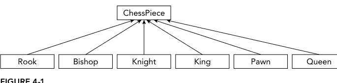

图 4-1

在这个层次结构中，通用的 `ChessPiece` 类作为抽象基类。`ChessPieceView` 类也需要类似的层次结构。

另一个类结构可以用于 `ChessBoardView` 类，以便为游戏提供文本界面或图形用户界面。图 4-2 显示了一个层次结构示例，允许棋盘以控制台或 2D 或 3D 渲染的形式显示。

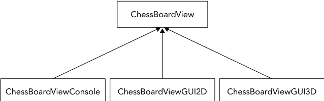

图 4-2

`Player` 控制器以及 `ChessPiece` 层次结构中的各个类都需要类似的层次结构。

第 5 章解释了设计类和类层次结构的细节。

## 为每个子系统指定类、数据结构、算法和模式

在这一步中，你考虑更深层次的细节，并指定每个子系统的细节，包括你为每个子系统编写的特定类。结果可能是你的模型子系统本身作为一个类。这些信息可以总结在表中：

| 子系统 | 类 | 数据 | 算法 | 模式 |
| --- | --- | --- | --- | --- |
| Gameplay | GamePlay 类 | Gameplay 对象包含一个 ChessBoard 对象和两个 Player 对象。 | 给每个玩家一个回合 | 无 |

## 设计类、数据结构、算法和模式

| 子系统 | 类 | 结构 | 算法 | 模式 |
| --- | --- | --- | --- | --- |
| ChessBoard | ChessBoard 类 | | | |
| ChessPiece | ChessPiece 类 | | | |
| ChessView | ChessPieceView 类 | | | |
| Player | Player 类 | | | |
| ErrorLogger | ErrorLogger 类 | | | |

设计类、数据结构、算法和模式可能是很复杂的。你应该始终记住前面讨论的抽象和复用规则。对于抽象，关键是分开考虑接口和实现。首先，从用户的角度指定接口。决定你想让组件做什么。然后通过选择数据结构和算法来决定组件将如何做。

## 为每个子系统指定错误处理

在这一设计步骤中，你勾勒了每个子系统的错误处理。错误处理应该同时包含系统错误（如内存分配失败）和用户错误（如无效输入）。你应该指定子系统是否使用异常。你再次可以在表格中总结这些信息：

| 子系统 | 处理系统错误 | 处理用户错误 |
|---|---|---|
| Gameplay | 使用 ErrorLogger 记录错误，在无法为 ChessBoard 或 Players 分配内存时向用户显示消息并关闭程序 | 无（无用户界面） |
| ChessBoard ChessPiece | 使用 ErrorLogger 记录错误，在无法分配内存时抛出异常 | 无（无用户界面） |
| ChessBoard ChessPieceView | 使用 ErrorLogger 记录错误，在渲染出现问题时抛出异常 | 无（无用户界面） |


| Player | 使用 `ErrorLogger` 记录错误，在无法分配内存时抛出异常 | 检查用户移动输入的合理性以确保其不在棋盘外；提示用户再次输入。在移动棋子之前检查每个合法性；如果不合法，则提示用户进行另一个移动。 |
| ErrorLogger | 尝试记录错误，告知用户，并在无法分配内存时关闭程序 | 无（无用户界面） |

## 总结

在本章中，你学习了专业的 C++ 设计方法。希望你已经确信软件设计是任何编程项目中的重要第一步。你还学习了 C++ 中一些使设计变得困难的方面，包括其对面向对象的关注、庞大的功能集和标准库，以及编写泛型代码的机制。有了这些信息，你更好地准备好应对 C++ 设计了。

本章介绍了两个设计主题。抽象的概念（或将接口与实现分离）贯穿全本书，并应该是你所有设计工作的准则。

重用的概念（包括代码和思想）在现实世界的项目以及本书中也频繁出现。你学到，你的 C++ 设计应该包含以库和框架形式存在的代码重用，以及以技术和模式形式存在的思想重用。你应该编写尽可能具有重用性的代码。始终记住权衡以及重用代码的具体指南，包括能力和局限性、性能、许可和支持模型、平台限制、原型设计以及何处寻求帮助。你还学习了性能分析和大 O 表示法。现在你已经理解了设计的重要性和基本设计主题，就可以准备好第二部分剩余的内容了。第 5 章将介绍如何在设计中使用 C++ 的面向对象特性策略。

## 第 5 章 使用对象进行设计

**本章内容简介：**

- 什么是面向对象编程设计
- 你如何定义不同对象之间的关系
- 抽象的重要性以及如何在你的设计中使用它

现在你已经通过第 4 章培养了对良好软件设计的理解，是时候将“对象”的概念与“良好设计”的概念结合起来了。在代码中使用对象的程序员与真正掌握面向对象编程的程序员之间的区别，在于他们的对象相互之间以及与程序整体设计的关系。

本章从对程序化编程（C 风格）的简要描述开始，随后是对面向对象编程（OOP）的详细讨论。即使你已经使用对象多年，你也会想读这一章以获取关于如何思考对象的新观点。本章将讨论对象之间不同类型的关系，以及程序员在构建面向对象程序时经常掉入的陷阱。你还将学习抽象原则如何与对象相联系。

在思考程序化编程或面向对象编程时，最重要记住的一点是，它们仅仅代表了对程序运行机制的不同推理方式。很多时候，程序员在充分理解什么是对象之前，就陷入了 OOP 的语法和术语中。本章代码较少，侧重于概念和思想。关于 C++ 对象语法的具体细节，请参见第 7、8 和 9 章。

## 我在进行程序化思考吗

程序化语言（如 C）将代码分成若干小部分，每个部分（理想情况下）完成单一任务。如果 C 中没有过程，你所有的代码都将堆积在 `main()` 中。你的代码将难以阅读，至少可以说，你的同事会感到非常烦恼。

计算机并不在乎你的代码是在 `main()` 中，还是被拆分为具有描述性名称和注释的易于处理的小块。过程是一种抽象，它的存在是为了帮助你（程序员）以及那些阅读和维护你代码的人。该概念围绕着一个关于你程序的根本性问题构建：这个程序是做什么的？通过用英语回答这个问题，你就是在进行程序化思考。例如，程序首先从互联网上获取股票报价。然后，它根据特定指标对这些数据进行排序。接下来，它对数据进行分析。最后，它输出一份买入和卖出建议。当你开始编码时，你可能直接将这个心理模型转换为 C 函数：`retrieveQuotes()`、`sortQuotes()`、`analyzeQuotes()`……

> 注意：尽管 C 将过程称为“函数”（functions），但 C 函数式语言与程序化语言非常不同，它指的是像 Lisp 这样的语言，后者使用完全不同的抽象。

当你的程序遵循特定的步骤列表时，程序化方法通常有效。然而，在大型应用程序中，很少有线性的事件序列。通常，用户可以在任何时间执行任何命令。程序化思考对数据表示也未提及任何内容。在之前的例子中，并没有讨论股票报价究竟是什么。

如果程序化思维模式听起来很像你处理程序的方式，不要担心。一旦你意识到 OOP 仅仅是另一种更灵活的思考软件的方式，它就会自然而然地发生。

## 面向对象的哲学

与基于“这个程序是做什么的？”问题的程序化方法不同，面向对象的方法问的是另一个问题：我正在为哪些现实世界对象建模？OOP 基于这样一种观点：你应该将程序划分为不同的任务，划分为物理对象的模型。虽然这初看起来看起来很抽象，但当你从类、组件、属性和行为的角度考虑物理对象时，它就会变得更加清晰。

## 类

类（Class）根据其定义产生一个对象。考虑橙子。泛论橙子作为生长在树上的美味水果，与讨论一个特定的橙子（例如当前正向我的键盘上滴汁的那一个）是有区别的。

在回答“什么是橙子？”这个问题时，你是在讨论被称为“橙子”的事物的类。所有的橙子果都生长在树上。所有的橙子都是某种程度的橙色。所有的橙子都有特定的风味。类仅仅是对定义对象分类的封装。

当描述一个特定对象时，你是在讨论一个实例（instance）。所有对象都属于特定的类。因为我桌子上的对象是一个橙子，我知道它属于橙子类。因此，我知道它是一种生长在树上的水果。我的橙子是某种橙色，并且有特定的风味。对象是类的实例。

作为一个更具体的例子，重新考虑股票选择过程。在 OOP 中，“股票报价”是一个类，它定义了构成报价的抽象概念。一个特定的报价，如“微软股票报价”，就是一个对象。

从 C 的背景来看，将类类比为类型和变量。事实上，在第 7 章中，你会看到类的语法与结构体（structs）的语法相似。

## 组件

如果你考虑一个复杂的现实世界对象，比如飞机，应该很容易看出是由较小的组件组成的。有机身、控制系统、起落架、发动机以及许多其他部分。以小组件的角度思考对象对于 OOP 是至关重要的，就像将复杂任务分解为较小的过程是程序化编程的基础一样。

组件本质上与类相同，只是更小、更具体。这些组件中的每一个都可能有进一步的子组件。例如，起落架是飞机的组件，而轮子是起落架的组件。

## 属性

属性是区分一个对象另一个特征。回到橙子类，回想起所有的橙子都被定义为某种橙色和特定的风味。这两个特征就是属性。所有的橙子都有相同的属性，但值不同。我的橙子有“非常美味”的风味，但你的有“非常难吃”的风味。

你也可以从类层面上思考属性。正如所有的橙子都是水果并生长在树上一样，这是水果类的属性，而橙色是由特定的水果对象决定的。类属性由类的所有对象共享，而对象属性存在于类的所有对象中，但值不同。

属性是描述对象的特征。它们回答了这个问题：这个对象有什么不同之处？

## 行为

行为回答两个问题之一：这个对象能做什么？或者，我对这个对象可以做什么？以橙子为例，它本身没做什么，但我们可以对它做一些事情。一种行为是它可以被吃掉，这就像类级别或对象层面的行为属性一样。所有的橙子基本上方式都是的。然而，它们在其他行为上可能有所不同，例如从斜坡滚下；一个完美圆的橙子的行为会不同于一个较扁的橙子。

股票选择的示例提供了更实用的行为。正如你所记得，当用过程化的方式思考时，我们确定程序需要分析报价作为其功能之一。而用面向对象（OOP）的方式思考时，你可能会决定一个股票报价对象可以分析自己。“分析”就变成了股票报价的一种行为。

在面向对象编程中，大部分功能性代码都从过程中移动到了类中。通过构建具有特定行为的类并定义它们如何相互作用，OOP 为将代码附加到其操作的数据上提供了一种更丰富的机制。

## 整合一切

有了这些概念，你可以重新审视股票选择程序，并以面向对象的方式对其重新设计。

转向属性，集合类将至少有一个属性——收到的实际报价列表。它还可能具有额外的属性，例如最近检索的精确日期和时间以及获取的报价数量。至于行为，“股票报价集合”最好与服务器通信以获取报价，并提供一个排序后的报价列表。这就是“检索报价行为”。

股票报价类将拥有之前的属性——名称、代码、当前价格等。此外，它还会有“分析”行为。你可能考虑其他行为，例如买卖股票。

绘制显示组件之间之间关系的图表通常很有用。图 5-1 使用多条线表示一个“股票报价集合”包含许多“股票报价”对象。

另一种可视化类的有用方法是在头脑风暴程序的对象表示时，列出属性和行为，如下表所示：

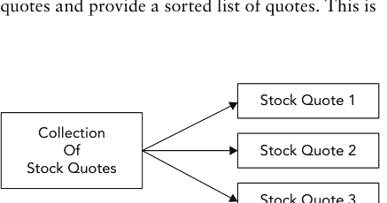

| 类 | 关联组件 | 属性 | 行为 |
| --- | --- | --- | --- |
| 橙子 | 种子、果汁、果肉 | 颜色、味道 | 吃、滚、扔、剥、榨 |
| 股票报价集合 | 由单个股票报价对象组成 | 单个报价、时间戳、报价数量 | 检索报价、按各种标准排序报价 |
| 股票报价 | 无（暂） | 公司名称、股票代码、当前价格等 | 分析、买入股票、卖出股票 |

## 在对象世界中生活

当程序员从过程化思维转变为面向对象范式时，他们往往会因为属性和行为组合成对象而产生顿悟。一些程序员发现自己正在重新设计他们正在处理的程序设计，并重写对象的片段。另一些人可能忍不住抛弃所有代码，并作为一个完全面向对象的应用程序重新启动项目。

用对象开发软件有两种主要方法。对于某些人来说，对象仅仅代表数据和功能的封装。这些程序员在程序中到处撒上对象，使代码更具可读性且易于维护。采用这种方法，将孤立的代码段替换为对象，就像外科医生植入起搏器一样。这种方法本质上并没有错。这些人将对象视为在许多情况下都有益的工具。程序的某些部分“感觉像对象”，比如股票报价。这些是那些可以隔离并用真实世界的术语描述的部分。

其他程序员则完全采用 OOP 范式，将一切都变成对象。在他们脑海中，对象对应于现实世界的物体，如橙子或股票报价，而另一些则封装了抽象概念，例如排序器或撤销。理想的方法处于这些极端之间。你的第一个项目可能是一个传统的过程化程序，其中散落着少量对象。或者，你可能想全盘考虑并将一切都变成对象，从一个表示 `int` 的类到一个表示主应用程序的类。随着时间的推移，你会找到一个折中点。

## 过度对象化

在设计一个创造性的面向对象系统与通过将每个小事变成对象来让团队中的每个人都感到恼之间，往往存在着微妙的界限。正如弗伊德所说，有时一个变量仅仅是一个变量。好吧，那是对他所言的转述。

也许你坐下来设计下一个井字游戏（Tic-Tac-Toe）。你在这方面全力 OOP，拿着一杯咖啡和一个笔记本来勾勒你的类和对象。在这样的游戏中，通常有一个对象负责监督游戏并能够检测获胜者。为了表示游戏盘，你可能会设想一个 `Grid` 对象，将跟踪标记及其位置。事实上，网格的一个组件将是代表 X 或 O 的 `Piece` 对象。

等等，后退！这个设计建议有一个代表 X 或 O 的类。这似乎太过度了。毕竟，更好的是，为什么 `Grid` 不能直接使用一个枚举类型的二维数组呢？`Piece` 对象只会让代码复杂。查看下代表所提类的表：

| 类 | 关联组件 | 属性 | 行为 |
| --- | --- | --- | --- |
| Piece | 无 | X 或 O | 无 |

这个表格有点空虚，奇怪地暗示我们这里的东西可能太细粒了，而不成为一个完整的。

## 对象关系

作为程序员，你会经常遇到不同类具有共同特征或相互相关的情况。例如，在数字目录程序中创建一个“媒体”对象来表示图像、音乐和文本是太通用的，这些对象共享特征。你可能希望它们都跟踪最后修改的日期和时间，或者你可能希望它们都支持“删除”行为。

面向对象的语言提供了许多机制来处理对象之间的这种关系。困难的部分在于理解关系实际上是什么。对象关系有两种主要类型——具有关系（has-relationship）和是一个关系（is-relationship）。

## “具有”关系

参与“具有”关系（或聚合）的对象遵循 A 有 B，或 C 包含 B 的模式。在这种关系类型中，你可以想象一个对象是另一个对象的一部分。正如之前定义的，组件通常表示具有关系，因为它们描述了由其他对象组成的对象。

这种现实世界的例子可能是动物园和猴子之间的关系。你可以说动物园有一只猴子，或者动物园包含一只猴子。代码中模拟动物园将有一个动物园对象，它有一个猴子组件。

图 5-3 显示了各种现实世界和用户界面的“具有”关系。


## “是一个”关系（继承）

“是一个”这种关系是面向对象编程中一个非常基础的概念，它有许多名称，包括派生、子类化、扩展和继承。类模拟了现实世界包含具有属性和行为的对象这一事实。继承模拟了这些对象需要按层级结构组织的事实。这些层级结构表示了关系。

从根本上说，继承遵循“A 是一个 B”或“A 非常像 B”的模式——这可能会变得复杂。为了回到简单的情况，让我们回到动物园，但假设除了猴子还有其他动物。这个陈述已经构建了关系——猴子是一种动物。同样，长颈鹿是动物，袋鼠是动物，企鹅也是动物。那又怎样？继承的魔力在于，当你意识到猴子、长颈鹿、袋鼠和企鹅有某些共同点时。这些共同点是动物的通用特征。

对于程序员来说，这意味着你可以定义一个 `Animal` 类，封装了属于每种动物的所有属性（尺寸、位置、饮食等）和行为（移动、进食、睡觉）。特定的动物（如猴子）成为 `Animal` 的派生类，因为猴子包含了动物的所有特征。派生类 `Monkey` 是动物，加上了使其与众不同的额外特征。图 5-4 显示了动物的继承图。箭头指示了“是一个”关系的方向。

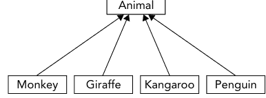

就像猴子和长颈鹿是不同类型的动物一样，用户界面通常也有不同类型的按钮。例如，复选框（checkbox）是一种按钮。假设按钮仅仅是可以点击并执行操作的 UI 元素，那么 `Checkbox` 通过添加状态（框是否被勾选或未勾选）来扩展 `Button` 类。

在“是一个”关系中关联类时，一个目标是将功能归类到基类（即其他类所扩展的类）。如果你发现所有派生类的代码都相似或完全相同，请考虑如何将部分或全部代码移动到基类中。这样，任何所需的更改只需要在一个地方进行，而未来的派生类可以“免费”获得这些共享功能。

## 继承技术

前面的示例涵盖了继承中使用的几种技术，但没有对其进行形式化处理。在派生类时，程序员有几种方法可以区分一个类与其父类、基类或超类。一个派生类可以使用这些技术中的一种或多种，并通过完成“A 是一个 B……”这句话来被识别。

### 添加功能

派生类可以通过添加额外功能来增强其父类。例如，猴子是一种可以在树上荡爬的动物。除了 `Animal` 的所有行为外，`Monkey` 类还具有“树上荡爬”的行为，这是 `Monkey` 类特有的。

### 替换功能

派生类可以完全覆盖其父类的行为。例如，大多数动物通过行走移动，因此你可以给 `Animal` 类提供一个模拟行走的 `move` 行为。如果是这样，袋鼠就是一种移动而不是行走的动物。`Animal` 基类的所有属性和行为仍然适用，但 `Kangaroo` 派生类改变了 `move` 行为的方式。当然，如果你发现需要替换基类的所有功能，可能表明继承并不是正确的做法，除非基类是一个抽象基类。抽象基类强制每个派生类实现特定的行为。你不能创建抽象基类的实例。抽象类将在第 9 章中讨论。

### 添加属性

派生类可以在从基类继承的属性基础上添加新属性。企鹅拥有动物的所有属性，但还有一个“喙的大小”属性。

### 替换属性

C++ 提供了一种覆盖属性的方法，就像你可以覆盖行为的方法一样。然而，这样做很少是合适的，因为它从基类中隐藏了该属性，即基类对具有特定名称属性有一个特定值，而派生类可以对同名的属性有另一个值。第 9 章将更详细地解释继承。重要的是，不要将“替换属性”与“派生类对属性有不同的值”混淆。例如，所有动物都有一个 `diet` 属性指示它们吃什么。猴子吃香蕉和鱼，但这两者都不是替换 `diet` 属性——它们只是赋值给属性的值不同。

## 多态与代码复用

多态是认为遵循一组标准属性和行为的对象可以相互使用的概念。类的定义就像是对象与与之交互的代码之间的合同。根据定义，任何 `Monkey` 对象都必须支持 `Monkey` 类的属性和行为。

这一概念也扩展到了基类。因为所有猴子都是动物，所以任何 `Monkey` 对象都支持 `Animal` 类的属性和行为。

多态是面向对象编程中美丽的一部分，因为它真正利用了继承提供的优势。在动物园模拟中，你可以轻松遍历所有动物。

处理集合而不是字符串是繁琐的且需要大量重复代码。最好将这种多值功能封装在一个独立的类中，称为 `MultiHash`。`MultiHash` 类工作起来和 `Hashtable` 一一样，但在后台运行。

要从继承关系开始，假设 `MultiHash` 是 `Hashtable` 的一个派生类。它必须覆盖向表中添加条目的行为，因此它要么创建一个集合并添加新元素，要么检索现有的集合并添加新元素。它还会覆盖获取值的行为。例如，它可以将给定键的所有值连接成一个字符串。这看起来是一个完全合理的设计。尽管它覆盖了基类的所有行为，但它仍然通过在派生类中使用原始行为来利用基类的行为。这种方法如图 5-5 所示。

| MultiHash |
| --- |
| insert(key, value) |
| get(key) |

| MultiHash |
| --- |
| modifies insert() |
| modifies get() |

图 5-5


现在让我们将其视为一种“拥有”（has-relationship）关系。

`MultiHash` 是它自己的一个类，它包含一个 `Hashtable` 对象。它的接口可能与 `Hashtable` 非常相似，但不需要完全相同。在这些场景中，当用户向 `MultiHash` 添加内容时，它实际上被封装在一个集合中并放入一个 `Hashtable` 对象里。这看起来也是完全合理的，如图 5-6 所示。

| MultiHash | has-a | Hashtable |
| --- | --- | --- |
| insert(key, value) | | |
| getAll(key) | | |

图 5-6

那么，哪种解决方案是正确的呢？并没有明确的答案，尽管一位为生产环境编写过 `MultiHash` 类的朋友将其视为一种“拥有”关系。主要的原因在于它允许对接口进行修改，而无需担心维护哈希功能的影响。例如，在图 5-6 中，行为变为了 `getAll`，这清楚地表明它将获取 `MultiHash` 中特定键的所有值。此外，通过“拥有”关系，你不需要担心任何哈希表的功能泄露。例如，如果哈希表类应该报告集合的总数，除非 `MultiHash` 知道要重写它。

尽管如此，人们也可以提出一个令人信服的论点：`MultiHash` 实际上是一个带有某些新功能的 `Hashtable`，它本应该是一个“是”（is-relationship）关系。重点在于，这两种关系之间有时存在一条界限，你需要考虑该类将如何被使用，以及你正在构建的东西仅仅利用了另一个类的某些功能，还是真正具有修改或新功能的该类。

下表代表了对 `MultiHash` 类采用这两种方法的支持和反对的理由。

| IS-A | HAS-A |
| --- | --- |
| 支持理由 | • 从根本上说，它是具有不同特征的相同抽象。 | • `MultiHash` 可以拥有任何有用的行为，而无需担心 `Hashtable` 有什么功能。 |
| • 它提供了（几乎）与 `Hashtable` 相同的行为。 | • 实现可以改变为 `Hashtable` 的其他形式，而无需改变暴露的行为。 |
| 反对理由 | • 根据定义，哈希表每个键对应一个值。说 `MultiHash` 是哈希表简直是亵渎！`MultiHash` 重写了 `Hashtable` 的两种行为，这是设计在某些方面存在错误的强烈信号。 | • 在某种程度上，`MultiHash` 通过提出新行为重新发明了轮子。 |
| • `Hashtable` 的某些额外属性和行为可能有用。 | |
| | | | • `Hashtable` 未知或不适当的属性或行为可能会“泄露”到 `MultiHash`。 |

在这种情况下，反对使用“是”关系的理由是非常充分的。事实上，在多年的经验后，如果你有选择，我建议选择“拥有”关系而不是“是”关系。

请注意，这里使用 `Hashtable` 和 `MultiHash` 是为了演示“是”和“拥有”关系之间的区别。在你自己的代码中，建议使用标准表类之一，而不是自己编写。C++ 标准库提供了 `unordered_map` 类（你应该用它代替 `Hashtable`）和 `unordered_multimap` 类（你应该用它代替 `MultiHash`）。这两个标准类在第 16 章中都会讨论。

# “不是”关系

当你考虑类之间具有什么种关系时，请考虑它们之间是否真的存在关系。不要让你对面向对象设计的狂热变成多余的类/派生类。

当现实世界中的事物在客观上相关，但在代码中没有实际关系时，就会出现陷阱。面向对象的层次结构需要建模功能关系，而不是人为的关系。图 5-7 显示了具有意义的本体或层级关系，但它们不太可能在代码中代表有意义的关系。

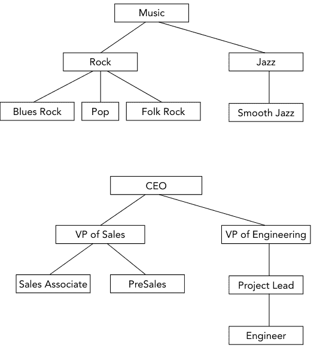

图 5-7

避免多余继承的最佳方法是先勾画你的设计。对于每个类和派生类，写下你计划放入的属性和行为。如果你发现一个类没有自己的属性或行为，或者所有这些属性和行为都被其派生类完全重写（除非前面提到的使用抽象基类），你就应该重新考虑你的设计。

# 层级结构

正如类 A 可以是 B 的基类，B 也可以是 C 的基类。面向对象的层次结构可以建模这种垂直关系。一个包含许多动物的动物园模拟可以设计成，每种动物都是通用 `Animal` 类的派生类，如图 5-8 所示。

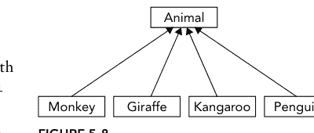

当你编写这些派生类时，你可能会发现它们非常相似。当这种情况发生时，你应该考虑引入一个公共父类。意识到狮子和豹子的移动方式相同且饮食相同，可能表明存在一个 `BigCat` 类。你可以进一步细分 `Animal` 类，以包含 `WaterAnimal`（水生动物）和 `Marsupial`（有袋动物）。一个利用这种共性的更具层次化的设计如图 5-9 所示。

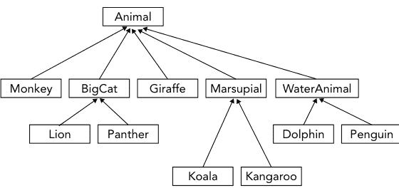

一个观察这个层次结构的生物学家可能会失望——企鹅不是海豚。然而，它是一类哺乳动物。最终，重要的是这些类将如何被使用。面向对象的设计旨在让程序员更容易理解代码之间的关系。之前的设计主要是按运动组织的。良好的面向对象层次结构可以将：

- 将类组织成有意义的关系中
- 通过基类支持代码复用
- 避免派生类重写父类的大部分功能，除非父类是抽象的

## 多重继承

到目前为止每个示例都是单继承链。换句话说，一个类最多有一个父类。事实并非如此。通过多重继承，一个类可以有多个基类。

图 5-10 显示了一个多重继承设计。有一个基类 `Animal`，它按大小进一步划分。另一个层级结构按饮食分类，三个负责运动。每种类型的动物都是这些类的派生类，用不同的线条表示。

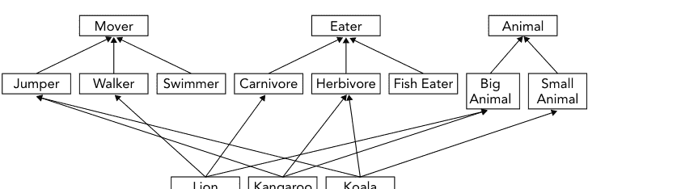

图 5-10

在用户界面上下文中，想象一个用户可以点击的图像。这个对象既是按钮又是图像，因此实现可能涉及同时继承 `Image` 类和 `Button` 类，如图 5-11 所示。

即使两个事物在现实世界中密切相关，它们在代码中可能并没有关系。多重继承在某些情况下非常有用，但它也有许多你应该记住的缺点。C++ 对此类关系有明确支持，但 Java 语言完全取消了它们，除了继承多个接口（抽象基类）之外。多重继承之所以复杂有几个原因。

首先，可视化多重继承是复杂的。正如你在图 5-10 中看到的，当存在多个层级和交叉线条时，即使简单的类图也会变得非常复杂。类层次结构旨在让程序员更容易理解代码之间的关系。在多重继承中，一个类可能有多个互不相关的父类。有这么多类为你的对象贡献代码，你真的能追踪发生了什么吗？

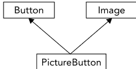

图 5-11

# 第 5 章 使用对象设计

其次，多继承会破坏原本清晰的层级结构。在动物的示例中，切换到多继承方法意味着 `Animal` 基类的意义不再那么大，因为描述动物的代码现在被分成了三个独立的层级结构。虽然图 5-10 所示的设计展示了三个整洁的层级，但想象它们将如何变得混乱并不困难。例如，如果你发现不仅是所有的 `Jumpers`（跳跃者）的移动方式相同，它们还吃相同的东西呢？由于存在独立的层级，在不添加任何其他内容的情况下，无法将运动和饮食的概念结合起来。

第三，多继承的实现非常复杂。如果你的两个基类以不同的方式实现了相同的行为怎么办？你是否可以拥有两个本身又是某个公共基类派生类的基类？这些可能性增加了实现的复杂性，因为在代码中构建如此错综的关系对于作者和读者来说都是困难的。

其他语言之所以省略多继承，是因为它通常是可以避免的。通过重新思考你的层级结构，当你对项目设计控制权时，通常可以避免引入多继承。

## 混入类 (Mixin Classes)

混入类代表了类之间的另一种关系。在 C++ 中，混入类的语法实现与继承完全一样，但其语义却是令人耳目一新的不同。混入类提出了一个问题：“这个类能够做什么？”，而答案通常以“能够（able）”结尾。混入类是你可以在不承诺建立“完全是”（full-is）关系的情况下为类添加功能的方法。你可以将其看作一种“共享”（shares-with）关系。

回到*动物园*，你可能想引入某些动物是“可以抚摸的”（pettable）的概念。也就是说，有些动物是动物园游客可以摸的，而且不会被咬或被领养。你可能希望所有可以抚摸的动物都支持“被摸”这一行为。由于可以抚摸的动物之间没有共同点，而且你不想破坏已设计的层级结构，`Pettable` 是一个非常棒的混入类。

混入类在用户界面中频繁使用。与其说 `PictureButton` 类既是 `Image` 又是 `Button`，你可能会说它是一个可点击的（Clickable）`Image`。桌面上的文件夹图标可以是一个可拖拽的（Draggable）`Image`。软件开发人员随后会发明很多有趣的形容词。

混入类与基类之间的区别与代码本身的关系远比与多继承的关系小得多，因为它们的范围非常有限。`Pettable` 混入类只是为任何现有类添加一种行为。`Clickable` 混入类可能只是添加“鼠标按下”和“鼠标释放”行为。此外，混入类很少有大型层级结构，因此不存在功能的交叉污染。

## 抽象 (ABSTRACTION)

在第 4 章中，你学习了抽象的概念——将实现与访问它的手段隔离开来的概念。由于之前探讨的许多原因，抽象是一个好主意。它也是面向对象设计的一个基础部分。

### 接口与实现 (Interface versus Implementation)

抽象的关键是将接口与实现有效隔离开。实现是你为了完成设定的任务而编写的代码。接口是他使用你代码的方式。在 C语言中，头文件描述了你使用的库中的函数。在面向对象编程中，类的接口是公开访问的属性和行为的集合。类的属性/变量永远不应该是公开的，但它们可以通过公共行为（也称为 getter 和 setter）暴露出来。

### 决定暴露的接口 (Deciding on an Exposed Interface)

在设计类时，其他程序员将如何与你的对象交互的问题就会出现。在 C++ 中，类的属性和行为可以是公开的（public）、保护的（protected）或私有的（private）。公开或公共行为意味着其他代码可以访问它。保护意味着其他代码无法访问该属性或行为，但派生类可以访问。私有是一种更严格的控制，意味着不仅其他代码无法访问这些属性或行为，甚至派生类也无法访问。

设计暴露的接口关键在于选择要做什么。在与其他程序员一起编写大型项目时，你应该将暴露接口的设计视为一个过程。

### 考虑受众 (Consider the Audience)

设计暴露接口的第一步是考虑你在为谁设计。你的受众是你团队的另一个成员吗？这是你将亲自使用的接口吗？它是公司外部程序员将使用的东西吗？也许是客户或海外承包商？除了确定谁会向你寻求接口方面的帮助外，这应该有助于明确你的设计目标。

如果接口是为你设计的，你有更多的自由来迭代设计。然而，如果你正在使用该接口，你可以根据自己的需要更改它。但是，你应该记住，工程团队中的角色会发生变化，很可能某天其他人也会使用这个接口。

为内部程序员设计接口略有不同。在某种意义上，如果你的接口变成了与他们的一份合同，那么其他人就会依赖该接口来支持操作。你需要找出团队想要做的所有事情。他们需要版本控制吗？他们可以存储什么类型的数据？作为一份合同，你应该将接口视为灵活性稍差。如果在编码之前就约定了接口，那么如果你在代码编写后决定更改它，将从其他程序员那里获得收益。

如果客户端是外部客户，你将根据一套完全不同的需求进行设计。理想情况下，目标客户将参与指定你的接口暴露了哪些功能，即客户未来需要什么。接口中使用的术语必须与客户熟悉的术语相对应，且文档必须考虑到该受众进行编写。内部笑话、代号和程序员俚语应该被排除在外。

### 考虑目的 (Consider the Purpose)

编写接口有很多理由。在将任何代码写在纸上之前，你需要理解它的目的。

### 应用程序接口 (API)

API 是扩展产品或在另一个上下文中使用其功能的外部可见机制。由于你的公司正在暴露它，应该对 API 进行规划和讨论。

设计 API 的主要权衡通常是易用性与灵活性。由于接口的目标受众是内部且不熟悉你的产品，使用它的学习曲线应该是渐进的。如果它太难用，API 就是失败的。灵活性往往会产生冲突。你的产品可能有很多用途，你希望客户能够利用你提供的所有功能。

正如常用的格言：“良好的 API 让简单的情况更容易，让困难的情况变得可行。”也就是说，API 应该具有简单的学习曲线。大多数程序员要做的操作是可以的。然而，API 应该允许更高级的使用，为了常见情况的简单而牺牲特殊情况的是可以的。

### 工具类或库 (Utility Class or Library)

通常，你的任务是在应用程序的其他地方定义某些功能。它可能是一个随机数库或日志类。在这些情况下，接口更容易决定，无需过多考虑实现。通用性是一个需要考虑的问题。由于类或库是通用的，你需要在设计中考虑所有可能的用例。

### 子系统接口 (Subsystem Interface)

你可能正在设计两个主要子系统之间的接口，例如访问数据库的机制。在这些情况下，将接口与实现分离至关重要，因为在你的实现完成之前，其他程序员可能已经在针对它开始开发了。在处理子系统时，首先思考它的一个主要目的是什么。一旦你确定了子系统承担的主要任务，就思考具体的用途以及它如何向代码的其他部分展示。

### 组件接口 (Component Interface)

你定义的多数接口可能比子系统接口或 API 小得多。这些将是你编写的其他代码中使用的类。在这些情况下，主要的陷阱是你的接口逐渐演变并变得杂乱。尽管这些接口是供你自己使用的，但请假装它们不存在。在设计子系统接口时，考虑每个类的唯一主要目的，并谨慎暴露那些对该目的没有贡献的功能。

## 考虑未来

在设计接口时，请记住未来的发展。这是一个你将受困几年的设计吗？如果是这样，你可能需要通过设计插件式架构为扩展留出空间。你是否有证据表明，人们会尝试为了设计目的之外的其他用途使用你的接口？与他们交流，并更好地理解他们的用例。替代方案是以后重写它，或者杂乱无章地添加新功能，最终导致一个混乱的接口。不过要小心！推测性的泛化是另一个陷阱。如果你的功能尚不明，切不要设计一个“全能类”，因为这可能会不必要地增加设计、实现及其公共接口的复杂度。

## 设计成功的抽象

经验和迭代对于良好的抽象至关重要。真正设计良好的接口源于多年编写和使用其他抽象。你也可以通过以标准设计模式的形式重用设计良好的抽象，来利用他人多年编写和沉淀的成果。当你遇到其他抽象时，尝试记住哪些做法是有效的，哪些是无效的。你发现去年使用的 Windows 系统 API 缺少什么？如果网络封装器是你而不是你的同事编写的，你会有什么不同的做法？最好的接口很少是你写在纸上的第一个版本，请保持迭代。将你的设计带给同事并寻求反馈。如果你的团队进行代码审查，请在实现开始之前，通过审查接口规范开始代码审查。一旦开始，不要害怕改变抽象，即使这意味着要强制其他程序员去适应。希望你会意识到，良好的抽象长远来看对所有人都有益。

在向其他程序员介绍你的设计时，有时你需要进行一些泛化。也许团队的其他成员没有发现之前设计中的问题，或者认为你的方法需要他们付出过多的工作。在这些情况下，准备好维护你的工作，并在适当的时候吸纳他们的想法。

良好的抽象意味着接口具有公共行为。所有代码都应该在实现文件中，而不是在类定义中。这意味着包含类定义的接口是稳定的，并且不会改变。

警惕单类抽象。如果你编写的代码非常多，请考虑哪些其他伴随类可以辅助主接口。例如，如果你正在暴露一个接口来处理某些数据，请也考虑写一个结果对象，为提供一种方便查看和解释结果的方法。

始终将属性转化为行为。换句话说，不要允许外部代码直接操作你类背后的数据。你不希望某些粗心或心怀不轨的程序员将兔子对象的高度设置为负数。相反，设置一个“设置高度”的行为来执行必要的边界检查。

再次提到迭代，是因为它是最重要的一点。寻求并响应对你设计的反馈，在必要时进行更改，并从错误中学习。

## 总结

在本章中，你对面向对象程序的设计有了深入理解，而没有被大量的代码干扰。你学到的概念适用于几乎任何面向对象的语言。其中一些可能对你来说可能是复习，也可能是一种形式化熟悉概念的新方法。也许你为旧问题学了一些新方法，或者为你一直以来向团队推崇的理念提供了新的论据。如果你在代码中从未用过对象，或者像许多经验丰富的 C++ 程序员一样只少量用过它们，那么你现在了解更多关于如何设计面向对象程序的知识。

对象之间的关系值得研究，这不仅是因为连接良好的对象有助于重用并减少混乱，还因为你将在团队中工作。以有意义的方式关联的对象更容易阅读和维护。在设计程序时，你可能会决定将“对象关系”部分作为参考。

最后，你学习了创建成功的抽象以及两个最重要的设计考虑因素——观众和目的。

下一章将继续设计主题，解释如何以重用为考虑来设计代码。

# 第 6 章 为重用而设计

本章内容：

- 重用哲学：为什么你应该为重用设计代码
- 如何设计可重用的代码
  - 如何使用抽象
- 结构化重用代码的三种策略
- 设计易用接口的六种策略
- 如何平衡泛化与易用性

在程序中重用库和其他代码是一项重要的设计策略。然而，这只是重用策略的一半。另一半是设计并编写可以在程序中重用的代码。正如你可能已经发现的，设计良好的库和设计糟糕的库之间存在差异。设计良好的库使用是一种享受，而设计糟糕的库可能会逼你放弃并自己编写代码。如果你正在编写一个显式供其他程序员使用的库，或者依赖于类层次结构，你应该从重用的角度考虑来设计你的代码。你永远不知道会在后的项目何时需要类似的功能。

第 4 章引入了重用的设计主题，并解释了如何通过在程序引入库和其他代码来应用这一主题。本章讨论了重用的另一面：设计可重用的代码。它基于第 5 章描述的面向对象设计原则，并引入了一些新的策略和准则。

## 重用哲学

你应该设计你自己和其他程序员都可以重用的代码。这条规则不仅适用于你特意打算让其他程序员使用的库和框架，还适用于你为程序设计的任何类、子系统或组件。

你应该始终记住“一次编写，多次使用”和“避免代码重复”的箴言。原因有几点：

- 代码很少只在一个程序中使用。你可以确定你的代码会在某处被使用，所以从开始就要设计正确。
- 为重用设计可以节省时间和金钱。如果你以阻碍未来使用的方式设计代码，确保你或你的合作伙伴在遇到类似需求时浪费轮子。


- 你小组中的其他程序员必须能够使用编写的代码。你可能不是独自负责项目。你的同事会感谢你提供设计良好、功能齐全的库和代码。为重用设计也可以被称为协作编码。

- 缺乏重用会导致代码重复，代码重复会导致维护噩梦。如果你发现自己在复制粘贴某段代码，你至少应该考虑将其改为辅助函数或类。

- 你将是你自己工作的主要受益者。经验丰富的程序员从不扔代码。随着时间的推移，他们建立了一个不断演变的个人工具库。你不知道未来何时需要类似的功能。

> 当你作为公司员工设计或编写代码时，公司通常拥有知识产权。当你离开公司时，保留设计或代码的副本通常是非法的。当你为客户工作时，情况也是如此。

# 如何设计可复用代码

重用代码实现了两个主要目标。首先，它足够通用，适用于稍微不同的目的或不同的应用领域。带有特定应用程序细节的组件很难在其他程序中重用。

重用代码同样易于使用。理解其接口或功能不需要大量时间。程序员必须能够轻松将其整合到应用程序中。

向客户交付库的方式很重要。你可以以源码形式交付，客户将源码整合到项目中。另一种选择是交付静态库，他们将其链接到应用程序中；或者你可以为 Windows 交付动态链接库 (`DLL`)，为 Linux 交付共享对象 (`.so`)。每种交付机制都可能对你编写库的方式施加额外的限制。

> **注意**：本章使用的“客户端”（client）是指使用你接口的程序员。不要将客户端与运行你程序的“用户”混淆。本章还使用了“客户端代码”一词，指的是为了使用你的接口而编写的代码。

设计可复用代码最重要的策略是**抽象**。第 4 章介绍了电视的现实类比，你可以通过它的接口使用它，而无需理解其内部工作原理。同样，当你设计代码时，你应该清晰地将接口与实现分离。这种分离使得代码更容易使用，主要是因为客户端不需要理解实现细节就可以使用功能。

通过将代码抽象为接口和实现，设计可复用代码主要关注这两个领域。首先，你必须恰当地组织代码。你将使用哪些类层次结构？是否应该使用模板？应该如何将代码划分为子系统？

其次，你设计接口，接口是程序员访问你提供的功能的库或代码的“入口”。

## 抽象

你在第 4 章学习了抽象原则，并在第 5 章阅读了更多关于其在面向对象设计中应用的内容。为了遵循抽象原则，你应该为代码提供接口以隐藏底层的实现细节。接口和实现之间应该有清晰的区别。

使用抽象对你和使用你代码的客户端都有益。客户端受益是因为他们不需要担心实现细节；他们可以在不理解代码如何工作的情况下利用功能。如果你可以在不更改代码接口的情况下修改底层代码，那么你就获益了。通过动态链接库，你可以提供更新和修复，而不需要客户端更改其代码。最后，由于两者受益，作为库的编写者你可以在接口中精确指定你期望的交互和支持的功能。请参考第 3 章关于编写文档的讨论。接口与实现的清晰分离将防止客户端以你无预料的方式使用库，否则可能会导致意想不到的行为和错误。

> **警告**：在设计接口时，不要向客户端暴露实现细节。

有时库需要客户端代码保留从一个接口返回的信息，以便将其传递给另一个接口。这种信息有时被称为句柄（`handle`），通常用于跟踪在调用之间需要记住状态的特定实例。如果你的库需要句柄，不要暴露其内部结构。将该句柄变成一个不透明类（`opaque class`），程序员“既无法直接访问也无法通过公共的 getter 或 setter 访问内部数据成员”。

不要要求客户端代码调整此句柄内部的变量。糟糕设计的示例是：一个库要求你设置一个看似不透明句柄中结构体的某个特定成员，以便开启错误日志。

> **注意**：遗憾的是，C++ 在编写类时从根本上说对抽象原则是不友好的。语法要求你将公共接口与非公共（私有的或保护的）数据成员及方法合并在一个定义中，从而将类的某些实现细节暴露给其客户端。第 8 章描述了一些绕过这一限制的技术，以便呈现整洁的接口。

抽象是如此重要，以至于它应该守护你的整个设计。在你所做的每一个决策中，问问自己你的选择是否符合抽象原则。把自己置于客户端的立场，确定你是否在接口中要求了对内部实现的了解。你应该极少、绝不要为这条规则破例。

## 为了实现最优复用的代码

你必须从设计的开始就考虑复用。以下策略将帮助你妥当地组织代码。注意，所有这些策略都侧重于使你的代码通用。设计可复用代码的另一个方面——提供易用性，与你的接口设计更相关，并在本章的后续部分讨论。

## 避免无关或逻辑上分离的概念

当你设计一个库或框架时，保持其专注于单一任务或一组任务，即力求高内聚性。不要将无关的概念（如随机数生成器和 XML 解析器）结合在一起。

即使当你是专门为某个程序设计代码时，也要记住这个策略。程序本身经常被单独复用。相反，程序的片段或子系统会被直接整合到其他应用程序中，或者为了略有不同的用途进行调整。因此，你应该设计你的程序，将逻辑上分离的功能划分为不同的组件，以便它们在不同的程序中被复用。

这种程序策略模拟了现实世界中离散、可更换部件的设计原则。例如，你可以从旧车上拆下轮胎，并将它们用在不同型号的新车上。轮胎是可分离的组件，不与汽车的其它部分绑定。你不需要把引擎也一起带上！

你可以在程序设计的宏观子系统级别和微观类层次结构级别上采用逻辑划分的策略。

## 将程序划分为逻辑子系统

将你的子系统设计为可以独立复用的离散组件，即力求低耦合。例如，如果你正在设计一个网络游戏，请将网络和图形用户界面部分保持在不同的子系统中。这样你就可以复用任何一个组件，而不必将其拖入另一个部分。例如，你可能想写一个非网络游戏，在这种情况下你可以复用图形界面子系统，而不需要网络部分。同样，你可以设计一个点对点文件共享程序，在这种情况下你可以复用网络子系统，但不复用图形用户界面功能。

确保每个子系统都遵循抽象原则。如果每个子系统都是你希望为其提供连贯且易用接口的微型库，如果你是唯一使用这些库的程序员，你将从能够分离区分功能的良好设计的接口和实现中获益。

## 使用类层次结构分离逻辑概念

除了将程序划分为子系统之外，你还应该考虑避免类级别的冲突。例如，假设你想为一个多线程程序编写一个平衡二叉树。你决定该数据结构一次只能有一个线程访问或修改，因此将锁定整合到数据结构中。然而，如果你想在另一个恰好是单线程的程序中使用这个二叉树，在这种情况下，锁定就是浪费时间，并可能要求你链接本可以避免的库。更糟糕的是，你的树结构在不同的平台上可能无法编译，因为锁定代码可能不支持跨平台。解决方案是创建一个第 5 章介绍的类层次，其中线程安全的二叉树是通用树的派生类。这样你就可以在单线程程序中使用二叉树基类，而无需承担锁定的代价。图 6-1 显示了这种层次结构。

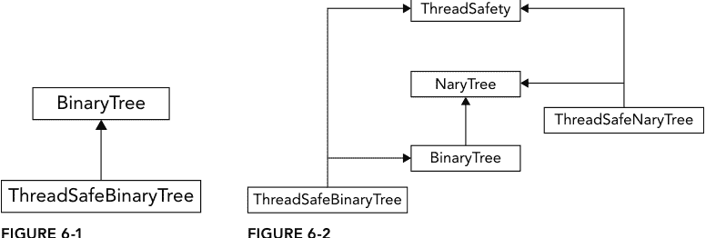

(Note: 图 6-1 referenced)

这种策略适用于两个逻辑概念（如线程安全和二叉树）。当三个或更多概念时就会变得复杂。例如，假设你想同时提供 N 树和二叉树，每种可以是线程安全的也可以不是。逻辑上，二叉树是 N 树的特例，因此它也应该是 N 树的派生类。同样，线程安全的结构应该是非线程安全结构的派生类。你无法通过线性层次结构提供这些分离。一种可能性是如图 6-2 所示使线程安全的方面。

这种层次结构要求你编写五个不同的类，但功能的清晰分离是值得的。

你也应该避免在方法级别组合不相关的概念，就像你在类级别上应该做的那样。无论在类级别还是方法级别，你都应该追求高内聚性。例如，方法不应该将变异（`set`）和检查（`get`）混合。

## 使用聚合分离逻辑概念

聚合在第 5 章中讨论过，即“拥有关系”（has-relationship）：对象包含其他对象以执行其功能的某些方面。当继承不再合适时，你可以使用聚合来分离不相关或相关的独立功能。

例如，假设你想使用一个 `Family` 类来区分家庭成员。显然，树形数据结构是存储这些信息的理想选择。与其在你的 `Family` 类中集成树形结构的代码，你应该编写一个 `Tree` 类。然后，你的 `Family` 类就可以包含并使用一个 `Tree` 实例。用面向对象的术语来说，`Family` 拥有 `Tree`。通过这种技术，树形数据结构可以很容易地在另一个程序中重用。

## 消除用户界面依赖

如果你的库是一个数据处理库，你希望将数据处理与用户界面分离。这意味着对于这类库，你永远不应该假设库将在何种类型的用户界面中使用。此外，不要使用 `cerr`、`cin`、`stdout`、`stderr` 或 `stdin`，如果你的库是在图形用户界面环境下使用的，这些概念可能毫无意义。例如，基于 Windows GUI 的应用程序不会有任何形式的控制台 I/O。如果你的库仅用于基于 GUI 的应用程序，你仍然永远不应该弹出任何类型的消息框或向用户发送通知；那是客户端代码的职责。此类依赖不仅会导致可用性变差，还会防止客户端代码正确地响应错误并进行静默处理。

在第 4 章中引入的模型-视图-控制器（MVC）范式是一种用于分离数据存储与数据可视化的广为人知设计模式。通过这种范式，模型可以位于库中，而客户端代码可以提供视图和控制器。

## 使用模板实现泛型数据结构和算法

C++ 有一个模板（`templates`）的概念，用于创建相对于某种类型或类是泛型的结构。例如，你可能已经编写了用于整数数组的代码。如果你随后要使用双精度数数组，你就需要重写并复制所有代码来处理双精度数。模板的概念是类型成为规范的参数，你可以创建一个可以处理任何类型的单一代码体。模板允许你编写可以适用于任何类型的数据结构和算法。

最简单的例子是 `std::vector` 类，它是 C++ 标准模板库（STL）的一部分。要创建一个整数向量，你写 `std::vector<int>`；要创建一个双精度数向量，你写 `std::vector<double>`。泛而言之，模板编程非常强大，但可能变得非常复杂。幸运的是，可以创建更简单的模板用法，根据类型进行参数化。第 11 章和第 21 章解释了使用你自己的模板的技术，而本节将讨论它们的一些重要设计方面。

在可能的情况下，你应该对数据结构和算法使用泛型设计，而不是编码特定程序的细节。不要编写一个只存储书籍对象的平衡二叉树结构。让它变成泛型，以便它可以存储任何类型的对象。这样，你就可以在书店、音乐店、操作系统或任何你需要平衡二叉树的地方使用它了。这种策略是标准模板库的基础。STL 提供了适用于任何类型的泛型数据结构和算法。

## 为什么模板比泛型编程技术更好

模板不是编写泛型数据结构的唯一机制。你可以在 C 和 C++ 中通过存储 `void*` 指针而不是特定类型来编写泛型结构。客户端可以使用该结构存储它们任何想要的内容，其类型为 `void*`。然而，这种方法的主要问题是它不是类型安全的：容器无法检查或强制执行存储元素的类型。你可以将任何类型强制转换为 `void*` 存入结构，当你从数据结构中移除指针时，结果必须强制转换回你认为的类型。由于没有检查，这可能是灾难性的。想象这样一个场景：一个程序员先通过强制转换为 `void*` 在数据结构中存储指向 `int` 的指针，而另一个程序员认为它们是指向 `Process` 的指针。第二个程序员会盲目地将这些 `void*` 指针强制转换为 `Process` 并将它们作为 `Process*` 使用。不用说，程序将不会按预期运行。

另一种方法是为特定类编写数据结构。通过多态，任何派生类都可以存储在结构中。Java 将这种方法推向极端：它规定每个类都直接或间接地继承自 `Object` 类。Java 容器是 `Object`，因此它们可以存储任何类型的对象。然而，这种方法并不是真正的类型安全。当你从容器中移除对象时，你必须记住它被向下转型为相应的类型。

相比之下，模板在正确使用时是类型安全的。模板的每个实例化都只存储一种类型。如果你尝试在同一个模板实例化中存储不同类型，你的程序将无法编译。Java 也支持泛型（`generics`）概念，它和 C++ 模板一样是类型安全的。

## 模板的问题

模板并非完美。首先，它们的语法令人困惑，特别是对于以前没有使用过它们的人来说。其次，解析很困难，而且并不是编译器都完全支持 C++ 标准。如果你的编译器没有完全支持关于模板的 C++ 标准，你的编译器可能不支持 STL 的整个功能集。另一方面，任何完全支持 STL 的编译器都应该足够强大，以支持大多数模板编程。

此外，模板需要同质化结构，即你在其中存储相同类型的对象。STL 提供了适用于任何类型的泛型数据结构和算法。

## 模板与继承

程序员在决定使用模板还是继承时感到棘手。这里有一些建议可以帮助你：

- 当你想提供相同的功能时，使用模板。
- 当你想提供不同的行为时，使用继承。

## 提供适当的检查和保护

编写安全代码有两种截然不同的风格。最佳风格可能是两者的结合。第一种被称为“契约设计”（`design-by-contract`），这意味着函数或类的契约是客户端的责任。这在 STL 中很常见。`vector` 定义了使用的契约，但它不会执行任何检查，那是客户端的责任。

第二种风格是你让函数和类尽可能地安全。这种设计最重要的方面是在你的代码中执行检查。例如，如果你的随机数生成器需要一个非负整数作为种子，不要信任用户会正确提供它。检查传入的值，如果无效则拒绝调用。

作为一个类比，考虑准备纳税单的会计师。当你聘请会计师时，向他们提供全年的财务信息。会计师不会盲目地填写你的信息，而是确保这些信息合理。例如，如果你使用会计师，但忘记指定你缴纳的房税，会计师会提醒你提供该信息。同样，如果你说你支付了 12000 美元的贷款利息，但总收入只有 15000 美元，会计师可能会询问你提供的数据是否正确，或者推荐更负担得起的住房。你可以将会计师视为一个“程序”，输入是你的财务信息，输出是纳税单。然而，会计师增加的价值不仅仅是她填写表格。你选择雇佣会计师，也要意识到他所提供的检查和保护。同样，在编程中，你可以在你的实现中尽可能地提供检查和保护。

## 设计易用的接口

除了对代码进行适当的抽象和结构化之外，设计接口还需要你关注与程序员交互的界面。即使你拥有最完美、最高效的实现，如果接口非常糟糕，你的库也无用处。

请注意，你程序中的每个子系统和类都应该拥有良好的接口，即使你并不打算在多个程序中使用它们。首先，你永远不知道代码会在何时被重用。其次，即使是第一次使用，良好的接口也是重要的，特别是当你在团队中编程，且其他程序员必须使用你设计和编写的代码时。

接口的主要目的是让代码易于使用，但某些接口技术也能帮助你遵循通用性原则。

### 开发易用的接口

你的接口应该是易用的。这并不意味着它们必须是微不足道的，但在功能允许范围内，它们应该是简单且直观的。你不应该要求库的用户为了翻阅数页源代码来使用一个简单的数据结构，或者在代码中进行复杂的构造来获取所需的功能。这为设计易用的接口提供了四种特定策略。

#### 遵循标准且熟悉的处理方法

开发易用接口的最佳策略是遵循标准且熟悉的处理方法。当人们遇到与他们过去使用过的东西类似的接口时，他们会理解得更好，更容易采纳，并且不当使用的概率也更小。

例如，假设你正在控制汽车的转向机制：一个操杆、两个用于左右移动的按钮、一个水平滑动杆，或者一个经典的方向盘。你认为哪种接口是易用的？哪种接口卖得最好？拥有方向盘的用户对这些问题的答案无疑是方向盘。即使你开发了另一种提供更性能和安全的机制，要教人们如何使用它也会非常困难。当你在遵循标准接口模型和开辟新方向之间选择时，通常最好坚持人们习惯的接口。

创新固然重要，但你应该关注开发实现上的创新，而不是接口的创新。例如，消费者对汽车型号创新的汽电混合引擎感到兴奋。这些汽车之所以畅销良好，部分是因为其使用的接口符合汽车的直觉标准。

应用于 C++，这一策略意味着你应该开发符合 C++ 程序员熟悉的标准的接口。例如，C++ 程序员期望类的构造函数和析构函数分别初始化和清理对象。在设计类时，你应该遵循这一标准。如果你要求程序员调用 `initialize()` 和 `cleanup()` 方法进行初始化和清理，而不是将这些功能放在构造函数和析构函数中，你会让所有尝试使用你类的的人感到困惑。你的类行为与其他 C++ 类不同，程序员将花费更长时间学习如何使用它，并且可能因为忘记调用 `initialize()` 或 `cleanup()` 而错误地使用它。

> **注意**：始终从使用者的角度考虑你的接口。它们合理吗？它们是你预期的那样吗？

C++ 提供了一项名为运算符重载的语言特性，可以帮助你为对象开发易用的接口。重载允许你编写类，使得标准运算符对它们的作用就像对 `int` 和 `double` 等内置类型一样。例如，你可以写一个 `Fraction` 类，允许像这样对分数进行加、减和流输出：

```
Fraction f1(3,4);
Fraction f2(1,2);
Fraction sum;
Fraction diff;
sum = f1 + f2;
diff = f1 - f2;
cout << f1 << " * " << f2 << endl;
```

与使用方法调用的相同行为对比：

```
Fraction f1(3,4);
Fraction f2(1,2);
Fraction sum;
Fraction diff;
sum = f1.add(f2);
diff = f1.subtract(f2);
f1.print(cout);
cout << " *";
f2.print(cout);
cout << endl;
```

你可以看到，运算符重载允许你为类提供更易用的接口。然而，不要滥用运算符重载。你可以重载 `+` 运算符使其实现减法，重载 `-` 运算符使其实现乘法。这些实现将违背直觉。这并不意味着每个运算符都应该始终具有完全相同的行为。例如，字符串类实现了 `+` 运算符来拼接字符串，这是一个直观的字符串拼接接口。有关运算符重载的细节，请参见第 8 章和第 14 章。

#### 不要遗漏必要的功能

这一策略是双重的。首先，为客户端可能需要的所有行为包含接口。这听起来似乎显而易见。回到汽车的类比，你永远不会造一辆没有速度表的汽车来让司机知道自己的速度吧？同样，你设计一个 `Fraction` 类时，也不会不提供让客户端访问分子和分母的机制。


然而，其他可能的行为可能更加晦涩。这一策略要求你预判客户端调用你代码的所有用途。如果你只以一种特定的方式考虑接口，你可能会错过客户端以不同方式使用它时可能需要的功能。例如，假设你想设计一个游戏棋盘类。你可能只考虑典型的游戏，如象棋和西洋跳棋，并决定棋盘上的每个位置最多支持一个游戏棋子。但是，如果你以后决定写一个双跳棋游戏，它允许棋盘上的一个位置放置多个棋子呢？通过排除这种可能性，你就排除了你的棋盘作为双跳棋盘的使用。

显然，预判库的每种用途是困难的但并非不可能。不要为了设计完美的接口而强迫自己预判未来的用途。

策略的第二部分是尽可能在实现中包含功能。不要要求客户端指定你已经已知的信息。例如，如果你的库需要一个临时文件，不要让客户端使用该文件。他们并不关心你用什么文件；寻找其他方法。

此外，不要要求库用户执行不必要的工作来合并结果。如果你的随机数库使用分别计算随机数低位高位的算法，请在交付给用户之前将数字合并。

## 提供整洁的接口

为了避免遗漏功能，某些程序员走向了另一个极端：他们包含了想象的所有功能。使用接口的程序员永远不会缺乏完成任务手段。不幸的是，界面可能杂乱到他们永远搞不清楚如何操作！

不要在你的接口中提供不必要的功能；保持其简洁。初看起来，这一准则似乎与之前的避免功能的策略直接冲突。再次考虑。你开车只需与少数组件交互：方向盘、刹车和油门踏板、档位、后视镜、速度表以及仪表盘上的其他细节。想象汽车仪表盘看起来像飞机驾驶舱，有数百个仪表、杠杆、显示器和按钮。它将是无法使用的！开车比飞行容易得多，因此接口可以更简单：你不需要查看俯仰、与控制装置通信或控制机翼、发动机等众多部件。

此外，从库开发的角度来看，较小的库更容易维护。如果你试图让所有人满意，你会有犯错空间，而且如果你的实现复杂到所有内容交织在一起，一个错误就会导致库失效。

## 提供文档和注释

无论你的接口用起来有多简单，你都应该为它们的使用提供文档。如果你不告诉程序员如何使用，你就不能指望他们能正确地使用你的库。将你的库或代码看作供其他程序员消费的产品。你的产品应该有解释其正确用法的文档。

为你的接口提供文档有两种方式：接口本身的注释和外部文档。你应该努力同时提供这两者。大多数公共 API 只提供外部文档：在 Unix 和 Windows 头文件中，注释是稀缺资源。在 Unix 中，文档通常以名为 man pages（帮助页）的在线手册形式出现。在 Windows 中，文档通常伴随集成开发环境一起提供。

尽管大多数 API 和库都省略了接口本身的注释，但我实际上认为这种形式的文档是最重要的。你不应该提供一个只包含代码的“裸”头文件。即使注释的内容与外部文档完全相同，看起一个带有友好注释的头文件也比看一个只有代码的头文件更不那么令人生畏。优秀的程序员经常喜欢看到书面语言：

有些程序员使用工具从注释自动创建文档。第 3 章将详细讨论这种技术。

无论你提供的是注释、外部文档还是两者兼有，文档都应该描述库的行为，而不是实现。行为包括输入、输出、错误条件和处理、预期用途以及性能保证。例如，描述生成随机数调用的文档应该指明它不接受参数，返回一个精确指定范围内的整数，并列出当发生问题时可能抛出的所有异常。此文档不应该解释实际生成数字的线性同余算法的细节。在接口开发中提供过多的实现细节。许多开发者见过完美的接口与实现分离被接口中的注释破坏了，而这些注释更适合库的维护者而不是客户端。

当然，你也应该为你的内部实现编写文档，只是不要将其作为接口的一部分公开出来。第 3 章提供了关于在代码中适当使用注释的详细信息。

## 设计通用接口

接口应该足够通用，以便能够适应各种任务。如果你在一个所谓的通用接口中编码了某个特定应用程序的细节，那么它将无法用于任何其他用途。这里是一些需要记住的准则。

### 提供实现相同功能的多种方式

为了满足所有“客户”，有时提供实现相同功能的多种方式是有帮助的。然而，请务审慎地使用这种技术，因为过度使用很容易导致接口变得杂乱。

再次考虑汽车。现在的汽车提供遥控钥匙进入系统，你可以通过按下钥匙扣上的按钮来解锁汽车。然而，这些汽车还提供了一个标准钥匙，你可以用它来物理解锁汽车，例如当钥匙扣中的电池没电时。尽管这两种方法是冗余的，但大多数客户都喜欢拥有这两个选项。

在程序接口设计中，有时会有类似的情况。例如，假设你的一个方法接收一个字符串。你可能想提供两个接口：一个接收 C++ 字符串对象，另一个接收 C 风格的字符指针。虽然两者之间可以转换是可能的，但不同的程序员偏好不同类型的字符串，因此明确这两种方法是有帮助的。

请注意，这种策略应该被视为接口设计中“不杂乱”规则的例外。在少数情况下这种例外是合适的，但你大多数时候应该遵循“不杂乱”的规则。

### 提供可定制性

为了增加接口的灵活性，请提供可定制性。可定制性可以简单到允许客户端开启或关闭错误日志。可定制性的基本前提是你允许为每个客户端提供相同的基本功能，但赋予了客户端进行微调的能力。

你可以通过函数指针和模板参数允许更大的可定制性。例如，你允许客户端设置自己的错误处理程序。这种技术是装饰器模式的应用。

STL 将这种可定制性推到了极端，实际上允许客户端为容器指定内存分配器。如果你想使用此功能，你必须编写一个遵循 STL 指南并遵守所需接口的内存分配器对象。STL 中的每个容器都将分配器作为其模板参数之一。第 20 章提供了更多细节。

### 调和通用性与易用性

易用性和通用性这两个目标有时看起来相互冲突。通常，引入通用性会增加接口的复杂性。例如，假设你在 map 中需要一个图结构来存储城市。为了通用性，你可能会使用模板为任何类型编写一个通用的 map 结构，而不仅仅是城市。这样，如果你在下一个程序中编写一个网络结构，你就可以利用图结构来存储网络中的路由器。遗憾的是，通过使用模板，你让接口变得笨拙且难以使用，特别是当潜在客户端不熟悉模板时。

然而，通用性和易用性并不是互斥的。在某些情况下，通用性的增加可能会降低易用性，但设计出既通用又直观的接口是可能的。这里有两个你可以遵循的准则。

#### 提供多个接口

为了在提供足够功能的同时减少接口的复杂性，例如，你可以编写一个具有两个独立侧面的通用网络库：一个提供对游戏有用的网络接口，另一个提供对网页浏览的超文本传输协议（HTTP）有用的接口。

#### 让常用功能易于使用

当你提供通用接口时，某些功能的使用频率会比其他功能更高。你应该让常用功能易于使用，同时为更高级的功能提供选项。回到 map 程序，你可能想为 map 的客户端提供一个选项，用于指定不同语言的城市名称。由于英语占据主导地位，你会将其作为默认设置，并提供更改语言的额外选项。某些客户可能不想担心设置语言，但那些想要这样做的人是可以的。

## 总结

通过阅读本章，你学习了为什么要设计可重用代码以及如何做。你阅读了重用的哲学，将其总结为“编写一次，多次使用”，并了解到可重用代码应该是通用的且易用的。你还发现设计可重用代码需要使用抽象、恰当地组织代码以及设计良好的接口。

本章介绍了组织代码的三个具体建议：避免结合不相关或逻辑上分离的概念、为通用数据结构和算法使用模板以及提供适当的检查和保护措施。

本章还介绍了接口设计的六种策略：开发易用的接口、不要遗漏必需的功能、提供不杂乱的接口、提供文档和注释、提供实现相同功能的多种方式以及提供可定制性。它以两条调和通用性与易用性之间经常冲突需求的建议结尾：提供多个接口和让常用功能易于使用。

本章结束了本书的第二部分，该部分重点于在较高层次讨论设计主题。下一部分将通过 C++ 代码细节深入探讨软件工程过程中的实现阶段。

# 第三部分：以专业方式编码

- 第 7 章：精通类与对象
- 第 8 章：精通类与对象
- 第 9 章：探索继承技术
- 第 10 章：C++ 的怪异、异常与偶然
- 第 11 章：使用模板编写泛型代码
- 第 12 章：揭秘 C++ I/O
- 第 13 章：错误处理
- 第 14 章：重载 C++ 运算符
- 第 15 章：C++ 标准库概述
- 第 16 章：理解容器与迭代器
- 第 17 章：掌握 STL 算法
- 第 18 章：字符串本地化与正则表达式
- 第 19 章：额外的库工具

# 第 7 章：精通类与对象

**本章包含哪些内容？**

- 如何编写带有方法和数据成员的类
- 如何控制对方法和数据成员的访问
- 如何在栈和堆上使用对象
- 对象的生命周期是什么
- 如何编写在对象创建或销毁时执行的代码
- 如何编写拷贝或赋值对象的代码

**本章的 WROX.COM 下载**

请注意，本章的所有代码示例均可以在书籍网站 `www.wrox.com/go/proc++3e` 的 Download Code 标签页作为本章下载的一部分。

作为一种面向对象的语言，C++ 提供了使用对象和编写对象定义（称为类）的设施。你完全可以不用类和对象编写 C++ 程序，但这样做你就没有利用该语言最基础且实用的特性；编写不带类的 C++ 程序就像去巴黎吃麦当劳一样。为了有效地使用类和对象，你必须理解它们的语法和功能。

第 1 章回顾了类定义的基本语法。第 5 章介绍了 C++ 的面向对象编程方法，并为类对象提供了特定的设计策略。本章描述了涉及类对象的基本概念，包括编写类定义、定义方法、在栈和堆上使用对象、构造函数、默认构造函数、编译器生成的构造函数、构造初始化器（称为 `ctor-initializers`）、拷贝构造函数、初始化列表构造函数、析构函数和赋值运算符。即使你已经熟悉类和对象，也应该跳过本章，因为它包含了许多你可能不熟悉的各种零碎信息。

## 引入电子表格示例

本章和下一章展示了一个简单的电子表格程序的合理示例。电子表格是一个由“单元格”组成的二维网格，每个单元格包含一个数字或字符串。像 Microsoft Excel 这样的专业表格提供了执行数学运算的能力，例如计算一组单元格的值。这些章节中的电子表格示例并不试图在市场中挑战微软，但它对于说明类和对象的问题很有用。

该电子表格使用了两个基本类：`Spreadsheet` 和 `SpreadsheetCell`。每个 `Spreadsheet` 对象都包含一个 `SpreadsheetCell`。此外，`SpreadsheetApplication` 管理了一组 `Spreadsheets`。本章侧重于 `SpreadsheetCell`。第 8 章将开发 `Spreadsheet` 和 `SpreadsheetApplication` 类。

> **注意** 本章展示了多个版本的 `SpreadsheetCell` 类，以便逐步引入概念。然而，整个章节中对该类的多次尝试并不总是说明编写类每个层面的“最佳”方法。特别是早期的示例省略了通常会包含的重要功能，但这些功能尚未介绍。你可以按照“引言”中的描述下载该类的最终版本。

## 编写类

当你编写一个类时，你需要指定适用于该类对象的行为（或方法）以及每个对象将包含的属性（或数据成员）。

编写类的过程包含两个部分：定义类本身以及定义它们的方法。

### 类定义

这是对简单的 `SpreadsheetCell` 类的第一次尝试，其中每个单元格只能存储一个数字：

```cpp
class SpreadsheetCell
{
public:
    void setValue(double keyValue);
    double getValue() const;
private:
    double mValue;
};
```

如第 1 章所述，每个类定义都以 `class` 关键字和类名开始。类定义是 C++ 中的一条语句，因此它必须以分号结束。如果你没有用分号结束类定义，你的编译器可能会给你几个错误，其中大多数看起来是完全无关的。

类定义通常放在与类同名的文件中。例如，`SpreadsheetCell` 类定义可以放在命名为 `SpreadsheetCell.h` 的文件中。这一规则并不强制执行，你可以随心所欲命名你的文件。

### 类成员

类可以有多个成员。成员可以是成员函数（反过来又是方法、构造函数或析构函数），或者是成员变量（也称为数据成员）。

看起来像函数原型的两行代码声明了该类支持的方法：

```cpp
void setValue(double keyValue);
double getValue() const;
```

第 1 章指出，将不改变对象的成员函数声明为 `const` 始终是一个好主意。

看起来像变量声明的行声明了该类的数据成员。

```cpp
double mValue;
```

类定义了它们所属的成员函数和数据成员。它们仅适用于类的特定实例，即对象。该规则的唯一例外是静态成员，将在第 8 章中解释。类定义的是真实的位位。因此，每个对象都包含其自己的 `mValue` 值。成员函数的实现在所有对象之间共享。类可以包含任意数量的成员函数数据成员。你不能给数据成员起与成员函数相同的名称。

### 访问控制

类中的每个成员都受三种访问修饰符之一的约束：`public`、`protected` 或 `private`。访问修饰符适用于其后的所有成员声明，直到下一个访问修饰符。在 `SpreadsheetCell` 类中，`setValue()` 和 `getValue()` 方法具有公共访问权限，而 `mValue` 数据成员具有私有访问权限。

类的默认访问修饰符是 `private`：第一个访问修饰符之前的所有成员声明具有私有访问权限。例如，将 `public` 修饰符移动到 `setValue()` 方法下方会使 `setValue()` 方法具有私有权限而非公共权限：

```cpp
class SpreadsheetCell
{
    void setValue(double inValue); // 现在具有私有访问权限
public:
    double getValue() const;
private:
    double mValue;
};
```

在 C++ 中，`struct` 可以像类一样拥有方法。事实上，区别在于 `struct` 的默认访问前缀是 `public`，而 `class` 的默认是 `private`。例如，可以使用 `struct` 如下重写 `SpreadsheetCell` 类：

```cpp
struct SpreadsheetCell
{
    void setValue(double inValue);
    double getValue() const;
private:
    double mValue;
};
```

下表总结了三种访问修饰符的含义：

| 访问规范 | 含义 | 使用场景 |
| --- | --- | --- |
| public | 代码都可以调用对象的公共成员函数或访问公共数据成员。 | 你希望客户端使用的行为（方法）。访问私有和受保护数据成员的方法。 |
| protected | 类中的任何成员函数都可以调用受保护成员函数并访问受保护数据成员。派生类中的成员函数可以访问基类的受保护成员。 | 你不希望客户端使用的“辅助”方法。 |
| private | 只有类的成员函数可以调用私有成员函数并访问私有数据成员。派生类中的成员函数无法访问基类的私有成员。 | 默认情况下一切应该是私有的，特别是数据成员。如果你只想允许类访问，可以提供受保护的 getter 和 setter；如果你希望客户端访问，可以提供公共的 getter 和 setter。 |

### 声明顺序

你可以以任何顺序声明成员和访问控制限定符：C++ 并不强制任何限制，例如成员函数必须在数据成员之前，或者 `public` 在 `private` 之前。此外，你可以重复使用访问限定符。例如，`SpreadsheetCell` 的定义可能如下：

```cpp
class SpreadsheetCell
{
public:
    void setValue(double inputValue);
private:
    double mValue;
public:
    double getValue() const;
};
```

然而，为了清晰起见，将 `public`、`protected` 和 `private` 声明分组，并在这些声明内部将成员函数和数据成员分组是个习惯。

## 定义方法

前面的 `SpreadsheetCell` 类的定义已经足够你创建该类的对象。但是，如果你尝试调用 `setValue()` 或 `getValue()` 方法，你的链接器会报错说这些方法未定义。这是因为类定义指定了方法的原型，但没有定义它们的实现。就像你为独立函数同时编写原型和定义一样，你也必须为方法编写原型和定义。请注意，类定义必须在方法定义之前。通常，类定义放在头文件中，而方法定义放在包含该头文件的源文件中。以下是 `SpreadsheetCell` 类两个方法的定义：

```cpp
#include "SpreadsheetCell.h"

void SpreadsheetCell::setValue(double inputValue)
{
    mValue = inputValue;
}

double SpreadsheetCell::getValue() const
{
    return mValue;
}
```

注意，类名后面跟着两个冒号位于每个方法名之前：

```cpp
void SpreadsheetCell::setValue(double inputValue)
```

`::` 被称为域解析运算符。在这种上下文中，该语法告诉编译器接下来的 `setValue()` 方法定义是 `SpreadsheetCell` 类的一部分。同样请注意，在定义方法时，不需要重复访问限定符。

> **注意** 如果你正在使用 Microsoft Visual C++ IDE，你会发现默认情况下所有的 cpp 文件开头都是：
>
> ```cpp
> #include "stdafx.h"
> ```
>
> 在 VC++ 项目中，默认情况下每个 cpp 文件都应该以这一行开头，你自己的包含语句必须跟随其后。如果你将自己的包含放在它们前面，它们看起来将不起作用，并且你会遇到各种编译错误。这涉及到预编译头文件的概念，这超出了本书的范围。请查阅微软关于预编译头文件的文档以了解详细信息。

## 访问数据成员

类的非静态方法（如 `setValue()` 和 `getValue()`）总是代表该类的特定对象执行的。在方法内部，你可以访问该对象所属类的所有数据成员。在之前 `setValue()` 的定义中，以下行代码无论方法调用的是哪个对象，都会改变 `mValue` 变量：

```cpp
mValue = inValue;
```


如果为两个不同的对象调用了 `setValue()`，那么同一行代码（每个对象执行一次）将改变两个不同对象中的变量。

# 调用其他方法

你可以从另一个方法的内部调用类的方法。例如，考虑对 `SpreadsheetCell` 类的扩展。真实的电子表格应用程序允许单元格中包含文本数据也包含数字。当你尝试将文本解释为单元格时，电子表格会尝试将文本转换为数字。如果文本不代表有效值，则单元格值将被忽略。在这个程序中，不是数字的字符串将生成单元格值为 0。以下是支持数据的 `SpreadsheetCell` 类定义的第一个草案：

```cpp
#include <string>
class SpreadsheetCell {
public:
    void setValue(double inValue);
    double getValue() const;
    void setValue(const std::string& inString);
    const std::string getString() const;
private:
    std::string doubleToString(double inValue) const;
    double doubleToDouble(const std::string& inString) const;
    double mValue;
    std::string mString;
};
```

此版本的类同时存储了数据的文本和数值表示。如果客户端将数据设为字符串，它会被转换为 double，而 double 会转换为字符串。如果文本不是有效数字，则 double 值为 0。注意，在类中同时拥有文本和数值表示仅用于说明之目的。你应该避免存储冗余数据。`SpreadsheetClass` 的这一缺陷将在第 9 章中解决。此类定义显示了两个用于设置和检索单元格文本表示的新方法，以及两个用于转换为 double 和反之的私有辅助方法。这些辅助方法使用了字符串，字符串将在第 12 章中介绍。以下是所有方法的实现。

```cpp
#include <SpreadsheetCell.h>
#include <iostream>
#include <string>
using namespace std;
void SpreadsheetCell::setValue(double value)
{
    mValue = value;
    mString = doubleToString(mValue);
}
double SpreadsheetCell::getValue() const
{
    return mValue;
}
void SpreadsheetCell::setString(const string& inString)
{
    mString = inString;
    mValue = stringToDouble(mString);
}
const string& SpreadsheetCell::getString() const
{
    return mString;
}
string SpreadsheetCell::doubleToString(double value) const
{
    ostream ostr;
    ostr << value;
    return ostr.str();
}
double SpreadsheetCell::toDouble(const string& inString) const
{
    double temp;
    istream str(inString);
    str >> temp;
    if (str.fail() || !str)
    {
        return 0;
    }
    return temp;
}
```

注意类名后面跟着两个冒号位于每个方法名之前：

```cpp
void SpreadsheetCell::setValue(double inputValue)
```

`::` 被称为域解析运算符。在这种上下文中，该语法告诉编译器接下来的 `setValue()` 方法定义是 `SpreadsheetCell` 类的一部分。同样请注意，在定义方法时不需要重复访问限定符。

> 注意：如果你正在使用 Microsoft Visual C++ IDE，你会发现默认情况下所有的 cpp 文件开头都是：

```cpp
#include "stddafx.h"
```

在 VC++ 项目中，默认情况下每个 cpp 文件都应该以这一行开头，你自己的包含语句必须跟随其后。如果你将自己的包含放在它们前面，它们看起来将不起作用，并且你会遇到各种编译错误。这涉及到预编译头文件的概念，这超出了本书的范围。请查阅微软关于预编译头文件的文档以了解详细信息。

# 访问数据成员

类的非静态方法（如 `setValue()` 和 `getValue()`）总是代表该类的特定对象执行的。在方法内部，你可以访问该对象所属类的所有数据成员。在之前 `setValue()` 的定义中，以下行代码无论方法调用的是哪个对象，都会改变 `mValue` 变量：

```cpp
mValue = inValue;
```

如果为两个不同的对象调用了 `setValue()`，同一行代码（每个对象执行一次）将改变两个不同对象中的变量。

# 使用对象 | 151

> **注意** 与其编写 `printCell()` 函数，重载 `<<` 运算符会更方便，将在第 14 章介绍。你可以使用以下行来打印：

```cpp
cout << *this << endl;
```

# 使用对象

之前的类定义说 `SpreadsheetCell` 由两个成员变量、四个公共方法和两个私有方法组成。然而，类定义并没有创建单元格；它只是指定了形状和行为。从这个意义上说，类类似于蓝图。蓝图指定了房屋的样子，绘制蓝图并没有建造房屋。房屋必须根据蓝图构造。

同样，在 C++ 中你可以通过声明类型为 `SpreadsheetCell` 的变量来构造“对象”。就像建筑师可以使用一组蓝图建造多个房子一样，程序员也可以从 `Spreadsheet` 类创建多个 `SpreadsheetCell` 对象。创建和使用对象有两种方式：在栈上和堆上，将在详细讨论。

## 栈上的对象

以下是在栈上创建并使用 `SpreadsheetCell` 的代码：

```cpp
SpreadsheetCell myCell, anotherCell;
myCell.setValue(6);
anotherCell.setString("3.2");
cout << "cell 1: " << myCell.getValue() << endl;
cout << "cell 2: " << anotherCell.getValue() << endl;
```

你创建对象就像声明简单变量一样，只是变量类型是类名。像 `myCell.setValue(6)` 中的 `.` 被称为“点”运算符；它允许你对对象调用方法。如果对象中有任何公共成员，你也可以用点运算符访问它们。记住，公共成员是不推荐的。

程序的输出是：

```
cell 1: 6
cell 2: 3.2
```

## 堆上的对象

你还可以通过 `new` 动态分配对象：

```cpp
SpreadsheetCell* myCell = new SpreadsheetCell();
myCell->setValue(3.7);
```


```cpp
cout << "cell 1: " << myCell->getValue() <<
     << " " << myCell->getString() << endl;
delete myCell;
myCell = nullptr;
```

当你在堆上创建对象时，通过“箭头”运算符 `->` 访问其成员。箭头运算符结合了解引用（`*`）和成员访问（`.`）。你也可以使用这两个运算符代替，但这样做在语法上会很别扭：

```cpp
SpreadsheetCell* myCell = new SpreadsheetCell();
(*myCell).setValue(3.7);
cout << "cell 1: " << ((myCell).getValue() <<
     << " " << ((myCell).getString()) << endl;
delete myCell;
myCell = nullptr;
```

正如你在堆上分配的其他内存一样，你必须通过调用 `delete` 来释放为对象分配的内存。为避免内存问题，强烈建议使用智能指针：

```cpp
auto myCell = make_unique<SpreadsheetCell>();
// 等价于：
unique_ptr<SpreadsheetCell> myCell(new SpreadsheetCell());
myCell->setValue(3.7);
cout << "cell 1: " << myCell->getValue() <<
     << " " << myCell->getString() << endl;
```

使用智能指针时，你无需手动释放内存，它会自动发生。

> **WARNING** 如果你使用 `new` 分配对象，请在使用完毕后用 `delete` 释放它，或使用智能指针自动管理内存。

> **NOTE** 如果不使用智能指针，在删除对象后将指针重置为空指针始终是个好主意。虽然这不是必须的，但如果指针在删除对象后被意外使用，这会让调试更容易。

# 对象生命周期

对象生命周期包含三项活动：创建、销毁和赋值。理解对象如何以及何时被创建、销毁和赋值，以及如何自定义这些行为非常重要。

## 对象创建

对象在声明处创建（如果在栈上）或当你显式使用 `new`、`new[]` 或智能指针为其分配空间时创建。当对象创建时，其所有嵌入对象也会被创建。例如：

```cpp
#include <string>
class MyClass {
    private:
        std::string className;
    };
int main() {
    MyClass obj;
    return 0;
}
```

嵌入的 `string` 在 `main()` 函数中创建 `MyClass` 对象时创建，并在其包含对象销毁时销毁。

在声明时给出初始值通常很有帮助。例如，你通常应像这样将整数变量初始化为 0：

```cpp
int x = 0;
```

同样，你也给对象初始值。你可以通过声明并编写一个称为构造函数的特殊方法来提供此功能，在其中可以执行对象的初始化工作。创建对象时，会执行其构造函数之一。

> **NOTE** C++ 程序员有时将构造函数称为 `ctor`。

## 编写构造函数

从语法上讲，构造函数由与类名相同的方法名指定。构造函数没有返回类型，可以没有参数。无参数的构造函数是默认构造函数。在某些上下文中，你必须提供默认构造函数，如果未提供，将会收到编译器错误。默认构造函数将在本章后面讨论。

以下是为 `SpreadsheetCell` 类添加构造函数的第一次尝试：

```cpp
class SpreadsheetCell {
    public:
        SpreadsheetCell(double initialValue);
        // 为简洁起见，省略了类定义的其余部分
}
```

正如你为普通方法提供实现一样，你也必须为构造函数提供实现：

```cpp
SpreadsheetCell::SpreadsheetCell(double initialValue)
{
    setValue(initialValue);
}
```

`SpreadsheetCell` 构造函数是 `SpreadsheetCell` 类的成员，因此 C++ 要求在构造函数名前加上正常的 `SpreadsheetCell::` 作用域解析。构造函数名本身也是 `SpreadsheetCell`，所以代码最终呈现出有趣的 `SpreadsheetCell::SpreadsheetCell` 形式。实现只是简单调用 `setValue()` 以设置数字和文本表示。

## 使用构造函数

使用构造函数可创建对象并初始化其值。你可以将构造函数用于基于栈和基于堆的分配。

### 栈上的构造函数

当你在栈上分配 `SpreadsheetCell` 对象时，像这样使用构造函数：

```cpp
SpreadsheetCell myCell(5), anotherCell(4);
cout << "cell 1: " << myCell.getValue() << endl;
cout << "cell 2: " << anotherCell.getValue() << endl;
```

注意，你**不**显式调用 `SpreadsheetCell` 构造函数。例如，不要使用如下形式：

```cpp
SpreadsheetCell myCell.SpreadsheetCell(5); // 无法编译！
```

同样，你也不能稍后调用构造函数。以下形式也不对：

```cpp
SpreadsheetCell myCell;
myCell.SpreadsheetCell(5); // 无法编译！
```

同样，在栈上使用构造函数的唯一正确方式如下：

```cpp
SpreadsheetCell myCell(5);
```

### 堆上的构造函数

当你动态分配 `SpreadsheetCell` 对象时，像这样使用构造函数：

```cpp
auto smartCell = make_unique<SpreadsheetCell>(4);
// do something
```

注意，你**不**显式调用 `SpreadsheetCell` 构造函数。例如，不要使用如下形式：

```cpp
SpreadsheetCell myCell.SpreadsheetCell(5); // 无法编译！
```

同样，你也不能稍后调用构造函数。以下形式也不对：

```cpp
SpreadsheetCell myCell;
myCell.SpreadsheetCell(5); // 无法编译！
```

同样，在栈上使用构造函数的唯一正确方式如下：

```cpp
SpreadsheetCell myCell(5);
```

当你想在其他类内部创建某个类的对象时，默认构造函数也非常有用，这在本章稍后的“构造函数初始化列表”部分会进行介绍。

## 如何编写默认构造函数

以下是带有默认构造函数的 `SpreadsheetCell` 类定义部分：

```cpp
class SpreadsheetCell {
    public:
        SpreadsheetCell();
        // 为了简洁起见，省略了类的其余定义
};
```

这里是默认构造函数的初步实现。构造函数不需要将 `mString` 初始化为空字符串，因为 `std::string` 的默认构造函数会被自动调用并将 `mString` 初始化为空字符串。

```cpp
SpreadsheetCell::SpreadsheetCell() {
    mValue = 0;
}
```

你可以像这样在栈上使用默认构造函数：

```cpp
SpreadsheetCell myCell(6);
myCell.setValue(6);
cout << "cell 1: " << myCell.getValue() << endl;
```

上述代码创建了一个名为 `myCell` 的新 `SpreadsheetCell` 对象，设置了它的值并打印了该值。与栈对象的其他构造函数不同，你不需要使用函数调用语法来调用默认构造函数。对于其他构造函数的语法，你可能会想这样调用默认构造函数：

```cpp
SpreadsheetCell myCell(); // 错误，但可以编译。
myCell.setValue(6);
// 然而，这一行将无法编译。
cout << "cell 1: " << myCell.getValue() << endl;
```

遗憾的是，尝试调用默认构造函数的这一行将失败。它无法编译。问题在于，你的编译器认为第一行实际上是一个名为 `myCell` 的函数声明，该函数接受零个参数并返回一个 `SpreadsheetCell` 对象。当它处理到第二行时，它认为你正试图将函数名用作对象！

> **WARNING** 在栈上创建对象时，请省略默认构造函数的括号。

对于基于堆的对象分配，可以使用如下方式使用默认构造函数：

```cpp
auto smartCell = make_unique<SpreadsheetCell>();
// 或者使用裸指针（不推荐）
SpreadsheetCell* myCell = new SpreadsheetCell();
// 或者
SpreadsheetCell* myCell = new SpreadsheetCell;
// ... 使用 myCell
delete myCell;
myCell = nullptr;
```

## 编译器生成的默认构造函数

本章第一个 `SpreadsheetCell` 类定义如下：

```cpp
class SpreadsheetCell
{
public:
    void setValue(double keyValue);
    double getValue() const;
private:
    double mValue;
};
```

该定义没有声明默认构造函数，但随后的代码仍然运行良好。

```cpp
SpreadsheetCell myCell;
myCell.setValue(6);
```

接下来的定义与之前的定义相同，只是增加了一个接受 `double` 的显式构造函数。它仍然没有显式声明默认构造函数。

```cpp
class SpreadsheetCell
{
public:
    SpreadsheetCell(double initialValue); // 没有默认构造函数
// 为了简洁起见，省略了类的其余定义
};
```

有了这个定义后，下面的代码将无法编译：

```cpp
SpreadsheetCell myCell;
myCell.setValue(6);
```

这里发生了什么？原因是，如果你没有指定任何构造函数，编译器会为你编写一个不接受任何参数的构造函数。这个**编译器生成的默认构造函数**会调用类中所有对象成员的默认构造函数，但不会初始化如 `int` 和 `double` 等语言原生类型。尽管如此，它允许你创建该类的对象。然而，如果你声明了默认构造函数或其他任何构造函数，编译器将不再为你生成默认构造函数。


> 注意：默认构造函数与 0 参数构造函数是同一的。“默认构造函数”一术语不仅指在你未能声明任何构造函数时自动生成的构造函数。它指的是在不需要参数时被默认指定的构造函数。

## 显式默认的构造函数

在 C++03 或更高版本中，如果你的类需要若干接受参数的显式构造函数，以及一个什么都不做的默认构造函数，你必须显式地按如下方式编写空构造函数：

```cpp
class MyClass
{
  public:
    MyClass() {}
    MyClass(int i);
};
```

然而，建议接口文件只包含公共方法的声明而不包含任何实现。之前的类定义违反了这一点。解决方案是按如下方式定义类：

```cpp
class MyClass
{
  public:
    MyClass();
    MyClass(int i);
};
```

在实现文件中空默认构造函数的实现将是：

```cpp
MyClass::MyClass() { }
```

为了避免手动编写空默认构造函数，C++ 现在支持**显式默认构造函数**的概念。这允许你按如下方式编写类定义，而无需在实现文件中实现默认构造函数。

```cpp
class MyClass
{
  public:
    MyClass() = default;
    MyClass(int i);
};
```

`MyClass` 定义了一个接受一个整数的自定义构造函数。然而，由于使用了 `default` 关键字，编译器仍然会生成一个标准的编译器生成的默认构造函数。

## 显式删除的构造函数

C++ 也支持*显式删除的构造函数*的概念。例如，你可以定义一个带有静态方法的类，你不想为该类编写任何构造函数，也不希望编译器生成默认构造函数。在这种情况下，你需要显式地删除默认构造函数：

```cpp
class MyClass
{
    public:
    MyClass() = delete;
};
```

## 构造函数初始化列表

到目前为止，我们在构造函数体内部初始化数据成员，例如：

```cpp
SpreadsheetCell()
{
    mValue = 0;
}
```

C++ 提供了一种在构造函数中初始化数据成员的替代方法，称为*构造函数初始化列表*。例如，重写 `SpreadsheetCell` 构造函数以使用初始化列表：

```cpp
SpreadsheetCell() : mValue(0)
{}
```

如所示，初始化列表以冒号开始，并用逗号分隔。列表中的每个元素都是成员的初始化。它出现在构造函数参数列表和正体大括号之间。

初始化列表允许你在创建对象时为成员提供初始值，这比在构造函数内部为它们赋值更高效。对于 `string` 类型，默认初始化会使其得到空字符串；因此显式地将 `mString` 初始化为空字符串是多余的。

如果你的类拥有没有默认构造函数的数据成员对象，你必须使用初始化列表来构造该对象。例如，考虑以下 `SpreadsheetCell` 类：

```cpp
class SpreadsheetCell
{
    public:
    SpreadsheetCell(double d);
};
```

构造函数的实现如下：

```cpp
SpreadsheetCell::SpreadsheetCell(double d) { }
```

该类只有一个接受 `double` 的显式构造函数，并且不包含默认构造函数。你可以如下将其作为另一个类的数据成员：

```cpp
class SomeClass {
public:
    SomeClass();
private:
    SpreadsheetCell mCell;
}
```

并实现 `SomeClass` 构造函数：

```cpp
SomeClass::SomeClass() { }
```

然而，使用这种实现，代码将无法编译。编译器不知道如何初始化 `SomeClass` 的 `mCell` 成员，因为它没有默认构造函数。

解决方案是通过初始化列表初始化 `mCell` 成员：

```cpp
SomeClass::SomeClass() : mCell(1.0) { }
```

> 注意：构造函数初始化列表允许在创建成员时初始化它们。

有些程序员倾向于在构造函数内部赋值。然而，某些数据类型必须在初始化列表中初始化。下表总结了它们：

| 数据类型 | 解释 |
| --- | --- |
| const 数据成员 | 在创建后你无法合法地为 const 变量赋值。任何值必须在创建时提供。 |
| 引用数据成员 | 引用必须引用某些内容才能存在。 |
| 没有默认构造函数的对象数据成员 | C++ 尝试使用默认构造函数初始化成员对象。如果没有默认构造函数，则无法初始化该对象。 |
| 没有默认构造函数的基类 | [参见第 9 章] |

构造函数初始化列表（ctor-initializers）有一个重要的注意事项：它们按照数据成员在类定义中出现的顺序进行初始化，而不是它们在构造函数初始化列表中的顺序。请参考以下 SpreadsheetCell 类的定义：

```cpp
class SpreadsheetCell
{
  public:
    // 为了简单起见省略了代码
  private:
    // 为了简单起见省略了代码
    double mValue;
    std::string mString;
};
```

假设你这样编写 SpreadsheetCell 构造函数以使用构造函数初始化列表：

```cpp
SpreadsheetCell::SpreadsheetCell(const string& initialValue) :
  mString(initialValue), mValue(stringToDo(mString)) // 顺序错误！
```

代码可以通过编译（尽管某些编译器会发出警告），但程序无法正常工作。你可能认为 `mString` 在 `mValue` 之前被初始化，因为 `mString` 在构造函数列表中列在前面。但 C++ 并不是这样工作的。Spreadsheet 类在声明 `mString` 之前声明了 `mValue`；因此，构造函数初始化列表尝试在初始化 `mString` 之前初始化 `mValue`。然而，初始化 `mValue` 的代码使用了 `mString` 的值，而此时 `mString` 还没有初始化！这种情况下的解决方案是在初始化 `mValue` 时使用参数 `initialValue` 而不是 `mString`。你应该交换它们在列表中的顺序以避免混淆：

```cpp
SpreadsheetCell::SpreadsheetCell(const string& initialValue) :
  mValue(stringToDo(initialValue)), mString(initialValue)
```

> WARNING 构造函数初始化列表按照类定义的声明顺序初始化数据成员，而不是构造函数初始化列表中的顺序。

## 拷贝构造函数

C++ 中有一种特殊的构造函数称为拷贝构造函数，它允许你创建一个另一个对象的精确拷贝。如果你没有自己编写拷贝构造函数，C++ 会为你生成一个，它通过源对象中的等效数据成员来初始化新对象中的每个数据成员。对于对象类型的数据成员，这种初始化意味着调用了它们的拷贝构造函数。

以下是 SpreadsheetCell 类中拷贝构造函数的声明：

```cpp
class SpreadsheetCell
{
SpreadsheetCell(const SpreadsheetCell& src);
// 为了简单起见省略了类定义的其余部分
};
```

拷贝构造函数接收源对象的 `const` 引用。与其他构造函数一样，它不返回值。在构造函数内部，你应该从源对象拷贝所有数据字段。从技术上讲，你可以在构造函数中执行任何你想的操作，但遵循预期行为并将新对象初始化为旧对象的拷贝通常是一个好主意。以下是 SpreadsheetCell 构造函数的实现示例：

```cpp
SpreadsheetCell::SpreadsheetCell(const SpreadsheetCell& src) :
    mValue(src.mValue), mString(src.mString)
{
```

注意对构造函数初始化列表的使用。

> NOTE 假定一组成员变量 m1, m2, ... mn，编译器生成的构造函数可以表示为：

```cpp
classname::classname(const classname& src) :
    m1(src.m1), m2(src.m2), ... mn(src.mn) { }
```

因此，在许多情况下，你不需要自己指定拷贝构造。然而，在某些条件下，这个默认的拷贝构造函数是不够的。这些情况将在第 8 章中介绍。

## 拷贝构造函数何时被调用

C++ 中向函数传递参数的默认语义是值传递。这意味着函数或方法接收该值或对象的拷贝。因此，每当你将对象传递给函数或方法时，编译器都会调用新对象的拷贝构造函数来初始化它。例如，假设 SpreadsheetCell 类中 `getString()` 方法的定义如下：

```cpp
void SpreadsheetCell::setString(string inString)
{
    mString = inString;
    mValue = stringToDouble(mString);
}
```

记住 C++ 的 `string` 类实际上是一个类，而不是内置类型。当你传递一个字符串参数并调用 `setString()` 时，参数 `inString` 通过调用其拷贝构造函数进行初始化。拷贝构造函数的参数就是你传递给 `setString()` 的字符串。在接下来的示例中，为 `setString()` 中以 `name` 为参数的 `inString` 对象执行字符串拷贝构造函数。

```cpp
SpreadsheetCell myCell;
string name = "heading one";
myCell.setName(name); // 拷贝 name
```

当 `setName()` 方法完成后，`inString` 会被销毁。因为只是 `name` 的拷贝，所以 `name` 保持完好。

每当你从函数或方法返回一个对象时，也会调用拷贝构造函数。在这种情况下，编译器通过其拷贝构造函数创建一个临时的、无名的对象。第 25 章更详细探讨了临时对象的影响。你可以通过通过 `const` 引用传递参数来避免拷贝构造函数的开销，正如本章一直所做。

## 显式调用拷贝构造函数

你可以随需要使用拷贝构造函数。将一个对象构造为另一个对象的拷贝通常是可能的。例如，你可能想创建一个 SpreadsheetCell 对象的拷贝：

```cpp
SpreadsheetCell myCell2(4);
SpreadsheetCell myCell3(myCell2); // myCell3 的值与 myCell2 相同
```

## 按引用传递对象

为了在获取对象引用时避免拷贝，你可以声明函数或方法接收引用。按引用传递对象通常比按值传递更高效，因为只拷贝了对象的地址。按引用传递对象避免了动态分配问题（该问题在第 8 章中讨论过）。当你按引用传递对象时，函数或方法可以修改原始对象。这被称为按引用传递，并在之前的示例中都出现过。例如，需要 `const` 引用的 Spreadsheet 类定义如下：

```cpp
class SpreadsheetCell {
    public:
    SpreadsheetCell();
    SpreadsheetCell(double initialValue);
    SpreadsheetCell(std::string initialValue);
    SpreadsheetCell(const SpreadsheetCell& src);
    void setValue(double inValue);
    double getValue() const;
    void setName(std::string inString);
    std::string getName() const;
    private:
    std::string doubleToString(double inValue) const;
    double stringToDouble(std::string inString) const;
    double maxValue;
    std::string mString;
};
```

这是 `setString()` 的实现。注意方法保持不变，只是参数类型不同。

```cpp
void SpreadsheetCell::setString(string inString)
{
  mString = inString;
  maxValue = stringToDouble(mString);
}
```

> NOTE 出性能考虑，最好按 const 引用传递对象。

Spreadsheet 类的 `doubleToString()` 方法总是按值返回字符串，因为方法的实现在结束时创建一个局部字符串对象并返回给调用者。返回该字符串的引用是不可行的，因为它引用的字符串会在函数退出时被销毁。

## 显式默认和删除拷贝构造函数

你可以像下面显式默认或删除编译器生成的拷贝构造函数：

```cpp
SpreadsheetCell(const SpreadsheetCell& src) = default;
```

或者

```cpp
SpreadsheetCell(const SpreadsheetCell& src) = delete;
```

## 列表列表构造函数

初始化列表构造函数是以 `std::initializer_list<T>` 作为第一个参数的构造函数，可以没有额外参数，也可以额外参数具有默认值。在使用 `std::initializer_list<T>` 模板之前，你需要包含 `<initializer_list>` 头文件。下面的类演示了它的用法。

```cpp
class EvenSequence {
public:
  EvenSequence(initializer_list<double> args) {
    if (args.size() % 2 != 0) {
      throw invalid_argument("initializer-list should包含偶数个元素.");
    }
    mSequence.reserve(args.size());
  }
private:
  vector<double> mSequence;
};
```

```cpp
for (auto value : args) {
    mSequence.push_back(value);
}
void dump() const {
    for (auto value : mSequence) {
        cout << value << ",";
    }
    cout << endl;
}
private:
    vector<double> mSequence;
```

在初始化列表构造函数（initializer-list constructor）中，你可以使用范围 `for` 循环访问初始化列表的元素。可以通过 `size()` 方法获取初始化列表中的元素数量。

`EvenSequence` 的初始化列表构造函数使用范围 `for` 循环从 `initializer_list` 中拷贝元素。特别是，建议尽可能地使用 STL 算法。STL 算法将在第 17 章中详细讨论。例如，之前带有 `push_back()` 的范围 `for` 循环可以使用 STL 算法重写如下：

```cpp
mSequence.insert(insert(mSequence), cbegin(args), cend(args));
```

`EvenSequence` 对象可以如下进行构造：

```cpp
EvenSequence p1 = (1.0, 2.0, 3.0, 4.0, 5.0, 6.0);
p1.dump();
try {
    EvenSequence p2 = (1.0, 2.0, 3.0);
} catch (const invalid_argument& e) {
    cout << e.what() << endl;
}
```

`p2` 的构造将抛出异常，因为其初始化列表中的元素个数是奇数。前面的等号是可选的，可以省略，例如：

```cpp
EvenSequence p1(1.0, 2.0, 3.0, 4.0, 5.0, 6.0);
```

STL 完全支持初始化列表构造函数。例如，`std::vector` 容器可以使用初始化列表进行初始化：

```cpp
std::vector<std::string> myVec = {"String 1", "String 2", "String 3"};
```

如果没有初始化列表构造函数，初始化 vector 的一种方法是使用多次 `push_back()` 调用：

```cpp
std::vector<std::string> myVec;
myVec.push_back("String 1");
myVec.push_back("String 2");
myVec.push_back("String 3");
```

初始化列表不仅限于构造函数，还可以像第 10 章解释的那样用于普通函数。

## 类内成员初始化器 (In-Class Member Initializers)

自 C++11 以来，成员变量可以直接在类定义中初始化。例如：

```cpp
#include <string>
class MyClass
{
    private:
        int mInt = 1;
        std::string mstr = "test";
}
```

在 C++11 之前，初始化 `mInt` 和 `mstr` 的唯一方法是在构造函数体内部，或者使用如下的 C 初始化列表（c-initializer）：


```cpp
#include <string>
class MyClass
{
    public:
        MyClass() : mInt(1), mstr("test") {}
    private:
        int mInt;
        std::string mstr;
}
```

在 C++11 之前，只有 `static const` 成员变量可以在类定义中初始化。例如：

```cpp
#include <string>
class MyClass
{
    private:
        static const int kII = 1; // OK
        static const std::string kStr = "test"; // Error: 不是整型类型
        static int si2 = 2; // Error: 不是 const
        const int kIII = 3; // Error: 不是 static
}
```

## 委托构造函数 (Delegating Constructors)

委托构造函数允许构造函数调用同一类中的另一个构造函数。然而，这种调用不能放在构造函数体中；它必须位于构造函数初始化列表中，并且必须是列表中唯一的成员初始化项。以下是一个示例：

```cpp
SpreadsheetCell::SpreadsheetCell(const string& initialValue)
    : SpreadsheetCell(stringToDouble(initialValue)) {}
```

当这个字符串构造函数（委托构造函数）被调用时，它将调用委托给目标 `double` 构造函数。当目标构造函数返回时，将执行委托构造函数的体。

确保在委托构造函数时避免构造函数递归。例如：

```cpp
class MyClass
{
  MyClass(char c) : MyClass(1.2) { }
  MyClass(double d) : MyClass('m') {}
}
```

第一个构造函数将委托给第二个构造函数，而第二个又委托回给第一个。此类代码的行为是未定义的，且取决于编译器。

## 编译器生成的构造函数总结

编译器会自动为每个类生成一个 0 参数构造函数和一个拷贝构造函数。然而，你定义的构造函数将根据以下规则替换这些构造函数：

| 如果你定义了 ... | 那么编译器生成 ... | 并且你可以这样创建对象 ... |
| --- | --- | --- |
| [无构造函数] | 一个 0 参数构造函数<br>一个拷贝构造函数 | 不带参数创建：`SpreadsheetCell`;<br>作为另一个对象的拷贝：`SpreadsheetMyCell(cell)`; |
| 仅有 0 参数构造函数 | 一个拷贝构造函数 | 不带参数创建：`SpreadsheetCell`;<br>作为另一个对象的拷贝：`SpreadsheetMyCell(cell)`; |
| 仅有拷贝构造函数 | 无构造函数 | 理论上，作为另一个对象的拷贝。实际上中，你无法创建任何对象。 |
| 仅有单参数或多参数构造函数 | 一个拷贝构造函数 | 不带参数创建：`SpreadsheetCell`;<br>作为另一个对象的拷贝：`SpreadsheetMyCell(cell)`; |
| 同样有 0 参数构造函数 | 一个拷贝构造函数 | 不带参数创建：`SpreadsheetCell`;<br>作为另一个对象的拷贝：`SpreadsheetMyCell(cell)`; |

注意，在 C++ 的世界中，“拷贝”只发生在对象被初始化时。如果一个对象已经有一个值并且正在被覆盖，更准确的术语是“赋值”。注意 C++ 提供的拷贝机制是拷贝构造函数。由于它是一个构造函数，它只能用于创建对象，不能用于后续的赋值。

## 对象析构 (Object Destruction)

当对象被析构时会发生两个事件：析构函数被调用以及内存被释放。这适用于超出范围或被显式删除的对象。对于栈上的对象，这是自动发生的。

没有智能指针帮助的情况下，堆上的对象不会自动发生。你必须对对象调用 `delete` 来调用其析构函数。以下程序展示了这种行为：

```cpp
int main() {
    SpreadsheetCell* cell1 = new SpreadsheetCell(5);
    SpreadsheetCell* cell2 = new SpreadsheetCell(6);
    cout << "cell1: " << cell1->getValue() << endl;
    delete cell1; // 析构 cell1
    cell1 = nullptr;
    return 0;
} // cell2 没有被析构，因为没有调用 delete。
```

> **WARNING** 不要编写像上面那样没有删除 cell2 的程序。确保始终通过 `delete` 或 `delete[]` 释放动态分配的内存（取决于是使用 `new` 还是 `new[]` 分配的），或者使用智能指针。

> **NOTE** 有工具可以检测已释放的对象

## 对象赋值 (Assigning to Objects)

正如在 C++ 中可以将一个 `int` 的值赋值给另一个一样，你可以将一个对象的值赋值给另一个。例如，以下代码将 `myCell` 的值赋值给 `anotherCell`：

```cpp
SpreadsheetCell myCell(5); anotherCell;
anotherCell = myCell;
```

你可能会说 `myCell` 被“拷贝”到了 `anotherCell`。然而在 C++ 的世界中，“拷贝”只发生在对象被初始化时。如果一个对象已经有一个值并且正在被覆盖，更准确的术语是“赋值”。注意 C++ 提供的拷贝机制是拷贝构造函数。由于它是一个构造函数，它只能用于创建对象，不能用于后续的赋值。

因此，C++ 为每个类都提供了另一个方法来执行赋值。该方法被称为赋值运算符。它的名字是 `operator=`，因为它实际上是对类中 `=` 运算符的重载。在前面的示例中，`anotherCell` 的赋值运算符被调用，并将 `myCell` 为参数。

> **注意** 本节解释的赋值运算符有时被称为**拷贝赋值运算符**，因为在赋值后，左侧和右侧都保持存。之所以做这种区分是因为还存在移动赋值运算符，在移动赋值中，出于性能考虑，右侧对象在赋值后会被销毁。移动赋值运算符将在第10章中介绍。

与往常一样，如果你不编写自己的赋值运算符，C++ 会为你生成一个，以允许对象之间进行赋值。默认的 C++ 赋值行为与其默认拷贝行为几乎相同：它会递归地将每个数据成员从源对象赋值到目标对象。

## 声明赋值运算符

这是对 `SpreadsheetCell` 类定义的另一种尝试，这次包含了一个赋值运算符：

```cpp
class SpreadsheetCell {
public:
    // 为了简单起见，省略了类的其余部分
    SpreadsheetCell& operator=(const SpreadsheetCell& rhs);
    // 为了简单起见，省略了类的其余部分
};
```

赋值运算符像拷贝构造函数一样接收源对象的 `const` 引用。在这种情况下，源对象被称为 `rhs`，代表等号的“右侧”（right-hand side）。调用赋值运算符的对象则是等号的左侧。

与拷贝构造函数不同，赋值运算符返回一个 `SpreadsheetCell` 对象的引用。原因是赋值可以链式调用，如下例所示：

```cpp
myCell = aThirdCell;
```

当执行该行代码时，首先发生的是调用了 `anotherCell` 的赋值运算符，并将 `aThirdCell` 作为“右侧”参数传入。接着，调用了 `myCell` 的赋值运算符。然而，它的参数并不是 `anotherCell`。它的右侧是 `aThirdCell` 赋值给 `anotherCell` 的结果。如果该赋值没有返回结果，那么就没有东西可以传递给 `myCell`。

你可能会奇怪，为什么 `myCell` 的赋值运算符不能直接接收 `anotherCell`。原因是等号实际上是真正的方法调用的简写。当你以完整的函数式语法查看该行代码时，你就能看出问题所在：

```cpp
myCell.operator=(anotherCell.operator=(aThirdCell));
```

现在你可以看到，来自 `anotherCell` 的 `operator=` 调用必须返回一个值，该值被传递给 `myCell` 的 `operator=` 调用。正确的返回值应该是 `anotherCell` 本身，这样它可以作为赋值给 `myCell` 的源。然而，直接返回 `anotherCell` 是低效的，因此你可以返回对 `anotherCell` 的引用。

> **警告** 你实际上可以声明赋值运算符返回你想要的任何类型，包括 `void`。然而，你应该始终返回调用该运算符的对象的引用，因为这是调用者所预期的。

## 定义赋值运算符

赋值运算符的实现与拷贝构造函数相似，但有几个重要的区别。首先，拷贝构造函数仅用于初始化，因此目标对象尚未拥有有效值。赋值运算符可以覆盖对象中的当前值。这种考虑只有在你从对象中动态分配内存时才会真正发挥作用。详情请见第 8 章。

其次，在 C++ 中将对象赋值给自己是合法的。例如，以下代码可以编译并运行：

```cpp
SpreadsheetCell cell(4);
cell = cell; // 自赋值
```

你的赋值运算符不应该禁止自赋值，但发生自赋值时也不应该执行完全赋值。因此，赋值运算符应该在方法的开始处检查自赋值并立即返回。

以下是 `SpreadsheetCell` 类赋值运算符的定义：

```cpp
SpreadsheetCell& SpreadsheetCell::operator=(const SpreadsheetCell& rhs)
{
    if (this == &rhs) {
        return *this;
    }
```

上一行检查了自赋值，但这有点晦涩。当等号的左侧和右侧相同时，就会发生自赋值。判断两个对象是否相同的方法是看它们是否占据相同的内存位置——更显式地说，看它们的指针是否相等。

同样，`rhs` 是指向右侧对象的指针。如果这些指针相等，则赋值必须是自赋值，但返回类型是 `SpreadsheetCell&`；必须返回一个正确的值。所有的赋值运算符都返回 `*this`，自赋值的情况也不例外：`*this` 是指向执行该方法的对象的指针，因此 `*this` 就是对象本身。编译器将返回该对象的引用以匹配声明的返回值。现在，如果不是自赋值，你必须对每个成员进行赋值：

```cpp
mValue = rhs.mValue;
mString = rhs.mString;
```

在这里，方法拷贝了值。

```cpp
return *this;
}
```

最后，如之前所述，它返回 `*this`。

## 显式默认和删除赋值运算符

你可以如下所示显式默认或删除编译器生成的赋值运算符：

```cpp
SpreadsheetCell& operator=(const SpreadsheetCell& rhs) = default;
or
SpreadsheetCell& operator=(const SpreadsheetCell& rhs) = delete;
```

## 区分拷贝与赋值

有时很难判断对象是通过拷贝构造函数初始化的，还是通过赋值运算符赋值的。本质上，看起来像声明的内容将使用拷贝构造函数，而看起来像赋值语句的内容将由赋值运算符处理。考虑以下代码：

```cpp
SpreadsheetCell myCell(5);
SpreadsheetCell anotherCell(myCell);
```

`anotherCell` 使用拷贝构造函数构造的。

```cpp
SpreadsheetCell aThirdCell = myCell;
// aThirdCell 也是通过拷贝构造函数构造的，因为这是一个声明。
// 这行代码没有调用 operator=。这种语法是另一种写法：
// SpreadsheetCell aThirdCell(myCell);
anotherCell = myCell; // 为 anotherCell 调用 operator=。
```

在这里，`anotherCell` 已经构造，所以编译器调用了 `operator=`。

## 作为返回值的对象

当你从函数或方法返回对象时，有时很难确切看到发生了什么样的拷贝和赋值。假设 `getString()` 的代码如下所示：

```cpp
string Spreadsheet::getString() const
{
  return mString;
}
```

现在考虑以下代码：

```cpp
SpreadsheetCell myCell2(5);
string s1;
s1 = myCell2.getString();
```

当 `getString()` 返回 `mString` 时，编译器实际上通过调用字符串构造函数创建了一个未命名的临时字符串对象。当将其赋值给 `s1` 时，会调用 `s1` 的赋值运算符，并将临时字符串作为参数。然后，临时字符串被销毁。因此，这单行代码调用了构造函数和赋值运算符（针对不同的对象）。然而，编译器可以实现返回值优化（RVO）来优化这一过程。

如果你还感到困惑，请考虑这段代码：

```cpp
SpreadsheetCell myCell3(5);
string s2 = myCell3.getString();
```

在这种情况下，`getString()` 在返回 `mString` 时创建一个临时字符串对象。但现在 `s2` 获取的是拷贝构造函数，而不是赋值运算符。

通过移动语义，编译器可以使用移动构造函数代替拷贝构造函数从 `getString()` 返回 `mString`。这更高效。移动语义将在第10 章中讨论。

如果你忘记了这些发生的顺序或调用了哪个构造函数或运算符，你可以通过在代码中临时包含辅助输出或使用调试器调试来轻松解决。

## 拷贝构造函数与对象成员

你还应该注意构造函数中赋值与拷贝构造的区别。如果对象包含其他对象，编译器生成的拷贝构造函数会调用每个包含对象的拷贝构造函数。当你编写自己的拷贝构造函数时，可以使用初始化列表（如之前所示）提供相同的语义。如果你在初始化列表中省略某个数据成员，编译器会在执行构造函数体中的代码之前执行默认初始化（对对象的无参构造函数的调用）。因此，当构造函数体执行时，所有数据成员都已初始化完毕。

例如，你可以这样写拷贝构造函数：

```cpp
SpreadsheetCell::SpreadsheetCell(const Spreadsheet& src)
  : mString(src.mString)
{
  mValue = src.mValue;
}
```

然而，在构造函数体中为数据成员赋值时，你是在它们上使用赋值运算符，而不是拷贝构造函数，因为它们已经初始化过了，如前所述。

在本示例中，mString 使用拷贝构造函数进行初始化，而 mValue 使用赋值运算符进行赋值。

## 总结

本章涵盖了 C++ 面向对象编程设施的基础方面：类和对象。它首先回顾了编写类和使用对象的基本语法，包括访问控制。然后，它涵盖了对象的生命周期：对象在何时被构造、析构和赋值，以及这些操作会调用哪些方法。本章还包含了构造函数赋值运算符的细节。它还明确说明了编译器会在什么情况下以及何种条件下为你编写哪些构造函数，并解释了默认构造函数不需要参数。

对于你们中的一些人来说，本章大部分内容是复习。对于另一些人，希望本章能让你们开眼界，进入 C++ 面向对象编程的世界。无论如何，既然你已经精通了对象和类，请阅读第 8 章以学习更多关于它们的技巧和微妙之处。

# 第8章 精通类与对象

## 本章内容概览

- 如何在对象中使用动态内存分配
- 你可以拥有的不同类型的数据成员（静态、常量、引用）
- 你可以实现的不同类型的方法（静态、常量、内联）
- 方法重载的细节
- 如何处理默认参数
- 如何使用嵌套类
- 如何让类成为其他类的朋友
- 什么是运算符重载
- 如何编写分离的接口和实现类

**WROX.COM 本章代码下载**

请注意，本章的所有代码示例均可以在书籍网站 www.wrox.com/go/proc+3e 的“Download Code”选项卡中，作为本章代码下载的一部分进行获取。

第 7 章开始了对类和对象的讨论。现在是时候精通它们的微妙之处了，以便你能够充分发挥它们的潜力。通过阅读本章，你将学习如何操作和利用 C++ 语言中一些最强大的特性，以编写安全、有效且实用的类。

本章中的许多概念出现在高级 C++ 编程中，特别是在标准模板库（STL）中。

## 对象的动态内存分配

有时在程序运行之前，你不知道需要多少内存。正如你所知的，解决方案是在程序执行期间动态分配你所需的空间。类也不例外。有时在编写类时，你并不知道对象需要多少内存。在这种情况下，对象应该动态分配内存。对象中的动态分配内存带来了几个挑战，包括释放内存、处理对象拷贝以及处理对象赋值。

## Spreadsheet 类

第 7 章引入了 `Spreadsheet` 类。本章将继续编写 `Spreadsheet` 类。与 `Spreadsheet` 类一样，`Spreadsheet` 将在本章中不断演变。因此，各种尝试并不总是编写每个类标题的最佳方式。首先，一个 `Spreadsheet` 仅仅是 `SpreadsheetCell` 的二维数组，并配有方法来设置和检索 `Spreadsheet` 中特定位置的单元格。大多数电子表格应用程序使用一个方向字母、另一个方向数字来引用单元格，而此 `Spreadsheet` 在两个方向上都使用数字。以下是 `Spreadsheet` 类定义的首次尝试：


```cpp
#include "SpreadsheetCell.h"
class Spreadsheet {
public:
    Spreadsheet(int inWidth, int inHeight);
    void setCell(int x, int y, const SpreadsheetCell& cell);
    SpreadsheetCell getCell(int x, int y);
private:
    bool inRange(int val, int upper);
    int mWidth, mHeight;
    SpreadsheetCell** mCells;
};
```

> 注意：`Spreadsheet` 类对 `mCells` 数组使用了普通指针。在整个章节中都这样做是为了展示后果，并解释你应该如何在类中处理动态内存。在生产环境代码中，你应该使用标准 C++ 容器之一，如 `std::vector`，它极大地简化了 `Spreadsheet` 的实现，但这样你就无法学习如何使用裸指针正确地处理动态内存了。在现代 C++ 中，你不应该使用裸指针，但你可能会在现有代码中遇到它，此时你需要知道如何使用它。

注意，`Spreadsheet` 类并不包含标准的 `SpreadsheetCell` 二维数组。相反，它包含一个 `SpreadsheetCell**`。原因是 `Spreadsheet` 对象可能有不同的维度，因此该类的构造函数必须根据客户端指定的高度和宽度动态分配二维数组。为了动态分配二维数组，你需要编写以下代码。请注意，在 C++ 中与 Java 不同，无法简单地写 `new SpreadsheetCell[mWidth][mHeight]`。

```cpp
#include "Spreadsheet.h"
Spreadsheet::Spreadsheet(int inWidth, int inHeight)
    : mWidth(inWidth), mHeight(inHeight)
{
  mCells = new SpreadsheetCell* [mWidth];
  for (int i = 0; i < mWidth; i++) {
    mCells[i] = new SpreadsheetCell[mHeight];
  }
}
```

在栈上宽度为四、高度为三的 `Spreadsheet s1` 产生的内存如图 8-1 所示。

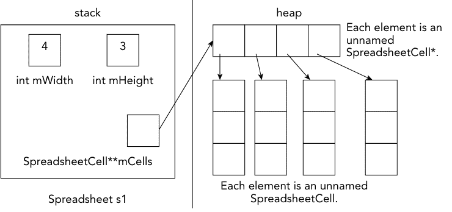

图 8-1

set 和检索方法的实现是直接的：

```cpp
void Spreadsheet::setCellAt(int x, int y, const SpreadsheetCell& cell)
{
  if (!inRange(x, mWidth) || !inRange(y, mHeight)) {
    throw std::out_of_range("");
  }
  mCells[x][y] = cell;
}
SpreadsheetCell& Spreadsheet::getCellAt(int x, int y)
{
  if (!inRange(x, mWidth) || !inRange(y, mHeight)) {
    throw std::out_of_range("");
  }
  return mCells[x][y];
}
```

注意，这两个方法使用辅助方法 `inRange` 来检查 x 和 y 是否有效坐标。尝试访问范围外的数组元素会导致程序故障。此示例使用了异常，异常在第 1 章提到并在第 13 章进行了详细描述。

# 使用析构函数释放内存

当你完成对动态内存的使用时，应该释放它。如果你在对象中动态分配内存，释放内存的地方就是析构函数。编译器保证在对象销毁时调用析构函数。这里是带有析构函数的 `Spreadsheet` 类定义：

```cpp
class Spreadsheet {
public:
    Spreadsheet(int inWidth, int inHeight);
    ~Spreadsheet();
    // 省略代码
};
```

析构函数的名称与类（以及构造函数）相同，前面有一个波浪号 (`~`)。析构函数不接受参数，且只有一个。

以下是 `Spreadsheet` 的实现：

```cpp
Spreadsheet::~Spreadsheet() {
    for (int i = 0; i < mWidth; i++) {
        delete [] mCells[i];
    }
    delete [] mCells;
    mCells = nullptr;
}
```

该析构函数释放了在构造函数中分配的内存。然而，并没有规则要求你在析构函数中释放内存。你可以在析构函数中编写任何代码，但将其用于释放内存或处理其他资源是一个很好的主意。

# 处理拷贝和赋值

回顾第 7 章，如果你不自己编写拷贝构造函数和赋值运算符，C++ 会为你编写它们。这些编译器生成的方法会递归地调用对象数据成员的拷贝构造函数或赋值运算符。然而，对于基本类型（如 `int`、`double` 和指针），它们提供了浅拷贝或按位拷贝/赋值：它们直接将源对象的数据成员拷贝或赋值给目标对象。当你从对象中动态分配内存时，这就会产生问题。例如，以下代码在 `si` 传递给 `printSpreadsheet()` 函数时，拷贝 `si` 来初始化 `s`。

## 对象中的动态内存分配

```cpp
#include "Spreadsheet.h"
void printSpreadsheet(Spreadsheet s)
{
    // 为了简洁省略了代码。
}
int main()
{
    Spreadsheet s1(4, 3);
    printSpreadsheet(s1);
    return 0;
}
```

`Spreadsheet` 包含一个指针变量：`mCells`。电子表格的浅拷贝会使得目标拷贝获得 `mCells` 指针的副本，而不是底层数据的拷贝。因此，你最终会面临 `s` 和 `s1` 都指向相同数据的情况，如图 8-2 所示。

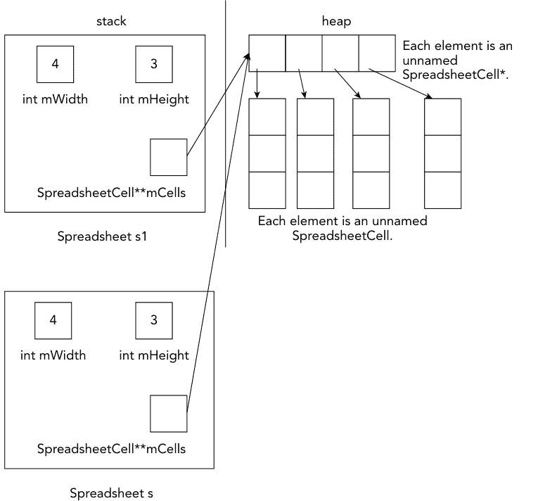

图 8-2

如果 `s` 修改了 `mCells` 指向的内容，那么该更改也会显示在 `s1` 中。

更糟糕的是，当 `printSpreadsheet()` 函数退出时，`s` 的析构函数会被调用，它会释放 `mCells` 指向的内存。这导致了图 8-3 所示的情况。

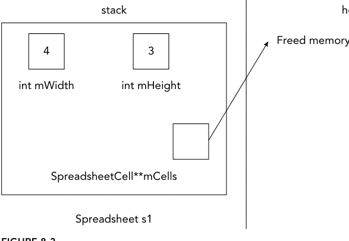

图 8-3

现在 `s1` 拥有一个不再指向有效内存的指针。这被称为**悬空指针**。

难以置信的是，赋值操作甚至更严重。假设你有以下代码：

```cpp
Spreadsheet s1(2, 2), s2(4, 3);
s1 = s2;
```

在两个对象构造之后，你将拥有图 8-4 所示的内存布局。

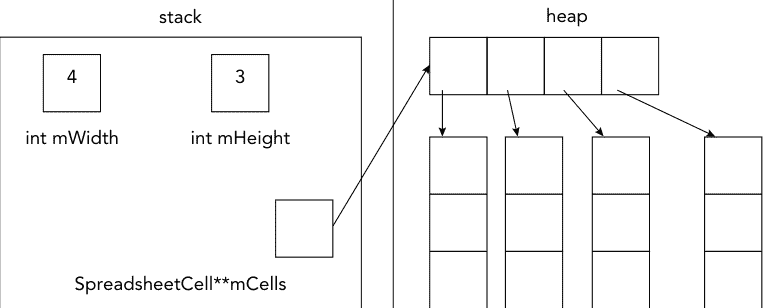

Spreadsheet s2

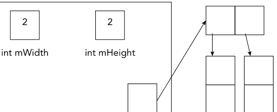

Spreadsheet s1

图 8-4

赋值语句之后，你将拥有图 8-5 所示的布局。

## 第8章 掌握类与对象

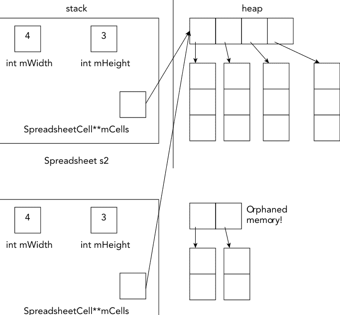

图 8-5

现在，不仅 `s1` 和 `s2` 中的 `mCells` 指针指向同一块内存，你还丢失了 `s1.mCells` 原指向的内存。这被称为**内存泄漏**。这就是为什么在赋值运算符中，你必须首先释放左侧引用的内存，然后进行深拷贝。

如你所见，依赖 C++ 默认的拷贝构造函数或赋值运算符并不总是好主意。

> 警告 每当你在类中动态分配内存时，你都应该编写自己的拷贝构造函数和赋值运算符，以提供内存的深拷贝。

## Spreadsheet 拷贝构造函数

以下是 `Spreadsheet` 类中拷贝构造函数的声明：

```cpp
class Spreadsheet
{
    public:
    Spreadsheet(int inWidth, int imageHeight);
    Spreadsheet(const Spreadsheet& src);
    // 为了简洁省略了代码。
};
```

以下是拷贝构造函数的首次定义：

```cpp
Spreadsheet::Spreadsheet(const Spreadsheet& src)
{
    mWidth = src.mWidth;
    mHeight = src.mHeight;
    mCells = new SpreadsheetCell*[mWidth];
    for (int i = 0; i < mWidth; i++) {
        mCells[i] = new SpreadsheetCell[mHeight];
    }
    for (int i = 0; i < mWidth; i++) {
        for (int j = 0; j < mHeight; j++) {
            mCells[i][j] = src.mCells[i][j];
        }
    }
}
```

注意，拷贝构造函数拷贝了所有数据成员，包括 `mWidth` 和 `mHeight`，而不仅仅是指针成员。拷贝构造函数中的其余代码为动态分配的 `mCells` 二维数组提供了深拷贝。不需要删除现有的 `mCells`，因为这是拷贝构造函数，因此该对象中还没有 `mCells`。

## Spreadsheet 赋值运算符

以下是带有赋值运算符的 `Spreadsheet` 类定义：

```cpp
class Spreadsheet
{
    public:
    // 为了简洁省略了代码。
    Spreadsheet& operator=(const Spreadsheet& rhs);
    // 为了简洁省略了代码。
};
```

以下是 `Spreadsheet` 类赋值运算符的实现，其中穿插了解释。注意，当对象被赋值时，它已经初始化。因此，在分配新内存之前，你必须释放任何动态分配的内存。你可以将赋值运算符视为析构函数和拷贝构造函数的组合。当你对它赋值时，你实际上是在用新的生命（或数据）让对象“转世”。

任何赋值运算符的第一行代码都会检查是否**自赋值**（self-assignment）。

```cpp
Spreadsheet& Spreadsheet::operator=(const Spreadsheet& rhs)
{
    // 检查自赋值。
    if (this == &rhs) {
        return *this;
    }
```

这种自赋值检查是必要的，不仅是为了效率，代码也无法正常工作。之前的自赋值运算符会先删除 `mCells` 然后分配一个新的 `mCells`。如果没有这个检查，由于左侧和右侧是同一个，通过为左侧删除并重新分配 `mCells`，你对右侧执行了同样的操作。你想拷贝的单元将会丢失。因为这是赋值运算符，被赋值的对象已经初始化了 `mCells`。你需要释放这些单元。

```cpp
// 释放旧内存。
for (int i = 0; i < mWidth; i++) {
    delete mCells[i];
}
delete [] mCells;
mCells = nullptr;
```

你必须在重新分配之前释放内存，否则会产生内存泄漏。这段代码与析构函数相同，因此你应该创建一个独立的方法来清理内存，并在析构函数和赋值运算符中调用它。下一步是拷贝内存。

```cpp
// 拷贝新内存。
mWidth = rhs.mWidth;
mHeight = rhs.mHeight;
mCells = new SpreadsheetCell*[mWidth];
for (int i = 0; i < mWidth; i++) {
    mCells[i] = new SpreadsheetCell[mHeight];
}
for (int i = 0; i < mWidth; i++) {
    for (int j = 0; j < mHeight; j++) {
        mCells[i][j] = rhs.mCells[i][j];
    }
}
return *this;
```

注意，这段代码与拷贝构造函数非常相似。接下来的章节将解释你如何避免这种重复。

赋值运算符完成了管理对象中动态分配内存的“三要素”：析构函数、拷贝构造函数和赋值运算符。每当你发现自己在编写其中一个方法时，应该编写所有的。

> 警告 每当类分配内存时，请编写析构函数、拷贝构造函数和赋值运算符。

> 注意 除了拷贝之外，C++ 还支持移动语义，这需要移动构造函数和移动赋值运算符。这些在某些情况下可以提高性能，将在第 10 章详细讨论。

### 拷贝构造函数和赋值运算符的通用辅助函数

拷贝构造函数和赋值运算符非常相似，将共同任务封装进辅助方法是方便的。例如，你可以为 `Spreadsheet` 类添加一个 `copyFrom()` 方法，并重写拷贝构造函数和赋值运算符来使用它：

```cpp
void Spreadsheet::copyFrom(const Spreadsheet& src)
{
    mWidth = src.mWidth;
    mHeight = src.mHeight;
    mCells = new SpreadsheetCell*[mWidth];
    for (int i = 0; i < mWidth; i++) {
        mCells[i] = new SpreadsheetCell[mHeight];
    }

    for (int i = 0; i < mWidth; i++) {
        for (int j = 0; j < mHeight; j++) {
            mCells[i][j] = src.mCells[i][j];
        }
    }
}
```

```cpp
Spreadsheet::Spreadsheet(const Spreadsheet& src)
{
    copyFrom(src);
}

Spreadsheet& Spreadsheet::operator=(const Spreadsheet& rhs)
{
    // 检查自赋值。
    if (this == &rhs) {
        return *this;
    }
    // 释放旧内存。
    for (int i = 0; i < mWidth; i++) {
        delete mCells[i];
    }
    delete [] mCells;
    mCells = nullptr;
    // 拷贝新内存。
    copyFrom(rhs);
    return *this;
}
```

## 禁止赋值和值传递

有时当你在类中动态分配内存时，简单的方法就是阻止任何人拷贝或赋值你的对象。你可以通过显式删除 `operator=` 和构造函数来实现这一点。这样，如果有人尝试按值传递对象、从函数或方法返回对象，或对其赋值，编译器就会报错。以下是一个防止赋值和值传递的 `Spreadsheet` 类定义：

```cpp
class Spreadsheet
{
public:
    Spreadsheet(int inWidth, int inHeight);
    Spreadsheet(const Spreadsheet& src) = delete;
    Spreadsheet();
    Spreadsheet& operator=(const Spreadsheet& rhs) = delete;
    // 为了简洁省略了代码。
};
```

你不需要为删除的构造函数和赋值运算符提供实现。链接器永远不会寻找它们，因为编译器不允许代码调用它们。当你编写拷贝或赋值 `Spreadsheet` 的代码时，编译器会返回如下信息：

> 'Spreadsheet::operator=(const Spreadsheet&)' : 尝试引用已删除的函数

> 注意 如果你的编译器不支持显式删除成员函数，你可以通过将拷贝构造函数和赋值运算符设为私有且无实现来实现禁止拷贝和赋值。

## 不同类型的数据成员

C++ 为数据成员提供了许多选择。除了在类中声明简单的数据成员外，还可以声明所有类对象共享的静态数据成员、`const` 引用成员等。本节将解释这些不同类型数据成员的复杂性。

## 静态数据成员

有时为类的每个对象提供一个变量是多余的或行不可行的。数据成员可能特定于类，但不适合每个对象拥有自己的拷贝。例如，你可能想给每个电子表格提供一个唯一的标识符。你需要一个从 0 开始的计数器，每个新对象都可以获取其 ID。这个电子表格计数器真正属于 `Spreadsheet` 类，但让每个 `Spreadsheet` 对象都拥有它的拷贝是没有意义的，因为你必须以某种方式保持所有计数器的同步。

C++ 提供了一种使用静态数据成员的解决方案。静态数据成员与类关联而不是与对象关联。你可以将静态数据成员视为特定于某个类的全局变量。以下是 `Spreadsheet` 类的定义，包括新的静态计数器数据成员：

```cpp
class Spreadsheet {
    // 为了简洁省略了部分内容
    private:
        static int sCounter;
}
```

在类定义中列出静态类成员外，你还需要在源文件中为它们分配空间，通常是在放置类方法定义的那个源文件中。你可以同时对它们进行初始化，与普通变量和数据成员不同，它们默认初始化为 0。静态指针被初始化为 `nullptr`。以下是分配空间并初始化 `sCounter` 的代码：

```cpp
int Spreadsheet::sCounter;
```


这段代码出现在任何函数或方法体之外。它几乎就像声明一个全局变量，区别在于 `Spreadsheet::` 作用域解析指定了它是 `Spreadsheet` 类的一部分。

## 在类方法中访问静态数据成员

你可以像使用普通数据成员一样在类方法中使用静态数据成员。例如，你可能想在 `Spreadsheet` 类中创建一个 `mid` 成员，并在 `Spreadsheet` 构造函数中从 `sCounter` 成员初始化它。这是带有 `mid` 成员的类定义：

```cpp
class Spreadsheet {
    public:
        int getId() const;
    private:
        // 为了简洁省略了部分内容
        static int sCounter;
        int mid;
}
```

以下是 `Spreadsheet` 构造函数的实现，它分配了初始 ID：

```cpp
Spreadsheet::Spreadsheet(int inWidth, int inHeight) {
    mWidth(inWidth), mHeight(inHeight);
    mID = sCounter++;
    mCells = new SpreadsheetCell*[mWidth];
    for (int i = 0; i < mWidth; i++) {
        mCells[i] = new SpreadsheetCell[mHeight];
    }
}
```

你可以看到，构造函数可以像访问成员一样访问 `sCounter`。记住也要为构造函数分配一个 ID：

```cpp
Spreadsheet::Spreadsheet(const Spreadsheet& src)
{
    mID = sCounter++;
    copyFrom(src);
}
```

你不应该在赋值操作符中拷贝 ID。一旦 ID 被分配给对象，它就永远不会改变。建议将 `mid` 变为 `const` 数据成员。`const` 数据成员将在下一节讨论。

## 在方法外访问静态数据成员

访问修饰符适用于静态数据成员：`sCounter` 是私有的，因此无法从类方法外部访问。如果 `sCounter` 是公有的，你可以通过使用 `::` 作用域解析运算符指定该变量是 `Spreadsheet` 类的一部分，从而从类方法外部访问它：

```cpp
int c = Spreadsheet::sCounter;
```

然而，不建议拥有公共数据成员。你应该通过公共的 get/set 方法授予访问权限。如果你想访问静态数据成员，需要实现静态的 get/set 方法，这些将在本章的稍后部分解释。

## const 数据成员

你类中的数据成员可以声明为 `const`，这意味着它们在创建和初始化后不能被更改。当常量仅适用于类时，你应该使用 `static const` 数据成员来代替全局常量。例如，你可能想为表格指定最大高度和宽度。如果用户尝试构造一个高度或宽度大于最大值的表格，则会使用最大值。你可以将最大高度和宽度设为 `Spreadsheet` 类的静态成员：

```cpp
class Spreadsheet
{
public:
    // 为了简洁省略了部分内容
    static const int kMaxHeight = 100;
    static const int kMaxWidth = 100;
};
```

你可以像下面的代码段所示，在构造函数中使用这些常量（注意三元运算符的使用）：

```cpp
Spreadsheet::Spreadsheet(int inWidth, int inHeight)
    mWidth(inWidth < kMaxWidth ? inWidth : kMaxWidth),
    mHeight(inHeight < kMaxHeight ? inHeight : kMaxHeight)
{
```

```cpp
    mId = sCounter++;
    mCells = new SpreadsheetCell* [mWidth];
    for (int i = 0; i < mWidth; i++) {
        mCells[i] = new SpreadsheetCell[mHeight];
    }
```

> 注意：与其自动将宽度和高度限制在最大值范围内，你也可以决定在宽度或高度超过最大值时抛出异常。然而，当你从构造函数抛出异常时，析构函数*不会*被调用。因此，你需要对此小心。细节将在第 13 章中解释。

> 注意：非静态数据成员也可以声明为 `const`。例如，`mId` 数据成员可以声明为 `const`。由于你不能给 `const` 数据成员赋值，你需要在初始化列表（c-initializers）中对其进行初始化。

`kMaxHeight` 和 `kMaxWidth` 是公有的，所以你可以像访问全局变量一样在程序的任何地方访问它们，但语法略有不同：你必须使用 `::` 作用域解析运算符指定变量：

```cpp
cout << "Maximum height is: " << Spreadsheet::kHeight << endl;
```

## 引用数据成员

`Spreadsheet` 和 `SpreadsheetCell` 非常棒，但它们本身无法构成非常有用的应用程序。你需要控制整个表格程序，可以将其封装进 `SpreadsheetApplication` 类中。

该类的实现目前并不重要。现在，考虑这个架构问题：表格如何与应用程序通信？应用程序存储了一个表格列表，因此它可以与表格通信。同样，每个表格也可以存储一个指向应用程序的引用。Spreadsheet 类必须知道 SpreadsheetApplication，这是一个循环引用，无法通过普通的包含来解决。解决方案是在其中一个头文件中使用前置声明。这是使用前置声明告知编译器 SpreadsheetApplication 的 Spreadsheet 类定义：

```cpp
class SpreadsheetApplication; // 前置声明
class Spreadsheet {
    public:
        Spreadsheet(int inWidth, int inHeight, SpreadsheetApplication& theApp);
        // 为了简洁省略了部分内容
    private:
        // 为了简洁省略了部分内容
        SpreadsheetApplication mApp;
};
```

这增加了 SpreadsheetApplication 引用成员。建议使用引用而不是指针， Spreadsheet 应该始终指向 SpreadsheetApplication。使用指针无法保证这一点。

注意，存储应用程序引用是为了演示引用作为数据成员的使用。不建议以这种方式耦合 Spreadsheet 和 SpreadsheetApplication 类，而是使用 MVC（模型-视图-控制器）范式。

应用程序引用通过构造函数传递给每个 Spreadsheet。引用在没有指向对象的情况下不存在，因此 mApp 必须在构造初始化列表中赋值：

```cpp
Spreadsheet::Spreadsheet(int inWidth, int inHeight, SpreadsheetApplication& theApp)
    : mWidth(inWidth < kMaxWidth ? inWidth : kMaxWidth),
      mHeight(inHeight < kMaxHeight ? inHeight : kMaxHeight), mApp(theApp)
{
    // 为了简洁省略了部分内容
}
```

你必须在拷贝构造函数中初始化引用成员：

```cpp
Spreadsheet::Spreadsheet(const Spreadsheet& src) :
mApp(src.mApp)
{
    mID = sCounter++;
    copyFrom(src);
}
```

记住，一旦你初始化了引用，就不能更改它所指向的对象。在赋值操作符中是不可能的进行赋值。

## const 引用数据成员

你的成员可以引用 `const` 对象，就像普通引用可以引用 `const` 对象一样。例如，你可能决定表格只对应用程序对象拥有 `const` 引用。你只需更改类定义将 `mApp` 声明为 `const` 引用：

```cpp
class Spreadsheet
{
public:
    Spreadsheet(int inWidth, int inHeight,
```

```
const SpreadsheetApplication& theApp);
// 为了省略省略了代码
private:
// 为了省略省略了代码
const SpreadsheetApplication& mApp;
```

使用 `const` 引用与非 `const` 引用之间存在重要区别。`const` 引用 `SpreadsheetApplication` 数据成员只能调用 `SpreadsheetApplication` 对象的 const 方法。如果你尝试通过 `const` 引用调用非 const 方法，将得到编译器错误。

也可以静态引用成员或静态 `const` 引用成员，但你很少需要这样的东西。

# 关于方法的更多内容

C++ 还为方法提供了多种选择。本节将解释所有复杂的细节。

## 静态方法 (static Methods)

方法数据方法有时适用于整个类，而不是每个对象。你可以像编写数据成员一样编写静态方法。例如，考虑第 7 章中的 `SpreadsheetCell` 类。它有两个方法：`stringToDouble()` 和 `doubleToString()`。这些方法并不访问特定对象的信息，因此它们可以是静态的。以下是将这些方法设置为静态的类定义：

```cpp
class SpreadsheetCell{
  // 省略了代码
  private:
    static std::string doubleToString(double val);
    static double stringToString(const std::string& str);
  // 省略了代码
}
```

这两个方法的实现与之前的实现相同。你不需要在方法定义前重复 `static` 关键字。然而，请注意，静态方法不是在特定对象上调用的，因此它们没有指针，也不会针对带有非静态成员的特定对象执行。事实上，静态方法就像一个普通函数。唯一的区别是，如果将这些对象对静态方法可见（例如通过传递指向此类对象的指针或引用），它就可以访问相同类型的 `private` 和 `protected` 非静态数据成员。

你可以在类的任何方法内部像调用普通函数一样调用静态方法。因此，`SpreadsheetCell` 中所有方法的实现可以保持不变。在类外部调用方法时，你需要使用作用域解析运算符通过类名来限定方法（就像静态成员一样）。访问控制仍然照常适用。

你可能想将 `stringToDouble()` 和 `doubleToString()` 设为 `public`，以便类外部的其他代码可以使用它们。如果是这样，你可以这样从任何地方调用它们：

```cpp
string str = SpreadsheetCell::doubleToString(5.0);
```

## const 方法 (const Methods)

`const` 对象是一个值不能被改变的对象。如果你有一个指向 `const` 对象的 `const` 引用或指针，编译器将不允许你调用该对象上的任何方法，除非这些方法保证它们不会改变任何数据成员。保证方法不会改变数据成员的方法是在方法本身上标记 `const` 关键字。以下是将不改变任何数据成员的方法标记为 `const` 的 `SpreadsheetCell` 类：

```cpp
class SpreadsheetCell{
  public:
    // 省略了代码
    double getValue() const;
    const std::string& getString() const;
    // 省略了代码
};
```

`const` 规范是方法原型的一部分，并且必须伴随其定义：

```cpp
double SpreadsheetCell::getValue() const{
  return mValue;
}
const std::string& SpreadsheetCell::getString() const{
  return mString;
}
```

将方法标记为 `const` 相当于与客户端代码签署了一份合同，保证你不会尝试更改对象的内部值。如果你尝试声明一个实际上修改数据成员的 `const` 方法，编译器会报错。你还不能声明静态方法（例如上一节中的 `doubleToString()` 和 `stringToString()` 方法），因为这是冗余的。静态方法没有类的实例，因此它们无法更改内部值。`const` 的工作原理是让方法内部看起来你有一个指向每个数据成员的 `const` 引用。如果你尝试更改数据成员，编译器将标记错误。

非 `const` 对象可以调用 `const` 方法和非 `const` 方法。然而，`const` 对象只能调用 `const` 方法。以下是一些示例：

```cpp
SpreadsheetCell myCell(5); // OK
cout << myCell.getValue() << endl;
myCell.setString("*6"); // OK
```

```cpp
const SpreadsheetCell& anotherCell = myCell;
cout << anotherCell.getValue() << endl; // OK
anotherCell.setString("*6") // 编译错误；
```

你应该养成一个习惯，对于所有不修改对象的方法都声明为 `const`，这样你可以在程序中使用 `const` 对象的引用。

注意，`const` 对象可以被销毁，它们的析构函数可以被调用。尽管如此，析构函数不应声明为 `const`。

## mutable 数据成员

有时你会写一个“逻辑上”是 `const` 的方法，但恰好改变了对象的某个成员。这种修改对任何用户可见的数据没有影响，但在技术上是一个改变，因此编译器不允许你将方法声明为 `const`。例如，假设你想对你的电子表格应用程序进行分析，以获取有关数据读取频率的信息。这样做的一种原始方法是在 `Spreadsheet` 类中添加一个计数器，统计所有对 `getValue()` 或 `getString()` 的调用。的是，在编译器看来这些方法是非 `const` 的，这并不是你的意图。解决方案是将你的新计数变量标记为 `mutable`，这告诉编译器在 `const` 方法中更改它是允许的。以下是新的 `SpreadsheetCell` 类定义：

```cpp
class SpreadsheetCell {
  private:
    double mValue;
    std::string mString;
    mutable int mAccesses = 0;
};
```

以下是 `getValue()` 和 `getString()` 的定义：

```cpp
double SpreadsheetCell::getValue() const {
  mAccesses++;
  return mValue;
}
const std::string& SpreadsheetCell::getString() const {
  mAccesses++;
  return mString;
}
```

## 方法重载 (Method Overloading)

你已经注意到你可以在类中编写多个构造函数，它们的名称相同。这些构造函数仅在参数上不同。你可以对 C++ 中的任何方法或函数这样做。具体来说，你可以重载函数名。例如，在 `SpreadsheetCell` 类中，你可以将 `setName()` 和 `setValue()` 重命名为 `set()`。类定义如下：

```cpp
class SpreadsheetCell
{
  public:
    // 省略了代码
    void set(double inValue);
    void set(const std::string& inString);
```

这些方法的实现保持不变。注意，之前调用 `setValue()` 的构造现在必须调用 `set()`。当你编写代码调用 `set()` 时，编译器根据你传递的参数确定调用哪个实例：如果你传递字符串，编译器调用字符串实例；如果你传递双精度，编译器调用双实例。这被称为重载解析。

你可能想对 `get()` 和 `getString()` 执行同样的操作：将它们重命名为 `get()`。然而，这无法编译。C++ 不允许根据方法的返回类型来重载方法名，因为在许多情况下，编译器无法确定要调用哪个实例。例如，如果方法的返回值没有被任何地方捕获，编译器不知道你想要哪种方法。

注意，你可以根据 `const` 重载方法。也就是说，你可以编写两个名称和参数相同的方法，只是其中一个被声明为 `const` 而另一个不是。如果你有一个 `const` 对象，编译器将调用 `const` 方法；如果你有一个非 `const` 对象，编译器将调用非 `const` 方法。

重载方法还可以被显式删除，这可以禁止使用特定参数调用成员函数。例如，假设你有如下类：

```cpp
class MyClass
{
  public:
    void foo(int i);
}
```

`foo()` 方法可以这样调用：

```cpp
MyClass c;
c.foo(123);
c.foo(1.23);
```


对于第三行，编译器会将双精度值 (1.23) 转换为整数 (1)，然后调用 `foo(int i)`。编译器可能会给你警告，但它会执行这种隐式转换。你可以通过显式删除双精度实例的 `foo()` 来防止编译器执行这种转换。

## 更多方法

```cpp
void foo(int i);
void foo(double d) = delete;
};
```

通过此更改，尝试用 `double` 调用 `foo()` 将被编译器标记为错误，而不是执行转换为整数的操作。

## 默认参数

与 C++ 中方法重载类似的功能是默认参数。你可以在原型中为函数和方法的参数指定默认值。如果用户指定了这些参数，则会忽略默认值；如果用户省略了这些参数，则将使用默认值。不过，这里有一个限制：你只能为从最右侧参数开始的连续参数列表提供默认值。否则，编译器将无法匹配缺失的参数到默认参数。默认参数可以用函数、方法和构造函数。例如，你可以在 `Spreadsheet` 构造函数中为 `width` 和 `height` 分配默认值：

```cpp
class Spreadsheet {
public:
    Spreadsheet(const SpreadsheetApplication& theApp,
                int inWidth = kMaxWidth, int inHeight = kMaxHeight);
    // 为了简洁省略了内容
};
```

`Spreadsheet` 构造函数的实现保持不变。注意，你只在方法声明中指定默认参数，而不是在定义中。

现在，你可以用一个、两个或三个参数调用 `Spreadsheet` 构造函数，尽管它只有一个非拷贝构造函数：

```cpp
SpreadsheetApplication theApp;
Spreadsheet s1(theApp);
Spreadsheet s2(theApp, 5);
Spreadsheet s3(theApp, 5, 6);
```

一个包含所有参数的构造函数可以作为默认构造函数。这意味着你可以在不指定任何参数的情况下构造类对象。如果你想声明一个默认构造函数和一个对所有参数都带有默认值的多参数构造函数，编译器会报错，因为如果不指定任何参数，它将不知道调用哪个构造函数。

注意，任何可以使用默认参数的操作都可以通过方法重载来实现。你可以编写三个不同的构造函数，每个函数的参数数量不同。然而，默认参数允许你只写一个构造函数来接受三种数量参数。你应该使用你最熟悉的机制。

## 内联方法

C++ 赋予你一种能力，建议对方法或函数的调用不实际在生成的代码中作为独立的代码块实现。相反，编译器应该将方法或函数体直接插入到调用该方法或函数的代码中。

这一过程称为内联（inlining），想要这种行为的方法或函数被称为内联方法或内联函数。内联比使用 `#define` 宏更安全。

你可以通过在函数或方法定义中在其名称前放置 `inline` 关键字来指定内联方法或函数。例如，你可能想让 `SpreadsheetCell` 的访问器方法内联，你可以这样定义它们：

```cpp
inline double SpreadsheetCell::getValue() const
{
    mNumAccesses++;
    return mValue;
}
inline const std::string& SpreadsheetCell::getString() const
{
    mNumAccesses++;
    return mString;
}
```

这给编译器提供了提示，将对 `getValue()` 和 `getString()` 的调用替换为实际的方法体，而不是生成函数调用的代码。注意，`inline` 关键字只是给编译器的提示。如果编译器认为这会损害性能，它可以忽略它。

有一个陷阱：内联方法和函数的定义在在使用它们的每一个源文件中都必须可用。如果你仔细考虑，这是很合理的：如果编译器看不到函数定义，它如何能替换函数体呢？因此，如果你编写了内联函数或方法，你应该将定义放在头文件中，并与它们的原型放在一起。对于方法，这意味着 `.h` 文件中的定义包含了类的定义。

> 注意：高级 C++ 编译器并不强制要求你将内联方法的定义放在头文件中。例如，Microsoft Visual C++ 支持链接时代码生成（LTCG），它可以内联较小的函数体，即使它们没有被声明为 `inline` 且即使它们没有在头文件中定义。当你使用这种编译器时，请利用它，不要将定义放在头文件中。这样，你的接口可以保持整洁，而不会其中显示任何实现细节。

C++ 提供了一种声明内联方法的替代语法，该语法完全不使用 `inline` 关键字。相反，你将方法定义直接放在类定义中。这里是使用这种语法的 `SpreadsheetCell` 类定义：

```cpp
class SpreadsheetCell
{
public:
    // 为了简洁省略了内容
    double getValue() const { mNumAccesses++; return mValue; }
    const std::string& getString() const { mNumAccesses++; return mString; }
    // 为了简洁省略了内容
};
```

## 嵌套类

> 注意：如果你使用调试器对内联的方法调用进行单步执行，某些高级 C++ 调试器将跳转到内联函数的实际源代码，给你一种函数调用的错觉，但实际上，代码是内联的。

C++ 程序员发现了内联方法的语法并开始使用它，但可能并不理解将方法标记为 `inline` 的后果。将方法或函数标记为 `inline` 只是给编译器提供一个内联的提示。编译器只会内联最简单的方法和函数。如果你定义了一个编译器不想内联的内联方法，它将静地忽略该指令。

现代编译器在决定是否内联一个方法或函数之前，会考虑代码膨胀（code bloat）等指标，它们不会内联任何成本效益低的内容。

### 嵌套类

类定义可以包含不仅仅是成员函数和数据成员。你还可以编写嵌套类和结构体、声明 `typedef` 或创建枚举类型。在类内部声明的任何内容都在该类的作用域内。类内部声明的嵌套类属于该类的作用域。如果你想在类外部通过 `ClassName::` 作用域解析符访问它。

你可能在 `Spreadsheet` 类定义内部另一个类定义。例如，你可能决定 `SpreadsheetCell` 是 `Spreadsheet` 类的部分。你可以这样定义它们：

```cpp
class Spreadsheet {
public:
    class SpreadsheetCell
    {
        SpreadsheetCell();
        SpreadsheetCell(double initialValue);
        // 为了简洁省略内容
    private:
        double mValue;
        std::string mString;
        mutable int mNumAccesses = 0;
        int inWidth = kMaxWidth, int inHeight = kMaxHeight;
    };
    Spreadsheet(const SpreadsheetApplication& the);
    Spreadsheet(const Spreadsheet& src);
    ~Spreadsheet();
    // 省略了剩余声明
};
```

现在，`SpreadsheetCell` 类定义在 `Spreadsheet` 类内部，因此在 `Spreadsheet` 类外部引用它时必须使用 `Spreadsheet::` 限定符。这甚至适用于方法的定义。例如，默认构造函数现在看起来是：

```cpp
Spreadsheet::SpreadsheetCell::SpreadsheetCell() : mValue(0)
{}
```

这种语法很快就会变得笨拙。例如，`SpreadsheetCell` 赋值运算符的定义现在看起来是：

```cpp
Spreadsheet::SpreadsheetCell& Spreadsheet::SpreadsheetCell::operator=(
  const SpreadsheetCell& rhs)
{
  if (this == &rhs) {
    return *this;
  }
  mValue = rhs.mValue;
  mString = rhs.mString;
  mNumAccesses = rhs.mNumAccesses;
  return *this;
}
```

事实上，对于 `Spreadsheet` 类本身方法的返回类型（而不是参数），必须使用这种语法：

```cpp
Spreadsheet::SpreadsheetCell& Spreadsheet::getCell(int x, int y)
{
  if (!inRange(x, m) || !inRange(y, mHeight)) {
    throw std::out_of_range("");
  }
  return mCells[x][y];
}
```

你可以通过使用类型别名将 `Spreadsheet::SpreadsheetCell` 重命名为更易管理的 `SCell` 来避免这种笨拙的语法：

```cpp
SCell = Spreadsheet::SpreadsheetCell;
```

这个别名应该放在 `Spreadsheet` 类定义之外，否则你将必须对类型别名本身使用 `Spreadsheet::` 限定符才能得到 `Spreadsheet::SCell`。那对你可没好处！

现在你可以这样写默认构造函数：

```cpp
SCell::SpreadsheetCell() : mValue(0)
{}
```

标准的访问控制也适用于嵌套类定义。如果你声明了一个私有的或保护的嵌套类，你只能在外部类内部使用它。

通常你只应该对简单的类使用类定义。对于像 `SpreadsheetCell` 这样的类，这种做法实在太笨拙了。

### 类内部的枚举类型

如果你想在类内部定义多个常量，应该使用枚举类型而不是一组 `#Defines`。例如，你可以按照如下方式为 `SpreadsheetCell` 类添加单元格颜色支持：

```cpp
class SpreadsheetCell
{
public:
    // 省略部分内容
    enum class Colors { Red = 1, Green, Blue, Yellow };
    void setColor(Colors color);
private:
    // 省略部分内容
    Color mColor = Colors::Red;
};
```

`setColor()` 方法的实现非常直接：

```cpp
void SpreadsheetCell::setColor(Colors color)
{
    mColor = color;
}
```

新方法的使用如下：

```cpp
SpreadsheetCell myCell(5);
myCell.setColor(SpreadsheetCell::Colors::Blue);
```

使用枚举类型是优解决方案，而不是使用下面的 `#defines`：

```cpp
#define SPREADSHEET_RED 1
#define SPREADSHEET_GREEN 2
#define SPREADSHEET_BLUE 3
#define SPREADSHEET_YELLOW 4
class SpreadsheetCell
{
public:
    // 省略部分内容
    void setColor(int color);
private:
    // 省略部分内容
    int mColor;
};
```

当你使用 `#defines` 时，你必须为 `setColor()` 函数使用整数参数，而不是像 `Colors` 枚举类型那样清晰的类型。

## 友元

C++ 允许类声明其他类、其他类的成员函数或非成员函数为友元，使其访问保护和私有数据成员及方法。例如，`SpreadsheetCell` 类可以这样指定 `Spreadsheet` 类为它的“朋友”：

```cpp
class SpreadsheetCell {
    public:
        friend class Spreadsheet;
        // 省略类的其余部分
}
```

现在，`Spreadsheet` 类的所有方法都可以访问 `SpreadsheetCell` 类的私有保护数据成员和方法。

如果你想让 `Spreadsheet` 类的特定成员函数成为友元，可以如下操作：

```cpp
class SpreadsheetCell {
    public:
        friend void Spreadsheet::setCell(int x, int y,
            const SpreadsheetCell& cell);
        // 省略类的其余部分
}
```

请注意，类知道哪些其他类、方法或函数想要成为它的友元；类、方法或函数不能声明自己为某些其他类的友元并访问该类的非公开名称。

你可能想写一个函数来验证 `SpreadsheetCell` 对象的字符串是否为空。你可能希望这个验证例程位于 `SpreadsheetCell` 类之外，以模拟外部审计，但该函数应该能够访问对象的内部数据成员以进行正确检查。以下是带有 `checkSpreadsheetCell()` 友元函数的 `SpreadsheetCell` 类定义：

```cpp
class SpreadsheetCell {
    public:
        friend bool checkSpreadsheetCell(const SpreadsheetCell& cell);
        // 省略部分内容
}
```

类中的友元声明充当了函数的原型。没有必要在其他地方编写原型（尽管这样做是无害的）。

以下是函数的定义：

```cpp
bool checkSpreadsheetCell(const SpreadsheetCell& cell) {
    return !(cell.mString.empty());
}
```

你编写这个函数就像编写任何其他函数一样，只不过你可以直接访问 `SpreadsheetCell` 类的保护数据成员。你不需要在函数定义中重复 `friend` 关键字。

友元类和方法很容易滥用；它们允许你将类的内部实现暴露给其他类或函数，从而违反封装原则。因此，你应该在有限的情况下使用它们，例如运算符重载，因为在那种情况下，正如下一节所讨论，你需要访问保护和私有成员。

## 运算符重载

你想对对象执行操作，例如将它们相加、比较，或者将它们流向或从文件中读取。例如，当你能够对电子表格执行算术操作时（例如对整行单元格求和），电子表格将非常有用。

### 示例：为 SpreadsheetCells 实现加法

按照真正的面向对象方式，`SpreadsheetCell` 对象应该能够将自己加到其他 `SpreadsheetCell` 对象。将一个单元格加到另一个单元格会产生带有结果的第三个单元格。它不会改变任何原始单元格。对于 `SpreadsheetCells` 而言，加法的意义是单元格值的相加。字符串表示被忽略。

#### 第一次尝试：add 方法

你可以这样为你的 `SpreadsheetCell` 类声明并定义一个 `add()` 方法：

```cpp
class SpreadsheetCell
{
    public:
    // 省略部分内容
    SpreadsheetCell add(const SpreadsheetCell& cell) const;
    // 省略部分内容
};
```

该方法将两个单元格相加，返回一个值为第一个单元格和的新单元格。它被声明为 `const` 并接收一个 `const SpreadsheetCell` 的引用，因为 `add()` 没有改变任何源单元格。以下是其实现：

```cpp
SpreadsheetCell SpreadsheetCell::add(const SpreadsheetCell& cell) const
{
    SpreadsheetCell newCell;
    newCell.set(mValue + cell.mValue); // 更新 mValue 和 mString
    return newCell;
}
```

注意，实现创建了一个名为 `newCell` 的新对象并返回该单元格的副本。（注：此处原文中存在大量重复内容，已清理）。

#### 隐式转换

令人惊讶的是，一旦你写了前面所示的 `operator+`，现在就可以将两个单元格相加，你还可以将单元格与字符串、double 或整数相加！

```cpp
SpreadsheetCell myCell(4), aThirdCell;
str str = "hello";
ThirdCell = myCell + str;
ThirdCell = myCell + 5.6;
ThirdCell = myCell + 4;
```

这段代码之所以有效，是因为编译器在寻找合适的 `operator+` 时所做的努力不仅仅是查找精确类型。编译器还会尝试为类型寻找合适的转换，以便找到 `operator+`。涉及的类型是适当转换器。在前面的示例中，当编译器看到 `Spreadsheet` 尝试加自己时，它找到了接收 `double` 的 `SpreadsheetCell` 构造函数，并创建一个临时的 `SpreadsheetCell` 传递给 `operator+`。同样，当编译器看到将 `SpreadsheetCell` 加到字符串的代码时，它调用字符串构造函数创建一个临时的 `SpreadsheetCell` 传递给 `operator`。


这种隐式转换行为通常很方便。但在前面的示例中，将 `SpreadsheetCell` 加到字符串是没有意义的。你可以通过用 `explicit` 关键字标记该构造函数来防止从字符串隐式构造 `SpreadsheetCell`：

```cpp
class SpreadsheetCell
{
public:
    SpreadsheetCell();
    SpreadsheetCell(double initialValue);
    explicit SpreadsheetCell(const std::string& initialValue);
    SpreadsheetCell(const SpreadsheetCell& src);
};
```

```cpp
SpreadsheetCell& operator=(const SpreadsheetCell& rhs);
// 为了简洁省略了其余部分；
```

`explicit` 关键字仅在类定义中有效，并且仅适用于可以通过一个参数调用的构造函数，例如单参数构造函数或带有默认参数值的多参数构造函数。

选择隐式构造函数可能是低效的，因为必须创建临时对象。为了避免在添加 `double` 时进行隐式构造，你可以创建另一个 `operator+`：

```cpp
SpreadsheetCell SpreadsheetCell::operator+(double rhs) const
{
  return SpreadsheetCell(mValue + rhs);
}
```

注意，这说明你不需要创建一个变量来返回值。

## 第三次尝试：全局 operator+

隐式转换允许你使用 `operator+` 将 `SpreadsheetCell` 对象与整数和浮点数相加。然而，运算符不是交换的，因此代码中存在问题：

```cpp
aThirdCell = myCell + 4; // 正常。
aThirdCell = myCell + 5.6; // 正常。
aThirdCell = 4 + myCell; // 编译失败！
aThirdCell = 5.6 + myCell; // 编译失败！
```

当 `SpreadsheetCell` 在运算符左侧时，隐式转换有效，但当它在右侧时无效。由于加法应该是交换的，所以这里出了问题。问题在于 `operator+` 必须在 `SpreadsheetCell` 对象上调用，并且该对象必须位于 `+` 的左侧。这就是 C++ 语言的定义。因此，你无法通过 `operator+` 方法让代码运行。

然而，如果你将类成员 `operator+` 替换为不绑定到任何特定对象的全局 `operator+`，就可以让它工作。函数如下：

```cpp
SpreadsheetCell operator+(const SpreadsheetCell& lhs,
const SpreadsheetCell& rhs)
{
  SpreadsheetCell newCell;
  newCell.set(lhs.mValue + rhs.mValue); // 更新 mValue 和 mString。
  return newCell;
}
```

现在，所有的加法行都按照你的预期工作了：

```cpp
aThirdCell = myCell + 4; // 正常。
aThirdCell = myCell + 5.6; // 正常。
aThirdCell = 4 + myCell; // 正常。
aThirdCell = 5.6 + myCell; // 正常。
```

注意，全局 `operator+` 的实现访问了 `SpreadsheetCell` 对象的私有数据成员。因此，它必须是 `SpreadsheetCell` 类的友函数。

```cpp
class SpreadsheetCell{
    public:
    // 为了简洁省略了内容
    friend SpreadsheetCell operator+(const SpreadsheetCell& lhs,
        const SpreadsheetCell& rhs);
    // 为了简洁省略了内容
};
```

你可能会好奇如果编写以下代码会发生什么：

```cpp
aThirdCell = 4.5 + 5.5;
```

它可以编译并运行，但它并没有调用你写的 `operator+`。它对 4.5 和 5.5 执行了普通的 `double` 加法，结果产生如下中间语句：

```cpp
aThirdCell = 10;
```

为了让这个赋值生效，右侧应该有一个 `SpreadsheetCell` 对象。编译器将发现一个接受 `double` 的自定义构造函数，将使用该构造函数将 `double` 值隐式转换为临时 `SpreadsheetCell` 对象，然后调用赋值运算符。

## 重载算术运算符

现在你已经理解了如何编写 `operator+`，其余基础算术运算符的操作就很直观了。这里是 `-`、`*` 和 `/` 的声明（如果对于存储在 `SpreadsheetCell` 中的 `double` 值来说 `/` 没有意义，你也可以重载它）：

```cpp
class SpreadsheetCell{
    public:
    // 为了简洁省略了内容
    friend SpreadsheetCell operator+(const SpreadsheetCell& lhs,
        const SpreadsheetCell& rhs);
    friend SpreadsheetCell operator-(const SpreadsheetCell& lhs,
        const SpreadsheetCell& rhs);
    friend SpreadsheetCell operator*(const SpreadsheetCell& lhs,
        const SpreadsheetCell& rhs);
    friend SpreadsheetCell operator/(const SpreadsheetCell& lhs,
        const SpreadsheetCell& rhs);
    // 为了简洁省略了内容
};
```

这里是实现。唯一棘手的地方在于要忘记检查除以零。此实现在检测到除以零时会抛出异常：

```cpp
SpreadsheetCell operator-(const SpreadsheetCell& lhs
```

C++并不要求你在 `operator*` 中实现乘法、在 `operator/` 中实现除法、在 `operator+` 中实现加法等等。然而，这样做将极其令人困惑，而且没有正理由为了开玩笑而这样做。尽可能地在你的实现中遵循通用的运算符含义。

> 注意 在 C++ 中，你不能改变运算符的优先级。例如，`*` 和 `/` 始终在 `+` 和 `-` 之前求值。用户定义运算符可以指定的只是操作优先级确定后的实现。C++ 也不允许你发明新的运算符符号。

## 重载算术简写运算符

除了基础算术运算符外，C++ 还提供了如 `+=` 和 `-=` 这样的简写运算符。你可能认为为你的类编写 `operator+` 就会提供 `operator+=`。事实并非如此。你可以显式地重载简写算术运算符。这些运算符与基础算术运算符的区别在于，它们改变的是运算符左侧的对象，而不是创建一个新对象。第二个区别是，它们生成的结果是对修改后对象的引用。

算术简写运算符始终要求左侧有一个对象，因此你应该将它们写成方法而不是全局函数。以下是 `SpreadsheetCell` 的声明：

```cpp
class SpreadsheetCell{
public:
    // 为了简洁省略了内容
    SpreadsheetCell& operator+=(const SpreadsheetCell& rhs);
    SpreadsheetCell& operator-=(const SpreadsheetCell& rhs);
    SpreadsheetCell& operator*=(const SpreadsheetCell& rhs);
    SpreadsheetCell& operator/=(const SpreadsheetCell& rhs);
};
```

实现：

```cpp
SpreadsheetCell& SpreadsheetCell::operator+=(const SpreadsheetCell& rhs) {
    set(mValue + rhs.mValue); // 更新 mValue 和 mString。
    return *this;
}

SpreadsheetCell& SpreadsheetCell::operator-=(const SpreadsheetCell& rhs) {
    set(mValue - rhs.mValue); // 更新 mValue 和 mString。
    return *this;
}

SpreadsheetCell& SpreadsheetCell::operator*=(const SpreadsheetCell& rhs) {
    set(mValue * rhs.mValue); // 更新 mValue 和 mString。
    return *this;
}

SpreadsheetCell& SpreadsheetCell::operator/=(const SpreadsheetCell& rhs) {
    if (rhs.mValue == 0)
        throw invalid_argument("除以零。");
    set(mValue / rhs.mValue); // 更新 mValue 和 mString。
    return *this;
}
```

简写算术运算符是基础算术运算符和赋值运算符的组合。有了上面的定义，你现在可以写这样的代码：

```cpp
SpreadsheetCell myCell(4), aThirdCell(2);
aThirdCell -= myCell;
aThirdCell += 5.4;
```

然而，你不能写这样的代码（这是件好事！）：

```cpp
5.4 *= aThirdCell;
```

## 重载比较运算符

比较运算符如 `>` 和 `==` 是另一组运算符。与基础算术运算符一样，它们应该是全局友函数，以便可以在运算符的左右侧使用隐式转换。比较运算符都返回 `bool`。当然，你可以更改返回类型，但不建议这样做。这里是声明和定义：

```cpp
class SpreadsheetCell{
    public:
    // 为了简洁省略了内容
    friend bool operator==(const SpreadsheetCell& lhs,
                         const SpreadsheetCell& rhs);
    friend bool operator<(const SpreadsheetCell& lhs,
                         const SpreadsheetCell& rhs);
    friend bool operator>(const SpreadsheetCell& lhs,
                         const SpreadsheetCell& rhs);
    friend bool operator!=(const SpreadsheetCell& lhs,
                            const SpreadsheetCell& rhs);
    friend bool operator<=(const SpreadsheetCell& lhs,
                            const SpreadsheetCell& rhs);
    friend bool operator>=(const SpreadsheetCell& lhs,
                            const SpreadsheetCell& rhs);
    // 为了简洁省略了内容
};
```

```cpp
bool operator==(const SpreadsheetCell& lhs, const SpreadsheetCell& rhs)
{
    return (lhs.mValue == rhs.mValue);
}

bool operator<(const SpreadsheetCell& lhs, const SpreadsheetCell& rhs)
{
    return (lhs.mValue < rhs.mValue);
}

bool operator>(const SpreadsheetCell& lhs, const SpreadsheetCell& rhs)
{
    return (lhs.mValue > rhs.mValue);
}

bool operator!=(const SpreadsheetCell& lhs, const SpreadsheetCell& rhs)
{
    return (lhs.mValue != rhs.mValue);
}

bool operator<=(const SpreadsheetCell& lhs, const SpreadsheetCell& rhs)
{
    return (lhs.mValue <= rhs.mValue);
}

bool operator>=(const SpreadsheetCell& lhs, const SpreadsheetCell& rhs)
{
    return (lhs.mValue >= rhs.mValue);
}
```

> 注意：前面的重载运算符操作的是 `mValue`，它是一个双精度浮点数。大多数情况下，对浮点值进行相等或不相等测试不是一个好主意。你应该使用极值（epsilon）测试，但这超出了本书的范围。

在具有更多数据成员的类中，比较每个数据成员可能会非常痛苦。然而，一旦你实现了 `==` 和 `<`，就可以基于这两个运算符来编写其他的比较运算符。例如，这里是 `operator>=` 的定义，它使用了 `operator<`：

```cpp
bool operator>=(const SpreadsheetCell& lhs, const SpreadsheetCell& rhs)
{
    return !(lhs < rhs);
}
```

第14章关于关系运算符的节讨论了一种根据 `operator==` 和 `<` 自动生成 `!=`、`>` 和 `<=` 运算符的机制。

你可以使用这些运算符将 `SpreadsheetCell` 与其他 `SpreadsheetCell` 以及 `double` 和 `int` 进行比较：

```cpp
if (myCell > aThirdCell || myCell < 10)
    cout << myCell.getValue() << endl;
```

## 使用运算符重载构建类型

许多人发现运算符重载的语法既复杂又令人困惑，至少最初是如此。讽刺的是，它本应该让事情变得简单。正如你发现的，这并不意味着对于编写类的人更简单，而是对于使用该类的人更简单。这一点在于让你的类尽可能地像 `int` 和 `double` 等内置类型。添加对象比记住你应该调用的方法名是 `add()` 还是 `sum()` 要容易得多。

> 注意：为你的类的客户端提供运算符重载作为服务。

到此时，你可能在想究竟哪些运算符是可以重载的。答案是“几乎所有的运算符——即使是你从未听说过的”。你实际上已经触及了皮毛：你在对象生命周期节中看到了赋值运算符，还有基础算术运算符、简写运算符以及比较运算符。重载流插入和提取运算符也是很有用的。此外，通过重载还可以做一些棘手但有趣的事情，这些是你起初可能无法预料到的。STL 广泛使用了运算符重载。第14章解释了如何以及何时重载剩余的运算符。第15章及后续章节涵盖了 STL。

## 构建稳定的接口

现在你已经理解了在 C++ 中编写类的所有核心语法，重新回顾第5章和第6章的设计原则将会有帮助。类是 C++ 中抽象的主要单元。你应该将抽象原则应用到你的类中，尽可能地将接口与实现分离。具体来说，你应该将所有数据成员设为私有，并为它们提供 setter 方法。`SpreadsheetCell` 就是这样实现的。`mValue` 和 `mString` 是私有的；`set()`、`getValue()` 和 `getString()` 设置并检索这些值。这样你就可以保持 `mValue` 和 `mString` 同步，而不用担心客户端深入修改值。

## 使用接口类和实现类

即使有了流行的措施和最佳设计原则，C++语言从根本上对抽象原则是不友好的。语法要求你在类定义中将公共接口与私有（保护）数据成员及方法结合，从而向客户端暴露类的某些内部细节。缺点是，如果你必须为类添加新的公共方法或数据成员，所有的客户端都必须重新编译。这在大型项目中可能会成为负担。

好消息是，你可以让接口类变得更整洁并隐藏所有实现细节，从而产生稳定的接口。坏消息是，这需要一点“黑技巧”（hacking）。基本原理是为你想要写的每个类都定义两个类：接口类和实现类。实现类与你如果不采用这种方法所编写的类是相同的。接口类提供的方法与实现类的方法相同，但它只有一个数据成员：指向实现类对象的指针。这被称为 pimpl 句式（pimpl idiom），或私有实现句式。接口方法简单地调用实现类上的等效方法。这对公共接口类没有影响。这减少了重新编译的需求。如果实现（仅限实现）发生了变化，使用接口类的任何客户端都不需要重新编译。注意，这种句式仅在数据成员是指针时有效。如果是值类型的数据成员，当实现类的定义改变时，客户端必须重新编译。

要使用这种方法，将旧的 `SpreadsheetCell` 类重命名为 `SpreadsheetImpl`。这里是新的 `SpreadsheetImpl` 类（它与旧的 `SpreadsheetCell` 类相同，但名称不同）：

```cpp
```


#include "SpreadsheetCell.h"

class SpreadsheetApplication; // 前向声明

class SpreadsheetImpl
{
public:
    SpreadsheetImpl(const SpreadsheetApplication& theApp,
                    int inWidth = kMaxWidth, int inHeight = kMaxHeight);
    SpreadsheetImpl(const SpreadsheetImpl& src);
    ~SpreadsheetImpl();
    SpreadsheetImpl& operator=(const SpreadsheetImpl& rhs);
    void setCell(int x, int y, const SpreadsheetCell& inCell);
    SpreadsheetCell& getCellAt(int x, int y);
    int getID() const;
    static const kMaxHeight = 100;
    static const kMaxWidth = 100;

private:
    bool inRange(int val, int upper);
    void copyFrom(const SpreadsheetImpl& src);
    int mWidth, mHeight;
    int mID;
    SpreadsheetCell** mCells;
    const SpreadsheetApplication& mApp;
    static int sCounter;
};

```

然后定义一个像这样的 `Spreadsheet` 类：

```cpp
#include "SpreadsheetCell.h"
#include <memory>

// 前向声明
class SpreadsheetImpl;

class Spreadsheet
{
public:
    Spreadsheet(const SpreadsheetApplication& theApp,
                int inWidth = kMaxWidth, int inHeight = kMaxHeight);
    Spreadsheet(const SpreadsheetApplication& theApp);
    Spreadsheet(const Spreadsheet& src);
    ~Spreadsheet();
    Spreadsheet& operator=(const Spreadsheet& rhs);
    void setCell(int x, int y, const SpreadsheetCell& inCell);
    SpreadsheetCell& getCellAt(int x, int y);
    int getID() const;

private:
    std::unique_ptr<SpreadsheetImpl> mImpl;
};
```

该类包含一个数据成员：指向 `SpreadsheetImpl` 的指针。公共方法与旧的 `Spreadsheet` 相同，但默认参数被拆分了。`Spreadsheet` 方法的实现（如 `setCell()` 和 `getCellAt()`）将请求传递给底层的 `SpreadsheetImpl`：

```cpp
void Spreadsheet::setCell(int x, int y, const SpreadsheetCell& inCell)
{
    mImpl->setCell(x, y);
}

SpreadsheetCell& Spreadsheet::getCellAt(int x, int y)
{
    return mImpl->getCellAt(x, y);
}

int Spreadsheet::getID() const
{
    return mImpl->getID();
}
```

`Spreadsheet` 的构造函数必须构造一个新的 `SpreadsheetImpl` 来完成工作。注意 `SpreadsheetImpl` 类只有一个带默认参数的构造函数。`Spreadsheet` 类中的两个普通构造函数也可以构造 `SpreadsheetImpl` 类：

```cpp
Spreadsheet::Spreadsheet(const SpreadsheetApplication& theApp, int inWidth,
                         int inHeight)
{
    mImpl = std::make_unique<SpreadsheetImpl>(theApp, inWidth, inHeight);
}

Spreadsheet::Spreadsheet(const SpreadsheetApplication& theApp)
{
    mImpl = std::make_unique<SpreadsheetImpl>(theApp);
}

Spreadsheet::Spreadsheet(const Spreadsheet& src)
{
    mImpl = std::make_unique<SpreadsheetImpl>(*src.mImpl);
}

Spreadsheet::~Spreadsheet()
{
}
```

拷贝构造函数看起来有点奇怪，因为它需要从源 `Spreadsheet` 拷贝底层的 `SpreadsheetImpl`。由于拷贝构造函数接收的是 `SpreadsheetImpl` 的引用而不是指针，你必须解引用 `mImpl` 指针以获取对象本身，以便构造函数接收其引用。

`Spreadsheet` 赋值运算符同样将赋值传递给底层的 `SpreadsheetImpl`：

```cpp
Spreadsheet& Spreadsheet::operator=(const Spreadsheet& rhs)
{
    *mImpl = *rhs.mImpl;
    return this;
}
```

赋值运算符中的第一行看起来有点奇怪。你可能会忍不住写成这一行：

```cpp
mImpl = rhs.mImpl; // 错误的赋值！
```

该代码无法编译。在此实现中 `mImpl` 数据成员的类型是 `std::unique_ptr`，它不允许赋值。`Spreadsheet` 赋值运算符需要将其转发到 `SpreadsheetImpl` 赋值运算符，后者只有在拷贝直接对象时才会运行。通过解引用 `mImpl` 指针，你强制执行直接对象赋值，从而调用 `SpreadsheetImpl` 的赋值运算符。

这种真正将接口与实现分离的技术非常强大。虽然起初有些笨拙，但一旦你习惯了，你会发现这样工作起来非常自然。然而，这在大多数工作环境中并不是常见的做法，因此你可能会发现同事对尝试这种方法产生一些抵触。支持这种方法的最有力的理由不是拆分接口的美感，而是当类的实现发生变化时全量重新构建的成本。在一个大型项目中，全量重新构建可能需要数小时。有了稳定的接口类，构建时间被缩短。

## 总结

本章与第 7 章共同为你提供了编写健壮、设计良好的类以及有效使用对象的所有工具。

你发现对象中的动态内存分配带来了新的挑战：你必须在析构函数中释放内存，在拷贝构造函数中拷贝内存，并在赋值运算符中同时释放和拷贝内存。你学习了如何通过显式删除拷贝构造函数和赋值运算符来防止赋值和按值传递。

你更多地了解了不同类型的数据成员，包括 `static`、`const`、`const` 引用和 `mutable` 成员。你还学习了 `static`、`inline` 和 `const` 方法、方法重载和默认参数。本章还描述了嵌套类定义，以及友类、友函数和方法。

你遇到了运算符重载，并学习了如何作为友元函数和类方法来重载算术运算符和比较运算符。

最后，你学习了如何通过提供独立的接口类和实现类将抽象推向极致。

现在你已经熟练掌握了面向对象编程的语言，是时候处理继承了，这将在第 9 章中介绍。

# 第 9 章 探索继承技术

本章包含哪些内容？

- 如何通过继承扩展类
- 如何利用继承来复用代码
- 如何构建基类与派生类之间的交互
- 如何使用继承实现多态
- 如何处理多重继承
- 如何处理继承中的异常问题

WROX.COM 本章代码下载

请注意，本章的所有代码示例均作为本章代码下载的一部分，可以在书籍网站 www.wrox.com/go/proc++3e 的 `Download Code`（下载代码）标签页中获取。

如果没有继承，类将仅仅是关联行为的数据结构。这本身对于过程化语言来说已经是一个巨大的改进，但继承增加了一个全新的维度。通过继承，你可以基于现有类构建新类。通过这样，你的类变成了可复用且可扩展的组件。本章将教你利用继承力量的不同方法。你将学习继承的特定语法以及充分利用继承的高级技术。

本章中关于多态的部分很大程度上基于第 7 章和第 8 章讨论的电子表格示例。本章还提到了第 5 章中描述的面向对象方法论。如果你没有读过那一章并且熟悉继承背后的理论，应该在继续阅读之前复习第 5 章。

# 使用继承构建类

在第 5 章中，你学习了“是”（is-a）关系识别了现实世界对象倾向于以层级结构存在的模式。在编程中，当你需要编写一个构建在另一个类之上或稍作修改另一个类时，这种模式就变得意义重大。实现这一点的一种方法是从一个类拷贝代码并粘贴到另一个类中。通过更改相关部分或修改代码，你可以实现创建一个与原始类略有不同的类的目标。这种方法会让 OOP 程序员感到郁闷和恼恼，原因如下：

- 对原始类的 Bug 修复不会反映在新类中，因为这两个类包含的是独立的代码。
- 编译器不知道两个类之间的关系，它们不是多态的——它们只是相同事变体。
- 这种方法没有建立真正的“是”关系。新类与原始类相似是因为它们共享代码，而不是因为它们真的是同类型的对象。
- 原始代码可能无法获取。它可能以预编译的二进制格式存在，因此复制粘贴代码是不可能的。

意外的是，C++ 为定义真正的“是”关系提供了内置支持。C++ 这种关系的特征将在后续节描述。

# 扩展类

当你编写类定义时，可以告诉编译器你的类继承自或扩展。通过这样做，你的类将自动包含原始类（称为父类、基类或超类）的数据成员和方法。扩展类让你的类（现在称为派生类或子类）能够描述与父类不同的方式。

在 C++ 中扩展一个类，你在编写类定义时指定扩展的方式。为了展示继承的语法，我使用了两个类 `Super` 和 `Sub`。不要担心——后面会有更有趣的例子。考虑以下 `Super` 类的定义：

```cpp
class Super
{
public:
    Super();
    void someMethod();

protected:
    int mProtectedInt;

private:
    int mPrivateInt;
};
```

如果你想构建一个自 `Super` 的新类 `Sub`，你会使用以下语法告诉编译器 `Sub` 源自 `Super`：

```cpp
class Sub : public Super
{
public:
    Sub();
    void otherMethod();
};
```

`Sub` 本身是一个完整的类，恰好共享 `Super` 类的特征。不要担心 `public` 这个词——它的意义在本书后面会解释。图 1 显示了 `Sub` 和 `Super` 之间的简单关系。你可以像声明其他对象一样声明 `Sub` 类型的对象。你甚至可以定义继承自 `Sub` 的第三个类，形成一个类链，如图 2 所示。`Sub` 不必是 `Super` 的唯一派生类。额外的类也可以派生自 `Super`，实际上成为 `Sub` 的兄弟类，如图 3 所示。


图 1

图 2

图 3

# 客户端视角下的继承

对于客户端（或代码的其他部分）来说，`Sub` 类型的对象也是 `Super` 类型的对象，因为 `Sub` 继承自 `Super`。这意味着 `Super` 的所有公共方法和数据成员以及 `Sub` 的所有公共方法和数据成员都是可用的。使用派生类的代码不需要知道方法是在哪个继承链中定义的就可以调用它。例如，以下代码调用了 `Sub` 的两个方法，尽管其中一个方法是由 `Super` 类定义的：

```cpp
Sub mySub;
mySub.someMethod();
mySub.otherMethod();
```

重要的是理解继承是单向的。`Sub` 类与 `Super` 类有明确定义的关系，但按照编写方式，`Super` 类对 `Sub` 类一无所知。这意味着 `Super` 类型的对象不支持 `Sub` 的公共方法和数据成员，因为 `Super` 不是 `Sub`。

以下代码无法编译，因为 `Super` 类不包含该公共方法：

```cpp
Super mySuper;
mySuper.otherMethod(); // 错误！Super 没有 otherMethod()。
```

> **注意** 从其他代码的角度来看，对象既属于其定义的类，也属于任何基类。

指向声明类或其任何派生类对象的指针或引用。这个棘手的子集将在本书稍晚时候进行详细说明。理解这一点的概念是：指向 `Super` 的指针可以指向一个 `Sub` 对象。引用也是如此。客户端只能访问存在于 `Super` 中的方法和数据成员，通过这种机制，任何操作 `Super` 的代码也可以操作 `Sub`。

例如，尽管最初看起来不匹配，但以下代码可以编译并运行良好：

```cpp
Super* superPointer = new Sub(); // 创建 sub，将其存储在 super 指针中。
```

然而，你无法通过 `Super` 指针调用 `Sub` 类的方法。以下操作将不起作用：

```cpp
superPointer->someMethod();
```

这会被编译器标记为错误，尽管对象是 `Sub` 类型并拥有 `someMethod()`，但编译器只能将其视为 `Super` 类型，而 `Super` 没有 `someMethod()`。

# 派生类视角下的继承

对于派生类本身，在编写方式或行为方面没有任何变化。你仍然可以像对普通类一样在派生类上定义方法和数据成员。之前 `Sub` 的定义声明了方法 `someMethod()`。因此，`Sub` 类通过添加额外的方法增强了 `Super` 类。

派生类可以访问在其类中定义的公共和保护方法及数据成员，就像它们是自己的一样，技术上它们确实如此。例如，`Sub` 上 `someMethod()` 的实现可以使用声明为 `Super` 的成员 `mProtectedInt`。以下代码显示了这种实现。访问基类成员与该数据成员或方法被声明为派生类的一部分没有区别。

```cpp
void Sub::someMethod() {
    cout << "I can access base class member mProtectedInt." << endl;
    cout << "Its value is " << mProtectedInt << endl;
}
```

当在第 7 章引入访问控制符时，`private` 和 `protected` 之间的区别可能会令人混乱。现在你理解了派生类，这种区别应该变得明了了。如果一个类将方法或数据成员声明为受保护的，派生类可以访问它们。如果它们被声明为私有，派生类则无法访问。

以下 `someOtherMethod()` 的实现将无法编译，因为派生类尝试访问基类的私有数据成员。

```cpp
void Sub::someOtherMethod()
{
    cout << "I can access base data member mProtectedInt." << endl;
    cout << "The value is " << mProtectedInt << endl;
    cout << "The value of mPrivateInt is " << mPrivateInt << endl; // Error!
}
```

私有访问允许你控制潜在的派生类如何与你的类交互。我建议你默认将所有数据成员设为私有。如果你想允许任何人访问这些数据成员，可以提供公共的 getter（get）；如果你只想让派生类访问它们，可以提供受保护的 getter 和 setter（set）。将数据成员默认设为私有的原因是这提供了最高级别的封装。这意味着你可以在改变表示数据的方式的同时，保持公共和受保护的接口不变。在不直接访问数据成员的情况下，你还可以轻松地在公共和受保护的 setter 中检查输入数据。方法也应该默认设为私有。只为设计为公用的方法，如果你只想让派生类访问它们，则将方法设为受保护。

> **注意** 从派生类的角度来看，基类的所有公共和受保护的数据成员以及方法都是可用的。

## 防止继承

C++ 允许你将类标记为 `final`，这意味着尝试继承它将导致编译器错误。可以通过 `final` 关键字紧跟在类名后面将类标记为 `final`。例如，下面的 `Super` 类被标记为 `final`：

```cpp
class Super final
{
    // 为了省略起见
};
```

接下来的 `Sub` 类尝试继承 `Super` 类，但这将导致编译器错误，因为 `Super` 被标记为 `final`。

```cpp
class Sub : public Super
{
    // 为了省略起见
};
```


## 重写方法

继承一个类的主要目的是添加或替换功能。`Sub` 通过提供额外的方法 `someOtherMethod()` 为其父类添加了功能。另一个方法 `someMethod()` 继承自 `Super`，并且在派生类中的方式与基类中完全相同。在许多情况下，你可能通过替换或*重写*（overriding）方法来修改类的行为。

## 我如何停止担心并让一切变为虚

在 C++ 中重写方法有一个小转折，这与 `virtual` 关键字有关。只有在基类中声明为 `virtual` 的方法才能被派生类正确地重写。`virtual` 关键字位于方法声明的开头，如下面修改后的 `Super` 类所示：

```cpp
class Super
{
public:
    Super();
    virtual void someMethod();
protected:
    int mProtectedInt;
private:
    int mPrivateInt;
};
```

`virtual` 关键字有一些微妙之处，经常被引用为该语言中设计不佳的部分。一个好的经验法则是将所有方法都设为 `virtual`。这样，你就不需要担心重写方法是否有效。唯一的缺点是极微小的性能损失。`virtual` 关键字的微妙之处将在本章末尾介绍，性能将在第 25 章中进一步讨论。

尽管 `Sub` 类不太会被扩展，但将其方法也设为 `virtual` 也是一个好主意，以防万一。

```cpp
class Sub : public Super
{
public:
    Sub();
    virtual void someOtherMethod();
};
```

> 注意：作为经验法则，将你的所有方法都设为虚（包括析构函数，但不包括构造函数），以避免与遗漏 `virtual` 关键字相关的问题。

## 重写方法的语法

要重写方法，你需要在派生类定义中重新声明它，且与其在基类中的声明完全相同。在派生类的实现文件中，你提供新的定义。

例如，`Super` 类包含一个方法 `someMethod()`。`someMethod()` 的定义在 `Super.cpp` 中提供并在此所示：

```cpp
void Super::someMethod()
{
    cout << "This is Super's version of someMethod()." << endl;
}
```

注意，你不需要在方法定义前面重复 `virtual` 关键字。

如果你想在 `Sub` 类中为 `someMethod()` 定义一个新的定义，你必须先将其添加到 `Sub` 的类定义中，如下所示：

```cpp
class Sub : public Super
{
public:
    Sub();
    virtual void someMethod() override; // 重写了 Super 的 someMethod
    virtual void someMethod();
};
```

建议在重写方法声明的末尾添加 `override` 关键字。关于 `override` 关键字的更详细讨论将在本章后面给出。`someMethod()` 的新定义与 `Sub` 的其他方法一起在 `Sub.cpp` 中指定。

```cpp
void Sub::someMethod()
{
    cout << "This is Sub's version of someMethod()." << endl;
}
```

一旦方法被销毁或标记为虚，如果从派生类中移除 `virtual` 关键字，它对所有派生类来说都是虚的。例如，在下面的 `Sub` 类中，`someMethod()` 仍然是虚的并且可以被 `Sub` 的派生类重写，因为它在 `Super` 类中被标记为虚。

```cpp
class Sub : public Super
{
public:
    Sub();
    void someMethod() override; // 重写了 Super 的 someMethod
};
```

## 客户端对重写方法

当你有一个基类的指针或引用时，你可以调用在派生类中重写的方法。然而，如果你使用基类对象，它将调用基类版本，因为对象不知道它实际上是一个派生类。例如，以下代码：

```cpp
Sub mySub;
Super* ref = &mySub;
ref->someMethod(); // 调用 Sub 版本的 someMethod
Super obj = mySub;
obj.someMethod(); // 调用 Super 版本的 someMethod
```

作为一名程序员，你获得了一个第三方库，该库旨在根据当前温度以及木星与火星之间的当前距离进行天气预报（嘿，这在程度上是合理的）。这个第三方包以编译库的形式分发，以保护预测算法的知识产权，但你确实可以看到类的定义。`WeatherPrediction` 类定义如下：

```cpp
// Predicts the weather using new-age techniques given the current
// temperature and the distance from Jupiter to Mars. If these values are
// not provided, a guess is still given but it's only 99% accurate.
class WeatherPrediction
{
public:
    // 虚析构函数
    virtual ~WeatherPrediction();
    // 设置华氏摄的当前温度
    virtual void setCurrentTempFahrenheit(int temp);
    // 设置木星与火星之间的当前距离
    virtual void setPositionOfJupiter(int distanceFromMars);
    // 获取明天温度的预测
    virtual int getTomorrowFahrenheit() const;
    // 获取明天下雨的概率。1表示
    // 下雨，0表示没有雨机会。
    virtual double getChanceOfRain() const;
    // 以这种格式向用户显示结果：
    // Result: x.xx chan. Temp.
    virtual void showResult() const;
    // 返回温度的字符串表示
    virtual std::string getType() const;
private:
    int mTempFahrenheit;
    int mDistanceFromMars;
};
```

注意，该类将所有方法标记为虚函数，因为该类假设其方法可能会在派生类中被重写。

这个类解决了你程序的大部分问题。然而，通常情况下，它并不完全符合你的需求。首先，温度是华氏度的。你的程序还需要处理摄氏度。此外，`showResult()` 方法可能不会以你要求的方式显示结果。

## 在派生类中添加功能

当你在第 5 章学习继承时，添加功能是所描述的第一种技术。从根本上说，你的程序需要类似于 `WeatherPrediction` 的类，但需要增加一些花哨。这听起来是使用继承来重用代码的好用例。首先，定义一个继承自 `WeatherPrediction` 的新类 `MyWeatherPrediction`。

```cpp
#include "WeatherPrediction.h"
class MyWeatherPrediction : public WeatherPrediction
{
};
```

## 为了重用而继承 | 227

前面的类定义可以正常编译。`MyWeatherPrediction` 已经可以替代 `WeatherPrediction` 使用。它将提供相同的功能，但又是新颖。对于第一次修改，你可能想向类中添加摄氏度的知识。这是一个不小的困境，因为你不知道该类在内部是如何工作的。如果所有的内部计算都是使用华氏度进行的，你该如何添加摄氏度呢？一种方法是将派生类作为中间节点，在用户（可以使用任何刻度）和只理解华氏度的基类之间建立接口。

支持摄氏度的第一步是添加新方法，允许客户端设置当前的摄氏度温度，而不是明天的摄氏度预测。你还需要私有的辅助方法来在摄氏度和华氏度之间进行转换。这些方法可以是静态的，因为它们适用于类的所有实例。

```cpp
#include "WeatherPrediction.h"
class MyWeatherPrediction : public WeatherPrediction {
public:
    virtual void setCurrentTempCelsius(int inTemp);
    virtual int getTomorrowCelsius() const;
private:
    static int convertCelsiusToFahrenheit(int inCelsius);
    static int convertFahrenheitToCelsius(int inFahrenheit);
};
```

新方法遵循与父类相同的命名约定。记住，从其他代码的角度来看，`MyWeatherPrediction` 对象将拥有 `MyWeatherPrediction` 和 `WeatherPrediction` 中定义的所有功能。采用父类的命名约定会破坏接口的一致性。

摄氏度/华氏转换方法的实现留给读者练习——而且是一个很有趣练习！另外两个方法更有趣。要设置摄氏度温度，你需要先转换温度，然后以父类理解的单位将其呈现给父类。

```cpp
void MyWeatherPrediction::setCurrentTempCelsius(int inTemp) {
    int fahrenheitTemp = convertCelsiusToFahrenheit(inTemp);
    setCurrentTempFahrenheit(fahrenheitTemp);
}
```

你可以看到，当温度被转换时，该方法调用了基类的功能。同样，`getTomorrowTempCelsius()` 的实现使用了父类的现有功能来获取华氏度温度，但对其进行了转换。

```cpp
int MyWeatherPrediction::getTomorrowTempCelsius() {
    int fahrenheitTemp = getTomorrowFahrenheit();
    return convertFahrenheitToCelsius(fahrenheitTemp);
}
```

这两个新方法有效地替换了父类，因为它们以一种方式“封装”了现有功能，为使用该功能提供了新的接口。

你还可以添加与父类现有功能完全无关的新功能。例如，你可以添加一个从互联网检索替代预报的方法，或者一个根据预测天气建议活动的方法。

## 在派生类中替换功能

继承的另一个主要技术是替换现有的功能。`WeatherPrediction` 类中的 `showResult()` 方法急需大整新。`MyWeatherPrediction` 可以重写此方法，用它自己的实现来替换行为。

`MyWeatherPrediction` 的新类定义如下：

```cpp
#include "WeatherPrediction.h"
class MyWeatherPrediction : public WeatherPrediction
{
public:
    virtual void setCelsius(int inTemp);
    virtual int getTomorrowCelsius() const;
private:
    static int convertCelsiusToFahrenheit(int inCelsius);
    static int convertFahrenheitToCelsius(int inFahrenheit);
};
```

一种友好的实现：

```cpp
void MyWeatherPrediction::showResult() const
{
    cout << "Tomorrow's temperature will be " << getTomorrowCelsius() << " Celsius (" << getTomorrowFahrenheit() << " degrees Fahrenheit)" << endl;
    cout << "Chance of rain is " << (getChanceOfRain() * 100) << " percent" << endl;
    if (getChanceOfRain() > 0.5) {
        cout << "Bring an umbrella!" << endl;
    }
}
```

对于使用此类的客户端来说，就像旧版本的 `showResult()` 没存在过一样。由于这些更改，`MyWeatherPrediction` 作为一个具有特定目的的新类出现了，不需要不需要代码。

## 尊重你的父类

当你编写派生类时，需要注意父类和子类之间的交互。创建顺序、构造函数链和转换等问题都是潜在的 bug 来源。

## 父构造函数

对象不是瞬间产生的；它们必须与其包含的对象一起构造。C++ 定义的顺序如下：

1. 如果类有一个基类，则执行基类的默认构造函数，除非在初始化列表中调用了基构造函数，此时将调用那个。
2. 类的非静态数据成员按照它们声明的顺序进行构造。
3. 类构造函数的体递归执行。如果该类有一个祖父类，祖父类将在父类之前初始化，以此此类推。

下面的代码展示了这种创建顺序。作为提醒，我通常建议不要在类定义中直接实现方法，正如我在后续代码中所做样。为了示例的清晰简洁，我违反了自己的规则。正确的执行结果将输出结果 123。

```cpp
class Something {
public:
    Something() { cout << "2"; }
};
class Parent {
public:
    Parent() { cout << "1"; }
};
class Child : public Parent {
public:
    Child() { cout << "3"; }
private:
    Something mDataMember;
};
int main() {
    Child myChild;
    return 0;
}
```

当 `myChild` 对象被创建时，首先调用 `Parent` 的构造函数，输出字符串 "1"。接下来初始化 `mDataMember`，调用 `Something` 构造函数，它输出 "2"。最后，调用 `Child` 构造函数，输出 "3"。

注意父类构造函数是被自动调用的。如果父类存在默认构造函数，C++ 将自动调用父类的默认构造函数。如果父类中没有默认构造函数，或者存在但你希望使用备用构造函数，可以在构造初始化列表中初始化数据成员时链式构造函数。

以下代码展示了一个缺少默认构造函数的 `Sub` 类。相关的 `Sub` 版本必须显式地告诉编译器如何调用 `Super` 构造函数，否则代码无法通过。

```cpp
class Super
{
public:
    Super(int i);
};
class Sub : public Super
{
public:
    Sub();
};
Sub::Sub() : Super(7)
{
    // 在此处进行 Sub 的其他初始化
}
```

在前面的代码中，`Sub` 构造函数将固定值 (7) 传递给 `Super` 构造函数。如果构造函数需要参数，`Sub` 也可以传递一个值：

```cpp
Sub::Sub(int i) : Super(i) {
```

从派生类向基类传递构造函数参数是完全可以且非常常见的。然而，传递数据成员是不可行的。代码将会编译，但请记住，在基类构造完成之前，数据成员不会被初始化。如果你将数据成员作为参数传递给父类构造函数，它将是未定义的。

> WARNING 虚方法在构造函数中的行为不同。如果你的派生类重写了基类的虚方法，从基类构造函数调用该方法将调用基类该虚方法的实现，而不是你在派生类中重写的版本。

## 父类析构函数

由于析构函数不能接受参数，语言始终可以自动调用父类的析构函数。析构顺序正好是构造顺序的反序：

1. 调用类的析构函数体。
2. 类的任何数据成员按照其构造的反序被析构。
3. 如果存在父类，则进行析构。

再次，这些规则递归适用。链中最底的成员总是第一个析构。以下代码为之前的示例添加了析构函数。所有的析构函数都声明为 `virtual`，这非常重要，将在本示例之后进行讨论。如果执行，这段代码将输出“123221”。

```cpp
class Something {
public:
    Something() { cout << "2"; }
    virtual ~Something() { cout << "2"; }
}
```

```cpp
class Parent {
public:
    Parent() { cout << "1"; }
    virtual ~Parent() { cout << "1"; }
}
```

```cpp
class Child : public Parent {
public:
    Child() { cout << "3"; }
    virtual ~Child() { cout << "3"; }
private:
    Something MDataMember;
}
```

```cpp
int main() {
    Child myChild;
    return 0;
}
```


注意所有的析构函数都是 `virtual` 的。根据经验法则，所有的析构函数都应该声明为 `virtual`。如果之前的析构函数没有声明为 `virtual`，代码仍可以正常工作。但是，如果对一个指向派生类的基类指针调用了 `delete`，析构将从错误的位置开始。例如，以下代码与之前的示例类似，但析构函数不是虚的。当创建并删除 `Child` 对象时，这就会变成一个问题。

```cpp
class Something {
public:
    Something() { cout << "2"; }
    ~Something() { cout << "2"; } // 应该是虚的，但可以工作
};
```

```cpp
class Parent {
public:
    Parent() { cout << "1"; }
    ~Parent() { cout << "1"; } // 错误！将其设为虚的！
};
```

```cpp
class Child : public Parent {
public:
    Child() { cout << "3"; }
    ~Child() { cout << "3"; } // 应该是虚的，但可以工作
private:
    Something mDataMember;
};

int main() {
    Parent* ptr = new Child();
    delete ptr;
    return 0;
}
```

这段代码的输出是令人惊讶的简洁“1231”。当 `ptr` 变量被删除时，只调用了 `Parent` 析构函数，因为析构函数没有声明为 `virtual`。结果是 `Child` 析构函数没有被调用，其数据成员的析构函数也没有被调用。

从技术来说，你可以通过将 `Parent` 析构函数设为虚的来修复上述问题。然而，任何子类都会自动使用这种“虚性”。但我主张显式地将所有析构函数设为虚的，这样你永远不需要担心这个问题。

> **WARNING** 始终让你的析构函数变为虚的！编译器生成的默认析构函数不是虚的，所以你应该定义自己的虚析构函数，至少对于你的父类。

> **WARNING** 与构造函数一样，虚方法在从析构函数调用时行为不同。如果你的派生类重写了基类的虚方法，从基类析构函数调用该方法将调用基类该虚方法的实现，而不是你在派生类中重写的版本。

## 引用父类名称

在派生类中重写方法时，对于其他代码而言，你实际上替换了原始方法。然而，父类的该版本仍然存在，你可能希望使用它。例如，一个重写的方法可能想要保留基类实现的功能，加上其他内容。看看 `WeatherPrediction` 类中的 `getTemperature()` 方法，它返回当前温度的字符串表示。

```cpp
class WeatherPrediction {
public:
    virtual std::string getTemperature() const;
    // 为了简洁已省略
};
```

你可以在 `MyWeatherPrediction` 类中重写此方法：

```cpp
class MyWeatherPrediction : public WeatherPrediction {
public:
    virtual std::string getTemperature() const override;
};
```

假设一个重写的方法想要保留基类实现的功能，加上其他内容。你可能想要以如下方式编写：

```cpp
string MyWeatherPrediction::getTemperature() const {
    return getTemperature(); // 错误：无限递归
}
```

由于 C++ 的解析规则，这将无限递归。为了解决这个问题，你需要使用作用域运算符：

```cpp
string MyWeatherPrediction::getTemperature() const {
    return WeatherPrediction::getTemperature();
}
```

调用 `Parent::getTemperature()` 是 C++ 中一种非常常用的模式。如果你有一系列派生类，每个类都可能执行基类已定义的操作并添加它们自己的功能。

另一个例子，想象一个书籍类型的层次结构。图 9-4 显示了这样的层次结构。

| Book |
| :--- |
| Paperback |
| Technical |
| Romance |

由于层次结构中的每个低级类进一步指定了书籍类型，获取书籍描述的方法实际上需要考虑所有层级。这可以通过链到父方法来实现：


以下代码说明了这种模式。代码还定义了一个虚 `getHeight()` 方法，将在示例后进一步讨论。

```cpp
class Book {
public:
    virtual ~Book() {}
    virtual string getDescription() const { return "Book"; }
    virtual int getHeight() const { return 120; }
};

class Paperback : public Book {
public:
    virtual string getDescription() const override {
        return "Paperback " + Book::getDescription();
    }
};

class Romance : public Paperback {
public:
    virtual string getDescription() const override {
        return "Romance " + Paperback::getDescription();
    }
    virtual int getHeight() const override {
        return Paperback::getHeight() / 2; 
    }
};

class Technical : public Book {
public:
    virtual string getDescription() const override {
        return "Technical " + Book::getDescription();
    }
};

int main() {
    Romance novel;
    Book book;
    cout << novel.getDescription() << endl; // 输出 "Romance Paperback Book"
    cout << book.getDescription() << endl; // 输出 "Book"
    cout << novel.getHeight() << endl; // 输出 "60"
    cout << book.getHeight() << endl; // 输出 "120"
    return 0;
}
```

# 向上与向下转换

正如你所看到的，对象可以转换为或赋值给它的父类。如果对普通的旧对象执行转换或赋值，会导致切片：

```cpp
Super mySuper = mySub; // 切片
```

切片发生在这种情况下，是因为最终结果是一个 `Super` 对象，而 `Super` 对象缺乏 `Sub` 类中定义的额外功能。然而，如果将派生类赋值给其基类的指针或引用，则不会发生切片：

```cpp
Super& mySuper = mySub; // 没有切片！
```

这通常是根据其基类角度引用派生类的正确方法，也称为向上转换。这就是为什么将你的方法和函数定义为类的引用而不是直接使用这些类的对象总是一个好主意。通过使用引用，可以传递派生类而不会产生切片。

> **WARNING** 向上转换时，使用指向基类的指针或引用以避免切片。

从基类到其某一个派生类的转换也称为向下转换，通常被 C++ 程序员所诟感，因为无法保证对象确实属于该派生类，而且向下转换是设计不良的迹象。例如，考虑以下代码：

```cpp
void presumptive(Super* inSuper) {
    Sub* mySub = static_cast<Sub*>(inSuper);
    // 继续 mySub 上访问 Sub 方法。
}
```

如果 `presumptive()` 的作者也编写了调用 `presumptive()` 的代码，可能一切都没问题，因为作者知道参数期望类型为 `Sub*`。然而，如果其他程序员调用了 `presumptive()`，他们可能会传入一个 `Sub*`。没有可以进行的编译时检查来强制参数的类型，而且该函数假设 `inSuper` 是一个指向 `Sub` 的指针。

向下转换有时是必要的，你可以在控制的情况下使用它。然而，如果你要进行向下转换，应该使用 `dynamic_cast`，它利用对象对其类型的内置知识来拒绝无意义的转换。如果 `dynamic_cast` 在指针上失败，指针的值将变为 `nullptr` 而不是指向无意义的数据。如果 `dynamic_cast` 在对象引用上失败，将抛出 `std::bad_cast` 异常。第 10 章将更详细讨论转换。

上一个示例应该写成如下所示：

```cpp
void lessPresumptuous(Super* inSuper) {
    Sub* mySub = dynamic_cast<Sub*>(inSuper);
    if (mySub != nullptr) {
        // 处理 mySub 上的 Sub 方法。
    }
}
```

> **WARNING** 仅在必要时使用向下转换，并确保使用 `dynamic_cast`。

# 用于多态的继承

现在你已经理解了派生类与其类之间的关系，你就可以在继承最强大的场景中使用它——多态。第 5 章讨论了多态如何允许你交替使用具有共同父类的对象，并使用对象代替它们的父类。

## 电子表格的回归

第 7 章和第 8 章使用电子表格程序作为适用于对象设计的应用程序示例。`SpreadsheetCell` 代表单个数据元素。元素可以是 `double` 也可以是字符串。以下是 `SpreadsheetCell` 的简化类定义。注意，单元格可以被设置为 `double` 或字符串。然而，单元格的当前值总是作为字符串返回的。

```cpp
class SpreadsheetCell {
public:
    SpreadsheetCell();
    virtual void set(double inDouble);
    virtual void set(const std::string& inString);
    virtual std::string getString() const;
private:
    static std::string doubleToString(double inValue);
    static double stringToDouble(const std::string& inString);
    double mValue;
    std::string mString;
};
```

之前的 `SpreadsheetCell` 类似乎存在身份危机——有时单元格代表一个 `double`，有时代表一个字符串。它有时必须这些格式之间进行转换。为了实现这种双重性，类需要存储两个值，尽管一个单元格应该只能包含一个值。更糟糕的是，如果需要额外的单元格类型，例如公式单元格或日期单元格怎么办？`SpreadsheetCell` 类急剧增长以支持所有这些类型以及它们之间的转换。

`SpreadsheetCell` 类急需进行一次层级化的重构。一个合理的方法是缩小 `SpreadsheetCell` 的范围，使其仅覆盖字符串，可能在此过程中将其重命名为 `StringSpreadsheetCell`。为了处理 `double`，第二个类 `DoubleSpreadsheetCell` 将继承自 `SpreadsheetCell` 并提供针对其特定格式的功能。图 9-5 描述了这样的设计。这种方法建模了用于重用的继承，因为 `DoubleSpreadsheetCell` 只派生自 `StringSpreadsheetCell` 以利用其某些内置功能。

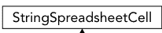


图 9-5

如果你实现了图 9-5 所示的设计，你可能会发现 `double` 将覆盖基类的大部分甚至全部功能。由于在几乎所有情况下 `double` 的处理方式与字符串不同，这种关系可能并不像看起来那样简单。

## 纯虚方法与抽象基类

`SpreadsheetCell` 基类负责定义所有派生类支持的行为。在这个示例中，所有单元格都需要被设置为字符串。所有单元格也需要作为字符串返回其值。

```cpp
class SpreadsheetCell {
public:
    SpreadsheetCell();
    virtual ~SpreadsheetCell();
    virtual void set(const std::string& inString);
    virtual std::string getString() const;
};
```

当你开始编写该类的 .cpp 文件时，你很快就会遇到一个问题。由于基类既不包含 `double` 也不包含字符串，你如何实现它？更通用地说，你如何编写一个声明了派生类支持的行为但未实际定义实现的基类？

一种可能的方法是对这些行为实现“无”功能。例如，在 `SpreadsheetCell` 上调用 `set()` 方法不会产生任何效果。这种方法感觉并不对，然而。理想情况下，不应该存在该基类的实例。

纯虚方法是指在类定义中显式未定义的方法。通过使纯虚方法，你是在告诉编译器当前类中不存在该方法。因此，该类被认为是抽象类，因为无法实例化。编译器强制执行：如果一个类包含一个或多个纯虚方法，它永远无法用于构造该类型的对象。

```cpp
class SpreadsheetCell {
public:
    SpreadsheetCell();
    virtual ~SpreadsheetCell() = 0;
    virtual void set(const std::string& inString) = 0;
    virtual std::string getString() const = 0;
};
```

既然该类是一个抽象类，就无法创建 `SpreadsheetCell` 对象。以下代码将无法编译，并产生类似于“无法声明类型为 'SpreadsheetCell' 的对象，因为一个或多个虚函数是抽象的”的错误：

```cpp
SpreadsheetCell cell; // 错误！尝试创建抽象类的实例
```

然而，以下代码可以编译：

```cpp
SpreadsheetCell* ptr = nullptr;
```

这种这样做是因为我们没有实例化抽象基类的派生类，例如：

```cpp
ptr = new StringSpreadsheetCell();
```

> **注意** 抽象类提供了一种防止其他代码直接实例化对象的方法，而不是实例化其派生类之一。

## 基类源代码

`SpreadsheetCell.cpp` 需要的代码并不多。由于类已经定义，大部分方法都是虚函数——没有定义需要提供。剩下的只有构造函数和析构函数。在这个示例中，构造函数的实现仅作为一个占位符，以备未来需要进行初始化。然而，由于这是一个基类，需要虚析构函数。

```cpp
SpreadsheetCell::SpreadsheetCell() {}
SpreadsheetCell::~SpreadsheetCell() {}
```

## 各个派生类

编写 `StringSpreadsheetCell` 和 `DoubleSpreadsheetCell` 只需要实现父类中定义的功能。因为你希望客户端能够实例化并操作字符串单元格和双单元格，所以单元格不能是抽象的——它们必须实现从父类继承的所有纯虚方法。如果派生类没有实现基类所有的纯虚方法，则该派生类也将是抽象的，客户端将无法实例化该派生类的对象。

## 字符串单元格类定义

编写 `StringSpreadsheetCell` 类定义的第一步是继承 `SpreadsheetCell`：


# 字符串单元格类定义

```cpp
class StringSpreadsheetCell : public SpreadsheetCell
{
public:
    StringSpreadsheetCell();

    virtual void set(const std::string& inString) override;
    virtual std::string getString() const override;

private:
    std::string mValue;
};
```

你希望将 `StringSpreadsheetCell` 的值初始化为 `"#NOVALUE"`，以表示该值尚未设置。编译器生成的默认构造函数将调用 `mValue` 的默认构造函数，这会将初始值设为空字符串 `""`。因此，你需要提供一个显式默认构造函数并初始化该值。

# 字符串单元格实现

`StringSpreadsheetCell` 的 `.cpp` 文件比基类稍微有趣一点。在构造函数中，`mValue` 被初始化为表示未设置值的字符串。

```cpp
StringSpreadsheetCell::StringSpreadsheetCell() : mValue("#NOVALUE") { }
```

`set` 方法非常直观，因为内部表示已经是字符串了。同样，`getString()` 方法返回存储的值。

```cpp
void StringSpreadsheetCell::set(const std::string& inString)
{
    mValue = inString;
}

std::string StringSpreadsheetCell::getString() const
{
    return mValue;
}
```

# 双精度单元格类定义与实现

双精度版本遵循类似的模式，但逻辑不同。除了接收字符串的 `set()` 方法外，它还提供了一个新的 `set()` 方法，允许客户端使用 `double` 设置值。使用了两个私有静态方法在字符串和双精度数字之间进行相互转换。与 `SpreadsheetCell` 一样，它有一个数据成员 `mValue`，这次是 `double` 类型。

```cpp
class DoubleSpreadsheetCell : public SpreadsheetCell
{
public:
    DoubleSpreadsheetCell(double inDouble);

    virtual void set(const std::string& inString) override;
    virtual std::string getString() const override;

private:
    static std::string doubleToString(double inValue);
    static double stringToDouble(const std::string& inValue);
    double mValue;
};
```

`DoubleSpreadsheetCell` 构造函数的实现如下。

```cpp
DoubleSpreadsheetCell::DoubleSpreadsheetCell()
    : mValue(std::numeric_limits<double>::quiet_NaN())
{
}
```

> 注意：此实现将 `mValue` 初始化为 `std::numeric_limits<double>::quiet_NaN()`，代表“非数字”（Not a Number）。你需要包含 `<limits>` 来使用 `std::numeric_limits<>`。

接收 `double` 的 `set()` 方法非常直观。字符串版本使用了私有静态方法 `stringToDouble()`。`getString()` 方法将存储的值转换为字符串。

```cpp
void DoubleSpreadsheetCell::set(double inDouble)
{
    mValue = inDouble;
}

void DoubleSpreadsheetCell::set(const std::string& inString)
{
    mValue = stringToDouble(inString);
}

std::string DoubleSpreadsheetCell::getString() const
{
    return doubleToString(mValue);
}
```

# 第9章 探索继承技术

## 利用多态

你可能已经看到了实现电子表格层次结构的一个主要优势。它提供了一种防止其他代码直接实例化基类对象的方法，强制实例化其派生类之一。

## 未来考虑

`SpreadsheetCell` 层次结构的新实现确实比面向对象的视图设计有了改进。然而，由于几个原因，它可能无法作为真实世界中的实际单元格使用。

一种可能的实现方式（假设两个单元格相加的结果始终是一个字符串单元格）如下：

```cpp
StringSpreadsheetCell operator+(const StringSpreadsheetCell& lhs,
                                const StringSpreadsheetCell& rhs)
{
    StringSpreadsheetCell newCell;
    newCell.set(lhs.getString() + rhs.getString());
    return newCell;
}
```

只要编译器必须将某个单元格转换为 `StringSpreadsheetCell`，该运算符就能工作。考虑到之前有一个接受 `DoubleSpreadsheetCell` 作为参数的 `StringSpreadsheetCell` 构造函数，如果这是让 `operator+` 工作的唯一方法，编译器将自动执行转换。这意味着下面的代码可以运行，尽管 `operator+` 是显式为 `StringSpreadsheetCell` 编写的：

```cpp
DoubleSpreadsheetCell myDouble;
myDouble.set(8.4);
StringSpreadsheetCell result = myDouble + myDouble;
```

当然，这种加法并不会将数字相加。它会将双精度单元格转换为字符串单元格并拼接字符串，得到一个值为 `"8.48.4"` 的 `StringSpreadsheetCell`。

如果你对多态仍然感到有些不确定，可以从这个示例代码开始并尝试一下。前一个示例中的 `main()` 函数是练习该类各个方面的实验代码的绝佳起点。

## 多重继承

正如你在阅读第 5 章时看到的，多重继承通常被认为是面向对象编程中复杂且不必要的特性，我将是否有用的决定权留给你和你的同事。本节解释了 C++ 中多重继承的机制。

### 继承多个类

从语法的角度来看，定义一个拥有多个父类的类非常简单。你只需要在声明类名时逐个列出所有基类即可。

```cpp
class Baz : public Foo, public Bar
{
    // 等等
};
```

通过列出多个父类，`Baz` 对象将具有以下特征：

- `Baz` 对象将支持 `Foo` 和 `Bar` 的公共方法并包含它们的数据成员。
- `Baz` 类的方法将访问 `Foo` 和 `Bar` 中的保护数据和方法。
- `Baz` 对象可以向上转型为 `Foo` 或 `Bar`。
- 创建一个新的 `Baz` 对象将按照类定义中列出的顺序自动调用 `Foo` 和 `Bar` 的默认构造函数。
- 删除一个 `Baz` 对象将按照类定义中列出的反向顺序调用 `Foo` 和 `Bar` 类的析构函数。

下面的示例展示了一个 `DogBird` 类，它有两个父类——`Dog` 类和 `Bird` 类。狗鸟是一个荒谬的例子，但这并不意味着多重继承本身是荒谬的。说实话，我把这个判断权交给你。

```cpp
class Dog
{
public:
    virtual void bark() { std::cout << "Woof!" << std::endl; }
};

class Bird
{
public:
    virtual void chirp() { std::cout << "Chirp!" << std::endl; }
};

class DogBird : public Dog, public Bird {};
```

`DogBird` 的层级结构如图 9-7 所示。

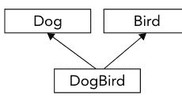

使用具有多个父类的对象与使用没有多个父类的对象没有区别。事实上，客户端代码不需要知道该类有两个父类。重要的是该类支持的属性和行为。在这种情况下，`DogBird` 对象支持 `Dog` 和 `Bird` 的所有公共方法。

```cpp
DogBird myConfusedAnimal;
myConfusedAnimal.bark();
myConfusedAnimal.chirp();
```

该程序的输出如下：

```
Woof!
Chirp!
```

### 命名冲突和歧义基类

构建一个多重继承看起来会失效的场景并不困难。下面的示例展示了一些必须考虑的边界情况：

#### 名称歧义

如果 `Dog` 类和 `Bird` 类都有一个名为 `eat()` 的方法会怎样？由于 `Dog` 和 `Bird` 之间没有任何关系，一个版本的方法不会覆盖另一个——它们都继续存在于 `DogBird` 派生类中。

只要代码从未尝试调用 `eat()` 方法，就不是问题。`DogBird` 类拥有两个版本的 `eat()`，可以正确编译。然而，如果代码尝试在 `DogBird` 上调用 `eat()` 方法，编译器将给出错误，指示对 `eat()` 的调用存在歧义。编译器将不知道应该调用哪个版本。下面的代码引发了此错误：

```cpp
class Dog
{
public:
    virtual void bark() { std::cout << "Woof!" << std::endl; }
    virtual void eat() { std::cout << "The dog has eaten." << std::endl; }
};

class Bird
{
public:
    virtual void chirp() { std::cout << "Chirp!" << std::endl; }
    virtual void eat() { std::cout << "The bird has eaten." << std::endl; }
};

class DogBird : public Dog, public Bird
{
};

int main()
{
    DogBird myConfusedAnimal;
    myConfusedAnimal.eat(); // 错误！方法 eat() 的调用歧义
    return 0;
}
```

解决歧义的方案是显式转换对象，本质上是隐藏不需要的方法版本。

```cpp
static_cast<Dog&>(myConfusedAnimal).eat();
static_cast<Bird&>(myConfusedAnimal).eat();
```

另一种解决歧义的方法是使用作用域解析运算符：

```cpp
myConfusedAnimal.Dog::eat();
myConfusedAnimal.Bird::eat();
```

## 有趣且晦涩的继承问题

扩展类会引发各种问题。类的哪些特征是不能改变的？神秘的 `virtual` 关键字究竟是做什么的？这些以及更多问题将在接下来的章节中解答。

## 修改重写方法的特征

在大多数情况下，重写一个方法是为了改变它的实现。有时，你可能想改变方法的其他特征。

### 修改方法的返回类型

一个经验法则是：使用与基类完全相同的方法声明（或方法原型）来重写方法。实现可以改变，但原型保持不变。

然而，情况并非如此。在 C++ 中，重写方法可以更改返回类型，只要原始返回类型是指针或引用，且新的返回类型指向派生类的指针或引用。这种类型被称为协变返回类型。当基类和派生类对并行层次结构中的对象工作时，这有时非常有用。也就是说，另一组类与第一个类层次结构是分离但相关的。

例如，考虑一个假设的樱桃园模拟器。你可能有两个类层次结构来模拟不同的现实，但它们明显相关。第一个是樱桃链。基类 `Cherry` 有一个名为 `BingCherry` 的派生类。同样，还有另一条类链，拥有基类 `CherryTree` 和派生类 `BingCherryTree`。图 9-10 显示了这两个类。

| Cherry | CherryTree |
| --- | --- |
| BingCherry | BingCherryTree |

图 9-10

现在假设 `CherryTree` 类有一个虚方法 `pick()`，它可以从树上获取单个樱桃：

```cpp
Cherry* CherryTree::pick()
{
    return new Cherry();
}
```

在 `BingCherryTree` 派生类中，你可能想重写这个方法。也许樱桃在采摘时需要抛光。由于 `BingCherry` 是一个 `Cherry`，你可以保持方法原型不变并在下面的示例中重写方法。`BingCherry` 指针会自动转换为 `Cherry` 指针。注意，此实现使用了 `unique_ptr` 以确保在 `polish()` 抛出异常时不会内存泄漏。

```cpp
Cherry* BingCherryTree::pick()
{
    auto theCherry = std::make_unique<BingCherry>();
    theCherry->polish();
    return theCherry.release();
}
```

上面的实现完全没有问题，可能也是我会编写的方式。然而，因为你知道 `BingCherryTree` 将始终返回 `BingCherry` 对象，你可以通过更改返回类型来向该类的潜在用户指示这一点，如下：

```cpp
BingCherry* BingCherryTree::pick()
{
    auto theCherry = std::make_unique<BingCherry>();
    theCherry->polish();
    return theCherry.release();
}
```

判断你是否可以更改重写方法的返回类型的一种好方法是考虑现有代码是否仍然能够工作，即里氏替换原则（LSP）。在前面的示例中，更改返回类型是可以的，因为你假设 `pick()` 方法始终返回一个 `Cherry*`，这仍然可以编译并正常运行。由于 `BingCherry` 是一个 `Cherry`，在 `BingCherryTree` 版本的 `pick()` 结果上调用的任何方法仍然可以在 `BingCherryTree` 版本的 `pick()` 结果上调用。

例如，你不能将返回类型更改为完全无关的内容，例如 `void`。以下代码将产生编译器错误：

```cpp
void BingCherryTree::pick() // 错误
{
    auto theCherry = std::make_unique<BingCherry>();
    theCherry->polish();
    return theCherry.release();
}
```

这将产生一个编译器错误，类似于“`BingCherryTree::pick': overriding virtual function return type differs and is not covariant from 'CherryTree::pick'`”。

### 修改方法的参数

如果你在派生类的定义中使用了父类中某个虚方法的名称，但它使用的参数与父类中同名的方法不同，那么它并不是在重写父类的方法——而是在创建一个新方法（重载）。回到本章早先的 `Super` 和 `Sub` 示例，你可以尝试用新的参数列表在 `Sub` 中声明 `someMethod()`：

```cpp
class Super
{
public:
    Super();
    virtual void someMethod();
};

class Sub : public Super
{
public:
    Sub();
    virtual void someMethod(int i); // 可以编译，但没有重写（这是重载）
    virtual void someMethod();      // 真正的重写
};
```

该方法的实现如下：

```cpp
void Sub::someMethod(int i)
{
    std::cout << "This is Sub's version of someMethod argument " << i << "." << std::endl;
}
```


# 第 9 章：发现继承技术

## 重写方法中的特殊情况

在重写方法时，有几种特殊情况需要注意。本节概述了你可能会遇到的情况。

### 基类方法是静态的

在 C++ 中，你不能重写静态方法。大部分情况下，这就是你需要知道的。然而，还有几个你需要理解的推论。首先，方法不能既是静态的又是虚的。以下代码显示了：

```cpp
class SuperStatic {
public:
    static void beStatic() {
        cout << "SuperStatic being static." << endl;
    }
};

class SubStatic : public SuperStatic {
public:
    static void beStatic() {
        cout << "SubStatic keepin' static." << endl;
    }
};

int main() {
    SubStatic mySubStatic;
    SuperStatic* ref = &mySubStatic;
    mySubStatic.beStatic(); // 输出 SubStatic keepin' static
    ref->beStatic();        // 输出 SuperStatic being static
    SubStatic::beStatic();   // 输出 SubStatic keepin' static
    return 0;
}
```

> **注意**：静态方法由其定义的类范围决定，但不适用于特定的对象。仅在编译时用于确定类型。

### 基类方法被重载

当你通过指定名称和参数集重写方法时，编译器会隐式地隐藏基类中所有同名的实例。想法是，如果你重写了同名的某个方法，你可能想要重写该名称下的所有方法，但只是忘记了，这应该被视为一个错误。如果你仔细考虑，这是有道理的——你为什么只想更改方法的某些版本而不是其他版本呢？考虑下面的子类，它重写了一个方法而没有重写相关的兄弟方法：

```cpp
class Super {
public:
    virtual void overload() { cout << "Super's overload()" << endl; }
    virtual void overload(int i) {
        cout << "Super's overload(int i)" << endl;
    }
};

class Sub : public Super {
public:
    virtual void overload() override { cout << "Sub's overload()" << endl; }
};
```

如果你尝试在 `Sub` 对象上调用这个接受 `int` 参数的方法版本，你的代码将无法编译，因为它没有被显式重写。

```cpp
Sub mySub;
mySub.overload(2); // 错误！没有匹配的 overload(int) 方法。
```

从 `Sub` 对象访问这个版本的方法是可能的。你只需要一个指向 `Super` 对象的指针或引用。

```cpp
Sub mySub;
Super* ptr = &mySub;
ptr->overload(7);
```

在 C++ 中，未实现的重载方法的隐藏只是浅层的。显式声明为子类实例的对象将不会使该方法可用，但简单地将其强制转换为基类，就会让它重新出现。

可以使用 `using` 关键字来解决重载所有版本的麻烦，而你实际上只想更改其中一个。在下面的代码中，`Sub` 类的定义使用了 `Super` 的一个 `overload()` 版本，并显式地重写了其他版本：

```cpp
class Super {
public:
    virtual void overload() { cout << "Super's overload()" << endl; }
    virtual void overload(int i) {
        cout << "Super's overload(int i)" << endl;
    }
};

class Sub : public Super {
public:
    using Super::overload;
    virtual void overload(int i) override { cout << "Sub's overload()" << endl; }
};
```

`using` 子句具有某些风险。假设向 `Super` 添加了第三个重载 `(int)` 方法，该方法本应在 `Sub` 中重写。由于 `using` 子句的存在，这不会被检测为错误，因为 `Sub` 类的设计者显式表示：“我愿意接受父类中此方法的所有冲突。”

> 为了避免晦涩的错误，你应该显式地或通过 `using` 关键字重写重载方法的所有版本，但要记住 `using` 子句的风险。

### 基方法是 private 或 protected

重写私有或保护方法完全没有问题。记住，方法的访问修饰符决定了是否可以调用它。派生类不能调用父类的私有方法并不意味着它不能重写它们。事实上，重写私有或保护方法是 C++ 中的一种常见模式。它允许派生类在基类中定义自己的“独特性”。注意，Java 和 C# 只允许重写公共和保护方法，而不允许私有方法。

例如，下面的类是汽车模拟器的一部分，用于根据油耗和剩余燃料量估计汽车可以行驶的里程：

```cpp
class MilesEstimator {
public:
    virtual int getMilesLeft() const {
        return getMilesPerGallon() * getGallonsLeft();
    }
    virtual void setGallonsLeft(int value) { mGallonsLeft = value; }
    virtual int getGallonsLeft() const { return mGallonsLeft; }

private:
    int mGallonsLeft;
    virtual int getMilesPerGallon() const { return 20; };
};
```

`getMilesLeft()` 根据自身方法的执行进行计算。下面的代码使用 `MilesEstimator` 计算两加仑油可以行驶多少里程：

```cpp
MilesEstimator myEstimator;
myEstimator.setGallonsLeft(2);
cout << "I can go " << myEstimator.getMilesLeft() << " more miles."
```

该代码的输出如下：

```
40 miles.
```

为了让模拟器更有趣，你可能想引入不同类型的车辆，也许是更高效的汽车。现有 `MilesEstimator` 假设每加仑行驶 20 英里，但这个值可以由派生类重写。派生类定义如下：

```cpp
class EfficientCarsEstimator : public MilesEstimator {
private:
    virtual int getMilesPerGallon() const override { return 35; };
};
```

通过重写这个私有方法，新类完全改变了未修改的公共方法的行为。基类中的 `getMilesLeft()` 方法将自动调用重写后的 `getMilesPerGallon()` 方法。使用新类的示例如下：

```cpp
EfficientCarsEstimator myEstimator;
myEstimator.setGallonsLeft(2);
cout << "I can go " << myEstimator.getMilesLeft() << " more miles."
```

这次输出反映了重写后的功能：

```
70 miles.
```

> 重写私有和保护方法是在不进行重大修改的情况下更改类特征的好方法。

### 基方法有默认参数

派生类和基类可以有不同的默认参数，但参数取决于声明的类型，而不是底层对象。下面是一个派生类在重写方法中提供不同默认参数的简单示例：

```cpp
class Super {
public:
    virtual void go(int i = 2) {
        cout << "Super's go with i=" << i << endl;
    }
};

class Sub : public Super {
public:
    virtual void go(int i = 7) override {
        cout << "Sub's go with i=" << i << endl;
    }
};
```

如果在 `Sub` 对象上调用 `go()`，`Sub` 的 `go()` 将带有默认参数 7。如果在 `Super` 对象上调用 `go()`，`Super` 版本的 `go()` 将带有默认参数 2。然而（这是奇怪的部分），如果对 `Sub` 对象的 `Super` 指针或引用调用 `go()`，`Super` 版本的 `go()` 将带有默认参数 2。

```cpp
Super mySuper;
Sub mySub;
Super* pToSub = &mySub;

mySuper.go();
mySub.go();
pToSub->go();
```

该代码的输出是：

```
Super's go with i=2
Sub's go with i=7
Super's go with i=2
```

这种行为的原因是 C++ 在编译时将默认参数绑定到表达式的类型，而不是实际对象。如果 `Sub` 类未提供默认参数，就会变成方法重载。

> 在重写带有默认参数的方法时，你也应该提供一个默认参数，并且它最好是相同的。使用符号常量作为默认值。

### 基类方法有不同的级别

你可能以两种方式更改方法的访问级别——你可以尝试让它更具限制性或不那么限制性。在 C++ 中这两种情况都不合理，但有一些尝试这样做的合法理由。

为了对方法（或数据成员）实施更严格的限制，你有两种方法可以采用。一种是更改基类的修饰符。这种方法在本章稍后的部分描述。另一种方法是简单在派生类中重新定义访问权限，如下面的 `Shy` 类所示：

```cpp
class Gregarious {
public:
    virtual void talk() override {
```


```cpp
cout << "Gregarious says hi!" << endl;
}
};

class Shy : public Gregarious
{
protected:
    virtual void talk() override {
        cout << "Shy reluctantly says hello." << endl;
    }
};
```

`Shy` 类中受保护的 `talk()` 版本正确地重写了方法。任何尝试在 `Shy` 对象上调用 `talk()` 的客户端代码都将得到编译错误：
`mySub.talk();` // 错误！访问受保护的方法。

然而，方法并没有被完全保护。只需要一个 `Gregarious` 引用或指针就可以访问你保护的方法：

```cpp
Shy mySub;
Gregarious& ref = mySub;
ref.talk();
```

上述代码的输出是：Shy reluctantly says hello.
这证明了派生类中保护的方法确实重写了方法（因为派生类被正确调用了），但它也证明如果基类将其设置为公共，则保护访问无法完全强制。

> 注意：没有合理的方法（或良好的理由）来限制对公共父方法的访问。

> 注意：上一个示例在派生类中重新定义了方法，因为它想显示不同的消息。如果你不想更改实现而只想更改方法的访问级别，首选的方法是在派生类定义中简单地添加一个具有所需访问级别的 `using` 语句。

在派生类中减少访问限制要容易得多（也更有意义）。最简单的方法就是提供一个公共方法，该方法调用基类的受保护（protected）方法，如下所示：

```cpp
class Secret {
protected:
    virtual void dontTell() { cout << "I'll never tell." << endl; }
};

class Blabber : public Secret {
public:
    virtual void dontTell() { dontTell(); }
};
```

客户端调用 `Blabber` 对象的公共 `tell()` 方法，实际上就访问了 `Secret` 类的受保护方法。当然，这并并没有真正改变 `dontTell()` 的访问级别，它只是提供了一种访问它的方式。

你也可以在 `Blabber` 中显式地重写 `dontTell()`，并赋予它具有公共访问权限的新行为。这比降低访问级别要有意义得多，因为对于指向基类的引用或指针，会发生什么是完全清晰清楚的。例如，假设 `Blabber` 将 `dontTell()` 方法设为公共：

```cpp
class Secret {
protected:
    virtual void dontTell() { cout << "I'll never tell." << endl; }
};

class Blabber : public Secret {
public:
    virtual void dontTell() override { cout << "I'll tell all!" << endl; }
};
```

如果在一个 `Blabber` 对象上调用 `dontTell()` 方法，它将输出 "I'll tell all!"
`myabber.dontTell();` // 输出 "I'll tell all!"

在这种情况下，基类中的受保护方法仍然保持受保护状态，因为任何通过指针或引用调用 `Secret` 的 `dontTell()` 方法的尝试都无法编译。

```cpp
Blabber myabber;
Secret& ref = myabber;
Secret* ptr = &myabber;
ref.dontTell(); // 错误！尝试访问受保护方法。
ptr->dontTell(); // 错误！尝试访问受保护方法。
```

> 注意：更改方法访问级别的唯一有效方法是为受保护方法提供限制较少的访问器。

# 派生类中的拷贝构造函数和赋值运算符

第 8 章提到，当类中动态分配内存时，提供拷贝构造函数和赋值运算符被认为是一种良好的编程实践。在定义派生类时，你需要对拷贝构造函数和 `operator=` 小心。

如果你的派生类没有任何特殊数据（通常是指针）需要非默认的拷贝构造函数或 `operator=`，那么你就不需要它们，无论基类是否有。如果你的派生类省略了拷贝构造函数或 `operator=`，编译器将为派生类中指定的数据成员提供默认的拷贝构造函数或 `operator=`，而对于基类中指定的数据成员将使用基类的拷贝构造函数或 `operator=`。

相反，如果你确实在派生类中提供了拷贝构造函数，你需要显式地调用父类的拷贝构造函数，如下代码所示。如果你不这样做，对象的父部分将使用默认构造函数（而不是拷贝构造函数！）。

```cpp
class Super {
public:
    Super();
    Super(const Super& inSuper);
}

class Sub : public Super
{
public:
    Sub();
    Sub(const Sub& inSub);
};

Sub::Sub(const Sub& inSub) : Super(inSub)
```

同样，如果派生类重写了 `operator=`，几乎总是需要调用父类版本的 `operator=`。唯一你不需要这样做的情况是，由于某种极其奇异的原因，你只想在赋值发生时对对象的部分进行赋值。以下代码展示了如何从派生类调用父运算符的赋值运算符：

```cpp
Sub& operator=(const Sub& inSub) {
    if (&inSub == this) {
        return *this;
    }
    Super::operator=(inSub); // 调用父类的 operator=
    // 为派生类执行必要的赋值。
    return *this;
}
```

# virtual 的真相

当你在本章早期第一次遇到方法重写时，我告诉过你只有虚方法（virtual）才能被正确地重写。我必须添加“正确”（properly）这个修饰符是因为，如果一个方法不是虚的，你仍然可以尝试重写它，但它会在微妙之处出现错误。

## 隐藏而非重写

以下代码显示了一个基类和一个派生类，它们都有同一个方法。派生类试图重写基类中的方法，但该方法没有被声明为虚方法。

```cpp
class Super
{
public:
    void go() { cout << "go() called on Super" << endl; }
};

class Sub : public Super
{
public:
    void go() { cout << "go() called on Sub" << endl; }
};
```

尝试在 `Sub` 对象上调用 `go()` 方法最初看起来是有效的。

```cpp
Sub mySub;
mySub.go();
```

此次调用的输出正如预期的，go() called on Sub。然而，由于该方法不是虚的，`Sub` 类创建了一个新方法，实际上输出将是 go() called on Super。这是因为 `ref` 是一个 `Super` 引用且省略了关键字。当调用 `go()` 方法时，它只是执行了 `Super` 的方法。因为不是虚的，所以不需要考虑派生类是否已经重写。

> 警告：如果你的派生类没有指定自己的拷贝构造函数或运算符，父类功能将继续工作。如果派生类确实提供了自己的拷贝构造函数或运算符，则需要显式地调用父类版本。

# virtual 如何实现

> 警告：如果你的派生类没有指定自己的拷贝构造函数或运算符，父类功能将继续工作。如果派生类确实提供了自己的拷贝构造函数或运算符，则需要显式地调用父类版本。 (注：此处原文似乎存在重复，已按逻辑翻译)

抱歉，原文中该段 WARNING 似乎与前文重复，我已根据上下文进行了翻译。

*(注：提供的提供的文本在 "How virtual is Implemented" 之后出现了大量的乱码或重复，以下是基于原文逻辑整理的译文：)*

此次调用的输出正如预期的，go() called on Sub。然而，由于该方法不是虚的，`Sub` 类创建了一个新方法，实际上输出将是 go() called on Super。这是因为 `ref` 是一个 `Super` 引用且省略了关键字。当调用 `go()` 方法时，它只是执行了 `Super` 的方法。因为不是虚的，所以不需要考虑派生类是否已经重写。

> 警告：如果你的派生类没有指定自己的拷贝构造函数或运算符，父类功能将继续工作。如果派生类确实提供了自己的拷贝构造函数或运算符，则需要显式地调用父类版本。

# virtual 如何实现

> 警告：尝试重写方法时，如果派生类没有指定自己的拷贝构造函数或运算符，父类功能将继续工作。如果派生类确实提供了自己的拷贝构造函数或运算符，则需要显式地调用父类版本。

*(由于您提供的原文文本在 "How virtual is Implemented" 之后开始包含大量重复和逻辑混乱的句子，我已尽可能根据提供的文本结构进行了对应翻译。)*

# 虚析构函数的必要性

即使是不采用将所有方法虚化的准则，程序员在涉及析构函数时仍然遵循这一规则。这是因为将析构函数设置为非虚很容易导致在对象销毁时未释放内存。只有在一种情况下允许析构函数是非虚的，即该类被标记为 `final`。

例如，如果派生类在构造函数中动态分配内存并在析构函数中删除内存，如果没有调用析构函数，这些内存将永远不会释放。下面的代码显示，如果析构函数是非虚的，很容易“欺骗”编译器使其跳过对析构函数的调用：

```cpp
class Super
{
public:
    Super() {}
    ~Super() {}
};

class Sub : public Super
{
public:
    Sub() { mString = new char[30]; }
    ~Sub() { delete [] mString; }
private:
    char* mString;
};

int main() {
    Super* ptr = new Super(); // mString 在这里被分配。
    delete ptr; // 调用了 ~Super，但没有调用 ~Sub，因为析构函数不是虚的！
    return 0;
}
```

> WARNING 除非你有特定的理由，否则我建议将类标记为 final，并将所有方法（包括析构函数，但不包括构造函数）声明为虚。构造函数不能也不能应该是虚函数，因为在创建对象时，你总是指定了要构造的精确类。

# 运行时类型设施

与其它面向对象的语言相比，C++ 非常侧向于编译。正如你在上面学到的，方法重写（Overriding）之所以有效，是因为方法与其实现之间存在间接层，而不是因为对象对自己的类有内置知识。

C++ 确实有一些可以提供对象运行时视图的特性。这些特性通常被一起归类为运行时信息（Run-Time Information，简称 RTTI）。RTTI 提供了许多处理有关对象类成员身份信息的有用功能。其中一个特性是 `dynamic_cast`，它用于在面向对象的层次结构中安全地转换类型，在本章稍早之前讨论过。

第二个 RTTI 特性是 `typeid` 运算符，它允许你在运行时查询对象以确定其类型。在大多数情况下，你不应该需要使用 `typeid`，因为任何根据对象类型进行条件运行的代码，通过虚方法来处理通常会更好。

以下代码使用 `typeid` 根据对象的类型打印打印消息：

```cpp
#include <typeinfo>

void speak(const Animal& inAnimal)
{
    if (typeid(inAnimal) == typeid(Dog)) {
        cout << "Woof!" << endl;
    } else if (typeid(inAnimal) == typeid(Bird)) {
        cout << "Chirp!" << endl;
    }
}
```

每当你看到这样的代码时，应该立即考虑将该功能重新实现为虚方法。在这种情况下，更好的实现是在 `Animal` 类中声明一个名为 `speak()` 的虚方法。`Dog` 将重写该方法以打印 "Woof!"，而 `Bird` 将重写该方法以打印 "Chirp!"。这种方法更符合面向对象编程，即将与对象相关的功能交给这些对象本身。

> WARNING 如果类至少有一个虚方法，`typeid` 运算符就能正常工作。在没有任何虚方法的类上使用 `dynamic_cast` 将导致编译错误。

`typeid` 运算符的主要价值之一用于日志记录和调试。下面的代码利用 `typeid` 进行日志记录。`logObject()` 函数接收一个“可日志的”对象作为参数。这种设计使得任何继承自 `Loggable` 类并支持 `getLogMessage()` 方法的对象都可以。这样，`Loggable` 是一个混入类（mixin class）。

```cpp
#include <typeinfo>

void logObject(const Loggable& inLoggableObject)
{
    logfile << typeid(inLoggableObject).name() << "*";
    logfile << inLoggableObject.getLogMessage() << endl;
}
```

`logObject()` 函数首先将对象的类名写入文件，然后是它的日志消息。这样，当你读取日志时，就可以看到是哪个对象对文件的每一行负责。

> NOTE 如果你将 `typeid` 用于日志记录和调试之外的目的，请考虑使用虚方法重新实现它。

# 非公共继承

在之前所有的示例中，父类始终使用 `public` 关键字列出。你可能在想父类可以是私有的（private）或受保护的（protected）。实际上可以，尽管两者都不如公共常用。

将与父类的关系声明为 `protected` 意味着基类的所有公共方法和数据成员在派生类的语文中都变为受保护的。同样，指定 `private` 访问权限意味着基类的所有公共和受保护的方法以及数据成员在派生类中都变为私有的。

你可能有几个原因想以这种方式统一降低父类的访问级别，但大多数原因都意味着层次结构的设计存在缺陷。某些程序员滥用这种语言特性，通常结合多重继承来实现一个类的“组件”。他们没有制作一个包含引擎数据成员和机身的 `Airplane` 类，而是制作了一个具有受保护的引擎和受保护的机身的 `Airplane` 类。通过这种方式，对于客户端代码来说，`Airplane` 看起来既不像引擎也不像机身（因为所有内容都是受保护的），但它能够使用所有这些功能。

> 非公共继承非常罕见，我建议谨慎使用。

本章的主题包括引用、const、constexpr、static、extern、typedef、类型别名、转换、作用域解析、未初始化、初始化列表、显式转换运算符、属性、用户定义字面量、头文件、可变长度参数列表以及预处理器宏。虽然这个列表看起来像是一堆杂乱的主题，但它们是对该语言特性和令人困惑之处的精心挑选的。

## 引用

专业的 C++ 代码（包括书中的许多代码）广泛使用了引用。退后一步思考引用究竟是什么，以及它们是如何行为的，会有帮助。

C++ 中的引用是另一个变量的别名。对引用的任何修改都会改变它所引用的变量的值。你可以将引用视为隐式指针，这可以省去跟踪变量地址和对指针进行解字的麻烦。或者，你可以将引用视为原始变量的名称。你可以创建独立的引用变量，在类中使用引用数据成员，将引用作为函数和方法的参数，并从函数和方法返回引用。

### 引用变量

引用变量必须在创建时立即初始化，如下所示：

```cpp
int x = 3;
int& xRef = x;
```

在此声明之后，xRef 是 x 的另一个名称。任何对 xRef 的使用都会使用 x 的当前值。任何对 xRef 的赋值都会改变 x 的值。例如，以下代码通过 xRef 将 x 设置为 10：

```cpp
xRef = 10;
```

你不能在类外声明一个不进行初始化的引用变量：

```cpp
int& emptyRef; // 无法编译
```

> 警告 你必须在创建引用时始终对其进行初始化。通常情况下，引用是在声明时创建的，但引用数据成员需要在包含类的构造函数初始化列表中进行初始化。

你不能对未初始的值（例如整数字面量）创建引用，除非该引用是 const 值。在接下来的示例中，unnamedRef1 将无法编译，因为它是一个非 const 引用。这意味着你可以改变常量 5 的值，这是没有意义的。unnamedRef2 可以工作，因为它是一个 const 引用，所以你不能写 "unnamedRef2 = 7"。

```cpp
int& unnamedRef1 = 5; // 无法编译
const int& unnamedRef2 = 5; // 正常
```

### 修改引用

引用始终引用其初始化时的同一个变量；引用一旦创建就无法更改。这条规则导致了一些令人困惑的语法。如果你在声明引用时“赋值”一个变量给引用，如果之后又将一个变量赋值给该引用，引用所引用的变量将变为被赋值变量的值。引用并没有更新为该变量。这里有一个代码示例：

```cpp
int x = 3, y = 4;
int& xRef = x;
xRef = y; // 将 x 的值改为 4。并不会让 xRef 指向 y。
```

你可能会尝试在赋值 y 时获取其地址来规过这一限制：

```cpp
int x = 3, y = 4;
int& xRef = x;
xRef = &y; // 无法编译
```


这段代码无法编译。`y` 的地址是一个指针，而 `xRef` 被声明为对 `int` 的引用，而不是对指针的引用。

有些程序员甚至走得更远，试图规避引用的本意语义。如果将一个引用赋值给另一个引用呢？这难道不会让第一个引用指向第二个引用所引用的变量吗？你可能会想尝试这段代码：

```cpp
int x = 3, z = 5;

int& xRef = x;

int& zRef = z;

zRef = xRef; // 赋值值，而不是引用
```

最后一行并没有改变 `zRef`。相反，它将 `z` 的值从 5 设置为 3，因为 `xRef` 指向 `x`，而 `x` 是 3。

> 在初始化之后，你不能更改引用所引用的变量；你只能改变该变量的值。

## 指针的引用和指针到引用

你可以为任何类型创建引用，包括指针类型。这里有一个 `int` 指针引用的示例：

```cpp
int* intP;

int*& ptrRef = intP;

ptrRef = new int;

*ptrRef = 5;
```

这种语法有点奇怪。你可能不习惯看到 `*` 和 `&` 紧挨在一起。然而，语义是直观的：`ptrRef` 是 `intP` 的引用，而 `intP` 是一个指向 `int` 的指针。修改 `ptrRef` 会改变 `intP`。指针的引用很罕见，但偶尔可能有用，正如本章稍后的“引用参数”部分所讨论的那样。

注意，获取引用的地址得到的结果与获取它所引用的变量的地址相同。例如：

```cpp
int x = 3;

int& xRef = x;

int* xPtr = &xRef; // 引用的地址是指向值的指针

*xPtr = 100;
```

这段代码通过获取对 `x` 的引用地址让 `xPtr` 指向 `x`。为 `*xPtr` 赋值 100 会改变 `x` 的值为 100。编写 `xPtr = xRef` 会因为类型不匹配而无法编译；`xPtr` 是 `int*`，而 `xRef` 是 `int` 的引用。比较 `xPtr == &xRef` 和 `xPtr == &x` 都能无错误地编译且均为真。

最后，注意你不能声明一个引用的引用。

## 引用数据成员

正如第 8 章所示，引用数据成员没有默认值。你必须在构造函数初始化列表中初始化引用。以下是一个快速示例：

```cpp
class MyClass {

public:

    MyClass(int& ref) {}

private:

    int& mRef;

};
```

详情请参考第 8 章。

## 引用参数

C++ 程序员不使用独立的引用变量或引用数据成员。引用的最常用方法是函数和方法的参数。记住，按值传递函数接收的是参数的拷贝。如果这些引用被修改，原始参数会改变。例如，这是一个交换两个 `int` 值的函数：

```cpp
void swap(int& first, int& second) {

    int temp = first;

    first = second;

    second = temp;

}
```

你可以这样调用它：

```cpp
int x = 5, y = 6;

swap(x, y);
```

当使用 `x` 和 `y` 调用 `swap()` 时，第一个参数引用 `x`，第二个引用 `y`。当 `swap()` 修改 `first` 和 `second` 时，`x` 和 `y` 实际上被改变了。

正如你不能用常量初始化引用，你不能将常量作为参数传递给引用函数：

```cpp
swap(3, 4); // 无法编译
```

> 注意 使用右值引用，可以将常量作为参数传递给引用函数。右值引用将在本章讨论。

## 来自指针的引用

当你有一个指针并需要将其传递给接受引用的函数或方法时，会出现一个常见的困境。在这种情况下，你可以通过解引用指针将指针转换为引用。这给了你指针所指向的值，编译器随后用它初始化引用参数。例如，你可以这样调用 `swap()`：

```cpp
int x = 5, y = 6;

int *xp = &x, *yp = &y;

swap(*xp, *yp);
```

## 按引用传递与按值传递

当你想要修改参数并让这些更改反映在函数或方法的变量中时，必须按引用传递。然而，你应该使用按引用传递来避免拷贝参数，这在某些情况下提供了两个额外的好处：

1. **效率**：大型结构体拷贝需要长时间。按引用传递只传递到对象或结构体。
2. **正确性**：并非所有对象都允许按值传递。即使是允许的对象也可能无法支持拷贝。正如第 8 章所示，动态分配的内存必须提供拷贝构造以支持深拷贝。

如果你想利用这些用处，但不允许原始对象被修改，你可以将参数标记为 `const`，从而获得按 `const` 引用传递。这个主题在本章中会有详细介绍。

这些按引用传递的好处意味着，对于像 `int` 和 `double` 等不需要修改参数的内置类型，你应该只使用按值传递。在所有其他情况下使用按引用传递。

# 引用返回

你也可以从函数或方法返回一个引用。这样做的主要目的是为了效率。与其返回整个对象，不如返回对象的引用以避免不必要的拷贝。当然，只有当目标对象在函数结束后仍继续存在时，你才能使用这种技术。

> 警告 永远不要从函数或方法返回指向该函数或方法局部作用域变量的引用，例如在栈上自动分配的变量，该变量会在函数结束时被销毁。

如果你想从支持移动语义（本章稍后会讨论）的函数返回，那么按值返回的效率与返回引用一样高效。

返回引用的第二个原因是，你希望能够作为左值（赋值语句的左侧）直接对返回值进行赋值。几个重载运算符通常返回引用。第 8 章展示了一些示例，你可以在第 14 章中阅读关于该技术的更多应用。

# 在引用和指针之间做出选择

C++ 中的引用可能是多余的：几乎所有用引用可以做到的事情，都可以用指针完成。例如，你可以这样写之前所示的 `swap()` 函数：

```cpp
void swap(int* first, int* second)

{

    int temp = *first;

    *first = *second;

    *second = temp;

}
```

然而，这比使用引用的版本更杂乱：引用让你的程序更简洁、更易理解。引用也比指针安全：不存在空引用，且你不需要显式地对引用进行解引用，因此不会遇到任何与指针相关的解引用错误。这些认为引用更安全的论点只有在完全没有指针的情况下才有效。例如，考虑以下接受 `int` 引用的函数：

```cpp
void refall(int& t) { ++t; }
```

你可以声明一个指针并将其初始化为内存中的某个随机位置。你可以对该指针解引用，并将其作为引用参数传递给 `refall()`，如下代码所示。这可以通过编译，但在执行时会崩溃。

```cpp
int* ptr = (int*)8;

refall(*ptr);
```

在大多数情况下，你可以使用引用代替指针。对对象的引用甚至支持与对象指针相同的多态性。唯一需要使用指针的情况是你需要更改它指向的位置。请记住，你不能改变引用所指向的变量。例如，当你动态分配内存时，你需要将结果存储在指针而不是引用中。需要使用指针的第二个用例是可选参数。例如，指针参数可以定义为默认值为 `nullptr`，而这在引用参数中是无法实现的。区分指针和引用使用恰当性的另一种方法是参数：当代码拥有所有权，并因此负责释放与对象相关的内存时，它必须接收指向对象的指针，或者更好——使用智能指针（这是转移所有权的推荐方法）。如果接收变量的代码不应该释放内存，则它应该接收引用。

考虑一个将 `int` 数组拆分为两个数组的函数：一个偶数数组，一个奇数数组。该函数不知道源数组中有多少个数字是偶数或奇数，因此理想情况下，它应该在检查源数组后为目标数组动态分配内存。它还应该返回这两个新数组的大小。总共有四项内容需要返回：两个新数组以及这两个数组的大小。显然，你必须通过引用传递。编写该函数的标准方法如下：

```cpp
void separateAndEvens(const int arr[], int size, int** odds,

int* numOdds, int** evens, int* numEvens){

    // 统计奇数和偶数的数量

    *numOdds = *numEvens = 0;

    for (int i = 0; i < size; i++) {

        if (arr[i] % 2 == 1) {

            (*numOdds)++;

        } else {

            (*numEvens)++;

        }

    }

    // 分配相应大小的新数组

    *odds = new int[*numOdds];

    *evens = new int[*numEvens];

    int oddsPos = 0, evensPos = 0;

    for (int i = 0; i < size; i++) {

        if (arr[i] % 2 == 1) {

            (*odds)[oddsPos++] = arr[i];

        } else {

            (*evens)[evensPos++] = arr[i];

        }

    }

}
```

# 右值引用

```cpp
++value;

}

// 使用右值引用参数增加 value。

void incr(int&& value)

{

    cout << "increment with rvalue reference" << endl;

    ++value;

}
```

你可以使用具名变量作为参数调用 `incr` 函数。由于 `a` 是一个具名变量，因此会被接受左值的 `incr` 函数。在调用 `incr()` 之后，`a` 的值将变为 11。

```cpp
int a = 10, b = 20;

// 将调用 incr(int&& value)

incr(a);
```

也可以使用表达式作为参数调用 `incr` 函数。接受左值的 `incr` 函数无法使用，因为表达式 `a + b` 的结果是一个临时值，它不是一个左值。在这种情况下，调用的是右值引用。由于参数是临时值，在调用 `incr()` 之后，增加的值将会丢失。

```cpp
incr(a + b); // 将调用 incr(int&& value)
```

字面量也可以作为 `incr()` 函数的参数。这将触发对右值引用的调用，因为字面量不能是左值。

```cpp
incr(3); // 将调用 incr(int&& value)
```

如果你删除了接受左值引用的 `incr` 函数，使用具名变量调用如 `incr(b)`）将导致编译错误，因为右值引用参数 `(int&&)` 永远无法绑定到左值 `(b)`。你可以通过 `std::move()` 强制编译器使用右值引用版本的 `incr()`，它将左值转换为右值如下所示。在调用 `incr()` 之后，`b` 的值将变为 21。

```cpp
incr(std::move(b)); // 将调用 incr(int&& value)
```

右值引用并不局限于函数的参数。你可以声明一个右值引用类型，并对其进行赋值，但这种用法并不常见。以下内容在 C++ 中是非法的：考虑以下代码，

```cpp
int& i = 2; // 无效：对常量的引用

int a = 2, b = 3;

int& j = a + b; // 无效：对临时值的引用
```

使用右值引用，以下内容是完全合法的：

```cpp
int&& i = 2;

int a = 2, b = 3;

int&& j = a + b;
```

如上例所示，独立的右值引用很少被这样使用。

# 移动语义

对象的移动语义需要一个移动构造函数和一个移动赋值运算符。编译器会在源对象是临时对象（在拷贝或赋值后将被删除）的地方使用它们。移动构造函数和移动赋值运算符都会将成员变量从源对象移动到新对象，并将源对象的变量重置为空值。通过这种方式，它们将内存的所有权从一个对象移动到另一个对象。它们基本上是对内存进行浅拷贝，并切换分配内存的所有权，以防止悬空指针或泄漏。

移动语义是通过使用右值引用来实现的。要为类添加移动语义，应该为移动构造函数和移动赋值运算符标记 `noexcept` 修饰符，以告诉编译器它们不会抛出异常。这对于标准库的兼容性尤为重要，因为符合标准的库实现只有在移动了移动语义且保证不抛出异常时，才会移动所存储的对象。遵循第 8 章的 `Spreadsheet` 类定义，添加移动构造函数和移动赋值运算符：

```cpp
class Spreadsheet {

  public:

    Spreadsheet(Spreadsheet&& src) noexcept; // 移动构造函数

    Spreadsheet& operator=(Spreadsheet&& rhs) noexcept; // 移动赋值

    // 为了简便省略其余代码

};
```

实现如下。注意引入了一个辅助方法 `freeMemory()`，它负责释放 `mCells` 数组（未显示）。该辅助方法从析构函数、普通赋值运算符和移动赋值运算符中调用。同样，可以添加一个辅助方法将数据从源对象移动到目标对象，然后在移动构造函数和移动赋值运算符可以使用它。

```cpp
// 移动构造函数

Spreadsheet::Spreadsheet(Spreadsheet&& src) noexcept {

  // 数据的拷贝

  mWidth = src.mWidth;

  mHeight = src.mHeight;

  mCells = src.mCells;

  // 重置源对象，因为所有权已经移动！

  src.mWidth = 0;

  src.mHeight = 0;

  src.mCells = nullptr;

}

// 移动赋值运算符

Spreadsheet& Spreadsheet::operator=(Spreadsheet&& rhs) noexcept {

  // 检查自赋值

  if (this == &rhs) {

    return *this;

  }

  // 释放旧内存

  freeMemory();

  // 数据的浅拷贝

  mWidth = rhs.mWidth;

  mHeight = rhs.mHeight;

  mCells = rhs.mCells;

  // 重置源对象，因为所有权已经移动！

  rhs.mWidth = 0;

  rhs.mHeight = 0;

  rhs.mCells = nullptr;

  return *this;

}
```

移动构造函数和移动赋值运算符都将 `mCells` 的内存所有权从源对象移动到新对象。它们将源对象的 `mCells` 指针重置为空指针，以防止源对象的析构函数释放该内存，因为新对象是该内存的所有者。

上述移动构造函数和移动赋值运算符可以使用以下代码进行测试：

```cpp
Spreadsheet CreateObject()

{

  return Spreadsheet(2);

}

int main()

{

  vector<Spreadsheet> vec;

  for (int i = 0; i < 2; ++i) {

    cout << "Iteration " << i << endl;

    vec.push_back(Spreadsheet(100, 100));

  }

  cout << endl;

  Spreadsheet s(3);

  Spreadsheet s2(5);

  s2 = CreateObject();

  return 0;

}
```

本章引入了 `vector`。`vector` 会动态增长以容纳新对象。这是通过分配更大的内存块并将旧 `vector` 中的元素移动到新的更大的 `vector` 来完成的。如果编译器找到了移动构造函数，元素将被移动而不是拷贝。当你向 `Spreadsheet` 类添加所有构造函数和赋值语句时，上述测试程序的输出如下。该输出和后续讨论基于 Microsoft Visual C++ 13。C++ 标准没有规定 `vector` 的初始容量或增长策略，因此输出在不同编译器上可能会不同。

```
Iteration 0 (1)

Normal constructor

Move constructor (2)

Iteration 1 (3)

Normal constructor

Move constructor (4)

Move constructor (5)

Normal constructor (6)

Normal constructor (7)

Assignment operator (8)

Normal constructor (9)

Assignment operator (10)
```

在第一次迭代中，`vector` 仍然是空的。考虑循环中的以下行：

```cpp
vec.push_back(Spreadsheet(100, 100));
```


通过此行，将使用普通构造函数创建一个 `Spreadsheet` 对象。`vector` 就会调整大小以容纳推入的对象。创建的 `Spreadsheet` 对象被移动到 `vector` 中，调用构造函数（2）。

在第二次迭代中，第二个 `Spreadsheet` 对象使用普通构造函数创建（3）。此时，`vector` 可以容纳一个元素，因此它再次调整大小以容纳第二个对象。通过调整 `vector`，原先添加的元素需要从旧 `vector` 移动到新的更大的 `vector`，这将触发每个添加元素的移动构造函数调用（4）。然后，新的 `Spreadsheet` 对象通过其构造函数移动到 `vector` 中（5）。

接下来，使用普通构造函数创建一个 `Spreadsheet` 对象 `s`（6）。`Create()` 函数使用普通构造函数创建一个临时 `Spreadsheet` 对象（7），然后从函数返回并移动赋值给变量 `s`（8）。由于临时对象在赋值后将消失，编译器将调用移动赋值运算符而不是普通的拷贝赋值运算符。另一方面，赋值 `s2 = s` 将调用拷贝赋值运算符（10），因为右侧对象不是临时对象，而是具名对象。

如果 `Spreadsheet` 类没有包含移动构造函数和移动赋值运算符，之后的输出将看起来如下：

```
Iteration 0

Normal constructor

Copy constructor
```

```
Iteration 1

Normal constructor

Copy constructor

Copy constructor
```

正如你所见，拷贝构造函数代替了移动构造函数，拷贝赋值运算符代替了移动赋值运算符。在上一个例子中，循环中的 `Spreadsheet` 对象包含 10,000 (100 x 100) 个元素。移动构造函数和移动赋值运算符的实现不需要任何内存分配，而拷贝构造函数和拷贝赋值运算符需要 101 次分配，因此在某些情况下使用移动语义可以极大提高性能。

移动构造函数和移动赋值运算符也可以像普通构造函数和普通拷贝赋值运算符一样显式声明或删除，正如第 7 章解释的那样。

另一个移动语义提高性能的例子是考虑一个交换两个对象的 `swap()` 函数。以下 `swapCopy()` 实现没有使用移动语义：

```cpp
void swapCopy(T& a, T& b)
{
  T temp(a);
  a = b;
  b = temp;
}
```

这种实现首先将 `a` 拷贝到 `temp`，将 `b` 拷贝到 `a`，然后将 `temp` 拷贝到 `b`。如果类型 `T` 的拷贝开销很大，这种交换实现将会损害性能。使用移动语义，`swap(T& a, T& b)` 函数可以避免所有拷贝：

```cpp
void swapMove(T& a, T& b)
{
  T temp(std::move(a));
  a = std::move(b);
  b = std::move(temp);
}
```

显然，移动语义只有在你确定源对象将被销毁时才有用。

## 关键字混淆

C++ 中有两个关键字比其他关键字更容易引起困惑：`const` 和 `static`。这两个关键字都有多种不同的含义，它们的每种用法都包含需要理解的微妙之处。

## const 关键字

`const` 关键字是 "constant"（常量）的缩写，指定某些内容保持不变。编译器将通过将任何修改尝试标记为错误来强制这一要求。此外，启用优化时，编译器可以利用这一知识产生更好的代码。该关键字有两个相关的角色：它可以标记变量或参数，也可以标记方法。本节将对这两个含义进行确定的讨论。

### const 变量和参数

你可以使用 `const` 通过指定变量不可被修改来“保护”它们。其中一个重要的用途是替代 `#define` 定义常量。这种 `const` 的用法是其最直接的应用。例如，你可以这样声明常量 `PI`：

```cpp
const double PI = 3.14159265358979323846;
```

你可以标记任何 `const` 变量，包括全局变量和类数据成员。
你还可以使用 `const` 指定函数或方法的参数应该保持不变。例如，以下函数接受一个 `const` 参数。在函数体内部，你不能修改 `param` 整数。如果你尝试修改它，编译器将生成一个错误。

```cpp
void func(const int param)
{
    // 不允许修改 param...
}
```

接下来的子节将详细讨论两种特殊的 `const` 变量或参数：`const` 指针和 `const` 引用。

### const 指针

当变量通过指针包含一个或多个级间接时，应用 `const` 变得更加复杂。考虑以下代码行：

```cpp
int* ip;
ip = new int[10];
ip[4] = 5;
```

假设你决定对 `ip` 应用 `const`。暂时搁开你对这样做是否有用的疑问，考虑它意味着什么。你是想防止变量本身被改变，还是想防止它所指向的值被改变？也就是说，你是想防止上一个例子中的第二行还是第三行？

为了防止所指向的值被修改（如第三行所示），你可以在像 `ip` 的声明中这样添加 `const` 关键字：

```cpp
const int* ip;
ip = new int[10];
ip[4] = 5; // 无法编译
```

现在，你不能改变 `ip` 指向的值。
另一种语义上等价的写法如下：

```cpp
int const* ip;
ip = new int[10];
ip[4] = 5; // 无法编译
```

将 `const` 放在 `int` 之前或之后对功能没有影响。

如果你想标记 `ip` 本身为 `const`（而不是它所指向的值），你需要这样写：

```cpp
int* const ip = nullptr;
ip = new int[10]; // 无法编译！
ip[4] = 5; // 错误：解引用空指针
```

既然 `ip` 本身不能被改变，编译器要求你在声明它时对其初始化，要么在前面的代码中使用 `nullptr`，要么使用如下新分配的内存：

```cpp
int* const ip = new int[10];
ip[4] = 5;
```

现在你也可以像这样标记指针和它指向的值为 `const`：

```cpp
const int* const ip = nullptr;
```

另一种但等价的语法是：

```cpp
int const* const ip = nullptr;
```

虽然这种语法看起来可能很困惑，但实际上有一个非常简单的规则：`const` 关键字适用于它左边的任何内容。再次考虑这一行：

```cpp
const int* ip = nullptr;
```

从左到右，第一个 `const` 直接位于单词 `int` 的左侧。因此，它适用于 `ip` 指向的 `int`。`*` 位于 `int` 的右侧，`const` 关键字适用于它左边的内容（即 `int`），因此它指定你不能改变 `ip` 指向的值。

### const 引用

与指针类似，你可以将引用标记为 `const`。这防止通过引用修改被引用的对象。例如：

```cpp
void func(const int& ref)
{
    // 不允许修改 ref...
}
```

`const` 引用的一个重要用途是避免不必要的拷贝，同时保证函数不会修改参数。这对于大型对象作为参数传递时特别有用。

### constexpr

`constexpr` 关键字指定变量或函数的值可以在编译时求值。`constexpr` 变量隐含 `const`。

```cpp
constexpr int x = 10;
constexpr int y = x + 5; // 编译时计算
```

你甚至可以执行如下操作：

```cpp
int myArray[getArraySize() + 1];    // OK
```

将函数声明为 `constexpr` 会对函数能执行的操作施加限制，因为编译器必须在编译时求值函数，并且不允许函数有任何副作用。以下是一些限制：

* 函数体应该是一个单一的返回语句，且不应包含 `goto` 语句或 `catch` 块，并且不抛出任何异常。它允许调用其他 `constexpr` 函数。
* 函数的返回类型应该是字面量类型。它不能是 `void`。
* 如果 `constexpr` 函数是类的成员函数，则该函数不能是虚函数。
* 所有的函数参数都应该是字面量类型。
* `constexpr` 函数在翻译单元中定义之前不能被调用，因为编译器需要知道完整的定义。
* 不允许使用 `dynamic_cast`。
* 不允许使用 `new` 和 `delete`。

通过定义 `constexpr` 构造函数，你可以创建用户定义类型的常量表达式变量。`constexpr` 构造函数应该满足以下要求：

* 所有的构造函数参数都应该是字面量类型。
* 构造体不能是函数尝试块。
* 构造体应该满足与 `constexpr` 函数体相同的要求。
* 所有数据成员应该用常量表达式初始化。

例如，`Rect` 类定义了一个满足上述要求的 `constexpr` 构造函数，并定义了一个执行某些计算的 `constexpr getArea()` 方法。

```cpp
class Rect {
  public:
    constexpr Rect(int width, int height)
    : mWidth(width), mHeight(height) {}
    constexpr int getArea() const { return mWidth * mHeight; }
  private:
    int mWidth, mHeight;
};
```

使用该类声明 `constexpr` 对象是非常简单的：

```cpp
constexpr Rect r(8, 2);
int myArray[r.getArea()];    // OK
```

# static 关键字

C++ 中的 `static` 关键字有多种用途，它们似乎互不相关。“重载”该关键字的动机之一是试图避免向语言中引入新的关键字。

## static 数据成员和方法

你可以声明类的静态数据成员和静态方法。与非静态数据成员不同，静态数据成员不属于每个对象。相反，数据成员只有一份拷贝，它存在于该类的任何对象之外。

静态方法同样位于类级别而不是对象级别。静态方法不会在特定对象的上下文中执行。

第 8 章提供了数据成员和方法的相关示例。

## static 链接

在介绍使用 `static` 关键字进行链接之前，你需要理解 C++ 中的链接概念。C++ 源文件是独立编译的，生成的对象文件会被链接在一起。C++ 源文件中的每个名称（包括函数和全局变量）都具有内部或外部的链接。外部链接意味着该名称可以从其他源文件访问。内部链接（也称为静态链接）意味着它不可访问。默认情况下，函数和全局变量具有外部链接。然而，你可以通过在声明前缀加上 `static` 关键字来指定内部链接（或静态链接）。例如，假设你有两个源文件：`FirstFile.cpp` 和 `AnotherFile.cpp`。这里是 `FirstFile.cpp`：

```cpp
void f();
int main()
{
    f();
    return 0;
}
```

注意，该文件提供了 `f()` 的原型，但没有显示定义。这里是 `AnotherFile.cpp`：

```cpp
#include <iostream>
using namespace std;
void f();
void f()
{
    cout << "\n";
}
```

该文件同时提供了 `f()` 的原型和定义。注意，在两个不同的文件中为同一个函数编写原型是合法的。这正是当你将原型放在头文件中，并在每个源文件中 `#include` 包含该头文件时，预处理器所做的事情。使用头文件的动是为了更容易维护（并保持同步）一份原型拷贝。然而，在这个示例中，我没有使用头文件。

这些源文件中的每一个编译都不会报错，且程序链接正常：因为 `f()` 具有外部链接，`main()` 可以从另一个文件调用它。

然而，假设你在 `AnotherFile.cpp` 中对 `f()` 的原型使用了 `static`。注意，你不需要在 `f()` 的定义前重复 `static` 关键字。只要它出现在函数名的第一次出现位置之前，就不需要重复它：

```cpp
#include <iostream>
using namespace std;
static void f();
void f()
{
    cout << "\n";
}
```

现在每个源文件编译都没有错误。

使用 `static` 进行内部链接的替代方案是使用匿名命名空间。与其将变量或函数标记为 `static`，不如将它们封装在一个未命名的命名空间中，如下：

```cpp
#include <iostream>
namespace {
    void f();
    void f()
    {
        cout << "*f\n";
    }
}
```

匿名命名空间中的实体可以在同一源文件中声明后的任何地方访问，但不能从其他源文件访问。这种语义与使用 `static` 关键字获得的相同。

# extern 关键字

另一个相关的关键字 `extern` 似乎应该是 `static` 的相反，它为其其后的名称指定外部链接。它可以在某些情况下使用。例如，常量和类型定义具有内部链接。然而，你可以使用 `extern` 给它们赋予外部链接。当你指定 `extern` 时，编译器将其视为声明而非定义。

```cpp
extern int x;
```

或者，你可能想写一个类，其中构造函数执行所需的初始化。这通常不需要担心。然而，如果一个静态变量依赖于另一个，就会出现问题。如果这些全局对象位于两个不同的源文件中，你无法确定哪一个先被构造。仅仅通过添加另一个文件，这种顺序可能会发生变化。

## 函数中的 static

`static` 关键字的使用是为了创建在函数退出和进入之间保留值的局部变量。静态变量的一种常见用途是“记住”是否执行了特定的初始化。例如，这种技术可能如下：

```cpp
void performTask() {
    static bool initialized = false;
    if (!initialized) {
        cout << "initializing\n";
        initialized = true;
    }
}
```

然而，静态变量令人困惑，通常有更好的方法来组织代码以避免它们。

> **NOTE** 避免使用独立的静态变量。在对象内部维护状态。

> **NOTE** `performTask()` 的实现不是线程安全的；它包含竞态条件。在多线程环境中，你需要使用原子操作或其他机制进行线程同步。多线程将在第 23 章进行详细讨论。

## 非局部变量的初始化顺序

在离开静态数据成员和全局变量主题之前，考虑这些变量的初始化顺序。程序中所有的全局变量和静态类成员都在 `main()` 开始之前初始化。给定源文件中的变量按照它们在源文件中出现的顺序进行初始化。例如，在示例中 `Demo::x` 在 `y` 之前初始化。

```cpp
class Demo {
public:
    static int x;
};
int Demo::x = 3;
int y = 4;
```

然而，C++ 对于不同源文件中非局部变量的初始化顺序没有规范或保证。如果你在一个源文件中有一个全局变量 `x`，在另一个文件中有一个全局变量 `y`，你无法知道哪个先被初始化。通常，这种规范的缺失不需要担心。然而，如果一个静态变量依赖于另一个，就会出现问题。

> **WARNING** 不同源文件中非局部变量的初始化顺序是未定义的。

## 非局部变量的析构顺序

非局部变量按照它们初始化的反序进行析构。不同源文件的非局部变量初始化顺序是未定义的，这意味着它们的析构顺序也是未定义的。

# 类型与类型转换

C++ 中的基本类型在第 1 章中进行了回顾，而第 7 章将向你展示如何使用类编写自己的类型。本节探索了类型中一些较为棘手的方面：typedef、用于指针函数的 typedef、类型别名和类型转换。

## typedef

`typedef` 为现有的类型声明提供了一个新名称。你可以将 `typedef` 理解为现有类型声明的同义词语法，而不会创建一个新类型。以下代码将 `int*` 声明命名为 `IntPtr`：

```cpp
typedef int* IntPtr;
```

你可以交替使用这个新名称和它所别名的定义。例如，以下两行都是有效的：

```cpp
int* p1;
IntPtr p2;
```

使用新类型名创建的变量与原始类型声明创建的变量完全兼容。因此，在上述定义的情况下，编写以下内容是完全有效的，因为它们不仅仅是“兼容”类型，而是同一种类型：

```cpp
p1 = p2;
p2 = p1;
```

`typedef` 的常见用法是在实际类型声明变得难以处理时提供易于管理的名称。这种情况在使用模板时会出现。例如，第 1 章引入了 `std::vector<std::string>`；它是一个模板类，为了声明一个字符串向量，你需要将其声明为 `std::vector<std::string>`；这要求你指定想要引用的指向该向量类型的模板参数。模板将在第 11 章中详细讨论。对于声明变量、指定函数参数等，你必须写成 `std::vector<std::string>`：

```cpp
void process(const std::vector<std::string>& vec) { /* 省略 */ }
int main() {
    std::vector<std::string> myVector;
}
```


return 0;

}

通过 `typedef`，你可以创建一个更短、更具意义的名称：

```cpp
typedef std::vector<std::string> StringVector;

void processVector(const StringVector& vec) { /* 省略 */ }

int main() {
    StringVector myVector;
    return 0;
}
```

`typedef` 可以包含作用域限定符。前面的示例通过在 `StringVector` 中包含作用域 `std` 来展示了这一点。

STL 广泛使用 `typedef` 为类型提供更短的名称。例如，`string` 实际上是这样的 `typedef`：

```cpp
typedef basic_string<char, char_traits<char>, allocator<char>> string;
```

# 函数指针的 typedef

`typedef` 最复杂的用法是定义函数指针时。虽然函数指针在 C++ 中并不常见（被虚方法所取代），但在某些情况下仍有获取函数指针的需求。最常见的例子可能过于获取指向 Windows 动态链接库 (DLL) 中的函数指针。Windows DLL 的细节超出了这本关于平台无关 C++ 书籍的范围，但对于 Windows 程序员来说，这一点值得讨论，而且它是解释通用函数指针细节的良好示例。

假设有一个包含有一个名为 `MyFunc()` 函数的 DLL。你只想在需要调用 `MyFunc()` 时才加载此库。这种运行时加载库的操作是通过 `LoadLibrary()` 内核调用完成的：

```cpp
HMODULE lib = ::LoadLibrary("library name");
```

此调用的结果被称为“库句柄”，如果发生错误则将为 `NULL`。在从库中调用函数之前，你需要知道该函数的原型。假设以下是 `MyFunc()` 的原型，它返回一个整数并接受三个参数：一个布尔、一个整数和一个 C 风格字符串。

```cpp
int __stdcall MyFunc(bool b, int n, const char* p);
```

`__stdcall` 是微软特有的指令，用于指定如何向函数传递参数以及如何清理它们。

你可以使用 `typedef` 为具有上述原型的函数指针定义一个短名称 (`MyFuncProc`)。

```cpp
typedef int (__stdcall *MyFuncProc)(bool b, int n, const char* p);
```

注意 `typedef` 名称 `MyFuncProc` 被嵌入在语法的中间。从这个示例可以明显看出这类 `typedef` 相当复杂。下一节将向你展示解决此问题的更简洁方案，称为类型别名。

在成功加载库并为函数指针定义短名称后，你如下所示获取库中的函数指针：

```cpp
MyFuncProc MyProc = ::GetProcAddress(lib, "MyFunc");
```

如果失败，`MyProc` 将为 `NULL`。如果成功，你就可以调用加载的函数：

```cpp
MyProc(true, 3, "Hello world");
```

一个 C 程序员可能会认为在调用函数指针之前需要先对其进行解引用，如下所示：

```cpp
(*MyProc)(true, 3, "Hello world");
```

这在几十年前是对的，但现在每个 C 和 C++ 编译器都足够智能，可以在调用前自动对函数指针解引用。

# 类型别名

在某些情况下，类型别名比 `typedef` 更容易理解。例如，考虑以下 `typedef`：

```cpp
typedef int MyInt;
```

可以使用类型别名写作：

```cpp
using MyInt = int;
```

这种类型别名功能在 `typedef` 对于函数指针变得复杂的情况下（如上一节所示）特别有用。例如，以下 `typedef` 定义了一个指向函数的指针，该函数返回一个整数并接受一个 `char` 和一个 `double` 作为参数：

```cpp
typedef int (*FuncType)(char, double);
```

这个 `typedef` 定义了一个名为 `FuncType` 的函数指针类型。使用类型别名，这可以写为：

```cpp
using FuncType = int (*)(char, double);
```

通过阅读本节，你可能会发现类型别名比 `typedef` 更易读，尤其是当你在使用模板时，`typedef` 会变得很臃肿。

# 类型转换

C++ 提供了四种特定的转换：`static_cast`、`dynamic_cast`、`const_cast` 和 `reinterpret_cast`。

旧的 C 风格转换在 C++ 中仍然有效，但更容易出错。我强烈建议在新代码中仅使用 C++ 风格转换，因为它们在语法上更清晰。本节将描述每种 C++ 转换的用途以及何时使用它们。

## const_cast

`const_cast` 是最直观的。它可以用于去掉 `const` 属性。它是四种中唯一允许去掉 `const` 的。理论上，如果变量是 `const` 的，就不需要它。但在实践中，你有时会发现需要将其传递给非 `const` 函数，否则没有其他选择只能重构程序。这是一个示例：

```cpp
extern void ThirdPartyMethod(char* str);

void f(const char* str)
{
    ThirdPartyMethod(const_cast<char*>(str));
}
```

## static_cast

你可以使用 `static_cast` 来执行语言直接不支持的显式转换。例如，如果你编写的算术表达式需要将 `int` 转换为 `double` 以避免整数除法，请使用 `static_cast`。在这个示例中，仅对 `i` 使用 `static_cast` 就足够了，因为它使其中一个操作数变成了 `double`，确保 C++ 执行浮点除法。

```cpp
int i = 3;
int j = 4;
double result = static_cast<double>(i) / j;
```

由于自定义构造函数或转换函数的允许。例如，如果类 A 有一个接受类 B 对象的构造函数，你可以通过 `static_cast` 将 B 对象转换为 A 对象。在大多数你希望这种行为的情况下，编译器会自动执行转换。

`static_cast` 的另一个用途是在继承层级中执行向下类型转换。例如：

```cpp
class Base {
public:
    Base() {}
    virtual ~Base() {}
};

class Derived : public Base {
public:
    Derived() {}
    virtual ~Derived() {}
};

int main()
{
    Base* b;
    Derived* d = new Derived();
    b = d; // 向上继承层级时不需要转换
}
```

```cpp
d = static_cast<Derived*>(b); // 需要转换以向下层级移动
Base base;
Derived& derived;
Base& br = derived;
Derived& dr = static_cast<Derived&>(br);
return 0;
```

这些强制转换同时适用于指针和引用。它们不适用于对象本身。
请注意，这些使用 `static_cast` 的转换不会执行运行时类型检查。它们允许你将 `Base` 指针转换为 `Derived` 指针或 `Derived` 引用，即使该 `Base` 在运行时实际上并不是 `Derived`。例如，以下代码将编译并执行，但使用指针 `d` 可能会导致潜在的灾难性失败，包括覆盖对象范围之外的内容。

```cpp
Base* b = new Base();
Derived* d = static_cast<Derived*>(b);
```

要执行带有运行时类型检查的安全强制转换，请使用后续章节介绍的 `dynamic_cast`。
`static_cast` 并不是万能的。你不能将一种类型的指针 `static_cast` 为另一种无关无关类型的指针。你不能直接将一种类型的对象 `static_cast` 为另一种类型的对象。你不能将 `const` 类型 `static_cast` 为非 `const` 类型。你不能将指针 `static_cast` 为整数。基本上，你不能执行任何根据 C++ 类型规则来说不合逻辑的操作。

## reinterpret_cast

`reinterpret_cast` 比 `static_cast` 稍微强大，且据推测更不安全。你可以使用它来执行在 C++ 类型规则上上并不允许的转换，但在某些情况下这些转换对程序员来说可能很奇怪。例如，你可以将一种类型的引用转换为另一种类型的引用，即使它们是无关的。同样地，你可以将一种类型的指针转换为任何其他指针，即使它们在继承体系上是的。这通常用于将指针转换为 `void*` 以及反之。`void*` 指针只是指向内存中某个位置的指针。`void*` 指针不关联任何类型信息。以下是一些示例：

```cpp
class X {};
class Y {};

int main()
{
    X x;
    Y y;
    X* xp = &x;
    Y* yp = &y;

    // 从无关类进行指针转换需要 reinterpret_cast
    // static_cast 不起作用。
    xp = reinterpret_cast<X*>(yp);

    // 从指针转换为 void* 不需要强制转换；
    void* p = xp;

    // 指针转换为 void* 需要 reinterpret cast
    xp = reinterpret_cast<X*>(p);

    // 从无关类进行引用转换需要 reinterpret cast
    // static_cast 不起作用。
    X& xr = x;
    Y& yr = reinterpret_cast<Y&>(x);
    return 0;
}
```

你应该在使用 `reinterpret_cast` 时倍小心，因为它允许你在不进行任何类型检查的情况下进行类型转换。

> 从理论上说，你也可以使用 `reinterpret_cast` 将指针 `reinterpret_cast` 转换为整数，将整数 `reinterpret_cast` 转换为指针，但这被认为是错误的编程行为，因为许多平台（尤其是 64 位平台）指针和整数的大小是不同的。例如，在 64 位平台上，指针是 64 位的，但整数可能是 32 位的。将 64 位的指针转换为 32 位整数将导致丢失 32 个关键位！

## dynamic_cast

`dynamic_cast` 为继承体系内部的强制转换提供运行时检查。你可以使用它来转换指针或引用。`dynamic_cast` 在运行时检查底层对象的运行时类型信息。如果转换不符合逻辑，`dynamic_cast` 将返回空指针（对于指针版本）或抛出 `std::bad_cast` 异常（对于引用版本）。

请注意，运行时类型信息存储在对象的虚表中。因此，为了使用 `dynamic_cast`，类必须至少有一个虚函数。如果类没有虚函数，使用 `dynamic_cast` 将导致编译错误。假设你有以下继承体系：

```cpp
class Base {
public:
    virtual ~Base() {}
};

class Derived : public Base {
};
```

以下示例展示了 `dynamic_cast` 的的正确用法：

```cpp
Base* b = new Base();
Derived* d = dynamic_cast<Derived*>(b);
if (d == nullptr) {
    // 转换失败
}
```

`dynamic_cast` 用于引用的转换：

```cpp
Base& br = derived;
try {
    Derived& dr = dynamic_cast<Derived&>(br);
} catch (const std::bad_cast& e) {
    // 转换失败
}
```

`dynamic_cast` 在运行时检查底层对象的运行时类型信息。如果转换不符合逻辑，`dynamic_cast` 将返回空指针（对于指针版本）或抛出 `std::bad_cast` 异常（对于引用版本）。

# 强制转换总结

| 情况 | static_cast | reinterpret_cast | dynamic_cast |
|---|---|---|---|
| 向上转换指针（Base 到 Derived） | 可以 | | |
| 向下转换指针（Base 到 Derived） | | | 可以（运行时检查） |
| 向下转换引用（Base 到 Derived） | | | 可以（运行时检查） |
| 转换为 `void*` | 可以 | | |
| 从 `void*` 转换 | 可以 | | |
| 转换无关类型指针 | 不 | 可以 | |
| 转换 `const` 与非 `const` | 不 | 可以 | |
| 转换指针与 int | 不 | 可以 | |

如果你在 `main()` 函数之前添加以下 `using` 语句，会发生相同的错误：
using namespace NS;

# C++11 / C++14

C++11 和 C++14 标准为 C++ 增加了许多新功能。本节描述了一些新特性，这些特性的详细描述无法立即放入本书的其他章节。

## 统一初始化 (Uniform Initialization)

在 C++11 之前，类型的初始化并不总是统一的。例如，考虑以下圆的定义，使用结构体形式：

```cpp
struct CircleStruct {
    int x, y;
    double radius;
};

class CircleClass {
public:
    CircleClass(int x, int y, double radius)
      : mX(x), mY(y), mRadius(radius) {}
private:
    int mX, mY;
    double mRadius;
};
```

在 C++11 之前，`CircleStruct` 类型变量和 `CircleClass` 类型变量的初始化方式看起来不同：

```cpp
CircleStruct myCircle1 = {10, 10, 2.5};
CircleClass myCircle2 = {10, 10, 2.5};
```

对于结构体版本，你可以使用 `{}` 语法。对于类版本，你需要使用函数符号 `(...)` 来调用构造函数。

从 C++11 开始，你可以更多地使用 `{}` 语法来初始化变量，如下：

```cpp
CircleStruct myCircle3 = {10, 10, 2.5};
CircleClass myCircle4 = {10, 10, 2.5};
```

`myCircle4` 的定义会自动调用 `CircleClass` 的构造函数。使用等号甚至是可选的，因此以下代码是等价：

```cpp
CircleStruct myCircle5 = {10, 10, 2.5};
CircleClass myCircle6 = {10, 10, 2.5};
```

统一初始化不仅限于结构体和类。你可以用它初始化 C++ 中的任何内容。例如，以下代码将所有四个变量初始化为值 3：

```cpp
int a = 3;
int b(3);
int c = {3}; // 统一初始化
int d{3};    // 统一初始化
```

统一初始化可以用于变量的零初始化；你只需要指定空大括号即可。例如：

```cpp
int e{};    // 统一初始化，e 将为 0
```

统一初始化还能防止收窄（narrowing）。C++ 会隐式地执行收窄，例如：

```cpp
void func(int i) { /* ... */ }

int main() {
    int x = 3.14;
    func(3.14);
    return 0;
}
```

在两种情况下，C++ 都会将 3.14 截断为 3 然后赋值给 x 或调用 func()。注意某些编译器可能会对这种收窄发出警告，某些编译器会给出警告。然而，你可以如下所示使用统一初始化：

```cpp
void func(int i) { /* ... */ }

int main() {
    int x = {3.14}; // 因为收窄导致错误或警告
    func({3.14}); // 因为收窄导致错误或警告
    return 0;
}
```

现在，如果你的编译器符合 C++11 标准，对 x 的赋值和对 func() 的调用必须生成编译错误或警告。

统一初始化也可以用于 STL 容器，这将在第 16 节中讨论。例如，初始化一个字符串向量 以前需要如下代码：

```cpp
std::vector<std::string> myVec;
myVec.push_back("String 1");
myVec.push_back("String 2");
myVec.push_back("String 3");
```

使用统一初始化，这可以重写为：


# 统一初始化

```cpp
std::vector<std::string> myVec = {"String 1", "String 2", "String 3"};
```

统一初始化也可以用于初始化动态分配的数组。例如：

```cpp
int* pArray = new int[4]{0, 1, 2};
```

最后，它也可以在构造函数初始化列表中初始化类的成员。

```cpp
class MyClass {
public:
    MyClass() : myArray{0, 1, 2} {}
private:
    int myArray[4];
};
```

# 初始化列表 (Initializer Lists)

初始化列表定义在 `<initializer_list>` 头文件中。它们使得编写可以接受变长参数的函数变得简单。与稍后描述的变长参数列表的区别在于，初始化列表中的所有元素具有相同的类型。

```cpp
#include <initializer_list>

using namespace std;

int makeSum(initializer_list<int> lst) {
    int total = 0;
    for (const auto& value : lst) {
        total += value;
    }
    return total;
}
```

`makeSum()` 接受整数初始化列表作为参数。函数体使用范围循环来累加 `total`。该函数可以如下调用：

```cpp
int a = makeSum({1, 2, 3});
int b = makeSum({10, 20, 30, 40, 50, 60});
```

初始化列表是类型安全的，并定义了列表中允许的类型。对于上面的 `makeSum()`，你可以用 `double` 值调用它：

```cpp
int c = makeSum({1, 2, 3.0});
```

最后一个元素是 `double`，这将导致编译错误或警告。

# 显式转换运算符 (Explicit Conversion Operators)

第 8 章讨论了单参数构造函数发生的隐式转换，以及如何使用 `explicit` 关键字防止这种转换。

从 C++11 开始，可以将 `explicit` 关键字不仅应用于构造函数，还应用于转换运算符。

要解释显式转换运算符，首先需要理解隐式转换。以下示例定义了一个封装整数的类 `IntWrapper` 并实现了一个 `int()` 转换运算符，编译器可以使用它将 `IntWrapper` 隐式转换为 `int` 类型。

```cpp
class IntWrapper {
public:
    IntWrapper(int i) : value(i) {}
    operator int() const { return value; }
private:
    int value;
};

IntWrapper wrapper(42);
int x = wrapper; // 隐式转换
int y = (int)wrapper; // 显式转换
```

如果我们想防止隐式转换，我们使用 `explicit` 关键字：

```cpp
class IntWrapper {
public:
    explicit IntWrapper(int i) : value(i) {}
    explicit operator int() const { return value; }
private:
    int value;
};

IntWrapper wrapper(42);
// int x = wrapper; // 错误：禁止隐式转换
int y = (int)wrapper; // OK
int z((int)wrapper); // OK
```

# 特性 (Attributes)

属性是一种向源代码添加厂商特定信息的机制。在 C++11 之前，厂商需要使用 `__attribute__`、`declspec` 来指定这些。C++11 标准定义了两个标准属性：`[[noreturn]]` 和 `[[maybe_dependency]]`。

## C++11 / C++14

`[[noreturn]]` 意味着函数永远不会返回调用点。通常，函数会导致某些终止（进程终止）或抛出异常。例如：

```cpp
[[noreturn]] void func() {
    throw 1;
}
```

第二个属性 `[[maybe_dependency]]` 是一个相当奇特的属性，不再讨论。

`[[deprecated]]` 可标记某些内容为已弃，这意味着你仍然可以使用它，但不建议这样做。该属性接受一个可选参数，用于解释弃用的原因。

大多数属性都是厂商特定的。建议厂商不要使用属性改变程序的含义，而是使用它们来帮助编译器优化或检测错误。由于不同厂商的属性可能会冲突，建议厂商对它们进行限定。例如：

```cpp
[[clang::noduplicate]]
```

# 用户自定义字面量 (User-Defined Literals)

C++ 有许多你可以在代码中使用的标准字面量。例如：

- `'a'`：字符
- `"character array"`：零终止的字符数组，C 风格字符串
- `3.14f`：浮点数值
- `0xabc`：十六进制值

C++11 允许你定义自己的字面量。这些自定义字面量通过下划线字面量运算符实现。字面量运算符可以在原始（raw）或处理（cooked）模式下工作。在原始模式下，你的字面量运算符接收字符序列，而在处理模式下，你的字面量运算符接收一个特定的解释类型。例如，C++ `123` 字面量。你的原始运算符接收字符序列 `'1','2','3'`。你的处理运算符接收整数 `123`。另一个例子是 C++ 字面量 `0x23`。你的原始运算符接收字符 `'0','x','2','3'`，而你的处理运算符接收整数 `35`。最后一个例子，取 C++ 字面量 `3.14`。你的原始运算符接收 `'3','','.','1','4'`，而你的处理运算符接收浮点数值 `3.14`。

处理模式的字面量运算符应该具有：

- 一个 `unsigned long long`、`double`、`char_t`、`char16_t` 或 `char32_t` 参数，用于处理数值；
- 两个参数，第一个是字符数组，第二个是字符数组的长度，用于处理字符串。例如：`const char* str, size_t len`。

例如，以下代码实现了一个用于用户定义字面量 `_i` 的操作符（cooked literal operator），用于定义复数字面量：

```cpp
std::complex<double> operator""_i(long double d) {
    return std::complex<double>(0, d);
}
```

该 `_i` 字面量可以这样使用：

```cpp
std::complex<double> c1 = 9.634_i;
auto c2 = 1.23_i; // c2 的类型为 std::complex<double>
```

第二个示例实现了一个用于用户定义字面量 `_s` 的运算符（cooked operator），用于定义 `std::string` 字面量：

```cpp
std::string operator""_s(const char* str, size_t len) {
    return std::string(str, len);
}
```

该字面量可以这样使用：

```cpp
std::string str1 = "Hello World";
auto str2 = "Hello World"_s; // str2 的类型为 std::string
```

如果没有 `_s` 字面量，`auto` 类型推导将是 `const char*`：

```cpp
auto str3 = "Hello World"; // str3 的类型为 const char*
```

原始模式字面量运算符（raw-mode literal operator）需要一个 `const char*` 类型的参数；一个零终止的 C 风格字符串。以下示例定义了字面量 `_i`，但使用的是原始模式运算符：

```cpp
std::complex<double> operator""_i(const char* p) {
    // 实现省略；它需要解析 C 风格字符串
    // 并将其转换为复数。
}
```

使用这种原始模式运算符与使用处理版本完全相同。

## 标准用户定义字面量

C++14 定义了以下用户定义字面量：

- `"s"` 用于创建 `std::string`；例如：
    `auto myString = "Hello World"s;`
- `"h"`, `"min"`, `"s"`, `"ms"`, `"us"`, `"ns"` 用于创建 `std::chrono::duration` 时间间隔，这将在第 19 章中讨论；例如：
    `auto myDuration = 42min;`
- `"i"`, `"il"`, `"if"` 分别用于创建复数 `complex<double>`, `complex<long double>`, 和 `complex<float>`；例如：
    `auto myComplexNumber = 1.3i;`

# 头文件

头文件为空子系统或代码提供抽象接口的机制。使用头文件最棘手的部分之一是避免循环引用和对同一个头文件的多次包含。例如，可能你正负责编写执行所有错误消息日志的 `Logger` 类。你可能会有另一个名为 `Preferences` 的类，用于跟踪用户设置。`Preferences` 类可能会通过另一个头文件间接地使用 `Logger` 类。

如下代码所示，可以使用 `#ifndef` 机制来避免循环包含和多次包含。在每个头文件的开头，`#ifndef` 指令会检查某个键是否未定义。如果该键已定义，编译器将跳过到匹配的 `#endif`，否则，它将继续定义该键，这样后续对同一文件的包含将（跳过。这种机制也被头文件保护（guards）。

```cpp
#ifndef LOGGER_H
#define LOGGER_H

#include "Preferences.h"

class Logger {
public:
    static void setPreferences(const Preferences& prefs);
    static void logError(const char* error);
};

#endif // LOGGER_H
```

如果你的编译器支持 `#pragma once` 指令（如 Microsoft C++ 或 GCC），则可以重写如下：

```cpp
#pragma once

#include "Preferences.h"

class Logger {
public:
    static void setPreferences(const Preferences& prefs);
    static void logError(const char* error);
};
```

这些包含保护或 `#pragma once` 指令还确保你不会因为多次包含头文件而导致重复定义。例如，假设 `A.h` 包含了 `B.h` 同时也包含了 `Logger.h`。如果你有一个名为 `App.cpp` 的源文件，它同时包含了 `A.h` 和 `B.h`，编译器不会对 `Logger` 类的重复定义报错，因为 `Logger.h` 头文件只会被包含一次，尽管 `A.h` 和 `B.h` 都包含了它。

# 第 10 章 C++ 的怪癖、异常与附带情况

## 前向声明

避免头文件问题的另一个工具是前向声明（forward declarations）。如果你需要引用一个类但无法包含其头文件（例如，它严重依赖你正在编写的类），你可以告诉编译器该类的存在，而无需通过 `#include` 机制提供正式定义。当然，你并不能在代码中实际使用该类，因为编译器对它一无所知，只知道在链接完成后名称会存在。然而，你仍然可以在头文件中使用指向该类的指针或引用：在下面的代码中，`Logger` 类在没有包含头文件的情况下引用了 `Preferences` 类：

```cpp
#ifndef LOGGER_H
#define LOGGER_H

class Preferences; // 前向声明

class Logger {
public:
    static void setPreferences(const Preferences& prefs);
    static void logError(const char* error);
};

#endif // LOGGER_H
```

建议在头文件中尽可能使用前向声明，而不是包含其他头文件。这可以缩短你的编译和重新编译时间，因为打破了头文件的依赖关系。

# 工具

有很多种方法，但对程序员来说都是繁琐的。

# 变长列表

本节探讨了两个特性：变长列表和预处理器宏。

如果你想访问实际参数，可以使用 `va_arg()` 来这样做。不幸的是，除非你提供显式的方法，否则没有办法知道参数列表在何时结束。例如，你可以让第一个参数作为参数数量的计数。或者，在有一组指针的情况下，你可以要求最后一个指针为 `nullptr`。

下面的示例演示了调用者如何在第一个参数中指定提供了多少个参数。该函数接受任意数量的整数并打印它们：

```cpp
void printInts(int num, ...) {
    int temp;
    va_list ap;
    va_start(ap, num);
    for (int i = 0; i < num; ++i) {
        temp = va_arg(ap, int);
        cout << temp << " ";
    }
    va_end(ap);
    cout << endl;
}
```

你可以像下面一样调用 `printInts()`。注意，第一个参数指定了后面有多少个整数：

```cpp
printInts(5, 5, 4, 3, 2, 1);
```

## 为什么你不应该使用 C 风格的可变长度参数列表

访问 C 风格的可变长度参数列表并不安全。正如 `printInts()` 函数所示，它存在若干风险：

- 你不知道参数的数量。在 `printInts()` 中，你必须信任调用者通过第一个参数传递了正确数量的参数。在 `debugOut()` 中，你必须信任调用者在字符数组之后传递的参数数量与字符数组中的格式化代码相同。
- 你不知道参数的类型。`va_arg()` 接收一个类型，并用该类型来解释当前位置的值。然而，你可以使用 `va_arg()` 将该值解释为任何类型。它无法验证类型是否正确。

> **警告** 避免使用 C 风格的可变长度参数列表。传递一个 `std::array` 或 `vector` 值、使用本章描述的初始化列表，或使用第 21 章描述的类型安全的可变长度参数列表（变参模板）。

## 预处理器宏

你可以使用 C++ 预处理器来编写宏，它们就像微型函数。这是一个示例：

```cpp
#define SQUARE(x) ((x) * (x)) // 宏定义后没有分号！

int main() {
    cout << SQUARE(5) << endl;
    return 0;
}
```

宏是 C 语言的遗留物，与内联函数非常相似，区别在于它们没有经过类型检查，且预处理器会将对它们的任何调用替换为展开后的内容。这种行为可能会导致意外的结果。例如，考虑一下如果你用 `2 + 3` 而不是 `x` 来调用该宏会发生什么：

```cpp
cout << SQUARE(2 + 3) << endl;
```

你期望 `SQUARE` 计算出 25，它确实做到了。但是，如果你在宏定义中漏掉了一些括号，导致它看起来像这样？

```cpp
#define SQUARE(x) (x * x)
```

现在，调用 `SQUARE(2 + 3)` 生成了 11，而不是 25！记住，宏是在不考虑函数调用语义的情况下直接展开的。注意，宏体中的任何 `x` 都被替换为 `2 + 3`，导致了如下展开：

```cpp
cout << (2 + 3 * 2 + 3) << endl;
```

按照正确的运算符顺序，这一行先执行乘法，然后执行加法，生成 11 而不是 25！

宏还存在性能问题。假设你这样调用 `SQUARE` 宏：

```cpp
cout << SQUARE(VeryExpensiveFunctionCallToComputeNumber()) << endl;
```

预处理器将其替换为：

```cpp
cout << (VeryExpensiveFunctionCallToComputeNumber() * VeryExpensiveFunctionCallToComputeNumber()) << endl;
```


现在你调用了两次昂贵的函数。这是避免使用宏的另一个原因。

宏还会给调试带来麻烦，因为你编写的代码并不是编译器看到的代码，也不是在调试器中显示的代码（因为预处理器的“查找并替换”行为）。出于某些原因，你应该完全避免宏，转而使用内联函数。在这里列出细节仅仅是因为有大量的 C++ 代码仍在使用宏。为了阅读和维护这些代码，你需要理解它们。

> **注意** 某些编译器会将预处理后的源码输出到文件。你可以检查该文件以查看预处理器是如何处理你的文件的。例如，使用 Microsoft C++ 时需要使用 `/P` 选项。在 GCC 中，你可以使用 `-E` 选项。

## 总结

本章解释了 C++ 中一些引起困惑的方面。通过阅读本章，你学习了大量关于 C++ 的语法细节。其中一些信息，如引用、`const`、作用域解析、C++ 风格类型转换的细节以及头文件的技术，你应该在程序中使用它们。另一些信息，如 `static` 和 `extern` 的使用、如何编写 C 风格的可变长度参数列表以及如何编写预处理器宏，理解这些重要的，但并不是你日常工作中应该放入程序中的信息。

本章还讨论了 C++11 和 C++14 的特性，这些特性在书中其他地方都不太适用。

下一章将开始讨论模板，允许你编写泛型代码。

# 第 11 章 使用模板编写泛型代码

## 本章内容包括？

- 如何编写类模板
- 编译器如何处理模板
- 如何组织模板源码
- 如何使用非类型模板参数
- 如何为单个类方法编写模板
- 如何针对特定类型对类模板进行定制
- 如何结合模板和继承
- 如何编写函数模板
- 如何让函数模板成为类模板的友元
- 如何编写别名模板
- 变量模板定义

**WROX.COM 本章下载**

请注意，本章的所有代码示例都可以在书籍网站找到。

C++ 不仅为面向对象编程提供语言支持，还提供了泛型编程。正如第 6 章讨论，泛型编程的目标是编写可重用的代码。C++ 中泛型编程的基础工具是模板。虽然模板不是严格的面向对象特性，但可以与面向对象编程结合产生强大的效果。许多程序员认为模板是 C++ 中最困难的部分，因此倾向于避免它们。

本章提供了实现第 6 章设计原则的代码细节，而第 21 章将深入探讨一些高级的模板特性，包括：

- 三种模板参数类型及其微妙之处
- 偏特化
- 函数模板推导
- 如何利用模板递归
- 变参模板
- 元编程

## 模板概述

过程化范式中的主要编程单元是过程或函数。函数之所以有用，是因为它们允许你编写独立于特定值的算法，并可以用于许多不同的值。例如，C++ 中的 `sqrt()` 函数计算调用者提供的值的平方根。一个只计算特定数字（如四）平方根的函数将不再特别有用！`sqrt()` 函数是根据*参数*编写的，参数是调用者传递的任何值的占位符。计算机科学家说参数化值。

面向对象编程范式也采用了*对象*的概念，将相关数据和行为分组，但并没有改变函数和方法参数化值的方式。

模板将参数化的概念进一步，允许你对类型进行参数化。C++ 中的类型包括 `int` 和 `double` 等基本类型，以及用户定义的类如 `Cell` 和 `CherryTree`。通过模板，你可以编写不仅独立于给定的值，而且独立于这些值的类型的代码。例如，与其为存储 `int`、`Car` 和 `SpreadsheetCell` 编写单独类栈，你可以编写一个可以用于其中任何类型的栈类定义。

## 类模板

类模板定义了一个类，其中某些变量的类型、方法的返回类型和/或方法的参数被指定为参数。类模板主要用于存储对象的容器或数据结构。本节使用一个 `Grid` 容器的贯穿示例。为了保持示例长度合理且简单足够说明特定点，章节的不同部分为 `Grid` 容器添加了功能，而这些功能在后续章节中不再被使用。

### 编写类模板

假设你想要一个通用的游戏盘类，可以将其用于国际象棋盘、跳棋盘、井字棋盘或其他任何二维游戏盘。为了使其具有通用性，你应该能够存储象棋棋子、跳棋子、井字棋子或任何类型的游戏棋子。

#### 不使用模板编写代码

在没有模板的情况下，构建通用游戏盘的最佳方法是采用多态来存储通用的 `GamePiece` 对象。然后，你可以让每个游戏的棋子继承自 `GamePiece` 类。例如，在国际象棋游戏中，`ChessPiece` 将是 `GamePiece` 的派生类。通过多态，用于存储 `GamePiece` 的 `GameBoard` 也可以存储 `ChessPiece`。因为 `GameBoard` 应该是可以拷贝的，所以 `GameBoard` 需要具备拷贝能力。这种实现使用了多态，因此一种解决方案是在 `GamePiece` 基类中添加一个虚拟的 `clone()` 方法。基础 `GamePiece` 接口如下：

```cpp
class GamePiece {
public:
    virtual std::unique_ptr<GamePiece> clone() const = 0;
};
```

`GamePiece` 是一个抽象基类。具体类如 `ChessPiece` 派自它并实现 `clone()` 方法：

```cpp
class ChessPiece {
public:
    virtual std::unique_ptr<GamePiece> clone() const override;
    std::unique_ptr<GamePiece> ChessPiece::clone() const {
        // 调用构造函数来拷贝此实例
        return std::make_unique<ChessPiece>(*this);
    }
};
```

`GameBoard` 的实现使用 `unique_ptr` 的二维向量来存储 `GamePiece`。

```cpp
class GameBoard {
public:
    explicit GameBoard(size_t inWidth = kDefaultWidth,
                       size_t inHeight = kDefaultHeight);
    GameBoard(const GameBoard& src); // 拷贝构造函数
    virtual ~GameBoard();
    GameBoard& operator=(const GameBoard& rhs); // 赋值运算符
    // 在位置设置棋子。GameBoard 成为棋子的所有者。
    // inPiece 可以为 nullptr 以移除给定位置的任何棋子
    void setPiece(size_t x, size_t y, std::unique_ptr<GamePiece> inPiece);
    std::unique_ptr<GamePiece>& getPiece(size_t x, size_t y);
    const std::unique_ptr<GamePiece> getPiece(size_t x, size_t y) const;
    size_t getHeight() const { return mHeight; }
    size_t getWidth() const { return mWidth; }
    static size_t kDefaultWidth = 10;
    static size_t kDefaultHeight = 10;

private:
    void copyFrom(const GameBoard& src);
    void initializeCells();
    std::vector<std::vector<std::unique_ptr<GamePiece>>> mCells;
    size_t mWidth, mHeight;
};
```

`setPiece()` 的实现将棋子移动到 `mCells` 中。`GameBoard` 成为棋子的所有者。`getPiece()` 返回指定位置棋子的引用而不是棋子的拷贝。`GameBoard` 作为二维数组的抽象，因此它应该通过提供实际对象而非拷贝来提供数组语义。客户端代码不应存储此引用以供以后使用，因为它可能会失效。相反，客户端代码在使用返回的引用之前应该调用 `getPiece()`。

注意：该类的实现提供了两个版本的 `getPiece()`，一个返回引用，另一个返回常量引用。生产代码可以、或在 `setPiece()` 和 `getPiece()` 中执行边界检查。这些代码被省略了，因为不是本章的重点：

```cpp
GameBoard::GameBoard(size_t inWidth, size_t inHeight)
  : mWidth(inWidth), mHeight(inHeight) {
  initializeCells();
}

GameBoard::GameBoard(const GameBoard& src) {
  copyFrom(src);
}

GameBoard::~GameBoard() {
    // 无需操作，vector 会清理。
}

void GameBoard::initializeCells() {
    mCells.resize(mWidth);
    for (auto& column : mCells) {
        column.resize(mHeight);
    }
}

void GameBoard::copyFrom(const GameBoard& src) {
    mWidth = src.mWidth;
    mHeight = src.mHeight;
    initializeCells();
    for (size_t i = 0; i < mWidth; i++) {
        for (size_t j = 0; j < mHeight; j++) {
            if (src.mCells[i][j])
                mCells[i][j] = src.mCells[i][j]->clone();
            else
                mCells[i][j].reset();
        }
    }
}

GameBoard& operator=(const GameBoard& rhs) {
    // 检查自赋值
    if (this == &rhs) {
        return *this;
    }
    // 拷贝源 GameBoard
    copyFrom(rhs);
    return *this;
}

void GameBoard::setPiece(size_t x, size_t y, std::unique_ptr<GamePiece> inPiece) {
    mCells[x][y] = move(inPiece);
}

std::unique_ptr<GamePiece>& GameBoard::getPiece(size_t x, size_t y) {
    return mCells[x][y];
}

const std::unique_ptr<GamePiece> GameBoard::getPiece(size_t x, size_t y) const {
    return mCells[x][y];
}
```

这个 `GameBoard` 类工作得很好：

```cpp
GameBoard chessboard(8, 8);
auto pawn = std::make_unique<ChessPiece>();
chessboard.setPiece(0, 0, move(pawn));
chessboard.setPiece(0, 1, std::make_unique<ChessPiece>());
chessboard.setPiece(0, 1, nullptr);
```

#### 模板 Grid 类

上一节中的 `GameBoard` 类很好，但例如，它类似于第 8 章的 `Spreadsheet` 类，将其作为电子表格的唯一方法是让 `Spreadsheet` 派自 `GamePiece`。这没有意义，因为不符合继承原则：`sheetCell` 不是 `GamePiece`。如果可以写一个通用的 `grid` 类，可以用于 `Spreadsheet` 或 `GameBoard`，那就好了。在 C++ 中，你可以通过编写类模板来实现这一点，允许客户端指定它们想要使用的类型。这被称为泛型编程。泛型编程最大的优势是类型安全。类及其方法中的类型是具体类型，而不是多态函数中的抽象基类。

##### Grid 类定义

为了理解模板，检查语法是有帮助的。下面的示例展示了如何使用模板类：

```cpp
template <typename T>
class Grid {
public:
    explicit Grid(size_t inWidth = kDefaultWidth,
                  size_t inHeight = kDefaultHeight);
    Grid(const Grid& src); // 拷贝构造函数
    ~Grid();
    Grid& operator=(const Grid& rhs); // 赋值运算符
    void setPiece(size_t x, size_t y, T inPiece);
    T& getPiece(size_t x, size_t y);
    const T getPiece(size_t x, size_t y) const;
    size_t getHeight() const { return mHeight; }
    size_t getWidth() const { return mWidth; }
    static size_t kDefaultWidth = 10;
    static size_t kDefaultHeight = 10;

private:
    void copyFrom(const Grid& src);
    void initializeCells();
    std::vector<std::vector<T>> mCells;
    size_t mWidth, mHeight;
};
```

`setPiece()` 的实现将棋子移动到 `mCells`。`Grid` 成为棋子的所有者。`getPiece()` 返回指定位置棋子的引用而不是棋子的拷贝。`Grid` 作为二维数组的抽象，因此它应该通过提供实际对象而非拷贝来提供数组语义。客户端代码不应存储此引用以供以后使用，因为它可能会失效。相反，客户端代码在使用返回的引用之前应该调用 `getPiece()`。

注意：该类的实现提供了两个版本的 `getPiece()`，一个返回引用，另一个返回常量引用。生产代码可以、或在 `setPiece()` 和 `getPiece()` 中执行边界检查。这些代码被省略了，因为不是本章的重点：

```cpp
Grid::Grid(size_t inWidth, size_t inHeight)
  : mWidth(inWidth), mHeight(inHeight) {
  initializeCells();
}

Grid::Grid(const Grid& src) {
  copyFrom(src);
}

Grid::~Grid() {
    // 无需操作，vector 会清理。
}

void Grid::initializeCells() {
    mCells.resize(mWidth);
    for (auto& column : mCells) {
        column.resize(mHeight);
    }
}

void Grid::copyFrom(const Grid& src) {
    mWidth = src.mWidth;
    mHeight = src.mHeight;
    initializeCells();
    for (size_t i = 0; i < mWidth; i++) {
        for (size_t j = 0; j < mHeight; j++) {
            if (src.mCells[i][j])
                mCells[i][j] = src.mCells[i][j];
            else
                mCells[i][j].reset();
        }
    }
}

Grid& Grid::operator=(const Grid& rhs) {
    // 检查自赋值
    if (this == &rhs) {
        return *this;
    }
    // 拷贝源 Grid
    copyFrom(rhs);
    return *this;
}

void Grid::setPiece(size_t x, size_t y, T inPiece) {
    mCells[x][y] = move(inPiece);
}

T& Grid::getPiece(size_t x, size_t y) {
    return mCells[x][y];
}

const T Grid::getPiece(size_t x, size_t y) const {
    return mCells[x][y];
}
```


## Grid 类方法定义

由于 `mCells` 不再存储指针，`setToAt()` 方法现在接受 `const T&` 作为 `unique_ptr<GamePiece>` 的参数。`getElementAt()` 方法现在返回 `T` 而不是 `unique_ptr<GamePiece>`：

```cpp
void setElementAt(size_t x, size_t y, const T& inElem);

T& getElementAt(size_t x, size_t y);

const T& getElementAt(size_t x, size_t y) const;
```

模板 `<typename T>` 必须为 `Grid` 模板指定每个方法的定义。构造函数看起来如下：

```cpp
template <typename T>
Grid<T>::Grid(size_t inWidth, size_t inHeight) : mWidth(inWidth), mHeight(inHeight)
{
    initializeCells();
}
```

> 注意：模板要求你将方法的实现放在头文件中，因为编译器在创建模板实例之前，需要知道完整的定义，包括方法的定义。

注意 `::` 之前的类是 `Grid<T>`，而不是 `Grid`。你必须在所有方法和静态数据成员中指定 `Grid<T>` 为类名。构造函数的体与其他方法的定义也与 `GameBoard` 类中的对应方法相似，区别在于使用了相应的模板和 `Grid<T>` 语法变化：

```cpp
template <typename T>
Grid<T>::Grid()
{
    // 无需执行操作，vector 会自己清理。
}
```

```cpp
template <typename T>
void Grid<T>::initializeCellsContainer()
{
    mCells.resize(mWidth);
    for (std::vector<T>& column : mCells) {
        column.resize(mHeight);
    }
}
```

```cpp
template <typename T>
void Grid<T>::setElementAt(size_t x, size_t y, const T& inElem)
{
    mCells[x][y] = inElem;
}
```

```cpp
template <typename T>
T& Grid<T>::getElementAt(size_t x, size_t y)
{
    return mCells[x][y];
}
```

```cpp
template <typename T>
const T& Grid<T>::getElementAt(size_t x, size_t y) const
{
    return mCells[x][y];
}
```

## 使用 Grid 模板

当你想要创建网格对象时，不能单独使用 `Grid` 作为类型；你必须指定要在 `Grid` 中存储的类型。为特定类型创建类模板对象就是实例化模板。以下是一个示例：

```cpp
Grid<int> myGrid; // 声明一个存储 int 的网格，使用构造函数的默认参数
Grid<double> myDouble(11, 11); // 声明了一个 11x11 的 double 网格

myGrid.getElementAt(0, 10);
int x = myGrid.getElementAt(0, 0);
Grid<int> anotherGrid(myGrid); // 拷贝构造函数
Grid<int> anotherGrid = grid2; // 赋值运算符
```

注意 `myGrid` 和 `anotherIntGrid` 的类型是 `Grid<int>`。你不能在这些网格中存储 `SpreadsheetCells` 或 `ChessPieces`；如果你尝试这样做，编译器将生成错误。

类型指定非常重要；以下两行都无法编译：

```cpp
Grid test; // 无法编译
Grid<int> test; // 无法编译
```

第一行会导致编译器报错，类似于“use of class templates requires argument list（使用类模板需要参数列表）”。第二行会导致它说类似于“too few template arguments（模板参数过少）”。

如果你想声明一个接受 `Grid` 对象的函数或方法，你必须将存储在其中的类型作为 `Grid` 类型的一部分：

```cpp
void processIntGrid(Grid<int>& inGrid)
{
    // 为了简略起见省略
}
```

> 注意：与其每次都编写完整的 `Grid` 类型（例如 `Grid<int>`），你可以使用类型别名给它一个更容易的名字：

```cpp
using IntGrid = Grid<int>;
```

现在你可以按照如下编写代码：
`void processIntGrid(IntGrid& inGrid) { }`

`Grid` 模板可以存储不仅仅是 `int`。例如，你可以实例化一个存储 `SpreadsheetCell` 的 `Grid`：

```cpp
Grid<SpreadsheetCell> mySpreadsheet;
SpreadsheetCell myCell("Test");
mySpreadsheet.setElementAt(3, 4, myCell);
```

你也可以很好地存储指针类型：

```cpp
Grid<const char*> myString;
myStringGrid.setElementAt(2, 2, "hello");
```

指定的类型可以是另一个模板类型：

```cpp
Grid<vector<int>> gridOfVectors;
vector<int> myVector{1, 2, 3, 4};
gridOfVectors.setElementAt(5, 6, myVector);
```

你可以在堆上动态分配 `Grid` 模板实例：

```cpp
auto myGrid = make_unique<Grid<int>>(2, 2); // 在堆上创建一个 2x2 的 Grid
myGrid->setElementAt(0, 10);
int x = myGrid->getElementAt(0, 0);
```

## 尖括号

`std::vector<T>` 中的一些示例使用了双层尖括号；例如：

```cpp
std::vector<T> mCells;
```

这在 C++11 之后工作得完美。

## 编译器如何处理模板

为了理解模板，你需要学习编译器是如何处理它们的。当编译器为特定类型（如 `int`）实例化模板时，它会将 `T` 替换为 `int`。

另一种方法是，你可以将模板方法的定义放在单独的头文件中，并在类定义的头文件中通过 `#include` 包含它。确保包含方法定义的 `#include` 跟在类定义之后；否则代码将无法编译。

```cpp
template <typename T>
class Grid
{
    // 为了简单起见，省略了类定义
};

#include "GridDefinitions.h"
```

任何想要使用 `Grid` 模板的客户端只需要包含 `Grid.h` 头文件。这种划分有助于保持类定义与方法定义之间的区别。

## 源文件中的模板定义

方法实现在头文件中看起来很奇怪。如果你觉得这种语法让你感到不适，那么有一种方法可以将方法定义放置在源文件中。然而，你仍然需要让使用这些定义的代码能够访问它们，这可以通过在类模板头文件中 `#include` 方法实现源文件来实现。如果你以前没见过这种写法，听起来可能很奇怪，但在 C++ 中是合法的。头文件看起来如下：

```cpp
template <typename T>
class Grid
{
    // 为了简单起见，省略了类定义
};

#include "Grid.cpp"
```

在使用这种技术时，请确保不要将 `Grid.cpp` 文件添加到你的项目中，因为它不应该被单独使用，也无法单独编译；它应该只被包含在头文件中。

实际上，你可以为包含方法实现的文件命名任何名称。有些程序员喜欢给包含的源文件使用 `.inl` 扩展名；例如 `Grid.inl`。

## 限制类模板实例化

如果你希望模板仅用于某些特定的已知类型，可以使用以下技术。

假设你想让 `Grid` 类为 `int`、`double` 和 `vector<int>` 实例化。头文件应该如下所示：

```cpp
template <typename T>
class Grid
{
    // 为了简单起见，省略了类定义
};
```

注意，此头文件中没有方法定义，末尾也没有 `#include`。在这种情况下，你需要在项目中添加一个真实的 `.cpp` 文件，该文件包含方法定义，且格式如下：

```cpp
#include "Grid.h"

template <typename T>
Grid<T>::Grid(size_t inWidth, size_t inHeight) : mWidth(inWidth), mHeight(inHeight)
{
    initializeCellsContainer();
}

// 为了简单起见，省略了其他方法定义...
```

为了使此方法生效，你需要显式地为你允许客户端使用的类型实例化。在 `.cpp` 文件的末尾，你可以随心所欲：

```cpp
// 对你允许的类型进行显式实例化
template class Grid<int>;
template class Grid<double>;
template class Grid<std::vector<int>>;
```

通过显式实例化，你可以阻止客户端代码对 `SpreadsheetCell` 等其他类型使用 `Grid` 类模板。

## 模板参数

在 `Grid` 示例中，`Grid` 模板有一个模板参数：存储在 `Grid` 中的类型。当你编写类模板时，你在尖括号内指定参数列表，如下：

```cpp
template <typename T>
```

此参数列表类似于函数或方法中的参数列表。与函数和方法一样，你可以根据需要编写带有许多模板参数的类。此外，参数不一定是类型，并且它们可以有默认值。

## 非类型模板参数

非类型参数是如 `int` 和指针之类的“普通”参数：即你在函数和方法中熟悉的那些参数。然而，非类型模板参数只能是整数（`char`、`int`、`long`...）、枚举类型、指针和引用。

在 `Grid` 类模板中，你可以使用非类型参数来指定网格的高度和宽度，而不是在构造函数中指定它们。在构造函数的模板列表中指定非类型参数的主要优势是，这些值在代码编译之前就已经确定了。请记住，编译器在编译之前通过替换模板参数来生成模板化类的代码。你可以在实现中使用普通的二维数组，而不是动态调整大小的 `vector<vector<T>>`。以下是新的定义：

```cpp
template <typename T, size_t WIDTH, size_t HEIGHT>
class Grid
{
public:
    Grid();
    virtual ~Grid();
    void setElementAt(size_t x, size_t y, const T& inElem);
    T& getElementAt(size_t x, size_t y);
    const T& getElementAt(size_t x, size_t y) const;
    size_t getHeight() const { return HEIGHT; }
    size_t getWidth() const { return WIDTH; }

private:
    T mCells[WIDTH][HEIGHT];
};
```

此类比之前的版本更具通用性。模板参数列表需要三个参数：存储在网格中的对象类型以及网格的宽度和高度。宽度和高度用于创建一个二维数组来存储对象。不需要用户自定义的构造函数或赋值运算符。提供了一个默认构造函数来零初始化 `mCells` 的元素，因为编译器生成的构造函数不会进行零初始化。以下是类方法：

```cpp
template <typename T, size_t WIDTH, size_t HEIGHT>
Grid<T, WIDTH, HEIGHT>::Grid() : mCells{} // 零初始化 mCells
{}

template <typename T, size_t WIDTH, size_t HEIGHT>
Grid<T, WIDTH, HEIGHT>::~Grid()
{
    // 无操作
}
```

注意：非类型参数会成为实例化对象类型规范的一部分。

现在，你可以无需任何模板参数即可实例化 `Grid`，只需提供元素类型、元素类型和宽度，或者元素类型、宽度和高度：

```cpp
Grid<int> myGrid;
Grid<int, 5> anotherGrid;
Grid<int, 5> aForthGrid;
```

模板参数列表中默认参数的规则与函数或方法相同：你可以从右到左为模板提供默认值。

# 方法模板 (Method Templates)

C++ 允许你对类中的单个方法进行模板化。这些方法可以位于模板类内部，也可以位于非模板类内部。当你编写模板类方法时，你实际上是为许多不同的类型编写了许多版本的方法。方法模板对于模板类中的赋值运算符和构造构造有用。

> 警告：虚方法和析构函数不能是方法模板。

考虑带有一个模板参数（元素类型）的原始 `Grid` 模板。你可以实例化许多不同类型的 Grid，例如 `int` 和 `double`：

```cpp
Grid<int> myGrid;
Grid<double> myGrid;
```

然而，`Grid<int>` 和 `Grid<double>` 是两种不同的类型。如果你编写一个接收 `Grid<double>` 类型对象的函数，你无法传递一个 `Grid<int>`。尽管你知道 `Grid<int>` 的元素可以拷贝到 `Grid<double>` 的元素中（因为 `int` 可以强制转换为 `double`），但你无法将 `Grid<int>` 类型的对象赋值给 `Grid<double>` 类型的对象，或从 `Grid<int>` 构建一个 `Grid<double>`。以下行代码均无法编译：

```cpp
myGrid<double> = myGrid; // 无法编译
Grid<double> = newGrid<double>(myGrid); // 无法编译
```

问题在于编译器为 `Grid` 模板生成的构造函数和赋值运算符如下：

```cpp
Grid(const Grid<T>& src);
Grid<T>& operator=(const Grid<T>& rhs);
```

`Grid` 构造函数和 `operator=` 接收 `const Grid<T>` 的引用。当你实例化一个 `Grid<double>` 并尝试调用构造函数和 `operator=` 时，编译器会生成具有这些原型的方法：

```cpp
Grid(const Grid<double>& src);
Grid<double>& operator=(const Grid<double>& rhs);
```

注意，在生成的 `Grid<double>` 类中，不存在接收 `Grid<int>` 的构造函数或运算符。然而，你可以通过向 `Grid` 类添加模板版本的构造函数和赋值运算符来纠正这一疏忽，从而生成从一种类型转换为另一种类型的程序。这里是新的 `Grid` 类定义：

```cpp
template <typename T>
class Grid
{
public:
    Explicit Grid(size_t inWidth = kDefaultWidth // ...
```

你可以看到另一个带有不同 `typename E`（"element" 的缩写）的模板声明。该类基于类型 `T` 模板化，而新的构造函数基于不同的类型 `E` 模板化。双重模板允许你将一种类型的 Grid 拷贝到另一种。以下是新构造函数的定义：

```cpp
template <typename T>
template <typename E>
Grid<T>::Grid(const Grid<E>& src)
{
    copyFrom(src);
}
```

如你所见，你必须在成员行（带有 `E` 参数）之前声明类模板行（带有 `T` 参数）。你不能像这样合并它们：

```cpp
template <typename T, typename E> // 对于嵌套模板构造函数是错误的！
Grid<T>::Grid(const Grid<E>& src);
```

此构造函数使用了私有的模板方法 `copyFrom()`：

```cpp
template <typename T>
template <typename E>
void Grid<T>::copyFrom(const Grid<E>& src)
{
    mWidth = src.getWidth();
    mHeight = src.getHeight();
    initializeCellsContainer();
    for (size_t i = 0; i < mWidth; i++) {
        for (size_t j = 0; j < mHeight; j++) {
```


mCells[i][j] = src.getElementAt(i, j);

    }

}

}

```

除了在 `getFrom()` 方法之前额外的模板行外，请注意你必须使用公共方法 `getWidth()`、`getHeight()` 和 `getElement()` 来访问 `src` 的元素。因为你正在拷贝的对象类型是 `Grid<T>`，而源对象类型是 `Grid<E>`。它们不是同一类型，所以必须使用公共方法。

最后一个模板化方法是赋值运算符。注意它接收 `const Grid<E>&` 但返回 `Grid<T>&`：

```cpp
template <typename T>
template <typename E>
Grid<T>& Grid<T>::operator=(const Grid<E>& rhs)
{
    copyFrom(rhs);
    return *this;
}
```

你需要在模板化赋值运算符中检查自赋值情况，因为类型的赋值仍然发生在旧的、非模板的、编译器生成的 `operator=` 版本中，所以你在这里无法处理自赋值。

# 带有非类型参数的方法模板 (Method Templates with Non-Type Parameters)

在 `HEIGHT` 和 `WIDTH` 模板参数的示例中，你会发现主要问题是高度和宽度变成了类型的一部分。这种限制阻止了你将一个宽高的 Grid 赋值给另一个不同宽高的 Grid。但在某些情况下，将一个尺寸的 Grid 赋值或拷贝到不同尺寸的 Grid 是理想的。以下是类定义：

```cpp
template <typename T, size_t WIDTH = 10, size_t HEIGHT = 10>
class Grid
{
public:
    Grid() : mCells() {}

    template <typename E, size_t WIDTH2, size_t HEIGHT2>
    Grid(const Grid<E, WIDTH2, HEIGHT2>& src) { copyFrom(src); }

    template <typename E, size_t WIDTH2, size_t HEIGHT2>
    Grid<T, WIDTH, HEIGHT>& operator=(const Grid<E, WIDTH2, HEIGHT2>& rhs);

    T& getElementAt(size_t x, size_t y);
    const T& getElementAt(size_t x, size_t y) const;
    size_t getHeight() const { return HEIGHT; }
    size_t getWidth() const { return WIDTH; }

private:
    template <typename E, size_t WIDTH2, size_t HEIGHT2>
    void copyFrom(const Grid<E, WIDTH2, HEIGHT2>& src);
    T cells[WIDTH][HEIGHT];
};
```

```cpp
template <typename E, size_t WIDTH2, size_t HEIGHT2>
Grid<T, WIDTH, HEIGHT>& Grid<T, WIDTH, HEIGHT>::operator=(
    const Grid<E, WIDTH2, HEIGHT2>& rhs)
{
    // 无需检查自赋值，因为这种版本的赋值
    // 运算符在 T 和 E 类型相同时永远不会被调用
    copyFrom(rhs);
    return *this;
}
```

## 类模板特化

你可以为特定类型提供类模板的替代实现。例如，你可能认为为 `const char*`（C 风格字符串）提供 `Grid` 没有意义。`Grid<const char*>` 将其元素存储在 `vector<const char*>` 中。拷贝构造函数和赋值运算符将执行对这种 `const char` 指针类型的拷贝。对于 `const char*`，对字符串进行深拷贝可能是有意义的。简单的解决方案是为 `const char*` 编写一个替代实现，将字符串存储在 `vector<string>` 中，并将 C 风格字符串存储在 C++ `string` 中，这样它们的内存会被自动处理。

模板的替代实现称为模板特化（template specializations）。你可能会觉得这种语法有点奇怪。当你编写模板特化的版本时，你必须指定它是一个模板，并且你正在编写针对该特定类型的版本。以下是原始 `Grid` 版本为 `const char*` 特化的语法：

```cpp
// 当使用模板特化时，原始模板也必须可见的。
// 在此处包含它确保了当此特化版本可见时，
// 它总是可见的。
#include "Grid.h"
```

```cpp
template <>
class Grid<const char*>
{
public:
    explicit Grid(size_t inWidth = kDefaultWidth,
                  size_t inHeight = kDefaultHeight);
    virtual ~Grid();
    void setElementAt(size_t x, size_t y, const char* inElem);
    const char* getElementAt(size_t x, size_t y) const;
    size_t getHeight() const { return mHeight; }
    size_t getWidth() const { return mWidth; }
    static const size_t kDefaultWidth = 10;
    static const size_t kDefaultHeight = 10;

private:
    void initializeCellsContainer();
    std::vector<std::vector<std::string>> mCells;
    size_t mWidth, mHeight;
};
```

注意，在特化中你没有引用任何类型变量（如 `T`）：你直接处理 `const char*`。此时产生一个很明显的问题是，为什么这个类仍然是一个模板？也就是说，以下语法有什么用？

```cpp
template <>
class Grid<const char*>
```

这种语法告诉编译器该类是 `Grid` 类的 `const char*` 特化。假设你没有使用该语法并尝试这样写：

```cpp
class Grid
```

编译器不会让你这样做，因为已经有一个名为 `Grid` 的类了（原始类模板）。通过特化，你可以重用这个名称。特化的主要好处是它可以对用户是不可见的。当用户创建一个 `int` 或 `SpreadsheetCells` 类型的 `Grid` 时，编译器从原始模板生成代码。当用户创建一个 `const char*` 类型的 `Grid` 时，编译器将使用 `const char*` 特化版本。这可以在“后台”完成。

```cpp
Grid<int> myGrid; // 使用原始 Grid 模板
Grid<const char*> stringGrid1(2, 2); // 使用 const char* 特化
const char* dummy = "dummy";
stringGrid1.setItem(0, 0, "hello");
stringGrid1.setItem(0, 1, dummy);
stringGrid1.setItem(1, 0, dummy);
stringGrid1.setItem(1, 1, "there");
Grid<const char*> stringGrid2(stringGrid1);
```

当你特化一个模板时，你并没有“继承”类的任何代码。特化不像派生。你必须重写类的整个实现。并不要求你提供具有相同名称或行为的方法。例如，`grid` 的 `const char*` 特化只实现了 `getElement` 方法的 `const` 版本并省略了非 `const` 版本。事实上，你可以编写一个与原始类完全不同的类。当然，那是对模板特化的滥用，除非有理由，否则你不应该这样做。以下是 `const char*` 特化方法的含义。与模板定义不同，你不需要在每个方法或静态成员前重复 `template<>` 语法：

```cpp
Grid<const char*>::Grid(size_t inWidth, size_t inHeight) :
mWidth(inWidth), mHeight(inHeight)
{
    initializeCellsContainer();
}

Grid<const char*>::Grid() 
{
    // 什么都不用做，vector 会自己清理。
}

void Grid<const char*>::initializeCellsContainer()
{
    mCells.resize(mWidth);
    for (auto& column : mCells) {
        column.resize(mHeight);
    }
}

void Grid<const char*>::elementAtAt(size_t x, size_t y, const char* inElem) {
  // 将给定的 char* 字符串转换为 std::string
  if (inElem)
    mCells[x][y] = inElem;
  else
    mCells[x][y] = "";
}

const char* Grid<const char*>::getElementAt(size_t x, size_t y) const {
  return mCells[x][y].c_str();
}
```

本节讨论了如何使用模板继承。

## 派生类模板

你可以派生类。例如，假设你想为 `Grid` 模板添加功能。具体来说，如果你用一个类型实例化模板，并想写一个派生类，那么你必须指定它继承自 `Grid<T>`。以下是 `GameBoard` 的类定义：

```cpp
template <typename T>
class GameBoard : public Grid<T>
{
public:
    explicit GameBoard(size_t inWidth = kDefaultWidth,
                  size_t inHeight = kDefaultHeight);
    void move(size_t x, size_t y, size_t xDest, size_t yDest);
};
```

`GameBoard` 继承自 `Grid<T>` 并拥有其所有功能。你不需要添加拷贝构造函数、赋值运算符或析构函数，因为 `Grid<T>` 提供了它们。继承语法看起来很正常，只是基类是 `Grid<T>`。

这里是构造函数和 `move()` 方法的实现。注意使用 `Grid<T>` 来引用基类中的成员。许多编译器对宽度和高度这样做：

```cpp
template <typename T>
GameBoard<T>::GameBoard(size_t inWidth, size_t inHeight) :
  Grid<T>(inWidth, inHeight)
{}

template <typename T>
void GameBoard<T>::move(size_t xSrc, size_t ySrc, size_t xDest, size_t yDest) {
  this->setItemAt(xDest, yDest, this->getElementAt(xSrc, ySrc));
  this->setItemAt(xSrc, ySrc, T()); // 默认构造单元格
}
```

如所示，你可以这样使用 `GameBoard`：

```cpp
GameBoard<ChessPiece> chessboard(8, 8);
ChessPiece pawn;
chessboard.setItemAt(0, 0, pawn);
chessboard.move(0, 0, 1, 1);
```

## 继承与特化

一些程序员对模板继承和模板特化之间的区别感到困惑。下表总结了差异：

| | 继承 | 特化 |
| :--- | :--- | :--- |
| 重用代码？ | 是：派生类包含基类所有的数据成员和方法。 | 否：你必须在特化中重写所有代码。 |
| 重用名称？ | 否：派生类的名称必须与基类名称不同。 | 是：特化必须与原始模板名称相同。 |
| 支持多态？ | 是：派生类对象可以代替基类对象。 | 否：模板对每个类型的实例化都是一个不同的类型。 |

> 注意 使用继承来扩展实现和实现多态。使用特化对特定类型进行定制实现。

# 别名模板

第 10 章介绍了 `typedef` 的概念。它允许你为特定类型提供另一个名称。为了复习，你可以编写以下 `typedef` 来给 `int` 起第二个名字：

```cpp
typedef int MyInt;
```

同样地，你可以使用 `typedef` 为模板类提供另一个名称。然而，C++ 要求你为每个模板参数指定具体的参数。通过一个示例可以使这一点清晰。假设你有以下类模板：

```cpp
template<typename T1, typename T2>
class MyTemplateClass(/* ... */);
```

如果你想用 `typedef` 为 `MyTemplateClass` 定义另一个名称，必须为 T1 和 T2 提供具体的类型。例如：

```cpp
typedef MyTemplateClass<int, double> OtherName;
```

在 C++ 中，仅指定其中一种类型（如下例所示）是无效的：

```cpp
template<typename T1>
typedef MyTemplateClass<T1, double> OtherName; // Error
```

如果你想执行此类操作，应该使用别名模板（alias template）：

```cpp
template<typename T1>
using OtherName = MyTemplateClass<T1, double>;
```

注意语法。在别名模板语法中，新名称 `OtherName` 必须位于开头，而在 `typedef` 语法中，它必须位于结尾。

# 替代函数语法

替代函数语法在第 1 章中引入，此处再次提到是因为它与模板结合使用时是一个非常有用的特性。替代函数语法解决的问题是：在函数原型开始时你并不总是知道确切类型。尝试以下模板函数作为示例：

```cpp
template<typename Type1, typename Type2>
RetType myFunc(const Type1& t1, const Type2& t2) {return t1 + t2};
```

在这个示例中，`RetType` 应该是表达式 `t1+t2` 的类型，这在原型行刚开始时是未知的。当语义分析器到达参数列表末尾时，t1 和 t2 才会确定。第 1 章介绍了 `decltype` 特性，`decltype(T)` 返回其参数 `T` 的类型。有了这个知识，你可能尝试使用如下 `decltype` 函数来解决返回类型问题：

```cpp
template<typename Type1, typename Type2>
decltype(t1+t2) myFunc(const Type1& t1, const Type2& t2) {return t1 + t2};
```

遗憾的是，这也是无效的，因为当编译器解析 `decltype(t1+t2)` 时，t1 和 t2 尚未被定义。

这个问题通过替代函数语法解决了。注意在新语法中，返回类型指定在参数列表之后（尾随返回类型），因此参数名称（以及它们的类型，以及类型 `t1+t2`）是已知的：

```cpp
template<typename Type1, typename Type2>
auto myFunc(const Type1& t1, const Type2& t2) -> decltype(t1+t2)
{
    return t1 + t2;
}
```

C++14 支持自动函数返回类型推导，这允许你如下所示简化 `myFunc()`。注意，这里使用 `auto` 关键字省略了尾随返回类型。

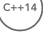

```cpp
template<typename Type1, typename Type2>
auto myFunc(const Type1& t1, const Type2& t2)
{
    return t1 + t2;
}
```

# 函数模板

你也可以为独立函数编写模板。例如，你可以写一个通用函数在数组中查找一个值并返回其索引：

```cpp
static size_t NOT_FOUND = (size_t) (-1);

template <typename T>
size_t Find(T& value, T* arr, size_t size)
{
    for (size_t i = 0; i < size; i++) {
```


```cpp
if (arr[i] == value) {
    return i; // 找到了；返回索引
}
return NOT_FOUND; // 未找到；返回 NOT_FOUND
}
```

`Find()` 函数模板可以作用于任何类型的数组。例如，你可以用它在 `int` 数组中查找 `int` 的索引，或者在 `SpreadsheetCell` 数组中查找 `SpreadsheetCell` 的索引。

你可以通过两种方式调用该函数：使用方括号显式指定类型，或省略类型让编译器从参数中推导。以下是一些示例：

```cpp
int x = 3, intArr[] = {1, 2, 3, 4};
size_t sizeInt = sizeof(intArr) / sizeof(int);
size_t res;

res = Find(x, intArr, sizeInt); // 通过推导调用 Find<int>
res = Find<int>(x, intArr, sizeInt); // 显式调用 Find<int>

if (res != NOT_FOUND)
    cout << res << endl;
else
    cout << "Not found" << endl;

double d1 = 5.6, dArr[] = {1.2, 3.4, 5.7, 7.5};
size_t sizeDouble = sizeof(dArr) / sizeof(double);
res = Find(d1, dArr, sizeDouble); // 通过推导调用 Find<double>
```

因此，如果你希望函数在显式指定 `const char*` 时工作，而在未指定时通过推导工作，你应该编写一个特化模板版本，而不是一个非模板重载版本。

# 函数模板重载与特化

你可以为 `const char*` 编写一个特化的 `Find()` 模板，并为 `const char*` 编写一个独立的 `Find()` 函数。编译器更倾向于使用非模板函数。然而，如果你明确指定了模板实例化，编译器将强制使用模板版本：

```cpp
const char* word = "two";
const char* arr[] = {"one", "two", "three", "four"};
size_t arrSize = sizeof(arr) / sizeof(arr[0]);
size_t res;

res = Find<const char*>(word, arr, arrSize); // 调用模板的 const char* 特化版本
res = Find(word, arr, arrSize); // 调用 Find 非模板函数
```

# 模板类的友模板

当你想要在类模板中重载运算符时，函数模板非常有用。例如，你可能想为 `Grid` 类添加加法运算符（`operator+`），以便将两个网格相加。结果将是一个与两个操作数中较小者相同的 `Grid`。假设你想让 `operator+` 成为一个独立的函数模板。其定义（可以直接放在 `Grid.h` 中）如下：

```cpp
template <typename T>
Grid<T> operator+(const Grid<T>& lhs, const Grid<T>& rhs)
{
    size_t minWidth = std::min(lhs.getWidth(), rhs.getWidth());
    size_t minHeight = std::min(lhs.getHeight(), rhs.getHeight());
    Grid<T> result(minWidth, minHeight);
    for (size_t y = 0; y < minHeight; ++y) {
        for (size_t x = 0; x < minWidth; ++x) {
            result.elementAt(x, y, lhs.mCells[x][y] + rhs.mCells[x][y]);
        }
    }
    return result;
}
```

只要网格元素有加法运算符，该函数就可以作用于任何 `Grid`。这种实现方式唯一的问题是它访问了 `Grid` 类的私有成员。显而易见的解决方案是使用公有的 `getElementAt()` 方法，但让我们看看如何让模板函数成为类模板的友元。例如，你可以让 `operator+` 成为 `Grid` 类的友元。然而，`Grid` 和 `operator+` 都是模板。你真正想要的是，对于特定类型 `T` 的每个 `operator+` 实例化都是该类型的 `Grid` 模板实例化的友元。语法如下：

```cpp
// 前向声明 Grid 模板。
template <typename T> class Grid;
```

```cpp
// 模板化 operator+ 的原型。
template<typename T>
Grid<T> operator+(const Grid<T>& lhs, const Grid<T>& rhs);
```

```cpp
template <typename T>
class Grid
{
public:
    // 为了简洁起见省略
    friend Grid<T> operator+<>(const Grid<T>& lhs, const Grid<T>& rhs);
    // 为了简洁起见省略
};
```

这个声明非常棘手：你表示对于类型为 `T` 的模板实例，`operator+` 的实例化是一个友元。换句话说，类实例化友元与函数实例化友元之间存在一一对应的映射。注意 `operator+` 上的显式模板指定 `<>`（为了可读性，`operator+` 后面的空格总是存在的）。这种语法告诉编译器 `operator+` 本身是一个模板。

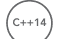

# 变量模板

除了类模板、类方法模板和函数模板外，C++14 增加了编写变量模板的能力。语法如下：

```cpp
template <typename T>
constexpr T pi = T(3.1415926535897932385);
```

这是一个用于 PI 值的变量模板。要获取特定类型的 PI，可以使用以下语法：

```cpp
float piInt = pi<float>;
long double piDouble = pi<long double>;
```

你将始终获得请求类型中可表示的最接近的 PI 值。与其他类型的模板一样，变量模板也可以被特化。

## 总结

本章开始了关于使用模板进行泛型编程的讨论。你看到了编写模板的语法，以及模板非常有用的示例。它解释了如何编写类模板、如何在不同的文件中组织代码、如何使用模板参数以及如何对类的方法进行模板化。它进一步讨论了如何使用模板特化来为模板编写特殊实现，其中模板参数被替换为特定的参数。本章以对函数模板和变量模板的解释结束。

第 21 章将继续讨论模板，并介绍一些更高级的特性，如变长参数模板和元编程。

# 第 12 章 揭秘 C++ I/O

本章内容包括：

- 什么是流
- 如何使用流进行数据的输入输出
- 标准库中有哪些可用的标准流

C++ 通过一种被称为“流”（streams）的机制提供了更精细的输入输出方法。在本章中，你将学习如何使用流进行数据的输入输出。流是一种灵活且面向对象的 I/O 方法。

## 使用流

流的隐喻需要一点适应。起初，流看起来比传统的 C 风格 I/O（如 `printf()`）复杂。实际上，它们之所以复杂是因为背后有一个深层的隐喻。别担心，看了几个例子后，你就不会回头了。

## 到底什么是流？

本章将 `cout` 流比作数据的滑槽。你将一些变量丢入流中，它们会被写入用户的屏幕，或*控制台*。更广义地说，所有流都可以被视为数据通道。流根据方向及其关联源或目的而异。例如，你已经熟悉的 `cout` 流是一个输出流，因此它的方向是“输出”。它将数据写入控制台，所以关联目的地是控制台。另一个名为 `cin` 的流接受用户输入。它的方向是“输入”，关联源是“控制台”。`cout` 和 `cin` 都是定义在 `std` 命名空间内的预定义流实例。下表提供了预定义流的简要描述。缓冲区和无缓冲区流的区别将在后面的章节解释：

| 流 | 描述 |
|---|---|
| cin | 输入流，从“输入控制台”读取数据。 |
| cout | 缓冲区输出流，向“输出控制台”写入数据。 |
| cerr | 无缓冲区输出流，向“错误控制台”写入数据，后者通常与“输出控制台”相同。 |
| clog | cerr 的缓冲区版本。 |

注意，图形用户界面应用程序通常没有控制台；也就是说，如果你向 `cout` 写入内容，`cout` 将无法显示。如果你正在编写库，你不应该假设 `cout`、`cin`、`cerr` 或 `clog` 的存在，因为你永远不知道你的库会被用于控制台还是 GUI 应用程序。

> 注意：每个输入流都有一个关联的源。每个输出流都有关联的目的。

流的另一个重要方面是它们不仅包含数据，还有一个所谓的“当前位置”。当前位置是下一次读取或写入操作发生的位置。

### 流的源和目的地

从概念上来说，流可以被视为接受数据或发射数据的任何对象。你可以编写一个基于流的网络类，或者对 MIDI 乐器的流访问。在 C++ 中，流有三种常见的源和目的地。

你已经读过许多关于用户、控制台流的示例。控制台输入流通过允许运行时从用户输入，使程序具有交互性。控制台输出流向用户提供反馈并输出结果。

文件流顾名思义，从文件系统读取数据并将数据写入文件系统。文件输入流用于读取配置和保存的文件，以及用于批量处理基于文件的数据。文件输出流用于保存状态和提供输出。文件流包含了 C 语言 `printf()`、`fwrite()` 和 `fprintf()` 的输出功能，以及 `fscanf()`、`fread()` 和 `fgets()` 的输入功能。

字符串流是将流的比喻应用于字符串类型。对于字符串，你可以像处理任何其他字符串一样处理字符数据。在大多数情况下，这仅仅是对于可以使用字符串类方法处理的功能的一种方便语法。然而，使用字符串语法提供了优化的机会，并且比直接使用字符串类更方便。字符串流包含了 `sprintf()`、`sscanf()` 以及其他 C 字符串格式化函数的功能。

本节的其余部分处理控制台流（`cin` 和 `cout`）。文件流和字符串流的示例将在本章后面的部分提供。其他类型的流（如打印机输出或网络 I/O）通常取决于平台，因此本书中未涵盖它们。

### 使用流进行输出

输出流在第 1 章中介绍，并几乎用于书中的每一个章节。本节简要地回顾了基础知识，并引入了更高级的内容。

#### 输出基础

输出流定义在 `<iostream>` 头文件中。大多数程序员在程序中包含 `<iostream>`，这反过来又包含了输入流和输出流的头文件。`<iostream>` 头文件还声明了标准控制台输出流 `cout`。

`<<` 运算符是使用输出流最简单的方法。C++ 基本类型（如 `int`、指针、double 和字符）可以使用 `<<` 输出。此外，C++ 字符串类与 `<<` 兼容，C 风格字符串也可以被正确输出。以下是使用 `<<` 的一些示例：

```cpp
int i = 7;
cout << i << endl;

char ch = 'a';
cout << ch << endl;

string myString = "Hello World.";
cout << myString << endl;
```

输出如下：

```
7
Hello World.
```

`cout` 流是用于写入控制台（或标准输出）的内置流。你可以“链式”使用 `<<` 来输出多个数据。这是因为 `<<` 运算符返回流的引用作为结果，因此你可以立即在同一条流上再次使用 `<<`。例如：

```cpp
int j = 11;
cout << "The value of j is " << j << "!" << endl;
```

输出如下：

```
The value of j is 11.
```

C++ 流可以正确解析 C 风格的转义码，例如包含 `\n` 的字符串。你也可以使用 `std::endl` 开启新行。使用 `\n` 和 `endl` 的区别在于 `\n` 只是开启新行，而 `endl` 还会刷新缓冲区。注意 `endl`，因为许多流可能会损害性能。下面的示例使用 `endl` 只需一行代码输出并刷新几行文本。

```cpp
cout << "Line 1" << endl << "Line 2" << endl << "Line 3" << endl;
```

输出如下：

```
Line 1
Line 2
Line 3
```

#### 输出流的方法

`<<` 运算符无疑是输出流中最常用的部分。然而，还有额外的待探索的功能。如果你查看一眼 `<iostream>` 头文件，你会看到许多行 `<<` 运算符的重载定义。你还会发现有用的公共方法。

##### put() 和 write()

`put()` 和 `write()` 是原始输出方法。`put()` 接收单个字符，而不是接收一个具有某些定义输出行为的对象或变量，而 `write()` 接收一个字符数组。传递给这些方法的数据将按原样输出，不经过任何特殊格式化或处理。例如，以下函数接收一个 C 风格字符串并使用 `<<` 运算符将其输出到控制台：

```cpp
void rawWrite(const char* data, int dataSize)
{
    cout.write(data, dataSize);
}
```

接下来的函数通过 `put()` 方法将 C 风格字符串的指定索引写入控制台：

```cpp
void rawPutChar(const char* data, int charIndex)
{
    cout.put(data[charIndex]);
}
```

##### flush()

当你向流输出数据时，流并不一定立即将其写入其目的地。大多数输出流会缓存或累积数据，而不是随着数据的产生而写入。当满足以下条件之一时，流将刷新或写出累积的数据：

- 达到了哨兵标志，例如 `endl` 标记。
- 流超出作用范围并被销毁。
- 从相应的输入流请求输入。

> 注意：并不是所有输出流都经过缓冲。`cerr` 流例如就不缓冲输出。

显式告诉流刷新缓冲区的方法是调用 `flush()` 方法，在文件流部分，这种类型是调用 `flush()`，如下代码所示：

```cpp
cout << "abc";
cout.flush(); // `abc` 写入控制台。
cout << "def";
cout << endl;   // `def` 写入控制台。
```

#### 处理输出错误

输出错误出现在各种情况下。也许你正在尝试打开一个不存在的文件。可能是磁盘错误阻止了写入操作，例如磁盘已满。到目前为止你读取的流都没有考虑这些可能性，为了简洁。然而，处理发生的错误情况至关重要。

当流处于正常状态时，被称为“良好的”（good）。可以直接在流上调用 `good()` 方法来判断流是否正常。

```cpp
if (cout.good()) {
    cout << "All good" << endl;
}
```

`good()` 方法提供了获取流有效性的简单方法，但它没有告诉你流是否可用。有一个 `bad()` 方法提供更多信息。如果 `bad()` 返回 `true`，则发生了致命错误（与任何非文件结束相反）。另一个方法 `fail()` 在最近的操作失败时返回 `true`；然而，它没有关于可能成功也可能失败的操作任何说明。例如，在输出流上调用 `flush()` 后，你可以调用 `fail()` 来确保刷新成功。

```cpp
cout.flush();
if (cout.fail()) {
    cerr << "Unable to flush to standard out" << endl;
}
```

你可以允许流在发生故障时抛出异常。然后你编写一个处理器来捕获 `ios_base::failure` 异常，在该异常可以使用 `what()` 方法获取错误描述并使用 `code()` 方法获取错误代码。你是否能获得有用信息取决于你使用的 STL 实现。

```cpp
cout.exceptions(ios::failbit | ios::badbit | ios::eofbit);
try {
    cout << "Hello World." << endl;
} catch (const ios_base::failure& ex) {
    cerr << "Caught exception: " << ex.what();
    cerr << ", error code = " << ex.code() << endl;
}
```

要重置流的错误状态，使用 `clear()` 方法：

```cpp
cout.clear();
```


对于控制台输出流，错误检查频率比输入流低。这里讨论的其他类型流的方法将在稍后对每个类型进行讨论。

## 输出操纵符

操纵符的一个特殊特性是，你可以向通道传递不仅仅是数据。C++ 流也识别操纵符，这些对象会改变流的行为，而不是（或额外）为流提供工作的数据。

你已经见过其中一个：`endl`。该操纵符封装了数据和行为。它告诉流输出行结束序列并刷新其缓冲区。以下是其他一些常用的操纵符，其中许多定义在 `<ios>` 和 `<iomanip>` 标准头文件中。列表后的示例显示了如何使用它们：

- `boolalpha` 和 `noboolalpha`。流会让你将布尔值输出为 `true` 和 `false` (`boolalpha`) 或 `1` 和 `0` (`noboolalpha`)。默认是 `noboolalpha`。
- `hex`、`oct` 和 `dec`。分别以十六进制、八进制和 10 进制输出数字。
- `precision`。设置输出分数时保留的小数位数。这是一个参数化操纵符（意味着它接受一个参数）。
- `setw`。设置输出数值数据的字段宽度。这是一个参数化操纵符。
- `setfill`。指定用于填充小于指定宽度的数字的字符。这是一个参数化操纵符。
- `showpoint` 和 `noshowpoint`。强制流始终显示或从不显示没有小数部分的浮点数的小数。
- `put_money`。向流写入格式化的货币金额。
- `put_time`。向流写入格式化后的时间。
- `quoted`。一个参数化操纵符，用引号括起字符串并转义嵌入的引号。

上述所有操纵符在它们被重置之前，对流的后续输出都一直有效，但 `setw` 除外，它只对下一次单次输出有效。下面的示例使用了其中几个操纵符来定制你的输出。

```cpp
// 布尔值
bool myBool = true;

cout << "This is the: " << myBool << endl;

cout << "This should be: " << boolalpha << myBool << endl;

cout << "This is i: " << noboolalpha << myBool << endl;

// 使用流模拟 "%6d"
int i = 123;

printf("This should be 123:%6d\n", i);

cout << "This should be 123:" << setw(6) << i << endl;

// 使用流模拟 "%6d"
printf("000123:%6d\n", i);

cout << "This should be 000123:" << setfill('0') << setw(6) << i << endl;

// 用 * 填充
cout << "This should be ***123:" << setfill('*') << setw(6) << i << endl;

// 重置填充字符
cout << setfill(' ');

// 浮点值
double dbl = 1.452;
double dbl2 = 5;

cout << "This should be '5':" << setw(2) << noshowpoint << dbl2 << endl;

cout << "* should be @1.452:" << setw(7) << setfill('@') << dbl << endl;

// 重置填充字符
cout << setfill(' ');

// 指示 cout 根据你的区域设置格式化数字。
// 第 18 章解释了 imbue 调用和本地对象的细节。
cout.imbue(locale(""));

// 按照你的区域设置格式化数字
cout << "This is 1234567 formatted according to your location: " << 1234567 << endl;

// 货币金额
cout << "This should be a money amount of 120000,\n" << "formatted money according to your location:\n" << put_money("120000") << endl;

// 日期和时间
time_t t = time(nullptr); // 获取当前系统时间
struct tm * t = localtime(&t);   // 转换为本地时间

cout << "This should be the current date and time\n" << "formatted according to your location:\n" << put_time(t, "%c") << endl;

// C++14: 引号字符串
cout << "This should be: \"Quoted string with \\embedded quotes\\\\.*\"\n" << "Quoted string with \\embedded quotes\\.*" << endl;
```

> 注意：此示例在调用 `localtime()` 时可能会产生安全相关的错误或警告。在 Visual Studio 中，你可以使用安全版本 `localtime_s()`。在 Linux 上，你可以使用 `localtime_r()`。

如果你不了解操纵符的概念，可以通过等效的方法（如 `precision()`）使用大部分的功能。例如，考虑以下行：

```cpp
cout << "This should be '1.2345':" << setprecision(5) << 1.23456789 << endl;
```

这可以转换为如下使用方法调用。方法调用的优势在于它们会返回上一个值，允许你恢复它。

```cpp
cout.precision(5);

cout << "This should be '1.2346':" << 1.23456789 << endl;
```

对于操纵符的详细描述，请参阅标准库。

## 流输入

输入流提供了一种读取数据的方法。有两种简单的输入方式：

### 输入基础

记住 `>>` 运算符根据空白进行分词。例如，下面的程序读取一个名称：

```cpp
string userInput;

cin >> userInput;

cout << "User input was " << userInput << endl;
```

`>>` 运算符可以处理不同的类型。例如，下面的函数获取人数：

```cpp
void getData() {
    string guestName;
    int partySize;

    cout << "Name and number of guests: ";
    cin >> guestName >> partySize;

    cout << "Thank you, " << guestName << endl;

    if (partySize > 10) {
        cout << "An extra gratuity will apply." << endl;
    }
}
```

### 输入方法

就像输出流一样，输入流也有比常用的 `>>` 运算符更底层的访问方法。

#### get()

`get()` 方法允许从流读取原始数据。`get()` 最简单的版本返回流中的下一个字符，尽管存在一次读取多个字符的版本。`get()` 通常用于避免 `>>` 运算符发生的自动分词。例如，下面的函数从输入流读取一个由多个单词组成的名称，直到到达流结束：

```cpp
string readName(istream& inStream)
{
    string name;
    while (!inStream.fail())
    {
        int next = inStream.get();
        if (next == std::char_traits<char>::eof())
            break;
        name += static_cast<char>(next); // 追加字符。
    }
    return name;
}
```

关于这个 `readName()` 函数有几个有趣的观察：

- 它的参数是 `istream` 的非常量引用，而不是常量引用。读取流的方法会改变实际的流（最明显的是位置），它们不是 `const` 方法。因此你不能在 `const` 引用上调用它们。
- `get()` 的返回值是 `int` 不是 `char`。`get()` 可以返回特殊的字符值，如 `std::char_traits<char>::eof()`（文件结束），使用了 `int`。

`readName()` 有点奇怪，因为有两种退出循环的方法。流可以进入失败状态，或者到达流结束。一种更常见的读取模式使用了流的一个不同版本的 `get()`，该版本接收一个字符的引用并返回流的引用。这种模式利用了这样一个事实：在条件中评估输入流时，只有当流仍可用于额外读取时，结果才为真。遇到错误或到达文件尾可能会导致流评估结果为假。实现此功能所需的转换操作的底层细节将在第 14 章中解释。以下版本的函数稍微简洁：

```cpp
string readName(istream& inStream)
{
    string name;
    char next;
    while (inStream.get(next)) {
        name += next;
    }
    return name;
}
```

#### unget()

对于大多数人来说，向输入流推送数据的正确模型是一个单向滑道。数据顺着滑道掉入变量中。`unget()` 方法打破了这种模型，允许你将数据推回滑道上方。

```cpp
void getReservationData()
{
    string guestName;
    int partySize = 0;

    // 读取字符直到找到一个数字
    char ch;
    while (cin >> ch) {
        if (isdigit(ch)) {
            cin.unget();
            if (cin.fail()) {
                cout << "unget failed!" << endl;
                break;
            }
        }
        guestName += ch;
    }

    // 读取 partySize
    cin >> partySize;
    cout << "Thank You " << guestName << ", party of " << partySize << endl;
    if (partySize > 10) {
        cout << "An extra gratuity will apply." << endl;
    }
}
```

#### putback()

`putback()` 与 `unget()` 类似，让你在输入流中向后移动一个字符。区别在于 `putback()` 方法将放回流的字符作为参数传递：

```cpp
char chl;
cin >> chl;
cin.putback(chl);
// chl 将是从流中读取的下一个字符。
```

#### peek()

`peek()` 允许你预览如果调用 `get()` 将返回的下一个值。如果把这个比喻推得稍微远一点，你可以把它看作是在向下看滑道而实际上并没有掉下去。

`peek()` 适用于任何你在读取值之前需要预检的情况。例如，以下代码实现了 `getReservationData()` 函数，它允许名称中包含空格，但使用了 `peek()` 而不是 `get()`。

```cpp
void getReservationData() {
    string guestName;
    int partySize = 0;
    char ch;

    // 读取字符直到找到一个数字
    cin >> noskipws;
    while (true) {
        // “查看”下一个字符
        ch = static_cast<char>(cin.peek());
        if (!cin.good()) {
            break;
        }
        if (isdigit(ch)) {
            // 下一个字符是数字，停止循环
            break;
        }
        // 下一个字符是非数字，所以读取它
        cin >> ch;
        guestName += ch;
    }

    // 读取 partysize
    cin >> partySize;
    cout << "Thank you " << guestName << ", party of " << partySize << endl;
    if (partySize > 10) {
        cout << "An extra gratuity will apply." << endl;
    }
}
```

#### getline()

从输入流获取单行数据是非常常见的操作，以至于有一个方法可以为你完成它。`getline()` 方法用一行数据填充字符缓冲区，直到达到指定的大小。指定的大小不包括 `\0` 字符；因此，以下代码将从 `cin` 读取最多 `kBufferSize-1` 个字符，或者读取到行尾序列：

```cpp
char buffer[kBufferSize];
cin.getline(buffer, kBufferSize);
```

当调用 `getline()` 时，它从输入流中读取一行，直到并包含行尾序列。然而，行尾字符或字符不会出现在字符串中。请注意，行尾序列取决于平台。例如，它可以是 `\n`，也可以是 `\r\n`。

存在一种形式的 `getline()` 执行的操作与 `getline()` 相同，区别在于它会将换行序列留在输入流中。

还有一个可以与 C++ 字符串一起使用的 `getline()` 函数。它定义在 `<string>` 头文件中，并以字符串引用、另一个字符串引用和一个可选的分隔符作为参数。使用此版本 `getline()` 的优点是它不需要你指定缓冲区的大小。

```cpp
string myString;
std::getline(cin, myString);
```

### 处理输入错误

输入流有许多方法来检测异常情况。大多数与输入流相关的错误发生在没有可用数据可读时。例如，可能已经到达了流尾（即使对于非文件流也称为文件尾 end-of-file）。查询输入流状态的最常用方法是在条件中检查。例如，下面的循环只要 `cin` 保持良好状态，就会继续循环：

```cpp
while (cin) { ... }
```

你可以同时输入数据：

```cpp
while (cin >> ch) { ... }
```

你也可以像处理输出流一样调用 `good()`、`bad()` 和 `fail()` 方法。还有一个 `eof()` 方法，当流到达末尾时它会返回真。

你应该养成在读取数据后检查流状态的习惯，以便从错误中恢复。

以下程序展示了从流读取数据并处理错误的常见模式。程序从标准输入读取数字，并在到达文件尾后显示它们的和。注意，在命令行环境中，文件尾是由用户输入特定的字符来指示的。在 Unix 和 Linux 中是 `Ctrl+D`，在 Windows 中是 `Ctrl+Z`。具体的字符取决于操作系统，因此你需要知道你的操作系统要求。

## 第 12 章：揭秘 C++ I/O

使用 `printf()` 能做的最好的做法是为 `Muffin` 类添加一个新的 `output()` 输出方法：

```cpp
class Muffin {
public:
    const string& getDescription() const;
    void setDescription(const string& inDesc);
    int getSize() const;
    void setSize(int inSize);
    bool getHasChocolateChips() const;
    void setHasChocolateChips(bool inChips);
    void output();
private:
    string mDesc;
    int mSize;
    bool mHasChocolateChips;
};

// 为了省略省略其他方法
void Muffin::output() {
    printf("%*s, Size is %d, %s\n", getDescription().c_str(), getSize(),
           getHasChocolateChips() ? "has chips" : "no chips");
}
```

然而，如果要使用校验和在另一行文本中间输出一个 `Muffin`，你需要将该行分成两次调用，并在中间插入一次 `Muffin::output()` 调用，如下所示：

```cpp
printf("The muffin %*");
myMuffin.output();
printf(" -- yummy:\n");
```


重载 `<<` 运算符允许你像输出字符串一样输出 Muffin —— 只需作为参数传递即可。第 14 章将介绍重载 `<<` 和 `>>` 运算符的细节。

## 字符串流

字符串流提供了一种对字符串使用流语义的方法。通过这种，你可以拥有一个表示文本数据的内存流。例如，在 GUI 应用程序中，你可能想使用流来构建文本数据，但不是将文本输出到控制台或文件，而是将结果显示在消息框或编辑框等 GUI 元素中。另一个例子可能是你想将字符串流传递给不同的函数，同时保留当前的读取位置，以便每个函数都能处理流的下一个部分。字符串流对于解析文本也有用，因为流具有内置的标记化功能。

`ostream` 类用于向字符串写入数据，而 `istream` 类用于从字符串中读取数据。它们都定义在 `<sstream>` 头文件中。由于 `ostream` 和 `istream` 继承了相同的行为，因此操作它们起来非常相似。

以下程序向用户请求单词并将它们输出到单个 `ostream` 中，用制表符分隔。在程序结束时，整个字符串使用 `str()` 方法转换为字符串并写入控制台。通过输入标记 `Control+D` (Unix) 或通过关闭输入 `Control+Z` (Windows) 输入要获取的标记：

从字符串流读取也具有类似的特性。以下函数从字符串输入填充 `Muffin` 对象（见此前的示例）。流数据采用固定格式，因此该函数可以轻松地将其值转换为对 `Muffin` setter 的调用：

```cpp
Muffin createMuffin(istream& inStream)
{
    Muffin muffin;

    // 假设数据格式正确；
    // 描述 尺寸 巧克力颗粒
    string description;
    int size;
    bool hasChips;

    // 读取所有三个值。注意 chips 由
    // 字符串 "true" 和 "false" 表示
    inStream >> description >> size >> boolalpha >> hasChips;

    muffin.setSize(size);
    muffin.setDescription(description);
    muffin.setHasChocolateChips(hasChips);

    return muffin;
}
```

> 注意：将对象转换为“扁平化”类型（如字符串）通常被称为序列化。序列化对于将对象保存到磁盘或跨网络发送它们非常有用。

字符串相比标准 C++ 字符串的主要优势在于，除了数据外，对象还知道下一次读取或写入操作将发生的位置（也称为位置）。取决于字符串流的具体实现，可能还有性能优势。例如，如果你需要将许多字符串相加，使用字符串流可能比反复调用字符串对象的 `++` 运算符更有效。

## 文件流

文件本身非常适合流抽象代码，读取和写入文件总是涉及除数据之外的位置。在 C++ 中，`ofstream` 和 `ifstream` 类为文件提供了输出和输入功能。它们定义在 `<fstream>` 头文件中。

在处理文件系统时，检测和处理错误尤为重要。你正在处理的文件可能是一个刚刚离线的网络文件，或者你可能正尝试向位于已满磁盘上的文件写入。也许你正在尝试打开一个当前用户没有权限访问的文件。可以使用上述的标准错误处理机制来检测错误。

输出文件流与其他输出流之间的主要区别在于，文件构造函数可以接受文件名和你想打开它的模式。默认模式是写入 `ios_base::out`，它从文件开头开始写入，覆盖任何现有数据。你还可以通过指定文件流构造函数的第二个参数为 `ios_base::app` 以追加模式打开输出文件流。下表列出了可用的不同常量：

| 常量 | 描述 |
|---|---|
| `ios_base::app` | 每次写入操作前都打开并跳转到末尾。 |
| `ios_base::ate` | 打开后立即跳转到末尾。 |
| `ios_base::binary` | 以二进制模式执行输入和输出（相对于文本模式）。 |
| `ios_base::in` | 用于输入打开。 |
| `ios_base::out` | 用于输出，从开头开始写入，覆盖任何现有数据。 |
| `ios_base::trunc` | 用于输出，删除现有数据（截断）。 |

以下程序打开 `test.txt` 并输出。`ofstream` 析构函数会自动关闭文件，因此不需要显式调用：

```cpp
int main(int argc, char* argv[])
{
    ofstream outFile("test.txt", ios_base::out);

    if (!outFile.good()) {
        cerr << "*打开文件时出错*" << endl;
        return -1;
    }

    outFile << "有 " << argc << " 个参数。" << endl;
    outFile << "它们是：" << endl;
    // ... (其余代码)

    return 0;
}
```

## 跳转 `seek()` 和 `tell()`

`seek()` 和 `tell()` 方法存在于所有的输入和输出流中，但在文件流语境之外它们很少意义。

`seek()` 方法允许你在输入或输出流中移动到任意位置。有几种形式 `seekg()`（g 代表 get），而输出流中的 `seek()` 版本被称为 `seekp()`（p 代表 put）。你可能会奇怪为什么会有 `seek()` 和 `seekp()` 方法，而不是一个 `seek()` 方法。原因是你可以拥有既是输入又是输出的流，即文件流。在这种情况下，流必须记住读取位置和写入位置。这被称为双向 I/O，将在本章后续介绍。

`seek()` 和 `seekp()` 有两个重载。一个重载接受单个绝对位置，并跳转到该绝对位置。另一个重载接受一个偏移和一个位置，相对于给定位置进行偏移。类型为 `ios_base::streamoff` 的偏移量都以字节为单位。有三个预定义位置：

| 位置 | 描述 |
|---|---|
| `ios_base::beg` | 流的开头 |
| `ios_base::end` | 流的末尾 |
| `ios_base::cur` | 流中的当前位置 |

例如，要在输出流中跳转到绝对位置，可以使用单参数版本的 `seekp()`，如下所示，该用例常量 `ios_base::beg` 移动到开头：

```cpp
outStream.seekp(ios_base::beg);
```

在输入流中的跳转完全相同，只是使用了 `seekg()` 方法：

```cpp
inStream.seekg(ios_base::beg);
```

双参数版本到流中的相对位置。第一个参数规定移动多少个位置，第二个参数提供起点。要相对于文件开头移动，使用常量 `ios_base::beg`。相对于文件末尾移动的

对于文件操作，使用了 `ios_base::end`。要移动到当前位置，使用了 `ios_base::cur`。在示例中，接下来的行将位置移动到流开始的第二个字节。注意，整数会被隐式转换为 `ios_base::streampos` 和 `ios_base::streamoff` 类型：

```cpp
outStream.seekp(2, ios_base::beg);
```

下一个示例将位置移动到输入流的倒数第三个字节。

```cpp
inStream.seekg(-3, ios_base::end);
```

你还可以使用 `tell()` 方法查询流的位置，该方法返回一个指明当前位置的 `ios_base::streampos`。你可以使用此结果在执行 `seek(i)` 之前记住当前的标记位置，或者查询你是否处于某个特定位置。对于 `seek(i)`，输入流和输出流有单独的 `tell()` 版本。输入流使用 `tellg()`，而输出流使用 `tellp`。

以下代码检查输入流的位置，以确定它是否在开头。

```cpp
ios_base::streampos curPos = inStream.tellg();

if (ios_base::beg == curPos) {
    cout << "We're at the beginning." << endl;
}
```

下面是一个整合所有内容的示例程序。该程序向一个名为 `test.out` 的文件写入内容并执行以下测试：

1. 向文件输出字符串 `12345`。
2. 验证标记位于流中的位置 5。
3. 移动到输出流中的位置 2。
4. 在位置 2 输出 `0` 并关闭输出流。
5. 在 `test.out` 文件上打开一个输入流。
6. 将第一个标记读取为整数。
7. 确认标记为 `12345`。

```cpp
ofstream fout("test.out");

if (!fout) {
    cerr << "Error opening test.out for writing" << endl;
    return 1;
}

// 1. 输出字符串 "12345"。
fout << "12345";

// 2. 验证标记位于位置 5。
ios_base::streampos curPos = fout.tellp();

if (5 == curPos) {
    cout << "Test passed: Currently at position 5" << endl;
} else {
    cout << "Test failed: Not at position 5" << endl;
}
```

```cpp
// 3. 移动到流中的位置 2。
fout.seekp(2, ios_base::beg);

// 4. 在位置 2 输出 0 并关闭流。
fout << 0;
fout.close();

// 5. 在 test.out 上打开输入流。
ifstream fin("test.out");

if (!fin) {
    cerr << "Error opening test.out for reading" << endl;
    return 1;
}

// 6. 将第一个标记读取为整数。
int testVal;
fin >> testVal;

// 7. 确认值为 12045。
const int expected = 12045;

if (testVal == expected) {
    cout << "Test passed: Value is " << expected << endl;
} else {
    cout << "Test failed: Value is not " << expected
    cout << " (it was " << testVal << ")" << endl;
}
```

## 流的绑定

可以在任何输入流和输出流之间建立链接，以赋予它们访问即刷新（flush-on-access）的行为。换句话说，当从输入流请求数据时，其关联的输出流将自动刷新。此功能适用于所有流，对于可能相互依赖的流特别有用。

流的绑定通过 `tie()` 方法实现。若要将一个流输出到输入流，请在输入流上调用 `tie()` 并传递输出流的地址。要断开链接，请使用 `nullptr`。

以下程序将一个文件的输入与另一个完全不同的文件的输出绑定。你也可以将其绑定到同一个文件的输出流上，但双向 I/O（下文将介绍）可能是同时读写同一个文件的一种优雅方式。

```cpp
ifstream inputFile("input.txt"); // 注意：input.txt 必须存在。
ofstream outFile("output.txt");

// 在 inputFile 和 outFile 之间建立链接。
inputFile.tie(outFile);

// 向 outFile 输出一些文本。通常情况下，这
// 不刷新，因为没有发送 std::endl。
outFile << "Hello there!";

// outFile 尚未刷新。
// 从 inputFile 读取一些文本。这将触发 flush()
string nextToken;
inFile >> nextToken;

// outFile 已经刷新。
```

`flush()` 方法定义在 `ostream` 基类上，因此你也可以将一个输出流绑定到另一个输出流：

```cpp
outFile.tie(&anotherOutputFile);
```


这种关系意味着每当你向一个文件写入内容时，发送到流的缓冲区数据就会被写入。你可以使用这种机制来保持两个相关文件的同步。

流绑定的一个例子是 `cout` 和 `cin` 之间的链接。每当你尝试从 `cin` 输入数据时，`cout` 都会自动刷新。

## 双向 I/O

到此为止，本章讨论了输入流和输出流作为独立但相关的类。事实上，存在一种同时执行输入和输出的流。双向流是一种同时执行输入和输出的流。

# 错误与异常

没有任何程序是孤立存在的；它们依赖于外部设施，例如操作系统的接口、网络和文件系统、外部代码（如第三方库）以及用户输入。这些领域中的每一个都可能引入需要对遇到的问题进行响应的情况。这些潜在问题可以用“异常情况”（exceptional situations）这一通用术语。即使是良好的程序也会遇到错误和异常情况。因此，与 C 一样，并没有包含许多特定的错误处理语言特性。使用这些语言的程序员通常依赖于函数的返回值和临时应急方法。其他语言（如 Java）强制使用一种名为“异常”（exceptions）的特性作为错误处理机制。C++ 介于这些错误之间：它为异常提供了语言支持，但并不要求使用它们。然而，在 C++ 中，你无法由于一些基本设施（如内存分配例程）就完全忽略异常的。

# 到底什么是异常？

异常是一种机制，允许一段代码向另一段代码通知在正常代码执行过程中遇到的“异常”情况或条件（错误）。遇到错误的代码负责“抛出”（throw）异常，而处理异常的代码负责“捕获”（catch）异常。它并不遵循我们所习惯的逐步执行的正式规则。当一段代码抛出异常时，程序控制会立即停止逐步执行代码，并跳转到异常处理器，该处理器可能位于任何地方，从同一个函数的下一行到调用栈上方的好几个函数不等。如果你喜欢体育分析，可以将抛出异常的代码想象成外野手将棒球抛回内野，由最近的内野手（最近的异常处理器）接住它。图 13-1 显示了一个包含三个函数调用的假设性堆栈。函数 `A()` 拥有异常处理器。它调用 `B()`，`B()` 调用 `C()`，`C()` 抛出了异常。

图 13-2 显示了处理器捕获了异常。`C()` 和 `B()` 的栈帧已被移除，只剩下 `A()`。

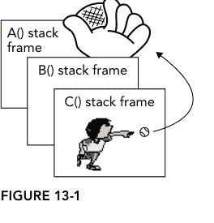

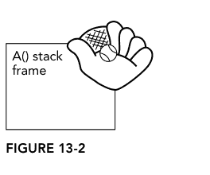

大多数现代编程语言（如 C# 和 Java）都支持异常，因此 C++ 同样拥有完善的支持也并不令人意外。然而，如果你是从 C 转过来的，那么异常对你来说是很新鲜，但一旦你学会了使用它们，可能就不想回去了。

# C++ 中的异常是件好事

如前所述，程序中的运行时错误是不可避免的。尽管如此，大多数 C 和 C++ 程序的错误处理仍然是混乱且临时的。事实上的 C 错误处理标准（被带到许多 C 程序中）使用整数返回代码和 `errno` 宏来表示错误。每个线程都有自己的 `errno` 值，充当一个线程局部变量，函数可以使用它将错误传回给调用函数。

不幸的是，整数返回值和 `errno` 的使用并不一致。某些函数可能选择返回 0 表示成功，返回 -1 表示错误。如果它们返回 -1，还会将 `errno` 设置为错误代码。其他函数返回非 0 表示成功，返回 0 表示错误，并用实际返回值指定错误代码。这些函数不使用 `errno`。还有一些函数在失败时返回 0 而不是成功，因为在 C 和 C++ 中，0 的求值为假。

这些不一致性会导致问题，因为程序员在遇到新函数时，会假设其返回代码与其他函数相同。事实并不总是如此的。在 Solaris 9 上，有两个不同的同步库：POSIX 版本和 Solaris 版本。POSIX 版本中初始化信号量的函数名为 `sem_init()`。如果这还不够，这两个函数处理错误代码的方式也不同！`sem_init()` 在出错时返回 -1 并设置 `errno`，而 `sem_init()`（此处原文如此）直接将代码作为正整数返回，且不设置 `errno`。

另一个问题是 C++ 中函数的返回类型只能有一种类型，因此如果你需要同时返回错误和值，必须找到一种替代机制。一种解决方案是返回 `std::pair` 或 `std::tuple`，这是一种你用于存储两个或更多类型的对象。另一个选择是定义自己的包含多个值的结构体（struct）或类，并从函数返回该结构体或类的实例。另一种选择是通过引用参数返回值或错误，或者让错误代码作为返回类型（例如 `nullptr` 指针）。在所有这些解决方案中，调用者都负责显式检查函数返回的任何错误，如果它没有处理错误，则应该将错误传播给调用者。不幸的是，这往往会导致关于错误的关键细节的丢失。

C 程序员可能熟悉名为 `setjmp()/longjmp()` 的机制。这种机制在 C++ 中无法正确使用，因为它跳过了栈上的析构函数。即使在 C 程序中，你也应该避免它；本书将不会解释如何使用它的细节。

异常为错误处理提供了一种更简单、更一致且更安全的机制。与 C 和 C++ 中的临时应急方法相比，异常有几个特定优势：

- 当使用返回代码时，要在本地妥善处理它们或通过传播处理它们。异常可能会被忘记或忽略：如果你的程序未能捕获异常，它将终止。
- 当使用整数返回代码时，它们通常不包含足够的信息。你可以使用异常从发现错误的代码向处理错误的代码传递任何你想要的信息。异常也可以用于通信错误以外的信息，尽管许多程序员认为那是对异常机制的滥用。
- 异常处理可以跳过多层栈调用。也就是说，一个函数可以处理发生在栈几层之外的错误，而返回代码需要每一层调用都显式地清理。

在某些编译器中（现在较少），异常处理会给任何带有处理器的函数增加微小的开销。对于现代编译器，存在一种权衡：在非抛出情况下几乎没有开销，只有当你实际抛出异常时才有开销。这种权衡并不是坏事，因为抛出异常应该是异常的。

异常处理在 C++ 中并不被强制执行。例如，在 Java 中，没有指定可能抛出异常列表的函数是不允许抛出任何异常的。在 C++ 中相反：函数可以抛出它想要的任何异常！此外，异常列表在编译时并不强制执行，这意味着函数的异常列表可以在运行时被违反。某些工具（例如使用 Microsoft VC++ 的 `/Analyze`）会检查潜在问题。注意自 C++11 起，列表已弃用。

# 建议

我建议异常作为一种有效的错误处理机制。我认为异常提供的结构和错误处理形式化超过了其不理想的。因此，本章的剩余部分将关注异常。此外，许多流行的库（如 STL 和 Boost）使用异常，因此你必须准备好处理它们。

# 异常机制

异常情况经常出现在文件输入输出中。以下是一个打开文件、从文件中读取一系列整数并将整数存储在 `std::vector` 数据结构中的函数。缺乏错误处理这一点应该让你一眼看出。

```cpp
void readIntegerFile(const string& fileName, vector<int>& dest)
{
    istream istr;
    int temp;
    istr.open(fileName.c_str());
    // 逐个读取整数并添加到 vector。
    while (isr >> temp) {
        dest.push_back(temp);
    }
}
```

以下行将从 `ifstream` 继续读取值，直到到达文件末尾或发生错误。

```cpp
while (istr >> temp) {
```

这之所以有效，是因为 `>>` 运算符返回了 `ifstream` 对象本身的引用。此外，`ifstream` 提供了一个 `bool()` 转换运算符，其实现如下：

```cpp
return fail();
```

如果 `>>` 运算符遇到错误，它将设置 `ifstream` 对象的 `fail` 位。在这种情况下，`bool()` 转换运算符将返回 `false`，`while` 循环将终止。在第 12 节中将详细讨论流。

你可以这样使用 `readIntegerFile()`：

```cpp
vector<int> myInts;
const string fileName = "IntegerFile.txt";
readIntegerFile(fileName, myInts);
for (const auto element : myInts) {
    cout << element << " ";
}
cout << endl;
```

本节的其余部分将向你展示如何添加异常错误处理。

## 抛出和捕获异常

在程序中使用异常由两部分组成：用于处理异常的 `try/catch` 结构，以及抛出异常的 `throw` 语句。两者必须以某种形式存在才能使异常生效。然而，在许多情况下，`throw` 发生在某些库的深层（包括 C++ 运行时），程序员永远不会看到它，但仍必须使用 `try/catch` 结构对其做出反应。

`try/catch` 结构如下：

```cpp
try {
    // 可能导致抛出异常的代码
} catch (/* exception-type1 exception-name */) {
    // 响应类型 1 异常的代码
} catch (/* exception-type2 exception-name */) {
    // 响应类型 2 异常的代码
}
// ... 剩余代码
```

可能导致异常产生的代码可能直接包含一个 `throw`，也可能调用了某个函数，该函数要么自己抛出异常，要么通过未知的层级调用了另一个抛出异常的函数。

如果没有抛出异常，则 `catch` 块中的代码将不会执行，随后的“剩余代码”将接在 `try` 块中执行的最后一个语句之后。

## 第 13 节处理错误

如果抛出了异常，则 `throw` 之后或导致抛出的调用之后的任何代码都将**不**执行，而是立即根据抛出的异常类型跳转到右侧的 `catch` 块。

如果 `catch` 块没有控制控制流（例如返回值、抛出新异常或重新抛出异常），则在执行该 `catch` 块的最后一个语句后将执行“剩余代码”。

演示异常处理的最简单示例是避免除以零。这会抛出一个类型为 `std::invalid_argument` 的异常，它需要 `<stdexcept>` 头文件。

```cpp
int SafeDivide(int num, int den)
{
    if (den == 0)
        throw invalid_argument("Divide by zero");
    return num / den;
}

int main()
{
    try {
        cout << SafeDivide(5, 2) << endl;
        cout << SafeDivide(10, 0) << endl;
        cout << SafeDivide(3, 3) << endl;
    } catch (const invalid_argument& e) {
        cout << "Caught exception: " << e.what() << endl;
    }
    return 0;
}
```

输出如下：

```
Caught exception: Divide by zero
```

`throw` 是 C++ 中的一个关键字，它是抛出异常的唯一方式。`throw` 行中的 `invalid_argument()` 部分意味着你正在构造一个类型为 `invalid_argument` 的新对象并抛出它。它是 C++ 标准库提供的标准异常之一。库形成了一个层次结构，将在本节稍后进行讨论。层次结构中的每个类都支持一个 `what()` 方法，该方法返回一个描述异常的 `const char*` 字符串。这就是你在异常构造函数中提供的字符串。

`throw` 关键字也可以用于重新抛出当前异常。例如：

```cpp
void g() { throw invalid_argument("Some exception"); }

void f()
{
    try {
        g();
    } catch (const invalid_argument& e) {
        cout << "caught in f: " << e.what() << endl;
        throw; // 重新抛出
    }
}

int main() {
    try {
        f();
    } catch (const invalid_argument& e) {
        cout << "caught in main: " << e.what() << endl;
    }
    return 0;
}
```

此示例产生以下输出：

```
caught in f: Some exception
caught in main: Some exception
```

让我们回到 `readIntegerFile()` 函数。最可能发生的问题是文件打开失败。这是一个抛出异常的完美情况。这段代码抛出一个类型为 `std::exception` 的异常，它需要 `<exception>` 头文件。语法如下：

```cpp
#include <exception>

void readFile(const string& fileName, vector<int>& dest) {
    ifstream isr;
    int temp;
    isr.open(fileName.c_str());
    if (isr.fail()) {
        // 我们未能打开文件：抛出一个异常。
        throw exception();
    }
    // 逐个读取整数并添加到 vector。
    while (isr >> temp) {
        dest.push_back(temp);
    }
}
```

如果函数未能打开文件并执行了 `throw exception()` 语句，函数的其余部分将被跳过，控制权将转移到异常处理程序。

### 异常类型

你可以抛出任何类型的异常。之前的示例抛出的是对象，但你可以抛出一个简单的 `int` 例如：

```cpp
void readIntegerField(const string& fileName, vector<int>& dest) {
    ifstream isr;
    int temp;
    isr.open(fileName.c_str());
    if (isr.fail()) {
        // 我们未能打开文件：抛出一个异常。
        throw 5;
    }
    // 逐个读取整数并添加到 vector。
    while (isr >> temp) {
        dest.push_back(temp);
    }
}
```

你将需要修改 `catch` 语句：

```cpp
try {
    readIntegerField(fileName, myInts);
} catch (int e) {
    cerr << "Unable to open file " << fileName << " " << e << endl;
    return 1;
}
```

或者，你可以抛出 `const char*` C风格字符串。这种技术有时是有用的，因为字符串可以包含异常的信息。

```cpp
void readIntegerFile(const string& fileName, vector<int>& dest) {
    ifstream isr;
    int temp;
    isr.open(fileName.c_str());
    if (isr.fail()) {
        // 我们未能打开文件：抛出一个异常。
        throw "Unable to open file";
    }
    // 逐个读取整数并添加到 vector。
    while (isr >> temp) {
        dest.push_back(temp);
    }
}
```

当你捕获 `const char*` 异常时，你可以打印结果：

```cpp
try {
    readIntegerFile(fileName, myInts);
} catch (const char* e) {
    cerr << e << endl;
    return 1;
}
```

尽管有前面的示例，你通常应该抛出对象作为异常，原因有两个：

- 对象通过其类名传递信息。
- 对象可以存储信息，包括描述异常的字符串。

C++ 标准库定义了许多定义的异常类，你也可以编写自己的异常类。细节将在本节稍后描述。

### 通过 const 引用捕获异常对象

在之前的 `readIntegerFile()` 抛出 `exception` 类型对象的示例中，`catch` 如下：

```cpp
catch (const exception& e) {
```

然而，并没有要求通过 const 引用捕获对象。你可以通过值捕获对象：

```cpp
catch (exception e)
```

或者，你可以通过引用（不带 const）捕获对象：

```cpp
catch (exception& e)
```

此外，正如你在 `const char*` 示例所示，只要抛出的是异常指针，你就可以捕获这些异常指针。

> 注意：建议通过 `const` 引用来捕获异常。这可以避免在按值捕获异常时可能发生的对象切割（object slicing）。

### 抛出和捕获多个异常

打开文件失败并不是 `readIntegerFile()` 可能遇到的唯一问题。如果文件格式不正确，从文件中读取数据也会导致错误。以下是 `readIntegerFile()` 的实现，当它无法打开文件或无法正确读取数据时会抛出异常：

```cpp


# C++ 异常处理详解

## 基础异常处理示例

```cpp
void readIntegerFile(const string& fileName, vector<int>& dest) {
    ifstream instr;
    int temp;
    instr.open(fileName.c_str());
    if (instr.fail()) {
        // 打开文件失败：抛出异常。
        throw runtime_error("Unable to open the file.");
    }
    // 逐个读取整数并将其添加到 vector。
    while (instr >> temp) {
        dest.push_back(temp);
    }
    if (instr.eof()) {
        // 我们没有到达文件末尾。
        // 这意味着读取文件时发生了某些错误。
        // 抛出异常。
        throw runtime_error("Error reading the file.");
    }
}
```

你在 `main()` 中的代码不需要更改，因为它已经捕获了 `exception` 类型的异常，而 `runtime_error` 正派自该类型。然而，该异常可能在两种不同的情况下抛出。

```cpp
try {
    readIntegerFile(fileName, myInts);
} catch (const exception& e) {
    cerr << e.what() << endl;
    return 1;
}
```

或者，你可以让 `readIntegerFile()` 抛出两种类型的异常。以下是 `readIntegerFile` 的实现，如果文件无法打开，则抛出 `invalid_argument` 类对象；如果无法读取整数，则抛出 `runtime_error` 类对象。`invalid_argument` 和 `runtime_error` 都是 C++ 标准库中 `<stdexcept>` 头文件中定义的类。

## 异常机制 | 379

```cpp
#include <stdexcept>

void readIntegerFile(const string& fileName, vector<int>& dest) {
    ifstream isr;
    int temp;
    isr.open(fileName.c_str());
    if (isr.fail()) {
        // 打开文件失败：抛出异常。
        throw invalid_argument("Unable to open the file.");
    }
    // 逐个读取整数并将其添加到 vector。
    while (isr >> temp) {
        dest.push_back(temp);
    }
    if (!isr.eof()) {
        // 我们没有到达文件末尾。
        // 这意味着读取文件时发生了某些错误。
        // 抛出异常。
        throw runtime_error("Error reading the file.");
    }
}
```

`invalid_argument` 和 `runtime_error` 没有公共的默认构造函数，只有字符串构造函数。

现在 `main()` 可以通过两个 `catch` 语句捕获 `invalid_argument` 和 `runtime_error`：

```cpp
try {
    readIntegerFile(fileName, myInts);
} catch (const invalid_argument& e) {
    cerr << e.what() << endl;
    return 1;
} catch (const runtime_error& e) {
    cerr << e.what() << endl;
    return 1;
}
```

如果在 `try` 块内部抛出异常，编译器会将异常类型匹配到适当的 `catch` 句程序。因此，如果 `readIntegerFile()` 无法打开文件并抛出 `invalid_argument` 对象，它将被第一个 `catch` 语句捕获。如果 `readIntegerFile()` 无法正确读取文件并抛出 `runtime_error`，第二个 `catch` 语句将捕获该异常。

## 匹配与 const

在你想要捕获的异常类型中指定的 `const` 属性对于匹配目的没有区别。这意味着，这一行匹配任何类型为 `runtime_error` 的异常。

```cpp
} catch (const runtime_error& e) {
```

下一行也匹配任何类型为 `runtime_error` 的异常：

```cpp
catch (runtime_error& e) {
```

## 匹配任何异常

你可以使用后续示例所示的特殊语法编写一个匹配任何可能异常的 `catch` 语句：

```cpp
try {
    readIntegerFile(fileName, myInts);
} catch (...) {
    cerr << "Error reading or opening file " << fileName << endl;
    return 1;
}
```

三个点并不是一个类型。它们是一个通配符，可以匹配任何异常类型。当你调用文档不全的代码时，这种技术可以确保你捕获了可能的异常。然而，在你对抛出的异常集有完全信息的情况下，不建议使用这种技术，因为它以相同的方式处理每个异常。最好显式捕获异常类型并采取适当行动。

匹配任何异常的 `catch` 块的一个可能用途是默认 `catch` 处理器。当抛出异常时，将按照它们在代码中出现的顺序来查找 `catch` 处理器。下面的示例显示了如何编写显式处理 `invalid_argument` 和 `runtime_error` 的 `catch` 处理器，并包含对所有其他异常的默认捕获：

```cpp
try {
    // 抛出异常的代码
} catch (const invalid_argument& e) {
    // 处理 invalid_argument
} catch (const runtime_error& e) {
    // 处理 runtime_error
} catch (...) {
    // 处理其他异常
}
```

## 未捕获的异常

如果你的程序抛出一个在任何地方都没有捕获的异常，程序将终止。基本上，在调用你的 `main()` 函数周围有一个 `try/catch` 结构，它如下所示捕获未处理的异常：

```cpp
try {
    main(argc, argv);
} catch (...) {
    // 发布消息并终止程序
}
```

然而，这种行为并不是你想要的。异常的意义在于给你的程序一个机会来处理不理想或意外的情况。

> **警告**：捕获并处理程序中抛出的所有可能的异常。即使你无法处理特定的异常，你也应该编写代码来捕获它并打印适当的错误信息。如果存在未捕获的异常，还可以更改程序的行为。当程序遇到未捕获的异常时，它会调用内置的 `terminate()` 函数，该函数调用 `<cstdlib>` 中的 `abort()` 来杀死程序。你可以通过调用 `set_terminate()` 并传递一个不接受参数且不返回值的回调函数指针来设置自己的 `terminate_handler`。`terminate()`、`set_terminate()` 和 `terminate_handler` 都声明在 `<exception>` 头文件中。这里是它们的用法：

```cpp
void myTerminate() {
    cout << "Uncaught exception!" << endl;
    exit(1);
}

int main(int argc, char* argv[]) {
    set_terminate(myTerminate);
    vector<int> myInts;
    string fileName = "IntegerField.txt";
    try {
        readIntegerFile(fileName, myInts);
    } catch (const exception& e) {
        cerr << e.what() << endl;
    }
    for (const auto element : myInts) {
        cout << element << " ";
    }
    cout << endl;
    return 0;
}
```

# 意外异常

遗憾的是，C++ 中的抛出列表在编译时并不强制。调用 `readIntegerFile()` 的代码不需要捕获抛出列表中列出的异常。这种行为与其他语言（如 Java）不同，Java 要求函数或方法捕获异常，或者在自己的函数或方法抛出列表中声明它们。

此外，你可以这样实现 `readIntegerFile()`：

```cpp
void readIntegerFile(const string& fileName, vector<int>& dest)
    throw(invalid_argument, runtime_error) {
    throw 5;
}
```

尽管抛出列表声明 `readIntegerFile()` 不抛出 `int`，但这段显然抛出了 `int` 的代码仍然编译并运行。然而，它并没有按照你的预期工作。假设你写了下面这个带有 `int` 捕获块的 `main` 函数：

```cpp
int main() {
    vector<int> myInts;
    const string fileName = "IntegerFile.txt";
    try {
        readIntegerFile(fileName, myInts);
    } catch (int x) {
        cerr << "Caught int " << x << endl;
    }
    return 0;
}
```

当此程序运行且 `readIntegerFile()` 抛出 `int` 异常时，程序将会终止。它不允许 `main()` 捕获该 `int`。

> **警告** 抛出列表不会阻止函数抛出未列出的异常类型，但它们会阻止异常离开函数，导致运行时错误。

> **注意**：编写本文时，所有版本的 Microsoft Visual C++（截至 2013 版本）都不支持前面解释的函数抛出列表。因此，`main()` 函数将捕获该异常，因为 Visual C++ 忽略了 `throw(invalid_argument)` 指定，并发出类似“C4290: C++ exception specification ignored to indicate that a function is not declspec(nothrow)”的警告。这没关系，因为 C++11 已经弃用了抛出列表。

当标记为 `noexcept` 的函数抛出异常时，C++ 会调用 `terminate()` 来终止应用程序。当函数抛出了一个未在其抛出列表中列出的异常时，C++ 会调用特殊函数 `unexpected()`。`unexpected()` 的内置实现会调用 `terminate()`。然而，就像你可以设置自己的 `terminate_handler` 一样，你也可以设置自己的 `unexpected_handler`。与 `terminate_handler` 不同，在 `unexpected_handler` 中你可以执行终止程序以外的任何操作。你的 `unexpected_handler` 版本必须要么抛出一个新异常，要么终止程序。如果它抛出一个新异常，该新异常将作为原始抛出的意外异常的替代品。如果这个替换的异常未列在抛出列表中，则会抛出 `bad_exception`。程序将终止。`unexpected()` 的自定义实现通常用于将意外异常转换为预期异常。例如，你可以这样写一个 `unexpected()` 版本：

```cpp
void myUnexpected() {
    cerr << "Unexpected exception!" << endl;
    throw runtime_error("");
}
```

这段代码将意外异常转换为 `runtime_error` 异常，而该异常在 `readIntegerFile()` 函数的抛出列表中。
你可以通过 `set_unexpected()` 函数在 `main()` 中设置此意外异常处理器。像 `terminate()` 一样，`set_unexpected()` 返回当前的处理器。`unexpected()` 函数是全局生效的，而不仅仅适用于此函数，因此当你完成需要特殊处理器的代码执行后，应该重置处理器：

```cpp
int main() {
    vector<int> myInts;
    const string fileName = "IntegerFile.txt";
    unexpected_handler old_handler = set_unexpected(myUnexpected);
    try {
        readIntegerFile(fileName, myInts);
    } catch (const invalid_argument& e) {
        cerr << e.what() << endl;
        return 1;
    } catch (const runtime_error& e) {
        cerr << e.what() << endl;
    } catch (int x) {
        cerr << "Caught " << x << endl;
    }
    set_unexpected(old_handler);
    // 函数剩余部分省略
    return 0;
}
```

现在 `main()` 通过将从 `readIntegerFile()` 抛出的任何异常转换为 `runtime_error` 来处理了该异常。然而，在使用 `set_unexpected()` 时，建议谨慎地使用此功能。
`unexpected()`、`set_unexpected()` 和 `bad_exception` 均定义在 `<exception>` 头文件中。

# 在重写方法中更改抛出列表

当你在派生类中重写虚方法时，只要该抛出列表比基类中的抛出列表更严格，你就可以更改它。以下更改符合更严格的标准：

- 从列表中移除异常
- 添加基类抛出列表中出现的异常类
- 将其设为 `noexcept` 方法

以下更改不符合更严格的标准：

- 向列表中添加并非基类抛出列表中派生异常的异常
- 完全移除抛出列表

> **警告** 如果你在重写方法时更改抛出列表，请记住，任何调用基类方法版本的代码都能够调用派生类版本。因此，你不能添加异常。

例如，假设你有如下的基类：

```cpp
class Base {
public:
    virtual ~Base() {}
    virtual void func() throw(exception) { cout << "Base!\n"; }
};
```

你可以写一个派生类来重写 `func()` 并指定它不抛出任何异常：

```cpp
class Derived : public Base {
public:
    virtual void func() noexcept { cout << "Derived\n"; }
};
```

你也可以重写 `func()` 使其也抛出 `runtime_error`，因为 `runtime_error` 是 `exception` 的派生类。

```cpp
class Derived : public Base {
public:
    virtual void func() throw(runtime_error) { cout << "Derived\n"; }
};
```

然而，你不能完全移除抛出列表，因为这意味着 `func()` 可能会抛出异常。作为第二个例子，假设 `Base` 如下：

```cpp
class Base {
public:
    virtual ~Base() {}
    virtual void func() throw(runtime_error) { cout << "Base!\n"; }
};
```

那么你不能在 `Derived` 中以此抛出列表重写 `func()`：

```cpp
class Derived : public Base {
public:
    virtual void func() throw() // 错误！
    { cout << "Derived\n"; }
};
```


# 抛出列表有用吗？

特定函数的异常是接口的重要部分，应该尽可能地记录。在过去，你可能考虑通过抛出列表来记录它们。然而，大多数现有的 C++ 代码（包括标准库）都没有使用抛出列表。这使得你在使用这些代码时很难确定会抛出哪些异常。此外，无法指定模板化函数和方法的异常特性。当你甚至不知道将使用哪些类型来实例化模板时，你无法确定这些类型可能抛出的异常。

从 C++11 开始，决策变得简单了：永远不要使用抛出列表，因为它们现在已经被弃用了（`noexcept` 除外）。相反，请在代码中记录函数可能抛出的异常。

# 异常与多态

如前所述，你实际上可以抛出任何类型的异常。然而，类是最好的异常类型。事实上，异常类通常以层次结构编写，以便在捕获异常时可以使用多态性。

# 标准异常层次结构

你已经看到了 C++ 标准异常层次结构中的几个异常：`runtime_error` 和 `invalid_argument`。图 13-3 显示了完整的层次结构：

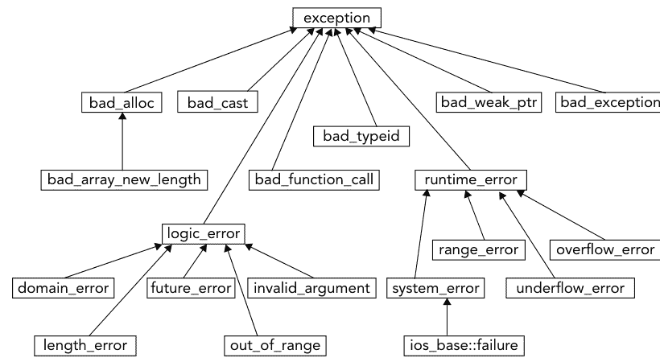

图 13-3

所有由 C++ 标准库抛出的异常都是该层次结构中类的对象。层次结构中的每个类都支持 `what()` 方法，该方法返回描述异常的 `const char*`。你可以将此字符串用于错误信息。

除了基类异常外，所有异常都要求你在构造函数中设置由 `what()` 返回的字符串。这就是为什么在 `runtime_error` 和 `invalid_argument` 的构造函数中必须指定字符串。这已经在各个示例中完成。

# 在类层次结构中捕获异常

异常层次结构的一个特点是你可以以多态的方式捕获异常。例如，如果你查看 `main()` 中调用 `readIntegerFile()` 之后的 catch 语句，你会发现它们除了处理的异常类型外是完全相同的。方便的是，`invalid_argument` 和 `runtime_error` 是 `exception` 的派生类，因此你可以将两个 catch 语句替换为针对 `exception` 的单个 catch 语句：

```cpp
try {
    readIntegerFile(fileName, myInts);
} catch (const exception& e) {
    cerr << e.what() << endl;
    return 1;
}
```

针对 `exception` 引用的 catch 语句会匹配 `exception` 的任何派生类，包括 `invalid_argument` 和 `runtime_error`。请注意，在异常层次结构中捕获异常的位置越高，你的错误处理就越不具体。通常，你应该在尽可能具体的级别捕获异常。

> 当你以多态方式捕获异常时，请确保通过引用捕获它们。如果你按值捕获异常，可能会遇到切片（slicing），在这种情况下你会丢失对象的信息。有关切片的细节请参见第9章。

当使用多个 catch 子句时，catch 子句将按照它们在代码中出现的语法顺序进行匹配；匹配的项胜出。如果一个 catch 比后一个 catch 包含更广，它将被匹配，而限制更严格的那个将完全不会被执行。因此，你应该从最严格到最宽松的顺序放置 catch 子句。例如，如果你想显式地捕获来自 `readIntegerFile()` 的 `invalid_argument`，但为所有其他异常留出通用 `exception` 匹配。正确的方法如下：

```cpp
try {
    readIntegerFile(fileName, myInt);
} catch (const invalid_argument& e) { // 先列出派生类。
    // 对无效文件名执行某些特殊操作。
} catch (const exception& e) { // 现在列出 exception
    cerr << e.what() << endl;
    return 1;
}
```

第一个 catch 语句捕获 `invalid_argument`，第二个捕获任何其他 `exception` 类型的异常。然而，如果你反转 catch 语句的顺序，将无法得到预期的结果：

```cpp
try {
    readIntegerFile(fileName, myInt);
} catch (const exception& e) { // Bug：捕获了基类！
    cerr << e.what() << endl;
    return 1;
} catch (const invalid_argument& e) {
    // 对无效文件名执行某些特殊操作。
}
```

按照这种顺序，任何派生自 `exception` 的类的异常都会被第一个 catch 语句捕获，第二个语句永远无法到达。某些编译器在这种情况下会发出警告，但你不应该依赖这一点。

# 编写你自己的异常类

编写你自己的异常类有两个优点。

1. C++ 标准库中的异常是有限的。与其使用具有通用名称（如 `runtime_error`）的异常类，不如为程序中的特定错误创建名称更有意义的类。
2. 你可以向这些异常添加自己的信息。标准层次结构中的异常允许你只设置错误字符串。你可能希望在异常中传递不同的信息。

建议所有异常类都直接或间接继承自标准的 `exception` 类。如果项目中的每个人都遵循这条规则，你就知道项目中的每个异常都派生自 `exception`（假设没有使用破坏此规则的第三方库）。这一准则使得通过多态进行异常处理变得异常简单得多。

例如，`invalid_argument` 和 `runtime_error` 无法很好地捕获 `readFile()` 中的文件打开和读取错误。你可以为文件错误定义自己的错误层次结构，从通用的 `FileError` 类开始：

作为一名优秀的程序员，你应该让 `FileError` 成为标准异常层次结构的一部分。当你派生自 `exception` 时，你可以重写 `what()` 方法，该方法具有原型字符串并返回一个 `const char* string`，该字符串在对象销毁为止有效。

```cpp
class FileError : public exception {
public:
    FileError(const string& fileName) : msg(fileName) {}
    virtual const char* what() const throw() {
        return msg.c_str();
    }
private:
    string msg;
};
```

`readFile()` 中的第一个异常情况发生在文件无法打开时。然后是派生自 `FileError` 的 `FileOpenError`：

```cpp
class FileOpenError : public FileError {
public:
    FileOpenError(const string& fileName) : FileError(fileName) {}
};
```

`readFile()` 中的第二个异常情况发生在文件无法读取时。此异常可能包含错误的行号。这里是派生自 `FileError` 的 `FileReaderError`：

```cpp
class FileReaderError : public FileError {
public:
    FileReaderError(const string& fileName, int lineNum) : FileError(fileName), lineNum(lineNum) {}
    int getNum() { return lineNum; }
private:
    int lineNum;
};
```

为了设置行号，你需要修改 `readIntegerFile()` 以跟踪行数而不是直接读取整数。这里是使用异常的 `readIntegerFile()` 函数：

```cpp
void readIntegerFile(const string& fileName, vector<int>& dest) {
    istream isr;
    int temp;
    string line;
    int lineNumber = 0;
    isr.open(fileName.c_str());
    if (isr.fail()) {
        // 我们无法打开文件：抛出异常。
        throw FileOpenError(fileName);
    }
    while (!isr.eof()) {
        // 从文件中读取一行。
        getline(isr, line);
        lineNumber++;
        // 使用行创建一个 stringstream。
        stringstream lineStream(line);
        // 逐个读取整数并将它们添加到 vector 中。
        while (lineStream >> temp) {
            dest.push_back(temp);
        }
    }
    if (lineStream.eof()) {
        // 没有到达字符串流的末尾。
        // 这意味着读取此行时发生了错误。
        // 抛出异常。
        throw FileReaderError(fileName, lineNumber);
    }
}
```

现在，调用 `readIntegerFile()` 的代码可以使用多态来捕获 `FileError` 异常：

编写将作为异常使用的类有一个技巧。当代码段抛出异常时，对象或值会被复制。也就是说，会通过拷贝构造函数从旧对象构造一个新对象。必须复制是因为原始对象在异常被栈高处捕获之前可能会超出作用域（从而被销毁并回收内存）……你必须使这些对象是可拷贝的。这意味着如果你动态分配了内存，就必须编写析构函数、拷贝构造函数和赋值运算符，如第 8 章所述的那样。

# 嵌套异常

在处理第一个异常的过程中，可能会触发第二个异常情况，从而需要抛出第二个异常。不幸的是，当你抛出第二个异常时，你当前尝试处理的第一个异常的所有信息都会丢失。C++ 为此问题提供的解决方案是嵌套异常，它允许你在一个新异常的上下文中嵌套一个异常。你使用 `std::throw_with_nested` 来抛出一个内部嵌套另一个异常的异常。第二个异常的 catch 处理器可以使用 `dynamic_cast` 来访问表示第一个异常的 `nested_exception`。下面的示例演示了嵌套异常的使用。该示例定义了一个 `MyException` 类，它派生自 `exception` 并在构造函数中接受一个字符串。

```cpp
class MyException : public std::exception{
public:
    MyException(const char* msg) : mmsg(msg) {}
    virtual ~MyException() noexcept {}
    virtual const char* what() const noexcept override {
        return mmsg.c_str();
    }
private:
    std::string mmsg;
};
```

当你处理异常并需要抛出一个将第一个异常嵌套在内部第二个异常时，你需要使用 `std::throw_with_nested` 函数。下面的 `doSomething()` 函数抛出了一个 `runtime_error`，它立即在 catch 处理器中被捕获。catch 处理器写入一条消息，然后使用 `throw_with_nested()` 函数抛出一个将第一个异常嵌套在内部的第二个异常。注意，嵌套是自动发生的。

```cpp
void doSomething() {
    try {
        throw std::runtime_error("Throwing a runtime exception");
    } catch (const std::runtime_error& e) {
        std::cout << "func" << " caught a runtime error" << std::endl;
        std::cout << "func" << " throwing MyException" << std::endl;
        std::throw_with_nested(MyException("MyException with nested runtime error"));
    }
}
```

下面的 `main()` 函数演示了如何处理带有嵌套异常的异常。代码调用了 `doSomething()` 函数，并对 `MyException` 类型的异常有一个 catch 处理器。当它捕获到异常时，它写入一条消息并使用 `dynamic_cast` 来访问嵌套异常。如果内部没有嵌套异常，结果将为空指针。如果内部有嵌套异常，则调用 `nested_exception` 上的 `rethrow_nested()` 方法。这将导致嵌套异常重新抛出，你可以在 try/catch 块中捕获它。

```cpp
int main() {
    try {
        doSomething();
    } catch (const MyException& e) {
        std::cout << "func" << " caught MyException: " << e.what() 
        << std::endl;
    }
}

const std::nested_exception* pNested =
dynamic_cast<const std::nested_exception*>(&e);
if (pNested) {
    try {
        pNested->rethrow_nested();
    } catch (const std::runtime_error& e) {
        // Handle nested exception
        std::cout << " Nested exception: " << e.what() << std::endl;
    }
}
return 0;
```

输出应该如下：

```
doSomething caught a runtime error
doSomething caught throwing MyException
main caught MyException: Exception with nested runtime_error
Nested exception: Throwing a runtime exception
```

前面的 `main()` 函数使用 `dynamic_cast` 来检查嵌套异常。由于如果你想检查嵌套异常，通常需要执行此 `dynamic_cast`，因此标准提供了一个名为 `std::rethrow_if_nested()` 的小包装器来替你完成工作。该包装器可以如下所示使用：

```cpp
int main() {
    try {
        doSomething();
    } catch (const MyException& e) {
```


```cpp
std::cout << " func_" << caught MyException: " << e.what() << std::endl;

try {

    std::rethrow_if_nested(e);

} catch (const std::runtime_error& e) {

    // Handle nested exception

    std::cout << " Nested exception: " << e.what() << std::endl;

}

return 0;

}
```

# 栈回溯与清理

当一段代码抛出异常时，它会在栈上寻找 `catch` 处理器。该 `catch` 处理器可能位于执行栈上的零个或多个函数调用之下。当找到它时，栈将通过回溯所有中间栈帧，回溯到定义 `catch` 处理器的栈级别。栈回溯意味着所有局部作用域名称的析构函数会被调用，并且跳过每个函数中从当前执行点之后的所有代码。

然而，在栈回溯过程中，指针变量不会被释放，也不会执行其他清理。这种行为可能会产生问题，如下面的代码所示：

```cpp
void funcOne();

void funcTwo();

int main()
{
    try {
        funcOne();
    } catch (const exception& e) {
        cerr << "Exception caught!" << endl;
        return 1;
    }
    return 0;
}

void funcOne()
{
    string str1;
    string* str2 = new string();
    funcTwo();
    delete str2;
}

void funcTwo()
{
    ifstream istr;
    ostr.open("filename");
    throw exception();
    ostr.close();
}
```

将所有对 `new` 和 `new[]` 的调用封装在 `try/catch` 中是不现实的，但至少在尝试分配大块内存时应该这样做。下面的示例演示了如何捕获内存分配异常。

```cpp
try {
    ptr = new int[numInts];
} catch (const bad_alloc& e) {
    cerr << __FILE__ << "*" << __LINE__
         << ": Unable to allocate memory: " << e.what() << endl;
    // 处理内存分配失败。
    return;
}

// 继续执行假设内存已分配的函数。
```

注意，这段代码使用了预定义的预处理器符号 `__FILE__` 和 `__LINE__`，它们会被替换为文件名和当前行号。这样调试会更容易一些。

> 注意：此示例向 `cerr` 打印错误信息。这假设你的程序是在控制台中运行的。在 GUI 应用程序中，你通常没有控制台，因此需要以特定的 GUI 方式向用户显示错误。

当然，如果对你的程序有效，你可以在程序的更高处使用单个 `try/catch` 块来处理许多可能的失败。

另一个考虑因素是记录错误可能会分配内存。如果 `new` 失败，可能没有足够的剩余内存来记录错误信息。

# 非抛出异常

如果你不喜欢异常，可以回到旧的 C 模型，让内存分配例程在无法分配内存时返回 `nullptr`。C++ 提供了 `new` 和 `new[]` 的 `nothrow` 版本，它们在分配内存失败时返回 `nullptr` 而不是抛出异常。这是通过使用语法 `new (nothrow)` 而不是 `new` 实现的，如下所示：

```cpp
ptr = new (nothrow) int [numInts];

if (ptr == nullptr) {
    cerr << __FILE__ << "*" << __LINE__
         << ": Unable to allocate memory!" << endl;
    // 处理内存分配失败。
    return;
}

// 继续执行...
```

这种语法有点奇怪；你实际上是将 `nothrow` 作为 `new` 的一个参数（它确实如此）。

# 自定义内存分配失败行为

C++ 允许你指定一个 `bad_handler` 回调函数。默认情况下，没有新处理程序，因此 `new` 和 `new[]` 只会抛出 `bad_alloc` 异常。然而，如果有新处理程序，内存分配会在失败时调用该处理程序而不是抛出异常。如果新处理程序返回，内存分配将再次尝试分配内存，如果失败则再次调用新处理程序。这种循环可能会变成无限循环，除非你的新处理程序通过四种替代方案之一改变现状。从务实上说，某些选项比其他选项更好。以下是带有注释的列表：

- **提供更多内存**。暴露空间的一种技巧是在启动时分配一大块内存，然后在新处理程序中释放它。例如，当你遇到分配错误并需要保存用户数据以防工作丢失时。关键是在启动时分配一个足够大的内存块以允许完成保存操作。当新处理程序被触发时，你释放这块内存，保存文档，重启应用程序并加载已保存的文档。
- **抛出异常**。C++ 标准规定，如果你抛出异常，它必须是 `bad_alloc` 或派生自 `bad_alloc` 的异常。例如，当你的新处理程序被触发时，你可以抛出一个继承自 `bad_alloc` 的 `document_recovery_alloc` 异常。你可以在程序的某处捕获此异常，触发文档保存操作并重启应用程序。
- **设置新处理程序**。理论上，你可以有一系列新处理程序，每个处理程序都尝试创建内存，并在失败时设置一个新的处理程序。然而，这种场景比通常情况复杂得多。
- **终止程序**。你的新处理程序可以记录错误信息并抛出一个约定的异常，例如派生自 `bad_alloc` 的 `PleaseTerminateMe`。在你的顶层函数（如 `main()`）中，你捕获此异常并通过**从顶层函数返回**来处理它。永远不要使用 `exit()` 或 `abort()` 显式终止程序，只通过从顶层函数返回。如果某些内存分配仍然可能失败，你可以在调用 `new` 之前临时将新处理程序设为默认的 `nullptr`。

如果你在新处理程序中没有执行这些操作之一，任何内存分配失败都会导致无限循环。

你通过调用 `set_new_handler()` 设置新处理程序，该函数声明在 `<new>` 头文件中。`set_new_handler()` 完成了 C++ 设置回调的三个函数中的一组。另外两个是 `set_terminate()` 和 `set_unexpected()`，它们在本章前面已经讨论过。这里是一个带有错误信息并抛出异常的新处理程序示例：

```cpp
class PleaseTerminateMe : public bad_alloc {
};

void myNewHandler() {
    cerr << "Unable to allocate memory." << endl;
    throw PleaseTerminateMe();
}
```

新处理程序必须不接受参数且没有返回值。这个新处理程序像前述列表第四点建议的那样抛出一个 `PleaseTerminateMe` 异常。

你可以这样设置新处理程序：

注意 `new_handler` 是 `set_new_handler()` 接收的函数指针类型的类型别名。

# 构造函数中的错误

在 C++ 程序员发现异常之前，他们往往会被错误处理和构造函数所困扰。构造函数没有返回值，因此标准的错误处理机制不起作用。如果没有异常，你所能最好的做法是在对象中设置一个标记。异常提供了一个更好的解决方案。你可以在程序的某处捕获此异常，触发文档保存操作并重启应用程序。

之前的类使用了 `Element` 类，该类在示例中保持最小：

```cpp
class Element
{
private:
    int mValue;
};
```

`Matrix` 类的实现如下。注意第一个 `new` 调用没有被 `try/catch` 块保护。如果第一个抛出异常没有关系，因为构造函数还没有分配任何需要释放的内存。如果后续任何 `new` 抛出异常，构造函数必须清理所有分配的内存。然而，它不知道 `Element` 构造函数可能会抛出什么异常，因此它通过 `...` 捕获并将它们转换为 `bad_alloc` 异常。将索引放在 `try` 块之外也是重要的，清理期间需要这个索引。

```cpp
Matrix::Matrix(size_t width, size_t height)
    : mWidth(width), mHeight(height), mMatrix(nullptr)
{
    mMatrix = new Element[width];

    size_t i = 0;
    try {
        for (i = 0; i < width; ++i)
            mMatrix[i] = new Element[height];
    } catch (...) {
        cout << "Exception caught in constructor, cleaning up..." << endl;
        // 清理已分配的内存，因为析构函数永远不会被调用。
        // 循环的边界是尝试分配的 mArray 中最后一个元素的索引（失败的那个）。
        // 该索引之前的所有索引都存储了必须释放的内存指针。
        for (size_t j = 0; j < i; j++)
            delete mMatrix[j];
    }

    delete mMatrix;
    mMatrix = nullptr;
    // 将任何异常转换为 bad_alloc。
    throw bad_alloc();
}

Matrix::~Matrix()
{
    for (size_t i = 0; i < mWidth; ++i)
        delete mMatrix[i];
}
```

```cpp
delete [] mMatrix[i];
delete [] mMatrix;
mMatrix = nullptr;
}
```

> 警告：请记住，如果异常导致构造函数退出，该对象的析构函数将永远不会被调用！

你可能在想，当引入继承时会发生什么。

> 注意：C++ 保证会为任何完全构造的“子对象”运行析构函数。因此，任何没有抛出异常的构造函数会导致相应的析构函数执行。

基类构造函数在派生类构造函数之前运行。如果派生类构造函数抛出异常，C++ 将执行已完全构造的基类的析构函数。

## 用于构造函数的 try 块

在本章讨论的异常机制非常适合处理函数内部的异常。然而，你应该如何处理构造函数初始化列表内部的异常呢？本节解释了一种名为“函数 try 块”的功能，它能够捕获这些异常。函数 try 块既适用于普通函数，也适用于构造函数。本节重点关注在构造函数中的用法。大多数 C++ 程序员，甚至是经验丰富的 C++ 程序员并不知道这一功能的存在，尽管它在十多年前就被引入了。

下面的伪代码展示了构造函数函数 try 块的基本语法：

```cpp
MyClass::MyClass()
try
    : <ctor-initializer>
{
    /* 构造函数体 ... */
}
catch (const exception& e)
{
    /* ... * */
}
```

如你所见，`try` 关键字应该紧挨初始化列表的开始之前。`catch` 语句应该放在构造函数结束的大括号之后，实际上是将它们放在构造函数体之外。在结合构造函数使用函数 try 块时，有一些限制和指南需要记在心里：

## 常见错误处理问题 | 403

- `catch` 语句将捕获由初始化列表或构造函数体直接或间接抛出的异常。
- `catch` 语句必须重新抛出当前异常或抛出一个新异常。如果 `catch` 语句没有这样做，运行时将自动重新抛出当前异常。
- `catch` 语句可以访问构造函数的参数。
- 当 `catch` 语句在函数块中捕获异常时，在执行 `catch` 语句之前，已完全构造的基类和对象的成员将被销毁。
- 在 `catch` 语句内部，你不应该访问作为对象的成员变量，因为它们在执行 `catch` 语句之前就会销毁（见上一点）。然而，如果你的对象包含数据成员，只要它们在抛出异常之前已经初始化，你就可以访问它们。如果你有此类资源，你必须在 `catch` 语句中释放它们。
- 函数块中的 `catch` 语句不能使用 `return` 关键字从其包含的函数返回值。这对于构造函数没有意义，因为它们不返回任何内容。

根据此限制列表，用于构造函数的函数块仅在有限的情况下才有用：

- 将初始化列表抛出的异常转换为另一种异常。
- 向日志文件记录消息。
- 释放在抛出异常之前在初始化列表中分配的资源。

让我们通过示例来看如何使用函数 try 块。以下代码定义了一个名为 `SubObject` 的类。它只有一个构造函数，该构造函数抛出一个 `runtime_error` 类型的异常。

```cpp
class SubObject
{
public:
    SubObject(int i);
};

SubObject::SubObject(int i)
{
    throw std::runtime_error("Exception by SubObject ctor*");
}
```

`MyClass` 有一个类型为 `SubObject` 的成员变量：

```cpp
class MyClass
{
public:
    MyClass();
private:
    SubObject mObject;
};
```

`SubObject` 类没有默认构造函数。这意味着你需要在 `MyClass` 的构造函数初始化列表中初始化 `mSubObject`。`MyClass` 的构造函数使用函数块来捕获初始化列表中的异常：

```cpp
MyClass::MyClass()
try
    : mSubObject(42)
{
    /* ... 构造函数体 ... */
}
catch (const std::exception& e) {
    cout << "function-try-block caught: " << e.what() << endl;
}
```

记住，构造函数的函数 try 块中的 `catch` 语句必须重新抛出当前异常或抛出一个新异常。上一个 `catch` 语句没有抛出任何内容，因此 C++ 运行时将自动重新抛出当前异常。以下是使用上述类的简单函数：

```cpp
int main() {
    try {
        MyClass m;
    } catch (const std::exception& e) {
        cout << "*main caught: " << e.what() << endl;
    }
    return 0;
}
```

上一个示例的输出如下：

```
function-try-block caught: 'Exception by SubObject ctor*'
main() caught: 'Exception by SubObject ctor*'
```

函数 try 块不仅限于构造函数。它们也可以用于普通函数。然而，对于普通函数，没有这里的理由使用函数 try 块，因为它们可以很容易地转换为函数体内部的简单 `try/catch` 块。与构造函数相比，在普通函数上使用函数 try 块的主要区别在于，在 `catch` 语句中不需要重新抛出当前异常或抛出新异常，且 C++ 运行时不会自动重新抛出异常。

## 析构函数中的错误

你应该处理在析构函数本身出现的所有错误情况。你不应该让任何异常从析构函数中抛出，原因有三：

1. 析构函数在栈回溯期间运行，如果你在析构函数中抛出异常，C++ 运行时将调用 `std::terminate()` 终止应用程序。对于勇敢且好奇的人，C++ 在 `<exception>` 头文件中提供了函数，在栈回溯期间判断是否存在未处理的异常。然而，这种方法应该被避免。
2. 客户端会显式调用析构函数吗？调用 `delete` 会调用析构函数。如果你在析构函数中抛出异常，客户端该怎么办？没有合理的理由让代码负担异常处理负担。
3. 析构函数是你释放内存和资源的唯一机会。如果你由于异常过早执行函数而浪费了机会，你永远无法回去并释放内存。

> 警告：注意在析构函数中捕获你可能抛出的任何异常。

## 综合运用

现在你已经学习了错误处理和异常，让我们在一个更大的示例中看到它们的结合，`GameBoard` 类基于第 11 章的 `GameBoard` 类。第 11 章中使用嵌套 `vector` 的实现是推荐的实现，因为即使抛出异常，代码也没有将内存交给 STL 容器。为了演示内存分配错误的处理，下面的版本被修改为使用裸指针 `GamePiece**`。首先，这是没有任何异常的类定义。

```cpp
class GamePiece {};

class GameBoard
{
public:
    // 通用 GameBoard 允许用户指定其维度
    explicit GameBoard(size_t inWidth = kDefaultWidth,
```


## GameBoard 类实现

### 无异常版本

#### 类定义

```cpp
class GameBoard {
public:
    explicit GameBoard(size_t inWidth = kDefaultWidth,
                       size_t inHeight = kDefaultHeight);

    GameBoard(const GameBoard& src); // 拷贝构造函数

    virtual ~GameBoard();

    GameBoard& operator=(const GameBoard& src); // 赋值运算符

    void setPiece(size_t x, size_t y, GamePiece& inPiece);

    GamePiece& getPiece(size_t x, size_t y);

    const GamePiece& getPiece(size_t x, size_t y) const;

    size_t getHeight() const { return mHeight; }

    size_t getWidth() const { return mWidth; }

    static size_t kDefaultWidth = 100;

    static size_t kDefaultHeight = 100;

private:
    void copyFrom(const GameBoard& src);

    GamePiece** mCells;
    size_t mWidth, mHeight;
};
```

#### 成员函数实现

```cpp
GameBoard::GameBoard(size_t inWidth, size_t inHeight)
    : mWidth(inWidth), mHeight(inHeight)
{
    mCells = new GamePiece* [mWidth];
    for (size_t i = 0; i < mWidth; i++) {
        mCells[i] = new GamePiece[mHeight];
    }
}
```

```cpp
GameBoard::GameBoard(const GameBoard& src)
{
    copyFrom(src);
}
```

```cpp
GameBoard::~GameBoard()
{
    // 释放旧内存
    freeMemory();
}
```

```cpp
void GameBoard::copyFrom(const GameBoard& src)
{
    mWidth = src.mWidth;
    mHeight = src.mHeight;
    mCells = new GamePiece* [mWidth];
    for (size_t i = 0; i < mWidth; i++) {
        mCells[i] = new GamePiece[mHeight];
    }
    for (size_t i = 0; i < mWidth; i++) {
        for (size_t j = 0; j < mHeight; j++) {
            mCells[i][j] = src.mCells[i][j];
        }
    }
}
```

```cpp
void GameBoard::freeMemory()
{
    for (size_t i = 0; i < mWidth; i++) {
        delete[] mCells[i];
    }
    delete[] mCells;
    mCells = nullptr;
    mWidth = 0;
    mHeight = 0;
}
```

```cpp
GameBoard& GameBoard::operator=(const GameBoard& rhs)
{
    // 检查自赋值
    if (this == &rhs) {
        return *this;
    }
    // 释放旧内存
    freeMemory();
    // 拷贝新内存
    copyFrom(rhs);
    return *this;
}
```

```cpp
void GameBoard::setPiece(size_t x, size_t y, const GamePiece& inElem)
{
    mCells[x][y] = inElem;
}

GamePiece& GameBoard::getPiece(size_t x, size_t y)
{
    return mCells[x][y];
}

const GamePiece GameBoard::getPiece(size_t x, size_t y) const
{
    return mCells[x][y];
}
```

---

### 带异常处理版本

#### 重构后的类定义

```cpp
class GamePiece {};

class GameBoard {
public:
    explicit GameBoard(size_t inWidth = kDefaultWidth,
                       size_t inHeight = kDefaultHeight);

    GameBoard(const GameBoard& src);
    virtual ~GameBoard(); // 注意：原文有误，析构函数不应带参数
    GameBoard& operator=(const GameBoard& rhs);

    void setPiece(size_t x, size_t y, const GamePiece& inPiece);
    GamePiece& getPiece(size_t x, size_t y);
    const GamePiece getPiece(size_t x, size_t y) const;

    size_t getHeight() const noexcept { return mHeight; }
    size_t getWidth() const noexcept { return mWidth; }

    static const size_t kDefaultWidth = 100;
    static const size_t kDefaultHeight = 100;

private:
    void copyFrom(const GameBoard& src);
    void freeMemory();
    void allocateMemory();

    GamePiece** mCells;
    size_t mWidth, mHeight;
};
```

#### 带异常处理的实现

```cpp
GameBoard::GameBoard(size_t inWidth, size_t inHeight)
    : mWidth(inWidth), mHeight(inHeight)
{
    allocateMemory();
}
```

```cpp
void GameBoard::allocateMemory()
{
    size_t i = 0;
    mCells = new GamePiece*[mWidth];
    try {
        for (i = 0; i < mWidth; i++) {
            mCells[i] = new GamePiece[mHeight];
        }
    } catch (...) {
        // allocateMemory()是从构造函数和拷贝构造函数调用的，
        // 因此我们需要清理已经分配的内存，析构函数永远不会被调用。
        // 循环的上限是最后一个失败的索引。
        // 在该索引之前的所有索引都存储了必须释放的已分配内存指针。
        for (size_t j = 0; j < i; j++) {
            delete[] mCells[j];
        }
        delete[] mCells;
        mCells = nullptr;
        mWidth = 0;
        mHeight = 0;
        // 将任何异常转换为 bad_alloc
        throw bad_alloc();
    }
}
```

```cpp
void GameBoard::freeMemory()
{
    for (size_t i = 0; i < mWidth; i++) {
        delete[] mCells[i];
    }
    delete[] mCells;
    mCells = nullptr;
    mWidth = 0;
    mHeight = 0;
}
```

```cpp
GameBoard::GameBoard(const GameBoard& src)
{
    copyFrom(src);
}
```

```cpp
GameBoard::~GameBoard() noexcept
{
    // 释放旧内存
    freeMemory();
}
```

```cpp
void GameBoard::copyFrom(const GameBoard& src)
{
    mWidth = src.mWidth;
    mHeight = src.mHeight;
    allocateMemory();
    // 拷贝新内存
    for (size_t i = 0; i < mWidth; i++) {
        for (size_t j = 0; j < mHeight; j++) {
            mCells[i][j] = src.mCells[i][j];
        }
    }
}
```

---

## 运算符重载规则

- **操作数数量限制**：一元运算符作用于一个操作数，二元运算符（如 `/`）作用于两个操作数。只有一个三元运算符：`?:`。这种限制最可能在重载 `[]`（数组下标）时遇到。
- **优先级与结合律不可变**：不能更改运算符的优先级或结合律。
- **内置类型不可重载**：运算符必须是类的成员函数，或全局重载函数至少有一个参数是用户定义类型。例外是全局内存分配/释放例程（`operator new`/`delete`）。
- **双重含义运算符**：某些运算符（如 `-`、`*`、`<<`）已有一元和二元两种含义，重载时可分别定义。

## 运算符重载的选择

重载运算符时，编写名为 `operatorx` 的函数或方法，其中 `x` 为运算符符号。`operator` 与 `x` 之间可有空格。

例如，为 `SpreadsheetCell` 声明 `operator+`：

```cpp
friend SpreadsheetCell operator+(const SpreadsheetCell& lhs,
                                 const SpreadsheetCell& rhs);
```


接下来的章节描述了在你编写的每个重载运算符函数或方法中涉及的几种选择。

## 方法或全局函数

首先，你必须决定运算符应该是你的类的方法还是全局函数（通常是类的友元函数）。如何选择呢？首先，你需要理解这两种选择之间的区别。当运算符是类的方法时，运算符的左侧必须是该类的对象。如果你写一个全局函数，左侧可以是不同类型的对象。

运算符有三种不同的类型：

- **必须是方法的运算符**：C++ 语言要求某些运算符必须是类的方法，因为它们在类之外没有意义。例如，`operator=` 与类结合得紧密，以至于它不能存在于任何地方。“重载运算符总结”部分的表格列出了那些必须是方法的运算符。大多数运算符并不此此要求。
- **必须是全局函数的运算符**：每当你需要允许运算符的左侧是一个与你的类类型不同的变量时，你必须将运算符设为全局函数。这条规则特别适用于 `operator<<` 和 `operator>>`，因为它们的左侧是一个 `istream` 对象，而不是你类的对象。此外，像二元 `+` 和 `-` 这样的交换运算符允许左侧出现不是你类对象的变量。第 8 章提到了这个问题。
- **既可以是方法也可以是全局函数的运算符**：C++ 社区对于重载运算符时写方法好还是写全局函数好存在分歧。我建议遵循以下规则：除非你按照之前描述将其设为全局函数，否则将每个运算符都写成方法。这条规则的一个主要优势是方法可以是虚函数（`virtual`），而友元函数不能。因此，当你计划在继承树中编写重载运算符时，你应该将它们写成方法。

当你将重载运算符作为方法使用时，如果它不改变对象，你应该将其标记为 `const`。这样，你就可以让对象变为 `const`。

## 选择参数类型

你在参数类型的选择上受到了一定限制，因为前面提到，大多数运算符不能改变参数的数量。例如，如果 `operator/` 是全局函数，它必须始终有两个参数；如果它是方法，当数量与此标准不符，编译器会报错。从这个意义上说，运算符函数与普通函数不同，普通函数可以用任意数量的参数进行重载。此外，你可以为你正在编写运算符的该类所约束的任何类型编写该运算符。例如，如果你想为类 `τ` 实现加法，你就不会写一个接受两个字符串的 `operator+`！真正的挑战在于你尝试确定是按值传递还是按引用传递参数，以及是否将它们设为 `const`。

值的选择很容易：对于任何非原始类型参数，你应该按引用传递。正如第 8 章和第 10 章解释的，如果可以按引用传递，永远不要按值传递对象。

`const` 的决定也轻而易举：除非实际上修改了它，否则将每个参数标记为 `const`。“可重载运算符总结”部分的表格显示了每个运算符的原型，并根据情况将参数标记为 `const` 和引用。

## 选择返回类型

C++ 并不通过返回类型来确定重载解析。因此，在重载运算符时，你可以指定任何想要的返回类型。然而，仅仅因为你可以做某事并不意味着你应该这样做。这种灵活性意味着你可能会编写令人困惑的代码，其中比较运算符返回指针，而算术运算符返回布尔值。但你不应该这样做。相反，你应该编写返回与内置运算符相同类型的重载运算符。如果你写了一个算术运算符，请返回一个表示算术结果的对象。有时返回类型最初并不显而易见。例如，正如第 7 章提到的，`operator=` 应该返回调用它的对象的引用，以支持嵌套赋值。其他运算符也有类似的复杂的返回值。“重载运算符总结”部分的表格显示了这一点。

引用和 `const` 的选择也适用于类型。然而，对于返回值，这些选择更为困难。引用和 `const` 的通用规则是：如果可以就返回引用；否则返回值。这种选择仅适用于返回对象的运算符；比较运算符的选择更为复杂；转换运算符没有返回类型；而函数调用运算符可以返回任何类型。如果你的运算符构造了一个新对象，那么你必须按值返回该对象。如果它没有构造新对象，你可以返回调用它的对象的引用或其参数之一。可以被修改的返回值（赋值表达式的左侧）必须是非 `const` 的。否则，它应该是 `const`。

## 选择行为

你可以在重载运算符中提供你想要的实现。例如，你可以写一个 `operator+` 来启动 Scrabble 游戏。然而，正如第 6 章描述的，通常应该将你的实现限制在客户端期望。编写 `operator+` 使其执行加法或类似加法的操作（如字符串拼接）。本章解释了你应该如何实现重载运算符。

## 不应重载的运算符

某些运算符虽然被允许但不应重载。具体来说，地址运算符（`operator&`）重载并没有特别有用，而且这样做会导致困惑，因为你以可能意想不到的方式改变了基础语言行为（获取变量地址）。大量使用运算符重载的 STL 从不重载地址运算符。

此外，你应该避免重载二元运算符 `&&` 和 `||`，因为你使用的是 C++ 的短路求值规则。

最后，你不应该重载逗号运算符（`operator,`）。是的，你读没错：C++ 中并没有真正的逗号运算符。它也被称为顺序运算符，用于在语句中分隔两个表达式，确保它们从左到右执行。很少（甚至没有）理由重载这个运算符。

## 可重载运算符总结

下表列出了你可以重载的运算符，指定了它们应该是类的方法还是全局友元函数，总结了你何时（或不该）重载它们，并提供了显示正确返回值的原型示例。当你将来想要编写重载运算符时，这个表应该是一个非常有用的参考。你很容易忘记应该使用哪种类型，以及该函数是否应该是方法。

在此表中，`T` 是编写重载运算符的类名，而 `E` 是不同的类型。请注意，示例原型并不是详尽的；对于给定的运算符，通常存在 `T` 和 `E` 的其他可能组合。

### 算术运算符

| 运算符 | 名称或类别 | 方法或全局函数 | 何时重载 | 示例原型 |
|---|---|---|---|---|
| `operator+` | 二元算术运算符 | 建议使用全局友元函数 | 当你想要为你的类提供这些操作时 | `friend T operator+(const T, const T);` |
| `operator-` | | | | `friend T operator-(const T, const T);` |
| `operator*` | | | | `friend T operator*(const T, const T);` |
| `operator/` | | | | `friend T operator/(const T, const T);` |
| `operator%` | | | | `friend T operator%(const T, const T);` |
| `operator-` | 一元算术运算符 | 建议使用方法 | 当你想要为你的类提供这些操作时 | `T operator-() const;` |
| `operator+` | | | | `T operator+() const;` |
| `operator~` | | | | `T operator~() const;` |

### 递增/递减运算符

| 运算符 | 名称或类别 | 方法或全局函数 | 何时重载 | 示例原型 |
|---|---|---|---|---|
| `operator++` | 前置递增和前置递减 | 建议使用方法 | 当重载 `+=` 和 `-=` 时 | `T& operator++();` |
| `operator--` | | | | `T& operator--();` |
| `operator++` | 后置递增和后置递减 | 建议使用方法 | 当重载 `+=` 和 `-=` 时 | `T operator++(int);` |
| `operator--` | | | | `T operator--(int);` |

### 赋值与复合赋值运算符

| 运算符 | 名称或类别 | 方法或全局函数 | 何时重载 | 示例原型 |
|---|---|---|---|---|
| `operator=` | 赋值运算符 | 必须使用方法 | 当你的类动态分配了内存或资源，或成员为引用时 | `T& operator=(const T&);` |
| `operator+=` | 简写算术运算符赋值 | 建议使用方法 | 当你重载二元算术运算符且你的类未设计为不可变时 | `T& operator+=(const T&);`<br>`T& operator+=(const E&);` |
| `operator-=` | | | | |
| `operator*=` | | | | |
| `operator/=` | | | | |
| `operator%=` | | | | |

### 位运算符

| 运算符 | 名称或类别 | 方法或全局函数 | 何时重载 | 示例原型 |
|---|---|---|---|---|
| `operator<<`<br>`operator>>`<br>`operator&`<br>`operator^`<br>`operator|` | 二元位运算符 | 建议使用全局友元函数 | 当你想提供这些操作时 | `friend T operator&(const T&, const T&);`<br>`friend T operator&(const T&, const E&);` |
| `operator<<=`<br>`operator>>=`<br>`operator&=`<br>`operator^=`<br>`operator|=` | 简写位运算符赋值 | 建议使用方法 | 当你重载二元运算符且你的类被设计为不可变时 | `T& operator&=(const T&);`<br>`T& operator&=(const E&);` |

### 比较运算符

| 运算符 | 名称或类别 | 方法或全局函数 | 何时重载 | 示例原型 |
|---|---|---|---|---|
| `operator==`<br>`operator!=`<br>`operator<`<br>`operator>`<br>`operator<=`<br>`operator>=` | 二元比较运算符 | 建议使用全局友元函数 | 当你想提供这些操作时 | `friend bool operator==(const T&, const T&);`<br>`friend bool operator==(const T&, const E&);` |

### I/O 流运算符

| 运算符 | 名称或类别 | 方法或全局函数 | 何时重载 | 示例原型 |
|---|---|---|---|---|
| `operator<<`<br>`operator>>` | I/O 流运算符（插入和提取） | 必须使用全局友元函数 | 当你想提供这些操作时 | `friend ostream& operator<<(ostream&, const T&);`<br>`friend istream& operator>>(istream&, T&);` |

### 其他运算符

| 运算符 | 名称或类别 | 方法或全局函数 | 何时重载 | 示例原型 |
|---|---|---|---|---|
| `operator!` | 布尔否定运算符 | 建议使用成员函数 | 很少用；使用 `bool` 或 `void*` 转换代替 | `bool operator!() const;` |
| `operator&&`<br>`operator||` | 二元布尔运算符 | 建议使用全局友元函数 | 很少用 | `friend bool operator&&(const T& lhs, const T& rhs);` |
| `operator[]` | 下标运算符（数组索引） | 必须使用方法 | 当你想支持下标访问 | `E& operator[](int);`<br>`const E& operator[](int) const;` |
| `operator()` | 函数调用运算符 | 必须使用方法 | 当你想让对象行为得像函数指针时 | 返回类型和参数可以变化；参见本章中的示例 |
| `operator type()` | 转换或强制转换运算符（每个类型一个单独运算符） | 必须使用方法 | 当你想提供从类到其他类型的转换时 | `operator type() const;` |
| `operator new`<br>`operator new[]` | 内存分配程序 | 建议使用方法 | 当你想控制类的内存分配时（很少用） | `void* operator new(size_t size);`<br>`void* operator new[](size_t size);` |
| `operator delete`<br>`operator delete[]` | 内存释放程序 | 建议使用方法 | 每当你重载了内存分配时 | `void operator delete(void* ptr) noexcept;`<br>`void operator delete[](void* ptr) noexcept;` |
| `operator*`<br>`operator->` | 解引用运算符 | `operator*` 建议使用方法<br>`operator->` 必须使用方法 | 对智能指针有用 | `E& operator*() const;`<br>`E* operator->() const;` |
| `operator&` | 取地址运算符 | N/A | 永远不要 | N/A |
| `operator->*` | 解引用指向成员的指针 | N/A | 永远不要 | N/A |
| `operator,` | 逗号运算符 | N/A | 永远不要 | N/A |

## 右值引用

第 10 章讨论了右值引用，写为 `&&` 而不是 `&`。

右值引用允许引用绑定到右值，即没有名字的临时对象。这对于实现移动语义非常有用，可以避免昂贵的对象拷贝。

## 关系运算符

这些函数模板通过 `==` 和 `<` 定义了 `!=`、`<=` 和 `>=`。如果你在类中实现了 `operator==` 和 `<`，你就获得了关系运算符。你只需要通过包含 `<utility>` 并添加以下内容即可为你的类提供这些运算符：

```
using std::rel_ops::operator!=;
using std::rel_ops::operator>;
using std::rel_ops::operator<=;
using std::rel_ops::operator>=;
```

## 重载算术运算符

第 8 章展示了如何编写二元算术运算符和简写赋值运算符，但没有涵盖如何重载其他算术运算符。

### 重载一元负和一元加

C++ 有多种一元运算符。这两个是一元负和一元加。这里是使用 `int` 的示例：

```
int i, j = 4;

i = -j; // 一元负
j = +i; // 一元加
j = +(-i); // 对 i 的一元负结果应用一元加
j = (-i); // 对 i 的一元负结果应用一元加
```

一元负否定操作数，而一元加直接返回操作数。注意，你可以对一元加或负的结果应用一元加或负。这些运算符不会改变它们所属的对象，因此你应该将它们声明为 `const`。

这里是 `SpreadsheetCell` 类中作为成员函数的一元运算符 `-` 的示例。一元加通常是恒等操作，因此该类没有重载它：

```
SpreadsheetCell SpreadsheetCell::operator-() const {
    SpreadsheetCell newCell(*this);
    newCell.set(-mValue); // 调用 set 更新 mValue 和 mString
    return newCell;
}
```

`operator-` 不改变操作数，因此此方法必须构造一个负值的 `SpreadsheetCell` 并返回它的拷贝。因此，它不能返回引用。

### 重载递增和递减

有四种方法给变量加 1：

```
i = i + 1;
i += 1;
++i;
i++;
```

后两种被称为增运算符。第一种形式是前置增，它将变量加 1，然后返回新递增的值用于表达式的剩余部分。第二种形式是后置递增，它返回旧值（未增加的值），用于表达式的其余部分。递减运算符也类似。

当你想要重载它们时，`operator++` 和 `operator--`（前缀和后置）的两种含义带来了一个问题。例如，当你写一个重载的 `operator++` 时，你如何指定你重载的是前缀还是后置？C++ 引入了一种技巧来允许你进行这种区分：`operator++` 和 `operator--` 的前缀版本不接受参数，而后置版本使用一个类型为 `int` 的未使用参数。

`SpreadsheetCell` 类的重载运算符的原型如下所示：

```
SpreadsheetCell& operator++(); // 前缀
SpreadsheetCell operator++(int); // 后置
SpreadsheetCell& operator--(); // 前缀
SpreadsheetCell operator--(int); // 后置
```

前缀形式的返回值与操作数的结束值相同，前缀递增和递减可以返回调用它们的对象的引用。然而，后置递增和递减返回的值与操作数的结束值不同。

这里是 `operator++` 的实现：

```
SpreadsheetCell& SpreadsheetCell::operator++() {
    set(mValue + 1);
    return *this;
}

SpreadsheetCell SpreadsheetCell::operator++(int) {
    SpreadsheetCell oldCell(*this); // 在递增前保存当前值
    set(mValue + 1); // 递增
    return oldCell; // 返回旧值
}
```

`operator--` 的实现几乎相同。现在你可以随心所欲地递增和递减 `SpreadsheetCell` 对象：

```
SpreadsheetCell c1(4);
SpreadsheetCell c2(4);
++c1;
--c2;
```

### 重载位运算符和二元逻辑运算符


# 重载 C++ 运算符

## 递增和递减运算符作用于指针

递增和递减也作用于指针。当你编写类智能指针或迭代器的类时，你可以重载 `operator++` 和 `operator--` 来提供指针的递增和递减。

## 重载位运算符和二元逻辑运算符

位运算符与算术运算符相似，位复合赋值运算符也与算术复合赋值运算符相似。然而，它们要少得多，因此这里没有显示示例。“可重载运算符摘要”章节中的表格显示了示例原型，因此如果需要，你应该能够轻松地实现它们。

逻辑运算符更为复杂。不建议重载 `&&` 和 `||`。这些运算符并不真正适用于单个类型：它们聚合了布尔表达式的结果。此外，你将失去短路求值，因为左侧和右侧在绑定到你重载的运算符 `&&` 和 `||` 参数之前都必须求值。因此，为特定类型重载它们很少有意义。

## 重载插入和提取运算符

在 C++ 中，你使用运算符不仅用于算术运算，还用于流的读写。例如，当你使用插入运算符 `<<` 写整数和字符串时：

```cpp
int number = 10;
cout << "The number is " << number << endl;
```

当你从流中读取时，你使用提取运算符 `>>`：

```cpp
int number;
string str;
cin >> number >> str;
```

你也可以编写作用于你的类的插入和提取运算符，这样你就可以这样读写它们：

```cpp
SpreadsheetCell myCell, aCell, aThirdCell;
cin >> myCell << aCell << " * " << aThirdCell;
cout << myCell << " * " << aThirdCell << endl;
```

在编写插入和提取运算符之前，你需要决定如何流式化你的类以及你想如何读取它。例如，`SpreadsheetCell` 将读写字符串。

插入或提取运算符左侧的对象是 `istream`（或 `ostream`，如 `cin` 或 `cout`）。因为你不能向 `istream` 或 `ostream` 类添加方法，你必须将插入和提取运算符写为 `Spreadsheet` 类的全局友元函数。这些函数的声明如下：

```cpp
class SpreadsheetCell {
public:
    // 为了简洁省略
    friend std::ostream& operator<<(std::ostream& os, const SpreadsheetCell& cell);
    friend std::istream& operator>>(std::istream& is, SpreadsheetCell& cell);
    // 为了简洁省略
};
```

通过让插入运算符接受 `ostream` 的引用作为其第一个参数，你允许它用于文件输出流、字符串输出流、`cout`、`cerr` 和 `clog`。详情请见第 12 章。同样，通过让提取运算符接受 `istream` 的引用，你使其作用于文件流、字符串输入流和 `cin`。

`operator<<` 和 `operator>>` 的第二个参数是你想要写入或读取的 `SpreadsheetCell` 对象的引用。插入运算符不会改变它写入的 `SpreadsheetCell`，因此该引用可以是 `const`。提取运算符会修改 `SpreadsheetCell` 对象，要求参数为非 `const` 引用。

两个运算符都返回作为第一个参数给定的流的引用，这样运算符就可以嵌套。记住，运算符语法是显式调用全局 `operator>>` 或 `operator<<` 函数的简写。考虑这一行：

```cpp
cin >> myCell >> anotherCell >> aThirdCell;
```

它实际上是这行代码简写：

```cpp
operator>>(operator>>(operator>>(cin, myCell), anotherCell), aThirdCell);
```

如你所见，第一次调用的返回值用于下次调用。因此，你必须返回流。这里是 `SpreadsheetCell` 类的 `operator<<` 和 `operator>>` 的实现：

```cpp
ostream& operator<<(ostream& ostr, const SpreadsheetCell& cell) {
    ostr << cell.mValue;
    return ostr;
}

istream& operator>>(istream& ist, SpreadsheetCell& cell) {
    ist >> cell.mValue;
    return ist;
}
```

## 重载下标运算符

假设片刻，你从未听说过 STL 中的 `vector` 或 `array` 模板，并且你决定编写自己的动态分配类。这将允许你设置和检索元素，并处理内存管理。动态分配类的类的存根如下：

```cpp
template <typename T>
class Array {
public:
    // 创建一个按需增长的数组。
    Array();
    virtual ~Array();

    // 禁止拷贝赋值和值传递
    Array<T>& operator=(const Array<T>& rhs) = delete;
    Array(const Array<T>& src) = delete;

    // 返回索引 x 的值。如果索引不在数组中，抛出 out_of_range 异常。
    T getElementAt(size_t x) const;

    // 将索引 x 设置为 val。超出范围，分配更多空间使其在范围内。
    void setElementAt(size_t x, T val);

private:
    static size_t kAllocSize = 4;
    void resize(size_t newSize);
    // 将所有元素置 0
    void initializeElements();
    T* mElements;
    size_t mSize;
};
```

该接口支持设置和访问元素。它提供了随机访问保证：客户端创建数组并设置元素 1、100 和 1000，而无需担心内存管理。

这里是方法的实现：

```cpp
template <typename T>
Array<T>::Array() {
    mSize = kAllocSize;
    mElements = new T[mSize];
    initializeElements();
}
```

```cpp
template <typename T>
Array<T>::~Array() {
    delete[] mElements;
    mElements = nullptr;
}
```

```cpp
template <typename T>
void Array<T>::initializeElements() {
    for (size_t i = 0; i < mSize; i++)
        mElements[i] = T();
}
```

```cpp
template <typename T>
void Array<T>::resize(size_t newSize) {
    // 制作当前元素指针和大小的副本
    T* oldElems = mElements;
    size_t oldSize = mSize;

    // Create bigger array
    mSize = newSize;             // store the new size
    mElements = new T[newSize];  // Allocate the new array of the new size
    initializeElements();        // Initialize all elements to 0

    // The new size is always bigger than the old size
    for (size_t i = 0; i < oldSize; i++) {
        // Copy the elements from the old array to the new one
        mElements[i] = oldElems[i];
    }
    delete[] oldElems; // free the memory for the old array
}
```

```cpp
template <typename T>
T Array<T>::getElementAt(size_t x) const {
    if (x >= mSize) {
        throw std::out_of_range("");
    }
    return mElements[x];
}
```

```cpp
template <typename T>
void Array<T>::setElementAt(size_t x, const T& val) {
    if (x >= mSize) {
        // kAllocSize past the element wants
        resize(x + kAllocSize);
    }
    mElements[x] = val;
}
```

下面是一个使用该类的小示例：

```cpp
Array<int> myArray;
for (size_t i = 0; i < 10; i++) {
    myArray.setElementAt(i, 100);
}
for (size_t i = 0; i < 10; i++) {
    cout << myArray.getElementAt(i) << " ";
}
```

正如你所见，你不必告诉数组你需要多少空间。它会根据存储元素的需要分配足够的空间。然而，总是使用 `setElementAt()` 和 `getElementAt()` 方法很不方便。如果能使用数组符号就好了，像这样：

```cpp
Array<int> myArray;
for (size_t i = 0; i < 10; i++) {
    myArray[i] = 100;
}
for (size_t i = 0; i < 10; i++) {
    cout << myArray[i] << " ";
}
```

### 提供 `operator[]`

这就是重载下标运算符的用武之地。你可以向类中添加 `operator[]`，实现如下：

```cpp
template <typename T>
T& Array<T>::operator[](size_t x) {
    if (x >= mSize) {
        // Allocate kAllocSize past the element wants
        resize(x + kAllocSize);
    }
    return mElements[x];
}
```

使用数组符号的示例代码依然简洁。`operator[]` 可用于设置和获取元素，因为它返回位置 `x` 处元素的引用。该引用可用于向该元素赋值。当 `operator[]` 用于赋值语句的左侧时，赋值实际上会改变 `mElements` 数组中 `x` 处的值。

### 使用 `operator[]` 提供只读访问

虽然 `operator[]` 返回可作为左值的元素有时很方便，但你并不总是想要这种行为。通过返回 `const` 值或 `const` 引用，提供对数组元素的只读访问会很不错。理想情况下，你应该提供两个 `operator[]`：一个返回引用，另一个返回 `const` 引用。你可能会尝试如下操作：

```cpp
T& operator[](size_t x);
const T& operator[](size_t x) const; // 正确：通过 const 限定符区分重载
```

然而，有一个小问题：你不能仅基于返回类型重载方法或运算符。因此，如果没有 `const` 限定符，上述代码会失败。C++ 提供了一种解决方法：如果你用 `const` 标记第二个 `operator[]`，编译器就能区分它们。如果在 `const` 对象上调用 `operator[]`，将使用 `const` 版本；如果在非 `const` 对象上调用，将使用非 `const` 版本。以下是两个运算符的正确原型：

```cpp
T& operator[](size_t x);
const T& operator[](size_t x) const;
```

下面是 `const` 版本 `operator[]` 的实现。如果索引越界，它会抛出异常，而不是分配新空间。当你只是想返回元素值时，分配新空间是没有意义的：

```cpp
template <typename T>
const T& Array<T>::operator[](size_t x) const {
    if (x >= mSize) {
        throw std::out_of_range("");
    }
    return mElements[x];
}
```

下面的 `printArray` 演示了这两种形式的 `operator[]`：

```cpp
void printArray(const Array<int>& arr, size_t size);

int main() {
    Array<int> myArray;
    for (size_t i = 0; i < 10; i++) { // 调用非 const operator[]，因为
        myArray[i] = 100;             // myArray 是非 const 对象
    }
    printArray(myArray, 10);
    return 0;
}

void printArray(const Array<int>& arr, size_t size) {
    for (size_t i = 0; i < size; i++) {
        cout << arr[i] << " "; // 调用 const operator[]，因为 arr 是
                               // const 对象。
    }
    cout << endl;
}
```


Note that the `const operator[]` is called in `printArray()` because `arr` is `const`. If `arr` were not `const`, the non-`const operator[]` would be called, despite the fact that the result is modified.

### Non-Integral Array Indices

It is a natural extension of the paradigm of "indexing" to a collection by providing a key of some sort; a vector (or in general, any linear array) is a special case where the "key" is a position in the array. Think of argument of `operator[]` as providing a mapping between two domains: the domain of keys and the domain of values. Thus, you can write an `operator[]` that uses its key as index. This type does not need to be an integer type. This is done for the STL associative containers, like `std::map`, which are described in Chapter 16.

For example, you could create an associative array in which you use string keys instead of integers. Here is the definition of an associative class:

```cpp
template <typename T>
class AssociativeArray {
public:
  AssociativeArray();
  virtual ~AssociativeArray();
  T& operator[](const std::string& key);
  const T& operator[](const std::string& key) const;
private:
  // Implementation details omitted
};
```

Implementing this class would be a good exercise for you. You can also find an implementation of this class in the downloadable source code for this book at `www.wrox.com/go/proc++3e`.

## OVERLOADING THE FUNCTION CALL OPERATOR

> **NOTE** You cannot overload the subscripting operator to take more than one parameter. If you want to provide subscribing on more than one index, you can use the function call operator explained in the next section.

C++ allows you to overload the function call operator, written as `operator()`. If you write `operator()` for your class, you can use objects of class as if they are function pointers. Here is an example of simple class with overloaded `operator()` and a class method with the same behavior:

```cpp
class FunctionObject {
public:
    int operator()(int inParam); // function call operator
    int dosquare(int inParam); // Normal method
}

// Implementation of overloaded function call operator
int FunctionObject::operator()(int inParam) {
    return inParam;
}

// Implementation of normal method
int FunctionObject::dosquare(int inParam) {
    return inParam * inParam;
}
```

Here is an example of class that uses the function call operator, contrasted with the call to a normal method of the class:

```cpp
int x = 3, xSquared, xSquaredAgain;
FunctionObject square;
xSquared = square(x); // Call the function call operator
xSquaredAgain = square.dosquare(x); // Call the normal method
```

An object of a class with a function call operator is a function object, or functor, for short.

At first, the function call probably seems a little strange. Why would you want to write a special method for a class to make objects of the class look like function pointers? Wouldn't you just write a function or a standard method of a class? The advantage of function objects over standard methods of objects is simple: these can sometimes masquerade as function pointers. You can pass function objects as callbacks to routines that expect function pointers, as long as the pointer types are templated. This is discussed in more detail in Chapter 17.

The advantages of function objects over global functions are more intricate. There are two main benefits:

- Objects retain information in their data members between repeated calls to their function call operators. For example, a function object might be needed to keep a running sum of numbers collected from each call to the function call operator.
- You can customize the behavior of a function object by setting its data members. For example, you could write a function object that compares its argument to a data member. This data member could be configurable so that you can customize the object for whatever comparison you need.

Of course, you could use global or static variables to accomplish either of the above. However, using static variables in multithreaded applications can cause problems. The real utility of function objects is realized in the STL in Chapter 17.

By following the usual method overloading rules, you can write any `operator()` you want for your class. Specifically, the various forms of `operator()` must have different numbers of parameters or different parameter types. For example, you could add an `operator()` that takes a string reference to the `FunctionObject` class:

```cpp
int operator()(int param);
void operator()(string str);
```

The function `operator()` can also be used for subscripting arrays with multiple indices. Simply write an `operator()` that behaves like `operator[]` but allows multiple parameters. The only problem with this technique is that you must now use `()` instead of `[]`, for example `myArray(3, 4) = 6;`.

## OVERLOADING THE DEREFERENCE OPERATORS

You can overload the dereference operators: `*`, `->`, and `->*`. Ignoring `->*` for the moment (I'll mention it later), consider the built-in meanings of `*` and `->`: `*` dereferences a pointer to access its value directly, while `->` is shorthand for `*` dereference followed by `.` member selection. The following code illustrates this:

```cpp
SpreadsheetCell* cell = new SpreadsheetCell;
(*cell).set(5); // Dereference then member selection
cell->set(5);   // Arrow shorthand for dereference and member selection combined
```

You can overload the dereference operators for a class to make objects of the class behave like pointers. The primary use of this capability is to implement the smart pointers introduced in Chapter 1. It is also useful for the STL iterators discussed in Chapter 16. This chapter teaches you the basics of overloading these operators in the context of a simple smart pointer template class.

> **WARNING** C++ has two standard smart pointers, called `std::unique_ptr` and `std::shared_ptr`. It is strongly recommended that you use these standard smart pointer classes instead of writing your own. The examples here are only to demonstrate how to write dereference operators.

Here is an example of a pointer class template definition, not yet filled in with the dereference operators:

```cpp
template <typename T> class Pointer {
public:
    Pointer(T* inptr);
    virtual ~Pointer();
    // Prevent assignment and pass-by-value.
    Pointer(const Pointer<T>& src) = delete;
    Pointer<T>& operator=(const Pointer<T>& rhs) = delete;
    // Dereference operators will go here.
private:
    T* mptr;
};
```

This smart pointer is as simple as possible. It simply stores a raw pointer and deletes the pointed-to storage when the pointer is destroyed. The implementation is equally simple: the constructor takes a real ("dumb") pointer and stores it as the class's sole data member. The destructor releases the storage referenced by the pointer:

```cpp
template <typename T> Pointer<T>::Pointer(T* inptr) : mptr(inptr)
{}

template <typename T> Pointer<T>::~Pointer()
{
    delete mptr;
    mptr = nullptr;
}
```

You can use the smart pointer template like this:

```cpp
Pointer<Int> smartInt = new int(5); // Dereference smart pointer.
*smartInt;
cout << *smartInt << endl;

Pointer<SpreadsheetCell> smartCell = SmartCell(new SpreadsheetCell);
smartCell->set(5); // Dereference and member select set method.
cout << smartCell->getCellValue() << endl;
```

As you can see from this example, you must provide implementations for `operator*` and `operator->` for the class. This will be implemented in the next two sections.

> **WARNING** You should rarely (if ever) write an implementation for only one of `operator*` or `operator->`. You almost always write both operators. If you don't provide both operators, it will confuse users of the class.

## IMPLEMENTING OPERATOR*

When you dereference a pointer, you expect to be able to access the memory the pointer points to. If that memory contains a simple type like `int`, you should be able to change its value directly. If the memory contains a more complex type (e.g., an object), you should be able to access its data members or methods through the `.` operator.

To provide these semantics, you should return a reference to the variable or object from `operator*`. In the `Pointer` class, the declaration and definition are as follows:

```cpp
template <typename T> class Pointer {
public:
    // Omitted for brevity
    T& operator*();
    const T& operator*() const;
    // Omitted for brevity
}

template <typename T> T& Pointer<T>::operator*() {
    return *mptr;
}

template <typename T> const T& Pointer<T>::operator*() const {
    return *mptr;
}
```

As you can see, `operator*` returns a reference to the object or variable pointed to by the underlying pointer. By overloading the subscript operator, it is useful to provide `const` and non-`const` versions of the method, which return a `const` reference and a non-`const` reference respectively.

## IMPLEMENTING OPERATOR->

The arrow operator is a bit tricky. The result of applying the arrow operator should be a member or method of an object. However, to implement it like that, you would have to use `*` dereference followed by `.` member selection. C++ does not allow you to overload `operator.`, and there is a reason for this: C++ treats `operator->` as a special case. Consider this:

```cpp
smartCell->set(5);
```

C++ converts this to:

```cpp
(smartCell.operator->())->set(5);
```

As you can see, `operator->` must return a pointer to an object that has the member being accessed (in this case `set`). C++ allows you to do this:

```cpp
template <typename T> class Pointer {
public:
    // Omitted for brevity
    T* operator->();
    const T* operator->() const;
    // Omitted for brevity
}

template <typename T> T* Pointer<T>::operator->()
{
    return mptr;
}

template <typename T> const T* Pointer<T>::operator->() const
{
    return mptr;
}
```

You might find `operator*` and `operator->` asymmetrical, but you will get used to it once you see it a few times.

## WHAT IS OPERATOR->*?

In C++, it is perfectly legal to take the address of class members and methods. However, you cannot access static data members or call non-static methods without an object. The point of class members and methods is that they exist in objects. Therefore, when you want to access a data member through a pointer, you must dereference the pointer in the scope of an object. The following example demonstrates this. Chapter 22 will cover the syntax details in the "Pointers to Members and Methods" section.

```cpp
SpreadCell myCell;
double (SpreadCell::*methodPtr()) const = &SpreadCell::getValue;
cout << (myCell.*methodPtr()) << endl;
```

Note the use of `.*` to dereference the pointer and call the method. When you have a pointer to an object rather than the object itself, there is an equivalent `operator->*`. The operator looks like this:

```cpp
SpreadCell* myCell = new SpreadsheetCell();
double (SpreadCell::*methodPtr()) const = &SpreadCell::getValue;
cout << (myCell->*methodPtr()) << endl;
```

C++ does not allow you to overload `operator.*` (because you cannot overload `operator->`), but you can overload `->*`. However, this is very complex, and considering most C++ programmers don't know how to access data members and methods through pointers, it's not worth it. For example, the standard library's `shared_ptr` template does not overload `operator->*`.

## WRITING CONVERSION OPERATORS

Returning to the `SpreadsheetCell` example, consider these two lines of code:

```cpp
SpreadsheetCell cell(1.23);
string str = cell; // Won't compile!
```

`SpreadsheetCell` contains a string representation, so logically you might think you could assign it to a string variable. Well, you can't. The compiler tells you it doesn't know how to convert `SpreadsheetCell` to a string. You might try to force the compiler to do what you want, like this:

## WRITING CONVERSION OPERATORS | 433

```cpp
string str = (string)cell; // Still won't compile!
```


首先，之前的代码仍然无法编译，因为编译器仍然不知道如何将 `SpreadsheetCell` 转换为 `string`。它从第一行开始就已经知道你想做什么了，而且如果你这样做了，它本可以执行。其次，在程序中添加无意义的强制类型转换是一个坏主意。如果你想允许这种赋值，你必须告诉编译器如何执行它。具体来说，你可以编写一个转换运算符来将 `SpreadsheetCell` 转换为 `string`。其原型如下：

```cpp
operator std::string() const;
```

该函数名为 `operator std::string`。它没有返回类型；返回类型由操作符的名称指定：`std::string`。它是 `const` 的，因为它不会改变被调用的对象。其实现方式如下：

```cpp
SpreadsheetCell::operator string() const {
    return mString;
}
```

你只需要编写一个从 `SpreadsheetCell` 到 `string` 的转换运算符。现在编译器接受以下几行代码并在运行时执行正确的操作：

```cpp
SpreadsheetCell cell(1.23);
string str = cell; // 按如预期工作
```

你可以使用这种语法为任何类型编写转换运算符。例如，这里有一个 `SpreadsheetCell` 的 `double` 转换运算符：

```cpp
SpreadsheetCell::operator double() const {
    return mValue;
}
```

现在你可以编写如下代码：

```cpp
SpreadsheetCell cell(1.23);
double di = cell;
```

## 转换运算符的歧义问题

注意，为 `SpreadsheetCell` 对象定义的 `double` 转换运算符引入了歧义问题。考虑这一行：

```cpp
SpreadsheetCell cell(1.23);
double d = cell + 3.3; // 如果定义了 operator double()，则无法编译
```

这一行代码无法编译。在你编写 `operator double()` 之前它是可以工作的，那么现在问题出在哪里呢？问题在于编译器不知道应该通过 `operator double()` 将 `cell` 转换为 `double` 并执行加法，还是通过 `double` 构造函数将 `3.3` 转换为 `SpreadsheetCell` 并执行 `SpreadsheetCell` 加法。在你编写 `operator double()` 之前，编译器只有一种选择：通过 `double` 构造函数将 `3.3` 转换为 `SpreadsheetCell` 并执行 `SpreadsheetCell` 加法。然而，编译器无法这样做。它不想做出你可能不喜欢的选择，因此它拒绝做出任何选择。

在 C++11 之前解决这一困局的常用方法是将相关的构造函数标记为 `explicit`（显式），以防止使用构造函数的自动转换。然而，我们不希望该构造函数是显式的，因为正如第 8 章所解释，我们通常喜欢 `double` 到 `SpreadsheetCell` 的自动转换。从 C++11 开始，你可以通过将 `double` 转换运算符标记为 `explicit` 来解决这个问题：

```cpp
explicit operator double() const;
```

以下代码演示了它的用法：

```cpp
SpreadsheetCell cell = 6.6;               // [1]
string str = cell;                         // [2]
double d1 = static_cast<double>(cell);      // [3]
double d2 = static_cast<double>(cell + 3.3);  // [4]
```

- [1] 使用从 `double` 到 `SpreadsheetCell` 的隐式转换。因为这是在声明中，所以通过调用接受 `double` 的 `string()` 转换运算符完成。
- [2] 使用 `operator string()` 转换运算符。
- [3] 使用 `operator double()` 转换运算符。注意，由于该转换运算符现在不再显式，因此需要强制转换。
- [4] 使用 `3.3` 到 `SpreadsheetCell` 的隐式转换，随后对两个 `SpreadsheetCell` 执行 `operator+`，这是通过强制的显式转换来触发 `operator double()`。

## 布尔表达式中的转换

有时，在布尔表达式中使用对象是有用的。例如，程序员经常在如下条件语句中使用指针：

```cpp
if (ptr != nullptr) { /* 执行解引用操作。 */ }
```

有时他们会编写如下简写条件：

```cpp
if (ptr) { /* 执行解引用操作。 */ }
```

其他时候，你会看到如下代码：

```cpp
if (ptr) { /* 做些什么。 */ }
```

目前，上述示例配合之前定义的 `Pointer` 类都无法编译。但是，你可以为该类添加一个转换运算符将其转换为指针类型。那么，在 `if` 语句中与 `nullptr` 的比较以及对象本身将触发向指针类型的转换。转换运算符的常用指针类型是 `void*`，因为在布尔表达式中无法对普通指针做很多测试。

```cpp
operator void*() const { return mPtr; }
```

现在以下代码可以编译了，它会执行什么呢？

```cpp
void process(Pointer<SpreadsheetCell>& p)
{
    if (p != nullptr) { cout << "not nullptr" << endl; }
    if (p == NULL) { cout << "not NULL" << endl; }
    if (p) { cout << "not nullptr" << endl; }
    if (!p) { cout << "not nullptr" << endl; }
}

int main()
{
    Pointer<SpreadsheetCell> smartCell(nullptr);
    process(smartCell);
    cout << endl;
    Pointer<SpreadsheetCell> anotherSmartCell(new SpreadsheetCell(5.0));
    process(anotherSmartCell);
}
```

输出如下：

```
not NULL
not nullptr
not nullptr
not nullptr
```

# new 表达式与 operator new

new 表达式有六种不同的形式，每种形式都有对应的 `operator new` 运算符。本书早些章节展示了四种 new 表达式：`new`、`new[]`、`nothrow new` 和 `nothrow new[]`。以下列表列了 `<new>` 头文件中对应的四种 `operator new` 形式：

```cpp
void* operator new(size_t size);                // For new
void* operator new[](size_t size);         // For new[]
void* operator new(size_t size, const nothrow& t) noexcept; // For nothrow new
void* operator new[](size_t size, const nothrow& t) noexcept; // For nothrow new[]
```

有两种特殊的 new 表达式它们不分配内存，而是在现有的存储单元上调用构造函数。这些被称为*定位 new*（placement new）运算符（包括单数和数组形式）。它们允许你像这样在预定义的内存中构造对象：

这个功能稍显晦涩，但意识到它的存在是非常重要的。如果你想实现内存池以便在不释放内存的情况下重复使用内存，它就会派上用场。对应的 `operator new` 形式如下，C++ 标准禁止你重载 delete。

```cpp
void* operator new(size_t size, void* p) noexcept;
void* operator new[](size_t size, void* p) noexcept;
```

# delete 表达式与 operator delete

你可以调用的*delete 表达式*只有两种形式：`delete` 和 `delete[]`；没有 nothrow 或定位形式。为什么有全部六种 `operator delete`？这种不对称性是怎么来的？两个 nothrow 和定位形式仅在构造函数抛出异常时才使用。在这种情况下，`operator delete` 将匹配用于为构造函数分配内存的 `operator new`。然而，如果你删除一个指针，`delete` 将调用 `operator delete` 或 `operator delete[]`（nothrow 或定位形式）。在实践中，这其实并不重要：C++ 标准规定从 `delete` 中抛出异常会导致未定义行为，这意味着 `delete` 之后永远不应该再次抛出异常，因此 `operator delete` 的 nothrow 版本是多余的；而定位 delete 应该没有任何需要释放的内容。以下是 `operator delete` 形式的原型：

```cpp
void operator delete(void* ptr) noexcept;
void operator delete[](void* ptr) noexcept;
void operator delete(void* ptr, const nothrow& t) noexcept;
void operator delete[](void* ptr, const nothrow& t) noexcept;
void operator delete(void* p, void* p) noexcept;
void operator delete[](void* p, void* p) noexcept;
```

# 重载 operator new 和 operator delete

如果你愿意，可以替换全局 `operator new` 和 `operator delete` 过程程。程序中的每一个 new 表达式和 delete 表达式都会调用这些函数，除非单个类中有更具体的路由路径。然而，援引 Bjarne Stroustrup 的话：“……替换全局 operator new 和 operator delete 不是胆小者能做的事。”（《The C++ Programming Language》，第三版，Addison-Wesley, 1997）。我也不建议这样做！

> **警告** 如果你没有听从我的建议并决定替换全局 `operator new`，请记住，你不能在运算符中编写任何调用 `new` 的代码，因为这将导致无限循环。例如，你不能向控制台写入消息。

更有实用的技术是为特定类重载 `operator new` 和 `operator delete`。这些重载运算符仅在我们分配和销毁特定类的对象时才会被调用。这里是一个重载了四种非定位形式 `operator new` 和 `operator delete` 的类示例：

```cpp
#include <new>

class MemoryDemo {
public:
    MemoryDemo() {}
    virtual ~MemoryDemo() = default;
    void* operator new(std::size_t size) noexcept;
    void operator delete(void* ptr) noexcept;
    void* operator delete[](void* ptr) noexcept;
    void* operator new(std::size_t size, const std::nothrow_t&) noexcept;
    void operator delete(void* ptr, const std::nothrow_t&) noexcept;
    void* operator new[](std::size_t size, const std::nothrow_t&) noexcept;
    void operator delete[](void* ptr, const std::nothrow_t&) noexcept;
};
```

以下是运算符的一些实现，它们通过调用 `MemoryDemo` 的全局版本来传递参数。注意 `throw` 实际上是一个类型为 `throw_t` 的变量：

```cpp
void* MemoryDemo::operator new(std::size_t size) {
    cout << "operator new <<" << endl;
    return ::operator new(size);
}

void MemoryDemo::operator delete(void* ptr) noexcept {
    cout << "operator delete <<" << endl;
    ::operator delete(ptr);
}

void* MemoryDemo::operator new[](std::size_t size) {
    cout << "operator new[] <<" << endl;
    return ::operator new[](size);
}

void MemoryDemo::operator delete[](void* ptr) noexcept {
    cout << "operator delete[] <<" << endl;
    ::operator delete[](ptr);
}
```

```cpp
void* MemoryDemo::operator new(size_t size, const nothrow&) noexcept {
    cout << "operator new <<" << endl;
    return ::operator new(size);
}

void MemoryDemo::operator delete(void* ptr, const nothrow&) noexcept {
    cout << "operator delete <<" << endl;
    ::operator delete(ptr);
}

void* MemoryDemo::operator new[](size_t size, const nothrow&) noexcept {
    cout << "operator new[] <<" << endl;
    return ::operator new[](size);
}

void MemoryDemo::operator delete[](void* ptr, const nothrow&) noexcept {
    cout << "operator delete[] <<" << endl;
    ::operator delete[](ptr);
}
```

以下是以后几种方式分配和释放对象的代码：

```cpp
MemoryDemo* mem = new MemoryDemo();
delete mem;
MemoryDemo* pArray = new MemoryDemo[2];
delete [] pArray;
mem = new (nothrow) MemoryDemo();
delete mem;
mem = new (nothrow) MemoryDemo[10];
delete [] mem;
```

这里是运行程序的输出：

```
operator new
operator delete
operator new[]
operator delete[]
operator new notrow
operator delete
operator new[]
operator delete[]
```

这些 `operator new` 和 delete 的实现显然是浅易的且特别实用的。它们的目的是让你了解在将来想要实现非平凡版本时可能使用的语法。

> **警告** 每当你重载 `operator new` 时，请重载对应的 `operator delete`。否则，内存将按照你指定的方式分配，但根据内置语义进行释放，这可能不兼容。

```cpp
{
    cout << "operator delete with extra arg: " << extra << endl;
    return ::operator delete(ptr);
}
```

当你编写一个带有额外参数的重载运算符时，编译器将自动允许相应的 `new` 表达式。因此，你现在编写类似下面的代码：

```cpp
MemoryDemo* memp = new(MemoryDemo());
delete memp;
```


你传递的参数使用的是函数调用语法（类似于 `throw new`）。这些额外参数可以用于向你的内存分配例程传递各种标志或计数器。例如，某些运行时库在调试模式下利用此特性来提供分配对象的文件名和行号，这样当发生内存泄漏时，就能识别出问题的代码行。

当你定义了一个带有额外参数的 `new` 时，也应该定义相应的带有额外参数的 `operator delete`。你不能手动调用带有额外参数的 `delete`，但当你使用带有额外参数的 `operator delete` 且对象的构造函数抛出异常时，它会被调用。

`operator delete` 的另一种形式可以让你获取指针的同时也获取应该释放的内存的大小。只需声明一个带有额外大小参数的 `operator delete` 原型即可。

> **警告**：如果你的类声明了两个相同的 `operator delete` 版本，区别在于一个接收大小参数而另一个不，那么不带大小参数的版本将始终被调用。如果你想使用带大小参数的版本，请只写那一个。

你可以独立地将 `operator delete` 的任何版本替换为带有大小参数的版本。这里是 `MemoryDemo` 类的定义，其中第一个运算符修改为接收要删除内存的大小：

```cpp
class MemoryDemo {
public:
    // 为了简便省略
    void* operator new(std::size_t size);
    void operator delete(void* ptr, std::size_t size) noexcept;
    // 为了简便省略
};
```

该运算符的实现调用了不带大小参数的全局 `operator delete`，因为没有接收大小的全局 `operator delete`：

```cpp
void MemoryDemo::operator delete(void* ptr, size_t size) noexcept {
    cout << "operator delete with size" << size << endl;
    ::operator delete(ptr);
}
```

这种能力只有在你为类编写复杂的内存分配和释放方案时才有用。

## 总结

本章总结了运算符重载的原理，并为重载各种类别的运算符提供了示例和解释。希望本章能让你学会并欣赏它带给你的力量。在整本书中，运算符重载被用于提供抽象和易用的类接口。

现在是时候开始研究 C++ 标准库了。下一章将从 C++ 标准库提供的功能概述开始，随后章节将更深入地探讨该库的特定特性。

# 15

# C++ 标准库概览

本章包含什么？

- 贯穿标准库的编码原则
- 标准库提供的功能类型

WORX.COM 本章的下载内容

请注意，本章的所有代码示例都可以作为本章代码的一部分，在书籍网站 www.wrox.com/go/proc++3e 的 `Download Code` 选项卡上进行下载。

作为一名 C++ 程序员，你将使用的最重要的库是 C++ 标准库。正如其名称所暗示，该库是 C++ 标准的一部分，因此任何符合标准的编译器都应该包含它。标准库不是单体结构；它包含了几个不同的组件，其中一些你已经在在使用了。你甚至可能认为它们是核心语言的一部分。所有标准库类和函数都声明在 `std` 命名空间中。

C++ 标准库的核心是它的通用容器和算法。该库的子集通常被称为标准模板库，简称 STL，因为其大量使用了模板。STL 的强大之处在于它提供了通用容器和泛型算法，使得大多数算法都能作用于大多数容器，而无论容器存储的是什么类型的数据。性能是 STL 非常重要的一部分。其目标是让 STL 容器和算法运行得与手写代码一样甚至更快。

C++ 标准库还包含了 C99 标准的一部分的所有 C 头文件，但使用了新的名称。例如，你可以通过包含 `<cstd>` 来访问来自 `<stdio.h>` 头文件的功能。然而，不建议使用这些头文件提供的功能，而应使用真正的 C++ 功能。

一个希望自诩精通语言的 C++ 程序员应该要熟悉标准库。通过将 STL 容器和算法整合到你的程序中，而不是编写和调试自己的版本，你可以节省不可替代的时间和精力。现在是精通标准库的时候了。

关于标准库的这一章提供了标准库和 STL 中可用功能的概述。

接下来的章节将对标准库和 STL 的几个方面进行更详细的介绍，包括容器、迭代器、通用算法、预定义的函数对象类、正则表达式、额外的库工具以及自定义库。

尽管本章及后续章节的内容很有深度，但标准库体量庞大，本书无法穷尽涵盖。你应该阅读本章及后续章节来学习标准库和 STL，但请记住它们并没有提到各种类提供的每个方法和数据成员，也没有展示每个算法的原型。附录 C 总结了标准库中所有头文件。请查阅标准库参考文档。

# 编码原则

标准库大量使用了模板和运算符重载。

## 模板的使用

模板用于泛型编程。它们使得编写处理各种对象的代码变得可能。

## 运算符重载的使用

运算符重载是 C++ 标准库广泛使用的另一个特性。第 8 章有一个专门的章节介绍它。

# C++ 标准库概览

本节从设计角度引入了标准库的各种组件。你将学习可以使用哪些设施，但将不会学习编码细节。

## 字符串

C++ 提供了一个内置字符串类，定义在 `<string>` 头文件中。虽然你仍然可以使用 C 风格的字符数组字符串，但 C++ 字符串类在几乎每个方面都更优。它处理内存管理；提供了边界检查、赋值方法和比较；并支持拼接、子字符串提取和字符替换等操作。

## 正则表达式

正则表达式通过 `<regex>` 头文件可用。它们能够轻松执行所谓的模式匹配，通常用于文本处理，允许你在字符串中搜索特殊模式并可选地将其替换为新模式。

## I/O 流

C++ 引入了使用流的全新输入输出模式。C++ 库提供了在文件、控制台/键盘和字符串之间读写内置类型的例程。C++ 还提供了用于编写你自己的读取和写入自定义对象例程的设施。

## 智能指针

健壮性编程中所面临的问题之一是知道何时删除一个对象。可能会发生几种失败。第一个问题是完全没有删除对象（未能释放存储空间）。这被称为内存泄漏，即对象不断积累并占用空间但未被使用。另一个问题是当有人删除了其他人仍在指向的存储空间，而该空间已不再使用或已重新分配给其他用途。还有一个问题是一段代码释放了存储空间，而另一段代码尝试释放同一块空间。这被称为双释放。所有这些问题往往会导致程序出现某种程度的失败。失败很少被检测到；另一些会导致程序产生错误结果。这些错误大多数都难以发现和恢复。

C++ 通过智能指针处理了这些问题：`unique_ptr`、`shared_ptr` 和 `weak_ptr`。`shared_ptr` 和 `weak_ptr` 是线程安全的。它们都定义在 `<memory>` 头文件中。这些智能指针在第 1 章介绍，并在第 22 章中进行更详细讨论。

在 C++11 之前，`unique_ptr` 的功能由名为 `auto_ptr` 的类型处理，该类型已弃用且不应再次使用。在早期的标准库中没有等同于 `shared_ptr`，尽管许多第三方库（例如 Boost）提供了这种能力。

## 异常

C++ 语言支持异常，异常允许函数或方法将各种类型的错误传递给调用者。C++ 标准库提供了一个异常层次结构，你可以在程序中使用它，或者从它进行派生以创建你自己的异常类型。异常支持定义在几个头文件中：`<exception>`、`<stdexcept>` 和 `<system_error>`。第 13 章涵盖了异常的细节和标准异常类。

# 数学工具类

C++ 库提供了一些数学工具类。尽管它们是模板化的，因此你可以与任何类型一起使用，但它们通常不被认为是 STL 的一部分。

标准库提供了一个名为 `complex` 的复数类，定义在 `<complex>` 中，它为包含实部和虚部的数字提供了抽象。

编译时有理数算术库提供了在 `<ratio>` 头文件中定义的 `ratio` 模板。该 `ratio` 类可以精确表示由分子和分母定义的有限有理数。该库在第 19 章中讨论。

标准库还包含一个名为 `valarray` 的类，定义在 `<valarray>` 中，它与 `vector` 类类似，但针对高性能数值应用进行了更多优化。该库提供了几个相关的类来表示向量切片的概念。从这些构建模块，可以构建执行矩阵操作的类。没有内置的矩阵类；但是像 Boost 这样的第三方库包含了矩阵支持。

# C++ 标准库概述

C++ 还提供了一种获取数值限制信息的方法，例如当前平台上整数的最大可能值。在 C 中，你可以访问宏定义，例如 `INT_MAX`。虽然这些定义在 C++ 中仍然可用，但建议使用定义在 `<limits>` 头文件中的 `numeric_limits` 类模板。它是非常直观的，如下代码所示：

```cpp
cout << "Max value: " << numeric_limits<int>::max() << endl;
cout << "Min value: " << numeric_limits<int>::min() << endl;
cout << "Lowest value: " << numeric_limits<int>::lowest() << endl;
cout << "Max double value: " << numeric_limits<double>::max() << endl;
cout << "Min double value: " << numeric_limits<double>::min() << endl;
cout << "Lowest double value: " << numeric_limits<double>::lowest() << endl;
```


# 时间工具类

C++ 包含了定义在 `<chrono>` 头文件中的 Chrono 库。该库很容易使用，例如对某些持续时间计时或根据计时执行操作。Chrono 库在第 19 章详细讨论。

# 随机数

C++ 长期以来一直支持生成伪随机数，`rand()` 函数只提供基础的随机数。从 C++11 开始，添加了随机数库，它强大得多。该库定义在 `<random>` 中，带有随机数引擎、随机数适配器以及随机数分布。这些可以适用于你的问题领域，例如正态分布、指数分布等。详情请参阅第 19 章。

# 初始化列表

初始化列表定义在 `<initializer_list>` 头文件中。它们使得编写接受数量参数的函数变得简单，并在第 10 章中讨论。

# Pair 和 Tuple

`<utility>` 头定义了 `pair` 模板，它可以存储两个不同类型的元素。这被称为存储异构元素。

定义在 `<tuple>` 中的 `tuple` 是 `pair` 的泛化。它是一个具有异构元素的固定序列。tuple 的元素数量和类型在编译时固定。Tuples 在第 19 章中讨论。

# 函数对象

实现运算符的类被称为函数对象。函数对象可以作为某些 STL 算法的谓词。`<functional>` 头文件定义了许多预定义的函数对象并支持创建新的。函数对象在第 17 章详细讨论。

# 多线程

所有主要的 CPU 厂商都在销售多核心处理器。它们用于从服务器到个人电脑以及智能手机。如果你希望你的软件利用所有这些核心，你需要编写多线程代码。标准库为编写此类代码提供了几个构建模块。单个线程可以使用 `thread` 类创建。多线程代码中，你需要小心多个线程正在读写同一块数据。为了防止这种情况，你可以使用定义在 `<atomic>` 中的原子变量，它们提供了对数据的安全访问。其他线程同步机制由 `<condition_variable>` 和 `<mutex>` 提供。

如果你只需要计算某些内容并在妥善处理异常后获取结果，使用 `<future>` 头文件中的 `async` 和 `future` 比直接使用 `thread` 类更简单。

编写多线程代码在第 23 章详细讨论。

# 类型特性

类型特性定义在 `<type_traits>` 头文件中，并在编译时提供关于类型的信息。它们用于编写高级模板，并在第 21 章中讨论。

# 标准模板库概述

标准模板库（STL）支持各种容器和算法。本节简要介绍了这些容器和算法。后续章节将提供在程序中使用它们的编码细节。

## STL 容器

STL 提供了链表和队列等常用数据结构的实现。当你使用 C++ 时，你不需要再次编写此类数据结构。不同的结构具有不同的插入、删除和访问行为以及性能特性。熟悉可用的数据结构是重要的，以便你为任何特定任务选择最合适的一个。

STL 中的所有容器都是模板，因此你可以使用它们来存储任何类型，从 `int` 和 `double` 等内置类型到你自定义的类。每个容器实例只存储一种类型的对象；也就是说，它们是同质集合。如果你需要固定大小的异质集合，可以创建一个包含多个派生类的类，每个派生类可以封装一个你所需类型的对象。

> 注意 C++ 的 STL 容器是同质的：它们允许每个容器只包含一种类型的元素。

请注意，C++ 标准规定了每个容器和算法的接口，但没有规定实现。因此，不同的厂商可以自由提供不同的实现。然而，标准也将性能要求作为接口的一部分进行了规定，实现必须满足这些要求。

本节提供了 STL 中可用各种容器的概述。

### vector

`<vector>` 头文件定义了 `vector`，它存储元素序列并提供对这些元素的随机访问。你可以将 `vector` 认为是一个元素数组，它随着元素的插入而动态增长，并提供一些边界检查。与数组一样，`vector` 的元素存储在连续的内存中。

> 注意 C++ 中的 `vector` 是动态数组的同义词：一种根据存储的元素数量自动增长和收小的数组。

`vector` 在末尾提供快速的插入和删除（摊还常数时间）。摊还常数时间意味着大多数插入是在 O(1) 时间内完成的（第 4 章解释了 O 表示法）。然而，`vector` 需要增长大小以容纳新元素，这复杂度为 `O(N)`。详细信息请见第 16 章。`vector` 在任何位置的插入和删除都是缓慢的（线性时间），因为操作必须移动所有元素“向下”或“向上”，以为新元素留出空间或填充被删除元素留下的空间。此外，`vector` 提供对任何元素的快速（常数时间）访问。

当你需要快速访问元素，但不计划在中间添加或删除元素时，应该在程序中使用 `vector`。一个很好的经验法是：每当你本该使用数组时，就使用 `vector`。例如，一个系统监控工具可以使用 `vector` 维护一个正在监控的计算机系统列表。很少会向列表中添加新计算机，或从列表中移除现有计算机。然而，用户会想要查找特定计算机的信息，因此查找时间应该是快的。

> 注意 尽可能使用 `vector` 代替 C 风格数组。

`vector<bool>` 提供了一个模板特化用于在 `vector` 中存储布尔值。该特化优化了布尔元素的空间分配；但标准并未规定 `vector<bool>` 的实现如何优化空间。`vector<bool>` 特化与本章讨论的 `bitset` 区别在于 `bitset` 容器是固定大小的。

### list

STL `list` 是双向链表结构，定义在 `<list>` 中。与数组或 `vector` 一样，它存储元素序列。但与数组或 `vector` 不同，`list` 的元素并不一定在连续内存中。`list` 中的每个元素指定了查找下一个和上一个元素的位置（通常通过指针），因此名为双向链表。

`list` 的性能特性与 `vector` 完全相反。它们提供缓慢的（线性时间）元素查找，并在找到相关位置后提供快速（常数时间）元素插入和删除。因此，当你需要插入和删除大量元素但不需要快速查找时，应该使用 `list`。

### forward_list

`forward_list` 定义在 `<forward_list>` 中，是一个单链表，而 `list` 容器是双向链表。`forward_list` 仅支持向前迭代，所需的内存比 `list` 少。与 `list` 一样，`forward_list` 在找到相关位置后允许常数时间的插入和删除，且不支持元素的随机访问。

### deque

`deque` 名称是双端队列（double-ended queue）的缩写，尽管它的行为更像是一个队列的 vector（稍后讨论）。定义在 `<deque>` 中提供了快速（常数时间）元素访问。它还提供了序列两端快速（摊还时间）插入和删除，但在序列中间提供缓慢的（线性时间）插入和删除。

当你需要在序列的两端插入或删除元素但仍然需要快速访问所有元素时，应该使用 `deque` 代替 `vector`。然而，这种需求并不适用于许多编程问题；在大多数情况下，`vector` 或 `list` 就足够了。

### array

`<array>` 头定义了 `array`，它是 C 风格数组的替代品。有时你提前知道容器元素的确切数量，不需要 `vector` 或 `list` 那种能够动态增长以容纳新元素的灵活性。`array` 是固定大小集合的完美选择，它没有与 `vector` 相同的开销；它是标准 C 风格数组的薄封装。使用 `array` 代替 C 风格数组有许多优势：它们始终知道自己的大小，并且自动获取指针以避免某些类型的错误。`array` 不提供插入或删除；它们具有固定大小。固定大小的好处是这允许数组分配在栈上，而不是像 `vector` 那样总是要求访问堆。对元素的访问非常快（常数时间），与 `vector` 一样。

> 注意 `vector`、`list`、`forward_list`、`deque` 和 `array` 容器被称为顺序容器，因为它们存储元素的序列。

### queue

`queue` 名称直接来自英文单词 queue 的定义，意思是人或对象的队列。`queue` 容器定义在 `<queue>` 中，提供标准的先进先出（FIFO）语义。`queue` 是一种在你的一端插入元素并在另一端取出的容器。元素的插入（摊还常数时间）和移除（常数时间）都是快速的。

当你想要模拟现实生活中的“先来先付费”语义时，应该使用 `queue` 结构。考虑一个银行。客户到达银行，开始排队。当柜员可用时，他们接待队列中的下一位客户，提供先来先付费的行为。通过在 `queue` 中存储对象来对银行进行模拟。银行的客户，他们被添加到队列的末尾。

### priority_queue

`priority_queue` 也定义在 `<queue>` 中，提供了队列功能，其中每个元素都有优先级。元素按照优先级被移除。在优先级相同的情况下，元素移除的顺序是未定义的。

你可以使用 `priority_queue` 来模拟“带异常的队列”。例如，在之前的银行模拟中，假设拥有业务账户的客户优先于普通客户。许多现实中的银行通过两条队列来实现这种行为：一条针对业务客户，另一条针对所有人。业务队列中的任何客户都会在其他队列的客户之前被取出。然而，银行也可以通过单线提供这种行为，让业务客户移动到非业务客户之前的排队正端。在程序中，你可以使用 `priority_queue`，其中客户有两个优先级：业务或普通。所有客户将在普通客户之前被服务，但每个组内部将按先来先付费的顺序服务。

### stack

`<stack>` 头文件定义了 `stack` 类，它提供了标准的先进后出（FILO）语义，也称为后进先出（LIFO）。与 `queue` 类似，元素在容器中插入和移除。但在 `stack` 中，最近插入的元素是第一个被移除的。`stack` 名称将这种栈可视化为对象栈，其中只有顶部的对象是可见的。当你向栈中添加对象时，你隐藏了它底下的所有对象。

`stack` 容器提供了快速（常数时间）的元素插入和移除。当你想要 FILO 语义时，应该使用 `stack` 结构。例如，一个错误处理工具可能希望将错误存储在 `stack` 中，以便最近的错误是第一个可用的供人类管理员阅读。按后进先出（FILO）顺序处理错误通常很有用，因为新错误有时会消除旧错误。

> 注意：从技术上说，`queue`、`priority_queue` 和 `stack` 容器是容器适配器。它们构建在标准容器 `vector`、`list` 或 `deque` 之上的简单接口。

### set 和 multiset

`set` 模板在 `<set>` 头文件中定义，正如其名，它是一个元素集合，类似于数学集合的概念：每个元素都是唯一的，集合中每个元素最多只有一个实例。数学中的集合概念与 STL 实现的集合之间的一个区别是，在 STL 中，元素是有序存储的。这种顺序的原因是，当客户端遍历元素时，它们按照类型运算符 `operator<` 或用户定义的比较器所施加顺序出现。`set` 提供了对数级的插入、删除和查找。这意味着插入和删除的速度比 `vector` 快，但比 `vector` 慢。

当你需要元素保持有序、具有相等的插入/删除和查找性能，并希望尽可能优化两者的性能时，应该使用 `set`。例如，书店的库存库存跟踪程序可能希望使用 `set` 来存储书籍。每当书籍到达或售出时，必须更新库存书籍列表，因此应该具备特定书籍的插入和删除能力，程序还应该提供快速查找。

> 如果你需要有序以及等的插入、删除和查找性能，请使用 `set` 代替 `vector` 或 `list`。

注意 `set` 不允许重复元素。也就是说，集合中的每个元素必须是唯一的。如果你想要重复元素，必须使用 `multiset`，它也定义在 `<set>` 头文件中。

### map 和 multimap

`<map>` 头定义了 `map` 模板，它存储键/值对。`map` 根据键（key）的值保持元素的排序顺序，而不是根据对象的值。在所有其他方面，它与 `set` 相同。当你想要将键和值关联起来时，应该使用 `map`。例如，在之前的书店示例中，你可能想在一个 `map` 中存储书籍，其中键是书籍的 ISBN ，值是包含该特定书籍详细信息的 `Book` 对象。

`multimap` 同样定义在 `<map>` 中，它与 `multiset` 的关系类似于与 `set` 的关系。具体来说，`multimap` 是允许重复键的 `map`。

注意你可以将 `map` 作为关联数组。也就是说，你可以将其用作数组，其中索引可以是任何类型；例如，字符串。

> 注意：`set` 和 `map` 容器被称为关联容器，因为它们关联了键和值。这个术语在应用于 `set` 时会令人困惑，因为在 `set` 中，键本身就是值。这两个容器都对元素进行排序，或者它们被称为有序容器或关联容器。

### 无序关联容器 / 哈希表

STL 支持哈希表，也称为无序关联容器。共有四个无序关联容器：

- `unordered_map`
- `unordered_multimap`
- `unordered_set`
- `unordered_multiset`

前两个定义在 `<unordered_map>` 中，另外两个定义在 `<unordered_set>` 中。更好的名字应该是 `hash_map`、`hash_set` 等。遗憾的是，在 C++11 之前，哈希表并不是 C++ 标准库的一部分，这意味着许多第三方库通过使用带有 `hash_map` 前缀的名字来实现哈希表。由于这个原因，C++ 标准委员会决定使用前缀 `unordered` 而不是 `hash` 以避免命名冲突。

这些无序关联容器的行为与对应的有序版本相似。`unordered_map` 类似于标准的 `map`，区别在于 `map` 会对其元素进行排序，而 `unordered_map` 不对其元素进行排序。

这些无序容器的插入、删除和查找可以在平均常数时间内完成。在最坏的情况下，将是线性时间。在无序容器中查找元素可以比普通的 `map` 或 `set` 快得多，特别是当容器包含大量元素时。

第 16 章解释了这些无序关联容器是如何工作的，以及为什么它们被称为哈希表。

### bitset

C 和 C++ 程序员通常在单个 `int` 或 `long` 中存储一组标志，每个标志使用一个位。他们使用位操作来设置这些位：`&`、`|`、`~`、`<<`、`>>`。C++ 标准库提供了一个 `bitset` 类来抽象这种位字段操作，因此你可能不再需要使用位操作操作了。

`<bitset>` 头文件定义了 `bitset`，但它不是通常意义上的容器，因为它没有实现一种你插入和删除元素的特定数据结构；它们具有固定的大小且不支持迭代器。你可以将它们看作一序列可以读写的布尔值。然而，与 C 语言编程中处理这种情况的方式不同，`bitset` 不限于 `int` 或任何其他基本数据类型的大小。因此，你可以有一个 40 位的 `bitset`，或者一个 213 位的 `bitset`。当你用 `bitset<N>` 声明 `bitset` 时，实现将使用实现 N 位所需的存储。

## STL 容器总结

下表总结了 STL 提供的容器。它使用第 4 章引入的大 O 表示法来展示包含 N 个元素的容器的性能特征。表中的 N/A 条目意味着该操作不属于容器语义的一部分。

| 容器名称 | 容器类型 | 插入性能 | 删除性能 | 查找性能 |
| :--- | :--- | :--- | :--- | :--- |
| vector | 顺序型 | 尾部摊还 O(1)；位置插入 O(N-p, p) | 尾部 O(1)；位置删除 O(N-p, p) | O(1) |
| list | 顺序型 | 在位置插入 O(1) | 在位置删除 O(1) | 统计上 O(N/2) |
| forward_list | 顺序型 | 在位置插入 O(1) | 在位置删除 O(1) | 统计上 O(N/2) |
| deque | 顺序型 | 头或尾部摊还 O(1)；位置插入 O(N-p, p) | 头或尾部 O(1)；位置删除 O(N-p, p) | O(1) |
| array | 顺序型 | N/A | N/A | O(1) |
| queue | 容器适配器 | 取决于底层容器；list 为 O(1)，deque 为摊还 O(1) | 取决于底层容器；O(1) | N/A |
| priority_queue | 容器适配器 | 取决于底层容器；vector 和 deque 为摊还 O(log(N)) | 取决于底层容器；O(log(N)) | N/A |
| stack | 容器适配器 | 取决于底层容器；list/vector/deque 为 O(1) 或摊还 O(1) | 取决于底层容器；O(1) | N/A |
| set multiset | 有序关联 | O(log(N)) | O(log(N)) | O(log(N)) |
| map multimap | 有序关联 | O(log(N)) | O(log(N)) | O(log(N)) |

(续)

| 容器类名 | 容器类型 | 插入性能 | 删除性能 | 查找性能 |
|---|---|---|---|---|
| unordered_map | 无序关联容器 / 哈希表 | 平均情况 O(1); 最坏情况 O(N) | 平均情况 O(1); 最坏情况 O(N) | 平均情况 O(1); 最坏情况 O(N) |
| unordered_multimap | 无序关联容器 / 哈希表 | 平均情况 O(1); 最坏情况 O(N) | 平均情况 O(1); 最坏情况 O(N) | 平均情况 O(1); 最坏情况 O(N) |
| unordered_set | 无序关联容器 / 哈希表 | 平均情况 O(1); 最坏情况 O(N) | 平均情况 O(1); 最坏情况 O(N) | 平均情况 O(1); 最坏情况 O(N) |
| unordered_multiset | 无序关联容器 / 哈希表 | 平均情况 O(1); 最坏情况 O(N) | 平均情况 O(1); 最坏情况 O(N) | 平均情况 O(1); 最坏情况 O(N) |
| bitset | 特殊 | 不适用 | 不适用 | O(1) |

**使用场景：** 当你希望键具有相等的查找、插入和删除时间，且不需要不需要元素排序时使用。性能可能比普通 map 更好，但取决于元素。

**使用场景：** 当你希望元素集合具有相等的查找、插入和删除时间，且不需要元素排序时使用。性能可能比普通 set 更好，但取决于元素。

注意*字符串*（strings）也是容器。它们可以被视为字符的向量（vectors）。因此，材料中描述的某些算法也适用于字符串。

> 注意：**vector** 应该是你的默认容器。在实践中，由于现代 CPU 内存和缓存的工作方式，在 *list* 或 *forward_list* 中对 **vector** 进行插入和删除通常更快，而且对于 *list* 或 *forward_list*，你首先需要迭代到想要插入或删除元素的位置。*list* 或 *forward_list* 的内存可能会碎片化，因此迭代速度比 **vector** 慢。

# STL 算法

除了容器之外，STL 还提供了许多通用算法的实现。*算法*（algorithm）是执行特定任务（如排序或搜索）的策略。这些算法也以模板的形式实现，因此适用于大多数不同的容器类型。注意，算法通常不属于容器的一部分。STL 采取将*数据*（容器）与*功能*（算法）分离的方法。尽管这种方法似乎与面向对象编程的精神背道而驰，但为了在 STL 中支持泛型编程是必要的。正交性指导原则认为算法和容器是独立的，（几乎）任何算法都可以配合（几乎）任何容器。

> 注意：尽管算法和容器在理论上是独立的，但某些容器以类方法的形式提供了某些算法，而通用算法在这些容器上的性能并不良好。例如，set 提供了自己的 `find()` 算法，比通用的 `find()` 算法更快。如果提供了，你应该使用容器特定方法的算法形式，因为它对当前的容器通常更高效或更合适。

注意，通用算法并不直接作用于容器。它们使用一种称为迭代器（iterator）的中间体。STL 中的每个容器都提供一个迭代器，按顺序遍历容器中的元素。各种容器的不同迭代器遵循标准接口，因此算法可以通过使用迭代器执行工作，而无需担心底层容器的实现。`<iterator>` 头文件定义了一些辅助函数，返回用于容器的特定迭代器：

| 函数名 | 概述 |
| --- | --- |
| `begin()` `end()` | 返回指向序列中第一个元素和最后一个元素之后元素的非常迭代器。 |
| `cbegin()` `cend()` | 返回指向序列中第一个元素和最后一个元素之后元素的常迭代器。 |
| `rbegin()` `rend()` | 返回指向序列中最后一个元素和第一个元素之前元素的非常反向迭代器。 |
| `crbegin()` `crend()` | 返回指向序列中最后一个元素和第一个元素之前元素的常反向迭代器。 |


本节提供了 STL 中可用算法的概述，而不涉及细节。请咨询标准库参考；例如，http://www.cppreference.com/ 或 http://www.cplus.com/reference/ 以获取所有算法的确切原型。接下来的章节将通过代码示例深入探讨迭代器、算法和容器。

> 注意：迭代器在算法和容器之间起到中介作用。它们提供了一个顺序遍历容器元素的标准接口，以便任何算法都能适用于任何容器。

根据计算方式，STL 大约有 90 个算法。接下来的部分将这些算法分为不同的类别。除非另有说明，这些算法定义在 `<algorithm>` 头文件中。注意，以下算法指定为作用于元素的“序列”，该序列通过迭代器呈现给算法。

> 注意：在查看算法列表时，请记住 STL 的设计考虑了通用性，它添加了可能永远用不到的通用性，但一旦需要，将是至关重要的。你可能不需要每个算法，也不需要担心那些为了预见通用性而存在的晦涩参数。重要的是了解哪些是可用，以防你某天发现它们有用。

## 非修改序列算法

非修改算法是那些查看元素序列并返回有关元素信息的算法。作为“非修改”算法，它们不能更改元素的值。该类包含三类型的算法。下表提供了非修改算法的摘要。

### 搜索算法

搜索算法不要求序列有序。

| 算法类名 | 概述 | 复杂度 |
|---|---|---|
| `adjacent_find()` | 查找两个相等或匹配谓词的连续元素。 | 线性 |
| `find()` | 查找匹配值或导致谓词返回真的第一个元素。 | 线性 |
| `find_if()` | 类似于 `find()`，但搜索满足某个条件的元素。 | 线性 |
| `find_if_not()` | 查找导致谓词返回虚假的第一个元素。 | 线性 |
| `search()` | 在序列中查找另一个序列的第一个 (`search()`) 或最后一个 (`find_end()`)。 | 平方 |
| `search_n()` | 查找 n 个连续等于给定值的。 | 线性 |

### 比较算法

提供了以下比较算法。它们都不要求序列有序。

| 算法类名 | 概述 |
|---|---|
| `equal()` | 通过检查并行元素是否相等或匹配谓词确定两个序列是否相等。 |
| `mismatch()` | 返回每个序列中对应位置不匹配的第一个元素。 |
| `lexicographical_compare()` | 比较两个序列以确定它们的“字典序”。比较第一个序列的每个元素与第二个序列的对应元素。如果一个元素小于另一个，则该序列字典序在前。如果元素相等，则比较后续元素。 |

### 工具算法

| 算法类名 | 概述 |
|---|---|
| `all_of()` | 如果谓词对序列中的所有元素都返回真或序列为空，则返回真；否则返回假。 |
| `any_of()` | 如果谓词对序列中的至少一个元素返回真，则返回真；否则返回假。 |
| `none_of()` | 如果谓词对序列中的所有元素都返回假或序列为空，则返回真；否则返回假。 |
| `count_if()` | 统计匹配值或导致谓词返回真的元素数量。 |

## 修改序列算法

修改算法会修改序列中的部分或全部元素。其中某些是原地修改，因此原始序列会改变。另一些将结果复制到不同的序列，因此原始序列保持不变。所有算法的最坏情况都是线性的。下表总结了修改算法：

| 算法类名 | 概述 |
|---|---|
| `copy()` | 将元素从一个序列复制到另一个序列 |
| `copy_backward()` | |
| `copy_if()` | 将谓词返回真的元素从一个序列复制到另一个序列。 |
| `copy_n()` | 从一个序列将 $n$ 个元素复制到另一个序列。 |
| `fill()` | 将序列中的所有元素设置为新值。 |
| `fill_n()` | 将序列中的前 $n$ 个元素设置为新值。 |
| `generate()` | 调用指定的函数，为序列中的每个元素生成一个新值。 |
| `generate_n()` | 调用指定的函数，为序列中的前 $n$ 个元素生成一个新值。 |
| `move()` `move_backward()` | 将元素从一个序列移动到另一个序列。这使用了高效的语义。 |
| `remove()` `remove_if()` `move_copy()` | 移除匹配值或导致谓词返回 `true` 的元素，可以在就地进行，也可以通过将结果复制到不同的序列。 |
| `replace()` `replace_if()` `replace_copy()` `replace_copy_if()` | 将所有匹配值或导致谓词返回 `true` 的元素替换为新元素，可以在就地进行，也可以通过将结果复制到不同的序列。 |
| `reverse()` `reverse_copy()` | 反转序列中元素的顺序，可以在就地进行，也可以通过将结果复制到不同的序列。 |
| `rotate()` `rotate_copy()` | 交换序列的前后两个“半部分”，可以在就地进行，也可以通过将结果复制到不同的序列。要交换的两个子序列大小不需要相等。 |
| `shuffle()` `random_shuffle()` | 通过随机排列元素来洗乱序列。可以指定用于洗牌的随机数生成器的属性。`random_shuffle()` 自 C++14 起已弃用。 |
| `transform()` | 对序列中的每个元素调用一元函数，或对两个序列的并行元素调用二元函数。 |
| `unique()` `unique_copy()` | 移除序列中的连续重复元素，可以在就地进行，也可以通过将结果复制到不同的序列。 |

## 操作算法

| 算法名称 | 算法摘要 |
| --- | --- |
| `for_each()` | 对序列中的每个元素执行函数。该算法具有线性复杂度，且不需要源序列是有序的。 |

## 交换算法

| 算法名称 | 算法摘要 |
| --- | --- |
| `iter_swap()` | 交换两个元素或元素序列 |
| `swap_ranges()` | 交换在 `<utility>` 头文件中定义的两个值范围。 |

## 分区算法

| 算法名称 | 算法摘要 | 复杂度 |
| --- | --- | --- |
| `is_partitioned()` | 如果所有谓词返回 `true` 的元素都在所有谓词返回 `false` 的元素之前，则返回 true。 | 线性 |
| `partition()` | 排序序列，使得所有谓词返回 `true` 的元素都在所有谓词返回 `false` 的元素之前，但不保留每个分区内元素的原始顺序。 | 线性 |
| `stable_partition()` | 排序序列，使得所有谓词返回 `true` 的元素都在所有谓词返回 `false` 的元素之前，并保留每个分区内元素的原始顺序。 | 线性对数 |
| `partition_copy()` | 将元素从一个序列复制到两个不同的序列。根据谓词的结果（真或假）选择目标序列。 | 线性 |
| `partition_point()` | 返回一个迭代器，该迭代器之前的所有元素对谓词返回 `true`，而该迭代器之后的所有元素对该谓词返回 `false`。 | 对数 |

## 排序算法

STL 提供了几种具有不同性能保证的排序算法。

| 算法名称 | 算法摘要 | 复杂度 |
|--- |--- |--- |
| `is_sorted()` | 检查序列是否有序，或检查哪个子序列是有序的。 | 线性 |
| `is_sorted_until()` | | 线性 |
| `nth_element()` | 重新定位序列的第 $n$ 个元素，使得由 nth 指向的位置上的元素是如果整个范围排序后应在该位置的元素，并重排列第 $n$ 个元素之前的所有元素小于第 $n$ 个元素，之后的元素大于新的第 $n$ 个元素。 | 线性 |
| `partial_sort()` | 对前 $n$ 个元素（由迭代器指定）进行部分排序；其余部分不是。它们要么就地排序，要么通过将其复制到新序列来排序。 | 线性对数 |
| `partial_sort_copy()` | | |
| `sort()` | 就地排序元素，可以保留重复元素的顺序，也可以不保留。 | 线性对数 |
| `stable_sort()` | | 线性对数 |

## 二分查找算法

二分查找算法要求序列至少在所查找元素上是分区。例如，这可以通过应用 `std::partition()` 实现。有序序列也满足这一要求。所有这些算法具有对数复杂度。

| 算法名称 | 算法摘要 |
|--- |--- |
| `lower_bound()` | 找到指定范围的起始（`lower_bound()`）、结束（`upper_bound()`）或双侧（`equal_range()`）。 |
| `upper_bound()` | |
| `equal_range()` | | |
| `binary_search()` | 在序列中查找值。 |

## 集合算法

集合算法是可以在有序序列上执行操作的特殊修改算法。

| 算法名称 | 算法摘要 | 复杂度 |
| --- | --- | --- |
| `inplace_merge()` | 就地合并两个有序序列。 | 线性对数 |
| `merge()` | 将两个有序序列合并到一个序列。 | 线性 |
| `includes()` | 确定一个序列中的所有元素是否都包含在另一个序列中。 | 线性 |
| `set_union()` | 在两个序列上执行指定的并集操作，并将结果复制到第三个序列。 | 线性 |
| `set_intersection()` | | 线性 |
| `set_symmetric_difference()` | | 线性 |

## 堆算法

堆是一种数据结构，其中元素以特定的方式排列，以便快速找到“顶部”元素。这些算法允许你处理堆。

| 算法名称 | 算法摘要 | 复杂度 |
| --- | --- | --- |
| `is_heap()` | 检查元素范围是否为堆。 | 线性 |
| `is_heap_until()` | 在范围内查找堆的子范围。 | 线性 |
| `make_heap()` | 从范围创建一个堆。 | 线性 |
| `push_heap()` | 向堆中添加元素。 | 对数 |
| `pop_heap()` | | |
| `sort_heap()` | 将堆转换为升序元素范围。 | 线性对数 |

## 最小/最大算法

| 算法名称 | 算法摘要 |
| --- | --- |
| `min()` | 返回两个或多个值的最小值。 |
| `max()` | |
| `minmax()` | 返回两个或多个值的最小值和最大值（对形式）。 | |
| `min_element()` | 查找序列中的最小元素。 |
| `max_element()` | |
| `minmax_element()` | 查找序列中的最小和最大元素（对形式）。 |

## 数值算法

`<numeric>` 头文件提供了以下数值处理算法。它们都不要求源序列有序。所有算法都具有线性复杂度。

| 算法名称 | 算法摘要 |
|---|---|
| `accumulate()` | “累加”序列中所有元素的值。默认行为是求和，但调用者可以提供不同的二元函数。 |
| `adjacent_difference()` | 生成一个新的序列，其中每个元素是序列中元素与其前一个元素的差（或其他二元运算）。 |
| `inner_product()` | 类似于 `accumulate()`，但作用于两个序列。对并行元素调用二元函数（默认为乘法），使用另一个二元函数（默认为加法）积累结果。如果序列代表向量，该算法计算向量的点积。 |
| `iota()` | 用连续递增的值填充序列。 |
| `partial_sum()` | 生成一个新的序列，其中每个元素是序列中并行元素及其之前所有元素的和（或其他二元运算）。 |

## 排列算法

| 算法名称 | 算法摘要 | 复杂度 |
|---|---|---|
| `is_permutation()` | 如果一个范围内的元素是另一个范围元素的排列，则返回 true。 | 平方 |
| `next_permutation()` `prev_permutation()` | 通过将序列转换为字典序的“下一个”或“上一个”排列来修改序列。如果从正确排序的序列开始，连续调用其中一个可以将序列变为元素的所有可能排列。如果不存在更多排列，则返回 false。 | 线性 |

# STL 缺失的内容

STL 功能强大，但它并非完美无缺。以下是缺失和不支持的功能列表：

- STL 不保证在多个线程中同时访问容器的线程安全性。
- STL 未提供任何通用的树或图数据结构。虽然 `map` 和 `set` 通常被实现为平衡二叉树，但 STL 并没有在接口中暴露这种实现方式。如果你需要编写解析器等任务需要的树或图数据结构，你将需要自己实现它，或者在其他库中找到实现。

需要记住的是，STL 是可扩展的。你可以编写自己的容器或算法，它们可以与现有的算法或容器协同工作。因此，如果 STL 没有提供你恰好需要的，可以考虑编写你所需的代码使其与 STL 兼容。第 20 节介绍了自定义和扩展 STL 的相关主题。

## 总结

本章概述了 C++ 标准库，这是你在代码中用到的最重要的库。它涵盖了 C 语言库，并包含了用于字符串、I/O、错误处理和其他任务的额外设施。它还包含了通用容器和算法，它们统称为标准模板库（STL）。接下来的章节将更详细地描述标准模板库。

# 第 16 章 理解容器和迭代器

## 本章内容概览

- 解释迭代器
- 容器概述：对元素的要求、通用错误处理和迭代器
- 序列容器：`vector`、`deque`、`list`、`forward_list` 和 `array`
- 容器适配器：`queue`、`priority_queue` 和 `stack`
- 关联容器：`pair` 工具、`map`、`multimap`、`set` 和 `multiset`
- 无序关联容器/哈希表：`unordered_map`、`unordered_multimap`、`unordered_set` 和 `unordered_multiset`
- 其他容器：标准 C 风格数组、字符串和 `bitset`

## 本章下载

请注意，本章的所有代码示例都可以在书籍网站 www.wrox.com/go/proc++3e 的“Download Code”选项卡作为本章代码下载的一部分获取。

第 15 章介绍了 STL，描述了其基本哲学，并提供了各种容器和算法的概述。本章通过涵盖 STL 容器，开始对 STL 进行更深入的遍历。可用类和方法的详细列表可以在《标准库参考》中找到；例如 http://www.cppreference.com/ 或 http://www.cppplus.com/reference/

接下来的章节将深入讨论算法、正则表达式以及你如何自定义和扩展 STL 等主题。

## 容器概述

STL 中的容器是用于存储数据集合的通用数据结构。当你使用 STL 时，很少需要使用标准的 C 风格数组、链表或栈。容器是以模板形式实现的，这允许你为任何满足下面某些条件的类型实例化它们。除了 `array` 和 `bitset` 之外，大多数 STL 容器的大小都是灵活的，并且会自动伸缩以容纳更多或更少的元素。与固定大小的旧标准 C 风格数组相比，这是一个巨大的优势。由于 C 风格数组的固定大小特性，它们更容易发生溢出，在简单的情况下，这只会导致数据损坏导致程序崩溃，但在最坏的情况下，允许某种类型的安全攻击。通过使用 STL 容器，你的程序将减少受到这类问题的影响。

STL 提供了 16 个容器，分为四类：

- 序列容器
  - `vector`（动态数组）
  - `deque`
  - `list`
  - `forward_list`
  - `array`
- 关联容器
  - `map`
  - `multimap`
  - `set`
  - `multiset`
- 无序关联容器或哈希表
  - `unordered_map`
  - `unordered_multimap`
  - `unordered_set`
  - `unordered_multiset`
- 容器适配器
  - `queue`
  - `priority_queue`
  - `stack`

此外，C++ 字符串和流也可以在一定程度上用作 STL 容器，而 `bitset` 可用于存储固定数量位。

STL 中的所有内容都在 `std` 命名空间中。书中的示例通常在源文件中使用全局 `using namespace std;` 语句（千万不要在头文件中使用它！），但你可以在自己的程序中更有选择性地使用 `std` 中的哪些符号。

## 对元素的要求

STL 容器对元素使用值语义。也就是说，它们存储所给元素的拷贝，使用赋值运算符赋值给元素，并使用析构函数销毁元素。

| 方法 | 描述 | 注意 |
|---|---|---|
| 默认构造函数 | 构建一个无参数的元素 | 仅对某些操作需要，例如带有一个参数的 `vector::resize()` 方法和 `map::operator[]` 访问 |
| `operator==` | 比较两个元素的相等性 | 有序容器的键需要，以及某些操作，例如两个容器的 `operator==` |
| `operator<` | 确定一个元素是否小于另一个 | 关联容器的键需要，以及某些操作，例如两个容器的 `operator<` |

第 8 章向你展示了如何编写这些方法。第 10 章讨论了移动语义。为了让移动语义在 STL 容器中正常工作，移动构造函数和赋值运算符必须标记为 `noexcept`。

> 警告 STL 容器包含元素的拷贝构造函数和赋值运算符，因此确保这些操作高效的。你还可以通过为元素实现移动语义来提高性能，正如第 10 章所述。

## 异常与错误检查

STL 提供的错误检查有限。预计客户端确保其用户是有效的。然而，某些容器方法和函数在某些条件下（如越界索引）会抛出异常。本章在适当的地方提到了异常。请参考标准参考以获取这些方法可能抛出的异常列表。

## 迭代器

STL 使用迭代器为访问容器元素提供通用抽象。每个容器都提供一种特定的迭代器，它是一种增强型指针，知道如何遍历元素。所有容器的迭代器都遵循 C++ 标准定义的特定接口。因此，即使容器的功能不同，迭代器也为处理元素的代码提供了一个公共接口。

你可以将迭代器视为指向容器元素的指针。就像数组元素的指针一样，迭代器可以通过 `operator++` 移动到下一个元素。同样，你通常可以在迭代器上使用 `operator*` 和 `operator->` 来访问元素或字段。某些迭代器允许使用 `operator==` 和 `operator!=` 进行比较，并支持通过 `operator--` 移动到之前的元素。

所有迭代器必须是拷贝、可赋值和可析构的。它们的值必须是可以交换的。不同的容器提供的迭代器具有不同的额外能力。标准定义了五类迭代器，如下表所示。

| 迭代器类别 | 需要的操作 | 注释 |
|---|---|---|
| 读取（正式称为“输入”迭代器） | `operator++`<br>`operator*`<br>`operator->`<br>拷贝构造函数<br>`operator=`<br>`operator==`<br>`operator!=` | 提供只读访问，仅向前（没有向后移动的 `operator--`）。迭代器可以赋值、拷贝并进行相等性比较。 |
| 写入（正式称为“输出”迭代器） | `operator++`<br>`operator*`<br>拷贝构造函数<br>`operator=` | 提供只写访问，仅向前。迭代器可以赋值，但不能进行相等性比较。注意缺少 `operator->`。 |
| 前向 | 输入迭代器的能力，加上：默认构造函数 | 提供读/写访问，仅向前。迭代器可以赋值、拷贝并进行相等性比较。 |
| 双向 | 前向迭代器的能力，加上：`operator--` | 提供前向迭代器的所有功能。迭代器还可以向后移动到之前的元素。 |
| 随机访问 | 双向能力，加上：`operator+`<br>`operator-`<br>`operator+=`<br>`operator-=`<br>`operator==`<br>`operator<`<br>`operator>`<br>`operator<=`<br>`operator>=`<br>`operator[]` | 等同于原始指针：迭代器支持指针算术、数组索引语法和所有形式的比较。 |

此外，你还可以使用 `std::distance()` 计算容器中两个迭代器之间的距离。

迭代器的实现方式与智能指针类类似，它们在运算符重载上重载了所需的运算符。详细信息请参阅第 14 章。

基础迭代器运算符与原始指针（dumb pointers）支持的运算符相似，因此原始指针可以是某些容器的合法迭代器。例如，vector 迭代器在技术上可以实现为简单的原始指针。然而，作为容器的客户端，你不需要担心实现细节；你可以直接使用迭代器抽象。

> 注意：迭代器在内部可能并不实现为指针，因此在讨论通过迭代器访问的元素时，我们使用“引用”而不是“指向”。

第 17 章将深入探讨迭代器以及所有容器使用的 STL 算法。本章将向你展示各种容器使用迭代器的基础知识。

> 注意：只有顺序容器、关联容器和无序关联容器提供迭代器。容器适配器和 bitset 不支持对其元素进行迭代。

## 常见的类型定义和方法

STL 中的每个容器都支持其迭代器类型的公共类型定义，称为 `iterator` 和 `const_iterator`。例如，一个 `int` 类型 vector 的常量迭代器类型为 `std::vector<int>::const_iterator`。允许你反向顺序遍历元素的容器还提供了类型定义的 `reverse_iterator` 和 `const_reverse_iterator`。通过这种方式，客户端可以使用容器迭代器而无需担心实际类型。

> 注意：`const_iterators` 和 `const_reverse_iterators` 提供对容器元素的只读访问权限。

容器还提供了一个 `begin()` 方法，它返回一个指向容器中第一个元素的迭代器。`end()` 方法返回一个指向“末尾之后”（past-the-end）的迭代器，它等同于对指向序列中最后一个元素的迭代器应用 `operator++` 的结果。`begin()` 和 `end()` 共同提供了一个半开区间，该区间包含第一个元素但不包含最后一个元素。这种看似复杂是为了是为了空区间（不包含任何元素的容器），在这种情况下，`begin()` 等于 `end()`。由迭代器 `begin()` 和 `end()` 边界定义的半开区间在数学上通常写为：[begin,end)。

> **注意**：半开区间的概念也适用于传递给 `insert()` 和 `erase()` 等容器方法的迭代器范围。详情请参见本章后面特定容器的描述。

类似地，还有：

- `cbegin()` 和 `cend()` 方法，返回常量迭代器。
- `rbegin()` 和 `rend()` 方法，返回反向迭代器。
- `crbegin()` 和 `crend()` 方法，返回常量反向迭代器。

> **注意**：标准库还提供了全局非成员函数 `std::begin()` 和 `end()`，而 C++14 增加了 `std::cbegin()`、`cend()`、`rbegin()`、`rend()`、`crbegin()` 和 `crend()`。建议使用这些非成员函数而不是成员版本。

## 顺序容器

`vector`、`deque`、`list`、`forward_list` 和 `array` 被称为顺序容器。学习顺序容器最好的方法是从 vector 容器的示例开始，它是最常用的容器。下一节将详细描述 vector 容器，随后是对 `deque`、`list`、`forward_list` 和 `array` 的简要描述。一旦熟悉了顺序容器，在它们之间切换是非常轻而易举的。

### vector

vector 容器类似于标准的 C 风格数组：元素存储在连续的内存中，每个元素占用一个“槽位”。你可以对 vector 进行索引，也可以在末尾添加元素或在任何地方插入元素。在 vector 中插入和删除元素通常需要线性时间，尽管这些操作在 vector 末尾时是以摊均常数时间运行，这将在本章稍后的“vector 的内存分配方案”节中进行解释。单个元素的随机访问复杂度为常数级。

#### vector 概述

`vector` 定义在 `<vector>` 头文件中，是一个带有两个类型参数的类模板：要存储的元素类型和分配器类型。

```


# vector 容器详解

## 模板声明

```cpp
template <class T, class Allocator = Allocator<T>> class vector;
```

`Allocator` 参数指定了内存分配器对象的类型，客户端可以设置它以使用自定义内存分配。该模板参数有一个默认值。

> **注意**：`Allocator` 类型参数的默认值对于大多数应用程序已足够。本章假设你始终使用默认分配器。如果你感兴趣，第 20 章提供了更多细节。

## 固定长度 vector

使用 `vector` 的简单方法是作为固定长度数组。`vector` 提供了一个构造函数，允许你指定元素数量，并通过重载的 `operator[]` 来访问和修改这些元素。C++ 标准规定，当使用 `operator[]` 访问 `vector` 边界外的元素时，其结果是未定义的。这意味着任何编译器都可以决定在这种情况下做什么。例如，Microsoft Visual C++ 的默认行为是在程序以 debug 模式编译时给出运行时错误，并在 release 模式下出于性能考虑禁用边界检查。你可以更改这些行为。

> **警告**：像“真实”数组索引一样，`vector` 的 `operator[]` 不提供边界检查。

除了使用 `operator[]`，你还可以通过 `at()`、`front()` 和 `back()` 访问 `vector` 元素。`at()` 方法与 `operator[]` 相同，但它执行边界检查，如果元素越界则抛出 `out_of_range` 异常。`front()` 和 `back()` 分别返回 `vector` 第一个和最后一个元素的引用。在空 `vector` 上调用 `front()` 或 `back()` 是未定义行为。

> **注意**：`front()` 和 `back()` 分别返回 `vector` 第一个和最后一个元素的引用。在空 `vector` 上调用 `front()` 或 `back()` 是未定义行为。

这里有一个演示用的小程序：

```cpp
vector<int> v(10); // 创建一个包含10元素的vector

for (int i = 0; i < 10; i++) {
    v[i] = i * 10;
}

for (int i = 0; i < 10; i++) {
    cout << v[i] << " ";
}
```

你可以指定元素的数量，并可选地为这些元素指定值，如下：

```cpp
vector<int> intVector(10, 100); // 创建一个包含 10 个整数且值均为 100 的 vector
```

如果你省略了默认值，新对象将进行零初始化。零初始化通过默认构造函数构建对象，将整数类型（如 `char`、`int` 等）初始化为 0，将基元浮点类型初始化为 0，并将指针初始化为 `nullptr`。

你可以创建内置类的 `vector`，例如：

```cpp
vector<string> stringVector(10, "hello");
```

用户定义的类也可以作为 `vector` 的元素：

```cpp
class Element {
public:
    Element() {}
    virtual ~Element() {}
};

vector<Element> elementVector;
```

可以使用包含初始元素的 `initializer_list` 来构造一个 `vector`：

```cpp
vector<int> intVector{1, 2, 3, 4, 5, 6};
```

`initializer_list` 也可以用于所谓的统一初始化，如第 10 节所述。统一初始化适用于大多数 STL 容器。例如：

```cpp
vector<int> intVector1{1, 2, 3, 4, 5, 6};
vector<int> intVector2{1, 2, 3, 4, 5, 6};
```

你可以这样在堆上分配 `vector`：

```cpp
auto elementVector = make_unique<vector<Element>>(10);
```

## vector 的拷贝与赋值

`vector` 存储了对象，其析构函数会调用每个对象的析构函数。`vector` 类的拷贝构造函数和赋值运算符会对 `vector` 中的所有元素执行深拷贝。因此，为了效率考虑，你应该通过引用或常量引用将 `vector` 传递给函数和方法。关于编写模板参数的模板函数的细节，请参阅第 11 节。

除了拷贝和赋值，`vector` 还提供了一个 `assign()` 方法，它可以移除所有当前元素并添加新数量的元素。如果你想重用一个 `vector`，这个方法非常有用。这是一个典型的示例：创建 `intVector` 包含 10 个默认值为 0 的元素。然后使用 `assign()` 移除所有 10 个元素，并将其替换为 5 个值为 100 的元素。

```cpp
vector<int> intVector(10);

// 其他代码 ...

intVector.assign(5, 100);
```

`assign()` 还可以如下所示接受一个 `initializer_list`。现在 `intVector` 将拥有 4 个具有给定值的元素。

```cpp
intVector.assign({1, 2, 3, 4});
```

`vector` 还提供了一个 `swap()` 方法，允许你在常数时间内交换两个 `vector` 的内容。这是一个简单的示例：

```cpp
vector<int> vectorOne(10);
vector<int> vectorTwo(5, 100);

vectorOne.swap(vectorTwo);

// vectorOne 现在有 5 个值为 100 的元素。
// vectorTwo 现在有 10 个值为 0 的元素。
```

## 比较 vector

STL 为 `vector` 提供了通常的重载比较运算符：`==`、`!=`、`<`、`>`、`>=`。如果两个 `vector` 的元素数量相同，且两个 `vector` 中所有对应的元素都相等，则这两个 `vector` 是相等的。两个 `vector` 按照字典序进行比较，也就是说，如果第一个 `vector` 中从 0 到 $i-1$ 的所有元素等于第二个 `vector` 中从 0 到 $i-1$ 的元素（其中 $i$ 必须在 $0..n$ 范围内且 $n$ 必须小于 `size()`），则一个 `vector` “小于”另一个。

> **注意**：使用 `operator==` 或 `operator!=` 比较两个 `vector` 要求单个元素可以使用 `operator==`。使用 `operator<`、`operator<=` 或 `operator>` 比较两个 `vector` 要求单个元素可以使用 `operator<`。如果你打算在 `vector` 中存储自定义类的对象，请确保已编写了这些运算符。

这是一个比较 `int` `vector` 的简单程序示例：

```cpp
vector<int> vectorOne(10);
vector<int> vectorTwo(10);

if (vectorOne == vectorTwo) {
    cout << "equal!" << endl;
} else {
    cout << "not equal!" << endl;
}

vectorOne[3] = 50;

if (vectorOne < vectorTwo) {
    cout << "vectorOne is less than vectorTwo" << endl;
}
```

程序的输出为：

```
equal!
vectorOne is less than vectorTwo
```

## 迭代器

STL 提供了迭代器来访问容器的元素。迭代器类似于指针；它指向一个元素并可以通过解引用获取其值。迭代器可以递增移动到下一个元素。

以下示例展示了如何在 `vector` 中使用迭代器：

```cpp
vector<int> v = {1, 2, 3, 4, 5};

for (vector<int>::iterator it = v.begin(); it != v.end(); ++it) {
    cout << *it << " ";
}
```

有不同类型的迭代器，最常见的有：

- **输入迭代器**：只能向前移动和读取。
- **输出迭代器**：只能向前移动和写入。
- **双向迭代器**：可以向前向后移动。
- **随机访问迭代器**：可以在常数时间内移动到任何元素。

### 访问对象元素的字段

如果容器的元素是对象，你可以在迭代器上使用 `->` 运算符来调用方法或访问这些对象的数据成员。该示例创建了一个包含 10 个字符串的 `vector`，然后遍历所有字符串并在旧字符串后追加新字符串：

```cpp
vector<string> stringVec(10, "hello");

for (auto it = begin(stringVec); it != end(stringVec); ++it) {
    it->append(" there");
}
```

或者，使用范围 `for` 循环，可以写成：

```cpp
vector<string> stringVec(10, "hello");

for (auto& str : stringVec) {
    str.append(" there");
}
```

### const_iterator

普通迭代器是读写的。但是，如果你对常量对象调用 `begin()` 或 `end()`，或者调用 `cbegin()` 或 `cend()`，你会得到一个 `const_iterator`。`const_iterator` 是只读的；你不能修改元素。迭代器总是转换为 `const_iterator`，因此这样写是安全的：

```cpp
vector<type>::const_iterator iter = begin(myVector);
```

然而，`const_iterator` 不能转换为迭代器。如果 `myVector` 是常量的，下面这一行无法编译：

```cpp
vector<type>::iterator it = begin(myVector);
```

> **注意**：如果你不需要修改 `vector` 的元素，应该使用 `const_iterator`。这一规则将更容易保证代码的正确性，并允许编译器执行某些优化。

在使用 `auto` 关键字时，使用 `const_iterator` 看起来略有不同。假设你写了以下代码：

```cpp
vector<string> stringVector(10, "hello");

for (auto iter = begin(stringVector); iter != end(stringVector); ++iter) {
    cout << *iter << endl;
}
```

由于 `auto` 关键字，编译器会自动推导出迭代器的类型并使其变为普通的迭代器，这意味着你可以对迭代器进行读写操作。如果你需要结合 `auto` 使用只读的 `const_iterator`，那么你需要使用 `cbegin()` 和 `cend()` 代替 `begin()` 和 `end()`，如下所示：

```cpp
vector<string> stringVector(10, "hello");

for (auto iter = cbegin(stringVector); iter != cend(stringVector); ++iter) {
    cout << *iter << endl;
}
```

现在编译器将为变量 `iter` 使用 `const_iterator`，因为这正是 `cbegin()` 返回的类型。

> **注意**：非成员函数 `cbegin()` 和 `cend()` 自 C++14 起可用。在 C++11 中，你应该使用成员函数 `cbegin()` 和 `cend()`。

基于范围的 `for` 循环也可以强制使用只读迭代器，如下：

```cpp
vector<string> stringVector(10, "hello");

for (const auto& element : stringVector) {
    cout << element << endl;
}
```

## 迭代器安全

通常情况下，迭代器的安全性和指针一样：极不安全。例如，你可以编写类似下面的代码：

```cpp
vector<int> intVector;
auto iter = end(intVector);
*iter = 10; // 错误！iter 没有指向任何有效元素。
```

请记住，`end()` 返回的迭代器指向 `vector` 之后的位置，而不是指向最后一个元素的迭代器。对其进行解引用会导致未定义行为。迭代器并不被要求执行任何验证检查。

如果你使用了不匹配的迭代器，可能会发生另一个问题。例如，下面的代码初始化了一个来自 `vectorTwo` 的迭代器，并尝试将其与 `vectorOne` 的结束迭代器进行比较。不用说，这个循环不会按照你的预期运行，并且可能永远不会结束。在循环中解引用迭代器可能会产生未定义的结果。

```cpp
vector<int> vectorOne(10);
vector<int> vectorTwo(10);

// 填充向量。

// 错误！死循环
for (auto iter = begin(vectorTwo); iter != end(vectorOne); ++iter) {
  // 循环体
}
```

> **注意**：Microsoft Visual C++ 在运行程序的调试版本时，默认会对上述两个问题都给出运行时断言错误。默认情况下，发布版本不会对迭代器进行验证。你也可以为发布版本开启验证，但这会带来性能损失。

## 迭代器操作

`vector` 迭代器是随机访问的，这意味着你可以向前向后移动它，或者跳转。例如，以下代码将第五个元素（索引为 4）改为值 4：

```cpp
vector<int> intVector(10);
auto it = begin(intVector);
it += 5;
--it;
*it = 4;
```

## 迭代器与索引

既然你可以使用简单的索引变量和 `size()` 方法来遍历 `vector` 的元素，那么为什么还要费劲使用迭代器呢？这是一个很好的问题，有三个主要的答案：

- 迭代器允许你在容器的任何位置插入和删除序列元素。详见下文“添加和删除元素”章节。
- 迭代器允许你使用 STL 算法，这些算法将在第 17 章中讨论。
- 使用迭代器顺序访问每个元素比通过索引容器逐个获取每个元素更高效。这种泛化对于 `vector` 并不成立，但适用于 `list`、`map` 和 `set`。

## 添加和删除元素

正如你已经读过的，你可以使用 `push_back()` 方法向 `vector` 末尾添加元素。`vector` 还提供了一个平行的删除方法 `pop_back()`。

> **警告**：`pop_back()` 不返回它所删除的那个元素。如果你需要该元素，必须先通过 `back()` 获取它。

你还可以使用 `insert()` 方法在 `vector` 的任何位置插入元素，它会在迭代器指定的位置添加一个或多个元素，并将所有后续元素向下移动为新元素留出空间。`insert()` 有五种不同的重载形式，可以：

- 插入单个元素。
- 插入单个元素的 n 个拷贝。
- 从迭代器范围插入元素。记住，迭代器范围是半开的，因此它包含起始迭代器所指向的元素，但不包含结束迭代器所指向的元素。
- 使用移动语义将给定元素移动到 `vector` 中插入单个元素。
- 将 `initializer_list` 形式的元素列表插入 `vector`。

> **注意**：`push_back()` 和 `insert()` 有某些版本接受左值或右值作为参数。左值版本分配存储新元素所需的内存，并存储元素参数的拷贝。右值版本使用移动语义将对象的所有权移动到 `vector` 而不是拷贝。

你可以使用 `erase()` 删除 `vector` 中的任意点，并可以使用 `clear()` 删除所有元素。`erase()` 有两种形式：一种接受单个迭代器，另一种接受一个范围。如果你想删除符合条件的元素，可以通过使用“删除惯用法”来避免这种二次复杂度，该惯用法具有线性复杂度。这里是一个演示添加和删除方法的小程序：

```cpp
vector<int> vectorOne = {1, 2, 3, 4, 5};
vector<int> vectorTwo;

for (int i = 6; i <= 10; i++) {
    vectorTwo.push_back(i);
}

printVector(vectorOne);

// 将 vectorTwo 的所有元素添加到 vectorOne 的末尾
vectorOne.insert(cend(vectorOne), cbegin(vectorTwo), cend(vectorTwo));

printVector(vectorOne);

// 现在删除 2 到 5
vectorOne.erase(cbegin(vectorOne) + 1, cbegin(vectorOne) + 5);

printVector(vectorOne);

// 清空 vectorTwo
vectorTwo.clear();

// 添加 10 个值 100 的拷贝
vectorTwo.insert(cbegin(vectorTwo), 10, 100);

// 我们只需要 9 个元素
vectorTwo.pop_back();

printVector(vectorTwo);
```


程序的输出如下：

- 1 2 3 4 5
- 6 7 8 9 10
- 1 2 3 4 5 6 7 8 9 10
- 100 100 100 100 100 100 100

记住迭代器表示一个半开范围，`insert()` 在迭代器指向的元素之前添加元素。因此，你可以如下所示将 `vectorTwo` 的全部内容插入 `vectorOne` 的末尾：

```cpp
vectorOne.insert(cend(vectorOne), cbegin(vectorTwo), cend(vectorTwo));
```

> 警告：接受 vector 范围作为参数的 `insert()` 和 `erase()` 方法假设迭代器指向同一个容器，且结束迭代器指向起始迭代器或之后的元素。如果不满足这些条件，这些方法无法正常工作！

# 移动语义

所有 STL 容器都通过包含移动构造函数和移动赋值运算符来实现移动语义。这些使用了值引用，正如第 10 章所述。这样做的一个大好处是，你可以从函数返回 STL 容器而不会产生性能下降。看以下函数：

```cpp
vector<int> createVectorSize(size_t size)
{
  vector<int> vec(size);
  int contents = 0;
  for (auto& i : vec) {
    i = contents++;
  }
  return vec;
}

vector<int> myVector;
myVector = createVectorSize(123);
```

由于 STL 容器支持移动语义，避免了 vector 的拷贝。相反，返回语句会移动 vector。在这种情况下，移动是可能的，因为 `vec` 将超出作用域。

同样，`push` 操作也可以利用移动语义来在某些情况下提高性能。例如，假设你有一个类型为 `Element` 的元素的 vector，如下：

```cpp
class Element {
public:
    Element(int i, const string& str) : mI(i), mstr(str) {}
private:
    int mI;
    string mstr;
};

vector<Element> vec;
```

向此 vector 添加元素可以按照如下方式进行：

```cpp
Element myElement(12, "Twelve");
vec.push_back(myElement);
```

然而，如果 `myElement` 不是临时对象，`push_back()` 会创建 `Element` 的一个拷贝并将其放入 vector 中。如果你按照如下方式调用 `push_back()` 方法，就可以避免这种拷贝：

```cpp
vec.push_back(move(myElement));
```

现在你是在显式地声明 `myElement` 应该被移动到 vector 中。注意，在此调用之后，你不应该再使用 `myElement`！你也可以按照如下方式调用 `push_back()`：

```cpp
vec.push_back(12, "Twelve");
```

`vector` 类定义了 `push_back(T&& val)`，它与 `push_back(const T& val)` 重载等价。先前的 `push_back()` 调用触发了对移动版本的调用，因为对 `Element` 构造函数的调用导致了一个临时对象。`push_back()` 方法将此临时对象移动到 vector 中，避免了任何拷贝。

使用统一初始化，上述操作可以写如下所示：

```cpp
vec.push_back({12, "Twelve"});
```

## Emplace 操作

C++ 在 STL 容器上支持 `emplace` 操作，包括 `vector`。`emplace` 的意思是“就地构造”。一个例子是 vector 对象上的 `emplace_back()`，它不拷贝或移动任何东西。相反，它在容器中留出空间并在原地构造对象。例如：

```cpp
vec.emplace_back(12, "Twelve");
```

`emplace` 方法使用可变数量参数作为可变模板。可变模板在第 21 章中讨论，但理解如何使用 `emplace_back()` 不需要这些细节。`emplace_back()` 和使用移动语义的 `push_back()` 之间的性能差异取决于你的特定编译器如何实现这些操作。在大多数情况下，你可以根据你喜欢的语法选择其中一个。

```cpp
vec.push_back({12, "Twelve"});
// 或者
vec.emplace_back(12, "Twelve");
```

还有一个 `emplace()` 方法，它可以在 vector 中就地或在特定位置构造对象。

## 算法复杂度与迭代器失效

在 `vector` 中插入或删除会导致所有后续元素向上或向下移动，以腾出空间或填充由受影响元素留下的空洞。因此，这些操作具有线性复杂度。此外，在操作后，所有引用插入或删除后续位置的迭代器都将失效。迭代器不会“魔法式”地移动以跟随 vector 中向上或向下移动的元素——这取决于你。

请记住，内部 vector 的重新分配可能会导致引用 vector 中元素的所有迭代器失效，而不仅仅是引用插入或删除点之后元素的迭代器。详情请见下一节。

## vector 的内存分配方案

`vector` 自动分配内存来存储你插入的元素。回想一下，vector 的要求元素必须位于连续内存中，就像标准的 C 风格数组。由于无法在当前内存块的末尾请求额外的内存，每当 `vector` 分配更多内存时，它必须在单独内存位置分配一个新的更大的块，并拷贝/移动所有元素到新块中。这个过程是耗时的，因此 `vector` 实现尝试在必须执行重新分配时分配比需要更多的空间来避免它。这样，它们就可以避免在你每次插入元素时重新分配内存。

此时一个明显的问题是，为什么你作为 `vector` 的客户端关心它是如何管理内存的。你可能认为抽象原则允许你忽略 vector 内存分配方案的内部。遗憾的是，你需要理解它如何运作有两个原因：

1. 效率。vector 分配方案可以保证元素以分摊常数时间插入：大多数时候该操作是常数级的，但偶尔（如果需要重新分配）是线性的。如果你担心效率，可以控制 vector 在何时执行重新分配。
2. 迭代器失效。重新分配会使引用 vector 中元素的所有迭代器失效。

因此，vector 接口允许你查询并控制 vector 的重新分配。如果你不控制重新分配，你应该假设所有插入都会导致重新分配，从而使所有迭代器失效。

## Size 和 Capacity

`vector` 提供了两种获取其大小信息的方法：`size()` 和 `capacity()`。`size()` 返回 vector 中元素的数量，而 `capacity()` 返回它在不重新分配的情况下可以容纳的元素数量。因此，你可以在不引起重新分配的情况下插入的元素数量为 `capacity() - size()`。

> 注意：你可以使用 `empty()` 方法查询 vector 是否为空。vector 可以为空但容量非零。

## 预留容量

如果你不在乎迭代器失效，或者你想让你的程序尽可能高效，你可以控制 vector 在何时执行重新分配。预分配空间的一种方法是 `reserve()` 方法。下一节展示了一个示例：

### 示例：RoundRobin 类

假设你决定编写一个可以使用任何类型的泛型轮询类。首先，是该类的定义：

```cpp
// 模板类 RoundRobin
// 为列表提供简单的轮询语义。
template <typename T>
class RoundRobin
{
public:
    // 客户端可以给出预期数量的提示
    RoundRobin(size_t numExpected = 0);
    virtual ~RoundRobin();

    // 防止赋值和值传递
    RoundRobin& operator=(const RoundRobin& rhs) = delete;

    // 追加到列表末尾。可以调用
    // 结尾（operator==）
    void add(const T& elem);

    // 列表中第一个（且唯一的）
    // 与之相等的元素
    void remove(const T& elem);

    // 返回列表中的下一个元素，从第一个开始，
    // 在到达末尾时循环回到第一个
    T& getNext();

private:
    std::vector<T> mElems;
    typename std::vector<T>::iterator mCurElem;
};
```

如你所见，接口非常直接；只暴露了三个方法以及构造函数和析构函数。迭代器接口始终引用之前调用 `getNext()` 返回的元素。如果尚未调用 `getNext()`，`mCurElem` 等于 `end(mElems)`。注意在声明 `mCurElem` 的行前使用 `typename` 关键字。你只见过该关键字用于指定模板参数。在这种情况下，模板参数 T 用于访问迭代器类型。因此，必须指定 `typename`。这是 C++ 语法的另一个示例。

该类还防止了 `mElems` 数据的赋值和值传递。为了让赋值和值传递工作，你需要实现赋值运算符和拷贝构造函数，并确保目标对象中的 `mElems` 是有效的。为了示例简洁，省略了这部分。

RoundRobin 类的实现带有代码注释。构造函数中使用 `reserve()`，以及在 `add()`、`remove()` 和 `getNext()` 中对迭代器的大量使用。最困难的部分是在 `add()` 和 `remove()` 方法中处理 `mCurElem`。

```cpp
template <typename T> RoundRobin<T>::RoundRobin(size_t numExpected)
{
    // 如果客户端给了指南，预留那么多空间。
    mElems.reserve(numExpected);
}

// 初始化 mCurElem，尽管它在至少有一个
// 元素之前不会被使用。
mCurElem = end(mElems);
}

template <typename T> RoundRobin<T>::RoundRobin()
{
    // 这里无事可做
    // vector 将删除所有元素
}

// 始终将新元素添加到末尾
template <typename T> void RoundRobin<T>::add(const T& elem)
{
    // 尽管我们将元素添加到末尾，vector 仍可能在调用
    // push_back() 时重新分配内存并导致迭代器失效。
    // 利用迭代器的随机访问特性来保存我们的
    // 原位置。当 getNext() 尚未被调用时，mCurElem 等于
    // end(mElems)（参见构造函数），在这种情况下 pos 被设置为 -1。
    int pos = mCurElem == end(mElems) ? -1 : mCurElem - begin(mElems);

    // 添加元素。
    mElems.push_back(elem);

    // 重置我们的迭代器以确保它是有效的。
    // 如果 getNext() 尚未被调用，将 mCurElem 重置为 end(mElems);
    mCurElem = (pos == -1) ? end(mElems) : begin(mElems) + pos;
}

template <typename T> void RoundRobin<T>::remove(const T& elem)
{
    for (auto it = begin(mElems); it != end(mElems); ++it) {
        if (*it == elem) {
            // 如果 mCurElem 指向删除点之后的元素，
            // 删除元素将使我们的 mCurElem 迭代器失效。
            // 利用迭代器的随机访问特性
            // 跟踪当前元素删除后的位置。
            int newPos;

            // 如果当前元素位于要删除元素之前，
            // 新位置与之前相同。
            if (mCurElem < it) {
                newPos = mCurElem - begin(mElems);
            } else {
                // 否则，它比之前少一个
                newPos = mCurElem - begin(mElems) - 1;
            }

            // 删除元素（忽略返回值）。
            mElems.erase(it);

            // 现在重置我们的迭代器以确保它是有效的。
            mCurElem = begin(mElems) + newPos;
            return;
        }
    }
}

template <typename T> T RoundRobin<T>::getNext()
{
    // 首先，确保有元素。
    if (mElems.empty()) {
        throw std::out_of_range("列表中没有元素");
    }

    // 如果 getNext() 尚未被调用，mCurElem 等于 end(mElems)
    //（构造函数）。在这种情况下，回绕到起始位置。
    if (mCurElem == end(mElems)) {
        mCurElem = begin(mElems);
    } else {
        // getNext() 之前被调用过。
        // 按照元素数量对迭代器进行取模递增。
        ++mCurElem;
        if (mCurElem == end(mElems)) {
            mCurElem = begin(mElems);
        }
    }
    // 返回元素的引用。
    return *mCurElem;
}
```

这是一个使用 RoundRobin 类模板的调度器简单实现，带有解释代码的注释：

```cpp
// 简单的 Process 类。
class Process {
public:
    // 接受进程名称的构造函数。
    Process(const string& name) : mName(name) {}

    // doWorkDuringTimeSlice 的实现允许进程
    // 在时间片持续期间执行其工作。
    // 实际实现省略。
    void doWorkDuringTimeSlice() {
        cout << "Process " << mName
             << " 执行时间片工作。" << endl;
    }

    // 为了让 RoundRobin::remove 方法工作。
    bool operator==(const Process& rhs) {
        return mName == rhs.mName;
    }

private:
    string mName;
};
```

```cpp
// 简单的基于轮询进程调度器。
class Scheduler {
public:
    // 构造函数接收 Process 向量。
    Scheduler(const vector<Process>& processes);

    // 使用轮询调度算法选择下一个进程，
    // 并允许它在此时间片内执行某些工作。
    void scheduleTimeSlice();

    // 从进程列表中移除给定的进程。
    void removeProcess(const Process& process);

private:
    RoundRobin<Process> rr;
};

Scheduler::Scheduler(const vector<Process>& processes)
{
    // 添加进程
    for (auto& process : processes) {
        rr.add(process);
    }
}

void Scheduler::scheduleTimeSlice()
try {
    rr.getNext().doWorkDuringTimeSlice();
} catch (const out_of_range& e) {
    cerr << "没有更多进程可以调度。" << endl;
}

void Scheduler::removeProcess(const Process& process)
{
    rr.remove(process);
}

int main() {
    vector<Process> processes = { Process("*1"), Process("*2"), Process("*3") };
    Scheduler sched(processes);
    for (int i = 0; i < 4; ++i) {
        sched.scheduleTimeSlice();
    }
    sched.removeProcess(processes[1]);
}
```


```cpp
cout << "移除了第二个进程" << endl;

for (int i = 0; i < 4; ++i) {
    sched.scheduleTimeSlice();
}

return 0;
```

输出应该是：

```
Process 1 执行时间片工作。
Process 2 执行时间片工作。
Process 3 执行时间片工作。
Process 1 执行时间片工作。
移除了第二个进程
Process 3 执行时间片工作。
Process 1 执行时间片工作。
Process 3 执行时间片工作。
```

# vector<bool> 特殊化

标准要求对 `bool` 进行 `vector` 的部分特化，意图是通过“打包”来优化空间。回想 `bool` 为真或假。某些编译器使用 `int`。`vector<bool>` 特殊化应该用于存储位，从而节省空间。

> **注意** 你可以将 `vector<bool>` 视为位域。为了给 `vector<bool>` 提供一些位操作，有一个额外的方法：`flip()`。它可以在容器上调用，此时取反所有元素；也可以在 `operator[]` 或类似方法返回的引用上调用。

> **WARNING** `vector<bool>` 返回的引用代理，这意味着你无法获取它们的地址来获取指针。

在实践中，打包 `bool` 节省的少量空间似乎不值得付出额外努力。更糟糕的是在 `vector<bool>` 中访问和修改元素要慢得多，例如，许多 C++ 专家建议放弃 `vector<bool>` 使用 `bitset`，或者在需要动态大小位域时使用 `vector<int>`。

# deque

`deque`（双端队列的缩写）与 `vector` 几乎相同，但使用频率更低。它在 `<deque>` 头文件中定义。主要区别如下：

- 元素连续存储在内存中。
- `deque` 支持在头部和尾部以常数时间插入和删除（`vector` 仅在后端支持摊均常数时间）。
- `deque` 提供了 `push_front()`、`pop_front()` 和 `emplace_front()`，`vector` 省略了这些。
- `deque` 不通过 `reserve()` 或 `capacity()` 暴露内存管理方案。

`deque` 很少被使用，与其后续讨论的 `vector` 和 `list` 不同。请参考标准库引用所有支持方法的列表。

# list

定义在 `<list>` 头文件的 STL `list` 类是一个标准的双链表。它支持在列表的任何点以常数时间插入和删除元素，但访问单个元素的速度较慢（线性时间）。事实上，`list` 不提供随机访问操作 `operator[]`。只有通过迭代器你才能访问单个元素。

大多数列表操作都与 `vector` 相同，包括构造函数、析构函数、拷贝操作、赋值操作和比较操作。本节重点关注那些与 `vector` 不同的方法。

## 访问元素

`list` 提供的访问元素的唯一方法是 `front()` 和 `back()`，这两者的运行时间都是常数级。这些方法返回列表中第一个元素和最后一个元素的引用。所有其他元素访问都必须通过迭代器完成。

`list` 支持 `begin()`（返回一个指向列表第一个元素的迭代器）和 `end()`（返回一个指向列表最后一个元素之后单元位置的迭代器）。它还支持 `cbegin()`、`cend()`、`rbegin()`、`rend()`、`crbegin()` 和 `crend()`。

> **警告** 列表不提供元素的随机访问。

## 迭代器

`list` 迭代器是双向的，不像 `vector` 迭代器那样支持随机访问。这意味着你不能对列表迭代器相互进行加法或减法，也不能对它们执行其他的指针算术。例如，如果 `p` 是一个 `list` 迭代器，你可以通过 `p++` 或 `--p` 来遍历列表元素，但不能使用加法或减法操作；`p+n` 或 `p-n` 是不起作用的。

## 添加和删除元素

`list` 支持与 `vector` 相同的添加和删除元素的方法，包括 `push_back()`、`pop_back()`、`insert()`、`erase()` 以及五种形式的 `insert()`、两种形式的 `erase()` 和 `clear()`。像 `deque` 一样，它还提供了 `push_front()`、`erase_front()` 和 `pop_front()`。`list` 的特点在于，一旦你找到了正确的位置，所有这些方法（`clear()` 除外）都在常数时间内运行。因此，`list` 适用于需要对数据结构进行大量插入和删除，但不需要基于索引快速访问的应用。

## list 大小

与 `deque` 和 `vector` 一样，`list` 不暴露其内存模型。因此，它们支持 `size()`、`empty()` 和 `resize()`，但不支持 `reserve()` 或 `capacity()`。注意，`list` 的 `size()` 方法具有常数复杂度，而 `forward_list` 的 `size()` 方法则不是如此。

## 特殊列表操作

`list` 提供了几种特殊操作，利用了其快速插入和删除元素的特性。本节提供了概述和示例。有关所有方法的详尽参考，请参阅标准库参考 http://www.cppreference.com/ 或 http://www.cppplus.com/reference/。

### 合并 (Splicing)

`list` 的链表特性允许在常数时间内在另一个列表的任意位置合并（插入）整个列表。该方法最简单的版本工作如下：

```cpp
// 在主字典中存储单词。
list<string> dictionary{"aardvark", "ambulance"};

// 存储 b 单词。
list<string> bWords{"bathos", "balderdash"};

// 将 c 单词添加到主字典
dictionary.push_back("canticle");
dictionary.push_back("consumeric");

// 将 b 单词合并到主字典。
if (bWords.size() > 0) {
    // 获取指向最后一个 b 的迭代器。
    auto lastB = --(end(bWords));
    auto it = cbegin(dictionary);
    for (; it != cend(dictionary); ++it) {
        // 添加到我们插入 bs 的位置。
        dictionary.splice(it, bWords);
    }
}

// 打印字典
for (const auto& word : dictionary) {
    cout << word << endl;
}
```

运行此程序运行如下：

- aardvark
- ambulance
- bathos
- balderdash
- canticle
- consumeric

还有其他形式的 `splice()`：其中一种是从另一个列表中插入单个元素，另一种是从另一个列表中插入一个范围。此外，所有形式的 `splice()` 都可以配合源列表的引用或右值（rvalue）使用。

> **警告** 合并操作对作为参数传递的列表具有破坏性：它会从一个列表中移除合并的元素以便将其插入到另一个列表中。

### 更高效的算法版本

除了 `splice()`，`list` 还提供了几个通用 STL 算法的特殊实现。通用形式在第 17 章中有所介绍。这里只讨论 `list` 特有的特定版本。

> **注意** 当你有选择时，请使用 `list` 特有的方法而不是通用 STL 算法，因为前者的效率更高。有时你没有选择，必须使用特定方法；例如，`std::sort()` 需要随机访问迭代器，而 `list` 并不具备。

下表总结了 `list` 以方法形式提供特殊实现的算法。有关算法的更多细节请参见第 17 章。

| 方法 | 描述 |
| --- | --- |
| `remove()` | 从列表中移除某些元素。 |
| `remove_if()` |  |
| `unique()` | 根据 `operator==` 或用户提供的二元谓词从列表中移除连续的重复元素。 |
| `merge()` | 合并两个列表。两个列表都必须根据 `operator<` 或用户定义的比较器排序。像 `splice()` 一样，`merge()` 对作为参数传递的列表具有破坏性。 |
| `sort()` | 对列表中的元素进行稳定排序。 |
| `reverse()` | 反转列表中元素的顺序。 |

### list 示例：确定人数

假设你正在为一所大学编写计算机注册系统。你可能需要的功能之一是根据每个班的学生列表生成大学内已注册学生的完整列表。为了这个示例，假设你必须编写一个接收学生 `vector` 的单函数。

```cpp
list<string> getTotalEnrollment(const vector<list<string>>& courseStudents, const list<string>& droppedStudents) {
    list<string> allStudents;

    // 将所有列表合并到主列表
    for (auto& list : courseStudents) {
        allStudents.insert(allStudents.end(), cbegin(list), cend(list));
    }

    // 对主列表排序
    allStudents.sort();

    // 移除重复的学生姓名（那些出现在多个课程中的学生）
    allStudents.unique();

    // 移除退学列表中的学生，对每个学生在主列表调用 remove。
    for (auto& str : droppedStudents) {
        allStudents.remove(str);
    }

    // 完成！
    return allStudents;
}
```

## forward_list

`forward_list` 定义在 `<forward_list>` 头文件中，与 `list` 类似，但它是单链表，而 `list` 是双向链表。这意味着 `forward_list` 只支持正向迭代，正因如此，范围的指定方式与 `list` 不同。如果你想修改任何列表，你需要访问目标元素之前的元素。由于 `forward_list` 没有支持向后移动的迭代器，因此没有简单的方法获取前一个元素。由于这个原因，用于 `erase()` 和 `splice()` 的范围必须位于开头。所示的 `begin()` 函数返回指向第一个元素的迭代器，因此可以用于构造起始位置闭合的范围。`forward_list` 类定义了 `before_begin()`，它返回一个指向列表开头之前虚构元素的迭代器。你不能减少该迭代器以指向无效数据。然而，将此迭代器增加一将使其与 `begin()` 返回的迭代器相同；因此它可以用于构造起始位置开放的范围。下表总结了 `list` 和 `forward_list` 之间的差异：

| 操作 | LIST | FORWARD_LIST |
| --- | --- | --- |
| `assign()` | X | X |
| `back()` | X |  |
| `before_begin()` |  | X |
| `begin()` | X | X |
| `cbefore_begin()` |  | X |
| `cbegin()` | X | X |
| `cend()` | X | X |
| `clear()` | X | X |
| `crbegin()` | X |  |
| `crend()` | X |  |
| `emplace()` | X |  |
| `emplace_after()` |  | X |
| `emplace_back()` | X |  |
| `emplace_front()` | X | X |
| `empty()` | X | X |
| `end()` | X | X |
| `erase()` | X |  |
| `erase_after()` |  | X |
| `front()` | X | X |
| `insert()` | X |  |
| `insert_after()` |  | X |
| `iterator / const_iterator` | X | X |
| `max_size()` | X | X |
| `merge()` | X | X |
| `pop_back()` | X |  |
| `pop_front()` | X | X |
| `push_back()` | X |  |
| `push_front()` | X | X |
| `rbegin()` | X |  |
| `remove()` | X | X |
| `remove_if()` | X | X |
| `rend()` | X |  |
| `resize()` | X | X |
| `reverse()` | X | X |
| `reverse_iterator / const_reverse_iterator` | X |  |
| `size()` | X |  |
| `sort()` | X | X |
| `splice()` | X |  |
| `splice_after()` |  | X |
| `swap()` | X | X |
| `unique()` | X | X |

`list` 和 `forward_list` 之间的构造函数和赋值运算符是相似的。C++ 标准规定 `forward_list` 尝试使用最少的空间。这就是为什么没有 `size` 方法的原因；通过不提供该方法，就不需要存储列表的大小。以下示例演示了 `forward_list` 的用法：

```cpp
// 创建 3 个列表并使用初始化列表 
// 来初始化它们的元素（统一初始化）。
forward_list<int> lst1 = {0, 5, 6};
forward_list<int> lst2 = {1, 2, 3, 4};
forward_list<int> lst3 = {7, 8, 9};

// 使用 splice 将 lst2 插入到 lst1 的头部。
lst1.splice_after(lst1.before_begin(), lst2);

// 在 lst1 的开头添加数字 0。
lst1.push_front(0);

// 将 lst3 插入 lst1 的末尾。
// 为此，我们首先需要指向最后一个元素的迭代器。
auto iter = lst1.before_begin();
auto iterTemp = iter;
while (iterTemp != end(lst1)) {
    iter = iterTemp;
    ++iterTemp;
}

lst1.insert_after(iter, cbegin(lst3), cend(lst3));

// 输出 lst1 的内容。
for (const auto& i : lst1) {
    cout << i << ' ';
}
```

为了插入 `lst3`，我们需要一个指向列表最后一个元素的迭代器。然而，由于 `forward_list`，我们无法使用 `--end(lst1)`，因此我们需要从开始遍历列表并在最后一个元素停止。该示例的输出如下：

```
0 1 2 3 4 5 6 7 8 9
```

## array

数组在 `<array>` 头文件中定义，与 `vector` 相似，不同之处在于它的大小是固定的；它不能增长或缩小。其目的是允许数组分配在栈上，而不是像 `vector` 那样要求访问堆。像 `vector` 一样，数组支持随机访问迭代器，且元素存储在连续内存中。它拥有 `front()`、`back()`、`at()` 和 `operator[]`。它还支持 `fill()` 方法来用特定元素填充数组。由于大小是固定的，它不支持 `push_back()`、`pop_back()`、`insert()`、`erase()`、`clear()`、`resize()`、`reserve()` 和 `capacity()`。与 `vector` 相比的缺点是数组的 `swap` 方法运行在线性时间内，而对于 `vector` 它是常数复杂度。数组不能在常数时间内移动，而 `vector` 可以。数组有一个 `size()` 方法，这是相对于 C 风格数组的明显优势。注意，数组的声明需要两个模板参数；第一个指定元素的类型，第二个指定数组中固定元素的数量。

```cpp
// 创建一个 3 个整数的数组并使用给定的 initializer_list 
// 通过统一初始化初始化它们。
array<int, 3> arr = {0, 7, 8};

// 输出数组的大小。
cout << "Array size = " << arr.size() << endl;

// 使用基于范围的循环输出。
for (const auto i : arr) {
    cout << i << endl;
}

cout << "Performing arr.fill(3)..." << endl;

// 使用 fill 方法改变数组的内容。
arr.fill(3);

// 使用迭代器输出数组的内容。
for (auto iter = cbegin(arr); iter != cend(arr); ++iter) {
    cout << *iter << endl;
}
```


打印代码的输出如下：

```
Array size = 3
9
8
7
Performing arr.fill(3)...
3
3
3
```

## 容器适配器

除了标准容器外，STL 还提供了三个适配器：`queue`（队列）、`priority_queue`（优先级队列）和 `stack`（栈）。这些适配器中的每一个都是顺序容器的封装。这些适配器的意图是为不同的任务提供特定的接口。例如，`queue` 提供“先进先出”（FIFO）接口，`stack` 提供“后进先出”（LIFO）接口，而 `priority_queue` 允许根据优先级检索元素。

### queue

在 `<queue>` 头文件中定义的 `queue` 提供“先进先出”（FIFO）语义。这意味着元素被添加到末尾并从头部移除。`queue` 适配器是容器的封装（通常默认为 `deque`），并将接口限制为仅必要的操作。`queue` 适配器的模板定义如下所示：

```cpp
template <typename T, class Container = std::deque<T>>
class queue;
```

第一个模板参数指定存储在队列中的元素类型，第二个指定用于存储元素的容器。默认容器是 `deque`，但 `list` 或 `vector` 也可以使用。`queue` 支持以下操作：

- `size()`: 返回元素数量。
- `push()`: 在末尾添加元素。
- `pop()`: 从头部移除元素。
- `front()`: 返回头部元素。
- `back()`: 返回末尾元素。
- `empty()`: 检查队列是否为空。

### stack

在 `<stack>` 头文件中定义的 `stack` 提供“后进先出”（LIFO）语义。这意味着元素在同一个端部添加和移除。`stack` 适配器是容器的封装（通常默认为 `deque`），并将接口限制为仅必要的操作。`stack` 适配器的模板定义如下所示：

```cpp
template <typename T, class Container = std::deque<T>>
class stack;
```

`stack` 支持以下操作：

- `size()`: 返回元素数量。
- `push()`: 在顶部添加元素。
- `pop()`: 从顶部移除元素。
- `top()`: 返回顶部元素。
- `empty()`: 检查栈是否为空。

### priority_queue

在 `<queue>` 头文件中定义的 `priority_queue` 允许根据优先级检索元素。默认情况下，优先级元素始终位于头部。`priority_queue` 适配器是容器的封装（通常默认为 `vector`），并将接口限制为仅必要的操作。`priority_queue` 适配器的模板定义如下所示：

```cpp
template <typename T, class Container = std::vector<T>, class Compare = std::less<T>>
class priority_queue;
```

```cpp
while (true) {
  try {
    IPPacket packet = ipPackets.getNextPacket();
    cout << "Processing packet *" << packet.getID() << endl;
  } catch (const out_of_range& e) {
    cout << "Queue is empty." << endl;
    break;
  }
  return 0;
}
```

该程序的输出如下：

```
Packet dropped (queue is full).
Processing packet 1
Processing packet 2
Processing packet 3
Queue is empty.
```

## priority_queue

优先级队列（priority queue）是一种按排序顺序保持元素的队列。它不是遵循严格的先进先出（FIFO）顺序，而在任何时刻，队头的元素都是优先级最高的元素。如果两个元素的优先级相等，它们在队列中的相对顺序是不定义的。

`priority_queue` 适配器定义在 `<queue>` 中。它的模板定义如下（略微简化）：

```cpp
template <class T, class Container = Vector<T>, class Compare = less<T> >;
```

它看起来并没有那么复杂。你之前已经见过前两个参数：T 是存储在 `priority_queue` 中的元素类型，Container 是 `priority_queue` 适配的底层容器。`priority_queue` 默认使用 vector，但 deque 或 list 是不可行的，因为 `priority_queue` 需要对其元素进行随机访问。第三个参数 Compare 比较特殊。你将在第 17 章学习更多关于它的知识，less 是一个类模板，支持使用 `operator<` 比较两个类型为 T 的对象。对你来说，这意味着队列元素的优先级是由 `operator<` 决定的。你可以自定义使用的比较方法，那是第 17 章的话题。目前，请确保为存储在 `priority_queue` 中的类型恰当定义 `operator<`。

> 注意：默认情况下，`priority_queue` 的头部元素是优先级“最高的”，根据 `operator<` 确定，使得“小于”其他元素的优先级较低。

## priority_queue Operations

`priority_queue` 提供的比 `queue` 少。`push()` 和 `emplace()` 方法允许你插入元素，`pop()` 允许你移除元素，而 `top()` 返回队头元素的 const 引用。

> 警告：即使在非 const 对象上调用 `top()`，它也会返回一个 const 引用，修改元素可能会改变它的顺序，这是不允许的。`priority_queue` 未提供获取尾部元素的机制。

> 警告：`pop()` 不返回弹出的元素。如果你想保留一个副本，必须先通过 `top()` 获取它。

与 `queue` 类似，`priority_queue` 支持 `size()`、`empty()` 和 `swap()`。然而，它不支持任何比较操作符。

## priority_queue Example: An Error Correlator

系统的单点故障可能导致不同组件产生多个错误。良好的错误处理系统使用错误关联来优先处理最重要的错误。你可以使用 `priority_queue` 编写一个非常简单的错误关联器。假设所有错误事件都指明了它们的优先级。错误关联器只需根据其优先级对错误事件进行排序，使得高优先级错误总是先处理。以下是类的定义：

```cpp
// Error 类，仅包含优先级和字符串描述。

class Error
{
public:
    Error(int priority, std::string errMsg)
        : mPriority(priority), mError(errMsg) {}

    int getPriority() const { return mPriority; }
    const std::string& getError() const { return mError; }
    friend bool operator<(const Error& lhs, const Error& rhs);
    friend std::ostream& operator<<(std::ostream& os, const Error& err);
// ... 省省略
private:
    int mPriority;
    std::string mError;
};
```

```cpp
// ErrorCorrelator 类，优先返回高优先级错误。

class ErrorCorrelator
{
public:
    // 添加一个需要关联的错误。
    void addError(const Error& error);
    // 获取下一个要处理的错误。
    Error getError();
private:
    std::priority_queue<Error> mErrors;
};
```

以下是函数和方法的定义：

```cpp
bool operator<=(const Error& lhs, const Error& rhs)
{
    return (lhs.mPriority < rhs.mPriority);
}

ostream& operator << (ostream& os, const Error& err)
{
    os << err.mError << " (priority " << err.mPriority << ")";
    return os;
}

void ErrorCorrelator::addError(const Error& error)
{
    mErrors.push(error);
}

ErrorCorrelator::getError()
{
    // 如果没有更多错误，抛出异常。
    if (mErrors.empty()) {
        throw out_of_range("No more errors.");
    }
    // 保存顶元素。
    Error top = mErrors.top();
    // 移除顶元素。
    mErrors.pop();
    // 返回保存的元素。
    return top;
}
```

这是一个简单的单元测试，展示了如何使用 `ErrorCorrelator`。实际应用需要多个线程，其中一个线程添加错误，而其他线程处理错误。正如之前在 `queue` 示例中提到的，这需要显式的同步，将在第 23 章讨论。

该程序的输出如下：

```
Unable to allocate memory! (priority 10)
Unable to read file (priority 3)
Incorrect entry from user (priority 1)
```

## stack

栈（stack）几乎与 `queue` 相同，区别在于它遵循后进先（LIFO）语义。它定义在 `<stack>` 头文件中。模板定义如下：

```cpp
template <class T, class Container = deque<T>> stack;
```

与 `queue` 类似，`stack` 支持 `size()`、`empty()` 和 `swap()`。然而，它不提供任何比较操作。

## stack Operations

`stack` 提供的操作比 `queue` 少。`push()` 和 `emplace()` 方法允许你插入元素，`pop()` 允许你移除元素，`top()` 返回头部元素的 const 引用。

> 警告：即使在非 const 对象上调用 `top()`，它也会返回一个 const 引用，修改元素可能会改变它的顺序，这是不允许的。`stack` 未提供获取尾部元素的机制。

> 警告：`pop()` 不返回弹出的元素。如果你想保留一个副本，必须先通过 `top()` 获取。

与 `queue` 类似，`stack` 支持 `size()`、`empty()` 和 `swap()`。然而，它提供。

## stack Example: An Error Correlator

系统的单点故障可能导致不同组件产生多个错误。良好的错误处理系统使用错误关联来优先处理最重要的错误。你可以使用 `priority_queue` 编写一个非常简单的错误关联器。假设所有错误事件都指明了它们的优先级。错误关联器只需根据其优先级对错误事件进行排序，使得高优先级错误总是先处理。这是类的定义：

```cpp
// Error 类，仅包含优先级和字符串描述。

class Error
{
public:
    Error(int priority, std::string errMsg)
        : mPriority(priority), mError(errMsg) {}

    int getPriority() const { return mPriority; }
    const std::string& getError() const { return mError; }
    friend bool operator<(const Error& lhs, const Error& rhs);
    friend std::ostream& operator<<(std::ostream& os, const Error& err);
// ... 省省略
private:
    int mPriority;
    std::string mError;
};
```

```cpp
// ErrorCorrelator 类，优先返回高优先级错误。

class ErrorCorrelator
{
public:
    // 添加一个需要关联的错误。
    void addError(const Error& error);
    // 获取下一个要处理的错误。
    Error getError();
private:
    std::priority_queue<Error> mErrors;
};
```

以下是函数和方法的定义：

```cpp
bool operator<=(const Error& lhs, const Error& rhs)
{
    return (lhs.mPriority < rhs.mPriority);
}

ostream& operator << (ostream& os, const Error& err)
{
    os << err.mError << " (priority " << err.mPriority << ")";
    return os;
}

void ErrorCorrelator::addError(const Error& error)
{
    mErrors.push(error);
}

ErrorCorrelator::getError()
{
    // 如果没有更多错误，抛出异常。
    if (mErrors.empty()) {
        throw out_of_range("No more errors.");
    }
    // 保存顶元素。
    Error top = mErrors.top();
    // 移除顶元素。
    mErrors.pop();
    // 返回保存的元素。
    return top;
}
```

这是一个简单的单元测试，展示了如何使用 `ErrorCorrelator`。实际应用需要多个线程，其中一个线程添加错误，而其他线程处理错误。正如之前在 `queue` 示例中提到的，这需要显式的同步，将在第 23 章讨论。

该程序的输出如下：

```
Unable to allocate memory! (priority 10)
Unable to read file (priority 3)
Incorrect entry from user (priority 1)
```

## ASSOCIATIVE CONTAINERS

与顺序容器不同，关联容器（associative containers）按排序顺序存储元素。STL 提供了四关联容器：`map`、`multimap`、`set` 和 `multiset`。它们通常提供对数级的插入、删除和查找时间。将在之后讨论。

### The pair Utility Class

在学习关联容器之前，你必须熟悉 `pair` 类，它定义在 `<utility>` 头文件中。`pair` 是将两个不同类型的值组合的类模板。可以通过 `first` 和 `second` 成员访问这些值。`operator==` 和 `operator<` 用于比较 pair 的两个。以下是一些示例：

```cpp
// 两个参数构造函数
pair<string, int> myPair("hello", 5);
pair<string, int> myOther;

// 可以直接赋值给 first 和 second
myOther.first = "hello";
myOther.second = 6;

// 拷贝构造函数
pair<string, int> myThirdPair(myOther);

// operator<
if (myPair < myOther) {
    cout << "myPair is less than myOther" << endl;
} else {
    cout << "myPair is greater than or equal to myOther" << endl;
}

// operator==
if (myOther == myThirdPair) {
    cout << "myOther is equal to myThirdPair" << endl;
} else {
    cout << "myOther is not equal to myThirdPair" << endl;
}
```


输出如下：

```
myPair is less than myOther
myPair is equal to myOther
```

库还提供了一个工具模板 `make_pair()`，它从两个值构造一个 pair。例如：

在这种情况下你可以使用两个参数的构造函数。然而，当你想要将 pair 传递给函数或将其赋值给已存在的变量时，`make_pair()` 很有用。与类模板不同，函数模板可以从参数推断类型，因此你可以使用 `make_pair()` 在不显式指定类型的情况下构造 pair。

```cpp
auto aSecondPair = make_pair(5, 10);
```

## map

`map` 定义在 `<map>` 头文件中，存储键/值对而不是单个值。插入、查找和删除都是基于键的；值只是“随行的”。“map”一词源于概念上的理解，即该容器“映射”键到值。

map（映射）根据键将元素保持在排序状态，因此插入、删除和查找的时间复杂度均为对数级。由于该类型实现了 `operator<`，当你遍历元素时，它们将按照该类型用户定义比较器所施加顺序出现。它通常被实现为某种形式的平衡树，例如红黑树。然而，树的结构并不对客户端暴露。

当你需要根据“键”存储和检索元素，并希望它们按照特定顺序排列时，就应该使用 map。

## 构建 map

map 模板接受四种类型：键的类型、值的类型、比较类型和分配器类型。一如既往地，本章中忽略了分配器。比较类型与之前描述的 `priority_queue` 的比较类型相似。它允许你指定一个与默认值不同的比较类。在本章中，默认的 `less` 是使用时采用的比较方式。如果你对进一步的细节感兴趣，第 17 章解释了如何编写你自己的比较类。

如果你忽略了比较和分配器参数，构建 map 就像构建一个 `vector` 或 `list`，区别在于你需要在模板中分别指定键和值的类型。例如，下面的代码构建了一个使用 `int` 作为键并存储 `Data` 类对象的 map：

```cpp
class Data {
public:
    explicit Data(int val = 0) { mVal = val; }
    int getVal() const { return mVal; }
    void setVal(int val) { mVal = val; }
private:
    int mVal;
};

map<int, Data> dataMap;
```

map 同时也支持统一初始化：

```cpp
map<string, int> m = {
    {"Marc G.", 123},
    {"Warren B.", 456},
    {"Peter V.W.", 789}
};
```

## 插入元素

在如 `vector` 和 `list` 等顺序容器中插入元素总是需要你指定要添加元素的位置。map 与其他关联容器不同。map 的内部实现决定了存储新元素的位置；你只需要提供键和值即可。

### 关联容器

> **注意** map 和其他关联容器确实提供了一个接受迭代器位置的 `insert()` 版本。然而，该位置仅作为容器的正确位置“提示”。容器并不要求将元素插入到该位置。

在插入元素时，重要的是记住 map 需要唯一的键：map 中的每个元素都必须有不同的键。如果你想支持具有相同键的多个元素，你有两个选择。你可以使用 map 并存储另一个容器（如 `vector` 或数组）作为键，或者使用稍后描述的 `multimap`。

向 map 插入元素有两种方法：一种很笨拙，另一种则没那么笨拙。

### insert() 方法

向 map 添加元素最笨拙的方法是 `insert()` 方法，但它的优点是允许你检测键已存在。一个问题是，你必须将键/值作为一个 `pair` 对象或 `initializer_list` 来指定。第二个问题是，基本形式 `insert()` 的返回值是一个迭代器和 `bool` 的对（pair）。返回值之所以复杂，是因为如果已经存在指定键的元素，`insert()` 不会覆盖该元素。返回的对中的 `bool` 指明了 `insert()` 是否真的插入了新的键/值对。迭代器指向指定键的元素，其值新新还是旧取决于插入是成功还是失败。下一节将进一步讨论 map 迭代器。继续接下来的 map 示例：

```cpp
map<int, Data> dataMap;

auto ret = dataMap.insert({1, Data(4)}); // 使用 initializer_list

if (ret.second) {
    cout << "Insert succeeded!" << endl;
} else {
    cout << "Insert failed!" << endl;
}

ret = dataMap.insert(make_pair(1, Data(6))); // 使用 pair 对象

if (ret.second) {
    cout << "Insert succeeded!" << endl;
} else {
    cout << "Insert failed!" << endl;
}
```

程序的输出如下：

```
Insert succeeded!
Insert failed!
```

如果没有 `auto` 关键字，你必须自己为 `ret` 声明正确的类型，如下所示：

```cpp
pair<map<int, Data>::iterator, bool> ret;
```

`ret` 的类型首先是 `pair`。对的第一个元素是用于键类型为 `int` 且类型为 `Data` 的 map 迭代器。对的第二个元素是一个布尔值。

### operator[]

向 map 插入元素不那么笨拙的方法是通过重载的 `operator[]`。区别在于语法：你分别指定键和值。此外，`operator[]` 总是成功的。如果不存在该键的元素，它会创建一个该键和值的新元素。如果已存在该键的元素，`operator[]` 将用新值替换元素。这里是使用 `operator[]` 代替 `insert()` 的之前的示例：

```cpp
map<int, Data> dataMap;

dataMap[1] = Data(4);
dataMap[1] = Data(6); // 替换键为1的元素
```

然而，`operator[]` 有一个主要的注意事项：它会构造一个新的值对象，即使它不需要使用它。`operator[]` 创建新元素的事实意味着它不是 `const` 的。如果你想从 `const` map 中读取，必须使用 `find()`。

```cpp
void func(const map<int, Data>& m) {
    auto it = m.find(1);
    if (it != m.end()) {
        cout << it->second.getVal() << endl;
    }
}
```

## 迭代器

map 迭代器的工作方式类似于顺序容器的迭代器，但它们是双向的，这意味着你可以两个方向遍历它们。这是一个遍历 map 的示例：

```cpp
for (auto it = dataMap.begin(); it != dataMap.end(); ++it) {
    cout << it->first << ": " << it->second.getVal() << endl;
}
```

## 查找元素

map 提供基于键的对数查找。如果你确定某个键在 map 中，简单的查找方法是通过 `operator[]`，只要它是非 `const` 的。`operator[]` 的优点是它返回一个你可以直接修改的元素引用。

```cpp
map<int, Data> dataMap;

dataMap[1] = Data(4);
dataMap[1] = Data(6);
dataMap[1].setVal(100);
```

如果你不知道元素是否存在，你可能不想使用 `operator[]`，因为它在找不到时会插入一个元素。作为替代，map 提供了 `find()` 方法，如果存在，则返回指向元素的迭代器，否则返回结束迭代器。这里是使用 `find()` 执行相同修改的示例：

```cpp
auto it = dataMap.find(1);
if (it != dataMap.end()) {
    it->second.setVal(100);
}
```

如果你想知道某个键是否在 map 中，可以使用 `count()` 方法。它返回 map 中具有给定键的元素数量。对于 map 来说，结果将是 0 或 1，因为不会有重复的元素。

## 删除元素

map 允许你根据特定迭代器删除元素，或者在给定范围内删除所有元素，时间复杂度分别为摊均常时间和对数级。从客户端的角度来看，这些 `erase()` 方法与顺序容器中的方法等效。然而，map 的一个强大特性是提供了一个根据匹配键删除元素的 `erase()` 版本。这里是一个示例：

```cpp
map<int, Data> dataMap;

dataMap[1] = Data(4);
cout << "There are " << dataMap.count(1) << " elements with key " << 1 << endl;
dataMap.erase(1);
cout << "There are " << dataMap.count(1) << " elements with key " << 1 << endl;
```

输出结果如下：

```
There are 1 elements with key 1
There are 0 elements with key 1
```

# map 示例：银行账户

你可以使用 `map` 实现一个简单的银行数据库。一种常见的模式是将类或结构体的一个字段作为 `map` 中的键。在这种情况下，键是账户号码。以下是简单的 `BankAccount` 和 `BankDB` 类：

```cpp
class BankAccount {
public:
    BankAccount(int acctNum, const std::string& name)
        : mAccountNum(acctNum), mClientName(name) {}
    void setAccount(int acctNum) { mAccountNum = acctNum; }
    int getAccountNum() { return mAccountNum; }
    void setClientName(const std::string& name) { mClientName = name; }
    const std::string& getClientName() { return mClientName; }
private:
    int mAccountNum;
    std::string mClientName;
};
```

```cpp
class BankDB {
public:
    // 将账户添加到银行数据库。如果已经存在该号码
    // 的账户，则不会添加新账户。如果添加成功返回 true，
    // 否则返回 false。
    bool addAccount(const BankAccount& acc);
    // 从数据库中删除号码为 acctNum 的账户。
    void deleteAccount(int acctNum);
    // 根据号码或客户名称返回对应的账户。
    // 如果未找到账户，抛出 out_of_range 异常。
    BankAccount& findAccount(int acctNum);
    BankAccount& findAccount(const std::string& name);
    // 将另一个数据库中的所有账户添加到此数据库中。
    // 删除 db 中的所有账户。
    void mergeDatabase(BankDB& db);
private:
    std::map<int, BankAccount> mAccounts;
};
```

以下是 `BankDB` 方法的实现，附有解释代码的注释：

```cpp
bool BankDB::addAccount(const BankAccount& acc) {
    // 执行实际插入，使用账户号码作为键
    auto res = mAccounts.insert(make_pair(acc.getAccountNum(), acc));
    // 返回 pair 的完整 bool 值，指定成功或失败
    return res.second;
}

void BankDB::deleteAccount(int acctNum) {
    mAccounts.erase(acctNum);
}

BankAccount& BankDB::findAccount(int acctNum) {
    // 通过键查找元素可以使用 find() 实现
    auto it = mAccounts.find(acctNum);
    if (it == mAccounts.end()) {
        throw out_of_range("没有该号码的账户。");
    }
    // 记住迭代器 map 映射到键/值对
    return it->second;
}

BankAccount& BankDB::findAccount(const std::string& name) {
    // 通过非键属性查找元素需要线性查找
    for (auto& p : mAccounts) {
        if (p.second.getClientName() == name) {
            // 找到了！
            return p.second;
        }
    }
    throw out_of_range("没有该名称的账户。");
}

void BankDB::mergeDatabase(BankDB& db) {
    // 直接将旧数据库中所有账户的拷贝
    // 插入新数据库。
    mAccounts.insert(begin(db.mAccounts), end(db.mAccounts));
    // 删除旧数据库中的所有账户。
    db.mAccounts.clear();
}
```

你可以使用以下代码测试 `BankDB` 类：

```cpp
BankDB db;
db.addAccount(BankAccount(100, "Nicholas Solter"));
db.addAccount(BankAccount(200, "Scott Kelper"));

try {
    auto acct = db.findAccount(100);
    cout << "Found account 100" << endl;
    cout << acct.getClientName() << endl;
    auto acct2 = db.findAccount("Scott Kelper");
    cout << "Found account of Scott Kelper" << endl;
    auto acct3 = db.findAccount(1000);
} catch (const out_of_range& e) {
    cout << "Unable to find account" << endl;
}
```

输出结果如下：

```
Found account 100
Found account of Scott Kelper
Unable to find account
```

## multimap

`multimap` 是一种允许具有相同键的多个元素的 `map`。`map` 和 `multimap` 都支持统一初始化。接口与 `map` 接口几乎相同，但有以下变化：

- `multimap` 不提供 `operator[]`。如果一个键可以对应多个元素，那么该运算符的语义就变得没有意义。
- `multimap` 的插入操作总是成功的。因此，添加单个元素的 `multimap::insert()` 方法只返回一个迭代器。

> **注意** `multimap` 允许你插入相同的键-值对。如果你想避免这种冗余，必须在插入新元素之前显式地检查。

`multimap` 的棘手之处在于查找元素。你不能使用 `operator[]`，因为它没有提供。`find()` 并不非常有用，因为它返回的是一个迭代器。

## multimap 示例：好友列表

```cpp
class BuddyList {
public:
    // 将 buddy 添加为 name 的好友
    void addBuddy(const std::string& name, const std::string& buddy);
    // 从 name 的好友列表中移除 buddy
    void removeBuddy(const std::string& name, const std::string& buddy);
    // 如果 buddy 是 name 的好友则返回 true，否则返回 false
    bool isBuddy(const std::string& name, const std::string& buddy) const;
    // 获取 name 的好友列表
```


## BuddyList 类定义

```cpp
std::list<std::string> getBuddies(const std::string& name) const;

private:

    std::multimap<std::string, std::string> mBuddies;

};
```

## 代码片段：查找伙伴

```cpp
// iter等于 end，所以循环不会执行。

for (iter != end; ++iter) {

    if (iter->second == buddy) {

        // 我们找到了匹配项！

        return true;

    }

}

// 没有匹配项

return false;
```

## `getBuddies` 方法实现

```cpp
list<string> BuddyList::getBuddies(const string& name) const {

    // 使用 equal_range() 获取元素 'name' 的范围起始和结束位置。

    auto range = mbuddies.equal_range(name);

    auto iter = range.first; // 范围起始

    auto end = range.second; // 范围结束

    // 创建一个包含该范围内所有名称（name 的所有伙伴）的列表。

    list<string> buddies;

    for (iter != end; ++iter) {

        buddies.push_back(iter->second);

    }

    return buddies;

}
```

注意，`removeBuddy()` 不能使用删除给定键的所有元素的 `erase()` 版本，因为它应该只删除具有该键的一个元素，而不是所有元素。注意 `getBuddies()` 不能在列表上插入 `equal_range()` 返回范围内的元素，因为 `multimap` 迭代器引用的元素是键/值对，而不是字符串。`getBuddies()` 方法必须显式地迭代以从每个键/值对中提取字符串并将其推入要返回的新列表中。

## BuddyList 测试代码

```cpp
BuddyList buddies;

buddies.addBuddy("Harry Potter", "Ron Weasley");

buddies.addBuddy("Harry Potter", "Hermione Granger");

buddies.addBuddy("Harry Potter", "Hagrid");

buddies.addBuddy("Harry Potter", "Draco Malfoy");

// 这不对对！

buddies.removeBuddy("Harry Potter", "Draco Malfoy");

buddies.addBuddy("Hagrid", "Harry Potter");

buddies.addBuddy("Hagrid", "Ron Weasley");

buddies.addBuddy("Hagrid", "Hermione Granger");

auto harryBuds = buddies.getBuddies("Harry Potter");

cout << "Harry's friends: " << endl;

for (const auto& name : harryBuds) {

    cout << "* " << name << endl;

}
```

输出如下：

```
Harry's friends:
Ron Weasley
Hermione Granger
Hagrid
```

## set

定义在 `<set>` 中的 `set` 与 `map` 非常相似。区别在于，`set` 存储的不是键/值对，而是在 `set` 中**值本身就是键**。`set` 适用于存储那些没有显式键，但你希望以有序顺序存储且没有任何重复项的信息，由于是 `set`，它还支持快速的插入、查找和删除。

`set` 提供的接口与 `map` 几乎相同。主要区别是 `set` 不提供 `operator[]`。

你不能更改 `set` 中元素的键/值，因为在元素处于容器中时修改它们会破坏顺序。

## set 示例：访问控制列表

在计算机系统中实现基本安全的一种方法是通过访问控制列表。系统上的每个实体（如文件或设备）都有一组具有访问该实体权限的用户列表。只有具有特权的用户才能生成并从权限列表中添加或删除用户。在内部，`set` 提供了一种表示访问控制列表的方法。你可以为每个实体使用一个 `set`，包含所有允许访问该实体的用户名。这是一个简单的访问控制列表的类定义：

```cpp
class AccessList {

public:

    // 默认构造函数

    AccessList() = default;

    // 支持统一初始化的构造函数

    AccessList(const std::initializer_list<std::string>& initlist);

    // 将用户添加到权限列表中。

    void addUser(const std::string& user);

    // 从权限列表中删除用户。

    void removeUser(const std::string& user);

    // 如果用户在权限列表中，则返回 true。

    bool isAllowed(const std::string& user) const;

    // 返回所有拥有权限的用户列表。

    std::list<std::string> getUsers() const;

private:

    std::set<std::string> mAllowed;

};
```

以下是方法的定义：

```cpp
AccessList::AccessList(const std::initializer_list<std::string>& initlist) {

    for (auto user : initlist) {

        addUser(user);

    }

}

void AccessList::addUser(const std::string& user) {

    mAllowed.insert(user);

}
```

# 第 16 章 理解容器和迭代器

```cpp
void AccessList::removeUser(const string& user)

{

    mAllowed.erase(user);

}

bool AccessList::isAllowed(const string& user) const

{

    return (mAllowed.count(user) != 0);

}

list<string> AccessList::getAllUsers() const

{

    list<string> users;

    users.insert(end(users), begin(mAllowed), end(mAllowed));

    return users;

}
```

最后，是一个简单的测试程序：

```cpp
AccessList fileX = { "vw", "mgremoire", "baduser" };

fileX.removeUser("baduser");

if (fileX.isAllowed("mgremoire"))

    cout << "mgremoire" << endl;

if (fileX.isAllowed("baduser"))

    cout << "baduser" << endl;

auto users = fileX.getAllUsers();

for (const auto& user : users) {

    cout << "* " << user << endl;

}
```

输出如下：

```
* mgremoire
* baduser
```

## 无序关联容器/哈希表

关联容器也称为哈希表。那是因为实现使用了某种类型的数组，数组中的每个元素被称为一个桶。哈希函数将键转换为桶索引。多个键映射到同一个桶索引就是冲突。哈希的结果并不总是唯一的。处理冲突的方法有很多；例如，链法。感兴趣的人可以参考附录 B 中的算法和数据结构部分。STL 没有规定使用哪种冲突处理算法，但大多数实现都选择线性链来解决冲突。在线性链中，桶并不直接连接数据值，而是包含指向链表的指针。该链表包含了该桶的所有数据值。图 16-1 显示了这种工作原理。

## 哈希函数

哈希函数的选择非常重要。不产生冲突的哈希函数被称为“完美哈希”。完美哈希的查找时间是常数；而普通哈希的查找时间平均接近 1，与元素的数量无关。随着冲突次数增加，查找时间就会增加，从而降低性能。可以通过增加基础哈希表的大小来减少冲突，但您需要考虑缓存。

C++ 标准为指针和原始数据类型（如 `bool`、`char`、`int`、`float`、`double`、`type_index`、`string`、`vector<>` 以及 `thread`、`shared_ptr`、`bitset`）提供了哈希函数。如果没有可用的标准键哈希函数，您需要自己实现。创建一个完美的哈希是一项非易的任务，即使在键集固定且已知的也是如此。创建一个足够用于无序关联容器的哈希并不困难。

下面的示例演示了如何编写自定义哈希函数。该示例简单地将请求转发给现有标准哈希函数之一。代码定义了一个 `IntWrapper` 类，它仅仅封装了一个整数。提供一个 `operator==` 是因为这是无序关联容器对键的要求。

```cpp
class IntWrapper{

  public:

    IntWrapper(int i) : mi(i) {}

    int getValue() { return mi; }

    friend bool operator==(const IntWrapper& lhs, const IntWrapper& rhs);

  private:

    int mi;

  };

bool operator==(const IntWrapper& lhs, const IntWrapper& rhs) {

    return lhs.mi == rhs.mi;

}
```

要为 `IntWrapper` 编写哈希函数，您需要为 `IntWrapper` 特化 `std::hash` 模板。`std::hash` 模板定义在 `<functional>` 中。该特化需要实现一个调用运算符，计算并返回 `IntWrapper` 实例的哈希。例如，请求被简单转发给整数的标准哈希函数：

```cpp
namespace std {

  template<> struct hash<IntWrapper> {

    typedef int argument_type;

    typedef size_t result_type;

    result_type operator()(const argument_type& f) const {

      return std::hash<int>(f.getValue());

    }

  }

}
```

注意，通常不允许在 `std` 命名空间中放入任何内容，但类模板特化是该规则的例外。两个类型定义是哈希类模板所要求的。函数调用运算符的实现只是其中之一。它创建了整数的标准哈希函数实例 `std::hash<int>`，然后带有一个参数 `f.getValue()` 调用调用运算符。注意，此示例中的这种转发之所以有效是因为 `IntWrapper` 仅包含一个数据成员。如果类包含多个数据成员，则需要考虑所有这些数据成员来计算哈希；但这些细节超出了本书的范围。

# unordered_map

`unordered_map` 定义在 `<unordered_map>` 中作为一个类模板：

```cpp
template <class Key,

             class T,

             class Hash = hash<Key>,

             class Pred = std::equal_to<Key>,
```


# unordered_map

有五个模板参数：键类型、值类型、哈希类型、等值比较类型和分配器。通过最后三个参数，您可以分别定义自己的哈希函数、等值比较函数和分配器函数。这些参数通常可以忽略，因为它们有默认值。我建议尽可能保留这些默认值。最重要的参数是前两个。与 `map` 一样，可以使用统一初始化来初始化 `unordered_map`，如下例所示：

```cpp
unordered_map<int, string> m = {
  {1, "Item 1"},
  {2, "Item 2"},
  {3, "Item 3"},
  {4, "Item 4"}
};

for (const auto& p : m) {
  cout << p.first << " = " << p.second << endl;
}
```

下表总结了 `map` 和 `unordered_map` 之间的差异。

| OPERATION | map | unordered_map |
|---|---|---|
| at() | x | x |
| begin() | x | x |
| bucket() | | x |
| bucket_count() | | x |
| bucket_size() | | x |
| cbegin() | x | x |
| cend() | x | x |
| clear() | x | x |
| count() | x | x |
| crbegin() | | x |
| crend() | | x |
| emplacement() | x | |
| emplace_hint() | x | x |
| empty() | x | x |
| end() | x | x |
| equal_range() | x | x |
| erase() | x | x |
| find() | x | x |
| insert() | x | x |
| iterator / const_iterator | x | x |
| load_factor() | | x |
| local_iterator / const_local_iterator | | x |
| lower_bound() | x | | |
| max_bucket_count() | | x |
| max_load_factor() | | x |
| max_size() | x | x |
| operator[] | x | x |
| rbegin() | x | | |
| rehash() | | x |
| rend() | x | | |
| reserve() | | x |
| reverse_iterator / const_reverse_iterator | x | | |
| size() | x | x |
| swap() | x | x |
| upper_bound() | x | | |

在普通的 `map` 中，`unordered_map` 中的所有键都是唯一的。上表包含了哈希特定的方法。例如，`load_factor()` 返回每个桶的元素的平均数量，以为您提供冲突数量的指示。`bucket_count()` 返回容器中桶的数量。它还提供了迭代器和 `const_iterator`，允许您遍历单个桶中的元素；这些可能无法用于跨桶遍历。`bucket(key)` 方法返回包含键的桶的索引；`begin(n)` 返回一个指向索引为 `n` 的桶中第一个元素的 `local_iterator`，`end(n)` 返回一个指向索引为 `n` 的桶中最后一个元素之后的 `local_iterator`。下一节的示例演示了如何使用这些方法。

# unordered_map 示例：电话簿

下面的示例使用 `unordered_map` 来表示电话簿。人的名字是键，电话号码与该键关联。

```cpp
template<class T>
void printMap(const T& m) {
    for (auto& p : m) {
        cout << p.first << " (Phone: " << p.second << ")" << endl;
    }
    cout << "--------------------" << endl;
}

int main() {
    // 创建一个 unordered_map
    unordered_map<string, string> um = {
        {"Alice", "123-4567"},
        {"Bob", "234-5678"},
        {"Charlie", "345-6789"},
        {"David", "456-7890"}
    };

    printMap(um);

    // 添加一些元素
    um["Eve"] = "567-8901";
    um.insert(pair<string, string>("Frank", "678-9012"));

    // 移除一个元素
    um.erase("Bob");

    printMap(um);

    // 查找特定的键桶
    int bucket = um.bucket("Charlie");
    cout << "Charlie is in bucket " << bucket << " containing " << um.bucket_size(bucket) << " elements:" << endl;

    // 获取该桶的迭代器
    auto liter = um.begin(bucket);
    auto literEnd = um.end(bucket);

    while (liter != literEnd) {
        cout << liter->first << " (Phone: " << liter->second << ")" << endl;
        ++liter;
    }

    // 打印统计信息
    cout << "There are " << um.bucket_count() << " buckets." << endl;
    cout << "Average number of elements in a is " << um.load_factor() << endl;

    return 0;
}
```

可能的输出如下（取决于哈希函数的实现）：

```
Alice (Phone: 123-4567)
Bob (Phone: 234-5678)
Charlie (Phone: 345-6789)
David (Phone: 456-7890)
--------------------
Eve (Phone: 567-8901)
Frank (Phone: 678-9012)
--------------------
Alice (Phone: 123-4567)
Charlie (Phone: 345-6789)
David (Phone: 456-7890)
Eve (Phone: 567-8901)
Frank (Phone: 678-9012)
--------------------
Charlie is in bucket 2 containing 1 elements:
Charlie (Phone: 345-6789)
--------------------
There are 8 buckets.
Average number of elements in a is 0.75
```

# unordered_multimap

`unordered_multimap` 是一种允许具有相同键的无序映射。其接口与 `multimap` 相同，有以下变化：

- `unordered_multimap` 不提供 `operator[]`。因为当存在多个元素时，该运算符的语义没有意义。
- `unordered_multimap` 的插入总是成功的。因此，添加单个元素的 `unordered_multimap::insert()` 方法返回一个迭代器。

> 注意：`unordered_multimap` 允许插入相同的键值对。如果您想避免这种冗余，在插入新元素之前必须显式检查。

与 `multimap` 讨论过的，无法通过 `operator[]` 在 `unordered_multimap` 中查找元素。可以使用 `find()`，但它返回的是指向给定键任意元素的迭代器（不一定是该键的第一个元素）。相反，最好是使用 `equal_range()` 方法，它返回一个迭代器对：一个指向匹配给定键的第一个元素，另一个指向匹配给定键的最后一个元素之后。`equal_range()` 的用法与 `multimap` 完全相同，因此您可以查看 `multiset` 的示例来了解它是如何工作的。

# unordered_set/unordered_multiset

`<unordered_set>` 头定义了 `unordered_set` 和 `unordered_multiset`，它们分别与 `set` 和 `multiset` 非常相似；它们不对键进行排序并使用哈希函数。`unordered_set` 和 `unordered_map` 之间的差异与之前讨论过的 `set` 和 `map` 的差异相似，因此在此不详细讨论。请参阅标准库参考获取 `unordered_set` 和 `unordered_multiset` 操作的全面总结。

## 其他容器

C++ 语言中还有其他几个部分在不同程度上与 STL 配合工作，包括标准 C 风格数组、字符串、流和位集。

## 标准 C 风格数组

回想，“哑”指针是名副其实的迭代器，因为它们支持所需的运算符。这种方法不仅仅是一个冷知识。它意味着你可以通过使用其元素的指针作为迭代器，将标准 C 风格数组视为 STL 容器。当然，标准 C 风格数组不提供像 `size()`、`empty()`、`insert()` 和 `erase()` 这样的方法，因此它们不是 STL 容器。尽管如此，它们通过指针支持迭代器，你可以在第 17 章中描述的算法以及本章描述的某些方法中使用它们。

例如，你可以使用 `vector` 接受任何容器迭代器范围的 `insert()` 方法，将标准 C 风格数组的所有元素拷贝到 `vector` 中。此 `insert()` 方法的形式如下：

```cpp
template <class InputIterator> iterator insert(const input_iterator position,
InputIterator first, InputIterator last);
```

如果你想用 C 风格数组作为源，`Iterator` 的模板类型将变为 `int*`。这里有一个完整的示例：

```cpp
size_t count = 10;
unsigned arr[count]; // C 风格数组

// 将数组的每个元素初始化为索引的值。
for(unsigned int i = 0; i < count; i++) {
  arr[i] = i;
}

vector<int> vec; // STL vector

// 将数组的内容插入到 vector 末尾。
vec.insert(end(vec), arr, arr + count);

// 打印 vector 内容。
for (const auto& i : vec) {
  cout << i << " ";
}
```

注意，指向数组第一个元素的迭代器是第一个元素的地址，而在单独的数组中，它被解释为结束的地址。指向结束的迭代器必须是最后一个元素的下一个位置，因此它是第一个元素的地址加 10，即 `arr+10`。

使用 `std::begin(arr)` 或 `std::cbegin(arr)` 获取栈上数组第一个元素的迭代器会更简单，使用 `std::end(arr)` 或 `std::cend(arr)` 获取栈上数组最后一个元素之后位置的迭代器也是如此。例如，上例中的 `insert()` 调用可以这样写：

```cpp
vec.insert(end(vec), cbegin(arr), cend(arr));
```

> 警告：`std::begin()` 和 `std::end()` 等函数仅适用于栈上的 C 风格数组，不适用于堆上的 C 风格数组。

## 字符串

你可以将字符串看作字符的顺序容器。因此，发现 C++ 字符串是一个完整的顺序容器并不令人意外。它包含了 `begin()` 和 `end()` 方法（返回指向字符串的迭代器）、`insert()`、`push_back()` 和 `erase()` 方法、`size()`、`empty()` 方法以及顺序容器的其他方法。它与 `vector` 非常相似，提供了 `reserve()` 和 `capacity()` 方法。

你可以像使用 `vector` 一样将 `string` 作为 STL 容器。这里是一个示例：

```cpp
string strl;

strl.insert(cend(strl), 'h');
strl.insert(cend(strl), 'e');
strl.push_back('l');
strl.push_back('l');
strl.push_back('o');

for (const auto& letter : strl) {
  cout << letter << endl;
}

for (auto it = cbegin(strl); it != cend(strl); ++it) {
  cout << *it;
}

cout << endl;
```

除了 STL 顺序容器方法外，字符串还提供了一系列非常有用的方法和友元函数。字符串接口是杂乱接口的典型例子，这也是我们在第 6 章讨论的陷阱之一。`string` 类在第 2 章中进行了详细讨论。

## 流

输入和输出流在传统意义上不是容器：它们不存储元素。然而，它们可以被视为元素的序列，因此与 STL 容器具有一些共同特征。C++ 流不直接提供任何字符串相关的方法，但 STL 提供了名为 `istream_iterator` 和 `ostream_iterator` 的特殊迭代器，允许你“遍历”输入和输出流。第 20 章解释了如何使用它们。

## 位集 (bitset)

`bitset` 是位序列的固定长度抽象。一个位只能代表两个值：1 和 0，可以称为开启/关闭、真/假等。`bitset` 也使用 set（设置）和 unset（取消）术语。你可以翻转或切换一个位从一个值到另一个值。

`bitset` 不是真正的 STL 容器；它是固定大小的，不是基于元素类型的模板化的，且不支持迭代。然而，它是一个非常有用的工具，通常与容器归在一起，这里提供简要介绍。请参阅标准库参考获取 `bitset` 操作的彻底总结。

## 位运算基础

定义在 `<bitset>` 中的 `bitset` 根据其存储的位数进行模板化。默认构造函数将 `bitset` 的所有字段初始化为 0。另一种构造函数通过 0 和 1 字符组成的字符串创建 `bitset`。

你可以通过 `set()`、`reset()` 和 `flip()` 方法调整单个位的值，并可以使用重载的运算符 `()` 访问和设置单个字段。注意，`operator()` 返回一个代理对象，你可以对其赋值一个布尔值、调用 `flip()` 或使用 `~` 进行取反。你还可以使用 `test()` 方法访问单个字段。此外，你可以使用标准的插入和提取运算符流式读输出 `bitset`。`bitset` 是作为 0 和 1 的字符串流输出的。

这里有一个示例：

```cpp
bitset<10> myBitset;

myBitset.set(3);
myBitset.set(6);
myBitset[8] = true;
myBitset[9] = myBitset[3];

if (myBitset.test(3)) {
    cout << "Bit 3 is set!" << endl;
}

cout << myBitset << endl;
```

输出如下：

```
Bit 3 is set!
1100101000
```

注意输出字符串中的左侧字符是最高位，右侧最低最低。

## 位运算符

除了位操作程序外，`bitset` 提供了所有的位运算符：`&`、`|`、`~`、`<<`、`=`。它们的行为就像处理“真实”值一样。这里有一个示例：

```cpp
auto str1 = "0110011000";
auto str2 = "0000111100";

bitset<10> bitsetOne(str1);
bitset<10> bitsetTwo(str2);

auto bitsThree = bitsetOne & bitsetTwo;

cout << bitsThree << endl;
```

输出为：

```
0000011000
```

## bitset 示例：表示频道

`bitset` 的一种用途是跟踪订阅者。每个订阅者都可以有一个与其相关的通道 `bitset`，位表示其订阅的频道。下面的 `CableCompany` 类是这种方法的简单示例。

```cpp
const size_t kNumChannels = 10;

class CableCompany {
public:
    // 将指定的包添加到数据库
    void addPackage(const std::string& packageName,
```


## CableCompany 类定义

```cpp
class CableCompany {
public:
    // 添加包
    void addPackage(const std::string& packageName,
                    const std::bitset<kNumChannels>& channels);

    // 从数据库删除指定的包
    // 如果范围无效，则抛出 out_of_range 异常
    void removePackage(const std::string& packageName);

    // 使用初始通道添加客户
    // 如果客户已知，则抛出 invalid_argument 异常
    void newCustomer(const std::string& name,
                     const std::bitset<kNumChannels>& channels);

    // 将通道添加到客户配置中
    // 如果客户未知，则抛出 invalid_argument 异常
    void addChannel(const std::string& name, int channel);

    // 从客户配置中删除通道
    // 如果客户未知，则抛出 invalid_argument 异常
    void removeChannel(const std::string& name, int channel);

    // 将指定的包添加到客户配置中
    // 如果范围无效，则抛出 out_of_range 异常
    // 如果客户未知，则抛出 invalid_argument 异常
    void addPackageToCustomer(const std::string& name,
                              const std::string& package);

    // 从数据库中删除指定的客户
    void deleteCustomer(const std::string& name);

    // 获取客户订阅的通道
    // 如果客户未知，则抛出 invalid_argument 异常
    std::bitset<kNumChannels>& getCustomerChannels(const std::string& name);

private:
    typedef std::map<std::string, std::bitset<kNumChannels>> MapType;
    MapType packages;
    std::map<std::string, MapType> subscribers;
};
```

## 方法实现

### addPackage

```cpp
void CableCompany::addPackage(const std::string& packageName,
                              const std::bitset<kNumChannels>& channels) {
    // 仅创建一个键值对并将其插入到 packages map 中。
    mPackages.insert({ packageName, channels });
}
```

### removePackage

```cpp
void CableCompany::removePackage(const std::string& packageName) {
    // 仅从 package map 中删除该包
    mPackages.erase(packageName);
}
```

### newCustomer (重载版本 1)

```cpp
void CableCompany::newCustomer(const std::string& name, const std::string& package) {
    // 获取指定包的引用。
    auto it = mPackages.find(package);
    if (it == end(mPackages)) {
        throw std::out_of_range("Invalid package");
    }

    // 使用表示该包的 bitset 创建账户。
    // 注意 'it' 指向一个名称/bitset 对。bitset 是第二个字段；
    auto result = mCustomers.insert({ name, it->second });
    if (!result.second) {
        // 客户已在数据库中。没有发生变化。
        throw std::invalid_argument("Duplicate customer");
    }
}
```

### newCustomer (重载版本 2)

```cpp
void CableCompany::newCustomer(const std::string& name,
                               const std::bitset<kNumChannels>& channels) {
    // 仅将客户/通道对添加到 customers map 中。
    auto result = mCustomers.insert({ name, channels });
    if (!result.second) {
        // 客户已在数据库中。没有发生变化。
        throw std::invalid_argument("Duplicate customer");
    }
}
```

### addChannel

```cpp
void CableCompany::addChannel(const std::string& name, int channel) {
    // 找到客户的引用。
    auto it = mCustomers.find(name);
    if (it != end(mCustomers)) {
        // 我们找到了这个客户：设置通道。
        // 注意 'it' 是一个名称/bitset 对的引用。
        // bitset 是第二个字段。
        it->second.set(channel);
    } else {
        throw std::invalid_argument("Unknown customer");
    }
}
```

### removeChannel

```cpp
void CableCompany::removeChannel(const std::string& name, int channel) {
    // 找到客户的引用。
    auto it = mCustomers.find(name);
    if (it != end(mCustomers)) {
        // 我们找到了这个客户；移除通道。
        // 注意 'it' 是一个名称/bitset 对的引用。
        // bitset 是第二个字段。
        it->second.reset(channel);
    } else {
        throw std::invalid_argument("Unknown customer");
    }
}
```

### addPackageToCustomer

```cpp
void CableCompany::addPackageToCustomer(const std::string& name, const std::string& package) {
    // 找到包。
    auto itPack = mPackages.find(package);
    if (itPack != end(mPackages)) {
        // 该包不存在。抛出异常。
        throw std::out_of_range("Invalid package");
    }

    // 找到客户。
    auto itCust = mCustomers.find(name);
    if (itCust != end(mCustomers)) {
        // 将包或运算到客户现有的通道中。
        // 注意迭代器是名称/bitset 对的引用。
        // bitset 是第二个字段。
        itCust->second = itPack->second;
    } else {
        throw std::invalid_argument("Unknown customer");
    }
}
```

### deleteCustomer

```cpp
void CableCompany::deleteCustomer(const std::string& name) {
    // 删除此名称的客户
    mCustomers.erase(name);
}
```

### getCustomerChannels

```cpp
std::bitset<kNumChannels> CableCompany::getCustomerChannels(const std::string& name) {
    // 找到客户
    auto it = mCustomers.find(name);
    if (it != end(mCustomers)) {
        // 找到了。
        // 注意 'it' 是一个名称/bitset 对的引用。
        // bitset 是第二个字段。
        return it->second;
    }

    // 未找到。抛出异常。
    throw std::invalid_argument("Unknown customer");
}
```

## 演示程序

```cpp
CableCompany myCC;

auto basic_pkg = "1111100000";
auto premium_pkg = "11111111111";
auto sports_pkg = "00000100011";

myCC.addPackage("basic", std::bitset<kNumChannels>(basic_pkg));
myCC.addPackage("premium", std::bitset<kNumChannels>(premium_pkg));
myCC.addPackage("sports", std::bitset<kNumChannels>(sports_pkg));

myCC.newCustomer("Marc G.", "basic");
myCC.newCustomer("Marc G.", "sports");

std::cout << myCC.getCustomerChannels("Marc G.") << std::endl;
```

## 总结

本章介绍了标准模板库容器。它展示了示例代码，说明了这些容器的用途。希望你喜欢 `vector`、`deque`、`list`、`forward_list`、`array`、`stack`、`queue`、`priority_queue`、`map`、`multimap`、`set`、`multiset`、`unordered_map`、`unordered_multimap`、`unordered_set`、`unordered_multiset`、`string` 以及 `bitset` 的强大。

即使你没有立即将它们整合到你的程序中，至少也要记住它们。

## find 算法示例

```cpp
int num;
std::vector<int> myVector;
while (true) {
    std::cout << "Enter a number to add (0 to stop): ";
    std::cin >> num;
    if (num == 0) {
        break;
    }
    myVector.push_back(num);
}
while (true) {
    std::cout << "Enter a number to lookup (0 to stop): ";
    std::cin >> num;
    if (num == 0) {
        break;
    }
    auto endit = cend(myVector);
    auto it = find(cbegin(myVector), endit, num);
    if (it == endit)
        std::cout << "Could not find " << num << std::endl;
    else {
        std::cout << "Found " << *it << std::endl;
    }
}
return 0;
```

`find()` 调用接受 `myVector` 和 `endIt` 作为参数，其中 `endIt` 定义为 `cend(myVector)`，以便搜索 vector 中的所有元素。如果你想在子范围内搜索，可以更改这些迭代器。

### 示例运行

```
Enter a number to add (0 to stop): 3
Enter a number to add (0 to stop): 4
Enter a number to add (0 to stop): 5
Enter a number to add (0 to stop): 6
Enter a number to add (0 to stop): 0
Enter a number to lookup (0 to stop): 5
Found 5
Enter a number to lookup (0 to stop): 8
Could not find 8
Enter a number to lookup (0 to stop): 0
```

> **警告** 某些容器（如 `map` 和 `set`）提供了它们自己的作为类方法的 `find()` 版本。如果容器提供了一个与通用算法功能相同的方法，你应该使用该方法，因为它更快。例如，通用 `find()` 算法以线性时间运行，即使在 `map` 中也是如此，而 `map` 上的 `find()` 方法以对数时间运行。

## find_if 算法

`find_if()` 与 `find()` 类似，但它接受一个谓词函数回调而不是简单的匹配元素。谓词返回 `true` 或 `false`。`find_if()` 算法对范围内的元素调用谓词，直到谓词返回 `true`，此时 `find_if()` 返回一个指向该元素的迭代器。

### 使用函数指针

```cpp
bool perfectScore(int num) {
    return (num >= 100);
}

int main() {
    int num;
    std::vector<int> myVector;
    while (true) {
        std::cout << "Enter a test score to add (0 to stop): ";
        std::cin >> num;
        if (num == 0) {
            break;
        }
        myVector.push_back(num);
    }
    auto end = cend(myVector);
    auto it = find_if(cbegin(myVector), end, perfectScore);
    if (it == end) {
        std::cout << "No perfect scores" << std::endl;
    } else {
        std::cout << "Found a \"perfect\" score of " << *it << std::endl;
    }
    return 0;
}
```

此程序将一个指针传递给 `perfectScore()` 函数，`find_if()` 算法会在每个元素上调用它，直到它返回 `true`。

### 使用 Lambda 表达式

```cpp
int num;
std::vector<int> myVector;
while (true) {
    std::cout << "Enter a test score to add (0 to stop): ";
    std::cin >> num;
    if (num == 0) {
        break;
    }
    myVector.push_back(num);
}
auto end = cend(myVector);
auto it = find_if(cbegin(myVector), end, [](int i) { return i >= 100; });
if (it == end) {
    std::cout << "No perfect scores" << std::endl;
} else {
    std::cout << "Found a \"perfect\" score of " << *it << std::endl;
}
```

## 算法概述

遗憾的是，STL 并没有提供 `find_all()` 或类似的返回匹配谓词实例的算法。第 20 章将向你展示如何编写自己的 `find_all()` 算法。

## accumulate 算法

计算容器所有元素的和或其他算术量通常是有用的。`accumulate()` 函数正是为此而设计。在它最基本的形式中，它计算指定范围内元素的和。例如，以下函数计算 vector 中整数序列的算术平均值。算术平均值简单来说就是所有元素之和除以元素的个数。

```cpp
#include <numeric>
#include <vector>
using namespace std;

double arithmeticMean(const std::vector<int>& nums) {
    double sum = accumulate(cbegin(nums), cend(nums), 0);
    return sum / nums.size();
}
```

注意 `accumulate()` 声明在 `<numeric>` 中，而不是 `<algorithm>` 中。`accumulate` 算法的第三个参数是和的初始值，在这种情况下应该是 0（加法的单位元），以便从零开始。


# `accumulate()` 的第二种形式

`accumulate()` 的第二种形式允许执行某种操作而不是加法。这种操作以二进制回调的形式。如果你想计算几何平均值，可以使用 `accumulate()` 来代替和。这种操作是序列的乘积。你可以像这样写它：

```cpp
#include <numeric>
#include <vector>
#include <cmath>
using namespace std;
int product(int num1, int num2)
{
    return num1 * num2;
}
double geometricMean(const vector<int>& nums)
{
    double mult = accumulate(cbegin(nums), cend(nums), 1);
    return pow(mult, 1.0 / nums.size());
}
```

注意 `product()` 函数作为回调传递，初始值是 1 而不是 0。为了让你初步了解 lambda 表达式的力量，`geometricMean()` 函数可以写如下，使用 lambda：

```cpp
double geometricMeanLambda(const vector<int>& nums)
{
    double mult = accumulate(cbegin(nums), cend(nums), 1, [](int num1, int num2) {
        return num1 * num2;
    });
    return pow(mult, 1.0 / nums.size());
}
```

# 算法中的移动语义

与 STL 容器一样，STL 算法也针对移动语义进行了优化。它们可以极大地提高算法速度；例如 `sort()`。由于这个原因，强烈建议你在存储在容器中的元素类中实现移动语义。可以通过实现移动构造函数和移动赋值运算符为任何类添加移动语义。两者都应该标记为 `noexcept`，因为它们不应该抛出异常。有关如何为类添加移动语义的细节，请参阅第 10 章的“移动语义”部分。

Lambda 表达式允许编写匿名函数，消除了编写单独函数或函数对象的需要。Lambda 表达式可以让代码更容易阅读和理解。

## 语法

让我们从非常简单的 lambda 表达式开始。以下示例定义了一个向控制台写入字符串的 lambda 表达式。lambda 表达式以方括号 `[]` 开始，后面是大括号 `{}`，其中包含 lambda 表达式的主体。lambda 表达式被赋值给自动类型变量 `basicLambda`。第二行使用普通的函数语法执行 lambda 表达式。

```cpp
auto basicLambda = [](){ cout << "Hello from Lambda" << endl; };
basicLambda();
```

```cpp
auto returningLambda = [](int a, int b) -> int { return a + b; };
int sum = returningLambda(11, 22);
```

如果 Lambda 表达式执行了操作，可以省略返回类型。如果省略了返回类型，编译器将根据函数返回类型推导规则推导出 Lambda 表达式的返回类型（参见第 1 章）。在上例中，返回类型可以如下：

```cpp
auto returningLambda = [](int a, int b) { return a + b; };
int sum = returningLambda(11, 22);
```

Lambda 可以捕获外部作用域中的变量。下面的 Lambda 表达式捕获了变量，以便在代码中使用：

```cpp
double data = 1.23;
auto capturingLambda = [&data] { cout << "Data = " << data << endl; };
```

方括号 `[]` 被称为 捕获块（capture block）。它允许你指定想要从 Lambda 表达式体捕获哪些变量。捕获空捕获块 `[ ]` 意味着不从外部作用域捕获任何变量。当你在捕获块中像上例那样写出变量名时，你是在按值捕获它。

编译器会将 Lambda 表达式转换为某种类型的函数对象（functor）。第 14 章解释了什么是函数对象。按值捕获的变量将成为该函数对象的数据成员。这些数据成员的 `const` 属性与捕获的变量相同。在前面的 `capturingLambda` 中，函数对象获得了一个名为 `data` 的非 const 数据成员，因为捕获的变量是非 const 的。然而，在接下来的示例中，函数对象获得了一个名为 `data` 的 const 数据成员，因为捕获的变量是 const 的。

```cpp
double data = 1.23;
auto capturingLambda = [data] { cout << "Data = " << data << endl; };
```

函数对象拥有调用运算符（call operator）的实现。函数运算符默认被标记为 `const`。这意味着如果你通过 Lambda 表达式捕获了一个非 const 变量，Lambda 表达式将无法修改该副本。你可以通过如下方式指定 Lambda 表达式，将调用运算符标记为非 const：

```cpp
double data = 1.23;
auto capturingLambda = [data]() mutable { data *= 2; cout << "Data = " << data << endl; };
```

在这个示例中，非 const 变量按值捕获，函数对象获得了一个 `data` 副本的非 const 数据成员。由于 `mutable` 关键字，调用运算符被标记为非 const，因此 Lambda 表达式的体可以修改其 `data` 副本。注意，如果你指定了 `mutable`，则必须为参数指定括号。

你可以在变量名前前加上 `&` 来按引用捕获它。下面的示例按引用捕获了变量，以便 Lambda 表达式可以直接更改其外部作用域中的数据：

```cpp
double data = 1.23;
auto capturingLambda = [&data] { data *= 2; };
```

当你按引用捕获变量时，必须确保在 Lambda 表达式执行时该引用仍然有效。

捕获外部作用域中所有变量有两种两种方法：

- `[=]` 按值捕获变量
- `[&]` 按引用捕获所有变量

也可以通过指定带有可选默认值的捕获列表来选择性地决定捕获哪些变量以及如何捕获。前缀为 `&` 的变量按引用捕获。没有前缀的变量按值捕获。捕获默认值应该是捕获列表中的第一个元素，且 `=` 或 `...`。以下是一些捕获块的示例：

- `[&x]` 仅按引用捕获 x，不捕获其他。
- `[x]` 仅按值捕获 x，不捕获其他。
- `[=, &x, &y]` 默认按值捕获变量，但变量 x 和 y 除外，这两个变量按引用捕获。
- `[&, x]` 默认按引用捕获变量，但变量 x 除外，该变量按值捕获。
- `[&x, &x]` 是非法的，因为标识符不能重复。
- `[this]` 捕获周围的对象。在 Lambda 表达式体中，即使不使用 `this->` 也可以访问 `this`。

> **警告** 不建议使用 `=` 或 `&` 捕获默认值捕获外部作用域中的所有变量，尽管这是可能的。相反，你应该选择性地捕获所需的内容。

## 完整语法

Lambda 表达式的完整语法如下：

```cpp
[capture_block] (parameters) mutable exception_specification attribute_specifier
-> return_type { body }
```

Lambda 表达式包含以下部分：

- **捕获块**：指定如何从外部作用域捕获变量并使其在 Lambda 表达式体内可用。
- **参数**（可选）：Lambda 表达式的参数列表。如果你不需要任何参数，且没有指定参数、异常说明、属性指定符或返回类型，则可以省略此列表。参数列表与普通函数的参数列表类似。
- **mutable**（可选）：将 Lambda 表达式标记为可变的（mutable）；参见上一节。
- **exception_specification**（异常说明）（可选）：用于指定 Lambda 表达式体可以抛出哪些异常。
- **attribute_specifier**（属性指定符）（可选）：用于指定 Lambda 表达式的属性。属性在第 10 章中解释。
- **return_type**（可选）：返回值的类型。如果省略，编译器将按照函数返回类型推导规则推导出返回类型：参见第 1 章。

## 通用表达式

从 C++14 开始，可以使用 `auto` 作为参数而不是显式指定类型。下面的示例定义了泛型 Lambda：

```cpp
auto genericLambda = [](auto a, auto b) { return a + b; };
```

参数列表中的 `auto` 关键字允许 Lambda 变为泛型，这意味着可以使用不同类型进行调用。

```cpp
auto sum = [](auto x, auto y) { return x + y; };
int i1 = sum(5, 10);
double d1 = sum(2.5, 3.5);
```

泛型 Lambda 也可以有返回类型：

```cpp
auto genericReturn = [](auto x, auto y) -> double { return x + y; };
```

## 作为返回类型的 Lambda 表达式

在 `<functional>` 头文件中定义的 `std::function` 可以绑定到任何可调用对象（函数、成员指针、函数指针和 Lambda），只要参数和返回类型与包装器兼容。返回 double 并接收整数的包装器定义如下：

```cpp
function<double(int, int)> myWrapper;
```

通过 `std::function`，Lambda 表达式可以命名并从函数返回。查看以下定义：

```cpp
function<int(void)> multiplyBy2Lambda(int x)
{
    return [x]{ return 2 * x; };
}
```

该函数的体创建了一个 Lambda 表达式，它捕获外部作用域中的变量 x，并返回传递给 `multiplyBy2Lambda` 的值的两倍。`multiplyBy2Lambda()` 函数的返回类型为 `function<int(void)>`，这是一个不接受参数并返回整数的函数。这与原型完全匹配。变量 x 按值捕获，因此在 Lambda 从函数返回之前，已有 x 的副本。C++14 允许函数返回类型推导（第 1 章），这允许你这样写：

```cpp
auto multiplyBy2Lambda = [](int x)
{
    return [x]{ return 2 * x; };
}
```

可以这样调用函数：

```cpp
function<int(void)> fn = multiplyBy2Lambda(5);
cout << fn() << endl;
```

你可以使用 `auto` 关键字让这一切变得简单：

```cpp
auto fn = multiplyBy2Lambda(5);
cout << fn() << endl;
```

输出将为 10。

`multiplyBy2Lambda()` 示例通过值捕获变量 `[x]`。假设将函数重写为通过引用捕获变量 `[&x]`，如下。这将不起作用，因为 lambda 表达式是在程序的后面执行的，而不是在 `multiplyBy2Lambda()` 函数的作用范围内，此时指向 x 的引用已经失效。

```cpp
function<int(void)> multiplyBy2Lambda(int x) {
    return [&x]() { return 2*x; }; // 错误！
}
```

## 作为参数的 Lambda 表达式

你可以接受 lambda 表达式作为参数的函数。这可以用于实现回调。以下代码实现了 `testCallback()` 函数，它接受一个整数向量和一个回调函数。该实现遍历给定向量中的所有元素，并为每个元素调用回调函数。回调函数接受向量中的当前元素作为 `int` 参数，并返回一个布尔值。如果回调返回 `false`，则停止迭代。

```cpp
void testCallback(const vector<int>& vec, const function<bool(int)>& callback) {
    for (const auto& i : vec) {
        // 回调。如果返回 false，则停止迭代。
        if (!callback(i)) {
            break;
        }
        // 回调未停止迭代，继续打印值
        cout << i << " ";
    }
    cout << endl;
}
```

可以如下所示对 `testCallback()` 函数进行测试。首先，创建一个包含 10 个元素的向量。使用一个小的 lambda 表达式作为回调调用 `testCallback()`。该 lambda 表达式对于小于 6 的值返回 `true`。

```cpp
vector<int> vec={1, 2, 3, 4, 5, 6, 7, 8, 9, 10};
testCallback(vec, [](int i){return i < 6;});
```

该示例的输出为：

- 1 2 3 4 5

## STL 算法的示例

本节演示了在两个 STL 算法中使用 lambda 表达式。在本章的后面将提供更多示例。

### count_if

以下示例使用 `count_if()` 算法统计给定向量中满足特定条件的元素个数。该条件以 lambda 表达式的形式给出，它通过以下方式捕获闭包作用域的值：

```cpp
vector<int> vec={ 1, 2, 3, 4, 5, 6, 7, 8, 9 };
int value = 3;
int cnt = count_if(begin(vec), end(vec),
    [value](int i){ return i > value; });
cout << "Found " << cnt << " values > " << value << endl;
```

输出如下：

```
Found 6 values > 3
```

该示例可以扩展以演示引用捕获。以下 lambda 表达式通过增加通过引用捕获的闭包作用域中的值来计数它被调用的次数：

```cpp
vector<int> vec={ 1, 2, 3, 4, 5, 6, 7, 8, 9 };
int value = 3;
int cntLambdaCalled = 0;
int cnt = count_if(begin(vec), end(vec),
    [&cntLambdaCalled](int i){ ++cntLambdaCalled; return i > value; });
cout << "The lambda expression was called " << cntLambdaCalled << " times." << endl;
cout << "Found " << cnt << " values > " << value << endl;
```

输出如下：

```
The lambda expression was called 9 times.
Found 6 values > 3
```

### generate

`generate()` 算法需要一个迭代范围，并用作为第三个参数的返回值替换该范围内的值。以下示例使用 `generate()` 算法配合 lambda 表达式将 2, 4, 8, 16 等数字放入向量：

```cpp
vector<int> vec(10);
int value = 1;
generate(begin(vec), end(vec), [&value]{ value *= 2; return value; });
for (const auto& i : vec) {
    cout << i << " ";
}
```

输出如下：

```
2 4 8 16 32 64 128 256 512 1024
```

# 函数对象

你可以在类中重载函数运算符 `operator()`，使得类的对象可以代替函数指针。这些对象被称为函数对象，或简称为仿函数（functors）。

许多 STL 算法（如 `find_if()` 和版本的 `accumulate()`）需要一个函数指针作为参数之一。当你使用这些函数时，可以传递一个函数对象而不是 lambda 表达式或函数指针。C++ 提供了几个预定义的仿函数类，定义在 `<functional>` 头文件中，它们执行最常用的回调操作。

仿函数通常由简单的单行表达式组成。创建一个函数或类，并给它起一个不与其他名称冲突的名称，然后使用这个名称，这种做法对于一个本质上很简单的概念来说，其开销是相当大的。在这些情况下，由 lambda 表达式表示的匿名（无名）函数是一个巨大的便利。它们的语法简洁，可以使你的代码更易于理解。它们在之前的章节中讨论过。然而，本节将解释仿函数以及如何使用预定义的仿函数类，因为你可能会遇到它们。

## 算术函数对象

C++ 提供了算术运算符：加、减、乘、除。此外，还提供了一元否定（negate）。

算术运算符提供了以下函数对象：

- `plus`
- `minus`
- `multiplies`


- divides
- modulus

使用加 的示例：

```cpp
plus<int> myPlus;
int res = myPlus(4, 5);
cout << res << endl;
```

## 透明运算符

C++14 增加了透明运算符的支持，允许你省略模板参数。例如，使用 `multiplies<>` 而不是 `multiplies<int>`：

```cpp
double geometricMean(const vector<int>& nums) {
    double mult = accumulate(begin(nums), end(nums), 1, multiplies<>());
    return pow(mult, 1.0 / nums.size());
}
```

这些透明运算符的一个非常重要的特性是它们是异质的（heterogeneous）。也就是说，它们不仅比非透明函数简洁，而且具有实际的功能优势。例如，以下代码使用了透明运算符，并将 `1.1`（double 类型）作为初始值，而向量包含整数。`accumulate()` 将计算结果为 double，结果为 6.6：

```cpp
vector<int> nums = {1, 2, 3};
double result = accumulate(begin(nums), end(nums), 1.1, multiplies<>());
```

如果此代码如下使用非透明运算符，那么 `accumulate()` 将计算结果为整数，结果为 6。当你编译此代码时，编译器会发出关于数据丢失的警告：

```cpp
vector<int> nums = {1, 2, 3};
double result = accumulate(begin(nums), end(nums), 1.1, multiplies<int>());
```

> 注意：建议始终使用透明运算符函数。

## 比较函数对象

除了算术函数对象外，C++ 语言提供了所有的标准比较：`equal_to`、`not_equal_to`、`less`、`greater`、`less_equal` 和 `greater_equal`。你在第 16 章中已经见过 `less`，它作为 `priority_queue` 和关联容器中元素的默认比较方式。现在你可以学习如何创建它。这是一个使用 `less` 的 `priority_queue` 示例：

```cpp
priority_queue<int> myQueue;
myQueue.push(3);
myQueue.push(4);
myQueue.push(2);
myQueue.push(1);
while (!myQueue.empty()) {
    cout << myQueue.top() << " ";
    myQueue.pop();
}
```

程序的输出为：

4 3 2 1

如你所见，队列元素是根据 `less` 比较按降序移除的。你可以通过指定为比较模板参数将比较更改为 `greater`。`priority_queue` 模板定义如下：

```cpp
template <class T, class Container = vector<T>, class Compare = less<T> >;
```

遗憾的是，`Compare` 类型参数默认是 `less`，这意味着为了指定它，你必须也指定比较器。如果你想使用一个使用 `greater` 对元素升序排列的 `priority_queue`，那么你需要将上一个示例中 `priority_queue` 的定义更改如下：

```cpp
priority_queue<int, vector<int>, greater<int>> myQueue;
```

输出如下：

1 2 3

如果你的编译器不支持透明操作符函数（transparent operator functors），则你需要使用此定义：

```cpp
priority_queue<int, vector<int>, greater<int>> myQueue;
```

你在这一章中学习的几个算法都使用了比较回调，预定义的比较器在这些情况下非常有用。

# 逻辑函数对象

C++ 为三种逻辑操作提供了函数对象：`logical_not` (operator!)、`logical_and` (operator&&) 和 `logical_or` (operator||)。这些逻辑操作只处理 `true` 和 `false` 的值。二元函数将在下一节介绍。

例如，逻辑仿函数可以实现一个 `allTrue()` 函数，用于检查容器中所有的布尔标记是否为真：

```cpp
bool allTrue(const vector<bool>& flags)
{
    return accumulate(begin(flags), end(flags), true, logical_and<>());
}
```

同样，`logical_or` 仿函数可以实现 `anyTrue()` 函数，如果容器中至少有一个布尔标记为真，则返回真：

```cpp
bool anyTrue(const vector<bool>& flags)
{
    return accumulate(begin(flags), end(flags), false, logical_or<>());
}
```

如果你的编译器不支持透明操作符函数，那么你需要在上述函数直接中使用 `logical_and<bool>` 和 `logical_or<bool>`。

# 位运算函数对象

C++ 提供了所有位运算的函数：`bit_and` (operator&)、`bit_or` (operator|) 和 `bit_xor` (operator^)。C++14 增加了 `bit_not` (operator~)。这些位运算仿函数可以与 `transform()` 算法（在本章稍后部分讨论）一起使用，对容器中的所有元素执行位运算。

# 函数对象适配器

当你尝试使用标准库提供的基础函数对象时，感觉就像在尝试把方钉插入圆孔。例如，你不能使用 `less` 函数配合 `find_if()` 来查找小于某个值的元素，因为 `find_if()` 只向其回调传递一个参数而不是两个。这两个适配器试图纠正这个问题以及其他问题。它们提供了函数组合的支持手段，或者通过组合函数来创建你确切的行为。

# 绑定器 (Binders)

绑定器可以将函数的参数绑定到特定值。为此使用定义在 `<functional>` 中的 `std::bind()`，它允许以灵活的方式绑定函数参数。你可以将函数参数绑定到固定值，甚至可以重新排列函数参数的顺序。通过示例来解释效果最好。

假设你有一个接受两个参数的函数 `func()`：

```cpp
void func(int num, const string& str)
{
    cout << "func " << num << ", " << str << endl;
}
```

以下代码演示了如何使用 `bind` 将 `func()` 的第二个参数绑定到固定值 `myString`。结果存储在 `f1()` 中。使用 `auto` 关键字是为了避免指定返回类型，这变得复杂。未绑定到特定值的参数应该指定为 `_1`、`_2`、`_3` 等。这些定义在 `std::placeholders` 命名空间中。在 `f1()` 的定义中，`_1` 指定了调用 `func()` 时 `f1()` 的第一个参数是什么。

```cpp
string myString = "abc";
auto f1 = bind(func, placeholders::_1, myString);
f1(16);
```

输出是：

```
func(16, abc)
```

`bind()` 也可以用于重新排列参数，如下代码所示。`_2` 指定了在调用 `func()` 时 `f2()` 的第二个参数应该去哪里。换句话说，`f2()` 的绑定意味着 `f2()` 的第一个参数将成为 `func()` 的第二个参数，而 `f2()` 的第二个参数将成为 `func()` 的第一个参数。

```cpp
auto f2 = bind(func, placeholders::_2, placeholders::_1);
f2("Test", 32);
```

输出如下：

```
func(32, Test)
```

`<functional>` 头文件定义了 `std::ref()` 和 `std::cref()` 辅助函数。它们分别用于绑定引用或常量引用。例如，假设你有如下函数：

```cpp
void increment(int& value) { ++value; }
```

如果你如下调用此函数，`index` 的值将变为 1：

```cpp
int index = 0;
increment(index);
```

如果你使用 `bind()` 如下所示调用它，`index` 的值不会增加，因为 `index` 的拷贝被传递了（按值传递而非引用）：

```cpp
int index = 0;
auto f = bind(increment, placeholders::_1);
f(index); // index 不会增加
```

如果你使用 `ref` 来调用它：

```cpp
int index = 0;
auto f = bind(increment, ref(placeholders::_1));
f(index); // index 会增加
```

# 成员函数适配器

`mem_fn` 适配器允许你将成员函数作为函数对象使用。例如，查找字符串向量中的空字符串：

```cpp
void findEmptyString(const vector<string>& strings)
{
    auto endIter = end(strings);
    auto it = find_if(begin(strings), endIter, mem_fn(&string::empty));
    if (it != endIter)
        cout << "Empty string at position: "
             << static_cast<int>(it - begin(strings)) << endl;
    else
        cout << "No empty strings!" << endl;
}
```

`mem_fn` 生成一个函数对象，作为 `find_if()` 的回调。每当调用它时，它都会在其参数上调用 `empty()` 方法。

当你拥有一个指针容器而不是对象本身时，`mem_fn()` 的工作原理完全相同。例如：

```cpp
void findEmptyString(const vector<string*>& strings)
{
    auto endIter = end(strings);
    auto it = find_if(begin(strings), endIter, mem_fn(&string::empty));
    // 函数剩余部分省略，因为与之前相同
}
```

`mem_fn()` 不是实现 `findEmptyString()` 函数最直观的方法。使用 lambda 表达式可以以更可读、更优雅的方式来实现。以下是作用于对象容器的 lambda 实现：

```cpp
void findEmptyString(const vector<string>& strings)
{
    auto endIter = end(strings);
    auto it = find_if(begin(strings), endIter,
        [](const string& str) { return str.empty(); });
    // 函数剩余部分省略，因为与之前相同
}
```

同样，下面使用了作用于对象指针容器的 lambda 表达式：

```cpp
void findEmptyString(const vector<string*>& strings)
{
    auto endIter = end(strings);
    auto it = find_if(begin(strings), endIter,
        [](const string* str) { return str->empty(); });
    // 函数剩余部分省略，因为与之前相同
}
```

# 编写自己的函数对象

你可以编写自己的函数对象来执行比预定义函数器更具体的任务，如果你需要执行比 lambda 表达式更复杂的操作。如果你希望能够将函数适配器与这些自定义函数一起使用，你必须提供某些类型定义。最简单的方法是让你的函数对象类继承自 `unary_function` 或 `binary_function`，取决于它们接受一个还是两个参数。这两个类定义在 `<functional>` 中，并根据它们提供的“函数”的参数和返回类型进行模板化。例如：

```cpp
class myIsDigit : public unary_function<char, bool>
{
public:
    bool operator()(char c) const { return ::isdigit(c) != 0; }
};

bool isNumber(const string& str)
{
    auto endIter = end(str);
    auto it = find(begin(str), endIter, not1(myIsDigit()));
    return (it == endIter);
}
```

注意，`myIsDigit` 类的重载函数 `operator()` 必须是 `const`，以便将其对象传递给 `find()`。

> 警告：算法允许对函数对象谓词进行多次拷贝，并为不同的元素调用不同的拷贝。函数运算符需要是 `const`；你不能编写那些依赖于对象内部状态在调用之间保持一致的函数器。

在 C++11 之前，在函数作用域内局部定义的类不能作为模板参数。这一限制已经被移除。下面的示例演示了这一点：

```cpp
bool isNumber(const string& str) {
    class myIsDigit : public unary_function<char, bool>
    {
    public:
        bool operator()(char c) const { return ::isdigit(c) != 0; }
    };
    auto endIter = end(str);
    auto it = find(begin(str), endIter, not1(myIsDigit()));
    return (it == endIter);
}
```

> 注意：从之前的示例中可以看出，lambda 表达式允许你编写更可读、更优雅的代码。我建议你使用简单的 lambda 表达式代替函数对象，只有在需要执行更复杂的操作时才使用函数对象。

# 算法细节

第 15 章列出了所有的 STL 算法，并分为不同的类别。大多数算法定义在 `<algorithm>` 头文件中，但少数位于 `<numeric>` 和 `<utility>`。它们都在 `std` 命名空间中。本章无法讨论所有可用算法，因此选取了一些类别并提供了每一个。一旦你学会了如何使用这些，处理其他算法应该就没问题了。请咨询标准库引用——例如 http://www.cppreference.com/ 或 http://www.cppplusplus.com/reference/ 以获取所有算法的完整引用。

# 迭代器

首先简单介绍迭代器。迭代器有五种类型：输入、输出、前向、双向和随机访问。这些将在第 16 章描述。这些迭代器没有正式的类层次结构，因为每个人的实现并不是标准的一部分。然而，可以根据它们要求提供的功能推断出一个层次结构。具体来说，每个随机访问迭代器都是双向的，每个双向迭代器也是输入和输出的。图 17-1 显示了此类迭代器。

算法指定迭代器模板参数以下名称的标准方法：`InputIterator`、`OutputIterator`、`ForwardIterator`、`BidirectionalIterator` 和 `RandomAccessIterator`。具体来说，每个随机访问迭代器都是双向的，每个双向迭代器也是输入和输出的。

# 非修改序列算法

非修改算法不会改变它们所操作的容器。它们用于搜索、计数和分析元素。

```cpp
it = search_n(beginIter, endIter, 2, 8);
if (it != endIter) {
    cout << "Found two consecutive 8s" << endl;
} else {
    cout << "Unable to find two consecutive 8s" << endl;
}
```

这里是输出：

- 第一个不小于 8 的元素是 9
- 最小值为 3 最大值为 9
- 最小值为 3 最大值为 9（注意：此行在源文件中重复显示了）
- 找到了两个值为 8 的连续元素
- 找到了一个 8 或 9：9
- 找到了子序列 {8, 3}
- 找到了两个连续的 8

> 注意：记住，某些容器具有等效的方法。如果是那样，建议使用这些方法而不是通用算法，因为这些方法的效率更高。

## 比较算法

你可以通过三种不同的方式比较元素范围：`equal()`、`mismatch()` 和 `lexicographical_compare()`。这些算法的优势在于你可以比较不同容器中的范围。例如，你可以比较 vector 的内容与 list 的内容。它们在处理顺序序列时效果最好，通过比较两个集合对应位置的元素来工作。

- `equal()` 如果所有元素都相等则返回 true。它要求两个容器具有相同数量的元素。


- `mismatch()` 返回迭代器，每个集合一个迭代器，用于指示范围元素在比较时发生不匹配的位置。

- `lexicographical_compare()` 处理两个范围可能包含不同数量元素的情况。如果第一个范围中的第一个元素小于第二个范围中对应的元素，或者第一个范围的元素数量少于第二个范围，且第一个范围中的所有元素都与第二个集合中的对应元素相等，则返回 true。“lexicographical_compare”之所以这样命名是因为它类似于比较字符串的规则，但它将这套规则扩展到用于处理任意类型的对象。

> 注意：如果你想比较两个相同类型容器的元素，可以使用 `operator==` 或 `operator<` 代替 `equal()` 或 `lexicographical_compare()`。这些算法对于比较来自不同容器类型的元素序列非常有用。

以下是模板作为算法的示例：

```cpp
// 用于填充 int 容器的函数模板。
// 容器必须支持 push_back()。
template<typename Container>
void populateContainer(Container& cont)
{
    int num;
    while (true) {
        cout << "输入一个数字 (0 退出): "; 
        cin >> num;
        if (num == 0) {
            break;
        }
        cont.push_back(num);
    }
}

int main()
{
    vector<int> myVector;
    list<int> myList;
    cout << "填充 vector:" << endl;
    populateContainer(myVector);
    cout << "填充 list:" << endl;
    populateContainer(myList);

    // 比较两个容器
    if (myList.size() == myVector.size() &&
        equal(begin(myVector), end(myVector), begin(myList))) {
        cout << "两个容器的元素相同" << endl;
    } else {
        if (myList.size() < myVector.size()) {
            cout << "抱歉，list 长度不够。" << endl;
            return 1;
        } else {
            // 容器不相等，找出原因
            auto miss = mismatch(begin(myVector), end(myVector),
                begin(myList));
            cout << "vector 和 list 中的以下初始元素相同："
                << endl;
            for (auto i = begin(myVector); i != miss.first; ++i) {
                cout << *i << "\t";
            }
            cout << endl;
        }
    }

    // 现在对它们排序。
    if (lexicographical_compare(begin(myVector), end(myVector),
        begin(myList), end(myList))) {
        cout << "vector 在字典序上排在前。" << endl;
    } else {
        cout << "list 在字典序上排在前。" << endl;
    }
    return 0;
}
```

# 算法详情

这是程序的示例运行结果：

```
填充 vector:
输入一个数字 (0 退出): 5
输入一个数字 (0 退出): 6
输入一个数字 (0 退出): 7
输入一个数字 (0 退出): 0
填充 list:
输入一个数字 (0 退出): 5
输入一个数字 (0 退出): 6
输入一个数字 (0 退出): 9
输入一个数字 (0 退出): 8
vector 和 list 中的以下初始元素相同:
5
6
vector 在字典序上排在前。
```


C++14 增加了一个接受迭代器的 `equal()` 和 `mismatch()` 版本：第一个容器的 begin 和 end 迭代器，以及第二个容器的 begin 和 end。使用这些版本的 `equal()` 和 `mismatch()` 就不需要上一个示例中用于检查 `myList` 大小是否等于或小于 `myVector` 大小的测试了。

```cpp
if (equal(cbegin(myVector), cend(myVector), cbegin(myList), cend(myList))) {
    cout << "两个容器的元素相同" << endl;
} else {
    if (myList.size() < myVector.size()) {
        cout << "抱歉，list 长度不够。" << endl;
        return 1;
    } else {
        // 容器不相等，找出原因
        auto miss = mismatch(cbegin(myVector), cend(myVector),
            cbegin(myList));
        cout << "vector 和 list 中的以下初始元素相同："
            << endl;
        for (auto i = cbegin(myVector); i != miss.first; ++i) {
            cout << *i << "\t";
        }
        cout << endl;
    }
}
```

## 工具算法

非修改性工具算法有 `all_of()`、`any_of()`、`none_of()`、`count()` 和 `count_if()`。这里是前三个的示例。`count_if()` 的示例在本章前面已经给出。

```cpp
// all_of()
vector<int> vec2 = { 1, 1, 1 };

if (all_of(vec2.begin(), vec2.end(), [](int i) { return i == 1; })) {
    cout << "所有元素都是 1" << endl;
} else {
    cout << "并非所有元素都是 1" << endl;
}
```

```cpp
// any_of()
vector<int> vec3 = { 0, 0, 1, 0 };

if (any_of(vec3.begin(), vec3.end(), [](int i) { return i == 1; })) {
    cout << "至少有一个元素是 1" << endl;
} else {
    cout << "没有元素是 1" << endl;
}
```

```cpp
// none_of()
vector<int> vec4 = {0, 0, 0, 0, 0};

if (none_of(vec4.begin(), vec4.end(), [](int i) { return i == 1; })) {
    cout << "所有元素都不是 1" << endl;
} else {
    cout << "某些元素是 1" << endl;
}
```

输出如下：

```
所有元素都是 1
至少有一个元素是 1
所有元素都不是 1
```

## 修改序列算法

STL 提供了各种修改算法，执行诸如将元素从一个范围复制到另一个、删除元素或反转范围内的元素顺序的任务。

修改算法都有源范围和目标范围的概念。元素从源范围读取，并在范围内进行添加或修改。如果源范围和目标范围相同，则称该算法是原地操作。

> 警告：map 和 multimap 的范围不能作为修改算法的目标。这些算法会覆盖整个元素，而 map 中的元素是由键值对组成的。然而，map 和 multimap 将键标记为 const，因此无法赋值。set 和 multiset 也是如此。你的替代方案是使用第 20 章中描述的插入迭代器。

第 15 章的“修改算法”部分列出了所有可用的修改算法及其描述。本节提供了若干算法的代码示例。如果你理解了本节解释的算法，在使用其他没有提供示例的算法时应该没有问题。

## transform

`transform()` 对范围内的每个元素应用回调函数，并期望回调函数生成新元素，将其存储在目标范围中。如果你想让 `transform()` 用调用的结果替换范围内的每个元素，则源范围和目标范围可以是相同的。参数是源序列的 begin 和 end 迭代器，以及回调函数。例如，你可以为 vector 中的每个元素加 100：

```cpp
vector<int> myVector;

populateContainer(myVector);

cout << "vector 内容为:" << endl;

for (const auto& i : myVector) { cout << i << " "; }

cout << endl;

transform(begin(myVector), end(myVector), begin(myVector),
    [](int i){ return i + 100;});

cout << endl;

cout << "The vector contents are:" << endl;

for (const auto& i : myVector) { cout << i << " "; };
```

`transform()` 的另一种形式是对范围内的元素对调用一个二元函数。它需要第一个范围的起始和结束迭代器、第二个范围的起始迭代器，以及目标范围的起始迭代器。下面的示例创建了两个 vector 并使用 `transform()` 计算元素对之和并将结果存储在第一个 vector 中：

```cpp
vector<int> vec1;

cout << "Vector1:" << endl;

populateContainer(vec1);

cout << "Vector2:" << endl;

vector<int> vec2;

populateContainer(vec2);

if (vec2.size() < vec1.size()) {
    cout << "Vector2 should be at least the same size as vector1." << endl;
    return 1;
}

// 创建一个 lambda 来打印容器
auto printContainer = [](const auto& container) {
    for (auto i : container) { cout << i << " "; }
    cout << endl;
}

cout << "Vector1: "; printContainer(vec1);
cout << "Vector2: "; printContainer(vec2);

transform(begin(vec1), end(vec1), begin(vec2), begin(vec1),
    [](int a, int b){return a + b});

cout << "Vector1: "; printContainer(vec1);
cout << "Vector2: "; printContainer(vec2);
```

输出可能如下：

```
Vector1:
输入一个数字 (0 退出): 1
输入一个数字 (0 退出): 2
输入一个数字 (0 退出): 0
Vector2:
输入一个数字 (0 退出): 11
输入一个数字 (0 退出): 22
输入一个数字 (0 退出): 33
输入一个数字 (0 退出): 0
Vector1: 1 2
Vector2: 11 22 33
Vector1: 12 24
Vector2: 11 22 33
```

# 第 17 章 精通 STL 算法

> 注意：`transform()` 和其他修改性算法通常返回一个指向目标范围末尾之后值的迭代器。书中的示例通常忽略了该返回值。

## copy

`copy()` 算法允许你将元素从一个范围复制到另一个范围，从范围中的第一个元素开始，到最后一个元素结束。源范围和目标范围必须不同，但它们可以重叠。请注意，`copy()` 不向目标范围插入元素。它会覆盖该处已存在的任何元素。因此，你不能直接通过 `copy()` 向容器插入元素，只能覆盖之前那里存在的元素。

> 注意：第 20 章描述了如何使用迭代器适配器通过 `copy()` 向容器或流中插入元素。

这是一个 `copy()` 的简单示例，它使用了 vector 的 `resize()` 方法来确保目标容器有足够的空间。它将所有元素从 vec1 复制到 vec2：

```cpp
vector<int> vec1, vec2;

populateContainer(vec1);

vec2.resize(vec1.size());

copy(begin(vec1), end(vec1), begin(vec2));

for (const auto &i : vec2) { cout << i << " * "; }
```

还有一个 `copy_backward()` 算法，它将元素从源反向复制到目标。换句话说，它从源的最后一个元素开始将其放在目标范围的位置。前一个示例可以修改为使用 `copy_backward()` 代替 `copy()`，如下。注意你需要将 `end(vec2)` 作为第三个参数，而不是 `begin(vec2)`：

```cpp
copy_backward(begin(vec1), end(vec1), end(vec2));
```

这产生了相同的输出。

`copy_if()` 的原理是：通过两个迭代器指定输入范围，通过一个迭代器指定输出目标，并对每个待复制的元素执行一个谓词（函数或 lambda 表达式）。如果返回值为 `false`，则元素不会被复制，且目标迭代器不会递增。因此，目标范围的元素可能比源范围少。对于某些容器，它们必须已经创建了容纳最大数量元素的空间（记住，copy 不会创建或扩展容器，仅仅是替换现有的元素），可能需要移除“超出”的空间。为了方便起见，`copy_if()` 返回一个指向目标范围中最后一个被复制元素之后的元素的迭代器。这可以用来确定应该从目标容器中移除多少个元素。下面的示例通过仅将偶数复制到 vec2 演示了这一点：

```cpp
vector<int> vec1, vec2;

populateContainer(vec1);

vec2.resize(vec1.size());

auto endIterator = copy_if(cbegin(vec1), cend(vec1), begin(vec2), [](int i) { return i % 2 == 0; });

vec2.erase(endIterator, cend(vec2));

for (const auto &i : vec2) { cout << i << " "; }
```

`copy_n()` 从源复制 n 个元素到目标。第一个参数是指定要复制的元素数量，第三个参数是目标迭代器。`copy_n()` 算法不执行边界检查，所以确保起始迭代器增加复制元素数量后不会超过集合的 `end()`，否则你的程序将产生未定义行为。以下是一个示例：

```cpp
vector<int> vec1, vec2;

populateContainer(vec1);

size_t cnt = 0;

cout << "Enter number of elements to copy: ";

cin >> cnt;

cnt = min(cnt, vec1.size());

vec2.resize(cnt);

copy_n(cbegin(vec1), cnt, begin(vec2));

for (const auto &i : vec2) { cout << i << " "; }
```

## move

有两个移动相关的算法：`move()` 和 `move_backward()`。它们都使用了第 10 章演示的移动语义。如果你想在自定义类型的容器上使用这些算法，必须提供移动赋值运算符，如下例所示。`main()` 函数创建 MyClass 对象并将它们移动到 vecDest。代码包含了两种不同的 `move()` 用法。接受单个参数的 `move()` 将左值转换为右值，而接受三个参数的 STL `move()` 算法在容器之间移动元素。有关实现移动赋值运算符以及 `move()` 的详情，请参阅第 10 章。


```cpp
class MyClass
{
public:
    MyClass() = default;
    MyClass(const MyClass& src) = default;
    MyClass(const string& str) : mStr(str) {}
    // 移动赋值运算符
    MyClass& operator=(MyClass&& rhs) noexcept {
        if (this != &rhs) {
            return *this;
        }
        mStr = std::move(rhs.mStr);
        cout << "Move operator=" << mStr << " " << mStr << endl;
        return *this;
    }
    string getString() const { return mStr; }
private:
    string mStr;
};

int main() {
    vector<MyClass> vecSrc(MyClass("a"), MyClass("b"), MyClass("c"));
    vector<MyClass> vecDst(vecSrc.size());
    move(begin(vecSrc), end(vecSrc), begin(vecDst));
    return 0;
}
```

# 第 17 章 精通 STL 算法

> 注意：`transform()` 和其他修改性算法通常返回一个指向目标范围末尾之后值的迭代器。书中的示例通常忽略了该返回值。

## copy

`copy()` 算法允许你将元素从一个范围复制到另一个范围，从范围中的第一个元素开始，到最后一个元素结束。源范围和目标范围必须不同，但它们可以重叠。注意 `copy()` 不向目标范围插入元素。它会覆盖该处已存在的任何元素。因此，你不能直接通过 `copy()` 向容器插入元素，只能覆盖之前那里存在的元素。

> 注意：第 20 章描述了如何使用迭代器适配器通过 `copy()` 向容器或流中插入元素。

这是一个 `copy()` 的简单示例，它使用了 vector 的 `resize()` 方法来确保目标容器有足够的空间。它将所有元素从 `vec1` 复制到 `vec2`：

```cpp
vector<int> vec1, vec2;
populateContainer(vec1);
vec2.resize(vec1.size());
copy(begin(vec1), end(vec1), begin(vec2));
for (const auto &i : vec2) { cout << i << " * "; }
```

还有一个 `copy_backward()` 算法，它将元素从源反向复制到目标。换句话说，它从源的最后一个元素开始将其放在目标范围的位置。前一个示例可以修改为使用 `copy_backward()` 代替 `copy()`，如下。注意你需要将 `end(vec2)` 作为第三个参数，而不是 `begin(vec2)`：

```cpp
copy_backward(begin(vec1), end(vec1), end(vec2));
```

这产生了相同的输出。

`copy_if()` 的原理是：通过两个迭代器指定输入范围，通过一个迭代器指定输出目标，并对每个待复制的元素执行一个谓词（函数或 lambda 表达式）。如果返回值为 `false`，则元素不会被复制，且目标迭代器不会递增。因此，目标范围的元素可能比源范围少。对于某些容器，它们必须已经创建了容纳最大数量元素的空间（记住，copy 不会创建或扩展容器，仅仅是替换现有的元素），可能需要移除“超出”的空间。为了方便起见，`copy_if()` 返回一个指向目标范围中最后一个被复制元素之后的元素的迭代器。这可以用来确定应该从目标容器中移除多少个元素。下面的示例通过仅将偶数复制到 `vec2` 演示了这一点：

### 算法细节

```cpp
vector<int> vec1, vec2;
populateContainer(vec1);
vec2.resize(vec1.size());
auto endIterator = copy_if(cbegin(vec1), cend(vec1), begin(vec2), [](int i) { return i % 2 == 0; });
vec2.erase(endIterator, cend(vec2));
for (const auto &i : vec2) { cout << i << " "; }
```

`copy_n()` 从源复制 n 个元素到目标。第一个参数是指定要复制的元素数量，第三个参数是目标迭代器。`copy_n()` 算法不执行边界检查，所以确保起始迭代器增加复制元素数量后不会超过集合的 `end()`，否则你的程序将产生未定义行为。以下是一个示例：

```cpp
vector<int> vec1, vec2;
populateContainer(vec1);
size_t cnt = 0;
cout << "Enter number of elements to copy: ";
cin >> cnt;
cnt = min(cnt, vec1.size());
vec2.resize(cnt);
copy_n(cbegin(vec1), cnt, begin(vec2));
for (const auto &i : vec2) { cout << i << " "; }
```

## move

有两个移动相关的算法：`move()` 和 `move_backward()`。它们都使用了第 10 章演示的移动语义。如果你想在自定义类型的容器上使用这些算法，必须提供移动赋值运算符，如下例所示。`main()` 函数创建 `MyClass` 对象并将它们移动到 `vecDest`。代码包含了两种不同的 `move()` 用法。接受单个参数的 `move()` 将左值转换为右值，而接受三个参数的 STL `move()` 算法在容器之间移动元素。

```cpp
class MyClass
{
public:
    MyClass() = default;
    MyClass(const MyClass& src) = default;
    MyClass(const string& str) : mStr(str) {}
    // 移动赋值运算符
    MyClass& operator=(MyClass&& rhs) noexcept {
        if (this != &rhs) {
            mStr = std::move(rhs.mStr);
            cout << "Move operator=" << mStr << " " << mStr << endl;
            return *this;
        }
        return *this;
    }
    string getString() const { return mStr; }
private:
    string mStr;
};

int main() {
    vector<MyClass> vecSrc{MyClass("a"), MyClass("b"), MyClass("c")};
    vector<MyClass> vecDst(vecSrc.size());
    move(begin(vecSrc), end(vecSrc), begin(vecDst));
    for (const auto& c : vecDst) cout << c.getString() << " ";
    return 0;
}
```

## replace

`replace()` 和 `replace_if()` 算法分别用一个新值替换匹配的值或谓词。`replace_if()` 作为一个示例。它的第一个和第二个参数指定容器中的元素范围。第三个参数是一个函数或 lambda 表达式，返回真或假。如果返回真，容器中的值将被替换为新值；如果返回假，则保留原始值。例如，你可能想要替换所有小于下限的值为下限的值，这被称为“夹紧”（clamping）。在范围应用中，这被称为“裁剪”（clipping）。例如，音频信号通常限制在 -32K 到 +32K 的整数范围内。下面的示例通过首先调用 `replace_if()` 将所有小于 -32K 的值替换为 -32K，然后再次调用将所有大于 32K 的值替换为 32K 来演示裁剪：

```cpp
vector<int> vec;
populateContainer(vec);
int low = -32768;
int up = 32767;
replace_if(begin(vec), end(vec), [low](int i){ return i < low; }, low);
replace_if(begin(vec), end(vec), [up](int i){ return i > up; }, up);
for (const auto & i : vec) { cout << i << " *"; }
```

还有 `replace()` 的变体称为 `replace_copy()` 和 `replace_copy_if()`，它们将结果复制到不同的目标范围。它们与 `copy()` 类似，即目标范围必须已经足够大以容纳新元素。

## remove

假设你有一组元素，并想要删除符合特定条件的元素。你可能会想到的第一个解决方案是检查容器是否具有 `erase()` 方法，然后遍历所有元素，并对每个符合条件的元素调用 `erase()`。`vector` 就是具有这种 `erase()` 方法的容器。然而，这种解决方案非常低效，因为它会引起大量的内存操作以保持 `vector` 的连续性，导致二次方复杂度（见第 4 章）。这种方法也容易出错，因为你需要确保在调用 `erase()` 之后，你的迭代器仍然有效。解决此问题的正确方案是所谓的“删除-擦除用法”（remove-erase-idiom），它以线性时间运行，并在本节中进行解释。

算法只能访问迭代器抽象，而无法访问容器。因此，`remove` 无法真正将元素从底层容器中删除。相反，算法通过将匹配值或谓词的元素替换为下一个不匹配值或谓词的元素来工作。结果是范围被划分为两个集合：一个指向待删除元素范围中的第一个元素。如果你想从容器中实际删除这些元素，你必须使用 `remove()` 算法，然后在容器上调用 `erase()` 来删除从返回迭代器到范围末尾的所有元素。这就是“删除-擦除用法”。以下是一个从字符串 `vector` 中移除空字符串的函数示例：

```cpp
void removeEmptyStrings(vector<string>& strings) {
    auto it = remove_if(begin(strings), end(strings), [](const string& str){ return str.empty(); });
    // 删除已移除的元素。
    strings.erase(it, strings.end());
}

int main() {
    vector<string> myVector = {"", "one", "", "two", "three", "four"};
    for (auto& str : myVector) cout << "\"" << str << "\"" << endl;
    removeEmptyStrings(myVector);
    for (auto& str : myVector) cout << "\"" << str << "\"" << endl;
    return 0;
}
```

输出如下：

```
""
"one"
""
"two"
"three"
"four"
"one"
"two"
"three"
"four"
```

`remove()` 的 `remove_copy()` 和 `remove_copy_if()` 变体不会改变源范围。相反它们将所有元素复制到不同的目标范围。它们与 `copy()` 类似，即目标范围必须足够大以容纳新元素。

> `remove()` 函数族是稳定的，因为即使在将保留元素移动到开头时，它们也能保持容器中剩余元素的顺序。

## unique

`unique()` 算法是 `remove()` 的一个特例，用于删除所有连续的重复元素。`list` 容器提供了它自己的 `unique()` 方法，实现了相同的语义。你通常应该在排序序列上使用 `unique()`，但没有任何能阻止你在未排序的序列上运行它。

`unique()` 的基本形式是原地执行，但还有一种名为 `unique_copy()` 的算法，它将其结果复制到新的目标范围。

第 16 章展示了 `list::unique()` 算法的示例，此处省略了通用形式的示例。

## reverse

`reverse()` 算法反转范围内元素的顺序。范围中的第一个元素与最后一个元素交换，第二个与倒数第二个交换，依此类推。

`reverse()` 的基本形式是原地执行，并需要两个参数：范围的开始和结束迭代器。还有一种名为 `reverse_copy()` 的算法，它将其结果复制到新的目标范围，并需要三个参数：源范围的开始和结束迭代器，以及目标范围的开始迭代器。目标范围必须足够大以容纳元素。

## shuffle

`shuffle()` 随机重排范围内的元素，具有线性复杂度。它适用于洗牌等任务。`shuffle()` 需要范围的开始和结束迭代器，以及一个随机数生成器。

## 操作算法

该类别中只有一个算法：`for_each()`。它对范围内的每个元素执行回调。你可以配合函数或 Lambda 表达式使用它。

### 算法详情

你可能会忽略 `for_each()` 的返回值。然而，由于函数被移动到了 `for_each()`，并在调用结束时被移出。你必须捕捉返回值以确保行为正确。

最后一点是，如果你的 Lambda 或回调允许通过引用获取参数并进行修改，这将改变实际迭代器范围的值。本章稍后的选择器注册示例展示了这种能力。

## 分区算法

`partition_copy()` 将元素从源复制到两个不同的目标。每个元素的具体目标是根据谓词的结果（真或假）选择的。`partition_copy()` 的返回值是一个迭代器对：一个指向第一个目标范围中最后一个复制元素之后，另一个指向第二个目标范围中最后一个复制元素之后。这些返回的迭代器可以配合 `erase()` 使用来删除两个目标中的元素，正如 `copy_if()` 示例所示。以下示例允许用户输入整数，然后将它们分为两个 `vector`：一个偶数，一个奇数：

```cpp
class SumAndProd : unary_function<int, void> {
public:
    SumAndProd() : mSum(0), mProd(1) {}
    void operator()(int);
    int getSum() const { return mSum; }
    int getProduct() const { return mProd; }
private:
    int mSum;
    int mProd;
};

void SumAndProd::operator()(int elem) {
    mSum += elem;
    mProd *= elem;
}

int main() {
    vector<int> myVector;
    populateContainer(myVector);
    SumAndProd func;
    func = for_each(myVector.begin(), myVector.end(), func);
    cout << "The sum is " << func.getSum() << endl;
    cout << "The product is " << func.getProduct() << endl;
    return 0;
}
```

在 C++14 中，你可以使用 `auto` 关键字使用 Lambda 表达式：

```cpp
for_each(begin(myMap), end(myMap), [](auto& p) {
    cout << p.first << " ->" << p.second << endl;
});
```

输出是：

```
4->40
5->50
6->60
```

分区算法对序列进行排序，使得所有谓词返回 true 的元素都位于谓词返回 false 的元素之前，且不保持每个分区内元素的原始顺序。下面的示例演示了如何将一个 vector 分为偶数和所有奇数。

```cpp
vector<int> vec;
populateContainer(vec);
partition(begin(vec), end(vec), [] (int i) { return i % 2 == 0; });
cout << "Partitioned result: ";
for (const auto i : vec) cout << i << " ";
```

输出可以是：

```
Enter a number (0 to quit): 11
Enter a number (0 to quit): 22
Enter a number (0 to quit): 33
Enter a number (0 to quit): 44
Enter a number (0 to quit): 0
Even: 22 44
Odd: 11 33
```


输入一个数字 (0 退出): 55

输入一个数字 (0 退出): 44

输入一个数字 (0 退出): 33

输入一个数字 (0 退出): 22

输入一个数字 (0 退出): 11

输入一个数字 (0 退出): 0

Partitioned result: 22 44 33 55 11

还有其他几种分区算法。请参见第 15 章。

# 排序算法

STL 提供了排序算法的几种变体。“排序算法”重新排列容器的内容，使得集合中连续元素之间保持某种顺序。因此，它仅适用于集合。排序不适用于关联容器（`associative containers`），因为它们已经按照排序顺序维护元素。排序也不适用于无序容器（`unordered containers`），因为它们没有顺序的概念。`vector` 和 `list` 等容器提供了自带的排序方法，这些方法的实现可以比通用排序机制更高效。因此，通用排序算法对 `vector`、`deque` 和数组最有用。

`sort` 函数在一般情况下以 O(N log N) 的时间对元素范围进行排序。在对范围应用 `sort()` 之后，范围内的元素根据 `operator<` 呈现是非递减的（从低到高）。如果你不喜欢该顺序，可以指定一个相对于 `greater` 的特定比较回调。

`sort()` 的一个变体 `stable_sort()` 会保持范围内元素的相对顺序。然而，由于它需要维护范围内相等元素的相对顺序，它的效率低于 `sort()` 算法。

这里有一个示例：

```cpp
vector<int> vec;

cout << "Enter values:" << endl;

populateContainer(vec);

sort(begin(vec), end(vec));
```

还有 `is_sorted()` 和 `is_sorted_until()`。`is_sorted()` 如果给定范围已排序，则返回 true；而 `is_sorted_until()` 返回给定范围内的迭代器，使得该迭代器之前的内容都是有序的。

# 二分查找算法

有几种搜索算法适用于已排序或至少在所搜索元素上经过了分区的序列。这可以通过应用 `partition()` 实现。这些算法包括：`binary_search()`、`lower_bound()`、`upper_bound()` 和 `equal_range()`。有序序列的示例包括排序后的 `vector`、`map`、`multimap`、`set` 和 `multiset`。`lower_bound()`、`upper_bound()` 和 `equal_range()` 算法与在 `map` 和 `set` 容器上的对应方法类似。请参见第 16 章查看如何使用它们的示例。

`binary_search()` 算法以对数时间而非线性时间查找匹配元素。它需要一个指定范围的起始和结束迭代器、一个要搜索的值以及一个可选的比较回调。如果在指定范围内找到该值，则返回 true，否则返回 false。下面的示例演示了该算法：

```cpp
vector<int> vec;

cout << "Enter values:" << endl;

populateContainer(vec);

// Sort the container

sort(begin(vec), end(vec));

while (true) {

    int num;

    cout << "Enter a number to find (0 to quit):";

    cin >> num;

    if (num == 0) {

        break;

    }

    if (binary_search(cbegin(vec), cend(vec), num)) {

        cout << "That number is in the vector." << endl;

    } else {

        cout << "That number is not in the vector." << endl;

    }

}
```

# 集合算法

集算法适用于任何有序迭代器范围。`includes()` 算法实现了标准的子集确定，检查一个排序范围的所有元素是否包含在另一个排序范围之内（不限顺序如何）。

`set_union()`、`set_intersection()`、`set_difference()` 和 `set_symmetric_difference()` 算法实现了操作的标准语义。理论上，并集的结果是两个集合中的所有元素。交集的结果是同时存在两个集合的所有元素。差集的结果是第一个集合中但不在第二个集合中的所有元素。对称差集（`symmetric difference`）的结果是集合的“异或”：存在于其中一个但但不同于两个集合中的所有元素。

# 算法详情 | 567

> **警告** 确保你的结果范围足够容纳操作的结果。对于 `set_union()` 和 `set_symmetric_difference()`，结果最多是两个输入范围之和。对于 `set_intersection()`，结果最多是两个输入范围大小的最小值，而对于 `set_difference()`，结果最多是第一个范围的大小。

> **警告** 你不能使用关联容器（包括 `set`）的迭代器范围来存储结果，因为它们不允许更改其键。

以下是使用这些算法的示例：

```cpp
vector<int> vec1, vec2, result;

cout << "Enter values for set 1:" << endl;

populateContainer(vec1);

cout << "Enter values for set 2:" << endl;

populateContainer(vec2);

// Sort both containers

sort(begin(vec1), end(vec1));

sort(begin(vec2), end(vec2));

// Union

set_union(begin(vec1), end(vec1), begin(vec2), end(vec2), back_inserter(result));

cout << "Union: ";

for (auto i : result) cout << i << " ";

cout << endl;

// Intersection

result.clear();

set_intersection(begin(vec1), end(vec1), begin(vec2), end(vec2), back_inserter(result));

cout << "Intersection: ";

for (auto i : result) cout << i << " ";

cout << endl;

// Difference

result.clear();

set_difference(begin(vec1), end(vec1), begin(vec2), end(vec2), back_inserter(result));

cout << "Difference (1 - 2): ";

for (auto i : result) cout << i << " ";

cout << endl;

// Symmetric Difference

result.clear();

set_symmetric_difference(begin(vec1), end(vec1), begin(vec2), end(vec2), back_inserter(result));

cout << "Symmetric Difference: ";

for (auto i : result) cout << i << " ";

cout << endl;

// Includes

cout << "Set 1 includes set 2: " << (includes(begin(vec1), end(vec1), begin(vec2), end(vec2)) ? "Yes" : "No") << endl;

cout << "Set 2 includes set 1: " << (includes(begin(vec2), end(vec2), begin(vec1), end(vec1)) ? "Yes" : "No") << endl;
```

`merge()` 函数允许你合并两个有序范围并保持顺序。结果是一个包含两个范围所有元素的有序范围。它以线性时间工作。以下是参数：

- 第一个范围的起始和结束迭代器
- 第二个范围的起始和结束迭代器
- 目标范围的起始迭代器
- 可选的比较回调

如果没有 `merge()`，你可以通过拼接两个范围并对结果应用 `sort()` 来相同效果，但效率较低（O(N log N) 而非线性）。

> **警告** 始终确保提供足够大的目标范围来存储 `merge()` 的结果！

下面的示例演示了 `merge()`。

```cpp
vector<int> vectorOne, vectorTwo, vectorMerged;

cout << "Enter values for first vector:" << endl;

populateContainer(vectorOne);

cout << "Enter values for second vector:" << endl;

populateContainer(vectorTwo);

// Sort both containers

sort(begin(vectorOne), end(vectorOne));

sort(begin(vectorTwo), end(vectorTwo));

merge(begin(vectorOne), end(vectorOne), begin(vectorTwo), end(vectorTwo), back_inserter(vectorMerged));

cout << "Merged result: ";

for (auto i : vectorMerged) cout << i << " ";

cout << endl;
```

这里是程序的运行情况：

```
输入第一个 vector:

输入一个数字 (0 退出): 5

输入一个数字 (0 退出): 6

输入一个数字 (0 退出): 7

输入一个数字 (0 退出): 8

输入一个数字 (0 退出): 0

输入第二个 vector:

输入一个数字 (0 退出): 8

输入一个数字 (0 退出): 9

输入一个数字 (0 退出): 10

输入一个数字 (0 退出): 0

Merged result: 5 6 7 8 9 10
```

# 算法细节 | 59

```cpp
sort(begin(vectorOne), end(vectorOne));

sort(begin(vectorTwo), end(vectorTwo));

// 确保目标向量足够大，以容纳来自两个源向量的值。

vectorMerged.resize(vectorOne.size() + vectorTwo.size());

merge(begin(vectorOne), end(vectorOne), cbegin(vectorTwo),

end(vectorTwo), begin(vectorMerged));

cout << "Merged vector: ";

for (const auto& i : vectorMerged) { cout << i << " *"; }

cout << endl;
```

# 最小/最大算法

`min()` 和 `max()` 算法使用 `operator<` 或用户提供的二元谓词来比较任意类型的两个或多个元素，分别返回指向最小或最大值的常量引用。`minmax()` 返回一个包含两个或多个元素中最小值和最大值的对。这些算法不接受迭代器参数。还有 `min_element()`、`max_element()` 和 `minmax_element`，它们是作用于迭代器的。

以下程序提供了示例：

```cpp
int x = 4, y = 5;

cout << "x is " << x << " and y is " << y << endl;

cout << "Max is " << max(x, y) << "" << endl;

cout << "Min is " << min(x, y) << "" << endl;
```

```cpp
// 在多个值上使用 max() 和 min()

int x1 = 2, x2 = 9, x3 = 3, x4 = 12;

cout << "Max of 4 elements is " << max({x1, x2, x3, x4}) << "" << endl;

cout << "Min of 4 elements is " << min({x1, x2, x3, x4}) << "" << endl;
```

```cpp
// 使用 minmax()

auto p2 = minmax({x1, x2, x3, x4});

cout << "Min of 4 elements is " <<

    p2.first << " *"" << p2.second << " *"" << endl;
```

```cpp
// 使用 min_element()

vector<int> vec = {1, 33, 22};

auto result = min_element(cbegin(vec), cend(vec));

cout << "Min element: " <<

    result.first << " at index " << result.second << " *"" << endl;
```

这里是输出：

```
x is 4 and y is 5

Max is 5

Min is 4

Max of 4 elements is 12

Min of 4 elements is 2

Minmax of 4 elements is <2,12>

minmax_element() result: <11,33>
```

# 第 17 章 掌握 STL 算法

> **注意** 有时你可能会遇到用于寻找最小和最大值的非标准宏。例如，GNU C 库有 `MIN()` 和 `MAX()` 宏，而 `Windows.h` 头文件定义了 `min()` 和 `max()` 宏。由于这些是宏，它们可能会对每个参数求两次，而 `std::min()` 和 `std::max()` 只对每个参数求值一次。确保使用 C++ 版本的 `std::min()` 和 `std::max()`。

# 数值处理算法

你已经见过一个数值算法的示例：`accumulate()`。接下来的章节提供了两个数值算法的示例。

# inner_product

`inner_product()` 定义在 `<numeric>` 中，计算两个序列的内积。例如，在示例中内积的计算方式为 `(1*9)+(2*8)+(3*7)+(4*6)`：

```cpp
vector<int> v1{1, 2, 3, 4};
vector<int> v2{9, 8, 7, 6};
cout << inner_product(cbegin(v1), cbegin(v2), 0) << endl;
```

输出是 70。

# iota

`iota()` 算法定义在 `<numeric>` 头文件中，在指定的范围内生成一个值序列，从指定的值开始，并应用 `operator++` 生成每个后续值。以下示例展示了如何在整数向量上使用该算法，但请注意，它适用于任何实现了 `operator++` 的元素类型：

```cpp
vector<int> vec{10};
iota(begin(vec), end(vec), 5);
for (auto &i : vec) { cout << i << " * "; }
```

输出是：

```
5 6 7 8 9 10 11 12 13 14
```

# 算法示例：审计选民注册

选民欺诈可能无处不在。人们有时会尝试在两个或多个选区注册并投票。此外，某些人（如定罪重犯）没有投票资格，但偶尔会尝试注册并投票。利用你新学到的算法技能，你可以编写一个简单的选民注册审计函数，检查选民名单中的某些异常。

# 选民注册审计问题描述

选民注册审计函数应该审计选民信息。假设选民注册按选区存储在 `map` 中，该 `map` 将选区名称映射到选民列表。你的审计函数应该将此 `map` 和一个定罪重罪犯列表作为参数，并从选民列表中删除所有重罪犯。此外，函数应该找到所有在多个选区注册的选民，并从所有选区中删除他们。具有重复注册的选民必须删除其所有注册，因此失去资格。

# auditoterRolls 函数

`auditoterRolls` 函数通过三个步骤工作：

1. 通过调用 `getDuplicates()` 找到所有重复。
2. 合并重罪犯列表。
3. 现在从每个选区删除。

这里是实现：


```cpp
// 期望一个 map
void auditoterRolls(VoterMap& votersByDistrict, const list<string>& felons) {
    // 找到所有重复
    set<string> toRemove = getDuplicates(votersByDistrict);
    // 合并重罪犯列表
    toRemove.insert(begin(felons), end(felons));
    // 现在使用 foreach 从每个选区
    for_each(votersByDistrict, [&](auto& district) {
        auto it = remove_if(district.begin(), district.end(), [&](const string& n) {
            return toRemove.count(n) > 0;
        });
        district.erase(it, district.end());
    });
}
```

# getDuplicates 函数

`getDuplicates()` 函数有几种方法可以解决这个问题。为了演示 `adjacent_find()` 算法，此实现合并了列表并对其排序。

```cpp
// 返回出现在多个列表中的所有名称集合
set<string> getDuplicates(const VoterMap& votersByDistrict) {
    // 将所有列表中的名称收集到一个列表中
    list<string> allNames;
    for (auto district : votersByDistrict) {
        allNames.insert(end(allNames), begin(district.second), end(district.second));
    }
    // 排序列表 使用列表版本，因为列表版本更快
    allNames.sort();
    // 现在它是排序的，重复名称将相邻
    // 使用 adjacent_find() 寻找两个或多个相同的名称
    // 循环直到 adjacent_find() 返回结束迭代器。
    set<string> duplicates;
    for (auto lit = cbegin(allNames); lit != cend(allNames); ++lit) {
        lit = adjacent_find(lit, cend(allNames));
        if (lit == cend(allNames)) {
            break;
        }
        duplicates.insert(*lit);
    }
    return duplicates;
}
```

在此实现中，`allNames` 的类型为 `list<string>`。通过这一点，此示例可以向你展示使用 `sort()` 和 `adjacent_find()` 算法。

另一种解决方案是将 `allNames` 的类型更改为 `set<string>`，这将产生更简洁的实现，因为 set 不允许重复。这个新解决方案遍历所有列表并尝试将每个名称插入 `allNames`。当此插入失败时，意味着 `allNames` 中已存在该元素，因此该名称被添加到 `duplicates` 中。

```cpp
set<string> getDuplicates(const VoterMap& votersByDistrict) {
    set<string> allNames;
    set<string> duplicates;
    for (auto& district : votersByDistrict) {
        for (auto& name : district.second) {
            if (!allNames.insert(name).second) {
                duplicates.insert(name);
            }
        }
    }
    return duplicates;
}
```

# 测试 auditVoterRolls 函数

这是选民名单审计功能的完整实现。这里有一个小型测试程序：

```cpp
// 使用统一初始化初始化 map
VotersMap voters = {
    "Orange"
```

程序的输出如下：

审计前：

Los Angeles: {Elizabeth Elephant} {Fred Flamingo} {Amy Aardvark}

Orange: {Amy Aardvark} {Bob Buffalo} {Charles Cat} {Dwayne Dog}

San Diego: {George Goose} {Heidi Hen} {Fred Flamingo}

审计后：

Los Angeles: {Elizabeth Elephant}

Orange: {Dwayne Dog}

San Diego: {George Goose} {Heidi Hen}

## 总结

本章结束了对 STL 基础功能的介绍。它概述了可供你使用的各种算法和函数对象。它还展示了如何使用 lambda 表达式，这让你更容易理解你的代码在做什么。我希望你已经体会到 STL 容器、算法和函数对象的实用性。如果没有的话，请思考一下如果不使用 STL 来重写选民注册审计示例。你将需要编写自己的链表和 map 类，以及你自己的搜索、删除、迭代和其他算法。该程序将变得长得多、更容易出错、更难调试且更难维护。

接下来的章节将讨论 C++ 标准库的其他几个方面。第 18 章讨论了正则表达式。第 19 章涵盖了许多供你使用的额外库工具，第 20 章将让你了解一些高级特性，例如分配器、迭代器适配器以及编写自己的算法。

# 18

## 字符串本地化与正则表达式

+ 本章包含什么？

- 如何对应用程序进行本地化以接触全球观众

- 如何使用正则表达式进行强大的模式匹配

WROX.COM 本章下载

请注意，本章的所有代码示例均已在书籍网站 www.wrox.com/go/proc++3e 的“Download Code”标签页中作为本章代码下载的一部分提供。

本章从讨论本地化开始，本地化正变得越来越重要，因为它能让你编写可以针对世界不同地区本地化的软件。

本章的第二部分引入了正则表达式库，它使得在字符串上进行模式匹配变得简单。它允许你搜索匹配给定模式的子字符串，还可以对字符串进行验证、解析和转换。正则表达式非常强大，建议你开始使用它们，而不是手动编写自己的字符串处理代码。

## 本地化

当你学习如何用 C 或 C++ 编程时，将字符等同于字节，并将所有字符视为 ASCII 字符集（美国信息交换标准代码）的成员是有帮助的。ASCII 是一个 7 位集合，通常存储在 8 位的 `char` 类型中。事实上，经验丰富的 C++ 程序员意识到，成功的程序在全球范围内使用的。即使你最初在编写程序时没有考虑国际观众，也不应该阻止自己在日后对其进行本地化（或让软件完全本地化）。

### 本地化字符串字面量

本地化的关键方面是，你永远不要将原生语言字符串字面量放在源代码中，除非是针对开发者的调试字符串。在 Microsoft Windows 应用程序中，这通过将字符串放入 STRINGTABLE 资源来实现。大多数其他平台也提供类似的功能。如果你将应用程序翻译成另一种语言，只需要翻译这些资源即可，无需任何源代码的更改。有很多工具可以帮助你完成这个翻译过程。

为了使你的源代码具有可本地化，你不应该由字符串字面量组合成句子，即使单个字面量是可以本地化的。例如：

```cpp
cout << "Read " << n << " bytes" << endl;
```

这条语句无法本地化为荷兰语，因为需要重新排列单词顺序。荷兰语翻译如下：

```cpp
cout << n << " bytes gelezen" << endl;
```

为了确保你能够本地化这条语句，你可以实现如下内容：

```cpp
cout << Format(IDS_TRANSFERRED, n) << endl;
```

`IDS_TRANSFERRED` 被定义为字符串资源中条目的的名称。对于英文版本，`IDS_TRANSFERRED` 资源可以定义为 "$1 bytes gelezen"。`Format()` 函数加载字符串资源并将 $1 替换为 n 的值。

### 宽字符

使用字符作为字节的问题是，并不是所有语言（或字符集）都能在 8 位（或 1 字节）中完全表示。C++ 有一个内置类型 `wchar_t` 用于保存宽字符。具有非 ASCII（美国）字符的语言（如日语和阿拉伯语）可以在 C++ 中用 `wchar_t` 表示。然而，C++ 标准并没有定义 `wchar_t` 的大小。某些编译器使用 16 位，而其他则使用 32 位。为了编写可移植的软件，假设 `wchar_t` 是特定大小是不安全的。

如果你的程序可能被用于非西方字符集（背景：这是可能的！），你应该从一开始就使用宽字符。在处理 `wchar_t` 字符串字面量时，使用字母 L 来表示应该使用宽字符编码。例如，初始化一个宽字符串：

```cpp
wchar_t s = L"hello";
```

### 非西方字符集

由国际标准 ISO 10646 定义的通用字符集（UCS）和 Unicode 是标准化的字符集。它们包含了十万个抽象字符，每个字符都有一个无歧义的名字和代码点来识别。相同的字符和数字存在于两者中。两者都有你可以使用的特定编码。UTF-8 是 Unicode 的一个示例，使用八位编码字符。UTF-16 使用一个或两个 16 位的值编码字符，而 UTF-32 使用精确的 32 位编码字符。

不同的应用程序使用不同的编码。遗憾的是，C++ 标准没有指定宽字符（`wchar_t`）的大小。在 Windows 上它是 16 位，而在其他平台上可能是 32 位。当你为跨平台代码使用宽字符时，需要这一点。为了解决这个问题，还有另外两种字符类型：`char16_t` 和 `char32_t`。以下列表给出了所有支持字符类型的概述：

- `char`：8 位。可以用于存储 ASCII 字符，或作为存储 UTF-8 编码 Unicode 字符的基构建块，其中一个 Unicode 字符由一个或四个 `char` 编码。
- `char16_t`：至少 16 位。可以作为存储 UTF-16 编码 Unicode 字符的基构建块，其中一个 Unicode 字符由一个或两个 `char16_t` 编码。
- `char32_t`：至少 32 位。可以用于通过一个 `char32_t` 存储 UTF-32 编码的 Unicode 字符。
- `wchar_t`：存储一个具有编译器特定大小和编码的宽字符。

该标准还定义了以下两个宏：

- `__STDC_UTF_32__`：如果编译器定义了此宏，则类型 `char32_t` 表示 UTF-32 编码。如果没有定义，则类型 `char32_t` 使用依赖于编译器的编码。
- `__STDC_UTF_16__`：如果编译器定义了此宏，则类型 `char16_t` 表示 UTF-16 编码。如果没有定义，则类型 `char16_t` 使用依赖于编译器的编码。

字符串字面量有一个字符串前缀以将其转换为特定类型。支持的字符串前缀完整集合如下：

- `u8`：UTF-8 编码的字符字符串字面量。
- `u`：`char16_t` 字符串字面量，如果编译器定义了 `__STDC_UTF_16__`，它可以是 UTF-16。
- `U`：`char32_t` 字符串字面量，如果编译器定义了 `__STDC_UTF_32__`，它可以是 UTF-32。
- `L`：使用依赖于编译器编码的 `wchar` 字符串字面量。

所有这些字符串字面量都可以与第 2 章讨论的原始字符串前缀 `R` 结合。例如：

```cpp
const char* s1 = u8R"(Raw UTF-8 encoded string literal)";
const wchar* s2 = LR"(Raw wide string literal)";
const char16_t* s3 = uR"(Raw char16_t string literal)";
const char32_t* s4 = UR"(Raw char32_t string literal)";
```

如果你正在使用 Unicode 编码（例如通过使用 `u8` UTF 字符串字面量），或者你的编译器定义了 `__STDC_UTF_16__` 或 `__STDC_UTF_32__`，你可以通过 `\uABCD` 编码在非原始字符串字面量中插入特定的 Unicode 点。例如，`"\u00C0"` 代表 PI 字符，`"\u00B2"` 代表数字 2。以下代码打印 `"\u00B2"`：

```cpp
const char* formula = "\u00C0\u00B2";
cout << formula << endl;
```

除了 `std::string` 类外，还支持 `wstring`、`u16string` 和 `u32string`。它们的定义如下：

- `typedef basic_string<char> string;`
- `typedef basic_string<wchar> wstring;`
- `typedef basic_string<char16_t> u16string;`
- `typedef basic_string<char32_t> u32string;`

多字节字符是由一个或多个字节组成的字符，就像 Unicode 可以使用 UTF-8 用一个或四个字节表示，或者使用 UTF-16 用一个或两个 16 位值表示一样。有函数可以在字符 `char16_t`/`char32_t` 与多字节字符之间进行转换：`mbrtoc16`、`c16rtomb`、`mbrtoc32` 和 `c32rtomb`。

遗憾的是，对 `char16_t` 和 `char32_t` 的支持于此。例如，标准库中的 I/O 流类并不包含对这些字符类型的支持。没有类似于支持 `char16_t` 和 `char32_t` 的 `cout` 或 `cin` 版本，导致很难向控制台打印字符串或从用户输入读取它们。如果你想对 `char16_t` 和 `char32_t` 字符串进行更多操作，你需要求第三方库。

## 区域 与 面

字符集只是国家间数据表示差异之一。即使是使用相似字符集的国家（如英国和美国），在表示日期和货币等数据方面仍然存在差异。

C++ 将特定文化参数的特定数据分组在一起的机制称为区域。区域的单个组件（如日期、时间格式、数字格式等）称为面。一个区域的例子是美国英语。一个面的例子是用于显示日期的格式。有几个所有区域通用的内置面。C++ 还提供了一种自定义或添加面的方法。

## 使用区域

当 I/O 流根据特定区域对数据进行格式化时，区域是可以附加到流上的对象。它们定义在 `<locale>` 头文件中。区域的名称取决于具体实现。一个标准是将语言和区域分为两个字母的部分，并带有可选的编码。例如，美国英语的区域为 `en_US`，而英国英语的区域为 `en_GB`。日本使用日本工业标准编码的日本说话者的区域为 `ja_JP.jis`。

Windows 上的区域名称遵循不同的标准，具有以下通用格式：

```
lang[country_region][.code_page]
```

中间是任意内容。下面的表列出了一些示例：

| LINUX GCC | WINDOWS |
| --- | --- |
| U.S. English | en_US | English_United States |
| Great British English | en_GB | English_Great Britain |

大多数操作系统都有一种机制来确定由用户定义的区域。在 C++ 中，你可以向区域对象的构造函数传递一个空字符串，以从用户环境创建一个区域。一旦创建了这个对象，你就可以使用它来查询区域，并可能此做出程序化的决策。以下代码演示了如何通过调用流上的 `imbue()` 方法来使用用户的区域。结果是发送到 `wcout` 的所有内容都按照你的区域进行了格式化：

```cpp
wcout.imbue(locale());
```

## 区域化 与 正则表达式

区域化是指根据特定的区域对应用程序进行调整，这包括翻译界面、调整日期和货币格式等。在 C++ 中，你可以使用 `locale` 类来实现这一点。通过 `imbue()` 方法，你可以更改流的区域。例如，在某些国家，数字的小数点是逗号，而在另一些国家则是点号：

```cpp
cout.imbue(locale("de_DE"));
cout << 1234.56 << endl; // 输出 1.234,56

cout.imbue(locale("en_US"));
cout << 1234.56 << endl; // 输出 1,234.56
```

如果你想在程序中设置全局区域，可以使用 `std::globallocale`：

```cpp
std::globallocale(std::locale("de_DE"));
cout << 1234.56 << endl; // 所有流都会输出 1.234,56
```

## 正则表达式

正则表达式定义在 `<regex>` 头文件中，是标准库的一项强大功能。它们是字符串处理的微语言。起初它们可能会复杂，但一旦你熟悉了，处理字符串就会变得简单。正则表达式可以用于许多与字符串的操作：

- 验证：检查输入字符串是否符合格式。


# 正则表达式

## 正则表达式的用途

- **验证**：检查字符串代表什么类型。
  - 例如：输入字符串是否为格式正确的电话号？
  - 例如：输入文件名是 JPEG 还是 PNG 文件？

- **解析**：从输入字符串中提取信息。
  - 例如：从完整文件名提取不带路径和扩展的文件名。

- **转换**：搜索子字符串并替换为新的格式化子字符串。
  - 例如：搜索所有的 `C++14` 并替换为 `C++`。

- **迭代**：搜索子字符串的所有出现。
  - 例如：从输入字符串中提取所有电话号。

- **分词**：根据一组分隔符将字符串分割子字符串。
  - 例如：根据空格、逗号、句号等分割字符串以提取单个单词。

当然，你可以编写自己的代码对你的字符串执行任何上述操作，但强烈建议使用正则表达式功能，因为编写正确且安全的代码可能困难。

## 重要术语

在详细讨论正则表达式之前，有一些重要的术语需要了解。以下术语在整个讨论中使用：

- **模式**：实际正则表达式是由字符串表示的模式。
- **匹配**：确定正则表达式与给定序列中的所有字符之间是否存在匹配 `[first,last]`。
- **搜索**：确定在给定的序列 `[first,last)` 中是否存在与给定正则表达式匹配的子字符串。
- **替换**：识别给定序列中的子字符串，并将其替换为从另一个模式（称为替换模式）计算出的相应新子字符串。

如果你浏览互联网，会发现有多种不同的正则表达式语法。因此，C++ 包含了对其中几种语法的支持：ECMAScript、基础、扩展、awk、grep 和 egrep。如果你已经熟悉这些正则表达式语法中的任何一种，可以通过告诉正则表达式库使用该语法（`syntax_option_type`）来直接在 C++ 中使用它。C++ 中的默认语法是 ECMAScript，其语法在后续节中进行了详细说明。它也是最强大的语法，因此建议使用 ECMAScript 而不是那些局限性较大的语法。介绍其他正则表达式语法超出了本书的范围。

> **注意**：如果这是你第一次听说正则表达式，只需保持默认的 ECMAScript 语法即可。

## ECMAScript 语法

正则表达式模式是表示你想要匹配的内容的字符序列。正则表达式中的任何字符都与其自身匹配，但以下特殊字符除外：

```
^ $ \ . + ? ( ) ] { }
```

这些特殊字符在随后的讨论中得到了解释。如果你需要匹配这些特殊字符之一，则需要使用 `\` 字符对其进行转义。例如：

```
\[ 或 \. 或 \* 或 \\
```

### 锚点

特殊字符 `^` 和 `$` 被称为锚点。`^` 字符匹配行终止符紧随其的位置，而 `$` 匹配行终止符的位置。`^` 和 `$` 默认也分别匹配字符串的开头或结尾，但这种行为可以禁用。例如，`^test$` 仅匹配字符串 `test`，而不会匹配行中包含 `test` 以及其他任何内容的字符串（如 `test1`、`test2`、`abc` 等）。

### 通配符

通配符字符 `.` 可以匹配除换行符以外的任意字符。例如，正则表达式 `.a.c` 会匹配 `abc` 和 `a5c`，但不会匹配 `ab5c`、`ac` 等。

### 分支选择

字符 `|` 可用于指定“或”关系。例如，`a|b` 匹配 `a` 或 `b`。

### 分组

圆括号 `()` 用于标记子表达式，也称为捕获组。捕获组可用于以下几个目的：

- 捕获组可用于识别原始字符串的单个子序列；每个被标记的子表达式（捕获组）都会返回在结果中。例如，以下正则表达式：`(ab|cd)(.)`。它有三个被标记的子表达式。在 `lcd4` 上对此正则表达式运行 `regex_search()` 将得到一个包含四个条目的匹配。第一个条目是 `lcd4`，后面跟着三个标记的子表达式的条目。这三个条目是 `1`、`cd` 和 `4`。关于如何使用 `regex_search()` 算法的细节将在稍后的节中显示。
- 捕获组可以在匹配过程中用于一种称为反向引用的目的（后文将解释）。
- 捕获组可以在替换操作期间识别组件（后文将解释）。

### 重复

正则表达式的部分可以使用四种重复符号之一进行重复：

- `*` 匹配前面的部分零次或多次。例如：`a*b` 匹配 `b` 以及 `ab`、`aab`、`aaab` 等。
- `+` 匹配前面的部分一次或多次。例如：`a+b` 匹配 `ab`、`aab`、`aaab` 等，但不匹配 `b`。
- `?` 匹配前面的部分零次或一次。例如：`a?b` 匹配 `b` 和 `ab`，不再匹配其他。
- `{...}` 表示边界重复。`a{n}` 匹配正好重复 `n` 次；`a{n,}` 匹配重复 `n` 次或更多；`a{n,m}` 匹配在 `n` 到 `m` 之间的重复。

上列表中描述的重复是贪婪的，它们在仍然匹配剩余部分的同时寻找最长匹配。要使它们变为非贪婪的，可以在重复符号 `+`、`?`、`{...}` 后面添加 `?`。非贪婪重复在仍然匹配剩余部分的同时，尽可能少地重复其模式。例如，下表显示了在输入 `aaabb` 上运行贪婪和非贪婪表达式以及产生的匹配：

| 正则表达式 | 匹配项 |
| :--- | :--- |
| 贪婪：`(a+) (ab*)` | `"aaa" "bbb"` |
| 非贪婪：`(a+?) (ab*)` | `"aa" "bb"` |

### 优先级

就像数学公式一样，知道正则表达式元素的优先级至关重要。优先级如下：

- **元素**是正则表达式的构建块。
- **量词**：如 `+`、`?` 和 `{...}` 紧密绑定到左侧的元素；例如 `ab+`。
- **连接**：如连接符号绑定量词。
- **分支选择**：如 `|` 在最后绑定。

例如，取正则表达式 `ab+|d`。它匹配 `abc`、`abbc` 等。可以使用圆括号标记子表达式或捕获组，以在不创建捕获组的情况下更改这些规则（使用 `(?:...)`）。例如，`ab+(?:c|d)` 匹配结果为 `abc`、`abbd`。

### 字符集

与其编写为 `([a|b|c])`（这种写法很笨拙且引入了捕获组），可以使用用于指定字符集或字符范围的特殊语法。此外，还可以使用“非”形式的匹配。字符集指定在方括号之间，允许你编写 `[a-zZ]`，它识别从 `a` 到 `z` 以及 `Z` 范围内的所有字母。如果你需要匹配连字符，必须对其进行转义；例如，`[a-zA\-]` 匹配任何包含连字符的单词。如果你想匹配所有字符，可以使用字符类。这些类的含义取决于语言。此表假设标准的 C 语言。

| 字符类名称 | 描述 |
| :--- | :--- |
| `digit` | 数字。 |
| `d` | 同于 `digit`。 |
| `xdigit` | 数字以及用于十六进制数的字母 `'a', 'b', 'c', 'd', 'e', 'f', 'A', 'B', 'C', 'D', 'E', 'F'` |
| `alpha` | 字母字符。对于 C 语言，这些是所有大小写字母。 |
| `alphan` | `alpha` 类和 `digit` 类的组合。 |
| `w` | 同于 `alphan`。 |
| `lower` | 小写字母，取决于语言。 |
| `upper` | 大写字母，取决于语言。 |
| `blank` | 空格字符用于分割行内的单词。对于 C 语言，这些是 `' '` 或 `'\t'`（制表符）。 |
| `space` | 空白字符。对于 C 语言，这些是 `' '`, `'\t'`, `'\n'`, `'\v'` 和 `'\f'`。 |
| `s` | 同于 `space`。 |
| `print` | 可打印字符。这些字符占据打印位置，是控制字符（`cntrl`）的相反。例如小写字母、大写字母、数字、标点符号和空格字符。 |
| `cntrl` | 控制字符是可打印字符（`print`）的相反，且不占据打印位置，例如在显示器上。C 语言的一些示例是 `'\f'`（分页）、`'\n'`（换行）和 `'\r'`（回车）。 |
| `graph` | 具有图形表示的字符。这些是所有可打印（`print`）字符，除了空格字符。 |
| `punct` | 标点符号。对于 C 语言，这些是不是字母数字（`anum`）的所有图形字符（`graph`）。 |

字符类用于字符集中；例如，英语中的 `[[:alpha:]]*` 与 `[a-zA-Z]*` 相同。

由于某些概念（如匹配数字）非常常见，因此它们有简写模式。例如，`[[:digit:]]` 和 `[[:d:]]` 与 `[0-9]` 相同。某些类有一个使用转义符号 `\` 可以使用更短的模式。例如 `\d` 表示 `[:digit:]`。因此，为了识别一个或多个数字的序列，你可以编写以下任何一种模式：

- `[0-9]+`
- `[[:digit:]]+`
- `[[:d:]]+`
- `\d+`

下表列出了字符类可用的转义符号：

| 转义符号 | 等于 |
| :--- | :--- |
| `\d` | `[[:d:]]` |
| `\D` | `[^[:d:]]` |
| `\s` | `[[:s:]]` |
| `\S` | `[^[:s:]]` |
| `\w` | `[[:w:]]` |
| `\W` | `[^[:w:]]` |

一些示例：

- `Test [5-8]` 匹配 `Test5`、`Test6`、`Test7` 和 `Test8`。
- `[[:lower:]]` 匹配 `a`、`b` 等小写字母，但不匹配 `A`、`B` 等大写字母。
- `[^[:lower:]]` 匹配除小写字母（如 `a`、`b` 等）以外的任何字符。
- `[[:lower:]]5-7]` 匹配任何小写字母（如 `a`、`b` 等）以及数字 `5`、`6` 和 `7`。

### 单词边界

单词边界可以指以下含义：

- 源字符串的开头，如果第一个字符是单词字符 `[A-Za-z0-9_]` 之一。默认启用匹配源字符串开头，但你可以禁用它（`regex_constants::match_not_bow`）。
- 源字符串的结尾，如果最后一个字符是单词字符之一。默认启用匹配源字符串的结尾，但你可以禁用它（`regex_constants::match_not_eow`）。
- 单词的第一个字符，该字符是单词字符之一，且前一个字符不是单词字符。
- 单词的结尾，即单词后的非单词字符，而前一个字符是单词字符。

你可以使用 `\b` 来匹配单词边界，并使用 `\W` 来匹配单词边界以外的所有字符。

### 反向引用

反向引用允许你在正则表达式内部引用被捕获的组：`\n` 指代第 `n` 个捕获组，其中 `n>0`。例如，正则表达式 `(\d+)-.*-\1` 匹配具有以下格式的字符串：

- 捕获组中的一个或多个数字 `(\d+)`
- 后面是一个连字符 `-`
- 后面是零或多个字符 `.*`
- 后面是另一个连字符 `-`
- 后面是第一个捕获组完全相同的数字 `\1`

正则表达式匹配 `123-abc-123`、`1234-a-1234` 等，不匹配 `123-abc-1234`、`123-abc-321` 等。

### 瞻言

正则表达式支持正向瞻言 `(?=pattern)` 和负向瞻言 `(?!pattern)`。瞻言后的字符必须匹配（正向）或不匹配（负）瞻言字符，但这些字符不会被消耗。例如，该正则表达式匹配包含至少一个小写字母、至少一个大写字母且长度至少为八个字符的输入序列：

```
(?=[[:lower:]])(?=[[:upper:]])[[:punct:]]{8}
```

### 正则表达式与原始字符串字面量

如后续章节所示，正则表达式经常使用 C++ 字符串字面量中需要转义的特殊字符。例如，如果你在正则表达式中写 `\d`，它匹配任何数字。然而，由于 `\d` 是 C++ 中的特殊字符，你需要将其转义为 `\\d`，否则你的 C++ 编译器会尝试解释 `\d`。如果你想让正则表达式匹配单个反斜杠字符，情况会变得更复杂。因为 `\\` 是正则表达式语法中的特殊字符，你需要将其转义为 `\\\\`。`\` 也是正则表达式语法中的特殊字符。使用原始字符串字面量可以使表达式更易读，例如：

```
R"(\n|\r)"
```

原始字符串字面量以 `R"` 开始，以 `")"` 结束。在你的 C++ 代码中，这结束了对正则表达式的简要描述。

## 正则表达式库

正则表达式库的内容都在 `<regex>` 头文件中，并位于 `std` 命名空间。库中定义的模板有：

- `basic_regex`：表示正则表达式的对象。
- `match_results`：包含匹配项的集合（`sub_matches`）。
- `sub_match`：包含一对迭代器的对象，指向匹配项。

库提供了三个核心算法：`regex_match()`、`regex_search()` 和 `regex_replace()`。接下来的章节将解释这些算法，以及 `regex_iterator` 和 `regex_token_iterator`。

### regex_match()

`regex_match()` 算法用于比较源字符串与正则表达式，如果匹配整个源字符串则返回 `true`，否则返回 `false`。它非常易用。有六种版本接受不同的参数，它们的形式如下：

```
template...>
bool regex_match(InputSequence[, MatchResults], Reg[, Flags]);
```

所有版本在匹配整个序列时返回 `true`。`InputSequence` 可以表示为：

- 源字符串的起始结束迭代器
- `std::string`
- C 风格字符串

可选的 `MatchResults` 参数是 `match_results` 的引用，用于接收结果。如果 `regex_match` 返回 `false`，你只允许调用 `match_results::empty()` 或 `match_results::size()`；其他操作是未定义的。如果 `regex_match` 返回 `true`，则找到了匹配项，你可以检查 `match_results` 对象查看具体匹配的内容。

`Reg` 参数是需要匹配的正则表达式。可选的 `Flags` 参数指定匹配算法的选项。在大多数情况下你可以使用默认值。请参考标准库参考——例如 http://www.cppreference.com/ 或 http://www.cppplus.com/reference/ 以获取更多详情。

### regex_match() 示例

假设你想编写一个程序，要求用户输入以下格式的日期：年/月/日，年份为四个数字，月份在 1 到 12 之间，日期在 1 到 31 之间。你可以使用正则表达式配合 `regex_match()` 算法对输入进行验证。正则表达式的细节在代码上方解释：

```cpp
regex r("\d{4}/([0-9]|1[0-2])/([0-9]|1[0-9]|3[0-1])");
while (true) {
    cout << "Enter a date (year/month/day) (q=quit): ";
    string str;
    if (!getline(cin, str) || str == "q")
        break;
    if (regex_match(str, r))
        cout << "* Valid date." << endl;
    else
        cout << "* Invalid date!" << endl;
}
```

第一行创建了正则表达式。该表达式由三部分组成，用正斜杠 `/` 字符隔开，分别代表年份、月份和日期。下面的列表解释了这些部分：

- `\d{4}`：这匹配四个数字的任意组合；例如 `1234`、`2010` 等。
- `(?:[1-9]|1[0-2])`：正则表达式的这部分被包裹在括号内，以确保优先级正确。我们不需要捕获组，因此使用了 `(?:...)`。内部表达式由两个由 `|` 字符隔开的部分组成交替结构。
  - `0[1-9]`：这匹配 1 到 9 之间的任何数字，前面带有一个可选的 0。例如，它匹配 `1`、`2`、`9`、`03`、`04` 等。它不匹配 `0`、`11` 等。
  - `1[0-2]`：这匹配 `10`、`11` 和 `12`，不再匹配其他内容。
- `(?:[1-9]|1|30-1)`：这部分也被包裹在非捕获组内，由三个部分的交替结构组成：
  - `0[1-9]`：这匹配 1 到 9 之间的任何数字，前面带有一个可选的 0。例如，它匹配 `1`、`2`、`9`、`03`、`04` 等。它不匹配 `0`、`11` 等。
  - `[1-2][0-9]`：这匹配 10 到 29 之间的任何数字（包含边界值），不再匹配其他内容。
  - `3[0-1]`：这匹配 `30` 或 `31`，不再匹配其他内容。

随后示例进入一个无限循环，要求用户输入日期。输入的每个日期都会传递给 `regex_match()` 算法。当 `regex_match()` 返回 `true` 时，说明用户输入的日期符合正则表达式的模式。

该示例可以通过要求 `regex_match()` 算法在结果对象中返回捕获的子表达式来扩展。以下代码将年、月、日提取到三个独立的整数变量中。

要理解这一点，你必须先理解捕获组的作用。通过向 `regex_match()` 指定一个类似 `sm` 的 `match_results` 对象，当正则表达式匹配字符串时，`match_results` 对象的元素会被填充。为了提取这些子字符串，必须创建捕获组，因此使用括号来定义新的捕获组。

`match_results` 对象中的第一个元素 `[0]` 包含匹配整个模式字符串。当使用 `regex_match()` 并找到匹配时，它是源序列中匹配正则表达式的子字符串。元素 `[1]` 是第一个捕获组匹配的子字符串，`[2]` 是第二个捕获表达式匹配的，依此类推。要获取捕获组的子表示，你可以像下面的代码一样编写 `m[i]` 或编写 `m[i].str()`，其中 `i` 是捕获组的索引。

修改后的示例中的正则表达式有些变化。匹配年份的第一部分被包裹在一个捕获组中，而月份和日期部分也是捕获组，而不是非捕获组。对 `regex_match()` 的调用使用了 `sm` 参数，该参数接收匹配到的捕获组。以下是适配后的示例：


```cpp
regex r("\\d{4})/(0-9]|[1-2])/(([1-2][0-9]|3[0-1])");
while (true) {
    cout << "Enter a date (year/month/day) (q-quit): ";
    string str;
    if (!getline(cin, str) || str == "q")
        break;
    smatch m;
    if (regex_match(str, m, r)) {
        int year = stoi(m[1]);
        int month = stoi(m[2]);
        int day = stoi(m[3]);
        cout << " Valid date: Year=" << year
             << ", month=" << month
             << ", day=" << day << endl;
    } else {
        cout << " Invalid date!" << endl;
    }
}
```

在这个示例中，`smatch` 结果对象包含四个元素：全匹配项和三个捕获组：

- `[0]`：匹配整个正则表达式的字符串，在本示例中是完整的日期
- `[1]`：年份
- `[2]`：月份
- `[3]`：日期

当你执行此示例时，可以得到以下输出：

```
Enter a date (year/month/day) (q-quit): 2011/12/01
Valid date: Year=2011, month=12, day=1
Enter a date (year/month/day) (q-quit): 11/12/01
Invalid date!
```

> **注意**：日期匹配示例仅检查日期是否包含年份（四个数字）、月份（1-12）和日期（1-31）。它们没有对闰年等情况进行任何验证。如果你需要这些，你必须编写代码来验证由 `regex_match()` 提取的年、月、日值。这种验证不是正则表达式的工作，因此此处未在此出。

# `regex_search()`

上一节讨论的 `regex_match()` 算法如果整个源字符串匹配正则表达式，则返回 `true`，否则返回 `false`。它不能用于在源字符串中查找匹配的子字符串。`regex_search()` 算法允许你在源字符串中搜索匹配模式的子字符串。共有六个版本的 `regex_search()` 算法，它们都具有以下形式：

```cpp
template...
bool regex_search(InputSequence[, MatchResults], RegEx[, Flags]);
```

所有变体在输入序列中找到匹配时都返回 `true`，否则返回 `false`。`InputSequence` 可以表示为：

- 指向源字符串的起始和结束迭代器
- `std::string`
- C 风格字符串

可选的 `MatchResults` 参数是 `match_results` 的引用并接收匹配结果。如果 `regex_search()` 返回 `false`，你只允许调用 `match_results::empty()` 或 `match_results::size()`；任何其他操作都是未定义的。如果 `regex_search()` 返回 `true`，则找到了匹配。`RegEx` 参数是正则表达式。可选的 `Flags` 参数指定选项。两个版本的 `regex_search()` 接受起始和结束迭代器作为输入序列。

> **注意**：当你的正则表达式使用锚点 `^` 或 `$` 时，不要使用 `regex_search()`。这会导致无限循环。

# `regex_search()` 示例

`regex_search()` 算法可以从输入序列中提取注释。以下示例提取注释。正则表达式以 `//` 开头。匹配对象 `m` 接收搜索结果。

```cpp
regex r("\\s*(.+)");
while (true) {
    cout << "Enter a string with optional comments (q-quit): ";
    string str;
    if (!getline(cin, str) || str == "q")
        break;
    smatch m;
    if (regex_search(str.begin(), str.end(), m, r)) {
        cout << " Found comment " << m[1] << endl;
    } else {
        cout << " No comment found!" << endl;
    }
}
```

此程序的输出可能如下：

```
Enter a string with optional comments (q-quit): std::string str; // Our string
Found comment 'Our string'
Enter a string with optional comments (q-quit): int a; // A comment in the middle
Found comment 'A comment in the middle'
Enter a string with optional comments (q-quit): float f; // A comment at the end
Found comment 'A comment at the end'
```

`match_results` 对象拥有 `prefix()` 和 `suffix()` 方法，分别返回匹配项之前的和之后的字符串。

# `regex_iterator`

正如上一节所解释，你不应该使用 `regex_search()` 从源序列中提取模式的所有出现处。请使用 `regex_iterator` 或 `token_iterator`。它们的工作方式类似于 STL 容器的迭代器（在第 16 节中讨论）。

内部，`regex_iterator` 和 `token_iterator` 都包含指向正则表达式的指针。正因如此，你不应该使用临时正则表达式对象创建它们。

> **注意**：永远不要使用临时正则表达式对象创建 `regex_iterator` 或 `token_iterator`。

# `regex_iterator` 示例

以下示例要求用户输入字符串，提取字符串中的每个单词并不带引号地打印。在这种情况下，正则表达式是 `[\w]+`，它搜索一个或多个单词字母。此示例使用 `std::string` 作为源，因此使用 `regex_iterator` 作为迭代器。使用了标准循环，但这种情况下结束迭代器与普通 STL 容器的结束迭代器略有不同。通常，你会为特定的容器指定结束迭代器，但对于 `regex_iterator`，只有一个“结束”值。你可以通过使用默认构造函数声明 `regex_iterator` 类型来获取迭代器；它会被隐式初始化为结束值。

`for` 循环创建一个名为 `iter` 的迭代器，它访问源字符串的起始和结束迭代器以及正则表达式。循环体会在找到每个匹配项时调用一次，此示例中的每个单词。你得到一个 `regex_iterator`，它可以遍历所有匹配项。通过对 `regex_iterator` 进行解引用，你可以得到一个匹配对象。访问此 `smatch` 对象的第一个元素 `[0]`，即可得到匹配到的子字符串：

```cpp
regex reg("\\w+");
while (true) {
    cout << "Enter a string to split (q=quit): ";
    string str;
    if (!getline(cin, str) || str == "q")
        break;
    const regex_iterator end;
    for (regex_iterator iter(cbegin(str), cend(str), reg); iter != end; ++iter) {
        cout << "*" << (*iter)[0] << "*" << endl;
    }
}
```

该程序的输出可能如下：

```
Enter a string to split (q=quit): This, is a test.
"This"
"is"
"a"
"test"
```

如此示例所示，即使是简单的正则表达式也可以进行一些强大的字符串操作。

## `regex_token_iterator`

上一节描述了 `regex_iterator`，它遍历每一个匹配的模式。在循环的每次迭代中，你会得到一个 `match_results` 对象，你可以用它来提取由捕获组捕获的匹配子表达式。

`regex_token_iterator` 可用于自动遍历所有匹配模式中的所有或指定的捕获组。有四种如下格式的构造函数：

```cpp
regex_token_iterator(BidirectionalIterator a,
                      BidirectionalIterator b,
                      const regex_type& re,
                      SubMatches =
                      Flags {});
```

所有这些构造都需要一个开始和一个结束位置作为输入源，以及正则表达式。可选的 `SubMatches` 参数用于指定应该遍历哪些捕获组。`SubMatches` 可以通过几种方式指定：

- 单个整数，表示你想遍历的捕获组索引。
- 包含整数的 `vector`，表示你想遍历的捕获组索引。
- 带有捕获组索引的 `initializer_list`。
- 带有捕获组索引的 C 风格数组。

### 正则表达式

当你省略 `SubMatches` 或当为 `SubMatches` 指定为 0 时，你将得到一个迭代器，它遍历索引为 0 的所有捕获组，即匹配整个表达式的子字符串。可选的 `Flags` 参数指定匹配算法的选项。在大多数情况下，你需要使用默认值。更多信息请参阅标准库。

## `regex_token_iterator` 示例

之前的 `regex_iterator` 示例可以使用 `regex_token_iterator` 重写如下。注意，在循环体中 `(*iter)[0]` 仍然使用了 `*iter`，这与 `regex_iterator` 示例中相同，因为使用 0 作为默认子匹配项的标记迭代器会自动遍历索引为 0 的所有捕获组。此代码的输出与由 `regex_iterator` 示例生成的输出完全相同：

```cpp
regex reg("\\w+");
while (true) {
    cout << "Enter a string to split (q=quit): ";
    string str;
    if (!getline(cin, str) || str == "q")
        break;
    const regex_token_iterator end;
    for (regex_token_iterator iter(cbegin(str), cend(str), reg); iter != end; ++iter)
        cout << *iter << " | " << *iter << endl;
}
```

接下来的示例要求用户输入日期，然后使用 `regex_token_iterator` 遍历第二和第三捕获组（月份和日期），它们被指定为一个整数向量。用于日期的正则表达式在本章的较早部分已经解释过。唯一的区别是使用了 `^` 锚点，这在之前由于使用了 `regex_match()` 是不必需的。

```cpp
regex reg("\\d(4)\\\(([0-9]|1[0-2])\\([0-9]|1-2[0-9]|3[0-1]))\\$");
while (true) {
    cout << "Enter a date (year/month/day) (q=quit): ";
    string str;
    if (!getline(cin, str) || str == "q")
        break;
    vector<int> indices = {2, 3};
    const regex_token_iterator end;
    for (regex_token_iterator iter(cbegin(str), cend(str), reg, indices); iter != end; ++iter)
        cout << " | " << *iter << endl;
}
```

此代码打印获取的日期的月份和日期。此示例生成的输出如下：

```
Enter a date (year/month/day) (q=quit): 2011/1/13
Enter a date (year/month/day) (q=quit): 2011/1/32
Enter a date (year/month/day) (q-quit): 2011/12/5
"12"
"5"
```

`regex_token_iterator` 还可以用于执行所谓的字段分割或分词。相比于使用 C 语言旧的 `strtok()` 函数，这是一个安全得多且灵活的替代方案。通过在 `regex_token_iterator` 构造函数中指定 -1 为要遍历的捕获组索引来触发分词。在分词模式下，迭代器遍历输入序列中不匹配正则表达式的所有子字符串。以下代码演示了如何通过分隔符 `,` 对字符串进行分词，并在分隔符前后允许任意数量的空白字符：

```cpp
regex reg("[^,]+");
while (true) {
    cout << "Enter a string to split (q=quit): ";
    string str;
    if (!getline(cin, str) || str == "q")
        break;
    const regex_token_iterator end;
    for (regex_token_iterator iter(cbegin(str), cend(str), reg, -1); iter != end; ++iter) {
        cout << "*" << *iter << "*" << endl;
    }
}
```

输出可能如下：

```
Enter a string to split (q=quit): This, is a test.
"This"
" is a test."
```

# `regex_replace()`

`regex_replace()` 算法需要一个正则表达式以及一个格式字符串，该字符串可以使用以下方式引用子字符串：

| ESCAPE SEQUENCE | 替换为 |
|---|---|
| `$n` | 第 $n$ 个捕获组；例如，`$1` 代表第一个组，`$2` 代表第二个组，依此类推 |
| `$&` | 匹配整个表达式的字符串，等同于 `$0` |
| `$^` | 输入序列中匹配正则表达式的左侧部分 |
| `$'` | 输入序列中匹配正则表达式的右侧部分 |
| `$$` | 美元符号 |

有六种版本的 `regex_replace()` 算法。它们之间的区别在于参数类型。其中四个版本的格式如下：

```cpp
string regex_replace(InputSequence, RegEx, FormatString, Flags);
```

这四个版本返回执行替换后的字符串。`InputSequence` 可以是 `std::string` 或 C 风格字符串。`RegEx` 参数需要匹配。`FormatString` 可以是 `std::string` 或 C 风格字符串。可选的 `Flags` 参数指定替换算法的选项。

两个版本的 `regex_replace()` 算法格式如下：

```cpp
OutputIterator regex_replace(OutputIterator, BidirectionalIterator first, BidirectionalIterator last, RegEx, FormatString, Flags);
```

这两个版本将结果字符串输出到指定的迭代器并返回该迭代器。输入序列是开始和结束迭代器。其他参数与其他四个版本的 `regex_replace()` 相同。

## `regex_replace()` 示例

第一个示例取源字符串 `<body><h1>Header</h1><p>Some text</p></body>` 和正则表达式 `<h1>(.*)</h1><p>(.*)</p>`。此表显示了不同的序列及其将被替换的内容：

| ESCAPE SEQUENCE | 替换为 |
|---|---|
| `$1` | Header |
| `$2` | Some text |
| `$&` | `<h1>Header</h1><p>Some text</p>` |
| `$^` | `<body>` |
| `$'` | `</body>` |
| `$$` | 美元符号 |

以下代码演示了 `regex_replace()` 的用法：

```cpp
const string str("<h1>Header</h1><p>Some text</p></body>");
regex r("<h1>(.*?)</h1><p>(.*?)</p></body>");
const string format("<h1>HI=$1</h1> and P=Some=$2");
string result = regex_replace(str, r, format);
cout << "Original string: " << str << "" << endl;
cout << "New string: " << result << "" << endl;
```

该程序的输出如下：


Original string: `<h1>Header</h1><p>Some text</p></body>`

New string : `<body>HI=Header and P=Some text</body>`

`regex_replace()` 算法接受标志位，用于控制其工作方式。重要的标志位如下表：

| 标志位 | 描述 |
| --- | --- |
| `format_default` | 默认替换模式的所有出现处，并将所有不匹配模式的内容复制到结果字符串中。 |
| `format_no_copy` | 替换模式的所有出现处，但不将任何不匹配模式的内容复制到结果字符串中。 |
| `format_first_only` | 仅替换模式的第一次出现。 |

以下示例修改了之前的代码以使用 `format_no_copy` 标志位：

```cpp
const string str("<h1>Header</h1><p>Some text</p></body>");
regex r("<h1>(.*?)</h1><p>(.*?)</p></body>");
const string format("<h1>HI=$1</h1> and P=Some=$2");
string result = regex_replace(str, r, format, regex_constants::format_no_copy);
cout << "Original string: " << str << "" << endl;
cout << "New string: " << result << "" << endl;
```

与之前的代码相比，输出如下：

Original string: `<h1>Header</h1><p>Some text</p></body>`

New string : `<body>HI=Header and P=Some text</body>`

另一个示例是输入字符串并将每个单词边界替换为换行符，这样无需使用循环来创建匹配单个单词的正则表达式。当找到匹配项时，它会被替换为 `$1\n`，其中 `$1` 被替换为匹配的单词。还要注意使用 `format_no_copy` 标志位以防止将源字符串中的空格和其他单词字符复制到结果：

```cpp
regex reg("(\\w+)");
const string format("$1\n");
while (true) {
    cout << "Enter a string to split over multiple lines (q=quit): ";
    string str;
    if (!getline(cin, str) || str == "q")
        break;
    cout << regex_replace(str, reg, format, regex_constants::format_no_copy) << endl;
}
```

该程序的输出如下：

```text
Enter a string to split over multiple lines (q=quit): This is a test.

This

is

a

test
```

## 总结

本章让你体会了考虑到本地化考虑编码的重要性。正如任何经历过本地化工作的人所说，如果你提前做了计划，为新语言或区域设置添加支持会容易得多；例如，使用 Unicode 字符并留意区域设置。

本章的第二部分介绍了正则表达式库。一旦你掌握了正则表达式的语法，处理字符串就会变得简单得多。正则表达式允许你验证字符串、在输入序列中搜索子字符串、执行查找和替换操作等。强烈建议你了解它们并开始使用它们，而不是编写自己的字符串处理程序。它们会让你的生活变得更轻松。

# 第 19 章 额外的库实用程序

本章内容：

- 如何使用 `std::function` 处理函数指针
- 如何处理编译时有理数
- 如何处理时间
- 如何生成随机数
- 什么是元组以及如何使用它们

> **WROX.COM 本章代码下载**
>
> 请注意，本章的所有代码示例都可以作为本章代码下载的一部分，在书籍网站 www.wrox.com/go/proc+3e 的“Download Code”选项卡中找到。

本章讨论了 C++ 标准库中可用且不直接适用于其他章节的某些额外库功能。

## `std::function`

`std::function` 定义在 `<functional>` 头文件中，可以用于创建一个指向函数、函数对象或 lambda 表达式的类型；基本上是任何可调用实体。它被称为多态函数包装器。它可以用作函数指针，或作为函数的参数以实现回调。`std::function` 模板的参数与大多数模板参数有所不同。其语法如下：

```cpp
std::function<R(ArgTypes...)>
```

`R` 是函数的返回值，`ArgTypes` 是函数参数类型的逗号分隔列表。

以下示例演示了如何使用 `std::function` 实现函数指针。它创建了一个函数指针 `f1` 指向函数 `func()`。一旦定义了 `f1`，你就可以使用函数名 `func` 或 `f1` 来调用 `func()`：

```cpp
void func(int num, const string& str)
{
    cout << "func(" << num << ", " << str << ")" << endl;
}
int main()
{
    function<void(int, const string&)> f1 = func;
    func(10, "hello");
    f1(20, "world");
}
```

当然，在前面的示例中，可以使用 `auto` 关键字而无需指定 `f1` 的精确类型，这样要短得多。`f1` 的推导类型是 `void (*)(int, const string&)`，而不是 `std::function`。

```cpp
auto f1 = func;
```

由于 `std::function` 类型的行为类似于函数指针，它们可以传递给 STL 算法，正如下面的示例所示。STL 算法将在第 17 章讨论。

```cpp
bool isEven(int num)
{
    return num % 2 == 0;
}
int main()
{
    vector<int> vec(10);
    iota(begin(vec), end(vec), 0);
    function<bool(int)> f2 = isEven;
    int cnt = count_if(begin(vec), end(vec), f2);
    cout << cnt << " even numbers" << endl;
    return 0;
}
```

在前面的示例之后，你可能会发现 `std::function` 并不真正有用，但在将函数指针赋值给自己的函数时大放异彩。以下示例定义了 `process()`，它接受一个 vector 的引用和一个 `std::function`。`process()` 遍历 vector 中的所有元素并调用给定的函数。

```cpp
void process(vector<int>& vec, function<void(int)> f) {
    for (auto& i : vec) {
        f(i);
    }
}
void print(int num) {
    cout << num << " ";
}
int main() {
    vector<int> vec(10);
    iota(begin(vec), end(vec), 0);
    process(vec, print);
    int sum = 0;
    process(vec, [&sum](int num) { sum += num; });
    cout << "sum = " << sum << endl;
    return 0;
}
```

`main()` 函数的最后部分演示了你也可以将 lambda 表达式作为 `process` 的 `std::function` 参数，这就是 `std::function` 的威力。

## Ratio

Ratio 库允许你表示可以在编译时使用的任何有限有理数。Ratio 用于下一节讨论的 `std::chrono::duration` 类。所有内容都定义在 `<ratio>` 头文件中并位于 `std` 命名空间。有理数的分子和分母表示为 `std::intmax_t` 类型的编译时常量，这是一种编译器支持的符号整数类型。由于这些数字的编译时特性，它们看起来可能有些复杂，不能像定义普通对象那样定义 ratio 对象。你需要使用 `typedef`。例如，以下行定义了一个代表 1/60 的编译时理性常量：

```cpp
typedef ratio<1,60> r1;
```

`r1` 有理数的分子和分母是编译时常量，访问方式如下：

```cpp
intmax_t num = r1::num;
intmax_t den = r1::den;
```

请记住 `ratio` 是编译时常量，这意味着分子和分母需要在编译时就已经确定。以下代码将产生编译器错误：

```cpp
intmax_t n = 1;
intmax_t d = 60;
ratio<n, d> r1;      // Error
```

将 `n` 和 `d` 变为 `const` 可以防止该错误：

```cpp
const intmax_t n = 1;
const intmax_t d = 60;
ratio<n, d> r1;      // Ok
```

有理数总是归一化的。对于有理数 `ratio<n, d>`，计算最大公约数 `gcd`，分子、分母以及 `den` 定义如下：

- `num = sign(n)*sign(d)*abs(n)/gcd`
- `den = abs(d)/gcd`

该库支持有理数的加、减、乘、除。由于所有这些操作都是编译时完成的，因此你不能使用标准的算术运算符。相反，你需要结合 `typedef` 使用特定的模板。以下是算术模板：`ratio_add`、`ratio_subtract`、`ratio_multiply` 和 `ratio_divide`。这些模板将结果计算为一个新类型。该类型可以通过嵌入的 `typedef` 类型进行访问。例如，以下代码定义了两个比例，分别代表 1/60 和 1/30。`ratio_add` 模板将这两个有理数相加产生结果有理数，该结果在归一化后为 1/20：

```cpp
typedef ratio<1, 60> r1;
typedef ratio<1, 30> r2;
typedef ratio_add<r1,r2>::type result;
```

标准库还定义了若干比率比较模板：`ratio_equal`、`ratio_not_equal`、`ratio_less_equal`、`ratio_greater` 和 `ratio_greater_equal`。与算术模板一样，比率比较模板都是在编译时求值的。`integral_constant` 是一个结构体模板，存储一个值和一个编译时常量值。例如，`integral_constant<bool,true>` 存储一个值为 `true` 的布尔值，而 `integral_constant<int,15>` 存储一个值为 `15` 的整数。比率比较模板的结果是 `integral_constant<bool,true>` 或 `integral_constant<bool,false>`。可以使用 `value` 数据成员访问与 `integral_constant` 关联的值。以下示例演示了 `ratio` 的用法。第 12 章讨论了使用 `boolalpha` 输出布尔值输出 `true` 或 `false`：

```cpp
typedef ratio<1,60> r1;
typedef ratio<1,30> r2;
typedef ratio_less<r2,r1>::type res;
cout << boolalpha << res::value << endl;
```

以下示例结合了所有内容。注意，由于比例是编译时常量，你不能执行类似 `cout << r1` 这样的操作，你需要获取分子和分母并分别打印：

```cpp
// 定义一个编译时有理数
typedef ratio<1, 60> r1;
cout << "1: " << r1::num << "/" << r1::den << endl;
// 获取分子和分母
int max_num = r1::num;
int max_den = r1::den;
cout << "2: " << max_num << "/" << max_den << endl;
// 两个有理数相加
typedef ratio<1, 30> r2;
cout << "3: " << r2::num << "/" << r2::den << endl;
typedef ratio_add<r1, r2>::type result;
cout << "4: " << result::num << "/" << result::den << endl;
// 比较两个有理数
typedef ratio_less<r2, r1> res;
cout << "5: " << std::boolalpha << res::value << endl;
```

输出应当如下：

1. 1/60
2. 1/60
3. 1/30
4. 1/20
5. false

为了方便起见，该库提供了若干 SI（国际单位制）`typedef`。它们如下：

```cpp
typedef ratio<1, 1000000000000000000000> yocto; // *
typedef ratio<1, 1000000000000000000000> zepto; // *
typedef ratio<1, 1000000000000000000000> atto;
typedef ratio<1, 100000000000000000000> femto;
typedef ratio<1, 1000000000000000001> pico;
typedef ratio<1, 100000000000000000> nano;
typedef ratio<1, 100000000000> micro;
typedef ratio<1, 1000> milli;
typedef ratio<1, 100> centi;
typedef ratio<1, 10> deci;
typedef ratio<1, 100> hecto;
typedef ratio<1, 1000> kilo;
typedef ratio<1, 1000000> mega;
typedef ratio<1, 1000000000> giga;
typedef ratio<1, 10000000000000> tera;
typedef ratio<1, 1000000000000000> peta;
typedef ratio<1, 100000000000000000000> exa;
typedef ratio<1, 1000000000000000000000000, 1> zetta; // *
typedef ratio<1, 1000000000000000000000000000000, 1> yotta; // *
```

带有星号的 SI 单位仅在当编译器能够将这些 `typedef` 的常量分子和分母值表示为 `intmax_t` 时才定义。关于如何使用这些预定义的 SI 单位，将在讨论中给出。

## Chrono Library

```cpp
<< d6.count() << " seconds" << endl;
// 创建一个30秒的持续时间
duration<long> d7(30);
// 将 d7 的秒数转换为分钟
duration<double, ratio<60>> d8(d7);
cout << " * " << d8.count() << " * minutes*" << endl;
```

输出如下：

```text
123
1.79769e+308
d3 > d4
10 minutes + 30 seconds = 10.5 minutes or 630
30 seconds = 0.5 minutes
```

> **注意**：输出中的第二行表示使用 `double` 类型表示的最大持续时间。具体值可能会根据你的编译器而不同。

请特别注意以下几行：

```cpp
duration<double, ratio<60>> d5 = d3 + d4;
duration<long, ratio<1>> d6 = d3 + d4;
```

这两者都计算了 `d3 + d4`，但第一个将其存储为表示分钟的浮点值，而第二个将其结果存储为表示秒的整数。从分钟到秒或反之的转换会自动发生。

前一个示例中的两行演示了如何显式转换不同的时间单位：

```cpp
duration<long> d7(30); // 秒
duration<double, ratio<60>> d8(d7); // 分钟
```

第一行定义了一个表示 30 秒的持续时间。第二行将这 30 秒转换为分钟，结果为 0.5 分钟。在这一方向上，结果是非整数值，因此需要你使用由浮点数表示的持续时间；否则，你将得到一些晦涩的编译器错误。例如，下面的代码将无法编译，因为 `d3` 使用的是浮点类型的 `long` 类型：


```cpp
duration<long> d7(30); // 秒
duration<long, ratio<60>> d8(d7); // 分钟 // 错误
```

如果源类型是整数类型，向反方向的转换不需要浮点类型，因为如果从整数值开始，结果就是一个整数值。例如，以下行将10分钟转换为600秒，两者都由 `long` 类型表示：

```cpp
duration<long, ratio<60>> d9(10); // 分钟
duration<long> d10(d9); // 秒
```

该库还提供了以下标准持续类型，其中 X 代表“至少为的符号整数类型”：

- `typedef duration<X, nano> nanoseconds;`
- `typedef duration<X, micro> microseconds;`
- `typedef duration<X, milli> milliseconds;`
- `typedef duration<X> seconds;`
- `typedef duration<X, ratio<60>> minutes;`
- `typedef duration<X, ratio<3600>> hours;`

X 的具体类型取决于你的编译器，C++ 标准要求它至少是指定大小的符号整数类型。预定义类型使用了本节较早描述的预定义 SI 类型。代码首先定义了一个变量 `t`，它是 1小时 + 23分钟 + 45秒 的结果。第二行使用预定义的 `seconds` 构造函数将 `t` 的精确类型转换为秒，并将结果写入控制台：

```cpp
auto t = hours(1) + minutes(23) + seconds(45);
cout << seconds(t).count() << "seconds" << endl;
```

由于标准要求预定义的持续时间使用整数类型，如果转换可能以非整数值结束，可能会出现编译器错误。虽然整数除法通常会截断，但在由 `ratio` 类型实现的持续时间情况下，编译器会将任何可能导致非零余数的计算声明为编译时错误。例如，以下代码将无法编译，因为将90秒转换为分钟会得到 1.5分钟：

```cpp
seconds s(90);
minutes m(s);
```

然而，下面的代码也无法编译，尽管 60秒恰好是1分钟。它被标记为编译时错误，因为从秒转换为分钟可能会导致非整数值：

```cpp
seconds s(60);
minutes m(s);
```

当 `minutes` 持续时间是整数值且将其转换为 `seconds` 总是得到整数值时，在另一个方向上的转换运行得非常完美：

```cpp
minutes m(2);
seconds s(m);
```

你可以使用用户定义的字面量 "h", "min", "ms", "s", "us", 和 "ns" 来创建持续时间。例如：

```cpp
auto myDuration = 42min; // 42分钟
```

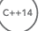

# 时钟

时钟是一个由 `time_point` 和 `duration` 组成的类。`time_point` 类型将在下一节详细讨论，但理解时钟如何工作不需要这些细节。然而，`time_point` 本身依赖于时钟，因此首先了解时钟的细节很重要。

标准定义了三个时钟。第一个被称为 `system_clock`，代表系统级实时时钟挂钟。第二个被称为 `steady_clock`，是一种保证其 `time_point` 永远不会减少的时钟。第三个是 `high_resolution_clock`，它具有最短周期。

每个时钟都有一个 `now()` 方法来获取当前时间。示例展示了如何这样做：

```cpp
// 获取开始时间
auto start = system_clock::now();
// 执行想要计时的代码
double d = 0;
for (int i = 0; i < 1000000; ++i) {
    cout << sqrt(i)) * cos(i);
}
// 获取结束时间并计算差
auto end = system_clock::now();
auto diff = end - start;
// 将差转换为毫秒并打印到控制台
cout << duration<milliseconds>(diff).count() << "ms" << endl;
```

Chrono库也可以用于计时代码执行所需。如果你得到的毫秒差非常小，这些值将增加循环次数以使其变长。小型计时是不准确的，因为计时器的分辨率通常为毫秒，在许多操作系统上，更新频率较低，每10ms或15ms一次。这种现象称为误差（gating error），即任何事件在1个时间单位内只需要1和2个计时器周期。例如，在一个每15ms更新一次计时器的系统上，执行44ms的循环将需要30ms。在使用计时器进行计算时，确保整个计算跨越大量的时钟周期，这样可以尽可能减少这些误差。

# 时间点

时间中的点由 `time_point` 类表示，并存储为相对于起点的 `duration`。`time_point`总是与特定的时钟关联，而起点是该关联时钟的源。例如，经典Unix/Linux时间的起点是1970年1月1日，以秒为单位。Windows的起点是1601年1月1日，以100纳秒为单位。其他操作系统有不同的起点和持续单位。

`time_point` 类包含一个函数 `time_since_epoch()`，它返回从关联时钟起点到存储时间点的 `duration`。时间点支持符合时间逻辑的算术运算，如 `+`, `-=` 和 `-`。还支持比较运算符来比较两个时间点。提供了两个静态方法：`min()` 返回最小可能的时间点，`max()` 返回最大的时间点。

`time_point` 类有三个构造函数：

- `time_point()` 构造一个用 `duration::zero()` 初始化的 `time_point`。生成的 `time_point` 表示关联时钟的起点（epoch）。
- `time_point(const duration& d)` 构造一个用给定持续时间初始化的 `time_point`。生成的 `time_point` 表示 epoch + d。
- `template<class Duration2> time_point(const time_point<clock, Duration2>& t)` 构造一个用 `t.time_since_epoch()` 初始化的 `time_point`。

每个 `time_point` 都与一个时钟关联。要创建一个 `time_point`，你需要指定时钟作为模板：

`time_point<steady_clock> tpl;`

每个时钟也知道它的点类型，因此你也可以写如下所示：

`steady_clock::time_point tpl;`

下面的示例演示了 `time_point` 类：

```cpp
// 创建一个表示关联的稳态时钟 epoch 的 time_point
time_point<steady_clock> tpl;
// 为 time_point 添加 10 分钟
tpl += minutes(10);
// 存储 epoch 和 time_point 之间的持续时间
duration di = tpl.time_since_epoch();
// 将持续时间转换为秒并写入控制台
duration<double> d2(di);
cout << d2.count() << " seconds" << endl;
```

输出应该是：

```
600 seconds
```

# 随机数生成

在软件中生成良好的随机数是一个复杂的话题。在 C++11 之前，生成随机数的唯一方法是使用 C 风格的 `srand()` 和 `rand()` 函数。`srand()` 函数需要在你的应用程序中调用一次，并用于初始化随机数生成器，也称为种子（seeding）。通常使用当前系统时间作为种子。

> **警告** 你需要确保为你的软件级随机数生成器使用高质量的种子。如果你每次都使用相同的种子初始化随机数生成器，那么你每次都会创建相同的随机数序列。这就是为什么种子通常是当前系统时间。

一旦生成器初始化，就可以使用 `rand()` 生成随机数。下面的示例展示了如何使用 `rand()`，用当前系统时间作为种子初始化生成器，并使用 `rand()` 生成随机数。`time(nullptr)` 返回系统时间，定义在 `<ctime>` 头文件中：

```cpp
srand(static_cast<unsigned int>(time(nullptr)));
cout << rand() << endl;
```

可以使用以下函数生成某个范围内的随机数：

```cpp
int getRandom(int min, int max)
{
    return (rand() % static_cast<int>(max + 1 - min)) + min;
}
```

C 风格的 `rand()` 函数生成从 0 到 `RAND_MAX` 范围内的随机数，`RAND_MAX` 由标准定义至少为 32767。遗憾的是，`rand()` 的低位通常不是随机的，这意味着，使用之前的 `getRandom()` 函数在小范围（如 1 到 6）内生成随机数将不会产生非常好的随机性。

> **注意** 软件级随机数生成器永远无法生成真正的随机数，因此被称为伪随机数生成器，因为它们依赖数学公式来给出随机的印象。

`srand()` 和 `rand()` 函数在灵活性方面没有提供很多。例如，你无法更改生成的随机数的分布。C++11 有一个强大的库，可以使用不同的算法和分布来生成随机数。该库定义在 `<random>` 头文件中。该库有三个组件：引擎（engines）、引擎适配器（engine adapters）和分布（distributions）。随机数引擎负责生成实际的随机数并存储后续随机数的状态。分布决定了生成的随机数的范围以及它们在该范围内如何从数学上分布。随机引擎适配器修改你与之关联的随机数的范围。

强烈建议**弃用** `srand()` 和 `rand()`，并开始使用来自 `<random>` 的类。

## 随机数引擎

C++ 定义了以下随机数引擎模板：

- `random_device`
- `linear_congruential_engine`
- `mersenne_twister_engine`
- `subtract_with_carry_engine`

`random_device` 引擎不是基于软件的生成器；它是一个特殊的引擎，需要连接到你计算机的硬件，该硬件用于生成真正的非确定性随机数，例如通过物理定律。一种经典机制通过计算每个时间间隔内的 alpha 粒子来测量放射性同位素的衰变，但还有其他类型的基于物理的随机生成器，包括“噪声”（消除放射性源）。这些机制的细节超出了本书的范围。

根据 `random_device` 的规范，如果计算机没有连接此类设备，库可以自由地使用软件生成器之一。随机数生成器的质量称为其熵（entropy）。`random_device` 的 `entropy()` 方法在它使用软件级随机数生成器时返回 0，如果连接了硬件则返回非零值。

使用 `random_device` 相当直接：

```cpp
random_device rnd;
cout << "Entropy: " << rnd.entropy() << endl;
cout << "Min value: " << rnd.min() << ", Max value: " << rnd.max() << endl;
cout << "Random number: " << rnd() << endl;
```

该程序的可能输出可能是：

```
Entropy: 32
Min value: 0, Max value: 4294967295
Random number: 123456789
```

## 引擎适配器

C++ 定义了以下随机数引擎适配器模板：

- `discard_block_engine`
- `independent_bits_engine`
- `shuffle_order_engine`

`discard_block_engine` 适配器通过丢弃部分值来适配随机数。

`independent_bits_engine` 适配器通过组合基类引擎生成的多个随机数，生成具有 `w` 位宽性的随机数。

`shuffle_order_engine` 适配器通过打乱顺序来适配。

强烈建议使用 `mt19937`（梅森旋转算法引擎）等预定义类型，而不是手动配置复杂的参数。

这些适配器的具体工作原理取决于数学，超出了本书的范围。

标准包含了许多预定义的引擎适配器。接下来的章节列出了预定义的引擎和引擎适配器。

## 预定义引擎和引擎适配器

如前所述，不建议为伪随机引擎或适配器指定自定义参数，而是使用标准中的某一个。C++ 定义了以下预定义引擎和引擎适配器，均位于 `<random>` 头文件中：

```cpp
typedef linear_congruential_engine<uint_fast32_t, 16807, 0, 2147483647> minstd_rand0;
typedef linear_congruential_engine<uint_fast32_t, 48271, 0, 2147483647> minstd_rand;
typedef mersenne_twister_engine<unsigned, 32, 624, 397, 0x990b0dfd, 0xffffffff, 0xd2c5d680, 17, 0xecf60000, 18, 1812433253> mt19937;
typedef mersenne_twister_engine<unsigned, 64, 312, 156, 0x502625a66a61b29, 0x5555555555555555, 17, 0x71d67ffeda6000, 37, 0xffffffff00000000, 43, 63641362284793005> mt19937_64;
typedef subtract_with_carry_engine<uint_fast32_t, 32, 10, 24> ranlux24_base;
typedef subtract_with_carry_engine<uint_fast64_t, 48, 5, 12> ranlux48_base;
typedef discard_block_engine<ranlux24_base, 22, 23> ranlux24;
typedef discard_block_engine<ranlux48_base, 38, 11> ranlux48;
typedef shuffle_order_engine<minstd_rand0, 256> knuth_b;
typedef implementation-defined default_random_engine;
```

`default_random_engine` 取决于编译器。接下来的章节将给出如何使用这些预定义引擎的示例。

## 生成随机数

在生成任何随机数之前，你首先需要创建一个引擎的实例。如果你使用基于软件的引擎，你还需要定义一个分布（distribution）。分布是一个描述数字在特定范围内如何分布的数学公式。使用引擎的推荐方法是使用讨论过的预定义引擎之一。以下示例使用了预定义的引擎 `mt19937`（一种梅森旋转算法）。与 `rand()` 类似，基于软件的引擎通常用种子（seed）初始化。在现代 C++ 中，不建议使用任何基于时间的种子，而是使用 `random_device` 来生成种子。

```cpp
random_device rndDevice;
mt19937 eng(rndDevice());
```

接下来，定义一个分布。此示例使用了范围从 1 到 99 的均匀整数分布。分布将在下一节中详细解释，但均匀分布对于本示例来说很容易使用：

```cpp
uniform_int_distribution<int> dist(1, 99);
```

一旦定义了引擎和分布，就可以通过调用一个与分布相同的函数并将引擎作为参数来生成随机数。如你所见，使用基于软件的引擎生成随机数时，始终需要指定引擎和分布。在第 17 章中引入并在 `<functional>` 头文件中定义的 `std::bind()` 工具用于消除在生成随机数时同时指定分布和引擎的需要。以下示例使用了与上例相同的预定义 `mt19937` 引擎和均匀分布。它定义了无需任何参数的 `gen`：

```cpp
auto gen = bind(dist, eng);
vector<int> vec(10);
generate(begin(vec), end(vec), gen);
for (auto i : vec) {
    cout << i << " ";
}
```


> 记住，`generate()` 算法会覆盖现有元素而不会插入新元素。这意味着你首先需要调整向量的大小以容纳所需的元素数量，然后调用 `generate()` 算法。上一个示例通过将大小作为构造函数的参数来调整了 `vector` 的大小。

即使你不知道 `gen()` 的确切类型，仍然可以将 `gen` 传递给另一个使用该生成器的函数。然而，你不能使用普通函数；你需要使用函数模板。上一个示例可以改为在名为 `fillVector()` 的函数中生成随机数，该函数模板如下：

```cpp
template<typename T>
void fillVector(vector<int>& vec, T rndGen)
{
    generate(begin(vec), end(vec), rndGen);
}
```

该函数使用方式如下：

```cpp
random_device rndDevice;
mt19937 eng(rndDevice());
uniform_int_distribution<int> dist(1, 99);
auto gen = bind(dist, eng);
vector<int> vec(10);
fillVector(vec, gen);
for (auto i : vec) {
    cout << i << " ";
}
```

## 随机数分布

分布是描述数字在某一范围内分布的数学公式。库提供了带有伪随机引擎的各种分布。分布的类模板参数。接下来的行显示了分布的构造函数。请参阅 [cppreference](https://www.cppreference.com/) 或 [cppplusplus](https://www.cppplus.com/) 以获取有关各种分布的详细列表。

### 均匀分布

```cpp
template<class IntType> class uniform_int_distribution
uniform_int_distribution(IntType a = 0, IntType b = numeric_limits<IntType>::max());
template<class RealType = double> class uniform_real_distribution
uniform_real_distribution(RealType a = 0.0, RealType b = 1.0);
```

### 伯努利分布

```cpp
class bernoulli_distribution
bernoulli_distribution(double p = 0.5);
template<class IntType = int> class binomial_distribution
binomial_distribution(IntType t = 1, double p = 0.5);
template<class IntType = int> class geometric_distribution
geometric_distribution(double p = 0.5);
template<class IntType = int> class negative_binomial_distribution
negative_binomial_distribution(IntType k = 1, double p = 0.5);
```

### 松分布

```cpp
template<class IntType = int> class poisson_distribution
poisson_distribution(double mean = 1.0);
template<class RealType = double> class exponential_distribution
exponential_distribution(double lambda = 1.0);
template<class RealType = double> class gamma_distribution
gamma_distribution(RealType alpha = 1.0, RealType beta = 1.0);
```

### 正态分布

```cpp
template<class RealType = double> class normal_distribution
normal_distribution(RealType mean = 0.0, RealType stddev = 1.0);
template<class RealType = double> class lognormal_distribution
lognormal_distribution(RealType m = 0.0, RealType s = 1.0);
template<class RealType = double> class chi_squared_distribution
chi_squared_distribution(RealType n = 1);
template<class RealType = double> class cauchy_distribution
cauchy_distribution(RealType a = 0.0, RealType b = 1.0);
template<class RealType = double> class fisher_f_distribution
fisher_f_distribution(RealType m = 1, RealType n = 1);
template<class RealType = double> class student_t_distribution
student_t_distribution(RealType n = 1);
```

### 采样分布

```cpp
template<class IntType = int> class discrete_distribution
discrete_distribution(initializer_list<double> wl);
template<class RealType = double> class piecewise_constant_distribution
template<class UnaryOperation>
piecewise_constant_distribution(initializer_list<RealType> bl, UnaryOperation fw);
template<class RealType = double> class piecewise_linear_distribution
piecewise_linear_distribution(initializer_list<RealType> bl, UnaryOperation fw);
```

```cpp
map<int, int> m;
for (int i = 0; i < kIterations; ++i) {
    int rnd = gen();
    // 在 map 中查找键 = rnd。如果找到，将与该键关联的值加 1。
    // 如果未找到，将该键加入 map 并设置值为值为 1。
    ++m[rnd];
}
```

```cpp
// 写入 CSV 文件
ofstream of("res.csv");
for (unsigned int i = kStart; i <= kEnd; ++i) {
    of << i << ",";
    auto res = m.find(i);
    of << (res != end(m) ? res->second : 0) << endl;
}
```

得到数据后，可以用于生成图形化表示。均匀梅森旋转算法的图表如图 19-1 所示。

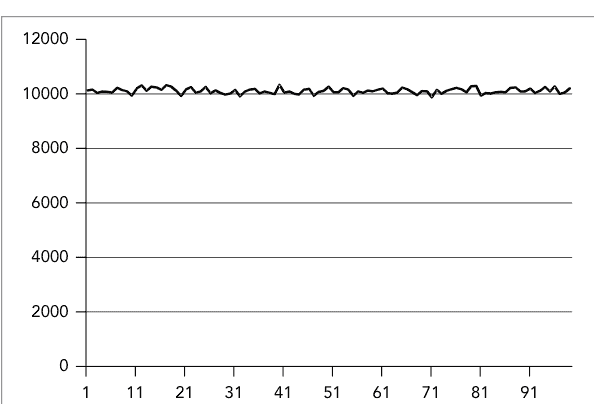

图 19-1

横轴表示生成随机数的范围。图表清晰地显示，1 到 99 之间的所有数字都被随机选择了大约 10,000 次，且生成的随机数分布在整个范围内是均匀的。

该示例可以被修改为根据正态分布生成随机数，而不是均匀分布。只需要两个微小的更改。首先，修改分布的创建：

```cpp
normal_distribution<double> dist(50, 10);
```

```cpp
p1 = (16, Hello World);
p2 = (1, 0.123);
```

C++ 还有一个 `std::tuple`，定义在 `<tuple>` 头文件中。`tuple` 是 `pair`（对）的泛化，它允许你存储任意数量的值，每个值都有自己的类型。就像 `pair` 一样，`tuple` 具有固定的大小和固定的值类型，这些类型在编译时确定。

可以使用 `tuple` 构造函数创建 `tuple`，指定类型和实际值。例如，以下代码创建了一个 `tuple`，其中第一个元素是整数，第二个元素是字符串，最后一个元素是布尔值：

```cpp
using MyTuple = tuple<int, string, bool>;
MyTuple t1(16, "Test", true);
```

`std::get<i>()` 用于获取 `tuple` 中的第 i 个元素，其中 i 是从 0 开始的索引；`<0>` 是 `tuple` 的第一个元素，以此类推。返回的值具有 `tuple` 中索引对应的正确类型：

```cpp
cout << "t1 = (" << get<0>(t1) << " , " << get<1>(t1)
     << " , " << get<2>(t1) << ")" << endl;
// 输出: t1 = (16, Test, 1)
```

你可以使用来自 `<typeinfo>` 头的 `typeid()` 来检查 `get<i>()` 返回的是正确的类型。`get<1>(t1)` 返回的值确实是一个 `std::string`：

```cpp
cout << "Type of " << get<1>(t1) << " = " << typeid(get<1>(t1)).name() << endl;
// 输出: Type of get<1>(t1) = class std::basic_string<char,
     struct std::char_traits<char>,class std::allocator<char>>
```

> 注意：`typeid()` 返回的精确字符串取决于编译器。上述输出来自 Visual C++ 2013。

C++14 增加了通过类型使用 `std::get<T>()` 从 `tuple` 中检索元素的能力，其中 `T` 是你想要检索的元素类型。如果 `tuple` 中有多个具有请求类型的元素，编译器将生成错误。例如，你可以如下获取它的字符串元素：

```cpp
cout << "String = " << get<string>(t1) << endl;
// 输出: String = Test
```

可以使用 `std::tuple_size` 模板查询 `tuple` 的大小。注意 `tuple_size` 需要你指定 `tuple` 的类型（在此例中为 `MyTuple`），而不是像 `t1` 这样的实际实例：

```cpp
cout << "Tuple Size = " << tuple_size<MyTuple>::value << endl;
// 输出: Tuple Size = 3
```

创建 `tuple` 的另一种方法是使用 `std::make_tuple()` 函数。该函数只需要实际值并自动推导出类型。由于类型的自动推导，你不能使用 `&` 来指定引用。如果你想使用 `make_tuple()` 从引用或常量引用生成 `tuple`，你需要分别使用 `ref()` 和 `cref()`，如下例所示。`ref()` 和 `cref()` 辅助函数定义在 `<functional>` 头文件中。

```cpp
double d = 3.14;
string str = "Test";
auto t2 = make_tuple(16, ref(d), cref(str));
```

为了测试 `t2` 中的引用，以下三行代码将 `double` 变量的值写入控制台。这使用了 `get<1>(t2)`，它实际上返回 `d` 的引用，因为第二个元素使用了 `ref(d)`。第二行更改了变量的值，最后一行显示值 `d` 确实通过存储在 `tuple` 中的引用发生了改变：

```cpp
cout << "d = " << d << endl;
get<1>(t2) = 3.14; // 假设此处赋值操作
cout << "d = " << d << endl;
```

*(注：原文代码块在该部分不完整，此处根据上下文意译并补全了逻辑)*

# 第四部分 掌握 C++ 高级特性

## 第 20 章：STL 的自定义与扩展

## 第 21 章：高级模板

## 第 22 章：内存管理

## 第 23 章：使用 C++ 进行多线程编程

# 第 20 章 STL 的自定义与扩展

本章包含哪些内容？

- 解释分配器（allocators）
- 解释迭代器适配器以及如何使用标准迭代器适配器
- 如何扩展 STL
- 如何编写自己的算法
- 如何编写自己的容器
- 如何编写自己的迭代器

本章的 WROX.COM 下载

请注意，本章所有的代码示例均可以在书籍网站 www.wrox.com/proc++3e 的“Download Code”选项卡中作为本章代码的一部分下载。

之前的章节展示了 STL 是一个强大的通用容器和算法集合。到为止涵盖的信息对于大多数应用程序已经足够了。然而，那些章节只展示了库的基本功能。你可以根据自己需要对 STL 进行自定义和扩展。例如，你可以将迭代器应用于输入和输出流；编写自己的容器、算法和迭代器；甚至为容器指定自己的内存分配方案。本章将让你领略这些高级特性能，主要通过开发一个新的 STL 容器：`hash_map`。

> 注意：自定义和扩展 STL 很少有必要。如果你对之前章节中的 STL 容器和算法感到满意，可以跳过本章。但如果你真的想理解 STL 而不仅仅是使用它，请给这一章一个机会。你应该熟悉第 14 章关于运算符重载的内容，并且由于本章大量使用了模板，在继续之前，你也应该熟悉第 11 章中的模板内容！

## 分配器

每个 STL 容器都接受一个 `Allocator` 类型作为模板参数，默认值通常足够了。例如，向量模板：

```cpp
template <class T, class Allocator = allocator<T>> class vector;
```

容器的构造函数允许你指定一个 `Allocator` 类型的对象。这些额外参数允许你自定义容器分配内存的方式。容器分配的内存内存都是通过调用内存对象的 `allocate()` 方法来管理的。相反，每次内存释放都是通过调用 `Allocator` 对象的 `deallocate()` 方法完成的。标准库提供了一个名为 `allocator` 的默认 `Allocator` 类，它使用 `new` 运算符和 `delete` 运算符实现了这些方法。

如果你希望程序中的容器使用自定义的内存分配和释放方案，你可以编写自己的 `Allocator` 类。使用自定义分配器有几个原因。例如，如果底层分配器的性能无法接受，则可以构建替代方案；或者，如果内存碎片是一个问题（许多不同的分配和释放在内存中留下了未使用的空隙），可以创建一个单类型对象的“池”，称为内存池。当需要特定操作系统的功能（如共享内存段）时，使用自定义分配器允许在这些共享内存段中使用 STL 容器。使用自定义分配器是复杂的，如果不小心，可能会出现很多问题，这不应该轻率对待。

任何提供 `allocate()`、`deallocate()` 以及其他几个必要方法和类型别名的类都可以替代默认分配器类。然而，根据我的经验，这个特性很少被使用。我本人从未用过它，因此书中省略了细节。有关更多细节，请参阅附录 B 中列出的 C++ 标准库相关书籍。

## 迭代器适配器

标准库提供了四个迭代器适配器：构建在其他迭代器之上的特殊迭代器。四个迭代器适配器都定义在 `<iterator>` 头文件中。

### 反向迭代器

STL 提供了一个 `reverse_iterator` 类，它以反向方向遍历双向或随机访问迭代器。STL 中的每个可反向迭代器（除了 `forward_list` 和无序关联容器外，它们都是标准的一部分）都提供了 `reverse_iterator` 类型别名以及 `rbegin()` 和 `rend()` 方法。`rbegin()` 返回一个指向容器最后一个元素的反向迭代器，而 `rend()` 返回一个指向容器第一个元素的反向迭代器。对反向迭代器应用 `operator++` 会调用底层迭代器的 `operator--`，反之亦然。例如，从末尾遍历集合可以如下所示操作：

```cpp
for (auto iter = begin(collection); iter != end(collection); ++iter) {
```

通过调用 `rbegin()` 和 `rend()`，可以使用 `reverse_iterator` 从末尾开始遍历集合中的元素。注意，你仍然可以调用 `++iter`：

```cpp
for (auto iter = rbegin(collection); iter != rend(collection); ++iter) {
```


`reverse_iterator` 对于 STL 中大多数没有反向工作等价物的算法都非常有用。例如，基础的 `find()` 算法搜索序列中的第一个元素。如果你想找到序列中的最后一个元素，可以使用 `reverse_iterator` 代替。注意，当你配合 `reverse_iterator` 使用 `find()` 等算法时，它返回的也是一个反向迭代器。你始终可以通过调用反向迭代器上的 `base()` 方法来获取底层迭代器。然而，由于 `reverse_iterator` 的实现细节，`base()` 返回的迭代器始终指向调用它的反向迭代器之前的一个元素。

这里是一个配合 `reverse_iterator` 使用 `find()` 的示例：

```cpp
// 使用反向迭代器实现 find()
vector<int> collection = {1, 2, 3, 4, 5};
int target = 3;
auto it = find(rbegin(collection), rend(collection), target);
if (it != rend(collection)) {
    cout << "Found " << *it.base() << endl;
}
```

# 流迭代器

STL 提供了适配器，允许将输入和输出流视为输入和输出迭代器。使用这些迭代器，你可以输入和输出流，以便它们可以在 STL 算法中分别作为源和目标。`ostream_iterator` 类是一个输出迭代器。它是一个模板类，接受元素作为类型参数。它的构造函数接受一个输出流和一个跟在每个元素后面的写入字符串。`ostream_iterator` 类使用 `operator<<` 写入元素。

例如，你可以使用 `ostream_iterator` 配合 `copy()` 算法只需一行代码即可打印容器元素。`copy()` 的第一个参数是范围的起始，第二个参数是范围的结束迭代器，第三个参数是目标迭代器：

```cpp
vector<int> myVector(10);
iota(begin(myVector), end(myVector), 1); // 用1,2,3...10填充vector
// 打印vector的内容
copy(begin(myVector), end(myVector), ostream_iterator<int>(cout, " "));
```

同样，你可以使用输入流迭代器 `istream_iterator` 使用输入迭代器从输入流中读取值。元素通过 `operator->` 读取。`istream_iterator` 可以作为算法和容器方法的源使用。例如，以下代码从控制台读取整数直到到达流结束。在 Windows 上，这发生在按下 `Ctrl+Z` 并按回车时。`accumulate()` 算法被用于对所有整数求和。

```cpp
cout << "输入用空格分隔的数字。" << endl;
cout << "按下 Ctrl+Z 并按回车停止。" << endl;
istream_iterator<int> numbersIter(cin);
istream_iterator<int> end();
int sum = accumulate(numbersIter, end(), 0);
cout << "Sum: " << sum << endl;
```

```cpp
int sum = accumulate(numbersIter, endIter, 0);
cout << "Sum: " << sum << endl;
```

请花一点时间思考一下。如果你删除所有的输出语句和变量声明，剩下的唯一一行就是对 `accumulate()` 的调用。得益于输入流迭代器，这一行代码就能从控制台读取任意数量的整数并将它们相加。

## 插入迭代器

如第 17 章所述，像 `copy()` 这样的算法不会向容器插入元素；它们只是简单将范围内的旧元素替换为新元素。为了让像 `copy()` 的算法更有用，STL 提供了三种插入迭代器适配器，它们实际上可以向容器插入元素。这些适配器基于容器类型模板化，并在构造函数中接收实际容器。通过提供必要的接口，这些适配器可以作为 `copy()` 等算法的目标迭代器来使用。然而，它们并不是在容器中进行替换，而是调用容器的方法来插入新元素。

基础的 `insert_iterator` 会在容器上调用 `insert(position, element)`，`back_insert_iterator` 调用 `push_back(element)`，而 `front_insert_iterator` 调用 `push_front(element)`。

例如，你可以将 `remove_if_iterator` 配合 `remove_if()` 算法，为 `vectorTwo` 填充 `vectorOne` 中所有不等于 100 的元素：

```cpp
vector<int> vectorOne, vectorTwo;
populate(vectorOne);
back_insert_iterator<vector<int>> inserter(vectorTwo);
remove_if(bbegin(vectorOne), vend(vectorOne), inserter,
    [](int i) { return i == 100; });
copy(bbegin(vectorOne), cend(vectorOne), ostream_iterator<int>(cout, " "));
```

如所示，当你使用插入迭代器时，不需要提前确定目标容器的大小。

你还可以使用 `back_inserter()` 函数来创建一个 `back_insert_iterator`。例如，在之前的例子中，你可以替换插入变量并重写 `remove_copy_if()` 如下。结果与之前的实现完全相同：

```cpp
remove_copy_if(bbegin(vectorOne), vend(vectorOne),
back_inserter(vectorTwo), [](int i) { return i == 100; });
```

`front_iterator` 和 `insert_iterator` 的工作方式类似，不同之处 `insert_iterator` 在构造函数中还接收一个初始迭代器，将其传递给第一次调用 `insert(position, element)`。后续的迭代器位置提示是通过 `insert()` 用的返回值生成的。

`insert_iterator` 的一个好处是，它允许你将关联迭代器作为修改算法的目标。第 17 章解释了关联容器的一个问题：你不允许在迭代时修改所遍历的元素。通过使用 `insert_iterator`，你可以插入元素，从而允许容器对其进行正确排序。关联容器实际上支持一种接受迭代器位置的 `insert()` ，并且应该使用该位置作为“提示”（hint），它们可以忽略它。当你在关联容器上使用 `insert_iterator` 时，可以将容器的 `begin()` 或 `end()` 迭代器作为提示。这里是修改后的之前的示例，容器是 `set` 而不是 `vector`：

```cpp
vector<int> vectorOne;
set<int> setOne;
populateContainer(vectorOne);
insert_iterator<set<int>> inser = insert(setOne, begin(setOne));
remove_copy_if(begin(vectorOne), end(vectorOne), inser,
    [](int i) { return i == 100; });
copy(begin(setOne), end(setOne), ostream_iterator<int>(cout, " * "));
```

注意，`insert_iterator` 在所有 `insert()` 的调用后都会修改插入位置，因此该位置就是刚刚插入的元素之后。

## 移动迭代器

第 10 章讨论了移动语义，当你知道源对象在赋值或拷贝构造后将被销毁时，可以使用它来防止不必要的拷贝。有一种名为 `move_iterator` 的迭代器适配器。`move_iterator` 的解引用操作会自动将值转换为右值引用，这意味着值可以移动到新目标，而无需拷贝的开销。在使用移动语义之前，你需要确保你的对象支持它。更多细节，请参阅第 10 章。

```cpp
class MoveableClass {
    public:
        MoveableClass() {
            cout << "Default constructor" << endl;
        }
        MoveableClass(const MoveableClass& src) {
            cout << "Copy constructor" << endl;
        }
        MoveableClass(MoveableClass&& src) noexcept {
            cout << "Move constructor" << endl;
        }
        MoveableClass& operator=(const MoveableClass& rhs) {
            cout << "Copy assignment operator" << endl;
            return *this;
        }
        MoveableClass& operator=(MoveableClass&& rhs) noexcept {
            cout << "Move assignment operator" << endl;
            return *this;
        }
};
```

这些构造函数和赋值运算符在这里没有做任何有用的事情，除了打印消息以便方便看到哪一个被调用了。现在你有了这个类，可以如下定义一个 `vector` 其中存储几个 `MoveableClass` 实例：

```cpp
vector<MoveableClass> vecSource;
MoveableClass mc;
vecSource.push_back(mc);
vecSource.push_back(move(mc));
```

# 迭代器适配器

## 扩展 STL

STL 包含了许多实用的容器、算法和迭代器供你的应用程序使用。然而，任何库都不可能包含客户端可能需要的全部工具。因此，最好的库是可扩展的：它们允许客户端添加他们所需的功能。STL 由于数据与算法分离的设计，本质上是可扩展的。你可以编写符合 STL 标准的自定义。

### 为什么要扩展 STL？

如果你在用 C++ 编写一个算法或容器，你可以遵循 STL 准则，也可以不遵循。对于简单的容器和算法，花费精力遵循准则可能并不值得。但对于你计划复用的大量代码，这种努力是值得的。首先，这种代码会让 C++ 程序员更容易理解；其次，你可以在 STL 的其他部分使用它，而不需要特殊的头文件。最后，它会强制你采用开发健壮代码所需的严谨性。

### 编写 STL 算法

第 17 章描述了 STL 的一部分有用算法，但你不可避免会遇到需要新算法的情况。当发生这种情况时，通常是编写一个与 STL 迭代器一样工作的自定义算法。

#### find_all()

假设你想在一个给范围内找到所有匹配谓词的元素。`find()` 和 `find_if()` 算法是最可能的候选者，但它们都只返回一个元素的迭代器。事实上，标准算法中没有找到所有匹配谓词元素的算法，但你可以编写该功能的自定义 `find_all()`。

第一个任务是定义原型。你可以遵循 `copy_if()` 建立的模型。它是一个带有三个参数的模板函数：输入迭代器、输出迭代器和谓词。它的参数是输入序列的起始和结束迭代器、输出序列的起始迭代器以及谓词对象。与 `copy_if()` 类似，该算法返回一个指向输出序列的迭代器，它位于最后一个元素之后。这是其原型：

```cpp
template <typename InputIterator, typename OutputIterator, typename Predicate>
OutputIterator find_all(InputIterator first, InputIterator last,
                        OutputIterator dest, Predicate pred);
```

另一种选择是省略输出迭代器，返回一个指向输入序列的迭代器，该迭代器遍历输入序列中所有匹配元素。这要求你编写自己的迭代器类。

下一个任务是编写实现。`find_all()` 算法遍历输入序列中的所有元素，对每个元素调用谓词，并将匹配元素的迭代器存储在输出序列中。以下是实现代码：

```cpp
template <typename InputIterator, typename OutputIterator, typename Predicate>
OutputIterator find_all(InputIterator first, InputIterator last,
OutputIterator dest, Predicate pred)
{
    while (first != last) {
        if (pred(*first)) {
            *dest = first;
            ++dest;
        }
        ++first;
    }
    return dest;
}
```

与 `copy_if()` 类似，该算法只会覆盖输出序列中的现有元素，因此请确保输出序列足够大以容结果，或者像下面的代码所示，使用 `back_inserter` 作为迭代器适配器。在找到匹配元素后，代码统计了找到的元素数量，即 `matches` 中的迭代器数量。然后，它遍历结果并打印每个元素：

```cpp
vector<int> vec = { 3, 4, 5, 4, 6, 5, 8 };
vector<vector<int>::iterator> matches;
find_all(vec.begin(), vec.end(), back_inserter(matches));
if (matches[0] == 5) return 0;
    cout << "Found " << matches.size() << " matching elements:" << endl;
    for (auto it : matches)
        cout << *it << " at position " << (it - vec.begin()) << endl;
```

输出如下：

- 找到 3 个匹配元素：

5位于位置 2

5位于位置 4

5位于位置 6

## 迭代器属性

某些算法需要关于其迭代器的额外信息。例如，它们可能需要知道迭代器所指元素的类型以便存储临时值，或者可能想知道迭代器是双向的还是随机访问的。

C++ 提供了一个名为 `iterator_traits` 的类模板，允许你查找这些信息。你可以用感兴趣的迭代器类型实例化 `iterator_traits` 类模板，并访问五个类型定义之一：`value_type`、`difference_type`、`iterator_category`、`pointer` 和 `reference`。例如，函数模板声明了一个临时变量，其类型为 `IteratorType` 迭代器所指向的类型，在 `iterator_traits` 行之前使用了 `typename` 关键字。每当你访问一个或多个模板参数上的基类型时，必须指定 `typename`。在这种情况下，使用模板参数 `Iterator` 来访问 `value_type`：

```cpp
#include <iterator>
template <typename IteratorType>
void iteratorTraitsTest(IteratorType it)
{
    typename std::iterator_traits<IteratorType>::value_type temp;
    temp = *it;
    cout << temp << endl;
}
```

可以使用以下测试代码对该函数进行测试：

```cpp
vector<int> v[ 5 ];
iteratorTraitsTest(begin(v));
```

通过这个测试，`iteratorTraitsTest()` 函数中的变量 `temp` 将是 `int` 类型。

输出如下：

5

在这个示例中，可以使用 `auto` 关键字来简化代码，但这无法让你了解如何使用 `iterator_traits` 模板。

## 编写 STL 容器

C++ 标准包含了一系列要求，任何容器必须满足这些要求才能够格成为 STL 容器。

此外，如果你想让容器是顺序的（如 `vector`）、关联的（如 `map`）或无序关联的（如 `unordered_map`），它必须符合补充要求。

我在编写新容器时的建议是先遵循通用规则编写基础容器（例如使其成为类模板），而不必过多担心 STL 兼容的具体细节。在开发出基础实现后，你可以添加迭代器和方法，使其与 STL 框架配合。本章采用了这种方法来开发一个哈希表。

# 基础哈希表


C++11 增加了对无序关联容器（也称为哈希表）的支持。将在 16 章中讨论。然而，C++11 之前并不包含哈希表。与提供对数级插入、查找和删除的 STL `map` 和 `set` 不同，哈希表在平均情况下提供常数时间的插入、删除和查找。哈希表不是按排序顺序存储元素，而是通过哈希处理将每个元素映射到特定的桶（bucket）。只要存储的元素数量不显著大于桶的数量，且哈希函数在桶之间均匀地分布元素，那么插入、删除和查找操作都可以在常数时间内运行。

> 注意：本节假设你熟悉基础数据结构。如果你不熟悉，请参考第 16 章（其中包含了对哈希表的讨论），或附录 B 中列的标准数据结构教材之一。

本节实现了一个简单但功能完整的 `hash_map`。像 `map` 一样，`hash_map` 存储键值对。事实上，它提供的操作几乎与 `map` 提供的完全相同，但具有不同的性能特征。

此 `hash_map` 实现使用了链地址哈希（也称为开放哈希），并且没有尝试提供重哈希（rehashing）等高级功能。第 16 章在无序关联容器部分解释了链地址哈希的概念。

> 注意：建议对字符串使用标准哈希函数，而不是自己实现。

# 哈希函数

编写哈希表时的首要选择是如何进行哈希计算。运算符的实现非常复杂，因为它必须适用于任何类型的键。以下实现通过简单地将键视为字节序列来计算整数大小的哈希值：

```cpp
// 将键视为字节序列
// 并求加 ASCII 值来计算哈希
template<typename T>
size_t hash_impl(const T& key) {
    size_t size_bytes = sizeof(key);
    size_t res = 0;
    for (size_t i = 0; i < size_bytes; ++i) {
        res += ((unsigned char*)key)[i];
    }
    return res;
}
```

遗憾的是，对字符串使用这种哈希方法时，计算的是字符串本身，而不是实际文本。实际文本可能在堆上，字符串对象只包含长度和指向文本的指针。即使它们指向的文本相同，指针也会不同。结果是具有相同内容的字符串将生成不同的哈希值。为字符串提供哈希模板的特化是一个好主意，通常适用于任何动态分配内存的类。模板特化在 11 章有详细讨论：

```cpp
// 字符串的哈希特化
template <>
class hash<std::string> {
public:
    size_t operator()(const std::string& key) const;
};

// 通过求加所有字符的 ASCII 值计算哈希
size_t hash<std::string>::operator()(const std::string& key) const {
    size_t sum = 0;
    for (size_t i = 0; i < key.size(); ++i) {
        sum += (unsigned char)key[i];
    }
    return sum;
}
```

如果你想使用其他指针类型或对象作为键，你应该为这些类型编写自己的哈希特化。

## Hash Map 接口

`hash_map` 支持三种基本操作：插入、删除和查找。当然，它还提供了一个构造函数。本文讨论的实现省略了拷贝和移动构造函数，以及拷贝和移动赋值运算符。如果你想拷贝、移动或赋值 `hash_map`，则需要这些内容。可下载的源码包含了这些构造函数和运算符的实现，以防你感兴趣。以下是 `hash_map` 类模板的公有部分：

```cpp
template <typename Key, typename T, typename Compare = std::equal_to<Key>>
class hash_map {
    public:
        using key_type = Key;
        using mapped_type = T;
        using value_type = std::pair<const Key, T>;

        virtual ~hash_map(); // 虚析构函数

        // 如果桶的数量非法，则抛出 invalid_argument。
        explicit hash_map(const Compare& cmp = Compare(), size_t numBuckets = 101, const Hash& hash = Hash());
        
        // 插入键值对 x。
        void insert(const value_type& x);

        // 如果存在，则删除键为 k 的元素。
        void erase(const key_type& k);

        // 查找键为 k 的元素的指针。
        // 如果元素不存在，则返回 nullptr。
        value_type* find(const key_type& k);
        const value_type* find(const key_type& k) const;

        // operator[] 查找键为 k 的元素，如果不存在则
        // 插入具有该键的元素。返回
        // 该键对应的值的引用。
        T& operator[](const key_type& k);

    private:
        // 尚未显示的实现细节
};
```

如你所见，键和值的类型都是模板参数，就像 STL `map` 一样。`hash_map` 将 `pair<const Key, T>` 作为容器中的实际元素。`insert()`、`erase()`、`find()` 和 `operator[]` 方法非常直观。然而，该接口的某些方面需要进一步解释。

### 模板参数 Compare

与 `map` 以及其他容器一样，`hash_map` 允许客户端通过模板参数指定比较类型，并在构造函数中传入该类型的特定对象。与 `map` 和 `set` 不同，`hash_map` 不按键对元素进行排序，但必须比较键的相等性。因此，它没有使用 `less` 作为默认比较，而是使用 `equal_to`。比较对象仅用于检测容器中是否存在重复插入。

### 模板参数 Hash

你应该能够更改哈希函数，使其更适合你想要存储在 `hash_map` 中的元素类型。

因此，`hash_map` 模板接受四个参数：键类型、值类型、比较类型和哈希类型。

### 类型别名

`hash_map` 类模板定义三个类型别名：

```cpp
using key_type = Key;
using mapped_type = T;
using value_type = std::pair<const Key, T>;
```

特别是 `value_type`，用于引用更复杂的 `pair<Key, T>`。正如你将看到的看到的，标准也要求 STL 容器具备这些别名。

## 实现

在使用 `hash_map` 接口之后，你需要选择实现方式。基本的哈希表结构通常由固定数量的桶（buckets）组成，每个桶可以存储一个或多个元素。应该能够根据 `bucket-id`（键的哈希结果）在常数时间内访问桶。因此，`vector` 是最适合桶的容器。每个桶必须存储元素列表，因此可以使用 STL `list` 作为桶类型。因此，最终结构是 `pair<const Key, T>` 列表的 `vector`。以下是 `hash_map` 类的私有成员：

```cpp
private:
    using ListType = std::list<value_type>;
    std::vector<ListType> mBuckets;
    size_t mSize;
    Compare mComp;
    Hash mHash;
```

如果没有 `value_type` 和 `ListType` 的别名，声明 `mBuckets` 的行将看起来如下：

```cpp
std::vector<std::pair<const Key, T>> mBuckets;
```

`mComp` 和 `mHash` 成员分别存储比较对象和哈希对象，`mSize` 存储容器中当前的元素。

## 构造函数

构造函数初始化所有字段并将 `mBuckets` `vector` 调整为正确的大小。

遗憾的是，模板语法有些密集。如果你对语法感到困惑，请参阅第 11 章关于编写类模板的细节。

```cpp
// 根据桶的数量调整 mBuckets。
template <typename Key, typename T, typename Compare, typename Hash>
hash_map<Key, Compare, Hash>::hash_map(
const Compare& comp, size_t numBuckets, const Hash& hash)
  : mSize(0), mComp(comp), mHash(hash)
{
  if (numBuckets == 0) {
    throw std::invalid_argument("Number of buckets must be positive");
  }
  mBuckets.resize(numBuckets);
}
```

实现至少需要一个桶，因此构造函数强制了这一点。

## 元素查找

三个主要操作（查找、插入、删除）都使用一个辅助方法来查找元素。该辅助方法返回键哈希所在桶的迭代器。

```cpp
template <typename Key, typename T, typename Compare, typename Hash>
typename hash_map<Key, T, Compare, Hash>::ListType
hash_map<Key, T, Compare, Hash>::findElement(const key_type& k, size_t& bucket)
{
    bucket = mHash(k) % mBuckets.size();
    for (auto it = mBuckets[bucket].begin(); it != mBuckets[bucket].end(); ++it) {
        if (it->first == k) {
            return it;
        }
    }
    return mBuckets[bucket].end();
}
```

你可以将 `find()` 方法实现为 `findElement()` 的简单封装：

```cpp
template <typename Key, typename T, typename Compare, typename Hash>
typename hash_map<Key, T, Compare, Hash>::value_type*
hash_map<Key, T, Compare, Hash>::find(const key_type& k)
{
    size_t bucket;
    auto it = findElement(k, bucket);
    if (it == mBuckets[bucket].end()) {
        return nullptr;
    }
    return &(*it);
}
```

`find()` 的 const 版本使用 `const_cast` 将请求转发到非 const 版本，以避免代码重复：

```cpp
template <typename Key, typename T, typename Compare, typename Hash>
typename hash_map<Key, T, Compare, Hash>::value_type*
hash_map<Key, T, Compare, Hash>::find(const key_type& k) const
{
    return const_cast<hash_map<Key, T, Compare, Hash>*>(this)->find(k);
}
```

`operator[]` 使用 `find()` 方法，如果没有找到元素，则按如下方式插入：

```cpp
template <typename Key, typename T, typename Compare, typename Hash>
T& hash_map<Key, T, Compare, Hash>::operator[](const key_type& k)
{
    value_type* found = find(k);
    if (found == nullptr) {
        insert(std::make_pair(k, T()));
    }
    found = find(k);
    return found->second;
}
```

这种实现有些无效，因为在最坏情况下它调用两次 `find()` 并调用一次 `insert()`。更高效地实现这一点是对读者来说很好的练习。

## 元素插入

`insert()` 必须首先检查元素是否已在 `hash_map` 中。如果不在，则将元素添加到适当桶的列表中。注意 `findElement()` 返回键哈希所在桶的引用，即使未找到该键元素：

```cpp
template <typename Key, typename T, typename Compare, typename Hash>
void hash_map<Key, T, Compare, Hash>::insert(const value_type& x)
{
    size_t bucket;
    // 尝试查找元素。
    auto it = findElement(x.first, bucket);
    if (it != std::end(mBuckets[bucket])) {
        // 元素已经存在。
        return;
    } else {
        // 我们没有找到该元素，所以插入一个新的。
        mSize++;
        mBuckets[bucket].push_back(x);
    }
}
```

## 删除元素

`erase()` 遵循与 `insert()` 相同的模式：它首先尝试通过调用 `findElement()` 查找元素。如果元素存在，它就会将其从相应的桶中删除。否则，它什么都不做。

```cpp
template <typename Key, typename T, typename Compare, typename Hash>
void hash_map<Key, T, Compare, Hash>::erase(const key_type& k)
{
    size_t bucket;
    // 尝试查找元素。
    auto it = findElement(k, bucket);
    if (it != std::end(mBuckets[bucket])) {
        // 元素存在 ——将其删除。
        mBuckets[bucket].erase(it);
    }
    mSize--;
}
```

## 使用基础哈希映射

这是一个小型测试程序，演示了 `hash_map` 模板的使用：

```cpp
hash_map<int, int> myHash;
myHash.insert(make_pair(4, 40));
myHash.insert(make_pair(6, 60));
// 如果 x 的类型为 hash_map<int, int>::value_type*
auto x = myHash.find(4);
if (x != nullptr) {
    cout << " 4 maps to " << x->second << endl;
} else {
    cout << "cannot find 4 in map" << endl;
}
myHash.erase(4);
auto x2 = myHash.find(4);
if (x2 != nullptr) {
    cout << " 4 maps to " << x2->second << endl;
} else {
    cout << "cannot find 4 in map" << endl;
}
myHash[4] = 35;
```

```cpp
myHash[4] = 60;
auto x3 = myHash.find(4);
if (x3 != nullptr) {
    cout << "4 maps to " << x3->second << endl;
} else {
    cout << "cannot find 4 in map" << endl;
}
```

输出如下：

```
4 maps to 40
cannot find 4 in map
4 maps to 60
```

## 使 hash_map 成为 STL 容器

前一节展示的基础 `hash_map` 遵循了 STL 的精神，但并非字面要求。对于大多数用途，之前的实现已经足够了。然而，如果你想在 `hash_map` 上使用 STL 算法，你必须多做一些工作。C++ 标准规定了数据结构必须提供的方法和类型别名才能被称为 STL 容器。

## 类型别名容器要求

C++ 标准规定每个 STL 容器必须提供以下公共类型别名：

| 类型名称 | 描述 |
|---|---|
| value_type | 容器中存储的元素类型 |
| reference | 容器中存储的元素类型的引用 |
| const_reference | 容器中存储的常量元素类型的引用 |
| iterator | 用于遍历容器元素的元素的类型 |
| const_iterator | 用于遍历容器中常量元素的 iterator 版本 |


# 类型别名

| 类型别名 | 描述 |
|---|---|
| `size_type` | 可以表示容器元素数量的类型；通常为 `size_t`（来自 `<cstddef>`） |
| `difference_type` | 可以表示容器两个迭代器之间差值的类型；通常为 `ptrdiff_t`（来自 `<cstddef>`） |

这里是 `hash_map` 类中除 `iterator` 和 `const_iterator` 之外的所有这些类型别名的定义。编写迭代器将在后续章节中详细介绍。请注意，`value_type`（以及稍后讨论的 `key_type` 和 `mapped_type`）在之前的 `hash_map` 版本中已经定义过了。此实现还添加了类型别名 `hash_map_type`，为特定的 `hash_map` 模板实例化提供一个更短的名字。

```cpp
template <typename Key, typename T, typename Compare = std::equal_to<Key>,
          typename Hash = hash<Key>>
class hash_map
{
public:
    using key_type = Key;
    using mapped_type = T;
    using value_type = std::pair<const Key, T>;
    using reference = std::pair<const Key, T>&;
    using const_reference = const std::pair<const Key, T>&;
    using size_type = size_t;
    using difference_type = ptrdiff_t;
    using hash_map_type = hash_map<Key, T, Compare, Hash>;
    // 为了简单起见，省略类的其余部分
};
```

# 方法容器要求

除了类型别名外，每个容器必须提供以下方法：

## 构造、赋值与析构

| 方法 | 描述 | 最坏情况复杂度 |
|---|---|---|
| 默认构造函数 | 构建一个空容器 | 常数级 |
| 拷贝构造函数 | 执行容器的深拷贝 | 线性级 |
| 移动构造函数 | 执行移动操作 | 常数级 |
| 拷贝赋值运算符 | 执行容器的深拷贝 | 线性级 |
| 移动赋值运算符 | 执行移动赋值操作 | 常数级 |
| 析构函数 | 销毁动态分配内存；调用容器中所有元素的析构函数 | 线性级 |

## 迭代器访问

| 方法 | 描述 | 最坏情况复杂度 |
|---|---|---|
| `iterator begin(); const_iterator begin() const;` | 返回指向容器第一个元素的迭代器 | 常数级 |
| `iterator end(); const_iterator end() const;` | 返回指向容器中最后一个元素之后元素的迭代器 | 常数级 |
| `const_iterator cbegin() const;` | 返回指向容器第一个元素的常量迭代器 | 常数级 |
| `const_iterator cend() const;` | 返回指向容器中最后一个元素之后元素的常量迭代器 | 常数级 |

## 比较运算符

| 方法 | 描述 | 最坏情况复杂度 |
|---|---|---|
| `operator==` | 逐个元素比较两个容器的比较运算符 | 线性级 |
| `operator!=` | | |
| `operator<` | | |
| `operator>` | | |
| `operator<=` | | |
| `operator>=` | | |

## 容量与交换

| 方法 | 描述 | 最坏情况复杂度 |
|---|---|---|
| `void swap(hash_map& hashIn)` | 将容器的内容与调用该方法的对象进行交换 | 常数级 |
| `size_type size() const;` | 返回容器中的元素数量 | 常数级 |
| `size_type max_size() const;` | 返回容器可以容纳的最大元素数量 | 常数级 |
| `bool empty() const;` | 指定容器是否包含元素 | 常数级 |

# 扩展 STL

`size()` 和 `empty()` 的实现很容易，因为 `hash_map` 在成员变量 `mSize` 中跟踪其大小。注意 `size_type` 是类定义的类型之一。

```cpp
template <typename Key, typename T, typename Compare, typename Hash>
bool hash_map<Key, T, Compare, Hash>::empty() const {
    return size() == 0;
}
```

```cpp
template <typename Key, typename T, typename Compare, typename Hash>
size_type hash_map<Key, T, Compare, Hash>::size() const {
    return mSize;
}
```

`max_size()` 稍微复杂。起初你可能认为哈希映射的最大是所有列表之和。然而，最坏的情况是所有元素都在同一个桶中。因此，它声支持的最大大小是单个桶的大小：

```cpp
template <typename Key, typename T, typename Compare, typename Hash>
size_type hash_map<Key, T, Compare, Hash>::max_size() const {
    // 在最坏的情况下，所有元素都在同一个桶列表中，
    // 所以 max_size 是单个列表的 max_size。
    // 此代码假设所有列表具有相同的 max_size。
    return mBuckets[0].max_size();
}
```

最后，`swap()` 的实现使用 `std::swap()` 工具函数交换四个数据成员。

```cpp
// 交换四个数据成员。使用通用的 swap 模板。
template <typename Key, typename T, typename Compare, typename Hash>
void hash_map<Key, T, Compare, Hash>::swap(hash_map_type& hashIn) {
    // 显式调用 std 以防编译器认为
    // 是递归调用。
    std::swap(*this, hashIn);
}
```

# 编写迭代器

最重要的容器要求是迭代器。为了与通用算法配合，每个容器必须提供一个访问容器内元素的迭代器。你的迭代器通常应该重载 `operator*` 和 `operator->`，以及取决于其特定行为的其他操作。只要你的迭代器提供了基本的迭代操作，一切都是正常的。

关于你的迭代器，第一个决定是它是哪种类型：前向、双向还是随机访问。随机访问迭代器对于关联容器来说没有意义，因此双向迭代器似乎是 `hash_map` 迭代器的逻辑选择。这意味着你还必须提供 `operator++`、`operator--` 和 `operator=`。关于不同迭代器要求的更多细节，请参阅第 16 章。

第二个决定是如何对容器中的元素排序。`hash_map` 是无序的，因此按照排序顺序进行迭代非常困难。相反，你的迭代器只需要遍历桶，从第一个桶的元素开始分组，一直进行到最后一个桶的元素。这对于客户端来说看起来是正常的，但它是具有一致且可重复的。

第三个决定是如何表示你的迭代器。实现方式通常取决于容器的内部实现。迭代器的主要目的是引用容器中的单个元素。在 `hash_map` 的情况下，每个元素都在一个 STL `list` 中，因此可能 `hash_map` 迭代器可以是一个 `list` 的包装器，用于引用其中的元素。然而，双向迭代器的目的是允许客户端从一个桶移动到下一个桶，而你需要跟踪当前桶以及迭代器所引用的 `hash_map` 对象。

一旦你选择了实现方式，就必须为结束迭代器决定一个一致的表示方法。记住，结束迭代器应该是“越界标记”（pass-the-end marker）即通过对指向容器中最后一个元素的迭代器应用 `++` 操作所得到的迭代器。`hash_map` 迭代器可以使用容器中最后一个桶的列表作为它的结束迭代器。

容器需要同时提供 `const` 迭代器和非 `const` 迭代器。非 `const` `hash_map_iterator` 定义了一个 `const_hash_map_iterator` 类，并让 `hash_map_iterator` 派自它。

## const_hash_map_iterator 类

根据上一节所做的决定，现在是时候定义 `const_hash_map_iterator` 类了。首先需要注意的是，`const_hash_map_iterator` 对象是一个容器的迭代器。为了提供这种一一映射，`const_hash_map_iterator` 也必须是一个类，并以 `hash_map` 类型作为模板参数，命名为 `HashMap`。

类定义中的主要问题是如何符合双向要求。记住，任何行为上像迭代器的东西都是迭代器。你的类不需要派生自另一个类就能成为双向迭代器。然而，如果你想让你的迭代器可以在泛型函数中使用，你必须指定它的类型。本章之前的讨论解释了 `iterator_traits` 是一个类模板，它为你想要的每个迭代器类型定义了五个类型定义（typedef）。它可以针对你的新迭代器类型进行部分特化。或者，`iterator_traits` 类模板的默认实现只是直接从迭代器类本身中提取这五个类型定义。事实上，C++ 使得它比这更简单：你不需要自己定义，只需要派生自迭代器类模板，它会为你提供类型定义。你只需要将迭代器类型和元素类型作为模板参数传递给迭代器类模板即可。`const_hash_map_iterator` 的迭代器类型为 `bidirectional_iterator_tag`。其他法的迭代器类型还有 `input_iterator_tag`、`output_iterator_tag`、`forward_iterator_tag` 和 `random_access_iterator_tag`。对于 `const_hash_map_iterator`，元素类型是 `typename HashMap::value_type`。

基本上，这一切都归结为一点：如果从泛型类模板派生你的迭代器类是最简单的。

以下是基础 `const_hash_map_iterator` 类定义：

```cpp
template <typename HashMap>
class const_hash_map_iterator : public std::iterator<
    std::bidirectional_iterator_tag, typename HashMap::value_type>
{
public:
    using value_type = typename HashMap::value_type;
    using list_iterator_type = typename HashMap::ListType::const_iterator;

    // 双向迭代器必须提供默认构造函数
    const_hash_map_iterator();
    const_hash_map_iterator(size_t bucket, list_iterator_type listIt,
                            const HashMap* inHashMap);

    const value_type& operator*() const;

    // 返回类型必须是可以应用 -> 操作的对象。
    // 返回一个指向 pair<const Key, T> 的指针，编译器将
    // 对其再次应用 ->。
    const value_type* operator->() const;

    const_hash_map_iterator<HashMap>& operator++();
    const_hash_map_iterator<HashMap> operator++(int);

    const_hash_map_iterator<HashMap>& operator--();
    const_hash_map_iterator<HashMap> operator--(int);

    // 不需要定义拷贝构造函数或运算符，因为
    // 默认行为就是我们需要的。
    // 不需要析构函数，因为默认行为
    //（删除 inHashMap）就是我们需要的。

    // 以下内容作为成员函数是允许的，因为我们
    // 不支持将此类型与不同类型进行比较。
    bool operator==(const const_hash_map_iterator<HashMap>& rhs) const;
    bool operator!=(const const_hash_map_iterator<HashMap>& rhs) const;

protected:
    size_t mBucketIndex;
    list_iterator_type mListIterator;
    const HashMap* mHashMap;

    // 用于 operator++ 和 operator-- 的辅助方法
    void increment();
    void decrement();
};
```

重载运算符的定义和实现（在下一节中显示）可能会让你困惑，请参阅第 14 章关于运算符重载的细节。

## const_hash_map_iterator 方法实现

### increment() 实现

```cpp
// 如果我们处于当前桶的末尾，
// 寻找下一个包含元素的桶。
auto& buckets = mHashMap->mBuckets;
if (mListIterator == std::end(buckets[mBucketIndex])) {
    for (size_t i = mBucketIndex + 1; i < buckets.size(); i++) {
        if (!buckets[i].empty()) {
            // 我们找到了一个非空桶。
            // 让 mListIterator 指向该桶中的第一个元素。
            mListIterator = std::begin(buckets[i]);
            mBucketIndex = i;
            return;
        }
    }
    // 没有非空桶。将 mListIterator 指向
    // 最后一个列表的迭代器。
    mBucketIndex = buckets.size() - 1;
    mListIterator = std::end(buckets[mBucketIndex]);
}
```

### decrement() 实现

递减操作会让迭代器指向容器中的“上一个”元素。然而，由于起始位置和结束位置之间的不对称性，这里存在一种不对称性：起始是第一个元素，而结束是“最后一个元素之后”。递减算法检查底层列表迭代器是否处于其当前桶的起始位置。如果不是，就可以对其进行递减。否则，代码需要检查当前桶之前的第一个非空桶。如果找到了，列表迭代器必须指向该桶中的结束元素，即递减了 1 后的迭代器。如果没有找到非空桶，则递减是无效的，代码可以执行任何操作（行为是未定义的）。注意，for 循环的循环变量需要使用有符号类型，而不是像 `size_t` 这样的无符号类型，因为循环中使用了 `--`：

```cpp
// 如果 mListIterator 已经指向第一个元素，
// 或者其他无效，行为是未定义的。
template<typename HashMap>
void const_hash_map_iterator<HashMap>::decrement() {
    // mListIterator 是一个指向单个桶的迭代器。
    // 如果它在当前桶的开头，不要对其进行递减。
    // 反之，尝试在当前桶之前寻找一个非空桶。
    auto& buckets = mHashMap->mBuckets;
    if (mListIterator == std::begin(buckets[mBucketIndex])) {
        for (int i = mBucketIndex; i >= 0; i--) {
            if (!buckets[i].empty()) {
                mListIterator = std::end(buckets[i]);
                mBucketIndex = i;
                return;
            }
        }
    }
    // 没有非空桶。这是一个无效的递减。
    // 将 mListIterator 指向最后一个列表的结束迭代器。
    mBucketIndex = buckets.size() - 1;
    mListIterator = std::end(buckets[mBucketIndex]);
}
```


### 补充实现片段

```cpp
} else {
    // 我们不在桶的开头，所以向下移动。
    --mListIterator;
}
```

注意，`increment()` 和 `decrement()` 都会访问 `hash_map` 类的私有成员。因此，`hash_map` 类必须将 `const_hash_map_iterator` 声明为友元类。


在 `increment()` 和 `decrement()` 之后，`operator==` 和 `operator!=` 就非常简单。你只需要比较对象的三个数据成员中的每一个：

```cpp
template <typename HashMap>
bool const_hash_map_iterator<HashMap>::operator==(
    const const_hash_map_iterator<HashMap>& rhs) const {
    // 所有字段，包括迭代器指向的 hash_map，
    // 必须相等。
    return mHashMap == rhs.mHashMap && mBucketIndex == rhs.mBucketIndex &&
           mListIterator == rhs.mListIterator;
}
```

```cpp
template <typename HashMap>
bool const_hash_map_iterator<HashMap>::operator!=(
    const const_hash_map_iterator<HashMap>& rhs) const {
    return !(*this == rhs);
}
```

### hash_map_iterator 类

`hash_map_iterator` 类派生自 `const_hash_map_iterator`。它不需要重写 `operator()`、`operator==`、`increment()` 和 `decrement()`，因为基类的版本已经足够了：

```cpp
template <typename HashMap>
class hash_map_iterator : public const_hash_map_iterator<HashMap> {
    public:
        using value_type = typename const_hash_map_iterator<HashMap>::value_type;
        using list_iterator_type = typename HashMap::ListType::iterator;

        // 双向迭代器必须提供默认构造函数
        hash_map_iterator(size_t bucket, list_iterator_type listIt,
                          HashMap* inHashMap);

        value_type& operator*();
        // 返回类型必须是可以应用 -> 操作的类型。
        // 返回一个指向 pair<const Key, T> 的指针，编译器将
        // 再次应用 ->。
        value_type* operator->();

        hash_map_iterator<HashMap>& operator++();

        hash_map_iterator<HashMap> operator++(int);

        hash_map_iterator<HashMap>& operator--()();
        hash_map_iterator<HashMap> operator--(int);
};
```

### hash_map_iterator 实现

`hash_map_iterator` 方法的实现非常直接。构造函数只是调用基类。`operator*` 和 `operator->` 使用 `const_cast` 返回非 const 类型。`operator++` 和 `operator--` 使用基类的 `increment()` 和 `decrement()`，但返回的是 `hash_map_iterator`。C++ 规则要求你显式使用 `this` 来引用基类的成员和方法：

```cpp
template<typename HashMap>
hash_map_iterator<HashMap>() : const_hash_map_iterator<HashMap>() {}

template<typename HashMap>
hash_map_iterator<HashMap>::hash_map_iterator(size_t bucket,
    list_iterator_type listIt, HashMap* inHashMap)
    : const_hash_map_iterator<HashMap>(bucket, listIt, inHashMap) {}

// 返回实际元素。
template<typename HashMap>
typename hash_map_iterator<HashMap>::value_type&
operator*() {
    return const_cast<value_type&>(this->mListIterator);
}

// 返回迭代器，以便编译器对实际字段应用 ->。
template<typename HashMap>
typename hash_map_iterator<HashMap>::value_type*
operator->() {
    return const_cast<value_type*>(this->mListIterator);
}

// 将细节委托给基类的 increment() 辅助函数。
template<typename HashMap>
hash_map_iterator<HashMap>&operator++() {
    this->increment();
    return *this;
}

// 将细节委托给基类的 increment() 辅助函数。
template<typename HashMap>
hash_map_iterator<HashMap>::operator++(int) {
    auto old = *this;
    this->increment();
    return old;
}

// 将细节委托给基类的 decrement() 辅助函数。
template<typename HashMap>
hash_map_iterator<HashMap>&operator--() {
    this->decrement();
    return *this;
}

// 将细节委托给基类的 decrement() 辅助函数。
template<typename HashMap>
hash_map_iterator<HashMap>operator--(int) {
    auto old = *this;
    this->decrement();
    return old;
}
```

### 迭代器别名与访问方法

为 `hash_map` 提供迭代器支持的最后一步是在 `hash_map` 定义中提供必要的类型别名，并编写 `begin()`、`end()`、`cbegin()` 和 `cend()` 方法。类型别名的原型如下：

```cpp
template <typename Key, typename T, typename Compare = std::equal_to<Key>>
class hash_map {
public:
    // 省略其他类型
    using iterator = hash_map_iterator<hash_map>;
    using const_iterator = const_hash_map_iterator<hash_map>;

    // 迭代器方法
    iterator begin();
    iterator end();
    const_iterator begin() const;
    const_iterator end() const;
    const_iterator cbegin() const;
    const_iterator cend() const;

// 省略类定义
};
```

`begin()` 最复杂的方面是当容器中没有元素时返回结束迭代器：

```cpp
template <typename Key, typename T, typename Compare, typename Hash>
typename hash_map<Key, T, Compare, Hash>::iterator
hash_map<Key, T, Compare, Hash>::begin() {
    if (mSize == 0) {
        // 特殊情况：没有元素，返回结束迭代器。
        return end();
    }
    // 我们知道至少有一个元素。找到第一个元素。
    for (size_t i = 0; i < mbuckets.size(); ++i) {
        if (!mbuckets[i].empty()) {
            return hash_map_iterator<hash_map_type>(std::begin(mbuckets[i]), this);
        }
    }
    // 不应该到达这里，但如果到达了，返回结束迭代器。
    return end();
}
```

`end()` 创建返回最后一个桶迭代器的 `hash_map_iterator`：

```cpp
template <typename Key, typename T, typename Compare, typename Hash>
typename hash_map<Key, T, Compare, Hash>::iterator
hash_map<Key, T, Compare, Hash>::end() {
    // 结束迭代器是最后一个桶列表的结束迭代器。
    size_t bucket = mbuckets.size() - 1;
    return hash_map_iterator<hash_map_type>(std::end(mbuckets[bucket]), this);
}
```

`begin()` 和 `end()` 的 const 版本使用 `const_cast` 转换非 const 版本。这些非 const 版本返回 `hash_map_iterator`，其可以转换为 `const_hash_map_iterator`：

```cpp
template <typename Key, typename T, typename Compare, typename Hash>
typename hash_map<Key, T, Compare, Hash>::const_iterator
hash_map<Key, T, Compare, Hash>::begin() const {
    return const_cast<const_hash_map_type*>(this)->begin();
}

template <typename Key, typename T, typename Compare, typename Hash>
typename hash_map<Key, T, Compare, Hash>::const_iterator
hash_map<Key, T, Compare, Hash>::end() const {
    return const_cast<const_hash_map_type*>(this)->end();
}
```

# 扩展 STL

`cbegin()` 和 `cend()` 方法将请求转发给 `begin()` 和 `end()` 的常量版本：

```cpp
template <typename Key, typename T, typename Compare, typename Hash>
    hash_map<Key, T, Compare, Hash>::const_iterator
    hash_map<Key, T, Compare, Hash>::cbegin() const
    {
        return begin();
    }

template <typename Key, typename T, typename Compare, typename Hash>
    hash_map<Key, T, Compare, Hash>::const_iterator
    hash_map<Key, T, Compare, Hash>::cend() const
    {
        return end();
    }
```

`hash_map` 支持迭代，你可以像对待任何 STL 容器一样遍历它的元素，并可以将迭代器传递给方法和函数：

```cpp
hash_map<string, int> myHash;
myHash.insert(make_pair("KeyOne", 100));
myHash.insert(make_pair("KeyTwo", 200));
myHash.insert(make_pair("KeyThree", 300));

for (auto i = myHash.cbegin(); i != myHash.cend(); ++i) {
    // 同时使用 -> 和 * 来测试操作。
    cout << i->first << " maps to " << (*i).second << endl;
}
```

```cpp
// 使用基于范围的打印元素
for (auto& p : myHash) {
    cout << p.first << " maps to " << p.second << endl;
}
```

```cpp
// 创建一个包含 hash_map 中所有元素的 map。
map<string, int> myMap(cbegin(myHash), cend(myHash));
for (auto& p : myMap) {
    cout << p.first << " maps to " << p.second << endl;
}
```

这段代码还展示了 `std::cbegin()` 和 `std::cend()` 等非成员函数是如何按预期运行的。

# 关于分配器的说明

正如本章前面提到的，STL 容器允许你指定自定义的内存分配器。一个“良好的公民”`hash_map` 实现也应该这样做。然而，这些被省略了，因为它们会模糊此实现的要点。

# 关于可逆容器的说明

如果你的容器提供了双向迭代器或随机访问迭代器，则它被认为是可逆的。可逆容器应该提供两个额外的别名：

| 类型名称 | 描述 |
| --- | --- |
| reverse_iterator | 用于反向遍历容器元素的类型。 |
| const_reverse_iterator | `reverse_iterator` 的版本，用于反向遍历容器中的常量元素。 |

此外，容器应该提供 `begin()` 和 `rend()`，它们与 `begin()` 和 `end()` 是称的；并且应该提供 `cbegin()` 和 `crend()`，它们与 `cbegin()` 和 `end()` 对称。通常的实现使用了本章前面描述的 `reverse_iterator` 适配器。这些被留给读者作为练习。

# 使 hash_map 成为关联型容器

除了上述所示的基本容器要求外，你还可以让你的容器符合关联型、无序或顺序容器的额外要求。此示例使 `hash_map` 成为关联型容器，因此它应该符合以下类型别名和方法。

# 关联型容器类型别名要求

关联型容器需要三个额外的类型：

| 类型名称 | 描述 |
| --- | --- |
| key_type | 实例化容器时使用的键。 |
| key_compare | 实例化时使用的比较类或函数指针类型。 |
| value_compare | 用于比较两个 `value_type` 元素的类。 |

此实现还包含了一个名为 `mapped_type` 的类型别名，因为 `map` 正是这么做的。`value_compare` 的实现不是作为一种类型，而是作为一个别名。或者，该类可以是 `hash_map` 的友元类，但这遵循了标准中的 `map` 定义。`value_compare` 类的目的是对元素的键调用比较函数：


```cpp
template <typename Key, typename T, typename Compare = std::equal_to<Key>, typename Hash = hash<Key>>
class hash_map
{
public:
    using key_type = Key;
    using mapped_type = T;
    using value_type = std::pair<const Key, T>;
    using key_compare = Compare;
    using reference = std::pair<const Key, T>&;
    using const_reference = const std::pair<const Key, T>&;
    using size_type = size_t;
    using difference_type = ptrdiff_t;
    using hash_map_type = hash_map<Key, T, Compare, Hash>;
    using iterator = hash_map_iterator<hash_map_type>;
    using const_iterator = const_hash_map_iterator<hash_map_type>;

    // 关联型容器所需的类定义
    class value_compare {
    public:
        using std::binary_function<value_type, value_type, bool>;
        bool operator()(const value_type& x, const value_type& y) const {
            return comp(x.first, y.first);
        }
    protected:
        Compare comp;
        value_compare(Compare c) : comp(c) {}
    };
    // 为了简洁，省略了 hash_map 类的其余定义部分
};
```

# 关联型容器方法要求

标准为关联型容器规定了几个额外的方法要求：

| 方法 | 描述 | 最坏情况 |
| --- | --- | --- |
| `insert(value)` | 将元素插入容器。 | 对数级 |
| `insert(iterator, value)` | 在指定位置前插入元素。 | 常数 |
| `insert(initializer_list<value_type>)` | 从初始化列表插入元素。 | 对数级 |
| `insert(iterator start, iterator end)` | 插入范围内的元素。 | 对数级 |
| `erase(key_type)` | 删除指定键的元素。 | 对数级 |
| `erase(iterator)` | 删除指定位置的元素。 | 常数 |
| `erase(iterator start, iterator end)` | 删除范围内的元素。 | 线性级 |
| `clear()` | 删除所有元素。 | 线性级 |
| `find(key_type)` | 查找指定键的元素。 | 对数级 |
| `count(key_type)` | 返回指定键的元素数量（0 或 1）。 | 对数级 |
| `equal_range(key_type)` | 返回指向该键第一个元素和指向该键最后一个元素之后的迭代器对。 | 对数级 |

注意 `hash_map` 不允许重复键，因此 `equal_range()` 总是返回一对相同的迭代器。

```cpp
// 关联容器所需的类定义
class value_compare :
    public std::binary_function<value_type, value_type, bool>
{
    bool operator()(const value_type& x, const value_type& y) const
    {
        return comp(x.first, y.first);
    }
protected:
    Compare comp;
    value_compare(Compare c) : comp(c) {}
};

// 迭代器类需要访问 hash_map 的所有成员
friend class hash_map_iterator<hash_map_type>;
friend class const_hash_map_iterator<hash_map_type>;

virtual ~hash_map(); // 析构函数

// 如果桶的数量非法，则抛出无效参数。
explicit hash_map(const Compare& comp = Compare(),
    size_type numBuckets = 101, const Hash& hash = Hash());

// 如果桶的数量非法，则抛出无效参数。
template <typename InputIterator>
hash_map(InputIterator first, InputIterator last,
    const Compare& comp = Compare(),
    size_type numBuckets = 101, const Hash& hash = Hash());

// 初始化列表构造函数
// 如果初始化列表非法，则抛出无效参数。
explicit hash_map(std::initializer_list<value_type> il,
    const Compare& comp = Compare(), size_type numBuckets = 101,
    const Hash& hash = Hash());

// 初始化列表赋值运算符
hash_map_type operator=(std::initializer_list<value_type> il);

// 迭代器方法
iterator begin();
iterator end();
const_iterator begin() const;
const_iterator end() const;
const_iterator cbegin() const;
const_iterator cend() const;

// 尺寸方法
bool empty() const;
size_type size() const;
size_type max_size() const;

// 元素插入方法
T& operator[](const key_type& x);
std::pair<iterator_type, bool> insert(const value_type& x);
```

# 扩展 STL

```cpp
iterator insert(iterator position, const value_type& x);
template <typename InputIterator>
void insert(InputIterator first, InputIterator last);
void insert(std::initializer_list<value_type> il);
```

```cpp
// Emplace 方法
std::pair<iterator, bool> emplace(value_type&& x);
iterator emplace_hint(iterator hint, value_type&& x);
```

```cpp
// 元素删除方法
size_type erase(const key_type& x);
iterator erase(iterator position);
iterator erase(iterator first, iterator last);
```

```cpp
// 其他修改工具
void swap(hash_map_type& hashIn);
void clear() noexcept;
```

```cpp
// 为了符合 STL 标准的访问方法
key_compare key_comp() const;
value_compare value_comp() const;
```

```cpp
// 查找方法
iterator find(const key_type& x);
const_iterator find(const key_type& x) const;
std::pair<iterator, iterator> equal_range(const key_type& x);
std::pair<const_iterator, const_iterator> equal_range(const key_type& x) const;
size_type count(const key_type& x) const;
```

```cpp
private:
    using ListType = std::list<value_type>;
    typename ListType::iterator findElement(const key_type& x, size_type bucket);
```

```cpp
std::vector<ListType> mbuckets;
size_type mSize;
Compare mComp;
hash mhash;
```

构造函数的实现在前文中已经给出。第二个构造函数是一个方法模板，它可以接受任何容器的迭代器，而不仅仅是 `hash_map`。如果它不是方法模板，则需要显式指定 `InputIterator` 为 `hash_map_iterator`，从而将其限制为 `hash_map` 的迭代器。尽管如此，其实现非常简单：它初始化所有成员，然后调用 `insert()` 实际插入元素。

```cpp
// 调用 insert() 来实际插入元素。
template <typename Key, typename T, typename Compare, typename Hash>
hash_map<Key, T, Compare, Hash>::hash_map(InputIterator first, InputIterator last, const Compare& comp,
    size_type numBuckets, const Hash& hash)
    : mSize(0), mComp(comp), mHash(hash)
{
    if (numBuckets == 0) {
        throw std::invalid_argument("Number of buckets must be positive");
    }
    mBuckets.resize(numBuckets);
    insert(first, last);
}
```

初始化列表将在第10章讨论。以下是接受初始化列表的 `hash_map` 构造函数，它与接受迭代器范围的构造函数非常相似：

```cpp
template <typename Key, typename T, typename Compare, typename Hash>
hash_map<Key, T, Compare, Hash>::hash_map(std::initializer_list<value_type> il,
    const Compare& comp, size_type numBuckets, const Hash& hash)
    : mSize(0), mComp(comp), mHash(hash)
{
    if (numBuckets == 0) {
        throw std::invalid_argument("Number of buckets must be positive");
    }
    mBuckets.resize(numBuckets);
    insert(std::begin(il), std::end(il));
}
```

使用此初始化列表构造函数，`hash_map` 可以如下构造：

```cpp
hash_map<string, int> myHash {
    {"KeyOne", 100},
    {"KeyTwo", 200},
    {"KeyThree", 300}
};
```

这比使用 `insert()` 和 `make_pair()` 调用要优得多：

```cpp
myHash.insert(make_pair("KeyOne", 100));
myHash.insert(make_pair("KeyTwo", 200));
myHash.insert(make_pair("KeyThree", 300));
```

## hash_map 初始化列表赋值运算符

赋值运算符也可以接受初始化列表。以下是 `hash_map` 的初始化列表运算符实现，它删除 `hash_map` 中的元素并将工作委托给接受迭代器范围的 `insert()` 方法：

```cpp
template <typename Key, typename T, typename Compare, typename Hash>
hash_map<Key, T, Compare, Hash>& hash_map::operator=(std::initializer_list<value_type> il)
{
    clear();
    insert(std::begin(il), std::end(il));
    return *this;
}
```

使用此赋值运算符，你可以编写如下代码：

```cpp
myHash = {
  {"KeyOne", 100},
  {"KeyTwo", 200},
  {"KeyThree", 300}
};
```

## hash_map 插入操作

在本章之前的基础 `hash_map` 部分，提供了一个简单的 `insert()` 方法。在当前版本中，提供了四个具有额外功能的 `insert()` 方法：

- 简单的 `insert()` 操作返回 `pair<iterator, bool>`，指示项目是否被忽略以及是否新创建。
- 接受位置的 `insert()` 版本对于 `hash_map` 来说是没用的，但为了与其他集合保持对称性而提供。位置被忽略，它仅仅调用第一个版本。
- 第三种形式的 `insert()` 是成员模板，因此可以将任意容器的元素插入到 `hash_map` 中。
- 最后形式的 `insert()` 接受 `initializer_list<value_type>`。

第一个 `insert()` 方法实现如下：

```cpp
template <typename Key, typename T, typename Compare, typename Hash>
std::pair<typename hash_map<Key, T, Compare, Hash>::iterator, bool>
hash_map<Key, T, Compare, Hash>::insert(const hash_map<Key, T, Compare, Hash>::value_type& x) {
  size_t bucket;
  // 尝试查找元素。
  auto it = findElement(x, bucket);
  bool inserted = false;
  if (it == std::end(mbuckets[bucket])) {
    // 我们没有找到元素，所以插入一个新的。
    it = mbuckets[bucket].insert(std::end(mbuckets[bucket]), x);
    inserted = true;
    mSize++;
  }
  return std::make_pair(it, inserted);
}
```

```cpp
template <typename Key, typename T, typename Compare, typename Hash>
typename hash_map<Key, T, Compare, Hash>::iterator
hash_map<Key, T, Compare, Hash>::insert(
  iterator /*position*/, const value_type& x)
{
  // 完全忽略位置。
  return insert(x).first;
}
```

第三种形式的 `insert()` 是一个方法模板，原因与之前所示构造函数相同：可以使用来自任何容器的迭代器插入元素。实际实现使用了在前文中描述过的 `insert_iterator`：

```cpp
template <typename Key, typename T, typename Compare, typename Hash>
template <typename InputIterator>
void hash_map<Key, T, Compare, Hash>::insert(
    InputIterator first, InputIterator last)
{
    // 使用 insert_iterator 适配器拷贝范围内的每个元素。
    // 给定 begin() 作为虚拟位置——无论如何 insert 忽略它。
```


```cpp
std::inserter<hash_map_type> inserter(*this, begin());

std::copy(first, last, inserter);

}
```

最后一个 `insert` 接受初始化列表。`hash_map` 的实现简单地将其转发给接受迭代器范围的 `insert()` 方法：

```cpp
template <typename Key, typename T, typename Compare, typename Hash>

void hash_map<Key, T, Compare, Hash>::insert(
    std::initializer_list<value_type> il)
{
    insert(std::begin(il), std::end(il));
}
```

使用此 `insert()` 方法，你可以编写如下代码：

```cpp
myHash.insert({
    {"KeyFour", 400 },
    {"KeyFive", 500 }
});
```

## hash_map 映射操作

`emplace` 操作就地构造对象。它们在第 16 章中进行了讨论。在这种情况下，它们的实现是直观的，因为 `emplace` 操作可以转发到正确的桶。`emplace()` 方法的实现与相应的 `insert()` 方法完全相同，只是调用的是 `emplace` 而不是 `insert`。

```cpp
mSize++;

}

return std::make_pair(
    hash_map_iterator<hash_map_type>(bucket, it, inserted);
);
```

`emplace_hint()` 忽略了提示并将调用转发给 `emplace()` 方法。此实现使用 `std::forward` 将 `x` 完美转发给 `emplace()`。如果将一个右值引用传递给 `emplace_hint()`，它将作为右值引用转发给 `emplace()`。如果将一个左值引用传递给 `emplace_hint()`，它将作为左值引用转发：

```cpp
template <typename Key, typename T, typename Compare, typename Hash>

typename hash_map<Key, T, Compare, Hash>::iterator
hash_map<Key, T, Compare, Hash>::emplace_hint(
    iterator /*hint*/, const value_type& x)
{
    // 完全忽略提示。
    return emplace(std::forward<const value_type>(x)).first;
}
```

# hash_map 删除操作 (Erase)

之前的章节“基础哈希表”中的 `erase()` 版本不符合 STL 的要求。你需要实现以下内容：

- 一个接受 `key_type` 作为参数并返回从集合中删除元素数量的 `size_type` 版本（对于 `hash_map` 来说，只有两个返回值：0 和 1）
- 一个在特定迭代器位置删除值版本，并返回指向被删除元素后续元素的迭代器
- 一个根据两个迭代器删除范围元素的版本，并返回指向最后一个被删除元素后续元素的迭代器

第一个版本的实现如下：

```cpp
template <typename Key, typename T, typename Compare, typename Hash>

typename hash_map<Key, T, Compare, Hash>::size_type
hash_map<Key, T, Compare, Hash>::erase(const key_type& x)
{
    size_t bucket;

    // 首先，尝试找到元素。
    auto it = find(x, bucket);

    if (it != std::end(mBuckets[bucket])) {
        // 元素存在，则将其删除。
        mBuckets[bucket].erase(it);
        mSize--;
        return 1;
    } else {
        return 0;
    }
}
```

第二种形式的 `erase()` 删除特定迭代器位置的元素。给定的迭代器无疑是 `hash_map_iterator`。因此，`hash_map` 必须具备某种从 `hash_map_iterator` 获取底层的桶和列表迭代器的能力。采用的方法是使 `hash_map` 类成为 `hash_map_iterator` 的友元（在之前的类定义中未显示）：

```cpp
template <typename Key, typename T, typename Compare, typename Hash>

typename hash_map<Key, T, Compare, Hash>::iterator
hash_map<Key, T, Compare, Hash>::erase(iterator position)
{
    iterator next = position;
    ++next;

    // 从其桶中删除元素。
    mBuckets[position.mBucketIndex].erase(position.mListIterator);
    mSize--;

    return next;
}
```

最后一个版本的 `erase()` 删除一个范围内的元素。它从 `first` 迭代到 `last`，对每个元素调用 `erase()`，让上一个 `erase()` 版本完成所有工作：

```cpp
template <typename Key, typename T, typename Compare, typename Hash>

typename hash_map<Key, T, Compare, Hash>::iterator
hash_map<Key, T, Compare, Hash>::erase(iterator first, iterator last)
{
    // 删除范围内的所有元素。
    for (iterator next = first; next != last; ) {
        next = erase(next);
    }

    return last;
}
```

# hash_map 清空操作 (Clear)

`clear()` 方法使用基于范围的 for 循环来清除每个代表列表：

```cpp
template <typename Key, typename T, typename Compare, typename Hash>

void hash_map<Key, T, Compare, Hash>::clear() noexcept
{
    // 清空每个桶。
    for (auto& bucket : mBuckets) {
        bucket.clear();
    }

    mSize = 0;
}
```

# hash_map 访问器操作 (Accessor)

标准要求键比较对象和值比较对象的访问方法。这些方法必须命名为 `key_comp()` 和 `value_comp()`：

```cpp
template <typename Key, typename T, typename Compare, typename Hash>

typename hash_map<Key, T, Compare, Hash>::key_compare
hash_map<Key, T, Compare, Hash>::key_comp() const
{
    return mComp;
}

template <typename Key, typename T, typename Compare, typename Hash>

typename hash_map<Key, T, Compare, Hash>::value_compare
hash_map<Key, T, Compare, Hash>::value_comp() const
{
    return value_compare(mComp);
}
```

`find()` 方法与基础 `hash_map` 显示的版本相同，区别仅于返回代码。它不是返回元素的指针，而是构造一个指向它的元素的 `hash_map_iterator`：

```cpp
template <typename Key, typename T, typename Compare, typename Hash>

typename hash_map<Key, T, Compare, Hash>::iterator
hash_map<Key, T, Compare, Hash>::find(const key_type& x)
{
    size_t bucket;

    // 使用 findElement() 辅助函数。
    auto it = findElement(x, bucket);

    if (it == std::end(mBuckets[bucket])) {
```

唯一的区别是它提供了一个额外的 `resize()` 方法（标准并未强制要求）。无序关联容器的一个示例是 `unordered_map`，你可以在其基础上构建自己的关联容器。

## 总结

本章的最后一个示例展示了 `hash_map` 关联容器及其迭代器几乎完整的开发过程。这里提供的 `hash_map` 实现是为了教你如何编写自己的 STL 容器和迭代器。C++11 包含了它的一套无序关联容器或哈希表。你应该使用它们，而不是自己的实现。

在阅读这一章的过程中，希望你对开发容器所涉及的步骤有了理解。即使你以后再也不写 STL 算法或容器，你也能更好地理解 STL 的理念和能力，并能更好地利用它。

本章结束了对 STL 的之旅。尽管书中提供了所有的细节，但遗漏了一些功能。如果这些材料引起了你的兴趣，你想获取更多信息，请查阅附录 B 中的某些资源。不要觉得必须使用这里讨论的所有功能。在没有真正需要的情况下将它们强行引入程序只会让你的代码变得复杂。然而，我鼓励你在合适的地方将 STL 的特性融入到你的程序中。从容器开始，也许再加入一两个算法，不知不觉，你就会成为它的拥趸了！

# 21 高级模板

本章包含什么？

- 各种类型的模板参数
- 如何使用偏特化
- 如何编写递归模板
- 解释变长模板
- 如何使用变长模板编写类型安全的变参函数
- 什么是元编程以及如何使用它

**WROX.COM 本章代码下载**

请注意，本章的所有代码示例都可以作为本章代码下载的一部分，在书籍网站 `www.wrox.com/go/proc+3e` 的 `Download Code` 选项卡中提供。

第 11 章涵盖了类模板和函数模板最广泛的功能。如果你只对模板的基础知识感兴趣，以便更好地理解 STL 如何工作，或者可能想编写自己的简单类，可以跳过这个关于高级模板的章节。如果你对模板感兴趣并想发现它们的全部威力，请继续阅读本章，学习一些更晦涩但迷人的细节。

## 更多关于模板参数

实际上有三种类型的模板参数：类型（type）、非类型（non-type）和模板模板（template template）（不，你没看错：那确实是这个名字）。你在第 11 章见过类型参数和非类型参数的示例，但还没有模板参数。类型和非类型参数都有一些第 11 章中未涵盖的棘手方面。

## 更多关于类型参数

模板参数是模板的主要目的。你可以声明任意数量的类型参数。例如，你可以为第 11 章中的 `grid` 模板添加第二个类型参数，指定用于构建网格的另一个模板容器。标准模板库定义了几个模板容器，包括 `vector` 和 `deque`。原始的 `grid` 类使用 `vector<vector>` 来存储网格的元素。`Grid` 类的用户可能想使用 `vector<deque>`。通过另一个类型参数，你可以允许用户指定底层容器是 `vector` 还是 `deque`。这是带有额外模板参数的类定义：

```cpp
template <typename T, typename Container>

class Grid {

public:

    explicit Grid(size_t inWidth = kDefaultWidth,
                  size_t inHeight = kDefaultHeight);

    virtual ~Grid();

    // 在给定的位置设置元素。元素会被复制。
    void setElementAt(size_t x, size_t y, const T& ilem);

    T& getElementAt(size_t x, size_t y);

    const T& getElementAt(size_t x, size_t y) const;

    size_t getWidth() const { return mWidth; }

    size_t getHeight() const { return mHeight; }

    static size_t kDefaultWidth = 10;

    static size_t kDefaultHeight = 10;

private:

    void initializeCellsContainer();

    std::vector<Container> mCells;

    size_t mWidth, mHeight;

};
```

现在它有两个参数：`T` 和 `Container`。以前你引用的是 `Grid<T>`，现在你必须引用 `Grid<T, Container>` 来指定两个模板参数。另一个变化是 `mCells` 是一个 `Container` 的 `vector`，而不是 `vector` 的 `vector`。

这里是构造函数的定义：

```cpp
template <typename T, typename Container>

Grid<T, Container>::Grid(size_t inWidth, size_t inHeight)
    : mWidth(inWidth), mHeight(inHeight)
{
    initializeCellsContainer();
}
```

构造函数将工作委托给 `initializeCellsContainer()`，其实现如下。它假设 `Container` 类型具有一个 `resize()` 方法。如果你尝试通过指定一个没有 `resize()` 方法的类型来实例化此模板，编译器将产生错误。

```cpp
template <typename T, typename Container>

void Grid<T, Container>::initializeCellsContainer()
{
    mCells.resize(mWidth);

    for (auto& column : mCells) {
        column.resize(mHeight);
    }
}
```

这里是剩余方法的实现。

```cpp
template <typename T, typename Container>

void Grid<T, Container>::setElementAt(size_t x, size_t y, const T& ilem)
{
    mCells[x][y] = ilem;
}
```

## 更多关于模板参数

指定普通函数的函数指针参数。函数指针类型包含了函数的返回类型和参数类型。同样，当你指定一个模板参数时，该模板参数的完整规范包含了该模板的参数。

例如，`vector` 和 `deque` 等容器有一个模板参数列表，列出的内容如下。`E` 参数是元素类型。`Allocator` 参数在第 16 章中介绍。

```cpp
template <typename E, typename Allocator = allocator<E>>

class vector {

  // Vector 定义

};
```

要将此类容器作为模板参数传递，你只需要复制并粘贴类模板的声明（在本例中中为：`template <typename E, typename Allocator = allocator<>>`），将类名（`vector`）替换为参数名（`Container`），并将其作为任何其他声明（在本例中为 `Grid`）的模板参数，而不是简单的类型名。根据前面的模板规范，以下是 `Grid` 类的类模板定义，它接受一个容器模板作为第二个模板参数：

```cpp
template <typename T,
          template <typename E, typename Allocator = std::allocator<E>> class Container>
class Grid {

public:

private:

    // 添加与之前相同的代码
    std::vector<Container<T>> mCells;

    // 添加与之前相同的代码

};
```

这里发生了什么？第一个模板参数与之前相同：元素类型 `T`。第二个参数现在是一个用于如 `vector` 或 `deque` 等容器的模板。正如我们之前看到的，这个“模板类型”必须接受两个参数：一个元素类型 `E` 和一个分配器类型。注意嵌套模板参数列表之后重复的 `class` 单词。`Grid` 模板中的参数名称是 `Container`（与之前一样）。默认值现在是 `vector`，而不是 `vector<T>`，因为 `Container` 是一个模板而不是一个具体的类型。

模板模板参数更通用的语法规则是这样的：

```cpp
template <template <typename...> class Name>
```


`template <..., template <TemplateTypeParams> class ParameterName, ...>`

你不能直接使用 `Container`，而必须指定 `Container<T>` 作为容器类型。例如，`mCells` 的声明现在如下：

```cpp
std::vector<Container<T>> mCells;
```

实现这些方法后，你可以如下所示使用该模板：

```cpp
Grid<int, vector> myGrid;

myGrid.getElementAt(1, 2, 3);

cout << myGrid.getElementAt(1, 2) << endl;

Grid<int, vector> myGrid2;
```

这种 C++ 语法有点复杂，因为它试图允许最大的灵活性。尝试不要深陷于语法中，并记住核心概念：你可以将模板作为参数传递给其他模板。

# 关于非类型模板参数的更多信息

你可能想允许用户指定一个默认元素来初始化网格中的每个单元。这是一个实现此目标非常合理的方法。使用 `T()` 作为第二个模板参数的默认值。

```cpp
template <typename T, const T DEFAULT = T()>

class Grid

{

    // 与之前相同。

};
```

这个定义是合法的。你可以使用第一个参数的 `T` 作为第二个参数的类型，并且非类型参数可以像函数参数一样是 `const`。你可以使用这个 `DEFAULT` 的初始值来初始化网格中的每个单元：

```cpp
template <typename T, const T DEFAULT>

void Grid<T, DEFAULT>::initializeCellsContainer()

{

    mCells.resize(mWidth);

    for (auto& column : mCells) {

        column.resize(mHeight);

        for (auto& element : column) {

            element = DEFAULT;

        }

    }

}
```

另一种方法定义了相同的内容，但你必须向模板添加第二个参数，并且所有的 `Grid<T>` 实例都变成 `Grid<T, DEFAULT>`。在进行更改后，你可以实例化一个带有所有元素初始值的 `int Grid`：

```cpp
Grid<int> myIntGrid; // 初始值为 0

Grid<int, 10> myIntGrid; // 初始值为 10
```

初始值可以是任何你想要的整数。然而，假设你尝试创建一个 `SpreadsheetCell`：

```cpp
SpreadsheetCell defaultCell;

Grid<SpreadsheetCell, defaultCell> mySpreadsheet; // 将无法编译
```

那行代码会导致编译错误，因为你不能将对象作为参数传递给非类型参数。

> **警告** 非类型参数不能是对象，甚至是双精度浮或浮点型。它们被限制为整数类型、枚举、指针和引用。

这个示例说明了类模板的变幻性：它们在一种类型上运行正常，但在另一种类型上无法编译。

# 引用和指针非类型模板参数

一种允许用户为网格指定初始元素值的全面方法是使用对 `T` 的引用作为非类型模板参数。以下是新的类定义：

```cpp
template <typename T, const T DEFAULT>

class Grid {

    // 其他所有内容与之前的示例相同。

};
```

现在你可以为任何类型实例化这个类。然而，C++ 标准规定你作为第二个模板参数传递的引用必须是一个常量表达式，并且必须是对具有静态存储持续时间和外部或内部链接的完整对象的引用。第 10 章讨论了外部和内部链接。

这里是一个声明了带有初始值的 `int SpreadsheetCell` 网格的程序。

```cpp
namespace {

    const int defaultCell = 0;

}

int main() {

    Grid<int, 0> grid1;

    Grid<int, 10> grid2;

    return 0;

}
```

# 类模板偏特化

语法很困惑。而且变得更糟。在偏特化中，与完全特化不同，在每个方法定义之前都要包含模板行，如下例：

```cpp
template <size_t WIDTH, size_t HEIGHT>

const char* Grid<const char*, WIDTH, HEIGHT>::getElementAt(

    size_t x, size_t y) const

{

    return mCells[x][y].c_str();

}
```

你需要这行带有两个参数的行来表示该方法是对两个参数参数化的。注意，无论你在哪里引用完整的类名，都必须使用 `Grid<const char*, WIDTH, HEIGHT>`。

上一个示例没有显示偏特化的真正威力。你可以为可能类型的子集编写特化实现，而无需对单个类型进行特化。例如，你可以为所有指针类型编写 `Grid` 类的特化。该特化的拷贝构造函数和赋值运算符可以对指针指向的对象执行深拷贝，而不是浅拷贝。

这里是类定义，假设你对仅有一个参数的初始版本进行特化。在此实现中，Grid 成为所提供指针的所有者，因此在需要时会自动释放内存：

```cpp
#include "Grid.h"

#include <memory>

template <typename T>

class Grid<T*>

public:

    explicit Grid(size_t inWidth = kDefaultWidth,

                  size_t inHeight = kDefaultHeight);

    Grid(const Grid<T*>& src);

    virtual ~Grid();

    Grid<T*>& operator=(const Grid<T*>& rhs);

    void setElementAt(size_t x, size_t y, std::unique_ptr<T> inElem);

    T* getElementAt(size_t x, size_t y) const;

    const T* getElementAt(size_t x, size_t y) const;

    size_t getHeight() const { return mHeight; }

    size_t getWidth() const { return mWidth; }

    static const size_t kDefaultWidth = 10;

    static const size_t kDefaultHeight = 10;

private:

    void initializeCellsContainer();

    void copyFrom(const Grid<T*>& src);

    std::vector<std::vector<std::unique_ptr<T>>> mCells;

    size_t mWidth, mHeight;

};
```

如往常，这两行是问题的关键：

```cpp
template <typename T>

class Grid<T*>
```

该语法表示此类是 Grid 模板针对所有指针类型的部分特化。你仅在 `T` 为指针类型时提供实现。请注意，如果你实例化一个网格如 `Grid<int>* myGrid`，那么 `T` 实际上是 `int`，而不是 `int*`。这有点不直观，但遗憾的是，它就是如此。这里有一个代码示例：

```cpp
Grid<int>* myGrid;

Grid<int>* psGrid(2, 2); // 使用针对指针类型的部分特化
```

```cpp
psGrid.setElementAt(0, 0, make_unique<int>(1));

psGrid.setElementAt(0, 1, make_unique<int>(2));

psGrid.setElementAt(1, 0, make_unique<int>(3));
```

```cpp
Grid<int>* psGrid2(psGrid);

Grid<int>* psGrid3;

psGrid3 = psGrid;
```

```cpp
auto element = psGrid2.getElementAt(1, 0);

if (element) {

    cout << *element << endl;

    element = 6;

}

cout << *psGrid.getElementAt(1, 0) << endl; // psGrid 未被修改

cout << *psGrid2.getElementAt(1, 0) << endl; // psGrid2 被修改了
```

输出为：

```
3

3

6
```

方法的实现相当直观，`copyFrom()` 除外，它使用单个元素的拷贝构造来对它们进行深拷贝：

```cpp
template <typename T>

void Grid<T*>::copyFrom(const Grid<T*>& src)

{

    mWidth = src.mWidth;

    mHeight = src.mHeight;

    initializeCellsContainer();

    for (size_t i = 0; i < mWidth; i++) {

      for (size_t j = 0; j < mHeight; j++) {

        // 使用其拷贝构造函数创建元素的拷贝。

        if (src.mCells[i][j]) {

          mCells[i][j].reset(new T(*src.mCells[i][j]));

        }

      }

    }

}
```

# 使用重载模拟函数部分特化 | 683

C++ 标准不允许对函数进行部分特化。相反，你可以使用另一个模板来重载该函数。这种区别是细微的。假设你想为第 11 章介绍的 `Find()` 模板函数编写一个特化，该特化将解引用指针以便直接在所指向的对象上使用运算符。按照类模板部分特化的语法，你可能会写成：

```cpp
template <typename T>

size_t Find<T>(T& value, T** arr, size_t size)

{

  for (size_t i = 0; i < size; i++) {

    if (*arr[i] == *value) {

      return i; // 返回索引

    }

  }

  return NOT_FOUND; // 未找到；返回 NOT_FOUND

}
```

然而，该语法声明了函数模板的部分特化，这是 C++ 标准所**不**允许的。实现该行为的正确方法是为 `Find()` 写一个新模板。这种区别看起来可能微不足道且学术，但否则将无法编译。

```cpp
template <typename T>

size_t Find(T& value, T** arr, size_t size)

{

  for (size_t i = 0; i < size; i++) {

    if (*arr[i] == *value) {

      return i; // 找到了；返回索引

    }

  }

  return NOT_FOUND; // 未找到；返回 NOT_FOUND

}
```

# 第 21 章 高级模板

注意此版本 `Find()` 的第一个参数是 `T&`。这样做是为了使其与原始 `Find()` 函数模板对称，原始模板接受 `T&` 作为第一个参数。然而，在这种情况下，在 `Find()` 部分特化的第一个参数中使用 `T*` 代替 `T&` 同样有效。

# 关于推导的更多

你可以在程序中定义原始的 `Find()` 模板、针对指针类型部分特化的重载 `Find()`、针对 `const char*` 的完全特化以及仅针对 `const char*` 的重载 `Find()`。编译器根据其推导规则选择合适的值。

> **注意** 在所有重载版本、函数模板实例化和特定的函数模板实例化之间，编译器总是选择“最具体”的一个进行调用。如果一个非模板版本与函数实例化一样具体，则编译器偏好非模板版本。

以下代码调用了数次 `Find`。注释说明了调用的是哪一个版本的 `Find()`：

```cpp
size_t res = NOT_FOUND;

int x = 3; int arr[] = {1, 2, 3, 4};

size_t sizeArr = sizeof(arr) / sizeof(int);

res = Find(x, arr); // 通过推导调用 Find<int>

res = Find<int>(x, arr); // 显式调用 Find<int>

double di = 5; double dArr[] = {2, 3, 4, 5};

size_t sizeArr = sizeof(dArr) / sizeof(double);

res = Find(di, dArr); // 通过推导调用 Find<double>

res = Find<double>(di, dArr); // 显式调用 Find<double>

const char* var = "two";

const char* arr[] = {"one", "two", "three", "four"};

size_t sizeArr = sizeof(arr) / sizeof(char*);

res = Find<const char*>(var, arr); // 调用 char* 的模板特化

res = Find(var, arr); // 调用 char* 的重载 Find

int* px = &x; int* pArr[] = {px, &x};

size_t sizeArr = sizeof(pArr) / sizeof(int*);

res = Find(px, pArr); // 调用重载的 Find
```

（注：此处原文中 `sizeArr` 变量重复定义，在实际编译中会报错，此处翻译保留原文逻辑）

以下是 `NDgrid` 的通用模板定义，高亮部分显示了它与上一节所示 `OneNDgrid` 的区别：

```cpp
template <typename T, size_t N>

class NDgrid

{

public:

    explicit NDgrid(size_t inSize = kDefaultSize);

    virtual ~NDgrid();

    NDgrid<T, N-1>& operator[](size_t x);

    const NDgrid<T, N-1>& operator[](size_t x) const;

    void resize(size_t newSize);

    size_t getElems() const { return mElems.size(); }

    static size_t kDefaultSize = 10;

private:

    std::vector<NDgrid<T, N-1>> mElems;

};
```

注意 `mElems` 是一个 `NDgrid<T, N-1>` 向量：这就是递归步骤。此外，`operator[]` 返回的是元素类型的引用，该类型是 `NDgrid<T, N-1>`，而不是 `T`。

基础情况的模板定义是针对维度 1 的部分特化：

```cpp
template <typename T>

class NDgrid<T, 1>

{

public:

    explicit NDgrid(size_t inSize = kDefaultSize);

    virtual ~NDgrid();

    T& operator[](size_t x);

    const T& operator[](size_t x) const;

    void resize(size_t newSize);

    size_t getElems() const { return mElems.size(); }

    static size_t kDefaultSize = 10;

private:

    std::vector<T> mElems;

};
```

在此结束：元素类型是 `T`，而不是另一个模板实例化。

除了模板递归本身外，实现中最棘手的是确定网格每个维度的大小。这种实现创建了一个每个维度大小都相同的 N 维网格。为每个维度指定单独的大小要困难得多。然而，即使有了这种简化，仍然存在一个问题：用户应该能够创建一个指定大小（例如 20 或 50）的数组。因此，构造函数接收一个整数大小参数。但是，当你动态调整子网格向量的大小时，你无法将此大小传递给子网格元素，因为向量使用默认构造函数创建对象。

因此，你必须显式地对向量中的每个网格元素调用 `resize()`。代码如下。基础情况不需要调整其元素，因为元素是 `T`，而不是网格。

以下是主 `NDGrid` 模板的实现，高亮部分显示了与 `OneGrid` 的区别：

```cpp
template <typename T, size_t N>

NDGrid<T, N>::NDGrid(size_t inSize)

{

    resize(inSize);

}
```

```cpp
template <typename T, size_t N>

NDGrid<T, N>::~NDGrid()

{

    // 无需操作，向量将自己清理。
}
```


# NDGrid 类模板实现

## 通用模板实现

```cpp
template <typename T, size_t N>
void NDGrid<T, N>::resize(size_t newSize)
{
    mElems.resize(newSize);
}
```

```cpp
// 调整向量的大小会调用 NDGrid<T, N-1>
// 元素的 0 参数构造函数，该构造函数以默认大小
// 构建它。因此，我们必须显式地对每个
// 元素调用 resize() 以递归地调整所有
// 嵌套网格元素的大小
for (auto& element : mElems) {
    element.resize(newSize);
}
```

```cpp
template <typename T, size_t N>
NDGrid<T, N-1>& NDGrid<T, N>::operator[](size_t x)
{
    return mElems[x];
}
```

```cpp
template <typename T, size_t N>
const NDGrid<T, N-1>& NDGrid<T, N>::operator[](size_t x) const
{
    return mElems[x];
}
```

## 部分特化实现（基础情况 N=1）

以下是部分特化（基础情况）的实现。注意，你必须重写代码，因为你不会从特化继承任何实现。高亮部分显示了与非特化 `NDGrid` 的区别：

```cpp
template <typename T>
NDGrid<T, 1>::NDGrid(size_t inSize)
{
    resize(inSize);
}
```

```cpp
template <typename T>
NDGrid<T, 1>::~NDGrid()
{
    // 无需操作，向量将自己清理。
}
```

```cpp
template <typename T>
void NDGrid<T, 1>::resize(size_t newSize)
{
    mElems.resize(newSize);
}
```

```cpp
template <typename T>
T& NDGrid<T, 1>::operator[](size_t x)
{
    return mElems[x];
}
```

```cpp
template <typename T>
const T& NDGrid<T, 1>::operator[](size_t x) const
{
    return mElems[x];
}
```

## 使用示例

现在，你可以编写这样的代码：

```cpp
NDGrid<int, 3> my3Grid;
my3Grid[2][1][2] = 5;
my3Grid[1][1][1] = 5;
cout << my3Grid[2][1][2] << endl;
```

# 类型推导

类型推导允许编译器根据提供的参数自动推导出函数调用的模板参数。这在模板参数复杂或你想避免重复它们时特别有用。

## 模板中的类型推导

在模板中使用 `auto` 允许编译器推导出函数的返回类型。如下例所示：

```cpp
template <typename T>
auto add(T a, T b) {
    return a + b;
}
```

在这种情况下，编译器根据返回表达式 `a + b` 推导出 `add` 的返回类型。

## decltype 关键字

`decltype` 允许你根据表达式指定函数的返回类型。这在返回类型取决于输入参数时有用。

```cpp
template <typename T1, typename T2>
auto add(T1 a, T2 b) -> decltype(a + b) {
    return a + b;
}
```

在这个示例中，返回类型使用 `decltype(a + b)` 显式指定。

## 后置返回类型

后缀返回类型语法是指定函数返回类型的另一种选择。它在模板以及返回类型依赖于模板参数时特别有用。

```cpp
template <typename T1, typename T2>
auto add(T1 a, T2 b) -> decltype(a + b) {
    return a + b;
}
```

在这种语法中，返回类型在函数参数之后指定。这通常更具可读性，当返回类型涉及复杂的模板参数时。

> `typename` 后面的三个点并不是错误。这是为变长模板定义参数包（parameter pack）的语法。参数包是可以接受任意数量参数的实体。你可以在这三个点前后添加空格。

你可以使用任意数量的类型来实例化 `MyVariadicTemplate`。例如：

```cpp
MyVariadicTemplate<int> instance1;
MyVariadicTemplate<string, double, list<int>> instance2;
```

它甚至可以用零个模板参数进行实例化：

```cpp
MyVariadicTemplate<> instance3;
```

为了避免使用零个模板参数实例化变长模板，你可以这样写模板：

```cpp
template<typename T, typename...>
class MyVariadicTemplate { };
```

使用这种定义后，尝试用零个模板参数实例化 `MyVariadicTemplate` 将导致编译错误。例如，在 Microsoft C++ 中，你会得到以下错误：

```
error C2976: 'MyVariadicTemplate' : too few template arguments
```

无法直接遍历传递给变长模板的不同参数。实现此操作的唯一方法是借助模板递归。接下来的章节展示了如何使用变长模板的两个示例。

### 类型安全的变长参数列表

变长模板允许你创建类型安全的变长参数列表。下面的示例定义了一个名为 `processValues()` 的变长模板，允许它以类型安全的方式接受数量的不同类型。`processValues()` 函数处理变长参数列表中的每个值，并为每个单独参数执行函数 `handleValue()`。这意味着你必须为你处理的每个类型准备一个 `handleValue()` 函数；例如示例中的 `int`、`double` 和 `string`：

```cpp
void handleValue(int value) { cout << "Integer: " << value << endl; }
void handleValue(double value) { cout << "Double: " << value << endl; }
void handleValue(const string& value) { cout << "String: " << value << endl; }
```

```cpp
template<typename T>
void processValues(T arg) // 基础情况
{
    handleValue(arg);
}

template<typename T1, typename... Tn>
void processValues(T1 arg, Tn... args)
{
    handleValue(arg);
    processValues(args...);
}
```

这一行还演示了三个点 `...` 运算符的双重用法，它出现在三个地方，有两种不同的含义。首先，它用于模板参数列表中的 `typename` 之后，以及函数参数列表中的 `Tn` 之后。在这两种情况下，它都表示参数包。参数包可以接受任意数量的参数。

`...` 运算符的第二用法是在函数体中参数名 `args` 之后。在这种情况下，它意味着参数包展开；运算符将参数包展开为独立的参数。它基本上是取运算符左侧的内容，并为包中的每个模板参数重复它，用逗号分隔。看这一行：

```cpp
processValues(args...);
```

这一行将参数包解包/展开为独立的参数，并用逗号隔开，然后使用展开后的参数列表调用 `processValues()` 函数。模板始终至少需要一个模板参数 `T`。递归调用 `processValues(args...)` 的效果是每次调用都少一个模板参数。

由于 `processValues()` 函数的实现是递归的，你需要一种停止递归的方法。这是通过实现一个只接受单个参数的 `processValues()` 模板来实现的。

你可以如下测试 `processValues()` 变长模板：

```cpp
processValues(1, 2, 3.56, "test", 1.11f);
```

此示例生成的递归调用如下：

```cpp
processValues(1, 2, 3.56, "test", 1.11f);
handleValue(1);
processValues(2, 3.56, "test", 1.11f);
handleValue(2);
processValues(3.56, "test", 1.11f);
handleValue(3.56);
processValues("test", 1.11f);
handleValue("test");
processValues(1.11f);
handleValue(1.11f);
```

重要的是记住，这种变长参数列表的方法是完全类型安全的。`processValues()` 函数根据实际类型自动调用正确的 `handleValue()` 重载。C++ 中会像常一样发生自动类型转换。例如，前示例中的 `1.1f` 类型为 `float`。`processValues()` 函数调用了 `handleValue(double value)`，因为从 `float` 到 `double` 的转换没有任何损失。然而，当你用没有定义 `handleValue()` 的特定类型调用 `processValues()` 时，编译器会发出错误。

但是，前面的实现存在一个问题。因为它是递归实现，参数在每次递归调用 `processValues()` 时都会被复制。这取决于参数的类型，可能会产生开销。你可能会认为可以通过传递引用给 `processValues()` 而不是按值传递来避免这一点。遗憾的是，这意味着你不能再用字面量调用 `processValues()`，因为除非使用常量引用，否则不允许引用字面量。为了使用非常量引用并允许字面量，你可以使用第10章讨论的值引用（value references）。下面的实现使用了值引用，并使用 `std::forward()` 完美转发所有参数。

```cpp
template<typename T>
void processValues(T&& arg)
{
    handleValue(std::forward<T>(arg));
}

template<typename T1, typename... Tn>
void processValues(T1&& arg, Tn&&... args)
{
    handleValue(std::forward<T1>(arg));
    processValues(std::forward<Tn>(args)...);
}
```

# 模板元编程

模板元编程的目标是在编译时而不是运行时执行某些计算。它基本上是基于 C++ 的一种编程语言。接下来的章节展示了一个简单的示例，它在编译时计算数字的阶乘，并在运行时作为一个简单的常量可用。

## 编译时阶乘

模板元编程允许你在编译时而不是运行时进行计算。以下代码是一个较小的示例，用于在编译时计算一个数字的阶乘。该代码使用了本章较早介绍过的模板递归，这需要一个递归模板和一个停止递归的基准模板。根据数学定义，0 的阶乘是 1，因此它被用作基础情况。

```cpp
template<unsigned char f>
class Factorial
{
public:
    static const unsigned long long val = (f * Factorial<f - 1>::val);
};

template<>
class Factorial<0>
{
public:
    static const unsigned long long val = 1;
};

int main()
{
    cout << Factorial<6>::val << endl;
    return 0;
}
```

这计算了 6 的阶乘，数学表达式为 6!，即 1x2x3x4x5x6 或 720。

> 注意：必须记住，阶乘计算是在编译时发生的。在运行时，你只需要通过 `::val` 访问编译时计算的值，它只是一个静态常量值。

## 循环展开

模板元编程的另一个示例是在编译时展开循环，而不是在运行时执行循环。注意，循环展开应该只在真正需要时进行，因为通常编译器足够智能，可以为你展开那些可以展开的循环。

这个示例再次使用了模板递归，因为它需要在编译时在循环中执行操作。对于模板递归，你需要模板的递归实现和一个停止递归的基准模板。在每次递归中，`Loop` 模板都使用 `i-1` 实例化自己。当它遇到 0 时，递归停止。

```cpp
template<int i>
class Loop
{
public:
    template <typename FuncType>
    static inline void Do(FuncType func) {
        func(i);
        Loop<i - 1>::Do(func);
    }
};
```

```cpp
template<>
class Loop<0>
{
public:
    template <typename FuncType>
    static inline void Do(FuncType /* func */) { }
};
```

`Loop` 可以如下所示使用：

```cpp
void DoWork(int i) { cout << "DoWork" << i << "" << endl; }

{
    Loop<3>::Do(DoWork);
}
```

这段代码导致编译器展开循环并连续调用三次 `DoWork()` 函数。程序的输出是：

- DoWork(1)
- DoWork(2)
- DoWork(3)

使用 `std::bind()`，你可以使用接受多个参数的 `DoWork()` 版本：

```cpp
void DoWork(string str, int i) {
    cout << "DoWork2 " << str << " , " << i << "" << endl;
}

int main() {
    Loop<2>::Do(bind(DoWork2, "TestStr", placeholders::1));
}
```

该代码首先实现了一个接受字符串和整数的函数。`main()` 函数使用 `std::bind()` 将 `DoWork2()` 的第一个参数绑定到固定字符串 "TestStr"。有关 `std::bind()` 的详细信息请参见第 17 章。如果你编译并运行这段代码，输出如下：

```
DoWork2(TestStr, 1)
DoWork2(TestStr, 2)
```

# 第 21 章 高级模板

## 打印元组

此示例使用模板元编程来打印 `std::tuple` 的各个元素。元组允许你存储任意数量的值，每个值都有其特定的类型。元组具有固定的大小和固定的值类型，这些是在编译时确定的。然而，元组没有内置机制来遍历它们的元素。接下来的示例展示了你如何使用模板元编程在编译时遍历元组的元素。

正如模板元编程中常见的情况一样，这个示例再次使用了模板递归。`tuple_print` 类有两个模板参数：元组类型和一个初始化为元组大小的整数。它在构造函数中递归地重新实例化自己，并在每次调用时递减该整数。`tuple_print` 的部分特化在整数遇到 0 时停止递归。`main()` 函数展示了如何使用这个 `tuple_print` 类。

```cpp
template<int n, typename TupleType>
class tuple_print {
public:
    tuple_print(const TupleType& t);
    tuple_print<n - 1, TupleType> tp(t) {
        cout << get<n - 1>(t) << endl;
    }
};
```

```cpp
template<typename TupleType>
class tuple_print<0, TupleType> {
public:
    tuple_print(const TupleType&) { }
};
```

```cpp
int main() {
    MyTuple y = tuple<int, string, bool>;
    MyTuple t1(16, "Test", true);
    tuple_print<tuple_size<MyTuple>::value, MyTuple> tp(t1);
}
```

（等等，查看 OCR 结果，提供的片段中存在一些额外的大括号和语法错误。我根据标准 C++ 结构清理了逻辑。）

修正后的代码逻辑：

```cpp
template<int n, typename TupleType>
class tuple_print {
public:
    tuple_print(const TupleType& t) : tp(t) {
```


```cpp
cout << get<n - 1>(t) << endl;
}

tuple_print<n - 1, TupleType> tp;
};

template<typename TupleType>
class tuple_print<0, TupleType> {
public:
    tuple_print(const TupleType&) { }
};

int main() {
    MyTuple y = tuple<int, string, bool>;
    MyTuple t1(16, "Test", true);
    tuple_print<tuple_size<MyTuple>::value, MyTuple> tp(t1);
}
```

# 元编程 | 701

```cpp
typedef integral_constant<T, V> type;
constexpr operator value_type() const noexcept { return value; }
};
typedef integral_constant<bool, true> true_type;
typedef integral_constant<bool, false> false_type;
```

这段代码定义了两个类型：`true_type` 和 `false_type`。当你调用 `true_type::value` 时，你得到真值；当你调用 `false_type::value` 时，你得到假值。你也可以调用 `true_type::type`，它会返回该值的类型。`false_type` 也是如此。像 `is_integral` 和 `is_class` 类继承自 `integral_constant`。例如，可以对 `bool` 对 `is_integral` 进行如下特化：

```cpp
template<> struct is_integral<bool> : public true_type { };
```

这使得你能够编写 `is_integral<bool>::value`，它返回真值。请注意，你不需要自己编写这些；它们是标准库的一部分。

下面的代码展示了如何使用类别（categories）的最简单示例：

```cpp
if (is_integral<int>()) {
    cout << "int is integral" << endl;
} else {
    cout << "int is not integral" << endl;
}
if (is_class<string>()) {
    cout << "string is a class" << endl;
} else {
    cout << "string is not a class" << endl;
}
```

这个示例使用 `is_integral` 来检查 `int` 是否为整数类型，并使用 `is_class` 来检查 `string` 是否为类。输出如下：

```
int is integral
string is a class
```

当然，你可能永远不会这样使用类型特性（type traits）。它们与模板结合时会变得有用，可以根据类型的某些属性生成代码。下面的示例演示了这一点。代码定义了一个重载函数 `process_helper()`，它接受一个类型作为模板参数。它的第一个参数是一个值，第二个参数是 `true_type` 或 `false_type` 的实例。`process()` 模板函数接受单个参数并调用 `process_helper()`：

```cpp
template<typename T>
void process_helper(const T& t, true_type) {
    cout << t << " is an integral type." << endl;
}
```

```cpp
template<typename T>
void process_helper(const T& t, false_type) {
    cout << t << " is a non-integral type." << endl;
}
template<typename T>
void process(const T& t) {
    process_helper(t, typename is_integral<T>::type());
}
```

调用 `process_helper()` 时的第二个参数是：
`typename is_integral<T>::type()`

有三种类型关系可用：`is_same`、`is_base_of` 和 `is_convertible`。本节给出了如何使用 `is_same` 的示例；其他的用法原理类似。

下面的 `same()` 函数模板使用 `is_same` 类型特性来判断给定的两个参数是否为相同类型，并输出适当的消息。在 `main()` 函数中使用 `same()` 函数模板非常简单：

```cpp
template<typename T1, typename T2>
void same(const T1& t1, const T2& t2) {
    bool areTypesSame = is_same<T1, T2>::value;
    cout << " " << t1 << " and " << t2 << " are same.";
    cout << (areTypesSame ? "the same types." : "different types.") << endl;
}
int main() {
    same(1, 32);
    same(1, 3.01);
    same(3.01, string("Test"));
}
```

输出如下：

```
'1' and '32' are the same types.
'1' and '3.01' are different types
'3.01' and 'Test' are different types
```

### 使用 enable_if

在考虑 `enable_if` 之前有一点小警告。使用 `enable_if` 需要了解一种称为“替换失败不是错误”（Substitution Failure Is Not An Error，SFINAE；C++ 中一个复杂且晦涩的特性）。本节将通过 `enable_if` 的示例解释 SFINAE 的基础知识。

如果你有一组重载函数，可以使用 `enable_if` 根据某些类型特性选择性地禁用某些重载。`enable_if` 通常用于你重载集合的返回类型。`enable_if` 接受两个模板参数。第一个是布尔值，第二个是一个默认为 `void` 的类型。如果布尔值为 `true`，则 `enable_if` 拥有一个嵌套类型，你可以通过 `::type` 访问它。该嵌套类型的类型作为第二个模板参数给出。如果布尔值为 `false`，则没有嵌套类型。

上一节中带有 `type()` 函数模板的示例可以使用 `enable_if` 重写为重载的 `check_type()` 函数模板，如下。在这个版本中，`check_type()` 函数根据给定值的类型是否相同返回 `true` 或 `false`。如果你不想从 `check_type()` 返回，可以移除 `enable_if` 的第二个模板参数，或将其替换为 `void`。

```cpp
template<typename T1, typename T2>
enable_if<is_same<T1, T2>::value, bool>::type
check_type(const T1& t1, const T2& t2) {
    cout << " " << t1 << " and " << t2 << " are the same." << endl;
    return true;
}
```

```cpp
template<typename T1, typename T2>
typename enable_if<!is_same<T1, T2>::value, bool>::type
check_type(const T1& t1, const T2& t2) {
    cout << " " << t1 << " and " << t2;
    cout << " are different types." << endl;
    return false;
}
int main() {
    check_type(1, 32);
    check_type(1, 3.01);
    check_type(3.01, string("Test"));
}
```

输出与之前一样：

```
'1' and '32' are the same types.
'1' and '3.01' are different types.
'3.01' and 'Test' are different types.
```

代码定义了两个版本的 `check_type()`。两者的返回类型都是 `enable_if` 的嵌套类型。首先，使用 `is_same` 来检查……（注：此处原文似乎存在重复或截断，已按原文翻译）。

# 内存管理

本章内容简介：

- 使用和管理内存的各种方式
- 数组与指针之间复杂的联系
- 内存操作的底层深度解析
- 智能指针及其使用方法
- 针对若干内存相关问题的解决方案

WROX.COM 本章下载

请注意，本章的所有代码示例均作为本章代码下载的一部分，可以在书籍网站 www.wrox.com/go/proc++3e 的“Download Code（下载代码）”选项卡中找到。

在许多方面，使用 C++ 编程就像在没有道路的路况下开车。当然，你可以去任何你想去的地方，但没有标线或交通灯来防止你受伤。C++ 像 C 语言一样，对程序员采取了“放任不管”的方法。这种语言假设你清楚自己在做什么。它允许你执行那些可能导致问题的操作，因为 C++ 极其灵活，并且为了性能牺牲了安全性。

内存分配和管理是 C++ 编程中一个特别容易出错的领域。为了编写高质量的 C++ 程序，专业的 C++ 程序员需要理解内存背后的工作原理。本章将探索内存管理的方方面面。你将学习动态内存的陷阱，以及避免和消除这些陷阱的技术。

本章安排在书的最后，是因为在 C++ 中，你应该尽可能避免底层的内存操作。例如，与其使用动态分配的 C 数组，你应该使用 STL 容器（如 `vector`），它们会为你自动处理所有的内存管理。与其使用指针，你应该使用智能指针（如 `unique_ptr` 和 `shared_ptr`），它们会自动释放底层资源（如内存）。你应该尝试避免在代码中调用 `new` 和 `delete` 这样的内存分配例程。当然，这可能是不可行的，而且在现有代码中，情况很可能并非如此，因为专业的 C++ 程序员仍然需要知道内存背后的工作原理。

> **警告** 在现代 C++ 中，你应该尽可能避免底层的内存操作，转而使用容器和智能指针等现代构造结构。

# 与动态内存交互

内存是计算机的一个底层组件，不幸的是，即使在像 C++ 这样高层的编程语言中，它有时也会现身。许多程序员只为了应付而了解动态内存。他们避开使用动态内存的数据结构，或者通过试错来让程序运行。理解动态内存在 C++ 中究竟是如何工作的，对于成为一名专业的 C++ 程序员至关重要。

# 如何想象内存

如果你对内存中对象的样貌有一个心理模型，那么理解动态内存就会简单得多。在本书书中，内存单元被显示为一个旁边带有标签的盒子。标签指示对应于内存的变量名。盒子内部的数据显示内存的当前值。

例如，图 22-1 显示了执行以下行代码后的内存状态。该行应该位于函数内部，这样 `i` 就是一个局部变量：

```cpp
int i = 7;
```

由于 `i` 是局部变量，它被分配在栈上，因为它被声明为简单类型，而不是使用 `new` 关键字动态分配。

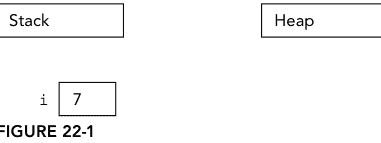

当你使用 `new` 关键字时，内存被分配在堆上。以下代码在栈上创建了变量 `ptr`，然后在堆上分配了 `ptr` 指向的内存。

```cpp
int* ptr;
ptr = new int;
```

图 2-2 显示了执行这段代码后的内存状态。注意，尽管变量 `ptr` 指向堆上的内存，但它仍然在栈上。指针只是一个变量，既可以在栈上，也可以在堆上，尽管这一点很容易被忘记。然而，动态内存总是分配在堆上。


# 与动态内存交互

内存是计算机的一个底层组件，不幸的是，即使在像 C++ 这样高层的编程语言中，它有时也会现身。许多程序员只为了应付而了解动态内存。他们避开使用动态内存的数据结构，或者通过试错来让程序运行。理解动态内存在 C++ 中究竟是如何工作的，对于成为一名专业的 C++ 程序员至关重要。

# 如何想象内存

如果你对内存中对象的样貌有一个心理模型，那么理解动态内存就会简单得多。在本书中，内存单元被显示为一个旁边带有标签的盒子。标签指示对应于内存的变量名。盒子内部的数据显示内存的当前值。

例如，图 22-1 显示了执行以下代码行后的内存状态。该行应位于函数内部，这样 `i` 就是一个局部变量：

```cpp
int i = 7;
```

由于 `i` 是局部变量，它被分配在栈上，因为它被声明为简单类型，而不是使用 `new` 关键字动态分配。


当你使用 `new` 关键字时，内存被分配在堆上。以下代码在栈上创建了变量 `ptr`，然后在堆上分配了 `ptr` 指向的内存。

```cpp
int* ptr;
ptr = new int;
```

图 2-2 显示了执行这段代码后的内存状态。注意，尽管变量 `ptr` 指向堆上的内存，但它仍然在栈上。指针只是一个变量，既可以在栈上，也可以在堆上，尽管这一点很容易被忘记。然而，动态内存总是分配在堆上。


> **警告** 在现代 C++ 中，你应该尽可能避免底层的内存操作，转而使用容器和智能指针等现代构造结构。

# 内存管理概述

内存分配和管理是 C++ 编程中一个特别容易出错的领域。为了编写高质量的 C++ 程序，专业的 C++ 程序员需要理解内存背后的工作原理。本章将探索内存管理的方方面面。你将学习动态内存的陷阱，以及避免和消除这些陷阱的技术。

本章安排在书的最后，是因为在 C++ 中，你应该尽可能避免底层的内存操作。例如，与其使用动态分配的 C 数组，你应该使用 STL 容器（如 `vector`），它们会为你自动处理所有的内存管理。与其使用指针，你应该使用智能指针（如 `unique_ptr` 和 `shared_ptr`），它们会自动释放底层资源（如内存）。你应该尝试避免在代码中调用 `new` 和 `delete` 这样的内存分配函数。当然，这可能是不可行的，而且在现有代码中，情况很可能并非如此，因为专业的 C++ 程序员仍然需要知道内存背后的工作原理。


# Memory Management

## WHAT'S IN THIS CHAPTER?

- Different ways to use and manage memory
- The often-perplexing relationship between arrays and pointers
- A low-level look at working with memory
- Smart pointers and how to use them
- Solutions to a few memory-related problems

## WROX.COM DOWNLOADS FOR THIS CHAPTER

Please note that all the code examples for this chapter are available as a part of this chapter's code download on the book's website at `www.wrox.com/go/proc++3e` on the Download Code tab.

In many ways, programming in C++ is like driving without a road. Sure, you can go anywhere you want, but there are no lines or traffic lights to keep you from injuring yourself. C++, like the C language, has a hands-off approach toward its programmers. The language assumes you know what you're doing. It allows you to do things that are likely to cause problems because C++ is incredibly flexible and sacrifices safety in favor of performance.

Memory allocation and management **is** a particularly error-prone area of C++ programming. To write high-quality C++ programs, professional C++ programmers need to understand how memory works behind the scenes. This chapter explores the ins and outs of memory management. You will learn about the pitfalls of dynamic memory and some techniques for avoiding and eliminating them.

This chapter comes late in the book because in C++ you should avoid low-level memory operations as much as possible. For example, instead of dynamically allocated C-arrays you should use STL containers, such as `vector`, which handle all memory management automatically for you. Instead of using pointers you should use smart pointers, such as `unique_ptr` and `shared_ptr`, which automatically free the underlying resource, such as memory. You should try to avoid calling memory allocation routines such as `new` and `delete` in your code. Of course, it might not be possible, and in existing code it will most likely not be the case, as a professional C++ programmer still needs to know how memory works behind the scenes.

> **WARNING** In modern C++ you should avoid low-level memory operations as much as possible in favor of modern constructs such as containers and smart pointers.

# WORKING WITH DYNAMIC MEMORY

Memory is a low-level component of the computer that sometimes unfortunately rears its head even in a high-level programming language like C++. Many programmers understand only enough about dynamic memory to get by. They shy away from data structures that use dynamic memory, or get their programs to work by trial and error. Understanding how dynamic memory really works in C++ is essential to becoming a professional C++ programmer.

## How to Picture Memory

Understanding dynamic memory is much easier if you have a mental model for what objects look like in memory. In this book, a unit of memory is shown as a box with a label next to it. The label indicates a variable name that corresponds to the memory. The data inside the box displays the current value of the memory.

For example, Figure 2-1 shows the state of memory after the following line is executed. The line should be in a function, so that `i` is a local variable:

```cpp
int i = 7;
```

Since `i` is a local variable, it is allocated on the stack because it is declared as a simple type, not dynamically using the `new` keyword.


When you use the `new` keyword, memory is allocated on the heap. The following code creates variable `ptr` on the stack, and then allocates memory on the heap to which `ptr` points.

```cpp
int* ptr;
ptr = new int;
```


# 内存管理

本章内容简介：

- 使用和管理内存的各种方式
- 数组与指针之间复杂的联系
- 内存操作的底层深度解析
- 智能指针及其使用方法
- 针对若干内存相关问题的解决方案

WROX.COM 本章下载

请注意，本章的所有代码示例均作为本章代码下载的一部分，可以在书籍网站 `www.wrox.com/go/proc++3e` 的“Download Code（下载代码）”选项卡中找到。

在许多方面，使用 C++ 编程就像在没有道路的路况下开车。当然，你可以去任何你想去的地方，但没有标线或交通灯来防止你受伤。C++ 像 C 语言一样，对程序员采取了“放任不管”的方法。这种语言假设你清楚自己在做什么。它允许你执行那些可能导致问题的操作，因为 C++ 极其灵活，并且为了性能牺牲了安全性。

内存分配和管理是 C++ 编程中一个特别容易出错的领域。为了编写高质量的 C++ 程序，专业的 C++ 程序员需要理解内存背后的工作原理。本章将探索内存管理的方方面面。你将学习动态内存的陷阱，以及避免和消除这些陷阱的技术。

本章安排在书的最后，是因为在 C++ 中，你应该尽可能避免底层的内存操作。例如，与其使用动态分配的 C 数组，你应该使用 STL 容器（如 `vector`），它们会为你自动处理所有的内存管理。与其使用指针，你应该使用智能指针（如 `unique_ptr` 和 `shared_ptr`），它们会自动释放底层资源（如内存）。你应该尝试避免在代码中调用 `new` 和 `delete` 这样的内存分配函数。当然，这可能是不可行的，而且在现有代码中，情况很可能并非如此，因为专业的 C++ 程序员仍然需要知道内存背后的工作原理。

> **警告** 在现代 C++ 中，你应该尽可能避免底层的内存操作，转而使用容器和智能指针等现代构造结构。

# 与动态内存交互

内存是计算机的一个底层组件，不幸的是，即使在像 C++ 这样高层的编程语言中，它有时也会现身。许多程序员只为了应付而了解动态内存。他们避开使用动态内存的数据结构，或者通过试错来让程序运行。理解动态内存在 C++ 中究竟是如何工作的，对于成为一名专业的 C++ 程序员至关重要。

# 如何想象内存

如果你对内存中对象的样貌有一个心理模型，那么理解动态内存就会简单得多。在本书中，内存单元被显示为一个旁边带有标签的盒子。标签指示对应于内存的变量名。盒子内部的数据显示内存的当前值。

例如，图 22-1 显示了执行以下行代码后的内存状态。该行应该位于函数内部，这样 `i` 就是一个局部变量：

```cpp
int i = 7;
```

由于 `i` 是局部变量，它被分配在栈上，因为它被声明为简单类型，而不是使用 `new` 关键字动态分配。


当你使用 `new` 关键字时，内存被分配在堆上。以下代码在栈上创建了变量 `ptr`，然后在堆上分配了 `ptr` 指向的内存。

```cpp
int* ptr;
ptr = new int;
```


# 内存管理

本章内容简介：

- 使用和管理内存的各种方式
- 数组与指针之间复杂的联系
- 内存操作的底层深度解析
- 智能指针及其使用方法
- 针对若干内存相关问题的解决方案

## WROX.COM 本章下载

请注意，本章的所有代码示例均作为本章代码下载的一部分，可以在书籍网站 `www.wrox.com/go/proc++3e` 的“Download Code（下载代码）”选项卡中找到。

在许多方面，使用 C++ 编程就像在没有道路的路况下开车。当然，你可以去任何你想去的地方，但没有标线或交通灯来防止你受伤。C++ 像 C 语言一样，对程序员采取了“放任不管”的方法。这种语言假设你清楚自己在做什么。它允许你执行那些可能导致问题的操作，因为 C++ 极其灵活，并且为了性能牺牲了安全性。

内存分配和管理是 C++ 编程中一个特别容易出错的领域。为了编写高质量的 C++ 程序，专业的 C++ 程序员需要理解内存背后的工作原理。本章将探索内存管理的方方面面。你将学习动态内存的陷阱，以及避免和消除这些陷阱的技术。

本章安排在书的最后，是因为在 C++ 中，你应该尽可能避免底层的内存操作。例如，与其使用动态分配的 C 数组，你应该使用 STL 容器（如 `vector`），它们会为你自动处理所有的内存管理。与其使用指针，你应该使用智能指针（如 `unique_ptr` 和 `shared_ptr`），它们会自动释放底层资源（如内存）。你应该尝试避免在代码中调用 `new` 和 `delete` 这样的内存分配函数。当然，这可能是不可行的，而且在现有代码中，情况很可能并非如此，因为专业的 C++ 程序员仍然需要知道内存背后的工作原理。

> **警告** 在现代 C++ 中，你应该尽可能避免底层的内存操作，转而使用容器和智能指针等现代构造结构。

## 与动态内存交互

内存是计算机的一个底层组件，不幸的是，即使在像 C++ 这样高层的编程语言中，它有时也会现身。许多程序员只为了应付而了解动态内存。他们避开使用动态内存的数据结构，或者通过试错来让程序运行。理解动态内存在 C++ 中究竟是如何工作的，对于成为一名专业的 C++ 程序员至关重要。

## 如何想象内存

如果你对内存中对象的样貌有一个心理模型，那么理解动态内存就会简单得多。在本书中，内存单元被显示为一个旁边带有标签的盒子。标签指示对应于内存的变量名。盒子内部的数据显示内存的当前值。

例如，图 22-1 显示了执行以下代码行后的内存状态。该行应该位于函数内部，这样 `i` 就是一个局部变量：

```cpp
int i = 42;
```

图 2-2 显示了执行这段代码后的内存状态。注意，尽管变量 `ptr` 指向堆上的内存，但它仍然在栈上。指针只是一个变量，既可以在栈上，也可以在堆上，尽管这一点很容易被忘记。然而，动态内存总是分配在堆上。


int i = 7;

由于 `i` 是局部变量，它被分配在栈上，因为它被声明为简单类型，而不是使用 `new` 关键字动态分配。


当你使用 `new` 关键字时，内存被分配在堆上。以下代码在栈上创建了变量 `ptr`，然后在堆上分配了 `ptr` 指向的内存。

```cpp
int* ptr;
ptr = new int;
```

图 2-2 显示了执行这段代码后的内存状态。注意，尽管变量 `ptr` 指向堆上的内存，但它仍然在栈上。指针只是一个变量，既可以在栈上，也可以在堆上，尽管这一点很容易被忘记。然而，动态内存总是分配在堆上。


（注：由于原文存在大量重复，译文已提取核心内容。）

# 基础类型数组

当你的程序为数组分配内存时，它分配的是连续的内存块，其中每个块的大小都足够容纳数组的单个元素。例如，可以在栈上如下声明一个包含五个 `int` 的局部数组：

```cpp
int myArray[5];
```

图 22-5 显示了创建数组后的内存状态。在栈（stack）上创建数组时，大小必须在编译时是一个常量值。

> 注意：某些编译器允许在栈上使用变长数组。这并不是 C++ 的标准功能，因此当你看到它时，我建议谨慎地避开。

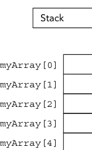

图 22-5

在堆上声明数组并没有区别，只是你使用指针来引用数组的位置。以下代码为包含五个 `int` 的数组分配了内存，并在变量 `myArrayPtr` 中存储指向该内存的指针。

```cpp
int* myArrayPtr = new int[5];
```

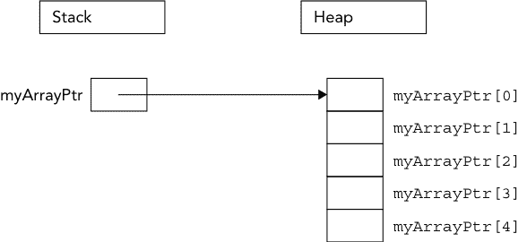

图 22-6

图 22-6 说明，堆数组与栈数组类似，但位于不同的位置。`myArray` 变量指向数组的第 0 个元素。

每次对 `new[]` 的调用都应该与 `delete[]` 调用配对以清理内存。例如：

```cpp
delete [] myArrayPtr;
```

将数组放在堆上的优势是你可以使用动态内存在运行时定义它的大小。示例函数从一个名为 `askerNumberOfOfDocuments()` 的假设函数接收所需的文档数量，并用它创建一个 `Document` 对象的数组。

```cpp
Document createDocArray() {
    int numDocs = askerNumberOfOfDocuments();
    Document* docArray = new Document[numDocs];
    return docArray;
}
```

记住每次对 `new[]` 的调用都应该与 `delete[]` 调用配对，因此在这个例子中，`createDocArray` 的调用者使用 `delete[]` 来清理内存是非常重要的。另一个问题是 C 风格数组不会增长大小，因此 `createDocArray()` 的调用者不知道返回的数组中有多少个元素。

在前面的函数中，`docArray` 是一个动态分配的数组。不要与“动态数组”混淆。数组本身不是动态的，因为它一旦分配，大小就不会改变。动态内存允许你在运行时指定分配块的大小，但它不会自动调整大小以适应数据。

> 注意：存在像 STL 容器这样可以动态调整大小并知道其实大小的数据结构。你应该这些 STL 容器而不是标准数组，因为它们使用起来安全得多。

C++ 中有一个名为 `realloc()` 的函数，它是 C 语言的遗留。不要使用它！在 C 中，`realloc()` 通过分配新内存块、将所有旧数据复制到新位置并删除原始块，来有效地更改数组的大小。这种方法在 C++ 中极其危险，因为用户定义的对象对位拷贝不会有良好的响应。

> 警告：不要在 C++ 中使用 `realloc()`。它不是你的朋友。

## 对象数组

对象数组与简单类型数组没有区别。当你使用 `new[N]` 分配一个包含 N 个对象的数组时，会为 N 个连续块分配足够的空间，每个块的大小足够容纳一个对象。使用 `new[]` 时，每个对象的无参数构造函数将自动被调用。这样，使用 `new[]` 分配的对象数组将返回一个指向完全形成并初始的对象数组的指针。

例如，考虑以下类：

```cpp
class Simple {
public:
    Simple() { cout << "构造函数!" << endl; }
    virtual ~Simple() { cout << "析构函数!" << endl; }
};
```

如果你分配一个包含四个 `Simple` 对象的数组，`Simple` 构造函数会被调用四次。

```cpp
Simple* mySimpleArray = new Simple[4];
```

该数组的内存图如图 22-7 所示。你发现，它与基础类型数组没有区别。

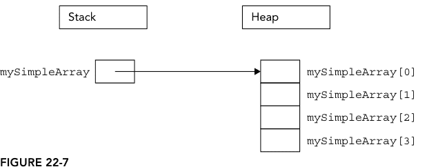

图 22-7

## 删除数组

如前所述，使用数组版本的 `new` (`new[]`) 分配内存时，必须使用数组版本的 `delete` (`delete[]`) 来释放它。该版本在释放关联内存的同时，会自动析构数组中的对象。如果你不使用数组版本的 `delete`，你的程序可能会出现异常。在某些编译器中，数组第 0 个元素的析构函数会被调用，因为编译器只知道你在删除一个指针，而数组的其他元素将丢失。在其他编译器中，可能会发生内存损坏，因为 `new` 和 `new[]` 使用完全不同的内存分配方案。

```cpp
Simple* mySimpleArray = new Simple[4];
// 使用 mySimpleArray;
delete [] mySimpleArray;
mySimpleArray = nullptr;
```

> 警告：对任何使用 `new` 分配的内容使用 `delete`，对任何使用 `new[]` 分配的内容使用 `delete[]`。当然，如果你使用数组版本的 `delete`，会调用析构函数。如果你使用指针版本的 `delete`，只有第一个元素的析构函数会被调用。

## 多维数组

多维数组将索引的概念扩展到多个维度。例如，一个井棋游戏可能会使用二维数组：

```cpp
char board[3][3];
```

你可能在好奇二维数组中的第一个下标是 x 坐标还是 y 坐标。事实是，只要你保持一致，这并不重要。在内存中，二维数组看起来像一个一维数组。

这些技术可以扩展到 N 维数组，尽管高于三维的维度往往难以概念化，在日常应用中也很少用。

## 多维堆数组

如果你需要在运行时确定多维数组的维度，可以使用基于堆的数组。就像单维动态分配数组通过指针访问一样，动态分配的多维数组也通过指针访问。唯一的区别在于，在二维数组中，你需要从指向指针的指针（pointer-to-a-pointer）开始；在 N 维数组中，你需要 N 级指针。起初，看起来声明和分配动态分配多维数组的正确方法如下：

```cpp
char** board = new char[1][]; // 错误 无法编译
```

这段代码无法编译，因为堆数组的工作方式与栈上数组不同。它们的内存布局不是连续的，因此为栈上多维数组分配内存是错误的。相反，你可以开始开始，为堆数组的第一个下标维度分配单个连续的数组。该数组的每个元素实际上都是指向另一个数组的指针，该数组存储了第二个下标维度的元素。这种两个动态分配数组的布局如图 22-11 所示。

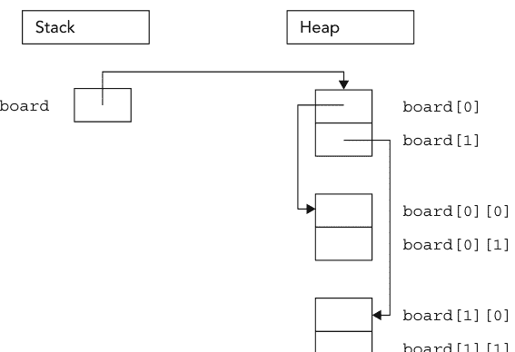

图 22-11

不幸的是，编译器不会为你代表子数组分配内存。你可以像对待单维堆数组一样分配第一维数组，但各个子数组必须显式地分配。以下函数正确地为二维数组分配内存：

```cpp
char** allocateCharacterBoard(size_t xDimension, size_t yDimension) {
  char** myArray = new char*[xDimension]; // 分配第一维
  for (size_t i = 0; i < xDimension; i++) {
    myArray[i] = new char[yDimension]; // 分配第 i 个子数组
  }
  return myArray;
}
```

当你释放与多维堆数组相关的内存时，`delete []` 语法不会替你清理子数组。你释放数组的代码应该与分配代码形成镜像，如下函数所示：

```cpp
void releaseCharacterBoard(char** myArray, size_t xDimension) {
    for (size_t i = 0; i < xDimension; i++) {
        delete [] myArray[i]; // 删除第 i 个子数组
    }
    delete [] myArray; // 删除第一维
}
```

> 警告 既然你已经了解了所有处理数组的细节，建议尽可能避免使用这些旧的 C 风格数组，因为它们没有提供任何内存安全。在这里解释它们是因为你会在遗留代码中遇到它们。在新代码中，你应该使用 C++ STL 容器，如 `std::array`、`std::vector`、`std::list` 等。例如，使用 `vector<T>` 处理一维动态数组。使用 `vector<vector<T>>` 处理二维数组，依此类推。

# 使用指针

指针之所以声誉不佳，是因为滥用它们变得相对容易。因为指针仅仅只是一个内存地址，理论上你可以手动更改该地址，甚至执行像下面这行代码那样可怕的操作：

```cpp
char* scaryPointer = (char*)7;
```

上一行代码构建了一个指向内存地址 7 的指针，这很可能是随机垃圾数据或应用程序其他地方使用的内存。如果你开始使用并非通过 `new` 为你预留的内存地址，最终将损坏与对象相关的内存，或涉及堆管理的内存，导致你的程序发生故障。故障可以以多种方式表现出来。例如，它可能表现为由于数据损坏导致的无效结果，或者由于访问不存在的内存而触发硬件异常，或者尝试写入受保护的内存。如果你运气好，你会得到其中一个通常会导致操作系统或 C++ 运行时库终止程序的严重错误；如果你运气不佳，你将只会得到一个错误的结果。

## 指针的心理模型

关于指针有两种种思考方式。更具数学思维的读者可能会将指针视为地址。这种观点使得本章稍后介绍的指针算术稍微更容易理解。指针不是穿过内存的神秘路径；它们是恰好对应于内存位置的数字。图 22-12 展示了基于地址的世界视图中的一个二乘二网格。

| 栈 (Stack) | 堆 (Heap) |
|---|---|
| board 1000 | 2000 |
| | 5000 |

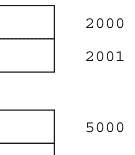

图 22-12

> 注意 图 22-12 中的地址仅用于说明之目的。真实系统上的地址高度依赖于你的硬件和操作系统。

更习惯于空间表示的读者可能会从指针的“箭头”视图中获得更多益处。指针是一个间接层，它告诉程序：“嘿！看那里。”通过这种观点，多级指针就变成了通往数据路径上的独立步骤。图 22-11 显示了内存中指针的图形化视图。

当你使用 `*` 运算符对指针进行解引用时，你是在告诉程序深入某一层。在图形视图中，解引用指针是箭头指向的地方。在地址视图中，解引用指针是获取该地址的值。在地址视图中，解引用指针是根据该地址访问所指向的内存。在图形视图中，解引用指针是访问该地址。在图形视图中，解引用指针是

## 指针转换

由于指针仅仅是内存地址（或哪里），它们是类型弱的。C 风格转换允许让你将指针转换为任何指针类型。

720 | 22 章 内存管理

`static_cast` 提供了更多的安全性。编译器拒绝对不同数据类型的指针执行静态转换：

```cpp
Document* documentPtr = getDocument();
char* myCharPtr = static_cast<char*>(documentPtr); // 错误！无法编译
```

如果你要转换的两个指针实际上通过继承相关的对象，编译器将允许静态转换。然而，在继承层次结构中，动态转换是一种更安全的方法。详情请参阅第 10 章。

## 数组与指针的相似性

你已经看到指针和数组之间的一些重叠。堆分配的数组通过其第一个元素的指针引用。栈数组通过使用数组语法配合普通的变量声明来引用。正如你即将学到的，然而，重叠并不于此。

### 数组就是指针！

```cpp
int myArray[10];
int* myPtr = myArray;
// 通过指针访问数组。
myPtr[4] = 5;
```

通过指针引用栈数组的能力在将数组传递给函数时非常有用。以下函数复制数组中的所有整数。注意，调用者需要显式传递数组的大小，因为指针并不包含任何大小信息。事实上，任何形式的 C++ 数组（无论指针与否）都没有内置的大小概念。这就是为什么你应该使用 STL 提供的现代容器。

```cpp
void doubleInts(int* theArray, size_t inSize) {
    for (size_t i = 0; i < inSize; i++) {
        theArray[i] *= 2;
    }
}
```

# 数组与指针的对偶性 | 721

变量作为指向数组的指针，你也可以显式地传递第一个元素的地址。这里展示了这三种形式：

```cpp
size_t arrSize = 4;
int* heapArray = new int[arrSize]{ 1, 5, 3, 4 };
doubleInts(heapArray, arrSize);
delete [] heapArray;
heapArray = nullptr;
```

```cpp
int stackArray[] = { 5, 7, 9, 11 };
arrSize = sizeof(stackArray) / sizeof(stackArray[0]);
doubleInts(stackArray, arrSize);
doubleInts(stackArray[0], arrSize);
```

数组的参数传递语义与指针非常相似，因为当数组传递给函数时，编译器会将其视为指针。如果函数接收数组作为参数并修改其值，它实际上修改的是原始数组，而不是拷贝。像指针一样，传递数组实际上模拟了引用传递的功能；你传递给函数的是原始数组的地址，而不是拷贝。以下 `doubleInts()` 的实现即使参数是数组而非指针，也会修改原始数组：

```cpp
void doubleInts(int theArray[], size_t inSize) {
  for (size_t i = 0; i < inSize; i++)
    theArray[i] *= 2;
}
```

在函数原型中 `theArray` 之前的任意数量的括号都会被忽略。以下三个版本是相同的：

```cpp
void doubleInts(int* arrArray, size_t inSize);
void doubleInts(int theArray[], size_t inSize);
void doubleInts(int theArray[2], size_t inSize);
```

你可能会疑惑为什么是这样工作的。为什么在函数定义中使用数组语法时，编译器不拷贝数组？这是为了效率——拷贝数组元素需要时间，而且它们会占用大量内存。通过始终传递指针，编译器不需要拷贝数组。

有一种方法向函数传递已知长度的栈数组的“引用”，虽然这种语法并不直观。这不适用于堆数组。例如，下面的 `doubleIntStack()` 仅接受大小为 4 的栈数组：

```cpp
void doubleIntStack(int theArray[4]);
```

可以使用模板让编译器自动推导出栈数组的大小：

```cpp
template<size_t N>
void doubleIntStack(int (&theArray)[N]) {
  for (size_t i = 0; i < N; i++) {
    theArray[i] *= 2;
  }
}
```

总结来说，使用数组语法声明的数组可以通过指针访问。当数组被传递给函数时，它总是作为指针进行传递的。

### 并非所有指针都是数组！

由于编译器允许你在需要指针的地方传递数组，在前面所示的 `doubleInts()` 函数中，人们可能会误认为指针和数组是相同的。事实上，它们之间存在细微且重要的区别。指针和数组共享许多属性，有时可以互换使用（如前文所示），但它们并不是一回事。

指针本身是无意义的。它指向随机内存、单个对象或数组。你始终可以对指针使用数组语法，但这样做并不总是恰当的，因为指针不是数组。例如，考虑以下代码：

```cpp
int* ptr = new int;
```


指针 `ptr` 是一个有效指针，但它不是数组。你可以使用数组语法（`ptr[0]`）访问所指向的值，但这样做在风格上是值得怀疑的，并且没有实际益处。事实上，对非数组指针使用数组语法是引入 Bug 的万根源。`ptr[1]` 处的内存可以是任何值！

> 警告：数组会被自动作为指针引用，但并非所有指针都是数组。

# 底层内存操作

C++ 优于 C 的巨大优势之一是，你不需要那么担心内存。如果你使用对象，只需要确保每个类都妥善地管理自己的内存。通过构造和析构，编译器通过告诉你何时何时操作来帮助你管理内存。在类内部隐藏内存管理会有巨大的差异，STL 就证明了这一点。在某些应用程序或遗留代码中，你可能需要从更低层次处理内存。然而，对于遗留代码、效率、调试或好奇，了解一些处理原始字节的技术是有帮助的。

## 指针算术

C++ 编译器使用声明的类型允许你执行指针算术。如果你声明一个指针并将其增加 1，指针在内存中移动的距离是一个 `int` 的大小，而不是一个字节。这种操作对于数组最有用，因为数组包含了在内存中顺序排列的同质数据。例如，假设你在堆上声明了一个数组：

```cpp
int* myArray = new int[8];
```

你已经熟悉了以下设置位置 2 值的语法：

```cpp
myArray[2] = 33;
```

通过指针算术，你可以等效地使用以下语法，它获取位于 `myArray` 两个 `int` 之后的指针并对其解引用以设置值：

```cpp
*(myArray + 2) = 33;
```

作为访问元素的替代语法，指针算术似乎并不很有吸引力。真正的力量在于，像 `myArray + 2` 这样的表达式仍然是一个指针。

```cpp
const char* myString = "Hello";
```

然而，如果你只需要处理内存部分，指针算术可以标记 `myString`。指针算术的另一种应用是释放的：

```cpp
myString = "World";
```

```cpp
myString = "12";
```

```cpp
myString = "123";
```

```cpp
myString = "1234567";
```

```cpp
myString = "123456789";
```

```cpp
myString = "1234567890";
```

```cpp
myString = "123456789012";
```

```cpp
myString = "12345678901234";
```

```cpp
myString = "1234567890123456";
```

```cpp
myString = "123456789012345678";
```

```cpp
myString = "1234567890123456789";
```

```cpp
myString = "1234567890123456789012";
```

```cpp
myString = "123456789012345678901234";
```

```cpp
myString = "12345678901234567890123456";
```

```cpp
myString = "1234567890123456789012345678";
```

```cpp
myString = "123456789012345678901234567890";
```

## 自定义内存管理

C++ 优于 C 的巨大优势之一是，你不需要那么担心内存。如果你使用对象，你只需要确保每个类都妥善地管理自己的内存。通过构造和析构，编译器通过告诉你何时何时操作来帮助你管理内存。在类内部隐藏内存管理会有巨大的差异，STL 就证明了这一点。在某些应用程序或遗留代码中，你可能需要从更低层次处理内存。然而，对于遗留代码、效率、调试或好奇，了解一些处理原始字节的技术是有帮助的。

## 指针算术

C++ 编译器使用声明的类型允许你执行指针算术。如果你声明一个指针并将其增加 1，指针在内存中移动的距离是一个 `int` 的大小，而不是一个字节。这种操作对于数组最有用，因为它们包含了在内存中顺序排列的同质数据。例如，假设你在堆上声明了一个数组：

```cpp
int* myArray = new int[8];
```

你已经熟悉了以下设置位置 2 值的语法：

```cpp
myArray[2] = 33;
```

通过指针算术，你可以等效地使用以下语法，它获取位于 `myArray` 两个 `int` 之后的指针并对其解引用以设置值：

```cpp
*(myArray + 2) = 33;
```

作为访问元素的替代语法，指针算术似乎并不很有吸引力。真正的力量在于，像 `myArray + 2` 这样的表达式仍然是一个指针。

```cpp
const char* myString = "Hello";
```

然而，如果你只需要处理内存部分，指针算术可以标记 `myString`。指针算术的另一种应用是释放的：

```cpp
myString = "World";
```

```cpp
myString = "12";
```

```cpp
myString = "123";
```

```cpp
myString = "1234567";
```

```cpp
myString = "123456789";
```

```cpp
myString = "1234567890";
```

```cpp
myString = "123456789012";
```

```cpp
myString = "12345678901234";
```

```cpp
myString = "1234567890123456";
```

```cpp
myString = "123456789012345678";
```

```cpp
myString = 7
```

```cpp
myString = "1234567890123456789012";
```

```cpp
myString = "123456789012345678901234";
```

```cpp
myString = "1234567890123456789012345678";
```

```cpp
myString = "123456789012345678901234567890";
```

## 自定义内存管理

对于 99% 的情况，内置的内存管理是足够的。在背后，`new` 和 `delete` 完成了工作。当内存限制极其紧张时，在非常特殊的情况下，如共享内存，实现内存管理可能是可行的。不要担心——这听起来并不那么可怕。当你自己管理内存时，你需要分配内存块。

这种方法比 `delete` 有什么好吗？当你使用 `new` 分配内存时，它留出了一小部分空间来记录。

# 垃圾回收

在内存卫生的另一端是垃圾回收。在支持垃圾回收的环境中，程序员很少甚至从不释放对象相关的内存。不再有引用的对象会在未来的某个时间自动清理。

垃圾回收并没有内置在 C++ 中，像 C# 和 Java 那样。在现代 C++ 中，你使用智能指针来管理内存，而在遗留代码中，你通过 `new` 和 `delete` 看到内存管理。在 C++ 中实现垃圾回收是可能的，释放内存的任务可能会引入新的头疼问题。

一种垃圾回收方法被称为“标记-清除”。在这种方法下，垃圾回收器定期检查程序中的每一个指针，并标记引用的内存仍在在使用。周期结束时，任何未标记的内存都会被认为在使用并被释放。

标记-清除算法可以在 C++ 中实现，如果你执行以下操作：

1. 将所有指针注册到垃圾回收器，以便它可以轻松遍历指针列表。
2. 所有对象派生自一个混合类（例如 `GarbageCollectible`），允许垃圾回收器标记对象为正在使用。
3. 通过确保在垃圾回收器运行时不发生指针的变化来保护并发访问。

如你所见，这种垃圾回收方法需要程序员非常勤奋。它甚至可能比使用 `delete` 更容易！

# 对象池

垃圾回收就像为野餐买盘子，并将用过的盘子留在院子里，风会方便地把它们吹到邻居的院子里。肯定有更生态的内存管理方法。

对象池类似于回收利用。你购买合理数量的盘子，在使用盘子后，将其清洗以便重复使用。对于那些随时间推移需要使用许多相同类型的对象，且创建每个对象都会产生开销的情况，对象池是理想的。

第 25 章包含了关于使用对象池提高性能效率的更多细节。

# 函数指针

你通常不会考虑函数在内存中的位置，但每个函数实际上位于一个特定的地址。在 C++ 中，你可以将函数作为数据。换句话说，获取函数的地址并像使用变量一样使用它。

函数指针根据兼容函数的参数类型和返回值进行类型。使用函数指针的一种方法是使用类型别名，如第 10 章所述。类型别名允许你为具有特定特征的函数族命名。例如，以下行定义了一个类型 `MatchFcn`，它代表指向任何有两个参数并返回 `bool` 的函数的指针：

```cpp
using MatchFcn = bool (*)(int, int);
```

此别名等同于以下旧式的、可读性较差的 `typedef`：

```cpp
typedef bool (*MatchFcn)(int, int);
```

既然这个类型存在了，你可以写一个接受 `MatchFcn` 作为参数的函数。例如，以下函数接受两个数组及其大小，以及一个 `MatchFcn`。它并行遍历数组，并在两个数组的相应元素上调用 `MatchFcn`，如果 `MatchFcn` 返回 `true`，则打印消息。即使 `MatchFcn` 是通过变量传递的，也可以像调用普通函数一样调用它：

```cpp
void findMatches(int values[], int values2[], int numValues, MatchFcn inFunc)
```

注意，这种实现要求两个数组都至少包含 `numValues` 个元素。要调用 `findMatches()` 函数，你只需要任何符合所定义的 `MatchFcn` 类型的函数即可，即任何接收两个 `int` 并返回 `bool` 的类型。例如，考虑以下函数，如果两个参数相等则返回 `true`：

```cpp
bool intEqual(int int1, int int2)
{
    return int1 == int2;
}
```

由于 `intEqual()` 函数匹配 `MatchFcn` 类型，它可以作为第一个参数传递给 `findMatches()`，如下：

```cpp
int arr1[] = { 2, 5, 6, 9, 10, 1, 1 };
int arr2[] = { 4, 4, 2, 0, 3, 4 };
int arrSize = sizeof(arr1) / sizeof(arr1);
findMatches(arr1, arr2, arrSize, intEqual);
```

技术上讲，`intEqual()` 函数通过获取其地址传递给 `findMatches()`。如果你输入函数名，编译器将知道你想获取其地址。输出是：

```
Calling findMatches() using intEqual():
Match found at position 3
```

函数指针的优势在于 `findMatches()` 是一个并行比较数组中值的通用函数。如上所示，它根据相等性进行比较。然而，因为它接受函数指针，它可以根据其他标准进行比较。例如，以下函数也符合 `MatchFcn` 的定义：

```cpp
bool bothOdd(int int1, int int2)
{
    return int1 % 2 == 1 && int2 % 2 == 1;
}
```

以下代码调用 `findMatches()` 使用 `bothOdd`：

```cpp
cout << "Calling findMatches() using bothOdd():" << endl;
findMatches(arr1, arr2, arrSize, bothOdd);
```

输出是：

```
Calling findMatches() using bothOdd():
Match found at position 3
Match found at position 5, 3)
```

通过使用函数指针，单个函数 `findMatches()` 可以根据参数 `inFunc` 用于不同的用途。

> 注意：除了使用这些旧式的函数指针，你还可以使用 `std::function`，它在第 19 章中解释。

# 方法和数据成员指针

你可以创建并使用指向变量和函数的指针。现在考虑指向类成员的指针。在 C++ 中获取类成员的地址是完全合法的。但是，没有对象就无法访问非静态数据成员或非静态方法。类成员和方法的要点在于它们是基于对象的。当你想要通过指针访问数据成员时，必须在对象的上下文中解引用指针。这是一个示例：

```cpp
SpreadsheetCell myCell(123);
double (SpreadsheetCell::*methodPtr) const = &SpreadsheetCell::getValue;
cout << myCell.*methodPtr() << endl;
```

不要对语法感到困惑。该声明了一个类型为指向 `SpreadsheetCell` 非静态方法的变量 `methodPtr`，它不接受参数并返回 `double`。同时，它将该变量初始化为类的 `getValue()` 方法。在这种情况下，需要 `&`。第三行调用了 `myCell` 对象上的 `getValue()` 方法（通过 `methodPtr`）。括号的使用是必要的，因为 `()` 的优先级高于 `*`。

第二行可以使用类型别名简化：

```cpp
SpreadsheetCell myCell(123);
using PtrToGet = double (SpreadsheetCell::*) const;
PtrToGet methodPtr = &SpreadsheetCell::getValue;
cout << myCell.*methodPtr() << endl;
```

使用 `auto` 可以进一步简化：

```cpp
SpreadsheetCell myCell(123);
auto methodPtr = &SpreadsheetCell::getValue;
cout << myCell.*methodPtr() << endl;
```


方法和数据成员指针通常出现在你的程序中。然而，重要的是记住，没有对象就无法解引用指向非静态方法或数据成员的指针。你经常发现自己想要尝试诸如将非静态方法的指针传递给像 `qsort()` 这样需要函数指针的函数，但这行不通的。

> 注意：除了使用这些旧式的函数指针，你还可以使用 `std::function`，它在第 19 章中解释。

# 智能指针

C++ 中的内存管理是错误的持久之源。许多错误源于动态分配的使用。当你多次使用动态内存时，会导致损坏；当你忘记释放分配的内存时，会导致内存泄漏。

智能指针帮助你管理分配的内存，是避免内存泄漏的推荐技术。智能指针的概念源于这样一个事实：通过将所有内容放在栈上，可以避免大多数内存相关问题。栈比堆安全得多，因为栈变量在离开作用域时会自动销毁并清理。智能指针提供了栈的安全性和堆的灵活性。智能指针有几种类型。最简单的智能指针类型获取内存的所有权并。

然而，管理指针提出的问题比记住离开作用域时删除要多。多个对象或代码段包含同一个指针的副本。这被称为别名。为了正确释放所有内存，最后使用内存的代码段应该对其调用 `delete`。确定你的代码何时最后使用内存通常很困难。依赖运行时输入可能是可能的。因此，一种复杂的智能指针实现了引用计数来跟踪它的。当所有所有者都完成该指针时，引用数降为 0，智能指针对其调用 `delete`。稍后讨论的标准 `shared_ptr` 智能指针包含了引用计数。熟悉这个概念是重要的。

## 旧的弃用 auto_ptr

旧的、C++11 之前的标准库包含了智能指针的基本实现，称为 `auto_ptr`。遗憾的是，`auto_ptr` 有一些缺点。这些缺点之一是在 STL 容器（如 `vector`）中使用时它无法正常工作。C++ 现在已经废弃了 `auto_ptr` 并用 `unique_ptr` 和 `shared_ptr` 取而代之了它，后者将在下一节讨论。这里提到 `auto_ptr` 是为了确保你了解它，并确保你永远不要使用它。

> 警告：不要再使用旧的 `auto_ptr` 智能指针了。请使用 `unique_ptr` 或 `shared_ptr`！

## unique_ptr 和 shared_ptr 智能指针

`shared_ptr` 和 `unique_ptr` 的区别在于，`shared_ptr` 是一个引用计数的智能指针，而 `unique_ptr` 不是引用计数的。这意味着你可以有多个 `shared_ptr` 实例指向同一个动态分配的内存，并且只有当最后一个 `shared_ptr` 离开作用域时，内存才会被释放。`shared_ptr` 同样是线程安全的。关于多线程的讨论，请参阅第 23 章。

`unique_ptr` 则意味着所有权。当唯一的 `unique_ptr` 离开作用域时，底层内存会被释放。

你的默认智能指针应该是 `unique_ptr`。当你需要共享资源时，仅使用 `shared_ptr`。

两种智能指针都要求你包含 `<memory>` 头文件。

> 永远不要将内存分配的结果给原始指针。无论你使用哪种内存分配方法，始终将内存交给智能指针 `unique_ptr` 或 `shared_ptr`。

### unique_ptr

作为原则，始终将动态分配的对象存储在栈的 `unique_ptr` 实例中。例如，考虑以下函数，它通过在堆上分配 `Simple` 对象并忽略释放它导致内存泄漏：

```cpp
void leaky() {
    Simple* mySimplePtr = new Simple(); // BUG！内存从未释放！
    mySimplePtr->go();
}
```

有时你可能认为你的代码正确释放了动态分配的内存。遗憾的是，在某些情况下并非如此。考虑以下函数：

```cpp
void couldBeaky() {
    Simple* mySimplePtr = new Simple();
    mySimplePtr->go();
    delete mySimplePtr;
}
```

上面的函数分配了 `Simple` 对象，使用了它，然后正确调用了 `delete`。然而，如果 `go()` 方法抛出异常，`delete` 的调用将不会执行，导致内存泄漏。

在这两种情况下都使用了 `unique_ptr`。对象没有被显式删除；但当 `unique_ptr` 实例离开作用域时（函数结束或由于抛出异常），它会在析构函数中自动释放 `Simple` 对象：

```cpp
void notLeaky() {
    auto mySmartPtr = make_unique<Simple>();
    mySmartPtr->go();
}
```

这段代码使用了 C++14 的 `make_unique()` 结合 `auto` 关键字，以便你只需要指定一次指针类型。如果 `Simple` 构造函数需要参数，请将它们放在 `make_unique()` 调用括号中。

如果你的编译器不支持 `make_unique()`，你可以如下所示创建 `unique_ptr`。注意 `Simple` 必须提到两次：

```cpp
unique_ptr<Simple> mySmartPtr(new Simple());
```

> 警告：如果你的编译器支持，始终使用 `make_unique()` 来创建 `unique_ptr`。

智能指针最大的特性之一是它们提供了巨大的好处，而不需要用户学习 `new` 的语法。如前面的代码所示，智能指针仍然像标准指针一样解引用（使用 `*` 或 `->`）。

`unique_ptr` 适用于存储动态分配的 C 风格数组。例如，以下示例创建一个持有 10 个整数的动态分配 C 风格数组的 `unique_ptr`：

```cpp
auto myVariableSizedArray = make_unique<int[]>(10);
```

虽然可以使用 `unique_ptr` 存储 C 风格数组，但建议使用 STL 容器，如 `std::array` 或 `std::vector`。

默认情况下，`unique_ptr` 使用 `new` 和 `delete` 运算符来分配和释放内存。你可以如下所示改变这种行为：

```cpp
int* malloc_int(int value) {
    int* p = (int*)malloc(sizeof(int));
    *p = value;
    return p;
}

int main() {
    auto deleter = [](int* p){ free(p); };
    unique_ptr<int, decltype(deleter)> mySmartPtr(malloc_int(42), deleter);
    return 0;
}
```

这段代码通过 `malloc_int()` 为整数分配内存。`unique_ptr` 通过调用命名的 lambda `deleter` 来释放内存，它使用了标准的 `free()` 函数。正如之前一样，在 C++ 中你不应该使用 `malloc()` 而应该使用 `new`。然而，`unique_ptr` 的这个功能是可用的，因为它有助于管理内存外的资源。例如，当 `unique_ptr` 离开作用域时，它可以自动关闭文件、网络套接字或任何内容。

遗憾的是，`unique_ptr` 自定义析构函数的语法有点笨拙。使用 `shared_ptr` 自定义析构函数要简单得多。关于 `shared_ptr` 的后续章节将演示如何使用 `shared_ptr` 在离开作用域时自动关闭文件。

### shared_ptr

`shared_ptr` 的用法与 `unique_ptr` 类似。要创建一个，你使用 `make_shared()`，它比直接创建 `shared_ptr` 更高效。

```cpp
auto mySmartPtr = make_shared<Simple>();
```

> 警告：始终使用 `make_shared()` 来创建 `shared_ptr`。

与 `unique_ptr` 的区别在于，`shared_ptr` 不能用于存储动态分配的 C 风格数组的指针。

> 警告：永远不要使用 `shared_ptr` 管理 C 风格数组的指针。使用 `unique_ptr` 管理 C 风格数组，或者最好使用 STL 容器代替 C 风格。

以下函数可转换 `shared_ptr`：`const_pointer_cast()`、`dynamic_pointer_cast()` 和 `static_pointer_cast()`。例如，假设你有一个基类 `Base` 和一个派生自 `Base` 的派生类 `Derived`。

```cpp
shared_ptr<Base> myBase(new Derived);
shared_ptr<Derived> myDerived = dynamic_pointer_cast<Derived>(myBase);
```

与 `unique_ptr` 一样，`shared_ptr` 使用 `new` 和 `delete` 运算符来分配和释放内存。你可以如下所示改变这种行为：

```cpp
int malloc_int(int value) {
    int* p = (int*)malloc(sizeof(int));
    *p = value;
    return p;
}

int main() {
    auto deleter = [](int* p){ free(p); };
    shared_ptr<int, decltype(deleter)> mySmartPtr(malloc_int(42), deleter);
    return 0;
}
```

这段代码通过 `malloc_int()` 为整数分配内存。`shared_ptr` 通过调用命名的 lambda `deleter` 来释放内存，它使用了标准的 `free()` 函数。正如之前所述，在 C++ 中你不应该使用 `malloc()` 而应该使用 `new`。然而，`shared_ptr` 的这个功能是可用的，因为它有助于管理内存外的资源。

#### 使用 shared_ptr 自动关闭文件

```cpp
void CloseFile(FILE* filePtr) {
    if (filePtr == nullptr)
        return;
    fclose(filePtr);
    cout << "File closed." << endl;
}

int main() {
    FILE* f = fopen("data.txt", "w");
    shared_ptr<FILE> filePtr(f, CloseFile);
    if (filePtr == nullptr) {
        cerr << "Error opening file." << endl;
    } else {
        cout << "File opened." << endl;
    }
    return 0;
}
```

### 引用计数的必要性

作为一个通用概念，引用计数是跟踪类或特定对象实例数量的技术。引用计数智能指针可以指向真实的指针或对象。通过这种方式，智能指针避免了双重删除。

删除问题很容易引发。考虑以下类 `Nothing`，它在对象创建和销毁时打印消息：

```cpp
class Nothing {
public:
    Nothing() { cout << "Nothing::Nothing()" << endl; }
    virtual ~Nothing() { cout << "Nothing::~Nothing()" << endl; }
};
```

如果你如下所示创建两个标准的 `shared_ptr` 并且都指向同一个 `Nothing` 对象，智能指针会在它们离开作用域时尝试删除该对象：

```cpp
void doubleDelete() {
    Nothing* myNothing = new Nothing();
    shared_ptr<Nothing> smartPtr1(myNothing);
    shared_ptr<Nothing> smartPtr2(myNothing);
}
```

取决于你的实现，这段代码可能会崩溃！如果你得到了该输出，输出可能是：

```text
Nothing::Nothing()
Nothing::~Nothing()
Nothing::~Nothing()
```

哎呀！一次构造函数调用和两次析构函数调用？你在 `unique_ptr` 和旧的弃用的 `auto_ptr` 中也会遇到同样的问题。你可能会惊讶，甚至连引用计数的 `shared_ptr` 类也会表现出这种行为。然而，根据 C++ 标准，这是正确的行为。你不应该像之前的 `doubleDelete()` 函数那样使用 `shared_ptr` 创建两个指向同一对象的 `shared_ptr`。相反，你应该使用 `make_shared()`，并使用拷贝构造函数来创建副本，如下：

```cpp
void noDoubleDelete() {
    auto smartPtr1 = make_shared<Nothing>();
    shared_ptr<Nothing> smartPtr2(smartPtr1);
}
```

这段代码的输出：

```text
Nothing::Nothing()
Nothing::~Nothing()
```

尽管有两个 `shared_ptr` 指向同一个 `Nothing` 对象，但 `Nothing` 对象只被销毁了一次。记住 `unique_ptr` 不是引用计数的。事实上，`unique_ptr` 不允许你像 `noDoubleDelete()` 函数那样使用拷贝构造函数。

> 注意：如果你通过拷贝、赋值或将作为值参数传递给函数来使用智能指针，那么 `shared_ptr` 是完美的解决方案。

如果你确实需要编写像之前的 `doubleDelete()` 函数中的代码，你将需要为共享资源实现自己的智能指针模板。只需避免像 `doubleDelete()` 函数那样的代码，并改用拷贝构造函数：

```cpp
shared_ptr<Nothing> smartPtr2(smartPtr1);
```

## 移动语义

`shared_ptr` 和 `unique_ptr` 都支持第 10 章讨论的移动语义，以提高它们的效率。正因如此，从函数返回 `shared_ptr` 或 `unique_ptr` 也是高效的。例如，你可以编写以下 `func()` 函数，并在 `main()` 中演示：

```cpp
// 为了简单起见，未显示 Simple 的定义
shared_ptr<Simple> func() {
    auto ptr = make_shared<Simple>();
    // 对 ptr 进行一些操作...
    return ptr;
}

int main() {
    shared_ptr<Simple> mySmartPtr = func();
    return 0;
}
```

这是高效的，因为 C++ 会在 `func()` 的返回语句中自动调用 `std::move()`，从而触发 `shared_ptr` 的移动。如果你使用 `unique_ptr` 代替 `shared_ptr`，情况也是一样的。`unique_ptr` 不支持普通的拷贝赋值运算符和拷贝构造函数，但它支持移动赋值运算符和移动构造函数，这解释了为什么你可以从函数返回 `unique_ptr`。

看以下 `unique_ptr` 语句：

```cpp
auto p1 = make_unique<int>(42);
unique_ptr<int> p2 = p1;           // 错误：无法编译
unique_ptr<int> p3 = move(p1);     // 正确
```


定义 `p2` 的行将无法编译，因为它试图使用拷贝构造函数，而 `unique_ptr` 不可用该构造函数。`p3` 的定义是正确的，因为使用了 `std::move()`（定义在 `<utility>` 头文件中，见第 10 章）来触发 `unique_ptr` 的移动构造函数。在创建 `p3` 后，它被重置为 `nullptr`，你将只能通过 `p3` 访问整数 42；所有权已从 `p1` 移动到 `p3`。

# weak_ptr

C++ 中还有一个与 `shared_ptr` 相关的类叫做 `weak_ptr`。`weak_ptr` 可以包含指向由 `shared_ptr` 管理的内存的引用。`weak_ptr` 不拥有内存，因为 `shared_ptr` 被阻止释放该内存。`weak_ptr` 不会销毁指向的内存，但可以用于判断关联的 `shared_ptr` 是否已释放内存。要访问 `weak_ptr` 中存储的指针，你需要将其转换为 `shared_ptr`。实现这一点有两种方法：

- 在 `weak_ptr` 实例上使用 `lock()` 方法，它返回一个 `shared_ptr`，或者
- 创建一个新的 `shared_ptr` 实例，并将 `weak_ptr` 作为参数传递给 `shared_ptr` 构造函数。

在这两种情况下，如果与 `weak_ptr` 关联的 `shared_ptr` 在此已经被释放，则新的 `shared_ptr` 将是 `nullptr`。

# 常见的内存陷阱

很难确定导致内存相关错误的具体情况。每个内存泄漏或坏指针都有其细微差别。解决内存问题没有万能妙药，但有几种常见的问题类型以及你可以用来检测和解决这些问题的工具。

## 字符串分配不足

C 风格字符串最常见的问题是分配不足。在大多数情况下，这是由于程序员未能为末尾的 `'\0'` 哨兵字符分配额外的字符导致的。当程序员假设一个固定最大大小时，也会发生字符串分配不足。基础的内置 C 风格函数并不遵守固定大小——它们会乐意地将字符串末尾写入未授权的内存中。

以下代码演示了分配不足。它从网络连接读取数据并放入 C 风格字符串中。这是在循环中进行的，因为网络连接每次只接收少量数据。在每次循环中，都会调用 `getData()`，它返回一个指向动态分配内存的指针。当 `getData()` 返回 `nullptr` 时，所有数据均已接收。`strcat()` 是一个 C 函数，将作为第二个参数提供的 C 风格字符串连接到作为第一个参数提供的 C 风格字符串的末尾。它期望目标缓冲区足够大。

```cpp
char buffer[1024] = {0}; // 分配大量的空间

while (true) {
  char* nextChunk = getData();
  if (nextChunk == nullptr) {
    break;
  } else {
    strcat(buffer, nextChunk); // 错误！
    delete nextChunk;
  }
}
```

解决分配不足有三种方法。按偏好程度递减为：

1. 使用管理所有内存的 C++ 字符串。
2. 代替在栈上分配内存，在堆上分配。
3. 创建获取缓冲区大小的 `getData()` 版本。

## 访问越界内存

在本章前面的部分，你读到过指针是一个内存地址，它可能指向随机位置。这种情况很容易掉入。例如，以下函数填充字符串为：

```cpp
void fillWith(char* inStr) {
  int i = 0;
  while (inStr[i] != '\0') {
    inStr[i] = 'm';
    i++;
  }
}
```

如果未正确终止的字符串被覆盖导致程序崩溃，考虑关联对象的内存可能会发生什么。越数组边界的通常被称为缓冲区溢出错误。此类漏洞已被多个著名的恶意软件利用；例如病毒和蠕虫。恶意黑客可以利用覆盖内存的能力向运行程序注入代码。

许多内存检查工具可以检测缓冲区溢出。此外，使用 C++ 字符串和向量等高级构造有助于防止与写入 C 风格字符串和数组相关的错误。

> 警告：避免没有任何保护的旧式字符串和数组。相反，使用现代且安全的 C++ 字符串和向量，它们会管理所有的内存。

## 内存泄漏

寻找和修复内存泄漏可能是 C++ 编程中最令人沮丧的部分之一。你的程序终于运行并似乎得到了正确的结果。然后，你注意到程序随着运行消耗了越来越多的内存。使用智能指针来避免内存泄漏是解决问题的良好方法。

内存泄漏发生在你分配内存但忘记释放它时。起初，似乎如果你写的代码中每个 `new` 都有对应的 `delete`，就不会有内存泄漏，对吧？实际上，事实并非如此。在以下代码中，`Simple` 类编写得正确，可以释放它分配的内存。请记住，这个 `Simple` 类实现仅用于演示。在实际代码中，你应该将 `mIntPtr` 改为 `unique_ptr`。

```cpp
class Simple {
public:
    Simple() : mIntPtr(new int()) {}
    virtual ~Simple() { delete mIntPtr; }
    void setMintPtr(int inInt) { *mIntPtr = inInt; }
private:
    int* mIntPtr;
};

void doSomething(Simple*& outSimplePtr) {
    outSimplePtr = new Simple(); // Bug！没有删除原始对象。
}

int main() {
    Simple* simplePtr = new Simple(); // 分配一个 Simple 对象。
    doSomething(simplePtr);
    delete simplePtr; // 仅清理了第二个对象。
    return 0;
}
```

在像示例这样的情况下，内存问题可能是由于程序员之间的沟通不畅或代码文档编写不佳导致的。`doSomething()` 的调用者可能没有意识到变量是通过引用传递的，因此没有预期指针会被重新赋值。如果他们注意到了参数是对指针的非 const 引用，他们可能会怀疑发生了某些异常，但关于 `doSomething()` 并没有解释这种行为的注释。

# 使用 Visual C++ 在 Windows 中查找和修复内存泄漏

内存泄漏很难追踪溯源，因为你无法轻松查看内存并看到哪些对象未被使用以及它们最初是在哪里分配的。然而，有一些程序可以为你完成这些工作。内存检测工具从昂贵的软件包到免费的可下载工具不等。如果你已经在使用 Microsoft Visual C++，它的调试库内置了对内存泄漏检测的支持。这种内存泄漏检测默认未启用，除非你创建了一个 MFC 项目。要启用它，你需要从包含以下三行代码开始：

```cpp
#define CRTDBG_MAP_ALLOC
#include <cstdlib>
#include <crtdbg.h>
```

这些行应该按照所示的顺序排列。接下来，你需要按照所示重新定义 `new` 运算符：

```cpp
#ifdef DEBUG
#ifndef DEBUG_NEW
    #define DEBUG_NEW new(_NORMAL_BLOCK, __FILE__, __LINE__)
    #define new DEBUG_NEW
#endif
#endif // DEBUG
```

注意，这是在一个 `#ifdef DEBUG` 语句内部，`new` 的重定义只在编译应用程序的调试版本时进行。这通常是你所需要的。发布版本的构建通常没有任何内存泄漏检测。

你最后需要的是将以下行作为 `main()` 函数的第一行：

```cpp
_CrtSetDbgFlag(_CRTDBG_ALLOC_MEM_DF | _CRTDBG_LEAK_CHECK_DF);
```

这告诉 Visual C++ CRT（运行时）库在应用程序退出时将所有检测到的内存泄漏写入调试控制台。对于之前的泄漏程序，调试控制台将包含类似下面的几行：

```
Detected memory leaks:
Dumping objects ->
c:\leaky.cpp(15) : {147} normal block at 0x014FABF8, 4 bytes long.
Data: > 00 00 00 00
c:\leaky.cpp(33) : {146} normal block at 0x014F5048, 8 bytes long.
Data: > 0A 9C 77 00 58 AB 4F 00
Object dump complete.
```

输出清晰地显示了内存是在哪个文件的哪一行被分配但从未被释放。文件名后面的括号内是行号。括号之间的数字是内存分配的计数器。例如，`{147}` 表示你程序启动后的第 147 次分配。你可以使用 C++ 的 `_CrtSetBreakAlloc()` 函数在执行特定分配时中断到调试器。例如，在 `main()` 函数的调试器中添加以下行，让调试器在第 147 次分配时停下：

```cpp
_CrtSetBreakAlloc(147);
```

在这个泄漏程序中，有两个泄漏：一个从未被删除，另一个是创建的堆上整数。在 Visual C++ 调试器输出中，你只需双击内存泄漏之一，它就会自动跳转到你代码中的那一行。

当然，本节讨论的 Microsoft Visual C++ 以及下一节的 Valgrind 等程序并不能实际上为你修复泄漏——那该是什么呢？这些工具提供了你可以利用来寻找实际问题的信息。通常，这涉及步执行代码以找到对象的指针在哪里被原始对象的释放的操作所覆盖的。调试器提供了“监视”功能，可以在这种情况发生时中断程序的执行。

# 使用 Valgrind 在 Linux 中查找和修复内存泄漏

Valgrind 是 Linux 上一个开源工具示例，它能够精确指明你代码中分配泄漏对象的确切行。

以下输出是通过在之前的泄漏程序上运行 Valgrind 生成的，它精确指出了内存被分配但从未释放的位置。Valgrind 发现了相同的内存泄漏——第一个 simple 对象从未被删除，以及创建的堆上整数：

```
==15606== ERROR SUMMARY: 0 errors from 0 contexts (suppressed: 0 from 0)
==15606== malloc/free in use: 8 bytes in 2 blocks
==15606== malloc/free: 4 allocs, 2 frees, 16 bytes allocated.
==15606== For counts of detected errors, rerun with: -v
==15606== searching for pointers to 2 not-free blocks.
==15606== created 445600 bytes.
==15606====
```


在像示例这样的情况下，内存问题可能是由于程序员之间的沟通不畅或代码文档编写不佳导致的。`doSomething()` 的调用者可能没有意识到变量是通过引用传递的，因此没有预期指针会被重新赋值。如果他们注意到了参数是对指针的非 `const` 引用，他们可能会怀疑发生了某些异常，但关于 `doSomething()` 并没有解释这种行为的注释。

# 使用 Visual C++ 在 Windows 中查找和修复内存泄漏

内存泄漏很难追踪溯源，因为你无法轻松查看内存并看到哪些对象未被使用以及它们最初是在哪里分配的。然而，有一些程序可以为你完成这些工作。内存检测工具从昂贵的软件包到免费的可下载工具不等。如果你已经在使用 Microsoft Visual C++，它的调试库内置了对内存泄漏检测的支持。这种内存泄漏检测默认未启用，除非你创建了一个 MFC 项目。要启用它，你需要从包含以下三行代码开始：

```
#define CRTDBG_MAP_ALLOC
#include <cstdlib>
#include <crtdbg.h>
```

这些行应该按照所示的顺序排列。接下来，你需要按照所示重新定义 `new` 运算符：

```cpp
#ifdef DEBUG
#ifndef DEBUG_NEW
    #define DEBUG_NEW ( _NORMAL_BLOCK, __FILE__, __LINE__ )
    #define DEBUG_NEW DEBUG_NEW
#endif
#endif // DEBUG
```

注意，这是在一个 `#ifdef DEBUG` 语句内部，`new` 的重定义只在编译应用程序的调试版本时进行。这通常是你所需要的。发布版本的构建通常没有任何内存泄漏检测。

你最后需要的是将以下行作为 `main()` 函数的第一行：

```cpp
_CrtSetDbgFlag(_CRTDBG_ALLOC_MEM_DF | _CRTDBG_LEAK_CHECK_DF);
```

这告诉 Visual C++ CRT（运行时）库在应用程序退出时将所有检测到的内存泄漏写入调试控制台。对于之前的泄漏程序，调试控制台将包含类似下面的几行：

```
Detected memory leaks:
Dumping objects ->
c:\leaky.cpp(15) : (147) normal block at 0x014FABF8, 4 bytes long.
Data: > 00 00 00 00
c:\leaky.cpp(33) : (146) normal block at 0x014F5048, 8 bytes long.
Data: > 0A 9C 77 00 58 AB 4F 00
Object dump complete.
```

输出清晰地显示了内存是在哪个文件的哪一行被分配但从未被释放。文件名后面的括号内是行号。括号之间的数字是内存分配的计数器。例如，`[147]` 表示你程序启动后的第 147 次分配。你可以使用 C++ 的 `_CrtSetBreakAlloc()` 函数在执行特定分配时中断到调试器。例如，在 `main()` 函数的调试器中添加以下行，让调试器在第 147 次分配时停下：

```cpp
_CrtSetBreakAlloc(147);
```

在这个泄漏程序中，有两个泄漏：一个从未被删除，另一个是创建的堆上整数。在 Visual C++ 调试器输出中，你只需双击内存泄漏之一，它就会自动跳转到你代码中的那一行。

当然，本节讨论的 Microsoft Visual C++ 以及下一节的 Valgrind 等程序并不能实际上为你修复泄漏——那该是什么呢？这些工具提供了你可以利用来寻找实际问题的信息。通常，这涉及步执行代码以找到对象的指针在哪里被原始对象的释放的操作所覆盖的。调试器提供了“监视”功能，可以在这种情况发生时中断程序的执行。

# 使用 Valgrind 在 Linux 中查找和修复内存泄漏

Valgrind 是 Linux 上一个开源工具示例，它能够精确指明你代码中分配泄漏对象的确切行。

以下输出是通过在之前的泄漏程序上运行 Valgrind 生成的，它精确指出了内存被分配但从未释放的位置。Valgrind 发现了相同的内存泄漏——第一个 simple 对象从未被删除，以及创建的堆上整数：

```
==15606== ERROR SUMMARY: 0 errors from 0 contexts (suppressed: 0 from 0)
==15606== malloc/free in use: 8 bytes in 2 blocks
==15606== malloc/free: 4 allocs, 2 frees, 16 bytes allocated.
==15606== For counts of detected errors, rerun with: -v
==15606== searching for pointers to 2 not-free blocks.
==15606== created 445600 bytes.
==15606====
```

# 双释放与无效指针

一旦你使用 `delete` 释放指针关联的内存，内存就可以供程序的其他部分使用。然而，没有任何阻止你继续使用该指针，它现在是一个悬挂指针。双释放也是一个问题。如果你对指针第二次使用 `delete`，程序可能会释放后来被分配给另一个对象的内存。双释放和使用已释放的内存都很难追踪，因为释放发生在很短的时间内，由于内存没有被复用，程序可能会无限运行。如果对象在被删除后立即被使用，它可能仍然完好。

当然，无法保证它会继续工作。即使它有效，使用已删除的对象也是极其糟糕的编程风格。许多内存检查程序（如 Microsoft Visual C++ 和 Valgrind）也会检测双释放和使用已释放的对象。

如果你忽略了使用智能指针的建议仍然使用指针，至少在释放内存后将指针设置为 `nullptr`。这可以防止你意外删除同一个指针或删除无效指针。值得注意的是允许对 `nullptr` 指针调用 `delete`；它只是什么都不会做。

## 总结

在本章中，你学习了动态内存的奥秘。除了内存检查工具和严谨的代码外，避免动态内存问题还有两个关键要点。首先，你需要理解指针在底层是如何工作的。在阅读了关于指针的两种心理模型后，希望你现在对编译器如何分配内存充满信心。其次，你可以通过使用栈对象（如 C++ 字符串类、vector 类、智能指针等）来隐藏指针，避免所有的动态内存问题。

如果说你从这一章中学到一件事，那就是你应该尽量避免使用旧的 C 风格结构和函数，并使用安全的 C++ 替代方案。

# 使用 C++ 进行多线程编程

本章内容简介：

- 什么是多线程编程以及如何编写多线程代码
- 什么是死锁和竞态条件，以及如何使用互斥来防止它们
- 如何使用原子类型和原子操作
- 解释线程池

本章的 WROX.COM 下载

请注意，本章的所有代码示例均可以在书籍网站 www.wrox.com/go/proc+c3e 的 "Download Code" 选项卡中，作为本章下载内容的一部分提供。

在具有多个处理器单元的计算机系统中，多线程编程非常重要。它允许你编写程序来并行使用所有处理器单元。系统使用多个处理器单元有多种方法。系统可以拥有多个离散的处理器芯片，每个都是一个独立的 CPU（中央处理器）。或者，系统可以拥有单个处理器芯片，其内部由多个独立的 CPU（称为核心）组成。这类处理器被称为多核处理器。系统可以同时结合这两者。多处理器单元已经存在很长时间了，但在消费系统中很少被使用。今天，所有主要的 CPU 供应商都在销售多核处理器。如今，多核处理器被应用于从服务器到消费电脑再到智能手机的各个领域。由于多核处理器的泛滥，编写多线程应用程序变得越来越重要。专业的 C++ 程序员需要知道如何编写正确的多线程代码，以充分利用所有可用处理器单元。编写多线程应用程序曾依赖于特定平台和操作系统的 API，这使得编写跨平台的多线程代码变得困难。C++11 通过引入标准线程库解决了这一问题。

多线程编程是一个复杂的课题。本章向你介绍了如何使用标准线程库进行多线程编程，但由于空间限制，无法涵盖所有细节。关于开发多线程程序有整本书。如果你对更多细节感兴趣，请考虑附录 B 多线程部分中的参考文献之一。

如果你的编译器不支持标准线程库，你可能会使用其他尝试让多线程编程更具平台无关性的第三方库，例如 pthreads 库和 `boost::thread` 库。然而，由于它们不是 C++ 标准的一部分，因此在书中对其进行讨论。

## 引言

多线程编程允许你并行执行多个计算。在如今的大多数系统中，几年前，处理器市场正在追求最高频率，这对于单线程应用程序是完美的。大约在 2005 年，由于电源管理和发热问题，这种竞赛停止了。处理器市场正朝着在单个处理器芯片上拥有更多核心的方向发展。在本书期间，双核和四核处理器已经很常见，并且已经发布了 12 核、36 核和 80 核处理器的公告。

同样，如果你观察显卡上的处理器（GPU），你会发现它们是大规模并行的。今天，高端显卡拥有超过 2,000 个核心，这个数字将迅速增加。这些显卡不仅用于游戏，还用于执行计算密集型任务。例如，图像和视频处理、蛋白质折叠（对于发现新药很有用）、作为 SETI 项目（寻找地外文明）的一部分的信号处理等。

（注：原文此处似乎缺失，根据语境应为 C++98/03 不支持多线程编程，你必须使用你操作系统的多线程 API。）由于 C++11 包含了标准多线程库，编写跨平台的多线程应用程序变得更加容易。目前的 C++ 标准仅针对 CPU 而不针对 GPU。这可能会改变未来。

编写多线程代码有两个原因。首先，如果你有一个计算问题，并成功将其拆分为可以独立并行运行的小部分，你可以预期在多个处理器单元上运行时将获得巨大的性能提升。其次，你可以对正交轴上的计算进行模块化；例如，在线程中进行长时间计算而不是阻塞 GUI 线程，这样在后台进行长时间计算时，用户界面仍保持响应。

图 23-1 显示了一个非常适合并行运行的问题示例。一个例子可以是使用一种不需要相邻像素信息的算法来处理图像像素。该算法可以将图像分成四部分。在单核处理器上，每个部分都按顺序处理；在双核处理器上，并行处理两个部分；在四核处理器上，并行处理四个部分，导致性能随着核心数量的增加近线性扩展。

| 单核 | 核心 1 | 处理部分 1 | 处理部分 2 | 处理部分 3 | 处理部分 4 |
|---|---|---|---|---|---|
| 双核 | 核心 1 | 处理部分 1 | 处理部分 3 | | | |
| | 核心 2 | 处理部分 2 | 处理部分 4 | | | |
| 四核 | 核心 1 | 处理部分 1 | | | | |
| | 核心 2 | 处理部分 2 | | | | |
| | 核心 3 | 处理部分 3 | | | | |
| | 核心 4 | 处理部分 4 | | | | |

图 23-1

当然，并不总是能够将问题拆分成可以相互独立并行执行的部分。但通常可以部分地实现，从而提高性能。多线程编程中一个困难的部分是让你的算法并行化，这高度取决于算法的类型。其他困难还包括竞态条件、死锁、撕裂以及保持内存中的缓存一致性。这些将在后续的章节中讨论。

### 竞态条件

当多个线程想要读写共享内存位置时，就会发生竞态条件。例如，假设你有一个共享变量，一个线程对其增加，而另一个线程对其减少。增加和减少值意味着需要从内存检索当前值、增加或减少它，然后存回内存。在旧的架构中（如 PDP-11 和 VAX），这通常用 INC 指令实现，该指令是原子的。在现代 x86 处理器上，INC 指令不再是原子的，这意味着在操作过程中可能会执行其他指令，下表显示了在增加完成之前开始减少的结果，假设初始值为 1：

| 线程 1 (增加) | 线程 2 (减少) |
|---|---|
| load value (value = 1) | |
| increment value (value = 2) | |
| store value (value = 2) | |
| | load value (value = 2) |
| | decrement value (value = 1) |
| | store value (value = 1) |

存储在内存中的最终值为 1。当减少线程在增加线程之前完成时，最终值也是 1，如下表所示：

| 线程 1 (增加) | 线程 2 (减少) |
|---|---|
| | load value (value = 1) |
| | decrement value (value = 0) |
| | store value (value = 0) |
| load value (value = 0) | |
| increment value (value = 1) | |
| store value (value = 1) | |

然而，当指令交叉执行时，结果是不同的：

| 线程 1 (增加) | 线程 2 (减少) |
|---|---|
| load value (value = 1) | |
| increment value (value = 2) | |
| | load value (value = 1) |
| | decrement value (value = 0) |
| store value (value = 2) | |
| | store value (value = 0) |

> **警告** 为了防止这些多线程问题，请设计你的程序，使线程不需要读写共享内存。或者，使用互斥章节描述的同步方法，或原子操作章节描述的原子操作。

此例的最终结果是 0。换句话说，增量操作的效果丢失了。这是一个竞态条件。

# 死锁

如果你选择使用同步方法（如互斥）来解决竞态条件，你可能会遇到多线程编程中的另一个常见问题：死锁。死锁是指线程无限期阻塞，因为它们正在等待获取当前被其他线程锁定的资源。例如，假设你有两个线程和两个资源 A 和 B。两个线程都需要这两个资源的锁，但它们获取锁的顺序不同。下表伪代码展示了这种情况：

| 线程 1 | 线程 2 |
|---|---|
| 锁定 A | 锁定 B |
| 锁定 B | 锁定 A |
| // 计算 | // 计算 |
| 释放 B | 释放 A |
| 释放 A | 释放 B |

现在，想象一下两个线程中的代码按照以下顺序执行：

- 线程 1：锁定 A
- 线程 2：锁定 B
- 线程 1：锁定 B（等待，因为锁被线程 2 持有）
- 线程 2：锁定 A（等待，因为锁被线程 1 持有）

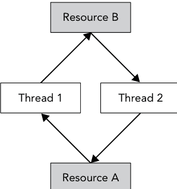

图 23-2

现在两个线程都在死锁状态下无限等待。图 23-2 显示了死锁情况的图形表示。线程 1 持有资源 A 的锁，并等待获取资源 B 的锁。线程 2 持有资源 B 的锁，并等待获取资源 A 的锁。在这个图形表示中，有一个描述死锁情况的循环。两个线程都将无限等待。

最好始终按照相同的顺序获取锁，以避免此类死锁。你还可以在程序中包含某些机制来打破这类死锁。一种可能的解决方案是尝试在一段时间内获取资源的锁。如果在特定间隔内无法获得锁，线程将停止并释放它当前持有的所有其他锁。线程可能会睡眠一会，然后尝试重新获取它需要的所有资源。这种方法可能会给其他线程获取必要的锁并继续执行的机会。这种方法是否有效很大取决于你具体的死锁案例。

与其使用上段所述的通用之，你应该尝试完全避免任何死锁情况。如果你需要获取多个锁，推荐的方法是使用后文互斥节中描述的 `std::lock` 或 `std::try_lock()` 函数。这些函数会获取或尝试获取多个资源的锁，尽力防止死锁。

### 撕裂

撕裂意味着你的数据部分已写入内存，而其他部分尚未写入。如果另一个线程在那个精确时刻读取该数据，它将看到不一致的数据。

# 缓存一致性

记住缓存一致性很重要。如果一个线程写入了一段数据，线程会立即看到这条新数据，但并不是所有线程都能立即看到这条新数据！CPU 拥有缓存，并且多个处理器的缓存结构是复制的。如果一个核心修改了你的数据，它会在它的缓存中更改；但这种变化对于使用不同缓存的核心并不是立即可见。因此，即使是简单的数据类型（如布尔值），在从多个线程读写它们时也需要同步。

# 线程

定义在 `<thread>` 头文件中 C++ 线程库使得启动新线程变得非常容易。可以通过多种方式指定在线程中需要执行的内容。你可以让新线程执行全局函数、函数对象的 `operator()`、lambda 表达式，甚至是某个类实例的成员函数。接下来的章节提供了所有这些方法的简短示例。

## 使用函数指针的线程

Windows 上的 `CreateThread()`、`_beginthread()` 等函数，以及带有 pthreads 库的 `pthread_create()`，要求线程函数只有一个参数。另一方面，你想与标准 `std::thread` 类使用的函数可以有任意数量的参数。

假设你有一个接受两个整数的 `counter()` 函数：第一个表示 ID，第二个表示函数应该循环的迭代次数。函数体是一个单次循环，按照指定的次数进行循环。在每次迭代中，都会向标准输出打印一条消息：

```cpp
void counter(int id, int numIterations)
{
    for (int i = 0; i < numIterations; ++i) {
        cout << "Counter " << id << " has value";
        cout << i << endl;
    }
}
```

你可以使用 `std::thread` 启动多个执行此函数的线程。你可以如下创建一个线程 `t1`，带参数 1 和 6 执行 `counter()`：

```cpp
thread t1(counter, 1, 6);
```


`thread` 类的构造函数是一个变参模板，这意味着它可以接受任意数量的参数。变参模板在第 21 章中讨论。第一个参数是要执行的函数名称。后续的可变参数在线程开始执行时传递给该函数。

以下代码启动了两个执行 `counter()` 函数的线程。启动线程后，`main()` 对两个线程都调用了 `join()`。这是为了确保主线程一直运行，直到两个线程完成。调用 `t.join()` 会阻塞，直到线程 `t1` 完成。如果没有这两个 `join()`，`main()` 函数...

如果你比较 t1 的创建和 t3 的创建，看起来唯一的区别是第一种方法使用了大括号，而第三种方法使用了括号。然而，当你的函数对象构造函数不需要任何参数时，按编写的第三种方法将无法工作。例如：

```cpp
class Counter {
public:
    Counter() {}
    void operator()() const { /* 为了简洁已省略 */ };
};

int main() {
    thread t1(Counter());    // 错误！
    t1.join();
}
```

这会导致编译错误，因为 C++ 将 `main()` 中的第一行解释为名为 `t1` 的函数声明，该函数返回一个 `thread` 对象，并接受一个不带参数的且返回 `Counter` 对象的指针。因此，建议使用统一初始化语法：

```cpp
thread t1{Counter()}; // 正确
```

如果你的编译器不支持统一初始化，你必须添加额外的括号以防止编译器将该行解释为函数声明：

```cpp
thread t1((Counter())); // 正确
```

> **注意** 函数对象总是被复制到线程的某些内部存储中。如果你想在函数对象的特定实例上执行 `operator()` 而不是复制它，你应该使用来自 `<functional>` 头文件的 `std::ref()` 通过引用传递你的实例。

## 使用 Lambda 的线程

Lambda 表达式与标准 C++ 线程库非常契合，如下所示：

```cpp
int main() {
    int id = 1;
    int numIterations = 5;
    thread t1([id, numIterations]() {
        for (int i = 0; i < numIterations; ++i) {
            cout << "Counter " << id << " has value ";
            cout << i << endl;
        }
    });
    t1.join();
}
```

### 使用成员函数的线程

你也可以指定类的成员函数在线程中执行。以下示例定义了一个带有 `process()` 方法的 `Request` 类。`main()` 函数创建了 `Request` 类的实例并启动了一个新线程，该线程执行 `Request` 实例 `req` 的 `process()` 成员函数：

```cpp
class Request {
public:
    Request(int id) : mID(id) { }
    void process() {
        cout << "Processing request " << mID << endl;
    }
private:
    int mID;
};

int main() {
    Request req(100);
    thread t(&Request::process, &req);
    t.join();
}
```

通过这种技术，你在单独的线程在特定对象上执行方法。如果其他线程正在访问同一个对象，你需要确保这种操作是以线程安全的方式进行的，以避免竞态条件。在本章稍后讨论的互斥可以作为同步机制来确保其线程安全。

### 线程本地存储

标准支持线程本地存储的概念。通过名为 `thread_local` 的关键字，你可以将任何变量标记为线程本地，这意味着每个线程都拥有该变量的唯一副本，并且该副本的生命周期持续到线程结束。对于每个线程，变量恰好初始化一次。例如，在以下代码中，每个线程共享唯一的一份 `k`，而每个线程都有自己唯一的 `n` 副本：

```cpp
thread_local int n;
int k;
void doWork() {
    // 执行某些计算
}
```

注意，如果 `thread_local` 变量在函数作用域内声明，其行为就像声明为 `static` 一样，区别在于每个线程都有自己唯一的副本，并且每个线程中恰好初始化一次，无论该函数在该线程中被调用了多少次。

### 取消线程

标准没有包含任何从另一个线程取消运行线程的机制。实现此点的最佳方法是提供两个线程同意的通信机制。最简单的机制是设置共享变量，目标线程定期检查该变量以确定是否应该关闭。其他线程可以通过设置此变量来间接停止线程。需要避免读写此共享变量时出现竞态条件和缓存一致性问题。原子变量或条件变量（在本章稍后都会讨论）可以帮助避免这些问题。

## 从线程获取结果

正如你在之前的示例所示，启动新线程非常简单。然而，在大多数情况下，你可能对线程产生的结果感兴趣。例如，如果你的线程执行了一些数学计算，你确实希望在线程完成后获取结果。一种方法是将共享变量的指针或引用传递给线程，由线程存储结果。另一种方法是将结果存储在函数对象的类成员变量中，你可以在线程执行完毕后以后检索。

然而，还有另一种更简单的方法从线程获取结果：未来（futures）。它们也让处理线程内部发生的错误变得更容易。Future 将在本章稍后讨论。

### 复制和重新抛出异常

只要保持在单个线程内，C++ 的整个异常机制就能完美工作。每个线程都可以抛出自己的异常，但它们需要在它们自己的线程内被捕获。在一个线程中抛出的异常无法在另一个线程中捕获。当你想要结合多线程编程使用异常处理时，这引入了一些问题。

如果没有标准线程库，跨线程优雅地处理异常是非常甚至是不可能的。标准线程库通过以下与异常相关的函数解决了这个问题。这些函数仅适用于 `std::exception`，但也适用于各种异常。

```cpp
exception_ptr current_exception()
```

此函数返回当前处理的异常的 `exception_ptr`。

```cpp
template<class E>
exception_ptr make_exception_ptr(E e)
```

此函数创建一个 `exception_ptr` 对象，返回所给异常对象的拷贝。这基本上是以下代码的简写：

```cpp
try {
  throw e;
} catch(...) {
  return current_exception();
}
```

```cpp
void rethrow_exception(exception_ptr ptr);
```

此函数重新抛出由 `exception_ptr` 参数引用的异常。

让我们看看如何使用这些特性实现跨线程处理异常。以下代码定义了一个执行某些工作并抛出异常的函数。该函数最终运行在一个单独的后台线程中：

```cpp
void doSomeWork() {
  for (int i = 0; i < 5; ++i) {
    cout << "Thread throwing a runtime error..." << endl;
    throw runtime_error("Exception from thread");
  }
}
```

以下 `threadFunc()` 函数在 `try/catch` 块中调用前面的函数，捕获 `doSomeWork()` 可能抛出的所有异常。为 `threadFunc` 提供单个参数，类型为 `exception_ptr`。一旦捕获到异常，使用 `current_exception()` 函数获取正在处理的异常的引用，并赋值给 `exception_ptr` 参数。之后，线程正常退出：

```cpp
void threadFunc(exception_ptr err) {
  try {
    doSomeWork();
  } catch (...) {
    cout << "Thread caught exception, returning exception..." << endl;
    err = current_exception();
  }
}
```

以下 `doWorkInThread()` 函数从主线程调用。它的职责是创建一个新线程并在其中执行 `threadFunc()`。将类型为 `exception_ptr` 的对象的引用作为参数传递给 `threadFunc`。一旦线程创建，`doWorkInThread()` 使用 `join()` 方法等待线程完成，之后对错误对象进行检查。由于 `exception_ptr` 的类型为 `NullablePointer`，你可以轻松地使用 `if` 来检查它。如果是非空值，会在当前线程（此处为主线程）中重新抛出异常。通过在主线程中重新抛出异常，异常从一个线程转移到了另一个线程。

```cpp
void doWorkInThread()
{
    exception_ptr error;
    // 启动线程
    thread t{ threadFunc, ref(error) };
    // 等待线程完成
    t.join();
    // 查看线程是否抛出了异常
    if (error)
    {
        cout << "Main thread received exception, rethrowing it..." << endl;
        rethrow_exception(error);
    }
    else
    {
        cout << "Main thread did not receive any exception." << endl;
    }
}
```

`main()` 函数非常直观。它调用 `doWorkInThread()` 并将其封装在 `try/catch` 块中，以捕获由 `doWorkInThread()` 启动的线程抛出的异常：

```cpp
int main()
{
    try
    {
        doWorkInThread();
    } catch (const exception& e)
    {
        cout << "Main function caught: " << e.what() << "" << endl;
    }
}
```

输出如下：

为了保持此示例简洁且易于理解，`doWorkInThread` 函数使用 `join()` 来阻塞并等待线程完成。当然，在真实世界的应用中，你不希望阻塞主线程。例如，在 GUI 应用程序中，你可能会让 `threadFunc()` 向 UI 线程发送消息，并将 `current_exception()` 结果的副本作为参数传递。

## 原子操作库

原子类型允许原子访问，这意味着允许在没有额外同步的情况下进行并发读写。如果没有原子操作，增加变量的操作不是线程安全的，因为编译器首先将值从内存加载到寄存器中，进行增加，然后将结果存回内存。另一个线程在这次增加操作期间可能会接触同一内存，这就是竞态条件。例如，以下代码不是线程安全的，并且包含竞态条件。这种竞态条件在本章的开头讨论过：

```cpp
int counter = 0;      // 全局变量
++counter;              // 在多个线程中执行
```

要在不显式使用任何锁的情况下实现线程安全，请使用原子类型：

```cpp
atomic<int> counter(0);   // 全局变量
++counter;               // 在多个线程中执行
```

你需要包含 `<atomic>` 头文件来使用这些原子类型。标准为所有基本类型定义了整数类型。下表列出了几个：

| 命名原子类型 | 等效原子类型 |
|---|---|
| `atomic_bool` | `atomic<bool>` |
| `atomic_char` | `atomic<char>` |
| `atomic_uchar` | `atomic<unsigned char>` |
| `atomic_int` | `atomic<int>` |
| `atomic_uint` | `atomic<unsigned int>` |
| `atomic_long` | `atomic<long>` |
| `atomic_ulong` | `atomic<unsigned long>` |
| `atomic_llong` | `atomic<long long>` |
| `atomic_ullong` | `atomic<unsigned long long>` |
| `atomic_wchar_t` | `atomic<wchar_t>` |

当从多个线程访问某条数据时，原子操作还解决了其他问题，例如缓存开销、内存顺序、编译器优化等。基本上，在不使用原子操作或显式同步机制的情况下，从多个线程读写同一份数据几乎永远是不安全的。

### 原子类型示例

本节详细解释了为什么你应该使用原子类型。假设你有一个函数 `func()`，它在循环中增加一个作为引用参数给定的整数。这段代码使用 `std::this_thread::sleep_for()` 在每个循环中引入微小的延迟。`sleep_for()` 的参数是 `std::chrono::duration`，在第 19 章中解释。

```cpp
void func(int& counter)
{
    for (int i = 0; i < 100; ++i) {
        counter++;
        std::this_thread::sleep_for(std::chrono::milliseconds(1));
    }
}
```

现在，如果你想并行运行多个线程，它们都执行这个 `func()` 函数。如果不使用原子类型或任何种线程同步来实现此功能，你将引入竞态条件。下面的 `main()` 函数启动了 10 个线程，并通过对每个线程调用 `join()` 来等待所有线程完成。

```cpp
int main()
{
    int counter = 0;
    std::vector<std::thread> threads;
    for (int i = 0; i < 10; ++i) {
        threads.push_back(std::thread(func, std::ref(counter)));
    }
    for (auto& t : threads) {
        t.join();
    }
    std::cout << "Result = *" << counter << std::endl;
}
```

由于 `func()` 增加了整数 100 次，而 `main()` 启动了 10 个后台线程（其中每个线程都执行 `func()`），预期结果是 1000。如果你多次运行此程序，可能会得到带有不同值的输出：

```
Result = 982
Result = 977
Result = 984
```

这段代码清楚地展示了竞态行为。在示例中，你可以使用 `atomic` 来修复这个问题。以下代码强调了：

```cpp
#include <atomic>
void func(atomic<int>& counter)
{
    for (int i = 0; i < 100; ++i) {
        counter++;
        std::this_thread::sleep_for(std::chrono::milliseconds(1));
    }
}
int main()
{
    atomic<int> counter(0);
    std::vector<std::thread> threads;
    for (int i = 0; i < 10; ++i) {
        threads.push_back(std::thread(func, std::ref(counter)));
    }
    for (auto& t : threads) {
        t.join();
    }
    std::cout << "Result = *" << counter << std::endl;
}
```

为了保持此示例简洁且易于理解，`doWorkInThread` 函数使用 `join()` 来阻塞并等待线程完成。当然，在真实世界的应用中，你不希望阻塞主线程。输出是：

```
Result = 1000
```


## 互斥

标准库以 `mutex` 和 `lock` 类的形式支持互斥。这些类可用于实现线程之间的同步，并将在接下来的章节中进行讨论。

### Mutex 类

Mutex 是互斥（mutual exclusion）的缩写。互斥类都定义在 `<mutex>` 头文件中，使用 `mutex` 的基本机制如下：

- 想要使用（读/写）与其他线程共享内存的线程会尝试锁定一个 `mutex` 对象。如果另一个线程当前持有该锁，新线程将等待以获取访问并被阻塞，直到锁被释放或超时。
- 一旦线程获取了锁，就可以自由使用共享内存。当然，这假定所有想要使用共享数据的线程都正确地获取了 `mutex` 的锁。
- 在线程完成对共享内存的读/写操作后，它会释放锁，为其他线程提供获取共享内存锁的机会。如果有两个或多个线程等待锁，则无法保证哪一个会被授予锁并允许继续。

标准库提供了非定时互斥（non-timed mutex）和定时互斥（timed mutex）类。

#### 非定时互斥类

该库有两个非定时互斥类：`std::mutex` 和 `std::recursive_mutex`。每个类都支持以下方法：

- `lock()`：调用线程尝试获取锁并阻塞直到获取锁为止。如果想要限制线程阻塞的时间，您应该使用定时 `mutex`，它将在下一节中讨论。
- `try_lock()`：调用线程尝试获取锁。如果锁当前被另一个线程持有，则调用将立即返回。如果已获取锁，`try_lock()` 返回 `true`，否则返回 `false`。
- `unlock()`：释放调用线程持有的锁，使其供其他线程使用。

`std::mutex` 是一个具有排他性所有权语义的标准互斥类。只允许一个线程获取此互斥锁的所有权。在执行 `lock()` 时，它会阻塞，或者在执行 `try_lock()` 时它会失败。已经拥有 `std::mutex` 所有权的线程不允许再次对其调用 `lock()` 或 `try_lock()`。这可能导致死锁！

`std::recursive_mutex` 的行为与 `std::mutex` 几乎相同，不同之处在于，已经拥有递归互斥锁所有权的线程允许再次对同一个递归互斥锁调用 `lock()` 或 `try_lock()`。调用线程应根据其获取递归互斥锁的次数调用 `unlock()` 方法。

#### 定时互斥类

该库提供了三个互斥类：`std::timed_mutex`、`std::recursive_timed_mutex` 和 `std::shared_timed_mutex`；它们都支持常规的 `lock()`、`try_lock()` 和 `unlock()` 方法。此外，它们还支持以下方法：

- `try_lock_for(rel time)`：调用线程尝试在特定的相对时间内获取锁。如果在指定的超时后无法获取锁，则调用失败并返回 `false`。如果在超时时间内获取了锁，则调用成功并返回 `true`。
- `try_lock_until(abs time)`：调用线程尝试获取锁直到系统时间等于或超过指定的绝对时间。如果在在此之前可以获取锁，调用返回 `true`。如果系统过了给定的绝对时间，函数将停止尝试获取锁并返回 `false`。

已经拥有 `timed_mutex` 所有权的线程不允许再次对该互斥锁调用之前的锁调用。这可能导致死锁！

`recursive_timed_mutex` 的行为与 `timed_mutex` 几乎相同，不同之处在于拥有递归互斥锁所有权的线程允许再次对同一个互斥锁调用之前的锁调用。调用线程应根据其锁定递归互斥锁的次数调用 `unlock()` 方法。

`shared_timed_mutex` 类支持共享锁所有权概念，也称为读-写锁。排他性所有权（也称为写锁）只有在没有其他线程持有排他或共享所有权时才能被获取。共享所有权（也称为读锁）在没有其他线程持有排他所有权的情况下可以被获取。`shared_timed_mutex` 类支持 `lock()`、`try_lock()`、`try_lock_for()`、`try_lock_until()` 和 `unlock()`，这些在前面都讨论过。这些方法获取并释放排他锁。此外，它们还有以下与共享所有权相关的方法：

- `lock_shared()`：调用线程尝试获取共享所有权并阻塞直到获取锁为止。
- `try_lock_shared()`：调用线程尝试获取共享所有权。如果排他所有权当前被另一个线程持有，则调用将立即返回。如果已获取锁，`try_lock_shared()` 返回 `true`，否则返回 `false`。
- `try_lock_shared_for(rel time)`：调用线程尝试在特定的相对时间内获取共享所有权锁。如果在指定的超时后无法获取锁，则调用失败并返回 `false`。如果在超时时间内获取了锁，则调用成功并返回 `true`。
- `try_lock_shared_until(abs time)`：调用线程尝试获取共享所有权直到系统时间等于或超过指定的绝对时间。如果在在此之前可以获取锁，调用返回 `true`。如果系统过了给定的绝对时间，函数将停止尝试获取锁并返回 `false`。
- `unlock_shared()`：释放共享所有权。

已经拥有 `shared_timed_mutex` 的线程不允许尝试在该互斥锁上获取第二个锁。这可能导致死锁！

### 通用锁函数

```cpp
template <class L1, class L2, class... L3> void lock(L1&, L2&, L3&...);
```

此通用函数以无指定的顺序锁定所有给定的互斥锁（mutex），且没有死锁风险。如果其中一个互斥锁锁定抛出异常，将对所有已获取的锁调用 `unlock()`。

```cpp
template <class L1, class L2, class... L3> int try_lock(L1&, L2&, L3&...);
```

`try_lock()` 尝试通过顺序对每个互斥锁调用 `try_lock()` 来获取所有给定的互斥锁。如果所有 `try_lock()` 的调用都成功，则返回 `-1`。如果任何 `try_lock()` 失败，将对所有已获取的锁调用 `unlock()`，并返回调用 `try_lock()` 失败的互斥锁参数的从零开始的索引。

下面的示例演示了如何使用通用 `lock()` 函数。`process()` 函数创建了两个锁，每个互斥锁对应一个，并将一个 `std::defer_lock_t` 实例作为 `unique_lock` 的第二个参数，以便在构造时不获取锁。对 `lock()` 的调用会同时获取这两个锁，且没有死锁风险：

```cpp
mutex mut1;
mutex mut2;

void process() {
    unique_lock<mutex> lock1(mut1, defer_lock_t());
    unique_lock<mutex> lock2(mut2, defer_lock_t());
    lock(lock1, lock2);
    // Locks已获取
}

int main() {
    process();
}
```

### std::call_once

你可以将 `std::call_once()` 与 `std::once_flag` 使用，以确保无论有多少线程尝试调用 `call_once()`，某个函数或方法都会被精确调用一次。只有一个 `call_once()` 调用会实际执行该函数或方法；此调用被称为有效调用（effective call_once）。在特定 `once_flag` 实例上的此有效调用会在同一 `once_flag` 实例上的其他 `call_once()` 调用之前完成。在同一 `once_flag` 实例上调用 `call_once()` 的线程会阻塞，直到该调用完成。图 23-3 展示了有效调用是如何完成的：线程 1 执行了有效 `call_once()` 调用，线程 2 阻塞直到线程 1 完成，而线程 3 不阻塞，因为线程 1 的有效调用已经完成。

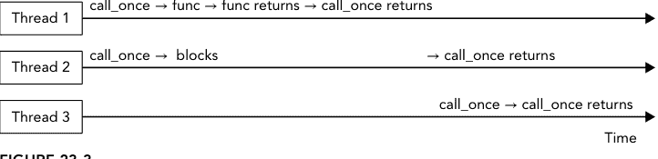

下面的示例演示了 `call_once` 的用法，三个线程运行 `processingFunction()`，它们使用了一些共享资源。共享资源应该只通过调用一次 `initializeSharedResources()` 来初始化。为了实现这一点，每个线程都带有一个全局的 `once_flag` 调用 `call_once()`。结果是只有一个线程执行了 `initializeSharedResources()`，且仅执行了一次。在 `call_once()` 运行期间，其他线程会阻塞直到 `initializeSharedResources()` 返回：

```cpp
once_flag gOnceFlag;

void initializeSharedResources() {
    // ... 初始化将被多个线程使用的共享资源。
    cout << "Shared resources initialized." << endl;
}

void processingFunction() {
    // 确保共享资源已初始化。
    call_once(gOnceFlag, initializeSharedResources);
    // ... 使用共享资源进行一些工作
    cout << "Processing" << endl;
}

int main() {
    // 启动 3 个线程。
    vector<thread> threads(3);
    for (auto& t : threads) {
        t = thread(processingFunction);
    }
    // 合并所有线程
    for (auto& t : threads) {
        t.join();
    }
}
```

此代码的输出如下：

```
Shared resources initialized.
Processing
Processing
Processing
```

当然，在这个示例中，你可以在线程启动前在 `main()` 函数开始处调用一次 `initializeSharedResources()`；但这并不能演示 `call_once()` 的用法。

### 使用互斥对象的示例

#### 向流进行线程安全的写入

在本章之前的部分，关于线程的节中，C++ 流默认情况下是没有竞态条件的，但来自多个线程的输出可能是交织的。那个示例提到了这一点。为了解决这个交织问题，你可以使用互斥对象来确保一次只有一个线程在读取/写入流对象。

#### 互斥示例

下面的示例同步了所有对 `Counter` 类的访问。为此，类中添加了一个静态互斥锁对象。它应该是静态的，因为类的所有实例都应该使用同一个互斥锁实例，在写入 `cout` 之前使用 `lock_guard` 获取互斥锁的锁。与之前的版本相比的更改已标出：

```cpp
class Counter {
public:
    Counter(int id, int numIterations)
        : mId(id), mNumIterations(numIterations) {}

    void operator() const {
        for (int i = 0; i < mNumIterations; ++i) {
            lock_guard<mutex> lock(mMutex);
            cout << "Counter " << mId << " has value " << i << endl;
        }
    }

private:
    int mId;
    int mNumIterations;
    static mutex mMutex;
};

mutex Counter::mMutex;
```

此代码在 `for` 循环的每次迭代中创建一个 `lock_guard` 实例。建议尽可能限制锁持有的时间，否则你正在阻塞其他线程。

#### 使用定时锁

下面的示例演示了如何使用定时互斥锁（timed mutex）。它是相同的 `Counter` 类，但使用了 `timed_mutex`。如果你熟悉使用 Win32 API 的多线程编程，可以对比变量与 Windows 事件对象。下面的示例展示了如何使用：

```cpp
class Counter {
public:
    Counter(int id, int numIterations)
        : mId(id), mNumIterations(numIterations) {}

    void operator() const {
        for (int i = 0; i < mNumIterations; ++i) {
            lock_guard<mutex> lock(mMutex);
            cout << "Counter " << mId << " has value " << i << endl;
        }
    }

private:
    int mId;
    int mNumIterations;
    static mutex mMutex;
};

mutex Counter::mMutex;
```

如果你的编译器不支持 C++14 标准，而不是使用 `chrono::milliseconds`，你必须使用：

#### 双重检查锁定

你可以使用锁来确保变量被精确初始化一次。下面的示例被称为双重检查锁定算法，因为它在获取锁之前和获取锁之后都检查了 `initialized` 变量的值。第一次检查是为了防止在不需要时获取锁，从而提高性能。第二次检查是为了确保在第一次检查和获取锁之间没有其他线程执行初始化。

> **WARNING** 双重检查锁定对缓存、缓存一致性敏感，因此很难正确实现。相反，请使用原子变量以及在本章之前演示的 `call_once()`。

```cpp
atomic<bool> initialized(false);
mutex mut;

void initializeSharedResources() {
    // ... 初始化将被多个线程使用的共享资源。
    cout << "Shared resources initialized." << endl;
}

void func() {
    if (!initialized) {
        unique_lock<mutex> lock(mut);
        if (!initialized) {
            initializeSharedResources();
            initialized = true;
        }
        cout << "OK" << endl;
    }
}

int main() {
    vector<thread> threads;
    for (int i = 0; i < 5; ++i) {
        threads.push_back(thread{func});
    }
    for (auto& t : threads) {
        t.join();
    }
}
```


输出清晰地显示只有一个线程初始化了共享资源：

```
Shared resources initialized.
OK
OK
OK
OK
```

> **NOTE** 对于此示例，建议使用在本章之前演示的 `call_once()`，而不是双重检查锁定。

# 条件变量

条件变量允许线程阻塞，直到另一个线程设置了某个特定条件，或者系统时间到达了指定时间。它们允许进行显式的线程间通信。如果你熟悉使用 Win32 API 的多线程编程，可以对比变量与 Windows 事件对象。

这里有两种类型的条件变量可用，都定义在 `<condition_variable>` 头文件中：

- `std::condition_variable`: 只能在 `unique_lock<mutex>` 上等待的条件变量，根据标准，这在某些平台上允许获得最大的效率。
- `std::condition_variable_any`: 可以在任何类型的锁对象上等待，包括自定义的锁类型。

`condition_variable` 类支持以下方法。

- `notify_one()`: 唤醒一个等待在该条件变量上的线程。这类似于 Windows 中的自动重置位事件（auto-reset event）。
- `notify_all()`: 唤醒所有等待在该条件变量上的线程。
- `wait(unique_lock<mutex>& lk)`: 调用 `wait()` 的线程应该已经获取了锁。调用 `wait()` 的效果是原子性地调用 `lk.unlock()` 然后阻塞该线程，等待通知。当线程被另一个线程中的 `notify_one()` 或 `notify_all()` 调用被唤醒时，该函数会再次调用 `lk.lock()`，在锁上阻塞然后返回。
- `wait_for(unique_lock<mutex>& lk, const chrono::duration<Rep, Period>& rel_time)`: 与 `wait()` 方法类似，不同之处在于线程会被 `notify_one()` 调用被唤醒、`notify_all()` 调用被唤醒，或者在给定的超时时间到达时唤醒。
- `wait_until(unique_lock<mutex>& lk, const chrono::time_point<Clock, Duration>& abs_time)`: 与 `wait()` 类似，不同之处在于线程会被 `notify_one()` 调用被唤醒、`notify_all()` 调用被唤醒，或者当系统时间超过绝对时间时唤醒。

还有 `wait()`、`wait_for()` 和 `wait_until()` 的版本接受额外的谓词参数（predicate）。例如，接受额外谓词的 `wait()` 等同于以下代码：

```
while (!predicate())
  wait(lk);
```

`condition_variable_any` 类支持与 `condition_variable` 类相同的方法，但它可以接受任何锁，而不仅仅是 `unique_lock<mutex>`。你的锁应该拥有 `lock()` 和 `unlock()` 方法。

等待条件变量的线程可以在另一个线程调用 `notify_one()` 或 `notify_all()` 时唤醒，或者在相对超时、系统时间到达特定时间时唤醒，但也可能发生虚假唤醒（spurious wakeup）。这意味着即使没有其他线程调用任何通知方法，线程也可能唤醒。当线程等待条件变量并唤醒时，它需要检查唤醒是否是因为通知。检查此点的一种方法是使用接受谓词的 `wait()` 版本之一。

例如，条件变量可以用于从队列中后台处理项。你可以定义一个队列，并在其中插入要处理的项。后台线程等待队列中有项。当项被插入队列时，该线程唤醒并处理该项，然后返回睡眠，等待下一个项。假设你有以下队列：

```cpp
std::queue<std::string> mQueue;
```

你需要确保在任何给定时间内只有一个线程在修改此队列。你可以通过互斥锁来实现：

```cpp
std::mutex mMutex;
```

为了在添加项时通知后台线程，你需要一个条件变量：

```cpp
std::condition_variable mCondVar;
```

想要向队列添加项的线程首先获取互斥锁，将项添加到队列，并通知后台线程。无论你当前是否持有该锁，都可以调用 `notify_one()` 或 `notify_all()`。两者均有效。

```cpp
// 锁定互斥锁并将条添加到队列。
unique_lock<mutex> lock(mMutex);
mQueue.push(entry);
// 通知条件变量以唤醒线程。
mCondVar.notify_all();
```

后台线程在无限循环中等待通知，如下。使用接受谓词的 `wait()` 来正确处理虚假唤醒。谓词检查队列中是否有项。当 `wait()` 调用返回时，你就可以确定队列中是有内容的：

```cpp
unique_lock<mutex> lock(mMutex);
while (true) {
    // 等待通知。
    mCondVar.wait(lock, { return !mQueue.empty(); });
    // 条件变量被通知，所以队列中有项。
    // 处理项...
}
```

本章末尾的“示例：多线程日志器类”部分提供了一个如何使用条件变量向其他线程发送通知的完整示例。

标准还定义了一个辅助函数 `std::notify_all_at_thread_exit(cond, lock)`，其中 `cond` 是条件变量，`lock` 是 `unique_lock<mutex>` 实例。调用此函数的线程应该已经获取了锁 `lock`。当线程退出时，它会自动执行以下操作：

```
lock.unlock();
cond.notify_all();
```

> **NOTE** 锁会一直保持锁定状态直到线程退出。这不会在你的代码中引起任何死锁，例如由于错误的锁顺序。死锁在本章前面已讨论过。

# 未来 (Future)

正如本章前面提到的，使用 `std::thread` 启动一个计算单个结果的线程，在线程执行完成后无法轻松获取计算出的结果。`std::thread` 的另一个问题是处理异常等错误。如果线程抛出异常且该异常没有被线程本身处理，C++ 运行时将调用 `std::terminate`，这通常会终止整个应用程序。你可以通过 `std::future` 来避免这一点，它能够将未捕获的异常传输到另一个线程，该线程可以处理任何想要的内容。良好的做法是尽可能尝试在线程内部处理异常，防止它们离开线程。

`std::future` 和 `std::promise` 协同工作，使得从函数中检索结果变得更容易。

## 异常处理

使用 future 的一个巨大优势是它们可以在线程之间自动传输异常。当你对一个 future 调用 `get()` 时，你将收到请求的结果，或者在线程中发生的任何异常都将在调用 `get()` 的线程中重新抛出，你可以使用普通的 `try/catch` 块来捕获它们。这里有一个示例：

```cpp
int calculate() {
    throw runtime_error("Exception from a thread.");
}

int main() {
    // 使用 launch::async 强制开启新线程。
    auto fut = async(launch::async, calculate);
    // 执行一些工作...
    // 获取结果
    try {
        int res = fut.get();
        cout << res << endl;
    } catch (const exception& ex) {
        cout << "Caught exception: " << ex.what() << endl;
    }
}
```

# 示例：多线程日志器类

本节演示了如何使用线程、互斥锁和锁类以及条件变量来创建一个多线程 Logger 类。该类允许从不同的线程向队列添加日志消息。Logger 在另一个后台线程中处理队列，并将日志消息写入文件。该类将通过两次迭代进行设计，以向你展示在编写多线程代码时会遇到的问题示例。

C++ 标准没有提供线程安全的队列，因此显然你必须使用互斥锁（mutex）保护对队列的访问，以防止多个线程同时读取/写入队列。基于此，你可以这样定义 Logger 类：

```cpp
class Logger {
public:
    // 启动一个后台线程，将日志条写入文件。
    Logger();
    // 防止拷贝和赋值。
    Logger(const Logger& src) = delete;
    Logger& operator=(const Logger& rhs) = delete;
    void log(const std::string& entry);
private:
    // 在后台线程运行的函数。
    void processEntries();
    // 用于保护队列访问的互斥锁和条件变量。
    std::mutex mMutex;
    std::condition_variable mCondVar;
    std::queue<std::string> mQueue;
    // 后台线程。
    std::thread mThread;
};
```

实现如下。请注意，初始设计存在几个问题，当你尝试运行它时，它的行为可能会很奇怪甚至崩溃。这将在 Logger 类的下一迭代中进行讨论和解决。`processEntries()` 方法中的 `while` 循环也值得关注。它一次处理队列中的所有消息，并在每次迭代中获取和释放锁。这样做是为了确保日志器不会长时间持有锁而阻塞其他线程。

```cpp
Logger::Logger() {
    // 启动后台线程
    mThread = thread(&Logger::processEntries, this);
}

void Logger::log(const std::string& entry) {
    // 锁互斥并将条目添加到队列。
    unique_lock<std::mutex> lock(mMutex);
    mQueue.push(entry);
    // 通知条件变量唤醒线程。
    mCondVar.notify_all();
}

void Logger::processEntries() {
    // 打开日志文件。
    std::ofstream ofs("log.txt");
    if (ofs.fail()) {
        cerr << "Failed to open logfile." << std::endl;
        return;
    }
    // 开始处理循环。
    unique_lock<std::mutex> lock(mMutex);
    while (true) {
        // 等待通知。
        mCondVar.wait(lock);
        // 条件变量被通知，所以队列中可能有内容。
        lock.unlock();
        while (true) {
            if (mQueue.empty()) {
                break;
            } else {
                ofs << mQueue.front() << std::endl;
                mQueue.pop();
            }
        }
        lock.lock();
    }
}
```

该 Logger 类可以使用以下测试代码进行测试。它启动了多个后台线程，向同一个 Logger 实例记录了几条消息：

```cpp
void logSomeMessages(int id, Logger& logger) {
    for (int i = 0; i < 10; ++i) {
        stringstream ss;
        ss << "Log entry " << i << " from thread " << id << ";";
        logger.log(ss.str());
    }
}

int main() {
    Logger logger;
    vector<thread> threads;
    for (int i = 0; i < 10; ++i) {
        threads.emplace_back(logSomeMessages, i, ref(logger));
    }
    for (auto& t : threads) {
        t.join();
    }
}
```

如果你在多核机器上构建并运行这个简单的版本，你会注意到当 `main()` 函数结束时，后台 Logger 线程会突然终止。这意味着队列中的消息没有写入磁盘。某些运行时库在后台 Logger 线程突然终止时可能会发出错误或生成崩溃转储。你需要添加一种机制来优雅地关闭后台线程，并在等待后台线程完全关闭后再终止应用程序。这可以通过向类中添加一个析构函数和一个原子布尔成员变量来实现。`class Logger` 类的新定义如下：

```cpp
class Logger {
public:
    // 优雅地关闭后台线程。
    virtual ~Logger();
    // 为了省略省略了其他成员
private:
    // 告诉后台线程终止的布尔值。
    std::atomic<bool> mExit;
    // 为了省略省略了其他成员
};
```

Logger 构造函数将初始化 `mExit`。析构函数将 `mExit` 设置为 `true`，唤醒线程，然后在设置 `mExit` 为 `true` 并调用 `notify_all()` 之前等待 `mMutex` 的锁。这是为了防止与 `processEntries()` 发生竞态条件和死锁。`processEntries()` 在其循环开始处检查 `mExit` 之后可能会返回并等待。如果主线程在此时调用析构函数，而析构函数没有获取 `mMutex` 的锁，那么析构函数会在 `processEntries()` 检查过 `mExit` 并等待条件变量之后设置 `mExit` 为 `true` 并调用 `notify_all()`。

注意，即使 `mExit` 为真，你不能仅仅在外层 `while` 循环的条件中检查 `mExit`，因为队列中可能还有需要写入的日志项。

你可以在多线程代码的特定位置添加人工延迟进行测试，但这些延迟应仅用于测试，并应从你的最终代码中删除！例如，为了测试使用的析构函数的竞态条件，你可以移除主程序中任何对 `log()` 的调用，使其几乎立即调用 Logger 类的析构函数，并添加以下内容：

```cpp
void Logger::processEntries() {
    // 省略内容
    // 开始处理循环。
    unique_lock<mutex> lock(mMutex);
    while (!mExit) {
        std::this_thread::sleep_for(std::chrono::milliseconds(1000));
        // 等待通知。
        mCondVar.wait(lock);
        // 省略内容
    }
}
```

# 示例：多线程日志器类（改进版）

```cpp
Logger::Logger() : mExit(false) {
    // 启动后台线程。
    mThread = thread(&Logger::processEntries, this);
}

Logger::~Logger() {
    unique_lock<mutex> lock(mMutex);
    // 通过将 mExit 设置为 true并通知线程来优雅地关闭线程。
    mExit = true;
    // 通知条件变量唤醒线程。
    mCondVar.notify_all();
    // 等待线程关闭。这应该在调用 join() 之前释放 mMutex 锁。
    mThread.join();
}
```

`processEntries()` 方法需要在 `mExit` 为真时检查这个布尔值并终止循环：

```cpp
void Logger::processEntries() {
    // 打开日志文件。
    ofstream ofs("log.txt");
    if (ofs.fail()) {
        cerr << "Failed to open logfile." << endl;
        return;
    }
    // 开始处理循环。
    unique_lock<mutex> lock(mMutex);
    while (true) {
        if (!mExit) { // 如果不需要退出，等待等待。
            // 等待通知。
            mCondVar.wait(lock);
        }
        // 条件变量被通知，所以队列中可能有内容
        // 并且我们需要关闭这个线程。
        lock.unlock();
        while (true) {
            lock.lock();
            if (mQueue.empty()) {
                break;
            } else {
                ofs << mQueue.front() << std::endl;
                mQueue.pop();
            }
        }
        lock.lock();
    }
}
```


```
break;

} else {

    ofs << mQueue.front() << endl;

    mQueue.pop();

}

}

lock.unlock();

if (mExit) {

    break;

}

}
```


# 线程池

与其在程序生命周期内动态创建和删除线程，不如创建一个可以按需使用的线程池。这种技术通常用于需要处理某种事件的程序。在大多数环境中，理想的线程数等于处理核心数。如果线程多于核心，核心将挂起其他线程，这最终会增加开销。注意，虽然理想的线程数等于核心数，但这仅适用于线程已绑定且不会因其他原因（如 I/O）阻塞的情况。当线程阻塞时，运行比核心数更多的线程通常是合适的。在某些情况下，确定最佳线程数可能涉及吞吐量测量。

有多个现成的库可以实现线程池；例如 `Intel Thread Building Blocks (TBB)`、`Microsoft Parallel Patterns Library (PPL)` 等。建议使用此类库来构建你的线程池，而不是自己编写实现。如果你想自己实现线程池，可以采用类似于对象池的方法来实现。第 25 节提供了一个对象池的示例实现。

## 多线程设计与最佳实践

本节简要列举了几种与多线程编程相关的最佳实践。

-   在退出应用程序之前，务必使用 `join()` 等待后台线程完成：确保在终止应用程序之前，对所有后台线程都使用了 `join()`。这将确保所有后台线程都有时间进行适当的清理。没有使用 `join()` 的后台线程会在主线程终止时强制终止。

-   最好的同步是不进行同步：如果你能设计你的线程的方式，使得所有处理共享数据的线程只从共享数据读取并向其写入，或者只写入永远被其他线程读取的线程中，那么多线程编程将变得简单得多。在这种情况下，不需要任何同步机制，你也不会遇到竞态条件或死锁等问题。

-   使用单线程所有权模式：这意味着一个数据块在同一时间最多仅由一个线程拥有。所有权数据意味着不允许其他线程读取/写入该数据。当线程完成对数据的操作后，可以将数据传递给另一个线程，现在由该线程对数据拥有唯一且完全的责任/所有权。在这种情况下，不需要同步。

-   尽可能使用原子类型和操作：原子类型和原子操作更容易编写出无竞态和无死锁的代码，因为它们会自动处理同步。如果从你的多线程设计中无法使用原子类型和操作，且你需要共享数据，则你必须使用互斥机制来确保适当的同步。

-   使用锁保护共享数据：如果你需要一个多个线程可以写入的可变数据，且无法使用原子类型和操作，那么你必须使用锁定机制来确保不同线程之间的读写操作是同步的。

-   尽快释放锁：当你需要用锁保护共享数据时，请确保尽快释放锁。当线程持有锁时，它会阻塞等待同一锁的其他线程，这可能会影响性能。

-   确保按相同顺序获取多个锁：如果多个线程需要获取多个锁，它们必须在所有线程中以相同的顺序获取，以防止发生死锁的概率。你应该使用通用的 `std::lock()` 或 `std::try_lock()` 来最小化违反锁顺序限制的概率。

-   使用感知多线程的分析器：使用感知多线程的分析器来寻找多线程应用程序中的瓶颈，并确定你的多个线程是否利用了系统中所有可处理能力。感知多线程分析器的一个示例是某些版本的 `Microsoft Visual Studio` 中的分析器。

-   理解你调试器的多线程支持功能：大多数调试器对调试多线程应用程序提供基础支持。你应该能够获取应用程序中所有运行线程的列表，并能够切换到其中任何一个线程来检查它们的调用栈。你可以利用这一点来寻找死锁，因为你可以准确看到每个线程正在做什么。

-   使用线程池而不是动态创建和销毁大量线程：如果动态创建和销毁大量线程会导致性能下降。在这种情况下，使用线程池来重用现有线程更好。

-   使用更高级的多线程库：在可能的情况下，使用更高级的多线程库，例如 `Intel Thread Building Blocks (TBB)`、`Microsoft Parallel Patterns Library (PPL)` 等，而不是重复造轮子。多线程编程很难做正确且容易出错。通常情况下，你的“轮子”可能并没有你想象的那么圆。

## 总结

本章简要概述了使用标准 C++ 线程库进行多线程编程。它解释了你如何使用原子类型和原子操作对共享数据进行操作，而无需使用显式锁。在某些无法使用这些原子类型和操作的情况下，你学习了如何使用互斥机制来确保需要对共享数据读写访问的不同线程之间有适当同步。你还看到了承诺（`promises`）和未来（`futures`）如何表示线程间的通信通道；你可以使用未来更容易地从后台线程获取结果。本章最后介绍了一些多线程应用程序设计的最佳实践。

正如引言中提到的，本章尝试涵盖标准 C++ 线程库提供的所有功能，但由于空间限制，无法进入多线程编程的所有细节。有专门讨论多线程的书籍。请参附录 B 的参考文献。

# 第五部分

# C++ 软件工程

- 第 24 节：软件工程方法的最大化利用
- 第 25 节：编写高效的 C++
- 第 26 节：攻克调试

# 24

# 软件工程方法的最大化利用

## 本章内容？

-   什么是软件生命周期模型，并提供阶段性模型（`Stagewise Model`）、瀑布模型（`Waterfall Model`）、螺旋模型（`Spiral Model`）和 `RUP` 的示例
-   什么是软件工程方法论，并提供敏捷开发（`Agile`）、`Scrum`、`XP` 和软件分诊（`Software Triage`）的示例
-   什么是源代码控制

第 24 节开始了软件工程的最后部分。

当然，标准的业务风险也适用于软件。营销压力和沟通不畅会产生阻碍。许多程序员试图避开公司政治，但开发小组与产品营销小组之间产生敌意也并不罕见。

所有这些不利于软件工程产品的因素都表明，需要某种流程。软件项目是复杂的，而且节奏非常快。为了避免失败，工程团队小组需要采用一套系统来控制这种难以约束的流程。

## 软件生命周期模型

软件的复杂性并非新鲜事。几十年前，人们就意识到了对形式化流程的需求。软件生命周期建模的几种方法曾试图通过定义从初始构思到最终产品的步骤来规范软件过程，从而为软件开发的混乱带来某种秩序。这些模型经过多年的精炼，构成了当今软件开发的大部分基础。

## 阶段模型与瀑布模型

软件的一个经典生命周期是瀑布模型。该模型基于一种观点：软件的构建几乎可以像遵循食谱一样。有一系列步骤，如果遵循得当，就能产出极佳的巧克力，或者编写出可能是一个的游戏。如图 24-1 所示，在开始下一个阶段之前，必须完成上一个阶段。

过程始于规划，收集一份详尽的需求列表。该列表定义了产品的完整性。需求越具体，项目成功的概率越高。接下来，对软件进行设计和完全规格说明。设计步骤与需求步骤一样，需要尽可能具体，以最大化增加成功的机会。所有的设计决策都在此时做出，通常使用伪代码和需要编写的特定系统的定义。子系统确定代码将如何相互作用，团队对架构的细节达成共识。接下来是设计的实现。由于设计已经完全规格，代码必须严格遵守设计，否则组件将无法匹配。最后四个阶段留给单元测试、子系统测试、集成测试和评估。

阶段模型的主要问题是，在实践中，几乎不可能在不至少考虑下一个阶段的情况下完成完成一个阶段。如果不写一些代码，设计就无法板上钉钉。此外，如果模型不提供返回编码阶段的方法，那么测试的意义何在？

20 世纪 70 年代初，对阶段模型的若干精炼被正式化为瀑布模型。瀑布模型带来的主要进展是引入了阶段之间的反馈概念。虽然它仍然强调规划、设计、编码和测试的严谨流程，但连续的阶段可以部分重叠。图 24-2 显示了瀑布模型的示例，说明了反馈和重叠的改进。反馈允许在一个阶段学到的教训导致上一个阶段的改变。重叠允许两个阶段的活动同时发生。

瀑布模型的各种形式以不同的方式精炼了流程。例如，某些计划包含一个“可行性”步骤，在收集正式需求之前进行实验。

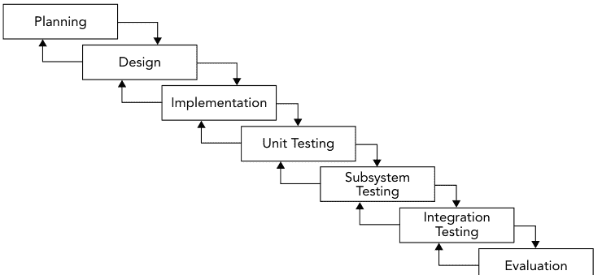

图 24-1

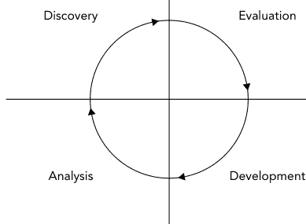

图 24-2

## 瀑布模型的优点

瀑布模型的价值在于其简单性。你，或你的经理，可能在项目中遵循过这种方法，但并未将其形式化或识别出其名称。阶段模型和瀑布模型背后的基本假设是：只要每一步都尽可能完整和准确地完成，第一步之后的后续步骤就会顺利进行。由于所有需求在第一步中都被仔细指定，所有的决策和问题在第二阶段都被敲定，那么第三步的实现应该是将设计转换为代码的简单事情。

瀑布模型的简单性使得基于该系统的项目计划井然有序且易于管理。每个项目都以相同开始：详尽地列出所有的功能。使用这种方法的经理可以要求，例如在设计阶段结束时，所有负责子系统的工程师提交他们的设计作为设计文档或功能子系统规格说明。对经理的好处是，通过让工程师提前指定需求和设计，风险有望降到最低。

从工程师的角度来看，瀑布模型强制要求在前期解决主要问题。所有工程师在编写大量代码之前，都需要理解他们的项目和子系统。理想情况下，这意味着代码可以编写一次，而不是在组件不匹配时进行胡乱拼接或重写。

对于需求非常具体的小项目，瀑布模型可以运行得很好。特别是对于咨询安排，它的优势是为项目启动指定了具体的指标。需求的形式化有助于顾问精确地执行客户所需，并让客户对项目目标有具体的规定。

## 瀑布模型的缺点

在许多组织中，以及几乎所有的现代软件工程书中，瀑布模型已不再受宠。批评者蔑视其基本前提，即软件开发任务是在离散的线性步骤中发生的。虽然瀑布模型允许阶段重叠，但它在很大程度上不允许向后移动。在今天的许多项目中，需求贯穿于产品开发过程中。通常，潜在客户会请求一个对于销售必不可的功能，或者竞争对手的产品将有一个需要对齐的新功能。

> 注意：所有需求的前期规格说明使得瀑布模型对许多组织来说不可用，因为它的动态性不够。

另一个缺点是，为了通过尽可能尽早、尽可能远地做出决策来最小化风险，瀑布模型实际上可能在隐藏风险。例如，一个设计问题可能未被发现、被带过或被刻意回避。等到集成测试发现不匹配时，可能已经太晚无法拯救项目了。早期检测是困难且危险的。

如果你使用瀑布模型，通常有通过从其他方法获取线索来使其更加灵活。

## 螺旋模型

螺旋模型由 `Barry W. Boehm` 于 1986 年提出，是一种风险驱动的软件开发过程。还有其他螺旋模型。本节讨论的是一个被称为迭代过程的技术族的一部分。其核心思想是：如果某处出了问题没关系，你会在下次循环中修复它。该螺旋模型的单个旋转如图 24-3 所示。

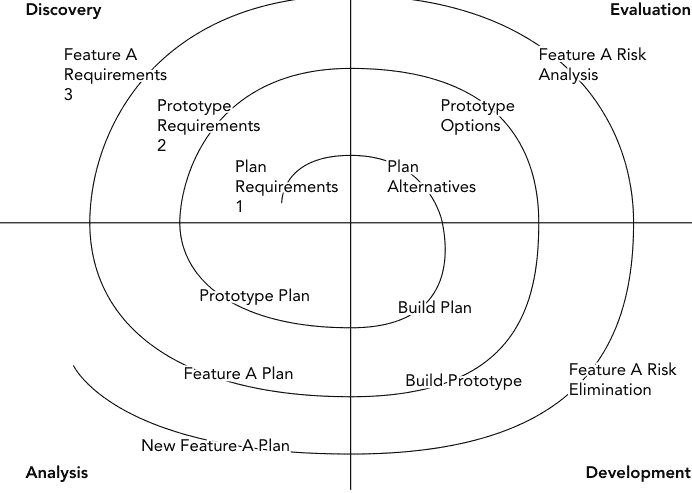

图 24-3

螺旋模型的阶段与瀑布模型相似。发现阶段涉及发现需求、确定目标、确定备选方案（设计替代方案、购买第三方库等），以及确定任何约束条件。在评估阶段，会评估实现替代方案、分析风险，并考虑原型选项。在螺旋模型中，特别关注在评估阶段评估和解决风险。被认为风险最高的任务是在螺旋的当前循环中实施的任务。开发阶段的任务由当前循环中识别出的风险决定的。例如，如果评估发现一个可能无法实现的风险，那么当前循环开发的主要任务将是对该算法进行建模、构建和测试。第四个阶段用于分析和规划。根据当前循环的结果，形成下一个循环。

图 24-4 显示了操作系统开发过程中通过螺旋三个循环的示例。第一个循环产生了一个包含产品主要需求的计划。第二个循环产生了一个显示用户体验的原型。第三个循环构建了一个被确定为高风险的组件。

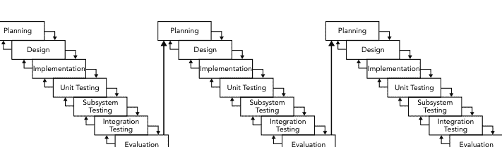

图 24-4

## 螺旋模型的优点

螺旋模型可以被看作是将迭代方法应用于瀑布模型所提供的最佳优点上。图 24-5 显示了螺旋模型作为一种经过修改以允许迭代的瀑布过程。隐藏的风险和线性开发路径（瀑布模型的主要缺点）通过迭代循环得到了解决。


图 24-5

优先执行风险任务是另一个优点。通过将风险推向前沿并承认新变化可能随时出现，螺旋模型避免了瀑布模型中可能出现的隐藏定时炸弹。当出现意外之外的问题时，可以使用适用于整个过程的相同四阶段方法进行处理。

这种迭代化的方法还允许纳入来自测试者的反馈。例如，可以发布产品的早期版本进行内部或外部评估。这些测试人员（例如）可以说缺少了某个功能，或者某个现有功能运行不符合预期。螺旋模型具有一种内置机制来响应输入。

最后，通过对每个周期进行反复分析并构建新设计，“设计-实现”方法中的实际困难几乎被消除了。随着每个周期的进行，关于系统的知识越来越多，并可以影响设计。

## 螺旋模型的缺点

螺旋模型的主要缺点是很难将每次迭代的范围缩小到足够以获得实际收益。在最坏的情况下，螺旋模型可能会退化为瀑布模型，因为迭代太长了。遗憾的是，螺旋模型只对软件生命周期建模。它无法规定特定的方法将项目分解为单周期迭代，而这种划分因项目而异。

其他可能的缺点是每个周期都要重复所有阶段的开销，以及协调周期的困难。在后勤上，可能很难在合适的时间集齐所有小组成员进行设计讨论。如果不同的团队同时负责产品的不同部分，他们就在并行周期中运行，这可能会导致不同步。例如，用户界面组可能准备好开始窗口管理器周期的发现阶段，而核心操作系统组可能处于内存子系统的开发阶段。

## 统一过程 (RUP)

理性统一过程 (`RUP`) 是统一过程最著名的改进方法之一。它是一种管理软件开发过程的严谨且正式的方法。`RUP` 最重要的特征是，与螺旋模型或瀑布模型不同，`RUP` 不仅仅是一个理论过程模型。`RUP` 实际上是一个软件产品，由 `IBM` 下的部门 `Rational Software` 标记并销售。将过程视为软件具有多方面的吸引力，原因如下：

- 过程本身可以被更新和完善，就像软件产品定期更新一样。
- `RUP` 并非简单地建议开发框架，而是包含了一套用于在该框架工作的软件工具。
- 作为一个产品，`RUP` 可以推行到整个工程团队，让所有成员使用完全相同的流程和工具。
- 像许多软件产品一样，`RUP` 可以根据用户的需求进行定制。

### 作为产品的 RUP

作为一种产品，`RUP` 的形式是一套软件应用程序，引导开发人员完成软件开发过程。该过程还为其他 `Rational` 产品提供指导，例如 `Rational` 可视建模工具和 `Rational ClearCase` 管理工具。广泛的群组通信工具作为“思想市场”的一部分被包含在，允许开发者共享知识。

`RUP` 的基本原理之一是，开发周期中的每次迭代都应该有一个实质性的结果。在理性统一过程期间，用户将创建许多设计、需求文档、报告和计划。`RUP` 软件为这些产物的创建提供了视化工具和开发工具。

### 作为过程的 RUP

定义准确的模型是 `RUP` 的核心原则。根据 `RUP`，模型解释了软件开发过程中复杂的结构和关系。在 `RUP` 中，模型通常通常以统一建模语言 (`UML`) 格式表示。

`RUP` 将过程的每个部分定义为独立的工作流。工作流根据谁负责、正在执行哪些任务、这些任务的产物或结果，以及驱动任务的事件顺序来表示过程的每一步。`RUP` 的几乎一切都是可定制的，某些核心工作流是 `RUP` “开箱即用”的。

核心过程与瀑布模型的阶段有些相似之处，但每个都是迭代的，并且细节上更具体。业务建模工作流构建业务流程，目标是驱动软件需求。需求工作流通过分析系统中的问题并对其假设进行迭代来创建定义。分析和设计工作流涵盖系统架构和子系统设计。实现工作流涵盖软件子系统的建模、编码和集成。测试工作流质量。部署工作流是对整体规划、发布、支持和测试工作流的高层视图。配置管理工作流从新项目的构想到迭代和产品结束场景都有。最后，环境工作流通过创建和维护开发工具来支持工程组织。

### RUP 的实践

`RUP` 针对大型组织，并且与采用传统的生命周期模型相比具有若干种优势。一旦团队克服了使用该软件的学习曲线，所有成员都将使用一个共同平台来设计、通信和实现他们的想法。流程可以根据团队的需求进行定制，每个阶段都会揭示大量价值的产物，记录开发的每个阶段。

像 `RUP` 这样的产品对某些组织来说可能太重了。具有多样化环境或工程预算紧张的团队可能不想或无法在基于软件的开发系统上标准化。学习曲线也是一个因素——不熟悉流程软件的新工程师将在熟悉产品和现有代码库的同时学习如何使用它。

## 软件工程方法论

### 敏捷

通过敏捷，宣言内容如下：

- 个人和交互优于过程和工具
- 运行的软件优于详尽文档
- 客户协作优于合同谈判
- 响应变化优于遵循计划

### Scrum

#### 角色

产品所有者 (`PO`) 是与客户和其他人的连接。`PO` 根据客户输入编写层级用户故事，并为每个故事分配优先级，将其放入积压列表。实际上，团队中的每个人都被允许为积压列表编写层级故事，但产品所有者决定保留哪些故事。

`Scrum` 师 (`SM`) 负责保持过程运行，可以是团队的一部分，而不是团队领导，因为 `Scrum` 团队自 Lead。`SM` 是人的联系人，以便团队其他成员能够专注于任务。`SM` 确保团队正确遵循 `Scrum` 流程；例如，组织每日 `Scrum` 会。`Scrum` 师和产品所有者应该是两个人。

`Scrum` 流程中的第三也是最后一个角色是团队本身。开发软件的团队应该保持较小，最好少于 10 人。

#### 过程

`Scrum` 流程强制执行每日会议，称为每日 `Scrum` 或站会。在会议中，所有团队成员与 `Scrum` 师聚在一起。根据 `Scrum` 流程，此会议每天在完全相同的时间和地点开始，持续时间不超过 15 分钟。期间，所有团队成员必须回答三个问题：

- 你自上次每日 `Scrum` 之后做了什么？
- 你计划在当前每日 `Scrum` 之后做什么？
- 你面临哪些目标的问题？

团队成员面临的问题由 `Scrum` 师记录，他们将在每日 `Scrum` 会后解决。

在每个 `sprint` 周期开始之前有一个 `Sprint` 计划会议，团队成员在会上决定新的 `sprint` 中实现哪些产品功能。这形式化为 `sprint` 待办列表（`backlog`）。这些功能是从一个包含优先级用户故事的产品待办列表中选出的，用户故事是新功能的高级需求。产品待办列表中的用户故事被拆分为更小的任务，并进行工作量估计，然后放入迭代待办列表（`sprint backlog`）。一旦迭代开始，迭代待办列表就会冻结，在在该迭代期间不能更改。迭代计划（`Sprint Planning`）不应超过八小时，通常分为两个部分：与产品负责人（`Product Owner`）及团队讨论产品待办列表事项的优先级；以及仅与团队会议以完成迭代。

在 `Scrum` 团队中，你会看到一个带有三个任务的物理看板：待办（`To Do`）、进行中（`In Progress`）和已完成（`Done`）。迭代的每个任务都写在一张小纸上，并贴在正确的列中。任务在会议期间不会分配给个人；相反，每个团队成员都可以去看板，选择一个“待办”任务，并将其移动到“进行中”列。当团队完成该任务后，纸就会移动到“已完成”列。这使得团队成员能够快速浏览仍需完成的工作以及正在进行或已完成的工作。这不需要物理 `Scrum`，你可以使用带有虚拟 `Scrum` 的软件解决方案。

通常，每天还会创建一个燃尽图（`burn-down chart`），横轴显示迭代的天数。这提供了进度的快速概览，并可用于判断是否可以在迭代期间内完成所有计划任务。

一旦迭代结束，会有两次会议：迭代评审（`Sprint Review`）和迭代回顾（`Sprint Retrospective`）。迭代评审应少于四小时，并讨论已完成的结果以及哪些任务未完成或原因为何。这包括一个演示（`Demo`），用以展示实现的功能。迭代回顾最长持续三小时，应让团队思考上一个迭代周期是如何执行的。例如，团队可以识别流程中的不足，并为下一次迭代调整项目。

#### Scrum 的益处

`Scrum` 对开发过程中出现的不可预见问题具有很强的韧性。当问题出现时，可以在后续的任何迭代中进行处理。团队参与项目的每一个步骤。他们与产品负责人讨论产品待办列表中的用户故事，并将故事转换为更小的任务以纳入迭代待办列表。团队在 `Scrum` 任务看板的帮助下自主地为成员分配工作。该看板可以很容易地看到哪个团队成员正在处理哪个任务。最后，每日 `Scrum`（`Daily Scrum`）确保每个人都了解进展。

对于付费客户来说，一个巨大的益处是每个迭代后的后的演示，它展示了项目的新迭代版本。客户可以快速感知开发进度，并对需求进行更改，这些更改通常可以被纳入未来的迭代中。

#### Scrum 的缺点

某些公司可能发现很难接受由团队决定谁来做什么。任务不是由经理或团队负责人分配给团队成员的。所有成员都从 `Scrum` 任务看板上选择自己的任务。

`Scrum` 师是确保团队保持正轨的关键人物。`SM` 信任团队非常重要。对团队成员进行过度控制会导致 `Scrum` 流程失败。

`Scrum` 的一个可能问题是*功能蔓延*（`feature creep`）。`Scrum` 允许在开发过程中向产品待办列表添加新的用户故事。存在着项目经理向产品待办列表添加新功能的危险。解决这个问题最好的方法是决定最终发布日期，或者最后一个迭代的结束时间。

### 极端编程 (XP)

当我朋友下班回家告诉他的妻子他的公司采用了一些极端编程的原则时，他开玩笑说：“我希望你为此穿上安全带。”尽管有些古怪，但极端编程有效地将现有的软件开发指南和新材料整合到一种日益流行的方法论中。

`XP` 由 `Kent Beck` 在《极端编程实战》（`Addison-Wesley`, 1999）中推广，它声称采用了良好软件开发的最佳实践并将其提升一个档次。大多数程序员都会同意测试是好事。在 `XP` 中，测试被认为是非常重要的，以至于你应该在编写代码之前编写测试。

#### 理论中的 XP

极端编程方法论由 12 条指导原则组成。这些原则贯于软件开发过程的所有阶段，并对工程师的日常任务产生直接影响。

##### 随行规划

在瀑布模型中，规划只在过程开始时发生一次。在螺旋模型模型中，规划是每次迭代的第一阶段。在 `XP` 中，规划是工作流中不可或缺的步骤。在 `XP` 下，规划不仅仅是一个步骤——它是一项永无止境的任务。`XP` 团队从一个捕捉了开发产品要点的大略计划开始。在整个开发过程中，根据需要对计划进行完善和修改。理论是情况在不断变化，新信息随时获取。

在 `XP` 下，对特定功能的估计始终由实现该特定功能的人做出。这有助于避免出现执行者被迫遵守不现实且人为的时间表的情况。最初，估计非常粗略，一个功能的耗时以周为单位。随着时间跨宽的缩短，估计变得更加细致。功能被拆分为不超过五天的任务。

##### 构建小规模发布

`XP` 的理论之一是，当项目试图一次性完成太多工作时，它们会变得充满风险且难以难以。`XP` 并不主张涉及核心更改和几页发布说明的大型发布，而是提倡发布周期为两个月到 18 个月的小版本发布。通过如此短的发布周期，只有最重要的功能才能进入产品。这迫使工程和营销部门对哪些功能是真正重要的达成共识。

##### 共享共同隐喻

`XP` 使用隐喻，就像其他方法可能使用架构一样。这种想法是团队的所有成员都应该对系统有一个共同的视图。相反，隐喻是系统的心理模型。

##### 简化你的设计

`XP` 精通者经常唱的一句格言是“避免推测性的通用性”。这违背了许多程序员的本能。如果你被赋予设计一个文件存储存储的任务，你可能会走上创建所有存储问题的终极解决方案的道路。`XP` 说要倾向于简单。而不是设计一个将赢得同行的赞誉的理想存储，不如设计能完成工作的最简单设计。在设计上做出让步可能是困难的。取决于你工作的类型，你的代码可能需要存在多年并被其他部分使用。你应该理解当前的需求并根据这些规范编写代码。

##### 持续测试

根据极端编程，“任何没有自动化测试的功能不存在。”极端编程热于测试。作为 `XP` 工程师的职责之一是编写测试代码单元。单元通常是一段确保独立功能运行的小代码。例如，文件存储的独立单元测试可能包括 `testSaveObject`、`testLoadObject` 和 `testDeleteObject`。

`XP` 更进了一步，建议在编写实际代码之前编写单元。当然，测试将无法通过，因为代码还没有写。在理论上，如果你在测试它们，你就应该知道代码何时完成了。我告诉过你们这是“极端”的。

##### 需要时进行重构

大多数程序员都会不时重构他们的代码。重构是重新设计现有代码的过程，以考虑自编写以来发现的新知识或更新。重构很难建立在传统的软件工程日程中，因为结果没有实现新功能那样直观。然而，良好的经理意识到其对长期代码可维护性的重要。

极端的重构方式是在开发过程中识别重构有用的情况，并在那时进行重构。而不是在发布开始时决定哪些产品现有的部分需要设计工作，`XP` 程序员学习识别准备好进行重构的代码迹象。这种做法几乎肯定会导致意料之外和计划外的任务，在适当的时候重构代码将使未来的开发变得更容易。

##### 结对编程 (Code in Pairs)

`XP` 建议所有生产代码都应该由两个人同时工作来编写，即**结对编程**。显然，实际上只有一个人能实际控制键盘。另一个人则从高层次的方法出发，思考诸如测试、必要的重构以及项目整体模型等问题。

例如，如果你负责编写项目中某个特定功能的用户界面，你可能想请该功能的原始作者与你坐在一起。他们可以就如何正确使用该功能为你提供建议，警告你应该注意的任何“陷阱”，并在高层次上监督你的工作。即使你无法获得帮助，其理论也是：结对工作可以建立共享知识，确保设计的合理性，并建立一套非正式的制衡机制。

##### 共享代码 (Share the Code)

在许多传统的开发环境中，代码所有权定义得非常明确且通常是强制执行的。我的一位朋友以前在一个环境中工作，经理明确禁止对任何团队成员编写的代码进行更改。`XP` 采取了完全相反的方法，宣布代码由所有人集体所有。

集体所有权在许多方面都是具有实践意义的。从管理的角度来看，当一个工程师突然离开时，损害较小，因为还有其他人理解那部分代码。从工程师的角度来看，集体所有权建立了对系统如何运作的共同认知，这让个体程序员能够自由地进行任何对整个项目增加价值的更改。

关于集体所有权的一个重要提示是，并没有要求每个程序员都熟悉每一行代码。这更多的是一种心态，即项目是一项团队共同努力，没有理由让任何个人囤积知识。

##### 持续集成 (Integrate Continuously)

所有程序员对集成代码的危险都很熟悉。当你发现自己对对象的理解与其实的编写方式不匹配时，这项任务出现了。当子系统出现时，问题就会暴露。`XP` 承认这种现象，并提倡在开发过程中频繁将代码集成到项目中。

`XP` 建议了一种特定的集成方法。两名程序员（开发代码的那对伙伴）坐在“集成合并”处将代码合并在一起。在代码通过 100% 的测试之前，不会进行提交。通过单一的工作站，避免了冲突，并且集成被明确定义为必须在签入之前发生的步骤。

类似的方法在个人层面仍然有效。工程师在将代码检查入仓库之前，会单独或结对运行测试。一台指定的机器持续运行自动化测试。

当自动化测试失败时，团队会收到一封邮件，指示问题并列出最近的提交记录。

##### 正常工作时间 (Work Sane Hours)

对于你投入的时间，`XP` 有几点看法。其观点是：一个休息充足的程序员是一个快乐且高效的程序员。`XP` 提倡每周工作约 40 小时，并警告不要连续两周以上加班。

当然，不同的人需要不同程度的休息。核心思想是，如果你在头脑不清醒的情况下坐写代码，你就会写出糟糕的代码并放弃许多 `XP` 原则。

##### 客户在场 (Have a Customer on Site)

由于精通 `XP` 的工程部门会不断完善其产品计划并只构建当前需要的内容，因此有一个能够现场提供贡献的客户非常有价值。虽然并不总是能说服客户在开发期间亲自在场，但工程与终端之间应该存在沟通的观点显然是一个非常有价值的理念。除了协助单个功能的设计外，客户还可以通过传达个人需求来帮助划分优先级。

##### 共享共同编码标准 (Share Common Coding Standards)

由于集体所有权的指南和结对编程的实践，如果每个工程师都有自己的命名和缩进规范，那么在极端环境下进行编码可能是困难的。`XP` 并不提倡任何特定的风格，但提供了一项指南：如果你看一眼代码就能立即识别出作者，那么你的小组可能需要对其编码标准进行更好的定义。

关于代码的各种方法的附加信息，请参阅第 3 章。

#### 实践中的 XP (XP in Practice)

`XP` 原教主义者声称，极端编程的 12 条原则是交织在一起的，如果只采用其中一些而不采用其他原则，可能会破坏该方法论。例如，结对编程对于测试至关重要，如果你无法确定如何测试某段代码，你的伙伴可以提供帮助。此外，如果你某天累了并跳过测试，你的伙伴会唤起你的负疚感。

然而，某些 `XP` 指南被证明难以实施。对于某些工程师来说，在编写代码之前编写测试的想法太抽象了。对于那些工程师来说，只需设计测试而不必在有代码可测之前实际编写它们可能就足够了。许多 `XP` 原则都有严格的定义，如果你理解其背后的理论，你可能找到适应指南以满足项目需求的方法。

`XP` 的协作方面也可能具有挑战性。结对编程有可衡量的益处，但对于经理来说，很难解释为什么每天只有一半的人实际上在编写代码。团队的一些成员甚至可能对这种紧密的协作感到不舒服，也许觉得在别人看着时打字很困难。如果团队在物理上分散，或者成员需要定期远程办公，结对编程也有而而见的挑战。

对于某些组织来说，极端编程可能过于激进。拥有正式工程政策的大型成熟公司采用像 `XP` 这样的方法可能会缓慢。然而，即使你的项目抵制实施 `XP`，你也可以通过理解其背后的理论来提高自己的生产力。

### 软件分诊 (Software Triage)

在带有宿命论色彩的书《死亡军》（`Prentice Hall`, 1997）中，爱德华·约登描述了软件延期、人员不足、超出预算或设计糟糕的常见状态。约登的理论是，当软件项目进入这种状态时，即使是最好的软件开发方法也不再适用。

软件分诊的理念是，当项目处于糟糕状态时，资源是稀缺的。时间短缺，工程师短缺，资金也可能短缺。主要的心理障碍是，经理和开发者需要意识到项目延期意味着无法在规定时间内完成需求。任务变成了将剩余功能分为“必须有”、“应该有”和“可以有”。

软件分诊是一个令人严畏且微妙的过程。它通常需要经验丰富的“死亡军”项目老兵做出艰难的决定。对于工程师来说，最重要的一点是，在某些情况下，为了按时完成项目，可能需要抛弃熟悉的流程（遗憾的是还有一些现有的代码）。

## 构建自己的流程和方法论 (BUILDING YOUR OWN PROCESS AND METHODOLOGY)

没有任何书籍或工程理论能完美匹配你的项目或组织的需求。我建议你学习尽可能多的方法，并设计你自己的流程。结合不同方法的概念可能比你想象的要简单。例如，`RUP` 选择性支持类似 `XP` 的方法。以下是构建你理想软件工程流程的一些建议。

### 对新想法保持开放态度 (Be Open to New Ideas)

某些工程技术初看起来很疯狂或不太可能实现。将软件工程方法的新创新视为完善你现有流程的方式。在可以的时候尝试一下。如果 `XP` 听起来很有吸引力，但你不确定它是否适用于你的组织，看看你是否可以缓慢引入，每次引入几个原则，或者通过一个较小的试点项目进行尝试。

### 带来新想法

很有可能，你的工程团队是由来自不同背景的人组成的。你的团队中可能既有初创公司的老兵、资深顾问，也有应届毕业生和博士。你们都拥有一套不同的经验，并对软件项目应该如何运行有自己的想法。有时候，最好的流程实际上是几种非常不同环境下的典型方式的结合。

### 识别哪些有效，哪些不可行

在项目结束时（或者最好是在项目进行期间，例如 `Scrum` 方法论中的冲刺回顾），让团队聚在一起评估该流程。有时候，存在一个重大问题，在整个团队停下来思考它之前，没有人注意到。也许是某个大家都心知肚明，但却没有人讨论过的问题。

考虑哪些部分是有效的，以及这些部分可以如何修复。有些组织在任何代码提交（`check-in`）之前要求进行正式审查。如果代码审查太漫长且无聊，以至于没有人愿意认真做，请以小组的形式讨论代码审查技术。例如，考虑只审查接口文件。你们小组可能决定，在接口通过评审确定后更改接口文件将被标记为失败。这可能帮助你的团队成员快速学会如何编写良好的接口。

此外，还要考虑哪些部分进展顺利，以及这些部分可以如何扩展。例如，将功能任务维护为一个小组可编辑的网站是可行的，也许可以花些时间让该网站变得更好。

### 不要做叛徒

无论一个流程是由你的经理管理的，还是团队自定义构建的，它的存在都有其原因。如果你的流程涉及编写正式的设计文档，请确保你编写了它们。如果该流程是有问题的或太复杂，看看是否可以和你的经理谈谈。不要逃避流程——它会回来困扰你的。

## 源代码控制

对于任何规模的公司来说，管理代码都非常重要，即使对于个人开发者也是如此。在公司里，将所有源代码存储在未受任何源代码控制软件管理的个人开发者机器上是不现实的。这将导致维护的噩梦，因为每个人都无法拥有最新的代码。所有的源代码都可以由源代码控制软件进行管理。有三种源代码控制解决方案：

- **本地（`Local`）**：这些解决方案将所有源代码文件及其历史记录存储在你的本地机器上，并不真的适合团队使用。这些是 70 年年代和 80 年年代的解决方案，不应再被使用。我们不再对其进行进一步讨论。

- **客户端/服务器（`Client/Server`）**：这些解决方案分为客户端组件和服务器组件。对于个人开发者来说，客户端和服务器组件可以运行在同一台机器上，但这种分离很容易将服务器组件移动到专用的物理服务器机器上。

- **分布式（`Distributed`）**：这些解决方案比客户端/服务器模型更进了一步。没有存储所有内容的中心位置。每个开发者都拥有所有文件的副本，包括所有的历史记录。采用点对点的方法而不是客户端/服务器方法。代码通过交换补丁（`patches`）在节点之间同步。

客户端/服务器解决方案由两部分组成。第一部分是服务器软件，运行在中央服务器上的软件，负责跟踪所有的源代码文件及其历史记录。第二部分是客户端软件。客户端软件应该安装在每个开发者的机器上，负责与服务器软件通信，以获取源文件的最新版本、获取之前的之前的版本、将本地更改提交回服务器、将更改回滚到之前的版本等。

分布式解决方案不使用中央服务器。客户端软件使用点对点协议通过交换补丁与其他节点进行同步。提交更改、回滚更改等常见操作都非常快，因为不涉及对中央服务器的访问访问。缺点是它要求客户端机器上有更多的空间，因为它需要存储所有文件，包括整个历史记录。

大多数版本控制系统都有特殊的术语，遗憾的是，并不是所有系统使用的术语完全相同。以下列表解释了一些常用的术语：

- **分支（`Branch`）**：源代码可以被*分支*，这意味着多个版本可以并排开发。例如，可以为每个发布版本创建一个分支。在这些分支上，可以为这些发布版本实现错误修复，而新功能被添加到主分支中。发布版本的错误修复也可以合并回主分支。

- **检出（`Checkout`）**：这是在开发者机器上创建本地副本的操作，副本可以来自中央服务器或节点。

- **提交、提交或合并（`Checkin`, `Commit` or `Merge`）**：开发者应该对源代码的本地副本进行更改。当本地机器上一切运行正常时，开发者可以将这些本地更改提交/提交/合并回中央服务器，或与节点交换补丁。

- **冲突（`Conflict`）**：当多个开发者对同一个源文件进行更改时，在检查该源文件可能会发生冲突。源代码控制软件通常会尝试解决这些冲突。如果无法实现，客户端软件将要求用户手动解决任何冲突。

- **标签或标记（`Label` or `Tag`）**：可以在任何给定时间为所有文件或特定的提交贴上标签或标记。这使得很容易地跳回那个时的源代码版本。

- **仓库（`Repository`）**：由源代码控制软件管理的所有文件的集合称为仓库。这还包括关于这些文件的元数据，例如提交注释。

- **解决（`Resolve`）**：当发生提交冲突时，用户必须在继续提交之前解决它们。

- **修订版本或版本（`Revision` or `Version`）**：修订或版本是文件在特定时间点的快照。版本代表了可以回滚到或与之比较的特定点。

- **更新或同步（`Update` or `Sync`）**：更新或同步意味着开发者机器上的本地副本与中央服务器或节点上的版本进行同步。注意这可能需要合并，可能会导致冲突。

- **工作副本（`Working Copy`）**：工作副本是个人开发者机器上的本地副本。

## 总结

本章介绍了了软件开发过程的几种模型和方法论。确实还有其他构建软件的方法，包括正式和非正式的。对于软件开发，可能没有单一正确的方法，除非该方法适合你的团队。找到这种方法的最佳方式是进行研究，从各种方法中学习你能发现的知识，与同事讨论他们的经验，并对你的流程进行迭代。记住，在检查方法论时，唯一的标准是它在多大程度上帮助你的团队编写代码。

本章的最后一部分简要介绍了源代码控制（`Source Code Control`）的概念。这应该是任何大小软件公司的不可或缺的一部分，甚至对于家中的个人项目也有益。目前有多种源代码控制软件解决方案，建议你尝试几种，看看哪种最适合你。

# 25

# 编写高效的 C++

## 本章内容概览

- “效率”和“性能”的含义含义
- 你可以使用哪些语言级别的优化手段
- 你可以遵循哪些设计级指南来设计高效的程序
- 什么是性能分析工具（`profiling tools`）

`WROX.COM` 本章下载
请注意，本章的所有代码示例均可以在书籍网站 `www.wrox.com/go/proc++3e` 的“Download Code”标签页作为本章代码下载的一部分获取。无论你的应用领域如何，程序的效率都至关重要。如果你的产品在市场上与其他产品竞争，速度可以成为主要的差异化优势：在较慢和较快的程序之间做出选择，你会选哪一个？没有人会买一个需要两周才能启动的操作系统，除非它是唯一的选择。即使你不打算销售你的产品，它们也有用户。如果用户最终不得不浪费大量时间等待你的程序完成任务，他们将不会对你满意。

现在你已经理解了专业 C++ 设计和编码的概念，并处理了语言提供一些更复杂的设施，你已经准备好将性能融入到你的程序中了。编写高效的程序涉及设计层面的思考，也涉及实现层面的细节。尽管本章位于书的后期，但记住从程序生命周期之初就开始考虑性能。

## 性能与效率概述

在深入细节之前，定义一下书中使用的“性能”和“效率”是有帮助的。程序的性能可以指多个领域，例如速度、内存占用、磁盘访问和网络使用。本章侧重于速度性能。当“效率”一词应用于程序时，意味着运行时不浪费额外精力。高效的程序在给定条件下尽可能快地完成任务。如果应用领域本身就限制了快速执行，那么程序可以是高效的但不是快速的。

> 注意：一个高效或高性能的程序针对特定任务以尽可能快的速度运行。

请注意，本章的标题“编写高效的 C++”意味着编写运行高效的程序，而不是高效地编写程序。也就是说，你通过阅读本章学到的节省的时间是属于你的用户的，而不是你自己的！

### 效率的两种方法

语言级效率涉及尽可能高效地使用语言，例如通过引用传递对象而不是通过值传递。然而，这只能让你收益有限。重要得多的是设计级效率，它包括选择高效的算法、避免不必要的步骤和计算，以及选择适当的设计优化。优化现有代码在很大情况下是用更好的、更高效的算法或数据结构来替换糟糕的算法。

## 两类程序

如所述，效率对于所有应用领域都同样重要。此外，还有一小部分程序（例如系统级软件、嵌入式系统、密集型计算应用和实时游戏）需要极高的效率。大多数程序并不如此。除非你编写的是那些高性能应用程序，否则你可能不需要担心从你的 C++ 代码中榨出每一丝速度。将其比作建造普通家用车和运动跑车的区别吧。每辆车都可以达到合理的效率，但跑车需要极高的性能。你不会浪费时间去优化家车的速度，因为它们的速度永远不会超过每小时 70 英里。

## C++ 是一种低效的语言吗？

C 语言程序员反感使用 C++ 来编写高性能应用程序。他们声称这种语言从本质上比 C 或类似的过程语言效率低，因为 C++ 包含了层级概念，如异常和虚方法。然而，这一论点存在问题。

首先，你不能忽略编译器的影响。在讨论语言的效率时，必须将语言本身的性能能力与其编译器优化该语言的效能分开来。记住，你写的 C 或 C++ 代码并不是计算机执行的代码。编译器将代码翻译成机器语言，并在过程中应用优化。这意味着你不能简单地运行 C 和 C++ 程序的基准测试并比较结果。你实际上是在比较这些语言的编译器优化，以及语言本身。C++ 编译器可以“优化掉”语言中的许多高级结构，以生成与类似的 C 程序生成的机器码类似的机器码。

然而，批评者仍然认为 C++ 的某些特性是无法被优化的。例如，正如第 9 章所解释的，虚方法在运行时需要一个稳定且额外的间接层，这使得它们比非虚函数调用小。当你仔细考虑它时，这个观点仍然很有说服力。虚方法提供的不仅仅是函数调用：它们还为你提供了运行时选择调用哪个函数的选项。一个相当的非虚函数调用需要一个条件语句来决定调用哪个函数。C++ 语言的一个通用规则是：“如果你不使用它，就不需要为它付费”。如果你不使用某些方法，你就不为“可以使用它们”这一事实而付出性能代价。因此，C++ 中的非虚调用在性能方面与 C 语言中的函数调用是同等的。由于虚调用存在开销，我建议对所有的非虚类使用非虚调用（但不包括构造函数）。

更重要的是，C++ 的高级结构让你能够编写出在设计层面更高效、更易于维护，且避免堆积死代码的程序。

我相信，通过选择 C++ 而不是过程语言，你在开发、性能和维护方面受益匪浅。

### 语言级效率

许多书籍、文章和程序员花费大量时间试图说服你对代码中应用语言级优化。这些技巧是重要的，并在某些情况下可以加快你的程序。然而，它们远没有程序的整体设计和算法选择重要。你可以随心所欲使用引用传递，如果你坚持进行双倍的磁盘写入，你的程序永远不会变快。

此外，这些语言级技巧中的某些可以由良好的优化编译器自动完成。除非性能分析工具（在本章稍后讨论）告诉你某个特定区域是瓶颈，否则你不应该花时间去优化特定区域。

尽管如此，使用某些语言级优化（如引用传递）仅仅是理想的代码风格。

在本书中，我试图呈现策略的平衡。因此，我包含了我认为最有用的语言级优化。这个列表并不全面，但如果你想优化代码，它应该提供一个良好的起点。然而，请务必阅读并练习本章稍后描述的设计级效率建议。

## 高效处理对象

> > 警告 请谨慎地使用语言层面的优化。我建议先进行整洁、结构良好的设计和实现。然后使用性能分析器，仅对那些被分析器标记为性能瓶颈的部分投入优化。

C++ 在后台做了大量工作，特别是在对象方面。你应该始终意识到你所编写的代码对性能的影响。如果你遵循一些准则，你的代码将变得更高效。请注意，这些准则适用于对象，而不适用于 `bool`、`int`、`float` 等基本数据类型。

### 引用传递

这条规则在本书的其他地方讨论过，但在此重复是有意义的。

> > 警告 极少通过值传递的方式将对象传递给函数或方法。

值传递会产生拷贝开销，而引用传递可以避免这种开销。这条规则之所以难以记忆的原因之一是，从表面上看，值传递似乎并没有问题。考虑一个表示人的类，如下：

```cpp
```


# C++ 性能优化技巧

## 值传递与引用传递

```cpp
class Person {
public:
    Person();
    Person(const std::string& firstName, const std::string& lastName, int age);
    const std::string& getFirstName() const { return mFirstName; }
    const std::string& getLastName() const { return mLastName; }
    int getAge() const { return mAge; }

private:
    std::string mFirstName, mLastName;
    int mAge;
};
```

你可以这样写一个接收 `Person` 对象的函数：

```cpp
void processPerson(Person p) {
    // 处理该人。
}
```

你可能会这样调用它：

```cpp
Person me("Marc", "Gregoire", 35);
processPerson(me);
```

这看起来比你把函数写成下面这样并没有多出代码：

```cpp
void processPerson(const Person& p) {
    // 处理该人。
}
```

函数的调用保持不变。然而，考虑一下在函数的第一个版本中使用值传递时会发生什么。为了初始化 `processPerson()` 中的参数 `p`，必须通过调用其拷贝构造函数来进行拷贝。即使你没有为 `Person` 类编写拷贝构造函数，编译器也会生成一个，拷贝每个数据成员。这看起来仍然并不糟糕：只有三个数据成员。但是，其中两个是字符串，而字符串本身也是带有拷贝构造对象的类型。因此，它们的每个构造函数也会被调用。而 `processPerson()` 的引用接收 `p` 则不会产生这种拷贝开销。因此，引用传递在代码进入函数时避免了三次构造函数的调用。

尽管如此，记住 `processPerson()` 第版本中的 `p` 是一个局部变量，会在函数退出时销毁。这种销毁需要调用 `Person` 析构函数，它会调用所有数据成员的析构函数。字符串有析构函数，因此退出此函数（如果你通过值传递）会产生三次析构函数的调用。如果 `Person` 对象是通过引用传递的，那么这些调用都是是不需要的。

> **注意** 如果函数必须修改对象，你可以通过引用传递该对象。如果函数不应该修改对象，你可以通过常引用传递它，如前面的示例所示。有关引用和 `const` 的详情，请参见第 10 章。

> **注意** 避免使用指针传递，这是一种相对过时的引用传递方法，是 C 语言的向后回溯，极少适用于 C++（除非传递 `nullptr` 在你的设计中具有意义）。

## 引用返回

正如你通过引用将对象传递给函数一样，你也应该从函数通过引用返回对象，以避免不必要的对象拷贝。遗憾的是，有时无法通过引用返回对象，例如当你重载 `operator+` 和其他类似的运算符时。你永远不要返回指向将在函数退出时销毁的局部对象的引用或指针。自 C++11 起，语言支持移动语义，这允许你高效地通过值返回对象，而不是使用引用语义。

## 通过引用捕获异常

正如第 13 章所述，你可以通过引用捕获异常以避免额外的拷贝。抛出异常在性能上是很重的，因此任何可以提高其效率的微小操作都会有所帮助。

## 使用移动语义

你应该为你的对象实现移动构造函数和移动赋值运算符，这允许 C++ 编译器使用移动语义。通过对对象的移动语义，从函数通过值返回对象将是高效的，不会产生巨大的拷贝开销。有关移动语义的详情请咨询第 10 章。

## 避免创建临时对象

编译器在几种情况下会创建临时无名对象。第 8 章解释了通过为一个类编写全局 `operator+`，你可以将该类的对象与其他类型相加，只要这些类型可以转换为该类的对象。例如，`SpreadsheetCell` 类的定义部分如下：

```cpp
class SpreadsheetCell {
public:
    // 为了简洁省略了其他构造函数
    SpreadsheetCell(double initialValue);
    friend SpreadsheetCell operator+(const SpreadsheetCell& lhs, const SpreadsheetCell& rhs);
    // 为了简洁省略了其余
};
```

接收 `double` 的构造函数允许你编写如下代码：

```cpp
SpreadsheetCell myCell(4), aThirdCell;
aThirdCell = myCell + aThirdCell;
```

第一行为 `myCell` 构建了一个临时对象。第二行为加法结果构建了一个临时对象并将其存储在 `aThirdCell` 中。第三行做了同样的操作。

通常，当一个类型的变量转换为另一种类型以用于更大的表达式时，即使结果没有使用，也会创建一个临时对象。这条规则主要适用于无名函数调用。例如，假设你写了如下原型函数：

```cpp
void doSomething(const SpreadsheetCell& s);
```

你可以这样调用它：

```cpp
doSomething(SpreadsheetCell(5));
```

编译器从 `5` 构建了一个临时 `SpreadsheetCell` 对象，并将其传递给 `doSomething()`。注意，如果你从参数 `s` 移除 `const`，你就不能用常量调用 `doSomething()`；你必须传递变量。

你应该尽量避免编译器被迫构建临时对象的情况。虽然在某些情况下无法避免，但你至少应该意识到这种“特性”的存在，以免对性能结果感到惊讶。

即使结果没有任何地方使用，编译器仍然可能生成创建临时对象的代码。例如，假设你有以下代码：

```cpp
createPerson();
```

编译器可能会为返回值创建一个临时对象，即使它没有使用。

然而，你通常不需要担心这个问题，因为编译器在大多数情况下会优化临时变量。这种优化被称为返回值优化，通常只在发布版本中开启。

## 返回值优化

通过值返回对象的函数会导致临时对象的创建。继续使用 `Person` 示例，考虑此函数：

```cpp
Person createPerson() {
    Person newP;
    return newP;
}
```

假设你这样调用它（假设已为 `Person` 类实现了 `operator<<`）：

```cpp
cout << createPerson();
```

尽管这没有在任何地方存储 `createPerson()` 的结果，但结果必须存储在某处以便传递给 `operator<<`。为了生成此行为的代码，编译器允许创建一个临时变量来存储从 `createPerson()` 返回的 `Person` 对象。

编译器也使用移动语义使处理临时对象变得高效。为你的类添加移动语义的另一个原因是避免不必要的拷贝。

注意，如果你想从函数返回的对象支持移动语义，那么它将被移动出函数而不是被拷贝。

## 使用内联方法和函数

如第 8 章所述，内联方法或函数的代码会被直接插入到调用它的代码中，从而避免了函数调用的开销。你应当将所有你认为符合此项优化的函数和方法标记为内联（`inline`）。但是，请记住，程序员提出的内联请求只是对编译器的一种建议，编译器有权拒绝这些请求。

另一方面，某些编译器会在优化步骤期间内联合适的函数和方法，即使这些函数没有标记为 `inline` 关键字。因此，在投入大量精力决定哪些函数需要内联之前，你应该先阅读你的编译器的文档。

# 设计层面的效率

你程序中的设计选择对性能的影响远大于语言细节（如按引用传递/pass-by-reference）。例如，如果你为应用中的某项基础任务选择了一个运行时间为 $O(n^2)$ 的算法，而不是运行时间仅为 $O(n)$ 的更简单算法，你可能会执行比实际需求多出平方倍的操作。具体来说，一个使用 $O(n^2)$ 算法并执行百万次操作的任务，使用 $O(n)$ 算法仅需执行一千次。即使该操作在语言层面被优化到无法识别，但“在更好的算法仅需一千次的情况下你执行了百万次操作”这一事实本身会让你的程序变得非常低效。请务必仔细选择你的算法。参考本书的第二部分特别是第 4 章，获取关于算法设计选择和大 O 表示法的详细描述。

除了算法选择外，设计层面的效率还包括特定的技巧和手段。与其自己编写数据结构和算法，你应该尽可能使用现有的工具，如 STL 或 Boost 库，因为这些是由专家编写的。你还应该考虑在设计中引入多线程，参见第 23 章。本节的剩余部分介绍了另外两种优化程序的设计技术：缓存和对象池。

## 在需要的地方缓存

缓存是存储项以供以后使用，以避免检索或重新计算它们。你可能对这种原理在计算机硬件中的应用很熟悉。现代处理器构建了缓存，将频繁访问的内存值存储在比主内存访问更快的地方。大多数被访问的内存位置在短时间内访问超过一次，因此硬件层面的缓存可以显著加快计算。

软件中的缓存遵循相同的方法。如果某个任务或计算特别缓慢，请确保你没有执行超出必要的操作。在第一次执行该任务时将结果存储在内存中，以便以后使用。以下是通常缓慢的任务列表：

- **磁盘访问**：避免在程序中多次打开和读取同一个文件。如果内存可用，如果你需要频繁访问该文件，请将其内容保存到 RAM 中。
- **网络通信**：每当你需要通过网络通信时，你的程序都会受到网络负载波动的影响。将网络访问视为文件访问，并尽可能缓存尽多的静态信息。
- **数学计算**：如果你在多个地方需要非常复杂计算的结果，只需计算一次并共享结果。然而，如果计算并不复杂，那么计算它比从缓存中检索它更快。如果你想确认，可以使用性能分析工具（profiler）。
- **对象分配**：如果你需要在程序中创建和使用大量短命对象，请使用本章后面介绍的对象池。
- **线程创建**：此任务可能缓慢。在线程池中“缓存”线程类似于在对象池中缓存对象。

### 缓存失效

缓存的一个常见问题是，你存储的数据只是底层信息的拷贝。原始数据在缓存的生命周期内可能会变化。例如，你可能想缓存配置文件中的值，这样就不需要反复读取。然而，用户可能允许在程序运行时更改配置文件，这将导致你缓存的信息过时。在这种情况下，你需要一种失效机制：当底层数据变化时，你需要一种机制来使你缓存的版本变得失效。

> **注意** 请记住，维护缓存会消耗内存和时间。缓存可能是 Bug 的根源。只有当性能分析显示其是瓶颈时，才考虑添加缓存。

### 对象池

如果你的程序需要创建和使用大量短命对象（例如，构造函数开销巨大的类型），请使用本章后文描述的对象池。对象池适用于：当你用完一个对象时，将其返回池中。

## 对象池的实现

本节提供一个你可以使用的对象池实现。

```cpp
// 如果分配失败，抛出 bad_alloc。
ObjectPool(size_t chunkSize = kDefaultChunkSize);
```

```cpp
// 防止赋值和值传递
ObjectPool(const ObjectPool<T>& src) = delete;
ObjectPool<T>& operator=(const ObjectPool<T>& rhs) = delete;
```

```cpp
// acquireObject() 返回的智能指针类型。
using Object = std::shared_ptr<T>;
```

```cpp
// 预留一个供使用。
Object acquireObject();
```

```cpp
private:
// mFreeList 存储当前未被客户端使用的对象。
std::queue<std::unique_ptr<T>> mFreeList;
size_t mChunkSize;
static const size_t kDefaultChunkSize = 10;

// 分配 mChunkSize 个新对象并将它们添加到 mFreeList。
void allocateChunk();
```

请注意，对象池的用户指定了创建对象的类的模板参数，并且通过构造函数指定了分配的“块大小”。这个“块大小”控制了一次创建的对象的数量。以下是定义 `kDefaultChunkSize` 的代码：

```cpp
template<typename T>
const size_t ObjectPool<T>::kDefaultChunkSize;
```

类定义中给默认值 10 对于大多数用途来说太小了。如果你的程序一次需要数千个对象，你应该使用一个更大、更合适的值。

构造函数会验证 `chunkSize` 参数，并调用 `allocateChunk()` 辅助方法来获取初始分配的对象：

```cpp
template<typename T>
ObjectPool<T>::ObjectPool(size_t chunkSize) {
    if (chunkSize == 0) {
        throw std::invalid_argument("chunk size 必须为正");
    }
    mChunkSize = chunkSize;
    // 开始分配 mChunkSize 个对象。
    allocateChunk();
}
```

`allocateChunk()` 方法分配 `mChunkSize` 个元素。它在队列中存储指向每个对象的 `unique_ptr`：

```cpp
// 分配 mChunkSize 个新对象。
template<typename T>
void ObjectPool<T>::allocateChunk() {
    for (size_t i = 0; i < mChunkSize; ++i) {
        mFreeList.emplace(std::make_unique<T>());
    }
}
```

`acquireObject()` 从空闲列表返回顶部的对象，如果没有可用对象，则先调用 `allocateChunk()`：

```cpp
template <typename T>
typename ObjectPool<T>::Object ObjectPool<T>::acquireObject() {
    if (mFreeList.empty()) {
        allocateChunk();
    }
    // 将下一个对象从队列移动到本地 unique_ptr。
    std::unique_ptr<T> obj(std::move(mFreeList.front()));
    mFreeList.pop();
    // 将对象指针转换为 Object（一个带有自定义删除器的 shared_ptr）。
    Object smartObject(obj.release(), [this](T* t) {
        // 自定义删除器并不会实际释放内存，只是简单地将对象放回空闲列表。
        mFreeList.push(std::unique_ptr<T>(t));
    });
    // 返回 Object。
    return smartObject;
}
```

### 使用对象池

考虑一种应用程序，其结构是获取用户的动作请求并处理这些请求。该应用程序最可能是图形化前端与后端数据库之间的中间件。例如，它可以是航空公司预订系统或在线银行业应用程序的一部分。你可能想将每个用户请求封装在一个对象中，该类看起来如下：

```cpp
class UserRequest {
public:
    UserRequest() {}
    virtual ~UserRequest() {}
    // 用于用特定信息填充请求的方法。
    // 获取请求数据的方法。
    // （未显示）
private:
    // 数据成员（未显示）
};
```

与其在程序的整个生命周期内不断创建和删除大量请求，你可以使用对象池。你的程序结构可以可能如下所示：

```cpp
ObjectPool<UserRequest>::Object obtainUserRequest(ObjectPool<UserRequest>& pool) {
    // 从池中获取一个 UserRequest 对象。
    auto request = pool.acquireObject();
    // 用用户输入填充请求。（未显示）
    return request;
}
```

```cpp
void processUserRequest(ObjectPool<UserRequest>::Object& req) {
    // 处理请求。（未显示）
    // 将请求返回给池。
    req.reset();
}
```

```cpp
int main() {
    ObjectPool<UserRequest> requestPool(10);
    for (size_t i = 0; i < 100; ++i) {
        auto req = obtainUserRequest(requestPool);
        processUserRequest(req);
    }
    return 0;
}
```


# 性能分析

在设计和编码时，考虑效率是好的。如果可以通过常识或基于经验的直觉来避免，那么编写显而低效的程序是没有意义的。我敦促你在设计和编码阶段不要过度陷入性能问题。最好的方法是制作一个清晰、结构良好的设计和实现，然后使用性能分析工具（profiler），仅对被性能分析工具标记为性能瓶颈的部分进行优化。记住，第 4 章介绍了“90/10 规则”：程序的运行时间消耗在 10% 的代码上（Hennessy and Patterson, Computer Architecture, A Quantitative Approach, Fourth Edition, 2006）。这意味着你可以优化掉 90% 的代码，但只能将程序的运行时间提高 10%。

因此，通常对程序进行性能分析以确定哪些部分需要优化是有用的。有很多性能分析工具可以在程序运行时进行分析以生成有关性能的数据。大多数性能分析工具在函数级别提供对每个函数消耗的时间（或执行时间的百分比）的分析。对程序运行性能分析后，你通常可以立即判断哪些部分需要优化。在优化前后进行性能分析对于证明你的优化有效也非常有用。

# 性能分析示例

性能分析的力量可以通过一个真实的示例看到。下面是一个计算前 N 个质数的程序。

```cpp
#include <iostream>
#include <vector>
#include <cmath>

bool isPrime(int n) {
    if (n <= 1) return false;
    for (int i = 2; i <= std::sqrt(n); ++i) {
        if (n % i == 0) return false;
    }
    return true;
}

int main() {
    std::vector<int> primes;
    int n = 100;
    int candidate = 2;
    while (primes.size() < n) {
        if (isPrime(candidate)) {
            primes.push_back(candidate);
        }
        candidate++;
    }
    for (int p : primes) {
        std::cout << p << " ";
    }
    std::cout << std::endl;
    return 0;
}
```

这个程序足够简单，但如果我们将 N 增加到 100,000，它将花费明显的时间。通过使用性能分析工具，我们可以确认 `isPrime` 是消耗大部分时间的地方。然后我们可以优化 `isPrime`，例如跳过偶数或使用更高效的算法（如埃拉托尼筛法）。

```cpp
for (auto& entry : mNames) {
    if (entry.first == name) {
        return true;
    }
}
return false;
```

```cpp
// 前提条件：name存在于名称向量中。
// 后置条件：与name关联的计数加一。
void NameDB::incrementCount(const string& name) {
    for (auto& entry : mNames) {
        if (entry.first == name) {
            entry.second++;
            return;
        }
    }
}
```

```cpp
// 向数据库添加新名称。
void NameDB::addName(const string& name) {
    mNames.push_back(make_pair(name, 1));
}
```

注意，在前面的示例中，你可以使用像 `find_if` 这样的算法来实现与 `nameExists()` 和 `incrementNameCount()` 中循环相同的功能。显式显示循环是为了强调性能问题。

敏锐的读者可能已经注意到某些性能问题了。如果有几十万个名称会怎样？在填充数据库时进行大量的线性搜索可能会变得很慢。

为了完成这个示例，这里是两个公共方法的实现：

> // 返回名称的排名。
> // 首先查找名称以获取带有该名称的婴儿数量。
> // 然后遍历所有名称，统计所有计数大于指定名称的名称。
> // 该计数即为。
int NameDB::getRank(const string& name) const {
    // 使用 getAbsoluteNumber() 方法。
    int num = getAbsoluteNumber(name);
    // 检查是否找到了该名称。
    if (num == -1) {
        return -1;
    }
    // 统计向量中所有计数高于此的名称。
    // 如果没有名称的计数更高，
    // 则该名称排名为 1。
    // 将此名称的排名减1。
    int rank = 1;
    for (auto& entry : mNames) {
        if (entry.second > num) {
            rank++;
        }
    }
    return rank;
}
```

```cpp
// 返回与此名称关联的计数。
int NameDB::getAbsoluteNumber(const string& name) const
{
  for (auto& entry : mNames) {
    if (entry.first == name) {
      return entry.second;
    }
  }
  return -1;
}
```

## 第一次尝试的概况

为了测试程序，你需要一个 `main()` 函数：

```cpp
#include "NameDB.h"
#include <iostream>
using namespace std;
int main() {
  NameDB db("boys_long.txt");
  cout << db.getName("Daniel") << endl;
  cout << db.getName("Jacob") << endl;
  cout << db.getName("William") << endl;
  return 0;
}
```

这个 `main()` 函数创建了一个名为 `boys` 的数据库，告诉它通过 `boys_long.txt` 文件进行填充数据，该文件包含 500,500 个名称。

使用 gprof 有三个步骤：

1. 使用特殊标记编译你的程序，该标记会使程序在运行时记录原始执行时间。当使用 gprof 作为编译器时，标记为 `-pg`，例如：
   `gcc -lstdc++ -std=c++11 -pg -o named NameDBTest.cpp`
2. 运行你的程序。将在工作目录下生成一个名为 `gmon.out` 的文件。运行程序时请保持耐心，因为这个版本很慢。
3. 最后一步是运行 `gprof` 命令来分析 `gmon.out` 分析信息并生成一个（某种）可读的报告，gprof 输出到标准输出，因此你应该将输出重定向到文件：
   `gprof named gmon.out gprof_analysis.out`

现在你可以分析数据了。遗憾的是，输出文件晦涩且令人生畏。学习如何解释它需要一些时间，gprof 了两组信息。

第一组信息总结了程序中执行每个函数所花费的时间。第二组（更有用的）信息总结了执行每个函数及其后代函数所花费的时间，也称为调用图（call graph）。这里是 `gprof_analysis.out` 文件中的一些输出，为了提高可读性进行了编辑。注意，数字在你的机器上将会是不同的。

| index | %time | self | children | called | name |
| :--- | :--- | :--- | :--- | :--- | :--- |
| [1] | 100.0 | 0.00 | 14.06 | | main [1] |
| | | 0.00 | 14.00 | 1/1 | NameDB::NameDB [2] |
| | | | 0.04 | 3/3 | NameDB::getNameRank [25] |
| | | 0.01 | | 1/1 | NameDB::~NameDB [28] |

以下列表解释了不同的列含义：

- index：指向调用图中该条目的目的索引。
- %time：该函数及其后代函数占程序总运行时间的百分比。
- self：函数本身执行了多少秒。
- children：该函数有多少个后代函数在执行。
- called：该函数被调用的次数。
- name：函数的名称。

```cpp
}
    inFile.close();
}
```

```cpp
// 如果数据库中存在该名称，返回 true，否则
// 返回 false。如果找到了，则将其计数加1。
bool nameDB::nameExistsAndIncrement(const string& name)
{
    // 在 map 中查找名称。
    auto res = mNames.find(name);
    if (res != end(mNames)) {
        res->second++;
        return true;
    }
    return false;
}
```

```cpp
// 向数据库中添加一个新名称。
void nameDB::addName(const string& name)
{
    mNames[name] = 1;
}
```

```cpp
// 返回名称的排名。
// 首先查找名称以获取带有该名称的婴儿数量。
// 然后遍历所有名称，统计所有计数与指定
// 相同的名称。返回计数作为排名。
int nameDB::getCount(const string& name) const
{
    int num = getAbsoluteNumber(name);
    if (num == -1) {
        return -1;
    }
    // 统计 map 中所有计数比此高的
    // 名称。如果没有名称的计数更高，则
    // 该名称排名第1。每个计数更高的名称
    // 会让该名称的排名减 1。
    int rank = 1;
    for (auto& entry : mNames) {
        if (entry.second > num) {
            rank++;
        }
    }
    return rank;
}
```

```cpp
// 返回与此名称相关的计数。
int nameDB::getAbsoluteNumber(const string& name) const
{
    auto res = mNames.find(name);
    if (res != end(mNames)) {
        return res->second;
    }
    return -1;
}
```

# 第二次尝试的性能分析

通过遵循之前所示的步骤，你可以获取新版本程序的 gprof 性能数据。这些数据非常鼓舞：

| 索引 | 自有 | 子 | 调用 | 名称 |
|---|---|---|---|---|
| [1] | 100.0 | 0.00 | 0.21 | main [1] |
| | | 0.02 | 0.18 | 1/1 | NameDB::NameDB [2] |
| | | 0.00 | 0.01 | 1/1 | NameDB::-NameDB [13] |
| | | 0.00 | 0.00 | 3/3 | NameDB::getNameRank [28] |
| [2] | 95.2 | 0.02 | 0.16 | 50000/50000 | NameDB::NameDB [2] |
| | | 0.00 | 0.00 | 1000/1000 | NameDB::existsAndIncrement [3] |
| | | | | 1/1 | NameDB::addName [24] |
| | | | | map:map [8] |

如果你在自己的 map 上运行此程序，输出将会有不同。你甚至可能在输出中看不到 NameDB 方法的数据。由于这次尝试的效率很高，耗时非常短，你可能会在输出的 NameDB 中看到更多方法。

在我的测试系统上，main() 现在仅耗时 0.21 秒：提升了 67 倍！你确实可以在此程序上进行一些改进。例如，当前的构造函数执行了一次查找以检查名称是否在 map 中，如果不在，则将其添加到 map。你可以合并这两个操作。你也可以直接使用 map 的 `insert()` 方法而无需先进行检查。如果将名称添加到 map，则布尔值为 `true`，如果名称已存在则为 `false`。当名称在迭代器中时，你可以增加计数器，可以通过返回的 pair 获取它。该迭代器是 map 的条目，因此可以访问计数。要实现这一改进，你可以移除 `NameExistsAndIncrement()` 和 `addName` 方法，并将构造函数更改为：

```cpp
NameDB::NameDB(const string& fileName)
{
    // 打开文件并检查错误
    ifstream inFile(fileName.c_str());
    if (!inFile) {
        throw invalid_argument("无法打开文件");
    }
    // 一次读取一个名称。
    string name;
    while (inFile >> name) {
        auto res = mNames.insert(make_pair(name, 1));
        if (!res.second) {
            // 已在 map 中，增加计数器
            res.first->second++;
        }
    }
    inFile.close();
}
```

`getName()` 仍然使用遍历所有内容的循环。对读者来说，很好的练习是想出另一种数据结构，以避免 `getName()` 中的线性迭代。

# 使用 Visual C++ 2013 进行性能分析

大多数 Microsoft Visual C++ 2013 版本都带有一个非常出色的内置性能分析工具，本节将简要讨论它。它拥有完整的用户界面。本书并不推荐选择其中某一个，但了解像 gprof 这样的命令行性能分析工具与 VC++ 附带的 GUI 性能分析工具相比能提供什么总是是有好的。

# 第一次尝试的性能分析

通过遵循之前所示的步骤，你可以获取新版本程序的 gprof 性能数据。这些数据非常鼓舞：

| 索引 | 自有 | 子 | 调用 | 名称 |
|---|---|---|---|---|
| [1] | 100.0 | 0.00 | 0.21 | main [1] |
| | | 0.02 | 0.18 | 1/1 | NameDB::NameDB [2] |
| | | 0.00 | 0.01 | 1/1 | NameDB::-NameDB [13] |
| | | 0.00 | 0.00 | 3/3 | NameDB::getNameRank [28] |
| [2] | 95.2 | 0.02 | 0.16 | 50000/50000 | NameDB::NameDB [2] |
| | | 0.00 | 0.00 | 1000/1000 | NameDB::existsAndIncrement [3] |
| | | | | 1/1 | NameDB::addName [24] |
| | | | | map:map [8] |

如果你在自己的 map 上运行此程序，输出将会有不同。你甚至可能在输出中看不到 NameDB 方法的数据。由于这次尝试的效率很高，耗时非常短，你可能会在输出的 NameDB 中看到更多方法。

在我的测试系统上，main() 现在仅耗时 0.21 秒：提升了 67 倍！你确实可以在此程序上进行一些改进。例如，当前的构造函数执行了一次查找以检查名称是否在 map 中，如果不在，则将其添加到 map。你可以合并这两个操作。你也可以直接使用 map 的 `insert()` 方法而无需先进行检查。如果将名称添加到 map，则布尔值为 `true`，如果名称已存在则为 `false`。当名称在迭代器中时，你可以增加计数器，可以通过返回的 pair 获取它。该迭代器是 map 的条目，因此可以访问计数。要实现这一改进，你可以移除 `NameExistsAndIncrement()` 和 `addName` 方法，并将构造函数更改为：

```cpp
NameDB::NameDB(const string& fileName)
{
    // 打开文件并检查错误
    ifstream inFile(fileName.c_str());
    if (!inFile) {
        throw invalid_argument("无法打开文件");
    }
    // 一次读取一个名称。
    string name;
    while (inFile >> name) {
        auto res = mNames.insert(make_pair(name, 1));
        if (!res.second) {
            // 已在 map 中，增加计数器
            res.first->second++;
        }
    }
    inFile.close();
}
```


`getName()` 仍然使用遍历所有内容的循环。对读者来说，很好的练习是想出另一种数据结构，以避免 `getName()` 中的线性迭代。

# 使用 Visual C++ 2013 进行性能分析

大多数 Microsoft Visual C++ 2013 版本都带有一个非常出色的内置性能分析工具，本节将简要讨论它。它拥有完整的用户界面。本书并不推荐选择其中某一个，但了解像 `gprof` 这样的命令行性能分析工具与 VC++ 附带的 GUI 性能分析工具相比能提供什么是有好的。

# 第一次尝试的性能分析

通过遵循之前所示的步骤，你可以获取新版本程序的 `gprof` 性能数据。这些数据非常鼓舞：

| 索引 | 自有 | 子 | 调用 | 名称 |
|---|---|---|---|---|
| [1] | 100.0 | 0.00 | 0.21 | main [1] |
| | | 0.02 | 0.18 | 1/1 | NameDB::NameDB [2] |
| | | 0.00 | 0.01 | 1/1 | NameDB::-NameDB [13] |
| | | 0.00 | 0.00 | 3/3 | NameDB::getNameRank [28] |
| [2] | 95.2 | 0.02 | 0.16 | 50000/50000 | NameDB::NameDB [2] |
| | | 0.00 | 0.00 | 1000/1000 | NameDB::existsAndIncrement [3] |
| | | | | 1/1 | NameDB::addName [24] |
| | | | | map:map [8] |

如果你在自己的 map 上运行此程序，输出将会有不同。你甚至可能在输出中看不到 `NameDB` 方法的数据。由于这次尝试的效率很高，耗时非常短，你可能会在输出的 `NameDB` 中看到更多方法。

在我的测试系统上，`main()` 现在仅耗时 0.21 秒：提升了 67 倍！你确实可以在此程序上进行一些改进。例如，当前的构造函数执行了一次查找以检查名称是否在 map 中，如果不在，则将其添加到 map。你可以合并这两个操作。你也可以直接使用 map 的 `insert()` 方法而无需先进行检查。如果将名称添加到 map，则布尔值为 `true`，如果名称已存在则为 `false`。当名称在迭代器中时，你可以增加计数器，可以通过返回的 pair 获取它。该迭代器是 map 的条目，因此可以访问计数。要实现这一改进，你可以移除 `NameExistsAndIncrement()` 和 `addName` 方法，并将构造函数更改为：

```cpp
NameDB::NameDB(const string& fileName)
{
    // 打开文件并检查错误
    ifstream inFile(fileName.c_str());
    if (!inFile) {
        throw invalid_argument("无法打开文件");
    }
    // 一次读取一个名称。
    string name;
    while (inFile >> name) {
        auto res = mNames.insert(make_pair(name, 1));
        if (!res.second) {
            // 已在 map 中，增加计数器
            res.first->second++;
        }
    }
    inFile.close();
}
```

`getName()` 仍然使用遍历所有内容的循环。对读者来说，很好的练习是想出另一种数据结构，以避免 `getName()` 中的线性迭代。


# 使用 Visual C++ 2013 进行性能分析

大多数 Microsoft Visual C++ 2013 版本都带有一个非常出色的内置性能分析工具，本节将简要讨论它。它拥有完整的用户界面。本书并不推荐选择其中某一个，但了解像 `gprof` 这样的命令行性能分析工具与 VC++ 附带的 GUI 性能分析工具相比能提供什么是有好的。

# 第一次尝试的性能分析

通过遵循之前所示的步骤，你可以获取新版本程序的 `gprof` 性能数据。这些数据非常鼓舞：

| 索引 | 自有 | 子 | 调用 | 名称 |
|---|---|---|---|---|
| [1] | 100.0 | 0.00 | 0.21 | main [1] |
| | | 0.02 | 0.18 | 1/1 | `NameDB::NameDB` [2] |
| | | 0.00 | 0.01 | 1/1 | `NameDB::~NameDB` [13] |
| | | 0.00 | 0.00 | 3/3 | `NameDB::getNameRank` [28] |
| [2] | 95.2 | 0.02 | 0.16 | 50000/50000 | `NameDB::NameDB` [2] |
| | | 0.00 | 0.00 | 1000/1000 | `NameDB::existsAndIncrement` [3] |
| | | | | 1/1 | `NameDB::addName` [24] |
| | | | | map:map [8] |

如果你在自己的 map 上运行此程序，输出将会有不同。你甚至可能在输出中看不到 `NameDB` 方法的数据。由于这次尝试的效率很高，耗时非常短，你可能会在输出的 `NameDB` 中看到更多方法。

在我的测试系统上，`main()` 现在仅耗时 0.21 秒：提升了 67 倍！你确实可以在此程序上进行一些改进。例如，当前的构造函数执行了一次查找以检查名称是否在 map 中，如果不在，则将其添加到 map。你可以合并这两个操作。你也可以直接使用 map 的 `insert()` 方法而无需先进行检查。如果将名称添加到 map，则布尔值为 `true`，如果名称已存在则为 `false`。当名称在迭代器中时，你可以增加计数器，可以通过返回的 pair 获取它。该迭代器是 map 的条目，因此可以访问计数。要实现这一改进，你可以移除 `NameExistsAndIncrement()` 和 `addName` 方法，并将构造函数更改为：

```cpp
NameDB::NameDB(const string& fileName)
{
    // 打开文件并检查错误
    ifstream inFile(fileName.c_str());
    if (!inFile) {
        throw invalid_argument("无法打开文件");
    }
    // 一次读取一个名称。
    string name;
    while (inFile >> name) {
        auto res = mNames.insert(make_pair(name, 1));
        if (!res.second) {
            // 已在 map 中，增加计数器
            res.first->second++;
        }
    }
    inFile.close();
}
```

`getName()` 仍然使用遍历所有内容的循环。对读者来说，很好的练习是想出另一种数据结构，以避免 `getName()` 中的线性迭代。

# 26

# 攻克调试

本章包含什么？

- 调试的基本法则与错误分类
- 避免错误的小贴士
- 如何为错误制定计划
- 各种类型的内存错误
- 如何使用调试器定位导致错误的代码

本章的 WROXCOM 下载资源

请注意，本章的所有代码示例均可以在书籍网站 www.wrox.com/go/procc+3e 的“Download Code”选项卡中，作为本章代码下载的一部分获取。

你的代码会包含错误。每一位专业的程序员都希望编写出无错误的代码，但现实情况是，很少软件工程师能够实现这一目标。正如计算机用户所知的，错误在计算机软件中无处不在。你编写的软件可能也不例外。因此，除非你计划贿赂同事来帮你修复所有的错误，否则在不知道如何调试 C++ 代码的情况下，你无法成为一名专业的 C++ 程序员。经常区分经验丰富的程序员和新手的因素之一就是他们的调试技能。

尽管调试的重要性显而易见，但在课程和书籍中很少受到关注。调试似乎是每个人都想学会的技能，但没有人知道如何教。本章试图提供具体的调试指南和技术。

本章包含了对调试的基本法则和错误分类的介绍，随后是避免错误的小贴士。制定错误计划的技术包括错误日志、调试跟踪、断言和崩溃转储（crash dump）。针对出现的问题给出了具体的建议，包括重现错误的技巧、调试可重现错误、调试不可重现的错误、调试内存错误以及调试多线程程序。本章以一个循序渐进的调试示例结束。

## 调试的基本法则

调试的第一条规则是对自己诚实，承认你的程序会包含错误。这种现实的评估让你能够尽全力防止错误从源头上爬入你的程序，同时包含必要的特性以使调试变得尽可能简单。

> **警告** 调试的基本法则：在编码时避免错误，但在代码中要为错误制定计划。

## 错误分类

计算机程序中的错误是不正确的运行时行为。这种不希望的行为包括**灾难性错误**和非灾难性错误。灾难性错误的示例包括程序崩溃、数据损坏、操作系统故障或其他可怕的结果。灾难性错误还可能体现在运行该软件的软件或计算机系统上；例如，医疗软件可能包含导致患者遭受严重辐射过量的灾难性错误。非灾难性错误是指导致程序以更微妙的方式运行不正确的错误；例如，网络浏览器可能会返回错误的页面，或者电子表格应用程序可能会错误地计算某列的标准差。

还存在**外观错误**（cosmetic bugs），即看起来没问题，或者运行正常。例如，用户界面中的一个按钮在不该对齐的情况下被左对齐，但点击它什么也没有发生。所有的计算都是完全正确的，程序没有崩溃，但它看起来不像应该那样“漂亮”。

错误的根本原因（或称为根源）是导致不正确行为的程序中的错误。调试程序的过程包括确定错误的根源并修复代码，以防止错误再次发生。

## 避免错误

编写完全无错误的代码是不可能的，因此调试技能至关重要。然而，一些小贴士可以帮助你减少错误的数量：

- 从头到尾读完这本书：深入学习 C++ 语言，特别是指针和内存管理。然后，将这本书推荐给你的朋友和同事，让他们也能避免错误。
- **在编码前进行设计**：边写代码边设计往往会导致设计变得复杂，难以理解且更容易出错。它还可能让你遗漏可能的边缘情况和错误条件。
- **测试、测试、再测试**：彻底测试你的代码，并让其他人测试你的代码！他们更有可能发现你没有想到的问题。
- **编写自动化单元测试**：单元测试的设计是为了隔离功能。你应该为所有实现的功能编写单元测试。将这些单元测试作为你持续集成设置的一部分自动运行。
- **预料错误，并妥善处理**：特别是，要计划并处理内存溢出情况。这些将会发生。参见第 13 章。
- **使用智能指针避免内存泄漏**：智能指针在不再需要时会自动释放资源。
- **不要忽略编译器警告**：配置你的编译器以高警告级别进行编译。理想情况下，你应该开启编译器中的某个选项，将警告视为错误。这会迫使你处理每一个警告。
- **使用静态代码分析**：静态代码分析器通过分析你的源代码帮助你定位代码中的问题。
- **编写良好的代码**：力求可读性和清晰性，添加注释（不仅仅是接口注释），使用 `override` 关键字等。这让其他人更容易理解你的代码。

## 为错误制定计划

当不可避免的错误出现时，你的程序应该包含能够更容易调试的特性。本节描述了这些特性，并在适宜的情况下提供了示例实现，你可以将其整合到你的程序中。

### 错误日志

想象这样一个场景：你刚刚发布了旗舰产品的新版本，首批用户之一报告程序“停止工作了”。你试图从用户那里获取更多信息，最终发现程序在操作过程中崩溃了。用户无法完全记起自己在做什么，或者当时是否有错误消息。你将如何调试这个问题？

现在想象同样的场景，但除了用户提供的有限信息外，你还能检查用户计算机上的错误日志。在日志中，你看到一条来自你程序的消息，显示“错误：无法分配内存”。在生成错误消息的代码附近，你发现在没有检查 `nullptr` 的情况下解引用了指针。你已经找到了错误的根源！

错误日志是将错误消息写入持久化存储的过程，以便在发生故障或崩溃时可以使用。尽管这种策略可能会引起疑问。在许多情况下，程序可能希望从某些错误中恢复。仍然，拥有这些日志可以提高程序的整体稳定性。

因此，你的程序应该在遇到错误时记录它们。这样，如果用户报告了错误，你能够检查文件来查看你是否在遇到错误之前报告了错误。不幸的是，C++ 不包含标准的日志机制。平台特定日志机制的示例包括 Unix 中的 `syslog` 和 Windows 中的事件报告 API。你应该查阅你所在开发平台的文档。也有跨平台日志类的开源实现。一个例子是 Boost.Log，地址为 http://boost.org/。

现在你可能想在代码中每几行就记录错误消息，以便在发生任何错误时，你能够跟踪执行的代码。这些类型的错误消息恰当地被称为“跟踪”（traces）。

然而，由于两个原因，你不应该将这些跟踪写入错误日志。首先，写入持久化存储是缓慢的。即使在异步跟踪日志的系统上，这些信息也会减慢你的程序。其次，也是最重要的，你放在跟踪中的大部分信息并不适合最终用户看到。它会困扰用户，导致意外的服务调用。仍然，在正确的情况下，跟踪是一种重要的调试技术，正如下一节所述。

以下是程序应该记录的错误类型的一些具体指南：

- 不可恢复的错误，例如分配内存或系统意外故障。
- 管理员可以采取措施的错误，例如内存低、数据文件格式错误、写入写入或网络连接断开。
- 意外错误，例如你从未预料会跟踪的代码路径或具有意外值的变量。注意，你的代码应该“预期”用户输入无效数据并妥善处理。意外错误代表你的程序中存在 bug。
- 潜在的安全漏洞，例如从未经授权的地址尝试网络连接，或尝试过多的网络连接（拒绝服务）。

记录警告（或可恢复错误）也是有用的，这允许你调查是否可能避免它们。

此外，大多数 API 允许你指定日志级别或错误级别，通常包括错误（error）、警告（warning）和信息（info）。你可以在比“error”更轻的日志级别下记录非错误状况。例如，你可能想要记录应用程序中重要的状态变化、程序的启动和关闭。你可能还会考虑为用户提供在运行时调整程序日志级别的方法，以便他们可以自定义日志的量。

### 调试追踪

在调试复杂问题时，公开的错误信息通常不包含足够的信息。你通常需要代码所执行路径的完整轨迹，或者在错误出现之前的变量值。除了基础消息外，在调试追踪中包含以下信息有时是有帮助的：

- 线程 ID（如果是多线程程序）
- 生成追踪的函数名称
- 代码生成追踪缓冲区的源文件名称。

你可以通过特殊的调试模式或通过环形缓冲区（ring buffer）向你的程序中添加这种追踪。这两种方法将在接下来的章节中详细介绍。请注意，在多线程程序中，你必须确保追踪日志记录是线程安全的。多线程编程的细节请参阅第 23 章。

> **注意** 注意记录过多的细节。不要在你的日志文件中泄露知识产权。

#### 调试模式

添加调试追踪的第一种技术是为程序提供调试模式。在调试模式下，程序将追踪输出写入标准错误流（standard error）或文件，并在执行期间可能进行额外的检查。有几种方法可以为程序添加调试模式。

##### 启动时调试模式

启动时调试模式允许应用程序根据命令行参数运行或不运行调试模式。这种策略将调试代码包含在“发布”二进制文件中，并允许在客户现场启用调试。然而，它要求用户重启程序才能以调试模式运行，这可能会阻止你获取有关某些错误的有用信息。

下面的示例是一个实现启动时调试模式的简单程序。该程序没有实际的实用功能，仅用于演示该技术。

所有功能都封装在一个 `Logger` 类中。该类有两个静态数据成员：日志文件的名称，以及一个表示是否启用或禁用日志的布尔值。该类有一个静态公共 `log()` 变参模板方法。变参模板将在第 21 章讨论。

请注意，日志文件在每次调用 `log()` 时都会打开、刷新并关闭。这可能会略微降低性能；但它保证了日志记录的正确性，这更为重要。


```cpp
class Logger {
public:
    static void enableLogging(bool enable) { msLoggingEnabled = enable; }
    static bool isLoggingEnabled() { return msLoggingEnabled; }

    template<typename... Args>
    static void log(const Args&... args)
    {
        if (!msLoggingEnabled)
            return;

        ofstream ofs(msDebugFileName, ios_base::app);
        if (ofs.fail()) {
            cerr << "Unable to open debug file!" << endl;
            return;
        }
        logHelper(ofs, args...);
        ofs << endl;
    }

private:
    template<typename T1>
    static void logHelper(ostream& ofs, const T1& t1)
    {
        ofs << t1;
    }

    template<typename T1, typename... Tn>
    static void logHelper(ostream& ofs, const T1& t1, const Tn&... args)
    {
        ofs << t1;
        logHelper(ofs, args...);
    }
    static const char* msDebugFileName;
    static bool msLoggingEnabled;
};
```

定义了以下宏以便于记录某些内容。它使用了 `__func__`，这是一个包含当前函数名称的预定义变量。如果你的编译器不支持此标准的 `__func__`，你应该检查它的文档。也许它支持 `__FUNCTION__` 或类似的东西。

```cpp
#define LOG(...) Logger::log(__func__, ": ", __VA_ARGS__)
```

该宏将你代码中的每次 `log()` 调用替换为 `Logger::log()`。该宏自动将函数名作为第一个参数包含在传递给 `Logger::log()`。例如：

```cpp
log(*argument: "", *obj);
```

`log()` 将其替换为：

```cpp
Logger::log(__func__, ":", "given argument: ", *obj);
```

启动时调试模式需要解析命令行参数以确定是否启用了调试模式。遗憾的是，C++ 中没有用于解析命令行参数的标准库。此程序使用一个简单的 `isDebugSet()` 函数来在所有命令行参数中检查调试标志，一个解析所有命令行参数的函数需要更加复杂。

```cpp
bool isDebugSet(int arg, char* argv[])
{
  for (int i = 0; i < argc; i++) {
    if (strcmp(argv[i], "-d") == 0) {
      return true;
    }
  }
  return false;
}
```

此示例中使用了一些任意代码来测试调试模式。定义了两个类：`ComplicatedClass` 和 `UserCommand`。这两个类都定义了 `operator<<` 来将它们的实例写入流，而 `Logger` 使用该运算符将对象转储到日志中。

```cpp
ComplicatedClass
{
public:
  ComplicatedClass() {}
};
ostream& operator<<=(ostream& ostr, const ComplicatedClass& c);

UserCommand
{
public:
  UserCommand() {}
};
ostream& operator<<=(ostream& ostr, const UserCommand& u);
```

## 第 26 章 征服调试

```cpp
class RingBuffer
{
public:
    // 构造一个具有 numEntries 空间的环形缓冲区
    // 条目在入队时会被写入 *ostr（可选）。
    RingBuffer(size_t numEntries = kDefaultNumEntries,
               std::ostream& ostr = nullptr);
    virtual ~RingBuffer();

    // 将字符串添加到环形缓冲区中，可能会覆盖
    // 最旧的字符串（如果缓冲区满了）。
    template<typename Args>
    void addEntry(const Args&... args)
    {
        std::stringstream os;
        addEntryHelper(os, args...);
        addStringEntry(os.str());
    }

    // 将缓冲区条目通过换行符分隔流向 ostr。
    friend std::ostream& operator<<(std::ostream& ostr, const RingBuffer& rb);

    // 设置在添加条目时流出的输出流。
    // 返回旧的输出流。
    std::ostream* setOutput(std::ostream* newOstr);

private:
    std::vector<std::string> mEntries;
    std::vector<std::string>::iterator mNext;
    std::ostream* mOstr;
    bool mWrapped;
    static const size_t kDefaultNumEntries = 500;

    template<typename T1>
    void addEntryHelper(std::ostream& os, const T1& t1)
    {
        os << t1;
    }

    template<typename T1, typename... Tn>
    void addEntryHelper(std::ostream& os, const T1& t1,
                       const Tn&... args)
    {
        os << t1;
        addEntryHelper(os, args...);
    }

    void addStringEntry(std::string& entry);
};
```

## 环形缓冲区实现

这种环形缓冲区实现存储了固定数量的字符串对象。这种方法显然不是最高效的。其他可能性为缓冲区提供固定字节数的内存。然而，除非你正在编写高性能应用程序，否则这种实现就足够了。

对于多线程程序，在每个跟踪记录中添加线程 ID 和时间戳是有用的；环形缓冲区在用于多线程应用程序之前已确保了线程安全。多线程编程请参见第 23 章。

```cpp
// 初始化 vector 以恰好容纳 numEntries。vector 的大小
// 在对象的生命周期内不需要更改。
// 初始化其他成员。
RingBuffer::RingBuffer(size_t numEntries, std::ostream* ostr) : mEntries(numEntries),
    mNext(begin(mEntries)), mOstr(ostr), mWrapped(false)
{
}
```

```cpp
RingBuffer::~RingBuffer()
{
}

// addEntry 算法非常简单：将条目添加到下一个
// 空位置，然后重置 mNext 指向那之后的下一个空位置。
// 如果 mNext 到达 vector 的末尾，它将从 0 开始。
// 缓冲区需要知道缓冲区是否已经回绕，以便
// 知道在 operator<< 中是否打印 mNext 之后的条目。
void RingBuffer::addEntry(std::string&& entry)
{
    // 如果有有效的 ostream，将此条目写入其中。
    if (mOstr) {
        *mOstr << std::endl;
    }

    // 移动到下一个空位置的结尾并增加
    // mNext 以指向之后的下一个空位置。
    *mNext = std::move(entry);
    ++mNext;

    // 检查是否已到达缓冲区的末尾。如果是，我们需要回绕。
    if (mNext == begin(mEntries)) {
        mNext = begin(mEntries);
        mWrapped = true;
    }
}

// 设置输出流。
std::ostream* RingBuffer::setOutput(std::ostream* newOstr)
{
    std::ostream* ret = mOstr;
    mOstr = newOstr;
    return ret;
}

// operator<< 使用 ostreamiterator 直接从 vector
// 中“复制”条目到输出流。

// operator<< 必须按顺序打印条目。如果缓冲区已回绕，
// 最早的条目是最近条目的下一个，即 mNext 指向的条目。
// 因此先从条目 mNext 到末尾。

// 然后（如果缓冲区没有回绕）从开始到 mNext-1 打印。
std::ostream& operator<<(std::ostream& ostr, const RingBuffer& rb) {
    if (rb.mWrapped) {
        // 如果缓冲区已回绕，打印从
        // 最早条目到末尾的元素
        copy(rb.mNext, rb.mEntries.end(), std::ostream_iterator<std::string>(ostr, "\n"));
    }

    // 现在，打印最近的条目。
    // 使用 mNext 是因为右侧是不包含的。
    copy(begin(rb.mEntries), rb.mNext, std::ostream_iterator<std::string>(ostr, "\n"));
    return ostr;
}
```

## 使用环形缓冲区

为了使用环形缓冲区，你可以创建一个实例并开始向其添加消息。当你想要打印缓冲区时，只需使用 `operator<<` 将其打印到相应的 `ostream`。

```cpp
RingBuffer rb;
rb.addEntry("First message");
rb.addEntry("Second message");
// ... 添加更多消息
std::cout << rb;
```

类型未满足某些条件。以下示例要求 `process()` 的模板以 `Basel` 为其基类：

```cpp
#include <type_traits>
using namespace std;
class Basel {};
class BaselChild : public Basel {};
class Base2 {};
class Base2Child : public Base2 {};

template<typename T>
void process(const T& t) {
    static_assert(is_base_of<Basel, T>::value, "Basel should be a base for T.");
}

int main() {
    process(Basel());
    process(BaselChild());
    //process(Base2()); // Error
    //process(Base2Child()); // Error
    return 0;
}
```

如果你尝试使用 `Base2` 或 `Base2Child` 的实例调用 `process()`，编译器会产生如下错误：

```
test.cpp(13): error C2338: Basel should be a base for T.
test.cpp(21) : see reference to function template
instantiation 'void process<Base2>(const T&)' being compiled
with
[
T=Base2
]
```

## 崩溃转储 (Crash Dumps)

确保你的程序会创建崩溃转储（也称为内存转储、核心转储等）。如何创建这些转储取决于平台，因此你应该查阅你所属平台的文档。

同时，确保你设置了符号服务器和源代码服务器。符号服务器用于存储软件二进制文件的符号。这些符号稍后将用于解释来自客户的崩溃转储。第 24 章讨论的源代码服务器存储了你源代码的所有版本。在调试崩溃转储时，使用该源代码服务器下载与产生崩溃的软件版本对应的源代码。

分析崩溃转储的具体步骤取决于你的平台和编译器，请查阅相关文档。

根据个人经验：一个崩溃转储的价值往往超过一千份错误报告。

### 调试技术

调试程序可能让人非常沮丧。然而，通过系统的方法，它会变得容易得多。尝试调试程序的第一步应该是复现 bug。根据你是否能复现该 bug，随后的方法将有所不同。接下来的四部分解释了如何复现 bug、如何调试可复现的 bug、如何调试不可复现的 bug 以及如何调试回归问题（regressions）。额外的章节将详细介绍调试内存错误和调试多线程程序的细节。

## 复现 bug

如果你能一致地复现 bug，那么确定根源将容易得多。寻找不可复现 bug 的根源是困难的，甚至是不可能的。

作为复现 bug 的第一步，使用与 bug 首次出现时完全相同的输入运行程序。确保包含所有输入，从程序启动到 bug 出现期间的所有输入。一个常见的错误是尝试通过只执行触发动作来复现 bug。这种技术可能无法复现 bug，因为 bug 可能是由一系列动作引起的。

例如，如果你的浏览器程序在请求某个网页时崩溃，可能是由于该特定请求的网络地址触发了内存损坏。另一方面，也可能是因为你的程序在队列中记录所有请求，该队列空间可以存储一百万条目，而该条目正是第一百万零一个。在这种情况下，重新启动程序并发送一个请求将不会触发 bug。

有时，无法模拟导致 bug 的事件序列。也许报告 bug 的人无法记得他（或她）做过的所有事情。或者，可能程序运行时间太长，无法模拟每一个输入。在这种情况下，尽力复现 bug。这需要一些猜测，并且可能非常耗时，但在此时的努力将为你的调试过程节省时间。以下是一些你可以尝试的技巧：

- 在正确的环境中重复触发动作，并尽可能使用与初始报告相似的大量输入。
- 对 bug 相关的代码进行快速审查。通常情况下，你会发现一个能引导你复现问题的原因。
- 运行执行相似功能的自动化测试。复现 bug 是自动化测试的益处之一。如果测试了 24 小时 bug 才会出现，那么让测试自行运行要比自己花 24 小时去复现它要好。
- 如果你有必需的硬件支持，在不同的机器上并发运行略微变体的测试有时可以节省时间。
- 运行执行相似功能的压力测试。如果你的程序是一个在特定请求下挂掉的 Web 服务器，请尽可能同时启动多个浏览器来发送该请求。

在你能够一致地复现 bug 后，应该尝试找到触发 bug 的最小序列。你可以从仅包含触发动作的最小序列开始，并逐渐扩展序列，以涵盖从启动到触发 bug 的整个过程。这将产生最简单、最高效的复现用例，从而使你更容易找到问题的根源，并更容易验证修复方案。

## 调试可复现的 bug

当你能够一致且高效地复现 bug 时，是时候找出代码中导致 bug 的问题了。此时，你的目标是找到触发问题的精确代码行。你可以使用两种不同的策略：

1. **日志消息**：通过向程序中添加足够的调试信息，并在复现 bug 时观察其输出，你应该能够精确定位 bug 发生的精确行。如果你手头有调试器，通常不建议添加调试信息，因为这需要修改程序且可能非常耗时。然而，如果你已经如前所述为程序埋设了调试信息，你可能可以通过调试模式运行程序来找到 bug 的根源。注意，开启调试器有时会让 bug 消失，因为这种行为可能会改变程序的时间。

2. **使用调试器**：调试器允许你单步执行程序，并查看内存状态和变量值。它们通常是寻找 bug 根源必不可少的工具。当你拥有源代码时，将使用符号调试器：利用代码中的变量名、类名和其他符号的调试器。为了使用符号调试器，你必须指示编译器生成调试符号。

章节末的调试示例演示了两种方法。

## 调试不可复现的 bug

修复不可复现的 bug 比修复可复现的 bug 要困难得多。你通常只有很少的信息并且必须大量猜测。尽管如此，一些策略可以提供帮助。

- 尝试将不可复现的 bug 转换为可复现的 bug。通过合理的猜测，你通常可以确定 bug 大致的位置。花费一些时间复现 bug 是值得的。一旦你有了可复现的 bug，就可以使用前面介绍的方法找出其根源。
- 分析错误日志。如果你如前所述为程序配备了错误日志生成功能，这很容易完成。你应该筛选这些信息，因为在 bug 发生之前直接记录的任何错误都可能导致了 bug 本身。如果你足够幸运（或者你的程序写得好），程序将掌握 bug 的确切原因。
- 获取并分析跟踪轨迹。同样，如果你如前所述为程序埋设了跟踪输出（例如通过环形缓冲区），这很容易完成。在 bug 发生期间


发生时，希望你已经获得了一份跟踪信息（traces）。这些跟踪信息将直接引导你找到代码中错误所在的位置。

- 4. 检查内存转储文件（如果有）。某些平台会为异常终止应用程序生成内存转储文件。在 Unix 和 Linux 上，这些内存转储被称为核心文件（core files）。每个平台都提供了分析这些内存转储的工具。例如，它们可以生成代码的堆栈跟踪，或者在程序崩溃之前查看其内存内容。

- 5. 检查代码。不幸的是，这是确定不可重现（non-reducible）错误原因的唯一策略。令人惊讶的是，它是有效的。当你从发生错误的角度去检查代码时，即使是你自己编写的代码，你通常也能发现之前忽略掉的错误。我不建议花费几个小时盯着某一个错误看不放，但通过手动追踪代码路径可以直接带你找到问题。

- 6. 使用内存监控工具，例如后文“调试内存问题”章节中描述的那些工具。此类工具会提醒你某些不会导致程序运行异常的错误，但它们可能是当前错误的根源。

- 7. 提交或更新错误报告。即使你无法立即找到错误的根源，如果问题再次出现，该报告也将成为你尝试过的有用记录。

一旦你找到了不可重现错误的根源，就应该创建一个可重现的测试并将其移动到“可重现错误”类别。在实际修复错误之前，能够重现它是至关重要的。否则，你将如何测试它？调试不可重现错误时的常见错误是修复了代码中错误的问题。因为你无法重现该错误，你不知道自己是否真的修复了它，所以当一个月后它再次出现时，不要感到惊讶。

# 调试回归错误

如果一个功能包含回归错误（regression bug），意味着该功能以前运行正常，由于某个错误的引入而停止工作。

调查回归错误的一种实用技术是查看相关文件的变更日志。如果你知道该功能仍然正常工作的时间，请查看自那时之后的所有更改。你可能会注意到某些可疑之处，从而引导你找到根源。

另一种可以节省大量调试回归时间的方法是使用旧版本的软件进行二分查找，以找到它何时开始出错的。如果你保留了旧版本的二进制文件，可以使用它们；或者通过源码服务器将源代码回滚到旧版本。一旦确定了何时开始出错，就可以检查变更日志查看那个时间发生了什么。这种机制只有在你能够重现错误时才可行。

### 调试内存问题

大多数灾难性错误（如程序崩溃）是由内存错误引起的。许多非灾难性错误由内存错误触发。某些内存错误是显而易见的。

如果你的程序尝试引用 `nullptr` 指针，默认操作是终止程序。然而，几乎每个平台都提供了响应灾难性错误并采取补救措施的能力。你投入的精力取决于这种恢复对你的用户而言有多么重要。例如，文本编辑器确实需要尽力保存修改后的缓冲区（可能带有“已恢复”的命名），而对于其他程序，用户可能会认为默认行为是可以接受的，即使它并不愉快。

内存错误更具隐性。如果你在 C++ 中写入数组末尾之外，你的程序不会在该点直接崩溃。但是，如果数组在栈上，你可能写入了另一个变量中，或者改变了稍后在程序中不会显示的值。或者，如果数组在堆上，你可能会导致堆损坏，这会在尝试动态分配或释放更多内存时导致错误。

第 22 章从编码时应避免的角度介绍了一些内存错误。本节从识别显示错误代码中的问题的角度讨论了内存错误。在继续本节之前，你应该熟悉第 22 章中的讨论。

> 以下的大多数内存问题可以通过使用智能指针代替笨笨指针（dumb pointers）来避免。

# 内存错误分类

为了调试内存问题，你应该熟悉可能发生的错误类型。每个内存错误都包含一个演示该错误的短代码示例，以及一个你可能观察到的可能症状列表。症状不等同于错误本身：症状是由错误引起的可观测行为。

# 内存释放错误

下表总结了涉及释放内存的五大错误。

| 错误类型 | 症状 | 示例 |
| --- | --- | --- |
| 内存泄漏 | 进程内存占用随时间增长。进程运行随时间推变慢。 | `void memoryLeak() { int* p = new int[1000]; return; // Bug! 未释放; }` |
| | 最终，由于缺少内存，操作和系统调用失败。 | |
| 使用不匹配的分配和释放操作 | 通常不会立即导致崩溃。在某些平台上可能会导致内存损坏，这可能表现为程序后后的崩溃。某些不匹配也会导致内存泄漏。 | `void mismatchedFree() { int* p1 = (int*)malloc(sizeof(int)); int* p2 = new int; int* p3 = new int[1000]; delete[] p1; // BUG! 应该使用 free delete[] p2; // BUG! 应该使用 delete free(p3); }` |
| 重复释放内存 | 如果内存已分配给其他分配，可能会导致崩溃。 | `void doubleFree() { int* p1 = new int[1000]; delete[] p1; int* p2 = new int[1000]; delete[] p1; // BUG! 释放了两次 p1 }` |
| 释放未分配的内存 | 会导致崩溃。 | `void freeUnallocated() { int* p = reinterpret_cast<int*>(10000); delete p; }` |
| 释放栈内存 | 技术上是释放未分配内存的特殊情况。通常会导致崩溃。 | `void freeStack() { int x; int* p = &x; delete p; // BUG! 释放了内存 }` |

表中提到的崩溃根据你的平台可能有不同的表现形式，例如段错误、总错误或访问违规。

如你所见，某些错误不会导致立即终止。这些错误更为微妙，会在运行后期导致问题。

# 内存访问错误

内存错误的第二类涉及内存的实际读取和写入。

| 错误类型 | 症状 | 示例 |
| --- | --- | --- |
| 访问无效内存 | 几乎导致程序立即崩溃。 | `void accessInvalid() { int* p = reinterpret_cast<int*>(10000); *p = 5; // BUG! p 不是有效指针 }` |
| 访问已释放的内存 | 通常不会导致程序崩溃。如果内存已分配给另一个分配，可能会意外出现“奇怪”的值。 | `void accessFreed() { int* pl1 = new int; delete pl1; int* p2 = new int; *pl1 = 5; // BUG! pl1 指向的内存已释放 }` |
| 访问不同分配中的内存 | 不会导致崩溃。可能会意外出现“奇怪”且潜在危险的值。 | `void accessElsewhere() { int x, y[10], z; x = 0; z = 0; for (int i = 0; i <= 10; i++) { y[i] = 5; // i=10 时有误! 元素10 越出了数组边界; } }` |
| 读取未初始内存 | 除非将未初始值作为指针并进行引用（如所示），否则不会导致崩溃。即使如此，也不总是会导致崩溃。 | `void readUninitialized() { int* p; cout << *p; // BUG! p 未初始化; }` |

内存访问错误并不总是会导致程序崩溃，程序可能不会终止而是产生错误的结果。错误的结果可能导致严重后果；例如，当计算机控制外部设备（如机械手臂、X 射线机、放射治疗、生命支持系统等）时。

请注意，上述讨论的内存释放错误和内存访问错误的症状是程序发布版本（release）的默认症状。调试版本（Debug builds）的行为可能不同，并且在调试器内部运行时，当发生错误时调试器可能会中断到代码中。

## 调试内存错误的贴士

内存相关的 bug 通常在每次运行程序时显示在代码中不同的位置。这通常是堆内存损坏的情况。堆内存损坏像一颗定时炸弹，准备在任何尝试分配、释放或使用堆内存的操作时爆炸。当你看到一个可以复现的 bug、但出现位置略有不同的 bug 时，请怀疑是内存损坏。

如果你怀疑存在内存 bug，最佳选择是使用 C++ 内存检查工具。调试器通常提供在运行程序的同时检查内存错误的选项。此外，还有许多优秀的第三方工具，例如来自 Rational Software 的 `purify`（现归 IBM 所有）或用于 Linux 的 `valgrind`（在第 22 章讨论过）。微软提供了一个名为 `Application Verifier` 的免费下载工具，可以在 Windows 环境中使用，这是一个帮助发现之前的内存错误的运行时验证工具。这些调试器和工具通过拦截内存分配/释放程序来工作，以检查内存的误用，例如释放未分配的内存、引用未分配的内存或写入数组边界。如果没有内存检查工具可用，且普通的调试策略不起作用，你可能需要查看包含 bug 的代码。那么，作为一个一般规则，查看所有的裸指针（naked pointers）。编写高质量代码时，大多数指针应该封装在智能指针中。如果你遇到裸指针，请仔细检查它们的使用方式，因为它们可能是错误的原因。以下是代码中需要检查的更多事项。

## 对象和类相关的错误

- 验证动态分配内存的类析构函数释放了对象中分配的内存：不多也不少。

- 确保你的类通过构造函数和赋值运算符正确处理拷贝和赋值，如第 8 章所述。确保构造函数和移动赋值正确将指针设置为 `nullptr`。

- 检查可疑的情况。如果你将指针从一种类型转换为另一种类型，请确保它是有效的。可能的情况下，使用 `dynamic_cast`。

## 通用内存错误

- 确保每个 `new` 调用都匹配一个 `delete` 调用。同样，每个 `malloc`、`calloc` 调用都匹配一个 `free` 调用。每个 `new[]` 调用都匹配一个 `delete[]`。为了避免重复释放或使用已释放内存，建议在释放内存后将指针设置为 `nullptr`。

- 检查缓冲区溢出。当你遍历数组或向 C 风格字符串读写数据时，验证你没有访问数组之外。这些问题可以通过 STL 容器和字符串来避免。

- 检查无效指针的引用。

- 在栈上声明指针时，确保将其初始化为：`T* p = nullptr;` 或 `T* p = new T;`，而不是：`T* p;`。同样，确保你的类在构造函数中初始化指针成员，通过分配内存或将指针设置为 `nullptr`。

## 多线程程序

C++ 包含一个提供线程间同步机制的线程库。该库在第 23 章讨论。多线程 C++ 程序很常见，因此考虑调试多线程程序中的特殊问题很重要。多线程程序中的 bug 通常由操作系统的计时差异引起，并且难以复现。因此，调试多线程程序需要一套特殊的技巧：

- **使用调试器**：调试器可以相对容易地诊断多线程问题；例如死锁。当死锁发生时，进入调试器并检查线程。将看到哪些线程被阻塞以及它们在代码的哪一行。结合跟踪日志显示如何进入死锁状态应该足够修复它们。

- **基于日志的调试**：在调试多线程程序时，基于日志的调试比使用调试器调试某些问题更有效。你可以在获取和释放锁前后添加日志语句。基于日志的调试对于调查竞态条件非常有用。然而，添加日志语句的行为增加了运行时计时，可能会隐藏 bug。

- **插入睡眠和上下文切换**：如果你无法稳定地产生问题，或者对原因有直觉但想验证，可以通过让线程睡眠一段时间来强制线程调度行为。`<thread>` 头文件在 `std::` 命名空间定义了 `sleep_until()` 和 `sleep_for()`，你可以使用它们。在释放锁之前、在信号条件变量之前或直接在访问数据之前睡眠几秒，可以揭示无法检测到的竞态条件。如果这种调试技术揭示了根源，则必须修复它以使其正常工作。

- **执行代码审查**：审查你的同步代码通常会有帮助。

## 调试示例：文章引用

本节展示了一个带有 bug 的程序，并向你展示调试它的步骤。

假设你是一个团队的一员，编写一个网页，允许用户搜索引用特定论文的文章。这种服务对于试图寻找与自己相似工作的作者很有用。在这个项目中，你负责从文件中读取原始数据的代码。为了简单起见，假设每篇论文的引用都在自己的文件中。此外，假设每个文件的第一行包含论文的作者、标题和出版信息；第二行始终为空；所有后续行包含文章的引用。以下是其中一篇论文的示例：

- Alan Turing, "On Computable Numbers, with an Application to the Entscheidungsproblem," Proceedings of the London Mathematical Society, Series 2, Vol.42 (1936-37), 230-265.
- Gödel, "Ober unentscheidbare Sätze der Principia Mathematica und verwandte Systeme, I," Monatshe. Phys., 38 (1931), 173-198.
- Alonzo Church, "An unsolvable problem of elementary number theory," American J. of Math., 58 (1936), 345-363.
- Alonzo Church, "A note on the Entscheidungsproblem," J. of Logic, 1 (1936), 40-41.
- E.W. Hobson, "Theory of functions of a real (2nd ed., 1921)," 87-88.

## ArticleCitations 的错误实现

你决定通过编写一个 `ArticleCitations` 类来存储程序，该类读取文件并存储信息。该类将第一行的文章信息存储在一个字符串中，并将引用存储在字符串数组中。请注意，这种设计不好。你应该选择 STL 容器来存储引用。该实现还有其他明显的问题，例如使用 `int` 代替 `size_t`。但对于调试有 bug 的应用程序，它是完美的。类定义如下：

```cpp
class ArticleCitations {
public:
    ArticleCitations(const std::string& fileName);
    virtual ~ArticleCitations();
    ArticleCitations(const ArticleCitations& src);
    ArticleCitations& operator=(const ArticleCitations& rhs);
    const std::string& getArticle() const { return mArticle; }
    int getNumCitations() const { return mNumCitations; }
    const std::string& getCitation(int i) const { return mCitations[i]; };

private:
    void readFile(const std::string& fileName);
    void copy(const ArticleCitations& src);
    std::string mArticle;
    std::string* mCitations;
    int mNumCitations;
};
```

实现部分如下所示。这个程序有 Bug！不要原样使用或作为模型。

```cpp
ArticleCitations::ArticleCitations(const std::string& fileName)
: mCitations(nullptr), mNumCitations(0)
{
    // 我们需要做的就是读取文件。
    readFile(fileName);
}

ArticleCitations::ArticleCitations(const ArticleCitations& src)
{
    copy(src);
}

ArticleCitations& ArticleCitations::operator=(const ArticleCitations& rhs)
{
    // 检查自赋值。
    if (this == &rhs)
        return *this;

    // 释放旧内存。
    delete [] mCitations;
    // 拷贝数据
    copy(rhs);
    return *this;
}

void ArticleCitations::copy(const ArticleCitations& src)
{
    // 拷贝文章名称、作者等。
    mArticle = src.mArticle;
    // 拷贝引用次数
    mNumCitations = src.mNumCitations;
    // 分配正确大小的数组
    mCitations = new string[mNumCitations];
    // 拷贝数组的每个元素
    for (int i = 0; i < mNumCitations; i++)
        mCitations[i] = src.mCitations[i];
}

ArticleCitations::~ArticleCitations()
{
    delete [] mCitations;
}

void ArticleCitations::readFile(const std::string& fileName)
{
    // 打开文件并检查是否失败。
    ifstream istr(fileName.c_str());
    if (astr.fail()) {
```


```cpp
throw invalid_argument("Unable to open file");
}
// 读取文章作者、标题等行。
getline(instr, mArticle);
// 跳过引用开始之前的空白字符。
instr >> ws;
int count = 0;
// 保存当前位置以便我们可以返回。
ios_base::streampos citationsStart = instr.tellg();
// 首先统计引用次数。
while (!instr.eof()) {
  // 跳过下一个条目之前的空白字符。
  instr >> ws;
  string temp;
  getline(instr, temp);
  if (!temp.empty()) {
    count++;
  }
}
instr.seekg(citationsStart, ios_base::beg);
if (count > 0) {
  // 分配字符串数组来存储引用。
  mCitations = new string[count];
  numCitations = count;
  // 回到引用开始处。
  instr.seekg(citationsStart);
  // 读取每个引用并将其存储在新数组中。
  for (count = 0; count < numCitations; count++) {
    string temp;
    getline(instr, temp);
    if (!temp.empty()) {
      mCitations[count] = temp;
    }
  }
} else {
  numCitations = -1;
}
```

# 测试 `ArticleCitations` 类

你决定测试你的 `ArticleCitations` 类。以下程序向用户请求文件名，使用该文件名构造 `ArticleCitations` 类，并将对象按值传递给 `processCitations()` 函数，该函数通过对象的公共访问方法打印信息：

```cpp
void processCitations(ArticleCitations cit)
{
  cout << cit.getArticle() << endl;
  int num = cit.getNumCitations();
  for (int i = 0; i < num; i++) {
    cout << cit.getCitation(i) << endl;
  }
}

int main() {
  string fileName;
  while (true) {
    cout << "Enter a file name \"STOP\" to stop: ";
    cin >> fileName;
    if (fileName == "STOP") {
      break;
    }
    // 测试构造函数
    ArticleCitations cit(fileName);
    processCitations(cit);
  }
  return 0;
}
```

# 基于消息的调试

你决定在 `paper1.txt` 上测试程序。以下是输出：

```
Enter a file "STOP" to stop: paper1.txt
Alan Turing, "On Computable Numbers, with an Application to the Entscheidungsproblem", Proceedings of the London Mathematical Society, Series 2, Vol.42 (1936-37), 230–265.
[ 4 empty lines omitted for brevity ]
Enter a file "STOP" to stop: STOP
```

这不起作用。它本应该打印四行引用，而不是四个空行。

针对这个 Bug，你决定尝试基于日志的调试，因为这是一个控制台示例，在这种情况下，从读取引用的函数开始记录是有意义的。如果不起作用，那么对象显然没有引用。你可以如下修改 `readFile()`：

```cpp
void ArticleCitations::readFile(const string& fileName)
{
  // 代码省略以简化长度
  // 首先统计引用次数。
  cout << "counting number of citations" << endl;
  while (!instr.eof()) {
    // 跳过下一个条目之前的空白字符。
    instr >> ws;
    string temp;
    getline(instr, temp);
    if (!temp.empty()) {
      cout << "Citation " << count << ": " << temp << endl;
      count++;
    }
  }
  cout << "Found " << count << " citations" << endl;
  cout << "reading citations" << endl;
  if (count > 0) {
    // 分配字符串数组来存储引用。
    mCitations = new string[count];
    numCitations = count;
    // 回到引用的开始。
    instr.seekg(citationsStart);
    // 读取每个引用并将其存储在新数组中。
    for (count = 0; count < numCitations; count++) {
      string temp;
      getline(instr, temp);
      if (!temp.empty()) {
        mCitations[count] = temp;
      }
    }
  } else {
    numCitations = -1;
  }
}
```

运行测试这个 Bug，你决定在每次尝试读取后添加调试代码检查文件状态：

```cpp
void printstate(const istream& astr)
{
    if (astr.good()) {
        cout << "stream state is good" << endl;
    }
    if (astr.bad()) {
        cout << "stream state is bad" << endl;
    }
    if (astr.eof()) {
        cout << "stream state is eof" << endl;
    }
    if (astr.fail()) {
        cout << "stream state is fail" << endl;
    }
}
```

正如你从输出中看到的：

```
stream state is good
Citation 0: Alan Turing, "On Computable Numbers, with an Application to the Entscheidungsproblem", Proceedings of the London Mathematical Society, Series 2, Vol.42 (1936-37), 230–265.
stream state is good
Citation 1: Alonzo Church, "An unsolvable problem of elementary number theory", American J. of Math., 58 (1936), 345-363.
stream state is good
Citation 2: Alonzo Church, "A note on the Entscheidungsproblem", J. of Symbolic Logic, 1 (1936), 40-41.
stream state is good
Citation 3: E.W. Hobson, "Theory of functions of a real variable (2nd ed., 1921)", 87-8.
stream state is eof
stream state is fail
Found 4 citations
reading citations
stream state is fail
stream state is fail
stream state is fail
stream state is fail
stream state is fail
reading done
Alan Turing, "On Computable Numbers, with an Application to the Entscheidungsproblem", Proceedings of the London Mathematical Society, Series 2, Vol.42 (1936-37), 230-265.
[ 4 empty lines omitted for brevity ]
Enter a file "STOP" to stop: STOP
```

看起来在第一次到达最后一个引用之前，流状态都是正常的。然后，流状态变为 `fail` 且到达了 `eof`，即到达了文件末尾，而 `instr >> ws` 将尝试读取一些空白字符。预期的结果并不是在第二次尝试读取所有引用后，流状态仍然保持为 `fail`。这初看似乎并不合理；代码使用了 `seekg()` 来在第二次读取引用之前回到引用的开头。

然而，第 12 章解释了流会一直保持其错误状态，直到你显式地清除它们为止；`seekg()` 不会自动清除 `fail` 状态。当发生错误时，流无法正确读取数据，这解释了为什么在第二次尝试读取引用后，流状态仍然是 `fail`。仔细观察你的方法，会发现它在到达文件末尾后没有调用 `istream` 的 `clear()`。如果你通过向方法中添加对 `clear()` 的调用，它就能正确地读取引用。

以下是去除了调试输出语句的修正后的 `readFile()` 方法：

```cpp
void readFile(const string& fileName)
{
    // 省略部分代码
    if (count > 0) {
        // 分配一个字符串数组来存储引用。
        mCitations = new string[count];
        mNumCitations = count;
        // 清除流状态。
        instr.clear();
        // 回到引用的开始位置。
        instr.seekg(citationsStart);
        // 读取每个引用并存储在新的数组中。
        for (count = 0; count < mNumCitations; count++) {
            string temp;
            getline(instr, temp);
            if (!temp.empty()) {
                mCitations[count] = temp;
            }
        }
    } else {
        mNumCitations = -1;
    }
}
```

现在在 `paper1.txt` 上重新运行测试，你将看到正确的引用。

# 在 Linux 上使用 GDB 调试器

既然你的 `ArticleCitations` 类似乎在一个引用文件上运行良好，你决定进一步尝试测试一些特殊情况，从一个没有引用的文件开始。该文件内容如下，并存储在 `paper2.txt` 中。

## 无引用时

当你尝试在此文件上运行程序时，取决于你的 Linux 版本和编译器的版本，你可能会遇到类似下面的崩溃：

```
Enter a file name "STOP" to stop: paper2.txt
terminate called after throwing an instance of std::bad_alloc
what(): std::bad_alloc
Aborted (core dumped)
```

消息 "core dumped"（核心转储）意味着程序崩溃了。这一次你决定尝试使用调试器。GNU `gdb` 在 Unix 和 Linux 平台上广泛可用。首先，你必须带有调试信息来编译你的程序（`g++ -g`）。然后你可以在 `gdb` 下启动程序。这里有一个使用调试器寻找此问题根源的示例会话。**你需要加粗显示的文本。**

```
> gdb buggyprogram
[ 为了简便省略了启动信息 ]
Reading symbols from /home/marc/c++/buggyprogram...
(gdb) run
Starting program: buggyprogram
Enter a file name "STOP" to stop: paper2.txt
terminate called after throwing an instance of std::bad_alloc
what(): std::bad_alloc
Program received signal SIGABRT.
0x00007ffff753c399 in raise () from /lib64/libc.so.6
(gdb)
```

当程序崩溃时，调试器会中断执行，并允许你查看程序当时的状态。`backtrace` 或 `bt` 命令显示当前的堆栈追踪。最后的操作位于顶部，帧号为 #0：

```
(gdb) bt
#0  0x00007ffff753c5339 in raise () from /lib64/libc.so.6
#1  0x00007ffff7537348 in abort () from /lib64/libc.so.6
#2  0x00007ffff7b3b52855 in _gnu_cxx::_verbose_terminate_handler() () from /lib64/libstdc++.so.6
#3  0x00007ffff7b3b2e6 in ?? () from /lib64/libstdc++.so.6
#4  0x00007ffff7b3b731f in std::__throw () from /lib64/libstdc++.so.6
#5  0x00007ffff7b3b74cb in () () from /lib64/libstdc++.so.6
#6  0x00007ffff7b3b74cd in operator new(unsigned long) () from /lib64/libstdc++.so.6
#7  0x00007ffff7b3b7469 in operator new(unsigned long) () from /lib64/libstdc++.so.6
#8  0x00000000004016ea in ArticleCitations::copy (this=0x7fe090, src=...) at ArticleCitations.cpp:40
#9  0x0000000000401b5 in ArticleCitations::ArticleCitations(this=0x7fe090)
#10 0x0000000000401d5 in main ()
```

# 在 Windows 上使用 Visual Studio 调试器

窗口中间是应用程序模板。在底部，你可以为项目命名并指定保存位置。指定名称为 `ArticleCitations`，选择一个保存项目的文件夹，并点击 **OK**。打开一个窗口。接下来，选择 **Console application**（控制台应用程序）和 **Empty Project**（空项目），然后点击 **Finish**（完成）。

项目加载后，你可以在 **Solution Explorer**（解决方案管理器）中看到项目文件列表。如果此窗口不可见，转到 **View**（视图） > **Solution Explorer**。在解决方案管理器中右键点击 `ArticleCitations` 项目，点击 **Add > Existing Item**（添加 > 现有项）。从下载的代码包中的 `ArticleCitations_` 文件夹中添加所有内容。你的解决方案管理器看起来应该像图 26-1。

现在你可以编译项目了；点击 **Build > Build Solution**（生成 > 生成解决方案）。将 `paper1.txt` 和 `paper2.txt` 文件复制到你的 `ArticleCitations` 项目文件夹中（包含 `ArticleCitations.vcxproj` 项目的文件夹）。

使用 **Debug > Start Debugging**（调试 > 开始调试）运行应用程序，通过首先指定 `paper1.txt` 来测试程序。它应该正确读取文件并将结果输出到控制台。然后，输入 `paper2.txt`。Microsoft Visual C++ 运行库将显示三个框：**Abort**（终止）、**Retry**（重试）和 **Ignore**（忽略）。点击 **Retry**，这将导致 VC++ 调试器中断执行。你会收到一条显示“ArticleCitations.exe has triggered a breakpoint.”的消息，你需要点击它。


此时，你应该检查堆栈，转到 `Debug > Windows > Call Stack`（调试 > 窗口 > 调用堆栈）。在此堆栈中，你需要找到包含你所编写代码的第一行。如图 26-2 所示。

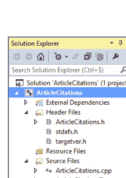

图 26-1

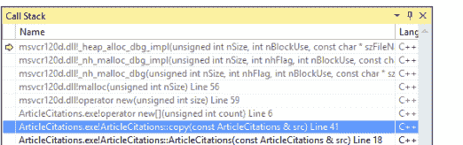

图 26-2

正如所示，你看到问题出在 `copy()` 中。你可以双击堆栈窗口中的该行以跳转到代码中的正确位置。如果你只看到反汇编（disassembly），在反汇编任意位置右键点击并选择 `To Source Code`（转源代码）。然后点击 `Debug > Windows > Autos`（调试 > 窗口 > 自动）来检查变量。在变量列表中找到 `src`。点击加号展开 `src` 变量的成员。图 26-3 显示了它的样子。

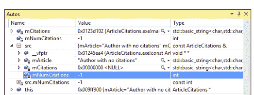

Autos | Locals | Threads | Watch 1 | Find Results 1

图 26-3

从此窗口，你会看到 `mNumCitations` 为 -1。原因和修复方法之前完全相同。

# 从 ArticleCitations 示例中学到的训

你可能倾向于认为这个示例太小，不能代表真实的调试。虽然代码并不长，但即使在大型项目中，类也不会大到哪里。想象一下，如果你在集成到项目的其他部分之前没有进行彻底测试。如果这些错误在之后出现，其他工程师将不得不花费更多时间来缩小问题范围，然后才能像这里这样进行调试。此外，此示例中所示的技术适用于所有规模的调试，无论大小。

## 总结

本章最重要的概念是调试的基本法则：在编码时避免错误，但要为代码中的错误留好计划。编程的现实是错误将会出现。如果你正确准备了程序，带有错误日志、调试跟踪、断言和静态断言，那么实际调试将容易得多。

除了这些技术外，本章还介绍了调试错误的特定方法。实际调试时最重要的规则是重现问题。然后，你可以使用符号调试器或基于日志的调试来跟踪根源。内存错误具有特殊困难，并占了 C++ 大多数错误。本章描述了各种内存错误类型及其症状，并展示了程序中调试错误的示例。

调试技术是结束《专业 C++》之旅的绝佳方式。通过思考你的设计、在对象编程中尝试不同的方法、选择性地为你的编码库添加新技术并练习调试技术，你将能够把 C++ 技能提升到专业水平。

# C++ 面试

阅读这本书无疑为你的 C++ 业带来启动，但雇主在提供高薪之前会希望你证明自己。面试方法因公司而异，但技术面试的许多方面是可以预测的。一个彻底的面试官会想要测试你的基础编码技能、调试技能、设计和风格技能以及解决问题的能力。你可能会遇到的问题非常多。在本附录中，你将阅读你可能遇到的不同类型的问题，以及获得你所追求的入薪 C++ 编程工作的最佳策略。

本附录遍历了书的章节，讨论了每个章节在面试情况下可能出现的方面。每个部分还包含了对旨在测试这些技能的问题讨论，以及处理这些问题的最佳方法。

# 第 1 章：C++ 和 STL 快速上手

技术面试通常会包含一些基础 C++ 问题，以筛选掉那些因为听过这种语言就在简历上写 C++ 的候选人。这些问题可能会在*电话筛选*（phone screen）期间提出，即开发者或招聘人员在带你面试之前给你打电话。

# 问题类型

风格类问题可能以不同的形式出现。我的一个朋友曾被要求在白板上写一个相当复杂的算法代码。他才刚写下第一个变量名，面试官就让他停下来，并告诉他通过了。这个问题并不是关于算法的；它只是一个红鱱鱼（干扰项），用来展示他对变量的了解程度如何。更常见的是，你可能会被要求提交你写过的代码，或者对代码给出你的意见。

当潜在雇主要求你提交代码时，你必须小心。从法律上讲，你可能无法提交你为之前的雇主编写的代码。你还必须找到一段既能展示你的技能，又不需要太多背景知识的代码。例如，你可能不想把关于高速图像渲染的硕士论文提交给一家正在面试你数据库管理职位的公司。

如果公司给了你一个特定的程序去编写，那是一个展示你在本书书中中学到的知识的绝佳机会。即使潜在雇主没有指定具体的程序，你也应该考虑编写一个小型程序提交给公司。与其选择你已经写过的某些代码，不如从零开始编写与工作相关并突出你个人风格的代码。

此外，如果你有已经编写并可以发布的文档（意味着它不保密），请用它来展示你的*沟通*技能；这会给你赢得加分。你构建或维护过的网站，你提交到 CodeGuru、CodeProject、SourceForge 等地方的文章，都是非常有用的。这说明你不仅会*写代码*，还能通过交流如何*有效使用使用代码*。当然，如果名字下带有一本书的标题将是一个巨大的加分项。

# 第 4 章：设计专业的 C++ 程序

你的面试官会希望确保你除了了解 C++ 语言外，还擅长应用它。你可能不会被显式地问设计问题，但优秀的面试官有各种技巧将设计问题融入其他问题中，正如你将看到的那样。

潜在雇主还想知道你是否能够处理不是由自己编写的代码。如果你在简历上列出了特定的库，你应该准备好回答关于这些库的问题。如果你没有列出特定的库，对库的重要性有一般的理解就足够了。

## 注意事项

- 设计是主观的——准备好在面试期间为你所做的设计决策辩护
- 在面试前回顾你过去做过的设计细节，以防被要求提供示例
- 准备好定义*抽象*并给出一个示例
- 准备好视觉化地勾勒设计，包括类层次结构
- 准备好推崇代码复用的益处
- 库的概念
- 从零开始与复用代码之间的权衡
- 大 O 表示法的基础，或者至少记住 `O(n log n)` 优于 `O(n²)`
- C++ 标准库中包含的功能
- 设计模式的高级定义

## 问题类型

设计问题对面试官来说很难构思——任何你在面试环境中可以设计的程序都太简单了，无法展示真实世界的的设计能力。设计问题可能以模糊的形式出现，例如“告诉我设计一个好程序的步骤”，或者“解释抽象的原则”。这些设计问题也可以是显式的。在讨论你之前的工作时，面试官可能会说：“你能向我解释一下那个项目的设计吗？”

如果面试官在问你关于某个特定的库，他/她可能更关注库的高级方面，而不是技术细节。例如，你可能会被要求从库的设计角度解释该库的优缺点。最好的候选人会知道 STL 的广度和标准性是优点，而其陡峭的学习曲线是缺点。

你可能会被问到一个最初听起来与库不相关的设计问题。例如，面试官可能会问你将如何创建一个从网络下载 MP3 音乐并在本地计算机上播放的应用程序。这个问题并没有明确与库相关，但它的意图在于；这个问题实际上是关于流程的。

你可能会从询问将如何收集需求并进行初始原型开始。因为问题提到了两种特定的技术，面试官想知道你将如何处理它们。这时库就派上用场了。如果你告诉面试官你将编写自己的类和 MP3 播放代码，你不会通过测试，但你需要为重新发明这些东西的时间和成本提供辩护。

更好的答案是说，你会调研性能良好的库和具有 MP3 功能的库，看看是否有适合该项目的。你可能想列出你将开始使用的技术，例如 Linux 用于检索的 `libcurl` 或 Windows 用于音乐播放的 Windows Media 库。

提到带有免费库的网站以及这些网站提供的一些想法，也可能为你赢得额外分数。例如，用于库的 `www.codeguuru.com` 和 `www.codeproject.com`；用于独立 C++ 库的 `www.boost.org`；用于不同平台的库的 `www.sourceforge.net` 等。列举一些开源软件可用的许可证，例如 GPL 许可证、Boost 许可证、Creative Commons 许可证、CodeGuru 许可证、Open 许可证等，可能会让你获得额外加分。

# 第 5 章：面向对象的设计

面向对象的设计师习惯于区分掉那些仅仅知道什么是引用的 C 程序员与真正使用语言面向对象特性的 C++ 程序员。面试官不会认为任何事情理所当然；即使你已经使用面向对象的语言多年，他们可能仍然想看到你理解这种方法。

## 注意事项

- 过程式与面向对象范式的区别
- 类与对象的区别
- 用组件、属性和行为来表示类
- Is-a 和 has-a 关系
- 多重继承涉及的权衡

## 问题类型

通常有两种方式问面向对象的设计问题。你可能会被要求定义一个面向对象的概念，或者被要求勾勒一个面向对象的层次结构。前者非常直接。记住，示例可能会为你赢得加分。

如果你被要求勾勒 OO 层次结构，面试官通常会提供一个简单的应用程序（例如一个纸牌游戏），让你为此设计一个类。面试官经常问关于类的问题，因为这些是面试官所熟悉的。他们也有助于通过关于数据库实现等问题放松思维。

# 第 6 章：为复用而设计

面试很少问关于设计复用代码的问题。这种缺失是遗憾的，因为团队中如果只有只会编写单一用途代码的程序员对编程组织是有害的。偶尔，你会发现一家对代码复用很精通的公司并询问他们在面试中谈到了这一点。这样的问题表明这可能是一个很好的工作公司。

## 需要记住的

- 抽象原则
- 子系统的创建和类层次结构
- 良好接口设计的通用规则，即仅包含公共方法且不包含实现细节的接口
- 何时使用模板以及何时使用继承

## 问题类型

关于复用的问题几乎肯定与你之前参与过的项目。例如，如果你在一家同时生产消费级和专业级视频编辑应用程序的公司工作过，面试官可能会问代码在两个应用程序之间是如何共享的。当你没有被显式问到代码复用时，你可以尝试带入这个话题。在描述你过去的工作时，告诉面试官你写的模块是否被用于其他项目。在回答看似直接的编码问题时，务必考虑并提到涉及的接口。

# 第 7 章和第 8 章：类与对象

关于类和对象的问题类型是无限制的。有些面试官纠结语法，可能会向你抛出一些复杂的代码。另一些人则不太关心实现，而更感兴趣你的设计能力。

## 需要记住的

- 基础类定义语法
- 访问成员方法和数据成员
- `this` 指针的使用
- 解析工作原理，它首先通过局部作用域解析名称，然后是类作用域（隐含 `this->`），最后是全局作用域
- 对象的创建和析毁，包括栈和堆
- 编译器为你生成构造函数的情况
- 构造函数初始化列表
- 拷贝构造函数和赋值运算符
- 委托构造函数
- `mutable` 关键字
- 方法重载和默认参数
- 友类和友元方法
- 管理动态分配的内存
- 静态方法和数据成员
- 内联方法以及 `inline` 关键字只是编译器的提示，编译器可以忽略该提示
- 分离接口和实现类的核心思想，即接口应该只包含公共方法并保持尽可能稳定；它们不应包含任何数据成员或私有/保护方法；因此接口可以保持稳定，而实现在其下方自由更改。
- 初始化列表
- 类内成员初始化
- 显式删除和已删除的特殊成员函数

## 问题类型

诸如“`mutable` 关键字是什么意思？”之类可以作为电话筛选问题。招聘官可能有一份 C++ 术语列表，并根据候选人回答正确的数量将其推向流程的下一个阶段。你可能并不所有的到处抛出的 `throw`，但请记住，其他候选人面临着同样的问题，这是招聘官可用的少数指标之一。

“找 Bug”（find-the-bug）类型的问题在面试官和导师中都很流行。他们会给你一些毫无意义的代码，并让你指出其缺陷。面试官很难找到定量值来分析候选人，而这是少数方法之一。通常情况下，你的方法应该是阅读每一行代码并说出你的顾虑，进行头脑风暴。Bug 的类型分为以下几类：

- 语法错误：这些非常罕见——面试官知道你可以通过编译器检查编译时错误。
- 内存错误：包括泄漏和重复释放等问题。
- “你不会这样做”：这一类包括技术上正确但不被推荐的内容。例如，不要使用 C 风格的字符数组，改用 `std::string`。
- 风格错误：即使面试官不将其算作 Bug，也要指出糟糕的注释或变量名。

这里有一个展示了上述每个领域的找 Bug 问题：

```cpp
class Buggy
{
  Buggy(int param);
  -Buggy();
  double fjord(double inVal);
  int fjord(double inVal);
protected:
  void turtle(int i = 7, int j);

int param;
double* mGraphicDimension;

};
Buggy::Buggy(int param)
{
  param = param;
  mGraphicDimension = new double;
}
Buggy::~Buggy()
{
double Buggy::fjord(double inVal)
{
  return inVal * param;
}
int Buggy::fjord(double inVal)
{
  return (int)fjord(inVal);
}
void Buggy::turtle(int i, int j, int j)
{
  cout << "i is " << i << ", " << j << " is " << endl;
}
```

仔细观察这段代码，然后考虑答案中的纠正版本：

```cpp
#include <iostream> // 实现中使用了流。
class Buggy {
public:
  Buggy(int inParam); // 这些可能应该是公共的。
  virtual ~Buggy(); // 参数命名。
  Buggy(const Buggy& src); // 建议将析构函数设为虚。
  Buggy&operator=(const Buggy& rhs); // 提供拷贝构造函数和赋值运算符
  // 当类有动态
  Buggy(const Buggy& src) noexcept; // 移动构造函数和赋值运算符
  Buggy&operator=(Buggy& rhs) noexcept; // 当类有动态
  // 分配内存以提高性能。（见第 10 章）。
  double fjord(double inVal); // int 版本被重载。
  // 方法不能不同。
  void turtle(int i, int j, int j);
private:
  int param;
  double* mGraphicDimension;


Buggy::Buggy(int inParam) : param(inParam), mGraphicDimension(new double)
{
  param = param;
  mGraphicDimension = new double;
}
Buggy::~Buggy()
{
  delete mGraphicDimension;
}
double Buggy::fjord(double inVal)
{
  return inVal * param;
}
int Buggy::fjord(double inVal)
{
  return (int)fjord(inVal);
}
void Buggy::turtle(int i, int j, int j)
{
  std::cout << "i is " << i << ", " << j << " is " << std::endl;
}
```

仔细观察这段代码，然后考虑答案中的纠正版本：

对于这个例子，你还必须提到最好避免动态内存，或者如果无法避免，请使用智能指针（如 `unique_ptr`）而不是笨的 `mGraphicDimension`。解释这对 `Buggy` 类的影响。

```cpp
#include <iostream>
#include <memory>

class Buggy {
public:
  Buggy(int inParam) : param(inParam), mGraphicDimension(std::make_unique<double>()) {}
  virtual ~Buggy() = default;
  Buggy(const Buggy& src) = default;
  Buggy& operator=(const Buggy& rhs) = default;
  Buggy(const Buggy&& src) noexcept = default;
  Buggy& operator=(Buggy&& rhs) noexcept = default;

  double fjord(double inVal) {
    return inVal * param;
  }
  int fjord(double inVal) {
    return (int)fjord(inVal);
  }
  void turtle(int i, int j) {
    std::cout << "i is " << i << ", " << j << " is " << std::endl;
  }

private:
  int param;
  std::unique_ptr<double> mGraphicDimension;
};
```

## 注意事项

- 引用在声明时必须绑定到变量，且该绑定不能更改
- 引用传递优于值传递的优点
- `const` 的多种用途
- `static` 的多种用途
- C++ 中不同类型的强制类型转换
- 右值（rvalues）与左值（lvalues）的区别
- 右值引用
- 使用移动构造函数和移动赋值运算符的移动语义
- 初始化

## 问题类型

让候选人定义 `const` 和 `static` 是一个经典的 C++ 面试题。这两个关键字都提供了一个分级，面试官可以据此评估回答。例如，一个合格的候选人会谈论静态方法和静态数据成员。优秀的候选人会给出静态方法和静态数据成员的良好示例。顶出的候选人还会知道静态链接和函数中的静态变量。


本章描述的边界情况也会出现在“找 bug”类型的问题中。注意留意引用的误用。例如，想象一个包含引用作为数据成员的类：

```cpp
class Gweneth {
  private:
    int& mCaversham;
};
```

`mCaversham` 是一个引用，它在类构造时需要绑定到一个变量。要做到这一点，你需要使用构造函数初始化列表。该类可以将被引用的变量作为构造函数的参数：

```cpp
class Gweneth {
  public:
    Gweneth(int& i);
  private:
    int& mCaversham;
};
Gweneth::Gweneth(int& i) : mCaversham(i) {
}
```

# 第 11 章和第 21 章：模板

作为 C++ 最深奥的部分之一，模板是面试官区分 C++ 初学者与专业人士的好方法。虽然大多数面试官会原谅你没有记住某些高级模板语法，但你应该在面试前掌握基础知识。

## 注意事项

- 如何使用类模板
- 如何编写基础类模板
- 备用函数语法及其在推导返回值类型（推理）中的用途
- 别名模板以及为什么它们比 `typedef` 更好
- 变长模板的概念
- 元编程背后的思想

## 问题类型

许多问题从一个简单的问题开始，并逐渐增加复杂度。通常，面试官准备了增加无限复杂性的手段，他们只是想看看你能做到多远。例如，面试官可能会先要求你创建一个提供对固定数量 `int` 顺序访问的类。接下来，该类需要增长以适应任意大小的数组。然后，它需要任意数据类型，这就是模板大显身场的地方。从那里开始，面试官可以从多个方向引导问题，要求你使用运算符重载来实现类数组的语法，或者继续模板路径并要求你提供一个默认类型。

模板更有可能用于另一个编码问题的解决方案中，而不是被显式问起。如果涉及该主题，你应该复习基础知识。然而，大多数面试官都理解模板语法很困难，在面试中要求某编写复杂的模板代码是相当残忍的。

面试官可能会问你关于元编程的高级问题，以确定你是否听过它。在解释时，你可以给出一个小示例，例如在编译时计算数字的阶乘。如果语法不完全正确也不要担心。只要你解释它本应该做什么，就没问题。

# 第 12 章：揭秘 C++ I/O

如果你正在面试编写 GUI 应用程序的工作，你可能不会得到太多关于 I/O 流的问题，GUI 应用倾向于使用其他机制进行 I/O。然而，流可能会出现在其他问题中，而且作为 C++ 的标准部分，对于面试官来说它们是必不可少的。

## 注意事项

- 流的定义
- 使用流进行基础输入和输出
- 称为（manipulators）的概念
- 流的类型（控制台、文件、字符串等）
- 错误处理技术

## 问题类型

I/O 可能出现在任何问题的背景中。例如，面试官可能会要求你读取一个包含测试分的文件并将其放入 `vector` 中。这个问题测试了基础 C++ 技能、基础 STL 和 I/O。如果 I/O 只是你正在处理的问题的一小部分，务必检查错误。如果你不这样做，你就给了面试官一个机会对你完美的程序说负面评价的机会。

# 第 13 章：错误处理

经理们回避聘用应届毕业生或新手程序员担任关键（且高薪）的职位，因为人们假设他们不会编写生产级代码。你可以在面试期间展示你的错误处理技能，向面试官证明你的代码不会随机崩溃。

## 注意事项

- 异常的语法
- 以 `const` 引用捕获异常
- 对于生产代码，异常层次结构比几个通用异常更佳
- 抛出异常时栈回溯（stack unwinding）的工作原理
- 如何在构造函数和析构函数中处理错误
- 智能指针在抛出异常时避免内存泄漏
- 永远不要在 C++ 中 C 函数 `setjmp()` 和 `longjmp()`

## 问题类型

面试官会留意你如何报告和处理错误。当你被要求写一段代码时，确保你实现了适当的错误处理。

你可能会被要求提供抛出异常时回溯如何工作的高级概述，而无需实现细节。

# 第 14 章：重载 C++ 运算符

当然，并不是所有程序员都理解或欣赏异常。有些人可能出于性能原因对它们完全完全偏见。如果面试官问你一个不需要异常的问题，你必须回归传统的检查和错误代码。这将是你展示知识的好时机。

面试官还可能以“你会使用这个？”的形式提问。一个例子可以是：“会在 C++ 中使用 `setjmp()/longjmp()` 吗，因为它们比异常更高效？”答案应该是否，因为 `setjmp()/longjmp()` 会跳过作用域析构函数。异常具有巨大性能开销的事是一个误解。在现代编译器上，能够处理异常的代码开销几乎为零。

虽然可能，但可能你在面试中需要执行比简单运算符重载更困难的操作。某些面试官喜欢准备一个并不预期有人能正确回答的高级问题。运算符重载的细节使其几乎不可能，因为程序员不需要查找就能记住语法。这意味着面试这是一个很好的复习领域。

## 注意事项

- 重载流运算符，因为它们常用的重载运算符，且概念上是独特的
- 什么是函数对象（functor）以及如何创建一个
- 在成员运算符或全局友函数之间选择
- 某些运算符可以通过其他运算符表示；例如，`operator<=` 可以通过取反 `operator>` 来
- 使用值引用实现赋值运算符

## 问题类型

运算符重载问题（简单的之外）可能是很残忍的。任何问你的人都知道这一点，并且在你回答正确时会感到印象深刻。无法预测你将得到的具体问题，但运算符的数量是有限的。只要你见过每个合理重载运算符的示例，你就没问题！

除了要求实现重载运算符外，你可能被问有关运算符重载的高级问题。一个找 bug 的问题可能包含一个被重载为对该特定运算符概念上错误的运算符。除了语法之外，记住运算符重载的用例和理论。

# 第 15、16、17 和 20 章：标准模板库 (STL)

正如你所看到的，STL 的某些方面处理起来可能比较困难。很少有面试官会要求你记住 STL 类的细节，除非你自称是 STL 专家。如果你知道你要应聘的职位大量使用 STL，你可能想在面试前一天写一些 STL 代码来唤醒记忆。否则，记住 STL 的高层设计及其基本用法就足够了。

## 需要记住的知识

- 不同类型的容器及其与迭代器之间的关系
- `vector` 的基本用法（这可能是最频繁使用的 STL 类）
- 关联容器（如 `map`）的使用方法
- 关联容器与无序关联容器（如 `unordered_map`）之间的区别
- STL 算法的用途以及一些内置算法
- 在 STL 算法结合结合 表达式（lambda expressions）
- 扩展 STL 的方法（细节可能不需要）
- 移除-删除惯用法（remove-erase-idiom）
- 你对 STL 的个人观点

## 问题类型

如果面试官执意要问 STL 问题，那么他们可能问的问题类型将没有任何限制。如果你对语法不确定，应该在面试中说出显而易见的事——“当然，在实际上，我会在《Professional C++》中查阅，但我确定它的工作原理是这样的……” 至少这样可以提醒面试官，只要你掌握了基本概念，他就不应该纠结细节。

关于 STL 的高层问题通常用于衡量你对 STL 的熟悉程度，而不是要求你回忆所有细节。例如，STL 的初级用户熟悉关联容器和非关联容器。稍微进阶的用户能够定义迭代器，描述迭代器如何与容器工作，并描述移除-删除惯用法。其他高层问题还可能问你对 STL 算法的经验，或者你是否对 STL 进行过自定义。面试官还可能评估你对 lambda 表达式及其在 STL 算法中使用的了解。

# 第 19 章：额外的库工具

本章描述了 C++ 标准中的许多较小的功能和额外的库，包括一些 C++11 和 C++14 特性。面试官可能会提到其中几个主题，以查看你是否在跟上 C++ 世界的最新进展。

## 需要记住的知识

- `std::function` 的用法
- 用于处理时长、时钟和时间点的 Chrono 库
- 使用 `<random>` 库作为生成随机数的优方法
- 标准用户自定义字面量（user-defined literals）
- `std::tuple` 作为 `std::pair` 的推广

## 问题类型

你不需要期望这些主题会有详细的问题。一个可能的问题是解释 `std::function` 的用法。你可能还会被要求解释 Chrono 和随机数生成库的基本思想和概念，但不需要深入语法细节。如果面试官开始关注随机数，那么解释真随机数与伪随机数之间的区别是非常重要的。

# 第 22 章：内存管理

你可以确定，面试官会问你与内存管理相关的问题，包括你对智能指针的了解。除了指针，你还会遇到更多底层的问题。目标是判断 C++ 的面向对象方面是否让你过远离了底层实现细节。内存管理问题将给你一个机会来证明你了解到底发生了什么。

## 需要记住的知识

- 绘制栈和堆可以帮助你理解正在发生的情况
- 使用 `new` 和 `delete` 代替 `malloc()` 和 `free()`
- 使用 `new[]` 和 `delete[]` 处理数组
- 如果你有一个指向对象的指针数组，你仍然需要为每个指针分配内存并删除内存——数组分配语法不会处理指针
- 存在内存分配检测器（如 Valgrind）用以暴露内存问题
- 智能指针，特别是 `std::shared_ptr` 和 `std::unique_ptr`，以及你不应该使用已弃用的 `std::make_auto_ptr`
- 使用 `std::make_unique()` 创建 `std::unique_ptr`
- 使用 `std::make_shared()` 创建 `std::shared_ptr`

## 问题类型

找错题（Find-the-bug）通常包含内存问题，如双重删除、`new/delete/new[]`/`delete[]` 混用以及内存泄漏。当你大量使用指针和数组的代码时，应该在处理每行代码时绘制并更新内存状态。

另一个发现候选人是否理解内存的好方法是问指针和数组有什么区别。在这一刻，这些差异在你的脑海中可能是如此理所当然，以至于这个问题让你一时措手不及。如果是那样，请再次浏览一遍第 22 章的讨论。

在回答关于内存分配的问题时，提到智能指针的概念及其在自动清理内存或其他资源益处总是一个好主意。你绝对应该提到，使用 `std::vector` 等 STL 容器比 C 风格数组更好，因为 STL 容器会自动为你处理内存管理。

# 第 23 章：C++ 多线程编程

随着多核处理器在从服务器到消费级计算机各个领域的发布，多线程编程变得越来越重要。即使是智能手机也有多核处理器。面试官可能会问你几个多线程问题。C++ 包含了标准线程库，所以了解它是一件好事。

## 需要记住的知识

- 竞态条件和死锁以及如何防止它们
- 使用 `std::thread` 产生线程
- 原子类型和原子操作
- 互斥概念（包括锁类）
- 条件变量以及如何使用它们向其他线程发送信号
- 未来（Futures）和承诺（Promises）
- 跨线程边界的异常复制和重抛

## 问题类型

多线程编程是一个复杂的主题，所以你不需要期望详细的问题，除非你正在面试特定的多线程职位。

相反，面试官可能会要求你解释可能遇到的不同问题，例如竞态条件和死锁。你可能被要求解释多线程编程背后的通用概念。这是一个非常广泛的问题，但允许面试官对你的多线程知识有一个了解。

# 第 24 章：软件工程方法最大化

如果你在整个公司的面试过程中，面试官没有问任何问题，那么你应该起疑——这可能意味着他们没有流程，或者他们不在乎这一点。或者，他们可能不想用他们的流程吓到你。开发流程的另一个重要方面是源代码控制。

大多数时候，你有机会问关于公司的问题。我建议你考虑将工程流程和源代码控制作为你的标准问题之一。

## 需要记住的知识

- 传统的生命周期模型
- 正式模型的权衡，例如统一建模过程
- 极捷编程的主要原则
- 作为敏捷流程的 Scrum
- 你过去使用的其他流程
- 源代码控制的原理

## 问题类型

你面临的最常见问题是描述你之前雇主使用的流程。在回答时，你应该提到哪些效果良好，哪些失败了，但尽量不要贬低任何特定的方法。你所批评的方法可能是你的面试官正在使用的。

如果你得到关于源代码控制的问题，它通常是一个高层问题。你应该解释源代码控制解决方案背后的通用原理，提到有商业和免费开源解决方案可用，并可能解释源代码控制在你之前的雇主处是如何进行的。

# 第 25 章：编写高效的 C++

效率问题在面试中非常常见，因为许多机构正面临代码的可扩展性问题，并且他们需要对性能有敏锐认识的新程序员。

## 注意事项

- 语言层面的效率很重要，但它是有局限性的；设计层面的选择最终更为重要。
- 避免使用复杂度糟糕的算法，例如二次方算法。
- 引用参数更高效，因为它们避免了拷贝。
- 对象池可以帮助避免创建和销毁对象的开销。
- 性能调优（Profiling）对于确定哪些操作真正消耗了大部分时间至关重要，这样你就不会浪费精力去优化那些并非性能瓶颈的代码。

## 问题类型

面试官通常会以自己的产品作为示例来引出效率问题。有时，面试官会描述一个旧的设计以及他所经历的一些性能相关的症状。候选人被要求给能够缓解该问题的设计。遗憾的是，这类问题存在一个大问题——你提出的方案与公司在实际解决问题时使用的方案相同的概率有多大？因为概率微乎其微，你需要格外小心地为你的设计提供理由。你可能想不出实际的解决方案，但你仍然可以给正确或比候选人的新设计更好的答案。

其他类型的效率问题可能要求你为了性能微调某些 C++ 代码，或对某个算法进行迭代。例如，面试官可能会向你展示包含多余拷贝或低效循环的代码。

面试官还可能让你对性能调优工具进行高层描述及其它们的优点。

# 第 26 章：攻克调试

工程机构寻找那些能够调试自己的代码以及调试他们从未见过的代码的候选人。技术面试通常试图衡量你的调试“肌肉”。

## 注意事项

- 调试并不是从 bug 出现时开始的；你应该提前对代码进行插桩（instrument），以便在 bug 出现时做好准备。
- 日志（Logs）和调试器是你最好的工具。
- 如何使用断言（assertions）。
- 如何使用静态断言（static assertions）。
- bug 表现出的症状可能与实际原因无关。
- 对象图在调试时很有帮助，特别是在面试期间。

## 问题类型

在面试过程中，你可能会面临一个晦涩的调试挑战。记住，过程是最重要的，面试官可能也知道这一点。即使你没有在面试期间找到 bug，也要确保面试官知道你将通过哪些步骤来追踪它。如果面试官交给你一个函数并告诉它在执行期间崩溃了，那么对于一个正确讨论寻找 bug 步骤顺序的候选人，他应该给予与一眼发现 bug 的候选人同样等的分数。

## 注释参考文献

本附录包含了关于各种 C++ 相关主题的书籍和在线资源，这些资源在编写本书时参考过，或者被推荐进一步阅读或背景阅读。

### C++

#### 入门 C++

- Stanley B. Lippman, Josée Lajoie, and Barbara E. Moo, *C++ Primer (5th Edition)*, Addison-Wesley, 2012, ISBN: 0-321-71411-3.

    这是一本非常详尽的 C++ 介绍，以非常易于理解的格式和细节涵盖了语言中的所有内容。

- Bruce Eckel, *Thinking in C++, Volume 1: Introduction to Standard C++ (Second Edition)*, Prentice Hall, 2000, ISBN: 0-139-79809-9.

    这是一本优秀的 C++ 编程介绍，要求读者已经了解 C 语言。可以在 www.bruceeckel.com 免费获取。

- Andrew Koenig, Barbara E. Moo, *Accelerated C+: Practical Programming by Example*, Addison-Wesley Professional, 2000, ISBN: 0-201-70353-X.

    涵盖了与 *C++ Primer* 相同的内容，但空间小得多，因为它假设读者以前用其他语言编程过程序。

- Steve Callaugh, *Practical C++ Programming (Second Edition)*, O'Reilly, 2003, ISBN: 0-596-00419-2.

    这是一本入门级 C++ 文本，假设没有先前的编程经验。

- Walter Savitch, *Problem Solving with C++ (Eighth Edition)*, Addison-Wesley, 2011, ISBN: 0-132-16273-3.

    这本书假设没有之前的编程经验。它经常被用作入门编程课程的教科书。

#### 通用 C++

- [C++ Programming Language](https://www.isocpp.org) 位于 www.isocpp.org。

- 网络上的标准 C++ 主页——关于所有编译器和平台上的 C++ 标准的新闻、状态和讨论。

- Marshall Cline, *C++ FAQ LITE*, [访问地址](https://www.parashift.com/c++/faq-lite)。

- Marshall Cline, Greg Lowe, and Mike Giro, *C++ FAQs (Second Edition)*, Addison-Wesley, 1998, ISBN: 0-221-30983-1.

- 此来自 comp.lang.c 新闻组的常见问题汇编对于快速查找关于 C++ 的特定点非常有用。打印版比原版包含更多信息，但在线可用材料对于大多数专业 C++ 程序员来说已经足够了。

- Stephen C. Dewhurst, *C++ Gotchas*, Addison-Wesley, 2012, ISBN: 0-321-12518-3.

    提供了常见的 C++ 陷阱集。

- Bruce Eckel, *Thinking in C++, Volume 2: Advanced Features*, Addison-Wesley, 2004.


这是 Eckel 作品的进阶部分。

- Ray Lichnerowicz, *C++ in a Nutshell*, O'Reilly, 2003, ISBN: 0-596-00298.
    一本经典的 C++ 参考。

- Scott Meyers, *Effective C++ (Third Edition)*, Addison-Wesley, 2005, ISBN: 0-321-0948.
    提供了编写高效 C++ 的技巧集。

- Scott Meyers, *More Effective C++*, Addison-Wesley, 2008, ISBN: 0-321-03348.
    C++ 技巧。

- Bjarne Stroustrup, *The C++ Programming Language (Fourth Edition)*, Addison-Wesley, 2013, ISBN: 0-321-9927.
    由作者编写的 C++ “圣经”。

- Stephen Prata, *C++ Plus (Fifth Edition)*, Sams Publishing, 2014, ISBN: 0-471-3298.
    对 C++ 语言的解释。

- Newsgroups 位于 `http://groups.google.com`，包括 `comp.lang.c` 和 `comp.std`。
    新闻组包含大量有用信息。

### C++ 参考

- [C++ Reference](https://www.cppreference.com)。
    C++98、C++03、C++11 和 C++14 的参考。

### I/O 流与字符串

- Cameron Hughes and Tracey Hughes, *Mastering the Standard C++ Classes: An Essential Reference*, Wiley, 1999, ISBN: 0-471-328.
    学习编写 `istream` 和 `ostream` 类的好书。

- Cameron Hughes and Tracey Hughes, *Stream Manipulators and Iterators in C++*, [访问地址](https://www.infimit.com/articles.aspx?p=17101)。
    由 *Mastering the Standard C++ Classes* 作者写的精彩文章消除了自定义操作器的神秘感。

- Philip Romanik and Amy Muntz, *Applied C+: Practical Techniques for Building Software*, Addison-Wesley, 2003, ISBN: 0-321-108.
    除了软件开发建议和 C++ 的独特结合外，这本书对 Unicode 支持提供了很好的解释。

- Joel Polsky, *The Absolute Minimum Every Software Developer Absolutely, Positively Must Know About Unicode and Character Sets (No Excuses)*, [访问地址](https://www.josoftware.com/articles/Unicode.html)。
    读完 Joel 关于本地化的论文后，你会查看 *Joel on Software* 中的其他条目。

- The Unicode Consortium, *The Unicode Standard 5.0*, Addison-Wesley, 2006, ISBN: 0-321-480.
    这是关于 Unicode 的权威书籍，所有开发者都必须拥有。

- Unicode, *Where is my Character?*, [访问地址](https://www.unicode.org/standard/where)。
    寻找 Unicode 字符、图表和表格的最佳资源。

- Wikipedia [Universal Character Set](https://en.wikipedia.org/wiki/Universal_Character_Set)。
    对通用字符集 (UCS) 的解释，包括 Unicode 标准。

### C++ 标准库

- Nicolai M. Josuttis, *The C++ Standard Library: A Tutorial and Reference*, Addison-Wesley, 1999, ISBN: 0-201-379.
    这本书涵盖了整个标准库，包括 I/O 流和字符串，以及容器和算法。这是一本优秀的参考书。

- Scott Meyers, *Effective STL: 提高标准模板库用法的 50 种特定方法*, Addison-Wesley, 2001, ISBN: 0-201-74962-9.
    Meyers 编写这本书的精神与他的《Effective C++》系列书籍如出一辙。它为使用 STL 提供了针对性的技巧，但并不是一本参考书或教程。

- David R. Mueller, Jimmer G., Alun Saini, *STL 教程与参考指南（第二版）*, Addison-Wesley, 2001, ISBN: 0-321-70212-3.
    这本书与 Josuttis 的书类似，但仅涵盖了标准库中的 STL 部分。

- Pete Becker, *C++ 标准库扩展: 教程与参考*, Addison-Wesley, 2006, ISBN: 0-321-4299-0.
    此书阐释了通过技术报告 1 (TR1) 添加到 C++ 标准库的 `new-32` 特性。

- Stephan T. Lavavej, *标准模板库 (STL)*, `http://channel9.msdn.com/Going-Deep/C-Lectures-Introduction-to-STL-with-Stephan-T-Lavavej`.
    关于 C++ 标准模板库的一系列非常有趣的视频。

## C++ 模板

- Herb Sutter, *Sutter’s Mill: 与模板结为友*, C/C++ User’s Journal, `http://drodds.com/cpp/184403853`.
    关于为类创建函数模板的极佳解释。

- David Vandvoorde 和 Nicol M. Josuttis, *C++ 模板: 完整指南*, Addison-Wesley, 2002, ISBN: 0-321-7384-2.
    包含了关于 C++ 模板你想了解（或不知道该了解）的一切内容。它假设读者具有深厚的通用 C++ 背景。

- David Abramrams 和 Alexey Gurtovoy, *C++ 模板元编程: 来自 Boost 及其他领域的概念、工具与技术*, Addison-Wesley, 2004, ISBN: 0-321-22725-5.
    这本书将实用的元编程工具和技术交到了普通程序员手中。

## C++11 / C++14

- C++ 标准委员会论文, `www.open-std.org/jtcl/sc22/wg21/docs/papers`.
    访问由 C++ 标准委员会编写的极其丰富的论文。

- Scott Meyers, *演示材料: 新 C++ (C++11/C++14) 概述*, Artima, 2013, `www.artima.com/shop/overview_of_the_new_cpp`.
    这包含了 Scott Meyers 关于新 C++ 标准培训课程的演示材料，是获取所有 C++11 新特性和选定的 C++14 特性列表极佳参考。

- 维基百科 C++11, `http://en.wikipedia.org/wiki/C%2B%2B11`.
    对添加到 C++11 的所有新特性描述。

- 维基百科 C++14, `http://en.wikipedia.org/wiki/C%2B%2B14`.
    对添加到 C++14 的部分新特性的描述。

- ECMAScript 语言规范, `http://www.ecma-international.org/publications/files/ECMAS-ST/ECMA-262.pdf`.
    C++ 中正则表达式的语法之一与本规范描述的 ECMAScript 语言中的正则表达式相同。

- Brian W. Kernighan 和 Dennis Ritchie, *设计语言（第二版）*, Prentice Hall, 1998, ISBN: 0-131-10362-8.
    这本书被称为“C&R”，是一本 C 语言的参考书，但对于初学者来说并不好用。

- Samuel P. Harrison III 和 Guy L. Steele Jr., *C: 参考手册（第五版）*, Prentice Hall, 2002, ISBN: 0-130-85952-X.
    这本书可以作为 K&R 书的替代品。它没有采用将知识嵌入文本的叙述风格，而是作为一本更正式的参考手册编写的。每位 C 程序员都应该拥有一本。

- Peter Prinz, Tony Crawford (译), Ulla Kirch-Prinz, *C 口袋参考指南*, O'Reilly, 2002, ISBN: 0-596-00436-2.
    对所有 C 相关内容的简明参考。

- Eric S. Roberts, *C 的艺术与科学: 基于库的计算机科学介绍*, Addison-Wesley, 1994, ISBN: 0-201-54322-2.

- Eric S. Roberts, *C 编程抽象: 计算机科学的第二门课程*, Addison-Wesley, 1997, ISBN: 0-201-54541-1.
    这两本书为良好风格的编程提供了极好的介绍。它们通常用作入门编程课程的教材。

- Peter Van Der Linden, *专家级 C 编程: C 的深层秘密*, Prentice Hall, 1994, ISBN: 0-131-77429-8.
    对 C 语言、其演变及其内部机制进行了具有启发性且具有历史意义的观察。

- Russ Miles, 和 Kim Hamilton, *学习 UML 2.0*, O'Reilly Media, 2006, ISBN: 0-596-00982-2.
    学习 UML 2.0 的极佳书籍。

## 算法与数据结构

- Thomas H. Cormen, Charles E. Leiserson, Ronald L. Rivest, Cliff Steen, *算法导论（第三版）*, MIT Press, 2009, ISBN: 0-262-03384-4.
    这是一本非常易读的算法书籍。

- Donald E. Knuth, *程序设计艺术: 第一卷（第三版）*, Addison-Wesley, 1997, ISBN: 0-201-6829-4.
    对于那些重视数学严谨性的人，没有比 Knuth 的书更好的算法参考。

- Donald E. Knuth, *程序设计艺术: 第二卷（第三版）*, Addison-Wesley, 1997, ISBN: 0-201-62043-3.
    这是软件开发的里程碑式论文。

- Donald E. Knuth, *程序设计艺术: 第三卷（第二版）*, Addison-Wesley, 1998, ISBN: 0-231-09266-3.
    排序与搜索的经典著作。

- Donald E. Knuth, *程序设计艺术: 第四卷（组合算法）*, Addison-Wesley, 2011, ISBN: 0-201-03804-8.
    关于组合算法的 Knuth 四卷著作。

- Andrew Goldreich, *现代密码学: 概率证明与伪随机性*, Springer, 2010, ISBN: 3-642-08432-5.
    这两本书解释了计算伪随机的理论。

- 维基百科 梅森旋转算法, `http://en.wikipedia.org/wiki/Mersenne_twister`.
    关于生成伪随机数的梅森旋转算法的数学解释。

## 开源软件

- 开源组织, `www.opensource.org`.
- GNU 操作系统基金会, `www.gnu.org`.
    这两个主要的开源运动解释了它们的哲学理念。

- Boost C++ 库, `www.boost.org`.
    Boost 提供了大量的开源库。

- SourceForge, `www.sourceforge.net`, 以及 GitHub, `www.github.com`.
    这些网站托管了许多开源项目。

- `www.coduru.com` 和 `www.codeproject.com`.
    寻找项目库的优秀资源。

## 软件工程方法论

- Barry W. Boehm, TRW Defense Systems Group, *软件开发的螺旋模型*, IEEE Computer, 21(5): 61–72, 1988.
    这篇里程碑论文描述了当时的软件开发状态并提出了螺旋模型。

- Kent Beck 和 Cynthia Andres, *极限编程: 拥抱变化（第二版）*, Addison-Wesley, 2004, ISBN: 0-321-27865-8.
    推广极限编程作为一种新软件开发方法的一系列书籍之一。

- Robert T. Futrell, Donald F. Shafer, 和 Linda Isabel Shafer, *高质量软件项目管理*, Prentice Hall, 2002, ISBN: 0-130-91927-2.
    负责软件开发过程管理的人的指南。

- Robert L. Glass, *软件工程的事实与谬言*, Addison-Wesley, 2002, ISBN: 0-321-11742-5.
    这本书讨论了软件开发过程的各个方面，并揭示了隐藏趋势。

- Philippe Krchten, *理性统一过程: 导论（第三版）*, Addison-Wesley, 2003, ISBN: 0-321-19770-4.
    提供了 RUP 的概述，包括其使命和过程。

- Edward Yoirth, *死亡行军（第二版）*, Prentice Hall, 2003, ISBN: 0-131-43635-X.
    一本关于软件开发政治和现实的极具启发性的书籍。

- IBM 的理性统一过程, `www.software.ibm.com/ibmdl/pub/software/rational/web/demos/viewlets/runtime/index.html`.
    IBM 网站包含了关于 RUP 的丰富信息，包括 URL 处的交互式演示。

- Mike Cohn, *Succeeding with Agile: Software Development Using Scrum*, Addison-Wesley, 2009, ISBN: 0-321-57936-4.
    一份入门 Scrum 方法论的优秀指南。

- [维基百科 Scrum](http://en.wikipedia.org/wiki/Scrum_(software_development)).
    对 Scrum 方法论的详细描述。

- [敏捷软件开发宣言](http://agilemanifesto.org/).
    完整的敏捷软件开发宣言。

- [维基百科 版本控制](http://en.wikipedia.org/wiki/Revision_control).
    解释了版本控制系统背后的概念，以及存在哪些解决方案。

## 编程风格

- Martin Fowler, Kent Beck, John Brant, William Opdyke, and Don Roberts, *Refactoring: Improving the Design of Existing Code*, Addison-Wesley, 1999, ISBN: 0-201-48567-2.
    这本书经典阐述了识别和改进坏代码的实践。

- Herb Sutter, and Andrei Alexandrescu, *C++ Coding Standards: 101 Rules, Guidelines, and Best Practices*, Addison-Wesley, 2004, ISBN: 0-321-11358-6.
    关于 C++ 设计和编码风格的必读之书。

- Diodimis Spinellis, *Code Reading: The Open Source Perspective*, Addison-Wesley, 2003, ISBN: 0-201-79940-4.
    这本独特的书通过挑战读者正确学习代码以成为更优秀的程序员，从而解决了编程风格问题。

- Dimitri van Heesch, Doxygen, `http://www.stack.nl/-dimitri/doxygen/index.html`.
    一个高度可配置的程序，可从源代码和注释生成文档。

- John Aycock, *Refactoring and Modifying Code*, John Aycock, 2008, ISBN: 0-980-95550-5.

- [维基百科 代码重构](http://en.wikipedia.org/wiki/Refactoring).
    关于代码重构含义的讨论，包括许多重构技术。

## 计算机体系


- David A. Patterson and John L. Hennessy, *Computer Organization and Design: The Hardware/Software Interface (Fourth Edition)*, Morgan Kaufmann, 2008, ISBN: 0-123-74493-8.
- John L. Hennessy and David A. Patterson, *Computer Architecture: A Quantitative Approach (Fourth Edition)*, Morgan Kaufmann, 2006, ISBN: 0-123-70490-1.

这两本书提供了大多数软件工程师需要关于计算机架构的所有信息。

# 效率

- Dov Bakula and David Mayhew, *Efficient C++: Performance Programming Techniques*, Addison-Wesley, 1999, ISBN: 0-201-37950-3.

  这是少数专门专注于高效 C++ 编程的书籍之一，它涵盖了语言层面和设计层面的效率。

- GNU gprof, `www.gnu.org/software/binutils/`。

  关于 gprof 性能分析工具的信息。

# 测试

- Elfriedie Dustin, *Effective Software Testing: 50 Specific Ways to Improve Your Testing*, Addison-Wesley, 2002, ISBN: 0-201-79429-2.

  虽然这本书针对质量保证专业人员，但任何软件工程师都能从其对软件测试过程的讨论中受益。

# 调试

- GNU 调试器 (GDB), `www.gnu.org/software/gdb/gdb.html`。

  GDB 是一个出色的符号调试器。

- Valgrind, `http://valgrind.org`。

  一个用于 Linux 的开源内存调试工具。

- Microsoft Application Verifier, `http://msdn.microsoft.com/en-us/library/aa480483.aspx`。

  针对 C++ 代码的运行时验证，有助于发现通过普通应用程序技术难以识别的细微编程错误和安全问题。

# 设计模式

- Andrei Alexandescu, *Modern C++ Design: Generic Programming and Design Patterns Applied*, Addison-Wesley, 2001, ISBN: 0-201-70431-5.

  提供了一种采用高度可重用代码和模式的 C++ 编程方法。

- Erich Gamma, Richard Helm, Ralph Johnson, and John Vissides, *Design Patterns: Elements of Reusable Object-Oriented Software*, Addison-Wesley, 1994, ISBN: 0-201-63361-2.

  被称为“四人行”（GoF）之书（因为有四位作者），是设计模式领域的开创性著作。

- John Vissides, *Pattern Hatching: Design Patterns Applied*, Addison-Wesley, 1998, ISBN: 0-201-42393-5.

  GoF 书的伴读本，解释了如何实际应用模式。

- Eric Freeman, Bert Bates, Kathy Siera, and Elisabeth Robson, *Head First Design Patterns*, O'Reilly Media, 2004, ISBN: 0-596-00712-4.

  这本书比列出设计模式更进一步。它展示了使用模式的正例和反例，并提供了坚实的示例。

- [维基百科 设计模式](https://en.wikipedia.org/wiki/Design_patterns)。

# 操作系统

- Abraham Silberschatz, Peter Galvin, and Greg Gagne, *Operating System Concepts (Tenth Edition)*, Wiley, 2018, ISBN: 0-119-98331-2.

  关于操作系统的书籍。

# 多线程编程

- Anthony Williams, *Concurrency in Action*, Manning Publications, 2012, ISBN: 0-132-88652-2.

  关于并发的优秀书籍。

# C 标准库

下表提供了最常用头文件的总结。注意建议避免 C 功能并改用 C++ 特性。

| 头文件 | 内容 |
| :--- | :--- |
| `<cassert>` | `assert()` 宏。 |
| `<ccomplex>` | 处理复数的工具。 |
| `<cctype>` | 字符谓词和函数，如 `isspace()` 和 `tolower()`。 |
| `<cerrno>` | 定义 `errno`，获取某些 C 函数最后的错误的宏。 |
| `<cfenv>` | 支持浮点环境，如浮点异常、舍入。 |
| `<cfloat>` | 与浮点运算相关的 C 风格定义，如 `FL_MAX`。 |
| `<cinttypes>` | 定义了许多用于 `printf()`, `scanf()` 类似函数的宏。还包括指定这些类型的最小值和最大值的宏。 |
| `<ciso646>` | 在 C 中，`<iso646.h>` 文件定义了宏。在 C++ 中，这些是关键字，因此头文件是空的。 |
| `<climits>` | C 风格限制定义，如 `INT_MAX`。 |
| `<clocale>` | 一些宏和函数，如 `LC_ALL` 和 `setlocale()`。 |
| `<cmath>` | 数学内置函数，包括三角函数、`sqrt()`, `fabs()` 等。 |
| `<csetjmp>` | `setjmp()` 和 `longjmp()`。在 C++ 中永远不要使用。 |
| `<csignal>` | `signal()` 和 `raise()`。避免这些。 |
| `<cstdalign>` | 对齐相关的宏 `__align_is_defined`。 |
| `<cstdarg>` | 用于变长参数列表的宏和类型。 |
| `<cstdbool>` | 布尔类型相关的宏 `__bool_true_false_are_defined`。 |
| `<cstddef>` | 重要常量如 `NULL`，以及重要类型如 `size_t`。 |
| `<cstdint>` | 定义了许多标准整数类型，如 `int_t`, `int64_t` 等。它还包括指定这些类型的最小值和最大值的宏。 |
| `<cstdio>` | 文件操作，包括 `fopen()` 和 `close()`。格式化 I/O：`printf()`, `scanf()` 族。字符 I/O：`getc()`, `putc()` 族。文件定位：`fseek()`, `ftell()`。 |

# C 库（续）

| 头文件名称 | 内容 |
| --- | --- |
| `<cstdlib>` | 使用 `rand()` 和 `srand()` 生成随机数。以及你应该避免使用的 `abort()` 和 `exit()` 函数。C 风格内存分配函数：`calloc()`、`malloc()`、`realloc()`、`free()`。使用 `qsort()` 和 `bsearch()` 进行 C 风格搜索和排序。字符串转数字：`atof()`、`atoi()` 等。与多字节/宽字符串处理相关的函数。 |
| `<cstring>` | 低级内存管理函数，包括 `memcpy()` 和 `memset()`。C 风格字符串函数，包括 `strcpy()` 和 `strcmp()`。 |
| `<ctgmath>` | 仅包含 `<complex>` 和 `<cmath>`。 |
| `<ctime>` | 时间函数，包括 `time()` 和 `localtime()`。 |
| `<cuchar>` | 定义了许多 Unicode 相关的宏和函数 `mbrtoc16()` / `mbrtoc32()`。 |
| `<cwchar>` | 宽字符版本的字符串、内存和 I/O 函数。 |
| `<cwctype>` | `<cctype>` 中函数的宽字符版本：`iswspace()`、`towlower()` 等。 |

# 容器

STL 容器的定义可以在 12 个头文件中找到：

| 头文件名称 | 内容 |
| --- | --- |
| `<array>` | 数组 `array` 类模板。 |
| `<bitset>` | `bitset` 类模板。 |
| `<deque>` | 双端队列 `deque` 类模板。 |
| `<forward_list>` | 单向列表 `forward_list` 类模板。 |
| `<list>` | 列表 `list` 类模板。 |
| `<map>` | `map` 和 `multimap` 类模板。 |
| `<queue>` | `queue` 和 `priority_queue` 类模板。 |
| `<set>` | `set` 和 `multiset` 类模板。 |
| `<stack>` | `stack` 类模板。 |
| `<unordered_map>` | `unordered_map` 和 `unordered_multimap` 类模板。 |
| `<unordered_set>` | `unordered_set` 和 `unordered_multiset` 类模板。 |
| `<vector>` | `vector` 类模板和 `vector<bool>` 特化版本。 |

这些头文件每一个都包含使用指定容器所需的所有定义，包括迭代器。第 16 节详细描述了这些容器。

# 算法、迭代器和分配器

STL 的“其余”部分可以在六个不同的头文件中找到：

| 头文件名称 | 内容 |
|---|---|
| `<algorithm>` | STL 中大多数算法的声明。参见第 17 节。 |
| `<functional>` | 定义内置函数对象、取反器、绑定器和适配器。参见第 17 节。 |
| `<iterator>` | `iterator_traits`、迭代器标记、`reverse_iterator`、插入迭代器（如 `back_inserter`）和流迭代器。参见第 20 节。 |
| `<memory>` | 定义默认分配器、处理容器内部未初始化内存的函数、`unique_ptr`、`shared_ptr` 以及第 1 节中引入的 `make_unique()` 和 `make_shared()`。 |
| `<numeric>` | 某些数值算法的声明：`accumulate()`、`inner_product()`、`partial_sum()`、`adjacent_difference()` 以及其他几个。参见第 17 节。 |
| `<scoped_allocator>` | 一种可以用于嵌套容器的分配器，例如字符串的 vector 或 map 的 vector。 |

# 通用工具

标准库在几个不同的头文件中包含了一些通用工具：

| 头文件名称 | 内容 |
|---|---|
| `<chrono>` | 定义 Chrono 库。参见第 19 节。 |
| `<codecvt>` | 为各种字符编码提供代码转换函数。 |
| `<initializer_list>` | 定义 `initializer_list` 类。参见第 10 节。 |
| `<limits>` | 定义 `numeric_limits` 模板以及大多数内置类型的特化版本。参见第 15 节。 |
| `<locale>` | 定义 `locale` 类、`use_facet()` 和 `has_facet()` 函数模板以及 facet 族。参见第 18 节。 |
| `<new>` | 定义 `bad_alloc` 异常和 `set_new_handler()` 函数。所有六种形式 `operator new` 和 `operator delete` 的声明。参见第 14 节。 |
| `<random>` | 定义随机数生成器库。参见第 19 节。 |
| `<ratio>` | 定义用于处理编译时有理数的 Ratio 库。参见第 19 节。 |
| `<regex>` | 定义正则表达式库。参见第 18 节。 |
| `<string>` | 定义 `basic_string` 类模板以及 `string` 和 `wstring` 的类型定义实例化。 |
| `<system_error>` | 定义错误类别和错误代码。 |
| `<tuple>` | 定义 `tuple` 类模板，作为 `pair` 类模板的泛化。参见第 19 节。 |
| `<type_traits>` | 定义用于模板元编程的特性（traits）。参见第 21 节。 |
| `<typeindex>` | 定义 `type_info` 的简单封装，可以作为关联容器和无序关联容器中的索引。 |
| `<typeinfo>` | 定义 `bad_cast` 和 `bad_typeid` 异常，这些异常由 `typeid` 运算符返回。有关 `typeid` 的详情参见第 9 节。 |
| `<utility>` | 定义 `pair` 类模板。参见第 16 节。 |

# 数学工具

C++ 提供了数值处理的设施。这些功能在书中没有详细描述；请咨询注释书目中列出的标准库参考文献。

| 头文件名称 | 内容 |
| :--- | :--- |
| `<complex>` | 定义用于处理复数的复数模板。 |
| `<valarray>` | 定义用于处理矩阵的 `valarray` 及相关类。 |

## 异常

异常和异常支持在第 13 节中介绍。以下头文件提供了大部分必要的定义，但某些异常定义在其他地方。

| 头文件名称 | 内容 |
| :--- | :--- |
| `<exception>` | 定义异常类、`set_unexpected()`、`terminate()` 和 `uncaught_exception()` 函数。 |
| `<stdexcept>` | 未在 `<exception>` 中定义的非领域特定异常。 |
| `<system_error>` | 定义 `system_error` 类和领域特定异常。 |

## I/O 流

下表列出了 C++ 中所有与 I/O 流相关的头文件。然而，你的应用程序只需要包含 `<fstream>`、`<iomanip>`、`<iostream>`、`<ostream>` 和 `<sstream>`。详情请见第 12 节。

| 头文件名称 | 内容 |
|---|---|
| `<fstream>` | 定义 `basic_filebuf`、`basic_ifstream`、`basic_ofstream` 和 `basic_fstream` 类。声明 `filebuf`、`wfilebuf`、`ifstream`、`ofstream`、`wofstream` 和流类型定义。 |
| `<iomanip>` | 声明不在其他处的流操纵符。 |
| `<ios>` | 定义 `ios_base` 和 `basic_ios` 类。声明大多数流操纵符。通常不需要包含此头文件。 |
| `<iosfwd>` | 其他 I/O 流文件中模板和类的前向声明。通常不需要包含此头文件。 |
| `<iostream>` | 声明 `cin`、`cout`、`cerr`、`clog` 以及宽字符版本。注意它不是 `<istream>` 和 `<ostream>` 的组合。 |
| `<istream>` | 定义 `basic_istream` 和 `basic_iostream` 类。声明 `istream`、`wistream`、`iostream` 和 `wiostream` 的类型定义。 |
| `<sstream>` | 定义 `basic_stringbuf`、`basic_istringstream`、`basic_ostringstream` 和 `basic_stringstream` 类。声明 `stringbuf`、`wstringbuf`、`istringstream`、`wistringstream`、`ostringstream`、`wostringstream`、`stringstream` 和 `wstringstream` 类型定义。 |
| `<ostream>` | 定义 `basic_ostream` 类。声明 `ostream` 和 `wostream` 类型定义。 |
| `<streambuf>` | 定义 `basic_streambuf` 类。声明 `streambuf` 和 `wstreambuf`。通常不需要包含此头文件。 |
| `<strstream>` | 已弃用。 |

# 线程库

C++ 包含线程库，允许你编写跨平台的多线程应用程序。详情参见第 23 节。线程库由以下头文件组成：

| 头文件名称 | 内容 |
|---|---|
| `<atomic>` | 定义原子类型、`atomic<T>` 和原子操作。 |
| `<condition_variable>` | 定义 `condition_variable` 和 `condition_variable_any` 类。 |
| `<future>` | 定义 `future`、`promise`、`packaged_task` 和 `async()`。 |
| `<mutex>` | 定义 `call_once()` 以及不同的互斥锁和锁类，`shared_timed_mutex` 和 `shared_lock` 除外。 |
| `<shared_mutex>` | 定义 `shared_timed_mutex` 和 `shared_lock` 类。 |
| `<thread>` | 定义 `thread` 类。 |

# 索引

## 数字与符号

- `=` 运算符, 12
- `/` (反斜杠字符), 7
- `*` (引号), 7
- `\n` (转义字符), 6, 7
- `\r` (回车), 7
- `\t` (制表符), 7


## 运算符索引

- `--` 递减运算符, 12
- `+` 加法运算符, 12
- `/` 除法运算符, 12
- `~` 在析构函数中, 180
- `#` 在指令中, 5
- `++` 增增运算符, 12
- `%` 取模运算符, 12
- `*` 乘法运算符, 12
- `!` 运算符, 11
- `%=` 运算符, 12
- `&` 运算符, 12
- `&=` 运算符, 12
- `*=` 运算符, 12
- `+=` 运算符, 12
- `-=` 运算符, 12
- `/=` 运算符, 12
- `<<` 运算符, 6, 12
- `=` 运算符, 11
- `>` 运算符, 12
- `>=` 运算符, 12
- `^` 运算符, 12
- `=` 运算符, 12
- `|` 运算符, 12
- `|` 运算符, 12
- `+` 运算符 字符串类, 51
- 减法运算符, 12
- 16 位字符, 10
- 32 位字符, 130

## A

- 抽象基类, 238–239
- 抽象超基类, 115
- 抽象, 122, 211, 212
- 优处, 84
- 类, 130
- 设计, 84, 85
- 设计成功, 125
- 接口
  - 暴露的, 123, 125
  - 与代码对比, 129, 130
  - 可重用代码, 145, 146
  - 访问修饰, 146
  - 私有, 146
  - 公有, 146
- `accumulate()` 函数, 535–536
- 临时注释, 65
- 适配器
  - 容器
    - 示例, 494–509
    - 操作, 499, 502–503
    - `priority_queue`, 501–503
    - `queue`, 498–501
  - 函数对象
    - `bind2()`, 548
    - `std::bind()`, 546–548
- `add()` 方法, 重载, 203–204
- 加法运算符 (`+`), 12
- `addOne()`, 30

## 聚合 - 数组

- 聚合, 113–114
- 可用代码, 132
- 敏捷方法论, 789
- alg. 参见函数
- `binary_search()`, 566
- C++ 标准库, 443
- 回调函数, 542
- 比较算法, 533–555
- `count_if()`, 566
- `equal_range()`, 566
- 示例, 选民注册审计, 570–573
- 扩展 STL, 634–638
- `for_each()`, 562
- `generate()`, 542
- 头文件, 898
- 接口, 448
- 迭代器失效, 485
- 迭代器, 551
- `lower_bound()`, 566
- 修改算法, 556–557
  - `copy()`, 558–559
  - `erase()`, 561–562
  - `iota()`, 570
  - `move()`, 559–560
  - `replace()`, 560–561
  - `reverse()`, 562
  - `transform()`, 556–557
  - `unique()`, 562
- 移动语义, 536
- 非修改, 搜索算法, 551–553
- 数字处理, 570
- 运算算法, 562–564
- 概述, 532–536
- 算法, 566–569
- 排序算法, 65–666
- STL (标准模板库), 456–458
  - 比较, 459
  - 堆, 463
  - 修改, 459–460
  - 非修改, 458–459
  - 数字处理, 464
  - 运算, 461
  - 搜索算法, 458
  - 排序, 462
  - 工具算法, 459
- `upper_bound()`, 566
- 工具, 555–566
- 别名, 728
- 别名模板, 338
- 类型别名, 297
- 对齐, 大括号, 72–73
- `allocate()` 方法, 628
- 分配运算符, 436–442
- 分配器参数, 473
- 分配器类型, 628
- 分配器, 657
- 头文件, 898
- `allTrue()` 函数, 545
- 变替 (ECMAScript), 582
- 备用函数语法, 23, 338
- 命名歧义, 246–247
- 基类, 248
- 分析与设计工作流, 788
- 锚点 (ECMAScript), 582
- 尖括号, C++11, 324
- 匿名命名空间, 292
- API (应用程序编程接口), 88
- 暴露的接口, 124
- 参数迭代器模板, 551
- 迭代器, 532
- 超类方法, 260–261
- 类型, 运算符重载, 414
- 类型安全的变长参数列表, 692–694
- 变长参数列表, 310–312
- 算术函数对象, 543
- 算术运算符, 420–421
  - 重载, 207–209
  - 简写运算符, 208–209
  - 一元负号和一元加, 420
- 数组类, 497–498
- 数组容器, 450
- 数组, 18–20
- 关联性数组, 427–428
- 常量表达式, 18

## ASCII (美国信息交换)

- 删除, 28
- 动态内存, 27–28
- 动态分配的对象, 712–714
- 堆维堆, 717–718
- 指针, 720
- 多维栈, 715–716
- 标准 C 风格数组, 523
- `std::array` 容器, 449–450
- `assert` 断言, 839–840
- `static_assert`, 840–841
- `assign()`, 476–477
- 赋值值, 170–173
- 按位赋值, 180
- 赋值拷贝, 173–175
- 赋值运算符, 170
- 声明, 171
- 定义, 172–173
- 辅助例程, 187
- 初始化列表, 664–665
- 移动赋值运算符, 283–286
- 关联性数组, 427–428
- 关联容器, 453, 468
- hmaps 作为, 658–670
- map 构造, 506
- 元素查找, 506
- 元素移除, 509–510
- 示例, 510–511
- `insert()` 方法, 507
- 迭代器, 508–509
- `operator[]`, 508
- 类型, 505–511
- 方法要求, 659–661
- multimap 元素查找, 512
- 示例, 512–514
- set, 515–516
- unordered, 516–522
- `unordered_map`, 519–521
- `unordered_multimap`, 522
- `unordered_multiset`, 522
- `unordered_set`, 522
- 原子化操作, 757–758
- 库, 755
- 原子类型, 755–757
- 属性, C++, 306–307
- `auto` 关键字, 223, 402, 480, 570, 602, 617, 699
- 模板, 689–691
- `auto_ptr`, 728
- back 引用, 583, 587
- `back_insert_iterator` 类, 631–632
- `bad()` 方法, 350
- `bad_alloc` 异常, 397–398
- 基类 抽象, 238–239
- 歧义, 248
- 源码, 239
- 虚拟基类, 248
- 虚拟基类, 270–271
- `begin()` 方法, 523
- 行为, 110
- 重写, 115
- 参考文献, 885–894
- 双向 I/O, 366–367
- 大写表示法, 91–93
- 二进制逻辑运算符, 重载, 421–422
- 二进制运算符, 111
- `binary_search()` 函数, 566
- `bind2()` 方法, 548

## B

## bitset – 获

- `bitset`, 524–525
- 按位运算符, 525–526
- 示例, 526–529
- `bitset` 容器, 453–454
- 按位拷贝, 180
- 按位函数对象, 546
- 按位运算符, 525–526
- 重载, 421–422
- `bool`, `vector` 和, 490–491
- `bool()` 转换运算符, 373
- `bool` 变量, 10
- 布尔表达式, 转换运算符, 434–435
- 边界重复, 583
- 删除数组, 28
- `break` 关键字, 21
- 缓冲区溢出错误, 736
- 缓冲区流, 346, 349
- 缓冲区, 499–501
- 避免, 528–829
- 灾难性 bug, 228
- 外观 bug, 228
- 调试跟踪, 831–834
- 错误日志, 829–831
- 继承, 218
- 规划, 829–841
- , 842–843
- 可重现, 843
- 根源, 228
- 内置类, vectors, 476
- 业务建模, 788
- C++ 标准库, 443
- 编译时算术运算, 446
- 异常, 446
- 头文件, 895–897
- 分配器, 898
- 容器, 工具, 897–898
- 通用工具, 899
- I/O 流, 900
- 迭代器, 898
- 数学工具, 899
- 线程库, 901
- 本地化, 445
- 数学工具, 446–447
- 正则表达式, 445
- 智能指针, 446
- 元组, 447
- 转换运算符, 305
- emplace 操作, 484
- 函数语法, 303
- 初始化, 300–305
- 用户定义, 305
- 字面量中的命名, 307–309
- 缓存, 设计级效率, 808–809
- 回调函数, 531
- C++ 作为面向对象语言, 34–36
- C++ 设计, 84–85
- 差异, 82–83
- 重用, 85–87
- C 标准库, 97–98
- 谓词回调, 533–534
- 显式调用构造函数, 164
- 从调用方法, 148–149
- `call_once()`, 763
- 命名调用, 70
- 捕获块, lambda 表达式, 537
- 捕获组, 583
- 捕获, 537

## 级联 if 语句 – 代码

- 级联 if 语句, 166
- 强制转换, 235–236
- 上转换, 235
- 转换变量, 10
- 抽象, 130
- 访问修饰符, 145–146
- 数组, 497–498
- `back_insert_iterator` 类, 631–632
- `bad()` 方法, 350
- `bad_alloc` 异常, 397–398
- 基类 抽象, 238–239
- 歧义, 248
- 源码, 239
- 虚拟基类, 248
- 虚拟基类, 270–271
- `begin()` 方法, 523
- 行为, 110
- 重写, 115
- 参考文献, 885–894
- 双向 I/O, 366–367
- 大写表示法, 91–93
- 二进制逻辑运算符, 重载, 421–422
- 二进制运算符, 111
- `binary_search()` 函数, 566
- `bind2()` 方法, 548

## code – 构造函数

code（续接）

- 库, 88
- 许可, 94
- 局限性, 90–91
- 开源库, 96–97
- 性能, 91–94
- 平台限制, 94
- 多态，以及 116
- 原型, 95
- 独立函数, 88
- 策略, 90–95
- 支持, 94
- 第三方应用包, 95–96
- 组件, 109
- 条件变量, 767–769
- 条件运算符, 17–18
- 条件语句
  - 条件运算符, 17–18
  - if/else 语句, 16
  - switch 语句, 16
  - 三元运算符, 17
- 条件变量类, 767–769
- 配置管理工作流, 788
- `const` 字符，字符串字面量和 `\00`
- `const` 数据成员, 190–191
- `const` 迭代器, 649
- `const` 关键字
- 码点, 577
- 编码，模板, 444–445
- 无代码的, 317–320
- 变量强制转换, 10
- 注释, 4–5
- 代码复用设计, 138
  - 风格, 4–5
  - 方法, 289
  - 参数, 32, 287
  - 指针, 286–289
  - 引用, 288–289
  - 变量, 287
  - `const` 关键字, 32
  - 命名空间化的, 70
    - 原因
    - 重复代码说明, 114–115
    - 信息传递, 61–62
    - 用法说明, 58–60
  - 风格
    - 特时的 (ad hoc), 65
    - 每行, 62–63
    - 固定格式的, 64–65
    - 前缀注释, 64
    - 自文档的, 66
- 比较算法, 459, 553–555
- 比较函数对象, 544–545
- 比较运算符，重载, 210–211
- 比较，`vector`, 477
- 编译器，模板处理, 322
- 编译器生成的构造函数, 168–169
- 编译器生成的默认构造函数, 158–159
- 编译时调试模式, 834–835
- 编译时有理算术, 444–446
- 编译代码, 5
- `constexpr`, 289–290
- 构造函数继承, 253–256
- `struct`, 35
- 链式, 230
  - 编译器生成的, 168–169
  - 拷贝构造函数, 162–165
    - 显式调用, 164
    - 子类, 264–265
  - 默认, 156–161
    - 编译器生成的, 158–159
    - 显式删除的, 159
    - 删除的代码, 160
  - 委托的, 156
  - 委托构造函数, 167–168
- `SpreadsheetCell` 构造函数, 241
- 错误处理, 400–402
- `function-try-blocks`, 402–404
- `hashmap` 类, 640–641, 663–664
- 运算符堆, 154–157
- 初始化列表构造函数, 165–167
- 移动构造函数, 283–286
  - 多个, 155–156
  - 父类构造函数, 229–230
  - 在栈上, 154
  - 向量, 473–476
  - 写入, 153–154
  - 零初始化, 476
- 容器, 468–469
- `stack`, 451–452
- 表格列表, 454–456
- 无序关联容器, 453
- `vector`, 449–450
- 流, 524
- 字符串, 524
- `typedef`, 648
- `vector`, 280–281
- 适配器, 468
- `queue`, 498–501
- 关联, 368, 504
- `map`, 505–511
- `multimap`, 512–514
- `multiset`, 516
- `set`, 515–516
- `bitset`, 524
- 写入，`hashmap`, 636–644
- `continue` 关键字, 21
- 转换
  - 隐含, 205–206
  - 数值的, 53–54
- 运算符
  - 位运算运算符, 526–529
  - 示例, 2
- C++ 标准库, 443
- C++11 变化, 483–484
- `forward_list`，迭代器, 450
- 哈希表, 468
- 头文件, 898
- 接口, 449
- 方法, 645–646
- 可逆的, 658
- 顺序的, 468
- C++, 11
- 转换运算符
  - 模糊, 433–434
  - `bool()`, 373
  - 布尔表达式, 434–435
  - 写入, 432–436
- `copy()` 函数, 558–559
- 拷贝构造函数, 162–165
- 赋值, 173–175
- 显式调用, 164
- 初始化列表, 163
- 辅助例程, 187
- `array` 类，声明, 185
- `array`, 497–498
- `deque`, 191
- `forward_list`, 495–497
- `hashmap`, 670–671
- `list`, 492–495
- `vector`, 473–490
- 标准 C 风格数组, 524
- STL (标准模板库), 448–449
  - `array`, 450
  - `bitset`, 453–454
  - `deque`, 550
- `copy_back()` 函数, 558
- 位运算, 180
- 浅拷贝, 180
- `copy()`, 48–490
- 核心工作流, 788
- 审美 Bug, 828
- 计数器
  - 命名规范, 69
  - 静态数据成员, 189
- `count_if()` 算法, 542, 602
- 输出流, 348
- 协变类型, 248
- CPU, 742
- 冗余 (cruft), 67
- `c_str()` 方法, 52–53
- `forward_list`, 450
- 哈希表, 453
- `list` 容器, 340
- `map`, 452–453
- `multimap`, 452–553
- `multiset`, 452
- `priority_queue`, 451
- `set`, 452

## C 风格数组 — 设计

- C 风格数组, 524
- C 风格注释, 4–5
- C 风格字符串, 30, 47
- 拷贝初始化, 144, 160–162


- 拷贝构造函数, 163–165
- 数据成员初始化, 160–161
- 大括号，对齐, 72–73
- 多线程程序, 849–850
- 重现 Bug, 842–843
- 可复现的, 843–844
- 符号调试器, 843
- Visual C++ 2013 调试器, 859–861
- 声明, 5
- 类, 33–35
- 赋值运算符, 171
- 函数, 22
- 方法顺序, 144–147
- 指针, 26
- 声明变量, 9
- `type` 关键字, 689
- `type` 关键字，模板, 689–691
- 类型变量, 10
- 解构代码, 22
- 分解, 66–68
- 模块化, 67
- 重构, 67
- 数据成员, 38
- 访问, 148
- 模糊, 247
- `const`, 190–191
- `const` 引用数据成员, 192–193
- `const` 引用成员, 190–191
- 引用数据成员, 191–192
- 引用成员, 191–192
- 静态, 188–190
- 访问, 189–190
- 方法, 189–190
- 死锁, 745–746
- `deallocate()` 方法, 628
- 解内存器操作, 436–442
- 调试模式
  - 编译时, 833–835
  - 环形缓冲区, 835–839
  - 运行时, 835
  - 入门 (start-bite), 831–834
- 递减运算符 (`--`), 12
- 递减运算符，重载, 420–421
- 类型推导规则, 684
- 默认构造函数, 156–161
- 编译器生成的, 158–159
- 显式默认的, 163
- 显式删除的, 160
- 默认参数, 197
- `#define` 指令, 5
- 定义, 5
- 类, 144–147
- 文章引用示例, 850–861
- 调试跟踪，调试, 831–834
- 调试基本法则, 828
- 引言, 827
- Linux, GDB
- 调试器, 857–859
- 错误类型, 848
- 错误, 847–849
- 整体错误, 848
- `delete` 关键字, 70
- `delete` 语句, 550
- `delete` 语句, 550
- `copy_back()` 函数, 558
- 位运算, 180
- 浅拷贝, 180
- `copy()`, 48–490
- 核心工作流, 788
- 审美 Bug, 828
- 计数器
  - 命名规范, 69
  - 静态数据成员, 189
  - `count_if()` 算法, 542, 602
  - 输出流, 348
  - 协变类型, 248
  - CPU, 742
  - 冗余 (cruft), 67
  - `c_str()` 方法, 52–53
  - `forward_list`, 450
  - 哈希表, 453
  - `list` 容器, 340
  - `map`, 452–453
  - `multimap`, 452–553
  - `multiset`, 452
  - `priority_queue`, 451
  - `set`, 452
- `exception_ptr`, 752–753
- extending, 114
- exceptions, 30–31, 387–389, 470
- 类, 继承,以及, 219–220
- `bad_alloc`, 397–398
- 扩展类, 218–221
- 优势, 371–372
- `extern` 关键字, 292–293
- C++, 371–372
- 外部链接, 291–292
- 提取运算符, 重载, 422–423
- C++ 标准库, 446
- 捕捉, 370, 373–374
- # F
- 多个, 378–380
- 分相 (facets), 580–581
- 按引用, 806
- 编译时计算阶乘, 696
- 栈回溯与, 396–397
- `fail()` 方法, 350
- `char`, 377
- 功能膨胀 (feature creep), 782
- 类层次结构和, 387–389即使文件流, 362–363
- 自定义, 72
- `ifstream` 析构函数, 362
- 头文件, 899
- `ofstream` 析构函数, 362
- 层次结构, 378–388
- `seek()` 方法, 363–365
- 引入, 369
- `tell()` 方法, 363–365
- `invalid_argument`, 374
- 头文件, 309–310
- lambda 表达式, 336
- 对象, 链接, 5
- 匹配, 380
- FILO (先进先出), 451
- 多线程编程, 752–754
- `final` 关键字, 221
- 嵌套, 392–394
- `nested_exception` 混入类,
- `find()` 算法, 634–635
- `find()` 函数, 532–535, 551–555
- 多态, 387–388
- `reverse_iterator`, 629
- `runtime_error`, 380
- `find()` 函数, 模板, 339–340
- 规范, 382–387
- `find_all()` 算法, 634–635
- throw 列表, 372–387
- `findElement()` 方法, 641
- 抛出, 370, 373
- `find_if()` 函数, 532–535, 546
- 多个, 378–380
- 固定格式注释, 64–65
- 栈回溯与, 396–397
- 固定长度数组, vectors, 474–475
- 类型, 376–378
- 固定长度 vectors, 474–475
- 意外的, 383
- `float` 变量, 010
- 未处理, 380–382
- 浮点数, 10
- 运算符的执行顺序, 13
- `flush()` 方法, 349, 366
- 显式调用拷贝构造函数, 164
- 访问时刷新 (flush-on-access), 365–366
- 显式删除的构造函数, 123–125
- `for` 循环, 21
- 暴露接口, 123
- 基于范围的, 21–22, 478–479
- API (应用程序编程接口, 124)
- `for_each()` 函数, 562, 562–564
- 格式化
  - 受众考虑, 123
  - 对齐, 大括号, 72–73
  - 子系统接口, 124
  - 括号, 74
  - 工具类对比 库, 124
  - 空格, 74
- 表达式
  - 正则表达式, 445, 581–582
  - 短路逻辑, 18
- # forward declaration – functions
- 前向声明, 191
- `forward_list` 容器, 450, 495–497
- 前向迭代器, 450
- 框架
  - 代码复用, 88
  - 释放内存, 析构函数与, 180
- 友函数模板到类模板, 342–342
- `friend` 关键字, 202–203
- 友, 202–203
- 流类, 366–367
- `func()` 方法, 386
- 函数适配器, 绑定
  - `bind2nd()`, 548
  - `std::()`, 546–548
- 函数对象, 428, 531, 542
  - 适配器, 绑定器, 546–548
  - 适配函数, 549
  - 算术函数对象, 543
  - 位运算函数对象, 546
  - 比较函数对象, 544–545
  - 逻辑函数对象, 545
  - 成员函数, 548–549
  - 否定操作符 (negators), 548
  - 线程, 748–750
  - 写入, 549–550
- 函数指针, 725–726
  - 实现, 602–603
  - 线程, 746–748
  - typedefs, 296–297
- 函数模板, 339–340
  - 重载, 341–342
  - 专门化, 340–341
- 功能关系, 119–120
- 功能性
  - 替换, 115
  - 所需的用户接口, 136–137
- 函数调用运算符, 428–429
- 函数, 22–23
  - `accumulate`, 370
  - 替代函数语法, 338, 339
  - C++ 语法, 303
  - `binary_search()`, 566
  - 回调, 谓词, 533–534
  - `copy_back()`, 558
  - `copyString()`, 48–49
  - 作为数据, 725–726
  - `doubleDelete()`, 732–733
  - `empty()`, 548
  - `equal()`, 533–555
  - `equal_range()`, 566
  - `find()`, 532–535, 634–635
  - `find_all()`, 634–635
  - `find_if()`, 532–535, 546
  - `for_each()`, 562–564
  - 友, 202–203
  - `getDuplicates()`, 572–573
  - `get()`, 354–355
  - `getline()`, 357
  - `getSize()`, 359
  - `getString()`, 240
  - 命名, 195
  - 对象, 链接, 5
  - `operator()`, 428–429
  - 参数, 222
  - 过程与, 108
  - `printVector()`, 482
  - `incr()`, 281–249 (错误)
  - `includes()`, 566–569
  - `lexicographical_compare()`, 553–555
  - `lower_bound()`, 566
  - `main()`, 632
  - `make_move_iterator()`, 633
  - `malloc()`, 710–711
  - `malloc_int()`, 730
  - `max()`, 482
  - `min()`, 482
  - `mem_fn()`, 548–549
  - `mismatch()`, 553–555
  - 命名空间, 7–8
  - 专门化, 重载, 683–684
  - `process()`, 602–603
  - `processValues()`, 692
  - `random_shuffle()`, 460
  - `readName()`, 354
  - `realloc()`, 713
  - `sort()`, 565–566
  - 独立的, 复用与, 87
  - `static`, 292
  - `cat()`, 49
  - `strcpy()`, 48
  - `strlen()`, 48–49
  - `swap()`, 482, 647
  - `testCallback()`, 541
  - `threadFunc()`, 753
  - `throw_nested()`, 393
  - `unexpected()`, 384
  - `upper_bound()`, 566
- 函数块, 402–404
- functors, 428
- `funcTwo()`, 395
- 调试基本法, 482 770–772
- `getValue()` 方法, 145
- 全局函数, 运算符, 413–414
- GNU 项目, 96
- `good()` 方法, 350–357
- GPL (GNU 许可证), 96
- 显卡, 核心, 742–743
- 贪婪等于, 583
- 分组 (ECMAScript), 583
- # H
- 句柄, 129
- 关系比较, 116–119
- is 关系, 517–518, 636–637
- 哈希表, 68, 453, 516–532 参见无序关联容器
  - `unordered_map`, 519–521
- `hash_map`, 实现, 637
- `hashmap` 类
  - 访问操作, 668–670
  - 作为关联容器, 658–680
  - 清除操作, 668
  - 构造函数, 640–641, 663–664
  - `emplace` 操作, 666–667
  - `erase` 操作, 667–688
  - 实现, 640–643
  - 初始化列表赋值运算符, 664–665
  - 初始化列表构造函数, 664
  - 插入操作, 665
  - 接口, 639–640
  - 序列计数器, 670–671
  - 作为 STL 容器, 644–657
  - 模板演示, 643–644
  - 模板, 637–638
  - typedefs, 648–649
- 头文件, 309–310
  - 算法, 898
  - 分配器, 897–898
  - 异常, 899
  - 垃圾回收, 278
  - DB 调试器, 857–859
  - 通用性, 139–140
  - `generate()` 算法, 542
  - 随机数, 612–621
  - 随机引擎, 615
  - 泛型编程, 444
  - 可复用代码与, 321
  - 模板, 以及 316
  - 泛型模板类, 133
  - `get()` 方法, 354–355
  - `getDuplicates()` 函数, 572–573
  - `getline()` 方法, 357
  - `getSize()` 方法, 359
  - `getString()` 方法, 240
  - 命名, 195
  - 对象, 链接, 5
  - `operator()`, 428–429
  - 参数, 222
  - 过程与, 108
  - `printVector()`, 482
  - `incr()`, 281–249
  - `includes()`, 566–569
  - `lexicographical_compare()`, 553–555
  - `lower_bound()`, 566
  - `main()`, 632
  - `make_move_iterator()`, 633
  - `malloc()`, 710–711
  - `malloc_int()`, 730
  - `max()`, 482
  - `min()`, 482
  - `mem_fn()`, 548–549
  - `mismatch()`, 553–555
  - 命名空间, 7–8
  - 专门化, 重载, 683–684
  - `process()`, 602–603
  - `processValues()`, 692
  - `random_shuffle()`, 460
  - `readName()`, 354
  - `realloc()`, 713
  - `sort()`, 565–566
  - 独立的, 复用与, 87
  - `static`, 292
  - `cat()`, 49
  - `strcpy()`, 48
  - `strlen()`, 48–49
  - `swap()`, 482, 647
  - `testCallback()`, 541
  - `threadFunc()`, 753
  - `throw_nested()`, 393
  - `unexpected()`, 384
  - `upper_bound()`, 566
  - 函数块, 402–404
  - functors, 428
  - `funcTwo()`, 395
  - 调试基本法, 482 770–772
  - `getValue()` 方法, 145
  - 全局函数, 运算符, 413–414
  - GNU 项目, 96
  - `good()` 方法, 350–357
  - GPL (GNU 许可证), 96
  - 显卡, 核心, 742–743
  - 贪婪等于, 583
  - 分组 (ECMAScript), 583
- # header files - inheritance
- 头文件（续）
  - I/O 流, 900
  - 数学工具类, 899
  - 模板定义, 325–326
- 同质元素, 447
- 堆, 25
  - 构造函数, 134–155
  - 对象, 151–152
  - `vector` 分配, 476
- 堆算法, 463
- 堆数组, 多维, 717–718
- `ifdef` 指令, 6
- `if/else` 语句, 16
- 级联 语句, 16
- `ifndef` 指令, 6
- Hello, World
  - 数组, 18–20
  - 注释, 4
  - 条件运算符, 17–18
  - `if/else` 语句, 26
  - 三元运算符, 17
  - 运算符, 373
  - 实现, 212–215
  - 实现类, 212–215
  - 实现流, 788
  - 隐式转换, 205–206
  - 类成员初始化, 67
  - `ifndef` 指令, 5
  - `includes`, 预处理器指令, 6
  - `includes()` 函数, 566–569
  - I/O 流, 6–7
  - 循环
    - `for`, 21
    - `do/while`, 21
    - `while`, 20–21
  - `main()` 函数, 6
  - 命名空间, 7–8
  - 运算符, 11–13
  - 预处理器指令, 5–6
  - 类型
- `incr()` 函数, 281–249
- `increment()` 方法, 650–651
- 递 运算符 (`++`), 12
- 重载, 420–421
- 索引, 迭代器,以及, 481
- 继承, 114, 217–218
  - 枚举, 13–14
  - 结构体, 15
  - 变量, 9–10
  - 辅助方法, 149
  - 辅助例程
    - 赋值运算符, 187
    - 拷贝构造函数, 187
  - 层次结构, 120–121
  - 类, 101–102
  - 异常, 387–389
  - 菱形结构, 242
  - 异常, 387–388
  - 并行, 249
  - 可复用代码与, 321
- # initialization – iterators
- 复用
- `int` 变量, 9
- 子类 以及, 226–228
- 整数非类型参数, 327–329
- `WeatherPrediction` 类, 225–226
- 整数, 9
- 专门化比较, 337
- 枚举类型, 13–14
- 子类, 218–219
- 接口, 211, 212
  - 算法, 449
  - 父类, 218
  - API (应用程序编程模板比较, 133–134
  - 接口, 124
- 初始化
  - 容器, 449
  - 构造函数, 161–163 (参见 ctor-initializers)
  - 暴露, 123–125
  - 类内成员初始化, 167
  - 受众情况, 123
  - 列表 (C++), 105
  - 子系统接口, 124
  - 非局部变量, 294
  - 工具类库, 124
  - 引用, 274
  - 对比实现, 123
  - 零初始化, 模板类型, 328–333
  - 可用性, 134
- `initializer_list`, 476
- 接口类, 212–215
- 初始化列表构造函数, 165–167
- 内部链接, 291–292
- `invalid_argument` 异常, 374
- 内联方法, 197–198
- 迭代器失效, 485
- 内存中流, 360–361
- I/O
  - 输入
    - 双向, 366–367
    - 错误处理, 357–358
    - 概述, 345–346
    - 本地化感知, 359
    - 流, 6–7, 445
    - 操纵符, 358–359
    - 头文件, 900
    - 对象, 359–360
    - 用户输入, 7
    - 流, 353–354
    - `ios_base::`, 302
    - `get()`, 354–355
    - `iostream` 子类, 366–367
    - `getline()`, 357
    - is 关系, 114–116
    - `peek()`, 356
    - has 关系比较, 116–119
    - `pushback()`, 356
    - 多态, 116
    - `readName()` 函数, 354
  - 迭代过程, 785–786
  - `unset()`, 355–356
- 迭代器适配器 (STL), 631–632
- 输入流迭代器, 630
- 插入迭代器, 631–632


# 迭代器 – 库

## 迭代器（续）

- 头文件, 898
- 索引与, 481
- 输入流迭代器, 630
- 失效, 485
- `list` 容器, 492
- `map` 关联容器, 508–509
- 方法, 472–473
- 操作, 481
- 输出流迭代器, 630
- 正则表达式, 588
- 安全性, 480–481
- 模板参数, 551
- 特性, 635–636
- `typedef`, 472–473, 655–656
- 类型, 551
- `vector`, 478–481
- 写入, 637–648
- `iterator_traits` 类, 635–636
- 函数, 293–294
- 变量, 293–294
- `throw`, 374
- `typename`, 641
- `using`, 253
- `virtual`, 222

### lambda 表达式

- 捕获块, 537
- 作为参数, 541
- 返回类型, 536–537
- 语法, 536–539
- 线程, 750
- 语言级效率, 802, 803–808
- 按引用捕捉异常, 806
- 移动语义, 806
- 引用传递, 804–805
- 返回方式, 805
- 临时对象, 806–807

- `lexicographical_compare()` 函数, 533–555

### `auto`

- 23, 339, 402, 570, 602, 689–691, 699

- `break`, 21

### `const`

- 32, 191, 286–289
  - 方法, 289
  - 参数, 32, 287
  - 指针, 286–289
  - 引用, 288–289
  - 变量, 287

- `constexpr`, 289–290
- `continue`, 21
- `decltype`, 689–691
- `delete`, 709–710
- `extern`, 292–293
- `final`, 221
- `friend`, 202–203
- `inline`, 197–198
- `new`, 709–710
- `noexcept`, 382–384
- `override`, 252–253

### `static`

- 类, 253–254
- 变量, 291–292
- 方法, 257–258
- 链接, 291–292

## 库. 另见 C++ 标准库

- 原子操作, 755
- C 标准库, 97–998

### Chrono

- 时钟, 610–611
- 持续, 606–609
- `time_point` 类, 611–612

- 代码复用, 888
- 库句柄, 296
- 开源, 96–97
- 查找, 96–97
- 使用, 96–97

### Ratio

- 603–606

### 正则表达式

- 正则表达式, 588–592
- `regex_iterator()`, 593–594
- `regex_match()`, 589–591
- `regex_replace()`, 596–599
- `regex_search()`, 592–593
- `regex_token_iterator()`, 594–596
- 正则表达式库, 75

- 标准库, 36
- 类, 366

# 对象生命周期 – 标记-清除垃圾回收

- 对象生命周期, 152
- 给对象赋值, 170–173
- 创建, 153–169
- 销毁, 169–170
- 锁类, 761–763

### 锁

- 双检查锁定算法, 766–767
- 多线程, 761–763

- `log()` 方法, 831–834

### 日志级别

- 调试, 831
- `Logger::log()` 方法, 832

- 逻辑函数对象, 545
- `long double` 变量, 10
- `long` 变量, 9
- `longjmp()`, 371

### 循环

- `while`/`loop`, 21
- `for` 循环, 21
- 基于范围的, 21–22
- 循环展开, 696–697
- `while` 循环, 20–21

- `lower_bound()` 函数, 566

### LIFO (后进先出)

- 451

- `linear_congruential_engine`, 365

### 链接

- 双向链表结构, 350
- 外部, 291, 291–292
- 内部, 291, 291–292
- 静态, 291
- `static` 关键字, 291–292

### 链接

- 对象文件, S
- 流, 365–366
- Linux, GDB 调试器, 857–859
- `list` 容器, 450
- 前向列表, 495–497
- `list` 容器, 492–494

#### 元素

- 访问, 492
- 添加/删除, 492
- 注册, 494–495
- 迭代器, 492
- `merge()` 方法, 494
- `remove()` 方法, 494
- `remove_if()` 方法, 494
- `reverse()` 方法, 494
- `size`, 492
- `sort()` 方法, 494
- 特殊操作, 493–495
- `unique()` 方法, 494

### 字面量

- 11

- 字面量池, 50
- 字符串字面量, 50
- 本地化, 576
- 原始字面量, 54–55, 587–588
- 定义, C++11, 307–309
- 区域, 579
- 输入, 359
- Windows, 579
- 字符串字面量, 776

- 宏, 预处理器, 312–313
- `main()` 函数, 6
- `make_move_iterator()` 函数, 633
- `make_pair()` 模板, 505
- `make_shared()` 方法, 731
- `malloc()` 函数, 710–711
- `malloc_int()` 函数, 730

### `map` 关联容器

- 构建, 506
- `insert()` 方法, 507
- , 509–510
- 示例, 510–511
- `operator[]`, 508
- 迭代器, 508–509
- 类型, 506
- `unordered_map` 比较, 519–520

- `map` 容器, 452
- 标记-清除, 839

# 数学工具

- 数学工具, 446–447
- 头文件, 899
- `max()` 函数, 482
- 成员函数, 548–549
- 线程, 751
- 指向, 727
- `mem_fn()` 函数, 548–549

### 内存

- 别名, 728

#### 分配

- 连续块, 712
- 失败行为, 399–400
- 转储指针, 729
- 空指针, 398
- 向量, 485–486
- 错误, 397–400
- 类相关错误, 848

- 双重删除, 739
- 动态, 707
- 分配, 177–188, 709–711
- 数组, 713
- 心理模型, 708–709
- 多维数组, 715–718
- 指针, 25–29
- 错误, 847–848
- 释放、析构函数, 180
- 函数指针, 725–726
- 垃圾回收, 724
- 通用错误, 848–849
- 堆, 25
- 对象错误, 848
- 对象池, 725
- 孤儿, 184
- 越界访问, 735–736
- 指针算术, 722–723
- 指针, 718
- 智能指针, 727–734
- 栈, 256
- 字符串，分配不足, 734–735
- 内存访问错误, 847–848
- 内存释放错误, 845–846

### 内存泄漏

- 446, 736–739
- Linux, 738–739
- Valgrind, 738–739
- Windows, 737–738

- 内存管理, 自定义, 723–724
- `merge()` 方法, 494
- 梅森旋转算法, 615
- 元编程. 另见 模板
- 元编程方法, 136
- 方法模板, 330–334
- 非类型参数, 332–334
- 方法, 145
- `add()`, 重载, 203–204
- `allocate()`, 628
- `assign()`, 476–477
- 关联容器, 659–661
- `bad()`, 350
- `begin()`, 523
- `bind2()`, 548
- 从方法调用, 148–149
- `cbegin()`, 655–656
- `cend()`, 655–668
- `clear()`, 668
- `const`, 194–195
- `const` 关键字, 289
- 构造函数, 35
- 容器, 645–646
- `c_str()`, 52–53
- `deallocate()`, 628
- 声明, 146–147
- 递减, 650–651
- 定义, 147–150
- `demote`, 399
- `doubleToString()`, 193
- `place()`, 499
- `end()`, 523
- `eof()`, 358
- `fail()`, 514
- `findElement()`, 641
- `flush()`, 349–366
- `func()`, 386
- `get()`, 354

# MFC (Microsoft Foundation Classes) – 移动所有

- `getSize()`, 359
- `getString()`, 195, 240
- `getValue()`, 145, 195
- `good()`, 350, 558
- 辅助方法, 194
- `increment()`, 650–551
- `inline`, 197–198
- `range()`, 178
- `insert()`, 507
- 迭代器, 472–473
- `log()`, 831–834
- `Logger::log()`, 832
- `make_shared()`, 731
- `multi`, 973
- 输出, 原始输出方法, 349
- `add()`, 203–204
- 删除, 196
- `operator+` 方法, 204–205
- 重载, 195–297
- 覆盖, 222–258
- 修改参数, 250–252
- 修改类型, 249–250
- 客户端, 223–225
- 重载基类方法, 258–259
- 私有基类方法, 259–260
- 静态方法, 257–258
- 基类访问级别, 261–263
- 基类方法参数, 260–261
- `throw` list, 385–386
- `virtual`, 265–266
- 指向, 727
- `promote()`, 39
- 纯虚方法, 238–239
- `push()`, 449
- `push_back()`, 475
- `put()`, 39
- `rbegin()`, 629, 658
- `rend()`, 629, 658
- `set()`, 196
- `setValue()`, 145, 193
- `tie()`, 365–366
- `virtual`, 222
- `pure`, 238–239
- `wait()`, 768
- `what()`, 340, 350
- `write()`, 349
- `min()`, 482
- `minmax()`, 482
- `mismatch()`, 函数, 555–555
- `mixin`, 122
- `mixin` 类, 122
- 变参模板, 649–695
- `mod operator()`, 12
- 修改算法, 459–460, 556–557
  - `copy()`, 558
  - `erase()`, 561–562
  - `iota()`, 570
  - `move()`, 559–561
  - `replace()`, 560–561
  - `reverse()`, 562
  - `transform()`, 556–557
  - `unique()`, 562

- 模块化分解, 67
- `move()`, 559–560
- 移动赋值运算符, 283–286, 419
- 移动构造函数, 283–286
- 移动迭代器, 632
- 移动语义, 283–286, 算法, 536
- 语言级效率, 806
- 移动迭代器, 632–633
- `MovableClass` 实例, 633
- `move_backward()` 函数, 559–560
- 移动所有权, 283

### 多维数组，动态内存 – notrow

- 多维数组，动态内存, 715–718

- 多行注释, 4
- `multimap` 容器, 452
- 元素查找, 512
- 示例, 512–514
- 多重继承, 121–122, 244–245
- 使用, 248–249
- 乘法运算符 (`*`), 12
- 关联容器, 516

### 多线程编程

- 741
- 取消线程, 752
- 条件变量, 767–769
- 锁锁, 745–746
- 调试, 749–850
- 异常, 752
- 未来, 770–772
- 引言, 742–743
- lambda 表达式, 537
- 锁, 761–763
- `Logger::log()`, 832
- 成员函数, 751
- 互斥类, 759–761
- 竞态条件, 743–745
- 检索方法, 752
- `call_once()`, 764
- 线程本地存储, 751
- 线程池, 776–777
- 线程设计, 777–778

#### 线程

- 748–750
  - 函数对象, 748–750
  - 函数指针, 725–726
  - 多线程
  - 可变性, 537
  - 可变数据成员, 195
  - 互斥锁, 759–761
  - 定时, 765–766
  - 写入流, 764–765
  - 互斥类, 759–761

- MVC (模型-控制器), 99
- 对象化框架, 132

- `MyEnum`, 14–15

# 空指针 – 运算符重载

## 空指针

- 解引用, 26
- 内存分配例程, 398
- 数字, 有理数, 604
- 数值转换, 53–54
- 数值处理算法, 464, 570
- 引用传递, 164–165

### 关系

- 拥有 (has-a), 113–114, 116–119
- 层次结构, 120–121
- 是 (is-a), 114–119
- 混入类 (mixin classes), 122
- 不是 (not-a), 119–120

- 作为返回值, 173–174
- 在栈上, 151
- 析构, 169
- 离开作用域, 169
- 临时, 806–807
- 对象池, 725
- 设计效率, 809–833

### 面向对象语言

- 作为 C++, 34–36
- 哲学
- 行为
- 类, 108–109
- 组件, 109
- 属性, 117
- 对象, 113–316
  - 聚合, 113–114
  - 数组, 713–714
  - 构造函数, 153–154
  - 元素, 字段, 479
  - 偶, 767

- 文件, 链接, 5

### 函数对象

- 448, 531
  - 适配器 (adapter), 542–550
  - 适配函数, 549
  - 算术函数对象, 543
  - 比较对象, 544–545
  - 逻辑函数对象, 545
  - 成员函数, 548–549
  - 否定器 (negators), 548
  - 编写, 549–550

- 在堆上, 151–152
- 实例, 多个, 121–122
- 输入, 359–360
- 生命周期, 125
- 赋值给对象, 170–173
- 创建, 153–169
- 析构, 169–170
- 内存, 动态分配, 177–188
- 输出, 359–360

- OOP (面向对象编程), 34
- 不透明类 (opaque classes), 129
- 开源库, 96
  - 查找, 97
  - 使用, 96

- 运行算法, 461, 562–564
- `operator*`, 430–431
- `operator->`, 431–432
- `operator->=`, 432
- `operator[]`, 426–427
- `map` 关联容器, 508
- `operator()`, 428–429
- `operator delete`, 437
  - 重载, 437–439
- `operator` 方法, 204–205
  - 全局, 206–207
- `operator new`, 437
  - 重载, 136, 155–156, 444, 615, 649
- `add()`, 方法, 203–204
- 分配/释放运算符, 436–442
- 参数类型, 414
- 算术, 207–209
- 递增/减, 420–421
- 简写运算符, 208–209
- 一元负号, 一元加号, 420
- 行为, 逻辑运算符, 421–422
- 位运算符, 421–422
- 比较, 210–211

## 运算符重载 – 重载

### 运算符重载（续）


- 解引用运算符, 422–432
- 提取运算符, 422–423
- 函数调用运算符, 428–429
  - 实现重载的, 243
- 插入运算符, 422–425
  - 局限性, 412–413
  - 方法与全局函数的对比, 413–414
- 结合性, 413
- 二进制, 11
- 位, 525–526
- 条件, 17–18
- 转换
  - 歧义, 433–434
  - `bool()`, 373
  - 布尔表达式, 433–435
  - C++11, 305–306
  - 编写, 432–436
  - 解引用, 429–432
- 执行顺序, 136
- 函数调用, 428–429
- 全局函数, 413–414
- 重载, 359–360
- placement new, 437
- 优先级, 413
- 关系, 419–420
- 作用域解析, 147
- 序列运算符, 415
- `operator delete`, 437–440
- `operator` 方法, 204–205
  - 全局, 206–207
  - 可重载运算符, 415–418
  - placement new, 437
    - 原因, 412
    - 类型, 414–415
  - 下标运算符, 423–428
    - 非整数索引, 427–428
  - 只读访问, 426–427
  - 类型构建, 211
  - 使用, 136
  - `override` 关键字, 252
- 覆盖
  - 行为, 115
  - 方法, 222–225
  - 修改参数, 250–252
  - 修改返回类型, 249–250
  - 客户端与, 223–225
- 重载的父类方法, 258–259

## 重载运算符 – 父类析构函数

- 防止, 225
- 私有父类方法, 259–260
- 静态方法, 257–258
- 父类方法访问级别, 261–263
- 父类方法参数, 260–261
- 语法, 223
- 列表, 385–386
- 虚, 265–266
- `what()`

## P

- 数据包, 缓冲区, 499–501
- `pair` 类, 504–505
- 并行层次结构, 249
- 参数包, 694
- 参数, 316
- Allocator, 473
- `const` 关键字, 287
- `const` 关键字与, 32
- `const` 引用参数, 32–33
- 默认, 197
- 函数, 222
- lambda 表达式, 536, 541
- 覆盖的方法, 250–252
- 引用, 276–277, 279–281
- 模板模板运算符, 676–678
- tuples, 316
- 整数非类型参数, 327–329
- 方法, 332–334
- 非类型参数, 327–329
- 参数包, 694
- 类型参数, 674–676
- `vector`, 473
- 父类, 218
- 父类构造函数, 229–230
- 私有, 270
- 保护, 270
- 引用, 232–234
- 父类析构函数, 230–332

## 代码中的编程

- 代码, 74
- 类, 部分特化, 679–683
- 函数, 683–684
- 引用传递, 效率, 804–805
- 传递对象, 164–165
- 按值传递变量, 27, 277
- 禁止, 188
- 引用传递, 27
- 按值传递, 27
- 模式匹配, 445
- 模式设计, 82
- 替换模式, 582
- `peek()` 方法, 350–357
- 性能, 801–802
- 使用, 91–94
- placement new 运算符, 437
- 指针算术, 722–723
- 指针, 718–720
- 悬空, 182, 446, 739
- 声明, 26
- 解引用, 26, 719
- 动态内存, 25–29
- 函数, 725–726
- 线程, 746–748
- 继承, 225
- 成员, 227
- 心理模型, 718–719
- 方法, 227
- 非类型类型参数, 679
- 引用, 275–276
- 与指针对比, 71, 72, 278–281
- 引用变量, 274–276
- 返回值, 278
- rvalue, 281–286
- 智能指针, 28–29, 727–734
- `unique_ptr`, 729–731
- `weak_ptr`, 734
- 结构, 27
- `this`, 150–151
- `typedefs`, 296–297
- 变量, 27
- 性能分析, 813–814
- Visual C++ 2013, 822–825
- 泛型, 444
- 多线程（见多线程编程）

## 编程设计 – 正则库

- 编程设计, 80
- 重要性, 80–82
- 程序, 员工记录, 37–46
- Ratio 库, 603–606
- 有理数, 604
- 原始输出方法, 349
- 原始字符串字量, 54–55
- `rebegin()` 方法, 629, 658
- r-char-序列, 55
- `readName()` 函数, 354
- 只读访问, 426–427
- `realoc()` 函数, 713
- 递归, 模板, 685–689
- 重构, 分解, 67
- `refall()` 方法, 278–279
- `promote()` 方法, 39
- 属性, 109
- 继承, 115
- 替换, 119
- 保护方法, 继承, 220
- 公有方法, 继承, 220
- 纯虚方法, 238–239
- `push()` 方法, 499
- `push_back()` 方法, 475, 484–485
- `put()` 方法, 349
- `putback()` 方法, 356
- 引用数据成员, 191–192
- `const` 数据成员, 192–193
- 引用参数, 279–281
- `const`, 32
- 引用, 29–30
- 反向引用, 583, 587
- `const` 关键字, 288–289
- 数据成员, 276
- 初始化, 274
- 修改, 275
- 非类型模板参数, 679
- 参数, 276–277
- 父类, 232–234
- 按引用传递对象, 164–165
- 按值传递变量, 27, 277
- 从指针传递, 277
- 指向指针, 275–276
- 与指针对比, 71, 72, 278–281
- 引用变量, 274–276
- 返回值, 278
- rvalue, 281–286

## Q

- 队列适配器
- 示例, 499–501
- 操作, 499
- 队列适配器, 498–501

## R

- 竞态条件, 743–745
- 随机数引擎适配器, 447, 615–616
- 随机数引擎, 447, 613–615
- 线性同余引擎, 615
- 梅森旋转算法, 615
- 预定义, 616
- `ustruct_with_carry_engine`, 615
- 随机数
- ++ 标准库, 447
- 分布, 618–621
- 生成, 612–622
- 随机设备引擎, 614–615
- `random_shuffle()` 函数, 460
- 范围规范, 584
- 基于范围的 `for` 循环, 21–22
- 范围
  - 目标, 555–557
  - 源, 556
- `regex_iterator`, 593–594
- `regex_iterator()`, 593–594
- `regex_match()`, 589–593
- `regex_replace()`, 596–599
- `regex_search()`, 592–593
- `regex_token_iterator()`, 594–596

# regular expressions – 值引用

- 正则表达式, 445, 581–582
- ECMAScript, 582–588
- 迭代器, 588
- 原始字符串字量, 587–588
- `regex` 库, 588–589
- 正则表达式库, 575
- `reinterpret_cast`, 299–300
- 关系运算符, 419–420
- 关系
    - 功能性的, 119–120
    - has-a, 113–114, 116–121
    - 层次结构, 120–121
    - 实例, 121–122
    - is-a, 114–116, 116–121
    - 混入类, 122
    - not-a, 119–120
- `remove()` 方法, 494
- erase-eraseid, 482, 561–562
- `remove_if()` 方法, 494
- `rend()` 方法, 629, 658
- reedy, 583
- 重复 (ECMAScript), 583
- `replace()` 函数, 560–561
- 替换操作, 583
- 需要的功能，用户界面, 136–137
- 对元素的要求, 468–469
- 需求工作流, 788
- 引用返回, 805
- 返回类型
    - lambda 表达式, 536–537
    - 运算符重载, 414–415
- 返回值
    - 对象, 173–174
    - 引用, 278
- 返回值, 22–23
- 可用代码
    - 抽象, 129–130
    - 聚合, 132
    - 检查与保护, 134
    - 类层次结构, 131
    - 注释, 138
    - 设计, 128–129
    - 文档, 138
    - 用例, 139–140
    - 泛用性, 139–140
    - 泛型编程, 316
    - 接口，可用性, 134–139
    - 独立概念, 130–132
    - 子系统, 130–131
    - 模板, 132–134
    - 用户界面依赖, 132
    - 可用代码与, 131
- 复用
    - 进展, 88–89
    - C 标准库, 97–98
    - 能力, 90–91
    - 可用代码分类, 87
    - 缺点, 89–90
    - 框架, 88
    - 思想, 87
    - 继承以及
        - 子类与, 226–228
        - WeatherPrediction 类, 225–226
    - 库, 888
    - 开源, 96–97
    - 许可, 94
    - 局限性, 90–91
    - 性能与, 91–94
    - 哲学, 127–128
    - 平台局限, 94
    - 原型, 95
    - 独立函数/类, 87
    - 策略, 90–127
    - 支持, 94
    - 第三方应用包, 95–96
- 编写可读性代码, 86
- `reverse()` 函数, 62, 494
- 反向迭代器, 629–630
- `reverse_iterator` 类, 629, 630
- 可逆容器, 658
- 环形缓冲区, 835–839
- 轮询调度, 486–490
- RTT (运行时信息), 268–269
- 运行时调试模式, 835
- `runtime_error` 异常, 380
- 软件开发的 RUP (理性统一开发过程), 787–789
- 右值引用, 281–286
- 移动赋值运算符, 419

# S

- 示例程序，员工记录系统, 37–46
    - `scanf()`, 345
- 作用域，解析, 302–303
- 作用域解析运算符, 790–792
- Scrum, 搜索算法, 458, 551–553
- `seek()` 方法, 363–365
- 自赋值, 186
- 自文档注释, 66
- 语义。参见移动语义
- 信号量，初始化, 371
- 序列化运算符, 415
- 顺序容器, 468
    - 数组类, 497–498
    - `deque`, 491
    - `forward_list` 比较, 495–497
    - `hashmap`, 670–671
    - `list`, 492–495
        - 添加元素, 492
        - `element` 类, 492
        - 注册, 494–495
        - `forward_list` 比较, 95–497
    - 迭代器, 420–494
        - `merge()` 方法, 494
        - `remove()` 方法, 494
    - `remove_if()` 方法, 494
    - `reverse()` 方法, 492
        - `sort()` 方法, 494
    - 特殊操作, 493–495
    - `unique()` 方法, 494
        - `vector` 类型 参数, 473
    - `set()` 方法, 196
- `set` 算法, 566–569
- `set` 关联容器, 515–516
- `setjmp()` 方法, 371
- `setValue()` 方法, 145
- SFINAE/SPAE (替换失败并非错误), 703–705
    - 允许拷贝, 180
- `shared_ptr`, 446, 731–732
- `short` 变量, 9
- short 示例程序 – Spreadsheet 类
    - 短路逻辑, 18
- `sizeof()` 函数, 49
- 切片, 235
- 智能指针, 28–29, 727–734
    - `auto_ptr`, 728
    - C++ 标准库, 446
    - 类, 723–734
    - 双重删除, 732–733
    - 引用计数, 731–732
    - `shared_ptr` 栈展开, 396
    - `unique_ptr`, 729–731
    - `weak_ptr`, 734
    - 智能指针，编写, 723–734
- 软件生命周期
    - RUP (理性统一过程), 778–789
    - 螺旋模型, 785–787
    - 瀑布模型, 783–785
    - 功能蔓蔓, 782
    - 软件工程, 781
    - 敏捷方法论, 789
    - Scrum, XP (极端编程), 792–796
    - 软件设计, 80
- 源代码控制, 797–799
- 源文件，模板定义, 325
- 源范围, 556
- 代码中的空格, 74
    - 函数模板, 340–341
    - 部分特化化, 679–683
    - 函数, 683–684
    - 切片, 492
        - 特殊化
    - Spreadsheet 类
        - 赋值运算符, 185–187
        - 构造函数声明, 185
- Spreadsheet - STL (标准模板库), 94–95
    - 类, 144
    - 基类, 237–239
    - 类, 144
    - 类, 240
    - 继承，与多态, 236–237
    - 构造函数, 154
    - 对象, 151
    - 析构, 169
    - 栈展开, 394–397
    - 多维数组, 715–716
    - 示例, 504
    - 容器, 451
    - 适配器, 504
    - 操作, 504
    - 帧, 25
    - 独立，复用, 87
    - 独立函数/类，复用与, 87
    - 标准, 36
    - 启动调试模式, 831–834
- 语句
    - `catch`, 388–389, 404
    - `throw`, 373
- 静态成员, 188–190
    - 数据成员, 291
    - 链接, 291–292
    - 方法, 291
    - 变量, 293–294
    - 链接, 291
    - 方法, 193–194
- `static_assert` 宏, 840–841
- `static_cast`, 298–299
- `std::array`, 20
- `std::bind()`, 546–548
- `std::call_once()`, 763–764
- `std::cerr`, 6
- `std::cout`, 17
- `std::endl`, 7
- `std::function`, 601–603
- 函数指针，实现, 602
- `std::pair` 类, 621–624
- `std::swap()`, 67
- `std::vector`, 36–37
- `std::vector` 类, 36–37
- STL (标准模板库), 132, 443
    - 算法, 456–458
    - 比较, 459
    - 堆, 463
    - 修改, 459
    - 非修改, 459
    - 搜索算法, 458
    - 排序, 462
    - 分配器类型, 728
    - 容器, 448–449
    - 数组, 450
    - `bitset`, 453
    - `deque`, 450
    - `forward_list`, 450
    - 哈希映射表, 453
    - `list`, 450
    - `map`, 452–453
    - `multimap`, 452
    - `multiset`, 452


- priority_queue, 451
- set, 452
- stack, 451

- 无序关联容器, 453
    - vector, 449
    - 写入, 723–744
    - 迭代器适配器
        - 迭代器, 631–632
        - 移动迭代器, 632–633
        - 反向迭代器, 629–630
        - 流迭代器, 635–636
    - 迭代器特质, 735

- 遗漏, 465
- vector 容器, 280–281
- `strcat()` 函数, 49
- `strcpy()` 函数, 48
- 流迭代器, 630–631
    - 输入迭代器, 630
    - 输出迭代器, 630

- 流, 343–346. 参见 I/O 流
    - 当前位置, 349
    - 目的地, 347
    - 文件流, 362–363
    - `ifstream` 析构函数, 362
    - 析构函数, 362
    - `seek()` 方法, 363–365
    - `tell()` 方法, 363–365
    - `fstream` 类, 367
    - 内存, 360–361
    - 输入, 353–354
    - 错误处理, 357–358
    - `get()` 方法, 354
    - `getline()`, 357
    - `peek()`, 356–357
    - `putback()`, 356
    - `readName()` 函数, 354
    - `unget()`, 355–356
    - 链接, 365–366输出
    - 缓冲, 349
    - `flush()` 方法, 349
    - `put()` 方法, 349
    - `write()` 方法, 349
    - 源, 347
    - 不缓冲, 346
    - 写入，互斥锁, 764–765

- `string` 类, 51–53, 445
- 数值转换, 53–54
- 运算符, 51–53
- 字符串字量, 50
    - 常量字符, 50
- 本地化, 576
- 原始字符串字量, 587–588
- 字符串流, 360–362
- 字符串类型, 30
- 字符串, 445, 524
    - C 风格, 30
- C 风格字符串, 48–50
- 原始字符串字量, 54–55
- `string` 类, 51–53
- 字符串字量, 50
- 非标准, 30
- 数值转换, 53–54
- 内存不足, 734–735
- 宽字符, 576–577

替换模式 – 线程池

替换模式, 582
子系统, 代码重用以及，和, 130–131
减法运算符 (`-`), 12
`ubtract_with_carry_engine`, 615
超类, 115
抽象, 215
继承, 218
方法
    - 访问级别, 261–263
    - 参数, 260–261
    - 私有, 259–260
泛型编程, 444
泛型模板类, 133
`grid` 类, 320–322
`hashmap` 类, 637–638
头文件, 325–326
继承比较, 133–134
实例化, 321
选择性, 325
迭代器模板参数, 551
关键字
    - `auto`, 689–691
    - `decltype`, 689–691
    - `make_pair()`, 505
方法模板, 330–334
名称, 321
`swap()` 函数, 482, 647
`switch` 语句, 16–17
符号调试器, 843
`system_clock`, 610

# T

`NGrid` 模板类, 686–689
参数化, 316
参数
    - 整数非类型参数, 327–329
    - 非类型, 327–329, 678–689
参数包, 694
类型, 674–676
处理, 325
递归, 685–689
源文件, 326
类型类型 (regex 库), 588
类型, 325693
零初始化, 328–333
变变的, 691–695
`mixin` 类, 645–699
类型安全的变长参数列表, 692–694
代码中的制表符, 74
`tell()` 方法, 363–365
模板类, 317–324
模板元编程
    - 编译时阶乘, 696
    - 循环展开, 696–697
    - `tuple` 打印, 698–699
    - 类型特质, 699–702
模板特化, 334–336
继承比较, 337
模板模板参数, 676–678
模板类型, 343
模板, 316, 444
    - 别名, 338
    - 优势, 133
    - 类模板, 317
    - 友元函数模板, 342–345
    - 部分特化, 679–683
    - 类, 子类化, 336–337
    - 代码重用, 132–339
    - 不使用编码, 317–320
    - `cns`, 133
    - 函数模板, 339–343
        - 重载, 341–342
        - 特化, 340–341
    - 编写, 317–324
三元运算符, 11, 17
测试工作流, 708
`testCallback()` 函数, 541
《C++ 编程语言》(Barnes), 4
《C 语言语言》(Kernigh and Ritchie), 4
第三方应用程序, 捆绑, 重用以及, 95–96
`this` 指针, 150–151
线程池, 776–777

# `threadFunc()` 函数 – unordered_multiset 关联

`threadFunc()` 函数, 753
多线程
    - 设计, 777–778
    - 库, 901
    - 模型, 101
    - 线程
        - 池化, 752
        - 函数对象, 748–750
        - 函数指针, 746–748
        - lambda 表达式, 750
        - 成员函数, 751
        - 结果获取, 752
`throw` 关键字, 374
`throw` 列表, 382–387
有用性, 386–387
`throw` 语句, 373
抛出异常
    - 多个, 378–380
    - 栈回溯以及, 396–397
`time_point` 类, 610, 611–612
`time_point` 类型, 610
标记值, 353
`try/catch` 结构, 373
`tuples`, 447, 621–624
    - 打印, 698–699
类型推导
    - `auto` 关键字, 24
    - `decltype` 关键字, 689–691
类型参数, 模板, 674–676
类型特质, 699–702
`typedefs`, 295–296
    - 关联容器, 658–659
    - 容器需要, 648
    - 函数指针, 296–297
    - `hashmap` 类, 648–649
    - 迭代器, 472–473, 655–656
    - `regex` 库, 588–589
`typeid` 运算符, 虚方法, 268
`typename` 关键字, 641
类型, 316
    - 别名, 297
    - 原子类型, 755–757
    - 类别, 699–702
    - 协变返回类型, 249
    - 枚举的, 13–14
    - 类, 201
    - 强类型枚举, 14–15
    - 运算符重载, 211
    - 重写方法, 249–250
    - 关系, 702–703
    - `string`, 30
    - `structs`, 15
    - 样例, 325
    - 类型安全的枚举, 14–15
    - 类型安全的变长参数列表, 692–694
UCS (字符集), 577
一元运算符, 11
    - 重载, 420
缓冲流, 346
`expected()` 函数, 384
`unexpected_handler`, 384
`get()` 方法, 355–356
统一初始化, 476
统一随机生成器, 447
未初始化指针, 解引用, 27
`unique()` 函数, 494, 562
样例数据, 912–913
无序容器, 453, 516–522, 636–644
`unordered_map`, 519–521, 示例, 521–522
`unordered_multimap`, 522
`unordered_map` 关联容器, 519–521, 示例, 521–522
`unordered_multimap` 容器, 522
`unordered_multiset` 容器, 522
`unsigned int` 变量, 9
`unsigned long` 变量, 9
`unsigned short` 变量, 9
栈回溯, 334–397
转换, 235
歧义以及, 247
132
用户定义的, vectors, 476
用户定义的类, vectors, 476
用户定义的字面量 (C++), 307–309
`using` 指令, 8
`using` 关键字, 253
实用, 49, 555–556
工具, 变长参数列表, 310–312
`array` 类, 446
声明, 9
    - `double`, 10
    - `float`, 10
    - `int`, 10
    - `long double`, 10
    - `long int`, 10
    - 局部, 初始化顺序, 294
值语义, 468–469
按引用, 27, 277
按值, 27
按值, 277
指针, 235
引用变量, 274–276
`short`, 10
`static`, 293–294
参数化, 316
允许, 188
按传递, 27
按值传递, 27
返回, 22–23
`string` 字面量, 50
类型改变, 10
变长参数列表, 310–312
变变模板, 691–995
    - `mixin` 类, 694–695
    - 带缓冲区以及, 835–839
变量, 9
    - 赋值, 476–777
    - 内置类, 476
    - 构造函数, 475–476
    - 拷贝, 476–777
    - 析构函数, 75–476
    - 动态长度, 475
    - 元素
        - 访问方法, 474–475
        - 追加, 481–485
        - 初始值, 474–475
    - 固定长度, 474–475
    - 堆，分配, 476
    - `intVector`, 476–477
    - 条件变量, 767–376
    - `const` 关键字, 287
    - 转换, 10

# vector – 零初始化

迭代器, 478–481
内存分配方案, 485–486
`printVector()` 函数, 482
`push_back()` 方法, 372
轮询调度, 486–490
`vector<bool>`, 490–491
Visual C++ 2010 调试器, 859–861
选民注册算法示例, 570–573
vector
    - 类型参数, 473
vector 容器, 280–281, 449–450
虚基类, 248, 270–271
虚析构函数, 232
方法模板, 330
需要, 267–268
`virtual` 关键字, 222
    - 实现, 266–267
    - 正当方法, 222
    - 虚方法用于, 267
    - 方法模板, 330
    - 重写, 265–266
    - 纯, 238–239
    - `typeid` 运算符, 268
`wait()` 方法, 768
`char_t` 变量, 10
`weak_ptr`, 734
`WeatherPrediction` 类, 225–228
`MyWeatherPrediction` 类, 225–228
`what()` 方法
    - 重写, 340
Windows, 内存泄漏, 737–738
单词边界, 586
工作流, 788
`write()` 方法, 349

# W

# X-Y-Z

零初始化, 476

# 免费试用 Safari Books 15 天，并在 6 个月内享受 85 折优惠

获得数千种书籍和视频的无限访问权限。


立即开始免费试用！

访问：www.safarook.com

*折扣适用于新 Safari Library 用户，连续 6 个月计费周期。Safari Library 并非所有国家均可用。


# 程序员到程序员™

# 与 Wrox 连接。

# 参与

通过我们的 P2P 论坛在线活跃参与 @ p2p.wrox.com

# 用户小组计划

成为成员并享受所有福利

# Wrox Blox

下载短信息文章和代码，让您保持更新并避免陷阱。

# Wrox 在 twitter 上

在 Twitter 上关注 @wrox，获取 Wrox 世界的最新动态

# 加入社区

在 newsletter.wrox.com 订阅我们的免费月度

# Wrox 在 facebook 上

加入 Wrox Facebook 页面 facebook.com/wroxpress，获取新书籍出版物以及即将举行的程序员会议和用户小组活动更新。

# Wrox.com

浏览丰富的 Wrox 书籍、电子书和博客，找到您所需的切。

# 联系我们。

我们热爱反馈！有书籍想法吗？需要社区支持吗？通过电子邮件 wrox-partnerwith@wrox.com 告知我们。

# 相关 Wrox 书

## Beginning ASP.NET 4.5.1

ISBN: 978-1-118-84677-3

ASP.NET 4.5.1 将引导你完成创建一个功能完备的数据库驱动型网站的过程，从创建最基本的网站结构，一直到生产环境的成功部署。畅销书 Imar Spaanjaans 为初接触 ASP.NET 的编码员提供了坚实的基础，并为尚未熟悉 4.5.1 版本中重要更新的人士提供了关键见解。

## Beginning Visual C++ 2013

ISBN: 978-1-118-84571-4

本指南对标准 C++ 语言和 Visual C++ 2013 进行了全面的介绍。通过循序渐的编程练习、实用的示例和清晰的解决方案，带你熟练掌握最新 C++ 开发的细节。

## Professional C# 5.0 and .NET 4.5.1

ISBN: 978-1-118-83303-2

本书由 .NET 专家团队编写，包含了开发者在使用 C#（.NET 应用的首选语言）时所需的所有内容。《Professional C# 5.0 and .NET-4.5.1》对于想要精进技能的资深 C# 程序员以及首次使用 C# 的专业开发人员来说非常完美。

## Professional Visual Studio 2013

ISBN: 978-1-118-83204-2

本全面指南提供了 Visual Studio 2013 中新增及更新工具的完整视图，这些工具让编程变得更加简单高效。主题包括新的快捷键、UI 测试功能和自定义选项，以及针对 Target SharePoint 的更改、高级调试功能、数据比较功能以及许多其他功能。

## Professional Application Lifecycle Management with Visual Studio 2013

ISBN: 978-1-118-83658-3

微软的应用生命周期管理 (ALM) 使软件开发变得更加简单，新功能支持 iOS、macOS、Android 和 Java 开发。微软 ALM 生产力工具套件包含的新功能和扩展性定会引起你的关注。《Professional Application Lifecycle Management with Visual Studio 2013 对这些新能力进行了深度覆盖。

# WILEY 终端用户许可协议

请访问 www.wiley.com/go/eula 获取 Wiley 电子书用户许可协议 (EULA)。
