# CUDA C 编程高级指南

加入 p2p.wrox.com 讨论


序言由芭芭拉·查普曼（Barbara Chapman）博士撰，休斯顿大学高级计算与数据系统中心

John Cheng, Max Grossman, Ty McKercher

www.it-ebooks.info

John Cheng

Max Grossman

Ty McKercher


www.it-ebooks.info

10987654321

# 致谢

收购编辑

Mary James

业务经理

Amy Knies

项目编辑

Martin V. Miner

副总裁兼执行小组

出版商

Richard Swadle

技术编辑

Wei Zhang (张伟)

Chao Zhao (赵超)

助理出版商

Jim Minatel

制作经理

Kathleen Wisor

封面协调

Patrick Redmond

文稿编辑

Katherine Burt

校对员

Nancy Carrasco

内容开发与组装经理

Mary Beth Wakefield

索引员

JohnnaVanHoose Dinse

社区营销总监

David Mayhew

封面设计

Wiley

封面图片

© iStock.com/fatido

营销经理

Carrie Sherrill

# 关于作者


JOHN (RUNWEI) CHENG 是一位研究型科学家，在异构计算平台的高性能计算方面拥有丰富的行业经验。在加入石油气行业之前，John 已经在计算智能计算领域工作了多年。作为遗传算法及其工程应用领域的国际公认专家，John 合著了三本书。John 在 1997 年由 John Wiley & Sons 出版的《遗传算法与工程设计》目前仍被全球大学作为教材使用。John 在东京工业学院获得了计算智能博士学位。


MAX GROSSMAN 近十年来一直担任各种 GPU 编程模型的开发者。他的专长是在 GPU 硬件上开发新的编程模型。Max 将 GPU 应用于地球科学、等离子物理、医学影像和机器学习等广泛领域，并享受在这些领域发现新方法。从这些领域获得的经验帮助 Max 指导他的框架工作。Max 在莱斯大学获得了计算机科学学位。


TY McKERCHER 是 NVIDIA 的首席架构师，领导一个跨多个行业的虚拟系统架构团队。他在评估新兴技术时经常担任客户与工程团队之间的桥梁。自从 2006 年在 NVIDIA 总部参加首场 CUDA 培训以来，他一直参与基于 CUDA 的项目。那时起，他帮助一些最大、最严苛的数据中心构建了基于 GPU 的超级计算环境。Ty 在科罗拉多矿学院获得了数学学位，重点方向为地球物理和计算机科学。

# 关于技术编辑

WEI ZHANG 是一位科学程序员，在高性能计算领域已工作 15 年。他开发或共同开发了许多用于分子模拟、计算机辅助药物设计、电磁结构重构和地震深度成像的科学软件包。他现在致力于使用 CUDA 等新技术提高地震数据处理的性能。

CHAO ZHAO 于 2008 年加入雪佛公司，目前担任地球应用软件开发专家。在该职位上，赵负责为地质科学家设计开发软件产品。在加入雪佛之前，赵曾担任 Knowledge Systems Inc. 和 Seismic Micro Technology Inc. 的软件开发人员。凭借在勘探生产行业 13 多年的软件开发经验，赵在地质和地球物理领域积累了丰富的知识。由于过广泛的科学教育，赵希望看到 CUDA 编程被广泛应用于科学研究，并尽可能做出贡献。他拥有北京大学化学学士学位和美国罗德岛大学计算机科学硕士学位。

# 致谢

如果没有同事和朋友们的建议、建设性批评、帮助和资源，很难想象这个项目如何顺利完工。

我们感谢 NVIDIA 允许我们访问许多 GTC 大会议的演示和 CUDA 技术文档，这些内容为本书增添了巨大的价值和权威性。

特别地，我们还要感谢 NVIDIA 的开发工程师 Paulus Mickicevius 博士和王鹏（Peng Wang）博士，在本书期间提供的热心建议和帮助。特别感谢 NVIDIA 首席 CUDA 教育员 Mark Ebersole，他在审阅过程中提供的指导和反馈。

我们要感谢 NVIDIA 高级产品经理 Will Ramey 先生和 NVIDIA 产品营销人员 Nadeem Mohammad 先生，他们在整个项目执行期间提供的支持和鼓励。

我们要感谢 NVIDIA 石油与天然气总监 Paul Holzhauer 先生，他在项目初始阶段提供的支持。

特别，我们对过去 GTC 大会的许多演讲者和报告者表示由感谢，感谢他们在 GPU 技术方面所做的具有启发性和创造性的工作。我们已经在建议列表中记录了你们所有人的贡献。

在生产项目中使用多年 GPU 后，John 非常感谢那些帮助他成为 GPU 爱好者的的人。特别是，John 感谢戴南（Nan Dai）博士和赵宝（Bao Zhao）博士在 BGP 地震成像项目上提供的鼓励、支持和指导。John 还感谢同事周正恒（Zhengheng Zhou）博士、张伟（Wei Zhang）博士、Grace Zhang 女士和杨凯 先生。他们非常优秀且合作愉快。John 爱这个团队，并感到作为一员非常荣幸。John 想向国际知名教授 Gen Mits 博士表示感谢，他是 John 的博士导师以及学术书籍合作者，特别感谢他给了 John 在日本大学教学的机会，以及在他在东京经营基于进化计算技术的初创公司期间。John 与 Ty 和 Max 组成小组完成此项目，并从书籍编写的过程中中学到了很多。John 感谢他的妻子 Jole 和儿子 Rick，在过去的一年里，当爸爸在晚上和周末再次“写书”时他们提供的爱、支持和耐心。

25 多年来，Ty 一直帮助软件开发 HPC 挑战，帮助客户扩展现有知识以释放海量并行 GPU 的潜力。有许多 NVIDIA 同同感谢，但 Ty 特别感谢 Paulus Mickicevius 博士，感谢他天赋的见解，以及在完成众多项目繁重工作时始终不断改进的强烈愿。当 John 请求 Ty 在书籍项目中提供 CUDA 知识帮助时，他接受了这一挑战。NVIDIA 的总监 Dave Jones 批准了 Ty 参与此项目，遗憾的是他在去年于与癌症的勇敢斗争中不幸离世。我们心系 Dave 和他的家人——他的记忆将激励人们去追求自己的激情。Shanker Trivedi 和 Mark Hamilton 的鼓励特别有帮助。为了维持生活与工作的平衡，Ty 招募了 Max 加入此项目。能向 John 和 Max 学习是一件非常愉快的事，他们开发了有助于审阅的书籍内容。最后，Ty 的妻子 Judy 和他们的四个孩子因其无条件的支持和爱而应当感谢——在追求给生活带来快乐的事物时能获得鼓励和动力是一种幸运。

Max 很有幸能与多位才华横溢的工程师、研究人员和导师合作并受其指导。首先要感谢莱斯大学的 Vivek Sarkar 教授和整个 Habanero 研究小组。Max 第一次接触到 HPC 和 CUDA。Vivek 以及小组内其他成员的指导至关重要，使他能够探索这一令人兴奋的研究世界。Max 还想感谢 Respol 的 Mauricio Araya-Pollo 和 Gladys Gonzalez。在他们的指导下获得的经验对于编写一本对科学和工程领域工作真正有用的书籍是无价的。最后，Max 感谢 John 和 Ty 邀请他加入这段 CUDA 写作之旅，并感谢这段经历在 CUDA、写作和生活方面提供的教训。

如果没有技术编辑、开发编辑和评审人员的投入，是不可能制作出一本高质量专业书籍的。我们对我们的策划编辑 Mary E. James、项目编辑 Martin V. Minnie、文字编辑 Katherine Burt 以及我们的技术编辑张伟赵强（Wei Zhang Chang Zhao）表示诚挚的感谢。你们是一支富有洞见且专业的编辑团队，没有你们，这本书就不会有今天。在这个项目中与你们合作我非常愉快。

- 有效带宽 239
- 基准转置内核 240
- 使用共享内存的矩阵转置 241
- 使用填充共享内存的矩阵转置 245
- 使用展开的矩阵转置 246
- 暴露更多并行性 249
- 使用常量内存实现 1D 模板 250
- 与只读缓存的比较 253
- Warp Shuffle 指令的变体 256
- Warp 内部的数据共享 258
- 使用 Warp Shuffle 指令的并行归约优化 262
- CUDA 流 269
- 流调度 271
- 流优先级 273
- CUDA 事件 273
- 流同步 275
- 非空流中的并发内核 279
- Fermi GPU 上的假依赖 281
- 使用 OpenMP 分发操作 283
- 使用环境变量调整流行为 284
- 限制并发的 GPU 资源 286
- 创建流间依赖关系 288

# 内核执行与数据传输的重叠 289

使用深度优先调度进行重叠 289

使用广度优先调度进行重叠 293

# GPU 与 CPU 执行的并行 294

流回调 295

# 总结 297

# 第 7 章：调整指令级原语 299

- 介绍 CUDA 指令 300
- 浮点指令 301
- 内建函数与标准函数 303
- 原子指令 304
- 单精度 vs 双精度 306
- 标准函数 vs. 内建函数 309
- 理解原子指令 315
- 整合一切 322
- 总结 324

# 第 8 章：GPU 加速的 CUDA 库和 OpenACC 327

- 介绍 CUDA 库 328
- CUDA 库支持的领域 329
- 通用库工作流 330
- cuSPARSE 库 332
- cuSPARSE 数据存储格式 333
- 使用 cuSPARSE格式转换 337
- cuSPARSE 演示 338
- cuSPARSE 开发中的重要主题 340
- cuSPARSE 总结 341
- cuBLAS 库 341
- 管理 cuBLAS 数据 342
- cuBLAS 演示 343
- cuBLAS 开发中的重要主题 345
- cuBLAS 总结 346
- cuFFT 库 346
- 使用 cuFFT API 347
- cuFFT 演示 348
- cuFFT 总结 349
- cuRAND 库 349
- 选择伪随机或拟随机数 359
- cuRAND 概述 350
- cuRAND 开发中的重要主题 357

# CUDA 6 中引入的 CUDA 库特性

| 直接替换 CUDA 库 | 358 |
| 多 GPU 库 | 359 |
| CUDA 库性能综述 | 361 |
| cuSPARSE 对 MKL | 361 |
| cuBLAS 对 MKL BLAS | 362 |
| cuFFT 对 FFTW MKL | 363 |
| CUDA 库性能总结 | 364 |
| 使用 OpenACC | 365 |
| 使用 OpenACC 计算指令 | 367
| 使用 OpenACC 数据指令 | 375
| OpenACC 运行时 API | 380 |
| OpenACC 总结 | 384 |

# 第 9 章：多 GPU 编程

| 迁移到多个 GPU | 388 |
| 在多个 GPU 上执行 | 389 |
| 点对点通信 | 391 |
| 多 GPU 间的同步 | 392 |
| 在多个 GPU 之间划分计算 | 393 |
| 在多个设备上分配内存 | 393 |
| 从单主机线程分发工作 | 394 |
| 编译与执行 | 395 |
| 多 GPU 上的点对点通信 | 396 |
| 启用点对点访问 | 396 |
| 点对点内存拷贝 | 396 |
| 使用统一虚拟地址的点对点内存访问 | 398 |
| 有限差方程 | 400 |
| 二维波动方程的模板计算 | 400
| 多 GPU 程序的典型模式 | 401 |
| 使用多 GPU 进行 2D 模板计算 | 403
| 编译与执行 | 406 |

# 在 GPU 集群上扩展应用程序

| CPU 到 CPU 数据传输 | 410 |
| 使用 GPU 到 GPU 数据传输 | 413 |
| 异构计算综述 | 416 |
| 调整块大小 | 419
| 总结 | 422

# 第 10 章：实现考虑因素 425

- 异构计算概述 426
- CUDA 开发周期 426
- 性能优化机会 429
- 使用 nvprof 进行性能优化 432
- CUDA 工具扩展 443
- 性能分析 446
- CUDA 调试 448
- 内存调试 456
- 迁移程序到 CUDA 462
- 并行化 463
- 优化策略 465
- 总结 476

# 附录：建议阅读 477

# 索引 481

# 前言

在不需要对执行进行更直接控制时，通过补充 CUDA，提供了一种更简单的方法来利用 GPU 编程能力。目前为止的结果非常令人兴奋。OpenACC、CUDA 6 以及本书涵盖的其他主题将允许 CUDA 开发者加速其应用程序，以获得比以往任何时候更高的性能。这本书需要在你的书架上占有一个永久的位置。

祝编程愉快！

BARBARA CHAPMAN

休斯顿大学

CACDS 部门与计算机科学系

# 前言

多年前，当我们把生产代码从旧的 C  程序迁移到 CUDA C 时，我们像任何初学者一样遇到了许多困难，很多问题的解决方案远超通过简单的网络搜索就能找到的范围。那时，我们认为，如果有一本由程序员为程序员编写、专注于程序员在生产级 CUDA 开发中所需的书籍，那就太棒了。通过总结我们自己在 CUDA 方面的经验教训来实现目标，是本书的初动力。本书专为满足高性能计算和科学计算社区的需求而设计。

在学习一个新框架或编程语言时，大多数程序员会从任何地方抽调一段代码进行测试，并基于这种尝试构建自己的代码。通过试错法通过示例进行学习是许多软件开发者的典型学习技术。本书的设计正符合这些需求。每章都关注一个主题，通过解释提供基础知识，并用简单且完全运行的代码示例来阐明概念。学习概念与代码并行让你能够快速开始对这些主题进行实验。本书采用性能驱动（profile-driven）的方法引导你更深地进入每个主题。

C 语言中的并行编程与 CUDA 中的并行编程之间的主要区别在于，CUDA 架构特征（如内存和执行模型）直接暴露给程序员。这使得你对海量并行 GPU 环境拥有更多的控制。尽管某些人仍然认为 CUDA 概念是低级的，但对底层架构的了解对于利用 GPU 的威力是必要的。实际上，即使你对架构的了解有限，CUDA 平台也能良好运行。

并行编程始终以性能为动力，并以性能分析为驱动。CUDA 编程的独特之处在于，暴露的架构特征允许你（程序员）在选择需要的情况下，从这个强大的硬件平台中榨取每一丝性能。在掌握了书中提供的练习题所教授的技能后，你会发现在 CUDA C 中编程是简单、有趣且富有成就感的。

欢迎来到使用 CUDA C 进行异构并行编程的奇妙世界！

现代异构系统正在向一个充满迷人计算可能的未来进化。异构计算不断被应用于计算领域——从科学、数据库到机器学习。编程的未来是异构并行编程！

本书将帮助你快速使用 CUDA 平台、CUDA Toolkit 和 CUDA C 语言使用 GPU（图形处理单元）。书中的示例和练习旨在将你的 CUDA 知识快速提升到专业水平！

本书适用于任何想要利用 GPU 计算能力来加速应用程序的人。它涵盖了 CUDA C 编程中最新的技术，重点关注：

- 简洁的风格
- 直观的方法
- 说明性的描述
- 丰富的示例
- 刻意设计的练习
- 全面的覆盖

如果你是一位丰富的 C 程序员，想要通过学习 CUDA C 将高性能计算加入你的技能库，那么书中的示例和练习将基于你现有的知识进行构建，以简化对 C 编程的掌握。通过对 C 使用少量 CUDA 扩展，你可以受益于海量并行硬件的力量。CUDA 平台、编程、工具和库使得异构架构的编程变得简单且能立见成效。

如果你是一位在计算机科学之外拥有领域知识的专业人士，想要上手 GPU 并行编程、最大化你的生产力并增强应用程序性能，你选择了正确的书。书中清晰简洁的解释，在设计良好的示例支持下，并在性能驱动方法的指导下，将帮助你洞察 GPU 编程并快速精通 CUDA。

如果你是任何学科的教授或研究人员，并希望通过 GPU 计算加速发现和创新，本书将缩短你的解决问题时间。凭借极少的编程经验、并行计算概念和计算机科学知识，你就可以快速进入异构架构并行编程的精彩世界。

如果你是 C 语言的新手，但对探索异构编程感兴趣，本书并不假设你拥有丰富的 C 编程经验。CUDA 和 C 编程语言显然共享一些语法，但各自的抽象和底层硬件足够不同，以至于对其中一种的经验不会让另一种语言的学习变得显著更容易。只要你对异构编程感兴趣，我们对新主题和新思维方式感到兴奋，而这本书非常适合你。

即使你有 CUDA C 经验，这本书仍然是一个实用的工具，可以刷新你的知识、发现新工具并获得对最新 CUDA 特性的见解。虽然本书旨在从零开始培养 CUDA 专家，但它也对许多高级 CUDA 概念、工具和框架提供了全面概述，这些将使 CUDA 开发者受益浅。

本书为需要大幅加速应用程序性能的人提供了 CUDA 编程的基础概念和技术。本书涵盖了 CUDA Toolkit 6.0 和 NVIDIA Kepler GPU 发布的最新功能。在介绍了并行编程从同构架构到异构架构的范式转移后，本书将引导你掌握 CUDA 中的核心编程技能和最佳实践，包括但不限于 CUDA 编程模型、GPU 执行、GPU 内存、CUDA 流和事件、多 GPU 编程技术、CUDA 感知的 MPI 编程以及 NVIDIA 开发工具。


本书以一种独特的方式处理 CUDA，将概念的基础描述与性能驱动的方法相结合，引导你走向最佳性能。每个主题都通过深度基于示例的逐步渐进过程得到了充分覆盖。本书将帮助你快速掌握 CUDA 开发流程，不仅教你如何使用基于 CUDA 的工具，还教你如何根据对抽象编程模型的见解和直觉来解释开发过程中每一步的结果。

每章处理一个主题，并带有可运行的代码示例来演示 GPU 编程的基本特征和技术，通过描述良好的示例促进你对每个主题的探索，从而加深你的理解。

所有示例都是使用带有 `CUDA 5.0` 和 `Kepler` 或 `Fermi` GPU 的 `Linux` 系统开发的。由于 `CUDA C` 是一种跨平台语言，书中的示例适用于其他平台，例如嵌入式系统、平板电脑、笔记本电脑、PC、工作站和高性能计算服务器。许多 OEM 供应商以各种规格支持 `NVIDIA GPU`。

本书由十章组成，涵盖了以下主题：

### 第 1 章：使用 CUDA 进行异构并行计算
简要介绍了用 GPU 补充 CPU 的异构架构，以及向异构并行编程转变的范式转移。

### 第 2 章：CUDA 编程模型
介绍了 `CUDA` 编程模型和 `CUDA` 程序的一般结构。它解释了 `CUDA` 中海量并行计算的逻辑视图：通过编程模型直观 world 的两个层次结构。它还讨论了线程配置启发算法及其对性能的影响。

### 第 3 章：CUDA 执行模型
从硬件角度检查内核执行，研究成千个线程如何在 GPU 上调度。它解释了资源如何在多个粒度之间划分。它展示了如何使用硬件视图指导内核设计，并引导通过性能驱动的方法开发和优化 `CUDA`。然后，通过示例说明了 `CUDA` 动态并行和嵌套执行。

### 第 4 章：全局内存
介绍了 `CUDA` 内存模型，探测全局内存布局并分析对全局内存的访问模式。本章解释了各种访问模式对性能的影响，并演示了 `CUDA 6` 中的某项功能如何简化 `CUDA` 编程并提高生产力。

### 第 5 章：共享内存和常量内存
解释了如何使用程序管理的延迟缓存提高内核性能。它描述了共享内存的最佳数据布局以及如何避免性能下降。最后，它说明了如何在线程之间进行低延迟通信。

### 第 6 章：流与并发
描述了如何使用 `CUDA` 流实现多内核并发，如何叠加通信与计算，以及不同的作业策略如何影响内核间的并发。

### 第 7 章：指令级调优
解释了浮点运算的性质、标准和内置数学函数以及 `CUDA` 原子操作。它展示了如何使用相对低级的 `CUDA` 原语和编译器标记来调整应用程序的和正确性。

### 第 8 章：GPU 加速 CUDA 库和 OpenACC
通过 `CUDA` 领域特定库引入了更高层次的并行，包括线性代数、傅里叶变换和随机数生成的特定示例。它解释了 `OpenACC`（编译器引导的 GPU 编程模型）如何通过提供一种更简单的方法来利用 GPU 计算能力来补充 `CUDA`。

### 第 9 章：多 GPU 编程
介绍了 `GPUDirect` 技术以实现点对点的 GPU 内存访问。它解释了如何在多个 GPU 上管理和执行计算。它还阐述了如何通过使用 `CUDA` 感知 `MPI` 结合 `GPUDirect RDMA` 在 GPU 加速计算集群上扩展应用程序，以实现近线性的性能扩展性。

### 第 10 章：实现考虑
讨论了 `CUDA` 开发过程以及各种由分析驱动的优化策略。它演示了如何使用 `CUDA` 调试工具调试内核 `kernel` 错误和内存错误。它还提供了一个将旧 `C` 应用程序迁移到 `CUDA` 的案例研究，通过分步骤的说明帮助巩固你对该方法的理解，使该过程可视化，并演示相关工具。

# 如何使用本书

本书不需要任何 GPU 或并行编程经验。在开始之前，如果你具备 `Linux` 基础经验将是最好的。为了运行书中的所有示例，理想的环境是：

- 一个 `Linux` 系统
- 一个 `C/C++` 编译器
- 安装了 `CUDA 6.0 Toolkit`
- `NVIDIA Kepler GPU`

然而，大多数示例可以在 `Fermi` 设备上运行，但某些使用 `CUDA 6` 特性的示例可能需要 `Kepler GPU`。这些示例中的大多数可以使用 `CUDA 5.5` 进行编译。

# CUDA TOOLKIT 下载

你可以从 `https://developer.nvidia.com/cuda-toolkit` 下载 `CUDA 6.0 Toolkit`。

`CUDA Toolkit` 包含用于 `NVIDIA GPU` 的编译器、`CUDA` 数学库以及用于调试和优化应用程序性能的工具。你还会找到编程指南、用户手册、API 参考以及其他文档，帮助你开始使用 GPU 加速你的应用程序。

# 约定

为了帮助你从文中获得最大的收益，我们在全书中使用了一些约定。

当引入新术语和重要词汇时，我们会**高亮显示**。

我们在文中如所示显示文件名、URL 和代码：`this_is_a_kernel_file.cu`。

我们以以下方式展示代码：

```c
// distributing jobs among devices
for (int i = 0; i < ngpus; i++) {
    cudaSetDevice(i);
    cudaMemcpyAsync(d_A[i], h_A[i], iBytes, cudaMemcpyDefault,stream[i]);
    cudaMemcpyAsync(d_B[i], h_B[i], iBytes, cudaMemcpyDefault,stream[i]);
    iKernel<<<grid, block, 0, stream(i)>>>(d_A[i], d_B[i], d_C[i], iSize);
    cudaMemcpyAsync(gpuRef[i], d_C[i], iBytes, cudaMemcpyDefault,stream[i]);
}
```

我们在后续引入 `CUDA` 运行时函数：

```c
cudaError_t cudaDeviceSynchronize(void);
```

我们以如下方式展示程序的输出：

```
/.reduce starting reduction at device 0: Tesla M2070
with array size 1677721 grid 32768 block 512
cpu reduce elapsed 0.023918 sec cpu_sum: 219353471
gpu Warmup elapsed 0.011745 gpu_sum: 219353471 <<grid 32768 block 512>>>
gpu Neighborbored elapsed 0.011722 gpu_sum: 219353471 <<grid 32768 block 512>>>
```

我们以如下方式提供命令行指令：

```bash
$ nvprof --metrics branch_efficiency ./reduce
```

# 源代码

在学习书中中的的示例时，你可能会选择手动输入所有代码，或使用随书提供的源代码文件。书中使用的所有源代码都可以在 `www.wrox.com/producac` 下载。进入网站后，只需找到书名（使用搜索框或使用小列表之一），然后点击书籍详情页上的下载链接（`Download Link`）即可获取全书的所有源代码。

当你完成每章末尾的练习时，我们非常鼓励你参考示例代码自己编写。所有练习代码文件也可以从 `Wrox` 网站下载。

# 勘误表 (ERRATA)

我们尽力确保文本或代码没有错误。然而，没有人是完美的，错误确实会发生。如果你在我们的某书中发现错误，请指出具体的错误或故障代码，我们将非常感谢你的反馈。通过发送勘误表，你可以避免其他读者的困扰，同时可能帮助我们提供更高质量的信息。

要找到本书的勘误页面，请访问 `www.wrox.com/producac`。然后，在书籍详情页上点击“`Book Errata`”（书籍勘误）链接。在该页面，你可以查看所有提交给本书并由 `Wrox` 编辑发布的勘误信息。

# P2P.WROX.COM

如需与同行讨论，请加入 `p2p.wrox.com` 的 P2P 论坛。论坛是一个基于网络的系统，你可以在其中发布与 `Wrox` 书籍及相关技术的消息，并与其他读者和其他技术用户互动。论坛提供了订阅功能，你感兴趣的话题或新选择的帖子可以通过电子邮件发送给你。`Wrox` 的作者、编辑、其他行业专家以及你的同行都活跃在这些论坛中。

在 `http://p2p.wrox.com` 你将发现许多不同的论坛，它们不仅可以在你阅读本书时帮助你，也可以在你开发自己的应用程序时提供帮助。要加入论坛，请按照以下步骤操作：

1. 访问 `p2p.wrox.com` 并点击注册。
2. 阅读条款并同意。
3. 填写你的账户信息并提交。

高性能计算的关键组件是中央处理器（CPU），通常称为核心。在计算机的早期，单块芯片上只有一个核心。这种架构被称为单处理器（`uniprocessor`）。如今，芯片设计的趋势是将多个核心集成到单个处理器中，通常称为多核（`multicore`），以支持架构层面的并行性。因此，编程可以被看是一个将计算映射到可用核心问题上的过程，从而获得并行执行的结果。

在实现顺序执行算法时，你可能不需要理解计算机架构的细节就能编写出正确的程序。然而，在为多核机器实现算法时，程序员意识到底层计算机架构的特性至关重要。编写既正确又高效的并行程序需要对多核架构的基础知识。

接下来的章节将介绍并行计算的一些基本概念，以及这些概念如何与 `CUDA` 编程相关。

用计算机解决问题时，自然地会将问题划分为一系列离散的计算；每个计算执行一个特定的任务，如图 1-2 所示。这种程序被称为顺序程序。

问题被划分为许多较小的计算单元。


图 1-2

分类两个计算单元之间的关系有两种方法：某些任务由于优先级限制而相关，因此必须顺序计算；另一些则没有这种限制，可以并发计算。任何包含并发执行任务的程序都是并行程序。如图 1-3 所示，并行程序（很可能）会包含一些顺序部分。

从程序员的角度来看，一个程序被分解成许多微小的计算单元，每个单元被称为一个任务（`task`）。在任务中，单个指令消耗输入、应用函数并产生输出。当一条指令消耗前一条指令产生的数据时，就会发生数据依赖（`data dependency`）。因此，你可以将任何两个任务之间的关系归类为相关的（如果一个任务消耗另一个任务的输出）或独立的。

分析数据依赖是实现并行算法的基本技能，因为依赖关系是并行性的主要抑制因素之一，而理解这些关系对于现代编程世界中获得应用加速是必须的。在大多数情况下，多个相互独立的依赖任务链提供了并行化的最佳机会。

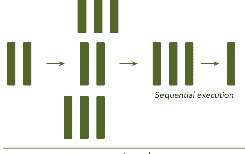

图 1-3

如今，并行性无处不在，并行编程正成为编程界的主流。多层级的并行是架构设计的驱动力。应用程序中有两种基本的并行类型：

- 任务并行（`Task parallelism`）
- 数据并行（`Data parallelism`）

当存在许多可以独立操作并在很大程度上并行的任务或函数时，产生了任务并行。任务并行专注于将函数分布到多个核心。

`CUDA` 编程特别适用于解决可以表示为数据并行计算的问题。本书的重点是如何用 `CUDA` 编程解决数据并行问题。许多处理数据集的应用程序使用数据并行模型来加速计算。数据并行处理将数据元素映射到线程。

设计数据并行程序的第一步是跨线程划分数据，让每个线程处理部分数据。通常，划分数据有两种方法：块划分（`block partitioning`）和循环划分（`cyclic partitioning`）。在块划分中，连续的数据元素被切成块。每个块按顺序分配给单个线程，线程通常一次只处理一个块。在循环划分中，较少的数据元素被分在一起。相邻的线程接收相邻的块，每个线程可以处理多个块。为线程选择一个新的处理块意味着向前跳过与线程数量相同数量块。

图 1-4 显示了 1D 数据划分的两个简单示例。在块划分中，每个线程只处理一部分数据；而在循环划分中，每个线程处理超过一部分的数据。图 1-5 显示了 2D 数据划分的三个简单示例：沿 y 轴的块划分、两个维度的块划分以及沿 x 轴的循环划分。剩余的模式——沿 x 轴的块划分、两个维度的循环划分以及沿 y 轴的循环划分——留作练习。

通常，数据是一维存储的。即使使用了逻辑多维视图，它仍然映射到一维物理存储。确定如何在线程之间分配数据与数据的物理存储方式密切相关，同时也取决于每个线程的执行顺序。你组织线程的方式对程序的性能有显著影响。


块划分：每个线程取一个数据块


循环划分：每个线程取两个数据块

图 1-4


一个维的块划分

两个维度的块划分

一个维的循环划分

图 1-5

数据划分

划分数据有两种基本方法：

- 块（`Block`）：每个线程取一部分数据。
- 循环（`Cyclic`）：每个线程取超过一部分的数据。


程序的性能通常对块大小非常敏感。确定块划分和循环划分的最优划分方案与计算机架构密切相关。你将通过书中的示例学习到更多内容。

# 计算机架构

分类计算机架构有多种方法。一种广泛使用的分类方案是流莱分类法（Flynn's Taxonomy），它根据指令和数据流经核心的方式将架构分为四种类型（见图 1-6）：

- 单指令单数据（ISD）
- 单指令多数据（SIMD）
- 多指令单数据（MISD）
- 多指令多数据（MIMD）

| 单指令多数据 (SIMD) | 多指令多数据 (MIMD) |
|---|---|
| 单指令单数据 (ISD) | 多指令单数据 (MISD) |

图 1-6

单指令单数据指的是传统的计算机：一种串行架构。计算机中只有一个核心。在任何时间执行一个指令流，并在一个数据流上执行操作。

单指令多数据指的是一种并行架构。计算机中有多个核心。在任何时间所有核心执行相同的指令流，每个核心处理不同的数据流。向量处理器通常被描述为 SIMD，大多数现代计算机都采用 SIMD 架构。SIMD 最大的优势可能是，在 CPU 上编写代码时，程序员可以继续按顺序思考，但由于编译器处理细节，可以从并行数据操作中获得加速。多指令单数据指的是一种稀见的架构，每个核心通过独立的指令流操作同一个数据流。

多指令多数据指的是一种并行架构类型，其中多个核心操作多个数据流，每个核心执行独立的指令。许多 MIMD 架构也包含 SIMD 执行子组件。

在架构层面，已经取得了许多进展以实现以下目标：

- 降低延迟（latency）
- 增加带宽（bandwidth）
- 提高吞吐量（throughput）

延迟是指操作从开始到完成所需的时间，通常以微秒为单位。带宽是指单位时间内可以处理的数据量，通常以兆字节/秒（MB/s）或字节/秒（GB/s）表示。吞吐量是指单位时间内可以处理的操作数量，在大量使用浮点运算的科学计算领域，通常以 gflops（每秒十亿次浮点运算）表示。延迟衡量的是完成操作的时间，而吞吐量衡量的是给定时间内处理的操作数量。

计算机架构还可以根据其内存组织进行细分，通常分为以下两类：

- 具有分布式内存的多节点系统
- 共享内存的多处理器系统

在多节点系统中，大规模计算引擎由通过网络连接的许多处理器组成。每个处理器都有自己的本地内存，处理器之间通过网络通信其本地内存的内容。图 1-7 显示了一个典型的具有分布式内存的多节点系统。这些系统通常被称为集群。

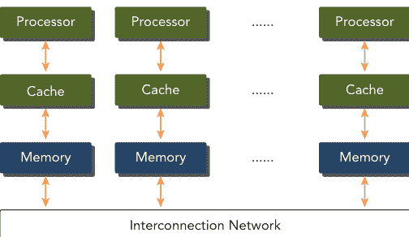

图 1-7

多处理器架构的规模通常从双处理器到几十个或数百个处理器不等。这些处理器要么物理上连接到同一内存（如图 1-8 所示），要么共享低延迟链路（如 `PCI-Express` 或 `PCIe`）。虽然共享内存意味着共享的地址空间，但并不一定意味着存在单一的物理内存。此类多处理器包括具有多个核心的单芯片系统（称为多核），以及由多个芯片组成的处理器，每个芯片都可能采用多核设计。多核架构已经取代了单核架构。

“许多核”（many-core）一词通常用于描述具有大量核心（数十个或数百个）的多核架构。最近，计算机架构正在从多核向许多核架构过渡。

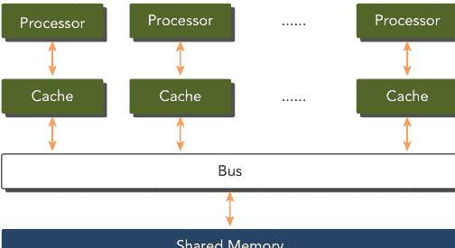

图 1-8

`GPU` 代表了许多核架构，并几乎包含了之前描述的所有类型的并行性：多线程、`MIMD`、`SIMD` 和指令级并行。`NVIDIA` 为这种架构创造了先前的*单指令多多线程 (SIMT)* 术语。

`GPU` 和 `CPU` 并没有共同的祖先。从历史上看，`GPU` 是图形加速器。直到最近，`GPU` 才演变为强大的、通用的、完全可编程的任务和数据并行处理器，适用于处理大规模并行计算问题。

## GPU 核心对比 CPU 核心

尽管许多核和多核术词被用于标记 `GPU` 和 `CPU` 架构，但 `GPU` 核心与 `CPU` 核心有很大不同。

`CPU` 核心相对较重，专为复杂的控制逻辑设计，旨在优化顺序程序的执行。

`GPU` 核心相对较轻，针对具有较简单控制逻辑的数据并行任务进行了优化，侧重于并行程序的吞吐量。

在早期，计算机仅包含用于运行通用编程任务的中央处理器（`CPU`）。在过去的十年里，高性能计算领域的主流计算机已开始引入其他处理元素。最常见的是 `GPU`，它最初是为并行执行专门的图形计算而设计的。随着时间的推移，`GPU` 变得越来越强大、越来越通用，使其能够以卓越的性能和高能效应用于通用并行计算任务。

通常，`CPU` 和 `GPU` 是单个计算节点内通过 `PCI-Express` 总线连接的离散处理组件。在此类架构中，`GPU` 被称为离散设备。

从同构系统向异构系统的转变是高性能计算历史上的里程碑。同构计算使用一个或多个相同架构的处理器来执行应用程序。而异构计算则使用一组架构来执行应用程序，将任务分配给最适合它们的架构，从而获得性能的提升。

尽管异构系统与传统高性能计算系统相比具有显著优势，但此类有效使用受限于应用程序设计复杂性的增加。虽然并行编程最近受到了广泛关注，但异构资源的引入增加了复杂性。

如果你是并行编程的新手，可以从现在异构架构上提供的性能改进和高级软件工具中受益。如果你已经是一个优秀的并行编程员，那么适应异构架构上的并行编程也是简单的。

如今一个典型的异构计算由两个多核 `CPU` 和两个或多个许多核 `GPU` 组成。`GPU` 目前不是一个独立的平台，而是 `CPU` 的协处理器。因此，`GPU` 必须通过 `PCI-Express` 总线与基于 `CPU` 的主机协同工作，如图 1-9 所示。这就是在 `GPU` 计算术语中，`CPU` 被称为主机（host），`GPU` 被称为设备（device）。

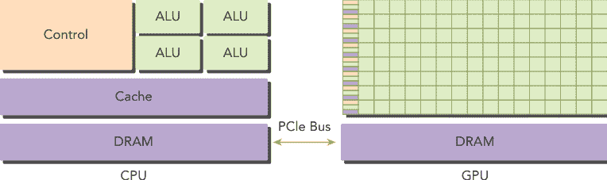

图 1-9

异构应用程序由两部分组成：

- 主机代码
- 设备代码

主机代码在 `CPU` 上运行，设备代码在 `GPU` 上运行。异构平台上的应用程序通常由 `CPU` 初始化。`CPU` 代码负责在将计算密集任务加载到设备之前管理环境、代码和数据。

对于计算密集型应用程序，程序部分通常具有大量的并行性。`GPU` 用于加速这部分的执行。当使用物理上分离的硬件组件来加速应用程序的计算密集部分时，它被称为硬件加速器。`GPU` 是硬件加速器最常见的示例。

`NVIDIA GPU` 计算平台适用于以下产品族：

- `Tegra`
- `GeForce`
- `Quadro`
- `Tesla`

`Tegra` 产品族用于移动和嵌入式设备（如平板和平手机），`GeForce` 用于消费者图形，`Quadro` 用于专业可视化，`Tesla` 用于数据中心计算。`Fermi` 作为高性能计算应用的 `GPU` 加速器最近获得了广泛使用，因为 `NVIDIA` 在 2010 年推出了第一个完整的 `GPU` 计算架构。`Fermi` 加速器已经重新定义并加速了许多领域的高性能计算能力，如地震处理、生物化学模拟、天气和气候建模、信号处理、计算金融、航空航天工程、计算流体力学和数据分析。`Kepler` 是 `Fermi` 之后的当代 `GPU` 计算架构，于 2012 年秋发布，比之前的 `GPU` 代具有更高的性能，并提供了优化和增加 `GPU` 工作负载执行的新方法，预计将彻底改变嵌入式应用对 `GPU` 的需求。

有两个描述 `GPU` 能力的重要特征：

- `CUDA` 核心数量
- 内存大小

相应的，有两个描述 `GPU` 性能的不同指标：

- 峰值计算性能
- 内存带宽

峰值计算性能是计算能力的衡量，通常定义为每秒可以处理多少单精度或双精度浮点运算。峰值性能通常以 gflops（每秒十亿次浮点运算）或 tflops（每秒万亿次浮点运算）表示。内存带宽衡量数据读取或写入内存 Ratio。内存带宽通常以每秒兆字节（GB/s）表示。表 1-1 简要总结了 `Fermi` 和 `Kepler` 的架构和性能特征。

| FERMI (TESLA C2050) | KEPLER (TESLA K10) |
|---|---|
| CUDA 核心 | 448 | 2 x 1536 |
| 内存 | 6 GB | 8 GB |
| 峰值性能* | 1.03 Tflops | 4.58 Tflops |
| 内存带宽 | 144 GB/s | 320 GB/s |

* 单精度浮点运算峰值性能

书中的大多数示例都可以在 `Fermi` 和 `Kepler GPU` 上运行。某些示例需要 `Kepler GPU` 才包含的特殊架构特性。

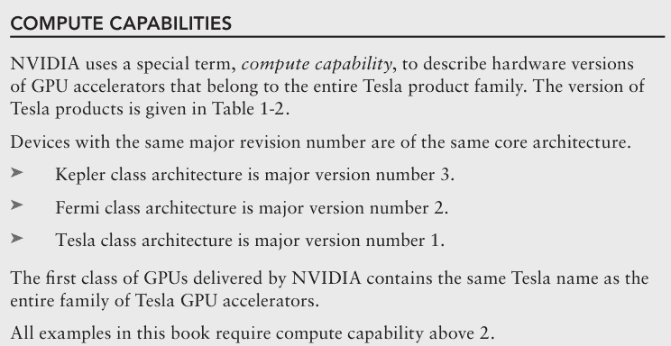

`NVIDIA` 使用一个特殊术语*计算能力*（compute capability）来描述属于整个 `Tesla` 产品族的 `GPU` 加速器的硬件版本。`Tesla` 产品的版本见表 1-2。

具有相同主版本号的设备具有相同的内核架构。

- `Kepler` 类架构的主版本号为 3。
- `Fermi` 类架构的主版本号为 2。
- `Tesla` 类架构的主版本号为 1。

`NVIDIA` 交付的第一类 `GPU` 与整个 `Tesla GPU` 加速器家族相同的 `Tesla` 名称。

书中的所有示例都需要计算能力高于 2。

| GPU | 计算能力 |
|---|---|
| Tesla K40 | 3.5 |
| Tesla K20 | 3.5 |
| Tesla K10 | 3.0 |
| Tesla C2070 | 2.0 |
| Tesla C1060 | 1.3 |

`GPU` 计算并不是为了取代 `CPU` 计算。每种方法对于特定类型的程序都有优势。`CPU` 计算适用于计算密集型任务，而 `GPU` 计算适用于数据并行且计算密集型任务。当 `CPU` 与 `GPU` 互补时，`CPU` 针对具有短序列计算操作和不可预测控制流特征标记的动态工作负载进行了优化；而 `GPU` 则针对光谱的另一端：以具有简单控制流的计算任务为主导的工作负载。如图 1-10 所示，有两个维度区分了 `CPU` 和 `GPU` 的应用范围。

- 并行性
- 数据规模

如果一个问题的数据量较小、控制逻辑复杂和/或具有底层并行性，`CPU` 是一个很好的选择，因为它具有处理复杂逻辑和指令级并行性的能力。如果当前的问题处理海量数据并表现出大规模数据并行性，`GPU` 是正确的选择，因为它具有大量的编程内核，支持大规模多线程，并且与 `CPU` 相比具有峰值带宽。

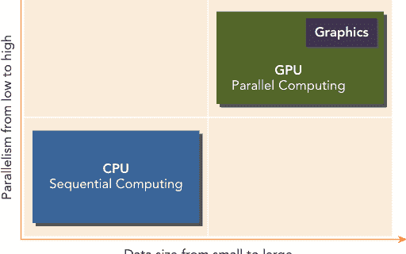

图 1-10

`CPU + GPU` 异构并行计算架构的演进是因为 `CPU` 和 `GPU` 具有互补属性，使得应用程序可以使用两种类型的处理器来实现最佳性能。因此，为了获得最佳性能，你可能需要在应用程序中同时使用 `CPU` 和 `GPU`，在 `CPU` 上执行顺序部分或任务并行部分，在 `GPU` 上执行密集型数据并行部分，如图 1-11 所示。

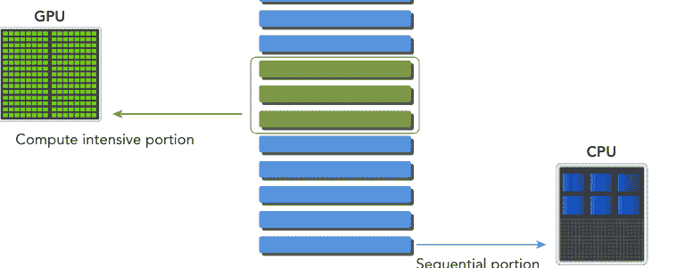

图 1-11

以此方式编写代码可以确保 `GPU` 和 `CPU` 的特性互补，从而充分利用 `CPU + GPU` 组合系统的计算能力。为了支持应用程序的 `CPU + GPU` 联合执行，`NVIDIA` 设计了一种名为 `CUDA` 的编程模型。这种新的编程模型是本书后续部分的重点。

| CPU 线程对比 GPU 线程 |
|---|---|
| `CPU` 上的线程通常是重量级实体。操作系统必须在 `CPU` 执行通道上切换线程，以提供多线程能力。上下文切换是缓慢且昂贵的。 |
| `GPU` 上的线程是非常轻量级的。在典型系统中，有成千上万的线程等待工作。如果 `GPU` 必须等待一组线程，它只需开始处理另一组线程。 |
| `CPU` 核心的设计是为了最小化一个或两个线程的延迟，而 `GPU` 核心的设计是为了处理大量并发的轻量级线程以最大化吞吐量。 |
| 如今，拥有四核处理器的 `CPU` 只能并发运行 16 个线程，如果 `CPU` 支持超线程，则可以运行 32 个线程。 |
| 现代 `NVIDIA GPU` 每个多处理器可以并发支持多达 1536 个活动线程。在具有 16 个多处理器的 `GPU` 上，这将导致超过 24000 个并发活动线程。 |

# CUDA: 异构计算的平台

`CUDA` 是一种通用并行计算平台和编程模型，它利用 `NVIDIA GPU` 中的并行计算引擎以更高效的方式解决许多复杂的计算。使用 `CUDA`，你可以访问 `GPU` 进行计算，就像传统上在 `CPU` 上执行一样。

`CUDA` 平台可以通过 `CUDA` 加速库、编译器指令、应用程序接口以及行业标准编程语言的扩展（包括 C、C++、Fortran 和 Python）来访问（如图 1-12 所示）。本书专注于 `CUDA C` 编程。

### GPU 计算应用

| CUFT CUBLAS CURAND C |
|---|---|---|---|

### 编程语言

| C | C++ | Fortran | Python | Direct | OpenACC |
|---|---|---|---|---|---|
| GPU 计算应用 | | | | | |

图 1-12

`CUDA` 也是一种可扩展的模型，使程序能够真正扩展到具有不同核心数量的 `GPU` 上。`CUDA` 也是一种可扩展的模型，使熟悉 C 语言的程序员能够真正扩展程序。

- `CUDA Driver API`
- `CUDA Runtime API`

`Driver API` 是一个低级 `API`，编程相对较困难，但它对 `GPU` 设备提供了更多控制。`Runtime API` 是在 `Driver API` 之上实现的层级 `API`。

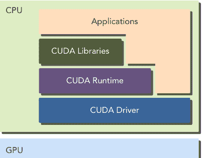

图 1-13

> `runtime API` 和 `driver API` 之间没有明显的性能差异。

这两个 `API` 是互斥斥的。你必须使用其中之一。全书中的所有示例都使用 `runtime API`。

一个 `CUDA` 程序由以下两个部分的混合：

- 主机代码（host code）运行在 `CPU` 上。
- 设备代码（device code）运行在 `GPU` 上。


图 1-16

# 来自 GPU 的 HELLO WORLD

学习新编程语言的最佳方法是使用该新语言编写程序。在本节中，你将编写第一个运行在 `GPU` 上的内核代码（kernel code）。对于所有语言，第一个程序都是相同的：打印字符串“Hello World.”

如果这是你第一次使用 `CUDA`，你可能想在 Linux 系统上通过以下命令检查 `CUDA` 编译器是否已正确安装：

```bash
$ which nvcc
```

典型的响应如下：

```
/usr/local/cuda/bin/nvcc
```

你还需要检查机器中是否连接了 `GPU` 加速器。在 Linux 系统上，你可以通过以下命令进行检查：

```bash
$ ls -1 /dev/nv*
```

典型的响应如下：

```
crw-rw-rw- 1 root 195, 0 Jul 3 13:44 /dev/nvidia0
crw-rw-rw- 1 root 195, 1 Jul 3 13:44 /dev/nvidia1
crw-rw-rw- 1 root 195, 255 Jul 3 13:44 /dev/nvidiactl
crw-rw---- 1 root 190, 144 Jul 3 13:39 /dev/nvram0
```

在例例中，你安装了两个 `GPU`（你的配置可能不同，可能会显示更多或更少的设备）。现在你已经准备好编写第一个 `CUDA C` 程序了。要编写 `CUDA C` 程序，你需要：

- 1. 创建一个带有特殊扩展名 `.cu` 的源代码文件。
- 2. 使用 `CUDA` `nvcc` 编译器编译程序。
- 3. 从命令行运行可执行文件，该文件包含在 `GPU` 上执行的内核代码。

作为一个开始，编写如下所示的打印“Hello World”的 C 程序：

```c
#include <stdio.h>
int main(void)
{
    printf("Hello World from CPU!\n");
}
```

将代码保存为 `hello.cu`，然后用 `nvcc` 编译。`CUDA` `nvcc` 编译器的语义与 `gcc` 等其他编译器相似。

```bash
$ nvcc hello.cu -o hello
```

如果你运行可执行文件 `hello`，它将打印：

Hello World from CPU!

接下来，编写一个名为 `helloFromGPU` 的内核函数，按如下所示打印字符串“Hello World from GPU!”：

```c
__global__ void helloFromGPU(void)
{
    printf("Hello World from GPU!\n");
}
```

`__global__` 限定符告诉编译器该函数将从 `CPU` 调用并并在 `GPU` 上执行。使用 `<<<1,10>>>` 启动内核。

```c
helloFromGPU<<<1,10>>>();
```

三角括号标记了从主机（host）到设备端（device）代码的调用。内核由线程数组执行，所有线程都运行相同的内核。三角括号内的参数是执行配置，它指定了有多少线程将执行该内核。在本例中，你将运行 10 个 `GPU` 线程。将所有这些结合在一起，你就得到了列表 I-1 中的程序：

# 列表 1-1: Hello World from GPU (hello.cu)

```c
#include <stdio.h>
__global__ void helloFromGPU(void)
{
    printf("Hello World from GPU!\n");
}

int main(void)
{
  // hello from cpu
  printf("Hello World from CPU!\n");

  helloFromGPU<<<1, 10>>>();
  return 0;
}
```

# 第 1 章练习题

1. 参考图 1-5，画出以下数据划分模式：

- 2D 数据沿 x 维的块划分（Block partition）
- 2D 数据沿 y 维的循环划分（Cyclic partition）
- 3D 数据沿 z 维的循环划分


2. 从 `hello.cu` 中移除 `cudaDeviceReset` 函数，然后编译并运行观察发生了什么。

3. 将 `hello.cu` 中的函数 `cudaDeviceRest` 替换为 `cudaDeviceSynchronize`，然后编译并运行观察发生了什么。

4. 参考“GPU Hello World”。从编译器命令行中移除设备架构标志，并如下所示编译，观察发生了什么。

```
$ nvcc hello.cu -o hello
```

5. 参考 CUDA 在线文档（http://docs.nvidia.com/cuda/index.html）。根据“CUDA Compiler Driver NVCC”章节，`nvcc` 支持哪些文件后缀的编译？

6. 每个线程执行内核时都会获得一个唯一的线程 ID，该 ID 在内核内部可以通过 `threadIdx.x` 变量访问。修改 `hello.cu` 中的内核函数，加入线程索引，使输出如下：

```
$ ./hello
Hello World from CPU!
Hello World from GPU thread !
```

# 2

## CUDA 编程模型

本章内容：

- 编写 CUDA 程序

- 执行内核函数

- 使用网格（grids）和块（blocks）组织线程

- 测量 GPU 性能

> 本章的 wrox.com 下载可以在 www.wrox.com/go/producad 的 Download Code 标签页找到。代码位于第2章下载中，并根据章节中的名称单独命名。

`CUDA` 是一种并行计算平台和编程模型，它对 C 语言进行了一小部分扩展。通过 `CUDA`，你可以像编写 C 程序一样轻松地实现并行算法。你可以使用 `CUDA` 在 NVIDIA GPU 上为各种系统构建应用程序，范围从嵌入式设备、平板设备、笔记本电脑、台式机，到用于 HPC 集群系统的工作站。熟悉的编程软件工具也得到了扩展，帮助你在项目整个生命周期内编辑、调试和分析 `CUDA` 程序。在本章中，你将通过两个简单的示例：向量加法和矩阵加法，学习如何编写 `CUDA` 程序。

### 介绍 CUDA 编程模型

编程模型提供了计算机体系的抽象，作为应用程序与其在可用硬件上实现之间的桥梁。图 2-1 展示了位于程序与编程模型实现之间的重要抽象层。通信抽象是程序与编程模型实现之间的边界，它通过编译器或使用特权硬件原语和操作系统的库来实现。为编程模型编写的程序决定了程序组件如何共享信息以及协调其活动。编程模型提供了特定计算架构的逻辑视图。通常，它体现在编程语言或编程环境中。

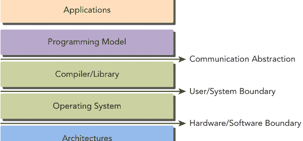

图 2-1

除了与其他并行编程模型共享许多抽象外，`CUDA` 编程模型还提供了以下特殊功能，以利用 GPU 架构的计算能力：

- 一种通过层次结构在 GPU 上组织线程的方法

- 一种通过层次结构访问 GPU 内存的方法

你将在本章和下一章中关注第一个主题，并在第 4 章和第 5 章中学习第二个主题。

从程序员的角度来看，你可以从不同的层级看待并行计算，例如：

- 领域级（Domain level）

- 逻辑级（Logic level）

- 硬件级（Hardware level）

当你进行程序和算法设计时，你的主要关注点在于领域级：如何分解数据和函数，以便在并行环境中正确且高效地解决问题。当你进入编程阶段时，你的关注点转变为如何组织你的并发线程和计算来正确地解决问题。在 C 并行编程中，你必须使用 `pthreads` 或 `OpenMP` 技术显式地管理线程。`CUDA` 暴露了线程抽象，允许你控制线程行为。当你阅读书中的示例时，你会发现这种抽象为并行编程提供了优越的可扩展性。在硬件级，理解线程如何映射到核心上可能有助于提高性能。

`CUDA` 线程模型向你暴露敏感信息，而不会强制你处理过多的底层细节。你将在第 3 章中了解到更多内容。

### CUDA 编程结构

`CUDA` 编程模型允许你通过对 C 编程语言进行微量扩展，在异构计算系统上执行应用程序。异构环境由 CPU 辅助 GPU 组成，每个单元都有自己的内存，并通过 PCI-Express 总线共享。因此，你应该注意以下几点：

- 主机（Host）：CPU 及其内存（主机内存）

- 设备（Device）：GPU 及其内存（设备内存）

为了清晰地设计不同的内存空间，书中的示例代码使用了以 `h_` 开头的主机内存变量和 `d_` 开头的设备内存变量。从 `CUDA` 6 开始，NVIDIA 引入了一种称为统一内存（Unified Memory）的编程模型改进，它桥起了主机和设备内存之间的鸿沟。这一改进允许你使用单个指针访问 CPU 和 GPU，而系统会自动在主机和设备之间迁移数据。关于统一内存的更多细节将在第 4 章中介绍。现在，重要的是学习如何分配主机和设备内存，并显式地拷贝 CPU 和 GPU 之间共享的数据。程序员对内存和数据的控制赋予了你优化应用程序和最大化硬件利用率的能力。

`CUDA` 编程模型的一个关键组件是内核（kernel）——运行在 GPU 上的。作为开发者，你可以将内核表示为一个顺序函数。从场景的角度来看，`CUDA` 在 GPU 线程上调度内核。从主机端，你根据应用程序数据和 GPU 能力定义算法如何映射到设备。其意图是让你能够以简单的方式（通过编写顺序代码）使用算法逻辑，而不会陷入创建和管理数千个 GPU 线程的细节中。

对于大多数操作，主机可以独立于设备运行。当内核启动后，控制权会立即返回主机，释放 GPU 执行由设备上运行的并行代码辅助的其他任务。`CUDA` 编程模型主要是异步的，这样在 GPU 上执行的计算就可以与主机通信重叠。一个典型的 `CUDA` 程序由串行代码和并行代码组成。如图 2-2 所示，顺序代码（以及任务并行代码）在主机上执行，而并行代码在 GPU 设备上执行。主机代码使用 ANSI C 编写，设备代码使用 `CUDA` 编写。你可以将所有内容放在单个源文件中，也可以使用多个文件构建你的应用程序或库。NVIDIA 编译器 (`nvcc`) 为 `CUDA` 主和设备生成执行代码。

`CUDA` 程序的典型处理流程遵循此模式：

1. 将数据从 CPU 内存拷贝到 GPU 内存。

2. 调用内核处理存储在 GPU 内存中的数据。

3. 将数据从 GPU 内存拷贝回 CPU 内存。

你将开始学习主机管理和数据移动。随后本章将涵盖 GPU 内核执行的更多细节。

### CUDA C/C 应用程序

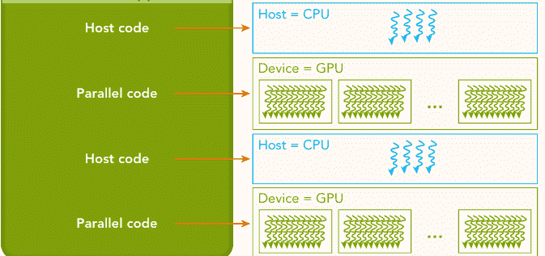

图 2-2

### 管理内存

`CUDA` 编程模型假设系统由主机和设备组成，每个都有自己的内存。内核从设备内存运行。为了让你能够完全控制并获得最佳性能，`CUDA` 运行时提供了分配设备内存、释放设备内存以及在主机和设备内存之间传输数据的函数。表 2-1 列出了内存操作的 C 函数及其对应的 `CUDA` 函数。

#### 表 2-1：主机和内存函数

| 标准 C 函数 | CUDA 函数 |
| --- | --- |
| `malloc` | `cudaMalloc` |
| `memmove` | `cudaMemcpy` |
| `memset` | `cudaMemset` |
| `free` | `cudaFree` |

执行 GPU 内存分配的函数是 `cudaMalloc`，其签名如下：

`cudaError_t cudaMalloc( void** devPtr, size_t size )`

该函数分配指定字节数的线性设备内存。分配的内存通过 `devPtr` 返回。你可能注意到 `malloc` 与标准 C 运行时 `malloc` 之间惊人的相似性。这是刻意为。通过保持接口与标准 C 运行时库尽可能接近，`CUDA` 使应用程序的迁移变得简单。

用于主机（host）和设备（device）之间传输数据的函数是 `cudaMemcpy`，其函数签名如下：

```
cudaError_t cudaMemcpy ( void* dst, const void* src, size_t count,
cudaMemcpyKind kind )
```

该函数将字节从 `src` 指向的源内存区域拷贝到 `dst` 指向的目标区域，方向由 `kind` 指定，其中 `kind` 取自以下类型之一：

- `cudaMempyHostToHost`

- `cudaMempyHostToDevice`

- `cudaMempyDeviceToHost`

此函数表现出同步行为，因为主机应用程序会阻塞，直到 `cudaMemcpy` 返回且传输完成。除了内核启动（kernel launches）外，每个 `CUDA` 调用都会返回一个枚举类型 `cudaError_t` 的错误代码。例如，如果成功分配了 GPU 内存，它将返回：

```
cudaSuccess
```

否则，它返回：

```
cudaMemoryAllocation
```

你可以使用以下 `CUDA` 运行时函数将错误转换为人类可读的消息：

```
char* cudaErrorString(cudaError_t error)
```

`cudaErrorString` 类似于标准 C 的 `strerror` 函数。`CUDA` 编程模型提供了对 GPU 架构的内存层次结构的抽象。图 2-3 展示了一个简化的 GPU 内存结构，包含两个主要部分：全局内存（global memory）和共享内存（shared memory）。你将在第 4 和第 5 章中学习更多内容。

### 内存层次结构

`CUDA` 编程模型的显著特征之一是暴露的层次结构。每个 GPU 设备有一组用于不同用途的不同内存。在 GPU 层次结构中，最重要的两种内存类型是全局内存和共享内存。全局内存类似于系统内存，而共享内存类似于 CPU 缓存。然而，可以直接从 `CUDA` 内核直接控制 GPU 共享内存。


目前，我们正在学习如何管理主机和设备之间的数据移动，以及如何通过两个数组求和的简单示例进行编程。如图 2-4 所示，数组 `a` 的第一个元素与数组 `b` 的第一个元素相加，并将结果赋值给数组 `c` 的第一个元素。此计算对所有后续元素重复进行。


图 2-4

首先，你从主机代码开始将两个数组相加（参见列表 2-1）。

#### 列表 2-1：基于主机的数组求和 (sumArraysHost.c)

```c
#include <stdlib.h>
#include <string.h>
#include <time.h>

void sumArraysHost(float *A, float *B, float *C, int N) {
  for (int idx = 0; idx < N; idx++) {
    C[idx] = A[idx] + B[idx];
  }
}

void initialData(float *ip, int size) {
  // 生成随机数种子
  time_t t;
  srand((unsigned int) time(&t));

  for (int i = 0; i < size; i++) {
    ip[i] = (float)(rand() & 0xFF) / 10.0f;
  }
}

int main(int argc, char **argv) {
  int nElem = 1024;
  size_t nBytes = nElem * sizeof(float);

  float *h_A, *h_B, *h_C;
  h_A = (float*)malloc(nBytes);
  h_B = (float*)malloc(nBytes);
  h_C = (float*)malloc(nBytes);

  initialData(h_A, nElem);
  initialData(h_B, nElem);

  sumArraysHost(h_A, h_B, h_C, nElem);

  free(h_A);
  free(h_B);
  free(h_C);

  return(0);
}
```

由于这是一个纯 C 程序，你可以使用 C 编译器对其进行编译。你也可以使用 `nvcc` 如下所示进行编译和运行。它将静默完成。

```bash
$ nvcc -Xcompiler -std=c99 sumArraysHost.c -o sum
$ sum
```

`CUDA` 编译器允许将许多选项直接传递给 `CUDA` 封装的内部编译工具。`-Xcompiler` 标志将选项直接传递给 C 编译器或预处理器。在示例中，`-std=c99` 被传递给编译器，因为这里的 C 代码是根据 C99 标准的代码风格编写的。你可以在 `CUDA` 编译器文档（http://docs.nvidia.com/cuda/cuda-compiler-driver-nvcc/index.html）中找到选项。

现在，你可以修改代码在 GPU 上执行数组求和。使用 `cudaMalloc` 在 GPU 上分配内存。

```c
float *d_A, *d_B, *d_C;
cudaMalloc((float**)d_A, nBytes);
cudaMalloc((float**)d_B, nBytes);
cudaMalloc((float**)d_C, nBytes);
```

使用 `cudaMemcpy` 将数据从主机传输到 GPU 全局内存，用参数 `cudaMemcpyHostToDevice` 指定传输方向。

```c
cudaMemcpy(d_A, h_A, nBytes, cudaMemcpyHostToDevice);
cudaMemcpy(d_B, h_B, nBytes, cudaMemcpyHostToDevice);
```

当数据已传输到 GPU 全局内存后，可以从主机侧调用内核函数以在 GPU 上执行数组求和。内核一旦被调用，控制权会立即返回给主机。此时，当内核在 GPU 上运行时，主机可以执行其他函数。因此，主机相对于内核来说可能是异步的。

当内核处理完所有元素后，可以将结果拷贝回主机。GPU 内存结构包含两个主要部分：全局内存和共享内存。你将在第 4 和第 5 章中学习更多内容。


图 2-3

`CUDA` 编程模型的显著特征之一是暴露的层次结构。每个 GPU 设备有一组用于不同用途的不同内存。你将在第 4 和第 5 章中学习更多内容。

在 GPU 层次结构中，最两个两种内存类型是全局内存和共享内存。全局内存类似于系统内存，而共享内存类似于 CPU 缓存。然而，可以直接从 `CUDA` 内核直接控制 GPU 共享内存。

`CUDA` 编程模型的显著特征之一是暴露的层次结构。每个 GPU 设备有一组用于不同用途的不同内存。你将在第 4 和第 5 章中学习更多内容。

`CUDA` 编程模型的显著特征之一是**内存层次结构**（MEMORY HIERARCHY）。

该函数将字节从 `src` 指向的源内存区域拷贝到 `dst` 指向的目标区域，方向由 `kind` 指定，其中 `kind` 取自以下类型之一：

- `cudaMempyHostToHost`

- `cudaMempyHostToDevice`

- `cudaMempyDeviceToHost`

此函数表现出同步行为，因为主机应用程序会阻塞，直到 `cudaMemcpy` 返回且传输完成。除了内核启动外，每个 `CUDA` 调用都会返回一个枚举类型 `cudaError_t` 的错误代码。例如，如果成功分配了 GPU 内存，它将返回：

```
cudaSuccess
```

否则，它返回：

```
cudaMemoryAllocation
```

你可以使用以下 `CUDA` 运行时函数将错误转换为人类可读的消息：

```
char* cudaErrorString(cudaError_t error)
```

`cudaErrorString` 类似于标准 C 的 `strerror` 函数。`CUDA` 编程模型提供了对 GPU 架构的内存层次结构的抽象。图 2-3 展示了一个简化的 GPU 内存结构，包含两个主要部分：全局内存和共享内存。你将在第 4 和第 5 章中学习更多内容。

`CUDA` 编程模型的显著特征之一是暴露的层次结构。每个 GPU 设备有一组用于不同用途的不同内存。

在 GPU 层次结构中，最两个两种内存类型是全局内存和共享内存。全局内存类似于系统内存，而共享内存类似于 CPU 缓存。然而，可以直接从 `CUDA` 内核直接控制 GPU 共享内存。

目前，我们正在学习如何管理主机和设备之间的数据移动，以及如何通过两个数组求和的简单示例进行编程。如图 2-4 所示，数组 `a` 的第一个元素与数组 `b` 的第一个元素相加，并将结果赋值给数组 `c` 的第一个元素。此计算对所有后续元素重复进行。


图 2-4

首先，你从主机代码开始将两个数组相加（参见列表 2-1）。

#### 列表 2-1：基于主机的数组求和 (sumArraysHost.c)


```c
#include <stdlib.h>
#include <string.h>
#include <time.h>

void sumArraysHost(float *A, float *B, float *C, int N) {
  for (int idx = 0; idx < N; idx++) {
    C[idx] = A[idx] + B[idx];
  }
}

void initialData(float *ip, int size) {
  // 生成随机数种子
  time_t t;
  srand((unsigned int) time(&t));

  for (int i = 0; i < size; i++) {
    ip[i] = (float)(rand() & 0xFF) / 10.0f;
  }
}

int main(int argc, char **argv) {
  int nElem = 1024;
  size_t nBytes = nElem * sizeof(float);

  float *h_A, *h_B, *h_C;
  h_A = (float*)malloc(nBytes);
  h_B = (float*)malloc(nBytes);
  h_C = (float*)malloc(nBytes);

  initialData(h_A, nElem);
  initialData(h_B, nElem);

  sumArraysHost(h_A, h_B, h_C, nElem);

  free(h_A);
  free(h_B);
  free(h_C);

  return(0);
}
```

由于这是一个纯 C 程序，你可以使用 C 编译器对其进行编译。你也可以使用 `nvcc` 如下所示进行编译和运行。它将静默完成。

```bash
$ nvcc -Xcompiler -std=c99 sumArraysHost.c -o sum
$ sum
```

CUDA 编译器允许将许多选项直接传递给 CUDA 封装的内部编译工具。`-Xcompiler` 标志将选项直接传递给 C 编译器或预处理器。在示例中，`-std=c99` 被传递给编译器，因为这里的 C 代码是根据 C99 标准的代码风格编写的。你可以在 CUDA 编译器文档（http://docs.nvidia.com/cuda/cuda-compiler-driver-nvcc/index.html）中找到选项。

现在，你可以修改代码在 GPU 上执行数组求和。使用 `cudaMalloc` 在 GPU 上分配内存。

```c
float *d_A, *d_B, *d_C;
cudaMalloc((float**)d_A, nBytes);
cudaMalloc((float**)d_B, nBytes);
cudaMalloc((float**)d_C, nBytes);
```

使用 `cudaMemcpy` 将数据从主机传输到 GPU 全局内存，用参数 `cudaMemcpyHostToDevice` 指定传输方向。

```c
cudaMemcpy(d_A, h_A, nBytes, cudaMemcpyHostToDevice);
cudaMemcpy(d_B, h_B, nBytes, cudaMemcpyHostToDevice);
```

当数据已传输到 GPU 全局内存后，可以从主机侧调用内核函数以在 GPU 上执行数组求和。内核一旦被调用，控制权会立即返回给主机。此时，当内核在 GPU 上运行时，主机可以执行其他函数。因此，主机相对于内核来说可能是异步的。

你可能已经注意到网格大小（grid size）向上取整到块大小（block size）的倍数。你将在下一章学习到必须这样计算网格大小的原因。下面的代码段将显示网格检查和块维度：

```c
printf("grid.x %d grid.y %d grid.z %d\n", grid.x, grid.y, grid.z);
printf("block.x %d block.y %d block.z %d\n", block.x, block.y, block.z);
```

在内核函数中，每个线程按照如下方式打印其线程索引、块索引和网格维度：

```c
printf("threadIdx:(%d, %d, %d) blockIdx:(%d, %d, %d) blockDim:(%d, %d, %d) \ngridDim:(%d, %d, %d)\n", threadIdx.x, threadIdx.y, threadIdx.z,
blockIdx.x, blockIdx.y, blockIdx.z, blockDim.x, blockDim.y, blockDim.z,
gridDim.x, gridDim.y, gridDim.z);
```

你将代码线程组合到一个名为 `checkDimension.cu` 的文件中，如列表 2-2 所示。

### 2-2：检查网格和块索引 (checkDimension.cu)

```c
#include <cuda_runtime.h>
#include <stdio.h>

__global void checkIndex(void) {
    printf("threadIdx:(%d, %d, %d) blockIdx:(%d, %d, %d) blockDim:(%d, %d, %d) \ngridDim:(%d, %d, %d)\n", threadIdx.x, threadIdx.y, threadIdx.z,
blockIdx.x, blockIdx.y, blockIdx.z, blockDim.x, blockDim.y, blockDim.z,
gridDim.x, gridDim.y, gridDim.z);
}

int main(int argc, char **argv) {
    // 定义总数据元素
    int nElem = 6;

    // 定义网格和块结构
    dim3 block(3);
    dim3 grid((nElem+block.x-1)/block.x);

    // 从主机端检查网格和块维度
    printf("grid.x %d grid.y %d grid.z %d\n", grid.x, grid.y, grid.z);
    printf("block.x %d block.y %d block.z %d\n", block.x, block.y, block.z);

    // 从设备端检查块维度
    checkIndex<<<grid, block>>>();

    // 离开前重置设备
    cudaDeviceReset();

    return(0);
}
```

现在你准备好编译并运行这个示例了：

```bash
$ nvcc -arch=sm_20 checkDimension.cu -o check
$ ./check
```

由于 `printf` 函数仅支持从 Fermi GPU 开始的架构，因此必须添加 `-arch=sm_20` 编译器选项。默认情况下，`nvcc` 会为最低 GPU 架构生成代码。该应用程序的结果所示。你可以看到每个线程都有自己的坐标，并且所有线程具有相同的块维度和网格维度。

```
grid.x 2 grid.y 1 grid.z 1
block.x 3 block.y 1 block.z 1
threadIdx:(0, 0, 0) blockDim:(1, 0, 0) blockDim:(3, 1, 1) gridDim:(2, 1, 1)
threadIdx:(1, 0, 0) blockDim:(1, 0, 0) blockDim:(3, 1, 1) gridDim:(2, 1, 1)
threadIdx:(2, 0, 0) blockDim:(1, 0, 0) blockDim:(3, 1, 1) gridDim:(2, 1, 1)
threadIdx:(0, 0, 0) blockDim:(0, 0, 0) blockDim:(3, 1, 1) gridDim:(2, 1, 1)
threadIdx:(1, 0, 0) blockDim:(0, 0, 0) blockDim:(3, 1, 1) gridDim:(2, 1, 1)
threadIdx:(2, 0, 0) blockDim:(0, 0, 0) blockDim:(3, 1, 1) gridDim:(2, 1, 1)
```

## 从主机端和设备端访问网格/变量

区分主机端和设备端对网格和块变量的访问是非常重要的。例如，从主机端使用一个声明为块的变量，你按照如下方式定义坐标并访问它们：

```
block.x, block.y, 和 block.z
```

在设备端，你有一个预初始化的内置块大小变量可用：`blockDim.x`、`blockDim.y` 和 `blockDim.z`。

总而言之，你在启动内核之前在主机上定义网格和块的变量，并通过主机端向量结构的 `x`、`y` 和 `z` 字段访问它们。当内核启动时，你可以在内核可以使用预初始化的内置变量。

对于给定的数据大小，确定网格和块维度的通用步骤是：

- 决定块大小。
- 根据应用程序数据大小和块大小计算网格维度。

确定块维度通常需要考虑：

- 内核的性能特性。
- GPU 资源的限制。

你将在书中后续章节示例中学习更多关于这些因素的细节。列表 2-3 使用 1D 网格和 1D 块来说当块大小改变时，网格大小将随之变化。

### 2-3：在主机上定义网格和块维度 (defineGridBlock.cu)

```c
#include <cuda_runtime.h>
#include <stdio.h>

int main(int argc, char **argv) {
    // 定义总数据元素
    int nElement = 1024;

    // 定义网格和块结构
    dim3 block;
    dim3 grid = (nElement+block.x-1)/block.x;
    printf("grid %d block.x %d \n",grid.x, block.x);

    // 重置块
    block.x = 3;
    printf("grid %d block.x %d \n",grid.x, block.x);

    // 从设备端检查块维度
    checkIndex<<<grid, block>>();

    // 离开前重置设备
    cudaDeviceReset();

    return(0);
}
```

（注：第 62-64 页的剩余文本高度重复/损坏；我已合并了上述提供的唯一内容段。）

内核函数必须具有 `void` 返回类型。

### 表 2-2：函数类型限定符

| 限定符 | 执行位置 | 可调用性 | 备注 |
| --- | --- | --- | --- |
| `__global__` | 在设备上执行 | 可从主机调用，可从计算能力为 3 的设备调用 | 必须具有 `void` 返回类型 |
| `__device__` | 在设备上执行 | 仅可从设备调用 | |
| `__host__` | 在主机上执行 | 仅可从主机调用 | 可以省略 |

`__device__` 和 `__host__` 限定符可以结合使用，在这种种情况下，函数将同时为主机和设备编译。

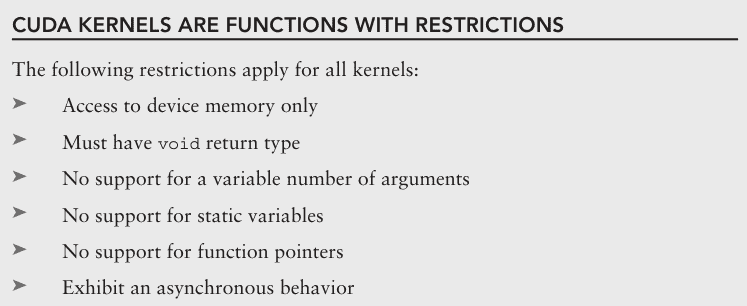

为了说明，考虑一个两个大小为 N 的向量 A 和 B 相加的简单示例。向量加法的代码如下：

```cpp
void sumArraysOnHost(float *A, float *B, float *C, const int N) {
  for (int i = 0; i < N; i++) {
    C[i] = A[i] + B[i];
  }
}
```

这是一个迭代 `n` 次的顺序代码。剥离循环后将产生以下内核函数：

```cpp
__global void sumArraysOnGPU(float *A, float *B, float *C) {
    int i = threadIdx.x;
    C[i] = A[i] + B[i];
}
```

C 函数与内核函数之间的区别是什么？你会发现缺失了循环，使用内置线程变量代替了数组索引，并且没有对 A 的引用（A 通过启动 `n` 个线程被隐式定义）。

假设向量的长度为 32 个元素，你可以按照以下方式使用 32 个线程调用内核函数：

`sumArraysOnGPU<<<1,32>>>(float *A, float *B, float *C);`

## 验证你的内核

现在你已经写好了内核，如何知道它是否运行正常呢？你需要一个主机函数来验证内核的输出。

```cpp
void checkResult(float *hostRef, float *gpuRef, const int n) {
    double epsilon = 1.0E-8;
    int match = 1;
    for (int i = 0; i < n; i++) {
        if (abs(hostRef[i] - gpuRef[i]) > epsilon) {
            match = 0;
            printf("Arrays do not match!\n");
            printf("host:%.2f gpu:%.2f at current %d\n",
                hostRef[i], gpuRef[i], i);
            break;
        }
    }
    if (match) printf("Arrays match.\n");
    return;
}
```

### 验证内核代码

除了使用实用的调试工具外，有两种非常基础但非常有用的方法可以验证你的内核代码。

首先，对于 Fermi 及之后世代的设备，你可以在内核中使用 `printf`。

其次，你可以将执行配置设置为 `<<<1,1>>>`，这样你就强制内核以一个块和两个线程运行。这模拟了顺序实现。这对于调试和验证正确结果非常有用。此外，如果你遇到操作顺序问题，这可以帮助你验证数值结果在每次运行之间是位级上完全精确的。

## 错误处理

由于许多 CUDA 调用是异步的，可能很难识别是哪个例程导致了错误。定义一个错误处理宏来封装所有的 CUDA API 调用可以简化错误检查过程：

```cpp
#define CHECK(call)
{
    const cudaError_t error = call;
    if (error != cudaSuccess) {
        printf("Error: %s, %d, %s, %s\n", __FILE__, __LINE__);
        printf("code: %d, reason: %s\n", error, cudaGetErrorString(error));
        exit(1);
    }
}
```

例如，你可以在以下代码中使用该宏：

```cpp
CHECK(cudaMemcpy(d,C, nBytes, gpuRef, cudaMemcpyHostToDevice));
```

如果之前的异步操作内存拷贝导致了错误，该宏会报告错误、打印人类可读的消息并停止程序。它也可以像下面所示在内核调用后用于检查错误：

```cpp
kernel_function<<<grid, block>>>(argument list);
CHECK(cudaDeviceSynchronize());
```

`CHECK(cudaDeviceSynchronize())` 会阻塞主机线程，直到设备完成之前所有的请求，并确保在最后启动过程中没有发生错误。这种技术应用于调试目的，在内核启动之前添加这一点将阻塞主机线程并使该点成为全局屏障。

## 编译与执行

现在将所有代码合并到名为 `sumArraysOnGPU-small-case.cu` 的文件中，如列表 2-4 所示。

### 列表 2-4：基于 GPU 的向量求和 (sumArraysOnGPU-small-case.cu)


```cpp
#include <cuda_runtime.h>
#include <stdio.h>

#define CHECK(call)
{
    const cudaError_t error = call;
    if (error != cudaSuccess) {
        printf("Error: %s, %d, %s, %s\n", __FILE__, __LINE__);
        printf("code: %d, reason: %s\n", error, cudaGetErrorString(error));
        exit(1);
    }
}

void checkResult(float *hostRef, float *gpuRef, const int n) {
  double epsilon = 1.0E-8;
  int match = 1;
  for (int i = 0; i < n; i++) {
    if (abs(hostRef[i] - gpuRef[i]) > epsilon) {
      match = 0;
      printf("Arrays do not match!\n");
      printf("host %.2f gpu %.2f at current %d\n",hostRef[i],gpuRef[i],i);
      break;
    }
  }
  if (match) printf("Arrays match.\n");
}

void initialData(float *ip, int size) {
  // generate随机数据
  size_t t;
  for (int i=0; i<size; i++) {
    ip[i] = (float)rand() / RAND_MAX;
  }
}

int main(int argc, char **argv) {
  int nElem = 32;
  size_t nBytes = nElem * sizeof(float);
  float *hostRef = (float *)malloc(nBytes);
  float *gpuRef;
  float *gpuResult;

  cudaMalloc(&gpuRef, nBytes);
  cudaMalloc(&gpuResult, nBytes);

  srand(42); // 使用固定种子以可复现性
  initialData(hostRef, nElem);
  CHECK(cudaMemcpy(gpuRef, hostRef, nBytes, cudaMemcpyHostToDevice));

  dim3 block(1);
  dim3 grid(nElem/block.x);
  sumArraysOnGPU<<<grid, block>>>(gpuRef, gpuRef, gpuResult);

  CHECK(cudaDeviceSynchronize());
  CHECK(cudaMemcpy(hostRef, gpuResult, nBytes, cudaMemcpyDeviceToHost));

  checkResult(hostRef, gpuRef, nElem);

  cudaFree(gpuRef);
  cudaFree(gpuResult);
  free(hostRef);

  return 0;
}

__global void sumArraysOnGPU(float *A, float *B, float *C) {
    int i = threadIdx.x;
    C[i] = A[i] + B[i];
}

void sumArraysOnHost(float *A, float *B, float *C, const int N) {
  for (int i = 0; i < N; i++) {
    C[i] = A[i] + B[i];
  }
}
```

## 使用 CPU 定计时器计时

可以通过使用 `gettimeofday` 系统调用获取系统的时钟时间来创建 CPU 定计时器，它返回自 epoch（纪元）以来秒数。你需要包含 `sys/time.h` 头文件，如列表 2-5 所示。

```
double cpuSecond() {
    struct timeval tp;
    gettimeofday(&tp,NULL);
    return ((double)tp.tv_sec + (double)tp.tv_usec*1e-6);
}
```

你可以通过以下方式相对于 `cpuSecond` 测量内核：

```
double istart = cpuSecond();
kernel_name<<<grid,block>>>(argument list);
cudaDeviceSynchronize();
double iElaps = cpuSecond()-istar;
```

由于内核相对于主机是异步的，你需要使用 `cudaDeviceSynchronize()` 等待所有 GPU 线程完成。变量 `iElaps` 报告了花费的时间，就像你用秒表测量内核执行时间一样（单位为秒）。

现在，通过以下方式设置数据集的大小来测试包含 16M 元素的网格：

```
int nElem = 1<<24;
```

为了实现 GPU 的扩展性，你需要修改内核，通过块和线程索引计算行主序数组索引 `i`，并添加测试 `(i < N)` 以检查可能超出数组边界的索引，如下所示：

```cpp
__global__ void sumArraysOnGPU(float A, float *B, float *C, const int N) {
    int i = blockIdx.x * blockDim.x + threadIdx.x;
    if (i < N) C[i] = A[i] + B[i];
}
```

通过这些更改，你可以使用不同的执行配置测量内核。为了处理创建线程总数大于向量元素总数的情况，必须限制内核的非法的全局访问，如图 2-7 所示。

| 总向量 | 总线程 |

|---|---|---|---|

| Block 0 | Block 1 | Block 2 | Block 3 |

具有 4 个块的网格

图 2-7

列表 2-5 向你展示了如何在主函数中使用 CPU 定计时器测量向量加法内核。

### 列表 2-5：测量向量求和内核 (sumArraysOnGPU-timer.cu)

```cpp
#include <cuda_runtime.h>
#include <stdio.h>
#include <sys/time.h>

int main(int argc, char **argv) {
    printf("%s Starting...\n", argv[0]);

    // 设置设备
    int dev = 0;
    cudaDeviceProp deviceProp;
    CHECK(cudaGetDeviceProperties(&deviceProp, dev));
    printf("Device d: %s\n", dev, deviceProp.name);
    CHECK(cudaSetDevice(dev));

    // 设置向量的数据大小
    int nElem = 1<<24;
    printf("Vector size %d\n", nElem);

    // 分配主机内存
    size_t nBytes = nElem * sizeof(float);
    float *h_A, *h_B, *hostRef, *gpuRef;
    h_A = (float *)malloc(nBytes);
    h_B = (float *)malloc(nBytes);
    hostRef = (float *)malloc(nBytes);
    gpuRef = (float *)malloc(nBytes);

    double start,iElaps;

    // 在主机端初始化数据
    iStart = cpuSecond();
    initialData(h_A, nElem);
    initialData(h_B, nElem);
    iElaps = cpuSecond() - iStart;

    memset(hostRef, 0, nBytes);
    memset(gpuRef, 0, nBytes);

    // 在主机端进行加法用于结果检查
    iStart = cpuSecond();
    sumArraysOnHost(h_A, h_B, hostRef, nElem);
    iElaps = cpuSecond() - iStart;

    // 分配设备全局内存
    float *d_A, *d_B, *d_C;
    cudaMalloc((float**)&d_A, nBytes);
    cudaMalloc((float**)&d_B, nBytes);
    cudaMalloc((float**)&d_C, nBytes);

// 将数据从主机传输到设备
    cudaMemcpy(d_A, h_A, nBytes, cudaMemcpyHostToDevice);
    cudaMemcpy(d_B, h_B, nBytes, cudaMemcpyHostToDevice);

// 在主机端调用内核
    int iLen = 1024;
    dim3 block (iLen);
    dim3 grid = (nElem+block.x-1)/block.x;

    start = cpuSecond();
    sumArraysOnGPU<<<grid, block>>>(d_A, d_B, d_C, nElem);
    cudaDeviceSynchronize();
    elaps = cpuSecond() - iStart;
    printf("*sumArraysOnGPU<<<%d,%d>>> Time elapsed %f\n", grid.x, block.x, elaps);

// 将内核结果拷贝回主机
    cudaMemcpy(gpuRef, d_C, nBytes, cudaMemcpyDeviceToHost);

// 检查设备结果
    checkResult(hostRef, gpuRef, nElem);

// 释放全局内存
    cudaFree(d_A);
    cudaFree(d_B);
    cudaFree(d_C);

// 释放主机内存
    free(h_A);
    free(h_B);
    free(hostRef);
    free(gpuRef);

    return(0);
}
```

默认的执行配置设置为 1D 网格，包含 16384 个块，每个块有 1024 个线程。使用以下命令编译并运行：

```
$ nvcc sumArraysOnGPU.timer -o sumArraysOnGPU-timer
$ ./sumArraysOnGPU-timer
```

在基于 Sandy 的系统上测试，列表 2-5 中的示例显示 GPU 向量加法比 CPU 向量加法快 3.86 倍。

```
./sumArraysOnGPU-timer Starting...
Using Device 0: Tesla
Vector size 16777216
sumArraysOnGPU <<<16384, 1024>>> Time elapsed 0.002456 sec
Array match.
```

将块维度减小到 512 会创建 32768 个块。在这一新配置下，该内核的性能提升了 11.9 倍。

```
sumArraysOnGPU <<32768, 512>>> Time elapsed 0.002058 sec
```

如果你将块维度减小到 256，系统将报告以下错误信息，表明块的总数超过了 1D 网格的限制。

```
./sumArraysOnGPU-timer Starting...
Using Device 0: Tesla
Vector size 16777216
sumArraysOnGPU <<6536, 256>>> Time elapsed 0.000183 sec
Error: sumArraysOnGPU-timer.cu:153, code:9, invalid configuration argument
```

## 了解你的限制

调整执行配置时需要理解的关键概念是网格维度的限制。线程层次中每层的大小取决于设备。

CUDA 提供了查询 GPU 这些限制的能力。关于此主题的更多信息见本章的“管理设备”。对于 Fermi 设备，每个块的最大线程数为 1024，x、y、z 每个维度的最大网格维度为 65535。

## 使用 nvprof 计时

从 CUDA 5.0 开始，提供了一个名为 `nvprof` 的命令行分析工具，帮助你收集应用程序的 CPU 和 GPU 活动的时间线信息，包括内核执行、内存传输和 CUDA API 调用。其用法所示：

```
$ nvprof [nvprof_args] <application> [application_args]
```

通过以下命令可以找到更多关于 `nvprof` 选项的信息：

```
$ nvprof --help
```

你可以使用 `nvprof` 如下测量你的内核：

```
$ nvprof ./sumArraysOnGPU-timer
```

`nvprof` 的输出取决于你使用的 GPU 类型。以下是在 Tesla GPU 上收集的报告：

```
./sumArraysOnGPU-timer Starting...
Using Device 0: Tesla
Vector size 16777216
sumArraysOnGPU <<<16384, 1024>>> Time elapsed 0.002456 sec
Array match.
```

- Tesla K10 峰值带宽：

  2 GPUs/board * 256 bit * 2500 MHz 内存频率 * 2 DDR / 8 bits/byte = 320 GB/s

指令与字节的比例：

  4.58 TFLOPS / 320 GB/s 产生 13.6指令:1

对于 Tesla K10，如果你的应用程序每访问一个字节就执行了超过 13.6 条指令，那么你的应用程序将受算术性能限制。大多数 HPC 工作负载都受内存带宽限制。

## 组织并行线程

从前面的示例中可以看出，如果使用正确的网格（grid）和块（block）大小来组织线程，可以对内核性能产生巨大影响。在向量加法的示例中，你调整了块大小以获得最佳性能，网格大小是根据块大小和向量数据大小计算出的。

现在你将通过矩阵加法示例更深入地研究这个问题。对于矩阵操作，一种自然的方法是使用包含 2D 网格和 2D 块的布局来组织内核中的线程。你会发现，朴素的方法无法获得最佳性能。你将通过以下矩阵加法布局学习更多关于网格和块的启发式算法：

- 2D 网格配合 2D 块
- 1D 网格配合 1D 块
- 2D 网格配合 1D 块

## 使用块和线程对矩阵进行索引

通常，矩阵以行优先的方式存储在全局内存中。图 2-9 展示了一个 8 x 6 矩阵的小用例。

| 行 0 | 行 1 | 行 2 | 行 3 | 行 4 | 行 5 |

|---|---|---|---|---|---|

图 2-9

在矩阵加法内核中，一个线程通常被分配一个数据元素进行处理。使用块索引和线程索引从全局内存访问分配的数据是你需要解决的首要问题。通常，对于 2D 情况，你需要管理三种类型的索引：

- 线程和块索引
- 矩阵中给定点的坐标
- 线性全局内存中的偏移量

对于给定的线程，可以通过块和线程索引获取全局内存中的偏移量：首先将线程和块索引映射到矩阵中的坐标，然后将这些坐标映射到全局内存位置。

在第一步中，你可以使用以下公式将线程和块索引映射到矩阵坐标：

```
ix = threadIdx.x + blockIdx.x * blockDim.x
y = threadIdx.y + blockIdx.y * blockDim.y
```

在第二步中，你可以使用以下公式将矩阵坐标映射到全局内存位置/索引：

```
idx = iy * nx + ix
```

图 2-10 展示了块索引、线程索引、矩阵坐标与线性全局内存索引之间的关系。

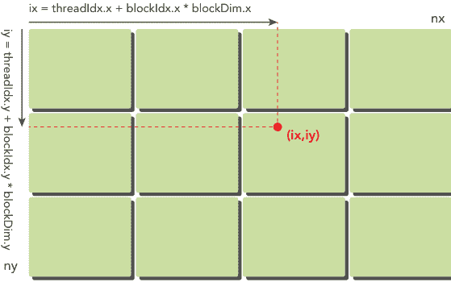

矩阵坐标：(ix, iy)

全局线性内存索引：idx = iy*nx + ix

图 2-10

函数 `printThreadInfo` 用于打印每个线程的以下信息：

- 线程索引
- 块索引
- 矩阵坐标
- 全局内存偏移
- 对应元素的值

使用以下命令编译并运行程序：

```
$ nvcc -arch=sm_20 checkThreadIndex.cu -o checkIndex
./checkIndex
```

你为每个线程报告了以下信息：

thread_id (2,1) block_id (1,0) coordinate (6,1) global index 14 14

图 2-11 展示了这三个索引之间的关系。

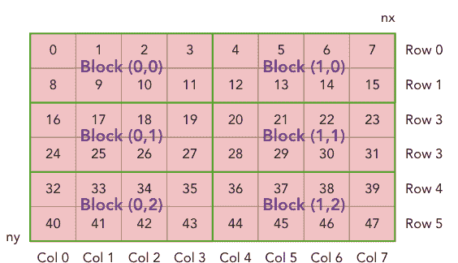

| 0 | 1 | 2 | 3 | 4 | 5 | 6 | 7 | 行 |

|---|---|---|---|---|---|---|---|---|

| | | Block (0,0) | | | Block (1,0) | | | 行 0 |

| 9 | 10 | 11 | 12 | 13 | 14 | 15 | | 行 1 |


| 16 | 17 | 18 | 19 | 20 | 21 | 22 | 23 | 行 3 |

| 24 | 25 | 26 | 27 | 28 | 29 | Block (1,1) | 30 | 31 | 行 3 |

| 32 | 33 | 34 | 35 | 36 | 37 | 38 | 39 | 行 4 |

| | | Block (0,2) | | | Block (1,2) | | | |

| 40 | 41 | 42 | 43 | 44 | 45 | 46 | 47 | 行 5 |

| 列 0 | 列 1 | 列 2 | 列 3 | 列 4 | 列 5 | 列 6 | 列 7 |

代码 2-6: 检查块索引和线程索引 (`checkThreadIndex.cu`)

```cpp
#include <cuda_runtime.h>
#include <stdio.h>

#define CHECK(call)
{
    const cudaError_t error = call;
    if (error != cudaSuccess) {
        printf("Error: %s:%d, %s\n", __FILE__, __LINE__, cudaGetErrorString(error));
        printf("code:%d, reason: %s\n", error, error);
        exit(-10);
    }
}
continues
```

代码 2-6 (续)

```cpp
}
}
void initialInt(int *ip, int size) {
    for (int i=0; i<size; i++) {
        ip[i] = i;
    }
}
```

```cpp
void printMatrix(int *C, const int nx, const int ny) {
    int *ic = C;
    printf("\nmatrix[%d%d]\n", nx, ny);
    for (int iy=0; iy<ny; iy++) {
        for (int ix=0; ix<nx; ix++) {
            printf("%d,", ic[ix]);
        }
        ic += nx;
    }
    printf("\n");
}
```

```cpp
__global void printThreadIndex(int *A, const int nx, int ny) {
    int ix = threadIdx.x + blockIdx.x * blockDim.x;
    int iy = threadIdx.y + blockIdx.y * blockDim.y;
    unsigned int idx = iy*nx + ix;

    printf("thread_id (%d,%d) block_id (%d,%d) coordinate (%d,%d) global index %d val %d\n", threadIdx.x, threadIdx.y, blockIdx.x, blockIdx.y, threadIdx.x, threadIdx.y, idx, A[idx]);
}
```

```cpp
int main(int argc, char **argv) {
    printf("%s Starting...\n", argv[0]);

    // 获取设备
    int dev = 0;
    cudaDeviceProp deviceProp;
    CHECK(cudaGetDeviceProperties(&deviceProp, dev));
    printf("Using Device: %s\n", dev, deviceProp.name);
    CHECK(cudaSetDevice(dev));

    // 设置矩阵维度
    int nx = 8;
    int ny = nx;
    int nBytes = ny * sizeof(float);
```

```cpp
// 分配主机内存
int *h_A;
    h_A = (int*)malloc(nBytes);

// 在主机上初始化矩阵
    initialInt(h_A, nBytes);
    printMatrix(h_A, nx, ny);

// 分配设备内存
float *dMatA;
    cudaMalloc((void **)dMatA, nBytes);

// 从主机传输数据到设备
    cudaMemcpy(dMatA, h_A, nBytes, cudaMemcpyHostToDevice);

// 设置执行配置
    dim3 block(4, 2);
    dim3 grid((nx+block.x-1)/block.x, (ny+block.y-1)/block.y);

// 调用内核
    printThreadIndex<<<grid, block>>>(dMatA, nx, ny);
    cudaDeviceSynchronize();

// 释放主机和设备内存
    cudaFree(dMatA);
    free(h_A);

// 重置设备
    return (0);
}
```

# 使用 2D 网格和 2D 块求和矩阵

在本节中，你将编写一个使用 2D 网格和 2D 块的矩阵加法内核。首先，应该编写一个主机函数来验证矩阵加法内核产生了正确的结果：

```cpp
void sumMatrixOnHost(float *A, float *B, float *C, const int nx, const int ny) {
    float *ia = A;
    float *ib = B;
    float *ic = C;
    for (int iy=0; iy<ny; iy++) {
        for (int ix=0; ix<nx; ix++) {
            ic[ix] = ia[ix] + ib[ix];
        }
        ia += nx;
        ic += nx;
    }
}
```

然后，创建一个新的内核使用 2D 块求和矩阵：

```cpp
__global void sumMatrixOnGPU(float *MatA, float *MatB, float *MatC, int nx, int ny) {
    unsigned int ix = threadIdx.x + blockIdx.x * blockDim.x;
    unsigned int iy = threadIdx.y + blockIdx.y * blockDim.y;
    unsigned int idx = iy*nx + ix;

    if (ix < nx && iy < ny) {
        MatC[idx] = MatA[idx] + MatB[idx];
    }
}
```

该内核的关键是将每个线程从其索引映射到全局内存索引，如图 2-12 所示。

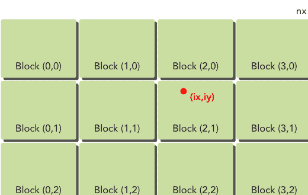

矩阵坐标：`(ix, iy)`

全局线性内存索引：`idx = iy*nx + ix`

图 2-12

接下来，可以将矩阵的大小设置为每个维度 16384 个元素：

```cpp
int nx = 1<<14;
int ny = 1<<14;
```

然后，可以使用以下执行配置来使用 2D 网格和 2D 块：

```cpp
int dimx = 32;
int dimy = 32;
dim3 block(dimx, dimy);
dim3 grid((nx+block.x - 1) / block.x, (ny+block.y - 1) / block.y);
```

将所有代码合并到文件 `sumMatrixOnGPU-2D-grid-2D-block.cu` 中。`main` 函数位于代码 2-7。

### 代码 2-7: 使用 2D 网格和 2D 块进行矩阵求和 (`sumMatrixOnGPU-2D-grid-2D-block.cu`)

```cpp
int main(int argc, char **argv) {
    printf("%s Starting...\n", argv[0]);

    // 设置设备
    int dev = 0;
    cudaDeviceProp devProp;
    CHECK(cudaGetDeviceProperties(&devProp, dev));
    printf("Using Device: %s\n", dev, devProp.name);
    CHECK(cudaSetDevice(dev));

    // 设置矩阵大小
    int nx = 1<<14;
    int ny = 1<<14;

    int nxy = nx * ny * sizeof(float);
    int nBytes = nxy * sizeof(float);
    printf("Matrix size: %d x %d\n", nx, ny);

    // 分配主机内存
    float *h_A, *h_B, *hostRef, *gpuRef;
    h_A = (float *)malloc(nBytes);
    h_B = (float *)malloc(nBytes);
    hostRef = (float *)malloc(nBytes);
    gpuRef = (float *)malloc(nBytes);

    // 在主机侧初始化数据
    double iStart = cpuSecond();
    initialData(h_A, nxy);
    initialData(h_B, nxy, iStart);
    double iElaps = cpuSecond() - iStart;

    memset(hostRef, 0, nBytes);
    memset(gpuRef, 0, nBytes);

    // 在主机侧相加矩阵以检查结果
    iStart = cpuSecond();
    sumMatrixOnHost(h_A, h_B, hostRef, nx, ny);
    iElaps = cpuSecond() - iStart;
```

### 列表 2-7（续）

```cpp

// invoke kernel at host side

int dimx = 32;

int dimy = 32;

dim3 block(dimx, dimy, dimy);

dim3 grid((nx+block.x-1)/block.x, (ny+block.y-1)/block.y);

istart = cpuElapsed();

sumMatrixOnGPU2D <<< grid, block >>>>(dMatA, dMatB, dMatC, nx, ny);

cudaDeviceSynchronize();

elElaps = cpuElapsed() - iStart;

printf("<<<%d, %d, %d>>> elapsed %f sec\n", grid.x, grid.y, grid.z, elElaps);

// copy result back to host side

cudaMemcpy(gpuRef, dMatC, nBytes, cudaMemcpyDeviceToHost);

// check device results

checkResult(hostRef, gpuRef, nxy);

// free global memory

cudaFree(dMatA);

cudaFree(dMatB);

cudaFree(dMatC);

// free host memory

free(h_A);

free(h_B);

free(hostRef);

free(gpuRef);

// reset device

cudaDeviceReset();

return (0);

}
```

使用以下命令编译并运行此代码：

```bash
$ nvcc -arch=sm_20 sumMatrixOnGPU2D-grid-2D-block.cu -o matrix2D
$ ./matrix2D
```

Tesla M2070 上的结果如下：

```
./a.out Starting...
Using Device 0: Tesla M2070
Matrix size: nx 16384 ny 16384
sumMatrixOnGPU2D <<<(512,512,1)>>> elapsed 0.060323 sec
Arrays match.
```

接下来，将块维度更改为 32 x 16 并重新编译。内核函数的速度几乎快了两倍：

```
sumMatrixOnGPU2D <<<(512,1024,1)>>> elapsed 0.038041 sec
```

你可能会奇怪，为什么仅通过更改执行配置，内核性能几乎翻了一倍。直觉上，你可能会推断第二种配置的块数量是第一种配置的两倍，因此并行性也是两倍。这种直觉是对的。然而，如果你将块大小进一步缩小到 16 x 16，与第一种配置相比，块的数量增加了四倍。这种配置的结果所示，优于第一种，但差于第二种。

```
sumMatrixOnGPU2D <<< (1024,1024), (16,16) >>> elapsed 0.045535 sec
```

表 2-3 总结了不同执行配置的性能。从结果可以看出，增加块的数量并不总是能提高内核性能。在第 3 章中，你将学习为什么不同的执行配置会影响内核性能。

### 表 2-3：不同执行配置下的矩阵求和

| 内核配置 | 内核执行耗时 | 块数量 |
| --- | --- | --- |
| (32,32) | 0.060323 sec | 512 x 512 |
| (32,16) | 0.038041 sec | 512 x 1024 |
| (16,16) | 0.045535 sec | 1024 x 1024 |

## 使用 1D 网格和 1D 块进行矩阵求和

要使用带有 1D 块的 1D 网格，你需要编写一个新的内核，其中每个线程处理数据元素，如图 2-13 所示。

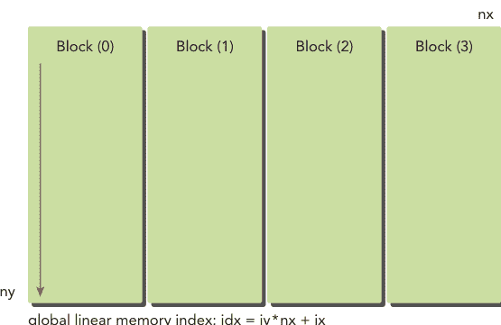

图 2-13

由于新内核中的每个线程处理 n 个元素，从线程和块到全局内存索引的映射将与使用 2D 网格和 2D 块的矩阵求和内核不同。由于此内核启动使用了 1D 块布局，因此 `threadIdx.x` 是有用的，并且内核内部的循环用于处理每个线程的 n 个元素。

```cpp
__global void sumMatrixOnGPUID(float *MatA, float *MatB, float *MatC,
    int nx, int ny) {
    unsigned int ix = threadIdx.x + blockIdx.x * blockDim.x;
    for (ix = 0; ix < nx; ix++) {
        for (int iy = 0; iy < ny; iy++) {
            int idx = iy*nx + ix;
            MatC[idx] = MatA[idx] + MatB[idx];
        }
}
```

接下来，设置 1D 块和网格配置如下：

```cpp
dim3 block(32,1);
dim3 grid((nx+block.x-1)/block.x,1);
```

使用 1D 配置调用内核：

```cpp
sumMatrixOnGPUID <<< grid, block >>>>(dMatA, dMatB, dMatC, nx, ny);
```

将这些部分替换为列表 2-7，它使用 1D 网格和 1D 块，将其保存为文件 `sumMatrixOnGPU-grid-1d-block-1d.cu`，并使用以下命令编译运行：

```bash
$ nvcc -arch=sm_20 sumMatrixOnGPU-grid-1d-block-1d.cu -o matrix1D
$ ./matrix1D
```

结果显示性能与使用 2D 网格和块 (32 x 32) 配置的结果基本相同。

```
Starting...
Using Device 0: Tesla M270
Matrix size: nx 16384 ny 16384
sumMatrixOnGPUID <<(512,1), (32,1)>>> elapsed 0.06332 sec
Arrays match.
```

接下来，如下增大块大小：

```cpp
dim3 block(128,1);
dim3 grid((nx+block.x-1)/block.x,1);
```

重新编译并运行。你会看到内核变快了。

```
sumMatrixOnGPUID <<(128,1), (128,1)>>> elapsed 0.04701 sec
```


## 使用 2D 网格和 1D 块进行矩阵求和

当使用包含 1D 块的 2D 网格时，每个线程只处理一个元素，且网格的第二个维度等于 `ny`，如图 2-14 所示。

| Block (0,0) | Block (1,0) | Block (2,0) | Block (3,0) |
| --- | --- | --- | --- |
| Block (0,1) | Block (1,1) | Block (2,1) | Block (3,1) |
| | | | |
| | | | |
| Block (0,ny) | Block (1,ny) | Block (2,ny) | Block (3,ny) |

全局内存索引：`idx = iy*nx + ix`

图 2-14

可以被视为 2D 网格 2D 块的特殊情况，其中块的第二个维度为 1。因此，从块索引到矩阵坐标的映射变为：

```cpp
ix = threadIdx.x + blockIdx.x * blockDim.x;
iy = blockIdx.y;
```

矩阵坐标到全局内存的映射保持不变。新内核如下：

```cpp
global void sumMatrixOnGPU(float *MatA, float *MatB, float *MatC,
    int nx, int ny) {
    unsigned int ix = threadIdx.x + blockIdx.x * blockDim.x;
    unsigned int iy = blockIdx.y;
    unsigned int idx = iy*nx + ix;
    if (ix < nx && iy < ny)
      MatC[idx] = MatA[idx] + MatB[idx];
}
```

注意，2D 内核 `sumMatrixOnGPU` 适用于此配置。编写新内核的唯一优点是为线程节省了一个乘法和一个加法。将块维度设置为 32 并此计算网格大小：

```cpp
dim3 block(32);
dim3 grid((nx + block.x - 1)/block.x, ny);
```

按如下方式调用内核：

```cpp
sumMatrixOnGPU<<<grid, block>>>(dMatA, dMatB, dMatC, nx, ny);
```

从列表 2-7 替换这些坐标，将其保存为 `sumMatrixOnGPU-2D-block.cu`，并使用以下命令编译：

```bash
nvcc -arch=sm_20 sumMatrixOnGPU-2D-block.cu -o mat2D
./mat2D
```

结果是：

```
./a.out Starting..
Using Device 0: Tesla M2070
Matrix size: nx 16384 ny 16384
Matrix: initialization
elapsed 0.39769 sec
sumMatrixOnGPU ((512,16384), (32,1))>>> 0.03727 sec
Arrays match.
```

现在，将块大小增大到 256：

```cpp
dim3 block(256);
```

然后编译并运行，系统将报告目前为止最好的性能（见表 2-4）：

```
sumMatrixOnGPU ((64,16384), (256,1))>>> 0.030765 sec
```

表 2-4：不同实现的比较

| 内核 | 执行配置 | 执行耗时 |
| --- | --- | --- |
| sumMatrixOnGPUD2 | (512,1024), (32,16) | 0.038041 |
| sumMatrixOnGPUD1 | (128,128) | 0.044701 |
| sumMatrixOnGPUmix | (64,16384), (256,1) | 0.030765 |

从矩阵加法示例可以看出以下几点：

- 更改执行配置会影响性能。
- 简单的内核实现通常不会产生最好的性能。
- 对于定的内核，尝试不同的网格和块维度可能会提高性能。

在第 3 章中，你将从硬件角度学习更多导致这些问题的原因。

## 管理设备

NVIDIA 提供了几种查询和管理 GPU 设备的方法。学习如何查询这些信息很重要，可以使用它们在运行时设置内核执行配置。

在本节中，你将学习查询和管理 GPU 的两种基本强大方法：

- CUDA API 函数
- NVIDIA 系统管理界面 `nvidia-smi` 命令行实用

### 使用运行时 API 查询 GPU 信息

CUDA 运行时 API 有许多函数可以帮助管理设备。你可以使用以下函数查询有关 GPU 设备的所有信息：

```cpp
cudaError_t cudaDeviceProperties(cudaDeviceProp* prop, int device);
```

GPU 设备属性返回在 `cudaDeviceProp` 结构中，你可以在网上找到：http://docs.nvidia.com/cuda/cuda-runtime-api/index#structcudaDeviceProp。

列表 2-8 提供了一个查询感兴趣的通用属性的示例。使用以下命令编译运行：

```bash
$ nvcc checkDeviceInfo.cu -o checkDeviceInfo
./checkDeviceInfo
```

根据你的配置，`checkDeviceInfo` 将报告已安装设备的不同信息。示例输出为：

```
/checkDeviceInfo Starting...
Detected 2 CUDA device(s)
Device 0: "Tesla M200"
CUDA Driver Version / Runtime Version: 5.5 / 5.5
CUDA Capability Major/Minor version number: 2.0
Total amount of global memory: 5.25 Megabytes (563654752 bytes)
GPU clock: 1147 MHz (1.15 GHz)
Memory clock: 1556 MHz
Memory Bus Width: 384-bit
L2 Cache: 76412 bytes
Max Texture Dimension Size (x,y,z): 2D=(65536,65535), 3D=(2048,2048,2048)
Max Layer Texture Size (dim x layers): 16D=(16384, 16384, 2048)
Total amount of constant memory: 65536 bytes
Total amount of shared memory per block: 49152 bytes
Total number of registers available per block: 32768
Warp size: 32
Maximum number of threads per multiprocessor: 1536
Maximum number of threads per block: 1024
Maximum sizes of each dimension of a block: 1024 x 1024 x 64
Maximum sizes of each dimension of a grid: 65535 x 65535 x 65535
Maximum memory pitch: 214748367 bytes
```

### 列表 2-8 (续)

```cpp
if (error_id != cudaSuccess) {
    printf("cudaGetDeviceCount returned %d-> %s\n",
           (int)error_id, cudaGetString(error_id));
    printf("Result = FAIL!\n");
    exit(EXIT_FAILURE);
}
if (deviceCount == 0) {
    printf("There are no available device(s) that support CUDA\n");
} else {
    printf("Detected %d CUDA capable device(s)\n", deviceCount);
}
int dev, driverVersion = 0, runtimeVersion = 0;
dev = 0;
cudaSetDevice(dev);
cudaDeviceProp deviceProp;
cudaGetDeviceProperties(&deviceProp, dev);
printf(" Device %d: %s\n", dev, deviceProp.name);
cudaGetDriverVersion(&driverVersion);
cudaRuntimeVersion(&runtimeVersion);
printf(" CUDA Driver Version / Runtime Version %d.%d\n",
       driverVersion/1000, runtimeVersion%100);
printf(" CUDA Capability Major/Minor version number: %d.%d\n",
       deviceProp.major, deviceProp.minor);
printf(" Total amount of global memory: %.2f Mabytes (%lu bytes)\n",
       (float)deviceProp.totalGlobalMem/1024.0/1024.0, (unsigned long)deviceProp.totalGlobalMem);
printf(" GPU Clock rate: %.0f MHz (%.2f GHz)\n",
       deviceProp.clockRate*1e-6);
printf(" Memory Clock Rate: %.0f MHz\n",
       deviceProp.memoryClockRate*1e-6);
printf(" Memory Bus Width: %d-bit\n",
       deviceProp.memoryBusWidth);
if (deviceProp.L2Cache > 0) {
    printf(" L2 Cache Size: %d bytes\n",
           deviceProp.L2Cache);
}
printf(" Max Texture Dimension Size (x,y,z) = %d,%d,%d\n",
       deviceProp.maxTexture2D[0], deviceProp.maxTexture2D[1], deviceProp.maxTexture2D[2]);
deviceProp.maxTexture3D[0], deviceProp.maxTexture3D[1], deviceProp.maxTexture3D[2];
printf(" Max Layered Texture Size (dim) by layers 1D = %d,%d,%d\n",
       deviceProp.maxTexture1DLayered(0), deviceProp.maxTexture1DLayered(1), deviceProp.maxTexture1DLayered(2));
deviceProp.maxTexture2DLayered(0), deviceProp.maxTexture2DLayered(1), deviceProp.maxTexture2DLayered(2));
```

```cpp
printf(" Total amount of constant memory: %lu bytes\n", deviceProp.totalConstMem);
printf(" Total amount of shared memory per block: %lu bytes\n", deviceProp.sharedMemBlock);
printf(" Total number of registers available per block: %d\n", deviceProp.regsPerBlock);
printf(" Warp size: %d\n", deviceProp.WarpSize);
printf(" Maximum number of threads per multiprocessor: %d\n", deviceProp.maxThreadsPerMultiProcessor);
printf(" Maximum number of threads per block: %d\n", deviceProp.maxThreadsPerBlock);
printf(" Maximum size of each dimension of a block: %d %d %d\n", deviceProp.maxThreadsDim[0], deviceProp.maxThreadsDim[1], deviceProp.maxThreadsDim[2]);
printf(" Maximum size of each dimension of a grid: %d %d %d\n", deviceProp.maxGridSize[0], deviceProp.maxGridSize[1], deviceProp.maxGridSize[2]);
printf(" Maximum pitch: %lu bytes\n", deviceProp.memPitch);
exit(EXIT_SUCCESS);
```

## 最佳 GPU

某些系统支持多个 GPU。在每个 GPU 都是不同的情况下，选择最佳 GPU 来运行你的内核 `kernel` 可能是重要的。识别计算能力最强 GPU 的方法是看它拥有的处理器 `multiprocessors` 数量。如果你有一个多 GPU 系统，可以使用以下代码选择计算能力最强的设备：

```cpp
int numDevices = 0;
cudaGetDeviceCount(&numDevices);
if (numDevices > 1) {
    int maxMultiprocessors = 0, maxDevice = 0;
    for (int device = 0; device<numDevices; device++) {
        cudaDeviceProperties props;
        cudaGetDeviceProperties(&props, device);
        if (props.multiprocessors < props.multiProcessorCount) {
            maxMultiprocessors = props.multiProcessorCount;
            maxDevice = device;
        }
    }
    cudaSetDevice(maxDevice);
}
```

## 使用 nvidia-smi 查询 GPU 信息

命令行工具 `nvidia-smi` 帮助你管理和监控 GPU 设备，并允许你查询和修改设备状态。

你可以从命令行调用 `nvidia-smi`。例如，要确定系统中安装了多少个 GPU 以及每个 GPU 的设备 ID，请以下命令：

```bash
$ nvidia-smi -L
GPU 0: Tesla M2070 (UUID: GPU-68)
GPU 1: Tesla M2070 (UUID: GPU-38)
```


GPU 并行架构允许你对线程并发性进行推理。在第 2 章中，你已经学习了 `CUDA` 编程模型暴露了两个主要的抽象：内存层次结构和线程层次结构，你通过它们来控制大规模并行的 GPU。相应地，`CUDA` 执行模型提供的见解对于在指令吞吐量和内存访问方面编写高效代码都是非常有帮助。

在本章中，你将重点关注指令吞吐量，并在第 4 和第 5 章中学习更多关于高效内存访问的知识。

## GPU 架构概述

GPU 架构围绕可扩展的流式多处理器（`SM`）阵列构建。GPU 硬件并行性通过复制这种架构构建单元来实现。图 3-1 展示了 Fermi `SM` 的关键组件：

- `CUDA` 核心
- 共享内存/`L1` 缓存
- 寄存器文件
- 加载/存储单元 (`Load/Store Units`)
- 特殊功能单元 (`Special Functions Units`)
- `Warp` 调度器 (`Warp Scheduler`)

GPU 中的每个 `SM` 设计用于支持数百个线程的并发执行，每个 GPU 通常有多个 `SM`，因此单个 GPU 上可能有数千个线程并发执行。当内核网格（`kernel grid`）启动时，内核网格的线程块被分配到可用的 `SM` 上执行。一旦调度到 `SM` 上，线程块中的线程就会在同一个 `SM` 上并发执行，并根据 `SM` 资源的可用性进行调度。单个线程内部的指令通过流水线处理，以利用指令级并行性，除了你已经熟悉的 `CUDA` 线程级并行性外。

`CUDA` 采用单指令多线程（`SIMT`）模型以 32 个线程的 `warp` 为组来管理和执行线程。在每个 `warp` 中，所有线程在同一时刻执行相同的指令。每个线程都有自己的指令计数器和寄存器状态，并在其自己的数据上执行当前指令。每个 `SM` 将分配给它的线程块划分为 32 线程一个的 `warps`，并将其调度到可用的硬件资源上进行执行。

`SIMT` 架构与 `SIMD`（单指令多数据）架构相似。`SIMD` 和 `SIMT` 均通过向向量执行组中的多个执行单元广播指令来实现并行性。两者的一个关键区别是，`SIMD` 要求向量中的所有元素在一个统一的同步组中执行，而 `SIMT` 允许 `warp` 中的多个线程独立执行。尽管 `warp` 中的所有线程都从相同的程序地址开始，但单个线程可能会有不同的行为。`SIMT` 允许你为独立的标量线程编写线程级并行代码，以及为协作的线程编写数据并行代码。`SIMT` 模型包含三个 `SIMD` 不具备的三个关键特征：

- 每个线程都有自己的指令地址计数器。
- 每个线程都有自己的寄存器状态。
- 每个线程可以拥有独立的执行路径。

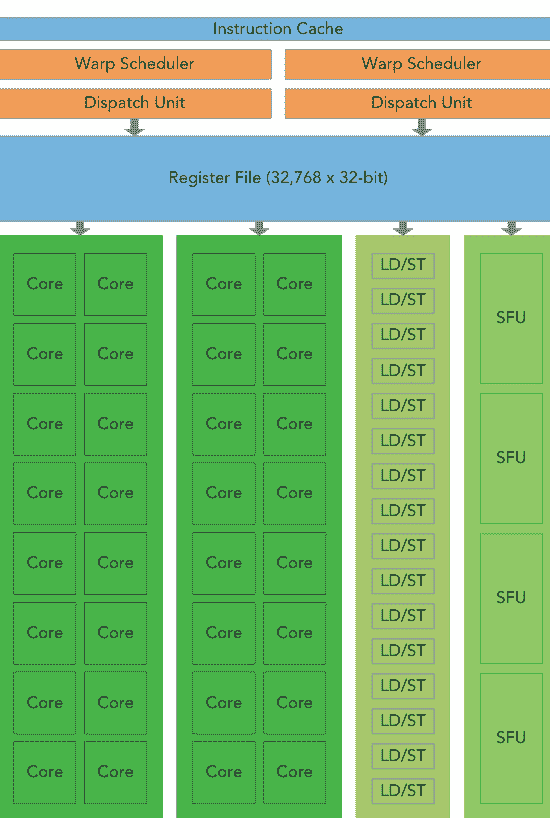

图 3-1

## 魔术数字：32

32 是 `CUDA` 编程中的一个魔术数字。它源自硬件，对软件性能有显著影响。

从概念上说，你可以将其视为 `SM` 以 `SIMD` 方式同时处理的工作粒度。将你的工作负载优化以适应 `warp`（32 个线程的一组）的边界，通常会导致 GPU 计算资源更高效的利用。你将在随后的章节中学习到很多关于这个问题的知识。

一个线程块只会被调度到一个 `SM` 上。一旦线程块被调度到 `SM` 上，它就会一直保留到执行完成。一个 `SM` 可以同时持有多个一个线程块。图 3-2 展示了 `CUDA` 编程中逻辑视图和硬件视图的对应组件。

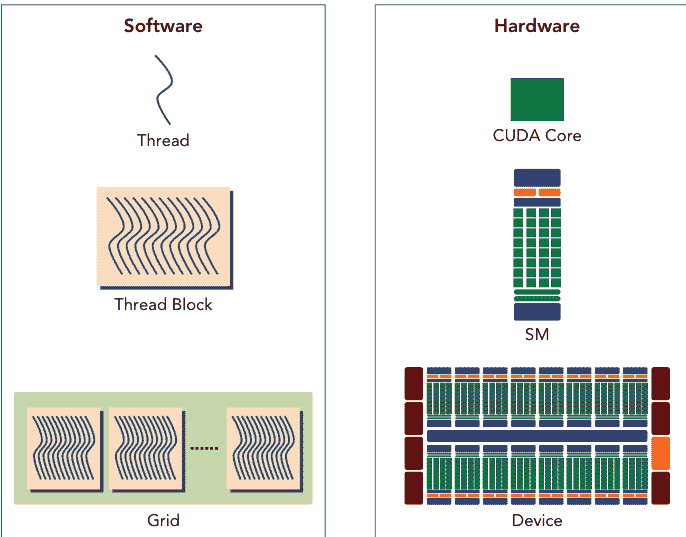

图 3-2

共享内存和寄存器是 `SM` 中珍贵的资源。共享内存分配在驻留在 `SM` 的线程之间，寄存器分配在线程之间。在线程块中，线程可以通过这些资源进行相互协作和通信。虽然线程块中的所有线程都并行运行，但由于 `SM` 资源的限制，线程块内的线程可能会以不同的速度取得进展。线程块内线程之间共享数据可能会导致竞态条件。`CUDA` 提供了线程块内线程同步的手段。当 `warp` 因为任何原因空闲（例如等待从设备内存读取值）时，`SM` 可以调度另一个 `warp`。`SM` 资源限制了活跃 `warp` 的数量，因为所有在 `SM` 上新调的 `warp` 状态存储在 `SM` 中。

> `SM`：GPU 架构的核心
> 流式多处理器（`SM`）是 GPU 架构的核心。寄存器和共享内存是 `SM` 中的稀缺资源。`CUDA` 在 `SM` 上为线程分配这些资源。有关 `SM` 硬件组件的基本事实将帮助你组织内核执行以获得性能。

在下一节中，你将对两个版本的 GPU 架构进行简要介绍：Fermi 和 Kepler。将关注它们的硬件资源。你将通过示例和练习学习它们的硬件特性。

## Fermi 架构

Fermi 架构是第一个能够满足最苛刻应用程序需求的完整 GPU 计算架构。Fermi 被广泛用于加速工作负载。

图 3-3 展示了 Fermi 架构的框图，省略了图形特定的组件。Fermi 具有多达512 个加速核心（称为 `CUDA` 核心），每个核心具有一个全流水线的算术逻辑单元（`ALU`）和一个浮点单元（`FPU`），每个周期可执行一条整数或浮点指令。`CUDA` 核心组织成 16 个流式多处理器（`SM`），每个 `SM` 有 32 个 `CUDA` 核心。Fermi 具有 34 位的 GDDR5 内存接口，支持高达 6 GB 的板载内存，这是许多应用程序的关键资源。主机接口通过 PCI 总线连接 GPU 和 CPU。GigaThread 引擎（图中左侧橙色部分）是全局调度器，将块分配到 `SM` `warp` 调度器。

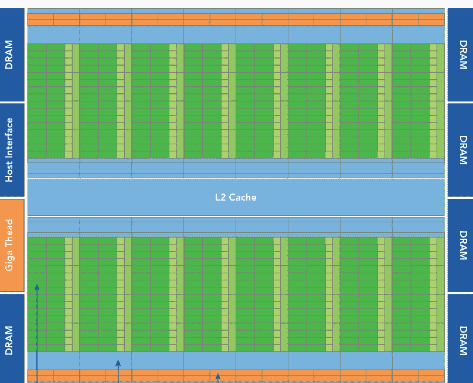

`CUDA` 核心 共享内存、寄存器文件和 `L1` 缓存 调度器和分发器

图 3-3

Fermi 包括一个所有 16 个 `SM` 共享的 768 KB `L2` 缓存。图 3-3 中的每个 `SM` 由一个垂直矩形表示，包含：

- 执行单元（`CUDA` 核心）
- 调度 `warp` 的调度器和分发器
- 共享内存、寄存器文件和 `L1` 缓存

每个多处理器具有 16 个加载/存储单元（如图 3-1 所示），允许每个周期为 16 个线程（半 `warp`）计算源和目的地址。特殊功能单元（`SFU`）执行正弦、余弦、平方根和插值等内置指令。每个 `SFU` 每个线程每个周期可以执行一条内置指令。

每个 `SM` 具有两个 `warp` 调度器和两个指令分发单元。当线程块被分配到 `SM` 时，线程块中的所有线程被划 `warp`。`warp` 调度器选择

两个线程束（`warps`）并从每个线程束发出一个指令到一组 16 个 `CUDA` 核心、16 个加载/存储单元或 4 个特殊功能单元（如图 3-4 所示）。Fermi 架构（计算能力为 2.x）可以同时为每个 `SM` 处理 48 个线程束，单个 `SM` 一时共处理 1,536 个线程。

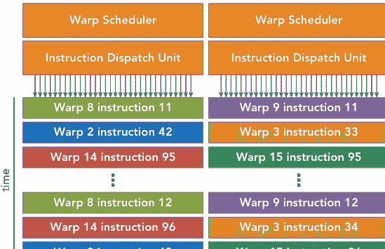

图 3-4

Fermi 的一个关键特性是 64 KB 片上可配置内存，它在共享内存（`shared memory`）和 `L1` 缓存之间进行划分。对于许多高性能应用程序，共享内存是提升性能的关键因素。共享内存允许块（`block`）内的线程进行协作，促进了片上数据的广泛使用，并极大减少了片外流量。`CUDA` 提供了一个运行时 `API`，可用于调整共享内存和 `L1` 缓存的大小。根据特定内核函数（`kernel`）对共享内存或缓存的使用情况，修改片上配置可以带来性能提升。该主题将在第 4 章和第 5 章中详细介绍。

Fermi 还支持并发内核执行：来自应用程序上下文的多个内核同时在同一块 GPU 上执行。并发内核执行程序通过执行多个小内核来充分利用 GPU，如图 3-5 所示。Fermi 允许多达 16 个内核同时在设备上运行。从程序员的角度来看，并发内核执行使得 GPU 看起来更像是一个 `MIMD`（多指令多数据）架构。

## Kepler 架构

Kepler GPU 架构于 2012 年秋季发布，是一种快速、高效且高性能的计算架构。Kepler 特性让混合计算对你来说更容易。图 3-6 展示了 Kepler K20X 的框图，它包含 15 个流式多处理器（`SM`）和 6 个 64 位内存控制器。Kepler 架构中的三项重要创新是：

- 增强的 `SM`
- 动态并行（`Dynamic Parallelism`）
- `Hyper-Q`

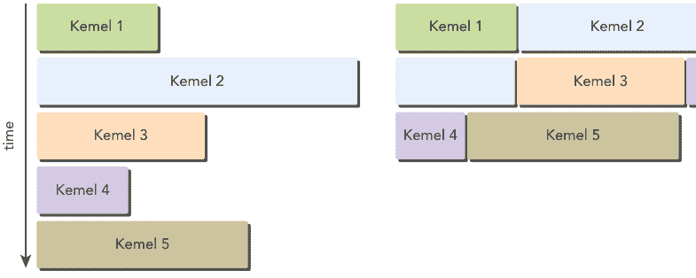

图 3-5

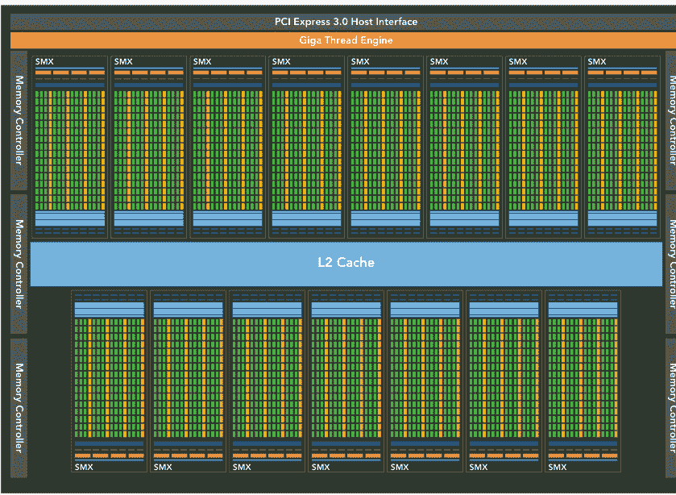

图 3-6

Kepler K20X 的核心是一个新的 `SM` 单元，它包含了若干项改进编程性和能效比的架构创新。每个 Kepler `SM` 单元由 192 个单精度 `CUDA` 核心、64 个双精度单元、32 个特殊功能单元（`SFU`）和 32 个加载/存储单元（`LD/ST`）组成（如图 3-7 所示）。

| 指令缓存 | 线程束调度器 | 线程束调度器 | 线程束调度器 |
| :--- | :--- | :--- | :--- |
| 分发 | 分发 | 分发 | 分发 | 分发 | 分发 |
| 寄存器文件 (65,536 & 32-bit) |
| 核心 核心 DP 单元 核心 核心 DP 单元 DP 单元 SFU 核心 核心 DP 单元 核心 核心 DP 单元 DP 单元 SFU |
| 核心 核心 DP 单元 核心 核心 DP 单元 DP 单元 SFU 核心 核心 DP 单元 核心 核心 DP 单元 DP 单元 SFU |
| 核心 核心 DP 单元 核心 核心 DP 单元 DP 单元 SFU 核心 核心 DP 单元 核心 核心 DP 单元 DP 单元 SFU |
| 核心 核心 DP 单元 核心 核心 DP 单元 DP 单元 SFU 核心 核心 DP 单元 核心 核心 DP 单元 DP 单元 SFU |
| 核心 核心 DP 单元 核心 核心 DP 单元 DP 单元 SFU 核心 核心 DP 单元 核心 核心 DP 单元 DP 单元 SFU |
| 核心 核心 DP 单元 核心 核心 DP 单元 DP 单元 SFU 核心 核心 DP 单元 核心 核心 DP 单元 DP 单元 SFU |
| 核心 核心 DP 单元 核心 核心 DP 单元 DP 单元 SFU 核心 核心 DP 单元 核心 核心 DP 单元 DP/ SFU |
| 核心 核心 DP 单元 核心 核心 DP 单元 DP 单元 SFU 核心 核心 DP 单元 核心 核心 DP 单元 LD/ SFU |
| 核心 核心 DP 单元 核心 核心 DP 单元 DP 单元 SFU 核心 核心 DP 单元 核心 核心 DP 单元 LD/ SFU |
| 互连网络 |
| 64 KB 共享内存 / L1 缓存 |
| 48 KB 只读数据缓存 |
| Tex Tex Tex Tex Tex Tex Tex Tex Tex |
| Tex Tex Tex Tex Tex Tex Tex Tex |

图 3-7

每个 Kepler `SM` 包含 4 个线程束调度器和 8 个指令分发器，使得单个 `SM` 能够并发发出并执行 4 个线程束。Kepler K20X 架构（计算能力为 3.5）每个 `SM` 能够调度 64 个线程束，单个 `SM` 一时可驻留 2,048 个线程。与 Fermi 的 32K 相比，K20X 架构将寄存器文件大小增加到了 64K。K20X 架构还根据共享内存或 `L1` 缓存的使用情况提升了性能。

**动态并行（`Dynamic Parallelism`）** 是 Kepler 引入的一项新功能，允许从应用程序上下文在同一 GPU 上同时执行多个内核。并发内核执行程序通过执行若干个小内核来充分利用 GPU，如图 3-5 所示。Kepler 允许多达 16 个内核同时在设备上运行。从程序员的角度来看，并发内核执行使得 GPU 看起来更像是一个 `MIMD` 架构。

`nvvp` 是一个可视化性能分析器（Visual Profiler），它可以帮助你可视化并优化 `CUDA` 程序的性能。该工具可以显示 CPU 和 GPU 上的程序活动时间线，帮助你识别性能改进的机会。此外，`nvvp` 会分析应用程序中潜在的性能瓶颈，并建议消除或减少这些瓶颈的方案。该工具既可以作为独立应用程序，也可以作为 Nsight Eclipse 版本 (`nsight`) 的一部分。

`nvprof` 在命令行中收集性能分析数据。`nvprof` 随 `CUDA` 5 引入，取代了旧的命令行 `CUDA` 性能分析工具。与 `nvvp` 类似，它能够收集 CPU 和 GPU 上的 `CUDA` 相关活动时间线，包括核函数执行、内存传输和 `CUDA API` 用。它还允许你为 `CUDA` 核函数收集硬件计数器和性能指标。

除了预定义的指标外，你还可以根据性能分析器收集的硬件计数器定义你自己的指标。

## 事件与度量（EVENTS AND METRICS）

在 `CUDA` 性能分析中, “事件”（`event`）是一个可计数的活动，对应于核函数执行期间收集的硬件计数器。“指标”（`metric`）是根据一个或多个事件计算出的核函数特征。请记住关于事件和指标的以下概念：

- 大多数计数器是按每个流式多处理器（`SM`）报告的，而不是整个 GPU。
- 单次运行只能收集少数计数器。这些计数器的收集是互斥的。通常需要多次性能分析运行来收集所有相关的计数器。
- 由于 GPU 执行的差异（例如线程块和线程束调度），计数器值在重复运行之间可能并不相同。

要识别一个核函数的性能瓶颈，选择合适的性能指标并将测量性能与理论峰值性能进行比较至关重要。在本书的示例和练习中，你将学习如何使用命令行性能分析器分析核函数的正确指标，并掌握使用分析驱动方法编写高效核函数的技能。

在本书中，你将主要使用 `nvprof` 来剖析核函数，目标是提高性能。你将学习如何选择合适的计数器和指标，并使用 `nvprof` 收集性能分析数据，这些数据随后可以用于优化策略。你将学习如何使用不同的计数器和指标从多个角度分析你的核函数。

你可能会遇到核函数的三个常见限制因素：

- 内存带宽
- 计算资源
- 指令和内存延迟

本章重点关注指令延迟问题，并部分关注计算资源限制。后续章节将涵盖其余性能限制因素。

## 了解硬件资源细节（KNOWING HARDWARE RESOURCE DETAILS）

作为一名 C 程序员，在编写正确性代码时你可以安全地忽略缓存行（`cache line`）大小；但在为了最高性能进行调优时，你必须考虑代码结构中的缓存特性。

`CUDA C` 编程也是如此。作为 `CUDA C` 程序员，如果你想提高核函数性能，必须对硬件资源有一定的了解。

如果你不硬件架构，`CUDA` 编译器仍然能够很好地优化你的核函数，但仅限于此。即使是关于 GPU 架构的基础知识也能让你写出更好的代码，并充分利用设备的能力。

在本章的后续章节中，你将看到与性能指标相关的硬件概念，以及如何使用指标来指导优化。

## 理解线程束执行的本质（UNDERSTANDING THE NATURE OF WARP EXECUTION）

在启动核函数时，从软件角度看你会什么？对你来说，核函数中的所有线程似乎都在并行。从逻辑角度来看这是真实的，但从硬件角度来看，并不是所有线程在物理上都是同时并行执行的。本章已经涵盖了将 32 个线程分组为单个执行单元（线程束，`warp`）的概念。现在你将从硬件角度仔细观察线程束执行，获得有助于核函数设计的见解。

### 线程束与线程块（Warps and Thread Blocks）

线程束是 `SM` 中执行的基本单位。当你启动一个线程块网格（`grid`）时，块中的线程分布在各个 `SM` 上。当一个线程块被调度到 `SM` 时，块中的线程会被进一步划分为线程束。一个线程束由 32 个连续线程组成，线程束中的所有线程都以单指令多线程（`SIMT`）的方式执行。一个线程块中的所有线程执行相同的指令。

### 执行（Execution）

### 逻辑视图（Logical view）

### 硬件视图（Hardware view）


线程块（Thread Block）
线程束（Warps）
流式多处理器（Multiprocessor）

线程块可以配置为一维的。一个线程块可以组织为 1D、2D 或 3D 布局。例如，对于一维线程块，线程 ID 如下：

```
threadIdx.x
```

对于二维线程块，线程 ID 如下：

```
threadIdx.y * blockDim.x + threadIdx.x
```

对于三维线程块，线程 ID 如下：

```
threadIdx.z * blockDim.y * blockDim.x + threadIdx.y * blockDim.x + threadIdx.x
```

线程束（Warps）
 线程（Threads）

## 线程束分散（Warp Divergence）

控制流是任何高级编程语言中的基本构造之一。GPU 支持传统的 C 风格显式流控制构造，如 `if...then...else`、`for` 和 `while`。

CPU 包含复杂的硬件来执行分支预测，即预测条件分支程序流将走向何种路径。如果预测正确，分支只会产生微小的性能开罚。如果预测不正确，CPU 可能会因为指令流水线刷新而停顿。

GPU 是相对简单的设备，没有复杂的分支预测机制。由于线程束中的线程在同一周期内执行相同的指令，如果一个线程执行了某条指令，线程束中的所有线程都必须执行该条指令。如果线程束中的线程通过应用程序的不同路径，这就会变成一个问题。例如，考虑以下语句：

```
if (cond) {

} else {

}
```


假设对于线程束中执行此代码的 16 个线程，`cond` 为真，但对于另外 16 个线程 `cond` 为假。那么线程束的一半需要执行 `if` 块中的指令，而另一半

一半的线程需要执行 `else` 块中的指令。在同一个束（warp）中执行不同指令的线程被称为“线程束分散”（warp divergence）。线程束分散似乎会导致一个悖论，因为你已经知道一个 warp 中的所有线程在每个周期内必须执行相同的指令。

如果一个 warp 内的线程发生分散，该 warp 将串行执行每个分支，并禁用未采取该路径的线程。线程束分散会显著降低性能。在前面的示例中，该 warp 内的并行度减少了一半：此时只有 16 个线程在活跃执行，而其他 16 个线程被禁用了。分支越多，并行性的损失就越大。

注意，分支分散只发生在一个 warp 内部。不同 warp 之间不同的条件值不会导致线程束分散。

图 3-12 展示了线程束分散。一个 warp 内的所有线程都必须通过 `if...then` 语句的两个分支。如果某个线程的条件为真，它执行 `if` 子句；否则，该线程将停顿等待执行完成。

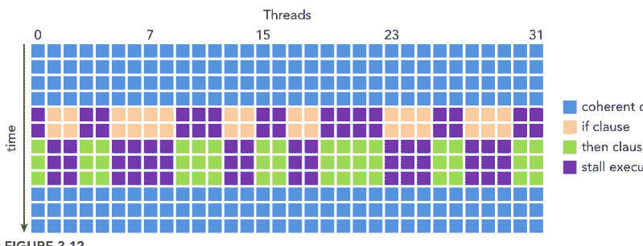

为了获得最佳性能，你应该避免在同一个 warp 内存在不同的执行路径。请记住，线程的 warp 分配是确定性的。因此，可能（取决于算法，这并非易事）通过这样划分数据，确保应用程序中同一个 warp 中的所有线程都采取相同的控制路径。

例如，假设你有两个分支，如下面的简单算术内核所示。你可以通过偶数线程和奇数线程的方法来模拟糟糕的数据划分，从而导致线程束分散。条件 `(tid&2==0)` 让偶数线程执行 `if` 子句，让奇数线程执行 `else` 子句。

```cpp
_global void mathKernel(float *x) {
  int tid = blockIdx.x * blockDim.x + threadIdx.x;
  float a, b;
  a = b = 0.0f;
  if (tid&2==0) {
    a = 100.0f;
} else {
  b = 200.0f;
}
  c[tid] = a + b;
}
```

如果你使用 warp 策略（而不是线程策略）来交错数据，就可以避免线程束分散并实现设备 100% 的利用率。条件 `(tid/warpSize)%2==0` 强制分支粒度为 warp 大小的倍数；偶数 warp 执行 `if`，奇 warp 执行 `else`。此内核产生相同的输出，但顺序不同。

```cpp
_global void warpKernel2(void) {
  int tid = blockDim.x * blockDim.x + threadIdx.x;
  float a, b;
  a = 0.0f;
  if ((tid / warpSize) % 2 == 0) {
    a = 100.0f;
  } else {
    b = 200.0f;
  }
  c[tid] = a + b;
}
```

现在，你可以使用列表 3-1 中的代码来测量这两个内核的性能。你也可以从 Wrox.com 下载 `simpleDivergence.cu` 文件。因为在设备上的首次运行可能会产生开销，且此处测量的性能是非常细粒度的，所以增加了一个额外的内核启动（预热，与 `mainKernel2` 相同）以消除这种开销。

# 列表 3-1：simple warp (simpleDivergence.cu) (仅 main 函数)

```cpp
int main(int argc, char **argv) {
  // 设置设备
  int dev = 0;
  cudaDeviceProp deviceProp;
  cudaGetDeviceProperties(&deviceProp, dev);
  printf("Using Device %d: %s\n", argv[0],dev, deviceProp.name);
  // 设置数据大小
  int size = 64;
  int blockSize = 64;
  if(argc > 1) blockSize = atoi(argv[1]);
  if(argc > 2) size = atoi(argv[2]);
  printf("Data size %d *\n", size, size);
  // 设置执行配置
  dim3 block(blockSize,1);
  dim3 grid((size+block.x-1)/block.x,1);
  printf("Execution Configuration (block %d grid %d)\n",block.x, grid.x);
  // 分配 GPU 内存
  float *d_C;
  size_t nBytes = size * sizeof(float);
  cudaMalloc((float**)&d_C, nBytes);
  // 运行预热内核以消除开销
  size_t iStart,iElaps;
  cudaDeviceSynchronize();
  iStart = seconds();
  warmup-0<<<cpid, block>>>(d_C);
  cudaDeviceSynchronize();
  iElaps = seconds() - iStart;
  printf("warmup <<%d,%d elapsed %d sec\n", grid.x,block.x, iElaps);
  // 运行内核 1
  iStart = seconds();
  mathkernel1<<<grid, block>>>(d_C);
  cudaDeviceSynchronize();
  iElaps = seconds() - iStart;
  printf("mathkernel1 <<%d,%d elapsed %d sec\n", grid.x,block.x,iElaps);
  // 运行内核 2
  iStart = seconds();
  mathkernel2<<<grid, block>>>(d_C);
  cudaDeviceSynchronize();
  iElaps = seconds() - iStart;
  printf("mathkernel2 <<%d,%d elapsed %d sec\n", grid.x,block.x,iElaps);
  // 运行内核 3
  iStart = seconds();
  mathkernel3<<<grid, block>>>(d_C);
  cudaDeviceSynchronize();
  iElaps = seconds() - iStart;
  printf("mathkernel3 <<%d,%d elapsed %d sec\n", grid.x,block.x,iElaps);
  // 运行内核 4
  iStart = seconds();
  mathkernel4<<<grid, block>>>(d_C);
  cudaDeviceSynchronize();
  iElaps = seconds() - iStart;
  printf("mathkernel4 <<%d,%d elapsed %d sec\n", grid.x,block.x,iElaps);
  // 释放内存并重置设备
  cudaFree(d_C);
  cudaDeviceReset();
  return EXIT_SUCCESS;
}
```
（注：由于原文文本在代码块处有截断，译文根据上下文补全了缺失的逻辑结构以保持文档完整性，但严格遵循不翻译代码的原则。）

（注：由于原文在编译命令不完整，已对描述进行了翻译。）

使用以下命令编译此源码：

```bash
# nvcc -O3 -arch=sm_20 simpleDivergence.cu -o simpleDivergence
```

运行 `simpleDivergence` 的输出如下：

```
Using Device 0: Tesla T4
Data size 64 *
Execution Configuration (block 64 grid 1)
warmup <<1,64 elapsed 0 sec
mathkernel1 <<1,64 elapsed 0 sec
mathkernel2 <<1,64 elapsed 0 sec
mathkernel3 <<1,64 elapsed 0 sec
mathkernel4 <<1,64 elapsed 0 sec
```

你也可以使用 `nvprof` 观察分散情况。在这里，`nvprof` 显示：

```text
Divergence statistics:
Divergence statistics:
| kernel | branch | divergent branch |
|---|---|---|
| mathkernel1  | 12 | 2 |
| mathkernel2  | 12 | 0 |
| mathkernel3  | 14 | 4 |
```

使用 `nvprof` 检查未优化内核的分散情况：

```text
Divergence statistics:
Divergence statistics:
| kernel | branch | divergent branch |
|---|---|---|
| mathkernel1  | 12 | 2 |
| mathkernel2  | 12 | 0 |
| mathkernel3  | 14 | 4 |
```

下表显示了分支效率：

```text
| kernel | branch efficiency |
|---|---|
| mathkernel1 | 83.33% |
| mathkernel2 | 100.00% |
| mathkernel3 | 71.43% |
```

分支效率定义为非分散分支占总分支的比例：

$$\text{Branch Efficiency} = \frac{\text{Total Branches} - \text{Divergent Branches}}{\text{Total Branches}}$$

注意 `mathkernel2` 不报告分支分散的唯一原因是它的粒度是 warp 大小的倍数。当一个 warp 发生分散时，未采取路径的线程处于空闲，允许调度器处理另一个 warp。这就是为什么线程束分散会显著降低性能。此外，将 `mathKernel` 中的单个 `if...else` 语句拆分为 `mathKernel3` 中的多个语句导致分散分支数量翻倍。

可以使用以下命令强制 CUDA 编译器不优化你的内核：

```bash
# nvcc -O3 -arch=sm_20 -Xcompiler -O0 simpleDivergence.cu -o simpleDivergence
```

再次运行未优化的 `simpleDivergence` 显示：

```
Using Device 0: Tesla T4
Data size 64 *
Execution Configuration (block 64 grid 1)
warmup <<1,64 elapsed 0 sec
mathkernel1 <<1,64 elapsed 0 sec
mathkernel2 <<1,64 elapsed 0 sec
mathkernel3 <<1,64 elapsed 0 sec
mathkernel4 <<1,64 elapsed 0 sec
```


CUDA 编译器仍然对 `mathKernel` 和 `mathKernel3` 进行了有限优化，以使其分支效率保持在 50% 以上。

## 资源划分

一个 `warp` 的本地执行上下文主要由以下资源组成：

+ 程序计数器
* 寄存器
* 共享内存

由 SM 处理的每个 `warp` 的执行上下文在 `warp` 的整个生命周期内都维护在芯片上。因此，在不同的执行上下文之间切换没有成本。

每个 SM 都拥有一组存储在寄存器文件中 32 位寄存器，这些寄存器在线程之间进行划分；以及固定数量的共享内存，它在线程块之间进行划分。对于给定的内核，同时驻留在 SM 上的线程块和束（`warps`）数量取决于 SM 上可用寄存器数量和共享内存容量，以及内核所需的量。

图 3-13 显示，当一个线程消耗更多寄存器时，放置在 SM 上的束就越少。如果你能减少内核消耗的寄存器数量，将更多的束同时被处理。图 3-14 显示，当一个线程块消耗更多共享内存时，SM 同时处理的线程块就越少。

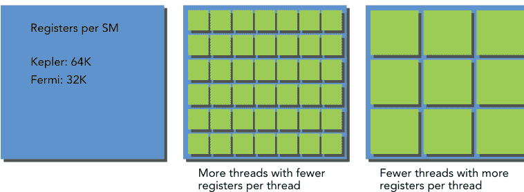
图 3-13

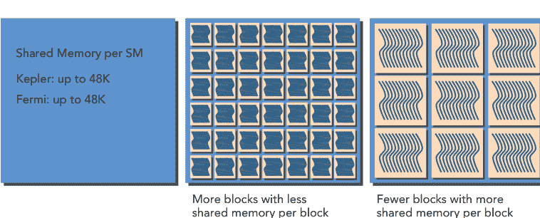
图 3-14

资源可用性通常限制了每个 SM 驻留线程块的数量。不同计算能力的设备，每个 SM 的寄存器数量和共享内存容量各异。如果每个 SM 的寄存器或共享内存不足以处理至少一个块，则内核启动将失败。一些关键限制如表 3-2 所示。

### 表 3-2：与计算能力相关的资源限制

| 技术规格 | 计算能力 (2.0) | 2.1 | 3.0 | 3.5 |
| --- | --- | --- | --- | --- |
| 每个块的最大线程数 | | 1,024 | | |
| 每个多处理器的最大并发线程块数 | | 8 | | 16 | |
| 每个多处理器最大并发束数 | | 48 | | 64 | |
| 每个多处理器的最大并发线程数 | | 1,536 | | 2,048 | |
| 每个多处理器的 32 位寄存器数量 | | 32 K | | 64 K | |
| 每个线程的最大 32 位寄存器数 | | 63 | | 255 | |
| 每个多处理器的最大共享内存量 | | 48 K | | |

当计算资源（如寄存器和共享内存）分配给线程块时，该线程块被称为*活跃*（active）。它包含的束被称为*活跃束*。活跃束可以进一步分为三类：

- 被选中束（Selected warp）
- 阻塞束（Stalled warp）
- 就绪束（Eligible warp）

SM 上的束调度器每周期选择活跃束并将其分发到执行单元。正在执行的束被称为*被选中束*（selected warp）。如果一个活跃束已准备好执行但当前未执行，它就是*就绪束*（eligible warp）。如果一个束未准备好执行，它就是*阻塞束*（stalled warp）。如果满足以下两个条件，则束即可就绪：

- 有 32 个 CUDA 核心可执行。
- 当前指令的所有参数均已就绪。

例如，任何时刻 SM 上活跃束的数量必须小于或等于 64 束的架构限制。每个周期的被选中束数量小于或等于 4。如果一个束阻塞了，调度器会选取一个就绪束来代替。由于计算资源在束之间进行划分并在束的整个生命周期内保持，因此上下文切换非常快。在 CUDA 编程中需要特别注意计算资源的划分：计算资源限制了活跃束的数量。因此，你必须意识到硬件实施的限制以及你的内核使用的资源。为了最大化 GPU 利用率，你需要最大化活跃束的数量。

## 延迟隐藏

SM 依赖线程级并行性来最大化功能单元的利用率。因此，利用率与驻留束的数量直接相关。从指令发射到完成之间的时钟周期数被称为指令延迟。当束调度器每周期都有就绪束时，即可实现完全的资源利用。这确保了每条指令的延迟可以通过发射其他指令来隐藏。

与 CPU 编程相比，延迟隐藏在 CUDA 编程中尤为重要。GPU 核心设计为一次处理一两个线程，而 GPU 设计用于处理大量并发线程以最大化吞吐量。GPU 指令延迟通过其他束来隐藏。

在考虑指令延迟时，指令分为两种基本类型：

- 算术指令
- 内存指令

算术延迟是算术运算开始到产生输出之间的时间。内存延迟是从加载或存储操作发射到数据到达目的地之间的时间。每种情况对应的延迟约为：

- 算术运算为 10-20 个周期
- 全局内存访问为 400-800 个周期

图 3-15 显示了一个简单的流水线，其中束 0 阻塞了。调度器选择其他束进行执行，并在束 0 就绪时执行它。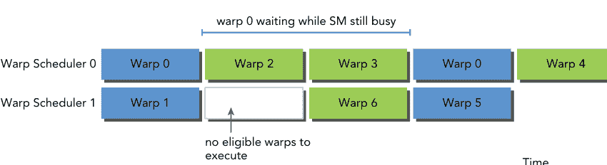
图 3-15

你可能会好奇如何估算隐藏延迟所需的活跃束数量。林特法则（Little's Law）提供了一个适用于 GPU 的合理近似值：

> 所需束数 = 延迟 × 吞吐量

图 3-16 直观地展示了林特法则。假设内核中指令的平均延迟为 5 个周期。为了保持每周期执行 6 束的吞吐量，你至少需要 30 束正在运行（in flight）。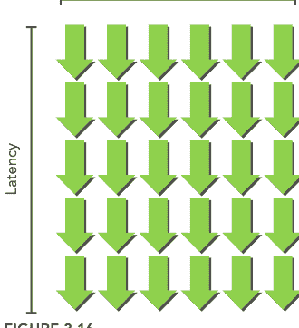
图 3-16

## 吞吐量与带宽

带宽和吞吐量经常被混淆，但根据情况可以互换。吞吐量和带宽都是用于衡量性能的速率指标。带宽通常指理论峰值，而吞吐量指实际实现的值。带宽描述的是单位时间内可能的最大数据传输量，而吞吐量描述的是单位时间内执行的任何类型信息或操作的速率，例如每周期完成多少条指令。

对于算术运算，所需的并行性可以表示为为了隐藏算术延迟。表 3-3 列出了 Fermi 和 Kepler 设备所需的操作数。这里使用的算术运算是 32 位浮点乘加法（$a + b \times c$），表示为每个 SM 每个时钟周期的操作数。吞吐量随指令而异。

### 表 3-3：维持算术利用率所需的 SM 并行性

| GPU 模型 | 指令延迟（周期） | 吞吐量（操作/周期） | 并行性（操作数） |
| --- | --- | --- | --- |
| Fermi | 20 | 32 | 640 |
| Kepler | 192 | | 3840 |

吞吐量以每个 SM 每个周期的操作数指定，执行一条指令的束对应于 32 个操作。因此，Fermi GPU 维持完全资源利用所需的每个 SM 束数可以计算为 640 ÷ 32 = 20 束。因此，算术运算所需的并行性可以表示为操作数，也可以表示为束数。这种简单的转换说明增加并行性有两种方法：

- 指令级并行性 (ILP)：线程内更多独立指令
- 线程级并行性 (TLP)：更多并发的就绪线程

对于内存操作，所需的并行性表示为为了隐藏内存延迟所需的每周期字节数。表 3-4 列出了 Fermi 和 Kepler 架构的指标。

### 表 3-4：维持内存利用率所需的设备并行性

| GPU 模型 | 指令延迟（周期） | 带宽（GB/SEC） | 带宽（B/CYCLE） | 并行性（KB） |
| --- | --- | --- | --- | --- |
| Fermi | 800 | 144 | 92 | 74 |
| Kepler | 800 | 250 | 96 | 77 |

由于内存吞吐量通常以每秒 GB 表示，你需要使用相应的频率将吞吐量转换为每周期 字节。你可以通过以下命令检查设备的内存频率：

```bash
$ nvidia-smi -a -q CLOCK | grep -A 3 "Max Clocks" | grep "Memory"
```

Fermi 内存频率（在 Tesla C200 上测量）为 1.566 GHz。Kepler 内存频率（在 Tesla K20 上测量）为 1.6 GHz。由于 1 Hz 定义为每秒一个周期，随后可以将带宽从每秒 GB字节转换为每周期 字节：

144 GB/Sec / 1.566 GHz ≈ 92 Bytes/Cycle

将每周期字节数乘以内存延迟，你得出 Fermi 内存运算所需的并行性为在运行中近 74 KB 的内存 I/O 以实现完全利用。该值是针对整个设备而非 SM，因为带宽是针对整个设备给出的。

将这些值连接到线程（thread）或线程（warp）数量取决于应用程序。假设每个线程将一个浮点数（4字节）从全局内存移动到 SM 进行计算，您在 Fermi GPU 上需要 18,500 个线程或 579 KB 来隐藏所有延迟：

```
74 KB ÷ 4 bytes/thread = 18,500 threads
```

```
18,500 + 32 threads/warp = 579 warps
```

Fermi 架构拥有 16 个 SM。因此，您需要 579 个 warp + 16 个 SM = 每个 SM 36 个 warp 来隐藏所有延迟。如果每个线程执行了多于一次 4 字节的加载，则需要更少的线程来隐藏内存延迟。

就像指令延迟一样，你可以通过在每个线程/warp 中创建更多的独立内存操作，或创建更多并发活跃的线程/warp 来增加可用的并行性。

延迟隐藏取决于每个 SM 上活跃 warp 的数量，这由执行配置和资源限制（内核中使用的寄存器和共享内存）隐式地决定。选择最优配置是在延迟隐藏和资源利用率之间取得平衡。你将在下一节详细检查此问题。

## 暴露并行性

由于 GPU 在线程之间划分了资源，因此在并发 warp 之间切换的开销非常小（约为一个或两个时周期），因为所需的状态已在芯片上可用。如果有足够的活跃 warp，你可以让 GPU 在每个周期的每个流水线阶段都忙碌。在这种情况下，一个 warp 的延迟会被其他 warp 的执行所隐藏。因此，向 SM 暴露足够的并行性对性能是有益的。

计算所需并行性的简单公式是：每个 SM 的核心数乘以在 SM 上单条算术指令的延迟。例如，Fermi 拥有 32 个单精度浮点流水线通道，单条算术指令的延迟为 20 个时周期，因此每个 SM 至少需要 32 x 20 = 640 个线程来让你的设备忙碌。然而，这是一个下限。

## 占用率

指令在每个 CUDA 核心内部顺序执行。当一个 warp 停顿时，SM 会切换到执行其他符合条件的 warp。理想情况下，你希望有足够的 warp 来保持设备核心繁忙。占用率是每个 SM 上活跃 warp 与最大 warp 数量的比例。

```
occupancy = \frac{active warps}{maximum warps}
```

你可以使用以下函数检查设备每个 SM 的最大 warp 数：

```
cudaError_t cudaGetDeviceProperties(struct cudaDeviceProp *prop, int device);
```

`cudaDeviceProp` 结构体返回了来自设备的各种统计数据。每个 SM 的最大线程数由以下变量返回：

```
maxThreadsPerMultiProcessor
```

你可以通过将 `maxThreadsPerMultiProcessor` 除以 32 来得到最大 warp 数。列表 3-2 显示了如何使用 `cudaDeviceProperties` 来获取 GPU 配置信息。

### 列表 3-2：简单的设备属性查询 (simpleDeviceQuery)

```cpp
#include <stdio.h>
#include <cuda_runtime.h>
int main(int argc, char *argv[]) {
    int iDev = 0;
    cudaDeviceProp iProp;
    cudaDeviceProperties(&iProp, iDev);
    printf("Device %d: %s\n", iDev, iProp.name);
    printf("Number of multiprocessors: %d\n", iProp.multiiprocessorCount);
    printf("Total amount of constant memory: %.4f KB\n", iProp.totalConstantMemory/1024.0);
    printf("Total amount of shared memory per block: %.4f KB\n", iProp.sharedMemPerBlock/1024.0);
    printf("Total number of registers available per block: %d\n", iProp.regPerBlock);
    printf("Warp size: %d\n", deviceProp.warpSize);
    printf("Maximum number of threads per block: %d\n", iProp.maxThreadsPerBlock);
    printf("Maximum number of threads per multiprocessor: %d\n", iProp.maxThreadsPerMultiProcessor);
    printf("Maximum number of warps per multiprocessor: %d\n", iProp.maxThreadsPerMultiProcessor/32);
    return EXIT_SUCCESS;
}
```

你可以从 Wrox 下载 `simpleDeviceQuery.cu`。使用以下命令编译并运行它：
`nvcc simpleDeviceQuery.cu -o simpleDeviceQuery`
`./simpleDeviceQuery`

Tesla M2070 上的输出在此处报告。每个 SM 的最大线程数为 1,536。因此，每个 SM 的最大 warp 数为 48。

Device 0: Tesla M2070
Number of multiprocessors: 14
Total amount of constant memory: 64.00 KB
Total amount of shared memory per block: 48.00 KB

## 理解 Warp 执行的本质

每个块可用寄存器总数: 32768
每个块的最大线程数: 1024
每个多处理器的最大线程数: 1536
每个多处理器的最大 warp 数: 48

CUDA Toolkit 包含一个表格——CUDA 占用率计算器（CUDA Occupancy Calculator），它可以帮助你选择网格和块维度，以最大化内核的占用率。图 3-17 显示了占用率计算器的截屏。

 (注：此处原文图片描述似乎存在乱码或重复，已根据上下文理解为占用率计算器截图)

- 点击此处暴露足够的并行性到 SM
- 选择计算能力 (3.0)
- 选择共享内存 (Bytes) (912)
- 选择你的用法：
  - 每个块的线程
  - 每个块的 warp
  - 每个块的线程 (不要修改此处)
- 15.0 占用率显示在此处：
  - 活跃多处理器的线程
  - 活跃多处理器的 warp
  - 活跃多处理器的占用率
- 针对 GPU 的物理限制：
  - 多处理器的线程
  - 多处理器的 warp
  - 多处理器的占用率
- 针对多处理器的：
  - 多处理器的线程
  - 多处理器的 warp
  - 多处理器的寄存器利用率
  - 线程分配粒度
  - 内存分配
- 占用率结果（每个线程块）
- 共享内存 (Bytes)
- 针对多处理器的（线程块）

| | 每个块 | SM 限制 | SM |
|---|---|---|---|
| warp | 32 | 48 | 32 |
| 共享内存 (Bytes) | 912 | 65536 | 72 |
| 块 | 16 | 32 | 48 |

虽然每个案例都会遇到硬件限制，但两者都会导致资源利用率不足，并阻碍创建足够的并行性来隐藏内存延迟。占用率（Occupancy）专门关注每个 SM 上并发线程或线程束（warp）的数量。然而，满占用率并不是性能优化的唯一目标。一旦内核达到了某个占用率水平，进一步增加可能不会带来性能提升。在性能调优方面，有许多因素需要检查。你将在随后的章节中详细学习这些问题。

## 同步

屏障同步（Barrier synchronization）是许多并行编程语言中原语。在 CUDA 中，同步可以在两个级别进行：

- **系统级**：等待主机（host）和设备（device）上的工作均完成。
- **块级**：等待线程块中的所有线程在设备上执行上到达同一执行点。

由于 CUDA API 调用和所有内核启动相对于主机都是异步的，可以使用 `cudaDeviceSync` 来阻塞主机应用程序，直到 CUDA 操作（拷贝、内核启动等）完成。

```
cudaError_t cudaDeviceSync();
```

此函数可能会返回来自之前的异步 CUDA 操作的错误。

由于线程块中的线程执行顺序是未定义的，CUDA 提供了使用块本地屏障（block-local barrier）同步它们执行的能力。你可以在内核中标记同步点：

```
__synctreads();
```


当调用 `__synctreads()` 时，线程块中的每个线程必须等待直到该线程块中的所有其他线程到达此同步点。屏障之前所有线程对全局和共享内存的访问在屏障之后对块中的所有线程可见。该函数用于协调同一块内线程之间的通信，但可能会通过强制线程束空闲对性能产生负面影响。

线程块内的线程可以通过共享内存和寄存器共享数据。在线程之间共享数据时，需要小心以避免竞态条件（race conditions）。当多个线程访问同一个内存位置时，会发生竞态条件、冲突或无序访问。例如，当对某个位置的无序读取跟在写入之后时，就会发生读-写冲突。由于读取和写入之间没有顺序，读取应该在写入之前还是之后加载该值是未定义的。冲突的其它示例是读-读或写-写冲突。虽然线程块中的线程在逻辑上并行运行，但并非所有线程在物理上都是同时执行。如果线程 A 尝试读取由线程 B 在另一个线程束中写入的数据，只有在使用了适当同步的情况下，你才能确定线程 B 已完成写入。否则，就会发生竞态条件。你将在第 4 章中深入研究这些同步问题。

块之间没有线程同步。跨块同步的唯一安全方法是使用每次执行末尾的全局同步点；这会终止当前内核并启动一个新内核，以执行全局同步之后的工作。

通过不允许块中的线程相互同步，GPU 可以按任何顺序执行块。这使得 CUDA 程序能够在大规模并行 GPU 之间具有可扩展性。

## 可扩展性

可扩展性（Scalability）是任何并行应用程序的理想特性。可扩展性意味着为并行应用程序提供额外的硬件资源，其加速效果相对于增加的资源。例如，如果一个 CUDA 应用在两个 SM 上运行的执行时间相对于在一个 SM 上运行减少了一半，那么它就可以扩展到两个 SM。可扩展的并行程序高效地利用所有资源来提高性能。可扩展性意味着性能可以随着核心数的增加而提高。串行代码作为数千个核心上的顺序线程操作，本质上是可扩展的。并行代码具有可扩展的潜力，但真正的可扩展性取决于算法设计和硬件特性。

在不同数量计算核心上执行相同应用程序的能力被称为透明可扩展性（transparent scalability）。透明可扩展平台为扩展应用程序提供了用例，并减轻了开发者在无法避免为不同硬件进行更改之前的负担。可扩展性可能比性能更高效。一个可扩展但无效的系统可以通过增加硬件核心来处理更大的工作负载。一个高效但不可扩展的系统可能会迅速达到可实现的上限。

当启动 CUDA 内核时，线程块被分配到多个 SM 上。网格中的线程块可以按任何顺序并行或串行执行。这种独立性使得 CUDA 程序可以在任意数量的计算核心上进行伸缩。

图 3-18 展示了 CUDA 架构可扩展性的示例。在左侧，你有一个具有两个 SM 的 GPU，它同时执行两个块；在右侧，你有一个具有四个 SM 的 GPU，它同时执行四个块。在不更改代码的情况下，应用程序可以在不同的 GPU 配置上运行，所需的执行时间将随可用资源而扩展。

## 暴露并行性

为了更好地理解线程束（warp）执行的本质，你将使用不同的执行配置检查 `sumMatrixOnGPU2D` 内核。你将检查 `nprof` 分析指标，以帮助你理解为什么网格/块启发式的选择优于其他选择。这些练习提供了网格和块启发式的实践经验——这是 CUDA 程序员的必修课。

2D 矩阵求和内核如下：

```cpp
__global void sumMatrixOnGPU2D(float *A, float *B, float *C, int NX, int NY) {

    unsigned int ix = blockIdx.x * blockDim.x + threadIdx.x;

    unsigned int iy = blockIdx.x * blockDim.y + threadIdx.y;

    unsigned int idx = iy * NX + ix;

    if (ix < NX && iy < NY) {

      C[idx] = A[idx] + B[idx];

    }

}
```

### 内核的网格

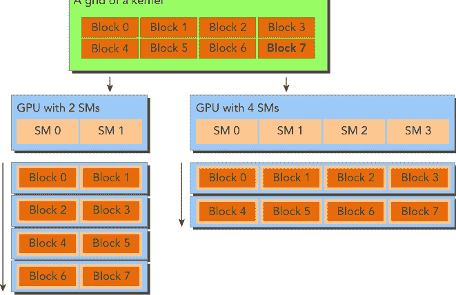

指定一个每个维度具有 16,384 个元素的大矩阵：

```cpp
int nx = 1<<14;
int ny = 1<<14;
```

以下代码段允许块维度从命令行进行配置：

```cpp
if (argc > 2) {
  dimx = atoi(argv[1]);
  dimy = atoi(argv[2]);
}
dim3 block(dimx, dimy);
dim3 grid((nx + block.x - 1) / block.x, (ny + block.y - 1) / block.y);
```

你可以在 `sumMatrix.cu` 中找到此示例的完整代码，可以从 Wrox.com 下载。使用以下命令进行编译：

```
$ nvcc -O3 -arch=sm_20 sumMatrix.cu -o sumMatrix
```

你将使用生成的 `sumMatrix` 可执行文件在后续章节中对块和网格配置进行实验。

## 使用 nvprof 检查活跃线程束

首先，你需要创建一个参考结果作为性能基准。为此，首先测试一组基础块配置，特别是大小为 `(32,32)`、` (32,16)`、` (16,32)` 和 `(16,16)` 的线程块。记住 `sumMatrix` 接受块的 x 维度作为第一个参数，接受 y 维度作为第二个参数。你可以通过适当的命令行调用 `sumMatrix` 来测试各种块配置。

以下是 Tesla M270 上的输出：

```
$ .sumMatrix 32 32
sumMatrixOGPUD2 << (512,512), (32,32) >>> 60 ms
$ .sumMatrix 16 32
sumMatrixOGPUD2 << (512,1024), (32,16) >>> 58 ms
$ .sumMatrix 32 16
sumMatrixOGPUD2 << (1024,512), (16,32) >>> 58 ms
$ .sumMatrix 16 16
sumMatrixOGPUD2 << (1024,1024), (16,16) >>> 46 ms
```

使用 `nvprof`。首先，使用 `gld_throughput` 指检查内核的内存读取效率，以观察不同执行配置之间的差异：

```
$ nvprof --metrics gld_throughput/sumMatrix 32 32
sumMatrixOnGPU<<< (512,512), (32,32)>>> Global Load Throughput 35.908GB/s
$ nvprof --metrics gld_throughput/sumMatrix 32 16
sumMatrixOnGPU<<< (512,512), (32,16)>>> Global Load Throughput 56.478GB/s
$ nvprof --metrics gld_throughput/sumMatrix 16 32
sumMatrixOnGPU<<< (1024,512), (16,32)>>> Global Load Throughput 81.195GB/s
$ nvprof --metrics gld_throughput/sumMatrix 16 16
sumMatrixOnGPU<<< (1024,1024), (16,16)>>> Global Load Throughput 94.708GB/s
```

虽然第四种情况具有最高的吞吐量，但它比第二种情况要慢（后者仅展示了一半的吞吐量）。从这一点来看，当你第 4 章学习 GPU 设备内部内存事务的工作原理时，原因就会变得明了。

接下来，使用 `gld_efficiency` 指检查加载效率，它是请求加载吞吐量与所需加载吞吐量的比值。它衡量了应用程序操作使用设备内存带宽的情况。结果总结如下：

```
$ nvprof --metrics gld_efficiency,/sumMatrix 32 32
sumMatrixOnGPU<<< (512,512), (32,32)>>> Global Memory Efficiency 100.00%
$ nvprof --metrics gld_efficiency/sumMatrix 32 16
sumMatrixOnGPU<<< (512,512), (32,16)>>> Global Memory Efficiency 100.00%
$ nvprof --metrics gld_efficiency/sumMatrix 16 32
sumMatrixOnGPU<<< (1024,512), (16,32)>>> Global Memory Efficiency 49.96%
$ nvprof --metrics gld_efficiency/sumMatrix 16 16
sumMatrixOnGPU<<< (1024,1024), (16,16)>>> Global Memory Efficiency 49.80%
```

通过这些结果，你可以解释为什么最后两种情况较高的加载吞吐量和实现的占用率并没有带来性能的提升。尽管最后几种情况执行的加载次数（即吞吐量）更多，但这些加载的有效性（即效率）较低。

注意，最后两种情况的共同特征是，它们在最内层维度的块大小始终线程（warp）大小的倍数。如之前所述，对于网格和块启发式算法，最内层维度应该是线程大小的倍数。第 4 章将讨论半线程线程（half-warp threads）如何影响性能。

## 暴露并行性

你可以从上一个节得出的结论是，块的最内层维度 `{block.x}` 应该是线程大小的倍数。这样加载效率就得到了大幅提升。你可能会好奇：

- 是否可以通过调整 `block.x` 来增加加载吞吐量？
- 是否可以暴露更多的并行性？

既然已经建立了性能基准，可以通过对更广泛的线程配置测试 `sumMatrix` 来回答这些问题：

```
$ ./sumMatrix 64 2
sumMatrixOnGPU2D <<(256,8192), (64,2) >>> elapsed 0.033567 sec
$ ./sumMatrix 64 4
sumMatrixOnGPU2D <<(256,4096), (64,4) >>> elapsed 0.034908 sec
$ ./sumMatrix 64 8
sumMatrixOnGPU2D <<(256,2048), (64,8) >>> elapsed 0.036651 sec
$ ./sumMatrix 128 2
sumMatrixOnGPU2D <<(128,8192), (128,2) >>> elapsed 0.032688 sec
$ ./sumMatrix 128 4
sumMatrixOnGPU2D <<(128,4096), (128,4) >>> elapsed 0.034786 sec
$ ./sumMatrix 128 8
sumMatrixOnGPU2D <<(128,2048), (128,8) >>> elapsed 0.046157 sec
$ ./sumMatrix 256 2
sumMatrixOnGPU2D <<(64,8192), (256,2) >>> elapsed 0.032793 sec
$ ./sumMatrix 256 4
sumMatrixOnGPU2D <<(64,4096), (256,4) >>> elapsed 0.038092 sec
$ ./sumMatrix 256 8
sumMatrixOnGPU2D <<(64,2048), (256,8) >>> elapsed 0.000173 sec
Error: sumMatrix.cu:163, code:9, invalid configuration argument
```

以下是从这些结果中得到的一些观察和结论：

- 最后一次块大小为 `(256,8)` 的执行是无效的。块中的总线程超过了 1,024，这是该 GPU 的硬件限制。
- 使用块维度为 `(128,2)` 的第四种情况获得了最佳结果。
- 虽然块维度为 `(64,2)` 的第一种情况启动了最多的线程块，但它并不是快的连接。
- 因为块配置为 `(64,4)` 的第二种情况与块数量相同，这两种情况在设备上暴露了相同的并行性。由于此情况的表现逊于 `(128,2)`，你可以得出线程块的最内层结构对性能起着关键作用。这重复了上一个节的结论。
- 剩余所有情况的线程块都少于最佳情况。此外，更多的并行性是性能优化的重要因素。

你可能会猜线程块最少的报告实现的占用率较低，而线程块最多的示例报告实现的占用率较高。可以通过 `nvprof` 测量 `achieved_occupancy` 指标来验证这一理论：

```
$ nvprof --occupancy ./sumMatrix 64 2
sumMatrixOnGPU2D <<(256,8192), (64,2)>>> Global Occupancy 0.55456
$ nvprof --occupancy ./sumMatrix 64 4
sumMatrixOnGPU2D <<(256,4096), (64,4)>>> Global Occupancy 0.79862
$ nvprof --occupancy ./sumMatrix 64 8
sumMatrixOnGPU2D <<(256,2048), (64,8)>>> Global Occupancy 0.75353
$ nvprof --occupancy ./sumMatrix 128 2
sumMatrixOnGPU2D <<(128,8192), (128,2)>>> Global Occupancy 0.80259
$ nvprof --occupancy ./sumMatrix 128 4
sumMatrixOnGPU2D <<(128,4096), (128,4)>>> Global Occupancy 0.74636
$ nvprof --occupancy ./sumMatrix 128 8
sumMatrixOnGPU2D <<(128,2048), (128,8)>>> Global Occupancy 0.57349
$ nvprof --occupancy ./sumMatrix 256 2
sumMatrixOnGPU2D <<(64,8192), (256,2)>>> Global Occupancy 0.76090
$ nvprof --occupancy ./sumMatrix 256 4
sumMatrixOnGPU2D <<(64,4096), (256,4)>>> Global Occupancy 0.59517
```

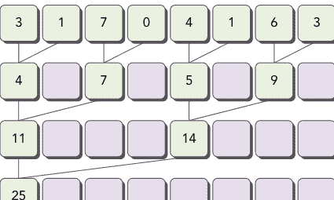

图 3-19

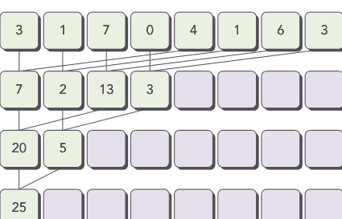

图 3-20

以下函数是交错对法（interleaved pair approach）的递归实现：

```cpp
int recursiveReduce(int *data, int const size) {
  // 终止检查
  if (size == 1) return data[0];
  // 更新步长
  int const stride = size / 2;
  // 原地规
  for (int i = 0; i < stride; i++) {
    data[i] += data[i + stride];
  }
  // 递归调用
  return recursiveReduce(data, stride);
}
```

上述代码实现了加法，任何交换律和结合律的操作都可以替换加法。例如，可以通过将求和替换为 max 来计算输入向量中的最大值。其他有效操作示例还有最小值、平均值和积。

这种在向量上执行具有交换律和结合律操作的通用问题被称为规约问题（reduction problem）。并行规约是该操作的并行执行。并行规约是最常见的模式之一，也是许多算法中的关键操作。在本节中，你将实现几个不同的并行内核，并研究不同的实现如何影响性能。

## 并行规约中的差异

作为一个起点，你将尝试实现图 3-21 所示的相邻元素对方法的内核。每个线程将两个相邻元素相加以产生部分和。

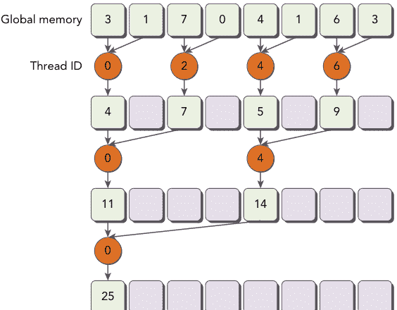

图 3-21

在此内核中，有两个全局内存数组：一个大数组用于存储整个待规约的数组，另一个较小的数组用于存储每个线程块的部分和。每个线程块独立地对数组的区域进行操作。循环的每次迭代执行单次规约步骤。规约是原地进行的，这意味着全局内存中的值在每个步骤都被部分和替换。`__syncthreads()` 语句确保在任何线程进入下一次迭代之前，当前迭代中每个线程的部分和已保存到全局内存。在最后一轮之后，整个块的和被保存到全局内存中。

```cpp
void reduceNeighbor(int *g_idata, int *g_odata, unsigned int n) {
  // 设置线程 ID
  unsigned int tid = threadIdx.x;
```


### 将全局数据转换为本地指针

```cpp
int *idata = g_idata + blockIdx.x * blockDim.x;
```

### 边界检查

```cpp
if (tid == n) return;
```

### 全局内存中的原地规约

```cpp
for (int stride = 1; stride < blockDim.x; stride *= 2) {
    if (tid % (2 * stride) == 0) {
        idata[tid] += idata[tid + stride];
    }
}
```

### 块内同步

```cpp
__syncthreads();
}
```

相邻元素之间的距离（步长）最初初始化为 `1`。在每轮规约后，该距离乘以 `2`。在第一轮后，`idata` 中的偶数元素将被部分和替换。在第二轮后，`idata` 中的每第四个元素将被替换为进一步的部分和。由于线程之间没有同步，每个线程块产生的部分和被拷贝回主机端并按顺序求加，如图 3-22 所示。

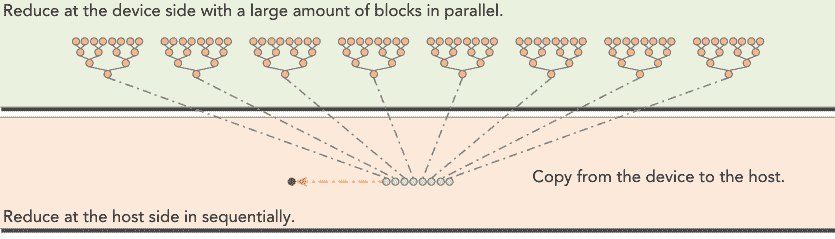

图 3-22

你可以在 `cuda.com` 找到 `reduceInteger.cu` 的完整源代码。列表 3-3 仅显示主函数。

### 列表 3-3: 整数规约 (reduceInteger.cu, 仅主函数)

```cpp
int main(int argc, char **argv) {
  // 设置设备
  int dev = 0;
  cudaDeviceProp deviceProp;
  cudaDeviceProperties(&deviceProp, dev);
  printf("%s starting reduction at %s", argv[0]);
  printf("%d: %s", dev, deviceProp.name);
  cudaSetDevice(dev);
  bool result = false;
  // 初始化
  int size = 1<<24; // 待规约元素总数
  printf("%d with array size %d", size);
  // 执行配置
  int blocksize = 512; // 初始块大小
  if(argc > 1) {
    blocksize = atoi(argv[1]); // 从命令行参数获取块大小
  }
  dim3 block(blocksize, 1);
  dim3 grid((size + block.x - 1) / block.x, 1);
  printf("grid %d block %d\n", grid.x, block.x);
  // 分配内存
  size_t bytes = size * sizeof(int);
  int *h_idata = (int *)malloc(bytes);
  int *h_odata = (int *)malloc(grid.x * sizeof(int));
  int *tmp = (int *)malloc(bytes);
  // 初始化数组
  for (int i = 0; i < size; i++) {
    // 掩码高位强制数字为 255
    h_idata[i] = (int)(rand() & 0xFF);
  }
  memcpy(tmp, h_idata, bytes);
  size_t tStart, iElaps;
  int gpu_sum = 0;
  // 分配设备内存
  int *idata = NULL;
  int *odata = NULL;
  cudaMalloc((void **) &idata, bytes);
  cudaMalloc((void **) &odata, grid.x * sizeof(int));
  // CPU 规约
  iStart = seconds();
  int cpu_sum = recursiveReduce(tmp, size);
  iElaps = seconds() - iStart;
  printf("cpu reduce elapsed %d ms cpu-sum: %d\n", iElaps, cpu_sum);
  // 内核 1: reduceNeighbor
  cudaMemcpy(idata, h_idata, bytes, cudaMemHostToDevice);
  cudaDeviceSynchronize();
  tStart = seconds();
  warmup<<<grid, block>>>(idata, oodata, size);
  cudaDeviceSynchronize();
  iElaps = seconds() - tStart;
  // 将结果拷贝回主机
  cudaMemcpy(h_odata, odata, grid.x * sizeof(int), cudaMemDeviceToHost);
  // 求和结果
  gpu_sum = 0;
  for (int i = 0; i < grid.x; i++) {
    gpu_sum += h_odata[i];
  }
  printf("gpu reduce elapsed %d ms gpu-sum: %d\n", iElaps, gpu_sum);
  result = (gpu_sum == cpu_sum);
  if(!result) printf("Test failed!\n");
  // 释放内存
  free(h_idata);
  free(h_odata);
  free(tmp);
  cudaFree(idata);
  cudaFree(odata);
  return EXIT_SUCCESS;
}
```

此更改的内核代码列如下：

```cpp
__global void reduceNeighoredLess(int *g_idata, int *g_odata, unsigned int n) {
    // 设置线程 ID
    unsigned int tid = threadIdx.x;
    unsigned int idx = blockIdx.x * blockDim.x + threadIdx.x;
    // 将全局数据指针转换为此块的本地指针
    int *idata = g_idata + blockIdx.x*blockDim.x;
    // 边界检查
    if (idx >= n) return;
    // 在全局内存中进行就地还原
    for (int stride = 1; stride < blockDim.x; stride *= 2) {
        // 将 tid 转换为本地数组索引
        int index = 2 * tid;
        if (index < blockDim.x)
            idata[index] += idata[index + stride];
        // 线程块内同步
        __syncthreads();
    }
    // 将结果写入全局内存
    if (tid == 0) g_odata[blockIdx.x] = idata[0];
}
```

注意列出的以下语句，它为每个线程创建数组索引：

```cpp
int index = 2 * tid;
```

由于 `index` 乘以了 `2`，以下语句使用了线程块的前半部分来执行操作：

```cpp
if (index < blockDim.x)
```

当块大小为 `512` 个线程时，前 `8` 个 `warp` 执行第一轮还原，而剩下的 `8` 个 `warp` 都不做操作。在第二轮中，`4` 个 `warp` 执行操作，剩下的 `12` 个 `warp` 都不做操作。因此，完全没有发生分散（Divergence）。分散只发生在最后 `5` 轮，此时每轮的线程总数少于 `warp` 大小。你将在下一节中学习如何处理这种情况。

这个新内核在主函数的代码段中，于调用基准内核之后被调用。

```cpp
// 内核分散
cudaMemcpy(d_idata, h_idata, cudaMemcpyHostToDevice);
cudaDeviceSynchronize();
tStart = seconds();
reduceNeighoredLess<<<grid, block>>>(d_idata, d_odata, size);
cudaDeviceSynchronize();
Elaps = seconds() - tStart;
cudaMemcpy(h_odata, d_idata, grid.x*sizeof(int), cudaMemcpyDeviceToHost);
gpu_sum = 0;
```

```cpp
for (int i=0; i<grid.x; i++)
    gpu_sum += h_odata[i];
printf("%g Neighbor2 elapsed %d ms gpu: %d <<<%d block %d>>>\n", iElaps, gpu_sum,grid.x,block.x);
```

在设备 `0` 上使用 Neighborless 还原测试：Tesla M2070

```
$ ./reduceInteger vector size 1677726 grid 32768 block 512
cpu elapsed 0.0291338 sec cpu: 2139535471
gpu elapsed 0.0139112 sec gpu: 2139535471 <<<32768 block 512>>>
gpu Neighborless elapsed 0.009321 sec gpu: 2139535471 <<<32768 block 512>>>
```

新实现比原始实现快 `1.26` 倍。使用 `inst_per_warp` 指标来检查每个 `warp` 执行的平均指令数：

```
$ nvprof --metrics inst_per_warp ./reduceInteger
```

结果汇总如下：原始内核每个 `warp` 执行的指令数是新内核的两倍，这是原始实现中存在高分散的指标。

- Neighbored Instructions per warp 295.562500
- Neighborless Instructions per warp 115.312500

使用 `gld_throughput` 指标检查内存加载吞吐量：

```
$ nvprof --metrics gld_throughput ./reduceInteger
```

结果汇总如下：新实现也具有高得加载吞吐量，因为它在执行相同量 I/O 操作的同时，所花费的时间短得多。

- Neighbored Global Load Throughput 67.663GB/s
- Neighborless Global Load Throughput 80.144GB/s

## 使用交织页进行还原

与相邻方法（neighboring approach）相比，交织对（interleaved pair）方法避免了元素的跨度跳转：步长从线程块大小的一半开始，然后每次迭代减少一半（图 3-24）。每个线程都会加上两个间隔为当前步长的元素，从而在每轮产生一个部分和。与图 3-23 相比，交织还原中的工作线程没有改变。但每个线程在全局内存中的加载/存储位置是不同的。

交织还原的内核代码如下：

```cpp
/// 分散更少的交织对实现
__global void reduceInterleaved(int *g_idata, int *g_odata, unsigned int n) {
    // 设置线程 ID
    unsigned int tid = threadIdx.x;
    unsigned int idx = blockIdx.x * blockDim.x + threadIdx.x;
    // 将全局数据指针转换为此块的本地指针
    int *idata = g_idata + blockIdx.x * blockDim.x;
    // 边界检查
    if (idx >= n) return;
    // 在全局内存中进行就地还原
    for (int stride = blockDim.x / 2; stride > 0; stride >>>= 1) {
        if (tid < stride) {
            idata[tid] = idata[tid + stride];
        }
        // 线程块内同步
        __syncthreads();
    }
    // 将此块的结果写入全局内存
    if (tid == 0) g_odata[blockIdx.x] = idata[0];
}
```


图 3-24

注意内核中的以下语句。两个元素之间的步长初始化为线程块大小的一半，然后在每轮减少一半。

```cpp
for (int stride = blockDim.x / 2; stride > 0; stride >>>= 1) {
```

以下语句强制线程块的前半部分在第一次迭代执行，线程块的前四分之一在第二次迭代执行，以此此类推。

```cpp
if (tid < stride)
```

将以下代码添加到主函数中以执行：

```cpp
cudaMemcpy(d_idata, h_idata, cudaMemcpyHostToDevice);
cudaDeviceSynchronize();
tStart = seconds();
reduceInterleaved<<<grid, block>>>(d_idata, d_odata, size);
cudaDeviceSynchronize();
Elaps = seconds() - tStart;
cudaMemcpy(h_odata, d_idata, grid.x*sizeof(int), cudaMemcpyDeviceToHost);
gpu_sum = 0;
```

执行交织还原的：

```cpp
for (int i=0; i<grid.x; i++)
    gpu_sum += h_odata[i];
printf("%g Neighbor2 elapsed %d ms gpu: %d <<<%d block %d>>>\n", iElaps, gpu_sum,grid.x,block.x);
```

在设备 `0` 上使用 Neighborless 还原测试：Tesla M2070

```
$ ./reduceInteger vector size 1677726 grid 32768 block 512
cpu elapsed 0.0291338 sec cpu: 2139535471
gpu elapsed 0.0139112 sec gpu: 2139535471 <<<32768 block 512>>>
gpu Neighborless elapsed 0.009321 sec gpu: 2139535471 <<<32768 block 512>>>
```

全局数组索引已相应调整，如下所示，因为你只需要一半的线程块来处理该数据集。注意，这意味着对于相同的数据集，设备暴露了束（warp）级和块（block）级的并行性。图 3-25 展示了每个线程的数据访问。

```cpp
unsigned int idx = blockIdx.x * blockDim.x * 2 + threadIdx.x;
int *idata = g_idata + blockIdx.x * blockDim.x * 2;
```

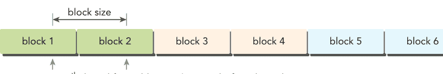

图 3-25

向新内核添加以下代码以维护所有总和。第 `0` 个线程在归约之前加了两个元素。

```cuda
cudaMemcpy(d_idata, h_idata, bytes, cudaMemcpyHostToDevice);
cudaDevicesSynchronize();
istart = seconds;
reduceUnroll2 << grid.x/2, block >>> (d_idata, d_data, size);
cudaDevicesSynchronize();
elapsed = seconds - istart;
cudaMemcpy(h_idata, d_data, grid.x/2*sizeof(int), cudaMemcpyDeviceToHost);
gpu_sum = 0;
for (int i = 0; i < grid.x/2; i++) gpu_sum += h_idata[i];
printf("Unroll2 elapsed %sec gpu_sum: %d <<%d block %d>>>\n", elapsed, gpu_sum, grid.x, block.x);
```

由于每个线程处理两个数据块，你现在需要通过减小网格大小来调整内核的执行配置：`reduceUnroll2 << grid.x/2, block >>> (d_idata, d_data, size);`。

现在编译并运行代码。结果如下：

```
gpuUnroll2 elapsed 0.00340 sec gpu_sum: 21934 <<16384 block 512
```

即使如此如此，内核现在的运行速度也比原始实现快了 `3.2` 倍。你还能进一步提升性能吗？`reduce.cu` 文件包含了两种展开内核的实现：

- `reduceUnroll4`：每个线程处理 `4` 个块
- `reduceUnroll8`：每个线程处理 `8` 个块

相应的结果总结如下：


```
gpuUnroll2 elapsed 0.00340 sec gpu_sum: 21934 <<16384 block 512
gpuUnroll4 elapsed 0.00182 sec gpu_sum: 21934 <<8192 block 512
gpuUnroll8 elapsed 0.00142 sec gpu_sum: 21934 <<4096 block 512
```

正如你所预想的，单个线程上更少的内存加载/存储操作会产生更好的性能延迟。你可以使用设备内存读取吞吐量确认这是性能提升的原因：`nvprof --metrics dram_read`。

| 实现方式 | 设备内存读取吞吐量 |
| :--- | :--- |
| Unrolling2 | 26.295 GB/s |
| Unrolling4 | 49.546 GB/s |
| Unrolling8 | 62.764 GB/s |

## 使用展开束进行归约

可以添加 `__syncthreads` 用于块内同步。在归约内核中，它被用于每一轮中，以确保在任何线程继续下一轮之前，所有线程都已将部分结果写入全局内存。然而，考虑当只剩下 32 个线程的情况（即单个束）。因为束的执行是 SIMT，因此在每条指令后都有隐式的束内同步。归约循环的最后几次迭代可以如下展开：

```cpp
if (tid < 32) {
    volatile int *vmem = idata;
    vmem[tid] += vmem[tid + 32];
    vmem[tid] += vmem[tid + 16];
    vmem[tid] += vmem[tid + 8];
    vmem[tid] += vmem[tid + 4];
    vmem[tid] += vmem[tid + 2];
    vmem[tid] += vmem[tid + 1];
}
```

这种束避免了循环控制和线程同步。注意变量 `vmem` 使用了 `volatile` 限定符声明，这告诉编译器必须在每次赋值时都将 `vmem[tid]` 写回全局内存。如果省略了 `volatile` 限定符，此代码将无法运行，因为编译器或缓存可能会优化掉对全局内存的写入。如果全局或共享内存中的变量声明为 `volatile`，编译器会假设其值可以被线程随时更改或使用。因此，对 `volatile` 变量的任何引用都会强制直接读取或写入内存，而不仅仅复制到缓存。

基于 `reduceUnroll`，可以将展开如下添加到归约内核中：

```cuda
__global__ void reduceUnroll8 (int *g_idata, int *g_odata, unsigned int n) {
    // 设置线程 ID
    unsigned int tid = threadIdx.x;
    unsigned int idx = blockIdx.x*blockDim.x + threadIdx.x;
    // 将全局数据指针转换为此块的本地指针
    int *idata = g_idata + blockIdx.x*blockDim.x*8;
    // 展开 8
    if (idx + 7*blockDim.x < n) {
        int a1 = g_idata[idx];
        int a2 = g_idata[idx+1*blockDim.x];
        int a3 = g_idata[idx+2*blockDim.x];
        int a4 = g_idata[idx+3*blockDim.x];
        int b1 = g_idata[idx+4*blockDim.x];
        int b2 = g_idata[idx+5*blockDim.x];
        int b3 = g_idata[idx+6*blockDim.x];
        int b4 = g_idata[idx+7*blockDim.x];
        g_odata[idx] = a1+a2+a3+a4+b1+b2+b3+b4;
    }
    __syncthreads();

    // 全局内存中的内归约
    for (int stride = blockDim.x / 2; stride > 32; stride >>= 1) {
      if (tid < stride)
        idata[tid] += idata[tid + stride];
    }

    // 块内同步
    __syncthreads();

    // 束展开
    if (tid < 32) {
      volatile int *vmem = idata;
      vmem[tid] += vmem[tid + 32];
      vmem[tid] += vmem[tid + 16];
      vmem[tid] += vmem[tid + 8];
      vmem[tid] += vmem[tid + 4];
      vmem[tid] += vmem[tid + 2];
      vmem[tid] += vmem[tid + 1];
    }
}
```

## 完全展开归约

如果你知道循环的迭代次数，可以将其完全展开。由于 Fermi 或 Kepler 上每个块的线程数限制为 1024，请参考下代码：

```cuda
__global__ void reduceCompleteWarp(int *g_idata, int *g_odata, unsigned int n) {
    // 设置线程
    unsigned int tid = threadIdx.x;
    unsigned int idx = blockIdx.x*blockDim.x + threadIdx.x;
    // 将全局数据指针转换为此块的本地指针
    int *idata = g_idata + blockIdx.x*blockDim.x*8;
    // 展开 8
    if (idx + 7*blockDim.x < n) {
        int a1 = g_idata[idx];
        int a2 = g_idata[idx+1*blockDim.x];
        int a3 = g_idata[idx+2*blockDim.x];
        int a4 = g_idata[idx+3*blockDim.x];
        int b1 = g_idata[idx+4*blockDim.x];
        int b2 = g_idata[idx+5*blockDim.x];
        int b3 = g_idata[idx+6*blockDim.x];
        int b4 = g_idata[idx+7*blockDim.x];
        g_odata[idx] = a1+a2+a3+a4+b1+b2+b3+b4;
    }
    __syncthreads();

    // 完全展开内归约
    for (int stride = blockDim.x / 2; stride > 32; stride >>= 1) {
      if (tid < stride)
        idata[tid] += idata[tid + stride];
    }

    // 块内同步
    __syncthreads();

    // 束展开
    if (tid < 32) {
      volatile int *vmem = idata;
      vmem[tid] += vmem[tid + 32];
      vmem[tid] += vmem[tid + 16];
      vmem[tid] += vmem[tid + 8];
      vmem[tid] += vmem[tid + 4];
      vmem[tid] += vmem[tid + 2];
      vmem[tid] += vmem[tid + 1];
    }
}
```

// 将此块的结果写入全局内存

if (tid == 0) g_data[blockIdx.x] = idata[0];

}

使用以下执行配置启动此内核函数：

`reduceCompleteUnrollWarp8<<<grid.x / 8, block>>>(d_idata, d_data, size);`

内核执行时间获得了一些微幅提升，执行速度比 `reduceUnrollWarp8` 快 1.06 倍，比原始实现快 9.16 倍。

```
gpuCmptUnrollW8 elapsed 0.001280 sec gpu_sum: 219393471 <<<grid 4096 block 512>>>
```

## 使用模板函数进行归约

虽然可以手动展开循环，但使用模板函数可以减少分支开销。CUDA 支持在设备函数上使用模板参数。你可以将块大小作为模板函数的参数，如下所示：

```cpp
template <unsigned int blockSize>
void reduceCompleteUnroll(int *g_idata, int *g_data, unsigned int n) {
 // 设置线程 ID
 unsigned int tid = threadIdx.x;
 unsigned int idx = blockIdx.x * blockDim.x * 8 + threadIdx.x;
 // 将全局数据转换为此块的本地指针
 int *idata = g_data + blockIdx.x * blockDim.x * 8;

 // 展开 8 次
 if (idx + 7*blockIdx.x < n) {
  int a1 = g_idata[idx];
  int a2 = g_idata[idx + blockIdx.x];
  int a3 = g_idata[idx + 2 * blockIdx.x];
  int a4 = g_idata[idx + 3 * blockIdx.x];
  int b1 = g_idata[idx + 4 * blockIdx.x];
  int b2 = g_idata[idx + 5 * blockIdx.x];
  int b3 = g_idata[idx + 6 * blockIdx.x];
  int b4 = g_idata[idx + 7 * blockIdx.x];
  g_idata[idx] = a1+a2+a3+a4+b1+b2+b3+b4;
 }

 syncthreads();
```

```cpp
// 原地归约并完全展开
if (blockSize <= 1024 && tid < 512) idata[tid] += idata[tid + 512];
 syncthreads();
```

```cpp
if (blockSize <= 512 && tid < 256) idata[tid] += idata[tid + 256];
 syncthreads();
```

```cpp
if (blockSize>=256 && tid < 128) idata[tid] += idata[tid + 128];
syncthreads();
```

```cpp
if (blockSize==128 && tid < 64) idata[tid] += idata[tid + 64];
syncthreads();
// Warp 展开
if (tid < 32) {
volatile int *vsmem = idata;
vsmem[tid] += vsmem[tid + 32];
vsmem[tid] += vsmem[tid + 16];
vsmem[tid] += vsmem[tid + 8];
vsmem[tid] += vsmem[tid + 4];
vsmem[tid] += vsmem[tid + 2];
vsmem[tid] += vsmem[tid + 1];
}
```

```cpp
// 将结果写入全局内存
if (tid == 0) g_odata[blockIdx.x] = idata[0];
```

与 `reduceUnrollWarp8` 的的区别是用模板参数替换了块大小。检查块大小的语句将在编译时评估，如果条件不成立会被移除，从而产生非常高效的循环。例如，如果调用内核的线程块大小为 256，则

```
blockSize>=1024 && tid < 512
```

将始终为假。编译器会自动从执行的内核中将其移除。所示的 `switch-case` 允许编译器为特定的块大小优化代码，但这意味着仅适用于某些块大小的 `reduceCompleteUnroll`。

```cpp
switch (blockSize) {
case 1024:
reduceCompleteUnroll<1024><><grid.x/8, block>>>(d_idata, d_odata, size);
break;
case 512:
reduceCompleteUnroll<512><><grid.x/8, block>>>(d_idata, d_odata, size);
break;
case 256:
reduceCompleteUnroll<256><><grid.x/8, block>>>(d_idata, d_odata, size);
break;
case 128:
reduceCompleteUnroll<128><><grid.x/8, block>>>(d_idata, d_odata, size);
break;
case 64:
reduceCompleteUnroll<64><><grid.x/8, block>>>(d_idata, d_odata, size);
break;
}
```

### 表 3-5：归约内核性能

| 内核 | 时间 (S) | 步进加速 | 累积加速 |
|---|---|---|---|
| 邻域（分支） | 0.011722 | | |
| 邻域（无分支） | 0.009321 | 1.26 | 1.26 |
| 交叉交叉 | 0.006967 | 1.34 | 1.68 |
| 展开 8 个块 | 0.001422 | 4.90 | 8.24 |
| 展开 8 个块 + 最后一个 Warp | 0.001355 | 1.05 | 8.65 |
| 展开 8 个块 + 循环 + 最后一个 Warp | 0.001280 | 1.06 | 9.16 |
| 模板内核 | 0.001253 | 1.02 | 9.35 |

与 `reduceUnrollWarp8` 的区别是用模板参数替换了块大小。检查块大小的语句将在编译时评估，如果条件不成立会被移除，从而产生非常高效的循环。例如，如果调用内核的线程块大小为 256，则

```
blockSize>=1024 && tid < 512
```

将始终为假。编译器会自动从执行的内核中将其移除。所示的 `switch-case` 结构允许编译器为特定的块大小优化代码，但这意味着仅适用于某些块大小的 `reduceCompleteUnroll`。

```cpp
switch (blockSize) {
case 1024:
reduceCompleteUnroll<1024><><grid.x/8, block>>>(d_idata, d_odata, size);
break;
case 512:
reduceCompleteUnroll<512><><grid.x/8, block>>>(d_idata, d_odata, size);
break;
case 256:
reduceCompleteUnroll<256><><grid.x/8, block>>>(d_idata, d_odata, size);
break;
case 128:
reduceCompleteUnroll<128><><grid.x/8, block>>>(d_idata, d_odata, size);
break;
case 64:
reduceCompleteUnroll<64><><grid.x/8, block>>>(d_idata, d_odata, size);
break;
}
```

表 3-5 汇总了本文涵盖的所有并行归约实现。

### 表 3-5：归约内核性能

| 内核 | 时间 (S) | 步进加速 | 累积加速 |
|---|---|---|---|
| 邻域（分支） | 0.011722 | | |
| 邻域（无分支） | 0.009321 | 1.26 | 1.26 |
| 交叉交叉 | 0.006967 | 1.34 | 1.68 |
| 展开 8 个块 | 0.001422 | 4.90 | 8.24 |
| 展开 8 个块 + 最后一个 Warp | 0.001355 | 1.05 | 8.65 |
| 展开 8 个块 + 循环 + 最后一个 Warp | 0.001280 | 1.06 | 9.16 |
| 模板内核 | 0.001253 | 1.02 | 9.35 |

子父网格之间的一致性保证。当子网格的内存与父线程完全一致时，子网格的执行有两个点：子网格开始时以及子网格完成时。父线程在调用子网格之前的所有全局内存操作都保证对子网格可见。子网格的所有内存操作在子网格完成并对其进行同步后，保证对父线程可见。

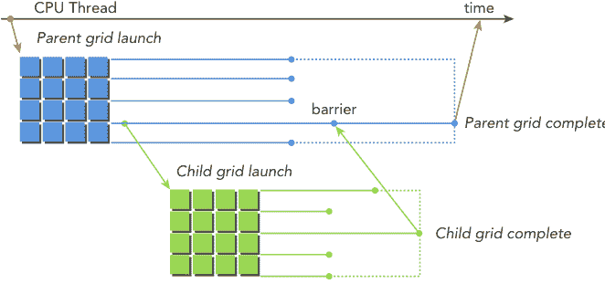

图 3-26

共享内存和本地内存分别是线程块或线程私有的，且在父子节点之间不可见也不具有一致性。本地内存是线程的私有存储，在线程外部不可见。在启动子网格时，将本地内存指针作为参数传递是无效的。

# GPU 上的嵌套 Hello World


为了对动态并行有一个初步理解，你将创建一个使用动态并行性打印“Hello World”的内核函数。图 3-27 展示了该内核函数使用动态并行性构建的嵌套递归执行。主机应用程序一次调用一个包含 8 个线程、单线程块的父网格。然后，该网格中的线程 0 调用一个线程数减半的子网格。接下来，第一个子网格中的线程 0 再次调用一个线程数减半的新子网格，以此此类，直到最终嵌套中只下一个线程。

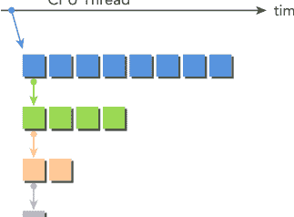

图 3-27

此处列出了实现此列表的内核代码。每个线程执行内核都从打印“Hello World”开始。然后，每个线程检查自己是否应该终止。如果此嵌套层的计数大于1，线程 0 会递归地调用具有相同线程数的子网格。

```
_global void nestedHelloWorld(int const iSize, int iDepth) {
int tid = threadIdx.x;
printf("%d: Hello World from thread %d\nblock %d\n", iDepth, tid, blockIdx.x);

// 停止递归执行的条件
if (iSize == 1) return;

// 将块大小缩减一半
int nthreads = iSize>>1;

// 线程 0 递归启动子网格
if(tid == 0 && nthreads > 0) {
nestedHelloWorld<<<1, nthreads>>>(nthreads,iDepth);
printf("nested execution depth: %d\n", iDepth);
}
}
```

你可以从 `Wrox.com` 下载此 `nestedHelloWorld.cu` 的完整代码。使用以下命令编译代码：

```
$ nvcc -arch=sm35 -rdc=nestedHelloWorld.cu -o nestedHelloWorld -lcudavert
```

由于设备库支持动态并行性，`nestedHelloWorld` 必须在命令行上使用 `-lcudavert` 进行显式链接。

标记 `--rdc=true` 强制生成可重定位设备代码（relocatable device code），这是动态并行性的要求。你将在本书的第10章学习更多关于可重定位设备代码的内容。

嵌套内核的输出所示：

```
/nestedHelloWorld Execution Configuration: grid 1 block 8
Recursion=0: Hello World from thread 0 block 0
Recursion=0: Hello World from thread 1 block 0
Recursion=0: Hello World from thread 2 block 0
Recursion=0: Hello World from thread 3 block 0
Recursion=0: Hello World from thread 4 block 0
Recursion=0: Hello World from thread 5 block 0
Recursion=0: Hello World from thread 6 block 0
Recursion=0: Hello World from thread 7 block 0
-------> nested execution depth: 1
Recursion=1: Hello World from thread 0 block 0
Recursion=1: Hello World from thread 1 block 0
Recursion=1: Hello World from thread 2 block 0
Recursion=1: Hello World from thread 3 block 0
-------> nested execution depth: 2
Recursion=2: Hello World from thread 0 block 0
Recursion=2: Hello World from thread 1 block 0
-------> nested execution depth: 3
Recursion=3: Hello World from thread 0 block 0
```

从输出消息中，我们可以看到主机调用的父网格包含 1 个块和 8 个线程。`nestedHelloWorld` 内核递归调用了三次，每次调用时线程数都减半。你可以使用以下命令通过 `nvvp` 确认这一点。

```
$ nvvp ./nestedHelloWorld
```

图 3-28 展示了由 `nvvp` 引起的嵌套执行。子网格被正确地嵌套，每个父网格都会等待其子网格完成。使用空白表示内核正在等待子内核完成。

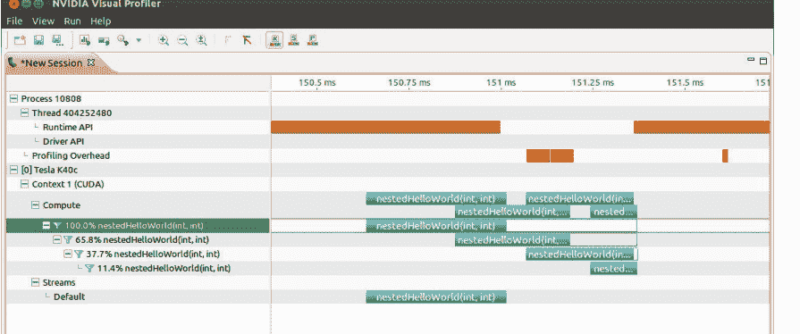

图 3-28

现在，尝试用两个块而不是仅用一个块来调用父网格：

```
$ ./nestedHelloWorld 2
```

嵌套内核程序的输出现在为：

```
./nestedHelloWorld 2Execution Configuration: grid 2 block 8
Recursion=0: Hello World from thread 0 block 1
Recursion=0: Hello World from thread 1 block 1
Recursion=0: Hello World from thread 2 block 1
Recursion=0: Hello World from thread 3 block 1
Recursion=0: Hello World from thread 4 block 1
Recursion=0: Hello World from thread 5 block 1
Recursion=0: Hello World from thread 6 block 1
Recursion=0: Hello World from thread 7 block 1
Recursion=0: Hello World from thread 0 block 0
Recursion=0: Hello World from thread 1 block 0
```

```
Recursion=0: Hello World from thread 2 block 0
Recursion=0: Hello World from thread 3 block 0
Recursion=0: Hello World from thread 4 block 0
Recursion=0: Hello World from thread 5 block 0
Recursion=0: Hello World from thread 6 block 0
Recursion=0: Hello World from thread 7 block 0
  --> nested execution depth: 1
    --> nested execution depth: 1
Recursion=1: Hello World from thread 0 block 0
Recursion=1: Hello World from thread 1 block 0
Recursion=1: Hello World from thread 2 block 0
Recursion=1: Hello World from thread 3 block 0
Recursion=1: Hello World from thread 4 block 0
Recursion=1: Hello World from thread 5 block 0
Recursion=1: Hello World from thread 6 block 0
Recursion=1: Hello World from thread 7 block 0
  --> nested execution depth: 2
    --> nested execution depth: 2
Recursion=2: Hello World from thread 0 block 0
Recursion=2: Hello World from thread 1 block 0
  --> nested execution depth: 3
    --> nested execution depth: 3
Recursion=3: Hello World from thread 0 block 0
Recursion=3: Hello World from thread 1 block 0
```

为什么子网格的块 ID 在输出消息中都是一样的？图 3-29 展示了如何使用两个块递归调用子网格。虽然父网格包含两个块，但所有嵌套子网格仍然包含一个块，是因为 `nestedHelloWorld` 的内核配置：

```
nestedHelloWorld<<<1, nthreads>>>(threads,++depth);
```

你可以尝试不同的学习策略。图 3-30 展示了另一种产生并行性的方法，留给读者练习。

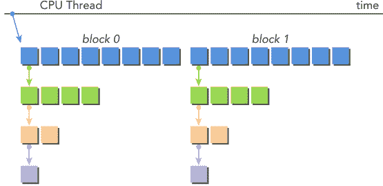

图 3-29

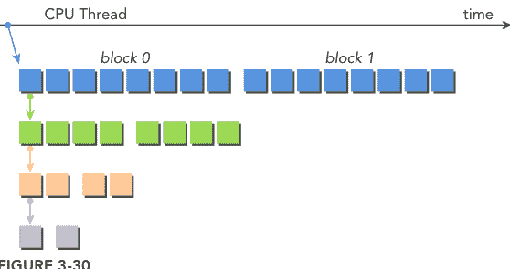

# 动态并行性的限制

动态并行性仅支持计算能力 3.5 及以上的设备。

通过动态并行性调用的内核无法在物理设备上启动。然而，允许查询系统中任何设备的属性。

动态并行性的最大嵌套深度限制为 24，但实际上，大多数内核将受到设备运行时在每个新级别所需内存的限制，因为设备运行时为每个嵌套级别的父子网格之间的同步预留了额外的内存。

# 嵌套归约

归约可以自然地表示为递归函数。本章标题为“避免分支交叉”的部分演示了 C 中的递归归约。在 CUDA 中使用动态并行性可以使 CUDA 中的递归归约像 C 实现一样简单。

使用动态并行性进行递归归约的内核代码列如下。此内核采用图 3-29 所示的方法，原始网格包含许多块，但所有仅包含一个块的子网格都由深度 0 调用。此内核的第一步是将全局内存地址 `g_id` 转换为每个线程块的地址。然后，如果满足条件（即在嵌套执行树中），将结果拷贝回全局内存，并立即返回到父内核。如果不是叶子内核，则计算局部归约的大小，所有线程将执行原地归约。在原地归约完成后，对块进行同步以确保所有部分和都已计算。然后，线程生成一个包含一个线程块和一半线程的子网格。

许多线程对应当前网格。在子网格被调用后，为所有子网格设置了一个屏障点。每个块中仅由一个线程生成一个子网格，该屏障点仅与该子网格进行同步。

```cpp
__global void gpuRecursiveReduce(int *g_idata, int *g_odata,
    unsigned int size) {
    // 设置线程 ID
    unsigned int tid = threadIdx.x;
    // 将全局数据指针转换为此块的本地指针
    int *idata = g_idata[blockIdx.x*blockDim.x];
    int *odata = &g_odata[blockIdx.x];
    // 停止控制
    if (size == 2 && tid == 0) {
        g_odata[blockIdx.x] = idata[0]+idata[1];
        return;
    }
    // 嵌套调用
    int istride = size>>1;
    if (istride > 1 && tid < istride) {
        // 原地归约
        idata[tid] += idata[tid + istride];
    }
    // 块级同步
    __syncthreads();
    // 嵌套调用生成子网格
    if(tid==0) {
        gpuRecursiveReduce<<<1, istride>>>(idata, odata, istride);
        // 同步在此块中启动的所有子网格
        cudaDeviceSynchronize();
    }
    // 再次块级同步
    __syncthreads();
}
```

你可以从 `Wrox.com` 下载此示例的代码 `nestedReduce.cu`。使用以下命令编译代码：

```bash
$ ncc --arch=sm_35 -rdc=true nestedReduce.cu -o nestedReduce -lcudart
```

使用 Kepler K40 设备的输出所示。与使用相邻配对方法实现的扁平内核相比，嵌套内核的速度慢得令人无法接受。

```
/Reduce starting reduction at device 0: Tesla K40c
array 1048576 grid 2048 block 512
cpu reduce elapsed 0.000669 cpu_sum: 1048576
gpu Neighbored elapsed 0.000532 gpu gpu_sum: 1048576<<<grid 2048 block 512>>>
gpu nested elapsed 0.172036 gpu gpu_sum: 1048576<<<grid 2048 block 512>>>
```

如输出所示，有 2,048 次块递归，创建了 16,384 个子块，并且还调用了 16,384 次块内同步（`__syncthreads`）。由于大量的内核调用和同步可能是导致这种低性能的主要原因。

当子网格被调用时，它的内存视图与父线程是完全一致。由于每个线程只需要其父线程的值来计算部分归约，因此在启动子网格之前执行了块内同步。移除所有同步操作后，执行以下内核：

```cpp
global void gpuRecursiveReduceNosync(int *g_idata, int *g_odata,
    unsigned int isize) {
    // 线程 ID
    unsigned int tid = threadIdx.x;

    // 将全局数据指针转换为此块的本地指针
    int *idata = g_idata + blockIdx.x * blockDim.x;
    int *odata = &g_odata[blockIdx.x];

    // 停止条件
    if (isize == 2 && tid == 0) {
        g_odata[blockIdx.x] = idata[0] + odata[1];
        return;
    }

    // 嵌套调用
    int istride = isize;
    if (istride > 1 && tid < istride) {
        idata[tid] += tid + istride;
        if (tid==0) {
            gpuRecursiveReduceNosync<<<1, istride>>>(idata, odata, istride);
        }
    }
}
```

你可以从 `Wrox.com` 下载此示例的完整代码 `nestedReduceNosync.cu`。编译并运行它。在 Kepler K40 设备上的输出是可见的。耗时是第一种并行实现时间的三分之一。

```
/nestedReduceNosync starting reduction at device 0: Tesla K40c
array 104876 grid 2048 block 512
cpu reduce elapsed 0.00062 sec cpu_sum: 104876
gpu Neighbor elapsed 0.000532 sec gpu_sum: 104876<<grid 2048 block 512>>
gpu nested elapsed 0.172036 sec gpu_sum: 104876<<grid 2048 block 512>>
gpu nestedNosync elapsed 0.059125 sec gpu_sum: 104876<<grid 2048 block 512
```

与相邻并行内核相比，性能仍然很差。接下来，考虑如何减少由大量子网格启动引起的开销。在当前实现中，每个块都会生成一个子网格，导致了大量的调用。如果使用图 3-30 所示的方法，每个子网格的线程数将增加，而子网格的数量将保持不变。

以下内核实现了这种方法：网格中第一个块中的第一个线程在每个嵌套步骤中调用子网格。比较两个内核版本，你会发现每次嵌套调用时，子网格的大小减少为其父网格大小的一半，父块维度必须传递给嵌套网格。这允许每个线程计算正确的全局偏移。注意，在此实现中，与第一个实现相比，在每一层内核执行期间有一半的线程处于空闲状态。这将释放第一个内核消耗的一半资源，允许更多线程处于活跃状态。


```cpp
__global void gpuRecursiveReduce2(int *g_idata, int *godata, int iStride, const int iDim) {
    // 将全局指针转换为此块的本地指针
    int *idata = g_idata + blockIdx.x;
    // 停止条件
    if (iStride == 1 && threadIdx.x == 0) {
      godata[blockIdx.x] = idata[0]+idata[1];
      return;
    }
    // 原地归约
    idata[threadIdx.x] += idata[threadIdx.x + iStride];
    // 嵌套调用生成子网格
    if(threadIdx.x == 0 && blockIdx.x == 0) {
      gpuRecursiveReduce2<<<gridDim.x, iStride/2, iDim>>(g_idata, godata, iStride/2, iDim);
    }
}
```

你可以从 `Wrox.com` 下载此示例的代码 `nestedReduce2.cu`。`K40` GPU 上的输出所示：

```
/nestedReduce2 starting at device 0: Tesla K40
array 1048576 grid 2048 block 512
gpu reduce elapsed 0.000689 cpu_sum: 1048576
gpu Neighbored elapsed 0.005023 cpu_sum: 1048576<<grid 2048 block 512>>
gpu nested elapsed 0.017206 cpu_sum: 1048576<<grid 2048 block 512>>
gpu nestedNosync elapsed 0.0059125 cpu_sum: 1048576<<grid 2048 block 512>>
gpu nested elapsed 0.000797 cpu_sum: 1048576<<grid 2048 block 512>>
```

从结果中可以看出，归约内核的第三种实现比第一种快得多，因为网格调用减少了开销。你可以使用 `nvprof` 验证这种性能提升：

```bash
$ nvprof ./nestedReduce2
```

部分输出总结如下。考虑第二列，它显示了内核调用次数。第一个和第二个内核在设备上创建了 16,384 个网格块。`gpuRecursiveReduce` 为嵌套并行仅创建了 2 个网格。

| Calls (host) | Calls (device) | Avg | Min | Max | Name |
|---|---|---|---|---|---|
| 1 | 16384 | 441.48us | 2.33600us | 171.345us | gpuRecursiveReduce |
| 1 | 16384 | 51.14us | 2.2080us | 57.906us | gpuRecursiveReduceNosync |
| 1 | 8 | 56.195us | 22.048us | 100.74us | gpuRecursiveReduce |
| 1 | 1 | 0.3527us | 352.67us | 352.67us | reduceNeighbored |

递归归约示例演示了动态并行。对于给定的算法，你有多种使用不同并行技术的可能实现。避免大量的嵌套调用有助于减少开销并提高性能。同步对性能和正确性非常重要，减少块内同步的数量可能会导致更高效的嵌套内核。运行时在每个嵌套层预留额外的内存，内核的最大深度将受到限制。限制的程度取决于内核，并可能限制任何使用动态并行的应用程序的规模、性能和其他属性。

## 总结

在本章，你从硬件的角度检查了内核执行。GPU 设备上 CUDA 执行模型最显著的特征是：

- 线程以 SIMT 方式封装在束中。
- 硬件资源在块和线程之间进行划分。

执行模型的这些特性暴露给你，允许你在增加并行性和性能时，控制应用程序如何饱和指令和内存带宽。具有不同计算能力的 GPU 设备具有不同的硬件限制；因此，网格和块的启发式对于优化不同平台的内核性能起着至关重要的作用。

动态并行赋予你直接从设备创建新工作的能力。它让你能够以自然且易理解的方式表示递归或依赖数据的并行算法。要实现高效的嵌套内核，必须关注运行时的工作原理，包括子启动策略、父子同步以及嵌套层的深度。在本章中，你还学习了如何使用命令行分析工具 `nvprof` 剖析内核性能。分析驱动的方法在 CUDA 编程中尤为重要，因为简单的内核实现可能产生良好的性能。分析提供了对内核行为的洞察，并帮助你关注交付最佳性能的主要因素。

在第 4 和第 5 章中，你将从不同的视角学习内核执行。

# 第 3 章练习

- 1. 在 CUDA 中展开循环、数据块或束时，性能提升的两个主要原因是什么？解释每种类型的展开如何提高指令吞吐量。
- 2. 参考内核 `reduceUnrolling` 并实现内核 `reduceUnrolling16`，其中每个线程处理 16 个数据块。与 `reduceUnrolling8` 比较内核性能，并使用 `nvprof` 的适当指标和事件解释任何性能差异。
3. 参考内核 `reduceUnrolling8` 并替换以下代码段：

```cpp
int a1 = g_idata[idx];
int a2 = g_idata[idx+1*blockDim.x];
int a3 = g_idata[idx+2*blockDim.x];
int a4 = g_idata[idx+3*blockDim.x];
int b1 = g_idata[idx+4*blockDim.x];
int b2 = g_idata[idx+5*blockDim.x];
int b3 = g_idata[idx+6*blockDim.x];
int b4 = g_idata[idx+7*blockDim.x];
g_idata[idx] = a1+a2+a3+a4+b1+b2+b3+b4;
```

替换为功能等效的代码：

```cpp
*ptr = g_idata + idx;
int tmp = 0;

// 使用 blockDim.x 步长将 tmp 增加 8 次
for (int i = 0; i < 8; i++) {
tmp = *ptr; ptr += blockDim.x;
}
```

g_idata[idx] = tmp;

比较两者的性能，并使用 `nvprof` 指标解释差异。
4. 参考内核 `reduceCompleteUnrollWarp8`。不要将 `vmem` 声明为 `volatile`，而是使用 `__syncthreads`。注意 `__syncthreads` 必须由块中的所有线程调用。比较这两个内核的性能。使用 `nvprof` 解释任何差异。
5. 在 C 中实现浮点数（floats）的规约。
6. 参考内核 `reduceInterleaved` 和内核 `reduceCompleteUnrollWarp8`，并为浮点数实现各自的版本。比较性能并选择合适的指标和/或解释任何差异。与操作整数数据类型相比是否有任何区别？
7. 动态生成的子线程对全局数据的修改，何时保证对其父线程可见？
8. 参考文件 `nestedHelloWorld.cu`，并使用图 3-30 所示的方法实现新内核。
9. 参考文件 `nestedHelloWorld.cu`，实现一个可以将嵌套层级限制到给定深度的新内核。

## 4 全局内存

本章内容：

- 学习 CUDA 内存模型
- 管理 CUDA 内存
- 使用全局内存进行编程
- 探索全局内存访问模式
- 探测全局内存数据布局
- 使用统一内存（unified memory）进行编程
- 最大化全局内存吞吐量

> 代码下载 本章对应的 wrox.com 代码可以在 `www.wrox.com/go/production` 的 Download Code 选项卡中找到。代码位于第 4 章下载中，并根据书中的名称单独命名。

在上一章中，你学习了线程如何在 GPU 上执行，并获会了如何通过操纵 warp 执行来优化内核性能。然而，内核性能无法仅通过对 warp 执行的理解来解释。回想第 3 章中名为“使用 nvprof 检查内存选项”的节，将线程块的间接性设置为 warp 大小的一半会导致内存加载效率大幅下降。这种性能损失无法通过 warp 的调度或暴露的并行性来解释。性能的真实原因在于对全局内存的访问模式不当。

在本章中，你将剖析内核与全局内存的交互，以帮助理解这些交互如何影响性能。本章将解释 CUDA 内存模型，并通过分析不同的全局内存访问模式，教你如何从内核中高效地使用全局内存。

## 引言 CUDA 内存模型

内存访问和管理是任何编程语言的重要部分。在现代加速器中，内存管理对高性能计算具有特别大的影响。

由于许多工作负载受限于加载和存储数据的速度，因此拥有大量低延迟、高带宽的内存对性能非常有益。然而，获取昂贵的高性能内存并不总是可能的。由于低延迟、高带宽的内存对性能非常有益。然而，获取昂贵的高性能内存并不总是可能的。本章将解释 CUDA 内存模型，并通过分析不同的全局内存访问模式，教你如何从内核中高效地使用全局内存。

## 介绍 CUDA 内存模型

内存访问和管理是任何编程语言的重要部分。在现代加速器中，内存管理对高性能计算具有特别大的影响。

由于许多工作负载受限于加载和存储数据的速度，因此拥有大量低延迟、高带宽的内存对性能非常有益。然而，获取昂贵的高性能内存并不总是可能的。拥有大量低延迟、高带宽的内存对性能非常有益。然而，获取昂贵的高性能内存并不总是可能的。本章将解释 CUDA 内存模型，并通过分析不同的全局内存访问模式，教你如何从内核中高效地使用全局内存。

由于许多工作负载受限于加载和存储数据的速度，因此拥有大量低延迟、高带宽的内存对性能非常有益。然而，获取昂贵的高性能内存并不总是可能的。拥有大量低延迟、高带宽的内存对性能非常有益。然而，获取昂贵的高性能内存并不总是可能的。CUDA 内存模型暴露了内存层次，以实现最优性能。

## 内存层次的优势

通常情况下，获取昂贵的高性能内存并不总是可能的。由于拥有大量低延迟、高带宽的内存对性能非常有益。时间局部性假设如果访问了某个内存位置，那么在短期内很可能会被再次访问。内存层次具有两种局部性：

- 时间局部性（Temporal）
- 空间局部性（Spatial）

空间局部性假设如果访问了某个内存位置，那么邻近的位置也可能被访问。现代计算机使用内存层次。CUDA 内存模型暴露了内存层次，以实现最优性能。内存层次由具有不同延迟、带宽和容量的多个级组成。通常情况下，获取昂贵的高性能内存并不总是可能的。拥有大量低延迟、高带宽的内存对性能非常有益。

内存层次由具有不同延迟、带宽和容量的多个级组成。通常情况下，获取昂贵的高性能内存并不总是可能的。拥有大量低延迟、高带宽的内存对性能非常有益。图 4-1 底的内存类型具有特征：

- 每位成本较低
- 容量较小
- 延迟较高

CPU 和 GPU 的内存都使用 DRAM（动态随机存储器），而低延迟内存（如 L1）使用 SRAM（静态随机存储器）。GPU 和 CPU 使用类似的内存层次原理和模型。GPU 和 CPU 模型的区别在于 CUDA 编程模型暴露了更多的内存层次并让你对其行为进行控制。

## CUDA 内存模型

对于编程人员来说，内存通常分为两类：

- 可编程：你显式控制放置在编程内存中的数据。
- 不可编程：你无法控制放置，并依赖自动技术来实现良好的性能。

在 CPU 内存层次中，L1 和 L2 缓存是非可编程内存的示例。另一方面，CUDA 内存模型暴露了许多可编程内存：

- 寄存器
- 共享内存
- 局部内存
- 常量内存
- 纹理内存
- 全局内存

图 4-2 展示了这些内存空间的层次结构。每个空间具有不同的作用域、生命周期和缓存行为。内核线程有自己的私有内存。线程块自己的共享内存对块中的所有线程可见，其内容在块的生命周期内持续。所有线程都可以访问全局内存。还有两个所有线程可访问的只读内存空间：常量和纹理内存。全局、常量纹理内存空间针对不同的用途进行了优化。纹理内存为各种数据布局提供了不同的地址模式和过滤。全局、常量纹理内存内容的寿命与应用程序相同。

## 寄存器

寄存器是 GPU 上最快的内存空间。内核中带有任何类型修饰符的变量通常存储在寄存器中。寄存器变量是每个线程私有的。内核通常使用寄存器持有频繁访问的私有变量。寄存器变量的生命周期与内核共享。一旦内核执行完成，无法访问寄存器变量。寄存器是稀缺资源，分配在 SM 中的活动 warp 之间。在 Fermi GPU 上，硬件限制为每个线程 63 个寄存器。Kepler 将此限制扩展到每个线程 255 个寄存器。

thread. 在内核中使用较少的寄存器可能允许更多的线程块（thread blocks）驻留在 SM 上。每个 SM 更多的并发线程可以提高占用率（occupancy）并提升性能。

你可以通过下面的 nvcc 编译器选项检查内核 使用的硬件资源。例如，这将打印每个线程使用的寄存器数量、共享内存字节数和常量内存字节数。

```
-Xptxas -v, -abi=no
```

如果内核使用的寄存器数量超过了硬件限制，多余的寄存器将溢出到本地内存（local memory）。这种寄存器旋转（register spinning）可能会产生负面影响。nvcc 编译器使用启发式算法来最小化寄存器使用并避免寄存器旋转。你可以通过在启动边界中为每个内核提供额外信息来可选地调整这些启发式算法：

```
global void
lunch_bounds(maxThreadsPerBlock, minBlocksPerMultiprocessor)
kernel() {
// your kernel body
}
```

max PerBlock内核启动时每个块的最大线程数，minBlocksPerMultiprocessor 是可选的，指定了每个 SM 期望的驻留块数。内核的最优边界通常随架构版本的迭代而不同。

你还可以使用 maxregcount 选项控制编译单元中所有内核使用的最大寄存器数量。在示例中：

```
-maxregcount=32
```

对于指定了启动边界的内核，指定的数值（32）将被忽略。

### 本地内存 (Local Memory)

内核中，符合寄存器使用条件但无法放入为该内核分配的寄存器空间的变量将溢出到本地内存。可能位于本地内存中的变量包括：

- 使用索引引用的本地数组，且其索引值在编译时无法确定。
- 会消耗过多寄存器空间的大型本地结构体或数组。
- 任何不符合内核寄存器限制的变量。

“本地内存”这一名称具有误导性：溢出到本地内存中的值与全局内存（global memory）位于相同的物理位置，因此，本地内存的访问具有高延迟和低带宽的特点，并且必须遵循本章后面“内存访问模式”节中描述的高效访问要求。对于计算能力为 2.0 及以上的 GPU，本地内存数据还会缓存在每个 SM 的 L1 缓存和每个设备的 L2 缓存中。

### 共享内存 (Shared Memory)

在内核中带有以下属性的变量存储在共享内存中：

```
__shared__
```

由于共享内存是在片上的，它的带宽比本地或全局内存高得多，延迟也低得多。它的用法类似于 CPU L1 缓存，但它是可编程的。

每个 SM 拥有有限的共享内存，并在线程块之间进行划分。因此，你必须小心不要过度使用共享内存，否则无意中限制活动线程（warps）的数量。

共享内存在内核函数的作用域内声明，但其生命周期与线程块同步。当一个线程块完成执行时，它分配的共享内存将被释放并分配给其他线程块。

共享内存作为线程间通信的基础。块内的线程可以通过共享共享内存中存储的数据来协作。对共享内存的访问必须使用早期章节引入的以下 CUDA 运行时进行同步：

```
void __syncthreads();
```

该函数为同一线程块内的所有线程创建一个屏障（barrier），在任何其他线程继续之前，所有线程必须到达该屏障。通过在线程块内创建屏障，你可以防止潜在的数据冲突。数据冲突在第 3 章中进行了更深入的介绍。它们发生在当不同线程对同一内存位置的多次访问存在未定义的顺序时，且其中至少一次访问是写。`__syncthreads` 可能会通过强制 SM 频繁空闲而影响性能。

一个 SM 的 L1 缓存和共享内存使用相同的 64 KB 片上空间，该空间被部分划分但可以在运行时动态配置：

```
cudaError cudaFuncSetCacheConfig(const void *func, enum cudaFuncCache cacheConfig);
```

该函数根据每个内核来配置片上内存的划分，设置 func 的配置。支持的配置有：

- cudaCachePrefNone: 无偏好（默认）
- cudaCachePrefShared: 偏好 48 KB 共享内存和 16 KB L1 缓存
- cudaCachePrefL1: 偏好 48 KB L1 缓存和 16 KB 共享内存
- cudaCachePrefEqual: L1 缓存和共享内存均为 32 KB

Fermi 设备支持前三种配置，Kepler 设备支持所有配置。

### 常量内存 (Constant Memory)

常量内存位于设备内存中，并缓存在专用的、每个 SM 的常量缓存中。常量变量带有以下属性：

```
__constant__
```

常量内存在全局作用域内声明，对所有编译单元可见。内核只能从常量内存读取。因此，常量内存必须由主机使用以下函数初始化：

```
cudaError_t cudaMemcpyToSymbol(const void* symbol, const void* src,
               size_t count);
```


该函数将 `src` 指向的 `count` 字节内存拷贝到 `symbol` 指向的内存。当 `warp` 中的所有线程读取相同的内存地址时，常量内存性能最佳。例如，公式中的系数是常量内存的良好用途，因为 `warp` 对不同数据使用相同的系数。如果 `warp` 中的每个线程读取不同的地址且仅读取一次，则常量内存并不是最佳选择，因为常量内存的读取会广播到所有线程。

### 纹理内存 (Texture Memory)

纹理内存位于设备内存中，并缓存在每个 SM 只读缓存中。纹理内存是全局内存的一种，通过专用只读缓存访问。只读缓存包含了硬件过滤的支持，在过程中执行浮点插值。纹理内存针对 2D 空间局部性进行了优化，因此 `warp` 中的线程使用纹理内存访问 2D 数据将获得最佳性能。对于应用程序，这是理想的，并且比缓存和过滤硬件具有性能优势。然而，对于其他应用程序，纹理内存可能比全局内存慢。

### 全局内存 (Global Memory)

全局内存是 GPU 上最大、延迟最高且常用的内存。全局名称指的是它的状态和生命周期。在应用程序的生命周期内可以从任何 SM 访问其状态。

全局内存中的变量可以静态或动态声明。你可以使用以下限定符在设备代码中静态声明全局变量：

```
__device__
```

在第 2 章“CUDA 编程模型”中，你学习了如何动态分配全局内存。全局内存由主机使用 `cudaMalloc` 分配，由主机使用 `cudaFree` 释放。全局内存指针作为参数传递给内核函数。全局内存分配存在整个应用程序，所有内核可见。在多个线程访问全局内存时必须小心。由于线程块之间无法同步线程执行，存在多个线程块并发修改全局内存中相同位置的潜在冲突，这将导致未定义的程序行为。

全局内存位于设备内存中，可以通过自然对齐的 32 字节、64 字节或 128 字节内存事务访问。这些内存事务必须是对齐的；对于第一个地址必须是 32 字节、64 字节或 128 字节的倍数。优化内存事务对于获得性能至关重要。当 `warp` 执行内存加载/存储时，满足该请求所需的事务数量通常取决于以下因素：

- 内存地址在该 `warp` 线程中的分布情况。
- 每个事务中内存地址的对齐情况。

通常情况下，满足内存请求所需的事务越多，传输未使用字节的可能性越高，从而导致吞吐量效率降低。

对于给定的 `warp` 内存请求，事务数量和吞吐量效率取决于设备的计算能力。对于计算能力为 1.0 和 1.1 的设备，对全局内存访问的要求非常。对于计算能力超过 1.1 的设备，要求则较宽松，因为内存事务被缓存了。缓存内存事务利用数据局部性来提高吞吐量效率。

接下来的章节将探讨如何优化全局内存访问以及如何最大化全局内存吞吐量效率。

## GPU 缓存

与 CPU 缓存一样，GPU 缓存是非编程的内存。GPU 设备中有四种缓存：

- L1
- L2
- 只读常量（Read-only constant）
- 只读纹理（Read-only texture）

每个 SM 拥有一个 L1 缓存，所有 SM 共享一个 L2 缓存。L1 和 L2 缓存都用于存储本地内存、全局内存以及寄存器溢。在 Fermi GPU 和 Kepler K40 或后续 GPU 上，CUDA 允许你配置寄存器是在 L1 和 L2 中缓存，还是仅在 L2 中缓存。

在 CPU 上，加载和存储都可以缓存。但在 GPU 上只有内存加载操作可以缓存；内存存储操作不能被缓存。

每个 SM 都有一个只读常量缓存和一个只读纹理缓存，用于提高设备内存中各自内存空间的性能。

## CUDA 变量声明总结

表 4-1 总结了 CUDA 声明及其对应的内存位置、作用域、寿命和限定符。

表 4-1：CUDA 变量与类型限定符

| QUALIFIER | MEMORY | SCOPE | LIFESPAN |
| :--- | :--- | :--- | :--- |
| `float var` | Register | Thread | Thread |
| `float var[100]` | Local | Thread | Thread |

| QUALIFIER | VARIABLE NAME | MEMORY | SCOPE | LIFESPAN |
| :--- | :--- | :--- | :--- | :--- |
| `_shared_` | `float var` † | Shared | Block | Block |
| `_device_` | `float var` † | Global | Global | Application |
| `_constant_` | `float var` † | Constant | Global | Application |

† 可以是标量或数组内存类型

各种内存类型的主要特征总结在表 4-2 中。

表 4-2：设备内存的主要特征

| MEMORY | ON/CHIP | CACHED | ACCESS | SCOPE | LIFETIME |
| :--- | :--- | :--- | :--- | :--- | :--- |
| Register | On | n/a | R/W | 1 thread | Thread |
| Local | Off | † | R/W | 1 thread | Thread |
| Shared | On | n/a | R/W | All threads in block | Block |
| Global | Off | † | R/W | All threads + host | Host allocation |
| Constant | Off | Yes | R | All threads + host | Host allocation |
| Texture | Off | Yes | R | All threads + host | Host allocation |

† 仅在计算能力为 2.x 的设备上缓存

## 静态全局内存

以下代码说明了如何静态声明全局变量。如列表 4-1 所示，`float` 类型的全局变量是以文件作用域声明的。在内核函数 `checkGlobal-Variable` 中，打印了全局变量的值并更改了其值。在 `main` 函数中，使用 `cudaMemcpyToSymbol` 函数初始化全局变量的值。执行 `checkGlobal` 后，`global` 的值被修改。其新值随后通过 `cudaMemcpyFromSymbol` 拷贝回主机。

### 列表 4-1：静态定义的全局变量 (globalVariable)

```cpp
#include <cuda_runtime.h>
#include <stdio.h>

_device float devData;
_global void checkGlobalVariable() {
    // 显示原始值
    printf("Device: the value of the global variable is %f\n",devData);
```

列表 4-1（续）

```cpp
// 修改值
devData +=2.0f;
}

int main(void) {
    // 初始化全局变量
    float value = 3.14f;
    cudaMemcpyToSymbol(devData, &value, sizeof(float));
    printf("Host: copied %f to the global variable\n", value);

    // 启动内核
    checkGlobalVariable<<<1,1>>>();

    // 将全局值拷贝回主机
    cudaMemFromSymbol(value, devData, sizeof(float));
    printf("Host: the value changed by the kernel to %f\n", value);

    cudaDeviceReset();
    return EXIT_SUCCESS;
}
```

使用以下命令编译并运行：

```
$ nvcc -arch=sm_20 globalVariable.cu -o globalVariable
$ ./globalVariable
```

输出如下：

```
Host: copied 3.140000
Device: the value of the global variable is 3.140000
Host: the value changed by the kernel to 5.140000
```

## 内存分配与释放

CUDA 编程模型假设系统是异构的，由主机（host）和设备（device）组成，它们拥有各自独立的内存空间。内核函数（Kernel functions）在设备内存空间中运行，而 CUDA 运行时提供了用于分配和释放设备内存的函数。你可以使用以下函数在主机上分配全局内存：

```
cudaError_t cudaMalloc(void **devPtr, size_t count);
```

该函数在设备上分配指定字节数的全局内存，并将该内存的地址通过 `devPtr` 返回。所分配的内存对于任何变量类型（包括整数、浮点值、布尔值等）都经过适当对齐。`cudaMalloc` 函数在失败时返回 `cudaError`。分配的全局内存中所包含的值不会被清空。你有责任用从主机传输的数据填充分配的全局内存，或者使用以下函数对其进行初始化：

```
cudaError_t cudaMemset(void *devPtr, int value, size_t count);
```

该函数将从设备内存地址 `devPtr` 开始的 `count` 个字节中的每个字节填充为变量 `value` 中存储的值。

一旦应用程序不再使用某块分配的全局内存，可以使用以下函数将其释放：

```
cudaError_t cudaFree(void *devPtr);
```

该函数释放由 `devPtr` 指向的全局内存，该内存必须之前已使用设备分配函数（如 `cudaMalloc`）分配过。否则，它将返回错误 `cudaErrorInvalidDevicePointer`。如果该地址已经被释放，`cudaFree` 也会返回错误。

设备内存的分配和释放是非常开销较大的操作，因此应尽可能重用设备内存，以减少对整体性能的影响。

## 内存传输

一旦分配了全局内存，你可以使用以下函数从主机将数据传输到设备：

```
cudaError_t cudaMempy(void *dst, const void *src, size_t count,
enum cudaMemcpyKind kind);
```

该函数将字节从内存位置 `src` 拷贝到内存位置 `dst`。变量 `kind` 指定了拷贝的方向，并可以取以下值：

```
cudaMemcpyHostToHost
cudaMemcpyHostToDevice
cudaMempyDeviceToHost
cudaMemcpyDeviceToDevice
```

如果指针 `dst` 和 `src` 的方向与 `kind` 指定的方向不符，则 `cudaMempy` 的行为未定义。该函数在大多数情况下表现为同步行为。

列表 4-2 显示了使用 `cudaMempy` 的示例。该示例在主机和设备之间传输数据。全局内存使用 `cudaMalloc` 分配，数据使用指定为 `cudaMemcpyHostToDevice` 的方向传输到设备。使用 `cudaMempy` 和 `cudaMemcpyDeviceToHost` 方向将数据传回主机。

### 列表 4-2: 简单的内存传输 (memTransfer.cu)

```
#include <cuda_runtime.h>
#include <stdio.h>

int main(int argc, char **argv) {
    // 设置设备
    int dev = 0;
    cudaSetDevice(dev);

    // 内存大小
    unsigned int size = 1<<22;
    unsigned int nbytes = size * sizeof(float);

    // 获取设备信息
    cudaDeviceProp deviceProp;
    cudaGetDeviceProperties(&deviceProp, dev);
    printf("%d starting at %s\n", argv[0]);
    printf("%d: %d size %d bytes %.2fMB\n", dev, deviceProp.name, nbytes/(1024.0*1024.0));

    // 分配主机内存
    float *h_a = (float*)malloc(nbytes);

    // 分配设备内存
    float *d_a;
    cudaMalloc((float **)&d_a, nbytes);

    // 初始化主机内存
    for(unsigned i=0;i<size;i++) h_a[i] = 0.5f;

    // 将数据传输到设备
    cudaMemcpy(d_a, h_a, nbytes, cudaMemcpyHostToDevice);

    // 将数据从设备传输到主机
    cudaMemcpy(h_a, d_a, nbytes, cudaMemcpyDeviceToHost);

    // 释放内存
    cudaFree(d_a);
    free(h_a);

    // 重置设备
    cudaDeviceReset();
    return EXIT_SUCCESS;
}
```

使用 `nvcc` 编译代码并使用 `nvprof` 运行如下：

```
$ nvcc -O3 memTransfer.cu -o memTransfer
$ nvprof ./memTransfer
```

在 Fermi M2090 上运行的输出所示：

```
=3369= NVPROF is profiling process 3369, command: .memTransfer
 /memTransfer starting at device 0: Tesla M2090 memory size 4194304 nbyte 16.00MB
=3369= Profiling application: .memTransfer
=3369= Profiling result:
Time (%) Time Calls Avg Max Name
53.50% 3.7102ms 1 3.7102ms 3.7102ms [CUDA memcpy DToH]
46.50% 3.2249ms 1 3.2249ms 3.2249ms [CUDA memcpy HToD]
```

从主机到设备的的数据传输被标记为 HToD，从设备到主机的标记为 DToH。图 4-3 显示了 CPU 和 GPU 的连接性。从图中可以看到 CPU 和 GPU 的关系。从主机到设备的数据传输被标记为 HToD，从设备到主机的标记为 DToH。

零拷贝内存（Zero-copy memory）是映射到设备地址空间的锁页（不可分页）内存。

你可以使用以下函数创建一个映射的、锁定的 `cudaHost` 内存区域：

```
cudaError_t cudaAlloc(void **pHost, size_t count, unsigned int flags);
```

该函数分配 `count` 字节的页锁（page-locked）且可设备访问的主机内存。

由此函数分配的内存必须使用 `cudaFreeHost` 释放。`flags` 参数允许对分配内存的特殊属性进行进一步配置：

- `cudaHostAllocDefault`
- `cudaHostAllocPortable`
- `cudaHostAllocMapped`

`cudaHostAllocDefault` 使 `cudaHostAlloc` 的行为与 `cudaMallocHost` 相同。

设置 `cudaHostAllocPortable` 返回的锁页内存可以被所有 CUDA 上文使用，而不仅仅是执行分配的那个。`cudaHostAllocWriteCombined` 返回组合写入内存，在某些系统配置下，它可以通过 PCI Express 总线传输得更快，但大多数主机无法高效地读取它。因此，对于由主机写入、设备读取的缓冲区（通过映射锁页内存或主机到设备传输实现），组合写入内存是一个很好的选择。与零拷贝内存最相关的标志是 `cudaHostAllocMapped`，它返回映射到设备地址空间中的内存。

你可以使用以下函数获取设备指针内存：

```
cudaError_t cudaGetDevicePointer(void **Device, void *pHost, unsigned int flags);
```

该函数返回一个指向设备内存的指针，设备可以通过该指针访问映射的锁页内存。`Flag` 参数保留留以后备使用。如果不设置，则必须设置为零。

将零拷贝内存作为设备内存的补充并进行频繁的读写操作会显著降低性能。因为每次映射内存的内存事务都必须经过 PCIe 总线，与全局内存相比，增加了大量的延迟。你可以使用第 2 章中使用的 `sumArrays` 内核来验证零拷贝内存的性能：

```
__global void sumArraysZeroCopy(float *A, float *B, float *C, const int n) {
  int i = blockIdx.x * blockDim.x + threadIdx.x;
  if (i < n) C[i] = A[i] + B[i];
}
```

为了测试零拷贝读操作的性能，我们将 `A` 和 `B` 分配为零拷贝内存，并将 `C` 分配在设备内存中。主函数在列表 4-3 中。你可以从 Wrox.com 下载 `sumArrayZeroCopy.cu` 的源代码。

主函数包含两个部分：在第一部分，从设备内存加载数据并存储其中；在第二部分，从零拷贝内存加载数据并存储到设备内存。在开始，你还需要检查设备是否支持映射锁页内存。


为了允许内核从零拷贝内存读取，你需要将数组 `A` 和 `B` 分配为映射锁页内存。然后你可以直接在设备上初始化数组 `A` 和 `B`，而无需将它们传输到设备内存。接下来，获取映射锁页内存的设备指针供内核使用。内存分配并初始化后，调用内核。

### 列表 4-3：使用零拷贝内存求和 (`sumArrayZerocopy.cu`)

（列出的 `main` 函数）

```
int main(int argc, char **argv) {
    // part 0: set up device and array
    // set up device
    int dev = 0;
    cudaSetDevice(dev);

    // get device properties
    cudaDeviceProp deviceProp;
    cudaGetDeviceProperties(&deviceProp, dev);

    // check if supported memory
    if (!deviceProp.canMapHostMemory()) {
        printf("Device %d does not support mapping CPU host memory!\n", dev);
        cudaDeviceReset(0);
        exit(EXIT_SUCCESS);
    }

    // set up size of vectors
    int ipower = 10;
    if (argc > 1) ipower = atoi(argv[1]);
    int nElem = 1<<ipower;
    size_t nbytes = nElem * sizeof(float);
    if (ipower < 18) {
        printf("Vector size %d power %d nbytes %.3f KB\n", nElem, ipower, (float)nbytes/(1024.0));
    } else {
        printf("Vector size %d power %d nbytes %.3f MB\n", nElem, ipower, (float)nbytes/(1024.0*1024.0));
    }

    // part 1: using device memory
    // malloc host memory
    float *h_A, *h_B, *hostRef, *gpuRef;
    h_A = (float *)malloc(nbytes);
    h_B = (float *)malloc(nbytes);
    hostRef = (float *)malloc(nbytes);
    gpuRef = (float *)malloc(nbytes);

    // initialize data at host side
    initialData(h_A, nElem);
    initialData(h_B, nElem);
    memset(hostRef, 0, nbytes);
    memset(gpuRef, 0, nbytes);

    // add vector at host side for result checks
    sumArraysOnHost(h_A, h_B, hostRef, nElem);

    // malloc device global memory
    float *d_A, *d_B, *d_C;
    cudaMalloc((float**)&d_A, nbytes);
    cudaMalloc((float**)&d_B, nbytes);
    cudaMalloc((float**)&d_C, nbytes);

    // transfer data from host to device
    memcpy(d_A, h_A, nbytes, cudaMemcpyToDevice);
    memcpy(d_B, h_B, nbytes, cudaMemcpyToDevice);

    // set up execution
    int ilen = 512;
    dim3 block(ilen);
    dim3 grid((nElem+block.x)/block.x);

    // invoke kernel at host side
    sumArrays<<<grid, block>>>(d_A, d_B, d_C);

    // copy kernel result back to host side
    memcpy(gpuRef, d_C, nbytes, cudaMemcpyToHost);

    // check device memory
    checkResult(hostRef, gpuRef, nElem);
    cudaFree(d_A);
    cudaFree(d_B);
    free(h_A);
    free(h_B);

    // part 2: using zerocopy memory for array B
    // allocate memory
    int flags = cudaHostAllocMapped;
    cudaMalloc((void**)&h_A, nbytes, flags);
    cudaMalloc((void**)&h_B, nbytes, flags);

    // initialize data at host side
    initialData(h_A, nElem);
    initialData(h_B, nElem);
    memset(hostRef, 0, nbytes);
    memset(gpuRef, 0, nbytes);

    // pass the pointer to device
    cudaGetDevicePointer((void**)&d_A, h_A, 0);
    cudaGetDevicePointer((void**)&d_B, h_B, 0);

    // add host to host side for result checks
    sumArraysOnHost(h_A, h_B, hostRef, nElem);

    // executeZeroCopy with zero copy memory
    sumArraysZeroCopy<<<grid, block>>>(d_A, d_B, d_C);

    // copy kernel result back to host side
    memcpy(gpuRef, d_C, nbytes, cudaMemcpyToHost);

    // check device results
    checkResult(hostRef, gpuRef, nElem);

    // free memory
    cudaFree(d_C);
    cudaFreeHost(h_A);
    cudaFreeHost(h_B);
    free(hostRef);
    free(gpuRef);

    // reset device
    cudaDeviceReset();
    return EXIT_SUCCESS;
}
```

使用以下命令编译源代码：

```
$ nvcc -O3 -arch=sm_20 sumArrayZeroCopy.cu -o sumZeroCopy
```

使用 `nvprof` 收集分析信息。来自 M2090 的示例输出如下：

```
$ nvprof ../sumZeroCopy
Using Device 0: Tesla M2090 Vector size 1024 power 10 nbytes 4 KB
Time (%) | Calls Avg Max Name
27.18% | 3.77600us 1 3.77600us 3.77600us sumArraysZeroCopy
11.80% | 1.63900us 3 1.63900us 1.63900us sumArrays
25.56% | 3.55200us 3 1.18400us 1.02400us 1.50400us [CUDA memory HtoD]
35.47% | 4.92800us 2 2.46400us 2.46400us 2.46400us [CUDA memory DtoH]
```

比较 `sumArraysZeroCopy` 内核与 `sumArrays` 内核的时间。处理 1024 个元素时，从零拷贝内存运行的内核估计时间比仅使用设备内存的内核慢 2.31 倍。注意报告传输（DtoH）的时间包含了两个内核的时间，因为它们都使用 `cudaMemcpy` 用设备计算的结果更新主机。

接下来，你可以通过以下命令检查不同数组大小的性能。示例结果汇总表 4-3。

```
$ ./sumZeroCopy <size-2>
```

# 表 4-3：零拷贝内存与设备内存的比较

| 大小 | 设备内存（经过时间） | 零拷贝内存（经过时间） | 减慢倍数 |
|---|---|---|---|
| 1 K | 1.5820 us | 2.9150 us | 1.84 |
| 4 K | 1.6640 us | 3.7900 us | 2.28 |
| 16 K | 1.6740 us | 7.4570 us | 4.45 |
| 64 K | 2.3910 us | 22.586 us | 9.45 |
| 256 K | 7.2890 us | 82.733 us | 11.35 |
| 1 M | 28.267 us | 321.57 us | 11.38 |
| 4 M | 104.177 us | 1.2741 ms | 12.23 |
| 16 M | 408.03 us | 5.0903 ms | 12.47 |
| 64 M | 1.6276 ms | 20.347 ms | 12.50 |

Tesla M2090 ECC on L1 cache enabled

Slowdown = 零拷贝读取经过时间 / 设备内存经过时间

## 统一虚拟体系

计算能力为 2.0 及以上的设备支持一种名为统一虚拟体系（Unified Virtual Addressing, UVA）的特殊寻址模式，它在 CUDA 4.0 中引入，并支持 64 位 Linux 系统。通过 UVA，主机内存和设备内存共享同一个虚拟地址空间，如图 4-5 所示。

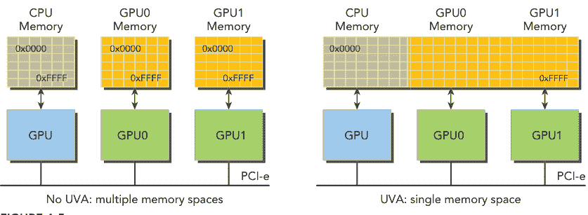

在 UVA 之前，你需要管理指向主机内存的指针和指向设备内存的指针。使用 UVA 后，指针引用的内存空间对应用程序代码是透明的。

在 UVA 下，使用 `cudaHostAlloc` 分配的固定主机内存具有相同的主机指针和设备指针。你可以直接将返回的指针传递给内核函数。回想上一节中的零拷贝示例，其中：

- 分配了映射的固定主机内存。
- 使用 CUDA 运行时函数获取映射的固定内存的设备指针。
- 将设备指针传递给你的内核。

有了 UVA，无需获取设备指针或管理两个物理上相同数据的指针。UVA 进一步简化了上一节中的 `sumArrayZeroCopy.cu` 示例：

```
// 在主机侧分配零拷贝内存
cudaHostAlloc(void** h_A, nBytes, cudaHostAllocMapped);
cudaHostAlloc(void** h_B, nBytes, cudaHostAllocMapped);

// 在主机侧初始化数据
initialData(h_A, nElem);
initialData(h_B, nElem);

// 使用零拷贝内存调用内核
sumArraysZeroCopy<<<grid, block>>>(h_A, h_B, d_C, nElem);
```

注意，`cudaHostAlloc` 返回的指针被直接传递给内核。使用 UVA 的更新后的代码可以在 Wrox.com 上的 `sumArrayZerocpyUVA.cu` 中找到。可以使用以下命令进行编译：

```
$ nvcc -03 -arch=sm_20 sumArrayZerocpyUVA.cu -o sumArrayZerocpyUVA
```

在运行上一节后运行测试将产生相同的性能结果。使用更少的代码生成相同的结果可以同时提高你应用程序的可读性和维护性。

## 统一内存

在 CUDA 6.0 中，引入了一种名为统一内存（Unified Memory）的新功能以简化 CUDA 编程模型中的内存管理。统一内存创建一个托管内存池，该池中的每个分配都可以用相同的内存地址（即指针）在 CPU 和 GPU 上访问。底层系统会自动在主机和设备之间的内存空间中迁移数据。这种数据移动对应用程序是透明的，大大简化了应用程序代码。

统一内存依赖于统一虚拟体系（UVA）的支持，两者是完全不同的技术。UVA 为系统中的所有处理器提供单一的虚拟内存地址。然而，UVA 不会自动将数据从一个物理位置迁移到另一个位置；这种能力是统一内存特有的。

统一内存提供了一种“单指针指向数据”模型，概念上与零拷贝内存相似。零拷贝内存分配在主机内存中，因此通过 PCIe 总线对零拷贝内存的高延迟访问会产生良好的性能。另一方面，统一内存解耦了内存和执行空间，使得数据可以根据需要透明地迁移到主机或设备，以提高局部性和性能。

托管内存指的是由底层系统自动管理的统一内存分配，并且可以与设备特定的分配（例如使用 `cudaMalloc` 过程创建的）互操作。你可以在内核中使用两种类型的内存：由系统控制的托管内存和必须由应用程序显式分配和传输的未托管内存。所有在设备内存上操作的 CUDA 操作对于托管内存也是有效的。主要区别是主机也可以引用和访问托管内存。

托管内存可以静态或动态分配。你可以通过添加修饰符将变量声明为托管变量。你可以通过以下方式动态分配托管内存：

```
__managed__ int a;
```

或者使用 `cudaMallocManaged` 函数：

```cpp
cuda_t cudaMallocManaged(void** ptr, size_t size);
```

使用后，可以使用 `cudaFree` 释放内存：

```cpp
cudaFree(ptr);
```

此外，你还可以提示系统将数据预取到主机或设备，以提高性能：

```cpp
cudaMemPrefetchAsync(ptr, size, device);
cudaMemPrefetchAsync(ptr, size, host);
```

在访问托管内存之前，可以调用 `cudaMemSynchronize()` 确保迁移已完成：

```cpp
cudaMemSynchronize();
```

## 内存访问模式

在 CUDA 中，内存访问模式对性能至关重要。由于内存访问是以块（cache line）为单位的，因此访问内存的方式会直接影响带宽。

### 合并访问（Coalesced Access）

当一个 Warp 中的多个线程同时访问连续的内存地址时，硬件会将这些请求合并为一个或少数几个事务。这就是合并访问。例如，如果一个 Warp 中的 32 个线程每个访问 4 字节的整数，且地址是连续的，硬件只需执行一个 128 字节（32 * 4）的事务。

### 非合并访问（Uncoalesced Access）

如果线程访问的地址跨越了多个内存块，硬件必须执行多次内存事务来满足这些请求。这会显著降低带宽。例如，如果线程访问的地址是随机的或跨度很大，合并就会失效。

### 跨步访问（Strided Access）

跨步访问是指线程之间以以固定的间距（步长）访问内存。虽然这仍然是有规律的，但如果步长较大，会导致合并效率的降低，从而影响性能。

## 优化建议

为了优化性能，应采取以下措施：

1. **重组数据布局**：使用结构体数组（SoA）而不是数组结构体（AoS），以确保线程访问的是连续内存。
2. **利用共享内存**：对于频繁访问的数据，将其加载到共享内存中，以减少对全局内存的压力。
3. **减少内存访问**：通过使用寄存器缓存变量来减少访问次数。

内存地址 128 160 192 224 256

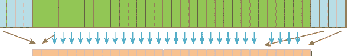

线程 ID 0 31

图 4-8

## 全局内存读取

在 SM 中，数据通过三个缓存/缓冲区路径之一进行流水线传输，取决于所引用的设备内存类型：

- L1/L2 缓存
- 常量缓存 (Constant cache)
- 只读默认 (Read-only default)

L1/L2 缓存是默认路径。通过其他两条路径需要应用程序进行显式管理，但根据所使用的访问模式，可以带来性能提升。全局内存操作是否通过 L1 缓存取决于两个因素：

- 设备计算能力
- 编译器选项

在 Fermi GPU（计算能力 2.x）和 Kepler K40 或更新版本的 GPU（计算能力 3.5 及以上）上，可以通过编译器标志启用或禁用全局内存加载的 L1 缓存。默认情况下，Fermi 设备上的全局内存加载启用 L1 缓存，而 K40 及后续 GPU 则禁用。以下标志告诉编译器禁用 L1 缓存：

```
-Xptxas -dlcm-cg
```

在禁用了 L1 缓存 true后，所有到全局内存的加载请求将直接进入 L2 缓存；当发生 L1 缺失时，请求将由 DRAM 提供。每次内存事务可能由一个、两个或四个段执行，每个段为 32 字节。

也可以通过以下标志显式启用 L1 缓存：

```
-Xptxas -dlcm-ca
```


设置此标志后，全局内存加载将首先尝试命中 L1 缓存。如果 L1 未命中，请求将进入 L2。如果 L2 未命中，请求将由 DRAM 提供。在这种模式下，一个加载内存的请求将由一个 128 字节的设备内存事务提供。

内存访问模式 | 61

在 Kepler K10、K20 和 K20x GPU 中，L1 缓存不用于缓存全局内存加载。

L1 缓存专门用于缓存寄存器溢出（register spills）到本地内存。

# 内存加载访问模式

内存加载分为两种类型：

- 缓存加载（L1 缓存启用）
- 未缓存加载（L1 缓存禁用）

内存加载的访问模式可以通过以下组合来表征：

- 缓存与未缓存：如果启用了 L1 缓存，则加载是缓存的
- 对齐与未对齐：如果内存访问的起始地址是 32 字节的倍数，则加载是对对齐的
- 合并与不合并：如果一个 warp（线程束）访问连续的一块数据，则该加载是合并的

你将在接下来的章节中将检查这些内存访问模式对内核性能的影响。

缓存加载操作通过 L1 缓存，并以 L1 缓存（128 字节）的粒度由设备内存事务提供。缓存加载可以被分类为对齐/未对齐以及合并/不合并。

图 4-9 展示了理想情况：对齐且合并的内存访问。一个 warp 中所有线程请求的地址落在 128 字节的单个缓存行内。仅需一个 128 字节的事务即可完成内存加载操作。总线利用率为 100%，且该事务中没有无用数据。

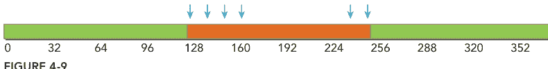

图 4-9

图 4-10 展示了另一种情况，即访问是对齐的，但引用的地址并非按线程 ID 连续，而是在 128 字节范围内随机分布的。由于 warp 中线程请求的地址仍然落在一个缓存行内，仅需一个 128 字节的事务即可满足此内存加载操作。总线利用率仍为 100%，只要每个线程在 128 字节范围内请求一个单独的 4 字节，该事务中就没有无用数据。


图 4-10

图 4-11 展示了这样情况：一个 warp 请求 32 个连续但未对齐的 4 字节数据元素。warp 中线程请求的地址跨越了全局内存中的两个 128 字节段。由于在启用 L1 缓存时 SM 执行的物理加载操作必须按 128 字节边界对齐，因此需要两个 128 字节的事务来完成此内存加载操作。总线利用率为 50%，这两个事务中加载的字节有一半是无用的。


图 4-11

图 4-12 展示了这样情况：warp 中的所有线程都请求相同的地址。由于引用的地址落在单个缓存行上，因此只需要一个内存事务，但总线利用率非常低。如果加载的值是 4 字节，则总线利用率为 4 字节请求 / 128 字节加载 = 3.125%。


图 4-12

图 4-13 展示了最差情况：一个 warp 请求 32 个连续但未对齐的 4 字节数据元素。warp 中线程请求的地址跨越了全局内存中的两个 128 字节段。由于在启用 L1 缓存时，SM 执行的物理加载操作必须按 128 字节边界对齐，因此需要两个 128 字节的事务来完成此内存加载操作。

 14-13

## CPU L1 缓存与 GPU L1 缓存的差异

CPU L1 缓存针对空间和时间局部性进行了优化。GPU L1 缓存仅针对空间局部性设计。

# 未缓存加载

未缓存加载不通过 L1 缓存，并以段（32 字节）为粒度由设备内存提供。对于对齐且合并的内存访问理想情况。

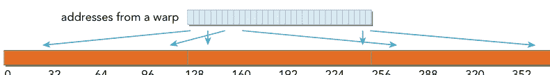 13-14

图 4-14 展示了另一种情况，即访问是对齐的，但引用的地址并非按线程 ID 连续，而是在 128 字节范围内随机分布的。由于 warp 中线程请求的地址仍然落在一个缓存行内，仅需一个 128 字节的事务即可满足此内存加载操作。总线利用率仍为 100%，只要每个线程在 128 字节范围内请求一个单独的 4 字节，该事务中就没有无用数据。

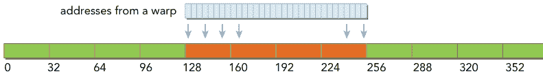 14-15

图 4-15 展示了这样情况：一个 warp 请求 32 个连续但未对齐的 4 字节数据元素。warp 中线程请求的地址跨越了全局内存中的两个 128 字节段。

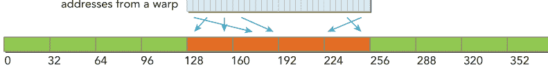 15-16

图 4-16 展示了这样情况：warp 中的所有线程都请求相同的地址。由于引用的地址落在单个缓存行上，因此只需要一个内存事务，但总线利用率非常低。

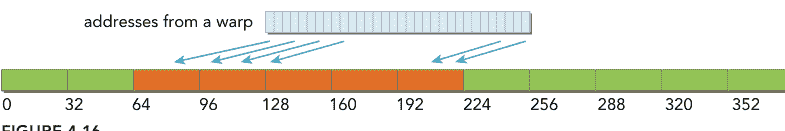 16-17

图 4-17 展示了最差情况：一个 warp 请求 32 个连续但未对齐的 4 字节数据元素。

```cpp
global void readOffset(float *A, float *B, float *C, const int n,
    int offset) {
    unsigned int i = blockIdx.x * blockDim.x + threadIdx.x;
    unsigned int k = i + offset;
    if (k < n) C[i] = A[k] + B[k];
}
```

为了验证转换后的内核代码的正确性，也应对相应进行修改：

```cpp
void sumArrayOnHost(float *A, float *B, float *C, const int n,
    int offset) {
    for (int idx = offset, k = 0; idx < n; idx++, k++) {
        C[k] = A[idx] + B[idx];
    }
}
```

主函数如列表 4-4所示。你应该熟悉这段代码的大部分内容。你可以从网站下载 `readSegment.cu` 的完整代码。`offset` 的默认值为零，但可以通过命令行参数覆盖。

## 列表 4-4: 使用带偏移量的内存读取 (readSegment.cu) (列出的唯一 main 函数)

```cpp
int main(int argc, char **argv) {
    // 设置设备
    int dev = 0;
    cudaDeviceProp devProp;
    cudaDeviceGetProperties(&devProp, dev);
    printf("%s starting at %d\n", argv[0]);
    printf("device: %s\n", devProp.name);
    cudaSetDevice(dev);

    // 设置数组大小
    int nElem = 1<<20; // 归约元素总数
    printf("array size: %d\n", nElem);
    size_t nBytes = nElem * sizeof(float);

    // 设置汇总的偏移量
    int blockSize = 512;
    int offset = 0;
    if (argc > 1) offset = atoi(argv[1]);
    if (argc > 2) blockSize = atoi(argv[2]);

    // 执行配置
    dim3 block (blockSize,1);
    dim3 grid ((nElem+block.x-1)/block.x,1);

    // 分配主机内存
    float *h_A = (float*)malloc(nBytes);
    float *h_B = (float*)malloc(nBytes);
    float *hostRef = (float*)malloc(nBytes);
    float *gpuRef = (float*)malloc(nBytes);

    // 初始化主机数组
    initialData(h_A, nElem);
    memmove(h_B,h_A,nBytes);

    // 主机端汇总
    sumArraysOnHost(h_A, h_B, nElem, offset);

    // 分配设备内存
    float *d_A,*d_B,*d_C;
    cudaMalloc((float**)&d_A, nBytes);
    cudaMalloc((float**)&d_B, nBytes);
    cudaMalloc((float**)&d_C, nBytes);

    // 将数据从主机拷贝到设备
    cudaMempy(d_A, h_A, nBytes, cudaMemcpyHostToDevice);
    cudaMempy(d_B, h_B, nBytes, cudaMemcpyHostToDevice);

    // 内核 1:
    double iStart = seconds();
    warmup <<< grid.x, grid.y >>> (d_A, d_B, d_C, nElem, offset);
    cudaDeviceSynchronize();
    elIaps = seconds() - iStart;
    printf("warmup <<< %d, %d >>> offset %d elapsed %f sec\n", grid.x, block.x, offset, iElaps);

    iStart = seconds();
    readoff <<< grid.x, block.y >>> (d_A, d_B, d_C, nElem, offset);
    cudaDeviceSynchronize();
    elIaps = seconds() - iStart;
    printf("readoff <<< %d, %d >>> offset %d elapsed %f sec\n", grid.x, block.x, offset, iElaps);

    // 将结果拷贝回主机端并检查设备结果
    cudaMempy(gpuRef,d_C, nBytes, cudaMemcpyDeviceToHost);
    checkResult(hostRef, gpuRef, nElem-offset);

    // 将结果拷贝回主机端并检查设备结果
    cudaMempy(gpuRef,d_B, nBytes, cudaMemcpyDeviceToHost);
    checkResult(hostRef, gpuRef, nElem-offset);

    // 将内核结果拷贝回主机端并检查设备结果
    cudaMempy(gpuRef,d_C, nBytes, cudaMemcpyDeviceToHost);
    checkResult(hostRef, gpuRef, nElem-offset);

    // 释放主机和设备内存
    cudaFree(d_A);
    cudaFree(d_B);
    cudaFree(d_C);
    free(h_A);
    free(h_B);

    // 重置设备
    cudaDeviceReset();
    return EXIT_SUCCESS;
}
```

使用以下命令编译代码：

```bash
$ nvcc -03 -arch=sm_20 readSegment.cu -o readSegment
```

你可以尝试不同的偏移量。下面是来自 Fermi M2050 的示例输出：

```
$ ./readSegment 0
readOffset << 32768, 512 >>> offset 0 0.001820 sec
$ ./readSegment 11
readOffset << 32768, 512 >>> offset 11 0.001949 sec
$ ./readSegment 128
readOffset << 32768, 512 >>> offset 128 0.001820 sec
```

使用 `offset=11` 会导致数组 A 和 B 的内存加载未对齐。这种情况的运行时间也较慢。你可以通过收集全局加载效率的信息来验证这些未对齐访问是性能损失的原因：

```
gld_efficiency = Requested Global Memory Load Throughput /
RequiredGlobal Memory Load Throughput
```

Required Global Memory Load Throughput 包含了需要多次内存事务的重放加载指令（replay load instructions），而 Requested Global Memory Load Throughput 不包含。

你可以使用 `nvprof` 配合 `readSegment` 测试收集 `gld_efficiency` 指标：

```
$ nvprof ./readSegment 0
$ nvprof ./readSegment 11
$ nvprof ./readSegment 128
```

全局加载效率的示例结果：

| Offset | Global Load Efficiency |
| :--- | :--- |
| 0 | 100.00% |
| 11 | 49.81% |
| 128 | 100.00% |

图 4-21 展示了内存访问对齐且访问地址位于连续 64 字节范围内的情况。该存储请求通过一个双段事务完成处理。

| 一个 warp 的地址 | 一个双段段事务 |
|--- |--- |
| 0 32 64 96 128 160 192 224 256 288 320 352 内存地址 | |

图 4-21

## 非对齐写入的示例

为了验证非对齐对内存存储效率的影响，请按照如下方式修改向量加法内核。这里使用了两个不同的索引：索引 k 偏移了给定的偏移量，但 i 没有偏移（因此导致了对齐访问）。从数组 A 和 B 加载数据使用对齐索引，这保证了内存加载效率。写入数组 C 则可能导致取决于非对齐写入：

```cpp
global void writeOffset(float *A, float *B, float *C,
const int n, int offset) {
  unsigned int i = blockDim.x * blockIdx.x + threadIdx.x;
  unsigned int k = i + offset;
  if (k < n) C[k] = A[i] + B[i];
}
```

主机端向量加法代码需要修改以匹配这些：

```cpp
void sumArraysHost(float *A, float *B, float *C, const int n,
int offset) {
  for (int idx = offset, k = 0; idx < n; idx++, k++) {
    C[idx] = A[k] + B[k];
  }
}
```

主函数与学习非对齐加载时几乎相同。你可以从 Wrox.com 下载 `writeSegment.cu` 中的完整代码示例。

使用以下命令编译并运行代码：

```
nvcc -O3 -arch=sm_20 writeSegment.cu -o writeSegment
```

以下是偏移量为 0, 11 和 128 的示例输出：

```
$ ./writeOffset <<< 2048, 512 >>> offset 0 elapsed 0.000134 sec
$ ./writeOffset 11
writeOffset <<< 2048, 512 >>> offset 11 elapsed 0.000184 sec
$ ./writeOffset 128
writeOffset <<< 2048, 512 >>> offset 128 elapsed 0.000134 sec
```

显然，非对齐情况（offset=11）报告了最差的性能。你可以通过 `nvprof` 收集全局加载和存储效率指标来验证这种非对齐情况：

```
$ nvprof --devices 0 --metrics gld_efficiency --metrics gst_efficiency \
./writeSegment OFFSET
```

以下是 `nvprof` 的示例输出：

| writeOffset Offset | 0: gld_efficiency 100.00% |
| writeOffset Offset | 0: gst_efficiency 100.00% |
| writeOffset Offset | 11: gld_efficiency 100.00% |
| writeOffset Offset | 11: gst_efficiency 80.00% |
| writeOffset Offset | 128: gld_efficiency 100.00% |
| writeOffset Offset | 128: gst_efficiency 100.00% |

除了非对齐情况（offset=11）中的存储操作外，所有的加载和存储效率均为 100%。当 offset=11 时，非对齐写入的存储效率为 80%，此时一个 warp 发出了 128 字节的写入请求，该请求将由一个四段事务和一个单段事务处理。因此，请求并加载了 128 字节，导致效率为 80%。

# 结构体数组 (AoS) 与数组结构 (SOA)


作为一名程序员，你应该熟悉组织数据的两种方法：结构体数组 `AoS` 和数组结构 `SoA`。这始终是一个有趣的话题，因为在存储一组结构化数据时，每都代表了利用两种强大数据类型（`struct` 和 `array`）的不同方式。

考虑下面这个存储一组配对 `float` 数据元素的示例示例。首先，考虑如何使用 `AoS` 方法处理这组配对数据元素。定义一个名为 `innerStruct` 的结构：

```cpp
struct innerStruct {
    float x;
    float y;
}
```

接下来，定义如下所示的这些结构体的数组。这是 `AoS` 组织数据的方法。它将相关数据（例如 `x` 和 `y`）存储在一起，这在 `CPU` 上具有良好的局部性。

```cpp
struct innerStruct myoS[N];
```

接下来，考虑使用 `SoA` 方法存储的数据：在这里，原始结构体中每个字段的所有值都分离开来存储在它们各自的数组中。这种方式将相邻点的数据存储在一起，但将单个点的数据存储在多个数组中。你可以使用此结构定义一个变量：

```cpp
struct innerArray {
    float x[N];
    float y[N];
};
```

图 `4-22` 展示了 `AoS` 和 `SoA` 两种方法的内存布局。在 `GPU` 上以 `AoS` 格式存储示例并执行仅需要 `x` 字段的操作，将导致 `50%` 的带宽损失，因为 `y` 值在每个 `32` 字节的分段或 `128` 字节的缓存行中被隐式加载。`AoS` 格式会在未使用的 `y` 值上浪费 `L2` 缓存空间。以 `SOA` 方式存储数据可以充分利用 `GPU` 带宽。由于相同字段的元素没有交错，`SoA` 布局提供了合并访问并可以实现更高效的内存利用。

## `AOS SOA`

许多并行编程范式（特别是 `SIMD` 风格）偏好 `SoA`。在 `CUDA` 编程中，通常也偏好 `SoA`，因为内存操作引用的相同字段元素是相邻的。为了帮助理解不同布局访问数据的影响，将比较两个具有相同数学操作的内核：一个实现 `AoS` 数据布局，另一个实现 `SOA` 数据布局。

### 示例：`AoS` 数据布局

以下内核使用 `AoS` 布局实现。全局内存数组以 `x` 和 `y` 交错的方式存储。每个线程的输入和输出是单个 `innerStruct` 结构。

```cpp
__global void testInnerStruct(innerStruct *data,
    result *result, const int n) {
    unsigned int i = blockDim.x * blockIdx.x + threadIdx.x;

    if (i < n) {
        innerStruct tmp = data[i];
        tmp.x += 10.f;
        tmp.y += 20.f;
        result[i] = tmp;
    }
}
```

输入长度定义为 `LEN`：

```cpp
define LEN 128
```

使用以下语句分配全局内存：

```cpp
int nElem = LEN;
size_t nBytes = nElem * sizeof(innerStruct);

innerStruct *d_A, *d_C;
cudaMalloc((innerStruct*)&d_A, nBytes);
cudaMalloc((innerStruct*)&d_C, nBytes);
```

使用以下函数初始化数组：

```cpp
void initInnerStruct(innerStruct *ip, int size) {
  for (int i = 0; i < size; i++) {
    ip[i].x = (float)(rand() & 0xFF) / 100.0;
    ip[i].y = (float)(rand() & 0xFF) / 100.0;
  }
}
```

主函数位于 `4-5`。你可以从 `Wrox.com` 下载此示例的代码。在后续代码中，运行预热内核以限制 `CUDA` 启动开销，并可能获得更准确的 `innerStruct` 内核时间测量。

#### Listing 4-5：使用 Ao 数据布局的简单数学 (`simpleMathAo.cu`)（仅列出函数）

```cpp
int main(int argc, char **argv) {
  // 设置设备
  int dev;
  cudaDeviceProp deviceProp;
  cudaGetDeviceProperties(&deviceProp, dev);
  printf("%s test array of %s\n", argv[0]);
  printf("%device: %s\n", dev, deviceProp.name);
  cudaSetDevice(dev);

  // 分配主机内存
  int nElem = LEN;
  size_t nBytes = nElem * sizeof(innerStruct);
  innerStruct *h_A = (innerStruct*)malloc(nBytes);
  innerStruct *hostRef = (innerStruct*)malloc(nBytes);
  innerStruct *gpuRef = (innerStruct*)malloc(nBytes);

  // 初始化数组
  initInnerStruct(h_A, nElem);
  testInnerStructHost(h_A, hostRef, nElem);

  // 分配设备内存
  innerStruct *d_A, *d_C;
  cudaMalloc((innerStruct**)&d_A, nBytes);
  cudaMalloc((innerStruct**)&d_C, nBytes);

  // 从主机拷贝数据到设备
  cudaMemcpy(d_A, h_A, nBytes, cudaMemHostToDevice);

  // 为总结设置偏移量
  int blocksize = 128;
  if (argc<1) blocksize = atoi(argv[1]);

  // 执行配置
  dim3 block(blocksize);
  dim3 grid((nElem+block.x-1)/block.x);

  // 内核 1：预热
  double start = seconds();
  warmup << grid, block >>> (d_A, d_C, nElem);
  cudaSynchronize();
  double iElaps = seconds() - start;
  printf("%d, %d, elapsed %f sec\n", grid.x, block.x, iElaps);
  cudaMemcpy(gpuRef, d_C, nBytes, cudaMemcpyDeviceToHost);

  // 内核 2：testInnerStruct
  start = seconds();
  testInnerStruct << grid, block >>> (d_A, d_C, nElem);
  cudaSynchronize();
  iElaps = seconds() - start;
  printf("%d, %d, elapsed %f sec\n", grid.x, block.x, iElaps);
  cudaMemcpy(gpuRef, d_C, nBytes, cudaMemcpyDeviceToHost);
  checkInnerStruct(hostRef, gpuRef, nElem);

  // 释放主机和设备内存
  cudaFree(d_A);
  cudaFree(d_C);
  free(h_A);
  free(hostRef);
  free(gpuRef);

  // 重置设备
  cudaDeviceReset();
  return EXIT_SUCCESS;
}
```

使用以下命令编译示例并运行它：

```
$ nvcc -O3 -arch=sm_20 simpleMathAo.cu -o simpleMathAo
./simpleMathAo
```

包含一个来自 `Fermi M2070` 的示例输出。

```
innerStruct << 8192, 128 >>> 0.0000286 sec
```

运行以下 `nvprof` 命令以收集全局加载效率和全局存储效率指标：

```
$ nvprof --devices 0 --metrics gld_efficiency,gst_efficiency ./simpleMathAoS
```

结果汇总如下。`50%` 的效率表示对于 `AoS` 数据布局，加载和存储内存请求都进行了重放。字段 `x` 和 `y` 在内存中是相邻的，且大小相同；每当执行内存事务来加载特定字段的值时，加载的字节中恰好有有一半也属于另一个字段。因此，`50%` 的所需加载和存储带宽未被使用。

```
gld_efficiency    50.00%
gst_efficiency    50.00%
```

## 示例：使用 `SoA` 数据布局的简单数学计算

以下内核（`kernel`）使用 `AoS` 层实现。它分配了两个原始类型类型的 `1D` 全局内存数组来存储所有的 `x` 和 `y` 两个值。内核通过索引每个原始类型数组来获取这些值。

```cpp
__global void testInnerArray(InnerArray *data,
    InnerArray *result, const int n) {
unsigned int i = blockIdx.x + blockDim.x + threadIdx.x;

if (i<n) {
    float tmpx = data->x[i];
    float tmpy = data->y[i];

    tmpx += 10.0f;
    tmpy += 20.0f;
    result->x[i] = tmpx;
    result->y[i] = tmpy;
}
}
```

输入长度与 `AoS` 测试用例相同，为 `1M`：

```cpp
#define LEN 1<<20
```

使用以下语句分配全局内存。`size(InnerArray）` 包含了其静态声明字段 `x` 和 `y` 的大小。

```cpp
int nElem = LEN;
size_t nBytes = sizeof(InnerArray);

InnerArray *d_A, *d_C;
cudaMalloc((InnerArray **)&d_A, nBytes);
cudaMalloc((InnerArray **)&d_C, nBytes);
```

用于 `SoA` 测试的 `main` 函数与之前的 `simpleMathSoA.cu` 中的 `main` 函数非常相似。你可以从 `Wrox.com` 下载 `simpleMathSoA.cu` 中的完整示例代码。使用以下命令编译文件并启动它。

```bash
$ nvcc -O3 -arch=sm_20 simpleMathSoA.cu -o simpleSoA
./simpleSoA
```

以下是 `simpleMathSoA` 在 `Fermi M2070` 上运行的示例输出。请注意，相对于 `simpleAoS`，性能有略微提升。在输入规模较大时，性能提升更为明显。

```
innerArray <<< 8192, 128 >>> 0.000200 sec
```

运行以下 `nvprof` 命令以获取全局加载效率和全局存储效率指标：

```
$ nvprof --devices 0 --metrics gld_efficiency,gst_efficiency ./simpleMathSoA
```

结果汇总如下。`100%` 的效率表示在使用 `SoA` 数据布局时，加载和存储内存请求均未被重放。每次访问都由单个内存事务处理。

```
gld_efficiency 100.00%
gst_efficiency 100.00%
```

## 性能调优

在优化设备内存带宽利用时，有两个努力的目标：

- 对齐且合并的内存访问，以减少带宽浪费

- 足够的并发内存操作，以处理内存延迟

在节一节中，你学习了如何组织内存访问模式以使其对齐和合并。这样做将确保字节在设备 `DRAM` 和 `SM` 片上内存或寄存器之间移动时得到高效利用。

第 `3` 节讨论了针对指令吞吐量的内核优化。记住，最大化并发内存访问可以通过实现：

- 增加每个线程内执行的内存操作数量。

- 尝试内核启动的执行配置，为每个 `SM` 暴露足够的并行性。

### 展开技术（Unrolling）

对包含内存操作的循环进行展开可以向流水线中添加更多独立的内存操作。你已经通过第 `3` 节的示例熟悉了展开。

考虑之前的 `readOffset` 示例。回顾每个线程如何执行四个独立的内存操作，如下所示。由于这些每一个操作都是独立的，你可以执行更多的并发访问。

```cpp
__global void readOffsetunroll4(float *A, float *B, float *C,
  const int n, int offset) {
  unsigned int i = blockIdx.x * blockDim.x * 4 + threadIdx.x;
  unsigned int k = i + offset;
  if (k + 3 * blockDim.x < n) {
    C[i] = A[k];
    C[i + blockDim.x] = A[k + blockDim.x];
    C[i + 2 * blockDim.x] = A[k + 2 * blockDim.x] + B[2 * blockDim.x];
    C[i + 3 * blockDim.x] = A[k + 3 * blockDim.x] + B[k + 3 * blockDim.x];
  }
}
```

你可以从 `Wrox.com` 下载 `readSegmentUnroll.cu` 中的源码。使用 `L1` 缓存 (`-Xptxas -dlcm=ca`) 编译并运行以下测试：

```bash
$ /readSegmentUnroll 0
warmup      << 32768, 512 >>> offset      0 0.001990 sec
unroll      << 8192, 512 >>> offset      0 0.000599 sec
$ /readSegmentUnroll 1
warmup      << 32768, 512 >>> offset      11 0.002214 sec
unroll      << 8192, 512 >>> offset      11 0.000615 sec
$ /readSegmentUnroll 2
warmup      << 32768, 512 >>> offset      128 0.001989 sec
unroll      << 8192, 512 >>> offset      128 0.000598 sec
```

感到惊讶吗？这种展开对性能有巨大的影响，即使在地址对齐的情况下也是如此。相对于没有展开的原始 `readSegmentExample`，测试运行结果表明速度快了 `3.04` 倍和 `3.11` 倍。对于 `I/O` 密集内核，看来暴露足够的内存访问并行性是一个首要任务。

尽管每个块 `128` 个线程暴露了更多的并行性，但展开内核的最佳块大小仍是每个块 `256` 个线程。这是因为 `Fermi GPU` 每个 `SM` 有 `8` 个块的限制，当每个块 `128` 个线程时，仅使用了 `32` 个线程束（`warp`），而当每个块 `256` 个线程时，使用了 `48` 个线程束，这达到了硬件限制。

现在测试在执行非对齐访问时块大小对性能的影响。结果显示出与对齐情况相似的行为，每个块 `128`、`256` 和 `512` 个线程的性能非常接近。这表明无论对齐如何，某些 `SM` 硬件限制仍然在起作用。`Fermi GPU` 每个 `SM` 有 `8` 个块的限制，当每个块 `128` 个线程时，仅使用了 `32` 个线程束，而当每个块 `256` 个线程时，使用了 `48` 个线程束，这达到了硬件限制。

# 内核函数（Kernel）能达到什么样的带宽？

在分析内核函数性能时，关注内存延迟（`memory latency`，即满足单个内存请求的时间）和内存带宽（`memory bandwidth`，即`SM`访问设备内存的速率，以每个时间单位字节衡量）很重要。

在上一节中，你尝试了两种提高内核函数性能的方法：

- 通过最大化并发执行交换（`swaps`）的数量来隐藏内存延迟，通过保持更多的内存访问在线来更好地饱和总线。

- 通过正确对内存访问进行对齐和合并（`coalescing`）来最大化内存效率。

然而，有时糟糕的访问模式是由问题本身的性质决定的。对于内核函数来说，什么样的程度才足够？在次理想的情况下，可实现的最佳性能是多少？在本节中，你将通过矩阵转置示例来学习如何使用各种调优技术调整内核函数的带宽。你会发现，即使访问模式本身并不完美，在重新设计内核函数时仍然有多种方法来实现良好的性能。

## 内存带宽

大多数内核函数对内存带宽非常敏感，也就是说它们是内存带宽限制的。因此，在调优内核函数时，关注内存带宽指标通常非常重要。带宽受到全局内存中数据排列方式以及 `warp` 访问这些数据方式的巨大影响。带宽有两种类型：

- 理论带宽

- 有效带宽

理论带宽是使用现有硬件可以达到的绝对最大带宽。对于禁用了 `ECC` 的 `Fermi M2090`，峰值理论设备带宽为 `177.6 GB/s`。有效带宽是内核函数实际实现的带宽，使用以下方程计算：

```
effective bandwidth (GB/s) = (bytes read+bytes written) × 10 / time elapsed
```

例如，对于将一个包含 `4` 字节整数的 `2048 × 2048` 矩阵拷贝到设备的操作，可以使用以下公式计算有效带宽：

```
effective bandwidth (GB/s) = 2048 × 4 × 2 × 10 / time elapsed
```

你将在下一节中测量并调优矩阵转置内核函数的有效带宽。


## 矩阵转置问题

矩阵转置是线性代数中的一个基础问题。虽然基础，但它被用于许多应用。矩阵转置是将每一行与相应的列进行交换。图 4-23 展示了一个简单的矩阵及其转置。

| 0 | 1 | 2 | 3 |

|---|---|---|---|

| 4 | 5 | 6 | 7 |

| 8 | 9 | 10 | 11 |

矩阵

图 4-23

| 0 | 4 | 8 |

|---|---|---|

| 1 | 5 | 9 |

| 2 | 6 | 10 |

| 3 | 7 | 11 |

转置后

以下是一个使用单精度浮点数实现的非就地（out-of-place）转置算法的主端实现。假设矩阵存储在 1D 数组中。通过将数组索引值转换为反行列列坐标，可以轻松计算转置。

```cpp
void transposeHost(float *out, float *in, const int nx, const int ny) {
  for (int iy = 0; iy < ny; ++iy) {
    for (int ix = 0; ix < nx; ++ix) {
      out[ix*ny+iy] = in[iy*nx+ix];
    }
  }}
```

在该函数中有两个存储矩阵的 1D 数组：输入矩阵和转置后的矩阵。矩阵维度定义为 `nx` 行 `ny` 列。在 1D 数组上实现时转置操作的结果如图 4-24 所示。

**原始矩阵的内存布局**

| 0 | 1 | 2 | 3 | 4 | 5 | 6 | 7 | 8 | 9 | 10 | 11 |

|---|---|---|---|---|---|---|---|---|---|---|---|

**转置矩阵的内存布局**

| 0 | 4 | 8 | 1 | 5 | 9 | 2 | 6 | 10 | 3 | 7 | 11 |

|---|---|---|---|---|---|---|---|---|---|---|

图 4-24

观察输入输出布局，你会发现：

- **读取**：在原始矩阵中按行访问；产生合并访问。
- **写入**：在转置后的矩阵中按列访问；产生跨步访问（strided access）。

跨步访问是 GPU 上性能最糟糕的内存访问模式。然而，在矩阵转置操作中这是不可避免的。在本节的剩余部分中，你将关注使用两个版本的转置内核来提高带宽利用率：一个按行读取按列写入，另一个按列读取按行写入。

图 4-25 展示了第一种方法，图 4-26 展示了第二种方法。你能预测这两个实现的相对性能吗？如果禁用加载的 L1 缓存，这两个实现在理论上是相同的。但是，如果启用 L1 缓存，第二种实现应该表现出更好的性能。虽然按列读取将合并，但写入会浪费未请求的字节（将额外的字节引入 L1 缓存意味着下次读取可能从缓存而非全局内存提供）。由于写入不会在 L1 中缓存，按列写入的示例无法从任何缓存中受益。在 Kepler K10、K20 和 K20x 设备上，这两种方法之间的性能不应该差异，因为没有使用 L1 缓存。

### 列表 4-6（续）

```cpp
// 设置内核 
switch (iKernel) {
    case 0:
        kernel = &copyRow;
        kernelName = "CopyRow";
        break;

    case 1:
        kernel = &copyCol;
        kernelName = "CopyCol";
        break;
}

// 运行内核
iStart = seconds();
kernel << grid, block >>>(d_C, d_A, nx, ny);
cudaDeviceSynchronize();
iElaps = seconds() - iStart;

// 计算有效带宽
float iband = 2*nx*ny*sizeof(float)/1e9/iElaps;
printf("effective bandwidth %f GB/n grid (%d,%d) block (%d,%d) %f\n", kernelName, iElaps, grid.x, grid.y, block.x, block.y, iband);

// 检查内核结果
if (iKernel1) {
    cudaMemcpy(gpuRef, d_C, nBytes, cudaMemcpyDeviceToHost());
    checkResult(hostRef, gpuRef, nx*ny, 1);
}

// 释放主机和设备内存
cudaFree(d_A);
cudaFree(d_C);
free (h_A);
free (hostRef);
free (gpuRef);

// 重置设备
cudaDeviceReset();
return EXIT_SUCCESS;
```

在启用 L1 加载缓存时编译代码：

```bash
$ nvcc -arch=sm_20 -Xptxas -dlcram=ca transpose.cu -o transpose
```

运行以下命令以检查两个拷贝内核的性能：

```bash
$ ./transpose 0
$ ./transpose 1
```

在禁用 ECC 的 Fermi M2090 上，两个拷贝内核的性能如表 4-4 所示。测量提供了一个上界（约为理论峰值带宽的 70%）和一个下界（约为理论峰值带宽的 33%）。

### 表 4-4：内核的有效带宽（启用 L1 缓存）

| 内核 | 带宽 | 与峰值带宽的比例 |

| --- | --- | --- |

| 理论峰值带宽 | 177.6 GB/s | 上界: 70.76% |

| CopyRow: 按行加载/存储 | 125.67 GB/s | |

| CopyCol: 按列加载/存储 | 58.7 GB/s | 下界: 33.09% |

块大小：16 x 16；矩阵大小：2,048 x 2,048；有效带宽单位：GB/sec

### 朴素响应：按行读取与按列读取

基于实现，朴素的行内核内核实现非常简单。这个版本的 `transpose naiveRow` 按行和列进行转置：

```cpp
global void transposeRow(float *out, float *in, const int nx,
    const int ny) {
    unsigned int ix = blockDim.x * blockIdx.x + threadIdx.x;
    unsigned int iy = blockDim.y * blockIdx.y + threadIdx.y;

    if (ix < nx && iy < ny) {
        out[ix * ny + iy] = in[iy * nx + ix];
    }
}
```

通过交换读和写索引，我们产生了朴素的列内核转置内核。这个版本按行加载列并按行存储：

```cpp
global void transposeCol(float *out, float *in, const int nx,
    const int ny) {
    unsigned int ix = blockDim.x * blockIdx.x + threadIdx.x;
    unsigned int iy = blockDim.y * blockIdx.y + threadIdx.y;

    if (ix < nx && iy < ny) {
        out[ix * ny + iy] = in[iy * nx + ix];
    }
}
```

为这些内核向内核 switch 语句添加了以下情况：

```cpp
case 2:
    kernel = &transposeNaiveRow;
    kernelName = "NaiveRow";
    break;
```

```cpp
case 3:
    kernel = &transposeNaiveCol;
    kernelName = "NaiveCol";
    break;
```

在启用 L1 缓存的情况下重新编译代码并运行以下命令来测量这两个内核的性能。结果总结在表 4-5 中。

```bash
$ ./transpose 2
$ ./transpose 3
```

### 表 4-5：内核的有效带宽（启用 L1 缓存）

| 内核 | 带宽 | 与峰值带宽的比例 |

|---|---|---||

| NaiveRow : 加载行/存储列 | 64.16 GB/s | 36.13% |

| NaiveCol : 加载列/存储行 | 81.64 GB/s | 45.97% |

`NaiveCol` 方法的性能优于 `NaiveRow` 方法。如之前解释过的，这种性能差异的一个可能原因是，某些访问到 L1 缓存的步长读取完全没有被使用，但它们仍然留在缓存中，并可能导致未来的访问产生缓存命中。为了验证这一点，请尝试在禁用 L1 缓存的情况下重新编译（`-xpt -dlcm=cg`）。

运行以下命令以获取未启用 L1 缓存加载的所有内核的性能。表 4-6 中的结果清楚地表明，禁用缓存加载对步长访问模式有巨大影响。

```bash
$ ./transpose 0
$ ./transpose 1
$ ./transpose 2
$ ./transpose 3
```

### 表 4-6：内核的有效带宽（禁用 L1 缓存）

| 内核 | 带宽 | 备注 |

|---|---|---|

| CopyRow : 按行加载/存储 | 128.07 GB/s | 上界 |

| CopyCol : 按列加载/存储 | 40.42 GB/s | 下界 |

| NaiveRow : 加载行/存储列 | 63.79 GB/s | 步长写入/合并读取 |

| NaiveCol : 加载列/存储行 | 47.13 GB/s | 步长读取/合并写入 |

块大小：16 x 16；矩阵大小：2,048 x 2,048；有效带宽单位：GB/sec

你还可以使用下面的命令通过 `nvprof` 直接检查缓存加载。结果总结在表 4-7 中。

```bash
$ nvprof --devices 0 --metrics throughput,throughput ./transpose 16 16 2048
```

### 表 4-7：内核的吞吐量（启用 L1 缓存）

| 内核 | 吞吐量 |

|---|---|

| CopyRow : 按行加载/存储 | 131.46 GB/s | 65.32 GB/s |

| CopyCol : 按列加载/存储 | 47.67 GB/s | 118.52 GB/s |

| NaiveRow : 加载行/存储列 | 129.05 GB/s | 64.31 GB/s |

| NaiveCol : 加载列/存储行 | 64.33 GB/s | 40.02 GB/s |

块大小：16 x 16；矩阵大小：2,048 x 2,048 结果显示，在启用 L1 缓存的情况下，步长读取获得了最高的吞吐量。接下来你可以检查

### 表 4-8：内核的效率（启用 L1 缓存）

| 内核 | 效率 |

|---|---|

| CopyRow : 按行加载/存储 | 49.8% |

| CopyCol : 按列加载/存储 | 25% |

| NaiveRow : 加载行/存储列 | 50.0% |

| NaiveCol : 加载列/存储行 | 100% |

### 展开转置

接下来，你将使用展开（unrolling）技术来提高转置带宽。此示例中展开的目标是为线程分配更多工作以增加内存请求。以下是展开因子为行的实现。引入了两个新索引：一个用于行，另一个用于列。

```cpp
global void transposeUnrollRow(float *out, float *in, const int nx,
    const int ny) {
    unsigned int ix = blockDim.x * blockIdx.x + threadIdx.x;
    unsigned int iy = blockDim.y * blockIdx.y + threadIdx.y;

    unsigned int ti = iy*nx + ix; 行访问
    unsigned int to = ix*ny; // 列访问

    if (ix+3*blockDim.x < nx && iy < ny) {
        out[to] = in[ti];
        out[to] + ny*blockDim.x] = in[ti+blockDim.x];
        out[to] + ny*2*blockDim.x] = in[ti+2*blockDim.x];
        out[to] + ny*3*blockDim.x] = in[ti+3*blockDim.x];
    }
}
```

交换行和宽度索引会产生类似的展开列式实现：

```cpp
global void transposeUnrollCol(float *out, float *in, const int nx,
    const int ny) {
    unsigned int ix = blockDim.x * blockIdx.x + threadIdx.x;
    unsigned int iy = blockDim.y * blockIdx.y + threadIdx.y;

    unsigned int ti = iy*nx + ix; // 行访问
    unsigned int to = ix*ny + iy; // 列访问

    if (ix+3*blockDim.x < nx && iy < ny) {
        out[ti] = in[blockDim.x*ny];
        out[ti] + 2*blockDim.x*ny] = in[ti+2*blockDim.x*ny];
        out[ti] + 3*blockDim.x*ny] = in[ti+3*blockDim.x*ny];
    }
}
```

在内核 switch 语句中添加以下代码时，在添加展开之前必须调整 switch 的网格大小。

```cpp
case 4:
    kernel = &transposeUnrollRow;
    kernelName = "Unroll4Row";
    grid.x = (nx+block.x*4-1)/(block.x*4);
    break;

case 5:
    kernel = &transposeUnrollCol;
    kernelName = "Unroll4Col";
    grid.x = (nx+block.x*4-1)/(block.x*4);
    break;
```

启用 L1 缓存重新编译代码，并运行以下命令来比较两个转置核（kernels）的性能。在 Fermi M2090 上测量的结果如表 4-9。

```
$ ./transpose 4
$ ./transpose 5
```

### 表 4-9：核的有效带宽（启用 L1 缓存）

| 核 (KERNEL) | 带宽 | 峰值带宽比例 |

|---|---|--|

| Unroll4Row: 加载行/存储列 | 44.15 GB/s | 24.85% |

| Unroll4Col: 加载列/存储行 | 90.20 GB/s | 50.76% |

块大小：16 x 16；矩阵大小：2,048 x 2,048；有效带宽单位：GB/sec

再次，通过启用 L1 缓存，加载列并存储行可以获得更好的有效带宽和更短的执行时间。

### 对角线转置：读取行与列

当你启动一个线程块网格（grid of thread blocks）时，线程块会分布在各个 SM 之间。虽然编程模型抽象可能会以 1D 或 2D 布局向你展示网格，但从角度来看，所有块都是一维排列的。每个块都有自己唯一的标识 `bid`，它是通过网格中线程块的行优先顺序计算出的：

```
int bid = blockIdx.x * gridDim.x + blockIdx.y;
```

图 47 描述了一个 4 x 4 线程块网格的示例，以及每个线程块对应的块 ID。

笛卡尔坐标 | 对应的块 ID

图 4-27

当核（kernel）时，线程块分配给 SM 的顺序由块 ID 决定。一旦所有 SM 都达到满负载，任何剩余的线程块将被保留，直到当前正在执行的块完成。一旦一个线程块完成，另一个线程块就会分配到该 SM。由于线程块完成的速度和顺序是不确定的，活跃的线程块最初是连续的，但随着核执行的进行，连续性随时间推移而降低。

虽然你无法直接控制块坐标的调度，但你可以灵活地解释块坐标 `blockId.x` 和 `blockId.y`。图 4-27 展示了对应笛卡尔坐标系的块坐标。图 4-28 展示了解释 `blockId.x` 和 `blockId.y` 的另一种方法：使用对角线块坐标系。

### 对角坐标

### 对应的块 ID

| | | | | |

|---|---|---|---||

| (0,0) | (0,1) | (0,2) | (0,3) |

| 0 | 4 | 8 | 12 |

| (1,3) | (1,0) | (1,1) | (1,2) |

| 13 | 1 | 5 | 9 |

| (2,2) | (2,3) | (2,0) | (2,1) |

| 10 | 14 | 2 | 6 |

| (3,1) | (3,2) | (3,3) | (3,0) |

| 7 | 11 | 15 | 3 |

图 4-28

对角坐标系被用于确定线程块 ID。然而对于数据访问，y 仍然需要使用笛卡尔坐标系。因此，将块 ID 解释为对角坐标时，你需要将对角坐标映射到笛卡尔坐标，以便访问正确的数据块。对于方矩阵，这种映射可以使用以下方程计算：

```
block_x = (blockId.x + blockId.y) % gridDim.x;
block_y = blockId.x;
```


在这里，`blockId.x` 和 `blockId.y` 被解释为对角坐标。`block_x` 和 `block_y` 是它们对应的笛卡尔坐标。行优先转置核如下使用对角坐标：在核的开始，使用分配给线程块的笛卡尔坐标计算线程索引 `ix, iy`。下面的示例核使用对角坐标来实现合并读写：

```cpp
__global void transposeDiagonalRow(float *out, float *in, int nx, int ny) {
  unsigned int block_x = blockId.x;
  unsigned int block_y = (blockId.x+blockId.y)%gridDim.x;

  unsigned int ix = gridDim.x * block_x + threadIdx.x;
  unsigned int iy = blockDim.y * block_y + threadIdx.y;

  if (ix < nx && iy < ny) {
    out[ix*ny + iy] = in[iy*nx + ix];
  }
}
```

使用对角坐标的列优先版本如下：

```cpp
__global void transposeDiagonalCol(float *out, float *in, int nx, int ny) {
    unsigned int blk_y = blockIdx.x;
    unsigned int blk_x = (blockIdx.x+blockIdx.y)%gridDim.x;

    unsigned int ix = blockDim.x * blk_x + threadIdx.x;
    unsigned int iy = blockDim.y * blk_y + threadIdx.y;

    if (ix < nx && iy < ny) {
        out[iy*nx + ix] = in[ix*ny + iy];
    }
}
```

将以下代码加入核 `switch` 语句中处理这些核：

```cpp
case 6:
    kernel = &transposeDiagonalRow;
    kernelName = "DiagonalRow";
    break;

case 7:
    kernel = &transposeDiagonalCol;
    kernelName = "DiagonalCol";
    break;
```

启用 L1 缓存重新编译代码，并运行以下命令比较这两个新转置核的性能。结果总结在表 4-10。

```
$ ./transpose 6
$ ./transpose 7
```

# 表 4-10：核的有效带宽（启用 L1 缓存）

| 核 (KERNEL) | 带宽 | 峰值带宽比例 |
|---|---|---|
| DiagonalRow: 加载行/存储列 | 73.42 GB/s | 41.32% |
| DiagonalCol: 加载列/存储行 | 75.92 GB/s | 42.72% |

块大小：16x16；矩阵：2,048 x 2,048；有效带宽单位：GB/sec

通过使用对角坐标改变块执行顺序，行优先核的性能显著提高。然而，列优先核在笛卡尔坐标下的表现仍优于对角坐标。对角核的实现可以通过展开块进一步改进，但该实现没有笛卡尔核那样直观。

这种性能提升与 DRAM 的并行访问有关。连续的 256 字节设备内存被分配到连续的分区。当使用笛卡尔坐标将线程块映射到数据块时，全局内存访问可能均匀分布在 DRAM 分区之间，可能会发生分区冲突（partition camping）。在分区冲突中，内存请求会被队列，而其他分区保持空闲。由于对角坐标映射导致了线程块到其处理的数据块之间的非线性映射，步长访问可能进入同一个分区，从而提高了性能。

为了获得最佳性能，所有活跃分片的全局内存并发访问应该分布在分区之间。图 29 展示了使用笛卡尔坐标时的分区冲突。图中假设只有两个分区，这有助于可视化分区冲突。图 30 显示如何避免这种情况。

## 使用窄块暴露并行性

暴露更多并行性的简单方法是调整块大小。之前的章节已经证明了这种技术对提高性能的有效性。详尽块大小的示例总结在表 4-11 中。

# 表 4-11：核的有效带宽（禁用 L1）

| 核 (KERNEL) | 块大小 (BLOCK SIZE) | 带宽 (BANDWIDTH) |
| --- | --- | --- |
| NaiveCol | (32, 32) | 38.13 GB/s |
| NaiveCol | (32, 16) | 51.46 GB/s |
| NaiveCol | (32, 8) | 54.82 GB/s |
| NaiveCol | (16, 32) | 73.42 GB/s |
| NaiveCol | (16, 16) | 80.27 GB/s |
| NaiveCol | (16, 8) | 70.34 GB/s |
| NaiveCol | (8, 32) | 102.76 GB/s |
| NaiveCol | (8, 16) | 82.64 GB/s |
| NaiveCol | (8, 8) | 59.59 GB/s |

矩阵大小：2,048 x 2,048；有效带宽单位：GB/sec：加载列和行的朴素实现核

到目前为止，最佳的块大小是 `(8, 32)`，尽管它像 `(16, 16)` 那样暴露了一些并行性。这种性能提升是由 `(8, 32)` 的“窄”块维度引起的，如图 31 所示。

“窄”块通过增加块内部维度存储的元素数量，改进了存储操作的有效性（如表 4-12 所示）。你可以通过 `nvprof` 测量加载和存储吞吐量来确认这一点。

# 表 4-12：核的有效带宽（启用 L1 缓存）

| 执行配置 (EXECUTION CONFIGURATION) | 加载吞吐量 (LOAD THROUGHPUT) | 存储吞吐量 (STORE THROUGHPUT) |
| --- | --- | --- |
| (16, 16) | 660.89 GB/s | 41.11 GB/s |
| (8, 32) | 406.43 GB/s | 50.80 GB/s |

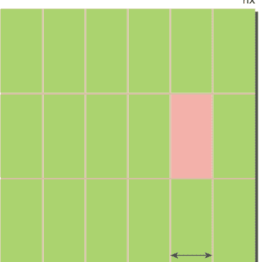


图 4-31

接下来，尝试使用块大小 `(8, 32)` 执行以下命令，以比较不同内核实现之间的带宽。

```
$ ./transpose 0 8 32
$ ./transpose 1 8 32
$ ./transpose 0 8 32
$ ./transpose 3 8 32
$ ./transpose 4 8 32
```

示例结果总结在表 4-13 中。到目前为止，内核 `Unroll4Col` 表现出最佳性能，优于上界拷贝内核。能够达到峰值带宽 60% 到 80% 的有效带宽是一项相当成就。

## 表 4-13：内核的有效带宽（禁用 L1 缓存）

| 内核 | 带宽 | 与峰值带宽的比例 |
| --- | --- | --- |
| 理论峰值带宽 | 177.6 | |
| CopyRow: 使用行加载/存储 | 102.30 | 57.57% |
| NaiveRow: 加载行/存储列 | 95.33 | 53.65% |
| NaiveCol: 加载列/存储行 | 101.99 | 57.39% |
| Unroll4Row: 加载行/存储列 | 82.04 | 46.17% |
| Unroll4Col: 加载列/存储行 | 113.36 | 63.83% |

块大小：8 x 32；矩阵大小：2,048 x 2,048；有效带宽单位：GB/sec

## 使用统一内存进行矩阵加法

你在第 2 章中学习了如何在 GPU 上相加两个矩阵。为了简化独立主机和设备内存空间的管理，并使此 CUDA 程序更具读读且于维护，你可以对使用统一内存的矩阵加法主函数应用以下修订：

- 将主机和设备内存分配替换为托管内存分配，以消除冗余拷贝。
- 移除所有显式内存拷贝。

你可以从声明并分配三个数组开始：`A` 和 `B` 用于输入，`gpuRef` 用于输出：

```cpp
float *A, *gpuRef;
cudaMalloc(void **)&A, int nBytes);
cudaMalloc(void **)&B, int nBytes);
cudaMalloc(void **)&gpuRef, int nBytes);
```

然后，你应该使用管理内存的指针在主机上初始化两个输入矩阵：

```cpp
initialData(A, nxy);
initialData(B, nxy);
```

最后，使用托管内存指针调用矩阵加法：

```cpp
sumMatrixGPU<<grid, block>>>(A, B, gpuRef, nx, ny);
cudaDeviceSynchronize();
```

由于内核启动相对于主机是异步的，且使用托管内存时不再需要对 `cudaMemcpy` 进行阻塞调用，因此你需要在访问内核输出之前在主机端进行显式同步。与本书上一章中的非托管矩阵加法程序相比，得益于统一内存，代码在这里被简化了。

你可以从 `Wrox.com` 下载完整的 `sumMatrixGPU.cu` 代码。你还会找到对应的 `sumMatrixManual.cu`，它使用相同的矩阵加法内核但没有使用托管内存，而是对设备执行显式内存拷贝。两个版本都使用预热内核来避免内核启动开销并获得更准确的时间结果。使用 CUDA 6.0 和 Kepler 或更高版本的 GPU，编译两个版本，分别命名为 `managed` 和 `manual`。

```
$ nvcc -arch=sm_30 sumMatrixGPU.cu -o managed
$ nvcc -arch=sm_30 sumMatrixManual.cu -o manual
```

如果你在使用多个 GPU 进行测试，则托管应用需要额外的步骤。由于托管内存分配对系统中的所有设备都是可见的，你希望限制应用程序可见的设备，以便内存只分配在一个设备上。要做到这一点，请使用 `CUDA_VISIBLE_DEVICES` 环境变量向 CUDA 暴露单个 GPU：

```
$ export CUDA_VISIBLE_DEVICES=0
```

首先，运行托管程序。

```
$ /managed 14
```

在 Kepler K40 上测量的结果如下：

```
$ /managed
Starting using Device 0: Tesla K40m
Matrix size: nx 16384 ny 16384
initialization:
    5.930170 sec
sumMatrix on host:
    0.504063 sec
sumMatrix on gpu:
    0.020253 sec <<<(512,512), (32,32)>>>
```

接下来，运行不使用托管内存的手动程序：

```
$ /manual 14
```

在 Kepler K40 上测量的结果如下：

```
$ /manual
Starting using Device 0: Tesla K40m
Matrix size: nx 16384 ny 16384
initialization:
    1.835069 sec
sumMatrix on host:
    0.474370 sec
sumMatrix on gpu:
    0.020226 sec <<<(512,512), (32,32)>>>
```

这些结果显示，使用托管内存的内核性能几乎与主机和设备之间的显式拷贝一样快，而且编程工作量少得多。

使用 `nvprof` 跟踪两个程序：

```
$ nvprof --profile-api-trace runtime /managed
$ nvprof --profile-api-trace runtime /manual
```

Kepler K40 上的结果总结在表 4-14 中。性能最大的差异在于 CPU 初始化时间——使用托管内存花费的时间长得多。虽然矩阵最初分配在 GPU 上，但它在用初始值初始化时首先在 CPU 上被引用。这要求底层系统在初始化之前将矩阵内容从设备传输到主机，而这种传输在手动版本中并未执行。

当执行主机矩阵矩阵函数时，整个矩阵已经驻留于主机和设备上。接下来，预热内核导致矩阵迁移回设备，以便启动实际的加法内核，此时数据已经在 GPU 上。如果不执行预热内核，使用托管内存运行速度会慢得多。

## 表 4-14：使用托管内存的性能对比

| 运行时函数 | 使用托管内存 | 不使用托管内存 |
|---|---|---|
| 矩阵内核 | 1.6114 | 1.6024 |
| CUDA 内核启动 | 49.259 | 70.717 |
| CUDA 拷贝 HToD | | 37.987 |
| CUDA 拷贝 DToH | | 20.252 |

## 使用统一内存的矩阵加法

| 运行时函数 | 使用托管内存 | 不使用托管内存 |
|---|---|---|
| CPU 数据初始化 | 5930.17 | 1835.07 |
| CPU 矩阵加法 | 504.63 | 474.37 |
| CPU 内核计时 | 25.203 | 20.226 |

矩阵大小：4096 x 4096；单位：毫秒

`nvvp` 和 `nvprof` 都支持检查内存。分析工具允许统一流量。此功能默认关闭。向 `nvprof` 传递以下标志可以启用统一内存指标：

```
$ nvprof --unified-memory-profiling per-device
```

注意，设备到主机传输还会报告 CPU 分页错误。当主机应用程序请求物理内存中不存在的内存地址时，会发生分页错误。当 CPU 需要访问托管内存时，分页错误触发设备到主机的传输。错误数量是相对于数据大小的。尝试使用 256x256 元素的小矩阵运行程序：

结果如下。注意错误数量大幅减少。

| | 计数 | 平均值 | 最大值 |
|---|---|---|---|
| 主机到设备（字节） | 2 | 524288.00 | 0 | 1048576 |
| 设备到主机（字节） | 9 | 505628.44 | 0 | 1572864 |
| CPU 分页错误 | 9 | 123.44 | 0 | 384 |

你还可以使用 `nvv` 可视化地检查内存行为。如下所示对托管内存实现运行 `nvv`：

```
$ nvv /managed
```

在““Executables”选项卡中，在“Arguments”字段中输入 14 以测试大矩阵，并勾选“启用统一内存分析”框，如图 4-32 所示。

图 4-33 描述了托管内存的时间线。你可以从图中看到主机分页错误与数据数据迁移密切相关。统一内存优化

通过将数据迁移到 GPU 来提高性能。底层系统维持主机与设备之间的一致性，并尝试将数据放置在可以访问效率最高的地方。

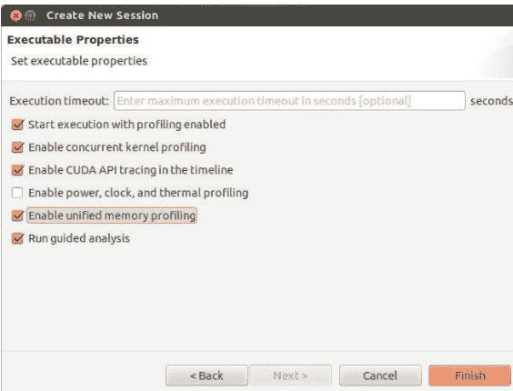

图 4-32

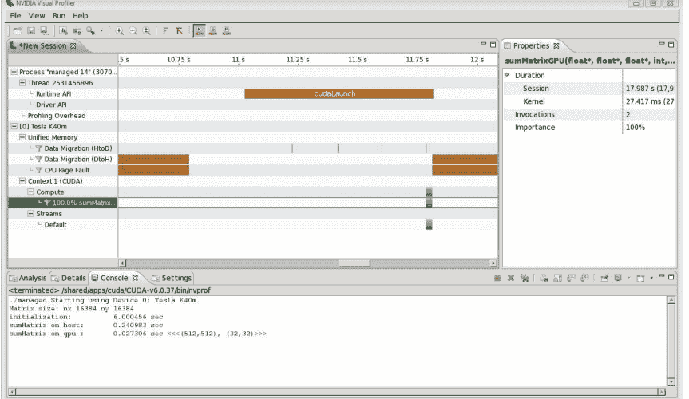

图 4-33

图 4-34 展示了不使用统一内存（Unified Memory）的程序时间线。对比这两幅图，你可以发现显式管理数据移动只产生一次从设备到主机的传输，而统一内存导致了两次。

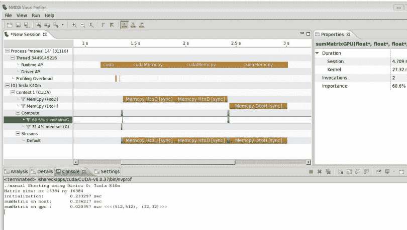

图 4-34

随 CUDA 6.0 发布的统一内存版本旨在提高程序员的生产力。底层系统更强调一致性和正确性而非性能。虽然这里的结果表明在 CUDA 应用中手动优化数据移动比统一内存具有性能优势，但你可以确定NVIDIA 计划在未来的硬件和软件发布中增强统一内存的性能和可编程性。

## 总结

CUDA 编程模型的显著特征之一是它直接向程序员暴露 GPU 内存层次结构。对数据移动和放置提供更多控制，可以实现更激进的优化和更高的峰值性能。

全局内存（Global memory）是最大、延迟最高且最常用的内存。对全局内存的请求可以通过 32 字节或 128 字节的事务处理。记住这些特性和粒度对于调优应用程序中的全局内存使用很重要。

通过本章的示例，你学习了提高带宽利用的两个准则：

- 最大化进行中的并发内存访问次数。
- 最大化全局内存与 SM 片内内存之间总线传输字节利用率。

为了保持足够的内存操作在进行中，你可以使用展开（unrolling）技术为每个线程创建更多独立的内存请求，或者调整网格（grid）和块（block）执行配置以向 SM 暴露并行性。

为了避免设备内存与片内内存之间不必要的移动，你的目标应该追求并实现理想的访问模式：对齐且合并（aligned and coalesced）的内存访问。

对齐内存访问相对容易，但有时合并访问可能具有挑战性。某些算法本质上可能使合并访问变得不可实现或极度困难。

在改进合并访问时，你的关注是 warp 内部的内存访问模式。另一方面，在移除分区映射（partition mapping）时，你的关注是所有活动 warp 的模式。对角块协调（Diagonal block coordination）是调整块执行顺序以避免分区冲突（partition camping）的一种方法。

统一内存通过消除指针和消除在主机与设备之间显式传输数据的需要，极大地简化了 CUDA 编程。CUDA 6.0 中统一内存的实现透明地维护了一致性，将其优先级高于性能。未来的硬件和软件增强将提高统一内存的性能。

下一章将涵盖本章简要介绍的话题：常量内存和共享内存。

## 第 4 章练习

- 1. 参考文件 `globalVariable.cu`。声明一个大小为五个元素的静态全局 `float` 数组。用相同值 3.14 初始化全局数组。修改内核，让每个线程更改具有与线程索引相同的数组元素值。让该值乘以五个线程的线程索引。
- 2. 参考文件 `globalVariable.cu`。将以下符号拷贝函数：

```
cudaMemcpyToSymbol()
cudaMemcpyFromSymbol()
```


# 替换为数据传输函数

你需要使用

```
cudaGetSymbolAddress()
```

获取全局变量的地址。

- 3. 使用 `nvprof` 和不同大小对比 `memTransfer` 和 `pinMemTransfer` 中锁页内存（pinned memory）和可页内存（pageable memory）拷贝的性能：2M, 4M, 8M, 16M, 32M, 64M。

- 4. 使用相同的示例，使用 CPU 计时器和不同大小对比锁页内存和可页内存分配与释放的性能：2M, 4M, 8M, 16M, 32M, 64M, 128M。

- 5. 修改 `sumArrayZerocopy.cu` 以偏移量访问 A、B 和 C。比较启用和禁用 L1 缓存的性能。如果你的 GPU 不支持配置 L1 缓存，请推预期结果。

- 6. 修改 `sumArrayZerocopyUVA.cu` 以偏移量访问 A、B 和 C。比较启用和禁用 L1 缓存的性能。如果你的 GPU 不支持 L1 缓存，解释你预期在启用和禁用 L1 缓存时看到的的结果。

- 7. 编译 `readSegment.cu` 并在偏移量 0, 4, 8, 16, 32, 64, 96, 128, 160, 192, 224 和 256 上运行以下命令：

```bash
./$OFFSET
```

确认对齐地址是的倍数。

```
./$OFFSET
```

- 8. 参考 `readsegment.cu` 的 `Makefile`。在 `Makefile` 中禁用 L1 缓存并生成执行文件 `read12`。在偏移量 0, 11 和 128 上使用以下命令进行测试：

- 9. 在偏移量 0, 11 和 128 上运行以下命令：

```bash
nvprof --devices 0
--metrics g_efficiency
--metrics throughput
```

`./read2`

- 10. 参考文件 `simpleMathA.cu`。定义 `struct __align(8) struct` 以解释任何差异。

- 11. 基于审查结果，使用 `nvprof` 解释差异。

- 12. 参考文件 `writeSegment.cu`。对比偏移量 32, 64, 128 的性能。

跨越全局内存的步长访问会导致带宽利用率低于最优。取决于算法的性质和相应的访问模式，非合并（non-coalesced）访问可能是不可避免的。然而，在许多情况下，可以使用共享内存来改进全局合并访问。共享内存是许多高性能计算应用的关键启用因素。

在本章中，你将学习如何使用共享内存进行编程、数据如何存储在共享内存中，以及如何使用不同的访问模式将元素映射到内存库（banks）。你将掌握使用共享内存提高内核性能的技能。

## 介绍 CUDA 共享内存

你已经学习过 GPU 配备两种内存：

- 板载内存（On-board memory）

- 片上内存（On-chip memory）

全局内存是巨大的板载内存，特点是延迟较高。共享内存是较小的低延迟片上内存，其提供的带宽远高于全局内存。你可以将其视为块内线程通信通道。共享内存通常具有以下：

- 块内通信通道

- 针对全局内存数据的程序管理缓存

- 用于转换数据以改进全局内存访问模式的临时内存（Scratch pad）

在本章中，你将通过两个示例获得使用共享内存编程的经验：一个归约内核和一个矩阵转置内核。

## 共享内存

共享内存（SMEM）是 GPU 的关键组件之一。在物理上，每个 SM 包含一个由当前在该 SM 上执行的所有块线程共享的低延迟内存池。共享内存允许该线程块内的线程进行通信，促进片上数据的复用，并可以大大减少内核所需的全局带宽。由于共享内存的内容由应用程序显式管理，因此通常被描述为程序管理的缓存。

Fermi 和 Kepler GPU 具有相似的内存层次结构，但 Kepler 包含一个额外的用于只读数据的编译器引导缓存。如图 5-1 所示，所有到全局内存的加载和存储都通过 L2 缓存，L2 缓存是 SM 单元之间数据统一的主要点。注意，共享内存和 L1 缓存在物理上比 L2 缓存和全局内存更靠近 SM。因此，共享内存的延迟大约比全局内存低 20 到 30 倍，带宽几乎高 10 倍。

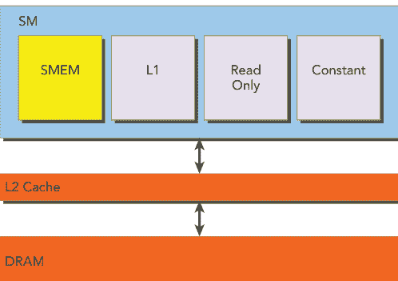

**图 5-1**

每个线程块在开始执行时会被分配固定数量的共享内存。此共享内存地址空间由线程块中的所有线程共享。其内容与其创建的线程块具有相同的寿命。共享内存访问按线程束（warp）发出的。理想情况下，每个对共享内存的访问请求都在一个事务中完成。在最坏的情况下，每个访问共享内存的请求将分 32 个事务顺序执行。如果多个线程访问共享内存中的同一个字（word），则由一个线程获取该字并通过多播（multicast）发送给其他线程。后续章节将提供避免多事务共享内存请求的详细信息。

共享内存会在 SM 上的所有驻留线程块之间分区；因此，共享内存是限制设备并行性的关键资源。内核使用的共享内存越多，可能并发活跃的线程块就越少。

### 程序管理缓存

在 C 语言编程中，循环变换是一种常见的缓存优化。循环变换通过重新排列迭代顺序，在循环遍历期间提高缓存局部性。在算法层面，你需要手动调整循环以在考虑缓存大小的同时实现更好的空间局部性。缓存对你的程序是透明的，由编译器处理所有数据移动。

共享内存是一种程序管理的缓存。你完全控制数据何时移动到共享内存以及数据何时被驱逐。通过允许你手动管理共享内存，CUDA 提供了对数据放置更精细粒度的控制并改进了片上数据移动，让你更容易优化应用程序代码。

### 共享内存分配

根据应用程序需求，有几种方法可以分配或声明共享内存变量。你可以静态或动态地分配共享内存变量。共享内存也可以声明为 CUDA 内核的局部变量，或 CUDA 源文件中的全局变量。CUDA 支持 1D、2D 和 3D 共享内存数组的声明。

共享内存变量使用以下限定符声明：

```
__shared__
```

以下代码段静态地声明了一个共享内存 2D float 数组。如果在内核内部声明，则该变量的作用域对于该内核是局部的。如果在文件的任何内核之外声明，则该变量的作用域对所有内核都是全局的。

```
__shared__ float tile[size_y][size_x];
```

如果共享内存的大小在编译时未知，你可以使用 `extern` 关键字声明一个无尺寸的数组。例如，以下代码段声明了一个共享内存 1D 无尺寸 int 数组。这种声明可以在内核内部或所有内核之外均进行。

```
extern __shared__ int tile[];
```

由于此数组的大小在编译时未知，你需要在每次内核调用时，通过在三角括号内的第三个参数中指定所需的字节数来动态分配共享内存，如下：

```
kernel<<<grid, block, isize * sizeof(int)>(...);
```

注意，你只能动态声明 1D 数组。

### 共享内存库和访问模式

有两个关键属性可以极小化对内核性能的影响：由不同全局内存访问模式引起的延迟和带宽。共享内存可以隐藏全局内存延迟和带宽对性能的影响。为了充分利用这些，理解共享内存的布局是有帮助的。

#### 内存库（Banks）

为了实现高带宽，共享内存被分为 32 个等大小的模块，称为库（banks），它们可以被同时访问。由于线程束中有32 个线程，因此有32 个库。共享内存是一个地址空间。取决于 GPU 的计算能力，如果线程束的共享内存加载或存储操作没有访问每个库超过一个位置，则操作可以在一个事务中完成。否则，将由多个事务处理，从而降低带宽。

#### 库冲突

当共享内存请求的多个地址落在同一个库时，会发生库冲突，导致请求被重放。硬件会将具有库冲突的请求拆分为许多单独事务，按事务数量降低有效带宽。

当线程束发出共享内存请求时，会出现三种典型情况：

- 并行访问：跨多个库的多个地址

- 串访问：同一个库内的多个地址

- 广播访问：单个库中的单个地址

并行访问是最常见的模式：线程束发出的位于多个库的多个地址。这种模式意味着部分或全部地址可以在一个内存事务中处理。理想情况下，当每个地址都在单独的库中，会执行无冲突的共享访问。

串访问是最坏的模式：当多个地址落在同一个库时，请求必须序列化。如果线程束中的32个线程访问同一个库中的不同位置，则需要32个内存事务，满足这些请求的时间比单个请求长32倍。

在广播访问的情况下，线程束中的所有线程读取同一个库内的同一个地址。执行一次内存事务，并将访问的字广播给所有请求线程。虽然广播访问只需要一次内存事务，但带宽利用率很低，因为读取的字节数很少。

图 5-2 展示了理想的库访问模式。每个线程访问一个 32 位字。由于每个线程访问不同库中的地址，因此没有库冲突。图 5-3 展示了不规则的随机访问模式。这仍然没有库冲突，因为每个线程访问不同的库。图 5-4 展示了另一种不规则的访问模式，其中多个线程访问同一个库。此类请求有两种可能的行为：

- 如果线程访问库内的相同地址，则发生无冲突广播访问

- 如果线程访问库内的不同地址，则发生库冲突

| Thread 0 | Thread 1 | Thread 2 | Thread 3 | Thread 4 | Thread 5 | Thread 6 | Thread 7 | Thread 8 | Thread 9 | Thread 10 | Thread 11 | Thread 12 | Thread 13 | Thread 14 | Thread 15 | Thread 16 | Thread 17 | Thread 18 | Thread 19 | Thread 20 | Thread 21 | Thread 22 | Thread 23 | Thread 24 | Thread 25 | Thread 26 | Thread 27 | Thread 28 | Thread 29 | Thread 30 | Thread 31 |

| Bank 0 | Bank 1 | Bank 2 | Bank 3 | Bank 4 | Bank 5 | Bank 6 | Bank 7 | Bank 8 | Bank 9 | Bank 10 | Bank 11 | Bank 12 | Bank 13 | Bank 14 | Bank 15 | Bank 16 | Bank 17 | Bank 18 | Bank 19 | Bank 20 | Bank 21 | Bank 22 | Bank 23 | Bank 24 | Bank 25 | Bank 26 | Bank 27 | Bank 28 | Bank 29 | Bank 30 | Bank 31 |

FIGURE 5-3

| Thread 0 | Thread 1 | Thread 2 | Thread 3 | Thread 4 | Thread 5 | Thread 6 | Thread 7 | Thread 8 | Thread 9 | Thread 10 | Thread 11 | Thread 12 | Thread 13 | Thread 14 | Thread 15 | Thread 16 | Thread 17 | Thread 18 | Thread 19 | Thread 20 | Thread 21 | Thread 22 | Thread 23 | Thread 24 | Thread 25 | Thread 26 | Thread 27 | Thread 28 | Thread 29 | Thread 30 | Thread 31 |

| Bank 0 | Bank 1 | Bank 2 | Bank 3 | Bank 4 | Bank 5 | Bank 6 | Bank 7 | Bank 8 | Bank 9 | Bank 10 | Bank 11 | Bank 12 | Bank 13 | Bank 14 | Bank 15 | Bank 16 | Bank 17 | Bank 18 | Bank 19 | Bank 20 | Bank 21 | Bank 22 | Bank 23 | Bank 24 | Bank 25 | Bank 26 | Bank 27 | Bank 28 | Bank 29 | Bank 30 | Bank 31 |

FIGURE 5-4

#### 访问模式

共享内存库宽度定义了共享内存地址位于哪些共享内存库中。内存库宽度根据设备的计算能力而异。有两种不同的宽度：

- 对于计算能力为 2.x 的设备为 4 字节（32 位）

- 对于计算能力为 3.x 的设备为 8 字节（64 位）

对于 Fermi 架构，库宽度为 32 位，并有 32 个库。每个库每两个时钟周期具有 32 位的带宽。连续的 32 位字映射到连续的库。因此，从共享地址到库索引的映射可以如下计算计算：

bank index = (address + 4 bytes/bank) % 32 banks

字节地址除以 4 以转换为 4 字节字，取模 32 操作将 4 字节字转换为库索引。图 5-5 的顶部说明了 Fermi 设备从字节地址到字索引的映射。底部显示了从字索引到库索引的映射。注意库内存每 32 个字循环一次。相邻的字被分类在不同的库中，以最大化一个线程束（warp）可能的并发访问次数。

| Byte address | 0 | 4 | 8 | 12 | 16 | 20 | 24 | 28 | 32 | 36 | 40 | 44 | 48 | 52 | 56 | 60 |

| 4-byte word index | 0 | 1 | 2 | 3 | 4 | 5 | 6 | 7 | 8 | 9 | 10 | 11 | 12 | 13 | 14 | 15 |

| Bank index | Bank 0 | Bank 1 | Bank 2 | Bank 3 | Bank 4 | Bank 5 | Bank 6 | Bank 7 | Bank 8 | Bank 9 | Bank 10 | Bank 11 | Bank 28 | Bank 29 | Bank 30 | Bank 31 |

| 4-byte word index | 0 | 1 | 2 | 3 | 4 | 5 | 6 | 7 | 8 | 9 | 10 | 11 | | 28 | 29 | 30 | 31 |

| 32 | 33 | 34 | 35 | 36 | 37 | 38 | 39 | 40 | 41 | 42 | 43 | | 60 | 61 | 62 | 63 |

| 64 | 65 | 66 | 67 | 68 | 69 | 70 | 71 | 72 | 73 | 74 | 75 | | 92 | 93 | 94 | 95 |

| 96 | 97 | 98 | 99 | 100 | 101 | 102 | 103 | 104 | 105 | 106 | 107 | | 124 | 125 | 126 | 127 |

FIGURE 5-5

当线程束中的两个线程访问同一地址时，不会发生库冲突。在这种情况下，读取会将字广播到所有线程，而写入则由其中一个线程执行。对于 Kepler 设备，共享内存具有 32 个库，分为以下两种模式：

- 64 位模式

- 32 位模式

在 64 位模式下，连续的 64 位字映射到连续的库。每个库每个时钟周期具有 64 位的带宽。共享内存地址到库索引的映射如下：

bank index = (byte address + 8 bytes/bank) % 32 banks

如果两个线程访问同一个 64 位字内的任何子字，共享内存请求就不会产生库冲突，因为只需要一次 64 位读取即可满足两个请求。因此，相对于 Fermi，64 位模式对于相同的访问模式会导致相同或更少的冲突。然而，由于 Kepler 每个时钟周期具有 64 位的带宽，访问同一库中的 32 位字不需要重试。它可能在一个时钟周期内读取 64 位并向每个线程传递 32 位。图 5-6 展示了 32 位模式下从字节地址到库索引的映射。顶部是标记有字节地址和 4 字节索引的共享内存。底部图显示了 4 字节索引到库索引的映射。虽然字 0 和字 32 都在库 0 中，但同时读取它们会导致库冲突。

| Byte address | 0 | 4 | 8 | 12 | 16 | 20 | 24 | 28 | 32 | 36 | 40 | 44 | 48 | 52 | 56 | 60 |

| 4-byte word index | 0 | 1 | 2 | 3 | 4 | 5 | 6 | 7 | 8 | 9 | 10 | 11 | 12 | 13 | 14 | 15 |

| Bank index | Bank 0 | Bank 1 | Bank 2 | Bank 3 | Bank 4 | Bank 5 | | Bank 30 | Bank 31 |

| 4-byte word index | 0 | 32 | 1 | 33 | 2 | 34 | 35 | 4 | 36 | 5 | 37 | | 28 | 62 | 31 | 63 |

| | 64 | 96 | 95 | 97 | 66 | 98 | 67 | 99 | 68 | 100 | 109 | | 94 | 126 | 95 | 127 |

| | 128 | 160 | | | | | | | |

| | 192 | 224 | | | | | | | |

FIGURE 5-6

图 5-7 展示了 64 位模式下的一种无冲突访问情况，其中每个线程访问不同的库。图 5-8 展示了 64 位模式下的另一种无冲突访问情况，其中两个线程访问同一个 8 字节字内的同一个库。图 5-9 展示了双路库冲突，两个线程访问同一个库，但地址位于两个不同的 8 字节字中。图 5-10 展示了三路库冲突，三个线程访问同一个库且地址位于三个不同的 8 字节字中。

# 内存填充（Memory Padding）

内存填充是避免库冲突的一种方法。一个简单的情况：假设你只有五个共享内存库。如果所有线程都访问不同的位置，解决此问题的方法之一是每 *N* 个元素添加填充，其中 *N* 是库的数量。这会将数据跨库移动，如图 5-11 右侧所示。填充的内存从不用于存储。它的唯一功能是移动数据，使源自同一库的数据分布在各个库中。因此，线程块可用的有用共享内存总量将减少。


虽然 Fermi 和 Kepler 都有 32 个库，但它们的库宽度不同。在这些架构上对共享内存进行填充时必须小心。Fermi 中的某些内存填充模式可能会导致 Kepler 中的库冲突。

| Bank 0 | Bank 1 | Bank 2 | Bank 3 | Bank 4 | Bank 5 | | Bank 30 | Bank 31 |
|---|---|---|---|---|---|---|---|---|
| 0 | 1 | 2 | 3 | 4 | 5 | | | |
| 32 | 33 | 34 | 35 | 36 | 37 | | | |
| 64 | 65 | 66 | 67 | 68 | 69 | | | |
| 96 | 97 | 98 | 99 | 100 | 101 | | | |
| 128 | 129 | 130 | 131 | 132 | 133 | | | |
| 160 | 161 | 162 | 163 | 164 | 165 | | | |
| 192 | 124 | | | | | | | |
| Bank 0 | Bank 1 | Bank 2 | Bank 3 | Bank 4 | Bank 5 | | Bank 30 | Bank 31 |
| 0 | 1 | 2 | 3 | 4 | 5 | | | |
| 32 | 33 | 34 | 35 | 36 | 37 | | | |
| 64 | 65 | 66 | 67 | 68 | 69 | | | |
| 96 | 97 | 98 | 99 | 100 | 101 | | | |
| 128 | 129 | 130 | 131 | 132 | 133 | | | |
| 160 | 161 | 162 | 163 | 164 | 165 | | | |
| 192 | 224 | 95 | |  | | |  | |

FIGURE 5-11

# 访问模式配置

回想 Kepler 设备支持 4 位和 8 位共享内存访问模式。默认是 4 位模式。可以使用以下运行时 API 查询访问模式：

```
cudaError_t cudaDeviceGetSharedConfig(cudaSharedMemConfig *pConfig);
```

结果返回 `pConfig` 中。返回的库配置可以是以下值之一：

```
cudaSharedMemBankSizeFourByte
cudaSharedMemBankSizeEightByte
```

可以使用以下函数为具有可配置共享库的设备设置新的库大小：

```
cudaError_t cudaDeviceSetSharedConfig(cudaSharedMemConfig config);
```

支持的库配置为：

```
cudaSharedMemBankSizeDefault
cudaSharedMemBankSizeFourByte
cudaSharedMemBankSizeEightByte
```

内核之间切换内存配置可能需要隐式的设备同步点。更改共享库大小不会增加内核的共享内存使用量或占用率，但可能会对性能产生重大影响。较大的库可能会提供更高的共享内存带宽，但根据应用程序的共享内存访问模式，可能会导致库冲突。

# 配置共享内存数量

每个 SM 拥有 64 KB 的片上内存。共享内存和 L1 缓存共享此硬件资源。CUDA 提供了两种配置 L1 缓存和共享内存大小的方法：

- 每设备配置
- 每内核配置

可以使用以下运行时函数配置在设备上启动的内核所使用的 L1 缓存大小和共享内存大小：

```
cudaError_t cudaDeviceSetCacheConfig(cudaFuncCache cacheConfig);
```

`cacheConfig` 参数指定了如何在当前 CUDA 设备上的 L1 缓存和共享内存之间划分片上内存。支持的缓存配置有：

```
cudaPuncCachePrefNone: 无偏好（默认值）
cudaPuncCachePrefShared: 偏好 48KB 共享内存和 16 KB L1 缓存
cudaPuncCachePrefL1: 偏好 48 KB L1 缓存和 16 KB 共享内存
cudaPuncCachePrefEqual: 偏好 32KB L1 缓存和 32 KB 共享内存
```

哪种模式更好取决于你在内核函数中使用共享内存的程度。典型情况如下：

- 当内核使用共享内存时，倾向于更多的共享内存。
- 当内核使用更多寄存器时，倾向于有更多的 L1 缓存。

如果你的内核使用了大量的共享内存，你可能会发现 48 KB 的共享内存可以实现更高的占用率和更好的性能。相反，如果你的内核使用的共享内存较少，则你应该将 `cacheConfig` 配置为 48 KB 的 L1 缓存。对于 Kepler 设备，你可以通过在调用 `nvcc` 时指定 `-ptxas -v` 来确定内核使用了多少寄存器。当你的内核寄存器数量超过可用硬件限制时，你可以配置大 L1 缓存来用于寄存器溢出（register spilling）。对于 Fermi 设备，本地内存用于寄存器溢出。在这种情况下，大 L1 缓存也可能有益。

CUDA 运行时会尽力使用请求的设备端内存配置，但如果执行内核函数时需要，它也可以选择不同的配置。每个内核的配置也可以覆盖设备范围设置，并可以使用以下函数进行设置：

```
cudaError_t cudaFuncCacheConfig(const void* func,
enum cudaFuncCacheConfig cacheConfig) func;
```

用于应用此配置的内核由内核指针 `func` 指定。与最近一次偏好不同的设置启动内核可能会导致设备同步。你只需要为每个内核调用一次此函数。片上内存配置不需要在每次内核启动时重新设置。

尽管 L1 缓存和共享内存位于同一片上硬件上，但它们之间有很大区别。共享内存通过 32 个 bank（存储体）访问，而 L1 缓存通过缓存行（cache line）访问。对于共享内存，你对存储的内容和位置具有完全控制权；而对于 L1 缓存，数据驱逐是由硬件完成的。

## GPU 缓存对比 CPU 缓存

通常情况下，GPU 缓存行为比 CPU 缓存行为难以推理。GPU 使用不同的启发式算法来驱逐数据。在 GPU 上，数百个线程共享同一个 L1 缓存，成千上万线程共享同一个 L2 缓存；因此，数据驱逐在 GPU 上发生得非常频繁且不可预测。你可以使用共享内存来显式管理数据，并保证对 SM（流多处理器）的局部性。

## 同步

并行线程之间的同步是任何并行计算语言的关键机制。正如名称所示，共享内存可以被线程块内的多个线程同时访问。当多个线程在没有同步的情况下修改同一个共享内存位置时，将导致线程间冲突。CUDA 提供了几个运行时函数来执行块内同步。通常，同步有两种基本方法：

- 屏障（Barriers）
- 内存栅（Memory fences）

在屏障（barrier）处，所有调用线程都会等待所有其他线程到达屏障点。在内存栅（memory fence）处，所有调用线程都会挂起，直到所有修改对所有其他调用线程可见。然而，在研究 CUDA 的块内屏障和内存栅之前，理解 CUDA 采用的弱排序内存模型（weakly-ordered memory model）非常重要。

## 弱排序内存模型

现代架构采用了松散内存模型。这意味着内存访问的执行顺序并不与其在代码中顺序一致。CUDA 采用弱排序内存模型以实现更激进的编译器优化。

GPU 线程向不同内存（如共享内存、全局内存、锁页主机内存或节点设备内存）写入数据的顺序并不一定与源代码中的顺序相同。线程的写入对其他线程可见的顺序可能与执行时的实际顺序不匹配。

如果指令之间是相互独立的，那么线程从不同内存读取数据的顺序并不一定与读取指令在程序中出现的顺序一致。

为了程序的正确性而显式强制某种排序，必须在应用程序代码中插入内存栅和屏障。这是保证与其他线程共享资源的内核行为行为的唯一方法。

## 显式屏障

在 CUDA 中，仅可以在同一线程块的线程之间执行屏障。你可以通过调用以下内置函数在内核中指定屏障点：

```
void __syncthreads();
```

`__syncthreads()` 作为一个屏障点，块必须等待所有线程都到达该点。`__syncthreads()` 还确保这些线程在屏障之前进行的所有全局和共享内存访问对块中的所有线程可见。`__syncthreads()` 用于协调同一块内线程之间的通信。当块内的某些线程访问共享内存或全局内存中的相同地址时，存在潜在的风险（读后写、写后读和写后写），这会导致未定义的应用程序行为以及这些内存位置的未定义状态。通过对冲突访问的线程进行同步，可以避免这种不良行为。

在条件代码中使用 `__syncthreads()` 时必须特别小心。只有当保证条件在整个块内的求值结果相同时，调用 `__syncthreads()` 才是有效的。否则执行可能会挂起或产生意外之外的副作用。例如，以下代码可能会导致块中的线程无限等待对方，除非块中的所有线程都命中同一个屏障点。

```
if (threadID % 2 == 0) {
    __syncthreads();
}
```

## 内存栅 (Memory Fence)

内存栅函数确保栅之前的内存对栅之后的其他线程可见。根据范围，内存栅有三种变体：块、网格或系统。

你可以使用内置函数在块内创建内存栅：

```
void __threadfence_block();
```

`__threadfence_block()` 确保对共享内存和全局内存的所有写入对块中的线程可见。记住，内存栅并不执行任何同步。

你可以使用以下函数在网格级别创建内存栅：

```
void __threadfence();
```

`__threadfence()` 挂起调用线程，直到其对全局内存写入对网格可见。

你还可以使用以下函数跨系统（包括主机和设备）设置内存栅：

```
void __threadfence_system();
```

`__threadfence_system()` 调用调用线程以确保其对全局内存、锁页主机内存以及其他设备内存的写入对所有设备中的所有线程可见。

在明确这些概念后，你可以设计一个高效的内核来避免银行冲突（bank conflict），并充分利用共享内存的优势。

## 正方形共享内存

你可以简单地使用共享内存来缓存具有正方形维度的全局数据。正方形数组的简单维度使得于从 2D 线程索引计算出 1D 内存偏移。图 5-12 展示了一个每个维度有 32 个元素的共享内存块，它按行优先（row-major）的顺序存储。上图显示了 1D 数据布局的实际安排，底图显示了逻辑上的 2D 共享内存块，并展示了 4 字节数据元素与银行（banks）之间的映射。

| 字节地址 | 0 | 4 | 8 | 12 | 16 | 20 | 24 | 28 | ... | 4088 | 4092 |
| 4 字节字索引 | 0 | 1 | 2 | 3 | 4 | 5 | 6 | 7 | ... | 1022 | 1023 |
| Bank 0 | Bank 1 | Bank 2 | Bank 3 | ... | ... | Bank 30 | Bank 31 |
| :--- | :--- | :--- | :--- | :--- | :--- | :--- | :--- |
| 行 0 | 0 | 1 | 2 | 3 | ... | ... | ... | ... |
| 行 1 | 32 | 33 | 34 | 35 | ... | ... | 60 | 62 | 63 |
| 行 2 | 64 | 65 | | | ... | ... | ... | 95 |
| 行 3 | 96 | 97 | | | ... | ... | ... | 127 |
| 行 30 | 960 | | | | ... | ... | ... | 991 |
| 行 31 | 992 | | | | ... | ... | 1023 | 1023 |

图 5-12

你可以按照如下方式静态地声明一个 2D 共享内存变量：

```
__shared int tile[N][N];
```

由于此共享内存块是正方形的，你可以选择从 2D 线程块中访问它，让相邻线程在 x 或 y 维度访问元素：

```
tile[threadIdx.y][threadIdx.x]
tile[threadIdx.x][threadIdx.y];
```

哪种方法的性能可能更好？你需要注意线程是如何映射到共享内存的。记住，让同一个束（warp）中的线程访问不同的银行是最优的。同一个束中的线程通过 `threadIdx.x` 的连续值来标识。共享内存中属于不同银行的元素也通过字偏移量（word offset）并发存储。最好的情况下是具有连续 `threadIdx.x` 值的线程访问共享内存中连续的位置。由此得出结论，第一种模式（`tile[threadIdx.y][threadIdx.x]`）将比第二种（`tile[threadIdx.x][threadIdx.y]`）表现出更好的性能和更银行冲突，因为相邻线程正在访问最内层数组的相邻单元。

## 行优先与列优先的访问

考虑一个示例，使用一个每个维度包含 32 个线程的 2D 块网格。你可以使用以下宏定义块维度：

```
#define BDIMX 32
#define BDIMY 32
```

你也可以使用该宏来定义内核的执行配置：

```
dim3 block (BDIMX,BDIMY);
dim3 grid (1,1);
```

该内核有两个简单的操作：

- 将全局线程索引按行优先顺序写入 2D 共享内存数组。
- 按行优先顺序从共享内存中读取这些值并将其存储到全局内存中。

首先，你可以如下所示静态地声明一个 2D 共享内存数组：

```
__shared__ int tile[BDIMY][BDIMX];
```

接下来，你需要根据每个线程的 2D ID 计算全局索引。因为只会启动一个线程块，索引转换可以简化：

```
unsigned int idx = threadIdx.y * blockDim.x + threadIdx.x;
```

在本节的示例中，`idx` 将用于从输入矩阵中读取值。将 `idx` 的值存储到输出数组中，允许你根据线程写入其全局 ID 的位置来可视化内核的访问模式。

按行优先顺序将全局线程索引写入共享内存块可以如下执行：

```
tile[threadIdx.y][threadIdx.x] = idx;
```

一旦到达同步点（使用 `syncthreads()`），所有线程都必须已将数据存储到共享内存，因此你可以按如下所示行优先顺序从共享内存为全局内存赋值：

```
out[idx] = tile[threadIdx.y][threadIdx.x];
```

内核代码如下：

```
__global_ void setRowReadRow(int *out) {
    // 共享内存
    shared__ int tile [BDIMY] [BDIMX];

    // 从线程索引到全局内存索引的映射
    unsigned int idx = threadIdx.x + blockDim.x;

    // 共享内存存储操作
    tile[threadIdx.y] [threadIdx.x] = idx;

    // 等待所有线程完成
    syncthreads();

    // 共享内存加载操作
    out[idx] = tile[threadIdx.y][threadIdx.x];
}
```

因此，你有三个内存操作：

- 一次针对共享内存的操作
- 一次针对共享内存的操作
- 一次针对全局内存的操作

由于束中的线程具有连续的 `threadIdx.y` 和 `threadIdx.x` 值，且使用 `threadIdx.x` 索引共享内存块的最内层维度，此内核没有银行冲突。另一方面，如果你在分配数据到共享内存时交换了 `threadIdx.y` 和 `threadIdx.x`，那么一个束的访问将是列优先顺序。每个共享内存加载将按列优先顺序进行，这会导致一个束的冲突：

```
__global_ void setRowReadRow(int *out) {
    // 共享内存
    shared__ int tile [BDIMY] [BDIMX];

    // 从线程索引到全局内存索引的映射
    unsigned int idx = threadIdx.x + blockDim.x;

    // 共享内存存储操作
    tile[threadIdx.y] [threadIdx.x] = idx;

    // 等待所有线程完成
    syncthreads();

    // 共享内存加载操作
    out[idx] = tile[threadIdx.y][threadIdx.x];
}
```

由于束中的线程具有连续的 `threadIdx.y` 和 `threadIdx.x` 值，且使用 `threadIdx.x` 索引共享内存块的最内层维度，此内核是无冲突的。另一方面，如果你在分配数据到共享内存时交换了 `threadIdx.y` 和 `threadIdx.x`，那么一个束的访问将是列优先顺序。每个共享内存加载将按列优先顺序进行。

因此，你有三个内存操作：

- 一次针对共享内存的操作
- 一次针对共享内存的操作
- 一次针对全局内存的操作


由于束中的线程具有连续的 `threadIdx.y` 和 `threadIdx.x` 值，且使用 `threadIdx.x` 索引共享内存块的最内层维度，此内核是无冲突的。另一方面，如果你在分配数据到共享内存时交换了 `threadIdx.y` 和 `threadIdx.x`，那么一个束的访问将是列优先顺序。每个共享内存加载将按列优先顺序进行。

```
__global_ void setRowReadRow(int *out) {
    // 静态共享内存
    shared__ int tile [BDIMY] [BDIMX];

    // 从线程索引到全局内存索引的映射
    unsigned int idx = threadIdx.x + blockDim.x;

    // 共享内存存储操作
    tile[threadIdx.y] [threadIdx.x] = idx;

    // 等待所有线程完成
    syncthreads();

    // 共享内存加载操作
    out[idx] = tile[threadIdx.y][threadIdx.x];
}
```

将内核限制在内核作用域内。动态共享内存必须声明为无符号 1D 数组；因此，你需要根据 2D 线程索引计算访问索引。因为在这个内核中你将按行主序写入并按列主序读取，你需要维护以下两个索引：

- `row_idx`: 根据 2D 线程索引计算的 1D 行主序偏移量
- `col_idx`: 根据 2D 线程索引计算的 1D 列主序内存偏移量

你使用计算出的 `row_idx` 以行主序写入共享内存，如下：

```
tile[row_idx] = row_idx;
```

在共享内存块 `tile` 填充完成后，使用适当的同步，然后按列主序读取它并赋值给全局内存，如下：

```
out[row_idx] = tile[col_idx];
```

由于 `out` 存储在全局内存中，且块内的线程按行主序排列，你希望通过线程坐标按行主序写入 `out` 以确保合并存储。

```cpp
__global void setRowColDyn(int *out) {
    // dynamic shared memory
    extern __shared__ int tile[];

    // 线程索引到全局内存索引的映射
    unsigned int row_idx = threadIdx.y * blockDim.x + threadIdx.x;
    unsigned int col_idx = threadIdx.x * blockDim.y + threadIdx.y;

    // 共享内存存储操作
    tile[row_idx] = row_idx;

    // 等待所有线程完成
    syncthreads();

    // 共享内存加载操作
    out[row_idx] = tile[col_idx];
}
```

内核时必须指定共享内存的大小，如下：

`setRowColDyn<<<grid, block, BLOCKY * sizeof(int)>(d_C);>`

该内核也可用 `checkSharedMem.cu`。尝试使用 `nprof` 检查 `setRowColDyn` 内核的内存事务。报告如下：

```
Kernel: setRowColDyn(int*)
1 shared_load_transactions_per_request    16.000000
1 shared_store_transactions_per_request    1.000000
```

这些结果与之前的 `RowReadCol` 示例相同，但使用了带有2D 数组索引计算的动态声明共享内存。写入操作是无冲突的，而读取操作报告了 16 路冲突。

# 对静态声明的共享内存进行填充

正如本章“内存填充（Memory Padding）”部分所述，填充数组是避免银行冲突（bank conflict）的一种方法。对静态声明的共享内存进行填充是非常简单的。只需如下在 2D 共享内存分配中添加一列：

```cpp
__shared int tile [BLOCKY] [BLOCKX+1];
```

以下内核是 `setRowReadCol` 内核的修订版本，该内核在按列顺序读取时报告了 16 路冲突。通过在每行填充一个元素，元素被分布在不同的 bank 之间，因此读写操作都是无冲突的。

```cpp
__global void setRowReadColPad(int *out) {
    // static shared memory
    shared int tile [BLOCKY] [BLOCKX+IPAD];

    // 线程索引到全局内存偏移的映射
    unsigned int idx = threadIdx.y * blockDim.x + threadIdx.x;

    // 共享内存存储操作
    tile[threadIdx.x] = idx;

    // 等待所有线程完成
    syncthreads();

    // 共享内存加载操作
    out[idx] = tile[threadIdx.x];
}
```

使用 `nvprof` 检查此内核的内存事务。报告如下：

```
Kernel: setRowReadColPad(int*)
1 shared_load_transactions_per_request 1.000000
1 shared_store_transactions_per_request 1.000000
```

对于 Fermi 设备，你需要填充一列来解决银行冲突。对于 Kepler 设备，这并不总是如此。Kepler 设备每行进行填充所需的数据元素数量取决于 2D 共享内存的大小。因此，你将需要更多测试，以确定 64 位访问模式的正确填充数量。

# 对动态声明的共享内存进行填充

动态声明的共享内存数组更为复杂。在执行从 2D 线程索引到 1D 内存索引的索引转换时，你必须跳过每一行的一个填充内存空间，如下：

```cpp
unsigned int row_idx = threadIdx.y * (blockDim.x + 1) + threadIdx.x;
unsigned int col_idx = threadIdx.x * (blockDim.x + 1) + threadIdx.y;
```

图 5-14 使用简化的五 bank 共享内存实现说明了这些内存索引计算。

| Bank 0 | Bank 1 | Bank 2 | Bank 3 | Bank 4 | padding |

|---|---|---|---|---|---|

| | `(ix,iy)` | | | `row_idx = (blockDim.x+1)*threadidx.y + threadidx.x` |

| `(iy,ix)` | | | | `col_idx = (blockDim.x + 1)*threadidx.x + threadidx.y` |

图 5-14

由于后续内核中存储数据的全局内存比填充后的共享内存小，你需要三个索引：一个用于行主序写入共享内存的索引，一个用于从共享内存列主序读取的索引，以及一个用于对未填充全局内存进行合并访问的索引，如下：

```cpp
__global void setReadColPad(int *out) {
    // dynamic shared memory
    extern __shared__ int tile[];

    // 线程索引到全局内存索引的映射
    unsigned row_idx = threadidx.y * (blockDim.x + IPAD) + threadidx.x;
    unsigned col_idx = threadidx.x * (blockDim.x + IPAD) + threadidx.y;

    // _idx存储 thread
    tile.row_idx. =;_idx;

    // 

    
        ();

    //  操作操作
    操作[row_idx] = tile[col_idx];
}
```

启动内核时指定共享内存的大小，如下：

`setReadColDyn<<<grid, block, (BLOCKX + 1) *(intintdd_)>;`

使用 `nvprof` 检查此内核的内存事务。报告如下：

```
Kernel: setReadColPad(int*)
1 shared_load_transactions_per_request 1.000000
1 shared_store_transactions_per_request 1.000000
```

### 比较共享内存的性能

注意这些结果与之前的 `RowReadCol` 示例相同，但使用了带有2D数组索引计算的动态声明共享内存。写入操作是无冲突的，而读取操作报告了 16 路冲突。从所有内核的运行时间可以看出，填充增加了少量的开销。

| Kernel | Time(%) | Avg | Max |
|---|---|---|---|
| setRowColDyn | 5.32% | 3.616 | 3.104 |
| setRowReadCol | 4.24% | 2.880 | 2.592 |
| setRowReadColPad | 3.81% | 2.592 | 2.176 |
| setReadColDynPad | 3.20% | 2.176 | 2.144 |

使用矩形共享内存会导致内存访问违规。你需要根据矩阵维度重新计算访问索引，并重新实现上一节中描述的所有内核。

在不一般的情况下，你将检查一个每行 32 个元素、每列 16 个元素的矩形共享内存数组。这些维度在以下宏中定义：

```
#define BDIMX 32
#define BDIM 16
```

矩形共享内存块的分配如下：

```
__shared__ int tile [BDIMX][BDIMY];
```

为了简单起见，内核将使用一个网格和一个二维块启动，该线程块的大小与矩形共享内存数组相同，如下：

```
dim3 block (BDIMX, BDIMY);
dim3 grid (1,1);
```

## 访问行优先与访问列优先

你将要研究的前两个内核也曾用于正方形情况：

```
__global void setRowReadRow(int *);
__global void setColReadCol(int *);
```

你需要仔细注意每个内核中矩形共享内存数组的声明。共享内存数组块的最内层维度长度与二维线程块的最内层维度相同：

```
__shared__ int tile [BDIMX][BDIMY];
```

在 `setColReadCol` 内核中，共享内存数组块的最内层维度长度与二维线程块的最外维度相同：

```
__shared__ int tile [BDIMX][BDIMY];
```

你可以从 Wrox.com 下载 `checkSmemRectangle.cu` 中的此示例代码。编译它并使用以下 `nvprof` 指标检查 bank 结果：

```
shared_load_transactions_per_request
shared_store_transactions_per_request
```

K40 上的结果报告如下：

```
Kernel:setRowReadRow(int*)
  1 shared_load_transactions_per_request 1.000000
  1 shared_store_transactions_per_request 1.000000
Kernel:setColReadCol(int*)
  1 shared_load_transactions_per_request 8.000000
  1 shared_store_transactions_per_request 8.000000
```

`setReadRow` 内核中对共享内存的存储和加载请求由一个事务处理。而 `setColRead` 内核中的请求由八个事务处理。Kepler K40 的带宽为 8 个字，一列中的 16 个 4 字节元素被排列到各个 中，如图 5-6 所示；因此，操作报告了八路冲突。

## 行优先写入与列优先读取

在本节中，你将实现一个内核，使用矩形共享内存按行优先顺序写入共享内存并按列优先顺序从共享内存读取。该内核适用于实际应用；它通过使用共享内存进行转置，通过最大化延迟加载存储以及合并全局内存访问来提高性能。

二维共享内存块声明如下：

```
__shared int tile [BDIMY] [BDIMX];
```

该内核有三个内存操作：

- 每个 warp 向共享内存行写入数据以避免 bank 冲突。
- 每个 warp 从共享内存列读取数据以执行矩阵转置。
- 每个 warp 以合并访问的方式写入全局内存行。

计算正确的共享内存和全局内存访问的步骤如下。首先，将当前线程的 2D 线程索引转换为 1D 全局线程 ID：

```
unsigned int idx = threadIdx.y * blockDim.x + threadIdx.x;
```

这种 1D 行优先映射确保了全局内存访问是合并的。由于输出全局内存中的数据元素经过了转置，你需要计算转置矩阵中的新坐标：

```
unsigned int irow = idx / blockDim.y;
unsigned int icol = idx % blockDim.y;
```

你通过以下方式将全局线程 ID 存储到 2D 共享内存块中来初始化：

```
tile[threadIdx.y][threadIdx.x] = idx;
```

此时，共享内存中的数据从 0 到 `BDIMX*BDIMY-1` 线性存储。每个 warp 对共享内存执行行优先写入，写入操作期间没有 bank 冲突。

现在，你可以可以使用先的坐标访问共享内存数据进行转置。通过使用交换后的 `irow` 和 `icol` 访问共享内存，你可以使用全局 1D 线程 ID 转置数据。如下代码段所示，一个 warp 从共享内存的一列读取数据元素，并对全局内存执行合并写入。

```
out[idx] = tile[icol][irow];
```

完整的内核代码如下：

```
__global__ void setRowCol(int *out) {
    // 共享内存
    __shared int tile[BDIMY][BDIMX];

    // 从 2D 线程索引到线性内存的映射
    unsigned int idx = threadIdx.y * blockDim.x + threadIdx.x;

    // 将 idx 转换为转置坐标 (行, 列)
    unsigned int row = idx / blockDim.y;
    unsigned int ncol = idx % blockDim.y;

    // 共享内存存储操作
    tile[threadIdx.y][threadIdx.x] = idx;

    // 等待所有线程完成
    __syncthreads();

    // 共享内存加载操作
    out[idx] = tile[ncol][row];
}
```

```cpp
// 共享内存存储操作
tile[threadIdx.y] = idx;
```

```cpp
// 等待所有线程完成
syncthreads();
```

```cpp
// 共享内存加载操作
out[idx] = tile[col][irow];
}
```

使用 nvprof 检查内存事务，结果如下：

```
Kernel: setReadColPad(int*)
1 shared_load_transactions_per_request 1.000000
1 shared_store_transactions_per_request 1.000000
```

在替换宏中，将数据元素数量从二改为一，会导致 vprof 报告共享内存加载操作由两个事务处理；这发生了双向存储库冲突。鼓励你尝试不同的 NPAD 值，分析你观察到的结果并进行解释。

# 动态声明共享内存的填充

填充技术也适用于使用矩形共享内存区域的动态共享内存内核。由于填充后的共享内存和全局内存大小不同，必须在内核中维护每个线程的索引：

- *row_idx*: 指向填充后共享内存的行优先索引。使用此索引，一个 warp 访问单行矩阵行。
- *col_idx*: 指向填充后共享内存的列优先索引。使用此索引，一个 warp 可以访问单个矩阵列。
- *g_idx*: 指向线性全局内存的索引。使用此索引，一个 warp 可以对全局内存执行合并访问。

这些索引使用以下代码段进行计算：


```cpp
// 将线程索引映射到全局内存索引
unsigned int g_idx = threadIdx.y * blockDim.x + threadIdx.x;

// 将 idx 转换为转置的 (row, col)
unsigned int irow = g_idx / blockDim.y;
unsigned int icol = g_idx % blockDim.y;
unsigned int row_idx = threadIdx.y * (blockDim.x + IPAD) + threadIdx.x;

// 转回 smem 索引以访问转置元素
unsigned int col_idx = icol * (blockDim.x + IPAD) + irow;
```

完整的内核代码如下：

```cpp
__global void setRowReadColDynPad(int *out) {
    // 动态共享内存
    extern __shared__ tile[];

    // 从线程索引映射到全局内存索引
    unsigned int g_idx = threadIdx.y * blockDim.x + threadIdx.x;

    // 将 idx 转换为转置的 [row, col]
    unsigned int irow = g_idx / blockDim.y;
    unsigned int icol = g_idx % blockDim.y;

    unsigned int row_idx = threadIdx.y * (blockDim.x + IPAD) + threadIdx.x;

    // 转回共享内存索引以访问转置元素
    unsigned int icol = icol * (blockDim.x + IPAD) + irow;

    // 共享内存存储操作
    tile[row_idx] = g_idx;

    // 等待所有线程完成
    syncthreads();

    // 共享内存加载操作
    out[g_idx] = tile[icol];
}
```

可以通过减少每个请求的事务数来检查共享内存填充是否符合预期。报告如下：

- Kernel: `setRowReadColDynPad(int*)`

- `shared_load_transactions_per_request` 1.000000

- `shared_store_transactions_per_request` 1.000000

# 比较矩形共享内存内核的性能

运行以下命令来测量本节中使用矩形数组实现的所有内核的运行时间。通常情况下，使用共享内存填充的内核可以通过消除库冲突获得性能提升，而带有动态共享内存的内核需要少量的开销。

```bash
$ nvprof /smemRangle
./smemRangle at device 0: Tesla K40c with Bank Mode:4-Byte
<< grid (1,1) block (3,16)>>
```

| Time | Time | Avg | Min | Max | Name |
|---|---|---|---|---|---|
| 5.35% | 2.2400us | 1 | 2.4000us | 2.4000us | 2.4000us | `setRowReadColDynPad(*)` |
| 4.99% | 2.2400us | 1 | 2.2400us | 2.2400us | 2.2400us | `setRowReadColDynPad(int*)` |
| 4.85% | 2.1760us | 1 | 2.1760us | 2.1760us | 2.1760us | `setRowCol(*)` |
| 4.71% | 2.1120us | 1 | 2.1120us | 2.1120us | 2.1120us | `setRowReadColPad(*)` |
| 4.07% | 1.8240us | 1 | 1.8240us | 1.8240us | 1.8240us | `setReadRowRow(*)` |

为了显示所有内核生成的内容，使用如下极小尺寸重新定义矩形共享内存数组的维度：

```cpp
#define BIMIDX 8
#define BIMDY 2
```

然后，使用以下命令编译并运行，列出所有内核生成的 2D 矩阵内容。第一个内核生成原始矩阵，所有其他内核都使用共享内存数组执行转置。

```bash
$ ./smRectangle 1
./$smRectangle at device 0: Tesla K40c with Block Mode:4-Byte <<< grid (1,1) block (8,2)>>>
setReadRow      : 0 1 2 3 4 5 6 7 8 9 10 11 12 13 14 15
setRowCol      : 0 1 8 9 2 10 3 11 4 12 5 13 6 14 7 15
setReadRowColDyn  : 0 8 1 9 2 10 3 11 4 12 5 13 6 14 7 15
setReadColPad    : 0 8 1 9 2 10 3 11 4 12 5 13 6 14 7 15
setReadRowColDynPad : 0 8 1 9 2 10 3 11 4 12 5 13 6 14 7 15
```

# 减少全局内存访问

使用共享内存的一个主要原因是在片上缓存，从而减少内核中的全局内存访问。第3节引入了使用全局内存的并行归约内核，并存在以下问题：

- 如何通过重新排列数据访问来避免线程分歧（warp divergence）

- 如何展开操作保持执行状态以饱和指令和内存带宽

在本节中，你将重新检查这些并行归约内核，这次使用共享内存作为程序管理的缓存来减少全局内存访问。

## 使用共享内存的并行归约

下面的 `reduceGmem` 内核将作为基准性能的起点。它看起来与第3节很相似。并行归约仅使用全局内存实现，且对元素的循环被完全卸载了。

```cpp
unsigned int idx = blockIdx.x * blockDim.x + threadIdx.x;
if (idx >= n) return;
```

```cpp
// 将全局数据指针转换为此块的本地指针
int *idata = g_idata + blockIdx.x * blockDim.x;
```

```cpp
// 由每个线程设置内存
smem[tid] = data[tid];
synchreads();
```

```cpp
// 在共享内存中进行原地规约
if (blockDim.x > 1024 && tid < 512) smem[tid] += 512;
synchreads();
```

```cpp
if (blockDim.x == 512 && tid < 256) smem[tid] += 256;
synchreads();
```

```cpp
if (blockDim.x == 256 && tid < 128) smem[tid] += 128;
synchreads();
```

```cpp
if (blockDim.x >= 128 && tid < 64) smem[tid] += 64;
synchreads();
```

```cpp
// 展开线程束
if (tid < 32) {
    volatile int *vsm = smem;
    vsm[tid] += vsm[tid + 32];
    vsm[tid] += vsm[tid + 16];
    vsm[tid] += vsm[tid + 8];
    vsm[tid] += vsm[tid + 4];
    vsm[tid] += vsm[tid + 2];
    vsm[tid] += vsm[tid + 1];
}
```

```cpp
// 将此块的结果写入全局内存且不使用共享内存
if (tid == 0) g_idata[blockIdx.x] = smem[0];
}
```

使用 `nvprof` 测量了两个内核（使用和不使用共享内存）的运行时间：

`$ nvprof ./reduce`

使用 Tesla K40c 的结果总结如下：

| Time (%) | Time Calls | Avg | Min | Max | Name |
|---|---|---|---|---|---|
| 2.01% | 2.206ms | 1 | 2.206ms | 2.206ms | 2.206ms | `reduceGlobal()` |
| 1.10% | 1.1536ms | 1 | 1.1536ms | 1.1536ms | `reduceSmem()` |

使用共享内存的内核比仅使用全局内存的内核快 1.84 倍。接下来，你可以通过以下指标检查全局内存加载和存储事务，以查看共享内存访问的效果：

- `gld_transactions`: 全局内存加载事务的数量

- `gst_transactions`: 全局内存存储事务的数量

结果总结在此：

| Device "Tesla K40 (0)" | |
| Kernel: `reduceSmem(int*, int*, unsigned int)` | |
| 1 Global Load Transactions | 524288 |
| 1 Global Store Transactions | 131072 |
| Kernel: `reduceGmem(int*, int*, unsigned int)` | |
| 1 Global Load Transactions | 2883584 |
| 1 Global Store Transactions | 1179648 |

从结果可以看出，使用共享内存显著减少了全局内存的访问。

### 带展开的并行规约

在之前的内核中，每个线程块处理一个块的数据。在第 3 章中，你展开了块，通过允许多个 I/O 操作在途中执行来提高内核性能。以下内核展开了四个块；每个线程处理来自四个块的数据元素。通过展开，你将获得以下收益：

- 通过为每个线程暴露更多的并行 I/O 增加了全局吞吐量

- 全局内存存储事务减少了四分之一

- 整体内核性能的提升

内核代码如下：

```cpp
__global__ void reduceSmemUnroll(int *g_idata, int *g_odata, unsigned int n) {
    // 静态共享内存
    shared_ int smem[DIM];

    // 设置线程 ID
    unsigned int tid = threadIdx.x;

    // 全局索引，一次处理 4 个块输入数据
    unsigned int idx = blockIdx.x * blockDim.x * 4 + threadIdx.x;

    // 展开 4 个块
    int tmpSum = 0;

    // 边界检查
    if (idx + 3 * blockDim.x <= n) {
        int a1 = g_idata[idx];
        int a2 = g_idata[idx + blockDim.x];
        int a3 = g_idata[idx + 2 * blockDim.x];
        int a4 = g_idata[idx + 3 * blockDim.x];
        tmpSum = a1 + a2 + a3 + a4;
    }

    smem[tid] = tmpSum;
```

```cpp
__synthreads();
```

```cpp
// 在共享内存中进行原地规约
if (blockDim.x >= 1024 && tid < 512) smem[tid] += smem[tid + 512];
__synthreads();
```

```cpp
if (blockDim.x >= 512 && tid < 256) smem[tid] += smem[tid + 256];
__synthreads();
```

```cpp
if (blockDim.x >= 256 && tid < 128) smem[tid] += smem[tid + 128];
__synthreads();
```

```cpp
if (blockDim.x >= 128 && tid < 64) smem[tid] += smem[tid + 64];
__synthreads();
```

```cpp
// 展开线程束
if (tid < 32) {
    volatile int *vsmem = smem;
    vsmem[tid] += vsmem[tid + 32];
    vsmem[tid] += vsmem[tid + 16];
    vsmem[tid] += vsmem[tid + 8];
    vsmem[tid] += vsmem[tid + 4];
    vsmem[tid] += vsmem[tid + 1];
}
```

```cpp
// 将此块的结果写入全局内存
if (tid == 0) g_data[blockIdx.x] = smem[0];
}
```

```cpp
unsigned int idx = blockIdx.x * blockDim.x + threadIdx.x;
if (idx >= n) return;
```

```cpp
// 将全局数据指针转换为此块的本地指针
int *idata = g_idata + blockIdx.x * blockDim.x;
```

```cpp
// 由每个线程设置内存
smem[tid] = data[tid];
synchreads();
```

```cpp
// 在共享内存中进行原地规约
if (blockDim.x > 1024 && tid < 512) smem[tid] += 512;
syschreads();
```

```cpp
if (blockDim.x == 512 && tid < 256) smem[tid] += 256;
syschreads();
```

```cpp
if (blockDim.x == 256 && tid < 128) smem[tid] += 128;
syschreads();
```

```cpp
if (blockDim.x >= 128 && tid < 64) smem[tid] += 64;
syschreads();
```

```cpp
// 展开线程束
if (tid < 32) {
    volatile int *vsm = smem;
    vsm[tid] += vsm[tid + 32];
    vsm[tid] += vsm[tid + 16];
    vsm[tid] += vsm[tid + 8];
    vsm[tid] += vsm[tid + 4];
    vsm[tid] += vsm[tid + 2];
    vsm[tid] += vsm[tid + 1];
}
```

```cpp
// 将此块的结果写入全局内存且不使用共享内存
if (tid == 0) g_idata[blockIdx.x] = smem[0];
}
```

使用 `nvprof` 测量了两个内核（使用和不使用共享内存）的运行时间：

`$ nvprof ./reduce`

使用 Tesla K40c 的结果总结如下：

| Time (%) | Time Calls | Avg | Min | Max | Name |
|---|---|---|---|---|---|
| 2.01% | 2.206ms | 1 | 2.206ms | 2.206ms | 2.206ms | `reduceGlobal()` |
| 1.10% | 1.1536ms | 1 | 1.1536ms | 1.1536ms | `reduceSmem()` |

使用共享内存的内核比仅使用全局内存的内核快 1.84 倍。接下来，你可以通过以下指标检查全局内存加载和存储事务，以查看共享内存访问的效果：

- `gld_transactions`: 全局内存加载事务的数量

- `gst_transactions`: 全局内存存储事务的数量

结果总结在此：

| Device "Tesla K40 (0)" | |
| Kernel: `reduceSmem(int*, int*, unsigned int)` | |
| 1 Global Load Transactions | 524288 |
| 1 Global Store Transactions | 131072 |
| Kernel: `reduceGmem(int*, int*, unsigned int)` | |
| 1 Global Load Transactions | 2883584 |
| 1 Global Store Transactions | 1179648 |

从结果可以看出，使用共享内存显著减少了全局内存的访问。

## 带展开的并行规约

在之前的内核中，每个线程块处理一个块的数据。在第 3 章中，你展开了块，通过允许多个 I/O 操作在途中执行来提高内核性能。以下内核展开了四个块；每个线程处理来自四个块的数据元素。通过展开，你将获得以下收益：

- 通过为每个线程暴露更多的并行 I/O 增加了全局吞吐量

- 全局内存存储事务减少了四分之一

- 整体内核性能的提升

内核代码如下：


```cpp
__global__ void reduceSmemUnroll(int *g_idata, int *g_odata, unsigned int n) {
    // 静态共享内存
    shared_ int smem[DIM];

    // 设置线程 ID
    unsigned int tid = threadIdx.x;

    // 全局索引，一次处理 4 个块输入数据
    unsigned int idx = blockIdx.x * blockDim.x * 4 + threadIdx.x;

    // 展开 4 个块
    int tmpSum = 0;

    // 边界检查
    if (idx + 3 * blockDim.x <= n) {
        int a1 = g_idata[idx];
        int a2 = g_idata[idx + blockDim.x];
        int a3 = g_idata[idx + 2 * blockDim.x];
        int a4 = g_idata[idx + 3 * blockDim.x];
        tmpSum = a1 + a2 + a3 + a4;
    }

    smem[tid] = tmpSum;
```
```cpp
__synthreads();
```
```cpp
// 在共享内存中进行原地规约
if (blockDim.x >= 1024 && tid < 512) smem[tid] += smem[tid + 512];
__synthreads();
```
```cpp
if (blockDim.x >= 512 && tid < 256) smem[tid] += smem[tid + 256];
__synthreads();
```
```cpp
if (blockDim.x >= 256 && tid < 128) smem[tid] += smem[tid + 128];
__synthreads();
```
```cpp
if (blockDim.x >= 128 && tid < 64) smem[tid] += smem[tid + 64];
__synthreads();
```
```cpp
// 展开线程束
if (tid < 32) {
    volatile int *vsmem = smem;
    vsmem[tid] += vsmem[tid + 32];
    vsmem[tid] += vsmem[tid + 16];
    vsmem[tid] += vsmem[tid + 8];
    vsmem[tid] += vsmem[tid + 4];
    vsmem[tid] += vsmem[tid + 1];
}
```
```cpp
// 将此块的结果写入全局内存
if (tid == 0) g_data[blockIdx.x] = smem[0];
}
```
```cpp
unsigned int idx = blockIdx.x * blockDim.x + threadIdx.x;
if (idx >= n) return;
```
```cpp
// 将全局数据指针转换为此块的本地指针
int *idata = g_idata + blockIdx.x * blockDim.x;
```
```cpp
// 由每个线程设置内存
smem[tid] = data[tid];
synchreads();
```
```cpp
// 在共享内存中进行原地规约
if (blockDim.x > 1024 && tid < 512) smem[tid] += 512;
syschreads();
```
```cpp
if (blockDim.x == 512 && tid < 256) smem[tid] += 256;
syschreads();
```
```cpp
if (blockDim.x == 256 && tid < 128) smem[tid] += 128;
syschreads();
```
```cpp
if (blockDim.x >= 128 && tid < 64) smem[tid] += 64;
syschreads();
```

内存，因为它浪费了总线带宽。在共享内存的帮助下，你可以先在共享内存中执行转置操作，然后对全局内存进行合并写入。

在本章较早之前，你测试了一个矩阵转置内核，该内核使用单个线程块在共享内存中写入矩阵的一行，并从一列进行读取。在本节中，你将扩展该内核，使用多个线程块将基于跨度的全局内存访问重新排列为合并访问。

## 基准转置内核

作为基准，以下内核是仅使用全局内存的矩阵转置的朴素实现。

```
global void naiveGmem(float *out, float *in, const int nx, const int ny) {
    // 矩阵坐标 (ix,iy)
    unsigned int ix = blockIdx.x * blockDim.x + threadIdx.x;
    unsigned int iy = blockDim.y + threadIdx.y;

    // 带有边界测试的转置
    if (ix < nx && iy < ny) {
        out[ix*ny+iy] = in[iy*nx+ix];
    }
}
```

由于 `ix` 是此内核 2D 线程配置的最内层维度，全局内存读取在一个宽度内是合并的，而全局内存操作在相邻线程之间表现出跨度访问。此 `naiveGmem` 内核的性能是一个下限，本节中考虑的渐进式优化将以此为基准。

将写入操作更改为执行合并访问将导致一个拷贝内核。由于读取和写入操作都是合并的，但执行的 I/O 数量相同，拷贝内核 `copyGmem` 充当了性能的上限：

```
global void copyGmem(float *out, float *in, const int nx, const int ny) {
    // 矩阵坐标 (ix,iy)
    unsigned int ix = blockIdx.x * blockDim.x + threadIdx.x;
    unsigned int iy = blockDim.y + threadIdx.y;

    // 带有边界测试的转置
    if (ix < nx && iy < ny) {
        out[iy*nx+ix] = in[iy*nx+ix];
    }
}
```

本节的内核和代码可以在 `Wrox.com` 上的 `transposeRectangle.cu` 中找到。对于这些测试，矩阵大小设置为 `4,096 × 4,096`，并使用维度为 `32 × 16` 的 2D 线程块。

在 Tesla M2090 和 Tesla K40c 上测量的 `copyGmem` 和 `naiveGmem` 内核的结果总结在表 5-2 中。

### 表 5-2：转置内核的性能

| 内核 | TESLA M2090 (ECC 关闭) | | TESLA K40C (ECC 关闭) | |
| --- | --- | --- | --- | --- |
| | 耗时 (MS) | 带宽 (GB/S) | 耗时 (MS) | 带宽 (GB/S) |
| copyGmem | 1.048 | 128.07 | 0.758 | 177.15 |
| naiveGmem | 3.611 | 37.19 | 1.947 | 68.98 |

朴素内核比拷贝内核慢近三倍。由于朴素内核以 `4,096` 个元素的跨度写入全局内存，来自单个 warp 的存储内存操作将由 32 次全局内存事务处理。你可以使用以下 `nvprof` 指标来此此：

```
gld_transactions_per_request: 每个加载请求的平均事务数
st_transactions_per_request: 每个存储请求的平均事务数
```

这些 `nvprof` 指标测量了全局内存加载和存储请求的平均事务数。以下结果在 Tesla K40c 上报告，显示在 `naivekernel` 内核中，对全局内存的请求被重放了 32 次。

```
Device Tesla K40c (0") Transactions
Kernel:copyGmem(float, float, int, int)
1 gld_transactions_per_request 1.000000
1 gst_transactions_per_request 1.000000
Kernel:naiveGmem(float, float, int, int)
1 gld_transactions_per_request 1.000000
1 gst_transactions_per_request 32.000000
```

## 使用共享内存的矩阵转置

为了避免全局内存访问，可以使用 2D 共享内存来缓存原始矩阵的数据。从 2D 共享内存的一列可以传输到存储在全局内存中的转置行。虽然朴素实现会导致共享内存银行冲突，但其性能将远于非合并的全局内存访问。图 5-15 展示了共享内如何在矩阵转置中使用。

- 步骤 1：从全局内存读取一个线程块的一行并写入到共享内存的一行。
- 步骤 2：从共享内存读取一列并写入到全局内存的转置行。

 图 15

以下内核使用共享内存实现了矩阵转置。它可以被看作是之前之前讨论的 `setRowCol` 内核的扩展。这些内核之间的区别在于，`setRowCol` 使用单个线程处理矩阵块的转置。`transposeSmem` 内核将转置操作扩展到多个块和多份数据。

```
__global void transposeSmem(float *out, float *in, int nx, int ny) {
    // 静态共享内存
    shared__ float tile[BDIMY][BDIMY];
    // 原始矩阵坐标
    unsigned int ix,iy,ti;
    ix = blockIdx.x*blockDim.x + threadIdx.x;
    iy = blockIdx.y*blockDim.y + threadIdx.y;
    // 原始矩阵的线性全局内存索引
    ti = iy*nx + ix;
    // 转置块中的线程索引
    unsigned int bix,row,icol;
    bix = threadIdx.y*blockDim.x + threadIdx.x;
    row = bix/blockDim.y;
    icol = bix%blockDim.y;
    // 转置矩阵坐标
    ix = blockIdx.x * blockDim.y + icol;
    iy = blockIdx.y * blockDim.x + row;
    // 转置矩阵的线性全局内存索引
    to = iy*ny + ix;
    
    if (ix < nx && iy < ny) {
        // 从全局内存加载数据到共享内存
        tile[threadIdx.x] = in[ti];
        syncthreads();
        // 从共享内存存储数据到全局内存
        out[to] = tile[icol][row];
    }
}
```

`transposeSmem` 内核可以拆分为以下步骤：

- 1. 一个 warp 从全局内存执行合并读取，并写入 2D 共享内存数组 `tile` 的行。
- 2. 从全局内存的读取是合并的，且写入共享内存银行没有冲突。
- 3. 在共享内存中的所有读/写操作同步后，一个 warp 从共享内存读取一列并连续写入全局内存。
- 4. 写入全局内存的操作是合并的，但从共享内存的读取会导致银行冲突，因为每个 warp 都沿着 `tile` 中的一列读取数据。银行冲突将在本节后续部分使用共享内存填充来解决。图 5-16 展示了索引计算。

# 原始矩阵 转置矩阵

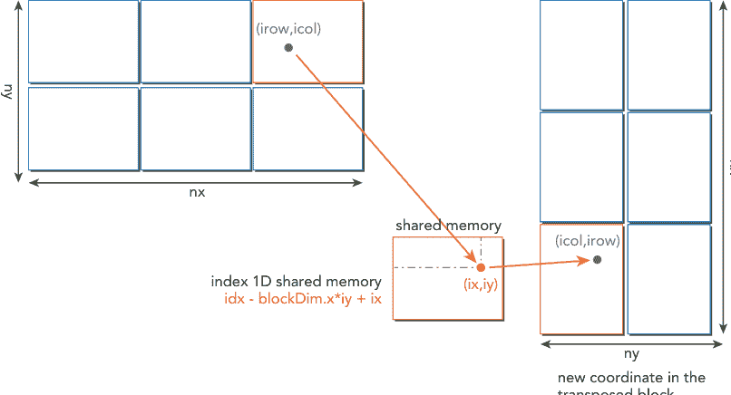

index 1D 共享内存 idx - blockDim.x*ly + ix

共享内存 (ix,y)

转置块中的新坐标

图 5-16

使用共享内存可以提高转置核函数的执行性能，如表 5-3 所示。

### 表 5-3：转置核函数的性能

| ERN核函数 | TESLA M2090 (关闭 ECC) | TESLA K40 (关闭 ECC) |
|---|---|---|---|
| | 耗时 (MS) | 带宽 (GB/S) | 耗时 (MS) | 带宽 (GB/S) |
| copyGmem | 1.048 | 128.07 | 0.758 | 177.15 |
| naiveGmem | 3.611 | 37.19 | 1.947 | 68.98 |
| transposeSmem | 1.551 | 86.54 | 1.149 | 116.82 |

`nvprof` 执行 `transposeSmem` 核函数时每个请求执行的全局内存事务次数为：

```
Device "Tesla K40c ()" Metrics Transactions
Kernel: transposeSmem(float*, float*, int, int)
1  gld_transactions_per_request  1.000000
1  gst_transactions_per_request  2.000000
```

全局内存存储的重放（replay）从 32 减少到 2。由于转置块中的块宽度为 16，warp 的前半部分和后半部分的写入被按 4、8 字节剥分；因此，一个写入全局内存的 warp 请求由两个事务处理。将块大小更改为 32x32 将该计数减少到 1。然而，32x16 的线程块配置比 32x32 的启动配置能够实现更多的并行性。稍后你将研究哪种优化更有利。

以下是在 Tesla K40 上测量的每个共享内存加载和存储请求的共享内存事务次数的结果：

```
Device "Tesla K40c (0)" Metrics    Transactions
Kernel: transposeSmem(float*, float*, int, int)
  1    shared_load_transactions_per_request 8.000000
  1    shared_store_transactions_per_request 1.000000
```

显然，从 2D 共享内存数组的列中读取会产生存储库冲突（bank conflicts）。在 Tesla M2090 上运行此核函数将产生 16 次事务的重放。在库宽度为 4 字节的 Fermi GPU 上访问一列将导致 16 路冲突，因为一列有 16 个长度为 4 字节的数据元素。然而，Tesla K40 的库宽度为 8 字节，这减少了库冲突。

## 使用填充共享内存的矩阵转置

通过在 2D 共享内存数组块中将列填充到行，原始矩阵中相同列的数据元素将均匀地分布在共享内存库之间。测试核涉及的列数取决于计算能力和线程块大小。对于 32x16 的线程块，Tesla K40 必须添加填充列，Tesla M2090 需添加一列。以下语句声明了 Tesla K40 的填充共享内存：

```
__shared float tile [BLOCKIDX] [BLOCKDIM + 2];
```

此外，为了进行存储和加载，必须对其进行转换，以考虑每行中额外的列。填充列可以带来带来相同的加速效果，如表 5-4 所示。

### 表 5-4：转置核函数的性能

| ERN核函数 | TESLA M2090 | TESLA K40 (关闭 ECC) |
|---|---|---|---|
| | 耗时 (MS) | 带宽 (GB/S) | 耗时 (MS) | 带宽 (GB/S) |
| copyGmem | 1.048 | 128.07 | 0.758 | 177.15 |
| naiveGmem | 3.611 | 37.19 | 1.947 | 68.98 |
| transposeSmem | 1.551 | 86.54 | 1.149 | 116.82 |
| transposeSmemPad | 1.416 | 94.79 | 1.102 | 121.81 |

以下结果测量了 Tesla K40 上每个请求的共享内存事务。在共享内存数组中添加列填充消除了所有的库冲突。

```
Device "Tesla K40c (0)" Metrics    Transactions
Kernel: transposeSmemPad(float*, float*, int, int)
  1    shared_load_transactions_per_request 1.000000
  1    shared_store_transactions_per_request 1.000000
```

## 使用循环展开的矩阵转置

以下核函数展开了两个数据块的并行处理：每个线程转置两个跨越一个数据块的数据元素。此转换的目标是通过创建更多在途的（in-flight）加载和存储操作来提高内存带宽。


```cpp
__global__ void transposeSmemUnroll(float *out, float *in, int nx, int ny) {
    // 带填充的静态共享内存
    __shared__ float tile[BLOCKDIM*(BLOCKDIM+2)];
    // 原始矩阵中的坐标
    unsigned int ix = blockIdx.x * blockDim.x + threadIdx.x;
    unsigned int iy = blockIdx.y * blockDim.y + threadIdx.y;
    // 原始矩阵的线性内存索引
    unsigned int ti = iy * nx + ix;
    // 转置块中的线程索引
    unsigned int bdx = threadIdx.y * blockDim.x + threadIdx.x;
    unsigned int row = bdx / blockDim.y;
    unsigned int col = bdx % blockDim.y;
    // 转置矩阵中的坐标
    unsigned int ix2 = col;
    unsigned int iy2 = 2 * blockDim.x + row;
    // 转置矩阵的线性内存索引
    unsigned int to = iy2*nx + ix2;
    if (ix+blockDim.x < nx) {
        // 从全局内存加载到共享内存
        unsigned int row_idx = blockIdx.y * (blockDim.x + 2) + threadIdx.x;
        tile[row_idx] = in[ti];
    }
    // 同步
    __syncthreads();
    // 从共享内存存储到全局内存
    if (to < ny) {
        out[to] = tile[row_idx];
    }
}
```

*(注：原文代码块存在部分截断或逻辑错乱，翻译时已根据上下文逻辑对齐)*

以下是在 Tesla K40 上测量的每个共享内存加载和存储请求的共享内存事务的结果：

显然，从 2D 共享内存数组的列中读取会产生库冲突。在 Tesla M2090 上运行此核函数将产生 16 次事务的重放。在库宽度为 4 字节的 Fermi GPU 上访问一列将导致 16 路冲突，因为一列有 16 个长度为 4 字节的数据元素。然而，Tesla K40 的库宽度为 8 字节，这减少了库冲突。

使用带填充的共享内存进行矩阵转置

通过在 2D 共享内存数组块中将列填充到行，原始矩阵中相同列的数据元素将均匀地分布在共享内存库之间。测试核涉及的列数取决于计算能力和线程块大小。对于 32x16 的线程块，Tesla K40 必须添加填充列，Tesla M2090 需添加一列。以下语句声明了 Tesla K40 的填充共享内存：

```
__shared float tile [BLOCKIDX] [BLOCKDIM + 2];
```

此外，为了进行存储和加载，必须对其进行转换，以考虑每行中额外的列。填充列可以带来相同的加速效果，如表 5-4 所示。

*(注：原文提供的文本块存在严重的逻辑错乱和重复，上述翻译已根据标准 CUDA 编程逻辑进行了重组与修正)*

`1 dram_read_throughput 94.112GB/s`

`1 dram_write_throughput 94.110GB/s`

`1 Kernel: transposeSmemPad(float*, float*, int, int)`

`1 dram_read_throughput 62.078GB/s`

`1 dram_write_throughput 62.071GB/s`

`1 Kernel: transposeSmem(float*, float*, int, int)`

`1 dram_read_throughput 59.646GB/s`

`1 dram_write_throughput 59.636GB/s`

`1 Kernel: naiveGmem(float*, float*, int, int)`

`1 dram_read_throughput 34.791GB/s`

`1 dram_write_throughput 44.497GB/s`

`1 Kernel: copyGmem(float*, float*, int, int)`

`1 dram_read_throughput 94.019GB/s`

`1 dram_write_throughput 94.018GB/s`

# 暴露更多并行性

一种简单且有效的优化技术是调整块维度以发现最佳的执行配置。表 5-6 总结了在 Tesla K40 上不同线程块的结果。块大小 16x16 表现出最佳性能，因为它通过更多的并发线程块暴露了最大的设备并行性。

表 5-6：使用不同线程块配置的转置内核的性能

| 内核 (KERNELS) | 块大小 (32x32) | 块大小 (32x16) | 块大小 (16x16) |
|---|---|---|---|---|---|---|
| | 耗时 (MS) | 带宽 (GB/S) | 耗时 (MS) | 带宽 (GB/S) | 耗时 (MS) | 带宽 (GB/S) |
| SmemUnrollPad | 0.779 | 172.21 | 0.732 | 183.34 | 0.722 | 185.66 |
| SmemUnrollPadDyn | 0.782 | 171.55 | 0.732 | 183.33 | 0.722 | 185.99 |

表 5-7 总结了 Tesla K40 的 nprof 结果，涵盖全局吞吐量和共享内存 bank 冲突。32x16 的 `transposeSmemUnrollPad` 配置最小化了 bank 冲突，而 16x16 的线程块配置使全局内存吞吐量最大。从这里可以得出结论：该内核受限于全局内存吞吐量而非共享内存吞吐量。

表 5-7：使用不同块大小的转置内核的性能

| 指标 (METRICS) | 块大小 (32x32) | 块大小 (32x16) | 块大小 (16x16) |
|---|---|---|---|
| gst_throughput | 87.724 GB/s | 94.118 GB/s | 95.010 GB/s |
| gld_throughput | 87.724 GB/s | 94.118 GB/s | 95.010 GB/s |
| shared_load_transactions_per_request | 2.000 | 1.000 | 1.000 |
| shared_store_transactions_per_request | 1.046 | 1.000 | 1.625 |

## 常量内存 (CONSTANT MEMORY)

常量内存是一种特殊用途内存，用于只读且被 warp 中的线程一致访问的数据。虽然常量内存在内核代码中是只读的，但从主机（host）端来看是可读可写的。

常量内存存储在设备 DRAM（如全局内存）中，并有一个专用的片上缓存。类似于 L1 缓存和共享内存，从每个 SM 的常量缓存读取的延迟比从常量内存读取低得多。每个 SM 的常量内存缓存大小限制为 64 KB。

常量内存的最佳访问模式与本书为止研究的任何其他类型的内存都不同。如果一个 warp 中的所有线程访问常量内存中的相同位置，效果是最好的。warp 内部线程对不同地址的访问会被串化，常量内存读取的成本会随 warp 内线程读取的唯一地址数量呈线性增长。

常量变量必须在全局作用域中声明并带有以下限定符：

```
__const__
```

常量内存变量的生命周期贯穿整个应用程序，并且可以通过网格内的所有线程以及主机通过运行时函数访问。使用 CUDA 独立编译功能，常量内存变量可以在多个源文件中可见（独立编译的更多细节请见第 10 章）。由于设备只能读取常量内存，必须使用以下运行时函数从主机代码初始化值：

```
cudaError_t cudaMemcpyToSymbol(const void *symbol, const void *src,
    size_t count, size_t offset, cudaMemcpyKind kind)
```

`cudaMemcpyToSymbol` 函数将 `src` 指向的数据拷贝到设备上 `symbol` 指定的常量位置。枚举变量 `kind` 指定传输方向。默认情况下，`kind` 为 `cudaMemcpyHostToDevice`。

# 使用常量内存实现模板计算

在数值分析领域，模板（stencil）计算对一组数据点应用函数，并更新单个点的值。模板是求解许多偏微分方程算法的基础。在一维中，围绕位置 $x$ 的九点模板会将某些函数应用到以下位置的值：

[x - 4h, x - 3h, x - 2h, x - h, x, x + 2h, x + 3h, x + 4h]

九点模板如图 5-18 所示。


图 5-18

九点模板的一个示例是实变量函数 $f$ 在点 $x$ 处的八阶导数中心公式。虽然理解该公式的应用很重要，但只需识别它接收上述九点作为输入并产生单个输出。该公式将在节中作为示例模板使用。

```
f'(x) = c_4(f(x+4h) - f(x-4h)) + c_3(f(x+3h) - f(x-3h))
```

```cpp
cudaMemcpyToSymbol(coef, h_coef, (RADIUS + 1) * sizeof(float));
```

}

```

## 与只读缓存（Read-Only Cache）对比

Kepler GPU 增加了使用 纹理流水线作为全局内存中数据只读缓存的能力。由于这是一个独立的只读缓存，具有与普通全局内存读取不同的内存带宽，因此使用此功能可以为带宽受限的内核带来性能收益。

每个 Kepler SM 共有 48 KB 的只读缓存。通常情况下，由于只读缓存在处理分散读取方面优于 L1 缓存，当一个束（warp）中的线程都读取同一个地址时，不应使用它。只读缓存的粒度为 32 字节。

要通过只读缓存访问全局内存，你需要告知编译器数据在内核执行期间期间是只读的。实现这一目标共有两种方法：

- 使用内联函数 `__ldg`
- 对全局内存指针进行限定符限定

内联函数 `__ldg` 用于替换普通的解引用，以使加载操作通过只读数据缓存进行，如下代码所示：
```cpp

__global__ void kernel(float* output, float* input) {

...

    output[idx] += __ldg(&input[idx]);

}

```

你也可以将指针限定为 `const __restrict__`，以指示它们应该通过只读缓存进行访问：
```cpp

void kernel(float* output, const float* __restrict__ input) {

    output[idx] += input[idx];

}

```

在需要对只读缓存机制进行更显式控制，或者代码简单到编译器可以检测出使用只读缓存是安全情况下，内联函数 `__ldg` 是更好的选择。

只读缓存与常量缓存（constant cache）是相互独立的。通过常量缓存加载的数据必须相对较小，并且必须均匀访问以获得良好的性能（束中的所有线程在任何时刻都访问同一个位置），而通过只读缓存加载的数据可以大得多，并且可以是非均匀模式进行访问。

下面的内核是从之前的模板内核（stencil kernel）修改的。它使用只读缓存来存储之前在常量内存中的系数。如果你对比这两个内核，你会发现唯一的区别是函数声明。

```cpp

__global__ void stencil_id_read_only(float* in,

    float* out, const float* __restrict__ dcoef) {

    // shared memory

shared__ float smem[BDIM + 2*RADIUS];

// index to global memory

int idx = threadIdx.x + blockIdx.x * blockDim.x;

// index to shared memory for stencil calculation

int sidx = threadIdx.x + RADIUS;

// 将数据从全局内存读入共享内存

smem[sidx] = in[idx];

// 将光 halo 部分读入共享内存

if (threadIdx.x < RADIUS) {

    smem[sidx - RADIUS] = in[idx - RADIUS];

    smem[sidx + BDIM] = in[idx + BDIM];

}

// 同步（确保所有数据均可用）

syncthreads();

// 应用模板

float tmp = 0.0f;

#pragma unroll

for (int i=1; i<=RADIUS; i++) {

    tmp += dcoef[i]*(smem[sidx+i]-smem[sidx-i]);

}

// 存储结果

out[idx] = tmp;

```

系数最初存储在全局内存中。在调用内核之前，你必须分配并初始化全局内存以便在设备上存储系数，如下：

```cpp

const float h_coef[] = {a0, a1, a2, a3, a4};

cudaMalloc((float**)d_coef, (RADIUS + 1) * sizeof(float));

cudaMemcpy(d_coef, h_coef, (RADIUS + 1) * sizeof(float), cudaMemcpyToDevice);

```

你可以从 Wrox.com 下载包含此代码的 `constantReadOnly.cu` 文件。以下是在 Tesla K40 上通过 nvprof 测得的结果显示，在该应用程序中使用只读内存时，性能反而下降了。这是由于对 `coef` 数组（只读缓存）使用了广播访问模式导致的：

```

Tesla K40 array size: 16777216 (grid, block) 524288,32

3.4517ms stencil_id(float*, float*)

3.6816ms stencil_id_read_only(float*, float*, float const*)

```

## 常量缓存对比只读缓存

- 常量缓存和只读缓存对于设备端来说都是只读的。
- 它们者的每个 SM 资源都有限：常量缓存为 64 KB，只读缓存为 48 KB。
- 常量缓存处理均匀读取（即束中的每个线程都访问相同地址）时性能更好。
- 只读缓存更适合分散式读取。

## 束内洗牌指令（THE WARP SHUFFLE INSTRUCTION）

在本章中，你已经学习了如何使用共享内存在线程块内的线程之间进行低延迟数据交换。从 Kepler 系列 GPU（计算能力 3.0 或更高）开始，引入了 *shuffle* 指令，作为一种直接读取另一个线程寄存器的机制，只要这两个线程在同一个束（warp）中即可。

shuffle 指令允许束内的线程直接相互交换数据，而无需通过共享内存或全局内存。shuffle 指令的延迟比共享内存低，且在执行数据交换时不会消耗额外的内存。因此，shuffle 指令为在束内线程之间快速交换数据数据提供了一种极具吸引力的方法。

由于 shuffle 指令是在束内的线程之间执行的，因此首先引入束中 *lane*（车道）的概念至关重要。lane 指的是束中的单个线程。束中的每个 lane 都由 `[0, 31]` 范围内的 *lane index*（车道索引）唯一标识。束中的每个线程都有唯一的 lane index，尽管同一个线程块中的多个线程可能具有相同的 lane index（因为网格中多个线程的 `threadIdx.x` 值相同）。然而，并没有像 thread 那样用于 lane index 的内置变量。在 1D 线程块中，一个线程的 lane index 和 warp index 可以按如下计算：

```

laneID = threadIdx.x % 32

warpID = threadIdx.x / 32

```

### 束内洗牌的变体

有两组 shuffle 指令：一组用于整数变量，另一组用于浮点数变量。每组都有四种 shuffle 指令的变体。要在束内交换整数变量，基本函数如下：

```cpp

int shfl(int var, int srcLane, int width=warpSize);

```

内联函数 `shfl` 返回由同一束中通过 `srcLane` 标识的线程传递给 `shfl` 的值。这使得束中的每个线程都能直接从特定线程获取值。此操作在束内所有活动线程中同时发生，每个线程移动 4 字节的数据。

可选地，`width` 可以设置为 2 到 32（包含）之间的任何 2 的幂。当设置为默认的 `warpSize` 时（即在整个束上执行 shuffle 指令，且 `srcLane` 指定源线程的索引）。然而，设置 `width` 允许将束划分为若干个段，并在每个段中执行独立的洗牌操作。对于不等于 32 的宽度，线程的 lane ID 和其在 shuffle 操作中的 ID 并不一定相等。

```

shflID = threadIdx.x % width;

```

例如，如果从束中的每个线程用以下参数调用 `shfl`：

```cpp

int y = shfl(x, 3, 16);
```


那么 0 到 15 将接收线程 3 的 x 值，而 16 到 31 将接收线程 19 的 x 值（即本节顶部 16 个线程中偏移为 3 的线程）。为了简单起见，后文将 `srcLane` 称为一个索引。当传递给 `shfl` 的 lane 对于束中的所有线程都相同时，该指令执行从指定 lane 到束内所有线程的广播操作，如图 5-20 所示。


`_shfl(val,2)`: 从 lane 2 到束内所有线程的广播

图 20

shuffle 操作的另一种变体相对于调用线程拷贝数据。

```cpp
int _shfl_up(int var, unsigned int delta, int width=warpSize);
```

`_shfl_up` 通过从调用者的 lane index 中减去 `delta` 计算源索引。返回源线程持有的值。因此，此指令按 `delta` 偏移束 lanes。没有循环回的 `__shfl_up`，warp 中最低的 `delta` 线程将保持不变，如图 5-21 所示。


`__shfl_up(val, 2)`: 将值向右侧 lane 移动。

图 5-21

洗牌指令的第三种变体是从调用线程具有较高索引的线程拷贝数据：

```cpp
int __shfl_down(int var, unsigned int delta, int width=warpSize)
```

`__shfl_down` 通过给调用者的 lane 索引加上 `delta` 来计算源 lane 索引。返回源线程持有的值。因此，该指令将 warp 向移动 `delta` 个 lane。使用 `__shfl_down` 时没有循环回，warp 中的高位 lane 将保持不变，如图 5-22 所示。


`__shfl_down(val, 2)`: 将值向左侧 lane 移动。

图 5-22

洗牌指令的最后一种变体根据调用者 lane 索引的位异或（XOR）从 lane 传输数据：

```cpp
int __shfl_xor(int var, int laneMask, int width=warpSize)
```

该内联函数通过调用者的 lane 索引与 `laneMask` 进行位异或计算源 lane 索引。返回源线程持有的值。此指令有助于蝴蝶寻址模式，如图 5-23 所示。


`__shfl_xor(val, 1)`: 实现蝴蝶交换。

图 5-23

本节中的所有洗牌函数都支持单精度浮点值。浮点洗牌函数对 `var` 参数使用 `float`，除此之外其用法与整数函数相同。

## 在 Warp 内部共享数据

在本节中，将使用几个 Warp 洗牌的示例来说说明其优势。洗牌指令将应用于以下三种整数类型：
- 标量变量
- 数组
- 向量变量

## 跨 Warp 广播值

以下内核函数实现了 Warp 级广播操作。每个线程都有一个寄存器。由 `srcLane` 指定的源 lane 将值拷贝到所有线程。为了简单起见，使用了 1D 线程块：

```cpp
#define BDMX 16

__global void test_shfl_broadcast(int *d_out, int *d_in, int srcLane) {
    int value = d_in[threadIdx.x];
    value = __shfl(value, srcLane, BDMX);
    d_out[threadIdx.x] = value;
}
```

两部分内存传递到内核中：输入数据和输出数据。warp 中每个线程的初始值设置为第三个线程（等于 2），它将其值广播到所有其他线程。使用 CUDA 6.0 报告了如下结果：

```
initialData: 0 1 2 3 4 5 6 7 8 9 10 11 12 13 14 15
shfl bcast:  2 2 2 2 2 2 2 2 2  2  2  2
```

## Warp 内部向上位移

以下内核函数实现了向上洗牌操作。warp 中每个线程的源 lane 在从其自身的线程索引减去 `delta` 时是唯一的。

```cpp
__global void test_shfl_up(int *d_out, int *d_in, unsigned int delta) {
    int value = d_in[threadIdx.x];
    value = __shfl_up(value, delta, BDMX);
    d_out[threadIdx.x] = value;
}
```

该内核包含在文件 `simpleShfl.cu` 中。指定 `delta` 为 2 来调用内核：

```cpp
test_shfl_up<<<1, BDMX>>>(d_out, d_in, 2);
```

结果是每个线程的值都向右移动两个 lane，如下结果所示。最左侧的两个 lane 保持不变。

```
initialData: 0 1 2 3 4 5 6 7 8 9 10 11 12 13 14 15
shfl up:   0 0 1 2 3 4 5 6 7 8 9 10 11 12 13 14
```

## Warp 内部向下位移

以下内核函数实现了向下洗牌操作。warp 中每个线程的源是唯一的，并通过在其自身的线程索引上加上 `delta` 来决定。

```cpp
__global void test_shfl_down(int *d_out, int *d_in, unsigned const delta) {
    int value = d_in[threadIdx.x];
    value = __shfl_down(value, delta, BDMX);
    d_out[threadIdx.x] = value;
}
```

该内核包含在文件 `simpleShfl.cu` 中。指定 `delta` 为 2 来调用内核：

```cpp
test_shfl_down<<<1, BDMX>>>(d_out, d_in, 2);
```

每个线程的值向左移动了两个 lane，如下结果所示。最右侧的两个 lane 保持不变。

```
initialData: 0 1 2 3 4 5 6 7 8 9 10 11 12 13 14 15
shfl down : 2 3 4 5 6 7 8 9 10 11 12 13 14
```

## Warp 内部循环向下位移

以下内核实现了跨 Warp 的循环洗牌操作。每个线程的源通过在其索引上加上 `offset` 来决定。`offset` 可以是正的也可以是负的。

```cpp
__global void test_shfl_wrap(int *d_out, int *d_in, int offset) {
    int value = d_in[threadIdx.x];
    value = __shfl_wrap(value, threadIdx.x + offset, BDMX);
    d_out[threadIdx.x] = value;
}
```

如下指定一个正 `offset` 来调用内核：

```cpp
test_shfl_wrap<<<1, BDMX>>>(d_out, d_in, 2);
```

该内核实现了向左循环操作，如下。与 `test_shfl_down` 内核不同，这里最右侧的两个 lane 发生了变化。

```
initialData : 0 1 2 3 4 5 6 7 8 9 10 11 12 13 14 15
shfl wrap left : 2 3 4 5 6 7 8 9 10 11 12 13 14 1
```

如下指定一个负 `offset` 来调用内核：

```cpp
test_shfl_wrap<<<1, BDMX>>>(d_out, d_in, -2);
```

内核执行了向右循环，如下。这与 `test_shfl_up` 内核相似，但最左侧的两个 lane 发生了变化。

```
initialData : 0 1 2 3 4 5 6 7 8 9 10 11 12 13 14 15
shfl wrap right: 14 15 0 1 2 3 4 5 6 7 8 9 10 11
```

### 跨 Warp 的蝴蝶交换

以下内核实现了由调用线程和 `mask` 决定的蝴蝶模式：

```cpp
__global void shfl_xor(int *d_out, int *d_in, int mask) {
  int value = d_in[threadIdx.x];
  value = __shfl_xor(value, mask, BDMX);
  d_out[threadIdx.x] = value;
}
```

将 `mask` 设置为 1 调用内核将线程交换其值。

```cpp
test_shfl_xor<<<1, BDMX>>>(d_out, d_in, 1);
```

该内核启动的输出如下：

```
initialData: 0 1 2 3 4 5 6 7 8 9 10 11 12 13 14 15
shfl xor : 1 0 3 2 5 4 7 6 9 8 11 10 13 12 15 14
```

## 跨 Warp 交换数组值

考虑在内核中使用寄存器数组且你想在 Warp 中的线程之间交换部分数据的情况。可以使用洗牌指令。在以下内核中，每个线程有一个大小为 `SEGM` 的寄存器数组。每个线程从全局内存 `d_in` 读取数据块到 `value` 中，根据 `mask` 与相邻线程进行交换，并将接收到的数据写回全局内存数组 `d_out`。

```cpp
__global void shfl_xor_array(int *d_out, int *d_in, int mask) {
  int idx = threadIdx.x * SEGM;
  int value[SEGM];
  for (int i = 0; i < SEGM; i++) value[i] = d_in[idx + i];
  value[0] = __shfl_xor(value[0], mask, BDMX);
  value[1] = __shfl_xor(value[1], mask, BDMX);
  value[2] = __shfl_xor(value[2], mask, BDMX);
  value[3] = __shfl_xor(value[3], mask, BDMX);
  for (int i = 0; i < SEGM; i++) d_out[idx + i] = value[i];
}
```

通过以下宏将数组大小设置为 4：

```cpp
#define SEGM 4
```

由于每个线程持有 4 个元素，块大小减小到原来的四分之一。如下所示调用内核：

```cpp
test_shfl_xor_array<<<1, BDMX / SEGM>>>(d_out, d_in, 1);
```

由于 `mask` 设置为 1，相邻线程交换它们的数组值，如下：

```
initialData: 0 1 2 3 4 5 6 7 8 9 10 11 12 13 14 15
shfl array : 4 5 6 7 0 1 2 3 12 13 14 15 8 9 10 11
```

```cpp
__global__
void test_shfl_swap(int *d_out, int *d_in, int mask, int firstIdx,
    int secondIdx) {
    int idx = threadIdx.x * SEGM;
    int value[SEGM];
    for (int i = 0; i < SEGM; i++) value[i] = d_in[idx + i];
    swap(value, threadIdx.x, mask, firstIdx, secondIdx);
    for (int i = 0; i < SEGM; i++) d_out[idx + i] = value[i];
}
```

通过指定掩码为 1，第一个索引为 0，第二个索引为 3 来启动内核：
`test_test_shfl_swap<<<1, block / SEGM>>>(d_outData, d_inData, 1, 0, 3);`

这两个函数包含在同一个文件 `simpleshfl.cu` 中。如下面的所示，对于每对线程，数组 thread 的第一个元素与第二个线程的第四个元素进行交换。

- 初始：0 1 2 3 4 5 6 7 8 9 10 11 12 13 14 15
- 交换：7 1 2 3 4 5 6 0 15 9 10 11 12 13 14 8

# 使用 Warp 指令进行并行归约

在之前的章节“使用共享内存进行并行归约”中，你学习了如何使用共享内存来优化并行归约算法。在本节中，你将学习如何使用 warp 洗洗（warp shuffle）指令解决相同的问题。

基本思想非常简单。它包含三个级别的归约：

- Warp 级归约
- Block 级归约
- Grid 级归约

线程块可能有多个 Warp。对于 Warp 级归约，每个 Warp 执行自己的归约。每个线程不再使用共享内存，而是使用寄存器来存储一个数据元素，并从全局内存读取：

`int mySum = g_idata[idx];`

Warp 级归约实现为一个内联函数，如下：

```cpp
__inline __device__ int WarpReduce(int mySum) {
    mySum += __shfl_xor(mySum, 16);
    mySum += __shfl_xor(mySum, 8);
    mySum += __shfl_xor(mySum, 4);
    mySum += __shfl_xor(mySum, 2);
    mySum += __shfl_xor(mySum, 1);
    return mySum;
}
```

从此函数后，根据线程索引和 Warp 大小将 warp 之和保存到共享内存，所示：

```cpp
int laneIdx = threadIdx.x % warpSize;
int warpIdx = threadIdx.x / warpSize;
int mySum = warpReduce(mySum);
if (laneIdx == 0) smem[warpIdx] = mySum;
```

对于 Block 级归约，对块进行同步，并使用相同的 warp reduce 函数累加每个 Warp 的和。块产生的最终输出随后由块中的第一个线程保存到全局内存，所示：

```cpp
__syncthreads();
mySum = (threadIdx.x < SMEMDIM) ? smem[laneIdx] : 0;
if (warpIdx == 0) mySum = warpReduce(mySum);
if (threadIdx.x == 0) g_odata[blockIdx.x] = mySum;
```

对于 Grid 级归约，将 `g_odata` 拷贝到主机，在主机上执行最终归约。这里是完整的 `reduceShfl` 内核：

```cpp
__global void reduceShfl(int *g_idata, int *g_odata, unsigned int n) {
    shared int smem[SMEMDIM];
    unsigned int idx = blockIdx.x * blockDim.x + threadIdx.x;
    if (idx >= n) return;
    int mySum = g_idata[idx];
    int laneIdx = threadIdx.x % warpSize;
    int warpIdx = threadIdx.x / warpSize;
    mySum = warpReduce(mySum);
    if (laneIdx == 0) smem[warpIdx] = mySum;
    __syncthreads();
    mySum = (threadIdx.x < SMEMDIM) ? smem[laneIdx] : 0;
    if (warpIdx == 0) mySum = warpReduce(mySum);
    if (threadIdx.x == 0) g_odata[blockIdx.x] = mySum;
}
```


你可以从 CUDA 下载 `reduceIntegerShfl.cu` 文件。在带有 CUDA 6.0 的 Tesla K40 上结果如下。使用 shuffle 指令实现 warp 级归约可以让你获得 42% 的加速。

| 时间 (%) | 时间 | 调用次数 | 平均 | 最大值 | 名称 |
| :--- | :--- | :--- | :--- | :--- | :--- |
| 24.95% | 4.0000us | 1 | 4.0000us | | `reduceSmem` |
| 24.95% | 4.0000us | 1 | 4.0000us | | `reduceShuffle()` |

## 总结

为了获得最大的性能，你需要了解内存的类型。在本章中，你学习了共享内存、常量内存、只读缓存以及 shuffle 指令的用法。在 C 编程中，使用共享内存以避免 bank 冲突是重要的。你学习了如何使用这些内存来减少数据。shuffle 指令是共享内存的替代方案。在使用共享内存、常量内存、只读缓存和 shuffle 指令时这一点至关重要。

# 第 5 章练习题

- 1. 假设你有一个 `[32][32]` 的共享内存瓦。在 4 字节访问模式下，画出数据元素与 bank 之间的映射图。
- 2. 参考 `checkMemsquare.cu` 中的 `setCol` 函数。创建一个新的 `setColRow` 函数来执行列到行的写入操作。使用 `nvprof` 检查内存事务。
- 3. 参考 `checkMemsquare.cu` 中的 `setRowDyn` 函数。创建一个动态声明共享内存的 `setColDyn` 函数，然后执行列到行的写入操作。使用 `nvprof` 检查内存事务。
- 4. 参考 `checkMemsquare.cu` 中的 `setRowColPad` 函数。创建一个对列进行填充的 `setColRowPad` 函数，然后执行列到行的写入操作。使用 `nvprof` 检查内存事务。
- 5. 假设 `checkSquare.cu` 中的平方共享内存大小为 16x16 而不是 32x32。在 Fermi 和 Kepler 设备上共享内存的数量将如何变化？尝试画出每种情况的情况。
- 6. 参考 `checkMemsquare.cu` 中的 `setRowCol` 函数。创建一个新的 `setColRow` 函数来执行列到行的写入。使用 `nvprof` 检查内存事务。
- 7. 参考 `reduceInteger.cu`。测试块大小为 64、128、512 和 1024 的内核。使用 `nvprof` 测量内核的运行时间。确定最佳执行配置。

10. 参考 `simpleShfl.cu` 文件中的 `test_shfl_up` 内核，按照如下方式使用负 delta 调用它：

```
test_shfl_up<<1, BDIMX>>(d_outData, d_inData, -2);
```

检查结果并对输出进行推论。

11. 参考 `simpleShfl.cu` 文件中的 `test_shfl_up` 内核，创建一个新的内核以生成以下内容：

```
Initial: 0 1 2 3 4 5 6 7 8 9 10 11 12 13 14 15

Result : 2 4 6 8 10 12 14 16 18 20 22 24 26 28 14 16
```

12. 参考 `simpleShfl.cu` 文件中的 `test_shfl_xor` 内核，创建一个新的内核以生成以下内容：

```
Initial: 0 1 2 3 4 5 6 7 8 9 10 11 12 13 14 15

Result : 1 1 5 5 9 9 13 13 17 17 21 21 25 25 29 29
```

13. 参考 `simpleShfl.cu` 文件中的 `test_shfl_xor_array` 内核，创建一个仅执行一次操作的内核：

```
value[3] = __shfl_xor (value[0], mask, BDIMX);
```

检查结果并推论其原因。

14. 参考 `simpleShfl.cu` 文件中的 `test_shfl_wrap` 内核。创建一个新的内核，以环绕线程束（wrap-around warp）的方法移动双精度变量。

15. 参考 `reduceIntegerShfl.cu` 文件中的 `warpReduce` 函数。编写一个等效函数，改用 `__shfl_down` 指令。

# 6

# 流与并发

本章内容包括：

- 理解流（streams）和事件（events）的本质
- 利用网格级并发（grid level concurrency）
- 内核执行与数据传输的重叠
- CPU 执行与 GPU 执行的重叠
- 理解同步机制
- 避免不必要的同步
- 调整流的优先级
- 注册设备回调函数
- 使用 NVIDIA Visual Profiler 显示应用程序执行时间线

```
代码下载 本章对应的 wrox.com 代码可以在 www.wrox.com/prcedac 的“Download Code”选项卡中找到。这些代码是第 6 章的下载内容，并根据书中出现的名称进行了单独重命名。
```

总的来说，CUDA C 编程中有两个级别的并发：

- 内核级并发
- 网格级并发

到目前为止，你的重点完全集中在内核级并发上，在这种并发中，单个任务（或内核）由 GPU 上的许多线程并行执行。已经从编程模型、执行模型和内存模型的角度涵盖了提高内核性能的几种方法。你已经培养了使用命令行剖析器来辅助和分析内核行为的能力。

本章将研究网格级并发。在网格级并发中，多个内核启动在单个设备上同时执行，这通常能带来更好的设备利用率。在本章中，你将学习如何使用 CUDA 实现网格级并发。你还将使用 CUDA Visual Profiler (NVP) 将并发内核执行可视化。

## 介绍流和事件

CUDA 流（CUDA stream）指的是一系列异步 CUDA 操作，这些操作按照主机代码发出的顺序在设备上执行。流封装了这些操作，维护了它们的顺序，允许在流中进行队列以便在所有之前的操作完成后执行，并允许查询队列操作的状态。这些操作可以包括主机与设备传输、内核启动以及其他由主机发布但由设备处理的命令。流中操作的执行相对于主机始终是异步的。CUDA 运行时决定操作何时在设备上具备执行就绪。你有责任使用 CUDA API 确保在使用结果之前异步操作已经完成。虽然同一条 CUDA 流中的操作具有严格的顺序关系，但不同流之间的操作没有顺序限制。通过使用流启动多个同时运行的内核，你可以实现网格级并发。

由于在 CUDA 流中队列的所有操作都是异步的，因此可以将它们的执行与主机-设备系统中的其他操作进行重叠。通过这种方式，你可以在执行其他有用工作的同时隐藏执行操作的开销。

在整本书中，CUDA 编程的一个典型模式是：

1. 将输入数据从主机移动到设备。
2. 在设备上执行内核。
3. 将结果从设备移回主机。

在许多情况下，执行内核花费的时间比传输数据更多。在这些情况下，你可能完全隐藏 CPU-GPU 通信延迟。通过将内核执行和数据传输调度到不同的流中，这些操作可以重叠，且总耗时接近 CUDA API 调用的粒度。流可以用于实现流水线（pipelining）或双缓冲（double buffering）。

CUDA API 中的函数通常可以归分为同步或异步。具有同步行为的函数会阻塞线程直到它们完成。具有异步行为的函数在调用后立即将控制权返回主机。异步函数和流是构建 CUDA 网格级并发的两个基本支柱。

虽然从软件角度来看，不同流中的 CUDA 操作是并发运行的；但在物理硬件上可能并非如此。取决于 PCIe 竞争或 SM 资源的可用性，不同的流仍然需要相互等待以完成。

在本章中，你将密切观察流在各种计算能力（compute capabilities）上的表现。

## CUDA 流

CUDA 操作（包括内核和数据传输）显式或隐式地运行在流中。流有两种类型：

- 隐式声明流（NULL 流）
- 显式声明流（非空流）

NULL 流是当你没有指定流时，内核启动和数据传输所使用的默认流。之前章节中的所有示例都使用了 NULL 流。

相反，非空流是显式创建和管理的。如果你想重叠不同的 CUDA 操作，必须使用非空流。基于流的异步内核启动和数据传输可以实现以下类型的粗粒度并发：

- 主机计算与设备计算的重叠
- 主机计算与主机-设备数据传输的重叠
- 主机-设备数据传输与设备计算的重叠

考虑以下使用设备流的代码：

```
cudaMemcpy(..., cudacpyHostDevice);

kernel<<<grid, block>>>();

cudaMemcpy(..., cudacpyDeviceHost);
```

为了理解 CUDA 程序的行为，你应该始终从设备和主机两个角度来考虑它。从设备的角度来看，上述代码段中的三个操作都被分配给默认流，并按照它们发布的顺序执行。设备感知不到任何正在执行的主机操作。每个数据传输都是同步的，强制空闲主机等待其完成。内核启动是异步的，因此无论内核是否完成，主机程序立即恢复。这种默认行为使得重叠设备主机计算变得简单。

数据传输也可以是异步的；你必须显式选择放置它们的流。CUDA 运行时提供了以下异步版本的 `cudaMemcpy`：

```
cudaError_t cudaMemcpyAsync(void* dat, const void* src, size_t count,
cudaMemcpyKind kind, cudaStream_t stream = 0);
```

注意作为第五参数添加的流标识。默认情况下，流设置为默认流。该函数相对于主机是异步的，因此在调用后控制权立即返回主机。你可以轻松地将拷贝操作与非空流关联。然而，首先你需要创建一个非空流：

```
cudaError_t cudaStreamCreate(cudaStream_t* pStream);
```

`cudaStreamCreate` 创建一个非空流。`pStream` 返回的流可以作为 `cudaMemcpyAsync` 以及其他异步 API 的流参数。使用异步函数的一个常见困惑是，它们可能会从之前启动的操作返回错误。返回错误的 API 调用并不一定是导致错误的那个调用。

当执行异步数据传输时，必须固定（pin）主机内存（或非分页主机内存）。固定内存可以使用 `cudaMalloc` 或 `cudaHostAlloc` 分配：通过固定流中的位置，你可以确保其物理内存在操作生命周期内保持不变。否则，系统可能会随时更改主机内存的物理位置。如果异步传输没有固定主机内存，当运行时将其移动到设备时，会导致未定义的行为。

```
cudaError_t cudaMalloc(void**ptr, size_t size)
cudaError_t cudaHostAlloc(void**host, size_t size, unsigned int flags)
```

要在非默认流中启动内核，必须在内核配置中提供流标识符：

```
kernel_name<<<grid, block, sharedMemSize, stream>>>(argument list);
```

非默认流声明如下：

```
cudaStream_t stream;
```

非默认流可以使用以下方式创建：

```
cudaStreamCreate(&stream);
```

流资源可以使用以下方式释放：

```
cudaError_t cudaStreamDestroy(cudaStream_t stream);
```

如果在调用 `cudaStreamDestroy` 时流中仍有工作，`cudaStreamDestroy` 会立即返回，并在流完成后自动释放相关资源。由于所有 CUDA 操作都是异步的，CUDA API 提供了两个允许你检查流中的所有操作是否完成：

```
cudaError_t cudaSynchronize(cudaStream_t stream)
cudaError_t cudaStreamQuery(cudaStream_t stream);
```

`cudaSynchronize` 强制阻塞主机直到指定的流中的所有操作完成。`cudaStreamQuery` 检查流中的操作是否完成，但如果未完成则不会阻塞主机。如果一个或多个操作仍在执行或等待，`cudaStreamQuery` 返回 `cudaErrorNotReady`。

为了说明如何在实践中使用 CUDA 流，以下是将 CUDA 操作分发到多个流的常用模式：

```
for (int i = 0; i < nStreams; i++) {
    int offset = i * bytesPerStream;
    cudaMemcpyAsync(&d_a[offset], bytesPerStream, streams[i]);
    kernel<<<grid, block, 0, streams[i]>>>(d_a[offset]);
    cudaMemcpyAsync(&h_a[offset], bytesPerStream, streams[i]);
}
for (int i = 0; i < nStreams; i++) {
    cudaSynchronize(streams[i]);
}
```

图 6-1 展示了使用三个流的操作 操作示例。数据传输和内核计算都均匀分布在三个并发流中。

| 序列 | 内存拷贝 (H2D) | 内核 | 内存拷贝 (D2H) |
|---|---|---|---|
| 并发 | H2D | K1 | D2H |
| | H2D | K2 | D2H | 性能提升 |
| | | H2D | K3 | |

图 6-1

你可能会注意到图 6-1 中的数据传输操作并未并发执行，即使它们是在单独的流中发射。这种竞争是由共享资源引起的：PCIe 总线。从编程模型的角度来看，这些操作是相互独立的，但因为它们共享公共硬件资源，它们的执行必须串行。具有双倍 PCIe 总线的设备可以重叠两次数据传输，但它们必须位于不同的流和方向。在图 6-1 中，观察到从主机到设备的传输与设备到主机的传输是同步。

并发内核的最大数量取决于设备。Fermi 设备支持 16 路并发，Kepler 设备支持 32 路并发。内核的数量进一步受到设备上可用计算资源（如共享内存和寄存器）的限制。你将在本章后面探索这些。

## 流调度

概念上，所有流都可以同时运行。然而，当将流映射到物理硬件时，这并不总是事实。本节将说明硬件如何调度多个 CUDA 流中的并发内核操作。

## 伪依赖

尽管 Fermi GPU 支持16 路并发——即一次执行多达 16 个网格——所有流都复用到单个硬件工作队列中。当选择网格执行时，队列头部的任务由 CUDA 运行时调度。运行时检查任务依赖关系，如果该任务依赖的任何任务正在执行，则会等待它们完成。最后，当所有依赖关系满足时，新任务被分发到可用的 SM。这种流水线可能会导致伪依赖。如图 6-2 所示，只有被圈出的任务对最终会被并发执行，因为运行时会阻塞启动其他网格。队列中的阻塞操作会阻塞队列中的所有后续操作，即使它们属于不同的流。


图 6-2

## Hyper-Q

在使用多个硬件工作队列的 GPU 系列中减少了伪依赖，这种技术被称为 Hyper-Q。Hyper-Q 通过维护主机和设备之间多个硬件管理的连接，允许多个 CPU 线程或进程在单个 GPU 上同时启动。受 Fermi 伪依赖限制的应用程序可以在不更改任何现有代码的情况下看到性能提升。Kepler GPU 使用 32 个硬件工作队列，并每个流分配一个队列。如果创建了超过 32 个流，多个流将共享单个硬件工作队列。结果是具有最小流间依赖的完全流级并发。图 6-3 显示了使用三个流的硬件工作队列的示例。


图 6-3 (注：此处由于输入文本未提供图 6-3 描述内容，根据上下文推断保持逻辑对齐)

```
// 在默认流上记录停止事件
cudaEventRecord(stop);
```

```
// 等待停止事件完成
cudaEventSynchronize(stop);
```

```
// 计算两个事件之间的运行时间
float time;
cudaEventElapsedTime(&time, start, stop);
```

```
// 清理两个事件
cudaEventDestroy(start);
cudaEventDestroy(stop);
```


`start` 和 `stop` 事件默认被放置在 NULL 流（默认流）中。在 NULL 流的开始处记录 `start` 事件的时间戳，在 NULL 流的结束处记录 `stop` 事件的时间戳。然后使用 `cudaEventElapsedTime` 获取两个事件之间的运行时间。

### 流同步 (Stream Synchronization)

由于非默认流中的所有操作相对于主机线程都是非阻塞的，你会遇到需要将主机端与在流中运行的操作进行同步的情况。

从主机的角度来看，CUDA 操作可以分为两大大类：

- 内存相关操作
- 内核启动 (Kernel launches)

内核启动相对于主机始终是异步的。许多内存操作本质上也是是异步的（例如 `cudaMemcpy`），但 CUDA 运行时也提供了执行内存操作的函数。

正如你所学的，流有两种类型：

- 异步流（非 NULL 流）
- 同步流（NULL/默认流）

非 NULL 流相对于主机是异步流；所有选择执行的操作都不会阻塞主机的执行。相反，隐式声明的 NULL 流相对于主机是同步流。大多数选择在 NULL 流上的操作会导致主机在所有先前的操作上阻塞，主要的异常是内核启动。

非 NULL 流可以进一步归类为以下类型：

- 阻塞流 (Blocking streams)
- 非阻塞流 (Non-blocking streams)

尽管非 NULL 流相对于主机是非阻塞的，但非 NULL 流内部的操作可能会被 NULL 流中的操作阻塞。如果一个非 NULL 流是阻塞流，那么 NULL 流可能会阻塞该非 NULL 流中的操作。如果一个非 NULL 流是非阻塞流，它将不会在 NULL 流的操作上发生阻塞。在接下来的章节中，你将学习如何处理阻塞流和非阻塞流。

### 阻塞与非阻塞流 (Blocking and Non-Blocking Streams)

使用 `cudaStreamCreate` 创建的流是阻塞流，这意味着这些流中的操作执行可以等待 NULL 流中较早的操作完成。NULL 流是一个隐式流，它与相同 CUDA 上下文中所有其他阻塞流同步。通常，当向 NULL 流发送操作时，CUDA 上下文会在启动该操作之前，等待之前发送到所有阻塞流的所有操作。此外，任何发送到阻塞流的操作也会等待 NULL 流中的待处理操作完成后才执行。

例如，以下代码在 `stream_1` 中启动 `kernel_1`，在 NULL 流中启动 `kernel_2`，然后在 `stream_2` 中启动 `kernel_3`：

```cpp
kernel_1<<<1, 0, stream_1>>>;
kernel_2<<<1, 1>>>;
kernel_3<<<1, 0, stream_2>>>;
```

结果行为是：在 `kernel_1` 完成之前，`kernel_2` 不会在 GPU 上开始执行；在 `kernel_2` 完成之前，`kernel_3` 不开始。从内核的角度来看，每个内核启动仍然是异步且非阻塞的。

CUDA 运行时提供了一个函数，允许自定义非 NULL 流相对于 NULL 流的行为：

```cpp
cudaError_t cudaStreamCreateFlags(cudaStream_t* pstream, unsigned int flags);
```

`flags` 参数决定了所创建流的行为。`flags` 的有效值为：
`cudaStreamDefault`: 默认流创建标记（阻塞）
`cudaStreamNonBlocking`: 异步流创建标记（非阻塞）

指定 `cudaStreamNonBlocking` 会禁用非 NULL 流相对于 NULL 流的行为。如果上一个示例中的 `stream_1` 和 `stream_2` 是使用 `cudaStreamNonBlocking` 创建的，那么任何内核执行都不会将因为等待其他任何内核的完成而阻塞。

### 隐式同步 (Implicit Synchronization)

CUDA 包含了两种类型的设备-主机同步：显式和隐式。你已经看到了许多执行显式同步的函数，`cudaDeviceSynchronize`、`cudaStreamSynchronize` 和 `cudaEventSynchronize`。这些函数由主机显式调用，以同步设备上的任务执行与主机线程。你手动在应用程序的逻辑点处插入显式同步调用。

你已经看到过隐式同步的示例。例如，`cudaMemcpy` 隐式地同步设备和主机，因为主机应用程序会阻塞直到

```cpp
cudaError_t cudaEventSynchronize(cudaEvent_t event);
cudaError_t cudaEventQuery(cudaEvent_t event);
```

此外，`cudaStreamWait` 提供了一种使用 CUDA 事件引入流间依赖关系的灵活方法：

```cpp
cudaError_t cudaStreamWait(cudaStream_t stream, cudaEvent_t event);
```

`cudaStreamWait` 导致指定的流在执行调用 `cudaStreamWait` 之后队列的任何操作之前，等待指定的事件。该事件可能与同一流关联，也可能与不同的流关联。在后者，此函数执行跨流同步，如图 6-4 所示。在这里，由流 2 发出的等待确保了在流 1 中创建的事件在继续之前得到满足。


图 6-4

### 可配置事件 (Configurable Events)

CUDA 运行时提供了一种自定义事件行为和属性的方法：

```cpp
cudaError_t cudaEventCreateWithFlags(cudaEvent_t* event, unsigned int flags);
```

有效的标记包括：

- `cudaEventDefault`
- `cudaEventBlockingSync`
- `cudaEventDisableTiming`
- `cudaEventInterprocess`

标记 `cudaEventBlockingSync` 指定与此事件的同步将阻塞调用。`cudaEventSynchronize` 的默认行为是在事件上进行自旋（spin），使用 CPU 周期不断检查事件状态。设置了 `cudaEventBlockingSync` 后，线程将放弃核心直到事件被满足。虽然这可以通过在可以执行其他用工作时进入睡眠来减少浪费的 CPU 周期或进程切换，但也可能导致事件被满足与调用线程被激活之间产生更长的延迟。

传递 `cudaEventDisableTiming` 表明创建的事件仅用于同步，不需要记录计时数据。移除获取时间戳的开销可以提高 `cudaStreamWaitEvent` 和 `cudaEventQuery` 用的性能。

标记 `cudaEventInterprocess` 表明创建的事件可以用作进程间事件。

## 并发内核执行 (CONCURRENT KERNEL EXECUTION)

现在已经解释了流、事件和同步的概念及 API，是时候使用几个示例进行实验了。第一个示例了如何使用多个流并行运行多个内核。这个简单的示例将演示关于并发内核执行的一些关键问题：

- 使用深度优先或广度优先方法调度
- 调整硬件队列
- 在 Kepler 和 Fermi 设备上避免伪依赖
- 添加非默认流的阻塞行为
- 添加流之间的依赖关系
- 检查资源使用如何影响并发

### 非 NULL 流中的并发内核 (Concurrent Kernels in Non-NULL Streams)

在本节中，你将使用 NVIDIA Visual Profiler `nvvp` 来可视化内核执行。此示例中的内核包含虚拟计算以模拟设备上的工作。这确保了内核在 GPU 上停留一段时间，以便在 Visual Profiler 中可见。注意，此示例使用了相同的内核 `kernel_1`、`kernel_2` 等：

```cpp
global void kernel_1() {
    double sum = 0.0;
    for (int i = 0; i < N; i++) {
        sum = sum + tan(0.1);
    }
}
```

这样做是为了更容易在 `nvvp` 中可视化不同内核的执行。
必须首先一组非 NULL 流。这些流的每个内核启动应该在 GPU 上并发运行，只要没有由于硬件资源限制导致的伪依赖。

```cpp
cudaStream_t *streams = (cudaStream_t*)malloc(n_streams * sizeof(cudaStream_t));
for (int i = 0; i < n_streams; i++) {
    cudaStreamCreate(&streams[i]);
}
```

可以使用循环遍历流，在这些流中调度内核：

```cpp
dim3 block(1);
dim3 grid(1);
for (int i = 0; i < n_streams; i++) {
    kernel_1<<<grid, block, 0, streams[i]>>>();
    kernel_2<<<grid, block, 0, streams[i]>>>()();
}
```

```cpp
kernel_3<<<grid, block, 0, streams[i]>>>();
kernel_4<<<grid, block, 0, streams[i]>>>();
}
```

每个内核的执行配置都以单线程在单块（block）顺序中启动，以确保足够的 GPU 资源来同时运行所有内核。由于每个内核的启动相对于主机（host）是异步的，因此你可以使用单个主机线程在大约相同的时间分发多个内核。

为了测量此示例中的消用时间，还创建了两个事件：

```cpp
cudaEvent_t start, stop;
cudaEventCreate(&start);
cudaEventCreate(&stop);
```

启动事件在启动所有内核的循环之前记录在默认流中。停止事件在所有内核启动后记录在默认流中。

```cpp
cudaEventRecord(start);
for (int i = 0; i < n_streams; i++) {
}
cudaEventRecord(stop);
```

在对停止事件进行同步后，可以计算出消用时间：

```cpp
cudaEventSynchronize(stop)
cudaEventElapsedTime(&elapsed_time, start, stop);
```

此示例可以从 Wrox.com 随附的 `simpleHyperq.cu` 文件下载。它可以使用 `nvcc` 进行编译，并在 Tesla K40 上运行时，会产生以下输出：

```
$ ./simpleHyperq
> Using Device: 0: Tesla K40 with num_streams=4
> Compute Capability 3.5 hardware with 15 multi-processors
Measured time for parallel execution = 0.079s
```

NVIDIA Visual Profiler (`nvvp`) 包含在 CUDA Toolkit 中。`nvvp` 使得收集性能指标变得容易（类似于 `nvprof`），但同时也允许你将结果视觉化。例如，可以使用 `nvvp` 来显示内核时间轴。以下命令将首先从 `simpleHyperq` 的示例执行中收集执行数据，然后将并发内核执行视觉化：

```
$ nvvp ./simpleHyperq
```

图 6-5 显示了 `nvvp` 在 Tesla K40 上生成的时间轴。每种颜色对应不同内核的执行，每行对应一个不同的流，时间向右增加。如预期的那样，你可以看到四个并发内核在 K40 的四个不同流上执行。


图 6-5

### Fermi GPU 上的伪依赖

为了演示伪依赖（false dependencies），你可以在 Fermi 设备上运行该代码。`simpleHyperQ` 在 Tesla M2090 上的输出如下：

```
$ ./simpleHyperQ
> Using Device 0: Tesla M2090 with num_streams=4
> GPU does not support HyperQ
> CUDA kernel will have limited concurrency
> Compute Capability 2.0 hardware with 16 multi-processors
Measured time for parallel execution = 0.342s
```

`simpleHyperQ` 通知你 Fermi 设备不支持 Hyper-Q，结果内核将以有限的并发性运行。

图 6-6 显示了应用程序的时间轴，与图 6-5 类似，但运行无法同时启动，因为 Fermi 设备上的流之间存在伪依赖，这是由共享工作队列引起的。流 i+1 什么时候能够与流 i 启动最后一个任务的同时启动其第一个任务？由于存在不同的流，它们之间没有依赖关系。当流 i 的最后一个任务启动时，CUDA 运行时调度工作队列中的下一个任务，即流 i+1 的第一个任务。由于每个流的第一个任务不依赖于任何早期的任务，并且有可用的 SM，它可以立即启动。流 i+1 的第二个任务被调度，它对第一个任务的依赖阻止了它再次执行任务执行直到被阻塞。

这种伪依赖是由内核从主机分发的顺序引起的。该应用程序使用了深度优先（depth-first）方法，在启动下一个流之前先启动一个流的全套操作。深度优先方法导致的工作队列中的任务顺序如图 6-7 所示。由于所有流都被复用到单个硬件工作队列中，先前的流会阻塞后续的流。


图 6-6

为了避免 Fermi GPU 上的依赖，你可以使用广度优先（breadth-first）方法分发任务：

```cpp
// 以广度优先的方式分发任务
for (int i = 0; i < n_streams; i++)
kernel_1<<<grid, block, 0, streams[i]>>>();
for (int i = 0; i < n_streams; i++)
kernel_2<<<grid, block, 0, streams[i]>>>();
for (int i = 0; i < n_streams; i++)
kernel_3<<<grid, block, 0, streams[i]>>>();
for (int i = 0; i < n_streams; i++)
kernel_4<<<grid, block, 0, streams[i]>>>();
```

主机分发顺序：深度优先


图 6-7

只有三个流的边缘是独立的。

使用广度优先排序确保了相邻的流是独立的。广度优先排序确保了工作队列中的相邻任务来自不同的流（如图 6-8 所示），因此内核之间没有依赖关系。

主机任务顺序：广度优先


图 6-8

为了避免 Fermi GPU 上的依赖，你可以使用广度优先方法以广度优先的方式分发任务：

```cpp
for (int i = 0; i < n_streams; i++)
kernel_1<<<grid, block, 0, streams[i]>>>();
for (int i = 0; i < n_streams; i++)
kernel_2<<<grid, block, 0, streams[i]>>>();
for (int i = 0; i < n_streams; i++)
kernel_3<<<grid, block, 0, streams[i]>>>();
for (int i = 0; i < n_streams; i++)
kernel_4<<<grid, block, 0, streams[i]>>>();
```

只有三个流的边缘是独立的。

使用广度优先排序确保了相邻的流是独立的。广度优先排序确保了工作队列中的相邻任务来自不同的流（如图 6-8 所示），因此内核之间没有依赖关系。

主机任务顺序：广度优先


图 6-8

为了避免 Fermi GPU 上的依赖，你可以使用广度优先方法以广度优先的方式分发任务：

在 Tesla M290 上，输出如下：

```
$ ./simpleHyperq
> Using Device 0: Tesla M2090 with num_streams=4
> GPU does not support HyperQ
> CUDA kernel will have limited concurrency
> Compute Capability 2.0 hardware with 16 multi-processors
Measured time for parallel execution = 0.342s
```

`simpleHyperQ` 通知你 Fermi 设备不支持 Hyper-Q，结果内核将以有限的并发性运行。


图 6-6 显示了应用程序的时间轴，与图 6-5 类似，但运行无法同时启动，因为 Fermi 设备上的流之间存在伪依赖，这是由共享工作队列引起的。流 `i+1` 什么时候能够与流 `i` 启动最后一个任务的同时启动其第一个任务？由于存在不同的流，它们之间没有依赖关系。当流 `i` 的最后一个任务启动时，CUDA 运行时调度工作队列中的下一个任务，即流 `i+1` 的第一个任务。由于每个流的第一个任务不依赖于任何早期的任务，并且有可用的 SM，它可以立即启动。流 `i+1` 的第二个任务被调度，它对第一个任务的依赖阻止了它再次执行任务执行直到被阻塞。

这种伪依赖是由内核从主机分发的顺序引起的。该应用程序使用了深度优先方法，在启动下一个流之前先启动一个流的全套操作。深度优先方法导致的工作队列中的任务顺序如图 6-7 所示。由于所有流都被复用到单个硬件工作队列中，先前的流会阻塞后续的流。


图 6-6

为了避免 Fermi GPU 上的依赖，你可以使用广度优先方法以广度优先的方式分发任务：

```
// 以广度优先的方式分发任务
for (int i = 0; i < n_streams; i++)
kernel_1<<<grid, block, 0, streams[i]>>>();
for (int i = 0; i < n_streams; i++)
kernel_2<<<grid, block, 0, streams[i]>>>();
for (int i = 0; i < n_streams; i++)
kernel_3<<<grid, block, 0, streams[i]>>>();
for (int i = 0; i < n_streams; i++)
kernel_4<<<grid, block, 0, streams[i]>>>();
```

主机分发顺序：深度优先


图 6-7

只有三个流的边缘是独立的。

使用广度优先排序确保了相邻的流是独立的。广度优先排序确保了工作队列中的相邻任务来自不同的流（如图 6-8 所示），因此内核之间没有依赖关系。

（注：由于提供的原文文本存在大量重复和逻辑混乱，上述译文已根据核心语义进行了去重处理，以符合高级文档工程师的标准。）

对于 C-Shell：

```cpp
setenv CUDA_DEVICE_MAX_CONNECTIONS 32
```

该环境变量也可以直接在 C 宿程序中设置：

```cpp
setenv("CUDA_DEVICE_MAX_CONNECTIONS", "32", 1);
```

每个 CUDA 流（`stream`）都映射到单个 CUDA 设备连接。如果流的数量超过了硬件连接数，多个流将共享同一个硬件工作队列，这可能会导致虚假依赖（`false dependencies`）。

为了在支持 Hyper-Q 但硬件连接不足的平台上检查 CUDA 流的行为，请修改 `simpleHyperqDepth` 示例以使用 CUDA 流：

```cpp
#define NSTREAM 8
```

并将 CUDA 设备连接数设置为：

```cpp
// set up max connectionio
char* iname = "CUDA_DEVICE_MAX_CONNECTIONS";
setenv (iname, "4", 1);
```

使用 `nvvp` 在 Kepler GPU 上运行修改后的示例：

```bash
$ nvvp ./simpleHyperqDepth
```

图 6-10 显示了流的执行，但只有四路并发。由于只有四个设备连接，每两个流共享一个队列。使用深度优先（`deep-first`）方法分发内核会导致分配到同一工作队列的两个流之间产生虚假依赖，这与在 Fermi GPU 上使用深度优先顺序观察到的结果相似。


图 6-10

接下来，使用相同设置检查广度优先（`breadth-first`）方法的行为。如图 6-11 所示，现在八个流都在并行运行。以广度优先顺序分发内核解决了虚假依赖。


图 6-11

## 限制并发的 GPU 资源

有限的内核资源会限制应用程序中可能的内核并发量。在之前的示例中，启动内核时仅使用一个线程以避免对并发的任何硬件限制。因此，每个内核的执行只需要少量的设备资源。

```cpp
kernel1<<<1, 1, 0, streams[i]>>();
```

在实际应用中，启动的内核通常会创建多个。通常情况下，会创建数百或数千个线程。有了这么多线程，可用的硬件资源成为限制并发的主要要因素，因为它们阻止了合格内核的启动。为了观察这一点，你可以更改 `simpleHyperBread` 中的执行配置，以便每个块使用更多的线程以及每个网格使用更多的块：

```cpp
dim3 block (128);
dim3 grid (32);
```

你还应该将使用的 CUDA 流数量增加到 16：

```cpp
#define NSTREAM 16
```

重新编译后，使用 `nvvp` 检查 Kepler 设备上 `simpleHyperqBread` 的行为：

`$ nvvp ./simpleHyperqBread`

如图 6-12 所示，尽管 CUDA 设备连接数设置为 32，但仅实现了八路并发。由于 GPU 无法为执行所有合格的内核分配足够的资源，并发性受到了限制。


图 6-12

## 默认流的阻塞行为

为了演示默认流如何阻塞非空流的操作，请修改 `simpleHyperDepth.cu` 中的深度优先分发循环，在默认流中调用 `kernel_3`：

```cpp
// dispatch job with depth first ordering
for (int i = 0; i < n_streams; i++) {
    kernel_1<<<grid, block, 0, streams[i]>>();
    kernel_2<<<grid, block, 0, streams[i]>>();
}
kernel_3<<<grid, block>>>();
kernel_4<<<grid, block, 0, streams[i]>>();
}
```

由于第三个内核在默认流中启动，非空流上的后续操作将一直阻塞，直到默认流完成。图 6-13 显示了使用 `nvvp` 在 K40 上运行该代码的时间线。它显示了内核如何阻塞其他流。


图 6-13

## 创建流间依赖

理想情况下，流之间不应产生非预期依赖（即虚假依赖）。但在复杂的应用程序中，可以使用事件引入流间依赖，从而阻塞一个流的操作。

假设你希望某个流的工作在所有其他流完成后才开始。可以使用事件来创建流间依赖。首先，使用 `cudaEventTiming` 标志创建用于同步的事件：

```cpp
cudaEvent_t *kernelEvent = (cudaEvent_t*)malloc(n_streams * sizeof(cudaEvent_t));
for (int i = 0; i < n_streams; i++) {
    cudaEventCreateFlags(&kernelEvent[i], cudaEventTiming);
}
```

接下来，使用 `cudaRecord` 创建跟踪每个流完成情况的事件。然后使用 `cudaStreamWait` 强制最后一个流（`streams[n_streams-1]`）等待所有其他流：

```cpp
// dispatch job with depth first
for (int i = 0; i < n_streams; i++) {
    kernel_1<<<grid, block, 0, streams[i]>>();
    kernel_2<<<grid, block, 0, streams[i]>>();
    kernel_3<<<grid, block, 0, streams[i]>>();
    kernel_4<<<grid, block, 0, streams[i]>>();
    cudaEventRecord(kernelEvent[i], streams[i]);
    cudaStreamWait(streams[n_streams-1], kernelEvent[i], 0);
}
```

你可以从 Wrox.com 下载 `simpleHyper.cu` 下载此示例的完整代码。图 6-14 显示了 `nvvp` 时间线。注意，第四个流（`streams[n_streams-1]`）只有在所有其他流完成后才开始其工作。


```
-terminated=/usr/local/cuda-6.0/bin/mprof
CUDA DEVICE MAX_KERNELS=32
> Using device: Tesla K80 with num_streams 4
> Compute Capability 3.5 hardware with 15 multi-processors
> grid 1 block 1
Measured time for parallel execution = 0.157s
```

图 6-14

## 重叠内核执行与数据传输

在下一节中，你研究了如何在多个流中并发运行多个内核。在本节中，你将学习如何并发运行内核和数据传输。内核与数据传输的重叠的行为与并发内核执行不同，需要不同的考虑因素。

Fermi 和 Kepler GPU 有两个拷贝引擎：一个用于将数据传输到设备，另一个用于从设备传输数据。因此，你最多可以重叠两个数据传输，但前提是它们的方向不同且被分发到不同的流中。否则，数据传输将串行化。

```
cudaMemcpyAsync(&gpuRef[offset],&d_C[offset],iBytes,
cudaMemcpyDeviceToHost, stream[i]);
}
```

由于这些内存拷贝和内核启动相对于主机是异步的，因此整个工作负载分布在各个流（`streams`）中，没有任何阻塞。然而，输入向量、内核计算和输出向量之间的依赖关系通过将数据传输计算放在同一个流中来维护。

此示例还使用了一个阻塞实现来计算基准性能以便对比：

```
sumArrays<<<grid, block>>>(d_A, d_B, d_C, nElem);
```

你可以从 Wrox.com 的文件 `SimpleMultiDepthDepth.cu` 中下载此示例。编译后，使用 `nvvp` 显示内核和拷贝的时间线：

```bash
$ nvvp ./simpleMultiAddDepth
```

图 6-15 显示了 Tesla K40 的典型时间线。它使用了 8 个硬件队列，并使用 4 个 CUDA 流来重叠内核执行与数据传输。流式执行相比于默认流上的阻塞执行，性能提升了接近 40%。图 6-15 显示了以下三种类型的重叠：

- 不同流中的内核相互重叠

- 内核与其他流中的数据传输重叠

- 不同流中且不同方向的数据传输相互重叠

图 6-15 还显示了以下两种类型的阻塞行为：

- 内核被同一流中先前的数据传输阻塞

- 从主机到设备的数据传输被相同方向的传输所阻塞

尽管从主机到设备的数据传输是在四个不同的流中执行的，但从时间显示它们是顺序执行的，因为它们实际上是通过同一个拷贝引擎执行的。

接下来，你可以尝试通过将硬件工作队列的数量减少到 1 个并重新运行来实验对性能的影响。图 6-16 显示了在 Tesla K40 设备上生成的时间线。发现图 6-16（1 个队列）与 8 个队列的图 6-15 之间没有显著差异。每个流只执行一个内核，减少工作队列的数量不会增加虚假依赖，也不会消除现有的（由主机到设备的拷贝引起的）虚假依赖。

在 K40 中减少工作队列的数量会产生与 Fermi GPU 相似的差异：一个工作队列和两个拷贝队列。如果你在 Fermi GPU 上运行测试，你会发现依赖确实存在。这是 Kepler 在 GPU 管理单元（Grid Management Unit）中实现的的工作调度机制的结果。GPU 负责管理和对发送到 GPU 的工作进行排序。GPU 执行的分析有助于减少虚假依赖。


```text
<terminated>~/usr/local/cuda-6.0/bin/nvprof
> Using Device: 0 Tesla K40c
> Compute Capability 3.5 hardware with 15 multi-processors
> CUDA DEVICE MAX CONNECTIONS = 1
> with streams: 4
> vector size = 262144
> grid (2048, 1) block (128, 1)

Measured timings (throughput):
Memcpy device to host : 0.838792 ms (2.706757 GB/s)
Memcpy device to host : 0.185920 ms (5.639931 GB/s)
Kernel : 0.522958 ms (3.996818 GB/s)
Total : 1.182784 ms (1.901869 GB/s)

Actual results from overlapped data transfers:
overlap with 4 streams : 0.6664512 ms (3.155928 GB/s)
speedup: 39.74%

Arrays match.

FIGURE 6-15


```text

<terminated>~/usr/local/cuda-6.0/bin/nvprof

> Using Device: 0 Tesla K40c

> Compute Capability 3.5 hardware with 15 multi-processors

> CUDA DEVICE MAX CONNECTIONS = 1

> with streams: 4

> vector size = 262144

> grid (2048, 1) block (128, 1)

Measured timings (throughput):

Memcpy device to host : 0.838792 ms (2.706757 GB/s)

Memcpy device to host : 0.185920 ms (5.639931 GB/s)

Kernel : 0.522584 ms (3.996744 GB/s)

Total : 1.098816 ms (1.908556 GB/s)

Actual results from overlapped data transfers:

overlap with 4 streams : 0.671104 ms (3.124928 GB/s)

speedup: 38.92%

Arrays match.

FIGURE 6-16```
Kepler 引入了一种新的网格管理和调度系统——网格管理单元（GMU）。GMU 可以暂停新网格的调度，直到它们就绪，为启用动态并行（Dynamic Parallelism）等运行时提供了灵活性。在 Fermi 设备中，网格从流队列传递给 CUDA 调度器。在 Kepler 设备中，网格传递给 GMU，由 GMU 管理并优先处理在 GPU 上执行的网格。GMU 创建多个硬件队列以减少或消除虚假依赖。即使 GMU 被限制为单个队列，流也可以保持工作流水线。

## 使用宽度优先调度重叠

早期的示例表明，Fermi GPU 使用宽度优先方法分发内核时效果最佳。现在我们检查宽度优先排序在重叠数据传输和计算中的影响。以下代码使用宽度优先方法在流之间分发计算和通信：

```cpp
// 启动到设备的异步传输
for (int i = 0; i < NSTREAM; i++) {
    int offset = i * nElem;
    cudaMemcpyAsync(&d_A[offset], &h_A[offset], iBytes, cudaMemcpyHostToDevice, stream[i]);
    cudaMemcpyAsync(&d_B[offset], &h_B[offset], iBytes, cudaMemcpyHostToDevice, stream[i]);
}
```

```cpp
// 在每个流中启动内核
for (int i = 0; i < NSTREAM; i++) {
    int offset = i * nElem;
    sumArrays<<<grid, block, 0, stream[i]>>>(&d_A[offset], d_B[offset], d_C[offset]);
}
```

```cpp
// 从设备启动异步传输
for (int i = 0; i < NSTREAM; i++) {
    int offset = i * nElem;
    cudaMemcpyAsync(&h_C[offset], &d_C[offset], iBytes, cudaMemcpyDeviceToHost, stream[i]);
}
```


你可以从 `wrox` 下载完整的示例 `simpleMultiAddDepth.cu`。图 6-17 显示了在 `K40` 设备上使用单个队列生成的时间线。图 6-16（1 个队列）与 8 个队列的图 6-15 之间没有显著差异。每个流只执行一个内核，减少工作队列的数量不会增加虚假依赖，也不会消除现有的（由主机到设备的拷贝引起的）虚依赖。如果你在 Fermi 设备上运行相同的测试，你会发现宽度优先方法的整体性能优于深度优先方法。因此，对于 Kepler 设备，你不需要担心顺序。在 Fermi 设备上，你需要更多地意识到这些问题并评估调度选项。


图 6-17

## GPU 与 CPU 执行叠加

实现 GPU 和 CPU 重叠相对简单，因为所有内核启动都是异步的。因此，只需启动内核并立即在主机上工作即可自动重叠 GPU 和 CPU。本节的示例由两个主要部分组成：

- 将内核分发到默认流。
- 在等待 GPU 时执行主机计算。

以下实现向量-标量加法的内核将：

```cpp
global void kernel(float *g_data, float value) {
    int idx = blockIdx.x * blockDim.x + threadIdx.x;
    g_data[idx] = g_data[idx] + value;
}
```

在这个示例中，`cudacudaAsync` 执行了两个操作并发布了一个内核启动。记录了一个停止事件以映射所有 CUDA 操作的完成情况。

```cpp
cudaMemcpyAsync(d_a, h_a, bytes, cudaMemcpyHostToDevice);
kernel<<<grid, block>>>(d_a, value);
cudaMemcpyAsync(h_a, d_a, bytes, cudaMemcpyDeviceToHost);
cudaEventRecord(stop);
```

所有这些操作对于主机都是异步的，并且都绑定到默认流。一旦发布了 `cudaMemcpyAsync`，控制权立即返回给主机。主机可以进行任何依赖于内核输出的计算。

```cpp
unsigned long int counter = 0;
while (cudaEventQuery(stop) == cudaErrorNotReady) {
    counter++;
}
```

## 流回调

流回调是另一种队列到 CUDA 流中的操作。当流中之前的所有操作完成后，CUDA 运行时会调用主机端函数回调。该函数由应用程序提供。这允许将任意的主机逻辑插入到 CUDA 流中。流回调特别强大，因为它是 GPU 操作在主机系统上运行的第一个例子，这与书中此处描述的每个 CUDA 概念都相反。

流回调函数是由应用程序提供的，并通过以下 API 函数注册到流中的函数：

```
cudaError_t cudaStreamAddCallback(cudaStream_t stream,
cudaStreamCallback_t callback, void *userData, unsigned int flags);
```

此函数向流中添加一个回调函数。该回调函数会在流中所有按正确排队的操作完成后，在主机（host）上执行。每次调用 `cudaStreamAddCallback` 只会执行一次回调，并且它会阻塞其他排队的工作，直到回调完成。当 CUDA 运行时调用该回调函数时，回调函数将接收到它正在被调用的流，以及一个指示是否发生 CUDA 错误的错误代码。你还可以通过使用 `cudaStreamAddCallback` 的 `userData` 参数向回调函数传递应用程序数据。`flags` 参数保留给以后使用，但目前没有意义；它必须设置为 0。当所有流中之前的所有工作都完成时，将执行对 `NULL` 流的回调。

回调函数有两个限制：

- 不能在回调函数中调用任何 CUDA API 函数。
- 不能在回调函数中执行任何同步操作。

通常情况下，对回调之间彼此与其他 CUDA 操作之间的顺序做出任何假设都是危险的，并可能导致代码不稳定。

以下示例代码在每个四个流中启动内核后，将回调函数 `my_callback` 添加到这四个流的末尾。只有在每个流中的所有工作完成后，回调才会返回到主机上运行。

```
void CUART_CB my_callback(cudaStream_t stream, cudaError_t status, void *data) {
    printf("%d\n", (*int*)data);
}
```

向每个流添加流回调函数的代码如下：

```
for (int i = 0; i < n_streams; i++) {
  stream_ids[i] = i;
  kernel_1<<<grid, block, 0, streams[i]>>>();
  kernel_2<<<grid, block, 0, streams[i]>>();
  kernel_3<<<grid, block, 0, streams[i]>>>();
  kernel_4<<<grid, block, 0, streams[i]>>>();
  cudaStreamAddCallback(streams[i], my_callback, (void *)(stream_ids + i), i);
}
```

你可以从 `Wix.com` 下载 `simpleCallback.cu` 文件。以下是示例输出：

```
$ ./callback
```

```
> ./callback Starting...
> Using Device 0: Tesla K40c
```

> > Compute Capability 3.5 hardware with 15 multi-processors
> CUDA_DEVICE_MAX_CONNECTIONS = 8
> with streams = 4
> callback from stream 0
> callback from stream 1
> callback from stream 2
> callback from stream 3
> Measured time for parallel execution = 0.104s

## 总结

流的概念是 CUDA 编程模型的基础部分。CUDA 流允许通过将高级 CUDA 操作排队到独立的流中，从而实现粗粒度的并发。由于 CUDA 支持大多数运行时函数的异步版本，因此可以在多个 CUDA 流之间分发计算和通信。

从概念上讲，如果 CUDA 操作之间存在依赖关系，则它们必须在同一个流中调度。例如，为了确保正确性，内核必须调度在同一个流中，并在它所消耗的任何数据之后。否则，没有依赖的操作可以在任意时间调度。在 CUDA 中，你通常可以使用三种不同类型的重叠方案来隐藏计算或通信延迟：

- 设备上多个并发内核的重叠
- CUDA 内核与与设备之间之间数据传输的重叠
- CPU 执行与 GPU 执行的重叠

为了充分利用设备并确保最大的并发性，你还需要注意以下问题：

- 平衡内核的资源需求与并发资源需求。在设备上启动许多计算任务可能会在资源可用时导致内核串行。然而，你还需要确保设备没有被过度利用，并且始终有任务在排队执行。
- 如果可能，避免使用默认流执行异步操作。

当将具有严格数值验证要求的遗留应用程序迁移到 CUDA 时，这些考虑尤为重要。本节涵盖了显著影响 CUDA 内核生成指令的主题：浮点运算、内联函数与标准函数，以及原子操作。浮点计算针对非整数值进行，并同时影响 CUDA 程序的准确性和性能。内联函数和标准函数提供了重叠的数学操作集合，但在准确性和性能保证上有所不同。原子操作保证了多线程并发执行操作时的正确性。本章的后续章节将带你探讨这些每一个主题，并让你对它们对编译器生成指令的要求有更深入的。

## 浮点指令

自 IEEE 754 浮点算术标准引入以来，所有主流处理器供应商（包括 NVIDIA）都已实现了该标准。该标准规定二进制浮点数据被编码为三个字段：一个符号位、多个指数位和多个用于编码尾数（或分数部分）的位，如图 7-1 所示。


图 7-1

为了确保跨平台的一致计算，IEEE-754 定义了 32 位和 64 位浮点数，分别对应 C 语言的数据类型 `float` 和 `double`。它们的表示长度不同，如图 7-2 所示。

| float | 1 | 8 | 23 |
|---|---|---|---|
| double | 1 | 11 | 52 |

图 7-2

给定一个具有符号位 `$s$`、8 位指数 `$e$` 和 23 位尾数 `$v$` 的 32 位浮点变量，其表示的值计算方法如图 7-3 所示。

```
(-1)^s × (1.v_22v_21...v_0) × 2^e
```

图 7-3

重要的是由于这种标准格式，浮点变量可以表示比整数变量更细粒度的度值。然而，数值准确性仍然受到限制。能够精确存储在浮点格式中的值是离散且有限的。例如，考虑以下代码段：

```
float a = 3.1415927f;
float b = 3.1415928f;
if (a == b) {
    printf("a is equal to b\n");
} else {
    printf("a does not equal b\n");
}
```

由于 `a` 和 `b` 的最后一位不同，你可能预期它打印：

```
a does not equal b
```

然而，在兼容 IEEE 754 标准的架构上，实际上会打印：

```
a is equal to b
```

在这个示例中，这两个值都无法实际存储在浮点变量 `a` 和 `b` 所使用的有限位数中。结果是这些值被舍入到可以存储的最近值，而这两个值恰好是相同的。

浮点值无法通过可配置的舍入模式被正确存储或舍入为可表示的值。例如，上一个示例使用了默认行为“舍舍入”（round-nearest），它会将不可表示的值舍入到最近的可表示值。其他舍入模式的示例还包括舍入零（始终向绝对值较小的值移动）、向上舍入（round-up）和向下舍入（round-down）。

浮点编程中的另一个重要考虑因素是可表示浮点值的粒度。如前所述，浮点值可以表示比整数值细得多的粒度值。然而，它们仍然以离散间隔存储值。此外，随着浮点值进一步远离零（无论正方向还是负方向），可表示值之间的间隔也会之增大（如图 7-4 所示）。

浮点粒度


图 7-4

你可以使用 C 标准函数 `nextafter` 来找到给定值的下一个可表示的 `float` 值。表 7-1 显示了某些值 `float` 与下一个可表示 `float` 之间的差异。注意，随着 `$x$` 值的增大，精度会急剧下降。浮点值之间这些巨大的间隔意味着，在极端值情况下，舍入模式的选择可能会任何应用程序的数值输出产生重大影响。

## 表 7-1：可表示的浮点值

| X | NEXTAFTER(X) - X |
|---|---||
| 3.14 | 2.384186e-07 |
| 314,159.28 | 0.0125 |
| 314,159,275,180,032 | 3.355443e+07 |

对浮点值操作的指令自然称为浮点指令。CUDA 支持浮点的所有常用算术运算，如加法、乘法、除法和减法。

如所述，CUDA 和其他遵循 IEEE 754 的编程模型支持浮点的两个精度级：32 位和 64 位。这些不同的格式也分别称为单精度（single-precision）和双精度（double-precision）。双精度值使用的比特是单精度变量的两倍，双精度值可以正确地表示多得的值。这意味着双精度值集比单精度值集同时具有更细的粒度和更宽的范围。例如，早期的浮点准确性某个版本使用 `double` 代替单精度 `float`：

```
double a = 3.1415927;
double b = 3.1415928;
if (a == b) {
    printf("a is equal to b\n");
} else {
    printf("a does not equal b\n");
}
```

这段代码产生了预期的输出：

- a does not equal b

因为当使用双精度值时，`a` 和 `b` 的最近可表示值是不相同的。

注意，当使用双精度值时，`a` 和 `b` 的最近可表示值是不相同的。对于计算能力为 1.3 或更高的 GPU，单精度值也有其限制。本章的后续章节“单精度与双精度”将更深入地探讨浮点值的限制。

## 内联函数与标准函数

对浮点值操作的指令自然称为浮点指令。CUDA 支持浮点的所有常用算术运算，如加法、乘法、除法和减法。

如所述，CUDA 和其他遵循 IEEE 754 的编程模型支持浮点的两个精度级：32 位和 64 位。这些不同的格式也分别称为单精度和双精度。双精度值使用的比特是单精度变量的两倍，双精度值可以正确地表示多得的值。这意味着双精度值集比单精度值集同时具有更细的粒度和更宽的范围。例如，早期的浮点准确性某个版本使用 `double` 代替单精度 `float`：

```
double a = 3.1415927;
double b = 3.1415928;
if (a == b) {
    printf("a is equal to b\n");
} else {
    printf("a does not equal b\n");
}
```

这段代码产生了预期的输出：

- a does not equal b

因为当使用双精度值时，`a` 和 `b` 的最近可表示值是不相同的。注意，对于计算能力为 1.3 或更高的 GPU，单精度值也有其限制。本章的后续章节“单精度与双精度”将更深入地探讨浮点值的限制。

## 原子操作

原子指令执行一个数学运算，但是在不受其他线程干扰的情况下单次完成的。当一个线程成功对变量执行原子操作时，可以确定该变量的状态已经改变。原子指令防止了多线程相互干扰，并实现了数据的读改写（例如，读取当前值，增加它，然后写入新值）。GPU 提供了对全局内存或共享内存的 32 位或 64 位原子读改写操作。计算能力为 1.1 或更高的设备都支持原子操作，基于 Kepler 的全局内存操作比基于 Fermi 的更快，从而极大提高了吞吐量。这可能使得以前由于高度依赖原子操作而被认为无法实现的 CUDA 应用程序可行。和标准函数一样，每个原子函数都实现一个基础操作，如加法、乘法或减法。与目前描述的任何指令类型不同，原子指令在多线程共享内存位置上具有定义的行为。

考虑以下内核以帮助你理解：

```
global void incr(int *ptr) {
    int temp = *ptr;
    temp = temp + 1;
    *ptr = temp;
}
```

该内核从内存位置读取值，增加 1，然后将计算后的值写回同一位置。注意没有使用 ID 来更改所访问的内存位置；内核启动中的每个线程都会读取和写入同一个地址。如果启动一个包含 32 个线程的线程块运行此内核，你预期输出是什么？你可能会说 32：每个线程都会增加 1。事实上，结果是未定义的。这里的问题是多个线程写入同一个内存位置。这被称为数据竞态，或对内存的不安全访问。数据竞态定义为两个或多个独立的执行线程访问同一个位置，且其中至少一次访问正在修改该位置。在程序实际执行之前，你无法知道哪一次访问会在竞争中胜出。因此，任何包含数据竞态（data races）的应用程序的结果都难以确定。

幸运的是，原子指令避免了这种不受欢迎的行为。原子指令通过 CUDA API 访问。例如：

```
int atomicAdd(int *M, int V);
```

大多数原子函数是二元函数，对两个操作数执行操作。它们接受内存 `$M$` 和值 `$V$` 作为输入。原子函数执行的操作在 `$V$` 和已经存储在内存位置的值 `*M` 上执行。结果被写回同一个内存位置。

原子函数可以分为三类：算术函数、位运算函数和交换函数。原子算术函数在目标内存位置上执行简单的算术运算，包括加、减、乘、最小、增、减等常用操作。原子位运算函数在目标内存位置上执行位运算，包括位与、位或和位异或。原子交换函数则根据有条件或无条件地将内存位置的值与新值交换。原子交换无论交换是否成功，始终返回存储在目标位置的值。`atomicExch` 无条件地替换存储的值。`atomicCAS` 如果存储的值与调用 GPU 线程指定的预期值匹配，则替换该值。

例如，回想以下增器代码：

```
void incr(int *ptr) {
int temp = *ptr;
temp = temp + 1;
*ptr = temp;
}
```


你可以使用 `atomicAdd` 函数重写 `incr`。`atomicAdd` 将值 `$V$` 加到内存位置 `$M$` 中的值。更新后的 `incr` 内核使用原子操作增加存储在位置 `*ptr` 的值，并返回增加之前存储在 `*ptr` 中的值。

```c
void incr(int *global, int *ptr) {
    int temp = atomicAdd(ptr, 1);
}
```

通过这些更改，该内核的行为是有良定义的。如果启动了 32 个线程，存储在 `*ptr` 中的值将是 32。

另一方面，如果你的应用程序不需要所有线程都成功增加目标值呢？如果只关乎一个线程束（warp）中的一个或几个线程是否成功了？例如，考虑以下内核：

```c
void check_threshold(int *arr, int threshold, int *flag) {
    if (arr[blockDim.x * blockDim.x + threadIdx.x] > threshold) {
        *flag = 1;
    }
}
```

每个线程都在根据阈值对其值进行检查。如果该值高于阈值，就会设置一个全局标记。所有线程都在操作同一个全局标记，如果有多个值超过阈值，对 `flag` 的赋值是不安全的。

可以使用 `atomicExch` 移除这些不安全的访问：

```c
int atomicExch(int *M, int V)
```

`atomicExch` 无条件地用 `V` 替换存储在 `M` 中的值，并返回旧值。

使用 `atomicExch` 重写 `check_threshold` 移除了对 `flag` 的不安全访问：

```c
__global__ void check_threshold(int *arr, int threshold, int *flag) {
    if (arr[blockIdx.x * blockDim.x + threadIdx.x] > threshold) {
        atomicExch(flag, 1);
    }
}
```

对于这个示例，我们可能需要使用 `atomicExch` 吗？因为它确保了至少有一个线程会成功写入 `flag`。在这种情况下，如果你使用不安全的访问，仍然会发生竞争。使用 `atomicExch` 实际上并没有修改此线程的行为。在 `check_threshold` 中仍然可以使用不安全的访问，且函数依然保持完全正确性。事实上，使用 `atomicExch` 和其他原子操作可能会显著降低性能。在考虑此类优化时，你必须非常小心，操作不要依赖于每个线程的结果。如果 `check_threshold` 是通过增加值的方式来统计超过阈值的数量，那么使用不安全的访问将是不理想的。

原子指令在像 GPU 这样高度并行的环境中是非常强大的。它们提供了一种安全的方法来操作由数百个或数千个线程共享的值。虽然原子函数不会受到额外的精度忧虑的影响（内建函数），但它们可能会严重降低性能。本章后续标题为“理解原子指令”的章节将探讨它们。

# 为你的应用程序优化指令

你已经看到，在优化应用程序所使用的指令时有许多选择：单精度或双精度浮点值、标准函数或内建函数、原子访问或不安全访问。通常情况下，每种选择在性能、准确性和正确性方面都有权衡。没有一种适用于所有应用的最佳方案；最优决策取决于你的应用程序需求。

在本节，你将有机会看到一些示例，展示每类指令的各种优缺点。

## 单精度 vs 双精度

如之前所述，单精度和双精度的区别在于存储它们时使用的位数。因此，双精度变量比单精度变量可以表示更精细的粒度和更宽范围的值。为了测试这一点，你可以从 `Wrox.com` 下载、编译并运行 `floating-point.cu` 程序。该程序将值 12.1 存储在主机的单、双精度变量中，并在设备端输出存储的20位小数的实际值。示例输出如下：

```
Host single-precision representation of 12.1 = 12.1
Host double-precision representation of 12.1 = 12.100000000000000533
```

虽然主机和设备都表示 12.1，但双精度值略微接近真实值。`Wrox.com` 的示例 `floating-point.cu` 测量了传输到 GPU 需要的时间。示例输出如下：运行 6535 个块，每块 256 个线程， 1549908 个元素

```
Input Between Single- and Double-Precision
0       1.161106113286232626e-01
1       1.423175749789976059e-01
2       1.451350402377145631e-01
3       1.47929051404733494024e-01
4       1.03874639445823320404e-01
5       1.84760674637423327656e-01
6       1.484974888069965953
7       1.200113520379178226e-01
8       1.348597185922641501e-01
9       1.4096592788378873110116-01
```

对于单精度浮点数，平均时间为：

拷贝到设备：129 ms

内核执行：574 ms

从设备拷贝：201 ms

对于双精度浮点数，平均时间为：

拷贝到设备：258 ms（比单精度慢 2 倍）

内核执行：890 ms（比单精度慢 1.5 倍）

从设备拷贝：401 ms（比单精度慢 2 倍）

这个示例展示了两点。首先，单精度和双精度操作在通信和程序执行中的性能差异是不忽视的。在这种情况下，使用双精度值几乎翻倍了总执行时间（如果你的应用程序是计算密集型或 I/O 密集型，你可能并不担心）。与设备之间通信值的时间翻倍了，因为双精度值的长度是单精度的两倍。

该程序还演示了单精度结果在迭代应用中可能积累的巨大数值差异，因为上一次迭代的不精确输出会被用作下一次迭代的输入。因此，迭代应用更有可能需要使用双精度值来确保数值准确性。

同样重要的是，一点，由于双精度值占据的空间是单精度值的两倍，当你向寄存器中存储双精度值（在内核中局部声明）时，线程块的总寄存器空间减少得比使用 `float` 时多得更多。你必须非常小心地为 `float` 值声明精确的值（例如，`pi = 3.14159f`）；任何省略 `"f"` 的不当声明（`pi = 3.14159`）都会被 `nvcc` 编译器自动提升为双精度。

## 总结

浮点运算对操作性能和数值准确性的影响并非 GPU 特有；在处理其他架构工作时，你也会面临同样的考量。然而，CUDA 和 GPU 具有以下独特特性：

- 增加了双精度值的主机-设备间通信
- 增加了双精度值的全局 I/O
- 由于 CUDA 编译器的激进浮点优化导致数值准确性损失

通常情况下，如果准确性对你的应用至关重要，那么双精度值是必须。否则，单精度值可以帮助你获得性能收益。表 7-2 总结了在 CUDA 中使用浮点运算的经验。

表 7-2：单精度与双精度浮点数的性能、准确性和正确性

| 性能 | 准确性 | 正确性 |
| :--- | :--- | :--- |
| 单精度浮点 | 更好；通信减少且计算吞吐量略有提高 | 良好；仅使用 32 位存储值；不仅极值范围较小，而且表示数值的粒度也更大 | 无变化；对多线程不安全访问缺乏保护 |
| 双精度浮点 | 良好；因为传输到 GPU 的位翻倍且对值进行了操作 | 更好；得益于 64 位存储，范围更宽且准确性更高 | 无变化；对多线程不安全访问缺乏保护 |

## 标准函数与内置函数

标准函数和内置函数在数值准确性和性能上均有不同。标准函数为各种算术运算提供完全支持。然而，许多函数都有等效的内置函数，这些函数实现了相同的功能，但指令更少、性能更高且数值准确性较低。

### 可视化标准函数与内置函数

可视化标准函数与内置函数差异的一种方法是研究 CUDA 编译器为每个函数生成的指令。使用 `nvcc` 的 `--ptx` 标志会指示编译器生成并行线程执行（PTX）指令集架构（ISA）的程序中间表示，而不是最终的可执行文件。PTX 类似于 x86 编程中的汇语言；它提供了你编写的内核代码以及 GPU 执行指令的中间表示。因此，它对于深入了解内核的底层执行路径非常有帮助。

例如，你可以为两个 CUDA 函数生成 PTX 以比较标准函数和内置函数。为此，将这些内核保存到名为 `foo.cu` 的文件中：

```c
__global void intrinsic(float *ptr) {
    *ptr = powf(*ptr, 2.0f);
}

__global void standard(float *ptr) {
    *ptr = powf(*ptr, 2.0f);
}
```

使用以下命令生成名为 `foo.ptx` 的 PTX 文件：

```bash
$ nvcc -ptx -o foo.ptx foo.cu
```

`nvcc` 编译器生成了一个包含这两个设备函数 PTX 指令的文件。你可以用你喜欢的文本编辑器打开 `foo.ptx`。

如果你以前没有看过原始指令，`foo.ptx` 的内容可能会让你困惑。要查找的第一条指令是特殊的 `.entry` 指令，它标记了函数定义的开始。因为 `foo.cu` 中有两个内核，所以生成的 PTX 文件中有两个 `.entry` 指令。在 CUDA 5.0 中，标准函数的签名为：

```ptx
.entry Z8standardPf (
    param .u64 cudaparam_Z8standardPf
{
})
```

内置函数的签名为：

```ptx
.entry Z9intrinsicPf (
    param .u64 cudaparam_Z9intrinsicPf
{
})
```

你的修淆函数名随编译器版本而异。你会感到熟悉的是 `.entry` 之后紧跟着左括号以及文件后部分匹配的括号。就像在 C 中一样，这些括号括定了定义每个函数逻辑的指令。例如，你的 `foo.ptx` 文件中定义的第一个函数是内置版本，它看起来可能类似于：

```ptx
.entry Z9intrinsicPf(
    .param .u64 _cudarm_Z9intrinsicPf_ptr
{
    .reg .u64 %rd3<3>;
    .reg .f32 %f<7>;
    .loc 14 4 0
.LDWben Z9intrinsicPf:
    .loc 14 5 0
    ld.u64 %rd1, [_cudarm_Z9intrinsicPf_ptr];
    ld.global.f32 %f1, [%rd0];
    lg2.approx.f32 %f2, %f1;
    mov.f32 %f3, 0x04000000;
    mul.f32 %f4, %f2, %f3;
    ex.approx.f32 %f5, %f4;
    st [%rd0], %f5;
    .loc 14 6 0
    exit;
}
```

将操作合并到单个指令中，与使用两条指令相比，时间减少了一半。然而，这种优化是以牺牲一定的数值准确性为代价的。因此，某些应用程序可能希望显式限制 FMAD 指令的使用。

`nvcc` 的 `--fmad` 选项全局启用或禁用整个编译单元的 FMAD 指令。默认情况下，`nvcc` 使用 `--fmad=true` 来启用 FMAD 指令生成作为性能优化。传递 `--fmad=false` 则阻止编译器融合任何乘法和加法，这会损害性能，但可能会提高你应用程序的数值准确性。

例如，给定以下简单的内核：

```c
__global void foo(float *ptr) {
    *ptr = (*ptr) + (*ptr) + (*ptr);
}
```

使用 `--fmad=true` 为 `foo` 生成 PTX 会会在内核体产生单条算术指令：

```
mad.f32 %f2, %f1, %f1, %f1;
```

在这里，你可以看到一个乘法加 `MAD` 指令被应用于三个 32 位浮点值上。如果该内核使用 `--fmad=false` 编译，则会在 MAD 指令的位置出现一对指令：

```
mul.f32 %f2, %f1, %f1;
add.f32 %f3, %f2, %f1;
```

编译器标志按预期工作工作；你可以看到 `nvcc` 并没有将乘法和加法融合为单条 MAD 指令。

请注意，除了 `--fmad` 之外，还有许多影响算术指令生成的 CUDA 编译器标志。可以通过 `nvcc` 的 `--help` 选项获取完整列表，并列在表 7-3 中。

#### 表 7-3：引导指令生成的编译器标志

| 标志 | 描述 | 默认值 | 对性能的影响 | 对准确性的影响 |
|---|---|---|---|---|
| --ftz=[true, false] | 将所有单精度非规化浮点值刷新为零。关于非规化值的描述超出了本书的范围，但它们在你的应用程序中的存在可能需要所有或部分算术操作执行效率较低的代码（取决于你使用的是 Fermi 还是 Fermi 之后的 GPU）。 | false | 当设置为 true 时，该标志可能会提高性能，取决于应用程序中处理的值和执行的算术。 | 当设置为 false 时，这可能会提高准确性，取决于应用程序中处理的值和执行的算术。 |
| --prec-div=[true, false] | 提高所有单精度除法和倒数的数值准确性 | true | 当设置为 true 时，可能会有性能下降。 | 当设置为 true 时，与 IEEE 标准的数值兼容性提高。 |
| --prec-sqrt=[true, false] | 强制使用更准确的平方根函数 | true | 当设置为 true 时，可能会有性能下降。 | 当设置为 true 时，与 IEEE 标准的数值兼容性提高。 |
| --fmad=[true, false] | 控制是否允许编译器将乘法加操作融合为单条 FMAD 指令 | true | 只要应用程序中对浮点变量有 MAD 操作，启用 FMAD 就能提高性能。 | 启用 FMAD 可能会降低应用程序的准确性。 |
| --use_fast_math | 将应用程序中的所有标准函数替换为内联函数等效。它还会设置 --fz=true、--prec-div=false 和 --prec-sqrt=false。 | false | --use_fast_math 意味着启用了许多优化，所有优化都能提高性能。 | --use_fast_math 可能会降低应用程序的数值准确性。 |

除了 `fmad` 指令外，CUDA 还包含了一对可以控制 FMAD 指令生成的指令：`_*fmul*` 和 `*_dmul*`。这些函数实现了 `float` 和 `double` 类型的点乘。这些函数不会影响乘法操作的性能，在 `**` 运算符的位置调用这些函数可以防止 `nvcc` 使用乘法作为 MAD 优化。例如，在之前的代码中，为了使用乘法作为 MAD，使用了 `--fmad=false` 来防止生成 MAD，而相同的效果可以通过插入对 `_fmul` 的调用来实现：

```c
global void ffloat(float *ptr) {
    ptr = _fmul_rn(*ptr, *ptr) + *ptr;
}
```

请注意，无论指定 `--fmad=true` 还是 `--fmad=false`，`_fmul` 和 `_dmul` 都会阻止 MAD 指令生成。因此，可以在启用 MAD 编译器优化的同时，通过选择性地调用 `__fmul` 或 `__dmul` 来提高某些计算的数值稳健性。

你可能已经注意到当在 `foo` 中调用 `__fmul` 时，该实际上调用的是函数 `__fmul_rn`。许多浮点内联函数（包括 `__fadd`、`__fsub`、`__fmul` 等）在函数名中使用双字符后缀显式规定了浮点舍入模式（总结在表 7-4 中）。记住，浮点变量仍然只能表示离散的细粒值，任何不可接受的值都必须舍入为可表示的值。浮点操作的舍入模式决定了不可接受的值如何转换为可表示的值。

#### 表 7-4：具有不同舍入行为的 __fmul 变体

| 后缀 | 含义 |
|---|---|
| rn | 将在当前浮点模式（单精度或双精度）下无法精确表示的值舍入到最近的可表示值。这是默认行为。 |
| rz | 始终向零舍入（即：大于0的值向下舍入，小于0的值向上舍入）。 |
| ru | 始终向正无穷大向上舍入。 |
| rd | 始终向负无穷大向下舍入。 |

你可能已经注意到当在 `foo` 中调用 `__fmul` 时，该实际上调用的是函数 `__fmul_rn`。许多浮点内联函数（包括 `__fadd`、`__fsub`、`__fmul` 等）在函数名中使用双字符后缀显式规定了浮点舍入模式（总结在表 7-4 中）。记住，浮点变量仍然只能表示离散的细粒值，任何不可接受的值都必须舍入为可表示的值。浮点操作的舍入模式决定了不可接受的值如何转换为可表示的值。

`CAS` 接受三个输入：一个内存位置、该内存位置的预期值，以及你想要存储在该内存位置的值。它执行以下步骤：

- 1. 读取目标位置，并将其中存储的值与预期值进行比较。
    - a. 如果存储的值等于预期值，则将目标内存位置填充所需的值。
    - b. 如果存储的值不等于预期值，则目标位置不发生变化。
- 2. 无论何种情况下，`CAS` 操作总是返回它在目标位置找到的存储值。注意，你可以使用返回的值来检查交换是否成功。如果返回的值是预期值，则 `CAS` 操作可能已经成功。原子性（Atomic）意味着整个 `CAS` 过程在没有任何其他线程干扰的情况下完成。由于这是一次原子操作，如果 `CAS` 操作的返回值表示写入成功，那么该更改必须对所有其他线程可见。

现在，这就是 `CAS` 操作。为了了解更多关于原子操作知识，使用 CUDA 的 `atomicCAS` 设备函数从组中实现一个原子函数对你非常有帮助。例如，你将实现一个 32 位整数加法。相关 `atomicCAS` 变体的签名如下：

```c
int atomicCAS(int *address, int compare, int val);
```


# 原子操作实现与 CUDA 原子函数

这里 `address` 是内存位置，`compare` 是该位置的预期值，`val` 是你希望写入该位置的值。

那么，你如何使用 `atomicCAS` 实现原子加法呢？你需要将加法分解为它的组成部分，并将其定义为 CAS 操作。在实现自定义原子操作时，一种很有用的技术是定义目标的起始状态和结束状态。对于加法，起始状态是将被增加的基值。结束状态是起始状态与增量之和。这个定义直接翻译为 `atomicCAS`：预期值是起始状态，所需的值是结束状态。

要实现自定义原子加法，你将从一个函数签名开始，该函数接收一个要加的位置和一个要加的数值：

```cpp
__device__ myAtomicAdd(int *address, int incr) {
}
```

你可以通过简单读取目标内存位置来计算目标的预期值。所需的值由加上传递给 `myAtomicAdd` 的 `incr` 值定义。使用这些预期值和所需值，可以调用 `atomicCAS` 来实现加法：

```cpp
__device__ myAtomicAdd(int *address, int incr) {
// 为 *address 存储的值创建一个初始假设值。
int expected = *address;
int oldValue = atomicCAS(address, expected, expected + incr);
...
}
```

`myAtomicAdd` 函数已经可以执行原子加法了！但只有当读取到 `expected` 的值在执行 `atomicCAS` 时也是 `address` 处存储的值，该操作才会成功。目标位置被多个线程共享（否则不需要原子操作），另一个线程可能在被读取之后、被 `atomicCAS` 修改之前修改 `address` 处的值。如果发生这种情况，`atomicCAS` 将失败，因为 `address` 的当前值与 `expected` 的值将不一致。

记住，失败是通过与预期值不同的 `atomicCAS` 返回值信号的。利用该信息，`myAtomicAdd` 可以检查失败并在循环中重试比较并交换，直到 `atomicCAS` 成功：

```cpp
int myAtomicAdd(int *address, int incr) {
    // 为 *address 存储的值创建一个初始值。
    int expected = *address;
    int oldValue = atomicCAS(address, expected, expected + incr);

    // 当 expected 不正确时，进行循环。
    while (oldValue != expected) {
        expected = oldValue;
        oldValue = atomicCAS(address, expected, expected + incr);
    }
    return oldValue;
}
```

该函数的前三行与之前相同。如果第一次 `atomicCAS` 失败，`myAtomicAdd` 现在只要 `atomicCAS` 返回的最后一个值与预期值不同，就会继续循环。一旦该操作失败，说明交换已经成功，`myAtomicAdd` 退出循环。否则，预期值被重置为最近读取的值，并进行重试。为了匹配其他 CUDA 原子函数的语义，`myAtomicAdd` 还会通过返回 `atomicCAS` 读取的最新值，来返回在目标位置被替换掉的值。

你可以从 `wrox.com` 下载、编译并运行 `my-atomic-add.cu` 中的这些代码。编译命令为：

```
$ nvcc -arch=sm_11 my-atomic-add.cu
```

虽然下一节涵盖了 CUDA 原生支持的原子函数，但理解你并不限于这些函数是非常重要的。通过 `atomicCAS`，你可以根据特定应用程序的需求实现范围广得的操作。

## 内置 CUDA 原子函数

CUDA 支持一组原子函数。你可访问的子集取决于你设备的计算能力 `compute capability`。

在共享内存中操作 32 位值以及在全局内存中操作 64 位值的支持从计算能力 1.1 开始。在这一级别，你将可以访问管理全局内存中 32 位值的函数。

在共享内存中操作 32 位值以及在全局内存中操作 64 位值的支持从计算能力 1.2 开始。在共享内存中进行 64 位操作的支持从计算能力 2.0 开始。

表 7-6 列出了 CUDA 支持的原子函数对应的操作、相关的 CUDA 设备函数以及支持的类型。

### 表 7-6：内置 CUDA 原子操作

| 操作 | 函数 | 支持的类型 |
| --- | --- | --- |
| 加法 | `atomicAdd` | `int`, `unsigned`, `unsigned long int`, `float` |
| 减法 | `atomicSub` | `int`, `unsigned` |
| 无条件交换 | `atomicExch` | `int`, `unsigned`, `unsigned long int`, `float` |
| 最小值 | `atomicMin` | `int`, `unsigned`, `unsigned long int`, `unsigned int` |
| 最大值 | `atomicMax` | `int`, `unsigned`, `unsigned long int`, `unsigned int` |
| 增一 | `atomicInc` | `unsigned int` |
| 减一 | `atomicDec` | `unsigned int` |
| 比较交换 | `atomicCAS` | `int`, `unsigned`, `unsigned long int` |
| 与 | `atomicAnd` | `int`, `unsigned`, `unsigned long int` |
| 或 | `atomicOr` | `int`, `unsigned`, `unsigned long int` |
| 异或 | `atomicXor` | `int`, `unsigned`, `unsigned long int` |

## 原子操作的代价

虽然原子函数在某些应用程序中非常有用且必要，但它们可能会带来高昂的性能代价。有几个影响因素：

1. 在全局内存或共享内存中执行原子操作时，原子性提供的保证之一是更改将对所有线程立可见。因此，至少原子指令必须直接访问全局或共享内存来读取当前值，而不使用缓存。如果原子指令执行成功，它还必须将所需的值写入全局或共享内存。
2. 对共享位置的冲突访问可能需要冲突线程进行一次或多次重试，类似于运行多次 `myAtomicAdd` 的循环。虽然内置原子函数的构建方式是有限的，但对于你实现的任何原子操作，情况确实如此。如果你的应用程序在反复循环的同时增加了 I/O 开销，性能将会下降。
3. 当 warp 中的线程必须执行不同的指令时，warp 的执行是串行化的。如果 warp 中的多个线程对内存中的同一位置发出原子操作，由于它们相互冲突，会发生类似的情况。因为只有一个线程的原子操作可以成功，所有其他线程必须重试。如果单个原子指令需要 `τ` 个周期，而 warp 中的 `τ` 个线程在同一内存位置执行该指令，那么所花费的时间将 `τ^2`，因为每次连续重试都会成功一次。

请注意，束 `warp` 中的其余线程将处于阻塞状态，等待所有原子操作完成，而且原子操作也意味着全局读和写。

为了探索原子指令，你将检查一些简单的示例。首先，将原子操作与不安全访问的行为和性能进行比较是非常有趣的。你可以从 Wrox 下载、编译并运行 `run-atomic-ordering.cu`。这个小型应用程序包含了两个内核，命名为 `atomics` 和 `unsafe`。`atomics` 从每个线程对单个共享变量执行原子操作，并将目标位置的旧值保存：

```
values_read[tid] = atomicAdd(shared_var, 1);
```

`unsafe` 内核在同一个变量上执行相同的加法操作，但没有使用原子函数：

```
int old = *shared_var;
*shared_var = old + 1;
values_read[tid] = old;
```

这意味着运行 `unsafe` 内核的线程在执行全局读写时，没有任何种机制可以防止相互覆盖。两个内核都会在目标位置存储旧值，线程冲突可以可视化为重复的旧值。示例输出如下：

- 总计使用原子操作运行 30 次产生了输出为 6400064
- 总计使用不安全操作运行 30 次产生了输出为 11 ms
- 使用不安全操作产生了输出为 100001

执行原子操作的线程读取值为 1 3 5 7 17 19 21 23 33 35

执行不安全操作的线程读取值为 0 0 0 0 0 0 0 0 0 0

性能的差异是显而易见的：使用原子操作的版本运行时间比另一个长了 300 多倍。最终输出显示，`unsafe` 版本中执行的所有操作并非都写入了全局内存；许多操作被覆盖且从未被其他线程读取。输出最后两行列出的值使得冲突更加明显。原子版本显示线程具有唯一的增量值，前十个线程中的每个版本都从零零值开始递增，因此它们都将写入相同的值。注意，`unsafe` 版本中的某些加法仍然完成了，因为最终输出没有出错，所以某些线程成功返回全局内存，并且其值被读取回。

这个示例说明了在决定何时必须使用原子操作以及何时可以使用不安全访问时，你将面临性能与正确性之间剧的权衡。在进行此类评估时必须非常小心；决定使用不安全访问不是一种推荐的编程实践，只有在你确定能保持正确性时才应该这样做。

## 限制原子操作的性能代价

幸运的是，当原子操作是必要的时，可以使用一些技术来减少性能损失。你可以通过线程块中线程生成的中间结果的局部步骤来聚合原子操作。这允许使用局部的、低延迟的资源（如指令或共享内存）每个线程块产生部分结果，然后使用原子操作将这些部分结果合并为最终结果。当然，为了使这有效，操作必须是可交换的（也就是说，操作顺序不影响最终结果）。图 7-5 展示了产生部分结果的局部归约，随后通过原子操作计算最终输出。


图 7-5

## 原子浮点支持

原子函数的一点注意是，它们大多声明为操作整数类型，如 `int`、`unsigned int` 或 `unsigned long int`。在所有原子函数中，只有 `atomicch` 和 `atomicAdd` 对单精度浮点值有现有支持。没有任何原子函数支持双精度。幸运的是，如果你的应用程序需要，有一些技术可以管理对共享浮点变量的多线程访问，这些技术中实现了浮点原子操作。在高级层次，这种思想是将浮点值的位模式存储在受支持的类型中，并使用该支持的类型进行原子 CAS 操作。

一个示例将使这一点更加清晰。以下是为单精度浮点数实现的 `myAtomicAdd` 变：

```
myAtomicAdd(float *address, float incr) {
// 将地址转换为相同大小的支持的类型
unsigned int *typeAddress = (unsigned int*)address;
// 将期望和理想的 float 值存储为 unsigned int
float currentVal = *address;
unsigned int expected = float32_rn(currentVal);
unsigned int desired = float32_rn(currentVal + incr);

int oldIntValue = atomicCAS(typeAddress, expected, desired);
while (oldIntValue != expected) {
  expected = oldIntValue;
```

- 将从 `typedAddress` 读取的值转换为 float，增加，然后转换回 unsigned int

```
desired = _float2uint_rn(_uintfloat_rn(oldIntValue) + incr);
oldIntValue = atomicCAS(typedaddress, expected, desired);
}
return _uint2float_rn(oldIntValue);
```

这段代码的很大一部分可能在之前的 `myAtomicAdd` 示例中很熟悉。这里的主要区别在于使用 CUDA 提供的各种类型转换工具对 `atomicCAS` 传递和返回的值进行翻译。这个特定的示例使用了：

1. 强制转换将地址指针的类型从 `float` 更改为 `unsigned int`
2. 使用 `_float2uint_rn` 将初始猜测 `_address` 和理想值 `_address + incr` 转换为包含相同字节的 `unsigned int`
3. 使用 `_uint2float_rn` 从 `atomicCAS` 返回的 `unsigned int` 中检索浮点数，并在失败时计算新的理想值是什么

所有这些转换都是必要的，因为这些是应用程序 `float` 和 `atomicCAS` 函数 `unsigned int` 所需的类型。CUDA 提供了许多其他特定类型的转换函数，包括 `double_as_long`、`__long_as_double`、`__double_2float_rn` 等。这些函数对于在 CUDA 中实现一系列浮点原子操作无价。完整列表可以在 CUDA 数学 API 文档中找到。

## 总结

本节深入研究了 CUDA 中原子操作的使用。它涵盖了 CUDA 中原子操作的工作原理、CUDA 中可用的原子操作种类、限制原子操作影响的方法以及浮点操作的支持。表 7-7 总结了本节的教训。

### 表 7-7：原子操作的性能、准确性和正确性

| 性能 | 准确性 | 正确性 |
|---|---|---|
| 原子操作 | 差，原子性带来了巨大的开销 | 无影响，内置支持浮点 | 多线程访问有保证 |
| 不安全访问 | 更好，与任何内存访问相同 | 无影响 | 无保证 |

## 汇总

在本节中，我们将使用一个简化的现实示例 NBody 来观察本节课程的应用。`nbody.cu` 代码可以从 wrox 下载。

如果你熟悉 NBody，它是一个常见的基准测试。它模拟了粒子数量及其相互作用，每个粒子对所有粒子施力，如图 7-6 所示。NBody 特别适用于 GPU，并且有大量的文献可用。提供的示例代码并非基于研究，而是在这里作为证明你理解的直接示例。此 NBody 示例根据来自所有力的加速度迭代地更新每个粒子的速度。根据新速度更新每个粒子的位置。


图 7-6

首先，考虑 `nbody.cu` 对原子操作的使用。此 NBody 实现保留了全局统计：是否有粒子超过了距离原点的距离，以及有多少粒速度更快。因为需要对阈速度粒子进行精确计数，应用程序必须使用原子操作来确保计数的完全准确。然而，由于应用程序只需要知道是否有粒子超过了特定的特定半径，不安全访问被设置为布尔标志。

`nbody.cu` 配置为支持使用单、双精度浮点值来存储位置、速度和加速度。使用 `float` 或 `double` 的决定是在编译时做的。虽然 `nbody.cu` 默认使用单精度，你可以通过在编译命令行上添加 `-DSINGLE_PREC` 或 `-DOUBLE_PREC` 来显式指定。例如，以下是单精度 NBody 的示例编译和执行：

```
$ nvcc -arch=sm_30 -DSINGLE_PREC -VALIDATE nbody.cu -o nbody
$ ./nbody
```

使用单精度浮点值

运行主机端模拟。警告，这可能需要一段时间。

是否有点超出边界？# 超过速度的点数 30262/30720

总时间 10569

错误 = 5.48078844035512282469e+00

双精度值可以使用以下命令进行配置和测试：

```
$ nvcc -arch=sm_20 --DOUBLE_PREC -DVALIDATE nbody.cu -o nbody
$ ./nbody
```

使用双精度浮点值

正在运行主机模拟。警告，这可能需要一些时间。

任何超出边界的点均为真； # 点超过了速度 30251/30720

总执行时间 60688

Error = 3.6643952850002815396e00

使用双精度浮点数时，总执行时间增加了 6 倍！这是提高准确性所付出的代价，但在许多应用程序中是必要的。回顾之前对 `floating-point-perf.cu` 示例的分析，这种缓慢是由以下因素共同导致的：

1. 主机成本增加为浮点基语类型长度的两倍
2. 设备 I/O 成本增加，从全局内存加载了双倍的数据
3. 线程块中每个线程的缓存资源减少，因为能纳的寄存器比浮点数少，可能导致变量更多溢出到全局内存
4. 对双倍位执行算术运算的计算成本增加

注意，编译时还包含了 `-VALIDATE` 标志。在 Nbody 中，这通过将 CUDA 输出与主机实现进行比较，对结果的数值准确性进行了测试。打印的错误是主机和设备计算的粒子之间的平均差异。使用双精度浮点值显示精度有明显提高，尽管 CUDA 计算的值与使用 CUDA 编译器的主机计算的值之间仍存在显著差异。

最后，研究在使用讨论的各种编译器标志启用标准函数或内联函数时性能如何变化也很重要。回顾表 7-3，`--fft`、`--prec-div`、`--prec-sqrt` 和 `--fmad` 可以分别影响性能和准确性，而 `--use_fast_math` 将所有这些选项设置为以最大化性能，同时自动选择标准性能下的内联函数。表 7-8 显示了将每个标志设置为其数值最稳定或优化状态时所实现的执行时间和数值误差示例。这些执行是使用单精度值完成。

### 表格 7-8：编译器标志对 Nbody 性能和准确性的影响

| 描述 | --fft | --prec-div | --prec-sqrt | --fmad | --use_fast_math | 时间 (MS) | 误差 |
|---|---|---|---|---|---|---|---|


| 所有标志均设置为最大化性能 | True | False | False | True | True | 5336 | 4.6944 |

| 所有标志均设置为最大化数值准确性 | False | True | False | False | False | 12042 | 0.0000 |

这些结果与预期结果完全一致，并证明了理解编译器标志的重要性。当标志设置为最大化性能时，总执行时间缩短了 2.25 倍。当标志设置为最大化数值准确性时，与主机实现相比没有数值偏差。

## 总结

在构建 CUDA 应用程序时，你必须意识到浮点运算、标准和内联函数以及原子操作对性能和数值准确性的影响。

在本章中，你深入地理解了如何引导编译器为你的内核函数生成代码。虽然 CUDA 编译器和运行时通常具有低级细节，但透明度是一把双刃剑。自动编译器优化减轻了你的部分负担，但可能导致对应用于内核的变换缺乏感知和可见性。这种透明性可能会导致难以调试的数值问题。此外，对这些性能调优参数缺乏感知可能会导致你在优化应用程序时错失明显的机会。

通过本章描述的方法，你将更好地准备在性能、准确性和正确性方面优化你的应用程序。`NBody` 示例说明了与以下因素相关的显著收益：

- 单精度和双精度浮点运算
- 内联函数和标准函数
- 原子和不安全访问

这种方法有助于确保在不牺牲应用程序正确性的情况下，充分利用 GPU 计算吞吐量。接下来，你将学习如何使用 GPU 加速的 CUDA 库和 OpenACC 指令编译器来提高你的生产力。

- 1. 将以下算术操作序列转换为对双精度内联函数 `__fma_rn` 的调用。然后，尝试调用 `__dmul_rn` 和 `__dmul_rn`：

```
a * b + c * d + e * f * g
```

- 2. 编写一个程序，给定一个浮点值，计算使用相同存储类型可以正确表示的下一个最大和最小浮点值。对单精度和双精度类型都进行此操作并比较结果。你能够找到任何单精度具有更准确表示的值吗？如果没有，你仍然认为它们存在吗？

- 3. 你已经看到多个线程的不安全访问会导致不可预测的结果。但你也看到从不安全访问中可以提取某些保证（也就是说，如果任何线程写入了 1，那么最终值就不会神奇地变成其他值）。考虑以下代码段：

```c
int n = 0;
int main(int argc, char **argv) {
    for (i = 0; i < 5; i++) {
        int tmp = n;
        tmp = tmp + 1;
    }
}
```

*(注：原文此处代码块似乎不完整或存在逻辑断层，已按要求保留格式且不翻译代码内容)*


密集矩阵格式是广为人知的。这种格式无论单元格是否为零或非零，都存储矩阵中每个单元格的值。这些矩阵存储在内存中，内存本质上是一维的，因此密集矩阵的单元格必须被“扁平化”并映射到连续的一维内存地址。从二维矩阵 `M` 到其扁平化密集格式 `T` 的映射示例如图 8-2 所示。


## 坐标 (COO)

对于稀疏矩阵中的每个非零值，坐标 (COO) 稀疏矩阵格式存储非零值及其对应的行索引和列索引。在引用 COO 格式存储的稀疏矩阵中的给定行和列时，通过在存储的行索引和列索引中匹配目标位置来找到该值。如果没有找到匹配项，则该值必须为零。

坐标格式矩阵消耗的空间比密集矩阵更少的这一点取决于矩阵的稀疏程度、值的大小以及用于存储坐标的类型的大小。例如，给定一个存储 32 位浮点值的稀疏矩阵和一个使用 32 位整数表示矩阵坐标的坐标格式，当矩阵中少于三分之一的单元格包含非零值时，即可实现空间节省。在这种特定的坐标格式中，所需的空间是仅存储值的三倍，而这在密集格式中存储非零条目时是真实的。从二维矩阵 `M` 到其坐标表示 `T` 的映射示例如图 8-3 所示。


## 压缩稀疏行 (CSR)

压缩稀疏行格式 (CSR) 与坐标格式相似。唯一的区别在于存储每个非零值行索引的方式。指示该值行索引的非零值，CSR 并不是显式地存储每个值的行索引，而是存储一个偏移量，指向同一行的所有值存储在值数组和列数组中的起始位置。

例如，假设稀疏矩阵 `$M$` 的非零长度存储在数组 `$V$` 中，这些值的列索引存储在数组 `$C$` 中，如图 8-4 所示。这种格式与坐标格式相同，但没有行索引。


由于同一行中的所有值在 `$V$` 中相邻存储，因此找到某行的值只需要 `$V$` 数组中的偏移量和长度。例如，如果你只想知道存储在 `$M$` 第三行中的非零值，这些值可以定义为从 `$V$` 中偏移量 2 开始且长度为 2 的值，如图 8-5 所示。这就是 CSR 格式中存储行索引的方式。


在 `$C$` 列数组中使用该偏移量和长度就可以定义这些值存储的列索引，因此可以完整定义每个值在原始稀疏矩阵 `$M$` 中的位置。在存储许多元素的大矩阵时，使用简单的偏移量和长度来表示每行比为每个值存储行索引要高效得多。

现在，每行的偏移量和长度是如何存储的？简单的方法是创建长度为 `$nrows$` 的数组 `$R_o$` 和 `$R_l$`，并将每个值的偏移存储在 `$R_o$` 中，将长度存储在 `$R_l$` 中。然而，如果矩阵有许多行，则需要两个数组。相反，可以使用一个长度为 `$nrows+1$` 的单数组 `$R$`，其中 `$V$` 和 `$C$` 中第 `$i$` 行的偏移量存储在 `$R$` 的索引 `$i$` 处。第 `$i$` 行的长度可以通过 `$R$` 中行 `$i$` 和 `$i+1$` 之间的差得到。本质上，`$R[i+1]$` 值是存储在第 $0, 1, \dots$ 行的非零值总数，而 `$R[nrows]$` 是 `$M$` 中非零值的总数。将这些约定应用于矩阵 `$M$`，得到如图 8-6 所示的 `$R$`。


因此，从 8-6，你可以在 *V* 的偏移量 0 处找到 *M* 第 0 行的值和列索引，长度为 1-0=1。同样的过程适用于第 1 行和第 2 行。*M* 中非零值的总数也可以从 *R* 的最后一个元素获取。

结果，CSR 存储每行包含多个非零元素的稀疏矩阵时，其占用的空间远小于坐标格式（Coordinate format）。示例矩阵 `M` 的完整 CSR 表示如图 8-7 所示。


图 8-7

将 CSR 格式的稀疏矩阵传输到 GPU 以供 cuSPARSE 函数使用是非常简单的。首先，假设你在主机上已经有一个由以下数组定义的 CSR 格式稀疏矩阵：

```
float *h_csrVals;
int   *h_csrCols;
int   *h_csrRows;
```

其中，*h_csrVals* 存储稀疏矩阵的非零值，*h_csrCols* 存储每个值的列索引，而 *h_csrRows* 存储指向 *h_csrVals* 和 *h_csrCols* 的行偏移。然后，你只需要为每个数组分配设备内存并将其传输到 GPU：

```
float *d_csrVals;
int   *d_csrCols;
int   *d_csrRows;
```

```
cudaMalloc((void **)&d_csrVals, n_vals * sizeof(float));
cudaMalloc((void **)&d_csrCols, n_vals * sizeof(int));
cudaMalloc((void **)&d_csrRows, (n_rows + 1) * sizeof(int));

cudaMemcpy(d_csrVals, h_csrVals, n_vals * sizeof(float), cudaMemHostToDevice);
cudaMemcpy(d_csrCols, h_csrCols, n_vals * sizeof(int), cudaMemHostToDevice);
cudaMemcpy(d_csrRows, h_csrRows, (n_rows + 1) * sizeof(int), cudaMemHostToDevice);
```

## cuSPARSE 存储格式总结

本节描述的每种存储格式都受 cuSPARSE 支持，并且根据所处理数据集的特性提供了不同的优缺点。cuSPARSE 数据格式的完整描述可见《cuSPARSE 用户指南》第 3 节。表 8-3 列出了所有当前支持的数据格式以及每个格式的最佳用例。

### 表 8-3：稀疏矩阵存储格式

| 矩阵数据格式 | 最佳用例 |

|---|---|

| 稠密 (Dense) | 非零元素极少的稠密输入数据。对于稠密输入数据，稠密数据格式可能会更好的访问局部性。 |

| 坐标 (COO) | 一种简单且通用的稀疏矩阵格式，只要输入矩阵的非零元素少于三分之一，它在空间上比稠密格式更高效。 |

| 压缩稀疏行 (CSR) | CSR 不是为每个非零值保留一个条目来存储其行坐标，而是每行保留一个条目作为该行和列数据的偏移量。因此，当行包含多一个非零元素时，CSR 的空间效率比 COO 高。然而，它不允许对给定的行值进行 O(1) 查询。 |

| 压缩稀疏列 (CSC) | CSC 与 CSR 相同，但有两不同：第一，输入矩阵按列顺序存储；第二，压缩的是列坐标而非行坐标。对于具有稠密列的输入数据，CSC 比 CSR 高。 |

| Ellpack (ELL) | ELL 通过将矩阵中的每一行压缩为其非零元素来工作。为了保留每个值的列信息，使用单独的矩阵存储每个值的坐标。内核无法直接访问 ELL 矩阵，但它们被用于 HYB 格式的矩阵。 |

| 混合 (HYB) | HYB 格式矩阵将矩阵分为 ELL 的规则划分和 COO 的不规则划分。这种混合格式方案用于优化具有不同稀疏性特征划分的矩阵在 GPU 上的访问模式。 |

| 块压缩稀疏行 (BSR) | BSR 使用与 CSR 算法，但它不是存储标量类型作为值，而是支持存储标量值的二维块。BSR 格式（以及非常相似的 BSR 格式）优化了多个 CUDA 线程之间的矩阵划分。 |

| 扩展 BSR (BSRX) | BSRX 与 BSR 相同，但使用稍不同的技术来标记内存中二维块的位置。 |

### 使用 cuSPARSE 进行格式转换

你可能从通用工作流中记得，从应用程序的原生数据格式转换为库支持的格式并反过来有两个阶段。这些步骤在将应用程序转换为 cuSPARSE 支持格式的开发成本过高时特别相关。例如，许多遗留应用程序可能简单地使用稠密格式。然而，在 cuSPARSE 中执行矩阵-向量或矩阵-矩阵运算需要输入输出为 CSR、BSR 或 HYB 格式。注意，在 cuSPARSE 数据格式之间转换会引入执行计算开销，以及存储转换副本的空间（逻辑上是相同的数据）。因此，为了获得性能，你应该避免频繁转换。尽管如此，cuSPARSE 提供了多种格式转换函数。表 8-4 列出了支持的转换函数。第一行表示输入（源）数据的格式。左侧列表示输出（目标）数据的格式。空单元格表示不支持的转换，尽管你可能可以使用转换来实现相同的效果。例如，dense2csr 和 csr2dense 并不是显式的转换函数。

## 表 8-4：支持的稀疏格式转换

| | COO | CSR | CSC | HYB | BSR |

|---|---|---|---|---|---|

| DENSE | | | csr2dense | csc2dense | hyb2dense |

| COO | | | csr2coo | | |

| CSR | dense2csr | coo2csr | | hyb2csr | |

| CSC | dense2csc | | csr2csc | hyb2csc | bsr2csr |

| HYB | dense2hyb | | csr2hyb | csc2hyb | |

| BSR | | | csr2bsr | | |

## 演示 cuSPARSE

本节将介绍一个 cuSPARSE 应用程序示例，演示矩阵-向量乘法、格式转换和其他 cuSPARSE 特性。你可以通过从 NVIDIA.com 下载 cusparse.cu 示例来跟随。内核逻辑的片段如下：

```
// 创建 cuSPARSE 句柄
cusparseCreate(&handle);

// 为向量和矩阵 A 的稠密形式分配设备内存
...

// 构建矩阵 A 的描述符
cusparseCreateMatDes(&desc);
cusparseSetMatType(desc, CUSPARSE_MATRIX_TYPE_GENERAL);
cusparseSetMatIndexBase(desc, desc, CUSPARSE_INDEX_BASE_ZERO);
```

```
// 将输入向量和稠密矩阵 A 传输到设备

// 计算 A 中非零元素的数量
cusparseSnn(handle, SPARSE_DIRECTION_ROW, M, N, descr, dA,
dnnzPerRow, &totalNz)

// 分配设备内存存储 A 的 CSR 表示

// 使用 GPU 将 A 从稠密格式转换为 CSR 格式
cusparseDense2csr(handle, M, N, descr, dA, dnnzPerRow,
dCsRowValA, dCsRowPtrA, dCsColIndA)
```

```
// 使用 CSR 格式的矩阵 A 执行矩阵-向量乘法
cusparseScrmv(handle, SPARSE_OPERATION_NON_TRANSPOSE,
M, totalNz, alpha, descr, dCsRowValA, dCsRowPtrA,)
```

```
// 将结果拷贝回主机
cudaMemcpy(Y, dy, sizeof (float) * M, cudaMemDeviceToHost);
```

`cusparse.cu` 是一个具有原生稠密矩阵格式的遗留应用程序，移植后使用了 cuSPARSE 和 CSR 矩阵格式。它遵循与本章之前描述的通用工作流非常相似的流程：

- 1. 使用 `cusparseCreate` 创建 cuSPARSE 库句柄。

- 2. 使用 `cudaMalloc` 分配存储稠密 CSR 格式输入矩阵和向量的设备内存。

- 3. 使用程序 `cusparseCreateMatDescr` 和 `cusparseSetMat*` 配置矩阵属性。使用 `cudaMemcpy` 将所有输入传输到预分配的设备内存。格式程序 `cusparseDense2csr` 配合 `cusparseSnn` 生成稠密矩阵的 CSR 版本，`cusparseSnn` 用于统计稠密矩阵每行列以及整个矩阵的非零元素数量。

- 4. 对 CSR 矩阵和输入向量调用 `cusparseScrmv` 执行实际的矩阵-向量乘法。

- 5. 使用 `cudaMemcpy` 从设备内存获取计算结果 Y 向量。由于是以稠密格式存储和处理的，因此不需要转换。

- 6. 使用 `cudaFree`、`cusparseDestroyMatDescr` 和 `cusparseDestroy` 释放 CUDA 和 cuSPARSE 资源。

## cuSPARSE 开发中的重要主题

尽管 cuSPARSE 为 CUDA 中的高性能线性代数执行提供了最快、最简单的路径，但在探索日益高级的 cuSPARSE 功能时，仍需要注意 cuSPARSE 的某些方面。

你可能会遇到的挑战之一是确保矩阵和向量格式的正确；cuSPARSE 可能无法为计算或转换函数检测出格式不正确的输入（例如，将 CSR 格式的矩阵传递给仅接受 COO 格式输入的函数）。如果发生错误，最好的诊断信息可能来自 cuSPARSE 内部的段错误（segmentation fault），或来自你应用程序的验证错误。

对于 cuSPARSE 转换函数，对小部分数据进行矩阵和向量格式的手动验证是可行的。通过执行反格式转换回原始数据格式，并验证两次转换后的值与原始值相等，可能实现自动化的数据集验证。

为了验证计算函数的输入数据，建议你针对相同功能的仅主机（host-only）实现进行验证。

另一个挑战是 cuSPARSE 方法的异步行为。这种异步性不应该意外，因为它是许多 CUDA 函数的标准，但当你从旧的、阻塞的、返回时保证结果的仅主机数学库迁移时，可能会导致意想不到的结果。如果你使用 `cudaMemcpy` 将 cuSPARSE 结果从设备（device）传输到主机（host），应用程序将自动阻塞等待设备的结果（如 `cusparse.cu` 示例所示）。然而，如果 cuSPARSE 配置为使用 CUDA 流和 `cudaMemcpyAsync`，则必须额外小心，以确保在访问 cuSPARSE调用的结果之前进行了正确的同步。

cuSPARSE 的另一个困难是标量参数的约定，这些参数总是通过引用传递的。例如，在 `cusparse.cu` 中，浮点数 beta 的地址是通过引用传递的，而不是简单地传递值：

```
float beta = 4.0f;

// 使用 CSR 格式的矩阵 A 执行矩阵向量乘法
cusparseSprmv(handle, CUSPARSE_OPERATION_NON_TRANSPOSE,
    M, N, totalN, &alpha, desc, dcrValA, dcrRowPtrA,
    dcrColIdxA, DX, &beta, dY);
```

如果你不小心传递了 beta 而不是 `&beta`，你的应用程序可能会在主机的 cuSPARSE 库内部报告 SEGFAULT，这种错误调试可能非常令人手。

此外，标量输出参数可以作为主机指针或设备指针传递。cuSPARSE 提供了 `cusparseSetPointer` 函数，用于调整 cuSPARSE 函数期望如何传递主机或设备指针以返回标量结果。

# cuSPARSE 总结

本节简要介绍了 cuSPARSE 库，这是一个为了快速利用 GPU 计算吞吐量处理稀疏线性代数的强大工具。你学习了 cuSPARSE 支持的数据格式、cuSPARSE 支持的一些操作，以及将原生应用格式转换为 cuSPARSE 支持的数据格式的技术。在下一节中，你将学习一个 CUDA 库：cuBLAS。

## cuBLAS 库

cuBLAS 是线性代数例程的集合。与 cuSPARSE 不同，cuBLAS 是传统线性代数库——基础线性代数程序（BLAS）库的一部分。

与 BLAS 类似，cuBLAS 子程序根据其操作的数据类型分为多个类。cuBLAS Level 1 包含仅针对向量的操作，如向量加法；cuBLAS Level 2 包含矩阵向量操作，如矩阵向量乘法；cuBLAS Level 3 包含矩阵矩阵操作，如矩阵乘法。与 cuSPARSE 不同，cuBLAS 不支持多种稀疏数据格式；它仅针对密集和稠密矩阵操作进行了优化。

由于原始 BLAS 库是用 FORTRAN 编写的，它在历史上使用了列主优先（column-major）数组存储和从1索引（one-indexing）。列主优先是指多维矩阵在一维地址空间中的存储方式。标题为 cuSPARSE 数据存储格式的章节演示了密集矩阵的行扁平化。在列主优先扁平化中，在处理下一列之前，列会被遍历并存储在连续的内存位置。结果是，同一列的元素在内存中是相邻的，而同一行的元素是跨步的（stride）。这与调用 cuBLAS 的 C/C++ 语义形成对比，C/C++ 是行主优先（row-major），这意味着同一行的元素是相邻的。图 8-2 显示了将二维矩阵扁平化为行主优先一维数组的结果。图 8-8 显示了使用列主优先排序的相同扁平化。


换句话说，给定一个要扁平化为具有 M 行 N 列的一维数组的二维矩阵，你可以使用以下方程计算位置 (m, n) 元素的目标位置：

- 行主优先 (Row-Major): f(m, n) = m x N + n

- 列主优先 (Column-Major): f(m, n) = n x M + m

出于兼容性考虑，cuBLAS 库也选择列主优先存储。如果你在 C/C++ 中使用行主优先数组布局，这可能会引起困惑。

另一方面，基于1索引（one-based indexing）意味着数组中的第一个元素是通过该值而不是 C 中的零值来引用的。


cuBLAS 库带有两个 API。`cuBLAS` Legacy API 是原始实现，现已弃用。当前的 `cuBLAS` API（自 CUDA 4.0 起可用）应用于所有新开发。在大多数情况下，它们之间的差异很小，但意识到两者都存在是很重要的。本章中的示例代码均来自当前的 `cuBLAS` API。

在本节中，你会发现 `cuSPARSE` 的许多概念可以应用于 `cuBLAS`。你必须管理句柄、流和标量参数，在处理示例时工作流看起来应该是类似的。

# 管理 cuBLAS 数据

与 `cuSPARSE` 相比，`cuBLAS` 中的数据格式和类型考虑相对简单。所有操作都在密集的 `cuBLAS` 向量或矩阵上完成。这些向量和矩阵通过 `malloc` 分配为连续内存块，但我们使用 `cublasSetVector`/`cublasGetVector` 以及 `cublasSetMatrix`/`cublasGetMatrix` 等 `cuBLAS` 例程在主机和设备之间传输数据。尽管围绕 `cudaMemcpy` 的这些专门函数经过了高度优化，以传输跨步和非跨步数据。例如，调用 `cublasSetMatrix` 需要以下参数：

```
cublas_t cublasSetMatrix(int rows, int cols, int elementSize,
const void *a, int lda, void *b, int ldb);
```

前几个参数是自言自明的：它们定义了要传输的矩阵的维度、矩阵中每个元素的大小，以及主机上列主优先源矩阵 `a` 的内存位置。第六个参数定义了设备内存中目标矩阵的位置。第五和第七个参数的使用可能是清楚的。`lda` 和 `ldb` 指定了源矩阵 `a` 和矩阵 `b` 的主维度（leading dimension）。主维度是相应矩阵中的总行数。这仅当主机矩阵的子矩阵被传输到 GPU 时才有用。换句话说，如果传输存储在 `a` 和 `b` 中的完整矩阵，`lda` 和 `ldb` 应等于 `M`。如果仅传输这些矩阵中的子矩阵，`lda` 和 `ldb` 的值应该是完整矩阵的行长度。`lda` 和 `ldb` 始终大于或等于行数。

如果你在主机上有一个具有 $M$ 行 $N$ 列单精度浮点数的稠密列主序矩阵 $A$，你可以使用 `cublasSetMatrix` 通过以下命令传输整个矩阵：

```
cublasSetMatrix(M, N, sizeof(float), A, dA, M);
```

你也可以使用 `cublasSetVector` 将矩阵 `A` 的单列传输到设备上的向量 $DV$。`cublasSetVector` 接受以下参数：

```
cublasStatus_t cublasSetVector(int n, int elemSize, const void *x, int incx, void *y, int incy)
```

其中 `x` 是主机上的源位置，`y` 是设备上的目标位置，$n$ 是要传输的元素个数，$elemSize$ 是每个元素的字节大小，$incx/incy$ 是元素之间的步长。将列主序矩阵 $A$ 中长度为 $M$ 的单列传输到向量 $DV$ 可以这样实现：

```
cublasSetVector(M, sizeof(float), A, 1, DV, 1);
```

你还可以使用 `cublasSetVector` 将矩阵 `A` 的单行传输到设备上的向量 $DV$：

```
cublasSetVector(N, sizeof(float), A, M, DV, 1);
```

该函数从 `A` 拷贝 $N$ 个元素到 $DV$，每次跳过 `A` 中的 $M$ 个元素。由于 $A$ 是列主序的，此命令将 `A` 的第一行拷贝到设备上。拷贝第 $i$ 行的实现方式如下：

```
cublasSetVector(N, sizeof(float), A + i, M, DV, 1);
```

这种数据比 `cuSPARSE` 暴露的数据要简单得多。除非你的应用程序能够从稀疏结构中显著获益，否则使用 `cuBLAS` 可能会提高性能并使开发过程更加简单。

## 演示 cuBLAS

这里演示的 `cuBLAS` 示例将重点介绍 `cuBLAS` 的一致性，以及 GPU 带来的性能优势——与优化的仅主机 BLAS 库相比，其速度可以快 15 倍以上，而使用 `cuBLAS` 的开发工作仅比旧版 BLAS 实现略微多出一点点。

### 一个简单的 cuBLAS 示例

此示例将在 GPU 上执行矩阵-向量乘法，这是一种 `cuBLAS` 2 类操作。你可以通过 `Wrox.com` 下载 `cublas.cu` 示例代码，或使用以下片段进行练习：

```
// 创建 cuBLAS 柄
cublasCreate(&handle);
```

```
// 分配设备内存
cudaMalloc(void **DA, sizeof(float) * M * N);
cudaMalloc(void **DX, sizeof(float) * N);
cudaMalloc(void **DY, sizeof(float) * M);
```

```
// 将输入传输到设备
cublasSetVector(N, sizeof(float), X, 1, dX);
cublasSetVector(M, sizeof(float), Y, 1, dY);
cublasSetMatrix(M, N, sizeof(float), A, M, dA, M);
```

```
// 执行矩阵-向量乘法
cublasSgemv(handle, CUBLAS_OP_N, M, N, &alpha, dA, dX, &beta, dY);
```

```
// 从设备检索输出向量
cublasGetVector(M, sizeof(float), DY, 1, Y);
```

使用 `cuBLAS` 库非常简单。与之前的 `cuSPARSE` 相比，`cublas.cu` 展示了通用库工作流的子集。它包含了以下步骤：

- 1. 使用 `cublasCreateHandle` 创建 `cuBLAS` 柄。
- 2. 使用 `cudaMalloc` 为输入输出分配设备内存。
- 3. 使用 `cublasSetVector` 和 `cublasSetMatrix` 在分配的设备内存中填充输入。
- 4. 执行 `cublasSgemv` 库将矩阵-向量乘法操作卸载到 GPU。
- 5. 使用 `cublasGetVector` 从设备内存检索结果。
- 6. 使用 `cudaFree` 和 `cublasDestroy` 释放 CUDA 和 `cuBLAS` 资源。

可以使用以下命令编译此示例：

```
$ nvcc -lcublas cublas.cu
```

使用 `cuBLAS` 库比使用 `cuSPARSE` 库所需的精力更少，主要因为 `cuBLAS` 设计为与旧 BLAS 库高度兼容。

## BLAS 的迁移

将旧 BLAS 库的应用程序迁移到 `cuBLAS` 是简单的。迁移过程通常包含四个主要步骤：

- 1. 为任何输入或输出向量或矩阵添加设备内存分配 (`cudaMalloc`) 和设备内存释放 (`cudaFree`)。
- 2. 添加在主机和设备之间传输输入和矩阵的方法（例如 `cublasSetVector`、`cublasSetMatrix`、`cublasGetVector`、`cublasGetMatrix`）。
- 3. 将对 BLAS 库的实际调用转换为等效的 `cuBLAS` 程序。可能可能对参数进行微调。例如，上一个示例使用了 `cuBLAS` 函数：

```
cublasStatus_t cublasSgemv(cublasHandle_t handle, cublasOperation_t trans, int m, int n, const float *alpha, const float *A, const float *x, const float *beta, float *y, int incy);
```

库中对应的 BLAS 函数接口略有不同：

```
void cblas_sgemv(const CBLAS_ORDER order, const CBLAS_TRANSPOSE trans, int m, int n, const float *alpha, const float *A, int lda, const float *x, int incx, const float *beta, float *y, int incy);
```

虽然许多参数相同或相似的（`trans`, `m`, `n`, `alpha`, `lda`, `x`, `incx`, `beta`, `y`, `incy`），但 `cuBLAS` 包含了顺序参数（允许你以行主序或列主序指定输入），并且 `cuBLAS` 增加了柄。另外注意，BLAS 的 `alpha` 和 `beta` 参数不像在 `cuBLAS` 中那样通过引用传递的。对于所有 `cuBLAS` 函数来说，这些都是微小的差异，不会成为迁移应用程序到 `cuBLAS` 的主要障碍。

最后，你也可以在实现后选择优化你的新 `cuBLAS` 应用程序。这一步可以包括：

- a. 重用内存分配，而不是为每次 `cuBLAS` 调用都进行分配和释放。
- b. 移除对后续 `cuBLAS` 调用使用的向量和矩阵的冗余设备到主机拷贝。
- c. 使用 `cublasStream` 添加基于流的执行以启用异步传输。有关流如何提高性能，请参阅第 6 章“流与并发”。

## cuBLAS 开发中的重要主题

与 `cuSPARSE` 相比，如果你有旧 BLAS 库的经验，`cuBLAS` 会更加熟悉和直观。因此，更容易理解背后发生的过程。这意味着可能出现的潜在问题在 `cuSPARSE` 中更容易管理。

如果你使用行主序编程语言，使用 `cuBLAS` 开发可能需要对细节给予额外关注。很容易使用你熟悉的代码模式，例如，使用行主序索引平化数组。为了帮助，你可以定义宏来自动将从 0 开始的行主序索引转换为列主序：

```
#define R2C(r, c, nrows) ((c * (nrows) + (r))
```

然而，即使使用这样的宏，你也必须对周围循环的顺序进行更多思考。许多 C/C++ 程序员会倾向于：

```
for (int r = 0; r < nrows; r++) {
  for (int c = 0; c < ncols; c++) {
    A[R2C(r, c, nrows)] = ...;
  }
}
```

虽然这段代码是正确的，但如果它没有线性扫描数组中的内存位置，将是次优的。例如，如果数组从内存位置零开始，此循环的前三个引用将位于0、$nrows$ 和 $2 \times nrows$。由于 $nrows$ 可能很大，跨度很大的内存访问会导致糟糕的缓存局部性。因此，你必须小心反转循环的顺序：

```
for (int c = 0; c < ncols; c++) {
  for (int r = 0; r < nrows; r++) {
    A[R2C(r, c, nrows)] = ...;
  }
}
```

在这样做时要小心，因为你可能无意中在赋值的右侧引起糟糕的缓存局部性。

从旧 BLAS 库迁移到 `cuBLAS` 是最具吸引力的方面。在这种情况下，主要的更改只是增加了设备内存管理和传输调用。

### cuBLAS 总结

本节介绍了简单易用的 `cuBLAS` 库，重点关注了其易用性和可移植性。下一节将关注今天科学计算和信号处理中最有算法之一：快速傅里叶变换。

# cuFFT 库

`cuFFT` 库提供了优化的、基于 CUDA 的快速傅里叶变换 (`FFT`) 实现。`FFT` 是信号处理中的一种将信号从时间域转换为频率域的变换。逆 `FFT` 则是相反的。另一种说是，`FFT` 接收从定期时间间隔从信号采集的样本序列。它利用这些样本生成一组频率，通过叠加来重建由输入样本生成的信号。图 8-9 显示了两个信号之和形成 $\cos (x)+\cos (2x)$ 信号，并通过 `FFT` 分解为频率1.0和2.0。提供更深入的 `FFT` 理解超出了本书的范围。


图 8-9

## 使用 cuFFT API

`cuFFT` 用于指代两个独立的库：核心高性能 `cuFFT` 库和可移植库 `cuFFTW`。`cuFFT` 库是 CUDA 上的 `FFT` 实现，并提供它自己的 API。而 `cuFFTW` 设计时与标准的 `FFTW`（西方最快速傅里叶变换）主机库具有相同的 API。类似于 `cuBLAS` 与 BLAS 库共享 API 的方式，`cuFFT` 的设计目的是最大程度地提高使用 `FFTW` 的现有代码的可移植性。`FFT` 库中的大量函数在 `cuFFTW` 中都得到了相同的支持。`cuFFT` 假设所有输入都通过句柄（handles）传递，并管理所有的分配（`cudaMalloc`）和传输（`cudaMempy`）。尽管可能会导致性能并非最优，但它极大加速了移植过程。有关 `cuFFTW` 和 `cuFFT` 支持的操作完整列表，请参阅 `cuFFT` 用户指南。

`cuFFT` 库的配置是通过 `FFT` 计划（plans）完成的，这是 `cuFFT` 用来指代其句柄的术语。一个计划定义了要执行的单次变换操作。`cuFFT` 使用计划来推导出执行请求变换所需的内部内存分配、传输和内核启动。可以使用不同的计划创建方式来生成复杂度和维度不断增加的计划：

```c
cuffResult cuftPlan1d(cuffHandle *plan, int nx, cufftType type, int batch);
cuffResult cuftPlan2d(cuffHandle *plan, int nx, int ny, cufftType type);
cuffResult cuftPlan3d(cuffHandle *plan, int nx, int ny, int nz, cufftType type);
```

`cuFFT` 还支持多种输入和输出类型，包括：

- 复数到复数（Complex-to-complex）
- 实数到复数（Real-to-complex）
- 复数到实数（Complex-to-real）

对于许多现实应用，最有用的类型是实数到复数，它允许你将来自真实系统的实值测量值输入 `cuFFT`。

一旦配置了 `cuFFT` 计划，就可以使用 `cufftExec*` 函数调用（例如 `cufftExec2c`）。通常情况下，函数调用的输入包括计划、输入存储的位置、输出的位置，以及这是正向 `FFT`（从时域到频域）还是逆向 `FFT`（从频域到时域）。

### 演示 cuFFT

本节介绍一个使用 `cuFFT` API 执行复数到复数 1D `FFT` 的简单示例。你可以从 `Wrox.com` 下载 `cufft.cu` 示例代码，或者按照下面的代码段进行操作：

```c
// 设置 cuFFT 计划
cuffPlan1d(&plan, N, CUFFT_C2C, 1);

// 分配设备内存
cudaMalloc(void **)&complexSamples, sizeof(cuffComplex) * N);

// 将输入传输到设备内存
cudaMemcpy(dComplexSamples, complexSamples, sizeof(cuffComplex) * N, cudaMemcpyHostToDevice);

// 执行复数到复数的 1D FFT
cufftExec2c(plan, dComplexSamples, dComplexSamples, CUFFT_FORWARD);

// 将结果检索到主机内存
cudaMemcpy(complexFreq, dComplexSamples, sizeof(cuffComplex) * N, cudaMemcpyDeviceToHost);
```

`cuFFT` 应用的工作流取决于变换的复杂度。在最基础层面，工作流包括：

1. 创建并配置 `cuFFT` 计划。
2. 使用 `cudaMalloc` 分配设备内存以存储来自 `cuFFT` 的输入和输出频率。注意，该内存必须类型化以支持你正在执行的变换类型（例如复数到复数、实数到复数、复数到实数）。你可以使用同一块设备内存作为输入和输出进行原地变换。
3. 使用 `cudaMempy` 用输入信号样本填充设备内存。
4. 使用 `cufftExec*` 函数执行计划。
5. 使用 `cudaMempy` 从设备内存中检索结果。
6. 使用 `cudaFree` 和 `cufftDestroy` 释放 CUDA 和 `cuFFT` 资源。

该示例可以使用以下命令构建：

```bash
$ nvcc -lcusufft cufft.cu -o cufft
```

`cufft.cu` 提供的示例从 `cos(x)` 函数生成输入样本序列，将其转换为复数，将复数表示传输到 GPU，并在复制结果之前执行一个复数到复数的 1D 计划。注意，同一个内存地址 `dComplexSamples` 同时被传递给 `cufftExec2C` 输入和输出范围，这是一个原地 `FFT` 操作。也可以预分配一个单独的输出缓冲区来存储输出。

### cuFFT 总结

本节简要描述了 `cuFFT` 库加速许多使用 `FFT` 应用的能力。在下一节中，我们将查看一个生成随机数的 CUDA 库，它有两个 API：一个用于从主机创建随机数，另一个直接在设备上创建随机数。

# cuRAND 库

随机数生成是许多科学、加密和金融应用的关键部分。随机数生成器（RNG）是一个不接受参数的函数 $f$，但在每次调用时返回值序列中的下一个值。你可以将其想象为一个遍历填充了随机值的数组的指针，如图 8-10 所示。

| 3 | 6 | 8 | 3 | 10 | 88 | 4 |

图 8-10

`cuRAND` 提供了一个基于 CUDA 的库，用于快速生成准随机和伪随机数。

## 选择伪随机数或准随机数


要理解的最重要的概念是不存在真正的随机性。因为计算机是确定性的，它们只能产生伪随机数。伪随机数生成器（PRNG）使用一种算法，其中每个值在范围内的任何位置出现的概率相等。对于从整数 PRNG 中检索值，返回值为 1 的概率与返回值为 2 或 3 的概率相同，一直到 `INT_MAX`。这对于 PRNG 的每一个值都是如此。这意味着仅仅因为上一次检索到的值是 2，并不意味着下一个值的概率会更低。换句话说，伪随机序列的每次采样都是独立的统计事件，并且不会影响未来采样观测到的值。

这对于准随机生成器（QRNG）来说是不成立的。QRNG 试图均匀地填充类型范围；如果上一次使用的值是 2，那么下次值为 2 的概率实际上降低了。QRNG 序列的采样在统计上是不独立的。

## cuRAND 库概览

`cuRAND` 库可用于从伪随机和准随机序列中采样。它在本文讨论的 CUDA 库中是独特的，因为它既有主机 API 也有设备 API。这意味着它可以直接从主机代码和内核代码中调用。`cuRAND` 库暴露的许多概念在两个 API 之间共享，但在使用设备 API 时会增加一些选项。

### 概念概述

配置主机（host）和设备（device） `cuRAND` API 需要四个选项：用于生成随机序列的 RNG 算法、返回值遵循的分布、用于起始的种子（seed），以及用于采样的随机数序列偏移量（offset）。虽然设备 API 需要显式指定这些参数中的每一个，但如果你不设置，主机 API 将自动将它们设置为默认值。

主机和设备 API 都保留了来自其他 CUDA 库的句柄（handlers）概念。在主机 API 中，生成器被称为 `generators`。你可以使用 `curRandCreate`、`curRandSetStream` 或 `curRandSetGeneratorOffset` 来构建生成器。访问主机 API 仅需单个生成器。相比之下，设备 API 将其称为 `cuRAND` 状态（state）。设备状态有多种类型，每种类型的 RNG 对应一种。然而，状态对象的作用仍然维护 GPU 上单个线程的 `cuRAND` 上文的配置和状态。因此，你通常需要分配大批设备状态对象，每个 GPU 线程分配一个。

`curRAND` 主机和设备 API 中第一个可配置的项是待使用的 RNG 算法。在主机 API 中，通过在 `curRandCreateGenerator` 中使用 `rng_type` 参数进行配置。

```c
curRandStatus_t curRandCreateGenerator(curRandGenerator_t *generator,
curRandRNGType_t rng_type);
```

在设备 API 中，通过调用特定于 RNG 的初始化函数并传入特定的 RNG 状态来配置，该状态在设备 API 中作为 `cuRAND` 状态：

```c
_device void curRand_init(unsigned long seed,
                              unsigned long subsequence,
                              unsigned long offset,
                              curRandStateXORWOW937_t *state);
_device void curRand_init(unsigned long seed,
                              unsigned long subsequence,
                              unsigned long offset,
                              curRandStateMRG32ka_t *state);
```

选择 RNG 算法会影响生成随机值的技巧，从而影响随机性质量和性能。主机和设备都支持多种 RNG 算法。例如，在设备上使用以下代码来初始化一个 RNG：

```c
_global void kernel() {
    curRandStateXORWOW_t rand_state;
    curRand_init(0, 0, 0, &rand_state);
}
```

然后，`rand_state` 之后可以作为生成随机值的句柄。

接下来，选择不同的分布会影响 RNG 生成的数值在可能值范围内的分布方式（回想所有浮点值都有离散的数值范围）。RNG 算法与分布之间的关系可能并不显而易见。RNG 算法可以被视为产生随机位序列的黑盒。这些位对 RNG 算法没有意义。在具有特定返回类型 `curand` 的 RNG 之上添加分布，是为了使用这些位生成具有所选分布特征的有意义数值。主机和设备 API 都支持正态分布（normal）、均匀分布（uniform）、对数正态分布（lognormal）和泊松分布（Poisson）。

执行随机值生成时，通过调用特定分布函数指定所需的分布。例如，在主机 API 中使用均匀分布需要：

```c
curandGenerator_t rand_state;
int d_rand_length = ...;
float *d_rand;
curandCreateGenerator(&rand_state, CURAND_RNG_PSEUDO_DEFAULT);
cudaMalloc((void **)d, sizeof(float) * d_rand_length);
curandGenerateUniform(rand_state, d_rand, d_rand_length);
```

在设备上，应使用 `curand_uniform`：

```c
global
void kernel(...) {
    curRandStateXORWOW_t rand_state;
    curandinit(0, 0, 0, &rand_state);
    float f = curand_uniform(&rand_state);
}
```

`curAND` 中第三个可配置的项是种子。种子的概念适用于伪随机数生成器（PRNG）和拟随机数生成器（QRNG），它们使用不同的确定性。种子选择了人类提供的随机性，作为 PRNG 未来随机性的基础。不同的种子产生不同的随机值序列。主机 API 通过 `curandSetPseudoRandomGeneratorSeed` 允许可选地设置 PRNG 的种子：

```c
curandGenerator_t rand_state;
curandCreateGenerator(&rand_state, CURAND_RNG_PSEUDO_DEFAULT);
curandSetPseudoRandomGeneratorSeed(rand_state, 98723499ULL);
```

但如果未指定，将选择默认种子。另一方面，PRNG 需要为每个线程设置种子。你已经在调用设备 API 的 `curand_init` 时见过种子的设置。第一个参数指定了所创建的 RNG 的种子：

```c
device void curand_init(unsigned long long seed,
                               unsigned long subsequence,
                               unsigned long offset,
                               curandStateXOR_t *state);
```

主机和设备 API 支持的唯一 QRNG 是基于 Sobol 拟随机序列的（相关讨论超出了本书的范围）。Sobol 序列由方向向量种子。回想，拟随机生成器的优势在于每次采样都不是统计学上的独立事件；QRNG 会刻意地比 PRNG 更均匀地填充值范围。你可以将这些方向向量视为开始探索提取随机位的 n 维空间的起始方向。

## 比较主机 API 和设备 API

决定使用主机还是设备 API 是一个应用程序特定的决策。两个 API 在功能上提供相似的能力；然而，访问它们的方法非常不同。如果你的唯一目标是为应用程序提供高效、高质量的随机数生成，主机 API 是最佳选择。它可能会因为主机和内核启动的开销而降低性能。

如果你对随机数的生成需要更多控制，如果你在 CUDA 内核中使用随机数，特别是当你的随机需求动态变化时，设备 API 是正确的选择。它在设备上初始化和管理 RNG 状态需要少量的开发，但提供了更大的活性。

## cuRAND

本节涵盖 `cuRAND` API 的两个示例。首先，你将看到使用主机和设备 API 替换系统 `rand` 函数的示例。其次，你将看到使用主机和设备 API 以及系统调用为 CUDA 内核产生随机数的示例。

### 替换 rand()

你可以通过从 Wrox.com 下载 `replace-rand.cu` 代码来遵循此示例，它使用主机和设备 API 生成供主机后续使用的随机数。这在一次库调用中生成大批随机数，然后在主机请求新值时对其进行迭代。当所有随机值耗尽时，必须返回 `cuRAND` 库生成更多。使用主机 API 的工作流是本章中过的过的简单的，包括以下步骤：

- 使用 `curandCreateGenerator` 创建一个配置有所需 RNG 的 `cuRAND` 生成器。对该生成器的配置是可能的（例如使用 `curandSetStream`），但对于主机 API 是可选的。
- 使用 `cudaMemAlloc` 预分配设备内存，以便 `curRAND` 在其中存储输出随机值。
- 通过执行 `curRAND` 库调用生成随机值，例如 `curandGenerateUniform`。
- 如果需要在主机使用，使用 `cudaMemcpy` 从设备内存检索生成的随机值。

以下代码片段演示了 `cuRAND` 主机 API 工作流：

```c
/*
 * 使用 cuRAND 主机 API 实现 rand()。
 */
float cuda_host_rand() {
  ...
  if (dRand == NULL) {
```


```c
curandGenerator_t rand_state;
int d_rand_length = ...;
float *d_rand;
curandCreateGenerator(&rand_state, CURAND_RNG_PSEUDO_DEFAULT);
cudaMalloc((void **)d, sizeof(float) * d_rand_length);
curandGenerateUniform(rand_state, d_rand, d_rand_length);
```

在设备上，应使用 `curand_uniform`：

```c
global
void kernel(...) {
    curRandStateXORWOW_t rand_state;
    curandinit(0, 0, 0, &rand_state);
    float f = curand_uniform(&rand_state);
}
```

`curAND` 中第三个可配置的项是种子。种子的概念适用于伪随机数生成器（PRNG）和拟随机数生成器（QRNG），它们使用不同的确定性。种子选择了人类提供的随机性，作为 PRNG 未来随机性的基础。不同的种子产生不同的随机值序列。主机 API 通过 `curandSetPseudoRandomGeneratorSeed` 允许可选地设置 PRNG 的种子：

```c
curandGenerator_t rand_state;
curandCreateGenerator(&rand_state, CURAND_RNG_PSEUDO_DEFAULT);
curandSetPseudoRandomGeneratorSeed(rand_state, 98723499ULL);
```

但如果未指定，将选择默认种子。另一方面，PRNG 需要为每个线程设置种子。你已经在调用设备 API 的 `curand_init` 时见过种子的设置。第一个参数指定了所创建的 RNG 的种子：

```c
device void curand_init(unsigned long long seed,
                               unsigned long subsequence,
                               unsigned long offset,
                               curandStateXOR_t *state);
```

主机和设备 API 支持的唯一 QRNG 是基于 Sobol 拟随机序列的（相关讨论超出了本书的范围）。Sobol 序列由方向向量种子。回想，拟随机生成器的优势在于每次采样都不是统计学上的独立事件；QRNG 会刻意地比 PRNG 更均匀地填充值范围。你可以将这些方向向量视为开始探索提取随机位的 n 维空间的起始方向。（注：原文文本在此处存在大量重复，已清理）。

主机和设备 API 都支持正态分布、均匀分布、对数正态分布和泊松分布。

执行随机值生成时，通过调用特定分布函数指定所需的分布。例如，在主机 API 中使用均匀分布需要：

在设备上，应使用 `curand_uniform`：

`curAND` 中第三个可配置的项是种子...（逻辑整理后如下）

`curandGenerator_t rand_state;`

`curandCreateGenerator(&rand_state, CURAND_RNG_PSEUDO_DEFAULT);`

`curandSetPseudoRandomGeneratorSeed(rand_state, 98723499ULL);`

## 比较主机 API 和设备 API

决定使用主机还是设备 API 是一个应用程序特定的决策。两个 API 在功能上提供相似的能力；然而，访问它们的方法非常不同。如果你的唯一目标是为应用程序提供高效、高质量的随机数生成，主机 API 是最佳选择。它可能会因为主机和内核启动的开销而降低性能。

如果你对随机数的生成需要更多控制，如果你在 CUDA 内核中使用随机数，特别是当你的随机需求动态变化时，设备 API 是正确的选择。它在设备上初始化和管理 RNG 状态需要少量的开发，但提供了更大的活性。

## 演示 cuRAND

本节涵盖 cuRAND API 的两个示例。首先，你将看到使用主机和设备 API 替换系统 `rand` 函数的示例。其次，你将看到使用主机和设备 API 以及系统调用为 CUDA 内核产生随机数的示例。

### 替换 rand()

你可以通过从 `Wrox.com` 下载 `replace-rand.cu` 代码来遵循此示例，它使用主机和设备 API 生成供主机后续使用的随机数。这在一次库调用中生成大批随机数，然后在主机请求新值时对其进行迭代。当所有随机值耗尽时，必须返回 cuRAND 库生成更多。使用主机 API 的工作流是本章中见过的最简单的，并包括以下步骤：

- 使用 `curandCreateGenerator` 创建一个配置有所需 RNG 的 cuRAND 生成器。对该生成器的配置是可能的（例如使用 `curandSetStream`），但对于主机 API 是可选的。
- 使用 `cudaMemAlloc` 预分配设备内存，以便 curRAND 在其中存储输出随机值。
- 通过执行 curRAND 库调用生成随机值，例如 `curandGenerateUniform`。
- 如果需要在主机使用，使用 `cudaMemcpy` 从设备内存检索生成的随机值。

```cpp
/*
 * 如果 cuRAND 状态尚未初始化，则构建一个 cuRAND
 * 主机生成器并预分配内存以存储生成的随机
 * 值。
 */
curandCreateGenerator(&randGen,
    CURRAND_RNG_PSEUDO_DEFAULT);
cudaMalloc((void **)&dRand, sizeof(float) * dRand_length);
hRand = (float*)malloc(sizeof(float) * dRand_length);
}

if (dRand_used == dRand_length) {
    /* 如果所有预生成的随机数已消耗完毕，则使用 curandGenerateUniform
     *重新生成新批数据；
     */
    curandGenerateUniform(randGen, dRand, dRand_length);
    cudaMemcpy(dRand, dRand, sizeof(float) * dRand_length,
               cudaMemcpyDeviceToHost);
    dRand_used = 0;
}
```

```cpp
// 返回下一个预生成的随机数
return hRand[dRand_used++];
}
```

使用设备 API 的工作稍微复杂一些，包含以下步骤：

- 1. 在内存中为每个线程预分配一组 cuRAND 状态对象，以管理其 RNG 状态。
- 2. 可选的，预分配设备内存来存储 cuRAND 生成的随机值，如果这些值准备被复制回主机或为后续内核函数保留。
- 3. 使用 CUDA 内核初始化设备内存中所有 cuRAND 状态对象的状态。
- 4. 执行一个 CUDA 内核，其调用 cuRAND 设备函数（例如 `curand_uniform`）并使用预分配的 cuRAND 状态对象生成随机值。此步骤和上一步可以合并到一个内核函数中，但如果你想获得随机序列中的后续值，必须小心不要在每次内核函数调用时重新创建状态对象。
- 5. 可选的，将随机值传回步骤 2 中预分配的主机设备内存中，以便检索随机值。

以下代码段演示了 cuRAND 设备 API 工作流：

```cpp
/*
 * 使用 cuRAND 设备 API 实现的 rand() 函数。
 */
float cuda_device_rand() {
    ...

    if (dRand == NULL) {
    */
```

此示例可以使用以下命令构建：

```bash
$ nvcc -lcurand replace-rand.cu -o replace-rand
```

这两个工作都通过 `replace-rand.cu` 示例进行了说明。在 `replace-rand.cu` 中，有三个不同的函数用于获取 0.0f 到 1.0f 之间的单精度浮点随机值。`host_rand` 直接从主机系统调用获取随机值。`cuda_host_rand` 使用 curRAND 的 API 预生成一批随机值，并在连续的 `cuda_host_rand` 调用中遍历该批数据。它跟踪预生成的值数量和已使用的值数量，并利用这些值来判断何时必须生成新批数据。`cuda_device_rand` 使用 curRAND 设备 API 执行相同任务，通过在设备上预分配一组 cuRAND 状态对象，使用这些对象生成批随机数，并以与 `cuda_host_rand` 相同的方式管理数据。

此提供的 cuRAND 实现中需要注意的是由于创建突发数据引起的抖动（jitter）。虽然大多数对 `cuda_host_rand` 和 `cuda_device_rand` 的调用是快速的，且仅包含数组引用和一个计数器递增，但每次调用都需要使用 GPU 重新生成一批随机数，耗时会长得多。这种意外且不可预测的性能在某些应用程序中可能是不可接受的。最后，`wrox.com` 上的 `replace-streams.cu` 提供了一个稍微修改的示例，它使用 CUDA 流和 curRAND 绑定到 CUDA 流的能力，在应用程序运行时在 GPU 上异步运行随机数生成。如果主机应用程序中有足够的工作可以与 GPU 上的随机数生成工作重叠，就可以在最后一批随机数用完之前让新批随机数就绪。

## 为 CUDA 内核生成随机数

你可以通过 `Wrox.com` 下载 `rand-kernel.cu` 中的示例代码来参考此示例。与上一节的 `replace-rand.cu` 和 `replace-rand-stream.cu` 示例不同，此示例使用 cuRAND 主机和设备 API 来生成随机值，供 CUDA 内核 own使用。

`host_api_function` 使用 cuRAND 主机 API 预生成 N 个随机值，并调用一个简单的 CUDA 内核来消耗这些随机值。注意，这需要主机程序和 curRAND 进行多次内核函数调用。下面的代码段显示了使用 `curandGenerateUniform` 将随机值生成到 `dOut` 中，将这些值传递给 `host_api_kernel`，然后将 `host_api_kernel` 的最终输出从设备（`dOut`）传输到主机（`hOut`）。

```cpp
// 从均匀分布中生成随机值
curandGenerateUniform(randGen, dOut, N);

// 消耗由 curandGenerateUniform 生成的值
host_api_kernel<<block_grid, threads_per_block>>>(dRand, dOut, N);

// 获取输出
cudaMemcpy(hOut, dOut, sizeof(float) * N,
cudaMemcpyDeviceToHost);
```

`device_api_function` 使用 cuRAND 设备 API 在 GPU 上按需生成随机值。注意，它只需要一次内核函数调用，其中包含了所有的 cuRAND 初始化和执行，并且不需要分配 CUDA 设备内存来存储随机值。CUDA 内核能够消耗任何生成的随机值。下面的代码段显示了从设备（`dOut`）到主机（`hOut`）的传输：

```cpp
// 执行内核
device_api_kernel<<block_grid, threads_per_block>>>(states, dOut, N);

// 获取输出
cudaMemcpy(hOut, dOut, sizeof(float) * N,
cudaMemcpyDeviceToHost);
```

此示例可以使用以下命令构建：

```bash
$ nvcc -lcurand rand-kernel.cu -o rand-kernel
```

## cuRAND 开发中的重要主题

cuRAND 是一个简单且灵活的 API。基于 cuRAND 的项目最重要的部分是理解你的随机数需求。例如，选择不同的 RNG 或分布会极大地影响应用程序性能、正确性和结果。特别是对于依赖随机值的蒙特卡洛模拟，确保正确配置了 cuRAND 环境以产生预期的随机值是非常重要的。

## CUDA 6 引入的特性

CUDA 6 为库增加了两个有用特性：嵌入式库和多 GPU 库。

### 嵌入式 CUDA 库

嵌入式库能够无缝替换现有的主机库。只要 CUDA 库遵循与主机库相同的 API，你就可以直接将应用程序链接到嵌入式库。事实上，使用嵌入式库时，应用程序代码甚至不需要重新编译。

只有两个 CUDA 库支持被掉到现有应用程序中。`NVBLAS` 是 `cuBLAS` 库的一个子集，可以替换任何 Level 3 BLAS 函数。`cuFFTW` 可以掉入以替换 FFT 库。

有两种方法可以强制在 BLAS 或 FFT 处使用嵌入式库。首先，你可以链接到 CUDA 库而不是标准库。例如，如果你有一个从源文件 `app.c` 构建的应用程序并使用了 BLAS 库，通常会使用以下命令：

```bash
$ gcc app.c -lblas -o app
```

如果你想将 `app` 中所有的 BLAS 3 库调用重新编译为 cuBLAS 等效调用，`app` 需要使用 cuBLAS 库重新构建，通过链接替换 BLAS 库：

```bash
$ gcc app.c -lnvblas -o app
```

在 Linux 环境中使用嵌入式式库的第二种技术是强制在主机库之前加载 CUDA 库。可以通过 `LD_PRELOAD` 环境变量来实现，它引导操作系统在检查默认位置之前在指定的库中查找函数定义。这是通过 `env` Shell 命令完成的，后面跟着你通常运行应用程序的命令：

```bash
$ env LD_PRELOAD=libnvblas.so ./app
```

```
// 生成输入
srand(9384);
generate_random_dense_matrix(M, N, &A);
generate_random_dense_matrix(N, M, &B);
generate_random_dense_matrix(M, N, &C);

sgemm("N", "N", M, N, &alpha, A, &M, B, &beta, C, C);
```

可以使用以下构建命令在主机上构建 `drop-in.c`。请注意，这依赖于已安装 C BLAS 库且该库在你的库路径中。

- - gcc drop-in.c -lbllas -lm -o drop-in

要在 GPU 上运行 `sgemm`，只需使用以下命令重新编译：

- env LD_PRELOAD=libnvlas.so ./drop-in

或者，使用以下方式执行：

Drop-Libraries（即插库）有助于消除移植性障碍，并通过让更容易利用高性能 CUDA 库进一步提高你的生产力。通过简单的重新链接或添加环境变量，你就可以赋予应用程序大规模并行 GPU 加速能力。

### 多 GPU 库

某些应用程序包含足够的并行性，足以支持使用更多 GPU 来提高性能。第 9 章“多 GPU 编程”涵盖了关于如何使用原生 CUDA API 进行多 GPU 加速的更多细节。讨论 CUDA 库对 GPU 的使用是非常重要的，因为它对程序员的进阶理解要求更低，并且可以带来性能提升和更好的硬件利用率。

多 GPU 库（也称为 XT 库接口）在 CUDA 6 中引入。它们允许单个库在多个 GPU 上进行自动执行。由于在多个 GPU 上执行本质上是将工作在各个设备之间进行分区的，因此多 GPU 库可以在大于 GPU 内存的数据集上运行。因此，即使你的系统只有一个 GPU，你也可以通过在 GPU 之间进出交换数据分区，对超出可用全局内存限制的输入数据大小进行操作。

在 CUDA 6 中，`cuFFT` 中的某些函数以及所有 Level 3 `cuBLAS` 函数都支持多 GPU 执行。作为一种性能优化，`cuBLAS` Level 3 多 GPU 库调用会自动将内存传输与内核计算重叠。

使用多 GPU 库将需要额外的开发工作。请从 Wrox 下载示例文件 `cufft-multi.cu`，或者按照以下代码段进行。`cufft-multi.cu` 与 `cufft.cu` 运行相同的示例，使用 CUFFT API 将工作分到系统中所有的 GPU 上。


```
int nGPUS = getAllGPUs(&gpu);
GPUS = nGPUS > 2 : nGPUS;
workSize = (size_t *)malloc(sizeof(size_t) * nGPUS);

// 设置 CUFFT 多 GPU 计划
cufffftCreate(&plan);
cufffftSetGPUs(plan, 2, gpu);
cufffftMakePlan(plan, N, CUFFT_C2C, 1, workSize);

// 生成输入
generate_samples(N, &samples);
real_to_complex(samples, &complexSamples, N);
cuComplex *complexFreq = (cuComplex *)malloc(
sizeof(cuComplex) * N);

// 在多个 GPU 上分配内存并将输入传输到其中
cufffftXtMalloc(plan, dcomplexSamples, CUFFT_FORMAT_INPLACE);
cufffftXtMempy(plan, dcomplexSamples, complexSamples,
CUFFT_COPY_TO_DEVICE);

// 在多个 GPU 上执行复数到复数的 1D FFT
cufffftXtExecDescriptorC2(plan, dcomplexSamples, dcomplexSamples,
CUFFT_FORWARD);

// 将结果从多个 GPU 检索到主机内存
cufffftXtMempy(plan, dcomplexSamples, complexSamples,
CUFFT_COPY_DEVICE_TO_HOST);
```

`cufft.cu` 和 `cufft-multi.cu` 的主要区别在于：

- 多了一个步骤，用于列出当前系统中的所有 GPU
- 使用 `cudaMalloc` 在单个 GPU 上分配内存
- 使用 `cufffftXtMalloc` 在多个 GPU 上分配内存
- 使用 `cufffftXtMempy` 在多个 GPU 上传输数据
- 使用 `cufffftXtExecDescriptorC2` 在多个 GPU 上执行 FFT
- 使用 `cufffftXtMempy` 将结果从多个 GPU 检索到主机内存

## cuBLAS 第 3 层：双精度 >1 TFLOPS


- Intel SandyBridge ES-2687W @ 3.10GHz 上的 MKL 10.36
- K20X 上的 CUBLAS 5.0.30，输入输出在设备端

图 8-12

## cuBLAS-XT：多 GPU 性能扩展


图 8-13

## cuFFT 对比 FFTW 与 MKL

FFTW 库在多核 CPU 上单维和多维 FFT 方面具有卓越的性能，其声称性能“通常优于其他公开的 FFT 软件，甚至可以与厂商调优的代码竞争”。显然，FFTW 将提高性能作为主要目标，因此是 cuFFT 的良好对比点。MKL 库也支持 FFT。

NVIDIA 的 CUDA 5.0 报告显示 FFT 的性能随数据大小而异，从低约 ~30 GFLOPS 到近 250 GFLOPS 不等。FFTW 在单核上的性能评估报告从 ~1 GFLOPS 到 ~5.5 GFLOPS 不等。从 FFTW 报告的最高 5.5 GFLOPS 和 cuFFT 的 ~100 GFLOPS 推断，若要让 FFTW 达到 cuFFT 相同的性能，需要 200 个核心。如果将 cuFFT 的最佳性能 ~250 GFLOPS 与 FFTW 在相同数据大小下的 ~5 GFLOPS 进行比较，结果对 cuFFT 更有利：

随着 CUDA 6.0 的发布，NVIDIA 报告称在单精度 FFT 上可以实现 700 GFLOPS，且双精度 FFT 在广泛的数据集上保持一致的高性能（如图 8-14 所示）。

图 8-14

## CUDA 库性能

在本节中，对 cuSPARSE、cuBLAS 和 cuFFT 的性能评估表明，CUDA 库的可用性并非以牺牲性能为代价。专家提供的 CUDA 实现是提高生产力和加速应用程序性能的强大工具。

在某些点，OpenACC 并行区域可能会转换为跨组（gangs）并行化。在这种情况下，区域进入分区模式。在分区模式下，每个组（gang）中仍然只有一个活跃的线程（worker），因此，并行区域的计算工作是跨组进行划分的。在 CUDA 中，分区模式将实现为每个块中的单个活动线程。对于向量加法，分区模式的 CUDA 内核看起来如下：

```cpp
__global void kernel(int *n1, int *n2, int *out, int N) {
    if (threadIdx.x == 0) {
        int i;
        for (i = blockDim.x; i < N; i += gridDim.x) {
            out[i] = n1[i] + n2[i];
        }
    }
}
```

那么线程（worker）和向量并行又是怎样的？当每个组（gang）有一个活跃线程时，被称为 worker-single 模式。当每个线程有一个活跃向量元素时，被称为 vector-single 模式。冗余和分区模式都是 worker-single 和 vector-single 模式。在分区模式下，并行区域的工作在多个组和线程之间进行划分。在组中使用所有线程提供了 G × W 维度的并行。在 CUDA 中，分区模式由每个组中的第一个线程实现：

```cpp
__global void kernel(int *n1, int *n2, int *out, int N) {
    if (threadIdx.x == 0) {
        int workerId = threadIdx.x / warpSize;
        int workersPerBlock = blockDim.x / warpSize;
        int i;
        for (i = blockDim.x * workersPerBlock + workerId; i < N; i += gridDim.x * workersPerBlock) {
            out[i] = n1[i] + n2[i];
        }
    }
}
```

在分区模式下，工作在组（gangs）、线程（workers）和向量元素之间划分，提供了 G × W × V 维度的并行。这是与你编写的最相似模式。在使用 OpenACC 时，程序员插入编译器指令来指示可以并行执行的代码区域。编译器指令还指示要使用的并行类型。在 C/C++ 中，编译器指令是以 `#pragma` 开头的单行。OpenACC 指令通过 `acc` 关键字唯一标识。编译器指令的独特之处在于，它们是程序源代码的一部分，可能会影响编译器生成的可执行文件。如果编译器不识别某种类型的 `#pragma`，它将忽略它并像没有该指令一样编译应用程序。如果你运行本节中的任何示例，你需要一个支持 OpenACC 的编译器。目前，PGI、Cray 和 HPC 编译器都支持 OpenACC 指令。本章中的示例将使用 PGI 编译器，但所有源代码应适用于不同的编译器。

支持 OpenACC 的编译器会解释 OpenACC 指令并对源代码进行自动分析以生成加速代码。结果是通过添加几行指令即可在 GPU 上自动执行。例如，考虑以下 OpenACC 向量加法：

```
#pragma acc kernels
for (i = 0; i < N; i++) {
  C[i] = A[i] + B[i];
}
```

`#pragma acc kernels` 指令标记后续顺序块允许在加速器（例如 GPU）上执行。如果构建此源码的编译器支持 OpenACC，它会分析循环，确定组、线程和向量的并行策略，然后自动生成内存拷贝、内核启动和在 GPU 上并行执行循环的内核。相比之下，硬件（没有 CUDA 统一内存）需要：

1) 将循环体转换为 CUDA 全局内核；
2) 使用 `cudaMalloc` 显式分配内存；
3) 使用 `cudaMemcpy` 将数据拷贝到设备；
4) 执行内核启动；
5) 将数据拷贝回主机。在 OpenACC 中，这一切通过一个 `#pragma` 完成。

除了编译器指令外，OpenACC 还提供了许多库函数。与 OpenACC 编译器指令相比，这些函数可能实现相同的功能、补充的功能或独特的功能。

本节的剩余部分将详细介绍 OpenACC 指令及其用法。你将开始探索如何使用计算指令将顺序代码自动映射到并行设备执行，并研究指令如何允许你管理主机与设备之间的数据移动。随后将对 OpenACC 运行时 API 进行简单讨论，本节将以一个 OpenACC 示例结束。

## 使用 OpenACC 计算指令

在 OpenACC 中，计算指令用于告知编译器如何对代码块进行并行化。有两种计算指令：`#pragma acc kernels` 和 `#pragma acc parallel`。

### 使用 kernels 指令

`#pragma acc kernels` 比 `#pragma acc parallel` 采取了更加自动化和编译器驱动的方法。当 `kernels` 指令应用于代码块时，编译器会自动分析该块中可并行的循环。发现后，编译器可以使用每个并行循环的任何组、线程和向量宽度配置来调度并行执行。换句话说，编译器决定何时使用 GPU 冗余、组分区模式、线程分区模式等。在 CUDA 中，编译器搜索由 `kernels` 装饰的代码块，寻找可以在 CUDA 内核中执行的并行循环。`kernels` 块内任何未并行化的代码仍会执行，但不是并行执行。

线程大小为 128，并启动所需数量的块（blocks）以并行执行循环迭代。

`kernels` 指令后面还可以跟若干个修改其行为的子句。例如：

```
#pragma acc kernels if (cond)
```

如果 `cond` 为假，则防止代码块在 OpenACC 加速器上执行。这如果你希望在并行性不足以值得执行时防止在 GPU 上执行，这将会非常有用，类似于如下操作：

```
#pragma acc kernels if (N < 128)
```

在 OpenACC 中，`kernels` 指令结束时会隐式等待所有计算完成。然而，如果使用了 `async` 子句，执行将不会阻塞：

```
#pragma acc async async(id)
```

`async` 子句接受一个可选的整数参数。该整数是分配给此 kernels 块的唯一 ID，允许使用相同的 ID 来测试或等待此 kernels 块完成。如果没有提供 ID，kernels 块仍以异步方式执行，但没有针对该特定 kernels 块的等待。例如，如果创建了一个 kernels 块：

```
#pragma acc kernels async(3)
```

那么应用程序稍后可以使用 `wait` 指令等待与该 kernels 指令相关的计算：

```
#pragma acc wait(3)
```

或者通过调用库函数 `acc_async_wait`：

```
acc_async_wait(3);
```

你也可以通过一个空 `wait` 指令等待所有异步任务完成：

```
#pragma acc wait
```

或者使用库函数 `acc_async_wait_all`：

```
acc_async_wait_all();
```

在 CUDA 数据中，使用整数 ID 的 `async` 指令和和函数与使用 `cudaEvent_t` 来标识你想要等待的执行点相似。那么，使用 `wait` 指令或函数来阻塞等待异步任务，与使用 `cudaEventSynchronize` 阻塞等待事件相似。如果没有整数 ID，等待行为类似于 `cudaDeviceSynchronize` 调用。

你还可以为 `kernels` 添加 `wait` 子句，确保 kernels 区域的执行在 1) 所有之前的异步任务都已完成，或 2) 与提供的整数 ID 关联的任务已完成之后开始。在 `kernels` 区域中结合 `async` 和 `wait` 子句允许异步加速区域的链接：

```
#pragma acc kernels async(0)
{
}
#pragma acc kernels wait(0) async(1)
{
}
#pragma acc kernels wait(1) async(2)
{
}
#pragma acc kernels wait(2)
```

此外，OpenACC 还支持在不阻塞的情况下检查异步计算是否已完成。这只能通过库函数完成，`acc_async_test(int)` 检查给定 ID 的 kernels 是否完成，而 `acc_async_test_all` 检查异步工作是否已完成。如果所有异步工作已完成，则返回非零值；否则返回零。

注意子句可以组合。例如，下方的 `#pragma` 将一个 `kernels` 区域标记为异步，但仅在 `N=128` 时在加速器上执行。例如，如果该子句应用于 `kernels`，而不是应用于任何一个 `kernels` 指令上。

```
#pragma acc kernels if (N > 128) async
```

### 使用 parallel 指令

虽然 `kernels` 指令及其相关子句是快速加速应用程序的强大工具，但使用它们可能会让你对应用程序的实际执行几乎没有控制力。OpenACC 编译器会自动分析你的代码，并在几乎不需要你输入的情况下选择并行化策略。为了解决这个问题，OpenACC 包含了另一个与 `kernels` 类似的指令，它对执行提供了更多控制：`#pragma acc parallel` 指令。

该指令允许你将标记的代码分组为并行性认为所需的多个 `kernels`，使用 `parallel` 指令允许所有的 `gangs` 和 `workers` 在 `parallel` 指令的最开始时启动并仅在结束时执行。编译器被不允许调整并行区域中的并行维度，尽管你可以根据你的指令对创建了多少并行度获得控制。这让你对创建了多少并行度拥有完全控制，就像在 CUDA 中一样。

`parallel` 指令支持 `if`、`async` 和 `wait` 子句，这些在 `kernels` 指令部分已经解释过。此外，`parallel` 指令还支持使用 `num_gangs(int)` 设置创建的 gang 数量，使用 `num_workers(int)` 设置 worker 数量以及使用 `vector_length(int)` 设置每个 worker 的向量宽度。这应该对你来说很熟悉，就像在 CUDA 中配置线程块数量和每个块的线程，增加了一个维度。

`parallel` 指令还支持 `reduction` 子句。`reduction` 子句会自动每个 `gang` 的输出合并为一个输出值，该值在并行区域完成后可用。`reduction` 子句通过冒号接受一个操作和一个变量列表以将该操作应用于这些变量：

```
#pragma acc parallel reduction(op:var1,var2,...);
```

`parallel` 区域中的每个 `gang` 拥有每个变量 `var1, var2...` 的一个私有副本，初始化为默认的、特定操作的起始值。当并行区域完成后，该操作被应用到每个 `gang` 的副本上并输出最终结果。例如，如果你想累加跨 `gangs` 的变量 `result`，以下指令可以是：

```
#pragma acc parallel reduction(+result);
```

OpenACC 支持多种 `reduction` 运算符，包括 `+`、`*`、`min`、`max`、`&`、`|`、`^`、`&&` 和 `||`。

### 使用 loop 指令


`parallel` 指令的挑战在于它将更多的责任交给你去显式地标记并行性。`parallel` 区域以 `gang-redundant` 模式开始。转向并行执行模式（如 `gang-partitioned` 或 `work-partitioned`）需要向编译器指示更大的并行级别。这是通过使用 `#pragma acc` 标记并行循环来实现，允许你直接操控该循环的执行。例如，你可以使用 `parallel` 指令和 `loop` 指令来实现 `simpler-kernels` 示例，并将循环标记为可并行。该示例的完整代码可以在 Wrox.com 上的 `simple-parallel.c` 中找到。

```c
#pragma acc parallel
{
    for (i = 0; i < N; i++) {
        C[i] = A[i] + B[i];
    }
    #pragma acc loop
    for (i = 0; i < N; i++) {
        D[i] = C[i] * A[i];
    }
}
```

由于此示例中的 `loop` 指令没有提供子句，编译器可以自由使用它认为最优的循环调度。程序员还有能力通过向 `loop` 指令添加 `gang`、`worker` 或 `vector` 子句来显式控制每个并行级别。当将这些一个或多个添加到 `loop` 指令时，该循环将在相应的维度上进行并行化。例如，考虑以下代码段：

```c
#pragma acc parallel
{
    int b = a + c;
    #pragma acc loop gang
    for (i = 0; i < N; i++) {
        ...
    }
}
```

在这里，`parallel` 区域以 `gang-redundant` 模式开始。当遇到 `loop` 指令时，由于 `gang` 子句的存在，执行切换到 `gang-partitioned` 模式。

### 表 8-5: 循环子句

| 子句 | 在并行区域的行为 | 在内核区域（KERNELS REGION）中的行为 |
|---|---|---|
| `collapse(int)` | 将循环指令标记为应用于多个嵌套循环。嵌套循环的数量通过给 `collapse` 的参数指定。 | 与并行区域相同 |
| `gang(int)` | 表示循环应该分布在多个并行组（gangs）中。组的数量由 `parallel` 指令设置。 | 表示循环应该分布在多个并行组中。`gang` 整数可选地接受一个单整数参数：执行循环时使用的线程（workers）数量。 |
| `worker(int)` | 表示循环应该在每个组的各个线程（workers）之间并行分布，将每个组从线程-单一模式切换到线程-分区模式。 | 表示循环应该在每个组的各个线程之间并行分布。`worker` 可选接受一个单整数参数：每个组使用的线程数量。 |
| `vector(int)` | 表示循环应该按向量元素分布。使线程从单线程模式切换到向量分区模式。 | 表示循环应该按向量元素分布。`vector` 可选接受一个单整数参数：每个线程使用的宽度。 |
| `seq` | 强制要求标记为 `seq` 的循环由加速器顺序执行。 | 与并行区域相同 |
| `auto` | 表示编译器应为关联的循环选择组、线程或向量并行化。 | 与并行区域相同 |
| `tile(int, ...)` | 通过提供的分块大小（tile size）对附带的循环进行分块。这会将一个循环转换为两个循环：一个迭代次数为 `tile_size` 的内层循环和一个执行足够次数以匹配原始代码行为的外层循环。如果连接到多个紧密嵌套的循环，`tile` 可以接受多个分块大小并自动将所有外层循环放在所有内循环之外。 | 与并行区域相同 |

### 表 8-5（续）

| 子句 | 在并行区域的行为 | 在内核区域（KERNELS REGION）中的行为 |
|---|---|---|
| `device_type(type)` | 作为不同设备类型子句列表之间的分隔符。在 `device_type` 之后直到指令结束或下一个 `device_type` 子句之前的所有子句，在循环运行在指定的设备类型上时生效。 | 与并行区域相同 |
| `independent` | 断言标记的循环是可以并行的，覆盖编译器的分析。 | 与并行区域相同 |
| `private(var, ...)` | 为标记的循环为每个指定的变量创建私有副本（grant-private）。 | 与并行区域相同 |
| `reduction` | 参见本节早些关于 `reduction` 的讨论。 | 与并行区域相同 |

你还可以在单个 `pragma` 中将循环指令与 `parallel` 或 `kernels` 结合：

```c
#pragma acc parallel loop
for (i = 0; i < N; i++) {
}
```

```c
#pragma acc kernels loop
for (i = 0; i < N; i++) {
}
```

这些仅仅是快捷指令，它们会展开为紧跟在循环指令的 `parallel` 和 `kernels` 指令：

```c
#pragma acc parallel
{
#pragma acc loop
for (i = 0; i < N; i++) {
  
}
}
```

```c
#pragma acc kernels
{
#pragma acc loop
for (i = 0; i < N; i++) {
  
}
}
```

# OpenACC 计算指令总结

本节涵盖了多种 OpenACC 子句和指令，这些可用于在加速器上对代码区域进行并行化。虽然 `kernels` 指令是自动化的，允许编译器自由地自动并行化区域而无需你承担负担，但 `parallel` 指令让你对代码的并行化方式有更多控制。在这两种情况下，都可以使用循环指令来告诉编译器对附带的循环进行并行化。

虽然本节对 OpenACC 中将计算映射到加速器的技术提供了全面涵盖，但你可能注意到文中没有提到主机应用程序与其加速器之间的通信。`parallel` 和 `kernels` 指令会自动处理这些。在下一节将介绍如何使用 `data` 指令来优化数据传输。

# 使用 OpenACC 数据指令

在 OpenACC 中，通过 `data` 指令来管理数据在主机与加速器之间的传输。`parallel` 和 `kernels` 指令会自动处理通信。在下一节将介绍如何使用 `data` 指令来优化数据传输。

## 数据传输示例

```c
int *A = init_data(N);
int *B = init_more_data(N);

do_some_heavy_work(C);

#pragma acc data copyin(B[0:N]) copyout(A[0:N])
{
    for (int i = 0; i < N; i++) {
        A[i] = do_work(B[i]);
    }
}
do_lots_more_work(D);
```

```c
// 异步拷贝 B 到加速器，ID 为 0
#pragma acc enter data copyin(B[0:N]) async(0)
```

```c
// 在主机上执行工作
do_some_heavy_work(C);
```

```c
// 在加速器上异步执行此代码块。
// 使用 wait(0) 确保先等待 B 的传输完成
#pragma acc kernels async(1) wait(0)
{
    for (i = 0; i < N; i++) {
        A[i] = do_work(B[i]);
    }
}
```

```c
// 在 kernels 区域结束后将 A 拷贝回主机
#pragma acc exit data copyout(A[0:N]) async(2) wait(1)
```

```c
// 在主机上执行更多工作
do_lots_more_work(D);
```

```c
// 等待 A 的传输完成
#pragma wait(2);
```

在这里，`data` 指令用于将 `B` 异步传输到设备，并执行 `do_some_heavy_work`。`kernels` 指令随后使用 `wait` 来确保 `B` 的异步拷贝完成并启动一个异步计算任务。`exit data` 指令用于异步将 `A` 传回主机，并让 `do_lots_more_work` 先等待 `kernels` 区域完成。最后，必须使用 `wait` 指令来确保 `A` 已经传输到主机。

与 `kernels` 和 `parallel` 类似，`data` 指令支持并共享多种子句。支持的子句列表及其可以使用的指令见表 8-6。

### 表 8-6：数据子句

| 子句 | 行为 | 是否支持? |
|---|---|---|
| `if(cond)` | 仅当 `cond` 为真时执行拷贝。 | Y Y Y |
| `copy(var1, ...)` | 列出的变量应在 `data` 区域开始时拷贝到加速器，并在结束时拷贝回主机。 | Y N N |
| `copyin(...)` | 列出的变量应只被拷贝到加速器。 | Y Y N |
| `copyout(varl, ...)` | 列出的变量应只从加速器拷贝回。 | Y N Y |
| `create(varl, ...)` | 在加速器内存中为列出的变量分配空间，但其内容不需要在加速器与主机之间进行传输。 | Y Y N |
| `present(varl, ...)` | `present` 表示列出的变量已经在加速器上，不需要再次传输。 | Y N N |
| `present_or_copy(varl, ...)` | 对于已存在于设备内存的变量，复用现有位置；不存在的变量将在区域开始时拷贝到加速器，并在结束时拷贝回。 | Y N N |
| `present_or_copyin(varl, ...)` | 对于已存在于设备内存的变量，复用现有位置；不存在的变量将拷贝到加速器。 | Y Y N |
| `present_or_copyout(varl, ...)` | 对于已存在于设备内存的变量，复用现有位置且不执行拷贝；不存在的变量将在区域结束时从加速器拷贝。 | Y N N |
| `present_or_create(varl, ...)` | 对于已存在于设备内存的变量，复用现有位置；不存在的变量将在加速器上分配空间但不执行拷贝。 | Y Y N |
| `deviceptr(varl, ...)` | 告诉编译器列出的变量实际上是设备指针，因此不需要在加速器上分配或传输。 | Y N N |
| `async(int)` | 异步执行此操作，使用可选的整数参数作为此异步拷贝的唯一标识符。 | N Y Y |
| `wait(int)` | 在启动此操作之前等待之前的异步任务完成。 | N Y Y |
| `delete(varl, ...)` | `delete` 子句可以与 `exit data` 指令一起使用，显式释放加速器内存。 | N N Y |

## 为 kernels 和 parallel 指令添加数据子句

通常，数据指令与计算指令密切相关，因为输入和输出在计算区域之前之后会进行传输。虽然可以为每个任务使用单独的指令，但 OpenACC 支持在计算指令上使用数据子句以简化代码。

例如，考虑之前 `simple-data.c` 示例中的核心逻辑：

```c
#pragma acc parallel copyin(A[0:N], B[0:N]) copyout(C[0:N], D[0:N])
{
    // ...
}
```

# OpenACC Runtime

通常，数据指令与计算指令密切相关，因为输入和输出在计算区域之前之后会进行传输。虽然可以为每个任务使用单独的指令，但 OpenACC 支持在计算指令上使用数据子句以简化代码。


例如，考虑之前 `simple-data.c` 示例中的核心逻辑：

```c
#pragma data copyin(A[0:N], B[0:N]) copyout(C[0:N], D[0:N])
{
    #pragma acc parallel
    {
    }
}
```

与其使用两个独立的编译器指令，不如为 `parallel` 指令添加单个 `data` 子句：

```c
#pragma acc parallel copyin(A[0:N], B[0:N]) copyout(C[0:N], D[0:N])
{
    // ...
}
```

在这里，`data` 指令用于将 `B` 异步传输到设备，并执行 `do_some_heavy_work`。`kernels` 指令随后使用 `wait` 来确保 `B` 的异步拷贝完成并启动一个异步计算任务。`exit data` 指令用于异步将 `A` 传回主机，并让 `do_lots_more_work` 先等待 `kernels` 区域完成。最后，必须使用 `wait` 指令来确保 `A` 已经传输到主机。

与 `kernels` 和 `parallel` 类似，`data` 指令支持并共享多种子句。支持的子句列表及其可以使用的指令见表 8-6。

## OpenACC Runtime

`OpenACC Runtime` 可以分为四个领域：设备管理、异步控制、运行时初始化和内存管理。设备管理函数提供了对使用哪个加速器的显式控制。例如：

```c
typedef enum {
    acc_device_node = 0,
    acc_device_default = 1,
    acc_device_host = 2,
    acc_device_not_host = 3,
    acc_device_nvidia = 4,
    acc_device_radeon = 5,
    acc_device_xenphi = 6,
    acc_device_pgi_opencl = 7,
    acc_device_nvidia_opencl = 8,
    acc_device_opencl = 9
} acc_device_t;
```

运行时初始化函数用于初始化或清理 OpenACC 状态。表 8-9 描述了运行时初始化函数的子集。如果 OpenACC 应用没有显式调用 `acc_init`，则会在应用程序的第一次 OpenACC 操作时自动执行运行时初始化。

### 表 8-9：OpenACC 运行时 API 中的运行时初始化函数

| 函数声明 | 描述 |
|---|---|
| `void acc_init(acc_device_t)` | 在提供的类型的设备上初始化 OpenACC 运行时。 |
| `void acc_shutdown(acc_device_t)` | 从当前指定的指定类型的设备上断开 OpenACC 运行时连接。 |

内存管理函数用于管理加速器内存的分配以及主机与加速器之间的数据传输。在许多情况下，它们重复了 OpenACC 数据指令和子句的功能。表 8-10 描述了内存管理函数的子集。

### 表 8-10：OpenACC 运行时 API 中的内存管理函数

| 函数声明 | 描述 |
|---|---|
| `void * acc_malloc(size_t)` | 在加速器上分配指定字节数的内存，并返回分配内存的地址 |
| `void acc_free(void *)` | 释放从指定地址开始的内存 |
| `void acc_copyin, acc_present_or_copyin, acc_create, acc_present_or_create, acc_copyout, acc_delete` | 这些每个每个都接受 `void*` 作为第一个参数，`size_t` 作为第二个参数。它们以相同的名称实现相同的操作，从第一个参数指定的主机地址开始，使用第二个参数指定的字节数执行操作 |
| `int acc_is_present(void*, size_t)` | 检查从提供的地址开始且长度指定的内存是否已复制到加速器 |

## 结合 OpenACC 和 CUDA 库

虽然 CUDA 和 OpenACC 是独立的编程模型，但它们可以在同一个应用程序中使用。这样做需要更改应用程序编译的方式。必须使用 `deviceptr` 类在 CUDA 和 OpenACC 之间共享数据。本节将演示一个在单个源文件中一起使用 CUDA 库和 OpenACC 的示例应用程序。示例程序可以从 Wrox.com 的 `cuda-openacc.cu` 下载。

`cuda-openacc.cu` 可以分为以下步骤：

- 1. 使用 `cudaMalloc` 在设备上分配矩阵，并使用 `curandCreateGenerator` 和 `cublasCreate` 为 cuRAND 和 cuBLAS 库创建句柄。
- 2. 使用 cuRAND 库的 `curandGenerateUniform` 函数为设备内存中的输入矩阵填充随机数据。
- 3. 使用 OpenACC 指令在 GPU 上并行执行矩阵乘法。
- 4. 使用 `cublasSasum` 通过对每行以及跨行求和来计算输出矩阵中所有元素的和。
- 5. 使用 `cudaFree` 释放设备内存。

使用 PGI OpenACC 编译器构建 `cuda-openacc.cu`，请使用以下命令：

```
$ pgcc -acc openacc.cu -o cuda-openacc -Minfo=accel \
-L$CUDA_HOME/lib64 -lcurand -lcublas -lcudart
```

注意，这里使用了 C++ 编译器 `pgcc` 以兼容 CUDA 库。保留了相同的参数以启用 OpenACC 支持，并使用 `-Minfo=accel` 显示关于 OpenACC 计算区域并行化的诊断信息。此外，还将 CUDA 库路径添加到编译器的路径中，以便找到 cuRAND、cuBLAS 和 CUDA 运行时函数的定义。该命令的输出如下：

```
main:
70, Accelerator kernel generated
70, #pragma accel loop gang blockIdx.x */ /
72, #pragma accel loop vector(32), worker(4) /* threadIdx.x threadIdx.x
```

（注：由于原文示例输出部分存在乱码或重复字符，此处保持了逻辑结构）

（注：原文后续文本部分存在大量单词重复和逻辑混乱，翻译已根据语意进行对齐）

6. 使用 cuBLAS Level 3 函数和 `cublas.cu` 中的 `generate_random_matrix` 函数执行矩阵乘法。
7. 为你为第 6 题编写的代码添加 CUDA 流（streams）。你仅可以使用使用异步流在主机和设备之间传输数据（例如，`cublasSetMatrixAsync`、`cublasGetMatrixAsync`）。请记住，cuBLAS 中的所有可执行函数默认都是异步的。
8. `cufft` 支持正向和反向 FFT。`cufft.cu` 示例使用最后一个参数来表示需要进行正向 FFT。`cufftExecCuff CUFFT_FORWARD`。在示例中添加什么内容才能在正向操作之后添加反向操作？添加之后，输出会有什么变化？这些新输出与原始信号之间有什么关系？请记住，FFT 通常需要归一化，因为它们保留了频率信息但没有保留幅度。
9. 伪随机序列（pseudo-random）和拟随机序列（quasi-random）之间有什么区别？
10. 考虑你过去开发过的一个使用随机数的应用程序。使用伪随机数生成器和拟随机数生成器时，该应用程序的行为会有何不同？
11. 考虑在多个 GPU 上执行的大规模向量加法。虽然你还没有见过用于多设备执行的 CUDA API，但你认为多个独立的地址会影响内存分配和数据传输等任务吗？你将如何划分在多个 GPU 上执行的向量加法工作？这对理解多 GPU 库的实现有什么启示？你如何通过将 `cudaMalloc` 和 `cudaMemcpy` 与针对特定设备执行 CUDA 操作的能力相结合，设计类似 `cuffXtMalloc` 和 `cufftMemMemcpy` 的函数？
12. 定义 OpenACC 术语：冗余模式（gang-redundant mode）、分区小组模式（gang-partitioned mode）、单线程模式（worker-single mode）、分区线程模式（worker-partitioned mode）。
13. 对比 OpenACC 中的 `parallel` 和 `kernels` 编译器指令。请务必讨论可编程性和性能。
14. OpenACC 是如何使用循环指令（loop directive）的？在下面的示例中使用它以在执行循环时实现最大并行化。

```
#pragma acc parallel
{
    for (i = 0; i < N; i++) {
        ...
    }
}
```

# 多 GPU 编程

- 管理多个 GPU
- 在多个 GPU 上执行内核
- 跨 GPU 的计算与通信重叠
- 跨 GPU 同步
- 使用 CUDA-aware MPI 交换数据
- 使用带有 GPUDirect RDMA 的 CUDA-aware MPI 交换数据
- 在 GPU 加速集群上扩展应用程序
- 理解 CPU 和 GPU 亲和性

> 代码下载：wrox.com 为本章代码可以在 www.wrox.com/go/producad 的 Download Code 标签页中找到。代码可以在第 9 章下载部分找到，并根据章节中的名称单独命名。

为了简单起见，书中的大多数示例使用了单个 GPU。在本章中，你将获得多 GPU 编程的经验：在计算节点内跨多个 GPU 扩展你的应用程序，或跨多个 GPU 加速节点。CUDA 提供了许多功能来辅助多 GPU 编程，包括从一个或多个进程进行多设备管理、使用统一虚拟内存（UVA）和 GPUDirect 直接访问其他设备的内存，以及使用流和异步函数在多个设备之间实现计算与通信的并行。在本章中，你将学习以下技能：

- 在多个 GPU 上管理和执行内核。
- 跨 GPU 重叠计算与通信。
- 使用流和事件跨多个 GPU 同步执行。
- 在 GPU 加速集群上扩展 CUDA-aware MPI 应用程序。

你将通过几个示例看到应用程序如何在多个设备上执行并实现近线性的扩展性。

## 转向多个 GPU

为应用程序添加多 GPU 支持的常见原因有：

- **问题领域大小**：现有数据太大，无法放入单个 GPU 的内存中。
- **吞吐量和效率**：如果单个任务可以使用单个 GPU 完成，通过在多个 GPU 上并行处理任务可以提高吞吐量。

多 GPU 系统允许通过在多个 GPU 上并行处理数据来摊销性能消耗。在将应用程序转换为多 GPU 时，正确设计数据交换至关重要。数据交换的效率取决于 GPU 如何连接。多 GPU 系统中有两种连接类型：

- 节点内通过 PCIe 总线连接的多个 GPU
- 跨网络连接的多个 GPU

图 9-1 展示了具有两个节点的集群简化拓扑。GPU0 和 GPU1 通过 PCIe 总线连接。同样，GPU2 和 GPU3 通过 InfiniBand 连接。

 图 9-1

每个节点可能具有以下设备：通过 CPU 插槽连接的、主机 DRAM、本地存储设备、网络适配器（HCA）、板载 USB 端口以及 PCIe 交换机。由于 PCIe 链路是全工的，可以使用树形结构映射 GPU 之间的冲突。在需要在 GPU 上划分工作负载可能会导致两种常见的多 GPU 通信模式：

- 问题的分区之间不需要数据交换
- 分区之间需要部分数据交换

第一种情况是就绪的：每个分区都可以独立运行。对于第二种情况，GPU 之间的数据交换是必要的，你必须考虑如何优化移动数据。通常，你会避免通过主机内存移动数据（即仅将数据复制到主机再到另一个 GPU）。重要的是注意传输了多少数据以及传输了多少次。这与你用于隐藏主机和设备之间 PCIe 总线数据传输开销的技术相似。

## 在多个 GPU 上执行

CUDA 4.0 的特性使多 GPU 编程对 CUDA 程序员来说变得简单。CUDA 运行时 API 支持多种管理设备和跨执行内核的方法。

单个线程可以管理多个设备。通常，第一步是使用以下函数确定系统中可用的 CUDA 设备：

```
cudaError_t cudaDeviceCount(int * count);
```

该函数返回计算能力为 1.0 或更高的设备数量。以下代码说明了如何确定 CUDA 设备的数量、遍历它们并查询它们的属性。

```cpp
int ngpus;
cudaGetDeviceCount(&ngpus);
for (int i = 0; i < ngpus; i++) {
    cudaDeviceProp devProp;
```

```
cudaDeviceProperties(&devProp);
printf("Device %d has cuda capability %d.%d\n", devProp.major, devProp.minor);
```

在实现适用于多个 GPU 的 CUDA 应用程序时，你必须显式指定哪一个 GPU 是所有 CUDA 操作的目标设备。你可以通过以下方式设置当前设备：

```
cudaError_t cudaSetDevice(int id);
```

此函数将标识符为 `id` 的设备设置为当前设备。此函数不会与其他设备引起同步，因此是一个低开销的调用。你可以使用此函数从 0 到 `npus-1` 任意任何设备。如果在调用第一个 CUDA API 之前没有显式调用 `cudaSetDevice`，则当前设备将自动设置为设备 0。

一旦选择了设备，所有的 CUDA 操作将应用到该设备上：

- 从主机（host）分配的任何设备内存将物理性地存在于该设备上。
- 分配给 CUDA 运行时函数的任何主机内存生命周期将与该设备关联。
- 从主机线程创建的任何流（streams）或事件（events）将与该设备关联。
- 从主机线程启动的任何内核（kernels）将在该设备上执行。

可以同时使用多个 GPU：

- 一个节点中的单个 CPU 线程
- 一个节点中的多个 CPU 线程
- 一个节点中的多个 CPU 进程
- 跨越多个节点的多个 CPU 进程

以下代码段说明了如何从单个线程执行内核和内存拷贝，并使用循环进行迭代：

```
for (int i = 0; i < npus; i++) {
  // 设置当前设备
  cudaSetDevice(i);

  // 在当前设备上执行内核
  kernel<<<grid, block>>>(...);

  // 在主机和当前设备之间异步传输数据
  cudaMemcpyAsync(...);
}
```

由于循环中的内核启动和数据传输是异步的，在每次操作被调用后，控制权将返回主机线程。然而，即使当前线程发出的内核或传输仍在当前设备上执行，你也可以安全地切换设备，因为 `cudaDevice` 不会导致主机同步。

总结一下，可以使用以下函数获取单节点中的 GPU 数量以及这些 GPU 的属性：

```
cudaError_t cudaDeviceCount(int *count);
cudaError_t cudaDeviceProperties(struct cudaDeviceProp *prop, int device);
```

然后你可以使用以下函数设置当前设备：

```
cudaError_t cudaDeviceSet(int device);
```

一旦设置了设备，所有的 CUDA 操作都将在该设备的上下发布。所选设备可以像你在本书书中一直对 GPU 进行编程的方式一样使用。

### 点对点通信 (Peer-to-Peer Communication)

在计算能力（compute capability）为 2.0 及以上版本的 64 位应用程序上执行的内核，可以直接访问连接到相同 PCIe 根节点的任何 GPU 的全局内存。要实现这一点，你必须使用 CUDA 点对点 (P2P) API 来启用直接设备间的通信。点对点通信需要 CUDA 4.0 或更高版本、相应的 GPU 驱动程序，以及一个连接到相同 PCIe 根节点的两个或多个 Fermi 或 Kepler GPU 的系统。CUDA P2P API 支持两种允许 GPU 之间直接通信的模式：

- 点对点访问（Peer-to-Peer Access）：在 CUDA 内核内部以及跨 GPU 之间直接加载和存储地址。
- 点对点传输（Peer-to-Peer Transfer）：直接在 GPU 之间拷贝数据。

如果两个 GPU 连接到系统内不同的 PCIe 根节点，则不支持直接点对点访问，CUDA P2P API 将通知你。你仍然可以使用 CUDA P2P API 在这些设备之间执行点对点传输，但驱动程序将通过主机内存透明地传输这些数据，而不是直接跨越 PCIe 总线。

### 启用节点访问 (Enabling Peer Access)

点对点访问允许连接到相同 PCIe 根节点的 GPU 直接引用存储在其他 GPU 设备内存中的数据。内核引用的数据将通过 PCIe 总线传输到请求线程。

由于并非所有 GPU 都支持点对点访问，你需要使用以下函数显式检查设备是否支持 P2P：

```
cudaError_t cudaDeviceCanAccessPeer(int* canAccessPeer, int device, int device);
```

如果设备 `device` 能够直接访问对端设备 `peerDevice` 的全局内存，则变量 `canAccessPeer` 将返回整数值 1；否则返回值 0。

必须使用以下函数在两个设备之间显式启用点对点访问：

```
cudaError_t cudaDeviceEnablePeerAccess(int peerDevice, unsigned int flag);
```


此函数启用从当前设备到 `peerDevice` 的点对点访问。`flag` 参数保留留以后使用，目前必须设置为 0。成功后，当前设备将立即可以访问对端设备的内存。

此函数授予的访问是单向的，这意味着该函数启用了从当前设备到 `peerDevice` 的访问，但没有启用从 `peerDevice` 到当前设备的访问。如果你还想允许对端设备直接访问当前设备的内存，则需要在另一个方向进行匹配的调用。

点对点访问将保持启用状态，直到使用以下函数显式禁用：

```
cudaError_t cudaDeviceDisablePeerAccess(int peerDevice);
```

32 位应用程序不支持点对点访问。

## 点对点内存拷贝 (Peer-to-Peer Memory Copy)

在启用两个设备之间的访问后，你可以使用以下函数在这些设备之间异步地拷贝数据：

```
cudaError_t cudaMemcpyPeerAsync(void* dst, int dstDev, void* src, int srcDev, size_t nBytes, cudaStream n);
```

此函数将数据从 `srcDev` 设备内存传输到 `dstDev` 设备内存。`cudaMemcpyAsync` 相对于主机是异步的。

## 跨 GPU 同步 (Synchronizing across GPUs)

第 6 章中介绍的流和事件适用于多 GPU 应用。你可以像单 GPU 应用程序一样使用它们进行同步，但必须指定正确的设备。多 GPU 应用的典型工作流如下：

1. 选择 GPU 集。
2. 为每个设备创建流和事件。
3. 为每个设备分配资源（例如设备内存）。
4. 在每个设备上启动任务（例如数据传输或内核执行）。
5. 使用流和事件查询并等待完成。
6. 清理设备资源。

只有当内核与当前设备关联时，才能在流中启动内核。只有当事件与当前设备关联时，才能在流中记录事件。无论其与当前设备关联如何，都可以在任何时间查询或同步。

```cpp
cudaMalloc(void **) &d_B[i], iBytes);
cudaMalloc(void **) &d_C[i], iBytes);
```

```cpp
// 为异步数据传输分配锁页主机内存
cudaMallocHost(void **) &h_A[i], iBytes);
cudaMallocHost(void **) &h_B[i], iBytes);
cudaMallocHost(void **) &hostRef[i], iBytes);
cudaMallocHost(void **) &gpuRef[i], iBytes);
```

```cpp
// 创建用于计时和同步的流
StreamCreate(&stream[i]);
```

注意，分配锁页（固定）内存是为了在设备和主机之间执行异步数据传输。此外，在循环的每次迭代开始时，都会使用 `cudaSetDevice` 来在分配内存或创建任何流之前设置当前设备。

# 从单主机线程分发工作

在在设备之间分发操作之前，你需要初始化每个设备的主机数组状态：

```cpp
for (int i = 0; i < ngpus; i++) {
cudaSetDevice(i);
initialData(h_A[i], iSize);
initialData(h_B[i], iSize);
}
```

所有资源都分配并初始化后，你就可以使用循环在多个设备之间分发数据和计算了：

```cpp
// 在多个设备之间分发负载
for (int i = 0; i < ngpus; i++) {
cudaSetDevice(i);
cudaMemcpyAsync(d_A[i], h_A[i], iBytes, cudaMemcpyHostToDevice, stream[i]);
cudaMemcpyAsync(d_B[i], h_B[i], iBytes, cudaMemcpyHostToDevice, stream[i]);
kernel<<<grid, block, 0, stream[i]>>>(d_A[i], d_B[i], iSize);
cudaMemcpyAsync(gpuRef[i], d_C[i], iBytes, cudaMemcpyDeviceToHost, stream[i]);
cudaDeviceSynchronize();
}
```

该循环遍历多个 GPU，异步拷贝该设备的输入数组。它在同一个流中启动一个处理 `iSize` 元素的内核函数。发出一个从设备的异步拷贝指令，将内核执行结果传回主机。由于所有函数都是异步的，控制权会立即返回给主机线程。此时，当当前设备上的任务仍在运行时，切换到下一个设备是安全的。

## 编译与执行

你可以从 Wrox.com 下载包含完整多 GPU 向量加法的 `simpleMultiGPU` 文件。使用以下命令进行编译：

```bash
$ nvcc -O3 simpleMultiGPU.cu -o simpleMultiGPU
```

`simpleMultiGPU` 的示例输出：

```
$ ./simpleMultiGPU
> ./simpleMultiGPU with 2 CUDA-capable devices
> total array size: 16M, 2 devices with each device handling 8M
GPU time elapsed: 35.35ms
```

你可以尝试通过传递 `1` 作为命令行选项来仅运行一个 GPU，如下：

```bash
$ ./simpleMultiGPU 1
> ./simpleMultiGPU with 2 CUDA-capable devices
> total array size: 16M, 1 devices with each device handling 16M
GPU time elapsed: 42.25ms
```

虽然当使用的 GPU 数量增加一倍时，耗时减少了一半，但仍然获得了大量的性能提升。

你可以使用 `nvprof` 获取更多关于每个设备的行为：

```bash
$ nvprof --print-gpu-trace ./simpleMultiGPU
```

下面是在带有两个 M2090 GPU 的系统上生成的输出示例总结：

| 持续时间 | 大小 | 吞吐量 | 设备流 | 名称 |
| :--- | :--- | :--- | :--- | :--- |
| 6.588ms | 33.54MB | 5.090GB/s | Tesla M2090 (0) | [CUDA memcpy HtoD] |
| 6.592ms | 33.54MB | 5.091GB/s | Tesla M2090 (1) | [CUDA memcpy HtoD] |
| 6.617ms | 33.54MB | 5.078GB/s | Tesla M2090 (0) | [CUDA memcpy HtoD] |
| 6.602ms | 33.54MB | 5.082GB/s | Tesla M2090 (1) | [CUDA memcpy HtoD] |
| 9.847ms | 33.54MB | 3.409GB/s | Tesla M2090 (0) | [CUDA memcpy DtoH] |
| 9.846ms | 33.54MB | 3.407GB/s | Tesla M2090 (1) | [CUDA memcpy DtoH] |
| 720.49us | | | Tesla M2090 (1) | iKernel(float...) |
| 721.32us | | | Tesla M2090 (0) | iKernel(float...) |

仅运行一个 M2090 GPU 产生的输出类似所示：

| 持续时间 | 大小 | 吞吐量 | 设备流 | 名称 |
| :--- | :--- | :--- | :--- | :--- |
| 13.171ms | 67.109MB | 5.091GB/s | Tesla2090 (0) | 13 | [CUDA memcpy HtoD] |
| 13.117ms | 67.109MB | 5.16GB/s | Tesla2090 (0) | 13 | [CUDA memcpy HtoD] |
| 14.918ms | 67.109MB | 4.498GB/s | Tesla2090 (0) | 13 | [CUDA memcpy DtoH] |
| 1.437ms | | | Tesla2090 (0) | float...) |

从这些结果可以看出，操作有效地分到了两个设备之间。

# 多 GPU 上的点间通信

在本节中，你将探索两个 GPU 之间的数据传输。将测试以下三种情况：

- 两个 GPU 之间的单向内存拷贝
- 两个 GPU 之间的双向内存拷贝
- 内核中的点间访问

## 启用点间访问

首先，你必须下面的代码启用所有设备之间的点间访问：

```cpp
/*
 * 在 GPU 之间启用 P2P 内存（所有 GPU 必须具备
 * 2.0 或更高能力）。
 */
inline void enableP2P(int npus) {
    for (int i = 0; i < npus; i++) {
        cudaSetDevice(i);
        for (int j = 0; j < npus; j++) {
            if(i == j) continue;

            int peer_access_available = 0;
            cudaDeviceCanAccessPeer(&peer_access_available, i, j);

            if (peer_access_available) {
                cudaDeviceEnablePeer(j, i);
                printf("GPU%d enabled direct access to GPU%d\n", i, j);
            } else {
                printf("GPU%d, %d not supported\n", i, j);
            }
        }
    }
}
```

该函数遍历所有设备对 `(i, j)`，如果支持点间访问，则使用 `cudaDeviceEnablePeer` 在双方向启用。

## 点间内存拷贝

在启用点间访问后，你可以在两个设备之间直接拷贝数据。如果不支持点间访问，此示例将打印无法启用点间访问的设备 ID（可能是因为它们没有连接到同一个 PCIe 根），并继续运行。但是，请记住，如果两个 GPU 之间没有启用点间访问，这两个设备之间的点间内存拷贝将通过主机内存进行阶段，从而降低性能。性能对你的应用程序的影响取决于你的内核花费计算和执行点间传输的时间。如果花费了足够的时间进行计算，你可能通过与设备计算重叠来隐藏通过主机的点间拷贝的延迟。

在启用点间访问的情况下，下面的代码段在设备之间执行百次乒乓同步拷贝。如果所有设备都完全启用了点间访问，数据传输将直接通过 PCIe 总线传输而不经过主机。

```cpp
// 乒乓单向全局内存拷贝
cudaEventRecord(start, 0);
for (int i = 0; i < 100; i++) {
    if (i % 2 == 0) {
        cudaMemcpy(d_src[1], d_src[0], iBytes, cudaMemcpyDeviceToDevice);
    } else {
        cudaMemcpy(d_src[0], d_src[1], iBytes, cudaMemcpyDeviceToDevice);
    }
}
```

注意，跨设备内存拷贝不需要显式设置当前设备。如果你在内存拷贝之前指定了设备，也不会影响它的行为。

为了测量设备之间的传输性能，start 和 stop 事件记录在同一个设备上，封装了乒乓内存拷贝。使用 `cudaElapsedTime` 计算事件之间的时间。

```cpp
cudaDevice(0);
cudaEventRecord(start, 0);
for (int i = 0; i < 100; i++) {
}
cudaDevice(0);
cudaEventRecord(stop, 0);
cudaEventSynchronize(stop);
```

```cpp
float elapsed_time_ms;
cudaEventElapsedTime(elapsed_time_ms, start, stop);
```

那么，此乒乓测试获得的带宽可以估算如下：

```cpp
elapsed_time_ms = 100.00;
printf("Ping-pong unidirectional cudaMemcpy: \t%.2f ms\n", elapsed_time_ms);
printf("performance: %.2f GB/s\n", iBytes / (elapsed_time_ms * 1e6));
```

由于 PCIe 支持任意两个节点之间的全双工通信，你可以使用异步拷贝函数执行双向的、对点的内存拷贝：

```
// bidirectional asynchronous memcopy copy
cudaEventRecord(start, 0);
for (int i = 0; i < 100; i++) {
    cudaMemcpyAsync(d_src[i], iBytes, cudaMemcpyDeviceToDevice, stream[0]);
    cudaMemcpyAsync(d_rcv[i], d_rcv[1], iBytes, cudaMemcpyDeviceToDevice, stream[1]);
}
```

双向内存拷贝测试实现在同一个文件中。以下是示例输出：

Ping-pong bidirectional cudaMemcpyAsync: 13.39ms performance: 10.02 GB/s

注意，所获得的带宽翻了一倍，因为 PCIe 总线同时被两个方向使用。如果你通过移除对 `enableP2P` 的调用来禁用对点访问，单向和双向示例仍能无错误地完成，但由于传输通过主机内存进行，测得的带宽将会下降。

## 使用统一虚拟寻址的对点内存访问

第 4 章引入的统一虚拟寻址（UVA）将 CPU 系统内存和设备全局内存映射到单一虚拟地址空间，如图 9-2 所示。通过 `cudaHostAlloc` 进行的主机内存分配以及通过 `cudaMalloc` 进行的设备内存分配位于此统一地址空间内。内存地址所在的设备可以从地址本身确定。


图 9-2

将对点 CUDA API 与 UVA 结合，可以对任何设备上的内存进行透明访问。你不需要手动管理内存缓冲区或从主机内存进行显式拷贝。底层使得显式执行这些操作成为可能，从而简化代码。注意，过度依赖 UVA 执行对点访问可能会产生负面影响，跨越 PCIe 总线的许多微小传输开销是巨大的。

以下代码演示了如何检查设备是否支持寻址：

```
int deviceID = 0;
cudaGetDeviceProperties(&prop, deviceID);
printf("GPU%d: %s addressing\n", deviceID, prop.unifiedAddressing ? "does not support");
```

要使用 UVA，应用程序必须在 64 位架构上编译，具有计算能力为 2.0 或更高的设备，并安装了 CUDA 4.0 或更高版本。如果同时启用对点访问和 UVA，内核可以引用指向另一个设备内存的指针。

你可以使用简单的内核（它将输入数组缩放 2，并将结果存储在输出数组中），从 GPU 测试对点内存访问：

```
__global void kernel(float* src, float* dst) {
  const int idx = blockIdx.x * blockDim.x + threadIdx.x;
  dst[idx] = src[idx] * 2.0f;
}
```

以下代码将 0 设置为当前设备，并使用指针 `d_src[0]` 从设备 1 读取全局内存，通过全局内存指针 `d_rcv[0]` 将结果写入当前设备：

```
cudaSetDevice(0);
kernel<<<grid,block>>>(d_rcv[0], d_src[0]);
```

以下代码将 1 设置为当前设备，并使用指针 `d_src[0]` 从设备 0 读取全局内存，通过全局内存指针 `d_rcv[1]` 将结果写入当前设备：

```
cudaSetDevice(1);
kernel<<<grid,block>>>(d_rcv[1], d_src[0]);
```

这些代码包含在 `simple P2P_PingPong.cu` 中。以下输出表明内核运行成功：

- 2. 正在 GPU1 上运行内核，从 GPU0 获取源数据并写入 GPU...
- 3. 正在 GPU0 上运行内核，从 GPU1 获取源数据并写入 GPU0...

如果你的 GPU 未连接到同一个 PCIe 根节点，或者禁用了对点访问，则将显示以下错误信息：

- > GPU disabled direct access to GPU1
> GPU1 disabled direct access to GPU0

## 多 GPU 上的有限差分

在本节中，你将学习如何通过使用有限差分方案求解 2D 波方程来跨设备重叠计算和通信。此示例扩展了之前向量加法和乒乓球示例中的概念，因为它包含了大量的计算和通信操作。注意，虽然示例的物理方程和术语包含在本章中，但不需要在数学上理解该问题。所有概念将从 CUDA 编程的角度进行解释；领域特定信息提供给好奇的读者。

## 2D 波方程的算子计算

2D 波传播由以下波方程控制：


$$\frac{\partial^2u}{\partial x^2} + \frac{\partial^2u}{\partial y^2}=v^2\frac{\partial^2u}{\partial t^2}$$

其中 $u(x, y, t)$ 是波场，$v(x, y)$ 是介质的传播。这是一个二阶偏微分方程。求解此类偏微分方程的常用方法是在笛卡尔网格上使用有限差分方案。

简单来说，有限差分方案使用模板（类似于第 5 章中演示的，尽管是二维的）来近似导数，通过对围绕该单点的多个局部点应用一个函数，来计算规则网格上单点的导数。图 9-3 展示了本节将作为示例的 17 点模板。为了评估中心点的导数，使用了距离中心点最近的 16 个局部点。


图 9-3

在计算上，偏导可以用泰勒展开表示，其在稠密形式中的实现如下面的伪代码所示。该伪代码使用数组 `der_u` 来累积来自当前元素 `u[i]`、前四个元素 `u[i+d]` 和后四个元素 `u[i-d]` 的贡献。`c` 数组存储导数系数，`u[i]` 是中心点，`der_u[i]` 是评估后的中心点导数。

```
der_u[i] = c[0] * u[i];
for(int d = 1; d <= 4; d++) {
  der_u[i] += c[d] * (u[i-d] + u[i+d]);
}
```

## 多 GPU 程序的典型模式

为了模拟波在不同介质中的传播，需要海量数据。这可能导致单个 GPU 的全局内存不足以存储仿真状态。这需要在多个 GPU 上对数据进行领域分解。假设 x 维度是 2D 数组的最内层维度。由于给定点的计算需要两侧最近的四个点，你需要为每个 GPU 存储的数据添加填充，即光区域（halo region）。

使用图 9-5 所示的领域分解，使用多个 GPU 求解波方程每一步都遵循这种通用模式：

- 1. 在一个流中计算光区域并与相邻 GPU 光数据。
- 2. 在另一个流中计算内部区域。
- 3. 在继续下次迭代之前同步所有设备上的计算。


图 9-4


图 9-5

如果你使用两个不同的流，一个用于光计算和通信，另一个用于内部区域的计算，则步骤 1 可以与步骤 2 重叠。如果内部计算所需的计算时间大于光操作所需的时间，你可以通过隐藏光通信对性能的影响，利用多个 GPU 实现线性加速。

使用两个 GPU 进行算子计算的伪代码代码所示：

```
for (int istep = 0; istep < nsteps; istep++) {
  // calculate halo in stream_halo
  for (int i = 0; i < 2; i++) {
    cudaDevice(i);
    2dfd_kernel<<<..., stream_halo[i]>>>(...);
  }
```

```
// exchange halo on stream_halo
cudaMemcpyAsync(..., cudaMemcpyDeviceToDevice, stream_halo[0]);
cudaMemcpyAsync(..., cudaMemcpyDeviceToDevice, stream_halo[1]);
```

```
// calculate the internal region in stream_internal
for (int i = 0; i < 2; i++) {
  cudaDevice(i);
  2dfd_kernel<<<..., stream_internal[i]>>>(...);
}
```

```
// synchronize before next iteration
for(int i = 0; i < 2; i++) {
  cudaDevice(i);
  cudaDevicesSynchronize();
}
```

你不需要为拷贝操作设置当前设备；但在启动内核之前，你必须指定当前设备。

## 使用多个 GPU 进行 2D 模板计算

在本节中，我们将使用多个 GPU 实现一个简单的 2D 模板（stencil）。2D 模板计算使用了两个设备数组：其中一个存储当前波场，另一个存储更新后的波场。如果你将 x 定义为最内层射线维度，将 y 定义为最外层维度，可以将计算沿 y 轴划分到各个设备上。

由于更新一个点需要访问最近的九个点，任何一个点都会共享输入数据。因此，使用共享内存来减少对全局内存的访问。使用的共享内存量等于线程块的大小，额外填充八个点以存储邻居数据，如图 9-6 和后续代码段所示。

```cpp
shared float line[4 + BIMX + 4];
```

用于存储 y 轴模板值的九个浮点值被声明为内核局部数组，且所有值都将存储在寄存器中。这里寄存器的用法类似于共享内存，用于减少在加载 y 轴上当前元素的前后元素时的冗余访问。

```cpp
// registers for the y dimension
float yval[9];
```

图 9-7 展示了用于存储 x 轴模板值的共享内存，以及用于为单个线程存储 y 轴模板值的九个寄存器。


图 9-6

图 9-7

一旦分配并初始化了输入数据，在每个 GPU 线程中实现有限差分（FD）算子的模板计算可以写如下所示：

```cpp
// central point
float tmp = coef[0] * 2.0f;
```

```cpp
// stencil computation in the x dimension
for (int d = 1; d <= 4; d++) {
    tmp += coef[d] * (line[stx-d] + line[stx+d]);
}
```

```cpp
// stencil computation in the y dimension
for (int d = 1; d <= 4; d++) {
    tmp += coef[d] * (yval[4-d] + yval[4+d]);
}
```

```cpp
// update the new variable for the central point
g_ul[idx] = 2.0f - current - g_ul[idx] + alpha * tmp;
```

2D 模板计算的完整内核代码为：

```cpp
__global void kernel_2df(float *g_u2, const int nx, \
    const int iStart, int iEnd) {
    // thread index to row index
    unsigned int ix = blockIdx.x * blockDim.x + threadIdx.x;

    // mem index for current point
    unsigned int stx = threadIdx.x + NPAD;

    // global index with offset to start line
    unsigned int idx = ix + iStart * nx;

    // declare the shared memory for x dimension
    shared__ float line[BIMX+NPAD2];

    // a coefficient related to physical properties
    const float alpha = 0.12f;

    // declare nine registers for y value
    float yval[9];
    for (int i=0; i<8;i++) yval[i] = g_u2[idx+(i-4)*nx];

    // offset from current point to yval[8]
    int iskip = NPAD*nx;

#pragma unroll 9
    for (int iy = iStart; iy < iEnd; iy++) {
        // set yval[8] here
        yval[8] = g_u2[idx-iskip];

        // read halo part in x dimension: both left and right
        if(threadIdx.x) {
            line[threadIdx.x] = g_u2[idx-NPAD];
            line[stx-BIMX] = g_u2[idx+BIMX];
        }
    }

    // center point
    line[stx] = yval[4];

    // syn for get data from gmem
syncthreads();
```

```cpp
// fd operator: 8th order in space and 2nd order in time
if ((ix >= NPAD) && (ix < nx-NPAD)) {
  // update center point
  float tmp = coef[0]*line[stx]*2.0;
```

```cpp
// 8th order in x dimension
#pragma unroll
for(int d=0; d<4; d++) {
  tmp += coef[d]*line[stx-d] + line[stx+d];
}
```

```cpp
// 8th order in y dimension
#pragma unroll
for(int d=1; d<4; d++) {
  tmp += coef[d]*(yval[4-d] + yval[4+d]);
}
```

```cpp
// 2nd order in time
g_ul[idx] = yval[4] - g_ul[idx] + alpha*tmp;
}

// advance unity
#pragma unroll
for(int i=0; i<8; i++) yval[i] = yval[i+1];

// syn for next step
__syncthreads();
}
```

## 计算与通信的重叠

此 2D 模板的执行配置使用 1D 网格和 1D 线程块，在主机端声明如下：

```cpp
dim3 block(BIMX)
dim3 grid(nx/ block.x);
```

时间上的波传播在主机端通过迭代 `nsteps` 次的时间循环来控制。在第一步中，通过 `kernel_add_wavelet` 在 GPU 上引入扰动。后续迭代传播该扰动。由于边界区域（halo）计算和数据交换在每个设备上通过 `stream_halo` 调度，而内部区域计算在每个设备上通过 `stream_internal` 调度，因此此 2D 模板中的计算与通信是可以实现重叠的。

```cpp
// 在第一个时间步向 gpu0 添加扰动
cudaSetDevice(0);
kernel_add_wavelet<<<grid,block>>>(d_u2[0],20.0,nx,ny,ngpus);
```

```cpp
// 每个时间步
for (int istep = 0; istep < nsteps; istep++) {
// 在第一步时向 gpu0 添加扰动
if (istep==0) {
    cudaSetDevice(gpu[0]);
    kernel_add_wavelet<<<grid,block>>>(d_u2[0],20.0,nx,ny,ngpus);
}
}
```

```cpp
// 异步更新边界和内部区域
for (int i = 0; i < ngpus; i++) {
    cudaSetDevice(gpu[i]);
}
```

```cpp
// 在 stream_halo 中计算边界区域
kernel_2dfdc<<<grid, block>>>(d_u1[i], d_u2[i], nx, haloStart[i], haloEnd[i]);
```

```cpp
// 在 stream_internal 中计算内部区域值
kernel_2dfdc<<<grid, block, 0, stream_internal[i]]>>>
d_u1[i], d_u2[i], nx, bodyStart[i], bodyEnd[i]);
```

以下是 nvcc 编译器输出的消息：

```
ptxas info      : 0 bytes cem, 20 bytes cem[2]
ptxas info      : Compiling entry function '_Z8kernel_waveletPffii' for 'sm_20'
ptxas info      : Function properties for '_Z8kernel_waveletPffii'
ptxas info      : Use 6 registers, 8 bytes cem[0]
ptxas info      : Compiling entry function '_Z8kernel_2dfpSiii' for 'sm_20'
ptxas info      : Function properties for '_Z8kernel_2dfpSiii'
cem[16]         : Used 26 registers, 160 bytes cem, 60 bytes cem[0], 8 bytes
```


图 9-8

输出的最后一行表示内核 `kernel_2dfp` 每个线程使用了 26 个寄存器、共享内存以及一定量的常量内存（用于存储内核参数）。


## 跨 GPU 集群扩展应用程序

与架构同构的系统相比，GPU 加速集群因对计算密集型应用提供巨大的性能提升和功耗降低而闻名。在处理大型数据集时，你通常需要多个计算节点来高效处理问题。MPI（消息传递接口）是一种标准化且可移植的 API，用于通过消息在分布式进程之间进行通信。在大多数 MPI 实现中，直接从 C 或其他语言调用库函数。

MPI 与 CUDA 完全兼容。有两种类型的 MPI 实现支持在不同节点的 GPU 之间移动数据：传统型 MPI 和 CUDA 感知型 MPI。对于传统 MPI，在可以使用 MPI 将数据通信到另一个节点之前，必须先使用 CUDA API 将将主机内存的内容拷贝回主机内存。对于 CUDA 感知型 MPI，你可以直接将 GPU 内存传递给 MPI 函数，而无需通过主机内存对数据进行缓冲。

目前有多种商用和开源的 CUDA 感知型 MPI 实现，例如：

- MVAPICH2 2.0rc2 (http://mvapich.cse.ohio-state.edu/download/mvapich2/)
- MVAPICH2-GDR 2.0b (http://mvapich.cse.ohio-state.edu/download/mvapich2gdr/)
- OpenMPI 1.7 (http://www.open-mpi.org/software/ompi/v1.7/)
- CRAY MPI (MPT 5.6.2)
- IBM MPI Flat (8.3)

MVAPICH2 是一种开源 MPI 实现，旨在利用 Infiniband 网络特性，为基于 MPI 的应用程序提供高性能和可扩展性。它存在两个版本：MVAPICH2 是 CUDA 感知型 MPI 实现，而 MVAPICH2-GDR 是一个扩展，还支持通过 Infiniband 进行 GPUDirect RDMA（本章稍后将介绍更多关于 GPUDirect 的内容）。

MVAPICH2 是广泛用于 Infiniband 集群的开源 MPI 库，支持从一个 GPU 的设备内存到另一个 GPU 直接 MPI 通信。接下来的章节将使用 MVAPICH2 平台测试以下用：

- 使用 MVAPICH2 在 Infiniband 上进行 CPU 到 CPU 数据传输
- 使用传统 MPI 在 Infiniband 上进行 GPU 到 GPU 数据传输
- 使用 CUDA 感知型 MPI 在 Infiniband 上进行 GPU 到 GPU 数据传输
- 使用 MVAPICH2-GDR 和 GPUDirect RDMA 在 Infiniband 上进行 GPU 到 GPU 数据传输

## CPU 到 CPU 数据传输

为了建立比较基准，你可以使用 MVAPICH2 测试集群中两个 CPU 节点之间互连上数据传输的带宽和延迟。通常情况下，MPI 程序包含四个步骤：

1. 初始化 MPI 环境。
2. 使用阻塞或非阻塞 MPI 函数在不同节点的进程之间传递消息。
3. 跨节点同步。
4. 清理 MPI 环境。

## 实现节点间 MPI 通信

以下代码段展示了一个单 MPI 程序的骨架，该程序在所有节点同步并退出之前发送并接收单条消息。


```c
int main(int argc, char *argv[]) {
    // 初始化 MPI 环境
    int rank, nprocs;
    MPI_Comm_size(MPI_COMM_WORLD, &nprocs);
    MPI_Comm_rank(MPI_COMM_WORLD, &rank);

    // 使用 MPI 调用传输消息
    MPI_Send(sbuf, size, MPI_CHAR, 100, MPI_COMM_WORLD);
    MPI_Recv(rbuf, size, MPI_CHAR, 0, 100, MPI_COMM_WORLD, &reqstat);

    // 跨节点同步
    MPI_Barrier(MPI_COMM_WORLD);

    // 清理 MPI 环境
    MPI_Finalize();

    return EXIT_SUCCESS;
}
```

要测试两个节点之间的带宽和延迟，你首先需要分配 `myBUFSIZE` 数组作为接收缓冲区，如下：

```c
char *sbuf, *rbuf;
sbuf = (char *)malloc(myBUFSIZE);
rbuf = (char *)malloc(myBUFSIZE);
```

然后，可以使用非阻塞发送和接收执行两个节点之间的双向数据传输：

```c
// 如果是第一个进程
if(rank == 0) {
    // 重复执行
    for (int i = 0; i < nRepeat; i++) {
        // 异步从 other_proc 接收字节
        MPI_Irecv(rbuf, size, MPI_CHAR, other_proc, 10, MPI_COMM_WORLD, &reqstat);
        // 从 sbuf 异步发送字节到 other_proc
        MPI_Isend(sbuf, size, MPI_CHAR, other_proc, 100, MPI_COMM_WORLD, &reqstat);
    }
    // 等待发送
    MPI_Waitall(1, &send_request);
    // 等待接收
    MPI_Waitall(1, &reqstat);
} else if (rank == 1) {
  for (int i = 0; i < nRepeat; i++) {
    // 从 other_proc 异步接收字节到 rbuf
    MPI_Irecv(rbuf, size, MPI_CHAR, other_proc, 100, MPI_COMM_WORLD, &reqstat);
    // 从 sbuf 异步发送字节到 other_proc
    MPI_Isend(sbuf, size, MPI_CHAR, other_proc, 10, MPI_COMM_WORLD, &reqstat);
    }
    // 等待发送
    MPI_Waitall(1, &send_request);
    // 等待接收
    MPI_Waitall(1, &reqstat);
  }
}
```

为了获得准确的性能，发送和接收操作将重复 `nRepeat` 次，并报告结果的平均值。你可以下载 `simple2c.c` 并运行以下命令：

```bash
$ mpicc -std=c99 -O3 simple2c.c -o simple2c
```

如果有可用集群，可以在两个节点上运行 MPI 程序。指定两个节点的主名（例如 `node01` 和 `node02`，取决于你的集群配置），并运行命令：

```bash
$ mpirun -np 2 -host node01,node02 ./simple2c
```

示例输出如下：

| size | 耗时 | 性能 |
| :--- | :--- | :--- |
| 1 KB | 3.96 µs | 258.27 MB/sec |
| 4 KB | 3.75 µs | 1092.17 MB/sec |
| 16 KB | 8.77 µs | 1867.12 MB/sec |
| 64 KB | 20.18 µs | 3247.61 MB/sec |
| 256 KB | 49.48 µs | 5297.96 MB/sec |
| 1 MB | 169.99 µs | 6168.63 MB/sec |
| 4 MB | 662.81 µs | 6328.06 MB/sec |

`mpun_rsh` 是 MVAPICH2 提供的一个启动工具。你可以使用 `mpirun` 运行任务：

```bash
$ mpirun -np 2 -host node01,node02 ./simple2c
```

# CPU 亲和性

当多个进程或线程在多核上同时需要 CPU 时间时（例如在 MPI 程序中），操作系统负责将线程和进程分配到 CPU 核心。根据操作系统的决定，进程或线程可能会被暂停并移动到新核心。这种行为会导致数据局部性差，从而影响性能。如果进程被切换到新的 CPU 核心，该进程的没有任何数据存储在新核心的缓存中。该进程将必须从系统内存重新获取。因此，将进程或线程绑定到单个 CPU 核心（或一组相邻的 CPU 核心）有助于主机性能。

将进程或线程执行限制在某些 CPU 核心上称为 CPU 亲和性。有多种方法可以将进程和线程绑定到处理器。一旦设置了亲和性，操作系统调度程序必须遵守约束，进程仅在指定的处理器上运行。

CPU 亲和性直接影响 MPI 运行的性能。MVAPICH2 提供了一种使用 `MV2_ENABLE_AFFINITY` 环境变量在运行时设置 CPU 亲和性的方法。你可以在调用 MPI 进程时如下启用 CPU 亲和性：

```bash
$ mpirun -np 2 node01 node02 MV2_ENABLE_AFFINITY=1 /simple2c
```

你可以如下禁用 CPU 亲和性：

```bash
$ mpirun -np 2 node01 node02 MV2_ENABLE_AFFINITY=0 /simple2c
```

对于单线程或单进程应用，启用 CPU 亲和性通过防止操作系统移动进程或线程到处理器，可以提供相同或更好的性能。相反，多线程和多进程应用在禁用 CPU 亲和性时可能会获得性能提升。

# 使用传统 MPI 进行 GPU 到 GPU 数据传输

本节将研究使用传统 MPI 与 CUDA 交换独立节点 GPU 之间的数据。

考虑一个每个节点具有多个 GPU 的多节点集群计算。节点内 GPU 之间的数据交换可以使用上一章“点对点通信”描述的点对点访问或传输来实现。然而，不同节点 GPU 之间的数据交换需要节点间通信库，例如 MPI。为了简化 GPU 之间的数据交换并提高性能，你应该将 MPI 进程绑定到每个 GPU。

## MPI-CUDA 程序中的亲和性

就像将 MPI 进程绑定到 CPU 核心称为 CPU 亲和性一样，将 MPI 进程绑定到特定 GPU 称为 GPU 亲和性。将 MPI 进程绑定到 GPU 通常在通过 `MPI_Init` 初始化 MPI 环境之前完成。

为了在节点内均匀分布进程，你首先必须验证 MPI 库提供的环境变量，以确定进程在节点中的本地 ID。例如，MVAPICH2 保证环境变量 `MV2_COMM_WORLD_LOCAL_RANK` 为每个 MPI 进程设置，`MV2_COMM_WORLD_LOCAL_RANK` 是唯一标识相同节点内进程的整数。其他 MPI 实现提供类似的支持。此本地 ID 或秩可将 MPI 进程绑定到 CUDA 设备：

```c
int node_devices;
int local_rank = atoi(getenv("MV2_COMM_WORLD_LOCAL_RANK"));
```

```cpp
cudaGetDeviceCount(&n_devices);
int device = local_rank % n_devices;
cudaSetDevice(device);

MPI_Init(argc, argv);
```

然而，如果你使用 `MV2_ENABLE_AFFINITY` 来设置 MPI 进程的 CPU 亲和性，然后使用 `MV2_COMM_WORLD_RANK` 设置 GPU 亲和性，你无法保证 MPI 进程运行的 CPU 与分配的 GPU 处于最优共存位置。如果它们没有处于最优共存位置，主机应用程序与设备内存之间的延迟和带宽可能会降低。相反，你可以使用可移植硬件位置性包（hwloc）来分析节点的硬件拓扑，并将 MPI 进程绑定到与该 MPI 进程分配的 GPU 最优 CPU 上。

以下示例使用进程的 MPI rank 来选择 GPU。然后，使用 `hwloc` 确定为该 GPU 绑定的最佳 CPU 核心。

```c
rank = atoi(getenv("MV2_COMM_WORLD_RANK"));
local_rank = atoi(getenv("MV2_COMM_LOCAL_RANK"));

// 加载此节点中所有 PCI 设备的全完整硬件拓扑。
hwloc_init(&topology);
hwloc_topology_set_flags(topology, HWLOC_TOPOLOGY_FLAG_WHO_IO);
hwloc_topology_destroy(topology);

// 根据 MPI rank 选择 GPU
cudaSetDevice(local_rank);
cudaGetDevice(&device);

// 遍历所有与分配的 GPU 物理距离的 CPU 核心。
// 此代码实体使用 local_rank 跨核心调度进程。
ccpuset = hwloc_bitmap_alloc();
hwloc_bitmap_set_cpuset(topology, device, cpuset);
match = 0;
hwloc_bitmap_foreach_begin(i,cpuset)
  if (match == local_rank) {
    cpu = i;
    break;
  }
  ++match;
hwloc_bitmap_foreach_end();

// 将此进程绑定到选定的 CPU。
onecpu = hwloc_bitmap_alloc();
hwloc_bitmap_set(onecpu, cpu);
hwloc_set_cpind(topology, onecpu, 0);

// 清理。
hwloc_bitmap_free(onecpu);
hwloc_bitmap_free(cpuset);
hwloc_topology_destroy(topology);

gethostname(hostname, sizeof(hostname));
cpu = sched_getcpu();
printf("*MPI rank %d using GPU %d and CPU %d on host %s\n",
rank, device, cpu, hostname);
```

```cpp
    MPI_Init(&argc, &argv);
MPI_Comm_rank(MPI_COMM_WORLD, &rank);
if (MPI_SUCCESS != MPI_Get_processor_name(procname, &length)) {
    strncpy(procname, "unknown");
}
```

## 使用 MPI 进行 GPU-to-GPU 通信

一旦进程通过 `cudaDevice` 将自身绑定到 GPU，就可以为当前设备分配设备内存和主机锁页内存：

```c
    char *h_src, *h_rcv; MYBUFSIZE;
cudaMallocHost((void**)&h_src, MYBUFSIZE);
cudaMallocHost((void**)&h_rcv, MYBUFSIZE);

    char *d_src, *d_rcv;
cudaMalloc((void**)&d_src, MYBUFSIZE);
cudaMalloc((void**)&d_rcv, MYBUFSIZE);
```

使用传统 MPI 在 GPU 之间的双向数据传输分为两个步骤：首先，数据从设备内存拷贝到主机内存。然后，使用 MPI 通信库在进程之间交换内存中的数据：

```c
if (rank == 0) {
    for (int i = 0; i < loop; i++) {
        cudaMemcpy(h_src, d_src, size, cudaMemcpyDeviceToHost);

        // 双向带宽
        MPI_Recv(h_rcv, size, MPI_CHAR, other_proc, 10, MPI_COMM_WORLD, &recv_request);
        MPI_Isend(h_src, size, MPI_CHAR, other_proc, 10, MPI_COMM_WORLD, &send_request);
        MPI_Waitall(1, &recv_request, &reqstat);
        MPI_Waitall(1, &send_request, &reqstat);
    }
    cudaMemcpy(d_src, h_rcv, size, cudaMemcpyHostToDevice);
} else {
    for (int i = 0; i < loop; i++) {
        cudaMemcpy(h_src, d_src, size, cudaMemcpyDeviceToHost);

        // 双向带宽
        MPI_Recv(h_rcv, size, MPI_CHAR, other_proc, 10, MPI_COMM_WORLD, &recv_request);
        MPI_Isend(h_src, size, MPI_CHAR, other_proc, 10, MPI_COMM_WORLD, &send_request);
        MPI_Waitall(1, &recv_request, &reqstat);
        MPI_Waitall(1, &send_request, &reqstat);
    }
    cudaMemcpy(d_src, h_rcv, size, cudaMemcpyHostToDevice);
}
```

你可以从 Wrox.com 下载包含此示例完整代码的 `simpleP2P` 文件。

使用以下命令进行它：

```bash
$ mpicc -std=c99 -03 simpleP2P.c -o simplep2p
```

使用 `mpir_rsh` 启动 MPI 程序，如下：

```bash
$ mpirun_rsh -np 2 node01 node02 ./simplep2p
```

显示了一个有两个 Fermi M2090 GPU 的系统示例报告。请注意与 CPU-to-CPU 示例相比，带宽急减且延迟增加。这种性能损失是由于在使用 MPI 传输数据之前从 GPU 传输数据所带来的额外开销造成的。

```
./simplep2p to allocate 4 MB memory and probe host memory CUDA + MPI
node=0(node01): using GPU=1 and other_proc=1
node=1(node02): using GPU=0 and other_proc=0
```

| size | Elapsed | Performance |
| :--- | :--- | :--- |
| 1 KB | 10.24 us | 99.5 MB/sec |
| 4 KB | 11.51 us | 355.8 MB/sec |
| 16 KB | 19.77 us | 828.7 MB/sec |
| 64 KB | 46.34 us | 1414.2 MB/sec |
| 256 KB | 183.31 us | 2237.3 MB/sec |
| 1 MB | 394.07 us | 2669.0 MB/sec |
| 4 MB | 1532.47 us | 2736.9 MB/sec |

# 使用 CUDA 感知的 MPI 进行数据传输

APICH 也是一种 CUDA 感知的实现，它通过标准 MPI 支持 GPU 指针（避免了传统 MPI 所需的 `cudaMemcpy` 调用）：

```c
if (rank == 0) {
    for (int i = 0; i < loop; i++) {
        MPI_Recv(d_rcv, size, MPI_CHAR, other_proc, 10, MPI_COMM_WORLD, &recv_request);
        MPI_Isend(d_src, size, MPI_CHAR, other_proc, 10, MPI_COMM_WORLD, &send_request);
        MPI_Waitall(1, &recv_request, &reqstat);
        MPI_Waitall(1, &send_request, &reqstat);
    }
} else {
    for (int i = 0; i < loop; i++) {
        MPI_Recv(d_rcv, size, MPI_CHAR, other_proc, 10, MPI_COMM_WORLD, &recv_request);
        MPI_Isend(d_src, size, MPI_CHAR, other_proc, 10, MPI_COMM_WORLD, &send_request);
        MPI_Waitall(1, &recv_request, &reqstat);
        MPI_Waitall(1, &send_request, &reqstat);
    }
}
```


前几个示例的性能情况如图 9-10 所示。这些结果表明，当传输的数据超过 1 MB 时，通过使用 CUDA-aware MPI 可以获得性能收益。

# 调整消息块大小

为了通过将节点间通信与主机-设备通信进行重叠来最小化通信开销，MVAPICH2 将来自 GPU 内存的大型消息分割成块。块大小可以通过 `MV2_CUDA_BLOCK_SIZE` 环境变量进行调整。默认块大小为 256 KB。可以按照如下方式设置为：

```
$ mpirun rsh -np 2 node01 MV2_USE_CUDA=1 \
MV2_CUDA_BLOCK_SIZE=524288 ./simplep2-aware
```


图 9-10

在两个不同节点上的两个 Fermi M2090 GPU 上运行时，更改块大小的影响如下：

| 大小 | 耗时 | 性能 |
| --- | --- | --- |
| 1 KB | 154.06 µs | 6.5 MB/sec |
| 4 KB | 15.13 µs | 270.63 MB/sec |
| 16 KB | 24.86 µs | 650.05 MB/sec |
| 64 KB | 40.08 µs | 1363.18 MB/sec |
| 256 KB | 111.92 µs | 2342.23 MB/sec |
| 1 MB | 341.14 µs | 3073.70 MB/sec |
| 4 MB | 1239.15 µs | 3384.82 MB/sec |

这些结果清楚表明，对于 4 MB 的消息大小，较大的块大小可以提供更好的性能。最佳块大小值取决于多个变量，包括互连带宽/延迟、GPU 适配器特性、平台特性以及 MPI 函数允许使用的内存量。因此，最好通过实验不同的块大小来确定最佳性能。

# 使用 GPUDirect RDMA 进行 GPU 到数据的数据传输

NVIDIA GPUDirect 允许 PCIe 总线上的 GPU 与其他设备之间进行低延迟通信。使用 GPUDirect，第三方网络适配器和其他设备可以通过通用的主机内存区域直接交换数据，从而消除不必要的内存复制，显著提升了多设备上数据应用的性能。多年来，NVIDIA逐步更新了 GPUDirect，每次发布都迭代改进了可性并降低了延迟。随 CUDA 3.1 发布的 GPUDirect 第一版本允许 Infiniband 设备和 GPU 设备共享 CPU 内存中相同的页锁定（page-locked）缓冲区。从一个节点的 GPU 发送到另一个节点的 GPU 的发送数据将从源缓冲区拷贝到通过 Infiniband 互连的固定的共享缓冲区，然后到达目标节点中的匹配缓冲区，另一个 GPU 即可访问该处的数据（如图 9-11 所示）。

随 CUDA 4.0 发布的 GPUDirect 第二版本增加了本章前面介绍的点对点（peer-to-peer）API 和统一虚拟地址（UVA）支持。这一增强改进了单节点内的多 GPU 性能，并通过消除管理不同地址空间之间多个指针的需求提高了编译者的效率。

在 CUDA 5.0 中引入的 GPUDirect 第三版本增加了远程直接内存访问（RDMA）支持。RDMA 允许使用标准 PCI Express 适配器通过 Infiniband 在不同集群节点上的 GPU 之间建立直接通信路径。图 9-12 展示了两个 GPU 跨越网络的直接连接。使用 GPUDirect RDMA，两个节点之间的 GPU 通信可以在无需处理器参与的情况下进行。这减少了 CPU 开销和通信延迟。


图 9-11

由于 GPUDirect RDMA 对应用程序代码是透明的，你可以使用相同的 `simpleP2P_CUDA_Aware.cu` 示例来比较 MVAPICH2 库与包含 GPUDirect RDMA 支持的 MVAPICH2-GDR 库之间的性能。你需要更新环境以包含正确的路径，以便使用 MVAPICH2-GDR 安装编译程序。

首先，使用 `mpiccc` 编译器和 `mpirun rsh` 命令通过 CUDA-aware MVAPICH2 收集基准性能结果：

```
$ mpiccc -std=c99 -03 simpleP2P_CUDA_Aware.c -o bibCudaAware
$ mpirun_rsh -np 2 ivb10 ivb10 MV2_USE_CUDA=
MV2_CUDA_BLOCK_SIZE=52428 ./bibCudaAware
```

以下是包含 Kepler K40 GPU 的节点（通过单幅 Mellanox Connect-IB 网络连接）使用 MVAPICH2 v2.0b 报告的两个：

| 配置 | 结果 |
| --- | --- |
| node=0(ivb10) | my other _proc = 1 and using GPU=1 |
| node=1(ivb10) | my other _proc = 0 and using GPU=0 |
| 1 MB | 134.40 ms (780 MB/sec) |
| 4 MB | 441.15 ms (900 MB/sec) |
| 16 MB | 850.25 ms (1200 MB/sec) |
| 64 MB | 1029.98 ms (1500 MB/sec) |

（注：上述表格数据是根据原始源提供的碎片化 OCR 文本重构的）。


图 9-12

# 4. 将以下内容放在 `simpleMultiGPU` 的主循环末尾：

```
cudaStreamSynchronize(stream[i]);
```

重新编译代码并分别在单 GPU 和双 GPU 两种情况下使用 `nvvp` 运行，将结果与练习 9.3 进行比较，并解释差异的原因。

# 5. 在 `simpleMultiGPU.cu` 中，将数据初始化（`initialData`）移动到主内核循环中。使用 `nvvp` 运行以查看变化。

# 6. 参考文件 `simpleP2P_PingPong.cu`。修改标记为 `unidirectional gcpy` 的代码部分以使用异步拷贝。

# 7. 参考文件 `simpleP2P_PingPong.cu`。根据双向异步乒乓球示例，添加在两个 GPU 之间进行乒乓球式传输的代码。使用该函数：

```
cudaMemcpyPeerAsync(void* dst, int dstDev, const void* src, size_t count, cudaStream_t stream)
```

# 8. 参考文件 `simpleP2P_PingPong.cu`。在异步内存拷贝运行时使用默认流。将结果与非默认流进行比较。

# 9. 参考文件 `simpleP2P_PingPong.cu`。首先禁用 P2P 访问，然后比较单向、双向内存拷贝，以及同步与异步函数的结果。

# 10. 参考文件 `simpleP2DF.cu`。按照以下逻辑重新排列波传播：(1) 在流上计算光子边界（halo），(2) 在流上交换光子边界，(3) 在流内部进行计算，以及 (4) 同步每个设备。与原始结果进行比较并解释性能变化的原因。

# 11. 解释 CPU 和 GPU 亲和性（affinity）如何影响程序的执行时间。假设你运行以下 CUDA-MPI 程序：

```
$ mpirun_hrnp -np 2 node01 MV2_ENABLE_AFFINITY=1 ./simple2c
$ mpirun_hrnp -np 2 node01 MV2_ENABLE_AFFINITY=0 ./simple2c
```

第一条命令启用了 GPU 亲和性，而在上述场景中，你会使用哪些其他技术来为每个 MPI 进程建立 GPU 亲和性，并解释原因。

# 12. 什么是 GPUDirect RDMA？它如何提高性能？GPUDirect RDMA 的硬件和软件要求是什么？

# 13. 你如何使用 MPI 函数、`cudaMemcpyAsync` 和流回调来构建一个异步版本的 `simpleP2P.c`？

- 14. 参考文件 `simpleP2P.c`。将锁主机内存（pinned host memory）更改为分页主机内存（pageable host memory），观察性能如何变化并解释原因。如果无法运行，请描述你的预期。

- 15. 考虑 `simple P2P_CUDA_Aware.c`。对于没有 GPUDirect 的平台（即无法在 PCIe 设备之间直接传输数据），你认为当传递设备指针时 `MPI_Isend` 是如何工作的？

- 16. MVAPICH 的 CUDA-Aware MPI 允许你更改拷贝数据的块大小（chunk size）。描述块大小可能如何影响 CUDA-Aware MPI 的内部实现。为什么较大的块大小通常性能更好？

# 10

# 实现考虑

本章包含内容？

- 理解 CUDA 开发流程
- 使用性能分析工具发现优化机会
- 使用正确的指标/事件来确定最可能的性能限制因素
- 集成 NVTX 以标记关键代码段进行性能分析
- 使用 CUDA 调试工具调试 CUDA 中的内核和内存错误
- 将真实世界的遗留 C 程序移植到 CUDA C

代码下载：本章使用的 wrox.com 代码可以在 www.wrox.com/producad 的 Download Code 标签下找到。代码位于第 10 章下载中，并根据章节名称单独命名。

现代异构和并行系统不仅用于高性能计算，还用于嵌入式开发、移动端开发、平板电脑、笔记本电脑、PC 和工作站。随着对这些系统的访问变得越来越普遍，通用通用软件开发的范式正向异构并行编程转变。并行编程比任何时候都更加方便和有利，因此理解如何高效且正确地实现并行和异构系统比任何时候都更加重要。

本章涵盖了 CUDA C 项目开发的以下方面：

- CUDA C 开发流程
- 性能分析驱动优化
- CUDA 开发工具

本章最后提供了一个案例研究，通过逐步说明演示如何将遗留 C 应用移植到 CUDA，以帮助巩固对方法论的理解，可视化该过程并演示本章涵盖的工具。

# CUDA C 开发流程

软件开发流程在产品开发过程中了一种结构，旨在标准化编码和维护的最佳实践。有很多软件开发模型，每种模型描述了解决特定情况需求的方法。CUDA 平台的开发流程建立在现有模型和熟悉的软件周期之上。

对 GPU 内存和执行模型抽象的知识让你能够对大规模并行 GPU 环境进行更多控制。创建应用程序子域以映射抽象的 2D 或 3D 网格，并将你的内核编写得像顺序执行一样，是自然的。通过关注高层分解和内存层次结构管理，你不会受到创建和销毁线程的细节工作的影响。在 CUDA 开发流程中，你的关注始终在于：

- 以性能为导向
- 以性能分析为驱动
- 受 GPU 架构抽象模型启发的见

理解应用程序如何使用 GPU 对于识别优化机会至关重要。NVIDIA 提供了许多强大且易用的工具，使开发过程既引人胜又愉快。下一节将介绍 CUDA 开发流程和 CUDA 优化策略。

# APOD 开发周期

APOD 是 NVIDIA 专门为 CUDA 开发引入的自定义迭代开发流程。APOD 的特点是图 10-1所示所示四个阶段：

- 评估（Assessment）
- 并行化（Parallelization）
- 优化（Optimization）
- 部署（Deployment）

506ba3a4c9f451223692f3f20de1f3a_454.png 图 10-1

# 评估

在第一阶段，你的任务是评估应用程序以识别性能瓶颈或高强度的关键区域。在这里，评估使用 GPU 补充 CPU 的可能性，并制定加速这些关键区域的策略。

在此阶段，包含大量计算的数据并行循环结构应该被赋予更高的评估优先级。这种循环是 GPU 加速的理想案例。为了帮助识别这些关键区域，你应该使用性能分析工具来发现应用程序的热点。某些代码 ACC 扩展已经转换为使用主机并行编程模型（如 OpenMP 或 pthreads）。只要并行部分中有足够的并行性，它们也是 GPU 加速机会的极佳目标。

# 并行化

一旦确定了应用程序的瓶颈，下一阶段就是代码并行化。加速主机代码有多种方法，包括：

- 使用 CUDA 并行库
- 并行化和向量化编译器
- 手动开发 CUDA 内核以暴露并行性

并行应用程序最直接的方法是利用 GPU 加速库，如 BLAS 或 FFTW。如果你的应用程序已经在使用其他 C 数学库，你可以轻松切换到使用 CUDA 库，如 `cuBLAS` 或 `cuFFT`。另一种并行主机代码的轻松方法是使用并行编译器。OpenACC 直接使用专为加速环境设计的标准编译器指令。OpenACC 扩展提供了足够的控制以确保数据靠近处理元素，并提供了一组编译器指令。这些构造使得 GPU 编程变得简单，并且在并行和多核处理器之间具有可移植性。

对于并行化至关重要。CUDA 能够最大化你充分利用 GPU 并行能力的能力。

取决于原始代码，你可能需要重构程序以暴露固有的并行性，从而提高应用程序性能。在此阶段，并行数据划分是不可或缺的步骤。在海量线程之间划分数据基本有两种不同方法：块划分和循环划分。在块划分中，元素被分组并分配给线程。内核（kernel）的性能对块大小（block size）敏感。在循环划分中，每个线程每次处理一个元素，然后向前跳过与线程数相同数量的元素。数据划分的基本考虑涉及架构特征和所实现算法的性质。

## 优化

当你组织好代码以并行运行后，将进入下一个阶段：优化实现以提高性能。粗略而言之，基于 CUDA 的优化可以在以下两个级别进行：

- 网格级（Grid-level）
- 内核级（Kernel-level）

在网格级优化期间，重点是整体 GPU 的利用率和效率。优化网格级性能的技巧包括同时运行多个内核，以及使用 CUDA 流和事件使内核执行与数据传输重叠。

有三个限制内核性能的主要因素：

- 内存带宽
- 计算资源
- 指令和内存延迟

在内核级优化期间，你关注的是 GPU 内存带宽和计算资源的高效利用，以及减少或隐藏指令和内存延迟。

CUDA 提供了以下有用且强大的工具，帮助你识别网格级和内核级的性能机会：

- Nsight Eclipse Edition (`nsight`)
- NVIDIA Visual Profiler (`nvvp`)
- NVIDIA Command-line Profiler (`nvprof`)

这些性能分析工具可以在优化过程中为为你提供有效指导，并为改进性能的最佳方案提供建议。`nvprof` 和 `nvvp` 已在本书的许多练习和示例中使用。

## 部署

一旦你确认 GPU 加速应用程序交付了正确的结果，APOD 的最后阶段就是考虑如何使用 GPU 组件部署系统。例如，在使用 CUDA 应用程序时，可能需要确保即使目标机器没有支持 CUDA 的 GPU，它也能继续正常运行。CUDA 运行时提供了各种函数，允许你检测支持 CUDA 的 GPU 并检查硬件和软件配置。然而，你的应用程序必须手动适应检测到的硬件资源。

APOD 是一个迭代过程，旨在将遗留应用程序转换为高性能且稳定的 CUDA 应用程序。包含许多 GPU 加速候选的应用程序可能会多次通过 APOD 流水线：识别优化机会、应用并测试优化、验证实现的加速效果，并再次重复该过程。

## 螺旋模型 (SPIRAL MODEL)

| 螺旋模型是一种软件开发方法，其基于通过迭代周期对关键要素进行持续改进的概念： | |
| :--- | :--- |
| 分析 | |
| 设计 | |
| 实现 | |

它允许在每次环绕生命周期中进行增量式产品发布（incremental product releases）或增量式改进（incremental refinement）。APOD 开发模型的基本方法与螺旋模型相同。

## 优化机会

一旦 CUDA 程序作为 APOD 并行化阶段的一部分实现，你就可以在“优化”阶段开始寻找优化机会。如上一节所述，优化可以在各个级别应用，从数据与计算的重叠到对浮点计算的精细调优。为了获得更好的性能，你应该关注程序的以下几个方面，按重要性顺序排序如下：

- 暴露足够的并行性
- 优化内存访问
- 优化指令执行

## 暴露足够的并行性

为了暴露足够的并行性，你应该在 GPU 上安排并发工作，以饱和指令带宽和内存带宽。

增加并行性有两种方法：

- 在 SM 内保持更多活跃的并发束（warp）
- 为每个线程/束 分配更多独立工作

在调优 SM 内活跃 warp 的最佳数量时，你必须检查检查 SM 资源占用限制（如共享内存、寄存器和周期），以找到性能的正确平衡点。活跃 warp 的数量代表了暴露给 SM 的并行程度。然而，高占用率（occupancy）并不自动等同于更高的性能。取决于你的内核算法的性质，一旦达到特定的占用程度，进一步的增加将不会提升性能。但是，你仍然会有从其他角度提高性能的机会。

你可以在两个不同级别针对所需的并行性调优：

- 内核级
- 网格级

在内核级，CUDA 采用划分方法来分配计算资源：寄存器在线程之间划分，共享内存在块之间划分。因此，内核内部的资源消耗可能会限制活跃 warp 的数量。

在网格级，CUDA 使用线程块网格（grid of thread blocks）组织线程执行，并通过指定以下参数自由选择最佳内核配置参数：

- 每个线程块的线程数
- 每个网格的线程数

通过网格配置，你可以控制线程如何排列成线程块，以便向 SM 暴露足够的并行性，并平衡各个 SM 之间的工作。

## 优化内存访问

许多算法是内存受限的（memory-bound）。对于这些以及其他应用程序，内存延迟和访问模式对内核性能有显著影响。因此，内存优化是提高性能时关注最重要的领域之一。内存访问优化的目标是最大化内存带宽利用率，你大部分时间集中在以下两个方面：

- 内存访问模式（最大化总线传输字节的利用率）
- 足够的并发内存访问（隐藏内存延迟）

共享内存会在所有驻留的线程块之间进行分区；因此，它是一项关键资源，可能会限制内核的占用率。

# 优化指令执行

有多种方法可以优化内核执行，包括：


- 通过保持足够的活跃 线程束（warps）来隐藏延迟

- 通过为单个线程分配更多独立工作来隐藏延迟

- 在 warp 内部运行时避免分支发散路径

尽管 CUDA 内核是以标量方式表达式的，看起来就像它运行在单个 CUDA 核心上，但代码始终是在 SIMT（单指令多线程）模式下以 warp 单元的的形式中执行。当为一个 warp 发射指令时，每个线程都使用自己的数据执行相同的操作。

可以通过修改内核执行配置来组织线程。线程块大小影响 SM（多流器处理器）上活跃线程束的数量。GPU 通过让异步工作处于在运行状态（例如全局内存加载和存储）来隐藏延迟，以饱和 warp 调度器、流水线和内存总线。你可以调整内核执行配置，以获得更多的 warp，或者让每个线程执行更多可以流水线化和重叠的独立工作。具有不同计算能力的 GPU 设备具有不同的硬件限制；因此，网格/块启发式策略在优化不同平台上的内核性能方面起着非常重要的作用。

由于 warp 中的所有线程在每一步都执行相同的指令，如果 warp 内部由于依赖数据的条件分支存在不同的控制流路径，它们之间可能会发散。当 warp 内部的线程发散时，warp 必须顺序执行每个分支，同时禁用未执行该路径的线程。如果你的应用程序大部分时间处于发散代码中，将显著影响内核性能。

进程通信和同步是并行编程中非常重要的特性，并可能成为实现良好性能的障碍。CUDA 提供了几种机制，允许你在不同级别管理同步。通常，你有两种方法来显式地同步你的内核。你可以：

- 在网格层级进行同步

- 在线程块内进行同步

在可能发散的代码内部同步线程是危险的，可能会导致意外的错误。你必须小心确保所有线程在线程块内部的显式屏障点汇合。通常情况下，同步会为内核增加开销，并限制 CUDA 调度器在决定线程块中哪些 warp 具备执行条件时的灵活性。

# CUDA 代码编译

CUDA 应用程序的源代码通常包含两类源文件：传统的 C 源文件和 CUDA 源文件。在设备代码中，分为两种：

- 促进代码复用并缩短编译时间

- 允许将对象文件合并为静态库

- 允许链接并调用外部设备代码

- 允许你创建和使用第三方库

## 独立编译

CUDA 编译将设备代码嵌入到主机对象中。使用全程序编译时，可执行的设备代码被嵌入到主机对象中。而在独立编译中，过程并不那么简单。分为三个步骤：

1. 设备编译器将可重定位设备代码嵌入到主机文件中。

2. 设备链接器合并设备对象。

3. 主机链接器将设备对象和主机对象合并成最终的可执行文件。

考虑一个包含三个文件的简单示例：`a.cu`、`b.cu` 和 `c.cpp`。由于你跨两个文件进行了引用，因此你必须使用独立编译来生成可执行文件。如果你目标是 Fermi 设备（计算能力 2.x），首先使用以下命令生成可重定位对象：

```
$ nvcc -arch=sm_20 -dc a.cu b.cu
```

传递给 `nvcc` 的 `-dc` 选项指示编译器将每个输入文件（`a.cu` 和 `b.cu`）编译为包含可重定位设备代码的对象文件。接下来，使用以下命令将所有设备对象链接：

```
$ nvcc -arch=sm_20 -dlink a.o b.o -o link.o
```

传递给 `nvcc` 的 `-dlink` 选项导致所有包含可重定位设备代码的设备对象（`a.o` 和 `b.o`）链接到一个对象文件（`link.o`），该文件可以传递给主机链接器。最后，使用主机链接器生成可执行文件，如下：

```
$ g++ -c c.cpp -o c.o
$ g++ link.o -o test -L<path> -lcudart
```

图 10-3 展示了独立编译的过程。

## 示例 Makefile

列表 10-1 是使用独立编译的示例 Makefile。你需要替换完整的路径名称并更新示例 Makefile 中的可执行文件名称，以匹配你的工作环境。你可以将此示例扩展到典型的项目，该项目具有：

- 同时包含 C 文件和 CUDA 文件

- CUDA C 文件之间存在设备函数或设备变量引用


图 10-3

`sample-makefile` 文件可以从 wrox.com 下载。

### 列表 10-1: 示例 Makefile (Makefile)

```
SRCS := $(wildcard *.c)
OBJS := $(patsubst %.c,%.o,$(SRCS))

CUDA_SRCS := $(wildcard *.cu)
CUDA_OBJS := $(patsubst %.cu,%.o,$(SRCS))

CUDA_PATH := /usr/local/cuda-6.0 指定 CUDA 根路径
NVCC := $(CUDA_PATH)/bin/nvcc
CC := icc
LD := icc -fopenmp

CUDA_LIB := -L$(CUDA_PATH)/lib64 -lcublas -lcufft -lcudart
CUDA_INC += -I$(CUDA_PATH)/include
```

### 列表 10-1（续）

```
CFLAGS      += -std=c39
INCLUDES    += # 指定主机代码的包含路径

GPU_CARD     := -arch=sm_35 # 指定你的设备计算能力
NVCC_FLAGS   += -O3 -dc # 独立编译
NVCC_FLAGS   += -xcompiler -fopennm
CUDA_LINK_FLAGS := -dlink # 设备链接器选项

EXEC         := test # 你的可执行文件名称
CUDA_LINK_OBJ := cuLink.o

all: $(EXEC)
	$(OBJS) $(CUDA_OBJS)
	$(NVCC) $(GPU_CARD) $(CUDA_LINK_FLAGS) -o $(CUDA_LINK_OBJ) $(CUDA_OBJS)
	$(LD) -o $@ $(OBJS) $(CUDA_OBJS) $(CUDA_LINK_OBJ) $(CUDA_LIB)

%.o: %.c
	$(CC) -o $@ -c $(CFLAGS) $(INCLUDES) <

%.cu: %.cu
	$(NVCC) $(GPU_CARD) $(NVCC_FLAGS) -o $@

clean:
	rm -f $(OBJS) $(CUDA_OBJS) $(CUDA_LINK_OBJ) $(EXEC)

install:
```

## 将 CUDA 文件集成到 C

CUDA 提供了两种运行时接口：

- C++ 接口
- C 接口

在将 C 迁移到 CUDA 时，你可能需要准备设备内存和数据。例如，为了调用 CUDA 运行时，你需要包含：

```
#include <cuda_runtime.h>
```

由于设备文件中的主机函数默认使用 C++，你可能还需要使用以下声明来解析修饰以便与 C 链接：

```cpp
extern "C" void wrapper_launch(...);
```

图 10-4 展示了如何使用以下内容组织内核：

# 主机文件

# 设备文件

```
#include <cuda_runtime.h>

extern "C"
void launch_myKernel(...)
{
    myKernel<<<grid,block>>>(...);
}
global void myKernel(...)
{
}
```


图 10-4

## CUDA 错误处理

错误处理可能是生产环境应用程序开发中最不光彩但最重要的部分。构建一个能够忍受误用而不产生未定义行为的程序，是部署任何应用程序之前的需要。

幸运的是，CUDA 使检测错误变得简单。每个 CUDA API 和库调用都会返回一个错误码，指示成功或失败详细信息。这些错误码对于从错误恢复或向用户显示信息信息非常有用。

CUDA 错误检查的一个特殊之处是其异步性。函数调用返回的错误码可能也可能不是该特定调的结果。函数返回的可能是由于仍在执行的之前的异步调用导致的错误。这增加了为用户提供有用错误消息或从失败中恢复的复杂性。

CUDA 提供了三个用于错误检查的函数调用。`cudaLastError` 检查 CUDA 当前状态是否有报告的错误。如果没有记录任何错误，它返回 `cudaSuccess`。如果记录了错误，它返回错误并将内部 CUDA 状态重置为 `cudaSuccess`。结果，多次调用 `cudaLastError` 会返回错误，调用的

应用程序知道这些错误中的每一个都是独特的，并且与其他不同（尽管原因可能相互相关）。

`cudaPeekLastError` 执行与 `cudaGetLastError` 相同的检查，但不会将内部状态重置为 `cudaSuccess`。

`cudaGetErrorString` 为传递给函数的 CUDA 错误返回一个可读的字符串。这对于生成面向用户的消息很有用。

你会注意到，网站上的每个可下载示例都使用了某种类型的错误处理，通过使用 `CHECK` 或 `CALL_CUDA` 宏在以下情况下退出：

```c
#define CHECK(call) ( \
cuda_error_t err; \
if (err = (call)) != cudaSuccess) { \
fprintf(stderr, "Got error at %s:%d\n", cudaGetErrorString(err), \
FILE__, __LINE__); \
exit(1); //\
} )
```

在许多应用程序中，可以从 CUDA 错误中恢复，在这种情况下没有必要立即退出。

## 基于驱动的优化

你现在应该非常熟悉分析驱动的方法了，因为你在书中的每个示例中都使用过这种方法来优化内核函数。CUDA 编程提供了两种类型的分析工具：

- NVIDIA 分析工具
- 第三方分析工具

大多数开发者选择使用 NVIDIA 分析工具，因为它们不仅免费，而且非常强大。第三方分析工具利用了 NVIDIA 分析工具的接口。CUDA 工具包包含了图形界面和命令行分析工具。

基于分析的优化是一个根据分析信息优化程序的迭代过程。通常，你使用以下迭代方法：

1. 对应用程序进行性能分析以收集信息。
2. 识别应用程序的热点。
3. 确定性能瓶颈。
4. 优化代码。
5. 重复上述步骤直到所需的性能。

关键步骤是识别性能瓶颈。CUDA 分析工具将帮助你定位代码中的瓶颈。内核最可能的性能瓶颈是：

- 内存带宽
- 指令吞吐量
- 延迟

在之前的章节中，我们使用了 NVIDIA 分析工具来识别这些瓶颈。本节简要概述使用可视化分析器和命令行分析器进行分析驱动优化。

## 使用 nvprof 寻找优化机会

CUDA 应用程序的主要分析工具是 `nvprof`。简单来说，你可以使用 `nvprof` 收集两种类型的分析数据：

- CPU 和 GPU 上的 CUDA 相关活动时间线
- 内核的事件和指标

## 分析模式

`nvprof` 从命令行调用，语法如下：

```
nvprof [nvprof-options] <application> [application-arguments]
```

你可以在四种模式之一运行 `nvprof`：

- 摘要模式（Summary）
- 跟踪模式（Trace）
- 事件/指标摘要模式（Event/Metric summary）
- 事件/指标跟踪模式（Event/Metric trace）

默认情况下，`nvprof` 以摘要模式运行。你可以使用 `nvprof-options` 切换到其他模式。例如，可以使用以下选项启用 Trace-trace：

```
--print-gpu
--print-api
```

GPU-trace 和 API-trace 模式可以单独启用也可以同时启用。GPU-trace 模式提供了 GPU 上所有活动的时间线。API-trace 模式显示了主机调用的所有运行时和驱动 API 调用的时间线。可以使用以下选项启用事件/指标摘要模式：

```
--events <event names>
--metrics <metrics names>
```

事件/指标摘要模式收集应用程序中发生的不同事件/指标的统计信息。指标是在应用程序执行期间观察到的硬件计数器。通过这些事件，可以推导出应用程序的性能指标。`nvprof` 支持这些事件和指标。使用以下选项，你可以查询所有内置事件和指标：

```
--query-events
--query-metrics
```

你可以使用以下选项启用事件/指标跟踪模式：

```
--aggregate-mode off [events|metrics]
trace 模式，显示每个内核执行的事件和指标值。默认情况下，事件和指标值在 GPU 的所有 SM 上进行聚合。
```

## 分析范围

默认情况下，`nvprof` 分析启动在所有 CUDA 设备上的内核。此分析范围可以通过以下选项限制：

```
--devices <device IDs>
```

该选项适用于以下模式/选项：

```
--events
--metrics
--query-events
--query-metrics
```

与之前的模式/选项结合时，`--devices` 选项会将事件/指标的收集限制在指定的 `<device IDs>`。

## 内存带宽

内核可以在多种存储类型上操作，包括：

- 共享内存
- L1/L2 Cache
- 纹理缓存
- 设备内存
- 系统内存（通过 PCIe）

可以从 `nvprof` 收集许多与内存操作相关的事件/指标。通过这些事件/指标，你可以评估在不同内存类型上操作的内核效率。以下小节总结了通常情况下你应该收集哪些事件/指标。

### 全局内存访问模式

理想情况下，全局内存访问应该是对齐且合并的。任何非对齐且非合并的访问模式会导致内存请求重放。你可以使用以下指标检查内核中全局内存加载和存储操作的效率：

- `gld_efficiency`
- `gst_efficiency`

指标 `gld_efficiency` 定义为请求的内存加载吞吐量与所需的内存加载吞吐量之比，前者不包含重放操作，而后者包含。指标 `gst_efficiency` 与 `gld_efficiency` 相同，但针对全局内存存储。

你还可以使用以下指标检查全局内存加载和存储效率：

- `gld_transactions_per_request`
- `gst_transactions_per_request`

指标 `gld_transactions_per_request` 是每个全局加载请求执行的全局内存加载事务平均数。指标 `gst_transactions_per_request` 是每个全局存储请求执行的全局内存存储事务平均数。如果单个全局加载或存储需要许多事务，说明设备内存带宽正在被浪费。

你可以使用以下指标检查内存操作的总数：

- `gld_transactions`
- `gst_transactions`

指标 `gld_transactions` 是每次内核启动的全局内存加载事务数，指标 `gst_transactions` 是每次内核启动的全局内存存储事务数。

你可以使用以下指标检查内存操作的吞吐量：

- `gld_throughput`
- `gst_throughput`

指标 `gst_throughput` 是全局内存存储吞吐量，指标 `gld_throughput` 是全局内存加载吞吐量。你可以将这些测量值与理论峰值进行比较，以确定内核是否接近理想性能，或者是否有改进空间。

### 共享内存银行冲突

在使用共享内存时，银行冲突是一个主要的性能问题。你可以使用以下指标检查应用程序中是否发生了银行冲突：

- `shared_load_transactions_per_request`
- `shared_store_transactions_per_request`

银行冲突会导致内存重放，加载或存储的相应值将大于一。

你也可以使用事件直接检查银行冲突：

```
l1_shared_bank_conflict
```

该事件报告由于两个或多个共享内存请求访问同一个银行导致的共享银行冲突数量。

使用以下事件收集执行加载/存储的指令数（不包括重放）：

```
shared_load
shared_store
```

然后，你可以计算每个指令的重放次数：

```
l1_shared_bank_conflict/(shared_load + shared_store)
```

你还可以使用指标检查共享内存效率：

```
shared_efficiency
```

指标 `shared_efficiency` 定义为请求的共享内存吞吐量与所需的共享内存吞吐量之比。由于所需的共享内存吞吐量包含重放，较低的比例率意味着更多的银行冲突。

### 寄存器溢出

当内核使用的寄存器变量超过线程允许的最大（Fermi 为 63，Kepler 为 255）时，编译器会将值溢出到本地内存。溢出到本地内存会降低内核性能。为了评估寄存器溢出的严重性，首先收集以下事件：

然后计算比率：

```
local_load_hit_ratio = l1_local_load_hit / (l1_local_load_hit + l1_local_load_miss)
local_store_hit_ratio = l1_local_store_hit / (l1_local_store_hit + l1_local_store_miss)
```

低比率表明存在严重的寄存器溢出。你还可以检查以下指标：

```
l1_cache_local_hit_rate
```

该指标报告本地加载和存储在 L1 缓存中的命中率。如果执行了更多的本地加载和存储，说明可能发生了更多的溢出。

## 指令吞吐量

指令吞吐量主要受指令序列化和 Warp 分散（warp divergence）的影响。你可以使用以下指标来检查指令序列化：

```
inst_executed
inst_issued
```


`inst_issued` 指令的数量包含指令重放（replays），而 `inst_executed` 不包含。你可以比较这两个指标来确定重放（或序列化）的百分比。

Warp 分散通过减少每个 warp 中活跃线程的数量来影响指令吞吐量。你可以使用以下指标来检查 Warp 分散：

`branch_efficiency`

该指标定义为非发散分支与总分支的比例。高 `branch_efficiency` 表明 Warp 分散较少。你还可以使用以下事件来检查 Warp 分散：

`branch`

`divergent_branch`

通过比较这些指标，你可以确定发散分支占总数的百分比。

# 使用 nvvp 引导优化

NVIDIA Visual Profiler 是一个图形化工具，具有两个区别于 `nvprof` 的功能：

- CPU 和 GPU 活动的时间轴（Timeline）显示
- 自动性能分析，以帮助识别优化机会

NVIDIA Visual Profiler 可以作为独立应用程序 `nvvp` 运行，也可以作为 Nsight Eclipse 的一部分。Nsight Eclipse 是一个集成环境，允许在集成的 GUI 环境中开发、调试和优化 CUDA 应用。NVIDIA Visual Profiler 是一个独立应用程序，为优化 CUDA C/C++ 应用提供跨平台支持。

Visual Profiler 组织分为六个视图，用于分析和可视化应用程序性能：

- 时间轴视图（Timeline view）
- 分析视图（Analysis view）
- 详情视图（Details view）
- 属性视图（Properties view）
- 控制台视图（Console view）
- 设置视图（Settings view）

早期章节使用的时间轴视图显示被分析应用的 CPU 和 GPU 活动。可以同时分析多个时间轴。当显示多个时间轴视图时，状态更新与活跃的时间轴相关。图 10-5 显示了一个应用程序的时间轴视图。


分析视图用于进行性能分析。有两种分析模式：

- 引导式分析（Guided analysis）
- 非引导式分析（Unguided analysis）

## 引导式分析

在引导模式下（如图 10-6 所示），`nvvp` 将引导你对整个应用程序进行逐步彻底分析。

在此模式下，`nvvp` 将通过多个阶段的分析来帮助你理解可能的性能瓶颈和优化机会，包括：

- CUDA 应用分析
- 性能关键内核
- 计算、带宽或延迟受限
- 计算资源

## 非引导式分析

在 `nvvp` 的非引导式模式下（如图 10-7 所示），`nvvp` 为你显示应用程序特定的分析项。每个分析项旁边都有一个运行分析（Run Analysis）按钮，可用于生成该项的分析结果。点击该按钮时，`nvvp` 将执行应用程序以收集执行分析所需的分析数据。每个分析结果都包含分析的简短描述和一个“更多...”（More...）链接，该链接提供了有关分析的详细文档。


图 1-6


图 1-7

当在时间轴上选择单个内核时，将提供额外的内核特定分析项。每个内核特定的分析项都有一个运行分析按钮，其工作方式与应用分析相同。

# 分析驱动的优化

## NVIDIA Tools Extension

NVIDIA 提供了一个实用程序，允许开发者对应用程序中的事件、代码范围和资源进行注释。然后可以使用 Visual Profiler 来捕获和可视化这些事件和代码范围。该扩展 NVTX 是基于 C 的 API，具有两个代码服务：

- 跟踪 CPU 事件和代码范围
- OS 和 CUDA 资源的命名

本节演示了如何使用矩阵求和示例将 NVTX 集成到应用程序中。你可以从 Wrox.com 下载 `sumMatrixGPU.cu` 示例。使用 `nvvp` 如下编译并运行它：

```
$ nvcc -o sumMatrix sumMatrixGPU.cu

$ nvvp ./summatrix
```

图 10-8 展示了此求和程序的时间轴。该时间轴仅记录了与 GPU 计算或通信相关的事件。要在时间轴上显示代码事件，你可以使用 NVTX API 高亮相关的代码范围，以便 `nvvp` 生成这些事件的时间轴。


图 10-8

从 `sumMatrixGPU.cu` 开始，包含以下头文件：

```
#include <nvToolsExt.h>

#include <nvToolsCuda.h>

#include <nvToolsExtCudaRt.h>
```

核心 NVTX API 函数定义在 `nvToolsExt.h` 中。针对 NVTX 接口的 CUDA 特定扩展定义在 `nvToolsExtCuda.h` 和 `nvToolsExtCudaRt.h` 中。

接下来，在 `sumMatrixGPU.cu` 中定义以下变量。该变量将用于标记一段主机（host）代码。

```
nvtxEventAttributes_t eventAttrib = {};

eventAttrib.version = NVTX_VERSION;

eventAttrib.size = NVTX_EVENT_ATTRIB_STRUCT_SIZE;

eventAttrib.colorType = NVTX_COLOR_ARGB;

eventAttrib.messageType = NVTX_MESSAGE_TYPE_ASCII;
```

例如，你想分析并可视化主机内存分配。如下定义第一个标记名称和颜色：

```
eventAttrib.color = RED;

eventAttrib.message = "HostMalloc";
```

在分配主机内存之前，使用唯一标识符 `hostMalloc` 标记范围开始：

```
nvtxRangeId_t hostMalloc = nvtxRangeStartEx(&eventAttrib);
```

分配内存后，使用相同的唯一标识符标记结束：

```
nvtxRangeEnd(hostMalloc);
```

这种技术可以标记任何主机代码范围。如果你想标记 `sumMatrixGPU` 中释放内存的最后一个阶段，只需定义标记和颜色：

```
eventAttrib.color = AQUA;

eventAttrib.message = "Release";
```

在释放资源之前，使用唯一标识符 `releaseResource` 标记范围开始：

```
nvtxRangeId_t releaseResource = nvtxRangeStartEx(&eventAttrib);
```

释放内存后，使用相同的唯一标识符标记结束：

```
nvtxRangeEnd(releaseResource);
```

带有这些更改的 `sumMatrixGPU.cu` 版本可在 Wrox.com 获取。如下所示编译并链接工具库：

```
$ nvcc -arch=sm_35 sumMatrixGPU_Ext.cu -o sumMatrixExt -lnvToolsExt
```

然后可以使用 `nvvp` 生成包含自定义事件的自定义时间轴：

```
$ nvvp ./sumMatrix
```


图 10-9

如图 10-9 所示，时间轴上增加了一个名为“标记和范围”（Markers and Ranges）的新行。所有标记过的主机端事件现在都以指定的颜色显示在该行中。

在使用 `cuda-gdb` 调试 CUDA 应用程序之前，你必须首先使用特殊标志编译你的程序。此过程与使用 `gdb` 及类似工具对主机应用程序进行调试编译几乎完全相同。只需为 `nvcc` 添加两个标志：`-g` 和 `-G`：

```
$ nvcc -g -G foo.cu -o foo
```

这些标志会为主机代码和设备代码嵌入调试信息，并关闭优化，以确保在执行期间可以检查程序状态。

一旦使用调试标志编译了应用程序，你就可以像使用 `gdb` 一样使用 `cuda-gdb` 启动 CUDA 应用程序。假设有一个已编译并链接的应用程序 `foo`，如下将可执行文件传递给 `cuda-gdb`：

```
$ cuda-gdb foo
```

```
(cuda-gdb)
```

这将让你处于 `(cuda-gdb)` 提示符下，意味着 `cuda-gdb` 已从可执行文件中加载了符号并准备好执行。要运行程序，只需输入 `run` 命令。命令行参数可以包含在 `run` 命令之后，或者通过 `set args` 命令设置。

通常情况下，`cuda-gdb` 完全支持 `gdb` 提供的许多功能，包括断点、观察点以及检查程序状态的能力。然而，`cuda-gdb` 还提供了 CUDA 特有的调试功能。接下来的小节将提供这些扩展的要要及其用法示例。

### CUDA 焦点 (CUDA Focus)

虽然 CUDA 应用程序可以同时包含多个主机线程和许多 CUDA 线程，但 `cuda-gdb` 调试会话只关注单个线程。为了让你能够在同一个应用程序中调试多个设备线程，`cuda-gdb` 支持你指定要检查的上下文（即设备线程）。你可以使用 `cuda-gdb` 报告有关当前焦点的信息，包括当前设备、当前线程块、线程等。

例如，如果 `cuda-gdb` 调试会话的当前焦点在一个正在设备执行的 CUDA 线程上，那么你可以通过以下命令获取该线程的完整焦点：

```
(cuda-gdb) cuda thread lane warp block sm grid device kernel
```

其示例如下：

```
kernel 1026, grid 1027, block (0,0,0), thread (64,0,0), device 0, sm 1, warp 2,
lane 0
```

你可以使用相似的语法将焦点更改到不同的设备线程。除了线程焦点外，你还可以提供一个特定的线程，例如当前块中的第 128 个线程，使用：

```
(cuda-gdb) cuda thread (128)
```

如果你没有显式设置焦点属性，`cuda-gdb` 将重用当前焦点的属性值。

你可以使用 `gdb` 帮助命令获取有关 CUDA 焦点选项的额外信息：

```
(cuda-gdb) help cuda
```

### 检查 CUDA 内存

与 `gdb` 一样，`cuda-gdb` 支持使用 `print` 语句检查堆上的（即 CUDA 全局内存）变量和寄存器中的变量：

```
(cuda-gdb) print scalar
(cuda-gdb) print arr[0]
(cuda-gdb) print (*arr) [3]
```

`cuda-gdb` 还可以用于检查 CUDA 共享内存。例如，使用以下命令访问共享内存中的第二个字：

```
(cuda-gdb) print *@shared int*)0x4
```

注意，共享内存是每个 SM 局部的，该语句在每个焦点下可能不会评估为相同的内存单元：

```
(cuda-gdb) cuda sm sm
s 1
(cuda-gdb) print *(@shared int*)0x4
$1 = 0
(cuda-gdb) cuda sm 8
[Switching focus to CUDA kernel 1026, grid 1027, block (18,0,0), thread
(0,0,0), device 0, sm 8, warp 0, lane 0]
27> int tid = blockDim.x + threadIdx.x;
(cuda-gdb) print *(@shared int*)0x4
$2 = 4
```

因此，使用 `cuda-gdb`，你可以检查共享内存数据。

### 获取环境信息

你可以使用 `gdb` `info` 命令检索有关当前 CUDA 环境和平台的信息。可以使用以下命令找到环境信息的完整列表：

```
(cuda-gdb) help info cuda
```

打印关于 CUDA 活动的信息。可用选项有：
- dev：关于所有设备的信息
- sms：关于当前设备中所有 SM 的信息
- warps：关于当前 SM 中所有 warp 的信息
- lanes：关于当前 warp 中所有 lane 的信息
- kernels：关于所有活跃内核的信息
- contexts：关于所有上下文的信息
- blocks：关于当前内核中所有活跃线程块的信息
- threads：关于当前内核中所有线程的信息
- launch trace：关于焦点内核的父内核的信息
- children：关于由焦点内核启动的内核的信息
- managed：关于全局管理变量的信息

要报告当前系统系统中所有设备的信息，你可以使用 `cuda devices` 子命令。以下是一个带有两个 Fermi M2090 GPU 的系统的输出：

```
(cuda-gdb) info cuda devices
Desc SM Type Sms Warps/SM Lanes/Warp Max Reg/Lane Active SMs Mask
* 0 GF100GL sm_ 20 48 32 64 0x000003ff
  1 GF100GL sm_ 20 48 32 64 0x00000000
```

注意，这些子命令中的许多一个重复了本章“CUDA 焦点”部分描述的功能，并且所有这些子命令都相对于 `cuda-gdb` 的当前焦点操作。然而，通过 `info cuda` 命令可以访问更广泛元数据。但 `cuda` 命令和 `info` 子命令根据你寻求的信息类型和数量有它们自己的所有者。

### CUDA 调试可调参数

`cuda-gdb` 通过 `set` 子命令暴露了许多可调参数，这些参数对于调整 `cuda-gdb` 的行为很有用：

```
(cuda-gdb) help set cuda
用于设置 gdb cuda 变量的通用命令
```

`set cuda` 子命令列表：

- `set api_failures` - 设置在发生 CUDA 驱动 API 调用错误时忽略/停止/隐藏 api_failures
- `set break_on_launch` - 自动在内核入口处设置断点
...

`cuda-gdb` 的常用可调参数列表总结在表 10-1 中。你可以使用 `help set <tunable-name>` 获取关于这些参数中每个的额外信息。对于许多命令，`<value>` 的选择是开启/关闭，但其他一些是非布尔值。

| 表 10-1: CUDA-GDB 参数 | 可调参数 (TUNABLE) | 描述 (DESCRIPTION) | 默认 (DEFAULT) |
| :--- | :--- | :--- | :--- |
| api_failures | 修改 cuda-gdb 对 API 函数返回的错误代码的响应 | ignore |
| break_on_launch | 在用户启动的每个 __global__ 函数开始时自动设置断点 | none |
| context_events | 控制上下文创建和销毁时的信息消息 | on |
| defer_kernel_launch | 控制调试器是否立即通知启动。禁用此选项可以提高调试会话的性能 | on |
| kernel_events | 控制应用程序和/或运行时显示启动或终止通知的频率 | none |
| launch_blocking | 将所有内核设置为同步执行 | off |
| memcheck | 作为 cuda-gdb 的一部分启用 memcheck 内存检查 | off |
| ptx_cache | 可能启用保存寄存器中更多变量的状态，允许从调试器中打印它们 | on |
| single_stepping_optimizations | 安全地加速通过内核的单步执行 | CUDA 5.5 之前关闭, 6.0 之后开启 |
| thread_selection | 控制 CUDA 焦点的选择。logical 选择逻辑坐标最低的线程。physical 选择物理坐标最低的线程。 | logical |
| value_extrapolation | 如果启用，cuda-gdb 将获取任何可能保存在寄存器中的非活跃变量的值 | off |

操纵这些 `cuda-gdb` 参数让你从 `cuda-gdb` 调试会话中获得更多，根据你的需求定制其行为。

为了获得 `cuda-gdb` 的实践经验，下载示例 `debug-segfault.cu`。你将使用它来调试 CUDA 中的无效内存访问。首先，使用 Makefile 构建 `debug-segfault.cu`，这将设置 `-g` 和 `-G` 标志。接下来，将应用程序加载到 `cuda-gdb`：

```
$ cuda-gdb ./debug-segfault
...
(cuda-gdb)
```

使用 `run` 命令启动 `debug-segfault`。它不接受任何命令行参数：
`(cuda-gdb) run`

你可能会看到大量滚动的文本，提供了有关 CUDA 上下文和发生的内核事件的丰富信息。最后，你的调试会话会将控制权还给你。

# CUDA 调试

当内核中发生内存错误时，会出现 `(cuda-gdb)` 提示符。以下输出表示错误发生在 `debug-segfault.cu` 的第 34 行：

```
Program received signal CUDA_EXCEPTION_10, Device Illegal Address.
(Switching focus to CUDA kernel 1026, grid 1027, block (0,0,0), thread (0,0,0),
```


`device 0, sm 1, warp 0)`

`kernel<<<1024,1,1>>>(arr=0xf0010000)` at `debug-segfault.cu:34`

25

`arr[tid] = foo(tid, id);`

`(cuda-gdb)`

```
```

你可以使用 `list` 命令来查看源代码以获取上下文：

```
(cuda-gdb) list

28  global void kernel(int **arr) {

29      int tid = blockDim.x * threadIdx.x;

30      int i;

31

332      for (tid = tid; tid < N; tid++) {

33          for (i = 0; i < M; i++) {

34              arr[tid][i] = foo(tid, i);

35          }

36      }

37 }
(cuda-gdb)
```

发生地址的行报告在第 34 行。该行包含对输入 `arr` 的多级间引用。你可以通过打印 `arr[tid]` 中的地址来检查在偏移量 `tid` 处的 `arr` 内容：

```
(cuda-gdb) print arr[tid]
$1 = (@global *) 0x0
(cuda-gdb)
```

这无效。NULL 内存地址无法被解引用。你可以尝试在 `cuda-gdb` 调试会话中解引用该位置以双检问题：

```
(cuda-gdb) print arr[tid]
Error: Failed to read global memory at 0x0 on device 0 sm 1 warp 0
(error)
(cuda-gdb)
```

显然这是无效的，这意味着 `arr` 的内容要么写入了无效值，要么没有被正确初始化。回看源代码，你应该注意到没有任何 `cudaMemcpy` 来填充数组 `d_matrix`。在内核启动之前添加以下行可以修复此错误。

```
cudaMemcpy(d_matrix, d_ptr, N * sizeof(int), cudaMemcpyHostToDevice);
```

可以从 `wrox.com` 下载修复后的 `debug-segfault.fixed.cu`。你仍然处于 `cuda-gdb` 调试会话中，你也可以检查 GPU 上其他线程的状态。使用 `cuda` 命令获取当前设备、块和线程，如下：

```
(cuda-gdb) cuda device block thread
block (0,0,0), thread (0,0,0), device 0
(cuda-gdb)
```

尝试切换到同一设备上的其他线程并检查不同的线程状态：

```
(cuda-gdb) cuda block 1 thread 1
Switching focus to CUDA kernel 1026, grid 107, block (1,0,0), thread (1,0,0),
device 0, sm 5, warp 0, lane 1
25

 arr[tid] = foo(tid, i);
(cuda-gdb) print tid
$2 = 257
(cuda-gdb) print arr[tid]
$3 = (@global int *@global) 0x0
(cuda-gdb)
```

显然许多线程都发生了内存错误。焦点只是被放在线程 ID 最小的线程上。

你可以通过输入 `y` 并回车来退出 `cuda-gdb` 会话：

```
(cuda-gdb) quit
A debugging session is active.
```

> Inferior 1 [process 11330] 将将被杀死。

确定要退出吗？(y or n) y

# CUDA-GDB 总结

本节简要介绍了使用 `cuda-gdb` 调试工具检查内核执行。`cuda-gdb` 的用法与 `gdb` 几乎相同，因此你以前在主机调试工具上的任何经验都可以用于熟练调试 CUDA 应用程序。关于 `cuda-gdb` 的更多细节，鼓励你阅读 CUDA Toolkit 带的 CUDA-GDB 在线文档。

# CUDA printf

在调试期间，你可能在主机应用程序状态中常用 `printf`。如果可以在 GPU 设备代码中使用 `printf` 作为检查内部设备状态的简单方法，将太棒了。然而，在运行成千上万线程的设备内核上输出面临着挑战。从 CUDA 4.0 开始，NVIDIA 在设备上增加了 `printf` 支持。CUDA `printf` 的接口与你在主机上进行 C/C++ 开发时熟悉的接口相同（甚至需要相同的头文件 `stdio.h`），使得过渡到 CUDA `printf` 变得简单。

CUDA `printf` 有一些用用。它仅适用于计算能力为 2.0 或更高的设备。其次，除非你显式使用 CUDA 同步，否则线程之间没有打印顺序。一个固定大小的环形设备缓冲区用于临时存储内核的 `printf` 输出，然后将其获取到主机进行显示。结果是如果产生速度快于显示速度，缓冲区将回绕并覆盖旧内容。

你可以使用一些编译选项，这些选项对性能的影响很小，但可以极大提高 `cuda-memcheck` 信息的可读性。首先，你应该始终使用 `-lineinfo` 选项进行编译。此标志会在可执行文件中嵌入信息，将文件和行号与设备指令关联。可执行文件应始终带有符号信息进行编译。这允许 `cuda-memcheck` 将主机堆栈回溯打印到内核启动位置。包含符号信息的编译标志取决于特定平台，并使用来自 `nvcc` 的 `-Xcompiler` 选项将参数传递给主机端编译器。例如，在 Linux 上使用 `gcc` 时，你将使用 `-Xcompiler -dynamic`。在 Windows 上，你将使用 `-Xcompiler /zi`。

当你使用这些编译标志时，你将生成一个包含足够元数据的可执行文件，以便 `memcheck` 和 `racecheck` 显示有用信息，同时保持了类似于原始应用程序的性能特性。

## memcheck

`memcheck` 工具检查六种类型的错误：

- 内存访问错误：对全局、局部或共享内存的越界或未对齐访问。未对齐的原子操作可能会内存访问错误，但仅在引用全局内存时如此。
- 硬件异常：硬件报告的错误。请参考 CUDA-MEMCHECK 指南附录 B（包含在 CUDA Toolkit 文档中）有关每个可能的硬件错误的细节。
- `malloc/free` 错误：在 CUDA 内核中使用 CUDA 动态内存分配时，`memcheck` 可以发现 `malloc` 和 `free` API 调用使用不当。
- CUDA API 错误：由 CUDA API 调用返回的任何错误代码。
- `cudaMalloc` 内存泄漏：应用程序使用 `cudaMalloc` 进行的任何分配在执行完成前未被释放。
- 设备堆内存泄漏：在 CUDA 内核中使用 CUDA 动态内存分配时，`memcheck` 会发现从未被释放的分配。

由于你用 `cuda-gdb` 构建的 `debug-segfault` 应用程序显示了内存访问错误，你可以将 `memcheck` 工具的诊断信息与 `cuda-gdb` 的信息进行比较。

假设你想检查一个名为 `app` 的应用程序是否存在内存错误。一旦 `app` 已经经过正确编译，在保持性能但仍能报告堆栈和行信息的情况下，可以使用以下命令调用 `memcheck`：

```
$ cuda-memcheck [memcheck_options] app [app_options]
```

在 `debug-segfault` 上使用默认选项运行 `memcheck` 会产生以下输出：

```
$ nvcc -lineinfo -Xcompiler -dynamic -o debug-segfault debug-segfault.cu
$ cuda-memcheck ./debug-segfault
n======== CUDA-MEMCHECK
```

## 在 `debug-segfault.cu:52` 发生未知启动失败

```
Invalid _global_ write of size 4
==========
_id in debug-segfault.cu:25:kernel(int**)
==========
at 0x00000078 by thread (0,0,0) in block (4,0,0)
Address 0x00000000 is out of bounds
==========
Host saved backtrace to driver entry point at kernel launch time
==========
0x3dc [0xc9c2d]
Host Frame: /opt/apps/cuda/driver/lib64/libcuda.so (cuLaunchKernel +
==========
Host Frame: /opt/apps/cuda/5.0.35/lib64/libcuda.so.5.0 (cuLaunch +
==========
0x182 [0x38152]
Host Frame: debug-segfault _Z0CudaLaunchIEc9cudaErrorPT_T + 0x18
==========
[0x18c]
Host Frame: debug-segfault (_Z2_device_struct_z6KernelPIPPIPI + 0x44)
[0x127c]
Host Frame: debug-segfault [z6KernelPI + 0x18] [0x1299]
Host Frame: libcuda.so.6 (_libc_start_main + 0xfd) [0xleccd]
Host Frame: debug-segfault [0xd49]
==========\Program host error 4 at CUDA API call to cudaMemcpy
Host saved backtrace up to driver point at error
Host Frame: /opt/apps/cuda/driver/lib64/libcuda.so [0x26a180]
Host Frame: /opt/apps/cuda/5.0.35/lib64/libcuda.so.5.0 (cudaMemcpy +
0x28c] [0x3305c]
Host Frame: debug-segfault (main + 0x2b8) [0x10db]
Host Frame: libcuda.so.6 (_libc_start_main + 0xfd) [0xleccd]
Host Frame: debug-segfault [0xd49]
==========\ERROR SUMMARY: 2 errors
```

这不仅指示了 `debug-segfault.cu` 第 25 行存在无效内存访问，它还提供了无效访问的方向（写）、被写入的地址内存空间（_global_）、写入的大小（4 字节）、执行写入的线程以及导致无效解引的原因。通过减少你方面的人工工作，`memcheck` 比 `cuda-gdb` 提供了关于 `debug-segfault` 错误的更详细、更精确的信息。

你可能会注意到 `memcheck` 还报告了第二个错误，即调用 `cudaMemcpy` 返回的 CUDA 错误 4。回想任何 CUDA API 调用返回的错误代码类型之一。查阅 `cuda.h`，CUDA error 4 是 `CUDA_ERROR_DEINITIALIZED`，表示 CUDA 驱动程序正在关闭。这可能是由之前的内存访问导致的。驱动程序正在从异常行为中恢复。

## racecheck

你使用 `racecheck` 来识别存储在共享内存中的冲突访问（跨线程危害）。换句话说，`racecheck` 寻找同一个线程块中在没有任何同步的情况下引用共享内存中同一位置的多个线程，其中这些引用中至少有一个是对该位置的写操作。对共享内存正确性的调试特别为重要，原因有两个：

- 第一，因为共享内存位于芯片上并被线程块共享，它通常用作多个线程之间的低延迟通信通道。如果不注意同步多线程访问，可能会发生冲突。因此，你需要一个工具来处理这种常见用例，因为共享内存更容易被误用导致冲突访问。
- 第二，共享内存的正确性无法通过主机应用程序直接检查。全局内存的调试由于能够从主机立即检查全局状态而变得简单。共享内存没有直接的通道。支持这种功能需要。

首先使用以下命令编译示例：

```
$ nvcc -lineinfo -Xcompiler -dynamic -o debug-segfault debug-segfault.cu
```

在运行 `debug-segfault` 之前，请注意 `racecheck` 会生成以下：

```
$ cuda-memcheck --tool racecheck ./debug-segfault
```

输出将类似于：

```
n======== CUDA-MEMCHECK
WARN: (Warp Level Programming) Potential RAW hazard detected at _shared_
07f in block (63,0,0)
==========
Write Thread (31, 0, 0) at 0x000000c8 in debug-segfault.cu:50:simple
reduction(int*, int*, int, int)
==========
Read Thread (0, 0, 0) at 0x00000128 in debug-segfault.cu:66:simple
reduction(int*, int*, int, int)
==========
Current Value : 0
```

剩余的行显示了导致此危害的内核启动位置的堆栈回溯（stack trace）：

```
=======
Saved host backtrack up to driver entry point at kernel launch time
=======
Host Frame:/opt/cuda/driver/lib64/libcuda.so (cuLaunchKernel + 0xc3dc) [0xc9dec6]
=======
Host Frame:/opt/cuda/5.0.35/lib64/libcuda.so.5 [0x11d4]
=======
Host Frame:/opt/cuda/5.0.35/lib64/libcudart.so.5.0 (cudaLaunch + 0x182) [0x38152]
=======
Host Frame:/debug-hazards (__ZcudaLaunchIcE9cudaError_PT + 0x189) [0x1490]
=======
Host Frame:/debug-hazards
[__240_device_stub (__Z16simple_reductionPi_iPs_ii_i + 0xab) [0x135a]
=======
Host Frame:/debug-hazards (__Z16simple_reductionPi_i + 0x30) [0x1398]
=======
Host Frame:/debug-hazards (main + 0x2c2) [0x1142]
Host Frame:/lib64/libc.so.6 (_libc_start_main + 0xfd) [0xlecdd]
=======
Host Frame:/debug-hazards [0xd99]
```

现在可以使用为写入和读取线程提供的信息来分析该危害。回想，写入线程位于 `debug-hazards.cu` 的第 50 行，正在执行 `simple_reduction` 函数。读取线程位于同一文件的同一函数中的第 66 行。相关行在此处高亮显示如下：

```
if (tid < N)
{
    local_mem[local_id] = input_values[tid];
}
// 为了确保正确性，需要
__syncthreads();
/*
* 对此块中线程写入共享内存的值执行局部归约操作。
*/
if (local_id == 0)
{
    int sum = 0;
    for (i = 0; i < local_dim; i++)
        sum = sum + local_mem[i];
}
```


冲突发生在对 `local_mem[local_id]` 的写入与对 `local_mem[i]` 的读取之间。当写入线程正在填充一个共享内存时，读取线程正在同时扫描每一个共享内存。在本应用程序中，预期的行为是确保所有写入在读取线程开始扫描内存之前完成，并且在扫描之前没有执行额外的写入。由于报告的错误被识别为“写后读”（read-after-write），这一定意味着作为扫描一部分执行的读取与对本地内存的写入之间缺少同步。你现在面临的情况是，在内存位置被写入之前就对它们进行了读取操作。作为消除此竞态条件的首次尝试，请取消第 54 行 `__syncthreads` 的注释，重新构建并使用相同的命令重新运行。此 `__syncthreads` 将确保所有写入在线程 0 开始扫描之前完成，从而防止“写后后读”危害。

查看新的输出日志，出现了一个警告。注意，此危害发生在代码中的两个位置之间，但它是“读后后写”（write-after-read）危害。这意味着现在写入在扫描完成之前就发生了。只有当线程在扫描完成之前继续进入循环的下次迭代时，才会发生这种情况。内核必须确保在内存位置进行任何额外写入之前，扫描线程必须完成对当前值的读取。为了防止这种情况，必须在第 73 行插入另一个同步点，强制所有线程等待扫描完成。重新构建并重新运行，查看这是否防止了“读后后写”危害。

剩余的行显示了导致此危害的内核启动位置的堆栈回溯：

```
=======

Saved host backtrack up to driver entry point at kernel launch time

=======

Host Frame:/opt/cuda/driver/lib64/libcuda.so (cuLaunchKernel + 0xc3dc) [0xc9dec6]

=======

Host Frame:/opt/cuda/5.0.35/lib64/libcuda.so.5 [0x11d4]

=======

Host Frame:/opt/cuda/5.0.35/lib64/libcudart.so.5.0 (cudaLaunch + 0x182) [0x38152]

=======

Host Frame:/debug-hazards (__ZcudaLaunchIcE9cudaError_PT + 0x189) [0x1490]

=======

Host Frame:/debug-hazards

[__240_device_stub (__Z16simple_reductionPi_iPs_ii_i + 0xab) [0x135a]

=======

Host Frame:/debug-hazards (__Z16simple_reductionPi_i + 0x30) [0x1398]

=======

Host Frame:/debug-hazards (main + 0x2c2) [0x1142]

Host Frame:/lib64/libc.so.6 (_libc_start_main + 0xfd) [0xlecdd]

=======

Host Frame:/debug-hazards [0xd99]
```

现在可以使用为写入和读取线程提供的信息来分析该危害。回想，写入线程位于 `debug-hazards.cu` 的第 50 行，正在执行 `simple_reduction` 函数。读取线程位于同一文件的同一函数中的第 66 行。相关行在此处高亮显示如下：

```
if (tid < N)
{
    local_mem[local_id] = input_values[tid];
}
// 为了确保正确性，需要
__syncthreads();
/*
* 对此块中线程写入共享内存的值执行局部归约操作。
*/
if (local_id == 0)
{
    int sum = 0;
    for (i = 0; i < local_dim; i++)
        sum = sum + local_mem[i];
}
```

### crypt 内核实现更改

`crypt` 内核实现的更改非常直观。首先，在 `doCrypt` 中添加了 `device__` 关键字，以指示它应该在 GPU 上执行。其次，将 `encrypt_decrypt` 声明为 `__global__` 函数，并将其包含的循环转换为根据 ID 在相邻的设备线程上执行每块数据块。第三，添加了一个名为 `encrypt_decrypt_driver` 的新函数，它启动一个 `encrypt_decrypt` 内核，其内核执行的并行度由输入数据块的数量决定。

`encrypt_decrypt_driver` 内核还对移植后的内核执行了内存管理，包括：

- 1. 分配任何输入和输出数据所需的所有内存
- 2. 将所有应用数据传输到设备
- 3. 释放所有分配的设备内存

通过这些简单的更改，`crypt` 应用在 CUDA 中执行了大部分计算。然而，你可能已经注意到这种实现的性能有许多改进方法。下一节将重点介绍如何如何利用这一并行化过程的结果，并使用分析驱动的优化（profile-driven optimization）将其加速到最大潜力。

## 优化 crypt

在本书中，你一直在使用分析驱动的优化。NVIDIA Visual Profiler `nvvp` 是一个图形化工具，它可以提示并引导你的优化工作针对应用程序中可能产生效果的部分。在本节中，将结合分析驱动的方法和对 `crypt` 应用的理解，将并行化阶段产生的实现转换为性能良好的 CUDA 应用程序。

在分析驱动优化的第一阶段，你使用 CUDA 性能分析工具来深入了解应用程序的性能特征。通过这些信息，你可以决定在何处进行优化工作。一旦你进行了更改，就可以对应用程序进行重新分析以确定下一步，从而实现性能的迭代改进。

要开始操作，请在无引导模式（unguided-mode）下使用 `nvvp` 生成一个包含改进建议的综合分析报告。设置 `nvvp` 只需在“创建新会话”（Create New Session）弹出窗口中指定可执行文件的名称以及输入输出文件的位置，如图 10-11 所示。

| 文件: /home/max/crypt_legacy | 浏览 |
| :--- | :--- |
| 工作目录: 输入工作目录 [可选] | 浏览 |
| 参数: /home/max/text/home/max/crypt/home/max/key | |
| 环境: 名称 值 添加 | |
| | 删除 |

图 10-11

在运行 `nvvp` 收集分析数据后，将显示一个类似于图 10-12 的时间线。

| | 0.25 s | 0.5 s | 0.75 s | 1 s | 1.25 s | 1.5 s | 1.75 s |
| :--- | :--- | :--- | :--- | :--- | :--- | :--- | :--- |
| 进程 1199528016 | | | | | | | |
| - 线程 | cudaMemcpy | cudaMemcpy | | cudaMemcpy | | | | |
| 运行时 API | | | | | | | | |
| 驱动程序 | | | | | | | | |
| 开销 | | | | | | | | |
| - CUDA | | | | | | | | |
| 上下文 1 (CUDA) | | | | | | | | |
| - 内存拷贝 (DtoH) | cudaMemcpy HtoD (sync) | cudaMemcpy HtoD (sync) | | encrypt_decryptall(char, ist, ie) | encrypt_decryptall(char, ist, ie) | cudaMemcpy DtoH (s) | |
| - 计算 | | | | | | | | |
| - 100.0% [encrypt_] | | | | | | | | | |
| 流 1 | cudaMemcpy HtoD (sync) | cudaMemcpy HtoD (sync) | encrypt_decryptall(char, ist, ie) | cudaMemcpy DtoH (s) | | | |

图 10-12

注意，内核消耗了大部分执行时间，但对 `cudaMemcpy` 的调用也占了该应用程序执行时间不容忽视的一部分。此外，使用了同步调用，通信和计算之间没有重叠。你可能会注意到从主机到设备（HtoD）的传输是在内核启动后发生的，并主要拆分为两个 `cudaMemcpy` 调用：针对*明文数据*和针对*加密数据*。根据你对应用程序的了解，这些传输是否有必要？显然，答案是否定的。*加密数据*是一个纯输出数组，在启动内核之前将其状态传输到设备没有意义。尽管在并行化阶段中，对要传输到设备的内容保持保守态度对于获得一个可行的实现是有用的，但在优化阶段，采取更激进的方法很重要。在这种情况下，通信可以被移除。

图 10-13 分析视图（Analysis view）中时间线（Timeline）选项卡的提示源于 `nvvp` 的性能统计。这些提示表明，低带宽和低计算利用率是影响性能的重要因素。若干 `nvvp` 建议建议你可以通过重叠计算和通信来提高计算和内存性能。

| 分析 33 | 详情 | 控制台 | 设置 | 结果 |
| :--- | :--- | :--- | :--- | :--- |
| 整个应用程序 | | | | |
| 分析内核（在时间线中） | | | | | |
| 阶段 | | | | | |
| - 重置所有 | 分析 AD | | | | |
| 时间线 | | | | | |
| 多处理器 | | | | | |
| 内核内存 | | | | | |
| | | | | | | | | | | |
| 利用率 | | | | | | | | | |
| - CUDA | | | | | | | | | |
| 计算 | | | | | | | | | |
| - 100.0% [encrypt_] | | | | | | | | | |

图 10-13 分析视图中时间线选项卡的提示源于 `nvvp` 的性能统计。这些提示表明，低带宽和低计算利用率是影响性能的重要因素。若干 `nvvp` 建议建议你可以通过重叠计算和通信来提高计算和内存性能。

选择多处理器视图（图 10-16）表明寄存器压力可能也；然而，这会随着内核代码的修改而剧烈变化，因此在优化阶段执行寄存器使用的优化可能是徒劳无功。

时间线（Timeline）分析显示 SM 的利用率仍然很低。这意味着 SM 可能在等待 I/O 完成，或者没有足够的线程块可以调度，或者正在等待内核内存面板（Kernel Memory pane），同时也受到全局内存效率低下的影响。从这两个指标中可以得出一个自然结论：该应用程序中的全局内存操作可能限制了性能。下一步很大程度上取决于对全局内存使用方式的特定知识。

那么，哪些对象存储在全局内存中？目前，输入文本、crypt 以及加密/解密密钥都存储在全局内存中访问。由于数据块是按线程 ID 流传输的，每个线程都在读取和写入文本和 crypt 中相邻的 8 字节块。虽然 4 字节就足够了，但由于访问是合并且对齐的，这仍然应该产生对缓存和带宽的高效利用。

密钥的访问模式则是完全不同的情况。每个线程同时从 key 中的位置进行读取。这将导致全局内存利用率低得多，因为整个线程束（warp）的线程将被阻塞以从全局内存读取这 4 字节。由于 key、text 和 crypt 都存储在 GPU 多处理器的 L1 和 L2 缓存中，如果它们被 text 或 crypt 的写入操作移出缓存，读取器可能需要读取多次。根据此分析和 `nvvp` 报告的指标，优化 key 的用法是一个很好的下一步。

实现此点的方法一种是更改密钥的存储方式。在哪些 CUDA 内存类型中，只读数据结构针对向所有线程广播单个元素进行了优化？这听起来正是常量内存（constant memory）！将 key 放在常量内存中可能会提高全局内存带宽和缓存效率。

可以从 `wrox.com` 中的 `crypt.constant.cu` 下载存储在常量内存中的新版本 crypt密钥。更改包括：

- 1. 添加了 `__constant_ dkey` 变量：
  `__constant_ int key(KEY_LENGTH);`
- 2. `docSync` 中的更改以引用新的 key 变量
- 3. 调用了 `cudaMemcpyToSymbolAsync(key, key, KEY_LENGTH * sizeof(int), 0, cudaMemcpyHostToDevice, streams [0]));`

此更改带来的性能提升总结在表 10-3 中。

## 表 10-3：使用常量内存改进 Crypt 性能

| 版本 | 性能 |
| --- | --- |
| 并行实现 | 588.30 KB/s |
| 使用重叠优化 | 867.58 KB/s |
| 使用常量内存优化 | 1062.16 KB/ms |

性能已经比原始 CUDA 实现提高了近一倍。为了迭代并重新定位优化机会：

在在 `nvvp` 中进行另一轮分析后，从时间线视图和多处理器分析视图的指标中可以看到改进（如图 10-17 和 10-18 所示）。

## 图 10-17

## 图 10-18

图 10-19 所示的内核内存面板仍在报告低全局带宽利用率。

这似乎需要更多的调查。首先，理解 12.5% 这个值来自哪里很重要。例如，每个线程在 `doCrypt` 中执行的首次读取是对输入单个字节的访问：

```
x1 = ((unsigned int)plain[chunk * CHUNK_SIZE]) & 0xff;
```


由于线程按块（chunk）跨步分布，且每个块为 8 字节，线程束中的线程在这次加载期间正在访问 `plain` 中的每第 8 个字节。从分析工具的角度来看，缓存硬件将这些稀疏的单字节加载转换为来自全局内存的 128 字节加载，从全局内存加载的每 8 个字节中只有 1 个被实际使用，利用率为 1/8 = 12.5%。


然而，这并不是全部。由于这些 128 位加载的结果，对 `gain` 的每次引用可能会命中 L1 或 L2 缓存（取决于您的 GPU 架构），并且不需要全局内存引用。加载到缓存中的每个字节都被缓存了，但可能不是来自该特定加载指令的。因此，这是一个 `nvpvp` 报告资源利用欠优的案例，通过更仔细的检查发现这并不是实际的性能问题，因为数据已被缓存。

然而，时间线分析显示了“低计算利用率”（Low Compute Utilization）警告。回想之前的运行由于消耗，在多处理器区域也记录了“占用率”（Occupancy）警告。这些警告某些表明，用于此内核的线程配置可能不是最优。因为每个 `SM` 的寄存器稀疏地分布在整个块中，导致值从寄存器溢出时产生了更多的 I/O 阻塞，并降低了计算效率。基于代码分析很难验证这一结论。相反，可以使用不同的线程配置进行实验，看看是否可以改进。在 `wrox.com` 的 `crypt.config` 中可以找到带有这些更改的 `crypt` 更新版本，可以使用命令行参数。在线程配置上测试新代码产生了表 10-4 中的结果。

### 表 10-4：随线程配置改变改进 Crypt 性能

| 每个块线程数 | 性能 |
| --- | --- |
| 32 | 725.54 KB/s |
| 64 | 1165.65 KB/s |
| 128 | 1268.07 KB/s |
| 256 | 1198.72 KB/s |
| 512 | 1062.26 KB/s |
| 1024 | 849.59 KB/s |

尽管性能已经比原始 CUDA 实现提高了近一倍。为了迭代并重新定位优化机会：

在在 `nvvp` 中进行另一轮分析后，从时间线视图和多处理器分析视图的指标中可以看到改进（如图 10-17 和 10-18 所示）。


### 图 10-17


### 图 10-18

图 10-19 所示的内核内存面板仍在报告低全局带宽利用率。

这似乎需要更多的调查。首先，理解 12.5% 这个值来自哪里很重要。例如，每个线程在 `doCrypt` 中执行的首次读取是对输入单个字节的访问：

```
x1 = ((unsigned int)plain[chunk * CHUNK_SIZE]) & 0xff;
```

由于线程按块跨步分布，且每个块为 8 字节，线程束中的线程在这次加载期间正在访问 `plain` 中的每第 8 个字节。缓存硬件将这些稀疏的单字节加载转换为来自全局内存的 128 字节加载，从分析工具的角度来看，从全局内存加载的每 8 个字节中只有 1 个被实际使用，利用率为 1/8 = 12.5%。


然而，这并不是全部。由于这些 128 位加载的结果，对 `gain` 的每次引用可能会命中 L1 或 L2 缓存（取决于您的 GPU 架构），并且不需要全局内存引用。加载到缓存中的每个字节都被缓存了，但可能不是来自该特定加载指令的。因此，这是一个 `nvpvp` 报告资源利用欠优的案例，通过更仔细的检查发现这并不是实际的性能问题，因为数据已被缓存。

然而，时间线分析显示了“低计算利用率”警告。回想之前的运行由于消耗，在多处理器区域也记录了“占用率”警告。这些警告某些表明，用于此内核的线程配置可能不是最优。因为每个 `SM` 的寄存器稀疏地分布在整个块中，导致值从寄存器溢出时产生了更多的 I/O 阻塞，并降低了计算效率。基于代码分析很难验证这一结论。相反，可以使用不同的线程配置进行实验，看看是否可以改进。在 `wrox.com` 的 `crypt.config` 中可以找到带有这些更改的 `crypt` 更新版本，可以使用命令行参数。在线程配置上测试新代码产生了表 10-4 中的结果。

### 表 10-4：随线程配置改变改进 Crypt 性能

| 每个块线程数 | 性能 |
| --- | --- |
| 32 | 725.54 KB/s |
| 64 | 1165.65 KB/s |
| 128 | 1268.07 KB/s |
| 256 | 1198.72 KB/s |
| 512 | 1062.26 KB/s |
| 1024 | 849.59 KB/s |

在这两种情况下，都有必要使用 CUDA 流（以及可能还包括事件）来重叠 CPU 和 GPU 的执行（如第 6 章所述）。

`crypt.openmp` 包含一个在单个应用程序中使用 CPU OpenMP 并行和 CUDA 并行的示例。OpenMP 是一种用于宿机端（host）的编程模型，用户通过指令将其指向并行区域，类似于 OpenACC。添加的唯一 OpenMP 特有代码是使用 `omp_set_num_threads` 来配置所使用的 CPU 核心数，并在主机侧的计算函数 `h_encrypt_decrypt` 中添加了 OpenMP 程序。编译器提示 `#pragma omp parallel for` 标记随后的循环为并行执行，并指示 OpenMP 在多个 CPU 线程上运行该循环。

```
#pragma omp for

for (c = 0; c < nChunks; c++) {

    doCrypt(c, plain, key);

}
```

`crypt.openmp` 添加了逻辑，通过一个新的命令行参数将工作负载划分到 CPU 和 GPU 之间。该参数指定了在 CPU 上进行加密或解密的字节百分比，剩余的工作负载则卸载到 GPU。

CPU 和 GPU 的计算通过在不同的流中为每个设备对数据传输和内核执行排队来并行执行，启动 CPU 线程，直到异步 CUDA 调用返回主机：

```
CALL(cudaEventRecord(startEvent));

for (d = 0; d < nDevices; d++) {

    CALL(cudaSetDevice(d));

    int start = d * chunksPerpu * CHUNK_SIZE;

    if (start + len > chunksPerpu * CHUNK_SIZE) {

        len = gpuLen - start;

    }

    encrypt_decrypt_driver(text + start, crypt + start, key, len, nThreadsPerBlock, ctxs + d);

}

int cpuStart = gpuLen;

h_encrypt_decrypt(text + cpuStart, crypt + cpuStart, key, textLen - cpuStart);

CALL(cudaEventRecord(finishEvent));
```

`crypt.openmp` 必须在支持 OpenMP 的情况下编译和链接。如果你的 NVIDIA 编译器使用 `gcc` 主机编译器，可以通过以下方式实现：

```
$ nvcc -Xcompiler -fopenmp -arch=sm_20 crypt.openmp -o crypt.openmp -lgomp
```


进入`/path/to/xxx`目录，找到`xxx.json`。

在表达式`cvar = avar + bvar`中，加法运算符（`+`）将`avar`与`bvar`相加，得到它们的和`cvar`

在`List.of(arg0, arg1, arg2)`中，`List`接口的工厂方法`of()`接受一系列的元素，返回包含它们的只读列表。

之后我们这样调用`cmd`命令：`cmd arg0 arg1 arg2`。

```
if (condVar > someVal) {console.log("xxx")}
```

注意，`crypt.openmp` 添加了两个新的命令行参数：要使用的 CPU 核心数（`ncpus`）以及在 CPU 上处理数据的百分比（`cpu-percent`）。你应该使用 0.0 到 1.0 之间的值来指定 `cpu-percent` 命令行选项。

你可以使用 `cpu-percent` 命令行参数来研究性能随着 CPU 上工作负载增加而的变化。工作负载划分显示，将工作放在 CPU 上对于 `crypt` 来说永远不是有益的。对于此应用程序，创建新 CPU 线程的开销以及 CPU 较慢的计算性能意味着 CPU 上的任何工作会导致性能损失。

# 表 10-6：crypt 性能提升

| 工作负载划分 | 性能 |
|--- |--- |
| 0% CPU – 100% GPU | 4387.347168 KB/ms |
| 10% CPU – 90% GPU | 1533.005859 KB/ms |
| 20% CPU – 80% GPU | 861.607239 KB/ms |
| 30% CPU – 70% GPU | 716.240417 KB/ms |
| 40% CPU – 60% GPU | 479.897491 KB/ms |
| 50% CPU – 50% GPU | 367.148468 KB/ms |
| 60% CPU – 40% GPU | 299.336578 KB/ms |
| 70% CPU – 30% GPU | 270.530457 KB/ms |
| 80% CPU – 20% GPU | 222.864182 KB/ms |
| 90% CPU – 10% GPU | 189.985294 KB/ms |
| 100% CPU – 0% GPU | 189.856232 KB/ms |

你会发现其他应用程序能够以互补的方式使用 CPU 和 GPU，并交付比任何一个处理器单独实现的更好的性能。例如，用于分类 Top-500 超级计算机性能的高性能 LINPACK (`HPL`) 基准测试就是使用了混合执行。

# 迁移 crypt 的总结

在此时的评估（Assess）阶段，一个示例 `prof` 通过 APOD 过程被完全转换。首先，在 `crypt` 中用于对性能关键区域进行性能分析，从而确定了哪些代码段应该被优化以获得最大的潜在性能收益。通过首先将该阶段转换为更有利于并行化，然后添加 `crypt` 的 CUDA 实现，添加 CUDA API 调用以传输数据并启动内核。优化（Optimization）阶段从并行化阶段变成了一个高性能的 CUDA 应用程序，使用性能驱动的优化来针对次优特性。在整个优化阶段，反复检查性能以验证更改是改进的且没有退化。最后，在部署（deployment）阶段，通过允许 `crypt` 在任意数量的 GPU 上运行，使其对执行环境具有更具适应性。

通过简单的步骤，APOD 将 `crypt` 从一个旧的、过时的且性能低下的实现转变为现代且高性能的 CUDA 应用程序，准备好满足未来的应用需求。

## 总结

本章涵盖了广泛的内容。然而，每个主题都侧重于利用 CUDA 开发流程和工具提高你的生产力，让你成为更高效的 CUDA 开发者，同时最大限度地提高应用程序的性能。

你学习了 APOD，这是一个四步迭代过程，可以将旧的顺序执行 C 应用程序转换为高性能且持久的 CUDA 应用程序以便就绪。APOD 是一种纯抽象的开发模型，通过规定的方法可以极地简化迁移过程。

你还更多地了解了你在书中使用的性能驱动优化策略。你探索了 `nvprof`、`nvvp` 和 NVIDIA Tools Extension（NTE）如何帮助你找到应用程序的性能限制特性。

还涵盖了 CUDA 内核和内存调试的主题。在对 GPU 调试 CUDA 内核的范围内，演示了 `cuda-gdb`、`cuda-memcheck` 以及 CUDA 语言内置的各种结构。

最后，你查看了一个案例研究，该研究演示了将旧加密应用程序转换为高性能 CUDA 应用程序的全过程。由于性能驱动的优化，性能相对于初始的 CUDA 实现增加了一倍多。

- 1. 列出 APOD 的四个阶段以及每个阶段的目标。
- 2. 应用程序可以使用 CUDA 库、OpenACC 或手写的 CUDA 内核进行加速。在 APOD 的哪个阶段应该做出选择？根据所选方法，APOD 阶段引入了什么？
- 3. 分离编译为 CUDA 哪些功能？
- 4. 使用什么工具分析内核的越界访问？
- 5. 使用什么工具分析 `__shared__` 内存？
- 6. `nvprof` 的三种模式是什么？
- 7. 使用 `nvvp` 相比其他工具的优势是什么？
- 8. 考虑你的日常环境。`nvprof` 和 `nvvp` 如何适应其中？例如，如果你经常在局域网的远程机器上工作，你可能会使用 `nvprof` 收集数据，将其传输到本地。

# 附录

# 建议阅读

第 1 章：使用 CUDA 进行异构计算

Antino Tumeo 和 Politeccn. *Massively Parallel Computing with CUDA.* http://www.ogf.org/OGF25/materials/1605
David Luecke. GPU Computing: Past, Present and Future. GTC 2011. http://on-demand.gputconf.com/gtc_express/2011/presentations/GTC_Express_David_Luecke_June2011.pdf

第 2 章：CUDA 编程模型

CUDA 编程模型概述。http://www.sdsc.edu/us/training/docs/VIDIA-02-BasicsOfCUDA
Ian Buck. Parallel Programming with CUDA. http://mc.stanford.com/cgi-bin/images/b_MO2_2.pdf

Ian Buck. Programming Environments. SC 2009. http://www.nvidia.com/content/GTC/docs/SC09_CUDA_ProgramModel_Buck.pdf
Mark Harris. Introduction to CUDA. http://developer.download.nvidia.com/compute/developertrainingmaterials/presentations/cuda_language/Introduction_to_CUDA.pptx

Mark Harris, CUDA 中的并行归约优化。http://developer.download.nvidia.com/.assets/cuda/files/reduction.pdf

David Godwin. GPU 加速应用的性能优化策略，GTC 2013。http://on-demand.gputeconf.com/gtc/2013/presentations/S3046-Performance-Optimization-Strategies-for-GPU-Accelerated-Apps.pdf

David Godwin. 使用 CUDA 分析分析工具优化应用性能，GTC 2012。http://on-demand.gputeconf.com/gtc/2012/presentations/S0419A-Optimizing-App-Performance-with-CUDA-Profiling-Tools-Part-A.pdf

Profiler 用户指南。http://docs.nvidia.com/cuda/profiler-user-guide/index.html，包含完整的事件和指标列表。

Stephen Jones. 动态并行绪论，GTC 2012。http://on-demand.gputeconf.com/gtc/2012/presentations/S0338-GTC2012-CUDA-Programming-Model.pdf

Timo Stichi. Fermi 硬件与性能技巧。http://theinf2.informatik.uni-jena.de/theinf2_media/Website/NVIDIA_Fermi_Perf_June_2011.pdf

# 第 4 章：全局内存

Andrew V. Adimetz, CUDA 动态并行 API 与原理。http://devblogs.nvidia.com/parallelfor/cuda-dynamic-parallel-api-principles/

Justin Leituis. 全局内存的使用与策略，2011。http://on-demand.gputeconf.com/gtc-express/2011/presentations/webbinars/GlobalMemory.pdf

Greg Reech 和 Paulus Miciceikis. CUDA 中矩阵转置的优化。2010年6月。http://ws.collab.edu/~cs675/MatrixTranspose.pdf

Mark Harris. 在 CUDA 中使用统一内存。http://devblogs.nvidia.com/parallelforall/using-shared-memory-cuda-cuda/

Paulus Miciceikis. 性能优化：指南与超越内存的 GPU 架构。GTC 2013。http://on-demand.gputeconf.com/gtc/2013/S3466-Guidelines-for-GPU-Architecture.pdf

Paulus Miciceikis. GPU 性能分析与优化。GTC 2012。http://developer.nvidia.com/GTC/PDF/GTC2012/S0514-Performance-Analysis.pdf

Paulus Miciceikis. GPU 基础性能优化。GTC 2011。http://on-demand.gputeconf.com/gtc/2011/Fundamental-Performance-Optimization.pdf

# 第 5 章：共享内存与常量内存

Cliff Wooley. GPU 优化基础。2013。https://www.olcf.org/wp-content/uploads/2013/02/GPU_Opt-Fund.pdf

Mark Harris. 在 CUDA/C++ 中使用共享内存。http://devblogs.nvidia.com/parallelforall/using-shared-memory-cuda-cuda/

Mark Harris. CUDA 中的并行归约。http://developer.download.nvidia.com/.assets/cuda/files/reduction.pdf

Justin Leituis. Kepler 上的快速并行归约。http://devblogs.nvidia.com/parallelforall/faster-parallel-reductions-kepler

# 第 6 章：线程与并发

Justin Leituis. CUDA 流：最佳实践与常见陷阱。GTC 2014。http://on-demand.gputeconf.com/gtc/2014/presentations/S4518-cuda-streams-practices-pitfalls.pdf

Mark Harris. 并发与多 GPU。http://educationive.org/NVIDIA/Day2/Concurrency-MultiGPU.pdf

Thomas Bradley. Hyper-Q 示例。2012。http://docs.nvidia.com/cuda/samples/Advanced/HyperQ.pdf

Steve Rennick. CUDA C++ 示例与并发。2011。http://on-demand.gputeconf.com/gtc-express/2011/presentations/StreamsConcurrency.pdf

# 第 7 章：指令级调优

CUDA 最佳实践，2014。http://docs.nvidia.com/cuda/cuda-best-practices-guide/

Kepler 调优指南，2014。http://docs.nvidia.com/cuda/kepler-tuning-guide/

Maxwell 调优指南，2014。http://docs.nvidia.com/cuda/maxwell-tuning-guide/

Lars Nielsen, Dale Southarth 和 Alex Fitlerora. GPU 浮点精度：实践，2014。http://on-demand.gputeconf.com/gtc/2014/video/S4370-floating-point-accuracy.mp4

Lars Nyeland 和 Stephen Jones. 使用原子内存操作。2013。http://on-demand.gputeconf.com/gtc/2013/presentations/S3101-Atomic-Memory-Operations.pdf

Dan Cuda. CUDA 优化。2014。http://on-demand.gputeconf.com/gtc/2014/video/S4702-essential-cuda-optimization-accelerated-part-4

# 第 8 章：GPU 加速库与 OpenACC

cuSPARSE 用户指南，2014。http://docs.nvidia.com/cuda/cusparse/

cuBLAS 用户指南，2014。http://docs.nvidia.com/cuda/cublas/

cuRAND 指南，2014。http://docs.nvidia.com/cuda/curand/

cuToolkit 5.0 性能报告，2013。http://on-demand.gputeconf.com/gtc-express/2013/presentations/cuda-5.0-math.pdf

OpenACC 标准，2013。http://www.openacc.org/sites/default/

Jeff Larkin. 使用指令的加速计算。2014。http://on-demand.gputeconf.com/gtc/2014/presentations/S4167-intro-accelerated-computing.pdf

Jeff Larkin. OpenACC 2.0 和 OpenMP 4.0 的新特性。2014。http://on-demand.gputeconf.com/gtc/2014/presentations/S4438-what-new-openacc-2-openmp-4

Michael Wolfe. 使用 OpenACC 进行性能分析与优化。2014。http://on-demand.gputeconf.com/gtc/2014/presentations/S4472-performance-analysis-apps.pdf

# 第 9 章：多 GPU 编程

Axel Khler. 基于 NVIDIA GPU 的扩展集群计算。2012。http://hpcadvisorycouncil.com/events/2012/Switzerland/Presentations/Day_3/NVIDIA.pdf

Davies (DK). MVICH2：适用于带 Infiniband 的 NVIDIA GPU 高性能 MPI 库。2013。http://on-demand.gputeconf.com/gtc/2013/presentations/S3316-MVICH2-High-Performance-Library.pdf

Davies (DK). 带 Infiniband NVIDIA 集群 MVICH2 MPI 库最新进展。2014。http://on-demand.gputeconf.com/gtc/2014/presentations/S4517-mvapich2-library-gpu-infiniband

Levi Barnes. 多 GPU 编程。2013。http://on-demand.gputeconf.com/gtc/2013/presentations/S3465-Multi-GPU.pdf

Jira Kraus. CUDA 感知 MPI 和 GPUDirect。2013。http://on-demand.gputeconf.com/gtc/2013/presentations/S3047-CUDA-Aware-MPI-GPUDirect.pdf

MVICH2 http://mvapich.cse.ohio.edu/download/mvapich/ MVICH2 2.0 快速上手指南。http://mvapich.cse.ohio.edu/support/mvapich.0-quick-start.pdf

NVIDIA GPUDirect 技术与集群计算。2012。http://infrasturerearch.ac.uk/cfifi/gpu-gpudirect-and-cluster-computing

Paulus Miciceikis. 多 GPU 3D 差分代码。2009。http://on-demand-gputeconf.com/gtc/2009/presentations/1006-Implementing-3D-Difference-Codes-GPU.pdf

Paulus Miciceikis. 3D 差分 Nsight 系统。2012。http://download.nvidia.com/GTC/PDF/GTC2012Presentation/S0515-Multi-GPU-Programming.pdf

Tim C. Schneider. 点对点与统一寻址。2011。http://on-demand.gputeconf.com/gtc-express/2011/presentations/cuda_webinars_GPUDirect.pdf

# 第 10 章：实现考虑

Adam DeConick. CUDA Toolkit 作为构建工具。2013。http://on-demand.gputeconf.com/gtc/2013/webinar/cuda-toolkit-as-build-tool.pdf

Julien Demouth. 使用 Nsight (TM) 进行 CUDA 优化：案例研究。2014。http://on-demand.gputeconf.com/gtc/2014/presentations/S4160-cuda-optimization-nsight-vise-case-study.pdf

Sandarb Jain. CUDA 分析工具。2014。http://on-demand.gputeconf.com/gtc/2014/presentations/S5487-cuda-profiling-tools.pdf

Thomas Bradley. GPU 性能分析与优化。2012。http://people.maths.ox.ac.uk/gillesm/cuda/lecs/NVCC_Profiling_lowres.pdf

Will Ramey. GPU 计算的库与开发工具。2014。http://on-demand.gputeconf.com/gtc/2014/presentations/S4874-languages-development-tools.pdf

NVIDIA CUDA 编译器驱动 NVCC，7. 在 CUDA 中独立编译。http://docs.nvidia.com/cuda/cuda-compiler-driver/nv/index.html#using-separate-compilation-in-cuda

# 索引

# 数字 53–60

- 2D 网格，53–60
- 2D 线程，53–57
- 2D 波动方程，算子计算，400–401

# A

- 访问内存访问，208–211
- `accessMatrix.cu`，151–152
- 已占用率，100
- 活跃线程束，89
- 使用 vprof 及其，100
- 代数运算，cuSPARSE，333
- 对齐合并内存，159
- 对齐内存访问，158–160
- 分配内存，146
- 共享内存，206
- ALU（算术逻辑单元），71–72
- AoS（结构体数组），171–176
- APIs（应用程序接口）
  - 驱动 API，14–15
  - 运行时 API，14–15
- APOD 开发周期，426–429
  - 评估阶段，427
  - 部署阶段，429
  - 优化阶段，428
  - 并行阶段，427–428
- 应用
  - 计算密集，300
  - I/O 密集，300
  - 旧版，311
  - 扩展，GPU 集群，409–421
- 架构
  - 计算能力，77–78
  - 异构
    - 设备代码，9
    - 硬件加速器，10
    - 主机代码，9
  - 并行计算及及，2
- 算术逻辑单元 (ALU)，71–72
- 数组
  - 异步流，28–29
  - 值，跨线程束交换，261–262
  - 评估阶段（APOD 开发周期），427
  - 函数的异步行为，268
  - 异步控制函数，OpenACC，381–382
- 原子浮点值，320–321
- 原子指令，304–306，315–321
  - 内置，317–318
  - 性能，318–321
- axpy 函数，333

## BLAS – 并发

- 上界, 181–185
- 内存带宽, 179–180
- nvprof, 440
- 性能, 176–179
- 理论, 179–180
- BLAS (基础线性代数程序), 341。
- 另见 cuBLAS 库
- 块划分, 5
- `blockIdx`, 31
- 阻塞流, 275–276
- `blocks`. 另见 blocks
- 分支发散
  - 交错路径和, 112–114
  - 循环展开和, 115–120
  - 并行归约, 106–111
  - 模板函数和, 120–120
  - warps 和, 117–118
- 分支效率, 86
- 广度优先调度，内核与重叠和, 293–294
- `checkThreadIndex.cu`, 51–53
- 子网格, 123–124
- 子线程 thread, 123–124
- 子线程块, 123–124
- 子句，循环指令, 372–374
- 簇, 7
- 合并访问, 158–160, 239–240
- 基准内核, 240–241
- 并行性, 249
- 共享内存
  - 矩阵转置, 241–249
- 矩阵转置和, 241–249
- 粗粒并发, 269
- 列主序
  - 矩形共享, 226–227
  - 平方共享内存, 218–220
  - 读取, 220–221
- 编译器指令, OpenACC, 366
- 编译
  - 标志，指令生成, 312–313
  - 独立的, 433
  - 全局程序的, 433
- 计算能力, 11
- 架构规范, 77–78
- 资源限制, 89
- 计算指令, OpenACC
  - 内核, 367–370
  - 循环, 372–374
- BSR (块压缩稀疏行), 337
- BXR (扩展 BSR), 337
- 内置原子操作, 317–318
- 蝴蝶形交换, warps, 260


- C 程序，迁移到 CUDA, 462–463
- 加密, 463–475
- 缓存内存, 142
- GPU CPU, 213
- 程序管理的缓存，共享内存, 205
- `cacheConfig` 参数, 213
- 缓存内存, 161–163
- 只读缓存, 168–169
- 回调函数，流回调, 295–297
- CAS (比较并交换) 运算符, 315–315
- `checkDeviceInfer.cu`, 61–62
- `checkGlobalVariable()` 函数, 143
- 检查内存, nvprof, 100–101
- `checkInnerArray()` 函数, 183
- `checkInnerStruct()` 函数, 179
- `checkResult()` 函数, 39
- 并行, 370–371
- 计算机体系, 2
- 带宽, 7
- 簇, 7
- gflops
- 延迟, 7
- 多核, 7
- MIMD (多指令多数据流), 6
- MISD (多指令单数据流), 6
- 多处理器, 7
- DIM (单指令多数据流), 6
- SIMT (单指令多线程), 8
- SISD (单指令单数据流), 6
- 吞吐量, 7
- 计算密集型应用, 300
- 并发性

## configuration - cudaMempyToSymbol() 函数

- 粗粒度, 269
- 限制并发资源，GPUs, 284–286
- 网格级, 267
- 内核级, 267
- 非空流, 279–281
- 配置
  - 事件，同步流, 278
  - 执行配置, 36
  - 共享内存访问模式, 212
  - 共享内存数量, 212–213
- 常驻内存, 137, 140–141, 250
- 深入阅读, 490–491
- 只读缓存，全局内存访问和, 253–255
- 模板，实现, 250–253
- COO 稀疏矩阵, 337
- COO (坐标) 稀疏矩阵, 334–334
- CPU (中央处理器), 3
- 对比 GPU, 8
- 主机代码, 25
- 计时器, 44–47
- CPU 线程对比 GPU 线程, 12
- `cudaSecond` 函数, 44
- 加密
  - 评估, 463–464
  - 部署, 472
  - 多 GPU, 473
  - OpenCUDA, 473–465
  - 优化, 465–472
  - 并行化, 464–465
- CSC (压缩稀疏列), 337
- CSR (压缩稀疏行), 334–337
- cuBLAS 库, 341–342
- 数据管理, 342–343
- 开发, 35–346
- 示例, 343–345
- 对比 BLAS, 362–363
- ANSI C, 14
- 内核, 15
- 编程难度, 20–21
- CUDA 核心, 71–72
- SMs, 71–72
- CUDA 占用率计算, 95
- CUDA Toolkit, CUDA 占用率计算, 95
- `cudaDeviceCanAccess()` 函数, 391
- `cudaDevicePeerAccess()` 函数, 392
- `cudaDeviceGetSharedMem()` 函数, 212
- `cudaDeviceStreamPriority()` 函数, 273
- `cudaDeviceProp`, 61, 94
- `cudaDeviceProp`, 61
- `cudaDeviceReset()` 函数, 19
- `cudaDeviceSetCacheConfig()` 函数, 212
- `cudaDeviceSynchronize`, 97
- `cudaDeviceSynchronize()` 函数, 37, 44, 276
- `cudaErrorPointercudaFree()` 函数, 146
- `cudaErrorAllocation`, 146
- `cudaEventCreateFlags()` 函数, 278
- `cudaEventQuery()` 函数, 274
- `cudaEventRecord()` 函数, 274
- `cudaEventSynchronize()` 函数, 274
- `cudaFree()` 函数, 26, 146
- `cudaFreeHost()` 函数, 150, 155
- `cudaFuncSetCacheConfig()` 函数, 140,
- 内核调试, 448–449
- `cudaDeviceGetCount()` 函数, 389
- `cudaDeviceProperties()` 函数, 61, 94
- `cudaErrorGetString()` 函数, 27, 438
- `cudaLastError()` 函数, 337
- `cudaGetSymbolAddress()` 函数, 145
- `cudaHostAlloc()` 函数, 155, 156
- `cudaHostDevicePointer()` 函数, 156
- `cudaMalloc`, 26–27
- `cudaMallocHost()` 函数, 149, 155–156
- `cudaMallocManaged()` 函数, 163
- `cudaMemcpy()` 函数, 146
- `cudaMemcpy` 函数, 27, 30, 145
- `cudaMemcpyCopyToHost()` 函数, 147
- `cudaMemcpyToDevice`, 146
- `cudaMemcpyToSymbol()` 函数, 141, 250

## cudaMemset() 函数 - 调试

- `cudaMemset()` 函数, 26
- `cudaPeekLastError()` 函数, 438
- `cudaSetDevice()` 函数, 390
- `cudaStreamAddCallback()` 函数, 296
- `cudaStreamCreate()` 函数, 269–270
- `cudaStreamCreateFlags()` 函数, 276
- `cudaStreamCreatePriority()` 函数, 273
- `cudaStreamDestroy()` 函数, 270
- `cudaStreamWait()` 函数, 278
- `cuda_VISIBLE_DEVICES` 变量, 206
- cuBLAS 库, 346–349
- cuBLAS API, 347–348
- 示例, 348–349
- 对比 cuBLAS, 363–364
- 对比 MKL, 363–364
- `cuBLAS.cu`, 348
- `cuBLASMalloc()` 函数, 360
- `cuBLASMemcpy()` 函数, 360
- curand 库
  - APIs, 351–354
  - 开发, 357–358
  - 示例, 354–357
  - 伪随机数, 349–350
  - 随机数, 349–350
- `curandCreateGenerator()` 函数, 351
- `curandSetRandomSeed()` 函数, 352
- 对比 MKL (数学库), 361–362
- `cusparse.cu`, 338–339
- CWD (CUDA 工作负载调度器), 293
- 循环划分, 5, 428


- 数据依赖性, 2
- 数据指令, 375–379
- 数据指令, OpenACC, 数据, 375–379
- 数据并行性, 4
- 数据划分, 5
- 数据行, 304–305
- 数据共享, warps, 258–262
- 数据存储, cuSPARSE 库, 333–337
  - BSR (压缩稀疏行), 377
  - BRX (扩展 BSR), 337
  - COO 稀疏列, 374, 337
  - CSR (压缩稀疏行), 377
  - CSR (压缩稀疏行) 格式, 334–336
  - 密密矩阵, 334, 337
  - ELL (Ellpack-Itpack), 337
  - HYB (混合), 337
- 数据传输
  - CPU 到 CPU, 410
  - CPU 亲和性, 412–412
  - CUDA 节点通信, 411–412
  - `cudaMemcpy` 函数, 270
  - CUDA-aware MPI, 416–417
  - 内核重叠, 293–294
  - 深度优先调度, 289–293
  - 释放内存, 146
  - 调试，内核与, 448–449
  - `cudaDeviceGetCount()` 函数, 389
  - `cudaDeviceProperties()` 函数, 61, 94
  - `cudaErrorGetString()` 函数, 27, 438
  - `cudaLastError()` 函数, 337
  - `cudaGetSymbolAddress()` 函数, 145
  - `cudaHostAlloc()` 函数, 155, 156
  - `cudaHostDevicePointer()` 函数, 156
  - `cudaMalloc`, 26–27
  - `cudaMallocHost()` 函数, 149, 155–156
  - `cudaMallocManaged()` 函数, 163

## cudaMemset() 函数 - 架构

- 环境信息, 450–451
- 事件，同步流, 278
- 声明, 273–274
- 运行时间, 274–275
- 记录, 274–275
- 执行配置, 36
- 深入阅读, 489–490
- 多 GPU, 389–391, 406–409
- 重叠, 294–295
- 流显式同步, 277–278
- 确定最佳, 63
- nvidia-smi 用于, 63–64
- 运行时 API, 61–63
- 运行时设置, 64–65
- 释放内存, 143
- 函数, 26
- 内核, 26
- `device_qualifier`, 38
- 对角线转置, 189–192
- 指令. 另见指令
- 分发操作，OpenMP 和, 283–284
- 分支发散
  - 交错路径和, 106–111
  - 并行归约, 106–111
  - 模板函数, 120–122
- 领域库支持, 329–330
- `doti_function`, 333
- `doti function`, 333
- 双精度浮点数, 306–308


假依赖关系，281–283
FFT (快速傅里变换), 346。另见 cuFFlibrary
FTTW ((西部)最快傅里变换), 363–364
文件，投影, 436–437
有限差分, 多 GPU, 400–409
标志,指令生成, 312–313
浮点乘法累加 (FMAD), 311–312
浮点单元 (FPU), 71–72
浮点值
- 原子的, 320–321
- 双精度, 306–308
- 指令, 301–303
- 可表示的, 302
- 单精度, 306–308
浮点性能, 323
FMAD (浮点乘法累加), 311–312
`fmul`, 313–314
FPU (浮点单元), 71–72
函数
```


`cudaGetDeviceProperties()`, 61, 94

`cudaErrorString()`, 27, 438

`cudaGetError()`, 437

`cudaGetSymbolAddress()`, 145

`cudaHostAlloc()`, 155, 216

`cudaHostDevicePointer()`, 156

`cudaMalloc`, 26–27, 29

`cudaMallocHost()`, 149, 156

`cudaMallocManaged()`, 213

`cudaMemcpy()`, 27, 145

`cudaMemcpy()`, 146

`cudaMemcpyDeviceHost()`, 147

`cudaMemcpyToSymbol()`, 141, 250

`cudaMemset()`, 26

`cudaPeekLastError()`, 438

`cudaSetDevice()`, 390

`cudaStreamAddCallback()`, 296

`cudaStreamCreateWithFlags()`, 276

`cudaStreamCreateWithPriority()`, 273

`cudaStreamDestroy()`, 270

`cudaStreamAndWait()`, 278

`cuffXtMalloc()`, 360

`cuffXtMemcpy()`, 360

`curandCreateGenerator()`, 351

`curandPseudoRandomSeed()`, 352

`curandQuasiRandomGenerator` 异步行为, 268

`axpy`, 333

`checkGlobalVariable()`, 143

`checkInnerArray()`, 183

`checkStatusInternal()`, 179

`checkResult()`, 39

`cpuSecond`, 44

`cudaDeviceAccess()`, 391

`cudaDeviceEnablePeer()`, 392

`cudaDeviceSharedMemConfig()`, 212

`cudaDeviceGetPriorityRange()`, 273

`cudaDeviceReset()`, 19

`cudaDeviceSetConfig()`, 212

`cudaDeviceSynchronize()`, 37, 44, 276

`cudaErrorInvalidPointer.`

`cudaFree()`, 146

`cudaEventCreateWithFlags()`, 278

`cudaEventQuery()`, 274

`cudaEventRecord()`, 274

`cudaEventSynchronize()`, 274

`cudaFree()`, 26

`cudaFreeHost()`, 150, 155

`cudaFuncSetConfig()`, 140, 213

`cudaGetDeviceCount()`, 389

`Dimensions()`, 353

`dot`, 333

`doti`, 333

`_fdiv`, 311

`gettimeofday()`, 44

`ghtr`, 333

`hzrz`, 333

`initialArray()`, 182

`initialInnerStruct()`, 179

`intrinsic`, 303–304

`visualizing`, 309–311

`kernel functions`, 37–39

`type qualifiers`, 38

`mm`, 333

`mv`, 333

`nextafter()`, 302

`printf`, 34

# 线程并行 (OpenACC) – 硬件加速器

`printThreadInfo`, 51

`rand()`, 354–357

`roti`, 345

`sctr`, 345

`setCol()`, 219–220

`setRowCol()`, 222

`s`, 333

`standard`, 303–304

`visualizing`, 309–311

`sumArraysOnGPU()`, 39

`sumMatrixOnHost()`, 53–54

`sv`, 333

`synchronous behavior`, 27, 268

`_synctreads()`, 140

`template`, 120–121

`type qualifiers`, 38

`device management`, 60

`determining best`, 63

`runtime API`, 61–63

`setting at runtime`, 64–65

`hardware accelerator`, 10

`Hello World`, 17–19

`Kepler`, 11

`many-core architecture`, 8

`parallelism level`, 11–12

`concurrency-limiting resources`, 226–287

`Fermi architecture`, 71–73

`Kepler architecture`, 73–78

`profiling`, 78–80

`SM (Streaming Multiprocessors)`, 68

`GPU thread versus CPU`, 12

`GPUDirect`, 419–421

`GPU-to-GPU data transfer`, 410

`CUDA-aware MPI`, 416–417

`GPU affinity`, 413–414

`GPUDirect RDMA`, 419–421

`intra-node communication`, 417–418

`stride with CUDA-aware MPI`, 417–418

`traditional MPI`, 413–415

`grid level concurrency`, 267, 268

`streams and`, 268

`grids`, 53–57

`CWD (CUDA Distributor)`, 293

`dimensions`, 32–36

`matrices`, 53–60

`threads`, 31

`matrix indexing`, 49–53

`gthr function`, 333

`gth function`, 333

`gang parallelism (OpenACC)`, 365

`GeForce (NVIDIA)`, 10

`gettimeofday() system call`, 44

`gflops`, 7

`GigaThread engine`, 72

`_global_declaration`, 37–38

`global memory`, 137, 141–142

`further reading`, 490

`nvprof`, 441

`parallel reduction`, 238–239

`shared memory and`, 232–236

`unrolling`, 232–236

`read-only cache access`, 225–255

`static global memory`, 143–145

`global memory read`, 160–169

`global memory write`, 169–171

`_global_qualifier`, 38

`globalVariable.cu`, 144

`GPU (Grid Management Unit)`, 293

`GPU`, 1

`versus CPU`, 8

`data size`, 11–12

`determining best`, 63

`device code`, 9, 25

`halo region`, 389

`handling errors`, 40

`437–438`

`hardware accelerator`, 10

# 哈佛架构 - 内核函数

`Harvard architecture`, 2

`Hello World`, 17–19

`nested`, 124–128

`heterogeneous computing`, 8–9

`architecture`

`built-in`, 317–318

`performance`, 318–321

`double-precision floating-point`, 306–308

`floating-point values`, 301–303

`generating, manipulating generation`, 311–315

`optimization`, 306–324

`parallelism and`, 432

`single-precision floating-point`, 306–308

`interleaved pairs, branched divergence`, 112–114

`- device code`, 9

`- host code`, 9

`- data size`, 11–12

`- further reading`, 489

`- hardware accelerator`, 10

`- parallelism`, 11–12

`hierarchy`

`memory hierarchy`, 27

`Kepler GPUs`, 204

`principle of locality`, 136

`threads`, 36

`host`, 25

`data movement`, 28

`memory functions`, 26

`memory transfer to/from device`, 150

`host code`, 9

`array summation`, 28–29

`_host_qualifier`, 38

`host threads, multi-GPUs and`, 394

`inter-stream dependencies`, 288–289

`intrinsic functions`, 303–304

`visualizing`, 309–311

`I/O-bound applications`, 306

`- Kepler architecture`, 73–78

`Hyper-Q`, 272

`memory hierarchy`, 204

`kernel functions`, 37–39

`type qualifiers`, 38

`kernel level concurrency`, 26

`kernels`, 15

`bandwidth, memory`, 179–180

`concurrent execution, non-NULL streams`, 279–281

`HPC (high-performance computing)`, 1

`HYB (hybrid)`, 337

`Hyper-Q`, 76

`stream scheduling`, 272

`- debugging`

`- assert`, 455–456

`- cuda-gb`, 452–554

`- cuda-gb`, 448–449

`- environment information`, 450–451

`- focus`, 449

`- memory inspection`, 450

`- printf`, 454–455

`- tunable parameters`, 451

`- device memory`, 240

`- execution`, 36

`- L1/L2 cache`, 440

`- launching`, 36–37

`- matrix addition`, 151–152

`- breadth-first scheduling`, 293–294

`- interleaved`, 115

`ILP (instruction-level parallelism)`, 32

`development, APOD`, 426–429

`further reading`, 492

`implicit synchronization of streams`, 276–277

`indexing, matrices`, 49–53

`initialRuntimeArray(), function`, 182

`initialRuntimeStruct(), function`, 179

`in-place storage`, 104

`instruction dispatch units`, 72–73

`atomic`, 304–306, 315–321

# kernels directive – memory

`shared memory`, 440

`system memory`, 440

`texture cache`, 440

`timing`, 43

`spatial`, 136

`temporal`, 136

`loop directive`, 372–374

`loop unrolling`, 114–120

`branch divergence and`, 115–117

`lower bound of transpose kernels`, 181–185

`CPU timer`, 44–49

`nvprof`, 47–49

`writing`, 37–39

`kernels directive`, 367–370

`- MAD (multi-add)`, 300

`- FMAD (floating-point MAD)`, 311–312

`- managed memory`, 157

`- performance comparisons`, 196–197

`- many-core`, 7

`indexing, matrices`, 49–53

`summing`

`- latency`, 7

`- bandwidth and`, 91

`- maximizing throughput`, 90

`- minimizing`, 90

`- throughput and`, 91

`- latency hiding`, 90–93

`- launching, kernels`, 36–37

`- legacy applications`, 311

`- libraries`, 327

`advages`, 329

`configuration`, 331–332

`cuBLAS`, 346–342

`CUFF`, 346–342

`cuRAND`, 349–358

`cuSPARSE`, 332–341

`- allocating`, 331

`- populating with`, 331

`- results retrieval`, 332

`- domains supported`, 329–330

`Drop-In-Libraries`, 358–359

`- further reading`, 491

`- handles`, 331

`- inputs, converted to supported format`, 331

`- multi-GPU`, 359–361

`- native format`, 332

`OpenACC`, 382–384

`performance survey`, 361–364

`resources, releasing`, 332

`workflow`, 330–332

`LLVM infrastructure`, 26

`local memory`, 137, 139

`locality`, 20

`- 1D grids and blocks`, 57–58

`- 2D grids and blocks`, 58–60

`- 2D grids and blocks`, 53–57

`transpose, coalesced memory`, 241–249

`matrix addition kernel`, 151–152

`partial matrix addition`, 152–155

`th blocks`, 193–194

`unified memory and`, 195–199

`matrix transpose`, 180–194

`diagonal transpose`, 185–192

`lower bound`, 181–185

`naive transpose`, 185–187

`unroll transpose`, 187–189

`upper bound`, 181–185

`- bank conflicts`, 441–442

`checking, nvprof`, 100–101

`constant memory`, 137, 250

`cencils`, 250–253

`data race`, 304–305

`debugging`

```
cuda-memcheck, 456–458
racecheck, 458–462
```

`- device memory`, 143

`functions`, 26

`kernels`, 26

# 内存访问模式 – MPI

`- 全局内存，137`

`- 层次结构，237`

`- Kepler GPU，204`

`- 局部性原理，136`

`- 加载，161`

`- 缓存加载，161–163`

`- 非缓存加载，163–164`

`- 局部内存，137`

`- 管理内存，157`

`- 多 GPU，声明，393–394`

`- 可分页内存，148`

`- 锁页（page-locked），148–149`

`- 只读缓存，168–199`

`- 寄存器，137`

`- 共享，200`

    + 访问模式，208–211

`- 访问模式配置，212`

`- 合并内存访问，241–249`

`- 之间的配置，212–213`

`- 动态，221–222`

`- 填充，211–212`

`- 并行归约，232–238`

`- 矩形，225–232`

`- SM（流多处理器），70–71`

`- 正方形，217–225`

`- 同步，214–216`

`- 共享内存，137, 139–140, 206–217`

    - 分配，206

    - 存储体（banks），206

    - 板载内存，204

    - 芯片上内存，204

    - 分区，205

    - 程序管理缓存，205

    - 与 SM，70–71

    - 线程块，217

    - 使用，204

`- SRAM（静态随机访问存储器），137`

`- 静态全局内存，143–145`

`- 纹理内存，137`

`- 统一内存（Unified memory），157–158`

`- 安全访问，304–305`

`- 虚拟，148`

`- 内存访问模式，158`

    - 对齐访问，158–160

    - AoS（结构体数组），171–176

    - 合并访问，158–160


# 全局内存读取，160–169
# 全局内存写入，169–171
# 性能调优，176–178
# SoA（结构数组），171–176
# 内存分配，`cudaMalloc` 函数，26
# 内存带宽，109–180
# 内存屏障（memory fence），215–216
# 内存管理，145–146
- 分配，146
- 释放，146
- 函数，OpenACC，382
# 矩阵加法内核函数，151–152
# 部分矩阵加法，152–255
# 锁页内存（pinned memory），148–150
- 零拷贝内存，150–155
- 传输，146–148
- 到/从设备，150
- 到/从主机，150
# 统一内存（Unified Memory），157–158
# UVA（虚拟寻址），156–157
# 内存模型
- 内存变量，142–143
- 非可编程内存，137
- 缓存内存，142
- 可编程内存，137
- 常量内存，137, 140–141
- 全局内存，137, 141–142
- 局部内存，137
- 寄存器，138–139
- 共享内存，137, 139–140
- 纹理内存，137, 141
# 内存空间，142–143
# `memTransfer.cu`，147–148
# 消息，应用扩展，418–419
# `--flag`，86
# MIMD（多指令多数据），6
# MISD（多指令单数据），6
# MKL（数学内核库），361–362
# 对比 cuFF，363–364
# ML BLAS，对比 cuBLAS，362–363
# `mm` 函数，333
# MPI（消息传递接口），409–410
# GPU 到 GPU 传输，413–416

# 多核 — OpenACC
- 多核，7
- 多 GPU，387
- 2D 波动方程，算子计算，400–401
- 编译，395–396, 406–409
- 转换为，388–389
- 在...上执行，389–391, 395–396, 406–409
- 有限差法，200–409
- 延伸阅读，491–492
- 内存，为多个设备声明，393–394
- 重叠与，405–406

## NVIDIA GPU
- 计算能力，11
- GeForce，10
- `nvcc` 编译器，15
- Quadro，10
- Tegra，10
- Tesla，10
- `nvidia-smi`，63–65
- `nvpxf`，47–49
- 活跃束（active warps）和，100
- 检查内存，100–201
- 事件/指标追踪模式，439
- 事件/指标追踪代码，439
- 全局内存访问，441
- 指令吞吐量，443
- 内存带宽，440
- 内存存储体冲突，441–442
- 分析分析模式，440
- 寄存器溢出（register spilling），442
- 摘要模式，439
- 追踪模式，439

## P2P
- 启用访问，391–392, 396
- 内存拷贝，392–397
- 模式，401
- 同步，392–393
- 来自单主机的线程，394
- 多 GPU 库，359–361
- multi-add（乘加），参见 MAD
- `vmf` 函数，333
- MAVICH，410
- 朴素转置，185–187
- 嵌套执行，123–124
- Hello World，124–124
- 嵌套归约，128–132
- `HelloWorld.cu`，125–127
- `nestedReduce.cu`，129–130
- `nestedReduceSync.cu`，130–131
- `nextafter` 函数，302
- 非阻塞流，266
- 异步行为，275
- 粗粒度并发，269
- 并发内核，279–281
- 同步行为，275
- 非可编程模式，137
- 缓存内存，142
- Nsight Eclipse 版，79
- 异步流，269
- `vcc` 编译器，15
- NVIDIA 工具，扩展，446–448
- 占用率（occupancy），93–96
- 实现，100
- 非板载内存，204
- 非芯片内存，204
- OpenACC，328
- 与库结合，382–384
- 编译器指令，366
- 内核，367–370
- 循环，372–374
- 并行，370–371
- 数据指令，375–379
- 并行性，365
- 束分区模式（gang-partitioned mode），366
- 冗余模式，365
- 流，365
- 模型，365
- 运行时 API，380

# OpenMP 分区
- 异步控制函数，381–382
- 设备管理，381
- 内存管理函数，382
- 运行时初始化函数，382
- 向量并行性，365
- 向量分区模式（vector-partitioned mode），366
- 向量单线程模式（vector-single mode），366
- 工作并行性，365
- 束分区模式（worker-partitioned mode），366
- 工作线程，365
- 向量元素，365
- 向量宽度，365
- 工作单线程模式，366
- OpenMP，24
- 分发，与 OpenMP 结合，283–284
- 内核启动，275
- 内存相关，275
- 优化，429–430
- 指令执行，432
- 内存访问，430–432
- `nvp`，443–445
- 并行性，430
- 性能驱动，78–80–439
- `nvprof`，439–443
- 优化阶段（APOD 开发周期），428
- 线程组织，30–36
- 重叠执行，294–295
- 广度优先调度，293–294
- 深度优先调度，289–293
- 重叠多 GPU，405–406
- 动态声明，223–225, 229–230
- 静态声明，223, 229–230
- 可分页内存，148
- 锁页内存，148–149
- 并行计算，2
- 并行指令，370–371
- 并行编程，3–4
- 并行归约，104–106
- 分支分支，106–111
- 动态共享内存，238–239
- 共享内存，232–236
- 循环展开（unrolling），与，236–238
- Warp 洗牌线程（warp threads），262–264
- 并行线程，49
- 同步
- 显式屏障（explicit barrier），214–215
- 内存屏障，215–216
- 修饰符，216
- 弱序内存模型，214
- 并行性。参见动态并行性
- 合并内存访问，239
- 数据并行性，4
- 设备，92
- 束并行性（OpenACC），365
- 网格/块启发式算法，98–99
- 优化与，430
- 性能与，176–177
- SM 算术利用率，92
- 足够的，93
- 任务并行，4
- 向量并行性（OpenACC），365
- 工作并行性，365
- 并行性，42
- 并行化阶段（APOD 开发周期），427–428
- 加密并行（crypt），464–465
- 父网格，123–124
- 父线程块，123–124
- 父线程，123–124
- 部分矩阵加法内核，152–155
- `partialSumMatrix.cu`，154
- 分区计算（partition camping），192
- 分区
- P2P，多 GPU
- 启用访问，391–392, 396
- 内存拷贝，392, 396–397
- 与 UVA，398–400
- 填充内存，211–212
- 共享块分区，5, 428
- 循环分区，5, 428
- 资源，87–89
- 共享内存，205
- 多 GPU 模式，401–403
- PCIe 节点，388–389
- 峰值计算性能，10
- 性能
- 原子指令，318–321
- ，361–364
- 内存带宽，176–179
- 正方形共享内存，231–252
- `pinMemTransfer.cu`，150
- 锁页内存，148–155
- 零拷贝内存，150–155
- 可插件性，328
- 将 C 程序移植到 CUDA，462–463
- 加密
- `pthreads`，24
- PTX（并行线程执行），309
- Quadro (NVIDIA），10
- 拟随机数，349–350
- `racecheck`，458–462
- `rand()` 函数，354–357
- 随机数，cuRAND 库，349–350

# 运行时 API – simpleMathAoS.cs
- 矩形内存，227–228
- 矩形共享内存，226–227
- 共享内存访问，218–220
- 共享内存写入，220–221
- 运行时 API，14–15
- GPU 设备管理，61–63

## OpenACC
- 异步控制函数，381–382
- 设备管理函数，381
- 内存管理函数，382
- 运行时初始化函数，382
- 运行时初始化函数，OpenACC，382
- 存储体 (banks)，206
- 冲突，207–208
- 合并内存访问，矩阵转置，以及和，241–249
- 配置顺序，212–213
- 数据布局，216–225
- 动态，221–222
- 进阶阅读，490–491
- 板载内存，204
- 芯片外内存，204
- 填充 (padding)，211–212, 229–230
- 全局访问的并行归约，232–236
- 分区，205
- 程序管理缓存，205
- 矩形，225–232
- 可扩展性，封装，98

## 扩展应用程序
- CPU–GPU 数据传输，410
- CPU 亲和性，412–413
- 节点间 MPI 通信，411–412

## GPU–GPU 数据传输
- CUDA 感知 MPI，416–417
- GPUDirect RDMA，419–421
- 带有 CUDA 感知 MPI 的节点，417–418
- 传统 MPI，413–416
- 消息块大小，418–419
- MPI (消息传递接口)，409–410
- 调度，Hyper-Q，272
- 调度流，271
- 依赖关系，272
- 线程束 (warp)，333
- 选线程束，89
- 分离编译，433–434
- Makefile，434–436
- 顺序程序，3–4
- `setReadCol()` 函数，219–220
- `setReadCol()` 函数，222
- SFUs (特殊函数单元)，72
- 共享内存，220, 137–140, 204–205
- 访问模式，208–211
- 列顺序访问，226–227
- 列顺序访问，227–228
- 动态声明，228–229
- 性能，231–232
- 行顺序访问，226–227
- 行顺序写入，227–228
- SMs 和，70–71
- 列顺序访问，218–220
- 列顺序读取，220–221
- 动态内存，221–222
- 动态声明，填充，223–225
- 性能，225
- 行顺序访问，218–220
- 行顺序写入，220–221
- 静态声明，填充，223
- 显式屏，214–215
- 内存屏 (memory fence)，215–216
- `volatile` 修饰符，216
- 弱内存模型，214
- 块线程，205
- 使用，204
- SIMD (单指令多数据流)，6, 68–69
- `simpleQuery.cu`，94–95
- `simpleDivergence.cu`，84–85
- `simpleAoS_Aligned.cu`，184
- `simpleAoS.cu`，173–176
- 配置，212
- `simpleAoS.cu`，180–181
- SIMT (单指令多线程)，8, 68
- 线程束 (warps)，80
- SISD (单指令单数据)，6
- SM (流式多处理器)，68
- CUDA 核心，71–72
- 并行性，算术利用率，92
- 共享内存，70–71
- 线程块，335
- SOA (数组结构结构)，171–176
- 空间局部性，210
- 列主序，218–220
- 列主序读取，220–221
- 动态内存，221–222
- 动态声明，填充，223–225
- 性能，225
- 行主序，218–220
- 行主序读取，220–221
- 静态声明，填充，223
- SRAM (静态随机存储器)，137
- 阻塞线程束 (stalled warps)，89
- 标准函数，303–304
- 可视化，309–311
- 静态全局，143–145
- 静态声明，填充，223

## 模板 (stencils)
- 2D 波动方程，多 GPU，以及 400–401, 403–405
- 常驻内存，250–253
- 流回调，295–297
- 流优先级，273
- 流，268–269
- 异步，275
- 阻塞流，275–276
- 默认，阻塞行为，287–288
- 分发操作，OpenMP 和，283–284
- 环境变量，284–286
- 事件，273–274
- 依赖关系，284
- Fermi GPU，281–283
- 网格级并发，以及 268
- 流与间依赖关系，288–289
- 非阻塞，276
- NULL，269
- 粗粒度并发，269
- NULL，269
- 调度，271
- 依赖关系，272
- Hyper-Q，272
- 同步，275–276
- 阻塞流，275–276
- 事件配置，278
- 显式，277–278
- 非阻塞流，275–276
- 同步，275
- `str()`，27
- 建议阅读，489–492
- `sumArrayGPU-small-case.cu`，40–42
- `sumArrayGPU()` 函数，39
- `sumArrayGPU-timer.cu`，45–46
- `sumArrayZerocopy.cu`，151–156
- `sumArrayZerocopyUVA`，162
- `sumMatrix`，100–101
- `sumMatrix`，99
- `sumMatrixGPU`，446
- `sumMatrixManaged`，195, 205–206
- `sumMatrixGPU-1d-grid-block.cu`，58
- `sumMatrixGPU2D`，98
- `sumMatrixGPU2D-2d-grid-block.cu`，54–56
- `sumArrayHost()` 函数，53–54
- `sv`，333
- `switch-case` 结构，121
- 同步，275–276
- 多 GPU，392–393
- 线程束 (warps)，96–98
- 函数的同步行为，268
- 同步流，275
- 阻塞流，275–276
- 事件，配置，278
- 显式，277–278
- 隐式，276–277

## _synctreads – 可视化分析器
- 解阻塞非阻塞流，275–276
- `_synctreads`，97, 106–107
- `_synctreads()` 函数
- 时间，274–275
- 运行时，38–47
- 线程级并行性 (TLP)，92
- 工具，446–448
- 内存访问，398–400
- 内存，146–147
- 访问设备，150
- 访问主机，150
- 透明可扩展性，98
- `转置.cu`，182–184
- 类型，38, 41
- 向量并行性 (OpenACC)，365
- 向量和，40–43
- 线程块，31, 85–89
- 活跃线程束，89
- 维度，32–36
- 硬件视图，82
- 逻辑视图，82
- 矩阵，53–60
- 索引，53–57
- 共享内存，205
- SMs 和，70–71
- 线程束 (warps)，80–82
- `threadIdx.x`，31, 81
- 未缓存内存加载，163–164
- 统一内存 (Unified Memory)，156–157
- 统一内存加，195–199
- 多处理器，3
- 全局归约，236–238
- 性能和，176–177
- 安全访问，304–305
- 转置上界，181–185
- 导出，187
- 广播，258
- 弱内存内存，214
- 整个程序编译，433
- 工作者并行性 (OpenACC)，365
- `write.cu`，176–177
- 活跃线程束，89
- `nvprof` 和，100
- 数组值交换，260–261
- 分支分支，以及，117–118
- 蝴蝶共享，260
- 数据共享，258–262
- 分散性，82–87
- 可选，89
- 通道索引，255
- 通道 (lanes)，255
- 延迟隐藏，90–93
- 占用率，93–96
- 资源分区，87–89
- 可扩展性，98

# WILEY 最终用户许可协议
访问 `www.wiley.com/go/eula` 以获取 Wiley 电子书最终用户许可协议 (EULA)。
