# C# 专业测试驱动开发高级指南：使用 TDD 开发现实应用

## 第一部分：入门

### 第 1 章：通往测试驱动开发之路

#### 本章包含什么？

- 软件开发是如何演进并带我们走向 TDD 的
- 什么是敏捷方法论以及它与传统的基于瀑布的技术有何不同
- 什么是 TDD 以及使用它有什么好处

测试驱动开发（TDD）已成为现代软件开发中最重要的概念和实践之一。为了理解为什么如此，请考虑 TDD 的产生历史，这是一个几乎是进化的过程。它的出现是对编写软件面临的困难和挑战的响应，但其创建并没有真正的计划。这是一个经典的案例：使某事变得更成功、更强大的特征被传播，而导致失败的特征则被丢弃。TDD 的实践并非由任何单一公司或个人创建；它们源于对过去所做的事情（或更有可能是争论）、为什么失败以及哪些可以做得更好的无数次讨论。如果 TDD 是一个结构（如一栋房子），它的基础是从失败中建立的。开发者们知道必须有更好方法的失败项目，正是 TDD 建立起来的。

在本章中，你将学习软件开发的历史，以及管理软件项目的方法论是如何从偏好瀑布模型转向敏捷方法论。你将了解到测试驱动开发的实践是敏捷方法论的关键组成部分，以确保产出满足业务需求的质量代码。我将解释测试驱动开发的原则，概述其益处，并向你展示一个如何进行测试驱动开发的示例。

#### 软件工程简史

商业软件开发始于大型机时代。每个硬件供应商似乎都有自己独特的软件开发模式和范式。有时这些模式彼此相似，以便开发者可以在不同工作和平台之间切换而几乎没有摩擦。其他时候，则是从零开始。计算的基本概念是相同的，每个供应商在这些概念上都有自己的、有时是非常独特的实现。语言是古旧的，需要许多行代码才能完成今天轻而易举的事务。而且很多时候，在一种实现语言或平台上有效的方法，在另一种平台上并不同样有效。

大型机是大型且昂贵的设备。许多公司并不拥有大型机，因此“服务局”的概念诞生了：拥有大型机的公司会将他们的计算机租给客户。不幸的是，这意味着必须等待使用计算机。想象一下如果你今天写了一个程序，但直到下个月才能编译它。在那种限制下，成为一名高效的开发者是非常困难的。假设你在周一尝试编译但遇到了错误。你可以修复它，但在接下来的三天内不知道你的修复是否正确。对计算资源的访问有限意味着，迫于需要，交付产品让位于次要位置。

这也是瀑布流开发概念出现之前的时代。开发者在被置自不管的情况下，通常以迭代的方式工作，界定系统的特定部分并完成它们，然后添加新功能和特性。这种方法效果良好，因为它允许开发者以一种让他们理解和管理的方式来处理开发。业务用户以及对他们来说逻辑且易懂的内容并没有被考虑在内。

第二代微型计算机于 1977 年出现，但直到 1979 年 VisCalc 发布后它们才在商业领域真正兴起。VisCalc 是个人电脑上首个电子表格软件。它证明了 PC 不仅仅是家用的玩具，而是可以为业务带来真实价值的机器。PC 与大型机相比有许多优势。

迈向 TDD 的第一步是随着自动化 QA 工具的普及。这些工具记录了用户在用户界面（UI）上的一系列操作，并允许在以后回放。这验证了 UI 是否正常工作。在初始测试记录后，QA 工具允许比手动测试快得多的回归测试，并且可以重复。许多早期工具的一个大问题是创建的测试是脆弱的。当 UI 的方面发生变化时，测试通常无法处理这些变化，测试就会崩溃。对于使用录/回放模型的工具，意味着必须丢弃测试并创建一个新的。这些版本的工具允许使用脚本，使得其中一些变化更容易被吸收，但这些测试仍然脆弱。

#### 从瀑布模型到迭代和增量

软件开发并不是在真空中发生的。无论是一个为期 18 个月旨在汇总企业测试程序规范（TPS）报告的项目，还是你为你孩子漂亮的冰球球队构建的网站，你都在使用一种方法论。你有需求，你有计划，你构建应用程序。在对其进行测试后，将其部署给用户。

瀑布模型的一个问题是所有需求都在早期被收集。在业务中，需求经常由于各种原因而变化。法律的变化、公司战略方向的转变，甚至是需求收集阶段的错误，都可能对下游过程产生严重影响。计划好的瀑布模式的本质对变化的响应并不良好。对系统的变更请求通常必须通过系统其他部分所经历的需求/设计/开发/测试（QA）流程。这会产生连锁反应，导致计划的其余部分变得不准确。

为了创建前期计划，必须对工作进行估算——有时是在实际工作开始之前的几年，而且通常是由那些不执行这些工作的人完成的。这创建了一个纸牌屋般的结构，一个错误的估计就能给整个项目计划带来毁灭性的影响。

架构师们也并非无辜的。那个时代产生了“塔尖架构师”，他们为应用程序设计的在实践中几乎是不可行的，在某些情况下甚至是不可能的。开发者也没有起到什么正面作用，因为他们中的许多人只是简单地执行架构师的设计愿景，而不考虑这是否合理。很多时候，为业务开发的成果（在被请求两次后才开发）与所想要或需要的完全没有相似之处。

为了解决其中的一些问题，瀑布式开发转向了迭代开发或增量开发的概念。其核心思想是将一个大型的瀑布项目分为若干个较小的瀑布项目。每个项目都有定义的范围和交付目标，并在完成后进入大项目的下一次迭代。这是一种改进，但它导致了更易定义的小项目，并让软件更快地交付给用户。然而，到头来它只是几个相互关联的项目，尽管周期较短。单个项目仍然没有一种良好的机制来应对业务和技术的不断变化。还需要进一步的改进。

#### 敏捷方法论快速简介

与寻求控制和限制软件开发现实的瀑布模式不同，敏捷方法论拥抱现实。业务的变化是不可避免的，软件开发方法论必须能够适应。前期计划的一个关键失败点在于，根据其定义，它们总是是错误的。如果它们是正确的，就不需要估算了；它们将是那个“数字”。迭代过程展示了这一点，但迭代本身以及整个方法论必须是灵活且对变化开放的。

#### 敏捷方法论简史

2001 年 2 月，诸如 Scrum、极限编程（XP）、务实编程、功能驱动开发（FDD）等新方法论的若干倡导者聚在一起，起草了《敏捷宣言》。其内容如下：

> “我们通过实践开发以及帮助他人进行开发，发现了更好的软件开发方法。通过这项工作，我们形成了以下价值观：
>
> - 个人和交互优于过程和工具
> - 可运行的软件优于详尽的文档
> - 客户协作优于合同谈判
> - 响应变化优于遵循计划
>
> 也就是说，虽然右侧的项目也有价值，但我们更看重左侧的项目。”

《敏捷宣言》并不是一种开发方法论。它没有规定软件应该如何开发。它只是陈述了一系列核心价值观，这些价值观可以用于创建和描述更轻量、更快速的方法论，这些方法更关注人、可运行的软件，而不是细致入微的多层项目计划和如山般的文档。

目前有许多品牌敏捷开发方法论正在被使用：

- Scrum
- 极限编程（XP）
- 功能驱动开发（FDD）
- Clear Case
- 自适应软件开发

#### TDD 背后的概念

这些方法论在实现上各不相同，但它们具有共同特征：

- 它们将跨团队通信放在优先位置。鼓励开发者、业务用户和测试人员频繁沟通。
- 它们关注项目的透明度。开发团队并不生活在一个让团队其他成员观察其行为的黑盒子里。他们使用公共产物（如看板、大型可视化图表等）来保持团队信息畅通。
- 团队成员之间相互负责。团队的成功或失败不是因为某一个人；他们要么作为一个团队成功，要么失败。
- 个人开发者不拥有代码库的某个部分。整个团队拥有整个代码库，每个人对其质量负责。
- 工作在短的迭代开发周期中进行，理想情况下在每个周期结束时发布一次。
- 处理变化的能力是该方法论的基石。
- 系统的轮廓在前期定义，详细设计被推迟到功能被实际安排开发时。

敏捷方法论并非万灵妙药。它们也不是混乱或“牛仔式编程”。事实上，敏捷方法论需要更高程度的纪律才能正确执行。此外，并不存在一种唯一的真敏捷方法论。归根结底，每个团队都需要做最适合自己的事情。这可能意味着从某种品牌敏捷方法论开始并对其进行修改，或者结合几种方法的特点。你应该不断评估自己的方法论，多做有效的事，少做无效的事。

TDD 的历史始于 1999 年，一群开发者推崇一套被称为“极限编程（XP）”的概念；XP 是一种敏捷方法论，它基于承认软件开发中的某些实践是有益的，并根据“如果某些很好，越多越好”的哲学，将开发者大部分的时间精力投入这些实践中。XP 的一个核心组件是测试优先编程。TDD 从 XP 中脱颖而出，因为一些开发者发现他们还没有准备好接受其中的某些内容，而当时一些激进的保守派发现，TDD 实践所带来的质量提升前景是极具吸引力的。

### 第 2 章：单元测试简介

#### 什么是单元测试？

##### 单元测试定义

##### 什么不是单元测试？

##### 其他类型的测试

#### NUnit 简述

##### 什么是单元测试框架？

##### NUnit 基础知识

#### 使用 Mock 对象解耦

##### 为什么 Mock（模拟）很重要

##### Dummy, Fake, Stub 和 Mock

##### 最佳与最差实践

#### Moq 简述

##### Mock 框架的作用是什么？

##### 关于 Mock 的一点介绍

##### Moq 基础知识

#### 总结

### 第 3 章：重构的快速回顾

#### 为什么要重构？

##### 项目的生命周期

##### 可维护性

##### 代码指标

#### 洁净代码原则

##### OOP 原则

- 封装
- 继承
- 多态

##### SOLID 原则

- 单一职责原则
- 开/闭原则
- 里氏替换原则
- 接口隔离原则
- 依赖倒置原则

#### 代码异味

##### 什么是代码异味？

- 重复代码和相似类
- 大类和大方法
- 注释
- 糟糕的命名
- 功能嫉妒
- 过多的 If/Switch
- Try/Catch 膨胀

#### 典型的重构

- 提取类或接口
- 提取方法
- 重命名变量、字段、方法和类
- 封装字段
- 用多态替换条件分支
- 允许类型推断

#### 总结

### 第 4 章：测试驱动开发：让测试成为你的指南

#### 从测试开始

#### 红、绿、重构

##### TDD 的三个阶段

- 红阶段
- 绿阶段
- 重构阶段

### 第 5 章：模拟外部资源

#### 模拟资源

#### 引入依赖注入

#### 模拟数据访问

#### 模拟服务

#### 模拟数据层

#### 模拟方法

#### 总结

## 第二部分：ASP.NET MVC 应用测试

### 第 10 章：测试 ASP.NET MVC 应用

- Microsoft ASP.NET MVC 3.0
- 创建第一个测试
- 创建第一个视图
- 使用 MVC Contrib 项目
- 为你的服务引入依赖注入
- 存桩依赖项
- 注意的陷阱

#### 总结

## 第三部分：桌面应用测试

### 第 11 章：测试 WPF 和 Silverlight 应用

#### 测试用户的问题

#### MVVM 模式

- 整合一切

#### 总结

## 第四部分：需求与工具

### 第 12 章：处理缺陷和新需求

#### 处理变化

#### 变化会发生

### 第 14 章：结论

#### 你学到了什么

- 你是你代码的客户
- 逐步查找调试器
- 将调试器作为手术器械使用

#### TDD 最佳实践

- 使用有意义的名称
- 为每个功能单元编写至少一个测试
- 保持你的模拟简单

#### TDD 的益处

#### 如何在你的团队中引入 TDD

#### 总结

### 附录：TDD 练习

#### 使用 TDD 练习

#### 分享你的工作

#### OSIM 用户故事

### 索引


正如前面提到的，敏捷方法论不包含宏大设计。业务需求被提炼为系统的功能。每个功能的详细设计在功能被安排开发时完成。功能及其产生的库和代码保持简洁简单。

### 作为设计方法论的 TDD

当作为应用方法论时，如果业务用户参与到逻辑开发的过程中，TDD 的效果最好，这种参与有时会涉及到定义一组输入和预期输出。这对于确保开发者在开发功能之前理解业务需求是必须的。TDD 确保了最终产品符合业务需求。

### 作为开发实践的 TDD

作为一种开发实践，TDD 具有欺骗性的简单。与你过去的开发模式不同（过去可能会坐下来从创建一个窗口、网页甚至一个类开始），在 TDD 中，你从编写测试开始。这被称为先行开发，起初可能有些别扭。通过先写测试，你实际上是在创建你正在设计的需求。当你与业务用户协作定义这些测试应该是什么时，创建一个由测试组成的可执行需求。在这些测试通过之前，你的代码并没有满足需求。

当你编写第一个测试时，失败的第一个指示是应用程序无法编译。这是因为测试正在尝试实例化尚未定义的类，或者它想要使用一个不存在的方法。第一步是创建你正在测试的类，并定义在该类上你尝试测试的内容。此时你的测试仍然会失败，因为你刚刚创建的类和方法什么都没做。下一步是编写恰少的代码让你的测试通过。目标不是根据未来可能出现的需求来编写代码。在需求发生变化或添加测试来暴露功能缺失之前，这些代码不会被编写。

### TDD 的优势

在某些简单算法就足够的情况下。请记住，TDD 的目标之一是创建易于理解和维护的代码。

一旦你的第一个测试通过了，就添加更多测试以确保满足所测试功能的所有需求。在这个过程中，你希望确保对多种输入组合对你的方法进行测试。这包括落在批准范围之外的值。这些被称为**负测试**。如果你的需求说利息计算方法应该只处理高达 20% 的百分比率，那么如果你尝试用 21% 调用它会发生什么？这应该导致抛出某种异常。如果你的方法接受参数，如果你传递一个空字符串会发生什么？如果你传入 `null` 值会发生什么？虽然将测试保持在现实范围内很重要，但通过三角测试来确保代码的耐用性也很重要。当整个需求都通过测试表达出来，并且所有测试都通过时，你就大完成了。

### TDD 的优势

在向从未体验过 TDD 的开发者、开发经理和项目经理介绍 TDD 时，我通常会遇到怀疑。从纸面上看，创建似乎似乎漫长而复杂的过程。然而，它的优势是不容忽视的：

- TDD 确保从开始起就有高质量的代码。鼓励开发者只编写使测试通过并满足需求所需的代码。如果一个方法的代码较少，逻辑上代码出错的机会就越少。

- 无论是设计还是巧合，大多数 TDD 实践者编写的代码遵循 `SOLID` 原则。这些是帮助开发者确保他们正在编写高质量软件的实践。虽然通过 TDD 实践生成的测试非常有价值，但作为副作用产生的质量是 TDD 的一个极其强大的优势。`SOLID` 原则将在第 3 章中介绍。

- TDD 确保了代码与业务需求之间高度的保真度。如果你的需求被写成测试，并且你的测试全部通过了，你就可以非常有信心地签名证明你的代码了业务需求。

- TDD 鼓励创建更简单、更集中的库和 API。TDD 让开发发生了一定的颠覆，因为编写库或 API 的开发者也是它的第一个消费者。这让你对如何编写接口有了一个新的视角，你能够立即知道接口是否合理。

- TDD 鼓励与业务部门沟通。为了创建这些测试，你鼓励与业务用户进行交互。通过这种方式，你可以确保输入和输出组合是合理的，并且你可以帮助用户理解他们正在构建的内容。

- TDD 有帮助将未使用的代码排除在之外之外。开发者编写应用程序时，是根据可能发生的情况设计接口和方法的。这导致系统中有大部分代码或功能从未被使用过。这些代码是昂贵的。你花费精力编写它们，尽管代码无用处，但仍然必须进行维护。它还让事情变得混乱，分散你对重要工作代码的注意力。TDD 有帮助将这些寄生代码排除在你的系统中。

- TDD 提供了内置的回归测试。随着系统和代码的更改，你有一套测试来确保明天的更改不会损坏今天的功能。

- TDD 停止了反复出现的 bug。你可能经历过这样的情况：正在开发一个系统，同一个 bug 似乎反复从 QA 回馈。你认为你终于追踪到并阻止了它，结果在两周后看到它又回来了。有了 TDD，一旦报告了缺陷，就会编写一个新测试来暴露它。当这个测试通过并持续通过时，你就知道缺陷已经彻底消失了。

- 在考虑可测试性的情况下开发应用程序时，结果是一个开放、可扩展且灵活的架构。依赖注入（第 5 章涵盖）是 TDD 和松耦合架构的关键组件。这导致了一个系统由于其架构而变得健壮、易于更改且能够抵抗缺陷。

### TDD 方法的快速示例

接下来的练习将带你了解一个使用 TDD 开发系统功能的示例。对于这个示例，假设你被要求创建一个功能，计算字符串中某个字符出现的次数。假设你正在一个现有的项目中工作，但该类需要实现这个不存在的方法。此外，假设在此示例中你的项目中已经引用了单元测试框架。别担心；我将在第 6 章中介绍如何这样做。目前，解决方案如图 1-1 所示。

`ChapterOne.UnitTests` 将包含你的单元测试。`ChapterOne.Utilities` 项目将是你完成的类所放置的地方。第一步是在我们的单元测试项目中创建一个类，其中将包含我们的单元测试，如图 1-2 所示。

你有多种方法在你的单元测试项目中安排你的测试类。有些开发者倾向于将每个测试放在单独的代码文件中。有些开发者喜欢为特定功能的所有测试类创建一个代码文件。一种更常见的方法（也是这里所采用的方法）是为应用程序的特定部分——在本例中为工具类项目——的所有单元测试类创建一个代码文件。如果你有一个包含多个业务/领域服务的逻辑库，你为每个领域服务的测试类创建一个单独的代码文件。对于这个示例来说那过度了，你将为整个项目使用一个测试类。

当你创建 `UtilitiesTest.cs` 时，Visual Studio 创建了一些样板代码：

```csharp
namespace ChapterOne.UnitTests
{
    public class UtilitiesTests
    {
    }
}
```

> 就此示例而言，命名为 `UtilitiesTest` 可以的，但对你团队中的其他开发者来说描述性不够。它肯定不会太大意义。

测试失败的原因（如高亮文本所示）是因为你还没有实现该方法。下一步是编写代码使此测试通过：

```csharp
using System;

namespace ChapterOneExample.Utilities
{
    public class StringUtilities
    {
        public int CountOccurrences(string stringToCheck, stringToFind)
        {
            var stringAsCharArray = stringToCheck.ToCharArray();
            var stringToCheckForAsArray = stringToFind.ToCharArray()[0];

            var occurrenceCount = 0;
            for (var characterIndex = 0; characterIndex < stringAsCharArray.GetUpperBound(0); characterIndex++)
            {
                if (stringAsCharArray[characterIndex] == stringToCheckForAsArray)
                {
                    occurrenceCount++;
                }
            }
            return occurrenceCount;
        }
    }
}
```

这可能不是实现该方法的最好，但如果你运行测试，你可以在图 1-4 中看到，它已经足够满足这一需求。

现在，你已经知道当目标单词中存在一个你所查找的字符时，它是工作的。为了进行三角形测试，你需要编写另一个测试来验证它是否能找到多个实例：

```csharp
[Test]
public void ShouldFindTwoInMysterious()
{
    var stringToCheck = "mysterious";
    var stringToFind = "s";
    var expectedResult = 2;
    var classUnderTest = new StringUtilities();

    var actualResult = UnderTest.CountOccurrences(stringToCheck, stringToFind);
    Assert.AreEqual(expectedResult, actualResult);
}
```

当你运行这两个测试测试时，你可以看到代码存在问题，如图 1-5 所示。

测试发现了代码中的一个 bug。你可以看到，具体来说，`for` 循环遍历目标字符串的次数比需要的少了一次（字符串长度 = 1）。发现缺陷后，你可以修复代码：

```csharp
for (var characterIndex = 0;
    characterIndex <= stringCharArray.UpperBound(0);
    characterIndex++)
```

现在当运行运行测试时，代码按照预期方式运行，如图 1-6 所示。

### TDD 方法的简短示例

现在想象一下，当你继续开发字符计数器方法时，得到了一个新需求。你的业务用户希望搜索是不区分大小写的。也就是说，算法不应该关心字母是大写还是小写。你的第一步是编写一个测试来表达这一需求：

```csharp
public void SearchShouldBeCaseSensitive()
{
    var stringToCheck = "myString";
    var stringToFind = "s";
    var expectedResult = 2;
    var classUnderTest = new StringUtilities();

    var actualResult = classUnderTest.Count.Occurrences(stringToCheck, stringToFind);

    Assert.AreEqual(expectedResult, actualResult);
}
```

图 1-7 显示，当你运行此测试时，当前的实现并没有满足这一新需求。

下一步是更新你的方法使其通过测试，同时确保其他测试不会开始失败。这个变化非常简单；只需在运行测试之前，将你搜索的字符串和正在搜索的字符转换为大写即可：

```csharp
var stringAsCharArray = stringToCheck.ToUpper().ToArray();
var stringToCheckForAsChar = stringToFind.ToUpper().ToArray()[0];
```

图 1-8 显示了再次运行此测试的结果。这一更改足以让新测试通过，而不会导致现有测试失败，这一需求就完成了。

你部署了测试工具类的第一个版本，而且在你发现第一个缺陷之前的很久以前。当用户传入一个 `null` 字符串进行搜索时，会抛出空引用异常。你可以质疑调用代码在进行调用之前检查其值的责任，或者辩说空引用异常是合适的；毕竟字符串确实是 `null`。但事实是，开发者意识到所有输入都是“邪恶的”，必须独立进行验证。最后，业务用户更倾向于返回 `null`。你写了一个测试来证明这个缺陷：

```csharp
public void ShouldBeAbleToHandleNulls()
{
    string stringToCheck = null;
    var stringToFind = "s";
    var expectedResult = -1;
    var classUnderTest = new StringUtilities();

    var actualResult = classUnderTest.CountOccurrences(stringToCheck, stringToFind);

    Assert.AreEqual(expectedResult, actualResult);
}
```

正如预期的，你可以在图 1-9 中看到，该测试在运行时失败了。

代码再次被更改，这次是为了验证输入参数并在验证失败时返回相应的响应：

```csharp
public int CountOccurrences(string stringToCheck, stringToFind)
  if (stringToCheck == null) return -1;
  var stringAsCharArray = stringToCheck.ToUpper().ToArray();
```

当你运行测试时，代码修复了缺陷，如图 1-10 所示。

### 总结

在本章中，你看到了 TDD 如何帮助你。你还看到了发现并修复 bug。单元测试是确保代码满足需求的工具。你还学习了如何使用 `NUnit` 和 `Moq` 等框架来编写这些测试。这些概念对你的开发至关重要。

# 第 2 章 单元测试简介

本章内容：

- 什么是单元测试
- 单元测试与其他类型的区别
- 为什么单元测试很重要
- 框架如何帮助你编写单元测试

单元测试（UT）是 TDD 的基石。当你的测试正确对齐并准确反映业务需求时，它们就变成了一份活文档。

#### 什么是单元测试？

多年年来，单元测试术术出现了许多不同且互斥的定义。许多人在说“单元测试”时，实际上指的是组件测试、集成测试或用户验收测试（UAT）。

#### 什么不是单元测试？

当你跨越这些边界时，会出现另一个问题，特别是当它是一个共享资源（如数据库）时。可能会污染你的测试结果，而你的测试结果可能会受到它的影响。如果一个测试向数据库写入一个值，读取它，然后将其删除，那么这个测试显然破坏了边界。如果你是该系统唯一的开发者，这可能看起来不是一个问题。但如果其他开发者也在编写同一段代码，并且他们都尝试运行同一个测试，即在同一个数据库的同一表上创建或删除同一条记录，这些测试很有可能会相互干扰。这产生了一个不稳定的测试环境。

这并不是说超出被测试的类和方法边界的测试没有价值。无法集成到更大系统中的代码单元其价值是有限的。集成测试对于衡量系统的整体健康至关重要，并能确保在开发每个组件时，它们都能组合成一个系统。在开发过程中也应该创建集成测试。一种常见的做法是完成一个基于功能的工作单元（单元测试已完成并通过），然后创建集成测试，以确保你刚刚创建的代码可以被应用程序的其他部分使用（或使用应用程序的其他部分）。一个很好的格言是“尽早集成，频繁集成”。

为了保持测试的专注，你还希望确保它们只测试一件事。根据单一职责原则（见第 3 章），每个类或方法应该只有一个更改的原因。该原则的一个逻辑且实用的扩展是，每个类和方法应该只有一个需求且只做这一件事。因此，每个单元测试应该只测试一组需求。在第 1 章的示例中，该方法只做了一件事：统计字符串中某个特定字符出现的次数。它没有告诉你该字符是否在字符串中被计数、实例的大小是否相同，或除了字符出现次数之外的任何信息。根据单一职责原则，这些功能应该由 `StringUtility` 类中的其他方法提供。反之，`StringUtility` 类不应该提供处理数字、日期或复杂数据类型的功能。它们不是，而且根据定义，`StringUtility` 类只处理字符串。

如果你发现自己处于正在测试多一件事的境地，你可能违反了单一职责原则。在单元测试中，这意味着你的测试重点过于分散，导致难以理解。此外，随着方法或类中增加了不适当的功能，你的测试随着时间的推移变得脆弱且不稳定。诊断问题也变成了一个挑战，因为你的功能可能会采取多条路径。确定这些路径中哪一条包含缺陷可能是困难的。很多时候，由于缺陷的存在，分支之间的交互是不可预测的。这类缺陷也很修复，因为对一个分支的更改会导致其他分支中出现不可预测的行为。

你可能会发现自己违反了这一点的另一种情况是混合了单元测试和集成测试。一个良好的单元测试不会破坏所测试对象的边界。如果你在单元测试中测试了多一件事，请看看你写的测试。你对这些边界施加了太大压力。

单元测试应该是可预测的。当你对一组输入参数调用类中的某个方法时，结果应该始终保持一致。有时这个原则可能似乎难以遵守。例如，如果你正在编写一个大宗交易应用程序，金价在上午 9 点可能是一个值，而在下午 2:30 是另一个值。还存在潜在的情况，你可能需要在系统中构建创建随机化的功能。


在这些情况下，一个良好的设计原则是将提供不可预测数据的抽象到另一个类或方法中，以便在单元测试中对其进行 mock（模拟）（在本章稍后的“使用 Mock 对象进行解耦”部分将更详细地介绍 mock）。在大宗商品系统中，提供时间敏感价格的服务应该被 mock。根据你的需求，你可能希望该实现始终返回相同的值。或者，你可能希望它在特定时间返回预设的值。在随机化的情况下，良好的设计实践是将随机化封装在一个服务类中，该类也可以被你的测试 mock，以始终返回相同的值或值序列。这些可预测的数据集允许你编写特定的测试，并执行你的代码，而无需担心每次测试之间会产生差异。

### 其他类型的测试

本书的重点是单元测试，但那些并不是软件开发中唯一重要的测试。单元测试验证系统的某一个方面——即内部类、方法和服务是否满足业务需求并提供了必要的功能。一个完整的应用程序比业务内部具有更多的维度。

用户界面测试验证应用程序的用户界面运行是否正常，是否可以被应用程序的用户使用，以及它是否提供了访问所有必要功能的方法。在这些标准中，有无数细节需要考虑。该应用程序是类似于 Microsoft Word 或 Excel 的 Web 应用程序吗？Silverlight 呢？可用性要求是什么？你需要让你的应用程序对视障人士友好吗？你的受众是谁，他们对计算机熟悉程度如何？他们是你们公司的员工，还是外部客户？安全性如何？

用户界面测试显然不是一件易事。在开发高质量应用程序时，它也同样重要。许多工具可以帮助自动化各种类型的用户界面测试。有些针对 Web 应用程序，有些针对 Windows 表单。最终，执行这些类型测试的最佳方法是聘请经验丰富、知识渊博的质量保证（QA）部门。熟练的 QA 知道去哪里寻找缺陷。集成测试确保系统的不同部分协同工作。一种常见的做法是完成一个基于功能的工作单元（单元测试已完成并通过），然后创建集成测试，以确保你刚刚创建的代码可以被应用程序的其他部分使用（或使用应用程序的其他部分）。一个很好的格言是“尽早集成，频繁集成”。

为了保持测试的专注，你还希望确保它们只测试一件事。根据单一职责原则（见第3章），每个类或方法应该只有一个更改的原因。该原则的一个逻辑且实用的扩展是，每个类和方法应该只有一个需求且只做这一件事。因此，每个单元测试应该只测试一组需求。在第1章的示例中，该方法只做了一件事：统计字符串中某个特定字符出现的次数。它没有告诉你该字符是否在字符串中被计数、实例的大小是否相同、或除了字符出现次数之外的任何信息。根据单一职责原则，这些功能应该由 `StringUtility` 类中的其他方法提供。反之，`StringUtility` 类不应该提供处理数字、日期或复杂数据类型的功能。它们不是，而且根据定义，`StringUtility` 类只处理字符串。

如果你发现自己处于正在测试多一件事的境地，你可能违反了单一职责原则。在单元测试中，这意味着你的测试重点过于分散，导致难以理解。此外，随着方法或类中增加了不适当的功能，你的测试随着时间的推移变得脆弱且不稳定。诊断问题也变成了一个挑战，因为你的功能可能会采取多条路径。确定这些路径中哪一条包含缺陷可能是困难的。很多时候，由于缺陷的存在，分支之间的交互是不可预测的。这类缺陷也很难修复，因为对一个分支的更改会导致其他分支中出现不可预测的行为。

你可能会发现自己违反了这一点的另一种情况是混合了单元测试和集成测试。一个良好的单元测试不会破坏所测试对象的边界。如果你在单元测试中测试了多一件事，请看看你写的测试。你对这些边界施加了太大压力。单元测试应该是可预测的。当你对一组输入参数调用类中的某个方法时，结果应该始终保持一致。有时这个原则可能似乎难以遵守。例如，如果你正在编写一个大宗交易应用程序，金价在上午9点可能是一个值，而在下午2:30是另一个值。还存在潜在的情况，你可能需要在系统中构建创建随机化的功能。

在这些情况下，一个良好的设计原则是将提供不可预测数据的抽象到另一个类或方法中，以便在单元测试中对其进行 mock（在本章稍后的“使用 Mock 对象进行解耦”部分将更详细地介绍 mock）。在大宗商品系统中，提供时间敏感价格的服务应该被 mock。根据你的需求，你可能希望该实现始终返回相同的值。或者，你可能希望它在特定时间返回预设的值。在随机化的情况下，良好的设计实践是将随机化封装在一个服务类中，该类也可以被你的测试 mock，以始终返回相同的值或值序列。这些可预测的数据集允许你编写特定的测试，并执行你的代码，而无需担心每次测试之间会产生差异。

或者一直设计直到房子完工。想象一下，你第一次看到房子是你搬进去的那一天。你认为这栋房子如何反映你真实的需求呢？它可能体现在蓝图上，但图纸与物理结构之间存在着巨大的差异。令人惊讶的是，许多公司仍然这样开发软件的。

在采用敏捷开发方法论的组织中，用户在很多之前将应用程序视为一个进行中的工作，这让他们能够发现应用程序中不符合预期的功能或方面，并确保应用程序的构建与业务需求保持一致。开发者和开发经理也从这种短的反馈循环中受益，因为在引入系统后很快发现缺陷，修复起来更快、更容易且成本更低。

### NUnit 简述

许多工具可以帮助进行单元测试。自从 TDD 在 2005 年流行以来，框架和工具市场爆发式增长。最流行的单元测试类型之一是单元框架。这些框架允许你定义单元代码、控制测试的执行，并提供一个运行测试并确保测试套件中每个测试都成功的应用程序。NUnit 是 .NET 最流行且成熟的单元框架之一。

### 什么是单元测试框架？

在单元测试框架出现之前，开发者在创建可执行测试时非常困难。最初的做法是在应用程序中创建一个被称为“测试平台（test harness）”的窗口。这只是一个为每个测试提供一个按钮的窗口。测试结果要么是消息框，要么是窗口本身的某种显示。由于每个测试都有一个按钮，这些窗口变得拥挤且难以管理。一些开发者转向了控制台应用程序，执行每个测试并将结果输出到控制台。这是一个进步，因为开发者可以可以把更多时间花在测试上，而不是在测试平台上。它的优点还包括你可以轻松地从构建中自动运行它。

这些方法在某种程度上有效，但它们没有提供创建、执行和查询测试的方法。像 NUnit 这样的单元测试框架旨在提供这些功能。单元测试框架提供了一个统一的编程模型，将测试定义为简单的类，应用程序可以使用这些方法来实现目标。开发者不需要编写自己的测试平台；单元测试框架提供了测试运行器（test runners），允许你点击一下按钮即可执行所有测试。通过单元测试框架，你可以轻松地在测试周围插入、设置和拆卸功能。当测试失败时，测试运行器会向你提供有关失败的信息、任何可用异常信息以及堆栈跟踪。

如前所述，NUnit 可认为是 .NET 最流行的单元测试框架。这有充分的原因。NUnit 基于 JUnit（一种基于 Java 的单元测试工具），它稳定、易用且执行快速。NUnit 周围有一个活跃的用户社区。该社区为基础框架提供了新功能和增强，同时创建了许多流行的插件，使得 NUnit 成为几乎任何单元测试的选择。NUnit 易于学习和使用，已成为几乎每个 TDD 实践者工具箱中的标准工具。

### NUnit 基础

你编写的大多数单元测试都有非常简单的模式：

- 执行某些活动来设置测试。
- 执行你的测试。
- 验证你的结果。
- 如果必要，重置环境。

你的测试是执行并调用你正在测试的方法。这些方法必须存在于类中，该类被称为测试固件（test fixture）。以下示例显示了一个类使用 `TestFixture` 属性指示这是一个测试类，并使用 `Test` 属性指示该方法是我们的测试：

```csharp
namespace NUnitExample
{
    [TestFixture]
    public class ExampleTests
    {
        [Test]
        public void TestMethod()
        {
            Debug.WriteLine("This is a test*");
        }
    }
}
```

偶尔在运行测试之前需要进行一些设置，例如填充数据集、实例化类或设置环境变量。在这样的情况下，你可以使用 `SetUp` 属性来定义在你的测试运行之前执行哪个方法：

```csharp
namespace NUnitExample
{
    [TestFixture]
    public class ExampleTests
    {
        private string _testMessage;

        [SetUp]
        public void SetupForTest()
        {
            _testMessage = "This is a test.*";
        }

        [Test]
        public void TestMethod()
        {
            Debug.WriteLine(_testMessage);
        }
    }
}
```

在这个示例中，变量 `_testMessage` 在 `SetupForTest` 方法中初始化。当 `TestMethod` 执行时，赋值给变量 `_testMessage` 的值（"This is a test."）会被写入 Debug 控制台。当然，如果你可以为测试准备设置代码，那么在测试结束时清理资源也是有意义的。NUnit 提供了 `TearDown` 属性来给你这种能力：

```csharp
namespace NUnitExample
{
    [TestFixture]
    public class ExampleTests
    {
        private string _testMessage;

        [SetUp]
        public void SetupTest()
        {
            _testMessage = "This is a test.";
        }

        [Test]
        public void TestMethod()
        {
            Debug.WriteLine(_testMessage);
        }

        [TearDown]
        public void TearDownAfterTest()
        {
            _testMessage = string.Empty;
        }
    }
}
```

这个示例模拟了你可能在测试完成后想要重置资源的情况。你可能需要重置环境，特别是当你处理数据库事务或文件系统时。目前测试在执行，但它并没有真正测试任何。你可以使用断言（assert）来改变这一点——一种告诉测试运行器最终结果的方法。NUnit 中提供了许多类型的断言，例如两个值的相等性、引用类型是否指向同一对象，以及是否满足各种条件。书后的一些示例演示了如何使用框架来编写断言；现在我将涵盖最基础的。在第一个示例中，测试验证了 `_testMessage` 的长度大于 0

```csharp
[Test]
public void MessageGreaterThanZero()
{
    if (_testMessage.Length > 0)
        Assert.Pass();
    else
        Assert.Fail();
}
```

确实有一个 NUnit 断言可以验证 `_testMessage` 的长度大于 0，但这个示例侧重于你用于通用目的的基础断言。这个测试检查 `_testMessage` 的长度。如果它大于 0，则调用 `Assert.Pass`，测试运行器测试通过了，如图 2-1 所示。

为了看到 `Assert.Fail` 的作用，你添加了一个测试来检查 `testMessage` 的值是否大于 100：

```csharp
[Test]
public void messageGreaterThan100()
{
  if (_testMessage.Length > 0)
  {
    Assert.Pass();
  }
  else
  {
    Assert.Fail();
  }
}
```

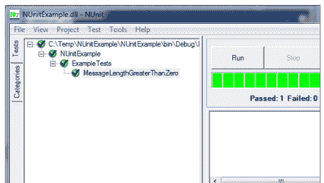

FIGURE 2-1

NUnit 中还有许多其他类型的断言。在后面的章节中，我将构建的项目将使用 Fluent 来编写断言，这将提供更符合业务的语法。但通过对 `Assert.Pass` 和 `Assert.Fail` 的了解，你可以在需要时放弃它们。当运行测试时，它失败了，因为调用了 `Assert.Fail`，如图 2-2 所示。

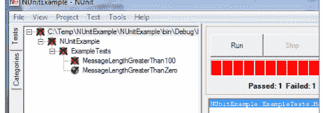

FIGURE 2-2

- `Assert.AreEqual(expected, actual)` — 此方法重载为接受 expected 或 actual 的任何类型的值，只要两者的类型相同。为每个参数传入不同类型的数值参数仍然有效，且该方法可以根据需要进行上转型或下转型。例如，传入一个整数和一个双精度浮点数引起错误。对于值类型，此断言将验证期望值和实际值参数具有相同的值。当传递引用类型（对象）时，方法将使用对象的 `Equals` 方法的结果来确定此断言是否成功。有一个名为 `AreNotEqual` 的派生断言，用于验证两个值不相等。

- `Assert.AreSame(expected, actual)` — 此断言接受引用类型作为参数。它用于判断传递给 `expected` 的对象和 `actual` 中的参数是否是同一个对象。这意味着两个对象在内存中占用相同的空间，而不是彼此的拷贝。有一个名为 `AssertNotSame` 的派生断言，用于验证两个对象不是同一个对象。

- `Assert.IsTrue(bool)/Assert.IsFalse(bool)` — 此断言接受布尔变量或可以评估为布尔值结果的逻辑条件。

- `Assert.IsNull(object)/Assert.NotNull(object)` — 此断言将检查引用类型并确定其是否为 `null`。

- `Assert.Greater(x,y)/Assert.GreaterEqual(x,y)` — 评估两个值或实现了 `IComparable` 接口的引用类型，以确定 `x` 是否大于 `y` (x > y) 或 `x` 是否大于或等于 `y` (x >= y)。像 `AreEqual` 一样，`Greater/GreaterEqual` 可以接受不同类型的数字，通过向上向上转换/向下转换来进行比较。NUnit 提供了 `Assert.Less` 和 `Assert.LessEqual`，其行为相同，但用于验证 `x` 是否小于 `y` (x < y) 或 `x` 小于等于 `y` (x <= y)。

这里列出的断言是 NUnit 中常用的，但 NUnit 库中还有许多可用断言。如果你对 NUnit 完整的断言列表感兴趣，www.nunit.org 提供了按版本组织的详细文档。

### 使用 Mock 对象进行解耦

编写良好的软件试图限制依赖关系。你的每个组件必须与另一个组件耦合以形成一个更大的整体。这些耦合在你的应用程序中创建了一个依赖网，这些网络通常指向一个外部资源，如数据库、Web 服务、文件系统或其他资源。Mock 对象（模拟对象）的设计是为了代表应用程序中的这些其他组件以及它们有时代表的外部资源。这允许你测试代码，而无必担心与其它资源交互带来的后果。

### 为什么 Mock 很重要

当你为一个方法编写测试时，你的意图是仅测试该方法中的代码。这是设计使然；你正试图评估特定条件下仅该部分代码的有效性。条件不仅可以定义为该方法的输入数据，还可以定义为代码执行的上下文和环境。

通过隔离该代码，你可以确保任何失败都直接指向该特定方法的问题，而不是系统偏远角的某个方法。为了这一点，可以假设你的方法所运行的其他组件是正确的且已经经过了测试，并且你可以依赖这些组件和测试的质量。（我将在第 5 章中告诉你们如何处理第三方组件。）在那个时间点，你只关心眼前的这个方法。

单元测试还应该能够快速运行。即使在小型应用程序中，如果正确应用了 TDD（测试驱动开发），拥有数百个单元测试并不罕见。你的目标是在开发过程中频繁开发这些测试，以确保我们对方法和类的更改不会影响系统的其他部分。如果在一个成功的测试和一个失败的测试之间只完成了极少的工作，你只需要检查这极少部分的工作来确定哪里出了问题。如果这些测试运行需要几个小时甚至仅仅几分钟，那么它们将无法得到充分的运行。

从不运行的测试是毫无意义的。大多数测试运行时间很长，是因为你正在与外部资源（如数据库）交互。如果你在开发数据库上同时执行数百次操作，数据库可能会很慢。一个 Mock 该数据库的对象可以为预定义的参数立即返回预定义的值，而无需连接数据库并执行 SQL 查询。这比直接查询数据库提供了快得多的执行速度。

单元测试应该是可预测且一致的。在编写方法及其相应的测试时，你应该能够确定你的方法在接收 X 和 Y 作为参数后将返回 Z。外部资源及其包含的数据是不断变化的。如果你的方法在外部资源上调用它，你无法保证对于相同的输入参数始终获得相同的结果。通过 Mock 这些内容，你可以确保你始终使用一致且可靠的数据来测试你的方法。

最后，大多数开发项目是由一个及以上的团队承担的。在某些情况下，你的单元测试应该能够在不影响同事测试结果的情况下运行。也许你的测试更改了数据库表的状态，而其他测试依赖于表中的数据。如果是这样，两个或多个开发者并发运行测试，他们都会遇到测试失败。他们正在互相干扰数据，没有人能得到预期的数据。Mock 这些外部资源可以确保你不会因为错误或意外的数据导致另一个开发者的测试失败。

### Dummy, Fake, Stub 和 Mock


# Mock 对象简介

Mock 是一个相当通用的术语，涵盖了一类用于单元测试的替代对象。

## Dummy 对象（哑元对象）

Dummy 对象是简单的 Mock，用于代表外部资源。它们通常为被调用的方法返回一个预定义的响应，但它们不能根据输入参数更改其响应。许多开发者不想引入 Mock 框架的开销，并且在测试中不需要手动编写 Dummy 对象来提供的功能。

> **注意**：为了这些示例，我将不会使用 Mock 框架。我将让你看到每种 Mock 的内部原理，并更好地理解每种 Mock 类型中发生了什么。书中示例使用的 Mock 框架 Moq 将在本章稍后的“简述 Mock”部分中介绍。

本节的示例包含了对名为 `DependentClass` 的类的测试。`DependentClass` 依赖于实现 `IDependency` 接口的类。`DependentClass` 有一个名为 `GetValue` 的方法，接受字符串作为参数。`DependentClass` 中 `GetValue` 的实现调用了 `IDependency` 实现上的 `GetValue` 方法，该实现是在创建 `DependentClass` 实例时作为构造函数参数提供的。`DependentClass` 和 `IDependency` 的定义如下：

```csharp
internal interface IDependency
{
    int GetValue(string s);
}

internal class DependentClass
{
    private readonly IDependency _dependency;

    public DependentClass(IDependency dependency)
    {
        _dependency = dependency;
    }

    public int GetValue(string s)
    {
        return _dependency.GetValue(s);
    }
}
```

在下面的代码中，你可以看到我有一个测试，用于测试在传递一个 `DummyDependency` 实例时其实现，`DummyDependency` 是一个实现 `IDependency` 接口的 Dummy 对象：

```csharp
[TestFixture]
public class DummyTest
{
    [Test]
    public void TestWithDummy()
    {
        var dependency = new DummyDependency();
        var dependentClass = new DependentClass(dependency);
        const string param = "abc";
        const int expectedResultOne = 1;

        var resultOne = dependentClass.GetValue(param);
        Assert.AreEqual(expectedResultOne, resultOne);
    }
}

public class DummyDependency : IDependency
{
    public int GetValue(string s)
    {
        return 1;
    }
}
```

测试方法创建了 `DummyDependency` 的实例，并将其作为 `IDependency` 实现传递给 `DependentClass`。在 `DependentClass` 实例上调用了 `GetValue` 并传递字符串 "abc" 作为其参数。

`DummyDependency` 的 `GetValue` 实现只是返回该值。它满足了测试；值是预期结果，Dummy 对象满足了要求。

但你可以很容易看到 Dummy 对象的局限性。无论测试传递什么值，Dummy 对象只能以一种方式反应；返回值一。在某些情况下这种局限性不是问题。但对于大多数测试，需要更健壮的 Mock 手段。

## Fake（伪造）和 Stub（桩）

Fake 和 Stub 比 Dummy 对象更进一步，它们可以根据输入参数返回响应。例如，数据库的 Stub 可以为用户 ID 61 返回 Rich，为用户 ID 1 返回 Mason。除此之外，没有逻辑被调用。Stub 通常会跟踪方法被调用的次数或一系列方法被调用的顺序。提供一个 Stub 的示例：

```csharp
[TestFixture]
public class StubTestClass
{
    [Test]
    public void TestWithAStub()
    {
        var dependency = new StubDependency();
        var dependentClass = new DependentClass(dependency);
        const string param1 = "abc";
        const string param2 = "xyz";
        const int expectedResult = 1;
        const int expectedResultTwo = 2;

        var resultOne = dependentClass.GetValue(param1);
        var resultTwo = dependentClass.GetValue(param2);
        Assert.AreEqual(expectedResult, resultOne);
        Assert.AreEqual(expectedResultTwo, resultTwo);
    }
}

public class StubDependency : IDependency
{
    public int GetValue(string s)
    {
        if (s == "abc")
            return 1;
        if (s == "xyz")
            return 2;
        return 0;
    }
}
```

先前的示例创建了一个名为 `StubDependency` 的新类，它实现了 `IDependency` 接口。与 `DummyDependency` 不同，`StubDependency` 的 `GetValue` 实现具有根据不同输入参数返回不同值的逻辑。该存根能够对不同的刺激做出不同的特定响应。这提供了一种比使用 Dummy 对象进行模拟更健壮的方法。

## Mock（模拟对象）

Mock 由框架和存根组成。Mock 提供了与存根相同的功能，但更为复杂。它们有定义的规则，规定了其 API 中方法的被调用顺序、方法被调用的次数，并可以根据这些信息做出反应。Mock 通常知道每次调用的上下文，并能够在不同情况下做出不同的反应。因此，Mock 需要对它们所模拟的类有一定了解。

以 Mock 为例，我向 `IDependency` 接口和 `DependentClass` 类中添加了几个成员：

```csharp
internal interface IDependency
{
    int GetValue(string s);
    void CallMeFirst();
    void CallMeTwice(string s);
    void CallMeLast();
}
```

```csharp
internal class DependentClass
{
    private readonly IDependency _dependency;

    public DependentClass(IDependency dependency)
    {
        _dependency = dependency;
    }

    public int GetValue(string s)
    {
        return _dependency.GetValue(s);
    }

    public void CallMeFirst()
    {
        _dependency.CallMeFirst();
    }

    public void CallMeLast()
    {
        _dependency.CallMeLast();
    }

    public int CallMeTwice(string s)
    {
        return _dependency.CallMeTwice(s);
    }
}
```

`IDependency` 接口和 `DependentClass` 类包含了三个方法：`CallMeFirst`、`CallMeTwice` 和 `CallMeLast`。在开发者所处理的许多 API 中，特定的方法必须按照特定顺序调用，并且需要调用特定的次数。正如 `IDependency` 接口和 `DependentClass` 类的新方法名所示，`CallMeFirst` 方法必须首先调用，`CallMeTwice` 方法必须被调用两次，而 `CallMeLast` 必须是特定事务中最后一个被调用的方法。

为了执行这些规则，你需要编写一个比之前的示例稍微复杂且更复杂的模拟类：

```csharp
public class MockDependency : IDependency
{
    private int _callMeTwiceCalled;
    private bool _callMeLastCalled;
    private bool _callMeFirstCalled;

    public int GetValue(string s)
    {
        if (s == "abc")
            return 1;
        if (s == "xyz")
            return 2;
        return 0;
    }

    public void CallMeFirst()
    {
        if ((_callMeTwiceCalled > 0) || _callMeLastCalled)
            throw new AssertionException("CallMeFirst not first method called");
        _callMeFirstCalled = true;
    }

    public void CallMeTwice(string s)
    {
        if (!_callMeFirstCalled)
            throw new AssertionException("CallMeTwice called before CallMeFirst");
        if (_callMeLastCalled)
            throw new AssertionException("CallMeTwice called after CallMeLast");
        if (_callMeTwiceCalled >= 2)
            throw new AssertionException("CallMeTwice called more than twice");
        _callMeTwiceCalled++;
        return GetValue(s);
    }

    public void CallMeLast()
    {
        if (!_callMeFirstCalled)
            throw new AssertionException("CallMeLast called before CallMeFirst");
        if (_callMeTwiceCalled != 2)
            throw new AssertionException(
                string.Format("CallMeTwice not called {0} times", _callMeTwiceCalled));
        _callMeLastCalled = true;
    }
}
```


```csharp
public class MockDependency : IDependency
{
    private int _callMeTwiceCalled;
    private bool _callMeLastCalled;
    private bool _callMeFirstCalled;

    public int GetValue(string s)
    {
        if (s == "abc")
            return 1;
        if (s == "xyz")
            return 2;
        return 0;
    }

    public void CallMeFirst()
    {
        if (_callMeTwiceCalled > 0) || _callMeLastCalled)
            throw new AssertionException("CallMeFirst not first method called");
        _callMeFirstCalled = true;
    }

    public void CallMeTwice(string s)
    {
        if (!_callMeFirstCalled)
            throw new AssertionException("CallMeTwice called before CallMeFirst");
        if (_callMeLastCalled)
            throw new AssertionException("CallMeTwice called after CallMeLast");
        if (_callMeTwiceCalled >= 2)
            throw new AssertionException("CallMeTwice called more than twice");
        _callMeTwiceCalled++;
        return GetValue(s);
    }

    public void CallMeLast()
    {
        if (!_callMeFirstCalled)
            throw new AssertionException("CallMeLast called before CallMeFirst");
        if (_callMeTwiceCalled != 2)
            throw new AssertionException(
                string.Format("CallMeTwice not called {0} times",
                _callMeTwiceCalled));
        _callMeLastCalled = true;
    }
}
```

# 第 2 章 单元测试简介

为了确保万无一，`StubDependency` 具有根据不同输入参数返回不同值的逻辑。该存根能够对不同的刺激做出不同的特定响应。这提供了一种比使用空对象进行模拟更健壮的方法。

Mock 是框架和存根设置。Mock 提供了与存根相同的功能，但更为复杂。它们有定义的规则，规定了其 API 中方法的被调用顺序、方法被调用的次数，并可以根据这些信息做出反应。Mock 通常知道每次调用的上下文，并能够在不同情况下做出不同的反应。因此，mock 需要对它们所模拟的类有一定了解。

以 mock 为例，我向 `IDependency` 接口和 `DependentClass` 类中添加了几个成员：

```csharp
internal interface IDependency
{
    int GetValue(string s);
    void CallMeFirst();
    void CallMeTwice(string s);
    void CallMeLast();
}
```

```csharp
internal class DependentClass
{
    private readonly IDependency _dependency;

    public DependentClass(IDependency dependency)
    {
        _dependency = dependency;
    }

    public int GetValue(string s)
    {
        return _dependency.GetValue(s);
    }

    public void CallMeFirst()
    {
        _dependency.CallMeFirst();
    }

    public void CallMeLast()
    {
        _dependency.CallMeLast();
    }

    public int CallMeTwice(string s)
    {
        return _dependency.CallMeTwice(s);
    }
}
```

`IDependency` 接口和 `DependentClass` 类包含了三个方法：`CallMeFirst`、`CallMeTwice` 和 `CallMeLast`。在开发者所处理的许多 API 中，特定的方法必须按照特定顺序调用，并且需要调用特定的次数。正如 `IDependency` 接口和 `DependentClass` 类的新方法名所示，`CallMeFirst` 方法必须首先调用，`CallMeTwice` 方法必须被调用两次，而 `CallMeLast` 必须是特定事务中最后一个被调用的方法。

为了执行这些规则，你需要编写一个比之前的示例稍微复杂且更复杂的模拟类：

```csharp
public class MockDependency : IDependency
{
    private int _callMeTwiceCalled;
    private bool _callMeLastCalled;
    private bool _callMeFirstCalled;

    public int GetValue(string s)
    {
        if (s == "abc")
            return 1;
        if (s == "xyz")
            return 2;
        return 0;
    }

    public void CallMeFirst()
    {
        if (_callMeTwiceCalled > 0) || _callMeLastCalled)
            throw new AssertionException("CallMeFirst not first method called");
        _callMeFirstCalled = true;
    }

    public void CallMeTwice(string s)
    {
        if (!_callMeFirstCalled)
            throw new AssertionException("CallMeTwice called before CallMeFirst");
        if (_callMeLastCalled)
            throw new AssertionException("CallMeTwice called after CallMeLast");
        if (_callMeTwiceCalled >= 2)
            throw new AssertionException("CallMeTwice called more than twice");
        _callMeTwiceCalled++;
        return GetValue(s);
    }

    public void CallMeLast()
    {
        if (!_callMeFirstCalled)
            throw new AssertionException("CallMeLast called before CallMeFirst");
        if (_callMeTwiceCalled != 2)
            throw new AssertionException(
                string.Format("CallMeTwice not called {0} times",
                _callMeTwiceCalled));
        _callMeLastCalled = true;
    }
}
```


# 第 2 章 单元测试简介

```csharp
public class MockDependency : IDependency
{
    private int _callMeTwiceCalled;
    private bool _callMeLastCalled;
    private bool _callMeFirstCalled;

    public int GetValue(string s)
    {
        if (s == "abc")
            return 1;
        if (s == "xyz")
            return 2;
        return 0;
    }

    public void CallMeFirst()
    {
        if (_callMeTwiceCalled > 0) || _callMeLastCalled)
            throw new AssertionException("CallMeFirst not first method called");
        _callMeFirstCalled = true;
    }

    public void CallMeTwice(string s)
    {
        if (!_callMeFirstCalled)
            throw new AssertionException("CallMeTwice called before CallMeFirst");
        if (_callMeLastCalled)
            throw new AssertionException("CallMeTwice called after CallMeLast");
        if (_callMeTwiceCalled >= 2)
            throw new AssertionException("CallMeTwice called more than twice");
        _callMeTwiceCalled++;
        return GetValue(s);
    }

    public void CallMeLast()
    {
        if (!_callMeFirstCalled)
            throw new AssertionException("CallMeLast called before CallMeFirst");
        if (_callMeTwiceCalled != 2)
            throw new AssertionException(
                string.Format("CallMeTwice not called {0} times",
                _callMeTwiceCalled));
        _callMeLastCalled = true;
    }
}
```

`IDependency` 接口和 `DependentClass` 类包含了三个方法：`CallMeFirst`、`CallMeTwice` 和 `CallMeLast`。在开发者所处理的许多 API 中，特定的方法必须按照特定顺序调用，并且需要调用特定的次数。正如 `IDependency` 接口和 `DependentClass` 类的新方法名所示，`CallMeFirst` 方法必须首先调用，`CallMeTwice` 方法必须被调用两次，而 `CallMeLast` 必须是特定事务中最后一个被调用的方法。

为了执行这些规则，你需要编写一个比之前的示例稍微复杂且更复杂的模拟类。

`StubDependency` 具有根据不同输入参数返回不同值的逻辑。该存根能够对不同的刺激做出不同的特定响应。这提供了一种比使用空对象进行模拟更健壮的方法。

Mock 是框架和存根设置。Mock 提供了与存根相同的功能，但更为复杂。它们有定义的规则，规定了其 API 中方法的被调用顺序、方法被调用的次数，并可以根据这些信息做出反应。Mock 通常知道每次调用的上下文，并能够在不同情况下做出不同的反应。因此，mock 需要对它们所模拟的类有一定了解。

以 mock 为例，我向 `IDependency` 接口和 `DependentClass` 类中添加了几个成员：

```csharp
internal interface IDependency
{
    int GetValue(string s);
    void CallMeFirst();
    void CallMeTwice(string s);
    void CallMeLast();
}
```

```csharp
internal class DependentClass
{
    private readonly IDependency _dependency;

    public DependentClass(IDependency dependency)
    {
        _dependency = dependency;
    }

    public int GetValue(string s)
    {
        return _dependency.GetValue(s);
    }

    public void CallMeFirst()
    {
        _dependency.CallMeFirst();
    }

    public void CallMeLast()
    {
        _dependency.CallMeLast();
    }

    public int CallMeTwice(string s)
    {
        return _dependency.CallMeTwice(s);
    }
}
```

`IDependency` 接口和 `DependentClass` 类包含了三个方法：`CallMeFirst`、`CallMeTwice` 和 `CallMeLast`。在开发者所处理的许多 API 中，特定的方法必须按照特定顺序调用，并且需要调用特定的次数。正如 `IDependency` 接口和 `DependentClass` 类的新方法名所示，`CallMeFirst` 方法必须首先调用，`CallMeTwice` 方法必须被调用两次，而 `CallMeLast` 必须是特定事务中最后一个被调用的方法。

为了执行这些规则，你需要编写一个比之前的示例稍微复杂且更复杂的模拟类。


```csharp
public class MockDependency : IDependency
{
    private int _callMeTwiceCalled;
    private bool _callMeLastCalled;
    private bool _callMeFirstCalled;

    public int GetValue(string s)
    {
        if (s == "abc")
            return 1;
        if (s == "xyz")
            return 2;
        return 0;
    }

    public void CallMeFirst()
    {
        if (_callMeTwiceCalled > 0) || _callMeLastCalled)
            throw new AssertionException("CallMeFirst not first method called");
        _callMeFirstCalled = true;
    }

    public void CallMeTwice(string s)
    {
        if (!_callMeFirstCalled)
            throw new AssertionException("CallMeTwice called before CallMeFirst");
        if (_callMeLastCalled)
            throw new AssertionException("CallMeTwice called after CallMeLast");
        if (_callMeTwiceCalled >= 2)
            throw new AssertionException("CallMeTwice called more than twice");
        _callMeTwiceCalled++;
        return GetValue(s);
    }

    public void CallMeLast()
    {
        if (!_callMeFirstCalled)
            throw new AssertionException("CallMeLast called before CallMeFirst");
        if (_callMeTwiceCalled != 2)
            throw new AssertionException(
                string.Format("CallMeTwice not called {0} times",
                _callMeTwiceCalled));
        _callMeLastCalled = true;
    }
}
```

# 第 2 章 单元测试简介

为了确保万无一失，`StubDependency` 具有根据不同输入参数返回不同值的逻辑。该存根能够对不同的刺激做出不同的特定响应。这提供了一种比使用空对象进行模拟更健壮的方法。

Mock 是框架和存根设置。Mock 提供了与存根相同的功能，但更为复杂。它们有定义的规则，规定了其 API 中方法的被调用顺序、方法被调用的次数，并可以根据这些信息做出反应。Mock 通常知道每次调用的上下文，并能够在不同情况下做出不同的反应。因此，mock 需要对它们所模拟的类有一定了解。

以 mock 为例，我向 `IDependency` 接口和 `DependentClass` 类中添加了几个成员：

```csharp
internal interface IDependency
{
    int GetValue(string s);
    void CallMeFirst();
    void CallMeTwice(string s);
    void CallMeLast();
}
```

```csharp
internal class DependentClass
{
    private readonly IDependency _dependency;

    public DependentClass(IDependency dependency)
    {
        _dependency = dependency;
    }

    public int GetValue(string s)
    {
        return _dependency.GetValue(s);
    }

    public void CallMeFirst()
    {
        _dependency.CallMeFirst();
    }

    public void CallMeLast()
    {
        _dependency.CallMeLast();
    }

    public int CallMeTwice(string s)
    {
        return _dependency.CallMeTwice(s);
    }
}
```

`IDependency` 接口和 `DependentClass` 类包含了三个方法：`CallMeFirst`、`CallMeTwice` 和 `CallMeLast`。在开发者所处理的许多 API 中，特定的方法必须按照特定顺序调用，并且需要调用特定的次数。正如 `IDependency` 接口和 `DependentClass` 类的新方法名所示，`CallMeFirst` 方法必须首先调用，`CallMeTwice` 方法必须被调用两次，而 `CallMeLast` 必须是特定事务中最后一个被调用的方法。

为了执行这些规则，你需要编写一个比之前的示例稍微复杂且更复杂的模拟类：

```csharp
public class MockDependency : IDependency
{
    private int _callMeTwiceCalled;
    private bool _callMeLastCalled;
    private bool _callMeFirstCalled;

    public int GetValue(string s)
    {
        if (s == "abc")
            return 1;
        if (s == "xyz")
            return 2;
        return 0;
    }

    public void CallMeFirst()
    {
        if (_callMeTwiceCalled > 0) || _callMeLastCalled)
            throw new AssertionException("CallMeFirst not first method called");
        _callMeFirstCalled = true;
    }

    public void CallMeTwice(string s)
    {
        if (!_callMeFirstCalled)
            throw new AssertionException("CallMeTwice called before CallMeFirst");
        if (_callMeLastCalled)
            throw new AssertionException("CallMeTwice called after CallMeLast");
        if (_callMeTwiceCalled >= 2)
            throw new AssertionException("CallMeTwice called more than twice");
        _callMeTwiceCalled++;
        return GetValue(s);
    }

    public void CallMeLast()
    {
        if (!_callMeFirstCalled)
            throw new AssertionException("CallMeLast called before CallMeFirst");
        if (_callMeTwiceCalled != 2)
            throw new AssertionException(
                string.Format("CallMeTwice not called {0} times",
                _callMeTwiceCalled));
        _callMeLastCalled = true;
    }
}
```

# 第 2 章 单元测试简介

为了确保万无一失，`StubDependency` 具有根据不同输入参数返回不同值的逻辑。该存根能够对不同的刺激做出不同的特定响应。这提供了一种比使用空对象进行模拟更健壮的方法。

Mock 是框架和存根设置。Mock 提供了与存根相同的功能，但更为复杂。它们有定义的规则，规定了其 API 中方法的被调用顺序、方法被调用的次数，并可以根据这些信息做出反应。Mock 通常知道每次调用的上下文，并能够在不同情况下做出不同的反应。因此，mock 需要对它们所模拟的类有一定了解。

## Best and Worst Practices

When using mocks in TDD, you should be aware of some concepts and guidelines:

- **Dependency Injection** — Mocking is a key concept that makes TDD a viable way of writing software. When using mocking, your application should use Dependency Injection. In short, this means that instead of statically creating objects that your class is dependent on, you should provide the class with instances that conform to the interface.

- **Design for the interface, not the implementation** — When another resource as dependency, your concern should not be how it performs its tasks, just what the interface is. Likewise, you should use interfaces when designing and building your classes to abstract the functionality. This design makes your code less brittle and more open for extension.

- **Try to limit dependencies** — Most code needs to be dependent on something. It could be a database to store and retrieve data, a web service to authenticate a user, or another domain in your application. Given that, you should limit the things that your code is dependent on. Not only do a large number of dependencies signify a brittle system, but such a system is also more difficult to mock and test effectively.

- **Do not mock private methods** — When you are writing a test and your code is dependent on another class, you should only mock the public methods. And then only you use directly; don't overmock. Mocking private methods requires knowledge of the internal function of the service you are mocking—knowledge that, according to the encapsulation rule, you should not have. As a consumer of a service, you should only concern yourself with the methods on the public interface; the protected and private methods should be invisible to you.


StubDependency 具有根据不同输入参数返回不同值的逻辑。该存根能够对不同的刺激做出不同的特定响应。这提供了一种比使用空对象进行模拟更健壮的方法。

Mock 是框架和存根设置。Mock 提供了与存根相同的功能，但更为复杂。它们有定义的规则，规定了其 API 中方法的被调用顺序、方法被调用的次数，并可以根据这些信息做出反应。Mock 通常知道每次调用的上下文，并能够在不同情况下做出不同的反应。因此，mock 需要对它们所模拟的类有一定了解。

以 mock 为例，我向 `IDependency` 接口和 `DependentClass` 类中添加了几个成员：

```c
internal interface IDependency
{
    int GetValue(string s);
    void CallMeFirst();
    void CallMeTwice(string s);
    void CallMeLast();
}
```

```csharp
internal class DependentClass
{
    private readonly IDependency _dependency;

    public DependentClass(IDependency dependency)
    {
        _dependency = dependency;
    }

    public int GetValue(string s)
    {
        return _dependency.GetValue(s);
    }

    public void CallMeFirst()
    {
        _dependency.CallMeFirst();
    }

    public void CallMeLast()
    {
        _dependency.CallMeLast();
    }

    public int CallMeTwice(string s)
    {
        return _dependency.CallMeTwice(s);
    }
}
```

`IDependency` 接口和 `DependentClass` 类包含了三个方法：`CallMeFirst`、`CallMeTwice` 和 `CallMeLast`。在开发者所处理的许多 API 中，特定的方法必须按照特定顺序调用，并且需要调用特定的次数。正如 `IDependency` 接口和 `DependentClass` 类的新方法名所示，`CallMeFirst` 方法必须首先调用，`CallMeTwice` 方法必须被调用两次，而 `CallMeLast` 必须是特定事务中最后一个被调用的方法。

为了执行这些规则，你需要编写一个比之前的示例稍微复杂且更复杂的模拟类：

```csharp
public class MockDependency : IDependency
{
    private int _callMeTwiceCalled;
    private bool _callMeLastCalled;
    private bool _callMeFirstCalled;

    public int GetValue(string s)
    {
        if (s == "abc")
            return 1;
        if (s == "xyz")
            return 2;
        return 0;
    }

    public void CallMeFirst()
    {
        if (_callMeTwiceCalled > 0) || _callMeLastCalled)
            throw new AssertionException("CallMeFirst not first method called");
        _callMeFirstCalled = true;
    }

    public void CallMeTwice(string s)
    {
        if (!_callMeFirstCalled)
            throw new AssertionException("CallMeTwice called before CallMeFirst");
        if (_callMeLastCalled)
            throw new AssertionException("CallMeTwice called after CallMeLast");
        if (_callMeTwiceCalled >= 2)
            throw new AssertionException("CallMeTwice called more than twice");
        _callMeTwiceCalled++;
        return GetValue(s);
    }

    public void CallMeLast()
    {
        if (!_callMeFirstCalled)
            throw new AssertionException("CallMeLast called before CallMeFirst");
        if (_callMeTwiceCalled != 2)
            throw new AssertionException(
                string.Format("CallMeTwice not called {0} times",
                _callMeTwiceCalled));
        _callMeLastCalled = true;
    }
}
```

# 第 2 章 单元测试简介


# MockDependency 实现示例

```csharp
public class MockDependency : IDependency
{
    private int _callMeTwiceCalled;
    private bool _callMeLastCalled;
    private bool _callMeFirstCalled;

    public int GetValue(string s)
    {
        if (s == "abc")
            return 1;
        if (s == "xyz")
            return 2;
        return 0;
    }

    public void CallMeFirst()
    {
        if (_callMeTwiceCalled > 0 || _callMeLastCalled)
            throw new AssertionException("CallMeFirst not first method called");
        _callMeFirstCalled = true;
    }

    public void CallMeTwice(string s)
    {
        if (!_callMeFirstCalled)
            throw new AssertionException("CallMeTwice called before CallMeFirst");
        if (_callMeLastCalled)
            throw new AssertionException("CallMeTwice called after CallMeLast");
        if (_callMeTwiceCalled >= 2)
            throw new AssertionException("CallMeTwice called more than twice");
        _callMeTwiceCalled++;
        return GetValue(s);
    }

    public void CallMeLast()
    {
        if (!_callMeFirstCalled)
            throw new AssertionException("CallMeLast called before CallMeFirst");
        if (_callMeTwiceCalled != 2)
            throw new AssertionException(
                string.Format("CallMeTwice not called {0} times", _callMeTwiceCalled));
        _callMeLastCalled = true;
    }
}
```

# 第 2 章 单元测试简介

## Stub 与 Mock 的区别

`StubDependency` 具有根据不同输入参数返回不同值的逻辑。该存根能够对不同的刺激做出不同的特定响应。这提供了一种比使用空对象进行模拟更健壮的方法。

Mock 是框架和存根的设置。Mock 提供了与存根相同的功能，但更为复杂。它们有定义的规则，规定了其 API 中方法的被调用顺序、方法被调用的次数，并可以根据这些信息做出反应。Mock 通常知道每次调用的上下文，并能够在不同情况下做出不同的反应。因此，Mock 需要对它们所模拟的类有一定了解。

## Mock 示例：强制调用顺序与次数

以 Mock 为例，我向 `IDependency` 接口和 `DependentClass` 类中添加了几个成员：

```csharp
internal interface IDependency
{
    int GetValue(string s);
    void CallMeFirst();
    void CallMeTwice(string s);
    void CallMeLast();
}
```

```csharp
internal class DependentClass
{
    private readonly IDependency _dependency;

    public DependentClass(IDependency dependency)
    {
        _dependency = dependency;
    }

    public int GetValue(string s)
    {
        return _dependency.GetValue(s);
    }

    public void CallMeFirst()
    {
        _dependency.CallMeFirst();
    }

    public void CallMeLast()
    {
        _dependency.CallMeLast();
    }

    public int CallMeTwice(string s)
    {
        return _dependency.CallMeTwice(s);
    }
}
```

`IDependency` 接口和 `DependentClass` 类包含了三个方法：`CallMeFirst`、`CallMeTwice` 和 `CallMeLast`。在开发者所处理的许多 API 中，特定的方法必须按照特定顺序调用，并且需要调用特定的次数。正如 `IDependency` 接口和 `DependentClass` 类的新方法名所示，`CallMeFirst` 方法必须首先调用，`CallMeTwice` 方法必须被调用两次，而 `CallMeLast` 必须是特定事务中最后一个被调用的方法。

为了强制执行这些规则，你需要编写一个比之前示例稍微复杂且更复杂的模拟类：

```csharp
public class MockDependency : IDependency
{
    private int _callMeTwiceCalled;
    private bool _callMeLastCalled;
    private bool _callMeFirstCalled;

    public int GetValue(string s)
    {
        if (s == "abc")
            return 1;
        if (s == "xyz")
            return 2;
        return 0;
    }

    public void CallMeFirst()
    {
        if (_callMeTwiceCalled > 0 || _callMeLastCalled)
            throw new AssertionException("CallMeFirst not first method called");
        _callMeFirstCalled = true;
    }

    public void CallMeTwice(string s)
    {
        if (!_callMeFirstCalled)
            throw new AssertionException("CallMeTwice called before CallMeFirst");
        if (_callMeLastCalled)
            throw new AssertionException("CallMeTwice called after CallMeLast");
        if (_callMeTwiceCalled >= 2)
            throw new AssertionException("CallMeTwice called more than twice");
        _callMeTwiceCalled++;
        return GetValue(s);
    }

    public void CallMeLast()
    {
        if (!_callMeFirstCalled)
            throw new AssertionException("CallMeLast called before CallMeFirst");
        if (_callMeTwiceCalled != 2)
            throw new AssertionException(
                string.Format("CallMeTwice not called {0} times", _callMeTwiceCalled));
        _callMeLastCalled = true;
    }
}
```


```csharp
public class MockDependency : IDependency
{
    private int _callMeTwiceCalled;
    private bool _callMeLastCalled;
    private bool _callMeFirstCalled;

    public int GetValue(string s)
    {
        if (s == "abc")
            return 1;
        if (s == "xyz")
            return 2;
        return 0;
    }

    public void CallMeFirst()
    {
        if (_callMeTwiceCalled > 0) || _callMeLastCalled)
            throw new AssertionException("CallMeFirst not first method called");
        _callMeFirstCalled = true;
    }

    public void CallMeTwice(string s)
    {
        if (!_callMeFirstCalled)
            throw new AssertionException("CallMeTwice called before CallMeFirst");
        if (_callMeLastCalled)
            throw new AssertionException("CallMeTwice called after CallMeLast");
        if (_callMeTwiceCalled >= 2)
            throw new AssertionException("CallMeTwice called more than twice");
        _callMeTwiceCalled++;
        return GetValue(s);
    }

    public void CallMeLast()
    {
        if (!_callMeFirstCalled)
            throw new AssertionException("CallMeLast called before CallMeFirst");
        if (_callMeTwiceCalled != 2)
            throw new AssertionException(
                string.Format("CallMeTwice not called {0} times",
                _callMeTwiceCalled));
        _callMeLastCalled = true;
    }
}
```

# 第 2 章 单元测试简介

- **依赖注入** — 模拟是使 TDD 成为一种可行的软件编写方式的关键概念。当使用模拟时，你的应用程序应该使用依赖注入。

- **面向接口编程，而非面向实现编程** — 当另一个资源作为依赖时，你的关注点不应在于它如何执行任务，而只在于接口是什么。同样，你在设计和构建类时应该使用接口来抽象功能。这种设计使你的代码更不易碎，更易于扩展。

- **尽量限制依赖** — 大多数代码都需要依赖某些东西。可能是用于存储和检索数据的数据库，用于验证用户的 Web 服务，或者是应用程序中的另一个领域。考虑到这一点，你应该限制代码所依赖的事物。大量的依赖不仅标志着一个易碎的系统，而且这种系统也更难以有效地模拟和测试。

- **不要模拟私有方法** — 当你编写测试且代码依赖于另一个类时，你应该只模拟公共方法。并且只模拟你直接使用的那些；不要过度模拟。模拟私有方法需要了解你所模拟服务的内部功能——根据封装规则，你不应该拥有这种知识。作为服务的消费者，你应该只关注公共接口上的方法；受保护和私有方法对你应该是不可见的。

`StubDependency` 具有根据不同输入参数返回不同值的逻辑。该存根能够对不同的刺激做出不同的特定响应。这提供了一种比使用空对象进行模拟更健壮的方法。

`Mock` 是框架和存根设置。`Mock` 提供了与存根相同的功能，但更为复杂。它们有定义的规则，规定了其 API 中方法的被调用顺序、方法被调用的次数，并可以根据这些信息做出反应。`Mock` 通常知道每次调用的上下文，并能够在不同情况下做出不同的反应。因此，`Mock` 需要对它们所模拟的类有一定了解。

以 `Mock` 为例，我向 `IDependency` 接口和 `DependentClass` 类中添加了几个成员：

```csharp
internal interface IDependency
{
    int GetValue(string s);
    void CallMeFirst();
    void CallMeTwice(string s);
    void CallMeLast();
}
```

```csharp
internal class DependentClass
{
    private readonly IDependency _dependency;

    public DependentClass(IDependency dependency)
    {
        _dependency = dependency;
    }

    public int GetValue(string s)
    {
        return _dependency.GetValue(s);
    }

    public void CallMeFirst()
    {
        _dependency.CallMeFirst();
    }

    public int CallMeTwice(string s)
    {
        return _dependency.CallMeTwice(s);
    }

    public void CallMeLast()
    {
        _dependency.CallMeLast();
    }
}
```

## MOQ 简览

.NET 有许多 Mock 框架。多年来，`Rhino Mocks` 一直是 .NET 的 Mock 框架，许多应用程序在测试套件中广泛使用它。除了 `Rhino Mocks` 之外，`NUnit`、`TypeMock` 和 `Easy Mock` 等 Mock 框架也变得流行。它们都是很好的框架，并提供了各种特性，使其对不同的开发者和开发团队具有不同程度的吸引力。一些开发者仍然倾向于自己编写 Mock，但随着 Mock 框架变得普及、功能完备且易于使用，这种做法变得越来越少。使用 Mock 框架绝对比自己编写 Mock 要好得多，它能让你的 TDD 体验更加高效且充实。`Moq` 迅速成为 .NET 最流行的 Mock 框架之一。它拥有坚实的功能列表，易于使用，并且拥有庞大的社区支持，这确保了 `Moq` 功能的不断改进和开发。

## Mock 框架是做什么的？

Mock 框架为你提供了创建和使用存根（`stubs`）和模拟（`mocks`）的设施。使用 Mock 框架 API，你可以在运行时创建 Mock 并注入你的测试功能。Mock 框架还提供了一个领域特定语言（`DSL`），用于为你的模拟资源定义执行规则。

## 关于 Moq

`Moq` 是一个基于 BSD 许可证发布的开源 .NET Mock 框架。`Moq` 的构建是为了利用 .NET 3.5 和 C# 3.0 中的新语言特性——特别是 `lambda` 表达式。`Moq` 放弃了许多 Mock 框架使用的记录/回放（`record/playback`）功能，而采用更具声明性的语法。`Moq` 的设计非常轻量且易于使用。`Moq` 拥有非常活跃的用户和支持社区，更新和错误修复几乎每天提交到代码库。

## Moq 基础

`Moq` 易于使用。以下示例展示了如何基于此类和接口为测试创建 Mock 和存根：

```csharp
public interface ILongRunningLibrary
{
    string RunForAlongTime(int interval);
}

public class LongRunningLibrary : ILongRunningLibrary
{
    public string RunForAlongTime(int interval)
    {
        var timeToWait = interval * 1000;
        Thread.Sleep(timeToWait);
        return string.Format("Waited {0} seconds", interval);
    }
}
```

该方法的目的是模拟一个长时间运行的过程，例如数据库查询。这个示例开始向你展示长时间运行的过程如何让测试过程变得非常缓慢，因为测试必须等待长时间运行的测试执行。在这个示例中，我用一个 Mock 代替了模拟数据库访问的长运行过程，该 Mock 无需实际访问数据库。此示例展示了不使用存根的情况下运行它：

```csharp
[TestFixture]
public class MoqExamples
{
    private ILongRunningLibrary _longRunningLibrary;

    [SetUp]
    public void SetupTest()
    {
        _longRunningLibrary = new LongRunningLibrary();
    }

    [Test]
    public void TestLongRunningLibrary()
    {
        const int interval = 30;
        var result = _longRunningLibrary.RunForLongTime(interval);
        Debug.WriteLine("Return from method {0}", result);
    }
}
```

你可以看到，这个测试简单地实例化了 `LongRunningLibrary` 并调用了 `RunForLongTime` 方法。然后测试将该方法的结果写入调试控制台。如果你在测试运行器中运行此测试，测试会在方法执行时等待，并将输出写入调试控制台，如图 2-3 所示。

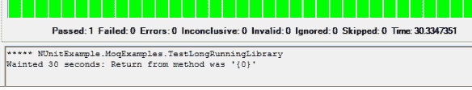

图 2-3

测试通过了，但等待 30 秒是一个很长的时间。想象一下如果你正在运行 10 个这样的测试。甚至 100 个！你还很大程度上取决于 `RunForLongTime` 方法以及 `LongRunningLibrary` 类的其余部分的实现。如果它们发生变化或存在缺陷，你可能无法获得有意义的通过或失败结果。

你必须做的第一件事是为变量 `_longRunningLibrary` 声明一个新类型。不再创建具体实例，而是让 Mock 根据 `ILongRunningLibrary` 接口创建一个模拟的实例：

```csharp
private Mock<ILongRunningLibrary> _longRunningLibrary;

[SetUp]
public void SetupForTest()
{
    _longRunningLibrary = new Mock<ILongRunningLibrary>();
}
```

由于 `_longRunningLibrary` 现在是一个 `Mock`，你必须在测试方法中以稍不同的方式处理它。要访问模拟实例上的方法，你需要使用 `Mock` 对象的 `Object` 属性：

```csharp
[Test]
public void TestLongRunningLibrary()
{
    const int interval = 30;
    var result = _longRunningLibrary.Object.RunForAll(interval);
    Debug.WriteLine("Return from method was '{0}'", result);
}
```

如果你现在运行，你将得到预期的结果，如图 2-4 所示。

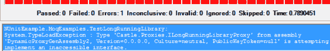

图 2-4

测试失败是因为提供了一个 `LongRunningLibrary` 的模拟实例，但没有为模拟方法提供实现。这很容易修正：

```csharp
_longRunningLibrary
    .Setup(l1rl => l1rl.RunForAllTime(30))
    .Returns("This method has been mocked!");
```

在这个示例中，你是在告诉 `Mock` 在参数为 30 的 `LongRunningLibrary` 模拟实例上调用 `RunForAllTime` 方法，你只是想要返回字符串 "This method has been mocked!"。如果你现在运行测试运行器，测试通过了，如图 2-3 所示。

> Passed: 1 Failed: 0 Errors: 0 Inclusive: 0 Ignored: 0 Skipped: 0 Time: 0.543011
>
> **** Unit.MoqExamples.TestLongRunningLibrary
>
> Return from method was "This method has been mocked!"


# 第 3 章 重构快速回顾

本章内容包括：

- 为什么重构应用代码很重要
- 面向对象编程（OOP）和 SOLID 等整洁代码原则如何帮助你构建健壮的应用程序
- 如何识别并修复应用开发中一些常见的设计和编码错误

没有任何代码是完美的。对于开发者来说，接受这一事实是非常解脱的。总会有你本可以做得更好的地方，尽管在当时你可能并没有意识到。回看几年前写的代码，你有时会发现一些细微、微妙的地方，想要修改它们以使代码运行更快、更符合业务逻辑，或者仅仅更易维护。其他时候你可能会说：“如果我早知道现在所知道的这些，我就会完全那样做了。”

重构是指改变类或方法的内部实现，目的是使代码更具可读性和可维护性。重构在不改变类或方法外部行为的情况下减少代码的复杂性。这些更改可以简单到更改方法或变量名称，也可以是将方法从一个类移动到另一个类，甚至将大类拆分为几个小类。重构允许你持续地更改和改进代码。

本章解释了为什么重构代码很重要。它回顾了面向对象编程和 SOLID 原则。它还向你展示了常见的编码和设计问题（通称为“代码异味”），并演示了从代码中消除这些问题的常见模式。

## 为什么要重构？

在实践 TDD（测试驱动开发）时，最初编写方法或创建类的目标仅仅是让测试通过，别无其他要求。此时，你并不是为了风格加分，也不是为了让代码具有复用性或优雅性。你只是在尝试让测试变为“全绿”，即所有测试都通过。一旦完成了这一点，下一步就是改进你的代码。在实践中，这是一个非常实用的方法。许多开发者花费太多时间尝试在第一次就让代码变得优雅美观。结果他们遗漏了一些重要的业务功能，最后不得不以某种方式将它们加入代码中。通过在使代码美化之前从完整的业务功能开始，你确保了首要任务——运行良好的业务代码——在任何事情之前得到满足。单元测试帮助你确保无论你为了重构而更改了什么，你的代码仍然需要这些好处。这就是“熟悉的重构”这一术语的起源。

## 项目生命周期

TDD 对许多开发者来说涉及许多新概念，例如模拟（mocking）和依赖注入（第 5 章介绍）。与 TDD 的主要（而非首要）测试之一——在编写代码之前先写测试相比，这些概念相对容易理解和掌握。TDD 背后的思想（第一个 D 代表设计）是你的测试变成了你的业务（有时是你的非功能性或技术需求）的活的、可执行的版本。通过采用这种哲学，你可以确保自己永远编写不为应用程序增加价值的代码。测试优先开发的一个示例是第 6 章的重点。

一旦你有了测试，你的目标就是编写足够的代码让该测试通过。仅此，不多不少。你的策略应该是以最短、最直的路线从 A 点（失败的测试）移动到 B 点（全部通过）。不要担心系统的其他方面。

此外，不要担心功能中任何测试未包含但你几乎可以确定业务将会包含的方面。例如：某项功能指定方法接收一个整数作为输入参数。你只是知道该输入参数的值为 100 或更小。你的测试只测试数字；但功能描述中并没有关于限制数值为 100 或更小数字的内容。在某项功能被计划并为其创建单元测试之前，它就不是一个需求。如果该功能实际上从未被计划过呢？如果你编写了没有价值但必须与代码库其他部分一起维护的代码。或者你无必要地过度复杂了本可以简单的逻辑。无论你为了重构而更改了什么，单元测试帮助你确保你的代码仍然需要这些好处。

## 可维护性

我们已经确定，在实践 TDD 时，编写代码的初始目标仅仅是让测试通过。随着时间推移，应用程序及其支持的业务不断演进，必须支持新的功能。能够快速地进行这些更改是重要的。为了可读性进行重构是管理代码的一个重要步骤。不仅为了他人，也为了我们自己。每个开发者都有过这种不幸的经历：看着自己写的代码，却忘了它是如何工作的或为什么要那样做。为了可维护性进行重构应该尽可能简化代码。这包括确保方法足够短、控制结构简单，并且变量和方法名称具有描述性。将为了可维护性进行重构看作是给未来的自己留提示。

## 代码指标

衡量代码库的质量是一个主观任务。对于质量的定义和开发者一样多。然而，一些具体的指标可以提供关于内部机制的提示。

代码测试覆盖率（代码覆盖率）衡量了单元测试执行了代码库中多少代码。这个指标具有争议，因为它只告诉了部分情况。覆盖率低于 100% 的代码库并不意味着代码缺乏质量。100% 覆盖率的代码库只能确保其质量与其测试一样好。

第一个问题是在查看代码覆盖率时，代码库的哪些部分被测量了。在大多数情况下，我认为对源代码的功能部分编写测试更为重要。这除了实体对象、数据传输对象以及任何仅用于包含数据的结构。原因是因为测试只测试功能；存储数据的结构没有活动部分。当你满意你的代码没有产生副作用时，可以再次运行测试。这被称为“红-绿-重构”。这意味着你从一个失败的测试开始，因为还没有实现逻辑。然后你实现它使其通过。最后，你进行重构。

使用了这些字段。最后，你将拥有一些智能，并准备好对数据实体进行一些代码覆盖率数字的研究。

幸运的是，应用程序中功能性代码的情况要简单明了得多。首先，你应该将任何功能性代码包含在你的代码覆盖指标中。这些代码的存在仅仅是因为测试需要它们；因此，它们应该具有很高的代码覆盖率。此类类别中的任何代码都是未被覆盖的。这种检查始终会揭示两种结果之一：要么是你缺少了测试，要么代码是多余的且应该被删除。

缺失测试显然是一个问题，应该立即解决。这还揭示了过度依赖代码库作为代码质量指标的一个重大问题：你的代码覆盖率仅取决于你的测试有多好、多可靠。如果你的测试质量低，那么 100% 的代码覆盖率也是毫无意义的。

如果你对你的需求拥有一套完整的测试，但仍然有未被单元测试覆盖的代码，那么这些代码可能不需要，可以删除。注意，我是删除了，而不是注释掉。未使用的代码就像代码库中的寄生虫；它们不提供任何价值，却像应用程序的组成部分一样被维护。这些代码带来的唯一东西就是噪音，因此应该将其移除以使开发变得更容易。如果你在使用版本控制系统（你绝对应该这样做），如果需要，请替换该代码（务必为它编写测试）。它并没有真正永远消失，但它不属于你的工作代码。

近年来重新兴起的一种指标（但使用方式与过去不同）是代码行数计数。以前，这个数字被认为越高越好，而且是开发者和经理的一处值得自豪的资本，因为这表明开发者正在做大量工作。遗憾的是，这种观点有点是反其道而行。开发者应该寻找方法，用更少的代码行完成更多工作。

事实是，方法或类中的代码行数越多，出现缺陷的概率就越大。保持方法更短、更聚焦可以降低复杂性以及代码出现缺陷的概率。你写的代码行越多，给自己写错代码的机会就越大。

如果你写了更多行代码，也更有可能是在重复编写应用程序中已经存在的功能。软件开发中的“不要重复”（DRY）概念规定，每个功能单元在代码库中应该只出现一次。我将在本章稍后讨论单责任原则时解释这个概念。

圈复杂度是一个存在了很长时间的指标。但由于指标工具的涌入，它最近才在商业世界被广泛用作代码指标。圈复杂度衡量的是方法、类或应用程序中存在的唯一路径数量。数字越高表示可能的唯一路径越多，因此代码的复杂程度越高。

代码是复杂的。这是不可避免的。在某一个时刻，你的代码会评估一个条件并分支到另一个方向。系统越简单，越容易理解和维护。圈复杂度数值高的代码应该被重构以变得更简单。你可以实现此点的几种方法是：找到具有多个唯一路径的方法，并将该分支逻辑提取到其他方法中。另一种方法是利用多态（在本章稍后部分介绍）来帮助消除任何仅用于确定对象精确类型的控制结构。

## 整洁代码原则

一场日益增长的软件手工艺运动在其他方面已经开始提倡开发者继续研究他们的技艺，目标是能够编写整洁的代码。总而言之，这场运动和哲学的观点是，开发者应该始终努力学习，并尝试根据一套规定的实践和原则编写他们所能写的最优代码。

### OOP 原则

面向对象编程（OOP）是将真实世界对象抽象为代码可以使用的类的方法。其核心思想是，如果你对业务进行建模，代码就可以使用它们。这种想法是，如果你对业务进行建模，以更符合真实世界的方式解决代码问题，大多数现代语言支持 OOP，这让你更容易概念化和开发你的应用程序。

总的来说，OOP 有三个主要原则。多年来，许多人认为这些原则是有效的。当你创建类时，你会发现某些类之间存在自然的层次关系。这些是概念。OOP 的通用原则是封装、继承和多态。

#### 封装

封装规则规定，你创建的类应该是黑盒。换句话说，类的内部对客户端是不可访问的。类交互或更改状态的唯一手段应该是类的公共接口。在任何时候，客户端都不关心类如何执行操作，只要能得到所需的结果。类执行其工作。在你设计类时，重要的是正确界定你的方法、属性和变量。只有公共接口的成员应该声明为公共。只有子类需要使用的成员应该被声明。其他的都是私有的。一个良好的做法是将一切设为私有，直到它需要。此外，你不应该允许成员变量成为私有以外的形式；如果子类需要使用该变量，请通过受保护属性访问。如果该变量需要作为公共接口的一部分，请将其封装在公共属性中。你不应该仅仅允许对内部变量进行未经监控或不受控制的访问。

#### 继承

当你构建应用程序类时，你很快发现某些类之间存在层次关系。这些类可能相似，但在功能上并不对等。在这种情况下，你可以将公共功能放在基类中，并让更具体的类派生该类。这被称为继承，是 OOP 中一个非常重要的概念。

假设你正在编写一个薪资应用程序，其中包含计时员工、月薪员工和季节性员工的实体。（见图 3-1。）

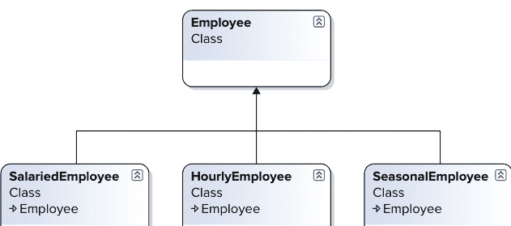

图 3-1

业务规则表明，薪酬（工资、福利、保险）对每种类型的员工计算方式不同。然而，所有三个有很多共同点。每个员工都有一些生物信息（姓名、地址、工作历史、税务信息），并且某些过程是相同的，例如从数据库获取员工。

通过继承，你可以创建一个封装了所有类型共同功能的 `Employee` 基类。然后，你为计时、月薪和季节性员工创建类。这些更具体的类派生自（或继承）你的 `Employee` 基类。你的派生类仅仅由于其祖先/后代关系就可以访问 `Employee` 基类的功能。

基类对于派生类如何使用其功能也有一定的影响。基类可以将其部分或全部方法声明为抽象方法。这意味着派生类必须根据基类中定义的接口提供它们自己的实现。

继承显然为开发者提供了许多重用和利用代码的便利。确保继承不被过度使用非常重要。深层继承可能会引入新类型的复杂性。它们最终可能导致代码变得脆弱且难以更改，因为层次结构中间一个简单的逻辑单元的改变都可能产生影响。在某些情况下，组合优于继承。例如，一个名为 `PayableEmployee` 的实体被插入到 `Employee` 层次结构中（图 3-2）。

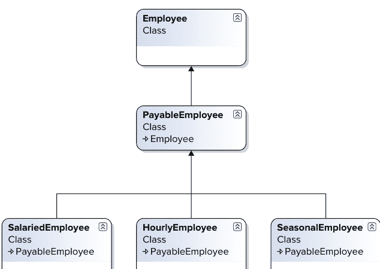

图 3-2

在这个层次结构中，计算员工薪资的逻辑被封装在 `PayableEmployee` 类中。但如果发生了这种事件，业务部门决定按不同的算法支付每种员工，会发生什么？是否应该在类层次结构中引入更多的类？这能解决眼下的问题吗？但如果支付算法中存在可以在类之间部分共享的逻辑呢？你是否会再增加一层继承来考虑这一点？很快，类层次结构——即使是像这样的例子——也会变得无法挽救地复杂。

更好的策略是使用组合。与其将支付员工工资的逻辑放在 `Employee` 层次结构的类中，我将定义一个名为 `EmployeePayrollService` 的标准化薪资计算模块的接口。`Employee` 类将包含一个保护成员变量，该变量可以持有实现 `EmployeePayrollService` 接口的类（图 3-3）。

| Employee | IEmployeePayrollService |
| --- | --- |
| Class IEmpl... | 接口 |
| Fields | |

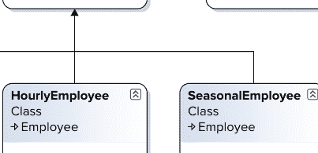

图 3-3

现在，每个员工都可以使用任何类型的类来计算他们所需的薪资，前提是他们实现了标准的员工薪资服务接口。

#### 多态

多态可能是面向对象编程（OOP）中最被误解的原则。多态的概念是：尽管两个类共享相同的行为，但它们可以用不同的方式实现该行为。多态与继承以及它创建的类之间的关系某种联系。

例如，在刚刚讨论的 `Employee` 示例中，`Hourly`、`Salary` 和 `Seasonal` 员工类可能都继承自 `Employee` 基类中的其中一个名为 `ComputePay` 的抽象方法。（抽象成员是指在基类中声明接口，但派生类必须提供其实现的成员。）`ComputePay` 方法可以调用在上节“继承”中描述的 `IEmployeePayrollService` 类实例上的相应方法或方法。

尽管该方法的接口对于所有三个派生类都是相同的，但它们使用它来确定员工工资的方式非常不同。`Salary` 员工将根据其薪水获得固定金额。`Hourly` 和 `Seasonal` 员工将根据每小时费率乘以在上一个薪期内工作的小时。然而，在我们的示例中，小时工加班可以获得一倍半的工资，而季节性员工则没有。每个 `ComputePay` 方法返回员工工资支票的金额，但它们使用不同的手段来得到那个数字。

多态的真正威力体现在任何派自 `Employee` 基类的类上，无论其具体的具体实现如何。当示例中公司的发工资日到来，薪资系统需要为所有员工发放支票。系统只需要遍历员工列表并对每个员工调用 `ComputePay`。它不需要知道正在计算的是哪种类型的员工工资金额；因为具体类型已经包含了它所需的特定实现。应用程序只需收集方法返回的数字即可。

如果没有多态，系统必须做两件事之一。第一种方案是将所有员工分为三组（`Salary`、`Hourly` 和 `Seasonal`），并以各自独特的方式处理每组。另一种方案是遍历所有在职员工，并对每个员工做出决定以确定如何支付该员工。这两种替代方案都会导致额外的代码，不仅让过程变慢，而且让它变得更复杂并引入了更多失败点。通过多态，你让计算机为你工作。这方面的示例可以在“用多态替换条件判断”章节中找到。

例如，我在图 3-4 中展示了动物层次结构：

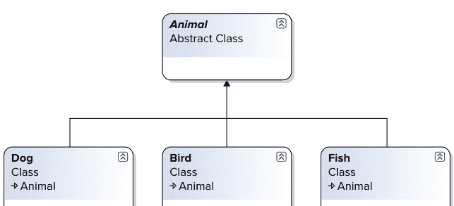

图 3-4

除了是动物之外，这些动物还能移动。但它们以不同的方式移动：狗跑、鸟飞、鱼游。因为它们都继承自 `Animal`，我可以将每个子类型（狗、鸟和鱼）引用为动物。但如果我想让这些动物移动呢？最好的方法是在 `Dog` 上实现一个 `Run` 方法，在 `Bird` 上实现一个 `Fly` 方法，在 `Fish` 上实现一个 `Swim` 方法吗？这看起来可能很直观，但它产生了一些严重的限制。假设我的代码中有一个某种类型 `Animal` 的引用，我如何让它移动？我调用哪个方法？为了回答这个问题，我必须先确定我处理的是哪种特定类型的 `Animal`。这是无效的，并且违背了建立动物层次结构的意义。

更好的方法是在 `Animal` 类上创建一个抽象方法 `Move`。每个继承它的动物随后将创建此方法的实现。在这种情况下，我不需要知道具体的哪种类型的 `Animal`，我现在可以适当调用该方法。

### SOLID 原则

在 21 世纪初，罗伯特·“叔叔”·马丁引入了一系列用于面向对象开发软件的原则，这些原则旨在带来更高质量的系统。SOLID 原则成为了设计新应用程序和重构现有代码的地图。

#### 单一责任原则

单一责任原则（SRP）规定每个方法或类应该只有一个变化的原因。扩展来说，每个方法或类只做一件事或负责单一职责。在所有 SOLID 原则中，这是开发者认为完全理解的一个。遗憾的是，它可能是最常违反的原则。

让我们回到前节的 `Employee` 示例。每个员工子类（`Hourly`、`Salary` 和 `Seasonal`）都有一个 `ComputeVacation` 方法。这看起来是合理的；员工工作并积累休假。但思考一下类中的其他内容。员工信息存储在这些类中。现在这些类有两个变化原因：生物信息的类型或结构的变化，或者员工休假计算方式的变化。

根据 SRP，这些信息中的某一个需要移动。在这种情况下，我认为生物信息应该留在，而休假计算应该提取到领域服务中，因为计算员工休假的方式并不是定义员工的内容。最终，你将有一个 `Employee` 类，它只有一个变化原因，以及一个休假计算服务，它同样只有一个变化原因。

#### 开/封闭原则

开/封闭原则（OCP）的概念是：软件（方法、类等）应对扩展开放，但对修改关闭的。如果这听起来和 OOP 的继承非常相似，那是它们密切相关的。事实上，在 .NET 中，开/封闭原则依赖继承。

那么问题就变成了：“嗯，我需要更改这个基类工作的方式。我该怎么做？”答案在 OCP 的另一部分：基类应该是应对扩展开放的。在这种情况下，扩展指的是创建一个继承自基类的派生类，该类可以扩展或覆盖基类功能以提供消费者所需的特定功能。这允许消费者使用修改后的类版本，而不影响该类的其他消费者。这也让消费者未来使用升级版本的基类变得更容易，因为她不需要担心自己的修改会丢失。

#### 里氏替换原则

如果说继承之于开闭原则（OCP），那么多态之于里氏替换原则（LSP）。LSP 规定，应用程序中使用的对象应该被超类替换，而不会破坏应用程序。这通常被称为“契约设计”。

如果你还记得多态的例子，`ComputePay` 方法使用了一个 `Employee` 类型的列表，该类型是一个基类型（超类型）。`Salary`、`Hourly` 和 `Seasonal` 类都继承自 `Employee`，因此它们都是 `Employee` 的子类型。

根据 LSP，即使你将列表声明为 `Employee` 列表，你仍然可以使用 `Salary`、`Hourly` 和 `Seasonal` 的具体实例来填充它。凭借继承，它们都支持 `Employee` 声明的相同契约（公共方法集或 API）。应用程序可以遍历列表，并在列表项上调用 `Employee` 中定义的方法，而无需知道或关心它们具体是什么类型。只要它们支持该契约，调用就是合法的。

#### 接口隔离原则

到目前为止，我在示例中使用了类的继承，没有过多讨论接口。回顾一下，接口是你定义（在代码中）的简单契约，你的类同意实现它。这种约定要求你的类提供其所定义的每个方法的实现。只要类通过提供正确的方法来遵守契约，该方法就可以在类中实现。接口是 .NET 中一种强大的工具；它们像类一样支持继承和多态。

接口隔离原则（ISP）规定，客户端不应被强制依赖于它们不使用的接口。例如，一个银行系统可能有一个等待信用评估的服务。为了方便论证，假设该服务不仅处理抵押贷款（汽车和船只贷款、抵押贷款），还处理无抵押贷款（信用卡、信用证、股权信贷额）。如果你正在开发一个帮助经销商的金融专家为客户获取汽车贷款的客户端，你并不关心该服务上除了申请汽车贷款的方法之外的任何内容。如果没有 ISP，你的应用程序必须了解这些其他方法。

虽然这初看起来似乎是一个问题，但它最多只是为你的应用程序增加了额外的复杂性，因为你现在开发的 API 有比我们需要的多得多的方法。这可能导致困惑，并可能由于调用错误的方法产生错误。应用程序未使用的 API 部分可能会更改，这将导致你端也进行更改。当你为了你不使用、不需要、甚至不关心的功能而在应用程序上产生成本时，这也代表了安全风险。此应用程序专门用于汽车贷款的。如果一个不道德的开发者利用这个臃肿的 API 允许从应用程序获取其他类型的贷款，会发生什么？这样的问题超出了难以识别或不可维护代码的范围。

解决方案是为该服务创建更小、更粒度的针对客户端需求的接口。在这个示例应用程序的情况下，专门针对汽车贷款的接口是合适的。你的应用程序可以访问相同实现的类，但这次它使用带有实际服务方法子集的特定接口。这减少了你的复杂性，使你的应用程序不受 API 其他部分更改的影响，并有助于修复漏洞。

> 在代码中应用 ISP 并不意味着服务是完全安全的。仍然应该使用良好的编码实践来确保正确的身份验证和授权。

#### 依赖倒置原则

在完美的世界中，应用程序中的组件之间没有耦合或绑定。此外，开发者可以他们任何他们而不担心在程序的其他地方引起缺陷（或我最喜欢的委婉说法“预期副作用”）。遗憾的是，我们并不在一个完美的世界中。因此，我们的组件需要在某些点绑定或耦合以执行实际的程序。

依赖倒置原则（DIP）规定，代码应该依赖于抽象而非具体实现，而抽象不应该依赖于细节；细节应该依赖于抽象。你的工作可能依赖其他类来执行它们的工作（`Employee` 服务可能依赖数据访问组件从数据存储中保存和检索员工），然而不应依赖于类的具体实现，只需依赖于它的抽象。这意味着你的 `Employee` 服务将知道（或关心）正在使用哪个特定的数据访问组件——只需知道该抽象或代码契约（接口）支持保存和检索员工所需的方法。

显然，这个概念让你的系统更加灵活。如果你的类只支持特定的契约而不是特定的类型，你就可以快速更改这些低级服务的功能，且对系统的其余部分的影响最小。在第 6 章中，你还将允许为了测试对这些依赖进行模拟（mock）。在某个点，你需要为你的类提供此低级服务的具体实现以完成工作。实现此点最常见的方法（特别是对于 .NET 中的 TDD 实践者来说）是依赖注入（DI）模式。DI 模式将在第 6 章中介绍。

## 代码异味

再次，没有代码是完美的。这是生活的事实。但实践 TDD 的开发者仍然努力让代码尽可能好。帮助你做到这一点的一项关键技能是评估代码并快速容易识别常见问题点的能力，而无需运行应用程序。这些常见问题被称为代码异味。

### 什么是代码异味？

在应用程序开发的多年里，开发者总是需要解决代码中一系列常见的反复出现的问题。这些问题最终找到了一系列共同的、为人知的、广泛使用的解决方案。这些解决方案被称为模式（patterns）。作为推论，在应用程序开发的多年里，开发者总是会犯许多常见的重复性错误。这些错误以及它们倾向引起的问题被称为反模式（antipattern）。代码异味仅仅是为人知且广泛发现的代码类反模式的集合。本节将展示一些较常见的代码异味。下一节将关注纠正它们的一些常用步骤。

### 重复代码和相似类

考虑以下代码：


# 第3章 重构的快速回顾

## 代码重复

```cs
public class WidgetService {

    private const double PricePerWidget = 1.5;

    public double GetQuoteForWidgets(int quantity) {
        return PricePerWidget * quantity;
    }

    public string PlaceOrderForWidgets(int quantity) {
        var invoice = new Invoice {
            TotalPrice = PricePerWidget * quantity
        };
        return invoice.InvoiceNumber;
    }
}
```

这个简单的 `WidgetService` 为特定数量的部件提供报价，并在客户订购时创建发票。然而，这段代码有一个巨大的缺陷。如果你查看 `GetQuoteForWidgets` 和 `PlaceOrderForWidgets` 方法，你会发现确定部件订单总成本的功能是重复的（`X = PricePerWidget * quantity`）。

这是对 SRP（单一职责原则）的明显违反。有人为了相同的目的使用了逻辑并在应用程序中重复了它。假设引入了一个新的业务需求来更改部件订单价格的计算方式。开发者必须确保找到并更新代码中存在该逻辑的每一个地方，并且必须对所有代码路径进行充分的回归测试。

这种代码异味并不局限于同一类中的重复代码。例如：

```cs
public class WidgetService {
    private const double PricePerWidget = 1.5;

    public string PlaceOrderForWidgets(int quantity) {
        var invoice = new Invoice {
            TotalPrice = PricePerWidget * quantity * 1.15;
        };
        return invoice.InvoiceNumber;
    }
}

public class DoDadService {
    private const double PricePerDoDad = 2.25;

    public string PlaceOrderForDoDad(int quantity) {
        var invoice = new Invoice {
            TotalPrice = PricePerDoDad * quantity * 1.15;
        };
        return invoice.InvoiceNumber;
    }
}
```

业务已经扩大，现在也开始销售 DoDads。为了适应这一新业务线，开发人员创建了一个 `DoDadService`。观察 `PlaceOrderForWidgets` 和 `PlaceOrderForDoDad` 方法，你可以发现它们几乎是完全相同的。这代表了另一次代码重复，这次是跨类的重复，这在未来可能会导致维护和质量问题。

## 大类与大方法

并不是越大越好。这里有一个典型的例子：

```cs
public string PlaceOrderForWidgets(int quantity, string customerNumber) {
    var invoice = new Invoice {
        InvoiceNumber = Guid.NewGuid().ToString(),
        TotalPrice = PricePerWidget * quantity,
        Quantity = quantity
    };

    var customer = _service.GetCustomer(customerNumber);
    invoice.CustomerName = customer.CustomerName;
    invoice.CustomerAddress = customer.CustomerAddress;
    invoice.CustomerBillingInformation = customer.CustomerBillingInformation;

    double tax;
    switch (invoice.CustomerAddress.State.ToUpper()) {
        case "OH":
            tax = invoice.TotalPrice * .15;
            break;
        case "MI":
            tax = invoice.TotalPrice * .22;
            break;
        case "NV":
            tax = invoice.TotalPrice * .05;
            break;
        default:
            tax = 0.0;
            break;
    }

    var shippingPrice = invoice.TotalPrice * .1;
    invoice.TotalPrice += shippingPrice;
    invoice.TotalPrice += tax;

    var paymentAuthorizationCode = _paymentProcessingService.ProcessPayment(
        invoice.TotalPrice,
        customer.CustomerBillingInformation);

    invoice.Approved = !string.IsNullOrEmpty(paymentAuthorizationCode);
    _invoiceService.Post(invoice);

    return invoice.InvoiceNumber;
}
```

这段代码有很多问题——最显而易见的就是它太长了。当我看到这个方法时，我首先寻找的是违反 SRP（单一职责原则）的地方。在这种情况下，我看到了至少五个不同的业务功能。这个方法创建发票、将发票与客户关联、根据客户州确定税费、运费并授权支付。这意味着该方法至少有五种可能需要更改的原因。这是不可接受的。

长方法的另一个问题是它们往往变得复杂且难以追踪。任何一个资深的 ASP.NET 开发者可能都遇到过关于 `Page_Load` 方法的故事，这些方法长达数百行，并有复杂的逻辑分支，试图适应页面可能渲染的所有各种状态。我见过甚至拥有超过 1,400 行代码的方法。那仅仅是一个方法，而不是一个极端的类！这些方法变得如此巨大，以至于开发者被迫使用 `region`（区域块）来帮助跟踪方法的各个部分。`region` 是另一种代码气味，因为它们会掩盖你正在编写的代码，并表明你的代码太长且令人混乱。

这些长方法和类通常是应用程序中问题的主要来源。它们难以维护，几乎无法完全理解，而且它们的规模使得它们成为 bug 的滋生地。保持你的类和方法简单且敏捷。我宁愿一个应用程序有 100 个小类，也不要有 15 个拥有数千行代码的类。更小的类更容易维护、更容易理解，也更容易处理。

## 注释

这是一个有争议的观点，尽管我深信这一点：注释是代码的失败。除非你是在编写驱动程序，否则代码应该是自解释的。如果代码写得足够清晰，就不需要注释。

在编写代码时，注释往往是代码的失败。如果你发现需要通过注释来解释逻辑，说明代码应该重构了。为了让代码变得易读，注释有时是必要的，但它们不应该成为逻辑的手段。在编写代码时，注释往往是代码的失败。如果你发现需要通过注释来解释逻辑，说明代码应该重构了。

## 糟糕的命名

一个关键组件是禁止变量、方法和类的糟糕命名。

考虑以下代码：

```cs
public double GetValue(int a, int b) {
    var answer = a * b;
    return answer;
}
```

这是一个常见的数学公式。但它代表什么？这看起来像是一个很小的细节，但变量、方法或类的糟糕命名会产生大量的复杂性。缺乏描述性的命名只会掩盖你的代码。这个方法今天看起来是合理的，但一个月后再看它。你还记得参数 `a` 代表什么吗？如果你不能，你团队中的其他人又怎么可能？

## 特性喜爱

让我们回顾一下大类、大方法的示例：

```cs
public string PlaceOrderWidgets(int quantity, string customerNumber) {
    var invoice = new Invoice {
        InvoiceNumber = Guid.NewGuid().ToString(),
        TotalPrice = PriceWidget * quantity,
        Quantity = quantity
    };

    var customer = _customerService.GetCustomer(customerNumber);
    invoice.CustomerName = customer.CustomerName;
    invoice.CustomerAddress = customer.CustomerAddress;
    invoice.CustomerBillingInformation = customer.CustomerBillingInformation;

    if (customer.LoyaltyProgram == "Super Adamantium Deluxe") {
        invoice.TotalPrice = invoice.TotalPrice * .85;
    }

    double tax;
    switch (invoice.CustomerAddress.State.ToUpper()) {
        case "OH":
            tax = invoice.TotalPrice * .15;
            break;
        case "MI":
            tax = invoice.TotalPrice * .22;
            break;
        case "NV":
            tax = invoice.TotalPrice * .05;
            break;
        default:
            tax = 0.0;
            break;
    }

    var shippingPrice = invoice.TotalPrice * .1;
    invoice.TotalPrice += shippingPrice;
    invoice.TotalPrice += tax;

    var paymentAuthorizationCode = _paymentProcessingService.ProcessPayment(
        invoice.TotalPrice,
        customer.CustomerBillingInformation);

    invoice.Approved = !string.IsNullOrEmpty(paymentAuthorizationCode);
    _invoiceService.Post(invoice);

    return invoice.InvoiceNumber;
}
```

除了前面提到的该方法的长度外，这段代码还有另一个问题：它几乎在每一行都使用了 `Invoice` 类的属性或方法。一个过度使用另一个类方法的类被认为遭受了“特征嫉妒”。在这种情况下，`PlaceOrderForWidgets` 方法显然嫉妒 `Invoice` 类。在这样的情况下，你的功能显然想待在其他地方，比如另一个类、方法或模块。由特征嫉妒引起的问题是代码脆弱。由于过度依赖 `Invoice` 类，开发者已经使该方法产生了对它的依赖。`Invoice` 的变化可能很容易意味着该方法的更改。需要减少此方法对 `Invoice` 类的依赖。我将在“提取方法”章节中向你展示如何修复这个问题。

## 过多的 If/Switch

应用程序的核心是根据评估结果来评估并执行某种功能。实现此点的最常见结构是 `If Else` 结构和 `Switch case` 语句。在应用中大量使用这些结构并不罕见，但请考虑这个方法：

```c
public double CalculatePrice(int quantity, string customerState, string customerStatus) {
    var basePrice = quantity * PricePerWidget;

    switch (customerState) {
        case "OH":
            if (quantity >= 1000 && quantity < 9999) {
                basePrice = basePrice * .95;
            } else if (quantity >= 10000) {
                basePrice = basePrice * .90;
            }
            break;
        case "MI":
            switch (customerStatus) {
                case "Premier":
                    basePrice = basePrice * .85;
                    break;
                case "Preffered":
                    basePrice = basePrice * .90;
                    break;
                case "Standard":
                    basePrice = basePrice * .95;
                    break;
            }
            break;
        default:
            if (quantity > 10000) {
                basePrice = basePrice * .95;
            }
            break;
    }
    return basePrice;
}
```

这段代码中大量的评估（`If` 和 `Switch` 块）引入了相当大的复杂性并降低了代码的可读性。即使示例中的简单代码揭示了一个缺陷，也容易诊断和修正。在现实中，真实产品的定价算法可能会复杂得多。另外一个额外的问题是，此方法处于 SRP（单一职责原则）的风眼中心：此方法包含了三种不同的定价算法。通过限制方法中 `If` 和 `Switch` 块的数量，可以减少这种复杂性和脆弱性。你将在“提取方法”章节中研究如何修复这段代码。

## Try/Catch 膨胀

处理异常是应用开发中非常重要的任务。我团队的一项长期规则是，用户永远不应该遇到未处理的异常。这并不意味着每一行代码都应该放在 `Try` 块中——只放在可能发生故障的代码块。这些事项的详尽列表超出了本书的范围。应该在 `Try/Catch` 块中执行的任务包括：连接或与数据库交互、处理文件以及调用网络服务。

就像 `If` 和 `Switch` 块一样，很容易在放入 `Try/Catch` 块中的内容上迷失：

```csharp
public Customer GetCustomer(string customerId) {
    try {
        var command = new SqlCommand();
        var reader = command.ExecuteReader();
        var customer = new Customer();
        while (reader.Read()) {
            customer.CustomerId = customerId;
            customer.CustomerName = reader["CustomerName"].ToString();
            customer.CustomerStatus = reader["CustomerState"].ToString();
            customer.LoyaltyProgram = reader["CustomerLoyaltyProgram"].ToString();
        }
        return customer;
    } catch (Exception exception) {
        _logger.LogError(exception);
        var customer = new Customer(CustomerStatus = "unknown");
        return customer;
    }
}
```


# 撇开 ADO.NET 的最佳实践不谈

你可以看到此方法遭受了与上一个示例类似的问题。首先，此方法不仅包含了创建和执行命令以从数据库检索客户的代码，还包含了处理可能抛出的异常的代码。需要注意的是，这在多个层面上都违反了 SRP。

`Try` 块中的代码正在执行两个独立的任务：创建 ADO.NET 命令以从数据库获取客户，以及将数据映射到 `customer` 对象上。这看起来像是一件事，但实际上实际上有两个更改的理由。如果用于获取客户的存储过程参数发生了变化，那么构建命令的代码就必须更改。如果从存储过程中提取的客户数据集的数据结构或类本身发生了变化，那又是另一个理由。

`Catch` 块包含了另一个对 SRP 的违反。该方法包含了处理可能由于调用数据库而产生的异常的代码。这是一个更改的理由。目前处理检索客户时出现异常的算法是记录异常并返回一个状态为“unknown”的 `customer` 对象。明天，该过程可能会完全不同。这代表了此方法必须更改的另一个理由。

广泛违反 SRP 会导致 `Try/Catch` 块变得很长，并引入了不必要的复杂性层。根据 SRP，`Try/Catch` 块的机制（调用工作单元、捕获抛出的异常）本身就足以成为更改的理由，而不应与业务或其他基础设施逻辑混合。此方法将在“提取方法”章节中被修复。

## 典型重构

回顾一下，代码气味是常见的。因为它们是已知的，开发者能够识别这些代码气味。本节将关注一些常见的重构模式。

### 提取类或接口

有很多原因导致你可能想要将一个类拆分为更小的类或接口。如果一个类很大，它可能承担了太多的职责。如果它违反了 SRP，那么拆分是一个可行方案。如果由于设计或技术原因类必须保持在一起，或者该类虽然很小但仍然承担了太多不同的职责，提取接口是一个很好的替代方案。考虑以下类：

```csharp
public class InvoiceService
{
    public string CreateInvoice(Invoice invoice) {...}
    public string ProcessPayment(Invoice invoice, double amount) {...}
    public double GetAmountOwed(Invoice invoice) {...}
    public double getTotalInvoicedLastFY(Customer customer) {...}
    public double getTotalPaidLastFY(Customer customer) {...}
}
```

尽管这可能不认为是一个大类，但它执行了许多独立的功能。`CreateInvoice` 可能被订单系统或电子商务网站使用。`ProcessPayment` 和 `AmountOwed` 可能被应收部门或客户服务系统使用。`getTotalInvoicedLastFY` 和 `getTotalPaidLastFY` 可能被会计或年度报告服务使用。除去类的大小，该类的独立调用者不需要知道他们未使用的方法。在这种情况下，通过提取接口来重构该类是有意义的：

```csharp
public interface IInvoiceCreatingService
{
    string CreateInvoice(Invoice invoice);
}

public interface IInvoicePaymentService
{
    string ProcessPayment(Invoice invoice, double amount);
    double GetAmountOwed(Invoice invoice);
}

public interface IInvoiceReportingService
{
    double getTotalInvoicedLastFY(Customer customer);
    double getTotalPaidLastFY(Customer customer);
}

public class InvoiceService : IInvoiceCreatingService, IInvoicePaymentService, IInvoiceReportingService
{
    public string CreateInvoice(Invoice invoice) {...}
    public string ProcessPayment(Invoice invoice, double amount) {...}
    public double GetAmountOwed(Invoice invoice) {...}
    public double getTotalInvoicedLastFY(Customer customer) {...}
    public double getTotalPaidLastFY(Customer customer) {...}
}
```

这种重构并没有将功能移出类，但它确实改变了调用者使用它的方式。不再是拥有多个调用者不关心且在某些情况下不应该访问的方法的具体类，这种重构拥有的是一个支持其关心的接口的类实例。具体实现可以是任何内容；只要通过接口支持代码的构建，客户端就可以按预期使用该对象。

### 提取方法

让我们重新看一遍之前“大类与大方法”章节中的 `PlaceOrderForWidgets` 示例：

```csharp
public string PlaceOrderForWidgets(int quantity, string customerNumber)
{
    var invoice = new Invoice
    {
        InvoiceNumber = Guid.NewGuid().ToString(),
        TotalPrice = PriceWidget * quantity,
        Quantity = quantity
    };

    var customer = _customerService.GetCustomer(customerNumber);

    invoice.CustomerName = customer.CustomerName;
    invoice.CustomerAddress = customer.CustomerAddress;
    invoice.CustomerBillingInformation = customer.CustomerBillingInformation;

    double tax;
    switch (invoice.CustomerAddress.State.ToUpper())
    {
        case "OH":
            tax = invoice.TotalPrice * .15;
            break;
        case "MI":
            tax = invoice.TotalPrice * .22;
            break;
        case "NV":
            tax = invoice.TotalPrice * .05;
            break;
        default:
            tax = 0.0;
            break;
    }

    var shippingPrice = invoice.TotalPrice * .1;
    invoice.TotalPrice += shippingPrice;
    invoice.TotalPrice += tax;

    var paymentAuthorizationCode = _paymentProcessingService.ProcessPayment(
        invoice.TotalPrice,
        customer.CustomerBillingInformation);

    invoice.Approved = !string.IsNullOrEmpty(paymentAuthorizationCode);
    _invoiceService.Post(invoice);
    return invoice.InvoiceNumber;
}
```

正如前面提到的，此方法通过执行五个不同的任务违反了单一职责原则（SRP）。可以通过识别并隔离方法中的特定任务，并将它们提取到另一个方法来纠正这一点。

最明显可以提取的功能部分（尽管它看起来出现在类的中间）是计算订单税费的代码。这段代码可以提取到一个名为 `CalculateTaxForInvoice` 的方法中，并从 `PlaceOrderForWidgets` 方法调用它：

```csharp
public string PlaceOrderForWidgets(int quantity, string customerNumber)
{
    var invoice = new Invoice
    {
        InvoiceNumber = Guid.NewGuid().ToString(),
        TotalPrice = PriceWidget * quantity,
        Quantity = quantity
    };

    var customer = _customerService.GetCustomer(customerNumber);

    invoice.CustomerName = customer.CustomerName;
    invoice.CustomerAddress = customer.CustomerAddress;
    invoice.CustomerBillingInformation = customer.CustomerBillingInformation;

    var tax = CalculateTaxForInvoice(invoice);

    var shippingPrice = invoice.TotalPrice * .1;
    invoice.TotalPrice += shippingPrice;
    invoice.TotalPrice += tax;

    var paymentAuthorizationCode = _paymentProcessingService.ProcessPayment(
        invoice.TotalPrice,
        customer.CustomerBillingInformation);

    invoice.Approved = !string.IsNullOrEmpty(paymentAuthorizationCode);
    _invoiceService.Post(invoice);
    return invoice.InvoiceNumber;
}

private double CalculateTaxForInvoice(Invoice invoice)
{
    double tax;
    switch (invoice.CustomerAddress.State.ToUpper())
    {
        case "OH":
            tax = invoice.TotalPrice * .15;
            break;
        case "MI":
            tax = invoice.TotalPrice * .22;
            break;
        case "NV":
            tax = invoice.TotalPrice * .05;
            break;
        default:
            tax = 0.0;
            break;
    }
    return tax;
}
```

## 第3章 重构的快速回顾

这个方法看起来已经变好了！它更短且更容易读。将计算功能抽象到 `CalculateTaxForInvoice` 方法中从 `PlaceOrderForWidgets` 代码中移除了责任。税费仍然被计算；只是发生在某个地方。你可以通过特定的方法看出它在哪里。

另一个可以提取的功能部分是创建发票对象的代码。这段代码可以提取到一个名为 `GetInvoice` 的方法，从 `PlaceOrderForWidgets` 调用：

```csharp
public string PlaceOrderForWidgets(int quantity, string customerNumber)
{
    var invoice = GetInvoice(quantity, customerNumber);

    var tax = CalculateTaxForInvoice(invoice);

    var shippingPrice = invoice.TotalPrice * .1;
    invoice.TotalPrice += shippingPrice;
    invoice.TotalPrice += tax;

    var paymentAuthorizationCode = _paymentProcessingService.ProcessPayment(
        invoice.TotalPrice,
        customer.CustomerBillingInformation);

    invoice.Approved = !string.IsNullOrEmpty(paymentAuthorizationCode);
    _invoiceService.Post(invoice);
    return invoice.InvoiceNumber;
}

private Invoice GetInvoice(int quantity, string customerNumber)
{
    var invoice = new Invoice
    {
        InvoiceNumber = Guid.NewGuid().ToString(),
        TotalPrice = PriceWidget * quantity,
        Quantity = quantity
    };

    var customer = _customerService.GetCustomer(customerNumber);

    invoice.CustomerName = customer.CustomerName;
    invoice.CustomerAddress = customer.CustomerAddress;
    invoice.CustomerBillingInformation = customer.CustomerBillingInformation;

    return invoice;
}
```

新的 `GetInvoice` 方法并不完美（在现实生活中，我会使用语句让它更短、更易读），但与之前相比是一个大的进步。回到 `PlaceOrderForWidgets` 方法，显然在提取了部分功能后，该方法更易读、更不复杂，且更容易维护。

在实践中，我会继续重构此方法，以提取运费计算、总价计算、支付授权功能和审批功能。在提取了这些方法后，我可能会发现更多可以提取的功能组。也许我发现从 `PlaceOrderForWidgets` 提取出的方法仍然违反了 SRP，那么我会从它们中提取方法。

让我们再次看一遍“Try/Catch 膨胀”章节中的示例：

```csharp
public Customer GetCustomer(string customerId)
{
    var command = new SqlCommand();
    var reader = command.ExecuteReader();
    var customer = new Customer();

    while (reader.Read())
    {
        customer.CustomerId = customerId;
        customer.CustomerName = reader["CustomerName"].ToString();
        customer.CustomerStatus = reader["CustomerState"].ToString();
        customer.LoyaltyProgram = reader["CustomerLoyaltyProgram"].ToString();
    }
    return customer;
}
catch (Exception exception)
{
    _logger.LogException(exception);
    var customer = new Customer { CustomerStatus = "unknown" };
    return customer;
}
```

如前提到的，Try/Catch 块中的业务代码违反了单一职责原则（SRP）。将每个块中的方法提取到外部方法可以使此方法变得简单且易于理解：

```csharp
public Customer GetCustomer(string customerId)
{
    try
    {
        return GetCustomerFromDataStore(customerId);
    }
    catch (Exception exception)
    {
        return HandleDataExceptionWhenRetrievingCustomer(exception);
    }
}

private static Customer GetCustomerFromDataStore(string customerId)
{
    var command = new SqlCommand();
    var reader = command.ExecuteReader();
    var customer = new Customer();

    while (reader.Read())
    {
        customer.CustomerId = customerId;
        customer.CustomerName = reader["CustomerName"].ToString();
        customer.CustomerStatus = reader["CustomerState"].ToString();
        customer.LoyaltyProgram = reader["CustomerLoyaltyProgram"].ToString();
    }
    return customer;
}
```


# 典型的重构

在之前的示例中，某些方法可以在这里进行提取。需要记住，方法提取是一个迭代过程。你应该始终关注那些违反单一职责原则（SRP）且应该独立存在的功能。

```csharp
customer.CustomerId = customerId;

customer.CustomerName = reader["CustomerName"].ToString();

customer.CustomerStatus = reader["CustomerState"].ToString();

customer.LoyaltyProgram = reader["CustomerLoyaltyProgram"].ToString();

}

return customer;

}

private Customer HandleDataExceptionWhenRetrievingCustomer(Exception exception) {

    _logger.LogException(exception);

    var customer = new Customer(CustomerStatus = "unknown" );

    return customer;

}
```

## 重命名变量、字段、方法和类

让我们回顾一下“糟糕的命名”章节中的代码示例：

```csharp
public double GetValue(int a, int b) {

    var answer = {a*a}b*P;

    return answer;

}
```

那是几页之前的内容了。你弄清楚它是怎么了吗？

让我们来看同一个方法，但这次使用了命名良好的变量和描述性的方法名：

```csharp
public double GetVolumeOfCylinder(int radius, int height) {

    var volumeOfCylinder = (radius*radius)*height*Pi;

    return volumeOfCylinder;

}
```

它的含义显而易见。即使没有描述性的方法名，或者没有 `volumeOfCylinder` 这个变量名，你也可以从代码中推断出正在执行计算圆柱体积的操作。这是一个简单的例子，但只要在命名上稍加用心，就可以让它变得更加清晰易于理解。

名称应该是清晰、审慎并用常用的日常语言编写的。除非缩写词在你的公司、业务或一般的软件开发中为人已知，否则尽量不要使用。不要害怕长名称。Visual Studio 与大多数现代开发环境一样提供了某种形式的自动补全。不要让“名称太长”成为命名不良理由。

## 封装字段

类使用变量来跟踪和维护其内部状态。根据封装规则，这些成员变量的作用域是私有的（private），外部客户端无法直接访问。这是一种保护措施，以确保类的运行时状态不被破坏。

有时，客户端需要访问类的字段。例如，在 `Widget` 类中，型号号显然是该类的客户端需要访问的内容：

```csharp
class Widget
{
    private object _internalWidgetState;
    public string _widgetModelNumber;
}
```

从表面上看，撇开命名问题，这段代码看起来是完全合理的。但有什么能阻止客户端更改 `_widgetModelNumber` 的值呢？它被声明为公共的（public），这意味着任何外部对象都可以更改该成员变量；无能阻止这种行为。

处理此问题的更好方法是将成员变量封装在一个字段（有时称为属性或“getter and setter”）：

```csharp
public class Widget
{
    private object _internalWidgetState;
    public string ModelNumber { get; private set; }
}
```

首先，`ModelNumber` 这个名称比 `_widgetModelNumber` 更好，并且符合命名标准。字段真正的威力在于，尽管 `ModelNumber` 仍然可以外部访问，但它处于只读状态。它的作用域是私有的，这意味着只有 `Widget` 自身可以设置该值。

## 用多态替换条件

在示例中，你被要求编写软件，将加油车调度到各种车辆的地点。为了知道要发送多少燃料，你需要知道每辆车辆油箱中目前有多少燃料。该应用程序支持三种类型的车辆，由以下类所示：

```csharp
public class Car : Vehicle
{
    public int AmountOfNeededToFillTank()
    {
        return 12;
    }
}
```

```csharp
public class Airplane : Vehicle
{
    public int AmountOfNeededToFillLeftFuelTank()
    {
        return 3;
    }

    public int AmountOfNeededToFillRightFuelTank()
    {
        return 4;
    }
}
```

```csharp
public class Boat : Vehicle
{
    public int AmountOfNeededToFillFrontFuelTank()
    {
        return 8;
    }

    public int AmountOfNeededToFillRearFuelTank()
    {
        return 10;
    }
}
```

该应用程序必须查看加油车路线上的每辆车辆，以决定装载加油车的燃料量。执行此操作的代码可能像这样：

```csharp
public class FuelingStation
{
    public int AddFuelToTruck(List<Vehicle> vehiclesOnRoute)
    {
        var amountOfFuelToLoadOnTruck = 0;
        foreach (var vehicle in vehiclesOnRoute) {
            if (vehicle is Car) {
                amountOfFuelToLoadOnTruck += ((Car) vehicle).AmountOfNeededToFillTank();
            } else if (vehicle is Airplane) {
                amountOfFuelToLoadOnTruck +=
                    ((Airplane) vehicle).AmountOfNeededToFillLeftFuelTank();
                amountOfFuelToLoadOnTruck +=
                    ((Airplane) vehicle).AmountOfNeededToFillRightFuelTank();
            } else if (vehicle is Boat) {
                amountOfFuelToLoadOnTruck +=
                    ((Boat) vehicle).AmountOfNeededToFillFrontTank();
                amountOfFuelToLoadOnTruck +=
                    ((Boat) vehicle).AmountOfNeededToFillRearFuelTank();
            }
        }
        return amountOfFuelToLoadOnTruck;
    }
}
```

通过使用 .NET 内置的 LINQ 功能，可以将其重构为更小的方法：

```csharp
public int AddFuelToTruck(List<IFuelable> vehiclesOnRoute)
{
    return vehiclesOnRoute
        .Sum(vehicle => vehicle.GetTotalAmountOfNeededForVehicle());
}
```

由于使用了多态性，此方法现在可以利用 List 对象的 `Sum` 方法，变得更短且更易读。

## 允许类型推断

.NET 平台上的大多数语言都是静态类型的。这意味着开发者必须声明每个变量为特定类型。C# 3 为 .NET 引入了类型推断的概念。这简单来说意味着尽管 C# 仍然是一种静态类型语言，但开发者可以允许编译器根据变量的初始化方式来确定变量应该是什么类型。但这种类型推断并不是发生在运行时；如果编译器在应用程序编译时无法确定类型，它就会生成错误。

类型推断在 C# 中是通过使用 `var` 关键字完成的。不再将变量声明为特定类型，而是声明为：

```csharp
Customer declaredAsCustomer = new Customer(); // 使用特定类型声明
var typeInferredCustomer = new Customer(); // 使用 var 关键字声明
```


`declaredAsCustomer` 和 `typeInferredCustomer` 都是 `Customer` 类的实例，行为完全相同。区别在于，你不需要明确告诉编译器 `typeInferredCustomer` 是一个 `Customer` 对象。

`var` 关键字的优势在于它生成的代码更具可读性；某些开发者将简单的变量声明视为行噪声。`var` 关键字最大地减少了这种噪声。使用 `var` 声明的变量可以让重构变得更容易，因为编译器决定了变量应该是什么类型。如果开发者更改了变量的初始化方式，编译器会自动修复变量声明。

`var` 关键字的使用是有争议的。一些开发者认为这是一种坏习惯，因为模糊了你正在处理的类型。这可能是事实，但我认为这只在方法很长且违反 SRP（单一职责原则）的情况下才是问题。如果开发者能保持代码其他部分的整洁，使用 `var` 关键字不应该成为负担。

#### 总结

开发者永远不会第一次就写完美的代码。在实践中，尝试在第一次写出“完美方法”是一个神话。努力让你的应用程序运行并让测试通过。通过一组验证你代码的单元测试，你可以无畏地进行重构。

重构之代码正如编辑之书籍或文章。对你的代码要无情。重构以增加可维护性。重构以让你的代码更具测试性。重构以确保它遵循 OOP 的三大原则：封装、继承和多态。重构以确保你遵守 SOLID 原则：单一职责、开闭原则、里氏替换原则、接口隔离和依赖倒转。所有这些点不仅提高了你代码的质量，还磨炼了你作为开发者的技能，并让你成为更好的 TDD 实践者。

代码异味是代码中的反模式。学习识别它们。熟悉重构模式，以便能够快速轻松地处理这些代码异味。务必使用单元测试来验证你的重构没有破坏代码的业务功能。

最后，继续学习 OOP 准则和 SOLID 原则。这些概念不是终点，而是旅程。你会有改进编写代码方式的机会。不要停止学习。

# 第 4 章 测试驱动开发：让测试成为你的指南

本章包含：

- TDD 开发者如何让测试驱动他们所开发的代码
- 从需求到工作代码的 TDD 工作流
- TDD 中的三个阶段
- 良好的测试如何确保良好的代码
- 如何定义“完成”

正如第 3 章提到的，开发者似乎最挣扎的 TDD 方面是：你应该使用测试来驱动初始开发这一想法。多年来，开发者一直认为测试是在代码完成并准备好交付时验证代码的一种方式。测试被用于一种工作流：接受一组需求，将这些需求转换为工作代码，然后使用测试验证代码。

这种范式的问题在于它将测试推迟到了过程的末尾。即使是最小的应用程序也会有一些缺陷。没有测试，你就失去了快速轻松地确定缺陷发生在代码中何位置的能力。在现有代码周围设计和编写单元测试也变得非常困难，因为在编写代码时，这可能不是优先事项。重构是困难的，因为你没有快速简单的方法来验证重构后的代码仍然按照你预期的方式工作。

解决这个问题最简单的方法是将整个过程颠倒过来。在本章中，你将看到在编写第一行代码之前，根据应用程序的业务需求编写测试，如何确保你编写的所有代码都得到了测试的覆盖。实践测试优先开发还可以帮助确保你只编写应用程序执行分配任务所需的代码；你不会承担管理没有建设性贡献代码的负担。

## TDD 的工作流

TDD 的工作流通常被描述为红、绿、重构。这描述了一系列步骤：从一个失败的测试开始，开发者编写代码使测试通过，然后进行改进。在“红-绿-重构”部分，你将看到这些步骤的重要性，以及遵循它们如何产生更高效的代码。

## 测试驱动开发

TDD 中的 D 代表“驱动”。这意味着在实践 TDD 时，你必须让测试驱动你的开发。这似乎是一个简单的概念。然而，新接触 TDD 的开发者往往会回到旧的习惯。

大多数传统的开发工作从需求收集开始。业务经理与项目经理和架构师坐在一起，绘制系统的蓝图。这个过程经过多次迭代，直到设计完善、细节扩展。最后，产生针对新项目或现有项目更改的规范。

对于不实践 TDD 的团队或开发者来说，下一步是编写代码。作为开发者，你使用业务需求来定义实体、服务类和应用程序工作。此时，系统的质量取决于开发者对技术规范和业务需求的理解。当你完成（或者你达到了代表你“完成”的概念）时，你将应用程序发送给 QA。QA 发现了缺陷。

现在你的任务是修复缺陷。没有单元测试来帮助定位和诊断缺陷，大多数开发者转向调试器，在他们认为可能发生的地方放置断点。这有时被称为“散弹法”。它是不可预测且低效的。如果应用程序有许多层和服务抽象，你必须花费大量时间查看所有层以找到问题根源。结果是，你花费定位缺陷的时间比修复代码的时间还要多。这并不是非常有效的时间利用。

雪上加霜的是，在没有考虑到测试性的情况下，编写单元测试要困难得多。TDD 迫使你思考如何设计和构建软件，使其更加灵活和松耦合。许多不实践 TDD 的开发者正在编写松耦合和灵活的软件。但当他们没有某些外部元素来保持诚实（在这种情况下是单元测试）时，开发者倾向于走捷径。这是自然的，因为多年来开发者一直被训练“优化、优化、优化！”；他们没有被教过考虑可维护性。

在这个过程中，导致你花费了大量的时间来修复一个微不足道的缺陷。如果你内置了一种方法来确定缺陷的来源，它将节省一些时间。更好的是，如果你有某种自动方法来确保你的代码反映了根据业务需求和技术规范，缺陷可能根本就不曾发生。

TDD（测试驱动开发）的实践者仍然从一组业务需求开始。TDD 与传统开发的区别在于下一步。在你为某个功能编写任何代码之前（包括编写一个包含这些代码的新类），你都要先根据你正在处理的需求编写一个单元测试。

单元测试派生于业务需求和技术规范。正因如此，单元测试变成了需求和规范的“活”的、可执行的表示。它们不再是文档中很快被开发者遗忘的内容。它们变成了可运行的代码，你可以用它来验证你正在创建业务预期的功能。这些需求变成了你作为开发者可以与之交互的实实体。

在单元测试代表了已创建的需求和规范之后，你就可以开始编写代码了。此时你的目标是编写最少、最简单的代码来使测试通过。如果代码看起来不完整或未完成，不要担心；只要它满足了源自需求的单元测试，它就是完整的。

作为一个推论，不要编写没有单元测试的代码。不要担心为可能发现（甚至很可能被发现）的需求而编写代码；在需求被记录并为其创建测试之前，需求是不存在的。除非需要，否则不需要任何代码。

当你为需求构建功能时，你可能需要设计并构建应用程序的其他部分。这在采用基于敏捷的方法论工作时尤为常见。在大多数这类方法中，可能会通过一个大型、详细的前期设计阶段来定义高架构。详细设计被推迟到某个功能或需求被创建时。这避免了开发团队为那些从未被选中开发的功能和特性而承担详细设计的开销。

当新的子系统和其他功能部分出现时，确保你也为这些代码部分创建测试。例如，你可能被分配一个“根据人员 ID 检索人员”的功能。为了实现这一点，你首先会在领域服务中创建一个名为 `PersonService` 的 `Person` 对象。该服务代表了应用程序组成部分通过 ID 获取人员的机制。`PersonService` 的作用是根据一组业务规则提供 `Person` 对象。然而，根据 SRP（单一职责原则），你不负责从数据库中检索 Person 数据。`PersonService` 变化的原因之一是关于检索人员的业务规则（例如，不再通过 Person ID，而是通过数据库中的其他字段检索人员）。另一个导致 `PersonService` 变化的原因是实际上从数据存储中检索数据的方式（例如，最初 Person 数据存储在数据库中，但以后某个点它被迁移到 Web 服务背后的数据存储中）。

为了适应所需的关注点分离，你可以创建一个 `PersonRepository` 类，它负责从数据库中获取代表 `Person` 数据的机制。这个新类唯一的变化理由是从数据库中检索人员的方式发生了变化。

创建人员的规则在 `PersonService` 中，因此 `PersonRepository` 只需要担心数据访问。

这个新类代表一个需要编写的测试。记住，单元测试是隔离于它们所测试的特定类和方法的。这意味着 `PersonService` 不应该负责验证 `PersonRepository` 的功能。事实上，单元测试所使用的 `PersonService` 具体实例不应该使用 `PersonRepository` 的具体实例。它应该使用一个实现了 `PersonRepository` 接口的 mock 对象（Mocking 将在第 5 章中详细介绍）。

这意味着除了 `PersonService` 的单元测试外，你还必须为 `PersonRepository` 编写测试。由于你现在只处理 `PersonService`，你只需要定义 `PersonRepository` 的接口以及通过 Person ID 从存储中获取数据的方法。由于你将使用 `PersonRepository` 的 mock 对象用于 `PersonService`，因此不需要特定的数据库功能就能通过 `PersonService` 的测试。

当 `PersonService` 的测试通过后，就可以关注 `PersonRepository` 了。你的需求是 `PersonRepository` 能够根据 Person ID 从数据库获取数据。你的任务是编写足够的代码来返回给定 Person ID 的数据。记住，仓库类的测试与其他任何类的单元测试一样，它们需要与特定的依赖项隔离。大多数数据库框架提供了 mock 数据上下文的机制，允许你为仓库编写单元测试。具体细节请参考框架文档。

一旦 `PersonService` 和 `PersonRepository` 的测试完成，下一步是集成它们。如果你想测试它们，你的测试应该调用 `PersonService` 具体实例的方法，而后者应该调用 `PersonRepository` 具体实例的方法，从而访问数据存储。编写集成测试的目的是确保 `PersonService` 和 `PersonRepository` 类协同工作。孤立地创建两个组件却发现它们并不支持并不罕见。通过及早集成应用程序的小部分，你可以确保你正在构建的组件将组合成一个整体。

## TDD 的三个阶段

### Red（红色阶段）

在开始 TDD 时，大多数开发者会问：“我如何为不存在的东西编写测试呢？”事实上，你的许多测试将是针对不存在的类或方法的。这意味着你的测试无法编译，这在本质上等同于测试失败。

当你创建第一个测试后，下一步是一个或多个支持性操作。在应用程序开发早期，你做的下一件事是在 Visual Studio 中创建一个项目。如果是这样，你需要从测试项目添加该新项目的引用。

可能你已经有了项目并且在测试中引用了它。那么你的下一步可能是为测试所需的服务创建一个新接口。你的测试无法编译，因此在你创建这个接口之前它会一直处于失败。此时单元测试仍然无法编译；由于没有服务的具体实现，你会得到编译错误。

### Green（绿色阶段）

如果你的测试失败了，你正处于红色阶段。进入绿色阶段的关键是编写足够的代码，让你的新测试通过，同时不会导致任何其他测试失败。编写“恰好足够”的代码让测试通过的概念，是初接触 TDD（测试驱动开发）的开发者难以攻克的另一个哲学障碍。

例如，假设你有一项需求，有必要向现有服务中添加一个新方法。需求的其他部分说明，当输入值为 61 时，新方法应该返回 `false`。许多不习惯实践 TDD 的开发者会认为，以下代码示例是让测试通过的最少代码：

```csharp
public bool MyMethod(int inputParameter)
{
    if (inputParameter == 61) {
        return false;
    }
    return true;
}
```

假设该方法应该这样做是完全合理的，但 `true` 并不是让测试通过的最少代码。需求测试并没有说明任何关于让方法返回 `true` 的条件；代码只是说在 `inputParameter` 等于 61 的情况下，它应该返回 `false`。这里显示的代码看起来可能像是该方法的最终版本。但除非创建一个测试来验证返回 `true` 的情况，否则你不应该假设任何事情。下面的代码说明了让测试通过所需的绝对最少代码：

```csharp
public bool MyMethod(int inputParameter)
{
    return false;
}
```


看着这个实现，它似乎是不完整的。它看起来确实未完成；该方法期望一个 `SqlParameter` 的值但并没有使用它。这个练习的目的是确保你编写了恰好足够的代码让测试通过，从而完成业务需求。如果目前唯一记录的需求是当 `SqlParameter` 的值为 false 时该方法返回 `false`，那么上一个例子确实满足了业务需求。随着该功能或特性更多需求的完善，将创建更多的测试。这些额外的测试将使你扩展该方法的功能。随着方法的增长，可能需要在 `if` 语句中添加更多分支。另一方面，可能需要更复杂的算法。关键点在于，除非需要，否则不要为你的代码引入复杂度。

一旦创建了足够让测试通过的代码，你就可以准备进入重构阶段了。

### 重构阶段

到为止，目标仅仅是让单元测试通过。注意，到目前你还没有担心可维护性、可读性或整体代码质量。现在你已经创建了一些验证业务需求的单元测试，是时候将注意力转向将这些属性带入你的代码中了。这种做法被称为重构。

无论是否实践 TDD，开发者总会发现调整和完善代码的需要。本质上，这就是你重构代码时发生的情况。使用 TDD 进行重构的好处是，你有一组单元测试来验证你的代码符合业务需求。定期检查你的优秀代码和单元测试，寻找通过重构增强它们的机会。通过进行微小更改并使用单元测试验证重构后的代码仍然有效来重构代码。只要测试通过，你的代码就是正确的。

### 重新开始

现在你有一个通过的测试。你有一个包含让测试通过的最简单、最短代码的方法。你还有机会重构代码以确保其具有可读性和可维护性。下一步是再次执行。

如果你回想前一节的代码示例，满足测试的最少代码是简单的返回 `false`。虽然这对于让测试通过并满足当前需求是有效的，但从业务角度来看，它可能是不完整的。随着开发的持续，更多的需求和功能将被安排进行开发。这些需求和功能将转化为新的测试。完整的测试集——你的测试套件——反映了应用程序所有的业务功能。这创建了测试的“三角测量”，确保了只要测试通过，应用程序就能满足业务需求。

实践 TDD 时需要记住的一个重要点是，代码和测试结果的好坏取决于你的测试写得好不好。我提到过重构代码，但不要害怕也重构你的单元测试。如果测试没有反映需求，就重构它们。如果你在测试中发现漏洞，就重构它。如果你发现测试误导了需求，就重构它。保持你的测试整洁并维护良好。它们对你的应用程序来说，与任何其他代码片段一样重要。

### 重构示例

假设你的其中一个朋友正在开发一个井字棋游戏。他创建了前端，允许用户管理回合并选择放置标记的方格。对于这个例子，他要求你创建一个服务，我们可以判断任何一个玩家是否通过在三个相邻方格形成水平、垂直或对角线的标记而获胜。

在需求方面，你的朋友告诉你，他计划通过创建一个 3x3 的 `char` 类型多维数组来表示游戏，x 轴代表水平行，y 轴代表垂直列。该数组将作为输入参数传递到你编写的方法中。你的朋友希望库返回获胜玩家的标记（X 或 O），如果两个玩家都没有获胜，则返回空格。

# 第 4 章 测试驱动开发：让测试成为你的指南

为了遵循这里显示的示例，请从 www.WROX.COM 下载代码。

#### 第一个功能

对于此任务，你在 Visual Studio 中创建一个名为 `TicTacToe` 的空白解决方案。为了解决这个问题，你添加了一个名为 `TicTacToeUnitTests` 的类库（该类的完全限定名为 `TicTacToeUnitTests.GameWinnerServices`）。你还添加了对 NUnit 的引用，它将作为你的单元测试框架（见图 4-1）。

你需要实现的第一个功能是：如果没有玩家获得三连线（水平、垂直或对角线），没有获胜，那么你的方法应该返回一个空字符。你的第一个测试相对简单。你传入一个空数组（没有玩家三连线），并期望返回一个空字符（对两个玩家都没有三连线的预期响应）。

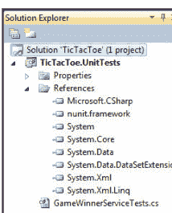

```csharp
[TestFixture]
public class GameWinnerServiceTests
{
    [Test]
    public void NeitherPlayerHasThreeInARow()
    {
        const char expected = ' ';
        var gameBoard = new char[3,3] { { ' ', ' ', ' ' }, { ' ', ' ', ' ' }, { ' ', ' ', ' ' } };
        var actual = gameWinnerService.Validate(gameBoard);
        Assert.AreEqual(expected, actual);
    }
}
```

图 4-1

```csharp
[TestFixture]
public class GameWinnerServiceTests
{
    [Test]
    public void NeitherPlayerHasThreeInARow()
    {
        const char expected = ' ';
        var gameBoard = new char[3,3] { { ' ', ' ', ' ' }, { ' ', ' ', ' ' }, { ' ', ' ', ' ' } };
        var actual = gameWinnerService.Validate(gameBoard);
        Assert.AreEqual(expected, actual);
    }
}
```

你再次注意到代码正尝试调用变量 `gameWinnerService` 上的 `Validate` 方法，而你还没有声明该变量。由于你需要一个 `GameWinnerService` 的实例，请继续声明该变量（为了清晰起见，我省略了声明）：

```csharp
[Test]
public void NeitherPlayerHasThreeInARow()
{
    IGameWinnerService gameWinnerService;
    const char expected = ' ';
    var gameBoard = new char[3,3] { { ' ', ' ', ' ' }, { ' ', ' ', ' ' }, { ' ', ' ', ' ' } };
    var actual = gameWinnerService.Validate(gameBoard);
    Assert.AreEqual(expected, actual);
}
```

#### 重构示例

```csharp
[Test]
public void NeitherPlayerHasThreeInARow()
{
    IGameWinnerService gameWinnerService;
    const char expected = ' ';
    var gameBoard = new char[3,3] { { ' ', ' ', ' ' }, { ' ', ' ', ' ' }, { ' ', ' ', ' ' } };
    var actual = gameWinnerService.Validate(gameBoard);
    Assert.AreEqual(expected, actual);
}
```

#### 重构示例

```csharp
var actual = gameWinnerService.Validate(gameBoard);
Assert.AreEqual(expected, actual);
```

目前状态，此测试仍然无法通过，因为 `IGameWinnerService` 尚未定义。在测试存在之前，你不需要 `IGameWinnerService`，所以它没有存在的理由。现在有一个测试要求 `IGameWinnerService` 被定义，这就是你的下一步。你首先在解决方案中创建一个名为 `TicTacToe.Services` 的新类库，并将 `Class1.cs` 重命名为 `GameWinnerService.cs`。但不要允许 Visual Studio 重命名文件中的类，因为你将删除它（见图 4-2）。

在 `GameWinnerService.cs` 文件中，删除 `Class` 的声明并将其替换为 `IGameWinnerService` 接口的声明：

```csharp
namespace TicTacToe.Services
{
    public interface IGameWinnerService
    {
    }
}
```


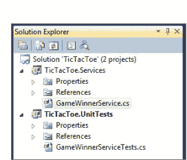
GameWinnerService.cs

回到单元测试，你需要在你的 `TicTacToe.UnitTests` 类库中引用新的 `TicTacToe.Services` 类库。一旦添加了此引用，将 `gameWinnerService` 定为 `IGameWinnerService` 类型将不再导致编译错误。然而，此接口还没有任何方法，因此调用 `gameWinnerService.Validate` 会导致编译错误。因此，你的下一步是在 `IGameWinnerService` 接口中添加 `Validate` 方法定义：

```csharp
public interface IGameWinnerService
{
    char Validate(char[,] gameBoard);
}
```


GameWinnerService.cs

完成后，你的代码仍然无法编译。现在你正尝试在没有创建实例的情况下使用 `gameWinnerService`。让测试通过的下一步是创建一个支持 `IGameWinnerService` 接口的类的具体实例。

在 `GameWinnerService.cs` 文件中，创建一个名为 `GameWinnerService` 的类，并实现 `IGameWinnerService` 接口：

```csharp
public class GameWinnerService : IGameWinnerService
{
    public char Validate(char[,] gameBoard)
    {
        throw new NotImplementedException();
    }
}
```

GameWinnerService.cs

在 `NeitherPlayerHasThreeInARow` 方法中添加代码以实例化 `GameWinnerService` 的常量实例：

```csharp
[Test]
public void NeitherPlayerHasThreeInARow()
{
    IGameWinnerService gameWinnerService = new GameWinnerService();
    const char expected = ' ';
    var gameBoard = new char[3,3] { { ' ', ' ', ' ' }, { ' ', ' ', ' ' }, { ' ', ' ', ' ' } };
    var actual = gameWinnerService.Validate(gameBoard);
    Assert.AreEqual(expected, actual);
}
```

GameWinnerTests.cs

代码可以编译，但当你运行测试时，它会失败，因为 `Validate` 方法尚未实现，如图 4-3 所示。

| 运行 | 停止 | C:\Users\James\Desktop\TestBook\Chapter 4\TicTacToe |
|---|---|---|
| TicTacToe | | |
| UnitTests | TicTacToe.UnitTests.TicTacToe.TicTacToeUnitTests |
| GameWinnerTests | NeitherPlayerHasThreeInARow |
| 失败: 0 错误: 1 未结论 0 无效 0 忽略 0 跳过 0 时间 0:00:00 | | |

图 4-3

#### 编写第一个测试

同样，这是没问题的。你需要看到测试由于许多原因而失败。你需要确保你的测试确实在测试了某些东西；一个永远不会失败的测试并没有真正在测试你的代码。虽然在现阶段不太可能，但你需要验证你没有编写过多的代码。此外，你还需要确保你没有重复创建功能。如果你的测试现在通过了，而你不需要编写更多代码，那么很有可能你正在重复工作。由于目标是保持代码尽可能 DRY（不重复），你需要确保自己没有在重新实现已经存在的内容。

现在是时候开始考虑进入绿色阶段了。你的目标是编写足够的代码来让测试通过。事实证明这很容易做到：

```csharp
public char Validate(char[,] gameBoard)
{
    return ' ';
}
```

看着这段代码，你可能会想：“这不是井字棋的规则，”你是对的。但你当前的要求不是实现井字棋的所有规则——只需实现“如果双方都没有连续三个格，则没有人获胜”这一规则。要求没有提到任何应该返回胜者的条件，也没有提到在游戏板上是否有任何玩家的符号。这些要求并不存在。正如测试（如图 4-4 所示）所示，这种 `Validate` 方法的实现符合该要求。

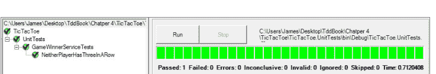

图 4-4
GameWinnerServiceTests 已通过
通过: 1 失败: 0 错误: 0 未结论: 0 无效: 0 忽略: 0 跳过: 0 时间: 0.072048

当前测试通过了。因为业务代码（GameWinnerService）或单元测试（GameWinnerServiceTests）中没有任何内容需要重构，你继续进行下一个业务需求。

#### 第二个功能

第二个功能规定，如果一个玩家的符号出现在顶部水平行的三个单元格中，则应将玩家的符号作为获胜符号返回。以下是该功能的单元测试：

```csharp
[Test]
public void PlayerWithAllSpacesInTopRowIsWinner()
{
    GameWinnerService gameWinnerService;
    gameWinnerService = new GameWinnerService();

    const char expected = 'X';
    var gameBoard = new char[3, 3]
    {
        {expected, expected, expected},
        {' ', ' ', ' '},
        {' ', ' ', ' '}
    };

    var actual = gameWinnerService.Validate(gameBoard);
    Assert.AreEqual(expected.ToString(), actual.ToString());
}
```

GameWinnerService.Tests

这与上一个测试非常相似。它构建了一个多维数组作为你的游戏板，并将其作为参数传递给 `GameWinnerService` 实例 `gameWinnerService` 的 `Validate` 方法。区别在于变量 `expected` 的顶行填充了值 'X'，这是你用作玩家符号的符号。当此测试调用 `Validate` 方法时，它期望从 `Validate` 返回一个值为 'X' 的 `char`。当你运行此测试时，它不会通过，如图 4-5 所示。

| C:/Users/James/Desktop/TestDriven/Chapter4/TicTacToe.cs | | | | | | | | | |
| :--- | :--- | :--- | :--- | :--- | :--- | :--- | :--- | :--- |
| UnitTests | | | | | | | | | |
| TicTacToeService.Tests | | | | | | | | | |
| NestedPlayerThrowsAnError | | | | | | | | | |
| PlayerWithAllSpacesInTopRowWinsRow | | | | | | | | | |
| 通过: 1 失败: 0 错误: 未结论: 0 无效: 0 忽略: 跳过: 0 结果: 0.1710958 | | | | | | | | | |
| TicTacToeUnitTest.GenerateUnitTest.TestPlayerWithAlignmentToGetWinner | | | | | | | | | |
| 停止于第 32 行：字符串索引超出范围。 | | | | | | | | | |
| var was = ... | | | | | | | | | |

图 4-5

你的下一步是仅实现足够通过此测试的功能：

```csharp
public char Validate(char[,] gameBoard)
{
    var columnNameChar = gameBoard[0, 0];
    var columnNameChar1 = gameBoard[0, 1];
    var columnNameChar2 = gameBoard[0, 2];

    if (columnNameChar == columnNameChar1 && columnNameChar1 == columnNameChar2)
    {
        return columnNameChar;
    }

    return ' ';
}
```

GameWinnerService


再次，这足以让测试通过。正如图 4-6 所示，如果该符号出现在顶部水平行的三个单元格中，则应返回该符号作为获胜符号。

# 重构示例 | 85

| 运行 | 停止 | `C:\Users\James\Desktop\TestBook\Chapter 4\TicTacToe` |
|---|---|---|
| TicTacToe | | |
| GameWinner | | |
| PlayerHasThreeInRow | | |
| PlayerAllSpacesInTopRow | | |
| 失败: 0 错误: 1 未结论: 0 无效: 0 忽略: 0 跳过: 0 时间 0:00:00 | | |

图 4-6

在进入下一个测试之前，让我们看看单元测试类：

```csharp
[TestFixture]
public class GameWinnerTests
{
    [Test]
    public void PlayerHasThreeInRow()
    {
        IGameWinnerService gameWinnerService;
        gameWinnerService = new GameWinnerService();
        const char expected = '=';
        var gameBoard = new char[3,3] { {{' ',' ',' '}, {' ',' ',' '}, {' ',' ',' '}} };
        var actual = gameWinnerService.Validate(gameBoard);
        Assert.AreEqual(expected, actual);
    }

    [Test]
    public void PlayerAllSpacesInTopRow()
    {
        GameWinnerService gameWinnerService;
        gameWinnerService = new GameWinnerService();
        const char expected = 'X';
        var gameBoard = new char[3, 3]
        {
            {expected, expected, expected},
            {' ', ' ', ' '},
            {' ', ' ', ' '}
        };
        var actual = gameWinnerService.Validate(gameBoard);
        Assert.AreEqual(expected.ToString(), actual.ToString());
    }
}
```

测试已经看起来 DRY 许多了，但另一个构造在两个单元测试中都使用了——游戏板。这也可以被提取到成员变量：

```csharp
private char[,] _gameBoard;
```

与 `_gameWinnerService` 一样，`_gameBoard` 成员变量的测试实例创建也可以从单个单元测试中移出并放入 `SetupUnitTests` 方法中：

```csharp
[SetUp]
public void SetupUnitTests()
{
    _gameWinnerService = new GameWinnerService();
    _gameBoard = new char[3, 3]
    {
        {' ', ' ', ' '},
        {' ', ' ', ' '},
        {' ', ' ', ' '}
    };
}
```

# 重构示例 | 87

既然已经进行了这些更改，现在就运行单元测试以确保它们仍然像以前一样工作（见图 4-8）。

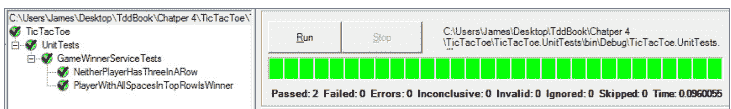

图 4-8

#### 第三个功能

对单元测试进行重构后，现在是时候开始第三个功能了。新要求规定，如果玩家在第一列的所有三行中都有他的字符，则 `Validate` 方法应该返回他的符号，表示他赢了。这与上一个测试的要求非常相似，你可以使用执行该要求的单元测试代码：

```csharp
[Test]
public void PlayerWithAllSpacesInFirstColumnIsWinner()
{
    const char expected = 'X';
    for (var columnIndex = 0; columnIndex < 3; columnIndex++)
    {
        _gameBoard[columnIndex, 0] = expected;
        var actual = _gameWinnerService.Validate(_gameBoard);
        Assert.AreEqual(expected.ToString(), actual.ToString());
    }
}
```

GameWinnerServiceTests.cs

事实证明，如图 4-9 所示，

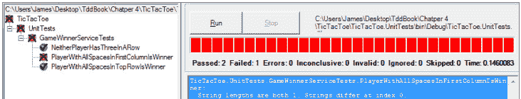

图 4-9

与之前的测试一样，你只是在 `Validate` 方法中编写了足够的代码来让它运行：

```csharp
public char Validate(char[,] gameBoard)
{
    var columnOneChar = gameBoard[0, 0];
    var columnTwoChar = gameBoard[0, 1];
    var columnThreeChar = gameBoard[0, 2];
    if (columnOneChar == columnTwoChar && columnTwoChar == columnThreeChar)
    {
        return columnOneChar;
    }
    var rowTwoChar = gameBoard[1, 0];
    var rowThreeChar = gameBoard[2, 0];
    if (columnOneChar == rowTwoChar && rowTwoChar == rowThreeChar)
    {
        return columnOneChar;
    }
    return ' ';
}
```

运行测试显示，代码不仅没有让你的测试通过，而且无法保持其他测试的通过（见图 4-10）。

GameWinnerService.cs

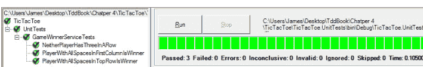

图 4-10

#### 重构业务代码

在进行下一个要求之前，你想要再进行一些重构。这次轮到你重构 `GameWinnerService` 类中的 `Validate` 方法：

```csharp
public char Validate(char[,] gameBoard)
{
    var columnOneChar = gameBoard[0, 0];
    var columnTwoChar = gameBoard[0, 1];
    var columnThreeChar = gameBoard[0, 2];
    if (columnOneChar == columnTwoChar && columnTwoChar == columnThreeChar)
    {
        return columnOneChar;
    }
    var rowTwoChar = gameBoard[1, 0];
    var rowThreeChar = gameBoard[2, 0];
    if (columnOneChar == rowTwoChar && rowTwoChar == rowThreeChar)
    {
        return columnOneChar;
    }
    return ' ';
}
```

GameWinnerService.cs


当你观察这个方法时，很快就能注意到两点：它有点长，而且它违反了单一职责原则（SRP）。发现这两段代码通常同时出现并不稀奇。在这种情况下，可以通过同一组重构步骤修复这两个问题。从查看第一个对 SRP 的违规行为开始。

这个方法做了三件事：它检查第一行是否有三个连线，检查第一列是否有三个连线，并且检查两个条件都不满足的情况。你想要提取的第一件事是代码执行的一个独立方法：

```csharp
private static char CheckForThreeInRowInHorizontal(char[,] gameBoard)
{
    var columnOneChar = gameBoard[0, 0];
    var columnTwoChar = gameBoard[0, 1];
    var columnThreeChar = gameBoard[0, 2];
    if (columnOneChar == columnTwoChar && columnTwoChar == columnThreeChar)
        return columnOneChar;
    return ' ';
}
```

GameWinnerService.cs

调用此方法的 `Validate` 方法现在看起来应该是这样的：

```csharp
public char Validate(char[,] gameBoard)
{
    var currentWinningSymbol = ' ';
    currentWinningSymbol = CheckForThreeInRowInHorizontal(gameBoard);
    var rowOneChar = gameBoard[0, 0];
    var rowTwoChar = gameBoard[1, 0];
    var rowThreeChar = gameBoard[2, 0];
    if (rowOneChar == rowTwoChar && rowTwoChar == rowThreeChar)
        currentWinningSymbol = rowOneChar;
    return currentWinningSymbol;
}
```

GameWinnerService.cs

如你所见，你需要对逻辑进行一些重大更改，但方法看起来好多了。逻辑变得更直观，而且更容易阅读。

# 第 4 章 测试驱动开发：让测试引导你

你现在需要运行测试来验证你没有破坏 `Validate` 方法的任何功能。（见图 4-11）

| ToTacToe | Time |
|---|---|
| GameWinnerTests | Passed: 3 Errors: 0 Inconclusive: 0 0.005 |
| PlayerNoSpacesInColumn | |
| PlayerWithAllSpacesInFirstColumn | |

图 4-11

单元测试显示你破坏了水平连线的逻辑。你提取检查垂直连线的代码：

```csharp
private static char CheckForThreeInRowInVertical(char[,] gameBoard)
{
    var rowOneChar = gameBoard[0, 0];
    var rowTwoChar = gameBoard[1, 0];
    var rowThreeChar = gameBoard[2, 0];
    if (rowOneChar == rowTwoChar && rowTwoChar == rowThreeChar)
        return rowOneChar;
    return ' ';
}
```

在适应垂直列后，方法看起来是这样的：

```csharp
public char Validate(char[,] gameBoard)
{
    var currentWinningSymbol = ' ';
    currentWinningSymbol = CheckForThreeInRowInHorizontal(gameBoard);
    if (currentWinningSymbol != ' ')
    {
        return currentWinningSymbol;
    }
    currentWinningSymbol = CheckForThreeInRowInVertical(gameBoard);
    return currentWinningSymbol;
}
```


这段代码看起来可能是正确的，但运行单元测试显示它改变了 `Validate` 方法的功能，如图 4-12 所示。

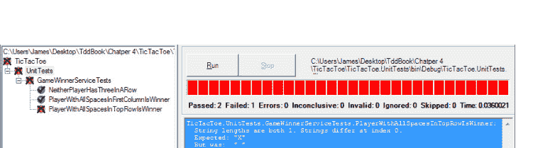

图 4-12

#### 修正重构缺陷

再次查看代码，似乎如果 `CheckForThreeInRowHorizontal` 返回获胜符号，它会被 `CheckForThreeInRowVertical` 的调用覆盖。该方法返回一个空字符，在这种情况下没有任何玩家在第一列领先。

通过这个示例，重构时单元测试的价值显而易见。你可以立即发现代码中的错误，而且由于你只做了少量更改，很容易确定代码哪里出错以及为什么。

在进行下一个功能之前，你需要通过调用 `Validate` 方法修复此错误，看看 `CheckForThreeInRowHorizontal` 的调用是否返回了获胜符号。如果是，重构 `Validate` 方法，甚至不必调用 `CheckForThreeInRowVertical`：

```csharp
public char Validate(char[,] gameBoard)
{
    var winningSymbol = ' ';
    winningSymbol = CheckForThreeInRowHorizontal(gameBoard);
    if (winningSymbol != ' ')
    {
        return winningSymbol;
    }
    return winningSymbol = CheckForThreeInRowVertical(gameBoard);
}
```

GameWinnerService.cs

运行单元测试确保你的更改修复了缺陷，并且没有破坏另外两个，如图 4-13 所示。

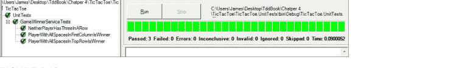

图 4-13

在将检查第一行和第一列匹配项的逻辑提取到自己的方法之前，代码中只有一处使用了空字符字面量（`' '`）。在那种情况下，将其放在代码中是可以的，因为你只使用过了一次。现在你将在四个不同的地方和三个不同的方法中使用它。现在是将该字面量从代码中提取出来并将其声明为私有常量了：

```csharp
private const char SymbolForNoWinner = ' ';
```

现在你可以用此常量替换 `GameWinnerService` 类中所有对该字面量的使用：

```csharp
private const char SymbolForNoWinner = ' ';
```

如果将来某天你需要更改表示没有获胜者的值，你只需要在一个地方进行更改，而不是在四个地方。

在继续之前，你还需要修改一个地方。当前 `Validate` 方法的版本如下：

```csharp
public char Validate(char[,] gameBoard)
{
    var currentWinningSymbol = SymbolForNoWinner;
    currentWinningSymbol = CheckForThreeInRowInHorizontalRow(gameBoard);
    if (currentWinningSymbol != SymbolForNoWinner)
        return currentWinningSymbol;
    currentWinningSymbol = CheckForThreeInRowInVerticalColumn(gameBoard);
    return currentWinningSymbol;
}
```

没有必要为 `currentWinningSymbol` 分配默认值。事实上，你可以在单行代码中声明 `currentWinningSymbol` 并将其赋值为 `CheckThreeInRowInHorizontalRow` 的返回值：

```csharp
public char Validate(char[,] gameBoard)
{
    var currentWinningSymbol = CheckForThreeInRowInHorizontalRow(gameBoard);
}
```


```csharp
if (currentWinningSymbol != SymbolForNoWinner)
    return currentWinningSymbol;

currentWinningSymbol = CheckForThreeInRowInVerticalColumn(gameBoard);

return currentWinningSymbol;
}
```

# 重构示例 | 93

这消除了一行多余代码。这看起来可能没什么，除非你考虑到我在第 3 章中指出，你编写的代码越多，留给自己写出错误代码的机会就越大。通过消除一行多余代码，你减少了 `Validate` 方法出现 bug 的概率。

## 第四个功能

现在重构已经完成，是时候进入下一个功能了。新需求规定，如果用户在对角线上三个三个连续的（从左上角开始，经过中心），那么他或她就是获胜者。该需求的单元测试如下：

```csharp
[Test]
public void PlayerWithThreeARRowDiagonallyDownToRightIsWinner() {
    const char expected = 'X';
    for (var cellIndex = 0; cellIndex < 3; cellIndex++) {
        gameBoard[cellIndex, cellIndex] = expected;
    }
    var actual = _gameWinnerService.Validate(_gameBoard);
    Assert.AreEqual(expected.ToString(), actual.ToString());
}
```

GameWinnerServiceTests.cs

运行此单元测试发现它没有通过，如图 4-14 所示。

| 名称 | 状态 | 路径 |
| --- | --- | --- |
| UnitTests | | C:\Users\James\Desktop\UnitTests\Chapter4\UnitTests\UnitTests.dll |
| PlayerHasThreeInARow | Failed: 1 Errors: 1 Inconclusive: 0 Invalid: 0 Ignored: 0 Skipped: 0 Time: 0.17/0100 |
| PlayerWithASpaceTopRowWinner | | |
| PlayerWithThreeInRowDiagonallyDownToRight | | |

图 4-14

与之前的单元测试一样，你的下一个任务是编写足够的代码来使此测试通过。因为你重构了 `Validate` 方法，你知道检查对角线三个连续的获胜者是 `Validate` 方法发生改变的原因。通过开始一个名为 `CheckThreeInRowDiagonally` 的私有方法，你可以在 `Validate` 方法中调用它：

```csharp
private static char CheckThreeInRowDiagonally(char[][,] gameBoard) {
    var cellOneChar = gameBoard[0, 0];
    var cellTwoChar = gameBoard[1, 1];
    var cellThreeChar = gameBoard[2, 2];
    if (cellOneChar == cellTwoChar &&
        cellTwoChar == cellThreeChar) {
        return cellOneChar;
    }
    return SymbolForNoWinner;
}
```

GameWinnerService.

现在你只需要在 `Validate` 方法中调用此方法：

```csharp
public char Validate(char[][,] gameBoard) {
    var currentWinningSymbol = CheckThreeInArowHorizontal(gameBoard);
    if (currentWinningSymbol != SymbolForNoWinner)
        return currentWinningSymbol;
    currentWinningSymbol = CheckThreeInArowVertical(gameBoard);
    if (currentWinningSymbol != SymbolForNoWinner)
        return currentWinningSymbol;
    currentWinningSymbol = CheckThreeInArowDiagonally(gameBoard);
    return currentWinningSymbol;
}
```

GameWinnerService.

单元测试显示只有新的测试通过了，但所有其他单元测试也通过了（见图 4-15）。

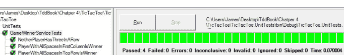

图 4-15

- 单元
- GameWinnerService
- PlayerWithThreeInRowHorizontal
- PlayerWithThreeInRowVertical
- PlayerWithThreeInRowDiagonally

在将检查第一行和第一列匹配项的逻辑提取到自己的方法之前，代码中只有一处使用了空字符字面量（`' '`）。在那种情况下，将其放在代码中是可以的，因为你只使用过了一次。现在你将在四个不同的地方和三个不同的方法中使用它。现在是将该字面量从代码中提取出来并将其声明为私有常量：

```csharp
private const char SymbolForNoWinner = ' ';
```

现在你可以用此常量替换 `GameWinnerService` 类中所有对该字面量的使用：

```csharp
private const char SymbolForNoWinner = ' ';
```

如果将来某天你需要更改表示没有获胜者的值，你只需要在一个地方进行更改，而不是在四个地方。

在继续之前，你还需要修改一个地方。当前 `Validate` 方法的版本如下：

```csharp
public char Validate(char[][,] gameBoard) {
    var currentWinningSymbol = SymbolForNoWinner;
    currentWinningSymbol = CheckForThreeInRowInHorizontalRow(gameBoard);
    if (currentWinningSymbol != SymbolForNoWinner)
        return currentWinningSymbol;
    currentWinningSymbol = CheckForThreeInRowInVerticalColumn(gameBoard);
    return currentWinningSymbol;
}
```

没有必要为 `currentWinningSymbol` 分配默认值。事实上，你可以在单行代码中声明 `currentWinningSymbol` 并将其赋值为 `CheckThreeInRowInHorizontalRow` 的返回值：

```csharp
public char Validate(char[][,] gameBoard) {
    var currentWinningSymbol = CheckForThreeInRowInHorizontalRow(gameBoard);
    if (currentWinningSymbol != SymbolForNoWinner)
        return currentWinningSymbol;
    currentWinningSymbol = CheckForThreeInRowInVerticalColumn(gameBoard);
    return currentWinningSymbol;
}
```

# 5

# 模拟外部资源

**本章内容：**

- 为什么静态绑定组件会导致脆弱的系统
- 依赖注入模式如何帮助动态绑定这些组件
- 依赖注入框架如何帮助管理应用程序内部的依赖
- 如何使用存储库模式有效地模拟数据访问代码

大多数你作为业务应用程序开发者编写的大部分应用程序由各种组件组成（某些是你创建的，另一些来自第三方），这些组件组合在一起执行任务。有时这些组件代表外部资源，例如数据库、网络服务、文件系统或物理设备。你的应用程序需要这些外部资源，但你仍然需要离开这些外部资源进行测试。实践 TDD 的开发者通过在运行时提供这些外部资源的替代品来实现。这些替代品被称为模拟（mock）。

为了使用模拟，并真正隔离待测试的单个组件，你需要一种替代静态绑定单个组件的方案。依赖注入模式可以在运行时或测试期间注入具体的实现。

## 面向对象编程中的依赖注入

在传统的应用程序设计中，你创建服务类和实体类来抽象现实世界中的过程和实体。应用程序由这些不同的服务类和实体类组成。这种组合在你的应用程序的类之间创建了依赖关系。表达和管理这些依赖关系最明显的方法是在代码中静态地创建它们，作为类初始化过程的一部分（此示例可以在 www.wrox.com 下载的代码示例的 Before 文件夹中找到）。


```csharp
public class BusinessService {
    private readonly string _ConnectionString = ConfigurationManager.ConnectionStrings["MyConnectionString"].ConnectionString;
    private readonly string _webServiceAddress = ConfigurationManager.AppSettings["MyWebServiceAddress"];
    private readonly LoggingDataSink _loggingDataSink;
    private DataAccessComponent _dataAccessComponent;
    private WebServiceProxy _webServiceProxy;
    private LoggingComponent _loggingComponent;
    public BusinessService() {
        _loggingDataSink = new LoggingDataSink();
        _loggingComponent = new LoggingComponent(_loggingDataSink);
        _webServiceProxy = new WebServiceProxy(_webServiceAddress);
        _dataAccessComponent = new DataAccessComponent(_databaseConnectionString);
    }
}
```


# BusinessService.cs

当使用这种方法处理类之间的依赖关系时，会出现几个问题。最明显的问题是，该类静态地绑定到了你编写此处时使用的特定具体实现。在不打开代码的情况下无法更改所使用的对象。这种静态绑定也导致无法为任何依赖项替换模拟对象（mock objects），这使得单元测试时无法隔离该类方法中的任何代码。

由于这些依赖关系是基于合约（contract）的，这一点变得更加复杂。相反，它们依赖于类的特定定义。依赖具体类而不是抽象接口限制了你切换服务的能力。为了让此类类对修改开放（根据开放闭原则 [OCP] 的定义），你必须能够将依赖项替换为支持相同 API 的类，或者对该类进行重大更改。

这种方法的最后一个大问题是，`BusinessService` 需要了解过多关于它所依赖的类的信息以便创建这些类的实例。它必须知道 `DataAccessComponent` 需要连接字符串，`WebServiceProxy` 需要服务地址，以及 `LoggingComponent` 需要一个消息数据接收器（data sink）。这违反了单一职责原则（SRP），因为创建这些类的类肯定存在于应用程序的其他地方。

## 依赖注入模式

事实上，你可以确保在应用程序中使用这些依赖类的任何地方，完全相同的代码都被复制了。这意味着如果这些类中的任何一个更改了此类，可能许多其他类也随之更改。

依赖注入模式提供了一个框架，允许在创建该类时为该类提供依赖对象的具体实例。注入依赖的最简单且常见的方法是将它们作为构造参数传递给对象。取之前的示例并将其重构为依赖注入模式，将得到如下所示的类。（此示例可以在 wrox.com 下载的代码示例的 After 文件夹中找到。）

```csharp
public class BusinessService {
    private IDataAccessComponent _dataAccessComponent;
    private IWebServiceProxy _webServiceProxy;
    private ILoggingComponent _loggingComponent;

    public BusinessService(IDataAccessComponent dataAccessComponent, IWebServiceProxy webServiceProxy, ILoggingComponent loggingComponent) {
        _loggingComponent = loggingComponent;
        _webServiceProxy = webServiceProxy;
        _dataAccessComponent = dataAccessComponent;
    }
}
```

实现依赖注入模式已经在很大程度上让 `BusinessService` 变得更易理解和维护。限制依赖关系仍然很重要。一个具有过多构造参数的类本身就是一种代码异味（code smell），但依赖注入模式使得管理该类的依赖关系变得容易得多。

除了提高 `BusinessService` 的可读性和维护性外，当你调用此类时，你可以注入你喜欢的任何依赖实现，只要它们实现了约定的接口。你可以根据规则或配置值提供这些依赖的不同实现。对于你希望在 QA 环境中使用测试数据库或 Web 服务，而在迁移到生产环境时切换到这些资源的生产实例的情况，这非常有帮助。作为 TDD 开发者，主要的优势可以将这些服务的模拟实例注入到此类中进行测试。这允许你提供那些响应，并能够隔离此类中的代码。

## 使用依赖注入框架

上一个示例展示了如何通过构造参数注入类的依赖项，从而创建了 `BusinessService` 的实现。但创建这些依赖具体实现的逻辑并没有消失；它必须移动到代码库的其他地方。但在哪里呢？

许多 OOP 开发者熟悉一种或多种工厂模式，例如工厂模式、抽象工厂模式、生成器模式和原型模式。这些都是应用程序中创建类的基本模式的变体。基本上，所有的工厂模式都描述了获取实现特定对象的实例的方法。请求者只知道它需要的接口。工厂可以根据请求的接口以及工厂提供的任何配置设置或上下文规则来决定请求者使用哪个类。

工厂模式对于抽象创建依赖对象的逻辑和细节非常有用，使其不必出现在应用程序的业务领域。随着应用程序中增加的服务和服务依赖项，管理和维护工厂的任务可能会变得困难且耗时。

依赖注入（DI）框架为开发者提供了传统工厂模式的替代方案。它们允许你快速地定义系统内的依赖关系以及根据这些依赖关系创建相应对象的规则。这些规则和设置可以用于构建整个类树，无需知道你依赖于什么。简而言之，DI 框架完成了工厂的所有工作，而你的工作量少得多。书中的示例使用了 Nate Kohari 定义的 Inject 框架 2.1.0 版本，可以在 www.nject.org 下载。

以下代码重新审视了上一节的示例。我已经将 `DataAccessException`、`WebServiceProxy` 和 `LoggingComponent` 的声明类型更改为相应的接口，并为 `LoggingDataSink` 类添加了 `ILoggingDataSink` 接口。我还删除了所有代码行。

## 依赖注入模式

在利用依赖注入的力量时，接口非常重要。通过将成员变量声明为接口，我隐式地表示我并不关心每个服务的具体具体实现是什么，我只关心它是否实现了被声明的接口。这允许我将确定具体类型类型的任务委托给我的依赖注入框架。随后，依赖注入框架就变成了决定使用哪个具体实例的规则和逻辑存储库。而接口的使用有助于实现这一点。

此示例将向你展示如何使用 Ninject DI 框架来处理并创建依赖项。要使用 Ninject，你必须向项目添加对 Ninject 框架程序集（`Ninject.dll`）的引用，如图 5-1 所示。

Ninject 需要一个类来存储创建依赖具体实例所需的规则。这些类被称为模块（modules）。下一步是创建一个类来持有 `BusinessApplication.Core` 项目的规则。为了使用 Ninject，此类必须继承自 `NinjectModule` 并为 `Load` 方法提供实现：

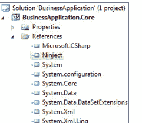

图 5-1

```csharp
public class CoreModule : NinjectModule {
    public override void Load() {
        throw new NotImplementedException();
    }
}
```

### CoreModule.cs

通过为抽象类 `NinjectModule` 提供具体实现，`CoreModule` 可以为 Ninject 提供其根据消费者的请求构建具体类所需的信息。重写的 `Load` 方法是你定义创建类规则的地方。从一个简单的示例开始：`LoggingDataSink`：

```csharp
public override void Load() {
    Bind<ILoggingDataSink>().To<LoggingDataSink>();
}
```

### CoreModule.cs

我选择 `LoggingDataSink` 作为此示例是因为因为它没有输入参数，并且没有被用作我其他具体类的输入参数。此示例使用了 Ninject 的 `Bind` 命令来指定：任何对实现 `ILoggingDataSink` 接口的类的请求都应该返回 `LoggingDataSink` 的具体实例，这是通过 `To` 扩展方法指定的。

下一个绑定是为 `LoggingComponent` 创建绑定。创建此绑定的语法与为 `LoggingDataSink` 创建绑定完全一致。

```csharp
public override void Load() {
    Bind<ILoggingDataSink>().To<LoggingDataSink>();
    Bind<ILoggingComponent>().To<LoggingComponent>();
}
```

### CoreModule.cs

记住，`LoggingComponent` 将 `ILoggingDataSink` 的实例作为构造函数参数。但你会注意到示例并没有在 Ninject 中指定规则来显示这种关系是如何结构的，或者 `LoggingComponent` 是如何获取正确的 `ILoggingDataSink` 实例的。DI 框架的好处在于你不需要指定。Ninject 可以检查 `LoggingComponent` 并看到它有一个构造函数。它还会看到该构造函数接受一个类型为 `ILoggingDataSink` 的参数。Ninject 可以推断出在创建 `LoggingComponent` 实例时，它也需要创建一个实现 `LoggingDataSink` 的类的实例（在此例中为 `LoggingDataSink`），并将其作为构造参数传递给 `LoggingComponent`。你不需要做任何其他事情；Ninject 会为你处理此功能。此功能会延伸到许多层。例如，`LoggingDataSink` 有一个 Ninject 可以轻松满足的构造函数参数（这意味着 Ninject 也会处理该创建过程）。你除了指定额外的规则外，不需要做任何其他事情。

`DataAccessComponent` 比 `LoggingComponent` 稍微复杂一点。它有一个依赖项并接收构造函数，但对于 `DataAccessComponent` 来说，这个参数来自应用程序配置文件的字符串，而不是另一个类。

提供者（provider）只是允许将创建逻辑从模块代码中抽象出来的类。要创建一个提供者，创建一个类并继承 Ninject 提供的抽象 `Provider` 类。

```csharp
public class DataAccessComponentProvider : IDataAccessComponent {
    protected override IDataAccessComponent CreateInstance(IContext context) {
        throw new NotImplementedException();
    }
}
```

### CoreModule.cs

提供者基类的泛型类型是该提供者将绑定的接口——在这种情况下是 `IDataAccessComponent`。你需要为 `CreateInstance` 方法提供实现，返回一个实现 `IDataAccessComponent` 接口的类的实例。在示例应用程序中，这是 `DataAccessComponent` 的实例，你从中从应用程序配置文件提供连接字符串：

```csharp
protected override IDataAccessComponent CreateInstance(IContext context) {
    var databaseConnectionString = ConfigurationManager["ConnectionString"].ConnectionString;
    return new DataAccessComponent(databaseConnectionString);
}
```

### CoreModule.cs

从你的配置文件检索连接字符串的代码简单且易于放置。将此代码放在提供者中允许你将 `DataAccess` 的创建逻辑从 `CoreModule` 中 `Load` 方法列出的规则中抽象出来。你现在需要添加对 `CoreModule` 类的引用，以便告知 Ninject 如何创建 `DataAccess`：

```csharp
public override void Load() {
    Bind<ILoggingDataSink>().To<LoggingDataSink>();
    Bind<ILoggingComponent>().To<LoggingComponent>();
    Bind<IDataAccessComponent>().ToProvider(new DataAccessComponentProvider());
}
```

### Module.cs

这就是你需要的。当你请求 `DataAccessComponent` 时，将获得一个正确创建的 `DataAccessComponent`。

为 `WebServiceProxy` 创建提供者的代码几乎完全相同：

```csharp
public class WebWebServiceComponentProvider : Provider<WebServiceProxy> {
    protected override IWebServiceProxy CreateInstance(IContext context) {
        var webServiceAddress = ConfigurationManager.AppSettings["MyWebServiceAddress"];
        return new WebServiceProxy(webServiceAddress);
    }
}
```

### CoreModule.cs

修改 `CoreModule` 以告知 Ninject 此提供者就像添加 `ComponentProvider` 一样简单：

```csharp
public override void Load() {
    Bind<ILoggingDataSink>().To<LoggingDataSink>();
    Bind<ILoggingComponent>().To<LoggingComponent>();
    Bind<IDataAccessComponent>().ToProvider<DataAccessComponent>();
    Bind<IWebServiceProxy>().To(new WebWebServiceComponentProvider());
}
```

### CoreModule.cs

有了 `CoreModule`，你可以重构 `BusinessService` 以移除创建依赖对象的逻辑：

```csharp
public class BusinessService {
    private ILoggingComponent _loggingComponent;
    private IWebServiceProxy _webServiceProxy;
    private IDataAccessComponent _dataAccessComponent;

    public BusinessService(ILoggingComponent loggingComponent, IWebServiceProxy webServiceProxy, IDataAccessComponent dataAccessComponent) {
        _loggingComponent = loggingComponent;
        _webServiceProxy = webServiceProxy;
        _dataAccessComponent = dataAccessComponent;
    }
}
```

### BusinessService.cs

这种 `BusinessService` 的实现比之前的版本干净得多。移除创建和维护依赖对象的逻辑可以防止你违反单一职责原则（SRP），因为如果创建依赖对象的例程发生变化，代码中只有一个地方需要修改。`BusinessService` 类不再需要知道这些对象是如何创建的；它认为收到的对象实现了正确的接口就足够了。

那么，如何创建 `BusinessService` 的实例呢？在使用 DI 框架时，你不能像通常那样去“实例化”对象：

```csharp
var businessService = new BusinessService();
```

在没有构造参数的情况下，这无法编译。相反，你需要向 Ninject 索要 `BusinessService` 的实例。大多数 DI 框架都提供某种仓库类，允许你从框架请求对象。在 Ninject 中，这个仓库被称为内核（kernel）。为了演示

## 依赖注入模式

从内核请求一个对象，你将创建一个单元测试。第一步是创建一个容器来包含这些单元测试，如图 5-2 所示。

除了 `unit.framework` 程序集外，你还需要添加对 `Inject` 程序集的引用，以便创建你所需的内核。内核是 `StandardKernel` 类的实例，你将创建它作为与 `Inject` 框架交互的接口。你通过调用 `Get` 方法并指定你需要哪个接口来向此 `StandardKernel` 实例请求类。`StandardKernel` 使用在其构造期间提供的规则来确定正确的实例应该是什么，并向调用方法返回一个完全完整的对象图。

接下来，你创建一个单元测试，以从 `Inject` 内核获取 `BusinessService` 的实例：

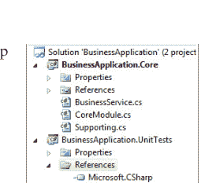

```csharp
[TestFixture]
public class BusinessServiceTests {
    [Test]
    public void voidShouldBeAbleToGetBusinessServiceFromInject() {
        BusinessService actual;
        Assert.IsNotNull(actual);
    }
}
```


# 第 5 章 模拟外部资源

## 依赖注入模式

尝试运行此代码将会失败，因为此时代码无法编译，如图 5-3 所示。

为了使其能够运行，你需要从 `Inject` 内核请求一个对象并赋值给 `actual`。使用你需要的 `Inject` 类，并在你的单元测试的开头为 `Inject` 程序集添加 `using` 语句：

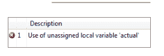

现在，你需要在你的单元测试中添加代码，以创建一个 `Inject` 内核的实例并从它创建一个 `BusinessService` 实例：

```csharp
[Test]
public void ShouldBeAbleToGetBusinessServiceFromInject() {
    BusinessService actual;
    var kernel = new StandardKernel(new CoreModule());
    actual = kernel.Get<BusinessService>();
    Assert.IsNotNull(actual);
}
```

在创建 Ninject 的 `StandardKernel` 实例时，你需要为它提供一个 `CoreModule` 实例。这让 Ninject 知道了创建对象的规则和步骤。在示例中，`StandardKernel` 只接受一个模块（`CoreModule`）作为它的规则集。这个示例是可以的，因为只处理了一个库（`BusinessApplication.Core`）。但如果你有多个程序集呢？你可以创建一个包含解决方案中所有内容创建规则的模块，但这不是好主意。它还要求项目模块固定以感知所有其他项目和程序集。它还限制了解决方案中组件的重用。如果你在库 B 中有一个组件，但它的创建规则在库 A 中，那么你现在依赖于库 A 及其所有依赖项。要解决这个问题，为解决方案中的每个项目创建一个模块，为该库中的所有类和接口提供创建规则。这意味着库之间的依赖性降低了，重用也变得更容易。

`StandardKernel` 的构造函数有一个接受模块数组的重载方法。这允许你为应用程序创建一个单一内核（在实践中，此内核应该是单例），它包含在应用程序任何地方创建你所需内容的信息。创建此类内核的语法如下：

```csharp
var kernel = new StandardKernel(new ModuleA(),
              new ModuleB(),
              new ModuleC());
```

运行测试显示存在一个问题，如图 5-4 所示。

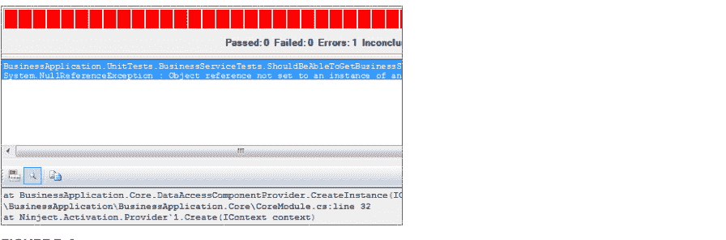

堆栈轨迹告诉你 `CoreModule.cs` 文件中的第 32 行存在问题：

```csharp
var databaseConnectionString = ConfigurationManager
              .ConnectionStrings["MyConnectionString"].ConnectionString;
```

当单元需要来自应用程序配置文件（`web.config` 或 `app.config`）的信息时，它需要该文件的自己的实例。该文件是添加到测试所在的 Visual Studio 项目中，还是从另一个项目复制的，并不重要。它无法访问另一个项目的配置文件。要解决这个问题，你可以向 `BusinessApplication.UnitTests` 项目添加一个 `app.config` 文件，并用连接字符串填充它：

```xml
<?xml version="1.0" encoding="utf-8"?>
<configuration>
  <connectionStrings>
    <add name="MyConnectionString" connectionString="Sample Configuration" />
  </connectionStrings>
</configuration>
```

当你运行测试时，Ninject 已经创建了 `BusinessService` 实例及其所有依赖对象，如图 5 所示。

| C:\Users\Desktop\Test\Book\BusinessApplication | Run | C:\Users\Desktop\Test\Book\Chapter 5\Code\SampleAfter\BusinessApplication\BusinessApplicationUnitTest |
|---|---|---|
| BusinessApplication | | |
| UnitTests | | |
| BusinessServiceTests | | |
| ShouldAbleToGetBusiness | | |
| Passed: 1 Failed: 0 Errors: 0 Inconclusive: 0 Invalid: 0 Skipped: 0 Ignored: 0 Elapsed: 1.650968 |

## 使用存储模式隔离数据

最终开发者决定，虽然智能对象可能有所帮助，但更大的好处是将数据访问逻辑从业务实体中分离。这样做创建了解耦，允许业务开发独立于数据访问和数据存储开发进行演进。这种独立性意味着后端数据存储可以发生变化，有时是巨大的变化，而业务领域逻辑和实体不受这些变化的影响。这种松耦合使得开发者更容易为他们的业务逻辑编写隔离单元测试。

### 抽象数据访问层

大多数业务应用程序使用某种数据存储。它可以是数据库管理系统 (DBMS)、文本或二进制文件、Web 服务或其他用于持久化数据的机制。在编写单元测试时，重要的是将被测试的代码与访问数据的隔离开来。存储模式抽象了应用程序中负责访问数据存储组件。

### 将数据库关注从业务代码中移出

.NET 1.0 发布时，它对 Microsoft ActiveX Data Object (ADO) 框架进行了更新，称为 ADO.NET。ADO.NET 不仅仅是 ADO 的 .NET 版本；它增加了许多旨在让开发者轻松处理类和对象的特性。因此，ADO.NET 的早期用户采用了“智能对象”架构，它是自持久的。通常，这会在类中嵌入数据读取器或数据集来检索和存储数据。

虽然这创建了一个可以快速地开发这些自持久对象的代码库，但它导致了许多其他问题。将访问逻辑分布在整个应用程序中会导致许多维护问题，对某个类的处理很少局限于该类。正因如此，无法围绕数据访问构建单一故障点。

这还引发了类之间复杂关系的问题。在某些情况下，一个类在没有实例化几个对象的情况下无法正确实例化自己。这产生了与前节类似的问题，即特定对象的逻辑和规则碎片化到了整个应用程序中。在这些情况下，无法在不违反 SRP 的情况下拥有运行的系统。

最后，这种模式使得隔离单元测试成为噩梦，如果可以的话。紧嵌入的 ADO.NET 代码无法快速或轻松地从业务逻辑中解耦。这使得为这些数据库连接点提供模拟对象变得困难，如果可能的话。

### 使用存储模式隔离数据

最终开发者决定，虽然智能对象可能有所帮助，但更大的好处是将数据访问逻辑从业务实体中移开。这样做创建了解耦，允许业务开发独立于数据访问和数据存储开发进行演进。

简而言之，仓库模式规定所有数据访问都将封装在一个仓库对象中，业务领域类将使用该对象来执行任何持久化工作（图 5-6）。

| 实体 CRUD（创建、检索、更新、删除）命令 | |
| :--- | :--- |
| 业务领域服务 | 响应实体对象或成功/失败返回值 |
| 实体仓库 | |

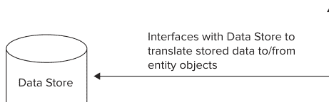

仓库在业务领域和数据存储之间创建了一个**接层**（shim）。仓库封装了关于数据如何以扁平格式存储，以及如何将这些数据从这种扁平格式翻译为实体对象的知识。每个实体都应该有自己的仓库。不同类型的仓库应该具有相似的接口和通用的基类，以帮助数据访问代码保持 DRY（不要重复）原则，并让学习如何使用仓库变得更容易。

可以使用任何数据访问技术创建仓库，包括 ADO.NET、服务和文件存储。许多对象关系映射（ORM）框架使得创建仓库变得简单。在使用了 Entity Framework 或 nHibernate 等框架来管理持久化的系统中，可以编写一个单一的仓库，接受任何实体作为泛型，并将特定于类型的工作交给框架。请检查您的 ORM 文档以获取更多信息。

### 注入仓库

你可以通过创建一个 `Person` 实体来对之前示例中的解决方案进行一些补充。

```csharp
public class Person {
    public int Id { get; set; }
    public string FirstName { get; set; }
    public string LastName { get; set; }
}
```

`PersonService` 类作为业务领域类，从执行业务规则和在业务工作中使用 `Person` 的角度处理 `Person` 对象。以下是 `PersonService` 的接口：

```csharp
public interface IPersonService {
    Person GetPerson(int personId);
}
```

`PersonService` 使用 `PersonRepository` 实例进行数据持久化。此示例仅实现了 `GetPerson` 方法，并且没有使用数据库后端，而是使用一个 `IList` 成员来持有 `Person` 数据：

```csharp
public interface IPersonRepository {
    Person GetPerson(int personId);
}
```

```csharp
public class PersonRepository : IPersonRepository {
    private readonly IList<Person> _personList;

    public Person GetPerson(int personId) {
        return _personList.Where(person => person.Id == personId).FirstOrDefault();
    }

    public PersonRepository() {
        _personList = new List<Person> {
            new Person { Id = 1, FirstName = "John", LastName = "Doe" },
            new Person { Id = 2, FirstName = "Richard", LastName = "Roe" },
            new Person { Id = 3, FirstName = "Amy", LastName = "Adams" }
        };
    }
}
```

现在已经定义了运行中的应用程序部分，你可以实现 `PersonService`：

```csharp
public class PersonService : IPersonService {
    public PersonService() {
    }

    public Person GetPerson(int personId) {
        return new Person();
    }
}
```

现在 `PersonService` 有一个空构造函数。你需要注入 `PersonRepository`，以便 `PersonService` 有方法访问数据存储并更改 `GetPerson` 方法的实现：

```csharp
public class PersonService : IPersonService {
    private readonly IPersonRepository _personRepository;

    public PersonService(IPersonRepository personRepository) {
        _personRepository = personRepository;
    }

    public Person GetPerson(int personId) {
        return _personRepository.GetPerson(personId);
    }
}
```

最后，你需要在 `CoreModule` 中定义创建 `PersonService` 和 `PersonRepository` 的规则：

```csharp
Bind<IPersonRepository>().To<PersonRepository>();
Bind<IPersonService>().To<PersonService>();
```

为了验证所有内容都正确连接，你想要编写一个单元测试来验证你可以从 Ninject 获取 `PersonService` 实例，并获取一个指示 `PersonService` 可以调用 `PersonRepository` 的 `Person` 对象：

```csharp
[TestFixture]
public class PersonServiceTests {
    [Test]
    public void ShouldBeAbleToCallPersonServiceGetPerson() {
        var expected = new Person { Id = 1, FirstName = "John", LastName = "Doe" };
    }
}
```


```csharp
var kernel = new StandardKernel(new CoreModule());

var personService = kernel.Get<IPersonService>();

var actual = personService.GetPerson(expected.Id);

Assert.AreEqual(expected.Id, actual.Id);
Assert.AreEqual(expected.FirstName, actual.FirstName);
Assert.AreEqual(expected.LastName, actual.LastName);
```


运行测试并看到它证明了 `PersonService` 和 `PersonRepository` 已正确创建，如图 5-7 所示。

| C:\Users\Desktop\Chapter 5\MockSample.csproj |  | C:\Users\Desktop\Chapter 5\MockSample\UnitTests.dll |
| :--- | :--- | :--- |
| Unit Tests PersonService | 失败: 0 | 错误: 0 | 未结论: 0 | 时长: 0.3902 |
| ShouldBeAbleToGetPerson | | |
| ShouldBeAbleToCallPersonServiceIGetPerson | | |

图 5-7

#### 模拟仓库

测试运行了，但仍然存在一个重大问题。因为它破坏了 `PersonService` 和 `PersonRepository` 之间的边界，它并不是真正的测试。为了使其成为真正的测试，你需要为 `Repository` 提供一个模拟对象 

Moq 的基础知识在第 2 章介绍过，但我将回顾一下并解释我在这里做了什么。此片段的第一行要求 Moq 框架根据接口创建一个模拟或替代对象。现在 `personRepositoryMock` 是实现该接口的空类；它有方法，但在提供实现之前它们什么都不做。这通过下一行使用 `Setup` 和 `Returns` 扩展方法告诉 `personRepositoryMock`，当 `GetPerson` 被带有参数 `1` 调用时，应该返回 `Returns` 方法中描述的 `Person` 对象。最后，通过使用 Ninject 创建 `PersonService` 实例，并将其作为构造函数参数注入。

以下是完整的测试以及创建模拟版本的代码：

```csharp
[Test]
public void ShouldBeAbleToCallPersonServiceAndGetPerson()
{
    var expected = new Person(Id = 1, FirstName = "John", LastName = "Doe");
    var personRepositoryMock = new Mock<IPersonRepository>();
    personRepositoryMock
        .Setup(pr => pr.GetPerson(Id = 1))
        .Returns(new Person(FirstName = "Bob", LastName = "Smith"));
    var personService = new PersonService(personRepositoryMock.Object);
    var actual = personService.GetPerson(expected.Id);
    Assert.AreEqual(expected.Id, actual.Id);
    Assert.AreEqual(expected.FirstName, actual.FirstName);
    Assert.AreEqual(expected.LastName, actual.LastName);
}
```


# PersonServiceTests.cs

在 `personRepositoryMock` 的设置中，`Person` 对象不符合预期。因此，测试应该失败，如图 5-8 所示。

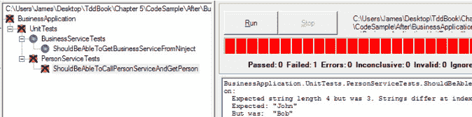

图 5-8

#### 总结

你在职业生涯中编写的大多数应用程序都有某种资源。这些资源可能是数据库、Web 服务、文件系统，甚至是物理设备。尽管如此，你仍然需要确保你编写的单元测试是隔离的，为了在独立于任何依赖的情况下，仅测试你正在测试的特定方法。静态创建这些依赖的传统方法会创建脆弱且难以维护应用程序。

依赖注入模式允许你根据接口而不是具体实现来定义这些依赖。这些接口的具体实现可以在运行时提供并注入到对象中。这使得你能够根据对象被使用的上下文来更改这些依赖的具体实现。在运行时，你的应用程序可以根据环境（生产环境、QA 环境、开发环境）更改具体实现。对于单元测试，你可以注入模拟对象来替代实际实现。这允许你保持测试的孤立性和可预测性。

访问数据是业务应用程序中非常常见的需求。许多开发者尝试在实际的类定义中嵌入执行持久化操作的代码。这导致数据访问代码分散在整个应用程序中，并增加了维护难度。

通过使用仓库模式，你可以将此功能从业务逻辑中分离出来。这在业务领域逻辑与执行持久化所需的基础设施之间创建了清晰的分离。它让单元测试中模拟数据访问变得更容易，因为这些代码不再与你的业务领域代码紧密绑定。

# 第二部分：将基础付诸实践

- 第 6 章：启动示例应用程序
- 第 7 章：实现第一个用户故事
- 第 8 章：集成测试

# 第 6 章：启动示例应用程序

## 本章包含哪些内容？

- 业务需求如何驱动定义单元测试的功能特性
- 在应用程序开发开始前需要采取哪些步骤
- 如何对应用程序技术做出决策
- 用户故事如何驱动敏捷应用程序开发方法论
- 为什么项目组织很重要，以及创建项目时需要注意什么

在为应用程序编写第一行代码之前，你必须完成许多任务。应用程序是由一组功能性业务需求和一组非功能性技术需求定义的。功能性需求描述了应用程序为了满足业务需求必须做什么。非功能性需求描述了应用程序必须存在的一系列条件或参数。在收集到这些信息后，功能性需求被用于创建用户故事，用户故事将被拆解为功能特性，并分配给开发者进行构建。非功能性需求用于确定应用程序的平台和结构，以及在应用程序中应该使用哪些框架（如果有）。

在本章中，你将看到开始编写应用程序之前必要的各种步骤和决策。你将深入了解运行中的敏捷实现方案。你将看到在讨论技术话题之前做出了哪些决策，以及在做出这些决策后如何选择合适的技术。最后，你将看到如何通过在 Visual Studio 解决方案中创建示例所需的基础项目来启动你的项目。

## 定义项目

大多数开发者喜欢写代码。在大多数情况下，这正是我们最初成为开发者的原因。大多数开发者尝试用代码解决给定的问题。许多开发者用代码进行交流。有些开发者甚至用代码思考。如果有选择，我相信大多数开发者都会尝试用代码完成所有的交流和解决工作。遗憾的是，业务部门的其他人员并不会用代码交流，更不用说用代码思考了。

任何应用程序都离不开需求集。即使是你编写的用来跟踪 DVD 收藏的小型应用程序，也有某种需求收集阶段，即使它非常简短。在编写应用程序之前，你需要知道这个程序是要做什么的。除了知道应用程序将做什么，你必须知道应用程序将如何被构建以及它将在什么条件下运行。所有这些决策都应该在开发之前做出。

应用程序的业务功能由业务需求定义。应用程序的技术基础由目标环境以及构建应用程序所选的技术定义。在理想情况下，虽然所做的技术选择应该完成业务，但业务不应随所选技术的意愿而改变。遗憾的是，理想情况是罕见的。因此，在早期根据业务需求做出这些决策，并让它们驱动技术需求是非常关键的。

目标环境定义了应用程序执行任务所需的资源，以及应用程序必须在其中的限制。该环境的定义至关重要，这可以确保你的应用程序在部署时拥有必要的资源，并且其设计和构建方式不会尝试超出其能力范围。构建应用程序所使用的技术选择也很重要。在很多情况下，这已经为你决定了；你的公司可能已经对特定版本的 .NET 和一些应用程序框架制定了标准。在其他情况下，你可能需要为引入新框架或升级到 .NET 的最新版本提供理由。这些因素对应用程序的设计和构建有很大影响，你越早能做出这些决策就越好。

## 开发项目概述

作为一名业务开发者，你将花费大部分时间构建应用程序以满足业务的特定需求。这可能是一个简化或自动化现有流程的应用程序，也可能是帮助公司利用新收入源的应用程序。无论何种，都必须收集一组高级需求来识别应用程序的业务需求。

项目概述是对应用程序业务需求的高级描述。它描述了应用程序的总体目的、一些关键工作流，以及应用程序的主要用户角色和类型。该概述旨在提供业务需求的粗略轮廓。在此阶段不进行任何详细的设计或用户故事的创建。其想法仅仅是识别应用程序的大型、高级别的部分，以便它们在下一阶段可以被拆解。

接下来的几章将描述一个库存管理系统的构建，我将其简称为 OSIM。作为项目概述的一部分，我已识别了应用程序的业务需求：

- 应用程序必须跟踪库存情况。
- 应用程序必须允许用户向库存添加新类型的物品。
- 应用程序必须允许用户记录补货入库。
- 应用程序必须允许用户从库存移除物品。
- 用户必须经过验证。

注意，此列表并没有指定如何执行这些任务。它没有涉及任何特定的技术问题。事实上，项目概述的意义是在对使用的技术保持客观中立视角的同时识别需求。项目此阶段的一个陷阱是参与者（开发者驱动）下意识地试图将需求引导到特定的技术。这与应该的做法恰相反：技术应该为业务需求服务，而不是反之。

## 定义目标环境

业务需求通常会影响应用程序的目标环境。在考虑应用程序将部署的环境时，你需要的不仅仅是服务器将运行什么操作系统。你需要思考应用程序将如何被使用。它是一个基于 Web 的应用程序吗？它运行在用户的桌面上吗？也许它会运行在移动平台上。

思考应用程序将如何被构建以及将面临哪些基础设施的需求是非常重要的。应用程序是否有多个层？在高峰时期，你预计会有多少并发用户？应用程序需要提供什么样的响应？应用程序需要扩展吗？它会被预期垂直扩展（移动到更强大的服务器）还是水平扩展（将应用程序部署到更多服务器）？这些需求如何影响你的应用程序架构？

应用程序的目标环境应该在应用程序的非功能性需求中描述。在某些情况下，目标环境已经定义，你的应用程序必须设计为该模型。在其他情况下，将构建一个新的环境，但可能会有其他限制，例如预算以及公司的硬件和软件标准。在定义应用程序的目标环境时，都需要考虑这些因素。

对于 OSIM 应用程序，目标环境必须适应多层应用程序。作为技术需求的一部分，业务所有者表示他希望应用程序具有基于 Web 的前端、Windows 客户端前端，以及一个面向外部交易伙伴和各种企业报告工具的服务接口。这些层将包括用户界面层（包括任何应用程序外部的 Web 服务）、业务逻辑层和数据存储层。由于这是一个小型跨部门应用程序，你预期的并发用户不超过二到四个；然而，分层架构为该应用程序留下了增长空间。基于此，你将目标环境定义为 Microsoft Windows Server IIS 7 或更高版本（这不包含专用服务器）以及 Microsoft SQL Server 2008 R2。

## 选择应用程序技术

在确定目标后，你必须确定一个应用程序平台。JEE、.NET、Ruby on Rails 和 PHP 是创建 Web 应用程序的一些较流行的平台。你在定义目标环境时做出的选择将为选择应用程序平台提供指导，因为某些操作系统更擅长支持特定的应用程序平台。

除了操作系统之外，在选择应用程序平台时还必须考虑其他因素。你的开发人员是否已经对特定平台积累了高度的知识和经验？你是否对某个平台投入了大量资金？哪一个最符合你正在构建的应用程序的需求？最后，你想选择一个具有未来且将持续获得支持的应用程序平台。

选择平台后，你仍将面临许多决策。你的应用程序会使用对象关系映射 (ORM) 吗？如果是，用哪一个？应该使用哪种依赖注入 (DI) 框架？单元测试框架又如何？哪一个最适合你的需求？Web 框架呢？这些问题的答案可以与选择使用哪个平台的答案非常相似：找到一个符合你需求、具有良好支持且未来依然可靠的工具。

OSIM 应用程序将使用几个框架，这些将在“选择框架”章节中讨论。对于本书而言，我关注的框架是 `nUnit`、`nBehavior`、`MOQ` 和 `Ninject`。其他框架列出是为了说明目的并保持完整性。跟随学习不需要这些框架的先验经验。

## 定义用户故事

在敏捷开发方法中，用户故事定义了应用程序的业务规则和工作流。这些用户故事由业务需求驱动，成为应用程序的功能需求。随着用户故事的收集，它们被分解为分配给开发人员的应用程序功能，然后开发人员利用这些功能来定义他们的测试，从而驱动开发。有关敏捷开发方法的更多背景信息，请参阅第一章的“敏捷开发方法介绍”章节。

### 收集故事

用户故事是应用程序业务需求的表示。它们应该描述业务用户与应用程序交互的预期方式。收集用户故事的行为与上述“项目概述”章节中描述的活动大致相关。因此，在此时，你应该尝试在泛泛定义用户与系统的交互时保持技术中立性。

收集创建这些故事所需的信息，并重新与业务部门对接以验证它们，可能是应用程序开发项目中最困难的任务之一。开发人员倾向于先思考技术。业务用户通常没有开发团队那样精通技术。为了接触这些用户，用让他们感到舒适的语言、环境和方式与他们交流至关重要。因此，如果你的团队有业务分析师 (BA)，我强烈建议利用此人在收集用户故事方面的技能。

> 遗憾的是，并不是所有的开发团队在内部都配备了 BA。在这种情况下，由架构师、首席开发人员甚至仅仅是开发团队的成员与项目经理 (PM) 合作，接触业务部门并定义用户故事。这一阶段重要的是以某种方式与业务部门进行沟通。

有很多技术可以用于与业务部门沟通并获取创建用户故事所需的信息。某些技术非常有侵入性，而另一些则更为被动。最常见的三个（从侵入性到被动）是：影子法、客户访谈和联合应用设计 (JAD) 会话。

客户访谈很有帮助，因为它们允许开发人员（或 PM）与业务用户进行一对一交流。客户访谈仅仅是一个在不受干扰的环境中（或尽可能不受干扰）与业务用户坐在一起并询问他们关于应用程序问题的机会。这些可以是一对一的，也可以是小组访谈。客户访谈可以是正式的问答环节、非正式对话或者是现有系统的演示。在许多情况下，它们还为开发人员提供了观察业务用户目前如何工作的机会。这在创建用户故事时为开发人员提供了无价的信息。客户访谈的优点是对业务用户的影响相对较小（记住，除了帮助你定义用户故事，他们还有自己的工作要做）。依赖客户访谈的问题在于，你会从不同用户那里获得冲突的信息。在这种情况下，重新接触提供冲突信息的业务用户并尝试达成共识是非常重要的。

在从用户处收集需求方面，客户访谈代表了中等水平。光谱的一端是对业务用户进行一段时间的影子法。影子法简单意味着跟随用户一段时间并观察他们工作。影子法让你了解业务领域方面的问题，这些问题在客户访谈中是永远不会出现的。另一方面，影子法对业务用户和开发人员来说都极其不便。此外，当业务用户必须执行某些操作时，允许开发人员跟踪他们会产生安全风险，就会出现问题。例如，护士处理私立患者信息并治疗患者。根据 HIPAA 规则，开发人员或任何其他人都不能处于可能无意中学习私立患者信息或获知患者病情或治疗过程的位置。影子法可以在极端情况下使用，但要考虑到它可能造成的扰动。

光谱的另一端是一次性聚集所有业务用户，在一个大型的 JAD 会话中收集一组用户故事。这些 JAD 会话可能是持续几天的活动，涉及所有业务用户，或者在大型系统中，涉及所有用户组的代表。举行 JAD 会话通常是为了最大限度地减少干扰。JAD 会话的益处是所有分散的部门都到场了，因此在客户访谈或影子法之后可能存在的冲突可以立即处理。这一过程也有助于业务用户理解业务其他部分的需求以及这些需求如何与自己的需求相关。JAD 会话会对业务用户产生很大的干扰，因为他们需要花几个工作日与开发团队一起评审用户故事，而无法进行日常工作。取决于业务用户的工作性质，这可能是不实际的。缓解这一问题的方法是分散 JAD 会话，使它们不要在连续的日期进行。

用户故事本身应该是用户与应用程序交互的描述。应该努力让单个用户故事尽可能保持独立。但为了保持用户故事简短且易于理解，允许一个用户故事在另一个用户故事结束并产生分支是完全可以的。最重要的是，用户故事要让业务用户和开发人员易于理解。它们应该为系统增加业务价值，并且在开发团队完成了满足用户所需的功能后，用户可以立即进行测试。

这三种方法的目标都是收集一组用户故事。例如，OSIM 应用程序的一个名为“记录物品库存”的用户故事可能如下：

> 一旦收到并清点了新库存，授权用户将使用 OSIM 登录页面登录 OSIM 系统。用户登录后，在导航菜单中选择“记录库存”项目。应用程序将用户带到添加库存的页面。用户从物品列表中选择库存类型，并在数量文本框中输入收到的数量。然后用户点击“保存”按钮，库存计数将更新，且页面控件将清空，以便用户输入更多库存。
>
> 如果物品类型不在物品类型列表中，则必须添加新的物品类型。请参考用户故事“添加新物品类型”。如果用户尝试在数量字段中输入非数值值，应用程序不应允许这样做。如果用户点击了“保存”按钮，但没有从列表中选择物品类型或添加大于零的数量，页面应告知用户信息无效，并引导他们修复错误再次保存。

### 定义产品待办列表

简单来说，产品待办列表 (PB) 仅仅是完成应用程序所需的工作列表。一旦创建了定义业务需求的用户故事，它们就会分解为分配给开发人员的功能。一些开发团队选择挑选将功能拆分为 PB。其他团队则将整个用户故事放入 PB 中，并允许开发者按照他们认为最佳的方式来开发敏捷故事中的各个功能。这两种方法没有对错之分，取决于在特定项目中，哪种方法对你的开发团队最好。

功能是一个工作单元，通过在满足功能需求且不违反非功能性需求的情况下为系统提供价值。多个用户故事可能会引用同一个功能。例如，多个用户故事可能会提到用户登录应用程序。创建一个登录页面可能是从这些用户故事中衍生出的功能，但每个用户故事本身并不拥有它自己的登录。登录页面将满足每个引用了登录功能的用户故事的需求。没有必要为每个用户故事创建一个单独的功能。

功能的另一个方面是它是可测试的。这意味着有某种方式可以验证功能是否正常工作，而无需让用户在调试器中运行应用程序，或使用 SQL 脚本来确定实体是否发生了变化。某些不直接影响用户对系统感知的基础设施任务必须在应用程序中执行。尽可能多的此类任务应该在迭代零中完成。

在项目经理（PM）和架构师的指导下，用户根据业务优先顺序从 PB 中分配工作。在敏捷流程中，PB 中的功能由故事卡片或功能卡片表示，PM 维护一份主列表。虽然可以使用许多工具来维护 PB 列表，但 Microsoft Excel 仍然是此目的的最流行的工具。PB 管理将在下一节介绍。

## 敏捷开发流程

所有的敏捷流程都是不同的。市上有多种品牌化的敏捷方法论可用。然而，许多开发公司发现，将这些方法作为起点，修改流程以适应其特定需求，并保留任何预设的方法论是更好的。事实上，大多数品牌方法论通过提供一组核心价值观和一种被称为“回顾”的机制来鼓励这样做，即围绕这些核心价值观来更改流程。最终，每个敏捷流程都以某种方式不同，以适应开发人员、企业或所使用的项目方法论的需求。

请记住，本书并不是关于敏捷开发的。这里讨论敏捷开发是为了使用 TDD 提供一个框架，因为大多数敏捷开发方法论都高度依赖 TDD 的收益。

所有的敏捷流程略有不同，但一些共同的主题和价值观贯穿整个敏捷领域。框架定义了敏捷实践。虽然鼓励更改和调整敏捷流程，但通常不偏离这些核心原则太远是一个好主意。

大多数敏捷流程都关注在短周期迭代中完成的微小、易于管理和理解的工作单元。这些工作单元应该专注于系统特定的、可测试的功能。可测试性方面非常重要。敏捷的另一个核心原则是尽可能快、频繁地将软件推到用户面前。如果一个功能既不能被 QA 测试人员测试，也不能被业务用户测试，那么该功能的价值就存疑。

### 估算

从本质上说，估计总是错的。敏捷方法论并不掩盖或否认事实；它们拥抱它。在许多旧的方法论中，估计通常由 PM 或领导完成。在某些情况下，首席开发人员可能会参与，但大多数情况下，估计并不是由实际执行工作的人完成的。对于大多数人来说准确估算自己的生产力是一项徒劳的任务。敏捷方法论推进了一个观点：执行工作的人应该提供估算。

此外，随着时间的推移，可以并且应该根据对业务问题领域和应用程序本身不断增长的知识进行调整。1981 年，Barry Bohemia 引入了一个概念，这个概念后来变成了“不确定性锥”现象的基础。这个概念最早由 Steve McConnell 在 1997 年的《软件项目生存指南》（Microsoft Press, ISBN: 9781572316218）中引入软件开发领域。应用于软件开发的不确定性锥指出，在项目开始时做出的估算将会有 4 倍的误差。完成一个功能所需的实际工作可能仅少于实际估值的 25%，也可能高达其 400%。随着项目的进行，完成该功能所需的工作估算将变得越来越准确。当功能完成时，它是完全准确的。

对于软件开发团队来说，这意味着在项目启动时对给定功能进行的估算可能偏差高达 400%。在大多数方法论中，这些极端的估算被纳入项目计划中，被视为可靠，并在之后用作衡量项目成功或失败的指标。事实上，这（尤其是在项目初期进行的估算）是开发者根据当时可用信息做出的最佳猜测。在大多数情况下，它是不完整的，并且可能会改变。

更逻辑的方法是定期重新估算 PB 中的功能。这些新估算是基于开发团队在应用程序中工作一段时间后获得的实际知识。虽然这些估算仍然是不准确的，但它们将比之前的估算接近。这种重新评估允许 PM 完善项目计划，并对开发团队是否处于正轨上提供更准确的判断。

### 在迭代中工作

本节的其余部分描述了我在团队中使用的敏捷流程。重要的是，我并不是我自己创建这个流程的，它也不是一夜之间创建的。它是许多开发人员和开发团队（包括 PM、BA 和客户）在多年里在许多不同项目上工作的产物。该流程已经增长并演变出了本书的范围。我并不是说这里描述的流程——许多人的投入和意愿——对你或你的团队是最好的。

#### 敏捷开发流程

敏捷倾向于短迭代。迭代零没有时间限制。有时它需要几天时间。重要的是，当迭代一（开发迭代）开始时，基础基础设施已经准备好了。

在第一次迭代之前，我和 PM 与业务所有者见面。这次会议的目的是计划下一次迭代的工作。这将在每个迭代结束时重复，最后一次除外。

业务所有者在 PM 和架构师的建议和指导下，选择下一次迭代要完成的工作。提供业务所有者项目团队在下一次迭代中拥有的生产小时数。开发者编写代码花费的时间。我获得每个开发人员生产小时数的方法是：获取开发者正常时间表中的小时数（例如，如果为期两周的迭代，开发者通常会工作 80 小时），并减去我不预计开发者在编写代码的小时。这可能是由于假期、节日、会议或运行项目中的任何其他开销造成的。此外，如果该开发者是新开发者，或者对项目是新人，我将从他的生产小时数数字中扣除一些，以考虑到他将经历的学习曲线。

让客户不计算浪费的生产小时很重要。由于我的业务所有者是客户，我可以向他们解释不需要为假期或休息付费。我还会提醒他们，虽然开发人员的主要目的是编写代码，但项目中其他不涉及编写代码的任务也是必要的。对于具有学习曲线的开发者，我解释说业务所有者正在为这项资源付费。

业务所有者只有在剩余生产小时的情况下才允许安排功能或故事。例如，如果一个团队总共有 100 个生产小时，而业务所有者已经安排的功能之总和为 95，他们可以挑选 PB 中任何不会导致安排小时数超过 100 的功能组合。这意味着他们可能无法选择这些功能总共需要 6 小时，将总数推到了 101 小时。开发者被要求对这些功能给出最合理的估算。项目经理（PM）和技术负责人负责支持他们，并在这些数字上坚持坚定的立场。记住，团队承诺完成该迭代中安排的所有任务；不要因为过度承诺而拖他们的后腿。

更常见的情况是，业务所有者无法找到一种能够精确匹配生产小时的功能组合。这并不意味着小时被浪费了。业务所有者被允许选择某些功能放入“停车场”。这意味着它们并不真正属于迭代中计划的工作，但如果留有时间，业务所有者会要求开发者处理停车场中的功能。进入停车场的功能应该是小型且低优先级的，因为它们可能在当前迭代中无法完成（事实上，它们可能会跨越多个迭代）。业务所有者需要理解，虽然迭代中安排的功能是承诺，但放在停车场中的项则不是。

我的迭代从周一开始。由于我喜欢将迭代周期设定一周或两周，如果迭代从周的第一天开始并在周五结束，管理起来更容易。如果周一是假期，迭代将从周二开始，但我通过从每个开发者的时长中扣除一天时长来补偿假期。在迭代开始前的那个周五，我会与开发者召开一个简会（15 分钟），审查下一次迭代安排了哪些功能以及分配给谁。这次会议的目的不是针对功能提出或解决问题；它仅仅是为了让每个人意识到下一次迭代安排了什么，以及由谁负责什么。针对特定功能或用户故事的问题、争议或疑虑将在会后讨论，以便不参与的人员返回工作。

#### 团队内部的沟通

这突显了该流程的一个关键组成部分：个人沟通而非小组会议。大多数开发者都畏恶会议。会议被视为浪费时间，尤其是当有十几个人被召集来讨论一个他们认为只会影响到两三个人的话题时。处理这些问题的一种更快速、更高效的方法是鼓励对该主题感兴趣的二三名个人进行即时对话，并尝试邀请他们认为必要的其他个人参与讨论。

有人可能会认为，团队中的每个人都应该随时了解正在发生的情况。然而，我不同意这一观点。首先，即使在小团队中，任何一个人也几乎不可能了解每个用户故事、功能、功能性需求和所做决策的细节。期望你的开发人员时刻在大脑中记住所有信息是不切实际的。我发现更好的方法是为项目建立 wiki。

wiki 是一个允许用户更新的网站，可以方便、快速地用于存储有关项目的信息。当开发者小组做出决策并找到问题的解决方案时，他们会将发现和决策放入 wiki 中。因为 wiki 是可搜索的，团队中的其他开发者在有疑问或想理解为什么在应用开发期间做出某些决策时可以查阅。小组讨论与 wiki 的结合极大地缓解了对冗长、低效会议的需求。

#### 迭代 0：你的第一次迭代

在迭代第一天的上午，开发者选择一个已分配的功能或用户故事开始工作。开发者可能会被分配多个功能或故事，而执行它们的顺序在很大程度上取决于个人。在调度过程中，人们付出了大量努力将潜在瓶颈减少到最低，但瓶颈偶尔会出现。在这种情况下，鼓励开发者讨论工作的执行顺序，以确保没有人长时间等待某人。在某些情况下，如果功能之间密切相关，开发者可能会选择结对编程。

在开发者选择了开始工作的功能后，下一步是阅读用户故事，并与代表开发团队业务方的 BA（分析师）、PM 或其他领域专家（SME）会面。这个业务倡导者的角色至关重要，不应空缺。开发者必须与此人会面并检查功能，以确保他从业务角度理解了该功能或用户故事。应用程序中的许多缺陷仅仅是因为开发者认为自己理解了需求，实际上并没有。

当 SME 和开发者就如何从业务角度开发该功能或用户故事达成共识后，开发者将与项目的架构师或首席开发者会面。这次会议的目的是开发者解释她计划如何设计和开发完成该功能所需的代码，并确保它符合应用程序的整体愿景。应用程序代码和功能的一致性很重要，无论是由谁编写的。讨论的目标是帮助这种一致性。

#### 迭代 0 中的测试

在开发者与 SME 会面，且架构师或首席开发者理解了业务需求以及该功能如何融入整个应用程序后，他开始开发。使用 TDD，他从为自己的功能编写单元测试开始。开发者编写完单元测试后，他编写足够的代码使测试通过。如果测试通过，开发者继续编写单元测试然后编写代码使测试通过，直到为该功能中的所有需求编写了单元测试。在此过程中，开发者应该运行整个单元测试套件，以确保他的新代码没有破坏应用程序中的任何现有功能。最后，开发者编写集成测试，以确保他为功能编写的组件与应用程序的其他部分正确集成。一旦所有测试通过，开发者就会将其代码提交到主开发分支。

## 第 6 章 启动应用程序

如果功能已完成、正确，或者该缺陷已修复，QA 测试人员会将该功能标记为完成，或将缺陷标记为关闭。如果功能未完成或仍存在缺陷，QA 通知开发者。如果 QA 对功能完成或缺陷关闭表示满意，构建将部署到 QA 环境。只有 QA 测试人员可以标记功能的完成与否。

### 结束迭代

由于迭代为一或两周且始终在周一开始，我发现周五是我迭代的最后一天。在迭代结束后的周一或周二会安排一次与业务方的展示演示会议。这是一个展示上次迭代中已完成工作的机会。这也是开发团队与业务用户互动并更好地理解需求的良好机会。敏捷方法论的核心支柱之一是业务用户提供的反馈。让业务用户理解他们看到的不是一个完成的应用程序，而是进行中的工作是非常重要的。让业务方在应用程序未完成时查看此应用程序的目的是确定开发团队是否正确翻译了业务需求。在应用程序不满足业务需求的情况下，有两种可能的结果：缺陷和变更。

缺陷是指陈述的业务需求与实际行为之间的差异。这可以是网页上的一个微小拼写错误，也可以是工作流中缺失的步骤。早期发现的缺陷比六月后或进入生产环境的缺陷更容易修复且成本更低。从演示会议中提出的缺陷都是高优先级事项；开发团队需要修复这些缺陷。

变更是指应用程序反映业务需求，但由于某些原因业务需求是不准确的。这可能是因为需求收集存在缺陷。可能是自需求收集以来业务发生了变化。也可能是业务在创建业务需求时没有考虑到某些因素。无论情况如何，这些变更应该产生新的用户故事，或者引起现有用户故事的更改。这些新或更改的用户故事需要经过验证并分解为功能，然后必须被满足。这些新的用户故事和功能被添加到 PB 中以便在迭代中调度。

投入预算来完成此工作。他们可能看不到这些功能的价值。他们可能想将该功能推迟到下一个预算年度。他们可能简单地认为该功能不值得构建所需的费用。这没关系。敏捷开发方法的优势在于，能够关注为应用程序增加价值的事物，并对不增加价值的事物做出理性且信息充分的决策。

### 创建项目

你不应该认为在 Visual Studio 中构建解决方案和项目结构是理所当然的。组织将带给你自由，确保你的开发资产以逻辑且一致的方式进行组织至关重要。项目组织是你的应用程序架构的第一道防线，因为项目结构有助于定义和驱动应用程序的组合部分。你的项目组织结构应该是逻辑性的。它应该是特定组件所在的地方。这种清晰性有助于帮助开发人员理解如何划分他们的组件，以及如何在应用程序中找到他人创建的组件。

### 选择框架

软件开发涉及重复性任务。尽管任务中的许多对应用程序的功能和成功至关重要，但它们并不被认为增加了业务价值。诸如数据持久化、日志记录和依赖注入等功能都是应用程序依赖的内容。从业务角度来看，你在编写数据访问库时投入了多少关注和精力并不重要，因为它没有直接解决业务问题。这类代码被称为“管道代码”，它是“不要做一个水管工”这句话的初衷。

对于那些重复的、耗时的或难以实现的任务，开发人员必须求助于框架。框架是一个库或一组库，你在应用程序中使用它们来执行一个从应用程序到示例都相似的任务。.NET 应用程序本身并不增加业务价值，编写处理数据库和数据持久化的代码需要很长时间。而开发人员本可以花时间编写为应用程序增加业务价值的代码。与其反复编写相同的样板代码，不如使用持久化框架来处理数据持久化的杂性工作。

对于各种开发任务，存在数百个框架。很有可能，如果你发现自己在一个又一个项目中都在编写完全相同的代码来解决同一个问题，那么框架就可以替你完成该任务。在合适的应用程序中，应该大量使用框架。虽然框架通过自动化常见任务提供了强大的功能，但它们通常设计用于执行某项特定的事情。不要要求一个日志框架充当持久化框架；那不是它的本意。

在为应用程序选择框架时，你必须记住几点。你正在查看的框架提供了你所需的功能吗？这看起来像是一个显而易见的问题，但许多开发人员尝试利用一个能够“某种程度上”完成他们正在使用的任务的框架。有时这是可以的；大多数框架都是开源的，可以根据你的需求进行扩展或修改。确保框架的预期设计类尽可能接近你的需求，这将让事情变得更容易。

选择一个提供支持的框架。许多框架都是开源项目。对于这些开源框架，确保有一个庞大且活跃的社区参与到添加新功能、修复缺陷和提供文档中。如果框架是你购买的第三方工具，请确保它来自一家信誉良好的公司，并且提供参考资料和在线教程。

最后，考虑学习曲线。你可能有熟悉某个框架的团队成员。如果是这样，坚持让他们使用该框架。如果他们对这两个工具都不熟悉，请团队的几位成员查看每个框架，并就哪一个对团队来说更容易上手给出意见。有些理由可以不选择某个特定的框架。如果你选择某个框架的论据是“它很新、很酷”，那么你可能需要重新评估。新框架通常是令人兴奋的，并提供了前代产品不具备的功能。

对于该应用程序的开发，我选择使用 .NET 4.0 作为我的框架。我将采用这些框架：

- `ASP.NET MVC`：一个为 .NET 设计的 Web 框架，允许使用模型/视图/控制器（MVC）模式构建网站。
- `AutoMapper`：一个开源框架，让你轻松将实体对象映射到内部使用的数据传输对象（DTO）。
- `WPF`：用于构建 Windows 客户端应用程序的框架。
- `WCF`：用于构建 Web 服务的框架。
- `Fluent NHibernate`：一个 ORM，作为应用程序中的持久化（数据访问）层。
- `nUnit`：单元测试框架。
- `nBehavior`：一个行为驱动开发（BDD）库，允许你以流畅且用户友好的方式编写测试。
- `MOQ`：一个模拟框架。
- `Ninject`：一个 DI（依赖注入）框架。

此列表包含了许多非微软的框架和工具。在这里使用这些框架的原因是，尽管它们不是来自微软，但这些框架都非常流行，你在实践 TDD 时很有可能会遇到它们。微软在提供各种框架如何集成的许多示例方面做得出色。目前很少有资源专门介绍非微软框架的集成。

此外，虽然微软在创建框架（Entity Framework）、单元测试（MSTest）和依赖注入（Unity）方面做得很好，但我在这里选择使用的框架相比微软的同类产品更有优势，并且在我的开发中运行得更好。如果你想使用微软的对应产品，在开发软件或实践 TDD 时也不会有劣势。虽然书中的示例可能无法与微软框架逐一地对应，但这些概念仍然适用。

### 定义项目结构

本节描述了我如何组织我的 Visual Studio 项目结构。根据前述描述的方法，这种结构是许多开发人员在许多项目上工作的产物。我们的团队会提出缓解问题的主意，进行尝试，然后评估结果。在一段时间内的多个项目之后，才达到了这种精细程度，而且像我们的方法一样，它仍然会根据需要进行调整。

许多开发人员意识到，项目结构实际上存在两个地方：Visual Studio 解决方案中的项目、文件和对象，以及项目在文件系统中的布局。项目在文件系统中的安排与 Visual Studio 解决方案结构同样重要，因为许多文件是项目的一部分，但并不一定位于 Visual Studio 解决方案中。

#### 组织文件夹

我在本地驱动器上有一个名为 `DevProjects` 的文件夹，用于存放我所有的 .NET 项目或其他平台的应用程序。作为顾问，我有很多许多客户，在 `DevProjects` 中，我为每个客户准备了一个文件夹。在启动新项目时，进入该文件夹并在我的源代码控制，我在项目文件夹级别进行操作，这样所有子文件夹都会被包含并记录在源代码库中。

到 `libs` 文件夹。此项目绑定到项目层级的源代码仓库，此 `libs` 文件夹中的所有内容都包含在受版本控制中。由于 Visual Studio 中对程序集的引用使用相对路径，我知道无论该项目位于我硬盘的哪个位置，它都会使用其自身 `libs` 文件夹中的程序集。

当开发者第一次拉取项目时，甚至是从控制仓库刷新其当前源码时，他可以确保获得构建和运行应用程序所需的所有第三方程序集。他知道自己拥有的这些程序集版本与应用程序设计时使用的版本一致。开发者不再需要担心是否安装了正确版本的框架。他们也不需要遍历整个系统来寻找项目正在查找的精确程序集。它已经在那里了。在某些情况下，你会在不同的 Visual Studio 解决方案中拥有不同的项目，这些项目使用不同版本的相同框架。通过将程序集与使用它们的源代码一起，你就不再需要担心应用程序使用了错误版本的框架。

诚然，通过这种范式，你将拥有同一个程序集的多个副本。同样，程序集必须存储在你的版本控制系统中。有些开发者不喜欢这样做。我发现，将程序集与源代码靠近的优势大于对于保留这些文件多个副本或将其保留在源码控制仓库中的担忧和反对意见。

偶尔，我会在项目中创建其他文件夹。如果项目没有使用文档协作系统（但本应该使用），我会创建一个 `docs` 文件夹来存放项目文档。将文档放在那里的优势是它们保持与代码接近，并受益于源码控制系统的版本控制功能。如果一个项目是桌面数据库引擎（例如 Microsoft Access）且没有使用数据库管理系统（DBMS），或者我需要将 SQL 脚本作为项目的一部分，我会创建一个 `db` 文件夹来存储这些资产。

这些都是极端情况。通常情况下，你的项目应该使用如 SharePoint 之类的文档协作服务器来存储项目。如果你使用 DBMS，对 `db` 文件夹的需求同样存在。抵制创建这些或其他任何文件夹，因为文件夹的泛滥通常是开发习惯不佳的。

#### 创建 Visual Studio 解决方案

结构创建完成后，是时候创建 Visual Studio 解决方案了。同样，在 Visual Studio 解决方案中保持良好的结构是非常重要的。解决方案中的项目最终将成为应用程序中的各个程序集。如果不对这些功能进行划分，会导致你的程序集臃肿，且功能混合不当，从而使应用程序的部署和扩展变得困难。

我先从创建一个空的 Visual Studio 解决方案开始，如图 6-1 所示。这样做是因为当我创建项目时，我希望它们的名称能够反映命名空间程序集。如果你允许 Visual Studio 为你创建一个解决方案，你会创建一个项目，而解决方案的名称将派生自项目名称，这将让你失去在为单个项目命名时的某些灵活性。

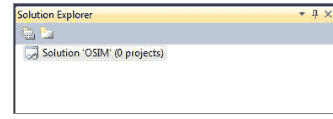

图 6-1

#### 创建项目

良好的项目命名对于解决方案的组织非常重要。项目名称应该反映它所代表的命名空间，并描述该程序集将提供的特性和功能。所有的应用程序都需要一个类库，用于存放核心或业务领域的服务和实体。这通常是我创建的第一个项目。在本书中

除了保持名称清晰外，项目和文件夹命名规范也镜像了命名空间。例如，如果我在 `Entities` 文件夹中创建一个 `Person` 类，那么该类的完全限定名称将是 `OSM.Core.Entities.Person`。

一种 TDD 学派认为，在我不需要它之前不应该创建这个项目。TDD 遵循在需要通过测试之前不编写任何代码的想法。以此类推，在我不需要之前不应该创建项目，这会是一个有效的观点。然而，在我的团队中，我预先管理好了主要项目，以便在迭代 1 的第一天，开发团队就可以立即开始编写代码。这是一个灰色地带，测试优先和务实之间的想法可能会发生冲突。这取决于我如何评估，以及哪种方式对你的团队和项目最有效。

说起测试，我知道任何解决方案中的接下来两个项目都是用于我的单元测试和集成测试的。我会创建这些项目，如图 6-3 所示。

在我的测试项目中，我喜欢创建一些结构，通过为解决方案中的每个项目创建一个文件夹来保持我的测试组织有序。目前我有 `OSM.Core` 项目，所以我将为该项目创建文件夹，如图 6-4 所示。

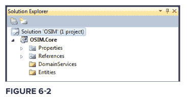

图 6-2

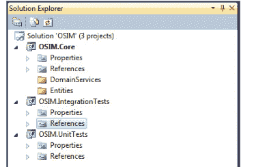

图 6-3

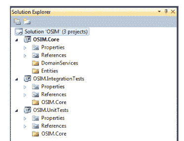

图 6-4

根据 OSM 应用程序当前的高层设计，我知道该应用程序有两个前端：一个基于 `ASP.NET MVC 2` 框架开发的 Web 前端，一个使用 `WPF` 开发的 Windows 客户端前端，以及使用 `WCF` 的 Web 服务。是的，Web 服务也是一种前端。唯一的区别在于，不是人类直接与界面交互，而是用户需要某种 Web 服务代理来使用该界面。我将为这些每一个项创建适当的项目类型，如图 6-5 所示。

现在由于我的解决方案中有了三个项目，我将为它们在测试项目中添加文件夹，如图 6-6 所示。

目前，根据高层设计，这些就是我需要的全部项目。在项目中，我可能还需要其他项目用于支持。在创建这些项目时，第一个问题是问：“这属于一个独立的项目吗？”许多开发者为了“粒度”的名义谈论创建新项目。在某些情况下，结果之间相互依赖，以至于它们提供的价值很小。错误通常发生是因为某个程序集本该与其中一个部署，而不是另一个。如果两个或多个类确实需要彼此，那么它们不应该被拆分到不同的项目中。

如果你需要创建一个独立的程序集，请确保你的命名规范继续识别出该项目正在支持什么以及如何支持。例如，如果你想创建一个项目来包含 Windows 客户端的主题，一个良好的名称是 `OSM.WinClient.Themes`。

目前，这个项目结构已经完成了。我确定随着项目的进行，我将需要添加结构元素，但我不想通过过度复杂我的环境来启动应用程序开发项目。通常情况下，你希望你的项目结构尽可能简单整洁，在需要时才进行更改和添加。

#### 总结

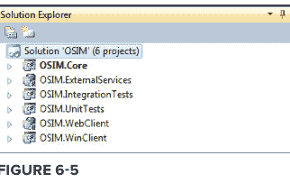

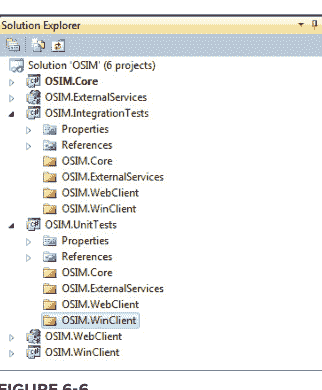

在开始编写代码之前，应用程序开发项目必须完成许多任务。第一项任务是收集业务和技术需求。在敏捷方法中，这包括一个高层的项目概述，帮助你定义应用程序的大小和规模。敏捷方法避开了大前期设计的概念，只寻求获取宏观图。在收集了高层需求后，必须定义目标环境。这个环境将有助于塑造你开发的应用程序类型并驱动出非功能性技术需求。在定义好此环境后，必须选择各种应用程序技术。

业务需求被用于创建用户故事，用户故事定义了应用程序业务价值的来源。用户故事应该是与技术无关且可测试的。否则，需求可能会为了适应技术而发生扭曲，这与你的目标背道而驰。这些用户故事被拆分为多个功能点，添加到产品待办列表中，并在开发项目迭代期间分配给开发者。

当你使用敏捷流程开发应用程序时，你的迭代应该是短促的，并以向业务部门交付成果作为结束。确保业务部门理解这不是完整的系统，并对已完成的工作获取反馈。如果存在缺陷，请立即修复。如果需要更改，请创建新的用户故事并将其放入 PB 中。修正应用程序要容易得多。

你的应用程序在文件系统和 Visual Studio 中的结构至关重要。它应该是清晰、简单且一致的。让你的结构易于开发者理解和工作有助于保持项目资产正确分区，并让新加入项目的开发者更容易理解架构和代码库。

# 第 7 章：实现第一个用户故事

## 本章包含哪些？

- 如何将用户故事拆分为功能点
- 如何在编写业务代码之前编写单元测试
- 业务驱动开发（BDD）命名风格是什么样子的
- BDD 如何帮助你编写清晰且易于理解的测试
- 单元测试如何让你能够在不担心破坏功能的情况下重构代码
- 为什么测试三角形对于确保代码质量至关重要

现在办公用品库存管理（OSIM）应用程序的整体范围和高层设计已经定义，是时候开始构建应用程序了。正如我们基于敏捷的方法论概述的，构建始于业务所有者选择第一次迭代中开发的用户故事或功能。在项目经理（PM）和应用程序架构师的指导下，业务所有者决定了以下用户故事：

> 用户应该能够向应用程序中添加新类型的项目。

这是一个很好的起点，因为这是一个库存管理系统。为了管理库存（并与其他用户故事提供的功能配合），用户需要一份库存物品列表。

开始之前，你需要将较大的用户故事拆分为更小的功能点。功能点应该是小、简单、隔离且可测试的。对于当前的用户故事，我构想出了以下功能点列表：

- 一个项目类型以及一个可以在数据存储中存储项目实体的持久化层
- 一个项目类型领域服务，可以提供数据存储中的项目类型列表
- 一个用户界面，允许业务用户列出现有项目类型并创建新类型

这个功能点列表展示了非技术业务用户验证此用户故事已完成所需的应用程序层级和部分。一旦完成此用户故事，非技术业务用户就可以使用应用程序创建新的项目类型，然后通过查看项目类型列表来验证它们已成功创建。技术人员不需要参与。业务用户不需要开发者或 DBA 在数据存储上运行查询来验证项目类型是否已创建。业务用户可以独立工作，验证用户故事已完成并运行正常。

现在功能点已经定义好了，你需要确定构建它们的顺序。应用程序就像洋葱、梨和苹果一样，是基于“分层”的概念构建的。由于应用程序是分层构建的，应用程序的构建应该从核心开始，并逐层构建，以便随后的每一层都建立在下一个功能的基础上。OSIM 的核心（以及大多数应用程序的核心）是数据存储。与大多数应用程序一样，OSIM 的最外层是一个接口，可以是一个网页、Windows 客户端应用程序或服务层。因此，这些功能的开发有一个逻辑演进顺序：

1. 项目类型和持久化层
2. 项目类型领域服务
3. 允许业务用户与项目类型业务服务交互的前端用户界面

本示例使用 TDD 来构建此应用程序，因此你需要确定你的第一个测试是什么。

## 第一个测试

为任何功能选择编写的第一个测试是一项重要任务。它设定了功能的方向和基调。它还确保了功能所需的组件和方法以正确的顺序被构建和分层。第一个测试通常是针对你正在构建的功能的最基本需求。因此，它指示着随着你继续开发并转向重构，你永远不会偏离该功能需要提供的基础功能太远。

### 选择第一个测试

在选择编写的第一个测试时，你需要确保自己真正理解了用户故事及其背后的业务需求。技术实现将从业务需求产生。在大多数情况下，清晰、逻辑的演进决定了每个用户故事的功能应该如何被构建。（通常来说，每个应用程序在业务领域层之上都有某种用户界面层，在核心处有一个与某种数据存储通信的持久化层。在较大的应用程序中，这些层中的某些层会被细分或使用外部资源，这可能会产生额外的分层。）

无论应用程序在架构上有多复杂，我发现通常从构建离应用程序核心最近的功能开始然后向外构建要容易得多。这让你能够保持应用程序的核心尽可能简单。构建在核心之上的层拥有一组 API 可以工作，这反过来驱动了它们的界面趋于简单。有了定义良好的核心，你可以快速、方便地开发新功能，而无需重复大量代码。

有些开发者选择从 UI 层开始开发并编写测试。这种方法没有问题。当你为正在开发的层编写测试时，这种方法是有效的，因为它创建的 API 更多地取决于消费者的需求而不是开发者。这与其说是技术或流程问题，不如说是纪律问题。在掌握了 TDD 纪律后，你完全可以尝试这种方法。对于主要由 UI 驱动的系统，我发现这种自下而上的方法更有效。无论如何，尽管尝试两者，并找到最适合您的方法。

对于当前的情况下，你可以给你的测试命名为有效的 .NET 方法名。然而，为了符合 TDD 的精神，我发现给测试命名为有意义且描述性的是更好的。到数据存储中。这将通过确保持久化层返回一个有效的项目类型 ID 数字来验证。

### 测试命名

单元测试只是类上的方法。因此，你可以给测试命名为一个有效的 .NET 方法名。然而，为了符合 TDD 的精神，我发现给测试命名为有意义且描述性的是更好的。为了这一点，我从另一种方法中借鉴了一些：行为驱动开发（BDD）。

BDD 是 TDD 理念的扩展。BDD 强调利益相关者在软件开发过程中的参与，包括技术和非技术小组。它可以被视为一种强调跨小组协作的敏捷方法论。自然，大多数实践某些敏捷方法论的测试都会遵循许多的 BDD 本身是一个广泛的话题，因此本书未涵盖。

对于我编写的单元测试，我喜欢使用 BDD 风格来命名测试。这种风格强调复杂的、描述性的用户友好的名称，并尝试避免使用技术术语。BDD 是关于让你的类和变量名称尽可能地像自然语言。在我对这种风格的使用中，我认为测试的描述为一个句子。包含测试的类名，以及它实现的任何类，应该写出测试运行的一系列条件。对于当前的功能，你首先从创建一个描述这些最基本先决条件的类开始：与项目类型仓库工作。这个类将被称为 `when_working_with_the_item_type_repository`，并将是你放置初始化一个的地方。

可测试的 `ItemType` 仓库。因此，`when_working_with_the_item_type_repository` 将成为所有测试 `ItemType` 仓库的单元测试的基类。

这里使用的命名风格非常重要。许多开发者反感在类或方法名中使用下划线。对于需要被其他开发者和技术人员阅读的生产代码，我同意这种观点。然而，TDD 的目标之一是确保你在编写单元测试时，能够让非技术的业务用户也能理解你的编码实践。大多数技术人员在阅读驼峰命名法（例如 `GetItemsFromDatabaseByCustomerId`）的类和方法方面多年经验。他们习惯这种方式，并能够轻松阅读这些名称。然而，大多数业务用户的情况并非如此。对他们来说，用下划线分隔单词的名称更容易阅读和理解。因为在技术端与业务端对接时，尝试至少向他们靠拢一半是非常重要的。为此，以一种更让业务部门喜欢且更易于理解的方式来命名你的测试。同样，类和方法的名称避免使用业务用户可能无法理解的技术术语也很重要。

基类 `when_working_with_the_item_type_repository` 实际上并不包含任何单元测试。这只是一个示例指示。该名称表明你正在处理项目类型仓库，但它并没有指示 `when_working_with_the_item_type_repository` 之后的操作。为了完成这组条件，你需要创建一个继承自 `when_working_with_the_item_type_repository` 的类，并在名称和代码中描述初始条件的剩余部分。继承自 `when_working_with_the_item_type_repository` 并实现单元测试的类将被称为 `and_saving_a_valid_item_type`。该类的名称结合它继承的基类，清楚地定义了测试的起始条件：当处理项目类型仓库并保存一个有效的项目类型时，将会发生某些事情。“某些事情”就是单元测试方法的名称。

在命名你实际的单元测试方法时，以完成你通过类名创建的序列。如果你向业务用户描述测试的要点，你可能会说类似“当处理项目类型仓库并保存一个有效的项目类型时，系统应该返回一个有效的项目类型 ID.” 使用这种模型，很容易看出单元测试方法的名称应该是 `then_a_valid_item_type_id_should_be_returned`。

### 编写测试

为了帮助我以 BDD 风格编写测试，我使用了一个名为 `NBehavior` 的框架，可以在 nbehavior.org 下载。`NBehavior` 是一个用于 .NET 的 BDD 框架，允许开发人员创建规范（用纯英语编写的业务规则）并执行它们作为测试代码。这种效果创建了一个领域特定语言（DSL），允许非技术的业务用户根据 `NBehavior` 提供的 DSL 框架编写测试，`NBehavior` 非常强大。

使用 `NBehavior` 编写和执行这些 DSL 的能力非常强大。然而，在本书中，我仅使用 `NBehavior` 提供一些语法糖，以帮助你的单元测试在 BDD 风格下保持可读和可维护性。随着示例贯穿全书，我会指出我在哪里使用了 `NBehavior` 的这些语法特性。

当第一组测试的命名方案和高层类布局落实后，你现在可以开始它们了。但在为此功能创建测试类之前，你还需要做一些准备工作。

### 第一个测试

执行。要使用 `NBehave` 框架，你需要添加对 `NBehave` 程序集的引用。具体来说，你需要两个：`NBehave.Spec.Framework`（基础 `NBehave` 程序集）和 `NBehave.Spec.Unit`（提供语法糖并使 `NBehave` 能够与 `NUnit` 工作）。你还需要添加对 `NUnit` `nunit.framework` 的引用以便编写和运行测试，如图 7-1 所示。

- OSMUnitTests
- Properties
- References
- `NBehave.Spec.Framework`
- `NBehave.Spec.Unit`
- `nunit.framework`
- System
- System.Core
- System.Data
- System.Data.Extensions
- System.Xml

接下来你需要添加一个 `Specification` 基类。示例中的 `Specification` 类是由我以前工作的团队开发的。它为以 BDD 风格编写的单元测试提供基类。它确保所有单元测试类都派生自 `NBehave` 的 `SpecBase` 类，并且所有派生类都被标记为 `NUnit` 的单元测试。你需要在 `OSIM.UnitTests` 项目中创建 `Specification` 并使用此代码定义该类：

- OSIM.Core
- OSIM.ExternalServices
- OSIM.WebClient
- OSIM.WinClient

```


# 第 7 章 实现第一个用户故事

## 创建测试类文件

现在设置任务已完成，你准备好开始为该功能编写单元测试了。首先，在 `OSIM.UnitTests` 项目的 `OSIM.Core` 文件夹中创建一个类文件来存放单元测试，并将其命名为 `ItemRepository.cs`。

删除 Visual Studio 自动在文件中生成的 `ItemRepository` 类定义，只留下一个仅包含命名空间的 `.cs` 文件：

```csharp
namespace OSIM.UnitTests
{
}
```

## 编写基类规范

现在你准备好创建单元测试了。从 `when_working_with_the_item_type_repository` 基类开始：

```csharp
public class when_working_with_the_item_type_repository : Specification
{
}
```

通常情况下，我将某个类的所有单元测试放在同一个 `.cs` 文件中。许多开发者倾向于“一个文件一个类”。对于生产代码，我同意这种做法（尽管它不适用于接口）。然而，对于单元测试，我发现将某个部分的所有测试放在同一个文件中更容易。对于测试人员来说，如果测试都位于同一个地方，他们似乎更容易导航。这是合理的，因为大多数业务用户处理的是文档。如果你在处理一份合同，他们不会把每个段落放在单独的文件中；它们都在一个地方。如果你努力向他们靠拢一半，将测试合并是一个很小的代价。此外，由于你计划在许多项目中有很多测试（单元测试的数量达到成百上千），将每个单元测试都放在单独的文件是不现实的。这会导致 Visual Studio 中的解决方案资源管理器运行得非常慢。如果你陷入了测试 `.cs` 文件大到难以管理的境地，请考虑沿某些逻辑接缝进行拆分。但我总是倾向于让单元测试拥有几个大的文件，而不是许多很小的文件。

## 创建测试上下文类

构建此单元测试的下一步是创建包含当前功能测试的类 `and_saving_a_valid_item_type`：

```csharp
public class and_saving_a_valid_item_type : when_working_with_the_item_type_repository
{
}
```

接着创建实际的测试方法 `then_a_valid_item_type_id_should_be_returned`。你添加该方法并带上定义其为可执行单元测试的属性，以及 `and_saving_a_valid_item_type` 类：

```csharp
public class and_saving_a_valid_item_type : when_working_with_the_item_type_repository
{
    [Test]
    public void then_a_valid_item_type_id_should_be_returned()
    {
    }
}
```

## 实现测试逻辑：Because_of

现在你已经设置好了测试，就可以将注意力转向测试逻辑了。每个测试都有三个基本部分：设置初始条件和环境、执行被测代码以及评估结果。

在将此测试细分为三个任务（设置环境、执行代码测试、评估结果）之后，你现在至少需要三个方法——每个方法执行这些任务中的一个。你已经有了 `then_a_valid_item_id_should_be_returned` 方法，你可能会看到调用代码测试和测量结果的地方位置。但请记住，SOLID 原则（包括单一职责原则 SRP）也应该以一种务实的方式应用到你的测试中。相反，你需要一个方法来设置测试运行的上下文，一个方法来执行代码测试，以及一个方法来评估结果。

为了保持你的类的 BDD 风格，使名称具有意义且非局部的，并为测试部分创建一个几乎类似于简单的构造，你希望执行代码测试的方法尽可能具有描述性。然而，由于这个方法假设会出现在几乎每个测试中，你还需要它是通用的。幸运的是，NBehave 提供了你所需的方法：`Because_of`。在 `and_saving_a_valid_item_type` 类中，你可以创建该方法的覆盖实现（基方法出现在 NBehave 的 `Base` 类中）：

```csharp
protected void Because_of()
{
    base.Because_of();
}
```

在大多数情况下，你不需要调用此方法的基类版本，可以删除对基类 `Because_of` 实现的调用。相反，你想要添加调用你的被测代码并保存结果以便稍后由 `then_a_valid_item_id_should_be_returned` 方法评估的代码：

```csharp
protected void Because_of()
{
    _result = _itemTypeRepository.Save(_testType);
}
```

你将返回值存储在一个名为 `_result` 的成员变量中。关注 `_itemTypeRepository` 成员变量中的存储库测试，并传入存储在 `_testItemType` 成员变量中的项目类型。目前，`and_saving_a_valid_item_type` 类看起来如下：

```csharp
public class and_saving_a_valid_item_type : working_with_the_item_type_repository
{
    private int _result;
    private IItemRepository _itemRepository;
    private IItemType _testItemType;

    protected override void Because_of()
    {
        _result = _itemRepository.Save(_testItemType);
    }

    [Test]
    public void then_a_valid_item_type_id_should_be_returned()
    {
    }
}
```

## 实现测试逻辑：评估结果

现在你已经定义了执行被测代码的代码，你向 `then_a_valid_item_type_id_should_be_returned` 方法中添加代码来评估返回并存储在 `_result` 变量中的结果：

```csharp
[Test]
public void then_a_valid_item_type_id_should_be_returned()
{
    _result.ShouldEqual(itemType);
}
```

这展示了另一个利用 NBehave 语法糖的示例，使单元测试代码对业务用户更具可读性。`ShouldEqual` 方法仅仅是第 4 章中编写断言的另一种方式。这有助于业务用户理解其语法如何工作，他们可以像读句子一样读代码。例如，如果你想大声读出那行代码，你可能会说“结果应该等于项目类型 ID”。与你从左到右像句子一样阅读断言时所说的话相比，前者显然比后者更容易理解。

现在尝试运行此测试将会失败。它执行了一个不存在的接口（`IItemRepository`）上的方法，并正尝试传入一个同样不存在的类类型（`ItemType`）。如果你一直在按照此操作并在 Visual Studio 中编写这些代码，毫无疑问你现在看到了很多红行。下一步是通过创建一些类来修复这个问题。

## 创建实体类

关于业务类的排列顺序的问题是一个无法在书中量化和详细列出的问题。实际上，这取决于具体情况。在这种情况下，你有一个 `IItemRepository`，它有一个 `Save` 方法接受一个 `ItemType` 类型的对象作为参数。为了在这个示例中让开发更简单，当你编写存储库代码时，你先创建了 `ItemType`，以便在需要它时它已经存在。

在 `OSIM.Core` 项目中有一个名为 `Entities` 的文件夹。在那个文件夹中，创建一个名为 `ItemType` 的类。

现在你对 `ItemType` 应该包含什么类型的数据没有特定要求。但 `ItemType` 类必须是可以持久化的（这意味着它可以保存到数据库中）。为了将实体保存到数据库，实体必须有一个唯一的 ID。这使得应用程序能够在数据库中找到该特定实体。因此，假设 `ItemType` 类应该有一个类型为 `int` 的 `Id` 属性是合理的。此外，Fluent NHibernate (FNH) —— 对象关系映射 (ORM) 在第 8 章中处理数据持久化时要求该属性声明为 `virtual`，所以你也需要这样做。

```csharp
public class ItemType
{
    public virtual int Id { get; set; }
}
```

回到测试，你需要在 `RepositoryTests.cs` 顶部添加 `using` 语句：

```csharp
using OSIM.Entities;
```

## 创建存储库接口与实现

测试现在应该能够解析 `ItemRepository`。为了实现这一点，你需要在 `OSIM.Core` 项目中创建一个名为 `Persistence` 的文件夹。该文件夹包含 OSIM 应用程序的持久化（数据访问）逻辑。你需要在 `Persistence` 文件夹中创建一个文件来存储 `ItemRepository` 和具体的 `ItemRepository` 类。

完整的测试类代码如下：

```csharp
using NBehave.Spec.Unit;
using NUnit.Framework;
using OSIM.Core.Entities;
using OSIM.Core.Persistence;

namespace OSIM.UnitTests.OSIM.Core
{
    public class when_working_the_item_type_repository : Specification
    {
    }

    public class and_saving_a_valid_item_type : when_working_with_the_item_type_repository
    {
        private int _result;
        private ItemTypeRepository _itemTypeRepository;
        private ItemType _testItemType;
        private int _itemId;

        protected override void Because_of()
        {
            _result = _itemTypeRepository.Save(_testItemType);
        }

        [Test]
        public void then_a_valid_item_type_id_should_be_returned()
        {
            _result.ShouldEqual(_itemId);
        }
    }
}
```

在编译和运行这些代码之前，最后一项工作是在 `IItemRepository` 接口中添加一个 `Save` 方法。这将导致在 `ItemRepository` 类中产生添加 `Save` 方法的需求：

```csharp
using System;
using OSIM.Core.Entities;

namespace OSIM.Core.Persistence
{
    public interface IItemTypeRepository
    {
        int Save(ItemType itemType);
    }

    public class ItemRepository : IItemTypeRepository
    {
        public int Save(ItemType itemType)
        {
            throw new NotImplementedException();
        }
    }
}
```

目前 `ItemRepository` 中 `Save` 方法的实现什么都没做。这没关系。记住，现在的目标是编写足够的代码让测试通过。在发现无法编译代码之前，你还没有看到失败的测试。在不知道要写什么之前，你不想写任何代码。

果不其然，编译并运行测试显示该测试目前失败了。

## 实现功能

### 确认测试失败

尽管花了一段时间才到达这一步，但看到测试失败是非常重要的。如果测试通过了，这可能意味着好几种情况。通过的测试可能表明代码没有正确执行你当前正在开发的需求或功能。失败的测试很重要，因为它确认了测试正确检测到了应用程序中尚不存在的功能。通过的测试还可能表明，你正在处理的需求是某种重复，或者当前用户故事的这一特定功能已通过先前的需求、功能或用户故事得到了满足。在任何一种情况下，调查任何在没有编写任何应用程序代码的情况下通过的测试都是关键的。

### 编写可能运行的最简单方案

由于测试失败了，你现在的目标是编写足够的代码让测试通过。在某些情况下，这就像编写或更改单行代码一样简单易行。这没关系。只满足当前的业务需求，而不是尝试猜测未来将需要什么，这是重要的。保持代码尽可能简单也很重要。简单越不容易出现缺陷，未来越容易维护。

在这个例子中，该功能的实现最终将比单行代码稍微复杂一点。但在你知道需要大量工作来编写测试的情况下，以增量方式工作、频繁测试，并且仅在需要的时刻编写代码（而不是提前），这仍然很重要。即使你知道测试可能不会通过，也要运行测试（不仅仅是你的测试，而是所有测试），以确保在开发当前功能的过程中，你没有破坏应用程序其他部分的功能。很可能你会在某个时刻影响应用程序中的其他代码。这并不总是坏事，并且可能会产生负面影响。在发生时立即知道（即使是意料之外的），将帮助你理解代码是如何与应用程序的其他部分交互的。如果对功能的影响不是预期的，越早发现就越容易修复，因为可能导致错误的更改列表相对较短。

根据大多数人的说法，`ItemRepositoryTests.cs` 文件的第 22 行发生了空对象错误。事实证明这是 `_saving_a_item_type` 测试类中 `Because_of` 方法对 `ItemRepository` 的调用：

```csharp
protected override void Because_of()
{
    _result = _itemRepository.Save(_testType);
}
```

此测试失败了，尽管已经定义了 `_itemRepository`，但变量还没有填充对象。第 2 章介绍了 NUnit 提供的 `Setup` 属性，用于每次运行之前设置某些执行环境。此示例使用了 BDD 风格的命名，NBehave 为 BDD 风格的测试提供了框架，你有另一个选择。最终，你的限制在 NBehave 类 `SpecBase` 中，它提供了一个虚拟方法 `Establish_context`。`Establish_context` 方法用于创建测试运行的环境。因为我需要将我的单元测试类构建为定义测试谓词的类层，所以在这个类层次结构中存在一个创建执行环境的常用方法非常方便。这对于我可能想要展示的业务用户来说也很理解。

为了获得测试的初始失败，你需要创建一个 `ItemRepository` 类型的对象并将其存储在 `_itemRepository` 成员变量中：

```csharp
protected override void Establish_context()
{
    base.Establish_context();
    _itemRepository = new ItemRepositoryType();
}
```


# ItemRepositoryTests.cs

完成该任务后，你应该再次运行测试。在这种情况下，测试可能仍然失败，但你应该养成经常运行测试的习惯。至少在完成每个任务后运行它们。

如所料，测试仍然失败。但它失败在不同的地方，原因也不同。这表明你取得了进展。新的失败发生在 `TypeRepository` 的 `Save` 方法中——具体是在 `TypeRepository` 的第 15 行。

```csharp
public class ItemTypeRepository : IItemTypeRepository
{
    public void Save(ItemType itemType)
    {
        throw new NotImplementedException();
    }
}
```

# TypeRepository.cs

我使用 JetBrains Resharper (www.jetbrains.com) 来增强我的 Visual Studio 开发环境。当使用 Resharper 创建此方法时，它会自动添加抛出 `NotImplementedException` 的实现。如果你没有使用 Resharper，实现它仍然是一个好主意，以确保代码已经实现。

为了完成此功能，你需要实现此方法。现在你只想编写可能运行的最简单代码：

```csharp
public class ItemTypeRepository : ITypeRepository
{
    public int Save(ItemType item)
    {
        return 1;
    }
}
```

# ItemTypeRepository.cs

没有人否认这是可能满足测试要求的简单代码。诚然，单行代码不太可能是该功能或其来源用户故事的解决方案。但根据你现在在该功能生命周期中所处的位置，这是逻辑上的下一步。再次运行测试产生了另一个失败，如图 7-8 所示。

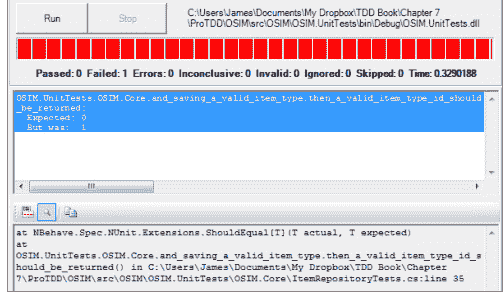

# 图 7-8

在这种情况下，存储方法返回的值不是测试预期的。显然需要某些上下文。

为了更完整地定义上下文，你需要告诉测试在调用 `ItemRepository` 的 `Save` 方法时期望什么样的 `ItemType` ID。如果我正在编写向数据存储保存数据的测试，并且在运行时得到了某种 ID，我喜欢让单元测试在执行时随机选择：

```csharp
protected override void Establish_context()
{
    base.Establish_context();
    var randomNumberGenerator = new Random();
    _itemTypeId = randomNumberGenerator.Next(32000);
    _itemTypeRepository = new ItemRepositoryType();
}
```

## 第 7 章 实现第一个用户故事

从表面上看，你可能会观察这个单元测试并认为我引入了某种程度的不确定性。但事实并非如此。`ItemRepository` 类上的 `Save` 方法应该始终表现相同。它应该为正在保存到数据的实体返回一个 ID 号。我创建了一种情况，即每次测试运行时 ID 号都不同，但在每次测试执行的范围内它保持不变。由于随机 ID 的确定是在创建测试的过程中完成的，因此它不会为测试引入任何不确定性。我只是改变了返回的 ID 值；获取 ID 号的步骤并没有改变。在这种情况下，这种区别并不清晰，我将在演示 `ItemRepository` 的模拟依赖时触及这一点。

如果你运行此测试，你会发现它失败了，如图 7-9 所示。

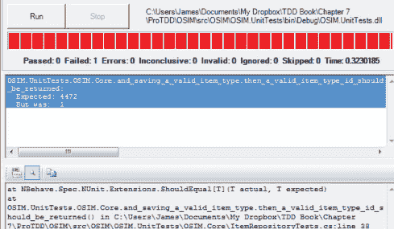

# 图 7-9

在这种情况下，测试期望返回 42 作为 `forType Id`。`ItemRepository` 类 `Save` 方法的当前实现返回了 1。

是时候让这个测试通过迈向下一步了。在这个阶段，思考架构的设计是有帮助的。具体来说，是时候讨论持久化如何实现了。

该应用程序使用对象关系映射（ORM）框架 Fluent NH (FNH) 进行数据持久化。我在第 5 章中探讨了 ORM 的概念，并在第 8 章中向你展示如何使用它来处理持久化。.NET 世界提供了多种 ORM 框架供选择。我为此项目选择了 FNH，因为这是我最熟悉的框架。如果你或你的团队对像 Entity Framework 这样的 ORM 有更多经验，并且该工具满足你们的需求，那么它可能就是适合你们的 ORM。书中使用 FNH 的示例是可移植的，你可以选择使用你和团队决定使用的任何 ORM 实现相同的实践。

> 如果你不熟悉 FNH，不要担心。这个示例没有使用 FNH 框架的任何高级功能。我将停下来并简要解释示例中针对 FNH 的步骤。

FNH 像现代 ORM 一样，鼓励使用第 5 章讨论的仓库模式。我经常使用 FNH，我开发了一个基础泛型仓库可以用于项目。使用 FNH 配合 `Specification` 类，我在大多数项目中利用此类。该仓库包含了下载的代码；但是此示例演示了如何从零构建仓库。

FNH 提供了一个 `Session` 类来处理与数据的交互。从应用程序代码到仓库的调用始终通过 `ISessionFactory` 实例创建的 FNH Session 对象结束。要在 `ItemTypeRepository` 中使用这些内容，你需要添加引用 `FluentNHibernate` 和 `NHibernate`，如图 7-10 所示。


# 图 7-10

在 `ItemTypeRepository` 识别 FNH 框架类之前，你需要在 `ItemTypeRepository.cs` 中添加语句：

```csharp
using NHibernate;
```

# ItemTypeRepository.cs

现在你需要在 `ItemTypeRepository` 类中添加成员变量来存储 `ISessionFactory` 对象：

```csharp
public class ItemTypeRepository : ITypeRepository
{
    private ISessionFactory _sessionFactory;

    public int Save(ItemType item)
    {
        return 1;
    }
}
```

# ItemTypeRepository.cs

最后，你需要在 `ItemTypeRepository` 类中添加一个构造函数，允许在创建 `ItemTypeRepository` 时提供 `ISessionFactory` 的类：

```csharp
public ItemTypeRepository(ISessionFactory sessionFactory)
{
    _sessionFactory = sessionFactory;
}
```

# ItemTypeRepository.cs

## 第 7 章 实现第一个用户故事

回顾一下，这里是 `ItemTypeRepository` 类的完整列表：

```csharp
public class ItemTypeRepository : ITypeRepository
{
    private ISessionFactory _sessionFactory;

    public ItemTypeRepository(ISessionFactory sessionFactory)
    {
        _sessionFactory = sessionFactory;
    }

    public int Save(ItemType itemType)
    {
        return 1;
    }
}
```

现在是尝试运行测试的指南。遗憾的是，应用程序不再编译。当你创建一个允许客户端注入 `ISessionFactory` 值的 `ItemTypeRepository` 构造函数时，你删除了默认（无参数）构造函数。要使用 `ItemTypeRepository`，你需要为实现 `ISessionFactory` 的构造函数提供一个值。由于是单元测试，你需要提供一个模拟对象而不是有效的 FNH Session Factory。

正如你在第 2 章记得的，模拟框架允许你向要测试的类创建存根对象，以确保代码与外部依赖隔离开。要使用 Moq 框架，你需要在 `OSIM.UnitTests` 项目中添加引用，如图 7-11 所示。

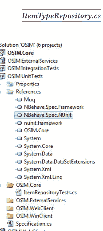

# 图 7-11

下一步是在 `saving_valid_item_type` 类的 `Establish_context` 方法中添加代码，以在 FNH `ISessionFactory` 接口上创建一个模拟对象：

```csharp
protected override void Establish_context()
{
    base.Establish_context();
    var randomNumberGenerator = new Random();
    _itemId = randomNumberGenerator.Next(32000);
    var sessionFactory = new Mock<ISessionFactory>();
    _itemTypeRepository = new ItemTypeRepository();
}
```


### 实现功能

你会注意到 Visual Studio 提示它没有 `ISessionFactory` 的定义。这是因为 `OSIM.UnitTests` 项目没有 FNH 库的引用。需要添加它们（见图 7-12）。

然后你需要在 `ItemRepository.cs` 文件中添加 `using` 语句以包含所需的 FNH 命名空间：

```csharp
using NHibernate;
```

现在你可以使用你模拟的 Session Factory 作为参数 `ITypeRepository` 的构造函数：

```csharp
protected override void Establish_context()
{
    var randomNumberGenerator = new Random();
    _itemTypeId = randomNumberGenerator.Next(32000);
    var sessionFactory = new Mock<ISessionFactory>(sessionFactory.Object);
    _itemTypeRepository = new ITypeRepository(sessionFactory);
}
```

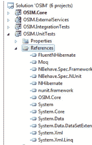

# 图 7-12

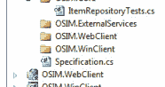

# ITypeRepository.cs

现在是时候为 `ITypeRepository` 方法创建一个调用 FNH API 的 `Save` 方法实现了。正如提到的，FNH 的所有数据库访问都是通过 `Session` 类的。你通过实现 `ISessionFactory` 接口的方法实例获取 `Session` 类实例。这里是 `ITypeRepository` 中利用 `Session` 类将 `IType` 保存到数据库的实现：

```csharp
public int Save(IType itemType)
{
    int id;
    using (var session = _sessionFactory.OpenSession())
    {
        id = (int) session.Save(itemType);
        session.Flush();
    }
    return id;
}
```

# ITypeRepository.cs

如果你从未用过 FNH 框架，这些特定的 FNH 命令需要一些解释。第一步是从 `SessionFactory` 获取 `Session`。这本质上是你与数据库的连接。`SessionFactory` 在创建时配置了连接数据库所需的信息。这个主题在第 8 章会有更详细的介绍。第一个调用是将 Session 对象 传递给 `Save` 方法。该方法将实体保存到数据库并返回主键或 ID 值。指定实体中的哪个字段是 ID 是在映射中完成的，这将在第 8 章介绍。接下来调用 `Flush` 以确保任何对数据库的待处理操作已完成。当到达 `using` 块结束时，Session 将关闭。

再次运行测试将产生另一个失败，如图 7-13 所示。

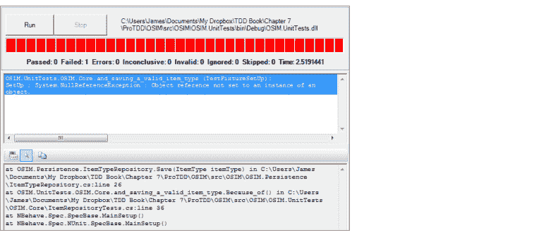

# 图 7-13

ItemRepository.cs 文件的第 26 行是对 Session 类 Save 方法的调用。`NullReferenceException` 告诉你在调用 OpenSession 方法时 Session 返回了 null。这意味着你需要向该对象再添加一个 mock 来代表 Session。你还需要为 SessionFactory.OpenSession 添加一个存根方法（stub method），返回 mock 的 Session 对象：

```csharp
protected override void Establish_context()
{
    base.Establish_context();
    var randomNumberGenerator = new Random();
    var _itemId = randomNumberGenerator.Next(32000);
    var sessionFactory = new Mock<ISessionFactory>();
    var session = new Mock<ISession>();
    sessionFactory.Setup(sf => sf.OpenSession()).Returns(session.Object).Returns(sessionFactory.Object);
    _itemRepository = new ItemRepositoryTests;
}
```

这种语法看起来与第 2 章“Mock 基础”部分中的代码相似。它指示代表 SessionFactory 的 mock，在调用 SessionFactory 上的 OpenSession 方法时，返回你为 Session 创建的 mock。尽管如此，在此设置下运行测试显示你的工作仍未完成（见图 7-14）。

### 实现功能

| 运行 | 状态 |
|---|---|
| 通过: 失败: 1 错误: 0 未完成: 0 无效: 0 忽略: 0 跳过: 0耗时: 0.05s | |

```
C:\Users\James\Documents\Exception\TDD\Chapter7\Tests.cs
at ISM.Persistence.ItemRepository.Save(itemType) in C:\Users\James
set : System.NullReferenceException was not set to an instance of an object.
```

```
at ISM.Persistence.ItemRepository.Save(itemType) in C:\Users\James
Documents\Exception\TDD\Chapter7\Tests.cs
at C:\Users\James
```


# 第 7 章 实现第一个用户故事

## 为 Session Mock 提供 Save 方法存根

最后的障碍是为 Session mock 提供一个 `Save` 方法的存根实现。在这种情况下，你必须使用 `Save` 方法来返回你在类的 `Establish_context` 方法中生成的 `ItemType` Id：

```csharp
session.Setup(s => s.Save(_itemType)).Returns(_itemID);
```

### `Establish_context` 的完整实现

```csharp
protected override void Establish_context()
{
    var randomNumberGenerator = new Random();
    _itemTypeId = randomNumberGenerator.Next(32000);

    var sessionFactory = new Mock<ISessionFactory>();
    var session = new Mock<ISession>();

    session.Setup(s => s.Save(_itemType)).Returns(_itemID);

    sessionFactory.Setup(sf => sf.OpenSession()).Returns(session.Object);
    _itemRepository = new ItemRepository(sessionFactory.Object);
}
```

### 运行通过的测试

如图 7-15 所示，测试现在通过了。

这个通过的测试意味着你已经完成了此功能。在工作环境中，你可能会在以后回来进行重构，但这个通过的测试证明了该功能根据要求是完整的，并且可以集成到代码库的其他部分。

如果你像我认识的大多数开发者一样，你有一种想要修改代码并添加让它变得“更好”的东西的冲动。克制这种冲动。添加未请求的功能（有时被称为“镀金”）往往产生的问题比它解决的更多。功能的添加会消耗时间，增加代码库的复杂度，产生维护开销，并可能影响需求覆盖系统中其他区域的行为。不要掉入“好吧，除非你真的需要它”的陷阱。除非业务要求额外的功能，否则它是不需要的。这不是懒惰，而是在保持代码库尽可能简单的同时，为业务提供所需的功能。在当前的示例中，一个记录在案的需求已完成。该需求已翻译成单元测试。满足此需求的代码就是“完成”的定义。

## 编写下一个测试

有了这个测试，是时候查看用户故事或功能，并确定是否需要编写更多测试了。在这种情况下，你确定想写一个测试来确保如果有人尝试向存储库保存 null 对象将抛出异常。与其他功能或需求一样，第一步是打开 `ItemRepositoryTests.cs`（如果尚未打开），并为此测试创建一个新类，它继承自 `when_working_with_the_item_type_repository`：

```csharp
public class class_and_saving_invalid_item_type :
    when_working_with_the_item_type_repository
{
}
```

接下来，你添加一个方法来验证测试结果是否符合你的预期——在这种情况下，即抛出了 `ArgumentNullException`：

```csharp
public class class_and_saving_invalid_item_type :
    when_working_with_the_item_type_repository
{
    private Exception _result;

    [Test]
    public void then_argument_null_exception_should_be_raised()
    {
        _result.ShouldBeInstanceOf(typeof(ArgumentNullException));
    }
}
```

此代码将 `_result` 声明为 `Exception` 类型，它是 `ArgumentNullException` 的基类型。这是因为虽然你期望调用 `ItemRepository` 会抛出异常，但你想验证抛出的异常类型。如果你将 `_result` 声明为你正在寻找的特定类型（在本例中为 `ArgumentNullException`），并且抛出了完全不同的内容（例如 `NullReferenceException` 异常），你的测试在评估结果之前就会遇到运行时错误。通过将 `_result` 声明为 `Exception` 类型的变量，无论具体类型是什么，都可以存储抛出的异常。

那么，`_result` 是如何填充的？上一个示例使用了 `Base_of` 方法的重写实现，该方法调用了方法并返回了结果：

```csharp
protected override void Base_of()
{
    _result = _itemRepository.Save(_itemType);
}
```

在这种情况下，由于你需要捕获调用 `Save` 方法时抛出的异常，你需要以不同的方式构造 `Because_of` 方法。你需要将 `Save` 调用放置在 `Try/Catch` 块中，并将异常存储在 `_result` 中：

```csharp
protected override void Because_of()
{
    try
    {
        _itemRepository.Save(null);
    }
    catch (Exception exception)
    {
        _result = exception;
    }
}
```

如果你尝试运行此测试，将得到编译错误。`invalid_type` 类没有 `_itemRepository` 变量的声明。该变量是在之前的测试 `saving_a_valid_item_type` 中创建并实例化的。你也可以在 `invalid_type` 中这样做。虽然单元测试中的某些代码重复是可以接受的，但你仍然希望单元测试代码尽可能 DRY（不要重复自己）。`saving_a_valid_item_type` 和 `saving_invalid_item_type` 类都继承自 `when_working_with_the_item_type_repository` 以减少代码复杂度，在基类中移动创建 `_itemRepository` mock 的声明：

```csharp
public class when_working_with_the_item_type_repository : Specification
{
    protected IItemRepository _itemTypeRepository;

    protected override void Establish_context()
    {
        base.Establish_context();
        _itemTypeRepository = new ItemRepository(sessionFactory.Object);
    }
}
```

你从 `saving_a_valid_item_type` 类中删除 `_itemRepository` 的声明，并删除实例化 `ItemRepository` 实例的行：

```csharp
public class and_saving_a_valid_item_type :
    when_working_with_the_item_type_repository
{
    private int _result;
    private ItemType _testItemType;
    private int _itemTypeId;

    protected override void Establish_context()
    {
        base.Establish_context();

        var randomNumberGenerator = new Random();
        _itemTypeId = randomNumberGenerator.Next(32000);

        var sessionFactory = new Mock<ISessionFactory>();
        var session = new Mock<ISession>();

        session.Setup(s => s.Save(_testItemType)).Returns(_itemTypeId);

        sessionFactory.Setup(sf => sf.OpenSession()).Returns(session.Object);
    }
}
```

你移动了 `ItemTypeRepository` mock 的声明和实例化，但 `ItemTypeRepository` mock 依赖于 `SessionFactory` 的 mock，而 `SessionFactory` 实际上依赖于 `Session` 对象。你需要将这些创建为 `when_working_with_the_item_type_repository` 类的实例变量：

```csharp
public class when_working_with_the_item_type_repository : Specification
{
    protected ITypeRepository _itemTypeRepository;
    protected Mock<ISessionFactory> _sessionFactory;
    protected Mock<ISession> _session;
}
```

```csharp
protected override void Establish_context()
{
    base.Establish_context();

    _sessionFactory = new Mock<ISessionFactory>();
    _session = new Mock<ISession>();

    _itemTypeRepository = new ItemTypeRepository(_sessionFactory.Object);
}
```

接下来，你需要将用于桩 `SessionFactory` mock 对象的 `OpenSession` 方法的代码行，从 `and_saving_a_valid_item_type` 类的 `Establish_context` 方法移动到 `when_working_with_the_item_type_repository` 类的 `Establish_context` 方法中：

```csharp
protected override void Establish_context()
{
    base.Establish_context();

    _sessionFactory = new Mock<ISessionFactory>();
    _session = new Mock<ISession>();

    _sessionFactory.Setup(sf => sf.OpenSession()).Returns(_session.Object);
    _itemTypeRepository = new ItemTypeRepository(_sessionFactory.Object);
}
```

此更改使得 `and_saving_a_valid_item_type` 类的 `Establish_context` 方法看起来如下：

```csharp
protected override void Establish_context()
{
    base.Establish_context();

    var randomNumberGenerator = new Random();
    _itemTypeId = randomNumberGenerator.Next(32000);

    _session.Setup(s => s.Save(_testItemType)).Returns(_itemTypeId);
}
```

你需要的最后一个更改是让 `and_saving_a_valid_item_type` 类的 `Establish_context` 方法使用来自 `when_working_with_the_type_repository` 成员变量 `_session`：

```csharp
protected override void Establish_context()
{
    base.Establish_context();

    var randomNumberGenerator = new Random();
    _itemTypeId = randomNumberGenerator.Next(32000);

    _session.Setup(s => s.Save(_testItemType)).Returns(_itemTypeId);
}
```


# UserRepositoryTests.cs

移动这些更改使你不仅可以在这两个测试中重用很多代码，还可以用于可能需要的任何额外测试。将 `_session` 保留为 `when_working_with_item_type_repository` 基类的受保护成员，允许你为你所做的的每个测试类单独对该方法进行打桩。`when_working_with_item_type_repository` 中的 `Establish_context` 方法负责处理会话工厂的桩，因此你不需要为每个测试都告诉它返回 `Session` 的 mock 对象。该类中添加了更多测试，事实证明这是一种安排工作的方式。

在你认为该类的重构完成之前，你需要重新运行 `and_saving_a_item_type` 测试类中的 `_an_valid_item_id_should_be_returned` 测试，如图 7 所示。

| C:\Users\Lamer\Documents\MyTDD\Book 7\ProTDD\CSM | Run | C:\Users\Lamer\Documents\MyTDD\Book 7\ProTDD\CSM\UnitTests\Debug\CSM\UnitTests.cs |
|---|---|---|
| UnitTests | | |
| CSM | | |
| CSM | | | Passed: 1 Failed: 0 Errors Inconclusive: 0 Ignored: 0 Time: 0.252817 |
| _an_valid_item_id_should_be_returned | | | |
| _an_saving_a_item_type_should_be_returned | | | |
| _when_working_with_the_item_type_repository | | | |
| Specification | | | |

**图 7**

NUnit 测试已经检测到新的 `an_argument_null_should_be_exception` 单元测试（可能已从 "item" 修正过来）。但现在你应该关注现有的 `_an_valid_item_type_id_should_be_returned` 单元测试。你现在应该关注那个，因为你想确保重构单元测试类（`and_saving_a_item_type` 和 `when_working_with_item_type_repository`）没有以任何方式破坏测试。测试在重构之前通过了，如果你没有对业务代码做任何更改，你就可以合理地确定你没有破坏测试。在重构单元测试时，运行现有测试以确保它们仍然通过且你没有破坏其中任何一个，是一个重要的步骤。不要跳过它！

由于测试类的重构目前已完成，你可以继续查看新的测试类（`and_saving_invalid_item_type`）并首次运行此测试（见图 7-17）。

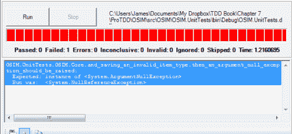

图 7-17

从调用 `ItemRepository` 类的 `Save` 方法时获得了一个意外异常。这说明了为什么将 `result` 宽泛地声明为 `Exception` 而不是更具体的 `ArgumentNullException` 是重要的。此测试失败的原因是 `Session` 类没有桩。（此处后续重复内容已省略）

通过通过的单元测试套件允许你重构代码，并确切地知道你何时超出了满足业务需求的范围。现在是时候打开编辑器，仔细审视你的代码了。它具有可读性吗？新加入团队的人能查看你的代码并快速理解其功能以及代码实现方式吗？你的代码符合 SOLID 原则吗？你是否有大量的重复代码？你是否有效地使用了接口和抽象？你的依赖是否经过了注入以保持松耦合？现在是解决这些问题的时候了。努力让你的代码更好，但要保持测试通过。

## 测试的三角测量

“快乐路径”总是容易测试的。如果你的单元测试一直停留在快乐路径上，或者只测试处于可能输入范围中间的输入值，那么你并没有说明整个情况。事实上，情况更糟：它们在撒谎。你告诉它们你的代码满足业务需求并且具有很高的质量。这并非事实。

问题在于所有输入都是邪恶的。当你不构建证明代码边界及之外情况的测试时，你本质上是在祈求运气，希望用户永远不要触碰应用程序的边界。用户运行的是良好的软件。他们并不理解内存大小、越界错误、空异常，或由于使用高于或低于你代码预期范围的值而产生的问题。他们不应该去担心这些；你的应用程序应该担心这些问题。

编写单元测试时，务必探索你的方法期望的边界。如果你的方法期望一个在 1 到 10 之间的值，写一个传入 5 的测试。然后写传入 1 和 10 的测试。再写一个传入 0 和 11 的测试。确保你的代码知道如何处理意外情况。通过对 `and_saving_invalid_item` 测试类及其 `then_agru_null_exception_should_be_raised` 测试，我想确保 `ItemRepository` 类能够处理客户端使用空对象调用 `Save` 方法的情况并做出相应响应。通过对你的测试进行三角测量，以确保你代码的质量。

## 总结

你为应用程序开发的第一个用户故事或功能至关重要。这项首单元工作的成功可以奠定基调并定义项目的价值。在计划工作时，请按照逻辑顺序对功能进行排序，从应用程序的核心开始并向外构建。在将故事拆分为功能时，务必保持它们是小型的、隔离的且可测试的。

在创建测试时，为类、方法和变量的命名使用一致的规范。你给出的名称应该是意义的——不仅对开发者如此，对可能被要求验证测试的非本地业务用户也是如此。研究 DDD 的命名风格和约定，并将这些知识应用于你的类、方法和变量的命名。

在编写任何代码之前，先看看你的测试。这对于确保你没有测试不存在的功能至关重要。如果你的测试在没有编写任何代码的情况下通过，这可能意味着很多事情。也许这是一个重复的功能。也可能是所需的功能作为之前某个功能的副作用创建的。另一种可能性是你的测试没有测试正确的功能。找到原因；不要仅仅假设以这种方式通过的测试意味着可以继续开发。

编写足够的代码使你的测试通过——仅此而已。在实现使测试通过的业务代码时，始终尝试执行可能有效的最简单的事情。当测试通过时，你就完成了。不要进行过度设计。如果某个功能、缺陷或对某功能的请求没有出现在用户故事或功能列表中，就不要构建它。等到需要它时；不要抢跑流程。

务必对你的测试进行三角测量。测试最佳情况或“快乐路径”对于确保你正在创建高质量的代码毫无帮助。测试你方法的边缘情况：处于预期边界的输入参数、超出这些边界的值，以及意外的数值和条件。记住，所有输入都是邪恶的。

通过对 `and_saving_invalid_item` 测试类及其 `then_agru_null_exception_should_be_raised` 测试，我想确保 `ItemRepository` 类能够处理客户端使用空对象调用 `Save` 方法的情况并做出相应响应。通过对你的测试进行三角测量，以确保你代码的质量。

## 8 集成测试

### 什么是集成测试？

- 集成测试部署到应用程序的各种缝隙，确保应用程序的各个部分正常工作。
- 它们与单元测试相似，因为可以使用相同的自动化测试框架（并且应该）来创建它们。
- 与单元测试的区别在于，单元测试使用模拟来隔离测试的特定方法和类，而集成测试涵盖了编写该集成测试方法的所有应用程序代码，一直到系统的最低层，通常是数据存储。

### 为什么要早期集成？

- 尽管集成测试很重要，但许多开发者乐于将其留到项目结束。这是一个错误。
- 如果开发团队在项目早期就开始集成测试并在整个开发周期中维护它，就可以避免这些深夜黑客式加班。
- 好消息是，事实并非如此。
- 许多问题可以通过良好的设计和沟通来缓解。即使在最理想的情况下，集成问题仍然可能出现。
- 通过测试这些组件、类和外部资源的集成，你可以确保正在开发的应用程序的缝隙是稳固且可靠的。

### 为什么要频繁集成？

- 使用 TDD 时，类和外部资源会被开发。
- 由于隔离性，真正的 TDD 允许类和外部资源被开发和应用。
- 很多时候解决方案是一个补丁或垫片。甚至是直接在披萨盒背面设计和画出来的。
- 这些补丁和缝隙（在大多数情况下创建时没有任何文档描述它们）通常只是解决了症状。
- 但大多数开发者没有意识到（或不想谈论）的是底层问题仍然存在。它只是隐藏在那里，等待着被分配维护应用程序的毫无防备的初级开发者。

在开发周期早期创建自动化集成测试并按固定的计划运行它们，将帮助你发现并修复出现在构成应用程序的类、组件和外部资源“缝隙”之间的错误。如果自动化集成测试失败，你将立即知道应用程序的这些缝隙之一出现了一个问题，而不是在两个月后的部署期间才发现。作为 CI 流程的一部分定期运行这些测试，当应用程序引入缺陷时，它们将为你提供一份简短的嫌疑名单。

在进行棕地开发且没有现有单元测试的情况下，如果应用程序设计或你所面对的编码实践无法实现依赖注入等实践，那么集成测试可能是自动化测试的唯一可行选择。在其他项目中，特别是当你拥有大型代码库或已经处于生产环境时，重新工程代码库以引入能够实现真正单元测试的依赖注入在经济上是不可行的。在这种情况下，请记住，任何测试（即使是集成测试）都比不测试要好。

在你继续开发和增强这些大型应用程序时，你应该尝试引入能够对应用程序某些部分进行单元测试的技术和方法。对应用程序进行全面重写可能是可能的，但你应该努力在任何可能的情况下改进应用程序。

## 编写集成测试

编写集成测试与编写单元测试相似。事实上，你将使用与编写单元测试时许多相同的框架来编写集成测试。区别在于，当你编写集成测试时，目标并不一定是测试单个代码单元。集成测试的目标是测试各个代码段之间的“缝隙”。这意味着我详尽讨论过的隔离规则不再适用了。嗯，这并不完全准确；测试是通过它们所测试的“缝隙”被隔离的，并且它们与不同的类和组件——甚至可能与外部资源——进行交互。集成测试的目标是确保这些不同的组件能够协同工作。

在实践中，这意味着在某个点，你的集成测试将不得不与外部资源进行交互。你的测试可以向数据库读取和写入数据。你的测试可以与硬盘上的文件或文件夹进行交互。因此，拥有对这些资源所有版本的访问权限并对其执行某种程度的控制是非常关键的。在每个测试运行之前，你需要将环境重置为一致的预设状态。如果你在数据库中添加或更改了数据，你需要将其删除或恢复到原状。如果你调用了 Web 服务，你需要该服务的测试版本，能够根据你传递给它的输入做出一致且正确的响应。你需要确保自己可以将文件系统恢复原状，并撤销之后测试过的任何更改。

## 如何管理数据库

单元测试、集成测试和端到端测试的共同点是，它们期望环境在开始时处于特定状态。对于单元测试来说，这很容易，因为通过依赖注入和模拟消除了对外部资源的依赖。对于集成测试和端到端测试，情况稍微复杂，因为外部资源是这些测试不可或缺的一部分。

集成测试和端到端测试最常用的外部资源是数据库。集成和端到端测试需要一致的测试环境，这意味着运行这些测试之前，数据库中的数据必须置于特定状态。在本章使用的示例中，它使用 Fluent Hibernate 在每次测试运行期间销毁并重建数据库。这种方法的效率尚待商榷，但你可以确保在运行测试时，你的数据库处于一致状态。

当你使用 ORM 或“销毁/重载”方法不可实际时，你需要构建一些回滚操作，以确保测试始终在一致的环境中运行。在测试初始化期间执行此类数据库清理可能需要一些地方和时间。这确保了你的环境处于执行测试的正确状态。

在某些情况下，在测试结束时运行重置脚本或过程可能更好、更实用。在这种情况下，你需要确保结构化测试，使得无论测试成功失败，该脚本或过程每次测试时都会运行。在这种情况下，你需要在获取了验证测试所需的数据后运行此脚本，但由于使用的是 NUnit（以及大多数单元测试框架），测试会在第一个断言失败时停止执行。这意味着，如果你需要执行到所有断言通过后才进行数据库清理，那么如果测试失败，清理工作将不会发生。

## 如何编写集成测试

在上一章中，我开始开发代码，这些代码最终将演变为 OSIM 应用程序的数据访问层。回想一下，当前的实现仅是为了通过测试（`saving_invalid_item_type.then_argument_null_exception_and_saving_valid_item_type.then_valid_item_id_should_be_returned`）。

这些单元测试旨在仅关注实现 `ITypeRepository` 接口类的 `Save` 方法，该类使用 Fluent Hibernate 执行数据操作。因此，`Save` 方法完全依赖于一个实现 `ISessionFactory` 的对象实例以及一个实现 `ISession` 的对象实例。为了保持测试隔离（确保测试仅针对 `ITypeRepository` 实现中的 `Save` 方法），你可以传入 `ISessionFactory` 和 `ISession` 的 mock 对象。我将展示如何为这些 mock 对象提供方法的存根。最后，测试了 `Save` 方法，但我还没有验证 `ITypeRepository` 的实现是否真的可以将 `Item` 实例保存到数据库。

## 审查 ItemTypeRepository

事实上，`ItemTypeRepository`（`ITypeRepository` 的实现）会将 `Item` 类实例保存到数据库。通过审查，这是 `ItemTypeRepository` 的当前实现：

```csharp
using System;
using NHibernate;
using OSIM.Core.Entities;

namespace OSIM.Persistence
{
    public interface ITypeRepository
    {
        int Save(ItemType itemType);
        ItemType GetById(int id);
    }

    public class ItemTypeRepository : ITypeRepository
    {
        private ISessionFactory _sessionFactory;

        public ItemTypeRepository(ISessionFactory sessionFactory)
        {
            _sessionFactory = sessionFactory;
        }

        public int Save(ItemType itemType)
        {
            int id;
            using (var session = _sessionFactory.OpenSession())
            {
                id = (int)session.Save(itemType);
                session.Flush();
            }
            return id;
        }

        public ItemType GetById(int id)
        {
            using (var session = _sessionFactory.OpenSession())
            {
                return session.Get<ItemType>(id);
            }
        }
    }
}
```

你可能注意到我自上一章以来增加了一个新方法。`GetById` 允许 `ITypeRepository` 的调用者通过提供 ID 获取 `ItemType` 数据表的实例，该 ID 是 `ItemType` 数据表的主键。选择实体的主键将在在本章稍后的部分介绍，位于 Fluent NHibernate 映射章节。以下代码以


在上述代码中，调用 Fluent NHibernate 会话通过 ID 获取 ItemType 是轻而易见的，因此我不再花时间详细解释它。Fluent NHibernate 提供了搜索主键之外字段的功能，但这超出了本书的范围。请参阅 Fluent NHibernate 文档获取有关搜索准则的细节。

目前，ItemTypeRepository 只有一个构造函数实现：

```csharp
public ItemTypeRepository(ISessionFactory sessionFactory)
{
    _sessionFactory = sessionFactory;
}
```


# ItemTypeRepository.cs

此构造函数接受一个 `ISessionFactory` 实例作为唯一参数。现在它正被用于传递 `ISessionFactory` 的模拟实例。为了集成，你需要提供一个作为 `ISessionFactory` 接口的有效实现对象。你有多种方法在创建 `ItemTypeRepository` 时为其提供 `ISessionFactory` 接口的实现。我倾向于使用 Ninject（它将在第 5 章中介绍）来处理类的实例化和依赖解析。没有理由不使用它在创建每个 `ItemTypeRepository` 时，为其提供一个正确创建且配置的 `ISessionFactory` 实例。

## 添加 Ninject 进行依赖注入

要使用 Ninject 创建 `ItemTypeRepository` 及其依赖项（包括 `ISessionFactory` 实例），首先你需要为 `OSIM.IntegrationTests` 项目创建一个模块类。将此新类命名为 `IntegrationTestsModule`，如图 8-1 所示。

要使用 Ninject，你需要在 `OSIM.IntegrationTests` 项目中添加对 Ninject 程序集的引用，如图 8-2 所示。

在 OSIM 中添加 Ninject 库后，你可以开始编写 `IntegrationTests` 类。第一是在 `IntegrationTestsModule.cs` 文件中添加 `OSIM.Core.Persistence` 命名空间的 `using` 语句：

```cs
using OSIM.Core.Persistence;
```

- OSIM.IntegrationTests
  - Properties
  - References
    - Ninject
    - System
    - System.Core
    - OSIM.ExternalServices
    - OSIM.WebClient
  - IntegrationTestsModule.cs

图 8-1

- OSIM.Core
  - Properties
  - References
    - System
    - System.Data
    - System.Data.EntityExtensions
    - System.Xml
    - System.Xml.Linq
  - OSIM
  - OSIM.ExternalServices
  - OSIM.WebClient
  - OSIM.WinClient
  - IntegrationTestsModule.cs

图 8-2

### IntegrationTestsModule.cs

接下来，你需要向 `OSIM.IntegrationTests` 项目添加对 NHibernate 程序集的引用，如图 8-3 所示。

- OSIM.IntegrationTests
  - Properties
  - References
    - NHibernate
    - Ninject
    - OSIMersistence
    - System
      - System.Core
      - System.Data
      - System.Data.DataSetExtensions
      - System.Xml
      - System.Linq
  - OSIMCore
  - OSIMIntegrateServices
  - OSIMWinClient
  - OSIMWinClient
  - IntegrationTestModule.cs

图 8-3

你还需要添加对 NHibernate 命名空间的引用：

```cs
using NHibernate;
```

### IntegrationTestModule.cs

最后，你需要为 `Ninject.Modules` 命名空间添加 `using` 语句，并修改 `IntegrationTestModule` 的定义以继承自 Ninject 提供的 `NinjectModule` 基类。之后，`IntegrationTestModule.cs` 文件的内容如下：

```cs
using NHibernate;

using Ninject.Modules;

using OSIM.Core.Persistence;
```

```cs
namespace OSIM.IntegrationTests
{
    public class IntegrationTestModule : NinjectModule
    {
    }
}
```

### IntegrationTestModule.cs

现在 `IntegrationTestModule` 无法编译。Ninject 有一个你需要实现的抽象方法 `Load`：

```cs
public class IntegrationTestModule : NinjectModule
{
    public override void Load()
    {
        throw new NotImplementedException();
    }
}
```

### IntegrationTestModule.cs

现在应用程序可以编译了，但如果你尝试使用 `IntegrationTestModule` 来构建 `ItemTypeRepository` 的实例——或者任何其他东西——将抛出 `NotImplemented` 异常。你需要向此模块添加一些绑定规则，以便在向 Ninject 请求一个 `IItemTypeRepository` 实例时，它能够创建一个 `ItemTypeRepository` 类的实例。第一条规则是：当 Ninject 请求 `IItemTypeRepository` 实例时，应该返回一个 `ItemTypeRepository` 实例：

```cs
public override void Load()
{
    Bind<IItemTypeRepository>().To<ItemTypeRepository>();
}
```

下一步更复杂。你不能简单地将 `ISessionFactory` 类的实例绑定到它。Fluent NHibernate 没有提供一个实现了 `ISessionFactory` 的类供你在代码中直接实例化。你需要调用 Fluent NHibernate 的静态类 `Fluently`，并为其提供一组配置信息，Fluent NHibernate 使用这些信息创建一个实现 `ISessionFactory` 接口的对象实例。

在此示例中，你将使用 Ninject 的提供者（provider）。提供者的工作是创建并返回一个实现特定接口的对象。提供者还允许开发者定义比简单陈述“如果请求 X，就给我 Y”更复杂的实例化规则。实例化配置好的 `ISessionFactory` 实例的规则显然属于这一类。

第一步是在 `IntegrationTestModule` 的 `Load` 方法中添加一条绑定规则，指引 Ninject 在满足接口请求时使用指定的提供者：

```cs
public override void Load()
{
    Bind<IItemTypeRepository>().To<ItemTypeRepository>();
    Bind<ISessionFactory>().ToProvider(
        new IntegrationTestSessionFactory());
}
```

你需要创建一个 `IntegrationTestSessionFactory` 实例。为了简单起见，你可以将此类创建在 `IntegrationTestModule.cs` 文件中，并放在 `IntegrationTestModule` 的定义之后。技术上，`IntegrationTestSessionFactory` 类需要实现 Ninject 提供的 `IProvider` 接口。一种更简单的方法是让该类继承自 Ninject 提供的 `Provider<T>` 基类。为了使用此基类，你需要在模块文件中添加另一个 `using` 语句：

```cs
using Ninject.Activation;
```

你还需要添加对 `OSIM.Core` 项目的引用，并添加 `using` 语句引入 `ItemType` 所在的命名空间：

```cs
using OSIM.Core.Entities;
```

接下来，你需要定义 `IntegrationTestSessionFactory` 类：

```cs
public class IntegrationTestSessionFactoryProvider : Provider<ISessionFactory>
{
}
```

`Provider` 基类定义了一个抽象方法 `CreateInstance`，你需要为它提供实现：

```cs
public class IntegrationTestSessionFactoryProvider : Provider<ISessionFactory>
{
    protected override ISessionFactory CreateInstance(IContext context)
    {
        throw new NotImplementedException();
    }
}
```

`IntegrationTestModule` 将为 Ninject 提供创建类实例和完整测试对象图所需的规则和信息。对于生产环境，你希望使用创建实际依赖的 Ninject 模块。我在 `OSIM.Core` 项目的 `Persistence` 文件夹中包含了一个文件，展示了生产 Ninject 模块的样式：

## 创建 Fluent NHibernate 配置

你需要调用 Fluent NHibernate 的静态类 `Fluent` 并提供访问数据库的配置信息：

```cs
public class IntegrationTestSessionFactoryProvider : Provider<ISessionFactory>
{
    protected override ISessionFactory CreateInstance(IContext context)
    {
        var sessionFactory = Fluently.Configure()
            .Database(MsSqlConfiguration.MsSql2008
                .ConnectionString(c => c.Is("localDB")).ShowSql(ConfigurationManager.AppSettings))
            .Mappings(m => m.FluentMappings.AddAssemblyOf<ItemMap>())
            .BuildSessionFactory();

        return sessionFactory;
    }
}
```

```csharp
.ExportTo("C:\Temp")
.ExposeConfiguration(cfg => new SchemaExport(cfg).Create(true, true))
.BuildSessionFactory();

return sessionFactory;
}
``` IntegrationTestModule.cs

这段代码包含了一些解释。正如第 7 章提到的，Fluent NHibernate 使用一个实现了 `ISession` 接口的对象来访问数据。这个 `ISession` 的实现是由 `ISessionFactory` 提供的。要获取实现 `ISessionFactory` 的对象的实例，你需要使用 Fluent NHibernate 的 Fluent API。这些 API 调用都是作为扩展方法实现的，这使得创建这个 `ISessionFactory` 实现变得稍微容易。

该过程从调用 `Fluently.Configure` 方法开始。你可以通过添加扩展方法 `Database` 来调用 `Configure`。`Database` 方法告诉 Fluent NHibernate 数据库位于何处以及它正在使用哪种 DBMS。在这种情况下，我使用的是 Microsoft SQL Server 2008 实例。连接字符串存储在项目配置的 `AppSettings` 部分，使用的键为 `localdb`。

接下来，你需要告诉 Fluent NHibernate 对象的映射（mappings）位于何处。我将在本章稍后的部分讨论 NHibernate 映射，但在这种情况下，我告诉 Fluent NHibernate 映射位于定义 `ItemTypeMap` 类所在的程序集中。`ItemTypeMap` 类是针对 `ItemType` 类的 Fluent NHibernate 映射类。这个类目前不存在，但它会在 `OSIM.Core` 类中创建。

`ExportTo` 方法指示 Fluent NHibernate 将映射导出到 C 盘 `Temp` 目录下的文件中。如果 Fluent NHibernate 生成的对象到数据的映射是不正确的或不是你预期的，这将非常有帮助。

我使用调用 `ExposeConfiguration` 方法来销毁并重新生成你的数据库架构，该架构通过调用新创建的 `SchemaExport` 对象的 `Create` 方法进行。这对于集成测试非常有帮助，因为对象结构在开发过程中会发生变化，而手动更新这些类的数据库表存储会非常繁琐。它还确保了你始终在一个全新的、干净的数据库架构实例上工作。这意味着你在测试环境方面需要做的工作更少了。在移动到生产环境时，你需要确保移除对 `ExposeConfiguration` 的调用，否则你可能会删掉你的数据库。`ExposeConfiguration` 方法和 `SchemaExport` 类非常强大。你应该咨询 Fluent NHibernate 文档，以完全理解此示例之外的用法。

`BuildSessionFactory` 是最后的调用。它根据你提供的信息开始创建 `ISessionFactory` 实例。

由于集成测试将其数据存储在数据库中，因此你需要创建一个数据库。此项目使用 Microsoft SQL Server 2008 R2 作为 DBMS。创建一个名为 `OSIM` 的数据库。

## 编写集成测试

创建 OSIM 并接受其创建的所有正常默认值，如图 8-4 所示。

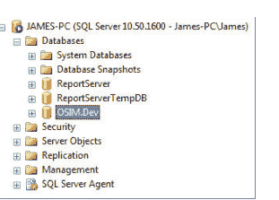

### 创建 Fluent NHibernate 映射

下一步是为 `ItemType` 类创建对象到数据的映射。Fluent NHibernate 像所有 ORM 框架一样，都需要一种映射，以指示 ORM 如何将类中的公共字段翻译为数据表。传统的 NHibernate 使用 XML 文件，这些文件可能难以理解且容易出现缺陷。Fluent NHibernate 是 NHibernate 框架的扩展，允许开发人员在 C# 或 VB.NET 中创建映射。这是相对于传统 NHibernate 映射的一个主要优势。首先，大多数开发人员对 C# 或 VB.NET 更熟悉和习惯。在自己更熟悉和擅长的语言中工作总是更好的。由于映射文件是编译的而不是在运行时读取的，Fluent NHibernate 映射中发生的错误更少。

图 8-4

这些映射的位置非常重要。虽然它们取决于 OSIM 应用程序的实体类型，但在技术上它们属于持久化层。出于这个原因，我喜欢将它们与仓库和其他持久化逻辑一起放在 `OSIM.Core` 项目中。

> 你现在可能在问自己：“为什么他要把持久化逻辑放在核心领域项目里？”作为开发者，我们被教导将应用程序的所有部分分离到不同的程序集中。给出的理由是，当进行更改时，一个程序集可以很容易被另一个程序集替换。事实上，这种对程序集的即时“即插即用”能力有点被高估了。在许多情况下，无论你向应用程序代码库中引入了多少映射和抽象，程序集的更改总是需要对大多数（不是全部）其他程序集进行更改。
>
> 这与将持久化逻辑保留在核心领域项目有什么关系？答案是简单性，应用程序的架构应该保持分离的服务分离，例如数据访问和演示。但是，所有的架构选择都伴随着代价，我看到将我的演示逻辑与领域服务分离的价值大于我因分离它们而付出的代价（在复杂性方面）。对于一个小型部门应用程序，例如示例中的 OSIM 应用程序，我不认为分离领域服务和持久化逻辑的好处超过了我因分离它们而付出的代价（再次，在复杂性方面）。
>
> 诚然，此应用程序可以设计为将持久化逻辑保留在它自己的程序集中。但这样做需要架构的其他更改，以消除循环依赖的可能。在大型应用程序中，不同的组件需要以不同的速率进行扩展，因此保持这些分离是重要的。大多数应用程序都是小型部门应用程序，即使在大型企业中，也只部署给少数用户。在这些情况下，务实胜出。当这些问题出现时，我喜欢提醒我的客户一句老话：如果它没坏，就不要修它！

测试并不要求 `ItemType` 定义中的任何字段。不过，为了本示例的目的，你添加了一个 `Name` 字段，因为这会让这个示例更有意义：

```csharp
namespace OSIM.Core.Entities
{
    public class ItemType
    {
        public virtual int Id { get; set; }
        public virtual string Name { get; set; }
    }
}
```


此时，你可能在想为什么这些字段被声明为 `virtual`。最简单短的解释是，Fluent NHibernate 在创建数据表结构时，将反射作为其过程的一部分。如果不将这些字段声明为 `virtual`，Fluent NHibernate 将无法施展它的魔术。

不可避免的是，如果你已经使用 Fluent NHibernate 有段时间了，你偶尔会忘记这个要求。一个好的经验之谈是：如果你遇到了一个看起来不合逻辑的映射错误，首先检查你正在映射的类的所有公共成员是否都已声明为 `virtual`。这通常就是问题所在。

终于是时候为 `ItemType` 创建映射了。回到 `ItemTypeMap`，你在 `ItemTypeMap` 的构造函数中添加了 `Id` 和 `Name` 的映射：

```csharp
public class ItemTypeMap : ClassMap<ItemType>
{
    public ItemTypeMap()
    {
        Id(x => x.Id);
        Map(x => x.Name);
    }
}
```

`Id` 和 `Map` 是最常用的 Fluent NHibernate 映射命令。`Id` 指定实体类中的哪个字段将映射到要创建的数据表的主键字段上。`Map` 命令告诉 Fluent NHibernate 将实体类中的该字段映射到数据表中同名的字段。结果是创建了一个名为 `ItemTypes` 的类，包含两列：`Id`（主键）和 `Name`。还有针对关系和索引等事项的扩展，它们将在项目后期使用。此外，一些复杂的命令允许你执行诸如将两个相似的类型存储在同一表中，或者在数据库中的表名或字段名与应用程序代码中的类或字段名不匹配。这些在 Fluent NHibernate 文档中都有介绍。

# 编写集成测试

## 集成测试

下一步是将数据库连接放在配置文件中。首先，你在 `OSIM.IntegrationTests` 项目中添加一个 `app.config` 文件，如图 8-7 所示。

在 `OSIM.IntegrationTests` 项目中创建此文件的原因是，当我运行此集成测试时，`OSIM.IntegrationTests` 程序集成为执行中心。因此，.NET 单元测试运行器通过 NUnit 测试运行器，寻找适用于 `OSIM.IntegrationTests` 程序集的配置文件。如果找不到，就会发生运行时错误。

接下来，你在 `app.config` 文件中添加一个 `appSettings` 节，你将在 `appSettings` 中发现 `localDB`，它带有 `OSIM.Dev` 数据库的连接字符串：

```xml
<?xml version="1.0" encoding="utf-8" ?>
<configuration>
  <appSettings>
    <add key="localDB" value="Data Source=JAMES-PC; Initial Catalog=OSIM.Dev; Integrated Security=True" />
  </appSettings>
</configuration>
```

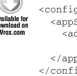

- OSIM.IntegrationTests
- Properties
- References
- OSIM.Core
- OSIM.InternalServices
- OSIM.WebClient
- OSIM.WinClient
- App.config
- IntegrationTestModule.cs

图 8-7

现在数据库和 ORM 工作已经完成，你终于可以开始编写测试了。与单元测试不同，你并不那么在意看到测试失败；首先，在很多情况下，测试会直接通过。这是因为单元测试的设计是为了驱动开发（它们展示了需要被编写的代码），而集成测试的目的是验证。（你已经预期代码存在且运行正常；你只是想验证这一点。）

如果你在 `OSIM.IntegrationTests` 项目中还没有 `OSIM.Core.Persistence` 文件夹，请尽管添加一个，如图 8-8 所示。

现在你已经有了存放 `ItemRepository` 测试的地点，你创建一个新的 `.cs` 文件来存储这些类，如图 8-9 所示。

- OSIM.IntegrationTests
- Properties
- References
- OSIM.Core
- OSIM.Core.Persistence
- ItemTypeRepositoryTests.cs
- OSIM.InternalServices
- OSIM.WebClient
- OSIM.WinClient
- App.config
- IntegrationTestModule.cs

图 8-8

图 8-9

Visual Studio 在 `ItemRepositoryTests.cs` 文件中创建了标准的存根类：

```csharp
namespace OSIM.IntegrationTests.OSIM.Persistence
{
    public class ItemRepositoryTests
    {
    }
}
```

ItemRepositoryTests.cs

此项目采用的 BDD 命名风格将 `ItemRepositoryTests` 类重命名为 `when_using_the_item_type_repository`，并使其继承自 `Specification` 基类。为了使其通过编译，你添加对 `OSIM.UnitTest` 项目的引用，以及 `NBehave.Spec.Unit` 和 `NBehave.Spec.Framework`。你还需要添加一条语句来引入 `OSIM.UnitTests`：

```csharp
using OSIM.UnitTests;

namespace OSIM.IntegrationTests.OSIM.Persistence
{
    public class when_using_the_item_type_repository : Specification
    {
    }
}
```

ItemRepositoryTests.cs

在前一章为单元测试创建的 `when_working_with_item_type_repository` 类有助于你为测试定义一个 BDD 风格的名称，该名称完全描述了你正在测试的动作。它提供了一个基类，你可以在其中执行所有集成测试所需的通用设置步骤。目前先离开 `when_using_the_item_type_repository` 类，并构建包含实际集成测试的类。

集成测试与单元测试的另一个区别是，单元测试应该一次只关注一个步骤或功能，而集成测试一次测试多个步骤是完全可以接受的。当前的测试就是一个很好的例子。你想验证可以使用 `ItemRepository` 向数据库写入和读取数据。在自动化测试中，你无法直接从数据库读取（除非通过代码）。

`when_attempting_to_save_and_read_a_value_from_the_database` 类描述了你正在测试的动作。

```csharp
public void then_item_type_saved_to_the_database_should_equal_the_item_type_retrieved()
{
    _result.Id.ShouldEqual(_expected.Id);
    _result.Name.ShouldEqual(_expected.Name);
}
```

ItemTypeRepositoryTests.cs

我下一步要采取的工作是为测试编写 `Because_of` 方法。在这种情况下，你需要使用 `ItemTypeRepository` 将 `ItemType` 类的实例保存到数据库中。然后，使用相同的 `ItemTypeRepository` 将你刚刚保存到数据库的数据（使用 `ItemTypeRepository` 返回的 `Id`）检索到另一个 `ItemType` 实例中，该实例由 `_result` 成员变量表示。

```csharp
protected override void Because_of()
{
    var itemTypeId = _itemTypeRepository.Save(_expected);
    _result = _itemTypeRepository.GetById(itemTypeId);
}
```

ItemTypeRepositoryTests.cs

你还需要添加一条语句来导入 `OSIM.Core.Persistence` 命名空间：

```csharp
using OSIM.Core.Persistence;
```

ItemTypeRepositoryTests.cs

剩下的要写的是 `Establish_context` 方法。`Establish_context` 方法中的第一个任务是创建 `ItemTypeRepository` 的实例并将其赋值给 `_itemTypeRepository` 成员变量。因为 Ninject 是此示例中的依赖注入框架，你需要创建一个 Ninject 标准内核（standard kernel）的实例，并为它提供一个 `IntegrationTestModule` 类的实例。它包含了用于为集成测试创建 `ItemTypeRepository` 的规则：

```csharp
private StandardKernel _kernel;

protected override void Establish_context()
{
    base.Establish_context();
    _kernel = new StandardKernel(new IntegrationTestModule());
}
```

ItemTypeRepositoryTests.cs

要使用 Ninject 标准内核，你需要为 Ninject 命名空间添加 `using` 语句：

```csharp
using Ninject;
```

现在，你需要向 Ninject 索要实现 `ITypeRepository` 接口的类实例。当你为 `_kernel` 成员变量实例化 `StandardKernel` 对象时，你为它提供了一个 `IntegrationTestModule` 类的实例。`IntegrationTestModule` 拥有 Ninject 创建用于集成测试的实现 `ITypeRepository` 接口的类所需的所有规则和步骤。你只需要向 `_kernel` 对象请求一个实现 `ITypeRepository` 接口的实例即可。Ninject 会处理所有的创建步骤：

```csharp
protected override void Establish_context()
{
    base.Establish_context();
    _kernel = new StandardKernel(new IntegrationTestModule());
    _itemTypeRepository = _kernel.Get<ITypeRepository>();
}
```

在继续之前，让我们从务实的角度来看当前的代码。`ITypeRepository.cs` 文件包含了类 `using_item_type_repository` 和 `attempting_to_save_and_read_value_from_datastore`。可以合理地假设所有对 `ITypeRepository` 执行集成测试的类都会以某种方式继承自 `using_item_type_repository` 类。同样，合理的假设是，大多数（如果不是所有）对 `ITypeRepository` 接口执行集成测试的类将需要一个实现 `ITypeRepository` 接口的对象的实例。因此，将 `_kernel` 和 `_itemTypeRepository` 成员变量的声明以及实例化它们的代码移动到 `using_item_type_repository` 基类是有意义的。

在移动声明并在 `using_item_type_repository` 类中创建一个 `Establish_context` 方法来实现此后，`using_item_type_repository` 和 `attempting_to_save_and_read_value_from_datastore` 类将如下：

```csharp
public class using_when_item_type_repository : Specification
{
    protected ITypeRepository _itemTypeRepository;
    protected StandardKernel _kernel;

    protected override void Establish_context()
    {
        base.Establish_context();
    }
}
```


_kernel = new StandardKernel(new IntegrationTestModule());

_itemTypeRepository = _kernel.Get<IIItemTypeRepository>();

}

public class and_and_attempting_to_save_and_read_a_value_from_the_datastore : when_using_the_item_type_repository

{

    private ItemType _expected;

    private ItemType _result;

    protected override void Establish_context()

    {

        base.Establish_context();

    }

    protected override void Because_of()

    {

        var itemTypeId = _itemTypeRepository.Save(_expected);

        _result = _itemTypeRepository.GetById(itemTypeId);

    }

}

```csharp
[Test]
public void then_the_item_type_saved_to_the_database_should_equal_the_item_type_retrieved()
{
    _result.Id.ShouldEqual(_expected.Id);
    _result.Name.ShouldEqual(_expected.Name);
}
```

`ItemTypeRepositories.cs`

在运行此操作之前的最后一项工作是为 `_expected` 成员变量创建一个 `ItemType` 类的实例，你需要将其保存到数据库：

```csharp
protected override void Establish_context()
{
    base.Establish_context();
    _expected = new ItemType {Name = Guid.NewGuid().ToString()};
}
```

`ItemTypeRepositories.cs`

我喜欢使用 `Guid` 作为测试数据。每次都很容易获取一个随机值。因为它总是一个新值，我不需要担心测试结果中的数据清理。当然，要使用 `Guid`，你需要为命名空间添加 `using` 语句：

```csharp
using System;
```

`ItemTypeRepositories.cs`

剩下的就是运行测试。正如图 8-11 所示，在不需要编写额外代码的情况下测试通过了。

15cb759e167a2d15e60b37de53a192_0

如果我想进一步验证，我只需要使用我喜欢的数据库工具（例如我使用的 SQL Management Studio）并查看数据库表（见图 8-12）。

当我编写测试时，我是先写测试。在这里，我编写的代码仅仅是将 `ISessionFactory` 注入 `ItemTypeRepository`。我所描述的三个活动与驱动单元测试的用户故事和功能之间的区别在于，为了让集成测试通过而需要的功能并没有增加价值。它是由增加业务价值的代码支持的。

15cb759e167a2d15e60b37de53a192_1

编写集成测试的另一个原因是，坦率地说，在我顾问期间，我监督了许多年轻且缺乏经验的开发者。即使是一些经验深丰富的老兵也没有接触过 ORM 和 IOC 容器等概念。在担任开发负责人时，我想确保他们遵守这些工具和概念。如果我简单地让一个没有 IOC 容器经验的开发者承担编写此集成测试的任务，他们很可能会手写一个对象，或者更糟糕的是创建静态成员变量。在这种情况下，以及另一种集成测试不同于单元测试的情况（对我而言），我希望我的开发者，特别是那些对这些新工具和技术缺乏经验的人，将这些工具和技术的使用放在脑中。当他们编写单元测试时，我倾向于相反；他们应该只考虑功能或用户故事所确定的即时业务需求。

## 端到端集成测试

单元测试的目的是通过创建可执行的自动化测试来驱动代码开发，验证应用程序是否满足功能和用户故事定义的业务需求。集成测试的目的是确保应用程序的各个组件协同工作，形成一个更大的应用程序。端到端测试验证应用程序是否满足了某个功能或用户故事的所有要求，并确保功能是完整且集成的。单元测试覆盖特定的业务功能单元，而集成测试覆盖组件之间的接缝。端到端测试涵盖了整个系统，从尽可能接近前端或用户界面的地方一直到后端数据存储、Web 服务或应用程序可能具有任何其他外部依赖。

由于以下几个原因，端到端测试非常有价值。它们验证了应用程序在所有层级上的完整集成。它们还确保了以更整体的方式满足了功能或用户故事的需求。

与单元测试一样，端到端测试也有自己的特点。在给定的测试套件中，单元测试和集成测试中的端到端测试相对少。与覆盖特定小业务任务的单元测试不同，端到端测试完成的是整个业务工作流。单元测试的关注点非常窄，而端到端测试涵盖了广泛的功能。与集成测试不同，端到端测试并不关心特定的接缝。事实上，它们可能完全没有意识到此类接缝的存在。大多数端到端测试应该从创建一个尽可能靠近用户界面的访问点开始。如果用户界面是可以使用的（例如 ASP.NET MVC 应用程序、使用 MVVM 模式的 WPF 或 Silverlight 编写的应用程序，或 WCF/ASMX 服务），那么这些应该是端到端测试的起点。端到端测试并不关心是否使用了 `ItemRepository`。它关注的是用户提供了正确的信息，并调用了与输入表单上的保存按钮相同的代码，数据被保存并返回了正确的结果。

## 区分不同类型的测试

应用程序的测试套件将由单元测试、集成测试和端到端测试组成，它们都有不同的目的。开发者应该频繁运行单元测试。运行集成测试的频率应该更低，端到端测试的频率更低。为了管理运行哪些测试以及运行频率，跟踪不同类型测试之间是重要的。为了这一点，我通常会在每个应用程序的 Visual Studio 解决方案中创建两个测试项目：一个单元测试项目和一个集成测试项目（其中也包含我的端到端测试）。将它们保持在单独的项目和程序集中，使我能够更多地控制何时运行这些测试。这将在下一节中进行详细介绍。

## 如何运行集成测试

集成测试（特别是端到端测试）由于需要与应用程序的外部依赖交互，运行时间可能比单元测试长得多。与这些外部依赖交互的需求在两个或多个开发者尝试同时运行这些测试时也会导致问题。由于这些原因，集成测试和端到端测试不、也不应该作为单元测试运行。

由开发者运行时，集成测试和端到端测试应该在开发者完成或接近完成某个功能或用户故事时运行。这是为了确保你没有在应用程序的当前功能中引入任何缺陷。一些开发者或开发团队创建了一种做法，即开发者不需要运行与他们当前正在的工作或用户故事不相关的集成和端到端测试。只要应用程序很容易判断哪些测试是相关的且不需要运行某些测试，那么这可能是一种很好的做法。至少，在将任何代码提交到代码库之前，必须运行这些测试。

集成测试和端到端测试还应该作为 CI（持续集成）过程的一部分运行。CI 过程的目的之一是确保应用程序在发布给 QA 人员之前，所有各个组件和部分都能正常工作。这确保了 QA 人员不会浪费时间测试已被标记为不可用的应用程序。作为 CI 过程一部分运行这些测试的另一个好处是，它在测试运行时不会占用开发资源。CI 服务器可以作为构建过程的一部分执行运行时间长的测试并报告结果（如果有的话）。在此期间，开发可以继续工作其他功能或用户故事。对于那些由于集成和端到端测试运行时间很长的应用程序的团队来说，这是一个非常有吸引力的特性。不用说，任何在 CI 过程中失败的测试都应该成为应用程序开发团队的首要任务。在构建恢复到“全绿”（全部通过）状态之前，应该暂停所有其他活动。

## 总结

集成测试对你应用程序的质量至关重要。单元测试确保单个组件符合功能和用户故事记录的业务需求。集成测试确保这些单个组件协同工作以创建一个可以运行的应用程序。

在编写集成测试时，你希望关注应用程序组件之间的接缝。在各个内部组件之间的接缝处，你希望目标应用程序与外部资源（如数据库、Web 服务、文件系统）之间的接缝。

与单元测试一样，集成测试期望在可预测的状态下执行。与单元测试依赖依赖对象和 Mock（模拟）来提供存根环境不同，集成测试必须使用真实的资源对象。作为集成测试套件的一部分，你需要在集成测试运行之前确保环境重置为一致的状态。

单元测试应用程序单个组件的内部功能，集成测试测试应用程序组件之间的接缝。端到端测试是一种特殊的集成测试，验证应用程序代码可以执行基于用户故事的整个工作流。你的应用程序测试套件将包含许多单元测试和集成测试，每个测试关注一个较小的功能。相比之下，你的应用程序测试套件将包含较少的端到端测试，每个测试涵盖更广泛的功能。

由于使用了非 Mock 组件和外部资源，集成测试和端到端测试运行时间比单元测试长。建议开发者运行集成和端到端测试的频率低于运行单元测试。集成测试应该在开发功能或用户故事期间定期运行。端到端测试应该在开发者将代码提交到主分支之前运行。集成测试以及端到端和单元测试应该作为开发团队 CI 过程的一部分运行。任何带有失败测试的构建都应被视为构建失败，开发团队的优先级应转向让测试和构建恢复正常。

# Web 上的测试驱动开发

作者：Jeff McWherter

## 本章内容

- 结合 Web 表单的 TDD
- 结合 MVC 的 TDD
- 结合 JavaScript 的 TDD

之前的章节讨论了用于准确描述什么是测试驱动开发的工具和理论。现在，是时候将这些知识应用于实际示例，并将“测试-开发”模式带到许多软件开发者所处的世界：Web 世界。

你可能认为 Web 框架（主要是 ASP.NET Web Forms）并没有很好地实现关注点分离。在执行 TDD 时，我们对不违反单一职责原则有非常严格的要求。从混杂在 ASPX 文件中的 C# 或 Visual Basic 代码，到在页面间复制的常用 JavaScript 函数，许多 Web 框架并没有遵循之前章节概述的许多规则。本章将讨论使 Web 应用更容易测试的模式，包括那些关注点分离并不好的框架。本章从 ASP.NET Web Forms 开始，转向微软全新的框架 ASP.NET MVC，你将学习到不仅能让你的 Web 应用更具可测试性，还能使用 TDD 创建它们的技术。

市面上已经有很多专门关于 Web 测试的书籍，例如 Jeff McWherter 和 Ben Hall 写的《Testing ASP.Net Web Applications》（Wrox, 2009, ISBN: 978-0-470-49664-0）。本章总结了该主题的重要要点。在本章结束，你将理解如何使用 TDD 开发你的 Web 应用。

# ASP.NET WEB FORMS

2002年1月，ASP.NET 随着 .NET Framework 1.0 的发布。这一发布标志着使用微软技术的 Web 开发者的一个大里程碑，允许他们使用 Visual Basic.NET 和 C# 等语言生成 Web 应用。.NET 包含了许多工具，你可以利用内置控件快速开发 Web 应用，这些控件可以为你处理基础的增、删、改、查（CRUD）操作。ASP.NET 框架自带的组件允许你将控件拖放到应用程序中。这种功能实现了快速的开发流程。但在架构设计期间，许多应用程序的可测试性从未被考虑过。由于这些 Web 应用在开发者转向不同公司或项目时仍然在运行，因此对这种方式开发的应用程序打了一个又一个补丁，导致维护成本也随之增加。

尽管这些问题今天仍然存在，但你可以使用一些技术和模式对 ASP.NET Web Form 应用进行单元测试。

## Web 表单组织

Web 表单由两部分组成。ASPX 文件包含 HTML、CSS、JavaScript 和 ASP.NET 标记。第二部分是后台代码，即包含可执行代码的 CS 或 VB 文件。让我们花点时间讨论这些文件中应该包含什么。

### ASPX 文件

ASPX 文件是用户看到的 Web 应用页面视图。因此，其中不应包含任何业务逻辑。ASPX 文件应该是整洁的，并且易于 Web 和图形设计师的阅读。虽然并不是每个人都有机会让设计师查看 ASPX 文件的奢侈，但当你这么做时，你希望设计师能够理解这些内容。在 ASPX 文件内部访问数据库的逻辑不仅违反了关注点分离的规则，还让你的代码难以他人阅读。你的 ASPX 文件不应该充斥着 `<%` 标签。

### 后台文件

你应该将后台文件视为视图渲染内容的控制器。后台文件挂钩 ASP.NET 页面生命周期，并与 ASP.NET 运行时有紧密的依赖，这使得测试这些文件变得困难。因此，你应该保持后台文件尽可能薄，以便它们只包含“粘接代码”。Visual Studio 和 ASP.NET Web Forms 目前默认鼓励在这些文件中包含大量逻辑，这实际上与 TDD 所需的模式背道而驰。

> 粘接代码是指对应用程序功能没有贡献的代码。粘接代码的作用仅仅是将通常不兼容的各个部分“粘合”在一起。在大多数情况下，由于其简单的本质，粘接代码不需要进行测试。

在 ASP.Net Web Forms 中，保持后台文件整洁并实现良好关注点分离的最佳方法之一是遵循模型-视图-演示者（MVP）设计模式，如图 9-1 所示。

其核心在于，演示者充当中间层，类似于模型-视图-控制器（MVC）模式中的控制器对象（MVC 将本文稍后介绍）。演示者获取数据、将其持久化并对其进行格式化以便在视图显示。视图显示数据的接口，模型代表数据或领域模型。MVP 模式自 90 年代初一直存在，是遵循 SOLID 设计原则的流行方法。

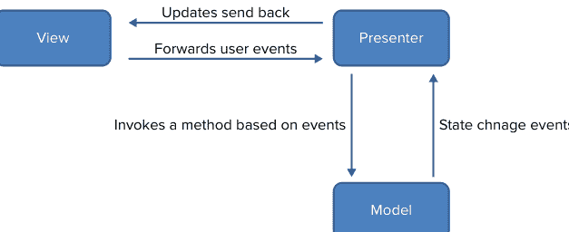

图 9-1

## 使用 MVP 和 Web Forms 实现测试驱动开发

此示例创建了一个列出最近读过的书籍的应用程序。你将关注向用户显示数据。图 9-2 显示了你将构建的内容。

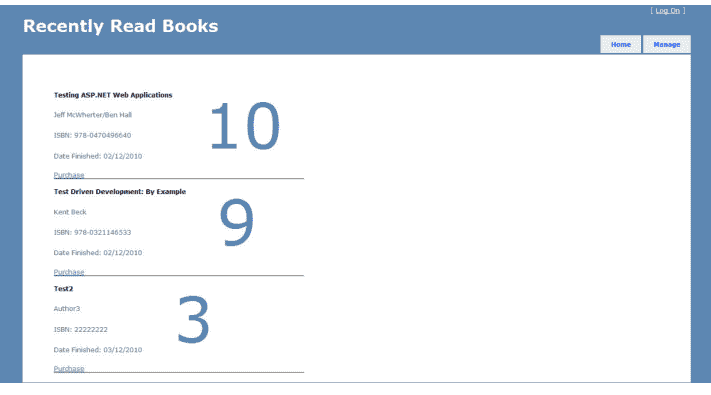

图 9-2

## 项目布局

在创建第一个测试之前，你应该从项目的组织开始。你创建一个 ASP.NET Web 应用并将其命名为 `Wrox.BooksRead.Web`。这个名称基于标准的“公司.项目名.组件”命名方案。保持项目的组织和整洁有助于未来的维护。关键在于命名项目时保持一致。`Wrox.BooksRead.Web` 项目没有添加任何特殊内容；目前只是一个默认的 ASP.NET Web 应用。

还需要添加另一个类库项目 `Wrox.BooksRead.Tests`。该项目将帮助你为 Web 应用进行测试。其中包括一个 `Lib` 文件夹，将存放测试 `Wrox.BooksRead Web` 的外部二进制文件。还需要添加 NUnit 和 Rhino Mock（一个流行的 Mock 框架）。此时，图 9-3 所示的所有项目都应该已经编译。

### 第一个测试

通常，在选择 MVP 或 MVC 模式时，确定从哪里开始是困难的。控制器或演示者通常是最好的起点，因为它们包含了大量的应用程序逻辑。你可以从模型开始测试，但使用控制器/演示者可以帮助你定义模型的样式。这里是第一个测试：

```csharp
public class when_the_controller : Specification
{}
```

```csharp
public class and_getting_a_list_of_books the_read_controller : Specification
{
    IDisplayReadView _view;
    BooksReadController _controller;

    protected override void Establish_context()
    {
        base.Establish_context();
        _view = MockRepository.GenerateMock<IDisplayReadView>();
    }
}
```

```csharp
public class then_data_bind_should_be_called : Specification
{
    _view.Expect(v => v.Bind());
    _controller = new BooksReadController{view = _view};
}
```

`DisplayControllerTests.cs`

当你检查这个测试时，应该能够从中识别出几个部分。乍看之下，你可能会怀疑这段代码与 Web 应用有什么关系。在第一个示例中，你尝试创建一个伪视图和一个真实的控制器。然后你尝试使用控制器的方法加载数据，并确保伪视图拥有数据。记住，你测试的是控制器的交互，而不是视图。这就是为什么你使用伪视图。

在需要实现代码时，在一个文件中进行实现可能会更容易：

```csharp
protected override void Because_of()
{
    _controller.GetData(this, EventArgs.Empty);
}

[Test]
public void then_getdata_call()
{
    _view.VerifyAllExpectations();
}
```


使用 `DataRequested` 事件向控制器请求数据。`IDisplayBooksReadView` 如下所示：

```cs
public interface IDisplayBooksReadView
{
    event EventHandler DataRequested;
    List<BookRead> Data { get; set; }
    void Bind();
}
```

IDDisplayBooksReadView.cs

如所示，`BookRead` 对象就是模型。此时，你不需要定义它被包含在这个对象中；你只需要创建它，以便你的测试能够通过编译：

```cs
public class BookRead
{
}
```

BookRead.cs

`DisplayBooksReadController` 是应用程序部分的演示器（Presenter）。演示器负责视图（View）和模型（Model）之间的通信。因此，演示器有一个你正在操作的字段，它最终会被传递给演示器对象的构造函数，还有一个从你确定的任何类型的数据源获取数据的函数。以下是 `DisplayBooksReadController` 的代码：

```cs
public class DisplayBooksReadController
{
    public IDisplayBooksReadView View { get; set; }
    public DisplayBooksReadController(IDisplayBooksReadView view)
    {
    }
    public void GetData(object sender, EventArgs e)
    {
    }
}
```

DisplayBooksReadController.cs

如图 9-5 所示，测试仍然失败，但至少通过了编译。在尝试计算控制器传递给视图的数据项数量时，有两种修复方法。你可以使用模拟框架（mocking framework）并模拟数据，或者你可以直接硬编码对象并完之（这也称为桩存，stubbing）。本示例展示了如何对 `BookRead` 数据进行桩存。在本章的稍后部分，你将处理测试、数据库和模拟对象之间的关系。

## ASP.NET Web Forms | 203

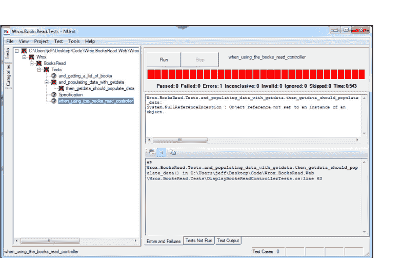

图 9-5

完成此任务，你需要实现控制器：

```cs
public class DisplayBooksReadController
{
    public IDisplayBooksReadView View { get; set; }
    public DisplayBooksReadController(IDisplayBooksReadView view)
    {
        View = view;
        View.DataRequested += GetData;
    }
    public void GetData(object sender, EventArgs e)
    {
        View.Data = new List<BookRead>
        {
            new BookRead { ReadId = 1, Name = "@Testing ASP.NET Web Applications", Author = "Jeff McKervey/Ben Hall", ISBN = "978-0470496640", StartDate = new DateTime(2010, 2, 12), Rating = 10, PurchaseLink = "http://www.amazon.com" },
            new BookRead { ReadId = 2, Name = "@Test Driven Development: By Example", Author = "Kent Beck", ISBN = "978-0321146533", StartDate = new DateTime(2010, 2, 12), Rating = 9, PurchaseLink = "http://www.amazon.com" },
            new BookRead { ReadId = 3, Name = "Test2", Author = "Author", ISBN = "22222222", StartDate = new DateTime(2010, 3, 12), Rating = 3, PurchaseLink = "http://www.msu.edu" }
        };
        View.Bind();
    }
}
```

DisplayBooksReadController.cs

通过 `DisplayBooksReadController` 类的构造函数，你将 `View` 属性设置为传递给控制器的视图，然后将 `DataRequested` 事件绑定到 `GetData` 方法。`GetData` 返回三个桩存的 `BookRead` 对象。实现控制器意味着是时候按照如下定义模型了：

```cs
public class BookRead
{
    public int ReadId { get; set; }
    public string Name { get; set; }
    public string Author { get; set; }
    public string ISBN { get; set; }
    public DateTime StartDate { get; set; }
    public DateTime EndDate { get; set; }
    public int Rating { get; set; }
    public string PurchaseLink { get; set; }
}
```

BookRead.cs

Web Forms MVP 项目的第一个测试应该。由于 MVP 模式，你可以将类从 ASP.NET 生命周期中隔离出来，并创建测试来确保该类的功能正常工作。

## 创建更多测试

现在控制器已经完全实现。由于示例是从控制器开始的，因此你还没有任何关于视图的测试。你需要测试视图上的构造函数是否连接了所有事件，这只有唯一一点——`DataRequested` 事件。你可以为视图创建一个模拟对象（Mock object），将其注入控制器，然后验证 `DataRequested` 事件是否已绑定到控制器的 `GetData` 函数。由于你已经实现了该功能，这个测试应该能够通过，而无需添加任何更多代码。

```cs
public class test_and_wiring_the_events_by_the_constructor : Specification
{
    IDisplayBooksReadView _view;
    protected override void Establish_context()
    {
        base.Establish_context();
        _view = MockRepository.GenerateMock<IDisplayBooksReadView>();
        _view.Expect(v => v.DataRequested += null).IgnoreArguments();
    }
    protected override void Because_of()
    {
        new DisplayBooksReadController(_view);
    }
    [Test]
    public void then_the_constructor_should_wire_up_events()
    {
        _view.VerifyAllExpectations();
    }
}
```

`GetData` 函数和 `DataRequested` 事件，控制器调用视图上的 `Bind` 方法。视图内部将数据绑定到 ASPX 页面上的控件。显示最近阅读书籍的“管道”代码现在实现。在向你展示连接这一切的代码之前，我想简要解释一下辅助方法的概念。

## Helpers

辅助方法帮助其他方法执行任务。它们通常是方法之间共享的任务。例如，在 Web 上，将文本截断到特定的字符数并在末尾附加省略号以指示文本已被截断是种常见的方法。这种类型的方法并不特定于阅读视图；它可以用于此应用程序中的任何其他视图，因此你可以创建一个包含 `Truncate` 方法的 `HTMLHelper` 类来帮助你这种方式显示文本。如果我以前没说过，现在我说：TDD 关乎重复。你首先为 `Truncate` 方法创建一个测试：

```cs
public class when_using_the_html_helper_to_truncate_text : Specification
{
    protected string _textToTruncate;
    protected string _expected;
    protected string _actual;
    protected int _numberToTruncate;
    protected override void BecauseOf()
    {
        _actual = HTMLHelper.Truncate(_textToTruncate, _numberToTruncate);
    }
}
public class class__passing_a_string_that_needs_to_be_truncated : when_using_the_html_helper_to_truncate_text
{
    protected override void Establish_context()
    {
        _textToTruncate = "This is my text";
        _expected = "This...";
        _numberToTruncate = 5;
    }
    [Test]
    public void then_the_text_should_be_truncated_with_ellipses()
    {
        _expected.ShouldEqual(_actual);
    }
}
```

接下来，你实现代码使测试通过：

```cs
public static string Truncate(string input, int length)
{
    if (input.Length <= length)
        return input;
}
```

HTMLHelper.cs

然后重构实现以使测试通过：

```cs
public static string Truncate(string input, int length)
{
    if (length == 0)
        return input;
    if (String.IsNullOrEmpty(input))
        return string.Empty;
    if (input.Length <= length)
        return input;
    else
        return input.Substring(0, length) + "...";
}
```

HTMLHelper.cs

## 将所有部分整合

到此时，显示书籍（Books）所需的所有逻辑已经创建。剩下的工作是将这些逻辑连接到 Web 表单（Web Form）。以下代码是 Books Web 应用程序的默认页面。首先要的是，Default 页面需要实现 `IDisplayBooksReadView` 接口，并为 `DataRequested` 添加一个事件。在 `Page_Load` 函数中，你只需创建一个新的控制器并触发 `DataRequested` 事件。

由于 `DataRequested` 事件的触发，`Bind` 函数被调用，数据被绑定到屏幕上。一旦你理解了这个概念，这就变得清晰易读：

```cs
public partial class Default : System.Web.UI.Page, IDisplayBooksReadView
{
    private DisplayBooksReadController Controller;
    public event EventHandler DataRequested;
    public List<BookRead> Data { get; set; }
    protected void Page_Load(object sender, EventArgs e)
    {
        Controller = new DisplayBooksReadController(this);
        DataRequested(sender, e);
    }
    public void Bind()
    {
        rptBooksRead.DataSource = Data;
        rptBooksRead.DataBind();
    }
}
```

作为开发者，你可能没有考虑设计人员在收到你的代码时必须经历什么。与后代码（code-behind）中的所有代码一样，你的目标应该是保持标记（markup）尽可能简洁。下面的示例使用了重复器（repeater）。你可能希望尝试避免使用难以测试且设计人员难以于操作的 datagrids。尽量将 `<%` 标签减少到最少；仅在需要显示字段时实现它们。这些策略允许你创建大多数设计人员或开发者都能轻松进入并理解的标记。

```html
<asp:Repeater Id="RepeaterId" runat="server">
  <ItemTemplate>
    <div class="readBook">
      <div class="bookInfo">
        <h2><%# Wrox.BooksRead.Web.Helpers.HTMLHelper.Truncate(((Wrox.BooksRead.Web.BookRead)Container.DataItem).Name, 25) %></h2>
        <p>Author: <%# ((Wrox.BooksRead.Web.BookRead)Container.DataItem).Author %></p>
        <p>ISBN: <%# ((Wrox.BooksRead.Web.BookRead)Container.DataItem).ISBN %></p>
        <p>Date Finished: <%# ((Wrox.BooksRead.Web.BookRead)Container.DataItem).EndDate.ToString("MM/dd/yyyy") %></p>
      </div>
      <a href="<%# ((Wrox.BooksRead.Web.BookRead)Container.DataItem).PurchaseLink %>" target="_blank">Purchase</a>
    </div>
    <div class="ratingContainer">
      <span class="rating"><%# ((Wrox.BooksRead.Web.BookRead)Container.DataItem).Rating %></span>
    </div>
    <hr style="clear:both;" />
  </ItemTemplate>
</asp:Repeater>
```


如图 9-6 所示，显示了三本过的书。

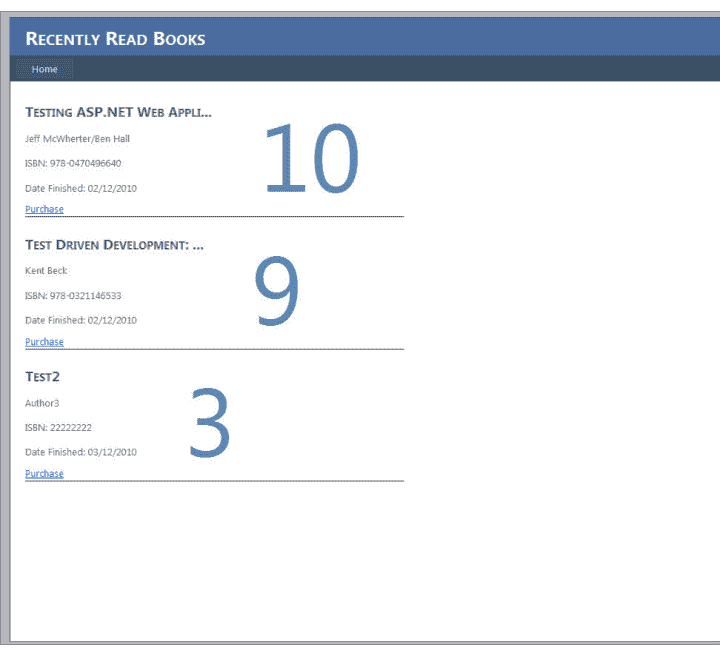

在 MVP 示例中，我向你展示了如何隔离对象并创建可测试的 Web Forms。MVP 模式从未作为开发 ASP.NET Web Forms 的主流方法，但当你被迫继续使用 ASP.NET Web Forms 开发且没有使用 ASP.NET MVC 等新框架的选项时，它是一个很好的起点。

这是一个简单的示例，但当你在 ASP.NET Framework 的较低层次工作并需要开始 mock 对象（例如 `HttpResponse` 对象）时，MVP 模式的测试就会失效。由于微软开发者近期要求提供一个高度可测试的框架，ASP.NET MVC 框架诞生了。

# 使用 ASP.NET MVC 进行工作

1979 年，在 Xerox PARC 工作期间，挪威计算机科学家 Tryve Reenskaug 发表了一篇名为《Smalltalk-80 中的应用程序编程：如何使用模型-视图-控制器》的论文。Reenskaug 正是在这篇论文中正式主张这种软件设计。尽管 MVC 设计模式已经存在了 30 多年，但它最近因为 Ruby on Rails 的成功而赢得了广泛关注。Ruby on Rails 帮助一些开发者创建高度可测试的 Web 应用程序。使用 Ruby on Rails 的开发者总是吹嘘他们的代码有多稳定。在 2011 年，从 Cold Fusion 到 PHP 的几乎每种编程语言都明显表明 MVC 是未来的趋势。2009 年，微软发布了 MVC 框架以获取社区的反馈。我们的意图并不是让你成为专家，但我们确实希望让你对如何创建 MVC 应用程序有一个良好的了解。

# MVC 101

Reenskaug 表示，他创建模型-视图-控制器模式是解决“让用户控制其信息”这一通用问题的显而易见的解决方案。图 9-7 展示了 MVC 设计。


对于本章，我们将 MVC 定义如下：

- **模型（Model）**：模型管理应用程序中的数据。存储和操作数据库的类与业务逻辑相结合。
- **视图（View）**：视图将模型渲染为用户可以交互的界面。HTML、JSON 和 XML 是视图的常见形式。
- **控制器（Controller）**：控制器协调模型和视图之间的通信。控制器接收来自视图的输入并启动模型的响应。控制器根据请求的视图决定渲染哪种视图——HTML、JSON 还是 XML。验证逻辑也存在于控制器中。

# Microsoft ASP.NET MVC 3.0

之前的章节使用 WCF 等技术实现了 OS 示例。Visual Studio 2010 自带 ASP.NET MVC 2.0，但本示例使用 ASP.NET MVC 3.0，该版本可以在 `http://www.asp.net/mvc/mvc3` 下载。

MVC 框架依赖于“约定优于配置”，因此只要你遵循约定，事情通常都能“正常工作”。路由是 ASP.NET MVC 的一个重要应用。简单来说，MVC 框架中的路由规定了如何处理 HTTP 请求。在过去使用 ASP.Net Web Forms 时，你与处理请求的方式紧耦合。以下代码是创建 ASP.NET MVC 时添加到 `Global.asax` 文件的默认代码：

```csharp
public static void RegisterRoutes(RouteCollection routes)
{
    routes.IgnoreRoute("{resource}.axd/{*pathInfo}");

    routes.MapRoute(
        "Default", // Route name
        "{controller}/{action}/{id}", // URL with parameters
        new { controller = "Home", action = "Index", id = UrlParameter.Optional }
    );
}
```

注意这一点很重要，因为许多 ASP.NET MVC 初学者会忽略这一点。代码表明你的 URL 看起来如下：`http://controller/action/id` 或 `http://localhost/home/index`，假设你在名为 `home` 的控制器类中有一个 `index` 方法。

# 创建 ASP.NET MVC 项目

创建 ASP.NET MVC 项目只需在创建新项目时，从 Web 项目类型中选择 **MVC 3 Web Application** 即可，如图 9-8 所示。

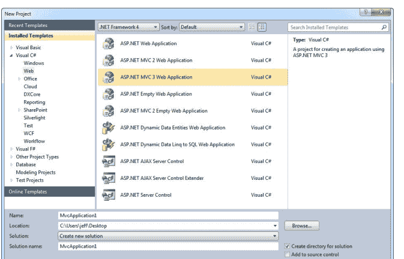

图 9-8

在选择 MVC 3.0 项目类型后，你可以从两个默认模板中进行选择：**空（Empty）** 或 **应用程序（Internet Application）**。当你选择 **应用程序模板** 时，将创建一个包含默认 HTML/CSS 样式的新项目。该项目还包含了主页的默认视图和控制器，以及身份验证的基础功能。为了跟随本示例，请选择如图 9-9 所示的空模板。

图 9-10 显示了框架创建的结构。它包含以下文件夹：

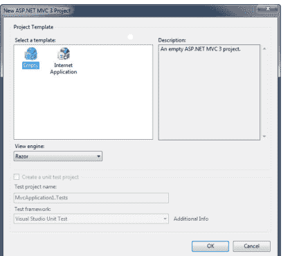

图 9-9

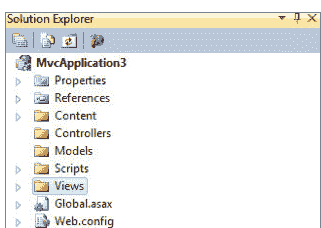

图 9-10

- **Content** 包含 HTML、CSS 和图像文件。
- **Controllers** 包含你的控制器类。
- **Models** 包含模型类。
- **Scripts** 包含应用程序的 JavaScript 代码。
- **Views** 包含你的视图。每个控制器在此目录下都有子目录，其中包含 CRUD 操作的视图。

## 创建你的第一个测试

基于之前的示例，本示例实现了与 OSIM 项目中相同的功能，围绕项目类型（item type）展开。你可以列出、创建和编辑这些项目。

在许多情况下，开发者在启动项目时数据模型已经就绪。本项目就属于其中之一，因为我们在之前的章节中深入讨论了数据层。你知道创建包含数据的 OSIM Core 模块的开发者拥有一套完整的周边工具，因此没有必要为该程序集创建测试。由于你将处理项目类型，让我们从为控制器创建一个测试开始，确保控制器能够获取到用于显示的项目类型数据。

你从测试的设置开始。你需要做的第一件事是设置项目类型存储库对象。你还设置了一个模拟（mock），当从此存储库调用 `GetAll` 方法时，它将返回包含三个项目类型的列表：


```csharp
public class when_working_with_the_item_type_controller : Specification
{
    protected Mock<ItemTypeRepository> _itemRepository
        = new Mock<ItemTypeRepository>();

    protected ItemType _itemOne;
    protected ItemType _itemTwo;
    protected ItemType _itemThree;

    protected override void Establish_context()
    {
        _itemOne = new ItemType { Id = 1, Name = "USB darts" };
        _itemTwo = new ItemType { Id = 2, Name = "Nerf darts" };
        _itemThree = new ItemType { Id = 3, Name = "Flying Monkeys" };

        var itemTypeList = new List<ItemType>
        {
            _itemOne,
            _itemTwo,
            _itemThree
        };

        _itemRepository.Setup(x => x.GetAll())
            .Returns(itemTypeList);
    }
}
```

`ItemControllerTests.cs`

有了项目类型存储库的设置逻辑，你就可以创建第一个测试了。你创建的第一个将列出项目类型。你想测试控制器是否正确地与存储库协作。以下测试确保在创建控制器时，模型从存储库中被正确设置：


```csharp
public class and_trying_to_load_the_index_page :
    when_working_with_the_item_type_controller
{
    object _model;
    int _expectedNumberOfItemsInModel;

    protected override void Establish_context()
    {
        base.Establish_context();
        _expectedNumberOfItemsInModel = _itemRepository.Object.GetAll().Count();
    }

    protected override void Because_of()
    {
        _model = ((ActionResult)new ItemTypeController(_itemRepository.Object).Index()).ViewData.Model;
    }
}
```

```csharp
[Test]
public void then_a_valid_list_of_items_should_be_returned_in_the_model()
{
    _expectedNumberOfItemsInModel.ShouldEqual(((List<ItemType>)_model).Count);
    _itemOne.ShouldEqual(((List<ItemType>)_model)[0]);
}
```

`ItemTypeController.Tests.cs`

## 让你的第一个测试通过

现在你已经有了一个测试，可以创建一个名为 `ItemTypeController` 的控制器。右键点击 `Controllers` 文件夹并选择“添加+”，弹出一个允许你创建控制器的对话框，如图 9-11 所示。

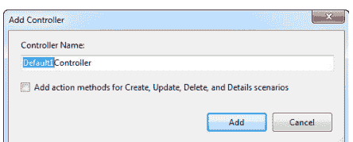

你可以选择使用 Visual Studio 来创建创建、编辑等所有操作方法，但由于你还没有为它们编写测试，未来你将需要自己处理。现在，只实现 `Index` 方法。控制器类创建后，用以下代码填充空白：

```csharp
public class ItemTypeController : Controller
{
    ItemTypeRepository _itemTypeRepository;

    public ItemTypeController(ItemTypeRepository itemRepository)
    {
        _itemTypeRepository = itemRepository;
    }

    public ActionResult Index()
    {
        ViewData.Model = _itemTypeRepository.GetAll();
        return View();
    }
}
```

`ItemController.cs`

在 `ItemTypeController` 代码中最引人注目的是添加了一个接收项目存储库的构造函数。这就是你获取存储库实例的方式。有了这个逻辑后，你的测试将会通过，但网站的功能不会按照你预期的那样运行。


## 创建你的第一个视图

你需要创建一个显示项目类型的视图。你需要在 `Views` 目录下创建一个子目录以保持整洁。然后，右键点击新创建的 `ItemType` 目录并选择“添加...”。如图 9-12 所示的对话框。

当使用 ASP.NET MVC 3.0 创建视图时，你有两个视图引擎的默认选项。使用 Razor 视图引擎来渲染这个视图。

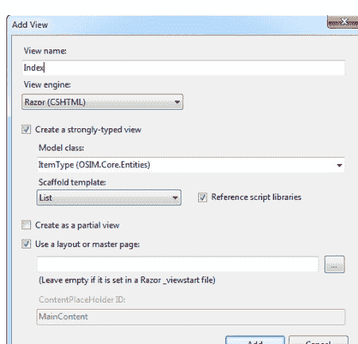

图 9-12

```html
@model IEnumerable<OSIM.Core.Entities.ItemType>

@{
    ViewBag.Title = "ItemType";
}

<h2>ItemType</h2>

<p>@Html.ActionLink("Create", "Create")</p>

<table>
    <tr>
        <th></th>
        <th>Name</th>
    </tr>
    @foreach (var item in Model)
    {
        <tr>
            <td>@Html.ActionLink("Edit", "Edit", new { id = item.Id })</td>
            <td>@item.Name</td>
        </tr>
    }
</table>
```

你需要知道 `ItemType` 目录中的值。这是因为 MVC 是基于约定的，你设置的默认值将导致控制器（`Index` 方法）。图 9-13 显示了框架找不到文件时发生的情况。

```
Server Error 404

视图 'Index' 未找到，没有视图引擎支持这些位置。请阅读下面的详细获取更多有关错误和堆栈跟踪的信息。

异常详细：
异常：System.InvalidOperationException: 视图 'Index' 未找到，没有视图引擎支持这些位置。搜索了以下位置：
/Views/ItemType/Index.cshtml
/Views/ItemType/Index.aspx
/Views/Shared/Index.cshtml
/Views/Shared/Index.aspx
/Views/ItemType/Index.vhtml
/Views/Shared/Index.vhtml

堆栈跟踪：
执行当前请求期间生成了异常。可以通过异常跟踪识别输入和异常信息。
```

```csharp
filters.Add(new HandleErrorAttribute());
}

public static void RegisterRoutes(RouteCollection routes)
{
    routes.IgnoreRoute("{resource}.axd/{*pathInfo}");

    routes.MapRoute(
        "Default", // Route name
        "{controller}/{action}/{id}", // URL with parameters
        new { controller = "ItemType", action = "Index", id = UrlParameter.Optional }
    );
}

protected override IKernel CreateKernel()
{
    return new StandardKernel(new PersistenceModule(), new CoreServicesModule());
}
```


此示例中最值得注意的是，`Global.asax` 不再继承自 `System.Web.HttpContext` 而是继承自 `NinjectApplication`，这需要对 `Ninject.MVC` 的引用。继承自 `NinjectWebApplication` 并实现 `CreateKernel` 方法来映射你的依赖项就是让你的 Web 应用程序运行所需的全部胶水。你可能还会注意到在此示例的 `RegisterRoutes` 方法中，将默认控制器名称从 `Home` 更改为 `ItemType`，这样它就会指向你创建的控制器。如果不这样做，你的 Web 应用程序将寻找一个不存在的控制器。运行该 Web 应用程序将渲染与图 9-14 所示类似的网站。

现在你已经实现了第一个功能，可以返回并创建涉及创建和编辑类型的测试。我将向你展示如何编写这些测试：

```csharp
public class class_and_trying_to_create_a_new_valid_item_type : working_with_the_item_type_controller
{
    ItemType _newItemType;
    ItemTypeController _controller;
    RedirectToRouteResult _result;
    string _expectedRouteName;

    protected override void Establish_context()
    {
        base.Establish_context();
    }
}
```


# Working with the ASP.NET MVC

```csharp
_expectedRouteName = "Index";

_newItemType = new ItemType({ Id = 99, Name = "New Item" });
```

| ItemType | Name |
|---|---|
| Creates New | Edit |
| Test 1 | test 2 |
| Edit | test 3 |
| Edit | test 4 |

图 9-14

```csharp
_controller = new ItemTypeController(_itemRepository.Object);
```

```csharp
protected override void Because_of()
{
    _result = _controller.Create(_newItemType) as RedirectToRouterResult;
}
```

```csharp
[Test]
public void then_a_new_item_should_be_created_and_the_redirect_to_the_correct_view()
{
    _result.ShouldNotBeNull();
    _result.Values.ShouldContain(_expectedRoute);
}
```

```csharp
public class class_and_trying_to_create_a_new_invalid_item_type : when_working_with_the_item_type_controller
{
    ItemType _newItemType;
    ItemTypeController _controller;
    ActionResult _result;
    string _expectedRouteName;

    protected override void Establish_context()
    {
        base.Establish_context();
        _expectedRouteName = "create";
        _newItemType = new ItemType { Id = 99, Name = "New Item" };
        _controller = new ItemTypeController(_itemRepository.Object);
        _controller.ModelState.AddModelError("key", "model is invalid");
    }
}
```

```csharp
protected override void Because_of()
{
    _result = _controller.Create(_newItemType) as ViewResult;
}
```

```csharp
[Test]
public void then_a_new_item_should_not_be_created()
{
    _result.ShouldNotBeNull();
    _result.View.ShouldEqual(_expectedRouteName);
}
```

```csharp
public class class_and_trying_to_edit_an_existing_item : when_working_with_the_item_type_controller
{
    string _expectedRouteName;
    ItemTypeController _controller;
    ActionResult _result;
}
```

```csharp
protected override void Establish_context()
{
    base.Establish_context();
    _expectedRouteName = "edit";
    _controller = new ItemTypeController(_item.Object);
    _result = _controller.Edit(_item.Id) as ViewResult;
}
```

```csharp
protected override void Because_of()
{
}

[Test]
public void then_a_valid_edit_view_should_be_returned()
{
    _expectedRouteName.ShouldEqual(_result.View);
}
```

## 第 9 章 Web 上的 TDD

为了完成测试的实现，你需要完成测试运行器的实现代码添加。以下代码展示了你将运行的测试的完整实现。

```html
<html xmlns="http://www.w3.org/1999/xhtml">
  <head>
    <title>Account Tests</title>
    <link rel="stylesheet" href="QUnit.css" type="text/css" media="screen" />
    <script type="text/javascript" src="jquery-1.4.js"></script>
    <script type="text/javascript" src="../qunit.js"></script>
    <script type="text/javascript" src="../Account.js"></script>
    <script type="text/javascript">
      test('Create_An_Account_Object_With_Balance', function () {
        var checkingAccount = new Account(5648510, 600);
        equals(checkingAccount.Balance, 600);
      });
    </script>
  </head>
  <body>
    <h1 id="quit-header">Account Unit Tests</h1>
    <h2 id="quit-banner"></h2>
    <div id="quit-testrunner-toolbar"></div>
    <h2 id="quit-useragent"></h2>
    <ol id="quit-tests"></ol>
    <div id="quit-fixture">test markup</div>
  </body>
</html>
```

AccountTests.htm

在完成你的测试和运行逻辑后，你就可以准备运行测试了。你应该预期这个测试会失败，因为你还没有实现账户对象。图 9-16 描述了这一点。


图 9-16

当你的测试失败时，你就可以准备好实现 JavaScript 了：

```javascript
function Account(accountNumber, balance) {
  this.Account = accountNumber;
  this.Balance = balance;
}
```

Account.js

如图 9-17 所示，测试现在通过了。


图 9-17

现在让我们满足账户对象在对象之间转移资金的要求。在名为 `Should_Transfer_From_Checking_To_Savings_Successfully` 的测试中，创建两个带有余额的账户，并从其中一个账户向另一个转移资金。当你运行测试时，你预期会失败，如图 9-18 所示。

```javascript
test('Should_Transfer_From_Checking_To_Savings_Successfully', function () {
  var checkingAccount = new Account(564885100, 600);
  var savingsAccount = new Account(564885107, 100);
  checkingAccount.Transfer(savingsAccount, 100);
  equals(savingsAccount.Balance, 200);
  equals(checkingAccount.Balance, 500);
});
```

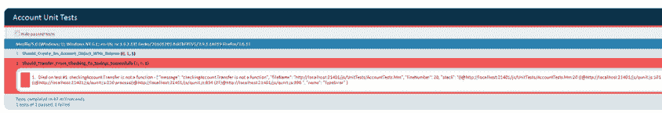

图 9-18

测试之后，你可以实现转移资金所需的代码。所有测试都通过了，如图 9-19 所示。

```javascript
function Account(accountNumber, balance) {
  this.accountNumber = accountNumber;
  this.Balance = balance;
}

Account.prototype.Transfer = function(toAccount, amount) {
  toAccount.Balance += amount;
  this.Balance = this.Balance - amount;
}
```

## 账户单元测试

```javascript
// AccountUnitTests.js
var Account = require('./Account');
var assert = require('assert');

describe('Account', function () {
  var checkingAccount;
  var savingsAccount;

  beforeEach(function () {
    checkingAccount = new Account(564858501, 600);
    savingsAccount = new Account(564858507, 100);
  });

  it('Should Not Transfer From When The Account Has Insufficient Funds');
});
```

图 19-19

你仅为了让 JavaScript 账户对象测试通过实现了最基本的的代码，但你还没有完成。业务规则和边界条件也需要测试。第一个就是测试当账户尝试转移超过其拥有的资金会发生什么。让我们写一个测试来看看：

```javascript
test('Should Not Transfer From When The Account Has Insufficient Funds', function () {
  var checkingAccount = new Account(564858501, 600);
  var savingsAccount = new Account(564858507, 100);
  checkingAccount.Transfer(savingsAccount, 700);
  equals(savingsAccount.Balance, 100);
  equals(checkingAccount.Balance, 600);
});
```


Account.js

如图 19-20 所示，此测试失败了。

## 账户单元测试

```javascript
// AccountUnitTests.js
var Account = require('./Account');
var assert = require('assert');

describe('Account', function () {
  var checkingAccount;
  var savingsAccount;

  beforeEach(function () {
    checkingAccount = new Account(564858501, 600);
    savingsAccount = new Account(564858507, 100);
  });

  it('Should Transfer Money', function () {
    checkingAccount.Transfer(savingsAccount, 100);
    equals(checkingAccount.Balance, 500);
    equals(savingsAccount.Balance, 200);
  });

  it('Should Not Transfer From When The Account Has Insufficient Funds', function () {
    checkingAccount.Transfer(savingsAccount, 700);
    equals(savingsAccount.Balance, 100);
    equals(checkingAccount.Balance, 600);
  });
});
```


# 测试 Windows Communication Foundation 服务

## 本章内容

- 理解为什么 Windows Communication Foundation (WCF) 服务是应用程序的重要部分
- 识别 WCF 服务作为代码，类似于表单或网页页面
- 重构你的 WCF 服务以采用依赖注入
- 理解依赖在测试 WCF 服务中扮演的角色

就像网页页面或桌面应用程序一样，服务是应用程序的接口。与应用程序的其他接口一样，你的服务需要经过测试，因为错误和缺陷很容易被服务层掩盖，从而使诊断缺陷变得极其困难。

WCF 是 .NET 中创建服务的标准框架。然而，许多开发者对 WCF 的基础知识感到畏惧。结果导致即使是愿意学习 WCF 的开发者也发现测试服务是一个艰巨的任务。正确测试 WCF 的技巧并不困难。本章将为你提供测试 WCF 服务所需的工具和知识。

## 应用程序中的 WCF 服务

服务对应用程序至关重要。作为一种架构工具，服务允许你开发出仅使用单一应用程序无法实现的广泛、自适应系统。服务增强了扩展性并增加了灵活性。有些人认为服务是松耦合系统的最终解决方案。随着移动设备的日益普及、通过 JavaScript 和 AJAX 调用更响应式 Web 的需求、Silverlight 等框架以及 REST 的复兴，为几年前仅属于架构师和服务面向架构 (SOA) 迷的概念注入了新生命。由于这些原因，越来越多的应用程序将开始提供某种服务接口。

## 服务也是代码

服务中的实际代码应该非常简单。换句话说，代码应该什么都不做。服务执行的最复杂的操作是在数据传输对象 (DTO) 和领域实体对象之间进行转换。服务还可以执行一些简单的数据验证，以匹配在网页或表单上执行的操作。此外，服务应该只调用领域服务或业务模型的方法。

尽管服务代码应该是简单的，但服务仍然是代码。因此它很容易发生变形，并且对应用程序其他部分的更改敏感。你需要确保你的服务使用的是正确的模型。验证规则必须经过验证。数据转换必须定期刷新，以确保实体类的更改没有破坏服务的运行。服务是应用程序的外部入口，这意味着它们能够数据的自动化输入；就像用户对于网页或表单一样。这意味着服务的验证和确认也必须通过，以确保应用程序的安全性。由于这些原因，测试服务就像测试任何应用程序接口一样重要。

## 测试 WCF 服务

与领域服务或实体不同，你无法直接控制 WCF 服务的实例化。这导致了一种观点，认为 WCF 服务无法利用依赖注入，因此无法进行单元测试。这是一个谬误。今天最流行的依赖框架都为向 WCF 服务注入依赖提供了便利。你只需要对服务实现的构造方式进行一些更改，并对 WCF 项目的配置进行一些微调。

> **注意**：本章假设你具备 WCF 的基础知识和技能。如果你不熟悉 WCF，有很多关于该主题的书。我在 `www.jamesbender` 上的博客有一个持续的 WCF 教学系列，非常适合未使用过 WCF 的开发者。

## 为了可测试性进行重构

与领域服务和实体一样，在理想的世界中，你在编写代码之前就会为你的 WCF 服务编写测试。测试优先是 TDD（记住，第二个 D 代表驱动）的一大核心原则。本章从一个现有的 WCF 服务开始并进行重构使其变得可测试。这种演示有几个原因：你更有可能遇到没有领域特定代码的代码库，而接口是为可测试性设计的 —— 特别是为了接受依赖。WCF 服务处于一个独特的地位，相对容易重构以接受依赖。服务是一个接口。因此，它位于应用程序的边缘，这意味着它不应该有由于创建接受依赖的新构造函数而崩溃的引用。此外，由于访问服务是通过代理进行的，且调用者在服务的实例化过程中没有作用，因此可以更改提供程序而几乎没有引入破坏性更改的风险。

最后，我意识到一些开发者在使用 WCF 时经历的学习曲线。我希望，通过从一个运行的服务开始，你在向运行的 WCF 服务中引入依赖注入时，会比构建一个更好的服务再引入依赖注入更有信心。

## 在您的服务中引入依赖注入

尽管 `InventoryService` 中的代码非常简单，但它仍然需要进行测试。测试 `InventoryService` 的一个根本性障碍是，它依赖于 `IItemService` 接口的实现，但目前没有方法可以注入实现 `IItemService` 接口的对象实例。这意味着测试依赖于静态绑定 Ninject 模块所提供的任何 `IItemService` 实现。

WCF 服务应用程序与 ASP.NET 应用以及 Windows Forms/WPF 应用具有相似的特征，WCF 服务、ASP.NET 页面和 Windows 表单的实例化是由 .NET 运行时执行的。这限制了在不深入 .NET 内部的情况下对这些对象进行实例化所能的操作。为了响应越来越多的开发者在这些对象上使用依赖注入的愿望，微软在 .NET 运行时构建了一些钩子，让你能够对这些类型的对象使用依赖注入。

Ninject 拥有庞大的扩展库，旨在在各种情况下启用依赖注入。其中 `Ninject.Extensions.Wcf` 扩展，它提供了一组类，允许通过 Ninject 为 WCF 服务实现依赖注入。添加这些扩展只需要几步，它可以帮助您的 WCF 服务无缝地使用依赖注入。

Ninject WCF 扩展包含示例中使用的两个程序集：`Ninject.Extensions.Wcf` 和 `Ninject.Extensions.CommonServiceLocator`。您将它们作为引用添加到 `OSIM.ExternalServices` 项目中。

需要实现的第一个更改是让 `OSIM.ExternalServices` 成为 Ninject 应用程序的实例。您通过更改 `OSIM.ExternalServices` 应用程序继承的类来实现。此信息位于 `Global.asax.cs` 文件。默认情况下，此文件在创建时不会被添加到 WCF 服务项目中。惯例是只有在需要修改某些行为（例如应用程序启动活动）时才创建此文件。如果找不到此文件，.NET 运行时将使用该类的标准定义来创建您的应用程序。

在这种情况下，你需要更改 `Global` 类的基类，因此也要将此文件添加到 `OSIM.ExternalServices` 项目中。要操作，右键点击 `OSIM.ExternalServices` 项目并选择“添加 -> 新项”。显示“新建项”对话框。

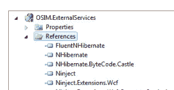

如图所示，选择“全局应用程序类”（Global Application Class）文件类型。保留 `Global.asax` 的默认名称，点击“添加”按钮。`Global.asax` 文件被添加到 `OSIM.ExternalServices` 项目中。

查看 `Global.asax` 文件的内容可以发现 `Global` 类目前继承自 `System.Web.HttpApplication`：

```csharp
namespace OSIM.ExternalServices
{
    public class Global : System.Web.HttpApplication
    {
    }
}
```

要在 `OSIM.ExternalServices` 项目中使用 Ninject Wcf 扩展，你需要更改 `Global` 类的声明，使其继承自 `NinjectWcfApplication` 基类。`NinjectWcfApplication` 类位于 `Ninject.Extensions.Wcf` 命名空间。由于你还需要访问 Ninject 根命名空间中的类，因此你需要添加 `using` 语句将这些命名空间包含在 `Global.asax.cs` 文件中：

```csharp
using Ninject;
using Ninject.Extensions.Wcf;
```

接下来更改 `Global` 类的声明，使其继承自 `NinjectWcfApplication` 而不是 `System.Web.HttpApplication`：

```csharp
namespace OSIM.ExternalServices
{
    public class Global : NinjectWcfApplication
    {
    }
}
```

`NinjectWcfApplication` 基类定义了一个名为 `CreateKernel` 的抽象方法，`Global` 类必须实现该方法：

```csharp
protected override IKernel CreateKernel()
{
    throw new NotImplementedException();
}
```

`CreateKernel` 方法的目的是为开发者提供一个地方，用于引用 Ninject 模块，这些模块包含了当前应用程序中 WCF 服务使用的各种类的规则。在重构 `OSIM.ExternalServices` 应用程序后，返回此方法，并为 `InventoryService` WCF 服务创建一个 Ninject 模块。

在 `OSIM.ExternalServices` 项目中有一个名为 `InventoryService.svc` 的文件。这类似于 `.aspx` 文件，它提供了有关 `InventoryService` 服务端点的某些运行时元数据，以及指向 `InventoryService.svc` 后置代码中 `InventoryService` 实际实现的链接：

```xml
<%@ ServiceHost Language="C#" Debug="true"
Service="OSIM.ExternalServices.InventoryService"
CodeBehind="InventoryService.svc.cs" %>
```

`ServiceHost` 指令的属性是 `Factory`。`Factory` 属性指定了在使用什么类来实例化 WCF 服务。当未提供该属性时，.NET 运行时使用标准的 WCF 工厂服务来创建服务实现类的实例。作为 `OSIM.ExternalServices` 项目中启用依赖注入重构的一部分，我们更改了工厂，在 `NinjectServiceHostFactory` 中实例化 `InventoryService`：

```xml
<%@ ServiceHost Language="C#" Debug="true"
Service="OSIM.ExternalServices.InventoryService"
CodeBehind="InventoryService.svc.cs"
Factory="Ninject.Extensions.Wcf.NinjectServiceHostFactory" %>
```

这就是创建 `OSIM.InventoryService` 内部机制以及使用 Ninject 的 `InventoryService.svc` 文件所需要的最后一步。接下来的步骤是在类中使用 Ninject 实现依赖注入的标准步骤。

首先，你需要创建一个 Ninject 模块来存储如何创建服务实现类的规则。创建此模块 `ExternalServicesModule`，并将其放置在 `OSIM.ExternalServices` 项目中名为 `Modules` 的文件夹下。

在 `ExternalServicesModule.cs` 文件中，按照你之前在章节中创建其他 Ninject 模块的方式创建 `ExternalServicesModule` 类：

```csharp
using Ninject.Modules;

namespace OSIM.ExternalServices.Modules
{
    public class ExternalServicesModule : NinjectModule
    {
        public override void Load()
        {
            Bind<IInventoryService>().To<InventoryService>();
        }
    }
}
```

`OSIM.ExternalServices` 项目只有一个服务 `InventoryService`，因此你唯一需要提供绑定信息的接口/类。使用来自相应项目的其他模块为 `ItemService` 及其所有依赖项提供规则。

是时候回到 `Global.asax` 文件中 `Global` 类的 `CreateKernel` 方法了。现在你已经有了用于 `OSIM.ExternalServices` 类的模块，你可以提供该方法的实现，为 `OSIM.ExternalServices` WCF 应用创建一个内核。首先，你需要在 `OSIM.ExternalServices` 项目中为各种 Ninject 模块添加 `using` 语句：

```csharp
using OSIM.Core.Services;
using OSIM.ExternalServices.Modules;
using OSIM.Persistence;
```

添加 `CreateKernel` 方法的实现，提供基于 `PersistenceModule`、`CoreServicesModule` 和 `ExternalServicesModule` 的 Ninject `StandardKernel` 实例：

```csharp
protected override IKernel CreateKernel()
{
    return new StandardKernel(
        new PersistenceModule(),
        new CoreServicesModule(),
        new ExternalServicesModule()
    );
}
```

现在我们回到实际的 `InventoryService` 实现。目前它是这样的：

```csharp
public class InventoryService : IInventoryService
{
    public string[] GetItemTypes()
    {
        var kernel = new StandardKernel(new PersistenceModule());
        var itemService = kernel.Get<IItemService>();
        var itemTypeList = itemService.GetItemTypes()
            .Select(x => x.Name)
            .ToArray();
        return itemTypeList;
    }
}
```

为了完成 `InventoryService` 从依赖静态绑定服务到注入服务的转换，你需要在 `InventoryService` 类中添加一个构造函数，接受实现 `IItemService` 接口的对象实例并存储在成员变量中：

```csharp
private IItemService _itemService;

public InventoryService(IItemService itemService)
{
    _itemService = itemService;
}
```

最后一步是从 `GetItemTypes` 方法中移除创建 Ninject 内核并使用该内核获取实现 `IItemService` 的类实例的代码。你还需要更改任何调用 `IItemService` 本地实例的代码，使其使用成员变量 `_itemService`：

```csharp
public string[] GetItemTypes()
{
    var itemTypeList = _itemService.GetItemTypes()
        .Select(x => x.Name)
        .ToArray();
    return itemTypeList;
}
```


你会立即注意到 `GetItemTypes` 方法中的代码变得更加整洁且易理解。请编译该应用程序并再次从 WCF 测试客户端调用 `GetItemTypes` 方法，以验证服务仍在正常工作，如图 10-7 所示。

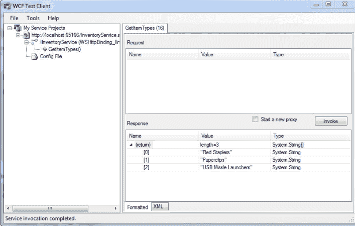

图 10-7

### 编写测试

现在你已经注入一个实现 `IItemType` 接口的类的 Mock 实例，可以为 `InventoryService` WCF 服务编写单元测试了。你首先创建一个 `.cs` 文件来存放你的单元测试。我将此文件放在 `OSIM.UnitTests` 项目的 `OSIM.ExternalServices` 文件夹中，并命名为 `InventoryServiceTests.cs`，如图 10-8 所示。

为了测试 `InventoryService`，你需要在 `OSIM.UnitTests` 项目上引用 `OSIM.ExternalServices` 项目的项目，如图 10-9 所示。


图 10-9

现在使用与之前相同的 BDD 命名风格创建你的测试类及其基类：

```csharp
namespace OSIM.UnitTests.OSIM.ExternalServices
{
    public class when_using_the_external_inventory_service : Specification
    {
        public class and_getting_list_of_item_types : when_using_the_external_inventory_service
        {
        }
    }
}
```

InventoryServiceTests.cs

为了使用 NUnit 框架中的属性，你需要添加一个 `using` 语句引入 `NUnit.Framework` 命名空间。你还需要创建 `InventoryService` 类的实例，因此也需要 `OSIM.ExternalServices` 命名空间。因为你将创建一个 `IItemTypeService` 核心领域服务的 Mock 实例，你还需要添加 `Moq` 命名空间以及 `OSIM.Core.Services` 命名空间的 `using` 语句。最后，与之前的单元测试一样，你使用 NBehavior 提供的扩展方法来评估结果，因此你需要包含 `NBehave.Spec.Unit` 命名空间：

```csharp
using Moq;
using NBehavior.Spec.Unit;
using NUnit.Framework;
using OSIM.Core.Services;
using OSIM.ExternalServices;
```

InventoryServiceTests.cs

测试的 `Because_of` 方法执行 `InventoryService` 的 `GetItemTypes` 方法并将字符串数组存储在变量 `results` 中：

```csharp
protected override void Because_of()
{
    _result = _inventoryService.GetItemTypes();
}
```

InventoryServiceTests.cs

当然，这要求你定义 `_result` 和 `_inventoryService` 成员变量：

```csharp
private IInventoryService _inventoryService;
private string _result;
```

InventoryServiceTests.cs

你为此测试类创建实际的测试方法。为了确保 `InventoryService` 运行正确，你需要验证 `_result` 数组中的元素数量是否正确，并且你 Mock 的 `IItemType` 返回的三个项目是否都体现在 `_result` 数组中。我将此方法命名为 `then_a_list_of_item_types_should_be_returned`：

```csharp
[Test]
public void then_a_list_of_item_types_should_be_returned()
{
    _result.Count().ShouldEqual(expectedNumberOfItems);
    _result.OfType<string>().Select(x => x == _itemOneName).FirstDefault().ShouldNotBeNull();
    _result.OfType<string>().Select(x => x == _itemTwoName).FirstDefault().ShouldNotBeNull();
    _result.OfType<string>().Select(x => x == _itemThreeName).FirstDefault().ShouldNotBeNull();
}
```

InventoryServiceTests.cs

此示例使用 `Select` LINQ 语句来验证测试设置中命名的项目是否存在于 `_results` 字符串数组中。你需要为此类添加一个 `using` 语句引入 `Linq` 命名空间：

```csharp
using System.Linq;
```

// InventoryServiceTests.cs

`then_list_of_item_types_should_be_returned` 测试方法使用了多个成员变量来报告此测试的预期值。你需要在测试类中声明它们：

```csharp
// 可从 W3.com 下载
private int _expectedNumberOfItems;
private string _itemOneName;
private string _itemTwoName;
private string _itemThreeName;
```

// InventoryServiceTests.cs

测试通过后，是时候运行它并观察结果了。此时我预计测试将会失败，事实如此（见图 10-10）。


图 10-10

### 打桩依赖项

`InventoryServiceTests.cs` 文件的第 41 行是对 `_inventoryService` 成员变量 `GetTypes` 方法的调用。在之前的章节中，我强调过在编写出需要代码的失败测试之前，不要编写任何代码。在编写测试时，同样的规则也适用。因为 `InventoryService` 有现有的应用程序代码，你可能不需要编写任何额外代码。当你编写测试时，你可能需要确保 `_inventoryService` 变量中包含一个 `ITypeService` 的 Mock。你需要通过 `Establish_context` 方法提供 `ITypeService` 的实例：

```csharp
protected void Establish_context()
{
    _itemTypeService = new Mock<ITypeService>();
    _inventoryService = new InventoryService(_itemTypeService.Object);
}
```

此时，你需要为 `itemTypeService` 声明：

```csharp
private Mock<ITypeService> _itemTypeService;
```

测试通过后，是时候再次运行它并查看是否通过了测试，如图 10-11 所示。


图 10-11

### 测试 WCF 服务

此错误指向了一个有趣的地方：`InventoryService.cs` 第 19 行抛出了 `ArgumentNullException`：

```csharp
var itemTypeList = _itemTypeService.GetItemTypes()
    .Select(x => x.Name)
    .ToArray();
```


InventoryService.cs

只要 `TypeService` 的 `GetTypes` 方法不返回 `null`，此行代码就可以工作。发生的情况是我正尝试编写一个可以验证看似正常的测试，结果发现了 `InventoryService` 类中 `GetTypes` 方法的一个潜在漏洞。如果没有彻底的单元测试，这个漏洞可能会一直穿整个流程直到生产环境才被发现。这应该是一个教训：不要低估简单的代码；缺陷可能存在任何地方。

第 12 章将涵盖测试和修复此缺陷。目前，此测试的解决方案是提供一个返回 `ItemType` 数组的 `ITypeService` Mock 给 `InventoryService`：

```csharp
_itemOneName = "USB drives"
_itemTwoName = "Nerf darts"
_itemThreeName = "Flying Monkeys"
var itemTypeOne = new ItemType(Id = 1, Name = _itemOneName);
var itemTypeTwo = new ItemType(Id = 2, Name = _itemTwoName);
var itemTypeThree = new ItemType(Id = 3, Name = _itemThreeName);
var itemTypeList = new List<ItemType>
{
    itemTypeOne,
    itemTypeTwo,
    itemTypeThree
};
_expectedNumberOfItems = itemTypeList.Count;
_itemTypeService.Setup(x => x.GetItemTypes()).Returns(itemTypeList);
```

InventoryServiceTests.cs

`ItemType` 位于 `OSIM.Core.Entities` 命名空间，因此你需要将该命名空间引入此测试类。同样，使用 `System.Collections.Generic` 命名空间中的 `List` 类，这需要如下的 `using` 语句：

```csharp
using System.Collections.Generic;
using OSIM.Core.Entities;
```

InventoryServiceTests.cs 文件中测试的完整实现现在应该是：

```csharp
using System.Collections.Generic;
using OSIM.Core.Entities;
using System.Linq;
using Moq;
using NBehave.Spec.NUnit;
using NUnit.Framework;
using OSIM.Core.Services;
using OSIM.ExternalServices;

namespace OSIM.UnitTests.OSIM.ExternalServices
{
    public class when_using_the_external_inventory_service : Specification
    {
    }

    public class class_and_getting_a_list_of_item_types : when_using_the_external_inventory_service
    {
        private IInventoryService _inventoryService;
        private string[] _result;
        private Mock<IItemTypeService> _itemTypes;
        private int _expectedNumberOfItems;
        private string _itemOneName;
        private string _itemTwoName;
        private string _itemThreeName;

        protected override void Establish_context()
        {
            base.Establish_context();
            _itemTypeService = new Mock<IItemTypeService>();
            _inventoryService = new InventoryService(_itemTypeService.Object);
            _itemOneName = "USB drives";
            _itemTwoName = "Nerf deats";
            _itemThreeName = "Flying Monkeys";
            var itemTypeOne = new ItemType(Id = 1, Name = _itemOneName);
            var itemTypeTwo = new ItemType(Id = 2, Name = _itemTwoName);
            var itemTypeThree = new ItemType(Id = 3, Name = _itemThreeName);
            var itemTypeList = new List<ItemType>
            {
                itemTypeOne,
                itemTypeTwo,
                itemTypeThree
            };
            _expectedNumberOfItems = itemTypeList.Count;
            _itemTypeService.Setup(x => x.GetItemTypes()).Returns(itemTypeList);
        }
    }

    protected override void Because_of()
    {
        _result = _inventoryService.GetItemTypes();
    }

    [Test]
    public void then_a_list_of_item_types_should_be_returned()
    {
        _result.Count().Should().Equal(expectedNumberOfItems);
        _result.OfType<string>().Select(x => x == _itemOneName).FirstDefault().ShouldNotBeNull();
        _result.OfType<string>().Select(x => x == _itemTwoName).FirstDefault().ShouldNotBeNull();
        _result.OfType<string>().Select(x => x == _itemThreeName).FirstDefault().ShouldNotBeNull();
    }
}
```


# InventoryServiceTests.cs

## 验证结果

下一步是重新运行测试，如图 10-12 所示。


图 10-12

测试通过表明，你已经验证了 `InventoryService` 的功能。随着开发的进行，你将拥有此测试和其他测试来验证 `InventoryService` 的功能没有受到破坏。

## 需要注意的问题点

WCF 服务与你在应用程序中工作的其它类不同。按设计，它们通过通信通道与其他应用程序和进程进行通信。该通信通道使用某种传输方式将消息传递到你的 WCF 服务并从其返回。

最常见的传输方式是 HTTP 和 TCP。WCF 还提供通过命名管道和微软消息队列 (MSMQ) 队列交付的跨机器通信。除了这些主要的传输方法外，WCF 还提供了一种架构，允许你使用任何可用的传输方式创建自定义通道。

大多数情况下，服务采用的传输方式对测试不会产生问题。在某些情况下，WCF 服务可能被设计为利用特定传输类型的特定属性。WCF 服务被异步调用的能力也会使 WCF 服务的测试变得复杂。

你需要对这些情况进行更多的思考。你应该考虑如何调用服务实现中的被测方法，使其紧密地反映你尝试利用的传输的属性。这些情况代表了服务开发中的边缘情况，但了解它们的存在是非常重要的。当这些情况出现时，我发现自己会转向互联网。像 Stack Overflow (stackoverflow.com) 和 MSDN 开发者论坛 (social.msdn.microsoft.com/Forums/en-US/categories) 等网站每天都有处理与你类似挑战的开发者访问。如有疑问，向那里的人寻求建议。这可以节省你大量的挫败感，并保持你的 WCF 服务的可测试性。

## 总结

WCF 服务在 .NET 应用程序中变得越来越普遍。随着用户的变化以及新因素（如移动设备）的流行，对服务的的需求只会增加。在你的应用程序开发实践中，为 WCF 服务制定测试策略是重要的。

设计良好的 WCF 服务不包含业务逻辑。它们依赖于应用程序层的业务逻辑，而 WCF 服务会消耗这些逻辑。WCF 服务本身应该只关注处理本身，例如验证和类型转换。这导致 WCF 服务既短又简单。但这些服务仍然是代码，需要进行测试。

通过 Ninject 等依赖注入框架，你可以从 WCF 服务中静态构建依赖。注入依赖的能力为 WCF 服务的可测试性打开了大门。一旦 WCF 服务应用程序支持依赖注入，像测试任何其他类一样测试 WCF 服务就变成了一件简单的事：为测试提供模拟依赖，并验证它们的功能。

# 第 11 章 测试 WPF 和 Silverlight

作者：Michael Eaton

## 本章内容

- 为什么测试 WPF 和 Silverlight 应用程序很困难
- MVVM 模式的基础

Windows Presentation Foundation (WPF) 和 Silverlight 都是强大的框架，允许你创建视觉效果惊人的应用程序。这两个框架都使用可扩展应用程序标记语言 (XAML) 作为它们的标记语言。WPF 用于创建桌面应用程序，而 Silverlight 主要用于开发基于浏览器的应用程序和 Windows Phone 7 应用程序。尽管这些技术非常强大，但使用这些框架开发的应用程序可能难以测试。遵循 ASP.NET 和 WinForms 等以前技术的路线，WPF 和 Silverlight 默认使用后台代码文件。后台代码对于让应用程序运行非常好，但它们使得编写单元测试变得困难。到本章结束，你将理解为什么测试 WPF 和 Silverlight 很困难，并学习有所帮助的模式。

### MVVM 模式

尽管它不是万灵药，但模型-视图-视图模型 (MVVM，有时读作 "moovem") 通过将逻辑放入一个与 XAML 完全分离的类中来促进测试。MVVM 不仅有助于重用，而且当你与用户体验 (UX) 设计师合作时，它也能帮助你完全关注标记，而无需担心任何编程。Expression Blend 是一种以设计师为中心的工具，它与 MVVM 完美结合。图 11-1 是 MVVM 如何工作的高级概览。


图 11-1

简而言之，模型包含你的数据，视图展示你的数据，而 ViewModel 将两者结合起来，根据需要对数据进行排序和过滤。ViewModel 还为视图提供方法和命令。每个视图 (XAML) 都有一个对应的 ViewModel。在绑定内容方面，视图不知道模型。多个视图对应同一个 ViewModel 也是可能的。每个视图根据其需要放入必要的模型。模型本身是普通的旧对象，它们仅仅是你的数据的容器，尽管它们可能是可能不是你的领域模型。

为了让视图使用 ViewModel，它必须绑定到 ViewModel 暴露的公共属性。这通常通过将视图的 `DataContext` 设置为 ViewModel 的实例并将每个控件绑定到 ViewModel 的各个属性来实现。通过这样做，你可以避免在后台代码中编写任何代码，至少在关联控件方面是这样。

## 测试用户界面的问题

Silverlight 和 WPF 中的数据绑定（`binding`）相比之前的版本有了巨大的改进，它使得 MVVM 变得易于使用。以下代码展示了模型（Model）、ViewModel 和视图（View）的基本示例：

```csharp
public class MyModel
{
    public string FirstName { get; set; }
    public string LastName { get; set; }
}
```

```csharp
public class ViewModel : INotifyPropertyChanged
{
    private Model _instanceOfModel;

    public ViewModel(Model instanceOfModel)
    {
        _instanceOfModel = instanceOfModel;
    }

    private string _firstName;
    public string FirstName
    {
        get { return _firstName; }
        set
        {
            _firstName = value;
            OnPropertyChanged("FirstName");
        }
    }

    private string _lastName;
    public string LastName
    {
        get { return _lastName; }
        set
        {
            _lastName = value;
            OnPropertyChanged("LastName");
        }
    }

    public event PropertyChangedEventHandler PropertyChanged;

    private void OnPropertyChanged(string propertyName)
    {
        if (PropertyChanged != null)
            PropertyChanged(this, new PropertyChangedEventArgs(propertyName));
    }
}
```

```xml
<Window x:Class="WebApplication.MainWindow"
        xmlns="http://schemas.microsoft.com/winfx/2006/xaml/presentation"
        xmlns:x="http://schemas.microsoft.com/winfx/2006/xaml"
        Title="MainWindow" Height="350" Width="525">
    <Grid>
        <TextBox Text="{Binding FirstName}"/>
        <TextBox Text="{Binding LastName}"/>
    </Grid>
</Window>
```

让这一切协同工作代码可以简单到如下：

```csharp
var vm = new ViewModel(new MyModel { FirstName = "John", LastName = "Doe" });
var view = new MainWindow { DataContext = vm };
view.Show();
```

你会注意到示例中的构造函数接受一个单一参数：

```csharp
public ViewModel(MyModel instanceOfMyModel)
{
    _instanceOfMyModel = instanceOfMyModel;
}
```

构造函数中的参数是模型实例，包含了我们想要显示的数据。虽然这种方式看起来像是传递了数据，但它为我们在需要使用像 Ninject 这样的依赖注入框架时做好了准备。

`INotifyPropertyChanged` 是数据绑定的关键组件。它用于在属性更改时通知绑定客户端。例如，如果一个文本框绑定到 ViewModel 的属性，并且视图实现了 `INotifyPropertyChanged`，只要该属性在每次更改时触发 `PropertyChanged` 事件，视图就会收到通知并更新。

它们各有优劣，因此你应该检查它们并根据你的需求做出明智的选择。我首选的框架是 Caliburn.Micro，除非另有说明，本章的所有示例都使用它。它带来的巨大优势之一是可以在不实际编写任何绑定语句的情况下进行绑定。它只需通过你对类、属性和方法的命名来实现这一点。这看起来可能很困惑，但在后台，Caliburn.Micro 实际上正在创建必要的绑定语句——它只是为我们去掉了那个特定的步骤。Caliburn.Micro 极其灵活，允许你调整它的大部分行为。因为它是开源的，如果它不符合你的要求，你可以在多次尝试中修改其代码。我将仅仅触及 Caliburn.Micro 能力的皮毛，所以务必查看该网站和 Eisenberg 的博客。如果你的公司反感开源，Prism 是一个很棒框架。

## MVVM 如何让 WPF/Silverlight 变得可测试

MVVM 允许你将用户界面与管理界面的代码完全分离。由于这种分离，你可以实例化管理代码，而不必担心显示用户界面。在自动化测试套件中，你最不想做的事情就是担心出现一个需要你点击按钮或输入文本的窗口。

使用 MVVM 模式的 WPF 应用以某种形式包含 Models、Views 和 ViewModels，以及其他文件夹和类。我构建应用程序结构使其看起来如图 11-2。很多时候，模型在一个与你的 Views 和 Models 完全独立的项目中。

当涉及到测试使用 MVVM 模式的应用程序时，你应该将所有的测试精力集中在 ViewModel 上。事实上，一种很好的思考方式是：与 ViewModel 的交互应该与与视图完全相同，至少从终端用户的角度来看是这样。

考虑以下用户故事：

> 用户应该搜索项目类型。

如果你将其拆分为更小的部分，你需要：

- 一个用于输入搜索内容的文本框
- 一个启动搜索过程的 Search 按钮
- 一个用于显示搜索结果的列表框
- 一个以防用户重置搜索标准的 Clear 按钮
- 一个用于关闭搜索界面的 Cancel 按钮

我坚信在满足所有要求之前不应允许用户执行操作。在这种情况下，在登录过程中必须处理以下要求：

- 在输入搜索标准之前，用户无法点击 Search 来启动搜索过程。
- 只有当用户有搜索内容时，才能点击 Clear 按钮。
- 如果用户搜索成功，结果必须显示在列表框中。
- 用户可以随时点击 Cancel 按钮。

如果你使用标准的代码（code-behind）来处理按钮点击事件和数据验证，你将在自动化测试方面变得非常困难，并不得不手动启动应用程序，输入任何想到的内容来查看是否得到了预期结果。好得多的方法是针对尚未编写的 ViewModel 开始编写测试。

### Caliburn.Micro 的约定

Caliburn.Micro 的原则之一是“约定优于配置”（convention over configuration）。由于此原则，我为我的 ViewModel 及其包含的方法和属性采用了一种命名约定。如果我的约定看起来很奇怪或与你使用的不同，请不要担心，因为 Caliburn.Micro 允许你自定义使用的约定。

使用 BDD 命名样式，首先编写初始测试的基类：

```csharp
public class when_attempting_to_search : Specification
{
}
```

#### SearchTests.cs

一旦有了基类，就可以编写处理搜索标准属性为空的测试。记住，如果搜索标准属性为空（意味着用户没有输入任何内容），则不允许用户搜索。该测试的 `Because_of` 将 `Criteria` 属性设置为 `string.Empty`，然后在 ViewModel 中检查 `CanSearch` 属性的布尔结果：

```csharp
using System;
using NBehave.Spec;
using NUnit.Framework;

namespace OSIM.UnitTests.OSIM.WinClient
{
    public class and_the_search_criteria_is_blank : when_attempting_to_search
    {
        protected override void Because_of()
        {
            _searchViewModel.Criteria = string.Empty;
            _result = _searchViewModel.CanSearch;
        }
    }
}
```

#### SearchTests.cs

在 `Because_of` 方法之后，你将在 `Establish_context` 方法中需要并创建实际的 `SearchViewModel` 实例：

```csharp
private bool _result;
private ISearchViewModel _searchViewModel;

protected override void Establish_context()
{
    base.Establish_context();
    _searchViewModel = new SearchViewModel();
}
```

#### SearchTests.cs

`then_cansearch_should_false` 测试检查持有 `CanSearch` 属性值的 `_result` 变量，以确保它是 false：

```csharp
[Test]
public void then_cansearch_should_false()
{
    _result.ShouldEqual(false);
}
```

另一种方法使用了 lambda 表达式：

```csharp
NotifyOfPropertyChanged(() => Criteria);
```

我更倾向于使用 lambda 表达式，因为在这个示例中，你需要扩展 `SearchView` 中的 `Criteria` 属性以使用第二个版本：

```csharp
private string _criteria;
public string Criteria
{
    get { return _criteria; }
    set
    {
        _criteria = value;
        NotifyOfPropertyChanged(() => Criteria);
    }
}
```

运行测试应该会得到一个失败结果和熟悉的红条。

```csharp
public bool CanSearch { get { return true; } }
```

在 `CanSearch` 中，`true` 的值是硬编码的，因为你想确保有一个失败的测试，以便坚持“红-绿-重构”的流程。由于测试目的是确保 `Criteria` 属性中必须有内容，而且你现在想要一个通过的测试，请如下所示修改该属性：

```csharp
public bool CanSearch
{
    get { return !string.IsNullOrEmpty(Criteria); }
}
```

重新运行测试应该会获得通过和一个绿条。现在是时候进行重构了，以确保代码执行的操作不仅仅返回一个硬编码的值：

```csharp
public bool CanSearch()
```

当你再次运行测试时，你会获得通过和绿条。

下一个测试确保用户可以搜索具有值的 `Criteria` 属性：

```csharp
public class and_the_search_criteria_is_not_blank : when_attempting_to_search
{
    private bool _result;
    private ISearchViewModel _searchViewModel;

    protected override void Establish_context()
    {
        base.Establish_context();
        _searchViewModel = new SearchViewModel();
    }

    protected override void Because_of()
    {
        _searchViewModel.Criteria = "foo";
    }
}
```


_result = _searchViewModel.CanSearch;

}

```

```csharp
[Test]
public void then_can_search_should_be_true()
{
    _result.ShouldEqual(true);
}
```

由于编写了 `get_and_the_search_criteria_is_blank` 代码，这个测试第一次通过了。为了满足用户故事的要求，你必须编写测试来驱动 ViewModel 的其余部分。第一个测试只是检查了当 `search criteria` 属性不为空时用户是否可以启动搜索。

用户想要点击 Clear 按钮并将 `Search criteria` 重置为空的情况怎么办？只有当用户输入搜索内容时，Clear 按钮才应该是启用状态。我们为此需求编写了两个测试。当 `Criteria` 为空时的测试：

```csharp
public class class_and_wanting_to_clear_criteria_is_empty : _attempting_to_search
{
    private bool _result;
    private ISearchViewmodel _searchViewModel;

    protected override void Establish_context()
    {
        base.Establish_context();
        _searchViewModel = new SearchViewModel();
    }

    protected override void Because_of()
    {
        _result = _searchViewModel.CanSearch;
    }
}
```

```csharp
[Test]
public void then_canclear_should_be_false()
{
    _result.ShouldEqual(true);
}
```

SearchTests.cs

当然，这无法编译，因为 ViewModel 没有 `CanClear` 属性。添加这个属性很简单。首先你需要更新 `ISearchViewModel` 接口：

```csharp
bool CanClear { get; }
```


SearchViewModel.cs 中 `CanClear` 属性的实现是最简单的：

```csharp
public bool CanClear
{
    get { return false; }
}
```


显示测试失败了，现在是让它通过了。修改 `CanClear` 属性很简单：

```csharp
public bool CanClear
{
    get { return !string.IsNullOrEmpty(Criteria); }
}
```


更改后应该出现绿条。现在是时候编写相反的测试了：

```csharp
public class class_and_wanting_to_clear_when_criteria_is_not_empty : when_attempting_to_search
{
    private bool _result;
    private ISearchViewModel _searchViewModel;

    protected override void Establish_context()
    {
        base.Establish_context();
        _searchViewModel = new SearchViewModel();
        _searchViewModel.Criteria = "foo";
    }
}
```


```csharp
protected override void Because_of()
{
    _canClear = _searchViewModel.CanClear;
    _searchViewModel.Clear();
    _result = _searchViewModel.Criteria;
}
```

```csharp
[Test]
public void then_criteria_should_be_blank()
{
    _result.ShouldEqual(string.Empty);
}
```

SearchTests.cs

运行此测试会导致失败，因为 `SearchViewModel` 缺少 `Clear` 方法导致构建失败。在更新 `ISearchViewModel` 后，你编写了足够的代码让测试正确失败。这是更新后的 `ISearchViewModel`：

```csharp
public interface ISearchViewModel
{
    string Criteria { get; set; }
    bool CanSearch { get; }
    bool CanClear { get; }
    void Clear();
}
```


这是 `SearchViewModel` 中 `Clear` 方法最简单的实现：

```csharp
public void Clear()
{
}
```


红条出现以下消息：

> Test 'OSIM.UnitTests.WinClient.class_executing_clear_then_criteria_should_be_blank' failed: Expected string length 0 but was 3. Strings differ at index 0. Expected: <string.Empty> But: "foo"

为了通过这个测试，你需要修改 `Clear` 方法：

```csharp
public void Clear()
{
    Criteria = string.Empty;
}
```


你又看到了绿条，但遗漏了一些内容。当用户点击 Clear 按钮时，不仅 `criteria` 应该重置为空，任何存在的结果都应该被移除。
现在你在 `and_executing_clear` 类中添加另一个测试：

```csharp
[Test]
public void then_results_should_be_cleared()
{
    _searchResults.ShouldBeNull();
}
```

SearchTests.cs

由于无法构建，你需要更新 `ISearchViewModel` 和 `SearchViewModel` 以支持搜索结果。结果是 `List<ItemGroup>`：

```csharp
public interface ISearchViewModel
{
    string Criteria { get; set; }
    bool CanSearch { get; }
    bool CanClear { get; }
    List<ItemGroup> Results { get; set; }
}
```

SearchViewModel.cs

最简单的实现如下：

```csharp
private List<ItemGroup> _results;
public List<ItemGroup> Results
{
    get { return _results; }
    set
    {
        _results = value;
        OnPropertyChanged(() => Results);
    }
}
```

`Results` 的简单实现总是返回 `null`，因为你还没有真正创建结果。你会在搜索测试中处理这个问题，但你现在可以走捷径并修改 `and_executing_clear` 测试的 `Establish_context()` 方法，将 `Results` 设置为 `new List<ItemType>()`：

```csharp
protected override void Establish_context()
{
    base.Establish_context();
    _searchViewModel = new SearchView();
    _searchViewModel.Criteria = "foo";
    _searchViewModel.Results = new List<ItemType>();
}
```

SearchTests.cs

运行测试你会看到预料中熟悉的红条和失败。要让测试通过，你需要确保 `Clear` 被执行，并且 `Results` 被设置为 `null`。`Clear` 方法看起来应该是这样的：

```csharp
public void Clear()
{
    Criteria = string.Empty;
    Results = null;
}
```

SearchViewModel.cs

绿色条表示一切运行都符合预期，因此现在是时候继续进行更多测试来驱动出 `SignInViewModel` 类的其余部分了。之前的测试都是 `when_attempting_to_search` 规范的一部分，并且都与用户点击 Search 之前的行为有关。现在你进入了新领域：用户已经输入了要搜索的项目并点击了 Search。虽然你还没有创建对应的视图，但在 ViewModel 中仍需进行工作。

你首先创建了另一个基类 `when_searching`：

```csharp
public class when_searching : Specification()
```

SearchTests.cs

编写的第一个测试检查用户是否在搜索一个不存在的项目：

```csharp
public class and_searching_for_an_item_that_does_not_exist : when_searching
{
    private List<ItemType> _results;
    private bool canSearch;
    private ISearchViewModel _searchViewModel_context;

    protected override void Establish_context()
    {
        base.Establish_context();
        _searchViewModel = new SearchViewModel();
        _searchViewModel.Criteria = "foo";
    }
}
```

注意 `_searchViewModel` 的 `Criteria` 属性被设置为 "foo"。这是模拟用户输入一个不存在的 `ItemType` 的方法。记住，当你为 `SearchViewModel` 的 `Criteria` 属性绑定文本框时，在文本框中输入的任何内容都会反映在 ViewModel 本身中。

`Because_of()` 方法执行 `SearchViewModel` 的 `Search` 方法。搜索完成后，一个指示是否返回结果的值将存储在 `_result` 变量中。注意你还存储了 `Because` 属性的副本。

```csharp
protected override void Because_of()
{
    canSearch = _searchViewModel.CanSearch;
    searchViewModel.Search();
    results = _searchViewModel.Results;
}
```

测试 `then_results_should_be_null` 完成了几件事。首先，它确保用户可以登录。这有助于捕获低级错误，例如在 `Establish_context` 中没有正确设置测试。然后测试检查 `ErrorMessage` 属性是否正确设置，因为在调用 `SignIn` 方法时密码是错误的：

```csharp
[Test]
public void then_results_should_be_null()
{
    canSearch.ShouldBeTrue();
    results.ShouldBeNull();
}
```

再次，构建失败，因为 `SearchViewModel` 不包含 `Search` 方法。在向 `ISearchViewModel` 接口添加以下内容后，你就可以在 `SearchViewModel` 中编写足够的代码来让测试失败：

```csharp
void Search();
```

为了让构建运行，你可以为 `SearchViewModel` 中实现 `Search` 方法编写的最基础代码如下：

```csharp
public void Search()
{
    Results = new List<ItemType>();
}
```

SearchViewModel.cs

运行此测试应该导致失败并出现红条。现在是时候重构 `SignInViewModel` 以通过这个特定的测试了：

```csharp
public void Search()
{
    if (Criteria == "foo")
        Results = null;
    else
        Results = new List<ItemType>();
}
```

SearchViewModel.cs

一旦此测试通过，就是时候编写 `and_searching_for_an_itemtype_that_does_exist` 了。设置是相同的，除了这段代码：

```csharp
protected override void Establish_context()
{
    base.Establish_context();
    _searchViewModel = new SearchViewModel();
    _searchViewModel.Criteria = "USB";
}
```

```csharp
[Test]
public void then_results_should_be_null()
{
    _canSearch.ShouldEqual(true);
    _results.ShouldBeEmpty();
}
```

SearchTests.cs

红条出现，告诉你测试失败了。回想 `Search` 的实现：

```csharp
public void Search()
{
    if (Criteria == "foo")
        Results = null;
    else
        Results = new List<ItemType>();
}
```

SearchViewModel.cs

# 测试用户界面的问题 | 261

通过此特定测试的最简单方法是修改 `Search` 返回一些硬编码的值：

```csharp
public void Search()
{
    if (Criteria == "foo")
    {
        Results = null;
    }
    else
    {
        Results = new List<ItemGroup>();
        if (Criteria == "USB")
        {
            Results.Add(new ItemType { Id = 1, Name = "USB Key 2GB*" });
            Results.Add(new ItemType { Id = 2, Name = "USB Key 4GB*" });
            Results.Add(new ItemType { Id = 3, Name = "USB Key 8GB*" });
            Results.Add(new ItemType { Id = 4, Name = "USB Key 16GB*" });
        }
    }
}
```

```xml
SearchViewModel.cs
```

运行测试将得到熟悉的绿色条。在宏观上，通过硬编码数据来获取此特定测试的最简单方法。

# 将它们整合

最后，是时候实现 `SearchView` 了。由于命名规范，Calburn.Micro 带来了结果。我们的 `Criteria` 文本框命名为 `Criteria`。一旦它找到匹配项，它将创建以下内容：

```xml
<UserControl x:Class="QIM.SearchView"
             xmlns="http://schemas.microsoft.com/winfx/2006/presentation"
             xmlns:x="http://schemas.microsoft.com/winfx/2006/xaml"
             Background="LightGray"
```


Height="200" Width="325">

```xml
<Grid>
    <DockPanel LastChildFill="True">
        <StackPanel Orientation="Horizontal" DockPanel="Top">
            <TextBox Text="Criteria" Margin="0,0,5" />
            <TextBox x:Name="Search" Width="100" Margin="0,0,5" />
            <Button x:Name="Search" Content="Search" Margin="5,0,5" />
            <Button x:Name="Clear" Content="Clear" Margin="5,0,5" />
        </StackPanel>
        <ListBox x:Name="Results" DisplayMemberPath="Name" />
    </DockPanel>
</Grid>
</UserControl>
```

```xml
SearchView.xaml
```

项目现在看起来像图11-3。

为了利用 Caliburn.Micro，你需要在 WPF 项目中进行设置。第一步是修改 `App.xaml` 以移除 `Startup` 标签。`App.xaml` 应该精简为如下：

```csharp
public partial class App : Application
{
    public App()
    {
```


下一步是项目中项目的“bootstrapper”。在 WinClient 项目根目录下，你创建一个名为 `WinClientBootstrapper` 的类，其内容如下：

```csharp
public class WinClientBootstrapper : Bootstrapper<SearchViewModel> { }
```

这就是你需要的全部。记住，编写尽可能简单的 bootstrapper 来让项目运行。Caliburn.Micro 网站（http://caliburnmicro.codplex.com/）包含了大量精彩内容，描述了你可以使用 bootstrapper 进行的所有事情，所以请务必查看。现在我们在 `app.xaml` 中添加一些 XAML：

```xml
<Application x:Class="OSIM.WinClient.App"
     xmlns="http://schemas.microsoft.com/winfx/2006/presentation"
     xmlns:x="http://schemas.microsoft.com/winfx/2006/xaml"
     xmlns:local="clr-namespace:OSIM.WinClient">
<Application.Resources>
    <ResourceDictionary>
        <ResourceDictionary.MergedDictionaries>
            <local:WinClientBootstrapper x:Key="bootstrapper"/>
        </ResourceDictionary.MergedDictionaries>
    </ResourceDictionary>
</Application.Resources>
</Application>
```

# 总结 | 263

如果你正在编写 Silverlight 应用，App.xaml 看起来会略有不同：

```xml
<Application x:Class="OSIM.WinClient.App"
xmlns="http://schemas.microsoft.com/winfx/2006/xaml/presentation"
xmlns:x="http://schemas.microsoft.com/winfx/2006/xaml"
xmlns:local="clr-namespace:OSIM.WinClient">
    <Application.Resources>
        <local:WinClientBootrapper x:Key="bootstrapper"/>
    </Application.Resources>
</Application>
```


这就是你在 Caliburn.Micro 中需要做的所有工作。基于所使用的约定，以及对 App.xaml 和 `WinClientBootrapper` 类的修改，当你运行 WinClient 应用时，会出现基础搜索界面。注意，“搜索（Search）”和“清除（Clear）”按钮处于禁用的状态，直到你在“条件（Criteria）”文本框中输入内容并点击“清除”按钮，内容被清空后，“搜索”和“清除”按钮再次禁用。输入某些条件并点击“搜索”按钮将显示项目类型（ItemTypes）列表。图 1-4 显示了最基础的搜索界面。


图 1-4

该项目是从先查看 ViewModel 然后编写测试来支持所需功能的角度切入的。你可以轻松地从视图开始，但无论哪种，你都创建了一个经过彻底单元测试的应用，并满足了章节开头所述的用户故事的要求。

#### 总结

WPF 和 Silverlight 是使用 XAML 创建丰富应用程序的强大框架。对这些框架的应用进行单元测试可能是困难的，但并不是你应该避免的。与 WCF 和 ASP.NET 一样，为你的各种客户端制定测试策略是关重要的。

与其为了规避代码后置（`code-behind`）范式的局限性并尝试实例化紧耦合的类，MVVM 模式促进了用户界面与其受控代码之间的真正分离。

MVVM 不仅允许你对应用进行单元测试，还能让应用更具可维护性。它还允许设计师仅在 XAML 中工作，而不必担心代码，从而帮助了开发者/设计师之间的关系。许多优秀的 MVVM 框架减轻了实现这种模式的负担，让你能够专注于编写优秀软件的过程。

# 第四部分

# 需求与工具

- 第 12 章：处理缺陷和新需求
- 第 13 章：关于工具大争论
- 第 14 章：结论

# 第 12 章

# 处理缺陷和新需求

本章内容包括：

- 理解为什么在现代业务计算环境中，应用需要具有灵活性
- 使用 TDD 处理应用程序的变更
- 通过 TDD 构建更具灵活性的应用程序
- 在应用引入新功能或发现缺陷的情况下练习 TDD

应用程序的开发工作并非在真空中进行。敏捷项目方法论的日益普及正证明了这一事实。在敏捷环境中，从记录第一个需求到应用部署到生产环境，开发工作跨度可能越越数月甚至几年。这为需求的变化留下了大量时间。

变更在应用上线生产后并没有结束。无论开发团队和 QA 部门表现得多么出色，大多数应用程序都有某些缺陷，直到应用到达生产环境后才被发现。即使应用进入了生产且没有发现缺陷，来自各种外部力量（客户、政府、市场力量）的作用和影响也可以表明应用需要变更。

在 TDD 中，缺陷和新需求代表了创建新测试的机会。通过以测试优先的哲学来处理缺陷和新需求，你可以更容易地交付高质量的应用，而不会破坏现有功能。阅读此本书帮助你获取了处理这些情况所需的技能和知识。现在，只需将这些技能和知识以略有不同的方式应用即可。

## 处理变更

变更是不可避免的。从历史上看，大多数业务应用程序并没有很好地处理变更。这是因为尽管开发者和架构师主意良好，但大多数应用程序会变得脆弱且易碎。如果没有单元测试和集成测试套件的安全保障，大多数应用程序会退化为高积木式的代码。不久，应用程序就会变得不稳定，至于大多数开发者都不敢碰它，导致整个结构崩塌。

这些应用程序缺乏单元测试和集成测试。如果没有一种方法对进行修改过的应用程序进行自动回归测试，没有人能保证应用程序在变更后仍正常运行。在练习 TDD 的同时开发应用程序提供了一套此类测试，以确保在进行变更时，应用程序保持稳定。

TDD 的实践还有另一个副作用，使应用程序在面对变更时更具灵活性。练习 TDD 的开发者（无论是出于设计还是作为为了可测试性而编写代码的副作用）似乎比不练习 TDD 的开发者更遵循 SOLID 原则。遵循 SOLID 原则使得软件更容易维护和扩展。在在一个不可避免变更的环境中，这显然是一个优势。

## 变更总会发生

由于多种原因，应用程序在部署到生产环境后可能需要变更。也许公司采取了新的业务策略，或确定了一个新的进入市场。金融和医学等许多业务领域受到州联邦政府的严格监管。新法律法规不断通过。使用应用程序的客户可能希望添加新功能或对现有功能进行更改。没有任何应用程序是对缺陷免疫的。

无论应用程序变更的来源或原因，作为开发者你必须处理新需求和缺陷。在从开始就实践 TDD 的应用中，处理方法可能是显而易见的。即使在未使用 TDD 开发的应用中，在添加新功能和修复缺陷时仍然可以采用这种实践。测试确保了你应用程序的某种质量，这种对质量的承诺应该贯穿部署后的开发工作。

## 添加新功能

新功能可以任何时候引入应用程序。在用敏捷方法论的正常开发周期内引入的新功能并不值得注意。它们被添加到项目待办列表中，并像其他任何功能一样被计划。在应用部署到生产环境后（此时开发团队的大部分可能已经转移到另一个项目）引入的功能有些不同。

重要的一点是，在应用程序主要开发周期结束后引入的功能，应该被视为在该应用开发期间已知并构建的功能。

# 270 | 第 12 章 处理缺陷与新需求

在开发缺陷修复方案时，其方法与功能开发的开发方法相同。第一步是与业务部门讨论缺陷，以确保应用程序应该如何运行，以及这种行为与应用程序目前的运行方式有何不同。在重新验证了业务规则后，你开始编写一个测试。对于新功能，这个测试应该是失败的。一个未失败的测试可能表明你正在测试正确的内容。测试应该暴露缺陷。这样，你就可以确保不仅修复了缺陷，而且它不会再次出现。

#### 从测试开始

在第 11 章中，在开发 InventoryService WCF 服务期间发现了一个潜在的缺陷，如图 12-1 所示。


图 12-1

这里是测试生成的代码：

```csharp
public string[] GetItemTypes()
{
    var itemTypeList = _itemTypeService.GetItemTypes()
        .Select(x => x.Name)
        .ToArray();
    return itemTypeList;
}
```

`InventoryService.svc`

当 `ItemTypeService` 的 `GetItemTypes` 方法返回 `null` 时发生错误。对于该方法来说，这是一种异常行为。诚然，`ItemTypeService` 的 `GetItemTypes` 方法永远应该不需要返回 `null`。即使数据存储中没有 `ItemTypes`，Fluent NHibernate 返回它的空实例。`ItemTypeService` 上的 `GetItemTypes` 方法只是将空列表传递给 `InventoryService` 的 `GetItemTypes` 方法。

那么这又如何呢？我们在生产环境中的所有应用程序都有一个要求：用户永远不应该看到意外的异常。除了潜在的安全泄露外，用户不知道如何从这种情况下恢复。大多数用户还会对应用程序崩溃并重启感到不满，因为这可能导致他们丢失工作。用户需要被隔离并免受未处理的 .NET 异常的影响。

我将通过创建一个测试来开始这个缺陷。具体来说，我想查看 `ItemTypeService` 的 `GetItemTypes` 方法上的存根是否返回了 `null`：

```csharp
public class and_get_list_of_item_types_when_the_returned_list_is_null :
    using_the_external_inventory_service
{
    private IInventoryService _inventoryService;
    private string[] _result;
    private Mock<IItemTypeService> _itemTypeService;

    protected override void Establish_context()
    {
        base.Establish_context();
        _itemTypeService = new Mock<IItemTypeService>();
        _inventoryService = new InventoryService(_itemTypeService.Object);
        List<ItemType> itemTypeList = null;
        _itemTypeService.Setup(x => x.GetItemTypes())
            .Returns(itemTypeList);
    }

    protected override void Because_of()
    {
        _result = _inventoryService.GetItemTypes();
    }

    [Test]
    public void then_an_empty_list_of_item_types_should_be_returned()
    {
        _result.ShouldNotBeNull();
        _result.Count().ShouldEqual(0);
    }
}
```


这个测试看起来与第 10 章中用于验证 InventoryService WCF 服务功能的测试相似。事实上，它们几乎是完全相同的——有两个例外。要指出的第一个变化是，`ItemService` mock 上的 `GetItemTypes` 存根不是返回 `ItemTypes` 列表，而是返回 `null`。这模拟了 `GetItemService` mock 返回 `null` 的情况。另一个变化是 `then_a_list_of_items_should_returned` 方法没有在 `List` 中查找项目。它仅仅验证了 `_result` 变量不为 `null` 就到此为止。

运行此测试后，你可以从图 12-2 中看到它是失败的，代表了导致 `InventoryService` 出现缺陷的情况。


图 12-2

## 修改代码

你现在有一个测试可以暴露 InventoryService WCF 服务中的缺陷。在开始编写代码之前，你应该运行所有测试，并验证该缺陷的测试是目前唯一失败的测试。该测试如图 12-3 所示。

下一步是查看 `InventoryService` 的 `GetItemTypes` 方法的代码，找出缺陷发生的地方。这里显示了整个 `GetItemTypes` 方法：


图 12-3

```csharp
public string GetItemTypes()
{
    var itemTypeList = _itemTypes.GetItemTypes()
        .Select(x => x.Name)
        .ToArray();
    return itemTypeList;
}
```

`InventoryService.svc.cs` 的第 17 行是 `InventoryService` 的 `GetTypes` 方法中调用 `_itemType.GetItemTypes` 方法的行。这段代码的修复方法非常简单。我们需要在调用 `Select` 和 `ToArray` 之前，捕获 `GetItemTypes` 方法的输出。如果 `GetItemTypes` 的结果为 `null`，我们需要返回一个空数组：

```csharp
public string GetItemTypes()
{
    var itemTypeList = _itemTypeService.GetItemTypes();
    if (itemTypeList == null)
    {
        return new string[0];
    }
    // ... 后续逻辑
}
```


在 `InventoryService.svc` 中运行 `and_get_list_of_item_types_when_the_returned_list_is_null` 测试，你可以从图 12-4 中看到它通过了，修复了缺陷。


经常陷入“好吧，这只是一个微小的改变”这种说法。即使是微小的改变如果实施不当，也会严重损害应用程序和客户的信任。

无论你是在处理新功能还是缺陷，开发过程的第一步都是相同的：编写测试。这个测试最初应该是失败的。如果这个测试通过了，则需要进行调查。你的测试是否在测试正确的功能或缺陷？你是否在测试应用程序的正确部分？新请求的功能是否已经作为其他功能的副作用存在？记住，仅仅因为测试立即通过了，并不意味着你修复了缺陷，或者新功能已经存在于应用程序中。

在你写完新测试并看到它失败后，步骤与你进行应用程序的主要开发时相同。编写足够的代码来使新测试或多个测试通过。当新测试通过时，你要么修复了缺陷，要么实现了新功能。在必要时进行重构，但不要添加超出所需的代码。使用整个测试套件来验证应用程序的其他部分不受你的更改产生负面影响。一旦新旧测试全部通过，你的应用程序就可以发送给 QA 进行验证并部署到生产环境了。

# 13

# 工具大论

作者 Jeff McWherter

#### 本章包含什么？

- 单元测试框架
- Mock 框架
- 依赖注入框架
- 各种实用工具
- 如何向你的团队引入 TDD

正如软件开发行业的许多其他流程一样，测试驱动开发以及在该领域中使用的工具会在软件开发者之间引发许多争论。这些争论往往是关于哪种工具最好的宗教战争。本章讨论了对测试驱动开发过程有用的不同工具，并对这些工具提供了意见。本章将帮助你决定哪些工具最适合你。

## 测试运行器

拥有一个熟悉的测试运行器对于遵循测试驱动开发实践至关重要。许多测试框架（如在前几章节的示例中使用的 `NUnit`）都带有一个用于运行测试的 GUI。你已经了解到单元测试需要运行得很快，但拥有有关测试的反馈以及一种你熟悉的运行方式，可以确保你会运行测试。通常，单元测试框架提供的 GUI 替代方案可以让你的生活变得更容易。

### TestDriven.NET

`TestDriven.Net` 是一个流行的测试运行器，支持运行在 `NUnit`、`MbUnit` 和 `MestTest` 等框架中创建的测试。`TestDriven.Net` 对开源开发者免费。企业开发者必须支付适度的费用，但为了不需要为这些测试保持免费的 GUI 界面，这是值得的。

`TestDriven.Net` 集成了 Visual Studio。你可以通过点击并选择“运行测试”来运行测试，如图 13-1 所示。

强烈建议创建一个快捷键，这样你就不需要每次运行测试时都右键点击。在 Visual Studio 中设置快捷键，选择“选项 > 键盘设置”，如图 13-2 所示。


许多像 `TestDriven.Net` 这样的测试运行器允许你调试测试。当你试图弄清楚复杂测试时，进入测试非常有用。`TestDriven.Net` 的商业版和个人版可以在 <http://www.testdriven.net/download.aspx> 下载。

### Developer Express 测试运行器

Developer Express 提供的强大的代码辅助工具 `Code Rush` 的最新版本包含了一个编写良好的测试运行器。它与其它测试运行器类似，但集成在 `Code Rush` 内部，为用户提供了一个高度可扩展的工具。它开箱即用。`Code Rush` 已成为一个帮助开发者快速编写代码并以美观的方式提供建议的 Visual Studio 插件而闻名。使用其他测试运行器，你可以通过右键点击测试/测试固件或设置快捷键来执行测试。`Developer Express` 测试运行器不仅速度快，而且很容易看到哪些测试通过了、哪些失败了，测试代码如图 13-3 所示。

```csharp
public class HTMLHelpersTest {

    [Test]
    public void Should_Truncate_Test_Over_Five_Characters_Long()
    {
        string textToTruncate = "This is my text";
        string expected = "This is m...";
        string actual = HTMLHelper.Truncate(textToTruncate, 5);
        Assert.AreEqual(expected, actual);
    }

    [Test]
    public void Should_Not_Append_illose_When_Truncating_That_Is_Shorter_Than_Length()
    {
        string textToTruncate = "This is my text";
        string expected = "This is my text";
        string actual = HTMLHelper.Truncate(textToTruncate, 50);
        Assert.AreEqual(expected, actual);
    }
}
```


关于 `Code Rush` 的信息可以在 <http://www.devexpress.com/Products/Visual_Studio_add-in/index.xml> 找到。

### Gallio

`Gallio` 是一个高度可扩展的自动化平台，为测试人员提供了一个通用模型。`Gallio` 与 `NUnit`、`MbUnit` 等提供了集成。你可以在 <http://www.gallio.org> 找到更多关于 `Gallio` 的信息。

图 13-4 显示在本例中使用 `Gallio` 创建的单元测试。

## 单元测试框架

单元测试框架就像一双好靴子。你起初讨厌它们，因为它们不舒服，但你穿得越多，就越爱上它们。

### MSTest

`MSTest` 是微软创建的测试框架，自 2005 年起一直包含在 Visual Studio 中。`MSTest` 的语法类似于 `NUnit`，不同在于测试固件有一个 `TestClass` 属性，而实际的测试有一个 `TestMethod` 属性。

```csharp
[TestClass]
public class HTMLHelpersTests
{
    [TestMethod]
    public void Should_Truncate_Test_Over_Five_Characters_Long()
    {
        string textToTruncate = "This is my text";
        string expected = "This is m...";
        string actual = HTMLHelper.Truncate(textToTruncate, 5);
        Assert.AreEqual(expected, actual);
    }

    [TestMethod]
    public void Should_Not_Append_illose_When_Truncating_That_Is_Shorter_Than_Length()
    {
        string textToTruncate = "This is my text";
        string expected = "This is my text";
        string actual = HTMLHelper.Truncate(textToTruncate, 50);
        Assert.AreEqual(expected, actual);
    }
}
```


### MbUnit

2004 年，Jonathan de Halleux "Peli" 根据 Marc Clifton 的系列文章创建了 `MbUnit`（当时称为 `gUnit`）。`MbUnit` 开箱即用支持一种称为“行测试”的概念。你可以创建一个测试，并提供多组数据来根据定义的方法属性执行该测试。每组数据都会单独执行，并在运行器中被视为一个单元测试。

以下代码是用于静态方法 `add` 的它只是将两个整数相加。以下测试有三个输入：值 a、值 b 和预期结果。使用 `row` 属性，你可以为测试创建输入。

```csharp
[TestFixture]
public class MathStuffTests {
    [RowTest]
    [Row(5, 3, 8)]
    [Row(0, 0, 0)]
    [Row(-1, 2, -3)]
    public void AddTests(int a, int b, int expected) {
        int test = MathStuff.Add(a, b);
        Assert.AreEqual(test, expected);
    }
}
```


可以在 <http://www.mbunit.com/> 下载 `MbUnit`。

### xUnit

`xUnit` 是由微软的 Brad Wilson 与同 Jim Newkirk 合作开发的开源测试框架。`xUnit` 采用极简主义方法，通过方法属性提供框架功能。这种极简的方法有助于保持测试的简单洁。`xUnit` 与在此为止讨论的其他测试框架之间的主要区别之一是缺少 `Setup` 和 `Teardown` 方法属性。延续 `xUnit` 的简单主题，当你需要实现设置和清理功能时，使用测试类的构造函数和 `dispose` 方法。

基于你之前在章节中获得的 `NUnit` 知识，下面的代码示例看起来应该相似。`xUnit` 测试有一个 `Fact` 属性。当你需要确保某个方法在指定时间内返回时，`[Fact (Timeout = 20)]` 属性非常有用。

```csharp
[Fact]
public void AddTest()
{
    int expected = 10;
    int actual = MathStuff.Add(5, 5);
    Assert.Equal(expected, actual);
}

[Fact (Timeout = 20)]
public void TimeoutTest()
{
    System.Threading.Thread.Sleep(40);
    Assert.Equal(1, 1);
}
```

有关关于 `xUnit` 极简语法的更多信息，请查看 Code Plex 上 `xUnit` 项目页面上的 `NUnit`、`MBUnit`、`MSTest` 和 `xUnit` 语法对比表，地址为 <http://xunit.codeplex.com/wikipagetitle=Comparisons&ProjectName=xunit>。

## 模拟框架

第 2 章讨论了模拟对象的基础，在本书中，我们一直使用 `Moq` 框架，是因为它的语法简单。`Moq` 是一个流行的模拟框架，但不是唯一的可用框架。其他框架允许你以不同的方式检查模拟对象。

`Moq` 使用声明式语法来模拟对象，这与许多模拟框架支持的记录/回放模拟方法不同。许多此类框架正在放弃记录/回放方法，转而采用安排、执行、断言（AAA）方法，因为这种方法易于使用。

### Rhino Mocks

`Rhino Mocks` 是由 Orin Eini 创建的免费框架，他也因在 `nHibernate` 和 `Castle` 项目的工作而闻名。`Rhino Mocks` 流行是因为其易于使用和强大的功能列表。`Rhino Mocks` 支持两种不同的模拟对象样式：记录/回放方法和安排、执行、断言语法。记录/回放现在被认为是旧的模拟对象方法，但考虑这些差异是有意义的。

下面的示例使用了 AAA 风格模拟对象，这与你在第 2 章中学到的使用 `Moq` 进行模拟相似。基础的 `Rhino Mock` 语法所示：

```csharp
// AAA 风格模拟示例
Item item = new Item();
Assert.True(item.IsExpired());
```

```csharp
[Test, Isolated]
public void Item_Should_Not_Be_Expired()
{
    Isolate.WhenCalled(() => DateTime.Now).WillReturn(new DateTime(1981, 11, 21));
    Item item = new Item();
    Assert.IsFalse(item.IsExpired());
}
```

`TypeMock` 具有对任何对象进行 mock 等功能，非常适合那些事后才考虑测试的遗留应用程序。关于 `TypeMock` 隔离框架的信息可以在 <http://www.typemock.com> 找到。

## 依赖注入框架

如果你将你的应用程序比作一个拼图，那么依赖注入（DI）框架就是将这些拼图组合在一起的工具。甚至可以说，依赖注入框架仅仅是超级工厂设计模式的一种实现。第 5 节讨论了依赖注入的基础知识。示例中使用了 `Ninject`，而 `Ninject` 并不是市场上唯一的依赖注入框架。

在过去，大多数依赖注入框架都是通过 XML 文件进行配置的，这些文件很快变得难以维护。大多数现代依赖注入框架仍然支持这种配置方法，但这种方法通常是不受欢迎的，并被更简洁的方法所取代。本节将利用第 5 节的示例，探索一些替代依赖注入框架，将依赖注入到业务应用程序中。

在选择依赖注入框架时，你应该遵循以下规则：

- 保持框架距离。
- 关注控制反转模式。

### Structure Map

`Structure Map` 是一个开源容器框架，它具有流式 API，使代码易于读取和维护。`Structure Map` 最强大的功能之一就是出色的容器。

`Structure Map` 的自动 mock 功能允许你在测试被请求时自动创建存根。尽管你仍然需要对 mocks 设置期望，但在你在测试中创建 mocks 时节省了时间。

接下来的示例重新创建了第 5 节中的示例，该示例使用 `Ninject` 将依赖注入到业务应用程序中。首先需要将接口映射到它们各自的具体实现。在 `Structure Map` 以及大多数 DI 框架中，这一步仅在应用程序启动时执行一次。取决于你映射的对象数量，这可能是一个开销很大的过程。在应用程序中，这通常在 `Global.asax` 文件中完成，但在这些示例中，我们使用一个调用的启动类来设置映射：

```csharp
public static class StructureMap_IoCBStrapper {
    public static void SetupForIOC() {
        // 设置。如果我们在 ASP.net 中工作，这发生在
        // Global.asax
        ObjectFactory.Initialize(x =>
            x.ForRequestedType<ILoggingDataSink>()
                .DefaultIsConcreteType<ILoggingDataSink>();
            x.ForRequestedType<ILoggingComponent>()
                .DefaultIsConcreteType<ILoggingComponent>();
            x.ForRequestedType<IDataAccessComponent>()
                .DefaultIsConcreteType<DataAccessComponent>();
            x.ForRequestedType<IWebServiceProxy>()
```


.DefaultIsConcreteType<IWebServiceProxyComponentProvider>();

x.ForRequestedType<IPersonRepository>()
    .DefaultIsConcreteType<PersonRepository>();

x.ForRequestedType<IPersonService>()
    .DefaultIsConcreteType<PersonService>();

);

}

}

```

在这个示例中你做的的第一件事是创建对象工厂的实例并调用 `initialize`。`initialize` 方法接受一个表达式，允许你配置 Structure Map。添加此逻辑后，你就可以将依赖注入到业务应用程序中。

```csharp
public class StructureMap_ThingThatImplementsABusinessService {

    public StructureMap_ThingThatImplementsABusinessService() {

        StructureMap_IoCBStrapper.SetupForIOC();

        // 获取此需要的对象。这通常发生在
        // 需要这些对象的类的构造函数中

        var logger = ObjectFactory.GetInstance<ILoggingComponent>();

        var personRepository = ObjectFactory.GetInstance<IPersonRepository>();

    }

}
```

```csharp
// 开始使用我们已加载的对象
var person = personRepository.GetPerson(3);
```

StructureMap.cs

这里的最后一个示例重新创建了第 5 节中使用的 Ninject 示例。为了简单起见，它没有像第 5 节中那样映射所有的依赖项。在大型项目中，映射每个依赖项可能会变得非常繁琐。Structure Map 的另一个很棒的功能是自动注册（autoregistration）或自动扫描（autoscan）功能。Structure Map 会查看你的接口并尝试根据默认值将它们转换为具体实现。例如，如果你有一个 `IFoobar` 接口，它很可能匹配 `Foobar` 类。如果默认映射不正确，你可以创建一个方法来设置正确的映射。

```csharp
public static void SetupForIoC(
    // 设置。如果我们在 ASP.net 中工作，这发生在
    // Global.asax
    ObjectFactory.Initialize(x =>
    {
        x.Scan(s =>
            s.TheCallingAssembly();
            s.WithDefaultConventions();
        ));
    });
```

StructureMap.cs

开源 Structure Map 项目可以在 http://structuremap.org/structuremap/ 找到。

## Unity

来自微软的《Patterns and Practices》，Unity 是本节讨论的 DI 框架中最年轻的。Unity 不支持其他 DI 框架的许多高级功能，但对于完成工作已经足够了。

要实现你现在应该已经熟悉的示例，你需要向项目添加对 `Microsoft.Practices.Unity` 以及 `Microsoft.Practices.ObjectBuilder2` 的引用。之后，在启动类中，你可以创建一个 `UnityContainer` 对象并开始映射，如下代码所示：

```csharp
public static UnityContainer BaseContainer = new UnityContainer();

public static void SetupForIoC()
```

```csharp
{ // 设置。如果我们在 ASP.Net 中工作，这发生在
// Global.async

BaseContainer.RegisterType<ILoggingDataSink, LoggingDataSink>();
BaseContainer.RegisterType<ILoggingComponent, LoggingComponent>();
BaseContainer.RegisterType<IDataAccessComponent, DataAccessComponent>();
BaseContainer.RegisterType<IWebServiceProxy, WebServiceProxyComponent>();
BaseContainer.RegisterType<IPersonRepository, PersonRepository>();
BaseContainer.RegisterType<IPersonService, PersonService>();
}
```

Unity.cs

要在你的业务对象中获取依赖项，你只需调用 `UnityContainer` 对象的 `resolve` 方法即可：


```csharp
public class Unity_BusinessApplication
{
    public Unity_BusinessApplication()
    {
        Unity_IoBootStrapper.SetupForIo();

        // 获取我们用于使用的对象。这通常发生在
        // 需要这些对象的类的构造函数中

        var logger = Unity_IoBootStrapper.BaseContainer
            .Resolve<ILoggingComponent>();

        var personRepository = Unity_IoBootStrapper.BaseContainer
            .Resolve<IPersonRepository>();

        // 开始使用我们已加载的对象
        var person = personRepository.GetPerson(3);
    }
}
```

Unity.cs

默认情况下，当你在 `UnityContainer` 对象中解析对象时，你将根据默认映射获得该对象的新实例。Unity 的很棒特性之一是，如果你需要，可以更改此功能并返回对象的单例。`RegisterType` 函数有一个接受 `LifetimeManager` 对象的重载。Unity 自带了一个容器生命周期管理器，即单例模式：

Unity 是开源的，可以在 CodePlex http://unity.codeplex.com/ 找到。大量的文档和网络研讨使得 Unity 成为控制反转模式新手的学习的绝佳场所。

## Windsor

Windsor 在 Castle 项目中维护，是为 .NET 最早的开源依赖注入框架之一。在本文讨论的所有依赖注入框架中，Windsor 规模最大，并提供了最成熟、强大的依赖注入实现。由于该项目有许多功能，使用某些更高级功能的学习曲线可能相对较高。以下代码实现了一个示例。如你所见，它与其他依赖注入框架非常相似：

```csharp
public static class Windsor_IoCBootStraper
{
    public static WindsorContainer BaseContainer = new WindsorContainer();

    public static void SetupForIoC()
    {
        // 如果我们在 ASP.net 中工作，这发生在
        BaseContainer.AddComponent<LoggingDataSink, LoggingDataSink>();
        BaseContainer.AddComponent<LoggingComponent, LoggingComponent>();
        BaseContainer.AddComponent<IDataAccessComponent, DataAccessComponent>();
        BaseContainer.AddComponent<IWebServiceProxy, WebServiceProxyComponent>();
        BaseContainer.AddComponent<IPersonRepository, PersonRepository>();
        BaseContainer.AddComponent<IPersonService, PersonService>();
    }
}

public class Windsor_BusinessApplication
{
    public Windsor_SetupForIoC()
    {
        Windsor_IoCBootStrapper.SetupForIoC();

        // 获取我们用于使用的对象。这通常发生在
        // 需要这些对象的类的构造函数中

        var logger = Unity_IoBootStrapper.BaseContainer
            .Resolve<ILoggingComponent>();

        var personRepository = Unity_IoBootStrapper.BaseContainer
            .Resolve<IPersonRepository>();

        // 开始使用我们已加载的对象
        var person = personRepository.GetPerson(3);
    }
}
```

Windsor 可以从 http://stw.castleproject.org/Windsor.MainPage.ashx 下载。

## Autofac

Autofac 是最早包含允许无需 XML 文件配置接口的依赖注入框架之一。正因如此，许多开发者开始使用这个依赖注入框架。通过 Autofac，你的组件可以使用反射、Lambda 表达式或现成的接口来创建。`ContainerBuilder` 对象提供了 `Register` 功能以及支持对象注册所需的所有方法，如下所示：

```csharp
public static class Autofac_IoCBootStrapper {
    public static IContainer BaseContainer { get; private set; }

    public static void SetupForIoC() {
        var builder = new ContainerBuilder();
        builder.RegisterType<IPersonRepository>().As<IPersonRepository>();
        BaseContainer = builder.Build();
    }

    public static TService Resolve<TService>() {
        return BaseContainer.Resolve<TService>();
    }
}
```

若要将依赖项注入到业务应用程序中，你只需要调用引导程序类中找到 `Resolve` 方法即可：

```csharp
public class AutofacBusinessApplication {
    public AutofacBusinessApplication() {
        Autofac_IoCBootStrapper.SetupForIoC();

        // // 获取我们正在使用的对象。这通常发生在
        // 你需要这些对象的类的构造函数中

        var logger = Autofac_IoCBootStrapper.Resolve<ILoggingComponent>();
        var personRepository = Autofac_IoCBootStrapper.Resolve<IPersonRepository>();

        // // 开始使用这些已加载的对象
        var person = personRepository.GetPerson(3);
    }
}
```

在大多数情况下，依赖注入框架之间的性能差异不会影响你对使用哪一个的决定，但请注意，AutoFac 是列出的框架中是最快的。你可以在 Google code 上找到 Autofac 框架：http://code.google.com/p/autofac/

# 杂项实用工具

某些工具属于杂项类别。它们在执行 TDD 或测试你的应用程序时并非必须的。

## nCover

nCover 是一款代码测试工具。它分析你的测试并报告测试覆盖代码的百分比。nCover 有两个版本：一个是开源的，另一个是包含许多功能的商业产品。

图 13-7 显示了 Wrox.BooksRead.Web 项目的测试覆盖率。你可以看到 `HTMLHelper` 有 100% 的测试覆盖率，而其他项目的测试覆盖率为 0%。例如，唯一的测试是针对 `HTMLHelper` 的，这是合理的。


图 13-7

nCover 可以在 http://www.ncover.com/ 下载。

## PEX

PEX 是 Program Exploration（程序探索）的缩写，是微软研究院的一个项目，它能从现有代码生成单元测试。PEX 是一个 Visual Studio 插件，只需少量的配置即可生成一组参数化的单元测试，为你的代码提供大量的代码覆盖率。

PEX 不仅能生成测试，还会就如何解决失败的测试提供建议。PEX 非常适合运行旧代码或寻找处理不当的边缘或极端情况。PEX 并不是万灵妙药，应该谨慎使用。TDD 不仅仅是测试，更是为了发现 Bug。图 13-8 显示了 PEX 为 `Truncate HTML` 函数创建的单元测试，其中一个失败了。


图 13-8

测试 4 失败是因为它传入了一个负数。PEX 的用处在于：它捕捉到了原始单元测试遗漏的边缘情况。你应该回去并在 `HTMLHelpersTests` 类中添加一个测试，并添加以下测试来测试这个边缘情况：

```csharp
[Test]
public void Should_Not_Truncate_When_Length_Is_Less_Than_Zero()
{
    string text = "This is my text";
    string expected = "This is my text";
    string actual = HTMLHelper.Truncate(textTo, int.MinValue);
    Assert.AreEqual(expected, actual);
}
```


你可以在 `http://research.microsoft.com/en-us/projects/pex` 了解更多关于 PEX 的信息。

# 如何向你的团队引入 TDD

你可能会奇怪，关于向团队介绍 TDD 的会议与工具之间有什么关系，但能够改变他人的思维就是一种价值贵的工具。我们经常被问到这个问题并辩论过很多次，最后简单归结为一点：要么你正在与那些想要通过学习新流程来提升自己的人合作，要么不是。如果你的工作场所重视质量和人而非流程，那么引入 TDD 是很容易的。

# 在拒绝变化的环境中工作

当你下班离开时，你提交到版本控制的代码就是你对项目留下的标记。如果它不起作用，你对此负责。TDD 有一个初始的学习曲线，但一旦你过了这一关，你创建代码的速度将和以前一样快。即使你不愿意遵循 TDD 实践，你也可以改变。你可以在自己的个人时间里通过与学习过 TDD 的人配对，将其引入你的项目。我建议你不要回过头现有代码库中的所有内容；只需缓慢开始并跟踪指标。经理喜欢图表，当你向他们展示上一个版本比上一个减少了 20% 的缺陷时，你就告诉他们你在负责的项目部分实现了 TDD。

到那时，经理要么会为你这样做感到高兴，要么会为团队减少了 20% 的缺陷感到高兴。如果经理感到不悦，可能是时候换一个重视你想法的位置了。这种向团队引入新概念的方法在 Andrew Hunt 和 David Thomas 写的《Thematicmatic》（Addison-Wesley, 1999, ISBN:9780201616224）第 1 章中描述得最好。它涉及两个关于汤和煮青蛙蛙的故事。在后一个例子中，如果青蛙掉进一锅开水，它会立刻跳出来。如果青蛙缓慢加热水直到沸腾，青蛙会不断适应上升的温度，并留在水中直到死亡。

# 在接受变化的环境中工作

有些公司允许员工成长和学习新事物。如果你在这样的地方工作，让团队掌握 TDD 的最好方法是请一位导师。结对编程是让开发者进入状态的最佳方法。本书的作者通过与他人配对学习了 TDD。这是最好的学习方式。有一个熟悉 TDD 的导师可以帮助团队中较慢的成员比他们读书学得更快。

如果你的公司不愿意请人来一天，那么像代码营地（code retreats）之类的活动是与人配对一天并编写代码的好佳场所。有关代码营地的更多信息，请访问 `http://coderetreat.ning.com/`。

#### 总结

本章检查了许多有助于 TDD 过程的工具。当你探索新工具时，我们建议你想出一个简单的示例，使用各种工具复制它，然后得出结论。

NUnit 已经存在多年并拥有大量的追随者，但这并不意味着它是完成这项工作的最佳工具。xUnit 是市场上新的测试框架，在许多方面与 NUnit 截然不同。截然不同的工具才是你应该尝试的工具，因为它们可能让你的生活变得更轻松。在整个职业生涯中，你将作为软件开发人员不断进化。你应该能够回顾过去写的代码并心想：“我当时在想什么？”这就是你工作得更好的方式。探索新工具只是提升自己的一种方式。

# 14

## 结

本章包含哪些内容？

- 回顾本书中涵盖的概念和技术
- 理解使用 TDD 的工作最佳实践
- 回顾使用 TDD 开发的益处
- 如何向你的开发团队引入 TDD

本书已经为你提供了足够的信息，为你成为一名 TDD 开发者奠定了良好的基础。你可以将这些技术中的许多应用到日常开发任务中，以确保你交付的是编写良好、高质量的软件。

除了 TDD 的原则和技术外，你还学习了许多支持应用测试驱动的技术、思想和原则。你已经了解到 SOLID 原则为编写良好且易于维护的应用提供了一套指南。你已经看到基于敏捷的开发方法为开发团队提供了必要的时间、空间和信息，使其能够使用 TDD 方法成功开发应用程序。

本书包含了大量信息。但即使你把这本书读 100 遍，原则和技术真正变为现实的唯一途径是在现实世界中日常采用。TDD 就像学习语言：如果你不每天练习和使用它，你的技能就永远无法发挥全部潜力。当你准备开始投入 TDD 实践时，请记住本章的告别建议。

#### 你学到了什么

除了对 Fluent NHibernate 和存储库等次要框架和模式的一些提示外，本书还为你奠定了 TDD 原则的坚实基础。

你学习了成功实践 TDD 所需的一些核心模式和技术，例如依赖注入。你还看到遵循 SOLID 原则并使用敏捷方法进行开发如何支持 TDD 开发者工作。本章提供了几个提示，帮助你进入 TDD 实践。

## 你是你自己代码的客户端

作为一名开发者，你在构建软件时会消费服务和组件。这些部分组合成一个大于各个部分之和的整体。通常，这些服务和组件是你或你开发团队的成员编写的。这意味着你开发的这些服务和组件的主要消费者是你和你的开发团队。这些服务和组件应该是易于理解和使用的。开发团队的新成员应该能够通过名称和方法签名快速轻松地确定这些服务和组件的功能和用法。

在 TDD 中，你是你创建的任何服务或组件的客户端。通过为你正在创建的服务或组件编写测试，你是第一个使用该服务或组件的人。该服务或组件易用吗？命名和方法签名是否让你清晰地看到该服务是如何工作的？接口是否清晰且没有误导性的名称或重复？通过使用 TDD 开发这些服务和组件，你使自己成为了第一个消费者。你是否正在创建一个你认为易于使用的服务或组件？通过从 TDD 实践推导出服务和组件接口，你将创建优雅、直观且易于使用的接口和类。

## 一步步寻找解决方案

开发一个软件应用程序是一项巨大的工作。将任何应用程序的开发视为单一的大型任务是徒劳的，这会让你和你的团队面临失败。软件开发中有一句名言是“不要试图煮沸”。这意味着一项大任务可能看起来复杂且无法实现，但如果你将其拆分为较小的任务，这项工作看起来就不那么困难了。软件可能是复杂的。与其试图在软件应用程序开发过程中同时解决所有问题，不如处理几个较小的问题。以一种可管理的方式逐一处理这些任务。不要将一个功能或用户故事视为一个 40 小时的任务，或许将其考虑为 10 个 4 小时的任务更好。更好，你可以将其拆分为 20 个 2 小时的任务。

处理较小的任务有许多优势。较小的任务更容易理解。与其处理一个包含许多活动部分的宏观问题，不如一次处理一个聚焦的范围部分。较小的任务更容易实现。与其等一周来知道你是否成功解决了当前问题，你可以在几小时内知道答案。这使开发者能够建立势头和成就感。

## 将调试器作为手术器使用

不使用 TDD 的开发者倾向于将调试器作为主要的开发工具。对于大多数不采用 TDD 的开发者来说，验证代码的第一步通常是观察代码在调试器中执行并看它做了什么。对于这些开发者来说，调试器是一个粗糙的工具：他们必须反复使用这个大棒来把代码敲击成形状。这种方法是浪费的。

在调试器中验证代码的过程很缓慢。开发者通常必须在想要观察的代码几行或几个方法之前设置断点，并逐行执行相关代码。因为需要调试器逐行执行代码并手动验证和评估数据，这个过程是缓慢的。在开发者使用调试器逐行执行功能单元并验证该功能正确所需的时间内，你可以运行所有功能的测试并立即知道。使用调试器还会产生不一致的结果。在大多数情况下，应用程序需要某种形式的用户交互才能到达你需要验证的功能，因此存在出错的空间。你可以很容易地输入错误的值或按下错误的按钮。

使用 TDD 的开发者倾向于保守地使用调试器。测试验证了代码工作正常；不需要在调试器中逐行执行。如果你的测试编写得良好且你的代码简单，那么对调试器的需求就不会那么频繁。

当你使用 TDD 时，你对调试器的使用会更加集中和狭窄。因为测试隔离了每个功能单元，你确切知道要在代码的哪里查找缺陷。你可以在缺陷的附近设置断点，并直接调试到代码中的问题。当你知道在寻找什么时，因为你有一个失败的测试描述了你所收到的错误。在找到问题根源后，你可以写一个测试来确保问题不再发生。该测试是可重复且快速的，这意味着你可以反复验证代码是否运行正常，而无需再次在调试器中运行代码。

#### TDD 最佳实践

最终，你的 TDD 实践应该反映出你、你的开发团队以及应用程序的需求。在实践 TDD 时，有很大的空间来自定制团队的方法和方法论。大多数成功的开发团队遵循相似的策略。在你持续实践 TDD 的过程中，应该记住这些指南。

## 使用重要的名称

名称非常重要。易于识别类、方法或变量的目的和功能。相反，糟糕的名称几乎不可能识别这些对象的意图。在为测试命名时，确保明确你正在为类和测试方法命名。类和方法的名称应该清楚地列出测试的前提条件和假设、你正在测试的操作或功能，以及你为了构成成功的测试所寻找的结果。保持名称的描述性是保持代码可读和可维护的关键组成部分。

## 为每个功能单元编写一个测试

TDD 中的第一个 D 代表驱动（driven）。这意味着在为应用程序添加功能编写代码之前，你应该先写一个测试。这必然意味着每个功能单元至少有一个测试。对于许多类型的功能来说，一个测试是不够的。只测试代码“正快乐路径”（happy path）的测试很容易编写。遗憾的是，这些测试并不能说明全部情况。

测试代码时，不仅要测试输入参数的接受范围，还要测试输入超出接受区域的情况，其原因在于：找出该方法的输入接受范围是什么。显然，你应该测试完全落在该范围内的值。但你也应该测试范围的边界。当输入参数的绝对最小值或最大值处于最小和最大值之间时，方法仍然正常工作吗？你应该有一个测试来验证。那么落在边界之外的值呢？记住，所有输入都是至关重要的。你应该测试落在接受范围之外的值，以确保你的代码能够优雅地处理此类情况。

## 保持你的 Mock 简单

严格 Mock（strict mock）有一套规则或预期，规定了方法如何被调用、调用了多少次（以及带什么参数调用）。我没有在书中花很多时间讨论这一点。这是因为通常情况下我不喜欢使用严格 Mock。在单元测试中对严格 Mock 的需求表明，被 Mock 的服务或组件可能具有不必要的复杂接口。消费和 Mock 此服务或组件所需的知识，开始模糊服务或组件的内部功能与其他类之间封装的界限。一系列必须出于某种原因遵守并 Mock 的规则：其目的是为了让消费容易，结果却让该服务或组件变得困难。这导致了脆弱的测试，因为这些规则可能会改变并要求测试进行相应的更改。

在某些情况下，Mock 是必要的。.NET 框架或工具包 API 中的服务和组件的接口比你想象的复杂得多。在这些情况下，框架或工具包 API 会发生巨大变化（尤其是当你需要升级它时），因此测试不会像你严格 Mock 自己的组件或服务那样脆弱。总的来说，严格 Mock 并不比不 Mock 好在哪里。

通常，Mock 应该保持简单。不要 Mock 比你需要的更多的。一个接口可能有十几个方法，但你只关心其中一个。只 Mock 你关心的那一个，让其他 11 个方法保持未 Mock。这让你的测试更容易理解，并确保你没有编写比通过测试所需要的更多的代码。

## TDD 的益处

TDD 的主要收益拥有一组测试，你可以随时调用它们来验证应用程序的正确功能。这本身就是一个巨大的益处。它确保了应用程序按照描述的方式工作。测试套件确保了随着开发的持续，现有功能不会受到破坏。TDD 的间接收益也值得注意：

- 更好的设计 —— 要真正利用 TDD，你的应用程序应该大量使用依赖注入（DI）模式。DI 的使用促进了应用程序中的松耦合。没有哪个服务或组件是静态绑定到另一个组件的。这为你的应用程序引入了大量的灵活性，使其对变化和扩展开放。

- 大多数 TDD 实践者都遵循 SOLID 原则。无论是出于设计考量，还是编写可测试代码的副作用，结果都是一样的。编写出的代码更容易理解、更具可维护性，且极其灵活。这转化为为客户交付更高质量的代码。

- 较少的缺陷 —— 通过实践 TDD，你编写的是业务代码，而不是缺陷。因为你拥有一准确反映业务需求和要求的测试套件，而且因为这些测试通过了，你可以确信你的代码中很少（如果有的话）由于业务需求实现错误而导致的缺陷。你通过首先编写一个测试来识别并修复它们来处理这些缺陷。这些测试的存在证明了缺陷不会再次出现。

你代码的质量取决于你的测试。如果它们不能准确反映应用程序的业务需求，它们就无法证明你的代码具有高质量。重要的是，要确保你应用于代码的相同质量标准也应用于你的测试中。

- 团队氛围的轻松 —— 大多数开发者不会在一个不稳定或难以理解的代码库上工作。当使用 TDD 开发应用程序时，你可以使用测试套件在每一步验证代码库的正确运行。使用 TDD 构建的应用程序往往设计更好，让开发者更容易快速上手并对代码库产生积极变化。这包括使用 TDD 构建的应用程序倾向于采用更小、更集中的类，这些类更容易处理。这一切导致了更少的缺陷，开发者也喜欢这一点。反过来，这创造了一个快乐、轻松的团队，他们可以更高效。

## 如何在团队中引入 TDD

TDD 对某些开发者来说可能是令人畏惧的。对于那些不花时间在工作之外学习新新技术的开发者来说尤其如此。TDD 方法偏离了传统的软件开发方式。这种巨大的变化对于某些开发者可能难以理解和应对。一些策略可以帮助你的开发团队成员理解并适应 TDD。告诉他们它是一个很好的开始。此外，使用一些策略来引起你的同事对 TDD 的兴趣。

TDD 在绿地项目（greenfield）或新项目中更容易引入。当项目正在规划或开发刚刚开始时，很容易围绕依赖注入（DI）设计应用程序。如果你刚刚开始开发一个新项目，从向团队引入 DI 开始。采用 DI 是大一步，对于不熟悉 TDD 的团队来说，DI 是对他们在持续实践 TDD 中将学到的原则的良好介绍。一旦团队理解并觉得习惯于使用 DI，就开始向他们介绍编写自动化单元测试的想法。在团队开发出编写单元测试所需的技能后，引入“测试优先”的概念。迈出小步；不要让他们感到措措从心。在每一步之间等待，直到团队对新的实践、模式或技术感到习惯。这没有固定的时间表；你了解你自己，你也会知道你何时准备好进行下一步。

大多数开发者在棕地项目（brownfield）上工作——即那些已经开发了一段时间或处于维护状态的项目。这些项目是引入 TDD 最困难的。这些应用程序大部分没有采用 DI，这使得单元测试变得困难。我不主张长时间停止系统的特性开发或维护以引入 TDD。这根本不符合成本效益。更好的方法是在继续编写或维护应用程序的同时，开始引入 TDD 概念。在可以添加且能产生影响或稳定应用程序的地方添加 DI。当编写新特性或修复缺陷时，围绕这些新工作编写测试。最初，编写集成测试会比单元测试更容易。没关系；集成测试并不比 Michael C. Feathers 的《Legacy代码重构》（Working Effect with Legacy Code，亦称 Hall, 2004, ISBN: 9780131137055）中为没有考虑可测试性的应用程序进行测试提供的许多策略和技术。

获取管理层对 TDD 的支持是一项困难的任务。TDD，特别是对于正在学习它的开发团队来说，代表了巨大的学习曲线，这会让初始开发变慢得多。经理习惯于按时或预算交付软件。你必须学会用他们的语言与他们谈论 TDD。一个好的策略是证明：前期开发成本、应用程序到达 QA 后缺陷数量的大幅减少以及应用程序部署后客户满意度的提高，远超过了感知中较慢的启动。经理喜欢图表和数据。量化这些信息，并展示真实的节省。互联网上的研究可以支持你的观点。利用这些资源。展示 TDD 提供的价值比没有 TDD 的开发更高，你的经理就不得不关注了。

#### 总结

这本书教了你 TDD 的原则和技术。然而，TDD 的内容远比任何书中能包含的要。TDD 是一段旅程，而不是一个终点。这本书可以为你开始成为 TDD 开发者的旅程做好准备，而这取决于你。

你是自己代码的主要客户。TDD 方法可以帮助你创建并定义易于开发的服务和组件接口。当你编写测试时，考虑一下你使用的方法名或类名。它合理吗？它直观吗？它需要大量的培训或解释才能正确使用？如果你不喜欢这些问题的答案，请重新考虑接口以使其更好。

不要试图煮大海。具有许多活动部分的大任务很难完成。将这些任务拆分为更小、更简单的任务。完成这些小任务会让工作变得更容易。快速完成小任务将帮助你建立势头并获得成就感。

最后，你的开发团队将享受交付一个设计良好且代码高质量应用程序的成就感。

向你的团队引入 TDD 时，要缓慢开始。TDD 对他们习惯的做法来说是一个巨大的改变。从 DI（依赖注入）开始，这是 TDD 的基石原则。一旦你的团队理解并熟悉 DI，就引入编写测试的想法。当你的团队对每个原则、练习或技术变得熟悉并熟练时，你就可以引入下一个。不要引入改变得太快。时刻关注你团队的脉搏。当他们准备好下一步时，你会知道的。

# 附录

# TDD 练习 (TDD Katas)

本附录包含内容：

- 练习你在书中学到的知识的重要性
- 为什么你必须与他人分享代码
- 练习错误的内容会浪费时间
- OSIM 练习

Kata（型）是日语中“练习”的意思。我 8 岁时开始学跆拳道时第一次听到这个词。Kata 是一系列精心设计的动作，旨在帮助学生磨炼技巧并记忆特定的攻击和防御模式。如果你见过两个技艺高超且受过训练的武术家对决，你一定注意到他们移动以及组合攻击与防御的速度是惊人的。那是数以小时的 Kata 练习的结果。

熟能生巧。天赋有帮助。但大多数运动员、音乐家以及任何在自己领域取得巨大成功的人都会告诉你，练习将天赋的潜力转化为成功的现实。在《异类社会》（Outliers, Little, Brown and Company, 2008, ISBN: 9780316017293）一书中，马尔科·格拉德威尔定义了“10,000小时法则”。简而言之，成功的关键主要是对一项特定任务练习大约 10,000 小时。他通过引用列士乐队、比尔·盖斯和老虎·伍斯的成功，提出了一个非常有说服力的论点。

# 进行 TDD 练习

练习对于建立成为高效 TDD 开发者**所需的技能至关重要。你必须掌握新的技术技能，例如依赖注入、MVC/MVVM、单元测试框架以及如 NBehave 等支持框架。在接触 TDD 时，你还需要进行许多心理调整，例如采用 SOLID 原则并习惯“测试驱动开发”的概念。

为了创建一个 TDD 练习，本附录为 OSIM 提供了一系列用户故事。本附录在设计上是简练且不完整的。我希望你能够获取这些用户故事并以 Kata 的形式完成 OSIM。做一遍。再做一遍。再做一遍。继续下去，直到你对自己的 TDD 技能感到熟悉。如果你目前不在支持 TDD 的环境中工作，这一点尤为必要。你的技能就像一把锯子。可以用最好的工匠使用最好的材料制造，但如果你不维护它，它无法保持锋利。

# 分享你的工作

几年前，我开始打冰球。冰球很大一部分（我会说是 90%）是滑冰能力。我已经会滑冰，但还没有达到可以竞争的水平。我开始利用一切可能的冰面时间进行练习，花费了几个小时练习。我变得变得很不错了，但还是（文本在此处中断）。

# 基类 – 代码气味

基类

更改。另参见缺陷

- 继承和，46
- 多态和，48
- 行为驱动开发 (BDD)
- 类和方法名，143
- 命名，184
- BDD 风格测试框架，149
- 测试名称，139
- 边界，单元测试，20–21
- 断点调试，74
- 棕地开发，集成测试，171
- 添加新功能，268–269
- 结束迭代，128
- 处理，268
- 概览，267
- 总结，276–277
- CI（持续集成）服务器，127
- 类库，在结构中，133

- 命名作为代码气味，56–57
- 基于，170
- 大类导致代码气味，54–55
- 提取重构模式，60–62
- 继承和，46
- 多态和，48
- 重命名期间，66–67
- 设置单元测试，141–142
- 相似类导致代码，53–54
- 单一职责原则 (SRP) 和，50
- 在相同 .cs 文件中存储类，142
- 测试固件，25
- 基于浏览器的应用程序，Silverlight 用于，245
- 缺陷。调试；
- 在 TDD 中防止反复 Bug，10
- 业务分析师 (BA)
- 参与迭代零，127
- 收集用户故事，121
- 业务驱动开发风格，11
- 业务需求（功能性）
- 更改到，267，
- 定义项目，118
- 确定，126
- 满足，123
- 代码保真度到，9
- 项目概览，118–119
- 从开始，75
- 测试方法，170
- 用户故事作为基础，120–121
- 仅为需求编写，149
- 业务规则，用户故事作为基础，120

Clear Case，在敏捷方法论历史中，7
访谈，收集用户故事，121–122


# 索引

## code

- TDD 的益处，9
- 更改/修复，272–276
- 第一个客户端开发，300
- 代码重复导致气味，53–54
- 衡量质量指标，43–45
- MVVM 模式促进重用，246
- 代码 OOP 原则，45–48
- TDD 中的代码质量，7
- 重构。另参见重构
- 移除未使用的，9
- 作为服务，228
- 编写简单的代码，148–157


# 索引

## A

- **ADO.NET**，108
- **Autofac**，294–295
- **AAA (Arrange-Act-Assert) 模式**，285

## B

- **BusinessService 类**，98–99
- **BDD (行为驱动开发)**，139–141，149
- **坏命名**，作为代码异味，56–57

## C

- **Caliburn.Micro**
  - 约定优于配置，249
  - 用于 MVVM 模式的框架，248
  - 设置，262–263
- **驼峰命名法**，在命名测试中，140
- **代码覆盖率**
  - 指标，43–44
  - **nCover** 工具，295
- **Code Rush**，280
- **代码异味**
  - 坏命名作为，56–57
  - 大类和大方法导致，54–55
  - 注释作为，55–56
  - 代码和相似类的重复导致，53–54
  - 功能贪婪导致，57–58
  - 过度使用 `If` 结构和 `Switch` 结构，58–59
  - 过度使用 `Try/Catch` 块，59–60
  - 概览，52–53
  - 违反单一职责原则的过长方法，89
- **数据访问层**，抽象，108
- **数据存储**
  - 抽象数据访问层，108
  - 隔离数据的仓库模式，109
- **数据库**
  - `db` 文件夹，132
  - 在迭代中管理，171–172
  - 将数据库问题移出业务代码，108
  - **DBMS** (数据库管理系统)，108
- **调试**
  - 在断点中，74
  - 用户界面与逻辑耦合，246
  - 基于的应用程序维护难度，245
  - 保持清洁简单，209
  - 在 Web Form 组织中，198–199
- **注释**，作为代码异味，55–56
- **通信**
  - 与开发，126
  - 鼓励开发者和用户，9
  - TDD 原则，17
- **不确定性锥**，124
- **持续集成 (CI) 服务器**，127
- **控制器 (MVC)**
  - 创建，215
  - 向其注入仓库的依赖，217–220
  - 概览，211
- **修复重构缺陷**，91–93
- **PEX** 解决代码错误，296
- **在 TDD 中防止反复 Bug**，10
- **调试器的手术级使用**，300–301
- **测试运行器引入能力**，280
- **缺陷**
  - 处理，269–270
  - 更改/修复代码，272–276
  - 修复重构缺陷，91–93
- **结束迭代**，128
- **TDD 的益处**，303
- **概览**，267
- **PEX** 解决代码错误，296
- **在 TDD 中防止反复 Bug**，10
- **“散弹枪方法”TDD**，74
- **总结**，276–277
- **测试**，270
- **端到端测试**，272
- **验证 Mock**，276
- **创建、读、更新、删 (CRUD)**，在 ASP.NET 中，198
- **`.cs` 文件**，存储类中，142
- **圈复杂度**，衡量质量指标，44–45
- **与 Mock 对象解耦**，28
- **ADO.NET 中的问题**，108
- **限制数量**，35
- **使用依赖注入**，97
- **静态依赖问题**，98
- **重构 WCF 服务以接受**，229
- **依赖注入 (DI)**
  - 接口和，101
  - 依赖问题，98–99
  - 与 Mock，35
  - 注入，101–107，174
  - 向控制器注入，217–220
  - 以及服务，228
- **依赖注入框架**
  - **Autofac**，294–295
  - 概览，289
  - **StructureMap**，289–291
  - **Unity**，292
  - **Windsor**，293
- **领域特定语言 (DSLs)**，140
- **DRY (Don't Repeat Yourself)**
  - 应用于井字游戏，31–32，83，86，99–100，120
  - 衡量质量指标，44，52，231–236
- **外部资源**，29–35

## D

- **数据**
  - 持久化，109，152–155
  - 隔离数据的仓库模式，108
- **依赖反转原则 (DIP)**，52
- **派生类**
- **Easy Mock**，36
- **封装**
  - 继承和，46–47
  - 多态和，48
- **字段**，67–68
- **清洁代码 OOP 原则**，45–46

## E

- **TDD 的益处**，302–303
- **延迟细节**，7
- **TDD 作为设计**，8
- **契约设计**，**Liskov 替换原则 (LSP)** 和，51
- **端到端测试**
  - 概览，191
  - 环境状态和，171
- **桌面端应用程序**，245
- **Code Rush**，280
- **与其运行测试**，280–281
- **无畏重构**，42
- **功能贪婪导致代码异味**，57–58
- **功能开发**，6–7
- **软件开发**，8
- **TDD 作为设计方法**，9
- **测试优先编程**，116
- **定义目标环境**，在应用开发中
- **错误**，271
- **异常处理**，268
- **过度使用 Try/Catch 块**，59–60

## F

- **工厂对象**，在面向对象编程中
- **工厂模式**，依赖注入和，100
- **功能性需求**，参见业务（功能性）

## G

- **伪对象 (Fake Objects)**，29–35
- **镀金制造 (Gold Plating)**（添加不必要的功能），77
- **抵抗**，158

## H

- **“快乐路径”测试**，302
- **Web Forms 辅助方法**，206–208
- **HTTP**，作为 WCF 传输器，244

## I

- **`If Then Else` 结构**，导致代码异味，58–59
- **IL (中间语言)**，在 **TypeMock** 中，287
- **基础设施**，定义目标环境，在应用开发中
- **继承**
  - 文件夹命名规范，133
  - 为应用开发组织项目，131–132
  - 清洁代码 OOP 原则，45–48
  - 开/闭原则 (OCP) 和，50
  - 编写第一个测试并，142
- **集成测试**
  - 在敏捷方法论中，22
  - 合并分开测试，76
  - 创建，183–190
  - 创建 **Hibernate** 配置，177–179
  - 创建 **Hibernate** 映射，179–182
  - 在开发过程中，21
  - 如何编写，172
  - 早期集成和频繁，170–171
  - 与外部资源交互，171
  - **ItemRepository**，173–174
  - 与其他类型的测试分开保持，191
  - 在其中管理数据库，171–172
  - 用于依赖注入的 **Ninject**，147–177
  - 在项目结构组织中，133
  - 概览，169
  - 环境状态和，171
  - 总结，192–193
  - 何时以及如何运行，191–192
- **接口隔离原则 (ISP)**，51–52
  - 向测试中添加类，146
  - 定义，51
  - 依赖注入 (DI) 以及，101
  - 面向接口而非实现设计，35
  - 为了重构而提取，60–62
  - 服务，229
- **中间语言 (IL)**，在 **TypeMock** 中，287
- **面试**，用于收集用户故事，121–122
- **控制反转模式**
  - 依赖注入和，289
  - 依赖倒置原则 (DIP)，52
  - 在 **Unity** 中，292
- **ISP (接口隔离原则)**，51–52，78
- **ItemRepository**
  - 集成测试和，173–174
  - 单元测试和，172
- **迭代零 (Iteration Zero)**
  - 概览，127
  - 其中的任务，125
  - 其中的测试，127–128
- **迭代循环**
  - 结束，128–129
  - 增量式开发方法，6
  - 迭代零，125，127–128
  - 长度，124–125
  - 计划，125
  - TDD 的原则和，7
  - 何时开始，126
  - 在编写代码中，76

## J

- **JAD (联合应用设计) 会话**，用于收集用户故事，121–122
- **JavaScript**
  - 概览，220–221
  - 用于它的测试框架，221–226
- **JetBrains ReSharper**，150，201
- **jUnit**，221

## K

- **Katas (演练)**，在 TDD 中
  - 概览，307
  - 分享你的工作，308
  - 用于练习应用的用户故事，308–309

## L

- **学习曲线**，选择框架的，130
- **库 (Libraries)**
  - **nUnit** 库中的断言，27–28
  - 在项目结构组织中，133
  - TDD 中的简单性和专注，9
- **`libs` 文件夹**，用于第三方程序集，131–132
- **代码行数**，用于衡量代码质量，44
- **里氏替换原则 (LSP)**，51
- **逻辑**，到 Web Forms，208–210
- **长运行过程**，使用 **Moq** 框架模拟，37–40
- **松耦合**，使用存储库模式隔离数据，108

## M

- **主机计算机**，软件开发史中的，4
- **可维护性**
  - 开发者和，74
  - 为了重构，43
- **Moq 框架**
  - 安排、执行和断言 (AAA) 方法和，285
  - 创建 Mock 和 Stub，36–40
  - 定义，130
  - Mock 存储库，使用，112–113
  - 概览，36
- **MBUnit**
  - 对 **Gallio** 的支持，281
  - 对 **MSTest** 的支持，282–283
  - 概览，97
- **Mock 对象**
  - 存储库 Mock，112–113
  - WCF 服务中的 Mock 对象，239–243
  - Web Forms 项目中的 Mock 对象，202
  - 总结，113–114
  - **TestDriven.NET** 用于，280
  - 使用其进行单元测试，283–284
- **会议**，Wiki 作为替代方案的，126
- **方法**
  - 与依赖注入框架一起工作，99–107
  - 坏命名作为代码异味，56–57
  - 基于测试的，170
  - 导致代码异味的大方法，54–55，89
- **Mock 框架**
  - **EasyMock**，36
  - 概览，285
  - **Rhino Mocks**，285–287
  - **TypeMock**，287–289
- **为了重构模式而提取**，62–66，90，92
- **在重构模式中重命名**，66–67
- **在 MVC 结构中**，211
- **在 MVVM 模式中**，246–248
- **模型-视图-控制器 (MVC)**
  - 单一职责原则 (SRP)，50
  - 指标方面的，211
  - 创建第一个控制器，213–215
  - 创建第一个视图，216–217
  - 使用其创建项目，212–213
  - 使用其创建可测试应用程序，245
  - 为了质量，43–45
  - 在压力测试中，23
  - **ASP.NET MVC**，参见模型-视图-控制器 (MVC)
- **Microsoft Blend**，246
- **Microsoft 消息队列 (MSMQ)**，244
- **微型计算机**，软件开发史中的，4
- **定义**，130
- **首次测试**，200–204
- **历史**，210–211
- **将存储库注入到控制器**，217–220
- **MVC Contrib 项目**，220
- **总结**，220，226
- **版本 3.0**，211
- **Mock 对象**
  - 示例，32–34
  - 在长运行过程中使用，36–40
  - 在与视图一起使用，204
  - 何时使用，34
- **Mock 外部实体**
  - 抽象数据访问层，108
  - 最佳/最差实践，35
  - 与其解耦，28
  - 使用依赖注入进行，98–99
- **模型-视图-呈现者 (MVP)**
  - 首次测试，200–204
  - 使用其实现 TDD，199
  - 概览，199
  - Web Forms，199
- **Dummy、Fake、Stub 和 Mock 对象**，29–35
- **重要性**，28–29
- **注入存储库**，109–112
- **使用存储库模式隔离数据**，108–109
- **保持 Mock 简单**，302
- **模型-视图-视图模型 (MVVM)**
  - 它如何让 WPF 和 Silverlight 应用程序可测试，248–261
  - 概览，246–268
  - 为设置 **Caliburn.Micro** 框架，262–263
- **模块，存储规则的处**，101

## N

- **nUnit**
  - 定义，130
  - 用于依赖注入，174–177
  - 用于 WCF 服务，231–236
  - 使用存储库，101
  - 在项目结构组织中，133
  - 坏命名作为代码异味，56
  - 在 TDD 中的简单性和专注，9
- **NHibernate**
  - **Fluent NHibernate** 中的命令，155–156
  - 创建配置，177–179
  - 创建映射，179
  - 使用 **Fluent NHibernate** 进行数据持久化，152–155
  - **Fluent NHibernate** 的定义，130
  - 用于管理数据的存储库，100
  - 编写最简单的代码以通过，154–157
- **测试驱动**，用于，280
- **使用其进行单元测试**，283–284
- **MVC**，参见模型-视图-控制器 (MVC)
- **MVC Contrib 项目**，220
- **MVP**，参见模型-视图-呈现者 (MVP)
- **MVVM**，参见模型-视图-视图模型 (MVVM)
- **MVVM 基础**，248
- **MVVM Light**，248

## O

- **OOP (面向对象编程)**
  - 封装，45–46，67–68
  - 继承，46–48
  - 多态，48–49
  - SOLID 原则，49–52
- **开/闭原则 (OCP)**，50

## P

- **Product Backlog (PB)**
  - 添加新功能到，268
  - 估算，124
- **程序扩展 (PEX)**，295–296
- **项目生命周期**，重构和，42–43
- **项目经理 (PM)**
  - 定义项目 Backlog，123
  - 估算和，124
  - 迭代方法，125
  - 参与迭代零，127
  - 在选择用户故事中的角色，121
- **应用程序开发**，参见应用程序项目
- **创建 MVC 项目**，212–213
- **开发概览**，118–119
- **铺设 Web Form 项目**，206
- **准备**，118

## Q

- **QA (质量保证)**
  - 迭代零中的测试，127–128
  - TDD 历史中的工具，5
  - 三角测量测试，166
  - 用户界面测试和，22
  - 传统开发中的工作流，74

## R

- **随机化**，单元测试以及，22
- **“红-绿-重构”实践**
  - 绿色阶段，78
  - 视图，76
  - 红色阶段，77
  - 重构阶段，43，79
  - 红色阶段，测试失败期间，201
- **重构**
  - 应用于单元测试，162–163
  - 糟糕的命名，56–57
  - 大类和大方法，54–55
  - 代码异味，52–56
  - 缺陷，274–276
  - 依赖倒置原则 (DIP) 及，52
  - 重复代码，简单类，53–54
  - 清洁代码的封装规则，45–46，67–68
  - 在提取类或接口中，60–62
  - 在提取方法中，62–66
  - 功能贪婪，57–58
  - 以改进，165–166
  - 清洁代码中的继承，46–48
  - 接口隔离原则 (ISP)，51–52，122–123
  - 里氏替换原则 (LSP)，51
  - 可维护性及，43
  - 衡量代码质量的指标，45
  - 清洁代码的 OOP 原则 (OCP)，50
  - `if/else` 结构和 `switch/case` 结构的重用，58–59
  - 过度使用 `Try/Catch` 块，59–60
  - 概述，41
  - 处理代码异味的模式，60
  - 编写清洁代码中的多态，48–49
  - 项目生命周期及，42–43
  - 用于重构，42
  - 通过重构精炼代码，79
  - 重命名变量、字段、方法和类，66–67
  - 用多态替换条件判断，68–71
  - 单一职责原则 (SRP)，50
  - SOLID 原则，49
  - 总结，71–72
  - 类型推断及，71
  - WCF 服务，229–230
- **重构示例 (井字游戏)**
  - 应用于单元测试，85–88，91
  - 修正缺陷，91
  - 概述，79
  - 第一次测试，80–83
  - 井字游戏第四步的测试，93–94
  - 第二次测试，83–85
  - 第三次测试，77–88
- **回归测试**
  - 遵循注入的更改，268
  - 在 TDD 中，10
- **存储库模式**
  - 依赖注入 (DI) 及，109–112
  - 使用隔离数据，108–109
  - 模拟仓库，112–113
- **ReSharper**
  - 来自 **JetBrains**，150
  - 作为重构工具，201
- **重用**，MVVM 模式促进重用，246
- **Rhino Mocks**，作为 Mock 框架，36，285–287

## S

- **Screw Unit**，作为 JavaScript 测试框架，221
- **Scrum**，在敏捷方法论历史中，6–7
- **WCF 服务**
  - 概述，227
  - 问题区域，244
  - 为了可测试性重构，229–230
  - 在其中模拟依赖，239–243
  - 总结，244
  - 测试，228
  - 使用依赖注入，231–236
  - 验证结果，243–244
  - 为其编写测试，236–239
- **Setup Attribute**，为测试定义方法，25–26
- **隐藏**，收集用户故事，121
- **分享你的工作**，308
- **“散弹枪法”**，用于修正缺陷，74
- **Silverlight**
  - 应用 MVVM 模式，261–263
  - 测试用户界面的困难，246
  - 促进应用程序测试，248–261
  - 视图，245
- **单一职责原则 (SRP)**
  - 在编码中适应关注点分离，75–76
  - 依赖及，98–99
  - 违反示例，53–54
  - 过度使用 `Try/Catch` 块，60
  - 视图，50
  - 编写单元测试时的务实应用，143
- **一次测试一个**，21
- **在井字示例中**，89
- **ADO.NET 中的智能对象**，108
- **SMEs (领域专家)**，127
- **软件开发**
  - 历史，4–5
  - 迭代（增量）方法，6
  - 中的重复任务，129
  - 瀑布方法，5–6
- **SOLID 原则**
  - 依赖反转原则 (DIP)，52
  - 关注合约和接口而非具体实现，146
  - 良好/可维护应用程序的指南，299
  - 接口隔离原则 (ISP)，51–52
  - 里氏替换原则 (LSP)，51
  - 开/闭原则 (OCP)，50
  - 单一职责原则 (SRP)，50
  - 应用程序的可维护性和扩展性，268
- **源代码的 `src` 文件夹**，131
- **Mock 中的 Spy**，35
- **存根对象 (Stub Objects)**
  - 在测试示例中使用，163
  - 使用示例，31–32
  - 在长时间运行的过程中，36–40
  - 与 WCF 服务一起，239–243
  - 何时使用，34–35
- **`Switch/Case` 结构**，在代码中过度产生，58–59

## T

- **目标环境**，为应用程序项目定义，119–120
- **任务的步步推进方法**，300
- **压力测试**，22–23
- **结构**，为应用程序开发项目定义，131
- **StructureMap**，作为依赖注入框架，289–291
- **TCP**，作为 WCF 传输器，244
- **TDD (测试驱动开发)**，敏捷方法论简介及，6–7
  - 优势，9–10
  - 作为设计方法，8
  - 开发实践，8–9
  - 软件工程历史及，4–6
  - 原则与实践，7–8
- **团队**
  - TDD 的益处，303
  - 与沟通，126
  - 向引入 TDD，296，303–304
  - 工作环境及，296
  - 为应用程序项目选择技术，120
- **测试固件 (Test Fixture)**
  - **MSTest**，282–283
  - 中的测试方法，25
- **测试运行器 (Test Runners)**
  - **Developer Express (CodeRush)**，280–281
  - **Gallio**，281–282
  - 概述，279
  - **TestDriven.NET**，280
- **可测试性**
  - MVVM 模式促进，246
  - 在 TDD 中，10
  - **TestDriven.NET**，280
- **测试开发**
  - 项目生命周期及，42
  - TDD 开发实践，8–9
  - 编写测试及，73–74
  - 在 XP (极限编程) 中，8
- **测试优先开发**
  - 通过三角化确保质量，10–17
  - 类型，22–24
  - 缺陷验证，276
  - 为每个功能至少写一个测试，143
  - 功能，301–302
- **编写第一个测试**，138–139
- **编写第二个测试**，158–165
- **编写最简单的代码通过**，148
- **测试，井字游戏**
  - 修正缺陷，91
  - 第一次，80–83
  - 第四次，93–94
  - 第二次，83–85
  - 第三次，77–88
- **测试，JavaScript**，221
- **测试，MVC**，199
- **测试，Web Forms**，204
- **额外测试**，204–206
- **添加类**，144–148
- **添加新特性及**，269
- **添加测试逻辑**，142–143
- **Behavior-Driven 风格**，11
- **缺陷**，270–272
- **作为开发中的驱动因素**，74–76
- **结尾对比开始**，73
- **一般性特性**，123
- **绿色阶段**，78
- **命名**，139–140
- **项目结构组织**，133
- **概述**，140
- **“红-绿-重构”实践**，76
- **红色阶段**，77
- **重构阶段**，79
- **运行测试**，157–158
- **设置类**，141–142
- **总结**，140
- **测试，集成**，268
- **测试，TDD**，10
- **测试，单元**，22
- **单元测试 (UTs)**，参见单元测试

## U

- **单元测试**
  - 与集成测试分开，191
  - 在项目结构中，133

## V

- **视图引擎**，216
- **ViewModel (MVVM)**
  - 概述，246–248
  - 测试，249
- **视图 (MVC)**
  - 创建第一个视图，216–217
  - 概述，211
- **视图 (MVVM)**，246–248
- **Visual Studio**
  - 编码辅助工具用于，280–282
  - 创建项目解决方案，132–134
  - 定义项目结构，131
  - 包含 **MSTest** 的，282
  - 组织项目文件夹，131–132
  - 与 **TestDriven.NET** 的集成，280

## W

- **瀑布式方法**，软件开发
  - 概述，5–6
  - 以及验收测试 (ATs)，23–24
- **WCF**，参见 **Windows Communication Foundation (WCF)**
- **Web**，在 TDD 上的
  - **ASP.NET Web Forms**，参见 Web Forms
  - **JavaScript**，参见 JavaScript
  - **MVC**，参见模型-视图-控制器 (MVC)
  - 概述，197
- **Web Forms**
  - 向其中添加逻辑，208–210
  - 额外测试，204–206
  - `.aspx` 文件及后置代码，198–199
  - 第一个测试，200–204
  - 辅助方法，206–208
  - 使用 MVP 实现 TDD，199
  - 组织情况，198
  - 概述，197–198
  - 项目布局，200
  - 总结，226
- **Wiki**，与团队通信，126
- **Windows Communication Foundation (WCF)**
  - 定义，130
  - 概述，227
- **Windows Presentation Foundation (WPF)**
  - 将 MVVM 模式应用到，261–263
  - 定义，130
  - 测试用户界面的困难，246
  - 促进 WPF 应用测试，248–261
- **Windsor**，作为依赖注入框架，293
- **传统开发中的流程**，74
- **工作环境**，团队及，296
- **WPF**，参见 **Windows Presentation Foundation (WPF)**

## X

- **XAML (可扩展应用程序标记语言)**，245
- **XML 文件**，依赖注入，以及，289
- **XP (极限编程)**
  - 敏捷方法论的历史，6–7
  - 在其中的测试优先编程，8
- **xUnit**
  - 支持 **Gallio**，281
  - 使用进行单元测试，284–285

## Y

- **YAGNI (You Aren't Gonna Need It)**，42
