# Ubuntu Mobile 开发高级指南


# 从 Wrox.com 获取更多内容

## 互动

通过参与我们的 P2P 论坛在在线上发挥积极作用

## 按需获取章节

购买 pdf 格式的单本书籍章节

## Wrox 在线图书馆

通过 Books24x7.com 在线提供我们的数百本书籍

## 加入社区

订阅我们的免费每月新闻简报 newsletter.wrox.com

## Wrox Blox

下载短小的资讯片段和代码，让您与时俱进并避开陷阱！

## 浏览

准备好阅读更多 Wrox 内容了吗？我们提供了关于 .NET、SQL Server、Java、XML、Visual Basic、C#/ C++ 等领域的书籍和电子书！

## 联系我们

我们总是喜欢听取读者的反馈。有书的主意吗？

需要社区支持？请通过电子邮件 `wrox-partnerwithus@wrox.com` 联系我们

Ian Lawrence

Rodrigo Cesar Lopes Belem


# 关于作者

Ian Robert Lawrence 担任 Instituto Tecnologia 的 Scrum Master。他是 Ubuntu 和 Debian 社区的创始成员，目前在 UNICAMP 就读创新管理 MBA。

Rodrigo Cesar Lopes Belem 是一位自由软件开发者和倡导者，曾贡献过 Ubuntu 等多个项目。他目前在 Instituto Tecnologia 担任开发者。

# 关于贡献者

Brian De Lacey 曾在 Lotus Development 和 IBM 工作超过 15 年，接触过各种计算机和软件语言。在哈佛商学院期间，他对创新、创业和信息技术进行了研究和写作。他的兴趣包括开源开发、新兴移动解决方案以及系统的未来。他拥有 MBA 学位和数学学士学位。

Felipe Balbi 过去几年一直在开发 Linux 驱动程序。他目前在诺基亚开发 Maemo 设备内核，也是 linux-usb 社区和 USB OTG 工作组的活跃成员。

David Cohen 是计算机科学学士，目前正在完成同领域的硕士学位。他从事开源工作已有 8 年，担任 Linux 内核开发人员已有 5 年。目前他在诺基亚工作，负责 Maemo 设备内核的开发。

# 致谢

Carol Long

**开发编辑**

Kenon Brown

**制作编辑**

Daniel Scribner

**文字编辑**

Nancy Rapoport

**封面协调员**

Lynsey Stanford

**校对**

Nancy Carrasco

David Mayhew

**索引**

Ron Strauss

**制作经理**

Tim Tate

**封面图片**

# 致谢

书籍的致谢不仅仅是作者所欠下的债目清单——许多读者将这样的名字点名视为通往书籍权威性的代码捷径。因此，本书同样献给上游社区以及 Debian 和 Ubuntu 社区——开发者们、文档编写者、艺术家、业务开发人员、Loco 团队以及所有让这本书成为可能的人。

然而，向以下这些人表达我的感激之情感觉极极了：我的家人，尤其是父母 Carolyn 和 Gez，他们为了让我能够写下这些文字并处于现在的地位付出了巨大的牺牲。我希望能让你们感到自豪，我对一切深表感激。我美丽的未婚妻 Jozi，她让我开心微笑，还有我的朋友们，他们提供意见并让我思考。我爱你们。

然而，向以下这些人表达感激之情是必要的。感谢 Carol Long、Kenyon Brown 以及 Wiley 团队的其他成员所提供的完全专业精神和理解——我非常享受与你们共事。没有 David Cohen 和 Felipe Balbi，这本书绝不会出现。我在 UDS（感谢 Mark！）认识了 Brian，并讨论了移动方向。David 和 Felipe 都是老同事，也是编写了“微调”章节的底层黑客。如果没有提到我的合作者 Rodrigo Belem，这一部分将是不完整的。他也是一位才华横溢的程序员，感谢他的见解、投入的大量黑客时间以及我们的友谊。最后，本书献给那些以同样激情热爱、微笑和哭泣的巴西人，以及亚马逊地区的人们，对他们来说，移动性是一种生活方式。最后，我们放慢脚步，倾听他们的话。如果没有母亲和姐姐的爱与支持，我参与这本书是不可能的。我的父亲促使我学习解决问题。如果不是他，我不会从事这份职业。感谢爸爸妈妈所有的爱。没有 Ian Lawrence 的邀请，也许我一辈子都无法完成这样一件作品。没有他的想法和意志力，我的生活不会走上这条道路。我欠你很多，我也感谢 Ian 的耐心和支持。我想感谢我的朋友和同事 Edisson Braga、Tomaz Roleto 和 Alvaro Silva 在我写这本书期间所做的工作，还感谢 Thiago Santos 帮助我们审查了第 2 章和第 7 章。最后，非常感谢所有的开源和自由软件社区，尤其是 Ubuntu 社区。最后，同样重要的，Antonio 叔叔和 Andreson Medeiros de Melo，我们会想念你们。

# 引言

《专业 Ubuntu 开发》（Professional Ubuntu Development）面向所有希望以实用的、上手的方式学习移动设备开发的开发者。本书旨在向你展示如何以高效且通常是我们认为创新的方式完成现实世界的任务。我们的目标是书中的示例能够帮助你理解操作 Ubuntu Mobile 的技术。我们希望你能创造性地将它们应用到自己的现实问题中。

因此，这本书并不是一个“静态”对象，但作者试图通过强调离散的、可重用的逻辑单元——章节——来模拟这种动态性，这些章节的名字在我们定制 Ubuntu Mobile 时变得显而易见。这意味着这本书可以通过许多方式来阅读。

## 本书的读者

本书适用于具有如 Ubuntu 等类 Debian 系统操作经验的开发者，但也适用于具有其他操作系统经验的开发者，他们可能想要探索或快速跟上 Ubuntu Mobile 的核心功能。它非常适合“有截止日期的完美主义者”开发者，因此它既不是嵌入式开发或 Ubuntu 的入门介绍。要从书中获得最大的收获，你应该理解编程原理，并对事物如何运作以及如何调整提供的示例以适应你的特定情况和需求保持健康的好奇心。

它也不是一本关于如何将 Ubuntu 安装到任何特定移动设备的书（互联网上有其他指南可以参考），但如果你想在你的定制项目中使用各种版本的 Ubuntu，那么这将是一本非常有用的书。

## 本书涵盖内容

1909 年 8 月 28 日，《中国北日报》发表了一篇名为“移动目标问题”的文章，关注了在训练射击手时过度关注移动目标而忽视眼睛训练的现象。这让军方感到恼恼，他们认为在实际战争中最好的射击手应该是接受过靶心训练，并从职业生涯早期就能观察并纠正射击错误的人。

任何写过书的人在这一点上无疑都会支持军方。Ubuntu 的范围很大，而移动项目意味着当你阅读这本书时，某些内容可能已经变化。

## 本书结构

本书涵盖了以下主题：

- **第 1 章，移动 Linux** —— 讨论了在设备上运行 Linux 的可能性和概率。
- **第 2 章，开发环境** —— 设置工作环境的步骤。
- **第 3 章，电源管理** —— 研究了未来性能优化和功耗优化移动设备之间的差异。
- **第 4 章，应用开发** —— 讨论了为移动设备开发应用程序。
- **第 5 章，应用打包** —— 说明了如何为发行准备应用程序。
- **第 6 章，应用选择** —— 关于为目标用户选择合适的应用程序。
- **第 7 章，主题** —— 显示了如何自定义移动设备的外观。
- **第 8 章，内核微调** —— 解释了如何代表硬件所需的软件范围。
- **第 9 章，测试与可用性** —— 讨论了满足稳定性和性能的基准和标准。
- **第 10 章，技巧与窍门** —— 给出了一些节省时间的实用建议。
- **第 11 章，整合一切** —— �论了拥有自己的移动发行版的优势和潜在陷阱，并展示了如何实际种子并生成镜像。
- **第 12 章，移动方向** —— 讨论了移动设备上 Linux 的未来。
- **第 13 章，常见问题与解决方案** —— 识别问题并提供解决方案。

## 使用本书的准备

本书是在运行 Ubuntu Jaunty 和 Ubuntu Karmic 的计算机上编写的，章节中的代码在 Acer Aspire One、Geode、Eee PC 和 BeagleBoard 上进行了测试并广泛使用。拥有这些实际设备或开发板显然很好，但对于完全享受这本书并非必需的。

# 第 1 章：移动

- 走向移动
- 简史：从铁器到强力鼠
- 焦心的转移
- 转折点
- 代际鸿沟
- 笔记本电脑、Linux 和 Ubuntu
- 矮人之臂中的巨人力量

# 第 2 章：开发环境

- 入门
- 熟悉 Ubuntu 移动环境
- VirtualBox
- KVM/QEMU
  - 使用 QEMU
  - QEMU 上的 ARM
  - 使用 KVM
- 网络
  - VirtualBox 中的网络
  - KVM/QEMU 中的网络
- VirtualBox 和 KVM/QEMU 上的高级网络
  - 在 VirtualBox 中使用桥接
  - 在 KVM 中使用桥接
  - 虚拟机与宿主机之间共享文件
  - 使用高级网络在虚拟机与宿主机之间共享文件
- 构建你的虚拟镜像
  - 镜像操作
  - 构建你自己的镜像
  - 在镜像内安装应用程序
  - 增加下载的大小
- 总结

# 第 3 章：电源管理

- 引言
- 省电状态
- 电源管理包
- `pm-utils`
- `pm-suspend`
- `pm-hibernate`
- `pm-suspend-hybrid`
- `pmi action`
- `pm-utils` 如何工作
- `Gnome-Power-Manager`
- `Gnome-Power-Statistics`
- Device Kit 电源
- 服务质量：QoS 接口
- 控制无线发射器
- `RFKILL`
- 蓝牙
- 调查电源耗用
- 电池测试
- 运行测试的准备工作
- Phoronix 测试套件
- 电池对比
- 同类比较
- 总结

# 第 4 章：应用开发

- Ubuntu 移动发布
- 创建新应用
- 应用设计
- 自由桌面标准
- 桌面条目规范
- 桌面应用自动启动规范
- XDG 基础目录规范
- 桌面菜单规范
- Hildon：一种移动应用框架

# 第 5 章：应用打包

- Debian 包基础
- 控制文件
- 规则文件
- 变更日志
- 版权文件
- 安装文件
- 监视文件
- 补丁系统
- Quilt
- 构建包
- `dpkg-buildpackage`
- `pbuilder`
- `sbuild`
- 发布包
- `dput`
- Launchpad PPA
- 总结

# 第 6 章：应用选择

- 选择标准
- 区域感知用户
  - 实际示例
  - 背景
  - 实现
  - 测试 Gypsy 到 GPS 的连接
  - 与 GPS 守护进程的交互
  - D-Bus 和 HTTP 请求
- 总结

# 第 7 章：主题化

## 什么是主题？

- 主题位于文件系统的什么位置？
- 什么是主题引擎及其位置？
- Ubuntu MID 主题
- MID 设备启动时会发生什么？

## 修改主题

- 制作主题时的实用工具
- 主题结构
- `theme.xml` 文件
- `gtkrc` 文件
- 自定义 `gtkrc` 文件
- 内边距
- 颜色
- 应用样式
- Ubuntu MID 主题
- 手动 MID 主题
- 自动 MID 主题
- Ubuntu Netbook Remix 主题
- 启动画面
- 创建 `gdm` 主题
- 自定义 Netbook 启动器

## 主题性能测试

- 测试 Human Metacity 主题
- 比较
- X Window 测试
- 总结

# 第 8 章：内核微调

## Ubuntu MID 内核概述

## 内核调优方法

- 创建 Ubuntu 包
- 创建一个 Debian 包
- 更新自定义的内核树
- 更新 Ubuntu 内核树
- 更新非 Ubuntu 内核树
- 动态内核模块支持
- DKMS 框架内部
- 基础 DKMS 命令
- 总结

# 第 9 章：测试与可用性

- 为什么要测试？
- Ubuntu 桌面 QA
- Mago — 一项桌面测试计划
- 为测试构建应用程序
- 入门
- 创建应用程序
- 使用 Mago 进行测试
- 在 Mago 中添加浏览器测试
- Linux 标准基础（LSB）与认证
- 安装 LSB 应用测试工具包
- 运行 LSB 应用测试包
- 其他测试工具
- Phoronix 测试套件
- 使用 PBuilder 自动化包测试
- 其他实用的性能测试工具
  - `ps`
  - `top`
  - `time`
  - `procinfo`
  - `free`
  - `memstat`
  - `memcheck` 和 `Valgrind`
  - `Latenotop`
- 测试策略
  - 基础
  - 高级
  - 合规性
- Bug 报告
  - 如果你发现了 Bug . . .
  - 自动提交 Bug 报告
  - 从命令行报告 Bug
- 总结

# 第 10 章：技巧与窍门

- 提高启动速度
- 硬编码模块
- 创建大小为物理内存一半的 `/tmp`
- 节能技巧
  - 正确充电
  - 笔记本模式
  - 了解设备电量
  - CPUFREQ 与调速器
  - 磁盘电源管理设置
  - 禁止 atime
  - 关闭后台服务
  - Adobe Flash
  - 配置触摸屏
  - 观察磁盘活动
- 总结

# 第 11 章：整合一切

- 需要考虑的重要事项
- 检查 Ubuntu 是否支持架构
- 检查硬件
- 内核微调
- 定义电源策略
- 这是一个嵌入式系统吗？
- 自定义用户界面
  - 启动选择
  - 显示管理器
  - GDM
  - 配置 GDM
  - 设置 Ubuntu、XFCE 和 Hildon 行为
  - 微调构建过程
  - 设置仓库
  - 缓存包
  - 创建默认镜像
  - 使用哪种安装程序？
  - 使用 Debian-Installer（Ubuntu Alternate）
  - 使用 Ubiquity（Ubuntu 桌面）
  - 在镜像上入门：准备环境
  - 最后，构建默认 ISO

## 构建自定义 Ubuntu 镜像

- 种子内部
- 种子的生成
- 示例：Ubuntubook Remix

## 包与仓库

- 生成元包
- 构建元包
- 简单方法生成元包
- 预视安装程序
- 向镜像添加包
- 最后，构建自定义 ISO

## Ubuntu 策略、商标与常识

- 什么是衍生发行版？
- 何时使用 LGPL
- 总结

# 第 12 章：移动方向

## 选择、变化与机会

## 演进与软件开发

- 达尔文
- May
- 弗兰肯斯坦

## 值得思考的大思想

- 技术政治
- 下一个十亿
- 感官过载
- 云计算
- ARM
- 剃刀与刀片
- 免费午餐
- 边缘计算

## Ubuntu、Linux 与移动计算

## 总结

# 第 13 章：常见问题与可能的解决方案

- 启动过程
- 应用程序未出现
- 执行双启动
- 自动设置标记
- 使用 USB
- 运行 Ubuntu
- Ubuntu Trepid 项目
- 在 UMPC 上安装 Netbook Remix
- 使用 `apt`
- 加入 Ubuntu 团队
- 使用 KVM 或 QEMU
- 图形损坏
- 性能不佳
- 总结

## 附录 A：Ubuntu 的权利

## 附录 B：Git 使用

## 附录 C：在 Launchpad 上托管你的项目

## 附录 D：桌面电源小组件代码

## 附录 E：D-Bus：概述

## 索引


# Ubuntu 移动项目的历史与背景

该背景包含了 IRC 上 `#ubuntu-mobile` 里的各种对话，它现在构成了 https://wiki.ubuntu.com/MobileTeam/History wiki 页面的基础。

该项目始于 Ubuntu Hardy 发布周期开始时由 Ubuntu CTO Matt Zimmermann 向 `ubuntu-devel` 邮件列表发布的公告，其中提到：

- 显而易见，新类型的设备 —— 支持网络的小型手持图形平板电脑 —— 将改变我们沟通和协作的方式。这些设备对开源软件提出了新要求，并需要创新的图形界面、改进的管理和更好的响应能力。

为了实现我们使命的目标并应对这些设备带来的技术挑战，我们宣布 Ubuntu 移动与嵌入项目。

## Ubuntu 移动与嵌入项目

这是 GNOME 移动与嵌入计划 (GMAE) 的扩展。Ubuntu 移动与嵌入项目的命名在当时引起了混淆，主要是因为之前存在一个 Ubuntu 团队。该团队致力于创建工具、文档和二进制/源码发行，旨在小型 PC 硬件和真正的嵌入式设备上运行 Ubuntu。Ubuntu Embedded 团队主要关注让 Ubuntu 在 ARM 处理器设备上运行。

Ubuntu 移动与嵌入团队在 Ubuntu Hardy 发布期间开始工作，随着时间的推移，该周期的重点是将 Hilda 和移动引入 Ubuntu，并迁移到 Intel 的 LPIA 架构：

- **Hilda** 是由 Nokia 开发的移动设备应用框架，现在是 GMAE 的一部分，专注于提供易于手指操作的界面。它是一组提供面向移动设备功能的扩展。
- **Moblin** 是由 Intel 赞助的开源社区和应用框架，用于在各种移动互联网设备 (MID)、笔记本电脑和嵌入式设备上创建用户友好型应用程序和用户界面。
- **LPIA**（低功耗 Intel 架构）是一种新的处理器架构，虽然类似于 i386，但在编译器使用了不同的优化选项，并对某些包使用了不同的配置和构建选项。具体而言，LPIA 使用 `GCC-4.2` 作为系统编译器（而不是用于其他 Ubuntu 架构的 `GCC-4.1`）。

## Ubuntu Hardy 发布

在 Hardy 发布期间，我们关注以下内容：

- **Hilda** 是由 Nokia 开发的移动设备应用框架，现在是 GMAE 的一部分，专注于提供易于手指操作的界面。它是一组提供面向移动设备功能的扩展。
- **Moblin** 是由 Intel 赞助的开源社区和应用框架，用于在各种移动互联网设备 (MID)、笔记本电脑和嵌入式设备上创建用户友好型应用程序和用户界面。
- **LPIA**（低功耗 Intel 架构）是一种新的处理器架构，虽然类似于 i386，但在编译器使用了不同的优化选项，并对某些包使用了不同的配置和构建选项。具体而言，LPIA 使用 `GCC-4.2` 作为系统编译器（而不是用于其他 Ubuntu 架构的 `GCC-4.1`）。

## 简介

ARM 广泛用于各种设备，如诺基亚 N700/N8xx 系列、Sharp Zaurus、Linksys NSLU22 网络存储设备 (NAS) 以及使用旧版 ARM v6 芯片的 iPhone。Ubuntu 于 2009 年 4 月正式发布。

## 规范

说明并没有包含大量的编号步骤，而是如后续示例所示通过通过显示的代码来实现。

要使用 QEMU，请安装必要的包：

```
$ sudo apt-get install qemu kqemu-common kqemu-source
```

接下来，将您的用户名添加到 `kqemu` 组。将用户名添加到 `kqemu` 组意味着您不需要以 root 用户身份运行 QEMU。

```
kqemu is the name of the module that is used to accelerate QEMU.
```

添加用户名，请运行

```
$ sudo adduser <username> kqemu
```

为了使这些更改生效，必须注销并重新登录。

要测试 QEMU，进入包含从 http://ubuntu.com 下载的镜像文件的文件夹，并运行

```
$ qemu -localtime -m 384 -boot ubuntu-9.04-mid-lpia.img
```

### 源代码

在学习本书中的示例时，您可以选择手动输入所有代码，也可以使用随书的源代码文件。本书中使用的所有源代码均可在 http://www.wrox.com 下载。到达该网站后，只需找到书名（使用搜索框或标题列表之一），然后点击书籍详情页上的“Download Code”链接，即可获取本书的所有源代码。

下载代码后，请使用您喜爱的压缩工具对其进行解压。或者，您也可以访问 Wrox 代码下载主页 http://www.wrox.com/dynamic/books/download.aspx，查看本书以及所有其他 Wrox 书的可用代码。

## 勘误表

我们尽力确保文本或代码中没有错误。然而，没有人是完美的，错误在所难免。如果您在我们的某一本书中发现错误（例如拼写错误或错误的代码），我们将非常感谢您的反馈。通过发送勘误信息，我们可以避免另一位读者的困扰，同时为其他人提供更高质量的信息。

要找到本书的勘误页面，请访问 http://www.wrox.com 并使用搜索框或标题列表找到书名。然后在书籍页面上，点击“Wrox Errata”链接。在该页面上，您可以查看所有提交给本书并由 Wrox 作者发布的勘误。每本书的勘误完整列表亦可在 www.wrox.com/misc-pages/booklist.html 处找到。

如果您在“书籍勘误”页面上没有发现“您的”错误，请访问 www.wrox.com/contact/techsupport 并填写表单向我们发送您发现的错误。我们将检查这些信息，并在适当的情况下向书籍勘误页面发布消息，并在书籍的后续版本中修复该问题。

## p2p.wrox.com

如需作者和同行讨论，请加入 p2p.wrox.com 的 P2P 论坛。该论坛是一个基于 Web 的系统，您可以在此发布与 Wrox 书及相关技术的消息，并与其他读者和其他技术用户进行互动。论坛提供订阅功能，当论坛发布您选择感兴趣的新消息时，会通过电子邮件向您发送。Wrox 作者、编辑、其他行业专家以及您的其他读者都活跃在这些论坛中。

在 http://p2p.wrox.com，您将找到许多不同的论坛，它们不仅在您阅读本书时有所帮助，在您开发自己的应用程序也有帮助。要加入论坛，请遵循以下步骤：

1. 前往 p2p.wrox.com 并点击“Register”链接。
2. 阅读使用条款并点击“Agree”。
3. 完成加入所需的强制信息以及您希望提供的任何可选信息，并点击“Submit”。
4. 您将收到一封电子邮件，说明如何验证您的账户并完成加入流程。

您可以在不加入 P2P 的情况下阅读论坛消息，但为了发布自己的消息，您必须加入。

一旦加入，您就可以发布新消息并回复其他用户发布的消息。您可以随时在 Web 上阅读消息。如果您希望将特定论坛的新消息通过电子邮件发送给您，请在论坛列表中点击论坛名称旁的“Subscribe to this Forum”。

有关如何使用 Wrox P2P 的更多信息，请务必阅读 P2P FAQ，以获取有关论坛软件如何工作的问题解答以及许多针对 P2P 和 Wrox 书的常见问题。要阅读 FAQ，请点击任何 P2P 页面上的 FAQ。

让我们来看看这些市场和技术是如何演变的，以及为什么 Linux 和 Ubuntu 准备好提供移动解决方案。

# 第 1 章：移动 Linux

## 简史：从“大铁”到强力鼠

图 1 所示的 Harvard Mark I。从那时起，发生了惊人的演变。图 1 所示的 Harvard Mark I。

## 计算机的主要时代

计算机的主要时代可以分类如下：

- 1960 年代 — 主机（“大铁”）和小型计算机
- 1970 年代 — 个人电脑、台式机
- 1980 年代 — 便携式电脑、便携式设备
- 1990 年代 — 笔记本电脑
- 2000 年代 — 笔记本、便携式媒体播放器 (iPod)
- 2007–2010 年 — 网络上网电脑、移动互联网设备 (MIDs)

## iPhone 与 SDK 的影响

数千名开发者并没有很长时间就为 iPhone 和 iPad Touch 平台构建了创意且高质量的应用。苹果 2.0 版本的软件（SDK）产生了大量的开发者专业知识。2008年3月，苹果宣布了 iPhone 2.0 SDK 的测试计划 —— 该开发平台的易用性以及令人深刻的应用成果吸引了 25,000 名开发者加入。苹果在所有产品线中广泛共享了其 SDK API —— iPhone SDK 与 OS X 内核具有很高的共性。2008年6月9日，苹果在全球开发者大会上宣布开发者人数创了 5,200 人的纪录 —— 这是该活动 25 年来首次售罄。

客户通过软件购买并安装。在运营的前六个月内（从2008年7月11日开始），App Store 从其包含 15,000 个应用程序的目录中见证了 5 亿次下载量。苹果创建了一个开创性的移动用户界面，为 Linux 和 Ubuntu 移动端提供了大量的示例和教训。

## 转折点

2008 年 9 月开始的金融危机冲击了全球经济。大型软件公司、领先的硬件制造商和主导制造商都遭受了影响。2009 年初，手机增长开始放缓。TechCrunch 报道称，“前五款手机（诺基亚、三星、LG、索尼爱立信和摩托拉）在 2008 年第四季同比下降了 13%。出货量从第二季度的 14% 减缓至第三季度的 2%，最终在第四季度进入了负增长。”文章作者质疑：“手机已经不再是一个增长业务了吗？”

即使是苹果如诗意般的 iPhone 也遭遇了销售的断崖式下跌。苹果在 2008 年 9 月季度售出了 690 万台，但在 12 月季度下降了 25% 以上，至 440 万台。与此同时，RIM 公司进行了一场引人注目的发布 —— 在 1 亿美元营销活动的支持下 —— 推出了其备受期待的 BlackBerry Storm。许多观察者认为，与 iPhone 的发布相比，它是一个相对失败的：BlackBerry 在第一个月仅售出 50 万台。

手机和笔记本电脑在 21 世纪初几年占据了话题，但在接下来的十年里，情况可能会完全不同。同一天，在手机销量下降的报告出现的同时，《商业周刊》的一篇头条新闻却围绕增长承诺点燃了热情：“Intel 准备进军移动互联网设备。”

当人们还在观望时，笔记本（以及移动设备）的销售额正在上升。2008 年 12 月的《华尔街日报》报道，笔记本电脑的季度销售额首次超过了台式电脑销售额：

| 项目 | 增长率 | 总单位数 |
|---|---|---|
| 笔记本电脑 | 增长了近 40% | 3860 万台 |
| 台式电脑出货量 | 1.3% | 3850 万台 |

数据中的另一个亮点是全新的上网电脑（netbook）范畴：

> 在 2008 年的前几个月，上网电脑占笔记本电脑销量的比例不到 2%。到 12 月，这一比例已飙升至总单位量的 12% —— 并占了整个笔记本类别销售增长的近三分之二。

《金融时报》在 2009 年初对市场进行评估时给出了一些数字：

> 上网电脑销量已从 2007 年华硕推出首批机型时的约 35 万台，增长到 2008 年的 1000 万台。CEA 预测在全球低迷背景下，2009 年的单位销量将增长 80%，达到 1800 万台。

Ubuntu 和 Linux 正处于蓬勃发展的移动市场中心。前方还有许多开发者的机会。

## 代际鸿沟

如果你对 Ubuntu 作为操作系统的前景有任何怀疑，或者对它未来获得重大市场份额的可能性产生怀疑，可能会对这个短故事感兴趣。

人们有时通过询问“它足够你奶奶使用吗？”来评估电脑的用途。一个更好的问题是：“它足够一个 15 岁的孩子使用吗？”我非常爱我的奶奶，即使她对电脑感兴趣，我也怀疑大公司会围绕她的日常场景制定五年的业务计划。

Ubuntu 和 Linux 正处于蓬勃发展的移动市场中心。前方还有许多开发者的机会。

## 上网电脑、Linux 与 Ubuntu

华硕在 2007 年 9 月登场。它大获成功。它小巧、轻便且便宜（低于 300 美元），可以运行 Linux 以及 Windows XP。Intel Atom 处理器于 2008 年发布，Eee PC 切换到了 Atom —— 一种具有通用且强大的指令集的能效芯片。

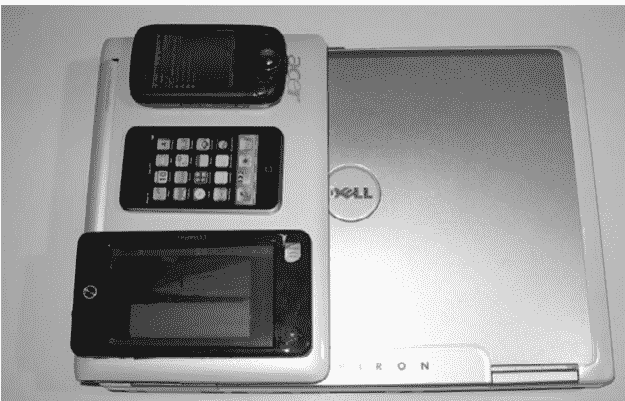

图 1-3

这台 Aspire One 安装了基于 Linux 之上构建的自定义运行环境。自 1991 年 8 月 Linus Torvalds 在 Usenet 上上传他新操作系统的前几个模块以来，Linux 已经演变成了一个健壮且顶尖的内核。

大多数基于 Linux 内核的操作系统发行版基本上都是 GNU 操作系统的修改版本。

此外，在为发行版提供强大的软件基础外，Linux 就像软件界的“瑞士军刀”。（我曾多次用它从已损坏且无法启动的计算机中恢复文件。）它被移植到大量的硬件平台，而且越来越多的供应商正在为开源和 Linux 开发驱动程序。

有数以千计的基于 Linux 的发行版可供选择——但我决定安装 Ubuntu。由此产生的系统提供了完整的互联网和计算体验。

为什么选择 Ubuntu？质量、可靠性和广泛的采用是其中的几个不错理由。Ubuntu 和 Debian 是我在 2005 年开始使用的前两个发行版，我一直坚持使用它们。

## Ubuntu 的崛起

几个月来，Ubuntu 一直处于 DistroWatch Linux 发行版列表的顶部或接近顶部。此外，它还有一个庞大的开发者社区。Canonical 公司健康（且富有）的协调提供了稳定性和重要的方向。2009 年初，《纽约时报》介绍了 Canonical 的创始人、Ubuntu 的愿景人物马克·沙特沃（Mark Shuttleworth）：

> Ubuntu 仅创建于四年前（读音为 oo-BOON-too），已成为 Ubuntu 操作系统增长最快、最受推崇的版本，它主要通过其极低的价格——50 美元与 Windows 竞争。
>
> 据估计，今天有超过 1000 万人在运行 Ubuntu，他们对微软在发达国家的霸权构成了威胁，可能在那些追赶技术革命的地区也是如此。
>
> “如果我们成功了，我们将从根本上改变操作系统市场，”沙特沃先生在 Ubuntu 开发者峰会的休息期间说道，“微软将需要适应，而我不认为那是不健康的现象。”

轻笔记本电脑（netbook）可以随拿随用。无论我在桌面级 PC 上能做什么，我在这里也能做到，虽然没那么快，但对于很多事情来说运行良好。结果是，轻笔记本电脑变成了一个全新的开发平台，但它又是一个熟悉的平台。由于移动性增加了不同的维度，其可能性要大得多。

为什么不使用 Linux 和 Ubuntu 来开启这类移动电脑类别呢？如果你这样做，你将会有优秀的同伴。想想 Linus Torvalds 在 2009 年初就想到了这一点：

> “分发是一项艰巨的工作。之所以有数百个发行版，是因为你想创建自己的很容易，但如果你想成为领导者并引入新代码，其中涉及的测试和问答是巨大的。这取决于是否有足够的用户来获得覆盖，期望过多的发行版是不现实的。Ubuntu 的增长速度非常惊人，也许这种情况会再次发生……”
>
> “我曾在轻笔记本电脑上进行内核开发，当时完全不是这样。屏幕太小了，但我们正在进入一个可以买到良好的廉价笔记本电脑的阶段。”
>
> “几年前你可以买到一个小型轻笔记本，但成本会是两倍。轻笔记本市场改变了游戏规则——它们不再被视为高管玩具，而低端笔记本电脑要健康得多。”
>
> “随着轻笔记本的出现，许多桌面电脑在缩小屏幕方面面临困难。我们有时无法按下‘确定’按钮，因为它在屏幕之外。随着屏幕变得像手机一样小，Google 的 Android 可以成为轻笔记本的容器，这样你看到 Android 在增长，而不是桌面电脑在增长。”
>
> “我们处于轻笔记本的第一阶段，存在一些阵痛问题。简化的界面是一个阵痛问题，第一批轻笔记本性能不足。”

## 矮人之臂中的巨人之力量

在第二次世界大战期间，最大的创新之一涉及雷达。英国人开发了关键的底层技术和对微波物理的基础理解，远超美国科学家的发现。英国发明的发明之一被称为“空腔磁控管”（cavity magnetron）。这种设备促成了一种轻便、紧凑、移动设备的成功开发，该设备被用于空中雷达系统，其功率比之前的任何设备都强 100 倍。英国人将其与美国共享了。当一位美国军官第一次看到它并完全理解它的用途时，他将该设备描述为“矮人之臂中的巨人之力量”。

这项发明对战术、策略和结果产生了巨大影响。这单项强大且移动的技术甚至可能改变了战争的结果。

微小、强大、高效能的处理器（如英特尔 Atom 和现在的 ARM）正与 Ubuntu 和 Linux 等多功能软件环境相结合，创造出不可想象的新未来。这些高度移动的系统蕴含着“矮人之臂中的巨人之力量”——它们现在已供数百万用户使用。

## 总结

通过阅读这本书，你正处于移动 Linux 前沿领域令人兴奋的新进展前线。你的开发工作将创造未来和新一代的改进。

# 第 2 章：开发环境

移动设备的开发过程往往不同于你在工作站或服务器上开发时可能使用的正常过程。

Linux 内核操作系统以 Linux 进程的形式出现，可以像任何其他应用程序一样管理它们。

此外，在为发行版提供强大的软件基础外，Linux 就像软件界的“瑞士军刀”。（我曾多次用它从已损坏且无法启动的计算机中恢复文件。）它被移植到大量的硬件平台，而且越来越多的供应商正在为开源和 Linux 开发驱动程序。

数以千计的基于 Linux 的发行版可供选择——但我决定安装 Ubuntu。由此产生的系统提供了完整的互联网和计算体验。

为什么选择 Ubuntu？质量、可靠性和广泛的采用是其中的几个不错理由。Ubuntu 和 Debian 是我在 2005 年开始使用的前两个发行版，我一直坚持使用它们。

移动设备的开发过程往往不同于你在工作站或服务器上开发时可能使用的正常过程。

VirtualBox 是一组虚拟机工具，允许开发者同时运行多个操作系统镜像。要查看其功能，首先安装软件：

```
$ sudo apt-get install virtualbox-ose
```


virtualbox-ose 位于 universe 仓库。启用此社区维护的软件仓库，请前往“系统 -> 软件源”并选择“universe”。安装后，可以转换之前在“开始使用”部分下载的镜像，以便在 VirtualBox 中使用。执行此操作，请运行命令（将 .img 文件名替换为你下载的文件）：

```
$ vboxmanager convertdd ubuntu-9.04-mid-lpia.img ubuntu-9.04-beta-mid-lpia.vdi
```

该命令将 `ubuntu-9.04-mid-lpia.img` 转换为 .vdi 格式，以便在 VirtualBox 中作为“硬盘”使用（后文将详细介绍）。

## 开始使用

从 `http://cdimage.ubuntu.com/releases/jaunty/release/` 下载 Jaunty Ubuntu 版本，并将其保存到硬盘上的文件夹中。

本章演示的所有技术（除 ARM 部分外）都使用 Ubuntu MID 版本，然而它们也经过了测试并与 Ubuntu Remix 版本兼容。如果你的目标是笔记本电脑，请下载此版本。

## 熟悉 Ubuntu 移动环境

本节介绍了 Ubuntu 移动环境。

xVM VirtualBox 是一组虚拟机工具，允许开发者同时运行多个操作系统镜像。要查看其功能，首先安装软件：

```
$ sudo apt-get install virtualbox-ose
```

## 第 2 章：开发环境

现在，通过选择应用程序 ⇨ 附件 ⇨ VirtualBoxOSE 来启动 VirtualBox。你将看到图 2-1 所示的界面。

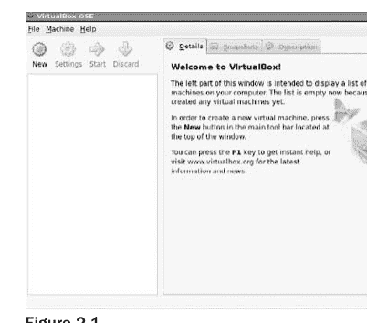

点击“新建”，启动设置向导。点击“下一步”，它将显示“虚拟机名称”和“操作系统类型”对话框。按照图 2-2 所示填写这些数据，然后点击“下一步”。

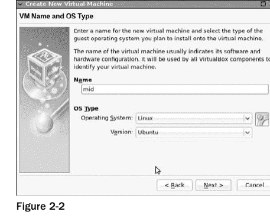

在下一个屏幕上，为你的虚拟机选择允许的最大内存量（当超过了硬件允许的最大内存量时，“下一步”按钮将无法点击）。下一个屏幕如图 2-3 所示，是用于硬盘的。

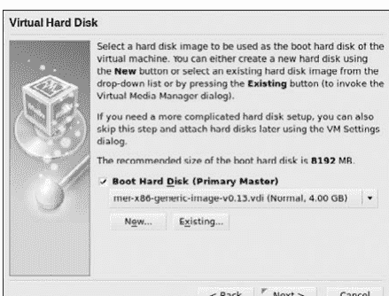

图 2-3

点击“新建”，然后点击“下一步”。选择“动态扩展”选项并点击“下一步”。磁盘镜像默认将保存在 `~/VirtualBox/HardDisks/<name>`，因此在本例中，图 2-4 所示的硬盘将保存为 `mid.vdi`，位于 `/home/ian/.VirtualBox/HardDisks` 目录。

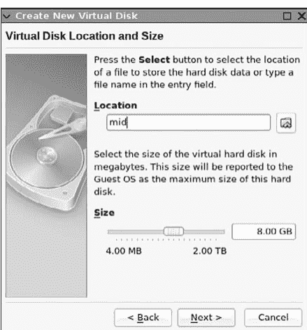

图 2-4

选择“下一步”然后点击“完成”，你应该能看到图 2-5。

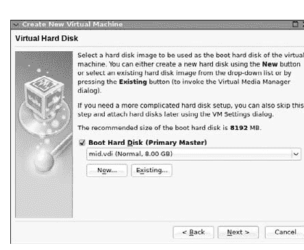

图 2-5

此主硬盘被允许使用 8GB 的空间。选择“下一步”然后点击“完成”，这将创建图 2-6 所示的新 mid 虚拟机。

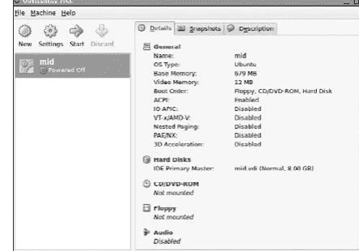

图 2-6

现在需要在此硬盘上安装 Ubuntu MID，以便进行软件的开发和测试。点击图 2-6 中的“设置”按钮，虚拟机的设置界面就会出现，如图 2-7 所示。

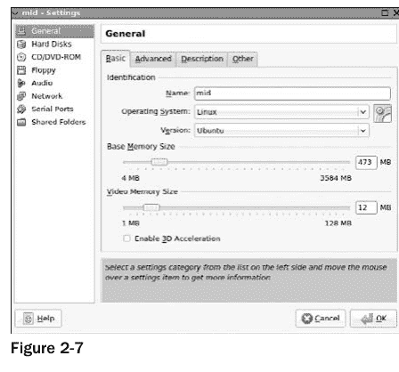

选择“硬盘”，这会弹出另一个屏幕，如图 2-8 所示。

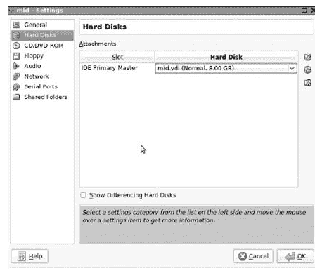

图 2-8

有必要向虚拟机中添加另一个硬盘（包含 Ubuntu MID 操作系统的硬盘）。要执行此操作，选择右侧带有加号的磁盘镜像，然后点击文件夹图标。这将显示图 2-9 所示的屏幕。

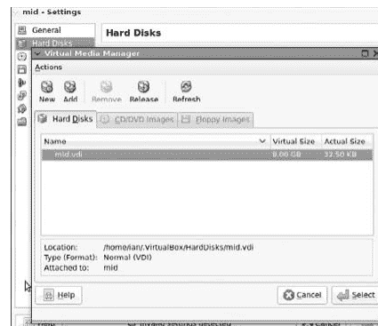

图 2-9

选择“添加”并浏览包含在本节早之前通过以下命令创建转换镜像的文件夹：

```
$ vboxman convertdd ubuntu-9.04-mid-lpia.img ubuntu-9.04-beta-mid-lpia.vdi
```

选择转换后的镜像，屏幕应该看起来像图 2-10 所示。

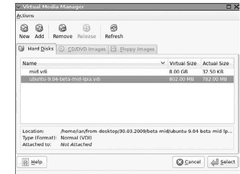

图 2-10

点击“选择”返回“硬盘”屏幕（见图 2-11）。添加的 `ubuntu-9.04-mid-beta-lpia.vdi` 必须被设置为 IDE 主从设备（IDE Primary Slave）。

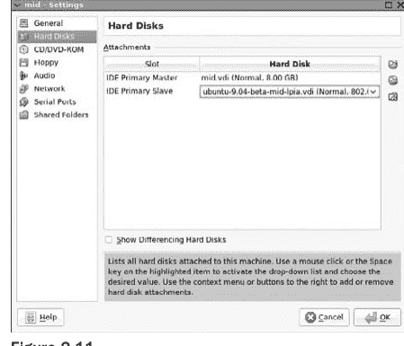

点击“确定”，你将返回到之前在图 2-6 中看到的 VirtualBox 管理界面。

现在可以通过点击“启动”箭头来启动虚拟机。

你可能会看到显示的错误，类似于图 2-12 所示。

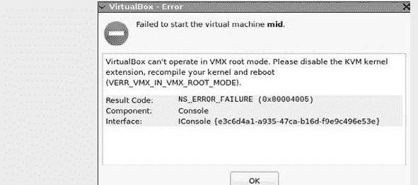

图 2-12

## ARM 开发环境

这将在文件夹中创建一个 .img 文件。从 `http://people.ubuntu/~/agra/qemu/kernel/vmlinux-2.6.28-versatile` 下载一个适用于 ARM 的内核，然后运行 `qemu-system-arm -M Versatilepb -kernel`，并将 .img 文件和内核作为参数：

```
qemu-system-arm -M Versatilepb -kernel /vmlinux-2.6.28-versatile -hda qemu-arm-200904291613.img -m 256 -append root=/dev/sda mem=256M ro
```

你需要将 .img 的名称替换为脚本创建的名称；`build-arm-roots` 脚本已经过时，因此运行它将产生类似 `qemu-arm-YYYYMMDDHMMSS.img` 的文件。

这将执行 QEMU 并允许使用创建 .img 步骤中指定的用户名和密码登录。原生架构已创建，如图 2-18 所示。


图 2-18

### 使用 KVM

如果你的硬件支持 KVM，下一步是安装必要的软件包：

- `sudo apt-get install kvm`

接下来，将你的用户添加到 kvm 组。将用户添加意味着你不需要以 root 用户运行 KVM。要执行此操作，请运行：

- `sudo adduser <username> kvm`

在添加新用户后，需要重启虚拟机。接下来，使用以下命令在 KVM 中运行 .img：

- `kvm -localtime -m 512 -boot ubuntu-04-beta.img`

要安装 Ubuntu 镜像，将遵循与 VirtualBox 相似的流程。将 .img 设置为第二个硬盘，这样你就可以将其安装在第一块磁盘上。你可能会考虑类似这样的操作：

```
kvm -localtime -m 512 -hda installed.img -hdb ubuntu-04-beta.img
```

然而，上述命令将不起作用！除了 `installed.img` 不存在之外，QEMU 和 KVM 中使用的操作系统不支持从第二个硬盘启动。作为变通办法，Ubuntu 提供了一个较小的（小于 400KB）ISO 镜像，从中可以选择第二个硬盘。这可以在 `http://people.ubuntu/~/ubuntu-dev/` 获取。

某些问题将在后面详细讨论：使用以下命令启动 KVM：

```
kvm -m 512 -cdrom isolinux.iso -hda installed.img -hdb ubuntu-04-beta.img
```

.img 命令是通过以下命令创建的：

```
qemu-img create installed.img 4G
```

4GB 代表虚拟磁盘空间。由于 `installed.img` 是空的，它将使用上述命令指定的 `-cdrom` 选项启动。选择此选项并安装到第一块磁盘（grub 也会安装在其中）。VirtualBox 安装过程本身；在虚拟机上，顶栏包含一个菜单，允许你更改显示的程序组。点击下拉菜单并选择首选项（Preferences）。点击图标进行安装。

尝试使用最大分辨率，因为 KVM 显示给客体操作系统的分辨率与主机相同。在较低的分辨率下，安装界面上的按钮会被隐藏，你可能需要移除主机上的面板才能看到它们。这在 jaunty 版本中应该会被修复。安装过程完成后重启虚拟机，KVM 将从 `installed.img` 启动。

```
kvm -localtime -m 512 -hda installed.img
```

## 网络

在 VirtualBox 和 KVM 中进行网络都需要以下命令。首先，在客体电脑上，使用之前创建的账户登录，打开终端并安装 openssh-server：

```
sudo apt-get install openssh-server
```

然后添加用户：

```
sudo adduser <username>
```

这设置了网络所需的工具。如果你希望主机和客体之间实现全网络连接，请使用“VirtualBox 和 KVM/QEMU 高级网络”部分。

### VirtualBox 中的网络

在主机上，使用 `VBoxManage` 命令打开一个用于 SSH 的 TCP 端口。然后运行：

```
VBoxManage setextradata "mid" "VBoxInternal/Devices/pcnet/0/Config/ssh/HostPort" 2222
VBoxManage setextradata "mid" "VBoxInternal/Devices/pcnet/0/Config/ssh/GuestPort" 22
VBoxManage setextradata "mid" "VBoxInternal/Devices/pcnet/0/Config/ssh/Protocol" TCP
```

上述三个命令应单独成行。`VBoxManage` 命令允许你从虚拟机获取更多信息，并允许你执行操作和配置调整。虚拟机的名称——上述示例中的 `mid`——是通过运行以下命令获得的：

```
VBoxManage list vms | grep Name
```

使用 VirtualBox 管理控制台完全关闭客体电脑。在主机电脑上输入：

```
ssh -l <username> -p 2222 localhost
```

你已经获得了对客体的 SSH 访问：

```
ssh -l <username> -p 2222 localhost
```

主机端口（在此例中为 2222）必须大于或等于 1024，因为监听低位端口需要 root 权限。

### KVM 中的网络

KVM/QEMU 的默认网络是 `usermode`（用户模式网络）。`usermode` 模式使得虚拟机表现就像在防火墙后面，但它无法访问主机。为了启用主机和客体之间的网络连接，可以像这样启动 KVM：

```
kvm -localtime -m 512 -hda installed.img
```

### VirtualBox 和 KVM/QEMU 高级网络

如果有许多虚拟机运行在主机上，需要设置桥接。首先，在主机上安装 `vde`：

```
sudo apt-get install vde
```

`vde` 是一个连接主机和客体的虚拟交换机。接下来，设置 `tap0` 接口：

```bash
auto tap0
iface tap0 inet static
address 172.120.1
netmask 255.255.255.0
```

`tap0` 是为客体开启的网络接口。现在，在主机上重启网络：

```bash
sudo /etc/init.d/networking restart
```

接下来的操作是：设置 DNS 缓存服务器。为此，编辑 `/etc/dnsmasq.conf` 文件并找到接口（第 85 行）：

```
#interface=
```

将其更改为

```
interface=tap0
```

或者你为该接口选择的任何名称。然后查找第 147 行：

```
#dhcp-range=192.168.0.50,192.168.0.150,12h
```

将其更改为

```
dhcp-range=172.12.120.100,172.12.120.150,12h
```

保存文件并重启 dnsmasq：

```bash
sudo /etc/init.d/dnsmasq restart
```

现在当你运行 `ifconfig` 时，你可以看到新的网络接口：

```
$ ifconfig
tap0
Link encap:Ethernet HWaddr:23:d3:a9:96:88:36
inet 172.12.120.1 Broadcast:172.12.120.255 Mask:255.255.255.0
inet6 fe80::d0d3:a9ff:fe6:8836/64 Scope:Link
UP RUNNING MULTICAST MTU:1500 Metric:1
RX packets:0 errors:0 dropped:0 overruns:0 frame:0
TX packets:29 errors:0 dropped:0 overruns:0 carrier:0
collisions:0 txqueuel:500
RX bytes:0 (0.0 B) TX bytes:5836 (5.8 KB)
```

有必要将你的用户名添加到主机和 `vde2-net` 组中，然后注销并重新登录：

```bash
$ sudo adduser username vde2-net
$ logout
```

### 在 VirtualBox 中使用桥接

在 VirtualBox 管理控制台中，进入虚拟机的设置并选择“网络”（Network）。适配器需要连接到已创建的 `qtap0` 接口。在下拉菜单中，选择“主机界面”（Host Interface），并在底部选项卡中选择 `qtap0`，如图 2-19 所示。

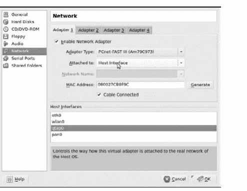

现在当虚拟机启动时，它将使用 `qtap0` 接口。可以通过查看 `/var/lib/misc/dnsmasq.leases` 找到 `dnsmasq.leases` 文件，或者在虚拟机上打开终端运行 `ifconfig` 来获取客机的 IP 地址。之后，可以像下面的示例所示 ssh 登录虚拟机：

```bash
$ ssh 172.12.12.115 -l <username>
```

可以通过以下方式从主机拷贝文件到虚拟机：

```bash
$ scp pumd.tar.gz <username>@172.12.12.115:/home/<username>/
```

现在虚拟机已经可以 ping 通主机了。

### 在 KVM 中使用桥接

为了使用此新接口，使用命令 `vdekv` 启动 KVM：

```bash
$ vdekv -localtime -m 512 -net vde,vlan=0 \
-net nic,model=rt18139,vlan=0,macaddr=00:16:3e:12:34:56 -hda installed-mid.img
```

上述命令中的 `macaddr` 可以任意 MAC 地址；这里只是一个示例地址。

当只使用一台虚拟机时，没有必要指定 MAC 地址。但对于多台虚拟机，这变得至关重要。建议从 `00:16:3e:xx:xx:xx` 范围内选择地址，因为该范围已分配给虚拟化。

若要在 qEMU 中该接口，请使用以下命令：


```bash
$ vdegemu -kqemu -hda installed-mid.img \
-net nic,vlan=0,socket=/var/run/vde2/gtap0ctl -net nic,model=rt18139,vlan=0,macaddr=52:54:00:12:34:56 -m 1024 -no-acpi
```

在主机上：

```bash
$ ssh 172.120.120.115 -l <username>
```

来 ssh 登录虚拟机。上面的 IP 仅为一个示例。

可以通过以下方式拷贝文件：

```bash
$ scp pumd.tar.gz <username>@172.120.120.1:/home/<username>/
```

现在虚拟机已经可以 ping 通主机了。

### 虚拟机与主机之间的文件共享

如果你遵循了“VirtualBox 中的网络”或“KVM/QEMU 中的网络”章节中的简单网络步骤，可以通过输入以下命令从主机电脑拷贝文件到虚拟机电脑：

```bash
$ scp -P 2222 <file> username@localhost:/home/<username>/
```

此外，也可以使用 `sshfs` 拷贝文件。这通过在主机上安装 `sshfs` 实现：

```bash
$ sudo apt-get install sshfs
```

然后在主机上运行命令：

```bash
$ sshfs -p 2222 username@localhost:/home/<username>/
```

如果你想自动挂载用户目录，可以在 `/etc/fstab` 中添加以下行：

```text
sshfs#username@localhost:/home/<username> /media/guest-home fuse,noauto 0
```

将当前主机的用户添加到 `fuse` 组：

```bash
$ adduser <username> fuse
```

注销并重新登录以应用更改。现在你可以通过以下命令挂载虚拟机的家目录：

```bash
$ mount /media/guest-home
```

现在文件可以在主机和虚拟机之间相互拷贝，反之亦然。本节提到的所有内容对于简单网络均有效。如果你遵循了“VirtualBox 和 KVM/QEMU 中的高级网络”章节的说明，则需要不同的步骤。

### 高级网络下的虚拟机与主机文件共享

如果你想使用 `scp` 从虚拟机拷贝文件到主机：

```bash
$ scp <file> username@172.12.0.1:/home/<username>/
```

若要从主机拷贝文件，首先获取客机的 IP 地址，然后在主机上运行示例：

```bash
$ scp <file> username@172.12.0.100:/home/<username>/
```

上述 `sshfs` 方案在高级网络下同样有效。首先在主机上安装 `sshfs`：

```bash
$ sudo apt-get install sshfs
```

然后在主机上运行命令：

```bash
$ sshfs -p 2222 username@localhost:/home/<username>/
```

## 第2章：开发环境

- `livecd.ubuntu-mid.sort`
- `livecd.ubuntu-mid.squashfs`
- `livecd.ubuntu-mid.initrd`
- `livecd.ubuntu-mid.initrd-lpia`
- `livecd.ubuntu-mid.kernel`
- `livecd.ubuntu-mid.kernel-lpia`

现在可以使用 `mobile-scripts` 中的脚本之一（`create-image.sh`）来实际创建镜像。

请确保该脚本与上述文件位于同一个文件夹中，并且已设置了可执行权限：

```bash
$ chmod +x create-image.sh
$ ./create-image.sh ubuntu-mid 40
```

其中 `ubuntu-mid` (LPIA) 是要构建的发行版，`40` 是分配在镜像中的额外空间（MB），用于安装额外的包和其他可能需要的其他自定义设置。

`edit_squashfs.sh` 脚本（下所示）也可以更改镜像的大小。

现在可以在 KVM/QEMU 中测试构建好的镜像：

```bash
$ kvm -localtime -m 512 -hda ubuntu-mid.img
```

### 在镜像内安装应用程序

`mobile-scripts` 中的 `edit_squashfs.sh` 会在上一节构建的镜像内部启动一个 root shell。可以在其中运行 `apt-get update` 并安装包。当通过 `Ctrl+D` 或 `exit` 命令退出 shell 时，脚本将提议为你重新生成 squashfs。

该脚本的使用方法如下：

```bash
$ sudo ./edit_squashfs.sh ubuntu-mid.img
```

在 chroot 环境内部退出时运行 `apt-get clean` 是一个好主意，可以清理 `/var/cache/apt/archives` 目录中的空间。事实上，前面的脚本已经这样做。这是因为空间非常宝贵。另一个主意是安装 `deborphan` 或 `gtkorphan` 以移除占用空间的未使用包和库（`apt-get install deborphan`）。

用于安装新应用程序/包的可用空间是在 `create-image.sh` 命令中指定的（40MB）。如果需要增加空间，请使用后续讨论的 `grow_image.sh` 脚本。

### 增大下载镜像的大小

要增大下载镜像的大小（可能是为了安装更多应用程序），请使用 `grow_image.sh` 脚本。

创建此脚本是为了满足一种潜在情况，即 OEM 想要修改设备上的应用程序可能还有主题，但不想修改内核或种子（seeds）。

> 种子将在第 11 章中进行详细讨论。

你可以像这样使用该脚本：

```bash
$ ./grow_image.sh ubuntu-mid.img 50
```

这会创建一个指定大小（50MB）的新镜像，然后可以对该镜像运行 `edit_squashfs.sh` 脚本以进行必要的更改，然后重新生成镜像。

## 总结

移动开发可能具有挑战性。你需要使用工作站为可能具有不同处理器的设备进行开发，例如 Ubuntu ARM 或不同的操作系统。

创建一个镜像（或从存档中下载镜像）然后在 VirtualBox 或 KVM/QEMU 中运行它，将提供一个隔离的环境。该环境随后可以用于软件开发、软件测试或应用程序打包。

## 第3章：电源管理

移动设备现在配备了摄像头、各种无线电发射器、高级多媒体和其他功能——所有这些都会消耗大量的电。同时，利用这些功能的耗能应用程序也在不断增加。此外，用户对电池续能力的需求似乎呈指数级增长。因为在离开电源的情况下，六小时的电池续航现在被认为是绝对最低需求，所以作为开发者，尝试尽可能地节约能量至关重要。

用户控制其移动设备的功耗正变得越来越重要。用户不仅应该能够指定功耗，还应该能够在他们选择时覆盖系统默认设置。

本章解释了 Ubuntu Mobile 上可用于电源管理的各种工具和包。它包含了基于 HAL 的现有工具以及基于 DeviceKit-power 的较新工具。本章还展示了多次电源测试的结果，并建议了增加移动设备电池寿命的技术。

### 引言

基于 PC 的芯片在 Linux 中已经有了成熟的代码库，并有 ACPI 和 HAL 等现有硬件接口；随着它们从桌面演变为更小的设备，创建了许多软件包来优化电源。这些软件包中的每一个都可以被视为 Linux 平台上特定子系统的电源微策略控制器。例如，`cpufreq` 管理 CPU 子系统的电源，而 `iwconfig` 接口管理网络（WLAN）子系统的特定设备电源。

如果有一个中央方法来管理电源信息就好了。从 Ubuntu Jaunty 开始，有一个可以从 universe 仓库安装的新守护进程，它提供此类服务。它将电源管理和性能分析移动到一个更关注整个电源管理系统的接口，这比之前的任何事物都要专注。它被称为 DeviceKit-power，可以通过 D-Bus 接口 `freedesktop.DeviceKit.Power` 访问。

更多关于 D-Bus 的信息，请参阅第 4 章。

### 省电状态

常见的电源（节能）状态有唤醒（awake）、待机（standby）、挂起（suspend）和休眠（hibernate）：

- 在唤醒期间，设备的所有组件都在运行。
- 在待机期间，CPU 保持运行，但某些组件（如硬盘）可能会关闭。
- 在挂起期间，设备的大部分都已关闭，RAM 除外。
- 在休眠期间，系统状态被保存到磁盘，设备完全关闭，可能保留一个极低功耗状态——例如网卡，以支持网络唤醒。
- 混合休眠（Hybrid-suspend）首先将系统状态保存到磁盘，类似于休眠，但不是关闭，而是进入挂起状态，这意味着它比普通的休眠恢复更快。相比于挂起，它的优势是即使在电量耗的情况下也能恢复。

### 电源管理包

Ubuntu 默认自带的另一个包是 `pm-utils`，用于控制电源状态。它提供了 `pm-action`、`pm-hibernate`、`pm-suspend` 和 `pm-suspend-hybrid` 命令。允许软件触发电源管理事件。这些命令通常由硬件抽象进程（hald）在程序触发时调用。从命令行调用它们也是可能的，但不能保证所有程序都能按预期工作。

#### pm-suspend

挂起是一种设备大部分都已关闭但 RAM 仍运行的状态。在这种状态下，设备仍在消耗能量。

可以使用如下命令通过 `pm-suspend` 让设备进入睡眠模式：

```bash
$ pm-suspend --quirk-vbestate-restore
```

在实际设备上的测试显示这可能非常慢。`pm-utils` 运行睡眠的实际脚本可以在 `/usr/lib/pm-utils/sleep.d/` 中找到。那里的许多脚本是内核中正在修复问题的解决方案。

> 始终确保内核已更新，或者运行自定义内核。详情请参阅第 8 章。

#### pm-hibernate

在休眠期间，系统状态被保存到磁盘，且系统完全关闭，可能保留一个极低功耗状态——例如网卡，以支持网络唤醒。

#### pm-suspend-hybrid

混合休眠是指首先将系统状态保存到磁盘——类似于休眠，但不是关闭，而是进入挂起状态，这意味着它比普通的休眠恢复更快。相比于挂起，它的优势是即使在电量耗的情况下也能恢复。

你还可以设置设备进入高功耗和低功耗模式；使用 `pm-powersave` 命令配合额外的 `true` 或 `false` 参数。它的工作原理与挂起框架基本相同。

要执行此操作，请使用以下命令：

```bash
$ sudo pm-powersave true
```

接后的“pmi action”部分解释了如何在不需要 root 权限的情况下挂起或休眠 ubuntu-mobile 设备。

#### pmi action

在 universe 仓库中有一个名为 `powermanagement-interface` 的软件包。它在 `acl` 之上提供了一个抽象层。使用该工具包的主要优势是可以在不需要 root 权限的情况下挂起或休眠移动设备。

```bash
$ sudo apt-get install powermanagement-interface
```

通过以下命令直接调用电源管理接口：

休眠（hibernate）：

```bash
$ /usr/sbin/pmi action hibernate
```

挂起（suspend）：

```bash
$ /usr/sbin/pmi action suspend
```

要锁定 Gnome 会话（即在恢复时需要密码），请在执行 pmi 命令之前执行以下命令：

```bash
$ gnome-screensaver-command -lock
```

例如，可以使用这些命令在 Ubuntu Remix 上创建一个应用程序入口，该程序可以锁定屏幕并将设备进入睡眠模式。

首先，创建一个包含以下内容的文件：

```text
gnome-screensaver-command -lock; pmi action suspend
```

然后使用您的命令使该文件具有执行权限：

```bash
$ chmod +x <file>
```

进入偏好 ↔ 主菜单 ↔ 偏好 ↔ 新项目。在表单中输入 `Application in Terminal`，并将文件命名为 `Lock and Suspend`。选择已创建的文件。点击该图标将锁定并挂起设备。

#### pm-utils 的工作原理

主脚本 (`pm-action`) 通过符号链接以 `pm-suspend`、`pm-hibernate` 或 `pm-sus-hybrid` 脚本的形式按字母顺序执行钩子（hook），根据指令传递参数 `suspend`（挂起到内存）或 `hibernate`（挂起到磁盘）。一旦所有脚本完成，设备将进入睡眠。

机器唤醒后，所有钩子脚本将反向执行，并根据指令传递参数 `resume`（从内存恢复）或 `thaw`（从磁盘恢复）。

> 注意，`suspend-hybrid` 目前是一个占位符，尚未完全实现。

钩子会执行各种操作，例如准备引导程序或停止蓝牙子系统。

挂起钩子存于以下位置：

- `/usr/lib/pm-utils/sleep.d`
- `/etc/pm/sleep.d`

电源状态钩子存于以下位置：

- `/usr/lib/pm-utils/power.d`
- `/etc/pm/power.d`

`/etc/pm/` 中的钩子优先级高于 `/usr/lib/pm-utils/` 中的钩子，因此开发者可以覆盖默认设置。

一个蓝牙的挂起/恢复脚本示例名为 `49bluetooth`，位于 `/usr/lib/pm-utils/sleep.d/`，内容所示：

```bash
$($PM_FUNCTIONS) 

[-f /proc/acpi/ibm/bluetooth ] || exit $NA

suspend_bluetooth()
{
	if grep -q enabled /proc/acpi/ibm/bluetooth; then
	savestate ibm_bluetooth enable
	echo disable > /proc/acpi/ibm/bluetooth
	else
	savestate ibm_bluetooth disable

}

resume_bluetooth()
{
	state_exists ibm_bluetooth || return
	restorestate ibm_bluetooth > /proc/acpi/ibm/bluetooth

}
case "$1" in
	hibernate|suspend)
	suspend_bluetooth
	\;
	aw|resume)
	resume_bluetooth
	\;
*) exit $NA
	;
esac
```

### Gnome-Power-Manager

Gnome-Power-Manager 是一个带有图形用户界面的程序，它订阅电源事件并对其采取操作。例如，它可以显示笔记本电脑的电池状态，并在电池供电运行时调暗屏幕。它会在电池电量耗尽时进入休眠状态。

### DeviceKit-power 与 QoS

在另一个终端窗口中传递 200 微秒的延迟请求（这对于即时通讯应用来说似乎是合理的）：

```bash
$ dbus-send --print-reply --system --dest=org.freedesktop.DeviceKit.Power \
org/freedesktop/DeviceKit/Power/Policy \
org.freedesktop.DeviceKit.Power.QoSLatency string:"network" int32:200 \
boolean:false
```

输出为：

```text
TI:15:03:48 TI:0x8d4dadf8 FI:dkp-qos.c FN:dkp_qos_request_latency.326
- Received Qos from ':1.140' (200:1) saving as #152452718
TI:15:03:48 TI:0x8d4dadf8 FI:dkp-qos.c FN:dkp_qos_latency_write.180
```

当 IM 应用与系统总线断开时，延迟请求会自动清理（即 `persistent-False` 设置）。当应用程序断开连接时，请求不会被清理（cookie 值在设备重启期间保持保留）。

### 控制无线电发射器

对各种无线连接进行持续轮询会消耗大量功率。

为了限制这一点，设备制造商实施了各种技术。在像 Nokia N810 等设备上，所有网络连接都通过连接跟踪器（connection tracker）路由。这使得可以在应用程序尝试访问网络之前禁用网络，此时可以建立新的连接。电源省电轮询协议（PS-Poll）有效并有助于减少耗时。

PS-Poll 并不是一直开启无线电，而是允许 WiFi 适配器在关电时通知访问点。在无线电关电期间，访问点将持有任何需要发送给它的网络包。

网络延迟会随着 PS-Poll 而增加。这在浏览网页时通常察觉不到，但在对低延迟重要的情况下（例如游戏、视频和媒体流传输），PS-Poll 可能不是最佳解决方案。

PS-Poll 主要适用于使用 `ipw2100/ipw2200` 驱动或较新的 `iwl3945/iwl4965` 驱动的无线卡。要在 `ipw2100/ipw2200` 卡上设置 PS-Poll 执行以下操作：

```bash
iwpriv wlan0 set_power 5
```

其中 `wlan0` 是网络适配器的接口名称。`iwpriv` 命令中的数字 `5` 是启用省电模式的程度：

- 5 是最大数字。
- 6 再次禁用省电功能，如下：

```bash
iwpriv eth0 set_power 6
```

`iwl3945/iwl4965` 驱动依赖内核来配置无线子系统。存在一种机制，通过 sysfs 属性 `power_level` 手动配置 PS-Poll，例如：


```
echo 5 > /sys/bus/pci/drivers/iwl4965*/power_level
```

根据适配器情况将 `iwl3945` 替换为 `iwl4965`。

## RFKILL

由于在某些情况下（例如飞行期间）WiFi 无线电完全不会使用，因此完全关闭 WiFi 是很有意义的。

执行此操作，请运行以下命令：

```
for i in `sys -name "rf_kill" ; do echo 1 > $i ; done
```

要重新开启无线电，在 shell 中运行：

```
for i in `sys -name "rf_kill" ; do echo 0 > $i ; done
```

如果 OEM 能为此功能添加一个应用程序，那就太棒了。

请参第 4 章关于如何编写应用程序的示例。

## 蓝牙

像 WiFi 一样，蓝牙有一个无线电发射器，因此会消耗一些功率。与 WiFi 不同，蓝牙很少被使用，因此很有可能蓝牙设备实际上并没有用于任何地方，只是在消耗电池寿命。

这是一个根据需要开启/关闭蓝牙的脚本：

```bash
#!/bin/bash
if ps -A | grep -c bluetoothd
then
  sudo systemctl stop bluetooth
else
  sudo systemctl start bluetooth
fi
```

## 第3章：电源管理

### 电池监控器

已用时间：60 分钟 - 空闲


图 3-2

在同一台 Acer 笔记本电脑上，安装了 Ubuntu MID 并进行了相同的一小时测试。这是 Ubuntu MID 的输出：

+   电池统计数据：

低值：9919.00 毫瓦

高值：13162.00 毫瓦

平均值：10401.40 毫瓦

结果如图 3-3 所示。

### 电源监控器

已用时间：60 分钟 - 空闲


图 3-3

上述测试的传感器图保存存在以下默认位置：

`~/phoronix-test-suite/module-files/system-monitor/`

结果显示，基于 LPIA 的 Ubuntu MID 电源效率比 i386 的 Ubuntu Netbook Remix 高出 11.7%。依赖此测试结果的问题在于它并不是在对比相似的对象。如果能在 LPIA 上运行 Ubuntu Netbook Remix 并将其与 i386 版本进行比较，那就好了。

## 同类项比较

首先，在 Acer 上安装了 Ubuntu MID，然后在终端中执行：

```
$ sudo apt-get install ubuntu-netbook-remix-default-settings ubuntu-netbook-remix
```

接下来，移除了 MID 设置以便可以使用 Netbook Remix 界面：

```
$ sudo apt-get remove-purge ubuntu-mid-default-settings
```

最后，再次运行测试。结果如下：

电源电池统计数据：

低值：10250.00 毫瓦

高值：13111.00 毫瓦

平均值：10772.64 毫瓦

结果如图 3-4 所示。


这些结果显示，LPIA 版本的 Ubuntu Netbook Remix 电源效率比 i386 版本高出 8.55%。

另一个值得注意的有趣点是，LPIA Ubuntu MID 版本比 LPIA 版本的 Ubuntu Netbook Remix 效率高 3.44%。这可能归因于 Ubuntu Netbook Remix 使用标准的 Firefox，而 LPIA 版 Ubuntu MID 使用了 midbrowser（使用 LPIA 标志编译的 Firefox）。

## 总结

电源管理是便携式电脑上一项至关重要的工作。电源管理的核心在于理解如何有效优化每个系统组件的能量消耗。这需要研究系统执行的不同任务，并配置每个组件以确保其性能恰好满足需求。

这是一个具有大量研究的领域，良好的技术和创新的解决方案可以对 OEM 的利润产生直接影响。消费者希望有更长的续航时间，并且愿意为此付费。


## 第4章：应用开发

本章的意图不是展示如何使用任何特定语言编程，或如何使用任何特定工具包。相反，目的是通过示例展示如何开发小型、实用的应用来演示核心概念和技术。我们认为，当需要开发更复杂的应用时，这种方法对开发者是有用的。

正如《Debian 新维护者指南》作者所说，我们相信这句拉丁语：“Longum iter est per pracepta, breve et effica per!”（遵循规则道路漫漫，但通过示例则简洁且高效！）本章及整本书都遵循了这一建议。

移动设备、平板电脑和笔记本电脑需要一种桌面框架，能够创建外观和感觉一致的应用，并在移动设备的受限资源上运行。此外，应用程序应针对触屏使用进行设计。所有这些因素都给开发者带来了挑战。

本章首先讨论了小尺寸设备上应用程序的设计和布局问题。随后查看了 GTK，这是一个构建图形化应用的工具包，并简要讨论了可以在移动和嵌入领域使用的其他工具包，如 EFL。在 GNOME Mobile 的背景下，有两个主要的应用程序框架：Hildon 和 Clutter，并为每个框架都提供了示例应用。现在展示 D-Bus 的使用，这种技术对于进程间通信至关重要，也是 Ubuntu 新通知系统的关键。

最后，将本章到目前为止的所有概念整合到一个应用中，该应用演示了开发者为了在 Ubuntu Mobile 上高效工作而需要的许多关键技术。

## Ubuntu Mobile 发布

Ubuntu Mobile 团队发布的 Jaunty 主要版本有 Ubuntu MID 和 Ubuntu Netbook Remix。对于 karmic，MID 版本将由社区维护。将有一个 Moblin 的混合版 Moblin Remix。

[注：原文在此部分存在大量重复和混乱的短语]

如果仓库中没有所需的功能，可能需要开发应用程序。除了遵循用户驱动的开发流程和选择开发方法（强烈建议使用 Scrum）之外，在移动设备上开发时还有其他考虑因素。

## 创建新应用

OEM 希望开箱即可对界面进行深度自定义。

错误消息在发生问题时会向用户建议操作方案。本章稍后部分将讨论新的 Jaunty 通知系统。

### 与触摸屏交互时

需要注意的是，对于手指驱动的 UI，最小按钮尺寸应取决于真实的像素密度，而不是屏幕分辨率。像素密度是衡量各种场景下设备分辨率的度量，程序 `xdpyninfo` 可以提供这一衡量标准。在 MID 机器上运行以下命令：

```
$ xdpyninfo | grep resolution
```

将得到以下使用的分辨率：

```
resolution: 96x96 dots per inch
```

## 自由桌面标准 (Free Desktop Standards)

文件需要放置在文件系统的特定位置，以便操作系统发现、展示并启动应用程序。在 Ubuntu 上，这些文件的放置符合 freedktop.org 标准。这些是针对 X Windows 上项目互操作性的一系列规范。

开发者需要考虑的最标准有：

### 桌面条目规范 (Desktop Entry Specification)

这是一个扩展名为 `.desktop` 的 UTF-8 编码文件，包含一个名为 Desktop Entry 的组头和若干 `Key=Value` 格式的条目。该文件中的 REQUIRED（必须）键有：

- Type – 可 Application（应用程序）或 Directory（目录）
- Name – 应用程序名称
- Exec – 要执行的应用程序
- (URL) – 如果 Type（上文）设置为 Link（链接），则必须填写

`Exec` 键必须包含一个要执行的命令，可以是执行文件本身的完整路径，或者如果在 `$PATH` 环境变量可以找到，只需提供名称。

Ubuntu 上的 `$PATH` 变量默认值为：

```
/usr/local/bin:/usr/local/bin:/usr/bin:/usr/bin:/bin:/usr/games:
```

也可以在命令行上添加特殊符号，这些符号将在程序执行时被扩展。例如，要向位于 `/usr/bin` 目录下的二进制文件传递 URL，Exec 键将如下：

```
Exec=%u
```

文件中包含了要显示的图标文件名，以及应用程序菜单中的名称（如果有）（Icon 键）。以下是本章稍后讨论的 Hello-World.desktop 文件示例：

```
[Desktop Entry]
Encoding=UTF-8
Name=Hello-World
Comment=Introduction to Hildon Applications
Icon=hello.png
StartupNotify=true
Terminal=false
X-MultipleArgs=false
Type=Application
Categories=Other
```

如果 autostart 目录下存在桌面文件，应用程序将自动启动。此项系统设置（变量 `$XDG_CONFIG_DIRS`）默认为 `/etc/xdg/autostart/`。用户设置（变量 `$XDG_CONFIG_HOME`）默认为 `~/.config/autostart/`。将在用户登录后启动。

### XDG 基础目录规范 (XDG Base Directory Specification)

该规范规定了文件在基础目录中的位置。用户数据的基础目录由环境变量 `$XDG_DATA_HOME` 指定，用户配置文件的由环境变量 `$XDG_CONFIG_HOME` 指定。`$XDG_DATA_HOME` 的默认值为 `~/.local/share`，`$XDG_CONFIG_HOME` 的默认值为 `~/.config`。

同样，环境变量 `$XDG_CONFIG_DIRS` 指定了搜索配置文件的相对目录顺序。该规范定义了用于搜索数据的相对目录 `$XDG_DATA_DIRS`，以及用于缓存基础数据的相对目录 `$XDG_CACHE_HOME`。

### 桌面菜单规范 (Desktop Menu Specification)

可以被认为是一个扩展名为 `.menu` 的 XML 文件，它定义了菜单项（`.desktop` 文件）的布局以及这些项是否应该显示在菜单中。XML 文件默认位于：

```
$XDG_CONFIG_DIRS/menu/applications.menu
```

变量 `$XDG_MENU_PREFIX` 允许用户菜单与系统菜单合并。`.desktop` 文件位于 `$XDG_DATA_DIRS/applications/`。此规范增加了字段 `Categories`、`OnlyShowIn` 和 `NotShowIn`。`Categories` 用于分组菜单项，`OnlyShowIn` 用于让项仅在特定环境中出现，而 `NotShowIn` 则反之。

除了了解这些规范，在开发应用程序时了解哪些框架也是重要的。

## Hildon：手持设备的应用程序框架

Hildon 框架设计用于小型设备并已广泛应用于这种形式。该框架得到了 Nokia 的支持，并针对 Mobile 扩展以更好地支持手笔使用和高密度显示。基础技术如 GTK 和 GConf 配置系统将在书中稍后讨论。

Hildon 与传统桌面相比的一个显著之处在于基于 CORBA 的技术。

### 代码层面的 Hildon 是什么

`HildonProgram` 是代表整个应用程序的对象。在此上下文中，需要注意 `HildonProgram` 不是 `GtkWidget`。每个进程创建一个 `HildonProgram`。通过 `hildon_program_add_window()` 将 `HildonWindows` 注册。以下 C 代码强调了与框架工作时可用的一些关键概念和功能。

### 创建程序

代码如下：

```c
/* 启动容器和窗口 */
HildonProgram *program;
HildonWindow *window;
/* 启动 GTK */
gtk_init(&argc, &argv);
/* 创建 Hildon 程序 */
program = hildon_program_get_instance();
```

### 菜单

菜单使用 `GtkMenu` 外部创建，然后通过 `hildon_window_set_menu()` 添加到 `HildonWindow`。示例如下：

```c
GtkMenu *menu;
menu = gtk_menu_new();
fill_in_menu(menu);
hildon_window_set_menu(menu);
```

### 工具栏

工具栏通过调用 `hildon_window_add_toolbar()` 创建。

```c
GtkToolbar *toolbar;
toolbar = create_toolbar();
/* 添加工具栏 */
hildon_window_add_toolbar(window, toolbar);
```

### 窗口特定设置

窗口特定命令可以发送到窗口管理器和任务导航。应用程序可以告诉任务导航某些窗口需要用户注意。这将触发窗口闪烁。如下所示：

```c
gtk_window_urgency_hint(GTK_WINDOW, TRUE);
```

同样，使用 `gtk_window_set_icon` 在导航中更改图标。以下代码演示了这一点：

```c
GdkPixbuf *icon = create_icon();
gtk_window_set_icon(GTK_WINDOW, icon);
```

此外，可以使用设置标题：

```c
gtk_window_set_title(GTK_WINDOW, "Window Title");
```

### 程序级设置

`HildonProgram` 对象允许程序员为所有窗口设置程序级设置。开发者可以创建一个所有窗口共享内存的通用菜单。窗口可以通过拥有自己的菜单来覆盖此通用菜单。以下代码演示了这一点：

```c
GtkMenu *common_menu = create_common_menu();
GtkMenu *window_specific_menu = create_window_menu();

hildon_program_set_common_menu(program, common_menu);

hildon_window_set_menu(second_window, window_specific_menu);
```

同样，所有 `HildonWindows` 可以共享一个通用工具栏。窗口也可以添加窗口特定的工具栏。工具栏将显示在工具栏栈的底部。以下代码演示了这一点：

```c
GtkToolbar *common_toolbar = create_common_toolbar();
GtkToolbar *window_specific_toolbar = create_window_toolbar();
hildon_program_set_common_toolbar(program, common_toolbar);
window_add_toolbar(second_window, window_specific_toolbar);
```

### 休眠

程序员可以通过调用 `set_can_hibernate()` 告诉 Hildon 任务导航应用程序是否准备好休眠（后台杀死）。

## 整合

以下程序将从零开始构建程序，以展示符合 Hildon 框架的应用程序组成。

### Hello World

Hello World 也就是……一个 hello world 程序。它是一个带有应用程序图标和桌面文件的简单 C 程序。

首先，创建模板化的 Hildon 代码。

#### 源代码

源代码如下：

```c
#include <hildon/hildon-program.h>
#include <hildon/hildon-window.h>
#include <gtk/gtkmain.h>

int main(int argc, char *argv[])
{
    HildonProgram *program;
    HildonWindow *window;
    GtkWidget *label;

    gtk_init(&argc, &argv);

    program = hildon_program_get_instance();
    window = HILDON_WINDOW(hildon_window_new());
    hildon_program_add_window(program, window);
    g_set_application_name("Hello World");
    label = gtk_label_new("Hello World");
    gtk_container_add(GTK_CONTAINER(window), label);
    gtk_widget_show_all(GTK_WIDGET(window));
    g_signal_connect(G_OBJECT(window), "delete_event", G_CALLBACK(gtk_main_quit), NULL);
    gtk_main();
}
```

将代码保存为 `hello-world.c` 并确保你已经安装了 `build-essential`、`libgtk2.0-dev` 和 `libhildon-dev`。使用以下命令安装二进制文件：


## 编译与运行

```bash
gcc -o hello-world hello-world.c $(pkg-config --cflags --libs gtk+-2.0 hildon-1)
```

编译后，运行 `hello-world`。

## 输出

应用程序运行并显示如图 4-2 所示的界面。


图 4-2：Hello World

## 菜单

现在创建一个标准的 `GtkMenu` 并将其附加到 `HildonWindow`。要实现这一点，请创建一个如下的 `attach_menu` 函数：

```c
static void attach_menu(HildonWindow *window)
{
    GtkWidget *menu;
    GtkWidget *item_quit;
    if (NULL == window)
        return;
    menu = gtk_menu_new();
    item_quit = gtk_menu_item_new_with_label("Quit");
    gtk_menu_append(menu, item_quit);
    hildon_window_set_menu(window, GTK_MENU(menu));
    gtk_widget_show_all(GTK_WIDGET(menu));
}
```

将此函数加入 `world.c` 并在显示窗口之前调用它：

```c
attach_menu(window);
gtk_widget_show_all(GTK_WIDGET(window));
```

菜单看起来如图 4-3 所示。


图 4-3

## 工具栏

最后，创建一个 `attach_toolbar` 函数，将工具栏附加到 `HildonWindow`：

```c
static void attach_toolbar(HildonWindow *window)
{
    GtkWidget *toolbar;
    GtkToolItem *item_quit;
    if (NULL == window)
        return;
    toolbar = gtk_toolbar_new();
    item_quit = gtk_tool_button_new_from_stock(GTK_STOCK_QUIT);
    gtk_toolbar_insert(GTK_TOOLBAR(toolbar), item_quit, -1);
    hildon_window_add_toolbar(window, GTK_TOOLBAR(toolbar));
}
```

将此内容添加到源码，并在之前创建的 `attach_menu()` 函数之后调用它：

```c
attach_menu(window);
attach_toolbar(window);
```

工具栏看起来如图 4-4 所示。


图 4-4

## 最终源码

```c
#include <hildon/hildon-program.h>
#include <hildon/hildon-window.h>
#include <gtk/gtkmain.h>

static void attach_menu(HildonWindow *window)
{
    GtkWidget *menu;
    GtkWidget *item_quit;
    if (NULL == window)
        return;

    menu = gtk_menu_new();
    item_quit = gtk_menu_item_new_with_label("Quit");
    gtk_menu_append(menu, item_quit);
    hildon_window_set_menu(window, GTK_MENU(menu));
    gtk_widget_show_all(GTK_WIDGET(menu));
}

static void attach_toolbar(HildonWindow *window)
{
    GtkWidget *toolbar;
    GtkToolItem *item_quit;
    if (NULL == window)
        return;
    toolbar = gtk_toolbar_new();
    item_quit = gtk_tool_button_new_from_stock(GTK_STOCK_QUIT);
    gtk_toolbar_insert(GTK_TOOLBAR(toolbar), item_quit, -1);
    hildon_window_add_toolbar(window, GTK_TOOLBAR(toolbar));
}

int main(int argc, char *argv[])
{
    HildonProgram *program;
    HildonWindow *window;
    GtkWidget *label;
    gtk_init(&argc, &argv);
    program = hildon_program_get_instance();
    window = HILDON_WINDOW(hildon_window_new());
    hildon_program_add_window(program, window);
    label = gtk_label_new("Hello World");
    gtk_container_add(GTK_CONTAINER(window), label);
    attach_menu(window);
    attach_toolbar(window);
    gtk_widget_show_all(GTK_WIDGET(window));
    g_signal_connect(G_OBJECT(window), "delete_event", G_CALLBACK(gtk_main_quit), NULL);
    gtk_main();
    return 0;
}
```

## 再次编译与安装

再次运行编译：

```bash
gcc -o hello-world hello-world.c $(pkg-config --cflags --libs gtk+-2.0 hildon-1)
```

将二进制文件移动到 `/usr/bin`，并将 `.desktop` 文件添加到 `/usr/share/applications`。`hello-world` 的 `.desktop` 文件如下：

```
[Desktop Entry]
Encoding=UTF-8
Name=Hello World
Comment=Introduction to Hildon
Exec=hello-world
Icon=hello.png
StartupNotify=true
Terminal=false
Type=Application
```

创建一个 48×48 的图标并保存为 `hello.png`。将应用程序图标放在 `/usr/share/icons/hicolor/48x48/`。`.desktop` 文件和图标必须具有读取权限。代码在桌面上显示图标，如图 4-5 所示。


图 4-5

点击图标时会执行应用程序。如果新应用程序为没有触摸屏的设备编写并运行在 Ubuntu，可以使用 GTK 作为框架。`GTK+` 是一个旨在使用标准接口开发应用程序的工具包。它最初是为 GIMP 创建的（GIMP Toolkit），但它的用途远不止 GIMP，已应用于各种可能的 GUI。`GTK` 环境通过引入事件循环来处理用户请求（用户提供的各种按键和鼠标点击），并提供了一组在接收到指令时采取的操作函数：当程序运行时，会设置处理函数并启动循环，直到处理“退出”事件（例如，下拉菜单并选择“退出”）。

# 第 4 章：应用开发

## 信号

通过为任何特定输出（控件）附加“回调”函数来处理信号。例如，在创建一个按钮后：

```c
button = gtk_button_new();
```

可以通过调用以下代码设置按下按钮时触发的回调函数：

```c
g_signal_connect(button, "clicked", NULL);
```

这会将按钮的“点击”信号连接到回调。

信号的使用也可以在本章节后后的“整合概念”部分看到。下方代码的前两行连接到状态图标，并创建了驱动挂载的信号。最后三行连接到已创建的状态信号。

```python
g_signal_connect(icon, "activate", _on_activate_event)
g_signal_connect(icon, "popup-menu", _on_popup_menu_event)
# 添加信号以检测光盘是否插入驱动器
g_signal_new("device-is-optical-disc", icon, G_SIGNAL_RUN_LAST, G_TYPE_NONE, (G_TYPE_STRING, G_TYPE_BOOLEAN))
# 添加信号以检测设备是否挂载，以便之后执行操作
g_signal_new("device-mounted", icon, G_SIGNAL_RUN_LAST, G_TYPE_NONE, (G_TYPE_STRING,))
g_signal_new("device-unmounted", icon, G_SIGNAL_RUN_LAST, G_TYPE_NONE, (G_TYPE_STRING))
```

```python
self.connect("device-is-optical-disc", self._on_optical_disc_insert_event)
self.connect("device-mounted", self._on_device_mounted_event)
self.connect("device-unmounted", self._on_device_unmounted_event)
```

这里是方法签名：

```python
def _on_optical_disc_insert_event(self, status_icon, device, status):
    ...

def _on_device_mounted_event(self, status_icon, device):
    ...

def _on_device_unmounted_event(self, status_icon, device):
    ...

def _on_activate_event(self, status_icon):
    ...

def _on_popup_menu_event(self, status_icon, button, activate_time):
    ...
```

## 布局

`GTK+` 并不是显式地设计应用程序布局（定义每个元素的特定坐标和尺寸），而是使用相对定位来表示对象之间的位置。“布局框”是实现此点的辅助对象。

这些是不可见的控件容器，我们可以将它们放入其中，有两种形式：水平框和垂直框。你可以通过框的任意组合来创建所需的效果。

### 水平框

当将控件放入水平框时，对象从左到右插入：

```c
gtk_hbox_new();
```

水平框使用 `gtk_box_pack_start()` 和 `gtk_box_pack()` 控制布局和间距。

### 垂直框

在垂直框中，控件从上到下排列：

```c
gtk_vbox_new();
```

垂直框使用 `gtk_box_pack_start()` 和 `gtk_box_pack()` 控制布局和间距。

## Glade

在实践中，布局通常使用 Glade 完成。`Glade` 界面设计器是一个 GNOME 应用程序，允许可视化布局而非使用 C 代码。`Glade` 可以生成 C 或 C++ 源码并编译构建应用程序；但这种方法不再是使用 `Glade` 的最佳方式。相反，使用 `Glade` 项目（XML 格式的 `.glade` 文件），在应用程序运行时使用 `libglade` 进行解析。这允许你在无需重新编译程序的情况下修改/更新 UI，并将布局与界面分离。

`Glade` 文件在应用程序中的用法如下：

```c
/*
gxml = glade_xml_new(GLADE_FILE, NULL, NULL);
glade_xml_new_signal_autoconnect(gxml);
```

调用 `glade_xml_new` 创建一个新的 `glade_xml` 对象（`gxml` 引用它），并且创建了 `Glade` 文件中的所有控件，将其作为第一个参数传递给函数。

```c
/* 在 make install 后存储 glade 文件的路径 */
#define GLADE_FILE PACKAGE_DATA_DIR/gnome3/gnome3.glade
```

导入 `.glade` 文件后，你可以使用在 `Glade` 中为它们指定的名称来访问小部件，并在程序中使用它们。

重要的是要考虑如何处理 `Glade` 无法使用 Hildon Framework 创建 `HildonWindow` 的事实。它只能创建 `GTK Window`，并且大多数其他小部件（菜单除外）都需要它作为父级。

在 C 应用程序中，该过程看起来如下：

1. 手动修改 `Glade` 文件，将类 `GtkWindow` 修改为 `HildonWindow`。
2. 在你的 C 语言文件中，添加 `#include <glade/glade-build.h>`。
3. 在你的 C 语言文件中，添加以下内容：

```c
static GtkWidget* glade_hildon_window_new(GladeXML *xml, GType type, GladeWidgetInfo *info) {
    return hildon_window_new();
}
```

4. 在窗口初始化之前，执行以下操作：

```c
glade_register_widget(HILDON_TYPE_WINDOW,
glade_hildon_window_new,
glade_standard_build_children,
NULL);
```

5. 使用 `hildon_program_add_window()` 将窗口添加到 Hildon 程序中。

在 `Glade` 中，你创建 `GTK Window` 并向其添加小部件。

`Glade` 既可以配合 Python 也可以配合 C；配合 Hildon 使用的方法相同——将 `GTK Window` 的小部件“重父化”到你真实的 Hildon 对象上。为了尽量减少重父化操作，下面的示例程序只有一个带有“子项”的“根”窗口，其中是一个 `GTK Vbox`，该 `Vbox` 又包含子小部件。

因此，这个 `Vbox` 必须从 `GTK Window` 重新父化到 `Hildon Window`。下面的 Python 示例——称为 `pumdGlade`——展示了如何实现。

## 源码

这是 `pumdGlade` 的源代码。


```python
import pygtk
import gtk
import hildon
import gtk.glade

class pumdglade():
    """《专业 Ubuntu 移动开发》书籍 pygtk-hildon-glade 示例"""

    def __init__(self):
        # 创建 hildon 程序
        self.program = hildon.Program()
        self.program.__init__()

        # 创建 hildon 窗口并添加到程序
        self.window = hildon.Window()
        self.window.set_title("Professional Ubuntu Mobile Development")
        self.program.add_window(self.window)
        # 接收框架关闭按钮的关闭窗口信号
        if (self.window):
            self.window.connect("destroy", gtk.main_quit)

        # 导入 glade 文件并赋值给 self.wTree
        self.glade_file = "pyglade.glade"
        self.wTree = gtk.Tree.XML(self.glade_file)

        # 将 glade 中的 vbox 父化到 self.window
        self.vbox1 = self.wTree.get_widget("vbox1")
        self.parent_loc(self.vbox1, self.window)

        # 从 glade 获取菜单并作为 hildon 程序中的公共菜单
        self.menuGlade = self.wTree.get_widget("menu")
        self.program.set_common_menu(self.menuGlade)

        # 获取退出项并连接信号
        self.menuitem_quit = self.wTree.get_widget("quit1")
        self.menuitem_quit.connect("activate", gtk.main_quit)

        # 获取 hbx1 以根据用户操作修改内容
        self.hbox1 = self.wTree.get_widget("hbx1")

        # 获取标签备用
        self.label = self.wTree.get_widget("label")

        # 销毁从 glade 导入的 gtk window
        self.gtkWindow = self.wTree.get_widget("window1")
        self.gtkWindow.destroy()

        # 显示所有
        self.window.show_all()

    def run(self):
        gtk.main()

    # 信号处理器
    def menuitem_quit1_pressed(self, widget):
        gtk.main_quit

    # 工具函数
    def repaint_loc(self, widget, newParent):
        widget.repaint(newParent)

if __name__ == "__main__":
    app = pumdGlade()
    app.run()
```

该程序有一个类 `pumdGlade`，其构造函数创建了 `HildonProgram` 和 `HildonWindow`，导入 `.glade` 文件，将 Glade 对象分配给本地名称，重父化小部件，从 Glade 定义的菜单设置 Hildon 菜单，并设置了处理程序。

该类被实例化为对象 `app`，并执行其 `run()` 方法。

## 处理 .glade 文件

`.glade` 文件在 `pumdGlade` 的构造函数内部导入。代码如下：

```python
# 导入 glade 文件并赋值给 self.wTree
self.glade_file = "pyglade.glade"
self.wTree = gtk.Tree.XML(self.glade_file)
```

第一行将 glade 文件导入，第二行将 glade 赋值给 `wtree` 变量。

```python
# 将 glade 中的 vbox 父化到 self.window
self.vbox1 = self.wTree.get_widget("vbox1")
self.parent_loc(self.vbox1, self.window)
```

第三行从 glade 获取菜单并作为 hildon 程序中的公共菜单。

```python
self.menuGlade = self.wTree.get_widget("menu")
self.program.set_common_menu(self.menuGlade)
```

第四行获取退出项并连接信号。

```python
self.menuitem_quit = self.wTree.get_widget("quit1")
self.menuitem_quit.connect("activate", gtk.main_quit)
```

第五行获取 `hbx1` 以根据用户操作修改内容。

```python
self.hbox1 = self.wTree.get_widget("hbx1")
```

第六行获取标签备用。

```python
self.label = self.wTree.get_widget("label")
```

第七行销毁从 glade 导入的 gtk window。

```python
self.gtkWindow = self.wTree.get_widget("window1")
self.gtkWindow.destroy()
```

第八行显示所有内容。

```python
self.window.show_all()
```

在 Glade 中定义的 XML 结构看起来如下：

```xml
<?xml version="1.0" encoding="UTF-8"?>
<!DOCTYPE interface SYSTEM "http://gtk.gnome.org/glade/2.0/interface">
<interface>
  <object class="GtkWindow" id="window">
    <property name="visible">true</property>
    <property name="title">Professional Ubuntu Mobile Development</property>
    <property name="resizable">true</property>
    <property name="modal">false</property>
    <child>
      <object class="GtkVbox" id="vbox1">
        <property name="visible">true</property>
        <property name="spacing">0</property>
        <child>
          <object class="GtkLabel" id="label">
            <property name="visible">true</property>
            <property name="label">Label Text</property>
          </object>
        </child>
      </object>
    </child>
  </object>
  <object class="GtkMenu" id="menu">
    <property name="visible">true</property>
    <child>
      <object class="GtkMenuItem" id="quit1">
        <property name="visible">true</property>
        <property name="label">Quit</property>
      </object>
    </child>
  </object>
</interface>
```

# 第 4 章：应用开发

在使用组件之前“激活”它，请执行以下操作：

```python
def main ():
    window = gtk.Window()
    window.connect('destroy', gtk.main_quit)
    window.set_title('Professional Ubuntu Mobile Development')
    vbox = gtk.VBox(False, 0)
    window.add(vbox)
    embed = cluttk.Embed()
    vbox.pack_start(embed, True, True, 0)
    embed.set_size_request(700, 600)

    # 在获取 stage 之前我们需要实现组件
    embed.realize()
    stage = embed.get_stage()
    stage.set_color(clutter.Color(228, 204, 152, 255))
```

该应用调用了 `UpstreamAndDownstream()`。

该类创建并设置了时间轴，为 actor 应用了行为，并从某些文本在类中动态创建一个 actor：

```python
group = UpstreamAndDownstream()
```

这种动态生成的方式很有意思。一个 Clutter label 通常如下所示构造并放置在 stage 的中心：

```python
# 创建一个 clutter label
label = clutter.Label()
## 设置字体
label.set_font_name('Mono 32')
# 给 label 添加一些文本
label.set_text('Mobile Linux')
# 将 label 颜色设为棕色
label.set_color(color_brown)
# 将 label 放在 stage 的中心
label_width, label_height = label.get_size()
label_x = (stage.get_width()/2) - label_width/2
label_y = (stage.get_height()/2) - label_height/2
label.set_position(label_x, label_y)
```

该应用使用了 Texture，可以通过 `clutterairo` 库直接将 ClutterTexture 绘制到图像上。它被保存到临时文件中，并作为 actor 导入到场景中。

它的调用方式如下：

`render_title` 函数如下：

```python
def render_title(self, text, size=80):
    # 制作一些变量
    size = int(size) * 3

    font = "Meta"
    width, height = 1500, 300
    def draw(cr):
        cr.set_source_rgba(1,1,1,0)
        cr.paint()
        # 棕色文本
        cr.set_source_rgba(0.8,0.5,0,1)
        cr.set_select_font_face(font, cairo.FONT_SLANT_NORMAL, cairo.FONT_WEIGHT_NORMAL)
        cr.set_font_size(size)
        # 我们需要根据文本的偏移来使其居中
        x_bearing, y_bearing, width, height = cr.text_extents(text)[:4]
        cr.move_to(x_bearing, y_bearing)
        # 让“较细”部分更可见的技术
        cr.text_path(text)
        cr.line_width(0.5)
        cr.stroke_preserve()
        cr.fill()
        return self.render_image(draw, width, height)
```

前面的代码定位了文本并设置了大小。它使用一些偏移量调用 `draw()` 函数使其居中。然后它调用 `render_image()`，其结构如下：

```python
def render(self, drawer, width, height):
    # Beck. cairo 无法平滑渲染它
    filename = tempfile.mkstemp()[1]
    # 通用图像绘制器
    surface = cairo.ImageSurface(cairo.FORMAT_ARG32, int(width), int(height))
    font_options = surface.get_font_options()
    font_options.antialias = cairo.ANTIALIAS_GRAY
    context = cairo.Context(surface)
    # 绘制文本(context)
    # 将 PNG 数据写入我们的临时文件
    surface.write_to_png(filename)
    surface.finish()
    return filename
```

这种功能让用户界面设计师对字体具有控制权，而字体是一个特别是在嵌入式应用中可以真正将一个应用与其他区分开的领域。

`UpstreamAndDownstream()` 类在其 `__init__` 方法中还设置了时间轴、循环并设置了一些可以在类中使用的行为：

```python
def __init__(self):
    clutter.Group.__init__(self)
    self.timeline = clutter.Timeline(100, 26)
    self.timeline.set_loop(True)
    self.alpha = clutter.Alpha(self.timeline, clutter.sine_sine_func)
    self.alpha_moving = clutter.BehaviourEllipse(self.alpha, 200, 200, 400, 300, 0, 360)
    self.fade_opacity = clutter.BehaviourOpacity(opacity_start=0, opacity_end=255, alpha=self.alpha)
```

回到 `main` 方法，向 `vbox` 添加了一些按钮。主窗口显示了通过 `gtk_main()` 的循环。

最终的动画应用看起来就像 Ubuntu 上的图 4-7。

`img/001c74b841ab33ed35c0dd933_109_0.png`


这是一个 Python 应用，`.desktop` 文件的工作方式不同。在设备上，创建一个 `.desktop` 文件：

```
[Desktop Entry]
Encoding=UTF-8
Name=Clutter
Comment=Professional Ubuntu Mobile Development
Exec=/usr/bin/clutter
Icon=clutter.png
StartupNotify=true
Terminal=false
X-MultipleArgs=false
Type=Application
Categories=
```

`/usr/bin/clutter` 是一个可执行脚本：

```bash
cd /home/ian
```

Clutter 的吸引力之一在于它是跨平台的。桌面集成目前正在获得动力，Qt 最可见的用途是桌面。Qt 背后的底层技术 Mark Shuttleworth 指出：Qt 将帮助我们向用户交付更多应用。Nokia 对跨平台的持续投资最近将 Qt 的许可证从 GPL v2 更改为 LGPL v2.1。OEM 现在可以直接链接到 Qt，并且有权选择他们想要共享的代码。下面的示例基于 `http://python.org/PyQt` 编写。为了开始开发 Qt，请确保安装了 `python-dev`、`qt4-designer` 和 `pyqt4-tools`（`apt-get install python-dev qt4-designer pyqt4-tools`）。

- 使用 Qt Designer 生成 UI 文件。
- 使用 `pyuic` 生成 Python 程序。
- 使用 Qt Signals。
- 创建一个简单的应用界面。

然后开始使用：

```bash
designer
```

此命令将显示 Qt designer。这与你之前看到的 Glade 界面类似。将 UI 元素拖到控件上并右键更改属性。创建一个新控件并添加以下内容：

- 在属性对话框中命名 `QLineEdit` 命令。
- 在属性对话框中命名 `QPushButton` 为 Schedule。
- 在属性对话框中命名 `QDateTime` 时间。

完成后，在新文件夹中保存文件 `pumd.ui`。界面应该像图 4-8。


然后，在终端进入文件夹并运行：

```bash
pyuic pumd.ui
```

此命令将来自 Qt UI 文件的生成代码存储到 `pumd.py`：

```bash
pyuic pumd.ui -o pumd.py
```

文件看起来如下：

```python
## -*- coding: utf-8 -*-
# Form implementation from reading ui file 'pumd.ui'
# Created: Sun Mar 22 16:11:48 2009
# by: PyQt4 UI generator 4.4.4
#
# WARNING! 此文件中所有的更改都将丢失！
from PyQt4 import QtCore, QtGui

class Ui_pumd(object):
```

```python
def setupUI(self, pumd):
    pumd.resize(400, 300)
    self.time = QtGui.QDateTimeEdit(pumd)
    self.time.setGeometry(QtCore.Rect(100, 70, 19, 34))
    self.time.setObjectName("time")
    self.command = QtGui.QLineEdit(pumd)
    self.command.setGeometry(QtCore.Rect(100, 20, 301, 32))
    self.command.setObjectName("command")
    self.schedule = QtGui.QPushButton(pumd)
    self.schedule.setGeometry(QtCore.Rect(100, 120, 181, 55))
    self.schedule.setObjectName("schedule")
    self.label = QtGui.Label(pumd)
    self.label.setGeometry(QtCore.Rect(20, 30, 71, 24))
    self.label.setObjectName("label")
    self.label_2 = QtGui.Label(pumd)
    self.label_2.setGeometry(QtCore.Rect(50, 70, 51, 24))
    self.label_2.setObjectName("label_2")

    QtCore.MetaObject.slotsByName(pumd)
```

```python
def retranslateUI(self, pumd):
    pumd.setWindowTitle(QtGui.Application.translate("pumd", "Form", None, 
    QtGui.Application.QtUTF8))
    self.time.setToolTip(QtGui.Application.translate("pumd", "Send Date,", 
    QtGui.Application.QtUTF8))
    self.schedule.setText(QtGui.Application.translate("pumd", "Schedule Now,", 
    QtGui.Application.QtUTF8))
    self.label.setText(QtGui.Application.translate("pumd", "Event:", None, 
    QtGui.Application.QtUTF8))
    self.label_2.setText(QtGui.Application.translate("pumd", "On:", None, 
    QtGui.Application.QtUTF8))
```

这是 Python 版本的 GUI。

为了让开发过程更简单，可以将之前的命令添加到 Makefile 中；对 UI 做出更改后，只需要运行 `make` 就会重新生成 `pumd.py`。Makefile 如下代码所示（注意第二行需要插入 Tab 键）：

```
pumd.py: pumd.ui
	pyuic pumd.ui -o pumd.py
```

# 第 4 章：应用开发

注意，信息中提到了所有文件都是最新的。执行 `touch pumd.ui` 让它看起来比 `pumd.py` 新，然后再次运行 `make`。

```
$ touch pumd.ui
$ make
```

通过此，GUI 开发者应该能够对 GUI 界面进行更改（例如移动位置），而不会影响 GUI 后面的逻辑层。这使得开发团队中的角色实现了清晰的分离，因为所有设计师只需要使用 Qt Designer 来更改 `pumd.ui` 文件，并运行 `make` 即可看到更改效果。

现在 `pumd.ui` 和 `pumd.py` 文件已经创建。现在需要实际运行应用程序。要做到这一点，请创建 `pumd_at.py` 文件。该文件所示：

```python
from PyQt4 import QtCore, QtGui,
from pumd import Qt_Ui
import sys, os
from time import localtime

class PumdAT(QtGui.QMainWindow):
    def __init__(self, parent=None):
        QtGui.QWidget.__init__(self, parent)
        self.ui = Pumd()
        self.ui.setupUI(self)

    # 设置日期为现在
    now = Qt.QDateTime.currentDateTime()
    self.ui.time.setDateTime(now)

    # 我们将'schedule'按钮上的信号连接到函数
    # schedule_clicked()

    # 将其写入'command' 
    QtCore.QObject.connect(self.ui.schedule, QtCore.SIGNAL("clicked()"),
    self.schedule_clicked())

    def schedule_clicked(self):
        t = str(self.ui.time.dateTime().toString("hh:mm dd/yyyy"))
        p = os.popen('at -m "%s%%%t" %t', 'w')
        self.ui.command.setText(at - "%s%%%t")
        if p:
            Qt.MessageBox.information(self,
                "Event Scheduled", "Your event was scheduled with success",
                Qt.MessageBox.Ok)
            return

if __name__ == "__main__":
    app = QtGui.QApplication(sys.argv)
    myapp = PumdAT()
    myapp.show()
    sys.exit(app.exec_())
```

当运行此文件时，它将执行并显示图 4-9 所示的界面。它允许用户选择要运行的系统命令。

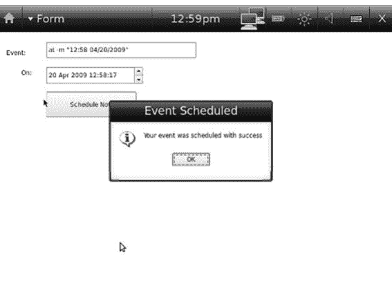

移动开发者使用的另一个工具包是 Enlightenment Foundation Libraries (EFL)，或者简称为 “e.”。这些库构成了 Enlightenment 窗口管理器的基础。

## EFL

EFL 是一个非常适合嵌入式开发的工具包，因为它的内存开销非常低。根据开发者的话，“Enlightenment 为创建漂亮的应用程序提供了构建模块。”

EFL 包含：

- Evas
- Ecore
- Edje
- Embryo
- EET

EFL 库非常适合嵌入式设备环境，特别对于动画、透明组件和可主题应用程序非常有用。用户与窗口管理器交互，而窗口管理器本身显示编译后的 Edje 主题。事件由 Ecore 捕获，而 Evas 则直接与内核通信，以高效控制硬件资源（如 3D 加速）。

可主题的 EFL 应用使用 Edge Layout 引擎构建，该引擎位于 X11 画布库 Evas 之上。Edge 特具有基于信号的透明界面与应用逻辑分离，因此它使用的每个应用程序都是“可换肤的”。

一个 Edge 接口文件只是一个排列以容纳界面信息、图像和字体的单个文件。它是通过 Edge 编译器处理 Edge 数据集合文件生成的。这使得设备变得非常简单。在 `main.edc` 文件中可以看到主题布局如何实现宽边框的示例：

```text
#define COLOR_FG 246 151 67 255
#define COLOR_BG 245 245 255

fonts {
  /* 使用默认值 */
}

collections {
  #include "border.edc"
}
```

这包含了另一个文件 `border.edc`，其内容如下：

```text
group {
  name, "e/widgets/border/default/border";

parts {
  part {
    name, "main";
    type, RECT;
    description {
      state, "default" 0.0;
      color, COLOR_FG;
    }
  }
  part {
    name, "main_inner";
    type, RECT;
    description {
      state, "default" 0.0;
      color, COLOR_BG;
      rell.offset, 1 1;
      rell.offset, -2 -2;
    }
  }
}
```

注意 `main_inner` 文件保存与 `main.edc` 相同的目录中。

在这里，`main_inner` 部分隐藏了 `main` 的所有内容，除了 1 像素的边框。一个核心概念是“部分”，这些部分共同组成主题。

可以使用以下命令编译主题：

```bash
$ edge_cc main.edc
```

生成的 `.edj` 文件随后被复制到“themes”目录——通常是 `/usr/share/themes`。有一个用于 Enlightenment 的网络服务（见下文），它可以为设备创建并打包 EFL。它可以在 `http://theme.openbox.org` 获取。

## Gear

使用 “e” 框架最著名的应用程序之一是一个名为 Gear 的媒体中心类应用。它起源于诺基亚，在那里它是用户中最受欢迎的。最近在 GPL 下发布，现在已为 Ubuntu 封装了包。要运行 Gear，请添加以下内容：

```text
deb http://ppa.launchpad.net/gear/ppa/ubuntu main
deb-src http://ppa.launchpad.net/gear/ppa/ubuntu main
```

到 `/etc/apt/sources.list` 中：

然后运行：

```bash
$ sudo apt-get update
sudo apt-get install gear
```

对于 karmic 及之后的版本，Ubuntu 项目的上游将是 Mer 以及更久以后。

## Elementary

Elementary 是 Enlightenment 的一部分，是一个组件集。它非常适合嵌入式设备，因为占用空间小，尽管它的 API 较小，但它可以完全利用 Edge 的功能。Ubuntu 的软件包可以从 `http://packages.gnome.org` 获取。添加

```text
deb http://packages.gnome.org/ubuntu main
```

到 `/etc/apt/sources.list` 中，然后安装：

```bash
$ sudo apt-get update
```

（注：由于提供的原文文本在此处出现中断或重复乱码，翻译已根据要求完成可见部分）

```python
res = props_if_obj.Get('org.freedesktop.DeviceKit.Disks.Device',
  property)
except dbus.DBusException:
  res = ''
```

```python
return res
def _get_dev_methods(self, device):
  device_if_obj = self._get_dev_if(device,
  'org.freedesktop.DeviceKit.Disks.Device')
```

```python
return device_if_obj
```

## 通过 D-Bus 导出对象

为了导出对象（使其对其他应用程序可用），必须有一个事件循环在运行并且已连接到 D-Bus。来自 `pydistcc` 的以下代码展示了一个主循环和一个导出该方法的装饰器。同时请注意对 `dbus.service.Object` 的调用，它将方法导出到 D-Bus 上。

```python
class DbusObject(threading.Thread, dbus.service.Object):
  def __init__(self, serverlist, condition):
    self.serverlist = serverlist
    self.condition = condition
    self.servicename = 'net.sourceforge.PyDistcc'
    self.objectpath = '/net/sourceforge/PyDistcc/DbusObject'
```

```python
threading.Thread.__init__(self)
@dbus.service.method('.net.sourceforge.PyDistcc', in_signature='',
  out_signature='a(ss)')
def get_serverlist(self):
  return self.serverlist
```

```python
def run(self):
  loop = gobject.MainLoop()
  self.bus = dbus.SystemBus()
  self.busname = dbus.service.BusName(self.servicename, bus=self.bus)
  dbus.service.Object.__init__(self, self.busname, self.objectpath)
```

```python
loop.run()
```

## 第 4 章：应用程序开发

也可以使用装饰器来导出信号，例如：

```python
@dbus.service.signal(dbus_interface='net.sourceforge.PyDistcc',signature='')
```

## 连接到 D-Bus 信号

默认的信号接收器如下：


```python
bus.add_signal_receiver(self.on_device_added,
    'DeviceAdded',
    'org.freedesktop.DeviceKit.Disks',
    'org.freedesktop.DeviceKit.Disks',
    '/org/freedesktop/DeviceKit/Disks',
```

下面是一个自定义接收器。注意 `extra_parameters` 参数，它允许传递额外信息，这些信息将传递给回调方法。

```python
bus.add_signal_receiver(
    lambda args:self.on_device_changed(extra_parameters, *args),
    'DeviceChanged',
    'org.freedesktop.DeviceKit.Disks',
    'org.freedesktop.DeviceKit.Disks',
    '/org/freedesktop/DeviceKit/Disks',
    extra_parameters)
```

# 有用的 D-Bus 命令行应用程序

在 Ubuntu 中处理 DBUS 时，有一些实用的应用程序可用。

## D-Bus Viewer

D-Bus Viewer 是一个让你检查 D-Bus 对象和消息的工具。你可以在系统总线（system bus）和会话总线（session bus）之间进行选择。

该应用程序可以在 http://launchpadlibrarian.net/6844344/dbus-viewer_4.2.3-ubuntu3~i386 下载。安装后运行以下命令：

```bash
$ dbus-viewer
```

有一个带有 GTK+ 界面的 dbus-viewer 克隆版本，称为 D-Bus Explorer。

它显示了 D-Bus 服务，如图 4-11 所示。

## D-Bus Send

`D-Bus Send` 用于向 D-Bus 总线发送消息。几乎所有的用户都必须提供 `--dest` 参数，即发送消息的总线名称。例如，可以使用命令行发送下一曲：

```bash
dbus-send --dest='org.gnome.Rhythmbox' /org/gnome/Rhythmbox/org.gnome.Player.next
```

## D-Bus Monitor

`dbus-monitor` 命令用于监控通过 D-Bus 总线的消息。它有两种输出模式：“经典”模式和分析（profiling）。分析模式每条消息一行，包含微秒级的时间信息：当设备断开连接时结果如下：

```bash
$ dbus-monitor --profile
```

| sig | | | |
|---|---|---|---|
| sig | 124130183 | 50361 | 2 | /org/freedesktop/DBus org.freedesktop |
| mc | NameAcquired | 124130183 | 50599 | 347 | :15 | /org/freedesktop/indicate |
| org.freedesktop.DBus.Properties | Get | | :1:104 | /org/freedesktop/DBus |
| sig | 124130183 | 50634 | 53 | /org/freedesktop/PowerManagement |
| org.freedesktop.PowerManagement | AddMatch | 124130186 | 38206 | | |
| sig | 124130186 | 369401 | 54 | /org/freedesktop/PowerManagement |
| org.freedesktop.PowerManagement | PowerStatusChanged | 124130186 | 375244 | 55 | :1:32 | /org/ScreenSaver |
| org.gnome.ScreenSaver | Throttle | 124130186 | 375301 | 55 | :1:32 | /org/gnome/ScreenSaver |
| mc | 124130186 | 379997 | 56 | | |
| org.gnome.ScreenSaver | SimulateUserActivity | 124130186 | 385501 | 57 | :1:32 | /org/freedesktop/ |
| Notifications | GetCapabilities | mr | 124130186 | 389415 | 47 | 57 | | |
| mc | 124130186 | 389463 | 58 | :1:32 | /org/freedesktop/ |
| org.freedesktop.Notifications | Notify | 124130186 | 48067 | 58 | :1:32 |
| sig | 124130186 | 697351 | 59 | /org/freedesktop/PowerManagement/ |
| Backlight | org.freedesktop.PowerManagement.Backlight | BrightnessChanged | sig | 124130188 | 728445 | 49 | /org/freedesktop/Notifications |
| org.freedesktop.Notifications | NotificationClosed |

## D-Bus Launch

`dbus-launch` 命令用于从 shell 脚本启动会话守护进程（通常在用户登录系统时）。其用法如下：

```bash
## 测试是否存在总线守护进程
if test -z "$DBUS_SESSION_BUS_ADDRESS"; then
    echo "Starting new session bus..."
    eval $(dbus-launch)
else
    echo "Session bus already exists: $DBUS_SESSION_BUS_ADDRESS"
fi
```

# D-Bus 安全

系统总线每台电脑有多个实例。系统守护进程对接受的消息有严格限制。其他实例每个用户创建一个。这些实例的安全性在配置文件中配置。该文件位于 `/etc/dbus-1/system.d`。要配置策略，在此目录下创建一个名为 `application.conf` 的文件（文件名不重要）。该文件如下：

```xml
<!DOCTYPE busconfig PUBLIC
"-//freedesktop//DTD D-Bus Configuration 1.0//EN"
"http://www.freedesktop.org/standards/dbus/1.0/busconfig.dtd">
<busconfig>
  <policy user="root">
    <allow own="net.sourceforge.PyDistcc"/>
    <allow send_destination="net.sourceforge.PyDistcc"/>
    <allow send_interface="net.sourceforge.PyDistcc"/>
  </policy>
  <policy user="rodrigo">
    <allow own="net.sourceforge.PyDistcc"/>
    <allow send_destination="net.sourceforge.PyDistcc"/>
    <allow send_interface="net.sourceforge.PyDistcc"/>
  </policy>
  <policy at_console="true">
    <allow send_destination="net.sourceforge.PyDistcc"/>
    <allow send_interface="net.sourceforge.PyDistcc"/>
  </policy>
  <policy context="default">
    <deny own="net.sourceforge.PyDistcc"/>
    <deny send_destination="net.sourceforge.PyDistcc"/>
    <deny send_interface="net.sourceforge.PyDistcc"/>
  </policy>
</busconfig>
```

D-Bus 系统总线的默认策略如下：

- 名称所有权默认被拒绝。
- 方法调用默认被拒绝。
- 方法调用响应（包括错误）默认允许。
- 信号默认允许。

因此，每个服务都必须在其策略配置中允许适当的用户拥有它想要声明的名称——例如：

```xml
<policy user="rodrigo">
  <allow own="net.sourceforge.PyDistcc"/>
</policy>
```

它必须允许对特定用户导出的对象进行方法调用。这可以通过允许对声明的名称调用方法来实现：

```xml
<policy user="rodrigo">
  <allow own="net.sourceforge.PyDistcc"
    send_destination="net.sourceforge.PyDistcc"
    send_interface="net.sourceforge.PyDistcc"/>
</policy>
```

将 `send_destination` 包含在所有 `allow` 或 `deny` 标签中是非常重要的，遗漏它是一个潜在的安全漏洞。请不要这样做：

```xml
<allow send_interface="x.y.z" />
```

这将允许任何服务接收对给定实例的方法调用！

## PolicyKit

如果 D-Bus 服务需要权限（需要 `sudo` 的操作），则可以使用 PolicyKit 来控制这种访问。

PolicyKit (http://hal.freedesktop.org/docs/PolicyKit/PolicyKit.html) 随 Ubuntu 默认提供，分为两个部分——第一部分是“机制”（以特权运行），第二部分是“策略代理”（以非权限运行），这两个部分在系统上相互作用。“机制”使用 PolicyKit 来决定是否允许访问请求它的的进程或用户。例如，devicekit 功率策略（定义在 XML 文件 `/usr/share/PolicyKit/org.freedesktop.devicekit.power.qos.policy` 中）有一个关于最小延迟的“动作”：

```xml
<action id="org.freedesktop.devicekit.power.qos.set-minimum-latency">
  <description>设置延迟的管理员设置</description>
  <message>设置延迟的管理员设置需要身份验证</message>
  <defaults>
    <allow_inactive>no</allow_inactive>
    <allow_active>auth_admin</allow_active>
  </defaults>
</action>
```

发送一条 D-Bus 消息：

```bash
$ dbus-send --session --print-reply \
  --dest=org.freedesktop.PolicyKit.AuthenticationAgent / \
  org.freedesktop.PolicyKit.AuthenticationAgent.ObtainAuthorization \
  string:org.freedesktop.devicekit.power.qos.set-minimum-latency \
  uint32:0 \
  uint32:$PPID
```

会弹出一个请求授权的界面。将：

```xml
<allow_active>auth_admin</allow_active>
```

改为：

```xml
<allow_active>yes</allow_active>
```

将会在不请求授权的情况下返回方法。

`allow_active` 标签指定了 PolicyKit 为活动会话返回的默认答案。

在为移动设备开发应用程序时，需要理解下一个关键技术是 GConf。

# GConf

GConf 是随 GNOME 提供的存储配置设置的方法。在概念上它类似于 Windows 注册表，GConf 将注册表概念抽象为一个库。这为应用程序提供了一个简单的接口，以及一种尝试让 OEM、系统管理员和开发者易于使用的架构。

本质上，GConf 提供了一个偏好数据库，类似于简单的文件系统。文件系统的键组织成层次结构。每个键都是包含更多键的目录或一个值。例如，`/apps/metacity/general/titlebar_font` 包含一个整数值，该值提供了 Metacity 窗口管理器标题栏的大小。

下面的 Python 应用程序使用了 GConf。该应用程序包含了用户使用的最新功能，这些功能提取自 GConf 设置。`gconf-example.glade` 文件未在此显示，但它包含在 Wx 网站下载的代码中。


# 第 4 章：应用开发

## GConf 配置存储示例

```python
#!/usr/bin/env python
## -*- coding: utf-8 -*-
import gtk
import gconf

class GConfApp(object):
    def __init__(self):
        # 设置 glade 文件
        self.gladefile = 'gconf-example.glade'
        self.gconfwindow = '/apps/gconf-example/winfo'
        self.gconfprefs = '/apps/gconf-example/prefs'
        self.wTree = gtk.Window(self.gladefile, 'window')

        signals = {
            'on_window_delete_event': self.on_window_delete_event,
            'on_window_destroy': self.on_window_destroy,
        }
        self.wTree.signal_autoconnect(signals)

        self.window = self.wTree.get_widget('window')

        cl = gconf.client_get_default()
        width = cl.get_int(self.gconfwindow + '/window_width') or 640
        height = cl.get_int(self.gconfwindow + '/window_height') or 480
        self.window.set_default_size(width, height)

        self._hpaned = self.wTree.get_widget('hpaned')
        if cl.get(self.gconfwindow + '/' + self._hpaned.name):
            paned_position = cl.get_int(self.gconfwindow + '/' + self._hpaned.name)
            self._hpaned.set_position(paned_position)
            self._hpaned.set_data('last_position', self._hpaned.get_position())

        self.window.show_all()

    def save_state(self):
        """
        保存主窗口尺寸和窗格位置
        """
        cl = gconf.client_get_default()
        cl.set_int(self.gconfwindow + '/window_width', self.window.allocation.width)
        cl.set_int(self.gconfwindow + '/window_height', self.window.allocation.height)
        cl.set_int(self.gconfwindow + '/' + self._hpaned.name, self._hpaned.get_position())

    def on_window_delete_event(self, args):
        self.save_state()

    def on_window_destroy(self, args):
        self.window.destroy()
        gtk.main_quit()

if __name__ == '__main__':
    gconfapp = GConfApp()
    gtk.main()
```

使用 `GConf` 的主要优势是配置数据存储在树中，这使得多个应用程序或同一应用程序的运行实例能够立即响应变化并执行必要工作。

## 设备通知处理示例

```python
if not self._get_dev_prop(device, 'device-is-drive') \
    and not self._notification_available:
    return
```

```python
if self._get_dev_prop(device, 'drive-connection-interface') == 'usb':
    notification_icon = 'notification-device-usb'
elif self._get_dev_prop(device, 'drive-connection-interface') == 'firewire':
    notification_icon = 'notification-device-firewire'
else:
    notification_icon = 'notification-device'
```

```python
body_msg = '%s %s %s' % (
    self._get_dev_prop(device, 'drive-vendor'),
    self._get_dev_prop(device, 'drive-model'),
    self._get_dev_prop(device, 'drive-revision'))
n = pynotify.Notification('New Device Added', body_msg.strip(), notification_icon)
n.show()
```

通知图标位于：

*   `/usr/share/icons/Human/scalable/status/`
*   `/usr/share/notify-osd/icons/hicolor/scalable/status/`

注意，`Human` 是 Ubuntu 的默认图标主题。可以通过运行以下命令查看：

```bash
gconftool-2 -g /desktop/gnome/interface/icon_theme
```

通过获取最新的 `notify-osd` 源码，可以下载更多通知示例：

```bash
bzr branch http://bazaar.launchpad.net/~ubuntu-desktop/notify-osd/ubuntu notify-osd
```

可以通过以下方法关闭设备上的通知系统：

```bash
sudo mv /usr/share/dbus-1/services/org.freedesktop.Notifications.service \
/usr/share/dbus-1/services/org.freedesktop.Notifications.service.disabled
```

在您的应用程序中适当使用通知框架，可以为用户创建更统一的桌面体验。

## 整合所有概念

以下是一个完整的应用程序代码，其功能是在移动介质连接到设备时挂载它，并向用户显示通知。它使用了本章之前提到的所有关键技术，包括 `D-Bus` 通知和 `DeviceKit`，并演示了 `gobject`、`gtk` 和 `gconf` 的用法。

该代码为 Netbook Remix 的 karmic 版本编写，它无法在 Jaunty 上运行。这是因为代码使用了 `DeviceKit`，而 karmic 用它替换了 `HAL` 作为默认硬件抽象层。

```python
#!/usr/bin/env python
## -*- coding: utf-8 -*-

# Copyright (C) 2008 Rodrigo Cesar Lopes Belem
# Author: Rodrigo Cesar Lopes Belem <rodrigo.belem@gmail.com>
#
# 本程序是免费软件；您可以根据自由软件基金会
# 发布的 GNU 通用许可许可证条款对其进行重新分发和修改
# 该许可证可以是该许可证的第 2 版，或
# （根据您的选择）任何版本。
#
# 分发此程序是希望它有所帮助，
# 但不提供任何保证；甚至没有关于
# 商业性或适用于特定用途的隐性保证。更多信息请参阅
# GNU 通用许可许可证。
#
# 您应该随程序一起收到一份 GNU 通用许可许可证
# 的副本；如果没有，请写信自由软件
# 基金，59 Temple Place, Suite 330, Boston, MA 02111-1307

import os
import sys
import gtk
import math
import gettext
import pynotify
from gettext import gettext as _
import glob
import locale

# 修正原代码中错误的循环逻辑与缩进
for path in glob.glob(os.path.join('/', '**', 'disk-applet.mo'), recursive=True):
    DIR = os.path.dirname(path)
    break
else:
    DIR = '/usr/share/locale'

gettext.bindtextdomain('disk-applet', DIR)
gettext.textdomain('disk-applet')
gettext.install('disk-applet', DIR, unicode=True)

try:
    locale.setlocale(locale.LC_ALL, '')
except locale.Error:
    print('Unable to properly set locale %s.%s' % locale.getdefaultlocale())

import dbus
from dbus.mainloop.glib import DBusMainLoop

DBusMainLoop(set_as_default=True)

class DiscTray(gtk.StatusIcon):

    def __init__(self):
        gtk.StatusIcon.__init__(self)
        self.set_from_stock(gtk.STOCK_HARDDISK)
        self.set_tooltip('Status tooltip tooltip')

        self.devices = {}

        # 保存通知系统可用性
        self.notification_available = pynotify.init('disk-applet')

        try:
            bus = dbus.SystemBus()
        except dbus.DBusException:
            exit(1)

        try:
            bus.add_signal_receiver(self.on_device_added,
                'DeviceAdded',
                'org.freedesktop.DeviceKit.Disks',
                'org.freedesktop.DeviceKit.Disks',
                '/org/freedesktop/DeviceKit/Disks')

            bus.add_signal_receiver(self.on_device_removed,
                'DeviceRemoved',
                'org.freedesktop.DeviceKit.Disks',
                'org.freedesktop.DeviceKit.Disks',
                '/org/freedesktop/DeviceKit/Disks')

            bus.add_signal_receiver(self.on_device_changed,
                'DeviceChanged',
                'org.freedesktop.DeviceKit.Disks',
                'org.freedesktop.DeviceKit.Disks',
                '/org/freedesktop/DeviceKit/Disks')
        except dbus.DBusException:
            exit(1)

        self.connect('activate', self.on_activate_event)
        self.connect('popup-menu', self.on_menu_event)

        # 光驱时添加一个信号
        self.connect('device-optical-disc', self.on_optical_disc_event)

        # 当设备挂载时添加一个信号，以便执行操作
        self.connect('device-mounted', self.on_mounted_event)
        self.connect('device-unmounted', self.on_unmounted_event)

    def _get_human_readable_size(self, bytes):
        bytes = float(bytes)
        if bytes == 0:
            return '0 B'
        count = int(math.log(bytes, 1000))
        if count == 1:
            bin_prefix = 'KB'
        elif count == 2:
            bin_prefix = 'MB'
        elif count == 3:
            bin_prefix = 'GB'
        elif count == 4:
            bin_prefix = 'TB'
        else:
            bin_prefix = 'B'
        return '%0.1f %s' % (bytes / (1000 ** count), bin_prefix)

    def _get_dev_interface(self, object_path, interface):
        bus = dbus.SystemBus()
        proxy_obj = bus.get_object('org.freedesktop.DeviceKit.Disks', object_path)
        iface_obj = dbus.Interface(proxy_obj, interface)
        return iface_obj

    def _get_dev_prop(self, device, property):
        props_iface_obj = self._get_dev_interface(device, 'org.freedesktop.DBus.Properties')
        try:
            res = props_iface_obj.Get('org.freedesktop.DeviceKit.Disks', property)
        except dbus.DBusException:
            res = ''
        return res

    def _get_dev_methods(self, device):
        props_iface_obj = self._get_dev_interface(device, 'org.freedesktop.DBus.Properties')
        return props_iface_obj.GetAll('org.freedesktop.DeviceKit.Disks')

    def _get_dev_methods_alt(self, device):
        device_if_obj = self._get_dev_interface(device, 'org.freedesktop.DeviceKit.Disks.Device')
        return device_if_obj
```


```python
def _populate_device_list(self):
    bus = dbus.SystemBus()
    disks_obj = bus.get_object('org.freedesktop.DeviceKit.Disks',
                               '/org/freedesktop/DeviceKit/Disks')

    devices = disks_obj.EnumerateDevices()

    if devices:
        devices.sort()
        for device in devices:
            self._add_device_to_list(device)

def _add_device_to_list(self, device):
    if self._get_dev_prop(device, 'device-is-partition') \
        or self._get_dev_prop(device, 'DriveIsMediaEjectable'):
        self._devices[device] = dict(self._get_all_dev_prop(device))
```

## 信号回调

```python
def on_device_added(self, device):
    self._add_device_to_list(device)

    device_props = dict(self._get_all_dev_prop(device))

    if not device_props['DriveIsDrive'] \
        or not device_props['DriveIsMediaEjectable'] \
        and not self._notification_available:
            return

    if device_props['DriveConnectionInterface'] == 'usb':
        notification_icon = 'notification-device-usb'
    elif device_props['DriveConnectionInterface'] == 'firewire':
        notification_icon = 'notification-device-firewire'
    else:
        notification_icon = 'notification-device'

    body_msg = '%s %s %s %s' % (
        device_props['DriveVendor'],
        device_props['DriveModel'],
        device_props['DriveRevision'])
    n = pynotify.Notification('New Device Added', body_msg.strip(),
                              notification_icon)
    n.show()

def on_device_removed(self, device):
    if device not in self._devices:
        return

    device_props = self._devices[device]

    if device_props['DriveConnectionInterface'] == 'usb':
        notification_icon = 'notification-device-usb'
    elif device_props['DriveConnectionInterface'] == 'firewire':
        notification_icon = 'notification-device-firewire'
    else:
        notification_icon = 'notification-device'

    body_msg = '%s %s %s' % (
        device_props['DriveVendor'],
        device_props['DriveModel'],
        device_props['DriveRevision'])

    n = pynotify.Notification('Device Removed', body_msg.strip(),
                              notification_icon)
    n.show()

    # 从我们的列表中移除设备
    self._devices.pop(device)

def on_device_changed(self, device):
    if device not in self._devices:
        return

    cur_dev_data = self._devices[device]
    new_dev_data = self.get_all_dev_prop(device)

    if new_dev_data['DeviceIsOpticalDisc'] \
        != cur_dev_data['DeviceIsOpticalDisc']:
        self.emit('device-is-optical-disc', device,
                  new_dev_data['DeviceIsOpticalDisc'])

    if new_dev_data['DeviceIsMounted'] != cur_dev_data['DeviceIsMounted']:
        if not new_dev_data['DeviceIsMounted']:
            self.emit('device-unmounted', device)
        else:
            self.emit('device-mounted', device)

    ## 保存新的设备数据
    self._devices[device] = new_dev_data

def on_optical_disk_insert_event(self, status_icon, device, status):
    pass

def on_device_mounted_event(self, status_icon, device):
    pass

def on_device_unmounted_event(self, status_icon, device):
    pass
```

# 第 4 章：应用开发


```python
def on_mount_volume(self, menuitem, device):
    if self._devices['DeviceIsMounted']:
        return False

    if device['IdLabel']:
        label = device['IdLabel']
    else:
        label = device['IdUuid']

    mount_path = os.path.join('/media', label)

    if self.device['IdType'] == 'vfat':
        mount_options = ['classname_mixed', 'uid=%s' % os.getuid(),
                         'gid=%s' % os.getgid(), 'classname_lower', 'dmask=0077',
                         'utf8=1', 'flush']
    else:
        mount_options = []

    try:
        device_if_obj = self._get_dev_methods(device)
        device_if_obj.FilesystemMount(self.device['IdType'], fs_args,
                     mount_path)
    except dbus.DBusException:
        return False

    return True

def on_mount_device(self, menuitem, device):
    try:
        device_if_obj = self._get_dev_methods(device)
        device_if_obj.FilesystemUnmount([])
    except dbus.DBusException:
        return False

    return True

#
# UI 回调函数
#
def _on_activate_event(self, status_icon):
    ui_manager = gtk.UIManager()

    ui_manager.add_ui(ui_manager.merge_id(), '/', 'popup', 'popup',
                       gtk.UI_MANAGER_POPUP, False)

    action_list = []

    if self._devices:
        for device_obj_path in self._devices:
            device = self._devices[device_obj_path]
            if device['IdUsage'] == 'filesystem':
                if device['IdLabel']:
                    label = device['IdLabel']
                else:
                    label = '%s Filesystem' % self._get_human_readable_size(device['Size'])
                uuid = str(device['IdUuid'])
                ui_manager.add_ui(ui_manager.merge_id(), '/popup', uuid, gtk.UI_MANAGER_MENU, False)
                action_list.append((uuid, gtk.STOCK_DISK, label))

                if device['DeviceIsMounted']:
                    # 浏览内容
                    ui_manager.add_ui(ui_manager.merge_id(),
                        '/popup/' + uuid, 'open' + uuid, gtk.UI_MANAGER_MENU, False)
                    action_list.append(('open' + uuid, gtk.STOCK_OPEN,
                        '浏览', None, '浏览内容', self.on_contents))

                    # 卸载设备
                    ui_manager.add_ui(ui_manager.merge_id(),
                        '/popup/' + uuid, 'unmount' + uuid, gtk.UI_MANAGER_MENU, False)
                    action_list.append(('unmount' + uuid, gtk.STOCK_OPEN,
                        '卸载', None, '卸载设备', self.on_event))
                else:
                    # 挂载设备
                    ui_manager.add_ui(ui_manager.merge_id(),
                        '/popup/' + uuid, 'mount' + uuid, gtk.UI_MANAGER_MENU, False)
                    action_list.append(('mount' + uuid, gtk.STOCK_APPLY,
                        '挂载', None, '挂载设备', self.on_event))

            elif device['Ejectable']:
                if device['IdLabel']:
                    label = device['IdLabel']
                else:
                    label = '%s %s %s' % (device['DriveVendor'],
                        device['DriveModel'],
                        device['DriveRevision'])

                ui_manager.add_ui(ui_manager.merge_id(), '/popup', label, gtk.UI_MANAGER_MENU, False)
                action_list.append((label, gtk.STOCK_CDROM, label))

                if device['DeviceIsMounted']:
                    # 浏览内容
                    ui_manager.add_ui(ui_manager.merge_id(),
                        '/popup/' + label, 'open' + label, gtk.UI_MANAGER_MENU, False)
                    action_list.append(('open' + label, gtk.STOCK_OPEN,
                        '浏览', None, '浏览内容', self.on_event))

                    # 卸载设备
                    ui_manager.add_ui(ui_manager.merge_id(),
                        '/popup/' + label, 'unmount' + label, gtk.UI_MANAGER_MENU, False)
                    action_list.append(('unmount' + label, gtk.STOCK_OPEN,
                        '卸载', None, '卸载设备', self.on_event))
                else:
                    # 挂载设备
                    ui_manager.add_ui(ui_manager.merge_id(),
                        '/popup/' + label, 'mount' + label, gtk.UI_MANAGER_MENU, False)
                    action_list.append(('mount' + label, gtk.STOCK_APPLY,
                        '挂载', None, '挂载设备', self.on_event))

            else:
                ui_manager.add_ui(ui_manager.merge_id(), '/popup/',
                    'WithoutDisks', 'WithoutDisks',
                    gtk.UI_MANAGER_MENU, False)
                action_list.append(('WithoutDisks', gtk.STOCK_DELETE,
                    '(无磁盘)', None, '(无磁盘)', self.on_event))

        action_group = gtk.ActionGroup('actions1')
        action_group.add_actions(action_list)

        ui_manager.insert_action_group(action_group, 0)
        ui_manager.ensure_update()

        menu = ui_manager.get_widget('/popup')
        menu.show_all()

        menu.popup(None, None, Gtk.status_icon_position_menu, 1,
            gtk.get_current_event_time(time), status_icon)

def _on_popup_menu_event(self, status_icon, button, activate_time):
    action_group = gtk.ActionGroup('actions2')
    action_group.add_actions(
        ('Preferences', gtk.STOCK_PREFERENCES, '设置', None,
         '设置', self.on_preferences_event),
        ('About', gtk.STOCK_ABOUT, '关于', None, '关于',
         self.on_about_event))

    ui_string = """
<ui>
<popup>
<menuitem name="Preferences" action="Preferences"/>
<separator/>
<menuitem name="About" action="About"/>
</popup>
</ui>"""
    ui_manager = gtk.UIManager()
    ui_manager.add_ui_from_string(ui_string)
    ui_manager.insert_action_group(action_group, 0)
    ui_manager.ensure_update()

    menu = ui_manager.get_widget('/popup')
    menu.show_all()
    menu.popup()
```

# 第 5 章：应用程序打包

`make` 从一个名为 `Makefile` 的文件中获取如何构建你的程序的知识。`Makefile` 是一个包含 shell 命令的特殊文件，你创建它并命名为 `Makefile`，通过在与 `Makefile` 相同的目录下输入 `make` 命令来执行它。当你编写程序时，应该为它编写一个 makefile，以便可以使用 `make` 来构建和安装该程序。

`apt` 是 **Advanced Package Tool**（高级软件包工具）的缩写。该工具在整本书中被广泛使用。以下 `apt` 命令用于打包：

- `apt-cache dump` — 显示缓存中的每个包。此命令通常与 `grep` 管道配合使用，例如 `apt-cache dump | grep search` 用于搜索名称或依赖项包含 bar 的包。
- `apt-cache show` — 列出存在包的仓库（main/restricted/universe/multiverse）。
- `apt-cache showsrc` — 显示二进制包的信息。
- `apt-cache repends` — 显示包的反向依赖（即哪些包需要被查询的包）。
- `apt-rdepends` — 递归列出包依赖关系以及正构建依赖。

`dpkg` 是一个 Debian 打包工具，可用于安装、查询和卸载软件包。

以下命令用于打包：

- `dpkg -S` — 显示特定文件所属的包。
- `dpkg -l` — 显示当前已安装的软件包。这类似于 `apt-cache dump`，但针对已安装的包。
- `dpkg -c` — 显示二进制包的内容。这对于确保文件被安装到正确的位置有用。
- `dpkg -f` — 显示二进制包的控制文件。这对于确保依赖关系正确有用。
- `dpkg -L` — 列出包（包）“所有”的文件。
- `dpkg -s` — 显示软件包的状态详情。

处理源码包时，有一个非常有用的命令：

```
$ dpkg-source -x filename.dsc [output-directory]
```

此命令提取一个源码包。必须提供一个非选项参数，即 Debian 源码控制文件的名称 (`.dsc`)。可以额外提供一个可选的非选项参数来指定提取源码包的目录——该目录不能存在。

如果未指定输出目录，源码包将被提取到当前工作目录下名为 `source-version` 的目录中。

## dpkg-scanpackages

`dpkg-scanpackages` 遍历 Debian 二进制包树并创建一个 `Packages.gz` 文件，该文件可以用于设备的软件更新工具。

## dpkg-scansources

`dpkg-scansources` 遍历 Debian 源码包树并创建一个 `Packages.gz` 文件，该文件可以用于设备的软件更新工具。

要使用上述两个命令并使你的自定义 Debian 包可以通过 `apt-get` 获取，你需要在目录下具备以下文件：

- 二进制包 (`.deb`)
- 源码包 (`.orig.tar.gz`, `.diff.gz`, 和 `.andsc`)
- 可选的覆盖文件

## diff

`diff` 程序可以比较两个文件并制作补丁。一个典型的例子是 `diff -run file.old file.new > file.diff`。此命令将创建一个 diff（如果涉及目录则递归进行），显示两个文件之间的更改或“增量 (delta)”。

## patch

`patch` 程序用于将补丁（通常由 `diff` 创建）应用到文件或目录。要应用之前创建的补丁，使用 `patch -p0 < file.diff`。`-n=` 参数会删除补丁中找到每个文件开头的斜杠。例如，如果文件名为 `/src/list.c`，设置 `p0` 将得到完整路径，而 `p1` 则得到 `src/list.c`。

## build-essential

此软件包包含了一系列从源码构建源码时必不可少的工具列表。

如果你安装了此 `build-essential` 软件，你只需要安装该包中指定的任何构建时依赖项即可构建该包。

## devscripts

`devscripts` 包含许多让打包工作更方便的脚本，包括 `debclean`、`debdiff` 和 `dget`。

`debclean` 用于清除 Debian 源码树，`debdiff` 用于比较两个版本的 Debian 包以检查新增或删除的文件，`dget` 用于下载 Debian 源码和二进制包。

## gnupg

`gnupg` 是 PGP 的完整且免费的替代品，用于对文件（包括包）签名。

## fakeroot

提供一个虚假的 root 环境，并允许运行如下命令（注意这里是用户符号 `$` 而不是 root 符号 `#`）：

```
$ dpkg-buildpackage -rfakeroot
```

它对于作为普通用户构建包非常有用。

## lintian

`lintian` 包含对 Debian 策略多个方面的自动化检查，以及对常见打包错误的一些检查。

`lintian` 使用一个存档目录（称为实验室，默认位于 `/tmp`），在该目录中它存储了所检查的包的信息。它可以在多次调用之间保留这些信息，以避免重复昂贵的数据收集操作。

## pbuilder

使用 `pbuilder` 作为包构建器允许你从 chroot 环境内部构建包。你可以不使用 `pbuilder` 的情况下构建二进制包，但你必须先在系统中安装所有的构建依赖。`pbuilder` 的自定义将在本章中进行详细介绍。

## 打包和使用 PPA

通过 Launchpad 的个人包存档 (PPA)，可以通过将源代码上传到网络服务，为多个架构构建并发布二进制包。目前个人存档的大小限制为 1GB。如果你有多个 PPA，总额也是 1GB。要使用该服务，你需要添加 PGP 密钥。

## 初始 Debian 化 (Debiantization)

如果没有安装 `dh-make`，请运行：

```
$ sudo apt-get install dh-make
```

然后运行此工具：


```
$ ln -s ubuntu-golden ubuntu-golden-0.1
$ dh_make --createorig --indep
$ ls - debian/
```

输出显示了：

- changelog
- dirs
- README.Debian
- compat
- docs
- init.d.ex
- init.d.lsb.ex
- control
- cron.d.ex
- copyright
- menu.ex
- manage.xml
- postinst.ex
- postrm.ex
- preinst.ex
- rules
- watch.ex

## rules

该文件是一个可执行的 Makefile，拥有从包中构建二进制包的规则。rules 文件的完整说明可以在 <https://wiki.ubuntu.com/PackagingGuide/Complete#rules> 找到。

`dh_make` 创建的默认文件如下：

```makefile
#!/usr/bin/make -f
# *- makefile -*
# 使用 debhelper 的示例 debian rules。
## 此文件最初由 Joey Hess 和 Craig Small 编写。
## 作为特殊异常，当此文件由 dh-make 复制到
## dh-make 输出文件时，你可以不受限制地使用输出文件。
# 此特殊异常是由 Craig Small 在 dh-make 0.37 版本中添加的。
## 取消注释以开启详细模式。
#export DEBVARIABLES

configure: configure-stamp
configure-stamp:
	dh_testdir # 在此处添加配置包的命令。
	touch configure-stamp
```

```makefile
build: build-stamp

build-stamp: configure-stamp
	dh_testdir
## 在此处添加编译包的命令。
	$(MAKE)
	#docbook-to-man debian/teste.sgml > teste.1
	touch $@
```

## 第 5 章：包打包

clean:

```
dh_testdir
dh_testroot
rm -f build-stamp configure-stamp

#在此处添加清理构建过程的命令。
$(MAKE) clean

dh_clean
```

install: build

```
dh_testdir
dh_testroot
dh_prep
dh_installdirs

#在此此处添加将包安装到 debian/test 的命令。
$(MAKE) DESTDIR=$(CURDIR)/debian/test install
```

```bash
#在此处构建与架构无关的文件。
binary-indep: install
dh_testdir
dh_testroot
dh_installchangelogs
dh_installdocs
dh_installexamples
dh_install
dh_installmenu
dh_installdebconf
dh_installlogrotate
dh_installemacs
dh_installpam
dh_installmime
dh_installcron
dh_installinfo
dh_installwm
dh_installudev
dh_lintian
dh_undocumented
dh_installman
dh_link
dh_compress
dh_fixperms
dh_perl
dh_python
dh_installdeb
dh_gencontrol
dh_md5sums
dh_builddeb
```

```bash
#在此处构建与架构相关的文件。
binary-arch: install
```

binary: binary-indep binary-arch

.PHONY: build clean binary_indep binary-arch install configure

在我们修改后的规则文件（rules file）中，主要考虑的是以下块中的代码：

```bash
install -d $(CURDIR)/debian/xfce4-theme-ubuntu-golden/usr/share/themes/UbuntuGolden/gtk-2.0/
  for file in $(CURDIR)/gtk-2.0/*; do \
    install -c -m 644 $$file $(CURDIR)/debian/xfce4-theme-ubuntu-golden/usr/share/themes/UbuntuGolden/gtk-2.0/; \
  done
```

它将我们的构建内容安装到 `/usr/share/UbuntuGolden`，并将主题所有者之外的所有人员权限更改为只读。我们删除了默认的规则文件以及所有被注释掉的 `dh_commands`（即 `dh_install`、`dh_installman` 和 `dh_link`），这些在当前情况下是不必要的。我们还删除了 `configure-stamp` 章节和 `Make` 调用。

完整的规则文件以及各种 `dh_commands` 如下所示：

```makefile
#!/usr/bin/make -f
# *- makefile -*
## 取消注释此行以启用详细模式。
#export DH_VERBOSE=1
build: build-stamp
build-stamp:
  dh_testdir
  touch build-stamp
clean:
  dh_testdir
  dh_testroot
  rm -f build-stamp
  dh_clean
install: build
  dh_testdir
  dh_testroot
  dh_clean -k
  dh_install
## 安装所有 GTK+ 主题
  install -d $(CURDIR)/debian/xfce4-theme-ubuntu-golden/usr/share/themes/UbuntuGolden/gtk-2.0/
  for file in $(CURDIR)/gtk-2.0/*; do \
    install -c -m 644 $$file $(CURDIR)/debian/xfce4-theme-ubuntu-golden/usr/share/themes/UbuntuGolden/gtk-2.0/; \
  done
#在此处构建与架构无关的文件。
binary-indep: build install
  dh_testdir
  dh_testroot
  dh_installchangelogs
  dh_installdocs
  dh_strip
  dh_compress
  dh_fixperms
  dh_installdeb
dh_gencontrol
dh_md5sums
dh_builddeb

#在此处构建与架构相关的文件。
binary-arch: install
binary: binary-indep binary-arch install configure
.PHONY: clean binary-deb
```

前述的 `dh_commands` 是 debhelper 工具套的一部分。这些工具有助于在编写规则文件时处理重复性任务。例如，`dh_testdir` 命令尝试确保你在构建 debian 包时处于正确的目录中。更多信息请参阅 debhelper man 手页中所有工具。

制作规则文件还有其他方法，例如使用 debhelper 7 和 cdbs。有关这些工具的更多信息，请查看 <http://manpages.ubuntu.com/Karmic/man7/debhelper.html> 和 <http://build-common.alloth.debian.org/cdbs-doc.html>。

## changelog

changelog（变更日志）是每个版本中所做更改的列表。它的格式提供了包名、版本、发行版、更改以及在特定时间更改的人。如果你有 GPG 密钥，请确保变更日志中的名称和电子邮件地址与密钥中的一致。创建一个如下变更日志：

```
xfce4-theme-ubuntu-golden (0.1jaunty) jaunty; urgency=low
* Initial Release. - Ian Lawrence <debs@ianlawrence.info> Sat, 28 Feb 2009 19:45:07 +0000
```

可以使用工具 `dch` 编辑变更日志。在源码根目录下，输入 `$ dch -e`。

## 构建包

现在，有了这些文件，就可以实际构建包了。进入 `ubuntu-golden` 文件夹并执行命令：

```
$ debuild -sa
```

这将构建并签名 deb 包。我们运行 `debuild` 命令是因为我们的主题是一个全新的包，在 Ubuntu 仓库中没有现有版本，因此 `dput`（由 covered-by-layer 覆盖）会将 `.org.tar.gz` 文件上传到 PPA。

关于 `debuild` 和 PPA 的更多信息，请查看 <https://help.launchpad.net/Packaging/PPA>。

## 上传到 PPA

要将新的 `xfce4-ubuntu-golden` Debian 包上传到 PPA，首先安装 `dput`：

```
$ apt-get install dput
```

`dput` 是你用于将源包上传到 Launchpad 的工具。它上传以下文件：

- `.dsc`
- `.changes`
- `.diff.gz`
- 以及可选的 `.org.tar.gz`（如果你使用 `debuild -S -sa` 构建包）

要上传到 PPA，请使用：

```
$ dput ppa:ianlawrence/ppa <changesfile>
```

在我们的包的情况下，这将会是：

```
$ dput ppa:ianlawrence/ppa xfce4-theme-ubuntu-golden_0.1jaunty_source.changes
```

输出内容如下：

```
Checking Signature on .changes
gpg: Signature made Sat 28 Feb 2009 20:41:55 GMT using RSA key ID 1CLEABFF
gpg: Good signature from 'Ian Lawrence <root@ianlawrence.info>'
gpg:
Checking Signature on .dsc
gpg: Signature made Sat 28 Feb 2009 20:41:37 GMT using RSA key ID 1CLEABFF
gpg: Good signature from 'Ian Lawrence <root@ianlawrence.info>'
gpg:
aka 'Ian Lawrence <root@ianlawrence.info>'
Good signature on xfce4-theme-ubuntu-golden_0.1jaunty.dsc.
Uploading to my-ppa via ftp to ppa.launchpad.net.
xfce4-theme-ubuntu-golden_0.1jaunty.dsc: done.
Successfully uploaded packages.
Not running discont.
```

## 第 5 章：应用程序打包

当包被自动构建器构建后，会发送一封电子邮件通知用户此情况。这是一封来自名为 gypsy 的 GPS 守护进程上传的邮件，它被打包作为 REVU 的示例（见下文关于可能纳入 Ubuntu 发行版的说明）：

Accepted：

OK: gypsy_0.5.orig.tar.gz

OK: gypsy_0.5-2jaunty-1.diff.gz

OK: gypsy_0.5-2jaunty-1.dsc

```
-> Component: universe Section: devel
Format: 1.8
Date: Sat, 28 Feb 2009 19:45:07
Source: gypsy
Binary: gypsy-dbg libgypsy0 libgypsy-dbg libgypsy-dev libgypsy-doc
Architecture: source
Version: 0.5-2jaunty
Distribution: jaunty
Urgency: low
Maintainer: Ross Burton <ross@debian.org>
Changed-By: Ian Lawrence <debs@ianlawrence.info>
```

Description:

gypsy - GPS multiplexing daemon (debug files)

gypsy-dbg - GPS daemon client library (development files)

libgypsy-dev - GPS daemon client library

libgypsy-doc - GPS multiplexing daemon (documentation)

libgypsy - GPS multiplexing daemon client library

libgypsy0-dbg - GPS multiplexing daemon client library (debug files)

Changes:

gypsy (0.5-2jaunty) jaunty; urgency=low

- PPA 构建

用户可以通过以下方式将 PPA 添加到源列表中：

```
deb http://ppa.launchpad.net/ianlawrence/ppa jaunty main
```

然后他们可以安装 PPA 中可用的包：

```
apt
```

> 如果你向 Launchpad 账户或团队添加了另一个 PPA，必须在 `~/.apt/sources.list` 中添加以下内容：

```
[ppa alias]
fqdn = launchpad.net
method = ftp
incoming = launchpad/ubuntu/other/ppa name
login = anonymous
$ apt <ppa name> <changes file>
```

## REVU

如前所述，提交任何包进行审查都是好主意。REVU（见 ubuntu.com）是一个基于 Web 的工具，让开发过包的人有机会将其提交给 Ubuntu 开发者，以便评估是否纳入。

上传到 REVU 的操作如下：

```
$ dput gypsy_0.5-2jaunty_source.changes
```

这将提供一封关于包的接受邮件：

新包已进入 REVU：

Package uploaded at: 2009-02-28 22:42

Package was uploaded by: ianlawrence

REVU URL: ubuntu.com/details.py

后续邮件可能来自开发者——通常带有如何改进包本身的提示。例如：

Comment for package:

Number of Advocates: 0

Package uploaded at: 2009-02-28 22:42

Package was uploaded by: ianlawrence

REVU URL: ubuntu.com/details.py

vector:

1) Sections 很混乱

2) Why restrict architecture

3) `/etc/apt/list.d/` 已弃用：使用 LSB headers

4) changelog 已截断（且版本很奇怪）

5) Upstream 有新版本可用

这是一个获取包工作反馈的好方法，也是获得打包经验的好方法。

# 收纳

可能有当前维护者留待收纳的包。按照本章前面的描述，运行：

```
$ apt-cache
```

此命令将打印出所有孤立包列表。孤立包列表如下：

```
kvm — Full virtualization on x86 hardware (Need help with ia64, ppc and s390)
```

如果列表中有一个你认为包，向当前维护者发送邮件询问他们是否愿意维护它。运行以下命令查找维护者：

```
$ apt-cache show kvm
```

这将显示 `Original-Maintainer` 字段。

## 创建你的仓库

在某些情况下，使用 PPA 并不理想，本地拥有包更方便。这在构建 Ubuntu 的混合版本或自定义版本时尤其如此。如果是这种情况，创建本地仓库有两种：第一种是“简单”方法；第二种使用名为 `reprepro` 的工具，它可以帮助自动化过程。

## 简单仓库

简单仓库不组织子目录。它们仅通过扫描目录创建一个 `Packages.gz` 包列表。

用于构建此类仓库的命令是 `dpkg-scanpackages` 和 `dpkg-scansrc`。以下是使用这些命令的示例：

```
dpkg-scanpackages binary /dev/null | gzip -9c > Packages.gz
dpkg-scansrc binary /dev/null | gzip -9c > Sources.gz
```

## 自动仓库

自动仓库是 Debian 和 Ubuntu 等大型仓库构建的方式。这种仓库格式允许多平台访问。这种结构被称为 pool（池）。

有几个工具可以构建此类仓库。其中一个工具是 `reprepro`。它管理 `.deb` 包及其相关文件如 `.dsc`、diff、tar.gz 和 `.udeb`。

## 设置仓库

首先，你需要创建初始目录结构。它看起来应该是这样的：


```
$ mkdir /path/to/your/repository/ubuntu
$ mkdir /path/to/your/repository/ubuntu/conf
$ mkdir /path/to/your/repository/ubuntu/incoming
```

这是 `repropro` 配置文件。你的 distributions 文件应该像这样：

```
Codename: karmic
Suite: karmic
Components: main
Architectures: i386 source
Description: Repo for book
```

此文件应该放在 `/path/to/your/repository/ubuntu/conf`。

## 向仓库添加包

要向仓库添加包，请使用以下命令：

```
$ repropro -b include jaunty name_of_file.changes
```

也可以通过以下操作添加包：

```
$ repropro -b include-udeb karmic some-package.deb
```

在处理旧版本发行版（例如 hardy）时，你可能会发现来自较新发行版（例如 intrepid）的一些应用程序功能有用。在这种情况下，有必要将应用程序“回移植”（backport）到旧发行版。

## 从仓库中移除包

可以使用以下命令移除包：

```
$ repropro -V /path/to/repository/ubuntu remove karmic some-package.deb
```

## 回移植 KVM

在 `sources.list` 中添加 intrepid 的源，如下所示：

```
deb-src http://archive.ubuntu.com/ubuntu/ intrepid main restricted
```

注释掉 `sources.list` 中的其他 deb-src 行。接下来，运行以下命令：

```
$ apt-get source kvm
```

进入解压后的文件夹（在此情况下为 `kvm-72+dfsg`）并运行：

```
$ debuild
```

如果这给出了如下构建依赖：

```
dpkg-checkbuilddeps: Unmet build dependencies: quilt (>= 0.40) uuid-dev libssd1.2-dev libasound2-dev libnutils-dev nasm textizhtml bcc iasl
dpkg-buildpackage: warning: Build dependencies/conflicts unsatisfied; aborting.
```

你需要添加：

```
$ sudo apt-get build-dev kvm
```

然后再次运行 `debuild`。这会在父目录创建 `.deb` 包。

## 第 5 章：软件包打包

## PBuilder

你可以按照我们之前展示的方法来构建包，但你必须已经在运行的系统中安装了你所构建的包的所有构建依赖。

工具 `pbuilder` 可以帮助实现这一点。`pbuilder` 会自动检查构建依赖，因为它是在一个最小化的 Ubuntu 安装中构建包的，并根据 `Debian/control` 文件下载构建依赖。

`pbuilder` 的主要目标与 Debian 中的其他自动构建系统不同，不同之处它并不尝试构建尽可能多的包。它不会尝试猜测一个包需要什么，而且在大多数情况下，如果有可选方案，它会尝试最糟糕的选项。

## 配置 PBuilder

配置 `pbuilder` 是一个好主意。在 `/etc` 目录下有许多方法可以实现这一点，其中 `pbuilder` 的主配置文件名为 `.pbuilderrc`。

编辑此文件使其如下所示：

```
BASEGTZ=/var/cache/pbuilder/base.tgz
#EXTRAPACKAGES=gcc3.0-athlon-builder
#export DEBIAN_BUILDARCH=athlon
BUILDPLACE=/var/cache/pbuilder/
MIRRORPATH=http://archive.ubuntu.com/ubuntu
USEPROC=yes
USEDEVOPTS=yes
USEDEVFS=no
BUILDDIR=/var/cache/pbuilder/result/
## 指定发行版将强制在 "pbuilder update" 中使用该版
DISTRIBUTION=""
## 指定发行版的组件（默认是 "main"）
#COMPONENTS="main restricted universe multiverse"
# 指定 APT 缓存路径
APTCACHE_PATH=/var/cache/pbuilder/aptcache/
APTCACHEHERDLINE="yes"
REEMOVEPACKAGES=""
#HOOKDIR=/usr/lib/pbuilder/hooks/
HOOKDIR=""
# 让 debconf 不与用户交互
export DEBIAN_FRONTEND="noninteractive"
DEBIMAIL=""
## 用于 pbuilder debuild (sudo -E 保持环境不变)
BUILDSOURCEROOTDIR="fakeroot"
BUILDEREROOTID=sudo
# 为了满足构建依赖；默认是一个内部的 shell
# 实现，它的速度较慢；有两种替代
# 实现，即“实验性”实现：
# pbuilder-satisfydepends-experimental，它可能用于从实验性或
# 低 APT 优先级的仓库中提取包；
# "aptitude" 实现，它将使用 aptitude 来解析构建依赖和
# 构建冲突，这有助于处理复杂情况，但它不支持``````

## 支持未签名的 APT 仓库

BUILDERSATISFYDEPENDSCMD="/usr/lib/pbuilder/pbuilder-satisfydepends"

#-传递给 dpkg-buildpackage 的命令行选项。

DEBBUILDOPTS="-IXXX -IXXX"

## APT 配置文件目录

APT_CONF="**"

# pbuilder 在 chroot 内部使用的用户名和 ID。需要 fakeroot， 

BUILDERID=1234

BUILDUSERNAME=pbuilder

# BINDMAPTS 是 chroot 内部要挂载项的空格分隔列表

BINDMAPTS="**"

## 设置为 'build' own debstrap 变体。

DEBOOTSTRAPOTS="[0]- variant=build"

## 或取消设置以使其不是构建类型。

## unset DEBOOTSTRAPOTS

# 设置我在 pbuilder 内部使用的 PATH：默认是 /usr/sbin:/usr/bin:/sbin:/bin:/usr/XLR16/bin

EXPORT PATH=/usr/sbin:/usr/bin:/sbin:/bin:/usr/XLR16/bin"

## SHELL 变量在 pbuilder 内部被 'shell' 命令使用；它们可能需要合理的值

EXPORT SHELL="/bash"

# debstrap 命令的名字。

DEBOOTSTRAP="debstrap"

## pkgname-logfile 的默认文件扩展名

PKGNAME_LOGFILE_EXTENSION="_${dpkg -print-architecture}.build"

## 默认的 PKGNAME_LOGFILE

PKGNAME_LOGFILE="**"

```

这为 `pbuilder` 提供了一些配置默认值。

可以使用 bash 脚本对 `pbuilder` 进行脚本化。以下脚本允许为任何 Ubuntu 发行版创建 Debian 包（名称作为命令行参数传递给 `pbuilder`）。修改 `/home/<user>/.pbuilderrc` 文件使其看起来如下代码所示。此代码仅供参考。请从你的配置中下载此文件。

```

#USE_SYSTEM_DIST=1

#DEFAULT_DIST="hardy"

#OTHERMIRROR="http://localhost:8000/test/ http://localhost:8000/extra/hardy_main/"

UBUNTU_UPDATES=1

UBUNTU_SECURITY=1

UBUNTU_BACKPORTS=1

UBUNTU_PROPOSED=0

DEBIAN_SECURITY=1

DEBIANLIST="jaunty testing unstable experimental lenny"

DEBIANLIST="stable testing unstable experimental lenny"

UBUNTU_MIRROR="http://archive.ubuntu.com/ubuntu/"

DEBIAN_MIRROR="http://ftp.debian.org/debian/"

if [ -z "${DIST}" ]; then

``````
if [ -n "${DEFAULT_DIST}" ]; then
  DIST="${DEFAULT_DIST}"
elif [ "${SYSTEM_DIST}" ]; then
  DIST=$(lsb_release --short)
else
  if [ -r "debian/changelog" ]; then
    DIST=$(dpkg-parsechangelog | awk '/Distribution:/ {print $2}')
    # 使用 unstable 组处理 debian 实验性包。
    if [ "${DIST}" = "debian experimental" ]; then
      DIST="unstable"
    fi
  fi
fi

``````

echo "${DEBIANLIST}" | grep -q "${DIST}" || {

  echo "Distribution ${DIST} is not in ${DEBIANLIST}"

  exit 1

}

MIRROR="${UBUNTU_MIRROR}"

# 

if [ -z "${DIST}" ]; then

  DIST="hardy"

fi

if [ -z "${MIRROR}" ]; then

  MIRROR="${DEBIAN_MIRROR}"

fi

echo "Building ${DIST} using ${MIRROR}..."

# 示例构建命令

## pbuilder build -d ${DIST}

```

## 配置 Actions

钩脚本（Hook scripts）用于你希望在 `pbuilder` 运行期间特定时刻执行某些操作。这些操作也可以是脚本。

钩子目录可以通过变量 `HOOKDIR` 定义。可以在命令行中这样设置：

```bash
$ sudo HOOKDIR=/path/to/hookdir pbuilder -build file.dsc
```

你也可以按照以下方式设置：

```bash
$ pbuilder -hookdir /path/to/hookdir -build whatever-else-you-want
```

钩脚本的名称必须采用 `X<digit><digit><whatever-else-you-want>` 的形式，类似于启动脚本。这里是一个 `c0shell hook<whatever-else-you-want>` 钩脚本示例，它会在构建失败时调用 shell。

```bash
#!/bin/bash

## invoke shell if build fails.

apt-get install -y - force-yes vim less

cd /tmp/pbbuild/debian/

/bin/bash <dev/tty > /dev/tty 2 /dev/tty
```

# 使用 PBbuilder 进行额外的钩子操作

我们发现的一些非常有用的钩子操作命令如下。它们以第一个字母 A 开头。

```bash
A<digit><digit><whatever-else-you-want
```

这在构建开始之前执行——解压构建系统、解压源码，并满足构建依赖。

B 的用法如下：

```bash
B<digit><digit><whatever-else-you-want
```

这在构建系统成功完成构建之后、在拷贝回构建结果之前执行。

C 的用法如下：

```bash
C<digit><digit><whatever-else-you-want
```

这在构建失败之后、清理之前执行。

D 的用法如下：

```bash
D<digit><digit><whatever-else-you-want
```

## 第 5 章：应用程序打包

这在 chroot 内部解压源码之前以及在设置 chroot 环境之后执行。

## 钩脚本资源

在安装 Bazaar 后（`sudo apt-get install bzr`），检查以下内容：

```bash
bzr branch lp:ubuntu-members/pbbuilder/pbbuilder-hooks
```

这包含了一些示例脚本。包括 `D01aptdate` 的使用，它在继续后续之前运行 `apt-get update`，以及列出缺失文件的 `B01list-missing`。

# 挂载包仓库供 Builder 使用

绑定挂载（Bind mounting）目录对许多任务都有用。最有用的功能之一是挂载一个包仓库目录：

```bash
BINDMOUNTS=/var/cache/pbbuilder/result

# cat /var/cache/pbbuilder/hooks/D07results

#/bin/sh

cd /var/cache/pbbuilder/result/

/usr/bin/dpkg-scanpackages . /dev/null /var/cache/pbbuilder/result/Packages

/usr/bin/apt-get updates
```

通过这种方式，你可以在 `OTHERREPOSITORY` 变量中使用 `/var/cache/pbbuilder/result`。

# Ubuntu 策略

位于 http://people.canonical.com/-cjwatson/ubuntu-policy/policy 的 Ubuntu 策略文档描述了“Ubuntu发行版的策略要求”。它还讨论了与包相关的策略，例如每个包包含在Ubuntu发行版中必须满足的技术要求。它紧参考了 Debian 策略。

这份文档极其重要。请阅读它。需要了解的一点是 Ubuntu 软件包存档是如何划分类别的：

# 类别

类别分为受限（restricted）、宇宙（universe）和多宇宙（multiverse），每个类别对于包包含在其中有不同的要求。

- **Main（主仓库）**——main 中的软件包在编译或执行时不需要 main 之外的软件包（因此，该包不能对非 main 软件包声明“Depends”、“Recommends”或“Build-Depends” 依赖关系）。
- **Restricted（受限）**——restricted 中的软件包可能无法提供源代码，并且可能不允许进行修改。
- **Universe（宇宙）**——此类别中的软件包不受 Ubuntu 开发者或 Canonical 支持。此外，软件包在编译或执行时不需要 main 和 universe 之外的软件包（因此，该包不能对非 main 且非 universe 的软件包声明“Depends”、“Recommends”或“Build-Depends” 依赖关系）。
- **Multiverse（多宇宙）**——如果源码不可用、不允许修改，或者受到专利或其他法律问题的限制导致其分发出现问题，则软件包必须放在 multiverse 中。

每个包必须在 `/usr/share/doc/package/copyright` 下提供版权文件和分发许可。

# 章节（Sections）

上述类别进一步细分为章节。这些章节在 Debian 软件包的控制文件中指定。它们对于将软件包组织成逻辑块非常有用。可选章节包括 admin、graphics、web、X11 和元软件包（metapackages）。完整列表可在策略文档本身中找到。关于元软件包的使用将在第 11 章“整合一切”中进行介绍。

Ubuntu 存档的维护者可能会覆盖章节值以确保 Ubuntu 发行版致性。因此，在包中包含此信息很重要。

## 总结

本章展示了打包中用到的一些基本工具，并涵盖了如何创建一个包含 Debian 软件包所需文件的简单存档。它向你展示了如何为软件包设置本地仓库。你还看到了如何使用和自定义 `pbuilder` 以及其他自定义脚本，这些脚本可以在 `pbuilder` 运行之前、期间或之后运行。最后，我们讨论了 Ubuntu 策略文档。

# 6 应用程序选择

因此，驱动企业环境采用移动设备的一个因素是安全性。密码保护、远程擦除和物理设备追踪是许多考虑为员工配备移动设备的公司所提到的三个关键因素。Ubuntu 提供了一个创建加密目录的功能。你可以在设备上这样设置：

```bash
$ sudo apt-get install ecryptfs-utils
```

然后运行以下：

```bash
$ ecryptfs-setup-private
```


`sudo` 允许临时超级权限，但不应用于此操作。

输入登录密码，这是登录设备时密码。

选择挂载密码。

再次输入挂载密码。

`ecryptfs-setup-private` 脚本创建 `/home/user/Private` 目录并测试加密挂载是否符合预期。

重启设备后，在 `/home/user/` 下将有一个加密目录，可以存储所有机密信息。

> Ubuntu 的自动无密码登录意味着 `~/Private` 目录默认未挂载。设计如此，意味着当点击 `~/Private` 目录时需要输入密码。完成后，加密数据即可供用户使用。

应使用不同的密码来加密挂载；这只有在需要手动恢复数据时才是必要的。

## 实际示例

然而，OpenOffice 可能会消耗大量资源，这在移动设备上可能是一个问题。由于 Ubuntu MID 团队编写了一个名为 Trechet (treb) 的应用程序，它是一个用于办公文件的处理器。

treb 是一个读取由 Microsoft Office 应用创建文档的接口。它通过使用 OpenOffice 作为过滤器将文件转换为 PDF，并启动 Evince 来查看结果。在 Evince 关闭后，临时 PDF 文件将被删除，treb 本身也会关闭。

treb 作为 MID 安装的一部分提供，也可以使用 `apt-get` 安装；可以从命令行运行以显示图 6-1 所示的 GUI。

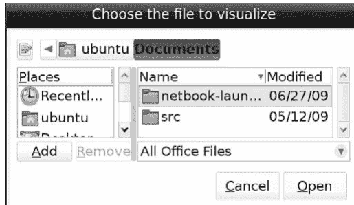

图 6-1

```bash
$ apt-get install treb

$ treb
```

## 多媒体用户

为多媒体用户组提供设备的供应商拥有一个从当前智能手机市场发展而来的预存在且现成的市场。尽管多媒体通常与图像、文本相关，但它也可以指整合了广泛兴趣数据的应用程序。移动设备上最知名且最流行的应用程序可能是 Canola。它是使用 Python 和 Enlightenment Foundation Libraries (EFL) 构建的，并使用插件系统来启用 YouTube、Flickr 等。Google Summer of Code 2009 有一些项目被批准，用于为 Twitter、Remember the Milk 甚至一个 IM 客户端创建插件。

EFL 在第 4 章中有更详细介绍。

另一个可用的解决方案是名为 Entertainer 的媒体中心。它旨在为 Gnome 和 XFCE 环境提供一个简单易用的应用程序。Entertainer 完全用 Python 编写，并使用 GStreamer 的多媒体框架进行多媒体播放。用户界面使用 Clutter 库实现。

Clutter 在第 4 章中有更详细介绍。

# 第 6 章：应用程序选择

## 实际示例

Entertainer 还包含一个私人视频录制器，这意味着它可以用于观看电视并录制节目供以后观看。要安装 entertainer，将 entertainer PPA 添加到 `/etc/apt/sources.list`：

```text
deb http://ppa.launchpad.net/entertainer-releases/ppa/ubuntu jaunty main
deb-src http://ppa.launchpad.net/entertainer-releases/ppa/ubuntu jaunty main
```

然后执行：

```bash
$ sudo apt-get update && sudo apt-get install entertainer
```

还将 GPG 密钥添加到您的软件源认证中（系统 ⇩ 管理 ⇩ 软件源 ⇩ 认证）。选择“导入密钥文件...”并添加在 entertainer 页面找到的密钥。

然后运行内容管理器并选择设备上的某些媒体文件夹或提供 URL：

```bash
$ entertainer-content-manager
```

内容管理器的界面类似于图 6-2。

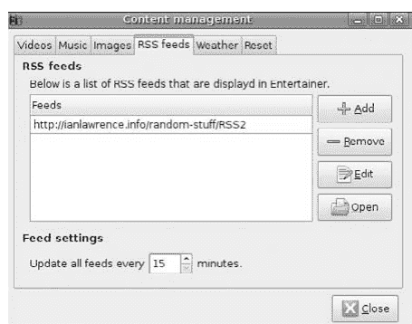

图 6-2

接下来，运行前端：

Ubuntu Netbook Remix 上的 Entertainer 看起来像图 6-3。

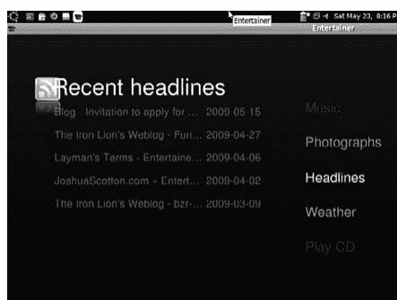

图 6-3

退出 Entertainer 请按 `Q` 键。接下来将解释其他有用的键命令。

### Entertainer GUI 中的常用快捷键绑定

Entertainer 通过键盘控制，如下：

- `F` — 切换全屏开启/关闭。
- `P` — 在视频或音频播放时切换暂停/播放。
- `S` — 停止播放。
- `H` — 导航到主屏幕；在任何地方按此键都会显示主菜单。
- `I` — 在全屏模式下切换信息。
- `1`, `2`, `3`, `4` — 更改视频宽高比例。
- 方向键 — 导航菜单。
- `Enter` — 选择菜单项。
- `Backspace` — 导航到上一个屏幕。

## 社交网络用户

这一市场群体有时被营销人员称为 Y 代（Gen Y）（这是 X 代术语的延续，通常被理解为出生在 20 世纪 80 年代和 90 年代的人）。这显然是一个巨大的市场，对设备制造商和 ISV 具有很大的吸引力。该群体的人对互联网非常熟悉，特别是在 Facebook、Twitter 和 MySpace 等社交网络上。由 Junco 和 Jeanna Mastrocisca 在其书籍《连接网络：高等教育专业人员需要了解的现状》中对美国 707 名大学生进行的调查显示，同认同是一个关键动力。该调查的其他有趣点是：

- 97% 拥有电脑。
- 97% 使用对点传输下载过音乐和其他媒体。
- 94% 拥有手机。
- 76% 使用社交网络网站。
- 75% 的大学生拥有 Facebook 账号。
- 60% 拥有某种类型的便携移动设备。

## 位置感知型用户

家有年迈父母和幼儿的用户认为“位置”概念对他们非常重要。这组用户的可用收入也较高，因为他们已经工作多年，因此对 OEM 来说是一个很有吸引力的市场。用户对位置感知移动设备的通用期望包括：

- 自动重新配置的能力，使其始终使用正确的网络设置（用于防火墙和 VPN），并打印到正确的打印机（即：在家里使用家用打印机，在办公室时使用工作打印机）
- 安全性，仅允许指定的物理位置访问
- 帮助查找丢失或被盗的设备
- 能够轻松与房间内的其他人共享电源或演示文稿，而无需通过电子邮件发送或在公共服务器上设置文件夹

这些功能的一部分可以使用运行在设备本地的简单 Web 界面呈现给用户。

# 实际示例

在本节中，你将学习如何为 MID（多媒体设备）创建一个支持 GPS 的独立 Web 应用。它使用 Python 应用嵌入了 Web 服务器和数据库，并通过 XML-RPC 从 D-Bus 接口接收信息。它使用了 Django Web 应用框架。

D-Bus 将在第 4 章中详细介绍。

## 背景

传统上，Debian 类系统使用一个名为 `gpsd` 的守护进程提供 GPS 服务。然而，在资源受限的环境中 `gpsd` 存在一些问题，最主要由于 `gpsd` 被设计为系统启动时运行，系统关闭时停止（或在 USB/蓝牙设备热插/拔出时）。在这种情况下，如果客户端在 `gpsd` 运行之前启动（例如，在连接蓝牙设备之前启动了 GPS 插件），它获取 `gpsd` 信息的唯一方法就是尝试连接到 socket 并频繁尝试，直到成功。

这使得客户端程序非常忙碌，必须不断唤醒检查是否可以连接。在电池供电的系统中，拥有无法频繁睡眠的进程是一件糟糕的事情。此外，`gpsd` 提供的信息粒度也存在问题，因为运行的客户端会收到所有通知，即使它们并不感兴趣。它在每接收到 NMEA 句子时都会发布新的定位，对于大多数 GPS 设备来说，这大约是每五秒一次，每次即使客户端不关心已更改的数据，它们都会被唤醒。

`gpsd` 无法让客户端表示它们只对位置数据感兴趣，或者设备是否有定位感兴趣。即使 GPS 单元是静止的，卫星数据也会不断变化，客户端会在每条消息时被唤醒。由于这些问题，Alan Holmes 手写了 `gypsy`。这是一个 GPS 复用守护进程，提供了对 GPS 信息更精细的控制，并允许程序调用以下对象：

- `Gypsy Position` — 用于位置信息
- `Gypsy Course` — 用于航向信息
- `Gypsy Accuracy` — 用于精度信息

## 实现

首先，安装 Django：

```bash
sudo apt-get install python-django
```

在主目录下创建一个名为 "Web" 的目录，并进入：

```bash
mkdir Web
cd Web
```

接下来，创建一个目录：

```bash
mkdir django_projects
```

进入项目目录并使用 Django 命令行工具启动项目。这将创建基础目录结构和必要的配置文件：

```bash
cd django_projects
django-admin startproject locate
```

> 不要使用 upache、postgresql 或 mysql。这些对于嵌入式设备并不适用。应用将使用 Cherry Py WSGI 服务器和 SQLite。

编辑 `settings.py` 使其如下：

```python
DATABASE_ENGINE = 'sqlite3'
DATABASE_NAME = os.path.join(os.path.dirname(__file__), 'data', 'locate.db')
DATABASE_USER = '' # SQLite3 不使用
DATABASE_PASSWORD = '' # SQLite3 不使用
```

`DATABASE_NAME` 的技巧允许 SQLite 文件系统数据库存储在项目内部的 `data` 文件夹中。在使用版本控制系统时，这是一个优势。类似的技巧适用于站点媒体——在项目根目录创建一个 media 文件夹，然后在 `settings.py` 中编写：

```python
import os, sys
path = os.path.dirname(sys.argv[0])
full_path = os.path.abspath(os.path.join(path, '../media'))
```

然后将 `STATIC_ROOT` 变量设置为该路径：

```python
STATIC_ROOT = full_path
```

最后，在 `urls/media.py` 中导入 Django 设置。将 `static.serve` 设置为：

```python
r'media/(?P<path>.*)$', 'django.views.static.serve',
{'document_root': settings.STATIC_ROOT, 'show_indexes': True},
```

同时在项目目录创建一个名为 "server" 的文件夹。在这个文件夹内部保留一个独立服务器的副本：

```bash
wget http://svn.cherrypy.org/trunk/cherrypy/wsiserver/__init__.py -O wsiserver.py
```

创建一个名为 `run.py` 文件，内容如下：

```python
import wsiserver
# 这可以来自 cherrypy
import os
from django.conf import settings
from django.core.wsgi import get_wsgi_application

if __name__ == "__main__":
    server = wsiserver.pyWSGIServer('0.0.0.0', 8000)
    server.start(get_wsgi_application())
```

## 第 6 章：应用选择

GPS 状态显示如图 6-8 所示，同时附有一个从地图 API 获取的位置小地图。

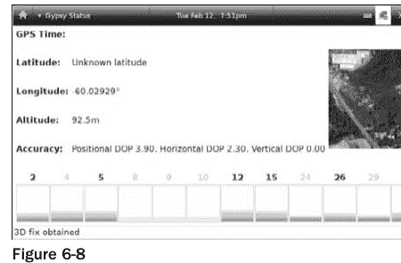

图 6-8

### D-Bus 和 HTTP 请求

可以在不启动某种循环（例如对 `DBusMainLoop` 的调用）的情况下对 D-Bus 查询。

你可以在 `status.py` 中看到它。这种循环条件在本地运行的 Web 应用中不会发生，因此需要一些备选解决方案。

XML-RPC 是一种允许运行在不同操作系统和不同环境下的软件通过互联网进行过程调用的方法。它的远程过程调用使用传输层并以 XML 作为编码。Django 已经提供了一个现成的 XML-RPC 服务器，因此你可以在应用程序内部的 http://code.google.com/p/django_xmlrpc/ 处找到相关代码。我们在 `settings.py` 中定义了一个方法：

```python
XMLRPC_METHODS = {
    # 列出要以表单形式 (name, function) 暴露的方法
    ('django.xmlrpc.views.handle_xmlrpc', 'handle_xmlrpc'),
    ('django.xmlrpc.views.handle_gypsy', 'handle_gypsy'),
}
```

在 `django.xmlrpc.py` 中，创建一个如下的方法签名：

```python
xmlrpc_func(returns='string', args=['string', 'int', 'int', 'int'])
def handle_gypsy(timestamp, latitude, longitude, altitude):
    """从 gypsy XML 对象中获取我们需要的值并将其存储在数据库（或文件系统）中"""
    data = Raw(timestamp=timestamp, lat=latitude, long=longitude, alt=altitude)
    data.save()
    # 返回传入的值（用于调试）
    return "The timestamp is %s, the latitude is %i, the longitude is %i, and the altitude is %i." % (timestamp, latitude, longitude, altitude)
```

XML-RPC 客户端需要将 GPS 对象传递给图 6-9 中 Django 管理对话框所示的 `handle_gypsy` 函数。

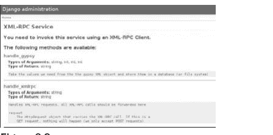

同样使用 `django_xmlrpc` 集成创建一个 `models.py` 文件来存储从 `django.import` 的 GPS 数据：

```python
class Raw(models.Model):
    time = models.CharField(max_length=200)
    lat = models.FloatField()
    long = models.FloatField()
    alt = models.FloatField()

def __unicode__(self):
    return self.time
```

在 `gypsy.py` 中添加以下内容：

```python
import xmlrpcclient
```

接下来，添加以下内容：

```python
gps.Start():
server = xmlrpcclient.ServerProxy('http://127.0.0.1:8000/xmlrpc/')

def position_changed(fields, timestamp, latitude, longitude, altitude):
    server.handle_gypsy(timestamp, latitude, longitude, altitude)
```

代码将 GPS 数据解析到 Django 应用中。

剩下的就是查询数据库获取最后一个 GPS 位置，以便在 Web 界面中使用。创建一个名为 `geoveapp` 的应用，其 `views.py` 文件如下：

```python
# 在此处创建你的视图。
from django.http import HttpResponse
from locate.django_xmlrpc.models import Raw
from django.shortcuts import render_to_response

def get_position(request):
    latest_GPS = Raw.objects.all().order_by('-id')[:1]
    return render_to_response('location_list.html', {'latest_GPS': latest_GPS})
```

接下来，创建一个模板：

```html
```


<html>

<head></head>

<body>



<ul>

    

    <li>

        I am located at <a href="http://geohash.org/?q={{co.lat}},{{co.long}}">URL.</a>.

    </li>

    

</ul>



    No coordinates



</body>

</html>

```

这使用了 geohash.org，这是一种由 Gustavo Niemeyer 在编写 geohash.org Web 服务时发明的经纬度地理编码系统，并已进入公共领域。它提供了短 URL 来唯一标识地球上的位置，因此在电子邮件、论坛和网站中引用它们会更加方便。

图 6-10 显示了我们在编写这段代码（以及编写此书）时所在的位置。


图 6-10

## 总结

本章强调了 OEM（原始设备制造商）在考虑设备的“外观和感受”时可以针对的一些潜在用户群体。这并不是一个全的列表，还有其他重要的群体。例如，Ubuntu Mobile 团队成员识别出的一类用户位于亚洲，特别是日本，那里有许多人在乘坐公共交通工具时仅使用设备阅读电子书。如何针对这类群体留由你决定。这种挑战要求 OEM 创造性地思考如何与市场上的其他产品区分来。本章希望对这一过程提供一些见解。

---

# 第 7 章：主题（Theming）

这将根据可用设置显示界面。除了使用前端的 `gconf-editor` 外，还可以美观地检查设置。运行以下命令：

```
$ gconftool-2 -R /desktop/gnome
```

这会显示 Ubuntu 移动桌面的设置。运行以下命令：

```
$ gconftool-2 --get-default-source
```

这会显示 XML 后端的位置，GConf 使用其作为数据库。

## 修改主题

自定义主题通常是必要的，特别是在与 OEM 厂商合作时。在《GNOME 首页界面指南》发布之前，你可能想阅读《[视觉设计](http://library.gnome.org/devel/hig-book/stable/)》，该书开头如下：

> 视觉设计不仅仅是为了让你的应用程序美观。一个良好的应用程序会让使用户更容易地理解所呈现的信息，并清晰地向他们展示如何与信息进行交互。

将上述引言中的“应用程序”替换为“主题”，你就会对主题定制的目标有一个直观的理解。

## 处理主题时的实用工具

以下 bash 脚本显示了当前主题的信息。这在处理主题和 Gconf 时非常有用。

首先，安装 zenith，它是一个用于 GTK 组件的方便工具包：

```
$ sudo apt-get install zenith
```

调用名为 `get_theme_info.sh` 的脚本并像 `./get_theme_info.sh` 一样执行（需先赋予权限）：

```bash
#!/bin/bash

icons=$(gconftool-2 -g /desktop/gnome/interface/icon-theme)
theme_gtk=$(gconftool-2 -g /desktop/gnome/interface/gtk-theme)
theme_metacity=$(gconftool-2 -g /apps/metacity/general/theme)
font_gtk=$(gconftool-2 -g /desktop/gnome/interface/font_name)
font_meta=$(gconftool-2 -g /apps/metacity/general/titlebar_font)

echo "icons: $icons"
echo "GTK theme: $theme_gtk"
echo "metacity theme: $theme_metacity"
echo "gtk font: $font_gtk"
echo "metacity font: $font_meta"
```

结果显示了图 7-1 所示的信息。

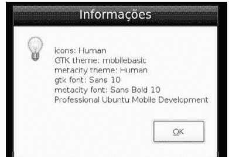

图 7-1

## 主题结构

本节探讨了 Ubuntu MID 的移动主题。该主题基于 Hildon 的主题结构，Ubuntu 从上游继承了该结构。布局（位于 `/usr/share/themes/mobilebasic`）如下：

- `/usr/share/themes/mobiletheme/gtk-20/`
  - `index.theme`
  - `gtkrc`
  - `gtkrc.cache`
  - `images/`
    - `*.png`
  - `matchbox/`
    - `theme.xml`

该结构中的两个主要文件是 `theme.xml` 和 `gtkrc`。

### theme.xml 文件

通过修改 `theme.xml` 文件中的内容，可以实现简单的窗口装饰自定义。它还定义了主栏装饰和一些对话框装饰。

`theme.xml` 文件中的三个基本资源是：

- 颜色（Colors）
- 字体（Fonts）
- 图像（Images）

在使用它们之前，以以下格式声明它们：

```
id :definition
```

例如：

```
<type id="object name" definition="data" />
```

其中 `type` 是颜色、字体或位图，`id` 是对象的唯一名称，`definition` 是要设置的元数据。

颜色定义如下：

```
<color id="osso-DialogTextColor" def="#ffffff" />
```

字体定义如下：

```
<font id="osso-TitleFont" def="Nokia Sans-17.85" />
```

图像定义如下：

```
<pixmap id="dialogoptile" filename="../qgn_plat_dialog_frame_tile_top.png" />
```

### gtkrc 文件

涉及 `gtkrc` 文件的复杂自定义。该文件对于 Ubuntu Netbook Remix 和 Ubuntu MID 的主题是通用的；从概念上讲，可以认为 GTK 主题“存在”于 `gtkrc` 文件内部。文件格式对大小写敏感，注释用 `#`（井号）标记。也可以使用类似于 `/* * */` 的注释进行多行注释。

`gtkrc` 文件是一个由一系列声明组成的文本文件。在解析 `gtkrc` 时，井号字符会删除注释并忽略 `#` 之后的部分。

> 此 gtkrc 对拼写错误和错误的容忍度较低，更改代码时要小心。

## 自定义 gtkrc 文件

以下 `gtkrc` 文件将主题应用到所有组件（按钮、滚动条、编辑框）。

从技术上讲，每个组件都派生自 `GtkWidget`。这意味着对 `GtkWidget` 的更改将影响所有组件。

（注：此处原文示例代码未翻译，保持格式）

结果显示了图 7-1 所示的信息。


图 7-1

## 第 7 章：主题定制

打开此文件夹下的 `theme.xml`，并将元数据的第一行更改为：

```xml
<theme name="pumdtheme" author="Ian Lawrence" desc="A theme created for the book Professional Ubuntu Mobile Development, published by Wiley version="0.1*" engine_version="1" cache="false">
```

接下来，修改以下内容：

```xml
<color id="osso-TitleTextColor" def="#eec73e" />
<color id="osso-DialogTextColor" def="#403008" />
```

对于新的 MID，将 `gtk-20` 文件夹下 `gtkrc` 文件中的颜色定义更改为：

```bash
color["DefaultTextColor"] = "#eec73e"
color["EmTextColor"] = "#204a87"
color["PaintedDefaultTextColor"] = "#ffffff"
color["DisabledTextColor"] = "#babdb6"
color["ProgressText1"] = "#000000"
color["ProgressText2"] = "#000000"
color["SecondaryTextColor"] = "#5a5a5a"
color["TitleTextColor"] = "#000000"
color["DialogTextColor"] = "#403008"
```

这些步骤会更改主题中的字体颜色。

打开主目录下的 `theme.index` 文件并将其更改为：

```ini
[Desktop Entry]
Type=X-Hildon-Metatheme
Name=PUMTheme
Icon=/usr/share/themes/pumdtheme/Images/qn_plat_theme_thumbnail.png
Encoding=UTF-8

[X-Hildon-Metatheme]
GtkTheme=pumdtheme
IconTheme=gnome
X-MatchboxTheme=pumdtheme
X-OperaSkin=default.zip
```

同时，修改 `images` 文件夹中相应的图像。处理图像时可以使用一个名为 `xmag` 的实用工具，它由 `x11-apps` 软件包提供：

```
apt-install x11-apps
```

`x11-apps` 提供了系列随 X Window System 附带的杂项 X 应用，包括 `xmag`、`x11` 和 `x11forcomp`，这些都是用于测试 X Window System 下图形操作性能的工具（参见“主题性能测试”章节）。

完成上述所有更改并修改相应的图像将创建一个新主题。例如，图 7-2 所示的主题是基于 Ubuntu MID 的 Intrepid 发布版本。如果你没有新图像要添加，也可以清楚地看到终端带来的更改（终端颜色发生了变化）。

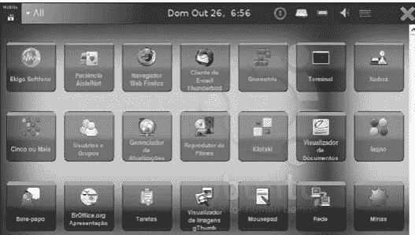

图 7-2

可以在默认主目录中包含一个 `.gtkrc-2.0` 文件来加载主题（这之所以有效是因为它加载了用于图标的 XSETTINGS）。

> XSETTINGS 是 Linux 上的一种机制，允许配置设置，并在运行时在所有应用程序中准备好这些设置。

用户主目录下的一个简单的 `gtkrc-2.0` 文件可以包含一个文件，如下所示：

```
$ cat ~/.gtkrc-2.0
include "/usr/share/themes/pumhtheme/gtk-2.0/gtkrc"
```

## 自动为 MID 设置主题

在上一节中，我们手动为 Ubuntu MID 设置了主题。可以通过 `hilden-theme-tools` 软件包来自动化此过程。使用 `apt` 安装：

```
$ sudo apt-get install hilden-theme-tools
```

该软件包包含了多种用于 Ubuntu MID 主题定制的工具。首先安装 `subprocess` 软件包：

```
$ sudo apt-get install subprocess
```

然后运行以下命令：

```
$ hilden-theme-bootstrap
```

这将一个骨架主题下载到指定的目录。进入模板目录，并在使用 GIMP 等图像编辑器时根据需要编辑 `template.svg`。

> 请确保你选择了第二个选项，2) hilden-theme-layout-4，因为 MID 不支持 layout-3。

接下来，为了构建该包的 debian 包，需要修改 `debian` 文件夹中的几处内容。在 `control` 文件中，删除对 `hilden-theme-cacher` 的依赖。在 `postinst` 文件中，删除 `DEBUILD` 之上调用主题缓存实用工具的行：

```
hilden-theme-cacher 用于缓存 gtkrc 文件 —— 在 Ubuntu MID 上不使用它。
```

接下来，安装构建主题包所需的依赖项：

```
$ sudo apt-get install fakeroot hildon-theme-layout-4 cdbs debhelper dpkg-dev
```

运行以下命令构建包：

```
$ dpkg-buildpackage -tc -rfakeroot
```

这将创建一个 `.tar.gz` 和一个 `.deb` 文件——例如，`hildon-theme-pumd_4.2.0-1_all.deb`。

`data` 目录下的 `Makefile` 会调用 `hildon-theme-subst`（`hilden-theme-tools` 软件包中的另一个工具），它会对 `gtkrc` 文件进行替换。

生成的 `deb` 文件可以部署到 PPA 或使用以下命令进行本地安装：

```
$ dpkg -i hildon-theme-pumd_4.2.0-1_all.deb
```

## 主题性能测试

可以对主题运行一系列性能测试。最简单的测试方法是使用 `metacity-theme-viewer`。

Metacity 是 GNOME 默认使用的复合式窗口管理器。

在 Ubuntu 上运行以下命令：

```
$ metacity-theme-viewer Human
```

它将输出以下结果：

- 在 0.02 秒内加载了主题 "Human"
- 在 0.61 客户端秒内绘制了 100 帧（每帧 16.1 毫秒），包括 X 服务器资源在内的墙钟时间为 3.4817 秒（每帧 34.8167 毫秒）

### 测试 Human Metacity 主题

该主题在所有标签页中都能正常渲染。还有一个 Benchmark（基准）标签页，用于与其他主题比较速度。例如，Ubuntu Remix 上的 Human 主题绘制一个窗口框需要 34.8167 毫秒，而 Simple 主题需要 84.8415 毫秒。

另一个用于 GTK+ 主题的基准测试工具叫做 GtkPerf。它可以通过 apt 安装（`sudo apt-get install gtkperf`）。该工具也适用于 Ubuntu MID。

可以像这样运行它：

```
gtkperf -a c 1000
```

### 比较

以下是在 LPIA 架构上对主题和网络启动器的测试结果。该设备是华硕 Acer Aspire One：

| 指标 | 结果 |
| :--- | :--- |
| GtkPerf 0.40 - 开始测试：2009年6月7日 周日 21:00:09 | |
| GtkEntry - 时间 | 1.31 |
| GtkComboBox - 时间 | 53.03 |
| GtkComboBoxEntry - 时间 | 35.79 |
| GtkSpinButton - 时间 | 7.05 |
| GtkProgressBar - 时间 | 15.13 |
| GtkToggleButtonButton - 时间 | 9.06 |
| GtkCheckButton - 时间 | 7.59 |
| GtkRadioButton - 时间 | 11.90 |
| GtkTextView - 添加文本 - 时间 | 17.83 |
| GtkTextView - 滚动 - 时间 | 17.47 |
| GtkDrawingArea - 线条 - 时间 | 25.75 |
| GtkDrawingArea - 圆形 - 时间 | 34.02 |
| GtkDrawingArea - 文本 - 时间 | 31.43 |
| GtkDrawingArea - Pixbufs - 时间 | 3.89 |
| **总时间** | **424.30** |

以下是在 XFACE 架构上对相同的 `xfce-ubuntu-golden` 主题和自定义启动器进行相同测试的结果：

```
GtkPerf 0.40 Starting testing: Sun Jun 14 13:56:20009

GtkEntry - time: 1.16
GtkComboBox - time: 27.28
GtkComboBoxEntry - time: 20.25
GtkSpinButton - time: 2.94
GtkProgressBar - time: 2.19
GtkToggleButton - time: 2.77
GtkCheckButton - time: 2.25
GtkRadioButton - time: 3.02
GtkTextView - Add text - time: 160.87
GtkTextView - Scroll - time: 12.03
GtkDrawingArea - Lines - time: 32.52
GtkDrawingArea - Circles - time: 33.27
```


# GtkDrawingArea 性能测试结果

## 测试环境 1

- GtkDrawingArea - Text - time: 39.06
- GtkDrawingArea - Pixbufs - time: 5.12
- Total time: 344.77

## 测试环境 2：开箱的 Ubuntu Remix i386 默认设置

```bash
GtkPerf 0.40 Starting testing: Sun Jun 14 22:36:052009

GtkEntry - time: 1.09
GtkComboBox - time: 31.86
GtkComboBoxEntry - time: 17.61
GtkSpinButton - time: 5.84
GtkProgressBar - time: 16.18
GtkToggleButton - time: 4.72
GtkCheckButton - time: 4.38
GtkRadioButton - time: 8.00
GtkTextView - Add text - time: 152.51
GtkTextView - Scroll - time: 12.92
GtkDrawingArea - Lines - time: 31.97
GtkDrawingArea - Circles - time: 29.94
GtkDrawingArea - Text - time: 22.76
GtkDrawingArea - Pixbufs - time: 4.73
Total time: 344.51
```

从这些结果中注意的最明显的区别是，LPIA 架构上的性能比默认的 Ubuntu Remix 差得多。此外，默认版本与 XFACE 版本之间的差异非常小——仅在 GtkTextView 上如此。

在 xorg 配置中将 `RenderAccel` 设置为 `true` 可以提升性能。要做到这一点，请备份配置 `/etc/X11/xorg.conf`。一个很好的方法是运行以下命令：

```bash
$ sudo cp /etc/X11/xorg.conf /etc/X11/xorg.conf.bak
```

然后在该文件中添加以下内容：

```text
Section "Device"
    Identifier "Graphics Card"
    Option "RenderAccel" "true"
EndSection
```

# 第 8 章：内核微调

## 创建 Ubuntu 软件包

如前所述，这种方法会创建一个 Ubuntu 内核包。Ubuntu 的内核源码包含许多脚本，能够以自动化方式生成内核包。因此，作为该方法的前提条件，用户应该从 Ubuntu 获取源码。

下载内核源码有两种选择：可以从 `deb` 仓库或 `git` 仓库获取。通常情况下，来自 `deb` 仓库的源码不会像 `git` 仓库那样及时。因此，我们首先演示从 `git` 获取源码的方法，然后介绍 `deb` 仓库的使用。不过，在开始过程之前，必须安装一些依赖项：

```bash
$ sudo apt-get update
$ sudo apt-get install git-core fakeroot makedumpfile kernel-wedge
$ sudo apt-get install libcurses5-dev build-essential
$ sudo apt-get build-dep linux
```

现在，克隆 ubuntu 内核树：

```bash
$ git clone git://kernel.ubuntu.com/ubuntu/ubuntu-jaunity.git \
  ubuntu-jaunity.git
$ cd ubuntu-jaunity.git/
```

第一步是将新变体添加到构建脚本中。在下面显示的两个文件中，将其添加到 `lpia` 架构中：

```bash
$ cd debian/
$ cd scripts/misc
$ sed -e s/getall\ lpia\ lpia/getall\ lpia\ lpia\ lpiacustom/ -i getabis
$ cd ../
$ cd rules/
$ sed -e s/lpia/lpia\ lpiacustom/ -i lpia.mk
$ cd ../
```

现在进入 `config` 目录。这里是修改所有指定架构配置设置的地方：

```bash
$ cd config/lpia/
```

如你在该目录中所看到的，有两个配置文件。其中一个是适用于所有变体的通用配置文件 `config`。另一个是 `config.lpia`，它是针对 `lpia` 变体的特定配置。由于新变体是基于当前的 `lpia` 变体，你可以如下所示拷贝特定的配置文件：

```bash
$ cp config.lpia config.lpiacustom
```

现在将所有变体的配置追加到文件末尾。这将使得之后移除通用配置文件成为可能，因为每个变体都将拥有自己的配置：

```bash
$ cat config >> config.lpia
$ cat config >> config.lpiacustom
```

下一步是编辑 `lpiacustom` 配置文件。可以通过以下命令手动完成：

```bash
$ vim config.lpiacustom
```

也可以通过内核的 ncurses 前端配置工具来完成。

> **注意**：Ncurses 是一个用于开发在终端下运行的类 GUI 应用程序的工具包。在继续操作之前，必须安装其头文件。

首先返回父目录：

```bash
$ cd ../../
```

现在准备内核并使用前端进行配置：

```bash
$ debian/rules prepare-lpiacustom
$ make O=debian/build/build-lpia-lpiacustom menuconfig
```

此时，应该出现一个类似于图 8-1 的屏幕。

在新变体中，你将更改一些操作，其余部分与之前的 `lpia` 变体相同。因此，选择图 8-2 中高亮的功能。

对于多处理提供了两个选项。在第一情况下，应该禁用该选项。在第二情况下，你应该选择正确的选项。这如图 8-2 所示。

请参考图 8-3 所示的目标设备配置。

在这些更改后，屏幕将如图 8-4 所示。

## 内核包控制文件示例

第三个新条目是：

```
Package: linux-image-debug-2.6.28-8-lpiacustom
Architecture: lpia
Section: devel
Priority: optional
Provides: linux-debug
Description: 2.6.28 版本 Linux 内核调试镜像
 此包为 2.6.28 版本提供了自定义的内核调试镜像。
```

此包适用于希望调试内核的站点。此包包含的内核镜像并不是用于启动的。它是未压缩且未去符号的。此包还包含了去符号后的模块。

现在所有依赖项和步骤都已完成，下一步是编译内核并生成新的自定义内核包。输入以下命令：

```bash
$ AUTOBUILD=1 NOEXTRAS=1 fakeroot debian/binaries-lpiacustom
```

此时，在等待编译结束时去喝杯咖啡是个不错的选择。当这一步完成后，你可以在父目录中找到创建的包。进入该目录并分析所有新文件：

```bash
$ cd ../
$ ls -t *.deb
```

现在已经完成了。剩下的就是使用以下命令安装内核包文件：

```bash
$ sudo dpkg -i <输入正确的文件>.deb
```

如前所述，有必要解释如何在不需要 git 版本控制的情况下获取内核源码。由于这比使用 git 并不简单多少，而且下载的源码几乎总是过时的 Ubuntu 内核版本，因此这不是更好的选择。只有在你确实不需要最新的内核，或者你倾向于这种方法时才这样做。

在继续之前，必须在 `source.list` 文件中添加 `deb-src` 条目。

接下来，通过输入命令同步包索引文件：

```bash
$ sudo apt-get update
```

现在可以直接从 debian 仓库中获取内核源码了：

```bash
$ sudo apt-get source linux-image-$(uname -r)
```

创建的目录与通过 git 工具创建的几乎相同，自定义内核的步骤也是完全一样的。

## 创建 Debian 包

如果 OEM 或用户旨在构建非 Ubuntu 内核源码或想要生成 Debian 包，那么这种方法是正确的选择，因为你想使用最新的 2.6 内核树。当然，它也适用于任何官方或非官方编译的内核。

这种方法提供了获取内核源码的两种主要方式。与之前的 Ubuntu 方法一样，可以从 git 获取，也可以从 debian 仓库获取。让我们先看看 git 仓库和 deb 源码仓库。

使用的非 ubuntu git 仓库是来自 kernel.org 的最新的 linux-2.6 内核树。然而，源码仓库可能会发生变化。同样的逻辑也适用于 deb 仓库。只有初始步骤会有所不同——即内核配置、编译和安装步骤都是相同的。

这种方法的第一步是确保设备上已经安装了内核的所有依赖项：

```bash
$ sudo apt-get update
$ sudo apt-get install git-core fakeroot makedumpfile
$ sudo apt-get install libncurses5-dev build-essential
$ sudo apt-get install kernel-package
$ sudo apt-get build-dep linux
```

现在获取 linux 树：

```bash
$ git clone \
  git://git.kernel.org/pub/scm/kernel/git/torvalds/linux-2.6.git \
  linux-2.6.git
```

需要说明的是，该树用于开发目的，可能是不稳定的。因此，如果编译过程中出现任何错误，可以使用 git 工具切换到任何之前的版本。

这一步取决于连接速度，可能持续一段时间。完成后，将创建一个名为 `linux-2.6.git` 的目录。这是进行所有工作的地方。进入：

```bash
$ cd linux-2.6.git/
```

与第一种方法不同，这里没有预构建的可用配置文件。为了避免在寻找初始可用配置上浪费时间，只需拷贝当前内核的配置文件。这应该缩短自定义时间：

```bash
$ cp /boot/config-$(uname -r) .config
```

现在内核源码已下载，并且有一个初始配置文件。现在是时候开始配置阶段了。有很多方法可以实现这一点，这里将显示 ncurses 前端。

通过 ncurses 前端进行内核配置步骤将分别如图 8-1、8-2 和 8-3 所示。可以通过输入以下命令启动：

```bash
$ make menuconfig
```

在离开前端之前，请确保在图 8-4 所示的屏幕上选择 Yes 以确保所有内容已正确保存。

> **提示**：如果用户没有使用任何前端，在继续后续步骤之前，运行一个额外的命令来更新配置文件会很有趣：
>
> ```bash
> $ make oldconfig
> ```

现在编译并创建 Debian 包。我们在这里应该定义两个参数：`--append-to-version` 名称和 `--revision` 版本号。第一个参数是目标自定义内核的简短描述。第二个参数在你以后有编译包时通知 Debian 包管理器时很有用。第一次编译将从 1 开始，每个构建的新包都会增加。

### 通过 dpkg 包下载内核源码

下载内核源码的另一种方法是通过 dpkg 包。遗憾的是，使用这种方法几乎总是意味着将下载一个过时的内核版本。这里的首要操作是确定哪些版本可用：

```bash
$ sudo apt-get install linux-image-2.6
```

打印出的信息将类似于下面所示：

```text
Reading package lists... Done
Building dependency tree
Reading state information... Done
Package linux-source-2.6 is a virtual package provided by:
linux-source-2.6.26 26.26-13
linux-source-2.6.28 26.28-1
你应该显式地选择其中一个进行安装。
E: Package:linux-source-2.6 has no installation candidate
```

应该选择最新的版本：

```bash
$ sudo apt-get install linux-source-2.6.28
```

安装包后，必须通过以下命令将其提取到任何可工作的目录：

```bash
$ cd <user's directory>
$ tar xf /usr/src/linux-source-2.6.28.tar.bz2
$ cd linux-source-2.6.28
```

现在源码已准备就绪。

## 更新自定义内核树

内核会不断演进。在之前创建的自定义包之后，新版本的内核将会发布。幸运的是，git 版本控制工具支持更新修改过的内核树（至少比重新应用之前显示的所有更改要省力）。

我们将演示更新内核树的两种场景——选择取决于是否使用了 Ubuntu 内核树。为了处理本节内容，深入了解该工具至关重要，特别是当选择第一种方法时。请参考附录 B，其中包含了任何步骤的分类。

### 更新 Ubuntu 内核树

如果你选择第一种方法，其主要优势之一是可以使用最新的 Ubuntu 内核版本。如果该 git 树中发布了新更改，可以更新下载的内核树并应用它，而无需重新进行修改。

执行此操作的第一步是验证 git 树中已修改的文件和当前分支。在进行任何操作之前，进入内核树目录。然后开始通过输入以下命令来获取当前分支：

```bash
$ git branch
```

结果应该如下：

```text
* master
```

这意味着选择了“master”分支。现在，获取所有修改文件的列表：

```bash
$ git status
```

```text
# On branch master
# Changed but not updated:
# (use "git add <file>..." to update what will be committed)
    modified: debian/config/lpia/config
    modified: debian/config/lpia/config.lpia
    modified: debian/control
    modified: debian/control.stub
    modified: debian/rules.d/lpia.mk
    modified: debian/scripts/misc/getabis
# Untracked files:
# (use "git add <file>..." to include in what will be committed)
    build/
    debian/config/lpia/config.lpiacustom
```

结果中有两个列表：“Changed but not updated”（已修改未更新）和“Untracked files”（未跟踪文件）。前者指的是所有存在但已修改的文件。后者指的是新文件（无论是用户创建的还是自动生成的）。发现的未跟踪文件可能比上述代码显示的要多。这应该不是问题。但是，如果在“创建 Ubuntu 包”期间遵循了这些步骤，第一个列表应该如所示。如果不是，请重新执行此部分。

为了保存新的自定义配置，需要在用户的 git 树中创建一个新分支——然后将“master”分支重置为其本地未修改的状态。让我们创建一个名为“custom”的新分支。

在继续更新内核之前，必须确保工作分支中没有待处理的修改。你可以再次使用 `git status` 命令：

```bash
$ git status
```

如果存在“Changed but not updated”（已更改但未更新）列表，说明工作分支不是干净的。可以使用以下命令重置工作分支并丢失所有修改：

```bash
$ git reset --hard HEAD
```

现在工作分支已经没有任何待处理的修改了。下一步是更新“master”分支：

```bash
$ git pull
```

现在会打印出大量信息。只有在显示错误信息时才需要担心。如果出现错误，最佳操作是尝试重置并重新拉取分支。这是官方 Ubuntu 分支的副本，因此补丁仅应用在“custom”分支上。为了实现本节的目标并让“custom”分支更新到最新状态，让我们再次检出“custom”分支：

```bash
$ git checkout custom
```

下一次提交将更新“custom”分支，然后将你的补丁重新应用到其之上：

```bash
$ git rebase master
```


结果是不可预测的，并且有很多方法可以解决任何可能的冲突或问题。如果一切正常，请继续下一步；如果发生冲突，扎实的 `git` 知识是基础。请参考附录 B。如果发生无法解决的冲突，最佳解决方案是将文件重置为“master”分支，然后重新进行操作。

要判断是否存在冲突，请查看在 `rebase` 操作后是否打印了类似以下（包含错误项）的消息：

```
First, rewinding to replay your work on top of it...

Applying: 1

error: patch failed: debian/control:285

error: debian/control: patch does not apply

error: patch failed: debian/control.stub:285

error: debian/control.stub: patch does not apply

error: patch failed: debian/scripts/misc/getabis:77

error: debian/scripts/misc/getabis: patch does not apply
```

然后，对于每个出错的文件，只需输入以下命令：

```bash
$ git checkout master <error file>
$ git add <error file>
```

在发生冲突的情况下，可以使用以下命令继续 `rebase` 操作：

```bash
$ git rebase --continue
```

如果文件已重置为“master”分支，则应再次对其修改。完成后，或者如果没有发生冲突，则内核已是最新的。

## 更新非 Ubuntu 内核树

第二种更新方法的执行非常简单。如果之前利用第二种方法创建了内核包，则使用此方法最佳。主要有两种手段：更新内核树和更新内核配置。

首先通过输入以下命令更新内核树：

```bash
$ git pull
```

命令完成后，下一步是更新内核目录中现有 `.config` 文件里的内核配置。如所示，既可以使用 `ncurses` 前端，也可以使用非常简单的文本界面来配置内核。通过以下命令选择 `ncurses` 前端：

```bash
$ make menuconfig
```

现在可以配置内核了。另一种可选配置方法如下：

```bash
$ make oldconfig
```

这种方法稍微复杂一些，因为对于内核中添加的每个新配置，都会弹出一个查询。前端将自动为每个新项目选择默认值，但在简单的文本界面中，也可以通过对所有问题按回车键来实现同样的效果。

## 动态内核模块支持

更多信息请参阅动态内核模块支持 (DKMS) 官方页面，你可以在 `http://linux.com/dkms/` 找到。

如前所述，DKMS 可以让内核配置更接近实际硬件，而不是使用发行版提供的通用解决方案。根据之前的方法，内核必须编译并安装。这意味着调整过的内核可能与通用内核不同，行为也不同。当然，如果源码来自稳定版本，则没有问题。

但如果 OEM 需要更新驱动版本或使用内核中不存在的驱动，是否有必要更改内核到新的（旧的）版本？答案是否定的，这得益于 Linux 内核通过加载内核模块添加新功能的能力。可以编译驱动而不触碰已配置和编译的内核。

在希望使用新的或最新的驱动版本时，OEM 更新内核有很多原因：

- 编译和安装驱动要简单快捷得多。
- OEM 可能出于兼容性考虑需要保留当前内核。
- 在某些情况下，出于可靠性考虑，禁止使用未经测试的内核。这意味着新的内核版本在推送到用户之前需要更多的验证并增加成本。
- 所需的驱动（或驱动版本）当前不在内核树中。

有很多方法可以开发位于内核之外的驱动或当前内核中应用的新版本。如果不符合标准，使用 DKMS 会更好。

## 框架内部

DKMS 框架允许你自动化构建和安装内核模块。当内核更新时，DKMS 会自动为新内核重新编译模块。

DKMS 可能的状态包括：
- **Out of tree**（树外）：源码存在但未编译或安装。
- **Added**（已添加）：模块已注册但尚未编译。
- **Built**（已构建）：模块已编译但尚未安装。
- **Installed**（已安装）：模块已编译并准备就绪。

## DKMS 命令

使用以下命令来管理内核模块：

- `dkms add <module>/<version>`：注册新的模块源码。
- `dkms build <module>/<version>`：为当前内核编译模块。
- `dkms install <module>/<version>`：安装编译好的模块。
- `dkms remove <module>/<version>`：移除模块。
- `dkms status`：显示所有管理模块的状态。

## 第 8 章：内核微调

```bash
# dkms add -m openafs -v 1.4.10 -k 2.6.29-custom
```

与 `status` 类似，`add` 是告诉你正在执行什么的操作命令。

命令中可以使用三个选项：

```bash
# dkms <command> OPTIONS:
```

- `-m`：指模块名称
- `-v`：指模块版本
- `-k`：指内核版本

现在可以重复上一步操作来查看结果：

```bash
## dkms status
openafs, 1.4.10: added
openafs, 1.4.9, 2.6.18-generic, i686: installed
```

当驱动被添加到树中后，可以使用命令构建驱动：

```bash
# dkms build -m openafs -v 1.4.10 -k 2.6.29-custom
```

此时 `dkms status` 的状态如下：

```bash
## dkms status
openafs, 1.4.10, 2.6.29-custom, i686: built
openafs, 1.4.9, 2.6.28-11-generic, i686: installed
```

驱动已经构建完成后，最后一步是安装它：

```bash
# dkms install -m openafs -v 1.4.10 -k 2.6.29-custom
```

然后，`dkms status` 将显示为 `Installed`（已安装）状态：

```bash
## dkms status
openafs, 1.4.10, 2.6.29-custom, i686: installed
openafs, 1.4.9, 2.6.28-11-generic, i686: installed
```

这意味着两个版本的驱动都已安装，按照初始计划，每个版本都安装在不同的内核中。

由于可以使用简单的 DKMS 命令构建/安装模块，因此也可以移除/卸载它们。`uninstall` 命令将已安装的驱动变为 `Built`（已构建）状态。该驱动不再存在于系统中，但无需重新构建即可再次安装：

```bash
# dkms uninstall -m openafs -v 1.4.10 -k 2.6.29-custom
## dkms status
openafs, 1.4.10, 2.6.29-custom, i686: built
openafs, 1.4.9, 2.6.28-11-generic, i686: installed
```

`dkms remove` 命令会导致驱动状态变为 `Out of the DKMS tree`（不在 DKMS 树中）。之后，需要再次添加/构建/安装驱动：

```bash
# dkms remove -m openafs -v 1.4.10 -k 2.6.29-custom
## dkms status
openafs, 1.4.9, 2.6.28-11-generic, i686: installed
```

如此处所示，使用 DKMS 框架非常简单。然而，这并不是该框架全部的功能。为了演示这一点，让我们扩展一下示例场景。如果 OEM 在许多设备上安装了其自定义内核，并且需要在所有设备上安装最新的驱动，怎么办？逐一处理每台设备将是一项巨大的工作。DKMS 可以从构建的驱动创建一个 tar 包文件，并从另一台安装了相同内核的设备上加载它。该包直接进入 `Build` 状态，且无需编译步骤即可安装。这意味着额外的设备不需要 `linux-header` 包（这只有在编译步骤中是必要的）。

驱动至少处于 `Build` 状态。因此，对于接下来的测试，`openafs-1.4.10` 驱动必须使用 `dkms` 命令编译。如果需要，OEM 可以以下操作创建 tar 包：

```bash
# dkms mktarball -m openafs -v 1.4.10 -k 2.6.29-custom
Marking modules for 2.6.29-custom (i686) for archiving...
Marking /var/lib/dkms/openafs/1.4.10/source for archiving
Tarball location:
/var/lib/dkms/openafs/1.4.10/tarball/openafs-1.4.10-kernel2.6.29-custom-i686.tar.gz
# cp /var/lib/dkms/openafs/1.4.10/tarball/openafs-1.4.10-kernel2.6.29-custom-i686.tar.gz
```

创建的文件可以被任何安装了自定义内核的设备使用。如果设备没有安装自定义内核，可以通过 `dkms` 命令删除 `/usr/src/openafs-1.4.10` 目录来模拟功能。tarball 的加载操作可以通过以下完成：

```bash
## dkms status
openafs, 1.4.10, 2.6.29-custom, i686: built
openafs, 1.4.9, 2.6.28-11-generic, i686: installed
```

通过 `dkms status` 可以看到，驱动已经处于 `Build` 状态。为了让它进入当前内核，需要再次安装它。

## 总结

在通用内核中，如果目标是大型用户群，为 OEM 提供所需的一切是非常困难的。即使可行，优化也是需要代价的。本章展示了如何通过简单的步骤实现对内核的优化。Ubuntu 是以高度去中心化的方式开发的。然而，为了对 ISV 和 OEM 社区都具有吸引力，它必须提供比专用平台更高的可靠性。独立软件供应商（ISV）是指为大众市场或小众市场创建应用程序的公司。

## 第 9 章：测试与可用性

## 为什么要测试？

测试无法完全确定软件的正确性。相反，它提供了一种比较，根据已知或预期的基准衡量软件或硬件的状态。这些基准可能包括规格、对比产品、相同产品的旧版本、用户或客户预期的相关标准。对高质量测试的需求显而易见——据估计，2002 年软件漏洞给美国经济带来了超过 595 亿美元的损失（`http://www.nist.gov/public-affairs/releases/n02-10.htm`）。据估计，如果执行更好的软件测试，可以避免其中三分之一的成本。

## Ubuntu 桌面 QA

目前，在 Ubuntu 上测试 GNOME 桌面的功能意味着使用辅助库来触发测试应用程序的用户界面组件。实现这一前提是启用辅助技术提供接口（AT-SPI）。

AT-SPI 技术正在迁移到 D-Bus。更多详情请参见第 4 章和附录 E。

在 Ubuntu Netbook Remix 上执行此操作，进入“偏好 <=> 辅助技术”，并勾选“启用辅助技术”复选框。如图 9-1 所示。


图 9-1

界面在登录时启用，需要重启 GNOME 会话（注销并重新登录）。此外，如果桌面启用了 Compiz，辅助功能将无法工作。在这种情况下，请在 gdm 中选择纯 gnome 会话。

接下来，安装 Python 包 `python-ldtp`、`python-distutils-extra` 和 `python-setuptools`（以及如果尚未安装的 Bazaar）：

```bash
$ sudo apt-get install python-ldtp python-distutils-extra python-setuptools bzr
```

## Mago — 桌面测试计划

要使用 Mago，请检出此分支：

```bash
$ bzr branch lp:mago
```

## 构建用于测试的应用程序

设置一个假设的测试场景，构建并测试示例应用程序。该应用程序是一个使用 Mozilla 库构建的嵌入浏览器。将对该应用程序的功能及其与既定 Linux 标准的合性进行测试。这种嵌入式浏览器可能适用于自助机（kiosk）应用程序，这些应用可能不需要浏览器的全部功能。

## 应用创建

启动 Glade 并创建一个包含窗口、垂直框和工具栏的界面。对于每个项目项，设置其可访问性名称（accessibility name）和描述（description）。这允许 Mago 使用 AT-SPI 可访问性层来测试用户界面。

图 9-2 显示了 Glade 小部件树以及主窗口的可访问性属性。

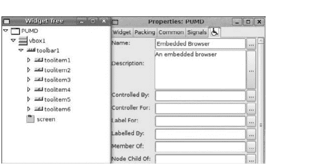

URL 输入框需要处于激活状态。要实现这一点，请点击文本输入以便在属性窗口中激活它。然后选择 Signals（信号）选项卡并选择 Activate（激活）。文本输入在按下 Enter 键时会发出 Activate 信号。这将产生 `on_entry_activate` 默认处理程序，这是可以的。

下面的代码片段显示了 Glade 文件的开头。它展示了作为 `GtkWindow` 和 `GtkBox` 启用可访问性的主要结构，因此可以用于自动化测试：

```xml
<?xml version="1.0" standalone="no"?>
<!DOCTYPE GLADE-INTERFACE-SYSTEM "http://glade.gnome.org/glade-2.0.dtd">
<glade-interface>
  <widget class="GtkWindow" id="PUMD">
    <property name="visible">True</property>
    <property name="title" translate="yes">嵌入浏览器</property>
    <property name="type">GTK_WINDOW_TOPLEVEL</property>
    <property name="window_position">GTK_WIN_POS_NONE</property>
    <property name="modal">False</property>
    <property name="resizable">True</property>
    <property name="destroy_with_parent">False</property>
    <property name="icon">pixmaps/hello-world-48x48.png</property>
    <property name="decorated">True</property>
  </widget>
```

```xml
<property name="skip_taskbar_hint">False</property>
<property name="skip_pager_hint">False</property>
<property name="type_hint">GTK_WINDOW_TYPE_NORMAL</property>
<property name="gravity">GTK_GRAVITY_NORTH_WEST</property>
<property name="focus_on_map">True</property>
<property name="urgency_hint">False</property>
<accessibility>
  <atkproperty name="AtkObject::accessible_description" translatable="yes">
嵌入式浏览器</atkproperty>
</accessibility>
<child>
  <widget class="GtkBox" id="vbox1">
    <property name="visible">True</property>
    <property name="homogenous">False</property>
    <property name="spacing">0</property>
    <accessibility>
      <atkproperty name="AtkObject::accessible_name" translatable="yes">vbox1</atkproperty>
      <atkproperty name="AtkObject::accessible_description" translatable="yes">
主框</atkproperty>
    </accessibility>
  </widget>
</child>
```

注意前述代码中的可访问性节点，它由以下内容表示：

```xml
<accessibility>
```


<atkproperty name="AtkObject::accessible_name" translatable="yes">vbox1</atkproperty>

<atkproperty name="AtkObject::accessible_description" translatable="yes">主框</atkproperty>

</accessibility>

浏览器是一个包装器，它通过调用 `self.widgets = gtk.XML("pumd.glade")` 来初始化 GNOME 应用并加载所有部件。以下是浏览器的代码：

```python
#!/usr/bin/env python

import gtk
import gnome_ui
import gtk_glade
import gtk_mozembed

APPNAME="Pumd"
APPVERSION="01"

class BrowserWrapper:

    def __init__(self):
        # 注册为 Gnome 应用
        gnome.init(APPNAME, APPVERSION)
        # 加载 glade 文件
        self.widgets = gtk.glade.XML("pumd.glade")
        # 创建一个部件持有浏览器
        self.mozillaWidget = gtkmozembed.MozEmbed()
        # 将部件添加到程序
        self.widgets.get("screen").add(self.mozillaWidget)
        self.mozillaWidget.set_size_request(800,600)
        # 显示部件
        self.mozillaWidget.show()
        self.mozillaWidget.load_url("https://www.ubuntu.com/MobileAndEmbedded")

signalDic = {"on_entry_activate": self.on_entry_activate}
self.widgets.signal_connect(signalDic)

def on_entry_activate(self, widget):
    self.mozillaWidget.load_url(widget.get_text())

if __name__ == "__main__":
    # 调用模块
    widgets = BrowserWrapper()
    gtk.main()
```

此示例程序不会正常退出。你可以轻松地调用它，但仍然需要 `Ctrl+C` 来杀死程序。

将此文件放在文件夹中并创建一个名为 `pixmaps` 的子文件夹用于图标；图标可以在 Glade 文件中更改：

```xml
<property name="icon">pixmaps/hello.png</property>
```

通过使 Python 文件具有执行权限并使用解释器运行浏览器：

```bash
$ chmod +x pumd.py
$ ./pumd.py
```

并不真的需要调用 Python 解释器。前面的命令可以替换为 `./pumd.py`。现在浏览器已经在工作，可以对其进行测试。使用 Mago 进行测试的意义在于它在应用程序和标准之间开发了更紧密的集成。

## 使用 Mago 测试

从根目录，编辑 `mago/test_suite/ubuntu.py` 并添加以下内容：

```python
class PumdTestSuite(SingleApplication):
    APPLICATION = "pumd"
```

将 `Pumd` 类注册为一个新套件。接下来，为 `Pumd` 类添加代码，它将初始化应用程序并提供一些实用函数。代码添加到 `mago/application/ubuntu.py`：

```python
from time import sleep
import tempfile
```

注意这是 `Application` 类的子类以及浏览器的完整路径：

```python
class Pumd(Application):
    ITEM = "EmbeddedBrowser"
    WINDOW = "EmbeddedBrowser"
    LAUNCHER = "/home/user/Dev/testing/mago/browser/pumd.py"

    def __init__(self):
        """
        Embedded 类初始化方法
        """
        self.screenshots = []
        Application.__init__(self)

    def open(self):
        """
        打开 Embedded Browser 应用，如果没有正常启动则抛出错误
        """
        try:
            Application.open(self)
        except dtp.ExecutionError:
            raise dtp.ExecutionError("应用程序未正常启动.")

    def grab_image_and_wait(self):
        sleep(1)
        screenshot = dtutils.imagecapture(outFile=tempfile.mktemp('.png'))
        self.screenshots.append(screenshot)
        return screenshot
```

套件注册且类完成后，现在可以使用它为浏览器编写测试。这是通过在 mago 代码根目录下创建一个文件夹（以要测试的应用程序命名）并向该文件夹添加 Python 文件和 XML 文件来实现。Python 文件如下：

```python
from mago.test_suite.ubuntu import PumdTestSuite
from time import sleep

class PUMP(PumdTestSuite):
    def testOpenMenu(self, menuitem=None, windowame=None, closetype=None, closename=None, oracle=None):
        self.application.set_name(windowame)
        self.application.open()
        sleep(20)
        screeny = self.application.grab_image_and_wait()
        try:
            screeny
        except Exception, e:
            print "未返回截图"
            raise e
```

XML 文件如下：

```xml
<?xml version="1.0"?>
<suite name="pump">
  <class>pumd.Pumd</class>
  <description>
    用于验证浏览器是否正确启动的测试。
  </description>
  <case name="Open Embedded Browser">
    <method>testOpenMenu</method>
    <description>它打开了嵌入浏览器</description>
    <args>
      <menitem>mnuEmbeddedBrowser</menitem>
      <windowame>frm_EmbeddedBrowser</windowame>
    </args>
  </case>
</suite>
```

（注：此处原文 XML 中的 `<class>` 应与类名对应）

同样注意 `<class>` 标签包含了 `.py` 文件的模块名和 Suite 类名。通过以下命令运行测试：

```bash
PYTHONPATH=. ./bin/mago -a pumd
```

结果——如图 9-4 所示——将被放在 `~/.mago/pumd` 文件夹中。

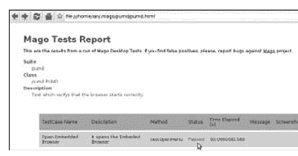

图 9-4

这显示浏览器打开通过了，并显示了运行测试的时间。如果测试失败，将拍摄截图并放在 `~/.mago/pumd/screenshots` 文件夹中，错误将记录在 `~/.mago/pumd/pumd.log` 文件中——这两者对调试都有帮助。

## 第 9 章：测试与可用性

## Linux 应用基础与认证

LSB 测试套件包含了用于分析软件包依赖项（外部所需的库和接口）的工具。特别是，ATK 帮助开发者测试其应用程序对 LSB 的兼容性，并为 LSB 认证提供了便捷步骤。

# 安装 LSB 应用测试套件

首先，从 http://www.linuxfoundation.org/en/Downloads 下载工具包。接下来，在下载目录中运行 `install.sh` 脚本。该脚本会询问几个问题，并使用 `dpkg` 安装软件包：

> 此系统似乎是 Debian GNU/Linux 的变体，例如 Debian 本身、Ubuntu、MEPIS、Xandros、Linspire 等。
> 是否正确？
> 为了安装这些软件包，你需要管理员权限。你当前以非特权用户身份运行此脚本。
> 你可以使用 sudo。我应该使用它吗？
> 正在使用命令 `sudo /bin/sh -c` 获取 root 权限。如果提示，请输入相应的密码。
> 正在安装软件包...

# 运行 LSB 应用测试套件

工具包安装在 `/opt/lsb/app-testkit/manager`；要启动 Web 界面，运行 `/opt/lsb/app-testkit/manager/bin/lsb-atk-start.pl 8080` 然后访问 http://127.0.0.1:8080。

这将显示图 9-5 所示的测试套件。

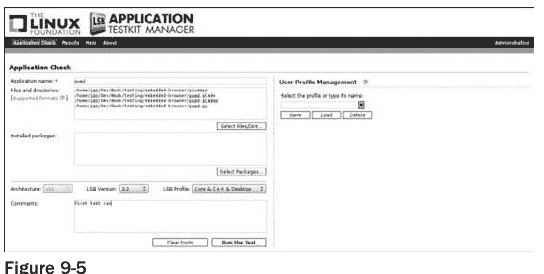

打开应用检查（Application Check）页面，指定应用程序名称和要测试的文件 `pumd.py`。

接下来，选择 LSB 版本和配置（架构字段目前无法更改），并点击运行测试（Run the Test）按钮。

测试将执行，并显示 LSB 报告页面。它包含了许多关于测试的信息。

> 从此页面，你可以为已测试的应用程序启动 LSB 认证流程。

在测试中，工具提示建议更改嵌入浏览器

```python
#!/usr/bin/env python
```

改为

```python
#!/usr/bin/python
```

此建议是为了提高应用程序在不同平台之间的可移植性。可以看出，LSB 旨在维护跨所有架构的兼容性，因此，它是开源生态系统中一个新兴的标准。拥有通过 LSB 认证的应用程序是高度推荐的，且对于大多数 ISV 来说可能正成为强制性要求。

## 其他测试工具

除了 Mago 和 LSB 之外，开源社区还开发了一系列其他测试应用程序。这些包括作为测试和基准测试平台的 Phorenix Test Suite；用于软件包测试的 `pbuilder`；以及与 Ubuntu 操作系统标准配置的一系列其他工具（如 `ps` 和 `top`）。

第 5 章解释了如何使用 `pbuilder`。

## Phorenix Test Suite

Phorenix Test Suite 设计用于对 Linux 操作系统进行定性和定量基准测试。它由一个处理核心（pts-core）和基于 XML 配置及相关资源脚本的基准测试组成。你可以在 universe 仓库中找到该应用程序。你可以使用 apt 安装它：

```bash
$ sudo apt-get install phenix-test-suite
```

要查看所有可用测试，请运行：

```bash
$ phoronix-test-suite list-tests
```

要运行测试，使用以下命令：

```bash
$ phoronix-test-suite benchmark <test>
```

运行网络测试，例如使用：

```bash
$ phoronix-test-suite benchmark network
```

应用程序将自动下载所有必要的测试文件，并提示测试选项以及是否保存结果。

该套件还支持在测试运行时监控系统传感器。测试结束时，它将提供每个传感器的高低阈值以及平均值。传感器的检测和监控通过 `lm-sensors` 和 ACPI 接口完成：

```bash
$ sudo apt-install lm-sensors
```

可以通过运行以下命令启用 `lm-sensors`：

```bash
$ sudo sensors-detect
```

> 有关传感器使用的实际示例，请参阅第 3 章。

该套件被用于对发布的 38 版本 Ubuntu Network Remix（针对 Ubuntu Jaunty）与 LPA 版本进行基准测试，该版本是通过在 MiID 基础上安装 Network Remix 桌面为本书制作的。

基准测试在网络套件以及两次测试中使用的命令上均运行：

```bash
$ MONITOR=all phoronix-test-suite benchmark network
```

使用的硬件是具有以下规格的 Acer Aspire：

```
Processor: Intel Atom CPU N270 @ 1.60GHz (Total Cores: 2), Motherboard: Acer OAA10, Chipset: Intel Mobile 945GME Express Hub + ICH7-M, System Memory: 485MB, Disk: 8GB SSDPAM08G1, Graphics: Intel Mobile 945GME IGP (rev 03)
```

安装的软件为：

- OS: Ubuntu 9.04, Desktop: GNOME 2.26.1, Display Server: X.Org Server 1.6.0, Display Driver: intel 2.6.3

两个系统之间的差异可以从下表所示：

| 测试详情 | UNR 默认 | LPIA 默认 | 差异 |
| :--- | :--- | :--- | :--- |
| MP3 编码 (encode mp3) | 163.21 | 175.22 | 12.01 |
| OGG 编码 (encode egg) | 102.05 | 91.79 | -10.26 |
| 图像编译 (compile Imageick) | 90.16 | 102.02 | 11.86 |
| 512MB 写入性能 | 33.40 | 33.31 | -0.09 |
| 512MB 读取性能 | 55.58 | 55.48 | -0.10 |
| OpenSSL (encrypt SSL) | 40.50 | 44.30 | 3.80 |
| GnuPG (encrypt 2GB) | 206.17 | 158.72 | -47.45 |
| RAM 速度 (writes RAM) | 183.82 | 170.05 | -13.77 |
| 网络测试 (network test) | 834.82 | 829.69 | -5.13 |

最明显的差异是 LPIA 根本就不是为了存在的。结果如下：

在 Ubuntu Karmic 阶段，决定取消对 LPIA 的官方支持。Ubuntu 现在将基于 Mer。Mer 是一个构建在 Ubuntu 基础基础之上并了了诺基 Maemo 平台开源元素的 Linux 操作系统。LPIA 将由 Ubuntu 社区维护。

## 第 9 章：测试与可用性

## 其他实用的 Linux 性能测试工具

Ubuntu 上已经存在多种工具，可以帮助优化性能。

## ps

这是一个允许你查看移动设备上运行的进程的工具。如果你想搜索特定的进程，以下是一条实用的命令：

```bash
ps aux | grep <something>
```

## top

Top 是一个允许你持续跟踪进程的工具；它列出了按 CPU 或内存使用率排序的进程。当与 `at` 命令结合使用时，可以调度 `top` 在特定时间运行。通过编写一个在一分钟后运行以下内容的 bash 脚本可以实现：

```bash
$ cat ./app-test.at
TERM=linux top -b -n 1 >/tmp/top-report.txt
$ at -f ./app-test.at now-1minutes
```

然后就可以启动被测试的应用并查看其资源使用情况。

## time

此工具用于测量执行时间。它接受一个命令作为参数。它执行该命令并显示关于进程消耗时间的简要统计。这可以帮助你发现某个命令耗时是否超过了预期。当然，如果你正在处理自己开发的程序，可以通过修改源码并重新编译来比较结果，这特别有用。

`time` 的用法如下：

```bash
$ time ./pum.py
real 1m41.365s
user 0m0.000s
sys 0m0.004s
```

## profinfo

负载（Load）是对任何时刻运行的活跃进程的测量值。它是运行长度和当前在 CPU 上运行的任务数的总和。结果使用名为 `profinfo` 的程序计算。以下是一个示例：

```bash
$ sudo apt install profinfo
```


$ profinfo

Memory:    Total      Used      Free      Buffers

RAM:       1017380   966680   50700    11980

Swap:      3071992   118784   295328

Boot: Mon Jun 1 20:15:21 2009  Load average: 0.53 0.54 0.41 2/274 1186

## free

此应用显示系统空闲内存量和使用的内存量：

| | total | used | free | shared | buffers | cached |
|---|---|---|---|---|---|---|
| Mem: | 1017380 | 983448 | 33932 | 0 | 13084 | 207020 |
| -/+ buffers/cache: | | 763344 | 254036 | | | |
| Swap: | 3071992 | 120572 | 2951420 | | | |

## memstat

此应用列出了所有使用虚拟内存的进程、可执行文件和共享库：

- memstat

其输出如下：

```
1032k: PID 5166 (/usr/lib/libindicate.so.1.0.0)
272k: PID 5178 (/lib/tls/1686/cmov/libnss_files-2.9.so)
736k: PID 5249 (/usr/lib/libtdl.so.7.2.0)
70984k: PID 5251 (/usr/share/fonts/truetype/ttf-dejavu/DejaVuSans.ttf)
43176k: PID 5256 (/usr/lib/libgvfscommon.so.0.0.0)
```

看看 `DejaVuSans` 字体占用的内存！

## memcheck 和 Valgrind

Valgrind 是一套用于调试和性能分析的工具集。可以通过 `apt` 安装：

- `sudo apt-get install valgrind`

接下来，启动程序以验证系统受 `memcheck` 的控制：

```bash
$ G_SLICE=always-malloc G_DEBUG=gc-friend valgrind -v --tool=memcheck --leak-check=full --num-calls=40 --log-file=valgrind.log <application_name>
```

此命令运行可能需要一段时间。

生成的 `valgrind.log` 文件显示了错误摘要：

```
=2753== ERROR SUMMARY: 0 errors from 0 contexts (suppressed: 323 from 46)
```

以及泄漏摘要：

```
=2753== LEAK SUMMARY:
=2753==definitely lost: 13,891 bytes in 43 blocks.
=2753==indirectly lost: 24,510 bytes in 1,216 blocks.
=2753==possibly lost: 1,128 bytes in 31 blocks.
=2753==still reachable: 9,878,411 bytes in 56,308 blocks.
=2753==suppressed: 0 bytes in 0 blocks.
```

## Latencytop

Valgrind 是创建高效软件的极佳开发工具。开源技术发布了 Latencytop，这是一个旨在识别系统延迟发生位置的工具。可以通过 `apt` 安装：

```bash
sudo apt install latencytop
```

首先，运行以下命令来查看 `latencytop` 产生情况：

```bash
$ latencytop
```

| Cause | Maximum |
|---|---|
| Scheduler: cpu | 12.7 |
| Waiting for event (poll) | 5.2 |
| Userspace lock | 29.1 |
| Waiting for event (select) | 4.6 |
| Memory-related | 2.7 |
| Reading from disk | 1.5 |
| Executing command | 0.4 |
| Boot-related | 0.3 |
| Scheduler: cpu | 9.1 |
| Userspace lock | 25.5 |
| Waiting for event (poll) | 4.8 |

`latencytop` 产生的结果显示了错误摘要：

（注：此处原文似乎存在部分段落的重复或错乱的描述，已根据语意进行整合翻译）

## 第 9 章：测试与可用性

## 自动提交错误报告

报告错误的简单方法是使用 Apport 程序。当应用程序崩溃时，Apport 会自动启动并打开一个相应的错误报告，让你在 Launchpad 中填写。

如果你想对一个正在运行并响应的应用程序报告错误，可以通过菜单中的“帮助 -> 报告问题”来访问 Apport 功能。与直接在 Launchpad 网站提交错误报告相比，这种方法更优，因为它附带了调试信息（包括用户界面）。

## 从命令行报告错误

要从命令行报告错误，请使用以下命令：

```
$ ubuntu-bug <PACKAGE_NAME>
```

针对已知包提交错误报告并自动包含所有用的调试信息，请使用以下命令：

```
ubuntu-bug PID
```

针对具有已知进程 ID (PID) 的运行程序提交错误报告（参见系统管理监视器），请使用以下命令：

```
ubuntu-bug linux
```

这将对 Linux 内核提交错误报告。

## 总结

Linux 优于专有系统的优势之一是愿意帮助测试和提交错误报告的人很多。每个人都可以通过提交错误报告来让 Ubuntu 变得更好。建立良好的测试策略增加了发现漏洞和贡献改进 Ubuntu 的机会，反之也对其周围更广泛的开源生态系统做出贡献。

## 第 10 章：技巧与提示

本章包含了在使用和增强运行 Ubuntu Mobile 设备的脚本、技巧和提示。

## 提高启动速度

本节介绍了如何提高和增加 Ubuntu Jaunty 设备上的启动速度。这是一个正在非常密集开发的领域，因为 Ubuntu 10.04 (karmic+1) 的雄心目标启动速度是 10 秒。

> karmic+1 指的是 karmic 9.10 发布之后的 Ubuntu 版本。描述该版本的形容词在撰写本文初稿时尚待决定。

对于 karmic 版本，目标启动速度预计在当前速度（Jaunty 上为 28s）和雄心的新目标之间。这的结果（在 UDS 巴塞罗那上讨论过）是，initramfs 和 X Server 可能在未来几个月内都会经历大量工作，因此下面描述的技术可能不是减少启动速度的最佳方法。请参考 ubuntu-boot 邮件列表获取最新信息。

## 硬编码模块

可以列出模块以便它们在调用 initramfs 时被调用。这样做意味着只加载特定设备启动所需的模块。

initramfs 是一个基于内存的初始根文件系统，内核在设备启动时作为第一个程序运行它。要执行此操作，将必要的模块放入

```
/etc/initramfs-tools/modules
```

并运行

```
$ sudo update-initramfs -u
```

没有必要更改 `/etc/initramfs-tools/initramfs.conf` 文件（例如，如果 .conf 中的 modules 选项仍有值），因为这涉及到哪些模块被复制到 initramfs，而不是哪些模块被探测。示例列表可能如下：

- loop
- squashfs

由来自

```
/usr/share/initramfs-tools/init
```

的 `load_modules` 函数进行循环加载加载。

## 创建一个大小为物理内存一半的 /tmp

你可以将以下内容添加到 `/etc/fstab`：

```
tmpfs /tmp tmpfs nosuid 0 0
```

这创建了一个大小为物理内存一半的 tmp，并且存储在 `/tmp` 中的任何内容最终都会被提交到交换分区 (swap)，这意味着只有当 `/tmp` 中的空间超过缓冲区时，它才会写入磁盘（而不是立即写入）。实际上，这可以提高速度为 7200、5400 甚至更慢的硬盘的性能。当然，缺点是当你休眠设备时，你需要清理 `/tmp`，特别是当内存不足时。

## 能量提示

对于产品设计人员来说，影响电池寿命的因素对于管理性能至关重要。

## 正确充电

作为用户，尝试在不中断的情况下为设备充电。此外，当你第一次使用设备时，运行电量至零然后完全充电。这会校准电池。

## 笔记本模式

当启用笔记本模式时，内核将尝试智能地决定何时写入，以便在低电状态下尽可能延长磁盘寿命。通过运行以下命令安装 Laptop-mode-tools：

```
$ sudo apt-get install laptop-mode-tools
```

要启动笔记本模式，运行 `laptop_mode start`，显示如下：

```
Laptop mode enabled, active
dev/sda setting Management level to 0fe (254)
dev/sda setting standby to 12 minutes
```

运行笔记本模式会增加 `/proc/sys/vm` 中的 `dirty_expire_centis` 和 `dirty_writeback_centis`，这意味着页面不会频繁地写入磁盘。这些共同导致了磁盘活动的快速爆发和更长的休眠状态。laptop-mode 的配置文件是

```
/etc/laptop-mode/laptop-mode.conf
```

一个随 laptop-mode 提供的名为 `lm-profiler` 的工具将监控使用情况和运行的服务，并建议禁用未使用的服务。运行它会有输出：

```
$ sudo lm-profiler
Write accesses at 445/600 in lm-profiler run: gconfd-2
Read accesses at 465/600 in lm-profiler run: hald-addon-tool
Read accesses at 526/600 in lm-profiler run: gconfd-2
Read accesses at 535/600 in lm-profiler run: chrome
Profiling run completed.
Program: "anacron"
Reason: standard recommendation (program may not running)
Init script: /etc/init.d/anacron (GUESSED)
Do you want to disable this service in battery mode? [y/N]: Y
Program: "cron"
Reason: standard recommendation (program may not running)
Init script: /etc/init.d/cron (GUESSED)
Do you want to disable this service in battery mode? [y/N]: Y
Program: "atd"
Reason: standard recommendation (program may not running)
Init script: /etc/init.d/atd (GUESSED)
Do you want to disable this service in battery mode? [y/N]: y
```

这样应用程序“猜测”服务已禁用。在笔记本模式下禁用某些服务对电池寿命有积极影响。

## 了解设备上的电池

运行：

```
$ /proc/acpi/battery/BAT0/info
```

结果显示设计容量（以及电池最后的完全容量）。在识别电池错误时，此命令非常有用：

- present: yes
- design capacity: 28800 mWh
- last full capacity: 22240 mWh
- battery technology: rechargeable
- design voltage: 14400 mV
- design capacity warning: 1112
- capacity low: 520
- capacity granularity: 1
- model number: 2335
- battery type: LION

如果你为设备编译了自定义内核，那么 `/proc` 接口可能不可用。在这种情况下，你可以使用：

```
$ ls /sys/class/power_supply/BAT0/
```

## CPUFREQ 和调度器

处理器消耗的功率与其运行速度有关——这是性能与电池之间的权衡。管理此的方法是在运行的内核中使用 CPUFREQ，并配合不同的控制算法——它控制其使用。

CPU 频率调整算法或驱动仅允许将 CPU 设置为频率。为了提供动态频率调整，cpufreq 核心必须能够告诉这些驱动“目标频率”。这是通过使用 cpufreq 调度器实现的。

可以使用命令列出可用调度器：

```
$ cat /sys/devices/system/cpu0/cpufreq/scaling_available_governors
输出如下
userspace demand conservative performance
```

当前使用的调度器显示为：

```
$ cat /sys/devices/system/cpu0/cpufreq/scaling_governor
ondemand
```

所选调度器自动从初始化脚本 `/etc/init.d/powernowd` 加载；例如，你可以添加选项 `-m 3`，这会将 `powernowd` 置于 LEAPS 模式，导致用率超过 80% 时立即跳到最高频率，在用率低于 20% 时跳到最低频率。

## 在磁盘上使用电源设置

要查看你的磁盘是否支持电源设置，可以运行以下命令（替换你的设备挂载点）：

```
$ hdparm -i /dev/mapper/lawrence-root
```

如果硬盘支持 AdvancedPM，你可以使用 `hdparm` 让磁盘在空闲一段时间进入节能模式。`hdparm` 的相关选项有：

- `-B` — 设置高级电源管理设置 (1–255)
- `-S` — 设置待机（停止旋转）超时
- `-y` — 将 IDE 硬盘置于待机模式
- `-Y` — 将 IDE 硬盘置于睡眠模式

例如，为了让磁盘在空闲 60 秒后进入最激进的省电模式，可以使用以下命令：

```bash
$ hdparm -B 1 -S 12 /dev/mapper/lawrence-root
```

## 禁用 atime

atime（POSIX 标准要求的访问时间戳）的一个显著缺点是，每当访问文件时，内核都会向磁盘写入新的时间戳。这些磁盘写入操作会使磁盘像连接繁忙磁盘一样保持忙碌状态，从而影响性能和耐用性。可以通过以下方法禁用 atime：

```bash
$ sudo mount -o remount,noatime
```

2.6.20 内核中使用的另一种方法是使用 `relatime` 挂载选项。如果设置了此标志，只有当访问时间早于修改时间时，才会更新访问时间。此更改允许实用程序检测文件的当前版本是否被读取过，但显著减少了 atime 的更新。可以通过以下方法启用 relatime：

```bash
$ sudo mount -o remount,relatime
```

## 关闭后台服务

后台服务默认列在 xdg 中，它定义了一种方法，在开发环境启动期间以及挂载可移动介质后自动启动应用程序。例如：

```bash
## cd /etc/xdg/autostart/
## ls -la
total 76
drwxr-xr-x root root 4096 2008-07-06 20:30 .
drwxr-xr-x root root 4096 2008-07-06 20:27 ..
-rw-r--r-- root root 2676 2008-03-28 07:07 bluetooth-applet.desktop
-rw-r--r-- root root 289 2008-04-21 12:23 evolution-alarm-notify.desktop
-rw-r--r-- root root 5040 2008-04-15 11:42 gnome-at-session.desktop
-rw-r--r-- root root 6079 2008-04-10 14:12 gnome-power-manager.desktop
```


-rw-r--r root root 6539 2008-04-15 05:39 `gnome-volume-manager.desktop`

-rw-r--r root root 290 2008-04-22 22:06 `rkey-gtk.desktop`

-rw-r--r root root 2724 2008-04-18 17:27 `mn-applet.desktop`

-rw-r--r root root 2119 2008-04-06 22:24 `pulseaudio-module-xmmp.desktop`

-rw-r--r root root 5002 2008-04-21 12:44 `redhat-print-applet.desktop`

-rw-r--r root root 2204 2008-04-02 17:11 `tracker-applet.desktop`

-rw-r--r root root 1791 2008-04-02 17:11 `trackerd.desktop`

-rw-r--r root root 2336 2008-04-04 18:34 `update-notifier.desktop`

-rw-r--r root root 2783 2008-02-13 07:51 `user-dirs-update-gtk.desktop`

例如，如果你不希望有 tracker 跟踪，可以使用以下方法将其移动到另一个文件夹：

```bash
mkdir ../old
mv tracker-applet.desktop trackerd.desktop ../old
```

下次桌面启动时，tracker 将不会启动。

## Adobe Flash

在电池供电的移动设备上使用 Flash 可能具有一定的挑战性。这很遗憾，因为 Flash 是一种流行的软件应用程序，事实上它曾被用 Ubuntu Hardy 的“概念验证”，如图 10-1 所示 (`img/001c74b841ab338ed350db0c93.png`)。

根据 Adobe 的说法，只要有空闲的 CPU 周期，Flash 总是会最大化 CPU 使用。为了让用户感知动画，每一帧的流畅显示至关重要。即使帧与帧之间计时的不一致也会导致动画卡顿。这样做的问题在于，Linux 内核 2.6.21 版本引入了一种名为“动态滴答”（dynamic tick）的新调度模型，它允许处理器在下一次用户与计算机交互之前几乎完全关闭。Flash 的这种持续轮询不允许这种情况的发生，这对功耗产生了毁灭性的影响。

可以使用 `top` 监控 CPU 使用，或使用可用的 `gnome-system-monitor` 进行图形监控。虽然在不更新代码的情况下无法消除这个问题，但在运行 Flash 版本实验期间发现了改进：

```bash
cd /tmp
wget http://download.macedia.com/flashplayer/install_flash_10_linux.tar.gz
tar -xvf install_flash_10_linux.tar.gz
cd install_flash_10
```

这表明该方面的工作正在进行中。

## 配置触摸屏

触摸屏的配置可以通过以下方法进行手动调整：

```bash
ls | grep evdev
```

如果这些结果显示没有工作，请尝试：

```bash
ls | grep xserver
```

如果仍然不起工作，请尝试：

```bash
ls | grep libinput
```

最后，你需要编辑 `/etc/X11/xorg.conf.d/99-calibration.conf` 文件来添加你的配置。

## 第 10 章：技巧与技巧

```
info.udi = '/org/freedesktop/Hal/devices/usb_device_eef_1_noserial_if0_logicaldev_input' (string)
input.device = '/dev/input/event1' (string)
input.originating_device = '/org/freedesktop/Hal/devices/usb_device_eef_1_noserial_if0' (string)
input.product = 'elax Inc. Touch' (string)
input_xl.driver = 'evouch' (string)
input_xl.longtouched_action = 'click' (string)
input_xl.longtouched_button = '3' (string)
input_xl.longtimer = '750' (string)
input_xl.options.maxx = '1912' (string)
input_xl.options.maxway = '1989' (string)
input_xl.options.maybe_action = 'click' (string)
input_xl.options.maybe_button = '1' (string)
input_xl.minx = '112' (string)
input_xl.miny = '76' (string)
input_xl.options.novelsis = '10' (string)
input_xl.options.smeandhaltapt_button = '2' (string)
input_xl.options.rotate = 'ccw' (string)
input_xl.options.sway = true (bool)
input_xl.options.taptimer = '30' (string)
input_xl.touched_drag = '1' (string)
linux.device_file = '/dev/input/event1' (string)
linux.hotplug_type = 2 (0x2) (int)
linux.subsystem = 'input' (string)
linux.sysfs_path = '/sys/class/input/input1/event1' (string)
```

现在你可以看到 hal 为该设备提供的选项了。为了能够配置 X 文件，你需要确保 xorg 文件中没有针对“输入设备（Input Device）”的配置。

## 监控硬盘活动

一个名为 `iotop` 的应用程序监控 Linux 内核（2.6.20 或更高版本）输出的 I/O 使用信息，并显示系统上进程或线程的当前 I/O 使用情况。

> 在你的内核编译配置中需要启用 `CONFIG_TASKSTATS` 和 `CONFIG_TASK_IO_ACCOUNTING` 选项。

`iotop` 显示了采样期间每个进程/线程读取和写入的 I/O 带宽。它还显示了线程/进程在换入和等待 I/O 时花费的时间百分比。此外，界面顶部会显示采样期间总的读取和写入 I/O 带宽。

首先，安装以下内容：

```bash
sudo apt-get install iotop
```

接下来，运行以下命令：

```bash
iotop
```

要监控特定进程，请像这样将 PID 传递给应用程序：

```bash
iotop -p 7279
```

## 总结

这些技巧来源于 Ubuntu Mobile 团队、IRC 讨论以及用户的邮件。如果你发现了这里未涵盖的有用内容，请直接将其添加到 Ubuntu Mobile wiki 上的 FAQ 中。提前感谢分享！

## 第 11 章：整合一切

本章将带你了解 Ubuntu Mobile 自定义发行版的创建过程，这可能被 OEM 厂商用于上市。它同样也可以被笔记本电脑“发烧友”使用，用来复活一个正在落灰、不再使用的旧移动设备。

就像酿啤酒一样，创建你的镜像不需要特殊设备（除了笔记本电脑和互联网连接外）。选择一个良好的酿造配方并遵循良好的酿造程序，即使使用基础设备也能酿出顶级的啤酒。同样的原理也适用于创建自定义镜像。

我们汲取了之前章节的内容，向你展示如何利用在那些章节中学到的技巧和技能来完成一个示例项目——创建一个可以安装在目标设备上的、适用于 Ubuntu karmic 的自定义 Ubuntu Mobile 镜像。

### 需要考虑的重要事项

在创建用于发布的镜像时，有一些关键问题需要回答——这些答案将影响镜像的内容和设备上的默认设置。

Ubuntu 每六个月更新一次。在每六个月的发布周期内，有标准版、长期支持版（LTS）桌面版、LTS 服务器版和点版本（point releases）。

如果你需要的是前沿软件，应该使用最新的点版本。然而，在 LTS 版本的基础上进行构建（特别是对于 OEM 厂商而言）可能更有意义。每两年会发布一个新的 LTS 版本。

对于长期支持（LTS）版本，Canonical 提供商业支持。桌面版提供三年的支持，服务器版提供五年。（Ubuntu Mobile 的 24/7 商业支持通过 Canonical 的全球支持团队和合作伙伴提供。有关更多信息请参阅 `http://www.ubuntu.com/support/paid/`。）

### 检查 Ubuntu 是否支持设备架构

必须根据硬件架构选择合适的 Ubuntu 架构。在本文写作时，目前的端口包括 `hermel`、`hppa`、`i64`、`lpia`、`powerpc` 和 `sparc`。

### 检查硬件

必须根据硬件架构选择合适的 Ubuntu 架构。在本文写作时，目前的端口包括 `hermel`、`hppa`、`i64`、`lpia`、`powerpc` 和 `sparc`。支持的架构是 `i386` 和 `amd64`。

```bash
apt-get install hwinfo
```

```
uvvideo: Found new interface
version:       2.6.23.9
license:       GPL
description:   USB class
author:        Laurent Pincha
srcversion:    9
depends:       videodev
vermagic:      quirks
parm:          trace
```

经常检查一下是个好主意。`apt-search` 发现以下应用程序可用：

- `lview` — USB 类抓取器
- `uvcapture` — USB UVC

### 调优内核

在磁盘空间有限的情况下，可能需要从内核中移除所有必要的驱动程序和模块。优化处理器（例如启用超线程）、合理管理内存并确保网络参数正确也是很好的主意。

目标设备上的 Atom 是一种新架构，但基于旧技术。它是自 Pentium 以来的首次顺序架构。

处理器接收指令并将其放入流水线然后执行。在顺序架构中，指令按到达顺序执行，而乱序架构能够改变流水线中的顺序。

在 Atom 上，长流水线结合了顺序架构——因此超线程是有效的并显著提高性能。这需要在内核和设备本身的 BIOS 中都启用。

可以使用 `htop` 和 `systat` 监控 CPU 性能。

### 定义电源策略

`DeviceKit-Power`（参见“电源管理”章节）现在集成在 karmic 的新 `Gnome-Power-Manager` 中。

值得注意的是，自 Ubuntu Unity 以来，`powernow-k8` 和 `acpufreq` 不再可用模块，但可以编译到内核中。这对于像 `Linux-PHC` 这样通过降低电压来延长电池寿命并降低 CPU 温度而不影响性能的项目非常重要。

结果，启用降压需要编译带有独立模块的内核（这将以启动速度为代价），或者使用 Linux PHC PPA 中的内核：`https://linux-phc.net/~/archive/ppa`。

`Linux-PHC` 利用 CPU 的体质。CPU 的质量不同，厂商定义只有低质可以降压。目前 Atom 处理器降压的实际性能结果不一，因此建议尽可能地优化系统以实现节能。

### 是否为嵌入式系统？

根据硬件类型，文件系统可能需要压缩。在创建嵌入式系统时，设备存储上的每个字节都关键，因此尽可能到处使用压缩。

## 第 11 章：整合

`SquashFS` 是一种只读文件系统，它可以压缩整个文件系统或单个目录，然后将其写入其他设备/分区或普通文件中。这些内容可以通过回环设备（loopback device）直接挂载（如果是文件），或者直接作为设备挂载。

有一个技巧可以在固态硬盘（SSD）文件系统上启用优化。使用原始 Grub 时，将所有 `elevator=noop` 添加到 `/boot/grub/menu.list`，或者在 Grub2 的配置文件中添加它。关于 Grub 的更多信息，请参阅后续章节。

```
elevator=noop 有助于 I/O 重新排序磁盘请求。这意味着当磁头跨越磁盘移动时，它可以以有序的、顺序的方式处理请求，而不是来回往返。
```

现在一些基础问题已经得到了解答，可以考虑镜像中需要哪些自定义内容了。在与 OEM（原始设备制造商）合作时，这些通常会在签署工作条款（Terms of Work）之前达成一致。如果你是在“DIY（homebrewing）”，你将知道想要进行哪些自定义。

### 自定义用户界面

默认的 Ubuntu 可以被深度修改。从启动选择器到桌面主题，一切都可以更改。本节将讨论可以进行的一些相关自定义内容。

#### 启动选择器

对于 karmic 版本，默认的启动选择器是 Grub。Grub2 是原始 Grub 引导加载器的改进，因为它更容易自定义。采用新设计后它还支持其他架构。然而，目前它不能作为 ARM 架构的引导加载器。在这种情况下，使用 `u-boot` 代替。

Grub2 在 `/etc/default/grub` 中带有一个配置文件，其中包含了旧 Grub `menu.list` 中的信息。它的文件格式如下：

```
# 此文件由 update-grub 引用，其变量将传递
# 给 /etc/grub.d/ 中的子文件中
GRUB_DEFAULT=0
GRUB_TIMEOUT=4
GRUB_DISTRIBUTOR='ls_release -i 2> /dev/null || echo Debian'
GRUB_CMDLINE_LINUX_DEFAULT="quiet splash"
## 取消注释以禁用图形终端（仅限 grub-pci）
#GRUB_TERMINAL=console
## 如果你不希望 grub 向 Linux 传递 "root=UUID=xxx" 参数，请取消注释
#GRUB_DISABLE_LINUX_UUID=true
```

除了 `/etc/default/grub` 文件外，`/etc/grub.d/` 文件夹包含其他在执行 `update-grub` 或 `update-gr2` 命令期间会被读取的文件。其内容会被导入到 `/boot/grub/grub.cfg`。

这些文件是：

- `00_header`
- `05_debian_theme` — 设置背景和文本颜色、主题。
- `10_hurd`
- `10_linux`
- `20_memtest86+` — 如果存在 `/boot/memtest86+.bin` 文件，则将其作为菜单项包含。
- `30_osprober` — 搜索其他操作系统并将其包含在菜单中。
- `40_custom` — 添加自定义菜单条目的模板，它将在执行 `update-grub2` 命令时插入到 `grub.cfg`。此文件以及任何其他自定义文件都必须具有执行权限，以便导入到 `grub.cfg`。

可以编辑 `05_debian_theme` 文件来设置不同的背景图像，如下代码所示：

```bash
## 检查可用的背景
use_bg=false
if [ "$GRUB_TERMINAL" = "gfxxterm" ]; then
  for i in $(/root/grub/share/images/desktop-base)/background.png,.background.tga; do
    if $bg=$(convert_system_path_to_grub_path $i); then
      case $bg in
        *.png) reader=$png;
        *.tga) reader=$tga;
        *.jpg|*.jpeg) reader=$jpeg;
      esac
    fi
  if test -e /boot/grub/$$(reader).mod; then
    echo "Found Debian background: $(basename $bg)*" >&2
    use_bg=true
    break
  fi
done
fi
```

将背景图更改为自定义的图片后，运行 `grub-install` 命令将更改写入 Grub2 配置中。

#### 显示管理器

显示管理器（Display Manager）是一个可以管理各种显示/会话的程序。X 显示会话可以由本地或远程主机上的 X Server 启动。如果 X Server 在远程主机上，它通过 XDMCP（X 显示管理器控制协议）向显示管理器请求会话。

显示管理器提供了一个提示输入用户名和密码的服务，验证用户身份并运行会话。会话可能包含多个程序，但从用户的角度来看，这是一个窗口管理器。

有多个显示管理器可供选择，但对于此发行版，选择了 GDM。

#### 预配置 GDM

可以更改 gdm 的默认行为。配置文件遵循 ini 文件格式。配置包含多个部分：daemon、security、xdmcp、gui、greeter、chooser、debug 和 servers。配置位于 `/etc/gdm/custom.conf`。

```ini
[daemon]
[security]
[xdmcp]
[gui]
```


# 默认的 gdm 行为可以更改

配置文件遵循 ini 文件格式。配置包含多个部分：`daemon`、`security`、`xdmcp`、`gui`、`greeter`、`chooser`、`debug` 和 `servers`。

# 第 11 章：整合所有内容

在 `/etc/apt/source.list` 中，添加类似如下所示的一行：

```
deb http://professional-mobile-development.com/packages/ubuntu karmic main
```

## 创建默认 Ubuntu 镜像

现在是时候考虑创建镜像了。该镜像应该安装在设备上，为了实现这一点，需要一个安装程序。本章其余部分演示的技巧在处理移动设备时非常有用，也可以轻松适配于为桌面和服务器创建安装镜像。

## 选择使用哪种类型的安装程序

有两种不同的安装程序；使用哪一种在某种程度上取决于目标用户以及你想创建什么类型的镜像。

### 何时使用替代镜像 (Alternate Image)

替代安装程序用于更高级的安装，因为它提供了普通桌面镜像中不提供的选项。这可能包括向内核模块传递选项或强制使用静态网络配置。考虑这个例子：在第 6 章中创建了用户的家目录，那么此选项仅在替代镜像中可用。如果安装需要在许多设备上进行自动化，或者该设备的内存占用很低（小于 256MB RAM），则也应该使用替代安装程序。

### 何时使用 Ubiquity (桌面镜像)

Ubiquity 是一个用 Python 编写的 Ubuntu 图形界面，它使用 `debian-installer` (d-i) 作为许多功能的后端。构建 Ubiquity 是因为原始 d-i 界面被认为相当粗糙。与其不同的是，它的主要关注点是用户的易用性，因此使用了位于 d-i 和前端之间的 `debconf`，拦截可以像 GTK+ 或 Qt 等 UI 元素一样处理的事件。关于 Debian-installer 的更多信息可以访问 http://debian.org/doc/debconf/

构建 Ubuntu 镜像有许多方法。许多现有工具尝试自动化此任务——如 remaster (Ubuntu Customization Kit)，以及手动编辑默认镜像的方法。本节将描述 Ubuntu 创建镜像的官方方法。

## 整合所有内容

从零开始镜像涉及四个项目：

- `cdimage`
- `debian-cd`
- `germinate`
- `britney`

本节将解释这些中的每一个项目。`cdimage` 是驱动整个过程并处理与本地仓库同步的脚本集。它从种子文件生成 `debian-cd` 任务列表，并调用 `debian-cd` 来刻录完成的 ISO。

创建 ISO 的第一步是布局目录结构：

```
mkdir -p /home/<username>/devel/ubuntu
```

进入创建的目录。接下来，为 ubuntu-cdimage 脚本创建一个分支：

```
bzr branch bzr+ssh://bazaar.launchpad.net/~ubuntu-cdimage/main/ubuntu-cdimage
```

同时也创建一个带有 Ubuntu 更改的 debian-cd 分支：

```
bzr branch bzr+ssh://bazaar.launchpad.net/~ubuntu-cdimage/debian-cd/ubuntu/debian-cd
```

在两者之间创建一个软符号链接：

```
ln -s debian-cd ubuntu-cdimage/
```

Britney 是一个智能合并包的脚本（最初在 Debian 中从不稳定仓库到测试仓库），其智能之处在于包的目标应该始终是完全可安装的，并且接近发行候选。对此进行分支：

```
bzr branch http://people.ubuntu.com/~cas-watson/bzr/britney/cdimage/britney
```

从 britney 到 ubuntu-cdimage 创建一个软符号链接：

```
ln -s britney ubuntu-cdimage/
```

按照如下方式分支 germinate：

```
bzr branch bzr+ssh://bazaar.launchpad.net/~cas-watson/germinate/mainline/germinate
```

将其链接到 ubuntu-cdimage：

```
ln -s germinate ubuntu-cdimage/
```

现在安装 debian-cd、demirror 和 procmail。我们不会使用 debian-cd 本身，但安装它（以及提到的其他包）意味着所有必要的依赖项都得到了满足。

```
sudo apt-get install debian-cd debmirror procmail zsync
```

安装 germinate 以安装其依赖项。

```
sudo apt-get install germinate
```

接下来，安装一个 britney 依赖的包：

```
sudo apt-get install libapt-pkg-dev
```

创建放置 gpg 文件的基目录：

```
mkdir -p /home/<username>/devel/ubuntu/ubuntu-cdimage/secret/.dot-gnupg
```

创建一个新的 gpg 密钥。在创建过程中按照提问回答问题，但要确保密码字段为空（在密码提示符处直接按回车）。cdimage 中的脚本是批处理运行的，如果提供了密码将会失败：

```
gpg --homedir /home/<username>/devel/ubuntu/ubuntu-cdimage/secret/.dot-gnupg
gen-key --force-certs
```

编辑最近创建的密钥并设置为主密钥：

```
gpg --homedir /home/<username>/devel/ubuntu/ubuntu-cdimage/secret/.dot-gnupg
edit-key <keyid>
```

通过以下操作完成：
现在导入 Ubuntu 密钥——这添加了开发者密钥：

```
gpg --no-default-keyring --homedir /home/<username>/devel/ubuntu/ubuntu-cdimage/secret/.dot-gnupg --import /usr/share/keyrings/ubuntu-archive-keyring
```

如果你的镜像托管了 "feisty" 仓库，则需要以下步骤（否则跳过）：

```
gpg --no-default-keyring --archive-key-import /usr/share/keyrings/ubuntu-archive-keyring.gpg
```

在 https://launchpad.net/ubuntu/+archive 列表中选择一个距离你物理位置近且可以使用 rsync 的镜像，然后运行以下命令到本地镜像：

```
GNUPGHOME=/home/<username>/devel/ubuntu/ubuntu-cdimage/src/ rsync -s main,restricted karmic /home/<username>/devel/ubuntu/ubuntu-cdimage
```

前面的命令将占用约 15GB 的磁盘空间并花费很长时间！执行完步骤后，环境已就绪。现在是构建默认镜像了。

## 构建 ISO

现在一切都准备好构建镜像了。为此，创建一个 seeds 目录并下载种子文件：

```
mkdir seeds
cd seeds
bzr branch http://bazaar.launchpad.net/ubuntu-core-dev/ubuntu-seeds/platform-karmic/
bzr branch http://bazaar.launchpad.net/ubuntu-core-dev/ubuntu-seeds/ubuntu.karmic/
```

编辑 ubuntu-cdimage/etc 中的 config 文件：

```
cd ./ubuntu-cdimage/etc/
vi config
```

完成的文件如下：

```bash
#!/bin/sh

# 构建 Ubuntu 镜像的设置。构建过程还涉及
# 同步本地镜像；查看 etc/rsync 关于镜像和位置的设置。

export LC_ALL=C

export CDIMAGE_ROOT="${CDIMAGE_ROOT:-/home/<username>/devel/ubuntu/ubuntu-cdimage}"

if [ -z $PROJECT ]; then
  PROJECT="${PROJECT}-ubuntu"
fi

if [ -z $CAPPROJECT ]; then
  CAPPROJECT="${CAPPROJECT}-Ubuntu"
fi

if [ -z $DIST ]; then
  DIST="${DIST}-karmic"
fi

if [ -z $ARCHES ]; then
  case $DIST in
    warty|hoary|breezy|dapper|edge)
      ARCHES="${ARCHES:-amd64 i386 powerpc}"
      ;;
    feisty|gusty|hardy|intrepid|jaunty|karmic)
      ARCHES="${ARCHES:-1386}"
      ;;
  esac
fi
```

```
# 不要更新本地镜像
CDIMAGE_NOSYNC=1
LOCAL_SEEDS=file:///home/<username>/devel/ubuntu/seeds
CDIMAGE_ROOT='pwd'
CDIMAGE_INSTALL=1
AGES=$(echo "$ARCHES" | xargs -n1 | sed 's/.*//' | sort -u | xargs)
GPG_DIR="$CDIMAGE_ROOT/secret/depg"
SIGNING_KEYID=1421BE56
# 镜像信息
MIRROR:
# 构建完成后需要通知的主机。第三方用户
# 将保持此变量为空。
# 'async' 镜像将被异步通知，即我们不会等待
# 它们的响应。
TRIGGER_MIRRORS=
TRIGGER_MIRRORS_ASYNC=
export TRIGGER_MIRRORS
export TRIGGER_MIRRORS_ASYNC
```

```
# 某些旧版本的 bootstrap 认为它们正在运行 root
# 即使这里不需要。如果你有这个问题，由于
# 你安装了 fakeroot，请取消此变量。
DEBOOTSTRAP-fakeroot
export DEBOOTSTRAP
PATH=$CDIMAGE_ROOT/bin:$PATH
export PATH
umask 002
```

将 `$PATH` 设置为 ubuntu-cdimage/bin 目录：

```bash
export PATH=/home/<username>/devel/ubuntu/ubuntu-cdimage/bin:$PATH
```

并构建 iso：

```
CDIMAGE_ROOT=/home/<username>/devel/ubuntu/ubuntu-cdimage CDIMAGE_NOSYNC=1 DIST=karmic ARCHES=1386 CDIMAGE_NOSYNC=1-for-project ubuntu-daily
```

这将构建镜像。

## 构建自定义的 Ubuntu 镜像

可以构建自定义的 Ubuntu 镜像（带有任何符合你目标的包和配置集合）。可以实现内容的唯一限制是你的想象力以及尝试应用程序和配置组合所需的时间。为了这一点，有必要了解 seeds 和 generate 程序是如何工作的。

Ubuntu 存档库中有许多包，Canonical 需要支持它选择进入发行版的包，至少持续 18 个月。跟踪所有这些包最终将变得无法管理，这一点很重要，因为 Canonical 并不是对这些包都提供商业支持。正如此，Ubuntu 开发者创建了一套种子系统，这些种子

# 第 11 章：整合一切

“萌发”为完成特定任务所需的完整软件包列表。归档包含有一组与其对应的其包含的包列表——例如，基础种子（base seed）将包含部署时运行最小命令所需的最少包集。

种子（seeds）被扩展为包列表，然后使用某些自动化脚本构建 CD 和 DVD 镜像。这些镜像每天发布到 cimage.ubuntu.com，最终作为 releases.ubuntu.com 发布。创建的镜像类型包括：

- .iso 镜像 — Ubiquity（桌面版）和备用安装程序
- .img 镜像 — 用于 ARM 和 LPIA 镜像。

## 种子生成原理

Germinate 是一个通过读取种子文件（seed files）来构建包列表的程序。种子是包含行列表的文件。这些原始数据由 germinate 程序处理以生成另一个列表，该列表包含原始列表中所有包的依赖项（Germinate 还在其输出中创建了建议列表和推荐列表）。图 11-1 所示的示例输出展示了这一点——“最小”（minimal）种子输出。

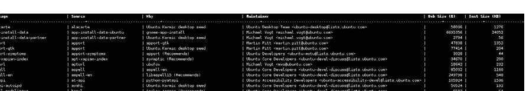

图 11-1

在前面的故事中，包含 aptitude 是因为 depends 依赖于它，而 busybox-initramfs 被包含在内是因为它依赖它。

原始种子文件顶部有时会有“key: value”格式的表头。这些内容不会被 germinate 解析，但在 germinate update-metapack 生成其输出时会使用。原始种子列表中的包应以项目形式列出，每个包前面都加一个星号（*）。原始种子文件本身可以用 wiki 格式编写（如下所示），因为所有不以星号开头的内容都会被忽略。

```
= Development==
```

构建 Ubuntu 软件包需要这些包：

- `build-essential`
- `fakeroot`

```
= Hardware & Network Access ==
```

- `pptp-linux` # 兼容 Microsoft VPN 的客户端，某些 ISP 需要
- `sl-modem-daemon` # 某些 Winmods 需要（参见 Outofthebox-Winmods）
- `bpalgin`
- `ndiswrapper-utils-1.9 [amd64 i386]`
- `ndisgtk`

在前面的示例中，`pptp-linux` 是一个依赖项。如果它在括号中，则表示该包是推荐的而非依赖的。例如，接下来的在线服务（Online Services）示例如下：

- Online Services:
- `(ubuntu-client-gnome)`

种子文件中的感叹号表示每个种子的黑名单（per-seed blacklist）。感叹号意味着永远不要将其包含在种子或其任何种子中。示例下：

```
== Blacklist ==
libvacodec 无法在 CD 上分发（参考 Ubuntu 技术委员会决议 2007-01-02）。
!libvacodec*
```


`libvacodec` 末尾的星号用于 `germinate` 代码中的正则匹配，将所有以 `libvacodec` 开头的内容放入该种子的黑名单中。

种子文件中需要注意的其他内容是替换变量。包含替换变量的包将扩展为这些变量的每种可能组合的每一个包。例如：

- Kernel-Stem: linux linux-image

== i386 ==

- `$(Kernel-Stem)-generic-pae` [i386]
- `linux-headers-generic-pae` [i386]
- `$(Kernel-Stem)-virtual` [i386]
- `linux-headers-virtual` [i386]

种子条目后面也可以跟随方括号。`[powerpc]` 表示 `language-support-$` 包不应在 powerpc 架构上使用。反之亦然，后面跟着 `[lpia 1386]`（不带感叹号）的种子条目表示它们应该只在 LPIA 和 i386 架构上使用。

最后，如果种子中的包名以 `%` 开头，则将展开为来自给定源包的所有二进制文件。

## 萌发种子

如前所述，原始种子文件通过 `germinate` 程序被萌发为完整的包列表。`germinate` 程序需要存在某些默认种子文件才能工作。这些种子文件中最重要的（强制性的）是 `STRUCTURE`、`supported` 和 `blacklist`。

这些强制性文件不一定包含任何内容，但为了让 `germinate` 工作必须存在。

`STRUCTURE` 是一个特殊文件，列出了种子以及它们相互依赖的关系。karmic netbook 的 `STRUCTURE` 文件如下：

- platform.karmic
- netbook-remix: desktop-common
- live: netbook-remix
- ship-live: live
- supported: netbook-remix ship-live supported-common

种子文件的名称后面跟着一个冒号。冒号后的行内空格表示依赖关系。通过查看 `germinate` 输出中的 dot 文件，可以图形化地看到种子之间的关系。图 11-2 显示了 Ubuntu Netbook Remix 的图形化 `germinate` 输出，可以在 `http://people .ubuntu.com/~ubuntu-archive/germinate-output/unr.karmic/structure.dot` 获取。

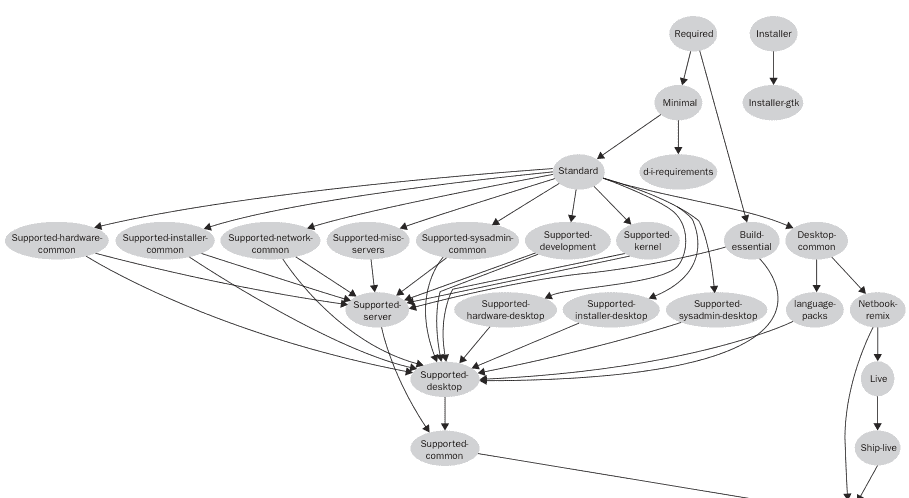

图 11-2 structure 文件列出了种子之间的继承关系。它是一个如下所示的有序序列：

```
SEED: [INHERITED]
```

`INHERITED` 是用空格分隔的种子列表。例如，`netbook-remix: desktop-common` 在之前的 `STRUCTURE` 文件中 `netbook-remix` 种子依赖于 `desktop-common` 种子。任何如下所示的行：

```
include BRANCH
```

位于下方会导致另一个种子被包含。`supported` 种子列出了所有构建发行版所需的包（但出于空间考虑不一定包含在最终镜像中），因此，它不会将种子构建依赖项的所有依赖项添加到输出中，除非它们在种子列表中。与其他任何种子一样，`supported` 种子可能包含其自己的内容。（*此处由于原文存在大量重复段落，已按要求进行翻译并保持格式*）

# 第 11 章：整合一切

```
archive_base/ports: #ports.ubuntu.com/ubuntu-ports/

archive_base/ppa: %(archive_base/ports)s

archive_base/ia64: %(archive_base/ports)s

archive_base/lpia: %(archive_base/ports)s

archive_base/powerpc: %(archive_base/ports)s

archive_base/sparc: %(archive_base/ports)s

archive_base/armel: %(archive_base/ports)s

components: main restricted
```

```
[karmic/bzr]

seed_base: bzr+ssh://bazaar.launchpad.net/#~ubuntu-core-dev/ubuntu-seeds/

seed_dist: unr%(dist)
```

更改后，seed 看起来将如下所示（请阅读注释）：

```
[DEFAULT]

dist: karmic

[Karmic]

seeds: netbook-test

architectures: i386

# 在此处放置你的 seed 文件的路径。该路径下应该包含

# .karmic 和 netbook.karmic。

seed_base: //home/user/devel/path/to/seeds/

# 我们在此处用逗号分隔仓库。第一个仓库是

# 缓存 debian 仓库，第二个是包含修改后包的本地仓库。

archive_base: http://localhost:9999/ubuntu/, file:/home/user/devel/path/to/repos

# 此处将设置包含 seed 文件的目录名称

seed_dist: netbook%(dist)
```

运行更新脚本：

```
$ ./update
```

此脚本调用 `germinate-update-metapackage`，它负责构建元包（metapackage）。

`germinate-update-metapackage` 会重命名当前目录，更新 `debian/control` 以反映 seed 当前的内容，并更新 `debian/changelog` 以描述其所做的更改。现在可以使用 `dpkg` 手动重构该包。

# 构建元包

将 `unr-meta` 目录重命名为新名称。这将是源包的新名称。例如，将 `unr-meta-1.157` 重命名为 `netbook-meta-1.157`。

这是重命名源包，而不是新元包的名称。该名称是在 `debian control` 文件的第二个段（stanza）中定义的。

接下来，进入 `netbook-meta-1.157` 目录然后进入 `debian` 子目录。编辑控制文件并将旧的包名（例如 `ubuntu-netbook-remix`）替换为新的重构包名（例如 `ubuntu-netbook-example`）。一个控制文件的示例如下：

```
Source: netbook-meta

Section: packages

Priority: optional

Maintainer: Ubuntu Mobile Developers <ubuntu-mobile@lists.ubuntu.com>

Standards-Version: 3.7.3

Build-Depends: debhelper (>= 4), germinate (>= 0.42)

Package: ubuntu-netbook-example

Architecture: any

Depends: ${ubuntu-netbook-example:Depends}

Recommends: ${ubuntu-netbook-example:Recommends}

Description: The Ubuntu Netbook Example system

此包依赖于 Ubuntu Netbook Remix 系统中的所有包
```

它也用于帮助确保适当升级，因此建议不要将其删除。

保存此文件并编辑 `debian/rules` 文件。如果你更改了 `STRUCTURE` 文件中“Terminating the Seeds”部分中的主文件名（例如，从 `netbook-remix` 改为 `netbook-example`），你也应该替换它。这里是一个规则文件的示例：

```
#!/usr/bin/make -f

clean

dh_testdir

dh_clean

rm -rf build-stamp *.old bootstrap-dir

DEB_BUILD_ARCH ?=$(shell dpkg-architecture -qDEB_BUILD_ARCH)

build:build-stamp

build-stamp: netbook-example-$(DEB_BUILD_ARCH)

dh_clean

for seed in netbook-example; do \

  package=ubuntu-${seed};\n

  (printf "\${package}:Depends}=*"; perl -pe 's/\n/, /g' '$${seed}-$(DEB_BUILD_ARCH)}\' echo \

>> debian/\${package}.subvars; \

  (printf "\${package}:Recommends}=*"; perl -pe 's/\n/, /g' '$${seed}-$(DEB_BUILD_ARCH)}\' echo \\ \

>> debian/\${package}.subvars; \

done

Done

touch $$

install:build-stamp

binary-arch:install

dh_testdir -a

dh_testroot -a

dh_installdocs -a

dh_installchangelogs -a

dh_compress -a

dh_fixperms -a

dh_instaldeb -a

dh_gencontrol -a

dh_md5sums -a

dh_builddebb -a

binary-indep:

dh_testdir -i

dh_testroot -i

dh_installdocs -i

dh_installchangelogs -i

dh_compress -i

dh_fixperms -i

dh_instaldeb -i

dh_gencontrol -i

dh_md5sums -i

dh_builddebb -i

binary: binary-indep binary-arch

.PHONY: binary-arch binary-arch
```


## 第 11 章：整合汇总

- 你应该将 `/etc/lsb-release` 文件中的 `DISTRIB_RELEASE` 变量更改为与派生发行版命名方案兼容的内容。
- 你应该更改 Ubiquity 中的 Ubuntu 标志。如果该发行版包含了新的 Ubuntu 幻灯片，这也包含其中（`bz branch lp:ubiquity-slideshow-ubuntu`）。
- 你应该公开声明该发行版是基于 Ubuntu。
- 你应该向 Ubuntu 提供反馈。提供错误报告，尽管有用的补丁和文档会更好！

## 什么是派生发行版？

对于“衍生”（derivative）或派生发行版（derived distribution）这一术语的准确定义存在困惑。从原始软件衍生出新软件意味着原始软件发生了某种变化——如果没有这种情况，那么它只是对原始源代码进行了简单的 `gcc` 编译（这在版权法中被称为“编译”）。显然，如果更改了原始源代码，上游作者有权坚持该作品按照与原始代码相同的条款进行许可。这一点很明确——困惑源于对“新作品”的定义。

版权法还允许在原始源代码被视为整体作品的情况下进行“注释”、“阐述”或“修改”。该新作品随后须遵守前面提到的与原始源代码相同的条款。

问题在于英语中的短语“on the phrase — on the clause”，它最频繁地被用来表示“一般而言”（generally），这对于版权合同中的法律条款来说似乎非常模糊。结果是，如果在原始作品中加入了创造性表达，即使原始源代码没有发生实际变化，新作品也可能视为派生作品。

一些人认为，这种疑虑导致人们对使用其他许可证（如 `LGPL`）产生了更大的兴趣，这些许可证明确允许派生作品，而不是依赖 `GPL`。

## 何时使用 LGPL

该库最初的名称是“库通用公共许可证”（The Library General Public Licence），因为该许可证涵盖了应用程序的库链接。今天，它通常被称为“较小的通用公共许可证”（The Lesser General Public Licence）。

假设有两个应用程序。当两者都根据 `GPL` 许可时，代码必须公开。然而，当其中一个是 `GPL` 而另一个是专有应用程序时，情况变得复杂，即使当专有应用程序使用了来自 `GPL` 的程序的某些库时也是如此。`LGPL` 特别允许专有应用程序链接到 `GPL` 库，而无需要求专有应用程序公开其源代码。如果专有应用程序更改了 `GPL` 库中的某些源代码（可能是为了让应用程序更好地绑定），则只需发布这些更改。在实践中，出于礼貌考虑，公司应该尽最大努力确保代码尽快被上游接受。这样维护起来更容易，确保了未来的应用程序兼容性，并加强了社区关系。

一些人相信，专有应用程序（当然也包括 `GPL` 程序）可以从 `GPL` 代码衍生，这一事实增加了该库周围的开发者基础和业务生态系统。英特尔及其 `Clutter` 库（见第 4 章“应用程序开发”）以及诺基都在遵循这一策略，诺基最近购买了 `Trolltech`（`QT` 的制造商）并对 `Qt` 库进行了许可。

其他人并不认同这对社区建设的益处，因此有了“较小”（Lesser）这一常用名称。一旦版权正确分配，就可以继续实际构建包。

我们在“构建自定义 Ubuntu 镜像”部分中制作的 `ISO` 镜像（发行版）版权归作者所有，不属于 `GPL`。原原因是该发行版构成了一个聚合或集体作品，我们自定义发行版中包含的所有单独应用程序都遵循各自的许可证（专有、`GPL` 或其他），而实际的种子选择本身归我们版权所有。

## 总结

在本章中，我们构建了一个基于 Ubuntu Karmic 的自定义 Ubuntu 镜像。

这之所以可能，是因为无数 Debian 和 Ubuntu 开发者、社区成员和技术写作者的努力。能够做到这一点本身是对开源开发分布式特性的致敬，也是对每一个以某种方式为自由软件开发贡献的人的感谢。

## 移动方向

架构：计算机硬件、软件或两者的基础底层设计。
(www.dictionary.com)

市场在移动领域开启了大量的开发者机会。Linux 和 Ubuntu 处于广泛应用于移动应用程序的良好位置。硬件、软件和网络的精确汇合是不可预测的，因此做好技能准备是有价值的。读完这本书将展示各种方向的路线图。

### 移动计算

| 类别 | 描述 |
| :--- | :--- |
| 用户应用程序 | 计算机硬件、软件或两者的基础底层设计。 |
| 平台 | 市场在移动领域开启了大量的开发者机会。 |
| 软件 | Linux 和 Ubuntu 处于广泛应用于移动应用程序的良好位置。 |
| 网络 | 硬件、软件和网络的精确汇合是不可预测的。 |
| 位置 | 读完这本书将展示各种方向的路线图。 |
| 安全 | 市场在移动领域开启了大量的开发者机会。 |
| 框架 | Linux 和 Ubuntu 处于广泛应用于移动应用程序的良好位置。 |
| 数据库 | 硬件、软件和网络的精确汇合是不可预测的。 |
| 内核 | 读完这本书将展示各种方向的路线图。 |
| 文件 | 市场在移动领域开启了大量的开发者机会。 |
| 驱动程序 | Linux 和 Ubuntu 处于广泛应用于移动应用程序的良好位置。 |
| 触摸 | 硬件、软件和网络的精确汇合是不可预测的。 |
| RAM | 读完这本书将展示各种方向的路线图。 |
| 媒体 | 市场在移动领域开启了大量的开发者机会。 |
| 音频 | Linux 和 Ubuntu 处于广泛应用于移动应用程序的良好位置。 |
| 视频 | 硬件、软件和网络的精确汇合是不可预测的。 |
| 选择 | 读完这本书将展示各种方向的路线图。 |
| 语言 | 市场在移动领域开启了大量的开发者机会。 |
| UI | Linux 和 Ubuntu 处于广泛应用于移动应用程序的良好位置。 |
| 丰富 | 硬件、软件和网络的精确汇合是不可预测的。 |
| 存档 | 读完这本书将展示各种方向的路线图。 |

### 选择与机会

诺伯特·维纳纳（Norbert Wiener）是一位世界著名的数学家。作为一个神童，他在 14 岁时大学毕业并在哈佛大学获得博士学位。他职业生涯的大部分在麻省理工学院（`MIT`）度过，并写了《思想的喂养》（The Care and Feeding of Ideas）。在 20 世纪 50 年代，维纳纳描述了技术、和社会经济气候。维纳纳强调了创造和管理的必要性。

## 第 12 章：移动方向


图 12-3

## 演进与软件开发

Linus Torvalds（林纳斯）用一种富有创新和创造力的精神定义了这一点。如果你想读一本好书并详细了解发明是如何运作的，可以看看 Linus Torvalds 和 David Diamond 合著的《趣：一个偶然革命者的故事》（Just for Fun: The Story of an Accidental Revolutionary）。这本书始于 Linus 成为 Linux 之名之前的早期，非常引人入胜。读完后，你将获得关于技术发展如何真实发生的最佳叙述之一。在硬件领域，这样的故事相当于特蕾西·基德（Tracy Kidder）获得普利策奖的《新机器的灵魂》（Soul of a New Machine）。

Torvalds 的书很有趣，它也像一个观察伟大的开源技术如何演化的实验室。以 Linux 为例，该项目起步规模很小，预期较低。它很快增长到了想象力（甚至是大公司）所能理解的程度。

很有可能在世界上某个地方，另一个年轻的天才或工程师正在致力于某些事情，这些事情将在未来一二十年对计算机行业产生巨大影响。

当 Torvalds 编写第一行 Linux 内核时，Richard Stallman（理查德·斯尔曼）正向 Lotus Development 公司进军并为自由软件抗议。那是 1990 年左右，当时我正在 Lotus Development 工作。一天，我从办公室窗户望出去，看到 Stallman 等人站在 Lotus 总办公大楼前。我记得有一个抗议者拿着一个牌子，上面写着一些不可思议的话：换句话说，写的是“所有软件应该是自由的”。

在当时，很难理解任何理智的人如何能期望出像 Lotus 1-2-3 这样复杂且高质量的软件。（另一方面，在开发 Lotus 1-2-3 的 100 多人中，Richard Stallman 自称为一名“占位者”，似乎在麻省理工学院（`MIT`）获得了免费且无需过夜的住宿，而且还掌控着他每小时 260 美元的费用！）

在接下来的几年里，大量的人才涌入了科技行业。世界、商业模式和环境发生了变化——通常是逐渐变化，然后在 2008 年秋季发生了爆发性增长。今天与十年前相比完全不同，而且比 20 年前更加演进。作为一种解释这种演进可能如何讨论的方法，我提供了四种开发模型供你参考。所有模型的灵感都来源于各种自然哲学家的著作。我将它们称为达尔文、孟德尔、迈尔和弗兰肯斯坦。

## 达尔文

软件开发的达尔文模型以查尔斯·达尔文（Charles Darwin）命名，他因出版《物种起源》而闻名。达尔文在 51 岁时出版了他的突破性著作。达尔文的工作记录了他对“自然选择”理论的研究和制定。维基百科对这项研究和发现提供了简洁的描述：自然选择是由于繁殖的差异，有利性状在繁殖生物的连续代中变得越来越常见，而不利性状变得越来越少的过程。

应用达尔文模型解释了为什么使用 Windows 的人比 DOS 多，为什么 Linux 已经超越了 UNIX，以及为什么笔记本电脑取代了平板电脑（后者曾取代了便携电脑）。达尔文模型解释了为什么计算机不会有 50 英尺长、8 英尺高。DeMoivre 在他的统计书中写道：“事件发生的概率大小，取决于它发生的次数与它可能发生或失败的总次数之比较。”由于最近出现了一系列移动技术——硬件和软件——而且开源提供了几乎无限的组合，因此很有概率某些奇妙移动设备将会“出现”。

## 孟德尔

软件开发的孟德尔模型以遗传遗传学之父格列戈尔·孟德尔（Gregor Mendel）命名。在孟德尔的一篇名为《植物杂交实验》的论文中，人们首次看到了显性基因和隐性基因是如何工作的。孟德尔是一个聪明的兼职科学家，学会了如何创造“优选”的结果。维基百科将孟德尔遗传描述为“一组关于遗传特征从亲代生物传递给后代的基本原则”。

基于 Linux 的发行版是许多人单独“培育”自己的谨慎、选择性、科学且个性化的作品。创建一个发行版本质上是孟德尔选择的工作。发行版中的个人程序、软件包和定制是根据创建发行版的人的偏好和需求定制的。

孟德尔可以快速追溯 Ubuntu 从 Debian 继承的性状。Mark Shuttleworth 在学生时代就开始接触互联网。他在 1994 年成为一名开发者，当时他为 Apache 创建了第一个软件包。Shuttleworth 是 Ubuntu 的“宇宙主宰”——一组编辑、维护、包含、排除和识别新 Ubuntu 版本组件中相互依赖关系的个人。

## 迈尔

软件开发的迈尔模型以恩斯特·迈尔（Ernst Mayr）命名。迈尔因成为领先的进化生物学家而闻名。他的伟大著作揭示了物种适应和倍增的复杂性。迈尔的工作协调并连接了达尔文和孟德尔的工作，将此前对立的科学家阵营聚集在一起。迈尔的理论建立了桥梁而不是墙。迈尔以他通过观鸟协会招募和指导其他科学家的方式而闻名。

迈尔模型解释了多种发行版的共存。在许多方面，迈尔的方法证明了开源开发的价值。通过协作和知识共享，迈尔将人们聚集在一起。

## 弗兰肯斯坦

最后，软件开发的弗兰肯斯坦模型以玛丽·雪莱（Mary Shelley）命名。弗兰肯斯坦模型基于获取不同部分并将其组装以创造新事物的观点。这在软件开发中很常见，不同的库和模块被组合以创建一个新的应用程序。

弗兰肯斯坦模型解释了为什么软件往往如此复杂和多样。它提醒我们，我们都是站在巨人的肩膀上工作，我们的工作可以创造出真正奇妙的东西。

## 值得思考的大思想

我们都生活在一个动态的时代，受到全球文化、政治和技术的影响。唯一确定的是我们必须预料意料之外的事。这里有一些值得思考的大思想，在这些思想中，你可以确定会对移动计算、Linux 和 Ubuntu 产生某些影响。

## 技术的政治

巴拉克·奥巴马（Barack Obama）总统在竞选期间利用互联网的方式帮助他赢得了选举。（他在 Facebook 上有超过 450 万个朋友！）在他就职的第一个月里，新政府要求提供一份关于政府使用开源的报告。《纽约时报》对此描述道，“一直沉迷于黑莓手机”。奥巴马是美国以来最精明的总统，这种精明在于影响政策。

与此同时，在大洋彼岸，英国教育系统正在讨论开源。根据 BBC 2009 年 1 月 26 日的报道：

- 开源软件（`OSS`）免费可用，涵盖了国家课程的几乎每一个要求，必须问为什么学校不采用，这可能会节省数百万英镑。
- 正如名称所示，开源是社区驱动的软件，对所有人开放。任何人都可以根据需要修改软件并将这些修改分享给所有人。

技术的政治如何塑造我们的移动未来？政府决策和政策对开源生产和 Ubuntu 使用有何影响？

## 下一个十亿

麻省理工实验室有一项名为“下一个十亿”（Next Billion）的计划。它提出了一个关于移动计算的震惊场景：

> 在未来三年内，另一十亿人将开始经常使用手机，继续历史上最快的技术普及。很快，这下一个十亿人将发出他们的声音并连接到全球信息网络。
>
> http://nextbillion.mit.edu/

这会对 Ubuntu、Linux 和移动计算产生影响。

## 感官过载

`GPS` 信息、`WiFi`/手机定位以及其他地理感知技术确实可以帮助移动计算机更具位置感知能力。会有新技术来填补 `GPS` 和 `WiFi`/手机定位的空白吗？我们将面临哪些隐私问题？

## 云计算

我们正看到云计算向消费者和企业伸展。人们现在经常使用云端作为 Web 邮箱发送邮件。Google 提供全系列在线应用程序。Twitter、FriendFeed、Facebook 以及其他网络工具在 Web 上维护敏感的个人数据。云计算可以消除或减少移动设备与固定计算机系统之间的同步和大量文件复制步骤。这将推动移动设备作为 `MID`（移动互联网设备）更快地采用。随着 Web 上这么多私有数据，是否有新的必须考虑并纳入软件栈的安全措施和标准？

## ARM 摔角 (ARM Wrestling)

看起来在 `x86` 和 `ARM` 架构界线上正在形成一个战场。双关语似乎无穷无尽，“ARM Wrestling（ARM 摔角）”或“给英特尔的一记助力（A shot in the ARM）”。从长远来看，这对消费者是有利的；但对行业来说是昂贵的。竞争创造创新并加速改进。然而，对英特尔 `x86` 处理器主导地位的威胁是真实的。引自 2008 年 6 月 30 日《纽约时报》：

> 除了高通和英伟达外，还有 200 多个 `ARM` 处理器设计的授权方，包括 Marvel 和德州仪器在内的主要芯片制造商。他们共同供应了超过 11 亿部手机，其中许多手机使用了多个 `ARM` 芯片。这些芯片还用于不断增长的特殊消费电子领域，如 `G.P.S.` 导航器和机顶电视盒。

到处都是 `ARM`！这里是来自 `ARM` 维基百科条目的另一个数据点：

> 截至 2008 年 6 月，已构建了超过 100 亿个 `ARM` 核，iSupply 预测 2011 年每年将出货 50 亿个。

我在基于 `ARM` 和 `Atom` 的系统上都安装了 Ubuntu。我喜欢 `Atom` 的处理能力，但我喜欢 `ARM` 的低功耗。这将是一场令人兴奋的战斗。

同时，一种移动解决方案的重要新技术基础正在开发中。例如，`Moblin` 计划在收到英特尔的初始资金后，从硬件和软件公司不断成长。2007 年 4 月，英特尔在中国的开发者大会上首次引入了“`MID`”计算机的概念。2007 年 7 月，英特尔以 `Moblin` 为名正式发起了一项软件倡议，并在 `Moblin.org` 启动了网站。（`Moblin` 是 mobile 和 Linux 的缩写。）

2007 年 10 月，我参加了为期几天的 Ubuntu 移动计算会议。Canonical 员工和英特尔参与以及许多源码贡献者加入了这些会议。在最初发布基于 Ubuntu 的 Mobile V1 后，英特尔将进一步的探索转向 Fedora 发行版。这提供了另一个成果丰硕的创新和代码来源。英特尔在 2008 年底宣布了 `Moblin V2` 的发布计划。大约一年后，即 2008 年 10 月 30 日，英特尔发布了一份新闻稿，宣布了其支持和加速亚洲移动设备制造商增长的计划。英特尔宣布与台湾经济部合作计划，建立一个 `Moblin` 实验室，为硬件制造商提供开发、培训和支持。

正如 *Ars Technica* 当时写道：

> 英特尔正在投入大量资源推动移动 Linux 的采用，并使 `Moblin` 成为设备制造商的坚实平台。如果 `Moblin` 能够解决困扰 Linux 设备制造商的问题，并为基于 `Atom` 的设备提供一个更有凝聚力的平台，这将是开源操作系统的巨大胜利。

2009 年 1 月，英特尔发布了针对网络笔记本的 `Moblin V2 Core` 的第一个 Alpha 版本。随后的版本于 3 月出现。被广泛讨论的功能之一是“Fastboot（快速启动）”，它能让网络笔记本快速运行！

在未来，将会有多个处理器平台（例如 `ARM`、`x86`）和几个分发路径（例如 Ubuntu、`Moblin` 等）在竞争开发者的关注。

## 剃须刀与刀片 (Razors and Blades)

如果微处理器芯片及其包装的价格下降到模块化和一次性的具有实际意义的程度，会发生什么？如果计算机组件是模块化的，它们可能会被定期更换、交换或更新。

而不是完全购买新计算机（这种交易既不便宜，也不符合环保或时间效率），公司可能会考虑围绕制造移动“剃须刀和刀片”市场的商业模式。例如，公司可能会以补贴的折扣价卖给你一个有吸引力的剃须刀，因为知道你会锁定它品牌的刀片上。计算机打印机和墨水可能会遵循类似的商业模式。为什么微处理器不也可以呢？

## 免费午餐

开源软件的原始原则之一。

在开源早期，面对在讨论“免费啤酒”时更容易跳起来的商业开发者，“言论自由”是一个更容易建立的论点。然而，“免费啤酒”可能是更有吸引力的论点。全球经济正迫使人们所做的每件事都考虑成本。

随着现在存在的海量开源软件库存，你有更大的可能发现你想要解决的“痒”已经被另一个非常有才华的开发者“解决”了！

因此，开源的自由由于更改/维护底层代码的需求仍然必要的，但获得免费价格的紧迫性也日益提高。

## 边缘计算

今天的网络连接点比以前任何时候都多。这些连接可能是繁忙或遥远的。连接地球的角落为有意义的全球对话创造了巨大的机会。随着网络笔记本、智能手机和其他生活在“边缘”的高度移动设备连接起来，网络增长可能会爆炸式增长。同时，我们将看到任何设备可以随地建立的连接数量大幅增加。随着这种计算部署变得更加廉价和更强大，到本地和远程计算机的连接将激增。

这是一个可能重新定义边缘所在处的创新新产品示例。2009 年 3 月，Marvell 引入了如图 12-4 所示的 `SheevaPlug` —— 一个售价 99 美元、符合 `ARM` 标准的小型动力，带有开发者工具包。通过这款产品，Marvell 可以吸引爱好者和开发者的兴趣，同时鼓励创新应用，这些应用未来可能会驱动对 Marvell 嵌入式处理器和无线芯片的需求。`SheevaPlug` 使用标准墙插座以 1.2GHz 的频率运行，带有 512MB Flash、512MB DDR2、`USB 2.0` 和千兆以太。整个包运行功耗低于 5 瓦，支持 Ubuntu，并提供开发者工具包。它非常便于移动和重新利用。


最初，`SheevaPlug` 用于媒体服务器和备份机，这两者都与云计算有关。通过 `SheevaPlug`，Marvell 正在采取开放方法，在 http://ug 等网站上提供其设计。

## 未来

根据 2008 年 12 月 Pew Internet & American Life 的研究，“超过四分之三受访者（77%）认为移动计算设备将成为世界上大多数人的设备。”这听起来真实吗？

我对我朋友和学生进行了非正式的调查。特别是，我想了解他们对 Linux 的看法。尽管 `MIT` 所有学生都可以免费使用 `WiFi`，且几乎每个人都有一带 `WiFi` 的笔记本电脑，但一名学生估计，大约 40% 的学生还拥有一个带有以下功能的手机：

> 校园里有很多 iPhone 用户。短信、电子邮件和通话，可能大约是这个顺序。如果你有 iPhone 或专门针对移动媒体的设备，还有音乐和多媒体。我认为这里的人精通技术，他们至少偶尔会使用移动设备处理所有这些事情。

对于采用 Linux 的学生来说，这四个原因的各种组合似乎解释了原因：

1. 自由，如自由般的自由（修改/贡献的能力）
2. 免费，如午餐般的免费（省钱）
3. 性能/功能（包括定制和开发）
4. 可靠性/安全性等

一位最近从普林斯顿毕业的毕业生分享了他的观点：“我对 Linux 的所有了解仅限于它是由一个叫 Linux 的人开发的。我不知道我的 iPhone 运行的是什么操作系统，但我知道我喜欢它！”他估计，只有 5% 的学生知道什么是 Linux 发行版。

在 Odin 工程学院，学生们似乎习惯使用运行 Windows XP 的笔记本电脑。正如一位工程系学生观察到的：“许多非技术人员害怕那个（该死的）内核，以及缺乏对 Ubuntu/Fedora 的面对面支持。”

在极端情况下，对一个微小程序的恐惧可能会让人无所适从！一位威斯康星州的学生在她的电脑被配置为 Ubuntu 而不是 Windows 后退了课。她订了一台戴尔笔记本电脑，期望收到熟悉的 Windows 系统。然而，电脑送达时预装的是 Ubuntu。她给客户支持部门打电话投诉她订购的内容：“跟我交话的人说是 Ubuntu，大学生们告诉我，它兼容我需要的一切。”她坚持使用 Ubuntu 却陷入了困境。由于无法连接互联网或处理所需的文档，她在在线上退学了。

我们可以将许多教训带到未来：

- 移动计算软件的下一个突破很有可能来自大学校园。像 Google 的夏季之代码（Summer of Code）这样的项目鼓励了这一点。这仍然需要一个特殊的学生（如瓦尔纳斯）来实现它。
- 如果你奶奶说她想要一个按钮更大的手机，你最好为她买一个！如果目标是完成任务，适当的技术就是最好的答案。
- Linux、Ubuntu 以及相关发行版只有在易于使用且适用于使用场景时，才能在移动设备上实现大规模消费级市场的成功。

# Ubuntu、Linux 与移动计算

Ubuntu 将如何演进？对此有深入了解专家是马克·沙特沃（Mark Shuttleworth）。他在 2008 年 8 月的 Android Decon8 大会上分享了他对这一主题的看法。由当时在职 Sun 公司的 Barton George 进行的一场录音采访提供了许多见解。

在网络方面，沙特沃在以下用方面的应用对他们的成功起了作用：

> 内置在机箱（网络）中包含了一个假设，即你不会尝试按照人们传统使用 PC 的所有方式来使用它。这使得（人们）更愿意考虑替代方案……所以对于 Linux 社区来说，这是一个非常令人兴奋的发展……人们真正乐于购买一台没有 Windows 但能交付 Linux 良好交付内容的机器……极好的 Web 体验、良好的安全性、高效的性能、轻量级硬件以及极佳的经济性。

沙特沃还分享了他对移动行业未来去向的看法：

> 我认为移动领域对 Linux 来说具有巨大的生产力。我们已经看到像摩托罗拉这样的公司表示，其 60% 的设备市场份额归给了 Linux……在发行版层面和应用框架层面，情况要清晰得多。
>
> 我们在英特尔围绕其 `Moblin` 移动计划的方面非常强大，因为他们证明了自己对参与开放。关键在于如何将运营商、手机制造商和芯片制造商聚集在一起，我很高兴 `Moblin` 将实现这一点。
>
> 在这个阶段，我不认为任何人都达到了关键的规模。平台与供应商之间仍然存在某种程度的统一。在移动领域，它与英特尔紧密对齐。我认为看到更广泛的采用是健康的。你们有谷歌的 Android。对于他们来说，他们需要证明参与。在我看来，`IMO` 与摩托罗拉紧密对齐，但也日益成为一个开放的环境。
>
> 我希望芯片制造商、手机制造商和运营商之间能达成新的共识，关于他们希望这种设备（移动设备）如何工作。
>
> 开源或免费软件是整合这个特别破碎的行业的正确方式。我很高兴 Linux 将完全按照那种“我不是的 Linux”的方式发挥良好作用。

Linux Taurus 做过这样一个观察：

> 分发是一项巨大的工作。之所以有数百个，是因为很容易启动自己的，但如果你想成为领导者并引入新代码，其中涉及的测试和问答是巨大的。这取决于是否有足够的用户来获得覆盖，而且期望过多的大型发行版是不合理的。Ubuntu 的增长速度惊人，也许这种情况可能会再次发生。你对 Ubuntu、Linux 和移动技术的不断增长的知识将成为无论这种变化如何发生都能带给你的持久经验。随着 PC 尺寸的缩小，它正与多功能手机处于碰撞轨道上。许多人预计其影响将改变两种设备以及制造它们的公司。新的智能手机，这种既是手机又是电脑的始终在线设备，改变了计算速度的游戏规则——这在英特尔擅长的领域——不再是最重要的因素。对于依赖小电池的手机来说，芯片使用电能的效率变得更加重要。

## 总结

对于 Ubuntu 的意外。我很高兴 Linux 将完全按照那种“我不是的 Linux”的方式发挥良好作用。对于 Ubuntu 移动开发，这在未来应该持续增长。

# 第 13 章：常见问题与解决方案

本章尝试收集在 Ubuntu 邮件列表中发布的常见问题以及解决方案。

## 启动进程停止

问：我的电脑在安装了 Ubuntu 后下载了镜像，并准备了 U 盘，在启动后，我收到的最后信息是：

```
```


# 常见问题与可能的解决方案

## mount root

这就是全部。

**A：这可能是由没有正确写入 U 盘造成的。**

要将镜像写入 U 盘（假设为 `/dev/sdb`），使用以下命令：

```
sudo dd bs=1024 if=<image> of=/dev/sdb
```

`dd` 是一个用于底层拷贝和转换的程序。

将镜像写入 U 盘就像填满棋盘。如果你不给它 `bs=1024` 块大小参数，它按行写入，但使用 `bs=1024`，它会按列写入。在测试此项时，使用 `dd if=<drive>` 的成功率约为 40%，但使用 `bs=1024` 后，这一比例提高到了近 99%。

## 应用程序图标未显示

问：我的应用程序图标没有出现在桌面上。

答：为了让图标出现在桌面上，请遵循以下步骤：

- 将桌面文件安装到 `/usr/share/applications/`
- 将图标安装到 `/usr/share/icons/hicolor/<size>/64x64/apps/myapp`。（例如 `/usr/share/icons/hicolor/64x64/apps/myapp`）。

如果步骤 1 执行正确，应用程序应该出现在 UI 中。如果步骤 1 和 2 都执行正确，它也将拥有正确的图标。

如果图标仍然没有出现，尝试将以下内容添加到桌面文件中，并将其写入 U 盘（假设为 `/dev/sdb`）：

```
OnlyShowIn=GNOME;Mobile;
```

这样图标就会出现在桌面上。例如，cheese 没有 `OnlyShowIn`，但它出现在 Hilden 桌面。

> Hilden 桌面是移动设备 Hilden 应用框架的主要 UI 组件。

其他应用没有 `OnlyShowIn` 但没有显示。Ubuntu Mobile 有一种特殊的实现，可以在 GConf 键中看到：

```
/desktop/hilden/htmlmenuplugin/onlyshowin_filter
```

检查 `OnlyShowIn` 值。如果它是 `False`，所有桌面都会显示。此命令：

```
/onlyshowin_ignore
```

始终显示这些应用，即使它们没有 `OnlyShowIn`。例如，cheese 在这个列表中，并且始终显示。显然，当每个应用程序都是良好的公民并遵守 freedesktop.org 标准时，这个键应该会消失。

## 第 13 章：常见问题与可能的解决方案

此外，在处理 `.desktop` 文件时，`desktop-file-utils` 软件包中提供了一些实用程序。它们是：

- `update-desktop-database` — 更新桌面-MIME 映射。
- `desktop-file-validate` — 验证 `.desktop` 文件。
- `desktop-file-install` — 安装 `.desktop` 文件。

你可以像下面这样使用它们：

```
$ desktop-file-validate hello-world.desktop
```

## 执行双启动

问：在 Windows 移动设备上双启动运行 Ubuntu Netbook Remix 是否可能？

答：这在很大程度上取决于设备硬件。相当数量的现有型号支持某种形式的备用启动，可以直接从某些物理设备启动，或者通过一个应用程序将当前运行的操作系统替换为来自物理设备或选定的操作系统。

目前 Ubuntu 支持的绝大多数设备都属于第一类，允许从备用物理设备启动（最常见的是 USB 闪盘，且许多设备针对低成本市场设计，为了满足这一需求，它们集成了一个较小的 SSD 用于数据存储（4–16GB）。像华硕 Eee 这样的系统能够同时运行 Windows 和 Linux，但由于空间限制，无法从同一个驱动器运行。可以将 Linux 安装在 USB 设备上，并从 SSD 以“Live”模式运行以配合 XP。

有一个非常有用的应用程序是 GNU Haaret，你可以在 `http://handholds.org/-koconnor/haret/` 或 `http://handholds.org/moin/moin.cgi/HaRET` 找到它。

## 自动设置标记

问：是否有方法可以设置 `configure.ac`，以便在为 LPIA 架构构建构建时自动设置 `USE_HILDON` 标记？

答：是否是否可以向 `debian/rules` 添加以下规则：

```
ifeq ($(DEB_BUILD_ARCH), lpia)
DEB_CONFIGURE_EXTRA_FLAGS = --enable-hildon
endif
```

这会导致在 LPIA 架构上进行构建时，调用 `configure` 时带上一个额外的 `--enable-hildon` 参数。

也可以在 `configure.ac` 或 `configure.in` 中按如下所示添加内容：

```
hildon=false
HILDON_CFLAGS=""
HILDON_LIBS=""
AC_ARG_ENABLE(hildon, AS_HELP_STRING([--enable-hildon], Turn on support])), [
    if test "$enableval" = "xyes"; then
        hildon=true
        PKG_CHECK_MODULES(HILDON, [hildon-1], HAVE_HILDON=yes, HAVE_HILDON=no)
        HILDON_CFLAGS="$HILDON_CFLAGS -DWITH_HILDON=1"
        PACKAGE_CFLAGS="$PACKAGE_CFLAGS $HILDON_CFLAGS"
        PACKAGE_LIBS="$PACKAGE_LIBS $HILDON_LIBS"
    fi
])
```


这将启用一个 `HAVE_HILDON` 标记，你可以在构建时对其测试以启用或禁用 LPIA 架构的更改。

## 使用 USB

问：我使用的是 Windows Vista，想准备一个 USB 闪盘在我的三星 Q1 Ultra 上安装 `ubuntu-mobile.img`。最好的方法是什么？

答：最好的方法是使用 Windows 版本的 `dd`，可以在 http://uranus.it.swin.edu/-jn/linux/rawwrite/dd-old.htm 获取。

## 在 Freerner 上运行 Ubuntu

问：Ubuntu MID 有可能运行在像 Neo Freerner 这样的设备上吗？Freerner 已经有一个 Debian 端口了，所以可能吗？

答：没有什么可以阻止这一点，但目前支持手机并不是 Ubuntu Mobile 团队的目标：Ubuntu MID 关注的是“MID”，更多是关于互联网体验。不过，确实最近的一些 MID 正在获得 SIM 卡和手机功能。

## 在 Arima 上运行 Ubuntu

问：作为相关问题，是否有方法可以设置 `configure.ac` 以便在为 LPIA 架构构建时自动设置 `USE_HILDON` 标记？

答：（重复内容略）

# Ubuntu 的 ARM 之选

既然 Ubuntu 已经针对 ARM（高级 RISC 机器）平台发布，现在出现了许多有趣的新应用可能。在低功耗计算领域，出现了一整类解决方案。

一个例子是 SheevaPlug。2009 年 2 月，Marvell 公司基于其 ARM 处理器推出了一款名为 SheevaPlug 的新设备。Marvell 为这种“插头”设备提供了一种开放架构蓝图，这让人联想起早期基于标准的组件设计，这些设计为 PC 行业奠定了基础。Marvell 将技术与产品愿景相结合，普及了一个全新的细分市场：插头式计算（plug computing）（更多详情请访问 http://plugcomputer.org/）。

《华尔街日报》在 2009 年 2 月 23 日发表了一篇关于这一新产品和新市场的报道。报道暗示了一个新的微型行业：

> “我们这里可以解决多个痛点，”Marvell 副总裁兼企业业务部门总经理 Simon Milner 说道。

一个大问题是消费者日益积攒的数字照片、音乐和视频——这些内容越来越多地存储在可能丢失或被盗的笔记本电脑上。公司已经开始销售保护此类信息的设备，包括结合磁盘驱动器和网络功能的设备。

Marvell 表示，它认为插头电脑可以让这些产品更有用，这一概念是某些人在 1 月的消费电子展上首次发现的，当时并未披露 Marvell 的参与。这些设备通过以太网线连接家庭路由器，并使用广泛使用的 USB 技术连接到存储设备。

《华尔街日报》关注到了其节能潜力——与耗电巨大的替代品相比，SheevaPlug 的功耗不到 5 瓦。此外，《华尔街日报》提到某些型号的最终价格可能为 49 美元。

# 附录 A：Ubuntu 的 ARM 之选

Rob Enderle

## 我愿意用右手臂换一个 SheevaPlug

我是少数在最初发布后很快拿到 SheevaPlug 的幸运儿之一。在第一周内，它们就售罄了，其他的处于待货状态。初始需求超过了 Marvell 的预期。很显然，这个细分市场具有“发展前景”。以下是你使用最初 99 美元的开发者套件时获得（以及现在拥有）的内容：

- 1.2 GHz 的 Marvell ARM CPU
- 512MB DDR2 @ 400 MHz
- 512MB NAND Flash（直接从 Flash 启动）
- 千兆以太网/RJ45
- USB 2.0（直接从 USB 启动）
- SDIO
- JTAG/UART 串口接口
- 无风扇。无驱动器。无噪音。
- 优雅的包装/内置交流电电源
- 预装 Ubuntu
- 无许可费（“开放”参考设计）
- 无图形/VGA 支持
- 无内置 WiFi

功耗取决于运行的任务，但从下面的功耗概况中可以看出，它不会超过 7 瓦：

- CPU 空闲置在 C1 状态时，2.5W
- CPU 空闲置在 C0 状态时，3.0W
- 千兆以太网空闲时，3.3W
- 千兆+HDD+USB+特殊模式空闲时，5.0W
- 7.0W + 100% CPU 负载

图 A-1 显示了 SheevaPlug 的内部结构。

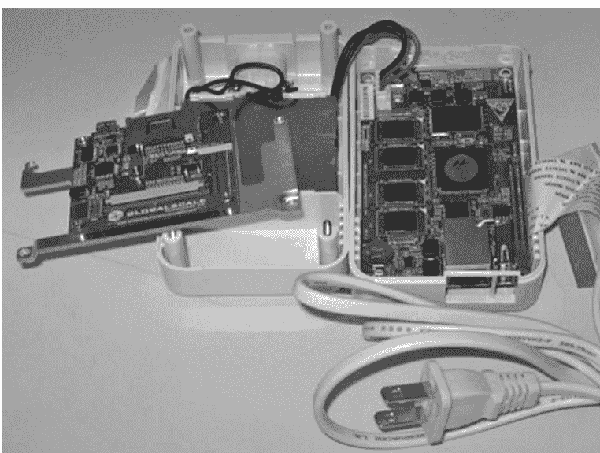
图 A-1

## 应用想法

我对比 SheevaPlug 的初始目标包括几个高效能、24/7 小时运行的应用：备份服务器、媒体服务器，以及家庭自动化和信息系统。在软件方面，我期待使用我们在 Ubuntu 中熟悉的工具：Python、Django、网络数据库、功能完整的应用程序库等。

事实证明，对于具有基础 Linux 知识和有 Ubuntu 工作经验的人来说，SheevaPlug 非常易于操作。虽然没有图形或 VGA 支持，但很容易通过 SSH 连接到该设备，或通过 JTAG 串口连接对其进行管理。MIMO Monitors 正在出可以通过 USB 连接运行的 7 英寸屏幕。其 USB 转 LCD 控制器使得在不需要 VGA 或视频支持的情况下显示视觉内容成为可能。关键技术最近已作为开源发布，并可能支持 Ubuntu。

在实验 SheevaPlug 的最初几天里，我成功连接了无线 USB 802.11g 无线器（来自 Edimax）。我在为 SheevaPlug 连接 USB 摄像头时也取得了同样的成功。不知不觉，我已经拥有了由 Sheeva 驱动的家庭控制/监控系统的所有核心要素。

当我发现可以轻松地在 SheevaPlug 上运行简单的 OpenCV 应用时，我感到既兴奋又有一丝吃惊。

OpenCV（开源计算机视觉）是一个编程函数库，主要面向实时计算机视觉。

尽管 OpenCV 已经开源多年，但其网站不支持 ARM 平台。要让 OpenCV 与 Python 协同工作需要几十个依赖项。此外，图形处理通常严重依赖于浮点运算硬件（而此版本的 SheevaPlug 缺乏浮点硬件）。这些在 ARM 上运行 Ubuntu 的早期阶段是有成效的：OpenCV 在 SheevaPlug 上运行良好。

## 可移动性

另一个感兴趣的应用领域是“可移动设备”——一种简短的形式。可移动设备的精髓在于可以用最少的设置将其移动到任何地方。我们使用了一个简单的例子。

## SWARM 有什么？

SWARM 是一个缩写，代表：

- S — Sheeva
- W — Wired（有线）
- A — Advanced（高级）
- R — Running（运行）
- M — Memcached

我的目标是收集并组装一个 SWARM。我们使用了水平布局，如图 A-3 所示。

# 附录 A：Ubuntu 的 ARM 之选


图 A-2

Marvell 慷慨地提供了十台 Sheeva。我们安装了最新版本的 Ubuntu。Rabee Khoury 是一位 Linux 和 SheevaPlug 专家，他提供了帮助。他帮助配置 Sheeva，使 Linux 内核存储在 Flash 中，其余 Ubuntu 系统安装在 8GB SD 卡上。

## 太阳能驱动的盖房

Kurt 是麻省理工学院的研究生，也是太阳能、市政无线和集群计算的灵感来源。正如他所观察的，“多的廉价胜过少而贵”。在他的帮助下，我们评估了 FAWN（快速笨拙节点数组）中的一些想法，并考虑了其他许多高效平台（如 OpenWrt 和 Netgear 的 WGT-634U）。

然后我们需要弄清楚如何构建——毕竟，集群需要多项技术技能。我们向他寻求了一种组织模型。

在 18 世纪和 19 世纪的北美，社区成员聚在一起帮助建造谷仓。几乎每个农家庭都需要一个谷仓，但建造耗时太长，且太对于任何一个家庭来说，独自完成这件事是不可能的。盖谷房（Barn raising）需要对各种技能和材料进行规划和准备——参与者免费提供时间和技能。盖谷房通常在紧迫感下进行——家庭们需要使用他们的谷房！我们在构建 SWARM 时也采用了这种盖谷房的方法。

我们在 5 月的 BLU 会上提前了通知，并将日期定在 6 月 17 日。我带来了一整箱准备好的 SheevaPlugs。所以，你可以将其翻译为“集装箱搭建”（bin raising），如图 A-4 所示。

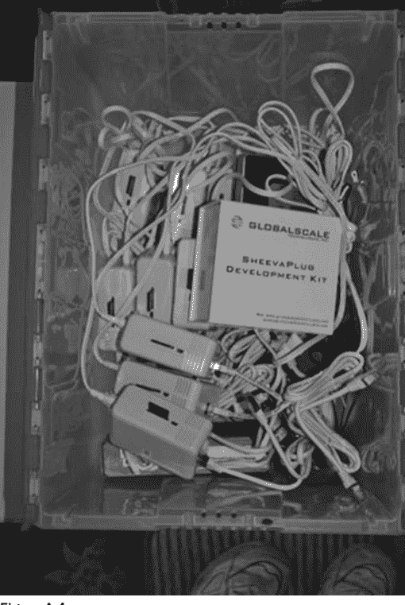
图 A-4

下午 1:30，约有十个人在 MIT 大楼汇合。BLU 组的长期领导 Jerry Feldman（连同 John Abreau）将聚集的资源组织成一个团队，如图 A-5 所示。


图 A-5

Sage Radachowsky 带来了他的太阳能电池板、充电控制器、电池和钳子。在一个小时内，他完成了所有接线，提供了充足的太阳能，让我们的十台 SheevaPlugs 和那个耗电大交换机流畅运行。

波士顿 Linux 用户组（BLU）的参与者 Bill Bogd 负责通过一个巨大的千兆交换机将 SheevaPlugs 联网。团队确保了 WAAV（装在标准背包内，天线伸出外面）正常工作。这个无线/蜂窝适配器很快就投入运行，插入千兆交换机，并充当 DHCP 服务器，为每个 SheevaPlugs 提供网络地址（见图 A-6）。


图 A-6

Dave 钻进 MIT 内部，使用一台运行 Ubuntu 的 Acer Aspire 笔记本来调试 SWARM（见图 A-7）。


图 A-7

很快，Dave 就已经登录并在运行初步性能测试的同时管理 SWARM 了。他所有的系统管理工作都是通过一台廉价的 Acer Aspire 笔记本无线完成的。令人惊讶的是，SWARM 在没有网络线或电源线帮助的情况下连接到了世界。

这个集体“集装箱搭建”团队在大三小时内让 SWARM 活跃了起来，并将其连接到互联网和 MIT 内部网络。Jerry 和其他人在阳光下观察。图 A-8 显示了 SWARM 如何在电气和逻辑上活跃起来的。


图 A-8

下午的魔法可以与拉斯维加斯的大卫·库珀菲德（David Copperfield）最好的幻术相媲美。但这一切都是真实的。

# 我们学到了什么？

那天晚些时候，我们将系统“搬”到了室内。由于缺乏太阳能，我们直接将其插入了 MIT 的墙上插座。整个十节点系统（包括交换机）功耗仅为 70 瓦。然而，它有足够的电力网络电缆，我们可以与“意大利面代码”（spaghetti code）进行显而易见的对比——这是一个“意大利面集群！”（见图 A-9。）

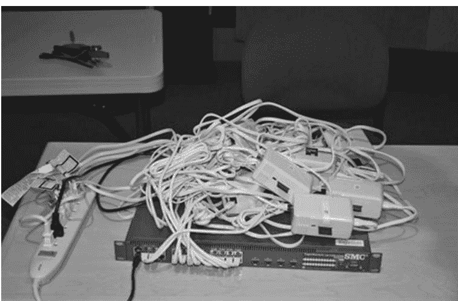
图 A-9

晚上的 BLU 会有大约 60 人参加。当软件行业的一位著名开发者进入会议室时，他掏出口袋电脑对我说：“我已经连接到集群了。它能做什么？”

每个人都看到了演示，并提了许多问题。（可以用 USB 电源运行吗？）Bill Bogstad 在下午组装 SWARM 时发挥了关键作用，他还听了我们那天晚上的演讲。他同意分享他的学习体会：

- 低功耗基于 Linux 的计算设备确实可以处理数据（bits）！
- 低功耗确实意味着低功耗（集群小于 100 瓦）！
- 由此推，低端集群计算可以实际工作。

通过这次会议，我们展示了低功耗 ARM 计算在“可移动”场景下的潜力。

Ubuntu 的多功能性——海量的软件库和全面的平台覆盖——凸显了该平台对开发者和终端用户有多有价值。Ubuntu 是在尖端技术进行实验、探索和实际工作的卓越平台。随着 ARM 的发布，高效能计算已经到来。一个解决方案领域是插电式计算，另一个值得考虑的领域是“可移动设备”。

少数会议参与者，其中一些人帮助构建了 SWARM，另一些人参与了讨论——这些谷房建造者和其他——如图 A-10 所示的群体。

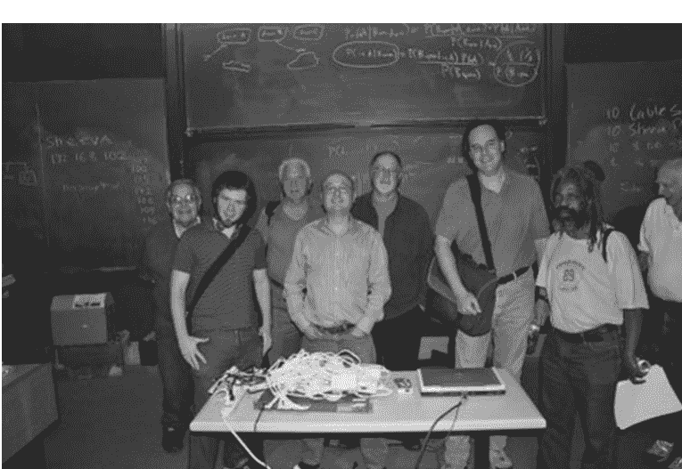
图 A-10


# 附录 B：Git 使用

此外，保持你的仓库整洁且无错误是非常重要的，这样你在工作时才不会丢失数据。本节的最后两个命令对于你的 git 仓库的维护很有用。

## 创建新仓库

```
$ mkdir -p projects/my_first_project
$ cd projects/my_first_project
$ git init
Initialized empty Repository in /home/user/projects/my_first_project/.
```

如果你查看 `.git` 目录，你将看到 git 用于跟踪你项目内容的一系列目录和文件。是的，没错，git 仅跟踪内容，而不跟踪文件。这意味着当你移动或重命名一个文件时，对它来说其实并不重要——它通过不同的路径指向相同的内容，此就了；换句话说，树对象（`tree object`）有不同的方式到达 blob 对象（`blob object`）。

## 克隆现有仓库

你可能与一个现有项目协作。在这种情况下，你必须克隆该项目的主树并在此基础上工作。在这种情况下，你可以使用以下命令：

```
$ mkdir -p projects
$ cd projects
$ git clone git://<url>/path/to/project.git
```

对于一个真实世界的示例，你可以使用以下命令从 Linus Torvalds 处克隆 Linux 内核树：

```
$ git clone git://git.kernel.org/pub/scm/linux/kernel/torvalds/linux-2.6.git
```

克隆字面上为远程仓库创建一个本地副本，这意味着你将拥有该项目的完整历史可供使用。你可以完全进行工作、提交到你的本地副本、生成差异、检出旧代码、创建分支，进行任何操作。

由于你的目标是成为一个分布式版本控制系统（SCM），在主远程仓库的本地副本上进行所有这些工作是自然的。如果没有这种自由，就不可能拥有真正的分布式 SCM。

## 检查仓库错误

文件系统损坏似乎几乎是不可避免的。你可以尝试通过以下方法检查仓库的健康状况来避免此类损坏：

```
$ git fsck
```

这是一个相当慢的操作，因为它必须检查你是否有不可达对象、悬空对象等常见错误中的对象。在运行此命令后，你可能会看到类似的内容：

```
dangling tree b47648f75aa2a0c9508bdd6efe0bb2da17c6
dangling tree 2eedf3560f4d043b0047f5c8bc5f163841e5
```

这意味着你有两个悬空对象（或存在但未使用的对象），它们可以从你的仓库中删除。记住，悬空对象不是问题；它们经常出现在仓库中，尤其是当你频繁重新提交提交时。

## 仓库维护

保持仓库的整洁非常重要；这将帮助 git 更快地工作。在这里你将看到如何移除松散对象（`loose objects`）、重新创建 git 的包（`packs`）以及移除不必要的包。首先运行：

```
$ git gc
```


`gc` 会尽力重新打包你的仓库，并移除松散对象和未使用的旧包。然而，仅为了常理性的维护，git 本身不会尝试表现得太激进。这时你就需要使用以下三个命令：

```
$ git repack
```

通过适当的选项，你可以告诉 `git repack` 获取所有的对象，并且不是创建一个带有增量的增量包，而是只创建一个包含所有对象的单个包。这将节省大量的磁盘空间并帮助 git 运行得更快。要实现这一点，你可以使用 `git repack -a -f -d`。

`git prune` 命令将修剪（移除）仓库中所有未使用的松散对象。换句话说，所有已包含在包中的松散对象将被清除。

```
$ git prune
```

与 `git prune` 类似，`git prune-packed` 命令将从仓库中移除未使用的包。

```
$ git prune-packed
```

关于这个命令没什么说的。你可以使用 `-n` 检查将被移除的包，使用 `-q` 抑制进度指示器。

## 个人开发者

现在你已经有了一组基础命令，可以开始使用 git 进行一些实际工作了。首先，让我们看看在独立项目中工作的开发者需要知道什么才能用 git 跟踪项目的历史。为了实现这一点，首先使用以下命令检查你正在哪个分支上工作：

此命令基本上会显示你所在的位置。换句话说，它将打印出你当前所在的分支和提交名称。在多分支仓库中，它将显示分支之间关系的树状图。例如，它可能显示如下内容：

+   * [master] commit name 1
! [topic] commit name 2
! [topic2] commit name 3

```
+++ [master] commit name 1

$ git-log
```

前面的代码将显示仓库的完整日志，通常使用 `less` 作为分页器，以便你能够逐个提交地查看项目的历史变更。

```
commit 172ee4898de698d16e902c96efce3e981707c0

Author: Felipe Balbi <my_email@mydomain.com>

Date: Feb 27 22:02:33 2009 +0200

commit 1

Long commit description

Signed-off-by: Felipe Balbi <my_email@mydomain.com>
```

-   `$ git pull-request` 如果你仅维护 git 仓库的一部分，它会为你项目的主开发者生成一个拉取请求（pull request）。
-   `$ git merge` 将上游代码合并到你的分支，以便你可以继续开发。
-   `$ git mergetool` 调用你首选的合并工具，在发生合并冲突时帮助你解决问题。

## 仓库配置

为了让仓库运行得更加舒适，可以添加一些配置变量，这些可以帮助你避免一些重复工作。以下是最常见且必要的配置：

```
$ git config -global user.name "My Name"

$ git config -global user.email "my_mail@mydomain.com"

$ git config -global color.ui auto

$ git config -global merge.tool kdiff3

$ git config -global sendmail.smtserver smtp.domain.com
```

## 仓库管理

如果你是仓库管理员，你需要确保 git daemon 正在运行，并且你的用户仅拥有服务器上必要的资源：

-   `$ git daemon` 是用于允许从你的仓库进行匿名下载的守护进程。
-   `$ git shell` 用作共享仓库用户的受限制登录 shell。它将不允许访问控制台，但允许开发者从中央仓库推送和拉取代码。

## 在 Launchpad 上托管你的项目

Launchpad 是一个用于软件开发项目的托管和协作平台。它提供 bug 跟踪、代码托管、翻译服务和问答服务。它将使用 Bazaar 版本控制系统托管的项目代码。

要执行此操作，请在 https://code.launchpad.net/people/+me/+addbranch 注册分支（你需要先在 Launchpad 注册）。填写网页表单将新分支注册到 Launchpad。

它还可以导入 CVS 和 SVN，因此现有项目可以获得可用资源。Launchpad 提供这项免费服务并保持它们更新。这允许你从项目主干（trunk）创建自己的 Bazaar 分支，并在开发功能的过程中随着时间推移合并来保持它们更新。

如需请求导入，请确保项目已在 Launchpad 上注册，或者注册你自己。然后访问 https://code.edge.launchpad.net/+code-imports/+new 上的请求页面并填写详细信息。

这将执行以下操作：

-   创建一个空分支以包含导入的代码。
-   订阅该分支，这样当初始导入完成以及后续更新导入新版本时，你都会收到通知。
-   通知导入操作人员，他们会检查导入位置并批准导入。

初始导入可能需要长时间——长至需要几天，取决于需要转换的版本数量。一旦建立导入，它将每 6-12 小时从 CVS 或 Subversion 分支更新一次，尽管你可以随时点击导入页面上的 Import Now（立即导入）按钮请求导入。

## 附录 C：在 Launchpad 上托管你的项目

目前，该服务仅限于操作每个项目的主分支。

如果你在使用该服务时遇到困难，请在网络 renode 的 #launchpad 频道中提问。

互联网实时聊天 (IRC) 是一种实时消息传递或同步会议工具。它由 Xchat 等客户端提供（使用 `sudo apt-get install xchat`）。

## 使用 Bazaar 和 Launchpad

这需要 Launchpad 知道你的 SSH 密钥。查找 SSH 密钥快捷方法是运行以下命令：

```
$ cat ~/.ssh/id_rsa.pub
```

它的输出如下所示：

```
ssh-rsa

AAAB3Nraz1c2EAAABiWAAEAE8gBQwJqPI09980B5zXbgb6b4H5nXx0MIMctGtg0YeTY4Ghj97/W34r/ExculubXL

8U4FN4MC4S0Cr01qZ7Tt1HgP09980B5zXbgb6b4H5nXx0MIMctGtg0YeTY4Ghj97/ZpZ2k8RdVniqxa108NTJIJ

AoQnS99Fxxz0A00gQ72DIh/9Y+ip+nhYfYKK0Gh327JtPccEu5/mi5w100HHHv6ngbzbtqtVltFj

ZHPOBEREdds3NkCnrd/ufYKKxCOldzinYoAT7HycNub9TKPVhsSDelX2Z5B2Wi== ian@lawrence
```

你可以将此内容粘贴并使用以下命令更新 Launchpad 上的 SSH 密钥：

如果你没有 SSH 密钥，运行以下命令进行创建：

```
$ ssh-keygen -t dsa
```

Bazaar 本身通过以下命令安装创建：

```
$ sudo apt-get install bzr
```

在以下示例中填充的代码将是 Ubuntu Mobile Guide 的第一个版本 — Ubuntu 7.10 (Gius Gibbon) Developer Alpha —— 该版本可以在 http://umeguide.net/ 找到。

首先向 Bazaar 介绍你自己：

```
$ bzr whoami 'Ian Lawrence root@ianlawrence.info'
```

接下来，进入代码所在的文件夹并初始化本地仓库：

```
$ cd mobileguide

$ bzr init
```

查看 Bazaar 的“状态”：

```
$ bzr status
```

## 附录 C：在 Launchpad 上托管你的项目

它显示的内容如下所示：

```
unknown:

C/

README

images/

mobileguide/

validate.sh
```

## 附录 D：桌面电源 Applet 代码

```
<separator/>

<menuitem name="logout" action="logout"/>

</popup>

</ui>
```

```python
***

self.uimanager = gtk.UIManager()

self.uimanager.add_ui_from_string(menu_ui)

accelgroup = self.uimanager.accel_group()

actiongroup = gtk.ActionGroup('Power')

actiongroup.add_actions({

    'lock', gtk.GTK_DIALOG_AUTHENTICATION, _('Travar'), None,

    ('Travar'), self.on_lock),

    'reboot', gtk.GTK_MISSING_IMAGE, _('Reiniciar'), None,

    ('Reiniciar'), self.on_reboot),

    'shutdown', gtk.GTK_MISSING_IMAGE, _('Desligar'), None,

    ('Desligar'), self.on_shutdown),

    'logout', gtk.GTK_MISSING_IMAGE, _('Fechar sessão'), None,

    ('Fechar sessão'), self.on_logout)

})
```

```python
self.uimanager.insert_action(actiongroup, 1)

self.menu = self.uimanager.get_widget('/TrayIconMenu')

self.reboot = self.uimanager.get_widget('/TrayIconMenu/reboot')

pixbuf = pixbuf.Icon_theme.load_icon('gnome-session-reboot', 0, 0)

self.reboot.set_image(gtk.image_new_from_pixbuf(pixbuf))

self.shutdown = self.uimanager.get_widget('/TrayIconMenu/shutdown')

pixbuf = pixbuf.Icon_theme.load_icon('gnome-session-halt', 0, 0)

self.shutdown.set_image(gtk.image_new_from_pixbuf(pixbuf))

self.logout = self.uimanager.get_widget('/TrayIconMenu/logout')

pixbuf = pixbuf.Icon_theme.load_icon('gnome-session-logout', 0, 0)

self.logout.set_image(gtk.image_new_from_pixbuf(pixbuf))
```

```python
def def_position(self, menu):

    # 从 desktop_bar 获取

    align_to = self.eventbox

    direction = self.eventbox.box.get_direction()

    screen = self.screen

    monitor_num = screen.monitor_at_window(align_to.window)

    if monitor_num < 0:

        monitor_num = 0

    monitor = screen.get_geometry(monitor_num)

    menu.set_monitor(monitor_num)

    tx, ty = align_to.window.get_origin()

    width, height = menu.get_child_requisition()

    tx += align_to.allocation.x

    ty += align_to.allocation.y

    if direction == gtk.TEXT_DIR_RTL:

        tx = align_to.allocation.width - width

if (ty + align_to.allocation.height + height) <= monitor.y + monitor.height:

    ty += align_to.allocation.height

elif (ty - height) >= monitor.y:

    ty -= height

elif monitor.y + monitor.height - (ty + align_to.allocation.height) > ty:

    ty += align_to.allocation.height

else:

    ty -= height

if tx < monitor.x:

    x = monitor.x

elif tx > max(monitor.x, monitor.x + monitor.width - width):

    x = max(monitor.x, monitor.x + monitor.width - width)

else:

    x = tx

return (x, y, False)

def on_button_press_event(self, item, event, data=None):

    self.menu.popup(None, None, self.position, event.button, event.type)

def on_lock(self, *args):

    os.system('xlock &')

def on_shutdown(self, *args):

    dialog = gtk.MessageDialog(

        parent=None,

        flags=0,

        type=gtk.MESSAGE_WARNING,

        buttons=gtk.BUTTONS_YES_NO)

    dialog.set_resizable(False)

    dialog.set_title("")

    message_format = '你即将关闭计算机'

    secondary_text = '你确定继续吗？'

    dialog.set_markup('<span weight=bold>size="larger">%s</span>' \

        % message_format)

    dialog.format_secondary_markup(secondary_text)

    result = dialog.run()

    if result == gtk.RESPONSE_YES:

        os.system('kill on-desktop')

    dialog.destroy()

def on_logout(self, *args):

    dialog = gtk.MessageDialog(

        parent=None,

        flags=0,

        type=gtk.MESSAGE_WARNING,

        buttons=gtk.BUTTONS_YES_NO)

    dialog.set_resizable(False)

    dialog.set_title("")

    message_format = '你即将注销用户'

    secondary_text = '你确定继续吗？'

    dialog.set_markup('<span weight=bold>size="larger">%s</span>' \

        % message_format)

    dialog.format_secondary_markup(secondary_text)

    result = dialog.run()

    if result == gtk.RESPONSE_YES:

        os.system('kill on-desktop')

    dialog.destroy()

def on_reboot(self, *args):

    dialog = gtk.MessageDialog(

        parent=None,

        flags=0,

        type=gtk.MESSAGE_WARNING,

        buttons=gtk.BUTTONS_YES_NO

    )

    dialog.set_resizable(False)

    dialog.set_title('*')

    message_format = '你即将重启计算机'

    secondary_text = '你确定继续吗？'

    dialog.set_markup('<span weight=bold>size="larger">%s</span>' \

        % message_format)

    dialog.format_secondary_markup(secondary_text)

    result = dialog.run()

    if result == gtk.RESPONSE_YES:
```


```python
os.system('pkill -r')
os.system('pkill on-desktop')
dialog.destroy()
```

```python
if __name__ == '__main__':
    icon = PowerTray()
    icon.show_all()
    try:
        gtk.main()
    except KeyboardInterrupt:
        print('正在退出...')
        sys.exit(0)
```

# 附录 E：D-Bus 概述

## D-Bus：概述

这是官方 D-Bus 教程（http://dbus.freedesktop.org/doc/dbus-tutorial.html）的摘要，该教程由 Havoc Pennington、David Wheeler、John Palmieri 和 Colin Walters 编写。

D-Bus 是一种进程间通信（IPC）系统。在架构上，它包含以下几层：

- 一个库，`libdbus`，允许两个应用程序相互连接并交换消息。
- 一个基于 `libdbus` 构建的消息守护进程执行文件，多个应用程序可以从一个应用程序运行消息到其他应用程序。
- 基于特定框架的封装库或绑定——例如 `libdbus-glib` 和 `libdbus-qt`。有针对 Python 等语言的绑定。这些库是大多数人使用的 API，因为它们简化了 D-Bus 编程的细节。`libdbus` 旨在为高层绑定提供底层后端。`libdbus` API 仅用于实现。

`libdbus` 支持一对一连接，类似于原始网络。然而，你不是在连接上发送字节流，而是发送消息。消息包含一个标识消息类型的头部和一个包含负载的主体。`libdbus` 抽象了所使用的具体传输方式（套接字或其他），并处理此类认证。

总线守护进程形成轮子的中心。轮的每个辐条都是到使用 `libdbus` 的应用程序的一对一连接。应用程序通过其辐条向总线守护进程发送消息，总线将消息转发给其他连接的应用程序。将守护进程视为路由器。

总线守护进程在典型的计算机上有多个实例。第一个实例是全局单例，即类似于 `sendmail` 或 Apache 的系统守护进程。该实例对接受的消息有严格的安全限制，用于系统级通信。

其他实例按每个用户登录会话创建。这些实例允许用户会话中的应用程序相互通信。系统级和用户守护进程是分开的。正常的会话内 IPC 不涉及系统级消息总线进程，反之亦然。

## D-Bus 应用程序

D-Bus 为两种特定情况设计：

- 同一桌面会话中桌面应用程序之间的通信；允许对整个桌面会话集成，并解决进程生命周期问题（桌面组件何时启动和停止？）
- 桌面会话与操作系统之间的通信，其中操作系统通常包括 GNOME 和 KDE 桌面以及任何守护进程或进程

对于桌面会话内部用例，GNOME 和 KDE 桌面在处理不同 IPC 解决方案（如 CORBA 和 DCOP）方面拥有丰富经验。D-Bus 基于这些经验并为这些桌面项目定制。

由系统级或与操作系统通信案例的问题，通过以下 Linux Hotplug 项目的文本解释得最清楚：

> 目前 Linux 支持的一个缺陷是缺少任何形式的动态“与用户交互”组件策略。例如，在第一次连接网络适配器或打印机时通常需要这些功能，以及确定适当的挂载点。似乎此类操作适用于任何可以识别身份的人员：单用户工作站，或任何被远程管理的系统。
>
> 这是一个经典的“远程管理员”问题，在这种情况下，热插拔需要从一个领域（操作系统内核）传递事件到另一个领域（登录用户的桌面，或远程管理员）。任何有效的响应必须反向进行：远程领域采取行动让内核暴露所需的设备。（操作可以异步执行——例如，让新硬件保持空闲直到完成。）在编写本文时，Linux 已广泛采用解决此类问题的解决方案。然而，D-Bus 的工作可能会开始解决该问题。

D-Bus 可能用于其他其设计目的（见图 E-1）。与其他 IPC 形式区分开的通用属性是：

- 用于异步使用的二进制协议（精神上类似于 X 窗口系统协议），
- 跨长时间的状态化的可靠连接。
- 消息总线是一个守护进程，而不是“集群”或分布式架构。
- 许多实现和部署问题是明确指定的，而不是模糊的可配置/插件式的。
- 语义与现有的 DCOP 系统相似，允许 KDE 轻松采用它。
- 支持消息总线系统级的安全特性。

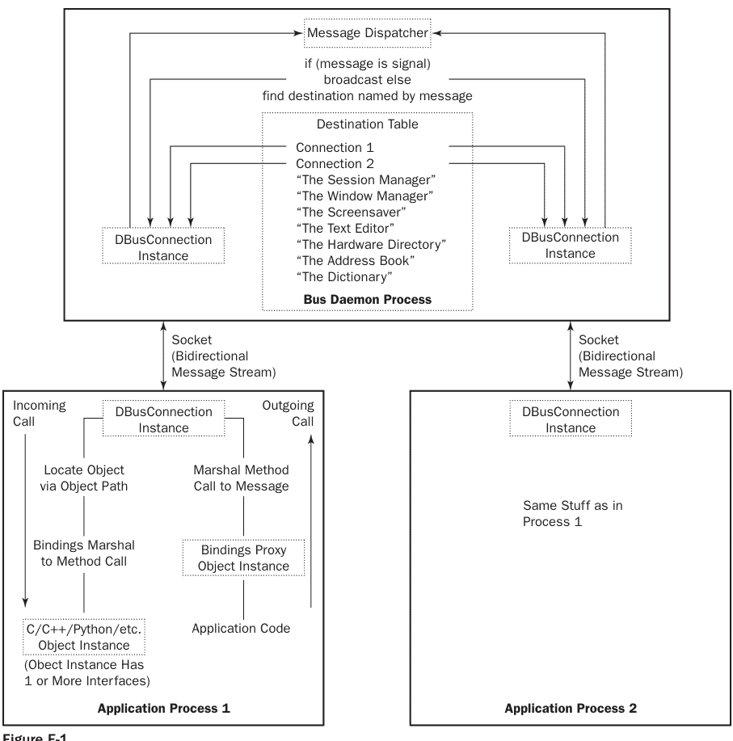

图 E-1

## 原生对象与对象路径

编程框架定义了“对象”的样貌，通常使用基类来实现——例如：`java.lang.Object`、`GObject`、`QObject`、Python 的基类 `Object` 或任何内容。我们称之为原生对象（native object）。

底层 D-Bus 协议以及相应的 `libdbus` API 不关心原生对象。然而，它提供了一种所谓的对象路径（object path）。对象路径的概念是[即]高层绑定可以为原生实例对象命名，并允许远程对象引用它们。

对象路径看起来像文件系统路径——例如，一个对象可以是 `/org/kde/kspread/sheets/3/cells/4/5`。人类可读的路径很棒，但如果对你的应用程序有意义，你也可以创建一个名为 `/com/c5y0817yc1lc5` 的对象。

通过域名组件开头对对象路径进行命名空间（例如 `/org/kde`）是很好的做法，因为这可以防止同一进程中的不同代码模块互不干扰。

## 方法与信号

每个对象都有成员；成员分为两种：方法（methods）和信号（signals）。方法是在对象上可以调用的操作，带有可选的输入（即参数或“入参数”）和输出（即返回值或“出参数”）。信号从对象广播到任何感兴趣该对象的观察者；信号可能包含数据载荷。

方法和信号都通过名称进行引用，例如 `PUM` 或 `OnClicked`。

## 接口

每个对象支持一个或多个接口（interfaces）。将接口想象成一组命名的方法和信号，就像在 GLib、Qt 或 Java 中一样。接口定义了对象实例的类型。

D-Bus 使用单一命名空间字符串标识接口，类似于 `org.freedesktop.Introspectable`。大多数绑定会将这些接口名称直接映射到相应的编程语言结构上——例如映射到 Java 接口或 C++ 纯类。

## 代理

代理对象（proxy object）是一个用于表示另一个进程中远程对象的原生对象。底层 D-Bus API 涉及手动创建方法消息、发送它，然后手动接收并处理方法回复。高层绑定提供了代理作为替代方案。代理看起来像一个普通对象，但当你从代理对象上调用方法时，绑定会将其转换为 D-Bus 方法调用消息，等待回复消息，解包返回值，并从原生方法返回它。

在伪代码中，使用代理进行编程可能看起来像：

```java
Message message = new Message("/remote/object/path", "MethodName", argl2);
Connection connection = getBusConnection();
connection.send(message);
Message reply = connection.waitForReply(message);
if (reply.isError()) {
}
else
Object returnValue = reply.getReturnValue();
```

然而，使用代理进行编程可能看起来像：

```java
Proxy proxy = new Proxy(getBusConnection(), /remote/object/path);
Object returnValue = proxy.methodName(arg1, arg2);
```

## 总线名称

当每个应用程序连接到总线守护进程时，守护进程会立即为其分配一个名称，称为唯一连接名称。名称以冒号（:`）开头。在总线守护进程的生命周期内，这些名称不会被重用——也就是说，你知道给定的名称将始终指向同一个应用程序。唯一名称的示例可能是 `:34-907`。冒号后的数字除了唯一性外没有其他意义。

当一个名称映射到特定的应用程序连接时，该应用程序即拥有该名称。

应用程序还可以添加额外的良性名称。例如，你可以编写一个规范来定义一个名为 `com.ubuntu.TextEditor` 的名称。你的定义可以指定，对于此名称，应用程序在 `/com/ubuntu/TextFileManager` 路径上应该有一个支持 `org.freedesktop.FileHandler` 接口的对象。

应用程序可以向此总线名称、对象和接口发送消息以执行方法调用。

你可以将唯一名称视为 IP 地址，将良性名称视为域名。`com.ubuntu.TextEditor` 映射到类似于 `:34-907` 的内容，就像 `ubuntu.com` 映射到类似于 `91.189.94.250` 的内容一样。

名称除了路由方法外还有第二个重要用途。它们被用于跟踪生命周期。当应用程序退出（或崩溃）时，操作系统内核将关闭其与总线的连接。总线随后发送通知消息，告诉剩余的应用程序该程序的名称丢失了所有者。通过跟踪这些通知，应用程序可以监控其他程序的生命周期。

总线名称还可以用于协调运行实例应用程序。例如，如果你想确保只有一个 `com.mycompany.TextEditor` 应用程序在运行，如果总线名称已经有了所有者，则让文本编辑器应用程序退出。

## 地址

使用 D-Bus 的应用程序要么是服务器是客户端。服务器监听传入的连接；客户端连接到服务器。一旦建立连接，你就可以使用总线。

D-Bus 使用两种总线名称：
- 唯一名称（Unique names）：由总线守护进程在客户端连接时分配。
- 良性名称（Well-known names）：由应用程序注册并用于发现。

D-Bus 使用地址（addresses）路由消息。地址由总线名称和对象路径组成。例如，`/org/kde/kspread/sheets/3/cells/4/5`。

## 概念图

D-Bus 使用以下结构：

```
地址 -> 总线名称 -> 路径 -> 方法
```

## 消息：原理

D-Bus 通过在进程之间发送消息来工作。有四种类型：
- 方法调用（Method call）：请求调用方法。
- 方法返回（Method return）：返回方法的结果。
- 错误（Error）：指示异常。
- 信号（Signal）：通知事件发生。

每条消息都有一个头部（header）和一个主体（body）。你可以将头部视为消息的路由信息，将主体视为数据。

## 调用方法：原理

D-Bus 中的方法调用由两条消息组成：从进程 A 发送到进程 B 的调用，以及从 B 发回 A 的方法回复。调用和回复都通过总线守护进程路由。调用者在每个调用消息中包含一个序列号，回复包含此数字，以便调用者匹配回复与调用。

调用消息将包含方法的任何参数。回复消息可能指示错误，或包含方法返回的数据。

D-Bus 方法调用的步骤如下：

1. 语言绑定提供代理，使得在进程内对象上调用方法会调用另一个进程中远程对象的方法。如果是这样，应用程序调用代理上的方法，由代理构造发送到远程进程的方法调用。
2. 对于低级 API，应用程序可以自己构造方法消息，而不使用代理。
3. 在任何情况下，方法消息都包含属于远程进程的总线名称；方法名称；方法的参数；远程进程内部的对象路径；以及可选的服务提供的接口名称。
4. 方法调用消息发送到总线守护进程。
5. 总线守护进程查看目标总线名称。如果进程拥有该名称，守护进程将方法调用转发给该进程。否则，总线守护进程创建一个错误消息并将其作为回复发送回方法调用。
6. 接收方解包方法调用。在简单的低级 API 情况下，可能会立即运行方法并将方法回复发送给总线守护进程。使用高层绑定 API 时，绑定可能会检查对象路径、接口和方法名称，并将方法调用转换为对原生对象（`Object`、`java.lang.Object`、`QObject`）的调用，然后将来自原生方法的返回值转换为方法消息回复。
7. 总线守护进程（bus daemon）接收方法回复并将其发送给执行该方法调用的进程。
8. 执行方法调用的进程查看方法回复，并利用回复中包含的任何返回值。回复也可能指示发生了错误。在使用绑定（binding）时，方法回复消息可能被转换为代理方法的返回值，或者转换为一个异常。
9. 总线守护进程会对消息进行重重排序。也就是说，如果你向同一个接收者发送了两个方法调用消息，它们将按照发送顺序被接收。然而，接收者并不要求按顺序回复调用；例如，它可以在不同的线程中处理每个方法调用，并根据线程完成的时间以不确定的顺序返回回复消息。方法调用者为每个方法调用分配了唯一的序列号，以匹配回复消息。

## 发送信号：幕后

D-Bus 中的信号由单条消息组成，由一个进程发送到任意数量的其他进程。也就是说，它是一种单向广播。信号可能包含参数（数据负载），但因为它是广播，它永远没有“返回值”。这与方法调用具有匹配的方法消息回复的方法形成对比。

信号的发射者（即发送者）对信号接收者一无所知。接收者在总线守护进程处注册，根据“匹配规则”（match rules）接收信号——这些规则通常包含发送者和信号名称。总线守护进程将每个信号发送给对该信号表示感兴趣的接收者。

在 D-Bus 中发送信号的过程如下：

1. 创建信号并将其发送到总线守护进程。使用低级 API 时，这可以手动完成；使用某些绑定时，当原生对象发射信号或事件时，绑定可能会为你完成操作。
2. 信号消息包含指定该信号的接口名称、信号名称、发送信号的进程的总线名称以及任何参数。
3. 消息总线上的任何进程都可以注册“匹配规则”，指示它感兴趣的信号。总线拥有一个已注册匹配的列表。
4. 总线守护进程检查信号并确定哪些进程对其感兴趣。它将信号消息发送给这些进程。

每个接收到信号的进程决定如何处理它；如果使用绑定，绑定可能会选择在代理对象上发射原生信号。如果使用低级 API，进程可能只需查看信号发送者和名称，根据看到的内容决定如何操作。

## 自省（Introspection）

D-Bus 对象可能支持 `org.freedesktop.DBus.Introspectable` 接口。该接口有一个方法 `introspect`，它不接受任何参数并返回一个 XML 字符串。该 XML 字符串描述了对象的接口、方法和信号。

## Python 与 D-Bus

有两个 dbus 守护进程。每个用户登录会话应该有一个会话总线（session bus），它是该会话局部的，用于桌面应用程序之间的通信。通过创建一个 `SessionBus` 对象连接到会话总线。

```python
import dbus
session_bus = dbus.SessionBus()
```

系统总线（system bus）是全局的，通常在启动期间启动；用于与 udev、Network Manager 和 HAL 等系统服务通信。要连接到系统总线，请创建一个 `SystemBus` 对象：

```python
import dbus
system_bus = dbus.SystemBus()
```


当然，你可以在同一个应用程序中同时连接两者。

# 方法调用

D-Bus 应用可以导出对象供其他应用程序使用。要开始与对象协作，你需要了解以下内容：

- **总线名称（bus name）**：标识你想通信的应用程序。通常通过已知名称来标识应用程序，这是一个用点分隔的反转域名字符串，例如 `org.freedesktop.NetworkManager` 或 `com.example`。
- **对象路径（object path）**：应用程序可以导出许多对象。例如，`example.com` 的文字处理器可能会提供一个代表文字处理器本身的对象，并为每个打开的文档提供一个对象，或者可能为文档中的每个段落提供一个对象。要标识你想与哪一个交互，你使用对象路径，这是一个用斜杠分隔的代表文件名的字符串。例如，`example.com` 的文字处理器可能会在 `/` 处提供一个代表自身的对象，并在 `/documents/123` 和 `/documents/345` 处提供代表打开窗口的对象。

正如你预期的，对远程对象可以执行的主要操作之一就是调用它们的方法。在 Python 中，方法可以有参数，并且可能返回一个或多个值。

# 代理对象（Proxy Objects）

要与远程对象交互，你使用代理对象。这是一个充当远程对象代理或“替身”的 Python 对象。当你对代理对象上调用方法时，这会导致 `dbus-Python` 在远程对象上执行方法调用，并将远程对象方法的返回值作为代理对象方法的返回值传回。

要获取代理对象，请在 Bus 上调用 `get_object` 方法。例如，NetworkManager 拥有已知名称 `org.freedesktop.NetworkManager`，并导出一个路径为 `/org/freedesktop/NetworkManager` 的代理对象。

# 接口与方法

D-Bus 使用接口为相关方法和信号提供命名空间，通过点分隔的名称进行标识。例如，`example.com` 的文字处理器可能会在 `/` 处提供一个代表自身的对象，并在 `/documents/123` 和 `/documents/345` 处提供代表打开窗口的对象。

要调用接口上的方法，你使用代理对象。在 Python 中，方法可以有参数，并且可能返回一个或多个值。

---

atime, 禁用, 212
ATK. 参见 LSB 应用测试包 (ATK)
AT-SPI (辅助技术服务提供者接口), 188
自动回复，创建, 118
自动设置标记, 259–260
自动主题化 (MID), 156–157
自动启动起始 (桌面应用), 57
唤醒状态 (电源), 36

## 业务
- MID 作为机会, 129
- 移动市场与不可预测性, 243
- MID 用户, 129–131

## C
包缓存, 225–226
回调函数，信号与 66
Canola (应用程序), 81
手机。也参见 iPhones
ARM 架构和, 250
历史, 4
与 PC 的, 255
认证, LSB 和 196–197
变更日志文件, 112, 238
变更集对象, (Git), 278
`checkout` 命令, (Git), 283
克隆大型仓库 (Git), 279
云计算, 250
Clutter 库, xxv, 70–75
颜色, 主题化与 153, 155
命令行，从此处报告错误, 205–206
命令

## B
后台服务
- 基础, 210
- 比较, 48–50
- 充电, 209
- 测试, 47–50

Bazaar
- Launchpad 和, 288–289
- 获取脚本, 30–31
绑定监控属性 (pdboulder), 126
`bindlist` 文件, 223–234
`blob` 对象 (Git), 277
蓝牙
- GPS 应用和, 138, 142
- 开启/关闭, 45–46
Bogstad, Bill, 272
启动
- 启动选择器, 222–224
- 启动速度, 207
- 双系统, 259
- MID 设备与主题化, 149
- 故障排除, 257–258

`branch` 命令 (Git), 282–283
浏览器，用 Mago 测试, 193–195
错误, 205–206
构建过程，微调, 225–226
`build-essential` 包 (dpkg), 107
Burton, Ross, 142
总线名称 (D-Bus), 309
- `apt`, 列出, 106
DKMS, 183–185
`dpkg`, 列出, 106–107
编译，定义, 241
合规性，应用, 105
`/configure`
配置
- 动作 (pdboulder), 125
- Ubuntu/xfce/ 的默认配置
- Hildon 行为, 224
- GConf (默认), 224
- `pbuilder`, 120–123
- 预配置 GDM, 224
- 仓库配置 (Git), 285
- 触摸屏, 214–217

连接网络。Generation: 高等教育专业人员需要了解的当今学生, 134
- 贡献者，命令 (Git), 284

## 下载内核源码
控制文件 (PPA), 112–113
复制小部件, 136
版权
- `dch` 工具, 238
Windows 版 `dd`, 260
`debhelper` 工具套, 112
Debian
- 版权文件 (PPA), 113–114
- Ubuntu, 240–242
`debian-installers`, 226, 239
- 内核包，创建, 172–175
- 仓库，设置, 225
Debian 文件, 114

CPUs
- CPUFREQ 和调调调节器, 211
- CPUFREQ 和, 213
- Flash 和, 213–214
- 调试。也参见故障排除
D-feet 调试器, 88
派生发行版, 240–241
设计，应用, 55–56
桌面
- 交叉编译器，定义, 22
- Ubuntu Mobile 的自定义发行版。参见 Ubuntu Mobile 示例

## D
Darwin, Charles, 247
Darwin 软件开发模型
- 应用自动启动规范, 57
- 自由桌面标准, 56–58
- 菜单规范, 57–58
- XDG 基础目录规范, 57

## D-Bus
- Python 文件, 74
桌面镜像, 226
桌面电源小部件代码 (Python), 299–303
- 地址, 310
- 应用, 306–307
- 基础, 305–306
- 总线掩码, 83–84, 309
D-Bus Send, 87
D-Bus Viewer, 85–86
`dbus-launch` 命令, 88
`dbus-monitor` 命令, 87
D-feet 调试器, 88
导出小部件, 84–85
- GPS 应用和, 138, 142
- 接口, 308
- 消息, 310–311
- 原生对象/路径, 308
- 路径, 83–84
- 代理对象, 309, 314
- 安全, 89–91
- 信号, 312
DeviceKit-power, 41–44
- `dh` 命令, 111–112
- `d-i` (debian-installer), 226
- `diff` 程序 (dpkg), 107
- Diamond, 246
显示管理器, 222–223
- 发行版, 240–241
- 环境，创建 (ubpler), 124
Django Web 框架, 138, 139, 143–144
DKMS (模块支持)。参见动态模块支持 (DKMS).
DKMS (内核模块)。参见动态模块支持 (DKMS).
DNS 和缓存服务器，设置, 27
- 文档, 130
下载内核源码, 166
为了内核源码, 175
为了打包, 106–107
动态模块支持 (DKMS)
- 命令, 183–185
- 框架，内部工作, 182–183
概述, 181–182
修复问题。参见问题与解决方案
标记 (HILDON)，自动设置, 259–260
(内存) 应用, 202
自由桌面标准, 56–58
自由软件, 247, 251
Freemner, 在 Ubuntu 上运行, 260
`fsck` 命令 (Git), 279–280
Linux 的未来, 243, 255
移动行业, 253–254

## E
ee PC 测试结果, 162–163
EFL (Enlightenment Foundation Libraries), 79–81
Elementary 小部件集 (Enlightenment suite), 81–82
嵌入式系统, 221–222
加密，设置, 130
Endle, Rob, 266
能量, 208–212
引擎，主题, 148, 157
Enlightenment Foundation Libraries。参见 Enlightenment Foundation
进入媒体中心, 131–133
事件循环 (GTK), 64–65
用 D-Bus 导出对象, 84–85

## G
gadgets
Google Gadgets, 134, 135–137
OS 3 Gadgets, 134–138
GConf
默认配置，设置, 224
概述, 91–94
Generation Y (Gen Y), 134
geohash.org, 145
生成程序, 231–235
终止工具, 234, 235

## F
`fakeroot` 工具, 108
Felman, Jerry, 271
文件系统
嵌入式, 222–222
主题的位置, 148
文件
office 文件。也参见 treb (Trebuchet)
应用种子文件, 231–232
种子文件, 231
客人与宿主机之间的共享, 29–31
贡献者命令, 284
个人开发者命令, 280–284
集成者角色, 284
维护者角色, 284–285
对象, 277–288
概述, 277
仓库管理, 285
仓库命令, 278–280
仓库配置, 285
工具, 171–175
树, 173

## Glade, 190–191
`.glade` 文件 (umdGlade 类), 69–70
界面设计师, 66–70
GNOME。也参见 Conf; Glade
Gnome-Power-Manager, 40
Gnome-Power-Statistics, 40
Hildon 应用框架, 57
GNU
Human 网络主题, 54
Human metacity, 160–163
`hwinf` profo, 220
Hypervisor 软件, 11

## I
图标，应用, 258–259
图像。也参见多媒体用户
构建自定义, 32–33, 230–235
创建, 226–230
默认 Ubuntu 镜像, 226–230
`.img` 镜像, 31
增加下载大小, 34
安装应用, 33
主题时修改, 155–156
写入脚本, 31–32
主题图像，sapwood，和 148–149
写入 USB 闪盘, 257–258
独立软件版本 (ISV),
`init` 命令 (Git), 279
`itnrafs`, 207

## dpkg 工具
`dpkg` 工具
`dpkg-put` 工具, 115
`dpkg-sources`, 107
`dpkg-scan`, 107
驱动，更新 (DKMS), 181–185
双系统, 259
动态模块支持 (DKMS)
- 命令, 183–185
- 框架，内部工作, 182–183
概述, 181–182


# 安装

- 在镜像内安装应用程序, 33
- QEMU 上的 ARM, 22–23
- KVM, 23–24
- LSB Ubuntu 工具包 (ATK), 196
- Ubuntu MID 镜像, 24
- 在 UMPC 上的 Ubuntu Netbook Remix, 261
- VirtualBox, 12
- 集成者角色 (Git), 284
- 接口
  - GUI 的更改, 78
  - D-Bus, 308, 314
- 链时聊天 (IRC), 228
- 进程间通信 (IPC), 305
- Intrepid, xx
- `Introspect` 方法 (D-Bus), 313
- 发明
  - 发明：想法的关怀与喂, 244
  - 阶段, 244–245
  - Torvalds 与, 246
- `lily` 应用, 217
- iPhones
  - 在校园内, 253, 254
  - 历史, 3–4
- iPods, 历史, 3–4
- ISO 镜像
  - 构建自定义的, 240
  - 构建默认的, 229–301
- ISV, 定义, 187

# J

- Jaunty Ubuntu Mobile 定义, xx
- MID 发布, 下载, 32
- Junco, Reynol, 134
- 仅为好玩：一个意外革命者的故事, 246

# K

- Karmic, Ubuntu. 参见 Ubuntu Mobile 镜像示例
- 内核微调
  - Debian 包, 创建, 172–175
  - 动态内核模块支持. 参见动态内核模块支持 (DKMS)
  - 被挑战的内核核, 165
  - Linux 内核, 165
  - 非 Ubuntu 内核树, 181
  - 概述, 165–166
  - 属性, 165
  - Ubuntu Karmic 示例与, 221
  - Ubuntu 内核树, 175–181
  - Ubuntu 包, 创建, 166–171
- 键盘
  - Enterrainer 的控制, 133
  - 屏幕, 启用, 224
- Koury, Rabeeh, 269
- Kidder, Tracy, 246

# KVM (内核虚拟机)

- 后向移植, 119
- 基础, 21–24
- KVM/QEMU 中的网络, 26–34
- 故障排除, 262
- 在桥接中使用, 29

# L

- 笔记本模式, 209–210
- Latencycop 工具, 203
- 启动器. 参见 Ubuntu Netbook Remix
- Launchpad. 参见所有 P (个人包存档)
- 在其托管项目, 287–289
- 布局, GTK+ 和, 65
- LDTP (Linux 桌面测试项目), 187
- LGPL (库通用公共许可证), 241–242
- 库, `libdbus` (D-Bus), 305
- `lintian` 工具, 108
- Linux. 参见所有 Moblin 倡议
- 未来, 245, 255
- Hotplug 项目, 306
- Linux 桌面测试项目 (LDTP), 187
- LSB Ubuntu 工具包 (ATK), 196–197
- 移动计算与, 245–255
- 性能测试工具, 201–203
- 故事, 246
- 学生使用, 254
# Linux 标准基础 (LSB) 测试

- 工具包, 187
- 用户, 138. 参见 GPS 启用的独立 Web 应用 (MID 设备)
- 长期支持 (LTS) 发布, 219
- Lotus 开发, 247
- LPIA (低功耗架构)
  - 标志, 自动, 259
  - LPIA Ubuntu MID 发布, 50
  - 概述, Ubuntu MID 内核与, 165
- LSB 应用工具包 (ATK), 196–197
- `Ishw` 程序, 220
- `lucview` 应用, 228

# M

- Mago, 测试, 188–189, 193–195
- `main` 类别 (Ubuntu), 126
- 维护者角色, 284–285
- `make` 工具, 105
- MID 手动测试, 154–156
- 市场 (移动设备)
  - 增长, 243
  - 刀片与叶片, 251
  - 可预测性, 243
- Mastrod, Jeanna, 134
- Maximus daemon, 54
- Mayer, Emyst, 248
- Mayer 模型软件开发, 248
- Maclin 平台, xiv
- `memcheck`, 202
- `memstat` 应用, 202
- Mendel, Gregor, 247
- Mendel 模型软件开发, 247–248
- Menlow 平台, xiv
- 菜单规范, 桌面, 57–58
- 创建菜单 (Hildon), 59
- 创建菜单 (Hello World), 61–82
- 消息守护进程 (D-Bus), 305
- 发送 (D-Bus), 310–311
- `metacity-theme-viewer`, 160–163
- 元包
  - 构建, 236–238
  - 生成, 235–236, 238–239
- 方法
  - 接口 (D-Bus), 314
  - 方法调用 (D-Bus), 311–313
  - 信号 (D-Bus), 308
- MID, Ubuntu, 54–55
- 移动计算
  - 架构, 243–244
  - 设备, 253–259
  - 历史, 2–5
  - 移动互联网 (MIDs), 129
  - 移动开发者, 加入, 262
  - Obama 与, 249
  - 政治, 249
  - 移动环境. 参见 Ubuntu 环境, 1
- Shuttleworth 在, 254–255
- 模块. 参见动态内核模块支持 (DKMS)
- 硬编码, 208
- MONITOR 变量, 48
- 挂载绑定包仓库 (发布者), 126
- 多媒体用户, 131–133
- `multiverse` 类别 (Ubuntu), 127
- Murrine 引擎, 主题与, 157

# N

- 命名总, 83
- 名称 (D-Bus), 309
- 激活对象/对象路径 (D-Bus), 308
- Neo Freer, 260
- 笔记本电脑历史, 6
- Linux, Ubuntu 与, 75
- 网络
  - 连接, 251–252
  - 在 KVM/QEMU 中, 26–34
  - 在 VirtualBox 中, 25–34
- The Billion Network, 249
- Niemeyer, Gustavo, 145
- Nokia Wireless GPS Module-3DW, 142
- 通知 (D-Bus), 93–94

# O

- 对象
  - 使用 D-Bus 导出, 84–85
- 对象路径, D-Bus, 83
- 《物种起源》, 247
- 开源软件 (OSS), 249, 251–252
- OpenCV (开源视觉), 267–268
- OpenOffice, 130–131

# P

- P2P 形式, xxvii
- 包
  - 添加到仓库/从仓库中移除, 119
  - 构建 (PPA), 115
  - 在内部构建 (`pbuilder`), 124
  - 大约缓存, 225–226
  - 类别, 126–127
  - 消除种子和, `apt`, 261–262
  - 元包, 构建, 236–238
  - 元包, 生成, 235–236, 238–239
- `Packages.gz`, 118
- 用于测试的 `pbuilder` 工具, 200
- 电源管理, 36–41
- Ubuntu 部分, 127
- 应用程序打包. 参见应用程序打包
- 填充, 定义, 153
- Palmieri, John, 305
- 密码, 130
- 补丁程序 (dpkg), 107
- Paul, Ryan, 157

## PBuilder

- 钩子操作, 125–126
- 挂载绑定包仓库以供使用
- `pbuilder`
  - 配置, 119–123
  - 概述, 120
  - 守护进程, 108
  - 执行操作, 124–126
  - 测试目的, 200
  - 构建, 115
- PPA (个人包存档)
  - 创建, 118
  - 定义, xx
  - 概述, 108
  - 构建, 115
- 请求 (Ubuntu), 245

# R

- Radachovsky, Sage, 272
- 无线发射器, 控制, 44
- RAM, `/tmp` 和
- 种子文件, 231–235
- Ubuntu 发布, 219
- 可移动计算, 268
- 报告 Bug, 205–206
- 仓库
  - 添加到/从仓库中移除, 119
  - 仓库管理 (Git), 285
  - 仓库命令 (Git), 278–280
  - 仓库配置 (Git), 285
  - 设置 Debian, 225
- 编译工具, 118
- 限制
- `restricted` 类别 (Ubuntu), 126


## 太阳能驱动集群，构建 SWARM

- 太阳能驱动集群，构建 (SWARM), 270–276
- “机器灵魂” (Kidder), 246
- 源代码，在哪里找到，xxvi
- `squashfs` 文件系统, 237
- Stallman, Richard, 247
- 待机状态（电源), 36
- 过去的节电技术, 36
- `STRUCTURE` 文件, 232–234, 237
- 样式、主题化与, 153–154
- 挂起状态（电源), 36–4n

## LSB 应用测试工具包 (ATK), 196–197
  - 概述, 189
  - 使用 Mago 进行测试, 193–195

## 主题 (themes)
  - 定义, 147
  - 结构, 151–154
  - 主题引擎, 148
  - `theme.xml` 文件, 151–152
  - 修改工具, 150–151

## 主题化 (theming)
  - 目标, 150
  - 概述, 147–150
  - 性能测试, 160–163

## Ubuntu MID, 148–150
  - 自动 Ubuntu MID, 156–157
  - 手动操作 Ubuntu MID, 154–156

## Ubuntu Network Remix, 157–159
- `SystemBus` 类型, 213
- 嵌入式系统, 221–222

## T

## 技术世界 (technology world)
  - 变化, 247
  - 奥巴马与, 249
  - 政治与, 249
- `groupby` 的模板, 114

## 测试 (testing)
  - 用于无障碍性的库, 188
  - 用于构建的构建。详见 testing
  - 应用，构建（示例）
  - 电池, 47–50
  - 错误报告, 205–206
  - 合规性, 204–205
  - 免费应用, 202
  - 连接到 GPS, 142
  - Latency top, 203
  - `memcheck`, 202
  - `memstat` 应用, 202
  - 用于包测试的 `pbuilder`, 200
  - Phoronix Test Suite, 197–200
  - Procinfo 工具, 201
  - `ps` 工具, 201
  - 原因, 187
  - 策略, 203–205
  - 主题化性能, 160–163
  - `time` 工具, 201
  - `top` 工具, 201
  - Valgrind 工具, 202–203
- 测试应用，构建（示例）
  - 创建应用, 190–192
  - `time`。还有 atime，禁用 `time` 工具, 201
  - 时间线 (Clutter), 70
  - `tmp` 大小, 028
  - 工具栏，创建（Hello World）, 62–64
  - 工具栏，创建（Hildon）, 59
- 工具包 (toolkits) 。另请阅 GTK (Gimp Toolkit)
  - EFL, 79–81
  - Glade, 66–70
  - QT, 75–79
- 工具 (tools)。另请阅 `pbuilder` tool
  - 用于应用打包, 105–108
  - 用于自动构建镜像, 226
  - 图形操作, 156
  - 用于缓存包, 225
  - Linux 性能测试工具, 201–203
  - LSB 应用测试工具包, 196
  - 用于修改它们, 150–151
  - Phoronix Test Suite, 197–200
  - 用于测试, 197–203
  - `top` 工具, 201
- Torvaldis, Linux, 7, 246–247, 255
- 触摸屏，配置, 214–217
- 商标，ubuntu, 240–242
- `treb` (Trebuchet) 应用, 131
- `tree` 对象，(Git), 278
- 故障排除。详阅 debugging：问题解决方案

## 垂直框 (vertical boxes) ，GTK 与

## U
- 软件包和存储库, 235–240
- 策略/商标/版权, 240–242
- 电源策略，定义, 221

## Ubiquity 图形安装程序, 226, 239
  - Ubuntu 默认行为，设置, 224
  - 用户界面，自定义, 222–224
  - `xfce` 默认行为，设置, 224

## Ubuntu

## Ubuntu 网络团队 (Ubuntu Network Team)
  - 替代镜像 (Alternate Image), 226
  - ARM, xxv
  - 桌面镜像 (Desktop Image), 226
  - 开发者社区 (Developer Community), 245
  - Hardy 版本, ii
  - 移动式项目, 261
  - Mark Shuttworth, 248
  - 嵌入式项目, iii
  - 移动计算, 254–255
  - 移动团队, 262
  - 笔记本电脑, 6
  - 运行在 Arima, 261
  - 运行在 Freer, 260
  - `ubuntu-vm` 工具, 30
  - 用户界面，默认行为, 224
  - Ubuntu 移动商业支持, 219
  - Ubuntu 移动项目, xiii
  - Ubuntu 策略文档, 126
  - `ubuntu-mobile` 版本, xxv
  - 摄像头支持, 220
  - Wiener, Norbert, 244–245
  - 窗口特定设置 (Hildon), 59
  - 封装库 (D-Bus), 305

## Ubuntu 移动环境 (Ubuntu mobile environment)
  - 背景, 11–12
  - `jaunty` 版本, 12
  - 独立用户, 129–131
  - 社交网络, 137
  - 用户界面，自定义, 222–224
  - 运行在 KVM/QEMU, 26–34
  - 运行在 VirtualBox, 34

## Ubuntu 移动镜像 (Ubuntu Mobile image)
  - 架构支持, 220
  - 端口到 架构, 54
  - 构建过程, 225–226
  - 自定义 Ubuntu 镜像, 230–235
  - 硬件检查, 220
  - 嵌入式系统, 221–222
  - 默认行为，设置, 224
  - 关键注意事项, 219
  - 内核调优, 221

## UMPCs
- 针对 UMPCs 的安装, 26
- 针对 UMPCs 的网络, 261
- 针对 UMPCs 的打包, 109
- 针对 UMPCs 的 Ubuntu 版本, 11

## V
- Valgrind 工具集, 202–203
- VDE 交换机, 26
- 垂直框, 66

## W
- Walters, Colin, 305
- 网站，下载
  - Windows 版 `dd`, 260
  - Netbook Remix 修复程序, 263
  - GNU Hard, 259
  - gOS 3 小组件, 134–138


# 开源软件开发者必读读物

作为如今最流行的开源操作系统，Ubuntu 最近发布了新版本，旨在面向基于 Atom 和 ARM 处理器构建互联网化手持设备的制造商。这本令人兴奋的书概述了您在定制移动互联网设备时需要理解的工具和技术，并提供了分逐步的教程，引导您完成一些常见任务。该书由 Ubuntu 社区开发者编写，首先概述了 Linux 领域的概况，然后详细介绍了为移动设备进行设置、开发、打包和构建发行版的过程。

- 讨论了为什么设备的外观和感受如此重要
- 回顾如何选择合适的应用程序
- 展示了如何为移动设备开发应用程序
- 解释了如何为分发准备应用程序
- 提供了微调内核的技术
- 引导你完成“定制”并构建你自己的发行版
- 讨论了如何进行稳定性和性能测试
- 揭示了处理常见问题和执行解决方案的技巧

Ian Lawrence 是诺基亚技术学院（Instituto Nokia de Tecnologia）的 Scrum 师。他是 Ubuntu 巴西社区和 Debian 美洲社区的创始成员。

Rodrigo Cesar Lopes Belem 是一位自由软件开发人员和倡导者，曾贡献过 Enlightenment 和 Ubuntu 等许多开源项目。他目前在诺基亚技术学院担任软件开发人员。

Wrox 专业指南由在职程序员计划并编写，旨在满足程序员、开发者和 IT 专业人员的真实世界需求。这些指南具有相关性，解决了技术专业人员每天面临的问题。它们提供了实用的解决方案以及新技术的专家级教育，旨在帮助程序员更好地完成工作。


# wrox.com

# 程序员论坛

加入我们的“程序员之程序员”社区，就本书进行提问和解答，参与行业最热门话题的讨论，并与全球的程序员建立联系。

# 代码下载

利用本书中的免费代码示例，以及来自数百其他书籍的代码示例，所有代码均可随取随用。

# 阅读更多

数百本书的文章、电子书、示例章节和目录，以及关于你关心的编程主题的更多资源。


操作系统 / Linux

| 价格 | 价格 |
| :--- | :--- |
| $59.99 USD | $71.99 CAN |


```
