# Visual Basic 2010 and .NET 4 高级指南

## 小结 785

### 第23章：ASP.NET MVC 787

#### Office业务应用程序架构 846

#### 同时使用VBA和VSTO 847

#### 创建Office加载项（Excel） 864

#### Outlook窗体区域 871

#### 小结 880

### 第26章：Windows Workflow Foundation 881

#### 应用程序中的工作流 881

选择框架版本 1103

1

Visual Studio 2010

本章将学习的内容

- Visual Studio 版本
- Visual Basic 关键术语简介
- 定位运行时环境
- 创建基础 Visual Basic Windows 窗体
- 项目模板
- 项目属性 — 应用程序、编译、调试
- 设置属性
- IntelliSense、代码扩展和代码片段
- 调试
- 记录和使用宏
- 类设计器
- Team Foundation Server — Team Explorer

您可以在没有 Visual Studio 的情况下使用 Visual Basic。事实上，附录 A 重点介绍了从命令行使用 Visual Basic 编译器。在实践中，大多数 Visual Basic 开发人员将两者视为几乎不可分割；如果没有 Visual Studio 的版本，您将被迫从命令行工作，手动创建项目文件，调用相关编译器，并手动处理构建应用程序所需的工具。虽然 Visual Basic 在此方面与 C#、F#、C++ 和其他 .NET 语言的支持水平相同，但这并不是 Visual Basic 专业人员的典型关注点。

Visual Basic 的成功源于其在构建业务应用程序时相比其他语言的生产力提升。Visual Studio 2010 提高了您的生产力，并在调试应用程序方面提供帮助，是 Visual Basic 开发人员的自然工具。

因此，本书的当前版本将从介绍 Visual Studio 2010 以及如何构建和管理 Visual Basic 应用程序开始。本章的重点是确保每个人都具备与在 Visual Studio 2010 中创建和调试应用程序相关的任务的核心知识集。本书在构建解决方案时将使用 Visual Studio 2010。请注意，虽然这是起点，但不要将其视为“入门”章节。本章将介绍使用 Visual Studio 的关键要素，但也会超出该范围。您可能会发现自己需要回头参考稍后再深入学习你第一次阅读时忽略的高级主题。Visual Studio 是一个功能强大且有时复杂的工具，你不必在第一次阅读本章时就掌握它。

当 Visual Studio 2005 发布时，微软扩展了可供使用的 Visual Studio 不同版本。低成本端，目前免费的是 Visual Basic Express Edition。该工具使你只能使用 Visual Basic 来构建桌面应用程序。其用于 Web 开发的配套工具是 Visual Web Developer Express，它使你能够构建 ASP.NET 应用程序。在高端，微软提供 Visual Studio Ultimate。每个高端、Professional、Premium 和 Ultimate 版本都可作为 MSDN 订阅的一部分提供，并且这些版本中的每一个都进一步扩展了核心 Visual Studio 2010 功能，超越了核心集成开发环境（IDE），以帮助改进设计、测试以及开发人员之间的协作。

当然，本章的重点是 Visual Studio 如何使你能够使用 Visual Basic 来构建面向“更好、更快、更便宜”业务目标的应用程序。为此，我们将从核心 Visual Basic 2010 Express Edition 的功能开始，逐步扩展到完整的 Visual Studio Team Suite。

本章概述了 Visual Studio 2010 的许多功能。它还简要介绍了使用功能更丰富的 Visual Studio 版本可用的功能。有经验的开发人员可能会忽略其中的大部分信息，尽管我鼓励他们回顾本章中介绍的 Visual Studio 2010 Ultimate 中可用的新历史调试功能。目标是展示 Visual Studio 如何使你作为开发人员更具生产力和成功。

## VISUAL STUDIO 2010: EXPRESS THROUGH ULTIMATE

对于不熟悉 .NET 开发主要元素的人来说，有通用语言运行时（CLR）、.NET Framework、各种语言编译器和 Visual Studio。每一个都发挥作用，例如 CLR —— 在第 4 章中介绍 —— 管理 .NET 平台上代码的执行。因此代码可以针对特定版本的此运行时环境运行。

.NET Framework 提供了一系列类，开发人员可在实现语言之间利用这些类。此框架或类库是版本化的，并针对在特定最低版本的 CLR 上运行。它是此库以及语言编译器被 Visual Studio 引用。Visual Studio 允许你构建针对一个或多个版本的目标应用程序，这些版本统称为 .NET。

在某些情况下 CLR 和 .NET Framework 相同；例如，.NET Framework 版本 1.0 运行在 CLR 版本 1.0 上。在其他情况下，就像 Visual Basic 的编译器在版本 10 上一样，.NET Framework 可能会有更新的版本针对旧版本的 CLR。

相同的概念也适用于 Visual Studio。Visual Studio 2003 专注于 .NET 1.1，而早期的 Visual Studio .NET（2002）则专注于 .NET 1.0。最初，每个版本的 Visual Studio 都针对特定版本的 .NET 进行了优化。同样，Visual Studio 2005 针对 .NET 2.0 进行了优化，但随后出现了 .NET Framework 版本 3.0 的例外情况。这引入了一个新的框架，它由同一 CLR 版本 2.0 支持，但没有随新的 Visual Studio 版本一起发布。

幸运的是，微软选择在 .NET 3.0 Framework 发布时保持 Visual Basic 和 ASP.NET 不变。然而，当你查看 .NET 3.0 Framework 元素（如 Windows Presentation Foundation、Windows Communication Foundation 和 Windows Workflow Foundation）时，你会发现这些项目需要在 Visual Studio 之外解决。因此，虽然 Visual Studio 与 Visual Basic、CLR 和 .NET 开发是分离的，但在实际操作中 Visual Studio 与这些项目紧密耦合。

随着 Visual Studio 2008，微软通过提供强大的支持来松动这种耦合，允许开发人员针对 .NET Framework 的三个不同版本。Visual Studio 2010 延续了这一点，使你能够将应用程序定位为在 .NET 2.0、.NET 3.0、.NET 3.5 或 .NET 4 上运行。

然而，正如你将发现的，这种支持并不意味着 Visual Studio 2010 不与特定版本的每个编译器紧密耦合。事实上，针对框架的新支持旨在支持运行时环境，而不是编译时环境。这很重要，因为当来自 Visual Studio 早期版本的项目转换为 Visual Studio 2010 格式时，它们无法被早期版本重新打开。

原因在于 Visual Studio 2010 使用的底层构建引擎接受语法更改甚至语言功能更改，但 Visual Studio 的早期版本无法识别这些语言的新元素。因此，如果你将用 Visual Studio 2010 编写的源代码移动到 Visual Studio 的早期版本，你很可能会遇到编译失败的情况。有方法可以在同一团队中手动跨 Visual Studio 版本处理项目，但它们不受支持。本书的作者之一 Bill Sheldon 在 2007 年 8 月有一篇博客文章，讲述了他在此方面的经验。标题为“Working with Both VS 2005 and VS 2008 B2 on the Same Project”的文章对那些使用 Visual Studio 2010 的人仍然适用：`http://nerdnotes.net/blog/default,date,2007-08-29.aspx`。

Visual Studio 2010 的多目标支持确保你的应用程序将在特定版本的框架上运行。因此，如果你的组织不支持 .NET 3.0、.NET 3.5 或 .NET 4，你仍然可以使用 Visual Studio 2010。编译器基于语言语法生成字节码，其核心字节码与版本无关。你可能遇到麻烦的地方是如果你引用了一个或多个不属于给定 CLR 版本的类。因此，Visual Studio 在针对旧版 .NET 时管理你的引用，使你能够合理确定你的应用程序不会引用这些其他框架版本中的文件。多目标支持使你能够安全部署，而无需要求客户下载他们不需要的额外框架组件。

在这些基本规则确定后，有哪些版本的 Visual Studio 2010 可用，它们之间主要有什么区别？如前所述，Visual Basic 2010 Express 在价格和功能方面处于最低层级。Visual Web Developer 2010 Express Edition 与其相伴，对于那些开发 Web 应用程序而非桌面应用程序的开发人员来说。这些两个工具是分开的，但都支持开发不同类型的 Visual Basic 应用程序，并且两者都是免费的。注意，然而，两者都不可扩展；这些工具旨在入门，微软的许可禁止供应商通过生产力增强来扩展这些工具。

然而，每个 Express Edition 开发工具还附带两个在此简要介绍的附加组件：MSDN Express Edition 和 SQL Server 2008 Express Edition。MSDN 当然是 Microsoft Developer Network，它已将大部分内容放在网上。它不仅是 Visual Basic 核心语言文档的来源，也是面向使用 Microsoft 技术开发人员的几乎每种产品的文章来源。Visual Studio 的完整版本随附完整的 MSDN 库，以便你可以在本地访问其内容。然而，Express Edition 工具实际上随附了一套精简的文档文件。

与语言和基于 Web 的工具类似，微软有一个 SQL Server Express Edition 包。该包有历史，因为它取代了随 SQL Server 2000 提供的 MSDE 数据库引擎。SQL Server Express 引擎提供了核心 SQL Server 2008 数据库引擎。有关 SQL Server Express 的更多信息，请访问 www.microsoft.com/express/database。请注意，可通过从微软单独下载获得免费的数据库管理应用程序。

当你安装 Visual Studio 2010，包括 Express Edition 时，你也有机会安装此核心数据库引擎。该引擎的元素可自由重新分发，因此如果你正在寻找基于 ADO.NET 的核心数据库功能集，你可以创建你的应用程序并部署你的 SQL Server 2008 Express Edition 数据库，而无需担心许可问题。

回到版本差异，Express Edition 工具提供了创建基于核心 IDE 的 Visual Basic 应用程序（Windows 或 Web）所需的核心组件。表 1-1 提供了可用版本的快速总结，包括每个版本如何扩展 Visual Studio 的描述。

### 表1-1：Visual Studio 版本

| Visual Studio 版本 | 说明 |
|---|---|
| Visual Basic 2008 Express Edition | 这是创建基于 Windows 的应用程序所需的核心功能集。它包括 IDE，支持完整的本地调试，并支持五种项目类型：Windows 窗体应用程序、动态链接库、WPF 应用程序、WPF 浏览器应用程序和控制台应用程序。 |
| Visual Web Developer 2008 Express Edition | 构建 Web 应用程序所需的核心功能集。它支持 Visual Basic 和 C#，并允许对 Web 应用程序进行本地调试。 |
| Visual Studio 2010 Standard Edition | 为核心 Visual Studio 语言（J#、VB、C# 和 C++）提供了一种组合开发语言。它增加了对象建模工具，并为 Windows 和 Web 应用程序提供组合支持。它还提供了对应用程序部署的额外支持，以及对移动应用程序开发的支持、与源代码管理工具的集成以及 Visual Studio 中的宏；它也是可扩展的。 |
| Visual Studio 2010 Professional Edition | 在 Visual Studio Standard Edition 基础上进行了扩展，增加了与 SQL Server 的集成并支持 XSLT。它还包括对 Visual Studio Tools for Office (VSTO) 的支持，使您能够创建自定义客户端（Word、Excel、Outlook 等）和 SharePoint 工作流应用程序。此版本还允许对 Web 应用程序进行远程调试，并对所有项目进行单元测试。（此版本支持 VSTO，但关联的 MSDN 订阅不包含 Office 许可证。） |
| Visual Studio 2010 Premium Edition | 此版本开始引入许多最初随所谓的 Team Suite 一起推出的扩展。此版本扩展了测试功能，如代码覆盖率和编码 UI 测试支持。它包括支持数据库开发、变更管理、测试等工具，以及用于静态代码分析和代码度量的工具。 |
| Visual Studio 2010 Ultimate Edition | 此版本包含 Visual Studio 2010 Premium Edition 的所有核心功能。然后增加了历史调试、Web 和负载测试工具，以及各种相关工具来增强开发。与 Visual Studio Premium 版一样，此工具侧重于使开发人员能够在共享协作环境中高效工作。 |

Express Edition 工具最适合描述为面向学生和业余爱好者，不是因为你不能创建严肃的应用程序，而是因为它们仅提供有限的团队开发支持、有限的扩展性，并提供独立的环境。Express 工具面向独立工作的开发人员，同时仍然提供对 Visual Basic 语言功能的完全访问。本章从使用此版本中可用的功能在 IDE 中开始工作，此版本本质上是最低限度的共同基础，然后超越此免费工具的能力。

然而，开发人员最终需要额外的工具和项目。这就是 Visual Studio 2010 完整版本（Standard、Professional、Premium 和 Ultimate）发挥作用的地方。随着对团队开发支持水平的不断提高，这些功能丰富的版本增加了宏支持，更重要的是，还增加了对象建模工具。正如本章后面“类图”一节所讨论的，Visual Studio 使您能够创建解决方案中各类的可视化表示，然后将该表示转换为代码。此外，该工具还支持所谓的往返工程。这意味着您不仅可以使用图形模型生成代码，还可以获取项目的源文件并重新生成图形模型的更新版本——也就是说，以图形格式编辑该模型，然后更新关联的源文件。

对于选择 Visual Studio 2008 Professional 或更高版本的用户，Visual Studio Tools for Office (VSTO) 主要面向企业开发人员，即在公司组织中工作的人员（无论是员工还是顾问/承包商）。此工具为 Microsoft Office 2007 和 Microsoft Office 2010 企业版的用户提供了一种方法，使这些办公效率工具能够扩展出类似应用程序的功能。许多组织将 Microsoft Office 用于近乎自定义应用程序的任务。Microsoft Excel 尤其如此。VSTO 提供了基于这些 Microsoft Office 产品的项目模板，例如，使电子表格能够从 SQL Server 数据库而不是本地文件系统检索其内容。这些工具不仅能够操作数据检索和保存，还能够自定义用户界面，包括直接访问 Microsoft Office 产品中的任务窗格和自定义工具栏选项；这些将在第25章中更详细地介绍。

Visual Studio 2010 Premium 和 Ultimate 专注于将开发人员的能力延伸到编写代码之外。这些工具用于检查代码缺陷、管理部署环境以及定义应用程序之间的关系。高端版本专注于支持可重复软件流程和最佳实践的工具。它们旨在检查源代码中可能不会导致代码失败、但可能掩藏安全漏洞或使应用程序难以维护或部署的隐藏缺陷。更重要的是，该套件包括用于创建单元测试工具的工具，这些单元测试工具试图通过不良输入数据或高负载使代码失败。

要完整介绍 Visual Studio Ultimate 的所有功能，需要一本单独的书籍，尤其是考虑到 Team Foundation Server 引入的所有协作功能及其与 Team Build 和 SharePoint Server 的紧密集成。Team Foundation Server 不仅仅是 Visual Source Safe 的替代品。它是真正的流程驱动开发的基础，甚至还包括文档，以帮助培训您的组织掌握 Microsoft 支持的两种流程模型。

### Visual Basic 关键字和语法

有 Visual Basic 经验的读者已经熟悉该语言的许多关键字和语法。然而，并非所有读者都属于这一类，因此本介绍性部分是为 Visual Basic 新手准备的。下面先提供一个关键字词汇表，之后本节将在上下文中使用其中的许多关键字。

尽管关键字不是本章的重点，但鉴于关键字众多，下面给出一个词汇表。表1-2简要总结了前面一节讨论的大部分关键字，并提供了它们在 Visual Basic 中的含义的简短描述。请记住，有两个常用术语不是 Visual Basic 关键字，但你会在本书中反复读到，包括在词汇表中：


- **方法** — 一组命名命令的通用名称。在 Visual Basic 中，`subs` 和 `functions` 都是方法的类型。

- **实例** — 创建类时，生成的对象就是类定义的一个实例。

### 表1-2：Visual Basic 中常用的关键字

| 关键字 | 说明 |
|---|---|
| `Namespace` | 提供相关功能的类的集合。例如，`System.Drawing` 命名空间包含与图形相关的类。 |
| `Class` | 对象的定义。包括属性（变量）和方法，方法可以是 `Subs` 或 `Functions`。 |
| `Sub` | 包含一组命令的方法，允许数据作为参数传递，并为局部变量和命令提供作用域，但不返回值。 |
| `Function` | 包含一组命令的方法，返回一个值，允许数据作为参数传递，并为局部变量和命令提供作用域。 |
| `Return` | 结束当前正在执行的 `Sub` 或 `Function`。与函数的返回值一起使用。 |
| `Dim` | 声明并定义一个新变量。 |
| `New` | 创建对象的一个实例。 |

### 表 1-2（续）

| KEYWORD | DESCRIPTION |
|---|---|
| `Nothing` | 用于表示变量没有值。与其他语言和数据库中的 null 等效。 |
| `Me` | 对正在执行方法所在对象的实例的引用 |
| `Console` | 一种依赖于命令行界面的应用程序类型。控制台应用程序通常用于简单的测试框架。也指一个 .NET Framework 类，用于管理对命令窗口的访问，应用程序可以从中读取和写入文本数据。 |
| `Module` | 一个不是类的代码块，但可以包含 Sub 和 Function 方法。当内存中只需要一份代码或数据时使用。 |

尽管本章的重点是 Visual Studio，但在本次介绍中会提及 Visual Basic 的一些基本元素，并且需要解释清楚。这样你在阅读时就能理解示例。例如，第 4 章将介绍如何使用命名空间，但本章中引入的一些示例和其他代码会提到该术语，因此在此定义。

让我们从 `namespace` 开始。当 .NET 正在创建时，开发人员意识到尝试组织所有这些类需要一个系统。命名空间是 .NET 开发人员用来将包含通用功能的类分组的任意系统。命名空间可以有多级分组，各级之间用句点（`.`）分隔。因此，`System` 命名空间是 .NET 中广泛使用的类的基础，而 `Microsoft.VisualBasic` 命名空间则用于 .NET Framework 中底层但特定于 Visual Basic 的类。在最基本层面上，命名空间并不暗示或表明该命名空间中类实现之间的关系；它只是管理你自定义应用程序的类，无论是少量还是大量，以及 .NET Framework 的数千个类的复杂性的一种方式。如前所述，命名空间将在第 4 章中详细讲解。

接下来是关键字 `Class`。第 2 章和第 3 章提供了面向对象语法以及对象和类型的相关关键字的详细信息，但在本文中需要对该关键字做一个基本定义。`Class` 关键字指定了应用程序中一组共用的数据和行为。类是对象的定义，就像你的源代码在编译后是应用程序的定义一样。当有人运行你的代码时，它被认为是应用程序的一个实例。同样地，当你的代码从类定义创建或实例化一个对象时，它被认为是该类的一个实例，或是该对象的一个实例。

创建对象的实例分为两部分。第一部分是 `New` 命令，它告诉编译器创建该类的一个实例。该命令指示代码调用你的对象定义并实例化它。在某些情况下你可能需要运行一个方法并获取返回值，但在大多数情况下你使用 `New` 命令将该对象的实例分配给一个变量。变量很 literally 就是可以保存对该类实例的引用的东西。

要在 Visual Basic 中声明一个变量，你使用 `Dim` 语句。`Dim` 是 “dimension” 的缩写，源自 Basic 的古老历史，而 Basic 是 Visual Basic 之前的语言。其思想是，你在告诉系统分配或划分一段内存来保存数据。正如后续关于对象的章节中所讨论的，`Dim` 语句可能会被 `Public` 或 `Private` 等其他关键字取代，这些关键字不仅划分新值，还限制该值的可访问性。每个变量声明都使用类似以下示例的 `Dim` 语句，该示例声明了一个新变量 `winForm`：

```
Dim winForm As System.Windows.Forms.Form = New System.Windows.Forms.Form()
```

在前面的示例中，代码声明了一个新变量（`winForm`），其类型为 `Form`。然后将该变量设置为一个 `Form` 对象的实例。它也可能被分配给一个已存在的 `Form` 对象的实例，或者另行分配给 `Nothing`。`Nothing` 关键字是一种告诉系统该变量当前没有任何值的方式，因此实际上并未在堆上使用任何内存。本章后面在讨论值类型和引用类型时，请记住只有引用类型才能被设置为 `Nothing`。

一个类由状态和行为组成。状态是花哨的说法，指类有一个或多个值，也称为属性，与之相关联。嵌入在类定义中的是零个或多个 `Dim` 语句，用于创建存储类属性的变量。当你创建该类的一个实例时，你就创建了这些变量；并且在大多数情况下，类包含用于填充它们的逻辑。用于此目的以及执行其他操作的逻辑就是行为。这种行为被封装在面向对象世界中被称为方法的东西里。

然而，Visual Basic 没有 “method” 关键字。相反，它有两个从 Visual Basic 作为过程式语言时代继承而来的其他关键字。第一个是 `Sub`。`Sub` 是 “subroutine” 的缩写，它定义了一段执行某些操作的代码块。当该代码块完成后，它将控制权返回给调用它的代码，而不返回值。以下片段显示了 `Sub` 的声明：

```
Private Sub Load(ByVal object As System.Object)

End Sub
```

前面的示例显示了名为 `Load` 的 `Sub` 的开始。对于现在来说，你可以忽略此声明开头的 `Private` 词；这与对象相关，并在下一章中进一步解释。此方法被实现为 `Sub`，因为它不返回值并且在被调用时接受一个参数。因此，在其他语言中，这可能被认为并显式写成返回 `Nothing` 的函数。

前面的 `Sub Load` 方法声明还包含一个参数 `object`，其声明为 `System.Object` 类型。`ByVal` 限定符的含义在第 2 章中解释，但与该值如何传递给此方法有关。实际加载对象的代码将写在声明此方法的那一行和 `End Sub` 行之间。

或者，一个方法可以返回值；Visual Basic 使用关键字 `Function` 来描述这种行为。在 Visual Basic 中，`Sub` 和方法类型 `Function` 之间的唯一区别是返回类型。

以下示例代码中显示的 `Function` 声明指定了函数的返回类型为 `Long` 值。`Function` 的工作方式与 `Sub` 完全相同，只是 `Function` 会返回值，该值可以是 `Nothing`。这是一个重要的区别，因为当你声明一个函数时，编译器期望它包含一个 `Return` 语句。`Return` 语句用于指示即使 `Function` 或 `Sub` 中仍有更多代码行，这些代码行也不应被执行。相反，`Function` 或 `Sub` 应在当前行结束处理，如果是函数，则应返回返回值。要声明一个 `Function`，你可以编写类似以下的代码：

```
Public Function Add(ByVal ParamArray values() As Integer) As Long
    Dim result As Long = 0
    'TODO: Implement this function
    Return result
    'What if there is more code
    Return result
End Function
```

在前面的示例中，注意在函数初始化第二行代码之后，有一个 `Return` 语句。代码中有两个 `Return` 语句。然而，一旦到达第一个 `Return` 语句，该函数中剩余的代码都不会被执行。`Return` 语句会立即停止方法执行的进程，即使在循环内部也是如此。

如前面的示例所示，函数的返回值被分配给一个局部变量，直到作为 `Return` 语句的一部分返回。对于 `Sub`，`Return` 语句所在的行上不会有值，因为 `Sub` 在完成后不返回值。当返回值时，通常会将其分配给其他东西。这在下一行示例代码中显示，该代码调用一个函数以检索正在执行的 Windows Form 上的当前活动控件：

```
Dim ctrl = Me.Add(1, 2)
```

前面的示例演示了对函数的调用。函数 `Add` 返回的值是一个 `Long`，代码将其分配给变量 `ctrl`。它还演示了你应该了解的另一个关键字：`Me`。`Me` 关键字是在对象内部引用该对象当前实例的方式。

你可能已经注意到，到目前为止展示的所有示例代码中，每一行都是一个完整的命令。如果你熟悉另一种编程语言，那么你可能习惯于看到某个特定字符来表示一组完整命令的结束。几种流行的语言使用分号来表示命令行的结束。

Visual Basic 不使用可见的标点来结束每一行。传统上，BASIC 系列语言将源文件更多地视为一个列表，其中列表中的每一项都放在单独的一行上。曾经有一个术语叫*源列表*。默认情况下，Visual Basic 以回车换行结束每个源列表项，并将其视为一个命令行。在某些语言中，像 `x = y` 这样的命令可以在源文件中跨越多行，直到遇到分号或其他终止字符。因此，以前在 Visual Basic 中，除非用户明确指示要继续到另一行，否则整个语句都会出现在一行上。

为了明确表示一个命令行跨越多个物理行，你会看到在要续行的行尾使用下划线。然而，随 Visual Studio 2010 一起发布的 Visual Basic 10 的新特性之一，是在将行扩展到回车换行之后时支持隐式下划线。但是，这个新特性是有限的，因为仍然有些地方需要下划线。

当一行以下划线字符结尾时，这明确告诉 Visual Basic 该行上的代码并不构成一组完整的命令。编译器随后会继续到下一行寻找命令的延续部分，并在遇到没有伴随下划线的回车换行时结束。

换句话说，Visual Basic 允许你使用特别长的行，并通过将代码分布在多行上来提高可读性。下面一行演示了使用下划线来扩展一行代码：

```
MessageBox.Show("Hello World", "A Message Box Title", _
    MessageBoxButtons.OK, MessageBoxIcon.Information)
```

在 Visual Basic 10 之前，上面的示例说明了在源代码中将单个命令行扩展到超过一个物理行的唯一方法。现在，上面的代码行可以写成如下形式：

```
MessageBox.Show("Hello World", "A Message Box Title",
    MessageBoxButtons.OK, MessageBoxIcon.Information)
```

编译器现在能识别某些关键字符，如“,”或“=”，作为行不会结束的语句类型。编译器并不会考虑所有情况，也不会在每次行无法编译时就寻找行扩展。那将是一场性能噩梦；不过，作为开发人员，有几个逻辑位置可以选择将命令跨行断开，而无需插入下划线来给编译器提供关于扩展行的提示。

最后，请注意在 Visual Basic 中，还可以通过冒号分隔语句，将多个不同的语句放在同一行上。然而，这通常被认为是一种不好的编码实践，因为它降低了可读性。

### 控制台应用程序

最简单的应用程序类型是*控制台应用程序*。这种应用程序没有太多用户界面；事实上，对于年纪足够大、还记得 MS-DOS 操作系统的人来说，控制台应用程序看起来就像 MS-DOS 应用程序。它在命令窗口中运行，不支持图形或鼠标等输入设备。控制台应用程序是一种基于文本的用户界面，显示文本字符并从键盘读取输入。

创建控制台应用程序最简单的方法是使用 Visual Studio。对于当前的讨论，我们只看一个控制台应用程序的示例源文件，如下例所示。请注意，控制台应用程序包含一个方法，即名为 `Main` 的 `Sub`。默认情况下，如果你在 Visual Studio 中创建控制台应用程序，`Sub Main` 中的代码就是默认启动的代码。然而，`Sub Main` 并不包含在类中，而是包含在模块中，如下面的 `Sub Main` 所示：

```
Module Module1
    Sub Main()
        Console.WriteLine("Hello World")
```

```
Dim line = Console.ReadLine()
End Sub
End Module
```

`Module` 并不是真正的类，而是一个可以包含方法的代码块，这些方法随后被类或其他模块中的代码引用——或者，就像本例中一样，它可以代表程序的执行起点。`Module` 类似于拥有一个 `Shared` 类。`Shared` 关键字表示给定项只存在单个实例。

例如，在 C# 中，`Static` 关键字用于此目的，可以用来表示给定类只存在单个实例。Visual Basic 不支持在类声明中使用 `Shared` 关键字；相反，Visual Basic 开发人员创建模块来提供相同的功能。`Module` 表示一种有效的构造，用于对没有状态相关或实例特定数据的方法进行分组。

请注意，控制台应用程序侧重于 `Console` 类。`Console` 类封装了 Visual Basic 与基于文本的窗口之间的接口，该窗口承载着运行命令行程序的命令提示符。最好将控制台窗口视为封装了旧式非图形用户界面的窗口，在这种界面中，一切都由命令提示符驱动。当你启动应用程序时，会自动创建 `Console` 类的 `Shared` 实例，并且它支持各种 `Read` 和 `Write` 方法。在前面的示例中，如果你在 Visual Studio 的调试器中运行代码，控制台窗口会立即打开和关闭。为了防止这种情况，你在 `Main Sub` 中包含最后一行，该行执行 `Read` 语句，以便程序在等待用户输入时继续运行。

### 从项目模板创建项目

虽然完全在 Visual Studio 2010 之外创建 Visual Basic 应用程序也是可能的，但从 Visual Studio 2010 开始要容易得多。安装 Visual Studio 后，你会看到一个类似于图 1-1 所示的屏幕。不同版本的 Visual Studio 可能具有不同的整体外观，但通常起始页会在左侧列出你最近的项目、一些入门提示，以及一个关于你可能感兴趣的 MSDN 主题的标题部分。你可能不会立即意识到这些内容是 HTML 文本；更重要的是，这些内容基于 RSS 源，该源会检索并缓存适合你的 Visual Studio 版本的文章。

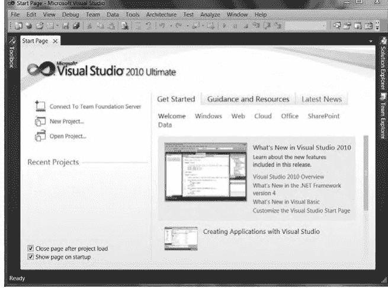

图 1-1

无论你运行的是哪个版本的 Visual Studio 2010，起始页看起来都类似。从概念上讲，它提供了一个通用的起点，既可以选择你要处理的应用程序，也可以快速接收与产品/服务相关的重要新闻（如图所示），还可以通过社区链接连接到外部资源。

进入此页面后，下一步是创建你的第一个项目。选择“文件 ⇨ 新建项目”会打开“新建项目”对话框，如图 1-2 所示。该对话框提供了按应用程序类型定制的模板选择。一个选项是创建类库项目。这样的项目不包含用户界面；它不是创建带有 `.exe` 文件的程序集，而是创建带有 `.dll` 文件的程序集。当然，区别在于 `.exe` 文件表示可由操作系统启动的可执行文件，而 `.dll` 文件表示由应用程序引用的库。

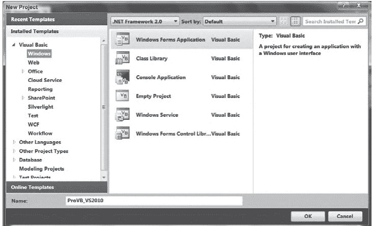

### 图 1-2

> 描述 Visual Studio 的菜单选项时一直存在的挑战之一是，各种版本在外观和感觉上存在太多细微差异，不胜枚举。例如，Visual Basic Express 中的“文件 ⇨ 新建项目”在 Visual Studio 中变成了“文件 ⇨ 新建 ⇨ 项目”。因此，你的显示可能与这里显示或描述的内容略有不同，尽管我们试图展示显著的差异。

图 1-2 包含在项目类型列表上方的下拉框中指定特定 .NET 版本的功能。在图 1-2 中，显示的是 .NET 2.0，并且所选列表下方只有六种项目类型。当选择 .NET 4 时，如图 1-3 所示，项目类型的数量增加了。

目标框架选择可以防止你在没有意识到客户端至少需要 .NET 3.0 的情况下尝试为 WPF 创建项目。虽然你可以在创建项目后更改目标框架，但在尝试降低版本号时要非常小心，因为防止你选择依赖项的控件不会检查现有代码库是否存在违规。更改现有项目的目标框架版本将在本章后面更详细地介绍。

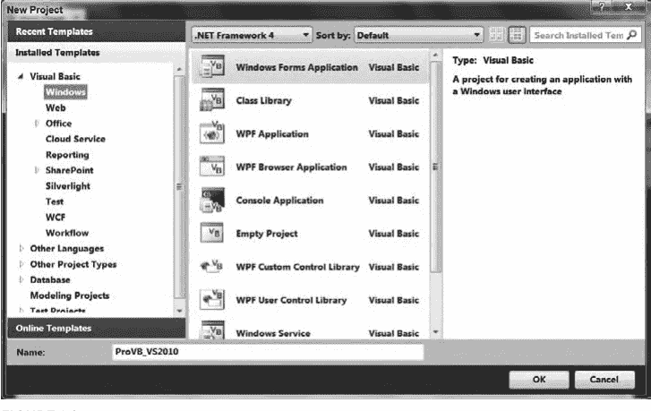

## 图 1-3

在创建新项目时，你不仅可以选择要定位的框架特定版本，而且此窗口还具有 Visual Studio 2010 中随处可见的新功能。在右上角，有一个控件可让你搜索特定模板。随着你使用 Visual Studio 关联的更多窗口，你会发现上下文相关的搜索功能已经常添加到新的用户界面中。

扩展图 1-3 中 Visual Basic 树的顶层显示，项目类型可以进一步细分为一系列类别：

- **Windows** — 这些是用于创建在 CLR 中于本地计算机上运行的应用程序的项目。因为此类项目可以在托管框架的任何操作系统（OS）上运行，所以与例如“桌面”相比，“Windows”类别有点名不副实。

- **Web** — 你可以从“新建项目”对话框的这一部分创建这些项目，包括 Web 服务。

- **Office** — Visual Studio Tools for Office（VSTO）。这些是在 Office 下托管的 .NET 应用程序。Visual Studio 2010 包含一组模板，可用于定位 Office 2010，以及用于定位 Office 2007 的模板的单独部分。

- **Cloud Services:** — 这些是定位 Azure 在线环境模型的项目。这些项目部署到云中，因此具有特殊的实现和部署注意事项。

- **Reporting** — 此项目类型使你能够创建 Reports 应用程序。


## SharePoint
此类别提供 SharePoint 项目的选集，包括 Web Part 项目、SharePoint 工作流项目、Business Data Catalog 项目，以及诸如站点定义和内容类型项目之类的内容。Visual Studio 2010 对 SharePoint 提供了重大的新支持。

## Silverlight
借助 Visual Studio 2010，Microsoft 最终提供了与 Silverlight 项目一起工作的完整支持。过去你必须将 Silverlight SDK 和工具添加到现有的开发环境中，而使用 Visual Studio 2010，你可以在 Visual Studio 中获得 Silverlight 项目和用户界面设计的支持。

## Test
此部分仅对使用 Visual Studio Team Suite 的用户可用。它包含 Visual Basic 单元测试项目的模板。

## WCF
这是你可以创建 Windows Communication Foundation 项目的部分。

## Workflow
这是你可以创建 Windows Workflow Foundation（WF）项目的部分。此部分中的模板还包括用于与 SharePoint 工作流引擎连接的模板。

Visual Studio 还有其他项目类别，你可以访问其他开发语言以及远多于本章所能容纳的项目类型。当你想要创建应用程序时，你将从一个或多个可用项目模板中进行选择。要使用多个项目来创建应用程序，你将利用被称为解决方案的东西。解决方案在创建新项目时默认创建，并包含一个或多个项目。

当你保存项目时，你通常会为解决方案创建一个文件夹，然后稍后如果向同一解决方案添加另一个项目，它将包含在解决方案文件夹中。项目始终是解决方案的一部分，解决方案可以包含多个项目，每个项目创建一个不同的程序集。例如，通常你将有一个或多个类库，它们与 Windows 窗体或 ASP.NET 项目属于同一解决方案。现在，你可以选择 Windows 应用程序项目模板作为本章的示例项目。

对于此示例，使用 `ProVB_VS2010` 作为项目名称以匹配示例代码下载中项目的名称，然后单击 OK。Visual Studio 接管并使用 Windows 应用程序模板创建一个新的 Windows 窗体项目。项目包含一个可自定义的空白窗体，以及可供探索的各种其他元素。在自定义任何代码之前，让我们先看看这个新项目的元素。

### 解决方案资源管理器

解决方案资源管理器是一个窗口，在创建项目时默认位于显示器的右侧。它用于显示解决方案的内容，并包括解决方案中每个项目的实际源文件。虽然解决方案资源管理器窗口对 Express Edition 用户可用且适用，但它永远不会包含超过一个项目。那些使用高于 Express Edition 级别的 Visual Studio 版本的人具有在单个解决方案中利用多个项目的 capability。.NET 解决方案可以包含任何 .NET 语言的项目，并且可以作为整体解决方案的一部分包含数据库、测试和安装项目。合并这些项目的优势在于，更容易调试位于同一解决方案中的项目。

在深入讨论这些文件之前，让我们先看看下一步，即揭示有关项目的更多详细信息。单击解决方案资源管理器左侧的第二个按钮以显示所有项目文件，如图 1-4 所示。如该图像所示，许多其他文件构成了你的项目。其中一些，例如 `My Project` 分组下的文件，不需要你直接编辑它们。相反，你可以在解决方案资源管理器中双击 `My Project` 条目并打开页面以编辑项目设置。你不需要更改此项目的任何默认设置，但本章下一节将引导你完成各种属性屏幕。

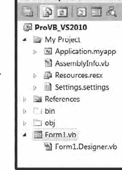

所示的 `bin` 和 `obj` 目录在构建项目时使用。`obj` 目录包含编译器用于创建最终可执行文件的第一遍对象文件。你的应用程序的“二进制”或编译版本然后默认放置在 `bin` 目录中。当然，将 Microsoft 中间语言（MSIL）代码称为二进制有点名不副实，因为实际的二进制转换直到运行时才发生，当时你的应用程序由即时（JIT）编译器编译。然而，Microsoft 继续使用 `bin` 目录作为项目编译的默认输出目录。

图 1-4 还显示项目默认不包含 `app.config` 文件。大多数有经验的 ASP .NET 开发人员熟悉使用 `web.config` 文件。`app.config` 文件在同一原则上工作，因为它们包含 XML，用于存储项目特定设置，例如数据库连接字符串和其他应用程序特定设置。使用 `.config` 文件而不是将设置放在 Windows 注册表中，使你的应用程序能够与另一个版本的应用程序并行运行，而不会让任一版本的设置影响另一个。因为你的应用程序的每个版本都位于其自己的目录中，其设置包含在其所在的目录中，这使不同版本能够使用唯一的设置运行。在我们完成项目属性的介绍之前，我们将向此项目添加一个 `app.config` 文件。

现在，你有一个新项目和一个初始 Windows 窗体 `Form1` 可在解决方案资源管理器中使用。在这种情况下，`Form1.vb` 文件是与默认 Windows 窗体 `Form1` 关联的主要文件。你将很快自定义此窗体，但在查看之前，有用的是先查看通过打开项目属性可用的一些设置。一种简单的方法是右键单击图 1-4 中显示的 `My Project` 标题。

## 项目属性

Visual Studio 使用垂直选项卡显示来编辑项目设置。图 1-5 中显示的项目属性显示提供了对新创建的 `ProVB_VS2010` 项目设置的访问。项目属性窗口使你能够访问项目的几个不同方面。其中一些，例如 Signing、Security 和 Publish，在后面的章节中介绍。现在，只需注意，此显示使执行过去需要工程师在 Visual Studio 环境之外工作的多个任务变得更容易。

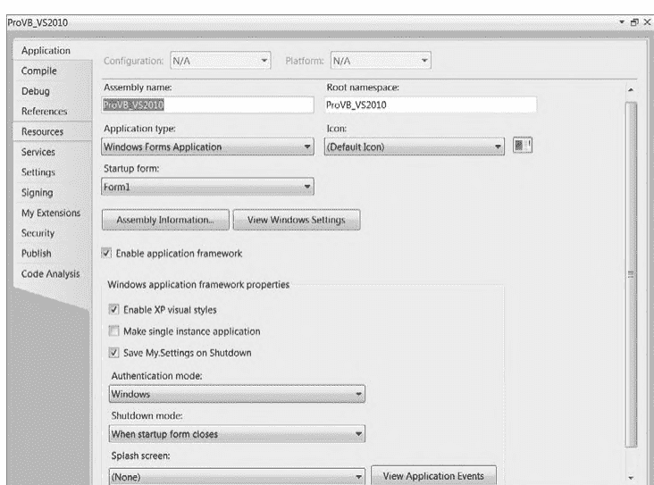

图 1-5

你可以从此屏幕自定义程序集名称，以及重置启动应用程序时要引用的应用程序和对象类型。然而，重置应用程序类型是不推荐的。如果从错误的应用类型开始，最好创建新应用程序，因为应用程序模板中嵌入了所有设置。在下一节中，你将查看用于更改程序集信息的按钮，以及定义应用程序类的根命名空间的能力。命名空间在第 4 章中详细介绍。

你还可以将给定的默认图标与窗体关联（参见图 1-5），并选择除默认 `Form1` 之外的其他屏幕作为启动屏幕。

对话框中间有两个按钮。程序集信息在下一节中介绍。另一个按钮，标记为 View Windows Settings 指的是用户访问控制设置，该设置使你能够

| ATTRIBUTE | DESCRIPTION |
|---|---|
| `Assembly File Version` | 此属性用于设置可执行文件的版本号。有关此属性和其他部署相关设置的详细信息，请参阅第 34 章。 |
| `COM Visible` | 此属性用于指示是否应将此程序集注册并使其可供 COM 应用程序使用。 |
| `Guid` | 如果程序集要作为传统的 COM 对象公开，则此属性的值将成为生成的类型库的 ID。 |
| `NeutralResourcesLanguageAttribute` | 如果指定，则在本地化应用程序中当前用户的区域设置未明确匹配时，提供要使用的默认区域性。有关本地化的更多内容，请参阅第 27 章。 |

### Compiler Settings

当你选择项目属性的 Compile 选项卡时，应该会看到类似于图 1-7 所示的窗口。Visual Studio 2010 的一项更新是构建配置设置的回归。在 Visual Studio 2008 中，Visual Basic 设置已将这些项目从显示中移除；取而代之的是，当开发人员要求调试代码时，会构建并执行调试版本，并且只有在开发人员执行显式构建时才会执行。（请注意，如果你使用的是 Beta 2，则默认情况下不会看到这些设置被恢复。）

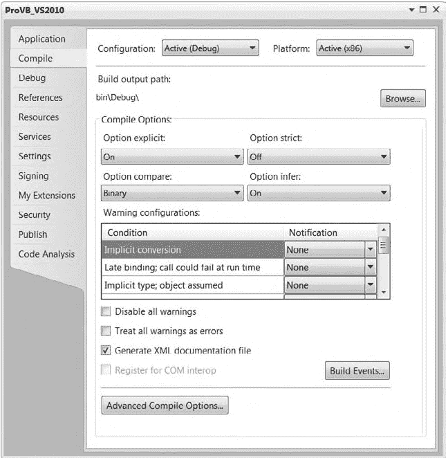

**FIGURE 1-7**

这带来了一个挑战，因为这不是任何其他 Visual Studio 设置的情况；Visual Basic 开发人员有时会在发送他们认为的源代码的最新构建时遇到问题。如果他们在最后一次“构建”中正在测试修复并启动调试器，那么他们就没有重新构建发布版本。因此，与其发送带有最后一次测试修复的应用程序的发布版本副本，他们实际上发送的是修复之前的最后一次发布构建。这些设置的回归意味着作为开发人员，你可以显式控制 Visual Studio 生成的可执行文件的类型（发布或调试，x64 或 x86）。

如果你在显示中看不到这些下拉菜单，可以通过选择 Tools ⇨ Options，然后打开 Advanced compile options 来恢复它们。恢复这些选项的主要原因与两个关键功能有关，这些功能依赖于此设置。第一个是 Edit and Continue，它提供了在执行代码中进行更改而无需重新启动，并使该更改在你继续调试时在运行代码中可用的能力。这对于在调试会话中发现的简单错误来说是一个很棒的工具，并且仅支持针对 x86（32 位）的程序集。这意味着你必须显式 targeting x86，如图 1-7 所示。

在 Visual Studio 2008 中，默认是 targeting AnyCPU，但在 64 位开发工作站上，这意味着 Visual Studio 为你的调试环境 targeting 一个 64 位程序集。在 64 位工作站上工作时，你必须显式 targeting x86 环境才能同时启用 Edit and Continue 以及另一个依赖项 COM-Interop。第二个与 x86 相关的关键功能是 COM。COM 是一个 32 位协议（如你在第 28 章 COM-Interop 中会看到的），因此你必须 targeting 32 位/x86 环境以支持 COM-Interop。

除了默认的项目文件输出目录外，此页面还包含几个编译器选项。`Option Explicit`、`Option Infer` 和 `Option Strict` 设置直接影响你的变量使用。以下每个设置都可以通过在源代码文件顶部添加 Option 声明来编辑。当放置在源文件中时，以下每个设置都适用于该源文件中输入的所有代码，但仅适用于该文件中的代码：

- **Option Explicit** — 此选项与 Visual Basic 的早期版本相比没有变化。启用时，它确保每个变量都显式声明。当然，如果你使用 `Option Strict`，则此设置无关紧要，因为编译器不会识别未声明变量的类型。据我所知，除非你正在开发纯动态解决方案，而编译时类型不可用，否则没有很好的理由关闭此选项。

- **Option Strict** — 启用此选项时，编译器必须能够确定每个变量的类型，如果两个变量之间的赋值需要类型转换 — 例如从 Integer 到 Boolean — 则必须显式表达两种类型之间的转换。

- **Option Compare** — 此选项确定字符串应作为二进制字符串进行比较，还是应将字符数组作为文本进行比较。在大多数情况下，将其保留为二进制是合适的。执行文本比较需要系统在比较前将内部存储的二进制值转换为文本值。然而，文本比较的优点是字符“A”等于“a”，因为比较不区分大小写。这使你能够执行不需要对比较的字符串进行显式大小写转换的比较。然而，在大多数情况下，这种转换仍然会发生，因此最好使用二进制比较并根据需要显式转换大小写。

- **Option Infer** — 此选项在 Visual Studio 2008 中是新的，并且由于 LINQ 的要求而被添加。当你执行 LINQ 语句时，可能会返回一个数据表，该表可能完全键入，也可能未完全键入。因此，需要在命令执行时推断类型。因此，与变量声明为无显式类型定义的对象不同，编译器和运行时会尝试为此对象推断正确的类型。

使用 Visual Studio 2005 开发的现有代码不知道这个概念，因此对于迁移到 Visual Studio 2008 或 Visual Studio 2010 的任何项目，此选项默认关闭。新的项目将打开此选项，这意味着如果你将 Visual Studio 2005 项目中的代码剪切并粘贴到 Visual Studio 2010 项目中，反之亦然，你需要为粘贴的代码中的错误做好准备，因为类型推断方式发生了变化。

从属性页，`Option Explicit`、`Option Strict`、`Option Compare` 和 `Option Infer` 可以设置为 On 或 Off 以用于你的项目。Visual Studio 2010 使你能够为整个项目自定义特定的编译条件变得容易。然而，正如所指出的，你也可以通过使用类似 `Option Strict` 的方式对单个编译器检查进行更改。

请注意，当你更改 `Option Strict` 设置时，尤其是顶部几个条件的通知会自动更新以反映此新设置的具体要求。因此，你可以通过打开和关闭项目的各个编译器设置来字面地创建 `Option Strict` 设置的自定义版本。通常，此表列出了与你可能想要避免或防止的编程实践相关的条件，以及你肯定应该注意的条件。对于这些条件的大多数使用警告是合适的，因为有充分的理由说明你可能想要使用或避免每个条件，但也可能想要能够执行每个条件。

基本上，这些条件代表编译器无法提前检测的可能运行时错误条件，除了识别该运行时错误存在的可能性之外。选择 Warning 用于设置会绕过该行为，因为编译器会警告你但允许代码保留。相反，将行为设置为 Error 会阻止编译；因此，即使你的代码可能编写为永远不会出现问题，编译器也会阻止其使用。

这些条件值得注意的原因之一是实例变量访问共享属性的警告。共享属性在类的所有实例中是相同的。因此，如果类的特定实例正在更新共享属性，则适当会收到此方面的警告。此操作可能导致错误，因为新开发人员有时未能意识到共享属性值在类的所有实例中是通用的，因此如果一个实例更新该值，则新值会被所有其他实例看到。因此，你可以阻止这种危险但肯定有效的代码，以防止与使用共享属性相关的错误。

如前所述，选项设置可以特定于每个源文件。这涉及在源文件顶部添加一行以指示编译器该选项的状态。以下行将覆盖你为指定选项设置的项目默认设置。然而，虽然这可以按每个源列表进行，但这不是管理这些选项的推荐方式。首先，一致地将此行添加到每个源文件中既耗时又可能出错：

```
Option Explicit On
Option Compare Text
Option Strict On
Option Infer On
```

大多数经验丰富的开发人员同意使用 `Option Strict` 并被迫在类型转换发生时识别这一点是一件好事。当然，在开发将在生产环境中部署的软件时，任何可以帮助防止运行时错误的事情都是可取的。然而，`Option Strict` 会减慢程序的开发速度，因为你被迫显式定义每个需要发生的转换。如果你正在开发一个生命周期有限的原型或演示组件，你可能会发现此选项有限制。

如果论点到此为止，那么许多开发人员只需关闭该选项并忘记它，但 `Option Strict` 具有运行时优势。当类型转换被显式标识时，系统会更快地执行它们。隐式转换要求运行时系统首先识别转换中涉及的类型，然后获取正确的处理程序。

`Option Strict` 的另一个优点是，在实现过程中，开发人员被迫考虑每次可能发生转换的位置。也许开发团队没有意识到某些赋值操作导致了类型转换。设置需要显式转换的项目意味着生成的代码倾向于具有类型一致性以避免转换，从而减少最终代码中的转换数量。结果不仅是运行更快的转换，而且希望转换的数量更少。

`Option Infer` 是一个强大的功能。它用作 LINQ 和支持 LINQ 的功能的一部分，但它影响所有代码。过去，你需要编写每个变量定义的 AS <type> 部分，以便以显式类型定义变量。然而，现在你可以对变量进行维度定义并为其分配整数或

将其设置为另一个对象，则声明中的 AS Integer 部分不是必需的，它会被推断为赋值操作的一部分。请谨慎使用 `Option Infer`；如果滥用，可能会使代码变得晦涩难懂，因为它可能隐藏与变量关联的真实类型，从而降低可读性。一些开发者倾向于将 `Option Infer` 限制为按文件声明，以便仅在需要时使用它，例如与 LINQ 一起使用时。

> 第 10 章将介绍如何在 LINQ 中使用 `Option Infer`。

此外，请注意 `Option Infer` 直接受 `Option Strict` 的影响。在理想情况下，`Option Strict Off` 会要求 `Option Infer` 在用户界面中也被关闭或禁用。但事实并非如此，尽管这是人们看到的行为；一旦关闭 `Option Strict`，`Option Infer` 实际上就会被忽略。

在图 1-7 的各个设置网格下方，有一系列复选框。其中两个复选框不言自明，第三个是为程序集生成 XML 注释的选项。这些注释是根据你在源文件中为每个类、方法和属性输入的 XML 注释生成的。

Visual Basic Express 的复选框较少，但用户仍然可以使用“高级编译选项”按钮。该按钮会打开如图 1-8 所示的“高级编译器设置”对话框。请注意此界面上的几个关键元素，第一个是“移除整数溢出检查”复选框。启用这些选项后，与 C# 相比，Visual Basic 应用程序会遭受性能损失。编译常量是通常不需要你更改的值。同样，序列化程序集的生成可能最好保持自动模式。

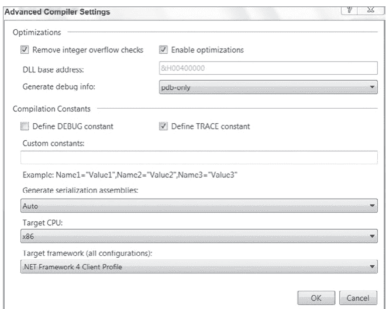

图 1-8

然而，屏幕上的最后一项使你可以面向不同的环境。如果你选择版本 4 之前的版本，那么当你开始添加引用时，“添加引用”选项卡会识别你正在面向的 .NET 版本，并调整可用引用列表以排除属于版本 4 的引用——类似地，如果你面向 .NET 2.0，则排除 4、3.5 和 3.0。

请注意，此检查发生在添加引用时；当你更改此值以查看更新的值是否与任何现有引用冲突时，不会进行检查。因此，如果你更改此值，请确保更新任何现有引用，以移除属于 .NET 4 的引用。你必定至少有一个这样的引用，因为模板创建项目时会自动添加一系列引用，这些引用部分取决于你在创建应用程序时指定的目标框架。

### 调试属性


Visual Basic 2010 Express Edition 支持本地调试。这意味着它不仅支持第 6 章中讨论的与 .NET 相关的 `Debug` 和 `Trace` 类，还支持所有 Visual Studio 版本中都可用的实际断点和相关交互式调试。然而，如前所述，Visual Studio 的完整版本提供了 Visual Basic 2010 Express Edition 不具备的增强调试选项。图 1-9 显示了 Visual Studio 2010 中的项目调试器启动选项。

显示的默认操作实际上就是 Express 用户唯一可用的选项——即启动当前项目。然而，Visual Studio 2010 开发者还有两个额外选项。第一个是启动外部程序。换句话说，如果你正在处理 DLL 或用户控件，那么你可能希望启动该应用程序，然后由它来执行你的程序集。这样做本质上是一种快捷方式，无需绑定到正在运行的进程。

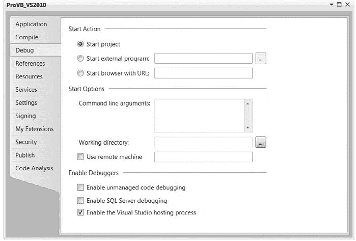

图 1-9

同样，对于 Web 开发，你可以引用特定 URL 来启动该 Web 应用程序。这往往是好坏参半的，因为对于 ASP.NET 2.0，Visual Studio 会根据你当前正在编辑的页面自动尝试启动 ASP.NET 应用程序。这与 ASP.NET 1.x 有所不同，后者允许你定义启动页。由于 ASP.NET 2.0 不使用项目文件，因此引入了新的行为。在大多数情况下，它运行良好，但如果你有一个需要身份验证的 Web 应用程序，那么在大多数情况下，将该 URL 放入应用程序的调试设置中更有意义。

然而，开发者有三个与启动调试器相关的选项。第一个是将命令行参数应用于给定应用程序的启动。这当然对控制台应用程序最为有用，但在某些情况下，开发者也会向 GUI 应用程序添加命令行参数。第二个选项是选择另一个目录，即工作目录，用于运行应用程序。通常这并非必要；但在某些情况下，由于路径或权限要求，或为了拥有隔离的运行时区域，这也是可取的。

如前所述，Visual Studio 2010 提供对远程调试的支持，尽管此类调试较为复杂，并且不是为简单场景配置的。在集成测试环境中工作时，远程调试可能是一种有用的工具，因为该环境不允许开发者安装 Visual Studio，但他们需要能够调试问题。然而，你不应局限于仅使用调试器来了解应用程序在运行时发生的事情。

另一种确定远程应用程序中发生的情况的方法是使用 `Debug` 和 `Trace` 类。正如第 6 章所述，`Debug` 和 `Trace` 类结合有效的错误处理，通常比设置远程调试器更快、更容易地确定远程错误。然而，对于应用程序仅在中央服务器上运行，并且开发者拥有运行调试器所需权限但无法安装 Visual Studio 副本的环境，可以利用远程调试。

最后，可以预期的是，使用多种语言并使用与 SQL Server 紧密集成工具的 Visual Studio 2010 用户，还有额外的调试器。其中第一个是支持在 CLR 之外进行调试——即所谓的非托管代码。作为 Visual Basic 开发者，你唯一应该使用非托管代码的时候是引用旧版 COM 组件时。最可能使用此调试器的开发者使用 C++ 工作。

下一个选项开启对 SQL Server 调试的支持，这是一个潜在有用的功能。简而言之，让 Visual Studio 调试引擎直接单步执行 T-SQL 存储过程是可能的，尽管步骤并不简单，这样你可以在复杂存储过程执行过程中看到中间结果。

### 引用

作为项目的一部分，可以添加额外的引用。与创建新项目时生成的默认代码文件类似，每个项目模板都有一组默认的引用库。实际上，它有一组导入的命名空间，并且导入的命名空间的一部分也在整个项目中被引用。这意味着，虽然你可以轻松引用被引用命名空间中的类，但仍然需要完全限定对不太常见内容的引用。例如，要使用 `StringBuilder`，你需要指定 `System.Text.StringBuilder` 的完全限定名称。尽管 `System.Text` 命名空间已被引用，但默认情况下并未导入。对于面向 .NET 4 的 Windows 窗体应用程序，默认引用的命名空间列表相当短，如表 1-4 所示。

表 1-4：新项目中的默认引用

| 引用 | 说明 |
|---|---|
| `System` | 通常被称为根命名空间。所有基础数据类型（`String`、`Object` 等）都包含在 `System` 命名空间中。该命名空间也充当所有其他 `System` 类的根。 |
| `System.Core` | 此 dll 包含一组命名空间，其中一些需要用于支持 LINQ to Objects，以及支持多个操作系统级接口。 |
| `System.Data` | 与 ADO.NET 和数据库访问相关的类。该命名空间是 SQL Server、Oracle 和其他数据访问类的根。 |
| `System.Data.DataSetExtensions` | 定义核心 `DataSet` 类使用的一组扩展方法。这些方法在 LINQ to DataSet 中使用。 |
| `System.Deployment` | 用于 ClickOnce 部署的类。该命名空间将在第 34 章中更详细地讨论。 |
| `System.Drawing` | 提供对 GDI+ 图形功能的访问 |
| `System.Windows.Forms` | 用于创建传统 Windows 应用程序的类。该命名空间将在第 14 章和第 15 章中更详细地讨论。 |
| `System.XML` | 所有 XML 类的根命名空间 |
| `System.XML.Linq` | 支持针对 XML 数据源的语言集成查询（LINQ）原生语言查询的根命名空间。 |

前面列出的引用库列表适用于 .NET 4，因此如果你改为创建一个目标为 .NET 2.0 的项目，该列表会更短。请记住，更改目标框架不会更新任何现有引用。如果你打算尝试以 .NET 2.0 Framework 为目标，那么你需要删除版本号高于 `2.0.0.0` 的引用。诸如 `System.Core` 之类的引用启用了与 .NET 3.5 关联的 `System` 命名空间中的新功能。

要查看导入和引用的命名空间的详细信息，请在项目属性显示中选择 `References` 选项卡，如图 1-10 所示。此选项卡使你能够检查未使用的引用，甚至定义引用路径。更重要的是，正是从此选项卡中你选择其他 .NET 类库和应用程序，以及 COM 组件。选择 `Add` 下拉按钮可让你添加对本地 DLL 或 Web 服务的引用。

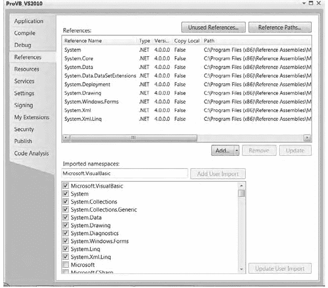

### FIGURE 1-10

在引用 DLL 时你有三个选项：从 GAC 引用程序集、基于文件路径引用程序集，或从当前解决方案中引用另一个程序集。这些选项各有优缺点。对于位于 GAC 中的程序集唯一的挑战是你的应用程序依赖于可能是一个共享资源。然而，通常对于已经在 GAC 中的程序集，引用它们是一个直接且易于维护的过程。

除了引用库之外，你还可以引用解决方案的一部分的其他程序集。如果你的解决方案包含不止一个项目，那么使用项目引用使这些项目能够相互引用是直接的并且强烈推荐的。虽然应避免循环引用——项目 A 引用项目 B，而项目 B 引用项目 A——但使用项目引用优于文件引用。使用项目引用，Visual Studio 可以在构建解决方案期间映射对这些程序集的更新。Visual Studio 可以自动更新可执行项目中的引用程序集，使其成为同一解决方案中引用 DLL 的最新构建。请注意，目标需要是可执行的。Visual Studio 会自动更新同一解决方案中 DLL 项目之间的引用。

这与添加对位于指定目录中的 DLL 的引用不同。当你通过路径规范创建引用时，Visual Studio 可以检查该路径以查找引用的更新副本，但你的代码将不再像使用项目引用那样具有可移植性。更重要的是，除非有重大修订，否则 Visual Studio 通常无法检测你在开发过程中可能对该文件进行的更改类型。因此，你需要手动更新引用它的程序集本地目录中的引用文件。对于你自己的代码，通常最好利用项目引用，而不是基于路径的引用。然而，对于第三方控件，你通常只有已安装的位置，而该位置在机器之间移动时不太可能发生变化，基于路径的引用可以工作。

另一方面，一个常用的替代方案是确保不是基于第三方控件的位置来引用它们，而是使用“复制本地”引用，以便控件的特定版本副本随依赖它的代码一起部署。这意味着同一服务器上的不同应用程序中可以存在控件的不同版本。此外，由于控件的本地副本与应用程序一起存在，应用程序可以进行 XCOPY 部署，而无需注册控件。

### Resources

除了引用其他程序集之外，.NET 应用程序通常需要引用诸如图像、图标、音频和其他文件之类的内容。这些文件不用于提供应用程序逻辑，但在运行时用于提供应用程序外观、感觉，甚至用于与应用程序用户通信的文本的支持。理论上，你可以通过根据应用程序的已安装文件路径查找与应用程序关联的一系列图像来引用这些图像。然而，这样做会使你的应用程序的运行时行为面临风险，因为用户可能会选择替换、为盈利而复制，或只是删除你的文件。

这就是项目引用变得有用的地方。不是将原始文件放置在操作系统上与可执行文件并列，Visual Studio 会将这些文件打包到你的可执行文件中，使其不太可能丢失或损坏。图 1-11 显示了 `Resources` 选项卡，它使你能够查看和编辑项目中所有现有资源，以及导入文件以用作项目中的资源。它甚至允许你从头创建新资源。

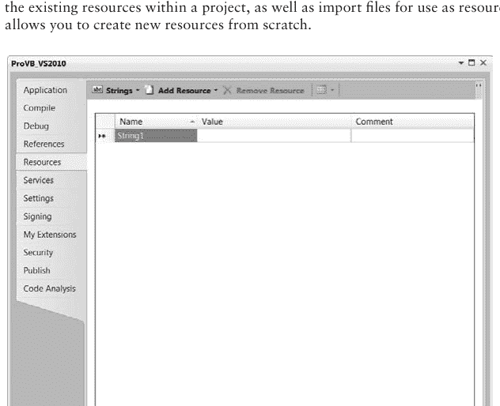

FIGURE 1-11

请注意此选项卡的一个鲜为人知的功能：使用 `Add Resource` 下拉按钮并选择一个图像（不是现有图像，而是基于可用图像类型之一的图像）将创建一个新的图像文件并自动打开 Microsoft Paint（适用于 Express Edition 开发人员）；这使你能够实际创建将位于图像文件中的图像。

Visual Studio 2010 的用户具有 Visual Basic Express Edition 不支持的额外功能。其中之一是，与使用 Paint 不同，Visual Studio 提供了基本的图像编辑工具，因此当 Visual Studio 开发人员添加新图像（不是来自文件）时，此编辑器将在 Visual Studio 内打开。

此外，在 `Add Resource` 项目列表中，Visual Studio 用户可以选择或创建新的图标。选择创建新图标将打开 Visual Studio 的图标编辑器，该编辑器提供了一组基本工具，用于创建作为应用程序一部分使用的自定义图标。这使得使用 `.ico` 文件变得更容易，因为你不必在线搜索或购买此类文件；相反，你可以创建自己的图标。

然而，图像并不是你可以用可执行文件嵌入的唯一资源。资源还适用于应用程序使用的固定文本字符串。默认情况下，人们倾向于将此文本直接嵌入到源代码中，以便开发人员可以轻松访问。不幸的是，这使得应用程序难以本地化以用于第二语言。解决方案是将所有这些文本字符串分组在一起，从而创建包含所有文本字符串的资源文件，该文件仍是应用程序源代码的一部分并且易于访问。当应用程序转换为另一种语言使用时，可以转换此字符串列表，从而使本地化过程更容易。本地化在第 27 章中有详细说明。

> 下一个选项卡是 `Services` 选项卡。该选项卡在第 13 章中有更详细的讨论，该章涉及服务。

### Settings

如 Solution Explorer 讨论中所述，默认项目模板不会创建任何应用程序设置；因此，`app.config` 文件既不需要也不创建。`app.config` 文件是 XML 文件，定义开发人员希望能够在无需重新编译应用程序的情况下更改的任何自定义应用程序设置。由于这些设置位于 XML 文件中，因此可以在应用程序执行之间甚至在执行期间进行修改。

.NET 的一个最初目标是减少组件注册全局设置时可能发生的版本冲突。如果两个不同的应用程序试图引用该组件的两个不同版本，就会发生冲突。因为设置是全局的并存储在中央系统注册表中，所以只有一个可以正确注册。由于不同的应用程序各自想要其特定版本的组件和相关设置，因此一个应用程序可以工作而另一个应用程序会损坏。

.NET 提供了将特定版本的项目引用放置在应用程序的本地目录中的功能，从而使两个不同的应用程序能够引用该组件的适当版本。然而，问题的第二部分是中央应用程序设置。`app.config` 文件提供了相同的功能，但其目标是允许本地存储应用程序设置。在 .NET 1.x 下，对应用程序设置的支持仍然很有限，因为大多数开发人员仍在寻找中央系统注册表来实现此目的。与此同时，与设置相关的开发工具也非常有限。

幸运的是，在 .NET 2.0 下情况发生了巨大变化。Visual Studio 2010 提供了对应用程序设置的重大支持，包括图 1-12 所示的 `Settings` 选项卡。此选项卡使 Visual Basic 开发人员能够识别应用程序设置并在 `app.config` 文件中自动创建这些设置。

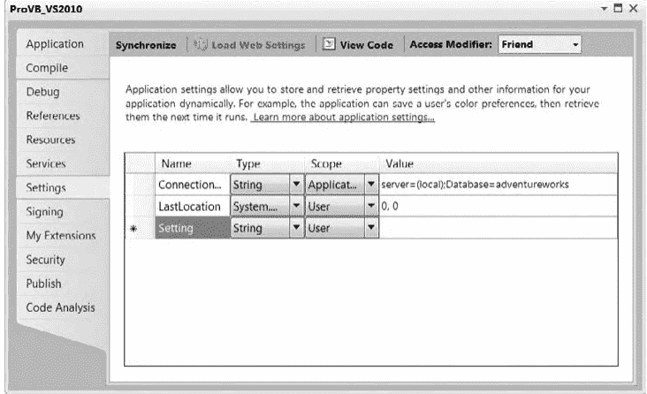

FIGURE 1-12

图 1-12 说明了与 Visual Basic 应用程序设置功能相关的多个元素。第一个设置的类型为 `String`。在 .NET 1.x 下，所有应用程序设置都被视为字符串，这被认为是一个弱点。因此，第二个设置 `LastLocation` 暴露了 `Type` 下拉菜单，说明在 Visual Studio 2010 下你可以创建一个具有明确定义类型的设置。

然而，强类型设置并不是与应用程序设置相关的最重要的一组更改。紧接着的下一列定义了设置的范围。有两种可能的选择：应用程序范围或用户特定。具有应用程序范围定义的设置可供应用程序的所有用户使用。如图 1-12 所示，此示例创建了一个示例连接字符串以供应用程序存储。

另一种是用户特定的设置。此类设置具有默认值；在此情况下，最后位置默认为 `0,0`。但是，一旦用户读取了该默认值，应用程序通常会更新并保存该设置的用户特定值。如 `LastLocation` 设置所示，应用程序的每个用户都可能在将其移动到屏幕上的新位置后关闭它；此类设置的目的是在上次所在位置重新打开应用程序。因此，应用程序会更新此设置值，而 Visual Basic 使其变得很容易，如以下代码所示：

```
My.Settings.LastLocation = Me.Location
My.Settings.Save()
```

没错 — Visual Basic 只需两行利用 `My` 命名空间的代码即可让你更新用户的应用程序设置并保存新值。与此同时，让我们看看在新生成的 `app.config` 文件中发生了什么。以下 XML 设置演示了 `app.config` 文件如何定义你从 Visual Studio 内部操作设置的默认值：


```xml
<?xml version="1.0" encoding="utf-8" ?>
<configuration>
  <configSections>
    <sectionGroup name="userSettings" type="System.Configuration.UserSettingsGroup, System, Version=4.0.0.0, Culture=neutral, PublicKeyToken=b77a5c561934e089" >
    <section name="ProVB_VS2010.My.MySettings" type="System.Configuration.ClientSettingsSection, System, Version=4.0.0.0, Culture=neutral, PublicKeyToken=b77a5c561934e089" allowExeDefinition="MachineToLocalUser" requirePermission="false" />
    <sectionGroup>
        <sectionGroup name="applicationSettings" type="System.Configuration.ApplicationSettingsGroup, System, Version=4.0.0.0, Culture=neutral, PublicKeyToken=b77a5c561934e089" >
            <section name="ProVB_VS2010.My.MySettings" type="System.Configuration.ClientSettingsSection, System, Version=4.0.0.0, Culture=neutral, PublicKeyToken=b77a5c561934e089" requirePermission="false" />
        </sectionGroup>
    </sectionGroup>
</configSections>
<system.diagnostics>
    <sources>
        <!-- This section defines the logging configuration for My.Application.Log -->
        <source name="DefaultSource" switchName="DefaultSwitch">
            <listeners>
                <add name="FileLog"/>
                <!-- Uncomment the below section to write to the Application Event Log -->
                <!--add name="EventLog"/-->
            </listeners>
        </source>
    </sources>
    <switches>
        <add name="DefaultSwitch" value="Information" />
    </switches>
    <sharedListeners>
        <add name="FileLog" type="Microsoft.VisualBasic.Logging.FileLogTraceListener, Microsoft.VisualBasic, Version=8.0.0.0, Culture=neutral, PublicKeyToken=b03f5f7f11d50a3a, processorArchitecture=MSIL" initializeData="FileLogWriter"/>
        <!-- Uncomment the below section and replace APPLICATION_NAME with the name of your application to write to the Application Event Log -->
        <!--add name="EventLog" type="System.Diagnostics.EventLogTraceListener" initializeData="APPLICATION_NAME"/-->
    </sharedListeners>
</system.diagnostics>
<userSettings>
    <ProVB_VS2010.My.MySettings>
        <setting name="LastLocation" serializeAs="String">
            <value>0, 0</value>
        </setting>
    </ProVB_VS2010.My.MySettings>
</userSettings>
<applicationSettings>
    <ProVB_VS2010.My.MySettings>
        <setting name="ConnectionString" serializeAs="String">
            <value>server=(local);Database=adventureworks</value>
        </setting>
    </ProVB_VS2010.My.MySettings>
</applicationSettings>
</configuration>
```

Code snippet from `app.config`

如图所示，Visual Studio 自动生成了定义这些设置并保存默认值的全部 XML。注意，单个用户设置不会保存回配置文件中，而是保存到用户特定的工作目录中。事实上，不仅可以使用 Visual Basic 更新应用程序设置，还可以安排加密这些设置，尽管这种行为超出了你可以在 Visual Studio 中完成范围之外。

### Other Project Property Tabs

除了已详细检查的选项卡外，还有其他更具体的选项卡。在大多数情况下，这些选项卡仅在不适用于所有项目的特定情况下使用。

#### Signing

此选项卡通常与部署一起使用。如果你有兴趣创建需要在客户端系统上安装的商业应用程序，你需要对应用程序进行签名。对应用程序进行签名有几个优点，包括能够通过 ClickOnce 部署发布它。因此，如果你想在内部部署应用程序，可以使用开发人员密钥对应用程序进行签名。

#### My Extensions

My Extensions 选项卡使你能够创建并利用对 Visual Basic 的 `My` 命名空间的扩展。默认情况下，Visual Studio 2010 附带扩展以提供对关键 WPF 和 Web 应用程序的 `My` 命名空间快捷方式。

#### Security

此选项卡使你能够定义应用程序的安全要求。你需要在 ClickOnce 发布过程中使用这些设置，这将在第 34 章部署部分中介绍。

#### Publish

此选项卡用于配置和启动应用程序的发布。从此选项卡你可以更新应用程序的发布版本并确定发布位置。此选项卡也在第 34 章中更详细地介绍。

### Code Analysis

此选项卡仅适用于 Visual Studio 2010 Premium 或 Ultimate。选项卡使开发人员能够打开并配置静态代码分析设置。这些设置在编译后用于对代码执行自动检查。由于这些检查可能需要大量时间，特别是对于大型项目，因此必须手动打开。

### PROJECT `PROVB_VS2010`

创建新项目时，默认情况下会打开窗体设计器。如果你已关闭它，则可以通过在解决方案资源管理器中右键单击`Form1.vb`并从弹出菜单中选择`View Designer`来轻松重新打开它。从此窗口，你也可以调出此窗体的代码视图。但是，图 1-13 说明了项目模板完成后你看到的默认视图。屏幕上是设计表面，你可以从工具箱拖动控件来构建用户界面并更新与窗体关联的属性。

属性窗格，如图 1-14 更详细所示，默认放置在 Visual Studio 窗口的右下角。像 IDE 中的许多其他窗口一样，如果你关闭它，可以通过视图菜单访问它。或者，你可以使用 F4 键重新打开此窗口。属性窗格用于设置当前选定控件的属性，或整个窗体。

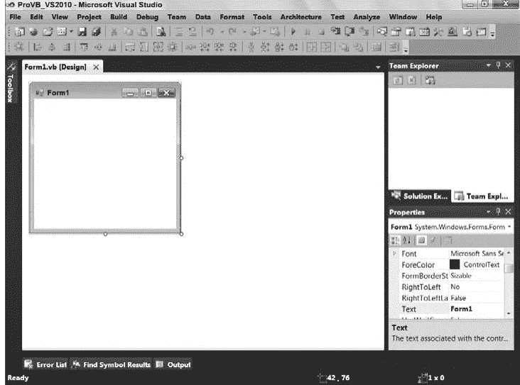

**FIGURE 1-13**

你放置在窗体上的每个控件都有自己独特的一组属性。例如，在设计视图中，选择你的窗体。你会看到属性窗口调整为显示`Form1`的属性（参见图 1-14）。这是与你的窗体关联的属性列表。如果你想限制用户可以减小窗体显示区域的最小程度，那么现在可以将其定义为属性。

对于你的示例，转到`Text`属性并将`Form1`的默认值更改为“Professional VB.NET”。一旦你接受了属性更改，新值将显示为窗体的标题。稍后在本节中，你将在代码中设置窗体属性。你会看到 .NET 属性在源文件中定义，与其他环境中通过用户界面编辑的属性隐藏在项目中的某些二进制或专有部分不同。

现在你已经查看了窗体的属性，通过在解决方案资源管理器中右键单击`Form1.vb`并选择代码视图，或在设计视图中右键单击窗体并从弹出菜单中选择查看代码，来打开与此文件关联的代码。

窗体的初始显示非常简单。`Form1.vb`文件中没有代码。Visual Basic 2005 引入了一种称为部分类的功能。部分类在第 2 章中简要介绍，Visual Studio 利用它们用于作为用户界面设计器一部分生成的代码。

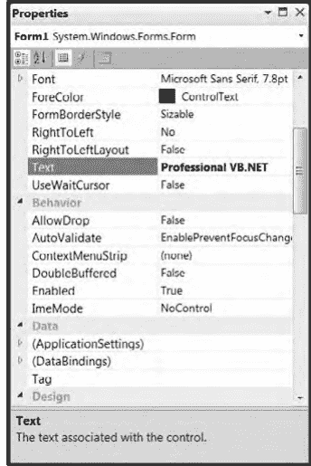

**FIGURE 1-14**

Visual Studio 将您窗体的所有生成的源代码都放在文件`Form1.Designer.vb`中。由于该名称中的`Designer`部分是 Visual Studio 识别的约定，因此在 Solution Explorer 中查看项目时，它默认会隐藏这些文件。如前所述，通过要求 Visual Studio“显示所有文件”，您可以找到这些生成的文件。如果打开一个`Designer.vb`文件，您会看到 Visual Studio 生成了相当多的自定义代码，并且该代码已在您的项目中。

要执行此操作，请转到 Solution Explorer 窗口中的工具栏并选择显示所有文件按钮。这将更改您的项目显示，并且`Form1.vb`文件旁边会出现一个小加号。展开此项会显示`Form1.Designer.vb`文件，您可以在 IDE 中打开它。对`ProVB_VS2010`项目中创建的`Form1.Designer.vb`执行此操作后，将得到与图 1-15 所示类似的窗口。

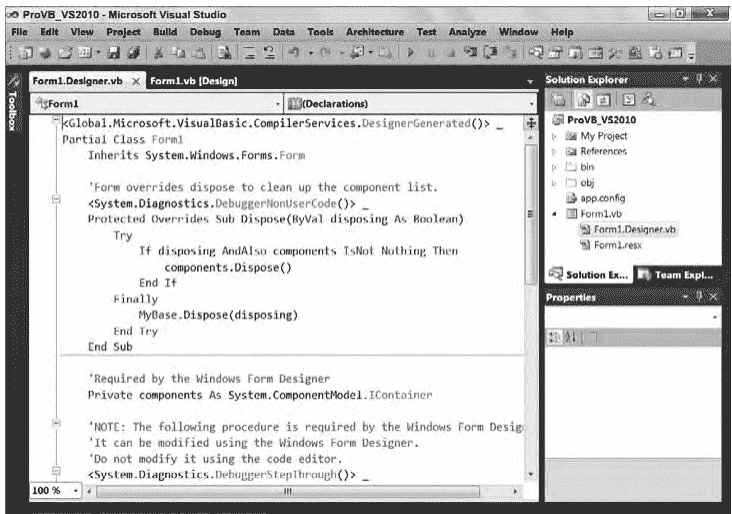

**FIGURE 1-15**

请注意，此文件的内容是生成的。暂时不要尝试进行任何更改。Visual Studio 在属性更改时会自动重新生成整个文件，因此您所做的任何更改都将丢失。以下行在文件`Form1.Designer.vb`中开始对您的窗体进行声明：

```vb
<Global.Microsoft.VisualBasic.CompilerServices.DesignerGenerated()> _
Partial Class Form1
    Inherits System.Windows.Forms.Form
```

> Code snippet from `Form1.Designer`

第一行是一个可以忽略的属性。接下来是实际声明名为`Form1`的新类的行。请注意，尽管 Visual Studio 使用命名约定来隐藏生成的 UI 类实现，但您的类名称与其存在的文件之间并没有紧密耦合。因此，除非您修改类声明中使用的名称，否则您的窗体在代码中将被引用为`Form1`。同样，您可以重命名包含该类的文件，而不会更改类的实际名称。

窗体作为类实现的一个强大结果是，您现在可以从另一个窗体派生一个窗体。这种技术称为视觉继承，尽管实际继承的元素可能不会显示。

### Form Properties Set in Code

如前所述，Visual Studio 将每个对象的自定义属性值保存在源代码中。为此，它在您的窗体类中添加了一个名为`InitializeComponent`的方法。顾名思义，此方法处理窗体上包含的组件的初始化。方法之前的注释警告您，窗体设计器会修改方法中包含的代码，并且您不应直接修改代码。此模块是`Form1.Designer.vb`源文件的一部分，并且当通过 IDE 进行更改时，Visual Studio 会更新此部分。

```vb
'NOTE: The following procedure is required by the Windows Form Designer
'It can be modified using the Windows Form Designer.
'Do not modify it using the code editor.
<System.Diagnostics.DebuggerStepThrough()> _
Private Sub InitializeComponent()
    Me.SuspendLayout()
    
    'Form1
    
    Me.AutoScaleDimensions = New System.Drawing.SizeF(8.0!, 16.0!)
    Me.AutoScaleMode = System.Windows.Forms.AutoScaleMode.Font
    Me.ClientSize = New System.Drawing.Size(328, 258)
    Me.Name = "Form1"
    Me.Text = "Professional VB.NET"
    Me.ResumeLayout(False)
End Sub
```

Code snippet from `Form1.Designer`

`InitializeComponent`过程的七行代码为您的`Form1`类的属性分配值。窗体和控件的所有属性现在都直接在代码中设置。当您通过属性窗口更改窗体或控件的属性值时，会在`InitializeComponent`中添加一个条目，将该值分配给该属性。之前，在检查属性窗口时，您将窗体的`Text`属性设置为 Professional VB.NET，这导致以下代码行被自动添加：

```vb
Me.Text = "Professional VB.NET"
```

在`InitializeComponent`中设置的窗体类的属性如表 1-5 所示。

**TABLE 1-5: Properties Set by `InitializeComponent`**

| PROPERTY | DESCRIPTION |
|---|---|
| `SuspendLayout` | 指定窗体不应对显示给用户的内容进行更新。它被调用以便在每次更改时，窗体不会看起来是分块出现的。 |
| `AutoScaleDimensions` | 初始化在设计时用于布局窗体的字体大小。在运行时，实际渲染的字体将与此属性进行比较，并相应地缩放窗体。 |
| `AutoScaleMode` | 指示窗体将使用基于运行时环境显示特征自动缩放的字体。 |
| `ClientSize` | 设置可以放置控件的区域（客户端区域）。它是窗体的大小减去标题栏和窗体边框的大小。 |
| `Name` | 此属性用于设置窗体的文本名称。 |
| `ResumeLayout` | 这告诉窗体应恢复正常的布局和内容的显示。 |

### Code Regions

Visual Studio 中的源文件允许您折叠代码块。其思想是，在大多数情况下，您可以通过折叠代码使其不可见，从而减少屏幕上的代码量，这似乎将给定类内的其他模块分开；此功能称为大纲。例如，如果您正在比较加载和保存方法，而在它们之间有几个其他代码块，那么您可以有效地“隐藏”此代码，而此代码不是您当前关注的重点。

默认情况下，每个方法（子例程或函数）旁边都有一个减号。这使得可以按方法为基础轻松隐藏或显示代码。如果方法代码被隐藏，方法声明仍会显示，并且旁边有一个加号，表示正文代码被隐藏。当您正在处理模块中的几个关键方法并且想要避免滚动浏览与当前任务无关的许多屏幕代码时，此功能非常有用。

您还可以创建自定义代码区域，以便隐藏和显示源文件的部分。例如，常见的做法是将所有属性放在一个区域中，并将所有公共方法放在另一个区域中。`#Region` 指令在 IDE 中用于此目的，但它对实际应用程序没有影响。代码区域由顶部的 `#Region` 指令和末尾的 `#End Region` 指令分隔。用于开始区域的 `#Region` 指令应包含描述，该描述会在代码最小化时显示在加号旁边。

大纲增强部分是受以下事实启发的：原始 Visual Studio 设计器生成了大量代码，并将所有这些代码放在该窗体的主 vb 文件中。直到 Visual Studio 2005 和部分类出现后，此生成的代码才被放在单独的文件中。因此，区域允许在打开源文件时隐藏生成的代码部分。能够看到生成的 UI 的底层确实使理解正在发生的事情变得更容易，并且可能在特殊情况下操纵该过程。然而，正如您所能想象的那样，这可能会变得有问题；因此 `#Region` 指令，可用于组织常见代码组然后在视觉上最小化它们。

Visual Studio 2010 开发人员，但不是 Express Edition 开发人员，也可以控制源文件中的大纲。可以通过选择 Visual Studio 菜单中的 编辑 ⇨ 大纲 ⇨ 停止大纲 来关闭大纲。此菜单还包含一些其他有用的功能。可以通过突出显示它并选择 编辑 ⇨ 大纲 ⇨ 隐藏选择 来临时隐藏一段代码。所选代码将被省略号和旁边的加号替换，就好像您在源代码中动态标识了一个区域一样。单击加号会再次显示代码。

### Tear-Away Tabs


您可能已经在图 1-15 中注意到，代码视图和窗体设计器窗口在选项卡式环境中打开。此环境是 Visual Studio 中处理代码窗口的默认方式，但您可以更改它。与 Visual Studio 2010 中的任何其他窗口一样，您可以按住选项卡并将其拖到另一个位置。

这在 Visual Studio 2010 中特别有用，因为您可以将选项卡完全拖离主窗口并将其作为独立窗口在其他位置打开。因此，您可以将当前正在编辑的源文件拖到 Visual Studio 其余部分的单独监视器上——本章前面显示项目属性的屏幕就是此示例。如果您查看这些图像，您会看到它们并未嵌入更大的 Visual Studio 2010 框架中，而是被拉出到自己的窗口中。

### Running ProVB_VS2010

现在您已经查看了生成的项目的元素，让我们在继续之前测试代码。从 Visual Studio 运行应用程序有几种选择；首先是单击开始按钮，它看起来像录音机的播放按钮。或者，您可以转到`Debug`菜单并选择`Start`。最后，启动应用程序最常见的方法是按`F5`。

应用程序启动后，会显示一个空窗体，其中包含标准控件按钮（在右上角），可用于控制应用程序。窗体名称应为`Professional VB.NET`，这是您之前应用的。此时，示例没有任何自定义代码可供检查，因此下一步是向此应用程序添加一些简单元素。

### 自定义文本编辑器

除了能够自定义 Visual Studio 提供的整体环境外，您还可以自定义与开发环境相关的多个特定元素。与以往任何版本相比，修改环境的能力得到了增强。在 Visual Studio 2010 中，用户界面组件使用 WPF 重写，因此整个显示提供了更图形化的环境和更好的设计器支持。

Visual Studio 2010 和 Visual Basic 2010 Express Edition 都有一套丰富的自定义项，涉及各种环境和开发人员设置。不可否认，Visual Studio 2010 的功能集为编辑提供了更多选项，但请放心，Express Edition 包含的编辑选项比大多数人预期的要多得多。例如，这两个 IDE 都有一个可自定义的文本编辑器。如果您曾经需要在观众面前展示代码——例如在代码评审中——能够调整字体大小等类似选项的能力非常有用。

要利用 Visual Studio 的设置，请选择`Tools Options`以打开选项对话框，如图 1-16 所示。在对话框中，确保选中`Show all settings`复选框。接下来，选择`Text Editor`文件夹，然后选择`All Languages`文件夹。此部分使您能够对文本编辑器进行更改，这些更改适用于每个受支持的开发语言。此外，您还可以选择`Basic`文件夹，以对文本编辑器在编辑 VB 源代码时的行为进行特定更改。

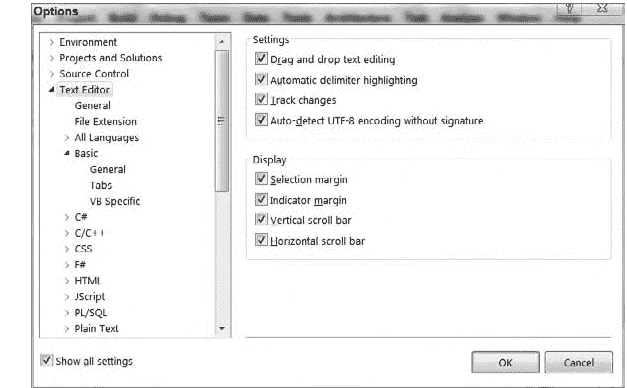

图 1-16

从此对话框中，可以修改每个制表符将插入到源代码中的空格数，并管理编辑环境的其他几个元素。在此对话框中，您会看到适用于所有文本编辑环境的通用设置，以及根据特定语言自定义特定设置的能力。例如，特定于 Visual Basic 的部分包含允许换行和行号的设置。文本编辑器的一项鲜为人知但有用的功能是行号。选中`Line numbers`复选框将导致编辑器对所有行进行编号，这提供了一种明确引用代码行的方法。

Visual Studio 还提供视觉指示器，以便您在编辑时跟踪更改。启用`Text Editor`选项下的`Track changes`设置后，Visual Studio 会在您修改文件的位置提供彩色指示器。该指示器显示在显示左侧的彩色条。它显示源文件的哪些部分最近被编辑过，以及这些更改是否已保存到磁盘。

### IntelliSense、代码扩展和代码片段

Microsoft Visual Studio 如此受欢迎的开发环境之一的原因是它旨在支持开发人员生产力。这听起来很好，但让我们来证实一下。不熟悉 Visual Studio 的人可能会认为“生产力”指的是组织和启动项目。当然，正如迄今为止讨论的项目模板和项目设置所示，这是正确的，但这些功能并不会在您创建项目后加快开发速度。

本节介绍三种针对编写代码时生产力的功能。它们价值各不相同，并且特定于 Visual Studio。第一个`IntelliSense`一直是 Microsoft 工具和应用程序的热门功能。第二个功能代码扩展是自 Visual Studio 2005 以来提供的另一个热门功能：它使您能够输入关键字，例如“select”，然后按`Tab`键自动插入通用 select-case 代码块，然后您可以对其进行自定义。最后，超越这一点，您可以使用鼠标右键并在鼠标单击位置插入代码片段。可以看出，每一个都建立在 Visual Studio 的开发人员生产力能力之上。

#### IntelliSense

`IntelliSense`在 Visual Studio 2010 中得到了增强。早期版本的`IntelliSense`要求您首先识别类或属性，然后才能使用`IntelliSense`功能。从 Visual Studio 2008 开始，`IntelliSense`在您输入的第一个字母时激活，因此您可以快速识别所需的类、命令和关键字。此功能在 Visual Studio 2010 中继续存在，但 IDE 团队努力增强了`IntelliSense`性能，以便它不会有时感觉 IDE 正在努力跟上您的输入。

一旦您选择了类或关键字，`IntelliSense`将继续，使您不仅能够使用类的各种方法，还能自动显示与枚举属性列表关联的可能值列表，当定义了属性时。`IntelliSense`还在您进行方法调用时提供类似 ToolTip 的参数定义列表。

图 1-17 说明了`IntelliSense`如何在您输入的第一个字符时可用。请注意，下拉窗口底部有两个选项卡；一个针对您可能想要的项目进行了优化，而另一个显示所有可用内容。此外，`IntelliSense`可与多词命令一起使用。例如，如果您键入`Exit`和一个空格，`IntelliSense`会显示可能跟随`Exit`的关键字的下拉列表。提供下拉列表以显示可用选项的其他关键字包括`Goto`、`Implements`、`Option`和`Declare`。在大多数情况下，`IntelliSense`在环境中显示的 ToolTip 信息比 Visual Studio 的过去版本更多，并帮助开发人员匹配括号、花括号和方括号对。

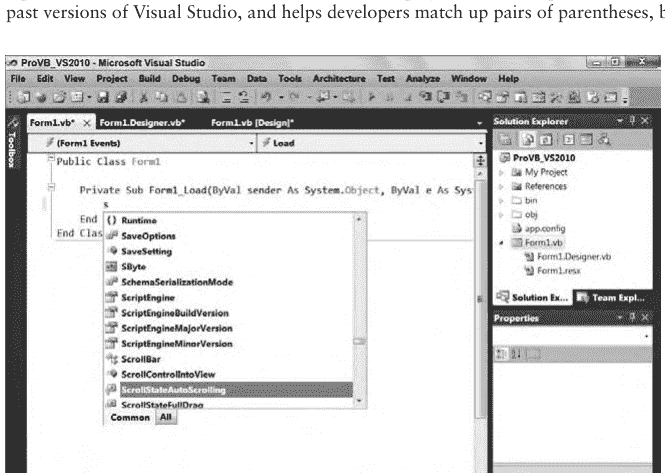

图 1-17

最后，请注意`IntelliSense`基于您的编辑上下文。在编辑文件时，您可能会达到想要在`IntelliSense`中显示特定项的程度，但当您反复输入略有不同的版本时，什么也没有出现。`IntelliSense`认识到您不在方法中或在类的范围之外，因此它会从`IntelliSense`可用项列表中删除不适合源代码当前位置的项。

#### 代码扩展

超越`IntelliSense`的是代码扩展。代码扩展认识到某些关键字始终与其它代码行相关联。在最基本层面上，这发生在您声明新的`Function`或`Sub`时出现：Visual Studio 在您按`Enter`后自动插入`End Sub`或`End Function`行。从本质上讲，Visual Studio 将声明行扩展为包含其匹配的端点。

然而，真正的代码扩展比这更进一步。通过真正的代码扩展，您可以键入`For`、`ForEach`、`Select`或任何 Visual Basic 关键字。如果您然后使用`Tab`键，Visual Studio 将尝试识别该关键字并插入您否则需要记住并自行键入的代码块。例如，而不是需要记住如何格式化`Select`语句的控制值，您只需键入此命令的第一部分，然后按`Tab`即可获得以下代码块：

```
Select Case VariableName
  Case 1
  Case 2
  Case Else
End Select
```

不幸的是，这是一个仅仅向您展示代码是不够的情况。这是因为插入的代码中包含活动区域，表示您将自定义的关键项。因此，图 1-18 提供了当您将`Select`关键字扩展为完整的`Select Case`语句时插入内容的更好表示。

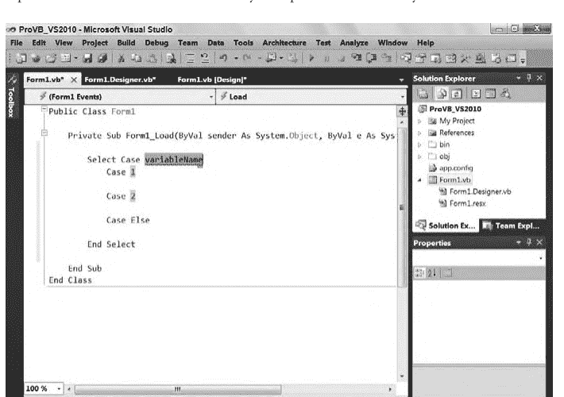

图 1-18

插入块时，编辑器会自动将光标定位在第一个突出显示的块中——`VariableName`。当您开始键入适用的变量名称时，编辑器会自动清除该

static `VariableName` string, which is acting as a placeholder. Once you have entered the variable name you want, you can just press `Tab`. At that point the editor automatically jumps to the next highlighted item. This capability to insert a block of boilerplate code and have it automatically respond to your customization is extremely useful.

Code expansion enables you to quickly shift between the values that need to be customized, but these values are also linked where appropriate, as in the next example. Another code expansion shortcut creates a new property in a class. If at the class level you type the letters “`prop`” and then press the `Tab` key twice, after the first tab you’ll find that your letters become the word “`Property`”; and after the second tab the code shown in Figure 1-19 will be added to your existing code. On the surface this code is similar to what you see when you expand the `Select` statement. Note that although you type prop, even the internal value is part of this code expansion. Furthermore, although Visual Basic implemented a property syntax that is no longer dependent on an explicit backing field, this expansion provides the more robust syntax that uses an explicit backing field.

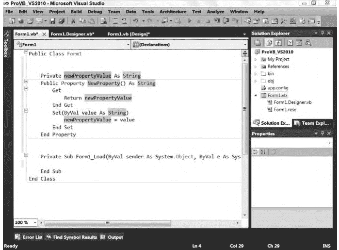

### FIGURE 1-19

The difference, however, is that the same value `String` in Figure 1-19 is repeated for the property. The value you see is the default. However, when you change the first such entry from `String` to `Integer`, Visual Studio automatically updates all three locations because it knows they are linked. Using the code shown in Figure 1-19, update the property value to be `m_Count`. Press `Tab` and change the type to `Integer`; press `Tab` again and label the new property `Count`. This gives you a simple property on this form for use later when debugging.

The completed code should look like the following block:

```
Private m_Count As Integer
Public Property Count() As Integer
    Get
        Return m_Count
    End Get
    Set(ByVal value As Integer)
        m_Count = value
    End Set
End Property
```

This capability to fully integrate the template supporting the expanded code with the highlighted elements, helping you navigate to the items you need to edit, makes code expansion such a valuable tool.

### Code Snippets

You can, with a click of your mouse, browse a library of code blocks, which, as with code expansion, you can insert into your source file. However, unlike code expansion, these snippets aren’t triggered by a keyword. Instead, you right-click and (as shown in Figure 1-20) select `Insert Snippet` from the context menu. This starts the selection process for whatever code you want to insert.

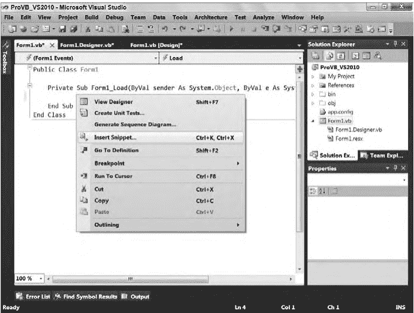

### FIGURE 1-20

The snippet library, which is installed with Visual Studio, is fully expandable, as discussed later in this chapter. Snippets are categorized by the function on which each is focused. For example, all the code you can reach via code expansion is also available as snippets, but snippets go well beyond that list. There are snippet blocks for XML-related actions, for operating system interface code, for items related to Windows Forms, and, of course, a lot of data-access-related blocks. Unlike code expansion, which enhances the language in a way similar to `IntelliSense`, code snippets are blocks of code focused on functions developers often write from scratch.

As shown in Figure 1-21, the insertion of a snippet triggers the creation of a placeholder tag and a context window showing the categories of snippets. Each of the folders can contain a combination of snippet files or subdirectories containing still more snippet files. Visual Basic 2010 Express contains a subset of the folders provided with Visual Studio 2010. In addition, Visual Studio includes the folder `My Code Snippets`, to which you can add your own custom snippet files.


Selecting a folder enables you to select from one of its subfolders or a snippet file. Once you select the snippet of interest, Visual Studio inserts the associated code into your source file. Figure 1-22 shows the result of adding an operating system snippet to some sample code. The selected snippet was Windows Event Logs Read Entries Created by a Particular Application from the Event Log, which isn’t included with Visual Basic 2010 Express, although the code is still valid.

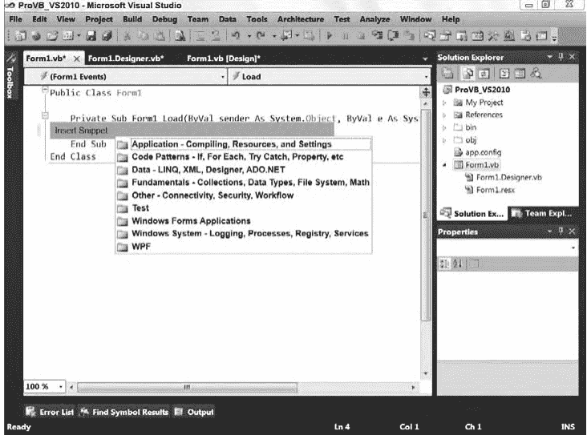

### FIGURE 1-21

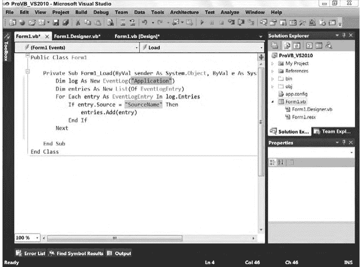

### FIGURE 1-22

As you can see, this code snippet is specific to reading the Application Log. This snippet is useful because many applications log their errors to the Event Log so that they can be reviewed either locally or from another machine in the local domain. The key, however, is that the snippet has pulled in the necessary class references, many of which might not be familiar to you, and has placed them in context. This reduces not only the time spent typing this code, but also the time spent recalling exactly which classes need to be referenced and which methods need to be called and customized.

Finally, it is also possible to shortcut the menu tree. Specifically, if you know the shortcut for a snippet, you can type that and then press Tab to have Visual Studio insert the snippet. For example, typing `evReadApp` followed by pressing Tab will insert the same snippet shown in Figure 1-22.

Tools such as code snippets and especially code expansion are even more valuable when you work in multiple languages. Keep in mind, however, that Visual Studio isn’t limited to the features that come in the box. It’s possible to extend Visual Studio not only with additional controls and project templates, but also with additional editing features.

### Additional Components for Visual Studio

You might be interested in two additional tools that work with Visual Studio. Even better, both are free. The first is a tool for creating your own Visual Basic snippets. As discussed, snippets can be powerful tools when you need to replicate relatively small but commonly used blocks of code that will be customized. While Visual Studio ships with several such snippets, Microsoft probably hasn’t included the snippet you want the most.

This is where the first tool comes in: a Snippet Editor for Visual Basic code snippets. This editor doesn’t actually live within Visual Studio; it just updates the snippet files you want to use from Visual Studio. Behind the scenes, snippets are actually XML files with embedded text that represents the code used in the snippet. What the Snippet Editor does is read that XML and interpret all of the embedded logic related to things such as replacement blocks. This tool makes it possible for Visual Basic developers to create custom snippets without worrying about the XML formatting details. It is available from MSDN at http://msdn2.microsoft.com/en-us/vbasic/ms789085.aspx.

The second tool is a true add-in to Visual Basic. When Microsoft was announcing features for .NET 2.0, it was apparent that Visual Basic and C# had different feature lists. Over time, the developers in each community started to better understand what these features represented, and in many cases demanded their inclusion. One such feature was native support in C# for refactoring, the capability to modify a variable name — for example, to take “i” and call it “loopControl” so that it’s more readable. Modifying code to improve structure, performance, and maintainability is referred to generically as refactoring.

Traditionally, such changes might make the code more maintainable but it often entailed more risk than reward; as a result they seldom were made. The problem, of course, is that a human tends to miss that one remaining reference to the old version of that method or variable name. More important, it was a time-consuming task to find all of the correct references. Fortunately, the compiler knows where these are, and that’s the idea behind automated refactoring: You tell Visual Studio what you want to change and it goes through your code and makes all the necessary changes, using the same rules the compiler uses to compile your code.

This is a great maintenance tool; unfortunately, by the time most Visual Basic developers understood what it implied, it was too late for the Visual Basic team to implement a solution in Visual Studio 2005. However, the team did do better than just say, “So sad, too bad.” They found a commercial product that actually had more features than what the C# team was developing from scratch. Then they bought a license for every Visual Studio developer, allowing free download of the tool. This solution worked so well for everyone involved that they chose to continue it in Visual Studio 2008 and Visual Studio 2010. With refactoring, you can quickly clean up gnarly, hard-to-read code and turn it into well-structured logic that’s much more maintainable. The free version of the refactoring tool is available at www.devexpress.com/Products/NET/IDETools/VBRefactor/.

### 增强示例应用程序

要开始增强应用程序，你将使用控件工具箱。关闭 `Form1.designer.vb` 文件，并将显示切换到 `Form1.vb` [设计] 选项卡。每当窗体处于设计视图时，工具箱窗口都可用。默认情况下，工具箱（如图 1-23 所示）以选项卡形式停靠在 Visual Studio 的左侧。单击此选项卡时，控件窗口会展开，你可以将控件拖到窗体上。或者，如果你已关闭工具箱选项卡，可以转到“视图”菜单并选择“工具箱”。

如果你尚未将工具箱设置为永久可见，那么每当焦点移开时，它便会滑开并消失。这有助于最大化可用的屏幕空间。如果你不喜欢此功能，希望工具箱永久可见，只需单击工具箱标题栏上的图钉图标即可。

工具箱中包含几十个标准控件，并按类别分组，以便于查找。图 1-23 显示了将 Button 控件从工具箱拖放到窗体上的结果：一个显示文本“Button1”的新按钮。再添加一个按钮将触发默认名称和文本“Button2”。

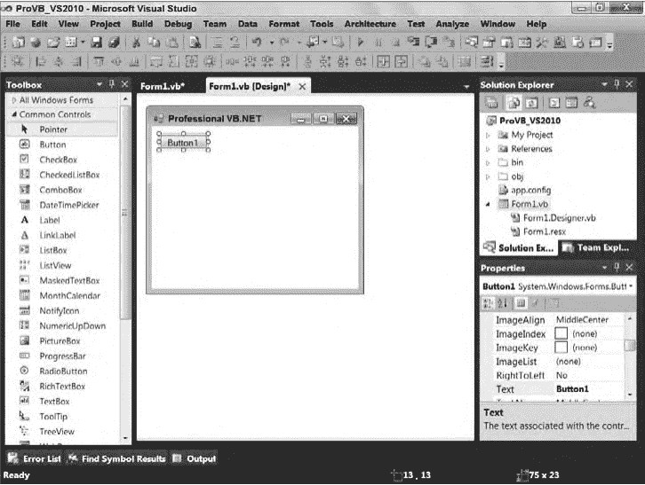

图 1-23

在自定义添加到该窗体的第一个控件之前，请仔细查看 Visual Studio 工具箱。这些工具按类别划分，但此类别列表并非一成不变。Visual Studio 2010 标准版及更高版本允许你创建自己的自定义控件。创建此类控件后，一旦编译完成，IDE 会在你处理与这些控件相同的解决方案时，自动将它们添加到显示中。这些将成为当前解决方案内可用的控件的本地引用。

此外，取决于你是在开发 Web 应用程序还是 Windows Forms 应用程序，工具箱中的控件列表会有所不同。Windows Forms 具有一套利用 Windows 操作系统强大功能的控件。相反，Web 应用程序的控件往往面向在断开连接的环境中工作。

你的环境中也可能存在第三方控件。此类控件可以注册到 Visual Studio，然后在你处理的每个项目中显示。当控件添加到工具箱时，它们通常出现在各自的自定义类别中，以便归组显示，易于查找。

回到你拖到窗体上的按钮；它已经准备就绪。然而，Visual Studio 无法知道你想如何自定义它。首先转到“属性”窗口，将 Text 属性更改为“运行代码”。然后你可以将按钮的 `(Name)` 属性更改为 `ButtonTest`。完成这些更改后，在设计视图中双击该按钮。双击会告诉 Visual Studio 你想为此控件添加事件处理程序，默认情况下 Visual Studio 会为按钮添加一个 On_Click 事件处理程序。随后 IDE 会将显示切换到代码视图，以便你自定义此处理程序（图 1-24 显示了正在编辑的此事件处理程序的代码）。

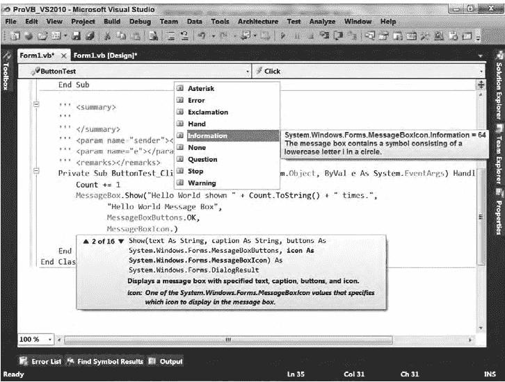

图 1-24

虽然可以通过设计器添加事件处理程序，但从代码视图添加事件处理程序也是可行的。双击按钮后，Visual Studio 会将你转到代码视图并显示新的事件处理程序。请注意，在代码视图中，编辑窗口顶部有下拉列表。这些框左侧指示当前对象（此处是你的新按钮），右侧指示当前方法（此处是 Click 事件处理程序）。你可以使用这些下拉列表为按钮或窗体上的其他事件添加新处理程序。

左侧的下拉列表包含可为其添加事件处理程序的对象。右侧的下拉列表包含所选对象的所有事件。目前，你已为按钮的 Click 事件创建了一个新处理程序，下面我们来看看如何自定义与此事件关联的代码。

### 自定义代码

在代码窗口打开到 `ButtonTest` 控件的新增事件处理程序后，你就可以开始自定义此处理程序。请注意，添加控件和事件处理程序涉及生成的代码元素。

Visual Studio 会将代码添加到 `Form1.Designer.vb` 文件中。这些更改是在源代码可编辑部分中显示的默认方法实现之外发生的。

### 添加 XML 注释

Visual Studio 的功能之一是为 Visual Basic 生成 XML 注释模板。XML 注释是一种比你想象中更强大的功能，因为 Visual Studio 也会在 IntelliSense 中识别它们。若要为你的处理程序添加新的 XML 注释，请转到处理程序之前的行，并键入三个单引号：`'''`。这会触发 Visual Studio 用以下注释块替换你的单引号。你可以在代码中的任何方法、类或属性前面触发这些注释：

```
''' <summary>
'''
''' </summary>
''' <param name="sender"></param>
''' <param name="e"></param>
''' <remarks></remarks>
```

Visual Studio 提供一个模板，用于包含此方法的功能摘要。它还提供占位符，用于描述此方法所包含的每个参数。在这些部分中输入的注释不仅可在源代码中使用，而且编译后，你还会在项目目录中找到一份 XML 文件，该文件汇总了你所有的 XML 注释，并可用于为上述源代码生成文档和帮助文件。顺便提一下，如果重构方法并添加新参数，XML 注释还支持表示参数的 XML 标记的 IntelliSense。

### 自定义事件处理程序

现在自定义按钮处理程序的代码，因为此方法在默认情况下实际上不做任何事情。首先添加一行新代码，用于递增你之前添加到窗体上的 Count 属性。接下来，使用 `System.Windows.Forms.MessageBox` 类打开一个消息框，并显示一条消息，指示 Hello World 按钮已被按下的次数。幸运的是，由于项目引用的缘故，该命名空间会自动导入到项目中的每个源文件中，因此你可以直接引用 `MessageBox.Show` 方法。`Show` 方法具有几个不同的参数，如图 1-24 所示，IDE 不仅为参数列表提供工具提示，还为各个参数的适当值提供帮助。

对 `MessageBox.Show` 的完整调用应类似于以下代码块。请注意，下划线字符用于跨多行延续命令。此外，与以前版本的 Visual Basic 不同（有时不需要括号），在 .NET 中，语法最佳实践是对每个方法调用都使用括号：


```
Private Sub ButtonTest_Click(ByVal sender As System.Object,
    ByVal e As System.EventArgs) Handles ButtonTest.Click
    Count += 1
    MessageBox.Show("Hello World shown " + Count.ToString() + " times.",
        "Hello World Message Box",
        MessageBoxButtons.OK,
        MessageBoxIcon.Information)

End Sub
```

代码片段来自 Form1

输入这行代码后，你可能会注意到文本的某些部分下方有波浪线。当输入的某行存在错误时，就会出现这种情况。Visual Studio IDE 的工作方式更像最新版的 Word。它会在你继续处理代码的同时突出显示编译器问题。Visual Basic 会不断审查你的代码以确保其能够编译；当遇到问题时，它会立即通知你所在位置，而不会中断你的工作。

当向窗体添加任何类型的控件时，会向窗体类添加一个新变量。控件由变量表示；而且，正如窗体属性是在代码中设置一样，窗体控件也是在代码中添加的。`System.Windows.Forms`命名空间中的`Button`类实现了工具箱中的 Button 控件。添加到窗体的每个控件都有一个实现该控件功能的类。对于标准控件，这些类通常位于`System.Windows.Forms`命名空间中。新变量的声明中使用了`WithEvents`关键字，以便它能够响应按钮引发的事件。

大部分代码更改都在`InitializeComponent`过程中。已添加九行代码来帮助设置和显示`Button`控件。对该过程的第一个新增内容是一行代码，它创建`Button`类的新实例并将其分配给按钮变量：

```
Me.ButtonTest = New System.Windows.Forms.Button()
```

在向窗体添加按钮之前，必须暂停窗体的布局引擎。这通过下一行代码完成：

```
Me.SuspendLayout()
```

接下来的四行代码设置按钮的属性。`Button`类的`Location`属性设置按钮左上角在窗体中的位置：

```
Me.ButtonTest.Location = New System.Drawing.Point(13, 13)
```

控件的位置用`Point`结构表示。接下来，设置按钮的`Name`属性：

```
Me.ButtonTest.Name = "ButtonTest"
```

`Name`属性的作用与它在窗体中的作用完全相同，设置按钮的文本名称。`Name`属性对按钮在窗体上的显示方式没有影响；它用于在源代码中识别按钮的上下文。接下来的四行代码为按钮的`Size`、`TabIndex`、`Text`和`UseVisualStyleBackColor`属性赋值：

```
Me.ButtonTest.Size = New System.Drawing.Size(104, 23)
Me.ButtonTest.TabIndex = 0
Me.ButtonTest.Text = "Run Code"
Me.ButtonTest.UseVisualStyleBackColor = True
```

来自 Form1.Designer 的代码片段

`Size`属性定义控件的宽度和高度；之所以设置它，是因为默认按钮大小没有显示完整标签，因此增大了按钮的尺寸。按钮的`TabIndex`属性用于设置当用户使用 Tab 键循环切换窗体上的控件时控件的选中顺序。数字越大，控件获得焦点的时间越晚。每个控件的`TabIndex`属性都应有一个唯一数字。按钮的`Text`属性设置按钮上显示的文本。最后，`UseVisualStyleBackColor`属性指示绘制此按钮时是否使用当前视觉样式。这是一个布尔值，通常可以接受此默认值，但你可以自定义背景，使某个按钮不使用当前视觉样式作为默认背景。

一旦设置了按钮的属性，就需要将其添加到窗体中。这通过下一行代码完成：

```
Me.Controls.Add(Me.ButtonTest)
```

`System.Windows.Forms.Form`类（你的`Form1`类派生自该类）有一个名为`Controls`的属性，用于跟踪窗体的所有子控件。每当你在设计器中向窗体添加控件时，窗体初始化过程中会自动添加一行类似于前面代码的语句。

最后，在初始化逻辑的底部附近是最后的代码更改。窗体被允许恢复布局逻辑：

```
Me.ResumeLayout(False)
```

除了在`Form1.Designer.vb`源文件中生成的代码之外，你还在`Form1.vb`源文件中创建了代码：

```vb
Public Class Form1

    Private m_count As Integer

    Public Property Count() As Integer

        Get

            Return m_count

        End Get

        Set(ByVal value As Integer)

            m_count = value

        End Set

    End Property

    ''' <summary>

    '''

    ''' </summary>

    ''' <param name="sender"></param>

    ''' <param name="e"></param>

    ''' <remarks></remarks>
    Private Sub ButtonTest_Click(ByVal sender As System.Object,
                                 ByVal e As System.EventArgs) Handles ButtonTest.Click
        Count += 1
        MessageBox.Show("Hello World shown " + Count.ToString() + " times.",
                        "Hello World Message Box",
                        MessageBoxButtons.OK,
                        MessageBoxIcon.Information)
    End Sub

End Class
```

> *来自 Form1 的代码片段*

这段代码反映了为按钮添加的事件处理程序。处理程序中的代码已经介绍过，但事件处理程序的命名约定除外。事件处理程序的命名约定与 Visual Basic 早期版本中的类似：控件名称后跟下划线，然后是事件名称。事件本身也可能有一组标准参数。此时，你可以测试应用程序，但要做到这一点，让我们先看看你的生成选项。

### 生成应用程序

对于此示例，最好使用 Debug 生成配置来生成示例应用程序。第一步是确保 Debug 被选为活动配置。正如本章前面在图 1-7 附近所述，你可以在项目属性中找到该设置。它也可以在 Visual Studio 主界面的“解决方案配置”下拉列表框中找到，该下拉列表框是标准工具栏的一部分。Visual Studio 提供了一个完整的“生成”菜单，其中包含可用于生成应用程序的各种选项。生成应用程序基本上有两个选项：

- **生成** —— 此选项使用当前活动的生成配置来生成项目或解决方案，具体取决于可用内容。

- **发布** —— 对于 Visual Basic 开发者，此选项会启动创建发布版本的过程，但请注意它也与应用程序的部署相关，因为系统会要求你提供一个 URL，应用程序将发布到该 URL。

“生成”菜单支持生成当前项目或整个解决方案。因此，你可以选择只生成解决方案中的单个项目，或者生成已定义为当前配置一部分的所有项目。当然，每当你选择试运行应用程序时，编译器都会自动执行编译检查，以确保你运行的是最新版本的代码。

你可以从菜单中选择“生成”，或使用 `Ctrl+Shift+B` 键盘组合来启动生成。当生成应用程序时，开发环境底边沿的“输出”窗口将打开。如图 1-25 所示，它显示与生成过程关联的状态消息。此窗口应表明你已成功生成应用程序。

如果在生成应用程序时遇到问题，Visual Studio 会提供一个单独的窗口来帮助跟踪这些问题。如果发生错误，“任务列表”窗口将以选项卡窗口的形式打开，位置与“输出”窗口所在的区域相同（参见图 1-25）。每个错误都会在“任务列表”中触发一个单独项；如果双击某个错误，Visual Studio 会自动将你重新定位到有错误的行。应用程序成功生成后，你就可以运行它了。

应用程序成功生成后，你可以在目标目录中找到可执行文件。默认情况下，对于 .NET 应用程序，这是项目目录的 `\bin` 子目录。

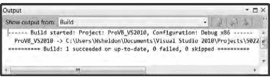

图 1-25

### 在调试器中运行应用程序

如前所述，启动应用程序有几种方法。启动应用程序会触发一系列事件。首先，Visual Studio 会查找所有已修改的文件并自动保存这些文件。然后，它会验证解决方案的生成状态，并重新生成任何没有更新二进制文件的项目，包括依赖项。最后，它会启动一个单独的进程空间，并在该进程中附加 Visual Studio 调试器来启动你的应用程序。

当应用程序运行时，Visual Studio IDE 的外观和感觉会发生变化，不同的窗口和按钮栏会变得可见（见图 1-26）。当你的代码仍保持可见时，IDE 会显示额外的窗口——默认情况下，“即时”窗口会作为新的选项卡窗口出现在与“输出”窗口相同的位置。其他窗口，如“调用堆栈”、“局部变量”和“监视”窗口，也会随着你使用调试器而逐渐显示。（并非所有这些窗口都可供 Visual Studio Express Edition 用户使用。）调试器使用这些窗口查看代码中变量的当前值。

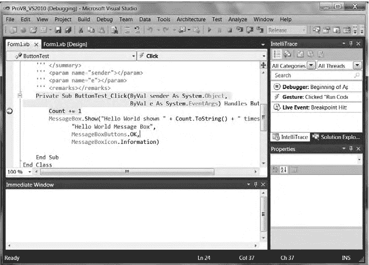

图 1-26

Visual Studio 调试器的真正威力在于其交互式调试。为了演示这一点，在你的应用程序运行时，选择 Visual Studio 作为活动窗口。将显示更改为 `Form1.vb` 代码视图（不是设计视图），并单击你在按钮被点击时添加的用于递增计数的代码行旁边的边框。执行此操作会在所选行上创建一个断点（请参阅图 1-26）。返回到你的应用程序，然后单击“Hello World”按钮。Visual Studio 获得活动焦点，将你带回代码窗口，并且带有断点的行现在被选中。

Visual Studio 2010 引入了一个新窗口，该窗口位于与解决方案资源管理器相同的选项卡集中。如图 1-26 所示，IntelliTrace 窗口在你以调试模式使用应用程序时跟踪你的操作。图 1-27 重点介绍了 Visual Studio Ultimate 版可用的这一新功能。有时被称为历史调试，IntelliTrace 窗口提供了你如何到达给定状态的历史记录。

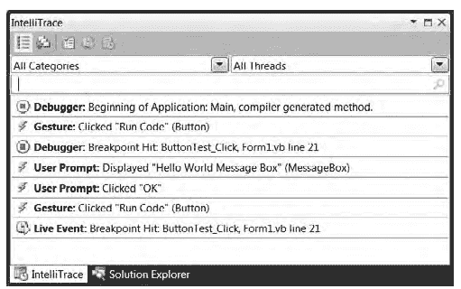

#### FIGURE 1-27

当调试期间出现错误时，你的第一反应很可能是“刚才发生了什么？”但你如何重现该错误？如图所示 1-27 所示，IntelliTrace 窗口跟踪你所采取的步骤——在本例中显示我自图 1-26 所示步骤以来第二次使用了运行代码按钮。通过提供历史轨迹，IntelliTrace 使你能够通过应用程序重现给定的一组步骤。你还可以按消息类型或按线程过滤各种消息。

能够选择这些过去的断点并查看正在运行的应用程序中变量和类的状态的能力，可以成为追踪运行时问题的强大工具。历史调试功能不幸仅在 Visual Studio 2010 Ultimate 中可用，但它们将 Visual Studio 调试器的功能提升到了一个新水平。

然而，即使你没有历史调试功能，Visual Studio 调试器也是一个强大的开发盟友。它可以说比 Visual Studio 的任何其他开发人员生产力功能都更重要。在执行停在该断点时，可以控制正在运行代码的各个方面。悬停在属性 `Count` 上，如图 1-28 所示，Visual Studio 提供了一个调试工具提示，显示此属性的当前值。这种“悬停”功能适用于本地环境中的任何变量，并且是在无需转到另一个窗口的情况下感受不同值的好方法。

诸如 `Locals` 和 `Autos` 之类的窗口会显示关于你的变量的类似信息，你可以使用它们在应用程序运行时更新这些属性。但是，你会注意到图 1-28 中的图像包含一个小的图钉符号。使用它，你可以让此变量的状态窗口在代码视图中保持打开状态。这在图 1-29 中完成，现在当我逐步通过断点设置的行的位置时，窗口中的信息会更新以显示 `Count` 的新值。Visual Studio 刚刚允许你创建一个自定义监视窗口来反映 `Count` 的值。

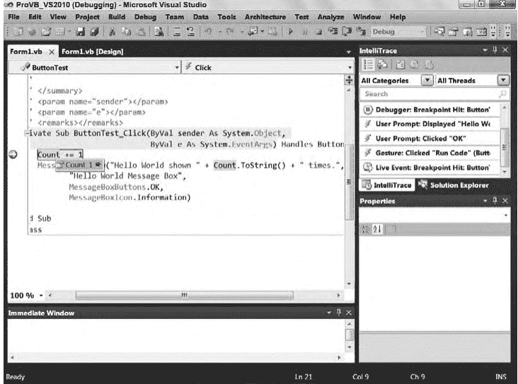

#### FIGURE 1-28

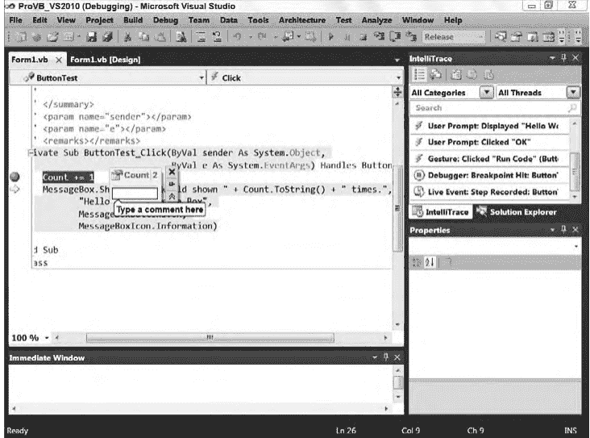

#### FIGURE 1-29

这还不是全部。如图 1-29 所示，通过单击新自定义监视窗口右侧的向下箭头，图钉下方，你可以为此值的自定义监视窗口添加一个或多个注释。你还有将此窗口的初始放置位置取消固定并将其移离代码视图显示的选项。不仅如此，自定义监视窗口在调试模式下是持久的。如果你停止调试并重新启动，窗口会自动恢复并保持可用，直到你选择使用关闭按钮关闭它。

接下来，将鼠标移动并悬停在参数 `sender` 上。这将打开一个类似于 `Count` 的窗口，以便你查看对该对象的引用。更重要的是，注意右侧的小加号，单击它会展开弹出窗口以显示此对象的属性的详细信息。如图 1-30 所示，此功能甚至适用于你未定义的 `sender` 等参数。图 1-30 还说明了查看变量数据的一个关键点。注意，通过展开顶级对象，你最终可以到达这些对象内部的属性。在其中一些属性的右侧，有一个小放大镜图标。该图标告诉你 Visual Studio 将在任意三个可视化窗口中打开可能很长的字符串值。在处理复杂的 XML 或其他复杂数据时，这些可视化器通过让你查看数据提供了显著的生产力优势。

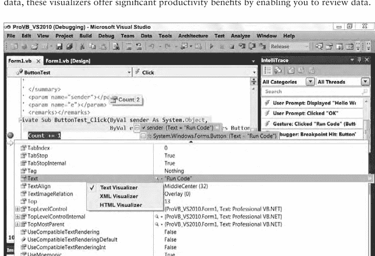

#### FIGURE 1-30

一旦到达断点，你就可以利用标准工具栏上的调试按钮来控制你的应用程序。这些按钮如图 1-31 所示，为管理应用程序的流程提供了多种选项。从左到右如下按钮：开始调试、中断全部、停止调试，以及三个看起来像换行符旁边的一组线的按钮。其中第一个，即整体上的第四个按钮，表示进入代码。最后两个按钮分别表示逐过程和逐出。在本例中，你应该使用进入或逐过程按钮移动到下一行代码，如图 1-29 所示。


#### FIGURE 1-31

进入告诉调试器跳转到你调用的下一个方法或属性中第一个代码行。请记住，如果你将属性值作为参数传递给方法，则第一个此类代码行位于参数的 `Get` 方法中。一旦到达那里，你可能想要退出。退出方法告诉调试器执行当前方法中的代码并将你返回到调用该方法的行。因此，你可以退出属性，然后再次进入以进入你实际感兴趣调试的方法。

当然，有时你不想进入方法；这就是逐过程按钮的作用所在。它使你能够调用当前行上的任何方法并逐步进入你当前正在调试的方法中的下一条顺序代码行。最后一个按钮，退出，如果你知道方法中的代码将要做什么，但你想确定哪个代码调用了当前方法，则很有用。退出会直接带你到调用代码块。

图 1-31 中调试工具栏上显示的每个按钮都有一个相应的快捷键，供希望快速通过一系列断点的经验丰富的开发人员使用。

当然，利用断点的能力超出了你在运行时可以做的事情。你还可以禁用你当前不想停止应用程序流程的断点，并且你可以移动断点，尽管通常更容易只需单击并删除当前位置，然后单击并在新位置创建新的断点。

请记住 Visual Basic 2010 Express Edition 不支持断点的高级属性，Visual Studio 为管理和自定义断点提供了其他属性。如图 1-32 所示，还可以为断点添加特定属性。上下文菜单显示了几种可能的选项。

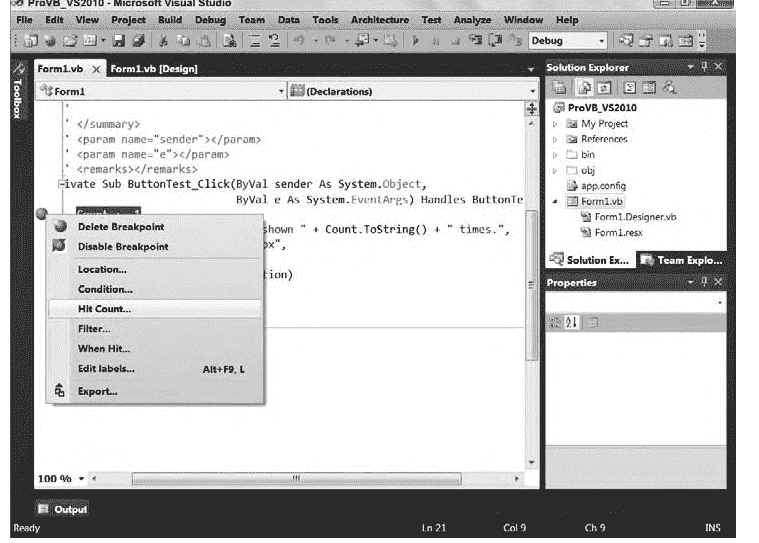

#### FIGURE 1-32

更重要的是，可以指定给定的断点仅在定义（或未定义）特定值时执行。换句话说，你可以使给定的断点成为条件，并且弹出窗口使你能够定义此条件。同样，如果你曾经想过，例如，在循环的第三十七次迭代时停止，那么你就知道在循环内部的断点处反复停止的痛苦。Visual Studio 使你能够指定给定的断点仅在达到指定次数的命中后才停止你的应用程序。

下一个选项是如果你需要在实时环境中进行调试会话时更有趣的选项之一。你可以在代码的调试版本上创建断点，然后添加一个筛选器，确保你是唯一在该断点处停止的用户。例如，如果你处于一个多个人针对同一个可执行文件工作的环境中，那么你可以添加一个不会影响应用程序其他用户的断点。

类似地，除了仅仅在断点处停止之外，你还可以让断点在到达时执行一些其他代码，甚至可能是 Visual Studio 宏。这些操作相当有限，并不常用，但在某些情况下，这种能力可以为你所用。

请注意，当 IDE 保存解决方案时，断点也会被保存。还有一个“断点”窗口，它提供了一个公共位置来管理你可能在多个不同源文件中设置的断点。


最后，有时你会想要调试一个不是从 Visual Studio 启动的进程——例如，如果你有一个现有网站承载着你感兴趣调试的 DLL。在这种情况下，你可以利用 Visual Studio 附加到正在运行的进程并调试该 DLL 的能力。在 Visual Studio 的“工具”菜单顶部或接近顶部（取决于你的设置）有“附加到进程”选项。此菜单选项会打开一个显示所有进程的对话框。然后你可以选择该进程，并在 Visual Studio 中加载你想要调试的 DLL 项目。下次该进程调用你的 DLL 时，Visual Studio 将识别该调用并命中断点。

## 其他与调试相关的窗口

如前所述，当你在调试模式下运行应用程序时，Visual Studio .NET 2010 会打开一系列与调试相关的窗口。这些窗口中的每一个都提供了应用程序运行所在整体环境中有限集合的视图。通过这些窗口，可以找到诸如用于到达当前代码行的调用列表（堆栈）或当前所有可用变量的当前值等信息。Visual Studio 拥有一个强大的调试器，并完全支持 IntelliSense，而这些窗口扩展了调试器的功能。

### 输出

回想一下，构建过程会将进度消息放入此窗口。同样，你的程序也可以将消息放入其中。后面的章节将讨论访问此窗口的几种选项，但最简单的级别是，在调试会话期间，Console 对象会将其输出回显到此窗口。例如，可以将以下代码行添加到示例应用程序中：

```
Console.WriteLine("This is printed in the Output Window")
```

这行代码将导致字符串“This is printed in the Output Window”在应用程序运行时出现在“输出”窗口中。你可以通过在打开消息框的命令之前添加此行来验证这一点。然后，运行应用程序并让调试器停在打开消息框的那一行。如果检查“输出”窗口的内容，你会发现你的字符串已显示。

写入“输出”窗口的任何内容仅在从环境运行程序时显示。在执行编译后的模块期间，不存在“输出”窗口，因此无法向其中写入任何内容。这是 `Debug` 和 `Trace` 等其他对象背后的基本概念，将在第 6 章中更详细地介绍。

### 调用堆栈

“调用堆栈”窗口列出了当前正在调用其他过程并等待其返回的过程。调用堆栈表示代码中通向当前正在执行的命令的路径。当你试图确定是什么代码正在执行你没想到会执行的一行代码时，这可能是一个有价值的工具。

### 局部变量

“局部变量”窗口用于监视当前作用域内所有变量的值。这是一个相当不言自明的窗口，显示当前局部变量的列表，每个项旁边都有其值。与 Visual Studio 的早期版本一样，此显示使你可以通过树控件界面检查对象和数组的内容。它还支持编辑这些值，因此如果你想将字符串从空更改为你认为应该的值，只是为了看看还有什么可能被破坏，那么请随意在此处进行更改。

### 监视窗口

有四个监视窗口，编号为“监视 1”到“监视 4”。每个窗口可以容纳一组你想要监视值的变量或表达式。也可以在“监视”窗口内修改变量的值。显示可以设置为以十进制或十六进制格式显示变量值。要向“监视”窗口添加变量，你可以在代码编辑器中右键单击该变量，然后从弹出菜单中选择“添加监视”，或者将变量拖放到监视窗口中。

### 即时窗口

“即时”窗口，顾名思义，使你能够计算表达式。当你处于调试模式时，它变为可用。这是一个功能强大的窗口，可以挽救或毁掉一次调试会话。例如，使用本章前面的示例，你可以启动应用程序并按下按钮以在断点处停止。转到“即时”窗口，输入 `?Button1.Text = “Click Me”` 并按 Enter。你应该会得到 false 的响应，因为“即时”窗口会计算此语句。

注意前面的 ?，它告诉调试器计算你的语句，而不是执行它。重复前面的文本，但省略问号：`Button1.Text = “Click Me”`。按 F5 或单击“运行”按钮将控制权返回给应用程序，并注意按钮上的标题。你已从“即时”窗口更新了此值。如果你在调试模式下工作并需要修改正在运行的应用程序中的某个值，此窗口会非常有用。

### 自动变量

最后，在本章准备过渡到仅适用于 Visual Studio 而非 Visual Basic 2010 Express 的功能时，还有“自动变量”窗口。“自动变量”窗口显示当前正在执行的语句及其前一条语句中使用的变量。这些变量会自动为你识别并列出，因此得名。此窗口显示的不仅仅是局部变量。例如，如果你在 `ProVB_VS2010` 示例中打开 `MessageBox` 的那一行处于调试模式，则此窗口中会显示该行引用的 `MessageBox` 常量。此窗口使你能够看到当前正在执行的命令中涉及的每个变量的内容。与“局部变量”窗口一样，你可以在调试会话期间编辑变量的值。但是，此窗口实际上特定于 Visual Studio，Visual Basic 2010 Express 的用户不可用。

## 重用你的第一个 Windows 窗体

随着你继续阅读本书并深入探索 Visual Basic 的功能，你会想要一种测试示例代码的方法。特别是第 2 章中有一些你想测试的代码片段。一种方法是增强 `ProVB_VS2010` 应用程序。它目前使用 `MessageBox` 的方式并不是测试代码片段最有效的方法。因此，让我们更新此应用程序，以便它可以在其他章节中重用，并且当你有兴趣测试某个片段时可以随时使用。

在核心部分，你将继续访问可以从 `ButtonTest` 的 `Click` 事件执行的测试代码。但是，你可以使用文本框来保存被测试代码的输出，而不是使用消息框。

此过程的第一步，如图 1-33 所示，是将 `TextBox` 控件拖到显示界面上，然后单击控件显示区域右上角的小箭头。这将打开“TextBox 任务”菜单，其中包含此控件的一些最常见自定义项。这个小箭头出现在所有 Windows 窗体控件上，但列出的内容因控件而异。在这种情况下，你应该选择“MultiLine”属性。

一旦选择了该属性，就可以扩展 `TextBox`，使其填满窗口的整个底部区域。如图 1-34 所示，然后你可以转到 `TextBox` 控件的属性，更新“Anchor”属性，以根据包含它的窗口来锚定当前控件的大小。将此控件绑定到窗口的四边后，当窗口调整大小时，此控件将随窗口自动调整大小。如果你查看 `ButtonTest` 的属性，你会发现它仅锚定到窗口的顶部和左侧，因此当窗口大小改变时，它保持不变。

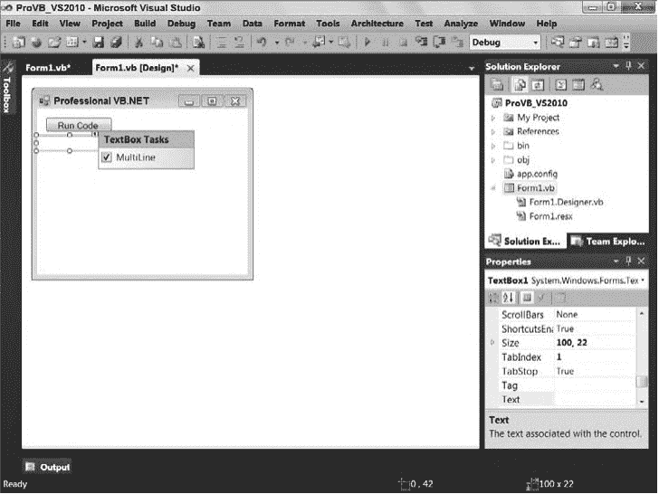

图 1-33

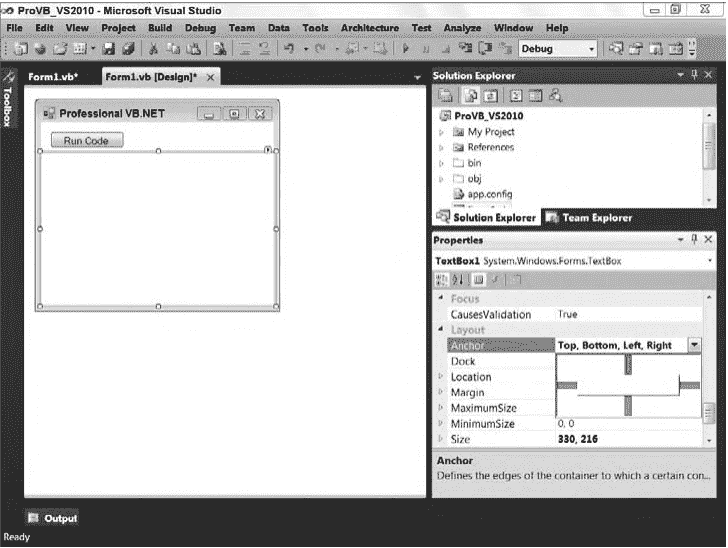

图 1-34

另外，你可以按照这里所示的示例操作，即访问文本框的 `font` 属性，并将字体大小从默认值增大到 14 磅。这样做只是为了提高本书截图中的示例结果的可读性。它对应用程序没有其他影响。

此时，你已有一个显示界面，只需更新窗口的 `TextBox1` 控件上的 `Text` 属性，即可显示各种代码片段的结果。请记住，你会希望删除（或者如某些章节所示，注释掉）你已经处理完的代码，例如本章调试演示中使用的 `Count` 属性和相关的消息框代码。

## Visual Studio 2010 的有用功能

本章的大部分内容集中在创建一个简单应用程序，使用 Visual Basic 2010 Express Edition 或 Visual Studio 2010 工作。现在该完全离开 Express Edition 支持的功能集，转向一些仅适用于 Visual Studio 开发者的功能。这些功能包括但不限于以下项目，从所有 Visual Studio 2010 开发者可用的功能开始。

首次启动 Visual Studio 2010 时，你要配置自定义 IDE 配置文件。Visual Studio 允许你选择特定于语言或特定于任务的配置文件，并且可以在任何时候更改该配置文件。

配置设置通过“工具”⇆“导入和导出设置”菜单选项进行管理。此菜单选项会打开一个简单的向导，该向导首先保存当前设置，然后允许你选择另一组设置。默认情况下，Visual Studio 附带用于 Visual Basic、Web 开发和 C# 等语言的设置，但通过导出你的设置，你可以创建并共享自己的自定义设置文件。

Visual Studio 设置文件是一个 XML 文件，使你能够捕获所有 Visual Studio 配置设置。这听起来可能微不足道，但事实并非如此。此功能使得 Visual Studio 在不同团队成员之间实现标准化。团队共享设置的优势不仅仅在于共同的外观和感觉。

### 生成配置

在 .NET 之前，一个 Visual Basic 项目只有一组属性。没有办法让调试生成和发布生成分别使用不同的属性集。因此，你不得不在构建应用程序之前手动更改任何特定于环境的属性。随着*生成配置*的引入，这种情况发生了变化，它使你可以为调试生成和发布生成设置不同的项目属性集。

Visual Studio 并不限制你只能使用两种生成配置。你可以创建额外的自定义配置。可为项目设置的属性被分为两组：一组独立于生成配置，因此适用于所有生成配置；另一组仅适用于当前活动的生成配置。例如，项目名称和项目位置属性无论活动的生成配置是什么都是相同的，而代码优化选项则根据活动的生成配置而变化。

多种配置的优点是，在应用程序开发期间可以关闭优化，并添加有助于定位和识别错误的符号化调试信息。当你准备好发布应用程序时，可以切换到发布配置并创建针对生产环境优化的可执行文件。

在图 1-35 的顶部是一个标记为“Configuration”的下拉列表框。通常，此框中列出四个选项：当前选中的配置“Active”；“Debug”和“Release”选项；以及最后一个选项“All Configurations”。在此屏幕上所做的更改将仅应用于选定的配置。因此，当选择了“Release”时，任何更改都仅应用于发布生成的设置。相反，如果选择了“All Configurations”，则所做的任何更改都将应用于所有配置（Debug 和 Release）。类似地，如果选择了“Active”，则在后台将更改应用于当前处于活动状态的基础配置。

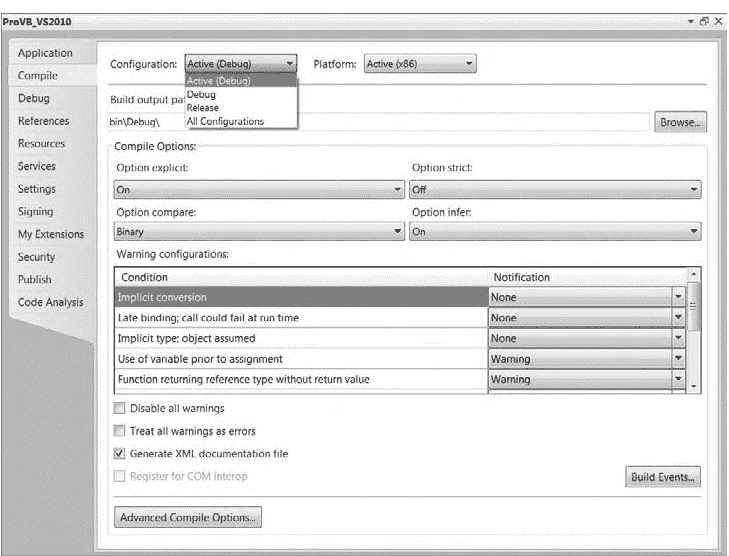

图 1-35

旁边是一个“Platform”下拉列表。过去建议你不要更改此项，因为它设置为“Any CPU”，这是一个可接受的设置。然而，在 Visual Studio 2010 中，你需要考虑这个值，因为在大多数情况下它默认是 x86。x86 代表 32 位操作系统环境，因此，如果你面向的是 64 位环境，则需要将此值更改为 64 位。如本章前面所述，请记住某些功能（如 COM-Interop 以及“编辑并继续”调试）依赖于 x86 环境。

你的所有编译设置都是特定于项目的，但是当你使用一个解决方案时，同一个解决方案中可能有多个项目。尽管你必须为每个项目独立管理这些设置，但还有另一种与多个项目相关的项目配置形式。你最有可能在处理集成安装项目时使用这种配置，在这种情况下，你可能希望在生成发布版时仅生成安装项目。

要自定义每个生成配置中包含哪些项目，你需要用于解决方案的“配置管理器”。项目通过“配置管理器”分配到生成配置。你可以从“生成”菜单访问“配置管理器”。或者，可以使用 Visual Studio 工具栏上“运行”按钮右侧的下拉列表框打开“配置管理器”。“Active Configuration”下拉框包含以下选项：Debug、Release 和 Configuration Manager。前两个默认选项是当前可用的配置。选择底部的选项“Configuration Manager”将打开如图 1-36 所示的对话框。

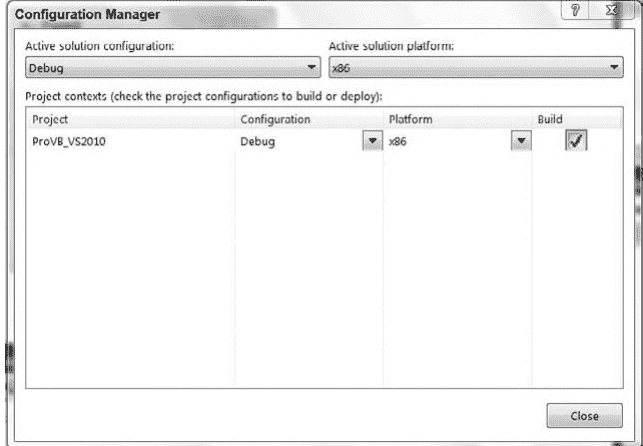

图 1-36

配置管理器包含当前解决方案中每个项目的一个条目。你可以通过启用或禁用网格“生成”列中的复选框，将项目包括或排除在所选配置之外。当解决方案包含多个项目时，这是一项很有价值的功能，因为不会浪费时间等待重新编译一个未在处理的项目。当解决方案中添加了安装项目时，通常会使用生成配置。通常的计划是，在创建实际应用程序项目的发布版本时，仅重新生成安装包。请注意，无论生成配置如何，你都可以通过右键单击项目并从弹出菜单中选择“生成”选项来构建任何程序集。

### 任务列表

任务列表是一个很好的生产力工具，它不仅跟踪错误，还跟踪挂起的更改和添加。它也是 Visual Studio 环境向开发者传达其需要了解的信息（如当前任何错误）的一种好方式。通过从“视图”菜单中选择“任务列表”即可显示任务列表。它提供两个视图：“注释”和“用户任务”，并根据此窗口一部分的下拉框中的选择来显示任一组任务。

“注释”选项用于嵌入在代码注释中的任务。这是通过创建带有撇号（单引号）的标准注释，然后以 Visual Studio 关键字 TODO 开头来完成的。该关键字后面可以跟任何描述需要完成事项的文本。一旦输入，这些注释的文本就会出现在任务列表中。请注意，用户可以在 Visual Studio 的选项中创建自己的注释标记，路径是“工具”->“选项”->“环境”->“任务列表”。其他预定义的关键字包括 HACK 和 UNDONE。

除了帮助开发者将这些挂起的编码问题作为任务进行跟踪之外，利用嵌入在代码中的注释还有一个好处。就像错误一样，点击任务列表中的任务会导致代码编辑器跳转到该任务的位置，而无需在代码中搜索它。另外需要注意（虽然我们不打算深入探讨），如果您使用 Team Foundation Server 进行协作和源代码管理，则任务列表会与之集成。

第二种类型的任务是用户任务。这些任务可能与单个文件中的特定条目无关。示例包括与解决错误或实现新功能相关的任务。可以手动在任务列表中输入任务。任务列表中有一个显示红色对勾的图片按钮。按下此按钮会在任务列表中创建一项新任务，你可以在其中编辑新任务的描述。

在 Visual Studio 的早期版本中，任务列表窗口用于显示编译错误，但从 Visual Studio 2005 开始，错误列表成为一个独立的窗口。

### 命令窗口

命令窗口可以从视图菜单的“其他窗口”部分打开。打开后，窗口会显示一个 > 提示符。这是一个命令提示符，您可以在此执行命令——具体来说，是 Visual Studio 命令。虽然 Visual Studio 设计为具有有限快捷键的 GUI 环境，但命令窗口使您能够输入——在 IntelliSense 的帮助下——您想要的具体命令。

您可以使用命令窗口通过输入而不是在菜单结构中选择来访问 Visual Studio 菜单选项和命令。例如，输入 `File.AddNewProject` 并按 Enter——添加新项目的对话框将会出现。同样，如果您输入 `Debug.Start`，您将启动与从 Visual Studio UI 启动相同的构建和启动操作。

### 服务器资源管理器

随着开发变得更加以服务器为中心，开发人员需要发现和操作网络上的服务的需求更大。Visual InterDev 用于构建经典 ASP 网站，并且与 Visual Basic 6 大致同时出现，其 InterDev 工具箱中的服务器对象部分就开始了这一方向。Visual Studio 中的服务器资源管理器功能采用了这一概念，使使用服务器变得更容易。服务器资源管理器更复杂，因为它使您能够探索和更改应用程序的数据库或本地注册表值。在 SQL 数据库项目模板（属于“其他项目类型”）的帮助下，可以完全探索和更改 SQL Server 数据库。您可以定义表、存储过程和其他数据库对象，就像以前使用 SQL Server 企业管理器所做的那样。

如果尚未打开服务器资源管理器，可以从视图菜单打开。或者它应该位于控件工具箱附近。它的行为与工具箱类似，如果您将鼠标悬停在服务器资源管理器的选项卡上或单击它，窗口将从 IDE 左侧展开。一旦打开，您将看到与图 1-37 所示类似的显示。请注意，此显示有三个顶级条目。第一个，数据连接，是设置和配置数据库连接的起点。您可以右键单击顶级数据连接节点并定义新的 SQL Server 连接设置，这些设置将在您的应用程序中用于连接到数据库。服务器资源管理器窗口提供了一种管理和查看项目特定数据库连接的方式，例如用于数据绑定的连接。

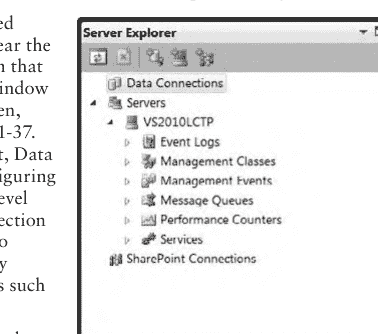

图 1-37

第二个顶级条目，服务器，专注于可能对您和您的应用程序感兴趣的其他服务器数据。当您展开可用服务器列表时，您可以访问多个服务器资源。服务器资源管理器甚至提供停止和重新启动服务器上服务的 capability。请注意可用于检查或在项目中使用的各种服务器资源。拥有服务器资源管理器意味着您不必去外部资源来查找，例如有哪些消息队列可用。

默认情况下，您可以访问本地机器上的资源；但如果您在域中，可以将其他机器（例如您的 Web 服务器）添加到显示中。使用“添加服务器”选项来选择和检查新服务器。要探索服务器的事件日志和注册表，您需要将此服务器添加到显示中。使用按钮栏中的“添加服务器”按钮打开对话框并标识您想要连接的服务器。一旦连接建立，您就可以探索该服务器的属性。

第三个顶级节点，SharePoint 连接，使您能够定义和引用与一个或多个 SharePoint 服务器相关联的元素，您可能为其创建解决方案。

### 在 Visual Studio 2010 中录制和使用宏

Visual Studio 宏是环境的一部分，可用于任何语言。宏选项可通过工具 ➔ 宏菜单访问，如图 1-38 所示。宏的概念很简单：记录一系列击键和/或菜单操作，然后通过按某个击键组合来回放它们。

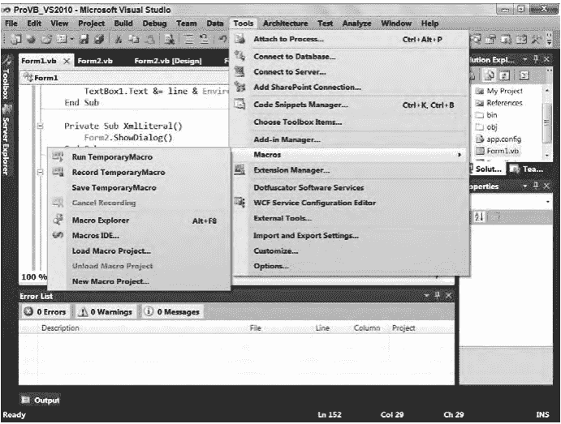

图 1-38

例如，假设代码中不断调用一个具有复杂参数集的特定函数调用，并且函数调用通常看起来相同，只是参数有细微变化。编码函数调用的击键可以被记录并按需回放，这将插入调用函数的代码，然后可以根据需要进行修改。

宏可以比这复杂得多，包含逻辑以及击键。Visual Studio 的宏功能如此全面，以至于宏拥有自己的 IDE（通过工具 ➔ 宏 ➔ 宏 IDE 访问）。

宏也可以在此环境中从头开始开发，但更常见的是使用宏菜单上的“记录临时宏”选项进行记录，然后在开发环境中重命名和修改。以下是录制和修改宏的示例：

1. 启动一个新的 Windows 应用程序项目。


- 2. 在新项目中，向随项目创建的 `Form1` 添加一个按钮。
- 3. 双击按钮以进入其单击事件例程。
- 4. 选择工具 ➔ 宏 ➔ 记录临时宏。一个小型工具栏（见图 1-39）将出现在 IDE 顶部，其中包含控制宏录制的按钮（暂停、停止和取消）。
- 5. 按 Enter，然后输入以下代码行：

  `TextBox1.Text = "Macro Test"`

- 6. 再次按 Enter。


图 1-39

```
TextBox1.Text = "Macro Test"
```

步骤 9 中出现的代码可能会根据您输入该行的方式而有所不同。例如，如果您犯了错误并退格，这些操作将有各自对应的代码行。因此，在录制宏后，值得检查代码并删除任何不必要的行。

以这种方式记录的宏中的代码只是标准的 VB 代码，可以按需修改。但是，在宏 IDE 中您可以执行的操作有一些限制。例如，您不能引用用于设置数据库连接的命名空间，因为这可能构成安全违规。

要运行宏，您可以在宏资源管理器中双击它，或选择工具 ➔ 宏 ➔ 运行宏。您也可以在工具 ➔ 选项 ➔ 环境文件夹中的键盘对话框中为宏分配击键。

关于宏的最后一点是，它们本质上使您能够生成代码，然后可以转移到 Visual Studio 加载项项目。加载项项目是旨在扩展 Visual Studio 属性的项目。要创建新的加载项项目，请打开“新建项目”对话框并选择“其他项目类型 — 可扩展性”。然后您可以创建 Visual Studio 加载项项目。这样的项目使您能够本质上将宏作为 Visual Studio 的新功能共享。例如，如果 Visual Studio 2010 没有提供获取格式化的注释的标准方法，您可能会创建一个加载项，使您能够自动生成注释模板，这样您就不必反复重新输入它。

### 类图

Visual Studio 2005 引入的一项功能是生成类图的能力。类图是应用程序对象的图形表示。通过在解决方案资源管理器中右键单击项目，您可以从上下文菜单中选择“查看类图”。或者，您也可以选择向项目添加新项。在可以添加新类的同一窗口中，您有添加新类图的选项。类图使用 `.cd` 文件扩展名作为其源文件。它是一个图形显示，如图 1-42 所示。

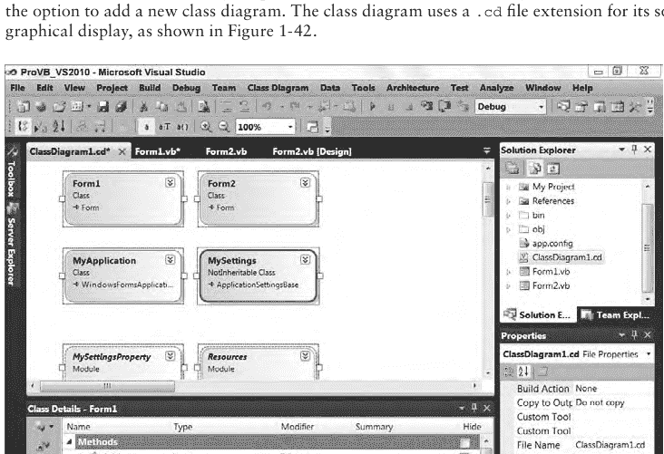

图 1-42

向项目中添加这样一个文件会创建一个动态更新的项目类表示。如图 1-42 所示，即使是简单项目的当前类结构在创建图表时也会立即得到表示。可以向项目中添加多个类图。类图以图形方式显示对象之间的关系——例如，一个对象包含另一个对象甚至对象继承。当你更改源代码时，图表也会更新。换句话说，图表并不是你在项目开始时创建一次然后随着实际实现改变类关系而变得过时的静态内容。

更重要的是，你可以随时打开类图，对一个或多个现有对象进行更改，或创建新对象并定义它们与现有对象之间的关系，完成时，Visual Studio 会自动更新现有的源文件，并在需要为新定义的对象创建新的源文件时进行创建。

如 Figure 1-42 所示，类图文件（`*.cd`）打开在与 Visual Studio UI 设计器和查看代码所使用的相同主显示区域中。然而，它们是一个图形设计表面，其行为更像 Visio 而不是用户界面设计器。你可以压缩单个对象或显示其属性和方法细节。此外，诸如类之间的关系等项目可以以图形方式显示，而不是作为属性表示。

除了编辑表面外，使用 Class Designer 工作时还会显示第二个窗口。如 Figure 1-42 底部所示，Class Details 窗口通常位于与 Output、Tasks 和其他窗口相同的空间中。Class Details 窗口提供有关你在 Class Designer 中处理的类的每个属性和方法的详细信息。你可以添加和编辑方法、属性、字段，甚至与你的类关联的事件。虽然你不能从此窗口编写代码，但你可以更新参数列表和属性类型。Class Diagram 工具是审查应用程序结构的优秀工具。

### Application Lifecycle Management

本章的重点在于你作为 Visual Basic 开发人员如何利用 Visual Studio 2010。Visual Studio 2010 产品线的顶端是完整的 Ultimate 版本，其次是 Premium 版本。这两个版本的 Visual Studio 取代了被称为 Application Lifecycle Management（ALM）的产品系列。为了减少混淆，本节简要介绍了一些来自 ALM 的工具，它们是 Visual Studio 2010 的一部分。这些工具关注的重点较少在于语言和开发代码，而更多在于管理开发和应用程序的开发。

从架构上看，ALM 有两个主要元素：服务器端组件，在 Team Foundation Server（TFS）下运行；以及客户端组件，是 Visual Studio 的一部分。TFS 是 Visual Source Safe（VSS）的替代品，尽管仅以这种方式思考它有点像把现代汽车视为马车和马的替代品。TFS 在 Visual Studio 2010 中得到了更新，并包含一个客户端安装包：Team Explorer。Team Explorer 安装为 Visual Studio 的附加组件并提供对 TFS 的访问。然而，Team Explorer 客户端包不仅仅是 Visual Studio 附加组件，它还包括对 Office 的附加组件，使用 Visual Studio Tools for Office 实现，你需要这些才能使用 TFS 功能，如任务和错误列表。

### Team Foundation Server（TFS）

Visual Studio Application Lifecycle Management（ALM）的服务器组件并未自动集成到 Visual Studio 中，但提及 TFS 的几个关键属性是合适的，这些属性使其超越了 VSS。与 VSS 类似，大多数开发人员看到 TFS 的主要角色是源代码控制。这是一种确保如果多人同时在同一项目和同一组源文件上工作，则其中两人不能同时更改同一文件的能力。

实际上，这有点过度简化。TFS 的默认模式允许两个人同时处理同一文件，然后尝试保存更改的第二个人会将其与之前保存的更改合并。其要点是确保开发人员将文件检入和检出源代码控制，以便他们不会覆盖或丢失彼此的更改。就其功能和易用性与 VSS 相比而言，TFS 更能够支持远程团队成员。一个从 VSS 远程下载需要数小时的项目，可以在几分钟内从 TFS 下载。

然而，这仅涵盖了源代码控制功能；正如前面提到的，TFS 超越了源代码控制。特别是，TFS 从项目经理的角色来处理项目开发。它不认为 Visual Studio 项目文件代表项目的定义。相反，它认识到项目基于客户或合同关系，可能由 Visual Studio 中几个看似不相关的项目组成。因此，当你定义一个项目时，你创建一个区域，所有项目和解决方案及其关联的源文件都可以存储在其中。

作为创建过程的一部分，你选择一个流程模板——第三方模板可用——并基于该模板创建一个 SharePoint 网站。SharePoint 网站成为项目团队协作的中心点。除了托管与所选软件开发流程相关的文档外，该站点还充当任务列表、需求、Microsoft 项目文件以及与项目相关的其他材料的中心位置。从本质上讲，TFS 利用 SharePoint 为你的项目添加了群组协作元素。

尽管这很重要，但 TFS 支持的更重要功能是构建实验室的能力。TFS 提供另一个可选产品称为 Team Foundation Build，它利用 Visual Studio 构建引擎使你能够安排自动构建。这不仅仅是一个简单的调度服务；Team Foundation Build 引擎不仅检索和编译你的应用程序文件，还发送有关构建状态的更新通知，并且可以被指示自动利用一些 ALM 工具，如 Code Analysis 和 Unit Testing。能够自动化你的构建并每天将其部署到测试环境中，鼓励既关注产品质量又反映行业最佳实践的过程。

Team Explorer 是一个功能强大的 Visual Studio 附加组件。它不仅为 Visual Studio 包含新的菜单项，还包含一个新窗口，其概念类似于 Solution Explorer，但相反它提供对你的 TFS 项目的访问。它还为 Visual Studio 提供一系列窗口，其中一些与源代码控制相关，其他与任务相关。在许多方面，TFS 是 ALM 产品线中最重要的工具。

Team Foundation Server 还为 2010 包含新功能。其中之一，Team Project Collections，提供了一种更好地组织你的 TFS 服务器的方法。过去，你所有的 TFS 项目都在一个巨大的集合中，任何形式的层次结构完全是自愿的。有了 TFS 2010 和 Team Project Collections，就有可能在你的项目中创建分区。因此，你可以为不同部门创建不同的组，并可根据每个部门的需要对访问控制、存储和备份操作进行分组。

> 请注意，TFS 2010 有两个版本。一个旨在为大型组织提供丰富的协作环境。另一个是更简单的版本，去除了一些与 Project Server 等的高端集成，但使小型组织能够替换任何遗留的 VSS 安装。TFS 的细节超出了本书的范围。

### Code Analysis

代码分析，或静态代码分析，是一个用于审查源代码的工具——尽管这并不是它的工作原理。基本范式反映了编写代码时存在某些常见最佳实践的事实；一旦这些最佳实践被记录下来，就可以编写一个工具来检查源代码并确定是否遵循了这些实践。Visual Studio 的静态代码分析已纳入 Windows Forms 为基础的项目的项目设置中，如 Figure 1-43 所示。对于 Web 应用程序，没有项目文件来保存项目设置，因此可以从 Visual Studio 中的网站菜单配置和运行静态代码分析。

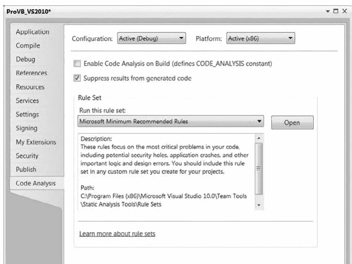

图 1-43

事实上，该工具实际上并不查看你的源代码。相反，它使用反射；在你的项目编译后，它会查询项目生成的 MSIL 代码。虽然这可能看起来令人惊讶，但请记住，该工具正在寻找几种最佳实践，这些实践在你的源代码中可能以不同的方式实现，但在编译时总是以标准的方式进行。

图 1-43 显示了可选的代码分析屏幕。请注意，即使你拥有代码分析工具，默认情况下它们也不会为你的项目启用。这是因为启用代码分析会显著延长编译时间。在大多数情况下，你希望为一两次构建启用这些设置，然后为大多数调试构建禁用检查。正如你所见，要启用分析，只需选中“在构建时启用代码分析”复选框即可。

在此复选框下方有一个用于抑制生成代码结果的复选框。微软在 Visual Studio 2005 发布后受到批评的一个代码分析问题是，如果你使用标准项目模板创建项目然后运行代码分析，你会收到与生成代码相关的警告。微软的解决方案是让你能够自动绕过对其生成代码的检查，这至少可以让你避免手动将与生成代码相关的所有问题标记为已抑制。

一旦你启用了代码分析检查，你也有定义要应用哪些规则的选项。检查被划分为不同的规则集。选择诸如“Microsoft 最低推荐规则”之类的规则集，你可以使用“打开”按钮访问图 1-44 所示的显示。

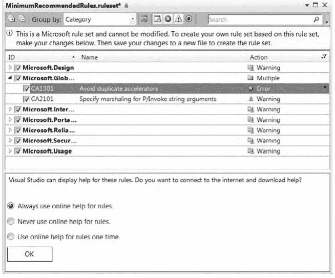

图 1-44

在规则集中，你会看到有一组类别，每个类别包含一个或多个规则。展开后，每个类别和规则旁边都有一个复选框，以指示是否会检查该特定规则。默认情况下，如果代码未能满足与规则相关的要求，Visual Studio 会发出警告。但是，你可以更改默认值——例如，通过选择错误状态如果某个规则失败。这使你能够让某些规则违规作为编译错误而不是警告出现。本章范围之外的是实际在源代码中识别可能被代码分析器标记但对正在检查的规则来说是有效例外项的能力。

#### 性能工具

每个开发人员都希望进行性能检查。Visual Studio 为你的应用程序提供了动态代码分析或性能工具。这些工具可从图 1-45 所示的“分析”菜单获得。从图 1-45 所示的菜单中选择“性能资源管理器”会打开图 1-45 显示中左侧的窗口。该窗口有一个小条，并提供对性能测试的详细信息和结果的访问。

开始使用性能工具的一个好方法是选择“分析”菜单中的第一个项目，即“性能向导”，如图 1-46 所示。性能工具提供四种运行时环境来衡量应用程序的性能：CPU 采样、Instrumentation、.NET 内存分配（采样）和并发。

采样用于性能测试是一种非侵入式的方法来检查应用程序性能。本质上，Visual Studio 正常启动你的应用程序，但在幕后它已连接到系统性能计数器。随着应用程序的运行，性能监控引擎捕获系统性能，并在应用程序完成后提供描述该性能的报告。关于应用程序实际做什么导致某种行为的细节不可用，但你可以对系统的影响有一个现实的想法。

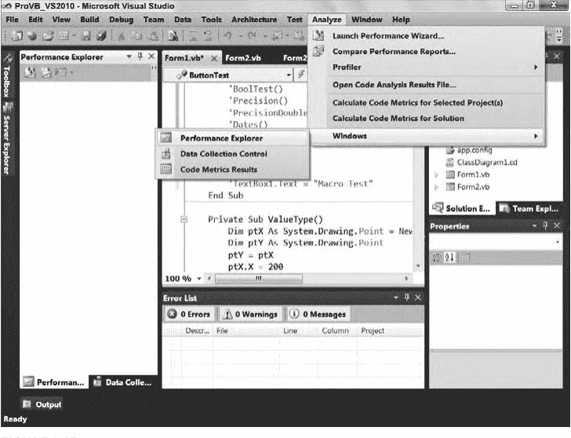

图 1-45

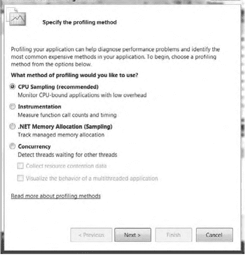

图 1-46

并发检查旨在检测多线程应用程序的问题。并发检查支持两种模式。第一种检查资源争用问题。这发生在两个线程例如尝试向同一数据文件或数据表写入输出时，从而迫使你的并行处理以串行方式运行。第二种模式使你能够更好地跟踪线程事件的行为。

相反，Instrumentation 是一种侵入式的性能监控形式。选择进行一次 Instrumentation 运行，性能工具会在你的编译可执行文件中添加特殊的 MSIL 命令。这些调用放置在可执行文件中方法和属性的开始和结束处。然后，随着代码的执行，性能引擎可以衡量应用程序中特定调用的执行时间。

请记住，所有性能测试方法都会影响应用程序的底层性能。确实，运行任何类型的性能监视器都有内置开销会影响你的应用程序，但性能测试的目标不是知道应用程序的确切时间标记，而是识别与常态显著偏离的区域，更重要的是，建立一个基线，以便在代码被修改时跟踪任何显著变化。

## 摘要

在本章中，你已经深入了解了 Visual Studio 的版本和功能。本章旨在帮助你探索新的 Visual Studio IDE。它展示了 IDE 的强大功能，即使在免费提供的 Visual Basic 2010 Express 版中也是如此。

你已经看到 Visual Studio 2010 具有高度可定制性，并且有多种版本。随着你在 Visual Studio 2010 中的工作，你已经看到许多窗口可以隐藏、停靠或取消停靠。它们可以分层在选项卡中，并在 IDE 内外移动。Visual Studio 还包含许多工具，其中一些扩展了其核心功能。请记住，无论你使用的是 Visual Basic 2010 Express 版还是 Visual Studio 2010 Ultimate，用于编译应用程序的核心元素都是相同的。

### 2 对象和 Visual Basic

## 本章你将学习的内容

- 面向对象术语
- 对象的组成
- 值类型与引用类型的特征
- 原始类型
- 命令：`If...Then`, `Else`, `Select Case`
- 常见值类型（结构）
- 常见引用类型（类）
- XML 字面量
- 参数传递 `ByVal` 和 `ByRef`
- 变量作用域
- 使用对象
- 理解绑定
- 数据类型转换
- 创建类
- 事件处理
- 高级面向对象编程
- 使用 Lambda

Visual Basic 支持语言要成为完全面向对象的四个主要定义概念：

- **抽象** — 抽象仅仅是语言创建“黑盒”代码的能力，将一个概念并在程序中创建该概念的抽象表示。例如，`Customer` 对象是现实世界客户的抽象表示。`DataTable` 对象是数据集的抽象表示。
- **封装** — 封装是接口与实现分离的概念。想法是你可以在类中创建接口（公共方法、属性、字段和事件），并且只要该接口保持一致，应用程序就可以与你的对象交互。这在你完全重写类内的代码时仍然成立。

一个密切相关的术语是*类*。类是定义对象的代码，所有对象都是基于类创建的。类是对现实世界概念的抽象，它提供了创建特定对象实例的基础。例如，为了拥有代表客户编号 123 的 `Customer` 对象，你必须首先拥有一个包含创建 `Customer` 对象所需的所有代码（方法、属性、事件、变量等）的 `Customer` 类。基于该类，你可以创建任意数量的对象，每个对象都是类的实例。每个对象都与其它对象相同，只是它可能包含不同的数据。

你可以基于同一个 `Customer` 类创建许多 `Customer` 对象实例。所有 `Customer` 对象在它们能做什么和它们包含的代码方面是相同的，但每个对象包含其自己的唯一数据。这意味着每个对象代表一个不同的物理客户。

#### 对象的组成

你使用*接口*来访问对象的数据和行为。这为对象定义了一个契约。这就像现实世界中的法律合同，将对象绑定到数据和行为的标准定义，在你的接口中你可以定义满足合同所需的条件。对象的数据和行为包含在对象内部，因此客户端应用程序可以将对象视为黑盒，只能通过其接口访问。这是一个关键的面向对象概念，称为*封装*。想法是任何使用此对象的程序都不会直接访问行为或数据；相反，这些程序必须使用对象的接口。

##### 接口

接口被定义为一组方法（`Sub` 和 `Function` 方法）、属性（属性方法）、事件和字段（也称为变量），其作用域声明为 `public`。

你也可以在代码中拥有私有方法和属性。虽然这些方法可以被对象内的代码调用，但它们不是接口的一部分，不能被编写为使用你的对象的程序调用。另一个选项是使用 `Friend` 关键字，这定义了作用域为你的当前项目，这意味着项目内的任何代码都可以调用该方法，但项目外的任何代码（即来自不同的 .NET 程序集）都不能调用该方法。为了使事情复杂化一点，你还可以将方法和属性声明为 `Protected`，这些方法可供继承自你的类的类使用。你将在第 3 章中与继承一起查看 `Protected`。

例如，你可能在类中有以下代码：


```vb
Public Function CalculateValue() As Integer

End Function
```

因为此方法使用 `Public` 关键字声明，所以它是接口的一部分，可以被使用该对象的客户端应用程序调用。你也可能有这样的方法：

```vb
Private Sub DoSomething()

End Sub
```

此方法声明为 `Private`，因此它不是接口的一部分。此方法只能被类内的代码调用——不能被类外的任何代码调用，例如使用其中一个对象的程序中的代码。

相反，你可以这样做：

```vb
Public Sub CalculateValue()
    DoSomething()
End Sub
```

在这种情况下，你从 `Public` 方法中调用 `Private` 方法。虽然使用你的对象的代码不能直接调用 `Private` 方法，但你经常使用 `Private` 方法来帮助在类中构建代码，使其更易于维护和阅读。

最后，你可以使用 Friend 关键字：

```
Friend Sub DoSomething()

End Sub
```

在这种情况下，`DoSomething` 方法可以被类内部的代码调用，也可以被当前 Visual Basic 项目中的其他类或模块调用。项目外部的代码将无法访问该方法。

`Friend` 作用域与 `Public` 作用域非常相似，因为它使方法可供对象本身之外的代码使用。然而，与 `Public` 不同的是，`Friend` 关键字将访问限制在当前 Visual Basic 项目内的代码中，防止其他 .NET 程序集中的代码调用该方法。`Protected` 与 `Friend` 修饰符一起使用是较为常见的做法，这将在第 3 章中讨论。

### 实现或行为

方法内部的代码称为实现。有时也称为行为，因为正是这段代码使对象能够执行有用的工作。例如，你的对象的接口中可能包含一个 `Age` 属性。在该方法内部，你可能有类似下面的代码：

```
Public ReadOnly Property Age() As Integer
```

在这种情况下，代码直接从变量中返回一个值，而不是做更有用的事情，例如根据出生日期计算该值。然而，这种代码在应用程序中经常被编写，一段时间以来似乎运行良好。

关键点在于理解，客户端应用程序即使在实现发生变化时也可以使用对象，只要你不改变公共接口。如果方法名称及其参数列表和返回数据类型保持不变，那么你可以随意更改实现。

调用 `Age` 属性所需的代码可能如下所示：

```
theAge = myObject.Age
```

运行此代码的结果是返回 `Age` 值。虽然客户端应用程序可以正常工作，但你很快会发现将年龄硬编码到应用程序中是个问题，因此在某个时候你会想要改进这段代码。幸运的是，你可以在不更改客户端代码的情况下更改实现：

```
Private _BirthDate As Date

Public ReadOnly Property Age() As Integer
    Get
        Return CInt(DateDiff(DateInterval.Year, _BirthDate, Now))
    End Get
End Property
```

你已在公共接口背后更改了实现，从根本上改变了其行为，而没有改变接口本身。现在，运行客户端应用程序时返回的 `Age` 值会随时间推移保持准确，而在之前的实现中则不会。

此外，为了实现这一更改，你已从 Visual Basic 2010 的新功能之一——自动实现属性，过渡到使用支持字段的传统属性实现。你将在 Visual Basic 中看到的大多数现有 .NET 代码都会为属性使用支持字段，因为在该版本之前这是实现属性的唯一方式。

请记住，封装是一种语法工具——它使代码能够在不更改的情况下继续运行。然而，它不是语义上的，这意味着仅仅因为代码继续运行，并不意味着它继续做你真正想要它做的事情。

在此示例中，客户端代码可能已编写为以某种方式克服实现的初始限制，因此客户端代码可能既依赖于能够检索 `Age` 值，又依赖于该调用的结果在一段时间内保持固定值。

对实现的更新不会阻止客户端程序运行，但它很可能使其无法正确运行。

### 字段或实例变量

对象的第三个关键部分是其数据或状态。事实上，可以说对象的唯一重要部分就是其数据。毕竟，类的每个实例在接口和实现方面完全相同；唯一可能有所不同的就是该特定对象中包含的数据。

字段是声明为对类内所有代码都可用的变量。通常，作用域声明为 `Private` 的字段仅对类本身的代码可用。它们有时也被称为实例变量或成员变量。

不要将字段与属性混淆。在 Visual Basic 中，属性是一种用于检索和设置值的特殊方法，而字段是类内部的变量，可能保存属性公开的值。例如，你可能有一个具有以下字段的类：

```
Public Class TheClass
    Private _Name As String
    Private _BirthDate As Date
End Class
```

类的每个实例——每个对象——都将拥有自己的这些字段集合来存储数据。由于这些字段使用 `Private` 关键字声明，因此它们仅对每个特定对象内的代码可用。

虽然字段可以声明为 `Public` 作用域，但这会使其以你无法控制的方式对使用对象的任何代码可用。这直接破坏了封装的概念，因为对象外部的代码可以直接更改数据值，而无需遵循对象代码中可能设置的任何规则。

考虑上一节中显示的 `Age` 属性。你会注意到，通过使用属性，即使最初生成的底层实现也被隐藏在外部世界之外。当你决定更改实现以使用动态生成的年龄时，你可以在不更改接口的情况下更改该实现。

如果你想使字段的值对对象外部的代码可用，你应该改用属性：

```
Public Class TheClass
    Private _Name As String
    Private _BirthDate As Date

    Public ReadOnly Property Name() As String
        Get
            Return _Name
        End Get
    End Property

End Class
```

由于 `Name` 属性是一个方法，你并没有直接向客户端代码公开内部变量，因此保留了数据的封装。同时，通过这种机制，你能够在需要时安全地提供对数据的访问。字段也可以使用 `Friend` 作用域声明，这意味着它们可供项目中的所有代码使用。

现在你已经掌握了一些基本的面向对象术语，你就可以开始探索类的创建和对象的创建。首先你将看到 Visual Basic 如何让你与对象交互并提供核心类型（所有这些都是对象），然后你将深入研究创建这些对象的实际过程。

### System.Object

目前需要记住的一个关键点是，Visual Basic 中的所有类，事实上 .NET 中的所有类，都继承自基类 `System.Object`。`System.Object` 是所有内容的父类，从字符串和整数到 Windows 和你开发的自定义类。当类没有明确声明其父类时，.NET 会自动使该类继承自 `System.Object`。这也意味着即使类确实明确继承自另一个类，该父类或其父类或基类，或在继承链中的某个点上的某个类，也会继承自 `System.Object`。过去有句老话说所有道路都通向罗马。好吧，在 .NET 中，所有对象层次结构都通向 `System.Object`。`System.Object` 是所有类的基类。

这就是多态性变得重要的地方。由于你可以将任何对象强制转换为它继承的类型，因此任何类型的对象都可以强制转换为 `System.Object` 基类。强制转换是指将例如 `Integer` 类型的对象分配给 `System.Object` 类型变量的代码的名称。正如你在 Visual Basic 或其他面向对象语言中工作时所看到的，这意味着你会看到许多编写为处理 `Object` 类型参数的方法。这对代码重用有几个优点，但你会了解到重用是有代价的。

你需要记住的是，当对象被强制转换为其父类时，它只会使该父类的方法可用。虽然底层对象可以被强制转换回其原始类型，因为它知道该类型是什么，但它不会在被强制转换回原始类型之前使其所有数据和行为可用。请注意你可以强制转换为对象继承层次结构中的任何类型，但这将在第 3 章中更详细地介绍。

`System.Object` 提供了一个你会感兴趣的成员。`ToString` 方法提供了一种获取任何对象的字符串表示形式的方法。此方法的默认实现将返回该对象的类型；然而，许多类型提供了此方法的自定义实现，并且这样做被认为是最佳实践。

### 使用 Visual Basic 类型

在介绍了 Visual Basic 中对象的关键字和概念组合之后，是时候开始探索特定类型了。为了确保这是实践性的，你需要在 Visual Studio 2010 中有一个项目。上一章重点介绍了 Visual Studio 2010 及其许多功能作为你的主要开发工具。本章更专注于 Visual Basic 语言，并且为了限制其大小，你将在本章中引用上一章创建的项目。随着本章介绍 Visual Basic 的核心类型，即 .NET Framework 提供的核心 Visual Basic 类，你将在该项目中测试代码片段。

为了在基于第 1 章构建的 `ProVB_VS2010` 项目中托管示例片段，只需进行很少的更改。本章的代码下载包含示例的最终版本。这意味着随着你阅读本章的进展，你可以查看示例下载中的相同代码，也可以逐步构建你自己的示例副本，使用示例当你自己的代码似乎不太正确时作为参考。与上一章代码的唯一变化是该章中使用的自定义属性和消息框已从此项目中删除。

此时，你有一个显示器，允许你仅通过更新窗口的 `TextBox1` 控件的 `Text` 属性来显示各种代码片段的结果。基线 Windows 窗体应用程序的显示如 图 2-1 所示。

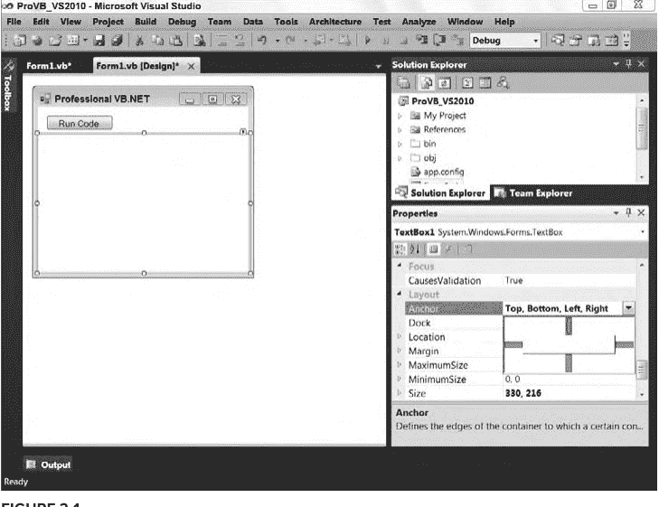

**图 2-1**

如你所见，基线只是一个用于启动自定义代码的按钮，再加上一个文本框。当你想要测试一段代码片段时，你将在 `Form1` 中添加一个新方法，然后从按钮的 `Click` 事件处理程序中调用此方法。示例下载展示了如何添加这些方法，然后当你准备好添加下一个方法时，使用单引号行将前一个测试的方法调用注释掉。这样，你就可以注释掉对方法的单行调用，而方法内部用于演示 Visual Basic 该特性的代码仍将可用。以下关于值类型和引用类型差异的部分将创建两个这样的方法，如果你查看示例下载代码，你会发现对片段中所示方法的调用已在事件处理程序中被注释掉了。

### 值类型和引用类型

经验丰富的开发人员通常认为整数、字符、布尔值和字符串是任何语言的基本构建块。如上所述，在 .NET 中，所有对象都共享对基 `Object` 类的逻辑继承。这种共同继承的一个优势是可以依赖每个变量的一定通用方法。另一个优势是，这使得整个 .NET 都能建立在共同的类型系统之上。Visual Basic 建立在 .NET 语言之间共享的通用类型系统之上。

由于所有数据类型都基于核心 `Object` 类，因此你可以确信你声明的每个变量都具有一组共同的特征。然而，这种逻辑继承并不要求所有变量具有共同的物理实现。这很重要，因为虽然 .NET 中的一切都基于 `Object` 类，但在底层 .NET 对类型有两种主要实现：值类型和引用类型。

例如，大多数程序员认为的一些基本底层类型，如 `Integer`、`Long`、`Character`，甚至 `Byte`，都不是作为类实现的。这很重要，因为当我们查看装箱以及在值类型和引用类型之间转换的成本时，你会看到这一点。值类型和引用类型之间的差异是一种底层实现差异：

- 值类型代表位于栈上的简单数据存储。栈用于已知大小的项目，因此栈上的项目比托管堆上的项目检索更快。
- 引用类型基于具有从其父类继承实现的复杂类，并在托管堆上进行自定义存储。托管堆经过优化，可支持不同大小对象的动态分配。

请注意，这两种实现存储在内存的不同部分。因此，值类型和引用类型在赋值语句中的处理方式不同，其内存管理方式也不同。了解这些差异如何影响你将在 Visual Basic 中编写的软件非常重要。了解 .NET Framework 中数据操作的底层原理将使你能够构建更可靠、性能更好的应用程序。

考虑栈和堆之间的差异。栈是进程和线程存储固定大小数据的相对较小的内存区域。整数或十进制值需要相同数量的字节来存储数据，无论实际值如何。这意味着此类变量在栈上的位置可以被高效确定。 （当进程需要检索一个变量时，它必须搜索栈。如果栈包含具有动态内存大小的变量，那么这样的搜索可能需要很长时间。）

引用类型没有固定的大小——字符串的大小可以从两个字节变化到系统上几乎所有可用的内存。引用类型的动态大小意味着它们包含的数据存储在堆上，而不是栈上。然而，引用类型的地址（即堆上数据的所在位置）具有固定的大小，因此可以（并且事实上确实）存储在栈上。通过仅在栈上存储对自定义分配的引用，整个程序运行速度会快得多，因为进程可以快速定位与变量关联的数据。

将固定大小和动态大小变量包含的数据存储在不同位置，导致变量行为上的差异。与其将此讨论限制在 .NET 中最基本的类型上，此差异可以通过比较 `System.Drawing.Point` 结构（值类型）和 `System.Text.StringBuilder` 类（引用类型）的行为来说明。

`Point` 结构是 .NET 图形库的一部分，该库属于 `System.Drawing` 命名空间。`StringBuilder` 类是 `System.Text` 命名空间的一部分，用于在编辑字符串时提高性能。

首先，让我们检查 `System.Drawing.Point` 结构是如何使用的。为此，你将在 `ProVB_VS2010` 应用程序中创建一个名为 `ValueType()` 的新方法。此新的私有 `Sub` 将从 `ButtonTest` 单击事件处理程序中调用。新方法将具有以下格式：

```
Private Sub ValueType()
    Dim ptX As System.Drawing.Point = New System.Drawing.Point(10, 20)
    Dim ptY As System.Drawing.Point
    ptY = ptX
    ptX.X = 200
    TextBox1.Text = "Pt Y = " & ptY.ToString()
End Sub
```

此操作输出为 {[X = 10, Y = 20]}，如图 2-2 所示。当代码将 `ptX` 复制到 `ptY` 时，`ptX` 中包含的数据被复制到与 `ptY` 关联的栈位置上。稍后，当 `ptX` 的值发生变化时，只有与 `ptX` 关联的栈内存被更改。更改 `ptX` 的值对 `ptY` 没有影响。引用类型并非如此。考虑以下代码，一个名为 `RefType` 的新方法，使用 `System.Text.StringBuilder` 类：

```
Private Sub RefType()
    Dim objX As System.Text.StringBuilder = New System.Text.StringBuilder("Hello World")
    Dim objY As System.Text.StringBuilder
    objY = objX
    objX.Replace("World", "Test")
    TextBox1.Text = "objY = " & objY.ToString()
End Sub
```

Form1 中的代码片段

此操作输出为“Hello Test”，如图 2-3 所示，而不是“Hello World”。前面使用点的示例演示了当一个值类型被赋给另一个值类型时，栈上存储的数据会被复制。同样，此示例演示了当 `objY` 被赋给 `objX` 时，与 `objX` 关联的栈上的数据被复制到与 `objY` 关联的栈上的数据。然而，在这种情况下被复制的不是实际数据，而是数据实际所在的管理堆上的地址。这意味着 `objY` 和 `objX` 现在引用相同的数据。当堆上的数据被更改时，持有对该内存引用的每个变量关联的数据都会被更改。这是引用类型的默认行为，被称为浅拷贝。本章后面，你将看到这种行为对字符串是如何被覆盖的（字符串执行深拷贝）。

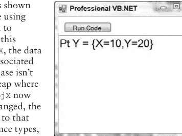

**图 2-2**

值类型和引用类型之间的差异超出了它们在复制时的行为，后面本章中你将遇到对象提供的一些其他特性。首先，让我们更仔细地看看一些最常用的值类型，并学习 .NET 如何处理它们。

### 原始类型

Visual Basic 与其他开发语言一样，有一组元素，如整数和字符串，被称为原始类型。这些原始类型由 `String`、`Long` 和 `Integer` 等关键字标识，它们是 .NET 类库中定义类型的别名。这意味着行

```
Dim i As Long
```

等同于行

```
Dim i As System.Int64
```

之所以提供这两种不同的声明，是出于对应用程序长期规划的考虑。在大多数情况下（例如 Visual Basic 过渡到 .NET 时），你希望使用 `Short`、`Integer` 和 `Long` designation。当 Visual Basic 迁移到 .NET 时，`Integer` 类型从 16 位变为 32 位。用此 `Integer` 类型编写的代码如果重写为 .NET 代码，将自动使用更大的值。有趣的是，Visual Basic 迁移向导实际上将 Visual Basic 6 `Integer` 值重新转换为 Visual Basic .NET `Short` 值。

这也是 `Int16`、`Int32` 和 `Int64` 存在的原因。这些类型指定物理实现；因此，如果你的代码有一天迁移到将 `Integer` 值映射到 `Int64` 的 .NET 版本，那么那些定义为 `Integer` 的值将反映新的更大容量，而那些声明为 `Int32` 的值则不会。如果你的代码操作的是接口的一部分，其中更改值的物理大小可能会破坏接口，这可能很重要。

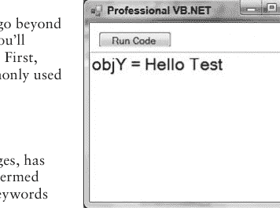

**图 2-3**


Table 2-1 lists the primitive types that Visual Basic 2008 defines, and the structures or classes to which they map:

## TABLE 2-1: Primitive Types in .NET

| PRIMITIVE TYPE | .NET CLASS OR STRUCTURE |
| Byte | `System.Byte` (structure) |
| Short | `System.Int16` (structure) |
| Integer | `System.Int32` (structure) |
| Long | `System.Int64` (structure) |
| Single | `System.Single` (structure) |
| Double | `System.Double` (structure) |
| Decimal | `System.Decimal` (structure) |
| Boolean | `System.Boolean` (structure) |
| Date | `System.DateTime` (structure) |
| Char | `System.Char` (structure) |
| String | `System.String` (class) |

> The `String` primitive type stands out from the other primitives. Strings are implemented as a class, not a structure. More important, strings are the one primitive type that is a reference type.

You can perform certain operations on primitive types that you can’t on other types. For example, you can assign a value to a primitive type using a literal:

```
Dim i As Integer = 32
Dim str As String = "Hello"
```

It’s also possible to declare a primitive type as a constant using the `Const` keyword, as shown here:

```
Const str As String = "Hello"
```

The value of the variable `str` in the preceding line of code cannot be changed elsewhere in the application containing this code at runtime. These two simple examples illustrate the key properties of primitive types. As noted, most primitive types are, in fact, value types. The next step is to take a look at core language commands that enable you to operate on these variables.

### COMMANDS: CONDITIONAL

Unlike many programming languages, Visual Basic has been designed to focus on readability and clarity. Many languages are willing to sacrifice these attributes to enable developers to type as little as possible. Visual Basic, conversely, is designed under the paradigm that the readability of code matters more than saving a few keystrokes, so commands in Visual Basic tend to spell out the exact context of what is being done.

Literally dozens of commands make up the Visual Basic language, so there isn’t nearly enough space here to address all of them. Moreover, many of the more specialized commands are covered later in this book. However, if you are not familiar with Visual Basic or are relatively new to programming, a few would be helpful to look at here. These fall into two basic areas: conditional statements and looping statements. This chapter addresses two statements within each of these categories, starting with the conditional statements; later, after collections and arrays have been introduced, looping statements are covered.

Each of these statements has the ability not only to call another method, the preferred way to manage blocks of code, but also to literally encapsulate a block of code. Note that the variables declared within the context of a conditional statement (between the `If` and `End If` lines) are only visible up until the `End If` statement. After that, these variables go out of scope. The concept of scoping is discussed in more detail later in this chapter.

#### If Then

The conditional is one of two primary programming constructs (the other being the loop) that is present in almost every programming language. After all, even in those rare cases where the computer is just repeatedly adding values or doing some other repetitive activity, at some point a decision is needed and a condition evaluated, even if the question is only “is it time to stop?” Visual Basic supports the `If-Then` statement as well as the `Else` statement; and unlike some languages, the concept of an `ElseIf` statement. The `ElseIf` and `Else` statements are totally optional, and it is not only acceptable but common to use conditionals that do not utilize either of these code blocks. The following example illustrates a simple pair of conditions that have been set up serially:

```
If i > 1 Then
    'Code A1
ElseIf i < 1 Then
    'Code B2
Else
    'Code C3
End If
```

If the first condition is true, then code placed at marker A1 is executed. The flow would then proceed to the `End If`, and the program would not evaluate any of the other conditions. Note that for best performance, it makes the most sense to have your most common condition first in this structure, because if it is successful, none of the other conditions need to be tested.

If the initial comparison in the preceding example code were false, then control would move to the first `Else` statement, which in this case happens to be an `ElseIf` statement. The code would therefore test the next conditional to determine whether the value of `i` were less than 1. If so, then the code associated with block B2 would be executed.

However, if the second condition were also false, then the code would proceed to the `Else` statement, which isn’t concerned with any remaining condition and just executes the code in block C3. Not only is the `Else` optional, but even if an `ElseIf` is used, the `Else` condition is still optional. It is acceptable for the `Else` and C3 block to be omitted from the preceding example.

#### Comparison Operators

There are several ways to discuss what is evaluated in an `If` statement. Essentially, the code between the `If` and `Then` portions of the statement must eventually evaluate out to a Boolean. At the most basic level, this means you can write `If True Then`, which results in a valid statement, although the code would always execute the associated block of code with that `If` statement. The idea, however, is that for a basic comparison, you take two values and place between them a comparison operator. Comparison operators include the following symbols: `=`, `>`, `<`, `>=`, `<=`.

Additionally, certain keywords can be used with a comparison operator. For example, the keyword `Not` can be used to indicate that the statement should consider the failure of a given comparison as a reason to execute the code encapsulated by its condition. An example of this is shown in the next example:

```
If Not i = 1 Then
    'Code A1
End If
```

It is therefore possible to compare two values and then take the resulting Boolean from this comparison and reevaluate the result. In this case, the result is only reversed, but the `If` statement supports more complex comparisons using statements such as `And` and `Or`. These statements enable you to create a complex condition based on several comparisons, as shown here:

```
If Not i = 1 Or i < 0 And str = "Hello" Then
    'Code A1
Else
    'Code B2
End If
```

The `And` and `Or` conditions are applied to determine whether the first comparison’s results are true or false along with the second value’s results. The `And` conditional means that both comparisons must evaluate to true in order for the `If` statement to execute the code in block A1, and the `Or` statement means that if the condition on either side is true, then the `If` statement can evaluate code block A1. However, in looking at this statement, your first reaction should be to pause and attempt to determine in exactly what order all of the associated comparisons occur.

There is a precedence. First, any numeric style comparisons are applied, followed by any unary operators such as `Not`. Finally, proceeding from left to right, each Boolean comparison of `And` and `Or` is applied. However, a much better way to write the preceding statement is to use parentheses to identify in what order you want these comparisons to occur. The first `If` statement in the following example illustrates the default order, while the second and third use parentheses to force a different priority on the evaluation of the conditions:

```
If ((Not i = 1) Or i < 0) And (str = "Hello") Then
If (Not (i = 1) Or (i < 0 And str = "Hello")) Then
If Not ((i = 1 Or i < 0) And str = "Hello") Then
```


## 短路求值与条件优化

All three of the preceding `If` statements are evaluating the same set of criteria, yet their results are potentially very different. It is always best practice to enclose complex conditionals within parentheses to indicate the desired order of evaluation. Of course, these comparisons have been rather simple; you could replace the variable value in the preceding examples with a function call that might include a call to a database. In such a situation, if the desired behavior were to execute this expensive call only when necessary, then you might want to use one of the shortcut comparison operators.

Since you know that for an `And` statement both sides of the `If` statement must be true, there are times when knowing that the first condition is false could save processing time; you would not bother executing the second condition. Similarly, if the comparison involves an `Or` statement, then once the first part of the condition is true, there is no reason to evaluate the second condition because you know that the net result is success. In this case, the `AndAlso` and `OrElse` statements allow for performance optimization:

```
If (Not i = 1) Or (i < 0 And MyFunction() = "Success") Then
If Not i = 1 OrElse (i < 0 And MyFunction() = "Success") Then
```

The preceding code illustrates that instead of using a variable like `str` as used in the preceding samples, your condition might call a function you’ve written that returns a value. In this case, `MyFunction` would return a string that would then be used in the comparison. In the statements above, each conditional statement has been optimized so that there are situations where the code associated with `MyFunction` won’t be executed.

This is potentially important, not only from a performance standpoint, but also in a scenario where, given the first condition, your code might throw an error. For example, it’s not uncommon to first determine whether a variable has been assigned a value and then to test that value. This introduces yet another pair of conditional elements: the `Is` and `IsNot` conditionals.

Using `If` enables you to determine whether a variable has been given a value, or to determine its type. In the past it was common to see nested `If` statements, with the first determining whether the value was null, followed by a separate `If` statement to determine whether the value was valid. Starting with `.NET 2.0`, the short-circuit conditionals enable you to check for a value and then check whether that value meets the desired criteria. The short-circuit operator prevents the check for a value from occurring and causing an error if the variable is undefined, so both checks can be done with a single `If` statement:

```
Dim mystring as string = Nothing
If mystring IsNot Nothing AndAlso mystring.Length > 100 Then
    'Code A1
ElseIf mystring.GetType Is GetType(Integer) Then
    'Code B2
End If
```

前面的代码会在第一次比较时失败，因为 `mystring` 仅被初始化为 `Nothing`，按定义它就没有长度。还要注意，第二個条件也会失败，因为你知道 `myString` 不是 `Integer` 类型。

### Select Case

前一节说明了 `IF` 语句是条件语句之王。然而，在另一种场景中，你可能有一个需要反复测试的简单条件。例如，假设用户从下拉列表中选择一个值，并且根据该值执行不同的代码。这是一个相对简单的比较，但如果有 20 个值，那么你可能需要串联 20 个不同的 `If Then` 和 `ElseIf` 语句来涵盖所有可能性。

评估此类条件的更简洁方法是利用 `Select Case` 语句。该语句旨在测试条件，但与返回布尔值不同，它返回一个值，然后用于确定应执行哪个代码块，每个代码块由 `Case` 语句定义：

```
Select Case i
    Case 1
        'Code A1
    Case 2
        'Code B2
    Case Else
        'Code C3
End Select
```

前面的示例代码展示了语句的 `Select` 部分如何确定变量 `i` 所代表的值。根据此变量的值，`Case` 语句执行适当的代码块。对于值为 1，代码块 `A1` 中的代码被执行；同样，值为 2 会导致代码块 `B2` 执行。对于任何其他值，因为此 `Case` 语句包含 `Else` 块，`Case` 语句会执行由 `C3` 表示的代码。注意，虽然在此示例中每个项目都有自己的块，但也可以让同一个 `Case` 匹配多个项目。因此 `Case 2, 3` 如果 `i` 的值为 2 或 3 就会匹配。最后，下一个示例说明案例不一定是整数值，甚至可以是字符串：

```
Dim mystring As String = "Intro"
Select Case mystring
    Case "Intro"
        'Code A1
    Case "Exit"
        'Code A2
    Case Else
        'Code A3
End Select
```

现在你已经了解了这两个控制元素，它们使你能够指定代码中发生的情况，下一步是查看 Visual Basic 2010 中可用的不同变量类型，特别是值类型。

## VALUE TYPES (STRUCTURES)

值类型不如引用类型通用，但在许多情况下可以提供更好的性能。核心值类型（包括大多数原始类型）是 `Boolean`、`Byte`、`Char`、`DateTime`、`Decimal`、`Double`、`Guid`、`Int16`、`Int32`、`Int64`、`SByte`、`Single` 和 `TimeSpan`。这些并不是唯一的值类型，而是大多数 Visual Basic 开发人员持续使用的子集。如你所见，值类型按定义存储在堆栈上。

值类型也可以称为其正式名称：结构。创建自定义结构的底层原则和语法与创建类相似，类将在下一章介绍。本节重点介绍 `.NET Framework` 提供的一些内置类型——特别是被称为原语的内置类型。

### Boolean

`.NET Boolean` 类型表示 `true` 或 `false`。此类型变量与刚刚讨论的条件语句配合良好。当你声明 `Boolean` 类型变量时，可以直接在条件语句中使用它。通过在 `ProVB_VS2010` 中创建一个名为 `BoolTest` 的 `Sub` 来测试以下示例：

```
Private Sub BoolTest()
    Dim blnTrue As Boolean = True
    Dim blnFalse As Boolean = False
    If (blnTrue) Then
        TextBox1.Text = blnTrue & Environment.NewLine
        TextBox1.Text &= blnFalse.ToString
    End If
End Sub
```

此代码的结果如图 2-4 所示。除了布尔逻辑之外，前述代码示例中还有几个需要回顾的问题。这些与 `Textbox1.Text` 的更新有关。在这种情况下，因为你想要两行文本，所以需要在文本中嵌入换行字符。在 Visual Basic 中有两种方法可以做到这一点。第一种是使用 `Environment.NewLine` 常量，它是 `.NET Framework` 的核心部分。或者，你可能会发现 Visual Basic 开发人员使用 Visual Basic 专用的常量 `vbCRLF`，它的作用相同。

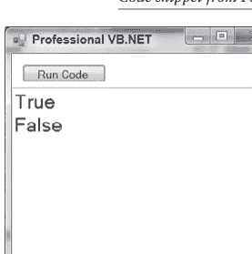

Code snippet from Form1

FIGURE 2-4

与该行相关的第二个问题是我将变量 `blnTrue` 的隐式值与 `Environment.Newline` 常量的值连接起来。注意此处使用和号（`&`）进行此操作。这是 Visual Basic 中的最佳实践，因为虽然 Visual Basic 会重载加号（`+`）以支持字符串连接，但在这种情况下被连接的项目不一定是字符串。这与未将 `Option Strict` 设置为 `On` 有关。在这种情况下，系统会查看变量的实际类型，如果你的字符串连接中并排有两个整数，你会得到意外的结果。这是因为代码会先处理“`+`”，并将值作为数值相加。

因此，由于你和示例下载代码都没有为此项目将 `Option Strict` 设置为 `On`，如果你将前面的 `&` 替换为 `+`，你会发现应用程序中出现运行时转换错误。因此，在生产代码中，最好始终使用 `&` 在 Visual Basic 中连接字符串，除非你确定连接的两侧始终是字符串。然而，这两个问题都不直接影响布尔值的使用，当以这种方式解释时，它们提供的是 `ToString()` 输出，而不是数值。

> 在使用布尔变量时，始终使用 `True` 和 `False` 常量。

不幸的是，过去开发人员倾向于告诉系统将创建为布尔的变量解释为整数。这称为隐式转换，与 `Option Strict` 有关。这不是最佳实践，并且当 `.NET` 引入时，它给 Visual Basic 带来了问题，因为 `True` 在其他语言中的底层表示与 Visual Basic 不匹配。结果是 Visual Basic 对隐式转换的 `True` 表示与其它 `.NET` 语言不同。

`True` 的实现方式是，当转换为整数时，Visual Basic 将 `True` 的值转换为 `-1`（负一）。这是少数几个（但不是唯一）从旧版 Visual Basic 继承下来的遗留问题之一，与其他语言不同，其他语言通常使用整数值 1。一般来说，所有语言倾向于将 `False` 隐式转换为 0，将 `True` 转换为非零值。

然而，Visual Basic 作为多语言环境的一部分工作，元数据定义接口，因此 `True` 的外部值与其内部值一样重要。幸运的是，微软以这样的方式实现了 Visual Basic，虽然支持 `-1`，但从 Visual Basic 方法向其他语言公开的是 `.NET` 标准 1。

为了创建可重用的代码，最好避免隐式转换。对于布尔值，如果代码需要检查整数值，则应显式评估布尔值并创建适当的整数。代码将更易于维护，并且出现意外结果的可能性更小。

### Integer Types

现在布尔值已深入介绍，下一步是检查 Visual Basic 中包含的整数类型。Visual Basic 6.0 包含两种整数值类型：`Integer` 类型的最大值限制为 32767，`Long` 类型支持的最大值为 2147483647。

`.NET Framework` 新增了一种新的整数类型 `Short`。`Short` 等同于 Visual Basic 6.0 中的 `Integer` 值；`Integer` 已被提升以支持以前由 Visual Basic 6.0 `Long` 类型支持的范围，而 Visual Basic `.NET Long` 类型是八字节值。新的 `Long` 类型提供对 64 位值的支持，例如当前 64 位处理器使用的值。此外，每种类型还各有两个替代类型。总之，Visual Basic 支持表 2-2 中描述的九种整数类型。

TABLE 2-2: Visual Basic Integer Types

| TYPE | ALLOCATED MEMORY | MINIMUM VALUE | MAXIMUM VALUE |

| Short | 2 bytes | -32768 | 32767 |

| Int16 | 2 bytes | -32768 | 32767 |

| UInt16 | 2 bytes | 0 | 65535 |

| Integer | 4 bytes | -2147483648 | 2147483647 |

| Int32 | 4 bytes | -2147483648 | 2147483647 |

| UInt32 | 4 bytes | 0 | 4294967295 |

| Long | 8 bytes | -9223372036854775808 | 9223372036854775807 |

| Int64 | 8 bytes | -9223372036854775808 | 9223372036854775807 |

| UInt64 | 8 bytes | 0 | 18446744073709551615 |

#### Short

`Short` 值限制为可在两个字节中存储的最大值。这意味着有 16 位，值范围在 -32768 到 32767 之间。此限制可能与值物理关联的内存量有关；它是 `.NET Framework` 中必须发生的情况的定义。这很重要，因为不能保证实现实际上使用比使用 `Integer` 值更少的内存。可能为了优化内存或处理，操作系统将分配与 `Integer` 类型所使用的相同数量的物理内存，然后仅限制可能的值。

`Short`（或 `Int16`）值类型可用于映射 SQL 的 `smallint` 值。

#### Integer

`Integer` 被定义为一种可以安全存储和传输的四个字节的值（而不是一种四字节实现）。这使得 `Integer` 和 `Int32` 值类型的取值范围为 -2147483648 到 2147483647。该范围足以处理大多数任务。

使用 `Int32` 代替 `Integer` 值的主要目的是确保与接口之间的未来可移植性。例如，Visual Basic 6.0 中的 `Integer` 值仅限于两个字节，而现在则是四个字节。在未来的 64 位平台上，`Integer` 值可能会变成八个字节。如果某个接口使用了 64 位 `Integer`，而另一个接口期望的是 32 位 `Integer` 值，或者反过来，使用 `Integer` 类型的代码突然被传递给显式声明为 `Int32` 的变量，就可能会出现问题。

解决方案是保持一致。如果需要，请使用 `Int32`，即使在 64 位平台上，它也仍会是一个 32 位值。此外，作为最佳实践，应使用 `Integer`，这样你的代码就不会受到底层实现的约束。

Visual Basic `.NET` 的 `Integer` 值类型与 SQL Server 中 `Integer` 值的大小一致，这意味着你可以轻松地将表的列类型与程序中的变量类型对齐。

#### Long

`Long` 类型与 `Int64` 值对齐。`Long` 是八字节类型，这意味着它的值范围可以从 -9223372036854775808 到 9223372036854775807。这是一个很大的范围，但如果你需要对 `Integer` 值进行加法或乘法运算，那么你需要一个较大的值来包含结果。在对一种整数类型进行数学运算时，如果结果有可能超出被操作数类型的范围，通常会使用更大的类型来捕获结果。

`Long` 值类型与 SQL 中的 `bigint` 类型匹配。

#### 无符号类型


要获得 `Integer` 类型正方向上更大的范围，另一种方法是使用无符号类型之一。无符号类型提供了一个有用的缓冲区，用于保存可能略微超出运算范围的结果，但这并不是它们存在的主要原因。`UInt16` 类型恰好与 `Character` 类型具有相同的特性，而 `UInt32` 类型与 32 位系统上的系统内存指针具有相同的特性。

但是，绝不要编写尝试利用这种关系的代码。这样的代码不可移植，因为在 64 位系统上，系统内存指针会改变并使用 `UInt64` 类型。然而，当需要更大的整数且所有值都已知为正时，这些值是有用的。至于这些类型的底层用途，某些底层驱动程序会利用这种知识来与期望这些值的软件交互，而且它们也是其他值类型的底层实现。这就是为什么当你从 32 位系统迁移到 64 位系统时，需要为你的设备安装新的驱动程序，以及为什么应用程序不应该利用相同类型逻辑的原因。

### 小数类型

正如有几种类型可以存储整数值一样，也有三种值类型实现来存储实数值，如表 2-3 所示。`Single` 和 `Double` 类型在 Visual Basic .NET 中的工作方式与在 Visual Basic 6.0 中相同。不同之处在于，Visual Basic 6.0 的 `Currency` 类型（它是 `Double` 类型的专用版本）现已过时；对于非常大的实数，它已被 `Decimal` 值类型取代。

**表 2-3：实数类型的内存分配**

| 类型 | 占用内存 | 负值范围 | 正值范围 |
|---|---|---|---|
| `Single` | 4 字节 | −3.402823E38 至 −1.401298E-45 | 1.401298E-45 至 3.402823E38 |
| `Double` | 8 字节 | −1.79769313486232E308 至 −4.94065645841247E-324 | 4.94065645841247E-324 至 1.79769313486232E308 |
| `Currency` | 已过时 | — | — |
| `Decimal` | 16 字节 | −79228162514264337593543950335 至 0.0000000000000000000000000001 | 0.0000000000000000000000000001 至 79228162514264337593543950335 |

#### Single

`Single` 类型包含四个字节的数据，其精度范围对于正值可以是 1.401298E-45 到 3.402823E38，对于负值可以是 −3.402823E38 到 −1.401298E-45。

使用四个字节存储的值（如 `Integer` 类型）竟然能存储比 `Long` 类型还大的数，这看起来可能很奇怪。之所以能做到这一点，是因为数字的存储方式不同；实数可以用不同的精度级别来存储。请注意，`Single` 类型的定义中，小数点后有六位数字。当一个实数变得非常大或非常小时，存储的值会受到其有效位数的限制。

由于实数值包含的有效位数比其最大值要少，因此在接近极值时可能会丢失精度。例如，虽然可以用 `Long` 表示值 9223372036854775805，但 `Single` 类型会将该值舍入为 9.223372E18。这看起来是一个合理的操作，但它不是一个可逆的操作。以下代码演示了这种精度和数据丢失如何导致错误。要运行它，需要向 `ProVB_VS2010` 项目添加一个名为 `Precision` 的 `Sub`，并从 `ButtonTest` 控件的 `Click` 事件处理程序调用它：

```vb
Private Sub Precision()
    Dim l As Long = Long.MaxValue
    Dim s As Single = Convert.ToSingle(l)
    TextBox1.Text = l & Environment.NewLine
    TextBox1.Text &= s & Environment.NewLine
    s -= 1000000000000
    l = Convert.ToInt64(s)
    TextBox1.Text &= l & Environment.NewLine
End Sub
```

该代码创建一个具有最大可能值的 `Long`，并输出该值。然后将该值转换为 `Single`，并以该格式输出。接下来，使用 `-=` 语法从 `Single` 中减去值 1000000000000，这类似于编写 `s = s − 1000000000000`。最后，代码将 `Single` 值赋回 `Long`，然后同时输出 `Long` 以及原始值和新值之间的差值。结果显示在图 2-5 中，可能与你预期的并不一致。

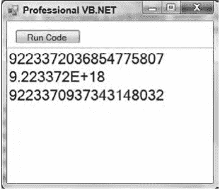

首先要注意的是，输出中值是如何根据类型表示的。`Single` 值实际上使用指数显示，而不是显示所有有效数字。更重要的是，正如你所看到的，数学运算实际发生后存储在 `Single` 中的结果，与使用 `Long` 值计算出的结果相比并不准确。因此，在进行数学运算时，`Single` 和 `Double` 类型在精度上都有局限性。这些精度问题源于存储限制以及二进制数表示十进制数的方式。为了更好地解决大数的这些问题，.NET 提供了 `Decimal` 类型。

#### Double

如果将前面的示例中的 `Single` 值类型替换为 `Double`，其行为会发生变化。`Double` 使用八个字节存储值，因此具有更高的精度和更大的范围。`Double` 的正值范围为 4.94065645841247E-324 到 1.79769313486232E308，负值范围为 -1.79769313486232E308 到 -4.94065645841247E-324。精度提高了，一个数字在开始舍入之前可以包含 15 位数字。这种更高的精度使得 `Double` 值类型在数学运算中成为更可靠的变量。使用该值可以完全准确地表示大多数运算。要测试这一点，请修改上一节中的示例代码，将变量 `s` 声明为 `Double` 而不是 `Single`，然后重新运行代码。别忘了还要将转换行从 `ToSingle` 改为 `ToDouble`。结果代码如下所示，其中 `Sub` 名为 `PrecisionDouble`：

```vb
Private Sub PrecisionDouble()
    Dim l As Long = Long.MaxValue
    Dim s As Double = Convert.ToDouble(l)
    TextBox1.Text = l & Environment.NewLine
    TextBox1.Text &= s & Environment.NewLine
    s -= 1000000000000
    l = Convert.ToInt64(s)
    TextBox1.Text &= l & Environment.NewLine
    TextBox1.Text &= Long.MaxValue - 1
End Sub
```

来自 `Form1` 的代码片段

图 2-6 中显示的结果与 `Single` 精度的结果非常相似，只是看起来几乎正确。如你所见，结果仅相差 1。另一方面，此方法最后演示了如何将一个 64 位值仅修改 1 且结果仍然准确。这个问题并非 .NET 所特有；在所有主流开发语言中都可以重现。每当你选择通过消除最低有效位的精度来表示非常大或非常小的数字时，你就已经失去了该精度。为了解决这个问题，.NET 引入了 `Decimal`，它避免了这个问题。

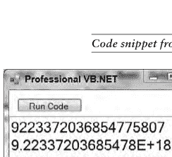

**图 2-6**

#### Decimal

`Decimal` 类型是一种混合类型，由一个 12 字节的整数值和两个额外的 16 位值组成，这两个 16 位值控制小数点的位置和整个值的符号。一个 `Decimal` 值总共占用 16 个字节，可存储的最大值为 79228162514264337593543950335。然后可以通过调整小数点的位置来操作该值。例如，考虑四位小数时的最大值为 7922816251426433759354395.0335。这是因为 `Decimal` 不是作为传统数字存储的，而是作为一个 12 字节的整数值存储的，小数点的位置则相对于可用的 28 位数字来确定。这意味着 `Decimal` 本质上不会像 `Double` 那样对数字进行舍入。

由于值的存储方式，`Decimal` 支持的最接近零的精度是 0.0000000000000000000000000001。小数点的位置是单独存储的；`Decimal` 类型还单独存储一个指示其值为正还是负的值，与实际值分开。这意味着无论小数位数是多少，正值范围和负值范围都完全相同。

因此，系统需要做出权衡：为了存储更多的小数位数，会降低在该精度下可保存的最大值。这种权衡很有意义。毕竟，你很少需要在十进制小数点两侧各保留15位数字，而针对这些情况，你可以创建一个自定义类来管理逻辑，并利用一个或多个十进制值作为其属性。你会发现，如果你再次修改并运行前面几节中使用的示例代码（该代码使用 `Decimal` 类型作为中间值和转换来与 `Long` 值互相转换），那么现在的结果将完全准确。

### Char和Byte

Visual Basic的默认字符集是Unicode。因此，当变量被声明为 `Char` 类型时，Visual Basic会创建一个两字节的值，因为默认情况下，Unicode字符集中的所有字符都需要两个字节。Visual Basic支持以三种方式声明字符值。在字符串字面量后放置 `&c` 会通知编译器该值应被视为字符，也可以使用 `Chr` 和 `ChrW` 方法。下面的代码片段展示了这三种方式的工作方式相似，区别在于 `Chr` 和 `ChrW` 方法可接受的有效输入值范围不同。`ChrW` 方法基于宽字符输入，允许更广泛的值范围。

```
Dim chrLtr_a As Char = "a"c
Dim chrAsc_a As Char = Chr(97)
Dim chrAsc_b as Char = ChrW(98)
```

为了将字符转换为适合ASCII接口的字符串，运行时库需要验证每个字符的值，以确保其处于有效范围内。这对于某些串行数组可能会产生性能影响。幸运的是，Visual Basic支持 `Byte` 值类型。该类型包含从0到255的值，恰好与ASCII字符集的范围匹配。当与使用ASCII的系统交互时，最好使用 `Byte` 数组。运行时知道无需对 `Byte` 数组执行Unicode到ASCII的转换，因此系统之间的接口运行速度会显著提高。

在Visual Basic中，`Byte` 值类型期望的是数值。因此，要将字母“a”赋值给 `Byte`，你必须使用相应的字符代码。获取字母数值的一种方法是使用 `Asc` 方法，如下所示：

```
Dim bytLtrA as Byte = Asc("a")
```

### DateTime

Visual Basic的 `Date` 关键字一直支持同时包含日期和时间的结构。实际上，你可以使用 `DateTime` 和 `Date` 类型来声明日期值。请注意，Visual Basic内部不再将日期值存储为 `Double`；然而，它提供了关键的方法，可以将当前的内部日期表示转换为旧的 `Double` 类型。`ToOADate` 和 `FromOADate` 方法在从Visual Basic早期版本迁移期间提供向后兼容性。

Visual Basic还提供了一组共享方法，用于提供一些常见日期。共享方法的概念将在下一章（讲述对象语法）中更详细地描述，但简而言之，即使你不创建类的实例，也可以使用共享方法。对于 `DateTime` 结构，`Now` 方法返回包含本地日期和时间的 `Date` 值。此方法自 Visual Basic 6.0以来没有变化，但新增了 `Today` 和 `UtcNow` 方法。这些方法可用于分别使用当前本地日期，或基于协调世界时（也称为格林尼治标准时间）的日期和时间来初始化 `Date` 对象。你可以使用这些共享方法来初始化你的类，如以下代码示例所示：

```
Private Sub Dates()
    Dim dtNow = Now()
    Dim dtToday = Today()
    TextBox1.Text = dtNow & Environment.NewLine
    TextBox1.Text &= dtToday.ToShortDateString & Environment.NewLine
```

```
TextBox1.Text &= DateTime.UtcNow() & Environment.NewLine
Dim dtString = #12/13/2009#
TextBox1.Text &= dtString.ToLongDateString()
End Sub
```

运行此代码的结果如图2-7所示。如前所述，基元值可以直接在代码中赋值，但许多开发人员似乎不知道如何使用该格式处理日期。`Date` 类型的另一个关键特性是能够相减日期以确定它们之间的差值。`subtract` 方法将在本章后面演示，所得到的 `Timespan` 对象用于输出一组命令开始和结束时间之间的毫秒数。

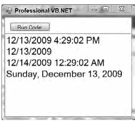

来自 `Form1` 的代码片段

图 2-7

### 引用类型（类）

Visual Basic的许多强大功能都体现在对象中。对象由其类定义，类描述了该类实例支持的数据、方法和其他属性。.NET Framework类库中提供了数千个类。

当代码从类实例化对象时，所创建的对象是引用类型。请记住，值类型和引用类型中包含的数据存储在不同的位置，但这并不是它们之间的唯一区别。类（引用类型的典型称呼）具有额外的能力，例如支持受保护的方法和属性、增强的事件处理能力、构造函数和终结器；并且可以通过继承使用自定义基类进行扩展。类还可以用于定义诸如“=”和“+”之类的运算符如何作用于类的实例。

本节旨在向你介绍一些常用的类，并补充你已经掌握的有关常见值类型的知识。本节将探讨 `Object`、`String`、`DBNull` 和 `Array` 类的特性，以及 `System.Collections` 命名空间中的 `Collection` 类。

#### Object类

如前所述，`Object` 类是.NET中所有类型（无论是值类型还是引用类型）的基类。从根本上说，每个变量都是对象，并且可以如此对待。

由于 `Object` 类是所有类型的基础，你可以将任何变量转换为对象。引用类型保持其当前的引用和实现，但被泛化处理；而值类型则从其当前在栈上的位置取出，并放入堆中，同时与 `Object` 关联一个内存位置。这个过程称为“装箱”，因为你正在将值从一个位置运送到另一个位置。装箱将在第8章中更详细地讨论。

关于 `Object`，你需要理解的关键补充是：如果在类定义中实现了 `ToString`，那么即使将对象实例转换为 `Object` 类型，你的自定义方法仍将被调用。下面的片段展示了如何创建通用对象。

```
Dim objVar as Object

objVar = Me

CType(objVar, Form).Text = "New Dialog Title Text"
```

然后，该 `Object` 被赋值为当前 Visual Basic 窗体实例的副本。为了访问原始 `Form` 类的 `Text` 属性，必须将 `Object` 从其声明的类型 `Object` 强制转换为其实际类型（`Form`），后者支持 `Text` 属性。`CType` 命令（稍后介绍）接受对象作为其第一个参数，并接受类名（不带引号）作为其第二个参数。在这种情况下，当前实例变量是 `Form` 类型；通过转换此变量，代码可以引用当前窗体的 `Text` 属性。

#### String类

在大多数开发项目中扮演重要角色的另一个类是 `String` 类。`String` 类是.NET中的一个特殊类，因为它是不属于值类型的唯一基元类型。为了使 `String` 对象与.NET中的某些底层行为兼容，它们具有一些有趣的特性。

这些方法是共享的，这意味着这些方法不特定于任何 `String` 实例。`String` 类还包含其他一些基于特定 `String` 对象实例调用的方法。`String` 类的方法取代了 Visual Basic 6.0 中作为语言一部分用于字符串操作的功能，它们执行诸如插入字符串、拆分字符串和搜索字符串等操作。

##### String()

对于不适合直接将现有值赋给新字符串的情况，`String` 类有几个不同的构造函数。关于构造函数这一术语，将在第3章中详细阐述。构造函数是用于构造类实例的方法。`String()` 是 `String` 类的默认构造函数，但 `String` 类并不会公开此构造函数。以下示例展示了一些最常见的创建 `String` 的方法。此示例方法没有显示此 `Sub` 的结尾，因为它将用于所有与字符串相关的示例，这些方法的输出将一起显示。下面的代码片段是一个方法的开始；`End Sub` 没有显示。代码下载中的完整 `Sub` 是这个片段与接下来五个片段的拼接。你可以按顺序构建和测试这些部分。

```
Private Sub StringSamples()
    Dim strSample As String = "ABC"
    Dim strSample2 = "DEF"
    Dim strSample3 = New String("A"c, 20)
    Dim line = New String("-", 80)
```

来自 `Form1` 的代码片段

一个变量被声明为 `String` 类型，并作为基元被赋值为“ABC”。第二个声明使用了 `String` 构造函数的一个参数化版本。此构造函数接受两个参数：第一个是字符，第二个指定该字符在字符串中应重复的次数。

除了创建字符串实例然后对你的变量调用方法之外，`String` 类还提供若干共享方法。共享方法是指类上不需要实例即可调用的方法。共享方法将在第3章中结合对象进行更详细的介绍；就本章而言，重点在于你可以引用 `String` 类，然后输入“.”并查看该类的共享方法列表。对于字符串，此列表包括表2-4中描述的方法。

##### 表2-4：String类上可用的方法

| 共享方法 | 描述 |
|---|---|
| `Empty` | 这实际上是一个属性。当需要空字符串时可以使用它。它可用于比较或初始化 `String`。 |
| `Compare` | 比较两个 `String` 类型的对象。 |
| `CompareOrdinal` | 比较两个 `String`，不考虑本地国家语言或文化。 |

## 表 2-4（续）

| SHARED METHOD | DESCRIPTION |
|---|---|


| `Concat` | 连接一个或多个字符串 |
| `Copy` | 创建一个与所提供实例具有相同值的新字符串 |
| `Equals` | 确定两个字符串是否具有相同的值 |
| `IsNullOrEmpty` | 此共享方法是在确定给定变量是否已设置为空字符串或 `Nothing` 时非常高效的一种方式。 |

不仅创建方法已被封装，而且其他字符串特定方法，例如字符和子字符串搜索以及大小写更改，现在也可以从字符串对象实例中使用。

### `SubString` 方法

`.NET String` 类有一个名为 `SubString` 的方法。当你想要截取字符串的一部分时，这是一个功能强大的方法。例如，如果你有一个字符串“Hello World”并且只想要第一个单词，你将取前五个字符的子字符串。可以有几种调用此方法的方式。第一种接受起始位置和要检索的字符数，而第二种接受起始位置。以下代码显示了在字符串实例上使用这两种方法以及在图 2-8 中显示的第一对字符串的输出结果：

```
' Sub String
Dim subString = "Hello World"
TextBox1.Text = subString.Substring(0, 5) & Environment.NewLine
TextBox1.Text &= subString.Substring(6) & Environment.NewLine
TextBox1.Text &= line & Environment.NewLine
```

Form1 的代码片段

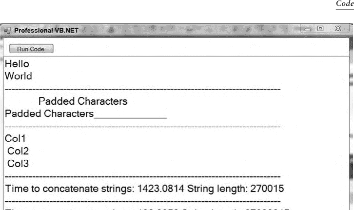

### 图 2-8

### `PadLeft` 和 `PadRight` 方法

这些方法使你能够使字符串左对齐或右对齐。 与 `SubString` 类似，`PadLeft` 和 `PadRight` 方法也是重载的。这些方法的第一个版本只需要字符串的最大长度，然后使用空格填充字符串。另一个版本需要两个参数：返回字符串的长度和用于填充原始字符串的字符：

```
' Pad Left & Pad Right
Dim padString = "Padded Characters"
TextBox1.Text &= padString.PadLeft("30") & Environment.NewLine
TextBox1.Text &= padString.PadRight("30", "_") &
    Environment.NewLine
TextBox1.Text &= line & Environment.NewLine
```

Form1 的代码片段

图 2-8 显示了同一个字符串，首先左侧用空格填充，然后右侧用下划线填充。请注意，由于此屏幕上的默认字体不是等宽字体，空格会被压缩，两个字符串看起来长度并不相同。

### `String.Split` 方法

字符串上的此实例方法使你能够将其拆分为组件数组。例如，如果你想快速找到逗号分隔字符串中的每个不同元素，你可以使用 `Split` 方法将字符串转换为较小的字符串数组，每个字符串包含一个数据字段。如图 2-8 所示，`csvString` 被转换为包含三个元素的数组：

```
' String Split
Dim csvString = "Col1, Col2, Col3"
Dim stringArray As String() = csvString.Split(",")
TextBox1.Text &= stringArray(0) & Environment.NewLine
TextBox1.Text &= stringArray(1) & Environment.NewLine
TextBox1.Text &= stringArray(2) & Environment.NewLine
TextBox1.Text &= line & Environment.NewLine
```

Form1 的代码片段

### `String` 类是不可变的

Visual Basic `String` 类与程序员多年来使用的 `String` 类型并不完全不同。大多数字符串行为保持不变，大多数方法现在作为类可用。然而，为了支持人们与 `String` 原始类型关联的默认行为，`String` 类的声明方式与其他几个类不同。`.NET` 中的字符串不允许编辑其数据。当字符串的一部分被更改或复制时，操作系统会分配一个新的内存位置并将 resulting 字符串复制到此新位置。这确保了当字符串被复制到第二个变量时，新变量引用其自己的副本。

为了在 `.NET` 中支持这种行为，`String` 类被定义为不可变类。这意味着每次对与字符串关联的数据进行更改时，都会创建一个新实例，并且原始引用的内存会被释放以供垃圾回收。请注意，垃圾回收是自动清理不再需要的数据内存的过程。它将在第 4 章中更详细地介绍。然而，现在你应该知道这是一项相对昂贵的操作。然而，使字符串不可变对于确保 `String` 类的行为像人们期望的原始类型一样很重要。此外，当字符串的副本被创建时，`String` 类会强制将数据的新版本放入引用内存中。这确保了每个字符串实例仅引用其自己的内存。请考虑以下代码：

```
' String Concatenation vs String Builder
Dim start = Now()
Dim strRedo = "A simple string"
For index = 1 To 10000 'Only 10000 times for concatenation
    strRedo &= "Making a much larger string"
Next
' The date processing below uses the built in capability
' to subtract one datetime from another to get the difference
' between the dates as a timespan. This is then output as a
' number of milliseconds.
```

```
TextBox1.Text &= "Time to concatenate strings: " &
(Now().Subtract(start)).TotalMilliseconds().ToString() &
" String length: " & strRedo.Length.ToString()
TextBox1.Text &= line & Environment.NewLine
```

Form1 的代码片段

此代码的性能不佳。对于对 `strMyString` 变量的每次赋值操作，系统都会根据新字符串的大小分配一个新的内存缓冲区，并复制 `strMyString` 的当前值以及要附加的新文本。然后系统会释放必须由垃圾回收器回收的先前内存。随着循环的继续，新的内存分配需要更大的内存块。因此，此类操作可能需要很长时间。

为了说明这一点，你会注意到代码在执行 10,000 次连接之前捕获开始时间，然后在打印语句中使用 `DateTime.Subtract` 方法获取差异。该差异以类型为 `Timespan` 的对象形式返回，介于开始时间和打印时间之间。然后该差异以毫秒为单位表示（参见图 2-8）。

然而，`.NET` 在 `System.Text.StringBuilder` 对象中提供了另一种选择，如以下片段所示：

```
start = Now()
Dim strBuilder = New System.Text.StringBuilder("A simple string")
For index = 1 To 1000000 '1 million times....
    strBuilder.Append("Making a much larger string")
Next
TextBox1.Text &= "Time to concatenate strings: " &
(Now().Subtract(start)).TotalMilliseconds().ToString() &
" String length: " & strBuilder.ToString().Length.ToString()
TextBox1.Text &= line & Environment.NewLine
End Sub
```

Form1 的代码片段

前面的代码使用字符串，但不使用 `String` 类。`.NET` 类库包含 `System.Text.StringBuilder` 类，当字符串将被重复编辑时，其性能更好。此类不以传统方式存储字符串；它将它们存储为单个字符，并有代码来管理这些字符的顺序。因此，编辑或附加更多字符不需要为整个字符串分配新内存。因为前面的代码片段不需要重新分配用于整个字符串的内存，所以每次附加另一组字符时执行速度明显更快。

请注意，此片段中使用了相同的计时代码。然而，对于 `StringBuilder`，循环执行一百万次（而非一万次）。请注意，迭代次数的增加是为了造成足够的延迟，以便实际显示完成需要超过一两毫秒的时间。即使迭代次数增加了 100 倍，图 2-8 仍然说明这是一种更高效地使用系统资源的方式。

最终，`String` 类的实例永远不需要显式，因为 `StringBuilder` 类实现了 `ToString` 方法，将所有字符汇总成一个字符串。虽然 `StringBuilder` 类的概念并不新鲜，但由于它作为 Visual Basic 实现的一部分可用，开发人员不再需要创建自己的字符串内存管理器。

### 字符串常量

如果你必须基于字符串生成输出，你会很快发现自己需要嵌入某些常量值。例如，能够添加回车换行组合以在消息框中触发新行总是很有用的。一种方法是学习底层 ASCII 代码，然后将这些控制字符直接嵌入到你的 `String` 或 `StringBuilder` 对象中。

Visual Basic 为处理这些提供了更简单的解决方案：`Microsoft.VisualBasic.Constants` 类。`Constants` 类，其命名空间表明它特定于 Visual Basic，包含你可能想要嵌入的几个标准字符串值的定义。最常见的是，当然，

是 `Constants.VbCrLf`，它表示回车换行组合。你可以随意探索这个类，查找你可能需要的用于操作字符串输出的其他常量。

### XML 字面量

Visual Basic 2008 的主要新功能之一是引入了 XML 字面量。在 Visual Basic 中，可以创建一个新变量，并将一块格式良好的 XML 代码分配给该字符串。这里介绍它是因为它很好地展示了利用 `Option Infer` 的声明示例。首先向 `VBPro_VS2010` 项目添加一个新窗体，接受默认名称 `Form2`。这个新窗体将从 `Form1` 上 `ButtonTest` 的单击事件中调用，使用下面 `XmlLiteral` 子过程中所示的代码。

```vb
Private Sub XmlLiteral()
    Form2.ShowDialog()
End Sub
```

> _来自 Form1 的代码片段_

在 `Form2` 的设计器中，将一个 `RichTextBox` 控件拖到显示区域，并将该控件设置为停靠在父容器内。这可以通过“属性”显示或使用控件右上角的“任务”上下文菜单来完成。接下来，双击该控件为窗口的 `Load` 事件创建一个事件处理程序。在此事件中，你将放置用于演示 XML 字面量的代码。使用单独窗口是为了演示 XML 字面量的字符串格式化功能，该功能在 `TextBox` 控件中无法使用。

该代码首先声明一个名为 `myString` 的字符串变量，并将其设置为“Hello World”之类的值。在随后的代码块中，请注意使用的第一个 `Dim` 语句不包含此类声明中通常使用的“As”子句。`myString` 变量的声明依赖于类型推断：

```vb
Private Sub Form2_Load(ByVal sender As System.Object, _
                       ByVal e As System.EventArgs) _
                       Handles MyBase.Load
    Dim myString = "Embedded string variable data."
    Dim myXmlElement = <AnXmlNode attribute="1">This is formatted text.
Embedded carriage returns will be kept.
    These lines will print separately.
    Whitespace will also be maintained.
<%= myString %>
                    </AnXmlNode>
    RichTextBox1.Text = myXmlElement.ToString() & _
        Environment.NewLine & Environment.NewLine
    RichTextBox1.Text &= myXmlElement.Value.ToString()
End Sub
```

> _来自 Form2 的代码片段_

运行这个 `XmlLiteral` 子过程将产生如图 2-9 所示的输出。在这段代码中，编译器识别出这个新声明的变量被赋值了一个字符串，因此该变量被自动定义为字符串。在代码块的第一行声明第一个变量之后，第二行代码构成了代码块的其余部分，你可能会注意到它跨越多行，没有任何行继续符。

第二个 `Dim` 语句声明了另一个新变量，但这次该变量被设置为原始 XML。请注意，代码中的“<”前面没有任何引号。相反，该尖括号表示接下来的内容将是一个格式良好的 XML 语句。此时，Visual Basic 编译器不再将你输入的内容视为 Visual Basic 代码，而是将此文本读取为 XML。因此，可以命名顶层节点，定义与该节点关联的属性，并将文本分配给节点的值。唯一

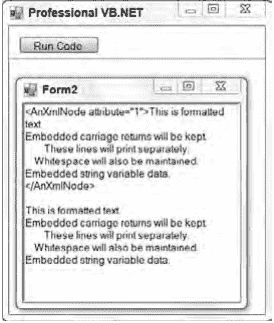

要求是 XML 格式良好，这意味着你需要有一个结束声明，即前面代码块中的最后一行，来结束该 XML 语句。

默认情况下，由于这只是一个 XML 节点而不是完整文档，Visual Basic 会推断你在定义 `XMLElement`，并将 `mXMLElement` 变量定义为该类的实例。然而，除此之外，还有静态 XML 的行为。请注意，文本本身包含关于格式化的注释。这是因为在你的静态 XML 中，Visual Basic 会自动识别并字面量嵌入所有内容。

因此，称之为 XML 字面量。文本按原样捕获，任何嵌入的空白或回车/换行都会被捕获。另一个有趣的特性体现在下面这行代码中：

```
<$= myString $>
```

这是一种简写声明，使你可以将变量 `myString` 的值插入到字面量 XML 中。在这种情况下，`myString` 在前一行设置，但它很容易成为返回 XML 元素的方法的输入参数。当你运行此代码时，`myString` 的当前值将被插入到你的 XML 声明中。

两个语句显示了你的 XML 元素在图 2-9 中所示的输出。这两个不同的语句都将 XML 元素的内容显示为字符串，因为每个语句产生的输出略有不同。

第二行上的第一个语句指示 XML 元素对象返回表示自身的字符串。因此，XML 元素将返回该对象的所有内容，包括原始 XML 本身。第二个输出已将 XML 元素输出为仅反映为该元素定义的数据值的字符串。请注意，如果你在之前的代码块中定义的基本 XML 元素有任何嵌套的 XML 元素，那么这些元素将被视为 XML 元素内容的一部分，并且它们的定义和属性将作为此语句的一部分输出。

如图 2-9 所示，此输出的结果是第一个文本块包含你的自定义 XML 节点及其属性。你不仅能看到标识 XML 值的文本，还能看到实际的 XML 结构。但是，当你只打印 XML 块中的值时，你看到的实际上只是该文本。请注意，XML 已嵌入了回车和左侧空白，这些是你 XML 字面量的一部分，因此你的文本看起来有格式。借助 XML 字面量，你可以“真正地”用一种非常明确的格式化输出字符串的方式替代较为晦涩的 `String.Format` 方法调用。

### `DBNull` 类和 `IsDBNull` 函数

使用数据库时，给定列的值可能未定义。对于引用类型来说，这不是问题，因为可以将引用类型设置为 `Nothing`。但是，对于值类型，有必要在尝试分配可能为 null 的值之前，确定数据库中或其它来源的给定列是否具有实际值。管理此任务的第一种方法是利用 `DBNull` 类和 `IsDBNull` 函数。此类是 `System` 命名空间的一部分，你可以在比较中引用它。`IsDBNull` 函数接受一个对象作为其参数，并返回一个 `Boolean`，指示该变量是否已初始化。以下代码片段显示了两个值，一个是初始化为 `Nothing` 的字符串，另一个是初始化为 `DBNull.Value` 的对象：

```vb
Private Sub NullValues()
    Dim strNothing As String = Nothing
    Dim objectNull As Object = DBNull.Value
    TextBox1.Text = ""
    If IsDBNull(strNothing) Then
        TextBox1.Text = "But strNothing is not the same as Null."
    End If
    If System.DBNull.Value.Equals(objectNull) Then
        TextBox1.Text &= "objectNull is null." & Environment.NewLine
    End If
End Sub
```


此代码的输出如图 2-10 所示。在此代码中，`strNothing`变量被声明并初始化为`Nothing`。第一个条件表达式的计算结果为`False`，这可能看起来违反直觉，但实际上 VB 区分了可能未赋值的局部值和实际的`DBNull`值。这可能有点误导，因为这意味着你需要单独检查那些为`Nothing`的值。第二个条件表达式引用了第二个变量`objectNull`。该值在其初始化中被显式定义为`DBNull.Value`。这与从数据库返回 null 值的方式类似。第二个条件表达式的计算结果为`True`。尽管`DBNull`可用，但在大多数情况下，开发人员现在利用第 8 章中描述的泛型`Nullable`类，而不是使用`DBNull`比较。


图 2-10

### 参数传递

调用对象的方法或程序集的例程和方法时，通常需要为代码要操作的数据提供输入。这些值称为参数，任何对象都可以作为参数传递给`Function`或`Sub`。

传递参数时，请注意参数是按“值”传递（`ByVal`）还是按“引用”传递（`ByRef`）。按值传递参数意味着如果该变量的值被更改，那么当`Function`/`Sub`返回时，系统会自动将该变量恢复为调用之前的值。按引用传递参数意味着如果更改了变量的值，那么这些更改会影响实际变量，因此当变量返回时，这些更改仍然存在。

这正是 Visual Basic 新开发人员感到有点挑战的地方。在 .NET 下，按值传递参数仅表示该对象的顶层引用（变量在堆栈上的部分）是如何传递的。有时称为浅复制操作，系统仅复制按值传递的对象的顶层引用值。这一点很重要，因为这意味着被引用的内存不受保护。

当你按值传递整数时，如果程序更改了该整数的值，那么你的原始值会被恢复。相反，如果你传递引用类型，那么只有被引用内存的位置受到保护，而不是该内存位置中的数据。因此，虽然作为参数一部分传递的引用对于调用方法保持不变，但即使对象按值传递，被引用对象中存储的实际值也可能会被更新。

除了在调用给定函数时必须传递的必需参数外，还可以声明可选参数。调用代码可以省略可选参数。这样，可以调用诸如`PadRight`之类的方法，可以传递一个定义字符串长度的参数，并使用默认空格作为填充字符，或者传递两个参数，第一个仍然定义字符串长度，第二个则用破折号替换默认空格：

```vb
Public Sub PadRight(ByVal intSize as Integer, _
    Optional ByVal chrPad as Char = " "c)
End Function
```

来自`Form1`的代码片段

要使用可选参数，必须将它们放在函数声明中的最后位置。Visual Basic 还要求每个可选参数都有默认值。仅仅声明一个参数并为其指定`Optional`关键字是不可接受的。在 Visual Basic 中，`Optional`关键字必须伴随一个值，如果未传递该参数，则使用该值。

### ParamArray

除了传递显式参数之外，还可以告诉 .NET 你希望允许用户传递任意数量相同类型的参数。这称为参数数组，它使用户能够传递适当数量的给定参数的实例。例如，以下代码创建了一个函数`Add`，它允许用户传递一个整数数组并获取这些整数的总和：

```
Public Function Add(ByVal ParamArray values() As Integer) As Long
    Dim result As Long
    For Each value As Integer In values
        result += value
    Next
    Return result
End Function
```

来自`Form1`的代码片段

前面的代码说明了一个函数（在本章开头首次展示但未实现其实现），它接受一个整数数组。请注意，`ParamArray`限定符前面是该参数的`ByVal`限定符。`ParamArray`要求相关参数按值传递；它们不能是可选参数。

你可能会认为这看起来像是一个按值传递的标准参数，只是它是一个数组，但事实并非如此。实际上，`ParamArray`的强大之处在于它可以如何被调用，这也解释了它的许多限制。以下代码展示了调用此方法两种方式：

```
Private Sub CallAdd()
    Dim int1 As Integer = 2
    Dim int2 = 3
    TextBox1.Text = "Adding 3 integers: " & Add(1, int1, int2) &
    Environment.NewLine
    Dim intArray() = (1, 2, 3, 4)
    TextBox1.Text &= "Adding an array of 4 integers: " & Add(intArray)
End Sub
```

来自`Form1`的代码片段

运行此`CallAdd`方法的输出如 图 2-11 所示。请注意，第一次调用`Add`函数时，并没有传递整数数组；而是传递了三个不同的整数值。`ParamArray`关键字告诉 Visual Basic 自动将这三个不同的值合并成一个数组，以便在此方法中使用。第二次调用`Add`方法实际上利用了实际的整数数组来填充参数数组。这两种方法效果一样好。数组将在第 8 章中更详细地介绍。


图 2-11

最后，请注意`ParamArray`关键字的最后一个限制：它只能用于给定方法中定义的最后一个参数。因为 Visual Basic 正在抓取无限数量的输入值来创建数组，所以无法指示此数组的结束，因此它必须是最后一个参数。

### VARIABLE SCOPE

变量作用域的概念封装了两个关键要素。到目前为止关于变量的所有讨论中，我们都没有关注这些变量从内存中分配和释放的问题。第一个分配挑战与在代码的不同位置声明两个同名变量时会发生什么有关。例如，假设一个类声明了一个名为`myObj`的变量，该变量保存该类的属性。然后，在该类的其中一个方法中，你声明了另一个也名为`myObj`的变量。在该方法中会发生什么？作用域定义了你声明的每个变量的生命周期和优先级，并处理这个问题。

同样，还有一个问题是移除你不再使用的变量，以便释放内存。第 4 章介绍了当应用程序不再需要时变量和内存的回收，因此本讨论侧重于优先级，并理解当一个变量不再“在作用域内”时，它可供垃圾回收器进行清理。

.NET 本质上定义了四种变量作用域级别。最外层的作用域是全局作用域。本质上，就像你的源代码定义类一样，它也可以声明在应用程序运行期间始终存在的变量。这些变量的生命周期最长，因为它们在应用程序执行期间存在。相反，这些变量的优先级最低。因此，如果在类或方法中声明了另一个同名变量，则具有更小、更局部作用域的变量会在全局版本之前使用。

在全局作用域之后，下一个作用域是类或模块级别。当你向类添加属性时，你正在创建随该类的每个实例而创建的变量。该类的这些成员变量的方法将首先引用它们，然后再查找任何全局变量。请注意，因为这些变量是在类内定义的，所以它们仅对该类中的方法可见。这些变量的作用域和生命周期受该类的生命周期限制，并且当该类从系统中移除时，这些变量也会被移除。更重要的是，在一个类的一个实例中声明的变量在其他类或同一类的其他实例中不可见（除非你主动公开它们，在这种情况下，使用对象实例完全限定对它们的引用）。

下一个更短的生命周期和更小的作用域是方法变量。当你在方法内声明新变量时，这些变量以及作为参数声明的变量仅对存在于该模块中的代码可见。因此，方法`Add`不会看到或使用在同一类中方法`Subtract`中声明的变量。

最后，在给定的方法中，有各种命令可以封装代码块（本章前面提到过）。诸如`If Then`和`For Each`之类的命令会在方法内创建代码块，并且可以在此代码块内声明新变量。这些变量的作用域仅限于该代码块。因此，在`If Then`块或`For`循环中声明的变量仅存在于`If`块的约束或循环执行期间。在`For`循环中创建变量是一种糟糕的编码实践和性能错误，应避免。

### WORKING WITH OBJECTS

在 .NET 环境中，尤其是 Visual Basic 中，你一直在不知不觉中使用对象。正如前面提到的，每个变量、窗体上的每个控件——事实上每个窗体——都继承自`System.Object`。当你打开文件或与数据库交互时，你正在使用对象来完成这些工作。

#### Objects Declaration and Instantiation

对象是使用`New`关键字创建的，表示你想要一个特定类的新实例。在代码中使用`New`关键字的变体有很多种。每一种都提供了在代码可读性或灵活性方面的不同优势。

创建对象的最明显方法是声明一个对象变量，然后创建对象的实例：

```
Dim obj As TheClass
obj = New TheClass()
```

此代码的结果是，你有一个`TheClass`的新实例可供使用。要与此新对象交互，你使用声明的`obj`变量。`obj`变量包含对对象的引用，这一概念将在后面探讨。

你可以通过将变量的声明与实例的创建结合起来，缩短前面的代码，如下所示：

```
Dim obj As New TheClass()
```

> 在运行时，此示例与第一个示例之间没有区别，只是代码长度不同。

前面的代码既将变量`obj`声明为数据类型`TheClass`，又创建了该类的实例，立即创建了一个可供使用的对象。对此主题的另一种变体如下：

```
Dim obj As TheClass = New TheClass()
```

同样，这既声明了一个`TheClass`数据类型的变量，又创建了该类的实例。实例的创建方式由你决定，这实际上是风格问题。此第三种语法示例在保持紧凑的同时提供了很大的灵活性。虽然它是一行代码，但它将变量数据类型的声明与对象的创建分开了。

这种灵活性在处理继承或多个接口时非常有用。你可能会将变量声明为一种类型——例如接口——并基于实现该接口的类实例化对象。当在第 3 章详细介绍接口时，你将重新审视这种语法。

到目前为止，你一直在为新对象声明变量，但有时你只需要将对象作为参数传递给方法，在这种情况下，你可以在对该方法的调用中直接创建对象的实例：

```
DoSomething(New TheClass())
```

这会调用`DoSomething`方法，并将`TheClass`的新实例作为参数传递。这甚至可以更复杂。也许，你的方法不需要对象引用，而是需要一个`Integer`。你可以从对象的方法提供该`Integer`值：

```
Public Class TheClass
    Public Function GetValue() As Integer
        Return 42
    End Function
End Class
```

然后，你可以一次性实例化对象并调用方法，从而将方法返回的值作为参数传递：

```
DoSomething(New TheClass().GetValue())
```

显然，你需要仔细权衡此类代码的可读性与其紧凑性。在某个时候，更紧凑的代码可能会降低可读性，而不是增强可读性。

#### Object References

通常，当你使用对象时，你正在使用对该对象的引用。相反，当你使用简单数据类型（如`Integer`）时，你正在使用实际值，而不是引用。让我们探讨这些概念以及它们如何工作和交互。

当你使用`New`关键字创建新对象时，你将对该对象的引用存储在变量中，如下所示：

```
Dim obj As New TheClass()
```

This code creates a new instance of `TheClass`. You gain access to this new object via the `obj` variable. This variable holds a reference to the object. You might then do something like this:

```
Dim another As TheClass
another = obj
```

Now, you have a second variable, `another`, which also has a reference to the same object. You can use either variable interchangeably, as they both reference the exact same object. Remember that the variable you have is not the object itself but just a reference, or pointer, to the object.

### Dereferencing Objects

When you are done working with an object, you can indicate that you are through with it by *dereferencing* the object. To dereference an object, simply set the object reference to `Nothing`:

```
Dim obj As TheClass

obj = New TheClass()
obj = Nothing
```

After any or all variables that reference an object are set to `Nothing`, the .NET runtime knows that you no longer need that object. At some point, the runtime destroys the object and reclaims the memory and resources it consumed. You can find more information on the garbage collector in Chapter 4.

Between the time when you dereference the object and the time when the .NET Framework gets around to actually destroying it, the object simply sits in the memory, unaware that it has been dereferenced. Right before .NET destroys the object, the `Finalize` method is called on the object (if it has one).

### Early Binding versus Late Binding

One of the strengths of Visual Basic has long been that it provides access to both early and late binding when interacting with objects. *Early binding* means that code directly interacts with an object by directly calling its methods. Because the Visual Basic compiler knows the object’s data type ahead of time, it can directly compile code to invoke the methods on the object. Early binding also enables the IDE to use IntelliSense to aid development efforts by enabling the compiler to ensure that you are referencing methods that exist and are providing the proper parameter values.

*Late binding* means that your code interacts with an object dynamically at runtime. This provides a great deal of flexibility because the code doesn’t care what type of object it is interacting with as long as the object supports the methods you want to call. Because the type of the object is not known by the IDE or compiler, neither IntelliSense nor compile-time syntax checking is possible, but in exchange you get unprecedented flexibility.


If you enable strict type checking by using `Option Strict On` in the project’s Properties dialog or at the top of the code modules, then the IDE and compiler enforce early binding behavior. By default, `Option Strict` is turned off, so you have easy access to the use of late binding within the code. Chapter 1 discusses `Option Strict`. You can change this default directly in Visual Studio 2010 by selecting `Tools` ➜ `Options` from the VS menu. The Options dialog is shown in Figure 2-12. Expanding the Projects and Solutions node reveals the VB defaults. Feel free to change any of these default settings.


**FIGURE 2-12**

## Implementing Late Binding

Late binding occurs when the compiler cannot determine the type of object that you’ll be calling. This level of ambiguity is achieved using the `Object` data type. A variable of data type `Object` can hold virtually any value, including a reference to any type of object. Thus, code such as the following could be run against any object that implements a `DoSomething` method that accepts no parameters:

```
Option Strict Off

Module LateBind
    Public Sub DoWork(ByVal obj As Object)
        obj.DoSomething()
    End Sub
End Module
```

If the object passed into this routine does not have a `DoSomething` method that accepts no parameters, then an exception will be thrown. Thus, it is recommended that any code that uses late binding always provide exception handling:

```
Option Strict Off

Module LateBind
    Public Sub DoWork(ByVal obj As Object)
        Try
            obj.DoSomething()
        Catch ex As MissingMemberException
            ' do something appropriate given failure
            ' to call this method
        End Try
    End Sub
End Module
```

Here, the call to the `DoSomething` method has been put in a Try block. If it works, then the code in the Catch block is ignored; but in the case of a failure, the code in the Catch block is run. You need to write code in the Catch block to handle the case in which the object does not support the `DoSomething` method call. This Catch block only catches the `MissingMemberException`, which indicates that the method does not exist on the object.

While late binding is flexible, it can be error prone and is slower than early-bound code. To make a late-bound method call, the .NET runtime must dynamically determine whether the target object actually has a method that matches the one you are calling. It must then invoke that method on your behalf. This takes more time and effort than an early-bound call, whereby the compiler knows ahead of time that the method exists and can compile the code to make the call directly. With a late-bound call, the compiler has to generate code to make the call dynamically at runtime.

## DATA TYPE CONVERSIONS

So far, this chapter has focused primarily on individual variables; but when developing software, it is often necessary to take a numeric value and convert it to a string to display in a text box. Similarly, it is often necessary to accept input from a text box and convert this input to a numeric value. These conversions, unlike some, can be done in one of two fashions: implicitly or explicitly.

Implicit conversions are those that rely on the system to adjust the data at runtime to the new type without any guidance. Often, Visual Basic’s default settings enable developers to write code containing many implicit conversions that the developer may not even notice.

Explicit conversions, conversely, are those for which the developer recognizes the need to change a variable’s type and assign it to a different variable. Unlike implicit conversions, explicit conversions are easily recognizable within the code. Some languages such as C# require that essentially all conversions that might be type unsafe be done through an explicit conversion; otherwise, an error is thrown.

It is therefore important to understand what a type-safe implicit conversion is. In short, it’s a conversion that cannot fail because of the nature of the data involved. For example, if you assign the value of a smaller type, `Short`, into a larger type, `Long`, then there is no way this conversion can fail. As both values are integer-style numbers, and the maximum and minimum values of a `Short` variable are well within the range of a `Long`, this conversion will always succeed and can safely be handled as an implicit conversion:

```
Dim shortNumber As Short = 32767
Dim longNumber As Long = shortNumber
```

However, the reverse of this is not a type-safe conversion. In a system that demands explicit conversions, the assignment of a `Long` value to a `Short` variable results in a compilation error, as the compiler doesn’t have any safe way to handle the assignment when the larger value is outside the range of the smaller value. It is still possible to explicitly cast a value from a larger type to a smaller type, but this is an explicit conversion. By default, Visual Basic supports certain unsafe implicit conversions. Thus, adding the following line will not, by default, cause an error under Visual Basic:

```
shortNumber = longNumber
```

This is possible for two reasons. One is based on Visual Basic’s legacy support. Previous versions of Visual Basic supported the capability to implicitly cast across types that don’t fit the traditional implicit casting boundaries. It has been maintained in the language because one of the goals of Visual Basic is to support rapid prototyping. In a rapid prototyping model, a developer is writing code that “works” for demonstration purposes but may not be ready for deployment. This distinction is important because in the discussion of implicit conversions, you should always keep in mind that they are not a best practice for production software.

### Performing Explicit Conversions

Keep in mind that even when you choose to allow implicit conversions, these are only allowed for a relatively small number of data types. At some point you’ll need to carry out explicit conversions. The following code is an example of some typical conversions between different integer types when `Option Strict` is enabled:

```
Dim myShort As Short
Dim myUInt16 As UInt16
Dim myInt16 As Int16
Dim myInteger As Integer
Dim myUInt32 As UInt32
Dim myInt32 As Int32
Dim myLong As Long
Dim myInt64 As Int64
```

```
myShort = 0
myUInt16 = Convert.ToUInt16(myShort)
myInt16 = myShort
myInteger = myShort
myUInt32 = Convert.ToUInt32(myShort)
myInt32 = myShort
myInt64 = myShort
myLong = Long.MaxValue
```

```
If myLong < Short.MaxValue Then
    myShort = Convert.ToInt16(myLong)
End If
myInteger = CInt(myLong)
```

The preceding snippet provides some excellent examples of what might not be intuitive behavior. The first thing to note is that you can’t implicitly cast from `Short` to `UInt16`, or any of the other unsigned types for that matter. That’s because with `Option Strict` the compiler won’t allow an implicit conversion that might result in a value out of range or lead to loss of data. You may be thinking that an unsigned Short has a maximum that is twice the maximum of a signed Short, but in this case, if the variable `myShort` contained a -1, then the value wouldn’t be in the allowable range for an unsigned type.

Just for clarity, even with the explicit conversion, if `myShort` were a negative number, then the `Convert.ToUInt32` method would throw a runtime exception. Managing failed conversions requires either an understanding of exceptions and exception handling, as covered in Chapter 6, or the use of a conversion utility such as `TryParse`, covered in the next section.

此代码中展示的第二项是共享方法 `MaxValue`。所有整数类型和十进制类型都具有此属性。顾名思义，它返回指定类型的最大值。还有一个对应的 `MinValue` 方法用于获取最小值。作为共享属性，这些属性可以直接从类（`Long.MaxValue`）引用，而无需实例。

最后，尽管此代码可以编译，但它并不总是正确执行。它展示了一个经典错误，在现实世界中这种错误通常是间歇性的。该错误之所以发生，是因为最后的转换语句没有检查赋给 `myInteger` 的值是否在整数类型的最大范围内。当 `myLong` 大于允许的最大值时，此代码将抛出异常。


Visual Basic 提供了多种转换值的方式。其中一些是从旧版 Visual Basic 支持的技术的更新版本。其他方法（如 `ToString` 方法）是每个类固有的一部分（尽管 .NET 规范并未定义每种类型如何实现 `ToString` 方法）。

表 2-5 中显示的转换方法集合基于 Visual Basic 支持的转换。它们与前面描述的原始数据类型一致；但是，继续使用这些方法并不被视为最佳实践。这一点值得重申：虽然你可能会在现有代码中找到以下方法，但你应该尽量避免并替换这些调用。

### 表 2-5：Visual Basic 传统的专用转换方法

| `CBool()` | `CByte()` |
| `CChar()` | `CDate()` |
| `CDbl()` | `CDec()` |
| `CInt()` | `CLng()` |
| `CObj()` | `CShort()` |
| `CSng()` | `CStr()` |

这些方法中的每一个都被设计为接受其他原始数据类型（如适用）的输入，并将这些项转换为方法名所指示的类型。因此，`CStr` 类用于将原始类型转换为 `String`。这些方法的缺点是它们只支持有限的类型，并且是 Visual Basic 特有的。如果你在与 C# 开发人员一起的环境中工作，他们会觉得这些方法让人分心。此外，当你处理这些 Visual Basic 函数不支持的类型时，可能会发现很难快速回想起如何利用 `CType` 和 `Convert` 类。更通用的处理转换方式是使用 `System.Convert` 类，如下代码片段所示：

```
Dim intMyShort As Integer = 200
Convert.ToInt32(intMyShort)
Convert.ToDateTime("9/9/2001")
```

`System.Convert` 类不仅实现了前面列出的转换方法，还实现了其他常见转换。这些附加方法包括针对无符号整数和指针等对象的标准转换。

前面所有的类型转换都非常适用于值类型及其适用的少量类，但这些实现面向的是一组有限的已知类型。使用这些类无法将自定义类转换为 `Integer`。更重要的是，不应该有这样的转换需求。相反，特定类应提供一个返回适当类型的方法。这样，就不需要类型转换了。但是，当启用 `Option Strict` 时，编译器要求你在触发隐式转换之前将对象强制转换为适当的类型。但请注意，`Convert` 方法并不是指示给定变量可被视为另一种类型的唯一方法。

### Parse 和 TryParse

大多数值类型，至少是 .NET Framework 中那些值类型，都提供了一对名为 `Parse` 和 `TryParse` 的共享方法。这些方法接受你选择的值，然后尝试将此变量转换为所选值类型。`Parse` 和 `TryParse` 方法仅适用于值类型。引用类型具有名为 `DirectCast` 和 `Cast` 的相关方法，这些方法针对引用变量进行了优化。

`Parse` 方法有一个参数。此输入参数接受一个值，该值是你要创建为给定类型的对象的目标值。然后，此方法尝试基于传入的数据创建值。但请注意，如果传入 `Parse` 方法的数据无法转换，则此方法将抛出异常，你的代码需要捕获该异常。以下行说明了 `Parse` 函数的工作方式：

```
result = Long.Parse("100")
```

不幸的是，当你将此调用嵌入到 Try-Catch 语句中进行异常处理时，会创建更复杂的代码块。请注意，异常处理及其使用将在第 6 章中讨论，现在只需知道异常会为运行中的代码增加额外的系统资源，从而影响性能。因为你需要始终将此类代码封装在 Try-Catch 块中，.NET 开发团队决定提供一个封装了异常处理逻辑的方法版本更有意义。

这就是 `TryParse` 方法的由来。`TryParse` 方法的工作原理与 `Parse` 类似，不同之处在于它有两个参数并返回 `Boolean` 值，而不是一个值。你不是直接赋值 `TryParse` 方法的结果，而是将其作为 If-Then 语句的一部分进行测试，以确定数据到所选类型的转换是否成功。如果转换成功，则新值存储在该方法的第二个参数中，你可以将其赋给要保存该值的变量：

```
Dim converted As Long
If Long.TryParse("100", converted) Then
    result = converted
End If
```

### 使用 CType 函数

无论是否使用后期绑定，使用 `Object` 数据类型传递对象引用，并在需要与其交互时将其转换为适当的类型，都是很有用的。这在处理使用继承或实现多个接口的对象时尤其有用，这些概念将在第 3 章中讨论。

如果关闭 `Option Strict`（这也是默认设置），则可以使用类型为 `Object` 的变量编写代码以进行早期绑定方法调用：

```
Public Sub objCType(ByVal obj As Object)
    Dim local As String
    local = obj
    local.ToCharArray()
End Sub
```

来自 `Form1` 的代码片段

此代码使用强类型变量 `local` 来引用原本是通用对象值的内容。在幕后，Visual Basic 将通用类型转换为特定类型，以便可以将其分配给强类型变量。如果转换无法完成，则会收到可捕获的运行时错误。

使用 `CType` 函数也可以完成同样的事情。如果启用了 `Option Strict`，则前面的方法将无法编译，并且必须使用 `CType` 函数。以下是使用 `CType` 的相同代码：

```
Public Sub CType1(ByVal obj As Object)
    Dim local As String
    local = CType(obj, String)
    local.ToLower()
End Sub
```

来自 `Form1` 的代码片段

此代码声明了一个 `TheClass` 类型的变量，这是你想要使用的早期绑定数据类型。不过，接受的参数是通用的 `Object` 数据类型，因此你使用 `CType` 方法获取对对象的早期绑定引用。如果对象不是 `TheClass` 类型，则 `CType` 调用将失败并产生可捕获的错误。

一旦你获得对象的引用，就可以使用早期绑定变量 `local` 调用方法。此代码可以缩短，避免使用中间变量。相反，你可以直接从数据类型调用方法：

```
Public Sub CType2(obj As Object)
    CType(obj, String).ToUpper()
End Sub
```

即使你正在使用的变量是 `Object` 类型，因此对它的任何调用都将是后期绑定，你也可以使用 `CType` 方法临时将变量转换为特定类型——在本例中为 `TheClass` 类型。

> 如果作为参数传递的对象不是 `TheClass` 类型，则会收到可捕获的错误，因此始终建议将此代码包装在 Try...Catch 块中。

如第 3 章所示，`CType` 函数在处理实现多个接口的对象时也非常有用。当对象具有多个接口时，你可以根据需要，使用 `CType` 通过适当的接口引用单个对象变量。

### 使用 DirectCast

另一个与 `CType` 非常相似的函数是 `DirectCast` 方法。`DirectCast` 调用也会将一种类型的值转换为另一种类型。它的工作方式比 `CType` 更具限制性，但代价是它可能比 `CType` 稍快：

```
Dim obj As TheClass

obj = New TheClass
DirectCast(obj, ITheInterface).DoSomething()
```

这与上一个使用 `CType` 的示例类似，说明这两个函数之间的对等性。然而，它们确实存在差异。首先，`DirectCast` 仅适用于引用类型，而 `CType` 同时接受引用类型和值类型。例如，`CType` 可用于以下代码：

```
Dim int As Integer = CType(123.45, Integer)
```

尝试使用 `DirectCast` 做同样的事情会导致编译器错误，因为值 `123.45` 是值类型，而不是引用类型。

其次，`DirectCast` 在转换类型方面不如 `CType` 激进。`CType` 可以看作是所有其他转换函数（如 `CInt`、`CStr` 等）的智能组合。相反，`DirectCast` 假定源数据可直接转换，并且不会采取额外步骤来转换它。

例如，请考虑以下代码：

```
Dim obj As Object = 123.45

Dim int As Integer = DirectCast(obj, Integer)
```

如果你使用 `CType`，这将有效，因为 `CType` 使用类似 `CInt` 的行为将值转换为 `Integer`。但是，`DirectCast` 将抛出异常，因为该值不能直接转换为 `Integer`。

## 使用 TryCast

与 `DirectCast` 类似的方法是 `TryCast`。`TryCast` 将一种类型的值转换为另一种类型，但与 `DirectCast` 不同的是，如果它无法进行转换，则 `TryCast` 不会抛出异常。相反，如果转换无法执行，`TryCast` 只是简单地返回 `Nothing`。`TryCast` 仅适用于引用值；它不能与 `Integer` 或 `Boolean` 等值类型一起使用。

使用 `TryCast`，你可以编写如下代码：

```
Public Sub TryCast1 (ByVal obj As Object)
    Dim temp = TryCast(obj, Object)      If temp Is Nothing Then
        ' the cast couldn't be accomplished
        ' so do no work
    Else
        temp.DoSomething()
    End If
End Sub
```

如果你不确定是否可以进行类型转换，那么最好经常使用 `TryCast`。此函数避免了捕获 `CType` 或 `DirectCast` 可能抛出的异常的开销和复杂性，同时仍然为你提供了一种轻松地将对象转换为另一种类型的方法。

### 创建类

使用对象是相当直接和直观的。这是一种即使是最新手的程序员也能快速掌握并接受的东西。创建类和对象则稍微复杂一些且更有趣。

#### 基本类

如前所述，对象仅仅是特定模板（类）的实例。类包含定义其对象行为的代码，并定义将包含对象个人数据的实例变量。

类使用 `Class` 关键字创建，并包含构成类的变量、方法、属性和事件的定义（声明）和实现（代码）。基于此类创建的每个对象都将具有相同的方法、属性和事件，以及由类中的字段定义自己的数据集合。

#### Class 关键字

如果你想创建一个代表人 — `Person` 类 — 的类，你可以使用 `Class` 关键字：

```
Public Class Person

    ' Implementation code goes here

End Class
```

如你所知，Visual Basic 项目由一组扩展名为 `.vb` 的文件组成。每个文件可能包含多个类，这意味着在单个文件中你可以有类似这样的内容：

```
Public Class Adult
    ' Implementation code goes here.
End Class

Public Class Senior
    ' Implementation code goes here.
End Class
```


```
Public Class Child
' Implementation code goes here.
End Class
```

最常见且首选的方法是每个文件一个类。这是因为 Visual Studio 2010 解决方案资源管理器和代码编辑环境都旨在使从文件到文件导航以查找代码变得容易。例如，如果你创建一个包含所有这些类的单个类文件，解决方案资源管理器只显示一个条目，如图 2-13 所示。


### 图 2-13

然而，Visual Studio IDE 确实提供了 Class View 窗口。如果你决定在每个物理 `.vb` 文件中放置多个类，你可以使用图 2-14 所示的 Class View 窗口快速高效地浏览代码，在类之间跳转，而无需手动在特定代码文件中定位这些类。要显示 Class View，请从菜单中选择 View 然后 Class Window。


### 图 2-14

即使你坚持每个文件一个类，Class View 窗口也非常有用，因为它仍然为你提供了整个应用程序的基于类的视图。

本章在示例中使用每个文件一个类，因为这是最常见的方法。首先，打开 Visual Studio IDE 并创建一个名为“ObjectIntro”的新 Windows Forms Application 项目。选择 Project ➕ Add Class 菜单选项以向项目添加新的类模块。你将看到标准的 Add New Item 对话框。将名称更改为 `Person.vb` 并单击 Add。结果将是以下代码，它定义了 `Person` 类：

```
Public Class Person

End Class
```

`Person` 类创建后，你就可以开始添加代码来声明接口、实现行为并声明实例变量。

### 字段

字段是在类中声明的变量。它们将在应用程序运行时可用于每个单独的对象。每个对象都有自己的数据集合 — 基本上，每个对象都有字段的自己的副本。

之前，你了解到类只是一个用于创建特定对象的模板。你在类内定义的变量也只是模板 — 并且每个对象都有这些变量的自己的副本来存储其数据。

声明成员变量与在 `Class` 块结构内声明变量一样简单。将以下代码添加到 `Person` 类：

```
Public Class Person

    Private mName As String
    Private mBirthDate As Date
End Class
```

你可以使用以下关键字控制字段的作用域：

- `Private` — 仅对类内的代码可用
- `Friend` — 仅对项目/组件内的代码可用
- `Protected` — 仅对继承自该类的类可用（在第 3 章中详细讨论）
- `Protected Friend` — 可用于项目/组件内的代码以及继承自该类的类，无论是否在项目中（在第 3 章中详细讨论）
- `Public` — 可用于类外部的代码以及引用该程序集的任何项目

通常，字段使用 `Private` 关键字声明，使其仅对类每个实例内的代码可用。选择其他任何选项都应非常谨慎，因为所有其他选项都允许类外部的代码直接与变量交互，这意味着值可能会被更改，而你的代码永远不会知道发生了更改。

> 使字段保持 `Private` 的一个常见例外是使用 `Protected` 关键字，在第 3 章中讨论。

### 方法

对象通常需要提供可在处理对象时调用的服务（或函数）。使用它们自己的数据或作为参数传递给方法的数据，它们操纵信息以产生结果或执行操作。

声明为 `Public`、`Friend` 或 `Protected` 作用域的方法定义了类的接口。作用域为 `Private` 的方法仅对类本身内的代码可用，可用于为代码提供结构和组织。如前所述，每个方法内的实际代码称为 *implementation*，而方法本身的声明定义了接口。

方法只是编码在类内以实现你希望为对象用户提供的服务的例程。一些方法返回值或向调用代码提供信息。这些称为 *interrogative methods*。其他称为 *imperative methods*，只是执行操作而不向调用代码返回任何内容。

在 Visual Basic 中，方法使用类模块中定义对象的 `Sub`（用于 imperative 方法）或 `Function`（用于 interrogative 方法）例程实现。`Sub` 例程可能接受参数，但完成后不返回任何结果值。`Function` 例程也可以接受参数，并且始终生成可供调用代码使用的结果值。

使用 `Sub` 关键字声明的方法只是不返回值的。向 `Person` 类添加以下代码：

```
Public Sub Walk()

' implementation code goes here

End Sub
```

`Walk` 方法 presumably 包含在调用时执行一些有用工作但完成后没有结果值返回的一些代码。要使用此方法，你可能会编写如下代码：

```
Dim myPerson As New Person()
myPerson.Walk()
```

一旦你创建了 `Person` 类的实例，你就可以简单地调用 `Walk` 方法。

#### 返回值的方法

如果你的方法确实生成应返回的某个值，你需要使用 `Function` 关键字：

```
Public Function Age() As Integer
    Return CInt(DateDiff(DateInterval.Year, mBirthDate, Now()))
End Function
```

请注意，在声明函数时必须指明返回值的数据类型。此示例返回方法的结果计算年龄。你可以使用 `Return` 关键字返回适当数据类型的任何值。

你也可以通过设置函数名本身的值来在不使用 `Return` 关键字的情况下返回值：

```
Public Function Age() As Integer
    Age = CInt(DateDiff(DateInterval.Year, mBirthDate, Now()))
End Function
```

这在功能上等同于之前的代码。无论哪种方式，你都可以使用类似以下的代码使用此方法：

```
Dim myPerson As New Person()
Dim age As Integer

age = myPerson.Age()
```

`Age` 方法返回一个 `Integer` 数据值，你可以根据需要在程序中使用它；在这种情况下，你只是将其存储在变量中。

#### 指示方法作用域

在方法声明前添加适当的关键字指示作用域：

```
Public Sub Walk()
```


这表明`Walk`是一个 public 方法，因此可供类外部的代码甚至当前项目外部的代码使用。任何引用该程序集的应用程序都可以使用此方法。作为 public 方法，它成为对象接口的一部分。

或者，你也可以对方法访问进行一定限制：

```
Friend Sub Walk()
```

通过使用`Friend`关键字声明方法，你表示它应仅对项目内部的代码成为对象接口的一部分；任何使用该程序集的其他应用程序或项目都将无法调用`Walk`方法。

`Private`关键字表示方法仅对你特定类内的代码可用：

```
Private Function Age() As Integer
```

`Private`方法非常有助于在每个类内部组织复杂的代码。有时这些方法包含非常冗长和复杂的代码。为了使代码更易理解，你可能会选择将其拆分为几个较小的例程，让主方法按正确顺序调用这些例程。此外，你可以在类内的多个位置使用这些例程，因此通过将其设为独立方法，可以实现代码重用。这些子例程绝不应被对象外部的代码调用，因此你将其设为`Private`。

### 方法参数

你经常希望在调用方法时向其传递信息。此信息通过参数提供给方法。例如，在`Person`类中，你可能希望`Walk`方法跟踪人随时间行走的距离。在这种情况下，`Walk`方法需要知道每次调用方法时人要走多远。以下代码是`Person`类的完整版本：

```
Public Class Person
    Private mName As String
    Private mBirthDate As Date
    Private mTotalDistance As Integer
    Public Sub Walk(ByVal distance As Integer)
        mTotalDistance += distance
    End Sub
    Public Function Age() As Integer
        Return CInt(DateDiff(DateInterval.Year, mBirthDate, Now()))
    End Function
End Class
```

使用此实现，`Person`对象会累加随时间行走的所有距离。每次调用`Walk`方法时，调用代码必须传递一个`Integer`值，表示要行走的距离。调用此方法的代码将类似于以下内容：

```
Dim myPerson As New Person()
myPerson.Walk(12)
```

参数使用`ByVal`关键字接受，这表示参数值是原始值的副本，而`ByRef`则创建对对象的引用。这是 Visual Basic 接受所有参数的默认方式。通常这是理想的，因为这意味着你可以在代码内部操作参数，改变其值而不会意外改变调用代码中的原始值。

如果你确实希望能够更改调用代码中的值，可以更改声明以通过引用传递参数，使用`ByRef`限定符：

```
Public Sub Walk(ByRef distance As Integer)
```

在这种情况下，你获得的是对原始值的引用（或指针），而不是副本。这意味着你对`distance`参数所做的任何更改都会反映回调用代码中，这与本章前面讨论的对象引用工作方式非常相似。

### 属性

.NET 环境提供了一种专门的方法类型，称为属性。属性是一种专门用于设置和检索数据值的方法。例如，你在`Person`类中声明了一个变量来包含姓名，因此`Person`类可能包含允许设置和检索该姓名的代码。这可以使用常规方法完成：

```
Public Sub SetName(ByVal name As String)
    mName = name
End Sub

Public Function GetName() As String
    Return mName
End Function
```

来自 `Person` 的代码片段

使用此类方法，你编写代码与对象交互：

```
Dim myPerson As New Person()

myPerson.SetName("Jones")
Messagebox.Show(myPerson.GetName())
```

虽然这完全可以接受，但使用属性后可以做得更好。属性样式方法将设置和检索值合并到单一结构中，并使类内的代码整体更流畅。你可以将这两个方法重写为单个属性。将以下代码添加到`Person`类中：

```
Public Property Name() As String
    Get
        Return _Name
    End Get
    Set(ByVal Value As String)
        _Name = Value
    End Set
End Property
```

来自 `Person` 的代码片段

随着 Visual Studio 2010 的引入，上面的代码可以用更简单的方式表示：

```
Public Property Name() As String
```

这种定义属性的方法实际上会创建一个名为`_Name`的字段，该字段未在代码中定义，而是由编译器创建。对于大多数在`get`或`set`期间不计算值的属性，这是最简单的方式来定义它。

通过使用属性方法，你可以使客户端代码更具可读性：

```
Dim myPerson As New Person()

myPerson.Name = "Jones"
Messagebox.Show(myPerson.Name)
```

属性方法同时声明作用域和数据类型：

```
Public Property Name() As String
```

在此示例中，你将属性的作用域声明为`Public`，但它可以使用与任何其他方法相同的范围选项声明 —`Public`、`Friend`、`Private`或`Protected`。

此属性的返回数据类型为`String`。属性可以返回几乎任何适合值性质的数据类型。在这方面，属性与使用`Function`关键字声明的方法非常相似。

尽管`Property`方法是一个单一结构，但它分为两部分：getter 和 setter。getter 包含在`Get...End Get`块中，负责按需返回属性的值：

```
Get
    Return mName
End Get
```

尽管此示例中的代码非常简单，但它可能更复杂，也许计算要返回的值，或应用其他业务逻辑来更改返回时的值。同样，更改值的代码包含在`Set...End Set`块中：

```
Set(ByVal Value As String)
    mName = Value
End Set
```

`Set`语句接受单个参数值来存储新值。然后块中的代码可以使用此值按适当方式设置属性的值。此参数的数据类型必须与属性本身的数据类型匹配。以这种方式声明参数使你能够在需要时更改用于参数值的变量名称。

默认情况下，参数名为`Value`，但你可以将其更改为其他名称，如下所示：

```
Set(ByVal NewName As String)
    mName = NewName
End Set
```

在许多情况下，你可以在此例程中应用业务规则或其他逻辑，以确保在实际更新对象内部数据之前新值是合适的。也可以将`Get`或`Set`块的范围限制为比属性本身更窄。例如，你可能希望允许任何代码检索属性值，但仅允许项目中的其他代码更改值。在这种情况下，你可以将`Set`块的作用域限制为`Friend`，而属性本身的作用域为`Public`：

```
Public Property Name() As String
    Get
        Return mName
    End Get
    Friend Set(ByVal Value As String)
        mName = Value
    End Set
End Property
```

来自 `Person` 的代码片段

新的作用域必须比属性本身的作用域更严格，并且可以限制`Get`或`Set`块，但不能同时限制两者。你未限制的那一个使用`Property`方法的作用域。

### 参数化属性

你创建的`Name`属性是单值属性的示例。你也可以创建属性数组或参数化属性。这些属性反映一系列或一组值。例如，人们通常有多个电话号码。你可能会将`PhoneNumber`属性实现为参数化属性，不仅存储电话号码，还存储每个号码的描述。要检索特定的电话号码，你将编写如下代码：

```
Dim myPerson As New Person()

Dim homePhone As String
homePhone = myPerson.Phone("home")
```

来自 `Person` 的代码片段

或者，要添加或更改特定的电话号码，你需要编写以下代码：

```
myPerson.Phone("work") = "555-9876"
```

不仅你在检索和更新电话号码属性，你也在更新一个特定的电话号码。这意味着一些事情。首先，你不能再使用一个简单的变量来保存电话号码，因为你现在存储的是号码列表及其关联的名称。其次，你实际上为你的属性添加了一个参数。你在每次属性调用时都将电话号码的名称作为参数传递。

要存储电话号码列表，可以使用`Hashtable`类。`Hashtable`与标准 VB `Collection`对象非常相似，但功能更强大——允许你测试特定元素的存在。向`Person`类添加以下声明：

```
Public Class Person
    Public Property Name As String
    Public Property BirthDate As Date
    Public Property TotalDistance As Integer
    Public Property Phones As New Hashtable
```

你可以通过向`Person`类添加以下代码来实现`Phone`属性：

```
Public Property Phone(ByVal location As String) As String
    Get
        Return CStr(Phones.Item(Location))
    End Get
    Set(ByVal Value As String)
        If Phones.ContainsKey(location) Then
            Phones.Item(location) = Value
        Else
            Phones.Add(location, Value)
        End If
    End Set
End Property
```

属性方法本身的声明与你之前看到的有一些不同：

```
Public Property Phone(ByVal location As String) As String
```

特别是，你为属性本身添加了一个参数`location`。该参数将充当电话号码列表的索引，在设置或检索电话号码值时必须提供。

由于`location`参数是在属性级别声明的，它对属性内的所有代码都可用，包括`Get`和`Set`块。在你的`Get`块中，你使用`location`参数从`Hashtable`中选择要返回的适当电话号码：

```
Get
    Return Phones.Item(location)
End Get
```

使用此代码，如果没有存储与`location`匹配的值，则会得到一个可捕获的运行时错误。

同样，在`Set`块中，你使用`location`来更新或添加`Hashtable`中的适当元素。在这种情况下，你使用`Hashtable`的`ContainsKey`方法来确定电话号码是否已存在于列表中。如果存在，则只需更新列表中的值；否则，你为该值添加一个新元素到列表中：

```
Set(ByVal Value As String)
    If Phones.ContainsKey(location) Then
        Phones.Item(location) = Value
    Else
        Phones.Add(location, Value)
    End If
End Set
```

这样，你就可以根据调用代码传递的参数添加或更新特定的电话号码条目。

### 只读属性

有时你可能希望属性为只读，以便无法更改它。例如，在`Person`类中，你可能有一个可读写的属性`BirthDate`，以及一个只读属性`Age`。如果是这样，`BirthDate`属性就是一个普通属性，如下所示：

```
Public Property BirthDate() As Date
```

相反，`Age`值是基于`BirthDate`的派生值。这不是应该直接更改的值，因此它是只读状态的完美候选。

你已经将`Age`方法实现为一个函数。从`Person`类中删除该代码，因为你将用`Property`过程替换它。函数过程和只读属性之间的区别非常微妙。两者都向调用代码返回一个值，并且无论哪种方式，对象都在运行由类模块定义的返回值的子例程。

区别更多是设计选择，而非编程上的。你可以完全不使用任何`Property`过程创建对象，只使用方法与对象交互即可。然而，`Property`过程显然是对象的属性，而`Function`可能是属性也可能是方法。通过仔细将所有属性实现为只读`Property`过程，而将任何询问性方法实现为`Function`过程，你可以创建更易读、更易理解的代码。

要使属性变为只读，请使用`ReadOnly`关键字并仅实现`Get`块：

```
Public ReadOnly Property Age() As Integer
    Get
        Return CInt(DateDiff(DateInterval.Year, mBirthDate, Now()))
    End Get
End Property
```

由于属性是只读的，如果你尝试实现`Set`块，将会得到语法错误。

### 仅写属性

与只读属性一样，有时属性应为仅写，即值可以更改但不能检索。

许多人有过敏症，因此`Person`对象可能需要了解该地区的环境过敏原。这不是应该从`Person`对象读取的属性，因为过敏原来自环境，而不是来自个人，但这是`Person`对象为了正常运行所需的数据。向类中添加以下变量声明：

```
Public Class Person
    Public Property Name As String
    Public Property BirthDate As Date
    Public Property TotalDistance As Integer
    Public Property Phones As New Hashtable
    Public WriteOnly Property Allergens As Integer
```

你可以按如下方式实现一个`AmbientAllergens`属性：

```
Public WriteOnly Property AmbientAllergens() As Integer
    Set(ByVal Value As Integer)
        mAllergens = Value
    End Set
End Property
```

要创建仅写属性，请使用`WriteOnly`关键字并仅在代码中实现`Set`块。由于属性是仅写的，如果你尝试实现`Get`块，将会得到语法错误。

### 默认属性

对象可以实现默认属性，有时可简化对象的使用，使其看起来像对象具有原生值。`Collection`对象就是这种行为的一个很好的例子，它有一个名为`Item`的默认属性，返回特定项的值，使你能够编写以下代码：

```
Dim mData As New HashTable()

Return mData(index)
```

默认属性必须是参数化属性。没有参数的属性不能标记为默认。这与 Visual Basic 的早期版本不同，在早期版本中任何属性都可以标记为默认。

我们的`Person`类有一个参数化属性——你之前构建的`Phone`属性。你可以使用`Default`关键字将其设为默认属性：

```
Default Public Property Phone(ByVal location As String) As String
    Get
        Return CStr(mPhones.Item(location))
    End Get
    Set(ByVal Value As String)
        If mPhones.ContainsKey(location) Then
            mPhones.Item(location) = Value
        Else
            mPhones.Add(location, Value)
        End If
    End Set
End Property
```

在此更改之前，你需要以下代码来使用`Phone`属性：

```
Dim myPerson As New Person()

MyPerson.Phone("home") = "555-1234"
```

现在，属性被标记为`Default`，你可以简化代码：

```
myPerson("home") = "555-1234"
```

正如你所见，不再需要引用属性名`Phone`。通过选择合适的默认属性，你可以使对象的使用更直观。

### 事件

方法和属性使你能够编写与对象交互的代码，按需调用特定功能。对象在处理过程中发生某些活动时提供通知通常很有用。你在控件中经常看到这种例子，其中按钮通过`Click`事件指示已被点击，或文本框通过`TextChanged`事件指示其内容已被更改。

对象可以引发自己的事件，提供一种强大且易于实现的机制，使对象能够通知客户端代码重要活动或事件。在 Visual Basic 中，事件使用标准的 .NET 委托机制提供；但在讨论委托之前，让我们先探讨如何在 Visual Basic 中处理事件。

#### 处理事件

我们都习惯于在表单中看到处理按钮`Click`事件的代码，例如以下代码：


```
Private Sub Button1_Click(ByVal sender As System.Object, _
    ByVal e As System.EventArgs) Handles Button1.Click

End Sub
```

通常，我们在这种类型的例程中编写代码，而不会过多关注 Visual Studio IDE 创建的代码。然而，让我们再仔细看看这段代码，其中包含一些需要注意的重要内容。

首先，注意 `Handles` 关键字的用法。该关键字明确指出此方法将处理 `Button1` 控件的 `Click` 事件。当然，控件只是一个对象，因此这里表示的是此方法将处理 `Button1` 对象的 `Click` 事件。

其次，注意该方法接受两个参数。`Button` 控件类定义了这些参数。事实证明，任何接受这两个参数数据类型的方法都可用于处理 `Click` 事件。例如，你可以创建一个新方法来处理事件：

```
Private Sub MyClickMethod(ByVal s As System.Object, _
    ByVal args As System.EventArgs) Handles Button1.Click

End Sub
```

代码片段来自 `Form1`

即使你更改了方法名和参数名，只要你仍然接受相同数据类型的参数，并且仍然具有 `Handles` 子句来指示此方法处理事件即可。

### 处理多个事件

`Handles` 关键字提供了更多灵活性。方法名可以是你选择的任何名称，一个方法也可以处理多个事件，如果你愿意的话。同样，唯一的要求是方法以及所有正在引发的事件必须具有相同的参数列表。

> 这解释了为什么 .NET 系统类库引发的所有标准事件都恰好有两个参数——`sender` 和一个 `EventArgs` 对象。如此通用使得编写非常通用和强大的事件处理程序成为可能，这些处理程序可以接受类库引发的几乎任何事件。

一个常见的场景是当你有多个引发事件的对象的实例时，例如表单上的两个按钮：

```
Private Sub MyClickMethod(ByVal sender As System.Object, _
    ByVal e As System.EventArgs) _
    Handles Button1.Click, Button2.Click

End Sub
```

代码片段来自 `Form1`

请注意，`Handles` 子句已被修改，使其包含一个用逗号分隔的事件列表。任一事件都会导致该方法运行，从而为处理这些事件提供了一个集中的位置。

### WithEvents 关键字

`WithEvents` 关键字告诉 Visual Basic，你希望在代码中处理对象引发的任何事件：

```
Friend WithEvents Button1 As System.Windows.Forms.Button
```

`WithEvents` 关键字使对象中的任何事件都可用于处理，而 `Handles` 关键字则用于将特定事件链接到相应的方法，以便你能够接收并处理这些事件。这不仅适用于窗体上的控件，也适用于你创建的任何对象。

`WithEvents` 关键字不能用于声明不会引发事件的类型的变量。换句话说，如果 `Button` 类不包含引发事件的代码，那么当你尝试使用 `WithEvents` 关键字声明该变量时，就会收到语法错误。

编译器可以通过检查类的接口来判断哪些类会引发事件，哪些不会。任何将要引发事件的类都会将该事件声明为其接口的一部分。在 Visual Basic 中，这意味着你需要使用 `Event` 关键字在类的接口中至少声明一个事件。

### 引发事件

你的对象可以像控件一样引发事件，使用该对象的代码可以通过 `WithEvents` 和 `Handles` 关键字接收这些事件。然而，在从对象中引发事件之前，你需要在类中使用 `Event` 关键字声明该事件。

例如，在 `Person` 类中，你可能希望在 `Walk` 方法被调用的任何时候引发一个事件。如果你将此事件命名为 `Walked`，则可以在 `Person` 类中添加以下声明：

```
Public Class Person
    Private msName As String
    Private mBirthDate As Date
    Private mTotalDistance As Integer
    Private mPhones As New Hashtable()
    Private mAllergens As Integer
    Public Event Walked()
```

事件也可以有参数，即提供给接收事件的代码的值。例如，典型的按钮 `Click` 事件接收两个参数。在 `Walked` 方法中，你可能还希望指示行走的距离。你可以通过更改事件声明来实现这一点：

```
Public Event Walked(ByVal distance As Integer)
```

现在事件已声明，你可以在代码中的适当位置引发该事件。在这种情况下，你将在 `Walk` 方法中引发它，因此每当 `Person` 对象被指示行走时，它就会触发一个指示行走距离的事件。对 `Walk` 方法进行以下更改：

```
Public Sub Walk(ByVal distance As Integer)
    mTotalDistance += distance
    RaiseEvent Walked(distance)
End Sub
```

`RaiseEvent` 关键字用于引发实际事件。由于该事件需要一个参数，因此该值在括号内传递，并传递给处理该事件的任何接收者。

实际上，`RaiseEvent` 语句会导致事件传递给所有使用 `WithEvents` 关键字声明对象并带有此事件 `Handles` 子句的代码，或者所有使用了 `AddHandler` 方法的代码。`AddHandler` 方法将在稍后讨论。

如果多个方法将接收该事件，则该事件会逐一传递给每个接收者。默认情况下，传递顺序未定义——这意味着你无法预测接收者接收事件的顺序——但事件会传递给所有处理程序。请注意，这是一个串行、同步的过程。事件一次传递给一个处理程序，并且只有当前处理程序完成后才会传递给下一个处理程序。一旦你调用 `RaiseEvent` 方法，事件就会一个接一个地传递给所有侦听器，直到完成；你无法在中途干预并停止该过程。

### 声明和引发自定义事件

如前所述，默认情况下你无法控制事件引发的方式。你可以通过使用更显式的事件声明形式来克服此限制。你可以不使用简单的 `Event` 关键字，而是声明一个自定义事件。这适用于更高级的场景，因为它要求你为事件本身提供实现。

委托的概念将在本章后面详细讨论，但为了声明自定义事件，有必要在此简要了解一下。委托是方法签名的定义。当你声明一个事件时，Visual Basic 会根据事件的签名在幕后为该事件定义一个委托。例如，`Walked` 事件有一个如下所示的委托：

```
Public Delegate Sub WalkedEventHandler(ByVal distance As Integer)
```

请注意此代码如何声明一个接受 `Integer` 且没有返回值的“方法”。这正是你在事件中定义的内容。通常，你不必编写这段代码，因为 Visual Basic 会自动完成；但如果你想声明自定义事件，则需要手动声明事件委托。

你还需要在类中声明一个变量，用于跟踪任何正在侦听或处理该事件的代码。事实证明，你可以利用委托的预构建功能来实现此目的。通过声明 `WalkedEventHandler` 委托，你定义了一种自动跟踪事件处理程序的数据类型，因此你可以像这样声明变量：

```
Private mWalkedHandlers As WalkedEventHandler
```

你可以使用上述变量在自定义事件声明中存储和引发事件：

```
Public Custom Event Walked As WalkedEventHandler
    AddHandler(ByVal value As WalkedEventHandler)
        mWalkedHandlers = _
            CType([Delegate].Combine(mWalkedHandlers, value), WalkedEventHandler)
    End AddHandler

    RemoveHandler(ByVal value As WalkedEventHandler)
        mWalkedHandlers = _
            CType([Delegate].Remove(mWalkedHandlers, value), WalkedEventHandler)
    End RemoveHandler

    RaiseEvent(ByVal distance As Integer)
        If mWalkedHandlers IsNot Nothing Then
            mWalkedHandlers.Invoke(distance)
        End If
    End RaiseEvent
End Event
```

在这种情况下，你使用了 `Custom Event` 关键字组合，而不是仅仅使用 `Event` 来声明事件。`Custom Event` 声明是一个块结构，包含三个子块：`AddHandler`、`RemoveHandler` 和 `RaiseEvent`。

每当有新的处理程序想要接收事件时，就会调用 `AddHandler` 块。传递给此块的参数是对将要处理该事件的方法的引用。你需要自己存储对该方法的引用，可以按照你选择的任何方式存储。在此实现中，你将其存储在委托变量中，就像 Visual Basic 提供的默认实现一样。

每当处理程序想要停止接收你的事件时，就会调用 `RemoveHandler` 块。传递给此块的参数是对正在处理该事件的方法的引用。你需要自己移除对该方法的引用，可以按照你选择的任何方式移除。在此实现中，你通过让委托变量移除该元素来复制默认行为。

最后，每当事件被引发时，就会调用 `RaiseEvent` 块。通常，当类中的代码使用 `RaiseEvent` 语句时，就会调用它。传递给此块的参数必须与委托为事件声明的参数匹配。你需要遍历处理该事件的方法列表，并调用每个方法。在所示的示例中，你让委托变量为你完成这项工作，这与普通事件的默认行为相同。

这种语法的作用在于，你可以选择将处理程序方法的列表存储在不同类型的数据结构中，例如 `Hashtable` 或集合。然后，你可以异步调用它们，或者根据应用程序所需的其他行为按特定顺序调用。

### 使用 WithEvents 接收事件

既然你已经在 `Person` 类中实现了一个事件，你就可以编写客户端代码，使用 `WithEvents` 关键字声明一个对象。例如，在项目的 `Form1` 代码模块中，你可以编写以下代码：

```
Public Class Form1
    Private WithEvents mPerson As Person
```

通过使用 `WithEvents` 声明变量，你表示希望接收此对象引发的任何事件。你也可以选择不使用 `WithEvents` 关键字声明变量，不过在这种情况下，你将无法按照这里的描述接收对象的事件。相反，你需要使用 `AddHandler` 方法，这将在 `WithEvents` 之后讨论。

然后，你可以在创建窗体时创建对象的实例，方法是添加以下代码：

```
Private Sub Form1_Load(ByVal sender As System.Object, _
ByVal e As System.EventArgs) Handles MyBase.Load

    mPerson = New Person()

End Sub
```

此时，你已经使用 `WithEvents` 声明了对象变量，并创建了 `Person` 类的实例，因此你实际上有了一个可以使用的对象。现在，你可以继续编写一个方法来处理来自该对象的 `Walked` 事件，方法是向窗体添加以下代码。你可以随意命名此方法；重要的是 `Handles` 子句，因为它将对象中的事件直接链接到此方法，因此当事件被引发时，该方法会被调用：

```
Private Sub OnWalk(ByVal distance As Integer) Handles mPerson.Walked
    MsgBox("Person walked " & distance)
End Sub
```

你正在使用 `Handles` 关键字来指示此方法应处理哪个事件。你还在接收一个 `Integer` 参数。如果方法的参数列表与事件的参数列表不匹配，则会出现编译器错误，指示不匹配。

最后，你需要在 `Person` 对象上调用 `Walk` 方法。向窗体添加一个按钮，并为其 `Click` 事件编写以下代码：

```
Private Sub Button1_Click(ByVal sender As System.Object, _
    ByVal e As System.EventArgs) Handles button1.Click

mPerson.Walk(42)

End Sub
```

当按钮被点击时，你只需调用 `Walk` 方法，并传入一个 `Integer` 值。这会使你的类中的代码被运行，包括 `RaiseEvent` 语句。结果是事件会触发回窗体，因为你使用 `WithEvents` 关键字声明了 `mPerson` 变量。`OnWalk` 方法将被运行以处理该事件，因为它具有 `Handles` 子句将它链接到该事件。

图 2-15 说明了控制流，展示了按钮的 `Click` 事件中的代码如何调用 `Walk` 方法，导致它增加已行走的总距离然后引发其事件。`RaiseEvent` 导致窗体的 `OnWalk` 方法被调用；一旦完成，控制权返回到对象中的 `Walk` 方法。由于你在调用 `RaiseEvent` 后 `Walk` 方法中没有代码，控制权返回到窗体中的 `Click` 事件，然后你就完成了。

Form1 中的代码片段


图 2-15

> 许多人认为事件使用多线程来完成工作。这不是事实。整个过程中只涉及一个线程。引发事件就像进行方法调用一样，因为现有线程被用来运行事件处理程序中的代码。因此，应用程序的处理会暂停，直到事件处理完成。

### 使用 AddHandler 接收事件

现在你已经了解了如何使用 `WithEvents` 和 `Handles` 关键字接收和处理事件，请考虑一种替代方法。你可以使用 `AddHandler` 方法通过代码动态添加事件处理程序，并使用 `RemoveHandler` 动态移除它们。

`WithEvents` 和 `Handles` 子句要求你在构建代码时声明对象变量和事件处理程序，有效地创建了一个编译到代码中的链接。相反，`AddHandler` 在运行时创建这种链接，这可以为你提供更大的灵活性。然而，在深入探讨之前，让我们先看看 `AddHandler` 的工作原理。

在 `Form1` 中，你可以先通过消除 `WithEvents` 关键字来改变代码与 `Person` 对象的交互方式：

```
Private mPerson As Person
```

然后再消除 `Handles` 子句：

```
Private Sub OnWalk(ByVal distance As Integer)
    MsgBox("Person walked " & distance)
End Sub
```

通过这些更改，你已消除了对象的所有事件处理，窗体将不再接收事件，即使 `Person` 对象引发了它。

现在你可以使用 `AddHandler` 方法通过代码动态添加事件处理程序来更改代码。此方法只是将对象的事件链接到应被调用以处理该事件的方法。在创建对象后的任何时候，你都可以调用 `AddHandler` 来设置链接：

```
Private Sub Form1_Load(ByVal sender As System.Object, _
    ByVal e As System.EventArgs) Handles MyBase.Load

    mPerson = New Person()
    AddHandler mPerson.Walked, AddressOf OnWalk
End Sub
```

Form1 中的代码片段

这一行代码与之前使用 `WithEvents` 和 `Handles` 子句的效果相同，导致在 `Person` 对象引发 `Walked` 事件时调用 `OnWalk` 方法。

然而，这种链接是在运行时执行的，因此你对该过程的控制比之前更大。例如，你可以添加额外代码来确定要链接哪个事件处理程序。假设你有另一个可能的方法来处理事件，以防不希望弹出消息框的情况。向 `Form1` 添加以下代码：

```
Private Sub LogOnWalk(ByVal distance As Integer)
    System.Diagnostics.Debug.WriteLine("Person walked " & distance)
End Sub
```

与弹出消息框不同，此版本的处理器将事件记录到 IDE 中的输出窗口。现在你可以增强 `AddHandler` 代码，以便在运行时动态确定应使用哪个处理器：

```
Private Sub Form1_Load(ByVal sender As System.Object, _
    ByVal e As System.EventArgs) Handles MyBase.Load
    mPerson = New Person()
    If Microsoft.VisualBasic.Command = "nodisplay" Then
        AddHandler mPerson.Walked, AddressOf LogOnWalk
    Else
        AddHandler mPerson.Walked, AddressOf OnWalk
    End If
End Sub
```

Form1 中的代码片段


如果在应用程序运行时命令行上有单词 `"nodisplay"`，则会使用新的事件处理程序版本；否则，你继续使用消息框处理器。

`AddHandler` 的对应方法是 `RemoveHandler`。`RemoveHandler` 用于将事件处理程序从事件中分离。一个有用的例子是当你想将 `mPerson` 变量设置为 `Nothing` 或新的 `Person` 对象时。现有的 `Person` 对象已将其事件附加到处理程序，在你放弃对该对象的引用之前，必须释放这些引用：

```
If Microsoft.VisualBasic.Command = "nodisplay" Then
    RemoveHandler mPerson.Walked, AddressOf LogOnWalk
Else
    RemoveHandler mPerson.Walked, AddressOf OnWalk
End If
mPerson = New Person
```

Form1 中的代码片段

如果你不分离事件处理程序，旧的 `Person` 对象仍会保留在内存中，因为每个事件处理程序仍保持对该对象的引用，即使 `mPerson` 不再指向该对象。

这说明了为什么在大多数情况下 `WithEvents` 关键字和 `Handles` 子句更可取。`AddHandler` 和 `RemoveHandler` 必须成对使用；未能这样做可能会导致应用程序内存泄漏，而 `WithEvents` 关键字会自动为你处理这些细节。

### 构造函数方法

在 Visual Basic 中，类可以实现一个特殊的方法，该方法在对象创建时始终被调用。此方法称为 *构造函数*，并且始终命名为 `New`。

构造函数方法非常适合此类初始化代码，因为它在任何其他方法被调用之前始终运行，并且对一个对象只运行一次。当然，你可以根据类创建许多对象，并且构造函数方法将为每个创建的对象运行。

你也可以在自己的类中实现构造函数，使用它根据需要初始化对象。这就像实现一个名为 `New` 的 `Public` 方法一样简单。向 `Person` 类添加以下代码：

```
Public Sub New()
    Phone("home") = "555-1234"
    Phone("work") = "555-5678"
End Sub
```

> Person 中的代码片段

在此示例中，你只是使用构造函数方法为创建的任何新 `Person` 对象初始化家庭和工作电话号码。

### 参数化构造函数

你也可以使用构造函数使参数在对象创建时传递给对象。这只需向 `New` 方法添加参数即可。例如，你可以按如下方式更改 `Person` 类：

```
Public Sub New(ByVal name As String, ByVal birthDate As Date)
    mName = name
    mBirthDate = birthDate
    Phone("home") = "555-1234"
    Phone("work") = "555-5678"
End Sub
```

> Person 中的代码片段

通过此更改，每当创建 `Person` 对象时，你都会获得姓名和出生日期的值。然而，这改变了你创建新 `Person` 对象的方式。以前你有类似

```
Dim myPerson As New Person()
```

的代码，现在你将有类似

```
Dim myPerson As New Person("Bill", "1/1/1970")
```

的代码。

事实上，由于构造函数期望这些值，它们是强制性的——任何需要创建 `Person` 类实例的代码都必须提供这些值。幸运的是，有可选参数和方法重载等替代方案（它使你能够创建同一方法的多个版本，每个版本接受不同的参数列表）。这些主题将在本章后面讨论。

### 终止和清理

在 .NET 环境中，当对象不再有引用时，对象将被销毁，其占用的内存和资源将被回收。如本章前面所述，当你使用对象时，变量实际上保存对对象本身的引用或指针。如果你有类似

```
Dim myPerson As New Person()
```

现在你可以继续探讨一些更复杂的主题，以及之前所讨论内容的变体。首先，你将了解可以在类中实现的方法的一些高级变体，包括对事件背后底层技术的探索。

### 方法重载

方法通常接受参数值。例如，`Person` 对象的 `Walk` 方法接受一个 `Integer` 参数：

```vb
Public Sub Walk(ByVal distance As Integer)
    mTotalDistance += distance
    RaiseEvent Walked(distance)
End Sub
```

> 来自 Person 的代码片段

有时并不需要该参数。为了解决这个问题，你可以使用 `Optional` 关键字使该参数成为可选参数：

```vb
Public Sub Walk(Optional ByVal distance As Integer = 0)
    mTotalDistance += distance
    RaiseEvent Walked(distance)
End Sub
```

> 来自 Person 的代码片段

然而，这并不能为你提供很大的灵活性，因为可选参数必须始终位于参数列表的最后。此外，这仅仅允许你传入或不传入该参数。假设你想做一些更奇特的事情，比如允许不同的数据类型，甚至是完全不同的参数列表。

方法重载恰好提供了这些能力。通过重载方法，你可以创建多个同名方法，每个方法接受不同的参数集，或不同数据类型的参数。

作为一个简单的示例，你不必在 `Walk` 方法中使用 `Optional` 关键字，而是可以使用重载。你保留原始的 `Walk` 方法，但同时添加另一个接受不同参数列表的 `Walk` 方法。将 `Person` 类中的代码改回如下：

```vb
Public Sub Walk(ByVal distance As Integer)
    mTotalDistance += distance
    RaiseEvent Walked(distance)
End Sub
```

> 来自 Person 的代码片段

现在创建另一个同名但参数列表不同的方法（在本例中没有参数）。在不删除或修改现有 `Walk` 方法的情况下，将这段代码添加到类中：

```vb
Public Sub Walk()
    RaiseEvent Walked(0)
End Sub
```

> 来自 Person 的代码片段

此时，你有两个 `Walk` 方法。区分它们的唯一方法是各自接受的参数列表：第一个需要一个 `Integer` 参数，第二个没有参数。

> 还有一个 `Overloads` 关键字。对于这里描述的简单方法重载，并不需要这个关键字，但在结合重载与继承时则需要它，这将在第 3 章中讨论。

你可以带参数或不带参数地调用 `Walk` 方法，如下面的示例所示：

```vb
objPerson.Walk(42)
objPerson.Walk()
```

只要每个 `Walk` 方法都有不同的方法签名，你就可以在类中拥有任意数量的 `Walk` 方法。

#### 方法签名

所有方法都有一个签名，签名由方法名称及其参数的数据类型定义：

```vb
Public Function CalculateValue() As Integer

End Function
```

在这个示例中，签名是 `f()`。字母 *f* 通常用于表示方法或函数。这里使用它是恰当的，因为你并不关心函数的名称；只有其参数列表才是重要的。

如果你向方法添加一个参数，则签名将被视为已更改。例如，你可以将方法改为接受一个 `Double`：

```vb
Public Function CalculateValue(ByVal value As Double) As Integer
```

在这种情况下，方法的签名是 `f(Double)`。

请注意，在 Visual Basic 中，返回值不是签名的一部分。你不能仅通过改变函数例程的返回值数据类型来重载它。要利用重载，必须是参数列表中的数据类型发生变化。

还要注意，参数的名称完全无关紧要；只有数据类型才是重要的。这意味着以下方法具有相同的签名：

```vb
Public Sub DoWork(ByVal x As Integer, ByVal y As Integer)

Public Sub DoWork(ByVal value1 As Integer, ByVal value2 As Integer)
```

在这两种情况下，签名都是 `f(Integer, Integer)`。

参数的数据类型定义了方法签名，但参数是通过 `ByVal` 还是 `ByRef` 传递则不影响签名。将参数从 `ByVal` 改为 `ByRef` 不会改变方法签名。

### 结合重载与可选参数

重载比使用可选参数更为灵活，但可选参数的优势在于它们可用于提供默认值，并使参数成为可选。

你可以结合这两个概念：重载一个方法，并让其中一个或多个方法利用可选参数。显然，如果过度使用，这种事情会变得非常令人困惑，因为你同时使用了两种类型的“重载”。

`Optional` 关键字会使单个方法有效地拥有两个签名。这意味着，将方法声明为

```vb
Public Sub DoWork(ByVal x As Integer, Optional ByVal y As Integer = 0)
```

就同时有了两个签名：`f(Integer, Integer)` 和 `f(Integer)`。

因此，当你将重载与可选参数一起使用时，其他重载方法不能匹配这两个签名中的任何一个。然而，只要其他方法不匹配任何一个签名，你就可以像前面讨论的那样使用重载。例如，你可以实现具有以下签名的方法

```vb
Public Sub DoWork(ByVal x As Integer, Optional ByVal y As Integer = 0)
```

和

```vb
Public Sub DoWork(ByVal data As String)
```

因为没有相互冲突的方法签名。事实上，使用这两个方法，你实际上创建了三个签名：

- `f(Integer, Integer)`

- `f(Integer)`

- `f(String)`

Visual Studio IDE 中内置的 IntelliSense 将指示你有两个重载方法，其中一个具有可选参数。这与创建三个不同的重载方法来匹配这三个签名不同，在后一种情况下，IntelliSense 会列出该方法的三个变体，你可以从中选择。

### 重载构造函数方法

在许多情况下，你可能希望构造函数接受用于初始化新对象的参数值，但也希望能够在未提供这些值的情况下创建对象。这可以通过方法重载（稍后讨论）或使用可选参数来实现。

构造函数方法上的可选参数遵循与任何其他 `Sub` 例程的可选参数相同的规则：它们必须是参数列表中的最后几个参数，并且你必须为可选参数提供默认值。

例如，你可以像下面这样修改 `Person` 类：

```vb
Public Sub New(Optional ByVal name As String = "", _
    Optional ByVal birthDate As Date = #1/1/1900#)
    mName = name
    mBirthDate = birthDate

    Phone("home") = "555-1234"
    Phone("work") = "555-5678"
End Sub
```

> 来自 Person 的代码片段

前面的示例将 `Name` 和 `BirthDate` 参数都改为可选，并为两者提供了默认值。现在，你可以选择是否提供参数值来创建新的 `Person` 对象：

```vb
Dim myPerson As New Person("Bill", "1/1/1970")
```

或

```vb
Dim myPerson As New Person()
```

如果你不提供参数值，则将使用空字符串和 `1/1/1900` 的默认值，并且代码将正常工作。

### 重载构造函数

你可以将构造函数方法与方法重载的概念相结合，以允许以不同的方式创建类的实例。这是一种非常强大的组合，因为它为对象创建提供了极大的灵活性。

你已经探讨了如何在构造函数中使用可选参数。现在，让我们修改 `Person` 类中的实现，改用重载。按如下方式更改现有的 `New` 方法：

```vb
Public Sub New(ByVal name As String, ByVal birthDate As Date)
    mName = name
    mBirthDate = birthDate
    Phone("home") = "555-1234"
    Phone("work") = "555-5678"
End Sub
```

> 来自 Person 的代码片段

With this change, you require the two parameter values to be supplied. Now add that second implementation, as shown here:

```
Public Sub New()
    Phone("home") = "555-1234"
    Phone("work") = "555-5678"
End Sub
```

This second implementation accepts no parameters, meaning you can now create `Person` objects in two different ways — either with no parameters or by passing the name and birth date:

```
Dim myPerson As New Person()
```

or

```
Dim myPerson As New Person("Fred", "1/11/60")
```

This type of capability is very powerful because it enables you to define the various ways in which applications can create objects. In fact, the Visual Studio IDE considers this, so when you are typing the code to create an object, the IntelliSense tooltip displays the overloaded variations on the method, providing a level of automatic documentation for the class.

### Shared Methods, Variables, and Events

So far, all of the methods you have built or used have been instance methods, methods that require you to have an actual instance of the class before they can be called. These methods have used instance variables or member variables to do their work, which means that they have been working with a set of data that is unique to each individual object.

With Visual Basic, you can create variables and methods that belong to the class, rather than to any specific object. In other words, these variables and methods belong to all objects of a given class and are shared across all the instances of the class.

You can use the `Shared` keyword to indicate which variables and methods belong to the class, rather than to specific objects. For instance, you may be interested in knowing the total number of `Person` objects created as the application is running — kind of a statistical counter.

#### Shared Variables

Because regular variables are unique to each individual `Person` object, they do not enable you to easily track the total number of `Person` objects ever created. However, if you had a variable that had a common value across all instances of the `Person` class, you could use that as a counter. Add the following variable declaration to the `Person` class:

```
Public Class Person
    Implements IDisposable
    Private Shared mCounter As Integer
```


By using the `Shared` keyword, you are indicating that this variable's value should be shared across all `Person` objects within your application. This means that if one `Person` object makes the value 42, then all other `Person` objects will see the value as 42: It is a shared piece of data.

You can now use this variable within the code. For instance, you can add code to the constructor method, `New`, to increment the variable so that it acts as a counter — adding 1 each time a new `Person` object is created. Change the `New` methods as shown here:

```
Public Sub New()
    Phone("home") = "555-1234"
    Phone("work") = "555-5678"
    mCounter += 1
End Sub
```

```
Public Sub New(ByVal name As String, ByVal birthDate As Date)
mName = name
mBirthDate = birthDate

Phone("home") = "555-1234"
Phone("work") = "555-5678"
mCounter += 1
End Sub
```

Code snippet from `Person`

The `mCounter` variable will now maintain a value indicating the total number of `Person` objects created during the life of the application. You may want to add a property routine to allow access to this value by writing the following code:

```
Public ReadOnly Property PersonCount() As Integer
    Get
        Return mCounter
    End Get
End Property
```

Code snippet from `Form1`

Note that you are creating a regular property that returns the value of a shared variable, which is perfectly acceptable. As shown shortly, you could also create a shared property to return the value.

Now you could write code to use the class as follows:

```
Dim myPerson As Person
myPerson = New Person()
myPerson = New Person()
myPerson = New Person()

Messagebox.Show(myPerson.PersonCount)
```

Code snippet from `Form1`

The resulting display would show 3, because you've created three instances of the `Person` class. You would also need to decrement the counter after the objects are destroyed.

### Shared Methods

You can share not only variables across all instances of a class, but also methods. Whereas a regular method or property belongs to each specific object, a shared method or property is common across all instances of the class. There are a couple of ramifications to this approach.

First, because shared methods do not belong to any specific object, they can't access any instance variables from any objects. The only variables available for use within a shared method are shared variables, parameters passed into the method, or variables declared locally within the method itself. If you attempt to access an instance variable within a shared method, you'll get a compiler error.

In addition, because shared methods are actually part of the class, rather than any object, you can write code to call them directly from the class without having to create an instance of the class first.

For instance, a regular instance method is invoked from an object:

```
Dim myPerson As New Person()

myPerson.Walk(42)
```

However, a shared method can be invoked directly from the class itself without having to declare an instance of the class first:

```
Person.SharedMethod()
```

This saves the effort of creating an object just to invoke a method, and can be very appropriate for methods that act on shared variables, or methods that act only on values passed in via parameters. You can also invoke a shared method from an object, just like a regular method. Shared methods are flexible in that they can be called with or without creating an instance of the class first.

To create a shared method, you again use the `Shared` keyword. For instance, the `PersonCount` property created earlier could easily be changed to become a shared method instead:

```
Public Shared ReadOnly Property PersonCount() As Integer
    Get
        Return mCounter
    End Get
End Property
```

> Code snippet from `Form1`

Because this property returns the value of a shared variable, it is perfectly acceptable for it to be implemented as a shared method. With this change, you can now determine how many `Person` objects have ever been created without having to actually create a `Person` object first:

```
MessageBox.Show(CStr(Person.PersonCount))
```

As another example, in the `Person` class you could create a method that compares the ages of two people. Add a shared method with the following code:

```
Public Shared Function CompareAge(ByVal person1 As Person, _
    ByVal person2 As Person) As Boolean

    Return person1.Age > person2.Age
End Function
```

> Code snippet from `Form1`

This method simply accepts two parameters — each a `Person` — and returns true if the first is older than the second. Use of the `Shared` keyword indicates that this method doesn’t require a specific instance of the `Person` class in order for you to use it.

Within this code, you are invoking the `Age` property on two separate objects, the objects passed as parameters to the method. It is important to recognize that you’re not directly using any instance variables within the method; rather, you are accepting two objects as parameters, and invoking methods on those objects. To use this method, you can call it directly from the class:

```
If Person.CompareAge(myPerson1, myPerson2) Then
```

Alternately, you can also invoke it from any `Person` object:

```
Dim myPerson As New Person()
```

```
If myPerson.CompareAge(myPerson, myPerson2) Then
```

Either way, you’re invoking the same shared method, and you’ll get the same behavior, whether you call it from the class or a specific instance of the class.

### Shared Properties

As with other types of methods, you can also have shared property methods. Properties follow the same rules as regular methods. They can interact with shared variables but not member variables. They can also invoke other shared methods or properties, but cannot invoke instance methods without first creating an instance of the class. You can add a shared property to the `Person` class with the following code:

```
Public Shared ReadOnly Property RetirementAge() As Integer
    Get
        Return 62
    End Get
End Property
```

> Code snippet from `Person`

这只是在类上添加了一个属性，用于指示所有人的全局退休年龄。要使用此值，你只需直接从类中访问它：

```vb
MessageBox.Show(Person.RetirementAge)
```

或者，你可以在任何 `Person` 对象中访问它：

```vb
Dim myPerson As New Person()

MessageBox.Show(myPerson.RetirementAge)
```

无论哪种方式，你调用的都是同一个共享属性。

### 共享事件

与其他接口元素一样，事件也可以标记为 `Shared`。例如，你可以在 `Person` 类中声明一个共享事件：

```vb
Public Shared Event NewPerson()
```

共享事件既可以从实例方法中引发，也可以从共享方法中引发。普通事件不能由共享方法引发。由于共享事件可以由普通方法引发，你可以在 `Person` 类的构造函数中引发此事件：

```vb
Public Sub New()
    Phone("home") = "555-1234"
    Phone("work") = "555-5678"
    mCount += 1
    RaiseEvent NewPerson()
End Sub

Public Sub New(ByVal name As String, ByVal birthDate As Date)
    mName = name
    mBirthDate = birthDate

    Phone("home") = "555-1234"
    Phone("work") = "555-5678"
    mCount += 1
    RaiseEvent NewPerson()
End Sub
```


接收共享事件的有趣之处在于，你既可以从某个对象获取它们（就像普通事件一样），也可以从类本身获取。例如，你可以在窗体的代码中使用 `AddHandler` 方法直接从 `Person` 类捕获此事件。

首先，在窗体中添加一个处理该事件的方法：

```vb
Private Sub OnNewPerson()
    MessageBox.Show("new person " & Person.PersonCount)
End Sub
```

然后，在窗体的 `Load` 事件中添加一条语句，将该事件链接到此方法：

```vb
Private Sub Form1_Load(ByVal sender As System.Object, _
    ByVal e As System.EventArgs) Handles MyBase.Load

    AddHandler Person.NewPerson, AddressOf OnNewPerson

    mPerson = New Person()
    If Microsoft.VisualBasic.Command() = "nodisplay" Then
        AddHandler mPerson.Walked, AddressOf LogOnWalk
    Else
        AddHandler mPerson.Walked, AddressOf OnWalk
    End If
End Sub
```

来自 `Form1` 的代码片段

请注意，在 `AddHandler` 语句中，你使用的是类本身，而不是任何特定对象。你也可以使用对象，将其视为普通事件，但这说明了类本身如何引发事件。现在运行应用程序时，每当创建 `Person` 对象，你都会看到此事件被引发。

### 共享构造函数

类也可以拥有共享构造函数：

```vb
Shared Sub New()

End Sub
```

普通构造函数在创建类的实例时被调用。共享构造函数在应用程序的整个生命周期中只会被调用一次，并且在类被使用之前立即调用。

这意味着共享构造函数会在任何其他共享方法被调用之前、以及任何类实例被创建之前被调用。当任何代码第一次尝试与类上的任何方法进行交互，或尝试创建类的实例时，共享构造函数就会被调用。

由于你永远不会直接调用共享构造函数，因此它不能接受任何参数。此外，由于它是共享方法，它只能与类中的共享变量或其他共享方法进行交互。

通常，共享构造函数用于在对象内部初始化共享字段。例如，在 `Person` 类中，你可以使用它来初始化 `mCount` 变量：


```vb
Shared Sub New()
    mCount = 0
End Sub
```

由于此方法在应用程序的整个生命周期中只被调用一次，因此在此构造函数中进行一次性值初始化是安全的。

### 运算符重载

许多基本数据类型（如 `Integer` 和 `String`）都支持运算符的使用，包括 `+`、`-`、`=`、`<>` 等等。当你创建类时，你就是在定义一个新类型，而有时类型也应当支持运算符的使用。

在你的类中，你可以编写代码来定义这些运算符应用于对象时各自的工作方式。两个对象相加意味着什么？相乘呢？比较呢？如果你能定义这些操作的含义，就可以编写代码来实现适当的行为。这称为运算符重载，因为你正在重载特定运算符的含义。

运算符重载通过使用 `Operator` 关键字来执行，其方式与创建 `Sub`、`Function` 或 `Property` 方法非常相似。

大多数对象至少会提供某种形式的比较，因此通常会重载比较运算符（`=`、`<>`，可能还有 `<`、`>`、`<=` 和 `>=`）。例如，你可以通过在 `Person` 类中添加以下代码来实现这一点：

```vb
Public Shared Operator =(ByVal person1 As Person, _
    ByVal person2 As Person) As Boolean

    Return person1.Name = person2.Name
End Operator

Public Shared Operator <>(ByVal person1 As Person, _
    ByVal person2 As Person) As Boolean

    Return person1.Name <> person2.Name
End Operator
```

来自 `Form1` 的代码片段

请注意，你同时重载了 `=` 和 `<>` 运算符。许多运算符都是成对出现的，包括相等运算符。如果你重载了 `=`，则还必须重载 `<>`，否则将导致编译器错误。既然你已经重载了这些运算符，就可以在 `Form1` 中编写如下代码：

```vb
Dim p1 As New Person("Fred", #1/1/1960#)
Dim p2 As New Person("Mary", #1/1/1980#)
Dim p3 As Person = p1

Debug.WriteLine(CStr(p1 = p2))
Debug.WriteLine(CStr(p1 = p3))
```

来自 `Form1` 的代码片段

通常情况下，使用简单的比较运算符来比较两个对象是不可能的，但因为你重载了该运算符，这才成为有效的代码。结果将显示 `False` 和 `True`。

`=` 和 `<>` 运算符都接受两个参数，因此它们被称为二元运算符。此外还有接受单个参数的一元运算符。例如，你可以通过重载 `CType` 运算符来定义将 `String` 值转换为 `Person` 对象的功能：

```vb
Public Shared Narrowing Operator CType(ByVal name As String) As Person
    Dim obj As New Person
    obj.Name = name
    Return obj
End Operator
```

来自 `Form1` 的代码片段

要将 `String` 值转换为 `Person`，你需要假定该值应为 `Name` 属性。你创建一个新对象，设置 `Name` 属性，然后返回结果。由于 `String` 是比 `Person` 更宽泛（即更不具体）的类型，因此这是收缩转换。如果你反过来操作，将 `Person` 转换为 `String`，那就是扩大转换：

```vb
Public Shared Widening Operator CType(ByVal person As Person) As String
    Return person.Name
End Operator
```

很少有非数值对象会重载大多数运算符。很难想象将两个 `Customer` 对象彼此相加、相减或相除会得到什么结果。同样，也很难想象对两个 `Invoice` 对象执行按位比较。表 2-6 列出了可以重载的各种运算符。

**表 2-6：Visual Basic 运算符**

| 运算符 | 说明 |
|---|---|
| `=`, `<>` | 相等和不相等。这些是二元运算符，用于支持 `a = b` 和 `a <> b` 语法。如果实现了其中一个，则必须同时实现另一个。 |
| `>`, `<` | 大于和小于。这些是二元运算符，用于支持 `a > b` 和 `a < b` 语法。如果实现了其中一个，则必须同时实现另一个。 |
| `>=`, `<=` | 大于或等于和小于或等于。这些是二元运算符，用于支持 `a >= b` 和 `a <= b` 语法。如果实现了其中一个，则必须同时实现另一个。 |
| `IsFalse`, `IsTrue` | 布尔转换。这些是一元运算符，用于支持 `AndAlso` 和 `OrElse` 语句。`IsFalse` 运算符接受单个对象，如果该对象可解析为 `False` 值，则返回 `False`。`IsTrue` 运算符接受单个值，如果该值可解析为 `True` 值，则返回 `True`。如果实现了其中一个，则必须同时实现另一个。 |
| `CType` | 类型转换。这是一元运算符，用于支持 `CType(a)` 语句。`CType` 运算符接受另一个类型的单个对象，并将该对象转换为你的类的类型。此运算符必须标记为 `Narrowing`（表示该类型比原始类型更具体）或 `Widening`（表示该类型比原始类型更宽泛）。 |
| `+`, `-` | 加法和减法。这些运算符可以是一元或二元的。一元形式用于支持 `a += b` 和 `a -= b` 语法，而二元形式用于支持 `a + b` 和 `a - b` 语法。 |
| `*`, `/`, `\`, `^`, `Mod` | 乘法、除法、乘方和 `Mod`。这些是二元运算符，用于支持 `a * b`、`a / b`、`a \ b`、`a ^ b` 和 `a Mod b` 语法。 |
| `&` | 串联。此二元运算符支持 `a & b` 语法。虽然此运算符通常与 `String` 操作相关联，但 `&` 运算符不要求接受或返回 `String` 值，因此它可用于对你的对象类型有意义的任何串联操作。 |
| `<<`, `>>` | 位移位。这些二元运算符支持 `a << b` 和 `a >> b` 语法。这些运算符的第二个参数必须是 `Integer` 类型的值，该值将基于你的对象值进行位移位。 |
| `And`, `Or`, `Xor` | 逻辑比较或按位运算。这些二元运算符支持 `a And b`、`a Or b` 和 `a Xor b` 语法。如果运算符返回 `Boolean` 结果，则它们执行的是逻辑比较；如果返回其他数据类型的结果，则它们执行的是按位运算。 |
| `Like` | 模式比较。此二元运算符支持 `a Like b` 语法。 |

如果某个运算符对你的数据类型有意义，那么强烈建议你重载该运算符。

#### 定义 `AndAlso` 和 `OrElse`

请注意，`AndAlso` 和 `OrElse` 运算符都不能被直接重载。这是因为这些运算符在幕后使用其他运算符来完成其工作。要重载 `AndAlso` 和 `OrElse`，你需要重载一组其他运算符，如下表所示：

| `ANDALSO` | `ORELSE` |
|---|---|
| 重载 `And` 运算符，使其接受你的对象类型的两个参数并返回你的对象类型的结果。 | 重载 `Or` 运算符，使其接受你的对象类型的两个参数并返回你的对象类型的结果。 |
| 为你的对象类型重载 `IsFalse`（这意味着你可以通过对对象的单个实例求值来返回 `True` 或 `False`）。 | 为你的对象类型重载 `IsTrue`（这意味着你可以通过对对象的单个实例求值来返回 `True` 或 `False`）。 |

如果在你的类中重载了这些运算符，那么你就可以使用 `AndAlso` 和 `OrElse` 来计算涉及类实例的语句。

### 委托

有时，能够将过程作为参数传递给方法会是一件很好的事情。典型的场景是在构建通用排序例程时，此时你不仅需要提供要排序的数据，还需要提供适合特定数据的比较例程。

写一个按姓名排序 `Person` 对象的排序例程很容易，或者写一个按销售日期排序 `SalesOrder` 对象的排序例程也很简单。然而，如果你想写一个可以根据任意排序条件对任何类型对象进行排序的排序例程，那就相当困难了。同时，由于某些排序例程可能变得非常复杂，最好能够重用该代码，而不必为每种不同的排序场景复制粘贴。

通过使用委托，你可以创建这样一个通用的排序例程；并且在这样做的过程中，你可以看到委托的工作原理以及如何使用它们来创建许多其他类型的通用例程。委托的概念将声明要调用的例程以及调用该例程的过程形式化了。

> .NET 环境中用于回调方法的底层机制是委托。Visual Basic 在实现 `Event`、`RaiseEvent`、`WithEvents` 和 `Handles` 关键字时在幕后使用委托。

### 声明一个委托

在你的代码中，你可以声明一个委托过程从接口角度必须是什么样子的。这是通过使用 `Delegate` 关键字完成的。要了解其工作原理，让我们创建一个用于对任何类型数据进行排序的例程。

为此，你将声明一个委托，该委托为一个比较两个对象的值并返回一个布尔值的方法签名进行定义，该布尔值指示第一个对象的值是否大于第二个对象的值。然后你将创建一个使用此通用比较方法对数据进行排序的排序算法。最后，你创建一个实际实现比较的方法，然后将该方法的地址传递给排序例程。

通过选择 `Project Add Module` 向项目添加一个新模块。将模块命名为 `Sort.vb`，单击 `Add`，然后添加以下代码：

```
Module Sort
    Public Delegate Function Compare(ByVal v1 As Object, ByVal v2 As Object) _
        As Boolean
End Module
```

Code snippet from `Sort`

这行代码做了件有趣的事。它实际上将一个方法签名定义为一种数据类型。这种新数据类型名为 `Compare`，可以在代码中用于声明变量或参数，这些变量或参数可被你的方法接受。使用此数据类型声明的变量或参数实际上可以保存一个与定义的方法签名匹配的方法的地址，并且你可以通过使用该变量来调用该方法。

任何具有以下签名的方法都可以被视为 `Compare` 类型：

```
f(Object, Object)
```

### 使用委托数据类型

你可以编写一个接受委托数据类型作为参数的例程，这意味着调用你的例程的任何人都必须传递一个符合此接口的方法的地址。将以下排序例程添加到代码模块 `Sort`：

```
Public Sub DoSort(ByVal theData() As Object, ByVal greaterThan As Compare)
    Dim outer As Integer
    Dim inner As Integer
    Dim temp As Object

    For outer = 0 To UBound(theData)
    For inner = outer + 1 To UBound(theData)
        If greaterThan.Invoke(theData(outer), theData(inner)) Then
        temp = theData(outer)
        theData(outer) = theData(inner)
        theData(inner) = temp
        End If
    Next
    Next
End Sub
```

`GreaterThan` 参数是一个保存与 `Compare` 委托定义的方法签名匹配的方法地址的变量。任何具有匹配签名的方法的地址都可以作为参数传递给你的 `Sort` 例程。

注意 `Invoke` 方法的使用，这是从代码中调用委托的方式。此外，注意该例程完全处理通用的 `System.Object` 数据类型，而不是任何特定类型的数据。对一个对象与另一个对象的具体比较留给作为参数传入的委托例程来处理。

### 实现一个委托方法

现在创建委托例程的实现并调用排序方法。在非常基础的层面上，你需要做的就是创建一个具有匹配方法签名的方法，将以下代码添加到你的 `Sort` 模块：

```
Public Function PersonCompare(ByVal person1 As Object, _
    ByVal person2 As Object) As Boolean

End Function
```

此方法的签名与你之前通过委托定义的确切匹配：

```
Compare(Object, Object)
```

在两种情况下，你都定义了两个类型为 `Object` 的参数。

当然，事情不仅仅是创建方法存根那么简单。该方法需要在其第一个参数大于第二个参数时返回 `True` 的值。否则，它应该被编写为处理某种特定类型的数据。

`Delegate` 语句基于特定方法接口定义一种数据类型。要调用期望此新数据类型参数的例程，它必须传递一个符合定义接口的方法的地址。

要符合接口，一个方法必须具有与你在 `Delegate` 语句中定义相同数量、相同数据类型的参数。此外，该方法必须提供与定义相同的返回类型。方法的实际名称并不重要；重要的是参数的数量、顺序和数据类型以及返回值。

要找到特定方法的地址，你可以使用 `AddressOf` 运算符。此运算符返回任何过程或方法的地址，使你能够将该值作为参数传递给期望委托作为参数的任何例程。

`Person` 类已经有一个名为 `CompareAge` 的共享方法，通常可以满足你的需求。不幸的是，它接受类型为 `Person` 的参数，而不是 `Compare` 委托所需的类型为 `Object` 的参数。你可以使用方法重载来解决这个问题。

创建一个 `CompareAge` 的第二个实现，该实现接受类型为 `Object` 的参数，如委托所要求的那样，而不是像现有实现中那样接受类型为 `Person` 的参数：

```
Public Shared Function CompareAge(ByVal person1 As Object, _
    ByVal person2 As Object) As Boolean

    Return CType(person1, Person).Age > CType(person2, Person).Age

End Function
```

此方法仅在第一个 `Person` 对象的年龄大于第二个时返回 `True`。该例程接受两个 `Object` 参数，而不是特定的 `Person` 类型参数，因此你必须使用 `CType` 方法将这些对象作为类型 `Person` 访问。你将参数作为类型 `Object` 接受，因为这是 `Delegate` 语句中定义的内容。你正在匹配其方法签名：

```
f(Object, Object)
```

由于此方法的参数数据类型和返回值与委托匹配，因此你可以在调用 `Sort` 例程时使用它。在 `Form1` 表单上放置一个按钮并在该按钮后面编写以下代码：

```vb
Private Sub Button2_Click(ByVal sender As System.Object, _
    ByVal e As System.EventArgs) Handles button2.Click

    Dim myPeople(4) As Person

    myPeople(0) = New Person("Fred", #7/9/1960#)
    myPeople(1) = New Person("Mary", #1/21/1955#)
    myPeople(2) = New Person("Sarah", #2/1/1960#)
    myPeople(3) = New Person("George", #5/13/1970#)
    myPeople(4) = New Person("Andre", #10/1/1965#)

    DoSort(myPeople, AddressOf Person.CompareAge)
End Sub
```

此代码创建一个 `Person` 对象数组并对其进行填充。然后它从模块中调用 `DoSort` 例程，将数组作为第一个参数传递，并将共享 `CompareAge` 方法的地址作为第二个参数传递。要在 IDE 的输出窗口中显示排序后数组的内容，你可以添加以下代码：

```vb
Private Sub button2_Click(ByVal sender As System.Object, _
    ByVal e As System.EventArgs) Handles button2.Click

    Dim myPeople(4) As Person

    myPeople(0) = New Person("Fred", #7/9/1960#)
    myPeople(1) = New Person("Mary", #1/21/1955#)
    myPeople(2) = New Person("Sarah", #2/1/1960#)
    myPeople(3) = New Person("George", #5/13/1970#)
    myPeople(4) = New Person("Andre", #10/1/1965#)

    DoSort(myPeople, AddressOf Person.CompareAge)
    Dim myPerson As Person
    For Each myPerson In myPeople
        System.Diagnostics.Debug.WriteLine(myPerson.Name & " " & myPerson.Age)
    Next
End Sub
```

当你运行应用程序并单击按钮时，输出窗口会显示按年龄排序的人的列表，如图 2-16 所示。

其强大之处在于，你可以在不更改排序机制的情况下更改比较例程。只需向 `Person` 类添加另一个比较例程即可：


```vb
Public Shared Function CompareName(ByVal person1 As Object, _
    ByVal person2 As Object) As Boolean

    Return CType(person1, Person).Name > CType(person2, Person).Name

End Function
```


然后，修改窗体上按钮背后的代码，以使用那个备选的比较例程：

```vb
Private Sub Button2_Click(ByVal sender As System.Object, _
        ByVal e As System.EventArgs) Handles Button2.Click

    Dim myPeople(4) As Person

    myPeople(0) = New Person("Fred", #7/9/1960#)
    myPeople(1) = New Person("Mary", #1/21/1955#)
    myPeople(2) = New Person("Sarah", #2/1/1960#)
    myPeople(3) = New Person("George", #5/13/1970#)
    myPeople(4) = New Person("Andre", #10/1/1965#)

    DoSort(myPeople, AddressOf Person.CompareName)

    Dim myPerson As Person

    For Each myPerson In myPeople
        System.Diagnostics.Debug.WriteLine(myPerson.Name & " " & myPerson.Age)
    Next
End Sub
```

当你运行这段更新后的代码，你会发现数组中的数据集按照姓名排序，而不是年龄，如图 2-17 所示。

只需创建一个新的比较例程并将其作为参数传递，你就可以完全改变数据排序的方式。更棒的是，只要提供一个知道如何比较该类型对象的适当委托方法，这个排序例程就可以对任何类型的对象进行操作。


> *来自 Form1 的代码片段*

### 类与组件

Visual Basic 还有另一个与类非常相似的概念：*组件*。实际上，你几乎可以互换使用组件和类，尽管它们之间有一些差异。

组件不过是一个普通的类，但它支持 Visual Studio IDE 中的图形设计器。这意味着你可以使用拖放操作，让组件中的代码能够访问服务器资源管理器或工具箱中的项目。

要向项目添加组件，请选择“项目”→“添加组件”，为组件指定一个名称，如 `Component1`，然后在“添加新项”对话框中单击“添加”。

当你在项目中添加一个类时，会看到代码窗口。而添加组件时，会看到一个图形设计器界面，与在项目中添加 Web 窗体时看到的界面非常相似。

如果切换到代码视图（在设计视图中右键单击并选择“查看代码”），你会看到自动生成的代码，就像 Windows 窗体、Web 窗体或普通类一样：

```vb
Public Class Component1

End Class
```

这段代码并不比普通类的代码多多少，但幕后存在差异。组件使用与 Windows 窗体或 Web 窗体相同的分部类技术。这意味着这里的代码只是类中全部代码的一部分。其余代码隐藏在设计器界面背后，由 Visual Studio 自动创建和管理。

在设计器代码中（此处位于解决方案资源管理器中的 `Component1.Designer.vb` 中），有一个 `Inherits` 语句，它使每个组件都继承自 `System.ComponentModel.Component`。第 3 章将讨论继承的概念，但请注意，正是这个 `Inherits` 行带来了 Visual Studio 中对图形设计器的所有支持。

设计器还管理放置在其上的任何控件或组件。这些控件或组件会自动提供给您的代码使用。例如，如果将工具箱中“Windows 窗体”选项卡中的 `Timer` 控件拖放到组件上，它就会显示在设计器中。

从这里，您可以使用 IDE 中标准的“属性”窗口设置组件属性，就像设置窗体上的控件一样。使用“属性”窗口，将 `Name` 属性设置为 `theTimer`。现在，只需通过拖放并设置某些属性，您就可以自动访问名为 `theTimer` 的 `Timer` 对象。

这意味着您可以像在类中一样，在组件内编写代码来使用此对象：

```vb
Public Sub Start()
    theTimer.Enabled = True
End Sub

Public Sub StopIt()
    theTimer.Enabled = False
End Sub

Private Sub theTimer_Tick(ByVal sender As System.Object, _
    ByVal e As System.EventArgs) Handles theTimer.Tick
    ' do work
End Sub
```

*来自 ObjectIntro\Component.vb 的代码片段*

在大多数情况下，您可以像使用基本类一样使用组件，但使用组件还能获得使用 Windows 窗体或 Web 窗体时的一些设计器优势。

### Lambda 表达式

VB.NET 9.0 引入了一个新功能：lambda 表达式，它结合了本章中的几个概念。使用 lambda，您可以在一行代码中创建简单的匿名方法及其委托。lambda 的主要驱动力是 LINQ，第 10 章将更详细地讨论这一点。

以下示例演示了如何编写一个为整数加 10 的函数：

```vb
Function AddToInteger(ByVal i As Integer) As Integer
    Return i + 10
End Function
```

现在，让我们将其转换为简单的 lambda 表达式：

```vb
Dim myLambda = Function(i As Integer) i + 10
```

通过这一行代码，您创建了一个委托，可以在委托的作用域内轻松调用它。要调用此委托，只需使用以下代码：

```vb
myLambda(10)
```

结合您对委托的了解，您可以使用 lambda 简化声明。需要注意的一点是，在 Visual Basic 2010 之前，Visual Basic 仅限于返回值的单行 lambda 语句。无法创建定义 `Sub` 的 lambda，也无法让 lambda 跨多行。借助 Visual Studio 2010，Visual Basic 开发人员现在可以编写此类代码。

### 本章小结

Visual Basic 提供了一种完全面向对象的语言，具备您所期望的所有功能。本章描述了类和对象背后的基本概念，以及接口与实现和数据的分离。

本章介绍了 `System.Object` 类，并解释了此类如何成为 .NET 中所有类的基类。然后，您了解了值类型和引用类型等概念，以及基元类型的实现。本章还探讨了 Visual Basic 中可用的多数核心基元类型，以及如何在类型之间进行转换。

您已经学会了如何使用 `Class` 关键字创建类，以及如何将这些类实例化为特定的对象，每个对象都是该类的一个实例。这些对象具有可供客户端代码调用的方法和属性，并且可以对存储在成员变量或实例变量中的对象数据进行操作。

您还探讨了一些更高级的概念，包括方法重载、共享或静态变量和方法，以及委托和 lambda 表达式的使用。

下一章将继续讨论对象语法，探索继承的概念以及 Visual Basic 中支持继承的所有语法。您还将逐步了解多个接口的创建、实现和使用——这是一个强大的概念，使对象可以根据客户端应用程序选择的接口以不同方式使用。

下一章还将讨论对象和面向对象编程，应用所有这些语法。它解释了抽象、封装、多态和继承等关键的面向对象概念，并展示了它们如何协同工作，为设计和实现应用程序提供强大的方式。

第 4 章探讨 .NET 公共语言运行时（CLR）。由于 .NET 平台和运行时在其核心本质上都是面向对象的，本章将研究对象如何与运行时环境交互，并涵盖诸如对象的使用和释放以及内存管理等主题。

# 3 自定义对象

## 本章你将学习的内容

- 继承
- `MyBase` 关键字
- 子类中的事件处理
- 创建抽象基类
- 接口
- 抽象
- 封装
- 多态

Visual Basic 是一种完全面向对象的语言。第 2 章介绍了创建类和对象的基础知识，包括方法、属性、事件、运算符和实例变量的创建。您已经了解了抽象、封装和多态的基本构建块——这些概念将在本章末尾更详细地讨论。您需要理解的最后一项主要技术是继承和多个接口的使用。

继承是这样一种概念：您可以创建一个类，重用另一个类的方法、属性、事件和变量。您可以创建一个具有某些基本功能的类，然后将该类作为基类，从中创建其他更具体的类。所有这些派生类都将具有与基类相同的公共功能，同时新增、增强甚至完全改变功能。

本章介绍 Visual Basic 中支持继承的语法。这包括创建可从中派生其他类的基类，以及创建这些派生类。

Visual Basic 还支持一个相关概念：多个接口。如第 2 章所示，所有对象都有一个本机或默认接口，该接口由类中声明的公共方法、属性和事件定义。在 .NET 环境中，对象除了此本机接口外还可以有其他接口——换句话说，.NET 对象可以有多个接口。

这些辅助接口通过提供明确定义的方法、属性和事件集，定义了访问对象的其他方式。与本机接口一样，这些辅助接口定义了客户端代码如何与您的对象交互，本质上提供了一个“契约”，使客户端能够准确了解对象将提供哪些方法、属性和事件。

当你编写代码与对象交互时，你可以选择要使用哪个接口；基本上，你是在选择如何查看或与该对象交互。

本章使用相对基础的代码示例，以便你能专注于继承和多接口周围的技术和语法问题。本章的最后一部分将使用更复杂的代码集重新审视这些概念，在你继续探索面向对象编程以及如何在实践中应用继承和多接口时。

当然，仅了解语法和学习工具是不够的，取得成功还需要更多。成功应用 Visual Basic 的面向对象功能需要理解面向对象编程。本章还应用了 Visual Basic 的面向对象语法，展示了它如何使你能够构建面向对象的应用程序。它还详细描述了四个主要的面向对象概念：抽象、封装、多态性和继承。到本章结束时，你将理解如何在设计和开发工作中应用这些概念，以创建有效的面向对象应用程序。

### INHERITANCE

继承是指一个新类可以基于现有类，继承原始类的接口和功能。在第 2 章中，你探索了类与对象之间的关系，并看到类本质上是一个可用于创建对象的模板。

虽然这非常强大，但它并不能提供你可能想要的所有功能。特别是，在许多情况下，一个类仅部分描述了你对对象的需求。例如，你可能有一个名为 `Person` 的类，它具有适用于所有类型的人的属性和方法，例如名字、姓氏和出生日期。虽然有用，但这个类可能不包含描述特定类型的人所需的一切，例如员工或客户。员工会有入职日期和薪水，这些都不包含在 `Person` 中，而客户会有信用评级，这是 `Person` 甚至 `Employee` 类都不需要的。

如果没有继承，你可能会最终在 `Employee` 和 `Customer` 类中复制 `Person` 类的代码，以便它们也具有相同的功能，同时能够添加自己的新功能。

继承使得为 `Employee`、`Customer` 等创建类变得非常容易。你不必为员工成为一个人而重新创建该代码；它会自动继承原始 `Person` 类的任何属性、方法和事件。

你可以这样想：当你创建一个继承自 `Person` 类的 `Employee` 类时，你实际上是在合并这两个类。如果随后你基于 `Employee` 类创建一个对象，那么它不仅具有来自 `Employee` 类的接口（属性、方法和事件）和实现，还具有来自 `Person` 类的接口和实现。

虽然 `Employee` 对象代表了 `Employee` 和 `Person` 类的合并，但要理解其中每个类的变量和代码仍然是独立的。存在两种视角。

从外部来看，与 `Employee` 对象交互的客户端代码看到的是一个单一的统一对象，它代表了 `Employee` 和 `Person` 类的继承。

从内部来看，`Employee` 类中的代码和 `Person` 类中的代码并非完全混合。声明为 `Private` 的变量和方法仅在它们被编写的类内可用。声明为 `Public` 的变量和方法可以在另一个类中调用。声明为 `Friend` 的变量和方法只有在两个类都在同一个 Visual Basic 项目中时才可用。如本章后面所述，还有一个 `Protected` 作用域是专门为与继承一起使用而设计的，但同样，它提供了一种受控的方式让一个类与另一个类中的变量和方法交互。

Visual Studio 2010 包含一个 `Class Designer` 工具，可让你轻松创建类的图表及其关系。`Class Designer` 图表是标准表示法统一建模语言（UML）的衍生形式，通常用于绘制类、对象和其他面向对象概念之间的关系。`Class Designer` 图表更准确、更完整地模拟 .NET 类，因此本章使用的是该表示法。`Person`、`Employee` 和 `Customer` 类之间的关系如图 3-1 所示。


FIGURE 3-1

此图中的每个框代表一个类；在这种情况下，你有 `Person`、`Employee` 和 `Customer` 类。从 `Employee` 向上指向 `Person` 的线，以三角形结尾，表示 `Employee` 是派生自、或继承自 `Person`。`Customer` 类也是如此。

本章后面你将学习在软件设计中何时以及如何使用继承。本章的开头部分涵盖了实现继承所需的语法和编程概念。首先，你将创建一个基础 `Person` 类。然后，你将使用该类创建继承自 `Person` 的 `Employee` 和 `Customer` 类。

在进入实现之前，需要先了解与继承相关的一些基本术语——而且术语很多，部分原因是通常有几种说法。各种术语都被频繁且互换地使用。

> 尽管我们尝试在本书中使用一致的术语，但请注意，在其他书籍、文章和在线资料中，这些术语以各种排列组合使用。

例如，继承有时也被称为泛化，因为你继承行为的类几乎总是你新类的更一般形式。例如，人比员工更一般。

继承关系也被称为 is-a 关系。当你创建一个继承自 `Person` 类的 `Customer` 类时，该客户是一个人。员工也是一个人。因此，你就有了 is-a 关系。如本章后面所示，多接口可用于实现类似 is-a 关系的 act-as 关系。

当你使用继承创建类时，它会从现有类继承行为和数据。该现有类称为基类。它也常被称为超类或父类。

你使用继承创建的类基于父类。它称为子类。有时也称为子孙类或派生类。事实上，子类从基类继承的过程被称为派生。你是从基类派生出新类。此过程也称为子类化。

#### Implementing Inheritance

当你着手使用继承实现一个类时，必须首先从一个现有类开始，从该类派生你的新子类。此现有类或基类可能是 .NET 系统类库框架的一部分，也可能是其他应用程序或 .NET 程序集的一部分，也可能是你在现有应用程序中创建的。

一旦你有了基类，你就可以基于该基类实现一个或多个子类。每个子类都会自动继承该基类的所有方法、属性和事件——包括每个方法、属性和事件背后的实现。你的子类还可以添加自己的新方法、属性和事件，扩展原始接口以提供新功能。此外，子类可以替换基类的方法和属性，用自己的新实现——有效地覆盖原始行为并替换为新行为。

本质上，继承是将现有类的功能组合到你的新子类中的一种方式。继承还定义了这些方法、属性和事件如何合并的规则，包括对其如何更改或替换的控制，以及子类如何添加自己的新方法、属性和事件。这就是你在以下各节中将学习的内容——这些规则是什么，以及你在 Visual Basic 中使用什么语法来实现这一切。

#### Creating a Base Class

你创建的几乎任何类都可以作为基类，供其他类派生。事实上，除非你在代码中明确指出你的类不能作为基类，否则可以从它派生（你稍后会回到这一点）。

通过选择 `File ▸ New Project` 并选择 Windows Forms Application，在 Visual Basic 中创建一个新的 Windows 窗体应用程序项目。然后使用 `Project ▸ Add Class` 菜单选项向项目添加一个类，并将其命名为 `Person.vb`。从以下代码开始：

```vb
Public Class Person

End Class
```

此时，你在技术上已经拥有一个基类，因为即使它什么都不做也不包含任何内容，也可以从该类继承。你现在可以像平常一样向该类添加方法、属性和事件。所有这些接口元素都将被基于 `Person` 创建的任何类继承。例如，添加以下代码：

```vb
Public Class Person

    Public Property Name() As String
    Public Property BirthDate() As Date

End Class
```

这提供了一个简单的方法，可用于说明基本的继承是如何工作的。此类可以在 Visual Studio 中通过类图表示，如图 3-2 所示。


Code snippet from Person

FIGURE 3-2

### 创建子类

要实现继承，你需要在项目中添加一个新类。使用 `Project ➔ Add Class` 菜单选项并添加一个名为 `Employee.vb` 的新类。从以下代码开始：

```vb
Public Class Employee

    Public Property HireDate() As Date

    Public Property Salary() As Double

End Class
```

这是一个普通的独立类，没有显式的继承。它可以用图 3-3 所示的类图表示。


再次，你可以看到类名、其实例变量列表，以及作为其接口一部分的属性。事实证明，在幕后，这个类从 `System.Object` 继承了一些功能。事实上，整个 `.NET` 平台中的每个类最终都隐式或显式地继承自 `System.Object`。这就是为什么所有 `.NET` 对象都有一个基本的一组通用功能，其中最值得注意的是 `GetType` 方法，该方法将在本章后面详细讨论。

虽然拥有具有入职日期和薪水的 `Employee` 对象是有用的，但它也应该具有 `Name` 和 `BirthDate` 属性，就像你在 `Person` 类中实现的那样。如果没有继承，你可能会直接将 `Person` 中的代码复制并粘贴到新的 `Employee` 类中，但有了继承，你就可以直接重用 `Person` 类中的代码。让我们使新类继承自 `Person`。


### Inherits 关键字

要使 `Employee` 成为 `Person` 的子类，添加一行代码：

```
Public Class Employee
    Inherits Person
End Class
```

`Inherits` 关键字表示一个类应该从现有类派生，继承该类的接口和行为。你可以从项目中的几乎任何类、`.NET` 系统类库或其它程序集中继承。它也可以防止继承，这将在本章后面介绍。当使用 `Inherits` 关键字从当前项目之外的类继承时，你需要指定包含该类的命名空间，或者在类的顶部放置一个 `Imports` 语句以导入该命名空间供你使用。

图 3-4 中的图表说明了 `Employee` 类现在是 `Person` 的子类这一事实。

从 `Employee` 向上连接到 `Person` 的线以一个开放三角形结束，这是使用 Visual Studio 中的 Class Designer 时表示继承的符号。正是这条线表明 `Employee` 类包含了 `Person` 的所有功能以及接口。

这意味着基于 `Employee` 类创建的对象不仅具有 `HireDate` 和 `Salary` 方法，还具有 `Name` 和 `BirthDate`。为了测试这一点，打开 `Form1` 的设计器


（因为你创建了一个 Windows Forms Application 项目，它会自动成为你的项目的一部分）并向窗体添加以下 `TextBox` 控件以及一个按钮：

| 控件类型 | 名称 | TEXT 属性值 |
|---|---|---|
| TextBox | `txtName` | <blank> |
| TextBox | `txtBirthDate` | <blank> |
| TextBox | `txtHireDate` | <blank> |
| TextBox | `txtSalary` | <blank> |
| button | `btnOK` | OK |

你也可以添加一些标签使窗体更易读。Form Designer 现在应该看起来像图 3-5。


图 3-5

双击按钮以打开代码窗口并输入以下代码：

```
Private Sub btnOK_Click(ByVal sender As System.Object, _
    ByVal e As System.EventArgs) Handles btnOK.Click
    Dim emp As New Employee()

    With emp
        .Name = "Fred"
        .BirthDate = #1/1/1960#
        .HireDate = #1/1/1980#
        .Salary = 30000

        txtName.Text = .Name
        txtBirthDate.Text = Format(.BirthDate, "Short date")
        txtHireDate.Text = Format(.HireDate, "Short date")
        txtSalary.Text = Format(.Salary, "$0.00")
    End With
```

来自 `Person` 的代码片段

> 最佳 Visual Basic 实践是使用 `With` 关键字，但请注意这可能会导致可移植性问题以及将代码转换为其它语言的问题。

即使 `Employee` 没有直接实现 `Name` 或 `BirthDate` 方法，它们也可以通过继承使用。当你运行此应用程序并单击按钮时，你的控件将被 `Employee` 对象的值填充。

当 `Form1` 中的代码在 `Employee` 对象上调用 `Name` 属性时，`Person` 类中的代码将被执行，因为 `Employee` 类本身没有这样的方法。然而，当在 `Employee` 对象上调用 `HireDate` 属性时，`Employee` 类中的代码将被执行，因为它确实在其代码中具有该方法。

从窗体的角度来看，方法是在 `Employee` 类中实现还是在 `Person` 类中实现并不重要；它们都是 `Employee` 对象的简单方法。此外，由于这些类中的代码被合并以创建 `Employee` 对象，因此调用由 `Employee` 类实现的方法与调用由 `Person` 类实现的方法之间没有性能差异。

### 方法重载

尽管你的 `Employee` 类通过继承自动获得了 `Name` 和 `BirthDate` 方法，但它也有自己的方法——`HireDate` 和 `Salary`。这显示了你通过向 `Employee` 子类添加方法和属性来扩展了基 `Person` 接口。

你可以向 `Employee` 类添加新的属性、方法和事件，它们将成为基于 `Employee` 创建的任何对象的一部分。这对 `Person` 类完全没有影响，只影响 `Employee` 类和 `Employee` 对象。

你甚至可以通过向子类添加与基类中方法和属性同名的方法来扩展基类的功能，只要这些方法和属性具有不同的参数列表。你实际上是在重载来自基类的现有方法。这与第 2 章中讨论的重载常规方法本质上是相同的。

例如，你的 `Person` 类目前为 `Name` 属性提供了你的实现。员工可能还有其它你也想存储的名称，也许除了常规名称外还有一个非正式名称和正式名称。满足此要求的一种方法是更改 `Person` 类本身以包含支持此新功能的重载 `Name` 属性。然而，你实际上只是在增强 `Employee` 类，而不是更通用的 `Person` 类，所以你想要的是在 `Employee` 类本身添加一个重载方法的方式，即使你正在重载其基类的方法。

你可以使用 `Overloads` 关键字来重载基类的方法。概念与第 2 章中描述的相同，但在这种情况下涉及一个额外的关键字。例如，要重载 `Name` 属性，你可以向 `Employee` 类添加一个新属性。首先，定义一个使用 `Enum` 关键字的枚举类型。此 `Enum` 将列出你想要存储的不同类型的名称。将此 `Enum` 添加到 `Employee.vb` 文件中，在类本身的声明之前：

```
Public Enum NameTypes
    Informal = 1
    Formal = 2
End Enum

Public Class Employee
```

然后你可以向 `Employee` 类本身添加一个重载的 `Name` 属性：

```
Public Class Employee
    Inherits Person

    Public Property HireDate As Date
    Public Property Salary As Double
    Private mNames As New Generic.Dictionary(Of NameTypes, String)
    Public Overloads Property Name(ByVal type As NameTypes) As String
        Get
            Return mNames(type)
        End Get
        Set(ByVal value As String)
            If mNames.ContainsKey(type) Then
                mNames.Item(type) = value
            Else
                mNames.Add(type, value)
            End If
        End Set
    End Property
```

这个 `Name` 属性实际上是一个属性数组，它使你能够通过同一个属性存储多个值。在这种情况下，你将值存储在一个 `Generic.Dictionary(Of K, V)` 对象中，该对象使用你刚刚定义的 `Enum` 值进行索引。第 6 章详细讨论了泛型。现在，你可以将这个泛型 `Dictionary` 视为任何存储键/值数据的集合对象一样。

> 如果在这里省略 `Overloads` 关键字，你对 `Name` 方法的新实现将隐藏原始实现。隐藏与重载非常不同，并在本章后面介绍。

尽管此方法与基类中的方法同名，但由于它接受不同的参数列表，你可以使用重载在此处实现它。`Person` 类中实现的原始 `Name` 属性保持完整有效，但现在你已通过此第二个 `Name` 属性添加了一个新变体，如图 3-6 所示。

该图清楚地表明 `Person` 类中的 `Name` 方法和 `Employee` 类中的 `Name` 方法同时存在。如果你将鼠标悬停在每个 `Name` 属性上，你会看到显示方法签名的工具提示，清楚地表明每个签名都不同。

你现在可以更改 `Form1` 以使用这个 `Name` 属性的新版本。首先，添加几个新的 `TextBox` 控件和关联的标签。`TextBox` 控件应命名为 `txtFormal` 和 `txtInformal`，表单现在应如下图 3-7 所示的样子。双击表单的按钮以打开代码窗口并重写代码以使用 `Name` 属性的重载版本：

```
Private Sub btnOK_Click(ByVal sender As System.Object, _
    ByVal e As System.EventArgs) Handles btnOK.Click

    Dim emp As New Employee()

    With emp
        .Name = "Fred"
        .Name (NameTypes.Formal) = "Mr. Frederick R. Jones, Sr."
        .Name (NameTypes.Informal) = "Freddy"
        .BirthDate = #1/1/1960#
        .HireDate = #1/1/1980#
        .Salary = 30000

        txtName.Text = .Name
        txtFormal.Text = .Name (NameTypes.Formal)
        txtInformal.Text = .Name (NameTypes.Informal)
        txtBirthDate.Text = Format(.BirthDate, "Short date")
        txtHireDate.Text = Format(.HireDate, "Short date")
        txtSalary.Text = Format(.Salary, "$0.00")
    End With
End Sub
```


FIGURE 3-6

Code snippet from Form1

代码仍然与 `Person` 类中实现的原始 `Name` 属性交互，但你现在也调用了 `Employee` 类中实现的属性的重载版本。

### Overriding Methods

到目前为止，你已经了解了如何实现一个基类然后使用它创建子类。你还通过添加方法扩展了接口，并探索了如何使用重载添加与基类中方法同名但参数不同的方法。

然而，有时你可能不仅想扩展原始功能，还想实际更改或完全替换基类的功能。不是保留现有功能并仅添加新方法或这些方法的重载版本，你可能希望用自己的实现完全覆盖现有功能。

你可以做到这一点。如果基类允许，那么你可以替换基类方法的自己的实现——意味着你的新实现将代替原始实现使用。


FIGURE 3-7

### The Overridable Keyword

默认情况下，你不能覆盖基类方法的行为。基类必须专门编码以允许这种情况发生，使用 `Overridable` 关键字。这很重要，因为你可能并不总是希望允许子类完全更改基类中方法的行为。然而，如果你确实希望允许子类的作者替换你的实现，你可以通过在方法声明中添加 `Overridable` 关键字来实现。

回到员工示例，你可能不喜欢 `Person` 类中 `BirthDate` 方法目前的实现。假设，例如，你不能雇佣年龄小于 16 岁的人，因此任何比 16 年前更近的出生日期值对员工来说都是无效的。

要实现此业务规则，你需要更改 `BirthDate` 属性的实现方式。虽然你可以直接在 `Person` 类中进行此更改，但这并不理想。拥有 16 岁以下的人是完全可以接受的，只是不能是员工。

打开 `Person` 类的代码窗口并更改 `BirthDate` 属性以包含 `Overridable` 关键字：

```
Public Overridable Property BirthDate() As Date
    Get
        Return mBirthDate
    End Get
    Set(ByVal value As Date)
        mBirthDate = value
    End Set
End Property
```

Code snippet from Person

此更改允许继承自 `Person` 的任何类完全替换 `BirthDate` 属性的实现。

通过在方法声明中添加 `Overridable` 关键字，你表明允许任何子类覆盖此方法提供的行为。这意味着你允许子类完全忽略你之前的实现，或通过在你的实现运行之前或之后执行其他工作来扩展你的实现。

如果子类未覆盖此方法，该方法就像常规方法一样工作，并自动作为子类接口的一部分包含在内。在方法上放置 `Overridable` 关键字只是允许子类在你选择让它这样做时覆盖该方法。

### The Overrides Keyword

在子类中，你通过实现与基类具有相同名称和参数列表的方法来覆盖方法，然后使用 `Overrides` 关键字表示你正在覆盖该方法。

这与重载不同，因为当你重载方法时，你是在添加一个具有相同名称但参数列表不同的新方法。当你覆盖方法时，你实际上是用新实现替换原始方法。

如果没有 `Overrides` 关键字，当你实现与基类同名的方法时，你将收到编译错误。打开 `Employee` 类的代码窗口并添加新的 `BirthDate` 属性：

```
Public Class Employee
    Inherits Person

    Public Property HireDate As Date
    Public Property Salary As Double
    Public Property BirthDate As Date

    Private mNames As New Generic.Dictionary(Of NameTypes, String)

    Public Overrides Property BirthDate() As Date
        Get
            Return mBirthDate
        End Get
        Set(ByVal value As Date)
            If DateDiff(DateInterval.Year, Value, Now) >= 16 Then
                mBirthDate = value
            Else
                Throw New ArgumentException("An employee must be at least 16 years old.")
            End If
        End Set
    End Property
```

由于你实现了自己的属性版本，你必须在 `Employee` 类中声明一个变量来存储该值。这并不理想，有几种方法可以解决这个问题，包括 `MyBase` 关键字和 `Protected` 作用域。

还请注意，你已增强了 `Set` 块中的功能，因此如果新的出生日期值会导致员工年龄小于 16 岁，它现在会引发错误。有了这段代码，你现在已完全用执行业务规则的新实现替换了原始的 `BirthDate` 实现（见图 3-8）。

该图现在在 `Employee` 类中包含一个 `BirthDate` 方法。虽然也许并不完全直观，但这是类图表示你已覆盖该方法的方式。如果你将鼠标悬停在 `Employee` 类中的 `BirthDate` 属性上，工具提示将显示方法签名，包括 `Overrides` 关键字。

如果你运行应用程序并单击表单上的按钮，那么一切应该像以前一样工作，因为出生


date you are supplying conforms to your new business rule. Now change the code in your form to use an invalid birth date:


```
With emp
.Name = "Fred"
.Name(NameTypes.Formal) = "Mr. Frederick R. Jones, Sr."
.Name(NameTypes.Informal) = "Freddy"
.BirthDate = #1/1/2000#
```

When you run the application (from within Visual Studio) and click the button, you receive an error indicating that the birth date is invalid. This proves that you are now using the implementation of the `BirthDate` method from the `Employee` class, rather than the one from the `Person` class. Change the date value in the form back to a valid value so that your application runs properly.

### The MyBase Keyword

You have just seen how you can entirely replace the functionality of a method in the base class by overriding it in your subclass. However, this can be somewhat extreme; sometimes it’s preferable to override methods so that you extend the base functionality, rather than replace it.

To do this, you need to override the method using the `Overrides` keyword as you just did, but within your new implementation you can still invoke the original implementation of the method. This enables you to add your own code before or after the original implementation is invoked — meaning you can extend the behavior while still leveraging the code in the base class.

To invoke methods directly from the base class, you can use the `MyBase` keyword. This keyword is available within any class, and it exposes all the methods of the base class for your use.

> Even a base class such as `Person` is an implicit subclass of `System.Object`, so it can use `MyBase` to interact with its base class as well.

This means that within the `BirthDate` implementation in `Employee`, you can invoke the `BirthDate` implementation in the base `Person` class. This is ideal, as it means that you can leverage any existing functionality provided by `Person` while still enforcing your `Employee`-specific business rules.

To take advantage of this, you can enhance the code in the `Employee` implementation of `BirthDate`. First, remove the declaration of `mBirthDate` from the `Employee` class. You won’t need this variable any longer because the `Person` implementation will keep track of the value on your behalf. Then, change the `BirthDate` implementation in the `Employee` class as follows:

```
Public Overrides Property BirthDate() As Date
    Get
        Return MyBase.BirthDate
    End Get

    Set(ByVal value As Date)
        If DateDiff(DateInterval.Year, Value, Now) >= 16 Then
            MyBase.BirthDate = value
        Else
            Throw New ArgumentException(
                "An employee must be at least 16 years old.")
        End If
    End Set
End Property
```

Run your application and you will see that it works just fine and returns the error, even though the `Employee` class no longer contains any code to actually keep track of the birth-date value. You have effectively merged the `BirthDate` implementation from `Person` right into your enhanced implementation in `Employee`, creating a hybrid version of the property.

The `MyBase` keyword is covered in more detail later in the chapter. Here, you can see how it enables you to enhance or extend the functionality of the base class by adding your own code in the subclass but still invoking the base-class method when appropriate.

### Virtual Methods

The `BirthDate` method is an example of a virtual method. *Virtual methods* are methods in a base class that can be overridden and replaced by subclasses.

Virtual methods are more complex to understand than regular nonvirtual methods. With a nonvirtual method, only one implementation matches any given method signature, so there’s no ambiguity about which specific method implementation will be invoked. With virtual methods, however, there may be several implementations of the same method, with the same method signature, so you need to understand the rules that govern which specific implementation of that method will be called.

When working with virtual methods, keep in mind that the data type of the object is used to determine the implementation of the method to call, rather than the type of the variable that refers to the object.

Looking at the code in your form, you can see that you are declaring an object variable of type `Employee`, and then creating an `Employee` object that you can reference via that object:

```
Dim emp As New Employee()
```

It is not surprising, then, that you are able to invoke any of the methods that are implemented as part of the `Employee` class, and through inheritance, any of the methods implemented as part of the `Person` class:

```
With emp
    .Name = "Fred"
    .Name(NameTypes.Formal) = "Mr. Frederick R. Jones, Sr."
    .Name(NameTypes.Informal) = "Freddy"
    .BirthDate = #1/1/1960#
    .HireDate = #1/1/1980#
    .Salary = 30000
```

When you call the `BirthDate` property, you know that you are invoking the implementation contained in the `Employee` class, which makes sense because you know that you are using a variable of type `Employee` to refer to an object of type `Employee`.

Because your methods are virtual methods, you can experiment with some much more interesting scenarios. For instance, suppose that you change the code in your form to interact directly with an object of type `Person` instead of one of type `Employee`:

```
Private Sub btnOK_Click(ByVal sender As System.Object, _
    ByVal e As System.EventArgs) Handles btnOK.Click

Dim person As New Person()

With person
    .Name = "Fred"
    .BirthDate = #1/1/1960#

    txtName.Text = .Name
    txtBirthDate.Text = Format(.BirthDate, "Short date")
End With

End Sub
```

You can no longer call the methods implemented by the `Employee` class, because they do not exist as part of a `Person` object, but only as part of an `Employee` object. However, you can see that both the `Name` and `BirthDate` properties continue to function as you would expect. When you run the application now, it will work just fine. You can even change the birth-date value to something that would be invalid for `Employee`:

```
.BirthDate = #1/1/2000#
```

The application will now accept it and work just fine, because the `BirthDate` method you are invoking is the original version from the `Person` class.

These are the two simple scenarios, when you have a variable and object of type `Employee` or a variable and object of type `Person`. However, because `Employee` is derived from `Person`, you can do something a bit more interesting. You can use a variable of type `Person` to hold a reference to an `Employee` object. For example, you can change the code in `Form1` as follows:

```
Private Sub btnOK_Click(ByVal sender As System.Object, _
    ByVal e As System.EventArgs) Handles btnOK.Click

    Dim person As Person

    person = New Employee()

    With person

        .Name = "Fred"

        .BirthDate = #1/1/1960#

        txtName.Text = .Name

        txtBirthDate.Text = Format(.BirthDate, "Short date")

    End With

End Sub
```

What you are doing now is declaring your variable to be of type `Person`, but the object itself is an instance of the `Employee` class. You have done something a bit complex here, as the data type of the variable is not the same as the data type of the object itself. Remember that a variable of a base-class type can always hold a reference to an object of any subclass.

> > This is why a variable of type `System.Object` can hold a reference to literally anything in the .NET Framework, because all classes are ultimately derived from `System.Object`.

This technique is very useful when creating generic routines. It makes use of an object-oriented concept called *polymorphism*, which is discussed more thoroughly later in this chapter. This technique enables you to create a more general routine that populates your form for any object of type `Person`. Add the following code to the form (but not in the button Click event):

```
Private Sub DisplayPerson(ByVal thePerson As Person)

    With thePerson

        txtName.Text = .Name
```


```vb
        txtBirthDate.Text = Format(.BirthDate, "Short date")

    End With

End Sub
```

Now you can change the code behind the button to make use of this generic routine:

```vb
Private Sub btnOK_Click(ByVal sender As System.Object, _
    ByVal e As System.EventArgs) Handles btnOK.Click

    Dim person As Person
```


```vb
person = New Employee()

With person
    .Name = "Fred"
    .BirthDate = #1/1/2000#
End With

DisplayPerson(person)

End Sub
```

> *Code snippet from `Form1`*

The benefit here is that you can pass a `Person` object or an `Employee` object to `DisplayPerson` and the routine will work the same either way.

When you run the application now, things get interesting. You will get an error when you attempt to set the `BirthDate` property because it breaks your 16-year-old business rule, which is implemented in the `Employee` class. How can this be when your `person` variable is of type `Person`?

This clearly demonstrates the concept of a virtual method. It is the data type of the object, in this case `Employee`, that is important. The data type of the variable is not the deciding factor when choosing which implementation of an overridden method is invoked.

The following table shows which method is actually invoked based on the variable and object data types when working with virtual methods:

| VARIABLE TYPE | OBJECT TYPE | METHOD INVOKED |
|---|---|---|
| Base | Base | Base |
| Base | Subclass | Subclass |
| Subclass | Subclass | Subclass |

Virtual methods are very powerful and useful when you implement polymorphism using inheritance. A base-class data type can hold a reference to any subclass object, but it is the type of that specific object which determines the implementation of the method. Therefore, you can write generic routines that operate on many types of objects as long as they derive from the same base class. You will learn how to make use of polymorphism and virtual methods in more detail later in this chapter.

### Overriding Overloaded Methods

Earlier, you wrote code in your `Employee` class to overload the `Name` method in the base `Person` class. This enabled you to keep the original `Name` functionality, but also extend it by adding another `Name` method that accepts a different parameter list.

You have also overridden the `BirthDate` method. The implementation in the `Employee` class replaced the implementation in the `Person` class. Overriding is a related but different concept from overloading. It is also possible to both overload and override a method at the same time.

In the earlier overloading example, you added a new `Name` property to the `Employee` class, while retaining the functionality present in the base `Person` class. You may decide that you not only want to have your second overloaded implementation of the `Name` method in the `Employee` class, but also want to replace the existing one by overriding the existing method provided by the `Person` class.

In particular, you may want to do this so that you can store the `Name` value in the `Hashtable` object along with your `Formal` and `Informal` names. Before you can override the `Name` method, you need to add the `Overridable` keyword to the base implementation in the `Person` class:

```vb
Public Overridable Property Name() As String
    Get
        Return mName
    End Get

    Set(ByVal value As String)
        mName = value
    End Set
End Property
```

*Code snippet from `Person`*

With that done, the `Name` method can now be overridden by any derived class. In the `Employee` class, you can now override the `Name` method, replacing the functionality provided by the `Person` class. First, add a `Normal` option to the Enum that controls the types of `Name` value you can store:

```vb
Public Enum NameTypes
    Informal = 1
    Formal = 2
    Normal = 3
End Enum
```

Now you can add code to the `Employee` class to implement a new `Name` property. This is in addition to the existing `Name` property already implemented in the `Employee` class:

```vb
Public Overloads Overrides Property Name() As String
    Get
        Return mNames(NameTypes.Normal)
    End Get
    Set(ByVal value As String)
        mNames(NameTypes.Normal) = value
    End Set
End Property
```

*Code snippet from `Person`*

Note that you are using both the `Overrides` keyword (to indicate that you are overriding the `Name` method from the base class) and the `Overloads` keyword (to indicate that you are overloading this method in the subclass).

This new `Name` property merely delegates the call to the existing version of the `Name` property that handles the parameter-based names. To complete the linkage between this implementation of the `Name` property and the parameter-based version, you need to make one more change to that original overloaded version:

```vb
Public Overloads Property Name(ByVal type As NameTypes) As String
    Get
        Return mNames(Type)
    End Get
    Set(ByVal value As String)
        If mNames.ContainsKey(type) Then
            mNames.Item(type) = value
        Else
            mNames.Add(type, value)
        End If

        If type = NameTypes.Normal Then
            MyBase.Name = value
        End If
    End Set
End Property
```

*Code snippet from `Person`*

This way, if the client code sets the `Name` property by providing the `Normal` index, you are still updating the name in the base class as well as in the `Dictionary` object maintained by the `Employee` class.

### Shadowing

Overloading enables you to add new versions of existing methods as long as their parameter lists are different. Overriding enables your subclass to entirely replace the implementation of a base-class method with a new method that has the same method signature. As you just saw, you can even combine these concepts not only to replace the implementation of a method from the base class, but also to simultaneously overload that method with other implementations that have different method signatures.

However, anytime you override a method using the `Overrides` keyword, you are subject to the rules governing virtual methods — meaning that the base class must give you permission to override the method. If the base class does not use the `Overridable` keyword, then you can’t override the method. Sometimes, however, you may need to override a method that is not marked as `Overridable`, and shadowing enables you to do that.

The `Shadows` keyword can also be used to entirely change the nature of a method or other interface element from the base class, although that is something which should be done with great care, as it can seriously reduce the maintainability of your code. Normally, when you create an `Employee` object, you expect that it can act not only as an `Employee`, but also as a `Person` because `Employee` is a subclass of `Person`. However, with the `Shadows` keyword, you can radically alter the behavior of an `Employee` class so that it does not act like a `Person`. This sort of radical deviation from what is normally expected invites bugs and makes code hard to understand and maintain.

Shadowing methods is very dangerous and should be used as a last resort. It is primarily useful in cases for which you have a preexisting component, such as a Windows Forms control that was not designed for inheritance. If you absolutely must inherit from such a component, you may need to use shadowing to “override” methods or properties. Despite the serious limits and dangers, it may be your only option. You will explore this in more detail later. First, let’s see how `Shadows` can be used to override nonvirtual methods.

### Overriding Nonvirtual Methods

Earlier in the chapter, you learned about virtual methods and how they are automatically created in Visual Basic when the `Overrides` keyword is employed. You can also implement nonvirtual methods in Visual Basic. Nonvirtual methods are methods that cannot be overridden and replaced by subclasses, so most methods you implement are nonvirtual.


> If you do not use the `Overridable` keyword when declaring a method, then it is nonvirtual.

In the typical case, nonvirtual methods are easy to understand. They can’t be overridden and replaced, so you know that there’s only one method by that name, with that method signature. Therefore, when you invoke it, there is no ambiguity about which specific implementation will be called. The reverse is true with virtual methods, where there may be more than one method of the same name, and with the same method signature, so you should understand the rules governing which implementation will be invoked.

Of course, you knew it couldn’t be that simple, and it turns out that you can override nonvirtual methods by using the `Shadows` keyword. In fact, you can use the `Shadows` keyword to override methods regardless of whether or not they have the `Overridable` keyword in the declaration.

> The `Shadows` keyword enables you to replace methods on the base class that the base-class designer didn’t intend to be replaced.

Obviously, this can be very dangerous. The designer of a base class must be careful when marking a method as `Overridable`, ensuring that the base class continues to operate properly even when that method is replaced by another code in a subclass. Designers of base classes typically just assume that if they do not mark a method as `Overridable`, it will be called and not overridden. Thus, overriding a nonvirtual method by using the `Shadows` keyword can have unexpected and potentially dangerous side effects, as you are doing something that the base-class designer assumed would never happen.

If that isn’t enough complexity, it turns out that shadowed methods follow different rules than virtual methods when they are invoked. That is, they do not act like regular overridden methods; instead, they follow a

不同的规则集决定了方法的哪个具体实现将被调用。特别是，当你调用非虚方法时，变量的数据类型——而不是像虚方法那样对象的数据类型——决定了调用方法的哪个实现。

若要重写非虚方法，可以使用 `Shadows` 关键字而不是 `Overrides` 关键字。要了解其工作原理，请向基类 `Person` 添加一个新属性：

```vb
Public ReadOnly Property Age() As Integer
    Get
        Return CInt(DateDiff(DateInterval.Year, Now, BirthDate))
    End Get
End Property
```

这里你向基类添加了一个名为 `Age` 的新方法，并因此自动添加到子类中。这段代码有一个为了演示而故意引入的错误。`DateDiff` 参数顺序错误，因此此例程会返回负的年龄值。引入该错误是为了强调一个事实：有时你会在不是你编写的基类中发现错误（并且由于没有源代码而无法修复）。

下面的示例演示如何使用 `Shadows` 关键字来解决基类中的错误，同时假定由于某种原因你实际上无法修改 `Person` 类中的代码。

注意，你没有在此方法上使用 `Overridable` 关键字，因此任何子类都不能使用 `Overrides` 关键字来重写该方法。这段代码的明显意图和期望是所有子类都将使用此实现，而不会用自己的实现来重写它。

但是，基类无法阻止子类隐藏方法，因此是否使用 `Overridable` 并不重要；两种方式都可以很好地实现隐藏。

在隐藏该方法之前，让我们看看它如何作为普通的非虚方法工作。首先，你需要修改窗体以使用这个新值。向窗体添加一个名为 `txtAge` 的文本框和相关的标签。接下来，修改按钮后面的代码以使用 `Age` 属性。为了简单明了，我们将用于在窗体上显示数据的代码直接放在这里：

```vb
Private Sub btnOK_Click(ByVal sender As System.Object, _
    ByVal e As System.EventArgs) Handles btnOK.Click

    Dim person As Employee = New Employee()

    With person
        .Name = "Fred"
        .BirthDate = #1/1/1960#

        txtName.Text = .Name
        txtBirthDate.Text = Format(.BirthDate, "Short date")
        txtAge.Text = CStr(.Age)
    End With

End Sub
```

请记住，将 `Employee` 的出生日期值更改为有效的日期。此时，你可以运行应用程序。年龄字段应如预期那样显示在界面中，尽管由于我们引入的错误而显示为负值。这里没有任何魔法或复杂性。这是使用对象的基本编程，也是本章前面所述继承的基本用法。

当然，你不希望代码中存在错误，但你也没有访问 `Person` 类的权限，并且 `Person` 类不允许你重写 `Age` 方法，那么你能做什么呢？答案在于 `Shadows` 关键字，它允许你仍然重写该方法。

让我们在 `Employee` 类中隐藏 `Age` 方法，重写并替换 `Person` 类中的实现，即使它没有标记为 `Overridable`。将以下代码添加到 `Employee` 类：

```vb
Public Shadows ReadOnly Property Age() As Integer
    Get
        Return CInt(DateDiff(DateInterval.Year, BirthDate, Now))
    End Get
End Property
```

来自 `Person` 的代码片段

从许多方面来看，这与你所看到的 `Overrides` 关键字非常相似，因为你是在子类中实现一个与基类中方法同名且参数列表相同的方法。但在这种情况下，当你以不同的方式与对象交互时，你会看到一些不同的行为。

从技术上讲，这里并不需要 `Shadows` 关键字。当子类实现与基类中方法名称和签名匹配的方法时，隐藏是默认行为。但是，如果省略 `Shadows` 关键字，编译器将发出警告，指示该方法正在被隐藏，因此最好始终包含该关键字，既可以避免警告，又可以明确表示你是有意选择隐藏该方法。

请记住，你的窗体代码当前声明了一个 `Employee` 类型的变量，并创建了一个 `Employee` 对象的实例：

```vb
Dim person As Employee = New Employee()
```

这是一个简单的情况，毫不奇怪，当你现在运行应用程序时，你会看到年龄字段的值是正确的，这表明你刚刚运行了来自 `Employee` 类的 `Age` 属性的实现。此时，你看到的行为与使用 `Overrides` 关键字重写时的行为相同。

让我们看看另一种简单的情况，即当你使用的变量和对象都是 `Person` 数据类型时。按如下所示更改 `Form1` 中的代码：

```vb
Private Sub btnOK_Click(ByVal sender As System.Object, _
    ByVal e As System.EventArgs) Handles btnOK.Click

    Dim person As Person = New Person()

    With person
        .Name = "Fred"
        .BirthDate = #1/1/1960#

        txtName.Text = .Name
        txtBirthDate.Text = Format(.BirthDate, "Short date")
        txtAge.Text = CStr(.Age)
    End With
End Sub
```

现在你有了一个 `Person` 类型的变量和一个相同类型的对象。你会期望在这种情况下调用 `Person` 类中的实现，而这正是所发生的：年龄字段显示原始的负值，表明你直接调用了 `Person` 类中有错误的方法实现。同样，这正是你期望的通过 `Overrides` 关键字重写的方法所表现出的行为。

下一个例子才是真正有趣的地方。按如下所示更改 `Form1` 中的代码：

```vb
Private Sub btnOK_Click(ByVal sender As System.Object, _
    ByVal e As System.EventArgs) Handles btnOK.Click

    Dim person As Person = New Employee()
    With person
        .Name = "Fred"
        .BirthDate = #1/1/1960#

        txtName.Text = .Name
        txtBirthDate.Text = Format(.BirthDate, "Short date")
        txtAge.Text = CStr(.Age)
    End With
End Sub
```

现在你将变量声明为 `Person` 类型，但创建的对象是 `Employee` 数据类型。你之前在本章中探索 `Overrides` 关键字时也这样做过，在那种情况下，你发现被调用的方法版本基于对象的数据类型。`Employee` 类中的 `BirthDate` 实现被调用。

如果你现在运行应用程序，你会看到使用 `Shadows` 关键字时规则有所不同。在这种情况下，`Person` 类中的实现被调用，给你错误负值。而 `Employee` 类中的实现被忽略，你得到的行为与使用 `Overrides` 时恰恰相反。

下表总结了使用隐藏时，基于变量和对象数据类型所调用的方法实现：

| 变量类型 | 对象类型 | 调用的方法 |
| --- | --- | --- |
| 基类 | 基类 | 基类 |
| 基类 | 子类 | 基类 |
| 子类 | 子类 | 子类 |

在大多数情况下，你希望方法具有的行为可通过 `Overrides` 关键字和虚方法实现。但是，当基类的设计者不允许你重写某个方法而你又确实想要重写时，`Shadows` 关键字提供了所需的功能。

### 隐藏任意元素

`Shadows` 关键字不仅可以用于重写非虚方法，还可以完全替换和改变基类接口元素的本质。当你重写一个方法时，你提供的是该方法的同名且方法签名相同的替换实现。使用 `Shadows` 关键字，你可以做更极端的事情，例如将方法更改为实例变量，或将属性更改为函数。

然而，这可能非常危险，因为任何使用你的对象的代码都会自然地假定你实现了与基类相同的所有接口元素和行为，因为这就是继承的本质。关于原始接口的任何文档或知识实际上都会失效，因为原始实现被任意替换了。

> 彻底改变接口元素的本质，可能会给将来与你的类交互的程序员带来极大的困惑。

为了了解如何替换基类中的接口元素，让我们完全改变 `Age` 属性的本质。实际上，让我们将其从只读属性更改为读写属性。你还可以更极端——将其更改为 `Function` 或 `Sub`。

从 `Employee` 类中删除 `Age` 属性，并添加以下代码：

```vb
Public Shadows Property Age() As Integer
    Get
        Return CInt(DateDiff(DateInterval.Year, BirthDate, Now))
    End Get
    Set(ByVal value As Integer)
        BirthDate = DateAdd(DateInterval.Year, -value, Now)
    End Set
End Property
```

来自 `Person` 的代码片段

经过这一改动，`Age` 方法的本质发生了变化。它不再是一个简单的只读属性；现在它是一个读写属性，其中包含的代码会根据所提供的年龄值来计算一个近似的出生日期。

就目前而言，你的应用程序将继续正常运行，因为你只在窗体中使用了该属性的只读功能。你可以修改窗体以利用新的读写功能：

```vb
Private Sub btnOK_Click(ByVal sender As System.Object, _
    ByVal e As System.EventArgs) Handles btnOK.Click

Dim person As Person = New Employee()

With person
    .Name = "Fred"
    .BirthDate = #1/1/1960#
    .Age = 20

    txtName.Text = .Name
    txtBirthDate.Text = Format(.BirthDate, "Short date")
    txtAge.Text = CStr(.Age)
End With
End Sub
```

然而，这会导致语法错误。你正在使用的变量 `person` 的数据类型是 `Person`，而该数据类型不提供 `Age` 属性的可写版本。为了使用你增强的功能，你必须使用 `Employee` 类型的变量和对象：

```vb
Dim person As Employee = New Employee()
```

如果现在运行应用程序并单击按钮，`Age` 会显示为 20，而出生日期则是根据该年龄值计算出的值，这表示你现在运行的是 `Employee` 类中实现的 `Age` 方法的隐藏版本。

好像这样还不够奇怪似的，你还可以做一些更奇怪、更危险的事情。你可以将 `Age` 改成变量，甚至改变它的作用域。例如，你可以注释掉 `Employee` 类中的 `Age` 属性代码，并用下面的代码替换它：

```vb
Private Shadows Age As String
```

此时，你已经改变了一切。`Age` 现在是 `String` 而不是 `Integer`。它是一个变量而不是属性或函数。它的作用域是 `Private` 而不是 `Public`。你的 `Employee` 对象现在与 `Person` 数据类型完全不相容，这在正常使用继承时是不应该发生的。

这意味着你在 `Form1` 中编写的代码将不再有效。`Age` 属性不再可访问，也无法再使用，因此你的项目将无法编译。这直接说明了隐藏基类元素以使其本质或作用域被子类改变的危险。

由于这一更改会阻止应用程序编译，请移除 `Employee` 类中将 `Age` 隐藏为 `String` 变量的那一行，并取消注释被隐藏的 `Property` 例程：

```vb
Public Shadows Property Age() As Integer
    Get
        Return CInt(DateDiff(DateInterval.Year, BirthDate, Now))
    End Get
    Set(ByVal value As Integer)
        BirthDate = DateAdd(DateInterval.Year, -value, Now)
    End Set
End Property
```

来自 `Person` 的代码片段

这会使你的应用程序恢复正常工作状态。

### 继承的层次

到目前为止，你已经创建了一个基类和一个子类，从而演示了如何实现单层继承。你还可以创建多层的继承关系。这些有时被称为继承链。

### 多重继承

不要将多级继承与多重继承混淆，这是一个完全不同的概念，Visual Basic 和 .NET 平台本身都不支持。多重继承背后的思想是，你可以让一个单独的子类同时继承两个基类。

例如，一个应用程序可能会有用于 `Customer` 的类和用于 `Vendor` 的类。很有可能某些客户同时也是供应商，因此你可能希望将这两个类的功能合并到一个 `CustomerVendor` 类中。这个新类将是 `Customer` 和 `Vendor` 的组合，因此如果能同时从两者继承就再好不过了。


虽然这是一个有用的概念，但多重继承很复杂，而且有点危险。多重继承伴随着许多问题，但最明显的是基类的属性或方法可能发生冲突。假设 `Customer` 和 `Vendor` 都有一个 `Name` 属性。`CustomerVendor` 将需要两个 `Name` 属性，每个基类一个。然而，在 `CustomerVendor` 上只有一个 `Name` 属性才有意义，那么它链接到哪个基类呢？如果它不链接到另一个基类，系统又将如何运作？

这些都是复杂的问题，没有简单的答案。在面向对象社区中，关于代码复用的优势是否超过随之而来的复杂性，一直存在争论。

.NET Framework 不支持多重继承，因此 Visual Basic 也不支持，但你可以使用多个接口来实现类似多重继承的效果，这个话题将在本章后面讨论实现多个接口时再作探讨。

### 多级继承

你已经通过 `Person` 和 `Employee` 类看到了子类如何从基类派生，但没有什么可以阻止 `Employee` 子类成为另一个类（可以说是子子类）的基类。这种情况并不罕见。在当前的示例中，你可能会有不同种类的员工，有些在办公室工作，有些则出差。

为了适应这种情况，你可能需要 `OfficeEmployee` 和 `TravelingEmployee` 类。当然，它们都是员工的示例，应该共享 `Employee` 类中已有的功能。`Employee` 类已经复用了 `Person` 类的功能。图 3-9 说明了这些类之间的相互关系。

`Employee` 是 `Person` 的子类，而你的两个新类都是 `Employee` 的子类。虽然 `OfficeEmployee` 和 `TravelingEmployee` 都是员工，因而也都是人，但它们各自都是独特的。`OfficeEmployee` 几乎肯定会有工位或办公室编号，而 `TravelingEmployee` 则会记录出差里程数。


图 3-9

在你的项目中添加一个新类，并将其命名为 `OfficeEmployee`。为了使这个类继承自现有的 `Employee` 类，请将以下代码添加到类中：

```
Public Class OfficeEmployee
    Inherits Employee
End Class
```

经过这一改动，新类现在拥有 `Name`、`BirthDate`、`Age`、`HireDate` 和 `Salary` 方法。请注意，`Employee` 和 `Person` 的方法都会被继承。子类总是获得其基类的所有方法、属性和事件。

现在，你可以通过添加一个属性来扩展 `OfficeEmployee` 的接口和行为，以指示该员工占用哪个工位或办公室编号：

```
Public Class OfficeEmployee
    Inherits Employee

    Private mOffice As String

    Public Property OfficeNumber() As String
        Get
            Return mOffice
        End Get
        Set(ByVal value As String)
            mOffice = value
        End Set
    End Property
End Class
```

为了了解其工作原理，让我们增强窗体以显示该值。添加一个名为 `txtOffice` 的新 `TextBox` 控件以及一个关联标签，使你的窗体看起来如图 3-10 所示。

现在更改按钮背后的代码以使用新属性：

```
Private Sub btnOK_Click(ByVal sender As System.Object, _
    ByVal e As System.EventArgs) Handles btnOK.Click

    Dim person As OfficeEmployee = New OfficeEmployee()

    With person
        .Name = "Fred"
        .BirthDate = #1/1/1960#
        .Age = 20

        .OfficeNumber = "A42"

        txtName.Text = .Name
        txtBirthDate.Text = Format(.BirthDate, "Short date")
        txtAge.Text = CStr(.Age)

        txtOffice.Text = .OfficeNumber
    End With
End Sub
```


图 3-10

来自 `Form1` 的代码片段

你已经修改了例程，以声明并创建类型为 `OfficeEmployee` 的对象——从而能够使用新属性，以及 `Employee` 和 `Person` 中的所有现有属性和方法，因为它们已经通过继承被“融合”到 `OfficeEmployee` 类中。如果现在运行应用程序，姓名、出生日期、年龄和办公室值都会显示在窗体中。

这样的继承可以深入很多层，每一层都会扩展和改变前一层的行为。事实上，在 Visual Basic 中能够实现的继承层数并没有具体的技术限制，但通常不建议使用非常深的继承链，这往往被视为设计缺陷，本章后面将更详细地讨论这一点。

### 与基类、你的类以及你的对象交互

你已经看到了如何使用 `MyBase` 关键字从子类内部调用基类的方法。`MyBase` 关键字是允许你与重要的对象和类表示进行交互的三个特殊关键字之一：

- `Me`
- `MyBase`
- `MyClass`

### `Me` 关键字

`Me` 关键字为你提供对当前对象实例的引用。通常你不需要使用 `Me` 关键字，因为每当你想在当前对象中调用方法时，可以直接调用该方法。

为了清楚地了解其工作原理，让我们向 `Person` 类添加一个新方法，该方法以 `String` 形式返回 `Person` 类的数据。这本身就很有趣，因为基类 `System.Object` 定义了 `ToString` 方法来达到这一目的。请记住，.NET Framework 中的所有类最终都派生自 `System.Object`，即使你没有用 `Inherits` 语句显式指出这一点。

这意味着你可以在 `Person` 类中通过添加以下代码来重写从 `Object` 类继承的 `ToString` 方法：

```
Public Overrides Function ToString() As String
    Return Name
End Function
```

此实现在调用 `ToString` 时会返回人员的 `Name` 属性作为结果。

> 默认情况下，`ToString` 返回类的类名。直到现在，如果你在 `Person` 对象上调用 `ToString` 方法，你会得到 `InheritanceAndInterfaces.Person` 的结果。`InheritanceAndInterfaces` 在你创建项目时代表你的程序集名称。

请注意，`ToString` 方法正在调用你同一类中的另一个方法——在本例中为 `Name` 方法。

你也可以使用 `Me` 关键字编写此例程：

```
Public Overrides Function ToString() As String
    Return Me.Name
End Function
```

这是多余的，因为 `Me` 是类中所有方法调用的默认值。这两种实现是相同的，因此通常会省略 `Me` 关键字以避免额外的输入。

要查看 `ToString` 方法现在如何工作，你可以更改 `Form1` 中的代码，使用此值而不是 `Name` 属性：

```
Private Sub btnOK_Click(ByVal sender As System.Object, _
    ByVal e As System.EventArgs) Handles btnOK.Click
    Dim objPerson As OfficeEmployee = New OfficeEmployee()

    With objPerson
        .Name = "Fred"
        .BirthDate = #1/1/1960#
        .Age = 20
        .OfficeNumber = "A42"

        txtName.Text = .ToString()
        txtBirthDate.Text = Format(.BirthDate, "Short date")
        txtAge.Text = CStr(.Age)
        txtOffice.Text = .OfficeNumber
    End With
End Sub
```

运行应用程序时，人员的姓名会适当显示，这是有意义的，因为 `ToString` 方法只是返回 `Name` 属性的结果。

之前，你查看了虚方法以及它们的工作方式。因为直接调用方法或使用 `Me` 关键字调用方法都会在当前对象上调用该方法，所以方法调用遵循与外部方法调用相同的规则。换句话说，你的 `ToString` 方法可能实际上并不会调用 `Person` 类中的 `Name` 方法，如果该方法已被继承链中更下游的类（如 `Employee` 或 `OfficeEmployee` 类）重写。

例如，你可以在 `OfficeEmployee` 类中重写 `Name` 属性，使其始终返回人员的非正式姓名，而不是常规姓名。你可以通过向 `OfficeEmployee` 类添加此方法来重写 `Name` 属性：

```
Public Overloads Overrides Property Name() As String
    Get
        Return MyBase.Name(NameTypes.Informal)
    End Get
    Set(ByVal value As String)
        MyBase.Name = value
    End Set
End Property
```

来自 `OfficeEmployee` 的代码片段

`Name` 方法的这个新版本依赖于基类来实际存储值，但与请求时返回常规姓名不同，现在你始终返回非正式姓名：

```
Return MyBase.Name(NameTypes.Informal)
```

在你测试之前，需要增强表单中的代码以实际提供非正式姓名的值。对代码进行以下更改：

```
Private Sub btnOK_Click(ByVal sender As System.Object,
    ByVal e As System.EventArgs) Handles btnOK.Click

    Dim objPerson As OfficeEmployee = New OfficeEmployee()

    With objPerson
        .Name = "Fred"
        .Name(NameTypes.Informal) = "Freddy"
        .BirthDate = #1/1/1960#
        .Age = 20
        .OfficeNumber = "A42"

        txtName.Text = .ToString()
        txtBirthDate.Text = Format(.BirthDate, "Short date")
        txtAge.Text = CStr(.Age)
        txtOffice.Text = .OfficeNumber
    End With
End Sub
```

来自 `Form1` 的代码片段

运行应用程序时，`Name` 字段会显示非正式姓名。即使 `ToString` 方法是在 `Person` 类中实现的，它也在调用 `OfficeEmployee` 类中 `Name` 的实现。这是因为类内部的方法调用遵循与类外部代码（如表单中的代码）调用虚方法相同的规则。使用或不使用 `Me` 关键字你都会看到这种行为，因为方法调用的默认行为是隐式地通过当前对象调用。

虽然从类内部调用的方法遵循虚方法的相同规则，但这对于被隐藏的方法并不成立。这里，从类内部调用被隐藏方法的规则与从类外部调用的规则不同。

要了解其工作原理，请将 `OfficeEmployee` 中的 `Name` 属性改为被隐藏的方法而不是被重写的方法：

```
Public Shadows Property Name() As String
    Get
        Return MyBase.Name(NameTypes.Informal)
    End Get
    Set(ByVal value As String)
        MyBase.Name = value
    End Set
End Property
```

> 没有办法直接沿着继承链向上导航超过直接的父类，因此如果你在子子类中，就无法直接访问基类中方法的实现。这种行为无论如何都不是一个好主意，这就是为什么不允许这样做。

`MyBase` 关键字可用于调用或使用父类中的任何 `Public`、`Friend` 或 `Protected` 元素。这包括基类上的所有元素，以及基类从继承链中更高层的其他类继承的任何元素。

你已经使用 `MyBase` 在 `Employee` 类中实现重写的 `Name` 属性时回调到基 `Person` 类。

> 任何子类中的代码都可以通过使用 `MyBase` 关键字调用基类上的任何方法。

你也可以使用 `MyBase` 在你隐藏了方法的情况下回调到基类实现。尽管当时没有说明，你已经在 `OfficeEmployee` 类中对 `Name` 属性的被隐藏实现中做到了这一点。粗体行指示你在从被隐藏方法内部调用到基类的位置：

```
Public Shadows Property Name() As String
    Get
        Return MyBase.Name(NameTypes.Informal)
    End Get
    Set(ByVal value As String)
        MyBase.Name = value
    End Set
End Property
```

来自 `OfficeEmployee` 的代码片段

`MyBase` 关键字使你能够将基类的功能按你认为合适的方式合并到你的子类代码中。

### `MyClass` 关键字

正如你所见，当你使用 `Me` 关键字或直接调用方法时，你的方法调用遵循调用虚方法和非虚方法的规则。换句话说，如 `Name` 属性前面所示，从 `Person` 类中的代码对 `Name` 的调用实际上会调用位于 `OfficeEmployee` 类中的重写版本的 `Name`。

虽然这种行为通常很有用，但有时你希望确保你确实运行的是来自你类的特定实现；即使子类重写了你的方法，你仍然希望确保你调用的是直接在你类中的方法版本。

也许你决定 `Person` 中的 `ToString` 实现应始终调用你在 `Person` 类中编写的 `Name` 实现，完全忽略任何子类中 `Name` 的重写版本。

这就是 `MyClass` 关键字大放异彩的地方。此关键字与 `MyBase` 类似，因为它提供了对方法（如对象引用）的访问——在这种情况下，是对包含你在使用 `MyClass` 关键字时编写的代码的类的实例的引用。这即使在实例化的对象是派生自你类的类的实例时也为真。

property in `OfficeEmployee` 使其成为重写的方法，而不是被隐藏的方法，以演示其工作原理：

```
Public Overloads Overrides Property Name() As String
    Get
        Return MyBase.Name(NameTypes.Informal)
    End Get
    Set(ByVal value As String)
        MyBase.Name = value
    End Set
End Property
```

来自 `OfficeEmployee` 的代码片段

有了此更改，并且基于你之前的测试，你知道 `Person` 中的 `ToString` 实现将自动调用 `Name` 属性的此重写版本，因为对 `Name` 方法的调用遵循虚方法的正常规则。事实上，如果你现在运行应用程序，表单上的 `Name` 字段将显示 Freddy，即人员的非正式姓名。

你可以通过使用 `MyClass` 来强制使用当前类中的实现。按如下方式更改 `Person` 中的 `ToString` 方法：

```
Public Overrides Function ToString() As String
    Return MyClass.Name
End Function
```

你现在正在调用 `Name` 方法，但你使用的是 `MyClass` 关键字。当你运行应用程序并单击按钮时，表单中的 `Name` 字段显示 Fred 而不是 Freddy，证明即使对象的实际数据类型是 `OfficeEmployee`，也调用了来自 `Person` 的实现。

`ToString` 方法是从 `Person` 调用的，因为 `Employee` 也不提供重写的实现。然后，由于你使用的是 `MyClass` 关键字，`Name` 方法直接从 `Person` 调用，明确地击败了你通常期望的默认行为。

### 构造函数

如第 2 章所述，你可以在类上提供一个名为 `New` 的特殊构造函数方法，当对象被实例化时它将是运行的第一段代码。你也可以通过构造函数方法接收参数，使创建对象的代码能够在创建过程中将数据传递给对象。

构造函数方法受继承的影响方式与常规方法不同。像 `Person` 类上的 `BirthDate` 这样的普通 `Public` 方法会自动被任何子类继承。从那里你可以重载、重写或隐藏该方法，如前所述。

#### 简单构造函数

构造函数并不完全遵循相同的规则。为了探索差异，让我们在 `Person` 类中实现一个简单的构造函数方法：

```
Public Sub New()
    Debug.WriteLine("Person constructor")
End Sub
```

如果你现在运行应用程序，你将在 IDE 中的输出窗口中看到显示的文本。这即使在你的表单代码中创建的是 `OfficeEmployee` 类型的对象时也会发生：


```
Dim person As Employee = New OfficeEmployee()
```

正如你所期望的那样，基`Person`类的`New`方法作为`OfficeEmployee`对象构造过程的一部分被调用——简单的继承在起作用。然而，如果你在`OfficeEmployee`类本身中实现`New`方法，就会发生有趣的事情：

```
Public Sub New()
    Debug.WriteLine("OfficeEmployee constructor")
End Sub
```

注意，你没有使用`Overrides`关键字，也没有将`Person`中的方法标记为`Overridable`。这些关键字在此上下文中没有用处，实际上，如果你试图将它们用于构造函数方法，还会导致语法错误。

现在运行该应用程序时，你可能会期望只会调用`OfficeEmployee`中`New`的实现。当然，对于普通的被重写方法来说，确实如此。但`New`并没有被重写，因此当你运行应用程序时，两个实现都会运行，两行字符串都会输出到 IDE 的输出窗口中。

请注意，`Person`类中的实现先运行，随后是`OfficeEmployee`类中的实现。这是因为在创建对象时，继承链中所有类的构造函数都会被调用，从基类开始，逐一到所有子类。实际上，如果你在`Employee`类中实现一个`New`方法，你会发现它也会被调用：

```
Public Sub New()
    Debug.WriteLine("Employee constructor")
End Sub
```

当应用程序运行并单击按钮时，输出窗口会出现三行字符串。从`Person`类到`OfficeEmployee`类，三个构造函数方法都被调用了。

### 深入探讨构造函数

无参构造函数的规则相当简单直接，但一旦你开始在构造函数中要求参数，事情就会变得复杂一些。

要理解原因，你需要考虑即便是最简单的构造函数是如何被调用的。虽然你可能会认为它们是从基类开始，一直向下经过所有子类，最后到最终子类；但实际情况略有不同。

特别地，首先被调用的其实是子类的`New`方法。不过，Visual Basic 在编译时会自动在你的例程中插入一行代码。例如，在`OfficeEmployee`类中，你有这样一个构造函数：

```
Public Sub New()
    Debug.WriteLine("OfficeEmployee constructor")
End Sub
```

在幕后，Visual Basic 会替你插入一条实际上是对父类构造函数的调用。你也可以使用`MyBase`关键字手动完成这一操作，改动如下：

```
Public Sub New()
    MyBase.New()
    Debug.WriteLine("OfficeEmployee constructor")
End Sub
```

这一调用必须是构造函数中的第一行。如果你在该行之前放置任何其他代码，就会收到语法错误，提示你的代码无效。由于这一调用总是必需的，并且它始终必须是任何构造函数中的第一行，所以 Visual Basic 只是自动为你插入它。

注意，如果你没有通过实现`New`方法在类上显式提供构造函数，Visual Basic 会在幕后为你创建一个。这个自动创建的方法只有一行代码：

```
MyBase.New()
```

所有类都有构造函数，要么是你在编写`New`方法时显式创建的，要么是 Visual Basic 在编译类时隐式创建的。

> 构造函数有时被称为`ctor`，即`constructor`的缩写。`ILDASM`或`.NET Reflector`等工具经常使用这一术语。

通过始终在每个构造函数的第一行调用`MyBase.New`，可以保证实际上最先运行的是顶层基类中`New`的实现。每个子类都会调用父类的实现，一直沿着继承链向上，直到只剩基类为止。然后基类的代码运行，接着再依次运行各个子类的代码，如前所示。

### 带参数的构造函数

当构造函数不需要参数时，这一机制运行得很好；但如果构造函数确实需要一个参数，那么 Visual Basic 就无法自动替你进行该调用。毕竟，Visual Basic 怎么知道你想传递什么值作为参数呢？

为了了解其工作原理，请将`Person`类中的`New`方法改为要求一个`Name`参数。你可以使用该参数来初始化对象的`Name`属性：

```
Public Sub New(ByVal name As String)
    Me.Name = name
    Debug.WriteLine("Person constructor")
End Sub
```

现在，你的构造函数需要一个`String`参数，并使用它来初始化`Name`属性。你使用`Me`关键字使代码更易于阅读。有趣的是，编译器确实能够理解并正确编译以下代码：

```
Name = name
```

然而，阅读代码的开发人员可能根本看不明白这一点。通过用`Me`关键字作为属性名的前缀，你可以清楚地表明：你正在调用对象上的一个属性，并向它提供参数值。

此时，你的应用程序将无法编译，因为`Employee`类的`New`方法中存在错误。具体来说，Visual Basic 试图自动调用`Person`类的构造函数，但失败了，因为它不知道应该为这个新的`name`参数传递什么数据值。有三种方式可以解决这个错误：

- ► 将`name`参数设为`Optional`。
- ► 用另一个不需要参数的实现来重载`New`方法。
- ► 从`Employee`类内部手动提供`Name`参数值。

如果将`Name`参数设为`Optional`，就表示`New`方法可以带参数调用，也可以不带参数调用。因此，一个可行的选择是不带参数地调用该方法，这样 Visual Basic 默认的无参数调用就能正常工作。

如果重载`New`方法，那么你可以实现第二个不接受任何参数的`New`方法，这同样能让 Visual Basic 的默认行为像你所看到的那样工作。请记住，这种解决方案只会调用不带参数的`New`重载版本；需要参数的那个版本不会被调用。

修复该错误的最后一种方法，就是自己在`Employee`类的`New`方法中提供一个参数值。为此，请像下面这样修改`Employee`类：

```
Public Sub New()
    MyBase.New("George")
    Debug.WriteLine("Employee constructor")
End Sub
```

通过显式调用父类的`New`方法，你就能为它提供所需的参数值。此时，你的应用程序可以编译，但还无法运行。

### 构造函数、重载与变量初始化

这段代码中不容易看清的一点是，你实际上引入了一个非常隐蔽的 bug。`Person`类中的构造函数正在使用`Name`属性来设置值：

```
Public Sub New(ByVal name As String)
    Me.Name = name
    Debug.WriteLine("Person constructor")
End Sub
```

然而，`Name`属性被`Employee`类重写了，所以将要运行的是`Employee`类中的实现。不幸的是，该实现使用了一个`Dictionary`对象，而这个对象目前还不可用！事实证明，使用`New`语句在类中声明的任何成员变量（例如`Employee`中的`Dictionary`对象）都要等到该类的构造函数完成后才会被初始化：

```
Private mNames As New Generic.Dictionary(Of NameTypes, String)
```

因为你仍然处于`Person`的构造函数中，所以`Employee`的构造函数不可能已经完成。要解决这个问题，你需要稍微修改`Employee`类，使它不再依赖以这种方式创建的`Dictionary`。相反，你应该添加代码，在需要时创建它。

首先，修改`Employee`类中变量的声明：

```
Private mNames As Generic.Dictionary(Of NameTypes, String)
```

然后，更新`Name`属性，使其在需要时创建`Hashtable`对象：

```
Public Overloads Property Name(ByVal type As NameTypes) As String
Get
    If mNames Is Nothing Then mNames = New Generic.Dictionary(Of NameTypes, String)
    Return mNames(type)
End Get
Set(ByVal value As String)
    If mNames Is Nothing Then mNames = New Generic.Dictionary(Of NameTypes, String)
    If mNames.ContainsKey(type) Then
        mNames.Item(type) = value
    Else
        mNames.Add(type, value)
    End If
    If type = NameTypes.Normal Then
        MyBase.Name = value
    End If
End Set
End Property
```

来自 OfficeEmployee 的代码片段

这样可以确保在`Employee`类代码中创建`Dictionary`对象，即使其构造函数尚未完成。

### 更多带参数的构造函数

显然，你可能不想像在`Employee`类中那样在构造函数中硬编码一个值，因此你可以选择将该构造函数改为也接受一个`name`参数。请按照下面所示修改`Employee`类的构造函数：

```
Public Sub New(ByVal name As String)
MyBase.New(name)
    Debug.WriteLine("Employee constructor")
End Sub
```

当然，这只会让问题进一步加深，现在`OfficeEmployee`类的`New`方法中出现了编译错误。同样，你可以让该方法接受一个参数，以便按要求沿继承链向上传递，从而解决此问题。对`OfficeEmployee`进行如下修改：

```
Public Sub New(ByVal name As String)
    MyBase.New(name)
    Debug.WriteLine("OfficeEmployee constructor")
End Sub
```

最后，窗体中的代码不再有效。你试图创建一个`OfficeEmployee`实例，却没有传递参数值。请按下面所示更新该代码，然后就可以运行应用程序了：

```
Private Sub btnOK_Click(ByVal sender As System.Object, _
    ByVal e As System.EventArgs) Handles btnOK.Click

    Dim person As Employee = New OfficeEmployee("Mary")

    With person
        .Name = "Fred"
    End With
```

在这里，你将一个`name`值传递给了`OfficeEmployee`的构造函数。此外，你还注释掉了直接设置`Name`属性的那行代码——这意味着构造函数中传入的值将显示在窗体中。

### Protected 作用域

你已经看到子类如何自动获得构成基类接口的所有`Public`方法和属性。`Friend`方法和属性也是如此；它们同样会被继承，并且仅对与子类处于同一项目中的其他代码可用。

`Private`方法和属性不会作为子类接口的一部分暴露出来，这意味着子类中的代码无法调用这些方法，任何使用你的对象的代码也无法调用。这些方法仅对基类自身的代码可用。这可能会让人感到困惑，因为`Private`方法中包含的实现会被继承，并被基类中的任何代码使用；只不过它们不能被任何其他代码调用，包括子类中的代码。

有时你会希望在基类中创建一些方法，这些方法可以被子类以及基类调用，但不能被这些类之外的代码调用。基本上，你需要的是一种介于`Public`和`Private`访问修饰符之间的混合体——这些方法对于继承链中的类是私有的，但可供链内创建的任何子类使用。`Protected`作用域就提供了这种功能。

`Protected`方法在这一点上与`Private`方法非常相似：它们对任何调用你的对象的代码都不可用。相反，这些方法对基类内的代码以及任何子类内的代码可用。下表列出了所有可用的作用域选项：

| 作用域 | 说明 |
|---|---|
| `Private` | 仅对你类内部的代码可用 |
| `Protected` | 仅对继承自你的类的类可用 |
| `Friend` | 仅对你的项目/组件内部的代码可用 |
| `Protected Friend` | 对继承自你的类的类（在任何项目中）以及你的项目/组件内部的代码可用。这是`Protected`和`Friend`的组合。 |
| `Public` | 对你的类外部的代码可用 |

```
Public Class Person
    Private mName As String
    Private mBirthDate As String
    Private mID As String

    Protected Property Identity() As String
        Get
            Return mID
        End Get
        Set(ByVal value As String)
            mID = value
        End Set
    End Property
```

来自 Person 的代码片段

该数据字段表示分配给某人的任意标识号或标识值。这可以是社会保险号、员工号，或任何合适的内容。

有趣的是，该值目前无法在继承链之外访问。例如，如果你尝试在窗体的代码中使用它，你会发现你的`Person`、`Employee`或`OfficeEmployee`对象上都没有`Identity`属性。

然而，现在继承链内部可以使用`Identity`属性了。`Identity`属性对`Person`类中的代码可用，就像任何其他方法一样。有趣的是，尽管`Identity`对窗体中的代码不可用，但它对`Employee`和`OfficeEmployee`类中的代码可用，因为它们都是`Person`的子类。`Employee`是`Person`的直接子类，而`OfficeEmployee`是`Person`的间接子类，因为它是`Employee`的子类。

因此，你可以增强`Employee`类，通过使用`Identity`属性来实现一个`EmployeeNumber`属性。为此，请将以下代码添加到`Employee`类中：

```
Public Property EmployeeNumber() As Integer
    Get
        Return CInt(Identity)
    End Get
    Set(ByVal value As Integer)
        Identity = CStr(value)
    End Set
End Property
```

来自 Employee 的代码片段

这个新属性为员工暴露了一个数字标识值，但它使用内部的`Identity`属性来管理该值。你可以像处理任何其他作用域的元素一样，对`Protected`元素进行重写和隐藏。

### Protected 变量

到目前为止，我们一直专注于方法和属性以及它们如何通过继承进行交互。继承，尤其是`Protected`作用域，也会影响实例变量以及你使用它们的方式。

尽管不推荐，你仍然可以在类中使用`Public`作用域声明变量。这会使该变量对你的类内部和外部的代码都直接可用，允许任何与你的对象交互的代码直接读取或更改该变量的值。

变量也可以具有`Friend`作用域，这同样允许你的类中的任何代码或项目中的任何代码直接读取或更改该值。这通常也不被推荐，因为它破坏了封装。

> 与其使用`Public`或`Friend`作用域声明变量，不如使用`Property`来暴露该值，这样你就可以应用任何业务规则，在适当的情况下控制该值的更改方式。

当然，你知道变量可以具有`Private`作用域，而且这通常是常见做法。这使变量仅对你的类中的代码可访问，它是最严格的作用域。

然而，与方法一样，你也可以在声明变量时使用`Protected`作用域。这使变量对你的类中的代码以及任何从你的类派生的类中的代码可访问——一直延伸到整个继承层次结构的末端。

有时这很有用，因为它使你能向子类提供数据以及从子类接收数据，但可以在基类的代码中对该数据进行处理。同时，向子类暴露变量通常并不理想，你应该改用具有`Protected`作用域的`Property`方法，因为它们允许你的基类对值实施任何适当的业务规则，而不是仅仅希望子类的作者只提供好的值。

### 事件与继承

到目前为止，我们已经从继承的角度讨论了方法、属性和变量——它们如何被添加、重写、重载和隐藏。在 Visual Basic 中，事件也是对象接口的一部分，它们同样会受到继承的影响。

#### 继承事件

第 2 章讨论了如何声明、引发和接收对象的事件。你可以通过在类的顶部声明事件，将这样的事件添加到`Person`类中：

```
Public Class Person
    Private mName As String
    Private mBirthDate As String
    Private mID As String

    Public Event NameChanged(ByVal newName As String)
```

来自 Person 的代码片段

然后，你可以在类中每当该人的姓名发生变化时引发此事件：


### Public Overridable Property Name() As String
```
Public Overridable Property Name() As String
    Get
        Return mName
    End Get
    Set(ByVal value As String)
        mName = value
        RaiseEvent NameChanged(mName)
    End Set
End Property
```

来自 `Person` 的代码片段

此时，无论何时使用 `Person` 对象，你都可以在窗体内接收并处理此事件。这样做的好处是，你的事件会被子类自动继承——这意味着你的 `Employee` 和 `OfficeEmployee` 对象也会引发此事件。因此，即使你正在使用 `OfficeEmployee` 类型的对象，你也可以更改窗体中的代码来处理该事件。

首先，你可以为 `Form1` 添加一个处理该事件的方法：

```
Private Sub OnNameChanged(ByVal newName As String)
    MsgBox("New name: " & newName)
End Sub
```

请注意，这里你没有使用 `Handles` 子句。在这种情况下，为简单起见，你使用 `AddHandler` 方法将事件动态链接到此方法。不过，你也可以选择使用 `WithEvents` 和 `Handles` 关键字，如第 2 章所述——两种方式都可行。

在构建好处理器后，你可以使用 `AddHandler` 方法将此方法链接到对象上的事件：

```
Private Sub btnOK_Click(ByVal sender As System.Object, _
    ByVal e As System.EventArgs) Handles btnOK.Click

    Dim person As Employee = New OfficeEmployee("Mary")

    AddHandler person.NameChanged, AddressOf OnNameChanged
    With person
        .Name = "Fred"
```

来自 `Form1` 的代码片段

还请注意，你取消了注释更改 `Name` 属性的那一行。通过此更改，你知道在名称更改时事件应该触发。

现在运行应用程序时，你将看到一个消息框，表明名称已更改，并证明 `NameChanged` 事件确实已公开且可用，即使你的对象类型是 `OfficeEmployee` 而不是 `Person`。

### 从子类引发事件

你应该记住的一个注意事项是，虽然子类公开了基类的事件，但子类中的代码无法引发该事件。换句话说，你不能在 `Employee` 或 `OfficeEmployee` 中使用 `RaiseEvent` 方法来引发 `NameChanged` 事件。只有 `Person` 类中的代码可以直接引发事件。

让我们通过向 `Person` 类添加另一个事件来实际查看这一点，该事件可以指示其他任意数据值的更改：

```
Public Class Person
    Private mName As String
    Private mBirthDate As String
    Private mID As String

    Public Event NameChanged(ByVal newName As String)
    Public Event DataChanged(ByVal field As String, ByVal newValue As Object)
```

然后你可以在 `BirthDate` 更改时引发此事件：

```
Public Overridable Property BirthDate() As Date
    Get
        Return mBirthDate
    End Get
    Set(ByVal value As Date)
        mBirthDate = value
        RaiseEvent DataChanged("BirthDate", value)
    End Set
End Property
```

来自 `Person` 的代码片段

如果在 `Employee` 类中更改 `Salary` 值时也能引发此事件就好了。不幸的是，你不能使用 `RaiseEvent` 方法从基类引发事件，因此以下代码将无法工作（不要输入此代码）：

```
Public Property Salary() As Double
    Get
        Return mSalary
    End Get
    Set(ByVal value As Double)
        mSalary = value
        RaiseEvent DataChanged("Salary", value)
    End Set
End Property
```

来自 `Employee` 的代码片段

幸运的是，有一种相对简单的方法可以绕过此限制。你只需在基类中实现一个 `Protected` 方法，允许任何派生类引发该方法。在 `Person` 类中，你可以添加这样一个方法：

```
Protected Sub OnDataChanged(ByVal field As String, _
    ByVal newValue As Object)

    RaiseEvent DataChanged(field, newValue)
End Sub
```

来自 `Person` 的代码片段

你可以在 `Employee` 类中使用此方法来表示 `Salary` 已更改：

```
Public Property Salary() As Double
    Get
        Return mSalary
    End Get
    Set(ByVal value As Double)
        mSalary = value
        OnDataChanged("Salary", value)
    End Set
End Property
```

来自 `Employee` 的代码片段

请注意，`Employee` 中的代码并没有引发事件，它只是调用 `Person` 中的一个 `Protected` 方法。`Person` 类中的代码实际上在引发事件，这意味着一切将按预期工作。

你可以增强 `Form1` 中的代码以接收事件。首先，创建一个处理事件的方法：

```
Private Sub OnDataChanged(ByVal field As String, ByVal newValue As Object)
    MsgBox("New " & field & ": " & CStr(newValue))
End Sub
```

然后，使用 `AddHandler` 方法将此处理器链接到事件：

```
Private Sub btnOK_Click(ByVal sender As System.Object, _
    ByVal e As System.EventArgs) Handles btnOK.Click

    Dim person As Employee = New OfficeEmployee("Mary")

    AddHandler person.NameChanged, AddressOf OnNameChanged
    AddHandler person.DataChanged, AddressOf OnDataChanged
```

来自 `Form1` 的代码片段

最后，确保你正在更改并显示 `Salary` 属性：

```vb
With person
    .Name = "Fred"
    .Name(NameTypes.Informal) = "Freddy"
    .BirthDate = #1/1/1960#
    .Age = 20
    .Salary = 30000
    txtName.Text = .ToString()
    txtBirthDate.Text = Format(.BirthDate, "Short date")
    txtAge.Text = CStr(.Age)
    txtSalary.Text = Format(.Salary, "0.00")
End With
```

> *来自 Form1 的代码片段*

现在运行应用程序并单击按钮时，你将收到消息框，显示 `Name` 属性、`BirthDate` 属性（两次，一次用于 `BirthDate` 属性，一次用于 `Age` 属性，后者会更改出生日期）以及 `Salary` 属性的更改。

### 共享方法

第 2 章探讨了共享方法及其工作原理：提供一组可以直接从类调用的方法，而无需创建实际对象。

共享方法与实例方法一样被继承，因此自动作为子类上的方法可用，就像在基类上一样。如果你在基类中实现共享方法，你可以使用从基类派生的任何类调用该方法。

与常规方法一样，共享方法可以重载和隐藏。但是，它们不能被重写。如果你尝试在声明共享方法时使用 `Overridable` 关键字，你将收到语法错误。例如，你可以在 `Person` 类中实现一个方法来比较两个 `Person` 对象：

```vb
Public Shared Function Compare(ByVal person1 As Person, _
    ByVal person2 As Person) As Boolean
    Return (person1.Name = person2.Name)
End Function
```

> *来自 Sort 的代码片段*

要测试此方法，请向窗体添加另一个按钮，将其命名为 `btnCompare`，并将其 `Text` 值设置为 `Compare`。双击该按钮以打开代码窗口并输入以下内容：

```vb
Private Sub btnCompare_Click(ByVal sender As System.Object, _
    ByVal e As System.EventArgs) Handles btnCompare.Click
    Dim emp1 As New Employee("Fred")
    Dim emp2 As New Employee("Mary")
    MsgBox(Employee.Compare(emp1, emp2))
End Sub
```

> *来自 Form1 的代码片段*

此代码只是创建两个 `Employee` 对象并比较它们。请注意，代码使用 `Employee` 类调用 `Compare` 方法，并在消息框中显示结果。这证明了 `Person` 类中实现的 `Compare` 方法被 `Employee` 类继承，正如预期的那样。

### 重载共享方法

共享方法可以使用 `Overloads` 关键字以与重载实例方法相同的方式进行重载。这意味着你的子类可以添加共享方法的新的实现，只要参数列表与原始实现不同。

例如，你可以向 `Employee` 添加 `Compare` 方法的新实现：

```
Public Overloads Shared Function Compare(ByVal employee1 As Employee, _
    ByVal employee2 As Employee) As Boolean
    Return (employee1.EmployeeNumber = employee2.EmployeeNumber)
End Function
```

来自 `Sort` 的代码片段

此新实现比较两个 `Employee` 对象，而不是两个 `Person` 对象，实际上按员工编号而不是姓名进行比较。你可以增强窗体中 `btnCompare` 背后的代码以设置 `EmployeeNumber` 属性：

```
Private Sub btnCompare_Click(ByVal sender As System.Object, _
    ByVal e As System.EventArgs) Handles btnCompare.Click
    Dim emp1 As New Employee("Fred")
    Dim emp2 As New Employee("Mary")
    emp1.EmployeeNumber = 1
    emp2.EmployeeNumber = 1
    MsgBox(Employee.Compare(emp1, emp2))
End Sub
```

来自 `Form1` 的代码片段

虽然这两个对象具有相同的 `EmployeeNumber` 值可能意义不大，但它证明了一点。现在运行应用程序时，即使对象的 `Name` 值不同，你的 `Compare` 例程也会返回 `True`，证明你正在调用期望两个 `Employee` 对象作为参数的重载版本的方法。

重载的实现可在 `Employee` 类或从 `Employee` 派生的任何类（如 `OfficeEmployee`）上使用。如果直接从 `Person` 调用，则重载的实现不可用，因为该类仅包含原始实现。

### 隐藏共享方法

共享方法也可以被子类隐藏。这允许你做一些非常有趣的事情，包括将共享方法转换为实例方法或反之。你甚至可以让方法保持共享，但完全改变其工作方式和声明方式。简而言之，就像实例方法一样，你可以使用 `Shadows` 关键字在子类中完全替换和更改共享方法。

要了解其工作原理，请使用 `Shadows` 关键字更改 `OfficeEmployee` 中的 `Compare` 方法的性质：

```
Public Shared Shadows Function Compare(ByVal person1 As Person, _
    ByVal person2 As Person) As Boolean
    Return (person1.Age = person2.Age)
End Function
```

来自 `Sort` 的代码片段

请注意，此方法与你在 `Person` 类中实现的原始 `Compare` 方法具有相同的签名；但不同的是，这里比较的是年龄，而不是姓名。使用普通方法时，你可以通过重写来实现这一点，但 `Shared` 方法不能被重写，所以你能做的唯一事情就是对其进行隐藏。

当然，被隐藏的实现只能通过 `OfficeEmployee` 类访问。继承链中更高层的 `Person` 类和 `Employee` 类都不知道此被隐藏的方法版本存在。

要从你的 `Form1` 代码中使用它，你可以按如下方式更改 `btnCompare` 的代码：

```
Private Sub btnCompare_Click(ByVal sender As System.Object, _
    ByVal e As System.EventArgs) Handles btnCompare.Click
    Dim emp1 As New Employee("Fred")
    Dim emp2 As New Employee("Mary")
    emp1.Age = 20
    emp2.Age = 25
    MsgBox(OfficeEmployee.Compare(emp1, emp2))
End Sub
```


现在你不再设置 `EmployeeNumber` 值，而是设置对象上的 `Age` 值。更重要的是，请注意你现在是通过 `OfficeEmployee` 类而不是 `Employee` 或 `Person` 来调用 `Compare` 方法。这会导致新版本的方法被调用，并比较对象的年龄，结果返回 `False`。

### Shared Events

正如第 2 章中所讨论的，你可以创建共享事件，即可以由类中的共享或实例方法引发的事件，而普通事件只能从实例方法内部引发。

当你继承自定义了共享事件的类时，你的新子类会自动获得该事件，就像普通事件一样。与实例事件一样，共享事件不能由子类内的代码引发；它只能使用 `RaiseEvent` 关键字由事件声明所在的类中的代码引发。如果你想能够从子类的方法中引发该事件，你需要在基类上实现一个 `Protected` 方法，该方法实际执行对 `RaiseEvent` 的调用。

这与本章前面看到的内容没有区别，只是对于共享事件，你可以使用标记为 `shared` 且具有 `Protected` 范围的方法来引发事件，而不是使用实例方法。

### 创建抽象基类

到目前为止，你已经了解了如何继承类，如何重载和重写方法，以及虚方法的工作方式。在迄今为止的所有示例中，父类本身都很有用，可以实例化并执行有意义的工作。有时，你希望创建一个只能用作继承基类的类。

### MustInherit 关键字

当前的 `Person` 类被用作基类，但也可以直接实例化以创建 `Person` 类型的对象。同样，`Employee` 类也被用作你从其派生的 `OfficeEmployee` 类的基类。

如果你想让一个类仅作为基类使用，可以使用 `MustInherit` 关键字，从而防止任何人直接基于该类创建对象，而要求他们改为创建子类，然后基于该子类创建对象。

当你创建现实世界概念和实体的对象模型时，这非常有用。你将在本章后面了解如何利用此功能。更改 `Person` 以使用 `MustInherit` 关键字：

```
Public MustInherit Class Person
```

这对 `Person` 中的代码或继承自它的任何类都没有影响，但它确实意味着没有任何代码可以直接从 `Person` 类实例化对象；相反，你只能基于 `Employee` 或 `OfficeEmployee` 创建对象。

这并不会阻止你声明 `Person` 类型的变量；它只是阻止你使用 `New Person` 创建对象。你也可以继续在没有任何困难的情况下使用 `Person` 类的 `Shared` 方法。

### MustOverride 关键字

另一个选项是创建一个必须由子类重写的方法（`Sub`、`Function` 或 `Property`）。当你创建提供某些行为的基类，但依赖子类提供其他行为以便正常工作时，你可能希望这样做。这是通过在方法声明上使用 `MustOverride` 关键字实现的。


如果一个类包含任何标记为 `MustOverride` 的方法，则该类本身也必须使用 `MustInherit` 关键字声明，否则会出现语法错误。

### `Public MustInherit Class Person`

这很有道理。如果要求在子类中重写方法，那么可以推断你的类不能直接实例化；它必须被子类化才能发挥作用。

让我们通过在 `Person` 中添加一个 `LifeExpectancy` 方法来看看这是如何工作的，该方法没有实现并且必须由子类重写：

```
Public MustOverride Function LifeExpectancy() As Integer
```

请注意，该方法没有 `End Function` 或任何其他相关代码。使用 `MustOverride` 时，你不能在类中为该方法提供任何实现。这种方法称为抽象方法或纯虚函数，因为它只定义接口，而没有实现。

以这种方式声明的方法必须在继承自基类的任何子类中被重写。如果你没有重写其中一个方法，子类将产生语法错误并且无法编译。你需要修改 `Employee` 类以提供此方法的实现：

```
Public Overrides Function LifeExpectancy() As Integer
    Return 90
End Function
```

此时你的应用程序可以编译和运行，因为你现在在 `Employee` 中重写了 `LifeExpectancy` 方法，因此满足了所需条件。

### 抽象基类

你可以将这两个概念结合起来，同时使用 `MustInherit` 和 `MustOverride`，创建所谓的抽象基类，有时也称为虚类。这是一个不提供实现、仅提供接口定义的类，子类可以基于此创建，如以下示例所示：

```
Public MustInherit Class AbstractBaseClass
    Public MustOverride Sub DoSomething()
    Public MustOverride Sub DoOtherStuff()
End Class
```

在创建框架或系统的高级概念元素时，此技术非常有用。任何继承 `AbstractBaseClass` 的类都必须实现 `DoSomething` 和 `DoOtherStuff`；否则将导致语法错误。

你还可以使用 `Event` 关键字将事件声明为接口的一部分：

```
Public Event AnEvent()
```

最后，你可以包含实际的变量或属性作为接口的一部分：

```
Public AnInteger As Integer
```

强烈不建议这样做，因为它直接将内部变量暴露给类外部的代码使用。由于变量可以直接被其他代码访问，你放弃了对值可能如何更改或代码可能如何被访问的任何控制。

与其将任何变量设为 `Public`，不如最好使用 `Property` 方法来公开该值。这样，你可以实现代码以确保内部变量仅设置为有效值，并且只有基于应用程序逻辑的适当代码才能访问该值。

### 使用原生接口

最终，任何类的原生（或主要）接口都是通过查看所有声明的范围不为 `Private` 的方法、属性、事件和变量来定义的。这包括从基类继承的任何方法、属性、事件或变量。

你习惯于与大多数对象的默认接口交互，所以这应该看起来很直接。考虑这个简单的类：

```
Public Class TheClass
    Public Sub DoSomething()

    End Sub

    Public Sub DoSomethingElse()

    End Sub
End Class
```

> Code snippet from `TheClass`

这定义了一个类，并通过扩展定义了基于此类实例化的任何对象所暴露的原生接口。原生接口定义了两个方法：`DoSomething` 和 `DoSomethingElse`。要使用这些方法，只需调用它们即可：

```
Dim myObject As New TheClass()

myObject.DoSomething()

myObject.DoSomethingElse()
```

> Code snippet from `Form1`

这就是你在第 2 章以及本章迄今为止所做的事情。然而，让我们来看看创建和使用次要接口，因为它们有点不同。

### 次要接口

有时让对象拥有不止一个接口是有帮助的，从而使你能够以不同的方式与对象交互。继承使你能够创建基类的特化子类。例如，你的 `Employee` 是一个 `Person`。在本节中，我们将引用本章前面创建的 `InheritanceAndInterfaces` 项目。

然而，有时你有一组对象，它们不是同一事物，但你希望能够将它们视为同一事物。你希望所有这些对象都表现得像同一事物，即使它们都不同。

例如，你可能在应用程序中有一系列不同的对象：产品、客户、发票等等。其中每一个都有适合各自对象的默认接口——并且每一个都是不同的类——因此这些类之间并没有自然的继承关系。同时，你可能需要为每种类型的对象生成打印文档，因此你希望让它们都作为可打印对象来表现。

> 本章将在后面更详细地讨论 is-a 和 act-as 关系。

要实现这一点，你可以定义一个通用接口，使其能够生成此类打印文档。你可以将其命名为 `IPrintableObject`。

> 按惯例，此类接口通常以大写字母“I”作为前缀，以表示它是一个正式接口。

你的每个应用程序对象都可以选择实现 `IPrintableObject` 接口。每个实现此接口的对象都必须包含代码以提供接口的实际实现，这与继承不同，在继承中基类的代码会被自动重用。

通过实现此通用接口，你可以编写一个例程，接受任何实现 `IPrintableObject` 接口的对象，然后打印它——同时完全不知道对象的“真实”数据类型或其原生接口可能公开的方法。在学习如何以这种方式使用接口之前，让我们先逐步了解实际定义接口的过程。

### 定义接口

你使用 `Interface` 关键字定义正式接口。这可以在项目的任何代码模块中完成，但放置此类定义的一个好位置是在标准模块中。接口定义了一组必须由选择实现接口的任何类公开的方法（`Sub`、`Function` 或 `Property`）和事件。

使用 `Project ▸ Add Module` 向项目添加一个模块，并将其命名为 `Interfaces.vb`。然后，在 `Module` 代码块本身之外，将以下代码添加到模块中：

```
Public Interface IPrintableObject

End Interface

Module Interfaces

End Module
```

来自 `Interfaces` 的代码片段

一个代码模块可以包含多个接口定义，这些定义必须存在于任何其他代码块之外。因此，它们不会放在 `Class` 或 `Module` 块内；它们与这些结构处于同一级别。

接口必须使用 `Public` 或 `Friend` 范围声明。声明 `Private` 或 `Protected` 接口会导致语法错误。在 `Interface` 代码块内，你可以定义构成特定接口的方法、属性和事件。由于接口的范围由 `Interface` 声明本身定义，因此你不能为单个方法和事件指定范围；它们都与接口本身具有相同的范围。

例如，添加以下代码：

```
Public Interface IPrintableObject
    Function Label(ByVal index As Integer) As String
    Function Value(ByVal index As Integer) As String
    ReadOnly Property Count() As Integer
End Interface
```


这定义了一个新的数据类型，有点像创建类或结构，你可以在声明变量时使用它。例如，你现在可以声明一个类型为 `IPrintableObject` 的变量：

```
Private printable As IPrintableObject
```

你也可以让你的类实现此接口，这要求每个类为接口上定义的三个方法提供实现代码。

在类中实现接口之前，让我们看看如何使用接口编写一个通用例程，可以打印任何实现 `IPrintableObject` 的对象。

### 使用接口

接口定义了对象如果选择支持接口则必须实现的方法和事件（包括参数和数据类型）。这意味着，仅凭接口定义，你就可以轻松编写能够与任何实现该接口的对象交互的代码，即使你不知道这些对象的原生数据类型会是什么。

为了了解如何编写此类代码，让我们创建一个简单的例程，在你的窗体中将数据显示到 IDE 的输出窗口中，该例程可用于任何实现 `IPrintableObject` 的对象。打开你的窗体代码窗口并添加以下例程：

```
Public Sub PrintObject(obj As IPrintableObject)
    Dim index As Integer

    For index = 0 To obj.Count
        Debug.Write(obj.Label(index) & ": ")
        Debug.WriteLine(obj.Value(index))
    Next
End Sub
```


请注意，你正在接受一个类型为 `IPrintableObject` 的参数。这就是二级接口的使用方式，即将一种类型的对象视为实际上是接口类型。只要传递给此例程的对象实现了 `IPrintableObject` 接口，你的代码就能正常工作。

在 `PrintObject` 例程中，你假设对象将作为 `IPrintableObject` 接口的一部分实现三个元素——`Count`、`Label` 和 `Value`。二级接口可以包含方法、属性和事件，就像默认接口一样，但接口本身是使用一些特殊语法定义和实现的。

现在你已经有一个通用的打印例程，你需要一种调用它的方法。打开 `Form1` 的设计器，添加一个按钮，并将其命名为 `btnPrint`。双击该按钮并在其后放置以下代码：

```
Private Sub btnPrint_Click(ByVal sender As System.Object, _
    ByVal e As System.EventArgs) Handles btnPrint.Click

    Dim obj As New Employee("Andy")

    obj.EmployeeNumber = 123

obj.BirthDate = #1/1/1980#
obj.HireDate = #1/1/1996#

PrintObject(obj)
End Sub
```


此代码只是初始化一个 `Employee` 对象并调用 `PrintObject` 例程。当然，此代码会产生运行时异常，因为 `PrintObject` 期望一个实现 `IPrintableObject` 的参数，而 `Employee` 并未实现此类接口。让我们继续在 `Employee` 中实现该接口，以便你了解其工作原理。

### 实现接口

任何类（抽象基类除外）都可以通过使用 `Implements` 关键字来实现接口。例如，你可以通过添加以下行在 `Employee` 中实现 `IPrintableObject` 接口：

```
Public Class Employee
    Inherits Person
    Implements IPrintableObject
```

这会导致作为 `Employee` 实例创建的任何对象都公开该接口。添加此行代码并按 Enter 键会触发 IDE 在你的类中为接口添加骨架方法。你所需要做的就是为这些方法提供实现（编写代码）。

> 要实现接口，你必须实现该接口定义的所有方法和属性。

在实际实现接口之前，让我们先创建一个数组来包含数据字段的标签，以便你可以通过 `IPrintableObject` 接口返回它们。将以下代码添加到 `Employee` 类中：

```
Public Class Employee
    Inherits Person
    Implements IPrintableObject
    Private mLabels() As String = {"ID", "Age", "HireDate"}
    Private mHireDate As Date
    Private mSalary As Double
```


要实现接口，你需要创建具有与接口中定义的参数和返回数据类型相同的方法和属性。每个方法或属性的实际名称并不重要，因为你正在使用 `Implements` 关键字将内部方法名称链接到接口定义的外部方法名称。只要方法签名匹配，一切就绪。

这同样适用于作用域。虽然接口及其方法和属性是公开可用的，但你不必将实际的方法和属性声明为 `Public`。在许多情况下，你可以将其实现为 `Private`，这样它们就不会成为原生接口的一部分，而仅通过二级接口公开。

然而，如果你确实有一个具有方法签名的 `Public` 方法，你可以使用它来实现接口中的方法。这会产生一个有趣的副作用，即该方法同时为对象原生接口上的一个方法和二级接口上的一个方法提供实现。

在这种情况下，你将使用一个 `Private` 方法，因此它仅为 `IPrintableObject` 接口提供实现。通过向 `Employee` 添加以下代码来实现 `Label` 方法：

```
Private Function Label(ByVal index As Integer) As String _
    Implements IPrintableObject.Label

    Return mLabels(index)
End Function
```

这只是一个普通的 `Private` 方法，它从预先初始化的数组中返回一个 `String` 值。有趣的部分是方法声明上的 `Implements` 子句：

```
Private Function Label(ByVal index As Integer) As String _
    Implements IPrintableObject.Label
```

通过这种方式使用 `Implements` 关键字，你表明这个特定方法是 `IPrintableObject` 接口上 `Label` 方法的实现。私有方法的实际名称可以是任何名称。正是 `Implements` 子句的使用使得这一切得以工作。唯一的要求是参数数据类型和返回值数据类型必须与 `IPrintableObject` 接口方法定义的类型相匹配。

这与使用 `Handles` 子句来指示哪个方法应该处理事件非常相似。事实上，与 `Handles` 子句一样，`Implements` 子句允许你提供一个由逗号分隔的接口方法列表，由这一个函数来实现。

然后你可以继续通过向 `Employee` 添加以下代码来实现 `IPrintableObject` 接口定义的另外两个元素：

```
Private Function Value(ByVal index As Integer) As String _
    Implements IPrintableObject.Value

    Select Case index
        Case 0
            Return CStr(EmployeeNumber)
        Case 1
            Return CStr(Age)
        Case Else
            Return Format(HireDate, "Short date")
    End Select
End Function

Private ReadOnly Property Count() As Integer _
    Implements IPrintableObject.Count
    Get
        Return UBound(mLabels)
    End Get
End Property
```

现在你可以运行此应用程序并单击按钮。IDE 中的输出窗口将显示你的结果，显示适当的 ID、年龄和雇佣日期值。

任何对象都可以在 `IPrintableObject` 接口后面创建类似的实现，而你在窗体中的 `PrintObject` 过程将继续工作，而不管对象本身的原生数据类型如何。

### 重用通用实现

二级接口保证所有实现给定接口的对象都具有完全相同的方法和事件，包括相同的参数。

`Implements` 子句将你的实际实现链接到接口上的特定方法。例如，你的 `Value` 方法使用以下子句链接到 `IPrintableObject.Value`：

```
Private Function Value(ByVal index As Integer) As String _
    Implements IPrintableObject.Value
```

有时，你的方法可能能够作为一个或多个方法的实现，无论是在同一接口上还是在不同接口上。

将以下接口定义添加到 `Interfaces.vb`：

```
Public Interface IValues
    Function GetValue(ByVal index As Integer) As String
End Interface
```

此接口仅定义一个方法 `GetValue`。请注意，它定义了一个 `Integer` 参数和 `String` 返回类型，与 `IPrintableObject` 中的 `Value` 方法相同。即使方法名称和参数变量名称不匹配，重要的是参数和返回值的数据类型相匹配。

现在打开 `Employee` 的代码窗口。你将使其除了实现 `IPrintableObject` 接口外，还实现这个新接口：

```
Public Class Employee
    Inherits Person
    Implements IPrintableObject
    Implements IValues
```

`Employee` 中的代码片段


你已经有一个返回值的 方法。与其重新实现该方法，不如将其链接到新的 `GetValues` 方法会更好。你可以轻松做到这一点，因为 `Implements` 子句允许你提供一个由逗号分隔的方法名称列表：

```
Private Function Value(ByVal index As Integer) As String _
    Implements IPrintableObject.Value, IValues.GetValue
```

```
Select Case Index
    Case 0
        Return CStr(EmployeeNumber)
    Case 1
        Return CStr(Age)
    Case Else
        Return Format(HireDate, "Short date")
End Select

End Function
```

`Employee` 中的代码片段

这与第 2 章中介绍的 `Handles` 关键字的用法非常相似。类中的单个方法，无论作用域或名称如何，都可以用于实现其他接口定义的任意数量的方法，只要参数和返回值的 数据类型都匹配即可。

### 组合接口和继承

你可以同时组合二级接口的实现和继承。当你继承自实现了接口的类时，你的新子类会自动获得基类的接口和实现。如果指定基类方法是可重写的，那么子类可以重写这些方法。这不仅重写了你原生接口的基类实现，还重写了接口的实现。例如，你可以按如下方式声明接口中的 `Value` 方法：

```
Public Overridable Function Value(ByVal index As Integer) As String _
    Implements IPrintableObject.Value, IValues.GetValue
```

现在它是 `Public`，因此可在你的原生接口上使用，并且是 `IPrintableObject` 和 `IValues` 接口的一部分。这意味着你可以在客户端代码中以三种方式访问该属性：

```
Dim emp As New Employee()
Dim printable As IPrintableObject = emp
Dim values As IValues = emp

Debug.WriteLine(emp.Value(0))
Debug.WriteLine(printable.Value(0))
Debug.WriteLine(values.GetValue(0))
```

请注意，你现在也在声明中使用了 `Overrides` 关键字。这意味着 `Employee` 的子类，例如 `OfficeEmployee`，可以重写 `Value` 方法。无论你直接调用对象还是通过接口调用，被重写的方法都将被调用。

在基类中组合接口的实现与可重写方法可以提供非常灵活的对象设计。

### 抽象

抽象是你可以在不考虑具有这些属性或行为的特定对象的情況下思考特定属性或行为的过程。抽象仅仅是语言创建“黑盒”代码的能力，将一个概念并在程序中创建该概念的抽象表示。

例如，`Customer` 对象是现实世界客户的抽象表示。`DataSet` 对象是一组数据的抽象表示。

抽象使你能够认识到事物如何相似并忽略差异，以一般术语而非具体细节思考。`TextBox` 控件是一个抽象，因为你可以将其放置在窗体上，然后通过设置属性来根据需要对其进行定制。Visual Basic 使你能够使用类定义抽象。

任何使开发人员能够创建可实例化对象的类的语言都满足此标准，Visual Basic 也不例外。你可以轻松创建一个类来表示客户，本质上提供了一个抽象。然后你可以创建该类的实例，其中每个对象都可以有自己的属性，表示特定的客户。

在 Visual Basic 中，你通过使用 `Class` 关键字创建类来实现抽象。要亲眼看到这一点，请打开 Visual Studio 并创建一个名为“`OOExample`”的新 Visual Basic Windows 窗体应用程序项目。项目打开后，使用 `Project ⇨ Add Class` 菜单选项向项目添加一个新类。将新类命名为 `Customer.vb`，并添加一些代码以使该类在抽象意义上代表现实世界的客户：

```
Public Class Customer
    Private mID As Guid = Guid.NewGuid
    Private mName As String
    Private mPhone As String

    Public Property ID() As Guid
        Get
            Return mID
        End Get
```

完成向导。如果你正在使用设计视图，`Customer` 类将显示为可用的数据源，如图 3-12 所示。

在窗口中单击 `Customer`。`Customer` 的显示应该会变为一个组合框。打开组合框，将选择从 `DataGridView` 改为 `Details`。这样，你就可以在窗体上获得对象的详细信息视图。打开 `Form1` 的设计器，将 `Customer` 类从“数据源”窗口拖到窗体上。结果应类似于图 3-13 所示的对话框。


### 图 3-12


### 图 3-13

现在你只需添加代码来创建 `Customer` 类的一个实例，作为窗体的数据源。双击窗体以打开其代码窗口，并添加以下代码：

```
Public Class Form1

    Private Sub Form1_Load(ByVal sender As System.Object, _
        ByVal e As System.EventArgs) Handles MyBase.Load

        Me.CustomerBindingSource.DataSource = New Customer()

    End Sub

End Class
```

#### 来自 Form1 的代码片段

你正在使用 Windows Forms 的数据绑定能力，将数据绑定到对象上的属性。稍后你会学到更多有关数据绑定的知识。目前，只要知道窗体上的控件会自动绑定到对象上的属性就够了。

现在你拥有一个简单的用户界面（UI），它既能显示 `Customer` 对象中的数据，也能更新这些数据，同时该对象为 UI 开发人员提供了客户的抽象表示。运行应用程序时，你会看到如图 3-14 所示的显示界面。

在这里，你显示了预先生成的 ID 值，并直接在窗体中输入了 `Name` 和 `Phone` 的值。


### 图 3-14

### 封装

也许面向对象概念中最重要的就是封装。封装的思想是：对象应该将其接口与实现完全分离。一个对象的所有数据和实现代码都应完全隐藏在其接口之后。这就是将对象视为黑盒的概念。

其思想是，你可以创建一个接口（通过在类中创建公共方法），只要该接口保持一致，应用程序就可以与你的对象交互。即使你完全重写某个方法中的代码，这一点也依然成立。接口独立于实现。

封装使你能够隐藏类的内部实现细节。例如，你用来查找素数的算法可能是专有的。你可以向最终用户公开一个简单的 API，但通过将算法封装在类中来隐藏算法中使用的所有逻辑。

这意味着，一个对象应该完全包含它所需的任何数据，并且应该包含操作这些数据所需的全部代码。程序应该通过接口与对象交互，使用对象的属性和方法。客户端代码绝不应直接操作对象拥有的数据。

> 程序通过向对象发送消息来与对象交互，指明它们希望调用哪个方法或属性。这些消息由其他对象或外部来源（如用户）生成。对象通过方法或属性对这些消息作出反应。

Visual Basic 类完全隐藏其内部数据和代码，并通过属性和方法与外部世界提供一个完善的接口。让我们看一个示例。选择“项目”➜“添加类”，将以下类添加到项目中；该代码定义了其原生接口：

```
Public Class Encapsulation

    Public Function DistanceTo(ByVal x As Single, ByVal y As Single) As Single

    End Function

    Public Property CurrentX() As Single
        Get

        End Get
        Set(ByVal value As Single)

        End Set
    End Property

    Public Property CurrentY() As Single
        Get

        End Get
        Set(ByVal value As Single)

        End Set
    End Property

End Class
```


这为类创建了一个接口。此时，你可以编写客户端代码与类交互，因为从客户端角度来看，你关心的只是接口。打开 `Form1` 的设计器，在窗体上添加一个按钮，然后在按钮的后置代码中编写以下代码：

```
Private Sub btnEncapsulation_Click(ByVal sender As System.Object, _
    ByVal e As System.EventArgs) Handles btnEncapsulation.Click

    Dim obj As New Encapsulation
    MsgBox(obj.DistanceTo(10, 10))

End Sub
```

即使在 `Encapsulation` 类中没有实际代码，你仍然可以编写代码来使用该类，因为接口已经定义好了。

这是一个强大的想法。这意味着你可以快速创建类接口，让其他开发人员可以针对这些接口创建 UI 或应用程序的其他部分，而你仍在该接口背后创建实现。

从这里开始，在实现类方面，你几乎可以做任何你想做的事情。例如，要使用这些值来计算直线距离，请用以下代码覆盖之前的代码：

```
Imports System.Math

Public Class Encapsulation
    Private mX As Single
    Private mY As Single

    Public Function DistanceTo(ByVal x As Single, ByVal y As Single) As Single
        Return CSng(Sqrt((x - mX)^ 2 ^ (y - mY) ? 2))
    End Function

    Public Property CurrentX() As Single
        Get
            Return mX
        End Get
        Set(ByVal value As Single)
            mX = value
        End Set
    End Property

    Public Property CurrentY() As Single
        Get
            Return mY
        End Get
        Set(ByVal value As Single)
            mY = value
        End Set
    End Property
End Class
```

现在，当你运行应用程序并单击按钮时，会得到一个有意义的值。更棒的是，封装使你能够在不改变接口的情况下更改实现。例如，你可以将距离计算改为找出两点之间的距离（假设不允许斜向移动）：

```
Public Function DistanceTo(ByVal x As Single, ByVal y As Single) As Single
    Return Abs(x - mX) + Abs(y - mY)
End Function
```

这会导致程序运行时显示不同的值。你没有改变类的接口，因此正在运行的客户端程序完全不知道你已经从一种实现切换到了另一种实现。你在不改变客户端代码的情况下实现了行为的完全改变。这就是封装的本质。

当然，如果你对对象进行这样的更改，用户可能会遇到问题。如果应用程序开发时预期的是第一组行为，然后你更改为了第二组，可能会产生一些有趣的副作用。关键是客户端程序会继续运行，即使结果与你刚开始时完全不同。

### 多态

多态通常被认为与继承（将在后面讨论）直接相关。实际上，它在很大程度上是独立的。多态意味着你可以有两个具有不同实现或代码的类，但它们有一组公共的方法、属性或事件。然后你可以编写一个程序，该程序在该接口上操作，而不关心它在运行时操作的是哪种类型的对象。

#### 方法签名

要正确理解多态，你需要探索方法签名（有时也称为原型）的概念。所有方法都有签名，签名由方法的名称及其参数的数据类型定义。你可能会有这样的代码：

```
Public Function CalculateValue() As Integer

End Sub
```

在本例中，签名如下：

```
f()
```

如果向方法添加一个参数，签名将会改变。例如，你可以将方法改为接受一个 `Double`：

```
Public Function CalculateValue(ByVal value As Double) As Integer
```

那么，该方法的签名如下：

```
f(Double)
```

多态只是说，你应该能够编写在对象上调用方法的客户端代码，只要该对象提供的方法具备你所期望的方法签名，那么该对象是从哪个类创建的就无关紧要了。接下来的章节将介绍 Visual Basic 中多态的一些示例。

#### 实现多态

你可以使用多种技术来实现多态行为：

- 后期绑定

- 多个接口

- 反射

- 继承

后期绑定实际上使你可以实现“纯”多态，尽管要以性能和编程便利性为代价。通过多个接口和继承，你也可以实现多态。

with much better performance and ease of programming. Reflection enables you to use either late binding or multiple interfaces, but against objects created in a very dynamic way, even going so far as to dynamically load a DLL into your application at runtime so that you can use its classes. The following sections walk through each of these options to see how they are implemented and to explore their pros and cons.

### Polymorphism through Late Binding

Typically, when you interact with objects in Visual Basic, you are interacting with them through strongly typed variables. For example, in `Form1` you interacted with the `Encapsulation` object with the following code:

```
Private Sub btnEncapsulation_Click(ByVal sender As System.Object, _
    ByVal e As System.EventArgs) Handles btnEncapsulation.Click

    Dim obj As New Encapsulation
    MsgBox(obj.DistanceTo(10, 10))

End Sub
```

Code snippet from Form1

The `obj` variable is declared using a specific type (`Encapsulation`) — meaning that it is strongly typed or early bound.

You can also interact with objects that are late bound. Late binding means that your object variable has no specific data type, but rather is of type `Object`. To use late binding, you need to use the `Option Strict Off` directive at the top of your code file (or in the project's properties). This tells the Visual Basic compiler that you want to use late binding, so it will allow you to do this type of polymorphism. Add the following to the top of the `Form1` code:

```
Option Strict Off
```


With `Option Strict` turned off, Visual Basic treats the `Object` data type in a special way, enabling you to attempt arbitrary method calls against the object, even though the `Object` data type does not implement those methods. For example, you could change the code in `Form1` to be late bound as follows:

```
Private Sub btnEncapsulation_Click(ByVal sender As System.Object, _
    ByVal e As System.EventArgs) Handles btnEncapsulation.Click

    Dim obj As Object = New Encapsulation
    MsgBox(obj.DistanceTo(10, 10))

End Sub
```

Code snippet from `Form1`

When this code is run, you get the same result as you did before, even though the `Object` data type has no `DistanceTo` method as part of its interface. The late-binding mechanism, behind the scenes, dynamically determines the real type of your object and invokes the appropriate method.

When you work with objects through late binding, neither the Visual Basic IDE nor the compiler can tell whether you are calling a valid method. Here, there is no way for the compiler to know that the object referenced by your `obj` variable actually has a `DistanceTo` method. It just assumes that you know what you are talking about and compiles the code.

At runtime, when the code is actually invoked, it attempts to dynamically call the `DistanceTo` method. If that is a valid method, then your code will work; otherwise, you will get an error.

Obviously, there is a level of danger when using late binding, as a simple typo can introduce errors that can only be discovered when the application is actually run. However, it also offers a lot of flexibility, as code that makes use of late binding can talk to any object from any class as long as those objects implement the methods you require.

There is a substantial performance penalty for using late binding. The existence of each method is discovered dynamically at runtime, and that discovery takes time. Moreover, the mechanism used to invoke a method through late binding is not nearly as efficient as the mechanism used to call a method that is known at compile time.

To make this more obvious, change the code in `Form1` by adding a generic routine that displays the distance:

```
Private Sub btnEncapsulation_Click(ByVal sender As System.Object, _
    ByVal e As System.EventArgs) Handles btnEncapsulation.Click

    Dim obj As New Encapsulation
    ShowDistance(obj)
End Sub

Private Sub ShowDistance(ByVal obj As Object)
    MsgBox(obj.DistanceTo(10, 10))
End Sub
```

Code snippet from `Form1`

Notice that the new `ShowDistance` routine accepts a parameter using the generic `Object` data type — so you can pass it literally any value — `String`, `Integer`, or one of your own custom objects. It will throw an exception at runtime, however, unless the object you pass into the routine has a `DistanceTo` method that matches the required method signature.

You know that your `Encapsulation` object has a method matching that signature, so your code works fine. Now let’s add another simple class to demonstrate polymorphism. Add a new class to the project by selecting `Project Add Class` and name it `Poly.vb`:

```
Public Class Poly
    Public Function DistanceTo(ByVal x As Single, ByVal y As Single) As Single
        Return x + y
    End Function
End Class
```

Code snippet from `Poly`

This class is about as simple as you can get. It exposes a `DistanceTo` method as part of its interface and provides a very basic implementation of that interface.

You can use this new class in place of the `Encapsulation` class without changing the `ShowDistance` method by using polymorphism. Return to the code in `Form1` and make the following change:

```
Private Sub btnEncapsulation_Click(ByVal sender As System.Object, _
    ByVal e As System.EventArgs) Handles btnEncapsulation.Click

    Dim obj As New Poly
    ShowDistance(obj)
End Sub
```

Code snippet from `Form1`

Even though you changed the class of object you are passing to `ShowDistance` to one with a different overall interface and different implementation, the method called within `ShowDistance` remains consistent, so your code will run.

### Polymorphism with Multiple Interfaces

Late binding is flexible and easy, but it is not ideal because it defeats the IDE and compiler type checking that enables you to fix bugs due to typos during the development process. It also has a negative impact on performance.

Now this class also implements the `IShared` interface, and you are ready to see polymorphism implemented in your code. Bring up the code window for `Form1` and change your `ShowDistance` method as follows:

```
Private Sub ShowDistance(ByVal obj As IShared)
    MsgBox(obj.CalculateDistance(10, 10))
End Sub
```

Note that this eliminates the compiler error you saw after removing the `Option Strict` directive from `Form1`.

Instead of accepting the parameter using the generic `Object` data type, you are now accepting an `IShared` parameter — a strong data type known by both the IDE and the compiler. Within the code itself, you are calling the `CalculateDistance` method as defined by that interface.

This routine can now accept any object that implements `IShared`, regardless of what class that object was created from or what other interfaces that object may implement. All you care about here is that the object implements `IShared`.

### Polymorphism through Reflection

You have learned how to use late binding to invoke a method on any arbitrary object as long as that object has a method matching the method signature you are trying to call. You have also walked through the use of multiple interfaces, which enables you to achieve polymorphism through a faster, early-bound technique. The challenge with these techniques is that late binding can be slow and hard to debug, and multiple interfaces can be somewhat rigid and inflexible.

Enter reflection. Reflection is a technology built into the .NET Framework that enables you to write code that interrogates an assembly to dynamically determine the classes and data types it contains. Using reflection, you can load the assembly into your process, create instances of those classes, and invoke their methods.

When you use late binding, Visual Basic makes use of the `System.Reflection` namespace behind the scenes on your behalf. The `System.Reflection` namespace can give you insight into classes by enabling to traverse information about an assembly or class. You can choose to manually use reflection as well. This gives you even more flexibility in terms of how you interact with objects.

For example, suppose that the class you want to call is located in some other assembly on disk — an assembly you did not specifically reference from within your project when you compiled it. How can you dynamically find, load, and invoke such an assembly? Reflection enables you to do this, assuming that the assembly is polymorphic. In other words, it has either an interface you expect or a set of methods you can invoke via late binding.

To see how reflection works with late binding, we’ll create a new class in a separate assembly (project) and use it from within the existing application. Choose `File ⇨ Add ⇨ New Project` to add a new Class Library project to your solution. Name it “Objects.” It begins with a single class module that you can use as a starting point. Change the code in that class to the following:

```
Public Class External
    Public Function DistanceTo(ByVal x As Single, ByVal y As Single) As Single
        Return x * y
    End Function
End Class
```


Now compile the assembly by choosing `Build ⇨ Build Objects`. Next, bring up the code window for `Form1`. Add an `Imports` statement at the top, and add back the `Option Strict Off` statement:

```
Option Strict Off
Imports System.Reflection
```

Remember that because you are using late binding, `Form1` also must use `Option Strict Off`. Otherwise, late binding isn’t available.

添加一个按钮并使用以下代码（你需要导入 `System.Reflection` 命名空间才能使其工作）：


```
Private Sub Button1_Click(ByVal sender As System.Object, _
    ByVal e As System.EventArgs) Handles button1.Click
    Dim obj As Object
    Dim dll As Assembly
    dll = Assembly.LoadFrom("..\..\..\Objects\bin\Release\Objects.dll")
    obj = dll.CreateInstance("Objects.External")
    MsgBox(obj.DistanceTo(10, 10))
End Sub
```

来自 `Form1` 的代码片段

这里有很多内容，让我们逐步分析。首先，注意你正在恢复使用后期绑定；你的 `obj` 变量被声明为 `Object` 类型。你稍后会看到使用反射和多个接口，但现在你将使用后期绑定。

接下来，你已将 `dll` 变量声明为 `Reflection.Assembly` 类型。此变量将包含对你将通过代码动态加载的 `Objects` 程序集的引用。请注意，你并未通过 `Project ➔ Add Reference` 添加对该程序集的引用。你将在运行时动态访问该程序集。

然后你通过使用 `Assembly.LoadFrom` 方法动态加载外部程序集：

```
dll = Assembly.LoadFrom("..\..\Objects\bin\Objects.dll")
```

这会使反射库从你指定的磁盘文件位置加载你的程序集。一旦程序集加载到你的进程中，你就可以使用 `dll` 变量与之交互，包括查询它以获取其中包含的类列表或创建这些类的实例。

> 你也可以使用 `AssemblyLoad` 方法，它会扫描包含你的应用程序 `.exe` 文件的目录（以及全局程序集缓存）以查找包含 `Objects` 程序集的任何 `EXE` 或 `DLL`。找到程序集后，它会将其加载到内存中，使其可供你使用。

然后你可以在程序集本身上使用 `CreateInstance` 方法来基于该程序集中任何类创建对象。在此例中，你是基于 `External` 类创建对象：

```
obj = dll.CreateInstance("Objects.External")
```

现在你有一个实际的对象可以使用，因此你可以使用后期绑定来调用其 `DistanceTo` 方法。此时，你的代码与之前的后期绑定示例中的代码并没有什么不同，只是程序集和对象是在运行时动态创建的，而不是由你的项目直接引用。

现在你应该能够运行应用程序并使其在运行时动态调用程序集。

### 通过反射和多个接口实现多态

你也可以将反射和多个接口一起使用。你已经看到多个接口如何使来自不同类的对象实现相同的接口并因此被同等对待。你也已经看到反射如何使你能够在运行时动态加载程序集和类。

你可以通过使用主应用程序和外部程序集之间共享的接口，并使用反射在运行时动态加载该外部程序集，来结合这些概念。

首先，创建将在应用程序和程序集之间共享的接口。为此，在解决方案中添加一个名为“`Interfaces`”的新类库项目，选择 `File ➔ Add ➔ New Project`。创建后，将 `Interfaces.vb` 模块从原始应用程序拖放到新项目中（移动时按住 `Shift` 键）。这会使 `IShared` 接口成为该项目的一部分，而不再是基本应用程序的一部分。

当然，你的基本应用程序仍然使用 `IShared`，因此你希望从应用程序引用 `Interfaces` 项目以访问该接口。右键单击 `Solution Explorer` 窗口中的 `OOExample` 项目并选择 `Add Reference` 来执行此操作。然后添加引用，如图 3-15 所示。

由于 `IShared` 接口现在是单独程序集的一部分，请在 `Form1`、`Encapsulation` 和 `Poly` 中添加 `Imports` 语句，以便它们能够找到 `IShared` 接口：

```
Imports Interfaces
```

确保将其添加到所有三个代码模块的顶部。你还需要让 `Objects` 项目引用 `Interfaces`，因此在 `Solution Explorer` 中右键单击 `Objects` 并在那里选择 `Add Reference`。添加对 `Interfaces` 的引用并单击 `OK`。此时，原始应用程序和外部程序集都可以访问 `IShared` 接口。你现在可以通过更改 `Objects` 中的 `External` 类来增强 `Objects` 中的代码：

```
Imports Interfaces
Public Class External
    Implements IShared
    Public Function DistanceTo(ByVal x As Single, ByVal y As Single) _
        As Single Implements IShared.CalculateDistance
        Return x * y
    End Function
End Class
```

来自 `Interfaces` 的代码片段

由于主应用程序和外部程序集都使用相同的数据类型，你现在可以使用反射实现多态行为。

从 `Form1` 中删除 `Option Strict Off` 代码。打开 `Form1` 的代码窗口并更改按钮后面的代码以利用 `IShared` 接口：

```
Private Sub btnReflection_Click(ByVal sender As System.Object, _
    ByVal e As System.EventArgs) Handles Button1.Click
    Dim obj As IShared
    Dim dll As Assembly
    dll = Assembly.LoadFrom("..\..\Objects\bin\Release\Objects.dll")
    obj = CType(dll.CreateInstance("Objects.External"), IShared)
    ShowDistance(obj)
End Sub
```

来自 `Form1` 的代码片段

你所做的只是更改代码，以便可以将动态创建的对象传递给 `ShowDistance` 方法，而你知道该方法需要 `IShared` 类型的参数。由于你的类实现了主应用程序使用的相同 `IShared` 接口（来自 `Interfaces`），因此这将完美运行。重建并运行解决方案以查看其效果。


图 3-15

这种技术非常不错，因为 `ShowDistance` 中的代码是强类型的，提供了所有性能和编码优势；但 `DLL` 和对象本身都是动态加载的，为你的应用程序提供了很大的灵活性。

### 通过继承实现多态

继承，本章前面讨论过，也可用于实现多态。这里的想法与多个接口非常相似，因为子类始终可以被视为父类的数据类型。

> 许多人认为继承和多态的概念紧密交织。然而，正如你所见，完全可以在没有继承的情况下使用多态。

目前，你的 `Encapsulation` 和 `Poly` 类都实现了名为 `IShared` 的通用接口。你可以使用多态通过该通用接口与任一类的对象交互。如果这些是基于同一基类通过继承的派生类，情况也是如此。要了解其工作原理，在 `OOExample` 项目中添加一个名为 `Parent` 的新类，选择 `Add Class` 并插入以下代码：

```
Public MustInherit Class Parent
    Public MustOverride Function DistanceTo(ByVal x As Single, _
        ByVal y As Single) As Single
End Class
```

如前所述，这是一个抽象基类，一个没有自身实现的类。抽象基类的目的是提供一个通用基类，供其他类派生。

要使用继承实现多态，你不需要使用抽象基类。任何提供可重写方法（使用 `MustOverride` 或 `Overridable` 关键字）的基类都可以使用，因为所有子类都保证在其接口中具有该相同的方法集，而子类可以为这些方法提供自定义实现。

在此示例中，你只是将 `DistanceTo` 方法定义为必须被 `Parent` 的任何子类重写和实现的方法。现在你可以打开 `Encapsulation` 类并将其更改为 `Parent` 的子类：

```
Public Class Encapsulation
    Inherits Parent
    Implements IShared
```

你不需要因为继承自 `Parent` 而停止实现 `IShared` 接口；继承和多个接口可以很好地共存。你确实必须重写来自 `Parent` 类的 `DistanceTo` 方法。

`Encapsulation` 类已经有一个具有正确方法签名的 `DistanceTo` 方法，因此你可以简单地添加 `Overrides` 关键字以指示此方法将覆盖 `Parent` 类中的声明：

```
Public Overrides Function DistanceTo(ByVal x As Single, _ByVal y As Single) _
As Single Implements IShared.CalculateDistance
```

此时，`Encapsulation` 类不仅实现了通用的 `IShared` 接口和自身的本地接口，而且还可以被视为 `Parent` 类型，因为它是 `Parent` 的子类。你可以对 `Poly` 类做同样的事情：

```
Public Class Poly
    Inherits Parent
    Implements IShared
    Public Overrides Function DistanceTo( _
```

```
ByVal x As Single, ByVal y As Single) _
As Single Implements IShared.CalculateDistance
    Return x + y
End Function
End Class
```

> *来自 `Poly` 的代码片段*

最后，你可以通过修改 `Form1` 中的代码来了解多态是如何工作的，利用这样一个事实：两个类都可以被当作 `Parent` 类型来处理。首先，你可以将 `ShowDistance` 方法更改为接受类型为 `Parent` 的参数并调用 `DistanceTo` 方法：

```
Private Sub ShowDistance(ByVal obj As Parent)
    MsgBox(obj.DistanceTo(10, 10))
End Sub
```

然后，你可以添加一个新按钮来创建 `Encapsulation` 或 `Poly` 类型的对象，并将其作为参数传递给该方法：

```
Private Sub btnInheritance_Click(ByVal sender As System.Object, _
    ByVal e As System.EventArgs) Handles btnInheritance.Click
    ShowDistance(New Poly)
    ShowDistance(New Encapsulation)
End Sub
```

> *来自 `Form1` 的代码片段*

### 多态性总结

多态性是面向对象设计和编程中一个非常重要的概念，`Visual Basic` 为其实现提供了充足的技术。

下表总结了不同的技术及其优缺点，并提供了关于何时使用每种技术的一些高层指导：

| 技术 | 优点 | 缺点 | 指导 |

|---|---|---|---|

| 晚期绑定 | 灵活、“纯”多态性 | 慢、难以调试、无 IntelliSense | 用于在不考虑数据类型或接口的情况下，对字面意义上的任何对象调用任意方法 |

| 多个接口 | 快速、易于调试、完整 IntelliSense | 不完全动态或灵活、要求类作者实现正式接口 | 当你创建与可归为正式接口的明确定义方法交互的代码时使用 |

| 反射和晚期绑定 | 灵活、“纯”多态性、动态从磁盘加载任意程序集 | 慢、难以调试、无 IntelliSense | 当你在设计时不知道将使用哪些程序集时，用于对对象调用任意方法 |

| 反射和多个接口 | 快速、易于调试、完整 IntelliSense、动态从磁盘加载任意程序集 | 不完全动态或灵活、要求类作者实现正式接口 | 当你创建与可归为正式接口的明确定义方法交互的代码时使用，但在设计时不知道将使用哪些程序集 |

| 继承 | 快速、易于调试、完整 IntelliSense、继承自基类的行为 | 不完全动态或灵活、要求类作者继承自共同基类 | 当你创建具有 *is-a* 关系的对象时使用，即当你有子类自然与基类为相同数据类型时。通过继承的多态性应该发生在继承是有意义的时候，而不是仅仅为了实现多态性。 |

### 继承

*继承* 是指一个新类可以基于现有类，建立在其接口和功能之上。本章前面已描述了继承的机制和语法，因此这里不再赘述。然而，你尚未从实践角度审视继承，而本节的重点正是这一点。

#### 何时使用继承

继承是语言可以支持的最强大的面向对象特性之一。与此同时，继承也是最危险和被误用的面向对象特性之一。

正确使用时，继承能够通过提供一种清晰简洁的方式来重用代码（包括接口和实现），从而提高应用程序的可维护性、可读性和可重用性。错误使用时，继承会创建非常脆弱的应用程序，其中对一个类的更改可能导致整个应用程序崩溃或需要更改。

继承使你能够实现 `is-a` 关系。换句话说，它使你能够实现一个“是”其基类更具体类型的新类。正确使用时，继承使你能够创建实际上与基类相同的子孙类。

例如，你知道鸭子是一种鸟。然而，鸭子也可以是食物，尽管那不是它的主要身份。继承的正确使用使你能够创建一个 `Bird` 基类，并从中派生出 `Duck` 类。你不会创建一个 `Food` 类并让 `Duck` 从 `Food` 派生，因为鸭子主要不是食物——它有时只是充当食物。

这就是挑战所在。继承不仅仅是代码重用的机制，更是创建自然源于另一个类的类的机制。如果你把它用在任何想要重用代码的地方，你最终会得到一团乱麻。如果你把它用在任何你只想要一个通用接口但子孙类并不真正与基类相同的地方，那么你应该使用多个接口——我们稍后会讨论这一点。

> 使用继承时，你必须问自己的问题是：子孙类是否是基类的更具体版本。

例如，你的组织中可能有不同类型的产品。所有这些产品都有一些共同的数据和行为——例如，它们都有产品编号、描述和价格。然而，如果你有一个农业应用，你可能有化学产品、种子产品、化肥产品和零售产品。这些都是不同的——每个都有自己的数据和行为——但每一个实际上都是一个产品。你可以使用继承来创建这组产品，如图 3-16 所示的类图中所示。


图 3-16

该图显示你有一个抽象基 `Product` 类，从中派生出系统实际使用的各种产品类型。这是继承的适当使用，因为每个子孙类显然是通用 `Product` 类的更具体形式。

相反，你可能只是把继承当作代码共享机制来使用。例如，你可能会查看你的应用程序，其中有 `Customer`、`Product` 和 `SalesOrder` 类，并决定它们都需要设计成可以打印到打印机。处理打印的代码都或多或少相似，因此为了重用该打印代码，你创建一个基 `PrintableObject` 类。这将导致如图 3-17 所示的图。


图 3-17

直觉上，你知道这并不代表 `is-a` 关系。`Customer` 可以被打印，你获得了代码重用，但客户并不是可打印对象的特定情况。实现这样的系统会导致脆弱的设计和应用程序。这是一个多个接口远比更合适的技术的情况。

为了说明这一点，你可能会后来发现组织中还有其他实体与客户相似但并不完全相同。经过进一步分析，你可能会确定 `Employee` 和 `Customer` 相关，因为它们是 `Contact` 类的特定情况。`Contact` 类在所有这些其他类之间提供数据和行为上的共同点（见图 3-18）。


图 3-18

然而，现在你的 `Customer` 遇到麻烦了；你说它是 `PrintableObject`，现在你又说它是 `Contact`。你可能只是让 `Contact` 派生自 `PrintableObject`（见图 3-19）。

问题在于，现在 `Employee` 也属于 `PrintableObject` 类型，即使它不应该如此，但你被困住了，因为不幸的是，你早先违背直觉说 `Customer` 是一个 `PrintableObject`。

这个问题可以通过多重继承来解决，这将使 `Customer` 能够成为多个基类的子类——在这种情况下，同时是 `Contact` 和 `PrintableObject` 的子类。然而，`.NET` 平台和 `Visual Basic` 不以这种方式支持多重继承。一种替代方案是使用继承来实现与 `Contact` 的 `is-a` 关系，并使用多个接口使 `Customer` 对象通过实现 `IPrintableObject` 接口而充当 `PrintableObject`。


#### 应用程序与框架继承

你刚才看到的是继承如何意外导致在不希望重用的地方重用代码，但你可以通过将框架的概念与实际应用程序分离来以不同的方式看待这个模型。你在框架设计中使用继承的方式与在实际应用程序设计中使用继承的方式有所不同。

在此上下文中，框架一词指的是提供基功能的类集，这些功能不是特定于应用程序的，而是在组织内的多个应用程序中，甚至在组织之外都可能被使用。`.NET Framework` 基础类库就是你在构建应用程序时使用的非常广泛的框架的例子。

前面讨论的 `PrintableObject` 类例如，可能与你的特定应用程序关系不大，但可能是跨多个应用程序使用的东西。如果是这样，它更适合作为框架的一部分，而不是被视为实际应用程序的一部分。


框架类存在于应用程序类之下。例如，`.NET` 基础类库是一个所有 `.NET` 应用程序构建其上的框架。你也可以在 `.NET Framework` 之上构建自己的框架（见图 3-20）。


如果你采用这种观点，那么 `PrintableObject` 类根本就不是应用程序的一部分，而是应用程序构建其上的框架的一部分。如果是这样，那么 `Customer` 不是 `PrintableObject` 的特定情况这一事实就不那么重要了，因为你并不是说它是这样的东西，而是说它利用了框架功能的一部分。

要使所有这些工作正常进行，需要在框架本身的设计中进行大量的规划和深思熟虑。为了看到你面临的危险，请考虑你可能不仅想打印对象，还想将它们存储到文件中。在这种情况下，你可能不仅有 `PrintableObject`，还有 `SavableObject` 作为基类。

问题是，如果 `Customer` 应该同时可打印和可保存怎么办？如果所有可打印对象都是可保存的，你可能会得到如图 3-21 所示的结果。


另外，如果所有可保存的对象都是可打印的，你可能会得到如图 3-22 所示的结果。然而，这两种方法都不能真正提供一个体面的解决方案，因为很可能“可打印”的概念和“可保存”的概念是不同的，并且在这两种方式中都不是相互关联的。

面对这种问题时，最好避免使用继承，而应依赖于多个接口。

### 继承与多接口

虽然继承功能强大，但它主要用于实现 `is-a` 关系。有时你会有一些对象需要一个共同的接口，即使它们并不是某个提供该接口的基础类的特定情况。我们在讨论 `PrintableObject`、`SavableObject` 和 `Customer` 类时已经探讨过这个问题。

有时多接口是比继承更好的替代方案。创建和使用次要接口和多接口的语法已在讨论中提到。

多接口可以被视为实现 `is-a` 关系的另一种方式，尽管通常最好将继承视为 `is-a` 关系，而将多接口视为实现 `act-as` 关系的方式。

进一步考虑，我们可以说 `PrintableObject` 概念或许可以更好地表达为一个接口——`IPrintableObject`。

当类实现像 `IPrintableObject` 这样的次要接口时，你并不是在说你的类是一个可打印对象，你是在说它可以“充当”一个可打印对象。`Customer` 是一个 `Contact`，但同时它也可以充当一个可打印对象。这在图 3-23 中有所说明。


**FIGURE 3-22**

**FIGURE 3-23**

这种方法的缺点是，当你实现 `IPrintableObject` 时，你没有继承的实现。之前你已经看到如何在多个类中实现接口时重用通用代码。虽然没有继承那么自动或容易，但通过额外的工作，仍然可以重用实现代码。

### 应用继承与多接口

也许最好的了解继承和多接口如何交互的方法是看一个例子。回到原始的 `OOExample` 项目，以下示例结合了继承和多接口，创建了一个同时具有 `is-a` 和 `act-as` 关系的对象。作为额外的好处，你将使用 `.NET Framework` 的打印到打印机或打印预览对话框的能力。

#### 创建 Contact 基础类

你已经在项目中有了一个简单的 `Customer` 类，现在添加一个 `Contact` 基础类。选择 `Project ➜ Add Class` 并添加一个名为 `Contact` 的类：

```
Public MustInherit Class Contact
    Private mID As Guid = Guid.NewGuid
    Private mName As String
```

```
Public Property ID() As Guid
    Get
        Return mID
    End Get
    Set(ByVal value As Guid)
        mID = value
    End Set
End Property
Public Property Name() As String
    Get
        Return mName
    End Get
    Set(ByVal value As String)
        mName = value
    End Set
End Property
End Class
```

#### 派生 Contact

现在你可以让 `Customer` 类继承自这个基础类，因为它是一个 `Contact`。此外，由于你的基础类现在实现了 `ID` 和 `Name` 属性，你可以简化 `Customer` 中的代码，通过删除这些属性及其相关变量：

```
Public Class Customer
    Inherits Contact
    Private mPhone As String
    Public Property Phone() As String
    Get
        Return mPhone
    End Get
    Set(ByVal value As String)
        mPhone = value
    End Set
    End Property
End Class
```

这展示了将 `Customer` 派生自 `Contact` 的好处，因为你现在可以在所有其他类型的 `Contact` 中共享 `ID` 和 `Name` 代码。

#### 实现 IPrintableObject

你也知道 `Customer` 应该能够充当可打印对象。为了以可重用的方式实现这一点需要一些思考。首先，你需要定义 `IPrintableObject` 接口。

你将使用 `.NET` 从 `System.Drawing` 命名空间提供的标准打印机制。如图 3-24 所示，通过选择 `Project → Add reference` 将 `System.Drawing.dll` 的引用添加到 `Interfaces` 项目。


完成之后，打开 `Interfaces` 项目中 `Interfaces.vb` 的代码窗口并添加以下代码：

```
Imports System.Drawing
Public Interface IPrintableObject
    Sub Print()
    Sub PrintPreview()
    Sub RenderPage(ByVal sender As Object, _
        ByVal ev As System.Drawing.Printing.PrintPageEventArgs)
End Interface
```

Code snippet from Interfaces

该接口确保任何实现 `IPrintableObject` 的对象都将具有 `Print` 和 `PrintPreview` 方法，以便你可以调用适当的打印类型。它还确保对象具有 `RenderPage` 方法，该方法可以由该对象实现以在打印页面上渲染对象的数据。

此时，你可以直接在 `Customer` 对象中实现处理打印所需的所有代码。这并不理想，因为其中一些代码将在任何想要实现 `IPrintableObject` 的对象中通用，而且最好找到一种共享该代码的方法。

为此，你可以创建一个新的类 `ObjectPrinter`。这是一个框架风格的类，因为它与任何特定应用程序无关，但可以在使用 `IPrintableObject` 的任何应用程序中使用。

通过选择 `Project → Add class` 向 `ObjectAndComponents` 项目添加一个名为 `ObjectPrinter` 的新类。该类将包含打印任何对象共用的所有代码。它使用 `.NET Framework` 类库提供的内置打印支持。要使用它，你需要导入几个命名空间，因此将以下代码添加到新类中：

```
Imports System.Drawing
Imports System.Drawing.Printing
Imports Interfaces
```

然后你可以定义一个 `PrintDocument` 变量，它将保存对打印机输出的引用。你还将声明一个变量来保存对实际要打印对象的引用。注意你正在使用 `IPrintableObject` 接口数据类型为此变量：

```
Public Class ObjectPrinter
    Private WithEvents document As PrintDocument
    Private printObject As IPrintableObject
```

现在你可以为任何实现 `IPrintableObject` 的对象创建启动打印过程的例程。此代码完全通用；你将在 `ObjectPrinter` 类中编写它，以便可以在其他类中重用：

```
Public Sub Print(ByVal obj As IPrintableObject)
    printObject = obj
    document = New PrintDocument()
    document.Print()
End Sub
```

Code snippet from Form1

同样，你可以实现一个方法来显示对象的打印预览。此代码也完全通用，因此在此处添加以便重用：

```
Public Sub PrintPreview(ByVal obj As IPrintableObject)
    Dim PPdlg As PrintPreviewDialog = New PrintPreviewDialog()
    printObject = obj
    document = New PrintDocument()
    PPdlg.Document = document
    PPdlg.ShowDialog()
End Sub
```

Code snippet from Form1

最后，你需要捕获由 `.NET` 打印机制自动引发的 `PrintPage` 事件。此事件由 `PrintDocument` 对象在确定需要将数据渲染到页面上时引发。通常，你会在此例程中放置将文本或图形绘制到页面表面的代码。然而，因为这是一个通用的框架类，你不会在这里做那件事；相反，将调用委托回你想要打印的实际应用程序对象：

```
Private Sub PrintPage(ByVal sender As Object, _
        ByVal ev As System.Drawing.Printing.PrintPageEventArgs) _
        Handles document.PrintPage
    printObject.RenderPage(sender, ev)
End Sub
```

> Code snippet from Form1

这使应用程序对象本身能够确定其数据应如何渲染到输出页面。你可以通过在 `Customer` 类上实现 `IPrintableObject` 接口来了解如何做到这一点：

```
Imports Interfaces
Public Class Customer
    Inherits Contact
    Implements IPrintableObject
```

> Code snippet from Interfaces

通过添加此代码，你要求 `Customer` 类实现 `Print`、`PrintPreview` 和 `RenderPage` 方法。为了避免在测试代码时浪费纸张，让 `Print` 和 `PrintPreview` 方法相同并仅执行打印预览显示，将此代码添加到 `Customer` 类：

```
Public Sub Print() _
    Implements Interfaces.IPrintableObject.Print
    Dim printer As New ObjectPrinter()
        printer.PrintPreview(Me)
End Sub
```

> Code snippet from Customer

注意你正在使用一个 `ObjectPrinter` 对象来处理执行打印预览的通用细节。事实上，你创建的任何实现 `IPrintableObject` 的类都将具有完全相同的代码来实现打印预览功能，依赖于你的通用 `ObjectPrinter` 来处理细节。

你还需要实现 `RenderPage` 方法，这就是你实际将对象数据放到打印页面上的地方：

```
Private Sub RenderPage(ByVal sender As Object, _
    ByVal ev As System.Drawing.Printing.PrintPageEventArgs) _
    Implements IPrintableObject.RenderPage
    Dim printFont As New Font("Arial", 10)
    Dim lineHeight As Single = printFont.GetHeight(ev.Graphics)
    Dim leftMargin As Single = ev.MarginBounds.Left
    Dim yPos As Single = ev.MarginBounds.Top
    ev.Graphics.DrawString("ID: " & ID.ToString, printFont, Brushes.Black, _
        leftMargin, yPos, New StringFormat())
    yPos += lineHeight
    ev.Graphics.DrawString("Name: " & Name, printFont, Brushes.Black, _
        leftMargin, yPos, New StringFormat())
    ev.HasMorePages = False
End Sub
```

> Code snippet from Customer

所有这些代码都特定于你的对象，这是有意义的，因为你正在渲染特定的数据以供打印。然而，你无需担心是打印到纸上还是打印预览的细节；这是由你的 `ObjectPrinter` 类处理的，而它又使用 `.NET Framework`。这使你能够专注于在应用程序类中生成页面输出。

通过在 `ObjectPrinter` 中泛化打印代码，你已经实现了可通过 `IPrintableObject` 接口使用的重用级别。只要你想打印 `Customer` 对象的数据，就能让它充当 `IPrintableObject` 并调用其 `Print` 或 `PrintPreview` 方法。要看到此功能的工作方式，向 `Form1` 添加一个新按钮控件并使用以下代码：

```
Private Sub btnPrint_Click(ByVal sender As System.Object, _
    ByVal e As System.EventArgs) Handles btnPrint.Click
    Dim obj As New Customer
    obj.Name = "Douglas Adams"
    CType(obj, IPrintableObject).PrintPreview()
End Sub
```

Form1 中的代码片段

此代码创建一个新的 `Customer` 对象并设置其 `Name` 属性。然后你使用 `CType` 方法通过其 `IPrintableObject` 接口访问该对象以调用 `PrintPreview` 方法。

当你运行应用程序并单击按钮时，你将获得一个打印预览显示，显示对象的数据（见图 3-25）。


图 3-25

### 要深入到什么程度？

到目前为止讨论的大多数示例都说明了如何基于单个父类创建子类。这称为单级继承。事实上，继承可以有多层深。例如，你可能拥有如图 3-26 所示的深层层次结构。

从 `System.Object` 的根到 `NAFTACustomer` 你有四层继承。这可以描述为四级继承链。

关于继承链应该有多深并没有硬性规定，但传统智慧和在 `Smalltalk` 和 `C++` 等其他语言中使用继承的一般经验表明，继承链越深，维护应用程序就越困难。

出现这种情况有两个原因。首先是脆弱基类或脆弱超类问题，稍后会讨论。第二原因是深层的继承层次结构往往会严重降低代码的可读性，因为对象的代码分散在许多不同的类中，所有这些类都由编译器组合起来创建你的对象。

采用面向对象设计和编程的原因之一是为了避免所谓的意大利面条代码，即你查看的任何代码几乎都做不了什么有用的事情，反而调用其他应用程序中其他


图 3-26

部分的各种其他过程和例程。要确定意大利面条代码发生了什么，你必须追踪许多例程并在脑海中拼凑出它的含义。

面向对象编程可以帮助你避免这个问题，但它绝对不是灵丹妙药。事实上，当你创建深层继承层次结构时，你通常是在创建意大利面条代码，因为层次结构中的每一层不仅扩展了前一层的接口，而且几乎总是添加功能。因此，当你查看最终的 `NAFTACustomer` 类时，它可能几乎什么都不做。要弄清楚它做什么或如何表现，你必须追踪前四层类的代码，而且你可能甚至没有其中一些类的代码，因为它们可能来自你购买的其他应用程序或类库。

一方面，你有重用代码的好处；另一方面，你也有这样的缺点：一个对象的代码实际上分散在五个不同的类中。在使用继承设计系统时请记住这一点——尽可能使用最少的层级来提供所需的功能。

### 脆弱基类问题

你已经探讨了在何处适合使用继承以及在何处不适合。你还探讨了如何将继承和多个接口结合使用，以便在类中同时实现 `is-a` 和 `act-as` 关系。

前面我提到，虽然继承是一个非常强大且有用的概念，但如果使用不当也可能非常危险。你已经在对 `is-a` 关系的误用讨论中看到了这种危险，以及如何使用多个接口来避免这些问题。


继承最经典和常见的问题之一是脆弱基类问题。当你有非常深的继承层次结构时，这个问题会加剧，但在单级继承链中也存在。

你面临的问题是，基类的任何更改都会影响从该基类派生的所有子类。这是一把双刃剑。一方面，你有能够在一个位置更改代码并使该更改自动级联到所有派生类的好处。另一方面，行为的更改可能会在继承链的更下方产生意想不到或意外的后果，这可能使你的应用程序非常脆弱且难以更改或维护。

### 接口更改

你可能会做出一些明显需要立即关注的更改。例如，你可能会将 `Contact` 类更改为具有 `FirstName` 和 `LastName` 而不是简单地作为属性的 `Name`。在 `Contact` 类中，用以下代码替换 `mName` 变量声明：

```
Private mFirstName As String
Private mLastName As String
```

现在用以下代码替换 `Name` 属性：

```
Public Property FirstName() As String
    Get
        Return mFirstName
    End Get
    Set(ByVal value As String)
        mFirstName = value
    End Set
End Property
Public Property LastName() As String
    Get
        Return mLastName
    End Get
    Set(ByVal value As String)
        mLastName = value
    End Set
End Property
```

此时，IDE 中的 `Errors` 窗口将显示需要更改代码以补偿更改的位置列表。这是基类更改导致应用程序中级联更改的图形说明。在这种情况下，你更改了基类接口，从而更改了继承链中所有子类的接口。

为了避免在整个应用程序中修复代码，始终努力保持基类接口尽可能一致。在这种情况下，你可以实现一个只读的 `Name` 属性，返回 `Contact` 的全名：

```
Public ReadOnly Property Name() As String
    Get
        Return mFirstName & " " & mLastName
    End Get
End Property
```

这解决了 `Errors` 窗口中的大部分项目。你可以通过使用 `FirstName` 和 `LastName` 属性修复任何剩余问题。例如，在 `Form1` 中，你可以将按钮后面的代码更改为以下内容：

```
Private Sub Button1_Click(ByVal sender As System.Object, _
        ByVal e As System.EventArgs) Handles button1.Click
    Dim obj As New Customer
    obj.FirstName = "Douglas"
    obj.LastName = "Adams"
    CType(obj, Interfaces.IPrintableObject).Print()
End Sub
```

对基类接口的任何更改都可能导致问题，因此在进行此类更改之前请仔细思考。

### 实现更改

不幸的是，还有另一种更微妙的更改类型可能会对你的应用程序造成更大的破坏：实现更改。这是脆弱基类问题的核心。

封装为你提供了接口与实现的分离。然而，保持接口一致仅仅是一个语法概念。如果你更改实现，你就是在进行语义更改，一种不改变任何语法的更改，但可能对应用程序的实际行为产生严重影响。

理论上，你可以更改类的实现，只要你不更改其接口，基于该类的任何客户端应用程序使用的对象将继续正常运行。当然，现实永远不如理论那么美好，更多时候，实现的更改会对客户端应用程序的行为产生一些后果。

例如，你可能会使用 `SortedList` 对一些 `Customer` 对象进行排序和显示。为此，向 `Form1` 添加一个新按钮并使用以下代码：

```
Private Sub btnSort_Click(ByVal sender As System.Object, _
    ByVal e As System.EventArgs) Handles btnSort.Click
    Dim col As New Generic.SortedDictionary(Of String, Customer)
    Dim obj As Customer
```

```
obj = New Customer()
obj.FirstName = "Douglas"
obj.LastName = "Adams"
col.Add(obj.Name, obj)
obj = New Customer()
obj.FirstName = "Andre"
obj.LastName = "Norton"
col.Add(obj.Name, obj)
Dim item As Generic.KeyValuePair(Of String, Customer)
Dim sb As New System.Text.StringBuilder
For Each item In col
    sb.AppendLine(item.Value.Name)
Next
MsgBox(sb.ToString)
End Sub
```

这段代码只是创建了几个 `Customer` 对象，设置它们的 `FirstName` 和 `LastName` 属性，并将它们插入到来自 `System.Collections.Generic` 命名空间的通用 `SortedDictionary` 对象中。

`SortedDictionary` 中的项是根据其键值排序的，而你使用的是 `Name` 属性来提供该键，这意味着你的条目将按名称排序。由于你的 `Name` 属性实现为先返回名字后返回姓氏，因此你的条目将按名字排序。

如果运行应用程序，对话框将显示以下内容：

```
Andre Norton
Douglas Adams
```

然而，你可以更改 `Contact` 类的实现——而不直接更改或影响 `Customer` 类或 `Form1` 中的代码——使其先返回姓氏后返回名字，如下所示：

```
Public ReadOnly Property Name() As String
    Get
        Return mLastName & ", " & mFirstName
    End Get
End Property
```

虽然无需更改其他代码，也不会标记语法错误，但应用程序的行为发生了变化。运行它时，输出现在如下：

```
Adams, Douglas
Norton, Andre
```

也许这种更改无关紧要。也许它完全破坏了表单所需的行为。更改 `Contact` 类的开发人员甚至可能不知道有人将该属性用于排序条件。

这说明了继承是多么危险。基类中实现的更改可能会级联到无数个应用程序中的无数个类中，产生 unforeseen 的副作用和后果，而基类开发人员完全不知道。

## SUMMARY

本章演示了 Visual Basic 如何让你创建和操作类和对象。Visual Basic 提供了抽象、封装、多态性和继承的构建块。

你已学习如何创建简单的基类以及抽象基类。你还探索了如何定义正式接口，这一概念在许多方面与抽象基类非常相似。

你还逐步了解了子类化的过程，创建了一个派生自基类的接口和实现的新类。子类可以通过添加新方法或更改基类上现有方法的行为来扩展。

到本章结束时，你已经了解了面向对象编程如何源于抽象、封装、多态性和继承这四个基本概念。本章提供了每个概念的基本信息，并演示了如何使用 Visual Basic 实现它们。

通过正确应用面向对象设计和编程，你可以创建非常庞大和复杂的应用程序，并且随着时间的推移仍保持可维护和可读性。尽管如此，这些技术并不是万灵药。不当应用，它们可能会创建与使用过程式或模块化设计技术创建的难以维护的代码相同。

在一章中不可能完全涵盖面向对象编程的所有方面。在启动一个完整的面向对象项目之前，我们强烈建议查阅专门针对面向对象设计和编程的其他书籍。

## The Common Language Runtime

### WHAT YOU WILL LEARN IN THIS CHAPTER

- Elements of a .NET Application
- Versioning and Deployment
- Understanding the Common Language Runtime
- IL Disassembler
- Memory Management
- Namespaces
- The My Keyword

你已学习如何创建简单应用程序并了解如何创建类。现在是时候不仅开始将这些元素联系起来，而且还要学习如何处理你创建的一些类。.NET 的架构师意识到所有过程式语言都需要某些基本功能。例如，许多语言都附带自己的运行时，提供诸如内存管理之类的功能，但如果不是每种语言都附带自己的运行时实现，而是所有语言都使用一个通用运行时会怎样？这将为语言提供标准环境并访问所有相同的功能。这正是通用语言运行时（CLR）所提供的。

`CLR` 管理在 .NET 平台上代码的执行。.NET 为 Visual Basic 开发人员提供了对许多高级功能的更好支持，包括运算符重载、实现继承、线程以及封送对象的能力。将此类功能构建到语言中并非易事。`CLR` 使 Microsoft 能够一次性构建此管道，然后在不同的编程语言中重复使用它。由于 `CLR` 支持这些功能并且 Visual Basic 建立在 `CLR` 之上，因此 Visual Basic 可以使用这些功能。因此，从今往后，Visual Basic 与其他所有 .NET 语言同等，`CLR` 消除了以前版本 Visual Basic 的许多不足。

Visual Basic 开发人员可以将 `CLR` 视为更好的 Visual Basic 运行时。然而，与旧的独立 Visual Basic 运行时不同，此运行时在所有 .NET 中通用，无论底层操作系统如何。因此，`CLR` 暴露的功能可供所有 .NET 语言使用；更重要的是，通过 `CLR` 可供其他 .NET 语言使用的所有功能都可供 Visual Basic 开发人员使用。此外，只要你使用托管代码开发——在 `CLR` 中运行的代码——你会发现无论你的应用程序安装在 Windows XP 客户端、Vista 客户端还是 Windows 7 客户端上，你的应用程序都将运行。`CLR` 提供了一个与操作系统细节分离的抽象层。

本章深入到应用程序运行时环境的内部——不是为了检查 .NET 如何实现与操作系统的抽象，而是为了查看与构建在 `CLR` 上运行的应用程序相关的一些具体功能。这包括对在 `CLR` 中运行的应用程序工作的几个基本元素的介绍，包括以下内容：

- Elements of a .NET application
- Versioning and deployment
- Integration across .NET languages
- Microsoft intermediate language (MSIL)
- Memory management and the garbage collector (GC)

### ELEMENTS OF A .NET APPLICATION

.NET 应用程序由四个主要实体组成：

- **Classes** — 封装数据和行为的基本单元
- **Modules** — 包含程序集中间语言（IL）的单个文件
- **Assemblies** — .NET 应用程序的主要部署单元
- **Types** — 在模块之间传输数据的通用单元

类在前两章中介绍，是在你的应用程序或类库的源文件中定义的。在编译源文件后，你会生成一个模块。构成程序集模块的代码可能存在于单个可执行文件（`.exe`）中或作为动态链接库（`.dll`）。模块实际上是一个 Microsoft 中间语言（MSIL）文件，然后在应用程序运行时由 `CLR` 使用。然而，编译 .NET 应用程序不仅仅产生 MSIL 文件；它还产生构成可部署应用程序或程序集的文件集合。在程序集中有几种不同类型的文件，包括不仅是实际的可执行文件，还有配置文件、签名密钥，以及最重要的，实际的代码模块。

#### Modules

模块包含 Microsoft 中间语言（MSIL，通常缩写为 IL）代码、相关元数据和程序集的清单。默认情况下，Visual Basic 编译器创建一个由单个模块组成的程序集，该模块包含程序集代码和清单。

IL 是在模块内表示托管代码的平台无关方式。在 IL 可以执行之前，`CLR` 必须将其编译为本地机器代码。默认方法是 `CLR` 使用 JIT（即时）编译器按方法为基础编译 IL。在运行时，每当应用程序首次调用某个方法时，它就会通过 JIT 编译器编译为机器代码。同样，对于 ASP.NET 应用程序，每个页面在首次请求时都会通过 JIT 编译器，以创建表示该页面的机器代码的内存表示。

有关 IL 中声明的类型类型的附加信息由相关元数据提供。模块中包含的元数据被 `CLR` 广泛使用。例如，如果客户端和对象位于两个不同的进程中，则 `CLR` 使用类型的元数据在客户端和对象之间封送数据。MSIL 很重要，因为每种 .NET 语言都编译为 IL。`CLR` 不关心也不需要知道实现语言是什么；它只知道 IL 包含什么。因此，.NET 语言之间的任何差异都存在于生成 IL 的级别；但一旦生成，所有 .NET 语言都具有相同的运行时特性。同样，因为 `CLR` 不

不论给定模块最初是用哪种语言编写的，它都可以利用用完全不同的 .NET 语言实现的模块。

在讨论 JIT 编译器和运行时环境的使用时，总是会提出一个问题：“难道在用户请求运行之前将 IL 语言编译成本地代码不会更快吗？” 虽然答案并不总是肯定的，但 Microsoft 提供了一个用于处理此编译的实用工具：Native Image Generator，即 `Ngen.exe`。 此工具使你能够本质上在特定程序集上运行 JIT 编译器，然后将其以本地格式安装到用户的应用程序缓存中。 明显的优势是，现在当用户请求在该程序集中执行某些内容时，不会调用 JIT 编译器，从而节省了一点时间。 然而，与仅编译程序集中实际引用的部分代码的 JIT 编译器不同，`Ngen.exe` 需要编译整个代码库，因此所需的编译时间与用户实际体验到的并不相同。

`Ngen.exe` 从命令行执行。 该实用工具作为 .NET 2.0 的一部分进行了更新，现在在映像生成过程中会自动检测并包含大多数依赖程序集。 要使用 `Ngen.exe`，你只需引用此实用工具，然后跟上一个操作；例如，`install` 后跟你的程序集引用。 生成过程包含多个选项，但鉴于 `Ngen.exe` 本身就是一个使用和价值存在激烈争论的话题，该主题超出了本章的范围。

关于何时使用 `Ngen.exe` 的争论从何开始？ 请记住，在服务器应用程序中，在机器重启之间，同一个程序集会被多个用户引用，首次请求的性能差异本质上就消失了。 这意味着编译成本地代码对客户端应用程序更有价值。 不幸的是，使用 `Ngen.exe` 需要在每台客户端机器上运行它，这在某些安装场景中可能会变得成本过高，特别是如果你使用任何形式的自更新应用程序逻辑时。

另一个相关问题是使用反射，它使你能够在运行时引用其他程序集。 当然，如果你直到运行时才知道将引用哪些程序集，那么 Native Image Generator 就会遇到问题，因为它也不知道要引用什么。 你可能有机会为自己创建的应用程序使用 `Ngen.exe`，但你应该事先充分调查此实用工具及其优缺点，并记住即使是本地映像也在 `CLR` 中执行。 原生映像生成只改变编译模型，而不是运行时环境。

### 程序集

程序集是 .NET 应用程序部署的主要单元。 它是动态链接库（`.dll`）或可执行文件（`.exe`）。 程序集由清单、一个或多个模块以及（可选）其他文件组成，例如 `.config`、`.ASPX`、`.ASMX`、图像等。

程序集的清单包含以下内容：

- 有关程序集标识的信息，包括其文本名称和版本号。
- 如果程序集是公开的，则清单包含程序集的公钥。 公钥用于帮助确保程序集公开的类型位于唯一的命名空间内。 它也可能用于唯一标识程序集的来源。
- 描述程序集安全要求的声明式安全请求（程序集负责声明其所需的安全性）。 权限请求分为三类：必需、可选和拒绝。 标识信息可由 `CLR` 用作在确定是否批准安全请求时作为证据。
- 程序集所依赖的其他程序集的列表。 `CLR` 使用此信息在运行时定位所需程序集的适当版本。 依赖项列表还包括程序集创建时每个程序集的确切版本号。
- 程序集公开的所有类型和资源的列表。 如果程序集公开的任何资源是本地化的，清单还将包含应用程序将针对的默认文化（语言、货币、日期/时间格式等）。 `CLR` 使用此信息在程序集中定位特定的资源和类型。

清单可以存储在单独的文件中或模块之一中。 默认情况下，对于大多数应用程序，它是 Visual Studio 编译的 `.dll` 或 `.exe` 文件的一部分。 对于 Web 应用程序，你会发现虽然有一组 ASPX 页面，但实际的程序集信息位于这些 ASPX 页面引用的 DLL 中。

### 类型

类型系统提供了一个模板，用于描述数据的封装以及相关的一组行为。 正是这种描述数据的通用模板为 .NET 在应用程序互操作时使用的元数据提供了基础。 有两种类型：引用类型和值类型。 这两种类型之间的差异在第 1 章中讨论。

与在机器级别作用域的 COM 不同，类型的作用域为全局级别或程序集级别。 所有类型都基于一个在所有 .NET 语言中通用的系统。 类似于由 `CLR` 根据当前运行时环境解释的 MSIL 代码，`CLR` 使用通用的元数据系统来识别每种类型的细节。 结果是所有 .NET 语言都围绕一个通用的类型系统构建，这与 COM 的不同实现不同，后者需要特殊符号才能在不同的 `.exe` 和 `.dll` 文件之间转换不同数据类型。

一个类型具有字段、属性和方法：

- **字段** — 作用域限定于该类型的变量。 例如，`Pet` 类可以声明一个名为 `Name` 的字段来保存宠物的名称。 在设计良好的类中，字段通常保持私有，并且仅作为属性或方法公开。


进入`/path/to/xxx`目录，找到`xxx.json`。

在表达式`cvar = avar + bvar`中，加法运算符（`+`）将`avar`与`bvar`相加，得到它们的和`cvar`

在`List.of(arg0, arg1, arg2)`中，`List`接口的工厂方法`of()`接受一系列的元素，返回包含它们的只读列表。

之后我们这样调用`cmd`命令：`cmd arg0 arg1 arg2`。

```
if (condVar > someVal) {console.log("xxx")}
```


`System.Reflection` 命名空间中的 `Assembly` 类可用于访问程序集中的元数据。`LoadFrom` 方法可用于加载程序集，而 `GetExecutingAssembly` 方法可用于访问当前执行的程序集。然后可以使用 `GetTypes` 方法获取程序集中定义的类型集合。

也可以直接从该类型的实例访问类型的元数据。因为每个对象都派生自 `System.Object`，所以每个对象都支持 `GetType` 方法，该方法返回一个 `Type` 对象，可用于访问与该类型关联的元数据。

`Type` 对象公开了许多方法和属性来获取与类型关联的元数据。例如，你可以通过调用 `GetMembers` 方法获得类型公开的属性、方法、字段和事件的集合。对象的基类型的 `Type` 对象也可以通过调用 `DeclaringType` 属性获得。

一个展示反射强大功能的良好工具是 Lutz Roeder 的 `Reflector for .NET`（见 `www.red-gate.com/products/reflector`）。除了核心工具之外，你还可以在 `www.codeplex.com/reflectoraddins` 找到与该工具相关的多个插件。

## IL 反汇编器

随 Visual Studio 一起提供的众多实用工具之一是 IL 反汇编器（`ildasm.exe`）。它可用于浏览模块内的元数据，包括模块公开的类型及其属性和方法。IL 反汇编器还可用于显示模块中包含的 IL。

你可以在 Visual Studio 2010 的安装目录下找到 IL 反汇编器；默认路径为 `C:\Program Files\Microsoft SDKs\Windows\v7.0A\Bin\ILDasm.exe`。启动 IL 反汇编器后，选择 `File → Open`。打开 `mscorlib.dll`，它位于你的系统目录中，默认路径为 `C:\Windows\Microsoft.NET\Framework\V4.0.21006\mscorlib.dll`。加载 `mscorlib.dll` 后，`ILDasm` 将为此程序集中的每个命名空间显示一组文件夹。展开 `System` 命名空间，然后展开 `ValueType` 命名空间，最后双击 `Equals` 方法。将显示一个类似于图 4-3 的窗口。

图 4-3 显示了 `Equals` 方法的 IL。注意反射 API 如何用于遍历值类型的实例字段，以确定正在比较的两个对象的值是否相等。

IL 反汇编器是学习特定模块如何实现的实用工具，但它可能会危及公司的专有逻辑。毕竟，有什么能阻止某人使用它来逆向工程你的代码呢？幸运的是，Visual Studio 2010 与之前版本的 Visual Studio 一样，附带了一个名为混淆器的第三方工具。混淆器的作用是确保 IL 反汇编器无法构建你应用程序逻辑的有意义表示。

对随 Visual Studio 2010 一起提供的混淆器的完整讨论超出了本章的范围，但要访问此工具，请选择 `Tools` 菜单并选择 `Dotfuscator Community Edition`。混淆器针对你的编译后应用程序运行，获取你的 IL 文件并删除编译过程中默认嵌入的许多项目。


FIGURE 4-3

## 内存管理

本节介绍托管代码的一个更大的底层元素。.NET 应用程序被称为“托管”的原因之一是内存释放由系统自动处理。CLR 的内存管理修复了 COM 内存管理的不足。开发人员习惯于以抽象意义上担心内存管理。基本规则一直是创建的每个对象和分配的每段内存都需要被释放（销毁）。CLR 引入了垃圾收集器（GC），简化了这一范式。过去的日子已经一去不复返了，那时一个行为不端的组件——例如未能正确释放其对象引用或分配后从未释放内存的组件——可能会导致 Web 服务器崩溃。

然而，使用 GC 引入了关于对象何时以及是否需要显式清理的新问题。手动编写代码以分配和释放内存和系统

`resources.` 第一个是释放任何共享资源，例如文件句柄和数据库连接。这类活动需要显式管理，稍后会讨论。第二种手动内存管理的方式是让系统知道内存不再被你的应用程序使用。尤其是 Visual Basic COM 开发者，习惯于通过将变量设为 `Nothing` 来显式释放对象引用。虽然你可以手动将对象设为 `Nothing` 来明确表达销毁对象的意图，但在 .NET 下这并不会真正释放资源。

.NET 使用 GC 自动管理已分配内存的清理工作，这意味着你无需将内存管理作为显式操作来执行。由于系统是自动的，资源实际被清理的时间由系统决定；因此，你之前使用的资源可能会在你使用它的方法的结束之后仍然驻留在内存中。或许更重要的是，GC 在方法代码执行过程中有时会回收对象。幸运的是，系统确保只有在你的代码在方法后续部分不再引用该对象时，才会进行回收。

例如，你实际上可能只是通过将对象设为 `Nothing` 来延长对象在内存中保留的时间。因此，在方法结束时将变量设为 `Nothing` 会阻止垃圾回收机制主动回收对象，因此通常不建议这样做。

鉴于这种范式的改变，接下来的几节将探讨传统内存管理的挑战，并揭开垃圾回收器的工作原理，介绍 COM 基于内存管理的一些挑战的基础知识，然后快速了解一下 GC 如何消除这些挑战，使其不再成为你的关注点。特别是，你应该了解如何与垃圾回收器交互，以及为什么在 .NET 中例如 `Using` 命令比终结方法更受推荐。

## 传统垃圾回收

非托管（COM/Visual Basic 6）运行时环境通过在对象不再被任何应用程序引用时自动释放对象，提供有限的内存管理。一旦对象上的所有引用都被释放，运行时就会自动将对象从内存中释放。例如，考虑以下使用 `Scripting.FileSystem` 对象向日志文件写入条目的 Visual Basic 6 代码：

```
’ Requires a reference to Microsoft Scripting Runtime (scrrun.dll)
Sub WriteToLog(strLogEntry As String)
    Dim objFSO As Scripting.FileSystemObject
    Dim objTS As Scripting.TextStream
    objTS = objFSO.OpenTextFile("C:\\temp\\AppLog.log", ForAppending)
    Call objTS.WriteLine(Date & vbTab & strLogEntry)
End Sub
```

`WriteToLog` 创建了两个对象，`FileSystemObject` 和 `TextStream`，用于在日志文件中创建条目。由于这些是 COM 对象，它们可能存在于当前应用程序进程中，也可能存在于自己的进程中。一旦例程退出，Visual Basic 运行时就会识别出它们不再被活动应用程序引用，并取消引用它们。这会导致两个对象都被停用。然而，在某些情况下，不再被应用程序引用的对象并不会被 Visual Basic 6 运行时正确清理。其中一个原因就是循环引用。

### 循环引用

在非托管运行时无法确保对象不再被应用程序引用的最常见情况之一是当这些对象包含循环引用时。循环引用的一个例子是对象 A 持有对对象 B 的引用，而对象 B 持有对对象 A 的引用。

循环引用是有问题的，因为非托管环境依赖于 COM 的引用计数机制来确定对象是否可以被停用。每个 COM 对象都负责维护自己的引用计数，并在引用计数达到零时销毁自身。对象的客户端负责通过在对象 `IUnknown` 接口上调用 `AddRef` 和

`Release` 方法来适当更新引用计数。然而，在这种情况下，对象 A 继续持有对对象 B 的引用，反之亦然，因此这些组件的内部清理逻辑不会被触发。

此外，如果客户端没有正确维护 COM 对象的引用计数，也会发生问题。例如，如果客户端忘记在对象不再被引用时调用 `Release`，对象将永远不会被停用。为了避免这种情况，非托管环境可能会尝试为你处理引用计数的更新，但对象的引用计数可能无法正确反映对象是否仍被应用程序使用。例如，考虑对象 A 和 B 持有的引用。

应用程序可以通过将相关变量设为 `Nothing` 来使对 A 和 B 的引用失效。然而，即使对象 A 和 B 不再被应用程序引用，Visual Basic 运行时也无法确保对象被停用，因为 A 和 B 仍然相互引用。请考虑以下（Visual Basic 6）代码：

```
' Class: CCircularRef
' Reference to another object.
Dim m_objRef As Object
Public Sub Initialize(objRef As Object)
    Set m_objRef = objRef
End Sub
Private Sub Class_Terminate()
    Call MsgBox("Terminating.")
    Set m_objRef = Nothing
End Sub
```

`CCircularRef` 类实现了 `Initialize` 方法，该方法接受对另一个对象的引用并将其保存为成员变量。请注意，在为 `m_objRef` 变量分配新值之前，该类不会释放任何现有引用。以下代码演示了如何使用此 `CCircularRef` 类创建循环引用：

```
Dim objA As New CCircularRef
Dim objB As New CCircularRef
Call objA.Initialize(objB)
Call objB.Initialize(objA)
Set objA = Nothing
Set objB = Nothing
```

在创建了两个 `CCircularRef` 实例（`objA` 和 `objB`），两者引用计数均为一之后，代码随后在每个对象上调用 `Initialize` 方法，并传递对另一个对象的引用。现在每个对象的引用计数都等于二：一个由应用程序持有，一个由另一个对象持有。接下来，显式将 `objA` 和 `objB` 设为 `Nothing` 会使每个对象的引用计数减少一。然而，由于两个 `CCircularRef` 实例的引用计数仍然大于零，因此对象在应用程序终止之前不会从内存中释放。CLR 垃圾回收器解决了循环引用的问题，因为它会查找从根应用程序或线程到每个类的引用，所有没有此类引用的类都将被标记为删除，而不管它们可能仍保持的其他引用。

## CLR 的垃圾回收器

.NET 垃圾回收机制很复杂，其内部工作原理的细节超出了本书的范围，但了解其运行原理至关重要。GC 负责收集不再被引用的对象。它采用与 Visual Basic 运行时完全不同的方法来实现这一点。在某些时候，并基于内部规则，一个任务会遍历所有对象，查找那些不再有来自根应用程序线程或其中一个工作线程的引用。随后这些对象可能会被终止；因此，垃圾被回收。

只要应用程序隐式或显式释放了对象的所有引用，GC 就会负责释放分配给它的内存。与 COM 对象不同，.NET 中的托管对象不负责维护其引用计数，也不负责销毁自身。相反，GC 负责清理不再被应用程序引用的对象。

GC 会周期性地利用 CLR 维护的关于正在运行应用程序的信息来确定哪些对象需要被清理。GC 获取一个由应用程序直接引用的对象的列表。然后，GC 发现由应用程序的“根”对象直接和间接引用的所有对象。一旦 GC 识别出所有被引用的对象，它就可以清理任何剩余的对象。

GC 依赖于应用程序对对象的引用；因此，当它找到一个无法从任何根对象到达的对象时，它就可以清理该对象。对该对象的任何其他引用都将来自同样不可达的其他对象。因此，GC 会自动清理包含循环引用的对象。

在某些环境中，例如 COM，对象是以确定性的方式销毁的。一旦引用计数达到零，对象就会自行销毁，这意味着你可以确切地知道对象何时会终止。然而，使用垃圾回收，你无法确切地知道对象何时会被销毁。仅仅消除对一个对象的所有引用并不意味着它会立即被终止。它只是保留在内存中，直到垃圾回收过程找到并销毁它为止，这一过程称为非确定性终结。

CLR 垃圾回收的这种非确定性提供了性能优势。不是在对象被取消引用时就花费精力销毁对象，销毁过程可以在应用程序空闲时发生，通常会降低对用户的影响。当然，如果垃圾回收必须在应用程序处于活动状态时发生，那么系统在完成收集时可能会看到轻微的性能波动。

可以通过调用 `System.GC.Collect` 方法显式地调用 GC，但此过程需要时间，因此这不是在典型应用程序中调用的行为。例如，你可以在每次将对象变量设置为 `Nothing` 时调用此方法，以便对象几乎立即被销毁，但这会强制 GC 扫描应用程序中的所有对象——这在性能方面是一项非常昂贵的操作。

最好设计应用程序，使未使用的对象在被终止前在内存中停留一段时间是可以接受的。这样，垃圾收集器也可以根据其最佳规则运行，同时收集许多被取消引用的对象。这意味着你需要设计不维护昂贵资源的实例变量的对象。例如，数据库连接、磁盘上的打开文件以及大块内存（如图像）都是昂贵资源的例子。如果你依赖对象的销毁来释放此类资源，那么系统可能会比你预期的更长时间地占用该资源；事实上，在负载较轻的 Web 服务器上，可能长达数天。

第一个原则是使用在对象被释放之前清理此类挂起引用的对象模式。示例包括在打开的数据库连接或文件句柄上调用 `close` 方法。在大多数情况下，应用程序可以创建不会导致这些句柄保持打开状态的类。然而，即使在最佳对象设计下，某些需求也可能导致关键资源无法正确清理的风险。在这种情况下，对象可以在两个时机尝试执行此清理：当对对象的最后一个引用被释放时，以及在 GC 销毁对象之前立即进行。

一个选项是实现 `IDisposable` 接口。实现后，此接口可确保持久资源得到释放。这是释放资源的首选方法。第二个选项是在类中添加一个方法，系统在对象被销毁前立即运行该方法。此选项不推荐，原因有很多，包括许多开发人员忘记垃圾收集器是非确定性的，这意味着例如，你不能从自定义对象的终结器中引用 `SQLConnection` 对象。

最后，作为 .NET 2.0 的一部分，Visual Basic 引入了 `Using` 命令。`Using` 命令旨在改变你对对象清理的思考方式。不是将清理逻辑封装在对象内部，`Using` 命令会在引用对象实例的代码周围创建一个窗口。当应用程序的执行到达此窗口的末尾时，系统会自动为你的对象调用 `IDisposable` 接口，以确保其得到正确清理。

## The Finalize Method

概念上，GC 在收集不再被应用程序引用的对象之前立即调用对象 `Finalize` 方法。类可以重写 `Finalize` 方法以执行必要的清理。基本概念是创建一个方法，其功能与在其他面向对象语言中称为析构函数的功能相同。同样，先前版本的 Visual Basic 中可用的 `Class_Terminate` 事件在 .NET 中没有功能等价物。相反，可以创建一个被 GC 识别的 `Finalize` 方法，该方法可防止类在终结方法完成后之前被清理，如以下示例所示：

```
Protected Overrides Sub Finalize()
    ' clean up code goes here
    MyBase.Finalize()
End Sub
```

Code snippet from ProVB_Finalization\Form1.vb

此代码同时使用了 `Protected` 作用域和 `Overrides` 关键字。请注意，不仅自定义清理代码放在这里（如注释所示），而且此方法还调用 `MyBase.Finalize`，这会导致基类中的任何终结逻辑也被执行。任何实现自定义 `Finalize` 方法的类都应始终调用基终结类。

然而，要小心，不要将 `Finalize` 方法视为析构函数。析构函数基于确定性系统，即在对象的最后一个引用被移除时调用该方法。在 GC 系统中，终结器的运行方式存在关键差异：

- 由于 GC 仅在必要时才优化清理内存，因此对象不再被应用程序引用和 GC 收集它之间存在延迟。因此，在 `Finalize` 方法中释放的相同昂贵资源可能会比需要的更长时间保持打开状态。

- GC 实际上并不运行 `Finalize` 方法。当 GC 找到 `Finalize` 方法时，它会将对象排队以供终结器执行对象的方法。这意味着对象不会在当前 GC 传递期间被清理。由于 GC 的优化方式，这可能导致对象在内存中保留更长时间。

- GC 通常在可用内存不足时触发。因此，执行对象的 `Finalize` 方法很可能会产生性能惩罚。因此，`Finalize` 方法中的代码应尽可能简短和快速。

- 没有保证你需要的服务仍然可用。例如，如果系统正在关闭并且你有一个文件打开，那么 .NET 可能已经卸载了关闭文件所需的对象，因此 `Finalize` 方法不能引用任何其他 .NET 对象的实例。

所有清理活动都应放在 `Finalize` 方法中，但需要及时清理的对象应实现一个 `Dispose` 方法，然后客户端应用程序可以在将引用设置为 `Nothing` 之前调用它：

```
Class DemoDispose
    Private m_disposed As Boolean = False
    Public Sub Dispose()
        If (Not m_disposed) Then
            ' Call cleanup code in Finalize.
            Finalize()
            ' Record that object has been disposed.
            m_disposed = True
            ' Finalize does not need to be called.
            GC.SuppressFinalize(Me)
        End If
    End Sub
    Protected Overrides Sub Finalize()
```

```vb
' Perform cleanup here
End Sub
End Class
```

来自 ProVB_Finalization\DemoDispose.vb 的代码片段


`DemoDispose` 类重写了 `Finalize` 方法，并实现了执行必要清理工作的代码。该类将实际的清理代码放在 `Finalize` 方法中。为了确保 `Dispose` 方法只调用 `Finalize` 一次，会检查私有字段 `m_disposed` 的值。一旦 `Finalize` 运行完毕，该值会被设置为 `True`。然后，该类调用 `GC.SuppressFinalize`，以确保 `GC` 在回收该对象时不会对其调用 `Finalize` 方法。如果你需要实现 `Finalize` 方法，这是推荐的实现模式。

此示例将所有对象的清理代码都实现在 `Finalize` 方法中，以确保对象在 `GC` 回收之前得到正确清理。如果对象在 `GC` 回收之前没有调用 `Dispose` 或 `Close` 方法，`Finalize` 方法仍然起到安全网的作用。

### IDisposable 接口

在某些情况下，`Finalize` 行为是不可接受的。对于使用昂贵或有限资源（如数据库连接、文件句柄或系统锁）的对象，最好确保在不再需要该对象时立即释放资源。

实现这一目标的一种方式是实现一个由客户端代码调用的方法，强制对象清理并释放其资源。这并非完美的解决方案，但可行。该清理方法必须由使用对象的代码直接调用，或通过 `Using` 语句来调用。`Using` 语句使你可以将对象的生命周期封装在有限的范围内，并自动调用 `IDisposable` 接口。

.NET Framework 提供了 `IDisposable` 接口，使清理逻辑的声明形式化。请注意，实现 `IDisposable` 接口也意味着对象已经重写了 `Finalize` 方法。由于无法保证会调用 `Dispose` 方法，因此如果清理代码尚未执行，`Finalize` 必须触发你的清理代码，这一点至关重要。

拥有自定义终结器可确保一旦对象被释放，垃圾回收机制最终会通过运行其 `Finalize` 方法找到并终止该对象。然而，如果处理得当，`IDisposable` 接口可以确保任何清理操作立即执行，因此资源不会在不再需要后被继续占用。

请注意，任何派生自 `System.ComponentModel.Component` 的类都会自动继承 `IDisposable` 接口。这包括 Windows Forms UI 中使用的所有窗体和控件，以及 .NET Framework 中的许多其他类。由于该接口是继承而来的，让我们回顾一下基于前面章节中定义的 `Person` 类对 `IDisposable` 接口的自定义实现。第一步是在类的顶部添加对接口的引用：

```vb
Public Class Person
    Implements IDisposable
```

该接口定义了需要在该类中实现的两个方法：`Dispose` 和 `Finalize`。Visual Studio 会自动将这两个方法插入到你的代码中：

```vb
#Region " IDisposable Support "
    Private disposedValue As Boolean ' To detect redundant calls

    ' IDisposable
    Protected Overridable Sub Dispose(ByVal disposing As Boolean)
        If Not Me.disposedValue Then
            If disposing Then
                ' TODO: dispose managed state (managed objects).
            End If

            ' TODO: free unmanaged resources (unmanaged objects) and override Finalize() below.
            ' TODO: set large fields to null.
        End If
        Me.disposedValue = True
    End Sub

    ' TODO: override Finalize() only if Dispose(ByVal disposing As Boolean) above
    '       has code to free unmanaged resources.
    Protected Overrides Sub Finalize()
        ' Do not change this code.  Put cleanup code in
        '     Dispose(ByVal disposing As Boolean) above.
        Dispose(False)
        MyBase.Finalize()
    End Sub

    ' This code added by Visual Basic to correctly implement the disposable pattern.
    Public Sub Dispose() Implements IDisposable.Dispose
        ' Do not change this code.  Put cleanup code in
        '     Dispose(ByVal disposing As Boolean) above.
        Dispose(True)
        GC.SuppressFinalize(Me)
    End Sub
#End Region
```

请注意 `Overridable` 和 `Overrides` 关键字的使用。自动插入的代码遵循了实现 `IDisposable` 接口和 `Finalize` 方法的最佳实践设计模式。其理念是将所有清理代码集中到一个方法中，由 `Dispose` 方法或 `Finalize` 方法根据情况调用。

因此，你可以按照插入代码中 `TODO:` 注释的提示添加清理代码。如第 1 章所述，Visual Studio 的文本解析器会识别 `TODO:` 关键字，并在任务列表中生成一项，提醒你在项目完成之前补全这段代码。由于这段代码释放的是一个托管对象（`Hashtable`），因此实现如下所示：

```vb
Protected Overridable Sub Dispose(ByVal disposing As Boolean)
    If Not Me.disposedValue Then
        If disposing Then
            ' TODO: dispose managed state (managed objects).
        End If

        ' TODO: free unmanaged resources (unmanaged objects) and override Finalize() below.
        ' TODO: set large fields to null.
    End If
    Me.disposedValue = True
End Sub
```

在本例中，我们使用此方法释放对 `mPhones` 变量所指向对象的引用。虽然并非严格必需，但这说明了当调用 `Dispose` 方法时，代码如何释放其他对象。通常，由你的客户端代码在适当的时候调用此方法以确保清理发生。典型情况下，代码使用完对象后应立即调用。

这并不总是像听起来那么容易。尤其是，一个对象可能被多个变量引用，而一个类中的代码只是将对象从一个变量解除引用，并不意味着它已从所有其他变量解除引用。如果在仍有其他引用的情况下调用 `Dispose` 方法，那么该对象可能变得不可用，并在通过其他引用调用时引发错误。这个问题没有简单的解决方案，因此如果你选择使用 `IDisposable` 接口，就需要仔细设计。


### 使用 IDisposable

使用 `IDisposable` 接口的一种方式是，在凡是引用该类的代码处手动插入接口实现的调用。例如，在应用程序的 `Form1` 代码中，你可以重写窗体的 `OnLoad` 事件。你可以使用该方法的自定义实现来创建 `Person` 对象的实例。然后，为窗体的 `OnClosed` 事件创建自定义处理程序，并通过释放 `Person` 对象来确保清理。为此，请向窗体添加以下代码：

```vb
Private Sub Form1_Closed(ByVal sender As Object,
                         ByVal e As System.EventArgs) Handles MyBase.Closed
    CType(mPerson, IDisposable).Dispose()
End Sub
```

`OnClosed` 方法在窗体关闭时运行，因此是执行清理工作的合适位置。请注意，由于 `Dispose` 方法是次要接口的一部分，因此需要使用 `CType` 方法来访问该特定接口，才能调用该方法。

对于在窗体中使用实现 `IDisposable` 的对象的模式，这种解决方案效果很好，但对于其他模式（例如对象作为 Web 服务的一部分使用）则不太有用。事实上，即使对于窗体，这种模式也有些局限，因为它要求窗体在创建时定义对象，而不是在窗体创建之前创建对象，或者仅在窗体中的其他事件上发生的其他场景。

针对这些情况，.NET 2.0 引入了一个新的命令关键字：`using`。`using` 关键字可以快速封装实现 `IDisposable` 的对象的生命周期，并确保正确调用 `Dispose` 方法：

```vb
Dim mPerson As New Person()

Private Sub Form1_Load(ByVal sender As System.Object,
                       ByVal e As System.EventArgs) Handles MyBase.Load
    Using (mPerson)
        'insert custom method calls
    End Using
End Sub
```

前面的语句分配了 `mPerson` 对象的一个新实例。然后，`Using` 命令指示编译器在 `End Using` 命令执行时自动清理该对象的实例。结果是，这是一种更加简洁的确保 `IDisposable` 接口被调用的方式。

### 更快的对象内存分配

CLR 引入了托管堆的概念。对象在托管堆上分配，CLR 负责以类型安全的方式控制对这些对象的访问。托管堆的优点之一是其上的内存分配非常高效。当非托管代码（如 Visual Basic 6 或 C++）在非托管堆上分配内存时，通常会扫描某种数据结构，以寻找足够大的空闲内存块来容纳该分配。托管堆维护着对最近一次堆分配末尾的引用。当需要在堆上创建新对象时，CLR 会在先前已分配的内存之上分配内存，然后相应地将引用递增到堆分配的末尾。图 4-4 展示了 .NET 托管堆中所发生情况的简化示意图：

- 状态 1 — 一个压缩的内存堆，带有指向堆上终点的引用。
- 状态 2 — 对象 B 虽然不再被引用，但仍留在其当前内存位置。该内存未被释放，也不会改变内存或其他对象在堆上的分配。
- 状态 3 — 即使对象 A 和对象 C 分配的内存之间现在存在间隙，对象 D 的内存分配仍发生在堆的顶部。托管堆上未使用的内存碎片在分配时会被忽略。
- 状态 4 — 在发生一次或多次分配后，在分配失败之前，垃圾回收器运行。它回收分配给对象 B 的内存并重新定位剩余的有效对象。这会将活动对象压缩到堆底部，为额外的对象分配创造更多空间（请参阅图 4-4）。


### FIGURE 4-4

这就是 `GC` 强大之处真正闪耀的地方。在 CLR 无法在托管堆上分配内存之前，`GC` 会被调用。`GC` 不仅收集应用程序不再引用的对象，还具有第二个任务：压缩堆。这很重要，因为如果 `GC` 仅清理对象，那么堆将变得越来越碎片化。当堆内存变得碎片化时，你可能会遇到常见的内存分配失败问题——不是因为没有足够的空闲内存，而是因为没有足够大的连续内存区域。因此，`GC` 不仅回收与不再被引用的对象关联的内存，还会压缩剩余的对象。`GC` 有效地挤出了剩余对象之间的所有空间，为新的对象分配释放了大块的托管堆。

### Garbage Collector Optimizations

`GC` 使用一种称为代的概念，其主要目的是提高其性能。代背后的理论是，刚刚创建的对象比在系统上存在更长时间的对象更有可能被垃圾回收。

要理解代，请考虑商场停车场的类比，其中汽车代表 CLR 创建的对象。人们在访问商场时有不同的购物模式。有些人会在商场里花费大部分时间，而其他人只停留足够长的时间来拿一两件物品。将代理论应用于为汽车寻找空停车位，会产生一种情况，即找到停车位的最高概率是其他汽车最近停车位置的函数。换句话说，最近被占用的空间更有可能被只需要快速拿一两件物品的人占用。汽车停放的时间越长，其车主是全天购物者的概率就越高，停车位很快被释放的概率就越低。

代为 `GC` 提供了识别最近创建的对象与长期存活对象的方法。对象的代基本上是一个计数器，表示它成功避免垃圾回收的次数。对象的代计数器从零开始，最大值为二，之后无论检查收集的次数多少，对象的代都保持在此值。

你可以用一个简单的 Visual Basic 应用程序来测试这一点。从 File 菜单中，选择 File ⇥ New ⇥ Project，或，如果你有一个打开的解决方案，则选择 File ⇥ Add ⇥ New Project。这将打开 Add New Project 对话框。选择一个控制台应用程序，为你的新项目提供名称和目录，然后单击 OK。创建新项目后，你将拥有一个看起来与以下代码相似的代码模块。在 `Main` 模块中，添加高亮显示的代码。在 Solution Explorer 中，右键单击你的第二个项目（如果新项目已添加到现有项目中）并选择 Set as StartUp Project 选项，以便在运行解决方案时自动启动你的新项目。

```
Module Module1
    Sub Main()
        Dim myObject As Object = New Object()
        Dim i As Integer
        For i = 0 To 3
            Console.WriteLine(String.Format("Generation = {0}", _
                GC.GetGeneration(myObject)))
            GC.Collect()
            GC.WaitForPendingFinalizers()
        Next i
        Console.Read()
    End Sub
End Module
```

Code snippet from `ProVB_C04_Memory\Module1.vb`

无论你使用哪个项目，此代码都会将其输出发送到 .NET 控制台。对于 Windows 应用程序，此控制台默认为 Visual Studio Output 窗口。当你运行此代码时，它会创建一个对象实例，然后迭代循环四次。对于每次循环，它显示 `myObject` 的当前代计数，然后调用 `GC`。`GC.WaitForPendingFinalizers` 方法会阻塞执行，直到垃圾回收完成。

如 Figure 4-5 所示，每次运行 `GC` 时，`myObject` 的代计数器都会递增，最高为 2。


### FIGURE 4-5

命名空间提供了超出组件名称的标识。有了命名空间，就可以使用更有意义的标题（例如，`System`）后跟分组（例如，`Text`）来将包含相似功能的类集合分组在一起。例如，`System.Text` 命名空间包含一个功能强大的类，称为 `StringBuilder`。要引用此类，可以使用完全限定的命名空间引用 `System.Text.StringBuilder`，如下所示：

```
Dim sb As New System.Text.StringBuilder()
```

命名空间的结构并不是构成命名空间的类的物理继承的反映。例如，`System.Text` 命名空间包含另一个子命名空间，称为 `RegularExpressions`。该命名空间包含多个类，但它们不继承也不引用构成 `System.Text` 命名空间的类。

图 4-6 显示了 `System` 命名空间包含 `Text` 子命名空间，而 `Text` 命名空间还具有一个子命名空间，称为 `RegularExpressions`。这两个子命名空间 `Text` 和 `RegularExpressions` 都包含这些类的继承模型中的许多对象，如图所示。


### FIGURE 4-6

如 Figure 4-6 所示，虽然每个命名空间中的某些类彼此继承，并且所有类最终都继承自通用的 `Object`，但 `System.Text.RegularExpressions` 中的类不继承自 `System.Text` 中的类。


为了强调命名空间的有用性，我们可以从图 4-6 中再举一个很好的例子。如果你要在应用程序中引用 `System.Drawing.Imaging.Encoder`，那么你引用的是与图 4-6 中显示的命名空间 `System.Text.Encoder` 完全不同的 `Encoder` 类。能够清晰地标识具有相同名称但功能非常不同的类并消除歧义，是命名空间的又一个优点。

如果你是有经验的 COM 开发人员，你可能会注意到，与 ProgID 不同，ProgID 反映了项目程序集与类之间的一级关系，单个命名空间可以使用子命名空间来扩展对类的有意义描述。`System` 命名空间是使用 Visual Studio 创建的每个项目默认导入的一部分，不仅包含默认的 `Object` 类，还包含许多其他类，这些类用作每种 .NET 语言的基础。

如果你的项目中没有需要的类怎么办？问题可能出在你的项目的引用上。例如，默认情况下，`System.DirectoryServices` 命名空间用于以编程方式访问 Active Directory 对象，并不属于你的项目的程序集的一部分。使用它需要添加一个

`reference to the project assembly`. The concept of referencing a namespace is very similar to the capability to reference a COM object in VB6.

In fact, with all this talk about referencing, it is probably a good idea to look at an example of adding an additional namespace to a project. Before doing that, though, you should know a little bit about how a namespace is actually implemented.

Namespaces are implemented within .NET assemblies. The `System` namespace is implemented in an assembly called `System.dll` provided with Visual Studio. By referencing this assembly, the project is capable of referencing all the child namespaces of `System` that happen to be implemented in this assembly. Using the preceding table, the project can import and use the `System.Text` namespace because its implementation is in the `System.dll` assembly. However, although it is listed, the project cannot import or use the `System.Data` namespace unless it references the assembly that implements this child of the `System` namespace, `System.Data.dll`.

Let’s create a sample project so you can examine the role that namespaces play within it. Using Visual Studio 2010, create a new Visual Basic Windows Forms Application project called `Namespace_Sampler`.

The `Microsoft.VisualBasic.Compatibility.VB6` library is not part of Visual Basic 2010 projects by default. To gain access to the classes that this namespace provides, you need to add it to your project. You can do this by using the Add Reference dialog (available by right-clicking the Project Name node within the Visual Studio Solution Explorer). The Add Reference dialog has five tabs, each containing elements that can be referenced from your project:

- `.NET` — This tab contains .NET assemblies that can be found in the GAC. In addition to providing the name of the assembly, you can also get the version of the assembly and the version of the framework to which the assembly is compiled. The final data point found in this tab is the location of the assembly on the machine.
- `COM` — This tab contains all the available COM components. It provides the name of the component, the TypeLib version, and the path of the component.
- `Projects` — This tab contains any custom .NET assemblies from any of the various projects contained within your solution.
- `Browse` — This tab enables you to look for any component files (`.dll`, `.tlb`, `.olb`, `.ocx`, `.exe`, or `.manifest`) on the network.
- `Recent` — This tab lists the most recently made references for quick referencing capabilities.

The Add Reference dialog is shown in Figure 4-7.

The available .NET namespaces are listed by component name. This is the same as the namespace name. Within the dialog, you can see a few columns that supply the namespace of the component, the version number of the component, the version of the .NET Framework for which the particular component is targeted, and the path location of the file. You can select a single namespace to make a reference to by clicking your mouse on the component that you are interested in. Holding down the `Ctrl` key and pressing the mouse button enables you to select multiple namespaces to reference.

To select a range of namespaces, first click on either the first or the last component in the dialog that is contained in the range, and then complete the range selection by holding down the `Shift` key and using the mouse to select the other components in the range. Once you have selected all the components that you are interested in referencing, click `OK`.


FIGURE 4-7

The example in Figure 4-7 is importing some namespaces from the `Microsoft.VisualBasic` namespace, even though only one selection has been made. This implementation, while a bit surprising at first, is very powerful. First, it shows the extensibility of namespaces. This is because the single `Microsoft.VisualBasic.Compatibility.VB6` namespace is actually implemented in two separate assemblies. If you also make a reference to the `Microsoft.VisualBasic.Compatibility` namespace, as well as the `Microsoft.VisualBasic.Compatibility.Data` namespace, you will see (through the Object Browser found in Visual Studio) that the `Microsoft.VisualBasic.Compatibility.VB6` namespace is actually found in both locations, as shown in Figure 4-8.


FIGURE 4-8

Second, this implementation enables you to include only the classes that you need — in this case, those related to the VB6 (Visual Basic 6) environment or to database tools, or both types.

Note some interesting points about the `Microsoft.VisualBasic` namespace. First, this namespace gives you access to all the functions that VB6 developers have had for years. Microsoft has implemented these in the .NET Framework and made them available for use within your .NET projects. Because these functions have been implemented in the .NET Framework, there is absolutely no performance hit for using them, but you will most likely find the functionality that they provide available in newer .NET namespaces. Second, contrary to what the name of the namespace suggests, this namespace is available for use by all of the .NET languages, which means that even a C# developer could use the `Microsoft.VisualBasic` namespace if desired.

### Namespaces and References

Highlighting their importance to every project, references (including namespaces) are no longer hidden from view, available only after opening a dialog as they were in VB6. As shown in the Solution Explorer window in Figure 4-9, every new project includes a set of referenced namespaces. (If you do not see the references listed in the Solution Explorer, click the Show All Files button from the Solution Explorer menu.)

The list of default references varies depending on the type of project. The example in Figure 4-9 shows the default references for a Windows Forms project in Visual Studio 2010. If the project type were an ASP.NET Web Application, the list of references would change accordingly — the reference to the `System.Windows.Forms` namespace assembly would be replaced by a reference to `System.Web`. If the project type were an ASP.NET Web service (not shown), then the `System.Windows.Forms` namespace would be replaced by references to the `System.Web` and `System.Web.Services` namespaces.

In addition to making the namespaces available, references play a second important role in your project. One of the advantages of .NET is using services and components built on the common language runtime (`CLR`), which enables you to avoid DLL conflicts. The various problems that can occur related to DLL versioning, commonly referred to as DLL hell, involve two types of conflict.

The first situation occurs when you have a component that requires a minimum DLL version, and an older version of the same DLL causes your product to break. The alternative situation is when you require an older version of a DLL, and a new version is incompatible. In either case, the result is that a shared file, outside of your control, creates a systemwide dependency that affects your software. With .NET, it is possible, but not required, to indicate that a DLL should be shipped as part of your project to avoid an external dependency.


要指示应将引用的组件本地包含，可以在 `Solution Explorer` 中选择该引用，然后检查与该引用关联的属性。其中一个可编辑属性称为 `Copy Local`。你将在 `Visual Studio 2010` 内的 `Properties` 窗口中看到此属性及其值。对于 `Visual Studio 2010` 安装的一部分程序集，此值默认为 `False`，如图 4-10 所示。然而，对于自定义引用，此属性默认为 `True`，以指示应将引用的 `DLL` 作为程序集的一部分包含。更改此属性为 `True` 会更改与程序集关联的路径。项目不再使用系统上引用文件位置的路径，而是根据引用名称创建子目录，并将实现引用的所需文件放置在此子目录中。


这样做的好处是，即使以后将另一版本的 `DLL` 放置到系统上，你的项目程序集仍将继续运行。但是，这种防止冲突版本干扰的保护是有代价的：对命名空间程序集的未来更新以修复缺陷将存在于系统版本中，而不会存在于作为你项目程序集一部分的私有版本中。

为了解决此问题，`Microsoft` 的解决方案是将新版本放置在基于其版本信息的目录中。如果检查所有 `Visual Studio 2010` 引用的路径信息，你会看到它包含版本号。随着这些 `DLL` 的新版本发布，它们会被安装到单独的目录中。此方法通过防止新版本覆盖旧版本来摆脱 `DLL` 地狱，并使旧版本易于定位以进行维护更新。因此，通常最好保留 `Visual Studio 2010` 的默认行为，即仅将自定义组件复制到本地，直到你的组织实现与 `Microsoft` 类似的包含版本信息的目录结构为止。

`Visual Basic 2010` 编译器不允许你在目标实现包含未在你的程序集中引用的引用的情况下向你的程序集添加引用。好消息是编译器会提供帮助。如果在添加引用后，该引用未出现在 `Visual Studio 2010` 生成的 `IntelliSense` 列表中，那么继续输入来自该引用的类的引用。编译器会用下划线标记它，类似于 `Microsoft Word` 拼写或语法错误下划线。当你单击带下划线的文本时，编译器会告诉你项目中需要引用哪些其他程序集才能使用该类。

### 常用命名空间

在新建的 `Namespace_Sampler` 项目的 `Solution Explorer` 中显示的引用列表包含了 `Windows` 窗体应用程序项目的大部分，但并非全部命名空间。例如，一个未显示为引用的命名空间是 `Microsoft.VisualBasic`，以及随附的 `Microsoft.VisualBasic.dll`。每个 `Visual Basic 2010` 项目都包含 `Microsoft.VisualBasic` 命名空间。该命名空间是 `Visual Basic 2010` 的 `Visual Studio` 项目模板的一部分，简而言之，它使 `Visual Basic 2010` 与 `C#` 或其他任何 `.NET` 语言不同。隐式包含此命名空间的原因是你可以直接调用 `IsDBNull` 以及 `Visual Basic 2010` 的其他方法。`Visual Basic 2010` 和 `C# Windows` 窗体应用程序项目默认包含的命名空间唯一区别在于，前者使用 `Microsoft.VisualBasic`，而后者使用 `Microsoft.CSharp`。

要查看所有自动导入的命名空间，例如 `Microsoft.VisualBasic` 命名空间，请在 `Solution Explorer` 中右键单击项目名称并从上下文菜单中选择属性。这将在 `Visual Studio` 中打开项目的属性窗口。从左侧窗格选择引用选项卡，你将在列表顶部看到 `Microsoft.VisualBasic` 引用（见图 4-11）。


图 4-11

当查看页面底部文本区域中的项目全局导入列表时，你可以看到除了 `Microsoft.VisualBasic` 命名空间之外，`System.Collections` 和 `System.Diagnostics` 命名空间也被导入到项目中。这由命名空间旁边的复选标记表示。与列表中其他命名空间不同，这些命名空间并未在上方的文本区域中列为引用。那是因为 `System.Collections` 和 `System.Diagnostics` 命名空间的实现是引用 `System.dll` 的一部分。与 `Microsoft.VisualBasic` 类似，导入这些命名空间允许引用相关类，而无需完全限定路径。因为这些命名空间包含常用类，因此在项目级别始终包含它们是值得的。

以下列表简要总结了 `Visual Basic 2010` 项目中常用的一些命名空间：

- `System.Collections` — 包含支持各种功能丰富的对象集合的类。自动包含其中，包含数组、列表、字典、队列、哈希表等的类。
- `System.Collections.Generic` — 自 `.NET 2.0` 以来，此命名空间已启用使用框架的泛型功能——一种构建类型安全集合以及提供泛型方法和类的方式。
- `System.Data` — 此命名空间包含支持 `ADO.NET` 核心功能所需的类。
- `System.Diagnostics` — 包含在所有 `Visual Basic 2010` 项目中，此命名空间包含调试类。`Trace` 和 `Debug` 类提供了主要功能，但该命名空间包含数十个类来支持调试。
- `System.Drawing` — 此命名空间包含用于支持 `Windows` 应用程序项目的简单绘图类。
- `System.EnterpriseServices` — 未自动包含，必须引用 `System.EnterpriseServices` 实现才能使其可用。此命名空间包含将 `.NET` 程序集与 `COM+` 接口的类。
- `System.IO` — 此命名空间包含重要的类，使你能够读取和写入文件以及数据流。
- `System.Linq` — 此命名空间包含一个对象接口，用于以新的简便方式处理不同的数据源。
- `System.Text` — 此常用命名空间使你能够以多种不同的方式处理文本，通常与字符串操作有关。此命名空间提供的更受欢迎的对象之一是 `StringBuilder` 对象。
- `System.Threading` — 此命名空间包含用于在应用程序中工作和操作线程所需的对象。
- `System.Web` — 这是处理 `.NET Framework` 中更令人兴奋的功能之一的命名空间：`ASP.NET`。此命名空间提供处理浏览器-服务器通信的对象。两个主要对象包括 `HttpRequest`，它处理从客户端到服务器的请求，以及 `HttpResponse`，它处理从服务器到客户端的响应。
- `System.Web.Services` — 这是你在创建 `Web` 服务时使用的主要命名空间，这是 `.NET Framework` 提供的更强大的功能之一。此命名空间提供处理 `SOAP` 消息和操作这些消息的类。
- `System.Windows.Forms` — 此命名空间提供在 `Windows` 窗体应用程序项目中创建 `Windows` 窗体的类。它包含窗体元素。

当然，要真正利用此列表中的类和其他对象，你需要更详细的信息。除了 `Visual Studio 2010` 的帮助文件等资源外，最好的信息来源是对象浏览器，可直接在 `Visual Studio 2010 IDE` 中使用。你可以通过选择 `查看 ▸ 对象浏览器` 来找到它，如果你使用的是 `Visual Studio 2010`、`2005` 或 `2003`，或选择 `查看 ▸ 其他窗口 ▸ 对象浏览器` 如果你使用的是 `Visual Studio 2002`。`Visual Studio 2010` 对象浏览器如图 4-12 所示。

对象浏览器显示每个引用的程序集，并使你能够深入到各种命名空间。图 4-12 说明了 `System.dll` 如何实现多个命名空间，包括 `System` 命名空间的一部分。通过深入命名空间，你可以看到一些可用的类。通过进一步选择一个类，浏览器不仅显示所选类关联的方法和属性，还显示该类的作用的简要概述。


## 图 4-12

使用对象浏览器是了解项目中包含的不同程序集可用的类和接口以及它们的工作方式的绝佳方法。显然，能够实际看到哪些类可用并知道如何使用它们是能够高效工作的基础。在 `.NET CLR` 环境中有效工作需要找到适合任务的正确类。

### 导入和别名命名空间

并非所有命名空间都应在全局级别导入。虽然你已经查看了在此级别包含的命名空间，但最好仅在模块中使用它们时才导入命名空间。与项目中使用的变量一样，可以在模块级别定义命名空间。其优点类似于使用局部变量，有助于防止不同命名空间相互干扰。正如本节所示，两个不同的命名空间可能包含具有相同名称的类甚至子命名空间。

#### 导入命名空间

开发环境和编译器需要一种方法来确定在引用类时应检查命名空间的优先级。始终可以通过声明其完整命名空间路径来明确指定一个类。这称为完全限定你的声明。以下示例完全限定了一个 `StringBuilder` 对象：

```
Dim sb As New System.Text.StringBuilder
```

然而，如果对每个类的每个引用都需要其完整的命名空间声明，那么 `Visual Basic 2010` 以及其他所有 `.NET` 语言将很难编程。毕竟，谁想每次想要 `ArrayList` 类的实例时都输入 `System.Collections.ArrayList`？如果你查看全局引用，你会看到 `System.Collections` 命名空间。因此，你只需在需要该类的实例时输入 `ArrayList`，因为对更大的 `System.Collections` 命名空间的引用已经由应用程序完成。

理论上，引用 `StringBuilder` 类的另一种方法是使用 `Text.StringBuilder`，但由于所有命名空间都全局导入，这会带来一个问题，由所谓的命名空间拥挤引起。

由于存在第二个命名空间 `System.Drawing`，其下有一个名为 `Text` 的子命名空间，编译器无法明确 `Text` 命名空间的位置，因此无法解析 `StringBuilder` 类。解决此问题的办法是确保本地只找到一个版本的 `Text` 子命名空间。这样，编译器将使用该命名空间，而不管 `System.Drawing.Text` 命名空间在全局是否可用。

`Imports` 语句指定编译器代码将使用的命名空间：

```
Imports Microsoft.Win32
Imports System
Imports SysDraw = System.Drawing
```

一旦将它们导入到文件中，您就不必在代码中完全限定对象声明。例如，如果您将 `System.Data.SqlClient` 命名空间导入到文件中，那么您就可以按如下方式创建 `SqlConnection` 对象：

```
Dim conn As New SqlConnection
```

前面的每个 `Imports` 语句都说明了导入命名空间的不同方面。第一个命名空间 `Microsoft.Win32` 并未在全局级别导入。查看引用列表，您可能看不到 `Microsoft` 程序集被直接引用。然而，打开对象浏览器会发现该命名空间实际上是 `System.dll` 的一部分。

如前所述，`StringBuilder` 引用变得模糊，因为 `System.Text` 和 `System.Drawing.Text` 在全局级别都是有效的命名空间。因此，编译器无法确定引用的是哪个 `Text` 子命名空间。如果没有明确的指示，编译器会在命令处理程序中标记 `Text.StringBuilder` 声明。然而，在模块中使用 `Imports System` 声明会告诉编译器，在检查全局级别导入的命名空间之前，应尝试在模块级别匹配不完整的引用。由于 `System` 命名空间在此级别声明，如果未声明 `System.Drawing`，则关于 `Text.StringBuilder` 属于哪个子命名空间就不会存在歧义。

以下序列演示了编译器如何查看每个可能的声明：

- 它首先确定该项是否为完整引用，例如 `System.Text.StringBuilder`。
- 如果声明与完整引用不匹配，则编译器会尝试确定该声明是否来自模块级导入之一的子命名空间。
- 最后，如果未找到匹配项，则编译器会查看全局级导入，以确定声明是否可以与为整个程序集导入的命名空间关联。

虽然从完整声明到模块级再到全局级导入的上述逻辑进展解决了大多数问题，但它并不能处理所有可能性。具体来说，如果您在模块级别导入 `System.Drawing`，则命名空间冲突将重新出现。这就是第三个 `Imports` 语句变得重要的地方——该 `Imports` 语句使用了别名。

#### 别名命名空间

别名在 `.NET` 中有两个好处。首先，别名可以将 `System.EnterpriseServices` 等长命名空间替换为 `COMPlus` 等简写名称。其次，它提供了一种防止模块级别子命名空间之间产生歧义的方法。

如前所述，`System` 和 `System.Drawing` 命名空间都包含一个名为 `Text` 的子命名空间。由于您将使用 `System.Drawing` 命名空间中的许多类，因此该命名空间应导入到窗体的模块中。然而，如果该命名空间与 `System` 命名空间一起导入，编译器仍会发现对 `Text` 子命名空间的引用存在歧义。通过将 `System.Drawing` 命名空间别名为 `SysDraw`，编译器知道只有当声明以该别名开头时才应检查 `System.Drawing` 命名空间。结果是，虽然现在模块级别有多个具有相同子命名空间的命名空间，但编译器知道其中一个（或多个）只有在显式引用时才应在此级别检查。

此处定义的别名方式如下：

```
Imports SysDraw = System.Drawing
```

### 在 ASP.NET 中引用命名空间

在 `ASP.NET` 中引用命名空间与使用 `Windows` 窗体非常相似，但您需要采取一些简单的额外步骤。从 `ASP.NET` 解决方案开始，首先从 `References` 文件夹引用程序集，就像使用 `Windows` 窗体一样。之后，在页面文件的顶部导入这些命名空间，以避免在该特定页面上每次都必须完全限定引用。


例如，而不是为每个实例使用 `System.Collections.Generic`，使用 `<%@ Import %>` 页面指令放在 ASP.NET 页面的顶部（如果页面使用内联编码样式构造），或在 ASP.NET 页面的代码隐藏文件顶部使用 `Imports` 关键字（就像使用 Windows 窗体应用程序一样）。以下示例展示了在使用内联编码为 ASP.NET 页面执行此任务的方法：

```
<%@ Import Namespace="System.Collections.Generic" %>
```

现在该引用已放置在页面上，您就可以访问该命名空间包含的所有内容，而无需完全限定您访问的对象。请注意，内联示例中的 `Import` 关键字末尾没有缺少 “s”。以这种方式导入时，它是 `Import`（没有 “s”），而不是 ASP.NET 代码隐藏模型和 Windows 窗体中的 `Imports`。

在 ASP.NET 1.0/1.1 中，如果您在应用程序的每个页面上使用特定命名空间，则需要在需要该命名空间的每个页面上都使用 `Import` 语句。ASP.NET 3.5 引入了使用 `web.config` 文件进行全局引用的功能，这样您就不必在页面本身上进行进一步引用，如以下示例所示：

```
<pages>
    <namespaces>
        <add namespace="System.Drawing" />
        <add namespace="Wrox.Books" />
    </namespaces>
</pages>
```

在此示例中，使用 `web.config` 文件中的 `<namespaces>` 元素，对 `System.Drawing` 命名空间和 `Wrox.Books` 命名空间进行了引用。由于这些引用现在包含在 `web.config` 文件中，因此无需在此解决方案中包含的任何 ASP.NET 页面上再次引用它们。

### 创建您自己的命名空间

.NET 中创建的每个程序集都属于某个根命名空间。默认情况下，此逻辑实际上与 COM 镜像，即程序集被分配一个与项目名称匹配的命名空间。然而，与 COM 不同的是，在 .NET 中可以更改此默认行为。就像 Microsoft 使用定义良好的名称打包系统级和 CLR 类一样，您也可以创建自己的命名空间。当然，也可以创建与现有命名空间匹配的项目并扩展这些命名空间，但这是一种非常糟糕的编程实践。

默认情况下创建程序集会创建自定义命名空间。命名空间可以在 Visual Basic 中的两个级别创建。与 C# 类似，可以使用 `Namespace` 关键字在源文件中显式分配命名空间。然而，Visual Basic 提供了定义自定义命名空间的第二种方法。默认情况下，您的项目属性之一是 Visual Basic 应用程序的根命名空间。此根命名空间将应用于未显式定义命名空间的所有类。您可以通过访问项目属性来查看项目的默认命名空间。这是通过程序集项目页面完成的，通过在解决方案资源管理器窗口中右键单击解决方案名称并在打开的文档窗口中的属性页面中操作第一个选项卡（应用程序），如图 4-13 所示。


#### FIGURE 4-13

下一步是可选的，但根据您是想在顶层还是子层创建类，您可以向代码添加 `Namespace` 命令。能够创建顶级命名空间或在组成程序集的模块中创建多个命名空间有一个技巧。不要用另一个名称替换默认命名空间，您可以删除默认命名空间并仅在模块中使用 `Namespace` 命令定义命名空间。

`Namespace` 命令伴随有 `End Namespace` 命令。此 `End Namespace` 命令必须放在将成为命名空间一部分的任何类的 `End Class` 标签之后。以下代码演示了用于创建包含单个类的 `MyMetaNamespace` 命名空间的结构：

```
Namespace MyMetaNamespace
    Class MyClass1
        ' Code
    End Class
End Namespace
```

然后您只需通过引用其命名空间 `MyMetaNamespace.MyClass1` 即可使用 `MyClass1` 对象。也可以在一个文件中拥有多个命名空间，如下所示：

```
Namespace MyMetaNamespace1
    Class MyClass1
        ' Code
    End Class
End Namespace
Namespace MyMetaNamespace2
    Class MyClass2
        ' Code
    End Class
End Namespace
```

使用这种结构，如果您想使用 `MyClass1`，则通过命名空间 `MyMetaNamespace.MyClass1` 访问它。这不会让您访问 `MyMetaNamespace2` 及其提供的对象；相反，您必须单独引用 `MyMetaNamespace2.MyClass2`。

`Namespace` 命令也可以嵌套。使用嵌套的 `Namespace` 命令是定义子命名空间的方式。相同的规则适用——每个 `Namespace` 必须与 `End Namespace` 配对，并且必须完全包含该命名空间的所有类。在以下示例中，`MyMetaNamespace` 有一个名为 `MyMetaNamespace.MyChildNamespace` 的子命名空间：

```
Namespace MyMetaNamespace
    Class MyClass1
        ' Code
    End Class

    Namespace MyChildNamespace
        Class MyClass2
            ' Code
        End Class
    End Namespace
End Namespace
```

这是在你自定义命名空间内部引用其他命名空间时需要注意的另一个要点。请考虑以下示例：

```
Imports System
Imports System.Data
Imports System.Data.SqlClient
Imports System.IO

Namespace MyMetaNamespace1
    Class MyClass1
        ' Code
    End Class
End Namespace

Namespace MyMetaNamespace2
    Class MyClass2
        ' Code
    End Class
End Namespace
```

在此示例中，文件中引用了多个不同的命名空间。代码列表顶部引用的四个命名空间——`System`、`System.Data` 和 `System.Data.SqlClient` 命名空间引用——可供文件中开发的每个命名空间使用。这是因为这三个引用位于任何特定命名空间声明之外。然而，`System.IO` 命名空间引用并非如此。因为此引用是在 `MyMetaNamespace2` 命名空间内进行的，因此它对文件中的任何其他命名空间都不可用。

> 当你创建自己的命名空间时，Microsoft 建议你使用 `CompanyName.TechnologyName` 的约定——例如，`Wrox.Books`。这有助于确保所有库都以一致的方式组织。

有时当你使用自定义命名空间时，你可能会发现自己由于命名冲突而无法访问命名空间的特定分支。Visual Basic 包含 `Global` 关键字，可用作 .NET Framework 类库中可用的最外层根类。图 4-14 显示了使用 `Global` 关键字时类结构的外观图。


#### FIGURE 4-14

这意味着你可以进行如下指定：

```
Global.System.String
Global.Wrox.System.Titles
```

### THE MY KEYWORD

`My` 关键字是一个新颖的概念，它在 .NET Framework 2.0 中引入，目的是让你快速访问你的应用程序、你的用户、你的资源、计算机，或应用程序所在的网络。`My` 关键字被认为是一种快速拨号常用但复杂的资源的方式，你需要访问这些资源。使用 `My` 关键字，你可以快速访问各种各样的项目，例如用户详细信息或请求者浏览器的特定设置。

虽然 `My` 并不是真正意义上的命名空间，但你所做的 `My` 对象声明的工作方式与你习惯使用的 .NET 命名空间结构相同。为了举例说明，让我们先看看如何使用传统的命名空间结构获取用户的机器名称：

```
Environment.MachineName.ToString()
```

对于此示例，你只需使用 `Environment` 类并使用此命名空间来获取 `MachineName` 属性。以下显示了如何使用 `My` 关键字完成此相同任务：

```
My.Computer.Info.MachineName.ToString()
```

查看此示例，你可能会想知道重点是什么，如果使用 `My` 的示例比仅使用 `Environment` 命名空间的第一个示例更长。记住，重点不是访问特定类时输入的长度，而是一种逻辑方式，可以在不花费大量时间寻找的情况下找到经常访问的资源。你是否会知道在 `Environment` 类中查找以获取用户计算机的机器名称？也许会，也许不会。使用 `My.Computer.Info.MachineName.ToString` 是一个非常有逻辑的方法；并且一旦编译，此命名空间声明将被设置为与前面显示的相同类一起工作，而不会产生性能损失。

如果你在 Windows 窗体应用程序中输入 `My` 关键字，IntelliSense 会为你提供七个可用的项目：`Application`、`Computer`、`Forms`、`Resources`、`Settings`、`User` 和 `WebServices`。虽然此关键字在 Windows 窗体环境中效果最佳，但在 Web 窗体世界中仍然有一些可用的内容。如果你正在处理 Web 应用程序，那么你将从 `My` 关键字获得三个项目：`Application`、`Computer` 和 `User`。每个项目在以下各节中进一步描述。

### `My.Application`

`My.Application` 命名空间让你可以快速访问与整体应用程序相关的特定设置和点。表 4-2 详细说明了 `My.Application` 命名空间的属性和方法。

#### TABLE 4-2: `My.Application` Properties and Methods

| PROPERTY/METHOD | DESCRIPTION |
|---|---|
| `ApplicationContext` | 返回有关 Windows 窗体应用程序线程的上下文信息 |
| `ChangeCulture` | 一种方法，使你能够更改当前应用程序线程的文化 |
| `ChangeUICulture` | 一种方法，使你能够更改资源管理器正在使用的文化 |
| `Culture` | 返回当前线程正在使用的当前文化 |
| `Deployment` | 返回 `ApplicationDeployment` 对象的实例，该对象允许以编程方式访问应用程序的 ClickOnce 功能 |
| `GetEnvironmentVariable` | 一种方法，使你能够访问环境变量的值 |
| `Info` | 提供对 Windows 窗体的程序集的快速访问。你可以检索程序集信息，例如版本号、名称、标题、版权信息等。 |
| `IsNetworkDeployed` | 返回一个布尔值，指示应用程序是否通过 ClickOnce 功能通过网络分发。如果为 True，则应用程序已使用 ClickOnce 部署，否则为 False。 |

#### TABLE 4.2 (continued)

| PROPERTY/METHOD | DESCRIPTION |
|---|---|
| `Log` | 使你能够向应用程序的事件日志侦听器写入内容 |
| `MinimumSplashScreenDisplayTime` | 使你能够设置启动画面显示的时间 |
| `OpenForms` | 返回 `FormCollection` 对象，允许访问当前打开窗体的属性 |
| `SaveMySettingsOnExit` | 提供在退出应用程序时保存用户设置的功能。此方法仅适用于 Windows 窗体和控制台应用程序。 |
| `SplashScreen` | 使你能够以编程方式为应用程序分配启动画面 |
| `UICulture` | 返回资源管理器当前使用的文化 |

使用 `My.Application` 命名空间可以完成很多工作。作为其用法的示例，让我们关注 `Info` 属性。此属性提供对应用程序 `AssemblyInfo.vb` 文件中存储的信息以及有关类文件的其他详细信息的访问。在你的一个应用程序中，你可以创建一个使用以下代码显示的消息框：

```
MessageBox.Show("Company Name: " & My.Application.Info.CompanyName & vbCrLf &
"Description: " & My.Application.Info.Description & vbCrLf &
"Directory Path: " & My.Application.Info.DirectoryPath & vbCrLf &
"Copyright: " & My.Application.Info.Copyright & vbCrLf &
"Trademark: " & My.Application.Info.Trademark & vbCrLf &
"Name: " & My.Application.Info.AssemblyName & vbCrLf &
"Product Name: " & My.Application.Info.ProductName & vbCrLf &
"Title: " & My.Application.Info.Title & vbCrLf &
"Version: " & My.Application.Info.Version.ToString())
```

来自 `Message Box - Assembly.txt` 的代码片段

从此示例可以清楚地看出，你可以获取有关正在运行应用程序程序集的相当多的信息。运行此代码会产生类似于图 4-15 所示的消息框。


#### FIGURE 4-15

来自 `My.Application` 命名空间的另一个有趣的属性是 `Log` 属性。此属性使你能够处理应用程序的日志文件。例如，你可以通过首先更改应用程序的 `app.config` 文件以包含以下内容来轻松地向系统的应用程序事件日志写入内容：

```
<?xml version="1.0" encoding="utf-8" ?>
<configuration>
  <system.diagnostics>
    <sources>
      <source name="DefaultSource" switchName="DefaultSwitch">
        <listeners>
          <add name="EventLog" />
        </listeners>
      </source>
    </sources>
    <switches>
      <add name="DefaultSwitch" value="Information" />
    </switches>
    <sharedListeners>
      <add name="EventLog"
        type="System.Diagnostics.EventLogTraceListener"
        initializeData="EvjenEventWriter" />
    </sharedListeners>
  </system.diagnostics>
</configuration>
```

Code snippet from `app.config.txt`

配置文件的就位后，您可以像以下简单示例所示那样向应用程序事件日志记录条目：

```
Private Sub Form1_Load(ByVal sender As System.Object, _
  ByVal e As System.EventArgs) Handles MyBase.Load
  My.Application.Log.WriteEntry("Entered Form1_Load", _
    TraceEventType.Information, 1)
End Sub
```

Code snippet from `Form1.vb`

您也可以同样轻松地在 `WriteEntry` 方法之外使用 `WriteExceptionEntry` 方法。运行此应用程序并在事件查看器中查看后，您将看到图 4-16 所示的事件。


#### FIGURE 4-16

前面的示例展示了在使用写入事件日志的对象时如何写入应用程序事件日志。除了应用程序事件日志之外，还有安全事件日志和系统事件日志。请注意，使用这些对象时，无法写入安全事件日志，并且只有在应用程序以本地系统或管理员帐户运行的情况下才可能写入系统事件日志。

除了写入应用程序事件日志之外，您也可以同样轻松地写入文本文件。与写入应用程序事件日志一样，写入文本文件也意味着您需要对 `app.config` 文件进行更改：

```
<?xml version="1.0" encoding="utf-8" ?>
<configuration>
  <system.diagnostics>
    <sources>
      <source name="DefaultSource" switchName="DefaultSwitch">
        <listeners>
          <add name="EventLog" />
```


```
<add name="FileLog" />

        </listeners>

      </source>

    </sources>

    <switches>

      <add name="DefaultSwitch" value="Information" />

    </switches>

    <sharedListeners>

      <add name="EventLog"

        type="System.Diagnostics.EventLogTraceListener"

        initializeData="EvjenEventWriter" />

      <add name="FileLog"

        type="Microsoft.VisualBasic.Logging.FileLogTraceListener,

Microsoft.VisualBasic, Version=8.0.0.0, Culture=neutral,
```

| `PROPERTY` | `DESCRIPTION` |
|---|---|
| `Network` | 此对象提供一个属性和一些方法，使您能够与运行应用程序的计算机所连接的网络进行交互。使用此对象，您可以使用 `IsAvailable` 属性首先验证计算机是否已连接到网络。如果是，则 `Network` 对象使您能够上传或下载文件，并 ping 网络。 |
| `Ports` | 此对象可以在端口可用时提供通知，并允许访问端口。 |
| `Registry` | 此对象提供对注册表和注册表设置的编程访问。使用 `Registry` 对象，您可以确定键是否存在，确定值，修改值并删除键。 |
| `Screen` | 这提供了处理可能连接到计算机的一个或多个屏幕的能力。 |

`My.Computer` 命名空间有很多内容，不可能涵盖全部或其中大部分内容。作为一个使用此命名空间的示例，我们将查看 `FileSystem` 属性。`FileSystem` 属性使您能够轻松且逻辑地访问计算机上的驱动器、目录和文件。

为了说明此属性的使用，首先创建一个 Windows 窗体，其中包含一个具有单列的 `DataGridView` 和一个按钮控件。它应如下图 4-17 所示。


## FIGURE 4-17

这个小应用程序将查看用户“我的音乐”文件夹并列出其中找到的所有 `.wma` 文件。列出后，应用程序用户将能够选择其中一个列出的文件；在按下播放按钮后，该文件将被启动并在 Microsoft 的 Windows Media Player 中播放。

在将控件放置在窗体上之后的第一步是引用 Windows Media Player DLL。您可以在 COM 选项卡上找到它，DLL 的位置为 `C:\WINDOWS\System32\wmp.dll`。这为您在解决方案的引用文件夹中提供了一个名为 `WMPLib` 的对象。


## FIGURE 4-18

要播放系统声音，请使用以下结构：

```
My.Computer.Audio.PlaySystemSound(SystemSounds.Beep)
```

`SystemSounds` 枚举中的系统声音包括 `Asterisk`、`Beep`、`Exclamation`、`Hand` 和 `Question`。

### My.Forms Namespace

`My.Forms` 命名空间提供了一种快速且逻辑的方式来访问解决方案中包含的窗体的属性和方法。例如，要访问解决方案中的第一个窗体（假设它名为 `Form1`），请使用以下命名空间结构：

```
My.Form.Form1
```

要获取其他窗体，只需更改命名空间，以便您要访问的窗体的名称跟在 `Form` 关键字之后。

### My.Resources

`My.Resources` 命名空间是访问应用程序中存储的资源的一种非常简单的方法。如果您从解决方案的 `My Project` 文件夹中打开 `MyResources.resx` 文件，您可以轻松创建任意数量的资源。例如，您可以创建一个名为 `MyResourceString` 的单个字符串资源，并为其赋值为 St. Louis Rams。

要访问您创建的资源，请使用此处所示的简单引用：

```
My.Resources.MyResourceString.ToString()
```

使用 IntelliSense，在您在 `MyResources` 字符串后输入句点后，您创建的所有资源都会出现。

### My.User

`My.User` 命名空间使您能够使用 `IPrincipal` 接口。您可以使用 `My.User` 命名空间来确定用户是否已通过身份验证、用户名等。例如，如果您的应用程序中有一个登录窗体，您可以使用类似以下的代码允许访问特定窗体：

```
If (Not My.User.IsInRole("Administrators")) Then

' Code here

End If
```

您也可以同样轻松地使用以下方法获取用户名：

`My.User.Name`

此外，您还可以检查用户是否已通过身份验证：

```
If My.User.IsAuthenticated Then

' Code here

End If
```

### My.WebServices

在使用 `My.WebServices` 命名空间时，您会以更冗长的方式访问 Web 服务引用。在任何一种情况下，第一步都是在解决方案中对某个远程 XML Web 服务进行 Web 引用。这些引用随后将出现在 Visual Studio 2010 的解决方案资源管理器中的 `Web References` 文件夹中。在引入 `My` 命名空间之前，您将以以下方式访问 Web 引用公开的值：

```
Dim ws As New ReutersStocks.GetStockDetails

Label1.Text = ws.GetLatestPrice.ToString()
```

这可行，但现在使用 `My` 命名空间，您可以使用以下结构：

```
Label1.Text = My.WebServices.GetStockDetails.GetLatestPrice.ToString()
```

### EXTENDING THE MY NAMESPACE

您并不局限于 `My` 命名空间提供的功能。就像其他命名空间一样，您可以随意扩展此命名空间以包含您自己的函数和属性。为了展示扩展 `My` 命名空间以包含您自己的函数和属性的示例，在您的 Windows 窗体应用程序中，创建一个名为 `CompanyExtensions.vb` 的新模块。

整个模块和相关类的代码如下所示：

```
Namespace My

    <HideModuleName()> _

    Module CompanyOperations

        Private _CompanyExtensions As New CompanyExtensions

        Friend Property CompanyExtensions() As CompanyExtensions

            Get

                Return _CompanyExtensions

            End Get

            Set(ByVal value As CompanyExtensions)

                _CompanyExtensions = value

            End Set

        End Property

    End Module

End Namespace

Public Class CompanyExtensions

    Public ReadOnly Property CompanyDateTime() As DateTime

        Get

            Return DateTime.Now()

        End Get

    End Property

End Class
```

Code snippet from `MusicPlayer\CompanyExtensions.vb`

从此示例可以看出，模块 `CompanyOperations` 被封装在 `My` 命名空间内。从那里，公开了一个单一属性——`CompanyExtensions`。该类 `CompanyExtensions` 是对同一文件中下方直接找到的类的引用。此类 `CompanyExtensions` 暴露了一个名为 `CompanyDateTime` 的单一 `ReadOnly` 属性。

在完成此设置后，构建你的应用程序，现在你就可以看到扩展后的 `My` 命名空间的实际效果了。从 Windows 窗体应用程序的 `Page_Load` 事件中，添加以下代码片段：

```
MessageBox.Show(My.CompanyExtensions.CompanyDateTime)
```

从 `My` 命名空间中，你现在可以在 IntelliSense 中直接找到 `CompanyExtensions` 类，如图 4-19 所示。


## FIGURE 4-19

模块 `CompanyOperations` 的名称也不会出现在 `My` 的列表中，因为 `<HideModuleName()>` 属性位于模块语句的开头。此属性表示你不希望将模块名称暴露给 `My` 命名空间。

前面的示例展示了如何在 `My` 命名空间内创建自己的部分，但你也可以扩展已存在的部分（例如 `Computer`、`User` 等）。扩展 `My` 命名空间只是在创建部分类并用你希望出现在整体 `My` 命名空间中的功能集对其进行扩展即可。以下代码示例展示了此类扩展：

```
Namespace My

    Partial Class MyComputer

        Public ReadOnly Property Hostname() As String

            Get

                Dim iphostentry As System.Net.IPHostEntry = _

                    System.Net.Dns.GetHostEntry(String.Empty)

                Return iphostentry.HostName.ToString()

            End Get

        End Property

    End Class

End Namespace
```

Code snippet from `MusicPlayer\CompanyExtensions.vb`

由此可以看出，这段代码只是扩展了已存在的 `MyComputer` 类：

```
Partial Class MyComputer

End Class
```


此扩展公开了一个名为 `Hostname` 的单一 `ReadOnly` 属性，该属性返回本地用户的计算机名。在编译或在项目中使用此类的情况下，你将在 `My.Computer` 命名空间内找到 `Hostname` 属性，如图 4-20 所示。


## FIGURE 4-20

### SUMMARY

本章介绍了 `CLR`。首先查看了其内存管理功能，包括 `CLR` 如何消除困扰 `COM` 开发人员的循环引用问题。接下来，本章检查了 `Finalize` 方法并解释了为什么不应将其视为 `Class_Terminate` 方法。本章要点如下：

- 尽可能不要在类中实现 `Finalize` 方法。
- 如果实现了 `Finalize` 方法，则还应实现 `IDisposable` 接口，可由客户端在不再需要对象时调用。
- `Finalize` 方法的代码应尽可能简短和快速。
- 除非显式调用 `GC`，否则无法准确预测 `GC` 何时会收集应用程序不再引用的对象。
- `GC` 在托管堆上收集对象的顺序是不确定的。这意味着 `Finalize` 方法不能在被收集对象引用的其他对象上调用方法。
- 利用 `Using` 关键字自动触发 `IDisposable` 接口的执行。

本章还探讨了可被多种语言定位的通用运行时和类型系统的价值。你看到了 `CLR` 如何为元数据提供更好的支持。元数据用于使类型自描述，并用于语言元素如属性。文中包含了 `CLR` 和 `.NET` 类库如何使用元数据的示例，并学习了通过创建自己的属性来扩展元数据的方法。本章还简要概述了 `Reflection API` 和 `IL` 反汇编实用程序 `ildasm.exe`，该实用程序可以显示模块中包含的 `IL`。

虽然从命名空间引用对象与从 `COM` 风格组件实现引用同一对象的语法存在差异，但两者有若干相似之处。在演示了命名空间的层次结构后，本章涵盖了以下内容：

- 为什么命名空间层次结构与类层次结构无关
- 如何查看和向项目添加引用
- 如何在模块级别导入和别名命名空间
- 如何创建自定义命名空间
- 如何使用 `My` 命名空间

命名空间在企业软件开发中发挥着重要作用。它们使你能够在保留对这些对象进行分组的能力的同时分离相关功能对象的实现，从而提高代码的整体可维护性。任何从事过大型项目的人都经历过由于对同一项目中其他组件的潜在影响而导致组件修复被延迟的情况。无论组件在同一项目中的逻辑分离如何，参与开发过程的开发人员都会担心测试问题。拥有相关组件的独立实现不仅可以缓解这种担忧，而且比以往任何时候都更容易让开发团队在同一项目的不同部分工作。

## 5

### Declarative Programming
with Visual Basic

### WHAT YOU WILL LEARN IN THIS CHAPTER

- Declarative programming in VB
- Using XAML to create a window
- XAML syntax
- Using XAML to declare a workflow

声明式编程是使用 `.NET` 创建应用程序的新流行词。它围绕着这样一个概念：开发人员应定义“需要什么”而不是“如何做”。在许多领域边界有点模糊，然而，由于声明式编程是 `Windows Presentation Foundation (WPF)`、`Silverlight` 和 `Workflow Foundation (WF)` 等技术的核心，因此值得在此详细讨论。

本章重点介绍使用更声明式的方式定义应用程序。想法是你可以利用声明来描述例如用户界面中的元素，然后将该定义与桌面、Web 甚至其他操作系统的版本一起编译或包含。

`Visual Basic` 有一些声明式元素，例如 `Handles` 子句和 `LINQ` 的部分内容，但微软引入了一种名为 `XAML` 的新语言格式，专门针对声明式应用程序开发。它围绕着 `Extensible Application Markup Language (XAML)` 标准设计。该标准发音为“zamel”（与 camel 押韵）。它使你能够分层元素，并包含颜色和 3D 形状等元素。

随着 `XAML` 的引入以及 `XAML` 与 `Visual Basic` 的集成，用于 `WPF`、`Silverlight`、`WF` 以及随着时间的推移其他技术，你——作为 `Visual Basic` 开发人员——将做越来越多的声明式编程。在大多数情况下，一旦你理解 `XAML` 与 `Visual Basic` 等命令式语言的不同之处以及如何协同工作，你会发现掌握 `XAML` 更容易；本章将帮助提供 `XAML` 语言的共同基础。

而不是直接把你丢进 `WPF` 等主题并希望你能掌握 `XAML`，本章将说明声明式编程的简单示例。许多开发人员是在学习掌握 `Silverlight` 或 `WPF` 等其他技术时接触到 `XAML` 的。然而，本章将说明 `XAML` 和思考声明式自定义编程并不局限于单一技术。同时，对于了解 `HTML` 和/或 `XML` 和 `XSLT` 的人来说，格式应该感觉有些熟悉。解释和作用于 `XAML` 声明的实现代码，成为声明式程序员留给微软（或某些组件实现供应商）的管道。

### DECLARATIVE PROGRAMMING AND VISUAL BASIC

在任何关于“声明式”编程的讨论中，最好的做法可能是首先考虑它与之比较的对象。`Visual Basic` 与大多数现代 `OOP` 语言（`C#`、`C/C++`、`F#` 等）一样，并非主要是一种声明式语言。它是所谓的程序式或命令式语言。这反映了在这些语言中，开发人员关注“如何”让计算机完成任务。

这些语言功能强大，声明式编程不会完全取代它们。然而，它们在开发人员定义算法的层面工作，并关注循环、条件和方法调用等事物。这些语言定义了我们大多数人学习创建应用程序的方式。

另一方面，我们大多数人都接触过 `T-SQL`，它更像是一种声明式语言。虽然它支持命令式构造，因此不是纯声明式语言，但当我们考虑 `Select` 语句或 `insert` 语句时，我们是在思考声明式语句。`T-SQL` 查询表示你想要什么；它不规定获取它所使用的实现。当你告诉数据库选择列 1 为“Wrox”的数据时，你并没有告诉它如何找到该数据。因此此查询是声明式的，因为你指定了想要什么，而不关注数据库引擎查找和返回这些项目的步骤。

然而，正如所指出的，`T-SQL` 不是纯声明式语言；它支持命令式构造。同样，正如本章将进一步探讨的，`Visual Basic` 这种被认为是命令式的语言包含了某些声明式构造。

`XAML` 则更接近于纯声明式语言。它只关注结果或当前状态，而不关注如何实现对该状态的更改。这很重要，因为它与大多数新接触声明式编程的开发人员面临的主要障碍之一有关。这就是我们两个最常见的开发范式在声明式编程中变得不那么重要的现实。第一个是状态的概念；第二个是事件的顺序，或执行路径。

在命令式语言中工作时，程序员倾向于关注评估诸如“If X equals Y, then Z is True.”这样的语句。此语句可轻松翻译为 `Visual Basic`（`If X = Y Then Z = True`）是命令式的，因为我们需要在 `X` 或 `Y` 更改时对其进行评估。开发人员必须确保当状态更改时，此代码会被评估，并据此显示适当的更新。执行顺序可能很重要，因为如果在 `X` 或 `Y` 的状态被修改之前执行该语句，在整体执行中，`Z` 的最终状态可能与 `X` 和 `Y` 的最终状态不一致。前面所述应很容易被 `Visual Basic` 开发人员每天所处理的 issues 所识别。

在声明式模型中，`Z` 的值绑定到 `X` 和 `Y` 的关系。最终结果应该相同——即当 `X` 等于 `Y` 时，`Z` 的值将为 `True`；然而，与 `Visual Basic` 代码不同，当以声明方式定义时，关于何时评估此语句、多久评估一次此语句、或此语句评估的任何依赖关系等决策都离开了开发者的掌控。

声明式开发人员不关心 `X` 何时等于 `Y`，只关心最终结果会被反映出来。这并不意味着在幕后没有代码在执行必要的评估；它意味着该代码现在是管道。换句话说，评估的“如何”不是由应用程序开发人员处理的，只有“什么”。

这种范式并不像看起来那么新。考虑事件模型。当你定义一个事件时，你表示当对象 `X` 的状态更改时，你将向所有已注册该消息的人发送消息。生成事件的对象不知道会对该消息做什么。对于

`objects receiving the message, they only know that when it is received they should react in response to the information relayed by the message.`

使用 `Visual Basic` 时，你可以声明某个对象实例是“with events”定义的。此时你可能并不关心或不在意该对象可能触发的所有事件，只需关注其中一个或多个事件即可。然后你可以进一步指出某些方法“处理”特定的事件。`Visual Basic` 中 `Handles` 子句的包含是一种声明性构造。在你定义正在处理的内容时，你无需关心事件所有者的状态，对于事件何时被处理你也没有执行流程上的顾虑。

新 `XAML` 开发者常常在这个“如何”的概念上卡住。一般来说，基本思路是你只需接受处理这些声明性语句的管道已经就位即可。谈到 `Handles` 子句，很少有 `VB` 开发者会遇到问题。然而，当我们扩展到更大的范围，一个完整的语言语法时，如果不加以解决，“如何”的问题可能会变得分散注意力。

了解确切的实现并不重要，但对它可能如何工作有一个大致的想法往往能消除这些顾虑。`Visual Basic` 中对 `WithEvents` 和 `Handles` 子句所应用的相同概念，即你的对象定义一个事件而另一个对象订阅该事件，为声明式编程提供了一个有趣的范式。

考虑一下声明式语言如何处理 `X` 和 `Y` 的值发生变化时触发 `Z` 值更新的情况。你可以想象一个事件模型，该模型在创建 `X` 和 `Y` 之间绑定的过程中定义，并有一个处理程序适当设置 `Z`。我并不是说这是底层实现，但通过在此模型下考虑声明式编程，希望你能认识到“它可能如何工作”，从而不再关注声明的魔力，而是专注于声明你期望的功能。

正如你在考虑应用样式或映射值时将会看到的，“绑定”的概念具有全新的重要性。如果你记住‘绑定’类似于为框架对象中的已知管道映射事件处理程序，你很快就会发现绑定成为声明式编程的焦点。不是分配值，而是绑定持有该值项。

好消息是，`XAML` 不会在短期内完全取代命令式语言，尽管像 `Chris Anderson`（`.NET 3.0` 中 `WPF` 的架构师）这样的支持者曾被著名地引用为希望注册一个 Tech Ed 会议，标题为“`XAML As a Better C#`”。虽然一些简单的界面可能仅用 `XAML` 定义，但通常仍然需要一个由命令式语言组成的实现层。`XAML` 与 `Visual Basic` 的结合比两者单独使用更具生产力和有效性。

当你创建一个新的 `WPF` 或其他 `XAML` 应用程序项目时，你会发现它是在命令式语言（`Visual Basic` 或 `C#`）的上下文中创建的。你的客户应用程序逻辑，通常没有通用的实现管道，仍然需要命令式实现。然而，你现在可以选择将这些命令式代码块与声明式界面绑定。应用程序逻辑的这两个方面通常被称为代码（`Visual Basic`）和标记（`XAML`）。

### 使用 XAML 创建窗口

由于与 `XAML` 最常见的交互方式是作为 Windows 定义语言，让我们创建一个简单的窗口定义，以便将我们讨论的内容置于上下文中。大多数早期的 `WPF` 应用程序都是手工构建的，或使用 `XAMLpad` 等工具，这些工具可以输出图形以及 `XAML`。随着 `Visual Studio 2008` 的发布，`WPF` 与其他 `.NET 3.0` 技术一样获得了真正的 `IDE`；随着 `Blend` 的可用性，一个强大的设计工具也随之而来。`WPF` 的重点现在是使用 `Visual Studio 2010` 创建应用程序，并可能使用 `Blend` 让设计师自定义设计表面。

由于生成 `XAML` 的价值，我们将使用 `Visual Studio` 生成一个名为 `ProVB_XAML` 的基线 `WPF` 应用程序。开始使用 `Visual Studio 2010` 中的文件菜单并选择创建新项目的选项。导航到新项目对话框中的新 `Visual Basic` 窗口部分，如图 5-1 所示。


#### FIGURE 5-1

出于本章的目的，你可以创建一个名为 `ProVB_XAML` 的 `.NET 4` 应用程序。该应用程序也可以作为 `.NET 3.0` 或 `.NET 3.5` 应用程序创建。然而，更改兼容性级别也会影响应用程序可以引用的其他 `.NET` 库的可用性。例如，如果你保持 `.NET 3.0` 兼容性，就无法引用 `Entity Framework` 或 `LINQ` 库。此外，请注意，如果你选择以 `.NET 2.0` 为目标，`WPF` 的可用模板列表就会消失。

与其它项目模板类似，`Visual Studio` 在你刚刚声明的主窗口中打开；但与 `Windows Forms` 不同，这不仅仅是一个设计表面。首先要注意的是，这个项目中没有一行 `VB` 代码，只有几段 `XAML` 片段。如图 5-2 所示，默认应用程序与 `Windows Form` 看起来并没有完全不同，除了设计表面之外。在 `Windows Forms` 中，设计表面会生成代码并放置在 `*.designer.vb` 文件中。生成的 `*.designer.vb` 文件是一个部分类定义，`Visual Studio` 用它来保存你放置在表单上的每个控件的定义，以及表单本身。


#### FIGURE 5-2

然而，对于 `WPF` 和 `XAML`，该部分类定义改为一组 `XML` 声明，定义你的窗口及其行为。更重要的是，虽然部分内容可能是生成的，但该 `XAML` 文件不被视为生成代码；相反，它是一个可编辑的源文件，定义你的窗口，因此与它所定义的窗口并行显示。你会发现，当你使用设计表面工作时，`Visual Studio 2010` 会自动更新 `XAML` 文件；同样，当你编辑 `XAML` 文件时，`Visual Studio 2010` 会自动更新设计表面。

图 5-2 所示的设计表面具有特定于 `WPF` 的几个功能。首先你会在左上角找到它。那里有一个滚动条，可以让你放大界面的特定部分。例如，你可以选择将视图限制为整体窗口的一部分，通过放大更近距离地查看元素是如何对齐的。或者，你可以缩小以查看整个窗口，即使窗口比屏幕上可用的设计区域更大。

显示的第二项需要注意的是当前顶部设计表面与下方 `XAML` 选项卡之间的关系。在这两个选项卡之间，屏幕中间有一对上下箭头。这些箭头并不是为了表示这两个表面相关，而是为了交换这两个表面的位置，以便代码在上方，窗口在下方。因此，如果你正在使用 `XAML` 并直接对其进行更改，你可以将它移到显示的顶部并减少图形显示。

然而，将代码放在设计表面的上方或下方可能不是你偏好的显示方式。这就是选项卡栏上那三个小图标的作用所在。前两个分别是垂直线和水平线。这些按钮表示你可以选择将 `XAML` 代码和设计表面放置在并排显示模式或上下设计模式中。第三个按钮，显示双向下箭头，使你能够折叠组合显示，以便选项卡位于设计显示的底部或右侧。因此，如果你希望最大化可用显示表面，你可以创建一个类似于编辑 `ASP.NET Web` 页面时的显示。

当然，你可能想知道图 5-2 中显示的 `XAML` 以及它所定义的主窗口。这是你项目中生成的两个 `XAML` 文件之一。该 `XAML` 文件的顶级节点名为“`Window`”，告诉编译器它定义了一个窗口。顶级节点将此窗口绑定到类 `MainWindow`，与默认文件名相匹配，如以下代码所示：

```
<Window x:Class="ProVB_XAML.MainWindow"
    xmlns="http://schemas.microsoft.com/winfx/2006/xaml/presentation"
    xmlns:x="http://schemas.microsoft.com/winfx/2006/xaml"
    Title="MainWindow" Height="350" Width="525">
    <Grid>
        </Grid>
</Window>
```

来自 `MainWindow` 的代码片段

由于 `XML` 命名空间声明在此文件和第二个 `XAML` 文件之间共享，让我们跳到窗口的剩余属性。默认情况下，窗口被赋予一个与类名匹配的标题，如 `Windows Forms` 中一样，默认大小为高度 350，宽度 525。除了这些属性外，声明实际主窗口的 `Window` 节点包含一个控件，即网格。网格是窗口中的默认控件，因为它为开发人员提供了从 `Windows Forms` 最一致的设计体验。

接下来，让我们回顾第二个 `XAML` 文件，`application.xaml`。该文件包含应用程序定义。与你的 `Visual Basic Windows Forms` 代码一样，`Application` 对象代表 `CLR` 的应用程序。它是表示诸如垃圾回收等基础引用的对象，并且是

注册为主要进程。因为 `Application` 对象在 `System.Windows` 命名空间中实现为一个对象，所以它支持属性、方法和事件，就像任何其他类一样。`Application.xaml` 的内容在以下示例中显示：

```xml
<Application x:Class="Application"
    xmlns="http://schemas.microsoft.com/winfx/2006/xaml/presentation"
    xmlns:x="http://schemas.microsoft.com/winfx/2006/xaml"
    StartupUri="MainWindow.xaml">
    <Application.Resources>
    </Application.Resources>
</Application>
```


来自 `Application.xaml` 的代码片段

这是一个很好的地方，可以稍作停顿来讨论 XAML 的基础知识。正如你所见，此文件以对 `Application` 节点的属性作为 `x:Class` 声明的引用开始。`x:` 代表一个别名，类似于你在 Visual Basic 中找到的别名，其中 `x:` 表示 `Class` 在模式 http://schemas.microsoft.com/winfx/2006/xaml 中定义，即 XAML 模式。你会注意到还有第二个声明用于 http://schemas.microsoft.com/winfx/2006/xaml/presentation。这个第二个声明是引用实际 WPF 库的那个。`Application` 节点属性中的最后一项是 `StartupUri`。此属性告诉编译器，当此应用程序启动时，下一步是打开 `MainWindow.xaml` 文件以找到要显示的窗口的定义。

类似于传统的 Windows Forms 应用程序，应用程序实际上并不定义一个窗口；相反，它定义了应用程序上下文，然后调用另一个类来创建窗口。然而，此文件是添加将在整个应用程序中应用的 XAML 资源的好地方。术语 `Resources` 指的是使用 XAML 可以声明对象的属性的方式。例如控件的颜色、形状和行为（以悬停、鼠标按下等形式）。

将这些 XAML 声明放在应用程序定义的 `Application.Resources` 部分中是跨应用程序中所有该类型控件共享它们的自然方式；但共享资源的细节在第 18 章中介绍。

### XAML 语法

`ProVB_XAML` 示例目前还没有什么用途，但它使得在上下文中讨论 XAML 变得更容易。下一步是更详细地查看 XAML 究竟是什么以及它与 WPF 的关系。XAML 是一种基于标记的协议。类似于 SOAP 和其他几种基于 XML 的格式，XAML 规范描述了一种可能开放的标准，用于描述用户界面元素。

无论 XAML 是否最终真正成为开放标准，微软都使用至少两个 XML 命名空间实现了 WPF。正如关于 `Application.xaml` 文件所述，一个命名空间专注于 XAML 的定义，第二个命名空间专注于 WPF 的自定义类。回到 `ProVB_XAML` `Application.xaml` 文件，包含以下命名空间声明：

```xml
xmlns="http://schemas.microsoft.com/winfx/2006/xaml/presentation"
```

前一行类似于 XML 的 `Imports` 语句，因为它指示将在关联 XML 文件中使用的节点和关键字集合。在这种情况下，`winfx/2006/xaml/presentation` 命名空间包含 WPF 的定义——不是 XAML 关键字的定义，而是 WPF 的定义。`presentation` 命名空间中包含的类是 WPF 的 .NET 实现。

要开始使用 XAML 标准的一部分的命令和控件，使用第二个命名空间引用：

```xml
xmlns:x="http://schemas.microsoft.com/winfx/2006/xaml"
```

此第二个引用用于所有 XAML 文件，以声明实际的 XAML 语言标准。根据惯例，它被别名为 `x:`。对于那些可能没有做过太多 XML 开发的人来说，这意味着在 XAML 中你会看到诸如 `x:Class`、`x:Code` 和其他类似节点之类的东西。`x:` 是必需的，以指示其后跟的是 XAML 语言的元素，而不是例如 WPF 或其他 .NET 库。`x:` 节点是实际的 XAML 声明。重要的是要记住 XAML 命名空间可以并且确实被用于 WPF 以外的事物。正如你在第 26 章中看到的那样，Windows Workflow Foundation 基于 XAML；它有自己的 `workflows` 命名空间。

.NET 4 框架引入的一项更改是，与原始 XAML 类不同，这些类嵌入在 `PresentationFramework.dll` 库中，并依赖于 `WindowsBase` 库，核心类现在已移至自己的单独 `System.Xaml.dll` 库中，仅依赖于 `mscorlib`、`System` 和 `System.Xml`。这有助于扩展核心 XAML 语言的原始语法和功能。

请注意，截至本文撰写时，没有计划让所有 XAML 语言功能与 Visual Studio 2010 编译器一起工作。如果你想利用尖端的 XAML 2009 功能，你需要利用未编译的 XAML。这可以通过将项目构建操作从 `Page` 设置为 `Resource` 来实现，你的 XAML 将在运行时动态解释。

### XAML 语言基础

XAML 被定义为一种语言，由一组元素、属性和相关对象组成。这些对象来自 XAML 命名空间，根据惯例每个类前都有 `x:`。.NET 扩展并将这些声明性结构映射到 .NET。

在进入语法之前，先看看 XAML 命名空间中你会找到的三种 XML 语句类别：

- attribute
- markup extension
- XAML directive

前述每一项都是在下面各节中更详细讨论的语言元素的一个独立类别。

#### Attributes

在 XML 中，属性是指与给定 XML 节点关联的命名属性。因此，XML 节点对象可能具有 `Name`、`Margin`、`Text` 等几个属性与之关联。这些属性在 XML 中位于 XML 节点的定义内。它们不包含在 XML 节点中，而是在其定义中，如下所示：

```xml
<object Name="anObject"></object>
```

在 XAML 中，属性列表包括表 5-1 中的那些。请注意，在以下示例片段中，“`object`”一词可以用几种 WPF 对象之一替换，包括 `Application`、`Window`、`Button`、`Brush` 等。

**Table 5-1: XAML Attributes**

| XAML ATTRIBUTES | DESCRIPTION AND EXAMPLE |
|---|---|
| `x:Class` | 用于引用 XAML 文档的根类。每个文档可以与单个根对象关联。`<object x:Class="Window"></object>` |
| `x:ClassModifier` | 修改给定 XAML 文档的类定义。具体来说，它使你能够指示给定类不提供公共接口。Public 是默认值。`<object x:Class="Window" x:ClassModifier="Friend"></object>` |
| `x:FieldModifier` | 与类不同，类默认是公共的，对象中的字段默认使用 Friend 修饰符分配。如果你已在 XAML 中添加了一个对象，希望它可供其他类（在你的代码隐藏中）使用，则 `FieldModifier` 需要用 Friend 修饰符声明此字段。此属性只能与此处显示的具有 `x:Name` 属性的对象一起使用：`<object x:Name="LoginWindow" x:FieldModifier="Public"></object>` |
| `x:Key` | 一些对象，如 `Dictionary` 对象和其他集合对象，允许通过键索引项目。这样的键必须命名，此属性用于提供唯一的键名。请注意，大多数 XAML 应用程序利用资源字典，这是此属性的常见用途。键需要在其适用的对象范围内是唯一的。`<object.Resources> <SolidColorBrush x:Key="string"/></object.Resources>` |
| `x:Name` | 类似于键，但用于在应用程序范围内命名对象。这样的对象默认不是公共的，但通常代表你的应用程序使用的控件和相关用户界面对象。`<object x:Name="LoginWindow"></object>` |
| `x:Shared` | 这实际上映射到 Visual Basic 用户理解的 Shared 关键字含义。默认情况下，如果你的应用程序从 XAML 资源请求一个对象，那么你将获得所请求资源相同实例。你可以使用此属性，使得每次请求给定对象时都会创建一个该对象的新实例。`<ResourceDictionary><object x:Shared="false" /></ResourceDictionary>` |
| `x:Subclass` | 此属性可与 `x:Class` 声明结合使用。它本质上使你的 XAML 能够从另一个类继承；然而，作为 Visual Basic 用户，你不会使用此属性，因为你可以在与你的类关联的代码隐藏源文件中以更自然的方式执行此操作。`<object x:Class="class" x:Subclass="namespace.subclass"></object>` |
| `x:TypeArguments` | 此属性使你能够创建 `x:Type` 标记扩展的集合。此集合充当泛型类的构造函数的参数，以确保使用构造函数定义关联的类型。此属性必须与类声明一起使用，并且关联的类必须是泛型。此属性在 XAML 2009 中得到扩展，去除了此必须与类声明一起使用的限制。`<object x:Class="PageFunction" x:TypeArguments="{x:Type type1}"></object>` |

请注意，前述属性中没有一个实际上作为节点在 XML 中引用。相反，它们修改与节点关联的属性。因此，属性是修饰符，而不是下一类别的元素：标记扩展。正如名称 Extensible Application Markup Language 中“extensible”一词所暗示的那样，此模型的一个特性是格式允许定义扩展。这些扩展扩展了与该标记定义关联的基础元素。XAML 包含有限数量的此类扩展。与属性不同，标记扩展可用于创建 XML 节点或 XML 属性集合。当用于创建节点时，标记扩展允许在该节点内定义属性值。当用于允许创建属性集合时，它可以通过周围的大括号识别，如前述 `TypeArguments` 定义所示。

#### Markup Extensions

XAML 的标记扩展在表 5-2 中显示。

**Table 5-2: XAML 标记扩展**

| XAML 标记扩展 | 描述和示例 |
|---|---|
| `x:Array` | 用于提供数组支持。数组声明允许分配数据类型，以支持强类型和包含一系列元素。`<x:Array Type="object"> <myObject1/> <myObject2/></x:Array>` |
| `x:Null` | 等同于 Visual Basic 中的 `Nothing` 术语，但该扩展是基于 C#/C++ 关键字 `null` 实现的。会将对象属性设为 `null`，该属性在创建时可能不是或不是默认状态。`x:Null` 没有附加修饰符，通常作为节点实现，而不是属性，因为它引用其父节点的数值。`<object><object.property><x:Null/> </object.property></object>` |
| `x:Reference` | XAML 2010 新增，此扩展使您能够基于其命名属性在 XAML 元素之间创建引用。此扩展将允许您按名称定位标记中的另一个对象。有关更多信息，请参阅 `Markup.Reference` 类定义的实现。 |
| `x:Static` | 支持引用常量值、对象的共享属性和枚举值。与属性类似，它最常用作属性，格式为 `X:static "{namespace.class}"`。此扩展用于访问应用程序默认值，例如操作系统使用的系统颜色。`<object Background="{x:Static SystemColors .ControlBrush}"></object>` |
| `x:Type` | 如 `x:Typename` 属性之前介绍的，`x:Type` 扩展允许在创建泛型对象时指定类型。然而它还有第二个用途：指定属性类型。因此，如果您创建具有属性的对象，则 `x:Type` 扩展用于指定与该属性关联的类型。`<object><object.property> <x:Type TypeName="namespace .class"/></object.property></object>` |

不要让最后一个扩展混淆你；标记扩展有两种使用方式——要么作为大括号中包含的属性，要么作为可能包含自己的属性和属性的节点。其中一些，例如 `x:Static`，始终作为属性出现；其他一些，例如 `x:Null` 和 `x:Array`，始终作为节点出现；当然 `x:Type` 可以在任一位置找到。到目前为止，所有 XAML 语言元素都用于在 XML 定义内操作。也就是说，它们定义属性和节点，只要你理解关键字的定义，你就能理解它引用的数据。

### XAML 指令

然而，有时你需要真正引用数据。例如，前面的任何扩展都不支持将其他 XML 数据嵌入到你的 XAML 文件中或直接从 XAML 文件中引用代码。这两种功能都基于 XAML 指令可用。XAML 指令使你能够嵌入不遵循 XML 格式规则的元素。有两个这样的指令，如表 5-3 所示。

**Table 5-3: XAML 指令**

| XAML 指令 | 描述和示例 |
|---|---|
| `x:Code` | 使你能够直接将 Visual Basic 代码嵌入到你的 XAML 文件中。然而，虽然你可以这样做，但不应该这样做：这是非常糟糕的编码实践——不仅因为它将代码隔离在代码后置文件之外，而且因为此类代码使 XAML 依赖于编译的语言，并且它被隔离，更难以调试和维护。然而，你可能会遇到此类元素。通常，最好将任何嵌入的代码进一步嵌套在 `x:Code` 块内的 `CDATA` 块中，如以下示例所示，以便 XAML 解析引擎不会尝试解析代码。因此，代码块看起来类似于这样：`<object><x:Code> <![CDATA[ 'VB code can be enclosed by a CDATA directive Sub MyMethod() End Sub ]]></x:Code></object>` |
| `x:XData` | 你可能想要嵌入到 XAML 文档中的第二个非标准 XAML 项是另一个 XML 文档。例如，你可能想要显示一封电子邮件消息或已转换为 XML 的 Word 文档，因此你可能希望此数据位于你的 XAML 文档中。关键点是你不希望此额外的 XML 意外使用与你的 XAML 关联的相同标签信息。因此，你需要提供一个包含根数据节点的 `x:XData` 指令，其中包含你的自定义数据。请注意，在大多数情况下，此示例中的对象节点将是 `System.Windows.Data.XMLDataProvider` 而不是 `Window` 或其他对象。示例如下所示：`<object><x:XData> <dataItems xmlns="yourNamespace">...</dataItems><elementDataRoot> </x:XData></object>` |

如上所示，XML 定义的范围，即你在 XAML 文件中看到的内容，并不复杂。你可能想知道我们已经见过的控件、窗口，甚至应用程序对象在哪里。这些项目虽然是 WPF 实现的一部分，但不是核心 XAML 语言定义的一部分。它们是 WPF 扩展，并且是为什么你添加了对 `Presentation` 文件夹的第二个命名空间引用的原因。你在 XAML 中看到的所有其他属于此第二类别的内容也都可以从你的 .NET 应用程序中引用。

### 使用 XAML 声明工作流

在 .NET 3.0 和 3.5 中，XAML 与 WPF 紧密耦合。从 .NET 4.0 及以后开始，Microsoft 重点放在解耦这两项，并使 XAML 语法在多个不同领域中使用，例如 WPF、WF 和 WCF。毕竟，用 XAML 标记定义 WCF 端点的关键界面元素或定义绑定到数据服务的元数据，比说明复杂工作流或界面更好的方法是什么？

在 .NET Framework 4 中，工作流中使用的 XAML 已标准化为与 WPF 使用的相同库。为了说明这一点，打开 Visual Studio 并选择 File ⇨ New Project。然后，从 resulting New Project 对话框中，如图 5-3 所示，选择 Workflow Console Application 项目类型并将名称 `ProVB_WFXAML` 分配给你的新项目。


#### FIGURE 5-3

创建此新项目将使你回到 Visual Studio 中，显示当前为空工作流的默认图形视图。由于创建自定义工作流不是本章的目标，请关闭该视图并在 Solution Explorer 中右键单击 `Workflow1.xaml`。选择 Code 视图，你将被 Figure 5-4 所示的原始 XAML 迎接。


#### FIGURE 5-4

虽然此 XAML 显然与你在创建窗口时看到的不同，但它非常相似。请注意，在顶层，而不是引用窗口的应用程序，你有一个 `activity`。如下所示的列表，它随后引用类和一个新的库 `Microsoft .VisualBasic.Activities`：


```
<p:Activity x:Class="Workflow1" mva:VisualBasic.Settings="Assembly references and imported namespaces serialized as XML namespaces" xmlns:mva="clr-namespace:Microsoft.VisualBasic.Activities;assembly=System.Activities" xmlns:p="http://schemas.microsoft.com/netfx/2009/xaml/activities" xmlns:s="clr-namespace:System;assembly=mscorlib" xmlns:sad="clr-namespace:System.Activities.Debugger;assembly=System.Activities" xmlns:sapx="clr-namespace:System.Activities.Presentation.Xaml;assembly=System.Activities.Presentation" xmlns:mv="clr-namespace:Microsoft.VisualBasic;assembly=System" xmlns:s1="clr-namespace:System;assembly=System" xmlns:s2="clr-namespace:System;assembly=System.Xml" xmlns:s3="clr-namespace:System;assembly=System.Core" xmlns:scg="clr-namespace:System.Collections.Generic;assembly=System" xmlns:scg1="clr-namespace:System.Collections.Generic;assembly=System.ServiceModel" xmlns:scg2="clr-namespace:System.Collections.Generic;assembly=System.Core" xmlns:scg3="clr-namespace:System.Collections.Generic;assembly=mscorlib" xmlns:sd="clr-namespace:System.Data;assembly=System.Data" xmlns:sdl="clr-namespace:System.Data;assembly=System.Data.DataSetExtensions" xmlns:sl="clr-namespace:System.Linq;assembly=System.Core" xmlns:st="clr-namespace:System.Text;assembly=mscorlib" xmlns:x="http://schemas.microsoft.com/winxf/2006/xaml">
</p:Activity>
```

来自 `workflow1` 的代码片段

与 `.NET 4` 相关的与工作流的新功能之一是它们包含与 Visual Basic 相关的一些应用程序特定功能。你可能需要注意的是，此相同的 Visual Basic 库也用于 C# 工作流。此功能在第 27 章中有更详细的介绍。

然而，除了这个差异之外，你应该注意，主要默认的工作流 XAML 看起来与用于窗口的 XAML 相似。这当然是重点；通过创建通用的声明性语法，并扩展该语法以支持必要的核心语言功能，Microsoft 提供了创建由功能需求驱动的界面的标准方法。

### SUMMARY

本章向你介绍了声明式编程的概念以及 XAML 作为声明式编程语言的实现。如本章所述，XAML 专注于信息和实现结果所需的转换，而 Visual Basic 更专注于实现算法和状态变化的自定义逻辑。XAML 用于定义你想要的内容，而不是让你定义系统应该做什么以及如何做。在新用户界面设计元素上下文中，XAML 描述了它是什么、它与什么关联以及应用的任何转换以正确显示关联项。作为本章的一部分，你被介绍到以下内容：

- 声明式与命令式编程
- Visual Basic 对声明式编程的原生支持
- 使用 XAML 定义窗口和简单用户界面元素
- XAML 语法
- 使用 XAML 定义工作流过程

XAML 被设计为能够与命令式语言环境并肩工作。正如你在第 17 章到第 20 章深入 WPF 和 Silverlight 以及第 26 章涵盖的 WPF 中将会看到的那样，你将把 XAML 绑定到 `.NET Framework` 类以及你自定义应用程序的 `.NET` 类。XAML 绑定的底层实现全部是原生的 `.NET` 类和实现，因此在命令式实现和声明式实现之间无需跨越边界。在运行时，你的应用程序只是在通用语言运行时（CLR）中运行。

事实上，一本早期的 WPF 书籍通过 literally 使用 C# 来实现一个完整的 WPF 接口，强调了这种对 `.NET Framework` 实现的依赖。相关代码晦涩难懂，但它以一种几乎令人痛苦的方式向刚接触 XAML 的读者展示了 XAML 的“如何”。即使理论上你可以使用仅 VB 或 C# 访问 Silverlight、WPF 或 Workflow 中的所有内容，但这样做容易出错、困难且耗时。XAML 被引入作为处理你需要解决的一些更复杂接口和工作流任务的更好方式。

正如你将看到的那样，一旦你掌握了 XAML 在其任何常见用途中的基础知识，你将拥有一种声明式的语法，一种请求所需的方式，类似于 T-SQL 的声明式 `Select`、`Insert`、`Update` 和 `Delete` 语句。然而，使用 XAML，你的声明式语句将被用于跨不同的环境和技术工作。

### 异常处理和调试

#### 本章内容

- 异常处理的一般原则
- 用于捕获异常的 `Try...Catch...Finally` 结构
- 通过使用异常对象的属性和方法获取有关异常的信息
- 如何使用 `Throw` 语句将异常发送到其他代码
- 事件日志记录和简单跟踪，以及如何使用这些方法获得有关程序运行情况的反馈

所有专业级程序都需要处理意外情况。在较旧的编程语言中，这通常称为 *错误处理*。意外情况会生成数字错误代码，这些代码会被编程逻辑捕获，后者会采取适当的操作。

`.NET` 中的通用语言运行时不会生成错误代码。当出现意外情况时，CLR 会创建一个名为 *exception* 的特殊对象。此对象包含属性和方法，详细描述意外情况并提供有关出了什么问题的各种有用信息。

由于 `.NET Framework` 处理异常而不是错误，术语 *error handling* 在 `.NET` 世界中很少使用。相反，术语 *exception handling* 更受青睐。该术语指的是在 `.NET` 中检测异常并采取适当操作所使用的技术。

本章介绍 Visual Basic 2010 中异常处理的工作原理。它详细讨论了通用语言运行时（CLR）异常处理程序以及捕获错误最有效的方法。

#### VISUAL STUDIO 2010 TEAM SYSTEM 中的新功能：历史调试

虽然本章不涵盖用于调试的 Visual Studio 环境功能，但 Visual Studio 2010 中的一个新功能值得提及。Visual Studio 2010 的 Team System 版本具有一种名为 *historical debugging* 的新调试应用程序功能。它也非正式地被称为“黑匣子记录仪”。

Visual Studio 的调试功能长期以来包括使用断点和异常检查正在运行程序信息的 capability。当程序被挂起时，程序当前状态的信息可在 Watch 窗口、Locals 窗口和 Visual Studio 的其他部分中使用。此功能是 Visual Studio 的每个版本的一部分。

仅在 Team System 版本中，历史调试使测试人员能够在程序运行时捕获状态信息。如果程序失败，则除了有关程序当前状态的信息外，还可以获得在程序执行早期时间点捕获的其他信息。

由于此功能并非在所有 Visual Studio 版本中都可用，因此此处不讨论细节。如果你拥有 Team System 版本，可以访问有关如何使用此功能的帮助信息。

#### 与 VB6 的兼容性说明

为了兼容性，Visual Basic 2010 和其他 `.NET` 版本的 Visual Basic 仍然支持在 Visual Basic 6 及更早版本中使用的旧式错误处理语法。这包括对 `On Error Goto` 语句、`Resume` 语句和 `Err` 对象的支持。然而，强烈建议你避免使用这种旧式语法，而采用 `.NET` 原生的异常处理功能。

如果需要与此类旧代码互操作，本章后面“与 VB6 风格错误处理的互操作性”部分讨论了 Visual Basic 2010 对新异常处理逻辑与旧“错误处理”逻辑之间互操作性的支持。

#### .NET 中的异常

如本章引言所述，`.NET` 在遇到任何意外情况时都会生成一个异常对象。这使得在任何类型的 `.NET` 模块中处理此类情况成为一种全面、一致的方法。

异常对象是派生自名为 `System.Exception` 的类的实例。如后所示，一系列 `System.Exception` 的子类用于不同的情况，从而使不同类型的异常信息得以公开。

##### 异常的重要属性和方法

基类 `Exception` 具有包含有关典型异常的有用信息的属性，如表 6-1 所示。

表 6-1：`Exception` 类属性

| 属性 | 描述 |
|---|---|
| `HelpLink` | 一个字符串，指示此异常的帮助链接 |
| `InnerException` | 返回对内部（嵌套）异常的异常对象引用 |
| `Message` | 一个字符串，包含适合向用户显示的错误描述 |
| `Source` | 一个包含生成错误的对象的名称的字符串 |
| `StackTrace` | 一个只读属性，以文本字符串形式保存堆栈跟踪。堆栈跟踪是异常被检测到时挂起的方法调用列表。也就是说，如果 `MethodA` 调用了 `MethodB`，而异常发生在 `MethodB` 中，则堆栈跟踪将包含 `MethodA` 和 `MethodB`。 |
| `TargetSite` | 一个只读字符串属性，保存抛出异常的方法 |

`Exception` 类还具有两个特别有用的方法，如表 6-2 所示。

#### 表 6-2：有用的 `Exception` 类方法

| 方法 | 描述 |
|---|---|
| `GetBaseException` | 返回链中的第一个异常 |
| `ToString` | 返回错误字符串，可能包括错误消息、内部异常和堆栈跟踪，具体取决于错误 |

你将在稍后看到这些属性和方法在代码示例中使用，在你学习到检测和处理异常的语法之后。

`.NET Framework` 中有许多派生自基类 `Exception` 的异常对象类型。每个都适用于特定类型的异常。例如，如果代码中执行除零操作，则会生成 `OverflowException`。除了 `.NET Framework` 中可用的数十种异常类型外，你还可以继承自名为 `ApplicationException` 的类并创建自己的异常类（有关继承的讨论，请参阅第 3 章）。

特殊用途的异常类可以在许多命名空间中找到。表 6-3 列出了扩展 `Exception` 的四个代表性示例类。

#### 表 6-3：派生自 `Exception` 类的类示例

| 命名空间 | 类 | 描述 |
|---|---|---|
| `System` | `InvalidOperationException` | 当对对象方法的调用因对象状态不合适而生成时 |
| `System` | `OutOfMemoryException` | 当内存不足以执行操作时结果 |
| `System.XML` | `XmlException` | 通常由尝试读取无效 XML 引起 |
| `System.Data` | `DataException` | 表示 ADO.NET 组件中的错误 |

`.NET Framework` 命名空间中散布着 literally 数十种异常类。异常类通常驻留在通常生成该异常的类所在的命名空间中。例如，`DataException` 类位于 `System.Data` 中，与经常生成 `DataException` 实例的 ADO.NET 组件一起。

在 VB 2010 中拥有许多类型的异常使得可以用不同的异常处理程序捕获不同类型的条件。要实现该目的的语法接下来讨论。

#### 结构化异常处理关键字

结构化异常处理依赖于 Visual Basic 2010 中的几个关键字：

- `Try` — 开始一段可能因代码错误而生成异常的代码。此代码段通常称为 Try 块。被捕获的异常会自动路由到 `Catch` 语句（接下来讨论）。
- `Catch` — 开始一种异常类型的异常处理程序。一个或多个 `Catch` 代码块跟随 `Try` 块，每个 `Catch` 块捕获不同类型的异常。当在 `Try` 块中遇到异常时，第一个匹配该类型异常的 `Catch` 块获得控制权。
- `Finally` — 包含在 `Try` 块正常结束时或 `Catch` 块获得控制权然后结束时运行的代码。也就是说，`Finally` 块中的代码始终运行，无论是否检测到异常。通常，`Finally` 块用于关闭或释放可能因出现问题的代码而未解决的资源，例如数据库连接。
- `Throw` — 生成异常。它通常在 `Catch` 块中完成，当异常应踢回调用例程时，或在例程本身检测到错误（例如坏

`argument passed in. Another common place to throw an exception is after a test on the arguments passed to a method or property, if it is discovered that the argument is not appropriate and processing cannot continue, such as when a negative number is passed in for a count that must be positive.`

The next section of the chapter covers the keywords in detail and includes code samples of the keywords in action. All the code in this section is included in the code download for this chapter.

### The Try, Catch, and Finally Keywords

Here is an example showing some typical, simple structured exception-handling code in Visual Basic 2010. In this case, the most likely source of an error is the `iItems` argument. If it has a value of zero, then this would lead to dividing by zero, which would generate an exception.

First, create a Windows Forms Application in Visual Basic 2010 and place a button on the default `Form1` created in the project. In the button’s `Click` event, place the following two lines of code:

```
Dim sngAvg As Single

sngAvg = GetAverage(0, 100)
```

Code snippet from ExceptionHandlingSampleCodeForm

Then put the following function in the form’s code:

```
Private Function GetAverage(iItems As Integer, iTotal As Integer) as Single
    ' Code that might throw an exception is wrapped in a Try block
    Try
        Dim sngAverage As Single
        ' This will cause an exception to be thrown if iItems = 0
        sngAverage = CSng(iTotal \ iItems)
        ' This only executes if the line above generated no error
        MessageBox.Show("Calculation successful")
        Return sngAverage
    Catch excGeneric As Exception
        ' If the calculation failed, you get here
        MessageBox.Show("Calculation unsuccessful - exception caught")
        Return 0
    End Try
End Function
```


Code snippet from ExceptionHandlingSampleCodeForm

This code traps all the exceptions with a single generic exception type, and doesn’t include any `Finally` logic. Run the program and press the button. You will be able to follow the sequence better if you place a breakpoint at the top of the `GetAverage` function and step through the lines.

> A breakpoint is a marker in a line of code indicating that you wish execution of the program to be suspended when execution reaches that line. When a breakpoint is reached, you have the opportunity to examine values of variables or perform other actions that may help you diagnose a problem. A breakpoint is set in Visual Studio by positioning the cursor on a line of code and choosing the appropriate option. Depending on your settings, you probably also have a shortcut key to set a breakpoint. The most common key used for that purpose is F9. You can also set a breakpoint by clicking next to the desired line in the vertical gray bar on the left side of the Code Editor window.

Here is a more complex example that traps the divide-by-zero exception explicitly. This second version of the `GetAverage` function (notice that the name is `GetAverage2`) also includes a `Finally` block:

```vb
Private Function GetAverage2(iItems As Integer, iTotal As Integer) as Single

' Code that might throw an exception is wrapped in a Try block

Try

    Dim sngAverage As Single

    ' This will cause an exception to be thrown.

    sngAverage = CSng(iTotal \ iItems)

    ' This only executes if the line above generated no error.

    MessageBox.Show("Calculation successful")

    Return sngAverage

Catch excDivideByZero As DivideByZeroException

    ' You'll get here with an DivideByZeroException in the Try block

    MessageBox.Show("Calculation generated DivideByZero Exception")

    Return 0

Catch excGeneric As Exception

    ' You'll get here when any exception is thrown and not caught in
    ' a previous Catch block.

    MessageBox.Show("Calculation failed - generic exception caught")

    Return 0

Finally

    ' Code in the Finally block will always run.

    MessageBox.Show("You always get here, with or without an error")

End Try

End Function
```

Code snippet from ExceptionHandlingSampleCodeForm

This code contains two Catch blocks for different types of exceptions. If an exception is generated, then .NET will go down the Catch blocks looking for a matching exception type. That means the Catch blocks should be arranged with specific types first and more generic types after.

Place the code for `GetAverage2` in the form, and place another button on Form1. In the Click event for the second button, place the following code:

```vb
Dim sngAvg As Single

sngAvg = GetAverage2(0, 100)
```

Code snippet from ExceptionHandlingSampleCodeForm

Run the program again and press the second button. As before, it’s easier to follow if you set a breakpoint early in the code and then step through the code line by line.

### The Throw Keyword

Sometimes a Catch block is unable to handle an error. Some exceptions are so unexpected that they should be “sent back up the line” to the calling code, so that the problem can be promoted to code that can decide what to do with it. A `Throw` statement is used for that purpose.

A `Throw` statement ends execution of the exception handler — that is, no more code in the Catch block after the `Throw` statement is executed. However, `Throw` does not prevent code in the `Finally` block from running. That code still runs before the exception is kicked back to the calling routine.

You can see the `Throw` statement in action by changing the earlier code for `GetAverage2` to look like this:

```vb
Private Function GetAverage3(iItems As Integer, iTotal as Integer) as Single

' Code that might throw an exception is wrapped in a Try block

Try

    Dim sngAverage As Single

    ' This will cause an exception to be thrown.

    sngAverage = CSng(iTotal \ iItems)

    ' This only executes if the line above generated no error.

    MessageBox.Show("Calculation successful")

    Return sngAverage
```

```vb
Catch excDivideByZero As DivideByZeroException

    ' You'll get here with an DivideByZeroException in the Try block.
    MessageBox.Show("Calculation generated DivideByZero Exception")

    Throw excDivideByZero

    MessageBox.Show("More logic after the throw - never executed")

Catch excGeneric As Exception

    ' You'll get here when any exception is thrown and not caught in
    ' a previous Catch block.
    MessageBox.Show("Calculation failed - generic exception caught")

    Throw excGeneric

Finally

    ' Code in the Finally block will always run, even if
    ' an exception was thrown in a Catch block.
    MessageBox.Show("You always get here, with or without an error")

End Try

End Function
```

Code snippet from ExceptionHandlingSampleCodeForm

Here is some code to call `GetAverage3`. You can place this code in another button's Click event to test it:

```vb
Try

    Dim sngAvg As Single

    sngAvg = GetAverage3(0, 100)

Catch exc As Exception

    MessageBox.Show("Back in the click event after an error")

Finally

    MessageBox.Show("Finally block in click event")

End Try
```

Code snippet from ExceptionHandlingSampleCodeForm

### Throwing a New Exception

`Throw` can also be used with exceptions that are created on-the-fly. For example, you might want your earlier function to generate an `ArgumentException`, as you can consider a value of `iItems` of zero to be an invalid value for that argument.

In such a case, a new exception must be instantiated. The constructor allows you to place your own custom message into the exception. To see how this is done, change the aforementioned example to throw your own exception instead of the one caught in the Catch block:

```vb
Private Function GetAverage4(iItems As Integer, iTotal as Integer) as Single

    If iItems = 0 Then

        Dim excOurOwnException As New _
            ArgumentException("Number of items cannot be zero")

        Throw excOurOwnException

    End If

' Code that might throw an exception is wrapped in a Try block.

    Try

        Dim sngAverage As Single

        ' This will cause an exception to be thrown.

        sngAverage = CSng(iTotal \ iItems)

        ' This only executes if the line above generated no error.

        MessageBox.Show("Calculation successful")

        Return sngAverage

    Catch excDivideByZero As DivideByZeroException

        ' You'll get here with an DivideByZeroException in the Try block.
        MessageBox.Show("Calculation generated DivideByZero Exception")

        Throw excDivideByZero

        MessageBox.Show("More logic after the thrown - never executed")
```

```vb
Catch excGeneric As Exception

' You'll get here when any exception is thrown and not caught in
' a previous Catch block.
    MessageBox.Show("Calculation failed - generic exception caught")

    Throw excGeneric

Finally

' Code in the Finally block will always run, even if
' an exception was thrown in a Catch block.
    MessageBox.Show("You always get here, with or without an error")

End Try

End Function
```

Code snippet from ExceptionHandlingSampleCodeForm

此代码可以从一个按钮调用，其调用 `GetAverage3` 的代码类似。只需将调用的函数名称更改为 `GetAverage4` 即可。

这种技术特别适用于处理属性过程中检测到的问题。`Property Set` 逻辑通常包括检查属性是否即将被赋予有效值。如果不是，则抛出新的 `ArgumentException`（而不是分配属性值）是告知调用代码问题的良好方法。

### The Exit Try Statement

`Exit Try` 语句将在给定情况下，跳出 `Try` 或 `Catch` 块并继续执行 `Finally` 块。在下面的示例中，如果 `iItems` 的值为 0，则会退出 `Catch` 块，因为你知道错误是由该问题引起的：

```vb
Private Function GetAverage5(iItems As Integer, iTotal As Integer) As Single

    ' Code that might throw an exception is wrapped in a Try block.
    Try

        Dim sngAverage As Single

        ' This will cause an exception to be thrown.
        sngAverage = CSng(iTotal \ iItems)

        ' This only executes if the line above generated no error.
        MessageBox.Show("Calculation successful")

        Return sngAverage
```


```vb
Catch excDivideByZero As DivideByZeroException

    ' You'll get here with a DivideByZeroException in the Try block.

    If iItems = 0 Then

        Exit Try

    Else

        MessageBox.Show("Error not caused by iItems")

    End If

    Throw excDivideByZero

    MessageBox.Show("More logic after the thrown - never executed")

Catch excGeneric As Exception

    ' You'll get here when any exception is thrown and not caught in
    ' a previous Catch block.

    MessageBox.Show("Calculation failed - generic exception caught")

    Throw excGeneric

Finally

    ' Code in the Finally block will always run, even if
    ' an exception was thrown in a Catch block.

    MessageBox.Show("You always get here, with or without an error")

End Try

End Function
```

Code snippet from ExceptionHandlingSampleCodeForm

在第一个 `Catch` 块中，你插入了一个 `If` 块，以便在特定条件下退出该块（在本例中，如果溢出异常是因为 `iItems` 的值为 `0` 导致）。`Exit Try` 会立即转到 `Finally` 块并在那里完成处理：

```vb
If iItems = 0 Then
    Exit Try
Else
    MessageBox.Show("Error not caused by iItems")
End If
```

现在，如果溢出异常是由除零以外的其他原因引起，你将得到一个消息框，显示“Error not caused by iItems”。

### Nested Try Structures

有时 `Try` 块中的特定行可能需要特殊的异常处理。此外，错误也可能在 `Try` 结构的 `Catch` 部分中发生并导致进一步的异常抛出。对于这两种情况，都可以使用嵌套的 `Try` 结构。你可以修改“Throw 关键字”部分下的示例来演示以下代码：

```vb
Private Function GetAverage6(iItems As Integer, iTotal As Integer) As Single
    ' Code that might throw an exception is wrapped in a Try block.
    Try
        Dim sngAverage As Single
        ' Do something for performance testing...
        Try
            LogEvent("GetAverage6")
        Catch exc As Exception
            MessageBox.Show("Logging function unavailable")
        End Try
        ' This will cause an exception to be thrown.
        sngAverage = CSng(iTotal \ iItems)
        ' This only executes if the line above generated no error.
        MessageBox.Show("Calculation successful")
        Return sngAverage
    Catch excDivideByZero As DivideByZeroException
        ' You'll get here with a DivideByZeroException in the Try block.
        MessageBox.Show("Error not divide by 0")
        Throw excDivideByZero
        MessageBox.Show("More logic after the thrown - never executed")
    Catch excGeneric As Exception
        ' You'll get here when any exception is thrown and not caught in
        ' a previous Catch block.
        MessageBox.Show("Calculation failed - generic exception caught")
        Throw excGeneric
    Finally
        ' Code in the Finally block will always run, even if
        ' an exception was thrown in a Catch block.
        MessageBox.Show("You always get here, with or without an error")
    End Try
End Function
```

Code snippet from ExceptionHandlingSampleCodeForm

在前面的示例中，你假设存在一个用于记录事件的函数。该函数通常位于公共库中，并可能以各种方式记录事件。你将在本章后面详细了解记录异常，但一个简单的 `LogEvent` 函数可能如下所示：

```vb
Public Sub LogEvent(ByVal sEvent As String)
FileOpen(1, "logfile.txt", OpenMode.Append)
Print(1, DateTime.Now & " -" & sEvent & vbCrLf)
FileClose(1)
End Sub
```

Code snippet from ExceptionHandlingSampleCodeForm

在这种情况下，你不希望记录事件时出现问题，例如“磁盘已满”错误导致例程崩溃。`GetAverage6` 函数的代码会触发一个消息框以指示日志函数出现问题。

`Catch` 块可以为空。在这种情况下，异常将被忽略。但是，执行不会从导致错误的下一行继续，而是从 `Finally` 块继续，或者如果没有 `Finally` 块，则从 `End Try` 之后的下一行继续。

### Using Exception Properties

之前的示例在消息框中显示了硬编码的消息，这显然不是生产应用程序的良好技术。相反，描述异常的消息框或日志条目应尽可能提供有关问题的详细信息。为此，可以使用异常的各种属性。

获取有关异常信息的最粗暴的方法是使用异常的 `ToString` 方法。假设你修改了 `GetAverage2` 的早期示例，以更改显示的异常信息，如下所示：

```vb
Private Function GetAverage2(ByVal iItems As Integer, ByVal iTotal As Integer) _
    As Single
' Code that might throw an exception is wrapped in a Try block.
Try
    Dim sngAverage As Single
    ' This will cause an exception to be thrown.
    sngAverage = CSng(iTotal \ iItems)
    ' This only executes if the line above generated no error.
    MessageBox.Show("Calculation successful")
    Return sngAverage
Catch excDivideByZero As DivideByZeroException
    ' You'll get here with a DivideByZeroException in the Try block.
    MessageBox.Show(excDivideByZero.ToString)
    Throw excDivideByZero
    MessageBox.Show("More logic after the thrown - never executed")
Catch excGeneric As Exception
    ' You'll get here when any exception is thrown and not caught in
    ' a previous Catch block.
    MessageBox.Show("Calculation failed - generic exception caught")
    Throw excGeneric
Finally
    ' Code in the Finally block will always run, even if
    ' an exception was thrown in a Catch block.
    MessageBox.Show("You always get here, with or without an error")
End Try
End Function
```

Code snippet from ExceptionHandlingSampleCodeForm

当函数以 `iItems = 0` 访问时，将显示类似于图 6-1 的消息框。

#### The Message Property

图 6-1 中显示的消息对开发人员很有帮助，因为它包含大量信息，但这通常不是你希望用户看到的内容。相反，用户通常需要看到问题的简短描述，这由 `Message` 属性提供。

如果将之前的代码更改为使用 `Message` 属性而不是 `ToString`，则消息框将提供类似于图 6-2 所示的内容。


FIGURE 6-1


FIGURE 6-2

#### The InnerException and TargetSite Properties

`InnerException` 属性用于存储异常跟踪。当发生多个异常时，这非常有用。异常发生时设置导致进一步异常产生的条件的情况很常见。随着异常按顺序发生，你可以选择使用 `Exception` 对象的 `InnerException` 属性将它们堆叠起来以供以后参考。随着每个异常加入堆栈，先前的 `Exception` 对象成为堆栈中的内部异常。

为了简单起见，你将启动一个新的代码示例，其中只包含一个生成自身异常的子例程。你将包含代码以将对 `InnerException` 对象的引用添加到你使用 `Throw` 方法生成的异常中。

此示例还包含一个消息框来显示异常的 `TargetSite` 属性中存储的内容。如结果所示，`TargetSite` 将包含生成异常的例程的名称——在本例中为 `HandlerExample`。以下是代码：

```vb
Sub HandlerExample()
    Dim intX As Integer
    Dim intY As Integer
    Dim intZ As Integer
    intY = 0
    intX = 5
    ' First Required Error Statement.
    Try
        ' Cause a "Divide by Zero"
        intZ = CType((intX \ intY), Integer)
        ' Catch the error.
    Catch objA As System.DivideByZeroException
        Try
            Throw (New Exception("0 as divisor", objA))
        Catch objB As Exception
            Dim sError As String
            sError = "My Message: " & objB.Message & vbCrLf & vbCrLf
            sError &= "Inner Exception Message: " & _
            objB.InnerException.Message & vbCrLf & vbCrLf
            sError &= "Method Error Occurred: " & objB.TargetSite.Name
            MessageBox.Show(sError)
        End Try
    Catch
```

Messagebox.Show("Caught any other errors")
Finally
Messagebox.Show(Str(intZ))
End Try
End Sub
```

Code snippet from ExceptionHandlingSampleCodeForm

如前所述，你在第一个 `Catch` 块中捕获除零错误，并且异常存储在 `objA` 中，以便你稍后可以引用其属性。

你抛出一个带有更通用消息的新异常（“0 as divisor”），该消息更容易解释，并且你通过使用 `Exception` 对象的重载构造函数将 `objA` 附加为 `InnerException` 对象来构建你的堆栈：

```
Throw (New Exception("0 as divisor", objA))
```

你在一个新的 `Catch` 语句中捕获新抛出的异常。注意它没有捕获特定类型的错误：

```
Catch objB As Exception
```

然后你为新异常构造一个错误消息并在消息框中显示它：

```
Dim sError As String
sError = "My Message: " & objB.Message & vbCrLf & vbCrLf
sError &= "Inner Exception Message: " & _
objB.InnerException.Message & vbCrLf & vbCrLf
sError &= "Method Error Occurred: " & objB.TargetSite.Name
MessageBox.Show(sError)
```

Code snippet from ExceptionHandlingSampleCodeForm

产生的消息框如 图 6-3 所示。

首先包含你自己的消息，该消息基于你自己的代码抛出的新异常。然后 `InnerException` 获取堆栈中的下一个异常，即除零异常，并包含其消息。最后，`TargetSite` 属性为你提供抛出异常的方法名称。`TargetSite` 在用于开发人员跟踪意外问题的用户日志或错误报告中特别有帮助。


FIGURE 6-3

在此消息框之后，`Finally` 子句显示另一个消息框，只显示 `intZ` 的当前值，该值为零，因为除法失败。此第二个框也在后面的其他示例中出现。

### Source and StackTrace

`Source` 和 `StackTrace` 属性为用户提供有关错误发生位置的信息。此补充信息可能非常宝贵，因为用户可以将它传递给故障排除人员，以便更快地解决错误。以下示例使用这两个属性并在错误发生时显示反馈：

```
Sub HandlerExample2()
Dim intX As Integer
Dim intY As Integer
Dim intZ As Integer
intY = 0
intX = 5
' First Required Error Statement.
Try
' Cause a "Divide by Zero"
intZ = CType((intX \ intY), Integer)
' Catch the error.
Catch objA As System.DivideByZeroException
    objA.Source = "HandlerExample2"
    Messagebox.Show("Error Occurred at: " & _
        objA.Source & objA.StackTrace)
Finally
    Messagebox.Show(Str(intZ))
End Try
End Sub
```


`Code snippet from ExceptionHandlingSampleCodeForm`

`Messagebox`语句的输出非常详细，提供错误发生的整个路径和行号，如图6-4所示。
请注意，此信息也包含在前面检查过的`ToString`方法中（参见图6-1）。


FIGURE 6-4

### GetBaseException

当你深入到一组抛出的异常中时，`GetBaseException`方法非常有用。此方法通过递归检查`InnerException`直到到达`InnerException`属性为空的异常对象为止，从而返回原始异常。该异常通常是引发一系列意外事件的异常。

在下面的代码中，异常链以除零开始，导致异常对象`objA`。链随后继续使用异常对象`objB`和`objC`，两者都在代码中创建。这最后两个异常都是通过使用`Exception`类的构造函数创建的，该构造函数接受该新异常的`InnerException`的参数。最后，在`objC`上访问`GetBaseException`方法：

```
Sub HandlerExample3()

    Dim intX As Integer

    Dim intY As Integer

    Dim intZ As Integer

    intY = 0

    intX = 5

    ' First Required Error Statement.

    Try

        ' Cause a "Divide by Zero"

        intZ = CType((intX \ intY), Integer)

        ' Catch the error.

    Catch objA As System.DivideByZeroException

        Try

            Throw (New Exception("0 as divisor", objA))

        Catch objB As Exception

            Try

                Throw (New Exception("New error", objB))

            Catch objC As Exception

                Messagebox.Show(objC.GetBaseException.Message)

            End Try

        End Try

    Finally

        Messagebox.Show(Str(intZ))

    End Try

End Sub
```

`Code snippet from ExceptionHandlingSampleCodeForm`

调用`objC.GetBaseException`将通过`InnerException`回溯，`ObjC`的`InnerException`为`objB`，然后通过`objB`的`InnerException`，即原始异常`objA`。然而，`objA`的`InnerException`为空，因为它是除零引起的原始异常。因此，`objC.GetBaseException.Message`返回原始`OverflowException`消息的`Message`属性，即使你在原始错误发生后抛出了多个错误：

```
MessageBox.Show(objC.GetBaseException.Message)
```

换句话说，代码回溯到作为`objA`捕获的异常并显示与`objA.Message`属性相同的消息，如图6-5所示。


### HelpLink

`HelpLink`属性获取或设置特定`Exception`对象的帮助链接。它可以设置为任何字符串值，但通常设置为URL。如果你在代码中创建自己的异常，你可能希望将`HelpLink`设置为更详细描述错误的URL（或URN）。然后捕获异常的代码可以转到该链接。你可以使用以下代码创建并抛出自己的自定义应用程序异常：

```
Dim exc As New ApplicationException("A short description of the problem")
exc.HelpLink = "http://mysite.com/somehtmlfile.htm"
Throw exc
```

`Code snippet from ExceptionHandlingSampleCodeForm`

在捕获异常时，可以使用`HelpLink`启动查看器，以便用户查看有关问题的详细信息。以下示例展示了这一点，使用Windows内置的Explorer：

```
Sub HandlerExample4()
Try
    Dim exc As New ApplicationException("A short description of the problem")
    exc.HelpLink = "http://mysite.com/somehtmlfile.htm"
    Throw exc
    ' Catch the error.
Catch objA As System.Exception
    Shell("explorer.exe " & objA.HelpLink)
End Try
End Sub
```

`Code snippet from ExceptionHandlingSampleCodeForm`

这将导致启动Internet Explorer以显示URL指定的页面。CLR或.NET Framework类抛出的大多数异常的`HelpLink`属性为空。你应该只在你自己之前将其设置为URL（或其他类型的链接信息）时才依赖使用`HelpLink`。

### INTEROPERABILITY WITH VB6-STYLE ERROR HANDLING

由于Visual Basic 2010仍然支持来自.NET版本之前的VB的旧`On Error`语句，你可能会遇到使用`On Error`而不是结构化异常处理来处理错误的代码。你可以在单个程序中使用这两种技术，但不能在单个例程中同时使用两者。如果你在单个例程中同时尝试使用`On Error`和`Try...Catch`，你将收到语法错误。

Visual Basic编译器确实允许这两种错误处理技术相互通信。例如，假设你有一个使用`Err.Raise`将错误提升到调用代码的例程。还假设调用代码在`Try...Catch`块中进行调用。在这种情况下，`Err.Raise`创建的错误在调用代码中成为异常，并被`Catch`块捕获，就像正常的异常一样。以下代码示例说明了这一点。首先，创建一个使用`Err.Raise`创建错误的子程序，如下所示：

```
Private Sub RaiseErrorWithErrRaise()
    Err.Raise(53)  ' indicates File Not Found
End Sub
```

`Code snippet from ExceptionHandlingSampleCodeForm`

然后从按钮的Click事件中调用此例程，并将调用放在`Try...Catch`块中：

```
Private Sub Button2_Click(ByVal sender As System.Object, _
    ByVal e As System.EventArgs) Handles Button2.Click
    Try
        RaiseErrorWithErrRaise()
    Catch ex As Exception
        MessageBox.Show(ex.Message)
    End Try
End Sub
```

`Code snippet from ExceptionHandlingSampleCodeForm`

当单击按钮时，它将显示一个消息框，显示“File Not Found”。即使File Not Found错误是由`Err.Raise`引发的，它也会自动转换为.NET异常。

同样，由被调用例程中的`Throw`语句生成的异常也可以由调用例程中的`On Error`捕获。异常随后被转换为类似于VB6 `Err`对象的`Err`对象。

### ERROR LOGGING

错误日志记录在许多应用程序中对于彻底的故障排除非常重要。应用程序的最终用户通常会忘记错误的确切内容。记录特定错误到日志中可以让你在不重现错误的情况下获取特定的错误消息。

虽然错误日志记录非常重要，但你只希望将其用于捕获特定级别的错误，因为它会带来开销并可能降低应用程序的性能。具体来说，只记录对应用程序完整性至关重要的错误——例如，会导致应用程序正在处理的数据变得无效的错误。

错误日志记录主要有三种方法：

- 在战略位置的文本文件或平面文件中写入错误信息。
- 将错误信息写入中央数据库。
- 将错误信息写入系统的事件日志，这些日志在.NET Framework 4支持的所有Windows版本上均可用。.NET Framework包含一个组件，可用于在任何给定机器上写入和读取系统、应用程序和安全日志。

你选择的日志类型取决于你希望捕获的错误类别以及你将运行应用程序的机器类型。如果你选择写入事件日志，则需要对错误进行分类并将其写入适当的日志文件。资源、硬件和系统级错误最适合系统事件日志。数据访问错误最适合应用程序事件日志。权限错误最适合安全事件日志。

#### The Event Log

有三个Windows事件日志可用：系统、应用程序和安全日志。这些日志中的事件可以使用事件查看器查看，该查看器可从控制面板访问。访问管理工具，然后选择事件查看器子部分以查看事件。通常，你的应用程序将使用应用程序事件日志。

### 表6-4：相关的EventLog事件

| 事件 | 描述 |
| --- | --- |
| EntryWritten | 当事件被写入日志时生成 |

表6-5描述了`EventLog`组件的相关方法。

### 表6-5：相关的EventLog方法

| 方法 | 描述 |
| --- | --- |
| CreateEventSource | 在指定日志中创建事件源 |
| DeleteEventSource | 删除事件源及相关条目 |
| WriteEntry | 将字符串写入指定日志 |
| Exists | 用于确定特定事件日志是否存在 |
| SourceExists | 用于确定日志中是否存在特定源 |
| GetEventLogs | 检索特定计算机上的所有事件日志列表 |
| Delete | 删除整个事件日志。请谨慎使用此方法。 |

表6-6描述了`EventLog`组件的相关属性。

### 表6-6：相关的EventLog属性

| 属性 | 描述 |
| --- | --- |
| Source | 指定要写入条目的源 |
| Log | 用于指定要写入的日志。三个日志分别是系统、应用程序和安全。如果未指定，默认是应用程序日志。 |

以下示例演示了其中一些方法和属性：

```
Sub LoggingExample1()
    Dim objLog As New EventLog()
    Dim objLogEntryType As EventLogEntryType
    Try
        Throw New EntryPointNotFoundException()
    Catch objA As System.EntryPointNotFoundException
        If Not EventLog.SourceExists("Example") Then
            EventLog.CreateEventSource("Example", "System")
        End If
        objLog.Source = "Example"
        objLog.Log = "System"
        objLogEntryType = EventLogEntryType.Information
        objLog.WriteEntry("Error: " & objA.Message, objLogEntryType)
    End Try
End Sub
```

*来自`ExceptionHandlingSampleCodeForm`的代码片段*

前面的代码声明了两个变量：一个用于实例化日志，一个用于保存条目类型信息。请注意，在创建源之前，需要检查源是否存在。以下两行代码实现了这一点：

```
If Not EventLog.SourceExists("Example") Then
    EventLog.CreateEventSource("Example", "System")
```

*来自`ExceptionHandlingSampleCodeForm`的代码片段*

在验证或创建源之后，可以设置`EventLog`对象的`Source`属性，设置`Log`属性以指定要写入的日志，并将`EventLogEntryType`设置为`Information`（其他选项包括`Warning`、`Error`、`SuccessAudit`和`FailureAudit`）。如果尝试写入特定日志中不存在的源，则会收到错误。设置完`EventLog`对象的这三个属性后，就可以写入条目了。在此示例中，将单词`Error`与实际异常的`Message`属性连接起来，形成要写入日志的字符串：

```
objLog.Source = "Example"
objLog.Log = "System"
objLogEntryType = EventLogEntryType.Information
objLog.WriteEntry("Error: " & objA.Message, objLogEntryType)
```

*来自`ExceptionHandlingSampleCodeForm`的代码片段*

### 写入跟踪文件

作为事件日志的替代方案，你可以将调试和错误信息写入跟踪文件。*跟踪文件*是一种基于文本的文件，你在程序中生成它来跟踪有关错误条件的详细信息。如果你想要跟踪可能填满事件日志的详细信息，或者问题的诊断需要分析特定的执行事件序列，那么跟踪文件也是补充事件日志的好方法。

本节介绍在开发跟踪文件时如何使用`StreamWriter`接口。在这种情况下，跟踪文件是文本文件，因此你需要了解通过设置流写入器和调试侦听器来写入文本文件所涉及的概念。`StreamWriter`接口通过`System.IO`命名空间处理。它使你能够与给定机器上文件系统中的文件进行交互。`Debug`类通过侦听器对象与这些输出对象交互。任何侦听器对象的工作都是收集、存储并将存储的输出发送到文本文件、日志和“输出”窗口。在示例中，你将使用`TextWriterTraceListener`类。

正如你将看到的，`StreamWriter`对象打开到文本文件的输出路径，通过将`StreamWriter`对象绑定到侦听器对象，可以将调试输出定向到文本文件。

跟踪侦听器是输出目标，可以是`TextWriter`或`EventLog`，也可以将输出发送到默认的“输出”窗口（即`DefaultTraceListener`）。`TextWriterTraceListener`通过提供一个输出对象来容纳`Debug`对象的`WriteLine`方法，该输出对象存储要刷新到输出流的信息，而输出流由`StreamWriter`接口设置。

表6-7列出了`StreamWriter`对象的一些常用方法。

| 方法 | 描述 |
| --- | --- |
| Close | 关闭`StreamWriter` |
| Flush | 将`StreamWriter`的所有内容刷新到创建`StreamWriter`时指定的输出文件 |
| Write | 将字节输出写入流。可选参数允许指定流中的位置（偏移量）。 |
| WriteLine | 将字符后跟行终止符写入当前流对象 |

表6-8列出了与`Debug`对象相关的一些方法，`Debug`对象为接下来的文本文件示例提供输出机制。

### 表6-8：常见的Debug对象方法

| 方法 | 描述 |
| --- | --- |
| Assert | 检查条件，如果为False则显示消息 |
| Close | 对输出缓冲区执行刷新并关闭所有侦听器 |
| Fail | 以“中止/重试/忽略”消息框的形式发出错误消息 |
| Flush | 刷新输出缓冲区并将其写入侦听器 |
| Write | 将字节写入输出缓冲区 |
| WriteLine | 将字符后跟行终止符写入输出缓冲区 |
| WriteIf | 如果特定条件为True，则将字节写入输出缓冲区 |
| WriteLineIf | 如果特定条件为True，则将字符后跟行终止符写入输出缓冲区 |

以下示例演示如何打开现有文件（名为`mytext.txt`）进行输出，并将其分配给`Debug`对象的`Listeners`对象，以便它可以捕获你的`Debug.WriteLine`语句：

```
Sub LoggingExample2()
    Dim objWriter As New _
        IO.StreamWriter("C:\mytext.txt", True)
    Debug.Listeners.Add(New TextWriterTraceListener(objWriter))
    Try
        Throw (New EntryPointNotFoundException())
    Catch objA As System.EntryPointNotFoundException
        Debug.WriteLine(objA.Message)
        objWriter.Flush()
        objWriter.Close()
        objWriter = Nothing
```


`End Try`

`End Sub`

```
*来自ExceptionHandlingSampleCodeForm的代码片段*
```

仔细查看此代码，首先创建一个`StreamWriter`，并将其分配给本地文件系统中的文件：

```
Dim objWriter As New _
    IO.StreamWriter("C:\mytext.txt", True)
```

然后使用`Add`方法将`StreamWriter`分配给调试侦听器：

```
Debug.Listeners.Add(New TextWriterTraceListener(objWriter))
```

此示例强制引发异常并捕获它，通过`WriteLine`方法将`Exception`对象的`Message`属性（即“Entry point was not found”）写入调试缓冲区：

```
Debug.WriteLine(objA.Message)
```

最后，将侦听器缓冲区刷新到输出文件并释放资源：

```
objWriter.Flush()
objWriter.Close()
objWriter = Nothing
```

运行此代码后，可以检查`c:\mytext.txt`文件以查看跟踪输出。

## 总结

本章回顾了`Exception`对象以及可用于处理异常的语法。你已经了解了异常的各种属性，并学习了如何使用公开的信息。你还看到了如何使用`Throw`语句将异常提升到使用代码，以及结构化异常处理如何与旧式`On Error`交互。如前所述，你编写的任何新代码都应使用结构化异常处理。除非是在旧代码中进行维护任务，否则应避免使用旧式`On Error`。

本章还介绍了写入事件日志以捕获有关生成的异常的信息。虽然你应该明智地使用事件日志以避免过载，但捕获异常信息以供事后分析是诊断中非常宝贵的工具。

本章介绍了一种为程序生成跟踪输出的简单技术。.NET中提供了更复杂的跟踪功能，可以使用`Trace`和`TraceSwitch`类，但完整的示例超出了本书的范围。通过使用Visual Basic 2010中现在可用的完整异常处理功能，你可以使应用程序更可靠，并在出现问题时更快地诊断问题。正确使用事件日志记录和跟踪还可以帮助你调整应用程序以获得更好的性能。

### 7 测试驱动开发

#### 本章学习内容

- 什么是测试驱动开发？
- 为什么应该测试你的应用程序？
- 如何在Visual Studio中创建单元测试
- 如何在Visual Studio中运行自动化测试
- 数据库应用程序中的测试
- 如何从测试创建类
- 测试Visual Studio各版本中的功能
- 第三方测试工具

传统上，测试在软件开发中常常是事后才考虑的事情。通常，它是在开发周期结束时（或接近结束时）才进行的。此外，通常由“初级开发人员”负责遍历应用程序，测试所有内容。由于这两种情况，测试常常匆忙进行、不完整，导致向最终用户发布有缺陷的软件。

在这种背景下，许多开发者开始使用一种新方法，即测试驱动开发（TDD）。在TDD中，你尽早编写测试（或在实际代码编写之前），并在整个开发周期中进行测试。这意味着代码被更彻底地测试，而且由开发者自己进行测试。结果是更少的bug，以及更符合设计的代码。正是这最后一点使许多TDD支持者将TDD描述为一种设计策略，而非测试策略。通过先编写测试，你实际上将期望的行为封装到测试中，这意味着代码将遵循这些测试。

使用这种技术的一个经典理由是，在过程中更早地发现bug比后来发现更便宜。这是有道理的；在代码首次编写时发现并修复bug，远比在代码被集成到许多其他例程、合并到多窗体用户界面等之后，再额外花钱请开发者来发现和修复bug要便宜得多。

然而，比捕获bug更重要的是，TDD让你更有信心更改代码。如果你为类提供了一套可靠的测试套件，那么你就可以深入研究并修改代码，而不用担心破坏某些东西。如果测试仍然通过，那么你的代码仍然在做它应该做的事情。

本章将介绍Visual Studio中可用于测试应用程序的工具。本章中的大多数示例适用于Visual Studio Professional及更高版本（也就是说，Visual Studio的Express版本不支持这些内置测试工具）。此外，你还会了解Visual Studio Premium和Ultimate版本中可用的附加功能，以及一些可用的第三方工具。

#### 何时以及如何测试

一旦你决定在应用程序中采用某种形式的TDD，接下来就需要决定何时以及如何测试。最坚定的TDD支持者会说，你必须对每个应用程序使用TDD，并且在没有编写测试之前绝不写任何代码。相反端的建议是传统的“最后完成所有测试”方法。

正确的选择可能介于两者之间；具体位置取决于目标应用程序、开发团队的能力和意愿以及开发时间。你可以尝试在一两个项目中采用“完全TDD”，看看它是否适合你和你的团队，或者你也可以创建一些测试来监控从TDD中受益的现有代码部分。

本章采用务实的方法进行测试，有时先编写测试，有时先编写代码。虽然后者不受一些TDD支持者认可，但它仍然测试了代码。此外，如果代码发生变化，测试将显示其是否仍然有效。

#### 使用断言

过去，许多开发者采用过一种类似TDD的形式，创建包含各种字段和许多按钮的测试窗体来测试应用程序的各个组件（参见图7-1）。TDD将这种测试过程正式化为一种更简洁、更不容易出错、更可靠的方法。“测试窗体”方法的问题在于，开发者必须记住各种按钮点击的顺序以完成完整测试，因为按特定顺序测试方法可能会产生副作用。此外，使用这种测试风格所能进行的实际测试数量上限受限于屏幕上能容纳的按钮数量。


图7-1

借助TDD，你可以通过编写一系列小例程来测试代码的各个方面，从而避免这些限制。每个测试都是独立的，因此你不必按特定顺序测试方法以避免一个测试影响另一个测试。你可能会编写多个例程来测试单个方法（例如，测试边界情况、无效输入等），但每个测试都在相对隔离的环境中运行。由于每个测试都在某种容器内运行，不需要特定的用户界面，因此你可以为一个类创建的测试数量没有限制。

每个测试的核心是断言。断言是测试代码预期结果的方法调用。例如，如果你正在测试一个将两个数字相加的代码——为了简单起见，假设是1和1——你会有一个断言，要求返回的值是预期结果（我们这里说是2）。如果值符合预期，那么该部分测试成功。如果测试中的任何断言失败，则整个测试失败。在`Microsoft.VisualStudio.TestTools.UnitTesting`命名空间中有三个基本的断言类：`Assert`、`StringAssert`和`CollectionAssert`。`Assert`类通过一系列静态方法提供了许多基本测试。其中一些较常用的方法如表7-1所示。

**表7-1：常见的Assert类方法**

| 方法 | 描述 |
| --- | --- |
| `IsTrue`, `IsFalse` | 假设某个传入的值为true或false。如果不是，则断言失败。通常用于测试返回布尔值的方法的返回值。 |
| `AreEqual`, `AreNotEqual` | 假设两个值相等（或不相等）。通常用于将方法的返回值与期望值进行比较。例如，你可以将此方法用于一个将两个数字相加的方法：`Assert.AreEqual(calc.Add(1,1), 2)`。如果`calc.Add(1,1)`的返回值是2，则测试通过。 |
| `AreSame`, `AreNotSame` | 假设两个对象是同一个（或不是同一个）。这意味着不仅所有属性具有相同的值，还意味着这两个值指向内存中的同一个对象。 |
| `IsNull` | 假设返回值为`Nothing`。 |
| `IsInstanceOfType`, `IsNotInstanceOfType` | 假设方法的返回值是特定的对象类型（或不是）。当方法可能返回基类或多个子类之一时，经常使用此方法。例如，你可能有一个定义为返回`Stream`的方法，但调用时可能返回`Stream`、`FileStream`、`NetworkStream`或其他继承自`Stream`的类。如果你期望返回`FileStream`，则可以像这样使用断言：`Assert.IsInstanceOfType(obj.OpenStream(), GetType(IO.FileStream))`。 |
| `Fail` | 立即使当前测试失败。通常，在捕获异常时使用此方法，以便测试不会直接崩溃，而是优雅地返回测试失败。 |

`StringAssert`类——如你所料——用于测试`String`返回值。`StringAssert`类的常用方法如表7-2所示。

**表7-2：常见的StringAssert类方法**

| 方法 | 描述 |
| --- | --- |
| `StartsWith`, `EndsWith` | 假设返回值以某个特定子字符串开头（或结尾）。例如，如果你正在测试一个数据访问组件的方法，该方法应返回按字母顺序搜索的结果，你可以使用以下断言：`Dim dt As DataTable = obj.GetEmployeesByLastName("D") Dim firstResult As String = dt.Rows(0).Item("LastName").ToString() StringAssert.StartsWith(firstResult, "D")`。 |
| `Contains` | 假设返回值包含某个子字符串。 |
| `Matches`, `DoesNotMatch` | 假设被测试的值匹配（或不匹配）给定的正则表达式。 |

如表7-3所述，`CollectionAssert`类提供了用于测试`ICollection`实例的静态方法。

### 表 7-3：Common CollectionAssert 类方法

| 方法 | 描述 |
|---|---|
| `AreEqual`<br>`AreNotEqual` | 测试两个集合是否相同（或不同）。两个集合相同是指它们包含相同数量的条目，且值相同。例如，{1, 2, 3} 等于 {1, 2, 3}，但不等于 {1, 3, 2}。 |
| `Contains`<br>`DoesNotContain` | 测试集合中是否存在（或不存在）特定项。例如，你可以用它来测试数据库查询的结果，以确保返回了期望的值。 |
| `AllItemsAreNotNull` | 假设集合中的所有项都不是 `Nothing`。 |
| `AllItemsAreUnique` | 假设集合中没有重复项。 |
| `AreEquivalent`<br>`AreNotEquivalent` | 测试两个集合是否相同（或不同）。这与 `AreEqual` 不同之处在于值不需要按相同顺序排列。因此，{1, 2, 3} 等价于 {1, 2, 3} 和 {1, 3, 2}。 |
| `IsSubsetOf`<br>`IsNotSubsetOf` | 测试一个集合是否包含（或不包含）另一个集合的项。 |
| `AllItemsAreInstancesOfType` | 假设集合仅包含相同类型的项。当测试返回非泛型集合或 `Object` 集合的方法时，这非常有用。 |

每个上述方法都有多个重载。最简单的重载仅接受适当的参数。额外的重载返回一个字符串以提供有关失败的额外信息。这包括一个允许你在消息中插入额外参数的方法。例如，你可以使用这些重载方法中的任何一种来调用前面描述的 `Add` 方法：

```
Assert.AreEqual(calc.Add(1,1), 2)
Assert.AreEqual(calc.Add(1,1), 2, "Values are not equal")
Assert.AreEqual(calc.Add(1,1), 2, "{0} does not equal {1}", calc.Add(1,1), 2)
```

### VISUAL STUDIO 中的 TDD 工具

最初，测试工具仅在 Visual Studio 的 Team System 版本中可用。幸运的是，微软意识到越来越多的开发人员开始在开发过程中使用测试，因此将这些工具移到了 Professional Edition。这意味着几乎所有 Visual Basic 开发人员都可以访问向其应用程序添加测试的基本工具。（因此，除非你运行的是 Visual Basic Express Edition，否则你没有任何借口。）

Visual Studio 提供的 TDD 工具包括以下内容：

- 可以添加到解决方案中的新项目类型 — 虽然你可以将测试添加到现有项目中，但最好将它们添加到单独的项目中。这不仅在逻辑上将测试分开，而且还能防止测试代码使生成的应用程序和 DLL 的大小膨胀。
- 测试视图窗口（见图 7-2），它提供了一种简单的方式来查看解决方案中的测试 — 你可能觉得这个窗口有用也可能无用。这个窗口以及许多其他测试相关窗口都可以通过 Test 菜单访问。


图 7-2
- 测试结果窗口（见图 7-3），它使你能够查看一个或多个测试的结果 — 这是你测试应用程序时主要使用的窗口。理想情况下，你希望在每个测试旁边都看到绿色符号（表示“通过”）；如果发生错误，你将在测试列表右侧看到一条消息。请注意，绿色（或红色）符号要到运行每个测试后才会出现。


图 7-3

### 单元测试演练

与任何开发一样，最好的学习 TDD 的方法就是实际尝试，从一个简单的示例开始。创建一个名为 `Foo.Math` 的新类库项目。将 `Class1` 类重命名为 `Stats`。此项目将使用一些简单的方法来帮助演示 TDD。添加一个 `Average` 方法，它接受一个 `ParamArray` 的 `Double`，并返回一个 `Double`：

```
Public Class Stats
    Public Function Average(ByVal ParamArray values() As Double) As Double
        Dim result As Double
        Dim sum As Double
        For i As Integer = 0 To values.Count - 1
            sum += values(i)
        Next
        result = sum / values.Count
        Return result
    End Function
End Class
```

`StatsTest` 的代码片段

代码只是将提供的数值相加并返回平均值。因为每个参数都作为 `Double` 创建，所以任何“较小”数值变量类型（如 `Integer` 或 `Single`）的值都会被提升为 `Double`。

#### 创建测试

使用 Test Project 模板，为解决方案添加一个名为 `Foo.Math.Tests` 的新项目，如图 7-4 所示。这将在你的解决方案中添加一个单一类 `UnitTest1.vb`（在图 7-5 中重命名为 `AverageTests.vb`）。现在先删除该类，因为你稍后会添加自己的类。此外，还添加了三个解决方案项；这些用于配置测试的运行方式。你稍后会查看这些。现在，添加对 `Foo.Math` 项目的引用。

图 7-4


右键单击测试项目。选择 `Add ▸ New Test`。在 `Add New Test` 对话框中（见图 7-6），选择 `Basic Unit Test` 并将新文件命名为 `AverageTests.vb`。单击 `OK` 将新测试添加到你的项目中。单元测试的初始代码提供了所有测试所需的核心结构：

```
Imports System.Text
<TestClass()> Public Class AverageTests
    <TestMethod()> Public Sub TestMethod1()
    End Sub
End Class
```

正如你所见，测试类只是一个普通的 Visual Basic 类，只是添加了几个属性。

`TestClass` 属性将此类标识给 Visual Studio 的测试功能；除了将其标记为包含一个或多个测试的类之外，它没有其他用途。

`TestMethod` 属性在类中标识其中一个测试。与 `TestClass` 属性一样，这主要是一个标记属性。每个测试都将使用此属性来标识自己。这允许你在类中拥有其他不是测试的辅助方法。还请注意，每个测试都是一个 `Sub`，而不是一个 `Function`。

你准备开始创建一些测试方法了。与许多其他关于 TDD 的讨论一样，关于每个测试的范围存在多种观点。一些开发人员选择在一个方法中测试多个独立情况，而另一些则更喜欢保持每个测试的范围相对简单。本书属于第二种情况。保持测试简单与保持任何其他方法简单具有相同的益处。也就是说，当你的测试简单且只有一个目的时，引入错误的空间就更少了。

图 7-5


图 7-6


你的测试方法应以名称命名，以便无需查看其代码即可了解它们正在测试的内容。例如，名为 `TestForDivideByZero` 的测试比名为 `Test1` 的测试方法更有意义。同样，这可以节省你在测试失败时的时间。

对于上面定义的简单 `Average` 方法，添加以下测试（你当然可以想出更多）：

```
Imports System.Text
<TestClass()> Public Class AverageTests
    Dim obj As New Foo.Math.Stats
    <TestMethod()> Public Sub AverageOfKnownRange()
        Assert.AreEqual(obj.Average(1, 2, 3, 4, 5, 6, 7, 8, 9, 10), 5.5, "Average of 1-10 is not 5.5")
    End Sub
```


```vb
<TestMethod()> Public Sub AverageOfZerosIsZero()

    Assert.AreEqual(obj.Average(0, 0), 0.0,

        "Average of zeros is not zero")

End Sub

<TestMethod()> Public Sub AverageOfNothingIsNaN()

    Assert.AreEqual(obj.Average(), Double.NaN)

End Sub

<TestMethod()> Public Sub AverageOfMaxValuesIsInfinity()

    Assert.AreEqual(obj.Average(Double.MaxValue, Double.MaxValue),

        Double.PositiveInfinity)

End Sub

End Class
```

这里定义了四个测试；每个测试都针对不同的良好和不良参数组合进行测试。第一个测试试图查看函数是否按设计工作，提供一组值并检查结果。这里使用的 `Assert.AreEqual` 方法接受三个参数：

- 要测试的方法（或该方法的結果）
- 预期结果值
- 如果发生错误要在用户界面中显示的消息

第二个测试开始检查一些可能的边缘情况场景 — 在本例中，如果将全零传递给 `Average` 方法会怎样。请注意，与结果进行比较的值被写为 0.0，而不是仅仅 0。这是因为如果写成 0 就会失败，因为你将尝试比较 `Double` 与 `Integer`。

最后两个测试检查另外两个边缘情况：如果没有传递值会怎样，如果使用加起来大于用于保存临时和的 `Double` 变量容量的值会怎样。两者都只是将结果与已知值（`Double.NaN`，即非数字，和 `Double.PositiveInfinity`）进行比较。

## 运行测试

一旦创建了测试，你就可以运行它们。选择 Test ⇨ Run ⇨ All Tests in Solution 运行解决方案中的所有测试。或者，你也可以选择运行单个测试（Test ⇨ Run ⇨ Tests in Current 上下文菜单或“测试视图”窗口）。这将编译你的解决方案并执行测试。如果运气不错，你应该会在“测试结果”窗口中看到每个测试旁边的图标从“待定”变为“进行中”，再变为“已通过”（见图 7-7）。


### 图 7-7

若要查看测试失败，请对 `Average` 方法进行一处修改，该修改可能反映了一个简单但常见的逻辑错误：

```vb
Public Class Stats

    Public Function Average(ByVal ParamArray values() As Double) As Double

        Dim result As Double

        Dim sum As Double

        For i As Integer = 1 To values.Count - 1

            sum += values(i)

        Next

        result = sum / values.Count

        Return result

    End Function

End Class
```

代码片段来自 `StatsTest`

这是一个常见错误：你可能会忘记集合是从零开始还是从一开始。如果你生成解决方案并运行所有测试，你将看到两个测试通过，而两个测试失败（见图 7-8）。


### 图 7-8

`AverageOfKnownRange` 测试失败，因为你不再累加所有提供的数字。返回的错误消息也有助于识别该问题。请注意，它包含你添加到测试方法中的消息：

```
Assert.AreEqual failed. Expected:<5.4>. Actual:<5.5>. Average of 1-10 is not 5.5
```

创建一个名为 `NorthwindData` 的新类库项目。该项目将代表你用于管理 Northwind 数据库的代码子集。在本例中，它只访问 `employees` 表。删除添加到项目中的默认 `Class1`，并添加以下接口：

```vb
Public Interface INorthwindRepository

    Function AllEmployees() As List(Of Employee)

    Function GetEmployeeByID(ByVal id As Integer) As Employee

    Function FindEmployeeByLastName(ByVal lastname As String) As Employee

    Sub InsertEmployee(ByVal value As Employee)

    Sub DeleteEmployee(ByVal id As Integer)

End Interface
```

代码片段来自 `NorthwindData`

该接口表示数据访问组件将能够执行的操作。虽然它不是一套完整的 CRUD（创建、检索、更新和删除）函数，但它应该足以提供给你进行测试。将其添加为接口，以便在下一节创建测试实现时更容易。添加一个新类 `DbRepository`，它实现上述接口：

```vb
Imports System.Collections.Generic

Public Class DbRepository

    Implements INorthwindRepository

    Dim db As New NorthwindClassesDataContext

    Public Function AllEmployees() As List(Of Employee) _
        Implements INorthwindRepository.AllEmployees

        Dim result As List(Of Employee)

        result = (From e In db.Employees Select e).ToList

        Return result

    End Function

    Public Sub DeleteEmployee(ByVal id As Integer) _
        Implements INorthwindRepository.DeleteEmployee

        Dim emp As Employee

        emp = (From e In db.Employees

            Where e.EmployeeID = id

            Select e).FirstOrDefault

        db.Employees.DeleteOnSubmit(emp)

        db.SubmitChanges()

    End Sub

    Public Function FindEmployeeByLastName(ByVal lastname As String) As Employee _
        Implements INorthwindRepository.FindEmployeeByLastName

        Dim result As Employee

        result = (From e In db.Employees

            Where e.LastName.StartsWith(lastname)

            Select e).FirstOrDefault

        Return result

    End Function

    Public Function GetEmployeeByID(ByVal id As Integer) As Employee _
        Implements INorthwindRepository.GetEmployeeByID

        Dim result As Employee

        result = (From e In db.Employees

            Where e.EmployeeID = id

            Select e).FirstOrDefault

        Return result

    End Function

    Public Sub InsertEmployee(ByVal value As Employee) _
        Implements INorthwindRepository.InsertEmployee

        db.Employees.InsertOnSubmit(value)
        db.SubmitChanges()

    End Sub

End Class
```

代码片段来自 `NorthwindData`

对于此实现，它实际上使用 LINQ to SQL 来查询数据库。有关 LINQ to SQL 的更多详细信息，请参阅第 10 章（如果你在跟着操作，可以等到读完第 10 章后再回来，或者直接从示例代码中复制 `NorthwindClasses.dbml` 和 `app.config` 文件）。

现在该转向测试了（是的，我们应该先编写测试，但我们没有）。向解决方案中添加一个名为 `NorthwindData.Tests` 的新测试项目。将创建项目时生成的类重命名为 `TestDbTests`。由于你将使用 SQL Server 管理对象（SMO），请添加对 `Microsoft.SqlServer.Smo.dll` 和 `Microsoft.SqlServer.ConnectionInfo.dll` 的引用。你需要浏览并找到这两个 DLL；它们位于 `c:\program files\microsoft sql server\100\sdk\assemblies`。另外，在添加新引用时，从“.NET”选项卡上添加对 `System.Configuration` 命名空间的引用。将以下 Imports 语句添加到测试类中：

```vb
Imports System.Text

Imports Microsoft.SqlServer.Management.Smo

Imports Microsoft.SqlServer.Management.Common

Imports System.Data.SqlClient

Imports System.Configuration
```

```vb
<TestClass()> Public Class TestDbTests
```

代码片段来自 `NorthwindData`

向类中添加一个新方法，该方法将在测试类首次实例化时被调用。此方法应添加 `ClassInitialize` 特性：

```vb
<ClassInitialize()> Public Shared Sub Setup(ByVal testContext As TestContext)

    'instantiate a new database

    'using the saved scripts and the

    'SQL Server Management Objects (SMO)

    'load create script

    Dim script As String

    Dim scriptPath As String =

        My.Application.Info.DirectoryPath &

        "\CreateTestDatabase.sql"

    script = IO.File.ReadAllText(scriptPath)

    'execute it using SMO

    ExecuteScript(script)

End Sub
```

代码片段来自 `NorthwindData`

示例项目包含 `CreateTestDatabase.sql` 脚本。如果你在跟着操作，请将此文件添加到项目中。此 SQL 脚本创建一个名为 Testwind 的新数据库，在该数据库中创建一个新的 `Employees` 表，并添加几条记录。设置该文件的属性，使 SQL 脚本被标记为“内容”，并将“复制到输出”属性设置为“如果较新则复制”。这可以确保脚本位于前面代码定义的正确位置。

`ExecuteScript` 方法使用 SMO 来实际执行 SQL 脚本。将此方法添加到 `TestDBTests` 类中：

```vb
Private Shared Sub ExecuteScript(ByVal script As String)

    Dim dsn As String

    dsn = ConfigurationManager.ConnectionStrings("testdata").ConnectionString

    Using conn As New SqlConnection(dsn)

        Dim svr As New Server(New ServerConnection(conn))

        svr.ConnectionContext.ExecuteNonQuery(script)

    End Using

End Sub
```

SMO 中的 `Server` 类与你访问 SQL Server 时可能用过的 `SqlCommand` 类类似（如果没有，你将在第 10 章用到）。它使你能够执行 SQL 脚本以创建数据库对象。与其他数据访问一样，它需要与数据库保持打开的连接：在本例中，`testdata` 连接字符串定义在 `app.config` 文件中，如下所示：

```xml
<?xml version="1.0" encoding="utf-8" ?>
<configuration>
    <connectionStrings>
        <!-- the connection string should be on one line -->
        <add name="testdata"
             connectionString="server=.\sqlexpress;
                              database=master;
                              integrated security=true;"/>
    </connectionStrings>
</configuration>
```

由于你在 `Setup` 方法中创建数据库，因此也应在测试完成时删除它：

```vb
<ClassCleanup()> Public Shared Sub Cleanup()

    'drop the test database

    'load drop script

    Dim script As String

    Dim scriptPath As String = _

        My.Application.Info.DirectoryPath & _

        "\DropTestDatabase.sql"

    script = IO.File.ReadAllText(scriptPath)

    'execute it using SMO

    ExecuteScript(script)

End Sub
```

`ClassCleanup` 特性定义一个在所有测试完成后被调用的方法。在本例中，它用于执行删除数据库的脚本。你可以在本节的示例代码中找到此脚本。

现在数据库已存在，你可以为它创建测试了。为了本示例的目的，只需添加三个测试：

```vb
<TestMethod()> Public Sub AllEmployeesReturnsCount()

    Dim employees As List(Of Employee)

    employees = db.AllEmployees

    Assert.AreEqual(employees.Count, 9)

End Sub

<TestMethod()> Public Sub FindEmployeeReturnsItem()

    Dim emp As Employee = db.FindEmployeeByLastName("Dav")

    Assert.IsNotNull(emp)

    StringAssert.StartsWith(emp.LastName, "Dav")

End Sub

<TestMethod()> Public Sub InsertEmployeeIncreasesCount()

    Dim emp As New Employee

    With emp
        .EmployeeID = -1
        .FirstName = "Foo"
        .LastName = "deBar"
        .Title = "Vice President"
    End With

    Try
        Dim before As Integer = db.AllEmployees.Count
        db.InsertEmployee(emp)
        Dim after As Integer = db.AllEmployees.Count
        Assert.AreEqual(before + 1, after)
    Catch ex As Exception
        Assert.Fail(ex.Message)
    End Try

End Sub
```


来自 `NorthwindData` 的代码片段

第一个测试简单地返回完整的员工列表。由于创建脚本会创建九名员工，你可以在测试中断言该值。第二个测试搜索一名特定的员工；然后断言返回的值不为 `null`（也就是说，它返回了该员工），并确认返回的员工符合条件。最后，创建一名新员工并保存到数据库中，测试确认计数确实增加了一。注意，代码引用了一个 `db` 变量。你需要添加以下定义作为类级变量：

```
<TestClass()> Public Class TestDbTests

    Dim db As INorthwindRepository = New DbRepository

```

来自 `NorthwindData` 的代码片段

这为测试设置了数据访问代码，以便访问你之前创建的类。现在你应该能够运行这些测试，并看到三个令人愉快的绿色图标。如果单步执行测试，你应该会看到数据库被创建，然后在所有测试完成后被移除。

使用这种测试方法需要相当多的准备工作，因为你需要先创建测试数据库和数据访问组件，然后才能进行测试。然而，它确实能保证你的测试行为与实际代码一致。

### 测试实现

创建测试数据库的另一种方法是提供接口的实现，使其表现得像数据库一样。也就是说，它返回正确的值，但并不是访问数据库来检索这些值，而是自己创建它们。这种技术比创建测试数据库所需的工作量少得多，但你的伪数据访问可能无法完全像真实数据访问那样运行。

通过选择“添加 ⇆ 新建测试 ⇆ 基本单元测试”将新的单元测试（`RepositoryTests`）添加到你的测试项目中，并将名称设置为 `RepositoryTests`。此类执行的测试将与你之前使用测试数据库时执行的测试类似：

```
Imports System.Text

<TestClass()> Public Class RepositoryTests

    Dim db As INorthwindRepository = New TestRepository

    Private testContextInstance As TestContext

    '''<summary>
    '''Gets or sets the test context which provides
    '''information about and functionality for the current test run.
    '''</summary>

    Public Property TestContext() As TestContext
        Get
            Return testContextInstance
        End Get
        Set(ByVal value As TestContext)
            testContextInstance = Value
        End Set
    End Property

    <TestMethod()> Public Sub CreatedRepositoryIsTest()
        Assert.IsInstanceOfType(db, GetType(INorthwindRepository), "Repository is not a TestRepository")
    End Sub

    <TestMethod()> Public Sub AllEmployeesReturnsCount()
        Dim employees As List(Of Employee)
        employees = db.AllEmployees
        Assert.AreEqual(employees.Count, 9)
    End Sub

    <TestMethod()> Public Sub FindEmployeeReturnsItem()
        Dim emp As Employee = db.FindEmployeeByLastName("6")
        Assert.IsNotNull(emp)
        StringAssert.Contains(emp.LastName, "6")
    End Sub

    <TestMethod()> Public Sub InsertEmployeeIncreasesCount()
        Dim emp As New Employee
        With emp
            .EmployeeID = -1
            .FirstName = "Foo"
            .LastName = "deBar"
            .Title = "Vice President"
        End With
        Try
            Dim before As Integer = db.AllEmployees.Count
            db.InsertEmployee(emp)
            Dim after As Integer = db.AllEmployees.Count
            Assert.AreEqual(before + 1, after)
        Catch ex As Exception
            Assert.Fail(ex.Message)
        End Try
    End Sub

End Class
```

请注意，你不是创建 `DbRepository`，而是创建一个 `TestRepository`（你稍后将创建它）。此测试类与之前测试类的其他区别在于，没有 `Setup` 或 `Cleanup` 方法。此外，一项新测试确认所创建的仓库类型正确；而 `FindEmployeeReturnsItem` 稍有不同，因为返回的数据会不同。

`TestRepository` 类实现了 `INorthwindRepository`，但它不访问数据库，而是将数据保存在一个私有列表中。将 `TestRepository` 类添加到 `NorthwindData` 项目中：

```
Imports System.Collections.Generic

Public Class TestRepository
    Implements INorthwindRepository

    Dim employeeList As List(Of Employee)

    Public Sub New()
        'setup employee list
        employeeList = New List(Of Employee)
        'add stock data
        For i As Integer = 1 To 9
            Dim emp As New Employee
            emp.EmployeeID = i
            emp.FirstName = "First" & i
            emp.LastName = "Last" & i
            emp.Title = "Consultant"
            emp.HireDate = DateTime.Today
            employeeList.Add(emp)
        Next
    End Sub

    Public Function AllEmployees() As List(Of Employee) _
        Implements INorthwindRepository.AllEmployees
        Return employeeList
    End Function

    Public Sub DeleteEmployee(ByVal id As Integer) _
        Implements INorthwindRepository.DeleteEmployee
        Dim emp As Employee
        emp = (From e In employeeList
               Where e.EmployeeID = id
               Select e).First
        employeeList.Remove(emp)
    End Sub

    Public Function FindEmployeeByLastName(ByVal lastname As String) As Employee _
        Implements INorthwindRepository.FindEmployeeByLastName
        Dim result As Employee
        result = (From e In employeeList
                  Where e.LastName.Contains(lastname)
                  Select e).FirstOrDefault
        Return result
    End Function

    Public Function GetEmployeeByID(ByVal id As Integer) As Employee _
        Implements INorthwindRepository.GetEmployeeByID
        Dim result As Employee
        result = (From e In employeeList
                  Where e.EmployeeID = id
                  Select e).First
        Return result
    End Function

    Public Sub InsertEmployee(ByVal value As Employee) _
        Implements INorthwindRepository.InsertEmployee
        employeeList.Add(value)
    End Sub

End Class
```

> 该列表在构造函数中用一些临时数据填充。其余方法与 `DbRepository` 中的对应方法类似，但不是使用数据库连接，而是从 `employeeList` 中检索元素。


现在你应该能够运行 `RepositoryTests` 和 `TestDbTests` 中的所有测试，以确认你的两个实现都能正常工作，并且所有测试都通过。

如你所见，使用测试实现所需的设置和代码远少于测试数据库。这意味着，如果你只是试验可能需要访问数据库的功能，这样做更容易。内部列表的行为可能与实际数据访问稍有不同，但这可以在定义返回的数据类型时加以控制。

### 使用“从用法生成”功能

Visual Studio 2010 增加了一个非常令人兴奋的测试功能：能够根据测试创建你的类。这使你可以进行“纯粹的”测试优先开发，而不必在测试后实际费力创建类的结构。

使用这种方法，你可以在编写测试时利用 IntelliSense 来创建被测代码的基本结构。最初，这些测试会失败，因为被测类没有任何功能。然后你编辑类以添加所需功能，并看着你的测试从红色变为绿色。

创建一个名为 `Person` 的新类库项目。你可以从项目中删除最初创建的 `Class1`。向解决方案中添加一个名为 `Person.Tests` 的测试项目。将最初创建的类从 `UnitTest1` 重命名为 `EmployeeTests`，并将初始测试从 `TestMethod1` 重命名为 `DefaultEmployeeInitializes`。此测试将确认，当你使用默认构造函数时，新对象的属性会设置为默认值。当然，你还没有创建这个新类或这些属性。


图 7-9

在方法中添加一行 `Dim emp As New Person.Employee`。你会注意到类名下面会出现一条蓝色波浪线，标记为 IntelliSense 未知。打开该项的智能标记菜单。不要选择生成此类型的选项，因为它会在 `Person.Tests` 项目中创建该类型，而不是在 `Person` 项目中。相反，选择“生成新类型”选项（参见图 7-9）以弹出“生成新类型”对话框。


图 7-10

在“生成新类型”对话框中（参见图 7-10），选择将新类型添加到 `Person` 项目中，并将“访问”更改为 `Public`。单击“确定”后，类库应包含一个名为 `Employee.vb` 的新文件。

继续编辑测试，添加一些关于 `Employee` 对象属性的断言。例如，如果对象是使用默认构造函数创建的，那么这些属性应该具有适合各类型的值：

```
<TestMethod()> Public Sub DefaultEmployeeInitializes()
    Dim emp As New Person.Employee
    'ensure default property values
    Assert.AreEqual(emp.Name, String.Empty)
    Assert.AreEqual(emp.Salary, Decimal.Zero)
    Assert.AreEqual(emp.HireDate, DateTime.MinValue)
End Sub
```

蓝色波浪线应该再次出现在三个属性下方。你可以打开智能标记菜单，并选择“为 `Person.Employee` 中的‘`Name`’生成属性存根”。这将把方法添加到你之前创建的 `Person` 类。这次它会自动在正确的项目中创建它们。注意你也可以选择将新项添加为方法或字段以及属性。

接下来，向测试类添加第二个测试方法。这个第二个方法 `ConstructorEmployeeInitializes` 将定义一个测试，该测试也会构造一个新的 `Employee`，但这次使用一个接受三个参数来填充属性的构造函数：

```
<TestMethod()> Public Sub ConstructorEmployeeInitializes()
    Dim emp As New Person.Employee("Foo deBar", 33000, DateTime.Today)
    'confirm the properties are set
    StringAssert.Contains(emp.Name, "Foo deBar")
    Assert.AreEqual(emp.Salary, 33000D)
    Assert.AreEqual(emp.HireDate, DateTime.Today)
End Sub
```

来自 `Person` 的代码片段

再次出现了蓝色的波浪线，并且再次可以使用智能标记菜单通过从智能标记菜单中选择“在 `Person.Employee` 中生成构造函数存根”来创建新的构造函数。但是这样做时，更早的方法中的代码下方会出现更多行。现在使用默认构造函数创建新的 `Employee` 已变得无效，因为类中只有一个构造函数：接受三个参数的那个。幸运的是，为了减少对你打字手指的磨损，智能标记菜单使你能够向 `Employee` 类添加默认构造函数。测试类的最终结构如下：

```
<TestClass()> Public Class PersonTests

    <TestMethod()> Public Sub DefaultEmployeeInitializes()
        Dim emp As New Person.Employee
        'ensure default property values
        Assert.AreEqual(emp.Name, String.Empty)
        Assert.AreEqual(emp.Salary, Decimal.Zero)
        Assert.AreEqual(emp.HireDate, DateTime.MinValue)
    End Sub

    <TestMethod()> Public Sub ConstructorEmployeeInitializes()
        Dim emp As New Person.Employee("Foo deBar", 33000, DateTime.Today)
        'confirm the properties are set
        StringAssert.Contains(emp.Name, "Foo deBar")
        Assert.AreEqual(emp.Salary, 33000D)
        Assert.AreEqual(emp.HireDate, DateTime.Today)
    End Sub

End Class
```

来自 `Person` 的代码片段

当然，生成的代码并不完美。Visual Studio 没有简单的方法来确定每个属性应该是什么类型；而且如果你创建了方法，就没有办法确定这些方法的主体。生成的 `Employee` 类如下所示：

```
Public Class Employee

    Private _p1 As String
    Private _p2 As Integer
    Private _p3 As Date

    Sub New(ByVal p1 As String, ByVal p2 As Integer, ByVal p3 As Date)
        ' TODO: Complete member initialization
        _p1 = p1
        _p2 = p2
        _p3 = p3
    End Sub

    Sub New()
        ' TODO: Complete member initialization
    End Sub

    Property Name As Object
    Property Salary As Object
    Property HireDate As Object

End Class
```


来自 `Person` 的代码片段

请注意，三个属性都已创建为 `Object`，并且构造函数的参数——虽然正确——并没有非常描述性的名称。因此，类的代码可以稍微清理一下：为构造函数参数赋予更有用的名称，并为三个属性应用正确的数据类型。在此期间，你也可以为 `Salary` 属性添加一些验证，禁止负值。编辑 `Employee` 类后，它应如下所示：

```
Public Class Employee

    Private _name As String

    Private _salary As Decimal

    Private _hireDate As Date

    Sub New(ByVal name As String,

            ByVal salary As Decimal,

            ByVal hireDate As Date)

        Me.Name = name

        Me.Salary = salary

        Me.HireDate = hireDate

    End Sub

    Sub New()

        Me.Name = String.Empty

        Me.Salary = Decimal.Zero

        Me.HireDate = DateTime.MinValue

    End Sub

    Property Name As String

        Get

            Return _name

        End Get

        Set(ByVal value As String)

            _name = value

        End Set

    End Property

    Property Salary As Decimal

        Get

            Return _salary

        End Get

        Set(ByVal value As Decimal)

            If value < 0 Then

                Throw New ArgumentOutOfRangeException("Salary cannot be negative")

            End If

            _salary = value

        End Set

    End Property

    Property HireDate As Date

        Get

            Return _hireDate

        End Get

        Set(ByVal value As Date)

            _hireDate = value

        End Set

    End Property

End Class
```

来自 `Person` 的代码片段

`Name` 和 `HireDate` 属性的简短版本可以保持原样，因为你没有在其中执行任何验证。请注意，构造函数并没有直接写入私有成员变量，而是调用属性。这确保了你添加到属性中的任何验证也适用于构造函数。对于 `Salary` 属性，它会测试传入的负值。如果发生这种情况，则会抛出新的异常。

向测试类 `PersonTests` 添加第三个测试方法。此测试将确认添加到 `Salary` 属性中的验证确实会抛出异常：

```
```vb
<TestMethod()> Public Sub SalaryCannotBeNegative()
    Try
        Dim emp As New Person.Employee("Foo deBar", -10, DateTime.Today)
        'if we get to this line, there is a problem
        'as the line should have triggered the exception
        Assert.Fail("Employee salary cannot be negative")
    Catch aex As ArgumentOutOfRangeException
        'this is caused by passing in a negative value
        'as it is expected, we'll ignore it
        'which will return a success for the test
    Catch ex As Exception
        'deal with other exceptions here
        Assert.Fail(ex.Message)
    End Try
End Sub
```
```

> *来自 Person 的代码片段*

这个测试乍一看有点违反直觉。记住你试图引发一个异常，所以这有点像编写双重否定。该方法首先尝试创建一个新的 `Employee`，传入与之前相同的 `Name` 和 `hireDate`，但现在 `Salary` 为负值。如果类已正确编码，这应该会抛出 `ArgumentOutOfRangeException`。因此，如果代码没有抛出异常，它将继续执行构造函数之后的代码，这意味着代码中存在问题。代码随后会使测试失败。如果相反抛出了正确的异常，代码会静默忽略它，这意味着测试会通过。这种构造测试的方法使你能够确保你的类已以防御方式定义。你现在应该能够运行这三个测试并看到它们通过。

在 Visual Studio 中使用“根据使用情况生成”功能可以在创建测试及其测试的类时节省大量时间。它使你能够先编写测试，然后几乎立即执行测试，同时为你提供所需类的核心。

### 其他 Visual Studio 版本

本章重点介绍 Visual Studio Professional 版中包含的测试功能。表 7-5 描述了 Premium 和 Ultimate 版本，它们在测试时包含大量额外的功能。

**表 7-5：** Visual Studio Premium 和 Ultimate 版本的功能

| 版本 | 功能 | 描述 |
|---|---|---|
| Premium | 代码覆盖率 | 此功能将分析你的代码和测试，并允许你确定类的功能有多少实际上被测试了。理想情况下，你希望此值尽可能高，因为这意味着你正在测试应用程序的大部分功能。 |
|  | 测试影响分析 | 此功能分析你的代码和测试并确定代码更改后需要哪些测试。如果你的测试数量很多，这可以节省大量时间，因为这意味着在更新代码后你只需要执行其中一部分。 |

### 表 7-5（续）

| 版本 | 功能 | 描述 |
|---|---|---|
|  | Coded UI 测试 | 此功能可自动执行用户界面（ASP.NET、Windows Forms 或 WPF 应用程序）的测试。它会记录你在手动执行一系列步骤时所执行的操作，并允许你将字段值与期望值进行比较。虽然用户界面测试的优点已争论了一段时间，但在验证应用程序时，这仍是一个有用的步骤。 |
| 旗舰版 | Web 性能测试 | 此功能允许你使用模拟数量的请求来测试 Web 应用程序。这样，你就可以进行负载测试，并在实际发布网站之前，测试应用程序在多个用户同时访问时的表现。它的工作原理与 Coded UI 测试类似：首先记录一系列步骤，然后测试模拟多个客户端执行这些步骤。 |

### 第三方测试框架

除了 Visual Studio 中的测试工具外，还有许多第三方测试工具可用。其中一些工具提供与内置测试基本相同的服务（尽管语法不同），而另一些则提供了内置测试不具备的功能。

有一些软件包可用于添加与内置测试类似的功能。它们可以替代现有测试，也可以与现有测试并行使用。此外，在使用 Visual Basic Express Edition 时也可以使用它们，因为该版本不提供内置测试。这些其他测试框架包括：

- **NUnit** — 这是第一个可用于 .NET 的测试框架。它是一个开源框架，最初是 Java 开发者使用的 JUnit 库的移植版本。由于它问世时间较长，你可以找到大量有关理解和运用该库的资料。可从 www.nunit.org 下载。
- **MbUnit** — `MbUnit` 是一个开源测试框架，已经相当流行，并被许多项目使用。目前 `MbUnit` 有两个积极更新的版本。版本 2 可从 www.mbunit.com 获取，版本 3 是 www.gallio.org 上 Gallio 项目的一部分。
- **xUnit.net** — 这是一个主要由两位 Microsoft 开发者（包括 NUnit 的原始作者）开发的开源项目。该库试图帮助开发者避免在使用其他一些框架时犯的常见错误。它相当稳定且功能齐全。有些开发者认为其中一些设计决策并不正确，但这也正是我们有选择的原因，不是吗？可从 http://xunit.codeplex.com 下载。

测试中另一类常用的工具是模拟框架（mocking frameworks）。它们允许你在测试中创建具有设定行为的虚假对象。它们的作用类似于你在本章前面创建的 `TestRepository`，但无需实际创建该类。当你试图在创建类之前完全编写测试，或者你的类在测试期间可能需要进行某些设置或配置任务时，它们尤其有用。一些较常用的模拟框架包括：

- **RhinoMocks** — 这可能是 .NET 应用程序中使用最广泛的模拟框架。可从 www.ayende.com/projects/rhino-mocks.aspx 获取。
- **TypeMock** — 这是一个商业软件包，提供了其他模拟框架所不具备的多项功能。最值得注意的是，它允许你在不需要接口的情况下模拟现有类和库。也就是说，你可以直接模拟类。当你想要模拟现有框架时，这会非常有用。可从 http://site.typemock.com 获取。
- **Moq** — 这是技术上较为先进的模拟框架之一，其编写针对许多现代 .NET Framework 功能，例如 lambda 函数。可从 http://code.google.com/p/moq 获取。

它们可能并非全都随附于 Visual Studio 之中，但有各种各样的工具可用来帮助你测试代码。值得在一个小项目上试用它们，以了解其特点，以及它们是否能帮助你编写更好、更易于维护的代码。

### 本章小结

Visual Studio 的单元测试功能使你可以验证代码，从而让你有信心去修改代码，因为你有一套测试可用于验证代码在修改后仍然正常工作。虽然你可能不会成为完全的 TDD 拥护者，但绝对值得研究这些工具，以确定它们如何融入你的开发工作。

本章探讨了使用 Visual Studio Professional（及更高版本）提供的单元测试功能来测试 Visual Basic 应用程序。具体来说，介绍了如何创建测试类和方法，并使用 Visual Studio 执行它们来验证代码。你了解了如何测试简单类以及需要设置的类（如数据访问类）。此外，本章还介绍了一些可用于辅助测试的其他产品——包括 Visual Studio 高级版的功能和第三方工具。

### 第二部分：业务对象与数据访问

- 第 8 章：数组、集合和泛型
- 第 9 章：在 Visual Basic 中使用 XML
- 第 10 章：ADO.NET 和 LINQ
- 第 11 章：使用 Entity Framework 进行数据访问
- 第 12 章：使用 SQL Server
- 第 13 章：服务（XML/WCF）

### 数组、集合和泛型

#### 本章学习内容

- 使用数组
- 迭代（循环）
- 使用集合
- 泛型
- 可空类型
- 泛型集合
- 泛型方法
- 协变和逆变

起初有了变量，它们很好。将内存中的一个位置映射到一个值的想法是跟踪值的关键。然而，我们大多数人希望将数据作为一个集合来处理。基于变量持有值的概念，我们发展到了变量可以引用一个值数组的概念。数组改善了开发者能够构建的东西，但这不是终点。

随着时间的推移，数组的使用方式形成了一些固定的模式。除了仅仅收集一组值之外，我们还试图使用数组来临时存储等待处理的值，或者提供排序集合。这些模式最初都是关于如何构建和操作数组数据，或构建复制数组的自定义结构的最佳实践。

计算世界对这些概念非常熟悉——例如，使用链表使数据的排序和检索方式更加灵活。栈（后进先出）和队列（先进先出）等模式实际上最初就是作为基础类库的一部分创建的。它们被称为集合，提供了一种比数组更健壮、功能更丰富的数据集管理方式。这些模式在 .NET 出现之前就已经很常见，.NET 为这些集合类型中的每一种都提供了实现。

然而，这些集合类的常见实现依赖于 `Object` 基类。这导致了两个问题。第一个问题称为装箱（boxing），本章将讨论。装箱对集合中的任何特定项来说不是什么大问题，但它会造成轻微的性能损耗；随着集合的增长，它可能会影响应用程序的性能。第二个问题是，仅基于 `Object` 类型的集合违背了强类型环境的最佳实践。一旦你开始向集合中加载项，就会失去所有类型检查。

解决基于 `Object` 类型的集合问题的方案称为泛型。泛型最初作为 .NET 2.0 的一部分引入，提供了一种创建类型安全集合类的方法。集合中将要存储的值的类型被定义为集合定义的一部分。因此，.NET 将数组类型安全但能力有限的特点，与基于对象的更强大的集合类相结合，提供了一组类型安全的集合类。

本章探讨了这三种相互关联的信息集合创建方式。首先讨论数组以及处理数组的循环语句，然后介绍集合，接着转向泛型的使用，最后逐步讲解定义自己的泛型模板的语法。请注意，本章中的示例代码基于第 1 章创建的 `ProVB_VS2010` 项目。本章不再逐步介绍该项目的创建过程，而是直接引用它。本书的下载内容中也提供了所有代码的副本。

#### 数组

任何类型都可以声明为该类型的数组。由于数组是另一种类型的修饰符，因此变量的类型永远不会显式声明为基本的 `Array` 类。作为所有数组基类的 `System.Array` 类被定义为不能创建，而必须被继承。因此，要创建 `Integer` 数组，需要在变量声明中添加一组圆括号。这些圆括号表示系统应创建指定类型的数组。声明中使用的圆括号可以为空，也可以包含数组的大小。数组可以定义为使用单个索引的一维数组，或者使用多个索引的多维数组。

.NET 中的所有数组和集合都从索引零开始。然而，Visual Basic 中声明数组的方式与 C# 等其他 .NET 语言略有不同。早在 Visual Basic 的第一个 .NET 版本发布时，也同时宣布数组始终从 0 开始，并根据数组中的元素数量来定义。换句话说，Visual Basic 将与其他最初的 .NET 语言采用相同的工作方式。然而，在旧版本的 Visual Basic 中，可以指定数组默认从 1 开始。这意味着许多现有代码没有以相同的方式定义数组。

为了解决这个问题，微软的工程师们决定采取一种折衷方案：.NET 中的所有数组都从 0 开始，但在 Visual Basic 中声明数组时，索引定义的是数组的上限，而不是元素的数量。难点在于要记住所有下标从 0 到上界，这意味着每个数组包含的元素数比其上界多一个。

这种上限声明的主要结果是，Visual Basic 中定义的数组在定义上比其他 .NET 语言定义的数组多一个条目。请注意，仍然可以在 Visual Basic 中声明数组，并在 C# 或其他 .NET 语言中引用它。以下代码示例演示了创建数组的五种不同方法，首先以一个简单的整数数组作为比较的基础：

```
Dim arrMyIntArray1(20) As Integer
```

在第一种情况下，代码定义了一个整数数组，范围从 `arrMyIntArray1(0)` 到 `arrMyIntArray1(20)`。这是一个包含 21 个元素的数组，因为所有数组都从 0 开始，并以声明中定义的值作为上界结束。

下面是第二条语句：

```
Dim arrMyIntArray2() As Integer = {1, 2, 3, 4}
```

上述语句创建了一个包含四个元素的数组，编号为 0 到 3，包含值 1 到 4。

除了创建一维数组之外，还可以创建多维数组。可以将其视为数组的数组——其中所有内容的类型相同。因此，在第三条语句中，我们看到一个二维整数数组，它通常表示为一个网格：

```
Dim arrMyIntArray3(4, 2) As Integer
```

前面的声明创建了一个多维数组，在第一级（或称维度）上包含五个元素。不过，第二个数字 2 表示这五个元素实际上引用的是整数数组。在这种情况下，第一级维度中的每一项，其第二维都包含三个元素。Visual Basic 提供这种语法，作为一致访问这些被包含数组的简写形式。因此，对于第一维中的每一项，你都可以访问一组包含三个整数的第二层元素。

下面的第四条语句展示了创建多维数组的另一种方式：

```
Dim arrMyIntArray4( , ) as Integer =
    { {1, 2, 3}, {4, 5, 6}, {7, 8, 9}, {10, 11, 12}, {13, 14 , 15} }
```

该数组字面量声明创建了一个多维数组，第一维有五个元素，每个元素包含一个包含三个整数的数组。生成的数组共有 15 个元素，其中第一级下标为 0 到 4，每个第二级维度的下标为 0 到 2。一个很好的思考方式是将其视为一个五行三列的网格或表格。理论上，你可以拥有任意数量的维度；然而，虽然三维数组的概念并不难理解，但数组中维度数量的增加会显著增加复杂性，因此你应该寻求一种限制维度数量的设计。

第五个示例演示了可以简单地声明一个变量并指明该变量是一个数组，而无需指定数组中的元素数量：

```
Dim arrMyIntArray5( ) as Integer
```


请注意，前面的声明不是多维数组，而是单维数组，只是省略了所定义元素数量的细节。同样，如果目标不是用预定义值创建 `arrMyIntArray5`，而是声明一个二维数组占位符，那么声明中会包含一个逗号：`arrMyIntArray5( , )`。当我们查看使用前面这组数组声明的各种示例时，这个空声明语句的用途将变得更加清晰。

### 多维数组

`arrMyIntArray3` 和 `arrMyIntArray4` 的定义都是多维数组。具体来说，`arrMyIntArray4` 的声明创建了一个包含 15 个元素的数组（第一维有五个元素，每个元素包含三个整数），范围从 `arrMyIntArray4(0,0)` 经 `arrMyIntArray4(2,1)` 到 `arrMyIntArray4(4,2)`。与数组的所有元素一样，当创建时没有指定具体值时，这些元素中的每一个都会使用该类型的默认值进行创建。这个例子还说明了不同维度的大小可以不同。嵌套可以超过两层，但应谨慎操作，因为此类代码难以维护。

例如，`arrMyIntArray4(0,1)` 的值为 2，而 `arrMyIntArray4(3,2)` 的值为 12。为了演示这一点，可以从 `ButtonTest_Click` 处理程序运行一个名为 `SampleMD` 的方法，该方法显示这个多维数组内容的各个元素：

```
Private Sub SampleMD()

    Dim arrMyIntArray4( , ) As Integer =

        {{1, 2, 3}, {4, 5, 6}, {7, 8, 9}, {10, 11, 12}, {13, 14, 15}}

    Dim intLoop1 As Integer

    Dim intLoop2 As Integer

    For intLoop1 = 0 To UBound(arrMyIntArray4)

        For intLoop2 = 0 To UBound(arrMyIntArray4, 2)

            TextBoxOutput.Text +=

                "(" & intLoop1 & ", " & intLoop2 & ") = " &

                arrMyIntArray4(intLoop1, intLoop2).ToString & vbCrLf

        Next

    Next

End Sub
```

> 来自 `Form1` 的代码片段

前面的示例在第1章的 Test 窗口中运行时，会产生如图 8-1 所示的输出。请注意，图 8-1 比代码下载中的内容简单得多。代码下载中包含
其他示例，包括一个将在本章稍后创建的附加按钮。如果你正结合本章内容使用自己的示例代码，你的结果将与图 8-1 中看到的结果相似。


图 8-1

### UBound 函数

继续引用前面定义的数组，`arrMyIntArray2` 的声明实际上定义了一个从 `arrMyIntArray2(0)` 到 `arrMyIntArray2(3)` 的数组。这是因为当你通过指定一组值来声明数组时，它仍然从 0 开始。然而，在这种情况下，你并不是在指定上界，而是用一组值来初始化数组。如果这组值来自数据库或其他来源，那么数组的上限可能就不明确了。要验证数组的上界，可以调用 `UBound` 函数：

```
UBound(ArrMyIntArray2)
```

上面的代码行检索数组第一维的上界并返回 3。然而，如前一节所述，你可以指定具有多个不同维度的数组。因此，这种获取上界的旧式方法可能会导致遗漏错误。获取上界的更好方法是在你的数组实例上使用 `GetUpperBound` 方法。使用此调用时，你需要告诉数组你想要哪个维度的上界值，如下所示（同样返回 3）：

```
ArrMyIntArray2.GetUpperBound(0)
```

这是获取数组上界的首选方法，因为它明确指出了使用多维数组时需要哪个上界，并且采用了一种更面向对象的方式来处理数组。

`UBound` 函数有一个同伴函数叫 `LBound`。`LBound` 函数计算给定数组的下界。然而，由于 Visual Basic 中的所有数组和集合都是从零开始的，它已没有多大价值了。

### ReDim 语句

以下代码考虑使用一个已声明但未实例化的数组。整数值的默认值为 0，而数组则不同，它会等到定义大小之后才分配所要使用的内存。以下示例重新讨论了一个尚未实例化的数组的声明。如果尝试向这个数组赋值，将会触发异常。

```
Dim arrMyIntArray5() as Integer

' The commented statement below would compile but would cause a runtime exception.

'arrMyIntArray5(0) = 1
```

解决方案是使用 `ReDim` 关键字。虽然 `ReDim` 是 Visual Basic 6.0 的一部分，但它已经略有变化。第一个变化是，代码必须首先 `Dim` 一个变量实例；使用 `ReDim` 语句声明数组是不可接受的。第二个变化是，代码不能更改数组的维度数。例如，三维数组不能增长为四维数组，也不能缩减为仅二维数组。

为了进一步扩展与数组相关的示例代码，请考虑下面的代码，它操作了前面声明的一些数组：

```
Dim arrMyIntArray3(4,2) as Integer

Dim arrMyIntArray4( , ) as Integer =

  { {1, 2, 3},{4, 5, 6}, {7, 8, 9},{10, 11, 12},{13, 14 , 15} }

ReDim arrMyIntArray5(2)

ReDim arrMyIntArray3(5,4)

ReDim Preserve arrMyIntArray4(UBound(arrMyIntArray4),1)
```

对 `arrMyIntArray5` 执行 `ReDim` 会实例化数组的元素，以便可以为每个元素赋值。第二条语句重新调整了先前定义的 `arrMyIntArray3` 变量的维度。请注意，它同时改变了第一维和第二维的大小。虽然无法更改数组的维度数，但你可以调整数组任意维度的大小。这种能力是必需的，因为类似 `Dim arrMyIntArray6( , , , ) As Integer` 的声明是合法的。

顺便说一下，虽然可以重复 `ReDim` 一个变量，但出于性能原因，理想情况下应很少执行此操作，并且绝不要在循环中执行。如果你打算循环遍历一组条目并向数组中添加条目，请在进入循环前尽量确定所需条目数，或者至少分块 `ReDim` 调整数组的大小，以提高性能。

### Preserve 关键字

上一节代码片段中的最后一项说明了与重新调整维度相关的另一个关键字。`Preserve` 关键字表示，重新调整维度前存储在数组中的数据应转移到新创建的数组中。如果未使用此关键字，那么存储在数组中的数据将丢失。此外，在前面的示例中，`ReDim` 语句实际上缩小了数组的第二维。尽管这是完全合法的语句，但这意味着即使你指定了保留数据，在原始定义中分配给该数组的数据值 3、6、9、12 和 15 也将被丢弃。这些值会丢失，因为它们被分配在第二维数组的最高索引中。由于 `arrMyIntArray4(1,2)` 不再有效，位于该位置的值（6）也已丢失。

在 Visual Basic 中，数组依然非常强大，但基本的 `Array` 类也不过是基础而已。它提供了一个强大的框架，但没有提供大量其他功能来构建更健壮的数组逻辑。为了实现更高级的功能（如排序和动态分配），基类 `Array` 已被构成 `Collections` 命名空间的各个类所继承。

### 集合

`Collections` 命名空间是 `System` 命名空间的一部分。它提供了一系列实现高级数组功能的类。虽然创建现有类型数组的能力非常强大，但有时数组本身也需要更强大的功能。`Collections` 命名空间中的类提供了在数组中固有排序或动态添加不同类型对象的能力。该命名空间包含一组专门的对象，在处理相似对象的集合时，可以实例化这些对象以获得附加功能。表 8-1 定义了 `System.Collections` 命名空间中可用的几个对象。

### 表 8-1：集合类

| CLASS | DESCRIPTION |
|---|---|
| `ArrayList` | 实现一个随着元素添加而自动增大大小的数组。 |
| `BitArray` | 管理一个布尔值数组，这些值以位形式存储。 |
| `Hashtable` | 实现一个按键组织的数值集合。排序是基于键的哈希值进行的。 |
| `Queue` | 实现一个先进先出集合。 |
| `SortedList` | 实现一个具有关联键的数值集合。值按键排序，并且可以通过键或索引访问。 |
| `Stack` | 实现一个后进先出集合。 |

每个列出的对象都侧重于存储对象集合。这意味着除了每个对象提供的特殊功能之外，它还提供了一个额外的功能，这是基于 `Array` 类创建的对象所不具备的。由于 .NET 中的每个变量都基于 `Object` 类，因此可以拥有一个包含不同类型定义的元素的集合。因此，集合的第一个项目可能是整数，第二个项目是字符串，第三个项目是自定义的 `Person` 对象。数组的隐式特性是类型安全，但在这里没有保证。

前述每个集合类型都存储一个对象数组。所有类都是 `Object` 类型，因此字符串可以与整数存储在同一个集合中。在这些集合类中，被存储的实际对象可以是不同类型。考虑 `ProVB_VS2010` 下载中第 8 章的以下示例代码：

```
Private Sub SampleColl()

    Dim objMyArrList As New System.Collections.ArrayList()

    Dim objItem As Object

    Dim intLine As Integer = 1

    Dim strHello As String = "Hello"

    Dim objWorld As New System.Text.StringBuilder("World")

    ' Add an integer value to the array list.

    objMyArrList.Add(intLine)

    ' Add an instance of a string object

    objMyArrList.Add(strHello)

    ' Add a single character cast as a character.

    objMyArrList.Add(" "c)

    ' Add an object that isn't a primitive type.

    objMyArrList.Add(objWorld)

    ' To balance the string, insert a break between the line
    ' and the string "Hello", by inserting a string constant.

    objMyArrList.Insert(1, " ")

    For Each objItem In objMyArrList

        ' Output the values on a single line.
        TextBoxOutput.Text += objItem.ToString()

    Next

    TextBoxOutput.Text += vbCrLf

    For Each objItem In objMyArrList

        ' Output the types, one per line.
        TextBoxOutput.Text += objItem.GetType.ToString() & vbCrLf

    Next

End Sub
```

> *来自 `Form1` 的代码片段*

前述代码是实现 `ArrayList` 集合类的示例。集合类，如本示例所示，具有多功能性。前述代码创建了一个 `ArrayList` 的新实例，以及一些相关的变量来支持演示。然后，代码将四种不同类型的变量插入到同一个 `ArrayList` 中。接下来，代码在列表中间插入另一个值。数组的大小从未被声明，也从未要求重新定义数组大小。使用 `ProVB_V2010` 项目运行时输出显示在图 8-2 中。


Visual Basic 提供了 `System.Collections.Specialized` 命名空间下的额外类。这些类往往围绕特定问题展开。例如，`ListDictionary` 类旨在利用哈希表在存储和检索大量项目时非常出色，但当仅包含少数项目时成本可能很高的事实。同样，`StringCollection` 和 `StringDictionary` 类被定义为在处理字符串时，减少解释对象类型所花费的时间并提高整体性能。该命名空间中定义的每个类都代表一种专门的实现，已针对处理特定数据类型进行了优化。

### 迭代语句

前面的示例依赖于使用 `For...Next` 语句的使用，该语句尚未介绍。由于您现在已经介绍了数组和集合，因此介绍用于处理这些变量类型中包含的元素的主要命令是合适的。`For` 循环和 `While` 循环共享相似的特征，选择使用哪一个通常是偏好问题。

### For Each 和 For Next

Visual Basic 中的 `For` 结构是管理循环的主要方式。它实际上有两种不同的格式。标准的 `For Next` 语句使您可以设置一个循环控制变量，该变量可以由 `For` 语句递增，并从循环中自定义退出条件。或者，如果您正在处理一个数组项不是按数字索引的集合，则可以使用 `For Each` 循环自动遍历该集合中的所有项目。以下代码显示了一个典型的 `For Next` 循环，它遍历数组中的每个项目：

```
```vb
For i As Integer = 0 To 10 Step 2
    arrMyIntArray1(i) = i
Next
```
```

前面的示例将每个其他数组元素的值设置为其索引，从第一个项目开始，因为与所有 .NET 集合一样，集合从 0 开始。因此，项目 0、2、4、6、8 和 10 被设置，但项目 1、3、5、7 和 9 未明确定义，因为循环不处理这些值。对于整数，它们将默认为 0 值，因为整数是值类型；然而，如果这是一个字符串或其他引用类型的数组，那么这些数组节点实际上是未定义的，即 `Nothing`。

`For Next` 循环最常设置用于遍历数组、集合或类似结构（例如数据集）。前述示例中的控制变量 `i` 必须是数字。值可以从起始值递增到结束值，在本例中分别为 0 和 10。最后，可以接受默认增量 1；或者，如果需要，您可以向命令添加 `Step` 限定符，并按 1 以外的数值更新控制值。请注意，将 `Step` 的值设置为 0 意味着您的循环理论上会无限循环。最佳实践建议您的控制值应为大于 0 的整数，而不是十进制或其他浮点数。

Visual Basic 提供了两个可以在 `For` 循环块内使用的额外命令，以增强性能。第一个是 `Exit For`；正如您可能预期的那样，此语句导致循环结束并且不再继续到处理结束。另一个是 `Continue`，它告诉循环您已完成使用当前控制值的代码执行，并且应递增该值并重新进入循环以进行下一次迭代：

```
For i = 1 To 100 Step 2

    If arrMyIntArray1.Count <= i Then Exit For
    If i = 5 Then Continue For
    arrMyIntArray1(i) = i - 1

Next
```

`Exit For` 和 `Continue` 关键字在前面的示例中都被使用。请注意，每个都使用 `If-Then` 结构的格式，将命令与 `If` 语句放在同一行，因此不需要 `End If` 语句。如果控制值大于 `arrMyIntArray1` 定义的行数，则此循环退出。

接下来，如果控制变量 `i` 表示您正在查看数组中的第六个项目（索引为五），则应忽略此行，但应在循环内继续处理。请记住，即使循环控制变量从 1 开始，数组的第一个元素仍然是 0。`Continue` 语句表示循环应返回到 `For` 语句并递增相关控制变量。因此，代码不会处理项目六的下一行，其中 `i` 等于 5。

前面的示例表明，在大多数情况下，因为您的循环将处理已知的集合，Visual Basic 提供了一个命令来封装循环控制变量的管理。`For Each` 结构自动化计数过程，并使您能够快速为当前集合项分配，以便在代码中对其进行操作。它是处理数据集中的所有行或几乎任何其他集合的常见方法，并且所有循环控制元素如 `Continue` 和 `Exit` 仍然可用：

```
For Each item As Object In objMyArrList

    'Code A1
Next
```

### While、Do While 和 Do Until

除了 `For` 循环之外，Visual Basic 还包括 `While` 和 `Do` 循环，其中 `Do` 循环有两种不同版本。第一个是 `Do While` 循环。在 `Do While` 循环中，您的代码首先检查条件；只要该条件为真，就会执行 `Do` 循环中包含的代码。可选地，而不是在开始时检查 `While` 条件，代码可以进入循环然后在循环末尾检查条件。`Do Until` 循环与 `Do While` 循环类似：

```
Do While blnTrue = True

    'Code A1
Loop
```

`Do Until` 与 `Do While` 唯一不同的是，按惯例，`Do Until` 的条件放在代码块之后，因此要求 `Do` 块中的代码在检查条件之前执行一次。需要重复的是，`Do Until` 块可以将 `Until` 条件与 `Do` 语句一起放置而不是与 `Loop` 语句一起放置，并且 `Do While` 块同样可以在循环末尾有其条件：

```
Do

    'Code A1
Loop Until (blnTrue = True)


在两种情况下，循环不是基于项目数组或固定迭代次数，而是被指示在满足条件之前无限期地继续。这些循环的一个良好用途涉及需要只要应用程序运行就重复的任务。与 For 循环类似，有 Exit Do 和

幸运的是，有办法限制使用集合时发生的装箱量。一种有效的方法是基于你需要处理的值类型创建一个类。起初这可能看起来有些反直觉，因为创建类成本更高。关键在于你重用类所含数据的频率。通过反复使用该对象与其他对象交互，可以避免创建临时装箱对象。

两个重要领域的示例将有助于说明装箱。第一个涉及数组的使用。创建数组时，类中跟踪数组元素的部分会创建为引用对象，但数组的每个元素都是直接创建的。因此，整数数组由一个 `Array` 对象和一组 `Integer` 值类型组成。当你用另一个整数值更新其中一个值时，不会涉及装箱：

```vb
Dim arrInt(20) as Integer

Dim intMyValue as Integer = 1

arrInt(0) = 0

arrInt(1) = intMyValue
```

将这些整数值中的任意一个赋给之前定义的整数数组都不需要装箱。在每种情况下，数组对象都会标识需要引用栈上的哪个值，然后将该值赋给那个值类型。这里的要点是，仅仅因为引用了某个对象并不意味着你要装箱一个值。只有被赋的值从值类型转换为引用类型时，才会发生装箱：

```vb
Dim strBldr as New System.Text.StringBuilder()

Dim mySortedList as New System.Collections.SortedList()

Dim count as Integer

For count = 1 to 100

    strBldr.Append(count)

    mySortedList.Add(count, count)

Next
```

前面的代码片段说明了对对象接口的两次独立调用。一次调用需要对值 `intCount` 进行装箱，而另一次则不需要。代码中没有任何内容表明哪次调用是哪一种，但 `StringBuilder` 的 `Append` 方法已经被重载，包括一个接受整数的版本，而 `SortedList` 集合的 `Add` 方法期望两个对象。虽然系统可以将整数值识别为对象，但这样做需要运行时库将这些值装箱，以便可以将它们添加到排序列表中。

在寻找装箱时，关键不在于你在某个操作中处理对象，而在于你将一个值类型传递给期望对象的参数，或者你取得一个对象并将其转换为值类型。然而，当你在值类型上调用方法时，不会发生装箱。这里没有到对象的转换，因此如果你需要使用 `ToString` 方法将整数赋给字符串，那么在创建字符串的过程中不会对整数值进行装箱。相反，你是显式创建一个新的字符串对象，因此成本类似。

### 泛型

泛型是指内置于 `.NET` 框架（最初由 `.NET Framework 2.0` 版本引入）的技术，它使你可以定义模板，然后使用该模板声明变量。模板定义了新类型可以执行的操作；当你基于模板声明变量时，就是在创建一种新类型。泛型相对于非类型化集合或数组的优势在于，泛型模板使集合类型更容易实现强类型化。`.NET Framework 4` 中引入的协变使得在不同场景下重用模板代码变得更加容易。

为 `.NET` 添加泛型的主要动机是支持创建强类型集合类型。由于泛型集合类型是强类型的，它们比以前的基于继承的集合模型快得多。目前代码中任何使用集合类的地方，你都应该考虑修改代码，转而使用泛型集合类型。

`Visual Basic 2010` 不仅允许使用已有的泛型，还允许创建自己的泛型模板。由于支持泛型的技术主要是为构建集合类而创建的，自然而然地，在你原本会构建普通集合类的任何时候，都可以创建泛型集合。更具体地说，每当你发现自己使用 `Object` 数据类型时，都应该考虑改用泛型。

#### 使用泛型

`.NET` 基类库（BCL）中有许多泛型模板的示例。其中许多可以在 `System.Collections.Generic` 命名空间中找到，但其他示例则适当地分布在 BCL 中。许多示例侧重于泛型集合类型，但这只是因为泛型带来的性能提升在这里表现得很明显。在大多数情况下，使用泛型的主要原因不是性能提升，而是它们提供的强类型好处。如前所述，每当你使用集合数据类型时，都应该考虑改用对应的泛型类型。

泛型通常写成类似 `List(Of T)` 的形式。这里类型（或类）名称是 `List`。字母 `T` 是一个占位符，很像参数。它表示你必须提供具体的类型值来自定义泛型的位置。例如，你可以使用 `List(Of T)` 泛型声明一个变量：

```vb
Dim data As New List(Of Date)
```

在这种情况下，你指定类型参数 `T` 为 `Date`。通过提供这个类型，你指定该列表将只包含 `Date` 类型的值。为了更清楚地说明这一点，让我们将新的 `List(Of T)` 集合与旧的 `ArrayList` 类型进行对比。

当你使用 `ArrayList` 时，你使用的是一种可以同时存储多种类型值的集合类型：

```vb
Dim data As New ArrayList()

data.Add("Hello")

data.Add(5)

data.Add(New Customer())
```

这个 `ArrayList` 是松散类型的，内部始终将值存储为 `Object` 类型。这非常灵活，但相对较慢，因为它是晚期绑定的。这意味着当你在运行时确定某些内容时，你是在绑定到那个类型。当然，它的优点是能够存储任何数据类型，缺点是你无法控制集合中实际存储的内容。

`List(Of T)` 泛型集合则完全不同。它根本不是一种类型；它只是一个模板。只有使用该模板声明变量时，才会创建类型：

```vb
Dim data As New Generic.List(Of Integer)

data.Add(5)

data.Add(New Customer()) ' throws an exception

data.Add("Hello") ' throws an exception
```

当你使用该泛型声明变量时，必须提供新集合将保存的值的类型。结果是创建了一个新类型——在本例中，是一个只能保存 `Integer` 值的集合。

这里重要的一点是，这个新的集合类型对于 `Integer` 值是强类型的。不仅它的外部接口（例如其 `Item` 和 `Add` 方法）要求 `Integer` 值，而且它的内部存储机制也只处理 `Integer` 类型。这意味着它不像 `ArrayList` 那样晚期绑定，而是早期绑定。最终结果是更高的性能，以及强类型带来的所有类型安全好处。

泛型之所以有用，是因为它们通常比传统集合类提供更好的性能。在某些情况下，它们还可以节省你编写代码的工作量，因为泛型模板可以提供代码重用，而传统类则不能。最后，与传统类相比，泛型有时可以提供更好的类型安全，因为泛型会适应你需要的特定类型，而传统类通常必须求助于更通用的类型，如 `Object`。

泛型有两种形式：泛型类型和泛型方法。例如，`List(Of T)` 是一种泛型类型，因为它是一个定义完整类型或类的模板。相比之下，一些本来普通的类拥有一些单独的方法，这些方法只是方法模板，在调用时会假定一个特定的类型。我们将探讨这两种情况。

#### 可空类型

除了可以选择显式检查 `DBNull` 值之外，`Visual Basic 2005` 还引入了创建可空值类型的功能。在后台，当使用此语法时，系统会创建一个引用类型，其中包含值类型将使用的相同数据。然后，你的代码可以在尝试将此值设置到值类型变量之前检查可空类型的值。可空类型是使用泛型构建的。请注意，虽然 `Visual Basic` 中 `null` 的关键字是 `Nothing`，但即使在 `Visual Basic` 中，通常也认为此类型支持 `null` 值。

为了一致性，让我们看看可空类型是如何工作的。当然，关键是值类型不能设置为 `null`（即 `Nothing`）。这就是可空类型不是值类型的原因。以下语句展示了如何声明可空整数：

```vb
Dim intValue as Nullable(Of Integer)

Dim intValue2 as Integer?
```

`intValue` 和 `intValue2` 的行为都像整数变量，但它们实际上并不是 `Integer` 类型。如前所述，语法基于泛型，但本质上你只是声明了一个 `Nullable` 类型的对象，并声明该对象实际上将保存整数数据。因此，以下两个赋值语句都是有效的：

```vb
intValue = 123

intValue = Nothing
```

然而，在某个时候，你需要将 `intValue` 作为参数传递给方法，或者在正在寻找 `Integer` 类型对象的对象上设置某个属性。因为 `intValue` 实际上是 `Nullable` 类型，所以它拥有可空对象的属性。当你想获取基础值时，`Nullable` 类有两个有趣的属性。第一个是 `value` 属性。它表示与该对象关联的基础值类型。在理想情况下，你只需使用 `Nullable` 对象的 `value` 属性来赋给实际的整数类型值，一切都会正常。如果 `intValue.value` 未被赋值，你将得到与声明一个新的未赋值的 `Integer` 相同的值，即 `0`。

不幸的是，可空类型并不是这样工作的。如果 `intValue.value` 属性包含 `Nothing`，而你又试图赋予它，就会抛出异常。为了避免这个异常，你总是需要检查可空类型的另一个属性：`HasValue`。`HasValue` 属性是一个布尔值，指示是否存在值；如果不存在，那么你不应引用基础值。以下代码示例展示了如何安全地使用可空类型：

```vb
Dim intValue as Nullable(Of Integer)

Dim intI as Integer

If intValue.HasValue Then

    intI = intValue.Value

End If
```

当然，你可以在上述代码中加入 `Else` 语句，使用 `Integer.MinValue` 或 `Integer.MaxValue` 作为原始值为 `Nothing` 的指示符。这里的要点是，可空类型使你能够轻松处理数据库中的可空列，但你必须仍然验证返回的是实际值还是 `null`。

### 泛型类型

既然你已经对泛型以及它们与常规类型的对比有了基本了解，让我们更深入地探讨一下。为此，你将使用 `.NET` 框架提供的其他一些泛型类型。泛型类型是定义完整类、结构或接口的模板。当你想使用这样的泛型时，你可以使用该泛型类型声明变量，并提供用于创建变量实际类型的真实类型（或多个类型）。

### 基本用法

首先考虑 `Dictionary(Of K, T)` 泛型。这与之前讨论的 `List(Of T)` 非常相似，但这个泛型要求你定义键数据和要存储的值的类型。当你将变量声明为 `Dictionary(Of K, T)` 时，创建的新 `Dictionary` 类型只接受一种类型的键和另一种类型的值。

将以下方法添加到 `VBPro_VS2010` 示例项目中，并从 `ButtonTest_Click` 事件处理程序调用它：

```vb
Private Sub SampleDict()
    Dim data As New Generic.Dictionary(Of Integer, String)
    data.Add(5, "Bill")
    data.Add(1, "Johnathan")
    For Each item As KeyValuePair(Of Integer, String) In data
        TextBoxOutput.AppendText("Data: " & item.Key & ", " & _
            item.Value)
        TextBoxOutput.AppendText(Environment.NewLine)
    Next
    TextBoxOutput.AppendText(Environment.NewLine)

End Sub
```

> 来自 `Form1` 的代码片段

输入时，请注意 `Add` 方法上的 IntelliSense 信息。注意键和值参数是如何根据 `data` 变量声明中提供的特定类型进行强类型化的。在同样的代码中，你可以创建另一种类型的字典：

```vb
Private Sub SampleDict()
    Dim data As New Generic.Dictionary(Of Integer, String)
    Dim info As New Generic.Dictionary(Of Guid, Date)
    data.Add(5, "Bill")
    data.Add(1, "Johnathan")
    For Each item As KeyValuePair(Of Integer, String) In data
        TextBoxOutput.AppendText("Data: " & item.Key & ", " & _
            item.Value)
        TextBoxOutput.AppendText(Environment.NewLine)
    Next
    TextBoxOutput.AppendText(Environment.NewLine)
    info.Add(Guid.NewGuid, Now)
    For Each item As KeyValuePair(Of Guid, Date) In info
        TextBoxOutput.AppendText("Info: " & item.Key.ToString & _
            ", " & item.Value)
        TextBoxOutput.AppendText(Environment.NewLine)
    Next
    TextBoxOutput.AppendText(Environment.NewLine)

End Sub
```

> 来自 `Form1` 的代码片段

这段代码包含两种完全不同的类型。两者都具有 `Dictionary` 的行为，但由于它们是作为不同类型创建的，因此不能互换。

泛型类型也可以用作参数和返回类型。例如，将以下方法添加到 `Form1`：

```vb
Private Function LoadData() As Generic.Dictionary(Of Integer, String)
    Dim data As New Generic.Dictionary(Of Integer, String)
    data.Add(5, "William")
    data.Add(1, "Johnathan")
    Return data
End Function
```

> 来自 `Form1` 的代码片段

要从 `btnDictionary_Click` 方法调用此方法，请添加以下代码：

```vb
Private Sub SampleDict()

    Dim data As New Generic.Dictionary(Of Integer, String)

    Dim info As New Generic.Dictionary(Of Guid, Date)

    data.Add(5, "Bill")

    data.Add(1, "Johnathan")

    For Each item As KeyValuePair(Of Integer, String) In data

        TextBoxOutput.AppendText("Data: " & item.Key & ", " & item.Value)

        TextBoxOutput.AppendText(Environment.NewLine)

    Next

    TextBoxOutput.AppendText(Environment.NewLine)

    info.Add(Guid.NewGuid, Now)

    For Each item As KeyValuePair(Of Guid, Date) In info

        TextBoxOutput.AppendText("Info: " & item.Key.ToString & ", " & item.Value)

        TextBoxOutput.AppendText(Environment.NewLine)

    Next

    TextBoxOutput.AppendText(Environment.NewLine)

    Dim results As Generic.Dictionary(Of Integer, String)

    results = LoadData()

    For Each item As KeyValuePair(Of Integer, String) In results

        TextBoxOutput.AppendText("Results: " & item.Key & ", " & item.Value)

        TextBoxOutput.AppendText(Environment.NewLine)

    Next

    TextBoxOutput.AppendText(Environment.NewLine)

End Sub
```

来自 `Form1` 的代码片段

运行此代码的结果如图 8-3 所示。


图 8-3

这样做的原因是函数的返回类型和 `data` 变量的类型完全相同。它们不仅都是 `Generic.Dictionary` 的派生类型，而且在声明中具有完全相同的类型。

参数也是如此：

```vb
Private Sub DoWork(ByVal values As Generic.Dictionary(Of Integer, String))

    ' do work here

End Sub
```


同样，参数类型不仅由泛型类型定义，还由用于初始化泛型模板的特定类型值定义。

### 继承

在定义新类时，可以从泛型类型继承。例如，`.NET BCL` 定义了 `System.ComponentModel.BindingList(Of T)` 泛型类型。此类型用于创建支持数据绑定的集合。你可以将其用作基类，创建自己的强类型、可数据绑定的集合。向示例项目添加名为 `Customer` 和 `CustomerList` 的新类，代码如下：

```
Public Class Customer

    Public Property Name() As String

End Class
```

```
Inherits System.ComponentModel.BindingList(Of Customer)

Private Sub CustomerList_AddingNew(ByVal sender As Object, _
    ByVal e As System.ComponentModel.AddingNewEventArgs) Handles Me.AddingNew

    Dim cust As New Customer()

    cust.Name = "<new>"

    e.NewObject = cust
End Sub

End Class
```

当你从 `BindingList(Of T)` 继承时，必须提供特定类型——在本例中为 `Customer`。这意味着你的新 `CustomerList` 类扩展并自定义 `BindingList(Of Customer)`。此处你为添加到集合中的任何新 `Customer` 对象的 `Name` 属性提供默认值。

当你从泛型类型继承时，可以运用继承的所有常规概念，包括重载和重写方法、通过添加新方法扩展类、处理事件等。

要实际观察这一点，请向 `Form1` 添加一个名为 `ButtonCustomer` 的新 `Button` 控件，并向项目添加一个名为 `FormCustomerGrid` 的新窗体。向 `FormCustomerGrid` 添加一个 `DataGridView` 控件，并通过在父容器选项中将 `Dock` 属性设置为 `Fill` 来停靠它。

在 `ButtonCustomer_Click` 事件处理程序后面，添加以下代码：

```
FormCustomerGrid.ShowDialog()
```

然后在 `FormCustomerGrid` 后面添加以下代码：

```
Public Class FormCustomerGrid

    Dim list As New CustomerList()

    Private Sub FormCustomerGrid_Load(ByVal sender As System.Object,
                                      ByVal e As System.EventArgs) Handles MyBase.Load

        DataGridView1.DataSource = list
    End Sub
End Class
```

这段代码创建了一个 `CustomerList` 实例，并将该列表数据绑定为 `DataGridView` 控件的 `DataSource`。当你运行程序并单击按钮打开 `CustomerForm` 时，注意网格包含一个新建的 `Customer` 对象。当你与网格交互时，会自动添加新的 `Customer` 对象，其默认名称为 `<new>`。示例如图 8-4 所示。

所有这些添加新对象并设置默认 `Name` 值的功能，都是因为 `CustomerList` 继承自 `BindingList(Of Customer)`。

### 泛型方法

泛型方法是单一方法，不仅使用常规参数调用，还使用定义该方法的类型信息调用。泛型方法远不如泛型类型常见。由于调用泛型方法需要额外语法，它们也比普通方法更不易读。

泛型方法可以存在于任何类或模块中；它不需要包含在泛型类型中。泛型方法的主要好处是避免使用 `CType` 或 `DirectCast` 在不同类型之间转换参数或返回类型。

重要的是要认识到，类型转换仍然会发生；泛型只是提供了一种可以替代 `CType` 或 `DirectCast` 的机制。

没有泛型时，代码通常使用 `Object` 类型。将以下方法添加到 `Form1`：

```
Public Function AreEqual(ByVal a As Object, ByVal b As Object) As Boolean
    Return a.Equals(b)
End Function
```

这段代码的问题在于，`a` 和 `b` 可以是任何东西。这里没有任何限制，无法确保它们甚至属于同一类型。另一种选择是使用泛型。将以下方法添加到 `Form1`：

```
Public Function AreEqual(Of T) (ByVal a As T, ByVal b As T) As Boolean
    Return a.Equals(b)
End Function
```

现在 `a` 和 `b` 被强制为同一类型，并且该类型在方法调用时指定。

在 `Form1` 中创建一个新的 `Sub` 方法，代码如下：

```
Private Sub CheckEqual()
    Dim result As Boolean
    ' use normal method
    result = AreEqual(1, 2)
    result = AreEqual("one", "two")
    result = AreEqual(1, "two")
    ' use generic method
    result = AreEqual(Of Integer)(1, 2)
    result = AreEqual(Of String)("one", "two")
    'result = AreEqual(Of Integer)(1, "two")
End Sub
```

不过，为什么不直接将该方法声明为 `Boolean`？这段代码可能会引起一些困惑。前三个方法调用调用的是普通的 `AreEqual` 方法。请注意，让该方法比较 `Integer` 和 `String` 没有任何问题。

第二组调用看起来非常奇怪。乍一看，对许多人来说它们像是胡言乱语。这是因为调用泛型方法意味着向该方法提供两组参数，而不是通常的一组参数。

第一组参数包含定义该方法所需的类型或类型。这与使用泛型类声明变量时必须提供的类型列表非常相似。在本例中，你指定 `AreEqual` 方法将对 `Integer` 类型的参数进行操作。

第二组参数包含你通常会提供给方法的常规参数。特殊之处在于，参数的类型由第一组参数定义。换句话说，在第一次调用中，类型被指定为 `Integer`，因此 `1` 和 `2` 是有效的参数。在第二次调用中，类型为 `String`，因此 `"one"` 和 `"two"` 是有效的。请注意，第三行被注释掉了。这是因为 `1` 和 `"two"` 不是同一类型；当 `Option Strict On` 时，编译器会将其标记为错误。当 `Option Strict Off` 时，运行时会尝试在运行时转换该字符串并失败，因此此代码将无法正常运行。

### 创建泛型

现在你已经对如何在代码中使用现有的泛型有了很好的了解，让我们来看看如何创建泛型模板。创建泛型模板而不是类的主要原因是获得变量的强类型。只要你发现自己在使用 `Object` 数据类型，或多个类型继承的基类，你可能需要考虑使用泛型。通过使用泛型，你可以避免使用 `CType` 或 `DirectCast`，从而简化你的代码。如果可以避免使用 `Object` 数据类型，通常会提高代码的性能。

如前所述，有泛型类型和泛型方法。泛型类型基本上是一个类或结构，当使用泛型声明变量时它会假设特定的类型特征。泛型方法是一个单一的方法，它假设特定的类型特征，即使该方法可能位于一个否则非常常规的类、结构或模块中。

### 泛型类型

请记住，泛型类型是一个类、结构或接口模板。你可以自己创建此类模板，以为你的类型的消费者提供更好的性能、强类型和代码重用。

#### 类

泛型类模板的创建方式与创建普通类相同，只是你要求类的使用者为你在代码中使用提供一个或多个类型。换句话说，作为泛型模板的作者，你可以访问泛型使用者提供的类型参数。

例如，向项目中添加一个名为 `SingleLinkedList` 的新类：

```
Public Class SingleLinkedList(Of T)
End Class
```

在类型的声明中，你指定将需要哪些类型参数：

```
Public Class SingleLinkedList(Of T)
```

在本例中，你只需要一个类型参数。名称 `T` 可以是任何有效的变量名。换句话说，你也可以这样声明该类型：

```
Public Class SingleLinkedList(Of ValueType)
```

> 按惯例（源自 C++ 模板），类型参数的变量名是单个大写字母。这有点晦涩难懂，你可能希望使用更具描述性的变量命名约定。

无论你使用晦涩的标准约定还是更易读的参数名称，参数都是在类定义上定义的。在类本身内部，你然后在任何你通常会使用类型的地方使用类型参数（例如 `String` 或 `Integer`）。

要创建链表，你需要定义一个 `Node` 类。这将是一个嵌套类：

```
Public Class SingleLinkedList(Of ValueType)
#Region " Node class "
    Private Class Node
        Private mValue As ValueType
        Public ReadOnly Property Value() As ValueType
            Get
                Return mValue
            End Get
        End Property
        Public Property NextNode() As Node
        Public Sub New(ByVal value As ValueType, ByVal newNode As Node)
            mValue = value
            NextNode = newNode
        End Sub
    End Class
#End Region
End Class
```

请注意 `mValue` 变量被声明为 `ValueType`。这意味着 `mValue` 的实际类型取决于在创建 `SingleLinkedList` 的实例时提供的类型。

因为 `ValueType` 是类上的类型参数，所以你可以在代码中的任何地方将 `ValueType` 用作类型。在编写类时，你无法知道 `ValueType` 将是什么类型。该信息由你的泛型类的使用者提供。后来，当有人使用你的泛型类型声明变量时，那个人将指定类型，如下所示：

```
Dim list As New SingleLinkedList(Of Double)
```

此时，你的泛型类的特定实例被创建，并且 `ValueType` 在你的代码中的所有出现都被 Visual Basic 编译器替换为 `Double`。本质上，这意味着对于 `SingleLinkedList` 的此特定实例，`mValue` 声明最终如下：

```
Private mValue As Double
```

当然，你永远看不到这段代码，因为它是由 .NET Framework 的 JIT 编译器在运行时根据你的泛型模板代码动态生成的。

模板中的方法也是如此。你的示例包含一个构造函数方法，它接受 `ValueType` 类型的参数。请记住，当使用你的泛型声明变量时，`ValueType` 将被特定类型替换。

那么，在你编写模板本身时，`ValueType` 是什么类型？因为在模板使用时它可以是任何类型，所以在创建泛型模板时，`ValueType` 被视为 `Object` 类型。这严重限制了你可以在泛型代码中对 `ValueType` 的变量或参数执行的操作。

`mValue` 变量的类型为 `ValueType`，这意味着就你的模板代码而言，它基本上是 `Object` 类型。因此，你可以进行赋值（正如你在构造函数代码中所做的那样），并且可以调用 `System.Object` 类型上的任何方法：

- `Equals()`
- `GetHashCode()`
- `GetType()`
- `ReferenceEquals()`
- `ToString()`

默认情况下，除这些基本操作外，没有其他操作可用。本章后面你将学习 *约束* 的概念，它使你能够限制可为类型参数指定的类型。约束还有额外的好处，即扩展了你可以在基于类型参数定义的变量或参数上执行的操作。

然而，这种能力足以完成 `SingleLinkedList` 类。在 `Node` 类的 `End Class` 之后向类中添加以下代码：

```
Private mHead As Node
Default Public ReadOnly Property Item(ByVal index As Integer) As ValueType
    Get
        Dim current As Node = mHead
        For index = 1 To index
            current = current.NextNode
            If current Is Nothing Then
                Throw New Exception("Item not found in list")
            End If
        Next
        Return current.Value
    End Get
End Property

Public Sub Add(ByVal value As ValueType)
    mHead = New Node(value, mHead)
End Sub

Public Sub Remove(ByVal value As ValueType)
    Dim current As Node = mHead
    Dim previous As Node = Nothing
    While current IsNot Nothing
        If current.Value.Equals(value) Then
            If previous Is Nothing Then
                ' this was the head of the list
                mHead = current.NextNode
            Else
                previous.NextNode = current.NextNode
            End If
            Exit Sub
        End If
        previous = current
        current = current.NextNode
    End While
    'got to the end without finding the item.
    Throw New Exception("Item not found in list")
End Sub

Public ReadOnly Property Count() As Integer
    Get
        Dim result As Integer = 0
        Dim current As Node = mHead
        While current IsNot Nothing
            result += 1
            current = current.NextNode
        End While
        Return result
    End Get
End Property
```

*来自 `SingleLinkedList` 的代码片段*

请注意，`Item` 属性和 `Add` 与 `Remove` 方法都使用 `ValueType` 作为返回类型或参数类型。更重要的是，请注意 `Remove` 方法中对 `Equals` 方法的使用：

```
If current.Value.Equals(value) Then
```

The reason why this compiles is because `Equals` is defined on `System.Object` and is therefore universally available. This code could not use the `=` operator because that is not universally available.

To try out the `SingleLinkedList` class, add the following method, which can be called from the `ButtonTest_Click` method:


```
Private Sub CustomList()

    Dim list As New SingleLinkedList(Of String)

    list.Add("Nikita")

    list.Add("Elena")

    list.Add("Benjamin")

    list.Add("William")

    list.Add("Abigail")

    list.Add("Johnathan")

    TextBoxOutput.Clear()

    TextBoxOutput.AppendText("Count: " & list.Count)

    TextBoxOutput.AppendText(Environment.NewLine)

    For index As Integer = 0 To list.Count - 1

        TextBoxOutput.AppendText("Item: " & list.Item(index))

        TextBoxOutput.AppendText(Environment.NewLine)

    Next

End Sub
```

Code snippet from Form1

When you run the code, you will see a display similar to Figure 8-5.


FIGURE 8-5

### Other Generic Class Features

Earlier in the chapter, you used the `Dictionary` generic, which specifies multiple type parameters. To declare a class with multiple type parameters, you use syntax like the following:

```
Public Class MyCoolType(Of T, V)

    Private mValue As T

    Private mData As V

    Public Sub New(ByVal value As T, ByVal data As V)

        mValue = value

        mData = data

    End Sub

End Class
```

In addition, it is possible to use regular types in combination with type parameters, as shown here:

```
Public Class MyCoolType(Of T, V)

    Private mValue As T

    Private mData As V

    Private mActual As Double

    Public Sub New(ByVal value As T, ByVal data As V, ByVal actual As Double)

        mValue = value

        mData = data

        mActual = actual

    End Sub

End Class
```

Other than the fact that variables or parameters of types `T` or `V` must be treated as type `System.Object`, you can write virtually any code you choose. The code in a generic class is really no different from the code you'd write in a normal class.

This includes all the object-oriented capabilities of classes, including inheritance, overloading, overriding, events, methods, properties, and so forth. However, there are some limitations on overloading. In particular, when overloading methods with a type parameter, the compiler does not know what that specific type might be at runtime. Thus, you can only overload methods in ways in which the type parameter (which could be any type) does not lead to ambiguity.

For instance, adding these two methods to `MyCoolType` before the .NET Framework 3.5 would have resulted in a compiler error:

```
Public Sub DoWork(ByVal data As Integer)

    ' do work here

End Sub

Public Sub DoWork(ByVal data As V)

    ' do work here

End Sub
```

Now this is possible due to the support for implicitly typed variables. During compilation in .NET, the compiler figures out what the data type of `V` should be. Next it replaces `V` with that type which allows your code to compile correctly. This was not the case prior to .NET 3.5. Before this version of the .NET Framework, this kind of code would have resulted in a compiler error. It wasn't legal because the compiler didn't know whether `V` would be an `Integer` at runtime. If `V` were to end up defined as an `Integer`, then you'd have two identical method signatures in the same class.

### Classes and Inheritance

Not only can you create basic generic class templates, you can also combine the concept with inheritance. This can be as basic as having a generic template inherit from an existing class:

```
Public Class MyControls(Of T)

    Inherits Control

End Class
```

In this case, the `MyControls` generic class inherits from the Windows Forms `Control` class, thus gaining all the behaviors and interface elements of a `Control`.

Alternately, a conventional class can inherit from a generic template. Suppose that you have a simple generic template:

```
Public Class GenericBase(Of T)

End Class
```

It is quite practical to inherit from this generic class as you create other classes:

```
Public Class Subclass

    Inherits GenericBase(Of Integer)

End Class
```

Notice how the `Inherits` statement not only references `GenericBase`, but also provides a specific type for the type parameter of the generic type. Anytime you use a generic type, you must provide values for the type parameters, and this is no exception. This means that your new `Subclass` actually inherits from a specific instance of `GenericBase`, where `T` is of type `Integer`.

Finally, you can also have generic classes inherit from other generic classes. For instance, you can create a generic class that inherits from the `GenericBase` class:

```
Public Class GenericSubclass(Of T)

    Inherits GenericBase(Of Integer)

End Class
```

As with the previous example, this new class inherits from an instance of `GenericBase`, where `T` is of type `Integer`.

Things can get far more interesting. It turns out that you can use type parameters to specify the types for other type parameters. For instance, you could alter `GenericSubclass` like this:

```
Public Class GenericSubclass(Of V)

    Inherits GenericBase(Of V)

End Class
```

Notice that you're specifying that the type parameter for `GenericBase` is `V` — which is the type provided by the caller when declaring a variable of type `GenericSubclass`. Therefore, if a caller uses a declaration that creates an object as a `GenericSubclass(Of String)`, then `V` is of type `String`. This means that the `GenericSubclass` is now inheriting from an instance of `GenericBase`, where its `T` parameter is also of type `String`. The point being that the type flows through from the subclass into the base class. If that is not complex enough, for those who just want a feel for how twisted this logic can become, consider the following class definition:

```
Public Class GenericSubclass(Of V)

    Inherits GenericBase(Of GenericSubclass(Of V))

End Class
```

In this case, the `GenericSubclass` is inheriting from `GenericBase`, where the `T` type in `GenericBase` is actually based on the declared instance of the `GenericSubclass` type. A caller can create such an instance with the simple declaration which follows:

```
Dim obj As GenericSubclass(Of Date)
```

In this case, the `GenericSubclass` type has a `V` of type `Date`. It also inherits from `GenericBase`, which has a `T` of type `GenericSubclass(Of Date)`.

Such complex relationships are typically not useful; in fact, they are often counterproductive, making code difficult to follow and debug. The point was that it is important to recognize how types flow through generic templates, especially when inheritance is involved.

### Structures

You can also define generic `Structure` types. The basic rules and concepts are the same as for defining generic classes, as shown here:

```
Public Structure MyCoolStructure(Of T)

    Public Value As T

End Structure
```

As with generic classes, the type parameter or parameters represent real types that are provided by the user of the `Structure` in actual code. Thus, anywhere you see a `T` in the structure, it will be replaced by a real type such as `String` or `Integer`.

Code can use the `Structure` in a manner similar to how a generic class is used:

```
Dim data As MyCoolStructure(Of Guid)
```

When the variable is declared, an instance of the `Structure` is created based on the type parameter provided. In this example, an instance of `MyCoolStructure` that holds `Guid` objects has been created.

### Interfaces

Finally, you can define generic interface types. Generic interfaces are a bit different from generic classes or structures because they are implemented by other types when they are used. You can create a generic interface using the same syntax used for classes and structures:

```
Public Interface ICoolInterface(Of T)

    Sub DoWork(ByVal data As T)

    Function GetAnswer() As T

End Interface
```

Then the interface can be used within another type. For instance, you might implement the interface in a class:

```
Public Class ARegularClass

    Implements ICoolInterface(Of String)

    Public Sub DoWork(ByVal data As String) _
```


```vbnet
        Implements ICoolInterface(Of String).DoWork

    End Sub

    Public Function GetAnswer() As String _

        Implements ICoolInterface(Of String).GetAnswer

    End Function

End Class
```

Notice that you provide a real type for the type parameter in the `Implements` statement and `Implements` clauses on each method. In each case, you are specifying a specific instance of the `ICoolInterface` interface — one that deals with the `String` data type.

As with classes and structures, an interface can be declared with multiple type parameters. Those type parameter values can be used in place of any normal type (such as `String` or `Date`) in any `Sub`, `Function`, `Property`, or `Event` declaration.

### Generic Methods

You have already seen examples of methods declared using type parameters such as `T` or `V`. While these are examples of generic methods, they have been contained within a broader generic type such as a class, a structure, or an interface.

It is also possible to create generic methods within otherwise normal classes, structures, interfaces, or modules. In this case, the type parameter is not specified on the class, structure, or interface, but rather directly on the method itself.

For instance, you can declare a generic method to compare equality like this:

```vbnet
Public Module Comparisons

    Public Function AreEqual(Of T)(ByVal a As T, ByVal b As T) As Boolean

        Return a.Equals(b)

    End Function

End Module
```

In this case, the `AreEqual` method is contained within a module, though it could just as easily be contained in a class or a structure. Notice that the method accepts two sets of parameters. The first set of parameters is the type parameter — in this example, just `T`. The second set of parameters consists of the normal parameters that a method would accept. In this example, the normal parameters have their types defined by the type parameter, `T`.

As with generic classes, it is important to remember that the type parameter is treated as a `System.Object` type as you write the code in your generic method. This severely restricts what you can do with parameters or variables declared using the type parameters. Specifically, you can perform assignment and call the various methods common to all `System.Object` variables.

In a moment you will look at constraints, which enable you to restrict the types that can be assigned to the type parameters and expand the operations that can be performed on parameters and variables of those types.

与泛型类型一样，泛型方法可以接受多个类型参数：

```vbnet
Public Class Comparisons

    Public Function AreEqual(Of T, R)(ByVal a As Integer, ByVal b As T) As R

        ' implement code here

    End Function

End Class
```

在这个示例中，该方法位于类中，而不是模块中。注意它接受两个类型参数：`T` 和 `R`。返回类型设置为 `R`，而第二个参数是 `T` 类型。另外，请看第一个参数，它是常规类型。这说明了如何在方法参数列表和返回类型中混合使用常规类型和泛型类型参数，并进一步扩展到方法代码体中。

### 约束

到目前为止，你已经学习了如何创建和使用泛型类型和方法，但在创建泛型类型或方法模板时可做的事情存在严重限制。这是因为在模板代码中，编译器将任何类型参数都视为 `System.Object` 类型。结果是你可以进行赋值并调用所有 `System.Object` 实例通用的各种方法，但除此之外无法做任何其他事情。在许多情况下，这限制性太强，难以发挥作用。

约束提供了一种解决方案，同时也提供了一种控制机制。约束使您能够指定有关可在运行时用来替换类型参数的类型规则。使用约束，您可以确保类型参数是 `Class` 或 `Structure`，或者它实现了某个接口或继承了某个基类。

约束不仅使您能够限制可使用的类型，还为 Visual Basic 编译器提供了有价值的信息。例如，如果编译器知道类型参数必须始终实现某个给定接口，那么编译器将允许您在模板代码中调用该接口上的方法。

### 类型约束

最常见的约束类型是类型约束。类型约束将类型参数限制为特定类的子类或实现特定接口。这个想法可以用来增强 `SingleLinkedList`，使其在添加项时进行排序。创建一个名为 `ComparableLinkedList` 的类副本，修改类本身的声明以添加 `IComparable` 约束：

```vbnet
Public Class SingleLinkedList(Of ValueType As IComparable)
```

通过此更改，`ValueType` 不仅保证等同于 `System.Object`，还保证具有 `IComparable` 接口上定义的所有方法。

这意味着在 `Add` 方法中，您可以使用 `IComparable` 接口中的任何方法（以及 `System.Object` 中的方法）。结果是，您可以安全地调用 `IComparable` 接口上定义的 `CompareTo` 方法，因为编译器知道任何 `ValueType` 类型的变量都将实现 `IComparable`。使用以下实现更新原始的 `Add` 方法：

```vbnet
Public Sub Add(ByVal value As ValueType)

    If mHead Is Nothing Then

        ' List was empty, just store the value.

        mHead = New Node(value, mHead)

    Else

        Dim current As Node = mHead

        Dim previous As Node = Nothing

        While current IsNot Nothing

            If current.Value.CompareTo(value) > 0 Then

                If previous Is Nothing Then

                    ' this was the head of the list

                    mHead = New Node(value, mHead)

                Else

                    ' insert the node between previous and current

                    previous.NextNode = New Node(value, current)

                End If

                Exit Sub

            End If

            previous = current

            current = current.NextNode

        End While

        ' you're at the end of the list, so add to end

        previous.NextNode = New Node(value, Nothing)

    End If

End Sub
```

> _来自 `ComparableLinkedList` 的代码片段_

注意对 `CompareTo` 方法的调用：

```vbnet
If current.Value.CompareTo(value) > 0 Then
```

这之所以可能，是因为 `ValueType` 上的 `IComparable` 约束。运行项目并测试修改后的代码。项目应按排序顺序显示，如图 8-6 所示。


**图 8-6**

你不仅可以约束类型参数实现某个接口，还可以将其约束为特定类型（类）或该类型的子类。例如，你可以实现一个适用于任何 Windows 窗体控件的泛型方法：

```vbnet
Public Shared Sub ChangeControl(Of C As Control)(ByVal control As C)

    control.Anchor = AnchorStyles.Top Or AnchorStyles.Left

End Sub
```

类型参数 `C` 被约束为 `Control` 类型。这将调用代码限制为只能将此参数指定为 `Control` 或 `Control` 的子类（如 `TextBox`）。

然后，方法的参数被指定为 `C` 类型，这意味着该方法将适用于任何 `Control` 或 `Control` 的子类。由于约束的存在，编译器现在知道该变量始终是某种 `Control` 对象，因此在编写代码时允许你使用 `Control` 类公开的任何方法、属性或事件。

最后，还可以将类型参数约束为特定的泛型类型：

```vbnet
Public Class ListClass(Of T, V As Generic.List(Of T))

End Class
```

前面的代码指定 `V` 类型必须是 `List(Of T)`，无论 `T` 是什么类型。调用者可以这样使用你的类：

```vbnet
Dim list As ListClass(Of Integer, Generic.List(Of Integer))
```

在本章前面讨论继承和泛型如何交互时，你看到事情可能会变得相当复杂。当基于泛型类型约束类型参数时也是如此。

### 类和结构约束

另一种形式的约束让你可以更通用。与其强制要求特定接口或类，你可以指定类型参数必须是引用类型或值类型。

要指定类型参数必须是引用类型，请使用 `Class` 约束：

```vbnet
Public Class ReferenceOnly(Of T As Class)

End Class
```

这确保了为 `T` 指定的类型必须是对象类型。任何使用值类型（如 `Integer` 或 `Structure`）的尝试都会导致编译器错误。

同样，你可以通过使用 `Structure` 约束来指定类型参数必须是值类型，例如 `Integer` 或 `Structure`：

```vbnet
Public Class ValueOnly(Of T As Structure)

End Class
```

在这种情况下，为 `T` 指定的类型必须是值类型。任何使用引用类型（如 `String`、接口或类）的尝试都会导致编译器错误。

### New 约束

有时，你想编写创建由类型参数指定类型的实例的泛型代码。为了知道确实可以创建类型的实例，你需要知道该类型具有公共默认构造函数。你可以使用 `New` 约束来确定这一点：

```vbnet
Public Class Factories(Of T As New)

    Public Function CreateT() As T

        Return New T

    End Function

End Class
```

类型参数 `T` 被约束为必须具有公共默认构造函数。任何为 `T` 指定没有此类构造函数的类型的尝试都会导致编译错误。

因为你知道 `T` 将具有默认构造函数，所以能够创建该类型的实例，如 `CreateT` 方法所示。

### 多重约束

在许多情况下，你需要对同一类型参数指定多个约束。例如，你可能要求某个类型是引用类型并且具有公共默认构造函数。

本质上，你提供的是一个约束数组，因此使用与初始化数组元素相同的语法：

```vbnet
Public Class Factories(Of T As (New, Class))

    Public Function CreateT() As T

        Return New T

    End Function

End Class
```

约束列表可以包含两个或更多约束，使您能够指定关于允许用于此类型参数的大量信息。

在泛型模板代码中，编译器会感知应用于类型参数的所有约束，因此允许您使用应用于该类型的任何约束所指定的任何方法、属性和事件。

### 泛型与后期绑定

泛型的主要限制之一是，在泛型模板代码中，基于类型参数声明的变量和参数被视为 `System.Object` 类型。虽然约束提供了部分解决方案，可以根据约束扩展这些变量的类型，但你仍然对这些变量能做的事非常受限。

一个关键示例是常用运算符的使用。没有任何约束可以告诉编译器某个类型支持 `+` 或 `–` 运算符。这意味着你不能编写如下泛型代码：

```vbnet
Public Function Add(Of T)(ByVal val1 As T, ByVal val2 As T) As T

    Return val1 + val2

End Function
```

这将产生编译器错误，因为编译器无法验证类型 `T` 的变量（无论运行时它是什么）支持 `+` 运算符。由于没有任何约束可应用于 `T` 来确保 `+` 运算符有效，因此没有直接方法在泛型类型的变量上使用运算符。

一种替代方案是利用 Visual Basic 对后期绑定的原生支持来克服此处展示的限制。请记住，后期绑定会带来显著的性能损失，因为大量工作是在运行时动态完成的，而不是在构建项目时由编译器完成。同样重要的是要记住后期绑定伴随的风险——具体来说，代码可能在运行时以早期绑定代码不可能的方式失败。尽管如此，考虑到这些注意事项，后期绑定可以用来解决你的燃眉之急。

要启用后期绑定，请确保在包含泛型模板的代码文件顶部添加 `Option Strict Off`（或在项目属性中更改设置，从而在项目范围内改变 `Option Strict`）。然后你可以像下面这样重写 `Add` 函数：

```vbnet
Public Function Add(Of T)(ByVal value1 As T, ByVal value2 As T) As T

    Return CObj(value1) + CObj(value2)

End Function
```

通过强制将 `value1` 和 `value2` 变量显式视为 `Object` 类型，你是在告诉编译器应使用后期绑定语义。结合 `Option Strict Off` 设置，编译器会假定你知道自己在做什么，并允许使用 `+` 运算符，即使其有效性无法确认。

编译后的代码在运行时使用动态后期绑定来调用 `+` 运算符。如果该运算符对于运行时的任何类型 `T` 恰好是有效的，那么这段代码将运行得很好。相反，如果该运算符无效，则会抛出运行时异常。

### 协变和逆变

作为 Visual Studio 2010 的一部分，协变和逆变的概念已被引入到泛型中。其基本思想与多态性相关的概念有关。简而言之，在 Visual Studio 2010 之前，例如，如果你尝试获取一个继承自基类 `BindingList` 的泛型实例，并将该实例分配给其基类的一个实例，就会收到错误。获取特化类或子类并执行对其父类或基类的多态赋值的能力描述了协变。

这个主题可能会变得复杂，所以在继续讨论逆变之前，让我们先提供一个关于协变在代码中的非常简单的示例。以下代码声明了两个类 `Parent` 和 `ChildClass`，并展示了协变的使用：

```vbnet
Public Class Parent(Of T)

End Class

Public Class ChildClass(Of T)
```


`Inherits Parent(Of T)`

`End Class`

`Public Class CoVariance`

    `Public Sub MainMethod()`

        `Dim cc As New ChildClass(Of String)`

        `Dim dad As Parent(Of String)`

        `'Show me the covariance`

        `dad = cc`

    `End Sub`

`End Class`

```

来自 CoVariance 的代码片段

你会注意到 `ChildClass` 继承自 `Parent`。片段继续展示了一个从调用应用程序中提取的方法。它被称为 `MainMethod`，你可以看到代码创建了一个 `ChildClass` 的实例并声明了一个 `Parent` 的实例。接下来它尝试将 `ChildClass` 的实例 `cc` 分配给类型为 `Parent` 的实例 `dad`。正是这个赋值说明了协变的一个示例。当然，我们可以考虑数十种不同的特化，但这为所有这些示例提供了基础。

注意，如果不是将 `dad` 声明为 `Parent(Of String)`，而是将其声明为 `Parent(Of Integer)`，那么将 `cc` 分配给 `dad` 的赋值就会失败，因为 `dad` 不再是正确的 `Parent` 类型。必须记住，作为泛型实例化的一部分而指定的类型会直接影响该泛型实例的底层类类型。

逆变是指在需要基类型时可以传递派生类型的能力。这些特性被放在同一个主题中讨论的原因在于它们实际上都是方差概念的特化。区别主要在于理解在逆变的情况下，你传递的是一个 `ChildClass` 的实例，而期望的是一个 `Parent` 实例。不幸的是逆变可以被称为反直觉。你将创建一个基方法，而 `.NET` 将支持派生类使用它。为了说明这一概念，以下代码片段创建了两个新的类（它们不是泛型类），然后有一个用于使用这些新类与泛型方法来说明逆变的方法代码片段：

```vbnet
Public Class Base
End Class

Public Class Derived
    Inherits Base
End Class

Public Class ContraVariance
    Private baseMethod As Action(Of Base) = Sub(param As Base)
        'Do something.
    End Sub

    Private derivedMethod As Action(Of Derived) = baseMethod

    Public Sub MainMethod()
        ' Show the contra-syntax
        Dim d As Derived = New Derived()
        derivedMethod(d)
        baseMethod(d)
    End Sub
End Class
```

来自 ContraVariance 的代码片段

如前例所示，你可以拥有一个期望输入参数类型为 `Base` 作为其输入参数的方法。过去，此方法不会接受参数类型为 `Derived` 的调用，但有了逆变，方法调用现在将接受类型为 `Derived` 的参数，因为这个派生类根据定义将支持与基类相同的接口，只是具有可以忽略的额外功能。因此，尽管乍一看感觉是倒退的，你实际上能够将实现派生类的泛型传递给期望使用基类定义的泛型的。

### SUMMARY

本章介绍了针对集合的类和语言元素。我们首先介绍了数组以及 Visual Basic 对数组的支持。本章随后介绍了集合类。默认情况下，这些类在类型 `Object` 上操作，正是这种能够在实现中处理任何或所有对象的能力使得这些类既强大又有限。

在快速回顾了通常与这些类相关联的迭代语言结构之后，本章继续讨论泛型。泛型使你能够创建类、结构、接口和方法模板。这些模板根据它们在运行时如何声明或调用而获得特定的类型。泛型为你提供了另一种代码重用机制，以及过程化和面向对象的概念。

泛型还使你能够将使用类型为 `Object`（或其他通用类型）的参数或变量的代码更改为使用特定数据类型。这通常会导致性能大大提高，并提高代码的可读性。

- `System.Xml.Xsl` 在使用可扩展样式表语言（XSL）和 XSL 转换（XSLT）时提供必要的对象。
- `System.Xml.Linq` 提供使用 LINQ 查询 XML 的支持（有关更多详细信息，请参阅本章后面的 LINQ 部分）。

本章通过介绍一些基本的 XML 概念并演示 Visual Basic 如何结合 `.NET Framework` 使用 XML，使这一系列技术变得清晰易懂。

在本章结束时，你将能够使用 Visual Basic 生成、操作和转换 XML。

### AN INTRODUCTION TO XML

XML 是一种类似于 HTML 的标记语言。事实上，XML 和 HTML 是远亲，并且都源自标准通用标记语言（SGML）。这意味着 XML 利用了 HTML 的最有用特性之一——可读性。然而，XML 与 HTML 不同之处在于 XML 表示数据，而 HTML 是显示数据的机制。XML 中的标签描述数据，如以下示例所示：

```xml
<?xml version="1.0" encoding="utf-8" ?>
<Movies>
<FilmOrder name="Grease" filmId="1" quantity="21"/>
<FilmOrder name="Lawrence of Arabia" filmId="2" quantity="10"/>
<FilmOrder name="Star Wars" filmId="3" quantity="12"/>
<FilmOrder name="Shrek" filmId="4" quantity="14"/>
</Movies>
```

该 XML 文档表示对电影集合的商店订单。用于表示电影订单的标准将对电影租赁公司、收藏家和其他人有用。可以使用 XML 共享此信息，原因如下：

- XML 中的数据标签是自描述的。
- XML 是一种开放标准，并且今天在大多数平台上都得到支持。

XML 支持由不熟悉 XML 文档内容的应用解析数据。XML 文档也可以与描述（模式）关联，该描述告知应用程序 XML 文档中数据的结构。

在此时，XML 看起来很简单：它只是以通用接受的格式以人类可读的方式交换数据。你应该了解的关于 XML 的基本要点如下：

- XML 数据可以存储在纯文本文件中。
- 如果文档遵循 XML 标准，则称该文档是 well-formed 的（有关 XML 标准的更多详细信息，请参阅 `www.w3.org/standards/xml/`）。
- 标签用于指定文档的内容——例如，`<FilmOrder>`。
- XML 元素（也称为节点）可以被视为文档中的对象。
- 元素是文档的基本构建块。每个元素都包含开始标签和结束标签；并且一个标签可以在一个标签中既是开始标签又是结束标签——例如，`<FilmOrder/>`。在这种情况下，标签指定元素没有内容（或内部文本）（没有结束标签，因为由于缺乏内部文本内容而不需要）。这种标签被称为空标签。
- 数据可以包含在元素中（元素内容）或包含在元素中的属性中。
- XML 是分层的。一个文档可以包含多个元素，这些元素本身可以包含子元素，依此类推。然而，XML 文档只能有一个根元素。

最后一点意味着 XML 文档层次结构可以被视为包含节点的树：

- 示例文档具有根节点 `<Movies>`。
- 根节点的分支是类型为 `<FilmOrder>` 的元素。
- XML 元素 `<FilmOrder>` 的叶子是其属性：name、quantity 和 filmId。

当然，我们对 Visual Basic 对 XML 的实际使用感兴趣。例如，对示例 XML 的实际操作是为电影供应商的员工在应用程序中显示特定的电影订单，以便供应商可以填写订单然后将信息保存到数据库。本章解释了如何使用 `.NET Framework` 类库提供的功能执行此类任务。

### XML SERIALIZATION

演示 Visual Basic 对 XML 的支持的最简单方法是使用它来序列化一个类。对象的序列化意味着它被写入流，例如文件或套接字。也可以执行相反的过程：对象可以通过从流中读取它并从该流创建 XML 来反序列化。你可能希望这样做以将对象的数据保存到本地文件，或通过网络传输它。

> 本章中描述的序列化类型是 XML 序列化，其中 XML 用于以序列化形式表示类。你将在 WCF 章节（第 13 章）中看到其他形式的序列化。

为了帮助你理解 XML 序列化，让我们检查 FilmOrder 项目中的一个名为 `FilmOrder` 的类（可以在 `www.wrox.com` 的代码下载中找到）。该类在 Visual Basic 中实现，并由公司用于处理电影订单。

每个订单对应的 `FilmOrder` 的一个实例可以序列化为 XML 并通过套接字从客户端计算机发送。我们在这里谈论的是专有形式的数据：`FilmOrder` 的一个实例被转换为通用形式——XML——可以被普遍理解。

`System.Xml.Serialization` 命名空间包含支持将对象序列化为 XML 以及从 XML 反序列化对象的类和接口。对象使用 `XmlSerializer` 类序列化为文档或流。

让我们看看如何使用 `XmlSerializer`。为了使示例更简单，我们将使用控制台应用程序。此控制台应用程序将使用类 `FilmOrder`：

```vbnet
Public Class FilmOrder
    Public Name As String
    Public FilmId As Integer
    Public Quantity As Integer
    Public Sub New()
    End Sub
    Public Sub New(ByVal name As String, _
                   ByVal filmId As Integer, _
                   ByVal quantity As Integer)
        Me.Name = name
        Me.FilmId = filmId
        Me.Quantity = quantity
    End Sub
End Class
```

接下来，我们继续讨论模块。

要使 `XmlSerializer` 对象可用，您需要引用 `System.Xml.Serialization` 命名空间：

```
Imports System.Xml.Serialization
```

在 `Sub Main` 中，创建 `XmlSerializer` 的实例，并在构造函数中指定要序列化的对象及其类型：

```
Dim serialize As XmlSerializer = _
    New XmlSerializer(GetType(FilmOrder))
```

创建与传递给 `XmlSerializer` 构造函数参数相同类型的实例。在更复杂的应用程序中，您可能已经使用客户端、数据库或其他来源提供的数据创建了此实例：

```
Dim MyFilmOrder As FilmOrder = _
    New FilmOrder("Grease", 101, 10)
```

调用 `XmlSerializer` 实例的 `Serialize` 方法，并指定要将序列化对象写入的流（此处为 `Console.Out`，因此它只会显示在控制台窗口中）以及要序列化的对象：

```
serialize.Serialize(Console.Out, MyFilmOrder)
Console.ReadLine()
```

运行该模块，上述代码将生成以下输出：

```
<?xml version="1.0" encoding="IBM437"?>
<FilmOrder xmlns:xsi="http://www.w3.org/2001/XMLSchema-instance" xmlns:xsd="http://www.w3.org/2001/XMLSchema">
  <Name>Grease</Name>
  <FilmId>101</FilmId>
  <Quantity>10</Quantity>
</FilmOrder>
```

此输出演示了 `Serialize` 方法序列化对象的默认方式：

- 每个被序列化的对象都表示为一个与类同名的元素——在本例中为 `FilmOrder`。
- 被序列化的类的各个数据成员包含在以各数据成员命名的元素中——在本例中为 `Name`、`FilmId` 和 `Quantity`。

同时还会生成以下内容：

- 所生成的特定 XML 版本——本例中为 1.0
- 用于文本的编码——本例中为 IBM437
- 用于描述序列化对象的架构——本例中仅包含由 XML 架构规范定义的两个架构，即 `www.w3.org/2001/XMLSchema-instance` 和 `www.w3.org/2001/XMLSchema`

架构可以与 XML 文档关联，并描述其中包含的数据（名称、类型、小数位数、精度、长度等）。XML 文档中可以包含实际架构，也可以包含架构所在位置的引用。无论哪种方式，XML 架构都是一种标准表示形式，可供所有使用 XML 的应用程序使用。这意味着应用程序可以使用提供的架构来验证由 `XmlSerializer` 对象的 `Serialize` 方法生成的 XML 文档的内容。

前面的代码片段演示了 `XmlSerializer` 的 `Serialize` 方法，它将生成的 XML 显示到由 `Console.Out` 显示的流中。显然，当应用程序希望以 XML 形式访问 `FilmOrder` 对象时，我们不会期望它使用 `Console.Out`。重点是展示如何仅用两行代码（一次构造函数调用和一次方法调用）即可执行序列化。

`Serialize` 方法的第一个参数已重载，因此它可以将 XML 序列化到文件（文件名以 `String` 类型给出）、`Stream`、`TextWriter` 或 `XmlWriter`。当序列化到 `Stream`、`TextWriter` 或 `XmlWriter` 时，允许向 `Serialize` 方法添加第三个参数。这第三个参数的类型为 `XmlSerializerNamespaces`，用于指定限定所生成 XML 文档中名称的命名空间列表。

使用 `XmlSerializer` 的 `Deserialize` 方法可以重新构建对象。此方法已重载，可以反序列化以 `Stream`、`TextReader` 或 `XmlReader` 形式提供的 XML。各种 `Deserialize` 方法的输出都是通用 `Object`，因此您需要将生成的对象强制转换为正确的数据类型。

在演示 `Deserialize` 方法之前，我们将引入一个新类 `FilmOrderList`。此类包含一个电影订单数组（实际上是 `FilmOrder` 对象的数组）。`FilmOrderList` 定义如下：

```
Public Class FilmOrderList
    Public FilmOrders() As FilmOrder
    Public Sub New()
    End Sub
    Public Sub New(ByVal multiFilmOrders() As FilmOrder)
        Me.FilmOrders = multiFilmOrders
    End Sub
End Class
```

`FilmOrderList` 类包含一个相当复杂的对象，即 `FilmOrder` 对象的数组。此类的底层序列化和反序列化比包含几个简单类型的类的单个实例更复杂，但您需要付出的编程工作却与之前一样简单。这是 `.NET Framework` 让您可以轻松处理 XML 数据（无论其如何构成）的一大优势。

为了演练一个反序列化过程的示例，首先创建一个示例订单，并将其存储为名为 `FilmOrder.xml` 的 XML 文件：

```
<?xml version="1.0" encoding="utf-8" ?>
<FilmOrderList xmlns:xsi="http://www.w3.org/2001/XMLSchema-instance"
    xmlns:xsd="http://www.w3.org/2001/XMLSchema">
    <FilmOrders>
        <FilmOrder>
            <Name>Grease</Name>
            <FilmId>101</FilmId>
            <Quantity>10</Quantity>
        </FilmOrder>
        <FilmOrder>
            <Name>Lawrence of Arabia</Name>
            <FilmId>102</FilmId>
            <Quantity>10</Quantity>
        </FilmOrder>
        <FilmOrder>
            <Name>Star Wars</Name>
            <FilmId>103</FilmId>
            <Quantity>10</Quantity>
        </FilmOrder>
    </FilmOrders>
</FilmOrderList>
```

> 为了使此操作能够运行，您应该将 `.xml` 文件放在可执行文件所在的位置，或者使用代码示例中文件的完整路径来加载该文件。要使 XML 与可执行文件位于同一目录中，请将 XML 文件添加到项目，并将“复制到输出目录”设置为“如果较新则复制”。

XML 文件就绪后，下一步是修改控制台应用程序，以便反序列化此文件的内容。首先，确保控制台应用程序已正确引用命名空间：

```
Imports System.Xml
Imports System.Xml.Serialization
Imports System.IO
```


`Sub Main()` 中的以下代码演示了如何从文件 `Filmorama.xml` 反序列化（或重新水化）`FilmOrderList` 类型的对象。此对象是使用此文件与 `XmlSerializer` 的 `Deserialize` 方法结合进行反序列化的：

```
' Open file Filmorama.xml

Dim dehydrated As FileStream = _
    New FileStream("Filmorama.xml", FileMode.Open)

' Create an XmlSerializer instance to handle deserializing,
' FilmOrderList

Dim serializer As XmlSerializer = _
    New XmlSerializer(GetType(FilmOrderList))

' Create an object to contain the deserialized instance of the object.

Dim myFilmOrder As FilmOrderList = _
    New FilmOrderList

' Deserialize object

myFilmOrder = serializer.Deserialize(dehydrated)
```

来自 `FilmOrderList` 的代码片段

反序列化后，可以显示电影订单数组：

```
Dim SingleFilmOrder As FilmOrder

For Each SingleFilmOrder In myFilmOrder.FilmOrders

    Console.Out.WriteLine("{0}, {1}, {2}", _
        SingleFilmOrder.Name, _
        SingleFilmOrder.FilmId, _
        SingleFilmOrder.Quantity)

Next

Console.ReadLine()
```

此示例只是反序列化 `FilmOrderList` 类型实例的代码。显示包含电影订单数组的反序列化对象时，生成的输出如下：

```
Grease, 101, 10

Lawrence of Arabia, 102, 10

Star Wars, 103, 10
```

`XmlSerializer` 还实现了 `CanDeserialize` 方法。此方法的原型如下：

```
Public Overridable Function CanDeserialize(ByVal xmlReader As XmlReader) _
    As Boolean
```

如果 `CanDeserialize` 返回 True，则可以反序列化由 `xmlReader` 参数指定的 XML 文档。如果此方法的返回值为 False，则无法反序列化指定的 XML 文档。通常最好使用此方法，而不是尝试反序列化并捕获可能发生的异常。

在探索 `System.Xml.Serialization` 命名空间之前，请花点时间思考一下“属性”（attribute）这一术语的各种用法。

### 源代码风格特性

到目前为止，您已经看到了应用于 XML 文档特定部分的属性。Visual Basic 有自己的特性风格，C# 和其他 .NET 语言也是如此。这些特性指的是源代码中的注释，它们指定了可供其他应用程序使用的信息（或元数据），而无需原始源代码。我们将此类特性称为源代码风格特性。

在 `System.Xml.Serialization` 命名空间的上下文中，源代码风格特性可用于更改为类数据成员生成的元素名称，或为类数据成员生成 XML 属性而不是 XML 元素。为了演示这一点，我们将使用这些特性更改 `FilmOrder` 类，以更改输出的 XML。

为了给数据成员生成的 XML 重命名，将使用源代码风格特性。此源代码风格特性指定：当序列化 `FilmOrder` 时，`Name` 数据成员表示为 XML 元素 `<Title>`。指定此行为的实际源代码风格特性如下：

```
<XmlElementAttribute("Title")> Public Name As String
```

更新后的 `FilmOrder`（位于 `FilmOrderAttributes` 项目中）还包含其他源代码风格特性：

- `<XmlAttributeAttribute("ID")>` 指定 `FilmId` 将序列化为名为 `ID` 的 XML 属性。
- `<XmlAttributeAttribute("Qty")>` 指定 `Quantity` 将序列化为名为 `Qty` 的 XML 属性。

完整的修改后 `FilmOrder` 定义如下：

```
Imports System.Xml.Serialization

Public Class FilmOrder

    <XmlElementAttribute("Title")> Public Name As String

    <XmlAttributeAttribute("ID")> Public FilmId As Integer

    <XmlAttributeAttribute("Qty")> Public Quantity As Integer

    Public Sub New()

    End Sub

    Public Sub New(ByVal name As String, _
                   ByVal filmId As Integer, _
                   ByVal quantity As Integer)

        Me.Name = name

        Me.FilmId = filmId

        Me.Quantity = quantity

    End Sub

End Class
```

请注意，您需要包含 `System.Xml.Serialization` 命名空间才能引入所使用的源代码风格特性。

`Sub Main()` 中的序列化代码不变：

```
Dim serialize As XmlSerializer = _
    New XmlSerializer(GetType(FilmOrder))

Dim MyMovieOrder As FilmOrder = _
    New FilmOrder("Grease", 101, 10)

serialize.Serialize(Console.Out, MyMovieOrder)

Console.ReadLine()
```

The console output generated by this code reflects the Source Code Style attributes associated with the class:

```
<?xml version="1.0" encoding="IBM437"?>
<FilmOrder xmlns:xsi="http://www.w3.org/2001/XMLSchema-instance" xmlns:xsd="http://www.w3.org/2001/XMLSchema" ID="101" Qty="10">
    <Title>Grease</Title>
</FilmOrder>
```


Compare this to the earlier version that does not include the attributes.

The example only demonstrates the Source Code Style attributes exposed by the `XmlAttributeAttribute` and `XmlElementAttribute` classes in the `System.Xml.Serialization` namespace. A variety of other Source Code Style attributes exist in this namespace that also control the form of XML generated by serialization.

## SYSTEM.XML DOCUMENT SUPPORT

The `System.Xml` namespace implements a variety of objects that support standards-based XML processing. The XML-specific standards facilitated by this namespace include XML 1.0, Document Type Definition (DTD) support, XML namespaces, XML schemas, XPath, XQuery, XSLT, DOM Level 1 and DOM Level 2 (Core implementations), as well as SOAP 1.1, SOAP 1.2, SOAP Contract Language, and SOAP Discovery. The `System.Xml` namespace exposes over 30 separate classes in order to facilitate this level of the XML standard's compliance.

To generate and navigate XML documents, there are two styles of access:

- Stream-based — `System.Xml` exposes a variety of classes that read XML from and write XML to a stream. This approach tends to be a fast way to consume or generate an XML document because it represents a set of serial reads or writes. The limitation of this approach is that it does not view the XML data as a document composed of tangible entities, such as nodes, elements, and attributes. An example of where a stream could be used is when receiving XML documents from a socket or a file.

- Document Object Model (DOM)-based — `System.Xml` exposes a set of objects that access XML documents as data. The data is accessed using entities from the XML document tree (nodes, elements, and attributes). This style of XML generation and navigation is flexible but may not yield the same performance as stream-based XML generation and navigation. DOM is an excellent technology for editing and manipulating documents. For example, the functionality exposed by DOM could simplify merging your checking, savings, and brokerage accounts.

## XML STREAM-STYLE PARSERS

Stream-based parsers read a block of XML in a forward-only manner, only keeping the current node in memory. When an XML document is parsed using a stream parser, the parser always points to the current node in the document (see Figure 9-1).

The following classes that access a stream of XML (read XML) and generate a stream of XML (write XML) are contained in the `System.Xml` namespace:

- `XmlWriter` — This abstract class specifies a non-cached, forward-only stream that writes an XML document (data and schema).


FIGURE 9-1

- `XmlReader` — This abstract class specifies a non-cached, forward-only stream that reads an XML document (data and schema).

The diagram of the classes associated with the XML stream-style parser refers to one other class, `XsltTransform`. This class is found in the `System.Xml.Xsl` namespace and is not an XML stream-style parser. Rather, it is used in conjunction with `XmlWriter` and `XmlReader`. This class is covered in detail later.

The `System.Xml` namespace exposes a plethora of additional XML manipulation classes in addition to those shown in the architecture diagram. The classes shown in the diagram include the following:

- `XmlResolver` — This abstract class resolves an external XML resource using a Uniform Resource Identifier (URI). `XmlUrlResolver` is an implementation of an `XmlResolver`.

- `XmlNameTable` — This abstract class provides a fast means by which an XML parser can access element or attribute names.

## Writing an XML Stream

An XML document can be created programmatically in .NET. One way to perform this task is by writing the individual components of an XML document (schema, attributes, elements, and so on) to an XML stream. Using a unidirectional write-stream means that each element and its attributes must be written in order — the idea is that data is always written at the end of the stream. To accomplish this, you use a writable XML stream class (a class derived from `XmlWriter`). Such a class ensures that the XML document you generate correctly implements the W3C Extensible Markup Language (XML) 1.0 specification and the namespaces in the XML specification.

Why is this necessary when you have XML serialization? You need to be very careful here to separate interface from implementation. XML serialization works for a specific class, such as the `FilmOrder` class used in the earlier samples. This class is a proprietary implementation and not the format in which data is exchanged. For this one specific case, the XML document generated when `FilmOrder` is serialized just so happens to be the XML format used when placing an order for some movies. You can use Source Code Style attributes to help it conform to a standard XML representation of a film order summary, but the eventual structure is tied to that class.

In a different application, if the software used to manage an entire movie distribution business wants to generate movie orders, then it must generate a document of the appropriate form. The movie distribution management software achieves this using the `XmlWriter` object.

Before reviewing the subtleties of `XmlWriter`, note that this class exposes over 40 methods and properties. The example in this section provides an overview that touches on a subset of these methods and properties. This subset enables the generation of an XML document that corresponds to a movie order.

The example builds the module that generates the XML document corresponding to a movie order. It uses an instance of `XmlWriter`, called `FilmOrdersWriter`, which is actually a file on disk. This means that the XML document generated is streamed to this file directly. Because the `FilmOrdersWriter` variable represents a file, you have to take a few actions against the file. For instance, you have to ensure the file is

- Created — The instance of `XmlWriter`, `FilmOrdersWriter`, is created by using the `Create` method, as well as by assigning all the properties of this object by using the `XmlWriterSettings` object.

- Opened — The file the XML is streamed to, `FilmOrdersProgrammatic.xml`, is opened by passing the filename to the constructor associated with `XmlWriter`.

- Generated — The process of generating the XML document is described in detail at the end of this section.

- Closed — The file (the XML stream) is closed using the `Close` method of `XmlWriter` or by simply making use of the `Using` keyword, which ensures that the object is closed at the end of the `Using` statement.

Before you create the `XmlWriter` object, you first need to customize how the object operates by using the `XmlWriterSettings` object. This object, introduced in .NET 2.0, enables you to configure the behavior of the `XmlWriter` object before you instantiate it:

```
Dim myXmlSettings As New XmlWriterSettings()

myXmlSettings.Indent = True

myXmlSettings.NewLineOnAttributes = True
```

You can specify a few settings for the `XmlWriterSettings` object that define how XML creation will be handled by the `XmlWriter` object.

Once the `XmlWriterSettings` object has been instantiated and assigned the values you deem necessary, the next steps are to invoke the `XmlWriter` object and make the association between the `XmlWriterSettings` object and the `XmlWriter` object.

The basic infrastructure for managing the file (the XML text stream) and applying the settings class is either

```
Dim FilmOrdersWriter As XmlWriter = _
    XmlWriter.Create("..\FilmOrdersProgrammatic.xml", myXmlSettings)

FilmOrdersWriter.Close()
```

or the following, if you are utilizing the `Using` keyword, which is the recommended approach:

```
Using FilmOrdersWriter As XmlWriter = _
    XmlWriter.Create("..\FilmOrdersProgrammatic.xml", myXmlSettings)

End Using
```


With the preliminaries completed (file created and formatting configured), the process of writing the actual attributes and elements of your XML document can begin. The sequence of steps used to generate your XML document is as follows:

1. Write an XML comment using the `WriteComment` method. This comment describes from whence the concept for this XML document originated and generates the following code:

   ```xml
   <!-- Same as generated by serializing, FilmOrder -->
   ```

2. Begin writing the XML element, `<FilmOrder>`, by calling the `WriteStartElement` method.

   You can only begin writing this element because its attributes and child elements must be written before the element can be ended with a corresponding `</FilmOrder>`. The XML generated by the `WriteStartElement` method is as follows:

   ```xml
   <FilmOrder>
   ```

3. Write the attributes associated with `<FilmOrder>` by calling the `WriteAttributeString` method twice. The XML generated by calling the `WriteAttributeString` method twice adds to the `<FilmOrder>` XML element that is currently being written to the following:

   ```xml
   <FilmOrder FilmId="101" Quantity="10">
   ```

4. Using the `WriteElementString` method, write the child XML element `<Title>` contained in the XML element, `<FilmOrder>`. The XML generated by calling this method is as follows:

   ```xml
   <Title>Grease</Title>
   ```

5. Complete writing the `<FilmOrder>` parent XML element by calling the `WriteEndElement` method. The XML generated by calling this method is as follows:

   ```xml
   </FilmOrder>
   ```

现在你可以在此处所示的 VB 模块文件中将所有内容组合在一起：

```vb
Imports System.Xml

Module Main

    Sub Main()

        Dim myXmlSettings As New XmlWriterSettings

        myXmlSettings.Indent = True

        myXmlSettings.NewLineOnAttributes = True

        Using FilmOrdersWriter As XmlWriter =

            XmlWriter.Create("..\FilmOrdersProgrammatic.xml", myXmlSettings)

            FilmOrdersWriter.WriteComment(" Same as generated " &

                "by serializing, FilmOrder ")

            FilmOrdersWriter.WriteStartElement("FilmOrder")

            FilmOrdersWriter.WriteAttributeString("FilmId", "101")

            FilmOrdersWriter.WriteAttributeString("Quantity", "10")

            FilmOrdersWriter.WriteElementString("Title", "Grease")

            FilmOrdersWriter.WriteEndElement() ' End FilmOrder

        End Using

    End Sub

End Module
```

Code snippet from FilmOrdersWriter

运行此代码后，你将在与 `Main.vb` 文件相同的文件夹或 bin 目录中找到生成的 XML 文件 `FilmOrdersProgrammatic.xml`。该文件的内容如下：

```xml
<?xml version="1.0" encoding="utf-8"?>
<!-- Same as generated by serializing, FilmOrder -->
<FilmOrder
  FilmId="101"
  Quantity="10">
  <Title>Grease</Title>
</FilmOrder>
```

前面的 XML 文档在形式上与通过序列化 `FilmOrder` 类生成的 XML 文档相同。请注意，在前面的 XML 文档中，`<Title>` 元素缩进了两个字符，并且文档中每个属性都位于不同的行上。这是通过 `XmlWriterSettings` 类实现的。

示例应用程序仅涵盖了 XML 流写入类 `XmlWriter` 所公开的方法和属性的一小部分。此类实现的其他方法会操作底层文件，例如 `Flush` 方法；还有一些方法允许直接将 XML 文本写入流，例如 `WriteRaw` 方法。

`XmlWriter` 类还公开了多种将特定类型的 XML 数据写入流的方法。这些方法包括 `WriteBinHex`、`WriteCDATA`、`WriteString` 和 `WriteWhiteSpace`。

现在你可以用两种不同方式生成相同的 XML 文档。你使用了两种不同的应用程序，它们采用了两种不同的方法来生成代表标准化电影订单的文档。XML 序列化方法使用类的“形状”来生成 XML，而 `XmlWriter` 则在输出上给予你更大的灵活性，但代价是需要付出更多努力。

然而，根据具体情况，生成 XML 的方式还有更多。例如，使用之前的场景，你可能会从商店收到一份电影订单，并且该订单必须从供应商使用的 XML 格式转换到你自己的订单格式。

### 读取 XML 流

在 .NET 中，XML 文档也可以从流中读取。数据会按顺序在流中遍历（第一个 XML 元素、第二个 XML 元素，等等）。这种遍历非常快速，因为数据是单向处理的，并且不支持在遍历中写入和向后移动。在任何给定时刻，只能访问流中当前位置的数据。

在探讨如何读取 XML 流之前，你需要了解为什么首先要读取它。回到我们的电影供应商示例，想象一下管理电影订单的应用程序可以生成对应于当前订单、预订单和退货的各种 XML 文档。所有文档（当前订单、预订单和退货）都可以以流形式提取并由报表生成应用程序处理。该应用程序打印给定一天的订单、即将到期的预订单以及退回供应商的退货。报表生成应用程序通过读取和解析 XML 流来处理数据。

可用于读取和解析此类 XML 流的一个类是 `XmlReader`。.NET Framework 中还有其他类派生自 `XmlReader`，例如 `XmlTextReader`，它可以从文件（由对应于文件名的字符串指定）、`Stream` 或 `XmlReader` 读取 XML。此示例使用 `XmlReader` 读取包含在文件中的 XML 文档。从文件读取 XML 并写入文件在 XML 处理中并不是常态，但文件是最简单的方式来访问 XML 数据。这种简化的访问使你能够专注于 XML 特有的问题。

在创建示例时，第一步是进行适当的导入：

```vb
Imports System.Xml
Imports System.Xml.Serialization
Imports System.IO
```

Code snippet from FilmOrdersReader

从这里开始，访问 XML 数据流的下一步是创建将打开流的对象实例（类型为 `XmlReader` 的 `readMovieInfo` 变量），然后打开流本身。你的应用程序按如下方式执行此操作（其中 `MovieManage.xml` 是包含 XML 文档的文件名）：

```vb
Dim myXmlSettings As New XmlReaderSettings()
Using readMovieInfo As XmlReader = XmlReader.Create(fileName, myXmlSettings)
```

请注意，与 `XmlWriter` 类一样，`XmlReader` 也有一个设置类。虽然你可以对 `XmlReaderSettings` 对象进行赋值，但在这种情况下你并未进行赋值。稍后，本章将介绍 `XmlReaderSettings` 对象。

遍历每个流的基本机制是使用 `Read` 方法从节点到节点进行遍历。XML 中的节点类型包括元素和空白。定义了许多其他节点类型，但本示例侧重于遍历 XML 元素以及用于使元素更易读的空白（回车、换行和缩进空格）。一旦流定位到一个节点，就可以调用 `MoveToNextAttribute` 方法来读取元素中包含的每个属性。`MoveToNextAttribute` 方法仅遍历包含属性的节点（类型为元素的节点）。`XmlReader` 遍历每个节点然后遍历每个节点的属性的示例如下：

```vb
While readMovieInfo.Read()
    ' Process node here.
    While readMovieInfo.MoveToNextAttribute()
        ' Process attribute here.
    End While
End While
```

Code snippet from FilmOrdersReader

此代码读取 XML 流的内容，并未利用对流内容的任何知识。然而，许多应用程序确切地知道它们将要遍历的流的结构。这样的应用程序可以更有目的地使用 `XmlReader`，而不仅仅是在没有先验知识的情况下遍历流。这意味着你也可以使用 `GetAttribute` 方法以及各种 `ReadContentAs` 和 `ReadElementContentAs` 方法按名称检索内容，而不仅仅是遍历 XML。

一旦示例流被读取，就可以使用 `End Using` 调用进行清理：

```vb
End Using
```

此 `ReadMovieXml` 子例程接收一个字符串参数，其中包含包含 XML 的文件的文件名。子例程的代码如下（基本上就是刚刚概述的代码）：

```vb
Private Sub ReadMovieXml(ByVal fileName As String)
    Dim myXmlSettings As New XmlReaderSettings()
    Using readMovieInfo As XmlReader = XmlReader.Create(fileName, _
            myXmlSettings)
        While readMovieInfo.Read()
            ' Process node here.
            ShowXmlNode(readMovieInfo)
            While readMovieInfo.MoveToNextAttribute()
                ' Process attribute here.
                ShowXmlNode(readMovieInfo)
            End While
        End While
    End Using
End Sub
```

Code snippet from FilmOrdersReader

对于每次调用 `Read` 方法后遇到的每个节点，`ReadMovieXml` 都会调用 `ShowXmlNode` 子例程。同样，对于每个遍历的属性，也会调用 `ShowXmlNode` 子例程。此子例程将每个节点分解为其子实体：

- `Depth` — `XmlReader` 的此属性决定节点在 XML 文档树中的层级。要理解深度，请考虑以下仅由元素组成的 XML 文档：

  ```xml
  <A>
      <B></B>
      <C>
          <D></D>
      </C>
  </A>
  ```

  元素 `<A>` 是根元素，解析后返回的深度为 0。元素 `<B>` 和 `<C>` 包含在 `<A>` 中，因此深度值为 1。元素 `<D>` 包含在 `<C>` 中。与 `<D>` 关联的 `Depth` 属性值（深度为 2）因此应比与 `<C>` 关联的 `Depth` 属性值（深度为 1）多一。

- `Type` — 每个节点的类型使用 `XmlReader` 的 `NodeType` 属性确定。返回的节点是枚举类型 `XmlNodeType`。允许的节点类型包括 `Attribute`、`Element` 和 `Whitespace`。 （还可以返回许多其他节点类型，包括 `CDATA`、`Comment`、`Document`、`Entity` 和 `DocumentType`。）

- `Name` — 每个节点的名称使用 `XmlReader` 的 `Name` 属性检索。节点的名称可以是元素名称，例如 `<FilmOrder>`，或属性名称，例如 `FilmId`。

- `Attribute Count` — 与节点关联的属性数量使用 `XmlReader` 的 `NodeType` 的 `AttributeCount` 属性检索。

- `Value` — 节点的值使用 `XmlReader` 的 `Value` 属性检索。例如，元素节点 `<Title>` 的值为 `Grease`。

`ShowXmlNode` 子例程实现如下：

```vb
Private Sub ShowXmlNode(ByVal reader As XmlReader)
    If reader.Depth > 0 Then
        For depthCount As Integer = 1 To reader.Depth
            Console.Write(" ")
        Next
    End If
    If reader.NodeType = XmlNodeType.Whitespace Then
        Console.Out.WriteLine("Type: {0} ", reader.NodeType)
    ElseIf reader.NodeType = XmlNodeType.Text Then
        Console.Out.WriteLine("Type: {0}, Value: {1} ", _
            reader.NodeType, _
            reader.Value)
    Else
        Console.Out.WriteLine("Name: {0}, Type: {1}, " & _
            "AttributeCount: {2}, Value: {3} ", _
            reader.Name, _
            reader.NodeType, _
            reader.AttributeCount, _
            reader.Value)
    End If
End Sub
```

来自 FilmOrdersReader 的代码片段

在 `ShowXmlNode` 子例程中，每增加一层节点深度，就会在生成的输出中添加两个空格：

```vb
If reader.Depth > 0 Then
    For depthCount As Integer = 1 To reader.Depth
        Console.Write("  ")
    Next
End If
```

添加这些空格是为了生成人类可读的输出（以便轻松确定所显示每个节点的深度）。对于每种节点类型，`ShowXmlNode` 会显示 `NodeType` 属性的值。`ShowXmlNode` 子例程区分 White space（空白）类型的节点与其他类型的节点。原因很简单：White space 类型的节点不包含名称或属性计数。此类节点的值是空白字符（空格、制表符、回车等）的任意组合。因此，如果 `NodeType` 为 `XmlNodeType.WhiteSpace`，显示这些属性没有意义。`Text` 类型的节点没有关联的名称，因此对于这种类型，`ShowXmlNode` 子例程只显示 `NodeType` 和 `Value` 属性。对于所有其他节点类型（包括元素和属性），显示 `Name`、`AttributeCount`、`Value` 和 `NodeType` 属性。

为了完成此模块，请添加一个 `Sub Main`，如下所示：

```vb
Sub Main(ByVal args() As String)
    ReadMovieXml("..\MovieManage.xml")
End Sub
```

下面是输入文件 `MovieManage.xml` 的示例结构：

```xml
<?xml version="1.0" encoding="utf-8" ?>
<MovieOrderDump>
    <FilmOrderList>
```


```xml
<multiFilmOrders>
    <FilmOrder filmId="101">
        <name>Grease</name>
        <quantity>10</quantity>
    </FilmOrder>
    <FilmOrder filmId="102">
        <name>Lawrence of Arabia</name>
        <quantity>10</quantity>
    </FilmOrder>
    <FilmOrder filmId="103">
        <name>Star Wars</name>
        <quantity>10</quantity>
    </FilmOrder>
</multiFilmOrders>
</FilmOrderList>
</MovieOrderDump>
```

```xml
<PreOrder>
    <FilmOrder filmId="104">
        <name>Shrek III - Shrek Becomes a Programmer</name>
        <quantity>10</quantity>
    </FilmOrder>
</PreOrder>
<Returns>
    <FilmOrder filmId="103">
        <name>Star Wars</name>
        <quantity>2</quantity>
    </FilmOrder>
</Returns>
</MovieOrderDump>
```

来自 `FilmOrdersReader` 的代码片段

运行此模块会产生以下输出（由于输出相当长，这里仅显示部分）：

```text
Name: xml, Type: XmlDeclaration, AttributeCount: 2, Value: version="1.0" encoding="utf-8"
    Name: version, Type: Attribute, AttributeCount: 2, Value: 1.0
    Name: encoding, Type: Attribute, AttributeCount: 2, Value: utf-8
Type: Whitespace
Name: MovieOrderDump, Type: Element, AttributeCount: 0, Value:
Type: Whitespace
Name: FilmOrderList, Type: Element, AttributeCount: 0, Value:
Type: Whitespace
Name: multiFilmOrders, Type: Element, AttributeCount: 0, Value:
Type: Whitespace
    Name: FilmOrder, Type: Element, AttributeCount: 1, Value:
    Name: filmId, Type: Attribute, AttributeCount: 1, Value: 101
    Type: Whitespace
    Name: name, Type: Element, AttributeCount: 0, Value:
    Type: Text, Value: Grease
    Name: name, Type: EndElement, AttributeCount: 0, Value:
    Type: Whitespace
    Name: quantity, Type: Element, AttributeCount: 0, Value:
    Type: Text, Value: 10
    Name: quantity, Type: EndElement, AttributeCount: 0, Value:
    Type: Whitespace
    Name: FilmOrder, Type: EndElement, AttributeCount: 0, Value:
    Type: Whitespace
```

此示例设法使用了 `XmlReader` 的三个方法和五个属性。生成的输出提供了一些信息，但远非实用。`XmlReader` 公开了超过 50 个方法和属性，这意味着我们只是触及了这个功能极其丰富的类的皮毛。本节的其余部分将讨论 `XmlReaderSettings` 类，介绍 `XmlReader` 的更实际用途，并演示 `System.Xml` 的类如何处理错误。

### XmlReaderSettings 类

与 `XmlWriter` 对象一样，`XmlReader` 对象在实例化时需要应用设置。这意味着你可以应用设置来指定 `XmlReader` 对象在读取你可能为其提供的任何 XML 时的行为。这包括处理空白、架构和其他常见选项的设置。使用此设置类修改 `XmlReader` 类行为的示例如下：

```vb
Dim myXmlSettings As New XmlReaderSettings()

myXmlSettings.IgnoreWhitespace = True

myXmlSettings.IgnoreComments = True

Using readMovieInfo As XmlReader = XmlReader.Create(fileName, myXmlSettings)

    ' Use XmlReader object here.

End Using
```

在这种情况下，创建的 `XmlReader` 对象会忽略遇到的空白以及任何 XML 注释。这些设置一旦通过 `XmlReaderSettings` 对象建立，就会通过其 `Create` 方法与 `XmlReader` 对象关联。

### 使用 XmlReader 遍历 XML

应用程序可以轻松地使用 `XmlReader` 遍历以已知格式接收的文档。这样，就可以有条不紊地遍历文档。你刚刚实现了一个序列化电影订单数组的类。下一个示例接受一个包含多个该类型 XML 文档的 XML 文档并遍历它们。每个电影订单都通过传真转发给电影供应商。文档的遍历方式如下：

```text
Read root element: <MovieOrderDump>
    Process each <FilmOrderList> element
        Read <multiFilmOrders> element
            Process each <FilmOrder>
                Send fax for each movie order here
```

程序实现的基本轮廓是打开包含要解析的 XML 文档的文件，并逐个元素地遍历它：

```vb
Dim myXmlSettings As New XmlReaderSettings()

Using readMovieInfo As XmlReader = XmlReader.Create(fileName, myXmlSettings)

    readMovieInfo.Read()

    readMovieInfo.ReadStartElement("MovieOrderDump")

    Do While (True)

        ' ********************************************************

        ' * Process FilmOrder elements here                      *

        ' ********************************************************

    Loop

    readMovieInfo.ReadEndElement()  '</MovieOrderDump>

End Using
```

前面的代码使用 `XmlReader` 的构造函数打开了文件，而 `End Using` 语句负责为你关闭所有内容。该代码还介绍了 `XmlReader` 类的两个方法：

- `ReadStartElement(String)` — 验证流中的当前节点是一个元素，并且该元素的名称与传递给 `ReadStartElement` 的字符串匹配。如果验证成功，则流前进到下一个元素。
- `ReadEndElement()` — 验证当前元素是结束标记；如果验证成功，则流前进到下一个元素。

应用程序知道在文档的特定位置会找到一个元素 `<MovieOrderDump>`。`ReadStartElement` 方法验证对文档格式的这种预先了解。在遍历完元素 `<MovieOrderDump>` 中包含的所有元素后，流应指向结束标记 `</MovieOrderDump>`。`ReadEndElement` 方法会对此进行验证。

遍历每个 `<FilmOrder>` 类型元素的代码同样使用 `ReadStartElement` 和 `ReadEndElement` 方法来表示 `<FilmOrder>` 和 `<multiFilmOrders>` 元素的开始和结束。最终解析电影订单列表然后向电影供应商发送传真的代码（使用 `FranticallyFaxTheMovieSupplier` 子例程）如下：

```vb
Private Sub ReadMovieXml(ByVal fileName As String)

    Dim myXmlSettings As New XmlReaderSettings()

    Dim movieName As String

    Dim movieId As String

    Dim quantity As String

    XmlReader.Create(fileName, myXmlSettings)

    'position to first element

    readMovieInfo.Read()

    readMovieInfo.ReadStartElement("MovieOrderDump")

    Do While (True)

        readMovieInfo.ReadStartElement("FilmOrderList")

        readMovieInfo.ReadStartElement("multiFilmOrders")

        'for each order

        Do While (True)

            readMovieInfo.MoveToContent()

            movieId = readMovieInfo.GetAttribute("filmId")

            readMovieInfo.ReadStartElement("FilmOrder")

            movieName = readMovieInfo.ReadElementString()

            quantity = readMovieInfo.ReadElementString()

            readMovieInfo.ReadEndElement() ' clear </FilmOrder>

            FranticallyFaxTheMovieSupplier(movieName, movieId, quantity)

            ' Should read next FilmOrder node

            ' else quits

            readMovieInfo.Read()

            If ("FilmOrder" <> readMovieInfo.Name) Then

                Exit Do

            End If

        Loop

        readMovieInfo.ReadEndElement() ' clear </multiFilmOrders>

        readMovieInfo.ReadEndElement() ' clear </FilmOrderList>

        ' Should read next FilmOrderList node

        ' else you quit

        readMovieInfo.Read() ' clear </MovieOrderDump>

        If ("FilmOrderList" <> readMovieInfo.Name) Then

            Exit Do

        End If

    Loop

    readMovieInfo.ReadEndElement() '  </MovieOrderDump>

End Using

End Sub
```

Code snippet from `FilmOrderReader2`

The values are read from the XML file using the `ReadElementString` and `GetAttribute` methods. Notice that the call to `GetAttribute` is done before reading the `FilmOrder` element. This is because the `ReadStartElement` method advances the location for the next read to the next element in the XML file. The `MoveToContent` call before the call to `GetAttribute` ensures that the current read location is on the element, and not on white space.

While parsing the stream, it was known that an element named `name` existed and that this element contained the name of the movie. Rather than parse the start tag, get the value, and parse the end tag, it was easier to get the data using the `ReadElementString` method.

The output of this example is a fax (left as an exercise for you). The format of the document is still verified by `XmlReader` as it is parsed.

The `XmlReader` class also exposes properties that provide more insight into the data contained in the XML document and the state of parsing: `IsEmptyElement`, `EOF`, `HasAttributes`, and `IsStartElement`.

.NET CLR-compliant types are not 100 percent interchangeable with XML types, so ever since the .NET Framework 2.0 was introduced, the new methods it made available in the `XmlReader` make the process of casting from one of these XML types to .NET types easier. Using the `ReadElementContentAs` method, you can easily perform the necessary casting required:

```vb
Dim username As String = _
    myXmlReader.ReadElementContentAs(GetType(String), DBNull.Value)

Dim myDate As DateTime = _
    myXmlReader.ReadElementContentAs(GetType(DateTime), DBNull.Value)
```


In addition to the generic `ReadElementContentAs` method, there are specific `ReadElementContentAsX` methods for each of the common data types; and in addition to these methods, the raw XML associated with the document can also be retrieved, using `ReadInnerXml` and `ReadOuterXml`. Again, this only scratches the surface of the `XmlReader` class, a class quite rich in functionality.

### Handling Exceptions

XML is text and could easily be read using mundane methods such as `Read` and `ReadLine`. A key feature of each class that reads and traverses XML is inherent support for error detection and handling. To demonstrate this, consider the following malformed XML document found in the file named `Malformed.xml`:

```xml
<?xml version="1.0" encoding="IBM437" ?>

<FilmOrder FilmId="101", Qty="10">

  <Name>Grease</Name>

<FilmOrder>
```

Code snippet from FilmOrdersReader2

This document may not immediately appear to be malformed. By wrapping a call to the method you developed (`ReadMovieXml`), you can see what type of exception is raised when `XmlReader` detects the malformed XML within this document as shown in `Sub Main()`. Comment out the line calling the `MovieManage.xml` file, and uncomment the line to try to open the `malformed.xml` file:

```vb
Try

    'ReadMovieXml("MovieManage.xml")

    ReadMovieXml("Malformed.xml")

Catch xmlEx As XmlException

    Console.Error.WriteLine("XML Error: " + xmlEx.ToString())

Catch ex As Exception

    Console.Error.WriteLine("Some other error: " + ex.ToString())

End Try
```

Code snippet from FilmOrdersReader2

The methods and properties exposed by the `XmlReader` class raise exceptions of type `System.Xml.XmlException`. In fact, every class in the `System.Xml` namespace raises exceptions of type `XmlException`. Although this is a discussion of errors using an instance of type `XmlReader`, the concepts reviewed apply to all errors generated by classes found in the `System.Xml` namespace. The `XmlException` extends the base `Exception` to include more information about the location of the error within the XML file.

The error displayed when subroutine `ReadMovieXML` processes `Malformed.xml` is as follows:

```text
XML Error: System.Xml.XmlException: The ',' character, hexadecimal value 0x2C,
    cannot begin a name. Line 2, position 49.
```

The preceding snippet indicates that a comma separates the attributes in element `<FilmOrder FilmId="101", Qty="10">`. This comma is invalid. Removing it and running the code again results in the following output:

```text
XML Error: System.Xml.XmlException: This is an unexpected token. Expected
'EndElement'. Line 5, position 27.
```

Again, you can recognize the precise error. In this case, you do not have an end element, `</FilmOrder>`, but you do have an opening element, `<FilmOrder>`.

The properties provided by the `XmlException` class (such as `LineNumber`, `LinePosition`, and `Message`) provide a useful level of precision when tracking down errors. The `XmlReader` class also exposes a level of precision with respect to the parsing of the XML document. This precision is exposed by the `XmlReader` through properties such as `LineNumber` and `LinePosition`.

### Document Object Model (DOM)

The Document Object Model (DOM) is a logical view of an XML file. Within the DOM, an XML document is contained in a class named `XmlDocument`. Each node within this document is accessible and managed using `XmlNode`. Nodes can also be accessed and managed using a class specifically designed to process a specific node’s type (`XmlElement`, `XmlAttribute`, and so on). XML documents are extracted from `XmlDocument` using a variety of mechanisms exposed through such classes as `XmlWriter`, `TextWriter`, `Stream`, and a file (specified by a filename of type `String`). XML documents are consumed by an `XmlDocument` using a variety of load mechanisms exposed through the same classes.

A DOM-style parser differs from a stream-style parser with respect to movement. Using the DOM, the nodes can be traversed forward and backward; and nodes can be added to the document, removed from the document, and updated. However, this flexibility comes at a performance cost. It is faster to read or write XML using a stream-style parser.

The DOM-specific classes exposed by `System.Xml` include the following:

- `XmlDocument` — Corresponds to an entire XML document. A document is loaded using the `Load` or `LoadXml` methods. The `Load` method loads the XML from a file (the filename specified as type `String`), `TextReader`, or `XmlReader`. A document can be loaded using `LoadXml` in conjunction with a string containing the XML document. The `Save` method is used to save XML documents. The methods exposed by `XmlDocument` reflect the intricate manipulation of an XML document. For example, the following creation methods are implemented by this class: `CreateAttribute`, `CreateCDataSection`, `CreateComment`, `CreateDocumentFragment`, `CreateDocumentType`, `CreateElement`, `CreateEntityReference`, `CreateNavigator`, `CreateNode`, `CreateProcessingInstruction`, `CreateSignificantWhitespace`, `CreateTextNode`, `CreateWhitespace`, and `CreateXmlDeclaration`. The elements contained in the document can be retrieved. Other methods support the retrieving, importing, cloning, loading, and writing of nodes.
- `XmlNode` — Corresponds to a node within the DOM tree. This is the base class for the other node type classes. A robust set of methods and properties is provided to create, delete, and replace nodes. The contents of a node can similarly be traversed in a variety of ways: `FirstChild`, `LastChild`, `NextSibling`, `ParentNode`, and `PreviousSibling`.
- `XmlElement` — Corresponds to an element within the DOM tree. The functionality exposed by this class contains a variety of methods used to manipulate an element’s attributes.
- `XmlAttribute` — Corresponds to an attribute of an element (`XmlElement`) within the DOM tree. An attribute contains data and lists of subordinate data, so it is a less complicated object than an `XmlNode` or an `XmlElement`. An `XmlAttribute` can retrieve its owner document (property, `OwnerDocument`), retrieve its owner element (property, `OwnerElement`), retrieve its parent node (property, `ParentNode`), and retrieve its name (property, `Name`). The value of an `XmlAttribute` is available via a read-write property named `Value`. Given the diverse number of methods and properties exposed by `XmlDocument`, `XmlNode`, `XmlElement`, and `XmlAttribute` (and there are many more than those listed here), it’s clear that any XML 1.0 or 1.1-compliant document can be generated and manipulated using these classes. In comparison to their XML stream counterparts, these classes offer more flexible movement within the XML document and through any editing of XML documents.

A similar comparison could be made between DOM and data serialized and deserialized using XML. Using serialization, the type of node (for example, attribute or element) and the node name are specified at compile time. There is no on-the-fly modification of the XML generated by the serialization process.

### DOM 遍历 XML

第一个 DOM 示例使用包含实际 XML 文档的字符串将 XML 文档加载到 `XmlDocument` 对象中。接下来的几页中的示例只是遍历文档（`XmlDocument`）中的每个 XML 元素（`XmlNode`）并将数据显示到控制台。与此示例相关的数据包含在一个变量 `rawData` 中，其初始化如下：

``` 
Dim rawData =

    <multiFilmOrders>

        <FilmOrder>

            <name>Grease</name>

            <filmId>101</filmId>

            <quantity>10</quantity>

        </FilmOrder>

        <FilmOrder>

            <name>Lawrence of Arabia</name>

            <filmId>102</filmId>

            <quantity>10</quantity>

        </FilmOrder>

    </multiFilmOrders>
```


来自 DomReading 的代码片段

`rawData` 中的 XML 文档是与电影订单相关的 XML 层次结构的一部分。注意 XML 周围缺少引号：这是一个 XML 字面量。XML 字面量允许您将一段 XML 直接插入 VB 源代码中。它们可以写成多行，并且可以在您通常加载 XML 文件的任何地方使用。

处理此数据的

### DOM Traversing XML

The first DOM example loads an XML document into an `XmlDocument` object using a string that contains the actual XML document. The example over the next few pages simply traverses each XML element (`XmlNode`) in the document (`XmlDocument`) and displays the data to the console. The data associated with this example is contained in a variable, `rawData`, which is initialized as follows:

```
Dim rawData =
    <multiFilmOrders>
        <FilmOrder>
            <name>Grease</name>
            <filmId>101</filmId>
            <quantity>10</quantity>
        </FilmOrder>
        <FilmOrder>
            <name>Lawrence of Arabia</name>
            <filmId>102</filmId>
            <quantity>10</quantity>
        </FilmOrder>
    </multiFilmOrders>
```

Code snippet from DomReading

The XML document in `rawData` is a portion of the XML hierarchy associated with a movie order. Notice the lack of quotation marks around the XML: This is an XML literal. XML literals allow you to insert a block of XML directly into your VB source code. They can be written over a number of lines, and can be used wherever you might normally load an XML file.

The basic idea in processing this data is to traverse each `<FilmOrder>` element in order to display the data it contains. Each node corresponding to a `<FilmOrder>` element can be retrieved from your `XmlDocument` using the `GetElementsByTagName` method (specifying a tag name of `FilmOrder`). The `GetElementsByTagName` method returns a list of `XmlNode` objects in the form of a collection of type `XmlNodeList`. Using the `For Each` statement to construct this list, the `XmlNodeList` (`movieOrderNodes`) can be traversed as individual `XmlNode` elements (`movieOrderNode`). The code for handling this is as follows:

```
Dim xmlDoc As New XmlDocument
Dim movieOrderNodes As XmlNodeList
Dim movieOrderNode As XmlNode
xmlDoc.LoadXml(rawData.ToString())
' Traverse each <FilmOrder>
movieOrderNodes = xmlDoc.GetElementsByTagName("FilmOrder")
For Each movieOrderNode In movieOrderNodes
    '**************************************************************
    ' Process <name>, <filmId> and <quantity> here
    '**************************************************************
Next
```

Code snippet from DomReading

Each `XmlNode` can then have its contents displayed by traversing the children of this node using the `ChildNodes` method. This method returns an `XmlNodeList` (`baseDataNodes`) that can be traversed one `XmlNode` list element at a time:

```
Dim baseDataNodes As XmlNodeList
Dim bFirstInRow As Boolean
baseDataNodes = movieOrderNode.ChildNodes
bFirstInRow = True
For Each baseDataNode As XmlNode In baseDataNodes
    If (bFirstInRow) Then
        bFirstInRow = False
    Else
        Console.Write(", ")
    End If
    Console.Write(baseDataNode.Name & ": " & baseDataNode.InnerText)
Next
Console.WriteLine()
```

Code snippet from DomReading

The bulk of the preceding code retrieves the name of the node using the `Name` property and the `InnerText` property of the node. The `InnerText` property of each `XmlNode` retrieved contains the data associated with the XML elements (nodes) `<name>`, `<filmId>`, and `<quantity>`. The example displays the contents of the XML elements using `Console.Write`. The XML document is displayed to the console as follows:

```
name: Grease, quantity: 10
name: Lawrence of Arabia, quantity: 10
```

Other, more practical, methods for using this data could have been implemented, including the following:

- > The contents could have been directed to an ASP.NET Response object, and the data retrieved could have been used to create an HTML table (`<table>` table, `<tr>` row, and `<td>` data) that would be written to the Response object.
- > The data traversed could have been directed to a ListBox or ComboBox Windows Forms control. This would enable the data returned to be selected as part of a GUI application.
- > The data could have been edited as part of your application’s business rules. For example, you could have used the traversal to verify that the `<filmId>` matched the `<name>`. Something like this could be done if you wanted to validate the data entered into the XML document in any manner.

### Writing XML with the DOM

You can also use the DOM to create or edit XML documents. Creating new XML items is a two-step process, however. First, you use the containing document to create the new element, attribute, or comment (or other node type), and then you add that at the appropriate location in the document.

Just as there are a number of methods in the DOM for reading the XML, there are also methods for creating new nodes. The `XmlDocument` class has the basic `CreateNode` method, as well as specific methods for creating the different node types, such as `CreateElement`, `CreateAttribute`, `CreateComment`, and others. Once the node is created, you add it in place using the `AppendChild` method of `XmlNode` (or one of the children of `XmlNode`).

Create a new project that will be used to demonstrate writing XML with the DOM. Most of the work in this sample will be done in two functions, so the `Main` method can remain simple:

```
Sub Main()
    Dim data As String
    Dim fileName As String = "filmorama.xml"
    data = GenerateXml(fileName)
    Console.WriteLine(data)
    Console.WriteLine("Press ENTER to continue")
    Console.ReadLine()
End Sub
```

Code snippet from DomWriting

The `GenerateXml` function creates the initial `XmlDocument`, and calls the `CreateFilmOrder` function multiple times to add a number of items to the structure. This creates a hierarchical XML document that can then be used elsewhere in your application. Typically, you would use the `Save` method to write the XML to a stream or document, but in this case it just retrieves the `OuterXml` (that is, the full XML document) to display:

```
Private Function GenerateXml(ByVal fileName As String) As String
Dim result As String
Dim doc As New XmlDocument
Dim elem As XmlElement
'create root node
Dim root As XmlElement = doc.CreateElement("FilmOrderList")
doc.AppendChild(root)
'this data would likely come from elsewhere
For i As Integer = 1 To 5
    elem = CreateFilmOrder(doc, i)
    root.AppendChild(elem)
Next
result = doc.OuterXml
Return result
End Function
```

Code snippet from DomWriting

The most common error made when writing an XML document using the DOM is to create the elements but forget to append them into the document. This step is done here with the `AppendChild` method, but other methods can be used, in particular `InsertBefore`, `InsertAfter`, `PrependChild`, and `RemoveChild`.

Creating the individual `FilmOrder` nodes uses a similar `CreateElement`/`AppendChild` strategy. In addition, attributes are created using the `Append` method of the `Attributes` collection for each `XmlElement`:

```
Private Function CreateFilmOrder(ByVal parent As XmlDocument,
    ByVal count As Integer) As XmlElement
Dim result As XmlElement
Dim id As XmlAttribute
Dim title As XmlElement
Dim quantity As XmlElement
result = parent.CreateElement("FilmOrder")
id = parent.CreateAttribute("id")
id.Value = 100 + count
title = parent.CreateElement("title")
title.InnerText = "Some title here"
quantity = parent.CreateElement("quantity")
quantity.InnerText = "10"
result.Attributes.Append(id)
result.AppendChild(title)
result.AppendChild(quantity)
Return result
End Function
```

Code snippet from DomWriting

This generates the following XML (although it will all be on one line in the output):

```
<FilmOrderList>
    <FilmOrder id="101">
        <title>Some title here</title>
        <quantity> 10 </quantity>
    </FilmOrder>
```


```xml
<FilmOrder id="102">
    <title>Some title here</title>
    <quantity> 10 </quantity>
</FilmOrder>
<FilmOrder id="103">
    <title>Some title here</title>
    <quantity> 10 </quantity>
</FilmOrder>
<FilmOrder id="104">
    <title>Some title here</title>
    <quantity>10</quantity>
</FilmOrder>
<FilmOrder id="105">
    <title>
        Some title here
    </title>
    <quantity>10</quantity>
</FilmOrder>
</FilmOrderList>
```

Once you get the hang of creating XML with the DOM (and forget to add the new nodes a few dozen times), it is quite a handy method for writing XML. If the XML you need to create can all be created at once, it is probably better to use the `XmlWriter` class instead. Writing XML with the DOM is best left for those situations when you need to either edit an existing XML document or move backwards through the document as you are writing. In addition, because the DOM is an international standard, it means that code using the DOM is portable to other languages that also provide a DOM.

In addition to the `XmlWriter`, the `XElement` shown later in this chapter provides yet another method for reading and writing XML.

### XSL TRANSFORMATIONS

XSLT is used to transform XML documents into another format altogether. One popular use of XSLT is to transform XML into HTML so that XML documents can be presented visually. The idea is to use an alternate language (XSLT) to transform the XML, rather than rewrite the source code, SQL commands, or some other mechanism used to generate XML.

Conceptually, XSLT is straightforward. A file (a `.xsl` file) describes the changes (transformations) that will be applied to a particular XML file. Once this is completed, an XSLT processor is provided with the source XML file and the XSLT file, and performs the transformation. The `System.Xml.Xsl.XslTransform` class is such an XSLT processor. Another processor you will find (introduced in the .NET Framework 2.0) is the `XsltCommand` object found at `System.Xml.Query.XsltCommand`. This section looks at using both of these processors.

You can also find some features in Visual Studio that deal with XSLT. The IDE supports items such as XSLT data breakpoints and XSLT debugging. Additionally, XSLT stylesheets can be compiled into assemblies even more easily with the command-line stylesheet compiler, `XSLTC`.

The XSLT file is itself an XML document. Dozens of XSLT commands can be used in writing an XSLT file. The first example explores the following XSLT elements (commands):

- `stylesheet` — This element indicates the start of the style sheet (XSL) in the XSLT file.
- `template` — This element denotes a reusable template for producing specific output. This output is generated using a specific node type within the source document under a specific context. For example, the text `<xsl:template match="/">` selects all root nodes (`/`) for the specific transform template. The template is applied whenever the match occurs in the source document.

- `for-each` — 该元素将同一模板应用于指定集合中的每个节点。回想一下可序列化的示例类（`FilmOrderList`）。这个类包含一个电影订单数组。给定序列化 `FilmOrderList` 时生成的 XML 文档，可以使用以下方式处理每个已序列化的电影订单：

```xml
<xsl:for-each select="FilmOrderList/multiFilmOrders/FilmOrder" />
```

- `value-of` — 该元素检索指定节点的值，并以文本形式将其插入文档中。例如，`<xsl:value-of select="name" />` 会获取 XML 元素 `<name>` 的值并将其插入到转换后的文档中。

你可以使用 XSLT 将 XML 文档转换为一份报告，供电影供应商的管理者查看。这份报告采用 HTML 格式，以便通过 Web 查看。你之前查看过的 XSLT 元素（`stylesheet`、`template` 和 `for-each`）是将 XML 文档（其中存储数据）转换为 HTML 文件（其中数据可显示）所需的全部 XSLT 元素。一个 XSLT 文件 `DisplayOrders.xslt` 包含以下文本，用于转换在 `Filmorama.xml` 中找到的序列化版本 `FilmOrderList`：

```xml
<?xml version="1.0" encoding="UTF-8" ?>
<xsl:stylesheet xmlns:xsl="http://www.w3.org/1999/XSL/Transform" version="1.0">
  <xsl:template match="/">
    <html>
      <head><title>What people are ordering</title>
      </head>
      <body>
        <table border="1">
          <tr>
            <th>
              Film Name
            </th>
            <th>
              Film ID
            </th>
            <th>
              Quantity
            </th>
          </tr>
          <xsl:for-each select="//FilmOrder">
            <tr>
              <td>
                <xsl:value-of select="Title" />
              </td>
              <td>
                <xsl:value-of select="@id" />
              </td>
              <td>
                <xsl:value-of select="Quantity" />
              </td>
            </tr>
          </xsl:for-each>
        </table>
      </body>
    </html>
  </xsl:template>
</xsl:stylesheet>
```

在上述 XSLT 文件中，XSLT 元素以粗体标记。这些元素对包含序列化 `FilmOrderList` 对象的源 XML 文件执行操作，并生成相应的 HTML 文件。生成的文件包含一个表格（由表格标签 `<table>` 标记），其中包含一组行（每行由表格行标签 `<tr>` 标记）。表格的列包含在表格数据标签 `<td>` 中。每一行包含数据（来自序列化对象 `FilmOrderList` 的单个电影订单）都是使用 XSLT 元素 `for-each` 生成的，用于遍历源 XML 文档中的每个 `<FilmOrder>` 元素。在本例中，使用了 `FilmOrder` 元素位置的简写：`//FilmOrder` 返回所有 `FilmOrder` 元素，无论它们在 XML 文件中的深度如何。或者，你也可以在这里使用完整路径 `FilmOrderList/FilmOrders/FilmOrder` 来指定。

各数据列是使用 `value-of` XSLT 元素生成的，用于查询每个 `<FilmOrder>` 元素中包含的元素（`<Title>`、`<id>` 和 `<Quantity>`）。

使用 `XslCompiledTransform` 对象创建可显示 XML 文件的 `Sub Main()` 代码如下：

```
Dim xslt As New XslCompiledTransform
Dim outputFile As String = "...\output.html"
xslt.Load("...\displayorders.xslt")
xslt.Transform("...\filmorama.xml", outputFile)
Process.Start(outputFile)
```

转换的代码片段

这仅包含五行代码，大部分编码工作都在 XSLT 文件中完成。之前的代码片段创建了一个名为 `xslt` 的 `System.Xml.Xsl.XslCompiledTransform` 对象实例。该类的 `Load` 方法用于加载你之前查看过的 XSLT 文件 `DisplayOrders.xslt`。`Transform` 方法将源 XML 文件作为第一个参数，在本例中是一个包含序列化 `FilmOrderList` 对象的文件。第二个参数是转换生成的目标文件（`output.html`）。`Process` 类的 `Start` 方法用于在系统默认浏览器中显示 HTML 文件。该方法会启动一个最适合显示所提供文件的进程。基本上，文件的扩展名决定了哪个应用程序将用于显示该文件。在典型的 Windows 机器上，用于显示该文件的程序是 Internet Explorer，如图 9-2 所示。


图 9-2

> 不要将此 HTML 文件的显示与 ASP.NET 混淆。以这种方式显示 HTML 文件发生在单台机器上，不涉及 Web 服务器。

如演示所示，`System.Xml.Xsl` 命名空间的核心是 `XslCompiledTransform` 类。该类使用 XSLT 文件转换 XML 文档。`XslCompiledTransform` 公开了以下方法和属性：

- `XmlResolver` — 此 get/set 属性用于指定一个类（抽象基类 `XmlResolver`），该类用于处理外部引用（样式表中的 `import` 和 `include` 元素）。当文档被转换（执行 `Transform` 方法）时，会遇到这些外部引用。`System.Xml` 命名空间包含一个派生自 `XmlResolver` 的类 `XmlUrlResolver`。`XmlUrlResolver` 类基于 URI 解析外部资源。

`Load` — 这个重载方法加载一个 XSLT 样式表，用于转换 XML 文档。可以将 XSLT 样式表指定为 `XPathNavigator` 类型的参数、一个 XSLT 文件的文件名（指定为 `String` 类型参数）、`XmlReader` 或 `IXPathNavigable`。对于支持的每种 XSLT 类型，都提供了一个重载成员，该成员还可以指定 `XmlResolver`。例如，可以调用 `Load(String, XsltSettings, XmlResolver)`，其中 `String` 对应文件名，`XsltSettings` 是一个包含影响转换设置的对象，`XmlResolver` 是一个处理样式表中 `xsl:import` 和 `xsl:include` 类型引用的对象。也可以为 `Load` 方法的第三个参数传入 `Nothing` 值（这样就不会指定 `XmlResolver`）。

`Transform` — 这个重载方法使用先前指定的 XSLT 样式表转换指定的 XML 文档。转换后的 XML 的输出位置通过此方法的参数指定。每个重载方法的第一个参数是要转换的 XML 文档。`Transform` 方法最直接的变体是 `Transform(String, String)`。在这种情况下，包含 XML 文档的文件指定为第一个参数，接收转换后 XML 文档的文件名指定为第二个参数。这正是第一个 XSLT 示例使用 `Transform` 方法的方式：

```
myXslTransform.Transform("..\FilmOrders.xml", destFileName)
```

`Transform` 方法的第一个参数也可以指定为 `IXPathNavigable` 或 `XmlReader`。XML 输出可以发送到 `Stream`、`TextWriter` 或 `XmlWriter` 类型的对象。此外，还可以指定包含 `XsltArgumentList` 类型对象的参数。`XsltArgumentList` 对象包含用作转换输入的参数列表。这些参数可以在 XSLT 文件内部使用，以影响输出。

### XSLT 在不同 XML 标准之间转换

第一个示例使用了四个 XSLT 元素将 XML 文件转换为 HTML 文件。这样的示例有其价值，但它并没有展示 XSLT 的一个重要用途：将 XML 从一种标准转换为另一种标准。这可能涉及重命名元素/属性、排除元素/属性、更改数据类型、改变节点层次结构，以及将元素表示为属性，反之亦然。

回到这个示例，不同 XML 标准的情况很容易影响你用于自动化处理电影订单的软件。想象一下，这个软件（包括其对电影订单的 XML 表示）非常成功，你售出了 100,000 份。然而，正当你庆祝时，一个由最大的电影供应商连锁店组成的联盟宣布，他们不再接受传真订单，并将推出自己的标准，用于电影卖方和买方之间的电影订单交换。

与其惊慌失措，你只需发布一个包含 XSLT 文件的升级。这个升级（一点额外的代码加上 XSLT 文件）将你的电影订单 XML 表示转换为电影供应商联盟所规定的 XML 表示。使用 XSLT 文件使你可以立即发布升级。如果电影供应商联盟修改了他们的 XML 表示，你就不必更改源代码。相反，你只需发布升级后的 XSLT 文件，以确保每个电影订单文档都符合要求。

执行转换的具体源代码如下：

```
Dim xslt As New XslCompiledTransform
Dim outputFile As String = "..\..\output.html"
xslt.Load("..\..\displayorders.xslt")
xslt.Transform("..\..\filmorama.xml", outputFile)
```


这三行代码实现了以下功能：

- 创建一个`XslCompiledTransform`对象
- 使用`Load`方法加载一个XSLT文件（`ConvertLegacyToNewStandard.xslt`）
- 使用`Transform`方法将源XML文件（`MovieOrdersOriginal.xml`）转换到目标XML文件（`MovieOrdersModified.xml`）

请记住，输入的XML文档（`MovieOrdersOriginal.xml`）与电影供应商链联盟要求的格式不匹配。此源XML文件的内容如下：

```xml
<?xml version="1.0" encoding="utf-8" ?>
<FilmOrderList>
    <multiFilmOrders>
        <FilmOrder>
            <name>Grease</name>
            <filmId>101</filmId>
            <quantity>10</quantity>
        </FilmOrder>
        ...
    </multiFilmOrders>
</FilmOrderList>
```

**转换中的代码片段**

前述XML文档中展示的格式与电影供应商链联盟的格式不匹配。为了被供应商集体接受，你必须按如下方式转换文档：

- 删除元素`<FilmOrderList>`。
- 删除元素`<multiFilmOrders>`。
- 将元素`<FilmOrder>`重命名为`<DvdOrder>`。
- 删除元素`<name>`（影片名称不应包含在文档中）。
- 将元素`<quantity>`重命名为`HowMuch`并使`HowMuch`成为`<DvdOrder>`的属性。
- 将元素`<filmId>`重命名为`FilmOrderNumber`并使`FilmOrderNumber`成为`<DvdOrder>`的属性。
- 显示属性`HowMuch`在属性`FilmOrderNumber`之前。

转换中执行的许多步骤本可通过替代技术实现。例如，你本可以使用序列化中的源代码样式属性来生成正确的XML属性和XML元素名称。如果事先知道供应商联盟将制定标准，你本可以编写类使其基于标准进行序列化。关键在于你当时并不知道，现在一个标准（你的旧标准）必须转换为电影供应商联盟新采用的标准。你能做的最糟糕的事情就是更改正在运行的代码，然后强制所有使用该应用程序的用户升级。添加一个额外的转换步骤来应对新标准要简单得多。

实现转换的XSLT文件名为`ConvertLegacyToNewStandard.xslt`。该文件的一部分实现如下：

```xml
<?xml version="1.0" encoding="utf-8"?>
<xsl:stylesheet version="1.0" xmlns:xsl="http://www.w3.org/1999/XSL/Transform">
    <xsl:template match="FilmOrder">
        <!-- rename <FilmOrder> to <DvdOrder> -->
        <xsl:element name="DvdOrder">
            <!-- Make element Quantity attribute HowMuch
            Notice attribute HowMuch comes before attribute FilmOrderNumber -->
            <xsl:attribute name="HowMuch">
                <xsl:value-of select="Quantity"></xsl:value-of>
            </xsl:attribute>
            <!-- Make element id attribute FilmOrderNumber -->
            <xsl:attribute name="FilmOrderNumber">
                <xsl:value-of select="@id"></xsl:value-of>
            </xsl:attribute>
        </xsl:element>
        <!-- end of DvdOrder element -->
    </xsl:template>
</xsl:stylesheet>
```

在前面的XSLT片段中，使用了以下XSLT元素来促进转换：

- `<xsl:template match="FilmOrder">` — 此模板XSLT元素中的所有操作都作用于原始文档的`FilmOrder`节点上。
- `<xsl:element name="DvdOrder">` — 源文档中对应的`FilmOrder`元素在目标文档中将称为`DvdOrder`。
- `<xsl:attribute name="HowMuch">` — 一个名为`HowMuch`的属性将包含在之前指定的元素`<DvdOrder>`中。此`HowMuch`的属性XSLT元素位于`FilmOrderNumber`的属性XSLT元素之前。此顺序是作为转换的一部分指定的，以遵守新标准。
- `<xsl:value-of select='Quantity'>` — 检索源文档的`<Quantity>`元素的值并将其放置在目标文档中。此`value-of`XSLT元素的实例提供了与属性`HowMuch`关联的值。

两个新的XSLT术语已进入你的词汇表：`element`和`attribute`。这两个XSLT元素都名副其实。在XSLT中使用`element`节点会在目标XML文档中放置一个元素，而`attribute`节点会在目标XML文档中放置一个属性。`ConvertLegacyToNewStandard.xsl`中的XSLT转换过长，无法在此处完整回顾。当完整阅读此文件时，请记住此XSLT文件包含内联文档，以精确指定在XSLT文档的哪个位置执行转换的哪个方面。例如，以下XML代码注释指出了XSLT元素`attribute`即将执行的操作：

```xml
<!-- Make element 'Quantity' attribute HowMuch
Notice attribute HowMuch comes before attribute FilmOrderNumber -->
<xsl:attribute name="HowMuch">
    <xsl:value-of select='Quantity'></xsl:value-of>
</xsl:attribute>
```

前面的示例跨越了数页，但仅包含三行代码。这证明XML不仅仅是学习如何在Visual Basic和.NET Framework中使用它。其他方面，你还需要对XSLT、XPath和XQuery有良好的理解。有关这些标准的更多详细信息，请参阅Wrox出版的Professional XML。

### System.Xml.Xsl 中的其他类和接口

我们刚刚仔细研究了XSLT和`System.Xml.Xsl`命名空间，但它远不止于此。`System.Xml.Xsl`命名空间公开的其他类和接口包括以下内容：

- `IXsltContextFunction` — 此接口在运行时访问XSLT样式表中定义的一个给定函数。
- `IXsltContextVariable` — 此接口在运行时访问XSLT样式表中定义的一个给定变量。
- `XslArgumentList` — 此类包含参数列表。这些参数是XSLT参数或XSLT扩展对象。`XslArgumentList`对象与`XsltTransform`的`Transform`方法结合使用。参数使你能够使用单个XSLT转换进行多次使用，根据需要更改转换的参数。
- `XslContext` — 此类包含XSLT处理器的状态。此上下文信息使XPath表达式的各个组件能够得到解析（函数、参数和命名空间）。
- `XslException`，`XslCompileException` — 这些类包含转换数据时引发的异常的相关信息。`XslCompileException`派生自`XslException`，并由`Load`方法抛出。

### ASP.NET 中的 XML

大多数以Microsoft为重点的Web开发人员通常只关注Microsoft SQL Server或Microsoft Access来满足其数据存储需求。然而，今天大量数据以XML格式存储，因此在改进Microsoft的核心Web技术以便轻松使用此格式方面取得了相当大的进展。

### `XmlDataSource` 服务器控件

ASP.NET包含一系列数据源控件，旨在弥合你的数据存储（如XML）与可用的数据绑定控件之间的差距。这些新的数据控件不仅使你能够从各种数据存储中检索数据，还使你能够在数据绑定到ASP.NET服务器控件之前轻松操作数据（使用分页、排序、编辑和过滤）。

由于XML的重要性，ASP.NET中提供了一个专门的数据源控件用于检索和处理XML数据：`XmlDataSource`。此控件使你能够连接到XML数据并使用此数据与任何ASP.NET数据绑定控件。就像`SqlDataSource`和`ObjectDataSource`控件一样，`XmlDataSource`控件不仅使你能够检索数据，还能够插入、删除和更新数据项。随着越来越多的用户转向XML数据格式，例如Web服务、RSS源等，此控件是Web应用程序的宝贵资源。

为了展示`XmlDataSource`控件的实际效果，首先创建一个简单的XML文件并将其包含在你的应用程序中。以下代码反映了一个简单的俄罗斯画家XML文件：

```xml
<?xml version="1.0" encoding="utf-8" ?>
<Artists>
    <Painter name="Vasily Kandinsky">
        <Painting>
            <Title>Composition No. 218</Title>
            <Year>1919</Year>
        </Painting>
    </Painter>
    <Painter name="Pavel Filonov">
        <Painting>
            <Title>Formula of Spring</Title>
            <Year>1929</Year>
        </Painting>
    </Painter>
    <Painter name="Pyotr Konchalovsky">
        <Painting>
            <Title>Sorrento Garden</Title>
            <Year>1924</Year>
        </Painting>
    </Painter>
</Artists>
```

现在`Painters.xml`文件已经就位，下一步是使用ASP.NET `DataList`控件并将此`DataList`控件连接到一个`<asp:XmlDataSource>`控件，如下所示：

```aspx
<%@ Page Language="vb" AutoEventWireup="false"
    CodeBehind="Default.aspx.vb" Inherits="XmlWeb._Default" %>
<!DOCTYPE html PUBLIC "-//W3C//DTD XHTML 1.0 Transitional//EN"
"http://www.w3.org/TR/xhtml1/DTD/xhtml1-transitional.dtd">
<html xmlns="http://www.w3.org/1999/xhtml">
<head runat="server">
    <title>Using XmlDataSource</title>
</head>
<body>
    <form id="form1" runat="server">
        <div>
            <asp:DataList ID="PainterList" runat="server"
                DataSourceID="PainterData">
                <ItemTemplate>
                    <p>
                        <b>
                            <%# XPath("@name") %></b><br />
                        <i>
                            <%# XPath("Painting/Title") %></i><br />
                        <%# XPath("Painting/Year") %></p>
                </ItemTemplate>
            </asp:DataList>
            <asp:XmlDataSource ID="PainterData" runat="server"
                DataFile="~/Painters.xml" XPath="Artists/Painter" />
        </div>
    </form>
</body>
</html>
```

来自XmlWeb的代码片段

这是一个简单的示例，但它展示了使用`XmlDataSource`控件的强大功能和易用性。请注意此示例中的两个属性。第一个是`DataFile`属性。此属性指向XML文件的位置。由于该文件位于Web应用程序的根目录中，因此它只是`~/Painters.xml`。`XmlDataSource`控件中包含的下一个属性是`XPath`属性。`XmlDataSource`控件使用`XPath`对XML数据进行过滤。在这种情况下，`XmlDataSource`控件获取`<Painter>`元素集内的所有内容。值`Artists/Painter`意味着`XmlDataSource`控件导航到`<Artists>`元素，然后导航到指定XML文件中的`<Painter>`元素。

`DataList`控件接下来必须指定`DataSourceID`为`XmlDataSource`控件。在`DataList`控件的`<ItemTemplate>`部分中，您可以使用`XPath`命令从XML文件中检索特定值。`XPath`命令过滤来自XML文件的数据。检索到的第一个值是`<Painter>`元素中包含的元素属性`name`。当您检索元素的属性时，您会在属性名称前加上`@`符号。在这种情况下，您只需指定`@name`即可获取画家的姓名。接下来的两个`XPath`命令深入XML文件，获取特定的绘画和绘画年份。记住用`/`分隔节点。在浏览器中运行时，此代码会产生图9-3所示的结果。


图9-3

除了从`Painters.xml`文件等静态XML文件工作之外，`XmlDataSource`文件还可以从动态、可通过URL访问的XML文件工作。今天在互联网上流行的XML格式之一是博客或网络日志。博客可以通过浏览器查看（见图9-4）、通过RSS聚合器查看，或仅作为纯XML查看。

这种方法也适用于XML Web服务，甚至适用于您可以使用HTTP-GET传递参数的服务。您只需按以下方式设置`DataFile`值：

```
DataFile="http://www.someserver.com/GetWeather.asmx/ZipWeather?zipcode=63301"
```

### `XmlDataSource` 控件的命名空间问题

使用`XmlDataSource`控件的一个大问题是，在使用控件的`XPath`功能时，它无法理解命名空间限定的XML。`XmlDataSource`控件会检查包含命名空间的任何XML数据，因此重要的是要删除XML中包含的任何前缀和命名空间。

为了让这变得更容易，`XmlDataSource`控件包含`TransformFile`属性。此属性接受您的XSLT转换文件，该文件可以应用于从`XmlDataSource`控件提取的XML。这意味着您可以使用XSLT文件，该文件会以这样的方式转换您的XML，使得前缀和命名空间完全从整个XML文档中删除。此XSLT文档的示例如下所示：


``` 
<?xml version="1.0" encoding="UTF-8"?>
<xsl:stylesheet version="1.0"
  xmlns:xsl="http://www.w3.org/1999/XSL/Transform">
  <xsl:output method="xml" version="1.0" encoding="UTF-8" indent="yes"/>
  <xsl:template match="*">
    <!-- Remove any prefixes -->
    <xsl:element name="{local-name()}">
      <!-- Work through attributes -->
      <xsl:for-each select="@*">
        <!-- Remove any attribute prefixes -->
        <xsl:attribute name="{local-name()}">
          <xsl:value-of select="."/>
        </xsl:attribute>
      </xsl:for-each>
      <xsl:apply-templates/>
    </xsl:element>
  </xsl:template>
</xsl:stylesheet>
```

现在，在应用程序中放置了此 XSLT 文档后，您可以使用 `XmlDataSource` 控件提取 XML 数据并剥离该数据的任何前缀和命名空间：

``` 
<asp:XmlDataSource ID="XmlDataSource1" runat="server"
  DataFile="NamespaceFilled.xml" TransformFile="~/RemoveNamespace.xsl"
  XPath="ItemLookupResponse/Items/Item"></asp:XmlDataSource>
```

### `Xml` 服务器控件

自 ASP.NET 诞生以来，一直存在一个名为 `Xml` 服务器控件的服务器控件。此控件执行对 XML 文档的简单 XSLT 转换操作。该控件易于使用：您只需使用 `DocumentSource` 属性指向要转换的 XML 文件，并使用 `TransformSource` 属性指向 XSLT 转换文件即可。

要亲眼看看这一点，请使用前面显示的 `Painters.xml` 文件。创建您的 XSLT 转换文件，如以下示例所示：

``` 
<?xml version="1.0" encoding="utf-8"?>
<xsl:stylesheet version="1.0"
    xmlns:xsl="http://www.w3.org/1999/XSL/Transform">
  <xsl:template match="/">
    <html>
      <body>
        <h3>List of Painters &amp; Paintings</h3>
        <table border="1">
          <tr bgcolor="LightGrey">
            <th>Name</th>
```

### LINQ TO XML

随着 LINQ 被引入 .NET Framework，重点放在轻松访问应用程序中要处理的数据上。应用程序空间中的主要数据存储之一是 XML，因此创建 LINQ to XML 实现几乎是理所当然的。借助 `System.Xml.Linq` 的包含，您现在拥有了系列使在代码中处理 XML 的过程变得更容易的能力。

### LINQ 辅助 XML 对象

即使 LINQ 查询功能不存在，用于处理 XML 的新对象也非常好，可以在 LINQ 之外独立存在。在新的 `System.Xml.Linq` 命名空间中，您会找到一系列新的 LINQ to XML 辅助对象，使在内存中处理 XML 文档变得更加容易。以下各节描述了在此新命名空间中可用的新对象。

> 本章中的许多示例使用一个名为 `Hamlet.xml` 的文件，您可以在 http://metalab.unc.edu/bosak/xml/eg/shaks200.zip 文件中找到它。在此链接中，您会找到莎士比亚的所有戏剧作为 XML 文件。

### `XDocument`

`XDocument` 类是 LINQ 时代之前的 `XmlDocument` 对象的替代品。虽然它不符合任何国际标准，但 `XDocument` 对象在处理 XML 文档时更容易使用。它与此空间中的其他新对象一起工作，例如 `XNamespace`、`XComment`、`XElement` 和 `XAttribute` 对象。

`XDocument` 对象的一个更重要的成员是 `Load` 方法：

``` 
Dim xdoc As XDocument = XDocument.Load("C:\Hamlet.xml")
```

前面的示例将 `Hamlet.xml` 内容加载为内存中的 `XDocument` 对象。您也可以将 `TextReader` 或 `XmlReader` 对象传递给 `Load` 方法。从这里，您可以以编程方式处理 XML：

``` 
Dim xdoc As XDocument = XDocument.Load("C:\Hamlet.xml")

Console.WriteLine(xdoc.Root.Name.ToString())

Console.WriteLine(xdoc.Root.HasAttributes.ToString())
```

这会产生以下结果：

``` 
PLAY

False
```

另一个需要注意的重要成员是 `Save` 方法，与 `Load` 方法类似，它使您可以保存到物理磁盘位置或 `TextWriter` 或 `XmlWriter` 对象。请注意，您需要以管理员身份运行应用程序（或 Visual Studio）才能使其工作，因为它会写入根目录：

``` 
Dim xdoc As XDocument = XDocument.Load("C:\Hamlet.xml")

xdoc.Save("C:\CopyOfHamlet.xml")
```

### `XElement`

您将使用的另一个常见对象是 `XElement` 对象。使用此对象，您可以轻松创建甚至单个元素对象，这些对象本身就是 XML 文档，甚至是 XML 片段。例如，这里有一个写入 XML 元素及其对应值的示例：

``` 
Dim xe As XElement = New XElement("Company", "Wrox")

Console.WriteLine(xe.ToString())
```

``` 
New XElement("CompanyName", "Wrox"),

New XElement("CompanyAddress",

    New XElement("Street", "111 River Street"),

    New XElement("City", "Hoboken"),

    New XElement("State", "NJ"),

    New XElement("Country", "USA"),

    New XElement("Zip", "07030-5774")))

Console.WriteLine(root.ToString())

Console.WriteLine("Press ENTER to exit")

Console.ReadLine()

End Sub

End Module
```

在这种情况下，通过将值赋值为 `http://www.example.com/somenamespace` 来创建一个 `XNamespace` 对象。从那里，它实际上在根元素 `<Company>` 中使用 `XElement` 对象的实例化：

``` 
Dim root As New XElement(ns + "Company",
```

这将产生图 9-8 中所示的结果。


### 图 9-8

除了处理根元素之外，您还可以将命名空间应用于所有元素：

``` 
Imports System.Xml.Linq

Module Main

    Sub Main()

        Dim ns1 As XNamespace = "http://www.example.com/ns/root"

        Dim ns2 As XNamespace = "http://www.example.com/ns/address"

        Dim root As New XElement(ns1 + "Company",

            New XElement(ns1 + "CompanyName", "Wrox"),

            New XElement(ns2 + "CompanyAddress",

                New XElement(ns2 + "Street", "111 River Street"),

                New XElement(ns2 + "City", "Hoboken"),

                New XElement(ns2 + "State", "NJ"),

                New XElement(ns2 + "Country", "USA"),

                New XElement(ns2 + "Zip", "07030-5774")))

        Console.WriteLine(root.ToString())

        Console.WriteLine("Press ENTER to exit")

        Console.ReadLine()

    End Sub

End Module
```

### VISUAL BASIC AND XML LITERALS

Visual Basic 将 LINQ to XML 提升了一步，使您能够将 XML 直接放置在代码中。使用 *XML 文字*，您可以将 XML 直接放置在代码中，以便与 `XDocument` 和 `XElement` 对象一起使用。这里，`XElement` 对象的用法如下所示：

``` 
Imports System.Xml.Linq

Module Main

    Sub Main()
        Dim root As New XElement("Company",
                                 New XElement("CompanyName", "Wrox"),
                                 New XElement("CompanyAddress",
                                              New XElement("Street", "111 River Street"),
                                              New XElement("City", "Hoboken"),
                                              New XElement("State", "NJ"),
                                              New XElement("Country", "USA"),
                                              New XElement("Zip", "07030-5774")))
        Console.WriteLine(root.ToString())
        Console.WriteLine("Press ENTER to exit")
        Console.ReadLine()
    End Sub

End Module
```

使用 XML 文字，您可以使用以下语法：

``` 
Module Main

    Sub Main()
        Dim root As XElement =
            <Company>
                <CompanyName>Wrox</CompanyName>
                <CompanyAddress>
                    <Street>111 River Street</Street>
                    <City>Hoboken</City>
                    <State>NJ</State>
                    <Country>USA</Country>
                    <Zip>07030-5774</Zip>
                </CompanyAddress>
            </Company>
        Console.WriteLine(root.ToString())
        Console.WriteLine("Press ENTER to exit")
        Console.ReadLine()
    End Sub

End Module
```

这使您可以将 XML 直接放在代码中（参见图 9-11）。最棒的是 IDE 对 XML 文字的支持。Visual Studio 2010 对您放在代码文件中的 XML 具有 IntelliSense 和出色的颜色编码。


### 图 9-11

您还可以在 XML 文档中使用内联变量。例如，如果您想在 XML 文字之外声明 `<CompanyName>` 元素的值，那么您可以使用类似以下的结构：

``` 
Module Module1

    Sub Main()

        Dim companyName As String = "Wrox"

        Dim xe As XElement = _

            <Company>

                <CompanyName><%= companyName %></CompanyName>

                <CompanyAddress>

                    <Street>111 River Street</Street>

                    <City>Hoboken</City>

                    <State>NJ</State>

                    <Country>USA</Country>

                    <Zip>07030-5774</Zip>

                </CompanyAddress>

            </Company>

        Console.WriteLine(xe.ToString())

        Console.ReadLine()

    End Sub

End Module
```

在这种情况下，`<CompanyName>` 元素使用语法 `<%= companyName %>` 从 `companyName` 变量分配值为 `Wrox`。

### USING LINQ TO QUERY XML DOCUMENTS

现在您可以将 XML 文档加载到 `XDocument` 对象中并处理此文档的各个部分，您还可以使用 LINQ to XML 查询 XML 文档并处理结果。

#### Querying Static XML Documents

请注意，使用 LINQ to XML 查询静态 XML 文档几乎不需要任何工作。以下示例使用了 `hamlet.xml` 文件，查询出现在剧中所有演员（演员）。XML 文档中每个演员都使用 `<PERSONA>` 元素定义：

``` 
Module Main

    Sub Main()

        Dim xdoc As XDocument = XDocument.Load("C:\hamlet.xml")

        Dim query = From people In xdoc.Descendants("PERSONA") _

            Select people.Value

Console.WriteLine("{0} Players Found", query.Count())

Console.WriteLine()

For Each item In query

    Console.WriteLine(item)

Next

Console.WriteLine("Press ENTER to exit")

Console.ReadLine()

End Sub

End Module
```

在这种情况下，`XDocument` 对象加载一个物理 XML 文件（`hamlet.xml`），然后对文档的内容执行 LINQ 查询：

``` 
Dim query = From people In xdoc.Descendants("PERSONA") _

    Select people.Value
```

`people` 对象是文档中找到的所有 `<PERSONA>` 元素的表示。然后 `Select` 语句获取这些元素的值。从那里，使用 `Console.WriteLine` 方法使用 `query.Count` 编写找到的所有演员的计数。接下来，每个项目在 `For Each` 循环中写入屏幕。您应该看到的结果如下所示：

``` 

```


### 26 Players Found

CLAUDIUS, king of Denmark.

HAMLET, son to the late, and nephew to the present king.

POLONIUS, lord chamberlain.

HORATIO, friend to Hamlet.

LAERTES, son to Polonius.

LUCIANUS, nephew to the king.

VOLTIMAND

CORNELIUS

ROSENCRANTZ

GUILDENSTERN

OSRIC

A Gentleman

A Priest.

MARCELLUS

BERNARDO

FRANCISCO, a soldier.

REYNALDO, servant to Polonius.

Players.

Two Clowns, grave-diggers.

FORTINBRAS, prince of Norway.

A Captain.

English Ambassadors.

GERTRUDE, queen of Denmark, and mother to Hamlet.

OPHELIA, daughter to Polonius.

Lords, Ladies, Officers, Soldiers, Sailors, Messengers, and other Attendants.

Ghost of Hamlet's Father.

#### Querying Dynamic XML Documents

如今互联网上可以找到许多动态 XML 文档。博客订阅源、播客订阅源等通过向特定 URL 端点发送请求来提供 XML 文档。这些订阅源可以在浏览器中查看，通过 RSS 聚合器查看，或作为纯 XML 查看。此代码使用 LINQ to XML 读取 RSS 订阅源：

```vb
Module Module1

    Sub Main()

        Dim xdoc As XDocument = _
            XDocument.Load("http://weblogs.asp.net/mainfeed.aspx")

        Dim query = From rssFeed In xdoc.Descendants("channel") _
            Select Title = rssFeed.Element("title").Value, _
```

```vb
Description = rssFeed.Element("description").Value, _
Link = rssFeed.Element("link").Value
For Each item In query
    Console.WriteLine("TITLE: " + item.Title)
    Console.WriteLine("DESCRIPTION: " + item.Description)
    Console.WriteLine("LINK: " + item.Link)
Next
Console.WriteLine()
Dim queryPosts = From myPosts In xdoc.Descendants("item") _
                 Select Title = myPosts.Element("title").Value, _
                        Published = _
                            DateTime.Parse(myPosts.Element("pubDate").Value), _
                        Description = myPosts.Element("description").Value, _
                        Url = myPosts.Element("link").Value
For Each item In queryPosts
    Console.WriteLine(item.Title)
Next
Console.WriteLine("Press ENTER to exit")
Console.ReadLine()
End Sub
End Module
```

这里，`XDocument`对象的`Load`方法指向检索 XML 的 URL。第一个查询提取订阅源中`<channel>`元素的全部主要子元素，并创建名为`Title`、`Description`和`Link`的新对象以获取这些子元素的值。

从那里，运行一个`For Each`语句以遍历此查询中找到的所有项目。第二个查询处理所有`<item>`元素及其包含的各种子元素（这些都是博客中发现的所有博客条目）。虽然找到的大多数项目都汇总到属性中，但在`For Each`循环中，只使用了`Title`属性。您将看到与图 9-12 中所示类似的结果。


### 图 9-12

### WORKING WITH THE XML DOCUMENT

如果您一直在处理 XML 文档`hamlet.xml`，您可能注意到它相当大。您已经看到如何以几种方式查询 XML 文档，现在本节将介绍如何读取和写入 XML 文档。

#### Reading from an XML Document

您之前看到使用 LINQ 查询语句查询 XML 文档是多么容易，如下所示：

```vb
Dim query = From people In Xdoc.Descendants("PERSONA") _
            Select people.Value
```

此查询返回文档中找到的所有人物。使用`XDocument`对象的`Element`方法，你还可以获取所处理 XML 文档中的特定值。例如，继续使用`hamlet.xml`文档，下面的 XML 片段展示了标题的表示方式：

```xml
<?xml version="1.0"?>
<PLAY>
    <TITLE>The Tragedy of Hamlet, Prince of Denmark</TITLE>
    <!-- XML removed for clarity -->
</PLAY>
```

如你所见，`<TITLE>`元素是`<PLAY>`元素的嵌套元素。使用下面的代码即可轻松获取标题：

```vb
Dim xdoc As XDocument = XDocument.Load("C:\hamlet.xml")
Console.WriteLine(xdoc.Element("PLAY").Element("TITLE").Value)
```

这段代码将标题 "The Tragedy of Hamlet, Prince of Denmark" 输出到控制台屏幕。在代码中，你通过两次`Element`方法调用沿 XML 文档的层次结构向下操作——首先调用`<PLAY>`元素，然后调用嵌套在`<PLAY>`元素中的`<TITLE>`元素。

继续使用`hamlet.xml`文档，你可以看到使用`<PERSONA>`元素定义的一长串人物列表：

```xml
<?xml version="1.0"?>
<PLAY>
    <TITLE>The Tragedy of Hamlet, Prince of Denmark</TITLE>
    <!-- XML removed for clarity -->
    <PERSONAE>
        <TITLE>Dramatis Personae</TITLE>
        <PERSONA>CLAUDIUS, king of Denmark. </PERSONA>
        <PERSONA>HAMLET, son to the late,
        and nephew to the present king.</PERSONA>
        <PERSONA>POLONIUS, lord chamberlain. </PERSONA>
        <PERSONA>HORATIO, friend to Hamlet.</PERSONA>
        <PERSONA>LAERTES, son to Polonius.</PERSONA>
        <PERSONA>LUCIANUS, nephew to the king.</PERSONA>
        <!-- XML removed for clarity -->
    </PERSONAE>
</PLAY>
```

基于此，来看一下下面这段代码如何使用这个 XML：

```vb
Dim xdoc As XDocument = XDocument.Load("C:\hamlet.xml")
Console.WriteLine(_
        xdoc.Element("PLAY").Element("PERSONAE").Element("PERSONA").Value)
```

这段代码从`<PLAY>`开始，向下处理到`<PERSONAE>`元素，然后使用`<PERSONA>`元素。然而，这样操作后你将得到以下结果：

```text
CLAUDIUS, king of Denmark
```

虽然`<PERSONA>`元素是一个集合，但你只处理使用`Element().Value`调用时遇到的第一个元素。

### 写入 XML 文档

除了读取 XML 文档，你同样可以轻松地写入文档。例如，如果你想更改 hamlet 文件中第一个人物的名字，可以使用下面的代码来完成：

```vb
Module Module1
    Sub Main()
        Dim xdoc As XDocument = XDocument.Load("hamlet.xml")
        xdoc.Element("PLAY").Element("PERSONAE")._
            Element("PERSONA").SetValue("Foo deBar, King of Denmark")
        Console.WriteLine(xdoc.Element("PLAY")._
            Element("PERSONAE").Element("PERSONA").Value)
        Console.ReadLine()
    End Sub
End Module
```

来自 LinqWrite 的代码片段

在这种情况下，使用`Element`对象的`SetValue`方法，第一个`<PERSONA>`元素被覆盖为 "Foo deBar, King of Denmark" 这个值。调用`SetValue`并将值应用到 XML 文档后，再使用与之前相同的方法检索该值。运行这段代码，你确实可以看到第一个`<PERSONA>`元素的值已被更改。

另一种修改文档的方式（在此示例中是通过向文档添加条目）是先将你想要的元素创建为`XElement`对象，然后将它们添加到文档中：

```vb
Module Module1
    Sub Main()
        Dim xdoc As XDocument = XDocument.Load("hamlet.xml")
        Dim xe As XElement = New XElement("PERSONA", _
            "Foo deBar, King of Denmark")
        xdoc.Element("PLAY").Element("PERSONAE").Add(xe)
        Dim query = From people In xdoc.Descendants("PERSONA") _
            Select people.Value
        Console.WriteLine("{0} Players Found", query.Count())
        Console.WriteLine()
        For Each item In query
            Console.WriteLine(item)
        Next
        Console.ReadLine()
    End Sub
End Module
```

来自 LinqAdd 的代码片段

在这个例子中，创建了一个名为`xe`的`XElement`文档。`xe`的构造会生成以下 XML 输出：

```xml
<PERSONA>Foo deBar, King of Denmark</PERSONA>
```

然后，使用`XDocument`对象的`Element().Add`方法，你就可以添加已创建的元素：

```vb
xdoc.Element("PLAY").Element("PERSONAE").Add(xe)
```

接下来，查询所有人物时，你会发现现在不再是之前的 26 个，而是 27 个，新人物位于列表末尾。除了`Add`之外，你还可以使用`AddFirst`，它的作用正是如此——将人物添加到列表开头，而不是默认的列表末尾。

### Visual Basic 中的 Lambda 表达式

虽然 lambda 表达式并不是 XML 特有的功能，但 Visual Basic 包含了对 lambda 表达式的支持。在处理 XML 或其他需要重复执行某个函数的代码时，lambda 表达式会非常方便。

乍一看，lambda 表达式与函数类似。你可以使用`System.Func`泛型声明它们，然后按需执行：

```vb
Dim Square As Func(Of Integer, Integer) =
    Function(x As Integer) x ^ 2
Dim value As Integer = 42
Console.WriteLine(Square(value))
```

这个示例创建了一个名为`Square`的新 lambda——它只是求一个整数的平方。这个表达式接收一个`Integer`，并返回一个`Integer`。还有其他`Func`泛型可用于各种不同的参数和返回值组合。`Function`关键字用于定义表达式（稍后你将看到，还有一个`Sub`关键字）。

在前面的示例中，实际函数写在`Function`关键字后面的一行上。许多开发人员一开始会觉得这种语法有点令人困惑。幸运的是，在 Visual Basic 2010 中，有一种更熟悉的形式：

```vb
Dim SquareIt As Func(Of Integer, Integer) = Function(x As Integer)
    Return x ^ 2
End Function
Dim i As Integer = 42
Console.WriteLine(SquareIt(i))
```

在这个示例中，lambda 的编写方式更像一个普通函数——跨越多行，并带有`return`语句。虽然这个函数只有一行，但你可以在 lambda 表达式中包含任何需要的处理逻辑，就像在普通函数中一样。

这些表达式与常规函数的不同之处在于，它们实际上继承自`Delegate`。这意味着它们实际上是代码对象。因此，你甚至可以从方法中返回它们。此外，由于它们继承自`Delegate`，它们是可以互换的。例如，如果你有两个使用相同签名的 lambda，你可以声明一个方法来返回任何使用该签名的 lambda：

```vb
Dim Square As Func(Of Integer, Integer) = Function(x As Integer) x ^ 2
Dim Cube As Func(Of Integer, Integer) = Function(x As Integer) x ^ 3
Function GetMath(ByVal v As Integer) As Func(Of Integer, Integer)
    'square even numbers, cube odd ones
    If (v Mod 2) = 0 Then
        Return Square
    Else
        Return Cube
    End If
End Function
```

然后，你的代码将根据参数运行相应的方法：

```vb
Dim nums = {1, 2, 3, 4, 5, 6, 7, 8, 9, 10}
For Each x In nums
    Dim f As Func(Of Integer, Integer)
    f = GetMath(x)
    Console.WriteLine("{0}: {1}", x, f(x))
Next
```

lambda 表达式与 XML 有什么关系？你一直在使用的 LINQ 表达式在内部实际上是以 lambda 表达式的形式编写的（实际上，LINQ 正是 lambda 表达式被添加到 .NET 中的原因）。

此外，你可以使用自己的 lambda 将复杂查询替换为 lambda 表达式，从而简化这些查询。例如，下面的代码从你一直在使用的`hamlet.xml`文件中打印出部分台词：

```vb
Dim doc As XElement = XElement.Load("..\..\hamlet.xml")
Dim speakers = {"OPHELIA", "LORD POLONIUS" }
Dim lines As List(Of String) =
    (From line In doc.Descendants("SPEECH") _
        .Where(Function(item As XElement)
```


```
            Return speakers.Contains(item.Descendants("SPEAKER").Value)

        End Function) _

        .Select(Function(item As XElement)

            Return String.Format("{0} said, {1}{2}{3}",

                item.Descendants("SPEAKER").Value,

                ControlChars.Quote,

                item.Descendants("LINE").Value,

                ControlChars.Quote)

        End Function)).ToList()

lines.ForEach(Sub(line)

    Console.WriteLine(line)

End Sub)
```


来自 Lambdas 的代码片段

XML 文件被加载到 `XElement` 中进行处理，并初始化了一个发言者数组。这里使用了初始化数组的新语法。你想要返回数组中列出的任何人物所说的台词。你可以使用常规的 LINQ 语法来实现，但使用 lambda 可以将 where 子句缩减为几行。请注意，在这种情况下，你仍然需要使用语句续行符来拆分较长的查询。

在之前的示例中，lambda 表达式都是先编写好再使用。然而，在这个示例中，表达式实际上是在它们要执行的位置编写的。你应使用哪种形式取决于你要完成的任务以及应用程序的需求，就像你在决定一个函数是应该写成独立函数还是内联形式一样。例如，如果只需要访问 lambda 一两次，先编写好可能是个好主意。在这个例子中，lambda 只使用一次，因此将其内联编写是更好的选择。此外，将 lambda 放在 LINQ 查询中，你可以更清楚地了解 lambda 正在做什么（例如，在 Where 子句中，lambda 返回所需的记录；而在 Select 子句中，它格式化输出）。

在 `select` 子句中使用了第二个 lambda 表达式来连接 XML 中 `<SPEECH>` 元素的某些子节点。最后，整个结果集被转换为 `List(Of String)`。列表中的每个元素都是一个包含发言者和台词的字符串：

`LORD POLONIUS` said, "By the mass, and 'tis like a camel, indeed."

接下来，代码打印出选定的台词（参见图 9-13）。在这种情况下，它使用了 lambda 的新 `Sub` 版本。这与之前使用的 lambda 的工作方式完全相同，只是它不返回任何值。


### FIGURE 9-13

大多数开发者不需要创建 lambda 表达式，但在处理 XML 或其他代码时，它们提供了强大的工具。

### SUMMARY

XML 的美妙之处在于它将数据表示与数据展示分离。HTML 等技术包含与显示格式紧密绑定的数据。XML 不受此限制，同时它具有 HTML 的可读性。因此，可供 Visual Basic 应用程序使用的 XML 功能非常广泛，而 .NET Framework 暴露了大量与 XML 相关的功能、类和接口。

本章向你展示了如何使用 `System.Xml.Serialization.XmlSerializer` 来序列化类。源代码样式属性与序列化结合引入。这些样式的属性使 XML 序列化的定制能够扩展到与类关联的源代码。关于序列化类的方向需要记住的重要一点是，XML 格式的必要更改会成为底层源代码的更改。开发者应抵制重写序列化类以符合某些新的 XML 数据标准（例如电影租赁机构联盟认可的示例电影订单格式）的诱惑。诸如 `XSLT` 之类的技术，通过 `System.Xml.Query` 命名空间公开，应首先作为替代方案进行研究。本章演示了如何使用 XSLT 样式表来转换 XML 数据，使用 `System.Xml.Query` 命名空间中的类。

回顾了 `System.Xml` 命名空间中最有用的类和接口，包括支持文档样式 XML 访问的类：`XmlDocument`、`XmlNode`、`XmlElement` 和 `XmlAttribute`。`System.Xml` 命名空间还包含支持流样式 XML 访问的类和接口：`XmlReader` 和 `XmlWriter`。

接下来，你查看了如何将 XML 与 ASP.NET 一起使用。虽然你可以使用 `XmlReader` 和 `XmlDocument`（以及相关）类与 ASP.NET 一起使用，但其中包含的控件使使用 XML 变得更容易。

本章还描述了如何使用 `LINQ to XML` 以及在读取和写入 XML 文件和 XML 源时可用的一些选项，无论源是静态还是动态。

你还被介绍到新的 `LINQ to XML` 辅助对象 `XDocument`、`XElement`、`XNamespace`、`XAttribute` 和 `XComment`。这些出色的新对象使使用 XML 比以往任何时候都更容易。

最后，你查看了 lambda 表达式。虽然 lambda 表达式并非专门用于 XML，但你看到了它们如何融入处理 XML 的解决方案中。

### 10

### ADO.NET and LINQ

### WHAT YOU WILL LEARN IN THIS CHAPTER

- The architecture of ADO.NET
- How ADO.NET connects to databases
- Using ADO.NET to retrieve data
- Using ADO.NET to update databases
- Creating and using transactions
- Retrieving data with LINQ to SQL
- Updating databases using LINQ to SQL

`ADO.NET 1.x` 是 `ActiveX Data Objects 2.6`（`ADO`）的继任者。`ADO.NET 1.x` 的主要目标是使开发人员能够轻松地在 `.NET Framework` 中创建分布式、数据共享应用程序。`ADO.NET` 今天的主要目标是提高 `ADO.NET 1.x` 中现有功能的性能，提供更易于使用，并在不破坏向后兼容性的情况下添加新功能。

在本章中，当提到 `ADO.NET` 而没有在其后加上版本号（即 `1.x`、`2.0`、`3.5` 或 `4`）时，该陈述适用于 `ADO.NET` 的所有版本。

`ADO.NET 1.x` 建立在 XML 等行业标准之上，并提供数据访问接口以与 SQL Server 和 Oracle 等数据源通信。`ADO.NET 4` 继续在这些概念之上构建，同时提高性能。应用程序可以使用 `ADO.NET` 连接到这些数据源并检索、操作和更新数据。`ADO.NET 4` 不会破坏与 `ADO.NET 2.0` 或 `1.x` 的任何兼容性；它只是在功能堆栈上进行了添加。

在需要断开连接或远程访问数据的解决方案中，`ADO.NET` 使用 XML 在程序之间或与 Web 页面之间交换数据。任何可以读取 XML 的组件都可以使用 `ADO.NET` 组件。如果发送的 `ADO.NET` 组件以 XML 格式打包和交付数据集，则接收组件甚至不必是 `ADO.NET` 组件。将信息以 XML 格式的数据集形式传输使程序员能够轻松地将数据处理和用户界面组件分离到不同的服务器上。这可以大大提高支持大量用户的系统的性能和可维护性。

对于分布式应用程序，`ADO.NET 1.x` 证明了使用 XML 数据集相对于在 `ADO` 中传输断开连接的数据集时使用的 COM 封送处理的性能优势。由于数据集的传输是通过 XML 流在整个行业接受的简单文本标准中进行的，接收组件不需要 COM 所需的任何架构限制。`ADO.NET 1.x` 中使用的 XML 数据集还避免了将 `Recordset` 对象的 `Fields` 集合中的值转换为 COM 识别的数据类型的处理成本。几乎任何两个来自不同系统的组件都可以共享 XML 数据集，前提是它们都使用相同的 XML 模式来格式化数据集。这在 `ADO.NET 4` 中仍然成立，但情况变得更好。今天 `ADO.NET` 中的 XML 集成甚至更强，并且对 `DataSet` 对象的性能进行了大量改进工作，尤其是在序列化和内存使用方面。

`ADO.NET` 还支持 Web 基于数据共享应用程序所需的扩展性。Web 应用程序必须经常为数百甚至数千用户提供服务。默认情况下，`ADO.NET` 不保留长时间的数据库锁或垄断有限资源的活动连接。这使得用户数量可以在对系统资源的需求仅略有增加的情况下增长。

一些开发人员在使用 `ADO.NET` 和各种数据库时遇到的一个问题是，你需要利用至少两种语言：Visual Basic 和数据库使用的 SQL 版本。为了减少这种分离，Microsoft 开发了 `LINQ`（Language INtegrated Query）。使用 `LINQ`，你可以将查询包含在 Visual Basic 代码中，并且添加到代码中的查询将被翻译成数据存储的特定查询语言。`LINQ` 最常见的用途之一是在以“更好的”SQL 形式处理数据库时（你还将在 XML 章节中看到 `LINQ` 用于查询 XML）。

`LINQ` 和 SQL Server 的使用导致一个混淆点：虽然 `LINQ` 可用于查询任何数据库（或对象集、XML 或其他 `LINQ` 提供程序），但还有一种特定的技术称为 `LINQ to SQL`。这是一种 SQL Server 特定的查询工具，使用 `LINQ` 作为其查询机制。本章将同时介绍通用 `LINQ` 查询以及 `LINQ to SQL` 工具。

在本章中，你将看到 `ADO.NET` 是一个非常广泛和灵活的 API，用于访问许多类型的数据，并且由于 `ADO.NET 4` 代表了对 `ADO.NET` 早期版本的增量更改，因此所有先前学习过的 `ADO.NET` 知识都可以利用。事实上，为了充分利用本章，你应该相当熟悉 `ADO.NET` 的早期版本和整个 `.NET Framework`。

本章演示了如何使用 `ADO.NET` 对象模型来构建灵活、快速和可扩展的数据访问对象和应用程序。具体涵盖以下内容：

- `ADO.NET` 架构
- `ADO.NET` 中提供的一些特定功能，包括批处理更新、`DataSet` 性能改进和异步处理
- 使用通用提供程序模型
- 使用 `LINQ` 查询和编辑你的数据库

### ADO.NET ARCHITECTURE

`ADO.NET` 的主要设计目标如下：

- 以客户为驱动的功能，同时仍与 `ADO.NET 1.x` 向后兼容
- 提高对数据存储调用的性能
- 为高级用户提供更多功能
- 利用 SQL Server 特定功能

`ADO.NET` 解决了当今应用程序中使用的两种最常见的数据访问策略。当经典 `ADO` 开发时，许多应用程序可以几乎无限期地连接到数据存储。今天，随着互联网作为数据通信手段的爆炸式增长，需要一种新的数据技术来使数据在断开连接的架构中可访问和可更新。

这些常见的数据访问场景中的第一个是用户必须定位一个数据集合并仅迭代一次该数据的场景。这对于 Web 页面来说是一个流行的场景。当收到对你创建的 Web 页面数据的请求时，你可以简单地用来自数据存储的数据填充一个表格。在这种情况下，你前往数据存储，获取想要的数据，将数据发送到线路上，然后填充表格。在此场景中，目标是以尽可能快的速度将数据就位。

在这种断开连接的架构中处理数据的第二种方式是获取一个数据集合并将此数据与数据存储本身分开使用。这可能在服务器上，甚至在客户端上。即使数据是断开连接的，你也希望能够在客户端保留数据（连同其所有表和关系）。经典的 `ADO` 数据由一个可以迭代的单一表表示；但 `ADO.NET` 可以是对数据存储本身的反映，其中包含表、列、行和关系。当你完成对客户端数据的副本后，可以将你在本地数据副本中所做的更改直接持久化回数据存储中。提供此功能的 `DataSet` 类，稍后会介绍。

虽然经典 `ADO` 针对的是两层环境（客户端-服务器），`ADO.NET` 解决的是多层环境。`ADO.NET` 易于使用，因为它具有统一的编程模型。统一的编程模型使在服务器上处理数据与在客户端处理数据相似。由于模型相同，你在使用 `ADO.NET` 时会发现自己更具生产力。当你使用一些更新的工具如 `LINQ to SQL` 或 `Entity Framework` 时，这种生产力会进一步提高。

### BASIC ADO.NET FEATURES

本章首先快速浏览 `ADO.NET` 的基础知识，然后概述 `ADO.NET` 的功能、命名空间和类。它还回顾了如何使用 `Connection`、`Command`、`DataAdapter`、`DataSet` 和 `DataReader` 类。后续章节将介绍一些最近添加的 `ADO.NET` 功能。

#### Common ADO.NET Tasks

在深入 `ADO.NET` 之前，先退一步，确保你理解在 `ADO.NET` 中可能以编程方式执行的常见任务。本节介绍选择、插入、更新和删除数据的过程。

> 对于本章中的所有数据访问示例，你需要 `pubs` 数据库。截至撰写本文时，你可以在 `www.microsoft.com/downloads/details.aspx?familyid=06616212-0356-46a0-8da2-eebc53a68034&displaylang=en` 找到此链接。安装后，你将在 `C:\SQL Server 2000 Sample Databases` 目录中找到 `pubs.mdf` 文件。然后你可以使用 SQL Server Management Studio 将此数据库附加到你的 SQL Server。

此外，请确保运行 `examples.sql` 文件 — 可与本章的代码下载一起使用 — 使用 `examples.bat` 批处理文件，或使用 SQL Server Management Studio 在运行代码示例之前运行。这将在 `pubs` 数据库中创建必要的存储过程和函数。

#### Selecting Data

在连接到数据源并准备就绪后，你可能想要从中读取数据。如果不想操作数据，而只是读取或从一个位置传输到另一个位置，请使用 `DataReader` 类（或每个数据库类型的继承自 `DataReader` 的类之一）。

以下示例使用 `GetAuthorsLastNames` 函数提供来自 `pubs` 数据库的公司名称列表：（你可能需要更新连接字符串以匹配计算机上 `pubs` 数据库的位置。）

```
```


```vb
Imports System.Data.SqlClient

Module Main

    Sub Main()

        Dim data As List(Of String)

        data = GetAuthorsLastNames()

        For Each author As String In data

            Console.WriteLine(author)

        Next

        Console.WriteLine("Press ENTER to exit")

        Console.ReadLine()

    End Sub

    Public Function GetAuthorsLastNames() As List(Of String)

        Dim conn As SqlConnection

        Dim cmd As SqlCommand

        Dim result As New List(Of String)

        'update to match the location of pubs on your computer

        Dim cmdString As String = "Select au_lname from authors"

        conn = New SqlConnection("Server=.\SQLEXPRESS;" & _

            "Database=pubs;" & _

            "Integrated Security=True;")

        cmd = New SqlCommand(cmdString, conn)

        conn.Open()

        Dim myReader As SqlDataReader

        myReader = cmd.ExecuteReader(CommandBehavior.CloseConnection)

        While myReader.Read()

            result.Add(myReader("au_lname").ToString())

        End While

        Return result

    End Function

End Module
```

Code snippet from SimpleDataReader project

In this example, you create an instance of both the `SqlConnection` and `SqlCommand` classes. Then, before you open the connection, you simply pass the `SqlCommand` class a SQL statement selecting specific data from the `pubs` database. After your connection is opened (based upon the commands passed in), you create a `DataReader`. To read the data from the database, you iterate through the data with the `DataReader` by using the `myReader.Read` method. Each time you call the `Read` method, the current position of the reader is set to point to the next line returned by the SQL statement. Once the position moves to the end, the `Read` method returns `false`, exiting the loop. After the `List(Of String)` object is built, the connection is closed and the object is returned from the function. In the sample application, this data is displayed in the console window.

### Inserting Data

When working with data, you often insert the data into the data source, in this case a SQL Server database. The next code sample shows you how to do this:

```vb
Imports System.Data.SqlClient

Module Main

    Sub Main()

        InsertData()

        Console.WriteLine("Press ENTER to exit")

        Console.ReadLine()

    End Sub

    Sub InsertData()

        Dim conn As SqlConnection

        Dim cmd As SqlCommand

        Dim cmdString As String = "Insert authors(au_id, au_fname, au_lname, " &

            "phone, contract) " &

            "Values ('555-12-1212', 'Foo', 'deBar', '212-555-1212', 1)"

        conn = New SqlConnection("Server=.\SQLEXPRESS;" & _

            "database=pubs;Integrated Security=True;")

        cmd = New SqlCommand(cmdString, conn)

        conn.Open()

        cmd.ExecuteNonQuery()

        'confirm we have it inserted by displaying the data

        cmdString = "SELECT au_fname, au_lname, phone " &

            "FROM authors WHERE au_lname='deBar'"

        cmd = New SqlCommand(cmdString, conn)

        Using reader As SqlDataReader = cmd.ExecuteReader

            While (reader.Read())

                Console.WriteLine("{0} {1}; {2}",

                    reader.GetString(0),

                    reader.GetString(1),

                    reader.GetString(2))

            End While

        End Using

        conn.Close()

    End Sub

End Module
```

Code snippet from SimpleDataInsert project

Inserting data into SQL is pretty straightforward and simple. Using the SQL command string, you insert specific values for specific columns. The actual insertion is initiated using the `ExecuteNonQuery` command. This executes a command on the data when you don’t want anything in return. If you were expecting data back from the insert, you could use `ExecuteScalar` (if a single value — such as the inserted record ID — is returned) or `ExecuteReader` (if data — such as the complete inserted record — is returned).

### Updating Data

In addition to inserting new records into a database, you frequently need to update existing rows of data in a table. Imagine a table in which you can update multiple records at once. In the next example, you want to update the royalty schedule table in `pubs` (`roysched`) by changing the royalty terms for those titles currently at 10%:

```vb
Imports System.Data.SqlClient

Module Main

    Sub Main()

        Dim records As Integer

        records = UpdateRoyaltySchedule(10, 8)

        Console.WriteLine("{0} records affected", records)

        Console.WriteLine("Press ENTER to exit.")

        Console.ReadLine()

    End Sub

    Public Function UpdateRoyaltySchedule(ByVal currentPercent As Integer,

                                          ByVal newPercent As Integer) As Integer

        Dim cmd As SqlCommand

        Dim result As Integer

        Dim cmdString As String = _

            String.Format("UPDATE roysched SET royalty={0} where royalty={1}", _

                          newPercent, _

                          currentPercent)

        'update to match the location of pubs on your computer

        Using conn As New SqlConnection("Server=(local)\\sqlexpress; " & _

                                       "database=pubs;Integrated Security=true;")

            conn.Open()

            'display the record before updating

            DisplayData(conn, "before")

            cmd = New SqlCommand(cmdString, conn)

            result = cmd.ExecuteNonQuery()

            'display the record after updating

            DisplayData(conn, "after")

        End Using

        Return result

    End Function

    Private Sub DisplayData(ByVal conn As SqlConnection, _

                            ByVal direction As String)

        Dim cmdString As String = "SELECT * FROM roysched ORDER BY title_id"

        Dim cmd As New SqlCommand(cmdString, conn)

        Console.WriteLine("Displaying data ({0})", direction)

        Using reader As SqlDataReader = cmd.ExecuteReader

            While reader.Read

                Console.WriteLine("Title: {0} {1}-{2} Royalty: {3}%", _

                                  reader.GetString(0), _

                                  reader.GetInt32(1), _

                                  reader.GetInt32(2), _

                                  reader.GetInt32(3))

            End While

        End Using

    End Sub

End Module
```

此更新函数将作者的版税百分比从 10% 改为 8%。这是通过 SQL 命令字符串完成的。这些更新功能的好处在于，你可以通过将 `ExecuteNonQuery` 命令的结果赋给 `records` 变量来捕获已更新的记录数。然后函数会返回受影响的记录总数。

请注意，在本例中，连接被包裹在 `Using` 语句中。`Using` 语句为对象创建了一个作用域，并在语句结束时正确释放该对象。这保证了在 `Using` 子句完成后连接将被关闭。

### 删除数据

除了读取、插入和更新数据之外，有时还需要从数据源中删除数据。删除数据是一个简单的过程，即使用 SQL 命令字符串，然后使用 `ExecuteNonQuery` 命令，如你在更新示例中所做的那样。以下代码片段说明了这一点：

```vb
Imports System.Data.SqlClient

Module Main

    Sub Main()

        Dim deletes As Integer

        deletes = DeleteAuthor("deBar")

        Console.WriteLine("{0} author(s) deleted", deletes)

        Console.WriteLine("Press ENTER to exit.")

        Console.ReadLine()

    End Sub

    Public Function DeleteAuthor(ByVal lastName As String) As Integer

        Dim result As Integer

        Dim cmd As SqlCommand

        Dim cmdString As String =

            String.Format("DELETE authors WHERE au_lname='{0}'",

                lastName)

        Using conn As New SqlConnection("server=(local)\sqlexpress;" &

            "database=pubs;integrated security=true;")

            cmd = New SqlCommand(cmdString, conn)

            conn.Open()

            DisplayData(conn, "before")

            result = cmd.ExecuteNonQuery()

            DisplayData(conn, "after")

        End Using

        Return result

    End Function

    Private Sub DisplayData(ByVal conn As SqlConnection,

        ByVal direction As String)

        Dim cmdString As String = "SELECT count(*) FROM authors"

        Dim cmd As New SqlCommand(cmdString, conn)

        Dim count As Integer = CType(cmd.ExecuteScalar(), Integer)

        Console.WriteLine("Number of authors {0}: {1}",

            direction,

            count)

    End Sub

End Module
```


来自 SimpleDelete 项目的代码片段

你可以将 `ExecuteNonQuery` 命令赋给一个 `Integer` 变量（就像你在更新函数中所做的那样），以返回已删除的记录数，从而验证记录是否已删除。

### 基本 ADO.NET 命名空间和类

核心 ADO.NET 命名空间如表 10-1 所示。除了这些命名空间之外，每个新的数据提供程序还将拥有自己的命名空间。例如，Oracle .NET 数据提供程序添加了 `System.Data.OracleClient` 命名空间（用于 Microsoft 构建的 Oracle 数据提供程序）。

#### TABLE 10-1: Core ADO.NET Namespaces

| NAMESPACE | DESCRIPTION |
|---|---|
| System.Data | 该命名空间是 ADO.NET 的核心。它包含所有数据提供程序使用的类。其类表示表、列、行和 DataSet 类。它还包含多个有用的接口，如 `IDbCommand`、`IDbConnection` 和 `IDbDataAdapter`。这些接口被所有托管提供程序使用，使它们能够插入到 ADO.NET 的核心中。 |
| System.Data.Common | 该命名空间定义了用作数据提供程序基类的通用类。所有数据提供程序都共享这些类。两个例子是 `DbConnection` 和 `DbDataAdapter`。 |

#### TABLE 10-1 (continued)

| NAMESPACE | DESCRIPTION |
|---|---|
| System.Data.OleDb | 该命名空间定义了使用 .NET OLE DB 数据提供程序与 OLE-DB 数据源一起工作的类。它包含 `OleDbConnection` 和 `OleDbCommand` 等类。 |
| System.Data.Odbc | 该命名空间定义了使用 .NET ODBC 数据提供程序与 ODBC 数据源一起工作的类。它包含 `OdbcConnection` 和 `OdbcCommand` 等类。 |
| System.Data.SqlClient | 该命名空间为 SQL Server 7.0 或更高版本数据库定义了一个数据提供程序。它包含 `SqlConnection` 和 `SqlCommand` 等类。 |
| System.Data.SqlTypes | 该命名空间定义了代表 SQL Server 数据库特定数据类型的类。 |
| System.Data.Linq | 该命名空间为使用 LINQ（语言集成查询）连接、查询和编辑数据库提供支持。 |
| System.Data.Services | 该命名空间为 ADO.NET 数据服务提供支持，这是一种使用类似 REST 的语法提供数据的服务器端方法。它在第 12 章中介绍。 |
| System.Data.EntityClient | 该命名空间为使用 Entity Framework 工作的数据提供支持。它在第 11 章中介绍。 |

ADO.NET 通常被称为三种不同类型的类：

- disconnected — 这些提供了 ADO.NET 框架的基本结构。`DataTable` 类就是这种类型类的一个很好的例子。从这些断开连接的类类型创建的对象能够在不依赖特定数据提供程序的情况下存储数据。
- shared — 这些构成了数据提供程序的基类，并在所有数据提供程序之间共享。
- data providers — 这些旨在与不同类型的数据源一起工作。它们用于对特定数据库执行所有数据管理操作。例如，`SqlClient` 数据提供程序仅适用于 SQL Server 数据库。

数据提供程序包含 `Connection`、`Command`、`DataAdapter` 和 `DataReader` 对象。通常，在编程 ADO.NET 时，你首先创建 `Connection` 对象并为其提供必要的信息，例如连接字符串。然后你创建 `Command` 对象并为其提供要执行的 SQL 命令的详细信息。此命令可以是内联 SQL 文本命令、存储过程或直接表访问。你也可以根据需要为这些命令提供参数。

在创建 `Connection` 和 `Command` 对象后，你必须决定命令是否返回结果集。如果命令不返回结果集，那么你只需通过调用其其中一个 `Execute` 方法来执行命令即可。相反，如果命令返回结果集，你必须决定是否要在不保持与数据库连接的情况下保留结果集以供将来使用。如果你想保留结果集但不保留连接，那么你必须创建 `DataAdapter` 对象并使用它填充 `DataSet` 或 `DataTable` 对象。这些对象能够以断开模式维护其信息。然而，如果你不想保留结果集，而只是想快速处理命令，那么你可以使用 `Command` 对象创建 `DataReader` 对象。`DataReader` 对象需要与数据库的实时连接，并且它作为只进、只读游标工作。

### ADO.NET 组件

为了更好地支持上述定义的断开模型，ADO.NET 组件将数据访问与数据操作分开。这是通过两个主要组件实现的：`DataSet` 和 .NET 数据提供程序。图 10-1 说明了将数据访问与数据操作分离的概念。


`DataSet` 是 ADO.NET 断开式架构的核心组件。它专为与任何数据源无关的数据访问而设计。因此，它可用于多种不同的数据源、XML 数据，甚至可用于管理本地于应用程序的数据，例如内存数据缓存。`DataSet` 包含一个或多个 `DataTable` 对象的集合，这些对象由数据行和列组成，以及有关 `DataTable` 对象中数据的键、约束和关系信息。它基本上是一个内存数据库，但其与众不同之处在于它并不关心其数据是从数据库、XML 文件、两者的组合还是其他地方获取的。你可以对 `DataSet` 应用插入、更新和删除操作，然后将更改推送回数据源，无论数据源位于何处！本章将深入介绍 `DataSet` 对象族。

ADO.NET 架构的另一个核心元素是 .NET 数据提供程序，其组件专为数据操作而设计，而不是像 `DataSet` 那样用于数据访问。这些组件列在表 10-2 中。

`DataAdapter` 使用 `Command` 对象在数据源处执行 SQL 命令，既用于将数据加载到 `DataSet`，也用于将对 `DataSet` 中数据的更改与数据源进行协调。你将在后面关于 `DataAdapter` 对象的详细讨论中更深入地了解它。

> > .NET 数据提供程序可以为任何数据源编写，尽管这超出了本章的范围。

**TABLE 10-2: .NET Data Provider Components**

| OBJECT | ACTIVITY |
|---|---|
| Connection | Provides connectivity to a data source |
| Command | Enables access to database commands to return and modify data, run stored procedures, and send or retrieve parameter information |
| DataReader | Provides a high-performance, read-only stream of data from the data source |
| DataAdapter | Provides the bridge between the DataSet object and the data source |

.NET Framework 4 附带了许多 .NET 数据提供程序，包括用于访问 SQL Server 和 Oracle 数据库的提供程序，以及更通用的数据提供程序，如 ODBC 和 OLE DB 数据提供程序。几乎所有其他数据库都有可用的其他数据提供程序，例如 MySQL 数据库。

> 不要将 OLE DB .NET 数据提供程序与通用 OLE DB 提供程序混淆。OLE DB .NET 数据提供程序连接到特定的 OLE DB 提供程序以访问每个数据源。

在决定使用哪个数据提供程序时，经验法则是首先在可用时使用 .NET 关系数据库管理系统 RDBMS 特定的数据提供程序，并在连接到任何其他数据源时使用 .NET OLE DB 提供程序。 （大多数 RDBMS 厂商现在都在生产自己的 .NET 数据提供程序，以鼓励 .NET 开发人员使用其数据库。）最后，如果没有可用的 OLE DB 提供程序，请尝试使用 .NET ODBC 数据提供程序通过 ODBC 访问。

例如，如果你正在编写使用 SQL Server 的应用程序，那么你希望使用 SQL Server .NET 数据提供程序。.NET OLE DB 提供程序用于访问通过 OLE DB 公开的任何数据源，例如 Microsoft Access。你稍后会更详细地了解这些。

### .NET DATA PROVIDERS

.NET 数据提供程序用于连接到 RDBMS 特定数据库，例如 SQL Server 或 Oracle，执行命令并检索结果。这些结果要么直接处理，要么放置在 ADO.NET `DataSet` 中，以便以临时方式向用户公开、与来自多个源的数据组合，或在层之间传递。NET 数据提供程序旨在轻量级，在数据源和 .NET 程序员代码之间创建最小层，并在不牺牲任何功能的情况下提高性能。

### Connection Object

要连接到特定数据源，你使用数据连接对象。要连接到 Microsoft SQL Server 7.0 或更高版本，你需要使用 SQL Server .NET 数据提供程序的 `SqlConnection` 对象。你需要使用 OLE DB .NET 数据提供程序的 `OleDbConnection` 对象来连接到 OLE DB 数据源，或使用 SQL Server 的 OLE DB 提供程序 `SQLOLEDB` 来连接到早于 7.0 版本的 Microsoft SQL Server。

#### Connection String Format — OleDbConnection

对于 OLE DB .NET 数据提供程序，连接字符串格式与 ADO 中使用的连接字符串格式相同，但有以下例外：

- Provider 关键字是必需的。
- URL、Remote Provider 和 Remote Server 关键字不受支持。

以下是连接到 Access 数据库的 `OleDbConnection` 连接字符串示例：

```
Provider=Microsoft.Jet.OLEDB.4.0;Data Source="C:\Program Files\Microsoft Expression\Web 2\WebDesigner\1033\FPNWIND.MDB";
```

#### Connection-String Format — SqlConnection

SQL Server .NET 数据提供程序支持一种与 OLE DB ADO 连接字符串格式相似的连接字符串格式。唯一需要省略的，显然是提供程序名称-值对，因为你知道你正在使用 SQL Server .NET 数据提供程序。以下是 `SqlConnection` 连接字符串的示例：

```
Data Source=(local);Initial Catalog=pubs;Integrated Security=SSPI;
```

或者，你可以使用更特定于 SQL Server 的连接字符串格式。此示例将连接到与前一个相同的数据库：

```
Server=(local);Database=pubs;Trusted Connection=true;
```

### Command Object

建立连接后，你可以使用 `Command` 对象从数据源执行命令并返回结果，例如 SQL Server。`Command` 对象可以使用 `Command` 构造函数创建，或通过调用 `Connection` 对象的 `CreateCommand` 方法创建。在使用 `Command` 构造函数创建 `Command` 对象时，你需要指定要在数据源处执行的 SQL 语句和 `Connection` 对象。`Command` 对象的 SQL 语句可以使用 `CommandText` 属性进行查询和修改。以下代码是执行 SELECT 命令并返回 `DataReader` 对象的示例：

```
' Build the SQL and Connection strings.

Dim sql As String = "SELECT * FROM authors"

Dim connectionString As String = "Database=pubs;"

& "Server=(local)\sqlexpress;Trusted Connection=true;"

' Initialize the SqlCommand with the SQL

' and Connection strings.

Dim command As SqlCommand = New SqlCommand(sql,

    New SqlConnection(connectionString))

' Open the connection.

command.Connection.Open()

' Execute the query, return a SqlDataReader object.

' CommandBehavior.CloseConnection flags the

' DataReader to automatically close the DB connection

' when it is closed.

Dim dataReader As SqlDataReader = _

    command.ExecuteReader(CommandBehavior.CloseConnection)
```

`Command` 对象的 `CommandText` 属性执行所有 SQL 语句，而不仅仅是标准的 SELECT、UPDATE、INSERT 和 DELETE 语句。例如，你可以通过从 `Command` 对象执行适用的 SQL 来创建表、外键、主键等。

`Command` 对象公开了多个 `Execute` 方法来执行预期操作。当以数据流形式返回结果时，`ExecuteReader` 用于返回 `DataReader` 对象。`ExecuteScalar` 用于返回单个值，`ExecuteNonQuery` 用于执行不返回行的命令，通常包括具有输出参数和/或返回值存储过程。 （你将在本章后面了解存储过程。）最后，`ExecuteXmlReader` 返回一个 `XmlReader`，可用于读取从数据库返回的 XML 块。 （你将在 XML 章节中看到其用法。）

在使用 `DataAdapter` 与 `DataSet` 时，`Command` 对象通过 `DataAdapter` 对象的 `SelectCommand`、`InsertCommand`、`UpdateCommand` 和 `DeleteCommand` 属性在数据源处返回和修改数据。

> 请注意，`DataAdapter` 对象的 `SelectCommand` 属性必须在调用 `Fill` 方法之前设置。

`InsertCommand`、`UpdateCommand` 和 `DeleteCommand` 属性必须在调用 `Update` 方法之前设置。你将在查看 `DataAdapter` 对象时更详细地了解这一点。

### Using Stored Procedures with Command Objects

使用存储过程的动机很简单。想象你有以下代码：

```
SELECT au_lname FROM authors WHERE au_id='172-32-1176'
```

如果将它通过 `SqlCommand`（或任何执行方法）的 `ExecuteReader` 传递给 SQL Server，SQL Server 在运行之前必须先编译代码，就像 VB .NET 应用程序在执行前必须先编译一样。这种编译会占用 SQL Server 的时间，因此很容易推断，如果能减少 SQL Server 需要进行的编译量，数据库性能应该会提高。（比较编译应用程序与解释代码的执行速度。）

这就是存储过程的全部意义：你创建一个过程，将其存储在数据库中，并且由于该过程事先被识别和理解，因此可以提前编译并准备好在应用程序中使用。

使用存储过程在代码中还有一个好处，那就是通常更安全。在不使用存储过程的情况下使用 SQL 时，总会有构建 SQL 语句时拼接字符串的诱惑。这样做存在危险——特别是如果其中一些字符串由用户生成——生成的 SQL 可能是无效的或恶意的；例如，如果你有一个文本框，用户可以在其中输入搜索条件，然后你将其拼接进查询，使用如下代码：

```
Dim sql As String = "SELECT * FROM myTable WHERE field LIKE '" & query & "%'"
```

这看起来无害，但如果你让用户输入类似以下内容，很快就会出问题：

```
Bob;delete * from systables;
```

使用存储过程可以防止此类攻击的发生。

存储过程非常容易使用，但访问它们的代码有时有点冗长。下一节演示了一些可以使访问存储过程更简便的代码，但为了更清晰，让我们先通过构建一个简单的应用程序来演示如何创建和调用存储过程。

### 创建存储过程

要创建存储过程，你可以使用 Visual Studio .NET 中的工具，也可以使用 SQL Server 2000 中的 SQL Server 企业管理器中的工具，或者如果你使用的是 SQL Server 2005/2008，则使用 SQL Server Management Studio 中的工具。（从技术上讲，你可以使用第三方工具或只是在一个好旧的 SQL 脚本中创建存储过程。）

此示例构建一个存储过程，返回给定作者 ID 的所有列。执行此操作的 SQL 如下所示：

```
SELECT

    au_id, au_lname, au_fname, phone,

    address, city, state, zip, contract

FROM

    authors

WHERE

    au_id = whatever author ID you want
```


“whatever author ID you want” 部分很重要。在使用存储过程时，你通常必须能够向存储过程提供参数并在代码中使用它们。这不是一本关于 SQL Server 的书，因此本示例仅关注所涉及的原理。你可以在网上找到许多关于构建存储过程的资源（它们已经存在很长时间了，而且绝对不是 .NET 特定的功能）。

SQL Server 中的变量以 `@` 符号为前缀，因此如果你的变量名为 `au_id`，则你的 SQL 将如下所示：

```
SELECT
    au_id, au_lname, au_fname, phone,
    address, city, state, zip, contract
FROM
    authors
WHERE
    au_id = @au_id
```

在创建 `Command` 对象实例后，通过调用 `Command` 对象的 `ExecuteReader` 方法创建 `DataReader`。以下是创建 `DataReader` 并遍历它以将值打印到屏幕的示例：

```
Private Sub TraverseDataReader()
    ' Build the SQL and Connection strings.
    Dim sql As String = "SELECT * FROM authors"
    Dim connectionString As String = "database=pubs;" & "server=(local)\sqlexpress;trusted_connection=true;"
    ' Initialize the SqlCommand with the SQL query and connection strings.
    Dim command As SqlCommand = New SqlCommand(sql, _
        New SqlConnection(connectionString))
    ' Open the connection.
    command.Connection.Open()
    ' Execute the query, return a SqlDataReader object.
    ' CommandBehavior.CloseConnection flags the
    ' DataReader to automatically close the DB connection
    ' when it is closed.
    Dim reader As SqlDataReader = _
        command.ExecuteReader(CommandBehavior.CloseConnection)
    ' Loop through the records and print the values.
    Do While reader.Read
        Console.WriteLine(reader.GetString(1) & " " & reader.GetString(2))
    Loop
    ' Close the DataReader (and its connection).
    reader.Close()
End Sub
```

代码片段来自 `AdoNetFeaturesTest` 项目

此代码片段使用 `SqlCommand` 对象通过 `ExecuteReader` 方法执行查询。此方法返回一个填充的 `SqlDataReader` 对象，你可以遍历它然后打印出作者姓名。此代码与遍历 `DataTable` 的行之间的主要区别在于，你在遍历 `DataReader` 对象中的数据时必须保持连接；这是因为 `DataReader` 每次只读取少量数据流以节省内存空间。

> 在这一点上，一个明显的设计问题是是否使用 `DataReader` 或 `DataSet`。答案取决于性能以及你将如何使用数据。如果你想要高性能并且只需要访问检索到的数据一次，那么 `DataReader` 是最佳选择。如果你需要多次访问相同的数据，或者需要在内存中建模复杂的关系，或者需要在不连接数据库时使用数据，那么 `DataSet` 是最佳选择。始终在决定哪一个最好之前彻底测试每个选项。

`DataReader` 对象的 `Read` 方法用于从查询结果中获取一行。返回行的每一列都可以通过传递列的名称或序数引用给 `DataReader` 来访问；或者，为了获得最佳性能，`DataReader` 提供了一系列方法，使你能够以其原生数据类型访问列值（`GetDateTime`、`GetDouble`、`GetGuid`、`GetInt32` 等）。当底层数据类型已知时使用类型化访问器方法可以减少检索列值时所需的类型转换量（从 `Object` 类型转换）。

`DataReader` 提供了一个非缓冲的数据流，使过程逻辑能够高效地顺序处理来自数据源的结果。`DataReader` 在检索大量数据时是一个不错的选择；一次只加载一行数据到内存中。你在使用完 `DataReader` 对象后应始终调用 `Close` 方法，以及关闭 `DataReader` 对象的数据库连接；否则，连接将保持打开状态，直到垃圾回收器收集该对象为止。或者，使用 `Using` 语句在 `Using` 子句结束时自动关闭数据库连接。

注意你在 `SqlDataReader.ExecuteReader` 方法上使用 `CommandBehavior.CloseConnection` 枚举值。这告诉 `SqlCommand` 对象在调用 `SqlDataReader.Close` 方法时自动关闭数据库连接。

> 如果你的命令包含输出参数或返回值，它们在 `DataReader` 关闭之前将不可用。

### 异步执行命令

在 ADO.NET 中，提供了额外的支持，使 `Command` 对象能够异步执行其命令，这在许多应用程序中，尤其是 Windows 窗体应用程序中，可以带来巨大的感知性能提升。这在你必须执行长时间运行的 SQL 语句时尤其方便。本节探讨此功能如何使你能够添加异步处理以增强应用程序的响应能力。

`SqlCommand` 对象提供三种不同的异步调用选项：`BeginExecuteReader`、`BeginExecuteNonQuery` 和 `BeginExecuteXmlReader`。每种方法都有对应的“结束”方法——即 `EndExecuteReader`、`EndExecuteNonQuery` 和 `EndExecuteXmlReader`。现在你熟悉了 `DataReader` 对象，让我们看一个使用 `BeginExecuteReader` 方法执行长时间运行查询的示例。

在 `AdoNetFeaturesTest` 项目中，我向窗体添加了一个按钮和一个关联的 `Click` 事件处理程序，该处理程序将启动异步调用以获取 `DataReader` 实例：

```
Private Sub _testAsyncCallButton_Click(ByVal sender As System.Object,
        ByVal e As System.EventArgs) Handles _testAsyncCallButton.Click
    ' Build a connection for the async call to the database
    Dim connection As SqlConnection = GetPubsConnection()
    connection.ConnectionString &= "Asynchronous Processing=true;"
    ' Build a command to call the stored procedure
    Dim command As New SqlCommand("usp_Long_Running_Procedure", connection)
    ' Set the command type to stored procedure
    command.CommandType = CommandType.StoredProcedure
    ' The reader requires an open connection
    connection.Open()
    ' Make the asynchronous call to the database
    command.BeginExecuteReader(AddressOf Me.AsyncCallback,
    command, CommandBehavior.CloseConnection)
End Sub
```

*代码片段来自 `AdoNetFeaturesTest` 项目*

首先，你重用你的辅助方法 `GetPubsConnection` 来获取到 `pubs` 数据库的连接。接下来，这一点非常重要，你将语句 `"Asynchronous Processing=true"` 附加到你的 `Connection` 对象的连接字符串中。必须设置此项才能使 ADO.NET 对 SQL Server 进行异步调用。

在连接设置好后，你然后构建一个 `SqlCommand` 对象并初始化它以能够执行 `usp_Long_Running_Procedure` 存储过程。此过程通过使用 SQL Server `WAITFOR DELAY` 语句在执行 `usp_Authors_Get_All` 存储过程之前创建 20 秒的延迟来模拟长时间运行的查询。正如你可能猜到的，`usp_Authors_Get_All` 存储过程只是从 `authors` 表中选择所有作者。延迟只是为了演示

that while this stored procedure is executing, you can perform other tasks in your Windows Forms application. Here is the SQL code for the `usp_Long_Running_Procedure` stored procedure:

```
CREATE PROCEDURE usp_Long_Running_Procedure
AS
SET NOCOUNT ON
WAITFOR DELAY '00:00:20'
EXEC usp_authors_Get_All
```

Code snippet from `Examples.sql`

The last line of code in the Button's Click event handler is the call to `BeginExecuteReader`. In this call, the first thing you are passing in is a delegate method (`Me.AsyncCallback`) for the `System.AsyncCallback` delegate type. This is how the .NET Framework calls you back once the method is finished running asynchronously. You then pass in your initialized `SqlCommand` object so that it can be executed, as well as the `CommandBehavior` value for the `DataReader`. In this case, you pass in the `CommandBehavior.CloseConnection` value so that the connection to the database will be closed once the `DataReader` has been closed. You will look at the `DataReader` in more detail in the next section.

Now that you have initiated the asynchronous call, and have defined a callback for your asynchronous call, let's look at the actual method that is being called back, the `AsyncCallback` method:

```
Private Sub AsyncCallback(ByVal ar As IAsyncResult)
    ' Get the command that was passed from the AsyncState of the IAsyncResult.
    Dim command As SqlCommand = CType(ar.AsyncState, SqlCommand)
    ' Get the reader from the IAsyncResult.
    Dim reader As SqlDataReader = command.EndExecuteReader(ar)
    ' Get a table from the reader.
    Dim table As DataTable = Me.GetTableFromReader(reader, "Authors")
    ' Call the BindGrid method on the Windows main thread,
    ' passing in the table.
    Me.Invoke(New BindGridDelegate(AddressOf Me.BindGrid),
        New Object() {table})
End Sub
```

Code snippet from `AdoNetFeaturesTest` project

The first line of the code is simply retrieving the `SqlCommand` object from the `AsyncState` property of the `IAsyncResult` that was passed in. Remember that when you called `BeginExecuteReader` earlier, you passed in your `SqlCommand` object. You need it so that you can call the `EndExecuteReader` method on the next line. This method gives you your `SqlDataReader`. On the next line, you then transform the `SqlDataReader` into a `DataTable` (covered later when the `DataSet` is discussed).

The last line of this method is probably the most important. If you tried to just take your `DataTable` and bind it to the grid, it would not work, because right now you are executing on a thread other than the main Windows thread. The helper method named `BindGrid` can do the data binding, but it must be called only in the context of the Windows main thread. To bring the data back to the main Windows thread, it must be marshaled via the `Invoke` method of the `Form` object. `Invoke` takes two arguments: the delegate of the method you want to call and (optionally) any parameters for that method. In this case, you define a delegate for the `BindGrid` method, called `BindGridDelegate`. Here is the delegate declaration:

```
Private Delegate Sub BindGridDelegate(ByVal table As DataTable)
```

Notice how the signature is exactly the same as the `BindGrid` method shown here:

```
Private Sub BindGrid(ByVal table As DataTable)
    ' Clear the grid.
    Me._authorsGridView.DataSource = Nothing
    ' Bind the grid to the DataTable.
    Me._authorsGridView.DataSource = table
End Sub
```

Here is another look at the call to the form's `Invoke` method:

```
Me.Invoke(New BindGridDelegate(AddressOf Me.BindGrid), _
    New Object() {table})
```


You pass in a new instance of the `BindGridDelegate` delegate and initialize it with a pointer to the `BindGrid` method. As a result, the .NET worker thread that was executing your query can now safely join up with the main Windows thread.

### DataAdapter Objects

Each .NET data provider included with the .NET Framework has a `DataAdapter` object. A `DataAdapter` is used to retrieve data from a data source and populate `DataTable` objects and constraints within a `DataSet`. The `DataAdapter` also resolves changes made to the `DataSet` back to the data source. The `DataAdapter` uses the `Connection` object of the .NET data provider to connect to a data source, and `Command` objects to retrieve data from, and resolve changes to, the data source from a `DataSet` object.

This differs from the `DataReader`, in that the `DataReader` uses the `Connection` object to access the data directly, without having to use a `DataAdapter`. The `DataAdapter` essentially decouples the `DataSet` object from the actual source of the data, whereas the `DataReader` is tightly bound to the data in a read-only fashion.

The `SelectCommand` property of the `DataAdapter` is a `Command` object that retrieves data from the data source. A nice, convenient way to set the `DataAdapter`'s `SelectCommand` property is to pass in a `Command` object in the `DataAdapter`'s constructor. The `InsertCommand`, `UpdateCommand`, and `DeleteCommand` properties of the `DataAdapter` are `Command` objects that manage updates to the data in the data source according to modifications made to the data in the `DataSet`. The `Fill` method of the `DataAdapter` is used to populate a `DataSet` with the results of the `SelectCommand` of the `DataAdapter`. It also adds or refreshes rows in the `DataSet` to match those in the data source. The following example code demonstrates how to fill a `DataSet` object with information from the `authors` table in the `pubs` database:

```
Private Sub TraverseDataSet()

    ' Build the SQL and Connection strings.

    Dim sql As String = "SELECT * FROM authors"

    Dim connectionString As String = "data=pubs;" _
        & "server=(local)\\sqlexpress;trusted_connection=true;"

    ' Initialize the SqlDataAdapter with the SQL
    ' and Connection strings, and then use the
    ' SqlDataAdapter to fill the DataSet with data.

    Dim adapter As New SqlDataAdapter(sql, connectionString)

    Dim authors As New DataSet

    adapter.Fill(authors)

    ' Iterate through the DataSet's table.
    For Each row As DataRow In authors.Tables(0).Rows

        Console.WriteLine(row("au_fname").ToString _
            & " " & row("au_lname").ToString)

    Next

    ' Print the DataSet's XML.
    Console.WriteLine(authors.GetXml())

    Console.ReadLine()

End Sub
```

*Code snippet from AdoNetFeaturesTest project*

Note how you use the constructor of the `SqlDataAdapter` to pass in and set the `SelectCommand`, as well as pass in the connection string in lieu of a `SqlCommand` object that already has an initialized connection property. You then just call the `SqlDataAdapter` object's `Fill` method and pass in an initialized `DataSet` object. If the `DataSet` object is not initialized, then the `Fill` method raises an exception (`System.ArgumentNullException`).

Ever since ADO.NET 2.0, a significant performance improvement was made in the way that the `DataAdapter` updates the database. In ADO.NET 1.x, the `DataAdapter`'s `Update` method would loop through each row of every `DataTable` object in the `DataSet` and subsequently make a trip to the database for each row being updated. In ADO.NET 2.0, batch update support was added to the `DataAdapter`. This means that when the `Update` method is called, the `DataAdapter` batches all of the updates from the `DataSet` in one trip to the database.

Now let's take a look at a more advanced example. Here, you use a `DataAdapter` to insert, update, and delete data from a `DataTable` back to the `pubs` database:

```
Private Sub _batchUpdateButton_Click(ByVal sender As System.Object,
    ByVal e As System.EventArgs) Handles _batchUpdateButton.Click

    ' Build insert, update, and delete commands.
    ' Build the parameter values.
    Dim insertUpdateParams() As String = {"@au_id", "@au_lname",
        "@au_fname",
        "@phone", "@address", "@city", "@state", "@zip", "@contract"}
```

*Code snippet from AdoNetFeaturesTest project*

The preceding code begins by initializing a string array of parameter names to pass into the `BuildSqlCommand` helper method:

```
' Insert command.
Dim insertCommand As SqlCommand =
    BuildSqlCommand("usp_authors_Insert",
    insertUpdateParams)
```

Next, you pass the name of the stored procedure to execute and the parameters for the stored procedure to the `BuildSqlCommand` helper method. This method returns an initialized instance of the `SqlCommand` class. Here is the `BuildSqlCommand` helper method:

```
Private Function BuildSqlCommand(ByVal storedProcedureName As String,
        ByVal parameterNames() As String) As SqlCommand
    ' Build a SqlCommand.
    Dim command As New SqlCommand(storedProcedureName, GetPubsConnection())

    ' Set the command type to stored procedure.
    command.CommandType = CommandType.StoredProcedure

    ' Build the parameters for the command.
    ' See if any parameter names were passed in.
    If Not parameterNames Is Nothing Then
        ' Iterate through the parameters.
        Dim parameter As SqlParameter = Nothing
        For Each parameterName As String In parameterNames
            ' Create a new SqlParameter.
            parameter = New SqlParameter()
            parameter.ParameterName = parameterName
            ' Map the parameter to a column name in the DataTable/DataSet.
            parameter.SourceColumn = parameterName.Substring(1)
            ' Add the parameter to the command.
            command.Parameters.Add(parameter)
        Next
    End If

    Return command
End Function
```

*Code snippet from AdoNetFeaturesTest project*

This method first initializes a `SqlCommand` class and passes in the name of a stored procedure; it then uses the `GetPubsConnection` helper method to pass a `SqlConnection` object to the `SqlCommand`. The next step is to set the command type of the `SqlCommand` to a stored procedure. This is important because ADO.NET uses this to optimize how the stored procedure is called on the database server. You then check whether any parameter names have been passed (via the `parameterNames` string array); if so, you iterate

通过它们。在遍历参数名称时，你会构建 `SqlParameter` 对象并将其添加到 `SqlCommand` 的参数集合中。

构建 `SqlParameter` 对象时最重要的一步是设置其 `SourceColumn` 属性。这是 `DataAdapter` 在其 `Update` 方法被调用时，后续用来将参数名称映射到 `DataTable` 中列名称的方式。这种映射的一个例子是将 `@au_id` 参数名称与 `au_id` 列名称关联起来。如代码所示，该映射假定存储过程参数都与列具有完全相同的名称，只是参数前面必须加上 `@` 字符。因此在为 `SqlParameter` 的 `SourceColumn` 属性赋值时，你使用 `Substring` 方法去掉 `@` 字符，以确保映射正确。

然后你再调用两次 `BuildSqlCommand` 方法来构建你的 `update` 和 `delete` `SqlCommand` 对象：

```
' Update command.
Dim updateCommand As SqlCommand =
    BuildSqlCommand("usp_authors_Update",
        insertUpdateParams)

' Delete command.
Dim deleteCommand As SqlCommand = _
    BuildSqlCommand("usp_authors_Delete",
        New String() ("@au_id"))
```

来自 `AdoNetFeaturesTest` 项目的代码片段

现在 `SqlCommand` 对象已经创建，下一步是创建一个 `SqlDataAdapter` 对象。创建 `SqlDataAdapter` 后，你使用刚刚构建的相应 `SqlCommand` 对象设置其 `InsertCommand`、`UpdateCommand` 和 `DeleteCommand` 属性：

```
' Create an adapter.
Dim adapter As New SqlDataAdapter()
' Associate the commands with the adapter.
adapter.InsertCommand = insertCommand
adapter.UpdateCommand = updateCommand
adapter.DeleteCommand = deleteCommand
```

来自 `AdoNetFeaturesTest` 项目的代码片段

下一步是从 `pubs` 数据库获取 `authors` 表的 `DataTable` 实例。你通过先调用 `GetAuthorsSqlReader` 辅助方法获取 `DataReader`，然后调用 `GetTableFromReader` 辅助方法从 `DataReader` 加载 `DataTable` 来实现：

```
' Get the authors reader.
Dim reader As SqlDataReader = GetAuthorsSqlReader()
' Load a DataTable from the reader.
Dim table As DataTable = GetTableFromReader(reader, "Authors")
```


来自 AdoNetFeaturesTest 项目的代码片段

一旦 DataTable 填入了数据，你就开始修改它以测试 DataAdapter 的新批量更新功能。第一个要做的更改是在 DataTable 中插入。为了添加一行，你首先调用 DataTable 的 `NewRow` 方法，为你提供一个用与 DataTable 相同的列初始化的 `DataRow`：

```
' Add a new author to the DataTable.

Dim row As DataRow = table.NewRow
```

完成此操作后，你可以设置 DataRow 的列值：

```
row("au_id") = "335-22-0707"

row("au_fname") = "Foo"

row("au_lname") = "deBar"

row("phone") = "800-555-1212"

row("contract") = 0
```

来自 AdoNetFeaturesTest 项目的代码片段

然后你调用 DataTable 的 `DataRowCollection` 属性的 `Add` 方法并传入新填充的 `DataRow` 对象：

```
table.Rows.Add(row)
```

现在 DataTable 中有了新行，下一个测试是更新其中一行：

```
' Change an author in the DataTable.

table.Rows(0)("au_fname") = "Updated Name!"
```

最后，你从 DataTable 中删除一行。在本例中，它是 DataTable 中倒数第二行：

```
' Delete the second to last author from the table

table.Rows(table.Rows.Count - 2).Delete()
```

现在你已在 DataTable 上执行了插入、更新和删除操作，是时候将更改发送回数据库了。你通过调用 `DataAdapter` 的 `Update` 方法并传入 `DataSet` 或 `DataTable` 来实现。注意你正在调用 `DataTable` 的 `GetChanges` 方法；这很重要，因为你只想将更改发送给 `DataAdapter`：

```
' Send only the changes in the DataTable to the database for updating.

adapter.Update(table.GetChanges())
```

为了证明更新有效，你使用与之前相同的技术从服务器获取新的 DataTable，然后使用你的辅助方法将其绑定到网格以查看所做的更改：

```
' Get the new changes back from the server to show that the update worked.

reader = GetAuthorsSqlReader()

table = GetTableFromReader(reader, "Authors")

' Bind the grid to the new table data.

BindGrid(table)

End Sub
```

来自 AdoNetFeaturesTest 项目的代码片段

### SQL Server .NET 数据提供程序

SQL Server .NET 数据提供程序使用 Tabular Data Stream (TDS) 与 SQL Server 通信。这提供了巨大的性能提升，因为 TDS 是 SQL Server 的原生通信协议。作为一个性能提升的例子，当我运行一些访问 pubs 数据库中 authors 表的简单测试时，SQL Server .NET 数据提供程序比 OLE DB .NET 数据提供程序快约 70%。

> 这非常重要，因为通过 OLE DB 或 ODBC 层意味着 CLR 每次从数据源访问数据时都必须封送（转换）所有 COM 数据类型到 .NET CLR 数据类型。使用 SQL Server .NET 数据提供程序时，一切都在 .NET CLR 内运行，并且 TDS 协议比以前用于 SQL Server 的其他网络协议更快。

要使用此提供程序，你需要在应用程序中包含 `System.Data.SqlClient` 命名空间。请注意它仅适用于 SQL Server 7.0 及更高版本。我强烈建议只要你连接到 SQL Server 7.0 及更高版本的数据库服务器，就使用 SQL Server .NET 数据提供程序。SQL Server .NET 数据提供程序需要安装 MDAC 2.6 或更高版本。

### OLE DB .NET 数据提供程序

OLE DB .NET 数据提供程序通过 COM 互操作使用原生 OLE DB 来启用数据访问。OLE DB .NET 数据提供程序支持手动和自动事务。对于自动事务，OLE DB .NET 数据提供程序会自动加入事务并从 Windows 2000 组件服务获取事务详细信息。OLE DB .NET 数据提供程序不支持 OLE DB 2.5 接口。需要支持 OLE DB 2.5 接口的 OLE DB 提供程序将无法与 OLE DB .NET 数据提供程序正常工作。这包括 Microsoft OLE DB 提供程序 for Exchange 和 Microsoft OLE DB 提供程序 for Internet Publishing。OLE DB .NET 数据提供程序需要安装 MDAC 2.6 或更高版本。要使用此提供程序，你需要在应用程序中包含 `System.Data.OleDb` 命名空间。

### DATASET 组件

`DataSet` 对于使用 ADO.NET 支持断开连接的分布式数据场景至关重要。`DataSet` 是数据的内存驻留表示，提供一致的关系编程模型而不论数据源如何。`DataSet` 表示完整的数据集，包括相关表、约束以及表之间的关系；基本上，它就像一个驻留在内存中的小型关系数据库。

> 因为 `DataSet` 包含大量元数据，所以你需要小心尝试放入其中的数据量，因为它会消耗内存。

`DataSet` 中的方法和对象与关系数据库模型中的一致。`DataSet` 还可以将其内容持久化为 XML 并重新加载，以及将其模式持久化为 XSD。它完全与任何数据库连接断开，因此完全由你决定用所需的数据填充内存。

自 ADO.NET 2.0 以来，`DataSet` 和 `DataTable` 类已添加了多个新功能，并增强了现有功能。本节涵盖的功能如下：

- 二进制序列化格式选项
- 使 `DataTable` 更像独立对象的增补
- 将 `DataSet` 和 `DataTable` 数据作为流（`DataReader`）公开的能力，以及将流数据加载到 `DataSet` 或 `DataTable`

#### DataTableCollection

ADO.NET `DataSet` 包含零个或多个由 `DataTable` 对象表示的表集合。`DataTableCollection` 包含 `DataSet` 中的所有 `DataTable` 对象。

`DataTable` 在 `System.Data` 命名空间中定义，表示单个内存驻留数据表。它包含由 `DataColumnCollection` 表示的列集合，定义表的模式和行。它还包含由 `DataRowCollection` 表示的行集合，其中包含表中的数据。除了当前状态外，`DataRow` 还保留其原始状态并跟踪对数据的更改。

#### DataRelationCollection

`DataSet` 在其 `DataRelationCollection` 对象中包含关系。关系（由 `DataRelation` 对象表示）将一个 `DataTable` 中的行与另一个 `DataTable` 中的行关联起来。`DataSet` 中的关系可以具有约束，由 `UniqueConstraint` 和 `ForeignKeyConstraint` 对象表示。它类似于关系数据库中主键和外键列之间可能存在的 JOIN 路径。`DataRelation` 标识 `DataSet` 中两个表的匹配列。

关系使你能够看到一个表中的信息与另一个表之间的链接是什么。`DataRelation` 的基本要素是关系的名称、相关的两个表以及相关列。

in each table. Relationships can be built with more than one column per table, with an array of `DataColumn` objects for the key columns. When a relationship is added to the `DataRelationCollection`, it may optionally add `ForeignKeyConstraints` that disallow any changes that would invalidate the relationship.

### ExtendedProperties

The `DataSet` (as well as the `DataTable` and `DataColumn`) has an `ExtendedProperties` property. `ExtendedProperties` is a `PropertyCollection` in which a user can place customized information, such as the SELECT statement that is used to generate the result set, or a date/time stamp indicating when the data was generated. Because the `ExtendedProperties` contains customized information, this is a good place to store extra user-defined data about the `DataSet` (or `DataTable` or `DataColumn`), such as a time when the data should be refreshed. The `ExtendedProperties` collection is persisted with the schema information for the `DataSet` (as well as `DataTable` and `DataColumn`). The following code example adds an expiration property to a `DataSet`:

```
Private Sub _extendedDataSetButton_Click(ByVal sender As System.Object,
    ByVal e As System.EventArgs) Handles _extendedDataSetButton.Click

' Build the SQL and connection strings.

Dim cmdString As String = "SELECT * FROM authors"

Dim connection As SqlConnection = GetPubsConnection()

' Initialize the SqlDataAdapter with the SQL
' and Connection strings, and then use the
' SqlDataAdapter to fill the DataSet with data.

Dim adapter As SqlDataAdapter =
    New SqlDataAdapter(cmdString, connection)

Dim authors As New DataSet

adapter.Fill(authors)

' Add an extended property called "expiration."
' Set its value to the current date/time + 1 hour.

authors.ExtendedProperties.Add("expiration",
    DateAdd(DateInterval.Hour, 1, Now))

MessageBox.Show(authors.ExtendedProperties("expiration").ToString,
    "Authors Expiration")

End Sub
```


Code snippet from AdoNetFeaturesTest project

This code begins by filling a `DataSet` with the authors table from the pubs database. It then adds a new extended property, called `expiration`, and sets its value to the current date and time plus one hour. You then simply read it back. As you can see, it is very easy to add extended properties to `DataSet` objects. The same pattern also applies to `DataTable` and `DataColumn` objects.

## Creating and Using DataSet Objects

The ADO.NET `DataSet` is a memory-resident representation of the data that provides a consistent relational programming model, regardless of the source of the data it contains. A `DataSet` represents a complete set of data, including the tables that contain, order, and constrain the data, as well as the relationships between the tables. The advantage to using a `DataSet` is that the data it contains can come from multiple sources, and it is fairly easy to get the data from multiple sources into the `DataSet`. In addition, you can define your own constraints between the `DataTables` in a `DataSet`.

There are several methods for working with a `DataSet`, which can be applied independently or in combination:
- Programmatically create `DataTables`, `DataRelations`, and constraints within the `DataSet` and populate them with data.
- Populate the `DataSet` or a `DataTable` from an existing RDBMS using a `DataAdapter`.
- Load and persist a `DataSet` or `DataTable` using XML.
- Load a `DataSet` from an XSD schema file.
- Load a `DataSet` or a `DataTable` from a `DataReader`.

Here is a typical usage scenario for a `DataSet` object:
- 1. A client makes a request to a Web service.
- 2. Based on this request, the Web service populates a `DataSet` from a database using a `DataAdapter` and returns the `DataSet` to the client.
- 3. The client then views the data and makes modifications.
- 4. When finished viewing and modifying the data, the client passes the modified `DataSet` back to the Web service, which again uses a `DataAdapter` to reconcile the changes in the returned `DataSet` with the original data in the database.
- 5. The Web service may then return a `DataSet` that reflects the current values in the database.
- 6. Optionally, the client can then use the `DataSet` class's `Merge` method to merge the returned `DataSet` with the client's existing copy of the `DataSet`; the `Merge` method will accept successful changes and mark with an error any changes that failed.

The design of the ADO.NET `DataSet` makes this scenario fairly easy to implement. Because the `DataSet` is stateless, it can be safely passed between the server and the client without tying up server resources such as database connections. Although the `DataSet` is transmitted as XML, Web services and ADO.NET automatically transform the XML representation of the data to and from a `DataSet`, creating a rich, yet simplified, programming model.

In addition, because the `DataSet` is transmitted as an XML stream, non-ADO.NET clients can consume the same Web service consumed by ADO.NET clients. Similarly, ADO.NET clients can interact easily with non-ADO.NET Web services by sending any client `DataSet` to a Web service as XML and by consuming any XML returned as a `DataSet` from the Web service. However, note the size of the data; if your `DataSet` contains a large number of rows, it will eat up a lot of bandwidth.

## Programmatically Creating DataSet Objects

You can programmatically create a `DataSet` object to use as a data structure in your programs. This could be quite useful if you have complex data that needs to be passed around to another object's method. For example, when creating a new customer, instead of passing 20 arguments about the new customer to a method, you could just pass the programmatically created `DataSet` object with all of the customer information to the object's method. In addition, this helps maintain your software as instead of having to maintain all those functions dealing with the multiple parameters, they simply need to receive a dataset. If the structure of the data changes, your functions do not need to change.

Here is the code for building an ADO.NET `DataSet` object that is comprised of related tables:

```
Private Sub _buildDataSetButton_Click(ByVal sender As System.Object,
    ByVal e As System.EventArgs) _
    Handles _buildDataSetButton.Click
Dim customerOrders As New Data.DataSet("CustomerOrders")
Dim customers As Data.DataTable = customerOrders.Tables.Add("Customers")
Dim orders As Data.DataTable = customerOrders.Tables.Add("Orders")
Dim row As Data.DataRow
With customers
    .Columns.Add("CustomerID", Type.GetType("System.Int32"))
    .Columns.Add("FirstName", Type.GetType("System.String"))
    .Columns.Add("LastName", Type.GetType("System.String"))
    .Columns.Add("Phone", Type.GetType("System.String"))
    .Columns.Add("Email", Type.GetType("System.String"))
End With
With orders
```


The `DataTable` class is a member of the `System.Data` namespace within the .NET Framework Class Library. You can create and use a `DataTable` independently or as a member of a `DataSet`, and `DataTable` objects can be used by other .NET Framework objects, including the `DataView`. You access the collection of tables in a `DataSet` through the `DataSet` object's `Tables` property.

The schema, or structure, of a table is represented by columns and constraints. You define the schema of a `DataTable` using `DataColumn` objects as well as `ForeignKeyConstraint` and `UniqueConstraint` objects. The columns in a table can map to columns in a data source, contain calculated values from expressions, automatically increment their values, or contain primary key values.

If you populate a `DataTable` from a database, it inherits the constraints from the database, so you don't have to do all of that work manually. A `DataTable` must also have rows in which to contain and order the data. The `DataRow` class represents the actual data contained in the table. You use the `DataRow` and its properties and methods to retrieve, evaluate, and manipulate the data in a table. As you access and change the data within a row, the `DataRow` object maintains both its current and original state.

You can create parent-child relationships between tables within a database, such as SQL Server, using one or more related columns in the tables. You create a relationship between `DataTable` objects using a `DataRelation`, which can then be used to return a row's related child or parent rows.

### Advanced ADO.NET Features of the `DataSet` and `DataTable` Objects

One of the main complaints developers had about ADO.NET 1.x was related to the performance of the `DataSet` and its `DataTable` children — in particular, when they contained a large amount of data. The performance hit comes in two different ways. The first way is the time it takes to actually load a `DataSet` with a lot of data. As the number of rows in a `DataTable` increases, the time to load a new row increases almost proportionally to the number of rows. The second way is when the large `DataSet` is serialized and remoted. A key feature of the `DataSet` is the fact that it automatically knows how to serialize itself, especially when you want to pass it between application tiers. Unfortunately, the serialization is quite verbose and takes up a lot of memory and network bandwidth. Both of these performance problems have been addressed since ADO.NET 2.0.

#### Indexing

The first improvement made since ADO.NET 2.0 to the `DataSet` family was a complete rewrite of the indexing engine for the `DataTable`, which now scales much better for large `DataSet`s. The addition of the new indexing engine results in faster basic inserts, updates, and deletes, which also means faster `Fill` and `Merge` operations. Just as in relational database design, if you are dealing with large `DataSet`s, then it pays big dividends if you first add unique keys and foreign keys to your `DataTable`. Even better, you don't have to change any of your code at all to take advantage of this new feature.

#### Serialization

The second improvement made to the `DataSet` family was adding new options to the way the `DataSet` and `DataTable` are serialized. The main complaint about retrieving `DataSet` objects from Web services and remoting calls was that they were way too verbose and took up too much network bandwidth. In ADO.NET 1.x, the `DataSet` serializes as XML, even when using the binary formatter. Using ADO.NET, you can also specify true binary serialization by setting the newly added `RemotingFormat` property to `SerializationFormat.Binary`, rather than (the default) `SerializationFormat.XML`. In the AdoNetFeaturesTest project of the Examples solution, I have added a Button (`serializationButton`) to the form and its associated `Click` event handler that demonstrates how to serialize a `DataTable` in binary format:

```vb
Private Sub _serializationButton_Click(ByVal sender As System.Object,

    ByVal e As System.EventArgs) Handles _serializationButton.Click

' Get the authors reader.

Dim reader As SqlDataReader = GetAuthorsSqlReader()

' Load a DataTable from the reader

Dim table As DataTable = GetTableFromReader(reader, "Authors")
```

> _Code snippet from AdoNetFeaturesTest project_

前面的代码首先调用辅助方法 `GetAuthorsSqlReader` 和 `GetTableFromReader` 来从 pubs 数据库获取作者的 `DataTable`。接下来的代码块，如下所示，是你实际将 `DataTable` 序列化为二进制格式的位置：

```vb
' Save the table in a binary format

Dim filename As String = FileIO.SpecialDirectories.MyDocuments & _
    "\\authors.dat"

Using fs As New FileStream(filename, FileMode.Create)

    table.RemotingFormat = SerializationFormat.Binary

    Dim format As New BinaryFormatter

    format.Serialize(fs, table)

End Using

' Tell the user what happened

MessageBox.Show(
    String.Format("Successfully serialized the DataTable to {0}",
    filename))
```

> _Code snippet from AdoNetFeaturesTest project_

此代码利用 Visual Basic 的 `Using` 语句来封装 `FileStream` 实例的创建和释放，该实例将保存你的序列化 `DataTable` 数据。下一步是设置 `DataTable` 的 `RemotingFormat` 属性为 `SerializationFormat.Binary` 枚举值。完成此操作后，你只需创建一个新的 `BinaryFormatter` 实例，然后调用其 `Serialize` 方法将 `DataTable` 序列化到 `FileStream` 实例中。然后你通过显示消息框告知用户数据已序列化来结束操作。

### `DataReader` Integration

`DataSet` 和 `DataTable` 类的另一个不错功能是能够从 `DataReader` 的数据流中读取和写入。你将首先查看如何从 `DataReader` 加载 `DataTable`。为演示此功能，我在 Examples 解决方案中 AdoNetFeaturesTest 项目的 `TestForm.vb` 中添加了一个按钮（`loadFromReaderButton`）及其关联的单击事件处理程序：

```vb
Private Sub _loadFromReaderButton_Click(ByVal sender As System.Object, _
    ByVal e As System.EventArgs) Handles _loadFromReaderButton.Click

    ' Get the authors reader.
    Dim reader As SqlDataReader = GetAuthorsSqlReader()

    ' Load a DataTable from the reader.
    Dim table As DataTable = GetTableFromReader(reader, "Authors")

    ' Bind the grid to the table.
    BindGrid(table)

End Sub
```

此方法是一个控制器方法，意味着它只调用辅助方法。它首先通过 `GetAuthorsSqlReader` 辅助方法获取 `SqlDataReader`。然后它调用 `GetTableFromReader` 辅助方法将 `DataReader` 转换为 `DataTable`。`GetTableFromReader` 方法是你实际看到 `DataTable` 新加载功能的地方：

```vb
Private Function GetTableFromReader(ByVal reader As SqlDataReader, _
    ByVal tableName As String) As DataTable

    ' Create a new DataTable using the name passed in.
    Dim table As New DataTable(tableName)

    ' Load the DataTable from the reader.
    table.Load(reader)

    ' Close the reader.
    reader.Close()

    Return table

End Function
```

> *Code snippet from AdoNetFeaturesTest project*

此方法首先创建 `DataTable` 的实例并使用从 `tableName` 参数传入的名称对其进行初始化。初始化新的 `DataTable` 后，你调用新的 `Load` 方法并传入通过 `reader` 参数传入到该方法的 `SqlDataReader`。这就是 `DataTable` 获取 `DataReader` 并使用 `DataReader` 中的列名和数据填充 `DataTable` 实例的位置。下一步是关闭 `DataReader`，因为它不再需要；最后，你返回新填充的 `DataTable`。

### `DataTable` Independence

ADO.NET 中最方便的功能之一是在 `DataTable` 类中包含 `DataSet` 类的多个方法。`DataTable` 现在比早期的 ADO.NET 时代更加多功能和有用。`DataTable` 现在支持与 `DataSet` 相同的用于 XML 的读写方法——具体来说，是 `ReadXml`、`ReadXmlSchema`、`WriteXml` 和 `WriteXmlSchema` 方法。

`DataSet` 的 `Merge` 方法现在也已添加到 `DataTable` 中；除了 `DataSet` 类的现有功能外，`DataSet` 类的一些新功能也已添加到 `DataTable` 类中——具体来说，是 `RemotingFormat` 属性、`Load` 方法和 `GetDataReader` 方法。

### WORKING WITH THE COMMON PROVIDER MODEL

在 ADO.NET 1.x 中，你可以编码到提供程序特定的类，例如 `SqlConnection`，或通用接口，例如 `IDbConnection`。如果在项目期间你所编程的数据库可能会发生变化，或者如果你正在创建旨在支持使用不同数据库的客户的商业软件包，那么你必须使用通用接口。你不能在接口上调用构造函数，因此大多数通用程序都包含代码，通过自己的工厂方法，例如返回 `IDbConnection` 接口的提供程序特定实例的 `GetConnection` 方法，来完成获取原始 `IDbConnection` 的任务。

今天的 ADO.NET 提供了更优雅的获取提供程序特定连接的解决方案。每个数据提供程序都在 .NET `machine.config` 文件中注册一个 `ProviderFactory` 类和一个提供程序字符串。基 `ProviderFactory` 类（`DbProviderFactory`）和 `System.Data.Common.ProviderFactories` 类可以通过 `GetFactoryClasses` 方法返回有关在 `machine.config` 中注册的不同数据提供程序的信息的 `DataTable`，并可以根据提供程序字符串（称为 `ProviderInvariantName`）或使用此 `DataTable` 的 `DataRow` 返回正确的 `ProviderFactory`。而不是编写自己的框架来根据提供程序名称构建连接，ADO.NET 现在使解决此问题变得更加直接、灵活和容易。

让我们看一个使用通用提供程序模型连接到 pubs 数据库并显示 authors 表中某些行的示例。在 AdoNetFeaturesTest 项目中，在 `TestForm.vb` 表单上，`providerButton` 按钮的 `Click` 事件处理程序显示了此功能。代码分为六个步骤。第一步是根据提供程序的 invariant 名称的配置值获取提供程序工厂对象：

```vb
Private Sub _providerButton_Click(ByVal sender As System.Object, _
```


`ByVal e As System.EventArgs) Handles _providerButton.Click`

, 1. Factory

```vb
' Create the provider factory from config value.

Dim factory As DbProviderFactory = DbProviderFactories.GetFactory( _
    ConfigurationSettings.AppSettings("providerInvariantName"))
```

你能够通过 `DbProviderFactories` 对象的 `GetFactory` 方法获取工厂，并传入你在项目的 `app.config` 文件中存储的提供程序 invariant 的字符串名称。以下是 `app.config` 文件中的条目：

```xml
<add key="providerInvariantName" value="System.Data.SqlClient" />
```

在这种情况下，你使用的是 SQL Server 数据提供程序。一旦你拥有工厂对象，下一步就是使用它来创建连接：

```vb
' 2. Connection
' Create the connection from the factory.
Dim connection As DbConnection = factory.CreateConnection()
' Get the connection string from config.
connection.ConnectionString = _
    ConfigurationSettings.ConnectionStrings("db").ConnectionString
```

连接是通过调用 `DbProviderFactory` 的 `CreateConnection` 方法创建的。在这种情况下，工厂返回的是 `SqlConnection`，因为你选择使用 `System.Data.SqlClient` 提供程序 invariant。为了保持代码通用，你不会直接针对 `System.Data.SqlClient` 命名空间中的任何类进行编程。注意你声明的连接类是 `DbConnection` 类，它是 `System.Data` 命名空间的一部分。

下一步是创建 `Command` 对象，以便从 `authors` 表中检索数据：

```vb
' 3. Command
' Create the command from the connection.
Dim command As DbCommand = connection.CreateCommand()
' Set the type of the command to stored procedure.
command.CommandType = CommandType.StoredProcedure
' Set the name of the stored procedure to execute.
command.CommandText = "usp_authors_Get_All"
```

你首先声明一个通用的 `DbCommand` 类变量，然后使用 `DbConnection` 的 `CreateCommand` 方法创建 `DbCommand` 实例。完成此操作后，你将命令类型设置为 `StoredProcedure`，然后设置存储过程名称。

此示例使用 `DbDataAdapter` 用作者数据填充 `DataTable`。以下是创建和初始化 `DbDataAdapter` 的方法：

```vb
' 4. Adapter
' Create the adapter from the factory.
Dim adapter As DbDataAdapter = factory.CreateDataAdapter()
' Set the adapter's select command.
adapter.SelectCommand = command
```

正如你在创建 `DbConnection` 实例时所做的那样，你使用工厂创建 `DbDataAdapter`。创建后，你将 `SelectCommand` 属性的值设置为之前初始化的 `DbCommand` 实例。

完成这些步骤后，下一步是创建 `DataTable` 并使用 `DataAdapter` 进行填充：

```vb
' 5. DataTable
' Create a new DataTable.
Dim authors As New DataTable("Authors")
' Use the adapter to fill the DataTable.
adapter.Fill(authors)
```


最后一步是将表格绑定到窗体的网格：

```vb
' 6. Grid
' Populate the grid with the data.
BindGrid(authors)
```

你之前在异步示例中已经查看过 `BindGrid` 辅助方法。在此示例中，你只是再次重用这个通用方法：

```vb
Private Sub BindGrid(ByVal table As DataTable)
        ' Clear the grid.
        Me._authorsGridView.DataSource = Nothing
        ' Bind the grid to the DataTable.
        Me._authorsGridView.DataSource = table
End Sub
```


从此示例中需要汲取的主要一点是，你能够仅用几行简短的代码轻松编写出与数据库无关的代码。ADO.NET 1.x 需要大量代码行来创建此功能；你必须编写自己的抽象工厂类和工厂方法，以便创建通用数据库接口的实例，例如 `IDbConnection`、`IDbCommand` 等。

### ADO.NET 中的连接池

池化连接可以显著增强应用程序的性能和可扩展性。SQL Client .NET 数据提供程序和 OLE DB .NET 数据提供程序都分别使用 Windows 组件服务和 OLE DB 会话池自动池化连接。唯一的要求是，如果你想要池化连接，每次都必须使用完全相同的连接字符串。

ADO.NET 现在通过让你关闭由你正在使用的特定托管提供程序当前保持活动的所有连接，来增强 ADO.NET 1.x 提供的连接池功能。你可以通过使用共享的 `SqlConnection.ClearPool` 方法清除特定的连接池，或通过使用共享的 `SqlConnection.ClearPools` 方法清除应用程序域中的所有连接池。SQL Server 和 Oracle 托管提供程序都实现了此功能。

### 事务和 SYSTEM.TRANSACTIONS

虽然你可以使用 ADO.NET 实现简单的事务支持，但 Visual Basic 包含一组专门用于处理事务的类：`System.Transactions` 命名空间。顾名思义，这些类允许你在代码中定义和处理事务。

此时你可能会想知道为什么我们需要两种处理事务的方法。`System.Transaction` 的类，特别是 `Transaction` 类本身，将代码从参与事务的资源管理器中抽象出来。ADO.NET 中的事务特定于你可能访问的每个数据库。没有统一的方法来创建事务，也没有标准的方法在多个数据库或其他事务支持者之间共享数据库事务。`Transaction` 类提供了这些限制的解决方案，并且可以自行协调多个资源管理器。

`System.Transaction` 的类还提供了创建自己的资源管理器的手段。这些资源管理器随后可以参与事务。起初，你可能会对此感到犹豫，想知道如何编写管理事务性数据存储所有细节的东西。细节不是非常庞大吗？幸运的是，这些类使加入事务并报告结果变得很容易。

#### 创建事务

`System.Transaction` 支持两种处理事务的方式：隐式和显式。对于隐式事务，你为事务定义一个边界。你在此边界内使用的任何资源管理器都成为事务的一部分。也就是说，如果你定义了一个边界然后调用数据库，例如 SQL Server，对数据库执行的操作就是事务的一部分。如果代码在没有事故的情况下到达边界，则事务将被提交。如果在此隐式事务期间发生异常，则事务将被回滚。显式事务，如你可能猜到的，意味着你根据需要显式提交或回滚事务。

使用隐式模型可以大大简化事务涉及的代码。以下代码演示了使用隐式事务插入多条记录：

```vb
Private Sub MultipleInsertImplicit()
    'insert a number of records into the sales table
    'using implicit transactions
    Dim cmdString As String = "INSERT INTO Sales(stor_id, ord_num, " &
    "ord_date, qty, payterms, title_id) " &
    "VALUES (@storeID, @ordNum, @ordDate, " &
    "@qty, @payterms, @titleID)"
    Dim cmd As New SqlCommand(cmdString, connection)
    'add the parameters to the command. We'll set the values later
    With cmd.Parameters
        .Add("@storeID", SqlDbType.Char, 4)
        .Add("@ordNum", SqlDbType.VarChar, 20)
        .Add("@ordDate", SqlDbType.DateTime)
        .Add("@qty", SqlDbType.Int)
        .Add("@payterms", SqlDbType.VarChar, 12)
        .Add("@titleID", SqlDbType.VarChar, 6)
    End With
    'start implicit transaction
    Using txn As New TransactionScope
        Try
            'insert 10 random records
            For i As Integer = 1 To 10
                cmd.Parameters("@storeID").Value = PickRandomStore()
                cmd.Parameters("@ordNum").Value = PickRandomOrderNumber()
                cmd.Parameters("@ordDate").Value = (DateTime.Now)
                cmd.Parameters("@qty").Value = (New Random()).Next(1, 100)
                cmd.Parameters("@payterms").Value = ("NET 30")
                cmd.Parameters("@titleID").Value = (PickRandomTitle())
                cmd.ExecuteNonQuery()
            Next
        Catch ex As Exception
            Console.WriteLine(ex.Message)
        End Try
    End Using
    'if no exceptions occur, transaction will commit here
End
```

此代码将多个销售订单插入 `sales` 表。大多数代码用于设置插入记录的查询，以及创建要插入的随机参数。`Using` 子句将插入操作包装在隐式事务中。所有识别事务的资源管理器都参与此事务。`Using` 子句保证 `TransactionScope` 对象在事务完成后被释放。如果出现问题，事务会自动回滚，否则将被提交。

使用显式事务需要稍多的代码，但提供了对事务的更大控制。你可以使用 `Transaction` 类或 `CommittableTransaction` 类在这模型中包装事务。`CommittableTransaction` 是 `Transaction` 的子类，并添加了提交事务的能力，正如其名称所示。

在上述场景中使用 `CommittableTransaction` 将其更改如下：

```vb
Private Sub MultipleInsertExplicit()
    'insert a number of records into the sales table
    'using explicit transactions
    Dim cmdString As String = "INSERT INTO Sales(stor_id, ord_num, " &
    "ord_date, qty, payterms, title_id) " &
    "VALUES (@storeID, @ordNum, @ordDate, " &
    "@qty, @payterms, @titleID)"
    Dim cmd As New SqlCommand(cmdString, connection)
    'add the parameters to the command. We'll set the values later
    With cmd.Parameters
        .Add("@storeID", SqlDbType.Char, 4)
        .Add("@ordNum", SqlDbType.VarChar, 20)
        .Add("@ordDate", SqlDbType.DateTime)
        .Add("@qty", SqlDbType.Int)
        .Add("@payterms", SqlDbType.VarChar, 12)
        .Add("@titleID", SqlDbType.VarChar, 6)
    End With
    'start implicit transaction
    Using txn As New CommittableTransaction
        Try
            'insert 10 random records
            For i As Integer = 1 To 10
                cmd.Parameters("@storeID").Value = PickRandomStore()
                cmd.Parameters("@ordNum").Value = PickRandomOrderNumber()
                cmd.Parameters("@ordDate").Value = (DateTime.Now)
                cmd.Parameters("@qty").Value = (New Random()).Next(1, 100)
                cmd.Parameters("@payterms").Value = ("NET 30")
                cmd.Parameters("@titleID").Value = (PickRandomTitle())
                cmd.ExecuteNonQuery()
            Next
            'commit the transaction
            txn.Commit()
        Catch ex As Exception
            'if an exception occurs, we rollback the attempt
            'this could also have been done elsewhere
            txn.Rollback()
            Console.WriteLine(ex.Message)
        End Try
    End Using
End
```


请注意，事务现在必须显式提交或回滚。你也可以将事务变量传递给其他方法以对事务进行投票。如果你这样做，你可以使用 `EnlistTransaction` 方法（或 `EnlistDistributedTransaction` 如果事务将跨越多台计算机）。一旦它成为事务的一部分，就可以使用事务方法来提交或回滚事务的每个部分。

使用 `TransactionScope` 和 `Transaction` 类可以大大减少在应用程序中创建和处理事务所需的工作量。一般来说，使用 `TransactionScope` 的隐式事务更容易且不易出错，应作为首选。

### 创建资源管理器

除了使用 `System.Transactions` 中的类来管理事务外，您还可以使用它们来定义自己的资源管理器。这些资源管理器随后可以参与与数据库、MSDTC、消息队列等的事务。定义资源管理器有三个基本步骤：

- 1. 创建注册类。此类用于跟踪资源管理器对事务的参与。也就是说，这是将对事务是否应完成或回滚进行投票的类。此类应实现 `IEnlistmentNotification` 接口。
- 2. 将新的注册类注册到事务中。类参与事务主要有两种方式：`EnlistDurable` 或 `EnlistVolatile`。如果您的资源管理器将数据永久存储，例如在文件或数据库中，则使用 `EnlistDurable`。如果您的资源管理器将信息存储在内存中或某些其他不可恢复的位置，则使用 `EnlistVolatile`。
- 3. 实现 `IEnlistmentNotification` 接口的方法以响应事务的状态。`IEnlistmentNotification` 接口提供四种方法：`Prepare`、`Commit`、`Rollback` 和 `InDoubt`。`Commit` 和 `Rollback` 不言自明，用于事务的这两个阶段。`Prepare` 在 `Commit` 之前调用，以确定是否可以提交事务。最后，如果事务存在疑问，则调用 `InDoubt`。这可能发生在事务协调器丢失了其中一个资源管理器的跟踪时。

为什么要定义自己的资源管理器，而不是简单地使用现有的资源管理器，例如 SQL Server？您可能需要在不直接参与事务的另一个数据库中存储数据。或者，您可能希望为通常非事务性的组件启用事务行为。例如，ASP.NET 中的缓存不支持使用事务添加项目。您可以创建一个包装 ASP.NET 缓存并添加对条目提交和回滚支持的资源管理器。这可能是您希望将缓存用作内存数据存储的系统的一部分。虽然在没有事务的情况下也可以工作，但添加事务支持可以确保如果出于任何原因数据库写入失败，则条目可以从缓存中回滚。

### LINQ TO SQL

开发人员在处理数据库时一直存在逻辑上的脱节。您的大部分应用程序是用一种语言编写的（Visual Basic），而数据访问（或至少是查询）是用 SQL 编写的。在 Visual Basic 中，使用对象编程意味着一种美妙的强类型能力来处理代码。您可以通过命名空间轻松导航，在 Visual Studio IDE 中使用调试器等操作。然而，当您必须访问数据时，您会注意到情况截然不同。您最终进入了一个不是强类型的世界，调试很痛苦甚至不存在。您最终花费大部分时间将字符串作为命令发送到数据库。作为开发人员，您还必须了解底层数据及其结构或所有数据点之间的关系。

Microsoft 提供了 LINQ 作为一个轻量级外观，为底层数据存储提供强类型接口。LINQ 为开发人员提供了在他们习惯的编码环境中保持并将底层数据作为与 IDE、IntelliSense 甚至调试配合使用的对象进行访问的手段。

有了 LINQ，您创建的查询现在成为 .NET Framework 中的一等公民，与您习惯的一切并列。当您开始处理正在使用的存储的数据查询时，您会很快意识到它们现在的工作方式和行为就像系统中的类型一样。这意味着您现在可以使用任何 .NET 兼容语言并像以前从未有过那样查询底层数据存储。

### LINQ TO SQL AND VISUAL BASIC

LINQ to SQL 特别是一种针对 SQL Server 数据库的强类型接口。您会发现 LINQ to SQL 提供的方法迄今为止是查询 SQL Server 的最简单方法。这不仅仅是查询数据库中的单个表；例如，如果您调用 Microsoft 示例 pubs 数据库的 authors 表并希望为每个作者从同一数据库中提取一个标题，那么 LINQ 将使用表的关联并代表您执行查询。LINQ 将查询数据库并为您加载数据以供代码使用（再次强调，强类型）。

请记住，LINQ to SQL 不仅仅是查询数据；您还可以执行所需的 INSERT、UPDATE 和 DELETE 语句。

此外，您可以与整个过程交互并自定义执行的操作，以向任何 CRUD 操作（CREATE/READ/UPDATE/DELETE）添加自己的业务逻辑。

Visual Studio 与 LINQ to SQL 高度集成，因为它提供了一个广泛的用户界面，使您能够设计将要使用的 LINQ to SQL 类。

以下部分演示如何设置 LINQ to SQL 实例并从 pubs 数据库中提取项目。

### 使用 LINQ to SQL 检索数据：创建控制台应用程序

为了说明使用 LINQ to SQL，`LinqReading` 示例首先从 pubs 数据库调用单个表，并使用此表将一些结果填充到屏幕上。

下一步是添加一个 LINQ to SQL 类。在使用 LINQ to SQL 时，主要的优势之一是 Visual Studio 尽最大努力使其尽可能简单。Visual Studio 提供了一个对象关系映射设计器，称为对象关系设计器（O/R Designer），使您能够直观地设计对象到数据库的映射。

要开始此任务，请右键单击您的解决方案并从提供的菜单中选择 Add | New Item。从 Add New Item 对话框中的项目中，选择 LINQ to SQL Classes 选项，如图 10-4 所示。


由于此示例使用 pubs 数据库，请将文件命名为 `pubs.dbml`。单击 Add 按钮，它将为您创建几个文件。添加 `pubs.dbml` 文件后的解决方案资源管理器如图 10-5 所示。

通过此操作向您的项目添加了许多项目。首先，添加了 `pubs.dbml` 文件，其中包含两个组件。由于添加的 LINQ to SQL 类与 LINQ 一起工作，`System.Data.Linq` 引用也代表您添加了。


### 介绍 O/R Designer

当您向项目中添加 LINQ to SQL 类（`pubs.dbml` 文件）时，IDE 中出现的另一个重要补充是 `.dbml` 文件的视觉表示。新的 O/R Designer 出现在 IDE 中文档窗口内的一个选项卡中。图 10-6 显示了 O/R Designer 首次启动时的视图。


O/R Designer 由两部分组成。第一部分用于数据类，可以是表、类、关联和继承。将此类项目拖到此设计表面上将为您提供可以操作的对象的视觉表示。第二部分（在右侧）用于方法，这些方法映射到数据库中的存储过程。

在 O/R Designer 中查看 `.dbml` 文件时，您还将在 Visual Studio 工具箱中拥有对象关系设计器控件集，如图 10-7 所示。


### 创建 Product 对象

在本示例中，你将使用 pubs 数据库中的 Titles 表，这意味着你需要创建一个 titles 表，并使用 LINQ to SQL 映射到该表。完成此任务只需在 Visual Studio 的“服务器资源管理器”对话框中打开数据库所含表的视图，然后将 Titles 表拖放到 O/R 设计器左侧的设计表面上即可。此操作的结果如图 10-8 所示。


执行此操作后，系统会代表你在 `.dbml` 文件的设计器文件中添加大量代码。这些类为你提供了对 titles 表的强类型访问。为演示这一点，请将注意力转向控制台应用程序的 `Main.vb` 文件。以下是本示例所需的代码：

```
Module Main

    Sub Main()

        Dim dc As New pubsDataContext

        Dim query = dc.titles

        For Each item In query

            Console.WriteLine("{0}: {1}",

                item.title_id, item.title)

        Next

        Console.WriteLine("Press ENTER to exit")

        Console.ReadLine()

    End Sub

End Module
```

代码片段来自 `LinqReading` 项目

这段简短的代码正在查询 pubs 数据库中的 Titles 表，并提取数据以进行显示。从 `Main` 方法中的第一行开始逐步执行这段代码是很有帮助的：

```
Dim dc As New pubsDataContext()
```

`pubsDataContext` 对象是类型为 `DataContext` 的对象。你可以将其视为映射到 `Connection` 类型对象的类。此对象使用连接字符串，并在需要执行任何操作时连接到数据库。

下一行相当有趣：

```
Dim query = dc.titles
```

在这里，你使用的是隐式类型变量。如果不确定输出类型，可以为 `query` 变量指定一个类型，该类型将在编译时确定。实际上，代码 `dc.titles` 返回的是 `System.Data.Linq.Table(Of LinqReading.titles)` 对象，而这就是应用程序编译时 `query` 类型被设置成的类型。因此，你也可以轻松地写出以下语句：

```
Dim query As Table(Of title) = dc.titles
```

这种方法实际上更好，因为以后查看应用程序代码的程序员会发现更容易理解正在发生的事情，而仅单独使用 `Dim query` 则具有太多的隐藏性。要使用 `Table(Of title)`（基本上是 Title 对象的泛型列表），你需要在 References 文件夹中引用 `System.Data.Linq` 命名空间（使用 `Imports System.Data.Linq`）。

分配给 `Query` 对象的值是 `titles` 属性的值，其类型为 `Table(Of title)`。从这里开始，下一段代码遍历 `Table(Of title)` 中找到的 Title 对象集合：

```
For Each item In query
    Console.WriteLine("{0}: {1}",
        item.title_ID, item.title)
Next
```

在这种情况下，迭代从 Title 对象中提取 `title_id` 和 `title` 属性，并将它们输出到程序中。由于你只使用了表中的几个项目，O/R 设计器允许你删除那些你不感兴趣从数据库中提取的列。此示例演示了使用 LINQ to SQL 查询 SQL Server 数据库是多么容易。

### 对象如何映射到 LINQ 对象

LINQ 的伟大之处在于，它为你提供了可在代码中使用的强类型对象（带有 IntelliSense），并且这些对象映射到现有数据库对象。同样，LINQ 不过是这些预先存在的数据库对象之上的一层薄薄的外观。表 10-3 显示了数据库对象与 LINQ 对象之间存在的映射。

**表 10-3：** 数据库到 LINQ 对象的映射

| 数据库对象 | LINQ 对象 |
|---|---|
| 数据库 | DataContext |
| 表 | 类和集合 |
| 视图 | 类和集合 |
| 列 | 属性 |
| 关系 | 嵌套集合 |
| 存储过程 | 方法 |

左侧是你要处理的数据库。数据库是整个实体：表、视图、触发器、存储过程——构成数据库的一切。在右侧（即 LINQ 侧），你有一个称为 `DataContext` 对象的对象。`DataContext` 对象绑定到数据库。为了与数据库进行所需的交互，它包含一个连接字符串，该字符串处理发生的所有事务，包括任何日志记录。它还管理数据的输出。简而言之，`DataContext` 对象完全代表你管理着与数据库之间的事务。

正如你在示例中所见，表被转换为类。这意味着如果你有一个 Products 表，你将会有一个 Product 类。请注意，LINQ 在命名上很友好，它会将复数表名改为单数，以便为你代码中使用的类提供适当的名称。除了数据库表被视为类之外，数据库视图也受到同样的对待。相反，列被视为属性。这使你能够直接管理列的属性（名称和类型定义）。

关系是映射到这些各种对象之间的嵌套集合。这使你能够定义映射到多个项的关系。

理解存储过程的映射也很重要。它们实际上映射到 `DataContext` 实例上你代码中的方法。下一节将更详细地介绍 LINQ 中的 `DataContext` 和表对象。

查看 LINQ to SQL 的架构，你会注意到实际上有三层：你的应用程序、LINQ to SQL 层和 SQL Server 数据库。如前面的示例所示，你可以在应用程序的代码中创建强类型查询：

```
dc.titles
```

随后，LINQ to SQL 层将其转换为 SQL 查询，然后该查询将代表你提供给数据库：

```
SELECT [t0].[title_id], [t0].[title], [t0].[type], [t0].[pub_id],
[t0].[price], [t0].[advance], [t0].[royalty], [t0].[ytd_sales],
[t0].[notes], [t0].[pubdate]
FROM [titles] AS [t0]
```

作为回报，LINQ to SQL 层将从该查询从数据库中得到的行转换为强类型对象的集合，以便你可以轻松处理。

### DataContext 对象

在前一节中，你了解了 `DataContext` 对象在使用 LINQ to SQL 时管理与你正在使用的数据库之间发生的事务。实际上，你可以使用 `DataContext` 对象做很多事情。

#### 使用 Connection 属性

`Connection` 属性实际上返回由 `DataContext` 对象使用的 `System.Data.SqlClient.SqlConnection` 的实例。如果你需要将此连接与应用程序中可能使用的其他 ADO.NET 代码共享，或者需要访问它公开的任何 `SqlConnection` 属性或方法，这是理想的选择。例如，获取连接字符串是一件简单的事：

```
Dim dc As New pubsDataContext()
Console.WriteLine(dc.Connection.ConnectionString)
```

#### 使用 Transaction 属性

如果你有可以使用的 ADO.NET 事务，则可以使用 `Transaction` 属性将该事务分配给 `DataContext` 对象实例。你也可以使用 .NET Framework 中 `TransactionScope` 对象来使用 `Transaction`。要使此示例正常工作，你需要在 References 文件夹中引用 `System.Transactions` 命名空间：

```
Imports System.Transactions

Module Main

    Sub Main()

        Dim dc As New PubsDataContext

        Using theScope As New TransactionScope

            Dim title1 As New title With {
                .title_id = "77779",
                .title = "Professional XML",
                .type = "programming",
                .pubdate = "April 15, 2007"}
            dc.titles.InsertOnSubmit(title1)

            Dim title2 As New title With {
                .title_id = "502242",
                .title = "Professional VB 2010",
                .type = "programming",
                .pubdate = "June 15, 2010"}
            dc.titles.InsertOnSubmit(title2)

            Try

                Console.WriteLine("Before insert: {0} titles", dc.titles.Count)
                dc.SubmitChanges()
                Console.WriteLine("After insert: {0} titles", dc.titles.Count)

            Catch ex As Exception
                Console.WriteLine("ERROR: {0}", ex.Message)
            End Try

            theScope.Complete()

        End Using
```


`Console.WriteLine("Press ENTER to exit")`

### 表 10-5 *(续)*

| 属性 | 描述 |
|---|---|
| `Log` | 使你能够指定在查询中使用的命令的输出位置 |
| `Mapping` | 提供映射所基于的元模型。也就是说，这定义了表将如何被翻译为 VB 类。 |
| `ObjectTrackingEnabled` | 指定是否跟踪数据库中对象的更改以用于事务目的。如果您处理的是只读数据库，则应将此属性设置为 false。 |
| `Transaction` | 使你能够指定与数据库一起使用的本地事务 |

### Table(TEntity) 对象

`Table(TEntity)` 对象是对您从数据库中工作的表的表示。例如，您看到了 Product 类的使用，它是一个 `Table(Of Product)` 实例。正如您在本章中将看到的那样，`Table(TEntity)` 对象提供了多种方法。其中一些方法在表 10-6 中定义。

### 表 10-6：Table(TEntity) 对象方法的部分列表

| 方法 | 描述 |
|---|---|
| `Attach` | 使你能够将实体附加到 DataContext 实例 |
| `AttachAll` | 使你能够将一组实体附加到 DataContext 实例 |
| `DeleteAllOnSubmit(TSubEntity)` | 使你能够将所有待处理操作置于准备删除的状态。所有操作在 DataContext 对象上调用 SubmitChanges 方法时执行。 |
| `DeleteOnSubmit` | 使你能够将待处理操作置于准备删除的状态。所有操作在 DataContext 对象上调用 SubmitChanges 方法时执行。 |
| `GetModifiedMembers` | 提供已修改对象的数组。您将能够访问它们的当前值和更改值。 |
| `GetNewBindingList` | 提供一个新的列表以绑定到数据存储 |
| `GetOriginalEntityState` | 提供对象在其原始状态下出现的实例 |
| `InsertAllOnSubmit(TSubEntity)` | 使你能够将所有待处理操作置于准备插入的状态。所有操作在 DataContext 对象上调用 SubmitChanges 方法时执行。 |
| `InsertOnSubmit` | 使你能够将待处理操作置于准备插入的状态。所有操作在 DataContext 对象上调用 SubmitChanges 方法时执行。 |

### 查询数据库

正如您在本章中迄今所见，有多种方式可以从应用程序的代码中查询数据库。在最简单的形式中，您的查询看起来如下：

```
Dim query As Table(Of title) = dc.titles
```

此命令将整个 Titles 表检索到您的 `Query` 对象实例。

### 使用查询表达式

除了使用 `dc.titles` 直接拉取一个表之外，您即将直接在代码中使用强类型查询表达式：

```vb
Sub SimpleSelect()
    Dim dc As New PubsDataContext
    Dim query = From p In dc.titles Select p
    For Each item In query
        Console.WriteLine(item.title_id & ": " & item.title)
    Next
End Sub
```

> *来自 LinqExpressions 项目的代码片段*

在这种情况下，一个 `Query` 对象（同样是一个 `Table(Of title)` 对象）被填充了 `From p in dc.titles Select p` 的查询值。

### 查询表达式详解

您可以使用多种查询表达式从代码中使用。前面的示例是一个简单的 select 语句，返回整个表。表 10-7 显示了您可用的其他一些查询表达式。

**表 10-7：** 常见查询表达式

| 表达式类型 | 描述 |
|---|---|
| Project | Select `<expression>` |
| Filter | Where `<expression>`, Distinct |
| Test | Any(`<expression>`), All(`<expression>`) |
| Join | `<expression>` Join `<expression>` On `<expression>` Equals `<expression>` |
| Group | Group By `<expression>`, Into `<expression>`, `<expression>` Group Join `<decision>` On `<expression>` Equals `<expression>` Into `<expression>` |
| Aggregate | Count(`<expression>`), Sum(`<expression>`), Min(`<expression>`), Max(`<expression>`), Avg(`<expression>`) |
| Partition | Skip [While] `<expression>`, Take [While] `<expression>` |
| Set | Union, Intersect, Except |
| Order | Order By `<expression>`, `<expression>`[Ascending \| Descending] |

### 使用表达式进行筛选

除了对整个表进行直接查询之外，您还可以使用 `Where` 和 `Distinct` 选项来筛选项目。以下示例查询 Products 表以获取特定类型的记录：

```vb
Dim query = From p In dc.titles
            Where p.title.StartsWith("S")
            Select p
```

这里，此查询从 Titles 表中选择所有以字母“S”开头的记录。这是通过 `Where p.title.StartsWith("S")` 表达式完成的。您会发现 ProductName 属性上提供了大量方法，使您能够微调所需的筛选。

您可以根据需要将任意多个这些表达式添加到列表中。例如，下一个示例在查询中添加了两个 `Where` 语句：

```vb
Dim query = From p In dc.titles
            Where p.title.StartsWith("S")
            Where p.title.EndsWith("?")
            Select p
```

在这种情况下，筛选表达式查找以字母“S”开头的产品名称的项目，然后包含第二个表达式以确保也应用第二个条件，即项目还必须以问号结尾。

### 执行连接

除了使用一个表之外，您还可以处理多个表并使用查询执行连接。如果您将 sale、store 和 title 表添加到 pubs.dbml 设计表面，您将得到图 10-9 所示的结果。

在将这些元素拖放到设计表面后，Visual Studio 知道它们之间存在关系，并在代码中为您创建关系，由黑色箭头表示。

从这里，您可以在查询中使用 Join 语句来处理这些表，如以下示例所示：


```vb
Module Main

    Sub Main()

        Dim dc As New PubsDataContext

        'display the generated SQL in the console

        dc.Log = Console.Out

        'returned data includes only three properties

        'from different tables

        Dim query = From t In dc.titles

                    Join s In dc.sales

                    On s.title_id Equals t.title_id

                    Join st In dc.stores

                    On st.stor_id Equals s.stor_id

                    Order By st.stor_id

                    Select st.stor_name, t.title, s.qty

        For Each item In query

            Console.WriteLine("{0} sold {1} copies of '{2}'",

                item.stor_name,

                item.qty,

                item.title)

        Next

        Console.WriteLine("Press ENTER to exit")

        Console.ReadLine()

    End Sub

End Module
```

此示例从三个表中提取，并在这些表中的键列上进行连接。DataContext 的日志被重定向到控制台，以便您可以查看生成的 SQL 语句：

```
SELECT [t2].[stor_name], [t0].[title], [t1].[qty]
FROM [dbo].[titles] AS [t0]
INNER JOIN [dbo].[sales] AS [t1] ON [t0].[title_id] = [t1].[title_id]
INNER JOIN [dbo].[stores] AS [t2] ON [t1].[stor_id] = [t2].[stor_id]
ORDER BY [t2].[stor_id]
```

从这里，使用 Select 语句创建一个新对象；并且此新对象由三个表中的 stor_name title 和 qty 列组成。

在遍历此新对象的集合时，请注意 For Each 语句未为变量 item 定义特定类型，因为类型尚不为人所知。此处的 item 对象可以访问类声明中指定的所有属性。

### 分组项目

您可以使用查询轻松对项目进行分组。在您迄今为止一直在使用的 pubs.dbml 示例中，您可以看到 title 表和 sales 表之间存在关系。以下示例演示如何按类别对产品进行分组：

```vb
Module Main

    Sub Main()

        Dim dc As New PubsDataContext

        Dim query = From t In dc.titles

                    Join s In dc.sales

                    On s.title_id Equals t.title_id

                    Order By s.store.state Ascending

                    Group s By Key = s.store.state

                    Into Group

                    Select Key, Group

        For Each item In query

            Console.WriteLine("Sales for {0}", item.Key)

            For Each s In item.Group

                Console.WriteLine("{0} - {1} copies",

                                s.title.title,

                                s.qty)

            Next

        Next

        Console.WriteLine("Press ENTER to exit")

        Console.ReadLine()

    End Sub

End Module
```

来自 LinqGrouping 项目的代码片段

此示例创建一个新对象，它是键值（销售发生的州）的组，并将整个 sales 表打包到此新表 Group 中。在此之前，状态按名称使用 Order By 语句排序，提供的顺序为 Ascending（另一个选项为 Descending）。输出是 State 代码（重命名为 Key）和 Sales 实例。For Each 语句的迭代对 Key 执行一次，并对类别中找到的每个 Sales 再执行一次。

此程序的部分输出如下所示：

```
Sales for CA
Secrets of Silicon Valley - 50 copies
Is Anger the Enemy? - 75 copies
Is Anger the Enemy? - 10 copies
Onions, Leeks, and Garlic: Cooking Secrets of the Mediterranean - 40 copies
Fifty Years in Buckingham Palace Kitchens - 20 copies
Sushi, Anyone? - 20 copies
```


Straight Talk About Computers - 15 copies
Silicon Valley Gastronomic Treats - 10 copies
You Can Combat Computer Stress! - 35 copies
Sales for OR
The Gourmet Microwave - 15 copies
The Busy Executive's Database Guide - 10 copies
Cooking with Computers: Surreptitious Balance Sheets - 25 copies
But Is It User Friendly? - 30 copies
Sales for WA
The Busy Executive's Database Guide - 5 copies
Is Anger the Enemy? - 3 copies
Is Anger the Enemy? - 20 copies
The Gourmet Microwave - 25 copies
Computer Phobic AND Non-Phobic Individuals: Behavior Variations - 20 copies
Life Without Fear - 25 copies
Prolonged Data Deprivation: Four Case Studies - 15 copies
Emotional Security: A New Algorithm - 25 copies

Many more commands and expressions are available to you beyond what has been presented in this chapter.

### STORED PROCEDURES

So far, you have been querying the tables directly and leaving it up to LINQ to create the appropriate SQL statement for the operation. When working with pre-existing databases that make heavy use of stored procedures and for those who want to follow the best practice of using stored procedures within a database, LINQ is still a viable option.

LINQ to SQL treats working with stored procedures as a method call. As shown earlier in Figure 11-6, the design surface called the `O/R Designer` enables you to drag and drop tables onto it so that you can then programmatically work with the table. On the right side of the `O/R Designer` is a pane in which you can drag and drop stored procedures.

Any stored procedures that you drag and drop onto this part of the `O/R Designer` become available methods to you off the `DataContext` object. For this example, drag and drop the `usp_Get_Authors_By_States` stored procedure onto this part of the `O/R Designer` see Figure 10-10. You can rename it to `GetAuthorsByStates` using the property window. The following code shows how you would call this stored procedure within the `pubs` database:

```
Imports System.Data.Linq

Module Main

    Sub Main()

        Dim dc As New PubsDataContext

        'wraps the GetAuthorsByStates stored procedure

        'first parameter is the delimited list of states

        'second parameter is the delimiter

        Dim query = dc.GetAuthorsByStates("OR|UT", "|")

        For Each item In query

            Console.WriteLine("{0} {1} from {2}, {3}",

                item.au_fname,

                item.au_lname,

                item.city,

                item.state)

        Next

    End Sub

End Module
```


### FIGURE 10-10

The stored procedure takes two parameters. The first one is a delimited list of state abbreviations. Authors from those states will be returned. The second parameter is the delimiter used to separate the elements in the first parameter. This is a common way of querying for an unknown number of values.

The return value for the query is a new type — named `GetAuthorsByStatesResult` — that wraps the fields returned. From here, iteration through this object is simple. As you can see from this example, calling your stored procedures is a straightforward process.

### UPDATING THE DATABASE

LINQ to SQL is not just for querying your database. You can also use it to insert, update, and delete records from the query. As you saw above in the `LinqTransactions` project, this is done using the `DataContext` object. The short version of updating the database is that you make one or more changes to the data returned from the database, then you submit those changes to save them.

To insert a new record, you create a new instance of the class created by the LINQ to SQL designer, and insert it into the appropriate collection. This does not add it to the database, however. Only once you execute the `SubmitChanges` method of the `DataContext` does the record get sent to the database as the following code shows:

```
Private Sub InsertTitle()

    Console.WriteLine("Titles before insert: {0}", dc.titles.Count)

    Dim newTitle As New title

    With newTitle

        .title_id = "NU1234"

        .title = "Some new title"

        .type = "test"

        .pubdate = New DateTime(2010, 1, 1)

        .notes = "Added via LINQ"

        .price = 50.0

    End With

    dc.titles.InsertOnSubmit(newTitle)

    Console.WriteLine("Titles after insert, but before submit: {0}",

        dc.titles.Count)

    dc.SubmitChanges()

    Console.WriteLine("Titles after submit: {0}", dc.titles.Count)

End Sub
```

Code snippet from `LinqUpdates` project

In the code, you create a new `title`. As the `DataContext` is connected to the database, you do not need to query first to return a collection to add the new record. Instead, you can add to the `titles` collection created by the designer. Once the new title is created, you then set the properties as desired. All required properties will need to be set, or an exception will occur when you attempt to submit the record(s) to the database. You then add the newly created record to the collection with the `InsertOnSubmit` method. At this point the record has not been added to either the database or the collection as the second `Console.WriteLine` demonstrates. Finally, once the `SubmitChanges` method is called, the newly added record exists in both the collection and the database.

Updating a record is similar, with the main difference that you start with an existing record. This record could be in an existing collection you are working with, or retrieved specifically to be updated.

```
Private Sub UpdateTitle()

    'retrieve record to update

    Dim aTitle As title = (From t In dc.titles

                            Where t.title_id = "NU1234"

                            Select t).Single

    Console.WriteLine("Record before update: {0}", aTitle.title)

    'change values

    aTitle.title = "Updated title"

    aTitle.price = 45.95

    'submit

    dc.SubmitChanges()

    Console.WriteLine("Record after update: {0}", aTitle.title)

End Sub
```

Code snippet from `LinqUpdates` project

In the code above, a single record is returned from the database by including the `Single` clause in the LINQ query. Alternately, you could already have a collection returned as we will do with the delete and update one or more records from it. As with the insert, you then can set the properties as desired. Changes are not sent to the database until the `SubmitChanges` method is called. While only a single record is changed here, there may be multiple records changed. All will be submitted when `SubmitChanges` is called.

Finally, deleting records using LINQ to SQL mirrors the method used to insert. Rather than adding the new item into the collection with `InsertOnSubmit`, you mark it for deletion with `DeleteOnSubmit`.

```
Private Sub DeleteTitle()

    Console.WriteLine("Titles before delete: {0}", dc.titles.Count)

    'retrieve all records

    Dim theTitles = From t In dc.titles

                    Order By t.title_id Select t

    'find and delete the desired record(s)
```


### 11

### Data Access with the Entity Framework

+   **WHAT YOU WILL LEARN IN THIS CHAPTER**
+   
+   - What is Object-Relational Mapping?
+   - What is the Entity Framework
+   - How the Entity Framework works with databases
+   - Using the Entity Framework to edit data
+   - Using the Entity Framework to create new databases

In the past, Microsoft has been known to change the recommended data access strategy relatively frequently. For example, `Data Access Objects (DAO)` was released in the Visual Basic 3.0 time frame, followed by `RDO` (Remote Data Objects) as an option in the Visual Basic 4 days, and `ADO` (Active Database Objects) with Visual Basic 6. Of course, all of these were COM libraries, so it was no surprise when they were superseded by `ADO.NET` when the `.NET Framework` shipped. There have been remarkably few changes to `ADO.NET` since then.

Now, when I see Microsoft recommending a new data access strategy, I start to get nervous. However, in this case there is good news. The `Entity Framework` (EF) does not replace `ADO.NET`. You can continue to use `ADO.NET` without fear of it going away, even as a recommended data access tool. The `Entity Framework` simply provides a different — richer and more flexible — model for working with data sources.

Beyond simply being a set of classes you use to access your data, Entity Framework enables you to work naturally with the data using the classes you have designed, while saving the data to the underlying database schema. The Entity Framework provides the mapping necessary to convert the data structures, variable types, and relationships between the Visual Basic data you work with in your applications to the `SQL Server`, `Oracle`, or other database. It offers a means of working with your database more easily and more naturally than with `ADO.NET`, without requiring you to manually build your own data access layer.

Compared to `LINQ to SQL`, Entity Framework provides most of the same functionality for rapidly accessing your data. Where it differs is that Entity Framework provides a great deal of functionality not provided by `LINQ to SQL`, such as the ability to use databases other than `SQL Server`, and the ability to use client-side classes that don’t directly map to database tables.

### 对象关系映射

虽然 `ADO.NET` 允许在数据库之间实现一定程度的抽象，但其核心仍然反映了数据库的结构。你使用数据库 `Connection` 对象来访问命令，命令要么以 `DataReader` 形式返回数据，要么填充 `DataSet`。你通过存储过程或数据库表来维护数据库。然而，正如许多开发者发现的那样，不同数据库使用的数据类型并不相同，而且它们绝对无法与你在 Visual Basic 应用程序中使用的数据类型匹配。这可能导致应用程序中出现错误，例如当数据库的 NULL 被传递给 Visual Basic 类型时。此外，某些交互操作可能显得笨拙，例如将对象内容保存到数据库时，你可能需要将属性映射到一行或多行数据库行或表中的数据。

为了解决这种对象与数据库不匹配的问题，人们开发了多种策略。许多开发者手动处理这一过程，手写数据访问层以在 `.NET` 和 `SQL` 之间进行转换。另一种常见策略 —— 且工作量较小 —— 是使用被称为对象关系映射（ORM）工具的工具。这些工具手动或自动地将数据库中使用的数据类型映射到客户端程序使用的数据类型，反之亦然。其中最优的工具能够将数据库的实际结构对客户端程序隐藏，从而在程序与数据库之间提供更自然的交互。在 `.NET` 世界中，最古老且使用最广泛的是 `nHibernate`，它本身是从最初为 Java 开发而设计的 Hibernate 库移植而来的。然而，还有很多其他 ORM，包括 `SubSonic`、`LightSpeed`、`OpenAccess`，以及现在的微软实体框架。甚至 `LINQ to SQL` 也可以被视为一种 ORM，因为它在 Visual Basic 类型和 SQL 类型之间进行转换。

尽管实体框架仍然是一个相对年轻的框架，但它提供了许多较老、更成熟的框架中可用的功能。这包括将一个对象拆分到多个表中、将多个对象映射到同一张表、执行“延迟加载”（一种性能优化方式，对象只有在实际被访问时才加载到内存中）等等。此外，我们很可能会看到微软随着时间的推移继续改进它，因此它绝对是 ORM 领域的有力竞争者。

### 实体框架架构

图 11-1 展示了实体框架中使用的架构。


从图中可以看出，实体框架由多个逻辑层组成。最底层与实际数据访问相关，并涉及熟悉的 `ADO.NET` 数据提供程序。这应该可以从先前对实体框架的描述中预料到：它并非一种全新的数据检索方法，而是你现有 `ADO.NET` 知识的扩展。额外的层旨在让你的开发体验更轻松、更灵活。在这一层，实体框架与 `ADO.NET` 或 `LINQ to SQL` 并无差异，因为它直接处理表。

在实际数据访问层之上是存储层。这基本上是数据库结构的表示，使用 XML 语法。它包含你已添加到模型中的所有表，以及它们之间的关系。

存储层之上是映射层。它充当下方存储层与上方概念层之间的转换手段。你可以将其视为一个相对较薄的层，负责将数据库表的字段映射到应用程序所使用的类的相应属性。

接下来是概念层。这一层提供模型的实体，为你提供在应用程序中使用的类 —— 无论是实体框架设计器生成的类，还是你自己的类，稍后你将看到。

最后是对象服务层。它负责在你的概念模型之上提供 `LINQ` 和实体查询语言（Entity SQL）语法。

当你看到像图 11-1 这样的图时，你的第一反应可能是担心这些额外层会给应用程序带来性能损失。当然，每一次映射、抽象或通信都会增加查询和/或更新的时间，这是意料之中的。然而，是否使用实体框架的决定不应完全取决于它比经典 `ADO.NET` 更快还是更慢。相反，它应取决于“它对我的需求来说足够快吗？”和“它能让我提高多少生产力？”的综合考量。由于实体框架使用核心 `ADO.NET` 对象，它不可能比直接使用这些类本身更快，甚至不可能一样快。然而，使用实体框架可以是一个更自然的开发过程，这意味着你可以更高效地创建 —— 更重要的是 —— 维护你的数据访问代码。

### 概念模型

你的实体框架应用程序直接处理你生成或创建的概念模型。为了了解这些模型的构建方式，创建一个简单的控制台应用程序（`SimpleEF`），并通过选择“项目 ➔ 添加新项”向该应用程序添加一个 `ADO.NET` 实体数据模型（见图 11-2）。


图 11-2

当你向应用程序添加实体框架模型时，它会启动一个用于生成类的向导。第一步是决定你是从数据库生成类还是从空白模型开始。目前，选择从数据库生成类（见图 11-3）。选择 `pubs` 数据库。


在此阶段生成的连接字符串（见图 11-4）对于习惯更简单的 `SQL Server` 或 `Access` 连接字符串的人来说，可能看起来有点吓人。

```
metadata=res://*/PubModel.csdl|res://*/PubModel.ssdl|

res://*/PubModel.msl;provider=System.Data.SqlClient;

provider connection string="Data Source=.\sqlexpress;

Initial Catalog=pubs;Integrated Security=True;MultipleActiveResultSets=True";
```

忽略开头几部分，你可以看到此连接字符串中包含的“正常”连接字符串。它之所以有额外的部分，是因为这个连接字符串将被所有三层（存储层、概念层和映射层）使用，而不仅仅是与数据库的连接。连接字符串的三个额外部分标识了将定义每层结构的文件。

接下来，与 `LINQ to SQL` 一样，你可以选择要包含在模型中的数据库对象。现在，只需选择 `authors`、`titleauthor` 和 `titles` 表（见图 11-5），然后单击“完成”。


图 11-3


图 11-4


图 11-5

图 11-6 显示了 Visual Studio 中生成的模型。请注意，除了创建表示数据库中列的属性外，它还包含模型中三张表之间的关系。


图 11-6

最后，向导创建了许多表示外键关系的导航属性。你可以在此设计器窗口中浏览模型，或使用 Visual Studio 中打开的“模型浏览器”窗格（见图 11-7），可通过选择“视图 → 其他窗口 → 实体数据模型浏览器”查看。


图 11-7

构建应用程序，但先不要运行它。构建完成后，在解决方案资源管理器中选择“显示所有文件”选项（见图 11-8）。如果你深入查看生成的 `obj` 文件夹，会找到三个生成的 XML 文件。以下代码展示了 `CSDL` 文件的一部分，即概念模型：

```
<?xml version="1.0" encoding="utf-8"?>
<Schema Namespace="PubsModel" Alias="Self" xmlns:annotation="http://schemas.microsoft.com/ado/2009/02/edm/annotation" xmlns="http://schemas.microsoft.com/ado/2008/09/edm">
<EntityContainer Name="PubsEntities" annotation:LazyLoadingEnabled="true">
<EntitySet Name="authors" EntityType="PubsModel.author" />
<EntitySet Name="titleauthors" EntityType="PubsModel.titleauthor" />
<EntitySet Name="titles" EntityType="PubsModel.title" />
<AssociationSet Name="FK__titleauth__au_id__0CBAE877">
<Association>PubsModel.FK__titleauth__au_id__0CBAE877</Association>
<End Role="authors" EntitySet="authors" />
<End Role="titleauthor" EntitySet="titleauthors" />
</AssociationSet>
<AssociationSet Name="FK__titleauth__title__0DAF0CB0">
<Association>PubsModel.FK__titleauth__title__0DAF0CB0</Association>
<End Role="titles" EntitySet="titles" />
<End Role="titleauthor" EntitySet="titleauthors" />
</AssociationSet>
</EntityContainer>
<EntityType Name="author">
<Key>
<PropertyRef Name="au_id" />
</Key>
<Property Name="au_id" Type="String" Nullable="false" MaxLength="11" Unicode="false" FixedLength="false" />
<Property Name="au_lname" Type="String" Nullable="false" MaxLength="40" Unicode="false" FixedLength="false" />
<Property Name="au_fname" Type="String" Nullable="false" MaxLength="20" Unicode="false" FixedLength="false" />
<Property Name="phone" Type="String" Nullable="false" MaxLength="12" Unicode="false" FixedLength="true" />
<Property Name="address" Type="String" MaxLength="40" Unicode="false" FixedLength="false" />
<Property Name="city" Type="String" MaxLength="20" Unicode="false" FixedLength="false" />
<Property Name="state" Type="String" MaxLength="2" Unicode="false" FixedLength="true" />
<Property Name="zip" Type="String" MaxLength="5" Unicode="false" FixedLength="true" />
<Property Name="contract" Type="Boolean" Nullable="false" />
<NavigationProperty Name="titleauthors" Relationship="PubsModel.FK__titleauth__au_id__0CBAE877" FromRole="authors" ToRole="titleauthor" />
</EntityType>
...
```


This snippet shows some of the main terms you will see repeatedly throughout your work with the Entity Framework. The `EntityType` defines one of your objects — in this case, the `author` class. The collection of authors is defined as an `EntitySet`. There are `AssociationSets` that define the relationships between the various `EntityTypes`. Finally, there is an `EntityContainer` that groups everything. One point to notice is that each of the `Property` elements in the XML file has a `Type` attribute. This attribute uses Visual Basic data types, rather than database-specific types. This XML file will be updated as you change your conceptual model.

If you look at one of the generated types in the Class View window (see Figure 11-9), you will see that it inherits from `EntityObject`. The `EntityObject` class in turn inherits from `StructuralObject` and implements three interfaces (`IEntityWithChangeTracker`, `IEntityWithKey` and `IEntityWithRelationships`). The names of these three interfaces give you some idea of what the generated classes are capable of:

- They are able to identify one another via one or more key properties.
- They are aware of changes to their properties; therefore, you will be able to identify changed objects and/or properties without requiring a trip back to the database.
- They track their relationship to one or more other `EntityObjects`.

### Storage Model

The storage model XML initially looks similar to the conceptual model XML (see the generated `PubsModel.ssdl` file in the Solution Explorer View):

```
<?xml version="1.0" encoding="utf-8"?>

<Schema Namespace="PubsModel.Store" Alias="Self" Provider="System.Data.SqlClient" ProviderManifestToken="2008" xmlns:store="http://schemas.microsoft.com/ado/2007/12/edm/EntityStoreSchemaGenerator" xmlns="http://schemas.microsoft.com/ado/2009/02/edm/ssdl">

  <EntityContainer Name="PubsModelStoreContainer">

    <EntitySet Name="authors" EntityType="PubsModel.Store.authors" store:Type="Tables" Schema="dbo" />

    <EntitySet Name="titleauthor" EntityType="PubsModel.Store.titleauthor" store:Type="Tables" Schema="dbo" />

    <EntitySet Name="titles" EntityType="PubsModel.Store.titles" store:Type="Tables" Schema="dbo" />

    <AssociationSet Name="FK__titleauth__au_id__0CBAE877" Association="PubsModel.Store.FK__titleauth__au_id__0CBAE877">

      <End Role="authors" EntitySet="authors" />

      <End Role="titleauthor" EntitySet="titleauthor" />

    </AssociationSet>

    <AssociationSet Name="FK__titleauth__title__0DAF0CB0" Association="PubsModel.Store.FK__titleauth__title__0DAF0CB0">

      <End Role="titles" EntitySet="titles" />

      <End Role="titleauthor" EntitySet="titleauthor" />

    </AssociationSet>

  </EntityContainer>

  <EntityType Name="authors">
```


```
<Key>

  <PropertyRef Name="au_id" />

</Key>

<Property Name="au_id" Type="varchar" Nullable="false" MaxLength="11" />

<Property Name="au_lname" Type="varchar" Nullable="false" MaxLength="40" />

<Property Name="au_fname" Type="varchar" Nullable="false" MaxLength="20" />

<Property Name="phone" Type="char" Nullable="false" MaxLength="12" />

<Property Name="address" Type="varchar" MaxLength="40" />

<Property Name="city" Type="varchar" MaxLength="20" />

<Property Name="state" Type="char" MaxLength="2" />

<Property Name="zip" Type="char" MaxLength="5" />

<Property Name="contract" Type="bit" Nullable="false" />

</EntityType>

...
```

Code snippet from SimpleEF

One major difference between this file and the earlier conceptual model is that the types in the storage model are SQL Server data types. In addition, unlike the conceptual model file, this file will not change as you update your Entity Framework model, as it is tied to the database structure.

### Mapping Model

Finally, you have the third XML file, the mapping schema language (MSL) file:

```
<?xml version="1.0" encoding="utf-8"?>

<Mapping Space="C-S" xmlns="http://schemas.microsoft.com/ado/2008/09/mapping/cs">

  <EntityContainerMapping StorageEntityContainer="PubsModelStoreContainer" CdmEntityContainer="PubsEntities">

    <EntitySetMapping Name="authors">

      <EntityTypeMapping TypeName="PubsModel.author">

        <MappingFragment StoreEntitySet="authors">

          <ScalarProperty Name="au_id" ColumnName="au_id" />

          <ScalarProperty Name="au_lname" ColumnName="au_lname" />

          <ScalarProperty Name="au_fname" ColumnName="au_fname" />

          <ScalarProperty Name="phone" ColumnName="phone" />

          <ScalarProperty Name="address" ColumnName="address" />

          <ScalarProperty Name="city" ColumnName="city" />

          <ScalarProperty Name="state" ColumnName="state" />

          <ScalarProperty Name="zip" ColumnName="zip" />

          <ScalarProperty Name="contract" ColumnName="contract" />

        </MappingFragment>

      </EntityTypeMapping>

    </EntitySetMapping>

  ...
```

Code snippet from SimpleEF

This may seem like a great deal of overhead, as it appears to map properties of the classes to the identical fields of tables. However, as you customize the conceptual model, the mapping model will change to reflect the new structure. As the Entity Framework supports mapping a single object to multiple tables, or vice versa, this mapping model increases in importance, and is the core benefit of using a framework such as Entity Framework.

### LINQ to Entities

Just as there is LINQ to SQL, LINQ to XML, and LINQ to objects, there is also a LINQ syntax for working with Entity Framework models. The syntax is very similar to that used by LINQ to SQL, in that a context object is used as your access point to the exposed classes. You first create an instance of that context object and then use it to access the entities in your model. The following shows a LINQ query to retrieve authors in California:

```
Sub Main()

    Dim db As New PubsEntities

    Dim authors = From a In db.authors

                    Where a.state = "CA"

                    Order By a.au_lname, a.au_fname

                    Select a

    For Each author In authors.ToList

        Console.WriteLine("{0} {1}: {2}",

                        author.au_fname,

                        author.au_lname,

                        author.phone)

    Next

    Console.WriteLine("Press ENTER to exit")

    Console.ReadLine()

End Sub
```

Here, the new context object (`PubsEntities`) is defined within the routine, but you are more likely to create it once and use it throughout your application. The remainder of the query defines a restriction and a sort, and returns all the properties.

Another complaint many developers have with a tool like Entity Framework is that they don’t trust an application to generate T-SQL. Unlike LINQ to SQL, Entity Framework context does not support a `Log` property to view the generated T-SQL. However, you can use SQL Server Profiler to view the T-SQL for this query:

```
SELECT

    [Extent1].[au_id] AS [au_id],

    [Extent1].[au_lname] AS [au_lname],

    [Extent1].[au_fname] AS [au_fname],

    [Extent1].[phone] AS [phone],

    [Extent1].[address] AS [address],

    [Extent1].[city] AS [city],

    [Extent1].[state] AS [state],

    [Extent1].[zip] AS [zip],

    [Extent1].[contract] AS [contract]

FROM [dbo].[authors] AS [Extent1]

WHERE 'CA' = [Extent1].[state]

ORDER BY [Extent1].[au_lname] ASC, [Extent1].[au_fname] ASC
```

Admittedly, this is a very simple query. However, with a slightly more complex query, you can see that the generated T-SQL is generally comparable to a hand-coded query:

```
Dim titles = From ta In db.titleauthors

              Where ta.author.state = "CA"

              Order By ta.author.au_lname

              Select New With {.Title = ta.title.title1,

                              .FirstName = ta.author.au_fname,

                              .LastName = ta.author.au_lname,
```


`.PublishDate = ta.title.pubdate}`

`For Each title In titles`

`Console.WriteLine("{0} by {1} {2}, published {3:d}",`

`title.Title,`

`title.FirstName,`

`title.LastName,`

`title.PublishDate)`

```

上述查询也检索了来自加州的作者，但它并没有返回 `TitleAuthors` 实体中的值，而是创建了一个新的对象来返回。此新对象返回关联的 `Title` 实体的属性。这导致了以下 T-SQL（来自 `SQL Server Profiler`）：

```
SELECT
    [Project1].[C1] AS [C1],
    [Project1].[title] AS [title],
    [Project1].[au_fname] AS [au_fname],
    [Project1].[au_lname] AS [au_lname],
    [Project1].[pubdate] AS [pubdate]
FROM (
    SELECT
        [Extent2].[au_lname] AS [au_lname],
        [Extent2].[au_fname] AS [au_fname],
        [Extent3].[title] AS [title],
        [Extent3].[pubdate] AS [pubdate],
        1 AS [C1]
    FROM [dbo].[titleauthor] AS [Extent1]
    INNER JOIN [dbo].[authors] AS [Extent2]
        ON [Extent1].[au_id] = [Extent2].[au_id]
    INNER JOIN [dbo].[titles] AS [Extent3]
        ON [Extent1].[title_id] = [Extent3].[title_id]
    WHERE 'CA' = [Extent2].[state]
) AS [Project1]
ORDER BY [Project1].[au_lname] ASC
```

### The ObjectContext

正如你从前面的查询中所看到的，你使用一个上下文对象作为所有查询的根。这个上下文在逻辑上等同于 `ADO.NET` 中的 `Connection` 对象，但它做了更多的事情。上下文对象是一个继承自 `ObjectContext` 的类。除了提供对数据库的访问之外，`ObjectContext` 还负责允许你检索模型中实体相关的元数据并帮助对象跟踪其更改。

一旦你对对象上下文跟踪的一个或多个对象进行了更改，你就可以使用 `ObjectContext` 将这些更改应用回数据库。`SaveChanges` 方法提交你对数据库所做的更改。它遍历所有已添加、已更新和已删除的对象并提交这些更改，并返回更新的记录数。

此时，对象并不知道它们已被保存，因此你必须将它们重置回未更改的状态。你可以有两种方法来做到这一点。首先，你可以调用 `SaveChanges` 方法并将单个布尔参数设置为 `SaveOptions.AcceptAllChangesAfterSave`。这会自动更新已更改的对象。或者，你可以调用 `ObjectContext` 的 `AcceptAllChanges` 方法。这也会遍历所有成功的更新，重置更改跟踪。以下代码在向数据库中添加和更新作者时展示了这些步骤：

```
'add a new author
Dim newAuthor As Author = Author.CreateAuthor(
    "555-55-5555",
    "deBar",
    "Foo",
    "555-555-1212",
    True)
db.Authors.AddObject(newAuthor)
'update an existing author
Dim authorKey As New EntityKey("PubsEntities.Authors",
    "AuthorID", "527-72-3246")
Dim editAuthor As Author = CType(db.GetObjectByKey(authorKey), Author)
    'note: if you use this routine before renaming the
    '      properties in the model, comment this line
    '      and uncomment the other below
    editAuthor.LastName = "Green"
```

```vb
' before renaming properties
'editAuthor.au_name = "Green"
Console.WriteLine("Author state after edit: {0}", editAuthor.EntityState.ToString())
'submit all changes, set EntityState to unchanged
Dim recs AS Integer = db.SaveChanges(Objects.SaveOptions.AcceptAllChangesAfterSave)
Console.WriteLine("{0} records changed", recs)
'alternately, you could call
'db.AcceptAllChanges()
'after SubmitChanges
Console.WriteLine("Author state after save: {0}", editAuthor.EntityState.ToString())
```

> _Code snippet from SimpleEF_

此例程的输出应如下所示：

```
Author state after edit: Modified
2 records changed
Author state after save: Unchanged
```

更新过程在单个事务内运行，因此如果任何更改失败，整个 `SaveChanges` 将失败。

### MAPPING OBJECTS TO ENTITIES

一旦你完成了 `Entity Data Model` 向导，你就拥有了一个基本的 `Entity Framework` 模型，使你能够查询数据库。正如你所见，这基本上提供了 `LINQ to SQL` 可用的所有功能。然而，你绝对没有看到使用 `Entity Framework` 的所有好处。探索这些好处涉及改进概念模型以更好地映射到期望的结构。

#### Simple Mapping

上面创建的映射为你提供了一个非常薄的数据库层。每个生成的属性都与字段名称相同，而 `pubs` 数据库中的字段名称并不完全“友好”。将其更改为创建更“Visual Basic 风格”的属性名称是一个简单的问题。

在模型中选择 `author` 表并打开 Visual Studio 的 `Mapping Details` 窗格。如果它已关闭，你可以通过选择 `View ➜ Other Windows ➜ Entity Data Model Mapping Details` 来打开它。

如 Figure 11-10 所示的 `Mapping Details` 窗格中所示，`author` 对象映射到 `authors` 表，每个属性映射到同名的字段。通过在 `Properties` 窗格中为每个字段更改 `Name` 属性，你可以创建更好的映射来解释某些字段的含义。


## FIGURE 11-10

此外，一旦你更改了映射，用于访问类型的代码会反映新的映射（见 Figure 11-11）：


## FIGURE 11-11

```
Dim db As New PubsEntities
Sub SimpleQuery()
    Dim authors = From a In db.Authors
        Where a.State = "CA"
        Order By a.LastName, a.FirstName
        Select a
    For Each author In authors.ToList
        Console.WriteLine("{0} {1}: {2}",
            author.FirstName,
            author.LastName,
            author.Street)
    Next
End Sub
```

Code snippet from SimpleEF

请记住，`Entity Framework` 模型包含了一些表示定义类之间关系的导航属性，例如 `title` 和 `author` 类上的 `titleauthors` 属性。这些导航属性——顾名思义——使你能够在查询中在类之间导航。例如，你可以查询并返回来自加州的作者所写的书籍，使用以下查询：

```
Dim titles = From ta In db.TitleAuthors
Where ta.Author.State = "CA"
Order By ta.Author.LastName
Select New With {.Title = ta.Title.Name,
.FirstName = ta.Author.FirstName,
.LastName = ta.Author.LastName,
.PublishDate = ta.Title.PublishDate)
For Each title In titles
    Console.WriteLine("{0} by {1} {2}, published {3:d}",
        title.Title,
        title.FirstName,
        title.LastName,
        title.PublishDate)
Next
```

Code snippet from SimpleEF

如果从中间的连接表开始，导航查询的过程会变得容易得多。在这种情况下，我们查询 `titleauthors` 表以检索具有一个或多个来自加州的作者的标题。

`titleauthors` 表没有 `author` 的字段；这些属性是导航属性，它们使你能够相对自然地遍历关系。

此查询还演示了 `LINQ` 查询中使用投影。查询数据而不是返回查询的数据，使用 `Select New With {}` 语法创建一个新对象。这使你能够定义一个作为查询结果返回的新对象。新的对象中的每个属性都是通过在花括号中包含它们来定义的，从一个点开始。在前面的查询中，新对象将有四个属性：`Title`、`FirstName`、`LastName` 和 `PublishDate`，这些属性的值来自查询结果。此返回的对象是一个匿名对象。也就是说，它在系统中没有可用的名称（如果你在调试器中查看它，它将有一个由编译器生成的名称）。尽管如此，返回的对象仍可正常使用：因为它是一个集合，你可以使用 `For Each` 循环遍历集合以显示列表（见 Figure 11-12）。


## FIGURE 11-12

### Using a Single Table for Multiple Objects

在你的应用程序设计中，你可能有一个或多个从另一个类继承的类。例如，你可能有一个 `Contact` 基类，其派生类有 `employees` 和 `customers`。`Contact` 基类具有标准的 `FirstName`、`LastName` 等属性。`Employee` 子类可能添加部门或经理等属性，而 `Customer` 则会有送货地址、客户 ID 或其他属性。这类设计传统上很难映射到数据库。如果你将此结构保存到数据库中，你会有几个选择。其一，你可能会包含所有属性，并添加一个属性来标识结果对象的类型，如 Figure 11-13 所示。


## FIGURE 11-13

在此表中，`IsEmployee` 字段在该人是员工时为 `true`，否则为 `false`。

标识符将指示员工编号或客户编号。图 11-14 显示了所需的概念模型（参见 `SimpleEF` 项目中的 `EmployeeModel`）。

在此模型中，`Customer` 和 `Employee` 继承自 `Person`。请注意，`IsEmployee` 和 `Identifier` 字段不在模型上，并且 `Employee` 和 `Customer` 实体具有各自唯一的属性。

要创建此结构，您可以使用 Visual Studio 的映射详细信息窗格。在基于 `People` 表生成模型后（参考图 11-14），添加两个新的实体，它们将代表 `Employee` 和 `Customer` 实体。将默认创建的 `Id` 属性更改为 `EmployeeNumber` 和 `Customer number` 属性。设置 `Type` 属性为 `String`，并将 `Max Length` 属性设置为 `10`。从工具箱中选择继承项，并从 `Employee` 拖动继承到 `Person`，并从 `Customer` 拖动继承到 `Person`。


完成基本模型后，您就可以添加映射了。选择 `Person` 实体并通过右键单击它们并选择删除来删除 `IsEmployee` 和 `Identifier` 属性。这将删除这些属性到 `Person` 对象的映射。同时，由于您不会使用此类型创建新人员（因为某人必须是员工或客户），请将 `Person` 实体的 `Abstract` 属性设置为 `True`。

选择 `Employee` 实体。选择表集合下的 `Person` 表。将 `Identifier` 字段映射到 `EmployeeNumber` 属性。请注意，字段映射上方有一个条件映射。这就是您区分员工和客户的方式。选择 `IsEmployee` 字段，并将条件的值设置为 `true`（参见图 11-15）。


对 `Customer` 实体执行类似的映射，但将条件设置为选择 `IsEmployee=false` 的记录。现在您应该可以通过右键单击设计器并选择验证来验证模型。

您现在可以像从模型中期望的那样使用三个表。例如，您可以使用以下代码创建一个新员工：

```
Dim ctx As New EmployeeEntities
Dim newEmployee As New Employee
With newEmployee
    .FirstName = "Augustus"
    .LastName = "Caesar"
    .EmployeeNumber = "LIVXXXIII"
End With
ctx.People.AddObject(newEmployee)
ctx.SaveChanges(Objects.SaveOptions.AcceptAllChangesAfterSave)
```

来自 `SimpleEF` 的代码片段

在这里，您创建一个新员工，为属性分配一些值，然后保存。请记住，数据库中没有 `EmployeeNumber` 字段，但它已映射到 `Person` 表中的 `Identifier` 字段。另请注意，您不会直接设置 `IsEmployee` 字段。相反，它是根据您创建 `Employee` 或 `Customer` 来设置的。图 11-16 显示了 `Person` 表中新增的记录。


图 11-16

使用这些类型的模型时，选择记录在最初几次可能会有点令人困惑，因为您会发现上下文上没有 `Employees` 或 `Customers` 集合。如果查看这些实体的属性，就会更合理；您会看到这些实体的 `EntitySetName` 属性为 `People`（我为 `Person` 集合定义了 `EntitySetName`）。因此，您仍然像查询人员一样查询它们，但您在查询中添加额外的限定条件以选择所需的子类：

```
Dim ctx As New EmployeeEntities
Dim employees = From e In ctx.People.OfType(Of Employee)()
    Order By e.LastName Select e
For Each emp In employees
    Console.WriteLine("{0} {1}: {2}",
        emp.FirstName,
        emp.LastName,
        emp.EmployeeNumber)
Next
```


来自 SimpleEF 的代码片段

在此代码中，`OfType(Of Employee)`子句定义了您要检索的类型。当然，您这里可能有多个类型，而不仅仅是两种，`OfType`子句将限制返回的记录仅为在您创建的条件映射中具有正确值的记录。

### 使用多个表表示一个对象

另外，有时您希望将单个实体的各个部分存储在不同的表中。这通常是在您知道数据库中只有部分记录需要某些字段，并且您更喜欢更规范化的数据库时。例如，如果您正在创建联系人管理应用程序，您将拥有每个记录都包含的字段，例如`FirstName`、`LastName`等。然而，一些联系人可能具有额外的属性，例如`BirthDate`、`Department`等。在设计阶段的这一点上，您有两个选择：将这些属性作为表中的列包含（并且其中许多为 null），或将表拆分为两个表——一个用于核心联系人信息，另一个用于每个联系人的附加信息（参见图 11-17）。


图 11-17

然而，像这样拆分表对于客户端开发人员来说可能很尴尬。不是使用简单的对象，他们现在必须通过连接导航以检索附加信息。幸运的是，Entity Framework 使您能够通过将实体映射到两个表来简化这种情况。

只要两个对象共享其主键，Entity Framework 就能创建这些拆分实体。这样，当对象插入或更新时，正确的数据将被插入到附加表中。在这种情况下，两个表定义如下：

| TABLE | FIELD | DATA TYPE |
|---|---|---|
| Contact | ContactID | int, identity |
|  | FirstName | varchar(50) |
|  | LastName | varchar(50) |
| ContactAdditionalInfo | ContactID | int |
|  | FavoriteColour | varchar(50) |
|  | Quest | varchar(255) |

创建一个新的实体数据模型（称为`ContactModel`）并拖动两个表。复制`ContactAdditionalInfo`表中的两个附加属性并将它们粘贴到`Contact`表中。

现在您需要设置组合实体的映射。在映射详细信息窗格中，单击`Add a table or view`旁边的空格并选择`ContactAdditionalInfo`表。它应该自动选择正确的字段，但您可能必须手动选择它们。完成此操作后，您可以从模型中删除`ContactAdditionalInfo`实体（参见图 11-18）。


图 11-18

最终的映射应如下图所示 11-19 所示。

完成此映射后，您可以像处理单个对象一样处理实体，Entity Framework 将处理数据库。向两个表添加几条条目，确保`ContactAdditionalInfo`表中的某些（不一定全部）记录具有值：

```
Dim ctx As New ContactEntities

Dim faves = From c In ctx.Contacts
    Where c.FavoriteColor IsNot Nothing
    Order By c.LastName
    Select New With {.Name = c.FirstName & " " & c.LastName,
        .Color = c.FavoriteColor}

For Each fav In faves
    Console.WriteLine("{0} likes {1}", fav.Name, fav.Color)
Next
```


图 11-19

来自 SimpleEF 的代码片段

这里，联系人是基于实际上位于二级表中的一个属性进行查询的。然而，从这段代码中您不会知道这一点，而会认为它是一个单一表。此外，请注意您再次为数据显示创建了一个简单的投影。

除了查询数据外，使用合并表在插入数据时也是透明的：

```
Dim ctx As New ContactEntities
Dim newContact As New Contact
With newContact
    .FirstName = "Foo"
    .LastName = "deBar"
    .FavoriteColor = "Blue"
    .Quest = "To seek the holy data access layer"
End With
ctx.Contacts.AddObject(newContact)
ctx.SaveChanges()
```

来自 SimpleEF 的代码片段

这是使用 Entity Framework 等系统带来的核心优势之一的示例：客户端开发人员不知道数据库包含两个表，也不关心。他们只需使用框架提供的类，并告诉它们保存数据。DBA meanwhile 很高兴他的数据库是规范化的，没有一系列 NULL 列 cluttering up 数据库模型。

### 从模型生成数据库

有时最好使用概念模型工作，然后用它来构建数据库。这更符合一种设计流程，即您使用 UML 或简单地使用白板设计类，然后一旦对模型感到满意，就使用模型构建数据库。显然，这仅在全新开发时才是一个选项，在这种情况下，您有灵活性创建所需的任何数据库。许多开发人员更喜欢在实际“正式化”数据库之前，仅在自己之间设计和传达概念模型。

在 Entity Framework 中以这种模型工作是一个两阶段过程：首先设计所需模型，然后从中创建数据库。数据库就位后，您就可以继续使用模型或数据库，根据需要改进两者。Visual Studio 包含保持两者同步的工具。

要探索模型优先设计的过程，通过选择项目 添加新项 并选择 ADO.NET 实体数据模型模板，将一个名为`BlogModel`的新 Entity Framework 模型添加到应用程序中（参见示例代码中的`ModelFirst`项目）。不要从数据库生成模型，而是从实体数据模型向导中选择“Empty model”（参见图 11-20）。


图 11-20

您将被返回到 Visual Studio，并获得一个空白画布，可用于定义模型。您从工具箱中添加新的实体（和其他 Entity Framework 构造）。将两个实体拖到设计器上；一个命名为`Post`，另一个命名为`Comment`。这些将用于创建一个非常基本的博客引擎。按以下表格所述添加属性。要添加新属性，右键单击实体并选择添加标量属性。

| 实体 | 属性 | 定义 |
|---|---|---|
| 帖子 | PostID | Int32。另外，将“实体键”属性设为 True，将“存储生成模式”设为 Identity，并将“可空”设为 False。（注意：这将替换创建此新实体时生成的 Id 字段。） |
|  | 标题 | 字符串。将最大长度设置为一个合理的值，例如 512，并将“可空”设为 False。 |
|  | 正文 | 字符串。将最大长度设置为 Max，并将“可空”设为 False。 |
|  | 发布日期 | DateTimeOffset。将“可空”设为 False。 |
|  | 实体集名称 | Posts |
| 评论 | CommentID | Int32。另外，将“实体键”属性设为 True，将“存储生成模式”设为 Identity，并将“可空”设为 False。（注意：这将替换创建此新实体时生成的 Id 字段。） |
|  | 正文 | 字符串。将最大长度设置为一个合理的值，也许 512，并将“可空”设为 False。 |
|  | 作者 | 字符串。将最大长度设置为 50，并将“可空”设为 False。 |
|  | PostID | Int32。这将用于关联这两个表。 |
|  | 实体集名称 | Comments |

定义好两个实体后，从工具箱中选择“关联”项。在设计器上右键单击，选择“添加关联”，以从`Post`实体添加一个关联到`Comment`实体（参见图 11-21）。注意：取消勾选“向 Comment 实体添加外键属性”，因为你已经包含了`PostID`属性。

此外，导航属性将被添加到这两个实体中。选择关联的“引用约束”属性，并单击省略号以打开“引用约束”对话框。该对话框标识用于在两种实体之间进行映射的属性——在本例中为`PostID`属性。在“主体”下拉列表中选择`Post`。“依赖”字段中应当已经选中了`Comment`项。最后（参见图 11-22），选择`PostID`属性作为“依赖属性”。如果你未能创建此映射，则 Entity Framework 在生成数据库时将会向`Comment`表添加一个额外的属性。


在设计器的空白区域右键单击以显示上下文菜单。选择“从模型生成数据库”。由于你尚未将其分配到数据库，错误列表中会出现警告，提示你三个项目尚未映射（`Post`和`Comment`实体，以及`PostComment`关联）。此外，“生成数据库向导”将运行。第一步是选择现有数据库连接或创建一个新连接。选择目标，单击“下一步”。这将显示将要应用于数据库的 DDL（参见图 11-23）。虽然此对话框中的 SQL 不可编辑，但最好还是检查一下，以确保你已正确设置模型。如果确认无误，单击“完成”将该命令发送到数据库。这将在数据库中构建表、应用任何约束（例如主键约束），并创建关系。

> 如果 Visual Studio 未连接到你的数据库，它只会将新生成的 DDL 添加到一个新窗口中。选择“执行 SQL”以运行此查询并创建数据库。

现在你可以像使用从数据库生成的模型一样使用该模型了。


图 11-23

### 更新模型

最终，你将不得不对模型进行更改，无论是先建模还是从数据库生成模型。如果你对模型进行更改，通常只需将 DDL 重新提交到数据库即可。但是，这通常会先删除表，因此你很有可能会丢失数据。

另一种选择是在数据库端进行更改。你可以使用 T-SQL、SQL Management Studio 或其他方法在数据库中添加新表、更改列的数据类型或添加新列。然后，你可以右键单击设计器并选择“从数据库更新模型”来更新模型。这将启动“更新向导”（参见图 11-24）。

### 小结

使用类似 Entity Framework 这样的对象关系映射（ORM）工具，可以极大地简化数据库应用程序的创建。Entity Framework 管理许多将逻辑应用程序模型转换为物理数据库模型的细节，自动在 Visual Basic 和 T-SQL 之间映射数据类型。它提供了 LINQ to SQL 的易用性，同时让你能够灵活地按设计使用实体，而不是受限于 T-SQL 所能实现的范围。

本章探讨了如何使用 Entity Framework 连接到数据库。Entity Framework 的优点之一是，用于处理数据的模型不必与数据库中的表完全匹配。正如你所见，Entity Framework 通过创建三个 XML 文件来管理两者之间的映射，从而实现了这一点。

此外，你还看到了 Entity Framework 如何极大地简化数据库的编辑。使用 ADO.NET（即使用 `DataReader` 和/或 `DataSet`）“手动”更新数据库所需的代码量要比使用 Entity Framework 时所需编写的代码量大得多。

## 12

### 使用 SQL Server

#### 本章学习内容

- 如何使用 SQL Server Compact 创建 SQL Server 数据库的本地副本，以建立本地缓存
- 如何使用 SQL Server Compact 和同步框架创建 SQL Server 数据库的本地同步缓存
- 如何使用 SQL Server 的 XML 功能将数据作为 XML 返回
- 如何在 SQL Server 数据库中创建 CLR 对象
- 如何创建和使用 WCF 数据服务，将数据作为 RESTful 服务公开

开发人员与 SQL Server 之间的大部分关系涉及查询或保存数据，我们在前几章中研究了使用 Visual Basic 执行此操作的两种主要方式。然而，Visual Studio 2010 还提供了其他几种处理数据库的方式：SQL Server Compact、SQL CLR 和 WCF 数据服务。

虽然 Visual Basic 一直包含用于处理 SQL Server 的各种服务器版本的工具，但还存在一个更小的版本：SQL Server Compact。SQL Server Compact 是该数据库的一个轻量级版本，只需极少的安装和配置即可使用。它可运行在 Windows 以及运行 Windows CE 的设备上。SQL Server Compact 特别适合创建较大远程数据库的本地缓存，这可用于提高查询很少更改的表时的性能，或在处理数据时创建部分连接的解决方案。结合各种同步方案，SQL Server Compact 为开发人员提供了一个强大的工具，使应用程序既能连接到主数据库，也能离线工作（在下次连接之前仍存储记录）。

SQL Server 2005 是第一个增加与 .NET Framework 集成的版本。这提供了两个主要好处。其一，您可以使用 Visual Basic 在数据库中创建元素，例如用户定义类型、存储过程和函数。这些对象可以单独使用，也可以与 Transact-SQL（T-SQL）对象协同使用。其二，您可以从数据库公开 Web 服务，使 .NET 和其他客户端应用程序能够在数据库上执行代码。SQL Server 2008 延续了这一功能，并增加了利用此功能在应用程序中操作丰富数据的新数据类型。

Transact-SQL 虽然功能齐全，但缺少许多在 Visual Basic 等通用语言中常见的功能。Visual Basic 在循环和条件语句方面提供了比 T-SQL 更好的支持。除了这些语言功能之外，.NET Framework 还可与 Visual Basic 一起使用，这意味着您可以访问用于网络访问、字符串处理、数学处理、国际化等的工具。因此，如果您的存储过程需要访问此类功能，考虑使用 Visual Basic 而非 T-SQL 作为语言可能会更有益。

虽然 ADO.NET 和 Entity Framework 旨在直接与数据库通信，但您经常需要跨网络共享这些数据。虽然您可以跨网络边界传递这些框架中的某些对象——或者使用自定义序列化的 .NET 对象——但 WCF 数据服务（以前称为 ADO.NET 数据服务）使这变得异常容易。WCF 数据服务使用标准协议（例如 HTTP、JSON 和 AtomPub）通过 Internet 实现对数据库的访问。

本章介绍如何使用 Visual Basic 创建将数据保存到 SQL Server Compact 数据库的应用程序。它涵盖了一些您可以利用的同步方法，以创建部分连接的应用程序。本章还介绍了在 SQL Server 中托管 CLR 对象和 Web 服务的功能，以及如何使用 Visual Basic 创建这些对象。最后，您将学习如何利用 WCF 数据服务通过 Internet 访问数据。

### SQL SERVER COMPACT

SQL Server Compact 与其更大的同类产品相比，主要优势在于大小和部署的简便性。即使是 SQL Server Express 版也要求您在处理数据之前安装 Windows 服务。SQL Server Compact 的数据库引擎由一组总大小小于 2MB 的 DLL 组成。安装可以通过将这些 DLL 包含在项目输出中，或者将 SQL Server Compact MSI 文件作为部署项目的一部分来完成。在使用 ClickOnce 部署应用程序时，可以包含此 MSI。安装后，您将获得 SQL Server 的大部分优点，包括多用户访问、查询处理器和参照完整性。数据库的所有数据和日志文件都存储在一个单独的文件中（扩展名为 `.SDF`）。此文件可以通过简单的密码加密以保障安全。数据库文件将根据需要增长以支持存储的数据，并在必要时进行压缩。如果这些好处让您想起“过去”将数据存储在 Jet（Microsoft Access）数据库中的日子，那并不奇怪。SQL Server Compact 提供了您曾经享有的快速开发和部署模型，以及服务器和客户端数据库之间更好的兼容性和可升级性。

然而，SQL Server Compact 并非没有限制。由于设计为小型和便携，它确实对您可以存储的数据的大小和类型施加了限制。这些限制包括以下内容：

- 默认情况下，SQL Server Compact 的最大数据库大小为 256MB（设备上为 128MB）。但是，如果您更改连接字符串，则可以将最大数据库大小配置为高达 4GB。
- 最大行大小为 8060 字节，尽管与其他 SQL Server 版本一样，这不包括 blob 或文本字段的大小。
- 默认情况下，SQL Server Compact 不与 ASP.NET 配合使用。可以启用此功能，但除非是数据访问需求有限的简单站点，否则不推荐使用。这主要是出于并发性的考虑。虽然 SQL Server Compact 支持多用户，但 SQL Server Compact 使用的类型不是线程安全的，多个线程使用这些类型可能会导致冲突。但是，对于多个用户不会同时访问该文件的小型站点，这没有问题。要在 ASP.NET 上启用 SQL Server Compact，您应该在尝试打开到 SQL Server Compact 数据库的连接之前进行以下方法调用：

```
AppDomain.CurrentDomain.SetData("SQLServerCompactEditionUnderWebHosting", true)
```


`AppDomain.CurrentDomain.SetData("SQLServerCompactEditionUnderWebHosting", true)`

- SQL Server Compact 不支持使用存储过程、视图、函数或用户定义类型。

在独立情况下工作时，SQL Server Compact 与其更大的 SQL 版本几乎相同。您仍然使用继承自`DbConnection`的类连接到数据库，并使用继承自`DbDataAdapter`和`DbCommand`的类来查询它。但是，SQL Server Compact 的不同之处在于，您不使用`System.Data.SqlClient`中的类，而是使用`System.Data.SqlServerCe`命名空间中的类。您可以在其中找到 SQL Server CompactConnection、SQL Server CompactCommand 和 SQL Server CompactDataAdapter。下面的代码显示了一个访问 SQL Server Compact 数据库的简单示例：

```
Using conn As New SqlCeConnection(My.Settings.productsConnectionString)
    conn.Open()
    Using cmd As _
        New SqlCeCommand("SELECT ProductName, UnitPrice FROM Products", conn)
        Using reader As SqlCeDataReader = cmd.ExecuteReader
            While reader.Read
                Console.WriteLine("{0}: {1:c}",
                    reader.GetString(0),
                    reader.GetDecimal(1))
            End While
        End Using
    End Using
End Using
```

如果使用提供程序无关的类，则代码会变得更像 SQL Server 等价物：

```
Dim fact As DbProviderFactory
Dim prov As String = My.Settings.productsProvider
fact = DbProviderFactories.GetFactory(prov)
Using conn As DbConnection = fact.CreateConnection()
    conn.ConnectionString = My.Settings.productsConnectionString
    conn.Open()
    Using cmd As DbCommand = fact.CreateCommand
        With cmd
            .CommandText = "SELECT ProductName, UnitPrice FROM Products"
            .CommandType = CommandType.Text
            .Connection = conn
            Using reader As DbDataReader = cmd.ExecuteReader
                While reader.Read
                    Console.WriteLine("{0}: {1:c}", _
                        reader.GetString(0), _
                        reader.GetDecimal(1))
                End While
            End Using
        End With
    End Using
End Using
```


在应用程序中使用 SQL Server Compact 数据库的最简单方法是将它用作独立数据库。虽然你得不到同步的好处，但你确实获得了 SQL Server Compact 更简单（也更小）的部署优势。然而，SQL Server Compact 的真正威力在你将其与完整 SQL Server 数据库的同步一起使用时才会显现。这使你能够更轻松地创建既可在离线又可在在线环境下工作的应用程序。

### 连接到 SQL Server Compact 数据库

与 SQL Server 的其他版本一样，连接到 SQL Server Compact 数据库的关键在于连接字符串。然而，由于 SQL Server Compact 在服务器和集成安全性方面的功能不同，用于连接数据库的选项也不同，其中最重要的是在表 12-1 中描述的选项。只能在 IDE 中设置数据源和密码值。

#### 表 12-1：SQL Server Compact 连接选项

| 选项 | 描述 |
|---|---|
| Provider name | `System.Data.SqlServerCe` |
| Data source | 指向 SDF 文件。由于该文件通常包含在项目中，值可以使用 `DataDirectory` 快捷方式编写：`DataSource=|DataDirectory|\DatabaseName.sdf;` |
| Password | 用于加密数据库的密码。 |
| Max buffer size | 在 SQL Server Compact 将更改刷新到磁盘之前使用的最大内存量，以千字节为单位。默认值是 640，这对每个人来说都足够了。 |
| Max database size | 数据库的最大大小，以兆字节为单位。默认值是 256MB（SQL Server Compact 在设备上运行时为 128MB），最大值是 4096MB（4GB）。 |
| Mode | 数据库文件将如何打开。此值可以是 Read Only、Read Write、Exclusive 或 Shared Read。默认值 Read Write 应该使用，除非你的数据库有特殊需求。 |
| Autoshrink threshold | 由于 SQL Server Compact 数据库会按需增长，因此在需要按需收缩时也可能出现情况，例如当大量数据被删除或需要临时表的复杂操作完成后。当这种情况发生时，此设置标识数据库何时以及收缩多少。默认情况下，SQL Server Compact 会在可用空间空闲 60% 时收缩数据库。通常，除非空间非常紧张，否则你不需要更改此设置。 |

将 SQL Server Compact 用作本地独立数据库在创建小型、易于部署的应用程序时很有用。你可以通过创建一个简单的应用程序将联系人数据存储在 SQL Server Compact 数据库中来看到这一点：

- 1. 创建一个新的 Windows 窗体应用程序项目，命名为 `LocalDatabase`，然后通过右键单击项目并选择 `Add Item` 来添加一个新的本地数据库到你的应用程序（见图 12-1）。


#### 图 12-1

- 2. 添加新数据库后，Visual Studio 还会向项目添加一个新的数据集并启动 Data Source Configuration Wizard。由于你没有使用数据库检索服务器数据，DataSet 最初将为空（见图 12-2）。单击 Finish 以添加新的 DataSet。你稍后会添加表。


#### 图 12-2

3. 在项目中双击 `Contacts.sdf` 文件以在 Server Explorer 窗口中打开它。你现在可以向数据库添加一个名为 `Contacts` 的新表，如图 12-3 所示，并在以下表格中描述。

| 列 | 数据类型 | 描述 |
|---|---|---|
| id | Int | 这应设置为不允许空值，并作为表的 primary key。记住将 Identity 设置为 true。 |
| FirstName | NVarChar (50) | Allow Nulls 应设置为 false。 |
| LastName | NVarChar (50) | Allow Nulls 应设置为 false。 |
| EMail | NVarChar (100) | Allow Nulls 应设置为 true。 |


#### 图 12-3

4. 在 Solution Explorer 中，双击之前添加的 `ContactsDataSet` 以打开设计器并将新创建的表拖到表面上（见图 12-4）。

5. 通过单击 Data Sources 选项卡在 Visual Studio 中打开 Data Sources 窗口。你应该会看到 `ContactsDataSet`，其中包含 `Contacts` 表。将 `Contacts` 表拖到窗体上以创建 DataGridView 控件和导航器（见图 12-5）。你现在应该能够运行应用程序并添加一些数据。

6. 如果你查看 `Contacts.sdf` 文件的内容，你可能会感到沮丧，因为看不到任何数据。这是因为它不是实际写入的数据库。如果你查看应用程序的 `/bin/debug` 文件夹，你会看到实际的数据库，其中包含添加的数据（见图 12-6）。


### 同步数据

如前所述，虽然你可以使用 SQL Server Compact 作为独立数据库，但它在与远程数据库和同步结合使用时真正表现出色。同步使你在查询数据库时减少所需的网络流量，同时仍在客户端保持最新数据。它可能是单向同步，将最新的服务器更改拉到客户端，也可能是双向的，保持客户端和服务器同步。最佳选择取决于情况。你会在多种场景下在应用程序中使用同步：

- 远程数据镜像应用程序 — 这些应用程序仅将本地数据库用作主数据库的本地副本，通常是数据的子集。在此场景中，如图 12-7 所示，数据流仅单向：从服务器数据库到客户端。最常见的是产品信息、新闻或客户数据，客户端会读取但不会更改。


- 远程数据录入应用程序 — 这些包括销售或 Field Force Automation（SFA 和 FFA）应用程序，例如经典的“旅行销售代理”应用程序。在此场景中，给定数据行仅在一个方向上流动：参考数据下传到客户端，插入上传到服务器，如图 12-8 所示。与远程数据镜像应用程序一样，通常在客户端工作站上安装数据的子集，通常是目录信息和应用程序离线前所需的任何参考数据。然后销售代理外出，进行销售。偶尔，应用程序重新连接到网络时，新客户和销售数据会上传到主数据库，并将更新的目录数据发送到客户端。

- 简单队列应用程序 — 这些应用程序是前一场景的特殊情况。应用程序仅写入本地数据库，并使用同步将更改的数据推送到服务器数据库。这里的区别部分在于意图；这里客户端上的本地数据库用作临时存储空间。定期同步在服务器和客户端连接时在两者之间移动数据。此场景如图 12-9 所示，可提高应用程序的整体性能，特别是在服务器和客户端之间连接缓慢时。它还提供了在网络不可用时访问应用程序的能力。

- 远程数据库应用程序 — 这些应用程序将远程数据库视为数据的“主”副本。在此场景中，如图 12-10 所示，数据可能在客户端或服务器上更改，并且更改在两个方向流动。这是同步客户端最危险的场景，因为数据可能已在两个（或更多）位置以不同方式更改。因此，需要某种形式的冲突解决，以及指定哪些更改优先的策略（例如，最后一次更改覆盖数据，必须手动处理所有冲突以选择有效数据，或组织结构图中职位最高的人所做的更改获胜）。在构建同步解决方案时，最好尽可能避免或限制此场景。


图中标注：Clients inserts submitted on synchronization；Reference data from server；Application stores data locally while offline；Data from server；When network is available, data is pushed to server periodically；Application stores data locally。

Disconnected　　Connected

图 12-8　　　　　　　　　　　 图 12-9

由于每种同步场景都需要不同的决策，SQL Server Compact 支持三种不同的同步定义技术：

+ > **远程数据访问 (RDA)** — RDA 是在 SQL Server Compact 与其较大的兄弟版本之间配置同步的最简单方法。使用 RDA，你在 IIS 下创建一个新的虚拟目录。虚拟目录包含 SQL Server CE Agent DLL。然后客户端应用程序发起同步。可以从单个表中拉取或推送数据，并且可以查询数据的子集。虽然这种方法很诱人，但微软已宣布不太可能继续支持该技术；他们不会再为其添加任何新功能。相反，开发人员被鼓励使用 Sync Services。

+ > **合并复制** — 这是内置于 SQL Server 的复制系统。它是一种以 DBA 为中心的模型，数据库管理员配置应用程序之间共享的数据。然后 SQL Server Agent 安排服务器与客户端之间的同步。这种同步形式功能强大，但也是配置最复杂的形式。它需要在服务器上创建发布和同步计划的权限，以及在客户端上创建订阅的权限。创建合并复制发布仅在 SQL Server Standard Edition 及更高版本上受支持，因此你无法在 SQL Server Express 与 SQL Server Compact 之间创建合并复制。

+ > **Sync Framework** — Sync Framework 提供了 RDA 的简易性与合并复制的稳健性。它们使创建使用 SQL Server Compact 数据库作为本地缓存的应用程序变得非常容易。通过添加少量代码，你也可以将其用于双向同步。

以下是使用 Sync Framework 创建单向同步的示例：

+ 1. 创建一个新的 Windows Forms Application 项目（此处命名为 `LocalCache`）。
+ 2. 向项目中添加一个新的本地数据库缓存项（见图 12-11）。由于它将用于缓存 `pubs` 数据库的数据，因此命名为 `PubsCache`。
+ 3. 本地数据库缓存项使你能够轻松配置 Sync Framework，因为它会启动数据同步向导。向导的第一步是配置两个连接字符串：服务器和客户端。创建一个新的服务器连接字符串连接到第 10 章中使用的 `pubs` 数据库。完成此操作后，向导将在项目中添加一个新的 SQL Server Compact 数据库并创建客户端连接（见图 12-12）。


## FIGURE 12-10


## FIGURE 12-11


## FIGURE 12-12

4. 配置同步的下一步是添加将要同步的表。单击对话框左下角的 Add 按钮并选择 `stores` 和 `titles` 表（见图 12-13）。

打开数据来源窗口。此时，你可以更改用于编辑数据的控件。将用于显示 `sales` 表的控件更改为 DetailsView，将 `ord_num` 列的控件更改为 Label，并将 `stor_id` 和 `title_id` 的控件更改为 ComboBox（见图 12-15）。这使你能够创建一个一次显示一条记录的表单，并为两个同步列提供下拉字段。

9. 现在你可以从数据来源窗口将 `sales` 表拖到表单上。这将创建 DetailsView 控件以及 BindingNavigator。它还创建了浏览数据所需的连接。将 `stores` 表从数据来源窗口拖到 `stor_id` ComboBox 上。这将添加对本地数据的连接。它还将 ComboBox 的可见文本设置为每个商店的名称，而不是简单地显示商店的 id 值。对 `titles` 表和 `title_id` ComboBox 重复此操作。表单现在应与图 12-16 所示相似，你应该能够运行应用程序并浏览数据。


10. 你已准备好向应用程序添加同步代码，但需要一种触发它的方法。在表单顶部的工具栏上单击 Save 按钮之后添加一个新按钮。按以下表格所示设置新按钮的属性：

| 属性 | 值 |
|---|---|
| Name | `SyncButton` |
| DisplayStyle | Text |
| Text | Sync |


11. 双击新创建的 `SyncButton` 以添加执行同步的代码。你需要添加什么代码？幸运的是，开发人员已为你编写了大部分代码。右键单击 `PubsCache.sync` 文件并选择 View Designer 查看设计器。单击右下角的 Show Code Example 链接以显示所需代码（见图 12-17）。


12. 单击 Copy Code to the Clipboard 按钮复制代码。将代码添加到 `SyncButton` 单击事件中，如以下代码所示。除了执行实际同步的代码外，你还需要添加重新加载数据到 DataSet 的行：

```
Private Sub SyncButton_Click(ByVal sender As System.Object, _
ByVal e As System.EventArgs) Handles SyncButton.Click
    Dim syncAgent As PubsCacheSyncAgent = New PubsCacheSyncAgent()
    Dim syncStats As Microsoft.Synchronization.Data.SyncStatistics = _
        syncAgent.Synchronize()
    Me.TitlesTableAdapter.Fill(Me.PubsDataSet.titles)
    Me.StoresTableAdapter.Fill(Me.PubsDataSet.stores)
End Sub
```

LocalCache 中的代码片段

13. 运行应用程序（见图 12-18）。你应该能够查看和编辑 `sales` 数据。对服务器上的某个商店或标题进行更改。你应该只能在单击 Sync 按钮后看到更改。

Sync Services 和 SQL Server Compact 的添加为 Visual Basic 开发人员提供了又一个客户端配置和数据工具。你可以在不牺牲太多磁盘或内存开销的情况下获得功能强大且经过充分测试的数据存储和查询机制。


FIGURE 12-18

## SQL SERVER 的内置 XML 功能

SQL Server 提供的两个主要 XML 相关功能如下：

+ FOR XML — T-SQL SELECT 语句的 FOR XML 子句使行集能够作为 XML 文档返回。FOR XML 子句生成的 XML 文档在生成的文档层次结构、每列数据转换、二进制数据的表示、生成的 XML 架构以及各种其他 XML 细微差别方面高度可定制。

+ OPENXML — OPENXML 是对 Transact-SQL 的扩展，使存储过程调用能够将 XML 文档作为行集进行操作。随后，此行集可用于执行各种任务，例如 SELECT、INSERT INTO、DELETE 和 UPDATE。

SQL Server 对 OPENXML 的支持只是调用存储过程的问题。能够使用 Visual Basic 结合 ADO.NET 执行存储过程调用的开发人员可以充分利用 SQL Server 对 OPENXML 的支持。FOR XML 查询在使用 ADO.NET 时存在一定的注意事项。要理解此注意事项，请考虑以下对 Northwind 数据库的 FOR XML 查询：

```
SELECT ShipperID, CompanyName, Phone FROM Shippers FOR XML RAW
```

此 FOR XML RAW 查询的输出生成了以下 XML：

```
<row ShipperID="1" CompanyName="Speedy Express" Phone="(314) 555-9831" />
<row ShipperID="2" CompanyName="United Package" Phone="(314) 555-3199" />
<row ShipperID="3" CompanyName="Federal Shipping" Phone="(314) 555-9931" />
```

相同的 FOR XML RAW 查询可以从 ADO.NET 按如下方式执行：

```
Dim adapter As New _
```


`SqlDataAdapter`("SELECT ShipperID, CompanyName, Phone " & _
"FROM Shippers FOR XML RAW",
"SERVER=localhost;UID=sa;PWD=sa;Database=Northwind;")

`Dim ds As New DataSet`

`adapter.Fill(ds)`

`Console.Out.WriteLine(ds.GetXml())`

关于 `FOR XML` 查询的一个注意事项是，所有数据（XML 文本）必须通过一个包含单行单列且列名为 `XML_F52E2B61-18A1-11d1-B105-00805F49916B` 的结果集返回。前面代码片段的输出演示了这一注意事项（其中 `...` 表示出于简洁原因未显示的类似数据）：

```
<NewDataSet>
  <Table>
    <XML_F52E2B61-18A1-11d1-B105-00805F49916B>
      /&lt;row ShipperID="1" CompanyName="Speedy Express"
      Phone="(503) 555-9831"/&gt;
      ...
    </XML_F52E2B61-18A1-11d1-B105-00805F49916B>
  </Table>
</NewDataSet>
```

返回的单行单列的值看起来像是 XML，但它包含 `/&lt;` 而不是小于号，且包含 `/&gt;` 而不是大于号。符号 `<` 和 `>` 不能出现在 XML 数据内部，因此必须进行实体编码——即表示为 `/&gt;` 和 `/&lt;`。元素 `<XML_F52E2B61-18A1-11d1-B105-00805F49916B>` 中返回的数据不是 XML，而是包含在 XML 文档中的数据。

要充分利用 `FOR XML` 查询，数据必须作为 XML 可访问。解决这一难题的方法是 `SQLCommand` 类的 `ExecuteXmlReader` 方法。当调用此方法时，`SQLCommand` 对象假定其作为 `FOR XML` 查询执行，并将此查询的结果作为 `XmlReader` 对象返回。示例如下：

```
Dim connection As New _
    SqlConnection("SERVER=localhost;Integrated Security=True;Database=Northwind;")
Dim command As New _
    SqlCommand("SELECT ShipperID, CompanyName, Phone " &
        "FROM Shippers FOR XML RAW")
Dim memStream As MemoryStream = New MemoryStream
Dim xmlReader As New XmlTextReader(memStream)
connection.Open()
command.Connection = connection
xmlReader = command.ExecuteXmlReader()
' Extract results from XMLReader
```

需要为此示例导入 `System.Data.SqlClient` 命名空间。

此代码中创建的 `XmlReader` 为 `XmlTextReader` 类型，其派生自 `XmlReader`。`XmlTextReader` 由 `MemoryStream` 支持；因此，它是可使用 `XmlTextReader` 暴露的方法和属性遍历的 XML 内存流。流式 XML 生成和检索已在第 9 章中讨论。

使用 `SQLCommand` 类的 `ExecuteXmlReader` 方法，可以检索 `FOR XML` 查询的结果。使 `FOR XML` 样式查询如此强大的原因在于它可以配置检索的数据。三种 `FOR XML` 查询支持以下形式的 XML 自定义：

+   `FOR XML RAW` — 此类型查询将结果集的每一行返回到名为 `<row>` 的 XML 元素中。检索到的数据作为 `<row>` 元素的属性包含。属性以 `FOR XML RAW` 查询中的列名或列别名命名。

+   `FOR XML AUTO` — 默认情况下，此类型查询将结果集的每一行返回到以 `FOR XML AUTO` 查询中包含的表或表别名命名的 XML 元素中。检索到的数据作为此元素的属性包含。属性以 `FOR XML AUTO` 查询中的列名或列别名命名。通过指定 `FOR XML AUTO, ELEMENTS`，可以检索所有数据在元素内部，而非属性内部。所有检索到的数据必须以属性或元素形式存在。没有混用的能力。

`FOR XML EXPLICIT` — `FOR XML` 查询的此形式使可以指定返回的每个列的确切 XML 类型。与列关联的数据可以作为属性或元素返回。可以将特定 XML 类型，如 `CDATA` 和 `ID`，与返回的列关联。甚至可以使用 `FOR XML EXPLICIT` 查询指定数据在 XML 层次结构中的层级。此样式的查询实现起来相当复杂。

`FOR XML` 查询具有灵活性。使用 `FOR XML EXPLICIT`，可以生成任何形式的 XML 标准。需要做出的决定是 XML 配置发生的位置。使用 Visual Basic，开发人员可以使用 `XmlTextReader` 和 `XmlTextWriter` 创建任何样式的 XML 文档。使用 XSLT 语言和 XSLT 文件，可以实现同等水平的配置。SQL Server 特别是 `FOR XML EXPLICIT`，使同等水平的 XML 自定义成为可能，但此自定义在 SQL 级别进行，甚至可以配置为存储过程调用。在这三种选项之间做出选择应基于您对所涉及三种语言的相对熟悉程度。即，使用 `FOR XML EXPLICIT` 查询对于喜欢在 T-SQL 中工作的用户来说是很好的选择，而其他偏好 XSLT 或 Visual Basic 的用户会选择这些工具。

### SQL SERVER 中的 CLR 集成

随着 Microsoft 开发部门在 `.NET Framework` 和 Visual Basic 上工作，SQL Server 内的其他团队也在新版本的 SQL Server 上工作。SQL 团队希望利用 `.NET Framework`，因此他们着手将通用语言运行时（CLR）集成到 SQL Server 2005 中。这种集成意味着开发人员可以在 SQL Server 的上下文中使用 Visual Basic 代码。作为 DBA 的成功并不取决于只知道 T-SQL。此外，复杂的访问数据代码不必在数据库外部编写。对开发人员和 DBA 来说的好处是，在选择开发语言时有更大的灵活性，以及数据库编程的更多功能。

SQL Server 中默认禁用 CLR 集成。这是安全措施，因为大多数用户不需要它提供的功能。不启用它意味着黑客攻击的途径更少。为了启用使用 Visual Basic 创建 SQL 对象，需要启用集成。这是通过在 SQL Server Management Studio 控制台的查询窗口中执行以下 SQL 语句完成的：

```
sp_configure 'clr enabled', 1
GO
RECONFIGURE WITH OVERRIDE
GO
```

这不是一个轻率的决定。启用任何功能意味着黑客也可能获得该功能，如果像 CLR 集成这样强大的功能被攻破，您的服务器可能成为危险的工具。然而，`.NET Framework` 可用功能的范围有限。

现在你可能已经被吓得不想启用 CLR 集成了，请注意在某些情况下它是一个非常有用的工具。T-SQL 尽管功能强大，但与 Visual Basic 相比仍是一个相对有限的语言。它缺乏开发人员习惯的条件或循环结构，如 `WITH` 语句。此外，调试传统上在 T-SQL 中相当薄弱。最后，在 T-SQL 中使用外部库的能力有限。你可以通过在适当时使用 Visual Basic 替换 T-SQL 来规避这些限制。

### 在 T-SQL 和 Visual Basic 之间做出选择

一旦你为数据库启用了 CLR 集成，你的下一个决策集围绕着何时使用 T-SQL 和 SQL Server 的原生服务，以及何时使用 Visual Basic 和 `.NET Framework`。最终的选择应基于应用程序的需求，而不是因为技术新颖或有趣。表 12-2 概述了一些常见的应用程序构建场景以及哪种选项最合适。

### 表 12-2：使用 T-SQL 与 Visual Basic

| SCENARIO | T-SQL | VISUAL BASIC |
|---|---|---|
| 用户定义类型（UDT） | 通常应为首选，如果不是唯一选择 | 如果需要与其它托管代码集成，或 UDT 需要提供额外方法时可以使用。 如果 UDT 将与外部 Visual Basic 代码共享，也是个好主意。 |
| 函数和存储过程 | 如果代码要批量处理数据，或使用少量过程代码时使用 | 如果代码需要大量过程处理或计算，或需要访问外部库，如 `.NET Framework` 时使用 |
| 扩展存储过程 | 通常是为 SQL Server 提供新功能的主要方法。例如，`xp_sendmail` 过程使从 T-SQL 发送电子邮件成为可能。一般应避免扩展存储过程，而应以托管代码创建过程。这部分是由于创建安全扩展过程的复杂性，但主要是因为它们可能从 SQL Server 的未来版本中移除。 | 如果需要访问外部代码或库，如 `.NET Framework` 时使用。根据需要，代码可能仅限于在 SQL Server 上下文中工作，也可能访问外部资源，如网络服务。更好的内存管理和安全性使 Visual Basic 成为创建这些扩展存储过程的更好选择。 |
| 代码位置 | T-SQL 代码只能存在于 SQL Server 内部。这使得查询优化成为可能。 | Visual Basic 代码可能存在于 SQL Server 内部或客户端。这可能意味着你可以从客户端获取代码并改编为在 SQL Server 中运行。在这种情况下，代码更接近数据，通常会提高性能。此外，运行 SQL Server 的硬件通常比普通桌面性能更好，这又意味着代码会执行得更快。 |
| Web 服务 | T-SQL 支持创建 Web 服务，使任何函数或存储过程通过 SOAP 可用。 | 用 Visual Basic 编写的函数和存储过程可以从 SQL Server 暴露为 Web 服务。对 XML 处理和过程逻辑的更好支持可能意味着在 Visual Basic 中创建这些 Web 服务更容易。 |
| XML 处理 | T-SQL 已扩展以提供读取和写入 XML 的一些能力。这些扩展仅提供将 XML 作为整体工作的能力。 | 提供出色的 XML 处理，既可用于将文档作为整体工作，也可通过流式 API 工作。一般来说，如果你需要做大量 XML 处理，使用 Visual Basic 会让你的生活更轻松。 |

### 创建用户定义类型

SQL Server 的一个功能通常没有得到应有的关注，那就是创建用户定义类型（UDT）的能力。这使开发人员能够定义可用于列、函数、存储过程等中的新数据类型。它们可以通过对值应用特定约束，或仅仅为了更好地识别列的意图，使数据库开发更容易。例如，当面对包含数据类型为 `varchar(11)` 的列的表时，你可能仍不确定该值的用途；但如果该列的类型改为 `ssn`，你就会认识到（如果你在美国）这是一个社会安全号码。

从 SQL Server 2005 开始，你可以使用 Visual Basic 创建 UDT。除了用户定义类型的常规优点之外，使用 Visual Basic 编写的 UDT 还有一个优点——它们还可以以方法的形式提供功能，这意味着你可以通过提供这些方法来扩展数据库的功能。

使用 Visual Basic 编写的 UDT 是作为结构或类实现的。由于 Visual Studio 默认将 UDT 创建为结构，因此这里假定采用结构形式，但请记住，你也可以将它们创建为类。结构的属性或字段成为 UDT 的子类型。公共方法也可以访问，就像在 Visual Basic 应用程序中一样。

除了编写结构时所使用的常规代码之外，你还需要实现其他项，以使 UDT 能在 SQL Server 中正常工作。首先，你的结构应具有 `Microsoft.SqlServer.Server.SqlUserDefinedType` 特性。该特性将结构标识为 SQL Server UDT。此外，强烈建议使用 `Serializable` 特性标记该类。`SqlUserDefinedType` 特性具有许多参数，这些参数提供影响 SQL Server 处理该类型的方式的信息。这些参数在表 12-3 中进行介绍。

#### 表 12-3：SqlUserDefinedType 特性参数

| 参数 | 值 | 描述 |
|---|---|---|
| Format | Native 或 UserDefined | 标识序列化格式。如果使用 Native（使用 Visual Studio 创建 UDT 时的默认值），则会使用 SQL Server 序列化模型。如果设置为 UserDefined，则还必须实现 `Microsoft.SqlServer.Server.IBinarySerialize`。该接口包含用于读写数据类型的方法。通常，使用 Native 就足够安全，除非你的数据类型需要特殊处理以避免错误保存。例如，如果要存储媒体流，你可能会将其设置为 UserDefined，以避免错误写入媒体流。 |
| IsByteOrdered | Boolean | 如果数据按字节顺序存储，则为 True；如果按其他顺序存储，则为 false。如果为 True，则可以对该类型使用默认比较运算符，并可将其用作主键。比较两个值的能力是判断应如何使用此参数的重要指标。如果可以定义该 UDT 的一个实例大于另一个实例，则 `IsByteOrdered` 可能为 true。如果不能，例如纬度值，则 `IsByteOrdered` 为 false。 |
| IsFixedLength | Boolean | 如果该类型的所有实例大小相同，则应设为 true。如果 UDT 仅包含固定大小的元素（如 int、double 或 char (20)），则为 true。如果包含可变大小的元素（如 varchar (50) 或 text），则应为 false。这是一个标记，用于启用 SQL Server 查询处理器的优化。 |
| ValidationMethodName | String | 用于验证 UDT 中数据的方法的名称。此方法在加载 UDT 时使用，如果数据有效，应返回 true。 |
| MaxByteSize | Integer，最大值为 8000 | 定义 UDT 的最大大小（以字节为单位） |

除了此特性外，每个用户定义类型还需要实现共享方法 `Parse` 和实例方法 `ToString`。这些方法能够在新数据类型与中间格式 `SqlString` 之间进行转换。最后，虽然这不是必需的，但你还应该在结构中实现 `INullable`。此接口要求添加 `IsNull` 属性，该属性使你的 UDT 能够处理 null 值，无论这些值是存储在数据库中还是从客户端传递而来。

> 如果你使用 Visual Studio 创建 UDT，那么最好在开始使用它们之前创建并调试所有 UDT，尤其是如果你需要将它们用于任何表列。这是因为 Visual Basic 在部署项目时会删除你在 SQL Server 项目中创建的所有对象。如果有任何表使用了用户定义类型，你将无法删除该 UDT，因而也就无法部署你所做的更改。如果需要更改，你可能会收到类似“无法删除类型‘Location’，因为它当前正在使用中。”的错误。此错误会导致项目的部署步骤失败。如果发生这种情况，请更改列类型或暂时删除表。然后，你可以根据需要重新部署 UDT。不要忘记改回列类型，或者重新创建表。

虽然你可以使用任何 DLL 编写与 SQL Server 集成的代码，但 Visual Studio 提供了 Visual Basic SQL CLR 数据库项目（参见图 12-19）。此项目类型会生成 DLL，同时将 DLL 连接到数据库。


#### 图 12-19

> 只有安装了 Service Pack 1 的累积更新 5，SQL Server 2008 才支持 `.NET 4` 程序集。

创建新的 SQL Server 项目时，Visual Studio 会提示你标识将承载 DLL 的数据库。此时，你可以选择现有数据库连接，或创建一个新连接。对于示例项目，请创建一个名为 `FooStore` 的新数据库。Visual Studio 还会询问是否要在该连接上启用 SQL/CLR 调试。通常，你需要在开发服务器上启用此功能，但请记住，调试时服务器仅限于单一连接。创建项目后，你可以通过“项目”菜单添加各种数据库类型。部署项目（通过“生成”菜单中的“部署”选项）会将创建的 DLL 加载到数据库中。你可以通过查看“服务器资源管理器”中的“程序集”文件夹来确认它已加载（参见图 12-20）。


以下代码示例展示了一个用 Visual Basic 编写的简单 `Location` 用户定义类型。此类型用于标识地理位置。在本章的其余部分，我们将使用它来跟踪客户和商店的位置。`Location` 类型有两个主要属性：`Latitude` 和 `Longitude`。可以通过从“项目”菜单中选择“添加用户定义类型”来创建此文件。

```vb
Imports System
Imports System.Data
Imports System.Data.SqlClient
Imports System.Data.SqlTypes
Imports Microsoft.SqlServer.Server

<Serializable()> _
<Microsoft.SqlServer.Server.SqlUserDefinedType(Format.Native)> _
Public Structure Location
    Implements INullable
```


```vb
Public ReadOnly Property IsNull() As Boolean Implements INullable.IsNull
    Get
        If Me.Latitude = Double.NaN OrElse Me.Longitude = Double.NaN Then
            _isNull = True
        Else
            _isNull = False
        End If
        Return _isNull
    End Get
End Property

Public Shared ReadOnly Property Null As Location
    Get
        Dim result As Location = New Location
        result._isNull = True
        result.Latitude = Double.NaN
        result.Longitude = Double.NaN
        Return result
    End Get
End Property

Public Overrides Function ToString() As String
    Return String.Format("({0}, {1})", Latitude, Longitude)
End Function

Public Shared Function Parse(ByVal s As SqlString) As Location
    If s.IsNull Then
        Return Null
    End If
    Dim result As Location = New Location
    Dim temp() As String = s.Value.Split(CChar(","))
    If (temp.Length > 1) Then
        result.Latitude = Double.Parse(temp(0))
        result.Longitude = Double.Parse(temp(1))
    End If
    Return result
End Function

Public Function Distance(ByVal loc As Location) As Double
    Dim result As Double
    Dim temp As Double
    Dim deltaLat As Double
    Dim deltaLong As Double
    Const EARTH_RADIUS As Integer = 6378 'kilometers
    Dim lat1 As Double
    Dim lat2 As Double
    Dim long1 As Double
    Dim long2 As Double
    'convert to radians
    lat1 = Me.Latitude * Math.PI / 180
    long1 = Me.Longitude * Math.PI / 180
    lat2 = loc.Latitude * Math.PI / 180
    long2 = loc.Longitude * Math.PI / 180
    'formula from http://mathforum.org/library/drmath/view/51711.html
    deltaLong = long2 - long1
    deltaLat = lat2 - lat1
    temp = (Math.Sin(deltaLat / 2)) ^ 2 + _
        Math.Cos(lat1) * Math.Cos(lat2) * (Math.Sin(deltaLong / 2)) ^ 2
    temp = 2 * Math.Atan2(Math.Sqrt(temp), Math.Sqrt(1 - temp))
    result = EARTH_RADIUS * temp
    Return result
End Function

Private _lat As Double
Private _long As Double
Private _isNull As Boolean

Public Property Latitude() As Double
    Get
        Return _lat
    End Get
    Set(ByVal value As Double)
        _lat = value
    End Set
End Property

Public Property Longitude() As Double
    Get
        Return _long
    End Get
    Set(ByVal value As Double)
        _long = value
    End Set
End Property
End Structure
```

代码片段来自 `FooStore`

除了 `Latitude` 和 `Longitude` 属性之外，`Location` 类型还定义了 `Distance` 方法。该方法用于确定两个位置之间的距离。它使用球面上两点之间距离的计算公式来计算距离。这个公式在“Ask Dr. Math”论坛上有清晰说明（参见 http://mathforum.org/library/drmath/view/51879.html）。由于地球不是一个完美的球体，此计算仅为估算值，但应该足以满足我们的需求。

查看项目的属性；在“属性”的“数据库”选项卡上，确保连接字符串已设置为 `FooStore` 数据库。目前，请为“权限级别”选择“安全”。在“解决方案资源管理器”中右键单击项目，然后选择“部署”；这将生成项目并将 `DLL` 复制到数据库。

既然你已经创建了 `Location` 类型，就可以在表定义中使用它了。下面，我们将创建电子商务应用程序的一部分，以演示 `Location` 和其他 SQL Server 功能的使用。

想象一下，你正在为一家拥有实体店的在线商店创建应用程序。当客户订购产品时，你显然必须从某个地点发货。大型在线卖家通常拥有大型仓库，可以用来履行这些订单。然而，他们通常只能从这些仓库发货。其他公司拥有实体商店，库存了许多可供订购的商品。如果其中一家商店有库存并且离客户更近，那么使用商店中的库存来履行网站的订单不是更有意义吗？这将节省运费，并且能更快地将产品送到客户手中。这将为你节省资金，并带来更满意的客户，他们更有可能再次向你下单。这一假设场景在一天中可能会被多次触发；因此，将其移至存储过程将有助于提高性能。计算将更接近数据，并且数据库服务器本身可以在需要时对其进行优化。

使用 SQL Server Management Studio 或 Visual Studio 中的 Server Explorer 打开数据库。创建一个名为 `Stores` 的表。此表将用于跟踪实体商店位置。图 12-21 显示了此表的布局。请注意，新的 `Location` 数据类型应出现在数据类型列表的底部；它不是按字母顺序插入的。


`id` 列被定义为标识列，并且是主键。暂时不要向表中添加任何数据，除非你知道每个位置的适当经纬度。我们稍后将创建一个用于计算位置的函数。

除了 `Stores` 表之外，还创建另外两个表：一个用于产品（见图 12-22），另一个用于跟踪每个商店的库存（见图 12-23）。


与 `Stores` 表一样，`Products` 表的 `id` 列也是一个标识字段。`Name` 字段将包含产品的名称，`Price` 反映每个商品的单价。典型的产品表可能还会有其他列；此表已尽可能简化以用于本示例。

`Stock` 表将提供 `Stores` 和 `Products` 表之间的连接。它使用两个主键的组合作为其键（参考图 12-23）。这意味着每个商店和产品的组合都有一个条目，其中包含每个商店的产品数量。

现在示例的表已经就位，我们将把注意力转向创建一种确定位置的方法，使用在 Visual Basic 中编写的 SQL Server 函数。

### 创建函数

函数是 SQL Server 的一个功能，它使简单的计算能够返回标量值或值表。这些函数与存储过程不同，因为它们通常用于执行某些计算或操作，而不是专门对表进行操作。你可以在 T-SQL 或 Visual Basic 中创建函数。

使用 Visual Basic 创建函数时，你定义一个包含一个或多个方法的类。你希望作为 SQL Server 函数提供的应标记为 `Microsoft.SqlServer.Server.SqlFunctionAttribute` 属性。SQL Server 然后会注册这些方法，之后它们可以在数据库中使用。`SqlFunction` 属性接受多个可选参数，如表 12-4 所示。

**TABLE 12-4: SqlFunctionAttribute Optional Parameters**

| PARAMETER | VALUE | DESCRIPTION |
|---|---|---|
| `DataAccess` | Either `DataAccessKind.None` or `DataAccessKind.Read` | 如果函数将访问数据库中存储的数据，则设置为 `DataAccessKind.Read`。 |
| `SystemDataAccess` | Either `SystemDataAccessKind.None` or `SystemDataAccessKind.Read` | 如果函数将访问数据库的系统表中数据，则设置为 `SystemDataAccessKind.Read`。 |
| `FillRowMethodName` | `String` | 将返回每一行数据的方法的名称。只有在函数返回表格数据时才使用。 |
| `IsDeterministic` | `Boolean` | 如果函数是确定性的——也就是说，给定相同的输入和数据库输出，它将始终产生相同的结果，则设置为 true。（随机函数显然不是确定性的。）默认值为 false。 |
| `IsPrecise` | `Boolean` | 如果函数不使用任何浮点计算，则设置为 true。默认值为 false。 |
| `TableDefinition` | `String` | 提供返回值表的定义。只有在函数返回表格数据时才需要。 |

默认情况下，SQL Server 将 Visual Basic 对象加载到安全环境中。这意味着它们不能调用外部代码或资源。此外，代码访问安全（CAS）限制了 SQL Server 对 .NET Framework 的某些方面的访问。你可以通过显式设置代码运行的权限级别来更改此行为。表 12-5 概述了可用的权限级别。

**TABLE 12-5: CAS Permission Levels**

| PERMISSIONS | SAFE | EXTERNAL | UNSAFE |
|---|---|---|---|
| Code access | Limited to code running within the SQL Server context | Ability to access external resources | Unlimited |
| Framework access | Limited | Limited | Unlimited |
| Native code | No | No | Yes |

你应使用运行代码所需的最低权限级别。通常，这意味着仅使用 `Safe` 级别，它可启用访问提供数据访问、XML 处理、数学计算和其他常用功能所需的库。

如果需要访问其他网络资源，例如调用外部 Web 服务或 SMTP 服务器的能力，则应启用 `External` 权限级别。这也提供了 `Safe` 权限级别提供的所有功能。

只有在极少数情况下需要访问本地代码时，才应启用 `Unsafe` 权限级别。在此权限级别下运行的代码可完全访问可用的任何代码，因此它可能代表应用程序的安全漏洞。

如果你尝试部署需要外部访问的 Visual Basic `DLL`，你将收到以下冗长——但并不完全有帮助——的错误消息：

```
CREATE ASSEMBLY for assembly 'FooStore' failed because assembly 'FooStore' is not
authorized for PERMISSION_SET = EXTERNAL_ACCESS. The assembly is authorized
when either of the following is true: the database owner (DBO) has EXTERNAL ACCESS
ASSEMBLY permission and the database has the TRUSTWORTHY database property on; or
the assembly is signed with a certificate or an asymmetric key that has a
corresponding login with EXTERNAL ACCESS ASSEMBLY permission.
```

错误消息提供了启用外部访问所需的步骤。此时，你有两个选择：

- 向与数据库所有者关联的用户帐户提供 `External Access Assembly` 权限——你不应这样做，除非第二个选项不可行。这会在数据库中创建一个危险的安全漏洞。这意味着在服务器上运行的任何 Visual Basic 代码都具有外部访问权限，并且可以完全访问数据库。
- 签名程序集，创建一个使用此签名的帐户，然后向该帐户提供 `External Access Assembly` 权限——这是通过 Visual Basic 程序集启用安全外部访问的首选方法。通过签名你的程序集并给予程序集（以及与签名关联的用户 ID）权限，你限制了可以访问其他服务器的代码量。

以下步骤概述了如何使用 Visual Studio 为 Visual Basic 程序集提供外部访问权限。首先，将权限级别设置为 `External`，如图 12-24 所示，并为程序集的所有者提供一个名称。这是通过项目的属性页的 Database 页面完成的。


FIGURE 12-24

一旦你为 Visual Basic 代码启用了外部访问，你还需要签名你的程序集。在属性对话框的 Signing 选项卡上签名程序集（见图 12-25）。使用现有密钥文件或创建一个新的。


FIGURE 12-25

在你签署并构建程序集之后，下一步是根据程序集的签名在数据库中创建一个密钥，并创建一个将与该密钥关联的用户。这是通过 T-SQL 查询完成的。在 SQL Management Studio 中运行以下查询（根据你的机器情况更新 `DLL` 的路径）：

```
USE master
GO
CREATE ASYMMETRIC KEY FooStoreKey
FROM EXECUTABLE FILE = 'C:\FooStore.dll'
GO
CREATE LOGIN FooUser
FROM ASYMMETRIC KEY FooStoreKey
GRANT EXTERNAL ACCESS ASSEMBLY TO FooUser
GO
```


创建新的非对称密钥必须在 master 数据库中进行。`FROM EXECUTABLE FILE` 子句中列出的 DLL 应该是你在 Visual Basic 中刚刚创建的 DLL；将 SQL 语句中的路径调整为与你的 DLL 位置相匹配。一旦密钥创建完成，你就可以基于此密钥创建一个新的登录名，并为该用户提供外部访问权限。你还应该将该登录名添加到数据库中并授予其访问所需对象的权限。

现在程序集能够访问外部站点，我们就可以开始编写将地址转换为经纬度（即对地址进行地理编码）的函数了。几家公司出售提供此功能的数据库或服务。然而，`Yahoo!` 提供了一个免费的 Web 服务来进行地理编码。它每天可以调用多达 5,000 次，对于本示例来说绰绰有余（但对于真正的商店来说可能不够）。

`Geocode` 服务是通过向 `http://api.local.yahoo.com/MapsService/V1/geocode` 发送 GET 请求来访问的，其参数如表 12-6 所示。

#### TABLE 12-6: Parameters for Accessing the Geocode Service

| PARAMETER | DESCRIPTION |
|-----------|-------------|
| appid | （必需）用于标识使用该服务的每个应用程序的唯一字符串。请注意，此参数名称区分大小写。为测试目的，你可以使用 `YahooDemo`（Yahoo 示例本身使用）。然而，你自己的应用程序应具有唯一的应用程序 ID。你可以在 `http://api.search.yahoo.com/webservices/register_application` 上注册它们 |
| street | （可选）你要搜索的街道地址。这应进行 URL 编码。即，空格应替换为 `+` 字符，高 ASCII 或 `<`、`/ `、`>` 等字符应替换为其等效的 `"%##"` 记法。 |
| city | （可选）你要搜索的位置的城市。这应进行 URL 编码，尽管这仅在城市名称包含空格或高 ASCII 字符时才真正必要。 |
| state | （可选）你要搜索的美国州（如果适用）。使用两位字母缩写或全名（URL 编码）均可。 |
| zip | （可选）你要搜索的美国邮政编码（如果适用）。可以是 5 位或 5+4 位格式。 |
| location | （可选）包含 URL 编码且以逗号分隔的地址信息的自由格式字段。这提供了一种更简便的查询方法，而无需设置上面列出的各个值。例如：`location=1600+Pennsylvania+Avenue+NW,+Washington,+DC` |

以下代码显示了 `fnGetLocation` 函数的完整源代码：

```
Imports System

Imports System.Data

Imports System.Data.SqlClient

Imports System.Data.SqlTypes

Imports Microsoft.SqlServer.Server

Imports System.Xml

Imports System.Text

Partial Public Class UserDefinedFunctions

    'Replace YahooDemo with your key

    Private Const YAHOO_APP_KEY As String = "YahooDemo"

    Private Const BASE_URL As String = _
    "http://api.local.yahoo.com/MapsService/V1/geocode"

    <Microsoft.SqlServer.Server.SqlFunction()> _
    Public Shared Function fnGetLocation(ByVal street As SqlString, _
    ByVal city As SqlString, _
    ByVal state As SqlString, _
    ByVal zip As SqlString) As Location
    Dim result As New Location
    Dim query As New StringBuilder
    'uses Yahoo geocoder to geocode the location
    'limited to 5000 calls/day
    'construct URL
    ' URL should look like:
    '     http://api.local.yahoo.com/MapsService/V1/geocode?
    '     appid=YahooDemo&street=701+First+Street&city=Sunnyvale&state=CA
    query.AppendFormat("{0}?appid={1}", BASE_URL, YAHOO_APP_KEY)
    If Not street.IsNull Then
        query.AppendFormat("&street={0}", street)
    End If
    If Not city.IsNull Then
        query.AppendFormat("&city={0}", city)
    End If
    If Not state.IsNull Then
        query.AppendFormat("&state={0}", state)
    End If
    If Not zip.IsNull Then
        query.AppendFormat("&zip={0}", zip)
    End If
    'Debug.Print(query.ToString())
    'send request
    Using r As XmlReader = XmlReader.Create(query.ToString())
        'parse output
        While r.Read
            If r.IsStartElement("Latitude") Then
                ' longitude directly follows latitude in the result xml
                result.Latitude = Double.Parse(r.ReadElementString)
                result.Longitude = Double.Parse(r.ReadElementString)
                Exit While
            End If
        End While
    End Using
    Return result
    End Function
End Class
```

前述示例中的大部分代码用于创建适当的 URL 来创建查询。查询应如下所示：

```
http://api.local.yahoo.com/MapsService/V1/geocode?appid=YahooDemo&street=701+First+Street&city=Sunnyvale&state=CA&country=USA
```

虽然 `YahooDemo` `appid` 可用于测试，但它有时可能无法工作。查询每个 `appid` 限制为 5,000 次请求，因此如果一天内有几个人调用地理编码器，请求将失败。因此，你应该为测试申请自己的 `appid`，并用你自己的 `appid` 替换前面的 `appid`，你可以在以下网页上获得：

```
http://api.search.yahoo.com/webservices/register_application
```

> 请注意，前述代码使用 `StringBuilder` 来构造查询。为什么不简单地连接字符串来创建查询呢？原因有几个，但最重要的是性能。因为 Visual Basic 中的字符串是不可变的，连接需要每次都创建新的字符串。例如，简单的表达式 `Dim s As String = "Hello" & "world"` 实际上需要三个字符串，其中两个会立即被丢弃。`StringBuilder` 类正是为避免这种重复的创建和释放对象而构建的，其 resulting 代码比简单连接的性能好得多。

一旦查询构造完成，就会使用 `XmlReader` 来执行查询。对 `Yahoo!` 地理编码器的调用返回的 XML 如下所示：

```
<?xml version="1.0" ?>
<ResultSet xmlns:xsi="http://www.w3.org/2001/XMLSchema-instance" xmlns="urn:yahoo:maps" xsi:schemaLocation="urn:yahoo:maps http://api.local.yahoo.com/MapsService/V1/GeocodeResponse.xsd">
<Result precision="address" warning="The exact location could not be found, here is the closest match: 701 First Ave, Sunnyvale, CA 94089">
<Latitude>37.416384</Latitude>
<Longitude>-122.024853</Longitude>
<Address>701 FIRST AVE</Address>
<City>SUNNYVALE</City>
<State>CA</State>
<Zip>94089-1019</Zip>
<Country>US</Country>
</Result>
</ResultSet>
```

虽然你可以将所有内容加载到 `XmlDocument` 中进行处理，但 `XmlReader` 通常更快。此外，因为真正需要的只是经度和纬度这两个值，使用 `XmlReader` 使代码能够快速提取这两个值，而无需加载其他数据的开销。由于 `XmlReader` 类实现了 `IDisposable`，你应确保正确处理和释放该类，可以在 `Try ... Finally` 块中将对象设为 nothing，或使用 `Using` 语句：

```
Using r As XmlReader = XmlReader.Create(query.ToString())
    'parse output
    While r.Read
        If r.IsStartElement("Latitude") Then
            ' longitude directly follows latitude in the result xml
            result.Latitude = Double.Parse(r.ReadElementString)
            result.Longitude = Double.Parse(r.ReadElementString)
            Exit While
        End If
    End While
End Using
```

如第 9 章所示，你使用共享的 `Create` 方法创建 `XmlReader`。该方法有多个重载版本。在本例中，使用 URL 的字符串版本来创建 `XmlReader`。代码随后遍历生成的 XML，直到找到 `Latitude` 元素的起始元素。正如你所知，这两个值彼此相邻；代码可以访问它们然后停止读取。图 12-26 显示了 SQL Server Management Studio 中这个新函数。


图 12-26

### 使用用户定义函数

即使 `fnGetLocation` 函数是用 Visual Basic 编写的，你仍然可以从 T-SQL 中使用此函数。这意味着对于给定的 SQL Server 对象，你可以使用 Visual Basic 或 T-SQL，视场景而定。以下代码显示了用于插入新商店的存储过程。该过程是用 T-SQL 编写的，但它调用了用 Visual Basic 编写的函数。或者，你也可以创建一个插入触发器来调用该函数以确定商店的位置。

```
CREATE PROCEDURE dbo.procInsertStore
(
    @name nvarchar(50),
    @street nvarchar(512),
    @city nvarchar(50),
    @state char(2),
    @zip varchar(50)
)
AS
    /* need to populate location */
    DECLARE @loc AS Location;
    SET @loc = dbo.fnGetLocation(@street, @city, @state, @zip);
    INSERT INTO Stores (Name, Street, City, State, Zip, GeoLocation)
        OUTPUT INSERTED.id
    VALUES (@name, @street, @city, @state, @zip, @loc);
    RETURN @@IDENTITY
```

来自 `FooStore` 的代码片段

存储过程使用函数和用户定义类型，就像使用用 T-SQL 编写的相同对象一样。在存储商店数据之前，它调用 Web 服务以确定位置的纬度和经度，然后将数据存储到表中。

我们现在准备向三个表添加数据。使用存储过程添加一些商店（见图 12-27）。实际数据并不重要，但拥有多个相对接近的商店在以后会很有用。


图 12-27

同样，向 `Products` 表添加一些项目（见图 12-28）。同样，数据本身并不重要，只要你有多种可供选择的商品即可。


图 12-28

最后，向 `Stock` 表添加数据（见图 12-29）。对每个商店和产品的组合使用一个条目。确保你有多种数量的库存以供测试。


图 12-29

现在我们有了一些数据可供使用，并且有一个用于确定任何地址的纬度和经度的函数，我们准备研究如何创建 Visual Basic 存储过程来查找距离客户最近且有库存的商店。

### 创建存储过程

与用户定义类型和函数一样，你使用属性将方法标识为存储过程。对于存储过程而言，这是 `Microsoft.SqlServer.Server.SqlProcedureAttribute`。该属性基本上是一个标记属性；没有额外的参数会对代码的行为产生显著影响。

在 Visual Basic 中创建存储过程时，你应牢记几点考虑。首先，也是最重要的一点，是上下文。你的代码不再作为独立应用程序运行，而是在 SQL Server 内部运行。需要长时间处理的任务意味着你使用的任何资源都将无法供其他代码使用，这可能导致数据库响应变慢，从而导致更多延迟。因此，始终要意识到你使用的资源以及锁定它们的时间。

在 Visual Basic 中创建存储过程时的第二个主要考虑因素是与数据的连接。在编写访问数据的独立 Visual Basic 代码时，你需要创建一个实现 `IDbConnection` 的类的连接，通常是 `SqlConnection` 或 `OleDbConnection`。然后使用的连接字符串标识数据库、用户 ID 等。然而，在存储过程中，你在 SQL Server 本身的上下文中运行，因此其中大部分信息是多余的，这使得连接到数据源变得更容易。

```
Using connection As New SqlConnection("context connection=true")
...work with the data here
End Using
```

连接字符串现在简化为相当于“代码正在运行的位置”。用户 ID、数据库和其他参数由代码运行的上下文隐含。

一旦你连接到数据库，其余代码基本上与你使用其他 ADO.NET 代码执行的操作相同。这意味着将访问 SQL Server 的代码迁移到作为存储过程运行是相当容易的：更改用于连接到数据库的连接字符串，并添加 `SqlProcedure` 属性。

### 从存储过程返回数据

一旦你执行了获取数据的必要操作，显然需要将其发送回用户。使用普通的 ADO.NET，你会创建一个 `DataSet` 或 `SqlDataReader`，并使用类的方法和属性来提取数据。然而，在存储过程中运行的数据访问代码在 SQL Server 的上下文中运行，并且存储过程必须像其他存储过程一样表现。此外，你的存储过程可能实际上是从 T-SQL 调用的，而 T-SQL 对 `DataSet` 或 `IDataReader` 数据类型一无所知。因此，你必须稍微更改代码以实现此行为。

使用 ADO.NET 返回数据时，你通常有几个选项。第一个选项取决于你需要返回单个值还是多行数据。

#### 返回单个值

如果要从存储过程返回单个值，则将存储过程创建为子程序。你返回的数据应为子程序的 `ByRef` 参数。最后，你需要使用 `System.Runtime.InteropServices.Out` 属性将此参数标记为 `out` 参数。例如，如果你尝试创建一个返回所选商店所有可用商品总值的存储过程，则会创建类似于以下过程的内容：

```
Imports System

Imports System.Data

Imports System.Data.SqlClient

Imports System.Data.SqlTypes
```


```vb
Imports Microsoft.SqlServer.Server

Imports System.Runtime.InteropServices

Partial Public Class StoredProcedures

    <Microsoft.SqlServer.Server.SqlProcedure()>

    Public Shared Sub procGetStoreInventoryValue(ByVal storeID As Int32,
        <Out()> ByRef totalValue As SqlMoney)

        Dim query As String =
            "SELECT SUM(Products.Price * Stock.Quantity) as total " &
            "FROM Products INNER JOIN Stock ON " &
            "Products.id = Stock.ProductID " &
            "WHERE Stock.StoreID = @storeID"

        Using conn As New SqlConnection("context connection = true")
            Using cmd As New SqlCommand(query, conn)
                cmd.Parameters.Add("@storeID", SqlDbType.Int).Value = storeID
                totalValue = CType(cmd.ExecuteScalar(), SqlMoney)
            End Using
        End Using
    End Sub
End Class
```

> 由于此存储过程实际上不对数据进行任何处理或数学计算，因此最好使用 T-SQL 创建它。

该过程相当基础：它使用当前连接执行一段 SQL 并返回该 SQL 的值。如前所述，`SqlConnection` 和 `SqlCommand` 值是使用新的 `Using` 语句创建的。这确保了在代码块完成后它们会被释放，从而释放所使用的内存。

与在其他代码中处理 `ByRef` 参数时一样，在过程中对变量所做的任何更改都会反映在方法外部。`Out` 属性扩展了这一点，以标识参数为需要从应用程序中封送出来的值。它是改变 `ByRef` 变量行为所必需的。通常，`ByRef` 变量是 In/Out 值。你必须至少在调用时使其可用。通过使用 `Out` 属性标记它，你将其标记为不需要此要求。

### 返回多个值

如果要返回一行或多行数据，事情会变得稍微复杂一些。从某种意义上说，你的代码需要复制在 SQL Server 中执行存储过程时通常发生的数据传输。数据必须以某种方式传输到 TDS（Tabular Data Stream）。如何创建此 TDS？幸运的是，SQL Server 为你提供了一种方法，通过 `SqlPipe` 类。`SqlContext` 类通过其 `Pipe` 属性提供对 `SqlPipe` 类的访问。如表 12-7 所示，`SqlPipe` 类有几个方法可用于将数据返回给调用存储过程的代码：

**表 12-7：用于返回数据的 SqlPipe 类方法**

| 方法 | 描述 |
| --- | --- |
| `ExecuteAndSend` | 接受 `SqlCommand`，执行它并返回结果。这是返回数据时可使用的最高效方法，因为它不需要生成任何内存结构。 |
| `Send(SqlDataReader)` | 接受 `SqlDataReader` 并将结果数据流式传输到客户端。这比前一种方法稍慢，但在需要对数据进行处理后再返回时推荐使用。 |
| `Send(SqlDataRecord)` | 向客户端返回一行数据。如果你在生成数据并且只需要发送一行时，此方法很有用。 |
| `Send(String)` | 向客户端返回一条消息。这与标量字符串值不同。然而，这旨在向客户端发送信息性消息。发送回的信息可使用 `SqlConnection` 的 `InfoMessage` 事件检索。 |
| `SendResultsStart` | 用于标记多行数据块的开始。此方法接受一个 `SqlDataRecord`，用于标识随后续 `SendResultsRow` 调用一起发送的列。此方法在必须在返回给客户端之前构造多行数据时最有用。 |
| `SendResultsRow` | 用于将 `SqlDataRecord` 发送回客户端。你必须先使用匹配的 `SqlDataRecord` 调用 `SendResultsStart`；否则，将发生异常。 |
| `SendResultsEnd` | 标记多行数据块传输的结束。这只能在先调用 `SendResultsStart` 并且可能调用一个或多个 `SendResultsRow` 之后调用。如果你未能调用此方法，则任何其他尝试使用 `SqlPipe` 的操作都会导致异常。 |

如果你只想执行一段 SQL 并返回结果数据，则使用 `ExecuteAndSend` 方法。实际上，在这种情况下，你最好使用 T-SQL，但可能存在证明在 Visual Basic 中执行此操作的理由。此方法避免了创建任何 memory structures to hold the data in an intermediate form. Instead, it streams the data just as it would if the procedure were written in T-SQL.

The next most commonly used method for returning data is the version of the `Send` method that takes a `SqlDataReader`. With this method, your code can return a block of data pointed at by a `SqlDataReader`. This method, as well as the version of `Send` that takes a `SqlDataRecord`, are commonly used when some processing of the data is needed before returning. They do require that some memory structures be created, so they do not return data as fast as the `ExecuteAndSend` method.

The version of `Send` taking a `SqlDataRecord` object can be a handy method for constructing and returning a single row of data (or when using `SendResultsRow`).

The `SqlDataRecord` class is new with the `Microsoft.SqlServer.Server` namespace, and represents a single row of data. Why a new data type? Why not just leverage `DataSet`? The creators needed an object that was capable of being converted into the tabular data stream format used by SQL Server, and the `DataSet` would need to have this functionality added to it.

There are two ways to return a `SqlDataRecord`. If only a single row of data needs to be returned, then you use the `Send(SqlDataRecord)` method. If multiple records will be returned, then you use the `SendResultsStart`, `SendResultsRow`, and `SendResultsEnd` methods (see below). In each case, you are responsible for creating and populating the values for each column in the `SqlDataRecord`.

Columns within a `SqlDataRecord` are defined using the `SqlMetaData` class. Each column requires the definition of an instance of a separate `SqlMetaData` object, with the constructor of `SqlDataRecord` taking a parameter array of these objects. Each `SqlMetaData` object defines the type, size, and maximum length (if appropriate) of the data for the column. The following code creates a `SqlDataRecord` with four columns:

```vb
Dim rec As SqlDataRecord
rec = New SqlDataRecord(
    new SqlMetaData("col1", SqlDbType.Int),
    new SqlMetaData("col2", SqlDbType.VarChar, 25),
    new SqlMetaData("col3", SqlDbType.Float),
    new SqlMetaData("col4", SqlDbType.Text, 512))
```

You can retrieve data from each of the columns in two ways. You can use the `GetValue` method, which returns the value stored in the nth column of the `SqlDataRecord` as an object, or you can return the data as a particular data type using one of the many `GetXXX` methods, where `XXX` is the type required. For example, to return the value stored in the second column of the preceding example as a string, you would use `GetString(1)`. Similarly, there are `SetValue` and `SetXXX` methods for setting the value of each column. Once you have created your `SqlDataRecord` and populated its values, you return it to the client by passing it to the `Send` method of the `SqlPipe`, as shown in the following code:

```vb
rec.SetInt32(0, 42)
rec.SetString(1, "Some string")
rec.SetFloat(2, 3.14)
rec.SetString(3, "Some longer string")
SqlContext.Pipe.Send(rec)
```

The version of the `Send` method that takes a string is slightly different from the other two variants. Rather than return data, the intent of the `Send(String)` version is to return information back to the calling application; it’s the equivalent of the T-SQL print statement. You can receive this data by adding a handler to the `InfoMessage` event of the `SqlConnection`.

The final three methods of the `SqlPipe` used for returning multiple rows of data are used together. `SendResultsStart` marks the beginning of a set of rows, `SendResultsRow` is used to send each row, and `SendResultsEnd` marks the end of the set of rows.

In addition to marking the start of the block of data, `SendResultsStart` is used to define the structure of the returned data. This is done by using a `SqlDataRecord` instance. Once you have called `SendResultsStart`, the only valid methods of `SqlPipe` that you can use are `SendResultsRow` and `SendResultsEnd`. Calling any other method will cause an exception. The records you send back with each call of `SendResultsRow` should match the structure defined in the `SendResultsStart` method. In fact, to conserve server resources, it’s a good idea to use the same `SqlDataRecord` instance for all of these calls. If you create a new `SqlDataRecord` with each row, then you are wasting memory, as each of these objects will be marked for garbage collection. Therefore, the basic process for using these three methods would work similarly to the following (the `cols` variable points to a prepared collection of `SqlMetaData` objects):

```vb
Dim rec As New SqlDataRecord(cols)
SqlContext.Pipe.SendResultsStart(rec)
For I As Integer = 1 To 10
    'populate the record
    rec.SetInt32(0, I)
    rec.SetString(1, "Row #" & I.ToString())
    rec.SetFloat(2, I * Math.PI)
    rec.SetString(3, "Information about row #" & I.ToString())
    SqlContext.Pipe.SendResultsRow(rec)
Next
SqlContext.Pipe.SendResultsEnd()
```

The following code shows the complete class, including the stored procedure for determining the nearest store with available stock:

```vb
Imports System
Imports System.Data
Imports System.Data.SqlClient
Imports System.Data.SqlTypes
Imports Microsoft.SqlServer.Server
Imports System.Collections.Generic

Partial Public Class StoredProcedures
    <Microsoft.SqlServer.Server.SqlProcedure()>
    Public Shared Sub procGetClosestStoreWithStock(ByVal street As SqlString,
        ByVal city As SqlString,
        ByVal state As SqlString,
        ByVal zip As SqlString,
        ByVal productID As SqlInt32,
        ByVal quantity As SqlInt32)
        Dim loc As Location
```


```vb
Dim query As String = "SELECT id, Name, Street, City, " &
    "State, Zip, GeoLocation " &
    "FROM Stores INNER JOIN Stock on Stores.id = Stock.StoreId " &
    "WHERE Stock.ProductID = @productID " &
    "AND Stock.Quantity > @quantity " &
    "ORDER BY Stock.Quantity DESC"

Dim dr As SqlDataReader

Dim result As SqlDataRecord = Nothing

'get location of requested address

loc = UserDefinedFunctions.fnGetLocation(street, city, state, zip)

Using connection As New SqlConnection("context connection=true")

    connection.Open()

    'pipe is used to return data to the user

    Dim pipe As SqlPipe = SqlContext.Pipe

    'get stores with stock

    Using cmd As New SqlCommand(query, connection)

        With cmd.Parameters
            .Add("@productID", SqlDbType.Int).Value = productID
            .Add("@quantity", SqlDbType.Int).Value = quantity
        End With
    End Using

    dr = cmd.ExecuteReader()

    'find the closest store

    Dim distance As Double
    Dim smallest As Double = Double.MaxValue
    Dim storeLoc As Location
    Dim rowData(6) As Object
```

```
While (dr.Read)
    dr.GetSqlValues(rowData)
    storeLoc = DirectCast(rowData(6), Location)
    distance = loc.Distance(storeLoc)
    If distance < smallest Then
        result = CopyRow(rowData)
        smallest = distance
    End If
End While

pipe.Send(result)
End Using
End Using
End Sub

Private Shared Function CopyRow(ByVal data() As Object) As SqlDataRecord
    Dim result As SqlDataRecord
    Dim cols As New List(Of SqlMetaData)
    ' set up columns
    cols.Add(New SqlMetaData("id", SqlDbType.Int))
    cols.Add(New SqlMetaData("Name", SqlDbType.NVarChar, 50))
    cols.Add(New SqlMetaData("Street", SqlDbType.NVarChar, 512))
    cols.Add(New SqlMetaData("City", SqlDbType.NVarChar, 50))
    cols.Add(New SqlMetaData("State", SqlDbType.Char, 2))
    cols.Add(New SqlMetaData("Zip", SqlDbType.VarChar, 50))
    result = New SqlDataRecord(cols.ToArray())
    ' copy data from row to record
    result.SetSqlInt32(0, DirectCast(data(0), SqlInt32))
    result.SetSqlString(1, DirectCast(data(1), SqlString))
    result.SetSqlString(2, DirectCast(data(2), SqlString))
    result.SetSqlString(3, DirectCast(data(3), SqlString))
    result.SetSqlString(4, DirectCast(data(4), SqlString))
    result.SetSqlString(5, DirectCast(data(5), SqlString))
    Return result
End Function
End Class
```

Code snippet from FooStore

There are three basic steps to the stored procedure. First, it needs to determine the location of the inputted address. Next, it needs to find stores with available stock — that is, with stock greater than the requested amount. Finally, it needs to find the store on that list that is closest to the inputted address.

Getting the location of the address is probably the easiest step, as you already have the `fnGetLocation` function. Rather than needing to create and use a `SqlConnection`, however, because the function is a shared method of the `UserDefinedFunctions` class, you can use it directly from your code. Here you can see another benefit in the way that the Visual Basic-SQL interaction was designed. The code is the same that you would have used in a system written completely in Visual Basic, but in this case it is actually calling a SQL Server scalar function.

Obtaining the list of stores with stock is simply a matter of creating a `SqlCommand` and using it to create a `SqlDataReader`. Again, this is basically the same step you would take in any other Visual Basic application. The difference here is that the code will execute within SQL Server. Therefore, the `SqlConnection` is defined using the connection string `"context connection=true"`.

The final step in the stored procedure — finding the nearest store — requires some mathematical calculations (within the `Location.Distance` method). While the previous two steps could have been performed easily in straight T-SQL, it is this step that would have been the most awkward to perform using that language. The code loops through each row in the list of stores with available stock. Because all of the values from each row are needed, the `GetSqlValues` method copies the current row to an array of `Object` values. Within this array is the `GeoLocation` column, and you can cast this value to a `Location` object. After this is done, the `Distance` method may be used to determine the distance between the input address and the store's address.

当最小距离已确定后，`SqlPipe` 类的 `Send(SqlDataRecord)` 方法用于将数据写入输出流，并将其返回给调用函数。

`CopyRow` 函数用于创建要返回的 `SqlDataRecord`。创建 `SqlDataRecord` 的第一步是定义数据列。`SqlDataRecord` 的构造函数需要一个 `SqlMetaData` 对象数组来定义每一列。前面代码使用 `List` 泛型集合使定义此数组变得更容易。一旦列定义完成，就使用 `GetValues` 方法返回的数据来填充新 `SqlDataRecord` 的列。

### 从 SQL Server 暴露 Web 服务

SQL Server 的另一个功能是能够直接从服务器暴露 Web 服务。这意味着服务器上不需要 IIS，因为请求由 SQL Server 接收和处理。你可以定义将用于托管 Web 服务的端口。Web 服务的结构是基于用作 Web 服务源的函数或存储过程的参数和返回数据来定义的。

> 直接从 SQL Server 暴露 Web 服务仅在 Standard 及更高版本中受支持。Express 和 Compact 版本不支持以这种方式创建 Web 服务。

当你设计方案并计划从 SQL Server 暴露 Web 服务时，请记住至少一个重要问题：你为什么认为需要将此数据库功能暴露在 SQL Server 之外？这不是一个简单的问题。这意味着你计划将数据挂在服务器上，可能供公众访问。这是一个不容轻视的潜在危险场景。大多数有意义地直接从 SQL Server 提供 Web 服务的场景涉及完全位于防火墙后的系统，其中 Web 服务用作部门之间（典型的 A2A 集成）的通道。如果目标部门使用的是另一个平台或数据库，或者出于安全考虑无法直接访问 SQL Server，则这将很有用。

以下是 `CREATE ENDPOINT` 命令的基本语法。虽然同时显示了 `AS HTTP` 和 `AS TCP`，但每个 `CREATE ENDPOINT` 命令中只能出现其中一个。

```
CREATE ENDPOINT endPointName [ AUTHORIZATION login ]
STATE = ( STARTED | STOPPED | DISABLED )
AS HTTP (
    PATH = 'url',
    AUTHENTICATION = ( { BASIC | DIGEST | INTEGRATED | NTLM | KERBEROS } [ , . . . n ] ),
    PORTS = ( { CLEAR | SSL } [ , . . . n ] )
    [ SITE = { '*' | '+' | 'webSite' }, ]
    [ , CLEAR_PORT = clearPort ]
    [ , SSL_PORT = SSLPort ]
    [ , AUTH_REALM = { 'realm' | NONE } ]
    [ , DEFAULT_LOGON_DOMAIN = { 'domain' | NONE } ]
    [ , COMPRESSION = { ENABLED | DISABLED } ]
)
AS TCP (
    LISTENER_PORT = listenerPort
    [ , LISTENER_IP = ALL | (<4-part-ip> | <ip_address_v6> ) ]
)
FOR SOAP(
    [ { WEBMETHOD [ 'namespace' . ] 'method_alias'
        [ NAME = 'database.owner.name' ]
        [ , SCHEMA = { NONE | STANDARD | DEFAULT } ]
        [ , FORMAT = { ALL_RESULTS | ROWSETS_ONLY } ]
    } [ , . . . n ] ]
    [ BATCHES = { ENABLED | DISABLED } ]
    [ , WSDL = { NONE | DEFAULT | 'sp_name' } ]
    [ , SESSIONS = { ENABLED | DISABLED } ]
    [ , LOGIN_TYPE = { MIXED | WINDOWS } ]
    [ , SESSION_TIMEOUT = timeoutInterval | NEVER ]
    [ , DATABASE = { 'database_name' | DEFAULT } ]
    [ , NAMESPACE = { 'namespace' | DEFAULT } ]
    [ , SCHEMA = { NONE | STANDARD } ]
    [ , CHARACTER_SET = { SQL | XML } ]
    [ , HEADER_LIMIT = int ]
)
```

创建端点时需要考虑的主要点如下：

- 你将把哪个存储过程或函数（或 UDF）作为 Web 服务暴露？这是在 `WebMethod` 子句中标识的。单个端点可以暴露多个 Web 方法。如果是这样，每个方法将都有单独的 `WebMethod` 参数列表。此参数标识你要暴露的数据库对象，并允许你为其指定新名称。
- 客户端需要使用什么身份验证？通常，如果你的客户端属于同一网络，则使用集成或 NTLM 身份验证。如果客户端来自 Internet 或非 Windows 系统，则可能希望使用 Kerberos、Digest 或 Basic 身份验证。
- 服务将使用哪个网络端口？创建 HTTP 端点时的两个基本选项是 `CLEAR`（使用 HTTP，通常在端口 80 上）或 `SSL`（使用 HTTPS，通常在端口 443 上）。通常，如果传输的数据需要安全，并且你使用的是公共网络，则使用 SSL。请注意，Internet Information Services（IIS）和其他 Web 服务器也使用这些端口。如果同一台机器上同时运行 IIS 和 SQL Server，你应该为 HTTP 端点交替使用端口（使用 `CLEAR_PORT` 或 `SSL_PORT`）。创建 TCP 端点时，选择服务器上未使用的 `LISTENER_PORT`。HTTP 提供最广泛的覆盖范围和最多的可能客户端，而 TCP 提供更好的性能。如果要通过 Internet 提供 Web 服务，通常在防火墙内使用 HTTP 和 TCP，在那里你可以控制客户端的数量和类型。

为了继续我们的示例，你可以使用以下代码将 `procGetClosestStoreWithStock` 过程作为 Web 服务提供：

```
CREATE ENDPOINT store_endpoint
  STATE = STARTED
AS
HTTP(
  PATH = '/footsore',
  AUTHENTICATION = (INTEGRATED),
  PORTS = (CLEAR),
  CLEAR_PORT = 8888,
  SITE = 'localhost'
)
FOR
SOAP(
  WEBMETHOD 'GetNearestStore' (name = 'fooStore.dbo.procGetClosestStoreWithStock'),
  WSDL = DEFAULT,
  SCHEMA = STANDARD,
```


`DATABASE = 'fooStore'`, `NAMESPACE = 'http://fooStore.com/webmethods'`

);

端点是在 `master` 数据库中创建的，因为它们是 SQL Server 系统的一部分，而不是存储在每个数据库中。前面代码中定义的端点在 `procGetClosestStoreWithStock` 存储过程周围创建了一个 SOAP 包装，使其作为 `GetNearestStore` 可用。使用集成安全性，这意味着任何用户都需要 SQL Server 上的网络凭据。如果此服务可通过 Internet 访问，你可能会改用 Digest 或 Basic。由于服务器也运行 IIS，此示例将服务的端口移至 `8888`。

服务创建后，你可以根据服务的 WSDL 创建客户端。

### 访问 Web 服务

SQL Server 在托管 Web 服务时使部分工作变得更容易。服务的 WSDL 会自动生成。许多 SOAP 工具，例如 Visual Studio，可以基于服务的 WSDL 创建包装类。

SQL Server Web 服务的 WSDL 在你第一次看到时可能有点令人望而生畏，因为它相当冗长。这主要是因为 WSDL 包括各种 SQL Server 数据类型的定义以及你创建的 Web 服务的定义。图 12-30 显示了 WSDL 的一部分，即为 `procGetClosestStoreWithStock` 过程创建的部分。你可以通过在 Web 服务的 URL 末尾添加 `?WSDL` 查询来查看此 WSDL。


图 12-30

正如 WSDL 所示，定义了两个主要结构：`GetNearestStore` 和 `GetNearestStoreResponse`。`GetNearestStore` 文档是发送到 Web 服务的内容。它包括发送的每一列的定义，以及预期的数据类型和大小。

`GetNearestStoreResponse` 是返回文档。在前面的示例中，你可以看到它的类型为 `SqlResultStream`。此类型也在 WSDL 中定义，是从 SQL Server 返回的制表符数据流。它由存储过程的返回值和任何结果集数据组成。这将由 SOAP 包装类转换为 Object 数组。然后你可以将这些数据块转换为其他类型。

创建 Web 服务时，最好创建一个可用于测试服务的简单表单。将新的 Windows Forms Application 项目添加到解决方案（或创建新的 Project/Solution）。从 Solution Explorer 中选择 Add Service Reference 命令。单击 Add Service Reference 对话框上的 Advanced 按钮并选择 Add Web Reference。从 Add Web Reference 对话框中，选择 `fooStore` 服务（见图 12-31）。


**图 12-31**

一旦你建立了到 Web 服务的连接，就可以开始布置测试表单的字段了。大多数字段是 TextBox 控件，除了底部的 Product ComboBox 和 DataGridView。表 12-8 描述了在控件上设置的属性：

**表 12-8：控件属性**

| 控件 | 属性 | 值 |
|---|---|---|
| TextBox | Name | StreetField |
| TextBox | Name | CityField |
| TextBox | Name | StateField |
|  | MaxLength | 2 |
| TextBox | Name | ZipField |
| ComboBox | Name | ProductList |
| TextBox | Name | QuantityField |
| Button | Name | GetNearestStoreButton |
|  | Text | 获取最近商店(&G) |
| DataGridView | Name | ResultGrid |
|  | AllowUserToAddRows | False |
|  | AllowUserToDeleteRows | False |
|  | ReadOnly | True |

请按你喜欢的任何美观方式在表单上组织控件。图 12-32 显示了一个示例。


**图 12-32**

测试表单的代码如下：

```
Imports System.Data

Imports System.Data.SqlClient

Public Class MainForm

    Private Sub GetNearestStoreButton_Click(ByVal sender As System.Object,
        ByVal e As System.EventArgs) Handles GetNearestStoreButton.Click
        Using svc As New fooStore.store_endpoint
            Dim result() As Object
            Dim data As New DataSet
            svc.Credentials = System.Net.CredentialCache.DefaultCredentials
            result = svc.GetNearestStore(Me.StreetField.Text,
                Me.CityField.Text,
                Me.StateField.Text,
                Me.ZipField.Text,
                CInt(Me.ProductList.SelectedValue),
                CInt(Me.QuantityField.Text))
            If result IsNot Nothing Then
                data = DirectCast(result(0), DataSet)
                Me.ResultGrid.DataSource = data.Tables(0)
            End If
        End Using
    End Sub

    Private Sub MainForm_Load(ByVal sender As System.Object,
        ByVal e As System.EventArgs) Handles MyBase.Load
        Dim ds As New DataSet
        Using conn As New SqlConnection(My.Settings.FooStoreConnectionString)
            Using da As New SqlDataAdapter("SELECT id, Name FROM PRODUCTS", conn)
                da.Fill(ds)
                With Me.ProductList
                    .DataSource = ds.Tables(0)
                    .ValueMember = "id"
                    .DisplayMember = "Name"
                End With
            End Using
        End Using
    End Sub
End Class
```

测试表单包含两个方法。`Load` 方法用于检索填充产品下拉列表的数据。对 Web 服务的调用发生在按钮的点击事件中。该方法调用 Web 服务包装器，并传入表单上输入的值。回想一下，Web 服务返回两个结果集：数据和返回值。

运行测试应用程序。输入一个靠近某家商店的地址，然后选择一个你已知有货的产品和数量。单击“获取最近商店”按钮。稍等片刻后，商店的地址应该会出现（参见图 12-33）。尝试使用更大的数量或不同的产品，以便返回另一家商店。根据每家商店位置的库存情况，最近的商店可能并不那么近。


### SQL Server 2008 功能

现在你已经花费了精力创建自己的地理空间数据类型，是时候告诉你，你白费功夫了。SQL Server 2008 包含许多新数据类型，包括两种地理空间数据类型：`geometry` 和 `geography`。`geometry` 类型适用于较小的区域，在这些区域中地球的曲率并不显著，而 `geography` 类型则“感知曲率”。

与创建自己的类型相比，使用这些类型有几个好处。首先，它们比你在本章前面创建的类型设计得更加完善。`geography` 数据类型包含 Open Geospatial Consortium（开放地理空间联盟）定义的一些标准方法。该标准确保你的代码可以在多种实现之间移植。就距离而言，可以使用 `STDistance` 方法进行计算（该标准定义的所有方法都以“ST”开头）。这些地理空间类型包括定义区域、计算距离和面积、指示区域是否相交等方法，以及其他许多方法。

其次，可能更重要的是，这些类型定义在 `Microsoft.SqlServer.Types` 命名空间中。由于 Microsoft 创建了这个命名空间，他们可以在幕后做一点“小动作”。使用这些类型时，该命名空间不要求你在服务器上启用 SQL CLR。这意味着你无需进行任何额外配置，也不会激活潜在的安全漏洞。

将 `FooStore` 应用程序转换为使用新类型相对容易。首先，你可以将 `GeoLocation` 列的数据类型从之前创建的 `Location` 类型改为 `geography`（参见图 12-34）。你应该删除该表并重新创建，因为列中数据的内部表示与新数据类型不匹配。


第二个重大变化是，你不再需要 `location` 对象 `Distance` 方法背后的计算。这个（相当难看的）计算被封装在 `STDistance` 方法中，该方法接受一个 `geography` 类型，并返回一个 `SqlDouble` 形式的距离。

### WCF 数据服务

在前两章中，你已经了解了 .NET Framework 中两种主要的数据访问方法：“经典”`ADO.NET` 和 `Entity Framework`。决定何时使用其中一种而不是另一种，取决于你是在处理新代码还是现有代码，以及/或者你是否希望使用最新、最强大的技术。然而，在这两种情况下，你都可以选择使用为每种数据访问技术专门设计的类型或你自己的类型来访问数据。无论哪种方式，都假设你在网络上工作，并且可以期望另一端是一个 .NET 类。`WCF` 数据服务（以前称为 `ADO.NET` 数据服务）试图改变这种模式。`WCF` 数据服务（DS）没有采用传统的 .NET 或网络模型进行数据访问，而是为你的数据提供了 REST 模型。

#### REST

REST，即表述性状态转移（REPresentational State Transfer），是一种应用程序模型，最早由 Roy Fielding 在他的博士论文中定义。虽然你可能从未听说过 Roy Fielding，但你很可能每天都在使用他的创作之一；他是 HTTP 规范的主要作者之一。在他的论文中，他描述了一种创建“像互联网一样工作”的应用程序的方法：

- 每一项数据（或资源）都由系统内的某个地址唯一标识。
- 你使用一致的接口来访问这些资源。
- 你通过资源的表示形式（以已知的数据格式）来处理这些资源。
- 整个系统是无状态的。

将这些原则应用于互联网，你可以看到它们是如何实际运作的：

- 每个网页都使用唯一的 URL（统一资源定位符）来定义。
- HTTP 协议定义了许多可用于对这些 URL 进行操作的动词。虽然最常用的两个动词是 GET 和 POST，但还有许多其他动词可用（例如 PUT 和 DELETE）。
- 当你请求特定资源时，你会收到该内容以及内容的 MIME 类型。
- HTTP 是非常无状态的（许多 ASP.NET 开发人员痛苦地发现了这一点）。

WCF 数据服务为处理你的数据提供了这种机制。它为你的应用程序增加了一个额外层，使你可以使用这种 RESTful 模型来操作 Entity Framework 模型（或其他数据，正如下面你将看到的）：

- 数据库中的每个查询、记录或字段都可以使用 URL 唯一标识，例如 `http://example.com/PubsService.svc/authors('172-32-1176')`
- 你使用相同的 HTTP 动词来访问数据（GET 用于检索项目，POST 用于插入新记录，PUT 用于更新记录，DELETE 用于删除记录）。
- 请求数据时，你会以 Atom 或 JSON 格式接收数据。
- 整个系统保持无状态，通常在更改记录时使用乐观并发。

#### Atom 和 JSON

如上所述，Data Services 返回的数据采用 Atom 或 JSON 形式。这两种都是标准数据格式：Atom 是 IETF 的官方标准（RFC 4287），而 JSON（JavaScript Object Notation）实际上只是使用 JavaScript 的对象定义语法。

Atom 是一种 XML 格式，最初被提出为“更好的 RSS”，但已发展成为一种灵活格式，可用于定义任何语法的对象。图 12-35 展示了该格式的一个示例。`<content>` 元素保存实际数据，而 XML 的其余部分用于提供元数据（关于数据的数据）。


**图 12-35**

Atom 的根元素可以是 `<feed>` 节点，也可以是 `<entry>` 节点。Feed 元素用于包含多个 entry 元素，而 entry 元素表示单个条目。

JSON 是 JavaScript 的一个子集，已成为通过 Internet 传递数据的流行语法（见图 12-36）。它是一种非常简洁的数据描述格式。单个对象用花括号（{}）括起来；在对象内部，属性使用带引号的 name:value 对定义。集合通过将子对象用方括号（[]）括起来定义。


**图 12-36**

JSON 相对于 Atom 的优势在于简洁性。对于图 12-35 和图 12-36 中显示的单个作者，JSON 版本为 459 字节，而 Atom 格式为 1,300 字节。显然，这里的对象越多，XML 格式就会进一步扩大这种差异。反过来，Atom 格式比精简的 JSON 格式保留了更多关于记录的信息。

### 使用 WCF Data Services 公开数据

WCF Data Services 是一个专用的 WCF 库，它将 HTTP 请求转换为某个提供程序。当前，DS 支持 Entity Framework 以及自定义对象。

向包含 Entity Framework 模型的项目添加 DS 支持，只需向项目添加一个新的 WCF Data Service 类即可（见图 12-37）。这会向项目添加一个新类，该类代表实际的服务：

```
Imports System.Data.Services
Imports System.Linq
Imports System.ServiceModel.Web

Public Class PubsService
  ' TODO: replace [[class name]] with your data class name
  Inherits DataService(Of [[class name]])
  ' This method is called only once to initialize service-wide policies.
  Public Shared Sub InitializeService(ByVal config As IDataServiceConfiguration)
    ' TODO: set rules to indicate which entity sets
    ' and service operations are visible, updatable, etc.
    ' Examples:
    ' config.SetEntitySetAccessRule("MyEntityset", EntitySetRights.AllRead)
    ' config.SetServiceOperationAccessRule("MyServiceOperation",
    ServiceOperationRights.All)
  End Sub
End Class
```

来自 SimpleDataService 的代码片段


图 12-37

如上述代码所示，在项目编译之前，必须执行若干步骤。首先，您需要确定提供数据的类。其次，默认情况下，DS 不允许任何数据访问。您需要明确标识哪些对象可以被查询，以及用户可以对其执行哪些操作。在公开 Entity Framework 模型时，该类就是您的实体。您可以根据模型中实体的分隔方式应用多个安全规则。另一种方式是选择简单的做法，公开模型中的所有对象，如下面的代码所示：

```
Public Class PubsService
```


`Inherits DataService(Of PubsEntities)`

' This method is called only once to initialize service-wide policies.

`Public Shared Sub InitializeService(ByVal config As IDataServiceConfiguration)`

`config.SetEntitySetAccessRule("*", EntitySetRights.All)`

`config.UseVerboseErrors = True`

`End Sub`

`End Class`

配置好数据服务后，您可以浏览到该服务以查看可用资源（见图 12-38）。


图 12-38

返回的每个集合都表示一个您可以执行的额外查询。图 12-39 显示了查询 `authors` 表的结果。


#### 图 12-39

如表 12-9 所示，您可以使用任何浏览器执行多种不同的查询：

#### 表 12-9：查询示例与结果

| 查询 | 查询示例 | 结果 |
|---|---|---|
| `/entity` | `/authors` | 返回该表中所有实体的列表 |
| `/entity(KEY)` | `/authors('213-46-8915')` | 返回由提供的键标识的单个实体 |
| `/entity(KEY)/related` | `/titles('BU1032')/sales` | 返回相关表中的数据（此处是特定书名的销售记录） |
| `/entity(KEY)/field` | `/authors('213-46-8915')/address` | 返回指定列的数据（注意：此查询可与任何查询组合，以返回特定列的数据。） |
| `/entity(multiple keys)` | `/sales(ord_num='6871', stor_id='6380',title_id='BU1032')/store/` | 返回由多个查询值定义的项 |

这些查询可以组合使用，使您能够仅提取所需的数据。例如，`/sales(ord_num='6871',stor_id='6380',title_id='BU1032')/store/stor_name` 将返回特定书名的特定订单的店名。使用浏览器浏览数据服务时，每个条目中的 `<link>` 元素会显示您可以执行的其他查询。

除了针对实体的查询之外，您还可以使用一些额外的运算符来构建查询。在每种情况下，运算符都可以作为查询参数附加到查询中。其中一些参数列于表 12-10 中：

**表 12-10：** 用作查询参数的运算符

| 运算符 | 示例 |
|---|---|
| `$value` | 只返回字段的数据，不包含任何 XML 包装。其使用方式类似于使用 `ExecuteScalar` 从数据库查询单个值。 |
| `$orderby` | 对返回的数据进行排序。您可以通过逗号分隔多个排序项。例如：`/authors/?$orderby=state,city` 将首先按 `state` 排序，然后按 `city` 排序，以返回作者。在末尾添加“desc”将按降序排序。 |
| `$top, $skip` | 通常结合使用以实现数据分页。`$top` 返回前 *n* 个元素，而 `$skip` 在返回数据前跳过那么多项。例如，`/authors/?$orderby=state,city&$top=4&$skip=4` 将返回第二组四个作者。 |
| `$expand` | 当查询的数据包含子数据时（例如，检索订单时包含订单明细行），`$expand` 也会返回子数据。 |
| `$filter` | 使您能够更灵活地查询数据。其中包括许多用于比较、字符串、日期和数学函数等的操作。一些示例查询包括 `/authors/?$filter=(state eq 'CA')`、`/authors/?$filter=startswith(au_lname, 'S')` 和 `/sales/?$filter=year(ord_date) gt 1993&$orderby=ord_date desc`。当然，这些还可以与常见的 AND、OR 和 NOT 操作组合，以创建非常丰富的查询。 |

虽然使用浏览器处理 Data Service 为您提供了一种简单的数据查询方式，但您可以对其执行的操作有限。例如，您不能通过查询来检索 JSON 表示形式。为了获得更大的灵活性，您应该下载免费的 Fiddler 工具（`www.fiddlertool.com`）来配合 DS 使用。该工具为处理 HTTP 提供了大量支持，包括监视浏览器发出的请求，以及从 Fiddler 本身发出请求的能力。通过将 `Accept:application/json` 请求头添加到请求中，您可以查看数据服务的 JSON 输出。Fiddler 还使您能够构建请求以处理其他 HTTP 动词。

任何能够生成适当 URL 的客户端都可以查询数据服务。由于结果数据采用标准数据格式，您应该能够处理这些数据，即使是在非 .NET 客户端上。以下代码显示了一个简单的控制台应用程序，它查询 `PubsDataService` 以检索并显示按 `state` 和 `city` 排序的作者列表。该客户端可以是 ASP.NET 应用程序（使用 jQuery 或 ASP.NET AJAX 检索数据）、Silverlight 应用程序、WPF 应用程序，甚至是在其他平台上运行的应用程序。

```
Module Main

    'replace this with the address of your service

    Const ADDRESS As String =
        "http://localhost:49233/PubsService.svc/authors/?$orderby=state,city"

    Sub Main()

        Dim doc As New XDocument()

        Dim schemaNS As XNamespace =
            "http://schemas.microsoft.com/ado/2007/08/dataservices/metadata"

        Dim schemaDS As XNamespace =
            "http://schemas.microsoft.com/ado/2007/08/dataservices"

        doc = XDocument.Load(ADDRESS)

        Dim authors = (From prop In doc.Descendants(schemaNS + "properties")
                       From a In prop.Descendants(schemaDS + "au_lname")
```

```
Select a).ToList()

For Each author In authors
    Console.WriteLine(author.Value)
Next

Console.WriteLine("Press ENTER to exit")
Console.ReadLine()
End Sub
End Module
```

虽然这种 URL 格式使查询数据库变得相对容易，但在编辑数据时帮助不大。你使用相同的 URL 语法，但使用其他一些 HTTP 动词来操作数据库（见下表）。

| VERB | DESCRIPTION |
|---|---|
| POST | 用于创建新条目。你需要在请求的主体中包含新条目，使用查询条目时收到的相同格式。 |
| PUT | 用于更新条目。更新后的条目包含在请求的主体中。 |
| DELETE | 用于删除记录 |

### WCF Data Services Client Library

使用 URL 查询 WCF Data Services 的灵活性很有吸引力，但你几乎不想构建一个每次查询或编辑数据库时都要创建 URL 的应用程序。幸运的是，WCF Data Services 还提供了使用 LINQ 操作数据的能力。DS 将 LINQ 请求转换为适当的 URL。

要使用客户端库，你需要为你的数据服务添加一个服务引用（见图 12-40）。


**FIGURE 12-40**

与其它 WCF 服务一样，添加服务引用会创建你服务的客户端代理。然后你可以直接查询对象，DS 会从你的 LINQ 查询创建适当的 URL。你首先实例化对服务的上下文，然后进行查询：

```
Dim context As New PubsEntities(URL)
Dim authors = From a In context.authors
    Where a.state = "CA"
    Order By a.city Select a
For Each author In authors
    'do something with the author type here
Next
```

Code snippet from SimpleDataService

无论请求使用的是 JSON、Atom 还是 HTTP，这都提供了一种更自然的查询服务的方式。

添加一个新的 Windows 窗体应用程序作为数据服务的客户端，并向项目添加服务引用。图 12-41 显示了一个可能的用户界面。在这种情况下，左侧的列表框将被填充作者。选择一个作者将允许你使用右侧的字段编辑属性，或者你可以清除字段以创建新作者（见图 12-42）。


## FIGURE 12-41


## FIGURE 12-42

```
Imports System.Data.Services.Client
Imports SimpleDataServiceClient.PubsService
```

```
Public Class MainForm
'update this to match your service
Dim ServiceUri As Uri = New Uri("http://localhost:49233/PubsService.svc")
Dim isNew As Boolean = True
Dim isDirty As Boolean = False
Dim context As PubsEntities
Private Sub MainForm_Load(ByVal sender As Object,
    ByVal e As System.EventArgs) Handles Me.Load
```

```
context = New PubsEntities(ServiceUri)
InitializeList()
End Sub
Private Sub RefreshButton_Click(ByVal sender As System.Object,
    ByVal e As System.EventArgs) Handles RefreshButton.Click
    'retrieves the list of authors
    'and updates the list
    InitializeList()
End Sub
Private Sub InitializeList()
    Me.AuthorsList.Items.Clear()
    Dim authors = From a In context.authors
                  Where a.state = "CA"
                  Order By a.city Select a
    For Each author In authors
        Me.AuthorsList.Items.Add(author)
    Next
End Sub
Private Sub ClearButton_Click(ByVal sender As System.Object,
    ByVal e As System.EventArgs) Handles ClearButton.Click
    isNew = True
    Au_fnameTextBox.Text = String.Empty
    Au_lnameTextBox.Text = String.Empty
    PhoneTextBox.Text = String.Empty
    AddressTextBox.Text = String.Empty
    CityTextBox.Text = String.Empty
    StateTextBox.Text = String.Empty
    ZipTextBox.Text = String.Empty
    ContractCheckBox.Checked = False
End Sub
Private Sub Field_TextChanged(ByVal sender As Object,
    ByVal e As System.EventArgs) _
    Handles ZipTextBox.TextChanged, _
    StateTextBox.TextChanged, _
    PhoneTextBox.TextChanged, _
    CityTextBox.TextChanged, _
    Au_lnameTextBox.TextChanged, _
    Au_fnameTextBox.TextChanged, _
    AddressTextBox.TextChanged
    isDirty = True
End Sub
Private Sub SaveButton_Click(ByVal sender As System.Object,
    ByVal e As System.EventArgs) Handles SaveButton.Click
    Dim selectedAuthor As author = Nothing
    If isNew Then
        'saving a new entity
        selectedAuthor = New author
    ElseIf isDirty Then
        'updating an existing entity
        selectedAuthor = Me.AuthorsList.SelectedItem
    End If
    'update fields
```

```
With selectedAuthor
    .au_id = Au_idTextBox.Text
    .au_fname = Au_fnameTextBox.Text
    .au_lname = Au_lnameTextBox.Text
    .phone = PhoneTextBox.Text
    .address = AddressTextBox.Text
    .city = CityTextBox.Text
    .state = StateTextBox.Text
    .zip = ZipTextBox.Text
    .contract = ContractCheckBox.Checked
End With
If isNew Then
    context.AddToauthors(selectedAuthor)
ElseIf isDirty Then
    context.UpdateObject(selectedAuthor)
End If
context.SaveChanges()
isNew = False
isDirty = False
End Sub
Private Sub AuthorsList_SelectedIndexChanged(ByVal sender As System.Object,
    ByVal e As System.EventArgs) _
    Handles AuthorsList.SelectedIndexChanged
    'fill fields
    Dim SelectedAuthor As author =
        DirectCast(Me.AuthorsList.SelectedItem, author)
    With SelectedAuthor
        Au_idTextBox.Text = .au_id
        Au_fnameTextBox.Text = .au_fname
        Au_lnameTextBox.Text = .au_lname
        PhoneTextBox.Text = .phone
        AddressTextBox.Text = .address
        CityTextBox.Text = .city
        StateTextBox.Text = .state
        ZipTextBox.Text = .zip
        ContractCheckBox.Checked = .contract
    End With
    isNew = False
End Sub
End Class
```


Code snippet from SimpleDataService

前面大部分代码应该是不言自明的。然而，有两个例程可能需要解释。

`InitializeList`例程是一个简单的 LINQ 查询，用于检索作者列表。然后将其添加到列表框中。列表框的 `DisplayMember` 设置为姓氏字段（`au_lname`），而 `ValueMember` 设置为键（`au_id`）。

`SaveButton` 代码分为三个逻辑部分。首先，你必须确定要保存的作者。由于这可能是现有作者或新作者，因此使用 `isNew` 和 `isDirty` 标志来确定这是插入还是更新。接下来，将字段设置为新值。最后，魔法发生了：如果执行插入操作，则使用代理方法 `AddToauthors` 将新作者添加到列表中，而 `UpdateObject` 用于标记更新。我们可以在这里进行许多更改，而上下文会跟踪这些更改。一旦调用 `SaveChanges` 方法，它们就会发送到服务器。

在调用 `SaveChanges` 时，使用 `SaveChangesOptions` 枚举提供了一些选项。默认情况下，每个请求单独发送。如果发生错误，保存将结束，但已发生的保存将保留在原位。如果使用 `ContinueOnError` 选项，DS 将继续保存项目。你可以使用 `SaveChanges` 方法的返回值来确定每次更新的结果。或者，`SaveChangesOptions.Batch` 将在单个 `ChangeSet` 中发送所有请求。虽然在技术上不是事务，但 `ChangeSet` 的行为类似：要么所有更新都会发生，要么一个都不会发生。同样，`SaveChanges` 方法的返回将标识错误发生的位置。

### SUMMARY

`SQL Server Compact` 被添加到 `SQL` 家族中，为你提供了一个新但熟悉的地方来存储数据。与其创建另一个 `XML` 文件来存储少量数据，你可以利用 `SQL Server` 强大的存储和查询功能。此外，当你将其与 `Sync Framework` 结合使用时，断开连接和部分连接的应用程序变得异常容易创建和部署。最近对 `SQL Server` 做的最有潜力的更改之一是能够将代码移入数据库。通过将通用语言运行时（`CLR`）与 `SQL Server` 集成，开发人员在创建数据访问代码时现在可以在 `T-SQL` 和 `Visual Basic` 之间进行选择。

虽然让数据库运行 `Visual Basic` 代码的想法可能有点令人不安，但你在灵活性和功能方面获得的好处可能正是某些应用程序所需要的。`Visual Basic` 提供了在处理 `T-SQL` 时通常不可用的一些工具，例如访问 `.NET Framework` 的类。虽然你应该只在适当时在存储过程和其他数据库结构中使用 `Visual Basic`，但在这些情况下，你可以显著提高数据库应用程序的可扩展性、性能和功能。

`WCF Data Services` 仍然是一个相对较新的技术，但它具有很大的前景：使开发人员能够轻松地为其应用程序提供 Web 风格的 API。通过利用现有标准，它有望成为跨平台、易于使用的通信工具，正如 Web 服务本应成为的那样。

## 13 服务（XML/WCF）

## 本章你将学到什么

- 分布式通信技术回顾
- Web 服务与远程处理简介
- 面向服务的架构概述
- `WSDL`、`SOAP` 和 `WS-*` 协议
- 创建 `WCF` 服务
- 创建 `WCF TCP` 主机
- 创建 `WCF` 客户端
- 使用 `Visual Studio` 通过 `HTTP` 测试 `WCF` 服务
- 创建带数据协定的 `WCF` 客户端
- 通过 `TCP` 测试 `WCF` 服务

多年来，人们一直致力于让分布式组件之间的通信变得与单个可执行文件中组件和对象之间的通信一样容易。微软首次涉足分布式计算时，采用了一种称为分布式 `COM`（`DCOM`）的技术。随着 `.NET` 的引入，微软用两种新兴技术取代了 `COM`，进而也取代了 `DCOM`：`ASP.NET` Web 服务和 `.NET` 远程处理（`.NET Remoting`）。

大多数人将远程处理视为 `DCOM` 的下一代，因为它主要是一种绑定到微软实现的二进制协议。因此，它在异构环境中的使用受到限制，这也限制了其采用率。相比之下，`XML` Web 服务被证明是一种更具生命力的技术，它不断发展，改变了分布式计算的面貌。

然而，`XML` Web 服务的最初版本（在 `.NET` 社区内称为 `ASP.NET` Web 服务）并没有为高级安全性和相关功能提供充分支持，而这些功能是二进制协议（如 `Remoting`）所内置的。

因此，在 `.NET 2.0` 时代，你可以使用 `ASP.NET` Web 服务、`Web 服务增强 3.0`（`WSE`）、`MSMQ`、企业服务、`.NET` 远程处理，甚至 `System.Messaging` 命名空间。这些技术各有优缺点。`ASP.NET` Web 服务（也称为 `ASMX` Web 服务）提供了轻松构建可互操作 Web 服务的能力。`WSE` 使你能够轻松构建利用某些 `WS-*` 消息协议的服务。`MSMQ` 支持消息排队，使得处理仅间歇性连接的解决方案变得容易。企业服务作为 `COM+` 的继任者，提供了一种构建分布式应用程序的简便方法。`.NET` 远程处理提供了一种将消息从一个 `.NET` 应用程序快速传递到另一个 `.NET` 应用程序的方式。此外，这还只是微软世界——它并不包括其他环境中可用的所有选项，例如 Java 世界。

对于微软开发者来说，面对这么多选择，很难决定哪种技术最适合某个解决方案。另一个问题是，几乎没有人能掌握上述所有技术。虽然 `XML` Web 服务在面向服务的架构（`SOA`）的名义下正逐渐成为一种互操作标准，但仍然存在多种不同的解决方案和各种互操作性问题。面对这些挑战，微软推出了 `Windows Communication Foundation`（`WCF`）。

`WCF` 是一个用于构建服务的框架。`WCF` 最初作为 `.NET 3.0` 增强功能的一部分引入，它结合了对多种不同协议的支持。微软希望为开发者提供一个框架，该框架能够以最快的方式搭建服务解决方案，同时对底层传输协议保持一定的中立性。使用 `WCF`，你可以在底层利用各种强大的协议——从二进制到基本 `XML`。Web 服务也可以通过相同的实现得到支持。`WCF` 是一系列不同分布式通信技术的继承者。

### 服务简介

理解寻找合适远程方法调用（`RMI`）协议的历史，是理解 Web 服务为何如此重要的关键。在当前 Web 服务模型之前创建的每个 `RMI` 系统，都解决了一组特定问题。在本节中，你将看到当前的 `WCF` 服务如何代表这些跨平台边界演变中的下一阶段。尽管这些技术都设法解决了一个或多个问题，但最终都未能完全提供一个解决方案。

#### 网络视角

在计算的整个历史中，网络操作在很大程度上由操作系统处理。`UNIX` 作为早期计算时代的网络主机，提供了一组 shell 操作，使用户能够对网络操作进行出色的控制。个人计算的发展较慢：微软和苹果的软件直到 20 世纪 90 年代中期才原生支持网络协议。`Novell` 和 `Banyan` 的第三方附加组件更早就出现了，但它们只是操作系统的附属品。“网络即计算机”这一概念直到万维网扩张后才完全渗透到开发社区。

#### 应用程序开发

让我们暂时脱离网络，看看应用程序开发至今是如何演变的。早期分时操作系统使多人能够使用同一个应用程序及其内置数据。这些单层系统不允许系统规模增长，数据冗余成为常态，通过夜间批处理作业同步数据在 20 世纪 70 年代和 80 年代初变得司空见惯。

最终，网络带来的机遇成为系统开发中的决定性因素，企业网络开发者开始在其系统中提供被宽泛地称为对象请求代理（`ORB`）的组件：微软的事务服务器（`MTS`）、公共对象请求代理体系结构（`CORBA`）等等。这些 `ORB` 通过紧密耦合的方法池化，实现了用户界面与业务逻辑的分离。这种三层架构在开发方面将你带到了现在，所以让我们后退一步，让网络技术赶上来。

#### 网络与应用程序开发的融合

`HTTP` 协议诞生于 1990 年。在此之前已有其他几种信息传递协议，如 `Gopher`，但 `HTTP` 之所以不同，是因为相关语言 `HTML` 的可扩展性以及传输层 `TCP/IP` 的灵活性。突然之间，许多数据格式的移动可以以无状态、分布式的方式进行。软件即服务（`SaaS`）就此诞生。

在接下来的十年里，由网络系统和互联网支持的低层协议成为应用程序中的主要内容，`SMTP` 和 `FTP` 提供分布式服务器之间的文件和信息传输。远程过程调用（`RPC`）将事物提升到了一个新的水平，但它们是特定于平台的，其中 `UNIX` 在 `CORBA` 中的实现和微软的分布式 `COM`（`DCOM`）处于领先地位。

企业开发从广域网（`WAN`）网络和个人计算的新兴技术中获得了启示，针对这些大型业务系统的开发开始成熟。随着网络使用的增长，开发者开始用传统的平面格式编程模型解决可扩展性、可靠性和适应性问题。多层开发开始将应用程序的数据、处理和用户界面分布在由局域网（`LAN`）连接的多台机器上。

这使得应用程序更具可扩展性和可靠性，因为它适应了增长并提供了冗余。逐渐地，供应商的合规性和 Java 编程语言提供了适应性，使应用程序能够在各种平台上的多种环境中运行。

然而，网络能力与编程环境特性之间存在着一种矛盾。具体来说，在 `XML` 引入之后，仍然没有出现利用其力量的“杀手级应用”。`XML` 是标准通用标记语言（`SGML`）的一个子集，`SGML` 是一种描述文档内容与其结构之间关系的国际标准。它使开发者能够创建自己的标签，以类似 `HTML` 的格式传输层次化数据。以 `HTTP` 作为传输协议，以简单对象访问协议 `SOAP` 作为协议，仍然需要一个可互操作、无处不在、简单、广泛支持的系统，用于在整个互联网应用开发世界中执行业务逻辑。

### Web 服务的基础

探索始于对现有协议的审视。多年来，`RPC` 程序员之间关于微软与 Sun Alliance 的辩论愈演愈烈。`CORBA` 与 `DCOM` 之争一直是使用这些平台进行分布式对象开发的开发者们持续争论的话题。在 Sun 通过 `Java-RMI` 将远程方法调用添加到 Java 之后，出现了三种分布式对象协议，但它们都不符合这些要求。

由于 `DCOM` 和 `RMI` 是制造商特定的，因此从它们开始是有意义的。`CORBA` 由对象管理组集中管理，因此它是一个特例，应单独考虑。

`RMI` 和 `DCOM` 为各自的平台提供分布式对象调用——在这个分布式网络时代极其重要。两者都支持在整个企业范围内复用现有功能，这大大降低了成本并缩短了上市时间。两者都提供了封装的对象方法，防止对一组业务逻辑所做的更改影响另一组。最后，与 `ORB` 管理的对象类似，维护和客户端负载也因使用分布式对象的应用程序天生就是多层的这一简单事实而得以减少。

#### DCOM

`DCOM` 的最大特点是它基于 `COM`，而 `COM` 是当今使用最广泛的桌面对象模型之一。`COM` 组件相互屏蔽，它们之间的调用由操作系统特定的语言定义得如此完善，以至于方法几乎没有任何开销。每个 `COM` 对象都在其自己的空间中实例化，并配有必要的安全性和协议提供程序。当一个进程中的对象需要调用另一个进程中的对象时，`COM` 通过拦截调用并通过其中一个网络协议转发来处理这种交换。

当你使用 `DCOM` 时，你所做的只是让线路变得更长一些。借助 `Windows NT4`，微软将 `TCP/IP` 协议添加到 `COM` 网络架构中，基本上使 `DCOM` 能够适应互联网。除了客户端和服务器上的设置外，对象间调用对客户端甚至对程序员都是透明的。

不过，任何微软程序员都会告诉你，`DCOM` 有它的问题。首先，由于存在自定义线路传输功能，大多数防火墙不允许 `DCOM` 调用通过，尽管这些调用本质上相当无害。无法查询 `DCOM` 的方法和属性。

`available, unless you have the opportunity to get the source code or request the remote component locally. In addition, there is no standard data transfer protocol (though that is less of a problem because DCOM is mostly for Microsoft networks).`

As noted, `DCOM` essentially transitioned to `Remoting` with the launch of `.NET`, a fully binary communication protocol that allowed communication across the wire between `.NET` components. `Remoting` did what it was designed to do, but being limited to `.NET`-enabled solutions on both ends of the connection also limited its usefulness in the same way that all of the other binary communication protocols were limited. As part of `.NET 3.0` and the introduction of `WCF`, `Remoting` is essentially encapsulated in that communication framework.

### Remote Method Invocation in Java

`RMI` is Sun’s answer to `DCOM`. Java relies on a really neat, but very proprietary, protocol called `Java Object Serialization`, which protects objects marshaled as a stream. The client and server both need to be constructed in Java for this to work, but it further simplifies `RMI` because Java doesn’t care whether the serialization takes place on one machine or across a continent. Similarly to `DCOM`, `RMI` enables the object developer to define an interface for remote access to certain methods.

### CORBA

`CORBA` uses the Internet Inter-ORB Protocol to provide remote method invocation. It is remarkably similar to `Java Object Serialization` in this regard. Because it is only a specification, though, it is supported by a number of languages on diverse operating systems. With `CORBA`, the `ORB` does all the work, such as finding the pointer to the parent, instantiating it so that it can receive remote requests, carrying messages back and forth, and dispatching requests and garbage collecting. The `CORBA` objects use specially designed sub-ORB objects called basic (or portable) object adapters to communicate with remote ORBs, giving developers more leeway in code reuse.

At first glance, `CORBA` would seem to be your ace in the hole. Unfortunately, it doesn’t actually work that way. `CORBA` suffers from the same problem Web browsers do — poor implementations of the standards, which causes lack of interoperability between ORBs. With IE and Netscape, minor differences in the way pages are displayed is written off as cosmetic. When there is a problem with the `CORBA` standard, however, it is a real problem. Not only is appearance affected, but also network interactions, as if there were 15 different implementations of HTTP.

### The Problems

The principal problem of the `DCOM`/`CORBA`/`RMI` methods is complexity of implementation. The transfer protocol of each is based on vendor-specific standards, generally preventing interoperability. In essence, the left hand has to know what the right hand is doing. This prevents a company using `DCOM` from communicating with a company using `CORBA`.

First, there is the problem of wire format. Each of these three methods uses an OS-specific wire format that encompasses information supplied only by the operating system in question. This means two diverse machines cannot usually share information. The benefit is security: Because the client and server can make assumptions about the availability of functionality, data security can be managed with API calls to the operating system.

The second problem is the number of issues associated with describing the format of the protocol. Apart from the actual transport layer, there must be a schema, or layout, for the data that moves back and forth. Each of the three contemporary protocols makes numerous assumptions between the client and server. `DCOM`, for instance, provides `ADO/RDS` for data transport, whereas `RMI` has `JDBC`. While we can endlessly debate the merits of one over the other, we can at least agree that they don’t play well together.

The third problem is knowing where to find broadly available services, even within your own network. We have all faced the problem of having to call up the `COM+ MMC` panel so that we could remember how to spell this component or that method. When the method is resident on a server ten buildings away and you don’t have access to the `MMC` console, the next step is digging through the text documentation, if there is any.

### Some Other Players

On a path to providing these services, we stumble across a few other technologies. While Java applets and Microsoft's client-side ActiveX technically are not distributed object invocations, they do provide distributed computing and provide important lessons. Fortunately, we can describe both in the same section because they are largely the same, with different operating systems as their backbone.

Applets and client-side ActiveX are both attempts to use the `HTTP` protocol to send thick clients to the end user. In circumstances where a user can provide a platform previously prepared to maintain a thicker-than-HTML client base to a precompiled binary, the ActiveX and applet protocols pass small applications to the end user, usually running a Web browser. These applications are still managed by their servers, at least loosely, and usually provide custom data transmission, utilizing the power of the client to manage the information distributed, as well as display it.

This concept was taken to the extreme with Distributed Applet-Based Massively Parallel Processing, a strategy that used the power of the Internet to complete processor-intensive tasks, such as 3-D rendering or massive economic models, with a small application installed on the user's computer. If you view the Internet as a massive collection of parallel processors, sitting mostly unused, you have the right idea.

In short, `HTTP` can provide distributed computing. The problem is that the tightly coupled connection between the client and server has to go, given the nature of today's large enterprises. The `HTTP` angle did show developers that using an industry-recognized transport method solved problem number one, wire format. Using `HTTP` meant that regardless of the network, the object could communicate. The client still had to know a lot about the service being sent, but the network did not.

The goal? Distributed Object Invocation meets the World Wide Web. The problems are wire format, protocol, and discovery. The solution is a standards-based, loosely coupled method invocation protocol with a huge catalog. Microsoft, IBM, and Ariba set out in 1999 to create just that, and generated the RFC for Web services.

### Web Services

A Web service is a means of exposing application logic or data via standard protocols such as `XML` or `SOAP` (Simple Object Access Protocol). A Web service comprises one or more function endpoints, packaged together for use in a common framework throughout a network. Web services provide access to information through standard Internet protocols, such as `HTTP/HTTPS`. A Web Services Description Language (`WSDL`) contract is used to detail the input and output requirements for calling the interface. Consumers of the Web service can learn about the structure of the data the Web service provides, as well as all the details about how to actually consume this data, from the `WSDL`. A `WSDL` provides a detailed description of the remote interface offered from the Web service.

This simple concept provides for a very wide variety of potential uses by developers of Internet and intranet applications alike. Today, the Web services model is often the heart of the next generation of systems architecture because it is all of the following:

- Architecturally neutral — Web services do not depend on a proprietary wire format, schema description, or discovery standard.
- Ubiquitous — Any service that supports the associated Web service standards can support the service.
- Simple — Creating Web services is quick and easy. The data schema is human readable. Any programming language can participate.
- Interoperable — Because the Web services all conform to the same standards, and use common communication protocols, they are not concerned about the technology of the application calling them.

In basic terms, a Web service is an interface with an `XML` document describing all of the methods and properties available for use by the caller. Any body of code written in just about any programming language can be described with this `XML` document, and any application that understands `XML` (or `SOAP`) over the assigned protocol (such as `HTTP`) can access the object. That's because the parameters you type after the function name are passed via `XML` to the Web service, and because `SOAP` is an open standard.

Web services are remarkably easy to deploy. The power of Web services comes from the use of the `WSDL` contract. In addition, Web services are inherently cross-platform, even when created with Microsoft products. The standard `XML` schemas are part of the `WSDL` specification.

The key is that even though this protocol may not be as efficient or fast as some of the binary protocols of the past, its implementation-agnostic contracts make it more useful. Given that you can create a communication protocol that is either available for use by 50% of users and which runs superfast versus one that is available to 100% of users and runs fast, the tendency will be to adopt the solution with greater reach. Thus, Web services became the interoperability baseline for service communication.

For this reason, they best represent where the Internet is heading — toward an architecturally neutral collection of devices, rather than millions of PCs surfing the World Wide Web. Encapsulating code so that you can simply and easily enable cell phones to use your logic is a major boon to developers, even if they do not realize it yet.

### How This All Fits Together

Microsoft’s support for Web services really took off with the introduction of `.NET`. However, support was available to have Web services run on older operating systems like `Windows NT4 SP6`, with the `SOAP Toolkit` installed.

The `.NET Framework` encapsulated the Web service protocol into objects. This was great initially, but as noted earlier, over time it was generally agreed that not every communication needed to be put up as a `HTTP/HTTPS`-based service. `WCF` was the result of Microsoft taking a look at the common concepts from all of the preceding communication technologies and seeking a unified solution.

While Web services remain one of the most common underlying implementations for `WCF` services, the reality is that they are now a subset of what you can do with `WCF`. Things like the `WS-*` protocols become configuration settings; similarly, you can have a single interface that supports multiple different communication protocols. Thus, the same service that is used with a client that supports a binary transfer protocol like `Remoting` can communicate via `HTTP` protocol for a client that doesn’t support those binary protocols.

`WCF` is now an integrated part of the service-oriented architecture strategy. Historically, the starting place on MSDN for Web Services was `http://msdn.microsoft.com/webservices`, but that link now takes you directly to `http://msdn.microsoft.com/wcf`. It’s not that Web services have gone away or become less important, it’s simply that Web services are a subset of the complete `WCF` communication framework.

The goal of `WCF` is to provide a loosely coupled, ubiquitous, universal information exchange format. Toward that end, `SOAP` is not the only mechanism for communicating with `WCF` services.

### What Makes a WCF Service

A `WCF` service consists of three parts: the service, one or more endpoints, and an environment in which to host the service.

A service is a class that is written in (or in the case of Interop, wrapped by) one of the `.NET`-compliant languages. The class can contain one or more methods that are exposed through the `WCF` service. A service can have one or more endpoints, which are used to communicate through the service to the client.

Endpoints themselves are also made up of three parts. These parts are usually defined by Microsoft as the “ABC” of `WCF`. Each letter of `WCF` means something in particular in the `WCF` model. Similarly,

- “A” is for address
- “B” is for binding
- “C” is for contract

Basically, you can think of this as follows: “A” is the where, “B” is the how, and “C” is the what. Finally, a hosting environment is where the service is contained. This constitutes an application domain and process. All three of these elements (the service, the endpoints, and the hosting environment) together create a `WCF` service offering, as depicted in Figure 13-1.

The core idea is that when you want to create an enterprise architecture supporting multiple different applications, the most appropriate protocol will vary depending on how a service is currently being used. Having a unified strategy that allows you, as a developer, to specify a given endpoint and how that endpoint communicates means that the same underlying implementation can power multiple different endpoints. Thus, questions of security and performance can be viewed on a per-connection basis. This enables an organization to create a service-oriented architecture (`SOA`).


FIGURE 13-1

### THE LARGER MOVE TO SOA

Looking at what `WCF` provides, you will find that it is supporting of a larger move that organizations are making to the much-discussed `SOA`. Keep in mind that an `SOA` is a message-based service architecture that is vendor-agnostic. This means you have the capability to distribute messages across a system, and the messages are interoperable with other systems that would otherwise be considered incompatible with the provider system.

Looking back, you can see the gradual progression to the service-oriented architecture model. In the 1980s, the revolutions arrived amid the paradigm of everything being an object. When object-oriented programming came on the scene, it was enthusiastically accepted as the proper means to represent entities within a programming model. The 1990s took that one step further, and the component-oriented model was born. This enabled objects to be encapsulated in a tightly coupled manner. It was only recently that the industry turned to a service-oriented architecture, once developers and architects needed to distribute components to other points in an organization, to their partners, or to their customers. This distribution system needed to have the means to transfer messages between machines that were generally incompatible with one another. In addition, the messages had to include the capability to express the metadata about how a system should handle a message.

If you ask 10 people what an `SOA` is, you’ll probably get 11 different answers, but there are some common principles that are considered to be the foundation of a service-oriented architecture:

- Boundaries are explicit — Any data store, logic, or entity uses an interface to expose its data or capabilities. The interface provides the means to hide the behaviors within the service, and the interface front-end enables you to change this behavior as required without affecting downstream consumers.
- Services are autonomous — All the services are updated or versioned independently of one another. This means that you don’t upgrade a system in its entirety; instead, each component of these systems is an individual entity within itself and can move forward without waiting for other components to progress forward. Note that with this type of model, once you publish an interface, that interface must remain unchanged. Interface changes require new interfaces (versioned, of course).
- Services are based upon contracts — All services developed require a contract regarding what is needed to consume items from the interface (usually done through a `WSDL` document).
- Schemas are used to define the data formats — Along with a contract, schemas are required to define the items passed in as parameters or delivered through the service (using `XSD` schemas).
- Service compatibility that is based upon policy — The final principle enables services to define policies (decided at runtime) that are required to consume the service. These policies are usually expressed through `WS-Policy`. A policy provides consumers with an understanding of what is actually required to consume a service.

If your own organization is considering establishing an `SOA`, the `WCF` is a framework that works on these principles and makes it relatively simple to implement. The next section looks at what the `WCF` offers. Then you can dive into building your first `WCF` service.

As stated, the `Windows Communication Foundation` is a means to build distributed applications in a Microsoft environment. Though the distributed application is built upon that environment, this does not mean that the consumers are required to be Microsoft clients; nor is any Microsoft component or technology necessary to accomplish the task of consumption. Conversely, building `WCF` services means you are also building services that abide by the principles set forth in the aforementioned `SOA` discussion, and that these services are vendor-agnostic — that is, they can be consumed by almost anyone.

`WCF` is part of the `.NET Framework` and is available to applications targeting `.NET 3.0` or later.

### Capabilities of WCF

`WCF` provides you with the capability to build all kinds of distributed applications. You can build Web services just as you could previously in earlier `.NET Framework` releases. This means that your services will support `SOAP`, and therefore will be compatible with older `.NET` technologies, older Microsoft technologies, and even non-Microsoft technologies (such as any Java-based consumers).

`WCF` is not limited to pure `SOAP` over a wire; you can also work with an InfoSet, and create a binary representation of your `SOAP` message that can then be sent along your choice of protocol. This is for folks who are concerned about the performance of their services and have traditionally turned to `.NET Remoting` for this binary-based distribution system.

The `WCF` framework can also work with a message through its life cycle, meaning that `WCF` can deal with transactions. Along with distributed transactions, `WCF` can deal with the queuing of messages, and it allows for the intermittent connected nature that an application or process might experience across the web. Of course, what `WCF` truly provides is a framework to communicate with tools that support many of these capabilities. It’s not that `WCF` provides a message store and forward capability so much as it supports the protocols used in message store and forward.

When you need to get messages from one point to another, the `WCF` is the big gun in your arsenal to get the job accomplished. For instance, many developers might consider using `WCF` primarily to communicate `ASP.NET` Web Service-like messages (`SOAP`) from one disparate system to another, but you can use `WCF` for much more than this. For instance, `WCF` can be used to communicate messages to components contained on the same machine on which the `WCF` service is running.

This means you can use `WCF` to communicate with components contained in different processes on the same machine. For example the same service might be called by a `WPF` application using a binary format within your organization, while the same service may expose an endpoint hosted on a web server and accessible over the Web via `HTTP` and `SOAP`. You use `WCF` to communicate with components on the same machine or on another machine — even accepting calls from a client that is not a Microsoft-based machine.

### Contracts and Metadata

Probably the biggest and most exciting part of the `WCF` model is that it enables you to develop a service once and then expose that service via multiple endpoints (even endpoints on entirely different protocols) via simple configuration changes. These changes start with the interface definition. As part of creating a service you’ll be able to define an Interface and that interface has two top level contracts.

From an implementation standpoint a contract is an attribute that is associated with either an interface or a class definition. The `<Service Contract>` is used as part of an interface definition. That interface will expose a series of `<OperationContract>` method definitions, which describe what services this service provides.

要拥有一个服务，至少需要定义一个包含一个操作的 `Service Contract`（服务约定）。如果没有这最低限度的定义，就没有任何可调用的内容。`ServiceContract` 接口中的方法通过 `<OperationContract>` 特性来定义各个接口。

可选地，如果您的服务要接受除基元类型以外的数据类型，就需要提供元数据来定义这些数据类型。`<DataContract>` 特性可以与一个或多个类关联，以定义这些自定义数据结构。接口不需要暴露任何自定义数据结构，但如果需要暴露，就必须确定要将类的哪些属性包含在接口中。每个要暴露的属性都与一个 `<DataMember>` 特性关联，以将其标识为 `DataContract` 的一部分。

### 使用 WS-* 协议

`WCF` 可以理解和处理完整的 `WS-*` 规范集，并且可以启用这些规范来创建消息，以满足安全、可靠性和事务处理方面的既定方式。这些协议中的一部分，以及对消息管理方式的理解，都重要到值得仔细研究其实现细节。

消息（由 `Messaging` 层定义）依赖于 `SOAP`（以明文文本或二进制格式发送）。高级 `WS-*` 规范大量使用 `SOAP` 标头，使消息能够自包含，并且除了消息本身的简单传输外，不真正依赖传输协议来提供安全性、可靠性或任何其他能力。消息传输优化机制（`MTOM`）是一种替代直接 Internet 消息封装（`DIME`）的技术，用于随 `SOAP` 消息一起传输二进制对象。二进制对象的一个例子是您希望通过 `WCF` 服务公开的 `JPEG` 图像。

`WCF` 中的安全实现使您能够使用 `WS-Security`。在 `WS-Security` 出现之前，Web 服务中最初缺乏安全模型，这使得许多公司无法在整个公司范围内大规模采用这些服务，也无法转向面向服务的架构。`WS-Security` 解决了保持消息安全所需的主要领域——凭据交换、消息完整性和消息机密性。

为此，`WS-Security` 支持在两个级别实施安全性。第一个是消息级别。`WS-Security` 使实体能够在所交换的消息中提供和验证凭据。或者，`WS-Security` 还支持传输级别的安全性。这种安全形式侧重于基于传输协议建立凭据，例如使用 `HTTPS` 安全地传输数据。

借助消息级安全性，`WS-Security` 使两个实体能够在消息本身内部（实际上是从消息的 `SOAP` 标头）交换其安全凭据。`WS-Security` 的一大优点是它不要求使用特定类型的凭据集，而是允许使用任何类型的凭据。此外，消息还可以通过多个路由器发送。实际上，这使您的解决方案可以在消息到达最终目的地之前将其从一个地方转发到另一个地方，同时确保消息在传输过程中不被篡改。当消息从一个 `SOAP` 路由器移动到另一个路由器时，这些 `SOAP` 节点可以对消息进行添加或删除。如果这些 `SOAP` 节点落入恶意方之手，消息的完整性就可能受到损害。这正是 `WS-Security` 发挥作用的地方。

`WS-Security` 帮助的另一个领域是当您需要让 `WS-Security` 加密全部或部分 `SOAP` 消息时。当您的消息在虚拟世界中飞速传输时，有可能被不应查看其内容的一方截获并打开查看。因此，打乱消息的内容通常是有益的。当消息到达预期的接收者时，应用程序便可以使用您的加密密钥对消息进行解密，以读取内容。

`WS-SecureConversation` 用于建立连接，使实体能够交换多条消息并维持已建立的安全安排。相反，`WS-Trust` 与 `WS-Security` 配合使用，允许颁发安全令牌，并提供实体交换这些令牌的方式。该规范还涉及在两个实体之间建立信任关系。

`WS-ReliableMessaging` 允许消息进行可靠的端到端通信，以确保消息被送达。

“事务”部分允许使用 `WS-Coordination` 和 `WS-AtomicTransaction`。`WS-Coordination` 用于处理多个服务之间关系的描述。当一家公司开始在企业内部开发大量服务时，它会意识到开发出的许多服务彼此之间存在关系，这正是 `WS-Coordination` 发挥作用的地方。该规范旨在由其他规范进行扩展，以进一步定义特定的协调类型。

`WS-AtomicTransaction` 使用 `WS-Coordination` 和 `WS-Security` 来定义服务事务流程。原子事务是一种创建事务流程的方式，其基础是全有或全无。这些事务是短生命周期的事务，因此当您使用它们时，会锁定数据资源并占用物理资源（如连接、线程和内存）。

本讨论的主要目的是强调您可以利用大量的 `WS-*` 规范。更好的是，在使用 `WCF` 时，您甚至无需意识到这些规范的存在——您可以通过编程式或声明式编程来访问这些规范所提供的功能。

### 构建 WCF 服务

构建 `WCF` 服务并不困难。使用 `Visual Studio 2010`，您会看到图 13-2 所示的 `WCF` 新项目模板。不过要注意一点：要托管 `WCF` 服务，您需要以“以管理员身份运行”菜单链接启动 `Visual Studio`。在尝试复现示例中的所有步骤之前，请确保您已通过上下文菜单中的“以管理员身份运行”选项启动了 `Visual Studio`。


图 13-2

当您以这种方式构建 `WCF` 项目时，思路是构建一个传统的类库，将其编译为 `DLL`，然后可以添加到另一个项目中。代码的分离和多个项目的使用是在大型项目中管理复杂性的有力工具。话虽如此，您也可以同样轻松地直接在 `.NET` 项目中构建 `WCF` 服务，无论该项目是控制台应用程序还是 Windows 窗体应用程序。

本示例将首先在服务库中创建一个新的 `WCF` 服务。然后演示如何在控制台应用程序中托管 `WCF` 服务。首先创建一个名为 `ProVB_WCFCalculatorService` 的新服务库。

创建新的库项目后，`Visual Studio` 的样子将类似于图 13-3 所示。


图 13-3

本示例首先演示如何构建 `WCF` 服务，然后演示如何构建一个托管该服务的控制台应用程序，最后演示如何利用 `Visual Studio 2010` 测试此服务。

#### 创建接口

要创建您的服务，您需要一个服务约定（`Service Contract`），即服务的接口。它由所有公开的方法以及调用这些方法所需的输入和输出参数组成。要完成此任务，请将文件 `IService1.vb` 重命名为 `ICalculator.vb`，然后用下面提供的代码替换生成文件的内容：

```


```vb
<ServiceContract()>
Public Interface ICalculator
    <OperationContract()>
    Function Add(ByVal a As Integer, ByVal b As Integer) As Integer

    <OperationContract()>
    Function Subtract(ByVal a As Integer, ByVal b As Integer) As Integer

    <OperationContract()>
    Function Multiply(ByVal a As Integer, ByVal b As Integer) As Integer

    <OperationContract()>
    Function Divide(ByVal a As Integer, ByVal b As Integer) As Integer
End Interface
```

来自 `ICalculator.vb` 的代码片段。

这几乎是你预期中的普通接口定义，但包含了一些新的属性。`<ServiceContract()>` 属性用于将类或接口定义为服务类，并且它需要放在类或接口的起始声明之前。

在接口内部定义了四个方法。这些方法中的每一个都将作为服务契约的一部分通过 WCF 服务公开，因此它们都需要应用 `<OperationContract()>` 属性。

### 使用接口

下一步是创建一个实现该接口的类。这个新类不仅实现了所定义的接口，还实现了服务契约。在解决方案资源管理器中，右键单击生成的 `Service1.vb` 文件，并将该文件重命名为 `Calculator.vb`。然后，用以下代码替换该文件中的代码：

```vb
Public Class Calculator
    Implements ICalculator

    Public Function Add(ByVal a As Integer,
                        ByVal b As Integer) As Integer _
                        Implements ICalculator.Add
        Return (a + b)
    End Function

    Public Function Subtract(ByVal a As Integer,
                             ByVal b As Integer) As Integer _
                             Implements ICalculator.Subtract
        Return (a - b)
    End Function

    Public Function Multiply(ByVal a As Integer,
                             ByVal b As Integer) As Integer _
                             Implements ICalculator.Multiply
        Return (a * b)
    End Function

    Public Function Divide(ByVal a As Integer,
                           ByVal b As Integer) As Integer _
                           Implements ICalculator.Divide
        Return (a / b)
    End Function
End Class
```

从这些新增内容中，你可以看到 `Calculator` 类的编写方式与平时并无不同。它是一个简单的类，实现了 `ICalculator` 接口，并提供了 `Add`、`Subtract`、`Multiply` 和 `Divide` 方法的实现。

有了接口和类之后，你的 WCF 服务就已经构建完成并可以使用了。下一步是托管该服务。这是一个简单的服务。该服务的一个简单之处在于它只公开简单类型，而不是复杂类型。这样你只需构建服务契约，而不必处理数据契约的构造。数据契约的构造将在本章后面介绍。

### 在控制台应用程序中托管 WCF 服务

下一步是将刚刚开发的服务托管在某种应用程序进程中。你有很多可用的托管选项，包括以下内容：

- 控制台应用程序
- Windows 窗体应用程序
- Windows Presentation Foundation 应用程序
- 托管 Windows 服务
- Internet 信息服务（IIS）5.1
- Internet 信息服务（IIS）6.0
- Internet 信息服务（IIS）7.0 和 Windows 激活服务（WAS）

如前所述，本示例将服务托管在一个简单的控制台应用程序中。激活托管的方式有几种——要么通过直接编写托管行为的代码，要么通过声明式编程（通常通过配置文件完成）。

在本示例中，控制台应用程序将通过直接编写宿主环境的行为代码来定义宿主。如本示例开头所述，要以这种方式托管 WCF 服务，你需要通过“以管理员身份运行”菜单链接启动 Visual Studio。如果你不是以管理员身份运行，当控制台应用程序尝试启动时，将会出现权限错误。

使用 Visual Studio 的“文件”菜单，选择“添加新项目”以向解决方案添加新的控制台应用程序。将新的控制台应用程序命名为 `ProVB_ServiceHost`。创建新项目后，在解决方案资源管理器中右键单击项目名称，并将此项目设置为启动项目。

接下来，右键单击项目并选择“添加引用”。你需要为此控制台应用程序添加两个引用，使其能够充当服务宿主。当“添加引用”对话框打开时，首先会显示“项目”选项卡，你需要添加对 `ProVB_WCFCalculatorLibrary` 的引用。添加此引用后，再次打开对话框并切换到“.NET”选项卡。向下滚动并选择 `System.ServiceModel.dll`，如图 13-4 所示。


图 13-4

现在你可以开始修改代码了。以下是控制台应用程序的代码：

```vb
Imports System.ServiceModel
Imports System.ServiceModel.Description

Module Module1
    Sub Main()
        Using svcHost As New ServiceHost( _
            GetType(ProVB_WCFCalculatorLibrary.Calculator))

            Dim netBind As New NetTcpBinding(SecurityMode.None)

            svcHost.AddServiceEndpoint( _
                GetType(ProVB_WCFCalculatorLibrary.ICalculator), _
                netBind, _
                New Uri("net.tcp://localhost:8080/Calculator/"))

            Dim smb As New ServiceMetadataBehavior()
            smb.HttpGetEnabled = True
            smb.HttpGetUrl = New Uri("http://localhost:8000/Calculator")

            svcHost.Description.Behaviors.Add(smb)
            svcHost.Open()

            Console.WriteLine("Press <Enter> to close and end the Service Host")
            Console.ReadLine()
        End Using
    End Sub
End Module
```

这个文件中有几件事需要说明。首先，为了能够使用任何 WCF 框架组件，你需要在文件中引用 `System.ServiceModel` 和 `System.ServiceModel.Description` 命名空间。`System.ServiceModel` 允许你定义需要创建的终结点等内容，而 `System.ServiceModel.Description` 命名空间引用则允许你定义 WSDL 文件等内容。

请记住，创建终结点使用 ABC 模型（地址、绑定和契约）。这里的地址部分是 `net.tcp://localhost:8080/Calculator`。绑定是 TCP 绑定——`NetTcpBinding`——而契约部分是 `ICalculator` 接口。

在编写 WCF 服务时，有许多不同的绑定可供使用。在本示例中，使用的是 `NetTcpBinding`。可用绑定的完整列表如下：

- `System.ServiceModel.BasicHttpBinding`
- `System.ServiceModel.Channels.CustomBinding`
- `System.ServiceModel.MsmqBindingBase`
- `System.ServiceModel.NetNamedPipeBinding`
- `System.ServiceModel.NetPeerTcpBinding`
- `System.ServiceModel.NetTcpBinding`
- `System.ServiceModel.WebHttpBinding`
- `System.ServiceModel.WSDualHttpBinding`
- `System.ServiceModel.WSHttpBindingBase`

显然，有多种绑定可用。在前面的示例中，`NetTcpBinding` 类就是所使用的传输管道。这意味着所构建的服务将通过 TCP 传输。此时，你的开发环境应类似于图 13-5 所示。不过，在运行新的控制台应用程序之前，让我们看看它将用来托管自定义服务的各种命令。


### 图 13-5

在示例的第一步中，对于控制台应用程序代码，创建了一个 `ServiceHost` 对象：

```vb
Using svcHost As New ServiceHost( _
    GetType(ProVB_WCFCalculatorLibrary.Calculator))
```

通过使用 `Using` 关键字，当遇到 `End Using` 语句时，`ServiceHost` 对象将被销毁。在创建宿主时，指定了 `Calculator` 类型。然后，建立终结点。在本例中，通过 `SecurityMode.None` 命令创建了一个安全设置为 None 的 `NetTcpBinding` 对象：

```vb
Dim netBind = New NetTcpBinding(SecurityMode.None)
```

这意味着消息不应用任何安全性。其他选项包括 `Message`、`Transport` 和 `TransportWithMessageCredential`。`Message` 选项表示安全凭据将包含在消息中（例如在 SOAP 标头中），而 `Transport` 选项表示传输协议提供安全实现。最后一个选项 `TransportWithMessageCredential` 表示消息在传输协议提供的安全性之外，还包含一些安全凭据。

一旦 `NetTcpBinding` 对象就位，下一步就是完成终结点的创建。这一步通过使用 `ServiceHost` 对象的 `AddServiceEndpoint` 方法来完成：

```vb
svcHost.AddServiceEndpoint( _
    GetType(ProVB_WCFCalculatorLibrary.ICalculator), _
    netBind, _
    New Uri("net.tcp://localhost:8080/Calculator/"))
```

从中可以看出，终结点的创建使用了完整的 ABC 语句，虽然不一定是按 ABC 的顺序；实际上，第一个定义的是“C”——契约。这是通过 `GetType(ICalculator)` 设置完成的。接下来是“B”（绑定），引用 `NetTcpBinding` 对象。最后，“A”通过实例化一个指向 `net.tcp://localhost:8080/Calculator/` 的 `Uri` 对象来定义。

下一步是生成 WSDL 文档的过程，以便使用此服务的开发人员可以查看它：

```vb
Dim smb As New ServiceMetadataBehavior()

smb.HttpGetEnabled = True
smb.HttpGetUrl = New Uri("http://localhost:8000/calculator")

serviceHost.Description.Behaviors.Add(smb)
```

这段代码就是为什么在文件开头导入 `System.ServiceModel.Description` 命名空间的原因。在这里，创建了一个 `ServiceMetadataBehavior` 对象，将该对象的 `HttpGetEnabled` 属性设置为 `True`，并为 `HttpGetUrl` 属性提供地址 `http://localhost:8000/calculator`。文档可以放在你喜欢的任何位置。

在按你的需要创建 `ServiceMetadataBehavior` 对象后，下一步是通过 `serviceHost.Description.Behaviors.Add` 方法将此对象与 `ServiceHost` 关联起来。

在所有内容定义完毕后，你只需使用 `serviceHost.Open` 方法将 `ServiceHost` 打开即可开始工作。控制台应用程序通过调用 `Console.ReadLine` 方法保持运行，该方法会等待最终用户按 Enter 键后再关闭应用程序。你需要在这里使用 `Console.ReadLine` 命令，因为你希望保持宿主打开。

编译并运行此应用程序将产生如图 13-6 所示的结果。请注意，运行此应用程序时，你最初可能会收到防火墙警告，但你需要允许此应用程序通过本地防火墙进行通信（至少在本地）。此外，如果你没有像本步骤开头所述的那样以管理员权限启动 Visual Studio，你将会遇到与权限相关的运行时错误。


图 13-6

请记住，你的服务仅在控制台窗口保持打开且处于活动状态时可用；当你关闭控制台时，也就停止了新服务的侦听器。

### 查看 WSDL 文档

前面的控制台应用程序代码实例化了 `ServiceMetadataBehavior` 对象，并为其定义了一个 `Uri` 对象。你只需在浏览器中输入该地址，即可获取刚刚构建的服务的 WSDL 文件。因此，在浏览器中访问 `http://localhost:8000/calculator` 会显示如图 13-7 所示的 WSDL 文件。


图 13-7

有了这个 WSDL 文件，你现在可以通过 TCP 使用它所定义的服务。请注意文档底部的以下元素：

```xml
<wsdl:service name="Calculator">
    <wsdl:port name="NetTcpBinding_ICalculator"
        binding="tns:NetTcpBinding_ICalculator">
        <soap12:address location="net.tcp://localhost:8080/Calculator/" />
        <wsa10:EndpointReference>
            <wsa10:Address>net.tcp://localhost:8080/Calculator/</wsa10:Address>
        </wsa10:EndpointReference>
    </wsdl:port>
</wsdl:service>
```


XML 文档中的此元素表明，最终用户需要通过 TCP 使用 SOAP 1.2 才能使用该服务。这一点通过文档中的 `<soap12:address>` 元素来体现。`<wsa10:EndpointReference>` 是一个 WS-Addressing 终结点定义。

利用这个简单的 WSDL 文档，你现在可以构建一个使用该接口的客户端。同样重要的是，你不仅创建了一个符合 Web 服务标准的服务，还创建了一个通过标准协议进行通信的自定义宿主。

### 构建 WCF 客户端

现在，你已经使用 WCF 框架构建了一个 TCP 服务，下一步是构建一个使用简单 Calculator 服务的客户端应用程序。客户端通过 TCP 并使用 SOAP 发送请求。使用 TCP 意味着实际消费可以通过在线路上对 SOAP 消息进行二进制编码来完成，从而大幅减小所传输有效负载的大小。

本节介绍如何使用此服务。此时你有两种选择：打开另一个 Visual Studio 2010 实例并创建一个新的 Windows Forms 项目来引用服务，或者向当前解决方案中添加一个新的 Windows Forms 项目。为简单起见，本示例采用后一种方式。

就所需操作而言，唯一区别出现在添加服务引用的环节。如果你在新解决方案中创建应用程序，那么为了添加引用，你需要有一个正在运行的服务副本。为此，在新建一个名为 `ProVB_WCFCalculatorClient` 的解决方案后，就可以开始添加引用的过程。

#### 添加服务引用

在解决方案资源管理器中右键单击项目名称，然后从弹出菜单中选择“添加服务引用”。

选择“添加服务引用”后，会看到如图 13-8 所示的对话框。你在此对话框中所做的选择，以及在一定程度上最终获得的结果，取决于你创建项目的方式。我们先从客户端位于独立解决方案中时需要执行的操作开始。

“添加服务引用”对话框会要求你提供两项内容：服务 URI（基本上是指向 WSDL 文件的指针）以及你希望为引用指定的名称。你为引用提供的名称将用于实例化对象，以便你与该服务交互。

参见图 13-8，可以看到“地址”文本框的值为 `http://localhost:8000/calculator`。请记住，这是你之前在构建服务时定义的位置。此 URI 是在服务代码中直接定义的：

```
Dim smb As New ServiceMetadataBehavior()
smb.HttpGetEnabled = True
smb.HttpGetUrl = New Uri("http://localhost:8000/calculator")
serviceHost.Description.Behaviors.Add(smb)
```

手动输入该 URL 是客户端位于独立解决方案中的做法，与我们接下来为同一解决方案中的客户端所采用的做法不同。由于本例中你要处理的是同一解决方案中的服务，因此你将使用“发现”按钮。“发现”按钮只有一个选项：“解决方案中的服务”。使用此按钮会触发 Visual Studio 查看当前解决方案，定位任何服务，并动态为该服务创建宿主。

```
<MetadataSources>
    <MetadataSource Address="http://localhost:8732/Design_Time_Addresses/ProVB_WCFCalculatorLibrary/Service1/mex"
        Protocol="mex" SourceId="1" />
</MetadataSources>
<Metadata>
    <MetadataFile FileName="service.wsdl" MetadataType="Wsdl"
        ID="849df155-c852-4iae-99cf-730f184b9b72" SourceId="1"
        SourceUrl="http://localhost:8732/Design_Time_Addresses/ProVB_WCFCalculatorLibrary/Service1/mex" />
    <MetadataFile FileName="service.xsd" MetadataType="Schema"
        ID="10793301-16af-4981-ac16-b09e798357a6" SourceId="1"
        SourceUrl="http://localhost:8732/Design_Time_Addresses/ProVB_WCFCalculatorLibrary/Service1/mex" />
    <MetadataFile FileName="service1.xsd" MetadataType="Schema"
        ID="669fdea8-5375-4987-8922-bc2910d40492" SourceId="1"
        SourceUrl="http://localhost:8732/Design_Time_Addresses/ProVB_WCFCalculatorLibrary/Service1/mex" />
</Metadata>
<Extensions>
    <ExtensionFile FileName="configuration91.svcinfo" Name="configuration91.svcinfo" />
    <ExtensionFile FileName="configuration.svcinfo" Name="configuration.svcinfo" />
</Extensions>
</ReferenceGroup>
```

来自 `Reference.svcmap` 的代码片段

该文件提供了日后更新服务引用的能力（当服务接口发生变化时可按需更新）。你可以通过右键单击 `CalculatorService` 引用看到这一功能；在出现的菜单中会显示“更新服务引用”选项。

引用文件集合中的另一个文件 `Reference.vb` 是用于与服务交互的代理。该文件内容如下：

```
Option Strict On
Option Explicit On
Namespace CalculatorService
    <System.CodeDom.Compiler.GeneratedCodeAttribute("System.ServiceModel", "4.0.0.0"), _
    System.ServiceModel.ServiceContractAttribute(
        ConfigurationName:="CalculatorService.ICalculator")> _
    Public Interface ICalculator
        <System.ServiceModel.OperationContractAttribute(
        Action:="http://tempuri.org/ICalculator/Add",
        ReplyAction:="http://tempuri.org/ICalculator/AddResponse")> _
        Function Add(ByVal a As Integer, ByVal b As Integer) As Integer
        <System.ServiceModel.OperationContractAttribute(
        Action:="http://tempuri.org/ICalculator/Subtract",
        ReplyAction:="http://tempuri.org/ICalculator/SubtractResponse")> _
        Function Subtract(ByVal a As Integer, ByVal b As Integer) As Integer
        <System.ServiceModel.OperationContractAttribute(
        Action:="http://tempuri.org/ICalculator/Multiply",
        ReplyAction:="http://tempuri.org/ICalculator/MultiplyResponse")> _
        Function Multiply(ByVal a As Integer, ByVal b As Integer) As Integer
        <System.ServiceModel.OperationContractAttribute(
        Action:="http://tempuri.org/ICalculator/Divide",
        ReplyAction:="http://tempuri.org/ICalculator/DivideResponse")> _
        Function Divide(ByVal a As Integer, ByVal b As Integer) As Integer
```

```
End Interface
<System.CodeDom.Compiler.GeneratedCodeAttribute("System.ServiceModel", "4.0.0.0")> _
Public Interface ICalculatorChannel
    Inherits CalculatorService.ICalculator, System.ServiceModel.IClientChannel
End Interface
<System.Diagnostics.DebuggerStepThroughAttribute(), _
System.CodeDom.Compiler.GeneratedCodeAttribute("System.ServiceModel", "4.0.0.0")> _
Partial Public Class CalculatorClient
    Inherits System.ServiceModel.ClientBase(Of CalculatorService.ICalculator)
    Implements CalculatorService.ICalculator
    Public Sub New()
        MyBase.New
    End Sub
    Public Sub New(ByVal endpointConfigurationName As String)
        MyBase.New(endpointConfigurationName)
    End Sub
    Public Sub New(ByVal endpointConfigurationName As String,
        ByVal remoteAddress As String)
        MyBase.New(endpointConfigurationName, remoteAddress)
    End Sub
    Public Sub New(ByVal endpointConfigurationName As String,
        ByVal remoteAddress As System.ServiceModel.EndpointAddress)
        MyBase.New(endpointConfigurationName, remoteAddress)
    End Sub
    Public Sub New(ByVal binding As System.ServiceModel.Channels.Binding,
        ByVal remoteAddress As System.ServiceModel.EndpointAddress)
        MyBase.New(binding, remoteAddress)
    End Sub
    Public Function Add(ByVal a As Integer, ByVal b As Integer) As Integer
        Implements CalculatorService.ICalculator.Add
        Return MyBase.Channel.Add(a, b)
    End Function
    Public Function Subtract(ByVal a As Integer, ByVal b As Integer) As Integer
        Implements CalculatorService.ICalculator.Subtract
        Return MyBase.Channel.Subtract(a, b)
    End Function
    Public Function Multiply(ByVal a As Integer, ByVal b As Integer) As Integer
        Implements CalculatorService.ICalculator.Multiply
        Return MyBase.Channel.Multiply(a, b)
    End Function
    Public Function Divide(ByVal a As Integer, ByVal b As Integer) As Integer
        Implements CalculatorService.ICalculator.Divide
        Return MyBase.Channel.Divide(a, b)
    End Function
End Class
End Namespace
```

这里，一个接口定义了四个方法，以及实现类 `CalculatorClient`，其中包含的函数会反过来调用本章前面构建的服务。

### 配置文件更改

项目中的另一个新增项是 `app.config` 文件。在创建服务引用后，`app.config` 文件包含多个新的配置设置。这些配置设置是由 Visual Studio WCF 扩展自动添加的。新的 `app.config` 文件在以下代码块中呈现：

```xml
<?xml version="1.0" encoding="utf-8" ?>
<configuration>
  <startup>
    <supportedRuntime version="v4.0" sku=".NETFramework,Version=v4.0,Profile=Client" />
  </startup>
  <system.serviceModel>
    <bindings>
      <wsHttpBinding>
        <binding name="WSHttpBinding_ICalculator" closeTimeout="00:01:00" openTimeout="00:01:00" receiveTimeout="00:10:00" sendTimeout="00:01:00" bypassProxyOnLocal="false" transactionFlow="false" hostNameComparisonMode="StrongWildcard" maxBufferPoolSize="524288" maxReceivedMessageSize="65536" messageEncoding="Text" textEncoding="utf-8" useDefaultWebProxy="true" allowCookies="false">
          <readerQuotas maxDepth="32" maxStringContentLength="8192" maxArrayLength="16384" maxBytesPerRead="4096" maxNameTableCharCount="16384" />
          <reliableSession ordered="true" inactivityTimeout="00:10:00" enabled="false" />
          <security mode="Message">
            <transport clientCredentialType="Windows" proxyCredentialType="None" realm="" />
            <message clientCredentialType="Windows" negotiateServiceCredential="true" algorithmSuite="Default" />
          </security>
        </binding>
      </wsHttpBinding>
    </bindings>
    <client>
      <endpoint address="http://localhost:8732/Design_Time_Addresses/ProVB_WCFCalculatorLibrary/Service1/" binding="wsHttpBinding" bindingConfiguration="WSHttpBinding_ICalculator" contract="CalculatorService.ICalculator" name="WSHttpBinding_ICalculator">
        <identity>
          <dns value="localhost" />
        </identity>
```


</endpoint>

</client>

</system.serviceModel>

</configuration>

```

来自 `app.config` 的代码片段

此文件有两个重要部分。首先，`wsHttpBinding` 部分中的信息很重要，因为它定义了诸如超时和可放置在消息中的最大数据量等行为。这些默认值通常会阻止人们成功发送消息并造成极大困惑而并不罕见。请注意，如果你右键单击服务引用，上下文菜单中还有另一个选项“配置服务引用”。此关键对话框使你能够编辑这些值以反映服务特定需求。

此配置文档的第二个重要部分是 `<client>` 元素。此元素包含一个名为 `<endpoint>` 的子元素，该元素定义了服务消费过程的何处和如何。

`<endpoint>` 元素提供了服务的地址——并且它指定应使用 WCF 可用绑定中的哪个绑定。在本例中，`wsHttpBinding` 是必需的绑定。虽然你正在使用 WCF 框架中的已建立绑定，但从客户端侧你可以自定义此绑定的行为。如前所述，定义绑定行为的设置是使用 `<endpoint>` 元素的 `bindingConfiguration` 属性指定的。在本例中，提供给 `bindingConfiguration` 属性的值是 `WSHttpBinding_ICalculator`，它是对包含在 `<wsHttpBinding>` 元素中的 `<binding>` 元素的引用：

```xml

<binding name="WSHttpBinding_ICalculator" closeTimeout="00:01:00"

openTimeout="00:01:00" receiveTimeout="00:10:00" sendTimeout="00:01:00"

bypassProxyOnLocal="false" transactionFlow="false"

hostNameComparisonMode="StrongWildcard"

maxBufferPoolSize="524288" maxReceivedMessageSize="65536"

messageEncoding="Text" textEncoding="utf-8" useDefaultWebProxy="true"

allowCookies="false">

<readerQuotas maxDepth="32" maxStringContentLength="8192" maxArrayLength="16384"

maxBytesPerRead="4096" maxNameTableCharCount="16384" />

<reliableSession ordered="true" inactivityTimeout="00:10:00" enabled="false" />

<security mode="Message">

<transport clientCredentialType="Windows" proxyCredentialType="None"

realm="" />

<message clientCredentialType="Windows" negotiateServiceCredential="true"

algorithmSuite="Default" />

</security>

</binding>

```

这里有一个重要的区别需要注意。如果不是使用内置的 Visual Studio 测试引擎来测试你的服务声明，而是绑定到自定义客户端，你会发现此配置文件会略有不同。不是拥有 `wsHttpBinding`，你将拥有一个 `netTCP` 绑定。此绑定将具有不同的设置默认值，更重要的是，指示你的请求的不同传输协议。如果你使用这两种不同的绑定，你会发现 `netTCP` 使用的二进制格式响应速度比 Visual Studio 为你生成的 `wsHttpBinding` 快得多。

如上所示，Visual Studio 2010 对 WCF 的功能使这些服务的消费变得相当简单。下一步是编写 Windows 窗体项目以测试服务接口的消费。

### 编写消费代码

消费接口的代码非常简约。终端用户只需选择他们想要执行的运算的单选按钮。默认选中的单选按钮是 Add。用户在提供的两个文本框中各输入一个数字，然后单击 Calculate 按钮以调用服务对提供的数字执行指定的运算。

为此，在你的窗体中添加两个文本框、四个单选按钮、一个按钮和一个标签。显示（用于标记控件）应类似于图 13-11 所示。接下来，你需要创建两个事件处理程序；第一个是在窗体加载时预填充文本框的默认数字（以加快测试），第二个是为你标记为 Calculate 的按钮创建的事件处理程序。

单击 Calculate 按钮将创建服务的实例，然后打开连接并进行适当的调用。在生产环境中，你可能会在应用程序中保留服务的静态实例，以便可以一次创建而不是每次事件都创建。同样，你需要遵循前面提到的最佳实践，根据应用程序设置在运行时分配 URI。


**图 13-11**

窗体的代码如下：

```vb

Public Class Form1

    Private Sub Form1_Load(ByVal sender As System.Object,

        ByVal e As System.EventArgs) Handles MyBase.Load

        TextBox1.Text = "21"

        TextBox2.Text = "21"

    End Sub

    Private Sub Button1_Click(ByVal sender As System.Object,

        ByVal e As System.EventArgs) Handles Button1.Click

        Dim result As Integer

        Dim ws As New CalculatorService.CalculatorClient()

        ws.Open()

        If RadioButton1.Checked = True Then

            result = ws.Add(Integer.Parse(TextBox1.Text), Integer.Parse(TextBox2.Text))

        ElseIf RadioButton2.Checked = True Then

            result = ws.Subtract(Integer.Parse(TextBox1.Text),

                Integer.Parse(TextBox2.Text))

        ElseIf RadioButton3.Checked = True Then

            result = ws.Multiply(Integer.Parse(TextBox1.Text),

                Integer.Parse(TextBox2.Text))

        ElseIf RadioButton4.Checked = True Then

            result = ws.Divide(Integer.Parse(TextBox1.Text),

                Integer.Parse(TextBox2.Text))

        End If

        ws.Close()

        Label1.Text = result.ToString()

    End Sub

End Class

```

来自 `Form1.vb` 的代码片段

这与使用 XML Web Services 世界中的 Web 引用时采取的步骤非常相似。首先是代理类的实例化，如 `ws` 对象的创建所示：

```vb

Dim ws As New CalculatorService.CalculatorClient()

```

现在使用 `ws` 对象，IntelliSense 选项为你提供了适当的 `Add`、`Subtract`、`Multiply` 和 `Divide` 方法。运行此应用程序提供的结果类似于图 13-12 中呈现的结果。

在本例中，当窗体的 Calculate 按钮被按下时，`Add` 方法是从服务调用的。

另一个最佳实践是获取 `Fiddler2` 等工具来跟踪与服务的通信。 (`www.fiddler2.com/fiddler2/`) 此免费工具使你能够查看通过 HTTP/HTTPS 发送的消息。

请注意，虽然如果你已使用 Visual Studio 配置测试通过 HTTP 传输，如果你依赖自定义客户端，你会发现请求改为作为二进制数据通过 TCP 发送，并且不可用于 `Fiddler2`。

使用绑定到自定义客户端意味着请求和响应通过 TCP 以二进制形式发送，大大减少了大消息的有效载荷大小。这是在 WCF 框架发布之前使用 `.NET Remoting` 的用途。

这结束了简短的教程，演示了如何构建一个可以支持两个不同端点的单个服务。Visual Studio 2010 可以生成其中一个端点，它基于与传统 Web 服务相同的 XML 和开放标准。另一个你手动构建到命令行应用程序中以支持 TCP 协议和二进制数据传输。根据你将该服务映射到客户端的方式，你可以将其作为基于 XML 的数据传输或可以映射到 `.NET` Windows 窗体应用程序的二进制数据传输来消费。


**图 13-12**

### 使用数据契约

在前面的示例 WCF 服务中，数据契约依赖于简单类型或原始数据类型。公开了一个 `.NET` 类型 `Integer`，它反过来映射到 XSD 类型 `int`。你可能没有注意到 WSDL 文档中实际定义了输入和输出类型，但它们在那里。这些类型通过导入的 `.xsd` 文档（动态文档）公开。WSDL 文档的这一部分在此呈现：

```xml

<wsdl:types>

  <xsd:schema targetNamespace="http://tempuri.org/Imports">

    <xsd:import schemaLocation="http://localhost:8000/calculator?xsd=xsd0" namespace="http://tempuri.org/" />

    <xsd:import schemaLocation="http://localhost:8000/calculator?xsd=xsd1" namespace="http://schemas.microsoft.com/2003/10/Serialization/" />

  </xsd:schema>

</wsdl:types>

```

输入 `http://localhost:8000/calculator?xsd=xsd0` 的 XSD 位置会给出服务的输入和输出参数。例如，查看 `Add` 方法的定义，你会看到以下 XML 片段：

```xml

<xs:element name="Add">

  <xs:complexType>

    <xs:sequence>

      <xs:element minOccurs="0" name="a" type="xs:int" />

      <xs:element minOccurs="0" name="b" type="xs:int" />

    </xs:sequence>

  </xs:complexType>

</xs:element>

<xs:element name="AddResponse">

  <xs:complexType>

```


```

<xs:sequence>

    <xs:element minOccurs="0" name="AddResult" type="xs:int" />

</xs:sequence>

</xs:complexType>

</xs:element>

```

Code snippet from `ProVB_WCFCalculatorClient\Service References\CalculatorService\service.xsd`

此 XML 代码表明存在两个必需的输入参数（`a` 和 `b`），其类型为 `int`；作为回报，消费者会得到一个名为 `<AddResult>` 的元素，其中包含类型为 `int` 的值。

作为此 WCF 服务的构建者，你不必构建数据契约，主要是因为此服务使用的是简单类型。当使用复杂类型时，除了服务契约之外，你还必须创建一个数据契约。

### Building a Service with a Data Contract

作为使用数据契约的示例，你可以创建一个新的 WCF 服务（同样在控制台应用程序项目中），命名为 `ProVB_WCFWithDataContract`。与其他示例一样，此解决方案可作为在线代码下载的一部分提供。在这种情况下，你仍然需要一个定义服务契约的接口，然后再有一个实现该接口的类。除了这些项目之外，你还需要另一个定义数据契约的类。

与使用 `<ServiceContract()>` 和 `<OperationContract()>` 属性的服务契约类似，数据契约使用 `<DataContract()>` 和 `<DataMember()>` 属性。要访问这些属性，你必须在项目中引用 `System.Runtime.Serialization` 命名空间，并在文件中导入该命名空间。

位于代码下载中 `IHelloCustomer.vb` 的完整 WCF 接口定义如下所示：

```

<ServiceContract()> _

Public Interface IHelloCustomer

    <OperationContract()> _

    Function HelloFirstName(ByVal cust As Customer) As String

    <OperationContract()> _

    Function HelloFullName(ByVal cust As Customer) As String

End Interface

<DataContract()> _

Public Class Customer

    <DataMember()> _

    Public FirstName As String

    <DataMember()> _

    Public LastName As String

End Class

```

Code snippet from `IHelloCustomer.vb`

同样，项目包含文件 `HelloCustomer.vb`，其中包含实现类。该文件的代码如下：

```

Public Class HelloCustomer

    Implements IHelloCustomer

    Public Function HelloFirstName(ByVal cust As Customer) As String _

        Implements IHelloCustomer.HelloFirstName

        Return "Hello " & cust.FirstName

    End Function

    Public Function HelloFullName(ByVal cust As Customer) As String _

        Implements IHelloCustomer.HelloFullName

        Return "Hello " & cust.FirstName & " " & cust.LastName

    End Function

End Class

```

Code snippet from `HelloCustomer.vb`

该类 `Customer` 有两个成员：`FirstName` 和 `LastName`。这两个属性的类型均为 `String`。你通过使用 `<DataContract()>` 属性将一个类指定为数据契约，作为接口定义的一部分：

```

```vb
<DataContract()> _
Public Class Customer
    ' Code removed for clarity
End Class
```

```

现在，类中包含的任何属性也都通过使用 `<DataMember()>` 属性成为数据契约的一部分：

```

```vb
<DataContract()> _
Public Class Customer
    <DataMember()> _
    Public FirstName As String
    <DataMember()> _
    Public LastName As String
End Class
```

```

最后，`Customer` 对象在接口中以及实现 `IHelloCustomer` 接口的类中使用。

### NAMESPACES

请注意，本章中构建的服务没有定义的命名空间。如果你查看了生成的 WSDL 文件，你会看到提供的命名空间是 `http://tempuri.org`。显然，你不想使用此默认命名空间上线。相反，你需要定义自己的命名空间。

为完成此任务，接口的 `<ServiceContract()>` 属性使你能够设置命名空间：


```vb
<ServiceContract(Namespace="http://www.Wrox.com/ns/")> _
Public Interface IHelloCustomer
    <OperationContract()> _
    Function HelloFirstName(ByVal cust As Customer) As String
    <OperationContract()> _
    Function HelloFullName(ByVal cust As Customer) As String
End Interface
```

> Code snippet from `ProVB_WCFWithDataContract\IHelloCustomer.vb`

这里，`<ServiceContract()>` 属性使用 `Namespace` 属性提供一个命名空间。

### Building the Host

下一步与之前相同：创建一个新的控制台应用程序项目作为 WCF 服务主机。将新项目命名为 `ProVB_WCFWithDataContractHost`，并更改 `Module1.vb` 文件，使其成为你刚刚构建的 WCF 服务的主机。请记住，你需要在代码中添加适当的项目引用和 `System.ServiceModel` 引用。完成后，更新后的代码将类似于以下内容：

```vb
Imports System.ServiceModel
Imports System.ServiceModel.Description

Module Module1
    Sub Main()
        Using svcHost =
            New ServiceHost(GetType(ProVB_WCFWithDataContract.HelloCustomer))
            Dim netBind = New NetTcpBinding(SecurityMode.None)
            svcHost.AddServiceEndpoint(GetType(ProVB_WCFWithDataContract.IHelloCustomer),
                                       netBind,
```

```vb
New Uri("net.tcp://localhost:8080/HelloCustomer/")

Dim smb = New ServiceMetadataBehavior()

smb.HttpGetEnabled = True

smb.HttpGetUrl = New Uri("http://localhost:8000/HelloCustomer")

svcHost.Description.Behaviors.Add(smb)

svcHost.Open()

Console.WriteLine("Press the <ENTER> key to close the host.")

Console.ReadLine()

End Using

End Sub

End Module
```

> *Code snippet from `ProVB_WCFWithDataContractHost\module1.vb`*

此主机使用 `IHelloCustomer` 接口并在 `net.tcp://localhost:8080/HelloCustomer` 处构建一个端点。这次，我们将在映射接口时运行它，以便你可以看到 TCP 绑定的示例。构建你的解决方案并在解决方案资源管理器中显示主机项目的所有文件。然后你可以看到项目的 `bin` 文件夹，其中包含 `Debug` 文件夹。右键单击 `Debug` 文件夹并从上下文菜单中选择在 Windows 资源管理器中打开文件夹。

这应该会给你一个类似于图 13-13 所示的视图。右键单击 `ProVB_WCFWithDataContractHost` 并以管理员身份运行你的应用程序（你可能会被提示解决防火墙问题并确认是否要提升此进程的权限）以在 Visual Studio 外启动你的 WCF 主机。通过在 Visual Studio 外启动此应用程序，你可以直接从添加服务引用对话框引用作为主机控制台创建的基于 TCP 的绑定。只需在继续此示例时将其在后台运行即可。


FIGURE 13-13

### Building the Consumer

现在服务正在运行并就位，下一步是构建消费者。首先，将一个新的控制台应用程序项目添加到你的服务库解决方案中，命名为 `ProVB_HelloWorldConsumer`。右键单击该项目并从提供的选项中选择添加服务引用。简而言之，你将创建与前一个示例中创建的服务主机相同的另一个副本。

从添加服务引用对话框中，通过输入 `http://localhost:8000/HelloCustomer` 作为服务 URI 来定位你的自定义服务主机。然后只需将默认的 `ServiceReference1` 重命名为 `HelloCustomerService`，如图 13-14 所示。


## FIGURE 13-14

这将像之前一样对引用和 `app.config` 文件进行更改，使你能够使用该服务。你可以使用第一个示例中创建服务主机的步骤，但更新连接以引用新服务。以下代码显示了所需内容：

```vb
Module Module1

    Sub Main()

        Dim svc As New HelloCustomerService.HelloCustomerClient()

        Dim cust As New HelloCustomerService.Customer()

        Dim result As String

        svc.Open()

        Console.WriteLine("What is your first name?")

        cust.FirstName = Console.ReadLine()

        Console.WriteLine("What is your last name?")

        cust.LastName = Console.ReadLine()

        result = svc.HelloFullName(cust)

        svc.Close()

        Console.WriteLine(result)

        Console.ReadLine()

    End Sub

End Module
```

> Code snippet from `ProVB_HelloWorldConsumer\Module1.vb`

作为消费者，一旦你建立引用，服务引用不仅提供 `HelloCustomerClient` 对象；你还会找到通过服务的数据契约定义的对象 `Customer`。

因此，前面的代码块只是实例化这两个对象并在将其传递给服务提供的 `HelloFullName` 方法之前构建 `Customer` 对象。运行这段代码将返回图 13-15 所示的结果。


### 查看 HelloCustomerService 的 WSDL 和 Schema

在你对 `HelloCustomer` 服务建立引用后，你就可以在新的引用中查看 WSDL。在 Solution Explorer 显示所有文件时，你会看到解决方案中包含 `HelloCustomer1.wsdl`。你可以打开此文件查看 WSDL，其中会找到以下 XSD 导入：

```xml
<wsdl:types>
  <xsd:schema targetNamespace="http://www.Wrox.com/ns/Imports">
    <xsd:import schemaLocation="http://localhost:8000/HelloCustomer?xsd=xsd0" namespace="http://www.Wrox.com/ns/" />
    <xsd:import schemaLocation="http://localhost:8000/HelloCustomer?xsd=xsd1" namespace="http://schemas.microsoft.com/2003/10/Serialization/" />
    <xsd:import schemaLocation="http://localhost:8000/HelloCustomer?xsd=xsd2" namespace="http://schemas.datacontract.org/2004/07/ProVB_WCFWithDataContract" />
  </xsd:schema>
</wsdl:types>
```

来自 `ProVB_HelloWorldConsumer\Service References\HelloCustomerService\HelloCustomer1.wsdl` 的代码片段

`http://localhost:8000/HelloCustomer?xsd=xsd2` 提供了有关你的 `Customer` 对象的详细信息。来自文件 `HelloCustomer2.xsd` 的代码，该文件是引用定义的一部分，如下所示：

```xml
<?xml version="1.0" encoding="utf-8"?>
<xsd:schema
    xmlns:tns="http://schemas.datacontract.org/2004/07/ProVB_WCFWithDataContract"
    elementFormDefault="qualified"
    targetNamespace="http://schemas.datacontract.org/2004/07/ProVB_WCFWithDataContract"
    xmlns:xs="http://www.w3.org/2001/XMLSchema">
  <xs:complexType name="Customer">
    <xs:sequence>
      <xs:element minOccurs="0" name="FirstName" nillable="true" type="xs:string" />
      <xs:element minOccurs="0" name="LastName" nillable="true" type="xs:string" />
    </xs:sequence>
  </xs:complexType>
  <xs:element name="Customer" nillable="true" type="tns:Customer" />
</xsd:schema>
```

来自 `ProVB_HelloWorldConsumer\Service References\HelloCustomerService\HelloCustomer2.xsd` 的代码片段

这是一个 `Customer` 对象的 XSD 描述。对包含 `Customer` 对象 XSD 描述的 WSDL 建立引用会导致自动生成的代理类（位于文件 `Reference.vb` 中）在代理中创建以下类（此代码位于命名空间声明之后）：

```vb
<System.Diagnostics.DebuggerStepThroughAttribute(), _
    System.CodeDom.Compiler.GeneratedCodeAttribute("System.Runtime.Serialization", "4.0.0.0"), _
    System.Runtime.Serialization.DataContractAttribute(Name:="Customer", Namespace:= _
    "http://schemas.datacontract.org/2004/07/ProVB_WCFWithDataContract"), _
    System.SerializableAttribute()> _
Partial Public Class Customer
    Inherits Object
    Implements System.Runtime.Serialization.IExtensibleDataObject,
        System.ComponentModel.INotifyPropertyChanged
    <System.NonSerializedAttribute()> _
    Private extensionDataField As _
        System.Runtime.Serialization.ExtensionDataObject
    <System.Runtime.Serialization.OptionalFieldAttribute()> _
    Private FirstNameField As String
    <System.Runtime.Serialization.OptionalFieldAttribute()> _
    Private LastNameField As String
    <Global.System.ComponentModel.BrowsableAttribute(false)> _
    Public Property ExtensionData() As _
        System.Runtime.Serialization.ExtensionDataObject _
    Implements System.Runtime.Serialization.IExtensibleDataObject.ExtensionData
        Get
            Return Me.extensionDataField
        End Get
        Set
            Me.extensionDataField = value
        End Set
    End Property
    <System.Runtime.Serialization.DataMemberAttribute()> _
    Public Property FirstName() As String
        Get
            Return Me.FirstNameField
        End Get
        Set
            If (Object.ReferenceEquals(Me.FirstNameField, value) <> _
                true) Then
                Me.FirstNameField = value
                Me.RaisePropertyChanged("FirstName")
            End If
        End Set
    End Property
    <System.Runtime.Serialization.DataMemberAttribute()> _
    Public Property LastName() As String
        Get
            Return Me.LastNameField
        End Get
        Set
            If (Object.ReferenceEquals(Me.LastNameField, value) <> _
                true) Then
                Me.LastNameField = value
                Me.RaisePropertyChanged("LastName")
            End If
        End Set
    End Property
```


来自 `ProVB_HelloWorldConsumer\Service References\HelloCustomerService\Reference.vb` 的代码片段

正如你所见，Visual Studio 和 WCF 提供了你在分布式系统中定义和共享复杂数据类型所需的工具。结合 WCF 支持的其他强大功能，你拥有构建健壮、企业级分布式解决方案的工具。

## 摘要

本章介绍了为 Visual Basic 世界提供的更杰出功能之一。Visual Studio 2010 和 .NET 4 是构建将应用程序提升到分布式级别的高级服务的绝佳组合。

本章虽不详尽，但广泛概述了 WCF 框架的基础知识。随着你对该技术的深入挖掘，你会发现强大的可扩展功能。

### 第三部分：智能客户端应用程序

- 第 14 章：Windows Forms
- 第 15 章：高级 Windows Forms
- 第 16 章：用户控件 组合 WPF 和 Windows Forms
- 第 17 章：WPF 桌面应用程序
- 第 18 章：Expression Blend 3
- 第 19 章：Silverlight

### 14 Windows Forms

## 本章你将学到什么

- 如何构建 Windows Forms 应用程序
- 如何控制窗体的启动和组织
- Windows Forms 中可用的重要控件以及如何利用其功能
- 特殊控件和组件族的使用，例如扩展提供程序、通用对话框和 ToolStrip
- 各种编程场景的编程技巧

Windows Forms 是 .NET Framework 的一部分，用于创建本地应用程序的用户界面，通常称为 Win32 客户端。从 Visual Basic 2005 或 Visual Basic 2008 迁移到 Visual Basic 2010 时，Windows Forms 并未发生变化。因此，Visual Studio 2010 中 Windows Forms 使用的版本号仍为 2.0。

由于 Windows Presentation Foundation（WPF）的出现，Windows Forms 的变化速度正在放缓。展望未来，你可以期待 WPF 的持续创新，但 Windows Forms 变化不大。然而，这并不意味着你应该放弃 Windows Forms 或不愿在其中编写程序。Windows Forms 相对于 WPF 仍具有许多优势。

这些优势包括更完整的控件集和成熟、易用的设计器。结果通常是在 Windows Forms 中开发速度更快，而 WPF 也有其自身的优势。当然，这些在第 17 章中有讨论，该章介绍了 WPF。

第 15 章对 Windows Forms 的某些方面进行了更高级的处理。在本章掌握关键功能的基本理解后，你就可以继续学习该章中的更高级概念。

#### `SYSTEM.WINDOWS.FORMS` 命名空间

你已经看到命名空间如何用于在 .NET Framework 中组织相关类。用于 Windows Forms 类的主要命名空间是 `System.Windows.Forms`。此命名空间中的类包含在 `System.Windows.Forms.dll` 程序集中。

如果你在 VS.NET 中选择 Windows Forms 应用程序项目或 Windows Forms 控件库项目，默认情况下会添加对 `System.Windows.Forms.dll` 的引用。在某些其他情况下，例如创建将与控件一起工作的库，你需要手动添加该引用。 （你可以在第 15 章了解有关在 Windows Forms 中创建控件的更多信息。）

#### 使用窗体

在 Windows Forms 中，桌面上的窗口是通过使用窗体创建的。因此，窗体是应用程序界面的外部容器。

窗体只是 Windows Forms 中的一种特殊类。类成为窗体基于继承。它必须在其继承树中具有 `System.Windows.Forms.Form` 类，这会使窗体具有窗体所需的行为和对象接口。

创建窗体的首选技术是使用 `New` 关键字创建实例，就像对任何其他类一样。典型代码如下所示：

```
Dim f As New Form1

f.Show()
```

#### 设置启动窗体

如果你在 Visual Studio 中创建一个新的 Windows Forms 应用程序，默认情况下它将包含一个名为 `Form1` 的窗体类。项目的属性将被设置为使用该窗体作为应用程序的启动窗体 — 即应用程序开始时显示的初始窗体。

要更改启动窗体，请打开项目的属性对话框。可以通过 Project Properties 菜单执行此操作。你也可以通过在 Solution Explorer 中右键单击项目名称并从上下文菜单中选择 Properties 来调用该窗口。Windows Forms 应用程序的属性对话框如图 14-1 所示。


图 14-1

如果在你的项目菜单下没有出现“属性”菜单项，请打开“解决方案资源管理器”（Ctrl+Alt+L），选中项目名称（它会以粗体字体显示），然后重试。

“启动窗体”下拉列表将包含应用程序中可用的窗体。 在此下拉列表中选择一个窗体，该窗体将在应用程序启动时成为首先显示的窗体。

你也可以使用此对话框来指定其他启动任务，例如显示启动画面。 要控制这些附加选项，必须选中标记为“启用应用程序框架”的复选框。

### 通过 Sub Main 显示窗体

如果你不想使用加载 Windows 窗体应用程序的默认方式，可以在代码中显式控制启动过程。 例如，你可能出于需要在第一个窗体加载前运行身份验证逻辑而这样做。

要控制启动过程，首先在代码模块中创建一个名为 `Sub Main` 的空子程序。 如果你的项目中尚未包含代码模块，可能需要创建一个。 代码模块在第 2 章中有讨论。

在项目属性对话框中取消选中标记为“启用应用程序框架”的复选框。 “启动窗体”下拉列表的标签将更改为“启动对象”，并且它将包含一个新条目：`Sub Main`。

最后，创建 `Sub Main` 的逻辑。 典型的逻辑如下所示：

```
Sub Main()

' Do start up work here

Dim f As New Form1

Application.Run(f)

End Sub
```

请注意，当你创建 `Sub Main` 逻辑时，不要使用先前的技术通过 `Show` 方法显示窗体。 窗体的对象引用会立即超出作用域。 窗体将短暂出现，然后应用程序将终止。 相反，在 `Sub Main` 中，你的逻辑应使用 `Application` 对象的 `Run` 方法来加载起始窗体。

### 有关 Application 类的更多信息

`Application` 类包含许多共享方法和属性，可用于管理你的 Windows 窗体应用程序。 除了前面显示的 `Run` 方法之外，`Application` 类还有一个 `Exit` 方法来结束应用程序，以及一个 `Restart` 方法来使应用程序关闭并立即重新启动。

`Application` 类还具有用于管理应用程序的有用事件。 例如，`ApplicationExit` 事件在应用程序即将关闭时触发。

### 窗体的启动位置

通常，你希望窗体首次出现时居中显示在屏幕上。 当你设置 `StartPosition` 属性时，VB.NET 会自动为你完成此操作。 表 14-1 显示了设置及其含义。

TABLE 14-1: Options for Starting Position of a Form

| STARTPOSITION VALUE | EFFECT |
|---|---|
| Manual | Shows the form positioned at the values defined by the form's Location property |
| CenterScreen | Shows the form centered on the screen |
| WindowsDefaultLocation | Shows the form at the window's default location |
| WindowsDefaultBounds | Shows the form at the window's default location, with the window's default bounding size |
| CenterParent | Shows the form centered in its owner |

### 窗体边框

窗体在 Windows 窗体中有许多边框选项。 `FormBorderStyle` 属性用于设置边框选项，并且选项会影响用户可以如何操作窗体。 `FormBorderStyle` 可用的选项包括以下内容：

- None — No border, and the user cannot resize the form
- FixedSingle — Single 3-D border, and the user cannot resize the form
- Fixed3D — 3-D border, and the user cannot resize the form
- FixedDialog — Dialog-box-style border, and the user cannot resize the form
- Sizeable — Same as FixedSingle, except that the user can resize the form
- FixedToolWindow — Single border, and the user cannot resize the form
- SizeableToolWindow — Single border, and the user can resize the form

每个选项对窗体标题栏中出现的按钮都有不同的影响。 有关详细信息，请查看 `FormBorderStyle` 属性的帮助主题。

### 始终置顶 — TopMost 属性

某些窗体需要始终保持可见，即使它们没有焦点，例如浮动工具栏和教程窗口。 在 Windows 窗体中，窗体有一个名为 `TopMost` 的属性。 将其设置为 True 可使窗体覆盖其他窗体，即使它没有焦点。

请注意，`TopMost` 设置为 True 的窗体位于所有应用程序之上，而不仅仅是托管应用程序。 如果你需要窗体仅位于应用程序中其他窗体之上，则此功能由所有者窗体提供。

### 所有者窗体

与 `TopMost` 属性一样，所有者窗体浮动在应用程序之上，但它不会干扰使用应用程序。 一个例子是查找和替换框。 然而，所有者窗体并不位于所有窗体之上，而只是位于其所有者窗体之上。

当一个窗体由另一个窗体拥有时，它会随所有者窗体一起最小化和关闭。 所有者窗体永远不会在其所有者窗体后面显示，但它们不会阻止其所有者窗体获得焦点并被使用。 然而，如果你想单击被所有者窗体覆盖的区域，则必须先将所有者窗体移开。

一个窗体一次只能有一个“所有者”。 如果一个已经由 `Form1` 拥有的窗体被添加到 `Form2` 的所有者窗体集合中，则该窗体不再由 `Form1` 拥有。

有两种方法可以使一个窗体由另一个窗体拥有。 可以在所有者窗体中完成，也可以在被拥有窗体中完成。

### AddOwnedForm 方法

在所有者窗体中，另一个窗体可以通过 `AddOwnedForm` 方法变为拥有。 以下代码使 `Form2` 的实例成为 `Form1` 的拥有窗体。 此代码将位于 `Form1` 中的某处，通常放置在显示 `Form2` 实例到屏幕的行之前：

```
Dim frm As New Form2

Me.AddOwnedForm(frm)
```

### Owner 属性

关系也可以在被拥有窗体中设置。 这是通过窗体的 `Owner` 属性完成的。 这里有一个方法，可以在 `Form2` 内部工作，使其由作为函数参数传递的窗体拥有：

```
Public Sub MakeMeOwned(frmOwner As Form)

    Me.Owner = frmOwner

End Sub
```

由于此技术需要在被拥有窗体内部引用所有者，因此它不像在所有者窗体中使用 `AddOwnedForm` 方法那样常用。

### OwnedForms 集合

所有者窗体可以通过 `OwnedForms` 属性访问其拥有的窗体集合。 这里是遍历窗体拥有的窗体的代码：

```
Dim frmOwnedForm As Form

For Each frmOwnedForm In Me.OwnedForms

    Console.WriteLine(frmOwnedForm.Text)

Next
```

Code snippet from StartForm

所有者窗体可以通过 `RemoveOwnedForm` 属性删除一个被拥有的窗体。 这可以在与前一个示例类似的循环中完成，代码如下：

```
Dim frmOwnedForm As Form

For Each frmOwnedForm In Me.OwnedForms

    Console.WriteLine(frmOwnedForm.Text)

    Me.RemoveOwnedForm(frmOwnedForm)

Next
```

Code snippet from StartForm

此循环将导致所有者窗体停止拥有其所有从属窗体。 请注意，这些“解除从属”窗体不会被卸载，它们只是不再被拥有。

### 使窗体透明和半透明

Windows 窗体提供高级功能来使窗体半透明，或使窗体的部分透明。 你甚至可以更改窗体的整个形状。

### Opacity 属性

`Opacity` 属性衡量窗体是不透明还是透明。 0% 的值使窗体完全透明。 100% 的值使窗体完全可见。 任何大于 0 且小于 100 的值都会使窗体部分可见，就像幽灵一样。 请注意，0% 的不透明度值会禁用单击窗体的功能。

非常低的不透明度级别，范围在 1 或 2%，会使窗体实际上不可见，但仍允许窗体被单击。 这意味着 `Opacity` 属性有可能创建恶作剧应用程序，这些应用程序位于其他应用程序前面并“窃取”它们的鼠标单击和其他事件。

> 在“属性”窗口中使用百分比值来设置不透明度，但在代码中设置 `Opacity` 属性时，必须使用 0 到 1 之间的值，其中 0 等同于 0%，1 等同于 100%。

不应完全遮挡其背景的工具和对话框窗口是使用 `Opacity` 的一个示例。 通过逐渐淡出应用程序的用户界面来设置“免费试用”的到期时间是另一个示例。

以下代码块展示了当用户单击名为 `Button1` 的按钮时如何使窗体淡出然后淡入。你可能需要根据计算机的性能调整数组的 Step 值：

```
Private Sub Button1_Click(ByVal sender As System.Object, _
    ByVal e As System.EventArgs) _
Handles Button1.Click
Dim i As Double
For i = -1 To 1 Step 0.005
' Note - opacity is a value from 0.0 to 1.0 in code
' Absolute value is used to keep us in that range
Me.Opacity = System.Math.Abs(i)
Me.Refresh
Next i
End Sub
```

Code snippet from StartForm

### The TransparencyKey Property

与其使整个窗体半透明或透明，`TransparencyKey` 属性使你能够指定一种在窗体上变为透明的颜色。这使你能够使窗体的某些部分透明，而其他部分保持不变。

例如，如果 `TransparencyKey` 设置为红色，并且窗体的某些区域是那种确切的红色阴影，则它们将变为透明。窗体后面的内容将在这些区域显示出来；如果你单击这些区域中的一个，你实际上是在单击窗体后面的对象。

`TransparencyKey` 可用于创建不规则形状的“皮肤”窗体。窗体可以将其 `BackgroundImage` 属性设置为图像，并且只需用 `TransparencyKey` 颜色绘制图像的一部分，即可使窗体的部分消失。

### The Region Property

另一种获得“皮肤”功能的方法是使用窗体的 `Region` 属性。`Region` 属性允许窗体的形状被编码为“图形路径”，从而将形状从默认的矩形更改为其他形状。路径可以包含点之间的线段、曲线和弧线，以及字母的轮廓，任意组合。

以下示例将窗体的形状更改为箭头。创建一个新的 Windows 应用程序。将 `Form1` 的 `FormBorderStyle` 属性设置为 None。然后将以下代码放在 `Form1` 的 Load 事件中：

```
Dim PointArray(6) As Point
PointArray(0) = New Point(0, 40)
PointArray(1) = New Point(200, 40)
PointArray(2) = New Point(200, 0)
PointArray(3) = New Point(250, 100)
PointArray(4) = New Point(200, 200)
PointArray(5) = New Point(200, 160)
PointArray(6) = New Point(0, 160)
Dim myGraphicsPath As _
System.Drawing.Drawing2D.GraphicsPath = _
    New System.Drawing.Drawing2D.GraphicsPath
myGraphicsPath.AddPolygon(PointArray)
Me.Region = New Region(myGraphicsPath)
```


Code snippet from ArrowShapedForm

当程序运行时，`Form1` 将以右指箭头的形状出现。如果你排列数组中的点，你会看到它们已成为箭头的顶点。

### Visual Inheritance

通过继承 `System.Windows.Forms.Form`，任何类都会自动获得基于 Windows Forms 的窗体应具有的所有属性、方法和事件。然而，一个类不必直接从 `System.Windows.Forms.Form` 类继承才能成为 Windows 窗体。它可以通过继承另一个本身继承自 `System.Windows.Forms.Form` 的窗体来成为窗体。这样，原本放置在一个窗体上的控件可以直接被第二个窗体继承。不仅原始窗体的设计被继承，而且与这些控件相关的任何代码也被继承，例如 Add New 按钮背后的处理逻辑。这意味着你可以创建一个具有多个窗体所需处理逻辑的基础窗体，然后创建继承基础控件和功能的其他窗体。

VB 2010 提供了 `Inheritance Picker` 工具来帮助此过程。注意，窗体必须编译成 `.exe` 或 `.dll` 文件后才能被 `Inheritance Picker` 使用。一旦完成，通过选择 `Project` ▸ `Add Windows Form`，然后在结果对话框中选择模板类型 `Inherited Form`，即可在项目中添加继承自另一个窗体的窗体。

### Scrollable Forms

某些应用程序需要适合单个屏幕的字段。虽然你可以将数据输入拆分为多个屏幕，但另一种选择是可滚动窗体。

你可以将窗体设置为当其尺寸小于其包含的子控件时自动具有滚动条。为此，将窗体的 `AutoScroll` 属性设置为 `True`。当你运行程序时，将窗体调整为小于控件所需的尺寸，瞧——即时滚动。

### MDI Forms

MDI（多文档界面）窗体是创建用于容纳其他窗体的窗体。MDI 窗体通常被称为父窗体，而在 MDI 父窗体中显示的窗体通常称为子窗体。图 14-2 显示了一个典型的 MDI 父窗体，其中显示了多个子窗体。


FIGURE 14-2

### Creating an MDI Parent Form

在 Windows Forms 中，常规窗体通过将窗体的 `IsMdiContainer` 属性设置为 `True` 转换为 MDI 父窗体。这通常在设计时在属性窗口中完成。

窗体也可以在运行时通过在代码中将 `IsMdiContainer` 属性设置为 `True` 来成为 MDI 父窗体，但 MDI 窗体的设计通常与普通窗体不同，因此这种方法并不经常需要。

> 你不能同时将 `AutoScroll` 和 `IsMdiContainer` 都设置为 `True`。MDI 容器有自己的滚动功能。如果你将 MDI 容器的 `AutoScroll` 设置为 `True`，则 `IsMdiContainer` 属性将被设置为 `False`，窗体将不再是 MDI 容器。

### MDI Child Forms

在 Windows Forms 中，窗体在运行时通过将窗体的 `MDIParent` 属性设置为指向 MDI 父窗体而成为 MDI 子窗体。这使得窗体可以在不同情况下用作独立窗体或 MDI 子窗体。事实上，`MDIParent` 属性不能在设计时设置——必须在运行时设置才能使窗体成为 MDI 子窗体。

可以在 MDI 父客户端区域中显示任意数量的 MDI 子窗体。当前活动的子窗体可以通过 MDI 父窗体的 `ActiveForm` 属性确定。

### An MDI Example in VB 2010

要亲眼看到 MDI 窗体的这些更改，请尝试以下练习。它展示了创建 MDI 父窗体并使其显示 MDI 子窗体的基本方法：

- 1. 创建一个新的 Windows 应用程序。它将有一个名为 `Form1` 的空窗体。更改窗体的名称和窗体的 `Text` 属性为 `MDIParentForm`。
- 2. 在属性窗口中，将 `MDIParentForm` 的 `IsMDIContainer` 属性设置为 `True`。这将窗体指定为子窗口的 MDI 容器。 （设置此属性还会导致窗体具有不同的默认背景颜色。）
- 3. 从工具箱中，将 `MenuStrip` 控件拖到窗体上。创建一个名为 `File` 的顶级菜单项，其子菜单项为 `New MDI Child` 和 `Quit`。此外，创建一个名为 `Window` 的顶级菜单项。`File` ⇆ `New MDI Child` 菜单选项在运行时创建并显示新的 MDI 子窗体；`Window` 菜单跟踪打开的 MDI 子窗口。
- 4. 在窗体底部的组件托盘中，单击 `MenuStrip` 项并选择 `Properties`。在属性窗口中，将 `MDIWindowListItem` 属性设置为 `WindowToolStripMenuItem`。这使 `Window` 菜单能够维护打开的 MDI 子窗口列表，并在活动子窗口旁边显示复选标记。
- 5. 创建一个用作多个实例模板的 MDI 子窗体。选择 `Project` ⇆ `Add Windows Form` 并在 `Add New Item` 对话框中单击 `Add` 按钮。这将生成一个名为 `Form2` 的新空白窗体。在窗体上放置任何你喜欢的控件。作为替代方案，你可以重用本章前面练习中创建的任何窗体。
- 6. 返回到 `MDIParentForm`。在菜单编辑栏中，双击 `File` 下的 `New MDI Child` 选项。代码编辑器将出现，光标位于该菜单选项的事件例程中。在事件中放置以下代码：
- 7. 在 `MDIParentForm` 的菜单编辑栏中，双击 `File` 下的 `Quit` 选项。代码编辑器将出现，光标位于该菜单选项的事件例程中。在事件中放置以下代码：

```
' This line may change if you are using a form with a different name.

Dim NewMDIChild As New Form2()

'Set the Parent Form of the Child window.

NewMDIChild.MDIParent = Me

'Display the new form.

NewMDIChild.Show()
```

Code snippet from MDIParentForm

```
Protected Sub QuitToolStripMenuItem_Click(ByVal sender As Object, _
    ByVal e As System.EventArgs)
    End
End Sub
```

Code snippet from MDIParentForm

8. 运行并测试程序。使用“文件 ➔ 新建 MDI 子窗体”选项创建几个子窗体。注意“窗口”菜单选项如何自动列出这些子窗体，并选中当前活动的子窗体，同时允许你激活另一个不同的子窗体。

### 排列子窗口

MDI 父窗体有一个名为 `LayoutMDI` 的方法，它可以自动将子窗体排列成常见的层叠或平铺布局。对于前面的示例，在“窗口”菜单中添加一个名为**垂直平铺**的菜单项，并在该菜单项的 `Click` 事件中插入以下代码来处理它：

```
Me.LayoutMdi(MDILayout.TileVertical)
```

要查看重新排列的示例，假设图 14-2 中的 MDI 窗体使用 `MDILayout.TileVertical` 选项重新排列，那么它看起来会类似于图 14-3 中的图像。


### 对话框窗体

窗体的 `Show` 方法显示*无模式窗体*，这类窗体允许用户单击离开它并切换到应用程序中的另一个窗体。

应用程序有时也需要在操作完成之前保持控制的窗体。也就是说，你不能单击离开这种窗体而切换到另一个窗体。这种窗体被称为*模式窗体*。

以模式方式显示窗体使用 `ShowDialog` 方法来完成。以下代码在 Windows 窗体中显示一个模式对话框，假设项目包含一个类型为 `DialogForm` 的窗体：

```
Dim frmDialogForm As New DialogForm
frmDialogForm.ShowDialog()
```

### DialogResult

当显示对话框窗体时，你通常需要获取关于用户选择了什么操作的信息。Windows 窗体为此内置了一个属性。当窗体通过 `ShowDialog` 方法显示时，该窗体具有一个名为 `DialogResult` 的属性来表示其状态。

`DialogResult` 属性可以取以下枚举结果：

- `DialogResult.Abort`
- `DialogResult.Cancel`
- `DialogResult.Ignore`
- `DialogResult.No`
- `DialogResult.None`
- `DialogResult.OK`
- `DialogResult.Retry`
- `DialogResult.Yes`

当设置 `DialogResult` 属性时，对话框会因此而被隐藏。也就是说，设置 `DialogResult` 属性会隐式调用对话框窗体的 `Hide` 方法，从而将控制权释放回调用该对话框的窗体。

对话框的 `DialogResult` 属性可以通过两种方式设置。最常见的方式是将 `DialogResult` 值与按钮关联。然后，当按钮被按下时，关联值会自动放入窗体的 `DialogResult` 属性中。

要设置与按钮关联的 `DialogResult` 值，请使用按钮的 `DialogResult` 属性。如果为此按钮设置了该属性，则按下按钮时无需在代码中设置 `DialogResult`。

下面的示例使用了这一技术。在 Visual Studio 2010 中，启动一个新的 VB Windows 应用程序。在出现的自动空白窗体（名为 `Form1`）上，放置一个按钮并将其 `Text` 属性设置为 `Dialog`。

现在通过选择“项目 ➔ 添加 Windows 窗体”来添加一个新的 Windows 窗体，并将其命名为 `DialogForm.vb`。在 `DialogForm` 上放置两个按钮，并按下表所示设置按钮的属性。

| 属性 | 第一个按钮的值 | 第二个按钮的值 |
|---|---|---|
| Name | OKButton | CancelButton |
| Text | OK | Cancel |
| DialogResult | OK | Cancel |

不要在 `DialogForm` 中添加任何代码。窗体应该看起来类似于图 14-4 中所示。

在第一个窗体 `Form1` 上，将以下代码放在 `Button1` 的 `Click` 事件中：

```
Dim frmDialogForm As New DialogForm()
frmDialogForm.ShowDialog()

' 从对话框返回 - 检查用户操作。

Select Case frmDialogForm.DialogResult
Case DialogResult.OK
MsgBox("用户按下了 OK")
Case DialogResult.Cancel
MsgBox("用户按下了取消")
End Select

frmDialogForm = Nothing
```


运行并测试代码。当对话框窗体上的按钮被按下时，（调用窗体）应显示一个消息框，指示被按下的按钮。

设置窗体 `DialogResult` 属性的第二种方式是在代码中。在 `Button_Click` 事件中，或者对话框窗体中的任何其他位置，可以使用如下一行代码来设置窗体的 `DialogResult` 属性，同时隐藏对话框窗体并将控制权返回给调用窗体：

```
Me.DialogResult = DialogResult.Ignore
```

这一行代码将对话框结果设置为 `DialogResult.Ignore`，但将对话框结果设置为任何允许的值也都会隐藏对话框窗体。

### 运行时窗体

窗体的生命周期与所有对象一样：它被创建，然后被销毁。窗体具有可视组件，因此它们使用系统资源（如句柄）。这些资源在窗体生命周期的中间阶段被创建和销毁。窗体可以创建并像类一样保持状态，但在被激活之前不会显示。

表 14-2 总结了窗体存在的典型状态。对于每个状态，它包含如何将窗体带入该状态、窗体进入该状态时发生的事件，以及每个状态的简要说明。

**表 14-2：** 窗体生命周期中的典型状态

| 代码 | 触发的事件 | 说明 |
|---|---|---|
| `MyForm = New Form1` | `Load` | 窗体的 `New` 方法将被调用（`InitializeComponent` 也会被调用）。 |
| `MyForm.Show` 或 `MyForm.ShowDialog` | `HandleCreated` | 使用 `Show` 进行无模式显示。 |
|  | `Load` | 使用 `ShowDialog` 进行模式显示。 |
|  | `VisibleChanged` | `HandleCreated` 事件仅在窗体首次显示或之前被关闭后再次显示时触发。 |
|  | `Activated` |  |
| `MyForm.Activate` | `Activated` | 窗体在可见但没有焦点时可以激活。 |
| `MyForm.Hide` | `Deactivate` | 隐藏窗体（将 `Visible` 属性设置为 `False`）。 |
|  | `VisibleChanged` |  |
| `MyForm.Close` | `Deactivate` | 关闭窗体并调用 `Dispose` 以释放窗口的资源。 |
|  | `Closing` | 在 `Closing` 事件期间，你可以将 `CancelEventArgs.Cancel` 属性设置为 `True` 来中止关闭。 |
|  | `Closed` |  |
|  | `VisibleChanged` |  |
|  | `HandleDestroyed` | 当用户使用控制框或 X 按钮关闭窗体时也会调用。 |
|  | `Disposed` | 只有当窗体当前处于活动状态时，`Deactivate` 事件才会触发。 |
|  |  | 注意：不再存在 `Unload` 事件。请改用 `Closing` 或 `Closed` 事件。 |
| `MyForm.Dispose` | `None` | 使用 `Close` 方法来完成窗体的使用。 |
| `MyForm = Nothing` | `None` | 释放对窗体的引用会将其标记为可进行垃圾回收。垃圾回收器会调用窗体的 `Finalize` 方法。 |

### 窗体的默认实例

还有一种将窗体显示到屏幕上的方法。它被包含在 Windows 窗体中是为了与 VB6 及更早版本兼容，不建议在你创建的代码中使用。但是，你可能会在你维护的代码中看到它。

窗体可以通过共享的 `Show` 方法显示到屏幕，如下所示：

```
Form1.Show()
```

不进行实例化而显示窗体被称为使用窗体的默认实例。该默认实例可在包含该窗体的项目中的任何位置使用。只有一个默认实例，对它的任何引用都会显示出同一底层窗体实例。

访问窗体默认实例的另一种方式是通过 `My` 命名空间。下面一行代码具有完全相同的效果，即显示窗体的默认实例：

```
My.Forms.Form1.Show()
```


### 控件

Windows 窗体中包含的控件为广泛的应用程序提供了基本功能。本节介绍所有控件都使用的功能（如停靠），并总结可供你使用的标准控件。

#### 控件 Tab 键顺序

VS 2010 设计环境使你只需按顺序单击控件，即可设置窗体上控件的 Tab 键顺序。要激活此功能，请在设计器中打开一个窗体，然后选择“视图 ➔ Tab 键顺序”。这会在窗体上每个控件的左上角放置一个小数字，表示该控件的 Tab 索引。

要设置值，只需按照你希望 Tab 键流动的顺序单击每个控件。图 14-5 显示了一个启用了 Tab 键顺序功能的简单窗体。


图 14-5

> 在 Windows 窗体 2.0 中，两个或多个控件可以具有相同的 Tab 索引值。在运行时，Visual Basic 将通过使用控件的 z 顺序来打破平局。z 顺序中位置最高的控件首先获得焦点。z 顺序是一个排名编号，它决定哪些控件位于其他控件的前面或后面。（该术语来自 z 轴，z 轴是垂直于传统 x 轴和 y 轴的轴。）可以通过右键单击控件并选择“置于顶层”来更改 z 顺序。

#### 所有控件的属性

基本 `Control` 类是所有 Windows 窗体控件的基类，它有许多影响所有类型控件的属性。`Height`、`Width`、`Top`、`Left`、`BackColor` 和 `ForeColor` 就是例子。由于所有控件都继承自该类，因此所有 Windows 窗体控件都具有这些属性及其提供的功能。

其中大多数属性都是不言自明的，或者对于有经验的开发人员来说很熟悉。但是，你可能对为 Windows 窗体 2.0 版添加的某些属性并不熟悉：`MaximumSize`、`MinimumSize` 和 `UseWaitCursor`。

#### MaximumSize 和 MinimumSize 属性

`MaximumSize` 和 `MinimumSize` 属性分别指定控件的最大和最小高度与宽度。在 Windows 窗体 1.0 和 1.1 中，窗体具有这些属性，但在 2.0 中，所有控件都具有这些属性。

如果最大高度和宽度都设置为默认值 0，则没有最大值。同样，如果最小高度和宽度都设置为零，则没有最小值。窗体或控件可以是任意大小。

如果这些属性设置为其他值，则这些设置将成为控件大小的限制。例如，如果 `MaximumSize` 的高度和宽度都设置为 100，则控件不能大于 100 × 100 像素。可视化设计器不会在窗体设计表面上使控件大于此大小。在运行时尝试在代码中将控件的高度或宽度设置为大于 100 的值，将导致它被设置为 100。

`MaximumSize` 和 `MinimumSize` 属性可以在运行时重置，从而允许控件大小超出设计时施加的限制。但是，这些属性的返回类型为 `Size`，因此重置任一属性都需要创建一个 `Size` 结构。例如，可以使用以下代码行重置名为 `Button1` 的按钮的 `MinimumSize` 属性：

```
Button1.MinimumSize = New Size(20, 20)
```

这会将新的最小宽度和高度设置为 20 像素。

`Size` 结构具有 `Height` 和 `Width` 成员，可用于获取高度或宽度的当前最小或最大尺寸。例如，要查找 `Button1` 的当前最小高度，请使用以下代码行：

```
Dim n As Integer = Button1.MinimumSize.Height
```

### UseWaitCursor 属性

Windows Forms 界面可以使用线程或异步请求来让任务在后台执行。当控件正在等待异步请求完成时，在鼠标位于控件内部时更改鼠标光标，有助于向用户表明这一点。通常使用的光标是熟悉的沙漏，在 Windows Forms 中被称为 `WaitCursor`。

对于任何控件，将 `UseWaitCursor` 属性设置为 True 后，当鼠标位于控件内部时，光标会变为沙漏（或任何用于 `WaitCursor` 的光标）。这使控件能够直观地指示它正在等待某件事。典型用法是在异步进程开始时将 `UseWaitCursor` 设置为 True，然后在进程结束且控件准备好恢复正常操作时再将其设置回 False。

### 控件的动态大小调整和定位

Windows Forms 2.0 提供了多种启用动态用户界面的方式。控件不仅可以设置为在窗体调整大小时自动拉伸和重新定位，还可以在专为此目的设计的一些特殊容器控件内动态排列。本节介绍所有这些启用控件动态大小调整和定位的方法。

### 停靠

停靠是指将控件“粘”到父控件的边缘。停靠控件的典型示例是菜单栏和状态栏，它们通常分别停靠在窗体的顶部和底部。所有可视控件都具有 `Dock` 属性。

为了演示示例，请创建一个新的 Windows 应用程序，并在窗体上放置一个 `TextBox` 控件。将 `TextBox` 的 `Text` 属性设置为“我正被停靠。”显示窗体时，结果应类似于图 14-6。

假设你需要将此 `TextBox` 粘到窗体顶部。为此，请查看该控件的 `Dock` 属性。如果将其下拉，你会看到一个小图形，其中显示多个区域，如图 14-7 所示。

只需单击图形顶部区域即可将控件粘在窗体顶部。其他区域会带来其他效果（例如，状态栏会使用底部区域；单击中间的框会使控件填充整个窗体）。`TextBox` 控件会立即“粘”到窗体顶部。当你运行程序并横向拉伸窗口时，你会看到如图 14-8 所示的效果。


> 如果尝试将多个控件停靠到同一边缘，Windows Forms 必须决定如何打破平局。优先级按反向 Z 顺序赋予控件。也就是说，Z 顺序中最靠后的控件将是最贴近边缘的控件。如果将两个控件停靠到同一边缘并希望交换它们，请右键单击希望首先停靠的控件，然后选择“Send to Back”（置于底层）。

如果希望在窗体边缘与停靠控件之间留出间距，请设置父控件的 `DockPadding` 属性。可以为四个方向（`Left`、`Right`、`Top`、`Bottom`）分别设置不同的值；也可以使用 `All` 设置将所有四个属性设置为相同的值。

### 锚定

锚定与停靠类似，不同之处在于你可以具体定义控件每条边与父控件边缘保持的距离。要查看其效果，请在停靠示例中的窗体上添加一个按钮。结果应如图 14-9 所示。

下拉按钮的 `Anchor` 属性，会得到如图 14-10 所示的图形。

中心框周围的四个矩形使你可以切换控件的锚定设置。图 14-10 显示了所有控件的默认锚定设置：`Top`、`Left`。

当设置开启（深灰色）时，控件边缘会在父控件调整大小时保持与父控件边缘的原始距离。如果将锚定设置为两个相对的边缘（例如左边缘和右边缘），控件会拉伸以适应该设置，如图 14-11 所示。


锚定最常见的用途之一是为窗体右下角的按钮设置 `Anchor` 属性。将按钮的 `Anchor` 属性设置为 `Bottom, Right` 会使按钮与窗体右下角保持恒定距离。

你也可以在代码中设置 `Anchor` 属性。最常见的场景是动态创建的控件。要在代码中设置 `Anchor` 属性，必须为需要锚定的所有边添加锚定样式。例如，将 `Anchor` 属性设置为 `Bottom, Left` 需要如下代码行：

```
MyControl.Anchor = CType(AnchorStyles.Bottom + AnchorStyles.Right, AnchorStyles)
```


### 可调整大小的容器

早期版本的 Windows Forms 使用 `Splitter` 控件来允许调整容器大小。该控件在 Windows Forms 2.0 中仍然可用，但默认不会出现在工具箱中。取而代之的是一个替代控件 `SplitContainer`，它提供了相同的功能，并且工作量更少。

单个 `SplitContainer` 的作用很像两个面板，其中恰当地插入了一个 `Splitter`。你可以将其视为一个分为两个部分的面板，两个部分由可移动的分隔条隔开，以便用户可以更改各部分的相对大小。

要使用 `SplitContainer`，只需将其放到窗体上，调整其大小，并将可拖动的分隔条定位到适当位置。如果你希望分隔条是水平的而不是垂直的，可以更改 `Orientation` 属性。然后，你可以按照自己喜欢的方式在每个子面板中放置控件。通常的做法是插入一个控件（如 `TreeView` 或 `ListBox`），然后将其停靠到对应的子面板上。这使用户可以调整这类包含控件的大小。`SplitContainer` 的典型示例见图 14-12。

图 14-12 中的光标显示鼠标悬停在分隔条上，允许通过拖动鼠标重新定位分隔条。一个 `SplitContainer` 可以嵌套在另一个 `SplitContainer` 内部。这使你可以构建多个部分相互之间可调整大小的窗体。


### `FlowLayoutPanel` 控件

`FlowLayoutPanel` 控件可以根据 `FlowLayoutPanel` 的大小，对其中包含的控件进行动态布局。

`FlowLayoutPanel` 的工作方式在概念上很像浏览器中显示的简单 HTML 页面。放置在 `FlowLayoutPanel` 中的控件按顺序水平排列，直到没有足够的空间容纳下一个控件，此时该控件会换到下一行继续排列。下面的演练演示了这一功能。

启动一个新的 Windows Application 项目。在新项目包含的空白 `Form1` 上，在窗体顶部附近放置一个 `FlowLayoutPanel` 控件，使其宽度略小于窗体宽度。将 `FlowLayoutPanel` 的 `Anchor` 属性设置为 `Top`、`Left` 和 `Right`。将 `FlowLayoutPanel` 的 `BorderStyle` 属性设置为 `FixedSingle`，以便于查看。

在 `FlowLayoutPanel` 中放置三个 `Button` 控件，保持其默认大小。你创建的窗体应如图 14-13 所示。

运行应用程序。初始布局将与设计时的布局类似。但是，如果将窗体宽度调整为原来的约三分之二，按钮的布局就会发生变化。由于不再有足够的空间让它们并排排列，布局会自动切换。图 14-14 显示了窗体在三种配置下的情况：首先是原始宽度，然后变窄到 `FlowLayoutPanel` 中只能容纳两个按钮，最后窄到所有按钮都堆叠在 `FlowLayoutPanel` 中。


请注意，窗体上没有添加任何逻辑——`FlowLayoutPanel` 会自动处理按钮的重新定位。实际上，如果将按钮控件放置在 `FlowLayoutPanel` 中，你为它们设置的任何位置信息都会被忽略。

### `Padding` 和 `Margin` 属性

为了辅助 `FlowLayoutPanel` 中的控件定位，所有控件都有一个名为 `Margin` 的属性。可以设置 `Margin.Left`、`Margin.Right`、`Margin.Top` 和 `Margin.Bottom`。这些设置决定了在 `FlowLayoutPanel` 中计算控件的自动位置时，控件周围会保留多少空间。

你可以通过更改上一个示例中一个或多个按钮的 `Margin` 属性来查看其实际效果。例如，如果将第一个按钮的所有 `Margin` 设置都改为 10 像素，然后运行应用程序，窗体将如图 14-15 所示。

现在，第一个按钮与 `FlowLayoutPanel` 中的所有其他控件之间以及 `FlowLayoutPanel` 自身的边缘之间都有 10 像素的间距。


`Padding` 属性适用于 `FlowLayoutPanel` 或其他容器控件。当控件嵌入到 `FlowLayoutPanel` 中时，`FlowLayoutPanel` 的 `Padding.Left`、`Padding.Right`、`Padding.Top` 和 `Padding.Bottom` 属性决定了控件应与容器内部边缘保持多远的距离。

你可以通过更改前一个示例中 `FlowLayoutPanel` 的 `Padding` 属性来看到 `Padding` 属性的实际效果。如果将所有 `Padding` 设置都设为 15 像素，并将第一个按钮的 `Margin` 属性重置回默认值，那么窗体在视觉设计器中看起来就像图 14-16 所示。


图 14-16

请注意，`FlowLayoutPanel` 中的所有控件现在都至少距离边缘 15 像素。

如果包含的控件的 `Dock` 属性已设置，则 `Padding` 属性也适用于其他容器控件。如果 `Padding` 设置不为零，则停靠的控件将根据 `Padding` 属性指定的量从容器边缘偏移。

### `TableLayoutPanel` 控件

另一个使用子控件动态布局的控件是 `TableLayoutPanel`。该控件由行和列的表格组成，形成一个矩形的单元格数组。你可以在每个单元格中放置一个控件。然而，该控件本身也可以是一个容器，例如 `Panel` 或 `FlowLayoutPanel`。

你可以通过设置一些关键属性来控制列和行的尺寸。对于列，使用 `ColumnCount` 属性设置列数，然后使用 `ColumnStyles` 集合控制每个单独的列。单击 `ColumnStyles` 集合的按钮时，会出现一个设计器窗口，使你能够为每列设置两个关键属性：`SizeType` 和 `Width`。

`SizeType` 可以设置为以下枚举之一：

- `Absolute` — 将列宽设置为像素中的固定大小
- `AutoSize` — 表示列的大小应由 `TableLayoutPanel` 管理，`TableLayoutPanel` 根据列中包含的最宽控件分配宽度给该列
- `Percent` — 设置使用 `TableLayoutPanel` 的百分比作为列宽

`Width` 属性仅在你未选择 `AutoSize` 的 `SizeType` 时才适用。它设置列宽的像素数（如果 `SizeType` 为 `Absolute`）或列的百分比宽度（如果 `SizeType` 为 `Percent`）。

同样，对于行，有 `RowCount` 属性来设置行数，以及 `RowStyles` 集合来管理行的大小。`RowStyles` 中的每一行都有一个 `SizeType`，其工作方式与列的 `SizeType` 相同，只是它管理行的高度而不是列的宽度。`Height` 属性用于行而不是 `Width` 属性，但其工作方式相对应。`Height` 要么是像素数（如果 `SizeType` 为 `Absolute`），要么是 `TableLayoutPanel` 高度的百分比（如果 `SizeType` 为 `Percent`）。如果 `SizeType` 为 `AutoSize`，则行会调整为该行中最宽控件的高度。

一种高级的 UI 布局技术是首先创建一个 `TableLayoutPanel`，然后在 `TableLayoutPanel` 的某些单元格中嵌入一个 `FlowLayoutPanel`。这使得可以在一个单元格中包含多个控件，并在单元格大小变化时重新定位它们。

使用 `TableLayoutPanel` 嵌入 `FlowLayoutPanel` 的逐步示例包含在下一章的“创建复合 UserControl”部分中。

### `Panel` 和 `GroupBox` 容器控件

当然，并非所有应用程序都需要前面讨论的容器的动态布局。Windows Forms 包含两个静态容器控件，其中包含的控件的位置和布局完全不会调整。

这两个容器，只有细微差别，是 `GroupBox` 控件和 `Panel` 控件。

这两个控件在以下方面相似：

- 它们可以作为其他控件的容器。
- 如果它们被隐藏或移动，则该操作会影响容器中的所有控件。

`GroupBox` 控件始终具有边框，并且如果需要可以具有标题。边框始终以相同的方式设置。图 14-17 显示了一个包含三个 `RadioButton` 控件的 `GroupBox` 控件的窗体。

`Panel` 控件与 `GroupBox` 控件有三个主要区别：

- 它在 `BorderStyle` 属性中有显示边框的选项，默认值为无边框。
- 如果其 `AutoScroll` 属性设置为 `True`，则具有滚动功能。
- 它不能设置标题或标题。

图 14-18 显示了一个包含 `Panel` 控件的窗体，其 `BorderStyle` 属性设置为 `FixedSingle`，通过将 `AutoScroll` 设置为 `True` 打开滚动，并包含一个太大而无法一次性显示的 `CheckedListBox`（这迫使面板显示滚动条）。


### Extender Providers

Windows Forms 具有一组只能与视觉控件关联使用的组件。这些组件被称为 extender providers。它们与 Visual Studio IDE 协同工作，导致窗体上的控件在属性窗口中出现新的属性。

Extender providers 除与其他控件结合外没有可见表现，因此出现在组件托盘中。随 Windows Forms 2.0 提供的三个 extender providers 是 `HelpProvider`、`ToolTip` 和 `ErrorProvider`。全部三个基本以相同的方式工作。每个 extender provider 实现“附加”到其他控件的属性。最好的了解其工作原理的方法是通过示例，因此让我们用 `ToolTip` 组件来做。

#### `ToolTip`

`ToolTip` 是内置 extender providers 中最简单的。它为每个控件添加一个属性：`ToolTip on ToolTip1`（假设 `ToolTip` 控件具有默认名称 `ToolTip1`）。该属性的工作方式与 VB6 中的 `ToolTipText` 属性非常相似，实际上取代了它。

要亲眼看到这一点，创建一个 Windows Forms 应用程序。在为项目创建的空白 `Form1` 上放置几个按钮。查看 `Button1` 的属性窗口。请注意，它没有任何 `ToolTip` 属性。

拖动 `ToolTip` 控件，它将被放置在组件托盘中。返回到 `Button1` 的属性窗口。现在会出现一个名为 `ToolTip on ToolTip1` 的属性。为此属性设置任何你喜欢的字符串值。

运行项目并将鼠标指针悬停在 `Button1` 上。你将看到一个包含你为 `ToolTip on ToolTip1` 属性输入的字符串值的 `ToolTip`。

`ToolTip` 组件的其他属性使你能够控制 `ToolTip` 的其他特性，例如 `ToolTip` 出现前的初始延迟。

Windows Forms 2.0 中的新功能是可以将 ToolTips 的形状更改为“气球”。这是通过将 `ToolTip` 组件的 `IsBalloon` 属性设置为 `True` 来完成的。不是悬浮的矩形 `ToolTip`，`ToolTip` 具有圆角矩形轮廓，并指向其关联的控件，不像漫画条中的对话框气球。图 14-19 显示了一个示例。


#### `HelpProvider`

`HelpProvider` 使控件能够通过按 F1 获得关联的上下文相关帮助。当 `HelpProvider` 添加到窗体时，窗体上的所有控件都会获得表 14-3 中显示的新属性，这些属性会出现在控件的属性窗口中。

##### 表 14-3：`HelpProvider` 组件的属性

| 属性 | 用途 |
|---|---|
| `HelpString on HelpProvider1` | 当控件获得焦点并按下 F1 时，为控件提供弹出式 ToolTip。如果 `HelpKeyword` 和 `HelpNavigator` 属性（稍后描述）被设置为提供对帮助文件的有效引用，则 `HelpString` 值将被帮助文件信息忽略。 |
| `HelpKeyword on HelpProvider1` | 为此控件的上下文相关帮助提供帮助文件中的关键字或其他索引。`HelpProvider1` 控件有一个属性来指示使用哪个帮助文件。这取代了 VB6 中的 `HelpContextID` 属性。 |
| `HelpNavigator on HelpProvider1` | 包含一个枚举值，确定 `HelpKeyword` 中的值如何用于引用帮助文件。有几个可能的值用于在帮助文件中显示主题、索引或目录等元素。 |
| `ShowHelp on HelpProvider1` | 确定 `HelpProvider` 控件是否对此控件处于活动状态 |

填写 `HelpString` 属性会立即导致控件在控件获得焦点并按下 F1 时提供 ToolTip 帮助。`HelpProvider` 控件有一个属性指向帮助文件（HTML 帮助文件或 Win32 帮助文件），并且 `HelpTopic` 属性中的帮助主题指向此文件中的主题。

#### `ErrorProvider`

`ErrorProvider` 组件以简单、视觉的方式向用户指示窗体上的控件与其关联的错误。控件在表单上使用 `ErrorProvider` 时添加的属性称为 `Error on ErrorProvider1`（假设 `ErrorProvider` 具有默认名称 `ErrorProvider1`）。将此属性设置为字符串值会导致错误图标出现在控件旁边。此外，文本会在鼠标悬停在错误图标上时出现在 ToolTip 中。

图 14-20 显示了一个包含多个文本框的屏幕，其中一个文本框旁边有一个错误图标（带 ToolTip）。错误图标和 ToolTip 由 `ErrorProvider` 显示和管理。

`ErrorProvider` 组件的默认图标是一个带有感叹号的红色圆圈。当文本框的 `Error` 属性被设置时，图标会闪烁几秒钟，悬停在图标上会使 ToolTip 出现。编写自己的代码来设置 `Error` 属性在“在代码中使用 Extender Providers”部分中进行了说明。


## 图 14-20

#### Extender Providers 的属性

除了为其他控件提供属性外，extender providers 也有自己的属性。例如，`ErrorProvider` 有一个名为 `BlinkStyle` 的属性。当它设置为 `NeverBlink` 时，受 `ErrorProvider` 影响的所有控件的图标闪烁都会停止。

`ErrorProvider` 的其他属性使你能够更改诸如使用的图标以及图标相对于包含错误字段的位置等内容。例如，你可能希望图标出现在字段左侧而不是默认的右侧。你也可以在窗体上使用多个错误提供程序。例如，你可能希望向用户发出警告，而不是错误。第二个带有黄色图标的错误提供程序可用于此功能。

### 在代码中使用扩展程序提供程序

你可以使用属性窗口在前面的示例中设置 `Error` 属性，但这对于即时错误管理来说并不是很有用。然而，在代码中设置 `Error` 属性并不是使用典型的属性语法完成的。根据约定，扩展程序提供程序为其需要设置的每个扩展属性都有一个方法，并且该方法的参数包括关联的控件和属性设置。要在前面的示例中设置 `Error` 属性，使用了以下代码：

```csharp
ErrorProvider1.SetError(txtName, "You must provide a location!")
```

设置属性的方法名称是以 `Set` 为前缀加上属性名称。前一行代码显示 `Error` 属性是通过 `ErrorProvider` 的 `SetError` 方法设置的。

有一个对应的用于获取属性值的方法，其名称是以 `Get` 为前缀加上属性名称。要确定 `txtName` 的当前 `Error` 属性设置，你可以使用以下行：

```csharp
sError = ErrorProvider1.GetError(txtName)
```

使用类似的语法可以操作扩展程序提供程序管理的任何属性。前面讨论 `ToolTip` 提供程序时提到在属性窗口中设置 `ToolTip` 属性。要在代码中设置相同的属性，语法如下：

```csharp
ToolTip1.SetToolTip(Button1, "New tooltip for Button1")
```


### 数据输入的高级功能

Windows Forms 2.0 包含了一些在早期版本中不可用的数据输入高级功能。2.0 中的 `TextBox` 和 `ComboBox` 控件具有自动完成功能，而 `MaskedTextbox` 控件允许输入电话号码等格式化的输入。

#### 自动完成

响应式的用户界面有助于用户完成其目的，从而提高生产率。实现这一点的经典方法之一就是自动完成。

自动完成的一个例子是 Visual Studio 中的 IntelliSense。使用 IntelliSense，用户只需输入几个字母，Visual Studio 就会列出与这些字母匹配的可能条目。如果找到了期望的条目，用户只需选择它，而无需输入整个条目。

Windows Forms 2.0 中的文本框和组合框提供自动完成功能。两者都使用一组属性来控制自动完成的工作方式以及用户可用条目列表的来源。

要亲眼看到自动完成的效果，创建一个 Windows 应用程序项目。从工具箱中将 `TextBox` 控件拖到为项目创建的空白 `Form1` 上。在属性窗口中将文本框的 `AutoCompleteMode` 设置为 `Suggest`。然后将 `AutoCompleteSource` 设置为 `CustomSource`。最后，单击 `AutoCompleteCustomSource` 的设置窗口中的按钮。你会看到一个用于添加条目的窗口，其外观与用于输入列表框或组合框项目的窗口非常相似。

在对话框中输入以下项目：

- Holder
- Holland
- Hollis
- Holloway
- Holly
- Holstein
- Holt

启动项目并在文本框中输入 Hol。只要你开始输入，就会弹出一个下拉列表，其中包含与你输入内容匹配的条目，包括列表中的全部七个元素。如果随后你再输入一个 1，列表将减少为以 Holl 开头的四个元素。如果随后你再输入一个 o，列表将只包含 Holloway 条目。

`AutoCompleteMode` 还有另外两种模式。`Append` 模式不会自动显示下拉列表，而是将与文本框或组合框中文本最接近匹配的条目的其余部分附加到文本中，并突出显示未键入的字符。这允许将最接近匹配的条目放置在文本区域中，而无需用户明确选择条目。

`SuggestAppend` 模式结合了 `Suggest` 和 `Append`。当前最佳匹配会显示在文本区域中，并且会自动显示包含其他可能性的下拉列表。这种模式最类似于 IntelliSense。

你也可以在运行时设置包含在自动完成列表中的项目列表，这是最常见的用法场景。通常会为自动完成加载来自数据库表的项目列表。以下是创建项目列表并将其附加到 `ComboBox` 的典型代码：

```
Dim autoCompleteStringCollection1 As New AutoCompleteStringCollection

Dim nReturn As Integer

nReturn = autoCompleteStringCollection1.Add("Holder")

nReturn = autoCompleteStringCollection1.Add("Holland")

nReturn = autoCompleteStringCollection1.Add("Hollis")

nReturn = autoCompleteStringCollection1.Add("Holloway")

ComboBox1.AutoCompleteCustomSource = autoCompleteStringCollection1
```

来自 `AutoComplete` 的代码片段

要使此示例正常工作，`ComboBox` 控件的 `AutoCompleteSource` 属性必须设置为 `CustomSource`。

有多个内置列表可用于自动完成。除了将 `AutoCompleteSource` 设置为 `CustomSource` 外，你还可以将其设置为文件系统中的文件，或 Internet Explorer 中最近使用的 URL。请参阅 `AutoCompleteSource` 的文档以获取其他选项；或者，如果你在代码中使用 `AutoCompleteSource`，IntelliSense 将显示可用的选项。

#### MaskedTextbox 控件

`MaskedTextbox` 控件允许输入符合“掩码”的信息，该掩码决定每个字符位置中哪些内容有效、哪些无效。你可以在属性窗口中设置 `Mask` 属性，但也可以单击 `MaskedTextbox` 右侧的智能标记（右指向箭头）。在这两种情况下，你都可以手动构造掩码或从列表中选择常用的掩码之一。

如果你想创建自己的掩码，你需要根据表 14-4 中描述的格式字符集来设计它。

## 表 14-4：MaskedTextBox 控件中可用的掩码字符

| MASK CHARACTER | DESCRIPTION |
|---|---|
| `#` | 数字占位符 |
| `.` | 小数占位符。实际使用的字符是国际设置中指定为小数占位符的字符。此字符在掩码用途中被视为文字。 |
| `,` | 千位分隔符。实际使用的字符是国际设置中指定为千位分隔符的字符。此字符在掩码用途中被视为文字。 |
| `:` | 时间分隔符。实际使用的字符是国际设置中指定为时间分隔符的字符。此字符在掩码用途中被视为文字。 |
| `/` | 日期分隔符。实际使用的字符是国际设置中指定为日期分隔符的字符。此字符在掩码用途中被视为文字。 |
| `\\` | 将掩码字符串中的下一个字符视为文字。这使你能够在掩码中包含 `#`、`&` 和 `?` 字符。此字符在掩码用途中被视为文字。 |
| `&` | 字符占位符。此占位符的有效值为 ANSI 字符，范围为：32–126 和 128–255。 |
| `>` | 将其后的所有字符转换为大写 |
| `<` | 将其后的所有字符转换为小写 |
| `A` | 字母数字字符占位符（需要输入）；例如，a–z、A–Z 或 0–9 |
| `a` | 字母数字字符占位符（输入可选） |
| `9` | 数字占位符（输入可选）；例如，0–9 |
| `C` | 字符或空格占位符（输入可选）。这与 & 占位符完全相同，并确保与 Microsoft Access 的兼容性。 |
| `?` | 字母占位符；例如，a–z 或 A–Z |
| Literal | 所有其他符号都显示为文字——即它们本身。 |

文字字符只是由 `MaskedTextbox` 控件自动插入的。如果电话号码中的括号是文字字符，例如，用户无需键入它们，它们就会显示在控件的文本区域中。

作为掩码的示例，假设你有一个帐号，必须由恰好两个大写字母和五个数字组成。你可以构造一个掩码 `>? ?00000`。第一个字符强制所有字母为大写。两个问号指定两个必需的字母字符，五个零指定五个必需的数字。

一旦你为 `MaskedTextbox` 设置了 `Mask`，控件中的所有输入都将被强制为掩码模式。不符合要求的按键将被丢弃。

#### 验证数据输入

你放置在表单上的大多数控件都需要以某种方式验证其内容。`TextBox` 可能只需要数值或只需用户提供任何值且不留空。

前面讨论的 `ErrorProvider` 组件使此任务比以前的版本显著更容易。为了说明 `ErrorProvider` 在数据验证中的使用，创建一个新的 Windows 应用程序项目，并将空白 `Form1` 的 `Text` 属性更改为 Data Validation Demo。然后在表单上放置两个 `TextBox` 控件以保存用户 ID 和密码，如图 14-21 所示。


将第一个文本框命名为 `UserNameTextBox`，将第二个文本框命名为 `PasswordTextBox`。将 `ErrorProvider` 拖到表单上，这将使其出现在组件托盘中。在下一节中，你将添加代码，该代码仅验证用户是否已填写两个文本框，然后通过 `ErrorProvider` 提供视觉指示，如果任一字段被留空。

#### Validating 事件

`Validating` 事件在控件开始验证时触发。你需要在此处放置验证控件的代码并设置错误的视觉指示。插入以下代码以查看其实际效果：

```
Private Sub UserNameTextBox_Validating(ByVal sender As Object, _
                ByVal e As System.ComponentModel.CancelEventArgs) _
                Handles UserNameTextBox.Validating

    If userNameTextBox.Text = "" Then

        ErrorProvider1.SetError(UserNameTextBox, "User Name cannot be blank")
```


```
Else
    ErrorProvider1.SetError(UserNameTextBox, "")
End If
End Sub
Private Sub PasswordTextBox_Validating(ByVal sender As Object, _
    ByVal e As System.ComponentModel.CancelEventArgs) _
    Handles PasswordTextBox.Validating
    If passwordTextbox.Text = "" Then
        ErrorProvider1.SetError(PasswordTextBox, "Password cannot be blank")
    Else
        ErrorProvider1.SetError(PasswordTextBox, "")
    End If
End Sub
```

Code snippet from Data_Validation

Run the program and then tab between the controls without entering any text to get the error message. You’ll see an icon blink next to each of the TextBox controls; and if you hover over an error icon, you’ll see the appropriate error message.

There is also a Validated event that fires after a control’s Validating event. It can be used, for example, to do a final check after other events have manipulated the contents of the control.

## The CausesValidation Property

The `CausesValidation` property determines whether the control will participate in the validation events on the form. A control with a `CausesValidation` setting of `True` (it is `True` by default) has two effects:

- ► The control’s `Validating`/`Validated` events fire when appropriate.
- ► The control triggers the `Validating`/`Validated` events for other controls.

It is important to understand that the validation events fire for a control not when the focus is lost but when the focus shifts to a control that has a `CausesValidation` value of `True`.

To see this effect, set the `CausesValidation` property of the Password text box in your application to `False` (be sure to leave it `True` for the User ID and OK button). When you run the program, tab off the User ID text box and again to the OK button. Notice that it isn’t until the focus reaches the OK button that the validating event of the User ID text box fires. Also notice that the validating event of the Password field never fires.

Ultimately, if you determine that the control is not valid, you need to specify what happens. That may include setting the focus to the control that needs attention (as well as indicating the error with an `ErrorProvider`).

## Toolbars and the ToolStrip Control

Earlier versions of Windows Forms (prior to 2.0) had a control named `Toolbar`, but this has been superseded by the `ToolStrip` control in Windows Forms 2.0. `ToolStrip` has many improvements. It supports movement to sides of a form other than the place where it was laid out, and you have much more flexibility in placing items on the toolbar. It also integrates better with the IDE to assist in creating toolbars and manipulating the many settings available.

The `ToolStrip` does not sit alone on a form. When a `ToolStrip` is dragged onto a form, the container that actually sits on the form is called a `RaftingContainer`. This container handles the positioning so that the toolbar created by a `ToolStrip` can be dragged to other parts of the form.

The `ToolStrip` sits inside the `RaftingContainer` and is the container for toolbar elements. It handles the sizing of the toolbar, movement of toolbar elements, and other general toolbar functions.

The items on the toolbar must be from a set of controls specially designed to serve as toolbar items. All of these items inherit from the `ToolStripItem` base class. The controls available for toolbar items are described in Table 14-5.

### TABLE 14-5: Controls Available for Inclusion in a ToolStrip Control

| CONTROL | DESCRIPTION |
|---|---|
| ToolStripButton | Replicates the functionality of a regular Button for a toolbar |
| ToolStripLabel | Replicates the functionality of a regular Label for a toolbar |
| ToolStripSeparator | A visual toolbar element that displays a vertical bar to separate other groups of elements (no user interaction) |
| ToolStripComboBox | Replicates the functionality of a regular ComboBox for a toolbar. This item must be contained within a ToolStripControlHost (see below). |
| ToolStripTextBox | Replicates the functionality of a regular TextBox for a toolbar. This item must be contained within a ToolStripControlHost (see below). |
| ToolStripControlHost | A hosting container for other controls that reside on a ToolStrip. It can host any of the following controls: ToolStripComboBox, ToolStripTextBox, other Windows Forms controls, or user controls. |
| ToolStripDropDownItem | A hosting container for toolbar elements that feature drop-down functionality. It can host a ToolStripMenuItem, a ToolStripSplitButton, or a ToolStripDropDownButton. |
| ToolStripDropDownButton | A button that supports drop-down functionality. Clicking the button shows a list of options from which the user must select the one desired. This item is used when the user needs to select from a group of options, none of which is used a large majority of the time. |
| ToolStripSplitButton | A combination of a regular button and a drop-down button. This item is often used when there is a frequently used option to click but you also need to offer users other options that are less frequently used. |
| ToolStripMenuItem | A selectable option displayed on a menu or context menu. This item is typically used with the menu controls that inherit from the ToolStrip, discussed later in this chapter in the section "Menus." |

Note that almost any control can be hosted on a toolbar using the `ToolStripControlHost`. However, for buttons, text boxes, labels, and combo boxes, it is much easier to use the `ToolStrip` version instead of the standard version.

## Creating a ToolStrip and Adding Toolbar Elements

Try an example to see how to build a toolbar using the `ToolStrip` control. Create a new Windows application. Add a `ToolStrip` control to the blank `Form1` that is included with the new project. Make the form about twice its default width so that you have plenty of room to see the `ToolStrip` as you work on it.

The `ToolStrip` is positioned at the top of the form by default. It does not contain any elements, although if you highlight the `ToolStrip` control in the component tray, a "menu designer" will appear in the `ToolStrip`.

The easiest way to add multiple elements to the `ToolStrip` is to use the Items Collection Editor for the `ToolStrip`. Highlight the `ToolStrip` in the component tray and click the button in the Properties window for the `Items` property. You'll see the Items Collection Editor as a dialog, as shown in Figure 14-22.


The drop-down in the upper-left corner contains the different types of items that can be placed on the toolbar. The names in the drop-down are the same as

the names in the table of controls except that the “Toolstrip” prefix is not present. Add one each of the following types, with the setting specified:

- Button — Set the Text property to Go. Set the DisplayStyle property to Text.
- ComboBox — Leave the Text property blank. Set DropDownStyle to DropDownList. Open the Items dialog and add the names of some colors.
- SplitButton — Set the Text property to Options. Set the DisplayStyle property to Text.
- TextBox — Leave the Text property blank.

Click OK. The `ToolStrip` on the design surface will look like the one shown in Figure 14-23.

You can now handle events on any of these toolbar elements the same way you would any other controls. You can double-click to get a Click event routine or access the event routines through the drop-downs in the Code Editor.

To make the `ToolStrip` more dynamic, it must be embedded in a `ToolStripContainer`. You can do that manually by dragging one over and putting the `ToolStrip` in it, but it’s easier to click the smart tag on the `ToolStrip` and then select Embed in ToolStripContainer. This causes a `ToolStripContainer` to appear on your form. Set the Dock property for the `ToolStripContainer` to Fill and it will provide a surface for the `ToolStrip` that includes all four edges of the form.

Run your program. Using the mouse, grab the dotted handle on the far left edge of the toolbar. If you drag this to the right, then the toolbar will be repositioned. If you drag it to other positions on the form, then the entire toolbar will dock to different edges of the form.


## Allowing Users to Move Toolbar Elements

By default, the `AllowItemReorder` property of the `ToolStrip` is set to False. If you change that to True, then the elements on the toolbar can be moved around in relation to one another (reordered) at runtime.

Change the `AllowItemReorder` property to True for the `ToolStrip` and run your program again. Hold down the Alt key and drag elements on the toolbar around. They will assume new positions on the toolbar when you drop them.

## Creating a Standard Set of Toolbar Elements

If you need a toolbar that has the typical visual elements for cut, copy, paste, and so on, it is not necessary to create the elements. The designer will do it for you.

Create a new form in your project and drag a `ToolStrip` onto it. As before, it will be positioned at the top and will not contain any elements. With the `ToolStrip` highlighted in the component tray, click the Item property. Below the properties in the Properties window, a link named Insert Standard Items will appear. Click that link; elements will be inserted into the `ToolStrip`, making it look like the one shown in Figure 14-24.


## Menus

Menus are added to a form in Windows Forms 2.0 by dragging controls called `MenuStrip` or `ContextMenuStrip` onto your form. `MenuStrip` implements a standard Windows-style menu at the top of the form. `ContextMenuStrip` enables a pop-up menu with a right mouse button click.

这些控件实际上是 `ToolStrip` 的子类，因此你在本章前面学到的关于使用 `ToolStrip` 的许多知识同样适用于 `MenuStrip` 和 `ContextMenuStrip`。当拖放到窗体上时，这些控件会像 `ToolStrip` 一样出现在组件托盘中，并且你访问这些控件设计器的方式与 `ToolStrip` 相同。然而，由于这些是菜单，最常见的添加项目方式是直接在菜单设计器中输入，该设计器在控件被选中时会出现。

菜单设计器非常直观——菜单在窗体上的显示效果与运行时完全一致，你只需填写所需的菜单项即可。每个项目都可以重命名，并且每个项目都可以关联一个 Click 事件。

### 向菜单添加标准项目

如果你的窗体菜单需要包含标准顶级选项（如“文件”、“编辑”等）以及这些项目下的典型选项，那么你可以让系统自动插入所有这些常用选项。

要查看此功能的实际效果，请将一个 `MenuStrip` 拖到窗体上，然后点击 `MenuStrip` 的智能标记（右边缘的右箭头）以打开“项目集合编辑器”。点击对话框底部的“插入标准项”链接。

### 菜单项的图标和复选标记

每个菜单项都有一个 `Image` 属性。将此属性设置为图像后，该图像会出现在菜单选项文本的左侧。你可以通过查看前面示例中插入的标准项目来了解此属性的用法。“文件 ▸ 保存”选项有一个软盘图标，这是通过设置该项目的 `Image` 属性实现的。

项目旁边还可以显示复选标记。这可以通过将项目的 `Checked` 属性设置为 True 来完成。你可以在设计时或运行时进行此操作，以便根据需要操作菜单上的复选标记。

### 上下文菜单

要为窗体或窗体上的任何控件实现上下文菜单，请将一个 `ContextMenuStrip` 拖到窗体上并添加菜单项。项目的添加和修改方式与 `MenuStrip` 相同。

要将上下文菜单挂钩到控件，请将该控件的 `ContextMenuStrip` 属性设置为你想要使用的 `ContextMenuStrip` 菜单控件。然后，当程序运行并在该控件中右键单击时，上下文菜单就会弹出。

### 在运行时动态操作菜单

菜单可以在运行时通过代码进行调整。例如，上下文菜单可能需要根据窗体的状态而变化。以下演练演示了如何向上下文菜单添加新菜单项以及如何清除菜单项。

创建一个新的 Windows 应用程序。在项目的空白 `Form1` 上，拖入一个 `MenuStrip` 控件。使用菜单设计器，输入一个顶级菜单选项“文件”。在该选项下，输入“打开”和“保存”选项。

现在在窗体上放置一个按钮。双击按钮以获取其 Click 事件，并将以下代码放入该事件中：

```vb


`Dim NewItem As New ToolStripMenuItem`

`NewItem.Text = "Save As"`

' 设置菜单项的任何其他属性。

`FileToolStripMenuItem.DropDownItems.Add(NewItem)`

`AddHandler NewItem.Click, _`
    `AddressOf Me.NewMenuItem_Click`

```
在窗体代码的底部添加此代码中引用的事件处理程序：
```

```vb
Private Sub NewMenuItem_Click(ByVal sender As System.Object, _
    ByVal e As System.EventArgs)
    MessageBox.Show("New menu item clicked!")
End Sub
```

代码片段来自 `AddMenuItem`

如果现在运行程序并查看菜单，它只会显示“文件”和“保存”选项。单击按钮将导致菜单中新增一个“另存为”项，并且它将挂钩到名为 `NewMenuItem_Click` 的事件例程。

### 通用对话框

Windows Forms 提供了七个通用对话框控件。每个控件都会打开一个预定义窗体，该窗体与操作系统使用的窗体完全相同。

这些对话框不能以无模式方式显示。它们有一个 `ShowDialog` 方法用于以模式方式显示。该方法返回一个标准的 `DialogResult` 值，如前文所述。

### OpenFileDialog 和 SaveFileDialog

这两个控件会打开标准的对话框控件，使用户能够选择系统上的文件。除了实际对话框显示给用户时出现的按钮和标签不同之外，它们非常相似。每个对话框都允许用户浏览可用的文件和文件夹，从而提示用户选择系统上的文件。

使用表 14-6 中描述的属性来设置对话框。

**表 14-6：OpenFileDialog 和 SaveFileDialog 控件的重要属性**

| 属性 | 说明 |
|---|---|
| InitialDirectory | 定义对话框打开时显示的初始位置，例如：`OpenFileDialog1.InitialDirectory = "C:\Program Files"` |
| Filter | 定义“文件类型”列表的字符串。使用竖线字符分隔项目。项目成对输入；每对的第一部分是文件类型的描述，第二部分是文件通配符，例如：`OpenFileDialog1.Filter = "All Files\|*.*\|Text Files\|*.txt\|Rich Text Files\|*.rtf"` |
| FilterIndex | 指定对话框打开时使用的默认筛选项目的整数。例如，对于上述筛选器，默认使用文本文件，如下所示：`OpenFileDialog1.FilterIndex = 2` |
| RestoreDirectory | 布尔值，当为 `True` 时，强制系统默认目录恢复到对话框首次打开时的位置。默认值为 `False`。 |
| FileName | 保存用户所选文件的完整名称，包括路径 |
| ShowDialog | 显示对话框 |

以下代码打开标准对话框，要求用户选择系统上当前存在的文件，并在返回后通过消息框显示选择结果：

```vb
OpenFileDialog1.InitialDirectory = "C:\"
OpenFileDialog1.Filter = "Text files|*.txt|All files|*.*"
OpenFileDialog1.FilterIndex = 1
OpenFileDialog1.RestoreDirectory = True

If OpenFileDialog1.ShowDialog() = Windows.Forms.DialogResult.OK Then
    MessageBox.Show("You selected """ & OpenFileDialog1.FileName & """")
End If
```

代码片段来自 `CommonDialogDemo`

### 拖放

在 .NET Framework 中实现拖放操作是通过一系列短事件完成的。通常，它开始于一个控件的 `MouseDown` 事件，并且总是以另一个控件的 `DragDrop` 事件结束。

为了演示该过程，首先创建一个新的 Windows 应用程序。向窗体添加两个列表框，并使用“项目属性设计器”向第一个列表框添加三个项目。此应用程序使你能够将项目从一个列表框拖到另一个列表框中。

使拖放工作的第一步是指定控件是否接受放置。默认情况下，所有控件都拒绝此类行为，并且不会响应用户将内容放到它们上面的任何尝试。在这种情况下，将第二个列表框（未添加项目的那个）的 `AllowDrop` 属性设置为 `True`。

接下来要做的是调用拖放操作。这通常在包含你要拖动的数据的控件的 `MouseDown` 事件中完成（尽管你并不限于此事件）。使用 `DoDragDrop` 方法启动该操作。此方法定义将被拖动的数据以及允许的拖动类型。在这里，你将拖动所选列表框项的文本，并允许数据的移动和复制。

切换到窗体的代码窗口，并将以下代码添加到 `ListBox1` 的 `MouseDown` 事件中：

```vb
Private Sub ListBox1_MouseDown(ByVal sender As Object, _
    ByVal e As System.Windows.Forms.MouseEventArgs) _
    Handles ListBox1.MouseDown
    Dim DragDropResult As DragDropEffects
    If e.Button = MouseButtons.Left Then
        DragDropResult = ListBox1.DoDragDrop( _
            ListBox1.Items(ListBox1.SelectedIndex), _
            DragDropEffects.Move Or DragDropEffects.Copy)
        ' 留一些空间来检查操作的结果
        '（你将在下一步中填写）。
    End If
End Sub
```

代码片段来自 `DragAndDropSampleScreen`

请注意关于留出空间来检查操作结果的注释。你稍后会填写该部分。目前，调用 `DoDragDrop` 方法已经让你开始了。

下一步涉及数据的接收者——在本例中是 `ListBox2`。这里有两个需要监视的重要事件：`DragEnter` 和 `DragDrop`。

正如你从名称中猜到的那样，`DragEnter` 事件发生在用户首次移动到接收控件上方时。`DragEnter` 事件有一个类型为 `DragEventArgs` 的参数，其中包含 `Effect` 属性和 `KeyState` 属性。

`Effect` 属性允许你设置放置图标的显示，以向用户指示当鼠标按钮释放时是进行移动还是复制。`KeyState` 属性允许你确定 `Ctrl`、`Alt` 和 `Shift` 键的状态。Windows 标准规定，当移动和复制都可能发生时，用户通过按住 `Ctrl` 键来指示复制操作。因此，在此事件中，你检查 `KeyState` 属性并使用它来确定如何设置 `Effect` 属性。

将以下代码添加到 `ListBox2` 的 `DragEnter` 事件中：

```vb
Private Sub ListBox2_DragEnter(ByVal sender As Object, _
    ByVal e As DragEventArgs) _
    Handles ListBox2.DragOver
    If e.KeyState = 9 Then ' Control key
        e.Effect = DragDropEffects.Copy
    Else
        e.Effect = DragDropEffects.Move
    End If
End Sub
```

来自 `DragAndDropSampleScreen` 的代码片段

请注意，如果你愿意，也可以使用 `DragOver` 事件，但它会在鼠标在目标控件上移动时持续触发。在这种情况下，你只需要捕获鼠标进入控件的初始进入。

操作最后一步发生在用户松开鼠标按钮将数据放置到目标位置时。这由 `DragDrop` 事件捕获。参数包含一个属性，其中保存正在拖动的数据。现在将其放置到接收控件中是一个简单的过程，如下所示：

```vb
Private Sub ListBox2_DragDrop(ByVal sender As Object, _
    ByVal e As System.Windows.Forms.DragEventArgs) _
    Handles ListBox2.DragDrop
    ListBox2.Items.Add(e.Data.GetData(DataFormats.Text))
End Sub
```

来自 `DragAndDropSampleScreen` 的代码片段

最后一步：你不能忘记在拖放为移动时操作 `ListBox1`。这里就是你在 `ListBox1` 的 `MouseDown` 事件中留下的空洞将被填补的地方。一旦 `DragDrop` 发生，引发该过程的初始调用会返回一个结果，指示最终发生了什么。返回到 `ListBox1_MouseDown` 事件并增强它，如果是移动（而不是简单复制），则从 `Listbox1` 中删除该项：

```vb
Private Sub ListBox1_MouseDown(ByVal sender As Object, _
    ByVal e As System.Windows.Forms.MouseEventArgs) _
    Handles ListBox1.MouseDown
    Dim DragDropResult As DragDropEffects
    If e.Button = MouseButtons.Left Then
        DragDropResult = ListBox1.DoDragDrop( _
            ListBox1.Items(ListBox1.SelectedIndex), _
            DragDropEffects.Move Or DragDropEffects.Copy)
        ' If operation is a move (and not a copy), then remove then
        ' remove the item from the first list box.
        If DragDropResult = DragDropEffects.Move Then
            ListBox1.Items.RemoveAt(ListBox1.SelectedIndex)
        End If
    End If
End Sub
```

来自 `DragAndDropSampleScreen` 的代码片段

完成后，运行你的应用程序并将项目从 `Listbox1` 拖到 `Listbox2`。尝试通过在操作时按住 `Ctrl` 键来复制。图 14-25 中的屏幕截图显示了在 `Item1` 已移动并且 `Item3` 已被复制几次后的结果。


### 标准 Windows.Forms 控件摘要

本节列出了基本控件，通常相当直观，不需要完整的示例来解释。

- `Button`
  - 可以同时显示图标和文本。图像使用 `Image` 属性设置（而不是 `Picture`）。图像位置可以使用 `ImageAlign` 属性设置（左、右、居中等）。
  - 按钮上的文本可以使用 `TextAlign` 属性对齐。
  - 可以使用 `FlatStyle` 属性具有不同的外观
  - 具有 `AcceptButton` 和 `CancelButton` 属性，允许在按 `Enter` 键或 `Escape` 键时分别触发按钮单击
- `CheckBox`
  - 可以使用 `Appearance` 属性显示为切换按钮
  - 复选框和文本可以使用 `CheckAlign` 和 `TextAlign` 属性在定义区域内定位。
  - 选中值存储在 `CheckState` 属性中。
  - 具有控制复选框外观的 `FlatStyle` 属性
- `CheckedListBox`
  - 一个在每个项目旁边带有复选框的列表框（参见 `ListBox`）
- `ComboBox`
  - 与新的 `ListBox` 控件一样，它现在可以保存对象集合而不是字符串数组（参见 `ListBox`）。
  - 现在具有 `MaxDropDownItems` 属性，指定列表打开时显示的项目数
- `DateTimePicker`
- `DomainUpDown`
  - 列表框的简单单行版本
  - 可以保存对象集合并显示集合中项目的 `ToString` 结果
  - 可以使用 `Wrap` 属性在列表上环绕以产生连续滚动效果
- `HScrollBar`
- `ImageList`
- `Label`
  - 可以显示图像和文本
  - 具有自动调整大小功能。将 `AutoSize` 属性设置为 `True` 以实现自动水平调整大小（这是该属性的默认值）。
  - 可以指定是否应解释助记符（如果 `UseMnemonic` 为 `True`，则 `Text` 属性中的第一个与号（&）指定下划线以下字符并使其对 `Alt` 键快捷方式做出反应，将焦点置于选项卡顺序中下一个可以获得焦点的控件上，例如文本框。）
- `LinkLabel`
  - 与标签相同，但表现得像超链接，具有额外的属性，例如 `LinkBehavior`（例如，`HoverUnderline`）、`LinkColor` 和 `ActiveLinkColor`
- `ListBox`
  - 列表框现在可以保存对象集合，而不是字符串数组。使用 `DisplayMember` 属性指定要在列表中显示的对象的哪个属性，并使用 `ValueMember` 属性指定要用作列表项值的对象的哪个属性。（这类似于早期版本中的 `ItemData` 数组。）例如，组合框可以存储员工对象集合，并向用户显示每个员工的 `Name` 属性，同时检索 `EmployeeId` 作为当前选定项的值。
- `ListView`
  - 子项可以具有自己的字体显示属性。
- `MonthCalendar`
- `NotifyIcon`
  - 为窗体在系统托盘中提供图标
  - 图标的 `ToolTip` 由控件的 `Text` 属性设置。
  - 弹出菜单使用 `ContextMenu` 控件设置（参见本章前面“菜单”部分）。
- `NumericUpDown`
  - 单行文本框，显示数字并带有可点击时递增/递减数字的上下按钮
- `PictureBox`
  - `Image` 属性定义要显示的图形而不是 `Picture`。
  - 使用 `SizeMode` 属性自动拉伸或居中图片。
- `ProgressBar`
  - 具有 `Step` 方法，可按 `Step` 属性中定义的数量自动递增进度条的值
- `RadioButton`
  - 使用 `CheckAlign` 和 `TextAlign` 指定单选按钮和文本在控件区域中的出现位置。
- `RichTextBox`
  - 使用 `Lines` 数组获取或设置控件文本的特定单个行。
- `TabControl`
  - 具有 `TabPages` 集合的 `TabPage` 对象。`TabPage` 对象是 `Panel` 控件的子类，专门用于 `TabControl` 中使用。
  - 使用 `Appearance` 属性在需要时将选项卡显示为按钮（以前是 `TabStrip` 控件的 `Style` 属性）
- `TextBox`
  - 现在具有 `CharacterCasing` 属性，可自动将输入的文本调整为大写或小写
  - `ReadOnly` 属性用于防止编辑文本。
  - 现在具有 `Cut`、`Copy`、`Paste`、`Undo` 和 `ClearUndo` 方法
- `Timer`
  - 特殊版本的 `Timer`，符合 Windows Forms 线程模型（不要在 Windows Forms 中使用来自其他命名空间的 `Timer` 类。）
- `TrackBar`
- `TreeView`
- `VScrollBar`
- `WebBrowser`
  - 即使是智能客户端应用程序通常也需要显示 HTML 或浏览网站。`WebBrowser` 控件是内置于 Windows 中的浏览控件的智能包装器。

### 处理相关控件组

有时需要将一组控件作为组进行处理。例如，一组 `RadioButton` 控件可能相关，并且你可能希望将所有控件组中的 `Click` 事件引导到同一个事件处理程序。

为了让单个方法处理来自控件的多个事件，你必须将这些控件的事件附加到处理程序。你可以通过在 `Handles` 子句中指定多个控件或对每个控件使用 `AddHandler` 来完成此操作。除非控件是在运行时添加到窗体中，否则通常最好使用 `Handles` 子句中的附加控件。以下是处理三个 `RadioButton` 控件的 `Click` 事件的声明示例：

```vb
Private Sub RadioButton3_Click(ByVal sender As Object, _
    ByVal e As EventArgs) _
    Handles RadioButton1.Click, _
    RadioButton2.Click, RadioButton3.Click
```


没有像 VB6 中旧式控件数组那样的 `Index` 属性。相反，只需使用事件处理程序的 `Sender` 参数来确定哪个控件引发了事件。

一个简单的示例有助于了解如何设置它。创建一个新的 Windows 应用程序并将空白 `Form1` 的 `Text` 属性设置为 `Add Dynamic Control Demo`。然后添加两个按钮到窗体，如图 14-26 所示。


双击 `Button1` 以切换到处理 `Button1.Click` 事件的代码。为了使此方法也响应 `Button2.Click` 事件，只需将 `Button2.Click` 事件处理程序添加到 `Handles` 列表的末尾，然后添加一些简单的代码来显示消息框，指示哪个按钮触发了事件：

```
' Note the change in the method name from Button1_Click. Since
' two objects are hooked up, it’s a good idea to avoid having the
' method specifically named to a single object.
Private Sub Button_Click(ByVal sender As System.Object, _
    ByVal e As System.EventArgs) _
    Handles Button1.Click, Button2.Click
Dim buttonClicked As Button
buttonClicked = CType(sender, Button)
' Tell the world what button was clicked
MessageBox.Show("You clicked " & buttonClicked.Text)
End Sub
```

来自 `AddDynamicControl` 的代码片段

运行程序并单击两个按钮。每个按钮都会触发事件并显示一个消息框，其中包含被单击按钮的适当文本。

### 运行时添加控件

你可以在运行时向窗体添加控件。以下示例增强了前面的程序，以在运行时动态添加第三个按钮。将另一个按钮添加到你的窗体，该按钮将触发 `Button3` 的添加，如图 14-27 所示。


将新按钮命名为 `AddNewButton` 并添加以下代码以处理其 `Click` 事件：

```
Private Sub AddNewButton_Click(ByVal sender As System.Object, _
    ByVal e As System.EventArgs) _
    Handles addNewButton.Click
Dim newButton As Button
' Create the new control
newButton = New Button()
' Set it up on the form
newButton.Location = New System.Drawing.Point(184, 12)
newButton.Size = New System.Drawing.Size(75, 23)
newButton.Text = "Button3"
' Add it to the form’s controls collection
```

`Me.Controls.Add(newButton)`
`' 挂钩事件处理程序。`
`AddHandler newButton.Click, AddressOf Me.Button_Click`
`End Sub`

来自 `AddDynamicControl` 的代码片段

当单击 `AddNewButton` 按钮时，代码会创建一个新按钮，设置其大小和位置，然后执行两个关键操作。首先，它将按钮添加到窗体的控件集合中；其次，它将按钮的 `Click` 事件连接到处理该事件的方法。

完成此操作后，运行程序并单击 `AddNewButton` 按钮。`Button3` 将出现。然后，只需单击 `Button3` 即可验证 `Click` 事件正在被处理。您应该会得到如图 14-28 所示的结果。


图 14-28

### 其他实用编程技巧

以下是一些使用 Windows Forms 的其他实用编程技巧：

- 将焦点切换到控件 — 使用 `.Focus` 方法。例如，要将焦点设置到 `TextBox1`，请使用以下代码：
  `TextBox1.Focus()`

- 快速确定容器控件或父窗体 — 由于使用了分组框和面板，控件通常被多层包含。您现在可以使用 `FindForm` 方法立即获取对窗体的引用。使用 `GetContainerControl` 方法可以访问控件的直接父级。

- 遍历 Tab 键顺序 — 使用任意控件的 `GetNextControl` 方法获取窗体上 Tab 键顺序中下一个控件的引用。

- 将客户端坐标转换为屏幕坐标（以及反向转换） — 想知道控件在屏幕坐标中的位置吗？使用 `PointToScreen` 方法。使用 `PointToClient` 方法转换回来。

- 在运行时更改控件的 Z 顺序 — 控件现在同时具有 `BringToFront` 和 `SendToBack` 方法。

- 定位鼠标指针 — `Control` 类现在公开了一个 `MousePosition` 属性，该属性返回鼠标在屏幕坐标中的位置。

- 管理子控件 — 容器控件（例如分组框或面板）可以分别使用 `HasChildren` 属性和 `Controls` 集合来确定子控件的存在与否以及直接引用。

- 最大化、最小化或还原窗体 — 使用窗体的 `WindowState` 属性。

- 创建全局异常处理程序 — 在“项目属性”对话框中，单击标记为“查看应用程序事件”的按钮。（仅当选中“使用应用程序框架”复选框时，此按钮才可用。）将创建一个名为 `ApplicationEvents.vb` 的新代码模块，您可以在该模块中处理 `UnhandledException` 事件。其他代码中未处理的任何异常都会触发此事件。

## 摘要

Windows Forms 仍然是开发富客户端和智能客户端界面的绝佳技术。虽然 Windows Presentation Foundation 在 .NET 平台的未来几代中将会经历更多创新，但目前使用 Windows Forms 开发要容易得多。Windows Forms 中设计器和控件集的成熟性使其成为许多基于客户端的应用程序的不错选择，并且 Windows Forms 将在 .NET 平台上得到无限期支持。

要成为一名熟练的 Windows Forms 开发人员，需要熟悉可用的控件，包括它们的属性、事件和方法。这需要时间。如果您对基于窗体的界面缺乏经验，则可能会花费相当多的时间使用参考文档来查找所需的控件功能。然而，这项投资是值得的，因为这不仅能让您成为一名熟练的 Windows Forms 开发人员，而且许多概念还会延续到 WPF 中。

许多专业的 Windows Forms 开发人员需要做的不仅仅是创建窗体和布置控件。复杂的应用程序通常还需要创建新控件或增强内置控件。因此，下一章将讨论如何创建和修改 Windows Forms 控件，以及一些其他高级 Windows Forms 主题。

### 15

### 高级 Windows Forms

## 本章你将学到什么

- 如何继承现有的 Windows Forms 控件并根据自己的目的扩展它们
- 如何创建将多个控件组合成可重用界面的 `UserControl`
- 如何创建绘制自身界面的 Windows Forms 控件

上一章讨论了 Windows Forms 2.0 的基础知识。这些功能足以满足用 VB 2010 编写的系统的简单用户界面需求；但随着应用程序变得更大、更复杂，使用 .NET 环境的高级功能来更好地构建应用程序结构就变得更加重要。结构不良的大型系统往往包含冗余代码。重复的代码模式最终会在应用程序的多个地方以（略有不同的变体）形式被使用，这会产生许多不良副作用：开发时间更长、可靠性更低、调试和测试更困难，以及维护更艰难。

常常导致重复代码的需求示例包括：确保用户输入了字段、确保字段格式正确，以及确保数据库中的空字段得到正确处理。正确的面向对象设计可以封装此类功能，从而无需使用重复代码。利用 .NET 环境的完整面向对象功能，加上 Windows Forms 编程特有的其他功能，您可以组件化您的逻辑，使相同的代码能够在应用程序的多个地方使用。

本章讨论在 Windows Forms 应用程序中组件化代码的技术。在阅读本章之前，假定您已经阅读了第 2 章和第 3 章关于 .NET 中继承和其他面向对象技术的内容。

### 在视觉控件中封装逻辑

如上一章所示，Windows Forms 用户界面基于控件的使用。控件只是一种特殊类型的 .NET 类（就像窗体一样）。作为一个完全面向对象的编程环境，VB 2010 使您能够继承和扩展类，控件也不例外。因此，可以创建新控件来扩展内置控件的功能。

用于 Windows Forms 界面的控件有四个主要来源：

- 随 .NET Framework 打包的控件（本章中称为内置控件）
- 导入到 Windows Forms 中的现有 ActiveX 控件（第 30 章将简要讨论这些控件）
- 来自软件供应商的基于 .NET 的第三方控件
- 为特定项目或组织中的特定目的而创建的自定义控件

如果您可以使用前三个类别中的控件来构建应用程序，那就更好了。使用满足目的的预编写功能通常是个好主意。然而，本章假设您需要的不仅仅是这种预打包功能。

### Windows Forms 中的自定义控件

在 .NET 中，创建自定义 Windows Forms 控件有三种基本技术，对应于三种不同的起点。这一系列选项提供了灵活性，您可以选择一种在简单性和灵活性之间取得适当平衡的技术：

- 您可以从现有控件继承。
- 您可以构建复合控件（使用 `UserControl` 类作为起点）。
- 您可以从头编写控件（使用非常简单的 `Control` 类作为起点）。

这些选项大致按复杂度排序，从最简单到最复杂。让我们逐一了解，以便理解每种选项适用的场景。

### 从现有控件继承

最简单的技术是从一个已经开发完整的 Windows Forms 控件开始。创建一个新类来继承该现有控件。这个新类具有其继承的基类的所有功能，并且可以添加新逻辑以在该新类中创建附加功能，或者实际上覆盖父类的功能（如果允许）。

以下是一些可能适合扩展现有 Windows Forms 控件的典型场景：

- 用于输入美式日期的文本框
- 自动加载的列表框、组合框或数据网格
- 具有重置为未选中状态机制的 `ComboBox` 控件
- 当其达到最大值允许值的 80% 时生成特殊事件的 `NumericUpDown` 控件

这些场景中的每一个都从一个需要一些附加功能的现有控件开始。您的项目中需要此类功能的频率越高，将其封装在自定义控件中就越是明智。如果需要在特殊验证或编辑的文本框只在一个地方使用，那么创建继承控件可能就不太合理。在这种情况下，在窗体中添加一些逻辑来处理控件的事件并操作控件的属性和方法可能就足够了。

#### 构建复合控件

在某些情况下，单个现有控件无法提供所需的功能，但两个或更多现有控件的组合却可以。这种组合称为复合控件。以下是一些典型示例：

- 一组具有相关逻辑且始终一起使用的按钮（例如文件维护窗体上的“保存”、“删除”和“取消”按钮）

  - 一组文本框，用于保存姓名、地址和电话号码，并以特定方式对组合信息进行格式化和验证
  - 一组选项按钮，其公开的单一属性为所选选项

与继承控件一样，复合控件仅适用于需要在多个位置使用相同功能的情况。如果该功能只需使用一次，那么通常最好直接将相关控件放在窗体上，并在窗体中包含相应的逻辑。

Windows 窗体中的复合控件通常使用 `UserControl` 类作为基类来创建。不过，也可以使用其他类作为基类来创建复合控件，后面标题为“在其他控件中嵌入控件”的一节将展示一个示例。

### 从头编写控件

如果某个控件需要现有控件中不具备的特殊功能，则可以从头编写该控件，以绘制自己的可视化界面并实现自己的逻辑。此选项需要更多工作，但使您能够在 .NET 和 Windows 窗体中实现几乎任何功能，包括非常复杂的用户界面。

要从头编写控件，必须继承 `Control` 类，该类提供基本功能，如颜色和大小属性。由于这些基本功能已内置，您需要完成的开发任务包括：为控件添加所需的任何特定属性和方法，编写将控件绘制到屏幕的渲染逻辑，以及处理鼠标和键盘输入。

### 从现有控件继承

在了解了创建自定义控件的这些选项之后，下一步是深入研究用于开发自定义控件的过程。首先是继承现有控件并扩展其新功能来创建自定义控件。这是创建新控件最简单的方法，也是介绍适用于所有自定义控件的通用技术的最佳方式。

在了解了通过继承创建自定义控件所需的一般步骤之后，一个示例将说明细节。务必理解，许多针对通过继承创建的控件所描述的技术也适用于创建控件的其他方式。无论继承自 `Control` 类、`UserControl` 类还是现有控件，控件都是 .NET 类。无论起点如何，创建属性、方法和事件，以及将这些成员与 Visual Studio 设计器协调起来，都是以类似方式完成的。

#### 流程概述

以下是通过继承现有控件来创建自定义控件所涉及的一般阶段。这不是一个逐步的配方，只是一个概述。后面的示例将提供有关具体步骤的更多细节，但这些步骤遵循这些基本阶段：

1. 创建或打开一个“Windows 控件库”项目，并向项目中添加一个新的自定义控件。创建的类将继承自 `System.Windows.Forms.Control` 基类。必须将指定继承类的行更改为继承自用作起点的控件。
2. 根据需要向类文件添加新逻辑，以增加新功能。然后使用“生成”操作编译项目，以创建包含新控件代码的 DLL。
3. 现在可以使用该控件了。在 Visual Studio 2010 中，可以使用“选择项”选项将其放入 Windows 窗体工具箱。此后，它可以像任何其他控件一样被拖到窗体上。

当然，第 2 阶段是工作量所在。自定义控件的新逻辑可能包括新的属性、方法和事件。也可能包括拦截基控件的事件并根据需要采取特殊操作。这些任务是使用标准的 .NET 编码技术完成的。

有几种编码技术是专门用于开发 Windows 窗体控件的，例如使用特定的 .NET 特性。虽然我们的示例包括添加常规属性和事件，但我们重点介绍这些用于控件编程的特殊技术。

#### 为继承的控件编写代码

本节讨论如何将新逻辑放入继承的控件中，并特别强调超越基本面向对象的技术。本节后面将提供一个使用这些技术的详细示例。

#### 为自定义控件创建属性

为自定义控件创建属性与为任何其他类创建属性类似。需要编写属性过程，并将属性值存储在某个位置，最常见的是存储在模块级变量中，该变量通常称为后备字段。

属性通常需要一个默认值——即控件实例化时属性自动采用的值。通常，这意味着将保存属性值的后备字段设置为某个初始值。这可以在声明后备字段时完成，也可以在控件的构造函数中完成。

下面是一个典型的自定义控件简单属性的代码：

```
Dim _nMaxItemsSelected As Integer = 10
Public Property MaxItemsSelected() As Integer
    Get
        Return _nMaxItemsSelected
    End Get
    Set(ByVal Value As Integer)
        If Value < 0 Then
            Throw New ArgumentException("property value cannot be negative")
        Else
            _nMaxItemsSelected = Value
        End If
    End Set
End Property
```

来自 `LimitedCheckedListBox` 的代码片段

为控件创建属性后，该属性会自动显示在控件的“属性”窗口中。如果“属性”窗口按字母顺序排列，您将在列表中看到它。如果窗口按类别排列，则新属性将出现在“杂项”类别中。但是，您可以使用一些附加功能来使该属性更好地与 Visual Studio 中的设计器和“属性”窗口配合。

#### 与 Visual Studio IDE 协调

控件通常被拖到由 Visual Studio IDE 管理的可视化设计图面上。为了使控件能够有效地与 IDE 配合，它必须能够指示其属性的默认值。IDE 需要属性的默认值来实现两个重要功能：

- 重置属性值（当用户在“属性”窗口中右键单击属性并选择“重置”时完成）
- 确定是否在设计器生成的代码中设置该属性。处于默认值的属性不需要在设计器生成的代码中显式设置。

您的控件可以通过两种方式与 IDE 配合来完成这些任务。对于采用简单值（如整数、布尔值、浮点数或字符串）的属性，.NET 提供了一个特性。对于采用复杂类型（如结构、枚举类型或对象引用）的属性，则需要实现两个方法。

#### 特性

您可以在第 4 章中了解有关特性的更多信息，但这里包含了要点的简短总结。特性与组件一样驻留在命名空间中。本章使用的特性位于 `System.ComponentModel` 命名空间中。要使用特性，项目必须引用包含特性命名空间的程序集。对于 `System.ComponentModel`，这没有问题——项目会自动引用。

但是，项目不会自动具有该命名空间的 Imports 语句。可以使用完整的类型名称来引用特性，但这有点笨拙。为了便于在代码中引用特性，请将以下行放在需要使用本章讨论的特性的所有模块的开头：

```
Imports System.ComponentModel
```

这样，只需使用名称即可引用特性。例如，下面详细讨论的 `DefaultValue` 特性可以这样声明：

```
<DefaultValue(4)> Public Property MyProperty() As Integer
```


> 本章中的所有示例都假设 `Imports` 语句已放在类的顶部，因此所有特性都使用其短名称引用。如果某个特性出现编译错误，则很可能您遗漏了该行。

与较早版本的 Visual Basic 不同，Visual Basic 2010 允许将此类代码行拆分为单独的行，而无需使用行继续符。例如，最后一个示例也可以编写如下：

```
<DefaultValue(4)>

Public Property MyProperty() As Integer
```

### 使用特性设置默认值

.NET Framework 包含许多特性。大多数特性用于用元数据标记类、属性和方法——即编译器或 Visual Studio IDE 等其他实体可能需要知道的信息。

例如，`DefaultValue` 特性告诉 Visual Studio IDE 属性的默认值。您可以更改前面简单属性的代码，使其包含 `DefaultValue` 特性。以下是前几行，显示了对应用该特性的属性声明的更改：

```
Dim mnMaxItemsSelected As Integer = 10

<DefaultValue(10)> Public Property MaxItemsSelected() As Integer

    Get

        Return mnMaxItemsSelected

    ...
```

来自 `LimitedCheckedListBox` 的代码片段

包含 `DefaultValue` 特性使“属性”窗口能够将该属性的值重置回默认值。也就是说，如果您在“属性”窗口中右键单击该属性，并从弹出式上下文菜单中选择“重置”，该属性的值将从设置的其他任何值返回到 `10`。

该特性的另一个效果可以在可视化设计器生成的代码中看到。如果前面的属性设置为非默认值的任何值，则设计器生成的代码中会出现一行代码来设置该属性值。这称为*序列化*该属性。

例如，如果将 `MaxItemsSelected` 的值设置为 `5`，则设计器生成的代码中会出现类似这样的代码行：

```
MyControl.MaxItemsSelected = 5
```

如果属性具有默认值 `10`（因为它从未被更改或被重置为 `10`），则设置属性值的行不会出现在设计器生成的代码中。也就是说，如果值处于默认值，则属性无需在代码中序列化。

> 要查看序列化的代码，你需要在保存 Windows Forms 设计器生成代码的部分类中查看。该部分类默认在解决方案资源管理器中不可见。要查看它，请在解决方案资源管理器中按显示所有文件按钮。

### 使用 IDE 的替代技术

最后一个示例属性返回了一个 `Integer`。某些自定义属性返回更复杂的类型，例如结构、枚举类型或对象引用。这些属性不能使用简单的 `DefaultValue` 属性来处理重置和序列化属性。需要一种替代技术。

对于复杂类型，设计器会通过在包含该属性的控件上使用一种方法来检查属性是否需要序列化。该方法返回一个布尔值，指示属性是否需要序列化（如果需要则为 `True`，如果不需要则为 `False`）。

对于以下示例，假设一个控件有一个名为 `MyColor` 的属性，其类型为 `Color`。`Color` 类型是 Windows Forms 中的一个结构，因此通常的 `DefaultValue` 属性不能与它一起使用。进一步假设该属性的 backing 变量名为 `_MyColor`。

在这种情况下，用于检查序列化的方法的名称将为 `ShouldSerializeMyColor`。它通常看起来像以下代码：

```
Public Function ShouldSerializeMyColor() As Boolean
    If Color.Equals(_MyColor, Color.Red) Then
        Return False
    Else
        Return True
    End If
End Function
```

来自 `LimitedCheckedListBox` 的代码片段

这是一个很好的例子，说明为什么 `DefaultValue` 属性不能适用于所有类型。`Color` 类型没有相等运算符，因此你必须编写适当的代码来执行检查，以确定 `MyColor` 属性的当前值是否为默认值。在这种情况下，是通过 `Color` 类型的 `Equals` 方法完成的。

如果自定义控件中的属性没有相关的 `ShouldSerializeXXX` 方法或 `DefaultValue` 属性，则该属性始终会被序列化。设计器总会在窗体的生成代码中包含设置属性值的代码，因此最好为控件创建的每个新属性始终包含 `ShouldSerializeXXX` 方法或 `DefaultValue` 属性。

### 为控件属性提供重置方法

`ShouldSerialize` 方法只负责告诉 IDE 是否序列化属性值。需要 `ShouldSerialize` 方法的属性还需要一种将属性值重置为默认值的方法。这是通过提供一个特殊的重置方法来完成的。对于 `MyColor` 属性，重置方法的名称为 `ResetMyColor`。它看起来像以下内容：

```
Public Sub ResetMyColor()
    _MyColor = Color.Red
End Sub
```

来自 `LimitedCheckedListBox` 的代码片段

### 其他有用的属性

`DefaultValue` 并不是对属性有用的唯一属性。`Description` 属性也是应该始终一致使用的属性之一。它包含属性的文本描述，并且该描述会在属性在属性窗口中被选中时显示在窗口底部。要包含 `Description` 属性，前一个属性的声明将如下所示：

```vb
<DefaultValue(100),
Description("This is a pithy description of my property")>
Public Property MyProperty() As Integer
```

当在属性窗口中突出显示时，此类属性将如下图 15-1 所示。


另一个你有时会需要的属性是 `Browsable` 属性。如前所述，新属性会自动出现在属性窗口中。在某些情况下，你可能需要为控件创建一个属性，但不希望它出现在属性窗口中。在这种情况下，你使用设置为 `False` 的 `Browsable` 属性。以下是与上一个类似的代码，使属性在属性窗口中不可浏览：

```vb
<Browsable(False)>
Public Property MyProperty() As Integer
```

你可能还想经常使用的另一个属性是 `Category` 属性。属性可以通过按属性窗口顶部的按钮按类别在属性窗口中分组。标准类别包括 `Behavior`、`Appearance` 等。你可以让你的属性出现在这些类别中的任何一个，也可以自己创建一个新类别。要为属性分配类别，请使用如下代码：

```vb
<Category("Appearance")>
Public Property MyProperty() As Integer
```

对于控件属性，还有其他在特定情况下有用的属性。如果你理解了这里讨论的常用属性是如何使用的，那么你可以在文档中研究其他用途的附加属性。

### 为继承的控件定义自定义事件

.NET 中的事件在第 2 章中有所介绍。回顾一下，对于控件，创建和处理事件的过程包括以下步骤：

1. 在控件中声明事件。事件可以有任何合适的参数，但它不能有名参数、可选参数或 `ParamArrays` 参数。虽然不是必需的，但通常你希望遵循 .NET Framework 中事件的相同约定，这意味着事件声明类似于以下内容：

```vb
Public Event MyEvent(ByVal sender As Object, e As EventArgs)
```

2. 在控件代码的其他位置，实现代码以引发事件。此代码的位置和情况取决于事件的性质，但引发前面事件的典型行如下所示：

```vb
RaiseEvent MyEvent(Me, New EventArgs)
```

3. 包含该控件的窗体现在可以处理该事件。处理它的过程与处理内置控件的事件相同。

如前面的示例所示，.NET 中的标准约定是为事件使用两个参数：`Sender`，即引发事件的对象；以及 `e`，即 `EventArg` 类型或继承自 `EventArgs` 的类型的对象。这不是语法的要求（你实际上可以在声明事件时使用任何你喜欢的参数），但这是整个 .NET Framework 中一致的约定，所以本章中使用了它。建议你也遵循此约定，因为它会使你的控件在操作上与内置控件保持一致。

以下示例说明了这些概念。在此示例中，你创建一个包含自定义属性和自定义事件的新控件。该属性使用了前面讨论的多个属性。

### 一个限制所选项目的 CheckedListBox

此示例继承内置的 `CheckedListBox` 控件并扩展其功能。如果你不熟悉此控件，它的工作方式与普通 `ListBox` 控件完全一样，只是选中的项目用项目前面的复选框中的勾号表示，而不是通过突出显示项目。

为了扩展此控件的功能，示例中包括创建一个名为 `MaxItemsToSelect` 的属性。此属性保存用户可以选中的项目数量的最大值。然后监控用户选中项目时触发的事件，以确定是否已达到最大值。

如果选择另一个项目将超过最大数量，则会阻止选择，并触发一个事件以通知使用者窗体用户已尝试超过最大限制。窗体中处理事件的代码然后可以执行适当的任何操作。在这种情况下，使用消息框告诉用户不能再选择项目。

`DefaultValue`、`Description` 和 `Category` 属性被放置在 `MaxItemsToSelect` 属性上以与 IDE 协调。

以下是我们示例的分步构建：

1. 在 Visual Studio 中启动一个新的 Windows 控制库项目并将其命名为 `MyControls`。在解决方案资源管理器中，选择 `UserControl1.vb` 文件，右键单击它并删除它。
2. 选择 `项目 → 添加新项`，并选择名为 `Custom Control` 的项模板。将该项命名为 `LimitedCheckedListBox`。
3. 单击解决方案资源管理器中的按钮以显示项目的全部文件。调出 `LimitedCheckedListBox.Designer.vb` 文件，该文件可通过单击 `LimitedCheckedListBox.vb` 旁边的加号找到。（如果你在 `LimitedCheckedListBox.vb` 旁边看不到加号，请单击解决方案资源管理器顶部的显示所有文件按钮。）
4. 在 `LimitedCheckedListbox.Designer.vb` 代码顶部，查找如下所示的行：

```
Inherits System.Windows.Forms.Control
```

5. 将该行更改为以下内容：

```
Inherits System.Windows.Forms.CheckedListBox
```

6. 关闭 `LimitedCheckedListbox.Designer.vb` 并在代码编辑器中打开 `LimitedCheckedListBox.vb`。在代码顶部添加以下声明（在声明类的行之前）：

```
Imports System.ComponentModel
```

这使你能够利用 `System.ComponentModel` 命名空间所需的属性。
7. `LimitedCheckedListBox.vb` 的代码将包含用于绘制控件的事件。由于你没有使用自行绘制表面的控件，请删除该事件。（保留它不会造成伤害，但你不需要它。）
8. 开始为此控件添加特定代码。首先，实现 `MaxItemsToSelect` 属性。需要一个模块级变量来保存属性的值，因此在类声明行正下方插入此行：

```
Private _nMaxItemsToSelect As Integer = 4
```

9. 创建属性本身的代码。将以下代码插入到类中 `End Class` 行上方：

将 `LimitedCheckedListBox` 的 `CheckOnClick` 属性设为 `True`（以便更轻松地进行测试）。该属性继承自基类 `CheckedListBox` 控件。

17. 在 `LimitedCheckedListBox` 的 `Items` 属性中，点击按钮添加一些项目。插入以下颜色列表：`Red`、`Yellow`、`Green`、`Brown`、`Blue`、`Pink` 和 `Black`。此时，你的 Windows 应用程序项目应具有一个看起来像图 15-2 的 `Form1`。


18. 打开 `Form1` 的代码窗口。在代码窗口上方的左侧下拉框中，选择 `LimitedCheckedListBox1` 以进入其事件。然后，在右侧下拉框中选择 `MaxItemsExceeded` 事件。空事件看起来应如下所示的代码：

```
Private Sub LimitedCheckedListBox1_MaxItemsExceeded(
    ByVal sender As System.Object, e As System.EventArgs) _
    Handles LimitedCheckedListBox1.MaxItemsExceeded
End Sub
```

来自 `LimitedCheckedListBox` 的代码片段

19. 插入以下代码来处理该事件：

```
MsgBox("You are attempting to select more than " &
    LimitedCheckedListBox1.MaxItemsToSelect &
    " items. You must uncheck some other item " &
    " before checking this one.")
```


来自 `LimitedCheckedListBox` 的代码片段

20. 启动 Windows 应用程序项目。检查并取消选中列表框中的各种项目，以验证控件是否按预期工作。当你尝试选中超过四个项目时应会收到消息框。（四个项目是默认值，未被更改。）如果你取消选中某些项目，则可以再次选中项目，直到再次超过最大值。完成后，关闭窗体以停止执行。

21. 如果你想检查代码的序列化情况，请查看 `Form1` 的 partial class 中由设计器生成的代码（名为 `LimitedCheckedListBox.Designer.vb`），并检查 `LimitedCheckedListBox1` 的属性。请注意，没有设置 `MaxSelectedItems` 的代码行。请记住，如果你在解决方案资源管理器中看不到 partial class，则需要按顶部解决方案资源管理器中的显示全部按钮。

22. 返回 `Form1` 的设计视图并选择 `LimitedCheckedListBox1`。在属性窗口中，将 `MaxSelectedItems` 属性更改为 3。

23. 返回 partial class 并再次查看声明 `LimitedCheckedListBox1` 属性的代码。请注意，现在有一行代码将 `MaxSelectedItems` 设置为 3 的值。

24. 返回 `Form1` 的设计视图并选择 `LimitedCheckedListBox1`。在属性窗口中，右键单击 `MaxSelectedItems` 属性。在弹出菜单中选择重置。属性将改回 4 的值，并且你在上一步中查看的设置该属性的代码行将消失。最后几步表明 `DefaultValue` 属性按预期工作。

### THE CONTROL AND USERCONTROL BASE CLASSES

在前面的示例中，通过继承现有控件创建了新控件。按照继承的标准做法，这意味着新控件从一开始就具有继承控件的所有功能。然后添加了新功能。

本章未讨论此新控件的基类（`CheckedListBox`），因为你可能已经了解该类的属性、方法、事件和行为的很多内容。然而，你可能对用于创建控件的其他技术的基类并不熟悉，因此现在讨论它们是合适的。

创建控件时使用两个通用的基类作为起点。了解这些类的结构有助于知道何时使用其中之一是合适的。

> 本章讨论的类都位于 `System.Windows.Forms` 命名空间中。`System.Web.UI` 命名空间中存在一些同名类（用于 Web Forms），但这些类不应与本章讨论的任何内容混淆。

### The Control Class

`Control` 类包含在 `System.Windows.Forms` 命名空间中，包含定义屏幕上矩形、为其提供句柄并处理常规操作系统消息的基础功能。这使该类能够执行诸如通过键盘和鼠标处理用户输入等功能。`Control` 类作为需要在 Win32 类型图形界面上具有视觉表示的任何组件的基类。除了内置控件和从 `Control` 类继承的自定义控件外，`Form` 类也最终派生自 `Control` 类。

除了这些低级窗口功能外，`Control` 类还包括 `Font`、`ForeColor`、`BackColor` 和 `BackgroundImage` 等视觉相关属性。`Control` 类还具有用于管理控件在窗体上的布局的属性，例如停靠和锚定。

> `Control` 类不包含任何绘制到屏幕上的逻辑，除了绘制背景颜色或显示背景图像。它确实提供了对键盘和鼠标的访问，但不包含任何实际的输入处理逻辑，除了能够生成标准控件事件（如 `Click` 和 `KeyPress`）的能力。基于 `Control` 类的自定义控件的开发人员必须提供控件超出 `Control` 类提供的基本功能之外的所有功能。

`Control` 类还提供了一套标准事件，包括单击控件的事件（`Click`、`DoubleClick`）、按键处理事件（`KeyUp`、`KeyPress`、`KeyDown`）、鼠标处理事件（`MouseUp`、`MouseHover`、`MouseDown` 等）以及拖放操作（`DragEnter`、`DragOver`、`DragLeave`、`DragDrop`）。还包括用于管理控件中焦点和验证的标准事件（`GotFocus`、`Validating`、`Validated`）。有关这些事件的详细信息和完整列表，请参阅 `Control` 类的帮助文件。

### The UserControl Class

`Control` 类的内置功能是为从头开始构建控件、具有自己的显示和键盘处理逻辑的控件提供一个很好的起点。然而，`Control` 类作为其他控件的容器使用时能力有限。

这意味着复合控件通常不会以 `Control` 类作为起点。复合控件结合了两个或多个现有控件，因此起点必须能够管理包含的控件。最常用于满足此要求的类是 `UserControl` 类。由于它最终派生自 `Control` 类，因此具有前面为该类讨论的所有属性、方法和事件。

然而，`UserControl` 类并非直接派生自 `Control` 类。它派生自 `ContainerControl` 类，而 `ContainerControl` 类又派生自 `ScrollableControl` 类。

顾名思义，`ScrollableControl` 类为控件窗口的客户端区域添加了滚动支持。该类实现的大多数成员都与滚动相关。它们包括 `AutoScroll`，用于打开或关闭滚动，以及控制属性，如 `AutoScrollPosition`，用于获取或设置滚动区域内的位置。

`ContainerControl` 类派生自 `ScrollableControl`，并增加了支持和管理子控件的能力。它管理焦点和从一个控件到另一个控件的制表能力。它包括指向具有焦点的控件的 `ActiveControl` 等属性，以及 `Validate`，用于验证最近更改但尚未触发其验证事件的控件。

`ScrollableControl` 和 `ContainerControl` 通常不会直接继承；它们添加的功能是其更常用的子类的 `Form` 和 `UserControl` 所需的功能。

`UserControl` 类可以包含其他子控件，但 `UserControl` 的接口不会以任何方式自动公开这些子控件。相反，`UserControl` 的接口设计为向外部客户端（如窗体或容器控件）提供单一统一的接口。访问子控件所需的任何对象接口必须在自定义控件中专门实现。以下示例演示了这一点。

### A COMPOSITE USERCONTROL

我们之前的示例展示了继承现有控件，这是创建自定义控件的三种技术中的第一种。复杂性和灵活性更高的一步是组合多个现有控件以成为新控件。这类似于在 VB6 中创建 `UserControl` 的过程，但在 Windows Forms 中更容易完成。

创建 `UserControl` 的过程主要步骤如下：

- 1. 启动新的 Windows 控件库项目，并为项目和代表控件的类分配名称。
- 2. 该项目将包含一个设计表面，看起来很像一个窗体。你可以像对窗体一样将控件拖到该表面上。编写与控件一起工作的代码，例如事件例程，与窗体的方式相同，但有一些额外的注意事项不适用于大多数窗体。特别是，当 `UserControl` 被调整大小时，处理调整大小非常重要。这可以通过使用组成控件的 `Anchor` 和 `Dock` 属性来完成，或者你可以创建调整大小逻辑，在 `UserControl` 所在窗体上调整大小时重新定位和调整 `UserControl` 上的控件。另一个选项是使用 `FlowLayoutPanel` 和/或 `TableLayoutPanel` 控件进行自动布局。
- 3. 创建 `UserControl` 的属性以向将使用它的窗体公开功能。这通常意味着创建用于将信息加载到控件中并从控件中获取信息的属性。有时还需要处理外观元素的属性。
- 4. 构建控件并像前面讨论的继承控件一样在 Windows 应用程序中使用它。

> 这种开发类型与前面示例中所示的继承控件之间存在一个关键区别。`UserControl` 默认不会公开其包含的控件的属性。它公开 `UserControl` 类的属性加上你赋予它的任何自定义属性。如果你希望包含控件的属性被公开，则必须显式创建逻辑来公开它们。

### Creating a Composite UserControl

为了演示创建复合 `UserControl` 的过程，下一个练习构建了一个与图 15-3 所示类似的控件。该控件名为 `ListSelector`。

这种布局在向导和其他需要从长项目列表中进行选择的的用户界面中很常见。该控件有一个列表框用于保存可选择的项目列表（左侧），另一个列表框包含已选择的项目（右侧）。按钮可实现项目在两者之间移动。


加载此控件意味着将项加载到左侧列表框中，我们将其称为 `SourceListBox`。获取选定的项涉及公开右侧列表框（名为 `TargetListBox`）中选定的项。

中间用于来回转移元素的按钮分别称为 `AddButton`、`AddAllButton`、`RemoveButton` 和 `ClearButton`，自上而下依次排列。

详细处理这类界面元素有几种方式。生产级版本应具有以下特点：

- 按钮在不适用时应变灰（禁用）。例如，除非在 `lstSource` 中选中了某个项，否则 `btnAdd` 不应启用。
- 项可以在两个列表框之间拖放。
- 可以通过双击选中并移动项。

这种生产型版本包含太多代码，无法在本章中讨论。为简单起见，本练习有以下限制：

- 按钮在应该不可用时不灰显。
- 不支持拖放。（如果您有兴趣将其添加到示例中，拖放的实现将在第14章讨论。）
- 不支持双击。

这使得控件正常工作需要完成以下一般任务，这些任务将在后续的分步练习中详细说明：

- 1. 创建一个 `UserControl` 并将其命名为 `ListSelector`。
- 2. 使用 `TableLayoutPanel` 和 `FlowLayoutPanel` 将列表框和按钮添加到 `ListSelector` 设计图面上，以便在调整控件大小时控制布局。
- 3. 添加逻辑，在按下按钮时在列表框之间来回传输元素。（一次操作可能选中多个项，因此按下按钮时可能需要传输多个项。）
- 4. 公开属性以使控件能够被加载，并允许包含该控件的窗体获取选定的项。

### 调整控件大小

如图15-3所示，该控件有三个主要区域：两个 `ListBox` 控件以及它们之间用于容纳按钮的垂直条带。当控件调整大小时，这些区域也需要相应调整大小。

如果 `ListSelector` 控件变得太小，那么就没有足够的空间让按钮和列表框正确显示，因此它需要有一个最小大小。这可以通过在设计器中为 `UserControl` 设置 `MinimumSize` 属性来强制实现。`MinimumSize` 属性继承自 `Control` 类（如前一章所述）。

其余的大小调整通过使用包含三列的 `TableLayoutPanel` 来处理，三列分别对应这三个区域。也就是说，`TableLayoutPanel` 的第一列将放置 `SourceListBox`，第二列将放置按钮，第三列将放置 `TargetListBox`。`TableLayoutPanel` 的功能允许中间列保持固定大小，而左右两列共享所有剩余宽度。

中间列可以包含一个标准的 `Panel` 来容纳按钮，但使用 `FlowLayoutPanel` 会更容易一些，因为它会自动堆叠按钮。

### 公开所包含控件的属性

本练习中复合控件所包含的大多数控件不需要向使用该复合控件的窗体公开其接口。例如，按钮对于 `ListSelector` 来说是完全私有的——它们的任何属性或方法都不需要公开。

加载控件的最简单方式是公开源列表框的 `Items` 属性。类似地，允许访问选中项的最简单方式是公开目标列表框的 `Items` 属性。`Items` 属性公开列表框中的整个项集合，可用于添加、清除或检查项。列表框的其他属性无需公开。

该练习还包含一个 `Clear` 方法，可同时清除两个列表框。这允许控件容易被使用它的窗体清空并重用。

### 示例演练

以下是构建复合 `UserControl` 的分步过程：

- 1. 启动一个新的Windows控件库项目，并将其命名为 `ListSelector`。
- 2. 右键单击项目中生成的 `UserControl1.vb` 模块，然后选择“重命名”。将模块名称更改为 `ListSelector.vb`。在出现的对话框中，询问是否希望重命名项目中的所有引用。单击“是”。这会自动将类的名称更改为 `ListSelector`。
- 3. 转到控件的设计图面。将控件的大小增加到约300 × 200。然后将 `TableLayoutPanel` 拖到控件上，并将其 `Dock` 属性设置为 `Fill`。
- 4. 单击 `TableLayoutPanel` 的智能标记（右上角的三角形字形）。会出现一个菜单。选择“编辑行和列”。
- 5. 突出显示 `Column2`，并单击“插入”按钮。`TableLayoutPanel` 现在将有三列。在刚刚插入的新列（新的 `Column2`）中，宽度将设置为20像素的绝对大小。将该宽度更改为100像素。包含列设置的对话框现在应类似于图15-4。
- 6. 单击左上角的“显示”下拉菜单，然后选择“行”。按“删除”按钮删除一行，因为控件中只需要一行。单击“确定”。控件的设计图面现在应类似于图15-5。
- 7. 将一个 `ListBox` 拖到第一个单元格中，再将另一个拖到第三个单元格中。将一个 `FlowLayoutPanel` 拖到中间单元格中。对于这三个控件，将 `Dock` 属性设置为 `Fill`。
- 8. 将四个按钮拖到中间的 `FlowLayoutPanel` 中。此时，您的控件应类似于图15-6所示。


#### 9.

按下表所示更改这些控件的名称和属性：

| 原始名称 | 新名称 | 要设置的控件属性 |
|---|---|---|
| ListBox1 | SourceListBox | |
| ListBox2 | TargetListBox | |
| Button1 | AddButton | Text = "Add >"<br>Size.Width = 90 |
| Button2 | AddAllButton | Text = "Add All >>"<br>Size.Width = 90 |
| Button3 | RemoveButton | Text = "< Remove"<br>Margin.Top = 20<br>Size.Width = 90 |
| Button4 | ClearButton | Text = "<< Clear"<br>Size.Width = 90 |

#### 10.

在“属性”窗口中，单击顶部的下拉列表并选择 `ListSelector`，以便 `UserControl` 本身的属性显示在“属性”窗口中。将 `MinimumSize` 的高度和宽度都设置为200像素。

#### 11.

创建复合控件的公共属性和方法。在这种情况下，您需要以下成员：

| 成员 | 说明 |
|---|---|
| Clear方法 | 清除两个列表框中的项 |
| SourceItems属性 | 公开源列表框的Items集合 |
| SelectedItems属性 | 公开目标列表框的Items集合 |

这些属性和方法的代码如下：

```
```vb
< Browsable(False) >
Public ReadOnly Property SourceItems() As ListBox.ObjectCollection
    Get
        Return SourceListBox.Items
    End Get
End Property
< Browsable(False) >
Public ReadOnly Property SelectedItems() As ListBox.ObjectCollection
    Get
        Return TargetListBox.Items
    End Get
End Property
Public Sub Clear()
    SourceListBox.Items.Clear()
    TargetListBox.Items.Clear()
End Sub
```
```

请记住，您的类必须在顶部具有对 `System.ComponentModel` 的 Imports，以便编译器能够识别这些属性。

#### 12.

在类中放置逻辑，以在列表框之间来回传输项，并在按下“清除”按钮时清除目标列表框。此逻辑操作列表框中的项集合，并且相当简短。您需要一个辅助函数来检查某个项是否已在列表框中，然后再添加它（以避免重复）。以下是每个按钮的 `Click` 事件，辅助函数位于顶部：

```
```vb
Private Function ItemInListBox(ByVal ListBoxToCheck As ListBox,
                               ByVal ItemToCheck As Object) As Boolean
    Dim bFound As Boolean = False
```
```

```
For Each Item As Object In ListBoxToCheck.Items
    If Item Is ItemToCheck Then
        bFound = True
        Exit For
    End If
Next
Return bFound
End Function
Private Sub AddButton_Click(ByVal sender As System.Object,
                            ByVal e As System.EventArgs) _
                            Handles AddButton.Click
    For Each SelectedItem As Object In SourceListBox.SelectedItems
```


```vb
If Not ItemInListBox(TargetListBox, SelectedItem) Then
    TargetListBox.Items.Add(SelectedItem)
End If
Next
End Sub

Private Sub AddAllButton_Click(ByVal sender As System.Object,
                               ByVal e As System.EventArgs) _
                               Handles AddAllButton.Click
    For Each SelectedItem As Object In SourceListBox.Items
        If Not ItemInListBox(TargetListBox, SelectedItem) Then
            TargetListBox.Items.Add(SelectedItem)
        End If
    Next
End Sub

' For both the following operations, we have to go through the
' collection in reverse because we are removing items.

Private Sub RemoveButton_Click(ByVal sender As System.Object,
                               ByVal e As System.EventArgs) _
                               Handles RemoveButton.Click
    For iIndex As Integer = TargetListBox.SelectedItems.Count - 1 To 0 _
        Step -1
        TargetListBox.Items.Remove(TargetListBox.SelectedItems(iIndex))
    Next iIndex
End Sub

Private Sub ClearButton_Click(ByVal sender As System.Object,
                              ByVal e As System.EventArgs) _
                              Handles ClearButton.Click
    For iIndex As Integer = TargetListBox.Items.Count - 1 To 0 Step -1
        TargetListBox.Items.Remove(TargetListBox.Items(iIndex))
    Next iIndex
End Sub
```


`RemoveButton` 和 `ClearButton` 的 `Click` 事件中的逻辑需要稍作解释。由于要从集合中移除项，因此必须按相反顺序遍历集合。否则，移除项会扰乱循环枚举，并产生运行时错误。

+ 13. 生成控件。然后创建一个 Windows 应用程序项目来测试它。可以从工具箱顶部将控件拖出，在代码中添加项（通过 `SourceItems` 集合的 `Add` 方法），调整大小，等等。对于测试，你应该安排一些项添加到 `SourceItems` 中，最简单的方法是使用 `Add` 方法在窗体的 `Load` 事件中添加一些项。运行项目时，可以使用按钮在列表框之间来回传输项，并且可以通过 `SelectedItems` 属性读取目标列表框中的项。

请记住，你也可以在复合控件中使用针对继承控件的技术。你可以创建自定义事件、将特性应用于属性，并创建 `ShouldSerialize` 和 `Reset` 方法，使属性在设计器中工作得更好。（这里没有必要这样做，因为我们的两个属性都是只读的。）

### 从头构建控件

如果你的自定义控件需要绘制自己的界面，应以 `Control` 类为起点。这样的控件会从 `Control` 类获得大量的基础功能。本章前面包含了 `Control` 类属性和方法的部分列表。这些属性使控件自动拥有视觉元素，如背景色和前景色、字体、窗口大小等。

然而，这样的控件不会自动使用任何这些信息来实际显示任何内容（除非设置了 `BackgroundImage` 属性）。从 `Control` 类派生的控件必须实现自己的逻辑来绘制控件的可视化表示。在除最琐碎示例之外的所有情况下，这样的控件还需要实现自己的属性和方法来获得所需的功能。

前面示例中用于默认值以及 `ShouldSerialize` 和 `Reset` 方法的技术，对于从 `Control` 类创建的控件也同样有效，因此不再讨论该功能。相反，本节重点介绍 `Control` 类中非常不同的功能——将控件绘制到屏幕的逻辑。

### 使用 GDI+ 绘制自定义控件

用于为自定义控件绘制视觉元素的基础功能位于 .NET 的 GDI+ 部分。对 GDI+ 的完整解释对于本章来说过于复杂，但这里需要概述一些主要概念。

### 什么是 GDI+？

GDI+ 是 Windows API 提供的旧 GDI（图形设备接口）函数的更新版本。GDI+ 为图形函数提供了一个新的 API，然后利用 Windows 图形库。

### System.Drawing 命名空间

GDI+ 功能位于 `System.Drawing` 命名空间及其子命名空间中。如果你使用过 Win32 GDI 函数，该命名空间中的一些类和成员看起来会很熟悉。提供了用于画笔、画刷和矩形等项目的类。当然，`System.Drawing` 命名空间使这些功能比等效的 API 函数更容易使用。

借助 `System.Drawing` 命名空间，你可以操作位图，并使用各种结构来处理图形，例如 `Point`、`Size`、`Color` 和 `Rectangle`。此外，还包含许多用于绘制逻辑的类。你需要首先理解的三个类表示进行绘制的表面，以及用于绘制线条和填充形状的对象：

+ > `Graphics` —— 表示进行绘制的表面。包含将项绘制到该表面的方法，包括线条、曲线、椭圆、文本等。
+ > `Pen` —— 用于绘制基于线条的对象
+ > `Brush` —— 用于填充形状（包括其子类）

`System.Drawing` 命名空间包含许多其他类和一些子命名空间。让我们更详细地了解一下 `Graphics` 类。

### System.Drawing.Graphics 类

许多重要的绘图函数都是 `System.Drawing.Graphics` 类的成员。`DrawArc`、`FillRectangle`、`DrawEllipse` 和 `DrawIcon` 等方法的行为不言自明。该类中有 40 多个方法提供与绘图相关的函数。

许多绘图成员需要一个或多个点作为参数。点是 `System.Drawing` 命名空间中的一个结构，分别具有用于水平和垂直位置的 `X` 和 `Y` 值。当需要可变数量的点时，可以使用点数组作为参数。下一个示例将使用点。

`System.Drawing.Graphics` 类不能直接实例化。它只能由能够自行设置 `Graphics` 类的对象来操作。有几种方法可以获取 `Graphics` 类的引用，但在创建 Windows 控件时最常用的方法是从 `Paint` 事件的参数中获取一个。后面的示例将使用该技术。现在，为了更好地理解 GDI+ 的功能，让我们在一个标准的 Windows 窗体上做一个快速示例。

### 在 Windows 窗体中使用 GDI+ 功能

下面是一个窗体示例，它使用 `System.Drawing.Graphics` 类在窗体表面绘制一些图形元素。示例代码在窗体的 `Paint` 事件中运行，并绘制一个椭圆、一个图标（从窗体本身获取）和两个三角形：一个轮廓三角形和一个填充三角形。

在 VB 2010 中启动一个 Windows 应用程序项目。在项目自动创建的 `Form1` 上，将以下代码放在窗体的 `Paint` 事件中：

```
' Need a pen for the drawing. We’ll make it violet.
Dim penDrawingPen As New _
    System.Drawing.Pen(System.Drawing.Color.BlueViolet)

' Draw an ellipse and an icon on the form
e.Graphics.DrawEllipse(penDrawingPen, 30, 100, 30, 60)
e.Graphics.DrawIcon(Me.Icon, 90, 20)

' Draw a triangle on the form.
' First have to define an array of points.
Dim pntPoint(2) As System.Drawing.Point
pntPoint(0).X = 150
pntPoint(0).Y = 100
pntPoint(1).X = 150
pntPoint(1).Y = 150
pntPoint(2).X = 50
pntPoint(2).Y = 70
e.Graphics.DrawPolygon(penDrawingPen, pntPoint)

' Do a filled triangle.
' First need a brush to specify how it is filled.
Dim bshBrush As System.Drawing.Brush
bshBrush = New SolidBrush(Color.Blue)

' Now relocate the points for the triangle.
' We’ll just move it 100 pixels to the right.
pntPoint(0).X += 100
pntPoint(1).X += 100
pntPoint(2).X += 100
e.Graphics.FillPolygon(bshBrush, pntPoint)
```

启动程序。出现的窗体将类似于图 15-7 所示。

要将 GDI+ 应用于控件创建，你需要创建一个显示“红绿灯”的自定义控件，该控件可通过属性显示红色、黄色和绿色信号。将使用 GDI+ 类在控件中绘制红绿灯图形。

在 VB 2010 中启动一个 Windows 控件库类型的新项目，并将其命名为 `TrafficLight`。创建后的模块中包含一个名为 `UserControl1` 的类。我们需要一种不同类型的控件类，因此需要删除这个类。在解决方案资源管理器中右键单击此模块，然后选择“删除”。

接下来，右键单击项目并选择“添加新项”。选择“自定义控件”项类型，并将其命名为 `TrafficLight.vb`。

与本章中的其他示例一样，有必要为包含要使用的特性的命名空间添加 `Imports` 语句。此行应放在 `TrafficLight.vb` 代码模块的最顶部：


图 15-7

来自 GDIScreenShot 的代码片段

```
Imports System.ComponentModel

Public Enum TrafficLightStatus
    statusRed = 1
    statusYellow = 2
    statusGreen = 3
End Enum
```

`TrafficLight` 控件需要知道要显示哪个“灯”。该控件可以处于三种状态：红色、黄色或绿色。我们将使用一个枚举类型来表示这些状态。请在之前的代码正下方添加以下代码：

> _来自 TrafficLight 的代码片段_

该示例还需要一个模块级变量和一个属性过程来支持更改和保留信号灯的状态。该属性名为 `Status`。要处理 `Status` 属性，首先在最后一个枚举声明正下方放置一个声明，该声明创建一个模块级变量来保存当前状态：

```
Private mStatus As TrafficLightStatus = TrafficLightStatus.statusGreen
```

然后，在类中插入以下属性过程以创建 `Status` 属性：

```
<Description("Status (color) of the traffic light")>
Public Property Status() As TrafficLightStatus
    Get
        Status = mStatus
    End Get
    Set(ByVal Value As TrafficLightStatus)
        If mStatus <> Value Then
            mStatus = Value
            Me.Invalidate()
        End If
    End Set
End Property
```

> _来自 TrafficLight 的代码片段_

当 `Status` 属性发生变化时，会使用控件的 `Invalidate` 方法，这会强制重绘控件。理想情况下，此类逻辑应放置在所有影响控件渲染的事件中。

现在添加过程，使该属性能够正确地序列化和重置：

```
Public Function ShouldSerializeStatus() As Boolean
    If mStatus = TrafficLightStatus.statusGreen Then
        Return False
    Else
        Return True
    End If
End Function

Public Sub ResetStatus()
    Me.Status = TrafficLightStatus.statusGreen
End Sub
```

> _来自 TrafficLight 的代码片段_

放置用于绘制控件的代码，以便在控件重绘时绘制“交通灯”。我们将使用与之前类似的代码。为新的自定义控件生成的代码中已经插入了一个空白的 `OnPaint` 方法。你只需将下面突出显示的代码插入到该事件中，位于写着“Add your custom paint code here”的注释行下方：

```
Protected Overrides Sub OnPaint(ByVal pe As _
        System.Windows.Forms.PaintEventArgs)
    MyBase.OnPaint(pe)
    'Add your custom paint code here
    Dim grfGraphics As System.Drawing.Graphics
grfGraphics = pe.Graphics
' Need a pen for the drawing the outline. We'll make it black.
```

```
Dim penDrawingPen As New _
    System.Drawing.Pen(System.Drawing.Color.Black)
' Draw the outline of the traffic light on the control.
' First have to define an array of points.
Dim pntPoint(3) As System.Drawing.Point
pntPoint(0).X = 0
pntPoint(0).Y = 0
pntPoint(1).X = Me.Size.Width - 2
pntPoint(1).Y = 0
pntPoint(2).X = Me.Size.Width - 2
pntPoint(2).Y = Me.Size.Height - 2
pntPoint(3).X = 0
pntPoint(3).Y = Me.Size.Height - 2
grfGraphics.DrawPolygon(penDrawingPen, pntPoint)
' Now ready to draw the circle for the "light"
Dim nCirclePositionX As Integer
Dim nCirclePositionY As Integer
Dim nCircleDiameter As Integer
Dim nCircleColor As Color = Color.LightGreen
nCirclePositionX = Me.Size.Width * 0.02
nCircleDiameter = Me.Size.Height * 0.3
Select Case Me.Status
    Case TrafficLightStatus.statusRed
        nCircleColor = Color.OrangeRed
        nCirclePositionY = Me.Size.Height * 0.01
    Case TrafficLightStatus.statusYellow
        nCircleColor = Color.Yellow
        nCirclePositionY = Me.Size.Height * 0.34
    Case TrafficLightStatus.statusGreen
        nCircleColor = Color.LightGreen
        nCirclePositionY = Me.Size.Height * 0.67
End Select
Dim bshBrush As System.Drawing.Brush
bshBrush = New SolidBrush(nCircleColor)
```


```vb
' Draw the circle for the signal light

grfGraphics.FillEllipse(bshBrush, nCirclePositionX,

    nCirclePositionY, nCircleDiameter, nCircleDiameter)

End Sub
```

来自 TrafficLight 的代码片段

通过从“生成”菜单中选择“生成”来生成控件库。这将在保存 Control Library 解决方案的`/bin`目录中创建一个 DLL。

接下来，启动一个新的 Windows 应用程序项目。从工具箱顶部将一个`TrafficLight`控件拖到 Windows 应用程序项目的窗体上。注意，其属性窗口包含一个`Status`属性。将它设置为`statusYellow`。窗体设计图面上控件的渲染将更改以反映这个新状态。将`TrafficLight`控件的背景色改为深灰色，以提高其对比度。（`TrafficLight`的`BackColor`属性继承自`Control`类。）

在窗体代码的顶部放置以下代码行，以使交通灯状态的枚举值可用：

```vb
Imports TrafficLight.TrafficLight
```

在窗体上添加三个按钮（分别命名为`btnRed`、`btnYellow`和`btnGreen`），以使`TrafficLight`控件显示为红色、黄色和绿色。按钮的逻辑大致如下：

```vb
Private Sub btnRed_Click(ByVal sender As System.Object,
    ByVal e As System.EventArgs) Handles btnRed.Click
    TrafficLight1.Status = TrafficLightStatus.statusRed
End Sub

Private Sub btnYellow_Click(ByVal sender As System.Object,
    ByVal e As System.EventArgs) Handles btnYellow.Click
    TrafficLight1.Status = TrafficLightStatus.statusYellow
End Sub

Private Sub btnGreen_Click(ByVal sender As System.Object,
    ByVal e As System.EventArgs) Handles btnGreen.Click
    TrafficLight1.Status = TrafficLightStatus.statusGreen
End Sub
```

在解决方案资源管理器中，右键单击你的测试 Windows 应用程序项目，然后选择“设为启动项目”。接着按 F5 运行。当测试窗体出现后，你可以通过按下按钮来更改交通灯上的“信号”。图 15-8 显示了一个示例屏幕。

当然，你在黑白屏幕截图中看不到颜色；但从位置可以判断，圆是红色的。“黄灯”显示在控件中间，“绿灯”显示在底部。这些位置都是在`Paint`事件逻辑中根据`Status`属性的值计算得出的。

对于完整的示例，最好让用户能够通过单击“交通灯”的不同部分来更改`Status`。这意味着需要包含用于检查鼠标单击、计算单击是否位于给定区域内，并在适当情况下更改`Status`属性的逻辑。在本书的可下载代码中，`TrafficLight`示例包含了此类功能。

### 为工具箱附加图标

默认情况下，出现在工具箱中控件名称旁边的图标是齿轮形状的图标。不过，你可以为控件附加一个图标供工具箱显示。有两种方法可以做到这一点。

Windows 窗体包含一个`ToolboxBitmap`属性，可以为类指定图标。它有多种用法，你可以在`ToolboxBitmap`属性的帮助文件中查看示例。

为控件附加图标的一种简便方法是让 Visual Studio 为你完成。只需找到或绘制你想要使用的图标，并将其添加到包含控件的项目中。然后重命名该图标，使其与控件同名，但扩展名为`.ico`而不是`.vb`。

例如，要为前面示例中的`TrafficLight`控件附加图标，请找到一个你喜欢的图标，将其放入项目中，并将其命名为`TrafficLight.ico`。然后，Visual Studio 会在编译过程中将该图标附加到你的控件；当控件被添加到工具箱时，将使用你的图标而不是齿轮形状的图标。

> 只有当控件通过工具箱的“选择项”选项添加时，控件在工具箱中才会显示自定义图标。因其项目当前已加载而出现在工具箱顶部的控件不会显示自定义图标。它们始终具有蓝色的齿轮状图标。

### 在其他控件中嵌入控件

创建自定义控件的另一个有价值的技术是嵌入其他控件。从某种意义上说，`UserControl`就是这样做的；但当`UserControl`用作基类时，默认情况下它只公开`UserControl`类的属性。相反，你可能希望使用`TextBox`或`Grid`等控件作为起点，但在`TextBox`或`Grid`中嵌入一个`Button`以获得某些新功能。

嵌入技术依赖于这样一个事实：在 Windows 窗体中，所有控件都可以作为其他控件的容器。Visual Basic 开发人员熟悉`Panel`和`GroupBox`可以作为容器的概念，但事实上，`TextBox`或`Grid`也可以作为其他控件的容器。

来自 TrafficLight 的代码片段


图 15-8

这个技术最好通过一个示例来呈现。标准的`ComboBox`控件没有让用户重置为“无选择”状态的方法。一旦选择了项目，将其设置为该状态需要代码将`SelectedIndex`设置为 -1。

本练习创建一个`ComboBox`，该`ComboBox`具有一个按钮，可将选择状态重置回“无选择”。这使用户可以直接访问该功能。现在你已经在示例中处理了多个控件，而不是逐步进行，我们将直接展示此类`ComboBox`的代码并讨论代码的工作原理：

```vb
Public Class SpecialComboBox
    Inherits ComboBox
    Dim WithEvents btnEmbeddedButton As Button
    Public Sub New()
        Me.DropDownStyle = ComboBoxStyle.DropDownList
        ' Fix up the embedded button.
        btnEmbeddedButton = New Button
        btnEmbeddedButton.Width = SystemInformation.VerticalScrollBarWidth
        btnEmbeddedButton.Top = 0
        btnEmbeddedButton.Height = Me.Height - 4
        btnEmbeddedButton.BackColor = SystemColors.Control
        btnEmbeddedButton.FlatStyle = FlatStyle.Popup
        btnEmbeddedButton.Text = "*"
        Dim fSpecial As New Font("Wingdings 3", Me.Font.Size - 1)
        btnEmbeddedButton.Font = fSpecial
        btnEmbeddedButton.Left = Me.Width - btnEmbeddedButton.Width - SystemInformation.VerticalScrollBarWidth
        Me.Controls.Add(btnEmbeddedButton)
        btnEmbeddedButton.Anchor = CType(AnchorStyles.Right Or AnchorStyles.Top Or AnchorStyles.Bottom, AnchorStyles)
        btnEmbeddedButton.BringToFront()
    End Sub
    Private Sub btnEmbeddedButton_Click(ByVal sender As Object, ByVal e As System.EventArgs) Handles btnEmbeddedButton.Click
        Me.SelectedIndex = -1
        Me.Focus
    End Sub
    Private Sub BilllysComboBox_DropDownStyleChanged(ByVal sender As Object, ByVal e As System.EventArgs) Handles MyBase.DropDownStyleChanged
        If Me.DropDownStyle <> ComboBoxStyle.DropDownList Then
            Me.DropDownStyle = ComboBoxStyle.DropDownList
            Throw New InvalidOperationException("DropDownStyle must be DropDownList")
        End If
    End Sub
End Class
```


来自 `SpecialCombo` 的代码片段

与本章中的第一个示例一样，此示例继承自内置控件。因此，它立即获得了标准 `ComboBox` 的所有功能。你需要添加的只是重置所选状态的能力。

为此，你需要一个供用户按下的按钮。类将按钮声明为名为 `btnEmbeddedButton` 的私有对象。然后，在类的构造函数中，实例化按钮，并根据需要设置其属性。按钮的大小和位置需要计算。这使用 `ComboBox` 的大小和一个名为 `SystemInformation.VerticalScrollBarWidth` 的特殊系统参数来完成。该参数被选中，因为它也用于计算用于下拉组合框的按钮的大小。因此，你的新嵌入按钮的宽度将与常规 `ComboBox` 显示用于下拉列表的按钮的宽度相同。

当然，你需要在新按钮中显示一些内容以指示其用途。为简单起见，前面的代码使用 WingDings 3 字体显示一个小写的“t”（所有 Windows 系统都应已安装该字体）。这会导致出现左指向三角形，如图 15-9 所示，该图是控件使用中的屏幕截图。

然后按钮被添加到 `ComboBox` 的 `Controls` 集合中。你可能会惊讶地发现 `ComboBox` 甚至有一个用于嵌入控件的 `Controls` 集合，但 Windows Forms 中的所有控件都有一个。

最后，设置新按钮的 `Anchor` 属性以在 `SpecialComboBox` 被其使用者调整大小时保持位置。

除了构造函数之外，只需要几个小的例程。必须处理按钮的 `Click` 事件，在其中将 `SelectedIndex` 设置为 -1。此外，由于此功能仅适用于样式为 `DropDownList` 的组合框，因此必须捕获 `ComboBox` 的 `DropDownStyleChanged` 事件，并防止样式被设置为其他任何内容。


## SUMMARY

本章讨论了如何在 Windows Forms 中创建自定义控件，从而能够在用户界面中整合使用的逻辑。.NET 中的完整继承功能和 Windows Forms 命名空间中的类为创建控件提供了多种选择。最好先通过覆盖这些控件来学习创建属性的基础知识以及它们与设计器的协调、构建控件和测试它们等。这些技术随后可以通过创建复合控件来扩展，正如本章中的示例所说明的那样。

我们还讨论了从头开始创建控件，使用基类 `Control`。在编写从头开始的控件的过程中，有必要讨论 GDI+ 的基础知识，但如果你要进行大量的 GDI+ 工作，你需要寻找额外的资源来帮助这项工作。

你应从本章带走的关键概念是，Windows Forms 控件既是打包将在许多窗体中重用的功能的好方法，也是以更少的代码更快地创建更动态、更响应式的用户界面的好方法。

## 16 User Controls Combining WPF and Windows Forms

### WHAT YOU WILL LEARN IN THIS CHAPTER

- The Windows Forms Integration Library
- Using WPF controls in Windows Forms
- Using Windows Forms controls in WPF
- Integration library limitations

第 15 章介绍了 Windows Forms 的高级功能。其中一个功能远远超出了 Windows Forms：用户控件。用户控件用于 Windows Forms、ASP.NET、WPF 和 Silverlight。围绕用户控件的概念反映了将应用程序逻辑封装在可重用组件中的最佳实践。在应用程序内部，较小的组件封装功能并通过事件等方法进行通信，提供了一个强大的架构。本章作为通往下一章的桥梁，该章涉及 WPF，也引用了使用用户控件。

相同的概念被用来提供从 Windows Forms 到 Windows Presentation Foundation（WPF）的迁移路径。WPF 最初在 .NET 3.0 中引入，是微软面向图形用户界面开发的下一代解决方案。就用户界面而言，过渡到这种新模型的重要性以及范式转变将类似于从基于 COM 的 Visual Basic 到 Visual Basic .NET 的转变。熟悉 Windows 应用程序开发人员的核心范式和语法正在发生变化，而且大多数变化都不向后兼容。

因此，开发人员需要将现有的应用程序源代码迁移到新的技术范式。也许不是今年或明年，但在某个时候，WPF 范式将被用来更新现有应用程序的外观和感觉。这种过渡将与上一次主要的 .NET 相关过渡——从 COM 的过渡——相比如何？Visual Studio .NET 的原始版本包含一个工具，用于帮助将代码从基于 COM 的世界迁移到 .NET。不会提供迁移工具来将现有用户界面过渡到 WPF，这应该被认为是一件好事，考虑到当前迁移工具的历史。

相反，微软吸取了迁移既困难又耗时的教训，最好由开发人员自行决定节奏。因此，而不是尝试自动处理基于过程范式的代码以在声明性范式下工作，选择的工具是使在各自范式下构建的组件能够通信的工具。毕竟，在某些情况下，这种更改会导致应用程序或应用程序 UI 的完全重写，而迁移库永远不会被使用。

这种相同的互操作范式在 Visual Basic 的 Power Pack 工具中重复出现，微软于 2006 年首次发布了这些工具。这些工具的概念与微软为 WPF 选择的 Interop 方法论相似，涵盖在附录 B 中。

微软提供了库，使用户界面开发人员能够集成这两个用户界面模型（WPF 和 Windows Forms）。从长远来看，Windows Forms 到 WPF 的集成可能会像 COM-Interop 一样发展，这意味着它将可用多年，但其局限性和与旧技术的联系将降低其影响力，最终它将与旧技术一起被迫退休。

本章的重点是如何使用 Windows Forms Integration Library 来最好地让你既能利用 WPF 与现有代码，又能利用现有代码和相关窗体代码与新的 WPF 应用程序一起使用。就像 COM-Interop 一样，集成库的目的是帮助你，开发人员，逐步将应用程序从 Windows Forms 迁移到 WPF，同时处理所有开发人员面临的时间和预算限制，并可能等待 WPF 中不可用的控件。

### THE INTEGRATION LIBRARY

`WindowsFormsIntegration` 库使 WPF 应用程序能够托管 Windows Forms 控件，反之亦然。该库包含在 `WindowFormsIntegration.dll` 中，支持 `System.Windows.Forms.Integration` 命名空间。该命名空间提供了在单个应用程序中使用 WPF 和 Windows Forms 所需的工具。该命名空间的核心是两个类 `ElementHost` 和 `WindowsFormsHost`。这两个类分别提供了 WPF 和 Windows Forms 环境中的互操作性。

`WindowsFormsIntegration.dll` 位于其他 .NET 程序集旁边，并像任何其他通用命名空间一样导入。在添加引用并导入命名空间后，你会发现适用于你的项目类型的适当控件类——`ElementHost` 或 `WindowsFormsHost`——在设计器的工具箱窗口的工具列表中。

表 16-1 描述了构成 `Windows.Forms.Integration` 命名空间的类和委托，MSDN 上也有一个类似的列表：`http://msdn.microsoft.com/en-us/library/system.windows.forms.integration.aspx`。

**TABLE 16-1: Windows.Forms.Integration Classes and Delegate**

| CLASS | DESCRIPTION |
| --- | --- |
| `ChildChangedEventArgs` | 此类在传递 `ChildChanged` 事件的参数时使用。此事件在 `WindowsFormsHost` 和 `ElementHost` 类上发生，当 `Child` 属性的内容发生变化时。 |
| `ElementHost` | 这是嵌入 WPF 控件到 Windows Forms 中的核心类。使用 `Child` 属性，你标识将被托管的顶级对象（可能是某种面板），并通过该对象定义将被该对象控制的区域。主机引用的对象可以包含其他控件，但主机仅引用这一个。 |
| `IntegrationExceptionEventArgs` | 这是 Integration 和 Property Mapping 异常类的基类。它提供了这些类使用的通用实现。 |
| `LayoutExceptionEventArgs` | 此类使你能够将与主机类中的布局错误相关信息返回到托管环境、Windows Forms 或 WPF。 |
| `PropertyMap` | 每个宿主类上的一个属性。它为 Windows Form 提供了一种方式来处理托管控件的属性发生变化的情况——例如，如果 `ElementHost` 控件的大小发生了变化，导致窗体执行其他操作。相同的功能也存在于托管 `WindowsFormsHost` 控件的 WPF 应用程序中。 |
| `PropertyMappingExceptionEventArgs` | 类似于布局异常类，它使托管控件能够向托管环境返回与异常相关的信息。 |
| `WindowsFormsHost` | 当 WPF 应用程序想要托管 Windows Forms 控件时，这是主要的控件。类似于 `ElementHost`，实际的 `WindowsFormsHost` 对象仅包含一个子项——通常是一个用户控件。此控件可以包含一组控件数组，但正是此类充当引用用户控件的虚拟 Windows 窗体的作用。 |
| `PropertyTranslator` | 这是该命名空间中唯一的委托。它在你的 Visual Basic 代码中使用，使你能够将 `WindowsFormsHost` 控件的属性翻译为 WPF `ElementHost` 控件，反之亦然。本质上，你为其提供要更新的属性和用于更新该属性的值，此方法将该值在 UI 模型之间边界传递。它与 `PropertyMap` 类协同工作。 |

这些类使你的应用程序能够在其显示区域内托管控件。如所述，当你将适当的宿主类添加到显示区域时，宿主类包含一个子控件。每个宿主仅包含一个子控件。一对一的关系使集成库能够将分配给宿主的显示区域直接分配给子控件，而不必担心维护多个子控件的定位，而是专注于单个目标子控件。因此，当你将控件分配给 `WindowsFormsHost` 时，在幕后，`WindowsFormsHost` 控件的 `Margin`、`Docking`、`AutoSizing` 和 `Location` 属性会自动应用于子控件。宿主控件并不包含太多关于它们所托管内容的工作逻辑；相反，它们只是充当互操作层。子控件的属性通过宿主进行控制，并且该子控件可以通过用户控件和面板，作为你希望在宿主控件内显示的其他控件的原生宿主。

类似于 `WindowsFormsHost`，`ElementHost` 控件会自动控制显示特性，包括以下属性：`Height`、`Width`、`Margin`、`HorizontalAlignment` 和 `VerticalAlignment`。在这两种情况下，宿主控件都充当托管控件的虚拟显示区域，你应该通过宿主控件而不是其包含的子控件来管理该显示区域。即使两个控件都针对诸如用户控件和面板之类的区域控件，其目的也是在 UI 显示模型之间访问控件和功能。

### 在 Windows 窗体中托管 WPF 控件

在现有的基于 Windows 窗体的应用程序中托管 WPF 控件，使你能够引入需要 WPF 功能的新功能，而无需完全重写你的应用程序。这样，即使你在将现有应用程序升级到 WPF 的过程中工作，也无需承担一个庞大的单一项目。就集成本身而言，它不是基于页面或窗口的，尽管你可以向现有应用程序引入新的 WPF 窗口。集成专注于使你能够将新的用户控件合并到现有的 Windows 窗体应用程序中。

因此，该模型基于这样一个想法，即你可以将一组 WPF UI 功能封装为用户控件。这有几个关键优势，首先是如果你一直在与 .NET 合作，你已经熟悉用户控件及其功能。再次，之前用户界面模型中的范式出现并在 WPF 中被重用。将此建模围绕用户控件的第二个巨大优势是，随着你的应用程序越来越多地转向 WPF，你不必重写今天创建的用户控件，当它们以后在纯 WPF 环境中使用时。

本着创建以后可以从托管在 Windows 窗体应用程序中移动到在 WPF 应用程序中不变运行的控件的目标，你可以开始创建示例解决方案。

### 创建 WPF 控件库

第一步是打开 Visual Studio 2010 并进入新建项目对话框。从这里，选择模板的 Windows 类别并创建一个新的 Windows 窗体应用程序。为示例目的，你可以将其命名为 `ProVBWinform_Interop`——下载示例中使用的名称。如第 1 章所述，Visual Studio 使用模板创建新的 Windows 窗体项目，你可以接受默认的以 .NET 4 为目标。此时，使用文件菜单，将第二个项目添加到你的解决方案中（文件 ➜ 添加 ➜ 新建项目）。

再次选择模板的 Windows 类别并创建一个新的 WPF 用户控件库。你可以将 WPF 控件添加到你的 Windows 窗体项目中，但这会限制控件在你想要过渡到 WPF 项目并重用它时的可移植性。为演示目的，使用名称 `WpfInteropCtrl`。当你完成时，Visual Studio 解决方案资源管理器将看起来类似于图 16-1 所示。


下一步是为新创建的 WPF 库添加自定义，然后 Windows 窗体应用程序将被更新以引用集成库和新的 WPF 用户控件。第一个自定义是针对网格的，默认情况下它位于显示区域。对于此示例，你将更改填充控件显示的网格的背景颜色。你还将向网格添加一个新的 `Image` 控件，并使用 `Margin` 属性将其绑定到边缘，而不是 `Height` 或 `Width` 属性。

完整的 XAML 显示在以下代码块中。你可以用以下代码段中显示的代码替换 `UserControl1` 的默认 XAML：

```xml
<UserControl x:Class="UserControl1"
             xmlns="http://schemas.microsoft.com/winfx/2006/xaml/presentation"
             xmlns:x="http://schemas.microsoft.com/winfx/2006/xaml"
             xmlns:mc="http://schemas.openxmlformats.org/markup-compatibility/2006"
             xmlns:d="http://schemas.microsoft.com/expression/blend/2008"
             mc:Ignorable="d"
             d:DesignHeight="300" d:DesignWidth="300">
    <Grid Background="LightSteelBlue">
        <Image Margin="10,10,10,10" Name="Image1" />
    </Grid>
</UserControl>
```

在 .NET 4.0 中对此 XAML 的一个重要更改是包含 `Expression/blend/2008` 命名空间和 `DesignHeight` 和 `DesignWidth` 属性。这些属性为 Visual Studio 2010 提供了一个新功能。通常希望用户控件的大小由父级中的区域定义。然而，传统上，如果没有为控件声明默认高度和宽度，你的设计表面将无法使用。因为在设计视图中通常没有数据可用，控件在视觉上缩小到无。这些属性使你能够定义设计表面，以便在运行时控件将动态响应可用区域。

现在你已在 XAML 中完成了工作，是时候为你的控件添加一些代码了。如你所想，这个 WPF 控件相当简单，因为你只是希望它显示一张图像。这意味着你需要一个表示要显示的图像路径的属性，一些加载该图像的逻辑，响应大小变化的能力，以及为了自定义代码的目的，防止图像大小超过其原始大小的能力。

为满足这些要求，你向控件添加一个公共属性 `Image`，表示将加载的图像的路径。在此属性的 `Set` 逻辑中，你加载图像。如以下代码块所述，内部值已设置为特定图片，但为了彻底，请花一点时间查看访问器。

`Get` 和 `Set` 属性访问器已被定义，并且 `Set` 访问器已自定义。请注意，在将当前图像的路径分配给内部值后，此访问器然后创建一个新的本地图像对象并尝试将所选图像路径作为位图加载。WPF 带有几种常见图像类型的转换器，但因为这是演示代码，所以没有真正检查传入路径的有效性。

因此，此逻辑位于 `Try...Catch` 块中；如果图像加载失败，则控件中的图像值将被设为空。然而，如果提供了有效的图像路径，则代码加载图像并调用本地 `ResizeMargins` 方法来处理基于图像大小添加边距。同样，此代码中处理了 `SizeChanged` 事件，它调用相同的私有方法以确保图像不会被拉伸超过其原始大小：

```vb
Public Class UserControl1

    ' The default directory and image path are native to Windows 7.

    ' On other operating system's you'll need to select an appropriate directory.

    Private imageSource As String = "C:\Users\Public\Pictures\Sample Pictures "

    Public Property Image() As String

        Get

            Return imageSource

        End Get

        Set(ByVal value As String)
```


```vb
imageSource = value

Dim image As BitmapImage

Try

    image = New Windows.Media.Imaging.BitmapImage( _
        New Uri("file:///" + imageSource))

    ' Add any path validation prior to trying to load the selected file...

    Image1.Source = image

    ' resize Margins if appropriate

    ResizeMargins(image)

Catch

    Image1.Source = Nothing

    Return

End Try

End Set

End Property

Private Sub UserControl1_SizeChanged(ByVal sender As Object,
    ByVal e As System.Windows.SizeChangedEventArgs) Handles Me.SizeChanged

    If Image1.Source IsNot Nothing Then
        ResizeMargins(CType(Image1.Source, Windows.Media.Imaging.BitmapImage))
    End If

End Sub

Public Sub ResizeMargins(ByVal image As Windows.Media.Imaging.BitmapImage)
    ' actualheight and actualwidth represent the size of the image control

```

' whether margin is set or not. if the actual size is greater than the
' size of the image reset margins to the max size of the image.
Dim imgH As Double = image.Height
Dim ctrlH As Double = Me.ActualHeight
Dim marginHorizontal As Double
If imgH > ctrlH Then
    marginHorizontal = 0
Else
    marginHorizontal = (ctrlH - imgH) / 2
End If

Dim imgW As Double = image.Width
Dim ctrlW As Double = Me.ActualWidth
Dim marginSide As Double
If imgW > ctrlW Then
    marginSide = 0
Else
    marginSide = (ctrlW - imgW) / 2
End If
Image1.Margin = New Thickness(marginSide, marginHorizontal, marginSide, marginHorizontal)

End Sub
End Class
```

来自 `UserControl1.xaml` 的代码片段

其余的自定义代码实际上就是 `ResizeMargins` 方法。这个方法相当简单。它获取图像本身的大小，并将其与 `Image1` 控件的大小进行比较。请注意，这段代码引用了 `ActualHeight` 属性。与 `Height` 属性（对于停靠的控件，该属性不能提供有效大小）不同，`ActualHeight` 属性反映的是 `Image1` 控件的当前大小。如果控件大小大于图像的原始大小，代码就会调整边距，以便在图像周围填充空白。

至此，示例 WPF 控件库的定义就完成了，因此请编译应用程序，确保没有遗留错误。

### Windows 窗体应用程序

下一步是自定义 Windows 窗体应用程序。首先添加五个必要的引用，以便能够嵌入并操作此控件。它们分别是四个框架库——`WindowsFormsIntegration`、`PresentationCore`、`PresentationFramework` 和 `WindowsBase`——以及对自定义 `WpfInteropCtrl` 库的项目引用。打开 `ProVBWinForm_Interop` 项目的项目属性，转到“引用”选项卡。

选择“添加引用”，在可用 .NET 库列表中，你会找到所有四个框架引用。此屏幕上还提供了其他演示库；你可以根据在应用程序中要做的事情，选择向项目添加其他库引用。最后，切换到“项目引用”选项卡，并添加对本地项目的引用。

#### 在窗体上布局控件

现在进入 `Form1.vb` 文件的设计模式。该文件是你在创建此项目时由 Windows 窗体模板生成的。在扩展设计图面的默认大小时，要考虑控件的大小，为在自定义用户控件上方排列三行 Windows 窗体控件留出足够的空间。

从顶部开始，你将在窗体的左上角添加一个新的 `Button` 控件。此按钮上的标签为“选择文件夹”；要更改此标签，你需要更新控件的 `Text` 属性。确保按钮的大小足以完整显示其文本。接下来，向窗口中添加一个 `FolderBrowserDialog` 控件；此控件没有显示元素，它将显示在窗体下方。现在，在按钮下方添加一个 `Label` 控件，并将其 `Text` 属性更改为“图像..”。放置好之后，在此标签的右侧添加一个 `ComboBox` 控件。保留默认名称 `ComboBox1`，并在控件的属性中选择 `Anchor` 属性，除了默认的顶部和左侧锚定外，再将控件的右侧锚定到容器。这会使控件随着包含它的窗体变宽而扩展。

接下来，在按钮右侧添加一个 `Label` 控件，使用文本“遮罩：”。在“遮罩：”标签的右侧，按照示例代码添加一个新的组合框 `ComboBox2`。转到此 `ComboBox` 的上下文菜单，选择“编辑项”以打开编辑窗口。在此界面中，添加构成图像遮罩选项的三个选项：无遮罩、椭圆和矩形。确保此控件也锚定到窗体的宽度。

在图像 `ComboBox` 下方、窗体的第三行中，添加一个文本为“边距：”的 `Label` 控件，以及一个名为 `TextBoxMargin` 的 `TextBox` 控件。在属性窗口中，将此 `TextBox` 的默认值设置为 10，并将其长度限制为 4 个字符。同样，在此文本框旁边，添加另一个文本为“圆角半径：”的 `Label` 控件，以及一个名为 `TextBoxRounding` 的第二个 `TextBox` 控件。将这个第二个文本框的默认值设置为 50。

此时，将你的 `UserControl1` 直接拖放到窗体图面上。这是与 Visual Studio 2008 相比的一个变化。在 Visual Studio 2010 中，你将目标 WPF 控件拖到窗体上，设计器会自动使用 `ElementHost` 控件封装该 WPF 控件。然后，你可以调整 `ElementHost` 的大小以填充可用区域，并使用 `ElementHost` 的 `Anchor` 属性将其锚定到四个边，以确保它随窗体一起调整大小。

`Form1` 的设计视图应类似于图 16-2 所示。注意展开的“属性”窗格。当前它被设置为显示/编辑 `ElementHost1` 的属性，并聚焦于其对用户控件的引用。


## 图 16-2

#### 向窗体添加自定义代码

下一步是向此窗体添加一些自定义代码。该窗体将允许你选择一个包含图像的文件夹，然后显示其中任意图像。此外，你将能够在图像上放置一个遮罩，为显示的图像提供自定义“边框”。该示例的目的不仅是演示添加控件，还演示一种需要在代码中映射 `ElementHost` 的某个属性的场景。

下面的代码清单提供了自定义的基础。第一项是保存当前目录路径。该私有值定义在窗体类上，并为该属性分配了一个 Windows 7 上的默认图像路径。接下来，处理窗体的 `Load` 事件。在 `Load` 事件中，代码将获取默认目录中的文件列表，然后用此列表填充 `ComboBox1`。它将从列表中选择第一个文件，然后确保未选择任何遮罩。最后，示例代码调用 `AddPropertyMapping` 方法。此调用当前处于注释状态，待说明属性映射的原因后，再取消注释。

```vb
Public Class Form1

    ' The default directory path is native to Windows 7.
    ' On other operating systems select an appropriate directory.
    Private m_path As String = "C:\Users\Public\Pictures\Sample Pictures"

    Private Sub Form1_Load(ByVal sender As System.Object, _
                           ByVal e As System.EventArgs) _
                           Handles MyBase.Load

        For Each filename As String In System.IO.Directory.GetFiles(m_path)
            ComboBox1.Items.Add(filename)
        Next

        ComboBox1.SelectedIndex = 0
        Me.ComboBox2.SelectedIndex = 0

        'AddPropertyMapping()
    End Sub

    Private Sub Button1_Click(ByVal sender As System.Object, _
                              ByVal e As System.EventArgs) _
                              Handles Button1.Click

        FolderBrowserDialog1.SelectedPath = m_path
        If (FolderBrowserDialog1.ShowDialog() = _
            Windows.Forms.DialogResult.OK) Then
            If Not m_path = FolderBrowserDialog1.SelectedPath Then
                m_path = FolderBrowserDialog1.SelectedPath
                ComboBox1.Items.Clear()
                For Each filename As String In _
                    System.IO.Directory.GetFiles(m_path)
                    ComboBox1.Items.Add(filename)
                Next
            End If
        End If
    End Sub

    Private Sub ComboBox1_SelectedIndexChanged( _
        ByVal sender As System.Object, ByVal e As System.EventArgs) _
        Handles ComboBox1.SelectedIndexChanged

        Dim x As WpfInteropCtrl.UserControl1 = _
            CType(ElementHost1.Child, WpfInteropCtrl.UserControl1)
        x.Image = ComboBox1.SelectedItem.ToString
    End Sub
End Class
```

来自 `Form1` 的代码片段

最后，前面的代码包含 `SelectedIndexChanged` 事件处理程序，当用户从可用图像文件列表中选择新项时会调用该处理程序。此事件处理程序会检索所选图像路径。

并将该路径传递给 `ElementHost1` 控件的子级。由于子对象实际上是 `WpfInteropCtrl.UserControl1` 类的一个实例，通用的 `Child` 属性可以强制转换为该对象，而该对象支持用户控件定义中作为其一部分定义的公共属性（前面已讨论过）。

此时，如果你跟着正文操作，应该保存、生成并运行项目。项目能够运行，但说实话，目前它做的事情并不多。它说明了你确实可以在 `ElementHost` 控件中承载来自 `System.Windows.Controls` 命名空间的类。

### 自定义显示遮罩

本演示的下一部分涉及根据 Windows 窗体中的代码更改 `ElementHost` 内容的显示。因此，下一段代码使用几何形状在所选显示内容上叠加遮罩，从而可以为整个图像圆角。遮罩的应用基于你添加到窗体的第二个 `ComboBox` 控件。

该控件被分配了三个值，当选择其中一个值时，会触发 `ComboBox2.SelectedIndexChanged` 事件，该事件已在此代码中处理。代码遵循最佳实践，调用一个私有方法，根据所选值执行相应的操作。`ApplyMask` 方法使用 `Select Case` 语句识别选择了三个固定遮罩中的哪一个，然后禁用裁剪区域或启用相应形状的裁剪区域。

裁剪区域是 WPF 控件上可用的 WPF 属性。`Clip` 属性使你可以使用几何形状覆盖给定控件，从而遮住目标控件的部分区域。本示例实现了两个简单的遮罩：椭圆和矩形。选择不使用遮罩会将 `ElementHost1` 控件内 `Child` 对象的 `Clip` 属性设置为 `Nothing`。但是，选择遮罩来屏蔽显示区域的一部分时，代码会调用两个方法之一：`EllipseMask` 和 `RectMask`，每个方法专注于一种几何形状。

这两个方法共享大部分逻辑，首先从 `ElementHost1` 的 `Child` 属性获取可用显示区域。然后两者都使用 `TextBoxMargin`，让用户可以更改裁剪区域周围的边距大小。请注意，在这两种情况下，边距的应用方式与在 WPF 中设置边距的方式不同。

在 WPF 中，`Margin` 属性被定义为控件边缘与显示边缘之间四个边各自的厚度或距离。因此，左和右、上和下的值分别相同。但在裁剪区域的情况下，代码定义的是矩形的大小。因此，矩形的大小需要考虑这样一个事实：将图像顶部向下移动 10 像素意味着沿边的长度需要小 20 像素，这样顶部的 10 像素与底部的 10 个对应像素相互抵消。这就是为什么在描述高度和宽度时边距要加倍，而在定义左上角位置时并不加倍。要实现此功能，你需要创建一个事件处理程序，其实现类似于下面代码片段所示：

```vb
Private Sub ComboBox2_SelectedIndexChanged(ByVal sender As System.Object, _
    ByVal e As System.EventArgs) _
    Handles ComboBox2.SelectedIndexChanged
    ApplyMask()
End Sub

Private Sub ApplyMask()
    Select Case ComboBox2.SelectedIndex
        Case 0
            ElementHost1.Child.Clip = Nothing
            TextBoxMargin.Enabled = False
            TextBoxRounding.Enabled = False
        Case 1
            EllipseMask()
            TextBoxMargin.Enabled = True
            TextBoxRounding.Enabled = False
        Case 2
            RectMask()
            TextBoxMargin.Enabled = True
            TextBoxRounding.Enabled = True
        Case Else
            ' Can occur if the textbox controls load before the combo box.
            ' Nothing needs to be done in that case.
    End Select
End Sub

Private Sub EllipseMask()
    Dim width As Double = ElementHost1.Child.RenderSize.Width
    Dim height As Double = ElementHost1.Child.RenderSize.Height
    Dim margin As Double = Convert.ToDouble(TextBoxMargin.Text)
    If width = 0 Then
        width = ElementHost1.Width
    End If
    If height = 0 Then
        height = ElementHost1.Height
    End If
```


```vb
If (margin * 2) > height Or (margin * 2) > width Then
    ElementHost1.Child.Clip = Nothing
Else
    ElementHost1.Child.Clip = New Windows.Media.EllipseGeometry(
        New Windows.Rect(margin, margin, _
            width - (margin * 2), height - (margin * 2)))
End If
End Sub
```

```vb
Private Sub RectMask()
    Dim width As Double = ElementHost1.Width
    Dim height As Double = ElementHost1.Height
    Dim margin As Double = Convert.ToDouble(TextBoxMargin.Text)

    If (margin * 2) > height Or (margin * 2) > width Then
        ElementHost1.Child.Clip = Nothing
    Else
        Dim rect As New Windows.Media.RectangleGeometry(
            New Windows.Rect(margin, margin, _
                width - (margin * 2), height - (margin * 2)))
        rect.RadiusX = Convert.ToDouble(TextBoxRounding.Text)
        rect.RadiusY = rect.RadiusX
        ElementHost1.Child.Clip = rect
    End If
End Sub
```

```vb
Private Sub TextBoxMargin_TextChanged(ByVal sender As System.Object, _
                                      ByVal e As System.EventArgs) _
                                      Handles TextBoxMargin.TextChanged
    Dim margin As Double
    If Double.TryParse(TextBoxMargin.Text, margin) Then
        ApplyMask()
    Else
        TextBoxMargin.Text = 0
    End If
End Sub
```

```vb
Private Sub TextBoxRounding_TextChanged(ByVal sender As System.Object, _
                                        ByVal e As System.EventArgs) _
                                        Handles TextBoxRounding.TextChanged
    Dim margin As Double
    If Double.TryParse(TextBoxRounding.Text, margin) Then
        ApplyMask()
    Else
        TextBoxRounding.Text = 0
    End If
End Sub
```

> *来自Form1的代码片段*

除了边距之外，请注意在`RectMask`函数中，代码还将`TextBoxRounding`控件中的值应用于矩形的`RadiusX`和`RadiusY`属性。这些属性使矩形的角变得圆润，因此当选择矩形遮罩时，用户可以输入一个值来改变圆角程度。

最后，前面的代码块还包括两个额外的事件处理程序，分别对应窗体上的两个文本框。第一个处理与边距宽度相关的事件，第二个事件与矩形遮罩的圆角半径相关。两种情况下，它们都调用同一个`ApplyMask`方法，该方法在你选择遮罩时被调用。

现在可以生成并运行你的应用程序了。生成并运行控件后，你应该会看到如图16-3所示的显示效果。表面上看，这个应用程序可以工作，允许你应用不同的遮罩并调整其大小。请注意，你现在是在Windows Forms应用程序中修改你的WPF控件。

然而，应用一个遮罩然后调整主窗体的大小。请注意，即使图像已调整大小，遮罩仍保持静止。你的应用程序没有识别到`ElementHost1`控件大小的变化，也没有重新计算遮罩大小和位置的需要。

### 使用WPF控件的映射属性

这个问题有几个可能的解决方案；然而，就本章而言，重点在于演示Windows Forms集成库的功能，这里描述的解决方案使用控件上的一个映射属性。

访问WPF控件映射属性的能力是此库的功能之一，为你提供了更大的灵活性。`ElementHost1`控件上可用的属性之一——`PropertyMap`集合——使你可以选择一个或多个`ElementHost1`属性，并实质性地注册自定义事件处理程序。这不是传统Windows Forms意义上的事件处理程序，而是分配一个委托，当该属性发生更改时调用该委托。

第一步是转到本章前面描述的加载事件，取消注释调用`AddPropertyMapping`方法的行。取消注释后，添加下面代码块中显示的函数。其中第一个函数实际上就是自定义函数`AddPropertyMapping`。该函数只是调用`PropertyMap`集合上的`Add`方法，以Windows.Forms.Integration库中的`PropertyTranslator`形式分配一个新委托，该委托将在`ElementHost1`控件的`Size`属性更改时被调用。请注意，通过在`Form1_Load`事件处理程序末尾分配此值，你的应用程序现在将在控件大小更改时进行此调用：

```vb
' The AddPropertyMapping method assigns a custom
' mapping for the Size property.
Private Sub AddPropertyMapping()
    ElementHost1.PropertyMap.Add( _
        "Size", _
        New Integration.PropertyTranslator(AddressOf OnEHSizeChange))
End Sub

''' <summary>
''' Called when the ElementHost control's size is changed
''' </summary>
''' <param name="h"></param>
```


图16-3

```
''' <param name="propertyName"></param>
''' <param name="value"></param>
''' <remarks>A change of this property requires the form hosting this
''' control to adjust the clipping region, so the Property Mapper
''' in the Integration library is used to map an "event" handler.</remarks>
Private Sub OnEHSizeChange(ByVal h As Object, _
    ByVal propertyName As String, ByVal value As Object)
    ApplyMask()
End Sub
```

Code snippet from Form1

The second method in the preceding block of code is the actual `OnEHSizeChange` method. Note that this method has three parameters:

- The first is the actual object that has been changed.
- The second is the name of the property, so multiple properties could call the same delegate in your Windows Forms code.
- The third is the new value of that property.

For the purposes of this demonstration, because this method will only be called for a single property on a single object, and because the new value will already be assigned within the control, the only thing this method needs to do is call the same `ApplyMask` method that is called elsewhere to correctly apply the mask to the image.

Save, build, and run your example code again and notice how the mapping of the property has enabled your form to detect when a property on control `ElementHost1`, or potentially even on one of the WPF controls within your `ElementHost` control, has changed. As an exercise, consider changing this example to detect when the image hosted in control `Image1` changes.

This example illustrates how you can create a new WPF component that can be incorporated into an existing Windows Forms application. You can start the process of migrating your application to WPF while still focusing the majority of your available resources on adding new capabilities to your existing application. Migration in this context means you are not forced to spend the majority of your cycles rewriting your entire existing interface. Instead, you can integrate these two display methodologies. The preceding example demonstrates one way of working with a WPF control within a Windows Forms application.

Other methods for carrying out the same tasks, including adding WPF controls within the context of the same project, are also possible. However, defining WPF controls within a Windows Forms project reduces your ability to migrate your control into a larger WPF model. Using the method demonstrated in this chapter makes that transition easy, as you’ll just be hosting Windows Forms controls in WPF.

### HOSTING WINDOWS FORMS CONTROLS IN WPF

In the case of WPF hosting Windows Forms controls, you might choose to do this if you have an existing application that relies on certain controls that have not yet been implemented in WPF. For example, the following table lists some of the controls that are not directly supported in WPF:

| `BindingNavigator` | `DataGridView` | `DateTimePicker` |
| `ErrorProvider` | `HelpProvider` | `ImageList` |
| `LinkLabel` | `MaskedTextBox` | `MonthCalendar` |
| `NotifyIcon` | `PrintDocument` | `PropertyGrid` |

In addition to these controls that aren’t directly supported, still other controls may behave differently in this release. For example, the `ComboBox` control in WPF doesn’t provide built-in support for autocomplete. In other cases, such as the `HelpProvider` (F1 Help), a control isn’t supported because WPF provides an alternative implementation. Even if you have an application in which the existing user interface takes advantage of one of the preceding control’s features, it is understandable that you might be interested in integrating your existing investment in the next version of your application.

However, there is a real possibility that if you have heavily leveraged a `DataGridView` control, you will want to reuse your existing control, rather than attempt to design a custom replacement.

To walk through the process of using the `WindowsFormsHost` control, create a new WPF Application called `ProVB_WPFInterop`; a copy of the completed project is available with this name as part of the code download. Once you have done that, select `File Add` to add a second project to this solution. This time, pick a Windows Control Library and give it the name `WinFormInteropCtrl`. Again, Visual Studio will execute the template to create a new project. At this point you will have access to a new control called `UserControl1`. Go to the designer for this new user control and add a `Button` control and a `DataGridView` control to the design surface, as shown in Figure 16-4.


FIGURE 16-4

Figure 16-4 shows one way to arrange these controls. For the purposes of this demonstration, the `Button` control is static; it is there to demonstrate a formatting issue. Next, manually add the two columns shown in the grid through Visual Studio 2010. You can do this using the context menu available in the upper-right corner of the control’s display. Simply select `Add Column` for each of the two columns, calling the first `File Path` and the second `Size`. The first column will wind up holding lengthy string values representing the available images, so ensure you add a decent default length to this column. This control represents a complex grid but it is not meant to be one. Resize the grid to fit within the display area of your user control. This demonstration focuses on display characteristics, so there is no need to edit the default code-behind or provide an action for the click event of the button.

After you have created a new `UserControl1`, build the project so that the `WinFormInteropCtrl` has been compiled and then close this window. The next step is to update your WPF project with the appropriate references. Three references need to be added. From the Project Settings window, select the References tab. Add references to the .NET assemblies `System.Windows.Forms` and `WindowsFormsIntegration`. Finally, add a reference to the `WinFormInteropCtrl` project. After adding these three references, close the Project Settings window and recompile the project.

Having created a new user control and added the references, open the `MainWindow.xaml` file that’s created with this template. In that XAML file you’ll see the `Window` declaration. This declaration in Visual Studio imports a few namespaces, as discussed in Chapter 17. You’ll want to change the title attribute of the window in XAML to reflect the new form title, Pro VB WPF Interop.

Next, switch to Design view and add a button to the upper-left corner of the display. This button will illustrate two concepts. First, just like the Windows Forms example, where the code leveraged some of the WPF classes outside the context of the interop form, this WPF form is going to leverage the same `FolderBrowseDialog` that was used in the preceding Windows form. Second, it will help show that although WPF and Windows Forms share the same control, a button, the default display of that control is very different, a problem that can be corrected. Label this button “Select Folder.” Note technically the text shown on the button is part of the `content` property. In this case you can implicitly reference that property by putting the desired text directly into the XAML between the open and close tags of the buttons.

Next, add a second button to the upper-right corner of the display. Align the buttons, label this as a Close button. Next, drag and drop a `WindowsFormsHost` control onto the display. The control should be docked to the bottom bounds of the display below the two buttons.

Unlike the Windows Forms project earlier in this chapter, the WPF design surface currently does not support adding your custom user control to this display. At this point you can review the XAML view within Visual Studio to compare your XAML to the XAML shown in the following listing. Your overall display should look similar to Figure 16-5.

```
<Window x:Class="MainWindow"
```


```xml
xmlns="http://schemas.microsoft.com/winfx/2006/xaml/presentation"

xmlns:x="http://schemas.microsoft.com/winfx/2006/xaml"

Title="ProVB WPF Interop" Height="350" Width="525">

<Grid>

    <Button Height="23" HorizontalAlignment="Left" Margin="14,14,0,0"
        Name="Button1" VerticalAlignment="Top"
        Width="100">Select Folder</Button>

    <Button Height="23" HorizontalAlignment="Right" Margin="0,14,26,0"
        Name="Button2" VerticalAlignment="Top"
        Width="75">Close</Button>

    <my:WindowsFormsHost Margin="0,50,0,0" Name="WindowsFormsHost1"
        xmlns:my="clr-namespace:System.Windows.Forms.Integration;
        assembly=WindowsFormsIntegration" />

</Grid>

</Window>
```

Code snippet from MainWindow.xaml


FIGURE 16-5

设置好应用程序的外观后，就该开始处理一些代码了。你会在下面的代码中注意到，默认目录再次是 Windows 7 上的 Images 目录。下一个方法是 `Window1_Loaded` 方法。该方法在窗体初始加载时调用一次，是创建自定义用户控件实例并将其分配为 `WindowsFormsHost1` 的子项的理想位置。此初始列表中还有一行被注释掉了；在第一次试运行应用程序后，你将取消注释该行。

两个按钮都需要事件处理程序。在这种情况下，你可以使用 Visual Basic `Handles` 子句将示例代码中显示的方法与按钮关联起来。`Button1` 和 `Button2` 在下面的代码片段中都有关联的处理程序。

此代码的大部分与 `Button1_Click` 事件处理程序相关。在此例中，为简洁起见，应用程序不会自动加载目录的内容。相反，当你第一次单击 `Button1` 时，你将被允许选择默认文件夹，然后加载该文件夹的内容。请注意，尽管网格是用两列创建的，但此示例代码仅为演示目的将文档名称加载到自定义用户控件的一部分的网格中：

```vb
Class MainWindow

    'Private Sub Window1_Initialized(ByVal sender As Object,
                    ByVal e As System.EventArgs) Handles Me.Initialized
        '    Me.WindowStyle = Windows.WindowStyle.None
        '    Me.AllowsTransparency = True
    'End Sub

    Private Sub Window1_Loaded(ByVal sender As System.Object,
                    ByVal e As System.Windows.RoutedEventArgs) Handles MyBase.Loaded
        WindowsFormsHost1.Child = New WinFormInteropCtrl.UserControl1()
        PopulateGrid("C:\Users\Public\Pictures\Sample Pictures")
        System.Windows.Forms.Application.EnableVisualStyles()
    End Sub

    Private Sub Button1_Click(ByVal sender As System.Object,
                    ByVal e As System.Windows.RoutedEventArgs) Handles Button1.Click
        Dim FolderBrowserDialog1 As New System.Windows.Forms.FolderBrowserDialog()
        FolderBrowserDialog1.SelectedPath = "C:\Users\Public\Pictures\Sample Pictures"
        If (FolderBrowserDialog1.ShowDialog() = Windows.Forms.DialogResult.OK) Then
            PopulateGrid(FolderBrowserDialog1.SelectedPath)
        End If
    End Sub

    Private Sub PopulateGrid(ByVal path As String)
        Dim uc As WinFormInteropCtrl.UserControl1 =
                    CType(WindowsFormsHost1.Child, WinFormInteropCtrl.UserControl1)
        Dim roid As Integer
        For Each control As System.Windows.Forms.Control In uc.Controls
            If TypeOf control Is System.Windows.Forms.DataGridView Then
                Dim grid As System.Windows.Forms.DataGridView = control
                grid.Rows.Clear()
                For Each filename As String In System.IO.Directory.GetFiles(path)
                    roid = grid.Rows.Add()
                    grid.Rows(roid).Cells(0).Value = filename
                    grid.Rows(roid).Cells(1).Value = New System.IO.FileInfo(filename).Length
                Next
            End If
        Next
    End Sub

    Private Sub Button2_Click(ByVal sender As System.Object,
                    ByVal e As System.Windows.RoutedEventArgs) Handles Button2.Click
        Me.Close()
```

```
End Sub
End Class
```

> 来自 MainWindow.xaml 的代码片段

最后，请注意，最后一个方法是 `Button2.Click` 事件的事件处理程序。正如你所预期的那样，此事件处理关闭窗口，这在你隐藏窗口外部框架时是一个重要的功能。

此时你可以运行应用程序。如果你使用的是可下载的包，你应该会看到图 16-6 所示的结果。如果你自己创建项目副本，你应该会看到类似的结果；但是，`WindowsFormsHost1` 中的按钮应具有不正确的样式。


首先映入眼帘的是，`WinFormInteropCtrl` 丢失了 Windows XP 视觉样式。参考回图 16-6，你可以确认该样式在该控件的设计器中存在。为了解决此问题，请转到 `Window1.xaml` 文件的代码隐藏文件 `Window1.xaml.vb`。在 `Window1_Loaded` 方法中，在创建用户控件作为控件 `WindowsFormsHost1` 的子项的调用之前或之后，添加以下代码行：

```
System.Windows.Forms.Application.EnableVisualStyles()
```

重新运行应用程序。视觉样式现在是正确的，但你也应该能够看到 WPF 和 Windows Forms 在类似控件上以不同的方式呈现此样式。因此，你需要确保尽量减少在主机边界两侧引用的类似控件的数量。在此例中，你只需手动重置控件的显示设置以指示它应使用 Windows XP 样式；但是，此样式问题为下一个主题提供了很好的介绍。

注意 Windows 7 用户可能会遇到额外的显示问题。出于某种原因，Windows 7 和 WPF Interop 库会导致显示问题。问题在窗口调整大小时会消失，但如果你看到幽灵图像，请调整正在运行的窗口的大小，它就会消失。此问题未在图 16-6 中显示。

上一章中讨论的关于 WPF 的选项之一是更改窗口样式的能力，以便隐藏框架中的传统边框和控件。完成此操作后，可以启用透明度并真正致力于为应用程序创建自定义的外观和感觉。然而，你会注意到以下代码在在线材料中被注释掉了。那是因为此代码用于说明 `WindowsFormsHost` 控件的局限性之一。

```vb
Private Sub Window1_Initialized(ByVal sender As Object, _
    ByVal e As System.EventArgs) Handles Me.Initialized
    Me.WindowStyle = Windows.WindowStyle.None
    Me.AllowsTransparency = True
End Sub
```


进入`/path/to/xxx`目录，找到`xxx.json`。

在表达式`cvar = avar + bvar`中，加法运算符（`+`）将`avar`与`bvar`相加，得到它们的和`cvar`

在`List.of(arg0, arg1, arg2)`中，`List`接口的工厂方法`of()`接受一系列的元素，返回包含它们的只读列表。

之后我们这样调用`cmd`命令：`cmd arg0 arg1 arg2`。

```
if (condVar > someVal) {console.log("xxx")}
```

如果你启用此代码，你会发现 WPF 渲染引擎不会渲染任何内容，而不是让你的互操作控件显示。因此，虽然限制包括无法使用某些类型的透明度与控件一起使用，但这更能说明使用 `WindowsFormsHost` 控件如何影响应用程序的整体外观和感觉。

### INTEGRATION LIMITATIONS

集成的挑战在于这两种显示模型不在同一范式下运行。`Windows Forms` 世界和 `WindowsFormsHost` 基于窗口句柄，也称为 `HWnd` 结构。相比之下，`WPF` 仅有一个 `HWnd` 来为操作系统定义其显示区域，然后避免使用 `HWnds`。因此请记住，当你处理封装控件时，该控件——无论是 `WPF` 还是 `Windows Forms`——都会受到其所托管的环境的影响。

例如，如果你在 `Windows Forms` 应用程序中托管一个 `WPF` 控件，那么控制低级图形显示特征（如不透明度或背景）的能力将受到 `Windows Forms` 规则的限制。与 `WPF` 不同，`WPF` 在当前控件下方的一层支持控件特征以支持控件的显示，`Windows Forms` 控件包含在 `HWnd` 中；当 `HWnd` 没有为你的 `WPF` 控件绘制背景时，显示可能会将该区域显示为未绘制，并使用黑色或白色背景代替。请注意，设置控件的 `AllowTransparency` 属性在将 `WPF` 控件托管在 `Windows` 窗体上时是受支持的。你可以尝试为本章前面介绍的 `ElementHost` 控件使用的背景颜色，以感受此问题。

认识到主机控件通常受包含它的底层环境限制，是预测限制的一个良好指南。虽然有时父应用程序框架的实际特征可能会令人惊讶，但随着你对 `WPF` 的经验增加，你将能够预测问题可能存在的位置。例如，你可以创建基于窗口和基于页面的 `WPF` 应用程序，但这些应用程序在完全不同的模型上运行。例如，基于页面的 `WPF` 应用程序是无状态的。为了支持这种无状态特性，在那些在基于页面的 `WPF` 应用程序中使用它的情况下，`WindowsFormsHost` 控件在每次页面刷新时都会完全刷新包含的控件——丢失你可能期望保留在 `Windows Forms` 控件中的任何用户输入。

另一个问题可能与 `WPF` 的高级缩放功能有关。虽然 `Windows Forms` 控件是可缩放的，但 `Windows Forms` 不支持缩放至 0 然后正确恢复的概念。

同样，请注意托管控件的消息循环、当前控件焦点和属性映射。主机控件支持向它们包含的控件传递消息，但在应用程序范围内，消息的顺序可能不会按预期顺序发生。同样，当 `WindowsFormsHost` 控件已将焦点传递给包含的控件然后窗体被最小化时，主机控件可能无法跟踪其子项中哪个控件具有该焦点。因此，即使看不见的主机在你的 `WPF` 应用程序中具有当前焦点，也没有可见的控件具有该焦点。

最后，除了前面描述的背景颜色问题之外，还有其他潜在的属性映射问题，因此你需要仔细观察这些控件的行为，并准备好手动映射属性，如本章第一个示例所示。

这不是在尝试集成这两种不同的用户界面实现时可能遇到的潜在问题的完整列表。最后的警告是，你不能嵌套主机控件。`Windows Forms` 和 `WPF` 都可以在给定窗口中包含多个主机控件，但这些主机控件必须分开且类型相同。因此，你不能创建包含 `WindowsFormsHost` 控件的 `WPF` 应用程序，该控件包含 `ElementHost` 控件。如果你正在集成控件，请尽量减少包含主机控件的面板数量，以免意外尝试在另一层集成中嵌套嵌入的主机控件。

### SUMMARY

本章扩展了用户控件的覆盖范围，涉及如何利用它们在不同的显示系统之间封装应用程序逻辑。本章介绍了 `Windows.Forms.Integration` 库以及让 `WPF` 和 `Windows Forms` 组件提供应用程序用户界面的能力。此库类似于其他过渡库，其重点是支持业务需求，而不是在 `WPF` 环境中完全支持 `Windows Forms` 组件的 `WPF` 功能。本章的关键点如下：

- ► 可以使用 `Windows.Forms.Integration` 库和 `ElementHost` 类开始迁移到基于 `WPF` 的应用程序界面。
- ► 这样的界面使你能够将增强的图像处理嵌入到现有的 `Windows Forms` 应用程序中。

- 使用 `WindowsFormsHost` 类，你可以在 `WPF` 应用程序中嵌入一个你尚未准备好替换的复杂业务控件或第三方控件。
- 使用集成库，你可以支持关键的业务驱动组件，但可能会影响用户界面的视觉吸引力。

虽然本章介绍了 `Windows Forms` 集成库，但你可能已经注意到，整体语气并没有将其描述为下一个伟大特性。这并不是因为集成库的创建不需要付出巨大努力，或者它设计得不好。这个库是一个极好的资源——在其设计的有限领域内：支持你从 `Windows Forms` 过渡到 `WPF`。在迁移到基于 `WPF` 的用户界面时，跨几个应用程序版本使用这个库是管理复杂性的绝佳方法，但始终要记住，你需要完全致力于基于 `WPF` 的范式，这意味着要超越这个库。

最后，如果你确实有机会创建全新的用户界面，并且能够避免通过这些集成类使用多种不同显示技术所带来的额外复杂性，那么你应该这样做。虽然用户控件是一种最佳实践，但构建一个能够充分利用声明式编程所有新功能的应用程序同样如此，正如你将在下一章关于 `WPF` 的内容中看到的那样。

### 17 WPF 桌面应用程序

## 本章你将学习的内容

- `WPF` 策略
- 为什么应该使用 `WPF`
- 创建 `WPF` 应用程序
- 实现自定义 `WPF` 应用程序
- 动态属性
- 自定义用户界面
- 数据绑定

`Windows Presentation Foundation`（`WPF`）——以前称为 `Avalon`——是下一代用户界面呈现库和开发范式。它作为 `.NET 3.0 Framework` 的关键架构组件随 `Windows Vista` 引入。本章将向你介绍 `WPF` 编程模型，并讨论使用 `WPF` 所需了解的关键元素。请放心，你将在未来创建利用 `WPF` 特性的应用程序。`Visual Studio` 引入了一个功能齐全的开发环境，用于创建和自定义基于 `WPF` 的应用程序。

构成 `WPF` 的库是随 `Windows Vista` 的发布一同发布的——不是 2007 年 1 月面向商业界、备受关注的 `Vista` 公开发布，而是 2006 年 11 月向企业合作伙伴发布的初始版本。这些库随 `Vista` 一起发布，也恰好与 `Microsoft Office 2007` 一起发布，但当时你可能注意到的是开发工具的缺乏。

然而，借助 `Visual Studio 2010`，不仅有为 `.NET 4` 库提供的工具，也有为所有 `.NET 3.0` 库提供的工具。事实上，`Visual Studio 2010` 的主要关注点之一是引入基于 `WPF` 的用户界面，并为开发 `WPF` 应用程序提供更好的支持。在 `Visual Studio 2010` 之前，通常你需要有某人（无论是开发者）使用设计工具来构建你的用户界面。微软的 `Expression` 工具套件——特别是 `Expression Blend`——被认为是创建自定义 `WPF` 应用程序的必需品。

本章介绍一个基本的 `WPF` 应用程序。它通过一系列步骤来构建一个你可以利用的自定义 `WPF Windows` 框架应用程序。目标是让你以 `Windows Forms` 开发者应该熟悉的方式了解 `WPF`，然后进一步介绍 `WPF` 带来的额外内容，例如声明式数据绑定。本章不会使你成为 `WPF` 专家——`WPF` 是一个太大的主题，无法在一章中完全涵盖——但它确实提供了一个很好的起点。

#### 是什么、在哪里、为什么、如何——WPF 策略

当 `.NET` 发布时，大多数人意识到在应用程序开发方面，一种范式转变正在发生。`WPF` 的发布是又一次范式转变的第一步，这次的重点是用户界面的设计和实现方式。因此，有必要花一点时间不仅审视用户界面模型来自何处，还要审视它们将走向何方。理解这一点将使你能够看到 `WPF` 如何融入其中，不仅明白为什么你将来需要 `WPF`，而且知道如何从今天开始利用它。

最早的用户界面用于输入的是穿孔卡片，用于输出的是硬拷贝文本。好吧，也许这有点追溯得过远了。相反，让我们跳到用户界面履历中适用于我们今天发展方向的部分。在 20 世纪 80 年代和 90 年代，一些计算机和软件制造商推出了图形用户界面（`GUI`）。这些 `GUI` 环境虽然在不同的平台上实现方式不同，但已成为操作系统的一部分。对于 `Windows` 而言，这就是 `User32.dll` 及其配套的 `UI` 类。最初的 `Visual Basic 1.0` 旨在让开发者能够以简单的方式与这些文件交互，这与 `C++` 不同，`C++` 在所有事情上都直接引用原始的 `User32.dll` 接口。

随着时间的推移，`Visual Basic` 采用简单的拖放式方法来创建表单——用户会在该 `GUI` 环境中将这些表单作为应用程序的一部分来访问——这帮助它成为最流行的开发语言。然而，随着向 `Web` 迁移，范式开始转变。`Web` 引入了自己创建表单的方式——一种使用 `HTML` 的方式。`HTML` 模型更具声明性，并且不保证用户界面中组件的行为。例如，`HTML` 页面可能会声明它需要一个文本框，但由浏览器来解释并提供创建实际对象的代码。`HTML` 控件模型在 `Windows` 上由 `Internet Explorer` 以及 `Firefox` 和 `Netscape` 等第三方工具支持。

`.NET` 通过 `ASP.NET` 和 `Windows Forms` 引领了客户端 `UI` 实现的新阶段。改变 `UI` 模型并不是 `.NET` 的主要关注点；`.NET` 为 `UI` 引入了新工具。`.NET` 随附了两种用户界面实现：基于 `HTML` 的 `ASP.NET UI` 和以桌面为中心的 `Windows Forms`。需要认识到的是，`Windows Forms` 并不基于 `User32` 窗口所使用的代码，尽管设计器将代码添加到应用程序源代码某一部分的编程模型是相似的。托管环境代表了在 `Windows` 下开发用户界面的第二种和第三种编程模型。当然，其他平台还有其他 `GUI` 模型，但这三种 `GUI` 模型——`User32.dll`、`ASP.NET` 和 `Windows Forms`——代表了微软截至 `.NET 2.0` 所支持的模型。

因此，微软当时正以三种不同的实现创建许多用户界面控件，这种成本即使对微软这样的大型组织来说也是显而易见的。对于开发者，包括微软内部的开发者来说，痛苦始于这样一个事实：用户界面无法在应用程序的 `Web` 版本和同一应用程序的本地桌面版本之间无缝迁移，也无法跨平台迁移。例如，微软不能为 `Outlook` 设计 `UI`，然后将其重用于 `Outlook Web Access`（`OWA`）。相反，它需要一个拥有不同技能的不同开发者团队来创建 `OWA` 界面，而你见过可以通过远程下载的基于 `Windows Forms` 的 `OWA` 应用程序吗？

在指出一些应用程序如何采用双界面设计之后，这显然不是常态。让我们面对现实：为同一个应用程序同时创建基于 `Windows Forms` 和基于 `ASP.NET` 的用户界面，通常没有太多经济上的动机。当然也有这样的情况：一个应用程序成功了，后续任务可能是尝试为另一个目标 `UI` 重现用户界面，但这是例外，而不是规则。

这就是 `WPF` 模型的用武之地。`WPF` 是一种声明式的界面设计方式。其理念是，你可以使用声明来描述你的用户界面，然后编译或将该定义与

尽管 `WPF` 提供了极大的灵活性，但我们直到现在才逐渐超越“使用它就意味着大量手动实现”的阶段。借助 `Visual Studio 2010`，许多我们期望容易完成的任务现在都变得容易得多。例如，最初像 `Transparency`（透明度）这样的简单设置可能需要经过大量考虑才能融入标准 `Windows` 行为，而如今这一机制已被更好地理解；再加上更强大的管理能力，可以使 `WPF` 开发比同等条件下的 `Windows Forms` 开发更快。当然，挑战在于如何应对面向 `UI` 的新的声明式开发范式。

巧合的是，这正是你应该考虑开始转向 `WPF` 的主要原因。目前，连 `Visual Studio` 本身都在使用 `WPF`。如果你想保持自己的技能，就需要踏上 `WPF` 这条路。事实上，虽然本书中的大多数演示仍然使用 `Windows Forms`，但下一版将针对 `WPF` 的下一版本，届时会要求作者迁移到基于 `WPF` 的演示应用程序。越来越多的开发工作正在向 `WPF` 转移，招聘启事也在寻找具有 `WPF` 和 `Silverlight` 经验的开发人员。即使你在 `Windows Forms` 应用程序上有大量投入（因此需要从第 16 章讨论的 `ElementHost` 控件入手），你仍然应该开始从 `Windows Forms` 迁移到 `WPF` 的过程。

### 创建 WPF 应用程序

第 5 章向你介绍了声明式概念和 `XAML`，因此本章将重点讨论 `WPF` 的具体内容。本书第一次讨论 `WPF` 是在《`Professional Visual Basic 2005 with .NET 3.0`》（`Evjen` 等人，2007）中，当时的重点是手动创建一个基本 `WPF` 应用程序并更新生成文件来创建该应用程序的步骤。这些步骤在当时是合适的，因为那时 `WPF` 还没有原生 `IDE` 和代码生成工具集。大多数早期的 `WPF` 应用程序都是手工构建的，或者使用有限的转换工具将图形输出为 `XAML`。

借助 `Visual Studio 2010`，我们在相对较短的时间内取得了长足的进步。`Visual Studio` 现在包含了真正的 `WPF IDE`、对基于 `XAML` 的 `IntelliSense` 的支持，以及以 `Expression Blend` 形式提供的强大设计器，它是构建引人注目的 `WPF` 应用程序的一个强大选项（而非必需）。

请注意，在 `WPF` 中工作时，无论你是在 `Visual Studio` 还是 `Expression Blend` 中，都非常容易花大量时间调整颜色或淡入淡出效果，或者添加简单的动画。理想情况下，`UI` 设计应由 `UI` 设计师负责，这些成本将单独核算。然而，如果你是作为开发人员来设计，这会很快耗尽应用程序的开发预算。因此，建议你先定义初始应用程序布局，然后让应用程序运行起来。只有在完成业务集成并让控件元素按要求工作之后，才应该返回到设计界面，在应用程序之上提供复杂的图形和行为。

因此，下一步是使用 `Visual Studio` 生成你的 `WPF` 应用程序。本章将带领一个应用程序经历三个阶段，因此代码下载包含三个不同的项目。现在我们将创建第一个项目，之后我们会过渡到示例项目的 `_Step2` 或 `_Step3` 版本。在每种情况下，项目都包含上一阶段的完整代码，但由于这些代码会经历相当大的转换，有些元素会在本章的进程中完全消失，因此这种格式在你亲自阅读本章时为你提供了一系列检查点。

创建一个名为 `ProVB_WPF_Step1` 的 `.NET 4 WPF` 应用程序。这个应用程序也可以创建为 `.NET 3.0` 应用程序，但在那种情况下，你将无法使用 `.NET 4` 类库。此外，请注意，如果你选择以 `.NET 2.0` 为基线，则 `WPF` 应用程序的可用模板列表会消失。

如图 17-1 所示，`Visual Studio` 在你刚刚声明的主窗口中打开。需要注意的一点是，这个项目中没有一行 `VB` 代码，只有一些 `XAML` 片段。


### 图 17-1

你还会注意到 `Visual Studio 2010` 的一个新功能已在图 17-1 中突出显示。左下角有一个下拉列表，显示一系列百分比。更改此处的值会更改 `XAML` 代码窗口中文本的默认大小。因此，在 200% 时，文本编辑器中的文本会以正常大小的 200% 显示。这是基于 `WPF` 的编辑器所带来的好处之一；矢量图形允许即时缩放，而无需更改字体大小即可更改显示文本的大小。

第 5 章还介绍了随新项目生成的 `XAML`，因此下一步是开始定制这个新创建的项目。

### 实现自定义 WPF 应用程序

虽然你可以使用 `XAML` 完成大部分 `WPF` 编程，但下一步是研究如何将 `XAML` 与代码集成。毕竟，在某个时候，你可能会期望再次看到一些 `Visual Basic` 代码。到目前为止，`ProVB_WPF_Step1` 示例还是一个纯 `XAML` 应用程序，因此我们将首先为这个应用程序将要做什么制定一个快速计划，然后创建一个初步实现。为了演示，我们将创建一个简单的照片查看应用程序。用户应该能够选择一个包含一个或多个图像的文件夹，然后查看这些图像，并在列表中向前或向后移动。

目前，这就是需求的全部范围；稍后，在基本应用程序运行起来之后，你可以扩大范围，进一步定制外观和感觉。首先修改这个“空”窗口。当然，它并不是真正空的。窗口中实际上有一个网格，因此你可以从该网格开始，创建三个部分。选择网格后，将鼠标悬停在窗口的左边框上。你会看到边框内出现一个点，该点会向窗口水平发送一条参考线。选择距离顶部约 40 像素的一个点，以及距离底部约 40 像素的第二个点，从而将网格划分为三个部分。

不必担心是否正好是 40，因为在选择两个点之后，你将切换到 `XAML` 视图。现在，与之前的显示不同，你会看到类似于下面这样的代码：

```xml
<Window x:Class="MainWindow"
        xmlns="http://schemas.microsoft.com/winfx/2006/xaml/presentation"
        xmlns:x="http://schemas.microsoft.com/winfx/2006/xaml"
        Title="ProVB_WPF" Height="350" Width="525" Name="MainWindow">
    <Grid>
        <Grid.RowDefinitions>
            <RowDefinition Height="45" />
            <RowDefinition Height="215*" />
            <RowDefinition Height="40" />
        </Grid.RowDefinitions>
    </Grid>
</Window>
```


> *来自 MainWindow.xaml 的代码片段*

请注意，如果你不是跟着文本操作，而是直接查看示例下载，请记住，下载中包含了第一步创建过程中将要进行的所有更改。

前面的代码片段包含一些你现在可以重现的编辑。请注意，窗口的标题已被修改为与项目名称匹配。

`XAML` 现在包含了一个与 `Grid.RowDefinitions` 相关的新部分。这个部分包含了网格中各点对应区域的规范。当你在设计器中选择这些点时，实际上就是在定义这些区域。与每个区域高度关联的默认语法是像素数后跟一个星号。星号表示当窗口调整大小时，该行也应调整大小。对于此应用程序，只有中间区域应调整大小，因此已从顶部和底部的行定义中移除了星号。

这提供了一组定义好的区域，可用于对齐本窗体中的控件。因此，下一步是向窗体添加一些控件并创建基本用户界面。在这种情况下，这些操作对于任何使用过 Windows Forms 或 ASP.NET 窗体的开发人员来说都应该非常熟悉。

### 控件

`WPF` 提供了一套完全不同的库来开发应用程序。然而，尽管这些控件存在于不同的库中，但从 Visual Basic 中与它们交互的方式通常是相同的。每个控件都有一组你可以利用的属性、事件和方法。`XAML` 文件可能会以 XML 的声明式格式分配这些值，但你仍然可以在 Visual Basic 代码中引用框架创建的对象实例上的相同属性。

从网格的最顶部区域（`Grid.Row` 0）开始，将以下控件从工具箱拖到窗体上：一个 `Label`、一个 `TextBox` 和一个 `Button`。可以按照添加时的相同顺序将它们对齐到这个区域中。确保标签绑定到窗口的左侧和顶部，而按钮绑定到窗口的右侧和顶部。同时，文本框应绑定到窗口的顶部和两侧，这样当窗口被拉伸时，文本框的宽度会增加。生成的 `XAML` 应该类似于下面这样：

```xml
<Window x:Class="MainWindow"
        xmlns="http://schemas.microsoft.com/winfx/2006/xaml/presentation"
        xmlns:x="http://schemas.microsoft.com/winfx/2006/xaml"
        Title="ProVB_WPF" Height="350" Width="525" Name="MainWindow">
    <Grid>
        <Grid.RowDefinitions>
            <RowDefinition Height="45" />
            <RowDefinition Height="215*" />
            <RowDefinition Height="40" />
        </Grid.RowDefinitions>
    </Grid>
</Window>
```

<Label Margin="0,11,0,0" Name="Label1" HorizontalAlignment="Left" Width="80" Height="23" VerticalAlignment="Top">Image Path:</Label>

<TextBox Margin="81,13,92,0" Name="TextBox1" Height="21" VerticalAlignment="Top" />

<Button HorizontalAlignment="Right" Margin="0,11,9,11" Name="ButtonBrowse" Width="75">Images . . .</Button>
</Grid>
</Window>

来自 MainWindow.xaml 的代码片段

如新增行所示（加粗），每个控件都被分配了一个名称并定义了一组可编辑属性。请注意，这些名称可以在代码中引用，并且您可以根据该控件的命名实例来处理每个控件的事件。目前，只需调整标签中的文本，以指示其右侧的文本框将包含图像的文件夹路径，并调整按钮控件。将按钮控件重命名为 `ButtonBrowse`，并使用文本 `Images . . .` 作为按钮标签。显然，这个按钮还有更多工作要做，但目前你可以完成初始用户界面的创建。

接下来，按以下顺序添加以下控件。首先，添加一个 `Image` 控件。为了实现与图 17-2 所示类似的设计表面，将 `Image` 控件放置使其同时覆盖网格显示的中间和底部两个部分。现在在显示的底部部分添加三个按钮。此时控件可以进行对齐。你可以通过直接编辑 `XAML` 和在屏幕上定位相结合的方式来实现。例如，使用设计表面将 `Image` 控件扩展到两个底部网格行的极限；同样，在设计表面上视觉上对齐按钮。


图 17-2

如图所示，两个行定义的分隔在设计表面中描述，并且每个按钮都有自定义标签。请注意，`Next` 按钮后面跟着一对大于号符号，但 `Prev` 按钮缺少匹配的一对小于号符号。它们本可以作为 `&lt` 符号添加，但 Visual Basic 代码中要进行的一项更改就是在按钮标签中添加这些符号。

首先，回顾 `XAML` 代码并确保，例如，`Image` 控件被分配到 `Grid.Row` 1，并且属性 `Grid.RowSpan` 为 2。与 `Grid.Row` 0 中的项目不同，其他行中的项目必须显式分配。同样，网格底部行中每个按钮的名称和标题都被修改以反映该控件的行为。以下 `XAML` 中显示了这些以及类似的更改：

```
<Window x:Class="MainWindow"
xmlns="http://schemas.microsoft.com/winfx/2006/xaml/presentation"
xmlns:x="http://schemas.microsoft.com/winfx/2006/xaml"
Title="ProVB_WPF" Height="350" Width="525" Name="MainWindow">
<Grid>
<Grid.RowDefinitions>
<RowDefinition Height="45" />
<RowDefinition Height="215*" />
<RowDefinition Height="40" />
</Grid.RowDefinitions>
<Label Margin="0,11,0,0" Name="Label1" HorizontalAlignment="Left" Width="80" Height="23" VerticalAlignment="Top">Image Path:</Label>
<TextBox Margin="81,13,92,0" Name="TextBox1" Height="21" VerticalAlignment="Top" />
<Button HorizontalAlignment="Right" Margin="0,11,9,11" Name="ButtonBrowse" Width="75">Images . . .</Button>
<Image Grid.Row="1" Grid.RowSpan="2" Margin="0,0,0,0" Name="Image1" Stretch="Fill" />
<Button Grid.Row="2" HorizontalAlignment="Right" Margin="0,0,15,8" Name="ButtonNext" Width="75" Height="23" VerticalAlignment="Bottom">Next >></Button>
<Button Grid.Row="2" HorizontalAlignment="Left" Margin="15,0,0,8" Name="ButtonPrev" Width="75" Height="23" VerticalAlignment="Bottom">Prev</Button>
<Button Grid.Row="2" Margin="150,0,150,8" Name="ButtonLoad" Height="23" VerticalAlignment="Bottom">View Images</Button>
</Grid>
</Window>
```

来自 MainWindow.xaml 的代码片段

请注意加粗部分中对新控件的描述。`Image` 控件排在第一位，它被放置在 `Grid.Row` 编号为 1 的位置，由于 .NET 数组始终从零开始，这就是第二行。该节点上的第二个属性表示它将在网格中跨越不止一行。目前，该控件使用默认名称，并且已设置使其拉伸以填充包含它的区域。

在 `Image` 控件之后是显示底部三个按钮的定义。目前，这些按钮将控制图像的加载；在本章的后续部分中，这些按钮将被删除或大幅重做。这些按钮的顺序并不重要，因此按照文件中出现的顺序，第一个按钮与其他按钮一样位于网格的最后一行。该按钮被放置在此区域的右侧，并绑定到显示的底部和右角。其名称已更改为“`ButtonNext`”，其标签为“`Next >>`”。

下一个按钮是 `Prev` 按钮，它被放置并绑定到显示的左侧和底部。其名称已更改为“`ButtonPrev`”，其显示文本已更改为“`Prev`”。如前所述，箭头符号不在按钮名称中；正如你可以在自己的代码中测试的那样，尝试在此处添加它们会导致错误。

最后是居中于显示区域的 `ButtonLoad` 按钮。它已绑定到显示的两侧以保持其居中位置。该按钮的标签为“`View Images`”，这当然是该应用程序的目标。然而，为了实现这一点，你需要该按钮的事件处理程序；事实上，为了实现应用程序的基本行为，你需要多个事件处理程序。

### 事件处理程序

在以前版本的 Visual Studio 中，你可以单击一个控件，Visual Studio 会自动为该控件在代码中生成默认事件处理程序。幸运的是，`WPF` 也提供了这种行为，因此生成以下事件处理程序：

- 双击窗体的标题栏以生成 `MainWindow_Loaded` 事件处理程序。
- 双击 `Images` 按钮以创建 `ButtonBrowse_Click` 处理程序。
- 双击 `Load` 按钮以创建 `ButtonLoad_Click` 处理程序。
- 双击 `Prev` 按钮以创建 `ButtonPrev_Click` 处理程序。
- 双击 `Next` 按钮以创建 `ButtonNext_Click` 处理程序。

要创建每个处理程序，你需要返回到设计视图并单击相关控件，但在创建后你可以大部分时间停留在代码视图中。看看 `ButtonBrowse_Click` 事件处理程序的方法存根：

```
Private Sub ButtonBrowse_Click(ByVal sender As System.Object, _
    ByVal e As System.Windows.RoutedEventArgs) _
    Handles ButtonBrowse.Click
End Sub
```

前面的代码使用行扩展字符重新格式化以提高可读性，但这基本上就是每个事件处理程序的样子。作为 Visual Basic 开发人员，你应该对这种语法非常熟悉。请注意，方法名称是基于控件名称和所处理的事件生成的。参数列表使用“`sender`”和 `e` 参数值生成，尽管 `e` 值现在引用 `System.Windows` 命名空间中的不同对象。最后，这里定义了 VB 特有的 `Handles` 语法，指示此方法是一个事件处理程序，以及它处理的具体事件或事件。

虽然这是一种非常熟悉、强大且甚至推荐的在 VB 和 `WPF` 中定义事件处理程序的方式，但它并不是唯一的方式。`WPF` 允许你在 `XAML` 代码中定义事件处理程序。说实话，如果这是一本关于 C# 的书，我们可能会花相当多的时间介绍这种类型的事件处理程序声明的优点。毕竟，C# 不支持将事件处理程序声明与处理该事件的方法直接关联；因此，C# 开发人员更喜欢在 `XAML` 中声明他们的事件处理程序。

> Visual Basic 提供了 `WPF` 的默认实现，鼓励与 C# 相比 UI 与应用程序代码的耦合更少。

然而，`XAML` 的目标之一是将应用程序逻辑与 UI 分离，而在 UI 中放置事件处理程序的名称实际上将 UI 与应用程序逻辑耦合起来。UI 不应关心 `Click` 事件或 `DoubleClick` 或任何其他事件是否被自定义逻辑处理。因此，虽然本节介绍了如何在 `XAML` 中直接定义事件的方法，但建议使用实现处理程序的代码来定义事件处理程序。

为了在代码中演示这一点，请返回到窗体的设计视图。选择 `Images` 按钮并将光标定位在命名此节点的单词 `Button` 之后。按下空格键。你会看到出现了 IntelliSense，指示在此控件上可用的属性和事件。输入 `c` 会调整 IntelliSense 显示，使你看到 `click` 事件。通过按 Tab 选择此事件，你会看到如图 17-3 所示的显示。


### FIGURE 17-3

如图所示，不仅 `XAML` 编辑器支持为控件选择属性和事件的完整 IntelliSense，当选择事件时，它会显示可处理此事件的可能方法列表。特别值得注意的是列表中的第一项，它使你能够请求在代码中创建新的事件处理程序。选择此项会告诉 Visual Studio 生成与双击控件时创建的相同事件处理程序存根；但是，与其将 `Handles` 子句放在此方法上，该方法的事件处理程序定义保留在 `XAML` 中。

这会导致两个问题。首先，如果你只查看代码，那么没有任何明确的指示表明代码中的某个方法是否确实是事件处理程序。这使得维护代码变得有点（不是很多）更困难。其次，如果你处理的是特定于 Windows 而非 Web 的事件，那么你的 `XAML` 就无法移植。这两种副作用都不 desirable。因此，鉴于 VB 将事件定义为方法声明的一部分的语法，本章中的代码避免了嵌入式 `XAML` 风格的声明标准 Windows 事件处理程序的方式。

此时，你可以运行你的应用程序。它除了允许你关闭它之外什么也不会做，但你可以验证其行为符合预期并保存你的工作。

### Adding Behavior

几乎是时候让这个 UI 做点什么了，但在开始处理代码之前还有一步。作为此应用程序的一部分，你希望允许用户选择应显示图像的目录。理论上，你可以（并且在实践中，在某个时候很可能会）编写一个用于选择或导航到图像目录的自定义界面。然而，对于此应用程序来说这并不重要，你想要一个快速简单的解决方案。

不幸的是，`WPF` 没有提供任何原生控件来支持快速轻松地查看文件系统。然而，Windows Forms 提供了，而且在这种情况下你希望利用此控件。好消息是你可以使用它，更好的消息是你不需要 Windows 互操作库即可做到这一点。因为像 Browse Folders 对话框之类的东西并不是托管在你的窗体上的控件，你可以从代码中引用它。因此，虽然对于任何基于 UI 的控件，你需要本章 16 中讨论的 Windows Forms Integration Library 和 `WindowsFormsHost` 控件，但在这种情况下代码只需要引用 `System.Windows.Forms` 库。

由于 `System.Windows.Forms` 库不会自动作为 `WPF` 应用程序的引用包含在内，你需要手动添加对该库的引用。请记住，此库在 `WPF` 的 rich client 实现之外对你不可用。因此，此功能仅限于在客户端运行的 `WPF`；对于其他场景，你将更改选择图像的方式。打开 My Project 显示并选择 References 选项卡。单击 Add 按钮打开 Add Reference 对话框，然后选择 `System.Windows.Forms` 库，如图 17-4 所示。你不能在不利用 `Windows.Forms.Integration` 库的情况下向 `WPF` 窗体添加控件，但你可以在幕后继续引用 Windows Forms 的控件和功能。


FIGURE 17-4

有了这个额外的引用，你就可以开始向此应用程序放置一些代码。从 `window_loaded` 事件开始。此事件是你将定义图像库的默认路径、设置 `Prev` 按钮的标签以及更改网格控件的默认属性以使其按你想要的方式处理图像的地方：

```
Private Sub MainWindow_Loaded(ByVal sender As System.Object, _
    ByVal e As System.Windows.RoutedEventArgs) _
    Handles MyBase.Loaded
' Append the << to the text for the button since these are _
' reserved characters within XAML
ButtonPrev.Content = "<< " & ButtonPrev.Content.ToString()
' Set the default path from which to load images
TextBox1.Text = _
    Environment.GetFolderPath(Environment.SpecialFolder.MyPictures)
' Have the images maintain their aspect ration
Image1.Stretch = Stretch.Uniform
End Sub
```


*Code snippet from MainWindow.vb*

前面的实现处理了这三个任务。它获取 `ButtonPrev` 控件的内容并在字符串前面附加两个小于号符号，以便两个按钮显示一致。当然，从长远来看，这段代码将被废弃，但现在它有助于说明虽然 `Button` 等控件看起来与 Windows Forms 熟悉，但这些控件实际上是不同的。WPF 版本的 `Button` 控件没有 `text` 属性；它有 `content` 属性。`content` 属性实际上是一个未类型化的对象引用。在此应用程序的情况下，你知道此内容是一个字符串，可以附加额外文本。然而，这段代码既不是好主意也不易维护，所以这只是临时解决方案。

接下来，代码更新了窗体上使用的 TextBox 控件的 `text` 属性。此文本框显示要显示图像的文件夹。为了提供动态路径，代码利用 `Environment` 类获取文件夹路径。向此共享方法传递一个共享环境变量：`Environment.SpecialFolder.MyPictures`。此变量提供当前用户的 My Pictures 文件夹的路径（或 Windows 7 和 Vista 上的 User's Pictures 文件夹）。通过使用此值，代码自动指向当前用户预期拥有图像的目录。

最后，为了再次演示可以在代码中修改任何 WPF 类，此代码在 `Image` 控件上设置一个属性。具体来说，它更新 `Image` 控件的 `Stretch` 属性，以确保图像在调整大小时保持其纵横比。因此，如果图像是正方形，那么当你的图像控件变为矩形时，图像仍保持正方形。`Stretch.Uniform` 值表示应保持纵横比，而 `Windows.Stretch` 枚举的其他成员提供替代行为。

下一步是实现你的第一个按钮处理程序，即 `ButtonBrowse_Click` 处理程序。当单击此按钮时，应用程序应打开 Folder Browse 对话框，以当前选定的文件夹作为默认值显示。用户应被允许导航到现有文件夹或创建新文件夹。当对话框关闭时，如果用户选择了新文件夹，应用程序应更新文件夹的文本框以显示此新位置：

```
Private Sub ButtonBrowse_Click(ByVal sender As System.Object, _
    ByVal e As System.Windows.RoutedEventArgs) _
    Handles ButtonBrowse.Click

Dim folderDialog As System.Windows.Forms.FolderBrowserDialog = _
    New System.Windows.Forms.FolderBrowserDialog()

folderDialog.Description = "Select the folder for images."
folderDialog.SelectedPath = TextBox1.Text

Dim res As System.Windows.Forms.DialogResult = _
    folderDialog.ShowDialog()

If res = System.Windows.Forms.DialogResult.OK Then
    TextBox1.Text = folderDialog.SelectedPath
End If
End Sub
```

*Code snippet from MainWindow.vb*

前面的代码块声明了 `System.Windows.Forms.FolderBrowserDialog` 控件的一个实例。正如在添加引用时所指出的，此控件不是你主窗口显示的一部分，因此你可以在不需要 Windows.Forms.Interface 库的情况下创建此对话框的实例。它随后设置一个描述，指示用户在对话框中应做什么，并将对话框的当前路径更新为反映当前选定的文件夹。然后打开对话框并将结果直接分配给变量 `res`。此变量的类型为 `System.Windows.Forms.DialogResult`，并被检查以确定用户是否选择了 OK 按钮或 Cancel 按钮。如果选择了 OK，则更新当前选定的文件夹。

现在是时候开始处理图像了。这意味着你需要检索图像列表并在用户向前和向后移动时操作该列表。你可以不断返回源目录以查找下一个和上一个图像，但通过本地捕获列表并保持在列表中的当前位置，你将获得更好的性能。这意味着两个局部变量；由于你希望这些变量在不同事件中可用，你需要将它们声明为类的成员变量：

```
Class MainWindow
    Private m_imageList As String() = {}
    Private m_curIndex As Integer = 0
    Private Sub MainWindow_Loaded(ByVal sender As System.Object, _
        ByVal e As System.Windows.RoutedEventArgs) _
        Handles MyBase.Loaded
        ' Append the << to the text for the button since these are _
        ' reserved characters within XAML
        ButtonPrev.Content = "<< " + ButtonPrev.Content.ToString()
```

```vb
' Set the default path from which to load images
TextBox1.Text = _
        Environment.GetFolderPath(Environment.SpecialFolder.MyPictures)
' Have the images maintain their aspect ratio
Image1.Stretch = Stretch.Uniform
End Sub

Private Sub ButtonBrowse_Click(ByVal sender As System.Object, _
                               ByVal e As System.Windows.RoutedEventArgs) _
                               Handles ButtonBrowse.Click
    Dim folderDialog As System.Windows.Forms.FolderBrowserDialog = _
            New System.Windows.Forms.FolderBrowserDialog()
    folderDialog.Description = "Select the folder for images."
    folderDialog.SelectedPath = TextBox1.Text
    Dim res As System.Windows.Forms.DialogResult = _
            folderDialog.ShowDialog()
    If res = System.Windows.Forms.DialogResult.OK Then
        TextBox1.Text = folderDialog.SelectedPath
    End If
End Sub

Private Sub ButtonLoad_Click(ByVal sender As System.Object, _
                             ByVal e As System.Windows.RoutedEventArgs) _
                             Handles ButtonLoad.Click
    Image1.Source = Nothing
    m_imageList = System.IO.Directory.GetFiles(TextBox1.Text, "*.jpg")
    m_curIndex = 0
    If m_imageList.Count > 0 Then
        Image1.Source = _
                New System.Windows.Media.Imaging.BitmapImage(_
                New System.Uri(m_imageList(m_curIndex)))
    End If
End Sub
```

前述代码的开头为类 `MainWindow` 添加了两个新的属性。两个值都是尚未作为公共属性公开的私有变量。它们被提供以供图像处理按钮使用。你的代码应与前述代码类似。第二段加粗部分是 `ButtonLoad` 单击事件处理程序的实现。当用户单击按钮 `ButtonLoad` 时会调用此事件处理程序，它首先做的就是清除显示中的当前图像。然后它利用 `System.IO.Directory` 类，调用共享方法 `GetFiles` 来检索文件列表。为简单起见，此调用筛选掉了所有扩展名不是 `.jpg` 的文件。在完整的生产应用程序中，此调用很可能会使用更复杂的筛选系统来收集所有类型的图像，并可能为文件夹导航控件提供支持，以便用户可以更改所选文件夹，甚至一次添加多个文件夹。

一旦文件列表被检索并分配给私有变量 `m_imageList`，代码就会清除当前索引并确定当前目录是否返回了任何文件。本章中的屏幕截图在文件夹中有三张图像以获得一个较小的数组；然而，如果没有图像，则代码会退出而不显示任何内容。这里假设有图像可用。代码使用 `System.Windows.Media.Imaging` 类将图像文件作为 Bitmap 加载。它通过接受该图像的 URI 或路径来实现这一点，该路径是从对 `GetFiles` 的调用返回的数组中返回的。请注意，`BitmapImage` 调用不需要以位图格式格式化的图像，而是将所选图像转换为位图格式，然后可以直接由 Image 控件的 `source` 属性引用：

```vb
Private Sub ButtonPrev_Click(ByVal sender As System.Object, _
                             ByVal e As System.Windows.RoutedEventArgs) _
                             Handles ButtonPrev.Click
    If m_imageList.Count > 0 Then
        m_curIndex -= 1
        If m_curIndex < 0 Then
            m_curIndex = m_imageList.Count - 1
        End If
        Image1.Source = New System.Windows.Media.Imaging.BitmapImage( _
                              New System.Uri(m_imageList(m_curIndex)))
    End If
End Sub

Private Sub ButtonNext_Click(ByVal sender As System.Object, _
                             ByVal e As System.Windows.RoutedEventArgs) _
                             Handles ButtonNext.Click
    If m_imageList.Count > 0 Then
        m_curIndex += 1
        If m_curIndex > m_imageList.Count - 1 Then
            m_curIndex = 0
        End If
        Image1.Source = New System.Windows.Media.Imaging.BitmapImage( _
                              New System.Uri(m_imageList(m_curIndex)))
    End If
End Sub

End Class
```


在添加了加载图像的代码后，实现`ButtonPrev`和`ButtonNext`事件处理程序就相当简单了。在这两种情况下，代码首先检查`m_imageList`中是否有一个或多个图像可用。如果是，则代码会递减或递增`m_curIndex`值，表示应当前显示的图像。在每种情况下，代码都会确保新的索引值在数组的限制范围内。例如，如果它低于`0`，则重置为最后一个图像索引；如果它大于最后一个使用的索引，则计数器重置为`0`以返回到列表的开头。

下一步的合乎逻辑的操作是运行应用程序。如果你的图片文件夹中有图像，那么你可以在应用程序中打开这些图像中的第一个。如果没有，你可以使用`Images`按钮导航到另一个目录，例如`Sample`文件夹。此时，你可能会同意图17-5中显示的示例应用程序看起来就像一个典型的 Windows Forms 应用程序——事实上如此，以至于接下来的步骤是为了确保它不会看起来像 Windows Forms 应用程序。

然而，在添加新功能之前，有可能当你加载图像时，你的应用程序没有像图17-5所示那样显示图像；事实上，它可能看起来更像图17-6。如果你在添加`View`、`Prev`和`Next`按钮后添加了`Image`控件，那么你的按钮——特别是`View Images`按钮——可能会完全被隐藏。


这是由 WPF 控件分层和加载的方式引起的。要解决它，你需要更改 XAML 中控件的加载顺序。在这样做之前，这是一个讨论层和 WPF 分层和布局模型的好地方。

### Layout

WPF 支持一种非常强大的控件布局模型，它通过利用分层控件的能力并提供一组直接与布局相关的控件来实现。结合为每个控件定义合理的一组布局信息的能力，最终得到的是一个可适应的环境，在极端情况下可以提供独特的行为。

过程是如何工作的？在每个控件中都与该控件的尺寸相关的基本元素。如同过去版本的 Windows Forms，包含高度和宽度以及四个相关限制的概念：`MaxHeight`、`MaxWidth`、`MinHeight`和`MinWidth`。此外，如本章所示，可以将控件绑定到窗口边框。

布局属性不是本节的重点。然而，更重要的是分层控件的概念。当你在诸如网格之上分层一个图像时会发生什么？回想一下你定义的`Image`控件是如何绑定到其显示区域的四个边框的。事实上，控件并不是严格绑定到窗口的限制；它是绑定到它明确分层的网格控件的限制。这种分层发生是因为`Image`控件被定义为网格的内容的一部分。该内容实际上是一个集合，包含所选控件的每个分层控件。

谈到布局和分层时，请记住，如果一个控件作为其内容的一部分明确分层在另一个控件之上，那么其显示边界默认情况下会受到包含控件边界的限制。这种分层与分层一样多是关于包含的。

然而，你可以使用`ClipToBounds`属性、`LayoutClip`属性以及容器的`GetLayoutClip`方法的组合来覆盖此行为。请注意，WPF 控件的默认行为是设置`ClipToBounds`为`false`，然后使用`LayoutClip`属性和`GetLayoutClip`方法来指定实际的裁剪边界。重置并手动管理裁剪行为使控件能够在其父容器边界之外绘制。这种行为超出了本章的范围，因为该过程有些复杂；当可用时，首选行为是在父控件区域内裁剪。

你的控件可以在其容器的限制之外绘制这一事实是一个重要的概念。这意味着你的控件不再是“被包含的”，而是真正分层的。这听起来可能很微不足道，但其影响是重大的。在之前的 UI 模型下，一个对象总是有某种容器。例如，面板可以包含某些类型的其他控件，但不一定是所有类型。按钮的内容通常是文本，除非你有一个配置为图像的按钮，但你找不到一个配置为包含例如下拉列表框的按钮，除非你编写了自定义显示实现。

通过转向更分层的方法，可以创建一个同时处理文本、图像和其他控件的单个控件。支持分层的控件封装了一个内容呈现器控件。因此，当你指示`ProVB_WPF`中的`Image`控件进行拉伸时，它会根据网格控件进行拉伸。如果要更改网格控件的 XAML 定义并为其提供固定的高度或宽度，那么即使窗口发生变化，`Image`控件仍将绑定到网格控件的限制。

这种行为是显式分层，并且仅在某些控件类型中可用。例如，WPF 提供了一系列不同的“面板”控件，用于提供控件布局的框架。网格可能是 .NET Windows Forms 开发人员最熟悉的一个，因为它最接近 Windows Forms 的默认行为。其他类似的控件包括`StackPanel`、`Canvas`、`DockPanel`、`ToolBar`和`Tab`相关控件。每个都提供独特布局行为。因为这些可用作控件，可以嵌套，所以你可以将这些不同的布局范式组合在不同的 sections of a single form, which enables you to group controls and achieve a common layout behavior of related controls.

To be clear, however, explicit layering or nesting isn’t just available with `Panel` controls; another WPF example is the `Button` control. The button has a layer of generic button code — background color, border, size, and so on — that is managed within the display for the button. The button also has a content presenter with its definition that takes whatever was placed into the button’s content property and calls the presentation logic for that control. This enables the button and many other controls to contain other controls of any type.

You can place a button on a form and bind it to the form’s borders, and then place other controls on the form. Because the button exposes a content property, it supports explicit layering, and other controls can in fact be placed within the content of the button. Thus, whenever a user clicks on the surface of the form, a`Click`event is raised to the underlying button that is the owner of that content. The fact that WPF controls forward events up the chain of containers is an important factor to consider when capturing events and planning for application behavior. The formal name for this behavior is routed events.

Routed events are a key new concept introduced with WPF, and they are important in the sense that as you add controls to your UI, you create a hierarchy. In the example thus far, this hierarchy is rather flat: There is a window, and then a grid, and each of the controls is a child of the grid. However, you can make this hierarchy much deeper, and routed events enable the controls at the top of the hierarchy to be notified when something changes in the controls that are part of their content structure.

In addition to these explicit concepts of layering, hierarchy, and routed events, WPF also has the concept of implicit layering. An implicit layer describes the scenario when you have two different controls defined to occupy the same space on your form. In the case of the example code, recall that the image was defined to overlay both of the row definitions, including the one containing the three`Image`control buttons. Thus, these controls were defined to display in the same area, which isn’t a problem for WPF, but which in the current design isn’t ideal for display purposes either.

The key point is that layering can be either implicit or explicit. In case you didn’t see the same behavior that’s been described in terms of the loaded image hiding the control buttons, you’ll need to modify the XAML code. Note that the code available for download implements the solution correctly, so if you are following along with the sample code you’ll need to modify the XAML in`MainWindow.xaml`. The incorrect version of this XAML is as follows:

```xml
<Grid>
    <Grid.RowDefinitions>
        <RowDefinition Height="45" />
        <RowDefinition Height="215*" />
        <RowDefinition Height="40" />
    </Grid.RowDefinitions>
    <Label Margin="0,11,0,0" Name="Label1" HorizontalAlignment="Left" Width="80" Height="23" VerticalAlignment="Top">Image Path:</Label>
    <TextBox Margin="81,13,92,0" Name="TextBox1" Height="21" VerticalAlignment="Top" />
    <Button HorizontalAlignment="Right" Margin="0,11,9,0" Name="ButtonBrowse" Width="75" Height="23" VerticalAlignment="Top">Images ...</Button>
    <Button Grid.Row="2" HorizontalAlignment="Right" Margin="0,0,15,8" Name="ButtonNext" Width="75" Height="23" VerticalAlignment="Bottom">Next</Button>
    <Button Grid.Row="2" HorizontalAlignment="Left" Margin="15,0,0,8" Name="ButtonPrev" Width="75" Height="23" VerticalAlignment="Bottom">Prev</Button>
    <Button Grid.Row="2" Margin="15,0,15,8" Name="ButtonLoad" Height="23" VerticalAlignment="Bottom">View Images</Button>
    <Image Grid.Row="1" Grid.RowSpan="2" Margin="0,0,0,0" Name="Image1" Stretch="Fill" />
</Grid>
```


In the preceding XAML, the buttons are defined and loaded, and the Image control isn’t defined until later. As a result, the Image control is considered to be layered on top of the Button controls. When the application starts, you might expect that Image control to immediately block the buttons, but it doesn’t. That’s because there is no image to display, so the Image control essentially stays out of the way, enabling the controls that would otherwise be behind it to both be displayed and receive input. WPF fully supports the concept of transparency, as demonstrated later in this chapter.

When there is something to display, the resulting image can block the same buttons that were used to load it. Because the image isn’t part of the content for any of these buttons, none of the click events that would occur on the image at this point are raised to those buttons, so the buttons that are hidden don’t respond. This is different behavior from what you get when you layer controls, and much closer to what a Windows Forms developer might expect. As a result, you need to be aware, just as with other user interfaces, of the order in which controls overlap in the same display area that’s loaded.

Thus, everything you’ve done in the past, both with Windows Forms and ASP.NET, is still possible. On the surface, the WPF controls have more in common with existing programming models than might at first seem apparent.

Now that we have uttered heresy against this new UI paradigm, it’s time to examine what is meant by a paradigm shift with the XAML model. As noted, it starts with a new set of classes and a new declarative language, but it continues with being able to have much finer control over your application’s UI behavior.

### Customizing the User Interface

While you can create a user interface that looks disappointingly similar to a Windows Forms application, the real power of WPF is the customization it enables you to create for your application. At this point, our example moves from the `ProVB_WPF` application to the second application, `ProVB_WPF_Step2`. The goal here is to provide, through `Visual Studio 2010`, an even cleaner interface — not one that leverages all of WPF’s power, but one that at least reduces the Windows Forms look and feel of this application.

The first step is to change some of the application. For starters, a text box with the name of the selected directory is redundant. You don’t expect users to type that name, but rather to select it, so you can instead display the currently selected directory on the actual button label. Accordingly, the current `Label` and `TextBox` controls in the form can be removed. Additionally, both at load and following a change to the selected folder, instead of waiting for the user to request the image folder, the application should just query and pull the initial image.

Carrying out these changes is relatively simple. The first step is to adjust the existing button handler for the View Images button. Because this button will be deleted but the actions that the handler implements are still needed, change the method definition from being an event handler with associated parameters to being a private method that doesn’t require any parameters:

```
Private Sub LoadImages()
```

Next, this method needs to be called when a new directory is chosen, so update the event handler for `ButtonBrowse_Click` to include a call to this method when the name of the directory is updated.

Now you can get rid of the `Label` and `TextBox` controls. Eliminating the `Label` control is easy, as it isn’t referenced in the code, but the `TextBox` poses a challenge. You can replace the `TextBox` control with a reference to the content of the `Button` control, but in this case you’ve jumped from the frying pan into the fire in terms of maintenance. Face it: The button content over time could be anything.

value changes. This occurs only in two places: in the `MainWindow_Loaded` event handler and in the `ButtonBrowse_Click` event handler.

Finally, update the code in the `MainWindow_Loaded` event handler. There are three actions in the current method, and two of them should be eliminated. The first is where the code is adding the "<<" to the `ButtonPrev` label. This label is going to become an image, so get rid of this assignment statement. Similarly, setting the `Stretch` property of the `Image` control within this event is a duplicate effort. Instead, update the XAML by directly setting that property to the desired value. When you are done, the code for your class and its first three methods should look similar to the following, given that there were no changes to the event handlers for `ButtonPrev` and `ButtonNext`:

```
Class MainWindow

    Private m_imageList As String() = {}

    Private m_curIndex As Integer = 0

    Private m_curImagePath As String = ""

    Private Sub MainWindow_Loaded(ByVal sender As System.Object, _
        ByVal e As System.Windows.RoutedEventArgs) _
        Handles MyBase.Loaded

        ' Set the default path from which to load images and load them
        m_curImagePath = _
            Environment.GetFolderPath(Environment.SpecialFolder.MyPictures)

        ButtonBrowse.Content = m_curImagePath

        LoadImages()
    End Sub

    Private Sub ButtonBrowse_Click(ByVal sender As System.Object, _
        ByVal e As System.Windows.RoutedEventArgs) _
        Handles ButtonBrowse.Click

        Dim folderDialog As System.Windows.Forms.FolderBrowserDialog = _
            New System.Windows.Forms.FolderBrowserDialog()

        folderDialog.Description = "Select the folder for images."
        folderDialog.SelectedPath = m_curImagePath

        Dim res As System.Windows.Forms.DialogResult = _
            folderDialog.ShowDialog()

        If res = System.Windows.Forms.DialogResult.OK Then
            m_curImagePath = folderDialog.SelectedPath
            ButtonBrowse.Content = m_curImagePath
            LoadImages()
        End If
    End Sub

    Private Sub LoadImages()
        Image1.Source = Nothing
        m_imageList = System.IO.Directory.GetFiles(m_curImagePath, "*.jpg")
        m_curIndex = 0
        If m_imageList.Count > 0 Then
            Image1.Source = New System.Windows.Media.Imaging.BitmapImage( _
                New System.Uri(m_imageList(m_curIndex)))
        End If
    End Sub
```

Code snippet from `MainWindow.vb`

Now that you have updated your code, it’s time to clean up the XAML. First, delete the `Label` and `TextBox` controls and move the button that is currently on the right-hand side of the top section to the left-hand side. Next, bind the window to both sides of the display and expand its size to allow it to display the full path. Of course, this is ugly, which means it will be changed as part of the upcoming UI changes.

接下来，从设计图面删除标记为 View Images 的按钮。此时你可以就此打住，但为了帮你为后续其他设计更改做好准备，请重新审视 `Prev` 和 `Next` 按钮的放置位置。目前，这些按钮与网格的底部区域绑定在一起；相反，应删除第三个网格行定义，并将 `Prev` 和 `Next` 按钮居中放置在图像的侧边。此时，设计器应类似于图 17-7 所示。


**图 17-7**

这是一个更简洁、更清晰的界面。对应的 XAML 如下：

```xml
<Grid>
    <Grid.RowDefinitions>
        <RowDefinition Height="25" />
        <RowDefinition Height="215*" />
    </Grid.RowDefinitions>
    <Button HorizontalAlignment="Stretch" Margin="0,0,100,2" Name="ButtonBrowse">Images Folder</Button>
    <Image Grid.Row="1" Margin="0,0,0,0" Name="Image1" Stretch="Uniform" />
    <Button Grid.Row="1" HorizontalAlignment="Right" Name="ButtonNext" VerticalAlignment="Center" Margin="0,0,15,8" Width="75">Next</Button>
    <Button Grid.Row="1" HorizontalAlignment="Left" Name="ButtonPrev" VerticalAlignment="Center" Margin="17,113,0,116" Width="75">Prev</Button>
</Grid>
```


> 代码片段来自 `MainWindow.xaml`

这表明 `Grid` 现在只有两个行定义，`Image` 控件也已更新到第 1 行，`Prev` 和 `Next` 按钮同样位于第 1 行。

现在你已准备好进行下一组更改，使这个应用程序在外观和行为上更像一个 WPF 应用程序。首先要去掉应用程序周围“丑陋”的 Windows 边框。（你的设计人员可能稍后想为这个应用程序定制皮肤，而那个边框无法支持所期望的外观。）其次，设计人员希望修改 `Prev` 和 `Next` 按钮，使其变为圆形而非方形，并使用图像代替文本；另外，为了保持一致，设计人员希望这些按钮在用户悬停之前保持隐藏。

### 移除边框

从应用程序中移除 Windows 边框实际上相当简单，因为你只需在窗体上设置两个属性。第一个是 `WindowStyle`，设置为 `None`；第二个是 `AllowTransparency`，设置为 `True`。你可以通过在窗口属性的结束括号前添加下面这一行来实现：

```
WindowStyle="None" AllowsTransparency="True"
```

一旦你在 XAML 中添加了这一行，即可在调试器中运行应用程序。这是一个很好的时机，不仅可以测试这一更改带来的效果，还可以测试你为减少应用程序中控件数量所做的其他更改。结果如图 17-8 所示。你可能会注意到，不再有任何与移动、调整大小、关闭或最大化窗口相关的控件。事实上，如果你不是在 Visual Studio 调试器中启动该应用程序，你将需要通过任务管理器来结束进程，因为你还没有通过用户界面提供任何结束此应用程序的方式。


**图 17-8**

为了能够为该应用程序定制皮肤，你需要提供一些控件，以实现大多数窗体开发人员习以为常的许多基本窗口行为。这并没有听起来那么难。主要挑战是添加一系列按钮，用于最大化并还原应用程序窗口、关闭应用程序，当然还有调整应用程序大小。因为你的设计人员想要定制皮肤，所以你决定处理调整大小能力的最佳方式是在右下角放置一个热点区域，代表该调整大小功能。

然而，你的首要任务是提供一种移动窗口的方式。为此，你将添加一个矩形区域，该区域映射到顶部 `Grid.Row`。这个矩形支持捕获 `MouseDown` 事件，并在用户按住鼠标按钮拖动窗口时做出响应。由于移动窗口本质上是一种鼠标按下并拖动的活动，而不是单击事件，因此 `Rectangle` 是快速简便地实现此功能的控件。只需在网格中作为第一个控件添加一行 XAML：

```
<Rectangle Name="TitleBar" HorizontalAlignment="Stretch" Margin="0,0,0,0" Stroke="Black" Fill="Green" VerticalAlignment="Stretch" />
```

当然，你现在已经用漂亮的绿色填充了默认矩形，以便于可见性，并在控件周围保留了黑色边框。这两个元素有助于你在这段 XAML 交给设计人员进行整理之前，看到矩形的位置。然而，除此之外，拥有一个控件只是完成了一半；另一半是检测并响应 `DragMove` 事件。

这可以通过下面的事件处理程序完成，该处理程序使用 VB 添加：

```
Private Sub Rectangle_MouseLeftButtonDown(ByVal sender As Object, _
    ByVal e As System.Windows.Input.MouseButtonEventArgs) _
    Handles TitleBar.MouseLeftButtonDown

    Me.DragMove()

End Sub
```

回顾一下，处理程序中只有一行代码——调用 `Window` 基类上的内置方法 `DragMove()`。此方法处理将窗口拖动到新位置的操作。目前，处理程序只查找从名为 `TitleBar` 的控件上开始的拖动，但你可以将其更改为其他控件，甚至更改哪个控件被命名为 `TitleBar`。

解决了第一个问题之后，你可以转向第二个问题：实现最小化、最大化和关闭所需的三个按钮。在每种情况下，所需操作只在单击事件之后发生。按钮的一个独特特性是它能检测单击事件，因此它是实现这些操作的自然选择。这里的按钮应为图像按钮，所以第一步是创建一些简单的图像。

示例项目中已添加了四个图像引用。是的，这些图像很丑，但这里的目标并不是创建华丽的设计元素。你完全可以花上几天时间微调次要的 UI 元素，但这不应成为你的重点。这里的重点是创建可在 UI 中使用的元素。按钮的颜色、关闭按钮是否看起来像 Windows 图标等在此刻都是无关紧要的。你在这里关心的是提供一个带有基本元素的按钮，以便设计人员日后自定义。通常来说，不要将设计与实现混在一起。

工程师创建图形最简单的方式是使用举世闻名的画图程序。这并非最佳方式，甚至不是唯一方式，毕竟连 Visual Studio 也自带一个基本的图像编辑器。这里的目标不是精美的图像，而是合理且有意义的图像。创建四个必要的 `.jpg` 文件，尺寸为 `24×24` 像素，并为窗口的调整大小手柄包含一个图像。接下来，访问 `MyProject` 页面并选择 `Resources` 选项卡。然后，选择你的每一个 `.jpg` 文件，并将它们作为 `Image` 资源添加到项目中，如图 17-9 所示。


**图 17-9**

注意，Visual Studio 会自动将这些项目放入项目的 `Resources` 文件夹中。接下来，请验证在每个文件的属性中，`BuildAction` 属性是否设置为 `Resource`。为了能在 XAML 中引用这些资源，它们必须被指定为资源，而不仅仅位于此文件夹中。现在对你的项目执行一次完整生成，以便资源被编译。

此时，你可以回到 XAML 设计器，添加用于最小化、最大化和关闭的三个按钮。就你的目的而言，它们应位于显示区域的右上角，并且大小应与你新的图形差不多。将一个按钮拖到设计图面上，然后编辑 XAML，将其放置在右上角，并将高度和宽度设置为 `20` 像素。完成此操作后，一种简单的做法是复制第一个按钮，并在 XAML 中再粘贴两个类似的按钮。然后你只需要更改按钮名称和位置即可。瞧——三个按钮。

当然，你的目标是在这些按钮上显示图像，因此你需要向窗体添加一个 `Image` 控件，然后移动该控件，使其成为第一个按钮的内容。在这种情况下，只需使用 `Margin` 属性将图像控件绑定到按钮的边界，然后向按钮添加源。这里，源是你对 `.jpg` 资源的本地引用，因此在 `ButtonClose` 的情况下，`source` 值设置为 `/Resources/20by_Exit.jpg`。向另外两个按钮添加 `Image` 控件，并引用关联的资源，最终得到如下 XAML：

```xml
<Button Height="20" Width="20" HorizontalAlignment="Right" Margin="0,1,1,0" Name="ButtonClose" VerticalAlignment="Top">
    <Image Margin="0,0,0,0" Name="Image2" Stretch="Fill" Source="/Resources/20by_Exit.JPG"/>
</Button>

<Button Height="20" Width="20" HorizontalAlignment="Right" Margin="0,1,25,0" Name="ButtonMax" VerticalAlignment="Top" >
    <Image Margin="0,0,0,0" Name="Image3" Stretch="Fill" Source="/Resources/20by_Max.JPG"/>
</Button>

<Button Height="20" Width="20" HorizontalAlignment="Right" Margin="0,1,47,0" Name="ButtonMin" VerticalAlignment="Top" >
    <Image Margin="0,0,0,0" Name="Image4" Stretch="Fill" Source="/Resources/20by_Min.JPG"/>
</Button>
```

> 代码片段来自 `MainWindow.xaml`

至此，在此应用程序上实现自定义外壳所需的基本 XAML 元素已经就位。注意每个按钮都有特定的名称：`ButtonClose`、`ButtonMax` 和 `ButtonMin`。你会需要这些名称，而且设计不能更改它们，因为你将使用按钮名称来处理每个按钮的 `Click` 事件。在每种情况下，你都需要执行一个简单操作：

```
Private Sub ButtonMin_Click(ByVal sender As Object, _
    ByVal e As RoutedEventArgs) _
    Handles ButtonMin.Click

    Me.WindowState = WindowState.Minimized

End Sub

Private Sub ButtonMax_Click(ByVal sender As Object, _
    ByVal e As RoutedEventArgs) _
    Handles ButtonMax.Click

    If (Me.WindowState = WindowState.Maximized) Then
        Me.WindowState = WindowState.Normal
    Else
        Me.WindowState = WindowState.Maximized
    End If

End Sub

Private Sub ButtonClose_Click(ByVal sender As Object, _
    ByVal e As RoutedEventArgs) _
    Handles ButtonClose.Click

    Me.Close()

End Sub
```

> 代码片段来自 `MainWindow.vb`

代码相当简单。毕竟，并不是说你需要的那些方法不再可用；你所做的只是提供部分管道，使你的自定义 UI 能够访问这些方法。因此，为了最小化按钮的 `Click` 事件，只需将窗口状态重置为最小化即可。然而，真正的管道实际上是为你预先构建好的，作为 WPF 层叠控件方式的一部分。请记住，当用户点击最小化按钮时，他们实际上是在点击一个图像。WPF 会将该图像上发生的 `Click` 事件进行路由。

当你听说关于路由事件以及它们有多强大时，请记住它们是内置于 WPF 层叠和关联不同控件的方式中的一种能力。在这种情况下，路由机制被称为 *冒泡*，因为事件会冒泡到父级；然而，路由事件可以在控件层次结构中向上和向下传播。

对于 `ButtonMax` 事件处理程序，代码要复杂得多。与最小化窗口不同，最小化按钮按下时只有一个动作，最大化按钮有两个选项。第一次按下时，它会将窗口从当前大小调整为填满显示器。如果再次按下，则需要检测窗口是否已最大化，并恢复到原始大小。因此，此事件处理程序有一个实际的 `If` 语句，用于检查当前窗口状态，然后确定要分配哪个值。

最后，`ButtonClose` 事件处理程序具有那一行代码，自 VB 开发者开始以来几乎一直存在，`Me.Close()`，它告诉当前窗口是时候关闭了。如前所述，这里并没有什么魔法；实际的“魔法”发生在调整大小时。

到目前为止，改变一组自定义控件的默认窗口框架出奇地容易。现在，如果你独自工作，你即将遇到一个挑战。你需要一个控件来响应用户的拖动操作，并使用户能够拖动窗口框架，同时向你提供该状态的更新。

Visual Studio Toolbox 中没有用于 WPF 的工具可以做到这一点，但有诸如拆分窗口和其他可调整大小的控件具有这种行为。WPF 是以这样的方式编写的，你认为的大多数“控件”实际上是原始单功能控件的集合。在这种情况下，你正在寻找的原始控件称为 `Thumb`。`Thumb` 控件是 WPF 控件，位于 `System.Windows.Controls.Primitives` 命名空间中。

幸运的是，你可以直接从 XAML 中引用此控件；并且一旦将其添加到 XAML 中，处理事件与处理其他自定义 UI 元素一样简单。然而，此控件不能包含另一个控件，其默认外观为空白。暂时先查看用于在窗体上创建此控件实例的 XAML：

```xml
<Thumb Grid.Row="1" Cursor="ScrollAll" Name="ThumbResize" Height="20" Width="20"
       HorizontalAlignment="Right" VerticalAlignment="Bottom" Margin="0,0,0,0" />
```

注意几个自定义项。由于在大多数 UI 模型中典型的调整大小位置是右下角，因此此控件放置在右下角并与底部网格行的底部和右侧边缘对齐。控件本身的大小与用于控制窗口行为的其他按钮相匹配。名称 `ThumbResize` 用于标识控件，在本例中属性 `Cursor` 被设置。`Cursor` 属性使你能够控制鼠标光标在移动到控件上方时显示的内容。标准鼠标光标枚举中有多个选项，对于此控件，箭头在各个方向都显示。

在进一步更改默认显示之前，有意义的是先连接事件处理程序。这使你能够测试控件的行为。就像其他事件处理程序一样，在设计器中双击控件会为控件生成默认事件处理程序。在本例中，要处理的事件是 `DragDelta` 事件。顾名思义，每当显示区域的潜在大小发生变化时，此事件就会触发。有多种处理调整大小的方法。对于此应用程序，由于更新显示所需的时间很短，因此在用户拖动鼠标时使窗口重新显示是可行的。

如果不是这种情况，那么你将希望重写另外两个事件：`DragStarted` 和 `DragOver`。这些事件使你能够捕获窗口的起始大小和基于用户操作结束时的最终大小。然后你只会在 `DragOver` 事件中调整窗体大小，而不是在 `DragDelta` 事件中。

你仍然需要重写 `DragDelta`，因为在该事件中你会监控窗口的最小和/或最大大小约束是否已满足：

```
Private Sub ThumbResize_DragDelta(ByVal sender As System.Object, _
    ByVal e As Primitives.DragDeltaEventArgs) _
    Handles ThumbResize.DragDelta

    Me.Height += e.VerticalChange
    If (Me.Height < Me.MinHeight) Then
        Me.Height = Me.MinHeight
    End If
    Me.Width += e.HorizontalChange
    If (Me.Width < Me.MinWidth) Then
        Me.Width = Me.MinWidth
    End If

End Sub
```

来自 `MainWindow.vb` 的代码片段

前面的代码块说明了此事件处理程序的代码。请注意，在这种情况下参数 `e` 特定于 `DragDeltaEventArgs` 结构。此结构使你能够检索当前拖动位置相对于当前窗口框架的垂直和水平变化的当前总计。

此代码使你在拖动窗口时可以看到可见窗口，因为每次触发事件时，窗口的 `Height` 和 `Width` 属性都会根据更改进行更新，从而使窗口调整大小。请注意，此代码处理检查窗口的最小高度和宽度。检查最大大小的代码类似。此时，你可以重新运行应用程序以验证事件是否正确处理，并且在拖动拇指时应用程序是否已调整大小。

一旦 `ThumbResize` 控件正常工作，下一步就是自定义此控件的显示。与按钮或其他更高级的控件不同，此控件不允许你将其与图像关联或具有内容。作为原始控件类型之一，你只能处理诸如背景颜色之类的方面；并且仅为此控件分配颜色实际上并不能满足你的需求。因此，这是一个谈论另一个 WPF 功能的好地方：资源。

### Resources

通常，会有这样一个时刻，你希望将一个或多个资源包含在你的应用程序中。资源可以是任何东西，包括静态字符串、图像、图形元素等等。在本例中，你希望将一个图像与一个否则不支持图像的控件的背景关联起来。资源使你能够设置比仅颜色更复杂的结构，然后将其分配给控件的属性。对于这个简单示例，你将创建一个使用图像画笔的基本应用程序级资源，然后让你的控件引用此资源。

如 XAML 语法介绍中所述，`x:Key` 的定义包括标签 `object.Resources`。含义是不同类型的对象可以包含资源。那么资源的范围由定义它的对象的范围定义。对于将跨越你的应用程序的资源，你实际上可以在你的应用程序 XAML 中定义该资源。要在给定窗口中可用的资源在该窗口的 XAML 文件中定义。以下 XAML 演示了向前面创建的示例应用程序的应用程序文件添加资源：

```
<Application x:Class="Application"
    xmlns="http://schemas.microsoft.com/winfx/2006/xaml/presentation"
    xmlns:x="http://schemas.microsoft.com/winfx/2006/xaml"
    StartupUri="MainWindow.xaml">

<Application.Resources>
    <ImageBrush x:Key="ResizeImage"
                ImageSource="/Resources/20by_Arrows.JPG">
```


我们将从让当前按钮变为圆形并将其改为使用图像而不是文本开始。在 Visual Studio 中让按钮变圆并不像听起来那么困难。你可以裁剪按钮的显示区域，从而快速创建一个圆形按钮。最简单的方法是将按钮放置在`Panel`控件上，然后裁剪面板的显示区域。你可能会想裁剪按钮或将其放置在边框区域内，但这两种操作都不会按预期工作。

你需要利用的是分层控件的能力以及为这些按钮中的每一个提供一个`Panel`控件。在这种情况下，将面板放置在显示上，然后告诉面板其内容已被裁剪以适应几何形状，即可使裁剪后的控件以所需形状显示。此外，在隐藏按钮并仅在鼠标悬停在控件上时显示按钮时，容器是你需要检测`MouseEnter`事件的控件。与其向应用程序窗口添加面板，你也可以尝试以下操作：转到`ButtonPrev` XAML 并将其可见性设置为`Hidden`。接下来，在 XAML 中添加一个新的`MouseEnter`事件处理程序并生成存根。在此存根中，添加一行代码使按钮可见，并在该行代码上设置断点。

现在启动你的应用程序。你是否看到任何好的方法来知道鼠标是否悬停在控件应该所在的区域？无论你多少次在控件应该所在的区域移动，你的`MouseEnter`事件处理程序都不会被调用。同样，你可以停止应用程序并将按钮的可见性设置从`Hidden`改为`Collapsed`。重新启动应用程序。你会得到相同的结果。事实上，除非尝试跟踪鼠标在整个应用程序上的位置，然后计算按钮的当前位置以确定鼠标的当前位置是否恰好落在该区域内，否则除了添加另一个控件之外，没有好的处理方法。如果你选择运行此实验，你应该从 XAML 中删除对事件处理程序的引用——你可以将按钮可见性保留为`Hidden`或`Collapsed`——以及事件处理程序代码。

UI 技巧在于你使用的`Panel`，或在这种情况下的`StackPanel`控件，支持真正的背景透明度。因此，即使它不显示，它也会注册以处理事件。因此，`StackPanel`不仅充当裁剪按钮可用显示区域的方式，而且还充当知道按钮何时应可见的控件。你将为`StackPanel`创建`MouseEnter`和`MouseLeave`事件处理程序，这些处理程序将告诉`ButtonNext`何时可见以及何时隐藏。

## 创建按钮容器

首先，将`StackPanel`控件添加到你的显示中。此堆栈面板一旦添加到设计表面，将更容易从 XAML 显示中进行操作。确保`StackPanel`在第二网格行中创建。然后确保它具有打开和关闭标签，并将这些标签定位以封装你现有的`ButtonNext`声明。此时，`ButtonNext`声明受`StackPanel`显示区域的约束。接下来，确保之前与按钮关联的大多数布局设置现在与`StackPanel`关联：

```xml
<StackPanel Background="Transparent" Margin="0,0,25,0" Height="75" Width="75"
    Name="StackPanelNext" Grid.Row="1" HorizontalAlignment="Right"
    VerticalAlignment="Center">

    <Button Grid.Row="1" Height="75" Width="75" HorizontalAlignment="Center"
        VerticalAlignment="Center" Name="ButtonNext" Visibility="Hidden">Next</Button>

</StackPanel>
```

> Code snippet from MainWindow.xaml

前面的片段显示了之前设置在按钮上的`Margin`属性现在与`StackPanel`关联。同样，`StackPanel`具有之前在按钮上定义的`VerticalAlignment`和`HorizontalAlignment`设置。按钮现在将其垂直和水平对齐设置都置为`Stretch`，因为它主要关心的是填充可用区域。最后，请注意`ButtonNext`控件和`StackPanelNext`控件都具有 75 像素的`Height`和`Width`属性，使它们成为正方形。

## 添加鼠标事件处理程序

在解决该问题之前，有意义的是设置事件处理程序以显示和隐藏`ButtonNext`；否则，显示中将不会有任何内容。在代码中，你可以为`MouseLeave`事件创建一个事件处理程序并将其与`Handles StackPanelNext.MouseLeave`关联。如果你之前尝试使用按钮本身捕获`MouseEnter`事件，你已经有该方法，只需将`Handles`子句添加到事件定义中即可：

```vb
Private Sub StackPanelNext_MouseEnter(ByVal sender As System.Object, _
    ByVal e As System.Windows.Input.MouseEventArgs) _
    Handles StackPanelNext.MouseEnter

    ButtonNext.Visibility = Windows.Visibility.Visible

End Sub
```

```vb
Private Sub StackPanelNext_MouseLeave(ByVal sender As System.Object, _
    ByVal e As System.Windows.Input.MouseEventArgs) _
    Handles StackPanelNext.MouseLeave

    ButtonNext.Visibility = Windows.Visibility.Hidden

End Sub
```

此时，测试你的代码并确保它可以编译。如果可以，进行测试运行并查看按钮是否隐藏，并在鼠标悬停在其应位于的区域时重新出现。如果一切正常，你几乎准备好为`ButtonPrev`重复此逻辑。首先，添加裁剪区域到你的`StackPanel`控件，以便按钮显示为圆形而不是正方形。

## 创建圆形裁剪区域

`Clip`属性需要显示区域的几何图形。创建它需要你定义另一个对象然后将其分配给该属性。由于你希望为两个按钮报告此几何定义，最有效的方法是向窗口添加一个资源。转到`MainWindow` XAML 的顶部，窗口属性下方。添加一个新的 XML 节点`<Window.Resources></Window.Resources>`。在开始和结束标签之间，创建一个新的`EllipseGeometry`对象。半径是从圆心到圆边缘的距离，因此将你的 X 和 Y 半径属性定义为 34。这小于`StackPanel`任何边缘与中心之间的距离。

接下来，将椭圆居中于点 36, 36 — 将其放置在`StackPanel`中心附近且距离边缘足够远，以至于任一半径都不会完全到达边缘。生成的 XAML 显示在以下代码块中：

```xml
<Window.Resources>
    <EllipseGeometry x:Key="RoundPanel" Center="36, 36" RadiusX="34" RadiusY="34">
    </EllipseGeometry>
</Window.Resources>
```

为你的`StackPanel`定义`Clip`属性以引用此新资源。如示例代码所示，此资源的名称为`RoundPanel`。然后，将以下属性定义添加到你的`StackPanelNext`控件：

```xml
Clip="{StaticResource RoundPanel}"
```

## 添加按钮图像

接下来，添加将用于这些按钮的图像。从 MyProject 屏幕的 Resources 选项卡，添加两个新图像：`LeftArrow.jpg`和`RightArrow.jpg`。这里的图像是用 Microsoft Paint 创建的。当然，两个图像也是正方形的，但从将可见的内容来看，这并不重要。一旦图像加载完成，最后一步是在`ButtonNext`内容中添加一个`Image`控件，类似于之前为最小化、最大化和关闭按钮所做的操作：

```xml
<Image Margin="0,0,0,0" Stretch="Fill"
    Source="/Resources/RightArrow.jpg" />
```

一旦你定义了它，你就可以复制你在`ButtonNext`周围设置的`StackPanel`定义并在`ButtonPrev`周围复制它。你需要自定义位置设置，然后为`StackPanelPrev`鼠标事件创建事件处理程序以更新`ButtonPrev`控件的可见性。以下代码块显示了到目前为止完整的 XAML 文件：

```xml
<Window x:Class="MainWindow"
    xmlns="http://schemas.microsoft.com/winfx/2006/xaml/presentation"
    xmlns:x="http://schemas.microsoft.com/winfx/2006/xaml"
    Title="ProVB_WPF" Height="335" Width="415" Name="MainWindow"
    WindowStyle="None" AllowsTransparency="True">

    <Window.Resources>
        <EllipseGeometry x:Key="RoundPanel" Center="36, 36" RadiusX="34" RadiusY="34">
        </EllipseGeometry>
    </Window.Resources>

    <Grid>
        <Grid.RowDefinitions>
            <RowDefinition Height="25" />
            <RowDefinition Height="215*" />
        </Grid.RowDefinitions>

        <Rectangle Name="TitleBar" HorizontalAlignment="Stretch" Margin="0,0,0,0"
            Stroke="Black" Fill="Green" VerticalAlignment="Stretch" />

        <Button HorizontalAlignment="Stretch" Margin="0,0,130,2"
            Name="ButtonBrowse">Images Folders</Button>

        <Button Height="20" Width="23" HorizontalAlignment="Right"
            Margin="0,1,1,0" Name="ButtonClose" VerticalAlignment="Top">

            <Image Margin="0,0,0,0" Name="Image2" Stretch="Fill"
                Source="/Resources/20by_Exit.JPG"/>
        </Button>

        <Button Height="20" Width="20" HorizontalAlignment="Right"
            Margin="0,1,25,0" Name="ButtonMax" VerticalAlignment="Top">

            <Image Margin="0,0,0,0" HorizontalAlignment="Center"
                Name="Image3" Stretch="Fill" Source="/Resources/20by_Max.JPG"/>
        </Button>

        <Button Height="20" Width="20" HorizontalAlignment="Right"
            Margin="0,1,47,0" Name="ButtonMin" VerticalAlignment="Top">

            <Image Margin="0,0,0,0" Name="Image4" Stretch="Fill"
                Source="/Resources/20by_Min.JPG"/>
        </Button>

        <Image Grid.Row="1" Margin="0,0,0,0" Name="Image1" Stretch="Uniform" />

        <StackPanel Background="Transparent" VerticalAlignment="Center"
            Margin="0,25,0,0" Height="75" Name="StackPanelNext" Grid.Row="1"
            HorizontalAlignment="Right" Width="75"
            Clip="{StaticResource RoundPanel}">

            <Button Grid.Row="1" HorizontalAlignment="Stretch"
                VerticalAlignment="Stretch" Name="ButtonNext" Height="75"
                Width="75" Visibility="Hidden">

                <Image Margin="0,0,0,0" Stretch="Fill"
                    Source="/Resources/RightArrow.jpg"></Image>
            </Button>
        </StackPanel>

        <StackPanel Background="Transparent" VerticalAlignment="Center"
            Margin="25,0,0,0" Height="75" Name="StackPanelPrev" Grid.Row="1"
            HorizontalAlignment="Left" Width="75"
            Clip="{StaticResource RoundPanel}">

            <Button Grid.Row="1" HorizontalAlignment="Left"
                VerticalAlignment="Center" Name="ButtonPrev" Height="75"
                Width="75" Visibility="Hidden">

                <Image Margin="0,0,0,0" Stretch="Fill"
                    Source="/Resources/LeftArrow.jpg"></Image>
            </Button>
        </StackPanel>

        <Thumb Grid.Row="1" Cursor="ScrollAll"
            Background="{StaticResource ResizeImage}" Height="20" Width="20"
            HorizontalAlignment="Right" Margin="0,0,0,0" Name="ThumbResize"
            VerticalAlignment="Bottom" />

    </Grid>
</Window>
```


接下来，测试运行该应用程序。图 17-11 显示了鼠标放在 Next 按钮上时，该按钮出现的情形。

至此，`ProVB_WPF_Step2` 项目中代码的步骤已经完成。下一步是分离出 `ProVB_WPF_Step2` 所专注的自定义窗口框架。这可以充当一组基础窗口类，可在多个不同的应用程序中重复使用。你可以利用主应用程序窗口，并将当前与显示图像相关的逻辑移入用户控件。

### WPF 用户控件

关于 WPF 中可用的具体控件，本章中你已经看到有若干可用，尽管即使是那些看似熟悉的按钮等控件，也可能无法按预期工作。WPF 控件需要适应与旧版 Windows Forms 模型不同的范式。在旧模型中，控件可以与数据关联，并且有时可以对其外观和感觉进行少量自定义。而在 WPF 中，使用的是网格（grid）的概念。然而，它与旧版 Windows Forms 的 `DataGridView` 没有任何相似之处。WPF 网格是一种更为通用的网格，使你能够真正自定义其行为的几乎每个方面。

WPF 的部分目标是使你的应用程序运行在何种环境（Web 还是桌面）中变得无关紧要。对我们大多数人来说，代码要么在桌面上用于 WPF，要么在 Web 上运行于 Silverlight 之下。因此，在大多数情况下，你都会希望让 XAML 具有可移植性。

`Page` 控件当然是基于 WPF 的 Web 应用程序的基础 UI 元素，因此很容易看出内容区域的这种范式如何支持两种不同用户界面实现的分层。一旦你定义了用户界面的基础元素，就可以利用用户控件，这些控件在桌面或浏览器中同样适用。当然，创建如此灵活的应用程序会更具挑战性，除非你利用了服务。换句话说，你面向的不是文件系统，而是某个可能本地或远程的服务，该服务专注于相应的文件系统。然后，应用程序在本地计算机上运行。它可以将页面封装在 `Window` 控件中；当在浏览器中承载时，则可以在 `Page` 框架内使用这些相同的用户控件。

除了一些标准的用户界面控件之外，WPF 工具箱几乎包含了你在所有其他基于 Windows 的用户界面模型中都能找到的控件，例如选项卡、工具栏、工具提示、文本框、下拉框、扩展器等。还应注意，WPF 命名空间包含若干图形、墨迹，甚至数据和数据绑定控件。

因此，使用 WPF 的关键是使用这些基本控件，并通过 WPF 用户控件项目来创建构建块，随后使用这些构建块创建自定义用户界面。如果本章的示例说明了什么，那就是更改 XAML 可能非常耗时。如果你打开 `ProVB_WPF_Step3`，你会发现 `ProVB_WPF_Step2` 中的全部图像处理正是以这种方式完成的。

新创建的用户控件名为 `ImageRotator`。该控件不仅包含 `Image` 控件以及与下一张/上一张图像切换相关的按钮，还包含用于选择正确文件夹的按钮。实现该控件所做的主要修改涉及那个按钮。图 17-12 显示了设计器中更新后的控件。


图 17-11


## 图 17-12

在项目的第 2 步中，那个按钮被“很方便地”放置在自定义标题栏中。当你查看图 17-12 的黑白副本时，可能不会注意到控件的背景实际上是被 `ButtonBrowse` 覆盖的。`ButtonBrowse` 现在需要位于控件内部，而目标仍然是让它不要遮住可用于图像的屏幕空间。听起来可能有些奇怪：让按钮铺满整个控件显示区域，然后通过图像将其覆盖，并移除其明确的视觉呈现，这样可以最大程度地减少它对显示的影响。当你查看下面更新后的 XAML 时，关键要点是 `Image` 控件现在是按钮的内容：

```xml
<UserControl x:Class="ImageRotator"
    xmlns="http://schemas.microsoft.com/winfx/2006/xaml/presentation"
    xmlns:x="http://schemas.microsoft.com/winfx/2006/xaml"
    xmlns:mc="http://schemas.openxmlformats.org/markup-compatibility/2006"
    xmlns:d="http://schemas.microsoft.com/expression/blend/2008"
    mc:Ignorable="d"
    d:DesignHeight="300" d:DesignWidth="300">
    <UserControl.Resources>
        <EllipseGeometry x:Key="RoundPanel" Center="36, 36" RadiusX="34" RadiusY="34"/></EllipseGeometry>
    </UserControl.Resources>
    <Grid Name="Grid1" MinWidth="100" MinHeight="100">
        <Button Height="{Binding ElementName=Image1, Path=Height}" Width="{Binding ElementName=Image1, Path=Width}" Name="ButtonBrowse" >
            <Image Margin="0,0,0,0" Name="Image1" Stretch="Uniform" />
        </Button>
        <StackPanel Background="Transparent" VerticalAlignment="Center" Margin="0,0,25,0" Height="75" Name="StackPanelNext"
```
```xml
HorizontalAlignment="Right" Width="75"
Clip="{StaticResource RoundPanel}">
    <Button HorizontalAlignment="Stretch"
VerticalAlignment="Stretch" Name="ButtonNext"
Height="75" Width="75" Visibility="Hidden">
        <Image Margin="0,0,0,0" Stretch="Fill"
Source="/Resources/RightArrow.jpg"/></Image>
    </Button>
    </StackPanel>
    <StackPanel Background="Transparent" VerticalAlignment="Center"
Margin="25,0,0,0" Height="75" Name="StackPanelPrev"
HorizontalAlignment="Left" Width="75"
Clip="{StaticResource RoundPanel}">
    <Button HorizontalAlignment="Left"
VerticalAlignment="Center" Name="ButtonPrev"
Height="75" Width="75" Visibility="Hidden">
        <Image Margin="0,0,0,0" Stretch="Fill"
Source="/Resources/LeftArrow.jpg"/></Image>
    </Button>
    </StackPanel>
</Grid>
</UserControl>
```

来自 `ImageRotator.xaml` 的代码片段

前面的 XAML 应该看起来很熟悉。与上次我们作为 `MainWindow` 类的一部分查看此代码时相比，主要区别在于与用户控件声明和 `ButtonBrowse` 相关的更改。

就 `UserControl` 而言，它有几个属性，在类与命名空间定义方面应该非常熟悉。其中一个可能不熟悉的属性是标记为 `mc` 且与标记兼容性相关联的属性。该库也用于用户控件声明的属性中。`mc:Ignorable="d"` 表示处理此 XAML 时，命名空间为“d”的属性值可以被忽略。

`DesignHeight` 和 `DesignWidth` 是带有 `d:` 前缀的两个属性。在这种情况下，应该比较清楚发生了什么；我们引入的概念是：在设计此用户控件时，拥有一个可见的设计图面是很有用的。然而，在部署时，此用户控件应根据包含对象的需求调整大小。由于设计图面没有包含对象，这可能会导致问题，因为高度和宽度会默认为 0。防止这种情况的唯一方法是引入一个元素来强制用户控件的大小，当然这会影响部署并影响控件的使用。

`mc:Ignorable` 提供了一种在 XAML 中描述特定于设计时 UI 方面的方法。这样，在运行时就不必记得删除这些属性；它们会被忽略。

除了用于定义新用户控件类的元素外，另一个值得关注的变化涉及 `ButtonBrowse`。如前所述，`ButtonBrowse` 现在与图像位于同一显示区域。你会注意到按钮的高度和宽度现在已进行数据绑定，稍后将更详细地解释。

在讨论数据绑定并暂时抛开这段 XAML 的大部分内容之前，请注意图像是如何被放置为按钮的内容的。将图像放入按钮内容中，可以让代码利用 WPF 内置的命令路由。当有人点击图像时，图像不会处理点击事件。因此，该事件被传递给图像下方层叠的 UI 元素，即按钮。按钮当然会处理点击事件。因此，与 Windows Forms 时代不同，那时你会将图像附加到按钮上，按钮知道如何使用图像作为其表面；在 WPF 中，按钮完全不知道图像正在充当其内容。然而，这种图像与按钮的解耦在按钮的大小调整方面留下了一个缺口，而这正是将按钮的高度和宽度绑定到图像高度和宽度的意义所在。

### WPF 中的数据绑定

WPF 对绑定提供了强大的支持，无论是控件之间的绑定，还是绑定到数据源。绑定到源是一种将外部值与控件关联的非常声明式的方法。由于你指定了绑定的内容，因此如果绑定的项发生更改，WPF 就会自动在控件中反映该更改。这样，你无需管理状态，也无需尝试跟踪和更新更改；这成为“管道”的一部分，你只需期待它能正常工作。

为了管理数据绑定的一些复杂性，本章将考察控件之间的绑定、依赖属性的使用，以及绑定到外部数据源。

#### WPF 控件之间的绑定

正如更新后的 `Image1` 控件 XAML 所述，`ButtonBrowse` 的大小已绑定到 `Image1` 控件的大小。`Image1` 控件恰好是 `ButtonBrowse` 的内容，仔细想想，这创建了一个有趣的依赖关系。然而，图像的大小受控件显示区域内可用空间以及所显示图像缩放比例的限制。因此，如果控件大小为 300×300 并加载了一个图像，控件将根据可用空间计算其缩放比例。对于高度大于宽度的图像，缩放后可能为 250×300。注意这一切都是自动处理的。

过去，你的下一步将是检测 `Image` 控件大小的变化，并将此大小变化传达给按钮，使其“隐藏”在图像后面。代码还需要捕获新图像加载的时机，因为这将导致图像大小调整，并再次通知按钮。此外，每次控件调整大小时都要添加另一个通知，等等。换句话说，你需要确保你的管道捕获 `Image` 控件尺寸的每次变化。

使用 WPF，你可以简单地将按钮的高度与 `Image` 控件用于其高度的相同值关联起来，然后就可以放手了。`Image` 控件如何以及何时改变大小并不重要；当高度改变时，两个控件都会随之改变。对 `Width` 属性也做同样处理，就这样；无需自定义代码，无需自定义事件——什么都不需要。

`ButtonBrowse` 控件中使用的格式可以称为绑定的内联格式：

```xml
<Button Height="{Binding ElementName=Image1, Path=Height}"
        Width="{Binding ElementName=Image1, Path=Width}" Name="ButtonBrowse" >
```

注意，`Height` 和 `Width` 属性仍是 `Button` 的 XML 节点的属性。当你只需要绑定几个属性时，这种方法很方便。本章稍后将讨论第二种绑定方法。

当然，控件之间的绑定并不是唯一的绑定形式；你也不仅限于绑定到另一个命名控件。实际上，在某些情况下，绑定到命名控件并不现实。例如，如果你正在使用数据网格，你可能会希望绑定到当前行，这意味着一种关联绑定。在这种情况下，你希望使用 `RelativeSource` 绑定，以便能够指示数据网格中与你的控件关联的那一行就是你正在绑定的行。该行不会有名称，只有直接的父级关系。请记住，此示例仅展示了一组绑定参数；为了支持不同需求，还有其他几个参数可用。

就限制而言，你可以绑定到任何继承自 `DependencyObject` 的对象。该类位于 `System.Windows.Controls` 命名空间中所有控件的类层次结构中。它也可以位于你自己的自定义类的类层次结构中。然而，你的属性也需要实现为依赖属性，这就是下一节的主题。

#### 依赖属性

并非所有属性都是依赖属性，但在设计允许数据绑定的情况下，任何被使用的属性通常都会实现为依赖属性。就本章而言，只需要了解依赖属性的几件事即可。首先，它们通常用于将资源和样式作为动态资源引用，而不是静态资源。其次，它们在 WPF 组件的文档中有明确标识。最后，为了帮助你扩展对绑定的理解，请记住 `Style` 属性实际上是一个依赖属性。

每个控件都可以与一个或多个样式关联。在开发过程中，你可以像创建资源一样创建样式。样式的分配方式与资源类似——也就是说，在将新样式分配给控件实例时，可以按名称引用它们；也可以创建与给定类型的所有实例关联的样式。无论哪种情况，控件的 `Style` 属性都是所谓的依赖属性。

当你听到“dependency”这个术语时，最初可能会认为这意味着该属性依赖于某个其他项。然而，在 WPF 上下文中，思考“dependency”一词的更好方式是：“它取决于谁在定义该属性的对象中设置了该特定值。”依赖属性并不依赖于某个外部项；属性的值会随着时间变化，具体取决于对该属性的最后一次更新。

深入探讨为什么会发生这种情况的细节超出了本章的范围。然而，依赖属性与更改通知逻辑相结合，并在动画和 3D 布局等方面发挥着重要作用。就我们的目的而言，目标是展示依赖属性的实用性以及如何创建自定义依赖属性。

为此，首先假设你希望 `ImageRotator` 控件在图像路径更改时通知其父容器。使用自定义事件来实现此目的的传统方式在 `ImageRotator` 控件的代码中进行了演示：

```vb
Public Class ImageRotator
    Private m_imageList As String() = {}
    Private m_curIndex As Integer = 0
    Private m_curImagePath As String = ""
    Private thename As String
    Public Event ImagePathChanged(ByVal sender As Object, ByVal e As String)
    Private Sub Grid1_Loaded(ByVal sender As System.Object,
        ByVal e As System.Windows.RoutedEventArgs) Handles
    Grid1.Loaded
        m_curImagePath = Environment.GetFolderPath(Environment.SpecialFolder.MyPictures)
        RaiseEvent ImagePathChanged(Me, m_curImagePath)
        LoadImages()
    End Sub
    Private Sub ButtonBrowse_Click(ByVal sender As System.Object,
        ByVal e As System.Windows.RoutedEventArgs) Handles
    ButtonBrowse.Click
        Dim folderDialog As System.Windows.Forms.FolderBrowserDialog =
            New System.Windows.Forms.FolderBrowserDialog()
        folderDialog.Description = "Select the folder for images."
        folderDialog.SelectedPath = m_curImagePath
        Dim res As System.Windows.Forms.DialogResult = folderDialog.ShowDialog()
        If res = System.Windows.Forms.DialogResult.OK Then
            m_curImagePath = folderDialog.SelectedPath
            RaiseEvent ImagePathChanged(Me, m_curImagePath)
            LoadImages()
        End If
    End Sub
    Private Sub LoadImages()
        Image1.Source = Nothing
```
```vb
m_imageList = System.IO.Directory.GetFiles(m_curImagePath, "*.jpg")
m_curIndex = 0
If m_imageList.Count > 0 Then
    Image1.Source = New System.Windows.Media.Imaging.BitmapImage(
        New System.Uri(m_imageList(m_curIndex)))
```


### End If

### End Sub

```vb
Private Sub ButtonPrev_Click(ByVal sender As System.Object,
    ByVal e As System.Windows.RoutedEventArgs) Handles ButtonPrev.Click
    If m_imageList.Count > 0 Then
        m_curIndex -= 1
        If m_curIndex < 0 Then
            m_curIndex = m_imageList.Count - 1
        End If
        Image1.Source = New System.Windows.Media.Imaging.BitmapImage(
            New System.Uri(m_imageList(m_curIndex)))
    End If
End Sub
```

```vb
Private Sub ButtonNext_Click(ByVal sender As System.Object,
    ByVal e As System.Windows.RoutedEventArgs) Handles ButtonNext.Click
    If m_imageList.Count > 0 Then
        m_curIndex += 1
        If m_curIndex > m_imageList.Count - 1 Then
            m_curIndex = 0
        End If
        Image1.Source = New System.Windows.Media.Imaging.BitmapImage(
            New System.Uri(m_imageList(m_curIndex)))
    End If
End Sub
```

```vb
Private Sub StackPanelPrev_MouseEnter(ByVal sender As System.Object,
    ByVal e As System.Windows.Input.MouseEventArgs) Handles StackPanelPrev.MouseEnter
    ButtonPrev.Visibility = Windows.Visibility.Visible
End Sub
```

```vb
Private Sub StackPanelPrev_MouseLeave(ByVal sender As System.Object,
    ByVal e As System.Windows.Input.MouseEventArgs) Handles StackPanelPrev.MouseLeave
    ButtonPrev.Visibility = Windows.Visibility.Hidden
End Sub
```

```vb
Private Sub StackPanelNext_MouseEnter(ByVal sender As System.Object,
    ByVal e As System.Windows.Input.MouseEventArgs) Handles StackPanelNext.MouseEnter
    ButtonNext.Visibility = Windows.Visibility.Visible
End Sub
```

```vb
Private Sub StackPanelNext_MouseLeave(ByVal sender As System.Object,
    ByVal e As System.Windows.Input.MouseEventArgs) Handles StackPanelNext.MouseLeave
    ButtonNext.Visibility = Windows.Visibility.Hidden
End Sub
```

`End Class`

前面的代码块大部分是之前存在于 `MainWindow.vb` 类中的相同代码。支持自定义事件的更改已以粗体突出显示。注意，除了自定义事件的声明和随事件传递的自定义属性之外，唯一的其他更改就是按需引发该事件。

现在我们有了自定义事件，让我们采用更新后（并且更短）的主窗口代码并为此事件添加一个处理程序。您将在以下代码块底部找到新的事件处理程序：

```vb
Class MainWindow
    'Move Window
    Private Sub Rectangle_MouseLeftButtonDown(ByVal sender As Object,
            ByVal e As System.Windows.Input.MouseButtonEventArgs) _
            Handles TitleBar.MouseLeftButtonDown
        Me.DragMove()
    End Sub

    'Minimize
    Private Sub ButtonMin_Click(ByVal sender As Object,
            ByVal e As RoutedEventArgs) Handles ButtonMin.Click
        Me.WindowState = WindowState.Minimized
    End Sub

    Private Sub ButtonMax_Click(ByVal sender As Object,
            ByVal e As RoutedEventArgs) Handles ButtonMax.Click
        If (Me.WindowState = WindowState.Maximized) Then
            Me.WindowState = WindowState.Normal
        Else
            Me.WindowState = WindowState.Maximized
        End If
    End Sub

    Private Sub ButtonClose_Click(ByVal sender As Object,
            ByVal e As RoutedEventArgs) Handles ButtonClose.Click
        Me.Close()
    End Sub

    'Resize
    Private Sub ThumbResize_DragDelta(ByVal sender As System.Object,
            ByVal e As Primitives.DragDeltaEventArgs) Handles ThumbResize.DragDelta
        If (Me.Height + e.VerticalChange < Me.MinHeight) Then
            Me.Height = Me.MinHeight
        Else
            Me.Height += e.VerticalChange
        End If

        If (Me.Width + e.HorizontalChange < Me.MinWidth) Then
            Me.Width = Me.MinWidth
        Else
            Me.Width += e.HorizontalChange
        End If
    End Sub

    Private Sub ImageRotater_UpdatedPath(ByVal sender As Object,
            ByVal e As String) Handles imageRotater1.ImagePathChanged
        labelWindowTitle.Content = e
    End Sub
End Class
```

新的事件处理程序显示在代码底部，处理来自 `ImageRotator` 控件（窗口中显示的实例 `imageRotator1`）的新的 `ImagePathChanged` 事件。此时，更新后窗口在设计器中的视图如图 17-13 所示。与显示相关的有一些更改，包括添加了一个 `Label` 控件，如事件处理程序中所述。

### FIGURE 17-13

将之前的 `Image` 控件移入用户控件后，还进行了其他更改。首先，如前所述，标题矩形上的漂亮按钮已被移除并放置在控件中。取而代之的是，虽然不可见，但有 `Label` 控件 `labelWindowTitle`。该标签是新事件的目标，将显示图像文件夹。接下来请注意，标题矩形上的按钮已更新。这些更新的图形是从 Visual Studio 10 图像库导入的。您可以在 Visual Studio 10 安装文件夹中的 `Common7` 文件夹下找到该库。

在显示的主要部分中，控件 `imageRotator1` 只是显示的一部分。添加了两个标签和两个按钮。目前这些都未使用，但在应用程序的此阶段完成之前将会使用。事实上，如果您只是下载并运行示例代码，您会发现当前图像与最终显示不匹配。但是，这里目标是运行应用程序，如果一切正常，您将看到与图 17-14 所示类似的内容。

### FIGURE 17-14

### Creating a Custom Dependency Property

此时我们有一个支持单向通信的工具。在将其转换为依赖属性时，第一个示例将使用只读依赖属性。因此，在示例代码中，所有事件特定的代码现在都已注释掉。取而代之的是添加了一个新的只读区域。注意，在最终的示例代码中，该区域也已注释掉，并被新的读写依赖属性取代。

开始的地方回到 `ImageRotator` 控件的代码中。一旦您注释掉定义自定义事件的单行，您将添加以下所有代码来定义一个只读依赖属性：

```vb
Public ReadOnly Property ImageURI As String
    Get
        Try
            If Image1 IsNot Nothing AndAlso Image1.Source IsNot Nothing Then
                Return Image1.Source.ToString()
            Else
                Return "No Selection"
            End If
        Catch ex As Exception
            Return ""
        End Try
        Return ""
    End Get
End Property

Private Shared ReadOnly ImageProp As DependencyPropertyKey =
    DependencyProperty.RegisterAttachedReadOnly("ImageURI",
        GetType(String),
        Type.GetType("ProvB_WPF_Step3.ImageRotator"),
        New FrameworkPropertyMetadata(
            "Can you see me now?"))
```

来自 `ImageRotator.vb` 的代码片段

此时，您可能会想知道为什么要用更多代码来替代。答案有两个要素。一是，您正在创建可在 XAML 中以声明方式直接引用的内容。二是，更重要的是，当您将其转换为读写属性时，您将能够用支持与自定义事件提供的相同解耦的双向通信模式来替换这种单向通信，即事件模式。

现在您应该回顾这两个新的属性声明。从顶部开始，第一个应该看起来相当熟悉，因为它是一个标准的类属性定义。该属性目前映射到 `Image` 控件中的源属性，但从大局来看，这只是需要公开的属性。正如您很快会看到的，您可以将此映射到用户控件上的属性，而不是用户控件中的控件之一，这将更有价值。

接下来是一行标记为 `Private` 的代码，它定义了一个名为 `ImageProp` 的 `Shared ReadOnly` 字段。`ImageProp` 将是只读属性的名称；由于它是只读的，所以不能作为真正的依赖属性创建，您需要创建一个 `DependencyPropertyKey`。这是一个只读版本的依赖属性，主要参数是要公开的属性名称和该属性的类型。在本例中，我们使用 `GetType` 方法获取该类型。接下来是提供此属性的对象的类型。请注意，这里我们切换到不太精确的 `Type.GetType()` 方法。请注意，此方法接受一个字符串，并且该字符串必须包含对象的完整命名空间。因此，`GetType` 方法是首选。

`RegisterAttachedReadOnly` 方法的最后一个参数是一个 `FrameworkPropertyMetadata` 对象。此对象的第一个参数是属性的默认值。它还包括与 setter 应调用的位置相关的其他属性，并定义系统在属性值更改时可能存在的潜在依赖关系。这些对于本示例不是必需的。

如果您对新属性没有做其他任何事情就跳到主窗口中的映射，那么您将能够进入 `MainWindow` 的设计器并在设计视图中看到它。这是一个提示，以防您自己操作时遇到任何问题；您可以退回到此点进行调试。

我之所以这么说，是因为在离开此代码之前，下一步是替换之前调用 `RaiseEvent` 的位置，并改为设置新的依赖属性。您会看到在代码中每个现在已注释的 `RaiseEvent` 调用旁边都有一个新行，内容如下：

```vb
SetValue(ImageProp, m_curImagePath)
```

Hopefully, at this point you are thinking that this is just like a custom event. When new concepts are introduced, such as something like XAML, users often need a familiar point of reference on which to base their understanding. Here you can see that the dependency property’s behavior is much like the combination of a custom property with a custom event.

The remaining step in implementing this dependency property is “listening” for updates. Of course, in reality the event handler in the final `MainWindow.vb` source file is commented out. Instead of replacing that custom event handler with more VB code, you are going to modify the XAML. What follows is the XAML for the main window (highlighted in bold are the changes that were made to the baseline XAML when it was brought over to the Step 3 version of the project):

```xml
<Window x:Class="MainWindow"
xmlns="http://schemas.microsoft.com/winfx/2006/xaml/presentation"
xmlns:x="http://schemas.microsoft.com/winfx/2006/xaml"
Title="ProVB_WPF" Height="363" Width="444" Name="MainWindow"
WindowStyle="None" AllowsTransparency="True"
xmlns:my="clr-namespace:ProVB_WPF_Step3">
<Grid>
<Grid.RowDefinitions>
<RowDefinition Height="25*" />
<RowDefinition Height="215*" />
</Grid.RowDefinitions>
<Rectangle Name="TitleBar" HorizontalAlignment="Stretch" Margin="0,0,0,0" Stroke="Black" Fill="Green" VerticalAlignment="Stretch" />
<Label Grid.Row="0" Height="28" HorizontalAlignment="Left" Margin="10,0,0,0" Name="labelWindowTitle" VerticalAlignment="Top" ></Label>
<Button Height="20" Width="23" HorizontalAlignment="Right" Margin="0,1,1,0" Name="ButtonClose" VerticalAlignment="Top" >
<Image Margin="0,0,0,0" Name="Image2" Stretch="Fill" Source="/ProVB_WPF_Step3;component/Resources/1385_Disable_24x24_72.png"/>
</Button>
```


```xml
<Button Height="20" Width="20" HorizontalAlignment="Right" Margin="0,1,25,0" Name="ButtonMax" VerticalAlignment="Top" >
<Image Margin="0,0,0,0" HorizontalAlignment="Center" Name="Image3" Stretch="Fill" Source="/ProVB_WPF_Step3;component/Resources/112_Plus_Green_24x24_72.png"/>
</Button>

<Button Height="20" Width="20" HorizontalAlignment="Right" Margin="0,1,47,0" Name="ButtonMin" VerticalAlignment="Top" >
<Image Margin="0,0,0,0" Name="Image4" Stretch="Fill" Source="/ProVB_WPF_Step3;component/Resources/112_DownArrowShort_Green_24x24_72.png"/>
</Button>

<my:ImageRotator Grid.Row="1" HorizontalAlignment="Center" x:Name="imageRotator1" VerticalAlignment="Top" Margin="0,0,0,100" />

<Thumb Grid.Row="1" Cursor="ScrollAll" Background="{StaticResource ResizeImage}" Height="20" Width="20" HorizontalAlignment="Right" Margin="0,0,0,0" Name="ThumbResize" VerticalAlignment="Bottom" />

<Label Content="Name:" Grid.Row="1" HorizontalAlignment="Left" Margin="12,0,0,48" Name="label1" Height="28" VerticalAlignment="Bottom" />
<TextBox Grid.Row="1" Margin="81,0,86,53" Name="textBox1" Height="23" VerticalAlignment="Bottom" />

<Label Content="Job Title:" Grid.Row="1" Height="28" HorizontalAlignment="Left" Margin="10,0,0,12" Name="label2" VerticalAlignment="Bottom" />
<TextBox Grid.Row="1" Height="23" Margin="81,0,86,17" Name="textBox2" VerticalAlignment="Bottom" />
</Grid>
</Window>
```

Code snippet from `MainWindow.xaml`

The first changed line adds a new namespace, which references the current project. One of the nice integrations with .NET is the ability to reference any .NET namespace from within WPF. In this case the `my` alias is assigned to the current project and is then used in the XAML when the `ImageRotator` control is referenced. Near the bottom of the XAML are the declarations for the new labels and text boxes, which are located at the bottom of the window.

Of particular interest here, however, is the second highlighted code section, which describes the new `Label` control. Keep in mind that the goal is to have this label display the path for the images, the same path that is now represented with a dependency object. To make this association you could add XAML similar to what was done for `ButtonBrowse` in the `ImageRotator` XAML. However, this is an opportunity to bind with an alternate XAML syntax.

In this case, between the `<Label>` and `</Label>` tags you'll want to add the following XAML:

```xml
<Label.Content>
    <Binding ElementName="imageRotator1" Path="ImageURI"/></Binding>
</Label.Content>
```


### Code snippet from `MainWindow.xaml`

The preceding XAML should look familiar, as it has the same attributes that you embedded within the `ButtonBrowse` binding. However, in this case you'll see that you have a very readable binding declaration, and if you were going to bind several different properties, this format might be a bit more readable. However, at this point, instead of having custom code to listen for a custom event, you've simply bound the label to the user control's `ImageURI` property.

This causes only one visible change to how the application behaves, and it occurs within the designer. Unlike Figure 17-13, where the title bar's label isn't visible, once you have mapped the dependency property, the path to the default image that is shown in the figure is displayed on the title bar. However, at runtime, you get what is shown in Figure 17-14.

Before departing this section, let's shift over to the Properties window for the label control. Now that you've manually added this XAML you can use the Properties window to examine this binding. The Properties window for WPF has been greatly enhanced, as you can see in Figure 17-15, which shows the `Content` property for the `labelWindowTitle` control. Notice that this property's binding definition is accurately reflected within the Properties window, which shows the source as the `imageRotator1` control, and that the `ImageURI` property is the path for the binding within that control.


FIGURE 17-15

For the three control buttons, I first created a blue gradient background below the buttons. Finally, to mimic some of the glass styling, I modified the `Opacity` property within the Visibility portion of the properties window and set the opacity of the rectangle to 50% (aka .5). This setting enables you to see both the colors and what is in back of the control.

At this point I also ensured that the border, or `Stroke`, of the rectangle was transparent (refer to Figure 17-16). However, if you ran the application now, you would find that instead of being transparent, the newly transparent areas are instead white. This is because the underlying window's background is painted with a white brush by default.

Therefore, the next step is to access the window properties and set the background brush to transparent. This is good to know because you might be tempted to change the window's opacity property. After all, if the opacity allows you to see through, then wouldn't setting that to 0 allow you to see through the window? The answer is yes, but that property is applied to the contents of the window as well as the background. As a result, your entire application disappears. Instead, you want only the background to disappear; and the correct way to handle that is to set the background brush.

At this point, if you run the application you'll have something that looks similar to what is shown in Figure 17-17. Of course, Figure 17-17 also shows how difficult making your background transparent can be when looking for the controls that are part of your application. However, you might want this capability in some situations.


FIGURE 17-17

Notice how if you click outside one of the colored regions your window allows that click to pass through. This gives you an opportunity to explore some of the advantages and challenges of having a completely transparent surface. You might want to test what happens by setting just the background brush to have an almost imperceptible presence.

However, by now you've probably noticed that it's not only difficult to see the controls, but moving the window is tricky because the new label doesn't respond to the mouse down by allowing you to drag the window. Returning to Visual Studio, select the `Label` control. Then, in the Properties window, select the Events tab. Find the `MouseDown` event and click in the area where it is defined to get the drop-down list of available events. Select the existing event handler for the `Rectangle` control.

This is where Visual Studio 2010 does something awesome: Instead of mapping this handler within the XAML, as it does for C#, it recognizes that you have a `Handles` clause and adds the `Label` control's `MouseDown` event to the list of events on your `Handles` clause in the code. In other words, it recognizes what you are doing and handles the event appropriately based on how you have chosen to handle events in your existing code.

Now it's time to make the final UI changes for the application, the ones which you actually see in the sample code. Notice that the `ImageRotator` has been shifted to the left side of the display and it's margin is tied to the bottom of the window. A new `Label` control that has its text property set to "Name List" is placed to the right of the `ImageRotator`. Below the label is a new `List` control. At this point the user interface should look similar to the final UI.

Note in order to give the application some coherence, the experimental background has been eliminated and some of the visibility of the background has been restored. This is why when you run the code download it doesn't have a completely invisible background. The final design within Visual Studio should look similar to what is shown in Figure 17-18. This image shows the final layout of the `ProVB_WPF_Step3` look and feel.


### 图 17-18

在结束设计讨论之前，有必要简要介绍一下样式。可能不太明显，但如果你不覆盖样式，每个 WPF 应用程序都有一个隐式的样式定义。例如，当你向窗体添加按钮时，它如何知道其背景应为渐变银色？那些悬停和鼠标按下效果又是从哪里来的？

### 样式

样式本质上利用了资源的概念。使用样式时，你可以选择引用所有公共类型的对象并为该控件类型设置默认样式，也可以创建自定义样式，专门用于引用它的那些控件实例。简而言之，样式提供了一种机制，让你可以在整个应用程序中应用主题，并在需要覆盖主题的特定实例中覆盖该主题。如果之后另一位开发人员向你的应用程序添加新元素，默认样式会自动应用。

样式的定义方式与资源类似；实际上，它们定义在 XAML 文件中资源所在的同一部分。与资源一样，当你在应用程序级别定义样式时，该样式可以应用于应用程序中的所有窗口。相反，如果样式仅针对给定窗口、页面或用户控件中的对象，那么在该级别定义它们就很有意义。

与其提供一个简单的样式示例，不如看一个复杂的样式，它专注于标准按钮的悬停效果。此效果在默认样式内定义，以下代码块为类型为 `Button` 的控件提供了默认样式。请注意，以 XAML 格式生成此样式信息最好使用 Expression Blend 完成，如第 18 章所述。

```xml
<Style x:Key="ButtonFocusVisual">
    <Setter Property="Control.Template">
        <Setter.Value>
            <ControlTemplate>
                <Rectangle SnapsToDevicePixels="true" Stroke="Black" StrokeDashArray="1 2"
StrokeThickness="1" Margin="2"/>
            </ControlTemplate>
        </Setter.Value>
    </Setter>
</Style>

<LinearGradientBrush x:Key="ButtonNormalBackground" EndPoint="0,1" StartPoint="0,0">
    <GradientStop Color="#F3F3F3" Offset="0"/>
    <GradientStop Color="#EBEBEB" Offset="0.5"/>
    <GradientStop Color="#DDDDDD" Offset="0.5"/>
    <GradientStop Color="#CDCDCD" Offset="1"/>
</LinearGradientBrush>

<SolidColorBrush x:Key="ButtonNormalBorder" Color="#FF707070"/>

<Style x:Key="ButtonStyle1" TargetType="{x:Type Button}">
    <Setter Property="FocusVisualStyle" Value="{StaticResource ButtonFocusVisual}"/>
    <Setter Property="Background" Value="{StaticResource ButtonNormalBackground}"/>
    <Setter Property="BorderBrush" Value="{StaticResource ButtonNormalBorder}"/>
    <Setter Property="BorderThickness" Value="1"/>
    <Setter Property="Foreground" Value="{DynamicResource {x:Static SystemColors.ControlTextBrushKey}}"/>
    <Setter Property="HorizontalContentAlignment" Value="Center"/>
    <Setter Property="VerticalContentAlignment" Value="Center"/>
    <Setter Property="Padding" Value="1"/>
    <Setter Property="Template">
        <Setter.Value>
            <ControlTemplate TargetType="{x:Type Button}">
                <Microsoft_Windows_Themes:ButtonChrome SnapsToDevicePixels="true" x:Name="Chrome" Background="{TemplateBinding Background}" BorderBrush="{TemplateBinding BorderBrush}" RenderDefaulted="{TemplateBinding IsDefaulted}" RenderMouseOver="{TemplateBinding IsMouseOver}" RenderPressed="{TemplateBinding IsPressed}">
```


### 样式与模板

```xml
<ContentPresenter SnapsToDevicePixels="{TemplateBinding SnapsToDevicePixels}" HorizontalAlignment="{TemplateBinding HorizontalContentAlignment}" Margin="{TemplateBinding Padding}" VerticalAlignment="{TemplateBinding VerticalContentAlignment}" RecognizesAccessKey="True"/>
</Microsoft_Windows_Themes:ButtonChrome>
<ControlTemplate.Triggers>
    <Trigger Property="IsKeyboardFocused" Value="true">
        <Setter Property="RenderDefaulted" TargetName="Chrome" Value="true"/>
    </Trigger>
    <Trigger Property="ToggleButton.IsChecked" Value="true">
        <Setter Property="RenderPressed" TargetName="Chrome" Value="true"/>
    </Trigger>
    <Trigger Property="IsEnabled" Value="false">
        <Setter Property="Foreground" Value="#ADADAD"/>
    </Trigger>
</ControlTemplate.Triggers>
</ControlTemplate>
</Setter.Value>
</Setter>
</Style>
```

在上述代码块中有两行值得关注。第一行涉及实际定义的按钮样式。样式经常引用其他资源；与早期的 C 编译器类似，引用必须在实际引用之前定义。因此，上述代码块中定义的样式实际上是最后一个样式条目：

```xml
<Style x:Key="ButtonStyle1" TargetType="{x:Type Button}">
```

这一行在代码块中以粗体突出显示，表示这组资源定义了一个键为 `ButtonStyle1` 的样式。由于此样式是使用键定义的，因此它不是应用于目标类型所有控件的默认样式。样式总是定义目标类型，因为不同的控件类型期望在样式的所有详细元素中定义不同的特定值。

要让每个控件按钮都使用相同的样式，可以不提供 `ButtonStyle1` 样式的键，而只提供类型定义。如果在某个时候你希望不同类型的对象共享某些特征，可以通过定义资源并将其应用于每种类型的样式来实现。如果随后这些样式在没有键的情况下被指定，那么它们默认应用于该类型的每个对象。

接下来，如果你想找到一种方法来移除鼠标悬停在按钮上时出现的默认高亮效果，那么你需要确定样式是如何指定该效果的。好消息是导致该行为的钩子实际上包含在此文件中；坏消息是它引用了一个模板，然后该模板被分配给该行为。下面的 XAML 行显示了 `RenderMouseOver` 属性正在与模板的 `IsMouseOver` 关联：

```
RenderMouseOver="{TemplateBinding IsMouseOver}"
```

正是这个模板导致按钮改变其外观以反映此状态。因此，要获得没有此默认行为的按钮，你需要定义一个新模板，或者从自定义样式中删除此 XAML 元素。

当然，你可以获取前面的代码块，进行必要的更改，并将其粘贴到应用程序的 XAML 中。如果你还执行了其他需要执行的步骤，这当然会奏效。然而，从长远来看，前面的 XAML 块是特定于 `Button` 类型控件的。此外，前面所有代码实际上都是生成的。如果你需要自定义另一种控件类型的运行时行为，则需要为该控件生成默认样式。`Expression Blend` 虽然不再是必需的，但仍然是执行此操作的一个不错选择。

### 数据绑定到数据源

本章要讨论的最后一项是绑定到数据源。为简洁起见，此示例使用一个简单的 XML 文件 `People.xml`，它是 `ProVB_WPF_Step3` 项目的一部分。该文件的内容如下：

```xml
<?xml version="1.0" encoding="utf-8" ?>
<People xmlns="">
    <Person PersonID="187012">
        <FirstName>Johnny</FirstName>
        <LastName>Climber</LastName>
        <JobTitle>Danger Boy</JobTitle>
        <working_folder>C:\Users\WSheldon\Pictures\Johnny</working_folder>
    </Person>
    <Person PersonID="181810">
        <FirstName>Billy</FirstName>
        <LastName>Karate</LastName>
        <JobTitle>Gold Belt</JobTitle>
        <working_folder>C:\Users\WSheldon\Pictures\Billy</working_folder>
    </Person>
</People>
```

该文件的内容相当简单，代表了一个人力资源风格的应用程序。每个条目都有一个内部 ID 和一系列字段。`working_folder` 节点是特定于机器的，因此当你考虑运行此应用程序时，需要将其映射到本地机器上存在的文件夹。否则，你将看不到任何图像。

虽然此文件将在主窗口中进行数据绑定，但第一步是更新 `ImageRotator` 控件。其转换的第一部分涉及获取只读的 `ImageURI` 属性，并将其转换为可读写的依赖属性。如前所述，先前引用的只读属性在示例下载代码中已被注释掉并折叠在一个区域中。最终代码的开始方式与原始代码类似，它定义了一个标准类属性。然而，在这种情况下，该属性支持一个 `Set` 方法，该方法调用本地方法来更新 `Image` 控件中显示的图像。

更新后的属性代码如下，从更新后的 `ImageURI` 属性开始：

```
Public Property ImageURI As String
    Get
        Return m_curImagePath
    End Get
    Set(ByVal value As String)
        m_curImagePath = value
        LoadImages()
    End Set
End Property

Private Shared ImageProp As DependencyProperty =
    DependencyProperty.RegisterAttached("ImageURI",
        GetType(String),
        GetType(ProVB_WPF_Step3.ImageRotator),
        New FrameworkPropertyMetadata(Nothing,
            FrameworkPropertyMetadataOptions.AffectsRender,
            New PropertyChangedCallback(AddressOf UriChanged)))

Public Shared Sub UriChanged(ByVal prop As DependencyObject,
    ByVal args As DependencyPropertyChangedEventArgs)
    CType(prop, ImageRotator).ImageURI = args.NewValue
End Sub
```

来自 `ImageRotator.vb` 的代码片段

对引用 `DependencyPropertyKey` 的原始调用也已更新，代码现在引用了真正的 `DependencyProperty` 更新。然而，你的关注点应放在 `RegisterAttached` 方法的第四个参数上。虽然前三个参数保持不变，但第四个参数现在传递了两个新的属性。

`FrameworkPropertyMetadata` 的新构造函数对“默认值”参数为 `null`。它随后传递一个选项标志，指示当此属性更新时，窗口的渲染会受到影响并且需要更新。这是对的，因为对该属性的更新将导致选择新的图像，该图像需要被调整大小并显示。

然而，最后一个参数，即新的 `PropertyChangedCallback`，才是重要的。这是在向属性注册，当对该属性进行更改时应通知哪个方法。正如前面所述，当你将依赖属性视为属性加事件且具有双向通信时，你需要一个能够接收传入通信的位置。此回调方法本质上是当在本地类外部触发 `PropertyChanged` 事件时的事件处理程序。

在这种情况下，传递了 `UriChanged` 方法的地址。该方法就是剩余的新代码。正如你通过查看代码会注意到的，`UriChanged` 方法是一个 `Shared` 方法，这意味着它不能仅引用本地属性。幸运的是，第一个参数是需要更新的 `DependencyObject` 的实例，而 `EventArgs` 参数中传递的值之一确实是新值。因此，该方法只需要一行代码，将传入的依赖对象强制转换为本地类型，然后在本地类上调用适当的属性并传递新值。

这创建了一个支持双向通信的基础设施，其中你的对象会通知对该属性值感兴趣的各方其更改，而需要更新该属性的各方可以通知你的对象新的建议值。请注意，如果例如有人传递了一个无效的路径，那么你就可以拒绝该值的赋值。如果你正在查看下载代码，那么你就知道还有最后一组需要注释掉的更改，即此类 `Load` 事件中的一些行；然而，该更改作为此过程的最后一步进行了介绍。

代码现在支持与图像路径关联的双向属性，允许通过主窗口 XAML 中的绑定将更新发送到控件。请注意，`ImageRotator.xaml` 文件或 `MainWindow.xaml.vb` 文件没有更新。数据绑定集中在 `MainWindow.xaml` 文件上，该文件在长度上再次增长，因此复杂性也随之增加。为了帮助管理这一点，下一个代码块解决了对该文件资源和数据上下文的更改，而对单个控件绑定的更新则是第二个块的重点。

以下 XAML 显示了窗口的一些细微修改，但粗体行是数据绑定的重点。由于这些行位于顶部附近，我们将在代码之前讨论它们。第一个是分配给顶级网格的新 `DataContext`。该网格没有名称，但它是所有其他控件的父级，作为绑定上下文的中央清除。

第一个突出显示的行，即为网格创建数据上下文，实际上将其绑定到新的 `ListBox` 控件。`ListBox` 中的选定项随后绑定到网格。通过在窗口中的所有其他控件上引用此上下文，这些控件可以使用此数据上下文作为其当前上下文。由于对列表中选定项的更新会自动更新到此上下文，因此每个控件都可以与网格中的选定项保持同步，而无需进一步的代码。

接下来可能引起你兴趣的是下一个突出显示的部分，其中包含网格资源。大多数时候，开发人员会传统地将这些资源映射到 `ListBox` 中的选定项。然而，正如刚才使用 WPF 讨论的那样，网格绑定到 `ListBox` 中的选定项；因此，所有其他控件都可以继承该上下文作为数据上下文。

其含义是唯一不会继承的是 `ListBox`。相反，正如你稍后会看到的，`ListBox` 显式绑定到网格资源的第一个，即 `XmlDataProvider`。此类可用于提供一种方式让 XAML 加载 XML 文件并绑定到其内容。提供程序可以使用 `Source` 属性，或者你也可以在 `x:Data` 块中嵌入数据。一旦绑定，提供程序将被分配一个键，以便可以从其他控件中引用。在此示例中，只有 `ListBox` 控件实际上会绑定到此数据源，但理论上其他控件也可以绑定到它。此外，`XPath` 查询的顶级节点被定义为 `People`。当代码请求一个属性时，它将基于 `People` 下的条目获取一个属性。这是应用程序将使用的非常简单的 `XPath` 的起点。

数据提供程序的创建简短而甜美；接下来出现的却是数据模板。名为 `PersonName` 的模板定义了输出格式。它也由 `ListBox` 控件使用，尽管例如它可用于填充窗口标题，如果你想要窗口上的不同标题。内部是一个简短的 WPF 片段，描述了一个容器——在本例中为 `StackPanel` 以及 `StackPanel` 上的控件。这意味着 `DataTemplate` 可以是一种极其强大的方式来格式化复杂的数据结构。内部的控件直接映射到默认数据源，在本例中引用了 XML 中 `Person` 结构中的两个节点。

这些代表了 XML 第一部分中用于绑定的唯一突出显示区域。接下来的一块包括显示部分透明背景的顶级窗口，通过标题栏矩形上的按钮：

```xml
<Window x:Class="MainWindow"
    xmlns="http://schemas.microsoft.com/winfx/2006/xaml/presentation"
    xmlns:x="http://schemas.microsoft.com/winfx/2006/xaml"
    Title="ProVB_WPF" Height="363" Width="444" Name="MainWindow"
    WindowStyle="None" AllowsTransparency="True" xmlns:my="clr-namespace:ProVB_WPF_Step3"
    WindowStartupLocation="CenterScreen" Background="#B4FFFFFF">
    <Grid OpacityMask="Black" Opacity="1"
        DataContext="{Binding ElementName=ListBox1, Path=SelectedItem}">
        <Grid.RowDefinitions>
            <RowDefinition Height="25*" />
            <RowDefinition Height="215*" />
        </Grid.RowDefinitions>
        <Grid.Resources>
            <XmlDataProvider Source="People.xml" x:Key="People"
                XPath="People">
            </XmlDataProvider>
            <DataTemplate x:Key="PersonName">
```

```xml
<StackPanel Orientation="Horizontal">
    <TextBlock>
        <TextBlock.Text>
            <Binding XPath="FirstName"/></Binding>
        </TextBlock.Text>
    </TextBlock>
    <TextBlock Text=" "/></TextBlock>
    <TextBlock>
        <TextBlock.Text>
            <Binding XPath="LastName"/></Binding>
        </TextBlock.Text>
    </TextBlock>
</StackPanel>
</DataTemplate>
</Grid.Resources>
<Rectangle Name="TitleBar" HorizontalAlignment="Stretch" Margin="0,0,0,0" Stroke="#00000000" VerticalAlignment="Stretch" Opacity="0.5">
    <Rectangle.Fill>
        <LinearGradientBrush EndPoint="1,0.5" StartPoint="0,0.5">
            <GradientStop Color="#FF0AFF0A" Offset="0" />
            <GradientStop Color="Blue" Offset="1" />
            <GradientStop Color="#0059C4B" Offset="0.474" />
            <GradientStop Color="#00638F54" Offset="0.785" />
            <GradientStop Color="#9D0000FF" Offset="0.826" />
            <GradientStop Color="#FF00ED00" Offset="0.359" />
        </LinearGradientBrush>
    </Rectangle.Fill>
</Rectangle>
```


```
<Label Grid.Row="0" Height="28" HorizontalAlignment="Left" Margin="10,0,0,0" Name="labelWindowTitle" VerticalAlignment="Top">

    <Label.Content>

        <Binding ElementName="imageRotator1" Path="ImageURI"/></Binding>

    </Label.Content>

</Label>

<Button Height="20" Width="23" HorizontalAlignment="Right" Margin="0,1,1,0" Name="ButtonClose" VerticalAlignment="Top" >

    <Image Margin="0,0,0,0" Name="Image2" Stretch="Fill" Source="/ProVB_WPF_Step3;component/Resources/1385_Disable_24x24_72.png"/>

</Button>

<Button Height="20" Width="20" HorizontalAlignment="Right" Margin="0,1,25,0" Name="ButtonMax" VerticalAlignment="Top" >

    <Image Margin="0,0,0,0" HorizontalAlignment="Center" Name="Image3" Stretch="Fill" Source="/ProVB_WPF_Step3;component/Resources/112_Plus_Green_24x24_72.png"/>

</Button>

<Button Height="20" Width="20" HorizontalAlignment="Right" Margin="0,1,47,0" Name="ButtonMin" VerticalAlignment="Top" >

    <Image Margin="0,0,0,0" Name="Image4" Stretch="Fill" Source="/ProVB_WPF_Step3;component/Resources/112_DownArrowShort_Green_24x24_72.png"/>

</Button>
```

来自`MainWindows.xaml`的代码片段

请注意，前述 XAML 的一些细微更改在此未涵盖——例如`LinearGradientBrush`的渐变信息。此外，请注意一件没有更改的事情。绑定过程的第一步是让`labelWindowTitle`控件绑定到`ImageRotator`的`ImageURI`属性。鉴于你即将进行的更改，让此属性本地绑定而不是绑定到控件是有意义的。示例中未更改此项以减少对代码更改的复杂性，但这是你可以自行完成的事情。

重点在于突出显示的部分以及支持数据绑定的更改。你可以看到，XAML 中支持数据绑定的更改相对较小。`MainWindow.xaml`文件的后半部分开始 with the `ImageRotator` control declaration. Note that this is now being bound to the `working_folder` node of the imported XML. By binding to this property, as you shift from one entry to another, the location for the available images will automatically update and a new image will be loaded for each entry.

Below that are the two new text boxes, which have each been bound to a node in the data. Note that similar to the `ImageRotator`, each is inheriting the binding source from a parent control in the hierarchy: the grid. As such, they are all focused on the currently selected entry in the list box — which, by the way, is the first entry. Changing what is selected, changes what is editable in the control.

No, this isn't one-way binding; this is full two-way, editable binding. Start the application and type in a new name, and you'll see the display in the list box updated once you leave the text box. The updates occur on the change in focus and it should be noted that this sample code does not include any persistence mechanism to save your edits before you close the window, but from the standpoint of binding you have full two-way binding.

The only remaining question involves the changes to the `ListBox` control, which are discussed following the XAML block:

```
<my:ImageRotator Grid.Row="1" HorizontalAlignment="Left" x:Name="imageRotator1" Margin="0,0,0,100" ImageURI="{Binding XPath=working_folder}"/>

<Thumb Grid.Row="1" Cursor="ScrollAll" Background="(StaticResource ResizeImage)" Height="20" Width="20" HorizontalAlignment="Right" Margin="0,0,0,0" Name="ThumbResize" VerticalAlignment="Bottom" />

<Label Content="Name:" Grid.Row="1" HorizontalAlignment="Left" Margin="12,0,0,48" Name="label1" Height="28" VerticalAlignment="Bottom" />

<TextBox Grid.Row="1" Margin="81,0,86,53" Name="textBox1" Height="23" VerticalAlignment="Bottom" Text="{Binding XPath=FirstName}" >

</TextBox>

<Label Content="Job Title:" Grid.Row="1" Height="28" HorizontalAlignment="Left" Margin="10,0,0,12" Name="label2" VerticalAlignment="Bottom" />

<TextBox Grid.Row="1" Height="23" Margin="81,0,86,17" Name="textBox2" VerticalAlignment="Bottom" Text="{Binding XPath=JobTitle}"/>

<ListBox Grid.Row="1" Height="100" Margin="0,99,0,0" Name="ListBox1" VerticalAlignment="Top" HorizontalAlignment="Right" Width="120" IsSynchronizedWithCurrentItem="True" ItemTemplate="{StaticResource PersonName}">

<ListBox.ItemsSource>

<Binding Source="{StaticResource People}"

XPath="Person[*]"/>

</ListBox.ItemsSource>

</ListBox>

<Label Content="Name List" Grid.Row="1" Height="28" HorizontalAlignment="Left" Margin="302,66,0,0" Name="Label3" VerticalAlignment="Top" />

</Grid>

</Window>
```


Code snippet from MainWindow.xaml

The final highlighted section of code is for the data that will be shown in the ListBox. The list box itself is relatively standard but it has two key bindings. The `ItemTemplate` is a property of the `ListBox` control that enables you to apply a data template to the items that will be displayed. As noted earlier, this XAML defines a data template that combines the `FirstName` and `LastName` data elements from the XML. For example, if your application needed to place `LastName` first or change the separator to a comma instead of a space, you would

### SUMMARY

A good exercise moving forward with the demonstration code from this chapter is to combine this code with one of the examples provided in Expression Blend. For example, the original version of Blend included a Photo Book application which provided a XAML layer you could use in the `Image` control to provide a better UI feel to that control. The Photo Book sample application includes an excellent user control, `Photobook.xaml`, that encapsulates the page-turning effect. The challenge isn’t just to leverage a control but to enhance it, such as extending the full `Windows.Media.MediaPlayer` control so that you could display not only saved images, but also recordings.

This chapter focused on familiarizing you with WPF. WPF implements a new application development paradigm for user interfaces. You can start designing and planning the next versions of your applications to use these new controls. Keep in mind that this single chapter hasn’t covered all the new features you can potentially leverage with WPF — that would require an entire book. Instead, you should now have an understanding of the base principals of the WPF programming model and how it integrates with Visual Basic.

WPF is the user interface paradigm of the future for .NET developers. However, while the graphic support is more powerful, certain elements of this model require you to handle more of what traditionally was thought of as standard window behavior. It is hoped that this chapter has clarified several key concepts that you need to know when working with WPF:

- WPF-based applications leverage traditional programming languages such as Visual Basic.
- Creating the custom window behaviors, while sometimes required, is not especially difficult.
- Visual Basic is uniquely positioned with literal XML strings to dynamically generate and display XAML elements as part of your application.
- Data binding in WPF is an extremely powerful concept that is used at multiple layers of the application interface to create many of the dynamic elements of the user interface.
- The updates in Visual Studio 2010 make it possible for a developer to create visually compelling business applications with WPF.

This chapter focused on the WPF libraries within the context of building new applications. At this point you are probably wondering about your existing applications. Unlike the early releases, unless you are tied to a production environment capped at .NET 2.0, you should be working with WPF and Silverlight. The next chapter is going to take you into Expression Blend and from there onto Silverlight. Expression Blend will still be the place to go to get beyond the current capabilities for UI design in Visual Studio. Then there is Silverlight, the new XAML based UI for cutting-edge Web hosted applications.

### Expression Blend 3

### WHAT YOU WILL LEARN IN THIS CHAPTER

- Getting to know Expression Blend
- How to create a new project
- Blend’s Toolbox and Assets tab
- Objects and Timeline
- Visual State Manager
- How to use Resources
- Getting started with SketchFlow
- Documenting SketchFlow

While Visual Studio 2010 has introduced several new features for editing both WPF and Silverlight applications, Microsoft has another very essential tool called Microsoft Expression Blend. With Blend, Microsoft has introduced a more designer-friendly tool that enables designers to be involved in the development process by editing the same Solution and Project files that Visual Studio creates. While Blend is primarily targeted toward designers, this is not a tool that developers should shy away from, because it will enable you to do much more than you could do in just Visual Studio.

Through the use of both Visual Studio 2010 and Expression Blend 3, you can create rich user experiences that enable you to do more than just drop some text boxes on a form. Although everything you can do in Blend you can do in Visual Studio by just editing your XAML, Blend simply offers a much better format for editing complex concepts such as the following:

- Visual State Manager
- Styling
- Behaviors

With Blend 3, Microsoft also introduced a powerful feature called *SketchFlow*. With SketchFlow you can build quick and powerful mock-ups of an application’s user interface with little or no code. SketchFlow provides an informal look and feel that enables your users to see an interactive design that is not as formal as a finalized application. We will show you some examples of this later.

in the chapter. Unlike previous chapters, this chapter has very little code and focuses primarily on the user interface.

#### GETTING TO KNOW BLEND

While Blend has many similarities with Visual Studio, it is not exactly the same application. The most notable difference is that Blend uses a dark UI schema. The dark UI schema helps when designing many applications because it seems to make the design pop against the darker background. As we go through the UI of Blend, you will notice several other things that differ from Visual Studio besides the dark UI schema. After working through this chapter, you should be comfortable enough with Blend that you know when to use it versus when to use Visual Studio.

Since Blend is not included with Visual Studio, you will need to download it from www.microsoft.com/Expression/try-it/default.aspx#PageTop -DCP.

#### Creating a New Project

When you start Blend for the first time you are welcomed with a screen that has three tabs. The Projects tab is shown in Figure 18-1; also included are a Help tab and a Samples tab, which you can use to jump to several examples that come with Expression Blend 3.


FIGURE 18-1

To create a new project, click New Project; the dialog shown in Figure 18-2 will appear.

This dialog gives you four project type options: two Silverlight project types and two WPF project types. This chapter primarily covers creating a Silverlight 3 application in Expression Blend, so select Silverlight 3 Application + Website. This has the exact same effect that it would if you were doing it in Visual Studio; it will create both a Silverlight 3 application and an ASP.NET application in which to host the Silverlight application.


### FIGURE 18-2

创建应用程序后，你会看到在 Visual Studio 中熟悉的许多内容，以及许多新的选项。以下各节描述了用户界面的各个部分。

### Projects and Solutions Tab

Blend 与 Visual Studio 集成最大的优点之一是两者都使用相同的项目和解决方案文件，从而使设计师和开发人员能够在同一个项目中工作。如果你没有与设计师合作，可以在 Visual Studio 和 Blend 之间无缝切换来编辑相同的项目文件。在 Visual Studio 中，你只需在解决方案资源管理器中右键单击一个文件，然后单击“在 Expression Blend 中编辑”。或在 Expression Blend 中右键单击一个文件并选择“在 Visual Studio 中编辑”。

与 Visual Studio 一样，你也有一个 Projects 窗口；但默认情况下它位于左上角，而不是 Visual Studio 中的右上角。图 18-3 显示了加载了新的 Silverlight 应用程序后 Projects 窗口的默认视图。


### FIGURE 18-3

### Blend’s Toolbox and the Assets Tab

你想要做的第一件事之一就是向设计表面添加控件。Blend 实际上有两个用于查找控件的窗口。一个是 Toolbox，它与 Visual Studio 的 Toolbox 非常相似，只是它只显示一列控件；这些是最常用的控件。如果你曾经使用过 Adobe Photoshop，它会让你更想起该应用程序的 Toolbox，而不是 Visual Studio 中的 Toolbox。访问控件的另一种方式是通过 Assets 窗口，它按类别显示控件，并允许你按控件名称搜索。这种搜索功能在你有包含数百个用户控件的大型项目并且想要快速找到一个时非常有用。图 18-4 同时显示了 Toolbox 和 Assets 窗口。

### Design Surface

Visual Studio 和 Expression Blend 也共享一个类似的设计表面。设计表面是你可以拖放控件的区域。例如，你可以从 Toolbox 或 Assets 窗口将 Button 控件拖到设计表面上。与 Visual Studio 一样，你可以将任何控件拖到布局上的任何位置。

在深入研究设计表面之前，先将几个控件拖到其上。对于此示例，你将通过将两个 TextBlocks、一个 TextBox、一个 PasswordBox 和一个 Button 拖到设计表面上来构建一个简单的登录屏幕。将控件定位为图 18-5 所示。


FIGURE 18-4


FIGURE 18-5

设计表面右上角的三个按钮与 Visual Studio 中的设计表面非常相似，并使你能够选择设计表面的视图。顶部按钮是 Design 按钮，选择该按钮时将显示控件的视觉设计。下一个按钮是 XAML 视图，选择该按钮时将显示控件的 XAML 视图。最后一个按钮是 Split 视图，它同时显示 Design 视图和 XAML 视图。这是 Visual Studio 中的默认视图。

在设计表面左下角有一些按钮，可让你调整视图以及设计表面的反应方式。第一个按钮，也是最有用的之一，是 Zoom 按钮。与 Visual Studio 中的缩放不同，你实际上可以使用鼠标滚轮放大和缩小控件。当你布局大量控件并微调其位置时，这非常有帮助。

底部的下一个按钮是 fx 按钮，它会关闭你对任何控件应用的效果。当你有大量控件应用了不同的效果并且想要返回原始设计时，你有时会发现这很有必要。

底部接下来的三个按钮都与网格线放置选项相关。第一个按钮会使网格线可见或隐藏——以前，在 Visual Studio 中你必须使用 Options 菜单来打开或关闭此功能。下一个按钮可让你打开网格线吸附功能。如果希望大多数项目保持一致的间距或类似对齐，这非常棒。

设计表面还具有一些视觉提示，指示控件彼此对齐或按所需间距放置时。这对于创建相同高度的控件或水平对齐它们非常有用。这些建议非常微妙，大多数你不会注意到，直到你拖动控件；而且大多数你会在不知不觉中使用。微软在使 Blend 成为 WPF 和 Silverlight 的理想布局工具方面做得非常出色。

底部的最后一个按钮将隐藏和显示放置在控件上的注释。注释将在本章后面更详细地介绍。

### Objects and Timeline

Blend 最大的优点之一是 Objects and Timeline 窗口。此窗口为你提供了 XAML 层次结构的视觉洞察，以及动画时间线的洞察。图 18-6 显示了你之前创建的登录控件的基本层次结构。

虽然此登录控件非常简单，但此处提供的信息提供了对 XAML 中正在发生的事情的一些很好的洞察。以下是同一控件的 XAML：


```xml
<UserControl

xmlns="http://schemas.microsoft.com/winfx/2006/xaml/presentation"

xmlns:x="http://schemas.microsoft.com/winfx/2006/xaml"

x:Class="ProVB_ExpressionBlend.MainPage"

Width="640" Height="480">

<Grid x:Name="LayoutRoot" Background="White">

<TextBlock HorizontalAlignment="Left" VerticalAlignment="Top" Text="User Name:" TextWrapping="Wrap" Margin="130,85,0,0"/>

<TextBlock HorizontalAlignment="Left" Margin="130,119,0,0" VerticalAlignment="Top" Text="Password:" TextWrapping="Wrap"/>

<TextBox VerticalAlignment="Top" TextWrapping="Wrap" Margin="204,83,260,0"/>

<PasswordBox VerticalAlignment="Top" Margin="204,111,260,0"/>

<Button VerticalAlignment="Top" Content="Login" Margin="236,141,0,0" HorizontalAlignment="Left" Width="75"/>

</Grid>

</UserControl>
```


### FIGURE 18-6
Code snippet from MainPage.xaml

虽然深入研究 XAML 并真正理解它很重要，但有时你只需要控件层次结构的视觉表示。这就是 Objects and Timeline 窗口提供的功能。

有时在设计复杂控件时，你需要在设计时隐藏或显示控件，也许是因为你有几个控件或图形重叠，需要访问背景中的一个控件。Objects and Timeline 窗口允许你通过单击控件右侧的眼形图标来隐藏控件。当你将控件更改为在设计时隐藏时，Blend 将以下内容作为参数添加到控件的实际 XAML 中：

```
d:IsHidden="True"
```


虽然这确实会更改你的 XAML，但它不会更改控件的运行时体验。因此，如果你在设计时隐藏了控件但将 Visibility 设置为可见，控件在运行应用程序时仍会显示。这可能会令人困惑，因为此设置不是运行时设置。

在眼形图标旁边，你会看到一个小圆圈，可以锁定控件的位置。这在你想要一次移动多个控件同时保持一个控件不动时非常有用，或者你想避免意外移动控件。

Objects and Timeline 窗口的另一个主要功能是，你猜对了，时间线。在这里，你可以通过添加放置的关键帧向控件添加故事板动画。你可以在图 18-7 中看到一个示例空白故事板。


FIGURE 18-7

虽然时间线功能为设计师打开了全新的世界，但这是一个许多开发人员会回避的世界。它也是一个复杂的话题，需要一本完整的书，因此我们不会更深入地探讨此功能。

### States

左上角的下一个窗口是 States 窗口。此窗口提供两个主要功能：编辑现有控件状态的能力以及向自己的控件添加自定义状态的能力。本章后面我们将更详细地介绍编辑状态和自定义状态。例如，图 18-8 显示了编辑按钮时一些基本的视觉状态。

虽然随 Silverlight 一起提供的所有控件都有基本状态，例如 MouseOver 和 Disabled，但有些控件具有更复杂的状态，例如 Invalid 和 Valid，它们与 Silverlight 的验证功能交互。本章后面你将学习如何自定义现有控件以及创建自己的控件。


FIGURE 18-8

在 States 窗口中，你还可以自定义状态之间的过渡。通过调整状态之间的时间和缓动函数，你可以在无需使用故事板的情况下提供丰富的流畅动画。此外，此窗口还能帮你节省大量学习 XAML 来实现这些动画的时间。

### Properties

与许多其他窗口一样，你会发现 Properties 窗口的功能几乎与 Visual Studio 中 Properties 窗口提供的功能完全相同。虽然此窗口非常相似，但它还能让你比 Visual Studio 更深入地了解 XAML 中实际发生的情况。图 18-9 显示了按钮的属性。

正如在 Visual Studio 中一样，对话框顶部的搜索框可让你通过输入属性名称快速找到属性。然后在搜索框下方按类别对属性进行分组。请注意，Blend 对外观相关属性的控制比 Visual Studio 提供的要精细得多。

你可能注意到的另一件事是每个属性右侧都有一个小方框。乍一看这个小方框似乎无关紧要，但它能为你的 XAML 提供大量信息。它还能让你在无需深入编辑 XAML 的情况下完成一些重要任务。通过单击此方框，你可以指定该属性是数据绑定、与资源关联还是仅为普通的本地值。

此方框还会根据应用于属性的内容改变颜色。如果方框为白色，则表示该属性应用了本地值。如果为绿色，则表示已应用资源。最后，如果为黄色，则表示该属性已进行数据绑定。如果你单击彩色状态的方框，你可以选择重置该值，这将完全从你的 XAML 中移除该设置。这对于保持 XAML 干净非常有用。在 Blend 中，你在尝试将控件放置到想要的位置时，往往会在不知不觉中重置控件的属性。在完成对某个控件或一组控件的工作后，检查一下这些方框是否变色是个不错的主意，因为你可以快速看到发生了什么变化以及变化为何。


### Resources

Resources 窗口是最简单的窗口之一，它可以为你提供有关许多事物的洞察，例如应用程序或控件中的静态资源。资源最常见的用途类似于 ASP.NET 应用程序中的级联样式表，用于设置通用设计属性。从 Resources 窗口你可以轻松编辑这些值，而无需切换到 app.xaml 文件去查找属性。

使用 Resources 窗口，你还可以管理和创建新的资源字典。这对于大型项目非常理想，你可能希望将资源组织到单独的资源字典中，以便共享，或在以后更方便地找到它们。


### Data

Data 窗口是创建 SketchFlow 模拟用的示例数据或组织 XML 和对象数据集的绝佳工具。如果你单击 Data 屏幕右侧的第一个按钮，它会询问你是否要创建示例数据集。图 18-10 显示了创建示例数据集后你会看到的内容。

### SKETCHFLOW

微软在 Blend 3 中引入的最重要创新之一就是 SketchFlow。有了 SketchFlow，你可以创建应用程序、网站或几乎任何需要在计算机屏幕上可视化的东西的详细原型。这种快速原型化用户界面的能力使你能够在投入大量时间实现设计之前与客户或用户进行沟通。

SketchFlow 这个名称来源于原型的非正式外观，其外观类似于手工绘制的草图。这种手绘风格有助于向客户传达这是一个原型而不是最终产品。这种非正式的方法有助于降低在其他应用程序中开发工作设计成本。

虽然向客户传达只是最初设计应用程序时拼图中的一小部分，但客户将更改反馈给开发人员和设计师的需求更大。使用 SketchFlow Player，最终用户可以直接在正在运行的原型上添加注释并绘制图形，将此反馈导出并通过电子邮件发送给开发人员或设计师，后者可以直接将其导入 Blend。此反馈随后会直接叠加到他们所评论的控件的设计表面上。

SketchFlow 应用程序的另一个优点是，你可以通过简单地导出到 Word 来创建控件的丰富文档。这使你能够以专业的方式使用 SketchFlow 应用程序的内容和布局，例如用于演示、提案或销售合同。

凭借丰富的交互性，SketchFlow 超越了在餐巾纸上写几个线框图的范畴。它提供了一个强大的应用程序，展示从示例数据到动画的一切——所有这些都是通过 Silverlight 或 WPF 应用程序完成的。

### Your First SketchFlow

在本节中，你将通过创建一个新的 Silverlight 3 SketchFlow 应用程序开始使用 Blend。你会很快发现这只是一个带有一些额外功能的 Silverlight 应用程序，包括 SketchFlow Map 和 SketchFlow Animations。如图 18-11 所示，该应用程序还包括 Sketch.Flow 和 SketchStyles.xaml 文件。


### SketchFlow Map

开始 SketchFlow 应用程序的最佳位置是 SketchFlow Map 窗口，如图 18-12 所示。此窗口使你能够创建可在应用程序中使用的各种屏幕和组件。随着你创建这些屏幕，Blend 会在你的 SketchFlow 应用程序中实际创建物理用户控件。在此示例中，我们绘制了一个简单的销售仪表板。

此 SketchFlow 与站点地图或应用程序流程图非常相似。从地图中，你可以单击一个控件直接进入项目中的该控件。

使用 SketchFlow Map，你还可以添加组件屏幕，这些屏幕可用于导航或其他通用控件，例如页眉。如果你有一个组件屏幕，你只需将组件屏幕拖动到另一个屏幕进行连接，Blend 就会


将该控件放置在窗口的左上角。这在快速模拟大量控件及其关系时非常强大。

### Adding Sketch Controls

现在你已经创建了控件，你需要将内容放置在上面。不要从 Toolbox 将控件拖到设计表面，而是转到 Assets 窗口。在 Assets 窗口中，你会看到一个名为 Styles 的类别，其下有一个 SketchStyles 子类别。此子类别包含所有手绘风格的控件，如图 18-13 所示。

通过将它们拖到设计表面，在登录屏幕上放置以下控件：两个 TextBlock-Sketches，一个 Button-Sketch，一个 TextBox-Sketch 和一个 PasswordBox-Sketch。完成后，与其拥有传统外观的文本框和控件，你将拥有看起来手绘的控件，如图 18-14 所示。


FIGURE 18-13


FIGURE 18-14

这种创建原型非正式外观的简单方法有助于防止客户过于关注应用程序的实际外观和感觉，而转而关注其功能。向客户提供非正式原型使你能够交付一个既提供丰富体验又具有正确功能的最终产品，而不是最初关注例如按钮的颜色等。

SketchFlow 为你提供了 33 个应用了 SketchFlow 样式的控件。其中许多你会认出为标准控件，包括 ListBox、TabControl 等；但你也会注意到一些不在标准控件集中的控件。其中一个控件是 Note-Sketch，它提供了一个便签风格的便条，你可以将其放置在控件上。此控件可用于描述原型中未完成屏幕的某些功能，或向客户传达特定屏幕的注释。许多其他控件只是控件的专用样式，例如 TitleCenter-Sketch，它只是居中且比标准 TextBlock 稍大的 TextBlock 的样式版本。

### Adding Simple Behaviors to Navigate

SketchFlow 的主要目标之一是创建无需代码的原型，而实现这一点的方式之一就是通过行为。行为为你提供了可应用于任何对象的即用型操作。随 SketchFlow 包含的行为如表 18-1 所示。

**表 18-1：SketchFlow 行为**

| 行为 | 描述 |
|---|---|
| `ActivateStateAction` | 激活活动屏幕或当前屏幕上特定控件的特定状态 |
| `ChangePropertyAction` | 修改特定控件的属性，并可选择使用缓动函数对更改进行动画处理 |
| `ControlStoryboardAction` | 对故事板执行基本操作，如播放、停止和暂停 |
| `FluidMoveBehavior` | 在面板内对对象的属性变化进行动画处理 |
| `GoToStateAction` | 将特定状态应用于当前控件 |
| `HyperlinkAction` | 用于更改浏览器 URI 的简单导航行为 |
| `MouseDragElementBehavior` | 允许通过鼠标移动对象 |
| `NavigateForwardAction` | 在 SketchFlow 中向前移动，其作用类似于浏览器上的前进按钮 |
| `NavigateToScreenAction` | 导航到特定屏幕 |
| `NavigateBackAction` | 在 SketchFlow 屏幕内，其作用类似于浏览器中的后退按钮 |
| `PlaySketchFlowAnimationAction` | 播放 SketchFlow 动画 |
| `PlaySoundAction` | 播放指定的声音 |
| `RemoveElementAction` | 从控件中移除元素 |

显然，你可以从多种行为中选择来创建非常交互式的原型；如果这些行为完全不能满足你的需求，你也可以通过单击 File ➜ New Item ➜ Behavior 来自行开发。大量行为也可在 CodePlex 上获得，网址为 `http://expressionblend.codeplex.com`。

添加导航最简单的方法就是直接右键单击你创建的 Login 按钮并选择 Navigate To ➜ Sales Dashboard。这将为你的按钮创建一个 NavigateToScreenAction 行为，如图 18-15 所示。


### SketchFlow Player

到目前为止，你只看到了 SketchFlow 原型工具的一半；另一半是实际的 SketchFlow Player。该播放器不仅仅可以回放你的 SketchFlow：它还允许用户反馈直接叠加在 Expression Blend 中的设计表面上。这种强大的沟通形式使你的用户能够以以前的 Microsoft 产品从未实现过的方式与设计过程进行交互。

要查看 SketchFlow Player，只需按 F5，就像在 Visual Studio 中运行应用程序一样。一旦运行，它将打开你的 Web 浏览器。SketchFlow Player 如图 18-16 所示。

SketchFlow Player UI 非常简洁，以便用户无需太多培训即可理解，并能专注于你的原型。有了 SketchFlow 原型，用户可以像使用真正的应用程序一样与其交互。诸如按钮之类的元素会根据你在 Blend 中应用的行为而工作，其他控件如列表框和文本框也会呈现出实际可用的外观。如前所述，原型非正式的外观和感觉有助于用户专注于功能和用户体验。


图 18-16

### 用户反馈

请记住，SketchFlow Player 使用户可以通过两种方法提供丰富的反馈。第一种方法就是在 Feedback 选项卡下的左侧面板中输入消息。另一种方法是在设计表面上直接绘图，如图 18-17 所示。


图 18-17

用户输入此类反馈后，只需单击 Feedback 选项卡下的文件夹图标并选择 Export Feedback 即可。这将创建一个反馈文件，用户可以将其通过电子邮件发送给你以便在 Blend 中使用。一旦你拥有反馈文件，就可以通过转到 Feedback 窗口将其导入 Blend。

你可以通过单击 Window ⇨ Feedback 来显示 Feedback 窗口。窗口出现后，单击加号图标导入你的反馈文件。这将把用户的反馈直接叠加在控件的设计之上，并将其评论放入 Feedback 窗口中。当处理一个用户可能对多个屏幕发表评论的大型 SketchFlow 时，你将在 SketchFlow Map 中看到任何包含反馈的屏幕上方都出现一个灯泡图标，如图 18-18 所示。


图 18-18

### 记录你的 SketchFlow

到目前为止，你已经看到了 SketchFlow Player 的交互部分，但它还具有非常丰富的文档功能，可让你直接在控件中添加注释。虽然注释一直是你在应用程序中发表评论的绝佳方式，但它们通常用于与其他开发人员或设计师沟通。使用 SketchFlow，你可以通过 Word Export 功能将其用于实际文档。结合这两个功能，为诸如提案需求或规范文档等任务提供了理想的解决方案。

### 注释

创建注释相当简单。从任何屏幕中，只需选择 Tools ⇨ Create Annotation 即可。这将为你提供一个漂亮的小黄色框，你可以在其中输入注释。一旦创建了几个注释，你可以再次运行 Sketchflow 原型。你会注意到注释默认情况下不会显示。要显示注释，只需单击 Export Feedback 按钮左侧的图标即可。这是一个很好的地方，可以传达屏幕上不交互的功能。例如，如果你想描述屏幕的功能以供以后记录，请将其放在注释中。

### 导出到 Word

一旦你创建了 SketchFlow 原型，使用注释对其进行了记录，并收到了用户的反馈，你可能希望将其付诸纸面。Blend 使此操作变得非常容易：选择 File ⇨ Export To Word。这将创建你 SketchFlow 原型的丰富文档，你可以将其包含在提案或其他文档中。

## 摘要

本章演示了如何利用 Expression Blend 3 创建更丰富的用户体验。沿途，你还看到了 Blend 与 Visual Studio 之间的相似之处和差异。虽然 Microsoft 设计 Blend 以优化设计师，但这并不是开发人员应该回避的工具。许多用户已经习惯了比以前的 .NET 版本更高级、更丰富的用户体验。随着 WPF 和 Silverlight 的出现，Microsoft 为创建前所未有地吸引用户的应用程序打开了大门，而 Blend 是设计这些应用程序界面的最佳工具。

Blend 也是快速创建零代码原型的绝佳工具。这使开发人员和设计师能够专注于业务需求，而不是使用交互技术来制作昂贵、花哨的原型。

# 19

# Silverlight

## 本章你将学到什么

- Silverlight 总体概述
- Silverlight 媒体功能
- 开始一个 Silverlight 项目
- Silverlight 导航应用程序
- Silverlight 类库
- Silverlight 解决方案的构成
- 如何使用布局控件
- 在浏览器外使用 Silverlight

富互联网应用程序（RIA）正以快节奏增长，每天都有新技术出现。其中许多技术开始扩大传统应用程序开发人员与 Web 开发人员之间的差距。与此同时，Web 开发仍然是许多不同技术的集合，包括 CSS、JavaScript、PHP、Flash、Action Scripting 以及十几种其他语言和技术。Microsoft 引入 Silverlight 是为了让 .NET 开发人员能够利用现有的技能。通过利用你在本书中已学到的技能，你可以创建复杂的应用程序，而无需所有各种 Web 技术。

本章全面介绍了 Silverlight 及其与 WPF 的相似之处。你在第 17 章中学到的关于布局和设计的许多内容也适用于本章。

### 什么是 SILVERLIGHT？

Microsoft 于 2007 年 9 月推出 Silverlight 作为 Flash 等其他平台的富媒体插件替代品，但 Silverlight 已迅速发展成为强大的富互联网应用程序平台。2009 年 7 月推出的 Silverlight 3 使 .NET 开发人员能够创建可在 Web 上分发的强大的业务线（LOB）应用程序。此跨浏览器和跨平台插件使你能够开发完全使用 .NET 构建的 Web 应用程序，服务器端和客户端代码皆是如此。

这种跨多个平台的统一体验使你作为开发人员能够专注于用户的需求，而不是为什么你的 JavaScript 在 Firefox 中无法运行但在 Internet Explorer 中可以运行。对于大多数 Web 开发人员来说，许多松散耦合技术的挫败感会造成超出其价值的支持；对于大多数开发人员来说，这种挫败感会导致创建更简单的应用程序。虽然 ASP.NET 中的许多内容有助于简化这一问题，但它仍然缺乏 Silverlight 可以提供的丰富设计功能。

Microsoft 还在 Silverlight 中创建了丰富的媒体体验，其中包括真正的 HD 视频以及用于保护媒体的数字版权管理（DRM）。本章主要关注 Silverlight 的开发环境，但熟悉一些丰富的媒体功能也很重要。

#### Smooth Streaming

在 Web 上传输 HD 视频时最常见的问题之一是用户访问速度各不相同。我们在观看各种在线视频时都见过这种情况的结果；在观看过程中，视频突然决定缓冲。这就是微软在 Silverlight 中添加 Smooth Streaming 功能的原因；它实现了更流畅的用户体验。有了 Smooth Streaming，视频质量会暂时降低，直到缓冲区追上，而不是缓冲。因此，大多数用户不会注意到视频质量的降低，因为它既微小又短暂。

#### Industry Standard Video

随着真正的超高清视频引入 Silverlight，微软还引入了许多行业标准格式，以及创建自己的格式的能力。提供的格式包括非常流行的 H.264，这是 YouTube 等热门网站开始使用的格式。

由于 Silverlight 允许您使用自己的自定义编解码器，您可以使用专有媒体文件创建流媒体。这实际上是 NetFlix 用于传输其流媒体电影的方式。

#### Digital Rights Management

在创建交付受版权保护的视频和音频的应用程序时，始终有必要保护这些数据。这就是数字版权管理（DRM）发挥作用的地方——通过提供一种方法来保护内容，防止任何人试图将其转换为可以复制的格式。Silverlight 通过多种不同的方法提供这种保护，包括 PlayReady、Windows Media DRM 10 或第三方 DRM 可扩展性。

### STARTING A SILVERLIGHT PROJECT

现在您已经了解了 Silverlight 的一些好处以及它在媒体方面提供的功能，让我们深入了解 Silverlight 开发。Silverlight 不仅仅是 Flash 的替代品；它是交付业务线（LOB）应用程序的最佳平台之一。

创建 Silverlight 应用程序时，您有三个选项可供选择：Silverlight 应用程序、Silverlight 导航应用程序和 Silverlight 类库，如图 19-1 所示。


### Silverlight Application

Silverlight 应用程序项目是一个基线应用程序，是大多数开发人员最常见的起点。当您创建 Silverlight 应用程序解决方案时，它将创建一个将托管 Silverlight 应用程序的 ASP.NET 应用程序以及实际的 Silverlight 应用程序，如图 19-2 所示。


Silverlight 应用程序包含一个 `App.xaml` 文件，本章后面会详细介绍，以及 `MainPage.xaml` 文件，这是加载的第一个控件。这类似于 Windows 应用程序中的主窗体，也是创建项目后在编辑窗口中显示的内容。就像 Windows 开发一样，您可以简单地从工具箱复制控件到设计表面。

与 Silverlight 导航应用程序不同，Silverlight 应用程序开箱即用不支持深度链接。因此，当您不需要用户像在 Web 应用程序中那样为应用程序的各个部分添加书签时，它是理想的选择。

### Silverlight Navigation Application

在处理 Web 应用程序时，我们都习惯于做诸如添加书签或将链接转发给朋友之类的事情。Silverlight 3 具有内置的导航框架，使用户能够创建深度链接，例如 `www.mywebsite.com/default.aspx#/Home`。当您创建导航框架应用程序时，您将在解决方案文件夹中看到图 19-3 中突出显示的页面。


该项目中的 `MainPage.xaml` 实际上是 Silverlight 页面的容器控件。Silverlight 页面只是 UserControl 的一种变体，但在导航框架中运行。您还可以看到该项目包含一个 Views 文件夹，其中包含 `Home.xaml` 和 `About.xaml`。这些类似于 ASP.NET 应用程序中的页面。

导航框架依赖于一个名为 Frame 的控件。此框架类似于 HTML 中的 frameset，但与 frameset 不同，您可以通过 UriMapper 以各种方式定义内容映射方式。使用 Navigation Application 的 XAML 创建的导航框架如下所示：


<navigation:Frame x:Name="ContentFrame" Style="{StaticResource ContentFrameStyle}" Source="/Home" Navigated="ContentFrame_Navigated" NavigationFailed="ContentFrame_NavigationFailed">
    <navigation:Frame.UriMapper>
        <uriMapper:UriMapper>
            <uriMapper:UriMapping Uri="" MappedUri="/Views/Home.xaml"/>
            <uriMapper:UriMapping Uri="/{pageName}" MappedUri="/Views/{pageName}.xaml"/>
        </uriMapper:UriMapper>
    </navigation:Frame.UriMapper>
</navigation:Frame>

正如您所见，定义了两个映射：一个用于未映射 URI 时，另一个用于有人指定类似 `default.aspx#/About` 的页面时，在这种情况下它将加载 `Views` 文件夹中的 `About.xaml` 页面。本章后面您将了解如何添加页面以及它们的代码实际是什么样的。

## Silverlight Class Library

`Silverlight` 类库模板提供了一种将各种项目合并到其自己的程序集中的方法。这与向 Windows 窗体应用程序项目添加类库完全相同，但 Visual Studio 知道要定位 `Silverlight` 应用程序。这很重要，因为 `Silverlight` 运行的是 `.NET Framework` 的子集。

## SILVERLIGHT SOLUTION

虽然我们已经描述了您可以在 `Silverlight` 中创建的各种类型的解决方案，但 `Silverlight` 应用程序解决方案和 `Silverlight` 导航应用程序解决方案之间有许多共同点。本节涵盖它们的共同点，包括 `Silverlight` 应用程序中的常见文件。两种解决方案类型都具有相似的结构，包含 Web 应用程序和 `Silverlight` 应用程序。

### Web Application

创建的 Web 应用程序只是一个 ASP.NET 应用程序，其中包含一个页面来托管您的 `Silverlight` 控件。它还包含一个 `Silverlight.js` 文件，其中包含 JavaScript，可帮助用户在未安装 `Silverlight` 时提供帮助。它还创建了一个 `<project name>TestPage.aspx` 文件和一个 `<project name>TestPage.html` 文件，两者都用于显示 `Silverlight` 应用程序，但为您提供了两种不同的方式。唯一的区别是一个是 ASP.NET 页面，另一个是 HTML 页面。

### The ClientBin Folder and .xap File

Web 项目中还包含一个 `ClientBin` 文件夹。当您编译 `Silverlight` 应用程序时，它实际上被放置在此处。当 `Silverlight` 应用程序被编译时，它会创建一个 `.xap` 文件——一个包含您的 `Silverlight` 应用程序的压缩文件。您可以将 `.xap` 扩展名更改为 `.zip` 以在 Windows 资源管理器中查看其内容。

### Application Library Caching

现在您已经了解了 Visual Studio 存储 `Silverlight` 应用程序编译版本的位置，让我们来看一种优化其在该文件夹中存储内容的方法。随着构建包含对第三方控件和其他程序集的引用的更大应用程序，您可能会发现 `.xap` 文件的大小变得非常大。如果您知道其中几个程序集或库不会更改，您可能希望只缓存各个程序集但更新其他程序集。您可以使用应用程序库缓存来实现这一点。

要启用应用程序库缓存，只需右键单击 `Silverlight` 项目并选择属性。这将打开如图 19-4 所示的 `Silverlight` 构建选项。


**FIGURE 19-4**

只需勾选“通过使用应用程序库缓存来减小 XAP 大小”选项。现在当你编译 `Navigation` 示例时，它将在你的 `ClientBin` 文件夹中创建三个文件：应用程序的 `.xap` 文件，以及两个包含额外程序集的 `zip` 文件，以便它们可以在客户端缓存。

> 如果你正在开发一个将使用“启用在浏览器外运行应用程序”选项的应用程序，你将无法使用应用程序库缓存。

### Silverlight 应用程序

`Silverlight` 项目包含构成 `Silverlight` 应用程序的所有客户端逻辑。本节描述了你应该熟悉的几个文件以及它们存在的原因。

#### App.xaml

与 Windows Forms 应用程序类似，你有一个应用程序的起点，它包含在 `App.xaml` 文件中。该文件还包含未处理异常的逻辑。以下是 `App.xaml` 代码：

```
Partial Public Class App
    Inherits Application
    Public Sub New()
        InitializeComponent()
    End Sub
    Private Sub Application_Startup(ByVal o As Object, ByVal e As StartupEventArgs) Handles Me.Startup
        Me.RootVisual = New MainPage()
    End Sub
    Private Sub Application_UnhandledException(ByVal sender As Object,
        ByVal e As ApplicationUnhandledExceptionEventArgs) Handles Me.UnhandledException
        ' If the app is running outside of the debugger then report the exception using
        ' the browser's exception mechanism. On IE this will display a yellow alert
        ' icon in the status bar and Firefox will display a script error.
        If Not System.Diagnostics.Debugger.IsAttached Then
            ' NOTE: This will allow the application to continue running after an exception has been thrown
            ' but not handled.
            ' For production applications this error handling should be replaced with something that will
            ' report the error to the website and stop the application.
            e.Handled = True
            Dim errorWindow As ChildWindow = New ErrorWindow(e.ExceptionObject)
            errorWindow.Show()
        End If
    End Sub
End Class
```

来自 `App.xaml.vb` 的代码片段

正如你所见，`Application_Startup` 事件在你的 `Silverlight` 应用程序加载时首先被调用。`StartupEventArgs` 属性如果需要可以从 ASP.NET 或 HTML 页面传递参数。然后，它使用 `me.RootVisual` 属性来告诉 `Silverlight` 运行时显示哪个控件。

使用 `Application_UnhandledException` 函数，你可以为应用程序添加全局错误处理。这是放置未处理异常日志记录逻辑的最佳位置。

#### MainPage.xaml

现在你已经了解了应用程序如何启动，本节将介绍它将用于显示的内容。默认情况下，它将是一个 `UserControl`，并设置为 `app.xaml` 中的 `RootVisual`。用户控件由两个文件组成：包含布局信息的 `.xaml` 文件和包含与 UI 关联的类的 `.vb` 文件。以下是 `Navigation` 应用程序中的示例 `MainPage.xaml`：

```
<UserControl
    x:Class="SilverlightApplication1.MainPage"
    xmlns="http://schemas.microsoft.com/winfx/2006/xaml/presentation"
    xmlns:x="http://schemas.microsoft.com/winfx/2006/xaml"
    xmlns:navigation="clr-namespace:System.Windows.Controls;assembly=System.Windows.Controls.Navigation"
    xmlns:uriMapper="clr-namespace:System.Windows.Navigation;assembly=System.Windows.Navigation"
    xmlns:d="http://schemas.microsoft.com/expression/blend/2008"
    xmlns:mc="http://schemas.openxmlformats.org/markup-compatibility/2006"
    mc:Ignorable="d" d:DesignWidth="640" d:DesignHeight="480">
    <Grid x:Name="LayoutRoot" Style="{StaticResource LayoutRootGridStyle}">
        <Border x:Name="ContentBorder" Style="{StaticResource ContentBorderStyle}">
            <navigation:Frame x:Name="ContentFrame"
                Style="{StaticResource ContentFrameStyle}"
                Source="/Home"
                Navigated="ContentFrame_Navigated" NavigationFailed="ContentFrame_NavigationFailed">
                <navigation:Frame.UriMapper>
                    <uriMapper:UriMapper>
                        <uriMapper:UriMapping Uri="" MappedUri="/Views/Home.xaml"/>
                        <uriMapper:UriMapping Uri="/(pageName)"
                            MappedUri="/Views/{pageName}.xaml"/>
                    </uriMapper:UriMapper>
                </navigation:Frame.UriMapper>
            </navigation:Frame>
        </Border>
        <Grid x:Name="NavigationGrid" Style="{StaticResource NavigationGridStyle}">
            <Border x:Name="BrandingBorder" Style="{StaticResource BrandingBorderStyle}">
                <StackPanel x:Name="BrandingStackPanel"
                    Style="{StaticResource BrandingStackPanelStyle}">
                    <ContentControl Style="{StaticResource LogoIcon}"/>
                    <TextBlock x:Name="ApplicationNameTextBlock"
                        Style="{StaticResource ApplicationNameStyle}"
                        Text="Application Name"/>
                </StackPanel>
            </Border>
            <Border x:Name="LinksBorder" Style="{StaticResource LinksBorderStyle}">
                <StackPanel x:Name="LinksStackPanel"
                    Style="{StaticResource LinksStackPanelStyle}">
                    <HyperlinkButton x:Name="Link1" Style="{StaticResource LinkStyle}"
                        NavigateUri="/Home"
                        TargetName="ContentFrame" Content="home"/>
                    <Rectangle x:Name="Divider1" Style="{StaticResource DividerStyle}"/>
                    <HyperlinkButton x:Name="Link2" Style="{StaticResource LinkStyle}"
                        NavigateUri="/About"
                        TargetName="ContentFrame" Content="about"/>
                </StackPanel>
            </Border>
        </Grid>
    </Grid>
</UserControl>
```

来自 `MainPage.xaml` 的代码片段

代码隐藏文件如下：

```
Imports System.Windows.Navigation
Partial Public Class MainPage
    Inherits UserControl
    Public Sub New()
        InitializeComponent()
    End Sub
    Private Sub ContentFrame_Navigated(ByVal sender As Object,
        ByVal e As NavigationEventArgs) Handles ContentFrame.Navigated
        For Each child As UIElement In LinksStackPanel.Children
            Dim hb As HyperlinkButton = TryCast(child, HyperlinkButton)
            If hb IsNot Nothing AndAlso hb.NavigateUri IsNot Nothing Then
                If hb.NavigateUri = e.Uri Then
                    VisualStateManager.GoToState(hb, "ActiveLink", True)
                Else
                    VisualStateManager.GoToState(hb, "InactiveLink", True)
                End If
            End If
        Next
    End Sub
    Private Sub ContentFrame_NavigationFailed(ByVal sender As Object,
        ByVal e As NavigationFailedEventArgs) Handles ContentFrame.NavigationFailed
        e.Handled = True
        Dim errorWindow As ChildWindow = New ErrorWindow(e.Uri)
```


        `errorWindow.Show()`

    End Sub

End Class

```
来自 MainPage.xaml.vb 的代码片段
```

你可能已经注意到，这与你学到的 WPF 非常相似。总体思路相同。你可以在 XAML 中添加控件，然后修改控件的代码。这种 UI 与代码的分离有助于创建管理应用程序设计的简单架构。当同时使用 Visual Studio 和 Microsoft Expression Blend 时，这种分离非常有用。

### 控件

与 Windows 窗体开发一样，Silverlight 提供了一套大型控件集合，为你开发丰富的界面提供了大量选择。此外，你会发现 Silverlight 开发几乎与 WPF 开发相同，因为两者都使用 XAML 作为布局方法。

#### 布局管理

在开发 Silverlight 应用程序时，你有几种不同的选项可以将控件放置在主设计表面上：`Grid`、`StackPanel`、`Canvas`、`ScrollViewer` 和 `Border`。这些布局各自有一套功能，反映了使用时机；你并不局限于一种布局控件，因为你可以将它们嵌套在彼此内部以创建各种布局选项。

#### Grid

默认情况下，创建任何 Silverlight 控件时，你的根布局控件将是一个 `Grid`。`Grid` 控件提供了最大的灵活性，支持行和列等选项。如果你熟悉 HTML 表格，你会觉得这个选项很熟悉。`Grid` 控件使你能够使用 `Grid.RowDefinitions` 和 `Grid.ColumnDefinitions` 属性定义行和列。在行定义中，你可以设置两个主要选项，`Height` 和 `MinHeight`，但大多数时候你只需设置 `Height`。同样，在 `ColumnDefinitions` 中，你可以选择设置 `Width` 和 `MinWidth` 属性。以下示例设置了一个包含四个高度为 50 像素的行，以及四个宽度为 100 像素的列的网格：

```
<UserControl x:Class="SilverlightApplication1.SilverlightControl1"
    xmlns="http://schemas.microsoft.com/winfx/2006/xaml/presentation"
    xmlns:x="http://schemas.microsoft.com/winfx/2006/xaml"
    xmlns:d="http://schemas.microsoft.com/expression/blend/2008"
    xmlns:mc="http://schemas.openxmlformats.org/markup-compatibility/2006"
    mc:Ignorable="d"
    d:DesignHeight="300" d:DesignWidth="400">
    <Grid x:Name="LayoutRoot" Background="White">
        <Grid.RowDefinitions>
            <RowDefinition Height="50" />
            <RowDefinition Height="50" />
            <RowDefinition Height="50" />
            <RowDefinition Height="50" />
        </Grid.RowDefinitions>
        <Grid.ColumnDefinitions>
            <ColumnDefinition Width="100" />
            <ColumnDefinition Width="100" />
            <ColumnDefinition Width="100" />
            <ColumnDefinition Width="100" />
        </Grid.ColumnDefinitions>
    </Grid>
</UserControl>
```

来自 `SilverlightControl1.xaml` 的代码片段

图 19-5 显示了你在设计表面上会看到的内容。


图 19-5

```
xmlns:d="http://schemas.microsoft.com/expression/blend/2008"
xmlns:mc="http://schemas.openxmlformats.org/markup-compatibility/2006"
mc:Ignorable="d"
d:DesignHeight="300" d:DesignWidth="400">
<Grid x:Name="LayoutRoot" Background="White">
    <Grid.RowDefinitions>
        <RowDefinition Height="50" />
        <RowDefinition Height="50" />
        <RowDefinition Height="50" />
        <RowDefinition Height="50" />
    </Grid.RowDefinitions>
    <Grid.ColumnDefinitions>
        <ColumnDefinition Width="100" />
        <ColumnDefinition Width="100" />
        <ColumnDefinition Width="100" />
        <ColumnDefinition Width="100" />
    </Grid.ColumnDefinitions>
<Button Content="Button" Grid.Column="2" Grid.Row="1"
    Grid.ColumnSpan="2" Grid.RowSpan="2" />
</Grid>
</UserControl>
```

Code snippet from `SilverlightControl1.xaml`

`Grid` 控件还提供按比例的尺寸设置，因此您可以按比例设置网格的行和列。要启用按比例的尺寸设置，您只需将 `Height` 或 `Width` 设置为类似 `2*` 的值，这指定给定列应为设置为 `1*` 的其他列的两倍大小。例如，您可以像这样定义网格的行和列：

```
<UserControl x:Class="SilverlightApplication1.SilverlightControl1"
xmlns="http://schemas.microsoft.com/winfx/2006/xaml/presentation"
xmlns:x="http://schemas.microsoft.com/winfx/2006/xaml"
xmlns:d="http://schemas.microsoft.com/expression/blend/2008"
xmlns:mc="http://schemas.openxmlformats.org/markup-compatibility/2006"
mc:Ignorable="d"
d:DesignHeight="300" d:DesignWidth="400">
    <Grid x:Name="LayoutRoot" Background="White">
        <Grid.RowDefinitions>
            <RowDefinition Height="1*" />
            <RowDefinition Height="1*" />
            <RowDefinition Height="2*" />
            <RowDefinition Height="2*" />
        </Grid.RowDefinitions>
        <Grid.ColumnDefinitions>
            <ColumnDefinition Width="1*" />
            <ColumnDefinition Width="2*" />
            <ColumnDefinition Width="2*" />
            <ColumnDefinition Width="1*" />
        </Grid.ColumnDefinitions>
        <Button Content="Button" Grid.Column="2" Grid.Row="1"
            Grid.ColumnSpan="2" Grid.RowSpan="2" />
    </Grid>
</UserControl>
```

Code snippet from `SilverlightControl1.xaml`

前面的代码将导致布局看起来像图 19-7 所示。


### FIGURE 19-7

正如您所见，`Grid` 控件具有强大的功能；但它不仅仅局限于列和行结构。`Grid` 控件可以提供的一项功能是其他布局控件无法提供的锚定。正如您在第 15 章中所见，锚定对于放置可能被调整大小的用户控件上的控件非常有用。例如，如果您想在网格中心放置一个按钮，您可以像这样定义它：

```
<UserControl x:Class="SilverlightApplication1.SilverlightControl1"
    xmlns="http://schemas.microsoft.com/winfx/2006/xaml/presentation"
    xmlns:x="http://schemas.microsoft.com/winfx/2006/xaml"
    xmlns:d="http://schemas.microsoft.com/expression/blend/2008"
    xmlns:mc="http://schemas.openxmlformats.org/markup-compatibility/2006"
    mc:Ignorable="d"
    d:DesignHeight="300" d:DesignWidth="400">
    <Grid x:Name="LayoutRoot" Background="White">
        <Button Content="Button" Width="100" Height="30" HorizontalAlignment="Center"
            VerticalAlignment="Center" />
    </Grid>
</UserControl>
```

Code snippet from `SilverlightControl1.xaml`

一旦将按钮居中，您可以将 `HorizontalAlignment` 选项设置为 `Center`、`Left`、`Right` 或 `Stretch`；并且可以将 `VerticalAlignment` 选项设置为 `Center`、`Top`、`Bottom` 或 `Stretch`。这将使您的按钮相对于 `Grid` 控件放置。这对于将控件放置在右下角非常有用，但有时您可能不希望它直接位于底部并完全靠右。这时边距就派上用场了。例如，如果您想将按钮放置在右下角并从底部和右侧偏移 12 像素，您可以像这样定义它：

```
<UserControl x:Class="SilverlightApplication1.SilverlightControl1"
    xmlns="http://schemas.microsoft.com/winfx/2006/xaml/presentation"
    xmlns:x="http://schemas.microsoft.com/winfx/2006/xaml"
    xmlns:d="http://schemas.microsoft.com/expression/blend/2008"
    xmlns:mc="http://schemas.openxmlformats.org/markup-compatibility/2006"
    mc:Ignorable="d"
    d:DesignHeight="300" d:DesignWidth="400">
    <Grid x:Name="LayoutRoot" Background="White">
```

```
<Button Content="Button" Width="100" Height="30" HorizontalAlignment="Right" VerticalAlignment="Bottom" Margin="0,0,12,12" />
</Grid>
</UserControl>
```

Code snippet from `SilverlightControl1.xaml`

从您所看到的 `Grid` 控件的功能来看，应该很清楚它可以适应大多数情况。然而，虽然它可能是使用最广泛的布局控件，但它并不是唯一一个，也并不适合每种情况。

### StackPanel

`Grid` 的一个经常被忽视的方面是它没有提供放置实际堆叠控件的优化方式。`StackPanel` 控件最常用于想要以行或列的方式将项目并排或上下排列时。与 `Grid` 不同，`StackPanel` 不需要定义行和列；它只需要其 `Orientation` 值被设置。`Orientation` 值可以设置为 `Horizontal` 或 `Vertical`。

您可能会使用 `StackPanel` 来定义诸如菜单之类的元素，在其中放置多个按钮，如以下示例所示：

```
<UserControl x:Class="SilverlightApplication1.SilverlightControl1"
xmlns="http://schemas.microsoft.com/winfx/2006/xaml/presentation"
xmlns:x="http://schemas.microsoft.com/winfx/2006/xaml"
xmlns:d="http://schemas.microsoft.com/expression/blend/2008"
xmlns:mc="http://schemas.openxmlformats.org/markup-compatibility/2006"
mc:Ignorable="d"
d:DesignHeight="300" d:DesignWidth="400">
<StackPanel x:Name="LayoutRoot" Background="White">
<Button Content="Menu Item 1" Width="100" Height="30" Margin="5"/>
<Button Content="Menu Item 1" Width="100" Height="30" Margin="5"/>
<Button Content="Menu Item 1" Width="100" Height="30" Margin="5"/>
<Button Content="Menu Item 1" Width="100" Height="30" Margin="5"/>
</StackPanel>
</UserControl>
```

Code snippet from `SilverlightControl1.xaml`

这将创建一个堆叠面板，其中菜单项堆叠在彼此之上。或者，您也可以通过设置 `Orientation` 属性使菜单项并排堆叠，如以下示例所示：

```
<UserControl x:Class="SilverlightApplication1.SilverlightControl1"
xmlns="http://schemas.microsoft.com/winfx/2006/xaml/presentation"
xmlns:x="http://schemas.microsoft.com/winfx/2006/xaml"
xmlns:d="http://schemas.microsoft.com/expression/blend/2008"
xmlns:mc="http://schemas.openxmlformats.org/markup-compatibility/2006"
mc:Ignorable="d"
d:DesignHeight="300" d:DesignWidth="400">
<StackPanel x:Name="LayoutRoot" Background="White" Orientation="Horizontal">
<Button Content="Menu Item 1" Width="100" Height="30" Margin="5"/>
<Button Content="Menu Item 1" Width="100" Height="30" Margin="5"/>
<Button Content="Menu Item 1" Width="100" Height="30" Margin="5"/>
<Button Content="Menu Item 1" Width="100" Height="30" Margin="5"/>
</StackPanel>
</UserControl>
```


Code snippet from `SilverlightControl1.xaml`

这将使菜单项并排放置。

正如您所见，这个简单的控件对于各种布局选项非常强大；并且它被用作列表视图和组合框等事物的布局方法。

### Canvas

与之前的布局控件相比，`Canvas`控件非常基础。它使您能够通过相对于父控件定义坐标来放置控件，如以下示例所示：

```
<UserControl x:Class="SilverlightApplication1.SilverlightControl1"
    xmlns="http://schemas.microsoft.com/winfx/2006/xaml/presentation"
    xmlns:x="http://schemas.microsoft.com/winfx/2006/xaml"
    xmlns:d="http://schemas.microsoft.com/expression/blend/2008"
    xmlns:mc="http://schemas.openxmlformats.org/markup-compatibility/2006"
    mc:Ignorable="d"
    d:DesignHeight="300" d:DesignWidth="400">
    <Canvas x:Name="LayoutRoot" Background="White" >
        <Button Content="Menu Item 1" Width="100" Height="30" Canvas.Left="100" Canvas.Top="200" />
        <Button Content="Menu Item 2" Width="100" Height="30" Canvas.Left="100" Canvas.Top="100"/>
    </Canvas>
</UserControl>
```

Code snippet from `SilverlightControl1.xaml`

您可以根据`Canvas.Top`、`Canvas.Left`、`Canvas.Right`和`Canvas.Bottom`设置`Canvas`控件内任何控件的位置。`Canvas`控件提供的灵活性最少，并且以静态位置创建您的控件，不像`Grid`和`StackPanel`。换句话说，如果在运行时调整画布大小，则您的控件不会移动，这种结果仅在某些场景下是合适的。大多数时候您会发现使用`Grid`或`StackPanel`控件更容易。

### ScrollViewer

`ScrollViewer`控件最常与其他布局控件一起使用，最常见的是`StackPanel`。`ScrollViewer`只是一个容器元素，如果其内的内容超过`ScrollViewer`的大小，则提供水平和垂直滚动条。请注意，`ScrollViewer`只能包含一个子控件，这就是为什么您希望将其与其他布局控件结合使用。通常，您会将`StackPanel`或`Grid`放置为`ScrollViewer`的主要子项，然后在其中放置更多控件。以下是一个示例，其中在`StackPanel`内指定了10个按钮：

```
<UserControl x:Class="SilverlightApplication1.SilverlightControl1"
    xmlns="http://schemas.microsoft.com/winfx/2006/xaml/presentation"
    xmlns:x="http://schemas.microsoft.com/winfx/2006/xaml"
    xmlns:d="http://schemas.microsoft.com/expression/blend/2008"
    xmlns:mc="http://schemas.openxmlformats.org/markup-compatibility/2006"
    mc:Ignorable="d"
    d:DesignHeight="300" d:DesignWidth="400">
    <ScrollViewer x:Name="LayoutRoot" Background="White" >
        <StackPanel>
            <Button Content="Menu Item 1" Width="100" Height="30" Margin="5" />
            <Button Content="Menu Item 2" Width="100" Height="30" Margin="5" />
            <Button Content="Menu Item 3" Width="100" Height="30" Margin="5" />
            <Button Content="Menu Item 4" Width="100" Height="30" Margin="5" />
            <Button Content="Menu Item 5" Width="100" Height="30" Margin="5" />
            <Button Content="Menu Item 6" Width="100" Height="30" Margin="5" />
            <Button Content="Menu Item 7" Width="100" Height="30" Margin="5" />
            <Button Content="Menu Item 8" Width="100" Height="30" Margin="5" />
            <Button Content="Menu Item 9" Width="100" Height="30" Margin="5" />
            <Button Content="Menu Item 10" Width="100" Height="30" Margin="5" />
        </StackPanel>
    </ScrollViewer>
</UserControl>
```

Code snippet from `SilverlightControl1.xaml`

As you can see from this example, the `StackPanel` would grow outside of your design surface, but instead it creates the necessary scrollbars for your content. This gives you the flexibility to put controls inside an area that might be smaller than the area required to display them.

### Border

Last but not least is the `Border` control, which simply adds a border to a control. Like the `ScrollViewer`, the `Border` control only allows one child control. One common use of the `Border` control would be to add rounded corners using the curved `CornerRadius` property, as shown in this example:

```
<UserControl x:Class="SilverlightApplication1.SilverlightControl1"
xmlns="http://schemas.microsoft.com/winfx/2006/xaml/presentation"
xmlns:x="http://schemas.microsoft.com/winfx/2006/xaml"
xmlns:d="http://schemas.microsoft.com/expression/blend/2008"
xmlns:mc="http://schemas.openxmlformats.org/markup-compatibility/2006"
mc:Ignorable="d"
d:DesignHeight="300" d:DesignWidth="400">
<Grid x:Name="LayoutRoot" Background="White" >
<Border BorderBrush="Silver" BorderThickness="1" Height="263"
HorizontalAlignment="Left" Margin="12,25,0,0"
Name="Border1" VerticalAlignment="Top" Width="376"
Background="Gray" CornerRadius="20">
<Grid Name="Grid1">
<Button Content="Button" Height="23" Name="Center"
VerticalAlignment="Center" Width="75" />
</Grid>
</Border>
</Grid>
</UserControl>
```

Code snippet from `SilverlightControl1.xaml`

Although the `Border` control is simple, it does help add a small improvement to the overall look and feel of your content.

### ADDING ITEMS TO THE SILVERLIGHT PROJECT

As with all other .NET projects, you will need to add more than just the basic items provided when you first create a Silverlight project, and Silverlight offers several different options. Most are very similar to what you will find in other project types in Visual Studio, but many are unique to Silverlight.

You will find all of these options when you right-click on your Silverlight project and select `Add New Item`, as shown in Figure 19-8.


### FIGURE 19-8

The following sections provide a brief overview of each item type and when to use it.

### Silverlight User Control

The Silverlight User Control is probably the most common item you will add to your Silverlight project. It is almost exactly like adding a user control in a Windows Forms application or a WPF project. Selecting it will provide you with both a XAML and `.vb` code-behind file. This is where you can create the user interface for your controls.

### Silverlight Application Class

The Silverlight Application Class is similar to what you have learned earlier in the chapter about the `App.xaml` because this is exactly what the `App.xaml` is. The only time you would probably create a Silverlight Application Class is when you have created a Silverlight project and removed your `App.xaml`, or you created a Silverlight Class Library and wanted to convert it to a complete application.

### Silverlight Page

The Silverlight Page is very similar to a page in ASP.NET and is what works with the navigation framework described earlier in the chapter. The only real difference is the capability to set the Page title that will show in the browser title bar. For a basic page the code looks like this:

```
<navigation:Page x:Class="SilverlightApplication1.Page1"
xmlns="http://schemas.microsoft.com/winfx/2006/xaml/presentation"
xmlns:x="http://schemas.microsoft.com/winfx/2006/xaml"
xmlns:d="http://schemas.microsoft.com/expression/blend/2008"
xmlns:mc="http://schemas.openxmlformats.org/markup-compatibility/2006"
mc:Ignorable="d"
xmlns:navigation="clr-namespace:System.Windows.Controls;
assembly=System.Windows.Controls.Navigation"
d:DesignWidth="640" d:DesignHeight="480"
Title="Page1 Page" >
```

```
<Grid x:Name="LayoutRoot">
</Grid>
</navigation:Page>
```

### Silverlight Child Window

The Silverlight Child Window is a modal dialog within Silverlight that gives you the look and feel of a Windows Forms modal dialog. When you create a Child Window you will get a design surface that looks like the one shown in Figure 19-9.

To show this Child Window you would use the following code:

```
Dim nWnd as New ChildWindow1
nWnd.Show()
```


When a Child Window is shown, you will see a nice animation of the window zooming in; and when it is hidden, it will zoom out. This adds a nice touch to your application.


### Silverlight Template Control

A Silverlight Template Control is a class that has an existing control as its base class. It is similar to a control template in Windows Forms or WPF. Unlike a User Control, it does not have a design surface, but when compiled it does create a class which is available in the Toolbox window for use as a control.

### Silverlight Resource Dictionary

Last but not least is the Silverlight Resource Dictionary. This class enables you to centralize things like templates, styles, and more. It also creates a simple way to organize these items into separate files for better manageability.

### SILVERLIGHT OUT OF THE BROWSER

One of the features introduced in Silverlight 3 is “out of the browser” capabilities. This feature allows your users to create a desktop and start menu icon for your application. It also enables your application to run out of the browser even when there is no Internet connection. These features are not just limited to the PC, but also work on the Mac, so now you can build cross-platform .NET applications without having to use something like the Mono Project to develop them.

To enable Out of the Browser options, simply right-click on your Silverlight project and click Properties. Then you can simply check “Enable running application out of the browser.” That’s it — you have just made your Silverlight application capable of running out of the browser on both a PC and a Mac. To set up a few more options, you can click the Out-of-Browser Settings button, which will bring up the dialog shown in Figure 19-10.


From here you can set several additional options, including the title of the window, window size, and icon options. When you define these settings under the Properties window, you are actually creating an `OutOfBrowserSettings.xml` file under the My Project folder, which can be viewed by clicking the Show Hidden Files button on the Solution Explorer. Here is a sample `OutOfBrowserSettings.xml` file:

```xml
<OutOfBrowserSettings>
  ShortName="SilverlightApplication1 Application"
  EnableGPUAcceleration="False"
  ShowInstallMenuItem="True">
    <OutOfBrowserSettings.Blurb>SilverlightApplication1 Application on your desktop;
        at home, at work or on the go.
    </OutOfBrowserSettings.Blurb>
    <OutOfBrowserSettings.WindowSettings>
      <WindowSettings Title="SilverlightApplication1 Application" />
    </OutOfBrowserSettings.WindowSettings>
    <OutOfBrowserSettings.Icons>
      <Icon Size="16,16">MyIcon.png</Icon>
      <Icon Size="32,32">MyIcon.png</Icon>
      <Icon Size="48,48">MyIcon.png</Icon>
      <Icon Size="128,128">MyIcon.png</Icon>
    </OutOfBrowserSettings.Icons>
</OutOfBrowserSettings>
```

Of course, this just describes the setup for running your application out of the browser. To actually install the application, there are two options for installing the application: by right-clicking the application and selecting install or by initiating it from the code.

Let’s take a look at the first option. After setting your application to run out of the browser, actually run your application. You will see that it runs just as you expect. Now right-click the application. You will be presented with the dialog shown in Figure 19-11.

Once you have installed the application, it will run the Silverlight application in what seems to be a standalone application. This application will automatically update itself to the version hosted on in your Asp.NET application. To uninstall the running application, right-click on it.


The second way of installing the application, from code, is actually very simple — only one line of code:

```text
App.Current.Install()
```

That’s it! You can create a button and call the Install function to install the application locally.

### SUMMARY

This chapter has only briefly described a diverse set of features from Silverlight, as entire books could be written about Silverlight and its various elements. In this chapter you have learned how to do basic layout and design, and have seen how it relates to other technologies that you have learned in previous chapters. We will continue with Silverlight in the next chapter to dig deeper into building more complex applications, and how to interact with Web services, including SOAP and WCF to interact with data. We will also build on your knowledge of Visual Basic and Silverlight to create a Model View View-Model application which enables better separation of concerns for your application.

### 第四部分：Internet 应用程序

- **第 20 章：** Silverlight 与服务
- **第 21 章：** 使用 ASP.NET
- **第 22 章：** ASP.NET 高级功能
- **第 23 章：** ASP.NET MVC
- **第 24 章：** SharePoint 2010 开发

#### 第 20 章：Silverlight 与服务

#### 本章学习内容

- ASMX Web 服务
- ADO.NET 数据服务
- WCF RIA 服务
- 模型-视图-视图模型（MVVM）

如你在前一章中所看到的，Silverlight 为开发者提供了一个熟悉的应用开发环境。然而，Silverlight 的能力远不止创建外观出色的网站，它同样支持丰富的业务线（line-of-business）应用程序。通过 Silverlight 3，微软让开发者能够轻松创建各种业务应用程序，包括新的 DataForm 控件和 Validation 控件。Silverlight 4（目前处于测试阶段，即将发布）将继续加强 Silverlight 对业务线应用的支持，增加诸如受信任的离线功能和对离线更精细的控制等新特性。

在本章中，你将学习如何利用现有的 Web 服务技术，以及如何使用一些面向 Silverlight 的较新技术。与所有业务线应用程序一样，能够获取数据并将其更新回服务器非常重要。Silverlight 可以通过现有的 Web 服务（如 SOAP 或 WCF）稍加修改即可实现这一点，也可以使用 ADO.NET 数据服务和 RIA 服务等一些新产品。

本章还概述了一种常用于开发 Silverlight 业务线应用程序的推荐最佳实践——模型-视图-视图模型（Model-View-ViewModel，MVVM）。该最佳实践非常适合创建易于测试和维护的软件。

#### 服务与 Silverlight

在前面的章节中，你已经了解了如何使用各种 Web 服务技术将数据获取到 Windows Forms 应用程序中，而我们将在 Silverlight 中继续使用这些概念。本章的大部分内容是对前面服务相关章节所学知识的回顾，但它指出了在 Silverlight 中调用这些服务与其他类型应用程序之间的差异。

#### ASMX Web 服务

.NET 中最早提供的 Web 服务类型之一是 ASMX Web 服务，有时也称为 SOAP。这种简单协议使用 XML 在服务器和客户端之间来回发送消息。ASMX Web 服务旨在处理客户端与服务器之间的同步调用，但在 Silverlight 中，你必须采取略有不同的方法，因为 Silverlight 中的所有调用都必须是异步的，以防止 Web 浏览器在等待 Silverlight 应用程序从服务器获取响应时被锁定。

首先，我们将在 Visual Studio 中创建一个新的 Silverlight 应用程序，然后通过右键单击 ASP.NET 项目并选择“添加新项”来添加一个新的 Web 服务。在出现的列表中，选择“Web 服务”，如图 20-1 所示。


创建 Web 服务后，你将看到以下代码：

```vb
Imports System.Web.Services

Imports System.Web.Services.Protocols

Imports System.ComponentModel

' To allow this Web Service to be called from script,
' using ASP.NET AJAX, uncomment the following line.
' <System.Web.Script.Services.ScriptService()> _
<System.Web.Services.WebService(Namespace:="http://tempuri.org/")> _
<System.Web.Services.WebServiceBinding(ConformsTo:=WsiProfiles.BasicProfile1_1)> _
<ToolboxItem(False)> _
Public Class WebService1
    Inherits System.Web.Services.WebService
    <WebMethod()> _
    Public Function HelloWorld() As String
        Return "Hello World"
    End Function
End Class
```

这是你能得到的最基本的 Web 服务——一个返回字符串的简单 HelloWorld 函数。下一步是从 Silverlight 应用程序中引用该 Web 服务。右键单击 Silverlight 项目并选择“添加服务引用”。此时将出现如图 20-2 所示的“添加服务引用”对话框。


生成你的项目，然后点击右侧的“发现”按钮。当它找到你刚创建的 Web 服务时，点击“确定”。完成此操作后，你的 Silverlight 项目将包含对该服务的引用，以及一个名为 `ServiceReferences.ClientConfig` 的新文件，其中包含类似的代码：

```xml
<configuration>
    <system.serviceModel>
        <bindings>
            <basicHttpBinding>
                <binding name="WebService1Soap" maxBufferSize="2147483647"
                    maxReceivedMessageSize="2147483647">
                    <security mode="None" />
                </binding>
            </basicHttpBinding>
        </bindings>
        <client>
            <endpoint address="http://localhost:38588/WebService1.asmx"
                binding="basicHttpBinding"
                bindingConfiguration="WebService1Soap"
                contract="ServiceReference1.WebService1Soap"
                name="WebService1Soap" />
        </client>
    </system.serviceModel>
</configuration>
```


使用大多数 Web 服务时都会添加此文件。如代码所示，它将终结点地址定义为本地测试 Web 服务器。在将 Silverlight 应用程序从开发环境迁移到生产环境时，你需要更改该属性，使其指向生产地址。

此外，在创建 Web 服务引用时，Visual Studio 会自动生成一个代理类，使调用 Web 服务变得更加容易。在本示例中，它被命名为 `WebService1SoapClient`，你可以通过 `ServiceReference1.WebService1SoapClient` 来引用它。这与向其他项目类型添加 Web 服务相同，不同之处在于，它会为 Web 服务中公开的每个函数生成一个名为 `<functionname>Async` 的函数，以及一个名为 `<functionname>Completed` 的事件。你将在此事件中接收 Web 服务函数调用的结果。

若要从 Silverlight 应用程序中调用该服务，请打开 `MainPage.xaml` 的代码视图并创建以下代码：

```vb
Private WithEvents svc As New ServiceReference1.WebService1SoapClient

Private Sub MainPage_Loaded(ByVal sender As Object,
ByVal e As System.Windows.RoutedEventArgs) Handles Me.Loaded
    TestSoapCall()
End Sub

Private Sub TestSoapCall()
    svc.HelloWorldAsync()
End Sub

Private Sub svc_HelloWorldCompleted(ByVal sender As Object,
ByVal e As ServiceReference1.HelloWorldCompletedEventArgs) Handles svc.HelloWorldCompleted
    MessageBox.Show(e.Result)
End Sub
```

*来自 `WebService1SoapClient` 的代码片段*

与从其他类型的应用程序调用 Web 服务不同，在 Silverlight 中，由于异步限制，你需要创建一个事件处理程序来处理 `HelloWorldCompleted` 事件。这与你可能在其他 Web 服务中使用的做法略有不同，而且使用此方法时需要记住一些事项，包括更新用户界面以通知用户正在等待服务器的响应，以及禁用可能需要服务器返回数据的按钮。

使用 ASMX Web 服务时，你还可以向 Silverlight 传递比字符串更复杂的对象。这为从数据库或其他服务器系统传递数据提供了大量可能性。虽然 ASMX Web 服务很简单，但它们并不总是来回发送数据的最佳方式，因为每个对象都会被序列化为 XML，且不会进行压缩。正如你将在下一个示例中看到的，WCF 服务无需特殊配置或编码即可提供其中一些选项。

### WCF 服务

WCF 服务在创建与服务器的连接方面几乎与 ASMX Web 服务方法相同，但相比 ASMX Web 服务，它提供了许多性能和安全性方面的优势。

首先创建另一个服务：右键单击你的 ASP.NET 应用程序，然后选择“添加新项”。在 Silverlight 类别下，你会找到支持 Silverlight 的 WCF 服务，如图 20-3 所示。


创建支持 Silverlight 的 WCF 服务与创建普通 WCF 服务几乎完全相同；唯一的区别是以下选项：

```vb
<AspNetCompatibilityRequirements(
RequirementsMode:=AspNetCompatibilityRequirementsMode.Allowed)>
```

正如你之前为 ASMX Web 服务所做的那样，按如下所示在你的 WCF 服务中创建一个 `HelloWorld` 函数：

```vb
Imports System.ServiceModel
Imports System.ServiceModel.Activation

<ServiceContract(Namespace:="")>
<AspNetCompatibilityRequirements(
RequirementsMode:=AspNetCompatibilityRequirementsMode.Allowed)>
Public Class Service1
    <OperationContract()>
    Public Function HelloWorld() As String
        Return "Hello from WCF Service"
    End Function
End Class
```

`Service1` 的代码片段

正如你所见，到目前为止 ASMX 和 WCF 服务之间几乎没有区别，而且你以相同的方式添加引用。

现在通过右键单击 Silverlight 应用程序，选择添加服务引用，然后单击发现按钮来添加 WCF 服务，就像你之前做的那样。你将在 ASP.NET 项目中看到两个服务：`Service1.svc` 和 `WebService1.asmx`。选择 `Service1.asmx` 并单击确定。现在将以下代码添加到 `MainPage.xaml.vb` 中：

```vb
Partial Public Class MainPage
    Inherits UserControl
    Public Sub New()
        InitializeComponent()
    End Sub
    Private WithEvents svc As New ServiceReference1.WebService1SoapClient
    Private WithEvents svc2 As New ServiceReference2.Service1Client
    Private Sub MainPage_Loaded(ByVal sender As Object,
        ByVal e As System.Windows.RoutedEventArgs) Handles Me.Loaded
        TestSoapCall()
    End Sub
    Private Sub TestSoapCall()
        svc.HelloWorldAsync()
        svc2.HelloWorldAsync()
    End Sub
    Private Sub TestWCFCall()
        TestWCFCall()
    End Sub
    Private Sub svc_HelloWorldCompleted(ByVal sender As Object,
        ByVal e As ServiceReference1.HelloWorldCompletedEventArgs)
        Handles svc.HelloWorldCompleted
        MessageBox.Show(e.Result)
    End Sub
```

```vb
Private Sub svc2_HelloWorldCompleted(ByVal sender As Object,
    ByVal e As ServiceReference2.HelloWorldCompletedEventArgs)
    Handles svc2.HelloWorldCompleted
    MessageBox.Show(e.Result)
End Sub
End Class
```

`MainPage.xaml` 的代码片段

这看起来与 ASMX Web 服务完全相同，但这只是相似之处的外表。代码实际执行的方式实际上大不相同，这是因为 WCF 绑定到 Web 服务的方式。你可以在 `ServiceReferences.ClientConfig` 中看到它的定义位置：

```xml
<configuration>
    <system.serviceModel>
        <bindings>
            <basicHttpBinding>
                <binding name="WebService1Soap" maxBufferSize="2147483647" maxReceivedMessageSize="2147483647">
                    <security mode="None" />
                </binding>
            </basicHttpBinding>
            <customBinding>
                <binding name="CustomBinding_Service1">
                    <binaryMessageEncoding />
                    <httpTransport maxReceivedMessageSize="2147483647" maxBufferSize="2147483647" />
                </binding>
            </customBinding>
        </bindings>
        <client>
            <endpoint address="http://localhost:38588/WebService1.asmx" binding="basicHttpBinding" bindingConfiguration="WebService1Soap" contract="ServiceReference1.WebService1Soap" name="WebService1Soap" />
            <endpoint address="http://localhost:38588/Service1.svc" binding="customBinding" bindingConfiguration="CustomBinding_Service1" contract="ServiceReference2.Service1" name="CustomBinding_Service1" />
        </client>
    </system.serviceModel>
</configuration>
```

`ServiceReferences.ClientConfig` 的代码片段

与 ASMX 服务为其端点分配的 `basicHttpBinding` 不同，基于 WCF 的服务使用 `customBinding` 进行绑定。`customBinding` 实际上定义在端点之上，你可以看到它被定义为使用 `binaryMessageEncoding`。这就是告诉 Silverlight 使用二进制消息与 Web 服务通信的内容，但这只是故事的一半；此绑定也在 `web.config` 中定义，如下所示：

```xml
<?xml version="1.0"?>
<configuration>
    <system.web>
        <compilation debug="true" strict="false" explicit="true" targetFramework="4.0" />
    </system.web>
    <system.webServer>
        <modules runAllManagedModulesForAllRequests="true"/>
    </system.webServer>
```

```xml
<system.serviceModel>
    <behaviors>
        <serviceBehaviors>
            <behavior name="">
                <serviceMetadata httpGetEnabled="true" />
                <serviceDebug includeExceptionDetailInFaults="false" />
            </behavior>
        </serviceBehaviors>
    </behaviors>
    <bindings>
        <customBinding>
            <binding name="ProVB_SLservices.Web.Service1.customBinding0">
                <binaryMessageEncoding />
                <httpTransport />
            </binding>
        </customBinding>
    </bindings>
    <serviceHostingEnvironment aspNetCompatibilityEnabled="true" />
    <services>
        <service name="ProVB_SLservices.Web.Service1">
            <endpoint address="" binding="customBinding" bindingConfiguration="ProVB_SLservices.Web.Service1.customBinding0" contract="ProVB_SLservices.Web.Service1" />
            <endpoint address="mex" binding="mexHttpBinding" contract="IMetadataExchange" />
        </service>
    </services>
</system.serviceModel>
</configuration>
```


`web.config` 的代码片段

这不仅将你的消息转换为二进制，还能显著提升性能，因为二进制对象也会被压缩。这种方法也带来了一点安全性的提升，因为对象不是以明文形式在网络上传输，网络监控工具无法看到数据。然而，这并不足够安全，无法仅依赖它作为你的唯一安全方法——对于高度安全的应用程序，你仍然需要依赖 SSL 和其他层面的安全措施。

虽然 WCF 和 ASMX Web 服务都提供了访问数据的绝佳方式，但你仍然需要在服务器和客户端之间定义所有函数调用。对于较小的应用程序来说这不是问题，但想象一下你可能需要往返传输数据 300 多个数据库表的应用程序。这类情况就引出了我们下一类服务。

### ADO.NET Data Service

现在你已经看到了两种最经典的 Web 服务示例，本节将介绍 Microsoft 用于获取数据的最新技术之一。Microsoft 创建了 ADO.NET Data Services，以提供基于 REST 的 Web 服务来公开 LINQ to SQL、Entity Framework 或其他 ORM 技术类。REST（Representational state transfer）使用传统的基于 Web 的标准来公开数据的创建、读取、更新和删除（CRUD）操作。要使用 WCF 实现这一点，你将不得不为数据库中的每个表构建自己的 CRUD 操作，对于大型应用程序来说这可能不切实际。

为了开始使用 ADO.NET Data Services，我们将在项目中设置一些东西，我们将在本章的其余部分使用它们。与其使用传统的 Northwind 数据库，我们将构建自己的数据库。我们将创建一个基本的“问题管理系统”，在其中跟踪客户及其问题。首先，如图 20-4 所示，将 SQL Server 数据库添加到 ASP.NET 项目中。


#### 图 20-4

Visual Studio 将创建一个 `App_Data` 文件夹并将你的数据库放在其中。现在双击你的数据库并添加两个表，首先是表 20-1 所示的 `Customers` 表。

#### 表 20-1：Customers

| 列名 | 类型 | 描述 |
|---|---|---|
| CustomerID | Int | 客户的唯一标识 |
| Name | Varchar (50) | 客户姓名 |
| PhoneNumber | Varchar (50) | 客户电话号码 |
| EMailAddress | Varchar (50) | 客户电子邮件地址 |
| Address | Varchar (50) | 客户地址 |
| City | Varchar (50) | 客户所在城市 |
| State | Varchar (50) | 客户所在州 |

现在我们有了客户表，我们还将添加一个 `Issues` 表来跟踪客户的问题。这将构建一个基本的问题跟踪数据库。按表 20-2 所示添加 `Issues` 表的结构。

#### 表 20-2：Issues

| 列名 | 类型 | 描述 |
|---|---|---|
| IssueID | Int | 问题的唯一标识 |
| CustomerID | Int | 问题所属客户的 ID |
| IssueDate | Datetime | 问题日期 |
| ResolvedDate | Datetime | 问题解决日期 |
| Description | Varchar (5000) | 问题描述 |
| Resolution | Varchar (5000) | 问题解决方案 |

现在我们有了表，还可以使用以下脚本在 `Issues` 和 `Customers` 表之间添加一个外键：

```
/* To prevent any potential data loss issues,
    you should review this script in detail before
    running it outside the context of the database designer.*/

BEGIN TRANSACTION

SET QUOTED_IDENTIFIER ON

SET ARITHABORT ON

SET NUMERIC_ROUNDABORT OFF

SET CONCAT_NULL_YIELDS_NULL ON

SET ANSI_NULLS ON

SET ANSI_PADDING ON

SET ANSI_WARNINGS ON

COMMIT

BEGIN TRANSACTION
GO
COMMIT

BEGIN TRANSACTION
GO

ALTER TABLE dbo.Issues ADD CONSTRAINT
    FK_Issues_Customers FOREIGN KEY
    (
        CustomerID
    ) REFERENCES dbo.Customers
    (
        CustomerID
    ) ON UPDATE NO ACTION
        ON DELETE NO ACTION
GO

COMMIT
```

来自 `CreateTable.sql` 的代码片段

一旦我们有了表，就需要在其中添加一些数据，因此使用以下脚本生成数据：

```
Insert Into Customers (Name,PhoneNumber,EmailAddress,Address,City,State,Zip)
Values ('ACME Corp','(123) 123-1234','jonathan@acme.com','123 Main Street',
'Beverly Hills','CA','90210')

Insert Into Customers (Name,PhoneNumber,EmailAddress,Address,City,State,Zip)
Values ('East Coast Computers','(311) 123-1235',
'jonathan@acme.com','123 Broadway','New York','NY','10249')

Insert Into Issues (CustomerID,IssueDate,ResolvedDate,Description)
Values (1,GetDate(),null,'I can’t login into my program')

Insert Into Issues (CustomerID,IssueDate,ResolvedDate,Description)
Values (1,GetDate() - 5 ,GetDate(), 'What is a mouse?')

Insert Into Issues (CustomerID,IssueDate,ResolvedDate,Description)
Values (1,GetDate() - 10 ,GetDate() - 9,'My computer came in how do I open the box?')

Insert Into Issues (CustomerID,IssueDate,ResolvedDate,Description)
Values (2,GetDate(),null,'My computer is saying I need Silverlight, what do I do?')

Insert Into Issues (CustomerID,IssueDate,ResolvedDate,Description)
Values (2,GetDate() - 5 ,GetDate() - 4,'How do I hook up my internet connection?')
```

来自 `InsertData.sql` 的代码片段

现在我们有了一些数据，可以将其用于本章的其余部分。右键单击 ASP.NET 项目，添加新项，选择 ADO.NET 实体数据模型，并将其命名为 `CustomerIssueModel.edmx`，如图 20-5 所示。


当实体数据模型向导出现时，选择从数据库生成并单击下一步。当它要求您选择数据库连接时，选择我们之前创建的 `ProVB_DB.mdf` 并将 `CustomerIssueEntities` 作为连接字符串的名称输入。选择下一步。当“选择数据库对象”对话框出现时，勾选表，并在模型命名空间文本框中输入 `CustomerIssueEntitiesModel`，如图 20-6 所示。

单击完成。您刚刚创建了第一个 ADO.NET 实体数据模型。见图 20-7。


正如您所见，表名被转换为表名的单数版本，并且根据外键自动创建到其他表的链接。此模型是您从服务器端代码访问数据库所需的一切，但现在我们必须创建一个 ADO.NET 数据服务，以便 Silverlight 也能访问此数据。为此，向 ASP.NET 应用程序添加 ADO.NET 数据服务项。这将创建以下代码：

```
Imports System.Data.Services
Imports System.Data.Services.Common
Imports System.Linq
Imports System.ServiceModel.Web

Public Class WebDataService1
    ' TODO: replace [[class name]] with your data class name
    Inherits DataService(Of [[class name]])
    ' This method is called only once to initialize service-wide policies.
    Public Shared Sub InitializeService(ByVal config As DataServiceConfiguration)
        ' TODO: set rules to indicate which entity sets and service operations
        ' are visible, updatable, etc.
        ' Examples:
        ' config.SetEntitySetAccessRule("MyEntityset", EntitySetRights.AllRead)
        ' config.SetServiceOperationAccessRule("MyServiceOperation",
        ' ServiceOperationRights.All)
        config.DataServiceBehavior.MaxProtocolVersion =
        DataServiceProtocolVersion.V2
    End Sub
End Class
```

代码存在错误并且包含多个待办注释。我们需要将类设置为继承 `DataService(Of CustomerIssueEntities)`，以便它可以编译。我们还需要设置 ADO.NET 数据服务的安全性，因此最终版本的代码应如下所示：

```
Imports System.Data.Services
Imports System.Data.Services.Common
Imports System.Linq
Imports System.ServiceModel.Web

Public Class WebDataService1
    ' TODO: replace [[class name]] with your data class name
    Inherits DataService(Of CustomerIssueEntities)
    ' This method is called only once to initialize service-wide policies.
    Public Shared Sub InitializeService(ByVal config As DataServiceConfiguration)
        config.SetEntitySetAccessRule("*", EntitySetRights.AllRead)
        config.SetServiceOperationAccessRule("*", ServiceOperationRights.All)
        config.DataServiceBehavior.MaxProtocolVersion =
        DataServiceProtocolVersion.V2
    End Sub
End Class
```

从安全设置可以看出，您可能不希望在生产应用程序中这样做，而应使其比这更安全。

您刚刚创建了第一个 REST API，它不仅可供 Silverlight 使用，还可供 PHP、ASP.NET 等其他 Web 技术使用。ADO.NET 数据服务的优点在于它将您的模型转换为基于标准的 API，几乎任何 Web 开发人员都可以消费。要了解其实际工作原理，请将 `WebDataService1.svc` 设置为 Web 项目的起始页并运行项目。您将看到以下 XML：

```
<?xml version="1.0" encoding="utf-8" standalone="yes" ?>
<service xml:base="http://localhost:38588/WebDataService1.svc/"
xmlns:atom="http://www.w3.org/2005/Atom"
xmlns:app="http://www.w3.org/2007/app"
xmlns="http://www.w3.org/2007/app">
<workspace>
  <atom:title>Default</atom:title>
  <collection href="Customers">
    <atom:title>Customers</atom:title>
  </collection>
  <collection href="Issues">
    <atom:title>Issues</atom:title>
  </collection>
</workspace>
</service>
```

这告诉您 ADO.NET 数据服务中有两个集合，因此，例如，您可以导航到 `WebDataService1.svc/Customers`，这将返回 `Customers` 表中的所有客户并返回以下 XML：

```
<?xml version="1.0" encoding="iso-8859-1" standalone="yes"?>
<feed xml:base="http://localhost:38588/WebDataService1.svc/"
xmlns:d="http://schemas.microsoft.com/ado/2007/08/dataservices"
xmlns:m="http://schemas.microsoft.com/ado/2007/08/dataservices/metadata"
xmlns="http://www.w3.org/2005/Atom">
<title type="text">Customers</title>
<id>http://localhost:38588/WebDataService1.svc/Customers</id>
<updated>2009-11-21T01:47:49Z</updated>
<link rel="self" title="Customers" href="Customers" />
<entry>
  <id>http://localhost:38588/WebDataService1.svc/Customers(1)</id>
  <title type="text"></title>
  <updated>2009-11-21T01:47:49Z</updated>
  <author>
    <name />
  </author>
  <link rel="edit" title="Customer" href="Customers(1)" />
  <link
    rel="http://schemas.microsoft.com/ado/2007/08/dataservices/related/Issues"
    type="application/atom+xml;type=feed" title="Issues" href="Customers(1)/Issues" />
  <category term="CustomerIssueEntitiesModel.Customer"
    scheme="http://schemas.microsoft.com/ado/2007/08/dataservices/scheme" />
  <content type="application/xml">
    <m:properties>
      <d:CustomerID m:type="Edm.Int32">1</d:CustomerID>
      <d:Name>ACME Corp</d:Name>
      <d:PhoneNumber>(123) 123-1234</d:PhoneNumber>
      <d:EmailAddress>jonathan@acme.com</d:EmailAddress>


<d:Address>123 Main Street</d:Address>

<d:City>Beverly Hills</d:City>

<d:State>CA</d:State>

<d:Zip>90210</d:Zip>

</m:properties>

</content>

</entry>

<entry>

  <id>http://localhost:38588/WebDataService1.svc/Customers(2)</id>

  <title type="text"></title>

  <updated>2009-11-21T01:47:49Z</updated>

  <author>

    <name />

  </author>

  <link rel="edit" title="Customer" href="Customers(2)" />

  <link

    rel="http://schemas.microsoft.com/ado/2007/08/dataservices/related/Issues"

    type="application/atom+xml;type=feed" title="Issues" href="Customers(2)/Issues" />

<category term="CustomerIssueEntitiesModel.Customer" scheme="http://schemas.microsoft.com/ado/2007/08/dataservices/schema" />

<content type="application/xml">

<m:properties>

<d:CustomerID m:type="Edm.Int32">2</d:CustomerID>

<d:Name>East Coast Computers</d:Name>

<d:PhoneNumber>(311) 123-1235</d:PhoneNumber>

<d:EMailAddress>jonathan@acme.com</d:EMailAddress>

<d:Address>123 Broadway</d:Address>

<d:City>New York</d:City>

<d:State>NY</d:State>

<d:Zip>10249</d:Zip>

</m:properties>

</content>

</entry>

</feed>

如果你想返回第一个客户，只需将地址更改为 `WebDataService1.svc/Customers(1)`，它将返回以下内容：

```
<?xml version="1.0" encoding="iso-8859-1" standalone="yes"?>
<entry xml:base="http://localhost:38588/WebDataService1.svc/" xmlns:d="http://schemas.microsoft.com/ado/2007/08/dataservices" xmlns:m="http://schemas.microsoft.com/ado/2007/08/dataservices/metadata" xmlns="http://www.w3.org/2005/Atom">
<id>http://localhost:38588/WebDataService1.svc/Customers(1)</id>
<title type="text"></title>
<updated>2009-11-21T02:05:05Z</updated>
<author>
<name />
</author>
<link rel="edit" title="Customer" href="Customers(1)" />
<link rel="http://schemas.microsoft.com/ado/2007/08/dataservices/related/Issues" type="application/atom+xml;type=feed" title="Issues" href="Customers(1)/Issues" />
<category term="CustomerIssueEntitiesModel.Customer" scheme="http://schemas.microsoft.com/ado/2007/08/dataservices/schema" />
<content type="application/xml">
<m:properties>
<d:CustomerID m:type="Edm.Int32">1</d:CustomerID>
<d:Name>ACME Corp</d:Name>
<d:PhoneNumber>(123) 123-1234</d:PhoneNumber>
<d:EMailAddress>jonathan@acme.com</d:EMailAddress>
<d:Address>123 Main Street</d:Address>
<d:City>Beverly Hills</d:City>
<d:State>CA</d:State>
<d:Zip>90210</d:Zip>
</m:properties>
</content>
</entry>
```

如果你想获取第一个客户的问题，那么你需要将地址更改为 `WebDataService1.svc/Customers(1)/Issues`：

```
<?xml version="1.0" encoding="iso-8859-1" standalone="yes"?>
<feed xml:base="http://localhost:38588/WebDataService1.svc/" xmlns:d="http://schemas.microsoft.com/ado/2007/08/dataservices" xmlns:m="http://schemas.microsoft.com/ado/2007/08/dataservices/metadata" xmlns="http://www.w3.org/2005/Atom">
<title type="text">Issues</title>
<id>http://localhost:38588/WebDataService1.svc/Customers(1)/Issues</id>
<updated>2009-11-21T02:06:12Z</updated>
<link rel="self" title="Issues" href="Issues" />
```

```
```xml

<entry>

    <id>http://localhost:38588/WebDataService1.svc/Issues(1)</id>

    <title type="text"></title>

    <updated>2009-11-21T02:06:12Z</updated>

    <author>

        <name />

    </author>

    <link rel="edit" title="Issue" href="Issues(1)" />

    <link rel="http://schemas.microsoft.com/ado/2007/08/dataservices/related/Customer"

          type="application/atom+xml;type=entry"

          title="Customer" href="Issues(1)/Customer" />

    <category term="CustomerIssueEntitiesModel.Issue"

              scheme="http://schemas.microsoft.com/ado/2007/08/dataservices/scheme" />

    <content type="application/xml">

        <m:properties>

            <d:IssueID m:type="Edm.Int32">1</d:IssueID>

            <d:CustomerID m:type="Edm.Int32">1</d:CustomerID>

            <d:IssueDate m:type="Edm.DateTime">2009-11-20T16:50:18.43</d:IssueDate>

            <d:ResolvedDate m:type="Edm.DateTime" m:null="true" />

            <d:Description>I can't login into my program</d:Description>

            <d:Resolution m:null="true" />

        </m:properties>

    </content>

</entry>

<entry>

    <id>http://localhost:38588/WebDataService1.svc/Issues(2)</id>

    <title type="text"></title>

    <updated>2009-11-21T02:06:12Z</updated>

    <author>

        <name />

    </author>

    <link rel="edit" title="Issue" href="Issues(2)" />

    <link rel="http://schemas.microsoft.com/ado/2007/08/dataservices/related/Customer"

          type="application/atom+xml;type=entry" title="Customer"

          href="Issues(2)/Customer" />

    <category term="CustomerIssueEntitiesModel.Issue"

              scheme="http://schemas.microsoft.com/ado/2007/08/dataservices/scheme" />

    <content type="application/xml">

        <m:properties>

            <d:IssueID m:type="Edm.Int32">2</d:IssueID>

            <d:CustomerID m:type="Edm.Int32">1</d:CustomerID>

            <d:IssueDate m:type="Edm.DateTime">2009-11-15T16:50:18.43</d:IssueDate>

            <d:ResolvedDate m:type="Edm.DateTime">2009-11-20T16:50:18.43</d:ResolvedDate>

            <d:Description>What is a mouse?</d:Description>

            <d:Resolution m:null="true" />

        </m:properties>

    </content>

</entry>

<entry>

    <id>http://localhost:38588/WebDataService1.svc/Issues(3)</id>

    <title type="text"></title>

    <updated>2009-11-21T02:06:12Z</updated>

    <author>

        <name />

    </author>

    <link rel="edit" title="Issue" href="Issues(3)" />

    <link rel="http://schemas.microsoft.com/ado/2007/08/dataservices/related/Customer"

          type="application/atom+xml;type=entry" title="Customer"

          href="Issues(3)/Customer" />

    <category term="CustomerIssueEntitiesModel.Issue"

              scheme="http://schemas.microsoft.com/ado/2007/08/dataservices/scheme" />

```

```

<content type="application/xml">

    <m:properties>

        <d:IssueID m:type="Edm.Int32">3</d:IssueID>

        <d:CustomerID m:type="Edm.Int32">1</d:CustomerID>

        <d:IssueDate m:type="Edm.DateTime">2009-11-10T16:50:18.43</d:IssueDate>

        <d:ResolvedDate m:type="Edm.DateTime">2009-11-11T16:50:18.43</d:ResolvedDate>

        <d:Description>My computer came in how do I open the box?</d:Description>

        <d:Resolution m:null="true" />

    </m:properties>

</content>

</entry>

</feed>

```

通过所有这些请求，你可以开始了解 REST 的工作原理。更新数据也同样简单。例如，如果你想更新第一个客户，你可以从任何 Web 表单向 `WebDataService1.svc/Customers(1)` 发布字段名称。这创建了一个非常强大的 API，你可以将其公开给其他第三方等。但这如何适用于 Silverlight？要了解这一点，请像你对其他服务所做的那样为 ADO.NET Data Service 添加引用。

现在你已经有了引用，将 DataGrid 添加到你的 `MainPage.xaml` 中，如下所示：

```
<UserControl xmlns:my="clr-namespace:System.Windows.Controls;assembly=System.Windows.Controls.Data" x:Class="ProVB_SLservices.MainPage" xmlns="http://schemas.microsoft.com/winfx/2006/xaml/presentation" xmlns:x="http://schemas.microsoft.com/winfx/2006/xaml" xmlns:d="http://schemas.microsoft.com/expression/blend/2008" xmlns:mc="http://schemas.openxmlformats.org/markup-compatibility/2006" mc:Ignorable="d" d:DesignHeight="300" d:DesignWidth="400">

    <Grid x:Name="LayoutRoot" Background="White">

        <my:DataGrid x:Name="dtGrid"/></my:DataGrid>

    </Grid>

</UserControl>
```

来自 `MainPage.xaml` 的代码片段

现在让我们看看如何获取数据并将其绑定到网格。这实际上非常简单。你将利用你所学到的关于 LINQ 的知识，直接向 Web 服务发出 LINQ 调用；但由于 ADO.NET Data Services 是异步的，你需要有一个函数来接收数据。代码如下所示：

```
Imports System.Data.Services.Client

Partial Public Class MainPage

    Inherits UserControl

    Public Sub New()

        InitializeComponent()

    End Sub

    Private Sub MainPage_Loaded(ByVal sender As Object, ByVal e As System.Windows.RoutedEventArgs) Handles Me.Loaded

        TestADODS()

    End Sub

    Private Sub TestADODS()

        Dim entities As New ServiceReference3.CustomerIssueEntitiesModel.CustomerIssueEntities(New Uri("WebDataService1.svc", UriKind.Relative))
```

```
Dim customers As DataServiceQuery(Of ServiceReference3.CustomerIssueEntitiesModel.Customer) = _
    From e In entities.Customers _
    Select e
customers.BeginExecute(


```
New AsyncCallback(AddressOf OnCustomersLoaded), customers)

End Sub

Private Sub OnCustomersLoaded(ByVal result As IAsyncResult)

    Dim customerQuery As DataServiceQuery(Of ServiceReference3.CustomerIssueEntitiesModel.Customer) = result.AsyncState

    Dim customers = customerQuery.EndExecute(result)

    dtGrid.ItemsSource = customers.ToList

End Sub

End Class
```

来自 `MainPage.xaml` 的代码片段

现在你已经看到了从 ADO.NET Data Service 获取数据是多么容易，你就可以准备好查看最后一种服务类型 RIA Services，它为 Silverlight 开发人员提供了最佳选择。

## MODEL-VIEW-VIEWMODEL

现在你已经知道如何开发 Web 服务来与服务器上的数据交互，让我们来看一下关于如何与数据交互的建议最佳实践。Silverlight（以及 WPF）支持使用一种称为 Model-View-ViewModel（MVVM）的模式，它将业务应用程序的各个部分高度隔离为易于测试和维护的部分。本节提供了 MVVM 的高级概述及其对你的意义。

### Separation of Concerns

传统上，开发人员在设计保持真正关注点分离的应用程序方面做得并不好。例如，如果你有一个业务规则说客户名称在客户中是必需的，那么过去你可能会在允许某人编辑客户的每个用户控件上放置代码来验证他们是否输入了名称。对于小型项目来说这没什么大不了的，但当项目增长时，如果你给用户提供各种编辑相同数据的方式，并且需要添加新的业务规则；难道你必须编辑每个用户控件来处理该业务规则吗？不用 MVVM，它通过将这些需求隔离到离散的可测试单元中来简化你的项目。

虽然 MVVM 并不会减少你需要编写的代码量，而且在大多数情况下实际上可能意味着更多的代码，但它在长期内创建了非常可管理的代码。它也是一个模式，一开始以真正的 MVVM 方式进入它可能有点令人生畏。在本节中，我们将描述如何为我们创建的数据库构建 MVVM 模式，突出 MVVM 的真正优势。

### The Model

Model 是 MVVM 模式中的第一个 M，这与你所学到的 ASP.NET 的 MVC 模式非常相似，如果不是相同的话。模型类是一个简单的类，仅处理数据的描述和数据的验证。例如，如果我们为数据库中的 `Customer` 创建一个 Model，它可能看起来像这样：

```
Imports System.ComponentModel.DataAnnotations

Namespace Models
    Public Class Customer
        Inherits ModelBase

        <Display(AutoGenerateField:=False)>
        Public Property CustomerID As Integer

        Private _Name As String
        <Display(Name:="Customer Name", Order:=0, Description:="This is the Customer's Name")>
        <Required()>
        Public Property Name As String
            Get
                Return _Name
            End Get
            Set(ByVal value As String)
                _Name = value
                RaisePropertyChange("Name")
            End Set
        End Property

        Private _PhoneNumber As String
        <Display(Name:="Phone Number", Order:=1)>
        <RegularExpression("^((0{0,1}[1-9]{1}{1}[0-9]{2}[\s]{0,1}[\-]{0,1}[\s]{0,1}[1-9]{1}[0-9]{6}$", ErrorMessage:="Please enter valid Phone Number (xxx) xxx-xxxx")>
        Public Property PhoneNumber As String
            Get
                Return _PhoneNumber
            End Get
            Set(ByVal value As String)
                _PhoneNumber = value
                RaisePropertyChange("PhoneNumber")
            End Set
        End Property

        Private _EMailAddress As String
        <Display(Name:="EMail Address", Order:=2)>
        <Required()>
        <RegularExpression("^([0-9a-zA-Z]([-\.\w]*[0-9a-zA-Z])*@([0-9a-zA-Z][-\w]*[0-9a-zA-Z])*(\.[0-9a-zA-Z][-\w]*[0-9a-zA-Z])*\.)+[a-zA-Z]{2,9}$", ErrorMessage:="Please enter valid email address")>
        Public Property EMailAddress As String
            Get
                Return _EMailAddress
            End Get
            Set(ByVal value As String)
                _EMailAddress = value
                RaisePropertyChange("EMailAddress")
            End Set
        End Property

        Private _Address As String
        <Display(Name:="Address", Order:=3)>
        Public Property Address As String
            Get
                Return _Address
            End Get
            Set(ByVal value As String)
                _Address = value
                RaisePropertyChange("Address")
            End Set
        End Property

End Property

Private _City As String
<Display(Name:="City", Order:=4)>
Public Property City As String
    Get
        Return _City
    End Get
    Set(ByVal value As String)
        _City = value
        RaisePropertyChange("City")
    End Set
End Property

Private _State As String
<Display(Name:="State", Order:=5)>
Public Property State As String
    Get
        Return _State
    End Get
    Set(ByVal value As String)
        _State = value
        RaisePropertyChange("State")
    End Set
End Property

Private _Zip As String
<Display(Name:="Zip", Order:=6)>
Public Property Zip As String
    Get
        Return _Zip
    End Get
    Set(ByVal value As String)
        _Zip = value
        RaisePropertyChange("Zip")
    End Set
End Property

End Class
End Namespace
```

如你所见，这个模型只是简单地描述了数据。你也可以通过使用 `CustomValidation` 特性在模型中进行自定义验证——例如，要进行更复杂的验证，你可能需要使用正则表达式验证。

通过这样一个简单的模型类，你已经为 `Customer` 类集中了所有业务逻辑。这使得该类非常易于测试且非常可重用。如果你创建一个 `List(Of Customer)` 并将其绑定到数据网格，它将使用此逻辑验证行；或者，如果你将 `Customer` 类的一个实例绑定到 `DataForm`，它也会使用相同的验证。显然，将逻辑集中在一个地方可以创建强大的代码。

模型实现的另一部分是模型基类。项目中的所有模型都应继承自 `ModelBase` 类。这样，你可以集中实现模型对 `INotifyPropertyChanged` 的需求。以下是此项目的 `ModelBase` 示例：

```
Imports System
Imports System.Collections.Generic
Imports System.ComponentModel
Imports System.ComponentModel.DataAnnotations

Namespace Models
```


```
Public MustInherit Class ModelBase
    Implements INotifyPropertyChanged

    Private Property validationResults() As List(Of ValidationResult)

    Protected Sub RaisePropertyChange(ByVal ParamArray propertyname() As String)
        For Each s As String In propertyname
            RaiseEvent PropertyChanged(Me, New PropertyChangedEventArgs(s))
        Next

    End Sub

    Protected Sub Validate(ByVal value As Object, ByVal propertyName As String)
        Validator.ValidateProperty(value,
            New ValidationContext(Me, Nothing, Nothing))
    End Sub

    Public Function IsValid() As Boolean
        Return Validator.TryValidateObject(Me,
            New ValidationContext(Me, Nothing, Nothing), Me.validationResults, True)
    End Function

    Public Event PropertyChanged(ByVal sender As Object,
    ByVal e As System.ComponentModel.PropertyChangedEventArgs)
    Implements System.ComponentModel.INotifyPropertyChanged.PropertyChanged

    End Class
End Namespace
```

来自 `MyModels` 的代码片段

`PropertyChanged` 事件让 View 知道模型中发生了更改。这是 MVVM 最基本的模型实现。

### 视图

视图只是你将 ViewModel 绑定到的用户界面。ViewModel 应该只是对显示数据字段位置的描述。如果你阅读了各种介绍 MVVM 实现方式的参考资料，你会发现许多非常固执己见的开发人员认为，视图的代码隐藏文件中不应有任何代码。虽然这是一个崇高的目标，但并不总是实际可行。

视图通常只是一个简单的用户控件，用于在窗体上放置控件；但还有一个名为 `DataForm` 的开箱即用的视图，它将使用模型的元数据来生成窗体。这对于快速轻松地构建应用程序非常有用。

这只是创建视图的一种方式；另一种方式是直接在用户控件上定义字段。要将文本字段绑定到模型，你可以执行以下操作：

```
<TextBox Text="{Binding CompanyName,Mode=TwoWay,ValidatesOnDataErrors=True,
NotifyOnValidationError=True}" />
```


这将允许视图直接从模型接收验证错误。对你而言，这意味着视图中没有业务逻辑——它包含在模型中，这也为测试 UI 提供了一种理想的方式。

### ViewModel

MVVM 难题的最后一部分是 ViewModel。你可以将其视为将模型和视图结合在一起的粘合剂。它将从 Web 服务获取数据，并填充模型类的集合以绑定到其他控件。

此外，你将视图的数据上下文绑定到 ViewModel 的实例。这基本上成为视图的代码隐藏文件，只是它与视图松散耦合，因此你可以将其重用于多个视图。这也为测试等提供了极大的灵活性。

## 总结

在本章中，你了解了如何与各种类型的 Web 服务交互，并利用这些知识构建了一个基本的 MVVM 应用程序。这将为你构建更强大的 Silverlight 业务应用程序奠定基础。你在本章、第 18 章和第 19 章中所学的知识应该能使你构建具有丰富界面的非常强大的 Silverlight 应用程序。此外，Silverlight 4 还带来了许多新技术，这些技术将继续简化应用程序的构建，并使用更少的代码。

## 21

## 使用 ASP.NET

#### 本章学习内容

- ASP.NET 概述
- Web Forms 简介
- 使用服务器控件
- 处理事件
- 理解 ViewState
- 添加验证
- 构建数据驱动的应用程序

ASP.NET 是一个 Web 应用程序框架（建立在 .NET 框架之上），使您能够在高效的环境中构建功能强大、安全且动态的应用程序。本章介绍 ASP.NET，并帮助您开始构建 Web 应用程序。

### ASP.NET 的历史

自 .NET 于 2002 年首次发布以来，围绕 Web 开发的技术和实践发生了巨大变化，ASP.NET 也在不断发展以跟上步伐。提供程序模型、ASP.NET AJAX、ASP.NET MVC、ASP.NET 动态数据、Silverlight 和 SharePoint 的加入，使 Microsoft 平台上的 Web 开发人员能够构建满足当今消费者需求和期望的应用程序。

以下是 ASP.NET 版本及其各版本引入的一些关键功能的简要总结。

| 版本 | 功能 |
|---|---|
| 1.0/1.1 | Web Forms |
| 2.0 | 母版页<br>主题和外观<br>数据源控件 |

| VERSION | FEATURES |
|---|---|
|  | 提供程序模型 |
|  | 成员资格和配置文件 |
|  | 导航控件 |
|  | ASP.NET AJAX 扩展 |
| 3.5 | ASP.NET AJAX 集成到 .NET Framework 中 |
|  | 对 Web 服务中 REST 和 JSON 的支持 |
| 3.5 SP1 | ASP.NET MVC |
|  | ASP.NET 路由 |
|  | ASP.NET 动态数据 |
| 4.0 | Web 应用程序部署 |
|  | Web Forms 增补（对客户端 ID 的控制、路由支持、对标准的增强支持、与动态数据集成） |
|  | Microsoft Ajax 库增补（模板、观察者、脚本加载器） |

### ASP.NET 的主要功能

正如你所见，要完全理解 ASP.NET 需要涵盖的内容很多。我们不可能在本书中全部讲完，因此在进入 Web 应用程序构建的机制之前，花一些时间总结关键功能是值得的。

### 开发者生产力

ASP.NET 的重点很大程度上在于开发者生产力。从 Classic ASP 到 ASP.NET Web Forms 的转变带来了巨大的提升。服务器控件和底层框架消除了使用现有 Web 开发技术时所需的大量繁琐编码。

Web Forms 随着框架的每个新版本不断演进。ASP.NET AJAX 使处理用户与客户端 JavaScript 和 Web 服务调用的交互变得容易。自动视图生成（或脚手架）和 `HtmlHelper` 类有助于构建 ASP.NET MVC 应用程序。

ASP.NET 开发团队不断努力为框架和 Visual Studio 增加功能，以便开发者能够专注于解决业务问题，而不是“管道”工作。

### 性能和可扩展性

微软团队致力于提供世界上最快的 Web 应用程序服务器。ASP.NET 最令人兴奋的性能功能之一是旨在利用微软 SQL Server 的缓存功能。该功能称为 SQL 缓存失效。在 ASP.NET 2.0 之前，可以缓存来自 SQL Server 的结果，并基于时间间隔更新缓存——例如每 15 秒左右。这意味着如果结果集在该 15 秒间隔期间发生变化，最终用户可能会看到陈旧的数据。

在某些情况下，这种基于时间间隔的结果集是不可接受的。理想情况下，缓存在缓存中的结果集如果源自检索结果集的源——即 SQL Server——发生任何底层更改时就会被销毁。自 ASP.NET 2.0 以来，你可以使用 SQL 缓存失效来实现这一点。当来自 SQL Server 的结果集发生变化时，输出缓存会被触发更改，最终用户始终看到最新的结果集。呈现的数据永远不会陈旧。

ASP.NET 4 提供了 64 位支持，这意味着你可以在 64 位 Intel 或 AMD 处理器上运行 ASP.NET 应用程序。此外，由于 ASP.NET 4 完全向后兼容 ASP.NET 1.0/1.1 和 2.0，你现在可以取任何之前的 ASP.NET 应用程序，在 .NET Framework 4 上重新编译，并在 64 位处理器上运行。

### 本地化

ASP.NET 和 Visual Studio 使本地化应用程序变得容易（好吧，相对容易）。通过使用资源文件（`.resx`）、强类型资源访问和区域感知的数据绑定，你可以构建页面，使其根据请求者的文化设置动态更改。

### 健康监控

内置的健康监控功能是相当重要的特性，旨在使部署 ASP.NET 应用程序的管理变得更容易。ASP.NET 健康监控围绕应用程序中发生的各种健康监控事件（称为 Web 事件）构建。使用健康监控系统，你可以对 Web 事件进行事件日志记录，例如登录失败、应用程序启动和停止，或任何未处理的异常。事件日志记录可以发生在多个位置，因此你可以记录到事件日志，甚至记录回数据库。除了执行这种基于磁盘的日志记录之外，你还可以使用该系统通过电子邮件发送健康监控信息。

除了处理应用程序中的特定事件之外，你还可以使用健康监控系统对正在运行的应用程序进行健康快照。与 ASP.NET 中内置的许多功能一样，你可以扩展健康监控系统并创建自己的事件来记录应用程序信息。

### 数据的便捷访问

ASP.NET Web Forms 包含一组服务器控件，旨在使你能够轻松地将数据绑定到页面上的用户界面元素。使用这些数据控件可以显著减少你需要编写的手工检索数据并绑定数据的 VB 代码量——有时甚至完全消除了对 VB 代码的需求。更好的是，此功能不仅限于来自关系数据库的数据。事实上，你可以使用多种数据源服务器控件；你甚至可以创建自己的控件。

ASP.NET AJAX 4 通过添加 DataView 控件和客户端模板添加了客户端数据绑定。这些工具使 JSON（JavaScript Object Notation）对象能够使用类似于 WPF 的记法绑定到页面中元素的属性或属性值。

### 管理和维护

ASP.NET 的初始版本专注于开发者，很少考虑必须管理和维护所有 ASP.NET 应用程序的人员。过去他们使用控制台和向导工作，而这些新应用程序的管理人员和管理员现在必须处理不熟悉的 XML 配置文件，如 `machine.config` 和 `web.config`。

为了解决这个问题，如果你使用的是 Windows XP 或 Windows Server 2003，ASP.NET 包含一个 Microsoft Management Console（MMC）管理单元，使 Web 应用程序管理员能够通过 IIS 即时轻松编辑配置设置。如果你使用的是包含 IIS 7.0 的较新版本的 Windows，IIS 管理器已得到增强，可提供与 MMC 管理单元相同的功能。

### Visual Studio 对 ASP.NET 的支持

Visual Studio 2010 提供了广泛的功能来帮助你构建应用程序；IntelliSense、代码片段、集成调试、CSS 样式支持以及能够定位多个版本的 .NET 框架只是几个例子。在使用 ASP.NET 时，你会发现其中许多生产力功能也适用于内联代码、客户端 JavaScript 代码、XML 和 HTML 标记。

### 网站和 Web 应用程序项目

Visual Studio 为 ASP.NET 项目提供了两种模型：网站项目和 Web 应用程序项目。

网站项目模型是在 Visual Studio 2005 中添加的。该模型旨在非常轻量级，并且对从其他工具转向 Visual Studio 的 Web 开发者和设计师来说很熟悉。它使用文件夹结构来定义项目的内容，使你只需将 Visual Studio 指向一个文件夹或虚拟目录即可打开网站。默认部署模型使用动态编译，其中 VB 源文件与标记和其他内容文件一起部署。或者，项目可以预编译，这会根据传递给编译器的设置按文件夹或按页面创建程序集。你可以通过在 Visual Studio 主菜单中选择 `文件 ⇨ 新建 ⇨ 网站` 来创建新网站。

Web 应用程序项目模型与其它项目类型非常相似。结构基于项目文件（`.vbproj`），项目中的所有 VB 代码编译成单个程序集。部署时，将程序集连同标记和静态内容文件一起复制到服务器。你可以通过在 Visual Studio 主菜单中选择 `文件 ⇨ 新建 ⇨ 项目` 来创建新的 Web 应用程序项目。

### ASP.NET 应用程序文件夹

ASP.NET 2.0 添加了一组具有特定含义的特殊文件夹，供 ASP.NET 应用程序使用。通过使用这些文件夹，你可以让代码自动为你编译，你的应用程序主题在整个应用程序中可用，并且你的全球化资源在需要时可用。以下各节展示了这些定义文件夹的工作方式。有关更多信息，你可以访问 MSDN 上的 ASP.NET 网站布局页面（`http://msdn.microsoft.com/en-us/library/ex526337.aspx`）。

### `\App_Code` 文件夹（仅限网站项目）

`\App_Code` 文件夹用于存储你的类、`.wsdl` 文件和类型化数据集。存储在此文件夹中的任何项目都将自动对解决方案中的所有页面可用。`\App_Code` 文件夹的好处是，当你将内容放入其中时，Visual Studio 会自动检测到这一点，如果是类（例如 `.vb` 文件），则自动编译它，从 `.wsdl` 文件自动创建你的 XML Web 服务代理类，或从你的 `.xsd` 文件自动为你创建类型化数据集。

### `\App_Data` 文件夹

`\App_Data` 文件夹保存应用程序使用的数据存储。它是集中存储应用程序可能使用的所有数据存储的好地方。`\App_Data` 文件夹可以包含 Microsoft SQL Express 文件（`.mdf` 文件）、Microsoft Access 文件（`.mdb` 文件）、XML 文件等。

你的应用程序使用的用户帐户对 `\App_Data` 文件夹中包含的任何文件都有读写权限。默认情况下，这是 ASP.NET 帐户。将所有数据文件存储在此文件夹中的另一个原因是 ASP.NET 系统的很大一部分——从成员资格和角色管理系统到 GUI 工具，如 ASP.NET MMC 管理单元、新的 IIS 管理器和 ASP.NET 网站管理工具——都构建为与 `\App_Data` 文件夹一起工作。

### `\App_Themes` 文件夹

主题是为你的网站的每个页面提供统一外观和感觉的一种方式。你通过使用 `.skin` 文件、CSS 文件和网站服务器控件使用的图像来实现主题。所有这些元素都可以构成一个主题，然后存储在解决方案的 `\App_Themes` 文件夹中。通过将这些元素存储在 `\App_Themes` 文件夹中，你确保解决方案中的所有页面都可以利用主题并轻松将其元素应用于页面的控件和标记。

### `\App_GlobalResources` 文件夹

资源文件是字符串表，可作为应用程序的数据字典，当它们需要根据文化变化等内容更改时使用。你可以添加程序集资源文件（`.resx`）

to the `\App_GlobalResources` folder, and they are dynamically compiled and made part of the solution for use by all your `.aspx` pages in the application.

## `\App_LocalResources`

Even if you are not interested in constructing application-wide resources using the `\App_GlobalResources` folder, you may want resources that can be used for a single `.aspx` page. You can do this very simply by using the `\App_LocalResources` folder.

Add page-specific resource files to the `\App_LocalResources` folder by constructing the name of the `.resx` file in the following manner:

- `Default.aspx.resx`
- `Default.aspx.fi.resx`
- `Default.aspx.ja.resx`
- `Default.aspx.en-gb.resx`

## `\App_WebReferences`

The `\App_WebReferences` folder is a new name for the Web References folder used in earlier versions of ASP.NET. Using the `\App_WebReferences` folder, you have automatic access to the remote Web services referenced from your application.

## `\App_Browsers`

The `\App_Browsers` folder holds `.browser` files, which are XML files used both to identify the browsers making requests to the application and to understand the capabilities of these browsers. You can find a list of globally accessible `.browser` files at `C:\Windows\Microsoft.NET\Framework\v4.0.21006\CONFIG\Browsers`. If you want to change any part of these default browser definition files, just copy the appropriate `.browser` file from the Browsers folder to your application’s `\App_Browsers` folder and change the definition.

### Web Server Options

ASP.NET gives you several options to host your Web projects. The two most popular by far are IIS and the ASP.NET Development Server (also known as Cassini) that comes with Visual Studio. The ASP.NET Development Server is lightweight and convenient but it only allows you to run and test pages locally, and it does not include all the features of IIS. This is the default server for both Web site and Web application projects.

The mechanism used to select which server will be used depends on the project type. For Web site projects, you can choose in the New Web Site dialog by selecting an option from the Web Location drop-down. Selecting File System will use the development server, while selecting HTTP will use IIS.

For Web application projects you can set which server to use after the project has been created. This is done through the Web tab of the project properties. You can even switch back and forth, enabling you to do most of your development with the development server but switching to IIS when you want to test in an environment closer to production.

### BUILDING ASP.NET APPLICATIONS USING WEB FORMS

ASP.NET offers two models for building Web applications: Web Forms and ASP.NET MVC (or just MVC for short). Web Forms has been around since .NET 1.0, and MVC was added with .NET 3.5 SP1 in late 2007. MVC is covered in detail in Chapter 23 so this chapter and the next focus on Web Forms.

### Pages, Forms, Controls, and Events

When viewed as a whole, Web Forms is an abstraction that enables you to develop an ASP.NET application in almost exactly the same way you would develop a Windows Forms (or Classic VB) application. You build pages by dragging and dropping controls on a design surface, you set properties of those controls though the Properties window, you add event handlers by double-clicking the controls, and you have separation between the code generated by the designer and the code you write.

As you will see, this abstraction can be a little leaky, but on the whole it makes the transition from building client applications to building Web applications much more inviting than it was before .NET.

### Server Controls

ASP.NET provides two distinct types of controls: HTML controls and Web server controls. Each type of control is quite different; and as you work with ASP.NET, you will see that much of the focus is on the Web server controls. This does not mean that HTML server controls have no value. They do provide you with many capabilities — some that Web server controls do not.

If you are wondering which is the better control type to use, it depends on what you are trying to achieve. HTML server controls map to specific HTML elements. You can place an `HtmlTable` server control on your ASP.NET page that works dynamically with a `<table>` element. On the other hand, Web server controls map to specific functionality that you want on your ASP.NET pages. This means an `<asp:Panel>` control might use a `<table>` or an `<IFrame>` element — it depends on the capability of the requesting browser.

The following list summarizes some advice regarding when to use HTML server controls and when to use Web server controls:

- Use HTML server:
  - When converting traditional ASP 3.0 Web pages to ASP.NET Web pages and speed of completion is a concern. It is a lot easier to change your HTML elements to HTML server controls than it is to change them to Web server controls.
  - When you prefer a more HTML-type programming model
  - When you want to explicitly control the code that is generated for the browser
- Use Web server
  - When you require a richer set of functionality to achieve complicated page requirements
  - When you are developing Web pages that will be viewed by a multitude of browser types and therefore require different code based upon these types
  - When you prefer a more Visual Basic–type programming model that is based on the use of controls and control properties

You have a couple of ways to use these controls to construct pages. You can use tools that enable you to visually drag and drop controls onto a design surface or you can work with server controls directly in the markup for the page.

To experience working with a page you can follow along with the instructions below or you can examine the sample project included with the book. The instructions below have you working with a single page over several steps while the sample project has a page including the work done up to the end of each step.

Create a folder named `BasicWebForms` somewhere in your file system. This folder will be used to store the files that make up the sample Web site we are about to build. Open Visual Studio 2010 and select `File ⇨ New ⇨ Web Site`. In the New Web Site dialog that comes up, select the Empty Web Site template, click the Browse button to navigate to the folder you just created and then click the Open button and the OK button to create the Web site (see Figure 21-1). Then create a page by right-clicking on the project and selecting Add New Item, selecting the Web Forms item template, setting the Name to `Default.aspx` (see Figure 21-2).


### FIGURE 21-1


### FIGURE 21-2

In the sample application, `Step01-ServerControls.aspx` contains all the code and markup you will add in this section.

With the project created, we can return to the discussion of controls. To use the drag-and-drop technique to build your page, click the Design or Split tab at the bottom of the design area in the IDE. When either of these views is active, you can drag and drop controls from the Toolbox onto the design surface, or you can place the cursor in the location where you want the control to appear and then double-click the control in the Toolbox (see Figure 21-3).


### FIGURE 21-3

You also can work directly in the markup. Because many developers prefer this, it is the default view of a page. Hand-coding your own ASP.NET pages may seem to be a slower approach than simply dragging and dropping controls onto a design surface, but it isn’t as slow as you might think. Many of the same productivity features available when editing Visual Basic code, such as IntelliSense and Code Snippets, are also available when editing page markup. Also, like Design view, the Source view enables you to drag and drop controls from the Toolbox into the markup itself (see Figure 21-4).


### FIGURE 21-4

无论你处于设计视图还是源视图，都可以通过高亮控件在“属性”窗口中编辑其属性。更改属性将改变高亮控件的外观或行为。由于所有控件都继承自特定的基类（`WebControl`），你可以在选择控件时按住 Ctrl 键同时高亮多个控件，并一次性更改所有控件的基本属性。

使用上面介绍的技术将控件添加到 `Default.aspx` 中，使其在拆分视图中看起来如图 21-5 所示。这是一个简单的表单，允许用户输入姓名和电子邮件地址，并通过单击 Submit 按钮将它们提交给某个进程。页面正文的标记应类似于以下代码：

```
```


<body>

    <form id="form1" runat="server">

        <div>

            <asp:Label ID="Label1" runat="server" Text="Name: "></asp:Label>

            <asp:TextBox ID="NameTextBox" runat="server" Width="200px"></asp:TextBox>

            <br />

            <asp:Label ID="Label2" runat="server" Text="Email: "></asp:Label>

            <asp:TextBox ID="EmailTextBox" runat="server" Width="200px"></asp:TextBox>

            <br />

            <asp:Button ID="SubmitButton" runat="server" Text="Submit" />

            <br />

            <br />

            <asp:Label ID="ResultsLabel" runat="server" Text="Label"></asp:Label>

        </div>

    </form>

</body>

```
代码片段来自 `Step01-ServerControls.aspx`
```


图 21-5

### 事件

ASP.NET Web Forms 采用与 Windows 窗体类似的事件驱动模型。开发人员可以处理页面或页面上出现的控件生成的事件。例如，处理 `Submit` 按钮的 `click` 事件的代码如下所示：

```
Protected Sub SubmitButton_Click(ByVal sender As Object, ByVal e As EventArgs)
    Handles SubmitButton.Click
    'Code actions here
End Sub
```

ASP.NET Web Forms 事件与 Windows 窗体事件的关键区别在于事件发生时发生了什么。构成 Windows 窗体的对象与窗体一样存在，因此它们会在用户交互之间保持状态。由于 Web 的无状态模型，构成页面的对象（在示例项目中是指页面、标签、文本框和按钮）只存在足够长的时间来生成该页面的标记。一旦请求完成并将最终标记发送到客户端浏览器，组成页面的对象就成为孤立对象，等待垃圾回收。

由于原始对象不再可用，需要创建新的对象来运行事件代码。因此，当用户交互触发服务器端事件时，会向服务器发送一个包含事件信息的请求；页面和控件对象在服务器上创建；这些对象的内部状态使用请求中传递的信息设置；事件处理程序执行；然后将页面的更新版本发送回客户端浏览器。这个过程称为回发（`postback`）。

事件处理程序的代码可以采用传统的 ASP 风格，以内联方式放置在与标记相同的页面中，如下所示：

```
<script runat="server">
    Protected Sub SubmitButton_Click(ByVal sender As Object, ByVal e As EventArgs)
    Handles SubmitButton.Click
    'Code actions here
    End Sub
</script>
```

然而，更常见的方法是使用代码隐藏文件（有时称为 code-beside 文件）。使用代码隐藏模型的目的是将业务逻辑和表示逻辑分离到各自的文件中。这样可以更轻松地处理页面，尤其是在团队环境中，视觉设计师负责页面的 UI，程序员负责表示层背后的业务逻辑。代码隐藏文件通过 `Page` 指令的属性与 ASPX 文件关联。请注意，根据使用的是网站项目类型还是 Web 应用程序项目类型，`Page` 指令会略有不同。

```
<%@ Page Language="vb" AutoEventWireup="false"
    CodeBehind="Default.aspx.vb" Inherits="BasicWebForms._Default" %>
```

如何为服务器控件挂接这些事件？同样，该模型与 Windows 窗体中的模型类似。你可以在设计视图中双击控件来为该控件的默认事件添加处理程序，可以使用“属性”窗口中的“事件”视图（参见图 21-6），也可以使用代码编辑器顶部的下拉列表（参见图 21-7）。


在示例应用程序中，`Step02-Events.aspx` 是截止本节末尾的页面完整版本。

为 `Submit` 按钮的 `Click` 事件添加事件处理程序。在事件处理程序中，在 `Result` 标签中显示用户输入的姓名和电子邮件值。下面的代码将实现这一点：

```
Protected Sub SubmitButton_Click(ByVal sender As Object, ByVal e As EventArgs)
    Handles SubmitButton.Click
    ResultsLabel.Text = String.Format("You entered Name: {0} and Email: {1}",
        NameTextBox.Text, EmailTextBox.Text)
End Sub
```

代码片段来自 `Step02-Events.aspx.vb`

图 21-8 显示了单击 `Submit` 按钮之前的页面，图 21-9 显示了单击之后的页面。


图 21-8


图 21-9

### 页面生命周期

除了处理控件的事件之外，你通常还需要处理页面生命周期中引发的事件。这使你能够根据自己的需要定制页面的生成。

以下是页面生命周期中常用事件的列表。可能还有其他事件，但这些事件主要供创建自定义服务器控件的开发人员使用。

- 1. `PreInit`
- 2. `Init`
- 3. `InitComplete`
- 4. `PreLoad`
- 5. `Load`
- 6. `LoadComplete`
- 7. `PreRender`
- 8. `SaveStateComplete`
- 9. `Unload`

其中，最常用的是 `Load` 事件，通常用于初始化页面及其子控件的属性：

```
Protected Sub Page_Load(ByVal sender As Object, ByVal e As System.EventArgs)
    Handles Me.Load
    ' Retrieve data from a database or service
    ' Use data to populate the properties of controls
End Sub
```

在示例应用程序中，`Step03-PageLifecycle.aspx` 是截止本节末尾的页面完整版本。

回到你的应用程序，添加一个下拉列表，让用户输入他们所在的州：

```
<asp:Label ID="Label3" runat="server" Text="State: "></asp:Label>
<asp:DropDownList ID="StateDropDown" runat="server" Width="200px">
</asp:DropDownList>
```

代码片段来自 `Step03-PageLifecycle.aspx`

在页面的 `Load` 事件中，我们将用几个州名填充此控件。我们还将更新 `Submit` 按钮的 `Click` 事件处理程序，以输出选定的州：

```
Protected Sub Page_Load(ByVal sender As Object, ByVal e As System.EventArgs)
    Handles Me.Load
    ResultsLabel.Text = String.Empty
    StateDropDown.Items.Add("New York")
    StateDropDown.Items.Add("California")
    StateDropDown.Items.Add("Florida")
End Sub

Protected Sub SubmitButton_Click(ByVal sender As Object, ByVal e As EventArgs)
    Handles SubmitButton.Click
    ResultsLabel.Text = String.Format(
        "You entered Name: {0}, Email: {1}, and State: {2}",
        NameTextBox.Text, EmailTextBox.Text, StateDropDown.Text)
End Sub
```

代码片段来自 `Step03-PageLifecycle.aspx.vb`

现在运行示例，看似工作正常，但如果在单击 `Submit` 按钮至少一次后检查 `State` 下拉列表中的项，你会注意到它们出现了多次（参见图 21-10）。似乎控件中的值在页面请求之间被持久化了，而 `Page_Load` 事件处理程序中的代码是在向现有项中添加，而不是从头填充项集合。


FIGURE 21-10

### ViewState

如前所述，`Page` 对象及其每个子控件都在每次请求时构造。ASP.NET 团队需要一种方法来在回发之间持久化控件的一些属性，以维持页面在请求之间仍然存活的假象。他们采用的是一种颇为巧妙的技巧，称为 `ViewState`。

需要在调用之间持久化的属性会被打包、编码，然后放置在页面内的一个隐藏字段中。当发生回发时，这些值会被解包并放置到新创建的服务器控件的属性中。一个页面的 `ViewState` 看起来像这样：

```
<input type="hidden" name="__VIEWSTATE" id="__VIEWSTATE" value="/wEPDwUKJmANXDUzMQ4NA9KfQlCAW9KfQOCEQ8QZAWA2YCAQICfQMQBqH0ZXcgW9YawUI TmVJPlvcntmEAUKQ2FsaWzvcn5pYQKQ2FsaWzvcn5pYWCQbDqGbGbyaWRhBQdGb9yaWRhZ2Rk AhUpDVXCYhG RUZXhO2WRKZFU1smgJJTYR8JFiz/9yASMS5Elp" />
```

`ViewState` 可以通过 `EnableViewState` 属性在页面级或控件级关闭。ASP.NET 团队已尽最大努力使 `ViewState` 的大小尽可能小，但它仍需要被监控和管理。如果不加以控制，`ViewState` 可能大到足以影响页面加载时间。

考虑到这些事实，只需做一个简单的调整即可解决示例项目中的问题。在 `Page_Load` 事件处理程序中，我们需要检查当前请求是否为回发。如果是，项目将自动从 `ViewState` 中填充；否则，我们需要执行代码将项目放入控件中：

```
Protected Sub Page_Load(ByVal sender As Object, ByVal e As System.EventArgs)
    Handles Me.Load
    ResultsLabel.Text = String.Empty
    If Not Me.IsPostBack Then
        StateDropDown.Items.Add("New York")
        StateDropDown.Items.Add("California")
        StateDropDown.Items.Add("Florida")
    End If
End Sub
```

Code snippet from `Step04-ViewState.aspx.vb`

现在，无论你点击按钮多少次，列表都将具有正确的项目数。

在示例应用程序中，`Step04-ViewState.aspx` 是到目前为止页面的完成版本。

### Field Validation

验证用户输入在两个方面很重要：你希望有效地告知用户他们输入了无效数据，并且你希望防止恶意用户通过 SQL 注入攻击等方式破坏你的应用程序。对于 Web 应用程序而言，这一过程尤其棘手，因为你希望尽可能在客户端进行验证，以便用户不必等待回发即可看到潜在问题。

幸运的是，ASP.NET Web Forms 包含一组服务器控件来处理常见的验证需求，包括检查必填字段、检查输入数据类型、范围检查、字段比较以及通过正则表达式进行数据验证。通过将这些控件添加到页面并设置所需属性，ASP.NET Framework 将添加代码在客户端和服务器端验证输入。

验证控件共有的关键属性如下：

- `ControlToValidate` — 将被验证状态的控件
- `Text` — 显示在控件旁边的消息
- `ErrorMessage` — 在摘要中显示的详细信息
- `SetFocusOnError` — 无效时将焦点移动到目标控件

除了执行验证的控件外，`ValidationSummary` 控件将在用户尝试提交无效值时显示适当的错误消息摘要。

继续你的项目，添加验证控件以确保用户为 Name 和 E-mail 字段输入值（使用 `RequiredFieldValidator`）并且电子邮件地址格式正确（使用 `RegularExpressionValidator`）。图 21-11 显示了页面的设计视图。更新后的标记如下所示：

```
```aspx
<body>
    <form id="form1" runat="server">
        <div>
            <asp:Label ID="Label1" runat="server" Text="Name: "></asp:Label>
            <asp:TextBox ID="NameTextBox" runat="server" Width="200px"></asp:TextBox>
            &nbsp;
            <asp:RequiredFieldValidator
                ID="RequiredFieldValidator1" runat="server"
                ControlToValidate="NameTextBox"
                ErrorMessage="You must enter a name"
                SetFocusOnError="True"></asp:RequiredFieldValidator>
            <br />
            <asp:Label ID="Label2" runat="server" Text="Email: "></asp:Label>
            <asp:TextBox ID="EmailTextBox" runat="server" Width="200px"></asp:TextBox>
            &nbsp;
            <asp:RequiredFieldValidator
                ID="RequiredFieldValidator2" runat="server"
                ControlToValidate="EmailTextBox"
                ErrorMessage="You must enter an email address"
                SetFocusOnError="True"></asp:RequiredFieldValidator>
            &nbsp;
            <asp:RegularExpressionValidator
                ID="RegularExpressionValidator1" runat="server"
                ControlToValidate="EmailTextBox"
                ErrorMessage="The email address has an invalid format"
                ValidationExpression="\w+([-+.']\w+)*@\w+([-.]\w+)*\.\w+([-.]\w+)*">
            </asp:RegularExpressionValidator>
            <br />
            <asp:Label ID="Label3" runat="server" Text="State: "></asp:Label>
            <asp:DropDownList ID="StateDropDown" runat="server" Width="200px">
            </asp:DropDownList>
            <br />
        </div>
    </form>
</body>
```
```


<asp:Button ID="SubmitButton" runat="server" Text="Submit" />

<br />

<br />

<asp:Label ID="ResultsLabel" runat="server" Text="Label"></asp:Label>

<asp:ValidationSummary ID="ValidationSummary1" runat="server" />

</div>

</form>

</body>

```
Code snippet from Step05-Validation.aspx
```


## FIGURE 21-11

图 21-12 显示了在尝试提交无效姓名和格式不正确的电子邮件地址后页面的情况。

在示例应用程序中，`Step05-Validation.aspx` 是页面的完成版本。


## FIGURE 21-12

### Compilation

ASP.NET 相较于其他 Web 开发工具的一个巨大优势是它使用编译代码。你可以在更新后首次导航到页面时观察到编译过程的效果；它会明显变慢，因为页面正在被解析和编译。当 ASP.NET 页面首次被访问时，请求会被传递给 ASP.NET 页面解析器，该解析器将页面的标记转换为 VB 类（见图 21-13）。ASP.NET 然后编译该类（如果你使用的是网站项目，则包括代码隐藏）并将 DLL 缓存在 Framework 文件夹中。对该页面的后续请求将使用来自缓存 DLL 的编译代码。如果部署了更新版本的页面，动态编译过程将被重复。


FIGURE 21-13

如果你使用的是网站项目模型，ASP.NET 允许你在部署前预编译你的站点（包括 Web 页面和代码），从而避免动态编译的开销。这将在下一节中进一步讨论。

## Deployment

与 .NET 和 Visual Studio 的许多其他领域一样，在将网站部署到托管服务器时，你有多种选择。

如果你有对服务器的网络访问权限，可以直接使用 Windows 资源管理器复制所需文件。如果你使用的是网站项目模型并且尚未预编译站点，则需要将 VB 源代码文件复制到服务器；否则，你将不会这样做。

下一个选项（传统上最常见）是通过 FTP 复制文件。有多个可用程序使此操作变得简单。如果你使用的是网站项目模型，可以使用 Visual Studio 内置的 Copy Web Site 实用工具。只需从主菜单中选择 Website ⇨ Copy Web Site。

对于使用网站项目模型的用户，另一个选项是 Publish Web Site 实用工具。该实用工具预编译网站的内容，然后将输出复制到你指定的目录或服务器位置。你可以直接作为预编译过程的一部分发布，也可以先在本地预编译然后

然后使用 Windows 资源管理器或 FTP 自行复制文件。可以通过从主菜单中选择“生成发布网站”来访问“发布网站”实用工具。

对于那些使用 Web 应用程序项目的人，Visual Studio 2010 在部署方面增加了一些有趣的新功能：Web.config 转换、集成的 Web 部署工具和 Web 一键部署。由于篇幅所限，我们无法在此讨论此主题。有关更多信息，您可以查看 Channel 9 上 10-4 Show 的“让 Web 部署更轻松”一集（http://channel9.msdn.com/shows/10-4/10-4-Episode-10-Making-Web- Deployment-Easier/）。

### 数据驱动应用程序

ASP.NET 提供了多个服务器控件，使您可以轻松地在页面中处理数据。随着应用程序的数据存储在越来越多的数据存储类型中，有时要弄清如何访问这些信息集合，并以简单且合乎逻辑的方式将其聚合到网页上，可能是一场噩梦。ASP.NET 数据源控件旨在通过连接到特定类型的数据存储并代表您执行插入、更新和删除等操作来与其协作。下表详细列出了 .NET 4 中包含的数据源控件：

| 数据源控件 | 说明 |
|---|---|
| SqlDataSource | 使您能够使用任何基于 SQL 的数据库，例如 Microsoft SQL Server 或 Oracle |
| AccessDataSource | 使您能够使用 Microsoft Access 文件（.mdb） |
| ObjectDataSource | 使您能够使用自定义业务对象 |
| LinqDataSource | 使您能够使用 LINQ 查询所有内容——从内存集合到数据库 |
| EntityDataSource | 使您能够使用实体数据模型 |
| XmlDataSource | 使您能够使用来自 XML 源（例如文件或 RSS 源）的信息 |
| SiteMapDataSource | 使您能够使用站点地图文件（.sitemap）中表示的层次数据 |

与数据源控件配合，ASP.NET 还提供了许多服务器控件，可用于在页面上显示数据并与之交互。这些控件具有复杂的双向数据绑定功能，使您能够通过设置几个属性来连接到数据源控件。除了 TextBox、ListBox 和 CheckBox 等标准控件之外，还有更复杂的控件，例如 GridView、FormView 和 ListView。

### 使用 SqlDataSource 控件进行数据绑定

本节中的说明假定您有一个名为 `SqlExpress` 的 SQL Server 2005 或 2008 Express 实例。如果您拥有完整版 SQL Server 或使用其他名称的实例，则需要相应地修改显示的连接字符串。如果您根本没有 SQL Server，获取 Express 版本的最简单方法是使用 Microsoft 的 Web 平台安装程序（www.microsoft.com/web/downloads/platform.aspx）。

为了探索数据控件的使用，我们来看一下 Visual Studio。通过选择“文件”→“新建项目”，并完成“新建项目”对话框，创建一个名为 `DataControls` 的新 Web 应用程序项目，如图 21-14 所示。创建项目后，添加一个名为 `Step01-Sql.aspx` 的新页面。


**图 21-14**

> 对于本章和下一章中的所有数据访问示例，您将需要 Northwind 数据库。要获取此数据库，您有两种选择。如果您使用的是 SQL Express，则可以使用本书示例代码中包含的本地版本。只需将 `Northwind.mdf` 从示例代码复制到 Web 项目的 `App_Data` 文件夹中即可。另一种选择（无论您使用 SQL Express 还是完整版 SQL Server）是将 Northwind 数据库添加到 SQL 实例中。搜索“Northwind and pubs Sample Databases for SQL Server 2000.”。这应该将您带到 www.microsoft.com/downloads/details.aspx?familyid=06616212-0356-46a0-8da2-eebc53a68034&displaylang=en。尽管下载页面表明这些数据库适用于 SQL Server 2000，但它们可以用于该产品的更新版本。安装后，您将在 `C:\SQL Server 2000 Sample Databases` 目录中找到 `Northwind.mdf` 文件。

假设您现在有一个可用的示例数据库，可以返回 Visual Studio 项目。从工具箱的“数据”选项卡将 `SqlDataSource` 控件添加到之前创建的页面。此控件是不可见的，因此在设计表面上显示为一个灰色框。使用 `SqlDataSource` 控件上的智能标记访问“配置数据源”向导。在向导中，您必须选择数据连接，然后指示是否要将此连接存储在 `web.config` 文件中，这一点非常可取。图 21-15 显示了本地 Northwind 数据库的配置过程。


## 图 21-15

在此配置过程中，您还可以选择要使用的表，并测试向导生成的查询。例如，选择 `Customers` 表，并通过选中 * 复选框来选择每一行，如图 21-16 所示。


## 图 21-16

当配置过程完成时，您会注意到 `web.config` 文件已更改，其中包含连接字符串：

```
<configuration>
    <connectionStrings>
        <add name="NorthwindConnectionString"
            connectionString="Data Source=.\SQLEXPRESS;
            AttachDbFilename=|DataDirectory|\NORTHWND.MDF;
            Integrated Security=True;User Instance=True"
            providerName="System.Data.SqlClient" />
    </connectionStrings>
    <system.web>
        ...
    </system.web>
</configuration>
```

来自 Web.config 的代码片段

配置 `SqlDataSource` 控件后，向页面添加一个 `GridView` 控件，并将其连接到 `SqlDataSource`。这可以通过 `GridView` 控件的智能标记来完成，如图 21-17 所示。您还可以在同一表单中为控件启用分页和排序。最后，返回智能标记，单击“自动套用格式”链接，使 `GridView` 控件具有比默认外观更吸引人的外观。选择最适合您心情的外观和感觉。


## 图 21-17

向导生成的代码（也是您自己编写代码的方式）如下所示：

```
<%@ Page Language="vb" AutoEventWireup="false" CodeBehind="Step01-Sql.aspx.vb" Inherits="DataControls.Step01_Sql" %>
<!DOCTYPE html PUBLIC "-//W3C//DTD XHTML 1.0 Transitional//EN"
    "http://www.w3.org/TR/xhtml1/DTD/xhtml1-transitional.dtd">
<html xmlns="http://www.w3.org/1999/xhtml">
<head runat="server">
    <title>SqlDataSource Example</title>
</head>
<body>
    <form id="form1" runat="server">
        <div>
            <asp:GridView ID="GridView1" runat="server"
                AllowPaging="True" AllowSorting="True"
                AutoGenerateColumns="False" DataKeyNames="CustomerID"
                DataSourceID="SqlDataSource1" CellPadding="4"
                ForeColor="#333333" GridLines="None">
                <AlternatingRowStyle BackColor="White" />
                <Columns>
```

```
<asp:BoundField DataField="CustomerID" HeaderText="CustomerID" ReadOnly="True" SortExpression="CustomerID" />
<asp:BoundField DataField="CompanyName" HeaderText="CompanyName" SortExpression="CompanyName" />
<asp:BoundField DataField="ContactName" HeaderText="ContactName" SortExpression="ContactName" />
<asp:BoundField DataField="ContactTitle" HeaderText="ContactTitle" SortExpression="ContactTitle" />
<asp:BoundField DataField="Address" HeaderText="Address" SortExpression="Address" />
<asp:BoundField DataField="City" HeaderText="City" SortExpression="City" />
<asp:BoundField DataField="Region" HeaderText="Region" SortExpression="Region" />
<asp:BoundField DataField="PostalCode" HeaderText="PostalCode" SortExpression="PostalCode" />
<asp:BoundField DataField="Country" HeaderText="Country" SortExpression="Country" />
<asp:BoundField DataField="Phone" HeaderText="Phone" SortExpression="Phone" />
<asp:BoundField DataField="Fax" HeaderText="Fax" SortExpression="Fax" />
</Columns>
<EditRowStyle BackColor="#2461BF" />
<FooterStyle BackColor="#507CD1" Font-Bold="True" ForeColor="White" />
<HeaderStyle BackColor="#507CD1" Font-Bold="True" ForeColor="White" />
<PagerStyle BackColor="#2461BF" ForeColor="White" HorizontalAlign="Center" />
<RowStyle BackColor="#EFF3FB" />
<SelectedRowStyle BackColor="#D1DDF1" Font-Bold="True" ForeColor="#333333" />
<SortedAscendingCellStyle BackColor="#F5F7FB" />
<SortedAscendingHeaderStyle BackColor="#6D95E1" />
<SortedDescendingCellStyle BackColor="#E9EBEF" />
<SortedDescendingHeaderStyle BackColor="#4870BE" />
</asp:GridView>
<asp:SqlDataSource ID="SqlDataSource1" runat="server" ConnectionString=""<%$ ConnectionStrings:NorthwindConnectionString %>" SelectCommand="SELECT * FROM [Customers]"></asp:SqlDataSource>
</div>
</form>
</body>
</html>
```

来自 Step01-Sql.aspx 的代码片段

查看 `SqlDataSource` 的标记，注意 `SelectCommand` 属性包含您在配置数据源时构建的查询。还要注意 `ConnectionString` 属性指向放置在 `web.config` 文件中的设置。您可以将连接字符串直接放在页面中，但如果您需要更改，这可能会使维护更加困难。

现在看一下 `GridView` 控件，您会发现添加分页和排序功能是多么容易。只需向控件添加 `AllowPaging` 和 `AllowSorting` 属性并将其值设置为 True（默认情况下它们被设置为 False）：

```
<asp:GridView ID="GridView1" runat="server"
    AllowPaging="True" AllowSorting="True"
    AutoGenerateColumns="False" DataKeyNames="CustomerID"
    DataSourceID="SqlDataSource1" CellPadding="4"
```

```
ForeColor="#333333" GridLines="None">
<!-- 为清晰起见，内层内容已移除 -->
</asp:GridView>
```


> _来自 Step01-Sql.aspx 的代码片段_

Northwind 数据库 Customers 表中的每一列都通过 `<asp:BoundField>` 控件在控件中定义，该控件是 `GridView` 的子控件。`BoundField` 控件允许你通过 `HeaderText` 属性指定列的表头文本。`DataField` 属性将显示在该列中的值与 Customers 表中的特定值关联起来，而 `SortExpression` 属性应使用相同的值进行排序——除非你排序的值不同于显示的值。

最终，运行页面时，页面看起来应与图 21-18 所示类似。


### 图 21-18

现在，我们扩展前面的示例，允许对 `GridView` 中显示的记录进行编辑和删除。如果你使用 Visual Studio 的 `SqlDataSource` 配置向导来完成这些任务，则需要在前面的 `GridView` 示例基础上额外执行一些步骤。

你可以继续使用之前创建的页面。示例项目包含一个新页面 `Demo02-SqlWithUpdate.aspx`，其中包含你将要添加的代码和标记。

回到页面的设计界面，找到 `SqlDataSource` 控件，打开该控件的智能标记。选择“配置数据源”选项，重新配置 `SqlDataSource` 控件，以允许编辑和删除 Northwind 数据库 Customers 表中的数据。

为此，请再次运行向导，但在“配置 Select 语句”屏幕中，单击“高级”按钮。这将弹出“高级 SQL 生成选项”对话框，如图 21-19 所示。


### 图 21-19

如该对话框所示，请选中两个复选框。这将指示 `SqlDataSource` 控件不仅处理简单的 SELECT 查询，还处理 UPDATE 和 DELETE 查询。单击“确定”，然后完成向导的其余步骤。

在出现的对话框中，系统会询问是否要刷新 `GridView` 使用的字段和键，请单击“是”按钮。

返回 `GridView` 控件的智能标记。此时，智能标记中也会出现用于编辑和删除数据行的复选框。请确保这两个复选框都已选中。

现在查看代码中发生的变化。首先，`SqlDataSource` 控件已发生更改，以允许更新和删除数据：

```
<asp:SqlDataSource ID="SqlDataSource1" runat="server"
    ConnectionString="<%$ ConnectionStrings:NorthwindConnectionString %>"
    SelectCommand="SELECT * FROM [Customers]"
    ConflictDetection="CompareAllValues"
    DeleteCommand="DELETE FROM [Customers] WHERE ... "
    InsertCommand="INSERT INTO [Customers] ... "
    UpdateCommand="UPDATE [Customers] ... ">
    <DeleteParameters>
        <asp:Parameter Name="original_CustomerID" Type="String" />
        <asp:Parameter Name="original_CompanyName" Type="String" />
        <asp:Parameter Name="original_ContactName" Type="String" />
        <asp:Parameter Name="original_ContactTitle" Type="String" />
        <asp:Parameter Name="original_Address" Type="String" />
        <asp:Parameter Name="original_City" Type="String" />
        <asp:Parameter Name="original_Region" Type="String" />
        <asp:Parameter Name="original_PostalCode" Type="String" />
        <asp:Parameter Name="original_Country" Type="String" />
        <asp:Parameter Name="original_Phone" Type="String" />
        <asp:Parameter Name="original_Fax" Type="String" />
    </DeleteParameters>
    <InsertParameters>
        <asp:Parameter Name="CustomerID" Type="String" />
        <asp:Parameter Name="CompanyName" Type="String" />
        <asp:Parameter Name="ContactName" Type="String" />
        <asp:Parameter Name="ContactTitle" Type="String" />
        <asp:Parameter Name="Address" Type="String" />
        <asp:Parameter Name="City" Type="String" />
        <asp:Parameter Name="Region" Type="String" />
        <asp:Parameter Name="PostalCode" Type="String" />
        <asp:Parameter Name="Country" Type="String" />
        <asp:Parameter Name="Phone" Type="String" />
        <asp:Parameter Name="Fax" Type="String" />
    </InsertParameters>
    <UpdateParameters>
        <asp:Parameter Name="CompanyName" Type="String" />
        <asp:Parameter Name="ContactName" Type="String" />
        <asp:Parameter Name="ContactTitle" Type="String" />
        <asp:Parameter Name="Address" Type="String" />
        <asp:Parameter Name="City" Type="String" />
        <asp:Parameter Name="Region" Type="String" />
        <asp:Parameter Name="PostalCode" Type="String" />
        <asp:Parameter Name="Country" Type="String" />
        <asp:Parameter Name="Phone" Type="String" />
        <asp:Parameter Name="Fax" Type="String" />
        <asp:Parameter Name="original_CustomerID" Type="String" />
        <asp:Parameter Name="original_CompanyName" Type="String" />
        <asp:Parameter Name="original_ContactName" Type="String" />
        <asp:Parameter Name="original_ContactTitle" Type="String" />
```

```
<asp:Parameter Name="original_Address" Type="String" />
<asp:Parameter Name="original_City" Type="String" />
<asp:Parameter Name="original_Region" Type="String" />
<asp:Parameter Name="original_PostalCode" Type="String" />
<asp:Parameter Name="original_Country" Type="String" />
<asp:Parameter Name="original_Phone" Type="String" />
<asp:Parameter Name="original_Fax" Type="String" />
</UpdateParameters>
</asp:SqlDataSource>
```

来自 Step02-SqlWithUpdate.aspx 的代码片段

其次，控件中添加了额外的查询。通过使用 `SqlDataSource` 控件的 `DeleteCommand`、`InsertCommand` 和 `UpdateCommand` 属性，可以像通过 `SelectCommand` 属性启用 SELECT 查询一样执行这些功能。如你所见，每个新查询都有通过 `<DeleteParameters>`、`<UpdateParameters>` 和 `<InsertParameters>` 元素分配的参数。在这些子部分中，实际参数通过 `<asp:Parameter>` 控件定义。

除了对 `SqlDataSource` 的这些更改之外，对 `GridView` 控件只做了一处小改动：

```
<Columns>
<asp:CommandField ShowDeleteButton="True" ShowEditButton="True" />
<asp:BoundField DataField="CustomerID" HeaderText="CustomerID" ReadOnly="True" SortExpression="CustomerID" />
<asp:BoundField DataField="CompanyName" HeaderText="CompanyName" SortExpression="CompanyName" />
<asp:BoundField DataField="ContactName" HeaderText="ContactName" SortExpression="ContactName" />
<asp:BoundField DataField="ContactTitle" HeaderText="ContactTitle" SortExpression="ContactTitle" />
<asp:BoundField DataField="Address" HeaderText="Address" SortExpression="Address" />
<asp:BoundField DataField="City" HeaderText="City" SortExpression="City" />
<asp:BoundField DataField="Region" HeaderText="Region" SortExpression="Region" />
<asp:BoundField DataField="PostalCode" HeaderText="PostalCode" SortExpression="PostalCode" />
<asp:BoundField DataField="Country" HeaderText="Country" SortExpression="Country" />
<asp:BoundField DataField="Phone" HeaderText="Phone" SortExpression="Phone" />
<asp:BoundField DataField="Fax" HeaderText="Fax" SortExpression="Fax" />
</Columns>
```

来自 Step02-SqlWithUpdate.aspx 的代码片段

`GridView` 控件唯一需要的更改是添加一个新列，从中可以发起编辑和删除命令。这是通过 `<asp:CommandField>` 控件完成的。从这个控件中，你可以看到我们还通过布尔值启用了“编辑”和“删除”按钮。构建并运行后，你的新页面将如图 21-20 所示。


### 图 21-20

### 使用 LinqDataSource 控件进行数据绑定

希望我们在构建示例时，你注意到了某些奇怪或不协调的地方。对于绝大多数应用程序而言，直接从用户界面访问数据库是一种反模式。架构最佳实践要求两者之间应有一个或多个逻辑层（例如，数据访问层、业务逻辑层、服务层）。为了避免本书变得过于庞大而需要分卷销售，我们在此略过应用程序架构的讨论，仅局限于使用 LINQ to SQL 构建数据访问层。一旦有了模型，我们将构建一个新页面来模拟刚构建的页面的行为。

回到你的项目，创建一个名为 `Northwind.dbml` 的新 LINQ to SQL 模型，并将 Customers 表添加到其中。保存模型后，将创建 `NorthwindDataContext` 和我们将要使用的 `Customer` 实体。创建一个名为 `Step03-Linq.aspx` 的新页面，并向其中添加 `GridView` 和 `LinqDataSource`。构建项目，以确保 `NorthwindDataContext` 对 `LinqDataSource` 可见。使用 `LinqDataSource` 控件的智能标记访问数据源配置。

向导的第一页允许选择数据上下文。这通常是一个 LINQ to SQL 模型，但也可以是集合或数组。选择 `NorthwindDataContext`（见图 21-21），然后单击“下一步”按钮。


## 图 21-21

你想模仿之前所做的操作，因此在第二页中选择相应的值，以从 Customers 表中选择所有列，如图 21-22 所示。单击“高级”按钮，并启用插入、更新和删除，如图 21-23 所示。单击“确定”按钮关闭“高级选项”对话框，再单击“完成”按钮关闭向导。


## 图 21-22


## 图 21-23

现在，使用 `GridView` 控件上的智能标记绑定到 `LinqDataSource`，并启用分页、排序、编辑和删除，如图 21-24 所示。同时，使用智能标记为 `GridView` 控件自动套用格式。

请注意，除了数据源配置向导中存在一些细微差别之外，此页面的设计过程与使用 `SqlDataSource` 时相同。此外，当你运行该页面时，应该会看到与之前相同的内容和行为。这种设计上的一致性正是数据源控件的一大优势。

查看 `LinqDataSource` 的标记，你会发现它相当简单：

```
<asp:LinqDataSource ID="LinqDataSource1" runat="server"
    ContextTypeName="DataControls.NorthwindDataContext" EnableDelete="True"
    EnableInsert="True" EnableUpdate="True" EntityTypeName="" TableName="Customers">
</asp:LinqDataSource>
```

代码片段来自 Step03-Linq.aspx


图 21-24

让我们稍作扩展，添加按国家/地区筛选客户的功能。在示例项目中，该筛选器添加在一个名为 `Step04-LinqWithParameter.aspx` 的新页面中。你也可以继续使用之前创建的页面。

为 `LinqDataSource` 运行“配置数据源向导”。在第二页中，单击 Where 按钮，并输入图 21-25 所示的选项，以添加基于查询字符串参数的筛选器。


图 21-25

再看一眼 `LinqDataSource` 的标记，你会发现现在有一个 `Where` 属性表示筛选器，还有一个 `QueryStringParameter` 用于获取要筛选的国家/地区名称：

```
<asp:LinqDataSource ID="LinqDataSource1" runat="server"
    ContextTypeName="DataControls.NorthwindDataContext" EnableDelete="True"
    EnableInsert="True" EnableUpdate="True" EntityTypeName=""
    TableName="Customers" Where="Country == @Country">
    <WhereParameters>
```


```
<asp:QueryStringParameter DefaultValue="Canada" Name="Country" QueryStringField="Country" Type="String" />
```
</WhereParameters>

</asp:LinqDataSource>

> 代码片段来自 `Step04-LinqWithParameter.aspx`

运行页面并在 URL 末尾添加 `?Country=Mexico` 以设置查询字符串参数。你应该会看到与图 21-26 类似的页面。


图 21-26

## 使用 ObjectDataSource 控件进行数据绑定

通过查询字符串传递国家/地区是可行的，但如果希望允许用户从下拉列表中选择国家/地区，又该如何呢？Northwind 数据库没有 Country 表，因此你需要通过查询获取可能的值。具体来说，你需要从 Customers 表中找出不重复的国家/地区名称集合。

你可以轻松地向 NorthwindDataContext 添加一个方法来执行查询并返回国家/地区名称。在解决方案资源管理器中右键单击 `Northwind.dbml`，选择“查看代码”，然后添加以下内容：

```
Public Function GetCountryNames() As String()

    Dim query = From cust In Customers

                Select cust.Country Distinct

                Order By Country

    Return query.ToArray()

End Function
```

> 代码片段来自 `Northwind.vb`

有了这个方法之后，你现在可以添加一个 DropDown 控件，并使用 `ObjectDataSource` 将其绑定到该方法。`ObjectDataSource` 允许你将任何其方法公开了标准 CRUD（增删改查）功能的对象用作数据源。在 GridView 上方添加一个 DropDown 控件，并在页面底部添加一个 `ObjectDataSource` 控件。使用 `ObjectDataSource` 上的智能标记打开“配置数据源向导”。

在第一页中，选择 `NorthwindDataContext` 作为将提供数据的业务对象，如图 21-27 所示。


### 图 21-27

在第二页中，你可以设置在尝试选择、插入、更新或删除时要调用的业务对象方法。你不需要更新数据，因此只需选择一个 Select 方法。在 Select 选项卡中，选择 `GetCountryNames`，并单击“完成”按钮完成向导（见图 21-28）。


### 图 21-28

当使用简单类型（即字符串、整数、日期）的数组时，配置 DropDown 控件绑定到 `ObjectDataSource` 会有些棘手，因为“选择数据源向导”（通过智能标记访问）会假定你想要绑定到 Select 方法返回的对象的属性，而不是对象本身。例如，如果你运行向导来绑定 `GetCountryNames` 返回的字符串数组，它会尝试让你显示每个字符串的长度（见图 21-29）。


图 21-29

在这种情况下，我们采用更“老派”一点的做法，使用属性窗口而不是设计器中的向导来设置 DropDown 控件的属性。进行数据绑定只需要将 `DataSourceID` 属性设置为 `ObjectDataSource1`。你还需要将 `AutoPostBack` 属性设置为 `True`，以便在选择新的国家/地区名称时页面会重新进行绑定。

最后，你需要更新 `LinqDataSource`，使其使用来自 DropDown 控件的值，而不是通过查询字符串传递的值。打开 `LinqDataSource` 控件的“配置数据源向导”，在第二页单击 `Where` 按钮。在弹出的对话框中，删除现有表达式，并使用图 21-30 所示的值添加一个新表达式。


图 21-30

运行项目时，你应该只会看到来自下拉列表中所选国家/地区的客户。页面看起来应该与图 21-31 所示的页面类似。


图 21-31

### 小结

本章涵盖了大量内容。它从整体上讨论了 ASP.NET 应用程序的许多方面，以及在构建和部署这些应用程序时你所拥有的选择。凭借本章学到的技能，你应该能够构建和部署允许你显示和编辑数据库数据的简单应用程序。对许多人来说，这些技能足以解决分配给你的大部分任务。

然而，这并不意味着没有更多内容需要介绍。下一章将深入探讨使用 ASP.NET 和 WebForms 构建 Web 应用程序时可用的一些更高级的功能。

## 22

## ASP.NET 高级功能

### 本章你将学习的内容

+   - 母版页的用途和使用
+   - 快速轻松地为网站添加导航
+   - 使用成员资格和角色保护对网站的访问
+   - 为网站用户添加持久化配置文件
+   - 使用 ASP.NET 提供程序模型
+   - 使用 Microsoft Ajax 增加丰富性和交互性

ASP.NET 是一项令人兴奋的技术。它使得创建和交付远程生成的应用程序（Web 应用程序）成为可能，这些应用程序可通过一个简单的浏览器访问——而浏览器是许多人相当熟悉的容器。基于 Web 的应用程序（在这里即 ASP.NET 应用程序）的目的是通过 HTTP 仅向最终用户交付应用程序的单个实例。这意味着浏览你应用程序的最终用户始终可以使用最新版本。因此，如今许多公司都在考虑使用 ASP.NET，不仅用来交付公司网站，还用来向员工、合作伙伴和客户交付一些最新应用程序。

上一章介绍了 ASP.NET 的一些基础知识。本章将继续这一探索，向你展示一些额外且令人兴奋的技术，包括母版页、导航、个性化、AJAX 等。

## 母版页

许多 Web 应用程序在构建时，都让应用程序的每个页面具有相似的外观和感觉；并且可能包含共同的页面元素，例如页眉、导航区、广告、页脚等。大多数人希望应用程序具有统一性，以便为最终用户提供跨页面的一致体验。

ASP.NET 2.0 引入了一个名为*母版页*的功能，它使你可以创建定义一组页面共同元素的模板（或一组模板）。创建母版页后，你

可以然后创建一个 *content* 页面（扩展名为 `.aspx`），它定义了特定于单个页面的内容。内容页面和母版页通过页面指令中的属性关联，以便 ASP.NET 可以将这两个文件合并成一个要在浏览器中显示的单个 Web 页面（参见图 22-1）。

以下各节描述了如何实现此功能，从母版页开始。

### 创建母版页

第一步是创建一个最终会成为母版页的模板。你可以使用任何文本编辑器（如记事本）构建母版页，但使用 Visual Studio 会容易得多。

随书附带的示例代码包含一个名为 *MasterPages* 的网站项目。我们将使用此项目来探索 ASP.NET 中母版页的使用。如果你想跟随操作，请创建该项目并通过在解决方案资源管理器中右键单击项目并选择添加新项来添加母版页。在添加新项对话框中有一个将母版页添加到解决方案的选项，如图 22-2 所示。


创建母版页时可用的选项与创建标准 `.aspx` 页面时非常相似。你可以创建内联母版页，也可以创建使用代码隐藏模型的母版页。如果你想使用代码隐藏模型，请确保在对话框中选中“将代码放在单独的文件”复选框——否则，留空。创建内联母版页会产生单个 `.master` 文件。使用代码隐藏模型会产生 `.master` 文件外加一个 `.master.vb` 文件。示例项目中的母版页是创建为使用内联模型。你还可以通过选择“选择母版页”字段将母版页嵌套在另一个母版页中。

母版页应构建为包含一个或多个 `ContentPlaceHolder` 控件。这些控件的内容将由关联的内容页面“填充”。母版页项模板包含两个占位符：一个用于页面的主要内容，一个用于页面头部。

```
<%@ Master Language="VB" %>

<!DOCTYPE html PUBLIC ... >

<script runat="server">

</script>

<html xmlns="http://www.w3.org/1999/xhtml">

<head runat="server">

<title></title>

<asp:ContentPlaceHolder id="head" runat="server">

</asp:ContentPlaceHolder>

</head>

<body>

<form id="form1" runat="server">

<div>

<asp:ContentPlaceHolder id="ContentPlaceHolder1" runat="server">

</asp:ContentPlaceHolder>

</div>

</form>

</body>

</html>
```

更新母版页，使其包含三个占位符控件。保留 head 标签内的现有控件。在 body 中，创建一个表格，并将其他两个占位符包含在其中。修改后的母版页应类似于以下内容：

```
<%@ Master Language="VB" %>

<!DOCTYPE html PUBLIC "-//W3C//DTD XHTML 1.0 Transitional//EN"

"http://www.w3.org/TR/xhtml1/DTD/xhtml1-transitional.dtd">

<script runat="server">

</script>

<html xmlns="http://www.w3.org/1999/xhtml">

<head runat="server">

<title>My Company Master Page</title>

<asp:ContentPlaceHolder id="head" runat="server">

</asp:ContentPlaceHolder>

</head>

<body>

<form id="form1" runat="server">

<div>

<table cellpadding="3" border="1">

<tr bgcolor="silver">

<td colspan="2"><h1>My Company Home Page</h1></td>

</tr>

<tr>

<td>

<asp:contentplaceholder id="ContentPlaceHolder1"

runat="server">

```

```

</asp:contentplaceholder>

</td>

<td>

    <asp:contentplaceholder id="ContentPlaceHolder2"

    runat="server">

    </asp:contentplaceholder>

</td>

</tr>

<tr>

    <td colspan="2">Copyright 2010 - My Company</td>

</tr>

</table>

</div>

</form>

</body>

</html>
```

> *来自 `MasterPage.master` 的代码片段*

首先要注意的是页面顶部是 `<% Master %>` 指令而不是标准的 `<% Page %>` 指令。这指定了这是一个母版页，不能在浏览器中导航。在这种情况下，`Master` 指令仅使用 `Language` 属性且没有其他内容，但它有许多其他属性可用于微调页面的行为。

母版页的编码方式应与任何其他 `.aspx` 页面相同。此母版页包含一个简单的表格和三个供内容页面使用的区域。内容页面仅允许在这三个指定区域内向动态创建的页面注入内容（如后面所示）。

使用母版页的好处是，你不仅限于在 IDE 的源视图中使用它们；Visual Studio 还允许你在设计视图中使用它们，如图 22-3 所示。在此视图中，你可以通过简单地将控件拖放到设计表面上来处理母版页，就像处理任何典型的 `.aspx` 页面一样。


### 图 22-3

### 创建内容页

现在你有了母版页，可以开始创建与其关联的内容页。要创建内容页，请在解决方案资源管理器中右键单击解决方案并选择添加新项。选择 Web 表单模板，并选中“选择母版页”复选框。示例项目中用于创建内容页的设置如图 22-4 所示。单击添加按钮会弹出一个对话框，让你选择要与此新文件关联的母版页，如图 22-5 所示。


图 22-4


图 22-5

在这种情况下，对话框中应该只有一个母版页可用，尽管在一个项目中可以有任意多个母版页。选择 `MasterPage.master` 页面并单击确定。

创建的页面应为所选母版页中的每个 `ContentPlaceHolder` 控件提供一个 `Content` 控件：

```
<%@ Page Title="" Language="VB" MasterPageFile="~/MasterPage.master" %>

<script runat="server">

</script>

<asp:Content ID="Content1" ContentPlaceHolderID="head" Runat="Server">

</asp:Content>

<asp:Content ID="Content2" ContentPlaceHolderID="ContentPlaceHolder1" Runat="Server">

</asp:Content>

<asp:Content ID="Content3" ContentPlaceHolderID="ContentPlaceHolder2" Runat="Server">

</asp:Content>
```

此文件与典型的 `.aspx` 页面大不相同。首先，没有默认的 HTML 代码、脚本标签和 DOCTYPE 声明。其次，注意 `Page` 指令中添加的 `MasterPageFile` 属性。此新属性使与将用于此内容页的母版页的关联。在这种情况下，它是前面创建的 `MasterPage.master` 文件。

在 Visual Studio 中查看内容页的源视图时没有太多内容可显示；母版页的真正强大之处在于你在设计器中处理页面时可以看到，通过切换到设计或拆分视图（参见图 22-6）。


### 图 22-6

此视图显示了整个模板和两个可以包含服务器控件的内容区域。所有灰色区域都是禁止访问的，内容页不允许对其进行任何更改，而可用区域则允许你处理任何类型的内容。例如，你不仅可以在这些内容区域放置原始文本，还可以添加任何你通常会放置在典型 `.aspx` 页面中的内容。示例应用程序中的页面包含一个简单的表单，如下所示。如果你正在跟随操作，可以使用设计或源视图构建类似的用户界面。如果你想构建完全相同的界面，你需要从随书附带的示例代码中获取 `wrox.jpg` 文件并将其放在项目中的 `Images` 文件夹中。

```
<%@ Page Title="" Language="VB" MasterPageFile="~/MasterPage.master" %>

<script runat="server">

    Sub Button1_Click(ByVal sender As Object, ByVal e As System.EventArgs)

        Label1.Text = "Hello " & TextBox1.Text

    End Sub

</script>

<asp:Content ID="Content1" ContentPlaceHolderID="head" Runat="Server">

</asp:Content>

<asp:Content ID="Content2" ContentPlaceHolderID="ContentPlaceHolder1" Runat="Server">

    <br />Enter in your name:<br />

    <asp:TextBox ID="TextBox1" Runat="server"></asp:TextBox>

    <asp:Button ID="Button1" Runat="server" Text="Submit" OnClick="Button1_Click" />

    <br />

    <br />

    <asp:Label ID="Label1" Runat="server"></asp:Label>

</b>

</asp:Content>

<asp:Content ID="Content3" ContentPlaceHolderID="ContentPlaceHolder2" Runat="Server">

    <asp:Image ID="Image1" Runat="server" ImageUrl="~/Images/wrox.jpg" />

</asp:Content>
```


### 来自`Default.aspx`的代码片段

与典型的`.aspx`页面一样，你可以为内容页创建所需的任何事件处理程序。此特定示例使用按钮单击事件，当最终用户提交表单时触发。运行此示例会产生图 22-7 所示的结果。


#### 图 22-7

### 在母版页中提供默认内容

之前，你已经了解了如何使用基本的`ContentPlaceHolder`控件。除了按所示方式使用外，你还可以创建包含默认内容的`ContentPlaceHolder`控件：

```
<asp:ContentPlaceHolder ID="ContentPlaceHolder1" runat="server">

    Here is some default content!

</asp:ContentPlaceHolder>
```

对于默认内容，你同样可以使用任何你想要的元素，包括任何其他 ASP.NET 服务器控件。使用包含这些`ContentPlaceHolder`控件之一的主页的内容页，可以覆盖默认内容——只需指定其他内容（这会覆盖主页中声明的原始内容）——也可以保留控件中包含的默认内容。

### 导航

开发者很少会构建单页 Web 应用程序。相反，应用程序通常由多个以某种方式相互关联的页面组成。有些应用程序有一个工作流，终端用户可以逐页操作，而另一些应用程序则有一个导航结构，允许在页面间自由漫游。有时站点的导航结构会变得复杂，管理这种复杂性可能相当繁琐。

ASP.NET 提供了一种管理 Web 应用程序导航结构的方式：在 XML 文件中定义导航结构，然后将 XML 数据绑定到专注于导航的服务器控件上。你可以在单个文件中维护导航结构，数据绑定机制可确保任何更改都会立即在整个应用程序中得到反映。

本书附带的示例项目包含一个名为`Navigation`的网站项目。你可以打开这个项目，并跟随现有代码一起操作，也可以在学习过程中构建自己的项目。

使用 ASP.NET 导航系统的第一步是创建站点地图文件，即包含完整站点结构的 XML 文件。例如，假设你想要以下导航结构：

- 首页
  - 书籍
  - 杂志
    - 美国杂志
    - 欧洲杂志

该站点结构有三个层级，最底层有多个项目。你可以在`web.sitemap`文件中如下反映这一结构：

```
<?xml version="1.0" encoding="utf-8" ?>

<siteMap xmlns="http://schemas.microsoft.com/AspNet/SiteMap-File-1.0" >

    <siteMapNode url="default.aspx" title="Home"

        description="The site homepage">

        <siteMapNode url="books.aspx" title="Books"

            description="Books from our catalog" />

        <siteMapNode url="magazines.aspx" title="Magazines"

            description="Magazines from our catalog">

            <siteMapNode url="magazines_us.aspx" title="U.S. Magazines"

                description="Magazines from the U.S." />

            <siteMapNode url="magazines_eur.aspx" title="European Magazines"

                description="Magazines from Europe" />

        </siteMapNode>

    </siteMapNode>

</siteMap>
```


在 Visual Studio 中创建站点地图文件时，请转到“添加新项”对话框并选择“站点地图”选项。你可以将前面的内容放入此文件中。要在层次结构中向下移动一层，可将`<siteMapNode>`元素嵌套在其他`<siteMapNode>`元素中。一个`<siteMapNode>`元素可以包含多个不同的属性，如表 22-1 中所定义。

### 表 22-1：`siteMapNode`元素属性

| 属性 | 说明 |
|---|---|
| `Title` | 提供链接的文本描述。此处使用的`String`值就是用于链接的文本。 |
| `Description` | 此属性不仅提醒你该链接的用途，还用于链接的`ToolTip`属性。`ToolTip`属性是当用户将光标悬停在链接上几秒钟时出现在链接旁边的黄色小框。 |
| `Url` | 描述文件在解决方案中的位置。如果文件在根目录中，则直接使用文件名，如`default.aspx`。如果文件位于子文件夹中，请确保用于此属性的`String`值中包含文件夹，例如`MySubFolder/MyFile.aspx`。 |
| `Roles` | 如果启用了 ASP.NET 安全裁剪，你可以使用`Roles`属性定义哪些角色被允许查看和点击导航中提供的链接。 |

### 使用`SiteMapPath`服务器控件

可绑定到站点地图的可用服务器控件之一是`SiteMapPath`控件。该控件提供了许多互联网网站上常见的流行结构。这种功能有时被称为面包屑导航，在 ASP.NET 中实现起来非常简单。

为了查看此控件的实际工作示例，我们需要一个位于站点地图结构底部的页面。在包含站点地图文件的项目中，创建一个名为`magazines_us.aspx`的 Web 窗体（此页面名称包含在站点地图文件中），并将工具箱“导航”部分中的`SiteMapPath`控件拖放到该窗体上。此控件的标记如下所示：

```
<asp:SiteMapPath ID="SiteMapPath1" runat="server"></asp:SiteMapPath>
```

要让此控件正常工作，你还需要做什么？什么都不用。只需生成并运行该页面，即可看到如图 22-8 所示的结果。


#### 图 22-8

`SiteMapPath`控件定义了终端用户在应用程序站点结构中的位置。它显示用户当前所在的页面（美国杂志），以及层次结构中位于其上方的两个页面。

`SiteMapPath`控件不需要`DataSource`控件，因为它会自动绑定到项目中找到的任何`.sitemap`文件；你无需做任何事即可实现这一点。`SiteMapPath`的智能标记还允许你自定义控件的外观，因此你可以生成其他结果，如图 22-9 所示。


#### 图 22-9

此版本`SiteMapPath`控件的代码如下：

```
<asp:SiteMapPath ID="SitePath1" runat="server" Font-Names="Verdana" Font-Size="0.8em" PathSeparator=" : ">

  <CurrentNodeStyle ForeColor="#333333" />

  <NodeStyle Font-Bold="True" ForeColor="#284E98" />

  <PathSeparatorStyle Font-Bold="True" ForeColor="#507CD1" />

  <RootNodeStyle Font-Bold="True" ForeColor="#507CD1" />

</asp:SiteMapPath>
```

代码片段来自`magazines_us.aspx`

此示例说明了`SiteMapPath`控件可以使用许多样式元素和属性。你可以使用大量选项来创建独特的、独一无二的面包屑导航。

### `Menu`服务器控件

另一个导航控件允许应用程序的终端用户根据`web.sitemap`文件中存储的信息在页面间导航。`Menu`服务器控件生成一个紧凑的导航系统，当用户将鼠标悬停在某个选项上时会弹出子选项。当`Menu`服务器控件绑定到站点地图时，其结果如图 22-10 所示。


#### 图 22-10

要查看这一点，请检查名为`magazines_eur.aspx`的 Web 窗体。该页面上同时具有`Menu`和`SiteMapDataSource`控件：

```
<asp:SiteMapDataSource ID="SiteMapDataSource1" runat="server" />

<asp:Menu ID="Menu1" runat="server" DataSourceID="SiteMapDataSource1">

</asp:Menu>
```

代码片段来自`magazines_eur.aspx`

`SiteMapDataSource`控件自动与应用程序的`web.sitemap`文件配合工作，`Menu`控件绑定到`SiteMapDataSource`（就像`GridView`可以绑定到`SqlDataSource`一样）。与 ASP.NET 中的许多其他可视控件一样，你可以通过单击控件智能标记中的“自动套用格式”链接轻松修改`Menu`控件的外观。选择“经典”会产生如图 22-11 所示的结果。


#### 图 22-11

与其他控件一样，许多子元素共同构成了控件样式外观的改变：

```
<asp:Menu ID="Menu1" runat="server" DataSourceID="SiteMapDataSource1"

BackColor="#B5C7DE" DynamicHorizontalOffset="2" Font-Names="Verdana"

Font-Size="0.8em" ForeColor="#284E98" StaticSubMenuIndent="10px">

<DynamicHoverStyle BackColor="#284E98" ForeColor="White" />

<DynamicMenuItemStyle HorizontalPadding="5px" VerticalPadding="2px" />

<DynamicMenuStyle BackColor="#B5C7DE" />

<DynamicSelectedStyle BackColor="#507CD1" />

<StaticHoverStyle BackColor="#284E98" ForeColor="White" />

<StaticMenuItemStyle HorizontalPadding="5px" VerticalPadding="2px" />

<StaticSelectedStyle BackColor="#507CD1" />

</asp:Menu>
```

代码片段来自`magazines_eur.aspx`

### 使用 ASP.NET 提供程序模型

从 ASP.NET 诞生之初，用户就希望能够通过除三种传统存储模式（`InProc`、`StateServer`和`SQLServer`）之外的其他方式来存储会话。其中一个请求是新增一种可在 Oracle 数据库中存储会话的存储模式。这看起来像是合乎逻辑的添加，但如果团队为 Oracle 添加了存储模式，他们很快就会收到为其他数据库和数据存储方法添加更多模式的请求。出于这个原因，ASP.NET 团队没有为特定场景构建存储模式，而是通过设计一个可插拔的提供程序模型使系统具有可扩展性，使任何人都能根据需要添加新模式。

除了会话状态之外，ASP.NET 还包含其他几个需要某种状态存储的功能。此外，许多此类功能不是以脆弱模式记录状态（默认情况下会话的存储方式），而是要求其状态存储在更具体的数据存储中，例如数据库或 XML 文件。这也使得访问应用程序的用户能够获得更持久的状态——这些新系统的另一项需求。

今天 ASP.NET 中需要高级状态管理的功能包括以下这些：

- 成员资格
- 角色管理
- 站点导航
- 个性化设置
- 运行状况监控 Web 事件
- Web 部件个性化设置
- 配置文件保护

对于上述每一项功能，默认情况下都会提供一个或多个提供程序，用于定义该系统状态记录的方式。图 22-12 展示了这些提供程序。


下一节将介绍如何设置 SQL Server，使其与本章中展示的多个提供程序配合工作。你可以使用 SQL Server 7.0、2000、2005 或 2008 作为所展示的许多提供程序（虽然不是全部）的后端数据存储。

### 创建应用程序服务数据库

本节和下一节中的操作说明假设你有一个名为`SqlExpress`的 SQL Server 2005 或 2008 Express 实例。如果你有不同名称的实例，则需要相应地修改所显示的连接字符串。如果你根本没有 SQL Server，获取 Express 版本的最简单方法是使用 Microsoft 的 Web Platform Installer（`www.microsoft.com/web/downloads/platform.aspx`）。

有两种机制可用于创建应用程序服务数据库。可以让 Visual Studio 或其他 .NET 框架工具为你完成，也可以自己动手。

第一种选项仅在你已将应用程序配置为使用本地（或用户实例）数据库存放应用程序服务时才可用。遗憾的是，这些工具并不一致，有时数据库会自动创建，有时则需要你手动创建。在本章中，我们将看到两个自动创建数据库的示例：一个是通过 Visual Studio 向应用程序添加配置文件属性时，另一个是通过网站管理工具配置成员资格和角色信息时。

要显式创建数据库，可以使用 .NET Framework 附带的名为`aspnet_regsql.exe`的工具。此工具可以创建提供程序所需的必要表、角色、存储过程和其他内容。要访问此工具，请选择“开始 ⇨ 所有程序 ⇨ Microsoft Visual Studio 2010 ⇨ Visual Studio Tools ⇨ Visual Studio 命令提示符 (2010)”打开 Visual Studio 2010 命令提示符。确保以管理员身份运行命令提示符。你可能需要额外的权限才能创建应用程序服务数据库。打开命令提示符后，你可以访问`aspnet_regsql.exe`，它可以作为命令行工具或在 GUI 界面中运行。

#### ASP.NET SQL Server 安装向导命令行工具

命令行版本让开发人员对数据库的创建方式拥有最佳控制。使用此工具在命令行下操作并不困难，所以不必对此感到畏惧。

在命令提示符下，键入`aspnet_regsql.exe -?`可获取此工具可用的全部命令行选项列表。

表 22-2 描述了用于设置 SQL Server 实例以配合 ASP.NET 应用程序服务工作时的一些可选选项。

**表 22-2：常用的安装向导命令行选项**

| 命令选项 | 说明 |
|---|---|
| `-?` | 显示可用的选项命令列表。 |
| `-W` | 使用向导模式。如果未使用其他参数，这是默认模式。 |
| `-S <server>` | 指定要配合使用的 SQL Server 实例。 |
| `-U <login>` | 指定用于登录 SQL Server 的用户名。如果使用此选项，则还需要使用 `-P` 命令。 |
| `-P <password>` | 指定用于登录 SQL Server 的密码。如果使用此选项，则还需要使用 `-U` 命令。 |
| `-E` | 提供使用当前 Windows 凭据进行身份验证的指令。 |
| `-C` | 指定用于连接 SQL Server 的连接字符串。如果使用此选项，则无需使用 `-U` 和 `-P` 命令，因为它们已在连接字符串中指定。 |
| `-A all` | 添加对所有可用 SQL Server 操作的支持，这些操作由 ASP.NET 提供，包括成员资格、角色管理、配置文件、站点计数器以及页面/控件个性化设置。 |
| `-A p` | 添加对使用配置文件的支持。 |
| `-R all` | 移除对之前已安装的所有可用 SQL Server 操作的支持。这些操作包括成员资格、角色管理、配置文件、站点计数器以及页面/控件个性化设置。 |
| `-R p` | 从 SQL Server 中移除对配置文件功能的支持。 |
| `-d <database>` | 指定要与应用程序服务一起使用的数据库名称。如果未指定数据库名称，则使用`aspnetdb`。 |
| `-sqlexportonly <filename>` | 不修改 SQL Server 数据库实例，而是将此命令与其他命令结合使用，生成一个添加或移除指定功能的 SQL 脚本。此命令会将脚本创建在命令中指定名称的文件中。 |

使用命令行工具而不是基于 GUI 的 ASP.NET SQL Server 安装向导的一个优点是，你可以只安装自己感兴趣的功能，而不是像基于 GUI 的版本那样安装所有内容。例如，如果你只想让成员资格系统与 SQL Server 交互——而不涉及其他任何系统（如角色管理和个性化设置）——那么你可以将安装配置为仅在数据库中建立成员资格系统所需的表、角色、存储过程和其他内容。

#### ASP.NET SQL Server 安装向导 GUI 工具

要访问 GUI 版本，请在 Visual Studio 命令提示符下键入以下内容：

```
aspnet_regsql.exe
```


此时，将出现 ASP.NET SQL Server 安装向导欢迎屏幕，如图 22-13 所示。

单击“下一步”按钮后，会出现一个新屏幕，其中提供两个选项：一个用于为应用程序服务配置 SQL Server，另一个用于移除应用程序服务使用的现有表（见图 22-14）。


图 22-13


图 22-14

在此处，选择“为应用程序服务配置 SQL Server”，然后点击“下一步”。第三个屏幕（见图 22-15）会要求提供 SQL Server 的登录凭据以及要执行操作的数据库名称。数据库选项为 `<default>`——这意味着向导会创建一个名为 `aspnetdb` 的数据库。如果要将应用程序服务添加到现有数据库，可以从页面底部的下拉列表中选择它。


图 22-15

完成服务器和数据库的选择后，点击“下一步”。图 22-16 所示的屏幕会要求你确认设置。如果一切看起来正确，请点击“下一步”按钮——否则，点击“上一步”并更正你的设置。


图 22-16

完成后，你会收到一条通知，告知一切均已正确设置。

## 将内置提供程序连接到数据库

需要存储的内置提供程序会在 `web.config` 文件中查找名为 `LocalSqlServer` 的连接字符串条目，以确定它们应如何连接到数据库。如果 `web.config` 中不存在此条目，它们将使用 `machine.config` 中的默认条目，该条目指示应使用本地数据库。以下是一个连接字符串示例，它配置为使用上一节中由向导创建的数据库：

```xml
<configuration>
  <connectionStrings>
    <clear />
    <add name="LocalSqlServer"
         connectionString="Data Source=localhost\sqlexpress;Database=aspnetdb;
                         Integrated Security=SSPI" />
  </connectionStrings>
</configuration>
```

请注意 `<clear>` 元素。这是必需的，因为 `machine.config` 文件中已经有一个名为 `LocalSqlServer` 的条目。必须先清除该条目，这样我们才能添加具有正确连接字符串的新条目。

与默认连接字符串一样，内置提供程序的默认设置也是在 `machine.config` 文件中定义的。在大多数情况下，默认设置是合适的，你无需进行任何特定于应用程序的配置。但是，如果你想自定义各个提供程序的工作方式，则可以在 `web.config` 文件中覆盖它们的默认设置。例如，如果你正在使用成员资格提供程序，并且希望最小密码长度为 12 个字符，以及密码尝试无效三次后登录失败，那么你可以添加以下内容：

```xml
<configuration>
  <system.web>
    <membership>
      <providers>
        <clear />
        <add name="AspNetSqlMembershipProvider"
             type="System.Web.Security.SqlMembershipProvider, ..."
             connectionStringName="LocalSqlServer"
             enablePasswordRetrieval="false"
             enablePasswordReset="true"
             requiresQuestionAndAnswer="true"
             applicationName="/"
             requiresUniqueEmail="false"
             passwordFormat="Hashed"
             maxInvalidPasswordAttempts="3"
             minRequiredPasswordLength="12"
             minRequiredNonalphanumericCharacters="1"
             passwordAttemptWindow="10"
             passwordStrengthRegularExpression=""/>
      </providers>
    </membership>
  </system.web>
</configuration>
```

## 成员资格和角色管理

ASP.NET 包含一个内置的成员资格和角色管理系统，可以通过代码或通过 ASP.NET 网站管理工具进行启动。这是一个理想的系统，可用于验证用户是否有权访问页面甚至整个站点。该管理系统不仅提供了一套用于管理用户的新 API，还为你提供了一些与该 API 交互的服务器控件。

示例代码包含一个名为 **Membership** 的网站项目，我们将用它作为本节的示例。它基于 Empty 网站项目模板。在项目创建后，添加了一些页面来帮助演示 Membership 提供程序的安全功能。如果你想构建自己的项目，你需要创建一个名为 `Secret` 的文件夹，然后在此文件夹中创建一个名为 `Payroll.aspx` 的页面。此外，在根文件夹中创建一个 `Default.aspx` 页面。在工资单和默认页面中各添加一行文本（例如“这是工资单页面”）。

如前所述，membership 和角色管理提供程序通过查找名为 `LocalSqlServer` 的连接字符串来访问其数据。Web Site Administration Tool 使用这些提供程序，因此在使用该工具之前必须正确配置连接字符串。还请记住，如果 `web.config` 文件中没有 `LocalSqlServer` 的条目，该工具将创建一个并使用本地数据库作为应用程序的存储。本书中的示例应用程序使用了一个在配置 membership 时自动创建的本地数据库。它名为 `aspnetdb.mdb`，位于 `App_Data` 文件夹中。

让我们逐步了解如何使用 ASP.NET Web Site Administration Tool 设置安全性和用户角色。你可以通过 Solution Explorer 中的按钮启动此工具，或在主菜单中选择 Website（Web site 项目）或 Project（Web 应用程序项目）下的 ASP.NET Configuration。当工具打开时，单击 Security 选项卡，然后单击链接开始 Security Setup Wizard，如图 22-17 所示。


### FIGURE 22-17

你将被欢迎页迎接向导。该页面描述了向导将如何帮助你为站点设置安全。单击 `Next` 按钮将带你进入可以选择使用哪种身份验证的页面。

所提供的选项询问你的应用程序是否将在公共互联网上可用或托管在内网中。这些选项具有误导性，因为无论站点托管在哪里，你都可以使用其中任何一个。向导真正询问的是你希望使用哪种类型的身份验证。如果你选择 `Internet`，则你的网站将启用表单身份验证。如果你选择本地网络，则你的站点将配置为使用 Windows Integrated Authentication 工作。对于我们的示例，选择 `Internet` 选项，如图 22-18 所示。


### FIGURE 22-18

在向导中继续操作时，还会询问你是否要使用角色管理。通过选中适当的复选框启用角色管理并添加一个名为 `Manager` 的角色。此步骤之后，你可以开始向系统中输入用户。填写你希望系统中存在的每个用户的相关信息，如图 22-19 所示。示例应用程序中使用的数据库有三个用户：Rob Windsor、Bill Sheldon 和 Billy Hollis。所有用户的密码都相同：pass@word1。


### FIGURE 22-19

下一步是为你的站点创建访问规则。你可以选择特定的文件夹并为该文件夹应用规则。单击左侧的 Membership 文件夹，然后添加一条拒绝匿名用户访问该文件夹的访问规则（见图 22-20）。现在单击 `Secret` 文件夹并添加两条访问规则，一条允许 `Manager` 角色中的人员，另一条拒绝所有用户（见图 22-21）。顺序很重要，因为规则按其在 `web.config` 文件中出现的顺序应用。如果规则的顺序被颠倒，`Manager` 角色中的用户将被拒绝访问 `Secret` 文件夹。


**FIGURE 22-20**


**FIGURE 22-21**

单击 `Finish` 按钮退出向导。你应该被重定向回 Security 选项卡。最后一步是将你创建的用户中的至少一个添加到 `Manager` 角色。单击 Manage users 链接，然后单击一个或多个用户的 Edit roles 链接并将他们添加到 `Manager` 角色，如图 22-22 所示。


**FIGURE 22-22**

添加到根文件夹中 `web.config` 文件的内容包括以下内容：

```xml
<?xml version="1.0" encoding="utf-8"?>
<configuration>
    <system.web>
        <authorization>
            <allow roles="Manager" />
```

```xml
<deny users="?" />
</authorization>
<roleManager enabled="true" />
<authentication mode="Forms" />
</system.web>
</configuration>
```

这显示了向导添加的所有设置。`<authorization>` 部分允许属于 `Manager` 角色的用户，并拒绝所有匿名用户（用问号定义）。`<roleManager>` 元素打开角色管理系统，而 `<authentication>` 元素打开表单身份验证。

请注意，`Secret` 文件夹中还有第二个 `web.config`。这定义了该文件夹及其内部页面的安全性：

```xml
<configuration>
    <system.web>
        <authorization>
            <allow roles="Manager" />
            <deny users="*" />
        </authorization>
    </system.web>
</configuration>
```

现在，添加一个名为 `Login.aspx` 的页面。此页面将在用户需要输入其凭据时使用。在登录页面放置一个 Login 服务器控件。这是许多服务器控件之一，旨在与 Membership 和 Role 提供程序一起使用。每个控件都需要很少或不需要配置，因为它们知道它们所连接的提供程序的方法和属性。例如，Login 控件天生就知道如何要求 Membership 提供程序验证用户输入的凭据。

现在运行应用程序尝试访问 `Default.aspx` 页面。你将以匿名用户身份开始。由于已拒绝匿名用户访问站点中的所有页面，因此你将被重定向到 `Login.aspx` 页面以便输入你的凭据，如图 22-23 所示。


输入你之前创建的任何用户的凭据都应使你进入 `Default.aspx` 页面。然而，只有属于 `Manager` 角色的用户凭据才足以允许你导航到 `Payroll.aspx` 页面。

## PROFILE PROPERTIES

许多 Web 应用程序具有允许某种个性化的功能。这可能像用名字向用户问候一样简单，也可能涉及更高级的问题，例如内容放置。不管怎样，个性化技术一直很棘手。开发人员使用从 cookie、会话或数据库条目等任何东西来控制用户可以对其页面执行的个性化。

ASP.NET 包含一个易于使用的个性化系统。它只需在 `web.config` 文件中进行条目即可启动个性化系统。与 membership 和角色管理系统一样，个性化系统使用提供程序模型，因此可以根据你的需要进行自定义。

继续在上一节中创建的 Membership 项目，我们将创建两个配置文件属性 `FirstName` 和 `LastName`，两者均为 `String` 类型。要开始，请按如下所示修改根文件夹中的 `web.config` 文件：

```xml
<?xml version="1.0"?>
<configuration>
  <system.web>
    <profile>
      <properties>
        <add name="FirstName" type="System.String" />
        <add name="LastName" type="System.String" />
      </properties>
    </profile>
  </system.web>
</configuration>
```

Code snippet from web.config

当你使用使用动态编译的 Web site 项目时，ASP.NET 将在后台创建一个类，其中包含与你刚刚定义的那些匹配的强类型属性。当你使用 Web 应用程序项目时，你必须使用当前 `HttpContext` 的 `Profile` 属性的方法来获取和设置属性。

通过添加控件和代码来更新 `Default.aspx` 页面，以允许用户输入名字和姓氏，然后将这些值保存到相应的 `Profile` 属性中。此外，添加控件和代码以在页面加载时以及其值更新时显示 `Profile` 属性的值。你应该得到类似以下内容的结果：

```xml
<%@ Page Language="VB" %>
<script runat="server">
  Protected Sub Page_Load(ByVal sender As Object, _
    ByVal e As System.EventArgs)
    If Not IsPostBack Then
      ' Web Application projects
      'Dim prof = HttpContext.Current.Profile
      'TextBox1.Text = prof.GetPropertyValue("FirstName")
      'TextBox2.Text = prof.GetPropertyValue("LastName")
      ' Web Site projects
      TextBox1.Text = Profile.FirstName
      TextBox2.Text = Profile.LastName
    End If
    PopulateLabel()
  End Sub

  Protected Sub Button1_Click(ByVal sender As Object, _
    ByVal e As System.EventArgs)
    ' Web Application projects
    'Dim prof = HttpContext.Current.Profile
```

```
'prof.SetPropertyValue("FirstName", TextBox1.Text)
'prof.SetPropertyValue("LastName", TextBox2.Text)
' Web Site projects
Profile.FirstName = TextBox1.Text
Profile.LastName = TextBox2.Text
PopulateLabel()
End Sub

Private Sub PopulateLabel
' Web Application projects
'Dim prof = HttpContext.Current.Profile
'Label1.Text = "First name: " & prof.GetPropertyValue("FirstName") & _
'"<br/>Last name: " & prof.GetPropertyValue("LastName")
' Web Site projects
Label1.Text = "First name: " & Profile.FirstName & _
"<br/>Last name: " & Profile.LastName
End Sub
</script>
<html xmlns="http://www.w3.org/1999/xhtml" >
<head id="Head1" runat="server">
```


<title>Welcome Page</title>

</head>

<body>

<form id="form1" runat="server">

<div>

<asp:LoginName ID="LoginName1" runat="server" />

<br /><br />

First name:<br />

<asp:TextBox ID="TextBox1" Runat="server"></asp:TextBox>

<br />

Last name:<br />

<asp:TextBox ID="TextBox2" Runat="server"></asp:TextBox>

<br />

<asp:Button ID="Button1" Runat="server" Text="Submit Information" OnClick="Button1_Click" />

<br />

<br />

<asp:Label ID="Label1" Runat="server"></asp:Label>

</div>

</form>

</body>

</html>

```
Code snippet from Default.aspx
```

当此页面回发到自身时，输入到两个文本框中的值会被放入个性化引擎，并通过 `Profile` 对象与该特定用户关联。一旦存储在个性化引擎中，您就可以通过使用相同的 `Profile` 对象在应用程序中的任何页面上访问它们。

# MICROSOFT AJAX (ASP.NET AJAX)

在 Web 开发中，Ajax（异步 JavaScript 和 XML）一词表示构建丰富、交互式应用程序的能力。这些应用程序包含客户端代码，该代码通过 `XMLHttpRequest` 对象发出异步 Web 服务调用来响应用户交互，然后使用文档对象模型（DOM）更新页面区域。由于 Web 服务调用是异步进行的，因此在整个过程中页面对用户保持响应。

在 JavaScript 中创建并包含 `XMLHttpRequest` 对象，以及大多数高级浏览器都支持它，这导致了 Ajax 模型的创建。Ajax 应用程序虽然已经存在几年，但在 Google 发布了许多著名的 Ajax 启用应用程序（如 Google Maps 和 Google Suggest）后获得了流行。这些应用程序清楚地展示了 Ajax 的价值。

此后不久，Microsoft 发布了一个新工具包的测试版，使开发人员能够在其 Web 应用程序中加入 Ajax 功能。该工具包有几个名称——最初代号为 Atlas，发布时更名为 ASP.NET AJAX，随着 .NET 4 Beta 2 的发布再次更名为 Microsoft Ajax。无论名称如何，该工具包都抽象掉了以前所需的底层编码，使您今天在应用程序中使用 Ajax 功能变得极其简单。

## Understanding the Need for Ajax

要了解 Ajax 对您的 Web 应用程序做了什么，有指导意义的是先看看当 Web 页面不使用 Ajax 时会发生什么。图 22-24 显示了 Web 应用程序的典型请求和响应活动。

在这种情况下，最终用户的交互会导致整个页面回发。Web 服务器处理请求，ASP.NET 生成更新后的页面（包括 ViewState），然后将整个页面发送到最终用户的浏览器进行渲染。在此过程中，页面对额外的用户交互无响应，用户通常会体验到页面更新时的“闪烁”。

相反，Ajax 启用的 Web 页面包含 JavaScript 来处理向 Web 服务器发出调用。它在可以仅发送请求并仅对页面的一部分进行响应并使用脚本时执行此操作；客户端库仅更新由于请求而发生变化的页面部分。由于只有页面的一部分被处理，最终用户体验到一些人所称的页面“流畅性”，这使得页面看起来更具响应性。更新页面的一部分所需的代码更少，并且它产生了最终用户期望的响应性。图 22-25 显示了其工作原理的图表。


## Microsoft Ajax Implementation

实际上，Microsoft Ajax 有两个部分：客户端 JavaScript 库和一组服务器控件。

Microsoft Ajax 库是一组 JavaScript 文件，它公开了一个面向对象的接口，该接口设计为对使用过 .NET Framework 的人来说很熟悉（见图 22-26）。尽管许多命名空间、类型和调用约定与 .NET 中找到的相似，但客户端库不依赖于 .NET Framework。因此，它可用于任何类型的 Web 页面：ASPX、HTML、PHP、JSP 等。这一事实是将其名称中删除 ASP.NET 的主要动机。该工具包也是以浏览器兼容性为设计目标；使用该库构建的任何内容都应该在流行浏览器的最新版本中一致工作。


### FIGURE 22-26

服务器端框架主要由一组服务器控件组成，这些控件出现在工具箱的 AJAX Extensions 选项卡中（见图 22-27）。最常用的控件是 `ScriptManager` 和 `UpdatePanel`（您稍后会看到这两个）。此外，服务器端框架还对 WCF 和 ASMX Web 服务进行了扩展，使其能够自动创建 JavaScript 代理并在 JavaScript 对象（JSON）和 .NET 对象之间自动编组对象，从而大大简化了从客户端代码调用服务的过程。图 22-28 说明了 Microsoft Ajax 提供的服务器端框架。


### FIGURE 22-27

### FIGURE 22-28

## UpdatePanel Control vs. Client-Side Service Calls

像 .NET 领域中的许多事物一样，Microsoft 为您添加 Ajax 行为到应用程序提供了选项。使用 `UpdatePanel` 控件使您能够继续使用服务器控件和 Web Forms 模型进行开发。它学习曲线小，在处理现有应用程序时非常好，但功能上有些受限。另一种选择是转向更具架构纯粹性的 Ajax 实现，即使用客户端 JavaScript 进行 Web 服务调用并使用 DOM 或使用新的 DataView 控件和客户端模板更新页面。由于这改变了许多人的开发流程，因此学习曲线更陡；但它在实现上提供了更大的灵活性。

## Introducing the Sample Project

对于本示例，您将构建一个与之前构建的类似的应用程序。您将有一个页面，显示来自 Northwind 数据库的客户，按国家/地区过滤。最大的不同将是引入一个 Web 服务，该服务位于用户界面代码和数据模型之间。您将从一个不使用 Microsoft Ajax 的应用程序开始，然后首先使用 `UpdatePanel` 控件进行更新，然后使用客户端服务调用和客户端模板。

解决方案将包含两个项目，一个名为 `Service` 的类库项目，将具有数据模型和服务操作的实现，以及一个名为 `Client` 的 Web 应用程序项目，将公开 Web 服务和最终用户交互的页面。数据模型和解决方案结构如图 22-29 所示。


**FIGURE 22-29**

服务实现（`Service.NorthwindService`）的代码如下所示。在添加此代码之前，您需要添加图 22-29 中显示的 LINQ to SQL 模型。

```
Public Class CustomerDto

    Property CustomerID As String

    Property CompanyName As String

    Property ContactName As String

    Property ContactTitle As String

    Property OrderCount As Integer

End Class
```

```
Public Class NorthwindService

    Public Function GetCountryNames() As String()

        Dim dc As New NorthwindDataContext

        Dim query = From cust In dc.Customers

                    Select cust.Country Distinct

                    Order By Country

        Return query.ToArray()

    End Function

    Public Function GetCustomersByCountry(ByVal country As String) As CustomerDto()

        Dim dc As New NorthwindDataContext

        Dim query = From cust In dc.Customers

                    Where cust.Country = country

                    Select New CustomerDto With {

                        .CustomerID = cust.CustomerID,

                        .CompanyName = cust.CompanyName,

                        .ContactName = cust.ContactName,

                        .ContactTitle = cust.ContactTitle,

                        .OrderCount = cust.Orders.Count

                    }

        Return query.ToArray()

    End Function

End Class
```

来自 `Service\NorthwindService.vb` 的代码片段

接下来展示的是 Web 服务的代码（`Client.NorthwindService`），请注意它只是将调用委托给服务实现类：

```
Imports System.Web.Services

Imports System.Web.Services.Protocols

Imports System.ComponentModel

<System.Web.Script.Services.ScriptService()>

<System.Web.Services.WebService(Namespace:="http://mycompany.com/Northwind")>

<System.Web.Services.WebServiceBinding(ConformsTo:=WsiProfiles.BasicProfile1_1)>

<ToolboxItem(False)>

Public Class NorthwindService

    Inherits System.Web.Services.WebService

    <WebMethod()>

    Public Function CountryNames() As String()

        Dim svc As New Service.NorthwindService()

        Return svc.GetCountryNames()

    End Function

    <WebMethod()>

    Public Function GetCustomersByCountry(ByVal country As String) As Service.CustomerDto()

        Dim svc As New Service.NorthwindService()

        Return svc.GetCustomersByCountry(country)

    End Function

End Class
```

来自 `Client\NorthwindService.asmx.vb` 的代码片段

最后，这里展示了页面的标记（`Client.Demo01-NoAjax`）。它使用 `ObjectDataSource` 控件与 Web 服务通信以获取数据，并使用标准数据绑定来填充 `DropDownList` 和 `GridView` 控件：

```
<%@ Page Language="vb" AutoEventWireup="false" CodeBehind="Demo01-NoAjax.aspx.vb" Inherits="Client.Demo01_NoAjax" %>

<!DOCTYPE html PUBLIC "-//W3C//DTD XHTML 1.0 Transitional//EN" "http://www.w3.org/TR/xhtml1/DTD/xhtml1-transitional.dtd">

<html xmlns="http://www.w3.org/1999/xhtml" >

<head id="Head1" runat="server">

<title>No Ajax</title>

</head>

<body>

<form id="form1" runat="server">

<div>

<asp:ObjectDataSource ID="ObjectDataSource1" runat="server" SelectMethod="CountryNames" TypeName="Client.NorthwindService">

</asp:ObjectDataSource>

<asp:DropDownList ID="DropDownList1" runat="server" DataSourceID="ObjectDataSource1" AutoPostBack="True">

</asp:DropDownList>

<br /><br />

<asp:ObjectDataSource ID="ObjectDataSource2" runat="server" SelectMethod="GetCustomersByCountry" TypeName="Client.NorthwindService">

<SelectParameters>

<asp:ControlParameter ControlID="DropDownList1" Name="country" PropertyName="SelectedValue" Type="String" />

</SelectParameters>

</asp:ObjectDataSource>

<asp:GridView ID="GridView1" runat="server" AutoGenerateColumns="False" DataSourceID="ObjectDataSource2">

<Columns>

<asp:BoundField DataField="CustomerID" HeaderText="Customer ID" SortExpression="CustomerID" />

<asp:BoundField DataField="CompanyName" HeaderText="Company Name" SortExpression="CompanyName" />

<asp:BoundField DataField="ContactName" HeaderText="Contact Name" SortExpression="ContactName" />

<asp:BoundField DataField="ContactTitle" HeaderText="Contact Title" SortExpression="ContactTitle" />

<asp:BoundField DataField="OrderCount" HeaderText="Order Count" SortExpression="OrderCount" />

</Columns>

</asp:GridView>

</div>

</form>

</body>

</html>
```


来自 `Client\Demo01-NoAjax.aspx` 的代码片段

图 22-30 显示了 `Demo01-NoAjax.aspx` 页面运行时的情况。无法通过图像捕捉到的是，每当用户选择一个新国家时都会发生一次全页回发。然而，你可以使用 `Fiddler`（`www.fiddlertool.com`）之类的跟踪工具看到服务器的通信情况。图 22-31 显示了上窗格中的请求（1,590 字节）和下窗格中的响应（4,374 字节）。


**图 22-30**


**图 22-31**

### 添加 UpdatePanel 控件

当前实现的一个缺点是，包含国家的下拉列表的标记会在每次响应中发送，即使国家列表很少变化。当从列表中选择一个国家时，你真正需要更新的只是包含客户数据的网格。

前面提到的 `UpdatePanel` 控件使你能够非常轻松地做到这一点。`UpdatePanel` 以及其余的 Microsoft Ajax 框架允许进行*局部页面呈现*。换句话说，你可以指定页面上希望在用户交互发生时更新的部分，而页面的其余部分保持不变。额外的好处是，此过程将异步进行，因此在更新进行时页面保持响应。要实现此目标，你需要使用 `UpdatePanel` 的属性来指示哪些控件的哪些事件将触发异步回发而不是常规的全页回发。

在我们的示例中，我们希望将 `GridView` 控件包装在 `UpdatePanel` 中，并指示 `DropDownList` 控件上的 `SelectedIndexChanged` 事件应导致异步回发。为此，将 `ScriptManager` 控件添加到页面的顶部，然后更新包含 `GridView` 标记的部分页面（或创建修改后的副本），使其看起来像来自 `Demo02-UpdatePanel.aspx` 页面的这样：

```aspx
<asp:ScriptManager ID="ScriptManager1" runat="server">
</asp:ScriptManager>

<asp:ObjectDataSource ID="ObjectDataSource1" runat="server"
    SelectMethod="CountryNames" TypeName="Client.NorthwindService">
</asp:ObjectDataSource>
<asp:DropDownList ID="DropDownList1" runat="server"
    DataSourceID="ObjectDataSource1" AutoPostBack="True">
</asp:DropDownList>
<br /><br />

<asp:ObjectDataSource ID="ObjectDataSource2" runat="server"
    SelectMethod="GetCustomersByCountry"
    TypeName="Client.NorthwindService">
    <SelectParameters>
        <asp:ControlParameter ControlID="DropDownList1"
            Name="country"
            PropertyName="SelectedValue" Type="String" />
    </SelectParameters>
</asp:ObjectDataSource>
<asp:UpdatePanel ID="UpdatePanel1" runat="server">
<ContentTemplate>
    <asp:GridView ID="GridView1" runat="server"
        AutoGenerateColumns="False"
        DataSourceID="ObjectDataSource2">
        <Columns>
            <asp:BoundField DataField="CustomerID" HeaderText="Customer ID"
                SortExpression="CustomerID" />
            <asp:BoundField DataField="CompanyName" HeaderText="Company Name"
                SortExpression="CompanyName" />
            <asp:BoundField DataField="ContactName" HeaderText="Contact Name"
                SortExpression="ContactName" />
            <asp:BoundField DataField="ContactTitle" HeaderText="Contact Title"
                SortExpression="ContactTitle" />
            <asp:BoundField DataField="OrderCount" HeaderText="Order Count"
                SortExpression="OrderCount" />
        </Columns>
    </asp:GridView>
</ContentTemplate>
<Triggers>
    <asp:AsyncPostBackTrigger ControlID="DropDownList1"
        EventName="SelectedIndexChanged" />
</Triggers>
</asp:UpdatePanel>
```

> 来自 `Client\Demo02-UpdatePanel.aspx` 的代码片段

图 22-32 显示了页面运行时的情况。在这种情况下，当选择一个新国家时，页面会异步回发到服务器，并且页面生命周期会运行，但只有网格的标记会被发送到客户端。查看图 22-33 中的跟踪，你可以看到请求与之前几乎相同（1,668 字节），但响应明显更小（2,625 字节）。

请求和响应。即使我们从完整的页面回发中大幅减少了它，我们仍然可以做得更好得多（正如你很快就会看到的）。

让我们修改应用程序以使用更纯粹的 Ajax 实现，在其中我们从客户端 JavaScript 调用 Web 服务。这在示例应用程序中的 `Demo03-Ajax.aspx` 中完成。

我们需要做的第一件事是确保我们将要调用的 Web 服务能够生成 JavaScript 代理。如果你使用的是 ASMX Web 服务，只需在服务类型上添加 `System.Web.Script.Services.ScriptService` 属性即可。如果你回顾示例代码，我们的服务类型（`NorthwindService.asmx.vb`）已经具有该属性，因此我们已经准备就绪。如果我们使用的是 WCF 服务，我们将需要一个使用 `webHttpBinding` 的端点，并且其端点行为中包含 `enableWebScript` 元素。

接下来，我们需要在 `ScriptManager` 中添加服务引用和几个脚本引用。由于我们将从客户端调用服务，我们需要确保 JavaScript 代理已添加到我们的页面中；服务引用将负责此事。脚本引用确保页面可以访问所需的客户端库。传统上，客户端库作为 `System.Web.Extensions` 程序集中的嵌入资源部署。随着 .NET 4 Beta 2 的发布，Microsoft 决定将 Microsoft Ajax 库独立出来，使库可以比 .NET Framework 更频繁地更新。最新版本的 Microsoft Ajax 库可以从 CodePlex 下载（`http://ajax.codeplex.com`）。

对于示例应用程序，已下载 ASP.NET Ajax Library 0911 Beta，并将 JavaScript 文件添加到 Client 项目中的名为 Scripts 的文件夹中。

```aspx
<asp:ScriptManager ID="ScriptManager1" runat="server">
    <Scripts>
        <asp:ScriptReference Path="~/Scripts/MicrosoftAjax.js" />
        <asp:ScriptReference Path="~/Scripts/MicrosoftAjaxTemplates.js" />
    </Scripts>
    <Services>
        <asp:ServiceReference Path="NorthwindService.asmx" />
    </Services>
</asp:ScriptManager>
```

来自 `Client\Demo03-Ajax.aspx` 的代码片段

如果你知道你的应用程序将可靠地访问互联网，你可以选择使用 Microsoft Ajax 内容分发网络（CDN）。这允许你的应用程序直接从 Microsoft 网站加载所需的 JavaScript 文件，而无需将它们包含在每个项目中。另一个好处是 `ScriptManager` 控制件知道 CDN，因此你只需设置一个属性，`ScriptManager` 就会自动确保所需的 JavaScript 文件包含在每个响应中。

```aspx
<asp:ScriptManager EnableCdn="true" ID="ScriptManager1" runat="server">
    <Services>
        <asp:ServiceReference Path="NorthwindService.asmx" />
    </Services>
</asp:ScriptManager>
```

由于我们将从客户端调用服务来获取客户数据，我们也将在客户端呈现客户数据。我们将用 HTML 表格替换 `UpdatePanel`、`GridView` 及其关联的 `ObjectDataSource`。表格有一点不寻常的是，我们将使用客户端模板功能来启用客户端数据绑定。这允许我们为表格主体定义一个模板，其中包含将被绑定到模板的对象的属性占位符。对于简单绑定，属性名称用双大括号括起来（例如，`{{ CustomerID }}`）；然而，更复杂的绑定场景使用与 WPF 中使用的语法类似的语法（例如，`{binding RequiredDate, convert=dateConverter}`）。一会儿你将创建一个 `DataView` 控件并将其附加到 `tbody` 元素。`DataView` 将像我们之前使用的服务器端 `DataSource` 控件一样。它将是接收数据并通过数据绑定机制填充目标元素的对象。

最后需要注意的重要一点是 `tbody` 元素上的 `class` 属性。它需要具有值 `"sys-template"` 才能使数据绑定工作：

```html
<table id="customersTable" cellspacing="0" border="1">
  <thead>
    <tr>
      <th>Customer ID</th>
      <th>Company Name</th>
      <th>Contact Name</th>
      <th>Contact Title</th>
      <th>Order Count</th>
    </tr>
  </thead>
  <tbody id="customersBody" class="sys-template">
    <tr>
      <td>{{CustomerID}}</td>
      <td>{{CompanyName}}</td>
      <td>{{ContactName}}</td>
      <td>{{ContactTitle}}</td>
      <td align="right">{{OrderCount}}</td>
    </tr>
  </tbody>
</table>
```

最后，我们需要添加用于填充我们刚刚创建的表格的 JavaScript 代码。让我们从页面加载时发生的事情开始。正如我们在服务器端有一个 `Page_Load` 事件处理程序一样，我们可以在 JavaScript 中创建一个 `pageLoad` 函数，框架会在客户端元素初始化后为我们调用它。

当页面加载时，我们想要创建将用于填充表格主体的 `DataView`；然后我们想要填充表格；最后我们想要挂钩一个事件处理程序，以便当用户选择不同的国家时，表格会被刷新。当我们创建 `DataView` 时，我们将传递一个使用 CSS 选择器语法来标识要附加到的元素的字符串参数。在这种情况下，该元素是表格主体。为了显示客户，我们将调用一个自定义的 `showCustomers` 函数，我们稍后会添加它。为了将事件处理程序添加到 `DropDownList`，我们将使用 `$addHandler` 快捷方法，指示当 `change` 事件发生时我们想要调用 `showCustomers` 函数：

```javascript
var custView;

function pageLoad() {
    custView = Sys.create.dataView("#customersBody");
    showCustomers();
    $addHandler($get("DropDownList1"), "change", showCustomers);
}
```

显示客户的代码相当简单。首先，我们从 `DropDownList` 获取用户选择的国家名称。然后我们调用 Web 服务以获取所选国家的客户。这是通过异步方式完成的，因此 Web 服务调用需要两个参数：国家和服务操作完成后我们想要调用的函数名称（通常称为回调函数）。当服务操作返回时，回调函数将作为 JavaScript 数组接收表示客户的数据。我们需要做的就是将 `DataView` 设置为该数组；它将负责数据绑定和渲染：

```javascript
function showCustomers() {
    var country = $get("DropDownList1").value;
    Client.NorthwindService.GetCustomersByCountry(country, showCustomersComplete);
}

function showCustomersComplete(data) {
    custView.set_data(data);
}
```

> _来自 `Client\Demo03-Ajax.aspx` 的代码片段_

我们的页面现在已完成并准备好进行测试。完整的代码和标记如下所示：


```aspx
<%@ Page Language="vb" AutoEventWireup="false" CodeBehind="Demo03-Ajax.aspx.vb"
Inherits="Client.Demo03_Ajax" %>

<!DOCTYPE html PUBLIC "-//W3C//DTD XHTML 1.0 Transitional//EN"
"http://www.w3.org/TR/xhtml1/DTD/xhtml1-transitional.dtd">

<html xmlns="http://www.w3.org/1999/xhtml">
<head id="Head1" runat="server">
    <title>Ajax</title>
    <link href="Site.css" rel="stylesheet" type="text/css" />

    <script type="text/javascript">
        var custView;

        function pageLoad() {
            custView = Sys.create.dataView("#customersBody");
            showCustomers();
            $addHandler($get("DropDownList1"), "change", showCustomers);
        }

        function showCustomers() {
            var country = $get("DropDownList1").value;
            Client.NorthwindService.GetCustomersByCountry(
                country, showCustomersComplete);
        }

        function showCustomersComplete(data) {
            custView.set_data(data);
        }
    </script>
</head>
<body>
    <form id="form1" runat="server">
        <div>
            <asp:ScriptManager ID="ScriptManager1" runat="server">
                <Scripts>
                    <asp:ScriptReference Path="~/Scripts/MicrosoftAjax.js" />
                    <asp:ScriptReference Path="~/Scripts/MicrosoftAjaxTemplates.js" />
                </Scripts>
                <Services>
                    <asp:ServiceReference Path="NorthwindService.asmx" />
                </Services>
            </asp:ScriptManager>

            <asp:ObjectDataSource ID="ObjectDataSource1" runat="server"
```


### FIGURE 22-35

### SUMMARY

本章和上一章对 ASP.NET 以及你在开发项目中可以提供的一些功能进行了快速概览。ASP.NET 非常专注于开发人员生产力领域，并且在为你提供当今网站所期望的功能访问方面做得非常出色。

所介绍的大多数功能的一个优点是，你可以利用底层技术中内置的向导，也可以跳过这些向导并通过编辑标记来使用技术。两种方式都很好。所介绍的技术另一个有用的方面是，它们都支持大量的定制。你可以更改这些技术的行为和输出，以实现你所需的功能。如果你想更深入地了解 ASP.NET，请务必查看 Professional ASP.NET 4（Evjen 等著，Wiley，2010）。

## 23

## ASP.NET MVC

### WHAT YOU WILL LEARN IN THIS CHAPTER

- The Model-View-Controller (MVC) Pattern
- MVC 模式
- The goals of ASP.NET MVC
- ASP.NET MVC 的目标
- How the MVC pattern has been applied to ASP.NET MVC
- MVC 模式如何应用于 ASP.NET MVC
- Working with controllers and actions
- 使用控制器和操作
- Using scaffolding to help generate views
- 使用脚手架帮助生成视图
- Validation in ASP.NET MVC 2
- ASP.NET MVC 2 中的验证

ASP.NET MVC 是一种 Web 框架，最初于 2009 年 3 月发布，作为 ASP.NET Web Forms 的替代方案。它旨在限制抽象并让开发人员对应用程序中页面的创建拥有很大控制权。具体来说，ASP.NET MVC 被设计为执行以下操作：

- **Provide complete control over HTML markup** — With Web Forms, the final markup is mostly determined by the server controls on a page.
- **对 HTML 标记提供完全控制** — 在 Web Forms 中，最终的标记主要由页面上的服务器控件决定。
- **Have intuitive website URLs** — With Web Forms, the URL is determined by the location and name of the file being addressed.
- **具有直观的网站 URL** — 在 Web Forms 中，URL 由所寻址文件的位置和名称决定。
- **Have a clear separation of concerns** — The Web Forms programming model encourages developers to put business logic and database access code in the code-behind for a page.
- **具有清晰的关注点分离** — Web Forms 编程模型鼓励开发人员将业务逻辑和数据库访问代码放在页面的代码隐藏中。
- **Be testable by default** — Several aspects of the Web Forms model make it difficult to write unit tests for user interface layer logic.
- **默认可测试** — Web Forms 模型的几个方面使得为用户界面层逻辑编写单元测试变得困难。

必须重申，ASP.NET MVC 是 Web Forms 的替代方案，而不是其替代品。MVC 会适合某些开发者的风格，对其他人来说则可能倒退。许多人用手动变速箱与自动变速箱的类比来说明这一点。手动挡（MVC）给你完全的控制，但需要更多努力；自动挡（Web Forms）可能效率稍低，但它为你完成工作。最终，框架的选择由你决定。选择最适合你开发风格的那个。

本书撰写时，ASP.NET MVC 2 处于 Beta 阶段，预计随 Visual Studio 2010 的发布而完成。本章内容基于随 Visual Studio 2010 Beta 2 版本和 .NET 4 提供的 ASP.NET MVC 2 版本。

## MODEL-VIEW-CONTROLLER AND ASP.NET

Model-View-Controller 模式由挪威计算机科学家 Trygve Reenskaug 在 20 世纪 70 年代后期构想。它提供了一种强大而优雅的方式来在应用程序内分离关注点，并且非常适用于 Web 开发。

该模式将应用程序分为三个组件：

- **Model** — The business objects in the application
- **模型** — 应用程序中的业务对象
- **View** — The user interface
- **视图** — 用户界面
- **Controller** — Classes that handle user requests and manage application logic and flow
- **控制器** — 处理用户请求并管理应用程序逻辑和流程的类

在 ASP.NET 对该模式的实现中，请求被路由到控制器类，这些类通常应用应用程序逻辑（例如授权）、与模型交互以检索或更新数据、确定需要在响应中呈现的数据，然后将控制权传递给视图，以格式化数据并向用户呈现最终的标记。

ASP.NET MVC 实现的另一个重要方面是使用约定优于配置。随着我们在下一节构建应用程序，你会看到约定用于确定项目中文件名称和位置，或确定运行时加载哪个类或文件。你不必遵循这些约定，但这样做可以使 ASP.NET MVC 应用程序之间保持一致的体验。

## BUILDING AN ASP.NET MVC APPLICATION

ASP.NET MVC 是 ASP.NET 家族的新成员，对阅读本书的大多数人来说可能都是新的。遵循学习新框架最有效的方法是使用它的原则，我们将在本章剩余部分构建一个 ASP.NET MVC 2 应用程序。

### Creating the Project

打开 Visual Studio 并创建一个名为 `MvcDemo` 的新 ASP.NET MVC 2 Web 应用程序。你会立即被询问是否要创建关联的单元测试项目（见图 23-1）。由于可测试性是 ASP.NET MVC 的核心原则之一，因此项目模板鼓励你这样做是有意义的。保留默认的测试项目名称并单击 OK 以创建项目。

如果查看解决方案资源管理器中的 MVC 项目（见图 23-2），你会看到默认创建了多个文件和文件夹。其中三个文件夹会立即引起你的注意：`Models`、`Views` 和 `Controllers`。这些文件夹映射到该样式应用程序所基于的模式的三个组件。


> 目前，ASP.NET MVC 没有开箱即用的网站项目模板。

如果运行应用程序，你会看到项目模板包含了一些页面（包括母版页）（见图 23-3）。虽然不完全相同，但站点在外观和感觉上与使用非空 Web Forms 项目模板创建的站点相似。


### Controllers and Actions

在传统的 Web 应用程序框架中，请求映射到包含页面标记的文件。在 ASP.NET MVC 中，请求映射到类上的方法。这些类就是前面提到的控制器类，而方法被称为操作。操作方法负责接收用户输入、检索或保存模型数据，并将控制权传递给适当的视图。视图通常会返回页面的标记，但它也可以返回其他内容类型，例如二进制文件或 JSON 格式的数据。典型的操作会处理列出、添加、编辑或删除模型实体的请求。

让我们通过创建一个新控制器来进一步研究这些概念。在解决方案资源管理器中，右键单击 `Controllers` 文件夹并选择 Add ➜ Controller。按照惯例，控制器类的名称应以 `Controller` 结尾。Add Controller 对话框甚至鼓励使用这种约定，如图 23-4 所示。将名称设置为 `SimpleController` 并单击 Add 按钮。


创建的类将继承自基类 `Controller`（`System.Web.Mvc.Controller`），并将具有默认操作方法 `Index` 的外壳：

```
Public Class SimpleController
    Inherits System.Web.Mvc.Controller
```

```
' GET: /Simple/

Function Index() As ActionResult
    Return View()
End Function

End Class
```

`Index` 操作方法简单得不能再简单了。当请求进入此操作时，它只是将控制权传递给视图，而没有任何应用程序逻辑或数据访问。由于操作方法未指定要显示的视图，按照惯例，ASP.NET MVC 应查找匹配模式 `/Views/{Controller}/{Action}.aspx` 的文件。对于 `Index` 操作，这将是 `/Views/Simple/Index.aspx`，目前该文件不存在。

方法上方的注释不是必需的，但它是 Visual Studio 生成代码时通常会看到的内容。它表示此操作将通过 HTTP GET 请求访问 `/Simple`。这说明了另一个约定。MVC 使用的默认路由规则期望形式为 `/{Controller}/{Action}`。如果未指定操作，则 ASP.NET MVC 将默认为调用 `Index` 操作方法，因此请求 `/Simple` 或 `/Simple/Index` 将被路由到 `Index` 操作。你将在本章后面学习路由以及如何添加或修改路由规则。


由于 `Index` 操作的视图不存在，让我们创建它。我们本可以手工轻松完成，但没必要；Visual Studio 会为我们创建。在代码编辑器中，右键单击 `Index` 方法代码中的任意位置并在上下文菜单中选择 Add View 选项。在 Add View 对话框中，保持默认值不变（见图 23-5）并单击 Add 按钮。你应该会看到一个类似以下内容的新内容页：

```
<%@ Page Title="" Language="VB" MasterPageFile="~/Views/Shared/Site.Master" Inherits="System.Web.Mvc.ViewPage" %>

<asp:Content ID="Content1" ContentPlaceHolderID="TitleContent" runat="server">
    Index
</asp:Content>

<asp:Content ID="Content2" ContentPlaceHolderID="MainContent" runat="server">
    <h2>Index</h2>
</asp:Content>
```

注意页面的两点：它默认创建在正确的文件夹中（即 `\Views\Simple`），并且它继承自 `System.Web.Mvc.ViewPage` 而不是 `System.Web.UI.Page`。此时你应该能够运行应用程序。加载到浏览器后，导航到 `/Simple`，你将看到如图 23-6 所示的页面。


**图 23-6**

现在我们来看一个将数据从 action 方法传递到视图的示例。回到 `SimpleController` 类，添加一个名为 `SayHello` 的新 action 方法，它接受一个名为 `name` 的字符串参数。当请求发出时，ASP.NET 会将查询字符串上的参数与方法参数进行匹配。action 方法可以通过将其添加到内置的 `ViewData` 集合中，将参数值传递给视图。

```vb
' GET: /Simple/SayHello?name=Rob

Function SayHello(ByVal name As String) As ActionResult
    ViewData("Name") = name
    Return View()
End Function
```

*来自 `\Controllers\SimpleController.vb` 的代码片段*

通过在 `SayHello` 函数的代码中右键单击任意位置，在上下文菜单中选择 Add View，然后单击 Add 按钮来创建视图。在创建的内容页面中，修改 `<h2>` 元素的 value 以输出存储在 `ViewData` 中的 `name` 参数的值：

```aspx
<asp:Content ID="Content2" ContentPlaceHolderID="MainContent" runat="server">
    <h2>Hello <%: ViewData("Name") %></h2>
</asp:Content>
```

注意使用了新的 `<%: %>` 语法。这与 `<%= %>` 相同，只是它会自动对输出进行 HTML 编码。这种新语法在 Web Forms 和 MVC 中都适用。

如果运行应用程序并导航到 `/Simple/SayHello?name=Rob`，你应该会看到与图 23-7 所示类似的页面。

## 添加模型

在 MVC 中，模型通常指的是业务或领域对象。这些是代表应用程序中数据的类，以及相应的业务规则和验证。对于我们的示例应用程序，我们将使用 LINQ to SQL 在 Northwind 数据库的数据之上创建一个简单的领域模型。


如果你没有可用的 Northwind 数据库，请获取本书示例代码中包含的数据库并将其添加到项目的 `App_Data` 文件夹中。在 `Models` 文件夹中，创建一个名为 `Northwind.dbml` 的新 LINQ to SQL 模型，并向其中添加 `Categories` 和 `Products` 表，如图 23-8 所示。保存模型将创建 `NorthwindDataContext` 以及类别和产品的领域对象。


**图 23-7**


**图 23-8**

我们可以在这里停止，让我们的控制器直接访问数据模型，但这样做会降低可测试性并导致应用程序中查询的重复。为了避免这些问题，我们将创建一个封装对数据模型访问的类。

从 View data class 下拉列表中选择。对于现在，我们将 View content 下拉列表中的默认值保持为 Empty。你将在本章后面看到使用下拉列表中其他值的效果。

在生成的视图页面中，以无序列表的形式显示类别名称：

```aspx
<%@ Page Title="" Language="VB" MasterPageFile="~/Views/Shared/Site.Master"
    Inherits="System.Web.Mvc.ViewPage(Of IEnumerable(Of MvcDemo.Category))" %>

<asp:Content ID="Content1" ContentPlaceHolderID="TitleContent" runat="server">
    Product Categories
</asp:Content>

<asp:Content ID="Content2" ContentPlaceHolderID="MainContent" runat="server">
    <h2>Product Categories</h2>

    <ul>
        <% For Each category In Model %>
        <li><%= category.CategoryName %></li>
        <% Next %>
    </ul>
</asp:Content>
```

首先要注意的是 Page 指令的 `Inherits` 属性的值。`ViewPage` 是一个泛型类型，因此将类型参数设置为页面中使用的类型的数据类型名称，可以以强类型方式访问该数据。当此页面由 Visual Studio 生成时，类型参数被设置为 `MvcDemo.Category`（我们在 Add View 对话框中提供的类型名称）。由于我们处理的是类别列表而不是单个类别，因此需要手动将其更改为 `IEnumerable(Of MvcDemo.Category)`。

另一个可能引起注意的是用于生成无序列表的代码。如果你做过 Classic ASP 编程，这种混合 HTML 标记和 VB 代码的风格会唤起回忆（可能是可怕的回忆）。是的，在 ASP.NET MVC 中构建视图时这种编程风格会回归，但其对可读性和可维护性的潜在负面影响大大降低，因为视图页面将包含最少的逻辑且不包含数据访问代码。

如果运行应用程序并导航到 `/Products`，你应该会看到与图 23-9 所示类似的页面。


**图 23-9**

现在我们有了一种创建类别列表的方法，让我们重复该过程来创建产品列表。由于产品很多，我们可以根据类别显示它们，以限制页面上显示的数量。在 `ProductsController` 中，创建一个名为 `Browse` 的新 action 方法。它应使用存储库获取作为参数传递的类别的产品，然后将控制权传递给 Browse 视图：

```vb
'
' GET: /Products/Browse?category=beverages

Function Browse(ByVal category As String) As ActionResult
    Dim products = _repository.GetProductsForCategory(category)
    Return View(products.ToList())
End Function
```

*来自 `\Controllers\ProductsController.vb` 的代码片段*

使用与 Index action 相同的步骤为此 action 创建强类型视图。在这种情况下，将 View data class 选项设置为 `MvcDemo.Product`，如图所示 图 23-10。


**图 23-10**

与之前一样，生成的视图页面中 Page 指令的 `Inherits` 属性必须手动修改（类型参数需要为 `IEnumerable(Of MvcDemo.Product)`）。此视图将显示产品的无序列表及其相应的单价：

```aspx
<%@ Page Title="" Language="VB" MasterPageFile="~/Views/Shared/Site.Master" Inherits="System.Web.Mvc.ViewPage(Of IEnumerable(Of MvcDemo.Product))" %>

<asp:Content ID="Content1" ContentPlaceHolderID="TitleContent" runat="server">
    Browse Products
</asp:Content>

<asp:Content ID="Content2" ContentPlaceHolderID="MainContent" runat="server">

    <h2>Browse Products</h2>

    <ul>
        <% For Each prod In Model%>
            <% Dim item = String.Format("{0}  {1:C}", prod.ProductName, prod.UnitPrice)%>
            <li><%: item%></li>
        <% Next%>
    </ul>

</asp:Content>
```

*来自 `Views\Products\Browse.aspx` 的代码片段*

运行应用程序并导航到 `/Products/Browse?category=beverages` 应呈现与图 23-11 所示类似的页面。


**图 23-11**

为了完成本节，我们将类别列表和产品列表联系起来。我们将修改 Index 视图（即类别列表），将无序列表中的项目更改为链接，这些链接将带我们进入显示所选类别产品的页面。不是直接创建锚标记，我们将使用 `ActionLink` HTML Helper 为我们构建链接；具体来说，我们将使用重载版本，它接受链接文本、目标 action 和要传递给 action 的参数：

```aspx
<ul>
<% For Each category In Model%>
<li>
    <%: Html.ActionLink(category.CategoryName,
        "Browse", New With {.Category = category.CategoryName}) %>
</li>
<% Next%>
</ul>
```

*来自 `Views\Products\Index.aspx` 的代码片段*

你现在应该能够导航到类别列表，单击其中一个链接，并获取你选择的类别的产品列表。

## 路由

ASP.NET MVC 的目标之一是使开发人员能够为用户创建“友好”的 URL。在我们的应用程序中，通过导航到 `/Products/Browse/Beverages` 而不是像现在这样使用查询字符串来获取饮料类别的产品列表会很不错。

此更改可以通过 ASP.NET 中包含的路由引擎来实现。此引擎使我们能够将 URL 模板映射到控制器（以及可能的操作和参数）。当请求进来时，引擎使用模式匹配算法找到与请求“形状”匹配的模板，然后将请求路由到相应的控制器。

打开 `Global.asax` 文件并查找名为 `RegisterRoutes` 的方法。在其中你会看到迄今为止将我们所做的请求路由到控制器和操作的代码：

```
routes.MapRoute( _
    "Default", _
    "{controller}/{action}/{id}", _
    New With {.controller = "Home", .action = "Index", .id = ""} _
)
```

第一个参数是路由表中用作键的路由名称。第二个参数是 URL 模板。该模板表示可能有三个段：第一个映射到控制器名称，第二个映射到操作名称，第三个映射到 id。最后一个参数是一个匿名类型，定义了各段的默认值。

添加以下代码（在对 `MapRoute` 的现有调用之上）以添加一个映射，允许我们在浏览产品时将类别名称作为 URL 的一部分包含在内：

```
routes.MapRoute("BrowseProducts", _
    "Products/Browse/{Category}", _
    New With {.controller = "Products", .action = "Browse", .Category = ""})
```

来自 `Global.asax` 的代码片段

现在您应该能够运行应用程序并导航到 `/Products/Browse/Beverages` 或 `/Products/Browse/Condiments` 以查看这些类别中的产品。

## 脚手架和 CRUD 操作

我们已使用 Visual Studio 中的工具来协助我们创建控制器和视图，但我们尚未充分探索这些工具。它们具有额外的功能，可协助创建用于略微修改的 CRUD（创建、读取、更新和删除）操作的 action 方法和视图。

在开始创建新的 MVC 元素之前，我们需要重新审视 `NorthwindRepository` 类。需要两个新方法：一个按 ID 检索单个产品，第二个使我们能够保存对 LINQ to SQL 实体的任何更改：

```
Public Function GetProduct(ByVal id As Integer) As Product
    Dim query = From prod In _context.Products
                Where prod.ProductID = id
                Select prod
    Return query.SingleOrDefault()
End Function

Public Sub Save()
    _context.SubmitChanges()
End Sub
```

来自 `\Models\NorthwindRepository.vb` 的代码片段

完成这些更改后，我们现在能够正确探索 Visual Studio 中的脚手架工具。这些工具的工作方式与 Web Forms 中的数据服务器控件非常相似。通过指示要呈现的数据类型和所需的视图类型（列表、编辑、创建等），Visual Studio 可以使用反射来确定正在呈现的对象的属性并生成适当的标记和代码。

要亲眼看看这一点，请创建一个名为 `AdminController` 的新控制器，但这次选中“为 Create、Update 和 Details 场景添加 action 方法”选项，如图 23-12 所示。生成的代码包含 Index、Details、Create 和 Edit action 方法的基础实现。

我们将首先修改 Index action 方法。请求时，我们将返回一个视图，显示包含所有产品数据的网格。修改


图 23-12

```
<td>
    <%= Html.Encode(item.ProductName) %>
</td>
<td>
    <%= Html.Encode(item.CategoryID) %>
</td>
<td>
    <%= Html.Encode(String.Format("{0:F}", item.UnitPrice)) %>
</td>
<td>
    <%= Html.Encode(item.UnitsInStock) %>
</td>
<td>
    <%= Html.Encode(item.Discontinued) %>
</td>
</tr>
<% Next%>
</table>
```

来自 `Views\Admin\Index.aspx` 的代码片段

注意基于 ASP.NET MVC 约定的假设。Create 链接假定您将拥有 Create action 方法，Edit 链接假定您拥有一个以 `ProductID` 作为参数的 Edit action 方法，等等。如果没有约定，这些链接将无法代码生成。

运行应用程序并导航到 `/Admin` 应呈现与图 23-14 所示类似的页面。


## 图 23-14

接下来是 Details action 方法，修改代码以从存储库获取请求的 product 并将其传递给 Details 视图：

```
'
' GET: /Admin/Details/5

Function Details(ByVal id As Integer) As ActionResult
```

我们将 Edit 操作分为两部分。第一部分涉及生成允许编辑产品数据的表单；第二部分涉及在用户提交表单时接收更新的数据。

Edit action 方法将与 Details action 方法具有相同的实现。修改它以便检索请求的 product 并返回 Details 视图：

```
' GET: /Admin/Edit/5

Function Edit(ByVal id As Integer) As ActionResult
    Dim product = _repository.GetProduct(id)
    Return View(product)
End Function
```

来自 `\Controllers\AdminController.vb` 的代码片段

生成一个强类型视图，选择 Edit 作为视图内容下拉列表，如图 23-16 所示。

```
<h2>Edit Product</h2>

<script src="../../Scripts/jquery-1.3.2.min.js" type="text/javascript"></script>
<script src="../../Scripts/jquery.validate.min.js" type="text/javascript"></script>
<script src="../../Scripts/MicrosoftMvcJQueryValidation.js" type="text/javascript"></script>

<%= Html.ValidationSummary("Edit was unsuccessful. Please correct the errors ... ") %>
<% Html.EnableClientValidation() %>

<% Using Html.BeginForm() %>

    <fieldset>
        <legend>Fields</legend>
        <p>
            <label for="ProductName">ProductName:</label>
            <%= Html.TextBox("ProductName", Model.ProductName) %>
            <%= Html.ValidationMessage("ProductName", "*") %>
        </p>
        <p>
            <label for="SupplierID">SupplierID:</label>
            <%= Html.TextBox("SupplierID", Model.SupplierID) %>
            <%= Html.ValidationMessage("SupplierID", "*") %>
        </p>
        <!-- Some fields removed for brevity -->
        <p>
            <%= Html.LabelFor(Function(p) p.Discontinued) %>
            <%= Html.EditorFor(Function(p) p.Discontinued) %>
            <%= Html.ValidationMessage("Discontinued", "*") %>
        </p>
        <p>
            <input type="submit" value="Save" />
        </p>
    </fieldset>

<% End Using %>

<div>
    <%=Html.ActionLink("Back to List", "Index") %>
</div>
```

来自 `\Views\Admin\Edit.aspx` 的代码片段


生成的视图中需要进一步讨论的几件事。请注意，代码片段中的几个元素涉及验证。`ASP.NET MVC 1.0` 支持服务器端验证，而 `ASP.NET MVC 2` 增加了对客户端验证的原生支持。指向脚本文件的链接包括实现客户端验证框架所需的 JavaScript。其中一个文件是 jQuery 基础库，第二个是 jQuery 验证插件。Microsoft 将 jQuery 作为 `ASP.NET 4` 的一部分包含在内，并将其基础库作为许多开箱即用的项目模板（包括我们当前使用的模板）的一部分。很安全地认为，我们将在未来经常看到 jQuery 作为 Visual Studio 项目和项目模板的一部分使用。`ValidationSummary` 和 `ValidationMessage` HTML 助手的作用与 Web Forms 框架中的验证服务器控件非常相似。您将在下一节中更深入地了解如何实现规则以填充这些控件。


下一个值得注意的是 `TextBox` 助手的用法。可以使用几种 HTML 助手来呈现文本框、复选框、按钮、下拉列表等固有元素。自动脚手架的当前实现在生成的代码中使用了这种类型的助手。

`ASP.NET MVC 2` 添加了新的强类型助手方法，使编译时检查和 IntelliSense 更好。`Discontinued` 属性的标记和代码已修改为使用新的 `LabelFor` 和 `EditorFor` 助手。这两种方法都期望 lambda 表达式作为参数返回属性的值。反射用于确定属性的名称，以便可以在标签中显示，以及属性的类型，以便可以呈现适当的 HTML 元素来显示和编辑。在我们的示例中，`Discontinued` 属性是 Boolean，因此在表单中呈现了复选框。可以预见，脚手架机制将很快被修改为生成这些强类型助手。

最后值得注意的是 `BeginForm` 助手。此方法负责呈现 HTML 表单标签，该标签将确定在用户提交表单时如何将更新的数据发送到客户端。调用不带任何参数的 `BeginForm` 将导致表单数据通过 HTTP POST 发送到当前 URL。为处理 POST，我们有一个第二个 `Edit` action 方法：

```vb
' POST: /Admin/Edit/5

<AcceptVerbs(HttpVerbs.Post)> _
Function Edit(ByVal id As Integer, ByVal collection As FormCollection) As ActionResult
    Dim product = _repository.GetProduct(id)
    Try
        UpdateModel(product)
        _repository.Save()
        Return RedirectToAction("Index")
    Catch
        Return View(product)
    End Try
End Function
```

*来自 `\\Controllers\\AdminController.vb` 的代码片段*

使用 `AcceptVerbs` 属性可以区分同名操作方法的差异。可以将其视为方法重载的另一种形式。

还请注意参数列表。`id` 将从同名查询字符串参数中填充，而 `FormCollection` 将从 POST 的负载中填充。我们可以通过 `Request.Form` 集合或集合参数检索用户输入的值。遍历正在编辑的实体对象的每个属性并从表单参数更新属性值并不是很难编写代码，但很繁琐且冗长。幸运的是，框架在控制器基类上包含了一个名为 `UpdateModel` 的辅助方法，它会为我们执行此操作。它使用反射来确定对象上的属性名称，然后根据客户端提交的输入值自动转换并分配给它们。它还会将分配属性值时遇到的任何验证错误添加到控制器类的 `ModelState` 属性中。

因此，当用户提交表单时，我们需要执行以下操作：从存储库获取正在编辑的产品对象，使用 `UpdateModel` 根据表单参数更新其属性，将更新后实体的属性保存到数据库中，然后重定向到 `Index` 视图。如果更新失败，我们希望返回产品的 `Edit` 视图，以便 `ModelState` 中包含的任何验证错误都可以通过 `ValidationMessage` 和 `ValidationSummary` 辅助方法呈现。

运行应用程序，导航到 `/Admin`，并单击其中一项的 `Edit` 链接。你应该会被带到类似图 23-17 所示的页面。更新一两个字段然后单击 `Save` 按钮。通过在 Visual Studio 中通过 Server Explorer 打开表来确认值是否确实已更新（参见图 23-18）。


FIGURE 23-17

```vb
Public Property ProductName As String

<Required()> _

<Range(1, Integer.MaxValue)> _

Public Property SupplierID As Integer

<Required()> _

<Range(1, Integer.MaxValue)> _

Public Property CategoryID As Integer

<StringLength(20)> _

Public Property QuantityPerUnit As String

<Range(0.0, MoneyMaxValue)> _

Public Property UnitPrice As Nullable(Of Decimal)

<Range(0, Short.MaxValue)> _

Public Property UnitsInStock As Nullable(Of Short)

<Range(0, Short.MaxValue)> _

Public Property UnitsOnOrder As Nullable(Of Short)

<Range(0, Short.MaxValue)> _

Public Property ReorderLevel As Nullable(Of Short)

End Class
```

> *Code snippet from `\\Models\\Product.vb`*

运行应用程序，导航到 `/Admin`，并单击其中一项的 `Edit` 链接。使用会导致验证失败的值更新一两个字段，然后单击 `Save` 按钮。由于我们已实现客户端验证，你应该会在不向服务器发回请求的情况下看到错误消息（参见图 23-19）。纠正错误并在字段中切换焦点应该会移除错误消息。


## FIGURE 23-19

### SUMMARY

本章仅触及了 `ASP.NET MVC` 的皮毛，但涵盖了足够的基础知识，使你能够开始使用该框架构建应用程序。希望本章也能让你对 `ASP.NET MVC` 有足够的了解，以判断它是否适合你的风格。有关 `ASP.NET MVC` 的更多信息，请务必查阅 *Professional ASP.NET MVC 2*（Galloway 等，Wiley，2010）。

# 24

## SharePoint 2010 Development

### WHAT YOU WILL LEARN IN THIS CHAPTER

- Introduction to SharePoint
- Using Features to componentize functionality
- Packaging and deployment with the Solutions Framework
- Setting up a development environment
- Using the SharePoint tools in Visual Studio 2010
- Building visual Web Parts

可以公平地说，SharePoint 对微软来说是一个极其成功的产品。如果你正在 `ASP.NET` 平台上进行 Web 开发，很可能你已经在为 SharePoint 开发，或者在不久的将来会获得这样的机会。

要成功为 SharePoint 构建自定义功能，在开始编写代码之前，你需要理解几个基本概念。SharePoint 中使用的组件、打包和部署模型与 `ASP.NET` 其他领域使用的模型有显著不同。此外，根据你构建的应用类型及其部署位置，有多个对象模型（或 API）可用于与 SharePoint 交互。

本章旨在教你基本概念，以及 Visual Studio 2010 中的工具和开发人员对象模型方面的足够知识，使你能够开始为 SharePoint 2010 开发。

### INTRODUCTION

那么，SharePoint 是什么？这个问题有很多答案。从技术角度来看，SharePoint 是一个托管在 IIS 中并运行在 `ASP.NET` 之上的 Web 应用程序。对于终端用户来说，SharePoint 是一个信息协作和管理系统。对于开发人员来说，SharePoint 是一个应用程序开发平台。

SharePoint 2010 是本章的重点，运行在 64 位版本的 Windows Server 2008 或 Windows Server 2008 R2 上。SharePoint 2010 的部署还要求一个 64 位的 Microsoft SQL Server 实例来存储配置信息和内容。开发人员需要了解的一个额外方面是，SharePoint 2010 运行在 `.NET 3.5` 上，而不是你可能期望的 `.NET 4`。

我们所称的 SharePoint 实际上是一组产品和技术。这些被分为一组服务和一组建立在这些服务之上的产品。在 SharePoint 2003 中，服务被称为 Windows SharePoint Services 2.0，产品被称为 SharePoint Portal Server 2003。在 SharePoint 2007 中，是 Windows SharePoint Services 3.0 和 Microsoft Office SharePoint Server 2007。现在，在 SharePoint 2010 中，我们有 Microsoft SharePoint Foundation 2010 和 Microsoft SharePoint Server 2010。

#### SharePoint Foundation 2010

Microsoft SharePoint Foundation 2010 是 Windows Server 2008 或 Windows Server 2008 R2 的免费附加组件。它提供了 SharePoint 平台的核心功能（或基础）。它实现了配置引擎，使终端用户能够创建站点、列表和库，并实现了安全模型以确保对这些资源的访问得到保护。它还实现了前面提到的信息协作和管理功能。SharePoint Foundation 本身就是一个功能强大的软件，其功能足以满足许多中小型组织的需求。

#### SharePoint Server 2010

SharePoint Server 2010 是建立在 SharePoint Foundation 之上的零售产品，为大型组织常用的功能添加了更多功能。从高层次来看，Server 产品版本根据你计划在内部局域网还是外部互联网上使用 SharePoint 分为两组。企业搜索、Web 内容管理、社交网络、InfoPath 和 Excel 服务，以及通过 Business Connectivity Services 访问外部应用程序，只是 SharePoint Server 2010 提供的众多功能中的几个。

#### SharePoint Terminology

在与 SharePoint 合作时，你应该熟悉几个术语和概念。其中最重要的是架构概念：farm、Web application、site collection、site、list 和 library。

SharePoint 部署称为 farm。farm 由一个或多个前端 Web 服务器和一个用于存储配置信息的 SQL Server 数据库组成。简单的部署可以在单台服务器上使用 SQL Server 2008 Express 完成。

一个 farm 可能包含一个或多个 SharePoint Web 应用程序。Web 应用程序是为 SharePoint 扩展的 IIS 网站。通常，你会根据身份验证模式来分隔 Web 应用程序。例如，你可能有一个用于内部使用的 Web 应用程序，使用集成 Windows 身份验证，另一个作为 extranet 使用 `ASP.NET` 表单身份验证。

SharePoint Web 应用程序由多个 site collection 组成。这些是应用程序中在管理权限和数据可见性方面相互隔离的部分。例如，公司内联网可以为各个部门（销售、市场、人力资源等）设置 site collection。一个或多个终端用户可以被指定为 site collection 的所有者，使其在其边界内拥有管理权限。在 site collection 内，所有者可以创建新的站点、页面、数据列表或文档库，并可以授予其他用户查看或贡献这些资源的权限。

一个 site collection 包含一个站点层次结构。该层次结构的根充当集合的入口点。根可能包含许多子站点，而它们又可能有自己的子站点。例如，销售 site collection 根部的站点可能有名为北区和南区的子站点。

在每个站点内，所有者可以配置列表、库和页面。列表由数据行和列组成，是 SharePoint 中的基本存储机制。它类似于 Excel 工作表或数据库表。SharePoint 有多个内置列表模板，包括联系人、公告和事件。列表的一种特殊形式是库。库具有相同的功能，但以文档（Word、Excel、InfoPath、图像等）为中心。列表和库都具有内置的协作功能，包括主要和次要版本控制、内容审批和签入/签出策略。

### 站点集合、站点和网站

在范围方面，你需要注意一个命名不一致的问题。当你开始针对 SharePoint 对象模型编写代码时，这个问题也会变得明显。我们今天所称的站点集合和站点，以前分别称为站点和网站。这些旧术语仍然保留在我们今天使用的 XML 架构和开发人员对象模型中。因此，当你想在站点级别激活一个功能时，你将范围设置为 `Web`。当你想在站点集合级别激活它时，你将范围设置为 `Site`。刚开始在 SharePoint 平台上开发时这会有些令人困惑，但很快就会成为第二天性。

功能清单中还包含对相关元素清单的引用，这些清单描述了功能的内容。对于我们的示例功能，只会有一个元素清单，但它将定义三个元素。第一个（`ListInstance`）将创建联系人列表并用一些数据填充它。第二个（`Module`）将把你稍后创建的页面添加到目标站点，第三个（`CustomAction`）将在“站点操作”菜单中添加指向该页面的链接。

### 创建元素清单

要创建元素清单，创建一个名为 `elements.xml` 的新文件，将其保存到 `SimpleFeature` 文件夹中，并添加以下代码：

```xml
<Elements xmlns="http://schemas.microsoft.com/sharepoint/">
  <!-- Create the contacts list -->
  <ListInstance
    FeatureId="00BFEA71-7E6D-4186-9BA8-C047AC750105"
    TemplateType="105"
    Title="Contacts"
    Url="Contacts"
    QuickLaunchUrl="Contacts/Forms/AllItems.aspx">
    <Data>
      <Rows>
        <Row>
          <Field Name="ID">1</Field>
          <Field Name="Last Name">Anders</Field>
          <Field Name="First Name">Maria</Field>
          <Field Name="Company">Alfreds Futterkiste</Field>
          <Field Name="Business Phone">030-0074321</Field>
        </Row>
        <Row>
          <Field Name="ID">2</Field>
          <Field Name="Last Name">Hardy</Field>
          <Field Name="First Name">Thomas</Field>
          <Field Name="Company">Around the Horn</Field>
          <Field Name="Business Phone">(171) 555-7788</Field>
        </Row>
        <Row>
          <Field Name="ID">3</Field>
          <Field Name="Last Name">Lebihan</Field>
          <Field Name="First Name">Laurence</Field>
          <Field Name="Company">Bon app'</Field>
          <Field Name="Business Phone">91.24.45.40</Field>
        </Row>
        <Row>
          <Field Name="ID">4</Field>
          <Field Name="Last Name">Ashworth</Field>
          <Field Name="First Name">Victoria</Field>
```


```xml
<Field Name="Company">B's Beverages</Field>

<Field Name="Business Phone">(171) 555-1212</Field>

</Row>

<Row>

  <Field Name="ID">5</Field>

  <Field Name="Last Name">Mendel</Field>

  <Field Name="First Name">Roland</Field>

  <Field Name="Company">Ernst Handel</Field>

  <Field Name="Business Phone">7675-3425</Field>

</Row>

</Rows>

</Data>

</ListInstance>

<!-- Provision the page to display the contacts -->

<Module Url="MySitePages" >

  <File Url="Contacts.aspx" Type="Ghostable" />

</Module>

<!-- Add the menu option that links to Contacts.aspx -->

<CustomAction
  Id="SiteActionsToolbar"
  GroupId="SiteActions"
  Location="Microsoft.SharePoint.StandardMenu"
  Sequence="100"
  Title="Contacts"
  Description="A page showing some sample data">
  <UrlAction Url="~site/MySitePages/Contacts.aspx"/>
</CustomAction>

</Elements>
```

来自 `elements.xml` 的代码片段

你可以添加许多类型的元素，远不止本章所能涵盖的。这里使用的三种（`ListInstance`、`Module` 和 `CustomAction`）是最常见的。可以在 SharePoint Foundation SDK 的这一部分找到更多信息：http://msdn.microsoft.com/en-us/library/ms414322(office.14).aspx

元素定义的一个重要方面是使用通常称为魔术数字和字符串的东西。这些是具有特定含义的硬编码值。例如，字符串“FF0000”在某些上下文中用于表示颜色红色。在 CAML 中使用魔术字符串和数字是很常见的。

前面的文件演示了两个示例。首先，`ListInstance` 元素中 `FeatureId` 和 `TemplateType` 的组合指示你希望创建的列表类型。其次，`CustomAction` 元素中 `GroupId` 和 `Location` 属性的组合指示菜单选项或链接将在 SharePoint 站点中的何处放置。

要创建的最后一个文件是用于显示联系人列表数据的页面。这是一个标准的 ASP.NET 内容页面，它将填充站点默认母版页中的两个内容占位符。它将使用 SharePoint 特定的 ASP.NET DataSource 和 GridView 控件的版本来检索和显示来自联系人列表的数据。

`SPDataSource` 专门设计用于处理来自 SharePoint 列表的数据，而 `SPGridView` 设计用于尊重 SharePoint 站点中使用的 CSS 样式。一起使用这些控件提供了一种简单、无代码的方法来展示来自 SharePoint 站点的数据。

创建一个名为 `Contacts.aspx` 的文件，添加以下代码，并将其保存到 `SimpleFeature` 文件夹：

```
<%@ Assembly Name="Microsoft.SharePoint, Version=14.0.0.0, ..." %>
<%@ Page MasterPageFile="~masterurl/default.master" meta:progid="SharePoint.WebPartPage.Document" %>
<%@ Register TagPrefix="SharePoint" Namespace="Microsoft.SharePoint.WebControls" Assembly="Microsoft.SharePoint, Version=14.0.0.0, ..." %>
<asp:Content runat="server" ContentPlaceHolderID="PlaceHolderPageTitle">
    Contacts
</asp:Content>
<asp:Content runat="server" ContentPlaceHolderID="PlaceHolderMain">
    <h3>Contacts</h3>
    <SharePoint:SPDataSource runat="server"
        ID="ContactsDataSource" DataSourceMode="List"
        UseInternalName="false">
        <SelectParameters>
            <asp:Parameter Name="ListName" DefaultValue="Contacts" />
        </SelectParameters>
    </SharePoint:SPDataSource>
    <SharePoint:SPGridView runat="server"
        ID="ContactsGridView" DataSourceID="ContactsDataSource"
        AutoGenerateColumns="false" RowStyle-BackColor="#DDDDDD"
        AlternatingRowStyle-BackColor="#EEEEEE">
        <Columns>
            <asp:BoundField HeaderText="Company"
                HeaderStyle-HorizontalAlign="Left" DataField="Company" />
            <asp:BoundField HeaderText="First Name"
                HeaderStyle-HorizontalAlign="Left" DataField="First Name" />
            <asp:BoundField HeaderText="Last Name"
                HeaderStyle-HorizontalAlign="Left" DataField="Last Name" />
            <asp:BoundField HeaderText="Phone"
                HeaderStyle-HorizontalAlign="Left" DataField="Business Phone" />
        </Columns>
    </SharePoint:SPGridView>
</asp:Content>
```

来自 `Contacts.aspx` 的代码片段

### 手动部署和安装功能

现在你已经准备好了所有文件，需要部署该功能。我们将首先查看一种手动技术，后面你将学习如何正确打包功能以进行生产部署。手动部署是一个两步过程：

1. 将功能文件复制到 SharePoint 系统文件夹。
2. 安装功能。

SharePoint 系统文件夹位于系统根目录下，位于 `C:\Program Files\Common Files\Microsoft Shared\web server extensions\14\`。（你可能会听到它被称为“14 Hive”，尽管 Microsoft 和 SharePoint 社区正在远离使用该术语。）在系统文件夹中存储的是跨整个场通用的文件，其中包括定义功能的那些文件。在本章的其余部分，`[14]` 的简写形式将用于表示系统根目录的路径。

功能存储在 `[14]\TEMPLATES\FEATURES` 中。每个功能都有自己的子文件夹，其中包含功能和元素清单以及其他支持文件。部署示例功能的第一个步骤是将 `SimpleFeature` 文件夹复制到此处。使用 Windows 资源管理器（或其他技术）执行此操作。

要安装功能，请打开 SharePoint 2010 管理 Shell 并输入以下命令，该命令是从 `[14]\TEMPLATES\FEATURES` 到包含功能清单的文件夹的相对路径：

```
Install-SPFeature -path SimpleFeature
```

### 激活功能

现在你可以激活示例功能了。导航到你之前创建的团队站点（http://localhost/sites/demo）并从“站点操作”菜单中选择“网站设置”>“管理网站功能”。

位于页面的左上角。名为 Simple Feature 的示例功能应出现在列表中，如图 24-4 所示。


### FIGURE 24-4

在激活该功能之前，请注意页面左侧 Quick Launch 区域中显示的两个列表名称；应为 Calendar 和 Tasks。点击 Simple Feature 的 Activate 按钮。激活该功能会创建 Contacts 列表，该列表应如图所示出现在 Lists 区域，如图 24-5 所示。您可以点击 Contacts 链接查看在创建列表时添加的数据。


### FIGURE 24-5

查看列表数据的另一种方法是导航到 Contacts .aspx 页面。打开 Site Actions 菜单并选择 Contacts（见图 24-6）应可带您进入该页面（见图 24-7）。


### Deactivating and Removing the Feature

要移除该功能，只需反向执行部署它所使用的流程。首先通过 Site Actions 菜单选择 Site Settings → Manage site features 来停用该功能，然后点击相应的 Deactivate 按钮。您将被重定向到一个询问您是否确认要停用该功能的页面。点击 Deactivate This Feature 链接即可执行操作。

请注意，停用该功能会移除添加到 Site Actions 菜单中的菜单选项，但不会移除联系人列表或显示其数据的页面。这强调了某些元素会被自动移除，而其他元素则需要代码才能移除。

移除功能的下一步是打开 SharePoint 2010 Management Shell 并输入以下命令：

```
Uninstall-SPFeature -Identity SimpleFeature -Confirm:$False
```

最后，从 `[14] \TEMPLATE\FEATURES` 中删除 `SimpleFeature` 文件夹，即完成操作。

虽然此部署流程对于简单示例来说足够好用，但并不适合生产环境。出于生产目的，您将把构成您功能的 文件，包括解决方案清单，打包到一个解决方案包中。

### Solution Framework

随 SharePoint Foundation 提供的 Solution Framework 为您提供了一种打包功能以便部署的机制。该包是一个 CAB 文件，其中包含要部署的功能所构成的文件，以及一个解决方案清单。部署包所使用的流程取决于类型：farm 或 sandbox。

Farm 解决方案采用两步流程进行部署。包被复制到解决方案存储库中，然后在前端 Web 服务器上设置计时器作业，以根据解决方案清单中包含的说明检索包并部署文件。大多数文件将被部署到系统根目录下的文件夹中。只有管理员可以部署 farm 解决方案。

Sandboxed 解决方案是 SharePoint 2010 的新功能，允许非管理员在站点集的上下文中部署解决方案。顾名思义，这些解决方案在沙箱中运行。也就是说，它们被限制为只能使用服务器对象模型的一个子集，并且在可使用的资源数量上受到限制。

### Creating a Solution Package

首先我们将把包作为 farm 解决方案进行部署。第一步是创建解决方案清单。该清单不会是一个非常复杂的文档，因为自动部署机制不需要知道太多信息来部署我们的功能。创建一个名为 `manifest.xml` 的文件，添加以下 CAML，并将其保存到 `SimpleFeature` 文件夹。请务必将 `SolutionId` 属性的值替换为新生成的 GUID。

```
<Solution
  SolutionId="361A1DD0-E8A1-4559-A429-A381B4CC9A90"
  xmlns="http://schemas.microsoft.com/sharepoint/">
  <FeatureManifests>
    <FeatureManifest Location="SimpleFeature\feature.xml" />
  </FeatureManifests>
</Solution>
```

来自 `manifest.xml` 的代码片段

现在您需要构建包。包是一个 CAB 文件，因此您将使用一个名为 `makecab.exe` 的命令行工具来构建它。此实用程序包含在所有最近版本的 Windows 中，它以描述 CAB 的内容和结构的文本文件作为输入。创建一个名为 `Cab.ddf` 的文件，添加以下文本，并将其保存到 `SimpleFeature` 文件夹（文件的关键方面以粗体显示）：

```
;
.OPTION EXPLICIT      ; Generate errors
.Set CabinetNameTemplate=SimpleFeature.wsp
.Set DiskDirectoryTemplate=CDROM ; All cabinets go in a single directory
.Set CompressionType=MSZIP ;* All files are compressed in cabinet files
.Set UniqueFiles="ON"
.Set Cabinet=on
.Set DiskDirectory1=Package
manifest.xml
.Set DestinationDir=SimpleFeature
```

```
feature.xml
elements.xml
Contacts.aspx
;***
```

请注意，文件名是 `SimpleFeature.wsp`，它应输出到名为 `Package` 的文件夹中，并且文件的内容应包括解决方案清单和构成该功能的文件。

您现在可以准备构建包。从开始菜单打开 SharePoint 2010 Management Shell 并导航到 `SimpleFeature` 文件夹。然后执行以下命令来构建包：

```
Makecab /f Cab.ddf
```

您应该会看到与图 24-8 所示类似的输出。请注意，包已创建在 `SimpleFeature\Package` 文件夹中。


FIGURE 24-8

在部署包之前，让我们通过删除并重新创建我们的测试站点集来重新开始。打开 SharePoint 2010 Management Shell 并执行以下两个命令。请记住，您需要将占位符替换为您完整的用户名：

```
Remove-SPSite http://localhost/sites/demo -Confirm:$False
New-SPSite http://localhost/sites/demo -Name "Demo"
 -OwnerAlias "<Machine Name>\<User Name>" -Template "STS#0"
```

### Deploying a Farm Solution

如前所述，将包部署到 farm 是一个两步流程，因此您需要使用两个 PowerShell cmdlet 的调用来实现它。以管理员身份打开一个新的 SharePoint 2010 Management Shell，并执行以下命令（请注意，第一个命令的 LiteralPath 参数需要包的绝对路径）。您应该会看到与图 24-9 所示类似的输出。

```
Add-SPSolution -LiteralPath <Path>\SimpleFeature\Package\SimpleFeature.wsp
Install-SPSolution -Identity SimpleFeature.wsp
```


FIGURE 24-9

此时，包已部署到测试站点集。Simple Feature 现在可供集合中的任何站点激活，但部署流程需要重复才能使其可用于其他站点集中的站点。术语 `activate` 的重载使用可能令人困惑；激活解决方案并不激活其中包含的功能。因此，您需要进入 Site Features 页面并激活 Simple Feature。

一旦功能已激活，请检查 Contacts 列表是否已创建并填充了数据，并且您可以使用添加到 Site Actions 菜单的菜单选项导航到 `Contacts.aspx`。

要移除沙盒解决方案，请停用该功能并返回 Solutions Gallery。点击 SimpleFeature 项目旁边的复选框，然后点击功能区中的 Deactivate 按钮（见图 24-12）。在弹出的 Deactivate Solution 对话框中，点击 Deactivate 按钮进行确认。现在再次点击 SimpleFeature 项目旁边的复选框，然后点击功能区中的 Delete 按钮以从库中移除该解决方案。


### FIGURE 24-11


### FIGURE 24-12

此时，您应该对 Features 和 Solution Framework 有足够的了解，可以继续前进并开始使用 Visual Studio。从现在开始，您将不再需要手动管理我们手工创建的文件——但如果出现问题，您将有足够的背景知识知道去哪里查找。

### VISUAL STUDIO TOOLS FOR SHAREPOINT DEVELOPMENT

One of the things that was clearly missing from previous versions of Visual Studio was tooling to assist in SharePoint development. Out-of-the-box, Visual Studio 2005 had none and Visual Studio 2008 only had templates for building SharePoint workflows. To attempt to address this issue, Microsoft and members of the community built extensions to Visual Studio. The three most popular of these were the Visual Studio Extensions for Windows SharePoint Services 3.0 (`VSeWSS`), `WSPBuilder`, and `STSDev`.

As SharePoint rose in popularity, the need for more and better tooling for SharePoint development became glaringly obvious. It’s clear that this was understood by Microsoft because they’ve added extensive support for SharePoint development to Visual Studio 2010. Multiple project and item templates, solution and Feature explorers and designers, the capability to use visual designers when creating Web Parts, and the capability to deploy and debug using F5 are just some of the features that were added.

This section takes a look at some of these tools by recreating the Feature used in the last example with Visual Studio 2010. You’ll start fresh by recreating your test site. Open the SharePoint 2010 Management Shell and execute the following two commands:

```
Remove-SPSite http://localhost/sites/demo -Confirm:$False

New-SPSite http://localhost/sites/demo -Name "Demo" -OwnerAlias "<Machine Name>\<User Name>" -Template "STS#0"
```

Start Visual Studio 2010 as Administrator and select File ▸ New Project from the main menu. In the New Project dialog, pick the Visual Basic ▸ SharePoint ▸ 2010 node from the Installed Templates, select Empty SharePoint Project, set the target framework to .NET Framework 3.5, set the Name to SimpleFeatureVisualStudio, and click the OK button (see Figure 24-13). Recall that SharePoint 2010 runs on .NET 3.5, not .NET 4, so it’s important to set the target framework.


FIGURE 24-13

A dialog will appear asking you which local site you wish to use for debugging and whether you want to deploy the solution as a farm or sandboxed solution when testing (see Figure 24-14). Set the site to `http://localhost/sites/demo`, choose to deploy as a farm solution, and click the Finish button. The Visual Studio project created for you represents the SharePoint solution; now you need to add your Feature and its elements.


FIGURE 24-14

To create the Feature, right-click on the Features node in the Solution Explorer and select Add Feature. In the Feature designer, set the Title to Simple Feature 2, and the Description to something that indicates this Feature was built with Visual Studio (see Figure 24-15). Now you are ready to create the elements.


FIGURE 24-15

We'll start with the Contacts list. Right-click on the project in the Solution Explorer, select Add New Item, select the List Instance item template, set the Name to Contacts, and click the Add button. Visual Studio will examine the test site you selected when you created the project to see what kinds of lists are available. It will then present a dialog allowing you to select the list type, and give your list a name and description. Complete the dialog as shown in Figure 24-16 and click the Finish button.


FIGURE 24-16

Two things should happen: A new folder containing the `elements.xml` file for the list instance should be added to the project, and the new element should be added to the Feature created earlier (see Figure 24-17).


FIGURE 24-17

The CAML generated for the list instance is sufficient to create the Contacts list but it will not populate the data. You'll need to add that by copying the Data element from the last example into the `Elements.xml` file.

```
<Elements xmlns="http://schemas.microsoft.com/sharepoint/">
  <ListInstance Title="Contacts"
    OnQuickLaunch="TRUE"
    TemplateType="105"
    FeatureId="00bfea71-7e6d-4186-9ba8-c047ac750105"
    Url="Lists/Contacts"
    Description="">
    <!-- Insert Data element here -->
  </ListInstance>
</Elements>
```

Next, you want to add the `Contacts.aspx` page. If you recall, this page was provisioned into the site using a Module. Right-click on the project in the Solution Explorer, select Add New Item, select the Module item template, and click the Add button. A new folder will be created in the project for the Module, a sample file will be created for the Module to provision, and the new element will be added to the Feature (see Figure 24-18).


FIGURE 24-18

The `Contacts.aspx` page from the last example can be used as-is, so right-click on the Module1 folder in the Solution Explorer, select Add Existing Item, navigate to and select `Contacts.aspx` used previously, and click the Add button. A new File element should be added to the Module. We don't need the sample file, so right-click on it in the Solution Explorer and select Delete.

The last step is to modify the generated CAML. Update the URL property of the File element so that the `Contacts.aspx` page is provisioned into a virtual folder named MySitePages (instead of Module1). The completed `Elements.xml` should look like the following:

```
<Elements xmlns="http://schemas.microsoft.com/sharepoint/">
    <Module Name="Module1">
        <File Path="Module1\Contacts.aspx" Url="MySitePages/Contacts.aspx" />
    </Module>
</Elements>
```

Code snippet from `Module1\Elements.xml`

The final element to add is the option in the Site Actions menu that enables you to navigate to the `Contacts.aspx` page. This is defined by a CustomAction element. Right-click on the project in the Solution Explorer, select Add New Item, and look through the list of item templates. You won’t find a template for a custom action, so select the Empty Element template instead. Copy and paste the CAML for the CustomAction used in the previous example into the newly created `Elements.xml` (see Figure 24-19).


FIGURE 24-19

At this point you’ve replicated everything done in the previous example. To confirm that you’re ready to move forward, examine the generated Feature and solution manifests. Double-click `Feature1.feature` in the Solution Explorer and select the Manifest tab at the bottom of the designer to see the generated CAML. You should see something similar to the following (also shown in Figure 24-20):

```
<Feature
    xmlns="http://schemas.microsoft.com/sharepoint/"
    Title="Simple Feature 2"
    Description="This one uses the tools in Visual Studio"
    Id="fabe1b4b-5a99-4d06-80d0-30922bb53322"
    Scope="Web">
    <ElementManifests>
        <ElementManifest Location="Contacts\Elements.xml" />
        <ElementFile Location="Module1\Contacts.aspx" />
        <ElementManifest Location="Module1\Elements.xml" />
        <ElementManifest Location="EmptyElement1\Elements.xml" />
    </ElementManifests>
```


`</Feature>`


**FIGURE 24-20**

This is effectively the same as the Feature manifest from the previous example except that the elements are split into three manifests, rather than being included in one.

To see the solution manifest, double-click `Package.package` in the Solution Explorer (you may need to expand the Package folder) and select the Manifest tab at the bottom of the designer. You should see something similar to the following (also shown in Figure 24-21):

```xml
<Solution
    xmlns="http://schemas.microsoft.com/sharepoint/"
    SolutionId="7aa00dc0-bd83-4bff-a99b-271dd6e713e">
  <Assemblies>
    <Assembly
      Location="SimpleFeatureVisualStudio.dll"
      DeploymentTarget="GlobalAssemblyCache" />
  </Assemblies>
  <FeatureManifests>
    <FeatureManifest Location="SimpleFeatureVisualStudio_Feature1\Feature.xml" />
  </FeatureManifests>
</Solution>
```

The big difference between this manifest and the one used in the previous example is the inclusion of the `Assembly` element. This directs SharePoint to deploy the assembly for this project into the global assembly cache (GAC). This project does not include any Visual Basic code so the presence of the element is inconsequential.

You are now ready to test. Press F5 and several things will happen: Visual Studio will build the package and deploy it, it will activate the Feature in the site you indicated you want to use for testing, it will attach the debugger to the appropriate worker process, and it will launch the site in your browser. To confirm that everything worked as expected, ensure that the Contacts list was created and populated with data and that you can navigate to `Contacts.aspx` using the menu option that was added to the Site Actions menu. Close the browser to stop your debugging session.


**图 24-21**

现在让我们将项目作为沙盒解决方案部署并使用。 在解决方案资源管理器中选择项目，并在属性窗口中将沙盒解决方案属性设置为 `True`。 这次按 F5 将会移除之前部署的场解决方案，然后部署沙盒解决方案并激活功能。 从这一点开始，最终用户体验应与之前完全相同。

对于那些 SharePoint 开发新手的人来说，可能无法体会到，但这与过去可用的任何东西相比都是巨大的改进。 为了让故事更甜蜜，微软已竭尽全力使 SharePoint 的工具可扩展，因此您可以期待微软和 SharePoint 开发者社区发布更多工具。

## SharePoint 2010 对象模型

到本章这一点，很可能你会想知道在自定义 SharePoint 时是否会进行实际编码。 当然，答案是肯定的。 开发人员可以使用服务器对象模型、客户端对象模型或 SharePoint Web 服务与 SharePoint 2010 暴露的功能和数据进行交互。 你使用哪种机制取决于你要构建的应用程序类型以及它将在何处运行。

服务器对象模型设计用于编写将作为 SharePoint Web 应用程序一部分运行的代码。 如果你创建 Web 部件、站点或应用程序页面，或编写事件处理程序来处理功能或列表，你将使用服务器对象模型。 只要它在 SharePoint 场中的服务器上运行，你也可以在客户端应用程序中使用服务器对象模型。 这种做法并不常见，通常仅限于自定义管理实用工具。

客户端对象模型（.NET 受管、JavaScript 和 Silverlight）设计用于在无法使用服务器对象模型的情况下使用。 .NET 受管对象模型可用于面向 .NET 3.5 或更高版本的客户端或 ASP.NET Web 应用程序。 JavaScript 对象模型可用于在托管在 SharePoint 中的页面或 Web 部件中运行的客户端代码。 Silverlight 对象模型可用于在 SharePoint 上下文内或外部运行的 Silverlight 应用程序或控件。

最后一种选择是使用 SharePoint Web 服务。 这些可以在我们迄今为止讨论过的所有地方使用（在服务器上、在客户端、在 JavaScript 中以及在 Silverlight 中）。 由于对 Web 服务的需求在很大程度上已被客户端对象模型取代，因此本章不涉及 SharePoint Web 服务。

## 服务器对象模型

你已经等待足够长的时间来查看一些代码，所以让我们直接开始。 SharePoint 的典型“Hello, World”示例是一个控制台应用程序，它遍历站点中的列表并显示每个列表的项目。

打开 Visual Studio 2010 并从主菜单中选择 文件 ▸ 新建项目。 在已安装模板中选择 Visual Basic 节点，选择控制台应用程序项目模板，将名称设置为 `ServerObjectModel`，然后单击确定（参见图 24-22）。


**图 24-22**

还需要设置另外两个项目设置，以确保此应用程序与 SharePoint 2010 兼容。 由于此应用程序将使用服务器对象模型，它只能在 SharePoint 场中的服务器上运行，并且实际上将在 SharePoint 上下文中运行；因此，它需要以 .NET Framework 3.5 和 64 位 CPU 为目标。 在解决方案资源管理器中右键单击项目并选择属性，选择编译选项卡，向下滚动到设置底部并单击高级编译选项按钮，并将高级编译器设置对话框配置为图 24-23 所示。

服务器对象模型包含映射到 SharePoint 中常见架构概念的类型。 我们在示例中使用的类型是 `SPSite`、`SPWeb`、`SPList` 和 `SPListItem`，它们分别映射到站点集合、站点、列表和列表项。


**图 24-23**

服务器对象模型在 `Microsoft.SharePoint.dll` 中实现。 添加对该程序集的引用，你可以在添加引用对话框的 .NET 选项卡上找到它。

回到控制台应用程序的代码，首先需要做的是获取要检查的站点访问权限。 你不能直接创建 `SPWeb` 对象，因此你需要获取表示父站点集合的对象并使用其属性或方法。 由于我们想要的站点是集合中的根站点，我们将使用 `RootWeb` 属性。

将 `Module1.vb` 更新为如下所示：

```vb
Imports Microsoft.SharePoint

Module Module1

    Sub Main()

        Dim siteUrl = "http://localhost/sites/demo/"

        Using site As New SPSite(siteUrl)

            Dim web = site.RootWeb

        End Using

    End Sub

End Module
```

来自 `Module1.vb` 的代码片段

请注意，`SPSite` 对象是用 `Using` 语句实例化的。 `SPSite` 和 `SPWeb` 对象都持有需要及时清理的非托管资源引用。 不这样做会对应用程序的性能和资源使用产生重大不利影响。 经验法则是，如果你创建 `SPSite` 或 `SPWeb` 的实例，你应该确保它被释放。 如果你从另一个对象的属性获取 `SPSite` 或 `SPWeb` 的引用，你不应该释放它。

在 `Using` 语句内部，遍历站点中包含的列表并将列表名称写入控制台。 应跳过隐藏列表和文档库：

```vb
For Each list As SPList In web.Lists
    If Not list.Hidden AndAlso _
        list.BaseType <> SPBaseType.DocumentLibrary Then

        Console.WriteLine(list.Title)
    End If
Next
```

在将列表标题显示到控制台后，显示列表中每个项目的标题：

```vb
For Each item As SPListItem In list.Items
    Console.WriteLine(vbTab + item.Title)
Next
```

完成的代码应如下所示：

```vb
Imports Microsoft.SharePoint

Module Module1
    Sub Main()
        Dim siteUrl = "http://localhost/sites/demo/"
        Using site As New SPSite(siteUrl)
            Dim web = site.RootWeb

            For Each list As SPList In web.Lists
                If Not list.Hidden AndAlso _
                    list.BaseType <> SPBaseType.DocumentLibrary Then
                    Console.WriteLine(list.Title)

                    For Each item As SPListItem In list.Items
                        Console.WriteLine(vbTab + item.Title)
                    Next
                End If
            Next
        End Using
    End Sub
End Module
```

按 Ctrl+F5 运行应用程序。 如果你的测试站点仍保留在其中一个先前示例功能中创建的联系人列表，你应该会看到与图 24-24 所示类似的输出。


**图 24-24**

现在让我们看看如何使用受管客户端对象模型构建相同的应用程序。

## 客户端对象模型

客户端对象模型是 SharePoint 2010 的新增功能。 它们可以在大多数（但不是全部）以前使用 SharePoint Web 服务的地方使用。 如前所述，有三种客户端对象模型：一种与 .NET 受管代码一起使用，一种与 JavaScript 一起使用，一种与 Silverlight 一起使用。 这三种非常相似（不考虑它们运行的主机差异）。 一旦你学会如何使用其中一种，掌握另外两种并不困难。 本节重点介绍受管客户端对象模型。

服务器对象模型和客户端对象模型之间最大的区别是客户端对象模型用于访问资源的批处理。 回想一下，使用客户端对象模型编写的应用程序在 SharePoint 上下文之外运行。 这意味着对资源的访问跨越进程或机器边界，这意味着服务调用。 虽然从代码中可能并不明显，但当你从客户端对象模型中的代码请求资源时，会进行对 WCF 服务的调用。 为了尽可能高效，客户端对象模型允许你将对资源的请求批量处理在一起。

对于此示例应用程序，打开 Visual Studio 2010 并从主菜单中选择 文件 ▸ 新建项目。 选择控制台应用程序项目模板，将名称设置为 `ClientObjectModel`，然后单击确定。 使用受管客户端对象模型构建的应用程序不适用于目标 .NET Framework 版本和 CPU 的限制。

与服务器对象模型一样，受管客户端对象模型包含映射到 SharePoint 中常见架构概念的类型，但类型的名称不以 SP 为前缀。 受管客户端对象模型在 `Microsoft.SharePoint.Client.dll` 和 `Microsoft.SharePoint.Client.Runtime.dll` 中实现。 添加对这些程序集的引用，你可以在添加引用对话框的 .NET 选项卡上找到它们。

与服务器对象模型一样，客户端对象模型有一个上下文对象，对许多操作至关重要。 这些上下文对象在概念上类似于 ASP.NET 中的 `HttpContext` 对象。 在服务器端，这是 `SPContext`；在客户端，这是 `ClientContext`。

转向代码，首先需要做的是获取要检查的站点访问权限。 这将通过 `ClientContext` 完成，`ClientContext` 具有允许访问传递到 `ClientContext` 构造函数中的 URL 关联的站点集合和站点的属性。

访问属性并不会实际获取其值。 如前所述，检索值是通过批处理完成的。 因此，一旦你构造了 `ClientContext`，你将创建变量来保存对站点及其列表集合的引用。 为了填充这些变量，你将引用传递给上下文的 `Load` 方法，然后通过 `ExecuteQuery` 方法检索其值。 `ExecuteQuery` 方法就是调用前面提到的 WCF 服务。 将此代码添加到 `Module1` 的 `Main` 方法：

```vb
Imports Microsoft.SharePoint.Client

Module Module1

    Sub Main()

        Dim siteUrl = "http://localhost/sites/demo/"

        Using context As New ClientContext(siteUrl)

            Dim web = context.Web

            Dim lists = web.Lists

            context.Load(web)

            context.Load(lists)

            context.ExecuteQuery()

        End Using

    End Sub

End Module
```

调用 `ExecuteQuery` 之后，遍历你刚刚检索到的列表并将列表名称写入控制台。应跳过隐藏的列表和文档库：

```vb
For Each list As List In lists

    If Not list.Hidden AndAlso _

        list.BaseType <> BaseType.DocumentLibrary Then

        Console.WriteLine(list.Title)

    End If

Next
```

在将列表标题显示到控制台后，显示列表中每个项目的标题。这需要与上一个示例略有不同。与其让 `List` 类型具有 `Items` 属性，客户端对象模型鼓励你通过公开一个执行 CAML 查询的 `GetItems` 方法来限制跨网络传输的信息。你只需要每个项目的 `Title` 属性的值，因此你只会检索这些内容：

```vb
Dim xml = <View>
    <ViewFields>
        <FieldRef Name="Title"/>
    </ViewFields>
</View>

Dim query As New CamlQuery()
query.ViewXml = xml.ToString()
Dim items = list.GetItems(query)
context.Load(items)
context.ExecuteQuery()

For Each item In items
    Console.WriteLine(vbTab + item("Title"))
Next
```

完成的代码应如下所示：

```vb
Imports Microsoft.SharePoint.Client

Module Module1

    Sub Main()
```


`Dim siteUrl = "http://localhost/sites/demo/"`

`Using context As New ClientContext(siteUrl)`

`Dim web = context.Web`

`Dim lists = web.Lists`

`context.Load(web)`

`context.Load(lists)`

`context.ExecuteQuery()`

`For Each list As List In lists`

`If Not list.Hidden AndAlso _`

`list.BaseType <> BaseType.DocumentLibrary Then`

`Console.WriteLine(list.Title)`

`Dim xml = <View>`

`<ViewFields>`

`<FieldRef Name="Title"/>`

`</ViewFields>`

`</View>`

`Dim query As New CamlQuery()`

`query.ViewXml = xml.ToString()`

```
```

```
Dim items = list.GetItems(query)

context.Load(items)

context.ExecuteQuery()

For Each item In items

    Console.WriteLine(vbTab + item("Title"))

Next

End If

Next

End Using

End Sub

End Module
```

来自 `Module1.vb` 的代码片段

按 `Ctrl+F5` 运行应用程序。除非你在运行上一个示例后添加、编辑或删除了项目，否则你应获得与图 24-24 相同的输出。

### BUILDING WEB PARTS

Web Parts 是用于在 SharePoint 中构建用户界面的核心元素之一。它们是一种特殊的服务器控件，支持可自定义的属性和个性化。

从开发角度来看，有两种类型的 Web Parts：SharePoint 和 ASP.NET。也就是说，你可以使用 SharePoint 服务器对象模型中的类型专门为 SharePoint 构建 Web Parts，或者你可以使用 ASP.NET 3.5 中的类型构建可在 ASP.NET 和 SharePoint 中工作的 Web Parts。SharePoint 专用的 Web Part 框架实际上是为了向后兼容而存在的；任何新工作都应使用 ASP.NET Web Part 框架完成。

像 ASP.NET 中的任何服务器控件一样，Web Parts 仅用代码构建。也就是说，在开发期间没有设计时体验。用户界面以 Visual Basic 代码表达，只有在托管控件的页面执行时你才能看到结果。

为了解决这个问题，Web Part 开发人员开始使用用户控件为 Web Parts 构建用户界面（用户控件具有设计时体验），然后 Web Part 托管用户控件。这种类型的 Web Part 通常称为 Visual Web Part。

要了解如何使用 Visual Studio 2010 构建 Visual Web Part，请打开 Visual Studio 2010，选择 File ⇨ New Project，选择 Visual Web Part 项目模板，将 Name 设置为 `ContactsEditorWebPart`，然后单击 Add 按钮。

项目中将添加一个名为 `VisualWebPart1` 的文件夹。该文件夹将包含四个文件（见图 24-25）：

- ► `Elements.xml` — 将 Web Part 定义部署到目标站点集的 Web Part 库的元素清单
- ► `VisualWebPart.vb` — Web Part 的代码文件
- ► `VisualWebPart1.webpart` — Web Part 定义文件
- ► `VisualWebPart1UserControl.ascx` — 代表 Web Part 用户界面的用户控件


图 24-25

将以下标记添加到 `VisualWebPart1UserControl.ascx` 以实现允许用户选择和编辑现有联系人的表单的用户界面。完成的表单的 Design 视图应类似于图 24-26 所示。

```
<asp:DropDownList ID="ContactsDropDownList" runat="server" AutoPostBack="True">

</asp:DropDownList>

<br /><br />

<asp:Label ID="Label1" runat="server" Text="First Name"></asp:Label>

&nbsp;&nbsp;

<asp:TextBox ID="FirstNameTextBox" runat="server"></asp:TextBox>

<br />

<asp:Label ID="Label2" runat="server" Text="Last Name"></asp:Label>

&nbsp;&nbsp;

<asp:TextBox ID="LastNameTextBox" runat="server"></asp:TextBox>

<br />

<asp:Label ID="Label3" runat="server" Text="Company"></asp:Label>

&nbsp;&nbsp;

<asp:TextBox ID="CompanyTextBox" runat="server"></asp:TextBox>

<br />

<asp:Label ID="Label4" runat="server" Text="Business Phone"></asp:Label>

&nbsp;&nbsp;

<asp:TextBox ID="BusinessPhoneTextBox" runat="server"></asp:TextBox>

<br /><br />

<asp:Button ID="SaveButton" runat="server" Text="Save" />
```

来自 `VisualWebPart1UserControl.ascx` 的代码片段


## 图 24-26

在代码编辑器中右键单击（远离任何文本）并选择 View Code。添加以下代码以填充显示 Contacts 列表中现有项目的下拉列表：

```
Protected Sub Page_Load(ByVal sender As Object, ByVal e As EventArgs)

    Handles Me.Load

    If Not IsPostBack Then

        LoadContactsDropDown()

    End If

End Sub

Private Sub LoadContactsDropDown()

    Dim web = SPContext.Current.Web

    Dim list = web.Lists.TryGetList("Contacts")

    If list IsNot Nothing Then

        Dim data = list.Items.GetDataTable()

        ContactsDropDownList.DataSource = data

        ContactsDropDownList.DataTextField = "Title"
```

```
```vb
ContactsDropDownList.DataValueField = "ID"
ContactsDropDownList.DataBind()
End If
End Sub
```

```

要获取项目，你必须首先使用 `SPContext` 对象获取对当前站点的访问。然后你尝试获取对 Contacts 列表的引用。如果列表存在，则可以使用非常方便的辅助方法将列表的项目数据作为 `DataTable` 获取。一旦拥有 `DataTable`，你就可以使用标准的 ASP.NET 数据绑定技术来填充下拉列表。

> > 尽管我们希望在下拉列表中显示联系人的姓氏，但我们绑定到 Title 列。在 SharePoint 中，任何列表中的第一列在内部都命名为 Title。关于为何如此的完整解释超出了本章的范围。

现在你需要一些代码来填充表单中的文本框。这需要在页面首次加载时以及下拉列表中选定项目更改时完成。添加一个方法，从 Contacts 列表中获取适当的项目并用其属性的值填充文本框。更新页面的 Load 事件处理程序以调用此方法。另请为下拉列表的 SelectedIndexChanged 事件添加事件处理程序并在其中调用该方法：

```
```vb
Protected Sub Page_Load(ByVal sender As Object, ByVal e As EventArgs)
    Handles Me.Load
    If Not IsPostBack Then
        LoadContactsDropDown()
        LoadTextBoxes()
    End If
End Sub

Protected Sub ContactsDropDownList_SelectedIndexChanged(...)
    Handles ContactsDropDownList.SelectedIndexChanged
    LoadTextBoxes()
End Sub

Private Sub LoadTextBoxes()
    Dim web = SPContext.Current.Web
    Dim list = web.Lists.TryGetList("Contacts")
    If list IsNot Nothing Then
        Dim id = CInt(ContactsDropDownList.SelectedValue)
        Dim item = list.Items.GetById(id)

        LastNameTextBox.Text = item("Title").ToString()
        FirstNameTextBox.Text = item("First Name").ToString()
        CompanyTextBox.Text = item("Company").ToString()
        BusinessPhoneTextBox.Text = item("Business Phone").ToString()
    End If
End Sub
```

```

再次，你将转到 `SPContext` 以获取当前站点，然后尝试获取 Contacts 列表。你从下拉列表中获取所选项目的 ID，然后从列表中获取该项目。一旦拥有该项目，你就用项目的属性填充表单中的文本框。最后，你需要能够在单击 Save 按钮时保存属性的新值：

```
```vb
Protected Sub SaveButton_Click() Handles SaveButton.Click
    Dim web = SPContext.Current.Web
    Dim list = web.Lists.TryGetList("Contacts")
    If list IsNot Nothing Then
        Dim id = CInt(ContactsDropDownList.SelectedValue)
```

```
Dim item = list.Items.GetItemById(id)

item("Title") = LastNameTextBox.Text
item("First Name") = FirstNameTextBox.Text
item("Company") = CompanyTextBox.Text
item("Business Phone") = BusinessPhoneTextBox.Text
item.Update()

LoadContactsDropDown()
LoadTextBoxes()
End If
End Sub
```

来自 `VisualWebPart1UserControl.ascx.vb` 的代码片段

此代码与填充表单的代码类似，但你不是填充文本框的值，而是更新项的属性。项更新后，你将重新填充下拉列表（以防正在编辑的项的姓氏被更改）并重新填充表单。

用户控件的完整代码后置文件应类似于以下内容：

```
Partial Public Class VisualWebPart1UserControl
    Inherits UserControl

Protected Sub Page_Load() Handles Me.Load
    If Not IsPostBack Then
        LoadContactsDropDown()
        LoadTextBoxes()
    End If
End Sub

Protected Sub ContactsDropDownList_SelectedIndexChanged()
    Handles ContactsDropDownList.SelectedIndexChanged
    LoadTextBoxes()
End Sub

Protected Sub SaveButton_Click() Handles SaveButton.Click
    Dim web = SPContext.Current.Web
    Dim list = web.Lists.TryGetList("Contacts")
    If list IsNot Nothing Then
        Dim id = CInt(ContactsDropDownList.SelectedValue)
        Dim item = list.Items.GetItemById(id)

        item("Title") = LastNameTextBox.Text
        item("First Name") = FirstNameTextBox.Text
        item("Company") = CompanyTextBox.Text
        item("Business Phone") = BusinessPhoneTextBox.Text
        item.Update()

        LoadContactsDropDown()
        LoadTextBoxes()
    End If
End Sub

Private Sub LoadContactsDropDown()
    Dim web = SPContext.Current.Web
    Dim list = web.Lists.TryGetList("Contacts")
    If list IsNot Nothing Then
        Dim data = list.Items.GetDataTable()
        ContactsDropDownList.DataSource = data
        ContactsDropDownList.DataTextField = "Title"
        ContactsDropDownList.DataValueField = "ID"
        ContactsDropDownList.DataBind()
    End If
End Sub

Private Sub LoadTextBoxes()
```

```
Dim web = SPContext.Current.Web
Dim list = web.Lists.TryGetList("Contacts")
If list IsNot Nothing Then
    Dim id = CInt(ContactsDropDownList.SelectedValue)
    Dim item = list.Items.GetItemById(id)

    LastNameTextBox.Text = item("Title").ToString()
    FirstNameTextBox.Text = item("First Name").ToString()
    CompanyTextBox.Text = item("Company").ToString()
    BusinessPhoneTextBox.Text = item("Business Phone").ToString()
End If
End Sub

End Class
```

来自 `VisualWebPart1UserControl.ascx.vb` 的代码片段

在测试 Web 部件之前要做的最后一件事是设置将在 Web 部件库中向用户显示的名称和描述。在解决方案资源管理器中双击 `VisualWebPart1.webpart`，并按如下所示更新两个属性元素：


```
<properties>
    <property name="Title" type="string">Contacts Editor Part</property>
    <property name="Description" type="string">This is a test</property>
</properties>
```

哦，在测试 Web 部件之前似乎还有最后一件事要做。请确保你有一个包含一些数据的“联系人”列表。如果没有，请安装并激活在“功能”部分创建的其中一个简单功能。最简单的方法是打开`SimpleFeatureVisualStudio`解决方案，在解决方案资源管理器中右键单击项目，然后选择“部署”。这将部署解决方案并激活其中包含的功能。

按 F5 部署你的 Web 部件并在浏览器中打开测试站点。你将被引导到一个页面，该页面允许你创建一个页面来测试你的工作。将页面命名为`TestPage.aspx`，选择“整页垂直布局”模板，向下滚动找到并单击“创建”按钮（参见图 24-27）。


图 24-27

你应该会进入新建的`TestPage.aspx`页面。进入后，单击页面主体中的“添加 Web 部件”链接，在功能区中选择“自定义”类别和“联系人编辑器部件”，然后单击“添加”按钮（参见图 24-28）。单击功能区中的“停止编辑”按钮，包含你的 Web 部件的页面将被添加（你可能需要刷新页面才能填充数据）。最终页面应类似于图 24-29 所示。


图 24-28


图 24-29

## 总结

此时，虽然你可能还不是 SharePoint 开发专家，但你应该理解了重要的基础概念，并且对 Visual Studio 2010 中的工具有足够的熟悉度，可以继续自己探索这个主题。

SharePoint 开发并不像 ASP.NET 那样容易上手。有许多怪癖和奇特之处，有时会让你抓狂。幸运的是，Visual Studio 中的平台和工具已经成熟到许多过去遇到的问题已经得到解决或可以轻松避免的程度。

作为一个经历过学习曲线的人，我怎么强调学习基础知识的重要性都不为过。本章介绍了功能、解决方案和部署，但还有更多需要学习的内容。网站列、内容类型、字段类型、母版页、列表和网站定义、事件处理程序等等仍在等待你。在学习这些概念上的投入将在构建、开发和调试 SharePoint 应用程序时得到多倍的回报。

有关此主题的更多信息，请务必查看*《专业 SharePoint 2010 开发》*（Rizzo 等人，Wiley，2010 年）。

# 第五部分 库和专题

- **第 25 章：** Visual Studio Tools for Office

- **第 26 章：** Windows Workflow Foundation

- **第 27 章：** 本地化

- **第 28 章：** COM 互操作

- **第 29 章：** 网络编程

- **第 30 章：** 应用程序服务

- **第 31 章：** 程序集和反射

- **第 32 章：** .NET Framework 中的安全性

- **第 33 章：** 使用任务和线程进行并行编程

- **第 34 章：** 部署

## 25 Visual Studio Tools for Office

#### 本章学习内容

- VSTO 版本和 Office 自动化

- Office 业务应用程序体系结构

- VBA-VSTO 互操作

- 创建文档模板（Word）

- 创建 Office 加载项（Excel）

- Outlook 窗体区域

本章介绍 Visual Studio Tools for Office（VSTO）项目模板。VSTO 最初是 Visual Studio 的加载项，随几个版本发布，后来在 Visual Studio 2008 中成为核心产品的一部分。Visual Studio 2010 继续将其作为所有 Visual Studio Professional 及以上版本标准安装的一部分。VSTO 包与其说是一组新菜单，不如说是模板和 DLL，使你能够将自定义业务逻辑集成到 Microsoft Office 产品中。

在 Visual Studio 2008 之前，VSTO 在 .NET 开发界多少有些被忽视。大多数人想要定制的 Office 客户端应用程序（Word 和 Excel）早在 .NET 出现之前就通过 Visual Basic for Applications（VBA）支持自定义。Visual Studio 2008 扩展了受支持应用程序的列表，而最新版 Visual Studio 继续支持整个 Office System（包括 SharePoint）的定制，从而能够实现全功能的 Office 业务应用程序（OBA）开发。

本章重点介绍如何将 Visual Studio 2010 与 Office 2010 Beta 一起使用——随 Professional Visual Basic 2008 发布的 Office 2007 现有代码演示仍然可用于 Visual Studio 2010，并可作为代码下载的一部分。除了介绍 VSTO 工具系列的作用外，本章还演示了三个不同的实现示例。本章涵盖的所有内容都可以同时面向 Office 2007 和 Office 2010。

VSTO 是 Visual Studio 2010 Professional 的一部分，其重点在于让你从“这个项目将创建一个具有以下功能的自定义网格”的目标，转变为“这个项目将使用户能够利用 Excel 2007/2010，在我们强大的 Excel 表格管理系统中呈现业务应用程序数据，用户可以在其中自定义并将数据保存回我们的自定义业务线数据存储”的目标。开发人员和客户经常谈论将 Excel 嵌入到他们的应用程序中会有多好。现在，正如你将在本章中看到的，真正的解决方案恰恰相反——你的应用程序可以嵌入到 Excel 中。

## 检查 VSTO 的发布版本

随着 Visual Studio 2005 的发布，VSTO 包作为 Visual Studio 的加载项提供。VSTO 自 .NET 工具生命周期早期就已存在。该原始包针对的是 Office 2003，而 Office 2003 在 Visual Studio 2007 发布时是 Office 的最新版本。有五个模板，Word 和 Excel 文档级自定义各有两个，然后是创建 Outlook 加载项的单个模板。

随着 Office 2007 的发布，Microsoft 为 Visual Studio 2005 环境提供了一次更新，称为 VSTO 2005 SE，其中 SE 代表 Second Edition。此更新基本上使 VSTO 能够访问 Office 2007 的一些相同模板；然而，在这套工具中访问其他功能，例如 Office 2007 功能区，是有限制的。手动创建和编辑 XML 文件以定义自定义功能区栏的要求使得采用此解决方案变得有些令人望而生畏。然而，VSTO 2005 SE 只是一个临时发布，直到 VSTO 团队能够为 Visual Studio 2008 准备一个更完整的包。

随着 Visual Studio 2008 的发布，使您能够扩展 Office VSTO 标准功能的可用选项数量得以扩展。这在 Visual Studio 2010 的发布中得以延续，尽管在 Visual Studio 2010 中，针对 SharePoint 的模板已从 Office 类别移出并进入新的 SharePoint 类别。请注意，对于 Office 2003 支持，您需要继续使用 Visual Studio 2008。

## Office 自动化与 VSTO

在讨论 VSTO 时，区分 Office 自动化和 VSTO 很重要。Office 自动化实际上是指创建引用 Word 或 Excel 或其他 Office 应用程序的自定义应用程序的能力。在这种情况下，您自定义应用程序的用户可以启动并向您的应用程序发送数据。这种类型的自动化不一定涉及 VSTO 或 VBA。

Office 自动化依赖于自定义应用程序对 Office 具有引用，然后在不自定义 Office 的情况下将信息发送到该应用程序或从该应用程序检索信息。这种类型的自动化利用对 Office 组件的 COM 基于互操作，并且不属于与 VSTO 相同的应用程序类别。VSTO 应用程序是实际 Office 应用程序感知并连接到自定义逻辑的应用程序。因此，当支持 Office 自动化的应用程序的用户想要从 Excel 电子表格中检索数据时，该用户退出 Excel，转到该自定义应用程序，要求它连接到当前正在运行的 Excel 实例，并尝试检索数据。这种类型的自动化往往将 Office 视为更像黑盒。

VSTO 应用程序构建于 Office 内部。它们可以并且确实在 Word 等应用程序内直接显示 UI 元素，并且可以并且确实利用 Office 自动化客户端所利用的相同自动化元素和互操作程序集。关键区别在于 VSTO 应用程序直接与应用程序进程（线程）集成，并且可以直接访问应用程序的一部分 UI 元素。

## 无 PIA 部署

与 Visual Studio 2010 和 .NET Framework 4 相关的关键新功能之一是对不需要 Primary Interop Assembly（PIA）的程序集的支持。PIA 封装了定义 .NET 类型所需的元数据，以获取外部且通常基于 COM 的接口并在 .NET 中公开该接口。传统上，要使用 VSTO，您需要确保客户端将具有针对目标 Office 版本的适当 PIA。

Visual Studio 2010 使此操作变得不必要。相反，当您引用 Office 程序集（如 VSTO 中使用的那些）时，您可以选择让 Visual Studio 生成您作为程序集一部分实际引用的 PIA 的那些部分。因此，而不是需要分发和引用外部程序集来获取定义 Office 接口的元数据，您现在可以将该元数据嵌入到您的可执行文件中。结果是部署的包更小，因为不再需要随应用程序一起分发整个 PIA 程序集集。

然而，有一个项目需要检查，尤其是在从早期版本的 Visual Studio 迁移项目时。嵌入互操作类型是可选的。默认情况下，当您创建新的 VSTO 解决方案时，程序集将被标记为在您的程序集中嵌入互操作类型。然而，您应该通过在 Visual Studio 解决方案资源管理器中选择引用的 Office 程序集并查看引用属性来检查您迁移项目的引用程序集。如图 25-1 所示，`Embed Interop Types`属性应设置为`True`。这将允许 Visual Studio 2010 删除您的外部程序集引用。

由于此功能特定于 Visual Studio 2010，而 Visual Studio 2010 不支持 Office 2003，因此它不适用于针对 Office 2003 的项目。此外，就 Office 2003 的 Office Primary Interop Assemblies（PIA）而言，Office 安装程序在安装 Office 2003 时并未自动包含这些程序集。因此，如果您在某个时候选择为 Office 2003 项目执行 VSTO 或 Office 自动化项目，您将希望包含这些程序集的可再发行版。Office 2003 的 PIA 可从 Microsoft 下载获取，目前位于 www.microsoft.com/downloads/details.aspx?familyid=3c9a983a-ac14-4125-8ba0-d36d67e0f4ad&displaylang=en。如果它移动了，您将希望 Bing Office 2003 PIA 并继续到新的 MSDN 下载页面。您应仅直接从 Microsoft 下载这些程序集。


## VSTO 项目类型

虽然 Word 项目和 Excel 项目之间的差异对您来说毫无疑问是显而易见的，但 Add-In 项目和 Document 项目之间的差异可能就不是了。简而言之，每种不同的 VSTO 项目类型不仅针对给定的客户端或服务器 Office 应用程序，而且还针对自定义该应用程序的不同方式。在 Add-In 项目的情况下，项目类型使您能够自定义应用程序。VSTO 的主要项目类型如下：

- **Add-In** — 此模板使您能够创建一个在每次产品启动时加载的 Office 产品扩展。加载项，如同 Visual Studio 加载项，是与应用程序注册并在每次启动该应用程序时启动的代码。加载项对于某些应用程序（如 Outlook）是必需的，因为传入的自定义消息需要客户端上的加载项支持来识别自定义，以便正确加载文档（邮件消息）。

- **Document/Workbook** — 这些是两个单独的模板，分别与 Word 和 Excel 相关联。这些模板的关键方面是，与您的自定义逻辑相关联的代码嵌入在特定的文档文件中。该模型比这些产品中原始 VBA 自定义所暴露的模型更接近。事实上，甚至有一种方法可以在 Document/Workbook 项目和 VBA 项目之间进行互操作。如果您打开 Word 或 Excel 并选择一个新文档或不包含此逻辑的文档，则不会加载自定义代码。一方面，这使得这些项目风险较低，因为您不太可能禁用客户端系统。另一方面，如果没有 SharePoint 等中央位置来托管这些自定义文档，应用程序模型会更弱。

- **Template** — 这些项目与 Document/Workbook 模型相似，因为您正在定义驻留在单个模板中的代码。此模板和代码仅在用户选择在 Office 内部使用它时才加载。

Word 加载项是使用项目模板构建的，该模板使您能够为 Word 创建自定义操作窗格和自定义菜单和/或功能区栏。Add-In 项目类型托管将在每次启动 Word（或所选应用程序）时运行的代码。因此，无论用户选择打开哪个文档或当前文档的一部分的底层模板是什么 — Add-In 中的代码都将被加载。

这并不意味着 Add-In 模板不能是文档特定的。在 Outlook 的情况下，唯一可用的模板是 Add-In 模板。这是因为 Outlook 扩展的性质，Outlook 在启动时会加载完整的“文档”集合（即电子邮件消息）。因此，文档模型在 Outlook 中未直接使用，尽管 Outlook 确实支持自定义 Outlook 表单区域。

是什么使 Outlook 表单区域（OFR）与 Document 或 Template 模型 VSTO 扩展不同？OFR 是 Outlook 的加载项的一部分，因此如果收到引用该自定义 OFR 的新消息，Outlook 就准备好加载自定义应用程序逻辑。OFR 消息的潜在挑战将在本章后面讨论。OFR 自定义提供了一个非常强大、有说服力的应用程序模型，但它也有关键要求才能正确运行。

## Office 业务应用程序架构

Office 业务应用程序（OBA）模型是 Microsoft 作为产品推广的模型。事实上，如果您访问 www.microsoft.com/office/oba，您将被重定向到 Microsoft 上的 OBA 产品站点。然而，并没有一个名为 OBA 的许可证或产品可以订购。相反，OBA 模型是概念性的，解释了如何利用构成 Microsoft Office 的组件来创建自定义业务逻辑解决方案。不是从头开始构建应用程序，您可以使用 VSTO 将 Excel 管理表格数据的功能集成到您的业务逻辑中（并非 VSTO 是与 OBA 相关的唯一使能技术）。

OBA 模型已通过多年来对 Microsoft Office 的一系列更改而成为可能。当产品如 Word 和 Excel 最初被整合到更大的“Office”产品组中时，这主要是许可安排。原始的 Office 名称有点像 MSDN，因为它使您能够以比单独购买每个产品更低的价格购买一组产品。除了一些有限的集成点，例如使用 Word 引擎编辑 Outlook 消息外，这些产品是独立的。

然而，随着时间的推移，集成已超越 COM 基于文档集成。可以说，Office 集成和协作框架中的关键使能技术之一是 SharePoint。Office 套件中的其他服务器也在专门领域填补这一角色 — 例如 Office Communication Server。本章不深入介绍 SharePoint，或其功能更强大的升级版 Microsoft Office SharePoint Server（MOSS）。

SharePoint 提供了一个中央位置，您可以在其中托管自定义 Office 文档。它还使您能够托管自定义工作流逻辑，并为与业务流程相关的电子邮件和通知消息提供中央位置。MOSS 的功能丰富的版本包括 Excel Services 等功能和其他高级功能。

由于这些好处，OBA 模型围绕中央服务器构建。如前所述，这可能是 SharePoint 服务器，如果目标是创建自定义工作流来监控内部业务流程，但它不必是 SharePoint。如图 2.5-2 所示，您可能会选择创建您的 OBA 以利用存储在业务线（LOB）系统中的数据，例如 SAP、PeopleSoft、SQL Server 或任何其他业务和数据系统。通常这些系统具有有限或没有自定义用户界面。因此，用户界面可能包含或不包含您的客户从 Office 熟悉的功能。鉴于数百万人熟悉 Office 及其界面，OBA 模型使您可以将此数据放入该界面中。


**图 25-2**


这引出了第二个关键使能技术：你现在可以通过 VSTO 轻松地将数据和行为导入和导出到 Office 客户端应用程序。事实上，即使使用 SharePoint，也是 VSTO 使你能够将自定义业务应用程序集成到 Office 客户端工具中的真正关键。VSTO 使你能够通过 ADO.NET 或 LINQ 从数据库检索数据，或与 XML Web Services 和 WCF 通信。一旦获得数据，你就可以让用户利用他们对 Office 用户界面的经验来操作这些数据。正如你在本章中将看到的，VSTO 允许你将 LOB 流程和数据集成到每一款 Microsoft Office 客户端应用程序中。

这应该能让你更好地了解 OBA 是什么，以及它如何提供一种架构模式，你可以使用 VSTO 创建业务应用程序。除本节开头提供的 URL 外，你还可以在 Microsoft 赞助的网站 www.obacentral.com 上找到更多信息。

最后，要看一个 OBA 的例子，请考虑 TFS，以及曾被称为 Team System 的产品。Team Explorer 安装不仅提供了一组 Visual Studio 的加载项，还提供了对一组自定义 VSTO 文档应用程序的支持。每当你创建一个新的 Team Foundation Server（TFS）项目时，就会创建一个新的 SharePoint 项目站点。该站点将包含用于 Word 和 Excel 的多个基于 VSTO 的文档。这些说明了如何使用 VSTO 和 OBA 模型为你的自定义应用程序使用的一种示例。

当然，VSTO 并不是创建 Office 客户端应用程序中自定义逻辑的原始方式——甚至现在也不是唯一的方式。自 COM 的早期以来，Microsoft Word 和 Microsoft Excel 都支持 Visual Basic for Applications（VBA）。幸运的是，VSTO 中正在进行的改进可以与现有的 VBA 集成。

## 同时使用 VBA 和 VSTO

VBA 用于 Office 文档定制的模型充其量是有限的。首先，它仅在 Word 和 Excel 中可用。然而，VBA 应用程序模型尚未被淘汰。这一点值得重申：VBA 仍然是一套可行且受支持的用于定制 Microsoft Office 体验的工具。随着所有此类技术变化，VSTO 有一些 VBA 未设计为执行、并且在一定程度上无法执行的功能。然而，也有一些 VBA 在现有工具中的优化，VSTO 目前无法竞争。

Office 2007 也被称为 Office 版本 12。由于 Microsoft 致力于在 Office 2010（即版本 14）中保留 VBA，而不是进行全面转换，你将能够与现有代码互操作。就像 WPF 互操作库和 Visual Basic 6.0 互操作库一样，VSTO 和 VBA 也有一个互操作库。Microsoft 建议，具有复杂 VBA 解决方案的公司可能希望使用 VSTO 功能更新这些 Document/Workbook 风格的解决方案，但不一定尝试转换正在工作的代码和功能。因此，你的新 VSTO 代码可以调用现有的 VBA 函数；同样，你现有的 VBA 代码也可以开始调用你的 VSTO 对象。

当然，这种模型存在局限性，并且不推荐用于新开发。当谈到从 VSTO 调用 VBA 时，你可以对 Office 对象模型调用 `Run` 方法。此方法接受 VBA 方法的名称和参数列表。没有 IntelliSense，因为你进行的是动态运行时调用。此调用的示例如下：

```
Dim result As Integer = Me.Application.Run("MyFunctionAdd", 1, 2)
```

就这样——没有特殊步骤或障碍，只是一个标准调用。当然，你的文档或工作簿需要实际包含 VBA 函数 `MyFunctionAdd`，但这应该显而易见。此外，当你将 VBA 和 VSTO 结合使用时，你需要处理两者的权限，因此计划在构建安装包和权限时花费更多时间。此外，当你创建第一个自定义 VSTO Document 或 Workbook 项目时，你将收到图 25-3 所示的警告。


**图 25-3**

此时，你可能还不知道是否要在 Visual Studio 和你的 VSTO 项目中启用 VBA 互操作。如果你过去使用过 VBA 或认为可能需要使用 VBA，请考虑启用对 VBA 项目系统的访问。如对话框所述，虽然完全关闭此功能旨在作为防止宏病毒传播的第一层防御，但你的项目仍将通过其他安全层保持保护。请记住，此选项仅适用于 Word Document 和 Excel Workbook 模板。

虽然本章不会关注安全性，但在某些情况下——例如当你启用 VBA 宏互操作时——你确实需要一些特定的设置。虽然可以在 Office 2007/2010 中从 VBA 调用 VSTO，但这不是默认设置。从 Office 2007 开始，可以启用宏，并且在创建宏启用文档的 VSTO 项目时，通过更改 VSTO 项目中的几个文档属性，你可以从 VBA 代码引用你的 VSTO 方法和属性。此过程仅在你在文档中启用宏后才开始。

你在文档中启用宏的第一步是确保文件保存为 .docm 文件而不是 .docx 文件。对于 Excel 也是如此，文件类型需要是 .xlsm 而不是 .xlsx。默认情况下，以 .docx 扩展名保存的文档不允许宏。打开 Word 2007/2010 并使用你的 .docm 文件，按 Alt+F11 打开文档的 VBA 编辑器。你可以添加一个实际的宏或在默认事件处理程序中添加一个简单的注释。或者，你可以选择一个已包含宏的文档。

演示文档有一个名为 `ProVB` 的单个宏，它被创建为打开一个用户窗体并在文档开头插入文本“Hello World”。一旦完成，你需要保存文档。对于此示例，将你的文档命名为 `VBAInterop`。然后，选择 Word 宏启用文档类型，如图 25-4 所示。


**图 25-4**

如果你不小心尝试将文档保存为 .docx，文件系统应警告你它即将清除你的宏。消息框允许你返回到另存为窗口并将文档类型更改为宏启用文档。

接下来，你需要确保 Word 在每次打开文档时都认为你的宏可用。此演示是在 Windows 7 操作系统和 Office 2010 环境中编写的。在此环境中，你需要更改 Office 的信任设置。在 Word 中添加注释宏并保存 .docm 文件后（你可能需要重新打开文档），你应该会看到一条通知，表明文档中的宏已被阻止运行。

此时你可以选择启用宏。然而，该选择仅适用于当前运行的实例。如果你关闭并重新打开文档，你将再次收到该提示。要使宏始终可以运行，你需要访问 Word 的信任中心。

要遍历菜单，请转到文档左上角的文件选项卡并选择选项。Word 选项对话框左侧有一个标记为信任中心的项目。这将打开图 25-5 所示的信任中心对话框。

要使 VBA 互操作正常工作，请转到 Word/Excel 信任中心中的宏设置并选择启用所有宏。是的，你基本上需要在开发机器上关闭宏的安全性（除非你使用的是数字签名的宏——本示例中并非如此）。


**图 25-5**

一旦保存了文档，就该打开 Visual Studio 2010 并创建一个新的 Office 2010 Word Document 项目了，在本例中你也可以将其命名为 `VBAInterop`，如图 25-6 所示。


**图 25-6**

这会弹出第二个对话框，这是你需要从默认流程更改的地方。通常，你会在图 25-7 所示的对话框中创建新文档。然而，在本例中，你实际上想要导入你的宏启用文档 `VBAInterop.docm`。默认情况下，浏览按钮将可用文件的显示限制为 .docx 扩展名的文件，因此你需要在文件浏览窗口中将默认值更改为 .docm 才能看到你的文档。


**FIGURE 25-7**

点击 OK 会触发 Visual Studio 生成你的项目。生成完成后，Visual Studio 会在主窗口中显示你的 Word 文档，并且在右下角应有你的 Properties 窗口。该窗口如图 25-8 所示，底部有两个新的 Interop 属性。这些属性特定于启用宏的文档，如果你不是以启用宏的文档启动项目则不可用。你需要将这两个属性从默认值 `False` 修改为新值 `True`。

这些属性会导致你的 VSTO 项目重新生成并在项目的宏文件中插入一个新属性。为测试此操作，你可以启动项目；项目构建完成后，Word 将启动并打开你的自定义文档。文档打开后，按 Alt+F11 打开宏编辑器。在


**FIGURE 25-8**

`ThisDocument` 代码中应为新生成的属性值，如图 25-9 所示。生成的代码应类似于以下内容：

```
Property Get CallVSTOAssembly() As VBAInterop.ThisDocument
    Set CallVSTOAssembly = GetManagedClass(Me)
End Property
```


**FIGURE 25-9**

此代码块中的代码显示了新生成的属性，它将你的 VBA 环境与正在创建的 VSTO 代码关联起来。然后你可以继续到 `Document_New` 方法中的占位符注释处，在那里你最初输入了注释以维持宏的存在。在此方法中，在新的一行上调用 `CallVSTOAssembly`，你将获得可用方法和属性的 IntelliSense。

为了使 VBA 能够连接到 VSTO，还有一些额外的步骤，但对于已经在处理 VBA 的人来说，这些步骤不会构成重大挑战。毕竟，推动此互操作功能的是开发经验以及继续利用现有资源的能力。这一功能对 VBA 开发人员来说如此自然——他们可能希望利用 WCF、WF 或甚至 Excel 中的基于 WPF 的图形等关键新功能——意味着你可以期望在未来几年继续利用现有的 VBA 代码。当你进行“迁移”时，该过程由你控制并分阶段执行，基于你的需求和决策，而不是某种强制性的转换过程。

### CREATING A DOCUMENT TEMPLATE (WORD)

上一节介绍了从与 VBA 互操作的角度创建文档模板；但除非你有现有的 VBA 应用程序，否则在大多数情况下你只需创建一个新的、干净的 Word Document 项目。这些项目专注于特定文档。它们是自包含的，因为你的更改只有在用户选择打开专门包含你更改的文档时才会影响用户的系统。

这很棒，因为它隔离了你的更改。当用户打开 Word 或 Excel 时，他们不会自动加载你的自定义。这样，你的代码不会影响其系统的整体性能（尽管大多数开发人员并不关心这一点）。该模型还意味着 Application A 的自定义不会与 Application B 竞争，而这在某种程度上是加载项的一个更大的挑战。

然而，该模型（与 VBA 共享）存在一个限制。用户必须打开正确的文档副本才能访问你的自定义代码。在不受控制的环境中，用户可能很难找到该代码的最新版本。当然，第一次将文档自定义发送给 10、20 或 20 万用户时，很容易定位和更新源文档。然而，当你需要更新该独立文档的某些元素时，你就会遇到问题。

幸运的是，这正是 OBA 模型和 SharePoint 变得无价的地方。通过将文档放置到 SharePoint 上，你现在拥有一个受控的位置，用户可以从那里访问你的 VSTO 应用程序。事实上，使用 SharePoint 3.0、MOSS 2007 和 SharePoint 2010，你实际上可以为你的自定义文档的副本创建一个库，该库使用你的文档作为所谓的 content type。通过将 VSTO 文档用作 SharePoint content type，当用户访问该 SharePoint 库并请求“新建”文档时，他们将自动打开一个利用你的自定义的新文档。

利用 SharePoint 的替代方案由另一种利用基于文档的 VSTO 解决方案的方式说明。你的文档可能包含在 Microsoft 或 Windows Installer（MSI）包中，该包是更大已安装应用程序的一部分。事实上，你可能不希望用户直接打开你的自定义。相反，你的自定义应用程序可能会通过 MSI 安装你的自定义文档，以便更新可以与应用程序更新一起进行。例如，当用户需要修改网格中的数据时，你可能会打开一个自定义 Excel 文档，该文档在用户请求保存时，不是自动将数据保存在 Excel 中，而是将数据放回你的应用程序数据存储中。

创建此类解决方案的第一步是创建一个新项目。在本例中，示例项目将命名为 `ProVB_WordDocument`。更改默认名称后，在 New Project 对话框中单击 OK。这将带你进入如图 25-10 所示的 Office Project Wizard 对话框。


**FIGURE 25-10**

请注意，你可以为文档指定名称，但它默认为你选择的项目名称。这是因为作为此过程的一部分，Visual Studio 将生成一个新的 Office 2007/2010 文档并将该 .docx 文件放置在你的解决方案目录中。当你处理此项目时，你将自定义该文档。因此，在许多情况下，你可能希望为将承载你的自定义的文档提供一个对最终用户友好的名称，而不是项目名称。

完成后，你将返回到主 Visual Studio 窗口并拥有一个新项目。与其他项目类型不同，在本例中，模板会创建一个 Word 文档，然后在 Visual Studio 中打开该文档。如图 25-11 所示，在 Solution Explorer 中，在显示的右上侧，你的项目包含一个 .docx 文件。`ProVB_WordDocument.docx` 文件的完整名称显示在左上角的选项卡中。与此文件关联的是第二个 .vb 文件，你的一些自定义代码可能会放置在其中。如图所示，Visual Studio 用户界面实际上封装了此文档。Properties 窗口显示此文档的属性。请注意，与从现有 VBA 文档创建 VSTO 项目时不同，这里没有支持与 VBA 集成的属性。

同样值得注意的是（尽管未显示），如果你打开项目的属性并查看引用，你会发现所有用于处理 Office 对象模型所需的 Office Primary Interop 程序集都已自动添加到你的项目中，并且 `Embed Interop Types` 属性已设置为 `True`。你不再需要尝试弄清楚访问 Word 中的该接口所需的哪些 COM 互操作程序集。

### Adding Content to the Document

当然，图 25-11 中的主要视觉特征是 Visual Studio 已完全封装了 Word 用户界面。请注意文档中已选择 Insert 选项卡。在此模式下，你可以完全访问 Word 中的所有功能；为演示这一点，让我们调整此文档的默认内容。选择 Smart Art 功能区栏按钮。然后，从其对话框中，进入 SmartArt Graphic 对话框的 Process 选项卡，向下滚动并选择圆形方程图像。这将把该项目添加到你的文档中并自动打开方程编辑器，如图 25-12 所示。


**FIGURE 25-12**

你可以将一些数字输入到此方程的文本框中，但没有内置的加法逻辑。关闭该文本窗口并返回到 Visual Studio。当然，此时你实际上还没有向文档添加任何代码，因此切换到 Code 视图。默认情况下，VSTO 在创建项目时会插入两个事件处理程序。请注意，只要 .docx 文件显示，你就无法访问该文档的 `ThisDocument.vb` 文件。要切换视图，请关闭默认的 .docx 显示，然后在 Solution Explorer 中右键单击 `ThisDocument.vb` 文件并从上下文菜单中选择 Code View。现在你应该能够看到作为项目的一部分创建的代码：

```
Public Class ThisDocument

    Private Sub ThisDocument_Startup(ByVal sender As Object, _
        ByVal e As System.EventArgs) Handles Me.Startup

    End Sub

    Private Sub ThisDocument_Shutdown(ByVal sender As Object, _
        ByVal e As System.EventArgs) Handles Me.Shutdown

    End Sub

End Class
```

Code snippet from `ThisDocument.vb`

如前面的代码所示，文档在 VSTO 中有两个可用事件。第一个处理启动事件，第二个处理关闭事件。这是默认添加到项目中的仅有的两个事件。稍后你会了解更多关于它们的内容，但首先要添加另一个事件——`BeforeSave`（保存前）事件。正如你可能预料的，它恰好在文档保存之前触发：


```vb
Private Sub ThisDocument_BeforeSave(ByVal sender As Object, _
    ByVal e As Microsoft.Office.Tools.Word.SaveEventArgs) _
    Handles Me.BeforeSave

Dim res As DialogResult = MessageBox.Show(_
    "Should I save?", "Before Save", _
    MessageBoxButtons.YesNo)

If res = DialogResult.No Then
    ' This code could call a backend data store and then
    ' not save the associated document so the document would remain
    ' unchanged.
    e.Cancel = True
Else
    ' This code would allow you to encourage the user to
    ' always save a new copy of the document
    e.ShowSaveAsDialog = True
End If
End Sub
```

代码片段来自 `ThisDocument.vb`

前面的代码演示了文档上对 `BeforeSave` 事件的自定义重写。请注意，在声明事件处理程序后，代码会创建一个局部变量来保存对话框结果，然后显示一个消息框询问用户是否应保存。通常你不会在此事件上执行此类操作，但这样能让你看到 `SaveEventArgs` 类的两个属性。

如果用户选择不保存，那么你就有选项不保存数据。或者，你也可以不必向用户提供选择，而是直接添加代码，确保用户同时将数据保存到后端数据存储中。无论你需要调用 Web 服务还是更新数据库，这里都是调用该逻辑的好地方。然后你可以保存到数据库，并决定是否确实要更新底层文档。在某些情况下，你可能会悄悄地将数据保存到数据库并且从不保存文档；这样，下次打开文档时，你可以在启动过程中从数据库检索数据。如果你不信任文件系统的只读权限，或者希望确保来自多个不同用户的数据在每次打开文档时都能正确刷新，这是一个特别有用的技巧。

另外，你也可以强制用户执行“另存为”而不是常规保存。这使用了不言自明的 `ShowSaveAsDialog` 属性。其思路同样是，你可能不希望用户替换原始文档；为了防止这种情况，你可以让 Word 自动提示用户以不同名称保存文档。在此过程中你也可以将数据保存到数据库或其他数据存储中。

### 添加功能区（Ribbon）和操作窗格（Actions Pane）

前面的工作为你的应用程序提供了一些基础代码，但它既没有提供自定义功能区，也没有提供自定义任务窗格。因此，在测试之前，让我们先向项目中各添加一个这样的项。要添加这些控件中的任意一个，请在“解决方案资源管理器”中右键单击你的项目，然后选择“添加”按钮以打开“添加新项”对话框。

如图 25-13 所示，当此对话框打开时，你可以从多个类别中选择一项。为了管理可用选项，请选择“Office”类别。这将把可用选项数量从几十个减少到适用于 Word 文档项目的三个。首先添加一个新的功能区栏。有两个选项：XML 和可视化设计器。选择可视化设计器，并为你的控件输入名称 `DocRibbon`。


## 图 25-13

图 25-13 显示了功能区控件的两个备选方案，以保持向后兼容性。以前，如果你要在 Visual Studio 2005 和 VSTO 2005 SE 下为 Office 2007 自定义功能区栏，你无法使用功能区栏的可视化设计器。相反，你需要创建并编辑一个 XML 文件，该文件将定义你的功能区及其上放置的控件。当时既没有设计器，也没有为这项任务定制的工具。

随着 Visual Studio 2008 的发布，VSTO 团队有机会为功能区栏创建可视化设计器。因此，除非你在处理旧版 XML 定义文件，否则应始终选择具有可视化设计支持的功能区。将新控件名称修改为 `DocRibbon` 后，选择“确定”返回 Visual Studio。控件模板将生成控件并打开设计视图。

在设计模式下，请注意，如果你打开控件工具箱，顶部会有一个新的控件类别。左侧的 Office 功能区控件（如图 25-14 所示）提供了可添加到默认功能区的控件列表。请注意，这些控件是 Windows 窗体控件，而不是 WPF 控件。


## 图 25-14

在设计器中向默认的 `Group1` 添加一个按钮。添加按钮后，转到其属性并将按钮的标签改为“隐藏/显示操作窗格”。你也可以选择为按钮添加图标。为此，我进入 Visual Studio 目录，取回了 Visual Studio 2010 附带的一个图标。如果你导航到安装 Visual Studio 10 的文件夹，并浏览文件夹树 `Common7\VS2010ImageLibrary\1033`，你会在此文件夹中找到压缩文件：`VS2010ImageLibrary.zip`。此压缩文件中有数千张不同的图像和图标，可以在你的应用程序中使用。图 25-14 显示了更新后的按钮显示，其中包含一个左侧图标。名为 `NewDocument.bmp` 的图标取自 `VS2010ImageLibrary`。

现在，暂时跳过为此按钮实现处理程序，因为你希望看到功能区和操作窗格的默认行为。相反，右键单击你的项目，再次请求添加新项。在“添加新项”对话框中，选择操作窗格并将其命名为 `DocActionPane`。创建新的操作窗格后，你将再次回到 Visual Studio，这次是在新窗格的设计器中。

与功能区控件不同，操作窗格的设计器不需要特殊的控件集，并且默认具有白色背景。遗憾的是，我在白色背景下区分控件边缘时遇到了麻烦。因此，在做任何其他事情之前，我首先转到控件的属性并选择 `BackColor` 属性。Visual Studio 2010 会打开一个小窗口，其中有“自定义”、“Web”和“系统”三个选项卡，如图 25-15 所示。


图 25-15

这说明了背景的默认设置，这是系统为控件表面定义的颜色。具体来说，“系统”选项卡中的颜色是根据你设置的个人视觉偏好而为你系统定义的。另外两个选项卡则呈现开发人员已选择的颜色选项。如果你只想在设计布局时更改显示颜色，那么最好先记下原始颜色，然后转到突出显示的“自定义”选项卡，选择一种明快的颜色（如红色）来实际高亮显示操作窗格的表面区域。

现在是为这个面板添加一个简单控件的时候了。再次将一个按钮拖到设计界面上。将其放置在左上角，并将标签更改为“Load”（加载）。最终这个按钮将用于将一些数据加载到文档中，但现在是使用 `F5` 测试运行项目的好时机。你的项目将启动，Visual Studio 将启动 Microsoft Word。当 Word 打开时，你的文档将显示你嵌入的图像，如图 25-16 所示。


图 25-16

图 25-16 显示了 Word 中你的自定义文档。此时请留意运行中的应用程序的几点情况。首先，“加载项”（Add-Ins）选项卡被设置为显示自定义功能区栏。这不是错误；即使你创建的是自定义 VSTO 文档解决方案，你对功能区栏所做的自定义也会被自动放入此部分。

接下来，图 25-16 还捕获了之前添加到 `BeforeSave` 事件中的消息框。由于选中了标题栏左上角的“保存”按钮，该事件被触发。在消息框下方，你可以看到添加到文档本身的自定义智能图形。到目前为止一切正常，但文档的操作窗格在哪里？

与功能区栏不同，当你在项目中添加功能区栏时，它会自动与自定义文档关联，而文档操作窗格需要手动与文档关联。因此，图 25-16 中没有显示你的自定义操作窗格，所以下一步就是将操作窗格添加到文档中，并且在本例中根据功能区栏上切换按钮的选择来显示或隐藏它。关闭正在运行的文档，并在调试器停止后返回 Visual Studio。

### 激活操作窗格

如果你选择查看项目中的所有文件，可以选择并打开 `DocActionPane.Designer.vb` 源文件。在此文件中你会发现，你的 `DocActionPane` 类继承自 `System.Windows.Forms.UserControl`。没错，文档操作窗格只是一个自定义的用户控件。

了解这一点就说明，你实际上不仅可以包含单个控件，还可以包含面板控件（如选项卡面板）或显示区域中的其他自定义用户控件。更重要的是，你可以将当前应用程序逻辑中可能正在使用的用户控件直接用于文档操作窗格，而无需做重大更改。不过，为了回答你可能想问的问题，操作窗格没有显示的原因是，Word 和 Excel 都期望你将用户控件与文档的 `ActionsPane` 属性关联起来。

由于操作窗格实际上可用于你项目中的任何用户控件，因此需要由你告诉 Word 分配哪个控件。在 `ThisDocument.vb` 文件中查看文档的代码。前面你已经看到，模板默认创建了 `Startup`（启动）事件处理程序。在此处理程序中添加以下行：

```vb
Private Sub ThisDocument_Startup() Handles Me.Startup

    ActionsPane.Controls.Add(New DocActionPane())

End Sub
```

代码片段来自 `ThisDocument.vb`

这行代码获取与文档关联的内置操作窗格，并向该窗格添加一个控件。当然，你也可以直接将按钮和文本框等项目添加到文档的操作窗格中。但是，正如你所添加的控件所展示的那样，首选方法是创建自定义用户控件，然后将该控件添加到文档中的嵌入式操作窗格中。`New DocActionPane()` 实际上创建了用户控件的一个新实例，并将其放置在操作窗格上。

然而，这不太灵活，因为你希望用户能够显示或隐藏该窗格。与其依赖内置的控件来显示或隐藏窗格，不如让用户可以切换操作窗格的显示状态，这正是你已在功能区中添加按钮的原因。这意味着需要自定义切换按钮的 `Click` 处理程序。在离开 `ThisDocument.vb` 视图之前，请确保关闭此文件的编辑器，以便稍后你能够访问文档本身。

接下来，选择 `DocRibbon`，双击你的按钮，为 `ToggleButton1` 控件的 `Click` 事件添加事件处理程序。这是你希望更改操作窗格显示状态的位置。从功能区栏访问操作窗格的方法是通过应用程序的 `Globals` 集合。在 VSTO 中，你会在该集合中找到对当前文档或工作簿的引用。从这里，你可以访问诸如操作窗格之类的对象。实际上，你可以输入 `Globals.ThisDocument.ActionsPane` 来访问你分配了用户控件的操作窗格。

然而，虽然这确实让你可以访问用户控件，但该控件在你的显示中是由一个框架托管的，因此即使你添加代码来设置文档的 `ActionsPane` 属性的 `Visibility` 属性，它可能也不会产生期望的效果。设置控件的可见性状态只会隐藏控件；它不会隐藏现在空的托管该控件的框架。然而，请记住你可以直接访问操作窗格，因为可能存在你想要做的不只是隐藏和显示操作窗格的情况。例如，如果你想要传递数据或在你的用户控件上设置自定义属性，那么你将利用此对象并从 `Controls` 集合中检索你的控件。

对于此任务，你想要隐藏整个 Document Actions 框架，而不仅仅是它包含的控件。诀窍在于 Word 将该框架视为 `CommandBar`。因此，你需要访问 `CommandBars` 集合。然而，`CommandBars` 集合中有多个不同的控件，因此你需要从此集合中检索 Document Actions 窗格。最可靠的方法是通过名称进行检索，因此你的 `Click` 事件处理程序代码应类似于以下内容：

```vb
Private Sub ToggleButton1_Click(ByVal sender As System.Object, _
    ByVal e As Microsoft.Office.Tools.Ribbon.RibbonControlEventArgs) _
    Handles ToggleButton1.Click
    If ToggleButton1.Checked = True Then
        Globals.ThisDocument.CommandBars("Document Actions").Visible = _
            True
        ToggleButton1.Label = "Hide Action Pane"
    Else
        Globals.ThisDocument.CommandBars("Document Actions").Visible = _
            False
        ToggleButton1.Label = "Show Action Pane"
    End If
End Sub
```

来自 `DocRibbon.vb` 的代码片段

上述代码在你的功能区上的切换按钮被单击时调用。它首先确定切换按钮是被选中还是未选中。`Checked` 属性提供了此信息；如果按钮正在被选中，则下一步是确保 Document Actions 命令栏可见。接下来，代码更新按钮上的文本标签为“Hide Action Pane”。这为用户提供了关于如果再次单击该按钮会发生什么的初始反馈。

同样，代码执行相反操作，隐藏命令栏并更新切换按钮上的文本，以指示用户应再次按下按钮以恢复命令栏。

现在只剩下另一件事要做。默认情况下，因为你将控件分配给操作窗格，你的窗格应被显示。然而，它可能不会显示；用户可能会加载一个抑制 Document Actions 命令栏的加载项。此外，你的切换按钮默认未被选中，而这通常与命令栏被隐藏的状态相关联。

为了解决这些问题，你可以重写功能区的 `Load` 事件。在 `Load` 事件中，检查命令栏的可见性状态并为切换按钮的显示文本和选中状态设置适当的值：

```vb
Private Sub DocRibbon_Load(ByVal sender As System.Object, _
    ByVal e As RibbonUIEventArgs) _
    Handles MyBase.Load
    If Globals.ThisDocument.CommandBars("Document Actions").Visible Then
        ToggleButton1.Checked = True
        ToggleButton1.Label = "Hide Action Pane"
    Else
        ToggleButton1.Label = "Show Action Pane"
    End If
End Sub
```

来自 `DocRibbon.vb` 的代码片段

现在你已经为功能区创建了适当的处理器，可以显示和隐藏操作窗格，这是一个再次测试你的应用程序的好时机。图 25-17 显示了你的自定义文档。它显示了 Add-Ins 功能区，你的 Show/Hide 切换按钮被选中，标题为“Hide Action Pane”。这正确地反映了下一次切换该按钮时，操作窗格的显示将被隐藏。虽然你在书中看不到，但请注意切换按钮如何通过应用 Office 配色方案来指示其视觉状态，以表示一个被选中的控件。在处理自定义 Office 应用程序时，通常会说你的 UI 对熟悉 Office 行为的用户来说会更直观；此示例证明了这一点。


### FIGURE 25-17

图 25-17 显示的另一项内容是实际的 Document Actions 窗口，其中包含你的操作窗格。你可能还记得我将 `DocActionPane` 控件的背景颜色更改为红色。这应该会让你有点担心为什么那个红色背景（在图 25-17 中不明显）仅接近窗口顶部。这是一个只有部分解决方案的挑战。

不幸的是，.NET 控件在 Document Actions 主机中的布局是有限的。你可以请求你的控件填充显示，但此值会被忽略。你可以请求它拉伸，但此设置决定控件的大小是否应默认匹配其内容的显示区域。根本没有一种很好的方法来自动调整自定义显示区域的大小。

你可以返回 Visual Studio 并增加背景的高度。事实上，你可以使背景足够高和足够宽以适应几乎任何大小的显示区域，但真正的挑战与你放置在显示中的控件有关。不幸的是，你不能确定当用户调整 Word 大小时，你选择放置在操作窗格上的关键控件是否始终会被显示。然而，现在此控件上只有一个按钮并且它什么也不做，所以是时候添加一些将数据放置到 Word 文档中的逻辑了。

### Updating a Content Control

到目前为止，放置在你的 Word 文档中的唯一内容是一个简单的图形。虽然这表明你确实可以自定义此 VSTO 文档的内容，但它并没有真正展示动态更新文档内容的能力。第一步是查看 Office 2007 的新功能之一——内容控件。返回你的 Word 文档的设计视图，如图 25-18 所示，并注意工具箱。在此工具箱中有一个标题为 Word Controls 的部分，已被展开。


**FIGURE 25-18**

工具箱此部分中显示的控件是你可应用于文档的控件。让我们看几个简单的示例。添加一些与图 25-18 中所示类似的文本（实际内容并不重要）。然后，在文档中的新行中，添加文本 **Document Name:** 后跟一个或两个制表符。将 `PlainTextContentControl` 拖到你的文档上。在下一行，添加标签 **Application Name:** 后跟一个制表符。然后将 `RichTextContentControl` 拖到文档上。这两个控件将提供一个处理内容控件的简单示例。


在图 25-18 的右下角，你会注意到属性窗口。它当前为第二个控件所选，但它说明了几个关键的内容控件属性。前两个是锁定控件或锁定控件内容的能力。锁定控件可防止文档用户删除控件。锁定内容可让你确保用户无法修改控件内的文本。在所示的其他属性中，`Text` 属性表示应显示在控件中的文本，其与 `Title` 属性一起被自定义。

`Title` 属性被自定义以演示你如何在代码中引用这些控件。请记住这些是控件，这意味着你可以将这些控件数据绑定到你检索到的数据，并且你可以处理这些控件上的事件。几章已经涵盖了处理事件，因此此演示代码侧重于让操作窗格与这些控件交互。

考虑到这一点，切换到你的 `DocActionPane` 控件的设计视图。请注意，你将要对这个漂亮的设计进行修改——你只需双击你的 `Load` 按钮为 `Click` 事件创建事件处理程序。这会带你进入代码视图，在那里你可以输入自定义代码来更新你的内容控件。下面的代码块包含了访问这些控件的两种方法，其中一种已被注释掉：

```vb
Public Class DocActionPane
    Private Sub Button1_Click(ByVal sender As System.Object, _
        ByVal e As System.EventArgs) _
        'Handles Button1.Click
        'This code could make database calls, process user input etc.
        'For Each ctrl As Word.ContentControl In _
        '    Globals.ThisDocument.ContentControls
        '    'This will retrieve all of the embedded content controls.
        '    'Cycle through the list looking for those of interest
        '    Select Case ctrl.Title
        '        Case "PlainText1"
        '            ctrl.Range.Text = My.User.Name
        '        Case "RichText1"
        '            ctrl.Range.Text = My.Application.Info.ProductName
        '        Case Else
        '    End Select
        'Next
        Globals.ThisDocument.PlainTextContentControl1.Text = _
            Globals.ThisDocument.Name
        Globals.ThisDocument.PlainTextContentControl1.LockContentControl = _
            True
        Globals.ThisDocument.PlainTextContentControl1.LockContents = True
        Globals.ThisDocument.RichTextContentControl1.Text = _
            My.Application.Info.ProductName
    End Sub
End Class
```

*Code snippet from `DocActionPane.vb`*

事件处理程序以一条注释开始，与这样一个事实相关，即此时你本质上是在用户控件的限制内工作。因此，你可以在这个类中添加任何数据访问代码或 XML 处理代码。（因为这些内容已在其他章节中介绍过，因此本代码专注于内容控件。）

第一个与 For 循环关联的代码块已被注释掉，因为在此场景中它既不需要也不是首选解决方案。然而，如果此解决方案不是针对 Word 而是针对 Excel，并且如果你正在处理可能包含内容控件的单元格，那么你很可能希望以高效的方式访问这个庞大的控件数组。该循环利用了 `ContentControls` 集合。它还说明了该控件集合的几个关键特殊之处。

与你从集合中检索控件后可能期望的不同，它们并不会直接公开其所有属性。事实上，第一个缺失的属性是 `Name` 属性。因此，要基于识别特定控件使此代码生效，你需要使用 `Title` 等单独标识符。事实上，已为文档中的每个控件添加了标题，因此如果你愿意，可以取消注释并运行此代码。然而，在使用此代码的典型场景中，你将处理一组控件，并且主要关注控件类型和控件位置。

控件位置在 Excel 中与该控件关联的区域相关。具体来说，`Range` 属性及其 `Cells` 属性会告诉你在电子表格上的位置。`Range` 属性重要还有第二个原因。与控件的 `Name` 属性一样，此数组中的控件也不公开 `Text` 属性。相反，你可以访问 `Range` 的 `Text` 属性来更新该控件中的文本。如前所述，此代码已被注释掉，因为有更直接的方式来访问命名属性。

未注释的代码行利用 `Globals.ThisDocument` 对象按名称访问文档中的控件。此代码不限于 Word，如果你的工作簿中只有少量控件，也适用于 Excel。请注意，第一行更新了 `PlainTextContentControl` 中显示的值。它用当前文档名称替换了默认文本（该文本使用较大字体并呈红色格式）。

接下来，代码锁定了控件及其内容。请注意，你必然要等到此时才设置这些属性，但这只是说明如何访问这些属性并在运行文档时看到结果的示例。最后一行使用 `My` 命名空间更新 `RichTextContentControl`，这次检索的是项目的应用程序名称。

此时你可以构建并运行你的代码。一旦文档显示出来，请转到操作窗格并使用 `Load` 按钮。你的结果应与图 25-19 所示类似。请注意，平文控件和富文本控件的格式，在你的源代码中应用的格式保持不变。


**FIGURE 25-19**

还请注意，你的内容控件周围的高亮默认对最终用户可见。这就是为什么你可能想要锁定这些控件。事实上，你可以尝试删除或编辑文档名称，以感受最终用户的体验。万一还不明确，本节所示的工作可以在 Excel 工作簿中复制。事实上，下一个部分将介绍使用 Excel，但与其创建另一个 VSTO 文档，重点是创建加载项。

## CREATING AN OFFICE ADD-IN (EXCEL)

与 Document/Workbook 项目不同，Add-In 项目类型安装在用户计算机上，然后为打开的每个文档加载。这引入了一组不同的问题和顾虑。首先，与文档项目不同，在文档项目中你关注文档或工作簿的内容，在加载项场景中，你的项目中没有关联的文档。并且你无法访问操作窗格，尽管加载项项目允许你访问不仅是功能区，而且还有一个类似的 UI 功能，称为任务窗格。

当然，最重要的区别是，一旦你的加载项注册，它将被加载到用户访问的每个文档中。这意味着即使用户打开一个 VSTO 文档项目，你的加载项也会与该文档关联的自定义一起加载。同样，如果用户安装了多个加载项，那么每个加载项都将为用户访问的每个文档加载。简而言之，你的代码必须与其他代码很好地协作，并且应以最小的延迟加载。在使用加载项时，请记住它不太可能是用户的唯一加载项。

创建一个新的项目类型为 Excel 2010 Add-In。在新建项目对话框中，将你的项目命名为 `ProVB_ExcelAddIn` 并单击确定。你会注意到，与创建文档项目并在 Visual Studio 中进入 Office 客户端不同，你现在处于一个代码页面。如图 25-20 所示，与文档项目相比，你文档关联的代码看起来非常相似。然而，与该项目不同，你无法访问文档本身。


**FIGURE 25-20**

与基于文档的项目一样，你拥有 `Startup` 和 `Shutdown` 事件处理程序，没有其他处理程序，但你可以为你的应用程序创建任何可用的处理程序。首先，通过右键单击你的项目访问功能区和任务窗格。选择 `Add New Item` 以打开 `Add New Item` 对话框，并选择 Office 类别。这就是加载项项目下一个差异变得明显的地方：如图所示 25-21 所示，只有两个 Ribbon 模板可用。

选择 Ribbon (visual designer) 模板并将你的新控件命名为 `RibbonAddIn`。选择 `Add` 将把此控件添加到你的项目中；与文档项目一样，你将进入功能区的设计器。暂时不修改功能区，返回你的项目并再次选择 `Add New Item` 并返回图 25-21 所示的对话框。这次选择 Common Items 类别。


**FIGURE 25-21**

本章前面已将 Actions Pane 模板描述为自定义用户控件。该模板在通用用户控件的基础上添加了一些自定义属性，使其能够与操作窗格协同工作。相比之下，任务窗格使用的用户控件不需要太多定制，因此只需选择 User Control 模板，将控件名称设为 `TaskPaneUC`，然后单击 `Add` 即可。

返回 Visual Studio 后，将一个按钮和一个标签拖入新用户控件的设计表面。结果应与图 25-22 所示类似。你可以根据需要为按钮提供自定义标签，在检查完控件布局后，双击按钮以创建 `Click` 事件的处理程序。


**FIGURE 25-22**


**FIGURE 25-23**

注意，你为任务窗格自定义的标题已显示出来。当然，你现在就可以退出 Visual Studio 并打开一个与当前项目完全无关的 Excel 工作簿。然而，你的代码已为 COM 互操作进行了注册，因此如果你这样做，你的自定义任务窗格会出现在这个完全无关的工作簿中。这很快就会变得烦人，这就是为什么你只应在用户请求时才显示自定义任务窗格。

下一步是自定义你的功能区，使其能够控制任务窗格。首先，在 `ThisAddIn.vb` 逻辑中，删除以下行：

```vb
ProVBTaskPane.Visible = True
```

接下来，打开你的功能区设计器并添加一个新的 `ToggleButton`。你可以用一些描述性文本为该按钮命名。此外，选择功能区上已有的组控件，并将该控件的标签文本更改为诸如“ProVB Add-In”之类的名称。双击新按钮并添加 `Click` 事件的处理程序。在此事件中，你将再次隐藏和显示控件并更新按钮的显示文本：

```vb
Private Sub ToggleButton1_Click(ByVal sender As System.Object,
    ByVal e As Microsoft.Office.Tools.Ribbon.RibbonControlEventArgs)
    Handles ToggleButton1.Click

    If ToggleButton1.Checked = True Then
        Globals.ThisAddIn.ProVBTaskPane.Visible = True
        ToggleButton1.Label = "Hide Push Me Pane"
    Else
        Globals.ThisAddIn.ProVBTaskPane.Visible = False
        ToggleButton1.Label = "Show Push Me Pane"
    End If
End Sub
```

*Code snippet from `RibbonAddIn.vb`*

前面的代码块实际上与本章前面在 Document 项目中完成的操作非常相似。然而，在引用任务窗格时存在一个关键区别。注意，与其访问 `CommandBars` 集合来使整个窗格正确显示，不如引用你在 `ThisAddIn` 类中声明的本地 `ProVBTaskPane` 属性。此外，与全局引用 `ThisDocument` 不同，你访问的是 `ThisAddIn` 对象。

与之前项目的工作方式类似，你需要修改 `Load` 事件。然而，这里还有一个额外的考虑。当 Excel 加载你的加载项时，功能区栏在核心加载项的 `Startup` 事件触发之前就会加载。这很重要，因为你不能仅仅检查任务窗格是否可见。首先你需要确定任务窗格是否存在。然后，如果存在，再检查它是否可见。为此，你创建一个 `If` 语句，如以下代码块所示，利用了条件 `AndAlso`：

```vb
Imports Microsoft.Office.Tools.Ribbon

Public Class RibbonAddIn

    Private Sub RibbonAddIn_Load(ByVal sender As System.Object,
                                  ByVal e As RibbonUIEventArgs)
        Handles MyBase.Load

        If Globals.ThisAddIn.ProVBTaskPane IsNot Nothing AndAlso
           Globals.ThisAddIn.ProVBTaskPane.Visible Then
            ToggleButton1.Checked = True
            ToggleButton1.Label = "Hide Push Me Pane"
        Else
            ToggleButton1.Label = "Show Push Me Pane"
        End If

    End Sub
    Private Sub ToggleButton1_Click(ByVal sender As System.Object,
                                    ByVal e As Microsoft.Office.Tools.Ribbon.RibbonControlEventArgs)
        Handles ToggleButton1.Click

        If ToggleButton1.Checked = True Then
            Globals.ThisAddIn.ProVBTaskPane.Visible = True
            ToggleButton1.Label = "Hide Push Me Pane"
        Else
            Globals.ThisAddIn.ProVBTaskPane.Visible = False
            ToggleButton1.Label = "Show Push Me Pane"
        End If
    End Sub
End Class
```

*Code snippet from `RibbonAddIn.vb`*

如果你未能添加该检查，那么在 Excel 尝试加载时就会抛出异常。Excel 不会喜欢这一点，而且它会记住。下次 Excel 启动时，它会警告用户你的加载项上次加载时导致了错误，并建议用户禁用你的加载项——这绝对不是你想要的代码结果。

如果你的代码运行正常，那么你的显示应与图 2.5-24 所示类似，其中显示了用户界面，鼠标悬停在你的新功能区按钮上。注意你实际上看不到鼠标，但可以看到按钮着色中的悬停效果以及屏幕上的 Office 提示。将鼠标停留在按钮上，你会得到一个 Office 提示，告诉你可以选择 F1 获取有关此控件的帮助。使用 F1 键启动帮助系统，Excel 会打开一个帮助页面，描述如何在 Excel 中管理加载项。

F1 帮助页面是你在需要一点帮助时可供参考的良好资源。你可以此时测试你的加载项，以确保它能正确打开和关闭任务窗格。然而，就像你可以在 Excel 中管理加载项一样，很难从 Excel 内部将其处置掉。这很重要，因为如果你开始为多个客户创建加载项，你可能会在系统上积累十个或二十个这样的加载项。Excel 的打开时间只会越来越长。


当然，在测试期间，每次调试时，你都要付出代价来确保当前代码已正确注册。加载项堆积起来可能问题更大。幸运的是，Visual Studio 有一个简单的解决方案，如图 25-25 所示。


此相同的菜单选项在所有不同的加载项项目类型中都可用。选择它可以让你轻松地从系统中删除测试加载项。对 Excel 或 Word 来说这可能很烦人，但当你看到 Outlook Form Region 的影响时，它依赖于 Outlook 加载项，你就会明白为什么这个清理选项很重要。

## OUTLOOK FORM REGIONS

如前所述，Visual Studio 2010 VSTO 为 Microsoft Office 套件中的每个客户端应用程序提供了模板。其中一些，如 Word 和 Excel，是定制的最爱。其他，如 PowerPoint，可能自动化程度很低。然而，有一个新成员。Outlook 支持一个加载项模板，其中包含一个肯定会成为最受欢迎扩展模型之一的功能。

Outlook 表单区域 OFRs 使你能够自定义用户在打开电子邮件消息或联系人或 Outlook 中其他几个组件时看到的内容。正如你将在本节中看到的，OFRs 提供了一个非常灵活的框架，使你能够在 Outlook 中嵌入从 HTML 视图到自定义 WPF 用户控件的任何内容。由于 Outlook 与几乎任何其他 Office 客户端应用程序一样受欢迎，这一功能将具有广泛的影响。


使用 OFR 提供了一个画布，它不仅仅是在主要焦点旁边可见；OFR 提供了一个非常可配置的 UI，使你能够扩展或替换与 Outlook 中典型组件关联的默认界面。由于电子邮件已成为普遍的办公和家庭通信工具，能够自定义此媒介中关键业务数据的呈现方式是强大的。

开始时，创建一个名为 `ProVB_OFR` 的新 Outlook 加载项项目。 （此处未显示新建项目对话框或模板运行后 Visual Studio 中的初始视图的屏幕截图，因为 Outlook 加载项看起来与前面讨论的 Excel 加载项非常相似。）你将进入加载项的代码视图，其中包含 `Startup` 和 `Shutdown` 事件处理程序。

此时，将你的 OFR 添加到项目中。右键单击你的项目并从上下文菜单中选择 `Add` 选项以打开 `Add New Item` 对话框。如前所述，前往 Office 类别以查看可用模板，在那里你会找到一个 Outlook Form Region 模板（见图 25-26）。为其取一个有意义的名称，例如 `AdjoiningOFR`，以反映你将创建的表单区域类型。


FIGURE 25-26

### FIGURE 25-28

### 新建 Outlook 表单区域

选择要创建的表单区域类型

表单区域的类型决定了在 Outlook 中打开项目时表单区域出现的的位置。

### 你要创建哪种类型的表单区域？

- Separate

  在表单中添加一个新页面。

- Adjoining

  追加到表单底部。

- Replacement

  替换表单的默认页面。

- Replace-all

  替换整个表单。


< Previous   Next >   Finish   Cancel

### FIGURE 25-29

### 新建 Outlook 表单区域

标识将显示此表单区域的邮件类别

你可以将表单区域与标准或自定义邮件类别关联。

### 哪些标准邮件类别将显示此表单区域？

- Appointment (`IPM.Appointment`)
- Contact (`IPM.Contact`)
- Distribution List (`IPM.DistList`)
- Journal Entry (`IPM.Activity`)
- Mail Message (`IPM.Note`)
- Post (`IPM.Post`)
- RSS (`IPM.Post.RSS`)
- Task (`IPM.Task`)

要标识自定义邮件类别，请键入自定义邮件类别名称（例如：`IPM.Post.Contoso`）。用分号分隔多个邮件类别名称。

### 哪些自定义邮件类别将显示此表单区域？

< Previous   Next >   Finish   Cancel

请注意，图 25-29 显示的是你在选择了 Replacement 或 Replace-all OFR 类型时该对话框的外观。如前所述，这些表单类型会替换底层类别。在图 25-29 中，每个内置类别都已被禁用，因此你无法要求将更改应用于其中一种现有类型。相反，你唯一的选项是定义自定义类别或类别；最佳做法是定义单个类别。

此自定义邮件类别是你将在自定义加载项中定义的类别。为了更好地解释正在发生的情况，让我们以邮件消息为例。通常，当 Outlook 接收到邮件消息时，该消息会被分配到类别 `IPM.Note`。`IPM.Note` 类提供了你在 Outlook 中查看消息时看到的所有典型显示元素。如果你创建了一个替换表单，那么当该表单被发送时，它会被标记为不是典型消息，而是你自定义类别的一个实例。

换句话说，消息的发送方需要知道为此类型的 OFR 使用的类别名称。理论上，这就是发送方需要知道的全部内容——然而，那只是理论上。只要初始消息发送到 Microsoft Exchange Server，Replacement 和 Replace-all 表单类型就能正常工作。但是，如果你试图从例如 SharePoint 触发消息，就会出现问题。通常，在安装和配置 SharePoint 时，电子邮件选项会被设置成 SharePoint 处理自己的消息。但是，SharePoint 不允许发送具有自定义消息类型的消息，因此当你的代码尝试从 SharePoint 内部触发此自定义消息类型时，只有在你将 SharePoint 服务器配置为与 Exchange Server 通信时，消息才会被发送。

Replacement 和 Replace-all 表单还有其他独特功能。积极的一面是，与修改现有对象类型的 OFR 不同，Replacement 和 Replace-all 表单仅在接收到该特定类别的消息时才会被实例化。如本节后面所述，Adjoining 和 Separate 表单需要添加自定义代码来筛选何时应显示该 OFR。

Replacement 和 Replace-all 表单的另一个优点是，它们能让你更好地控制消息内容。底层正文中的任何文本都会被隐藏，这意味着你可以在消息正文中嵌入稍后将在表单中使用的信息。此外，这些表单类型还会隐藏附件，因此可以例如封入包含应用程序数据的 XML 文件，然后在打开消息时检索和处理此数据。

然而，对于本示例，你正在创建一个新的 Adjoining OFR，因此使用 Previous 按钮两次返回到图 25-28 所示的屏幕。将你的 OFR 类型从 Replacement 改为 Adjoining 并单击 Next。这应该会带你到图 25-30 所示的屏幕。在这里，你可以为你的 OFR 提供一个显示名称。为了看到此效果的影响，将单词 An 放在你的类名称开头，以便你能够看到此值的使用位置。

此对话框中的三个复选框代表此 OFR 在 Outlook 中默认可用的情况。在第一种情况下，至少你可能不希望接受该默认值。“Inspectors that are in compose mode” 使你能够确定创建新消息或联系人的人是否也应默认看到你的 OFR 区域。

尽管该设置适用于所有 OFR 类型，但实际上它并不适用于 Replacement 和 Replace-all。对于 Replacement 和 Replace-all 表单，Outlook 不会自动将其作为创建新消息的选项提供。相反，用户需要访问 File 菜单并选择 Forms 选项来告诉 Outlook 他们正尝试发送由自定义类型定义的消息。

### FIGURE 25-30

然而，对于 Separate 和 Adjoining 表单，如果你保持选中此项，Outlook 将自动将你的自定义区域添加到标准的新消息、联系人、约会等窗口中。如果你的用户不会向该 OFR 中输入数据而它仅用于显示，这可能会变得相当烦人。因此，在许多情况下，你会清除第一个复选框。但是，如果你正在自定义联系人以捕获和更新新的数据元素，你可能希望保留此复选框选中。

至于图 25-30 中的另外两个复选框，它们指的是显示你的自定义 OFR，通常这些保持选中状态，以便你的 OFR 可见以显示数据。

单击 Next 会带你到图 25-31 所示的对话框。此对话框使你能够从 Outlook 中使用的任何标准类别中进行选择。目标是使你能够为其中一个或多个类别创建一个自定义 OFR，尽管通常你只会选择一个。现在，只选择 Mail Message 并单击 Finish 以完成 OFR 的创建并返回到 Visual Studio。

返回 Visual Studio 后，你将进入 `AdjoiningOFR` 用户控件的设计器。对了，你再次使用的是一个 Windows 窗体用户控件，该控件已被 VSTO 团队自定义以提供你在前面向导中定义的功能。此时你可以打开工具箱并将控件拖放到表单上。


### FIGURE 25-31

图 25-32 说明了你可以做的一些更改，以便你的表单既可见又具有一些可操作的简单元素。图 25-32 所示的用户控件已分配了新的背景颜色，并在表单上拖放了两个标签控件。`Label1` 的字体已更改为更大尺寸，背景更改为白色。`Label1` 中的默认文本现在为零。`Label1` 左侧是 `Label2`，其文本已更新为“Attachment Count”。


### FIGURE 25-32

你还没有编写任何实际代码，所以现在是测试应用程序的好时机。使用 `F5` 构建并运行它。构建完成后，Outlook 将自动打开。你应该会看到与图 25-33 所示类似的内容。


### FIGURE 25-33

请注意，即使是两天前收到的原始 Outlook 测试消息，现在也包含了你的自定义 OFR。事实上，你会发现你打开的每条消息都包含 OFR——这很容易变得烦人，因为在实际应用程序中你的 OFR 可能只针对单一消息类型。同样，如果你选择创建新消息，它又出现了——一个仅包含显示信息的 OFR。在你对该区域对 Outlook 的影响感到满意后，关闭 Outlook 并返回 Visual Studio。

图 25-34 提供了你的 OFR 默认生成代码的视图。你的目标是完成两个任务：首先，使此 OFR 仅在关联的消息包含一个或多个附件时显示。其次，更新 `Label1` 以在 OFR 中显示附件数量。

首先要注意的是 Form Region Factory 代码块，它已被折叠。实际上有三个生成的 方法，而你希望放置自定义逻辑以指定何时应显示此 OFR 的方法就隐藏在这个代码块内部。展开后，如以下代码所示，你不仅拥有 `AdjoiningOFR` 类，而且在这个折叠块内部还有一个第二个 partial 类定义，它定义了一个工厂的实现以创建你的 OFR 作为工厂的一部分。工厂是一种众所周知的软件模式，其中调用应用程序可能不知道正在创建哪个类的细节，但只知道基类 OFR 以及在基类级别公开的方法和属性。


### 图 25-34

软件模式不在本章讨论范围内，但简而言之，工厂模式表明会有一个 `FormRegionInitializing` 事件处理程序，并且调用应用程序将能够根据每个 OFR 中实现的工厂创建几种不同类型的 OFR。代码如下：

```
Public Class AdjoiningOFR
#Region "Form Region Factory"
    <Microsoft.Office.Tools.Outlook.FormRegionMessageClass>
    (Microsoft.Office.Tools.Outlook.FormRegionMessageClassAttribute.Note) _
    <Microsoft.Office.Tools.Outlook.FormRegionName("ProVB_OFR.AdjoiningOFR")> _
    Partial Public Class AdjoiningOFRFactory

        ' Occurs before the form region is initialized.
        ' To prevent the form region from appearing, set e.Cancel to true.
        ' Use e.OutlookItem to get a reference to the current Outlook item.
        Private Sub AdjoiningOFRFactory_FormRegionInitializing( _
                ByVal sender As Object, _
                ByVal e As _
                    Microsoft.Office.Tools.Outlook.FormRegionInitializingEventArgs) _
                Handles Me.FormRegionInitializing

        End Sub

    End Class

#End Region

    'Occurs before the form region is displayed.
    'Use Me.OutlookItem to get a reference to the current Outlook item.
    'Use Me.OutlookFormRegion to get a reference to the form region.
    Private Sub AdjoiningOFR_FormRegionShowing(ByVal sender As Object, _
```

```
ByVal e As System.EventArgs) _
Handles MyBase.FormRegionShowing

End Sub
'Occurs when the form region is closed.
'Use Me.OutlookItem to get a reference to the current Outlook item.
'Use Me.OutlookFormRegion to get a reference to the form region.
Private Sub AdjoiningOFR_FormRegionClosed(ByVal sender As Object, _
    ByVal e As System.EventArgs) _
    Handles MyBase.FormRegionClosed

End Sub

End Class
```

代码片段来自 `AdjoiningOFR.vb`

为了防止 OFR 被显示，你需要在 `FormRegionInitializing` 事件处理程序中添加自定义代码。在这种情况下，你只需要确定消息是否有一个或多个附件。如果没有任何附件，则希望 OFR 保持隐藏：

```
Private Sub AdjoiningOFRFactory_FormRegionInitializing( _
    ByVal sender As Object, _
ByVal e As Microsoft.Office.Tools.Outlook.FormRegionInitializingEventArgs) _
    Handles Me.FormRegionInitializing

    Try
        Dim mail = CType(e.OutlookItem, Outlook.MailItem)
        If Not mail.Attachments.Count > 0 Then
            e.Cancel = True
            Return
        End If
    Catch
        e.Cancel = True
    End Try
End Sub
```

代码片段来自 `AdjoiningOFR.vb`

前面的代码演示了筛选 OFR 的一些关键要素。首先要注意的是，你可以通过从参数 `e` 中检索 `OutlookItem` 对象来访问传入的电子邮件消息。当然，你需要转换该项，因为它是作为 `Object` 类型传递的。完成此操作后，你就可以完全访问 Outlook 对象模型中有关电子邮件消息的内容。因此，你可以快速确定附件的数量；如果没有附件，则可以将 `Cancel` 属性设置为 `True`。

下一个任务是将消息中的附件数量放入 OFR 中。这是一项相当简单的任务。与在代码即将创建 OFR 时决定是否显示 OFR 不同，你影响所显示内容的能力要等到调用 `FormRegionShowing` 事件处理程序时才会发生。在下面的代码块中，不是从参数中检索当前电子邮件对象，而是从 OFR 的成员值之一获取：

```
Private Sub AdjoiningOFR_FormRegionShowing(ByVal sender As Object, _
    ByVal e As System.EventArgs) _
    Handles MyBase.FormRegionShowing

    Dim mail = CType(Me.OutlookItem, Outlook.MailItem)
    Me.Label1.Text = mail.Attachments.Count
End Sub
```

代码片段来自 `AdjoiningOFR.vb`

因此，获取附件数量并将其赋值给标签内容的代码归结为两行自定义代码。此时，你可以重新运行应用程序来测试代码。一旦 Outlook 打开，你应该会看到以前为所有消息显示的 `AnAdjoiningPane` 现在消失了，除非是在带有附件的消息的情况下。

这意味着当你现在创建新消息时，OFR 仍然不会显示。但是，如果你添加附件，然后在发送前保存该消息，你可以重新打开已保存的消息，会看到 OFR 显示。请记住，是否显示 OFR 的决定发生在 OFR 创建期间，并且一旦 OFR 被隐藏，在对象保持打开状态时你无法更改该设置。

### 小结

本章介绍了 VSTO 及其许多新特性。文中并没有花大量时间讨论如何向用户控件添加控件和逻辑，而是重点介绍了如何使用自定义任务窗格或操作窗格，以及如何利用诸如内容控件之类的新功能。

VSTO 不仅仅是一组简单的扩展，来镜像你在 VBA 中能做的事情。事实上，VSTO 扩展了 Office 系统中的每个客户端，并提供了多个模板。它使 Word 和 Excel 具有灵活性，可以在文档级进行自定义，或者通过创建自定义加载项进行自定义；如果你确实在文档级进行自定义，它还可以选择与文档中已有的任何 VBA 代码进行互操作。


除了 `Word` 和 `Excel` 之外，你还了解了 Windows Outlook 窗体区域。`OFR` 模型使你能够将业务数据直接发送到每个人都在使用的应用程序中。各种 `OFR` 模型各有优缺点，但每个模型都基于一个底层的用户控件，使你能够利用 Windows 窗体提供的所有功能，包括 `WPF` 互操作。

你还了解到，`OBA` 模型正成为微软日益重要的关注点。将业务逻辑绑定到 `Word`、`Excel` 和 `Outlook` 等应用程序中的能力意味着开发人员可以花更少的时间创建和维护自定义网格控件，最终用户也可以减少培训时间。

# 26

# Windows Workflow Foundation

## 本章你将学习的内容

- 什么是工作流？
- `Windows Workflow Foundation` 如何在你的应用程序中抽象工作流？
- 如何使用 `Windows Workflow Foundation` 构建工作流？
- 如何通过创建自定义活动来扩展 `Windows Workflow Foundation`？
- 如何将 `Windows Workflow Foundation` 集成到你的应用程序中？

`Windows Workflow Foundation` (`WF`) 是开发应用程序时的强大工具，因为它提供了一种向应用程序添加工作流的标准方法。工作流指应用程序中涉及的步骤。大多数业务应用程序包含一个或多个工作流，例如费用跟踪应用程序中的审批步骤，或网上商店中为满满一购物车商品付款所涉及的步骤。通常，工作流是在代码中创建的，并且是应用程序的组成部分。`WF` 使开发人员能够以图形方式构建工作流，使其在逻辑上与代码本身分离。它还使得工作流能够随着业务需求的变化而变化。这些工作流可以按需任意复杂，并且可以集成子工作流、人工流程或 Web 服务。

本章介绍如何利用 `WF` 为你的应用程序带来优势：如何添加和编辑工作流，如何将工作流集成到现有业务流程中，以及如何使用 Visual Studio 构建工作流的图形工具来帮助你与业务用户沟通，并避免工作流中的失误导致的错误。

> 使用 `WF` 构建工作流的方法随 Visual Basic 2010 发生了变化。如果你使用的是早期版本的 `.NET Framework`，请参阅附录 C 中的示例。

## 应用程序中的工作流

工作流到底是什么？这是一个使用非常频繁的词，许多开发人员在多种上下文中使用它。就我们的目的而言，它是对至少部分由计算机执行的某个过程中所涉及步骤的描述。工作流在许多类型的业务应用程序中很常见。例如，

如果要为员工费用报销跟踪构建一个应用程序，其工作流程可能看起来像以下内容：

- 1. 员工填写表单并将其提交到系统中。
- 2. 系统检查费用报销单中的数据：
  a. 根据公司定义的规定，它可能自动批准、需要管理层批准，或需要会计部门调查。可能会发挥作用的一些规则可能包括费用类型、每笔费用的金额、费用支付方式、员工级别等等。
  b. 如果需要额外批准，则会通过电子邮件发送费用报销单的副本。
  c. 如果获批，费用报销单将继续在工作流程中；否则，它将被退回给提交员工以供更正（或向员工的主管投诉）。
- 3. 费用报销单的值被记录在会计系统中。
- 4. 打印支票并发送给高兴的员工。

工作流程中的步骤可以由人类或计算机执行；它们可能需要自定义代码或计算，或者可能需要与外部应用程序集成。将工作流程构建到应用程序中通常是一个可能导致系统中出现大量错误的流程。除非开发人员完全理解业务流程（而他们很少这样做），否则识别某个流程实际使用的真实工作流程需要对一家或多家公司的多个人进行访谈。这通常会导致对所涉及步骤或每个步骤所需操作的描述不一致，需要有人来决定实际意图。`WF` 通过提供图形工具来降低将错误构建到系统中的风险，该工具可以被非技术分析师和系统用户更好地理解，以验证工作流程。

即使确切的工作流程已被定义，它也经常会发生变化。这可能是由于某些新的法律要求、公司合并，甚至（经常）是管理层的随意决定。在传统应用程序中，这可能意味着开发人员必须更改流程一个或多个步骤的代码，理想情况下不会引入任何新的错误。简而言之，使用传统工具开发工作流程应用程序可能是一个困难且耗时的过程。`WF` 通过抽象工作流程的逻辑，并提供所需的大多数常见服务，使构建和维护这些工作流程变得更容易。

## BUILDING WORKFLOWS

`WF` 中实际的工作流程文件通常是使用 `XAML` 的一种版本编写的 `XML` 文件。这与用于描述 Windows Presentation Foundation (`WPF`) 文件的 `XAML` 相同。（有关 `WPF` 的更多详细信息，请参阅第 17 章。）`XAML` 文件描述了工作流程中要执行的操作，以及这些操作之间的关系。你可以使用纯文本编辑器创建工作流程，但 Visual Studio 使创建这些工作流程变得容易得多。它提供了一个图形设计器，使开发人员能够可视化地设计工作流程，并在后台创建 `XAML`。

一个工作流程包含许多活动，即使最高层的工作流程本身也是一个活动。这应该让你（正确地）意识到你可以将许多活动嵌套在彼此内部，这为从较小的组件构建工作流程提供了一种自然的感觉的组合模型。

## Adding Workflow with Windows Workflow Foundation

`Workflow Foundation` 由许多组件组成，它们与你的应用程序协同工作以执行所需的工作流程。六个主要组件构成任何 `WF` 应用程序：

- `Host process` — 将托管工作流程的可执行文件。通常，这是你的应用程序，通常是 Windows Form、Silverlight、`WPF`、`ASP.NET` 或 Windows 服务应用程序。工作流程在此进程中托管并运行。这里适用所有正常的应用程序设计规则：如果另一个应用程序需要与工作流程通信，则需要使用 Web 服务来在两个应用程序之间启用通信。
- `Runtime services` — `WF` 为你的应用程序提供几种基本服务。最值得注意的是，当然是执行工作流程的能力。该服务负责在主机进程的上下文中加载、调度和执行你的工作流程。除了此服务之外，`WF` 还提供持久性和跟踪服务。持久性服务使工作流程的状态能够按需保存。由于工作流程可能需要很长时间才能完成，同时进行多个工作流程可能会占用大量计算机内存。持久性服务使工作流程能够保存以供以后使用。当还有更多内容需要完成时，工作流程可以重新激活并继续，即使在数周不活动之后。跟踪服务使开发人员能够监控工作流程的状态。当任何给定时间有多个工作流程处于活动状态时（例如在购物结账工作流程中），这尤其有用。跟踪服务使创建应用程序来监控工作流程应用程序的健康状况成为可能。这一层未来还将通过 Windows Server AppFabric 扩展，后者将为 `WF` 和 `WCF` 服务提供许多管理和跟踪服务。
- `Workflow invoker` — 负责执行每个工作流程实例。它在主机进程内作为进程运行。每个引擎可能同时执行多个工作流程实例，并且同一主机进程中可能同时运行多个引擎。
- `Workflow` — 执行流程所需的一系列步骤。工作流程可以使用 Visual Studio 等工具以图形方式创建，也可以使用文本编辑器手动创建。每个工作流程由一个或多个活动组成，可能包含工作流程标记和/或代码。应用程序中在任何给定时刻可能有多个工作流程实例处于活动状态。
- `Activity library` — 用于创建工作流程的标准操作集合。如果你熟悉流程图，活动就是你用来绘制流程图的各个元素。有几种不同类型的活动。有些用于与外部进程通信，而其他则影响工作流程的流程。
- `Custom activities` — 除了活动库中存在的标准活动外，开发人员还可以创建自定义活动。这可能是为了支持你需要与 `WF` 集成的特定应用程序，或作为复杂复合活动的简化。创建自定义活动主要是通过属性和继承完成的。

图 26-1 显示了 `WF` 的主要组件如何协同工作。

`WF` 支持创建工作流程的两种主要样式：顺序和流程图。顺序工作流程（见图 26-2）是经典的流程样式。它们在某些操作启动工作流程时开始，例如提交费用报销单或用户决定结账购物车。然后工作流程逐步通过活动继续，直到到达结束。可能存在分支或循环，但通常流程沿着工作流程向下移动。顺序工作流程最适合工作流程需要一组固定的步骤，并且工作流程在完成之前沿单一方向进行的情况。


FIGURE 26-1


FIGURE 26-2

流程图工作流程（见图 26-3）比顺序工作流程更不线性。它们为大多数开发人员提供了更熟悉的隐喻，因为它们的工作方式类似于应用程序设计中经典流程图模型。它们通常用于数据通过一系列步骤向完成移动的情况。通常，流程沿单一方向进行，但在这种工作流程样式中分支更常见。

虽然任何工作流程都可能包含这两种工作流程类型的元素，但一个好的决定方法是所需工作流程的线性程度。如果它是一系列线性步骤，那么工作流程的大部分可能更适合顺序模型，而分支更多的流程可能更适合建模为流程图。例如，浏览购物网站是流程图的经典示例。用户要么处于浏览模式，要么处于购物车视图模式，并且他们可以在两种模式之间双向移动。选择结账可能会启动一个顺序工作流程，因为该过程中的步骤更易于以线性方式描述。


### A Simple Workflow

与其他任何编程工作一样，了解 `WF` 的最佳方法是创建一个简单的工作流程并通过添加额外步骤来扩展它。启动 Visual Studio 并创建一个名为 `HelloWorkflow` 的新 `Workflow Console Application`。

此项目创建三个文件：包含应用程序主文件（最初为 `Module1.vb`，在示例中重命名为 `Main.vb`）的模块、应用程序配置文件（`app.config`）以及工作流程（`workflow1.xaml`）。工作流程开始时为空，但你可以从工具箱拖动活动到设计表面。此设计表面相当于你在创建 Windows 窗体或 `WPF` 应用程序时使用的设计器：向 `WF` 设计表面拖动活动会编辑底层 `XAML` 文件。

首先，从活动工具箱的 `Primitives` 类别中拖动一个 `WriteLine` 活动到表面上。这是一个非常简单的活动，只需将一些文本写入控制台（或其他继承 `TextWriter` 类的类）。将 `WriteLine` 活动的 `Text` 属性设置为适当的内容，例如 `"Hello Workflow"`（带引号）。为了更好地看到这一点，你可以向 `Main` 方法添加一些代码，在应用程序运行时暂停控制台：

```
Shared Sub Main()
    WorkflowInvoker.Invoke(New Workflow1())
    Console.WriteLine("Press ENTER to exit")
    Console.ReadLine()
End Sub
```

Code snippet from HelloWorkflow

运行项目以查看控制台窗口（见图 26-4），以及你期望的消息。


虽然很简单，但该项目为尝试各种活动提供了一个有用的测试平台。删除 `WriteLine` 活动并用 `Flowchart` 活动替换它。向设计器中添加一个 `If` 活动和一个 `WriteLine` 活动。当你将鼠标悬停在流程图上的 Start 图标上时，你会看到图标上出现许多手柄（见图 26-5）。从这些手柄拖动箭头，从开始图标到 `If` 活动的某个手柄。 在 `If` 活动和 `WriteLine` 活动之间添加类似的箭头。注意添加到 `If` 和 `Flowchart` 图标上的红色感叹号图标，如图 26-6 所示（不带颜色）。这在整个工作流设计器中用于指示活动设置中存在错误，或者你仍需更改一个或多个设置。这会向上冒泡到该活动的任何容器。在本例中，由于你尚未为 `If` 语句设置任何条件，因此它指示了错误。这也是流程图上出现错误标记的原因。


双击 `If` 活动以打开其设计器（见图 26-7）。注意你有三个区域可编辑。首先，必须设置一个条件。这与你在任何普通 `If` 语句中使用的代码类似。然后你可以将其他活动添加到 `Then` 和 `Else` 区域。虽然这两个区域只能接受单个活动，但如果你有一个复杂的事件链，可以拖动一个 `Sequence` 活动来包装所需步骤。

你可以直接在字段中输入表达式，也可以通过单击 Visual Studio 属性窗口中 `Condition` 属性旁边的省略号来调出 `Expression Editor` 对话框（见图 26-8）。将 `Condition` 设置为 `System.DateTime.Now.Hour < 12`。


这将在中午之前返回 `True`。在这种情况下，`WriteLine` 活动应显示早晨的问候。因此你需要一种方式让此活动向 `WriteLine` 活动提供值。在 `WF` 中，这通过使用变量和参数来实现。变量用于工作流内部，而参数提供了将数据发送到工作流并从工作流中提取数据的方式。在本例中，你希望一个变量向 `WriteLine` 活动提供一天中的时间。

你使用工作流设计器的 `Variables` 面板创建新变量。通过单击设计器左下角的 `Variables` 链接打开它。创建一个名为 `TimeOfDay` 的新字符串变量（见图 26-9）

### Standard Activities

标准 `WF` 活动可以分为五个主要类别：

### Low-level activities — These activities perform some minor task, usually as part of a larger process.

低级活动 — 这些活动执行一些较小的任务，通常作为更大流程的一部分。

| ACTIVITY | DESCRIPTION |
|---|---|
| `Assign` | Assigns a new value to a workflow variable |
| `Delay` | Causes a delay in the workflow. This may be useful in cases where you would like a timed event to occur, or you want to provide some sort of timeout for a long-running process. |
| `InvokeMethod` | Calls a method on a class or object. You can supply parameters as needed. |
| `WriteLine` | Writes a message to either the console or any TextWriter class. In addition to using it for debugging purposes, this is also useful as a logging mechanism, or to create text files to be used elsewhere in the workflow. |
| `AddToCollection<T>` | Adds an item into a collection managed by the workflow. For example, it might add an item into a processing queue for other parts of the workflow. This is a generic activity, and you need to assign the type for the objects stored in the collection. |
| `ClearCollection<T>` | Clears the items from the collection managed by the workflow |
| `ExistsInCollection<T>` | Determines whether a given object is already stored in the collection managed by the workflow |
| `RemoveFromCollection<T>` | Removes an item from the collection managed by the workflow |

### Control of flow activities — These activities are the equivalent of Visual Basic’s If statement or While loop. They enable the workflow to branch or repeat as needed to carry out a step.

流程控制活动 — 这些活动相当于 Visual Basic 的 `If` 语句或 `While` 循环。它们使工作流能够根据需要分支或重复以执行步骤。

| ACTIVITY | DESCRIPTION |
|---|---|
| `DoWhile` | Works like the VB do...while loop. Performs a child activity (use a sequence if you need multiple steps) while a condition is true. Will run at least once. |


### 活动列表

| `ForEach<T>` | Works like the VB for each...next loop. Performs a child activity on each of the items in a collection. You need to define the type used in the iteration. |
| `If` | Chooses a child activity based on a given condition. If you need multiple children, then use a sequence. |
| `Parallel` | Performs two or more child activities on the input simultaneously. For example, you might define a Parallel to write to a log, submit to a Web service, and add to a collection at the same time. |
| `ParallelForEach<T>` | Like the `ForEach<T>`, but the child activities are executed in parallel, rather than sequentially. |
| `Pick` | Schedules two or more `PickBranch` activities. These activities will wait until one of them is triggered, and the flow will follow that branch from then on. This can be used to provide routing for a system, such as where the data is submitted to multiple Web services. Once one of the Web services has been selected using the Pick, you can then continue with the workflow. Alternately, if you had a manual process in a workflow (e.g., a pause waiting for an e-mail to be returned), you could use a Pick activity to select between the manual process and a Delay, with the process timing out if the Delay is triggered first. |
| `PickBranch` | Used with the Pick activity to provide new branches for the stage |
| `Sequence` | Container for multiple steps in a workflow. This may be the parent of the workflow, or it may be used within another activity when you need multiple children at a given step. |

| ACTIVITY | DESCRIPTION |
|---|---|
| `Switch<T>` | Works like the VB case statement. Switches the flow through a workflow based on the value of a variable or condition. |
| `While` | Works like the VB while...end while loop. Performs a child activity (use a sequence if you need multiple steps) while a condition is true. |
| `TerminateWorkflow` | Stops the workflow before the end of the workflow is reached. This is useful in the event of errors in the workflow, or if the data input doesn't allow for completion. Also used for flowchart workflows as a means of completion. |

### Activities that communicate with external code

These activities are either called by external code to initiate a workflow or used to call to external code as part of a workflow. This category also includes activities that communicate with external systems to persist the workflow state.

与外部代码通信的活动 — 这些活动要么由外部代码调用以启动工作流，要么作为工作流的一部分用于调用外部代码。此类别还包括与外部系统通信以持久化工作流状态的活动。

| ACTIVITY | DESCRIPTION |
|---|---|
| `Receive` | Receives a one-way WCF message |
| `ReceiveAndSendReply` | Receives a WCF message and sends back a result |
| `Send` | Sends a one-way WCF message |
| `SendAndReceiveReply` | Sends a WCF message and waits for a result |
| `Persist` | Saves the current state of the workflow. This is very useful for long-running workflows, as it enables you to save the current state of the workflow, saving memory. You can then reload the workflow as it was persisted as needed later. |

### Transaction activities

These activities group a number of other activities together into some logical element. This is usually done to mark a number of activities that participate in a transaction.

事务活动 — 这些活动将多个其他活动组合成某个逻辑元素。通常这样做是为了标记参与事务的多个活动。

| ACTIVITY | DESCRIPTION |
|---|---|
| `CancellationScope` | Marks the boundaries of a set of activities to perform if a process is cancelled. Typically, this would be used to close any handles, undo any partially completed steps, etc. |
| `CompensableActivity` | Marks the boundaries of an activity that may be "undone." This activity groups one or more actions to be performed. In addition, it contains actions to undo whatever steps may have already been performed. This is typically to enable rollback of a partially failed transaction. This activity is used as an alternative to transactions when you don't necessarily control the success of each of the steps in a process. For example, if you send a request to a Web service, and then fail another step, the `CompensableActivity` can send a cancel request to the Web service. |
| `Compensate` | Invokes the compensation activity in a `CompensableActivity` activity. That is, it "undoes" whatever activity was performed. |
| `Confirm` | Performs the equivalent of a commit on the `CompensableActivity` |
| `TransactionScope` | Marks the boundaries of a transaction within the workflow |
| `Rethrow` | Rethrows an existing exception. This is typically done within the Catch clause of a Try...Catch activity to propagate the exception to another part of the workflow. |
| `Throw` | Creates an exception within a workflow |
| `TryCatch` | Wraps an activity (use a sequence if you need multiple children) within a Try...Catch block to handle exceptions |
| `CorrelationScope` | Marks the boundaries of a set of Web services that will share a correlation handle |
| `InitializeCorrelation` | Allows you to initialize a correlation. Typically, this is done using a message, but this activity allows you to start it without an explicit correlation message. |
| `TransactedReceiveScope` | Allows you to flow a transaction into a WCF communication |

### 流程图活动

这些活动用于流程图样式的工作流，允许组织步骤、简单决策和其他阶段。

| 活动 | 描述 |
|---|---|
| `Flowchart` | 此活动用于创建流程图工作流。它是工作流中涉及的所有步骤的容器。 |
| `FlowDecision` | 流程图工作流中的简单 If 语句。这用于根据条件控制工作流的操作。 |
| `FlowSwitch` | 流程图工作流中的 switch 语句。其工作原理类似于 VB 中的 case 语句，即您有多个基于分配条件工作的 case。您还定义了如果没有任何 case 适用时的默认条件。 |

### 一个不太简单的工作流

要一起查看这些活动中的几个，请创建一个名为 `Fulfillment` 的新 Workflow Console 应用程序。这将用于创建订单履行应用程序工作流的一部分。该工作流将从磁盘上的目录收集 XML 文件，使用一些简单规则对其进行验证，并将其添加到代表订单队列的集合中。其他工作流可能随后从该集合中检索项目进行实际处理。图 26-13 显示了最终工作流。

如图所示，工作流是一个由四个阶段组成的流程图。这些阶段的每个 `DisplayName` 属性都已设置，以更好地描述该阶段的内容。正如您所期望的那样，这对于在以后返回时提高对工作流的理解非常有价值（或尝试向终端用户解释它）。工作流的基本轮廓如下：


**图 26-13**

- 工作流开始一个循环以监控目录中的 XML 文件。该文件将代表一个订单，其中包含一个或多个明细。这是一个 `DoWhile` 活动。
- 一旦收到订单，就会通过在 .NET 类上调用方法来执行一些简单验证。这是一个 `InvokeMethod` 活动。
- 如果订单有效，则将其添加到稍后处理的集合中。如果无效，则显示验证错误并完成工作流。这是一个 `If` 活动。
- 为了演示额外的处理，订单集合只是简单地显示到控制台。当然，在实际应用程序中，此阶段将把订单发送到另一个应用程序进行实际履行和发货。这是一个 `ForEach<T>` 活动。

在开始构建工作流之前，您需要构建一些辅助类。这些代表一个订单、一个订单明细行以及用于处理订单的管理器类。将一个新的 Class Library 项目添加到解决方案中，命名为 `OrderManager`。它有三个类：`Order`、`OrderDetail` 和 `OrderSystem`。

`Order` 类代表系统中的一个订单。对于此示例，它由一些属性组成，包括订单明细集合：

```
Public Class Order
    Public Property OrderID As Integer
    Public Property OrderDate As Date
    Public Property CustomerName As String
    Public Property ShipAddress As String
```

```
Public Property Details As List(Of OrderDetail)

Public Sub New()
    Details = New List(Of OrderDetail)
End Sub
End Class
```

来自 `OrderManager` 的代码片段

`OrderDetail` 类是订单中的单个行项目。同样，对于此示例，它被大大简化了：

```
Public Class OrderDetail
    Public Property Parent As Order
    Public Property ItemName As String
    Public Property Quantity As Integer
End Class
```

来自 `OrderManager` 的代码片段

`OrderSystem` 类是订单的通用管理器类。除了此演示的功能外，它可能还负责将订单保存到数据库等：


### Public Class OrderSystem

```vbnet
Public Class OrderSystem

    Public Function GetOrderFromDropFile(ByVal path As String) As Order
        Dim result As Order = Nothing
        Dim files As String()
        Dim doc As New XDocument
        Dim detail As OrderDetail

        files = IO.Directory.GetFiles(path)
        If files.Length > 0 Then
            doc = XDocument.Load(files(0))
            'load header
            result = New Order
            With result
                .OrderID = CInt(doc.Root.Attribute("id").Value)
                .CustomerName = doc.Root.Element("customerName").Value
                .OrderDate = CDate(doc.Root.Element("orderDate").Value)
                .ShipAddress = doc.Root.Element("shipAddress").Value
            End With
            'load detail rows
            Dim details As List(Of XElement) = (From item In doc.Descendants
                                                Where item.Name = "orderDetail"
                                                Select item).ToList

            For Each d In details
                detail = New OrderDetail
                With detail
                    .Parent = result
                    .ItemName = d.Element("itemName").Value
                    .Quantity = CDec(d.Element("quantity").Value)
                End With
                result.Details.Add(detail)
            Next
            'delete file to avoid calling this again
            'likely you would move to a backup directory instead
            '
            IO.File.Delete(files(0))
        End If

        Return result
```

```
End Function

Public Function ValidateOrder(ByVal anOrder As Order) As String()
    Dim result As New List(Of String)

    'check for OrderID
    If Not IsNumeric(anOrder.OrderID) Then
        result.Add("Order ID is not valid")
    End If
    'check for ship address
    If Not String.IsNullOrEmpty(anOrder.ShipAddress) Then
        result.Add("No ship address")
    End If
    'check for at least one OrderDetail
    If anOrder.Details.Count < 1 Then
        result.Add("Must have at least one item in order")
    End If
    'other checks here

    Return result.ToArray
End Function

End Class
```

来自 `OrderManager` 的代码片段

对于此示例，`OrderSystem` 类公开了两个方法。第一个尝试从指定目录加载 XML 文件。一旦文件被加载，它就会将 XML 文件的内容转换为 `Order` 对象，以及一个或多个 `OrderDetail` 对象。`LINQ to XML` 用于检索包含订单明细的行。

第二个方法对订单执行一些简单验证，并将验证错误列表（作为字符串）返回给调用程序。

以下代码显示了一个示例订单 XML 文件（也包含在 `OrderManager` 项目的源代码中）：

```xml
<?xml version="1.0" encoding="utf-8" ?>
<order id="1234">
  <orderDate>2009-12-01</orderDate>
  <customerName>Moe's Family Diner</customerName>
  <shipAddress>1313 Mockingbird Lane, Springfield, AK</shipAddress>
  <orderDetails>
    <orderDetail>
      <itemName>Mango puree</itemName>
      <quantity>2</quantity>
    </orderDetail>
    <orderDetail>
      <itemName>Everso Sharp Knives</itemName>
      <quantity>15</quantity>
    </orderDetail>
    <orderDetail>
      <itemName>Mega fryer</itemName>
      <quantity>1</quantity>
    </orderDetail>
    <orderDetail>
      <itemName>Case of sparklers</itemName>
      <quantity>200</quantity>
    </orderDetail>
  </orderDetails>
</order>
```

来自 `OrderManager` 的代码片段

构建项目以确保没有错误，然后您就可以构建工作流以使用这些类。向设计器添加一个新的 `Flowchart` 活动，并添加图 26-12 中显示的四个活动，按所示连接它们。

工作流将使用 `OrderManager` 项目中的对象。因此，您应该将该命名空间导入到工作流中。首先，添加对 `OrderManager` 项目的引用：右键单击 `Fulfillment` 项目并选择 `Add Reference`。选择 `Projects` 选项卡上的 `OrderManager` 项目。接下来，单击 `FulfillmentWorkflow` 上工作流设计器底部的 `Imports` 链接。这将显示当前可用于工作流的命名空间列表。通过在列表顶部输入 `OrderManager` 命名空间并按 `Enter` 将其保存到列表中来添加 `OrderManager` 命名空间。


图 26-14

`DoWhile` 循环由一个 `Sequence` 组成，该 `Sequence` 又包含一个 `Delay` 活动和一个 `InvokeMethod` 活动（见图 26-14）。`DoWhile` 活动要求您设置一个将结束循环的条件。在本例中，当 `InvokeMethod` 拾取到订单时。

下表描述了已添加活动的属性设置。

| 活动 | 属性 | 值 | 描述 |
|---|---|---|---|
| `DoWhile` | `Condition` | `theOrder Is Nothing` | 您将很快创建 `theOrder` 变量。此变量将保存用于处理的 `Order` 类的实例。 |
| `Delay` | `Duration` | `00:00:10` | `Duration` 属性是一个 `TimeSpan`。在本例中，延迟设置为 10 秒。在实际应用中，您会根据处理订单的频率设置此值。 |
| `InvokeMethod` | `TargetObject` | `manager` | 这是 `OrderSystem` 类的一个实例。 |
|  | `MethodName` | `GetOrderFromDropFile` | `OrderSystem` 类上的一个方法 |
|  | `Result` | `theOrder` | 一旦新文件被处理，结果订单将被保存以在工作流中进行处理。 |
|  | `Parameters` | `System.Configuration.ConfigurationManager.AppSettings("dropFilePath").ToString()` | 要监控的目录将使用应用程序配置文件设置。 |

`InvokeMethod` 活动用于在 `manager` 对象上调用 `ValidateOrder` 方法。按此表所示设置此活动上的属性：

| ACTIVITY | PROPERTY | VALUE | DESCRIPTION |
|---|---|---|---|
| `InvokeMethod` | `TargetObject` | `manager` | 这是 `OrderSystem` 类的一个实例。 |
|  | `MethodName` | `ValidateOrder` | `OrderSystem` 类上的一个方法 |
|  | `Result` | `ValidationErrors` | 稍后将添加到工作流中的一个变量 |
|  | `Parameters` | `theOrder` | `GetOrderFromDropFile` 方法上方创建的 `Order` 类的实例 |


### FIGURE 26-15

接下来，处理会根据订单中是否遇到错误而分支。如果订单有效，则将其添加到集合中以便进一步处理。如果有任何验证错误，则会显示它们并且工作流结束（见图 26-15）。按如下方式设置这些活动的属性：

| ACTIVITY | PROPERTY | VALUE | DESCRIPTION |
|---|---|---|---|
| `If` | `Condition` | `ValidationErrors.Length > 0` | 如果在之前的 `ValidateOrder` 调用中向集合添加了任何错误，则条件将返回 true。 |
| `AddToCollection<T>` | `TypeArgument` | `OrderManager.Order` | 这定义了存储在集合中的对象的类型。 |
|  | `Collection` | `Orders` | 这是工作流的变量，将存储订单。 |
|  | `Item` | `theOrder` | 要添加到集合中的项。在本例中，它是一个工作流变量。 |
| `ForEach<T>` | `TypeArgument` | `String` | 这将遍历 `ValidationErrors` 集合中的每个项以显示它们。 |
|  | `Values` | `ValidationErrors` | 这是要遍历的集合。 |
| `WriteLine` | `Text` | `ValidationError` | 这是循环中当前迭代的值。 |
| `TerminateWorkflow` | `Reason` | `"One or more orders have errors"` | 这将可供调用应用程序使用，以确定工作流终止的原因。 |


### FIGURE 26-16

最后，订单只是简单地显示在控制台上以确认它们已被处理。这是通过另一个 `ForEach<T>` 活动完成的，该活动写入订单的信息，然后写入订单中的每个明细行（见图 26-16）。这些活动的属性定义如下：

| ACTIVITY | PROPERTY | VALUE | DESCRIPTION |
|---|---|---|---|
| `ForEach<T>` | `TypeArgument` | `OrderManager.Order` | 这将遍历集合中的每个订单以显示它们。 |
|  | `Values` | `Orders` | 这是包含已提交订单的工作流变量。 |
| `WriteLine` | `Text` | `String.Format("Order on {0} by {1} for:", item.OrderDate, item.CustomerName)` | 显示订单头信息的内容 |
| `ForEach<T>` | `TypeArgument` | `OrderManager.OrderDetails` | 这将遍历已提交订单中包含的明细行。 |
|  | `Values` | `item.Details` | 这是当前订单中的订单明细集合。 |
| `WriteLine` | `Text` | `String.Format("{0} {1}(s)", detail.Quantity, detail.ItemName)` | 显示每个订单明细行的字段内容 |

如上所述，您将使用一些工作流变量在处理期间存储数据。这些在下面的表中进行了描述：

| VARIABLE | TYPE | DESCRIPTION |
|---|---|---|
| `theOrder` | `OrderManager.Order` | 将保存当前提交的订单 |
| `Orders` | `List<Order>` | 表示待处理的订单当前队列。将默认值设置为 `New List(Of Order)` 以确保集合已初始化。 |
| `ValidationErrors` | `String()` | 将保存当前提交订单中的任何验证错误 |

除了这些变量之外，还会将 `OrderSystem` 类的一个实例作为参数传递给工作流。打开 `Arguments` 面板并添加以下项。

| ARGUMENT | TYPE | DESCRIPTION |
|---|---|---|
| `manager` | `OrderManager.OrderSystem` | 将保存提供订单加载和验证处理的对象的对象 |

剩下的就是更新主机应用程序。如上所述，您将向工作流提供 `OrderSystem` 类的一个实例。这是在控制台应用程序的 `Main` 方法中完成的：

```vbnet
Shared Sub Main()
    Dim inputs As New Dictionary(Of String, Object)
    'Workflow expects the OrderSystem as parameter
    Dim sys As New OrderManager.OrderSystem
    inputs.Add("manager", sys)
    WorkflowInvoker.Invoke(New FulfilmentWorkflow(), inputs)

    Console.WriteLine("Press ENTER to exit")
    Console.ReadLine()
End Sub
```

来自 `Fulfillment` 的代码片段

请记住，工作流的输入是一个 `Dictionary(Of String, Object)`，并且该字典中的键必须与系统中的参数名称匹配——在本例中为 `manager`。

在运行应用程序之前，您还需要添加一个应用程序配置文件。这将包括一个名为 `dropFilePath` 的单个应用程序设置，应将其设置为添加 XML 文件的位置。

运行应用程序并将 XML 文件复制到监控目录。经过短暂延迟后，您应该在控制台上看到订单的内容（见图 26-17）。


FIGURE 26-17

### Building Custom Activities

除了标准活动库之外，WF 还通过创建自定义活动来支持可扩展性。创建自定义活动只是创建继承自 `Activity`（或其中一个现有子类的）新类的过程。创建自定义活动是扩展 WF 的主要方式。您可能会使用自定义活动来简化复杂的工作流，将多个常用活动组合成单个新活动。或者，自定义活动可以创建更易于理解的工作流，使用开发人员和业务专家更熟悉的术语。最后，自定义活动可用于支持企业内部使用的软件，例如与客户关系管理（CRM）或企业资源规划（ERP）系统通信的活动。

使用 WF 4 创建自定义活动比早期版本容易得多。要创建自定义活动，您继承自 `Activity`，或 `Activity` 的现有子项之一，并重写适当的方法。您将继承的最常见的类如下：

- `Activity` — 基础类。仅在以下三个类之一对于您的需求过于具体时使用。
- `CodeActivity` — 当您的活动执行某些操作时使用。您重写 `Execute` 方法来执行操作。此活动同步工作（与下面的 `AsyncCodeActivity` 相反），因此整个活动必须完成，工作流才会继续。
- `AsyncCodeActivity` — 与 `CodeActivity` 类似，但工作是异步执行的。这是创建自定义活动时最常用的继承类。
- `NativeActivity` — 当您的活动需要与工作流引擎本身交互时使用。例如，流程控制活动继承自此类。


为自定义活动定义属性时，您不使用标准类型。相反，您使用通用类包装该类型。这使您的属性能够与正在运行的工作流通信。您应该在活动中使用的三个包装器如下：

- `InArgument(Of type)` — 用于包装将提供给工作流的属性
- `OutArgument(Of type)` — 用于包装工作流将向调用代码公开的属性
- `InOutArgument(Of type)` — 用于包装将提供给工作流的属性，以及返回的属性

要了解如何轻松创建新活动并在工作流中使用它，请创建一个新的 Workflow Console 应用程序（`CustomActivity`）。向项目添加一个新类（`EncryptActivity`）作为您的新活动。此新活动将用于在工作流中加密字符串（您还将创建用于解密文本的活动）：

```
Imports System.Activities
Imports System.Security.Cryptography
Imports System.Text

Public Class EncryptActivity
    Inherits CodeActivity

    Public Property Input As InArgument(Of String)
    Public Property Password As InArgument(Of String)
    Public Property Output As OutArgument(Of String)

    Protected Overrides Sub Execute(ByVal context As CodeActivityContext)
        Dim aes As New AesCryptoServiceProvider
        Dim hash As New MD5CryptoServiceProvider

        'load the properties from the current workflow context
        Dim plaintext As String = Input.Get(context)
```

```
Dim pwd As String = Password.Get(context)

Dim inBuffer As Byte()
Dim outBuffer As Byte()

'the key is the input to the encryptor
'we can only decrypt using the same password
aes.Key = hash.ComputeHash(Encoding.ASCII.GetBytes(pwd))
'Electronic CodeBook format (each block is encrypted individually)
aes.Mode = CipherMode.ECB

Dim encrypt As ICryptoTransform = aes.CreateEncryptor
inBuffer = Encoding.ASCII.GetBytes(plaintext)

'here's the actual encryption
outBuffer = encrypt.TransformFinalBlock(inBuffer,
    0, inBuffer.Length)

'store the output in the current workflow context
'Base64 to avoid any high ASCII issues
Output.Set(context, Convert.ToBase64String(outBuffer))

End Sub
End Class
```

来自 `CustomActivity` 的代码片段

加密使用 AES 加密，尽管你也可以使用 `System.Security.Cryptography` 命名空间中的任何加密方法。你可以在第 34 章看到有关该命名空间中类的更多详细信息，但使用它们的方法如下：

- 1. 创建其中一个密码学服务提供程序的实例。
- 2. 在服务提供程序上设置 `Key`（以及可选的 `IV` 或初始化向量）属性。这是用于提供加密的值（即密码）。
- 3. 使用服务提供程序创建一个实际的加密器。
- 4. 加密文本。请注意，加密方法 `TransformFinalBlock` 不接受字符串，而是字节数组，因此你需要转换输入（和输出）。

向项目添加另一个类（`DecryptActivity`）。`DecryptActivity` 的代码基本上是 `EncryptActivity` 的镜像：

```
Imports System.Activities
Imports System.Security.Cryptography
Imports System.Text

Public Class DecryptActivity
    Inherits CodeActivity

    Public Property Input As InArgument(Of String)
    Public Property Password As InArgument(Of String)
    Public Property Output As OutArgument(Of String)

    Protected Overrides Sub Execute(ByVal context As CodeActivityContext)
        Dim aes As New AesCryptoServiceProvider
        Dim hash As New MD5CryptoServiceProvider

        'convert the input parameters from the current context
        Dim encryptedtext As String = Input.Get(context)
        Dim pwd As String = Password.Get(context)

        Dim inBuffer As Byte()
```

```
Dim outBuffer As Byte()

'generate security hash from the password
aes.Key = hash.ComputeHash(Encoding.ASCII.GetBytes(pwd))
aes.Mode = CipherMode.ECB

'create decryptor
Dim decrypt As ICryptoTransform = aes.CreateDecryptor
inBuffer = Convert.FromBase64String(encryptedtext)

'do actual decryption
outBuffer = decrypt.TransformFinalBlock(inBuffer, 0, inBuffer.Length)

'Save the decrypted text to the current workflow context
Output.Set(context, Encoding.ASCII.GetString(outBuffer))

End Sub

End Class
```

两个活动之间的主要区别在于，而不是创建加密器，你创建了解密器。此外，由于加密器的输出被转换为 base 64 字符串，因此它会使用 `FromBase64String` 转换回字节数组。

新活动在编译之前不会出现在工具箱中，因此构建项目以确保一切正常工作。一旦完成，你可以构建工作流来测试这两个活动。切换到工作流设计器。你应该在工具箱中看到新的活动（见图 26-18）。

将 `Sequence` 活动拖到设计器上，然后向其中添加 `EncryptActivity`、`DecryptActivity` 和 `WriteLine` 活动。最终的工作流应如下图 26-19 所示。

输入参数将由主机控制台应用程序提供。为此，你需要使用所需参数配置工作流。然后通过包含包含这些参数的 `Dictionary` 将它们提供给工作流。单击工作流设计器上的 `Arguments` 链接。你将使用两个输入参数（用于要加密的文本和密码）以及一个输出参数（用于解密后的文本）。这些参数的名称不需要与自定义活动的属性匹配，但在 `Dictionary` 中区分大小写，因此你需要确保它们被正确添加（见图 26-20）。

来自 `CustomActivity` 的代码片段


图 26-18


图 26-19

| Name | Direction | Argument type | Default value |
|---|---|---|---|
| inputText | In | String | Enter a VB expression |
| password | In | String | Enter a VB expression |
| outputText | Out | String | Default value not supported |
| Create Argument |  |  |  |

图 26-20

同样，你需要一个变量来保存加密后的临时值，因此使用设计器的 `Variables` 面板添加一个新变量。名称并不重要，但它应该是 `String`。在下面的表中，该变量称为 `tempText`。

现在你可以为活动设置属性。下面的表格显示了它们应如何设置：

| ACTIVITY | PROPERTY | VALUE |
|---|---|---|
| EncryptActivity | Input | inputText |
|  | Password | password |
|  | Output | tempText |
| DecryptActivity | Input | tempText |
|  | Password | password |
|  | Output | outputText |
| WriteLine | Text | String.Format("{0} encrypted is {1}...", inputText, tempText, outputText) |

现在你可以将注意力转向将调用工作流的主例程。工作流的输入和 `Invoke` 方法的输出都是 `Dictionary(Of String, Object)` 类型。你用来向 `Dictionary` 添加项的键很重要，因为它应与你添加到工作流的参数名称匹配，包括名称的大小写。以下代码显示了控制台应用程序的 `Main` 方法：

```
Shared Sub Main()
    Dim parms As New Dictionary(Of String, Object)
    Dim output As New Dictionary(Of String, Object)

    'add the input parameters
    parms.Add("inputText", "Some text to encrypt")
    parms.Add("password", "5up3r53cr3t!")

    Console.WriteLine("The original text is: {0}",
        parms.Item("inputText").ToString())

    output = WorkflowInvoker.Invoke(New Workflow1(), parms)

    Console.WriteLine("The decrypted string is: {0}",
        output.Item("outputText").ToString())

    Console.WriteLine("Press ENTER to exit")
    Console.ReadLine()

End Sub
```

你可以使用同一个 `Dictionary` 来处理输入和输出，但在这种情况下创建了两个字典以避免任何混淆。两个输入参数被添加到输入字典中，牢记大小写很重要并且应与你在工作流上创建的参数匹配。此输入字典作为对 `WorkflowInvoker.Invoke` 的调用的参数添加。这也会用工作流的任何 `OutArgument` 参数填充输出字典——在这种情况下是 `outputText` 值。运行此工作流应显示输入和输出的相同文本。

### 动态加载工作流

由于每个工作流都是一个独立的 XAML 块，你可能希望动态加载工作流，而不是将它们编译到应用程序中。这使你能够通过创建或编辑 XAML 并使其可供应用程序使用，更轻松地更改或扩展应用程序。

为了在编译时让 XAML 文件保持“松散”，你需要更改 XAML 文件的属性。在解决方案资源管理器中选择工作流文件，并将 `Build Action` 设置为 `Content`，将 `Copy to Output Directory` 设置为 `Copy if newer`。这将在构建应用程序时将 XAML 文件移动到输出目录。`DynamicallyLoadingWorkflows` 示例包含三个示例工作流。

要加载其中一个工作流，你使用 `ActivityXamlServices.Load` 方法。这来自 `System.Activities.XamlIntegration` 命名空间。该方法接受 XAML 文件的路径并加载它。然后你可以将其传递给 `WorkflowInvoker` 以正常执行：

```
Shared Sub Main()
    'load a workflow
    ' in this case based on the current tick
    ' of the clock
    ' (( in this case 0 to 2 ))
    Dim pick As Integer = DateTime.Now.Second Mod 3
    Dim filename As String =
        String.Format("Workflow{0}.xaml", pick + 1)
    WorkflowInvoker.Invoke(ActivityXamlServices.Load(filename))

    Console.WriteLine("Press ENTER to exit")
    Console.ReadLine()
End Sub
```

来自 `DynamicallyLoadingWorkflow` 的代码片段

前面的代码期望在与可执行文件相同目录下有三个 XAML 文件。它随机选择其中三个中的一个，使用 `ActivityXamlServices.Load` 加载它并执行它。你可以多次运行它以确认它选择了不同的工作流。

虽然这是一个简单地动态加载工作流的示例，但该方法在构建工作流应用程序时非常有用。例如，你可能有基于客户类型或产品的单独工作流。你可以使用此方法根据需要从工作流库中加载正确的工作流。此外，随着需求的变化，你可以更新 XAML 文件，而无需更新应用程序以反映这些更改。

### 重新托管工作流设计器

在处理工作流时，一个常见的请求是让用户创建和编辑自己的工作流。过去，这很成问题，因为你必须使用 WPF 自己重新创建功能，或者弄清楚使其工作所需的接口。但是，使用此版本的 WF，它变得容易得多。

你可以通过创建 `WorkflowDesigner` 类的新实例并将 `View` 属性插入到主机的位置，在任何 WPF 应用程序中托管工作流设计器表面。`WorkflowDesigner` 类还使用 `PropertyInspectorView` 属性将标准属性网格提供给你的应用程序。

创建一个 WPF 应用程序来托管工作流设计器。应用程序的主窗口将托管一组可用控件，以及工作流设计器和属性窗口。以下代码显示了应用程序的 XAML：

```
<Window x:Class="MainWindow"
    xmlns="http://schemas.microsoft.com/winfx/2006/xaml/presentation"
    xmlns:x="http://schemas.microsoft.com/winfx/2006/xaml"
    xmlns:sys="clr-namespace:System;assembly=mscorlib"
    xmlns:tool="clr-namespace:System.Activities.Presentation.Toolbox;
    assembly=System.Activities.Presentation"
    Title="Rehosting Workflow Designer" Height="500" Width="700" >
<Window.Resources>
```


```xml
<sys:String x:Key="AssemblyName">System.Activities, Version=4.0.0.0,
Culture=neutral, PublicKeyToken=31bf3856ad364e35</sys:String>
<sys:String x:Key="CustomActivityAssembly">CustomActivities</sys:String>
</Window.Resources>
<Grid x:Name="DesignerGrid">
    <Grid.ColumnDefinitions>
        <ColumnDefinition Width="200" />
        <ColumnDefinition Width="*" />
    </Grid.ColumnDefinitions>
    <Grid.RowDefinitions>
        <RowDefinition Height="1*" />
        <RowDefinition Height="1*" />
    </Grid.RowDefinitions>
    <Border>
        <tool:ToolboxControl>
            <tool:ToolboxControl.Categories>
                <tool:ToolboxCategory CategoryName="Basic">
                    <tool:ToolboxItemWrapper
                        AssemblyName="{StaticResource AssemblyName}">
                        <tool:ToolboxItemWrapper.ToolName>
                            System.Activities.Statements.Sequence
                        </tool:ToolboxItemWrapper.ToolName>
                    </tool:ToolboxItemWrapper>
                    <tool:ToolboxItemWrapper
                        AssemblyName="{StaticResource AssemblyName}">
                        <tool:ToolboxItemWrapper.ToolName>
                            System.Activities.Statements.WriteLine
                        </tool:ToolboxItemWrapper.ToolName>
                    </tool:ToolboxItemWrapper>
                    <tool:ToolboxItemWrapper
                        AssemblyName="{StaticResource CustomActivityAssembly}">
                        <tool:ToolboxItemWrapper.ToolName>
                            CustomActivities.EncryptActivity
                        </tool:ToolboxItemWrapper.ToolName>
                    </tool:ToolboxItemWrapper>
                    <tool:ToolboxItemWrapper
                        AssemblyName="{StaticResource CustomActivityAssembly}">
                        <tool:ToolboxItemWrapper.ToolName>
                            CustomActivities.DecryptActivity
                        </tool:ToolboxItemWrapper.ToolName>
                    </tool:ToolboxItemWrapper>
                </tool:ToolboxCategory>
            </tool:ToolboxControl.Categories>
        </tool:ToolboxControl>
    </Border>
    <Border Name="DesignerBorder" Grid.Column="1" Grid.RowSpan="2" />
    <Border Grid.Row="2" Grid.Column="0" Name="PropertyGridBorder" />
</Grid>
</Window>
```

应用程序的主窗口使用网格来布局上方添加的“工具箱”中的可用活动以及左侧的属性视图，以及承载设计器的窗口主体。设计器和属性网格将在代码中稍后添加，但 `Border` 控件已在 XAML 中适当的位置添加，它们将在那里出现。图 26-21 显示了设计器中生成的窗口。

请注意，已在 XAML 中为 `System.Activities.Presentation` 命名空间添加了自定义命名空间。这包括将用于插入工具箱项的类。你需要单独添加每个期望的活动。这使你能够灵活地自定义向最终用户展示的控件。


除了标准控件之外，你还可以包含自定义控件。我创建了一个新的 `Activity Library` 项目（`CustomActivities`）并向该项目添加了 `EncryptActivity` 和 `DecryptActivity` 活动。然后我从该项目引用了此项目。如果你查看前面的 XAML，你会看到指向该程序集的新资源已创建。活动随后与标准活动加载方式相同进行加载。

剩下的就是创建 `WorkflowDesigner` 的新实例并将其插入到应用程序中：

```vb
Imports System.Activities
Imports System.Activities.Core.Presentation
Imports System.Activities.Presentation

Class MainWindow
    Public Sub New()
        InitializeComponent()

        'load the standard control metadata (for the "toolbox")
        Dim designerMeta As New DesignerMetadata
        designerMeta.Register()

        'create the new design surface
        Dim designer As New WorkflowDesigner()
        'adding a sequence as a default activity
        designer.Load(New System.Activities.Statements.Sequence())

        'add the designer into the app
        DesignerBorder.Child = designer.View
        'add the default property grid to the app
        PropertyGridBorder.Child = designer.PropertyInspectorView
    End Sub
End Class
```

> 来自 *RehostingDesigner* 的代码片段

`DesignerMetadata` 类提供了设计器用于在设计表面上显示控件的信息。如果你未能先注册此类，设计器将无法为每个控件绘制适当的控件。

你可以在将其添加到应用程序之前自定义 `WorkflowDesigner`。在本例中，添加了一个默认的 `Sequence` 活动。

最后，设计器和属性窗口被插入到主窗口中。最终结果（见图 26-22）允许最终用户创建或编辑工作流。保存工作流留作练习（但 `WorkflowDesigner.Save` 和 `WorkflowDesigner.Load` 方法可能会派上用场）。


图 26-22

## 摘要

虽然 Windows Workflow Foundation 没有 WPF 的视觉光泽，也没有 WCF 的广泛覆盖，但它是 .NET Framework 的一个非常有用的补充。大多数业务应用程序都需要某种工作流，并且拥有创建工作流的标准方式可确保工作流功能齐全并准确反映业务需求。由于 WF 可随 .NET Framework 立即可用，你不再需要在每个应用程序中创建自己的工作流功能。此外，WF 是可扩展的，因此你可以在应用程序中利用它，而不会局限于包含的功能。

与 .NET Framework 的其他组件一样，WF 能很好地集成到其他应用程序中，包括 Windows Forms 和 ASP.NET 应用程序。它提供了从这些应用程序中提取通常复杂的流程并以图形方式设计它的手段。这种图形表示可用于向业务用户传达流程，从而增加流程被正确表示的机会。最后，随着业务需求的变化，更新工作流是一个简单的过程，而无需更改核心应用程序。

世界由众多文化组成，每种文化都有自己的语言以及定义其查看和消费数字、使用货币、按字母顺序排序等方式。 .NET Framework 使用请求评论 1766 标准定义来定义语言和区域（语言标识标签 — www.ietf.org/rfc/rfc1766.txt），该标准使用连字符分隔的两字母代码指定语言和区域。下表提供了一些文化定义的示例：

| CULTURE CODE | DESCRIPTION |
|---|---|
| en-US | English language; United States |
| en-GB | English language; United Kingdom (Great Britain) |
| en-AU | English language; Australia |
| en-CA | English language; Canada |
| fr-CA | French language; Canada |

该表中的示例定义了五种不同的文化。这五种文化有一些相似之处，也有不同之处。四种文化使用相同的语言（英语），因此在这些文化设置中使用了“en”的语言代码。语言设置之后是区域设置。即使这些文化大多使用相同的语言，通过设置其区域（例如 US 代表美国、GB 代表英国、AU 代表澳大利亚、CA 代表加拿大）来进一步区分它们也很重要。这些设置反映了美国使用的英语与英国使用的英语略有不同，等等。除了语言之外，日期和数值表示方式也存在差异。这就是为什么文化的语言和区域会一起呈现。


表中文化之间的差异不仅仅按区域划分。许多国家包含不止一种语言，每种语言可能都有自己对日期和其他项目的表示偏好。例如，`en-CA` 指定加拿大英语使用者。由于加拿大不仅是英语国家，它还包括法语加拿大人使用的 `fr-CA` 文化设置。

### 理解文化类型

刚刚给出的文化定义称为特定文化定义。此定义是你能获得的最详细的定义，同时定义了语言和区域。另一种文化定义类型是中性文化定义。每个特定文化都有一个与其关联的指定中性文化。例如，前表所示的英语语言文化是分开的，但它们也属于一个中性文化：`EN`（英语）。图 27-1 中呈现的图表说明了这些文化类型之间的关系。

图 27-1

从该图表中可以看出，许多特定文化属于一个中性文化。高于中性文化的层次是不变文化，这是一种不可知论的文化设置，应在通过网络传递项目（例如日期和数字）时使用。在执行此类操作时，应使你的后端数据流不包含用户特定的文化设置。相反，应在应用程序的业务层和表示层中应用这些设置。

此外，在使用应用程序时，请注意中性文化的设置。在大多数情况下，您将构建的应用程序的视图更依赖于中性文化而不是特定文化。例如，如果您有应用程序的西班牙语版本，您很可能会将其提供给所有西班牙语使用者，而不管他们居住在哪里。在许多应用程序中，西班牙语使用者来自西班牙、墨西哥还是阿根廷并不重要。在确实有区别的情况下，请使用特定的文化设置。

### 查看您的线程

当最终用户请求一个 ASP.NET 页面或运行一个 Windows Forms 对话框时，该项会在线程池中的一个线程上执行。该线程与其关联着一种文化。您可以以编程方式获取有关线程文化的信息，然后检查该文化的具体细节。

要查看处理线程并读取该线程文化信息的示例，请从第 1 章中创建的基础 Windows Forms 应用程序开始。要重现此操作，请创建一个名为 `ProVB2010_Localization` 的新项目，并添加适当的按钮和文本框控件。本章中的代码副本是代码下载的一部分，名称为 `ProVB2010_Localization`。

添加一个新的 `Sub DisplayCultureInfo` 并让它由表单上测试按钮的 `Click` 事件处理程序调用。当触发 `TestButton_Click` 事件时，将检索用户的文化信息并在 `TextBox` 控件中显示。新的 `Sub` 的代码如下所示：

```
Private Sub DisplayCultureInfo()
    Dim ci As New System.Globalization.CultureInfo(
        System.Threading.Thread.CurrentThread.CurrentCulture.ToString())
    TextBox1.Text = "CURRENT CULTURE'S INFO" & Environment.NewLine
    TextBox1.Text += "Name: " & ci.Name & Environment.NewLine
    TextBox1.Text += "Parent Name: " & ci.Parent.Name & Environment.NewLine
    TextBox1.Text += "Display Name: " & ci.DisplayName & Environment.NewLine
    TextBox1.Text += "English Name: " & ci.EnglishName & Environment.NewLine
    TextBox1.Text += "Native Name: " & ci.NativeName & Environment.NewLine
    TextBox1.Text += "Three Letter ISO Name: " &
        ci.ThreeLetterISOLanguageName & Environment.NewLine
    TextBox1.Text += "Calendar Type: " & ci.Calendar.ToString() & Environment.NewLine
End Sub
```

Form1.vb 的代码片段

这个简单的表单从 `System.Globalization` 命名空间创建一个 `CultureInfo` 对象，并使用 `System.Threading.Thread.CurrentThread.CurrentCulture.ToString` 调用为其分配正在运行的当前线程的文化。一旦 `CultureInfo` 对象填充了最终用户的文化，就可以使用 `CultureInfo` 对象提供的许多可用属性检索有关该文化的详细信息。运行表单的示例结果如图所示 27-2。

请注意，在代码下载中，表单上有一个额外的按钮，这是对本示例项目进行的额外更改所基于的。

`CultureInfo` 对象包含许多属性，可为您提供特定的文化


图 27-2

信息。显示的项目只是此对象所提供内容的少量示例。从该图可以看出，`en-US` 文化是线程执行的默认设置。此外，您还可以使用 `CultureInfo` 对象获取有关文化的许多其他描述性信息。您始终可以通过使用 `CultureInfo` 对象的新的实例化提供的重载来更改线程的文化，如下所示：

```vb
Private Sub DisplayCultureInfo()
    System.Threading.Thread.CurrentThread.CurrentCulture =
        New Globalization.CultureInfo("th-TH")
    Dim ci As Globalization.CultureInfo =
        System.Threading.Thread.CurrentThread.CurrentCulture
    ' Dim ci As New System.Globalization.CultureInfo(
    '     System.Threading.Thread.CurrentThread.CurrentCulture.ToString())
    TextBox1.Text = "CURRENT CULTURE'S INFO" & Environment.NewLine
```


```vb
TextBox1.Text += "Name: " & ci.Name & Environment.NewLine

TextBox1.Text += "Parent Name: " & ci.Parent.Name & Environment.NewLine

TextBox1.Text += "Display Name: " & ci.DisplayName & Environment.NewLine

TextBox1.Text += "English Name: " & ci.EnglishName & Environment.NewLine

TextBox1.Text += "Native Name: " & ci.NativeName & Environment.NewLine

TextBox1.Text += "Three Letter ISO Name: " &

    ci.ThreeLetterISOLanguageName & Environment.NewLine

TextBox1.Text += "Calendar Type: " & ci.Calendar.ToString() & Environment.NewLine
End Sub
```


在此示例中，只更改了几行代码，将 `CultureInfo` 对象的新的实例分配给应用程序正在执行的线程的 `CurrentCulture` 属性。文化设置使 `CultureInfo` 对象能够定义您想要使用的文化。在本例中，分配了泰国的泰语。`TextBox` 控件中产生的结果如图所示 27-3。

从该图可以看出，`.NET Framework` 即使语言不是基于拉丁字母的，也会提供该语言的本地名称。在本例中，结果以泰国泰语呈现，包括与该文化相关的一些属性，例如与西欧和美国使用的日历完全不同的日历。

### 在 ASP.NET 中全局声明文化

ASP.NET 使您能够轻松定义用于整个 ASP.NET 应用程序或 Web 应用程序中特定页面的文化，使用所谓的 *服务器端文化声明*。您可以通过适当的配置文件为任何 ASP.NET 应用程序指定文化。为了演示这一点，请关闭您开始的 `ProVB2010_Localization` 应用程序并创建一个名为 `ProVB_Russian` 的新 ASP.NET 网站。或者，您也可以在 Visual Studio 2010 中将此下载文件夹作为网站打开。在 `default.aspx` 页面上添加一个新的 `Calendar` 控件，从工具箱中添加，放在以下文本之后：Welcome to ASP.NET!

要更改此控件使用的默认语言，您可以在应用程序本身的 `web.config` 文件中指定文化设置，如下所示：

```
<configuration>
  <system.web>
    <globalization culture="ru-RU" uiCulture="ru-RU" />
  </system.web>
</configuration>
```

`ProVB_Russian\web.config` 的代码片段

您只需将 `<globalization>` 行添加到默认的 `web.config` 文件中；还应注意，根据下面描述的页面特定设置，此行在代码下载中已被注释掉。

请注意所代表的两个属性：`culture` 和 `uiCulture`。`culture` 属性使您能够定义用于处理传入请求的文化，而 `uiCulture` 属性使您能够定义处理应用程序中任何资源文件所需的默认文化（这些属性的用途将在本章后面介绍）。

请注意，您在服务器上指定文化时还有一个额外的选项，即在服务器的根 `web.config` 文件中定义此文化。因此，如果您设置了一个将仅使用单一文化的 Web 服务器，您可以在服务器级别指定该文化，而无需为服务器上运行的每个应用程序分别指定。这在您安装在您本地文化之外创建的 Web 应用程序，但希望日期、货币、排序和类似格式能够默认正确时很有用。

在前面的片段中，为此 ASP.NET 应用程序建立的文化是俄罗斯的俄语。除了在服务器范围或应用程序范围级别设置文化之外，另一个选项是在页面级别设置文化，如下所示：

```
<%@ Page Title="Home Page" Language="VB" MasterPageFile="~/Site.Master" AutoEventWireup="false" CodeFile="Default.aspx.vb" Inherits="_Default" UICulture="ru-RU" Culture="ru-RU" %>
```

`ProVB_Russian\default.aspx` 的代码片段

此示例指定俄语和文化设置用于页面上的所有内容。您可以通过使用此 `@Page` 指令和页面上的简单日历控件来看到其效果。图 27-4 显示了输出。请注意，将页面标记为使用俄语设置不会自动翻译页面内的文本；它只会更新添加到页面中的嵌入控件。


图 27-4

### 在 ASP.NET 中采用文化设置

除了使用服务器端设置来定义 ASP.NET 页面的文化之外，您还有根据客户端在其浏览器实例中设置的偏好来定义文化的选项。

当最终用户安装 Microsoft 的 Internet Explorer 或其他浏览器时，他们可以选择按特定顺序选择其首选文化（如果他们选择了多个文化偏好）。要在 IE 中看到此操作，请选择 `Tools → Internet Options` from the IE menu. On the first tab provided (General) is a Languages button at the bottom of the dialog. Select this button and you are provided with the Language Preference dialog shown in Figure 27-5.

To add any additional cultures to the list, click the Add button and select the appropriate culture from the list. After you have selected any cultures present in the list, you can select the order in which you prefer to use them. Thus, a user with multiple settings in this list will have a version of the application with their first language choice before anything else; if a version that supports that language is not available, their second and then consecutive versions are checked. The first available language matching one of their preferences will be presented.

Making language selections, the end user can leverage the automatic culture recognition feature provided in ASP.NET. Instead of specifying a distinct culture in any of the configuration files or from the `@Page` directive, you can also state that ASP.NET should automatically select the culture provided by the end user requesting the page. This is done using the `auto` keyword, as illustrated here:

```
<%@ Page UI Culture="auto" Culture="auto" %>
```

With this construction in your page, the dates, calendars, and numbers appear in the preferred culture of the requester. What happens if you have translated resources in resource files (shown later in the chapter) that depend on a culture specification? Or what if you have only specific translations and therefore can’t handle every possible culture that might be returned to your ASP.NET page? In this case, you can specify the `auto` option with an additional fallback option if ASP.NET cannot find any of the culture settings of the user (such as culture-specific resource files). This usage is illustrated in the following code:

```
<%@ Page UI Culture="auto:en-US" Culture="auto:en-US" %>
```

In this case, the automatic detection is utilized; but if the culture preferred by the end user is not present, then `en-US` is used.

### TRANSLATING VALUES AND BEHAVIORS

In the process of globalizing your .NET application, you may notice a number of aspects that are handled differently compared to building an application that is devoid of globalization, including how dates are represented and how currencies are shown. This section looks at some of these issues.

#### Understanding Differences in Dates

Different cultures specify dates and time very differently. For instance, take the following date as an example:

```
08/11/2008
```

Is this date August 11, 2008 or is it November 8, 2008? It should be the job of the business logic layer or the presentation layer to convert all date and times for use by the end user. To avoid interpretation errors, always use the same culture (or invariant culture) when storing values, such as dates and times, in a database or other data store.


FIGURE 27-5

Setting the culture at the server level in ASP.NET or within a Windows Forms application, as shown in the earlier examples, enables your .NET application to make these conversions for you. You can also simply assign a new culture to the thread in which the code is running. For instance, consider the following sub, which can be called from the `ButtonTest Click` event handler (note that this Sub is dependent on these Imports statements):

```
Imports System.Globalization
Imports System.Threading
```

```
Private Sub DisplayCalendarByCulture()
    Dim dt As DateTime = New DateTime(2010, 3, 2, 13, 5, 1, 10)

    Thread.CurrentThread.CurrentCulture = New CultureInfo("pt-br")
    TextBox1.Text +=
        Thread.CurrentThread.CurrentCulture.EnglishName & " : " & _
        dt.ToString() & Environment.NewLine

    Thread.CurrentThread.CurrentCulture = New CultureInfo("en-US")
    TextBox1.Text +=
        Thread.CurrentThread.CurrentCulture.EnglishName & " : " & _
        dt.ToString() & Environment.NewLine

    Thread.CurrentThread.CurrentCulture = New CultureInfo("es-mx")
    TextBox1.Text +=
        Thread.CurrentThread.CurrentCulture.EnglishName & " : " & _
        dt.ToString() & Environment.NewLine

    Thread.CurrentThread.CurrentCulture = New CultureInfo("es-es")
    TextBox1.Text +=
        Thread.CurrentThread.CurrentCulture.EnglishName & " : " & _
        dt.ToString() & Environment.NewLine

    Thread.CurrentThread.CurrentCulture = New CultureInfo("ru-RU")
    TextBox1.Text +=
        Thread.CurrentThread.CurrentCulture.EnglishName & " : " & _
        dt.ToString() & Environment.NewLine

    Thread.CurrentThread.CurrentCulture = New CultureInfo("fi-FI")
    TextBox1.Text +=
        Thread.CurrentThread.CurrentCulture.EnglishName & " : " & _
        dt.ToString() & Environment.NewLine

    Thread.CurrentThread.CurrentCulture = New CultureInfo("ar-SA")
    TextBox1.Text +=
        Thread.CurrentThread.CurrentCulture.EnglishName & " : " & _
        dt.ToString() & Environment.NewLine

    Thread.CurrentThread.CurrentCulture = New CultureInfo("am-ET")
    TextBox1.Text +=
        Thread.CurrentThread.CurrentCulture.EnglishName & " : " & _
        dt.ToString() & Environment.NewLine

    Thread.CurrentThread.CurrentCulture = New CultureInfo("as-IN")
    TextBox1.Text +=
        Thread.CurrentThread.CurrentCulture.EnglishName & " : " & _
        dt.ToString() & Environment.NewLine

    Thread.CurrentThread.CurrentCulture = New CultureInfo("th-TH")
    TextBox1.Text +=
```


```
dt.ToString() & Environment.NewLine

Thread.CurrentThread.CurrentCulture = New CultureInfo("zh-cn")
TextBox1.Text +=
    Thread.CurrentThread.CurrentCulture.EnglishName & " : " & _
    dt.ToString() & Environment.NewLine

Thread.CurrentThread.CurrentCulture = New CultureInfo("zh-tw")
TextBox1.Text +=
    Thread.CurrentThread.CurrentCulture.EnglishName & " : " & _
    dt.ToString() & Environment.NewLine

Thread.CurrentThread.CurrentCulture = New CultureInfo("ko-kr")
TextBox1.Text +=
    Thread.CurrentThread.CurrentCulture.EnglishName & " : " & _
    dt.ToString() & Environment.NewLine

Thread.CurrentThread.CurrentCulture = New CultureInfo("zh-hk")
TextBox1.Text +=
    Thread.CurrentThread.CurrentCulture.EnglishName & " : " & _
    dt.ToString() & Environment.NewLine
End Sub
```

Code snippet from `Form1.vb`

Using the `ProVB2010_Localization` test form again, you can test this code. The code snippet captures the current date time for output, but does so while referencing a dozen or more different cultures, one for each copy output to the screen. The date/time construction used by the defined culture is written to the `TextBox` control. The result from this code operation is presented in Figure 27-6.


## FIGURE 27-6

Clearly, the formats used to represent a date/time value can be dramatically different between cultures — some, such as Saudi Arabia (`ar-SA`) and Thailand, (`th-TH`) use entirely different calendar baselines.

Another scenario in which you represent numbers is when working with currencies. It is one thing to *convert* currencies so that end users understand the proper value of an item; it is another to translate the construction of the currency just as you would a basic number.

Each culture has a distinct currency symbol used to signify that a number represented is an actual currency value. For instance, the `en-US` culture represents currency in the following format:

```
$5,123,456.00
```

The `en-US` culture uses a U.S. dollar symbol (`$`), and the location of this symbol is just as important as the symbol itself. For `en-US`, the `$` symbol directly precedes the currency value (with no space in between the symbol and the first character of the number). Other cultures use different symbols to represent currency and often place those currency symbols in different locations.

Create another `Sub` that can be called from the button’s click event handler, and this time format the same numbers using the built-in .NET currency formatting, as shown in the following code:

```
Private Sub Currency()
    Dim myNumber As Double = 5123456.0

    Thread.CurrentThread.CurrentCulture = New CultureInfo("en-US")
    TextBox1.Text += Thread.CurrentThread.CurrentCulture.EnglishName &
        " : " & myNumber.ToString("c") & Environment.NewLine

    Thread.CurrentThread.CurrentCulture = New CultureInfo("vi-VN")
    TextBox1.Text += Thread.CurrentThread.CurrentCulture.EnglishName &
        " : " & myNumber.ToString("c") & Environment.NewLine

    Thread.CurrentThread.CurrentCulture = New CultureInfo("fi-FI")
    TextBox1.Text += Thread.CurrentThread.CurrentCulture.EnglishName &
        " : " & myNumber.ToString("c") & Environment.NewLine

    Thread.CurrentThread.CurrentCulture = New CultureInfo("fr-CH")
    TextBox1.Text += Thread.CurrentThread.CurrentCulture.EnglishName &
        " : " & myNumber.ToString("c") & Environment.NewLine
End Sub
```

Executing the preceding `Sub` displays the output shown in Figure 27-8.

Not only are the numbers constructed quite differently from one another, but the currency symbol and the location of the symbol in regard to the number are quite different as well.

Note that when you are using currencies on an ASP.NET page and you have provided an automatic culture setting for the page as a whole (such as setting the culture in the `@Page` directive), you need to specify a specific culture for the currency that is the same in all cases. Unlike dates, for which the differences are primarily display oriented, with a currency there is an expectation of value conversion. Thus, reformatting a currency can cause expensive errors unless you are actually doing a currency conversion.


FIGURE 27-8

For instance, if you are specifying a U.S. dollar currency value in your data, , you do not want your ASP .NET page to display that value as something else (for example, the euro) based on translating the remainder

of the page information to another language. Of course, if you actually performed a currency conversion and showed the appropriate euro value along with the culture specification of the currency, that makes sense and is the best solution.

Therefore, if you are using an automatic culture setting on your ASP.NET page and you are not converting the currency, you should perform something similar to the following code for currency values:

```
Dim myNumber As Double = 5123456.00
Dim usCurr As CultureInfo = New CultureInfo("en-US")
Response.Write(myNumber.ToString("c", usCurr))
```

### Understanding Differences in Sorting

You have learned to translate textual values and alter the construction of the numbers, date/time values, currencies, and more when you are globalizing an application. You should also take care when applying culture settings to some of the programmatic behaviors that you establish for values in your applications. One operation that can change based upon the culture setting applied is how .NET sorts strings. You might think that all cultures sort strings in the same way (and generally they do), but sometimes differences exist. For example, the following shows a sorting operation occurring in the `en-US` culture:

```
Imports System.Collections.Generic

Private Sub Sorting()
    Thread.CurrentThread.CurrentCulture = New CultureInfo("en-US")
    'Thread.CurrentThread.CurrentCulture = New CultureInfo("fi-FI")

    Dim myList As List(Of String) = New List(Of String)

    myList.Add("Washington D.C.")
    myList.Add("Helsinki")
    myList.Add("Moscow")
    myList.Add("Warsaw")
    myList.Add("Vienna")
    myList.Add("Tokyo")

    myList.Sort()

    For Each item As String In myList
        TextBox1.Text += item.ToString() & Environment.NewLine
    Next
End Sub
```

Code snippet from `Form1.vb`

For this example to work, you have to reference the `System.Collections` and the `System.Collections.Generic` namespaces because this example makes use of the `List(Of String)` object.

In this example, a generic list of capitals from various countries of the world is created in random order. Then the `Sort` method of the generic `List(Of String)` object is invoked. This sorting operation sorts the strings according to how sorting is done for the defined culture in which the application thread is running. The preceding code shows the sorting as it is done for the `en-US` culture. The result of this operation when used within the `ProVB2010_Localization` form is shown in Figure 27-9.

This is pretty much what you would expect. Now, however, change the previous example so that the culture is set to the Finnish culture. Do this by uncommenting the second line of the `Sub Sorting` and commenting out the first line of the `Sub Sorting` which sets the “en-US” culture settings, in the preceding snippet.

If you run the same bit of code under the Finnish culture setting, you get the results presented in Figure 27-10.


## FIGURE 27-9


## FIGURE 27-10


Comparing the Finnish culture sorting shown in Figure 27-10 and the U.S. English culture sorting done in Figure 27-9, you can see that the city of Vienna is in a different place in the Finnish version. This is because in the Finnish language, there is no difference between the letter V and the letter W. Therefore, if you are sorting using the Finnish culture setting, Vi comes after Wa, and thus, Vienna appears last in the list of strings in the sorting operation.

## ASP.NET RESOURCE FILES

When you work with ASP.NET, resources are handled by resource files. A resource file is an XML-based file that has a `.resx` extension. You can have Visual Studio help you construct this file. Resource files provide a set of items that are utilized by a specified culture. In your ASP.NET applications, you store resource files as either local resources or global resources. The following sections describe how to use each type of resource.

### Making Use of Local Resources

You might be surprised how easily you can build an ASP.NET page so that it can be localized into other languages. In fact, the only thing you need to do is build the ASP.NET page as you normally would and then

use some built-in capabilities from Visual Studio to convert the page to a format that enables you to plug in other languages easily.

To see this in action, build a simple ASP.NET website called `ProVB_Localization` and open the `Default.aspx` page as presented here. Note that we have added a few simple controls to replace the default labels generated with a new page. This page will be referred to later in the chapter as the “ASP.NET page code block.” Keep in mind that the downloaded code will not match this initial code snippet as this chapter modifies this code to support multiple languages.

```
<%@ Page Title="Home Page" Language="VB" MasterPageFile="~/Site.Master" AutoEventWireup="false" CodeFile="Default.aspx.vb" Inherits="_Default" %>

<asp:Content ID="HeaderContent" runat="server" ContentPlaceHolderID="HeadContent">
</asp:Content>
<asp:Content ID="BodyContent" runat="server" ContentPlaceHolderID="MainContent">

<div>
<asp:Label ID="Label1" runat="server"
Text="What is your name?"></asp:Label><br />
<br />
<asp:TextBox ID="TextBox1" runat="server"></asp:TextBox>&nbsp;
<asp:Button ID="Button1" runat="server" Text="Submit Name" /><br />
<br />
<asp:Label ID="Label2" runat="server"></asp:Label>
</div>

</asp:Content>
```

Code snippet from `ProVB_Localization\Default.aspx`

As you can see, there is not much to this page. It is composed of a couple of Label controls, as well as TextBox and Button controls. Update the click event handler for `Button1` to set the `Label2.Text` property text to the `TextBox1.Text` property value. This way, when users enter their name into the text box, the `Label2` server control is populated with the inputted name.

The next step is what makes Visual Studio so great. To change the construction of this page so that it can be localized easily from resource files, open the page in Visual Studio and ensure that you are in Design view. Next, using the Visual Studio menu, select Tools ➔ Generate Local Resource. Note that you can select this tool only when you are in the Design view of your page.

Selecting Generate Local Resource from the Tools menu causes Visual Studio to create an `App_LocalResources` folder in your project if you don’t have one already. A `.resx` file based upon this ASP.NET page is then placed in the folder. For instance, if you are working with the `Default.aspx` page, then the resource file is named `Default.aspx.resx` (see Figure 27-11).

Right-click on the `.resx` file, select View Code. If View Code isn’t present on your default menu, select Open With; you’ll get a dialog with a list of editor options. From the Open With dialog, select the XML (Text) Editor as the program to open this file using the OK button. After doing this, you should find the View Code option on the context menu for this file. When the `.resx` file opens, you’ll notice that the `.resx` file is nothing more than an XML file with an associated schema at the beginning of the document. The resource file that is generated for you takes every possible property of every translatable control on the page and gives each item a key value that can be referenced in your ASP.NET page. Looking at the page’s code, note that all the text values you placed in the page have been retained, but


FIGURE 27-11

they have also been placed inside the resource file. Visual Studio changed the code of the `Default.aspx` page as shown in the following code block:

```aspx

<%@ Page Title="Home Page" Language="VB" MasterPageFile="~/Site.Master"

    AutoEventWireup="false" CodeFile="Default.aspx.vb" Inherits="_Default"

    culture="auto" meta:resourcekey="PageResource1" uiculture="auto" %>

<asp:Content ID="HeaderContent" runat="server" ContentPlaceHolderID="HeadContent">

</asp:Content>

<asp:Content ID="BodyContent" runat="server" ContentPlaceHolderID="MainContent">

    <div>

        <asp:Label ID="Label1" runat="server"

            Text="What is your name?" meta:resourcekey="Label1Resource1"></asp:Label>

        <br /> <br />

        <asp:TextBox ID="TextBox1" runat="server"

            meta:resourcekey="TextBox1Resource1"></asp:TextBox>&nbsp;

        <asp:Button ID="Button1" runat="server" Text="Submit Name"

            meta:resourcekey="Button1Resource1" /> <br />

        <br />

        <asp:Label ID="Label2" runat="server" meta:resourcekey="Label2Resource1"></asp:Label>

    </div>

</asp:Content>

```

*Code snippet from ProVB_Localization\Default.aspx*

From this bit of code, you can see that the Culture and UICulture attributes have been added to the `@Page` directive with a value of auto, thus, enabling this application to be localized. In addition, the attribute `meta:resourcekey` has been added to each of the controls, along with an associated value. This is the key from the `.resx` file that was created on your behalf. Double-clicking on the `Default.aspx.resx` file opens the resource file in the Resource Editor, shown in Figure 27-12, built into Visual Studio. Keep in mind the code download will have additional settings not shown if you are working along with the chapter.


请注意，资源文件中已定义了一些服务器控件属性。例如，Button服务器控件的Text和ToolTip属性已暴露在资源文件中，Visual Studio本地化工具根据您在控件中放置的内容提取了默认的Text属性值。仔细查看该文件中的Button服务器控件构造，您会看到Text和ToolTip属性的名称前都有一个定义性的`Button1Resource1`值。这正是前面展示的Button服务器控件所使用的键。

在以下aspx源代码中，`meta:resourcekey`属性被添加到按钮控件上。此处的引用指向`Button1Resource1`。资源文件中使用该键的所有属性（例如Text和ToolTip属性）都会在运行时应用到该Button服务器控件。

```aspx
<asp:Button ID="Button1" runat="server" Text="Submit Name"
    meta:resourcekey="Button1Resource1" />
```

> *代码片段摘自ProVB_Localization\Default.aspx*

### 添加另一种语言的资源文件

上一节创建的`Default.aspx.resx`文件被应用程序用作默认（或固定区域性）资源文件。此资源文件没有分配特定的区域性。如果某个请求无法确定区域性，则将使用该资源文件。要为处理另一种语言的`Default.aspx`页面添加另一个资源文件，请将`Default.aspx.resx`文件复制并粘贴到相同的`App_LocalResources`文件夹中，然后重命名新复制的文件。如果使用`Default.aspx.fi-FI.resx`，请将以下键设置为所示的值，以创建芬兰语资源文件：

```text
Button1Resource1.Text     Lähetä Nimi
Label1Resource1.Text      Mikä sinun nimesi on?
PageResource1.Title       Näytesivu
```

创建此文件后，请再执行一步：在两个资源文件中使用键`Label2Answer`创建自定义资源。`Default.aspx.resx`文件应包含以下新键：

```text
Label2Answer              Hello
```

现在您可以按如下方式将键`Label2Answer`添加到`Default.aspx.fi-FI.resx`文件中：

```text
Label2Answer              Hei
```

您现在已经有了针对特定控件的资源，以及以后可以通过编程方式访问的资源。

### 完成Default.aspx页面的构建

完成`Default.aspx`页面时，您需要添加一个`Button1_Click`事件，以便当最终用户在文本框中输入姓名并单击Submit按钮时，`Label2`服务器控件提供从本地资源文件中提取的问候语。所有工作完成后，默认页面应具有与以下代码匹配的代码隐藏元素：

```vb
Partial Class _Default
    Inherits System.Web.UI.Page

    Protected Sub Button1_Click(ByVal sender As Object,
            ByVal e As System.EventArgs) Handles Button1.Click
        Label2.Text = GetLocalResourceObject("Label2Answer") &
            " " & TextBox1.Text
    End Sub
End Class
```


> *代码片段摘自`ProVB_Localization\Default.aspx.vb`*

除了通过在页面上的服务器控件中使用`meta:resourcekey`属性来提取本地资源以访问暴露的属性之外，您还可以通过使用`GetLocalResourceObject`来访问本地资源文件中包含的任何属性值。使用`GetLocalResourceObject`时，只需将键名称作为参数传入，如下所示：

```
GetLocalResourceObject("Label2Answer")
```

在`Default.aspx`页面上的代码就绪且资源文件完成之后，您可以运行该页面，在文本框中输入姓名，然后点击Submit Name按钮获取响应，如图27-13所示。

幕后发生了什么使得该页面以此方式构建？首先，只有两个资源文件可用：`Default.aspx.resx`和`Default.aspx.fi-FI.resx`。其中`Default.aspx.resx`是固定区域性资源文件，而`Default.aspx.fi-FI.resx`是针对特定区域性（fi-FI）的资源文件。由于请求`Default.aspx`页面的浏览器首选区域性为en-US，ASP.NET找到了`Default.aspx`页面的本地资源。接着，ASP.NET检查是否存在针对en-US特定区域性的`Default.aspx`页面版本。由于没有针对en-US区域性特定页面，ASP.NET便检查是否存在针对en（中性区域性）的特定页面。在找不到针对en中性区域性的页面后，ASP.NET只能使用固定区域性资源文件`Default.aspx.resx`，从而生成如图27-13所示的页面。

如果您现在将IE语言首选项设置为fi-FI并重新运行`Default.aspx`页面，您将看到该页面的芬兰语版本，如图27-14所示。


图27-13


图27-14

在这种情况下，由于已将IE语言首选项设置为fi-FI，您看到的是该区域性版本的页面，而不是前面显示的固定区域性页面。ASP.NET通过使用`Default.aspx.fi-FI.resx`资源文件找到了此特定区域性。

您可以看到，所有已翻译并放入资源文件中的控件属性都会被ASP.NET自动使用，包括IE标题栏中显示的页面标题。

### 中性区域性通常更受青睐

在处理本示例中的资源文件时，请注意其中一个资源是针对*特定区域性*的。`Default.aspx.fi-FI.resx`文件针对的是特定区域性——芬兰境内使用的芬兰语。另一种选择是使此文件不针对特定区域性，而是针对中性区域性。要做到这一点，只需将文件命名为`Default.aspx.fi.resx`。在这种情况下，差异不大，因为没有其他国家使用芬兰语；但是对于德语、西班牙语或法语等在多国使用的语言来说，这样做就很有意义了。

例如，如果您要制作`Default.aspx`页面的西班牙语版本，您完全可以将其构建为针对特定区域性，例如`Default.aspx.es-MX.resx`。这种构造针对的是墨西哥使用的西班牙语。有了此文件后，如果某个用户以es-MX语言设置请求`Default.aspx`页面，该用户将获得此资源文件的内容。如果请求者的设置为es-ES，他或她将不会获得`Default.aspx.es-MX.resx`资源文件，而是获得固定区域性资源文件`Default.aspx.resx`。如果您只打算为站点或任何页面提供单一翻译，请将资源文件构建为中性区域性，而非特定区域性。

如果您拥有资源文件`Default.aspx.es.resx`，那么无论最终用户的首选设置是es-MX、es-ES还是甚至es-AR，该用户都会获得相应的西班牙语中性区域性版本页面。

### 全局资源

除了仅使用与ASP.NET应用程序中特定页面相关的本地资源之外，您还可以选择创建可跨多个页面使用的*全局资源*。若要创建可在整个应用程序中使用的资源文件，请在Visual Studio的解决方案资源管理器中右键单击解决方案，然后选择“添加新项”。在“添加新项”对话框中，选择“资源文件”。Visual Studio会提示您将此文件放入名为`App_GlobalResources`的新文件夹中。您会看到此文件已存在于示例代码下载中。同样，您的第一个资源文件是固定区域性资源文件。添加一个键为`LabelText`的字符串资源，并为此键分配一个较长的字符串值。代码下载中使用了字符串“Non-Variant Format Label Text”。接下来，在现有页面的底部添加第三个标签控件`Label3`。

既然固定区域性资源文件已完成，下一步是添加另一个资源文件，但这次将其命名为`Resource.es.resx`。同样，对于此资源文件，请使用字符串键`LabelText`，并将前面文本的西班牙语翻译粘贴进去。

全局资源文件的意义在于能够在整个应用程序中访问这些资源。您可以通过多种方式访问放置在这些文件中的值。一种方式是将值直接用于任何服务器控件声明中。例如，您可以按如下方式将下面的隐私声明放在Label服务器控件中：

```aspx
<asp:Label ID="Label3" runat="server"
    Text='<%$ Resources: Resource, LabelText %>'></asp:Label>
```

> *代码片段摘自`ProVB_Localization\Default.aspx`*

有了这个结构，就可以在根据请求页面的最终用户的语言偏好，获取`LabelText`全局资源的适当值。要实现此功能，请使用关键字`Resources`后跟冒号。接下来，指定资源文件的名称。在本例中，资源文件的名称为`Resource`，因为此语句会前往`Resource.resx`和`Resource.es.resx`文件以查找所需内容。在指定要使用的特定资源文件之后，语句中的下一项是键——在本例中为`LabelText`。

另一种实现相同结果的方法是使用Visual Studio中的内置对话框。从设计视图中突出显示您在Visual Studio中想要的服务器控件，以便控件出现在属性窗口中。在我的示例中，我突出显示了一个Label服务器控件。从属性窗口中，单击表达式属性内的按钮。这会启动表达式对话框，您可以在其中将`LabelText`值绑定到控件的`Text`属性，如图27-15所示。


#### FIGURE 27-15

要使此功能生效，请在可绑定属性列表中突出显示`Text`属性。然后从对话框右侧的下拉列表中选择一种表达式类型。您的选项包括`AppSettings`、`ConnectionStrings`和`Resources`。选择`Resources`。然后会要求您提供`ClassKey`和`ResourceKey`属性值。`ClassKey`是应使用的文件的名称。在本例中，文件的名称为`Resource.resx`，因此使用`Resources`关键字作为值。`ResourceKey`属性部分为您提供了一个下拉列表，其中包含此文件中所有可用的键。由于目前只有一个键，因此在此列表中只会出现`LabelText`键。做出此选择并单击确定。`Label`服务器控件会发生变化，现在显示为前面在两行代码块中呈现的样子。

请注意，通过全局资源提供的资源以强类型方式可用。例如，您可以通过以下示例中所示的结构以编程方式获取全局资源值：

```
Label3.Text = Resources.Resource.LabelText.ToString()
```

图27-16显示您对这些资源值具有完整的IntelliSense。

然而在示例下载的情况下，`.aspx`文件中显示的更改得以保留（尽管已注释掉）。在示例应用程序中启用此行，并结合指定西班牙语文化的请求，将导致页面显示`Label3`的西班牙语文本。


#### FIGURE 27-16

### RESOURCE FILES IN WINDOWS FORMS

与ASP.NET一样，您也可以使用Visual Studio为Windows应用程序使用资源文件（`.resx`）。要了解如何本地化Windows窗体应用程序，您需要重新打开本章前面介绍的`ProVB_2010Localization`项目。在本例中，您将在`Localization`项目中添加一个名为`UsingResx.vb`的新窗体。

与本章前面描述的ASP.NET窗体（并标识为“ASP.NET page code block”）类似，此Windows窗体对话框应包含几个`Label`控件、一个`Button`和一个`TextBox`控件。最初，您的窗体（及其控件）应如下图27-17所示。


#### FIGURE 27-17

在开始之前，为窗体打开本地化功能。请记住，以下步骤也可以用于已存在的窗体，如果您将现有窗体转换为处理多种语言。

在设计器中选择窗体，转到属性窗口并将`Localizable`属性更改为`True`。这使您可以将多种语言应用于窗体，并将特定文化的元素存储在资源文件中。

在将`Localizable`属性设置为`True`之后，您可以为窗体上的控件提供替代语言值。您当前分配给控件的属性是针对默认语言设置的。

与ASP.NET一样，如果文化未确定或此文化没有可用的资源文件，则使用默认设置。要创建新的语言特定资源集，第一步是将窗体的`Language`属性更改为所需的语言。您可以在窗体的`Language`属性中找到此设置，如图27-18所示。

请注意，属性窗口列出的选项不仅包括芬兰语，还包括芬兰语（芬兰）等特定于文化的选项。与ASP.NET一样，选择语言可以加快创建应用程序的本地化版本的过程，而无需创建特定于国家的资源。从图27-18所示的语言属性窗口中，选择芬兰语作为语言，然后按如下方式更改三个控件的值：

```
Button1.Text    Lähetä Nimi
Label1.Text    Mikä sinun nimi on?
Label2.Text    Hei
```


#### FIGURE 27-18

请注意，一旦更改`Language`属性的值，Visual Studio中设计窗口的标题也会更新，以反映您正在查看芬兰视图的设计。

接下来您将为窗体设置几个方法。首先，通过双击窗体的按钮，您将创建`Button1_Click`事件。在此事件中，您将添加代码以将`TextBox1.Text`属性的值分配给`Label2`。此外，您将向窗体添加一个构造函数，以便您可以为创建窗体的线程指定当前文化信息。此窗体的代码隐藏如下：

```
Imports System.Threading
Imports System.Globalization

Public Class UsingResx
    Sub New()
        'Thread.CurrentThread.CurrentCulture = New CultureInfo("fi-FI")
        'Thread.CurrentThread.CurrentUICulture = New CultureInfo("fi-FI")

        ' This call is required by the designer.
        InitializeComponent()

        ' Add any initialization after the InitializeComponent() call.

    End Sub
    Private Sub Button1_Click(ByVal sender As System.Object,
        ByVal e As System.EventArgs) Handles Button1.Click
        Label2.Text += TextBox1.Text
    End Sub
End Class
```

Code snippet from `UsingResx.vb`

前面的代码显示您已添加两行代码，这些代码将在处理窗体之前为当前线程指定文化信息。保持这两行注释，运行应用程序，并使用Open UsingResx按钮打开`UsingResx`窗体，会产生图27-19所示的输出。完成后，取消注释这两行，这将模拟系统设置定义为芬兰语的用户。再次访问`UsingResx`窗体，显示会自动更改为图27-20所示的内容。


#### FIGURE 27-19


#### FIGURE 27-20

所有翻译都存储在哪里？与ASP.NET一样，它们存储在此窗体的资源文件中。使用解决方案资源管理器显示解决方案中的所有文件，您现在会找到`UsingResx.resx`文件和`UsingResx.fi.resx`文件，如图27-21所示。

打开`UsingResx.resx`文件会使Visual Studio以可直接编辑其存储的值的方式打开文件。默认资源文件存储一些类型引用以及窗体上控件的其他属性，如图27-22所示。

改为打开`UsingResx.fi.resx`文件只会显示三个已更改的属性和更新的页面标题。其余属性从默认资源文件读取。芬兰语资源文件的内容在图27-23中呈现。


#### FIGURE 27-21


#### FIGURE 27-22


#### FIGURE 27-23

Visual Studio 2010提供了一个用于处理资源文件的编辑器。你已经在资源编辑器中看到了一些可用的视图。资源根据资源的数据类型以可视化方式进行分类。本章只涉及字符串的处理，但还存在其他类别（如图像、图标、音频文件、杂项文件和其他项目）。这些选项显示在图27-24中。


图27-24

### 小结

本章介绍了一些可用的本地化工具。首先回顾了`Culture`类型，以及如何确定线程或Web请求的首选区域性。接着探讨了不同文化如何以不同方式显示同一日期或数字，更重要的是，.NET如何自动为你处理这些问题。同时还讨论了货币的差异，并提醒在处理货币时，需要转换数值，而不只是替换显示格式。然后，本章探讨了.NET如何通过支持Windows Forms和ASP.NET使用多个资源文件，来提供对不同的语言和区域性的支持。

尽管.NET提供了许多工具来帮助你完成这一过程，但你应该记住，这些工具只是让查找过程变得更简单；当你想要本地化应用程序时，你需要计划与熟悉目标语言，最好是熟悉目标文化的人合作。

除了进行本章所述的多项更改外，本地化是一个需要考虑多个不同时区、需要考虑从左到右阅读的信息与从右到左阅读的文化之间的差异，以及超出你所使用工具范围的其他问题的过程。虽然这看起来很多，但你会注意到，使用资源文件的相同概念存在于Windows Forms和ASP.NET中。

### 28 COM 互操作

#### 本章学习内容

- 复习 COM

- 从 .NET 调用 COM

- 与 ActiveX 控件互操作

- 配置可从 COM 调用的 .NET 程序集

- 介绍 P/Invoke

大量技术围绕微软的组件对象模型（COM）展开。多年来，该模型一直是微软相关开发的基石，因此我们必须仔细审视如何将所有这类技术整合到.NET世界中。

本章首先简要回顾COM，然后将其与.NET中组件交互的方式进行比较。同时还将介绍微软提供的用于连接两者的工具。在了解了理论后，你将通过构建几个示例应用来实践。首先，你将获取一个传统的COM基础对象，并从Visual Basic 2010程序中运行它。然后，你将用一个完整的ActiveX控件重复这一操作。接下来，你将模拟COM对象的形式运行一些Visual Basic代码。最后，本章将介绍一些与绕过COM层、进入操作系统P/Invoke层相关的工具。

> 本章中与COM相关的示例仅适用于32位环境。除非你将项目设置重置为专门面向32位（x86）操作系统，否则在64位环境中运行这些示例将导致运行时错误。

在考虑COM与.NET之间的差异时，请记住一点：COM在很大程度上是.NET的起源。此外，考虑到投入在这项技术上的时间和资源，重要的是要考虑如何最好地维护这些投资，并使其整合到你的新投资中，同时随着时间推移，为过渡到64位计算，将你的组件迁移到基于.NET的实现。

#### 理解 COM

在探讨COM-.NET互操作之前，理解COM的主要概念非常重要。本节仅涉猎COM的皮毛。基本概念虽简单，但底层技术绝不简单。一些最晦涩难懂的软件书籍正是以COM为主题，我们无意再为此增添一本。

COM是微软首次全面尝试创建一种与语言无关的编程标准。其理念是，组件之间的接口将按照二进制标准来定义。这意味着你首次可以从VC++应用程序中调用VB组件，反之亦然。也可以通过分布式COM（DCOM）调用另一个进程甚至另一台机器上的组件。但这里不会讨论进程外服务器，因为绝大多数开发的组件都是进程内的。


一个 COM 组件实现一个或多个接口，其中少数是系统提供的标准接口。除了必需的接口外，COM 组件还添加了由组件开发者定义的自定义接口。接口定义了应用程序可以调用的各种方法。一旦确定，接口定义被视为不可更改，这样即使底层代码发生变化，使用该接口的应用程序也无需重新构建。如果组件开发者发现遗漏了某些内容，那么除了原始接口中保留的内容外，他们应该再定义一个包含额外功能的新接口。事实上，许多微软标准接口正是如此。例如，`IClassFactory2`接口通过添加管理许可对象创建的功能来扩展`IClassFactory`接口。

让应用程序和组件协同工作的关键是绑定。COM 提供两种绑定形式：早期绑定和后期绑定：

- 在早期绑定中，应用程序在编译时使用类型库来确定如何连接到组件接口中的方法。类型库可以作为独立文件存在，扩展名为`.tlb`，或者作为包含组件代码的`DLL`的一部分。

- 在后期绑定中，应用程序与其组件之间在编译时不建立连接。相反，当应用程序实际运行时，COM 运行时会在组件中搜索所需成员的位置。这一优势被两个主要缺点所抵消：速度较慢且潜在不可靠。如果出现编程错误（例如，调用了错误的方法，或调用了正确的方法但参数数量不正确），则不会在编译时被发现，而是会在运行时给最终用户造成错误。

当未显式引用类型库时，有两种方法可以标识 COM 组件：类 ID（`CLSID`，实际上是一个 GUID）和`ProgID`（一个字符串，看起来类似`MyProject.MyComponent`）。这些都在注册表中交叉引用。事实上，COM 广泛使用注册表来维护应用程序、组件及其接口之间的链接。经验丰富的 COM 程序员对注册表了如指掌。

`VB6`封装了 COM 的许多实现细节，以至于许多`VB6`程序员在开发 COM 组件时并不自知。例如，如果你创建一个包含`VB6`类实例的`DLL`，那么实际上你已经创建了一个 COM 对象，甚至无需主动寻求。本章将展示这一过程的相对简便性。

COM 与 .NET 之间显然存在相似之处；事实上，你可以看到从两层`ProgID`到 .NET 命名空间模型的演变。然而，.NET 显然是在 COM 二进制协议定义之后才出现的，因此在很大程度上，要使它们协同工作，只需在 COM 对象周围包装一层，将其转换为 .NET 程序集，反之亦然。

### COM 与 .NET 实践

为了了解这种无缝集成是如何工作的，我们必须模拟一种遗留情况。假设你的企业依赖于一个特定的 COM 对象，它是很久以前由已不在组织中的员工为你编写的。关于该组件，你只知道其内部代码可以正常工作，并且你需要将它用于你的 .NET 应用程序。

在这种情况下，你有一个或两个选择。如果你拥有 COM 组件的源代码（并非总是如此），并且你有足够的时间（预算），那么你可以将对象升级为 .NET 并按 .NET 程序集的方式继续维护它。对于纯粹主义者或寻求迁移到 64 位解决方案的人来说，这是理想的解决方案。Visual Studio 确实提供了针对基于 COM 对象的 VB6 升级，但它无法很好地处理使用抽象类指定接口的 COM 对象，也无法处理用 C++ 编写的 COM 对象。因此，如果你正在考虑升级，则需要考虑使用 .NET 手动重建对象提供的核心逻辑所需的时间。

如果无法将对象升级为 .NET 组件，那么你真正能做的就是将`DLL`保留为 COM 对象，在包含 .NET Framework 的服务器上注册它，并使用 .NET 互操作工具来集成这两种技术。展望未来，由于 COM 是 32 位协议，要么你需要考虑从头重写组件，要么你将在 64 位环境中永久依赖 32 位兼容层。由于这个选项需要与现有组件互操作，因此本章将实现这个选项。

因此，这个示例需要一个真正的遗留 COM 对象。本章使用一个`VB6`组件来集成到 .NET 应用程序中。在下一节中，本章将回到过去，使用`VB6`来创建所需的经典组件。如果你对`VB6`不太感兴趣，可以跳过本节。无论如何，所创建的`DLL`都可以作为本书代码下载的一部分获得。

#### 遗留组件

对于遗留组件，假设你有一个需要大量计算的分析引擎。由于这些计算的高度复杂性，开发工作交给了专家，而应用程序的用户界面则交给了一些 UI 专家。我们规定了一个所有计算都必须遵守的 COM 接口。该接口被命名为`IMegaCalc`，并具有以下方法：

| 方法 | 描述 |
| --- | --- |
| Sub AddInput (InputValue as Double) | 将输入值添加到计算中 |
| Sub DoCalculation( ) | 执行计算 |
| Function GetOutput( ) as Double | 从计算中获取输出 |
| Sub Reset( ) | 重置计算以进行下一次操作 |

以下步骤使用`VB6`创建一个可以从 .NET 引用的 ActiveX `DLL`。如果你对使用`VB6`不感兴趣，可以使用代码下载中的这个`DLL`副本。本章的`VB6`文件夹包含所有预编译的`VB6`项目，可直接注册和使用。你可以跳到“注册组件”部分。

#### 实现组件

为本章示例目的，你将进行的实际计算相当普通：该组件将计算一系列数字的平均值。创建一个名为`MeanCalculator2`的 ActiveX `DLL`项目。通过选择“项目”>`“引用”`菜单打开“引用”对话框，选择`MegaCalculator2 DLL`，为将要实现的接口添加类型库引用。

完成之后，继续编写均值计算的代码。你在名为`MeanCalc`的类中完成此操作：

```
Option Explicit
Dim mintValue As Integer
Dim mdblValues() As Double
Dim mdblMean As Double
Private Sub Class_Initialize()
Reset
End Sub
Private Sub IMegaCalc_AddInput(InputValue As Double)
mintValue = mintValue + 1
ReDim Preserve mdblValues(mintValue)
mdblValues(mintValue) = InputValue
End Sub
Private Sub IMegaCalc_DoCalculation()
Dim iValue As Integer
mdblMean = 0#
If (mintValue = 0) Then Exit Sub
For iValue = 1 To mintValue
mdblMean = mdblMean + mdblValues(iValue)
Next iValue
mdblMean = mdblMean / mintValue
End Sub
Private Function IMegaCalc_GetOutput() As Double
IMegaCalc_GetOutput = mdblMean
End Function
Private Sub IMegaCalc_Reset()
mintValue = 0
End Sub
```

来自`MeanCalc`的代码片段

### 第 2 步：注册旧版组件

如果你已经进行到这一步，那么你现在应该拥有了你的旧版组件。在同一台机器上开发新的 .NET 应用程序时，你无需做任何额外操作，因为构建过程已经注册了你的组件。但是，如果你正在全新机器上工作，则必须在那里注册它。为此，打开一个命令窗口（在 Windows Vista 和 Windows 7 上，确保使用管理员权限启动命令窗口）并使用位于`C:\Windows\system32`的`regsvr32.exe`用以下命令注册它：


图 28-1

```
regsvr32 MeanCalculator2.dll
```

然后你应该会看到图 28-1 中显示的结果。

### .NET 应用程序

本章使用的 .NET 应用程序，你只需要实例化一个`MeanCalc`对象的实例，并让它为你计算均值。为此，创建一个名为`CalcApp`的 Visual Basic .NET Windows 窗体应用程序项目。布局后，窗体看起来与图 28-2 所示相同。

两个文本框分别称为`txtInput`和`txtOutput`；第二个文本框不允许用户输入。三个命令按钮分别是`btnAdd`、`btnCalculate`和`btnReset`。


## 图 28-2

### 从 .NET 引用旧版 COM 组件

在深入编写窗体按钮背后的代码之前，你首先需要让新的应用程序感知`MeanCalculator2`组件。通过 Project Properties 将组件引用添加到项目中。从 References 选项卡选择“Add…”按钮以打开 Add Reference 对话框。此对话框包含五个选项卡：.NET、COM、Projects、Browse 和 Recent。从 COM 选项卡中，选择`Interop .MeanCalculator2`（见图 28-3）。


## 图 28-3

请注意，在 References 选项卡中显示的引用列表中，你现在可以看到 MeanCalculator 组件。此视图在图 28-4 中呈现。


图 28-4

### .NET 应用程序内部

现在你已成功在 .NET 应用程序中引用了组件，可以使用 COM 组件提供的功能完成应用程序的编码。为了开始使用 COM 组件提供的新功能，将一个全局变量（`mobjMean`）添加到代码中，该变量将保存对均值计算组件实例的引用，如下所示：

```
Public Class Form1
    Dim mobjMean As MeanCalculator2.MeanCalc = New MeanCalculator2.MeanCalc()
```

来自`Form1`的代码片段

接下来，添加窗体按钮背后的代码。首先，处理 Add 按钮，添加以下调用 COM 组件的代码：

```
Private Sub btnAdd_Click(ByVal sender As System.Object, _
    ByVal e As System.EventArgs) _
    Handles btnAdd.Click
    mobjMean.AddInput(CDbl(txtInput.Text))
    txtInput.Text = ""
End Sub
```

来自`Form1`的代码片段

这会将输入文本框中的内容添加到用于计算的数字列表中。接下来，这里是 Calculate 按钮的代码：

```
Private Sub btnCalculate_Click(ByVal sender As System.Object, _
    ByVal e As System.EventArgs) _
    Handles btnCalculate.Click
    mobjMean.DoCalculation()
```

作为 COM 对象的包装器的 .NET 程序集（`DLL`）。如果你经常这样做，那么最好一次性完成包装，然后让你的应用程序开发人员导入 resulting .NET 程序集即可。让我们看看如何完成此任务。

Visual Studio 代表你创建默认互操作程序集的过程称为`tlbImp.exe`。名称代表 Type Library Import，这正是该过程所做的。它包含在 .NET Framework SDK 中，你可能希望将机器上的 PATH 环境变量扩展到包含 .NET Framework SDK 的 `\bin` 目录。

`TlbImp`以 COM `DLL`作为输入，并生成 .NET 程序集 `DLL`作为输出。默认情况下，.NET 程序集具有与类型库相同的名称，而在 `VB6` 组件的情况下，这将始终与 COM `DLL`相同。这意味着你必须显式指定不同的输出文件。你可以通过使用 `/out:` 开关来实现这一点。如果你想在每个步骤中看到正在发生的事情，那么你还应该指定 `/verbose` 标志：

```
tlbimp MeanCalculator2.dll /out:MeanCalculatorNet2.dll
```

将 COM `DLL`转换为 .NET 程序集后，你现在可以像引用任何其他 .NET `DLL`一样在应用程序中引用它们。

### 晚期绑定

你已经看到可以在 .NET 应用程序中对 COM 组件成功进行早期绑定，但如果想改用晚期绑定怎么办？假设你在应用程序开发时无法访问类型库。你仍然可以使用 COM 组件吗？.NET 等效的晚期绑定是否存在？

答案是肯定的，确实存在，但它不如 `VB6` 中那样透明。让我们看看 `VB6` 中发生了什么。如果你想进行早期绑定，你会这样做：

```
Dim myObj As MyObj
Set myObj = New MyObj
MyObj.MyMethod (...)
```

对于晚期绑定，它看起来会像这样：

```
Dim myObj As Object
Set myObj = CreateObject ("MyLibrary.MyObject")
MyObj.MyMethod (...)
```

这里幕后实际上发生了大量活动，但其中大部分超出了 .NET 开发人员的关注范围。

### 晚期绑定的示例

对于本章构建的示例，让我们将计算器扩展为更通用的框架，可以将输入馈送到多个不同的计算模块，而不仅仅是当前实现的那一个。对于此示例，你将在内存中保留一个计算 `ProgID` 的表，并向用户提供一个组合框来选择正确的计算。

### 示例 COM 对象

关于晚期绑定要首先注意的第一件事是，你只能对默认接口进行晚期绑定，在本例中为`MeanCalculator2.MeanCalc`。幸运的是，此组件是作为独立库开发的，没有对其他接口的引用。

### 计算框架

对于你的通用计算框架，你将在 Visual Basic 2010 中创建一个名为`CalcFrame`的新应用程序。你基本上会使用与之前相同的对话框，但在窗体顶部多了一个组合框。此新布局如图 28-7 所示。


## 图 28-7

新的组合框称为`cmbCalculation`。为此正常工作，你还需要禁用控件`txtInput`、`btnAdd`、`btnCalculate`和`btnReset`，直到你知道所选计算是否有效。你需要访问新下拉列表的属性并添加两个。开始你的应用程序时，导入 Reflection 命名空间，你需要它来处理应用程序的晚期绑定：

```
Imports System.Reflection
```

窗体就位后，向应用程序的代码添加几个成员变量：

```
Public Class Form1
    Inherits System.Windows.Forms.Form
    Private mstrObjects() As String
    Private mnObject As Integer
    Private mtypCalc As Type
    Private mobjcalc As Object
```

来自`Form1`的代码片段

从那里，向`Form1_Load`添加几行新代码：

```
Private Sub Form1_Load(ByVal sender As System.Object, _
    ByVal e As System.EventArgs) Handles MyBase.Load
    mnObject = 0
    AddObject("Mean", "MeanCalculator2.MeanCalc")
    AddObject("StdDev", "StddevCalculator.StddevCalc")
    If (mnObject > 0) Then
        cmbCalculation.SelectedIndex = 0
    End If
End Sub
```

来自`Form1`的代码片段

你在这里所做的是构建一个计算列表。完成后，你选择列表中的第一项。让我们来看看那个`AddObject`子程序：

```
Private Sub AddObject(ByVal strName As String, ByVal strObject As String)
    cmbCalculation.Items.Add(strName)
    mnObject = mnObject + 1
    ReDim Preserve mstrObjects(mnObject)
    mstrObjects(mnObject - 1) = strObject
End Sub
```

前面的代码段将计算名称添加到组合框中，并将其 `ProgID` 添加到一个字符串数组。这两者都没有排序，因此你会得到它们之间的一一映射。看看当你通过组合框选择计算时会发生什么：


```
Private Sub cmbCalculation_SelectedIndexChanged(ByVal sender As System.Object,
    ByVal e As System.EventArgs) _
    Handles cmbCalculation.SelectedIndexChanged

    Dim intIndex As Integer
    Dim bEnabled As Boolean
    intIndex = cmbCalculation.SelectedIndex
    mtypCalc = Type.GetTypeFromProgID(mstrObjects(intIndex))
    If (mtypCalc Is Nothing) Then
        mobjcalc = Nothing
        bEnabled = False
    Else
        mobjcalc = Activator.CreateInstance(mtypCalc)
        bEnabled = True
    End If
    txtInput.Enabled = bEnabled
    btnAdd.Enabled = bEnabled
    btnCalculate.Enabled = bEnabled
    btnReset.Enabled = bEnabled
End Sub
```

这个示例中有两个关键调用。第一个是 `Type.GetTypeFromProgID`。它接收传入的 ProgID 字符串并将其转换为 `Type` 对象。这个过程要么成功要么失败；如果失败，则禁用所有控件并让用户重试。如果成功，则创建该类型所描述对象的一个实例。你在调用静态方法 `Activator.CreateInstance()` 时完成此操作。

对于这个示例，假设用户已经选择了你可以成功实例化的计算。接下来呢？用户输入一个数字并点击表单上的 Add 按钮：

```
Private Sub btnAdd_Click(ByVal sender As System.Object, _
    ByVal e As System.EventArgs) Handles btnAdd.Click
    Dim objArgs() As Object
    objArgs = New Object(0) {CDbl(txtInput.Text)}
    mtypCalc.InvokeMember("AddInput", BindingFlags.InvokeMethod, _
    Nothing, mobjCalc, objArgs)
    txtInput.Text = ""
End Sub
```

这里重要的调用是 `InvokeMember()` 方法。让我们仔细看看发生了什么。向 `InvokeMember()` 方法传递了五个参数：

- 第一个参数是你要调用的方法名称：在本例中是 `AddInput`。因此，你不是直接进入例程在内存中的位置，而是让 .NET 运行时为你查找它。

- `BindingFlags` 枚举中的值告诉它调用一个方法。

- 下一个参数提供特定于语言的绑定信息，本例中不需要。

- 第四个参数是对 COM 对象本身的引用（你使用 `Activator.CreateInstance` 实例化的那个对象）。

- 最后，第五个参数是一个对象数组，表示该方法的参数。在本例中，只有一个参数，即输入值。

在 VB6 后期绑定的底层，正在发生与此非常类似的事情，只不过在这里它被赤裸裸地暴露出来了。在某些方面，这并非坏事，因为它应该强调一个观点：应尽可能避免后期绑定。无论如何，让我们继续并完成程序。以下是其他按钮的其余事件处理程序：

```
Private Sub btnCalculate_Click(ByVal sender As System.Object, _
    ByVal e As System.EventArgs) Handles btnCalculate.Click
    Dim objResult As Object
    mtypCalc.InvokeMember("DoCalculation", BindingFlags.InvokeMethod, _
        Nothing, mobjCalc, Nothing)
    objResult = mtypCalc.InvokeMember("GetOutput", _
        BindingFlags.InvokeMethod, Nothing, mobjCalc, Nothing)
    txtOutput.Text = CStr(objResult)
End Sub
Private Sub btnReset_Click(ByVal sender As System.Object, _
    ByVal e As System.EventArgs) Handles btnReset.Click
    mtypCalc.InvokeMember("Reset", BindingFlags.InvokeMethod, _
        Nothing, mobjCalc, Nothing)
    txtInput.Text = ""
    txtOutput.Text = ""
End Sub
```

*来自 Form1 的代码片段*

### 运行计算框架

让我们通过运行应用程序来快速完成这项工作。图 28-8 显示了当你选择不存在的计算 StdDev 时会发生什么。

如屏幕截图所示，输入字段已按预期被禁用。图 28-9 显示了当你选择 Mean 时会发生什么。然后你可以输入几个数值并重新测试 Mean 计算。这一次，输入字段已启用，计算可以像之前一样执行。


关于后期绑定最后再说一句：本示例特意确保你检查了对象是否成功实例化。在真实应用程序中，你还需要确保方法调用成功并且捕获所有异常——你没有编译器为你找出所有错误的奢侈。

### ACTIVEX 控件

让我们从基本的 COM 对象转向 ActiveX 控件。你将做与基本 COM 组件大致相同的事情（除了与 ActiveX 控件无关的后期绑定）：使用 VB6 构建一个旧版控件，然后将其导入到你的 .NET Visual Basic 项目中。

### 旧版 ActiveX 控件

对于你的旧版 ActiveX 控件，你将构建一个类似按钮的简单对象，它能够解释鼠标单击，并根据其状态显示两种颜色之一。为了完成此任务，你将再次进入 VB6，所以如果你手头没有 VB6，可以随意跳过下一节，下载 OCX 文件（样本代码中 VB6\Magic\ 目录下的 `Magic.ocx`），并在开始开发 .NET 应用程序时再继续。

### 步骤 1：创建控件

这一次，在 VB6 IDE 中，你需要创建一个 ActiveX 控件项目。对于此示例，将项目命名为 `Magic`，将控件类命名为 `MagicButton`，以体现其非凡的能力。从工具箱中选择一个 Shape 控件，并将其放置在 VB6 为你提供的 UserControl 窗体上。将窗体上提供的形状重命名为 `shpButton`，并按如下更改其属性：

| 属性 | 值 |
|---|---|
| `FillStyle` | 0 ‘实心 |
| `Shape` | 4 ‘圆角矩形 |
| `FillColor` | &H008F8F8F& |

填充颜色的十六进制值表示灰色。接下来，在 Shape 控件顶部添加一个标签，并将其重命名为 `lblText`。将该控件的属性更改如下：

| 属性 | 值 |
|---|---|
| `BackStyle` | 0 ‘透明 |
| `Alignment` | 2 ‘居中 |

切换到 `MagicButton` 组件的代码视图。在提供的代码中，添加两个名为 `Caption` 和 `State` 的属性，以及一个名为 `Click()` 的事件，同时添加处理属性初始化和持久化的代码，以确保形状正确调整大小并且标签居中。你还需要在代码中处理鼠标单击。`MagicButton` 类的最终代码如下所示：

```
Option Explicit
Public Event Click()
Dim mintState As Integer
Public Property Get Caption() As String
    Caption = lblText.Caption
End Property
Public Property Let Caption(ByVal vNewValue As String)
    lblText.Caption = vNewValue
    PropertyChanged ("Caption")
End Property
Public Property Get State() As Integer
    State = mintState
End Property
Public Property Let State(ByVal vNewValue As Integer)
    mintState = vNewValue
    PropertyChanged ("State")
    If (State = 0) Then
        shpButton.FillColor = &HFFFFFF&
    Else
        shpButton.FillColor = &H8F8F8F&
    End If
End Property
Private Sub UserControl_InitProperties()
    Caption = Extender.Name
    State = 1
End Sub
Private Sub UserControl_ReadProperties(PropBag As PropertyBag)
    Caption = PropBag.ReadProperty("Caption", Extender.Name)
    State = PropBag.ReadProperty("State", 1)
End Sub
Private Sub UserControl_WriteProperties(PropBag As PropertyBag)
    PropBag.WriteProperty "Caption", lblText.Caption
    PropBag.WriteProperty "State", mintState
End Sub
Private Sub UserControl_Resize()
    shpButton.Move 0, 0, ScaleWidth, ScaleHeight
    lblText.Move 0, (ScaleHeight - lblText.Height) / 2, ScaleWidth
End Sub
Private Sub lblText_Click()
    RaiseEvent Click
End Sub
Private Sub UserControl_MouseUp(Button As Integer, Shift As Integer, _
    X As Single, Y As Single)
    RaiseEvent Click
End Sub
```

来自 `MagicButton` 的代码片段

如果你构建此项目，你将得到一个名为 `Magic.ocx` 的 ActiveX 控件。

### 步骤 2：注册你的旧版控件

现在你拥有了旧版控件。和之前一样，如果你在同一台机器上开发新的 .NET 应用程序，那么你无需再做任何其他事情，因为你的控件已由构建过程注册。但是，如果你在一台全新的机器上工作，或者你没有在 Visual Basic 6 中构建该控件，那么你需要在其中注册它。和之前一样，打开命令窗口并按如下方式注册：

```
regsvr32 Magic.ocx
```

你应该再次看到图 28-1 中所示的对话框，这次它表明你的 `Magic.ocx` 组件已成功注册。完成后，你就可以构建 .NET 应用程序了。

### 又一个 .NET 应用程序

这个 .NET 应用程序比上一个更简单。这次你只需要显示一个按钮，用户单击它时颜色会发生变化。首先，在 Visual Basic 中创建一个名为 `ButtonApp` 的 .NET Windows 应用程序项目。然而，在开始开发之前，通过在工具箱的“常规”部分中右键单击并选择“选择项”来扩展工具箱以纳入你的新控件。图 28-10 显示了上下文菜单。选择“选择项”后，你将看到图 28-11 中所示的窗口。


## 图 28-10


## 图 28-11

当你点击 OK 按钮时，你的 `MagicButton` 类现在已在工具箱中可用（见图 28-12）。通过将控件拖到窗体上，如图 28-13 所示，将 `Magic.MagicButton` 控件添加到你的窗体中。请注意，`AxMagic` 和 `Magic` 的引用会自动添加到解决方案资源管理器窗口中的 References 文件夹下的项目中，如图 28-14 所示。


## 图 28-12


## 图 28-13


## 图 28-14

现在你需要做的只是将 `Caption` 属性初始化为 ON，并为鼠标 Click 事件编写一个处理程序：

```
Private Sub AxMagicButton1_ClickEvent(ByVal sender As System.Object, _
    ByVal e As System.EventArgs) Handles AxMagicButton1.ClickEvent
    AxMagicButton1.CtlState = CType(1 - AxMagicButton1.CtlState, Short)
    If (AxMagicButton1.CtlState = 0) Then
        AxMagicButton1.Caption = "OFF"
    Else
        AxMagicButton1.Caption = "ON"
    End If
End Sub
```

这里发生了一些稍微奇怪的事情。在将控件导入到 .NET 的过程中，变量 `State` 变成了 `CtlState`。这是因为在 `AxHost` 命名空间中已经存在一个名为 `State` 的类，用于封装 ActiveX 控件的持久状态。

## 再次尝试全部操作

当你运行此应用程序时，请注意控件处于 ON 位置，如图 28-15 所示。如果你点击控件，它会变为 OFF 位置，如图 28-16 所示。


## 在 COM 世界中使用 .NET 组件

到目前为止，本章已通过几个示例确立了，你可以在任何基于 .NET 的应用程序中使用你的 COM 遗留组件。你不必立刻全部抛弃。现在是考虑相反的问题的时候：你能在 COM 世界中运行 .NET 组件吗？

为什么你会想在 COM 世界中运行 .NET 组件呢？事实上，这并不 immediately 明显，因为在大多数情况下，迁移到 .NET 很可能以应用程序为导向，而不是以组件为导向。然而，可以（勉强）想象这样一种情况：一个特别大的应用程序仍然未基于 .NET，而组件开发已转向 .NET。让我们假设接下来几节就是这种情况。技术本身也相当酷。

## 一个 .NET 组件

让我们来看看 .NET 组件。这里，你将实现一个与之前使用 `MegaCalculator` 和 `MeanCalculator` 组件创建的功能完全相同的功能，只是你将使用 Visual Basic 2010，而不是 VB6。

首先创建一个名为 `MegaCalculator2` 的类库项目。以下是该类库接口的全部代码：

```
Public Interface IMegaCalc
Sub AddInput(ByVal InputValue As Double)
Sub DoCalculation()
Function GetResult() As Double
Sub Reset()
End Interface
```

来自 `IMegaCalc` 的代码片段

现在再创建一个名为 `MeanCalculator3` 的类库项目。它将包含一个名为 `MeanCalc` 的类，该类将实现接口 `IMegaCalc`，作为你在原始 VB6 `MeanCalculator2` 项目中 `MeanCalc` 的镜像。如前所述，你首先需要添加对 `MegaCalculator2` 的引用，不过为了更方便，进入 File 菜单并选择将现有项目添加到此解决方案，然后将 `MegaCalculator2` 项目导入到当前解决方案。现在添加对该解决方案中项目的引用。

一旦引用存在，你就可以添加以下 `MeanCalc` 类定义：


```vb
Public Class MeanCalc
Implements MegaCalculator2.IMegaCalc
Dim mintValue As Integer
Dim mdblValues() As Double
Dim mdblMean As Double
Public Sub AddInput(ByVal InputValue As Double) _
    Implements MegaCalculator2.IMegaCalc.AddInput
mintValue = mintValue + 1
ReDim Preserve mdblValues(mintValue)
mdblValues(mintValue - 1) = InputValue
End Sub
Public Sub DoCalculation() _
    Implements MegaCalculator2.IMegaCalc.DoCalculation
Dim iValue As Integer
mdblMean = 0
If (mintValue = 0) Then Exit Sub
For iValue = 0 To mintValue - 1 Step 1
mdblMean = mdblMean + mdblValues(iValue)
Next iValue
mdblMean = mdblMean / iValue
End Sub
Public Function GetResult() As Double Implements _
    MegaCalculator2.IMegaCalc.GetResult
GetResult = mdblMean
End Function
Public Sub Reset() Implements MegaCalculator2.IMegaCalc.Reset
mintValue = 0
End Sub
Public Sub New()
Reset()
End Sub
End Class
```

### 来自 MeanCalc 的代码片段

在编译此应用程序之前，请确保你正在构建的组件对 COM 可见。为此，在 `Visual Studio 2010` 解决方案资源管理器中右键单击 `MeanCalculator3` 解决方案并从上下文菜单中选择属性。

从属性窗口中，选择应用程序选项卡，然后选择程序集信息按钮以打开程序集信息对话框。在此对话框底部，你会找到一个名为使程序集 COM 可见的复选框（见图 28-17）。确保已选中它，然后编译应用程序。

此组件与 VB6 版本非常相似，除了 `Implements` 的使用方式不同。完成这些设置后，构建程序集。如果编译时出现安全问题，则需要确保以管理员身份运行 `Visual Studio`。现在我们来到了有趣的部分：如何注册生成的程序集，以便 COM 启用应用程序可以使用它？

## RegAsm

.NET Framework SDK 提供的用于注册供 COM 使用的程序集的工具称为 `RegAsm`。该工具非常简单易用。如果你只对后期绑定感兴趣，那么只需按图 28-18 所示运行它即可。确保已以管理员身份启动命令窗口。


图 28-17


图 28-18

`RegAsm` 的唯一挑战是找到它。它通常隐藏在 `%SystemRoot%\Microsoft.NET\Framework\<version>` 中，其中 `version` 是当前 .NET Framework 版本号。你可能觉得将其添加到系统环境路径中很有用。你也可以使用 Visual Studio 命令提示符（在 Microsoft Visual Studio 菜单下的 Visual Studio Tools 中找到）直接访问此工具。

然而，与早期绑定相比，对导出的 .NET 组件进行后期绑定的理由可能更少，因此我们将继续查看早期绑定。为此，你需要一个类型库，因此添加另一个参数 `/tlb`，如以下行和图 28-19 所示：

```
C:\Users\[user name]\Documents\Visual Studio 2010\Projects\[Project Hierarchy]
\bin: regasm meancalculator3.dll /tlb:meancalculator3.tlb
```


## 图 28-19

现在，当你查看目标目录时，你不仅拥有原始的 `MeanCalculator3.dll`，还获得了 `MegaCalculator2.dll` 的副本以及两个类型库：`MeanCalculator3.tlb` 和 `MegaCalculator2.tlb`。如果你需要在未运行 .NET 的机器上注册你的新库（例如仅安装了 VB6 的机器），你可能需要这两个类型库，因此 `RegAsm` 为你提供它们是很好的。你需要 `MegaCalculator2` 类型库，原因与 .NET 需要 `MegaCalculator` 程序集相同：因为它包含 `MeanCalculator` 使用的 `IMegaCalc` 接口的定义，在这种情况下是以 `Regsvr32` 熟悉的格式。当然，没有 .NET 你仍然无法在该机器上运行组件，但你可以为构建目的将它们放在那里。

到那时，只需在 VB6 中创建对组件的引用并运行应用程序即可。附录 B 讨论了 Visual Basic 团队提供的 Interop 库，这些库进一步简化了此过程，如果你正在努力将 .NET 功能与现有的基于 COM 的应用程序集成，建议你参考这一节。

## TlbExp

事实上，Microsoft 为你提供了不止一个用于将 .NET 应用注册为 COM 对象的工具。另一个是 `TlbExp`，其名称暗示它是 `TlbImp` 的对应物。你可以使用 `TlbExp` 实现与上一节中 `RegAsm` 相同的效果。

## P/INVOKE

虽然到目前为止我们一直专注于与 COM 的互操作，但值得注意的是，.NET 也可以在 COM 层以下与传统的 C/C++ DLL 互操作。由于即使在 Windows 7 中，Windows 的核心接口也是在 .NET 之外提供的，并且通常与 COM 无关，你可能会发现自己想要实现对某些操作系统级功能的调用。`P/Invoke` 接口允许 .NET 开发人员调用在传统语言中实现或自定义的方法。然而，它至少可以说是非常困难的。

我曾参与一个 `P/Invoke` 项目，我们手动创建了每个必要的接口定义，以便支持对外部方法的调用。说这是一个我宁愿不再重复的痛苦过程是轻描淡写。然而，这是一种访问 .NET 未提供的功能的有效方式。

幸运的是，`Jarod Parsons` 在与 Visual Basic 团队合作时帮助简化了这一过程。作为 MSDN 上 Visual Basic 团队博客的一部分，`Jarod` 发布了一篇优秀的文章，提到了他帮助创建的一个工具，该工具将自动查找并为你生成 `P/Invoke` 代理。你可以在 `http://blogs.msdn.com/vbteam/archive/2008/03/14/making-pinvoke-easy.aspx` 找到他的博客文章。

除了博客文章之外，`Jarod` 还介绍了一个用于生成 `P/Invoke` 签名的工具。`P/Invoke Interop Assistant` 使您能够查找现有的 `P/Invoke` 接口，并自动生成调用这些接口所需的 Visual Basic 代码，以便从您的 .NET 应用程序中调用。`P/Invoke Interop Assistant` 可作为免费下载从 MSDN 获取，网址为 `http://code.msdn.microsoft.com/WindowsAPICodePack`。

### Windows API Code Pack

Visual Basic 开发人员可用的另一个工具是 `Windows API Code Pack for Microsoft .NET Framework`。这是从 MSDN 获取的另一个免费下载，针对的是 .NET Framework 内部无法直接访问的操作系统 API。在这种情况下，作者选择创建一个库，该库提供 .NET 类来包装相关的 `P/Invoke` 调用。

该代码包提供了一个 C# 库，您可以从 Visual Basic 项目中引用它。然后，您可以通过该库进行调用，以利用诸如 Windows 7 任务栏之类的功能。该库随附了多个附加示例，演示如何使用各种库类访问操作系统的不同功能。您可以从 MSDN 下载文件，网址为 `http://code.msdn.microsoft.com/WindowsAPICodePack`

### SUMMARY

即使迁移到 64 位环境，COM 在相当长一段时间内也不会消失，因此 .NET 应用程序必须与 COM 互操作，并且必须很好地完成。到本章结束时，您已经实现了以下几件事：

- ► 您使用 Visual Basic 中可用的导入功能，使 .NET 应用程序早期绑定到 COM 组件。
- ► 您查看了底层工具 `TlbImp`。
- ► 您也设法让应用程序进行后期绑定，尽管这不是一个愉快的体验。
- ► 您将 ActiveX 控件合并到 .NET 用户界面中，同样使用了 Visual Basic 的功能。
- ► 您查看了使用 `RegAsm` 和 `TlbExp` 从 .NET 程序集中导出类型库，以便 VB6 应用程序可以将 .NET 程序集用作 COM 组件。
- ► 介绍了 `P/Invoke` 提供的额外互操作功能，以及两个可自由使用的工具，可让您利用这些功能。

# 29

## Network Programming

### WHAT YOU WILL LEARN IN THIS CHAPTER

- Basic network programming topics
- Communicating with network servers using the classes of the `System.Net` namespace
- Creating sockets to create servers and clients
- Using Internet Explorer in your applications

正如与人交谈对于生活而言是困难的，您的应用程序也需要进行通信，也许是与其他程序通信，也许是与硬件设备通信。正如本书中所看到的那样，您可以使用多种技术让程序进行通信，包括 Windows Communication Foundation (`WCF`)、`.NET Remoting`、`Web Services` 和 Enterprise Services。本章介绍另一种通信方式：使用互联网和许多网络构建的基本协议。您将学习 `System.Net` 命名空间中的类如何提供多种技术来与现有的应用程序（如 Web 或 FTP 服务器）进行通信，以及如何使用它们创建自己的网络应用程序。

在开始使用这些类编写应用程序之前，了解网络是如何组装在一起的，以及如何识别机器和应用程序会很有帮助。

### PROTOCOLS, ADDRESSES, AND PORTS

没有大量缩写词、看似随机的数字以及协议的概念，就无法完整地讨论网络。例如，万维网使用一种名为超文本传输协议 (`HTTP`) 的协议运行。同样，还有文件传输协议 (`FTP`)、网络新闻传输协议 (`NNTP`) 和 Gopher 等。您在网络上运行的每个应用程序都使用定义的协议与另一个程序通信。协议只是每个程序将发送给对方的消息的预期内容，以及应发送的顺序。举一个现实世界的例子，假设您想和朋友一起去看电影。简化的对话可能如下所示：

```
You: Dials phone
Friend: Hears phone ringing, answers phone. "Hello?"
You: "Hello. Want to go see 'Freddie and Jason Escape from New York, Part 6'?"
Friend: "No, I saw that one already. What about 'Star Warthogs'?"
You: "OK, 9:30 showing downtown?"
Friend: "Yes."
You: "Later."
Friend: "See you." Hangs up
```

除了电影品味不好之外，您可以看到这里有一个基本协议。有人发起通信通道。接收方接受该通道并发出通信开始的信号。然后初始调用方发送一系列消息，接收方对其做出回复，以表示已收到消息或表示积极或消极的响应。最后，一条消息表示通信通道结束，双方断开连接。

同样，网络应用程序也有自己的协议；例如，使用 `SMTP`（简单邮件传输协议）发送电子邮件可能如下所示：

```
220 schroedinger Microsoft ESMTP MAIL Service, Version: 6.0.2600.2180 ready at Wed,
6 Oct 2004 15:58:28 -0700
HELLO
250 schroedinger Hello [127.0.0.1]
FOO
500 5.3.3 Unrecognized command
MAIL FROM: me
250 2.1.0 me@schroedinger....Sender OK
RCPT TO: him
250 2.1.5 him@schroedinger
DATA
354 Start mail input; end with <CRLF>.<CRLF>
subject: Testing SMTP
Hello World, via mail.
.
250 2.6.0 <SCHROEDINGERKaq65r500000001@schroedinger> Queued mail for delivery
QUIT
221 2.0.0 schroedinger Service closing transmission channel
Connection to host lost.
```

在这种情况下，以数字开头的行来自服务器，而大写字母（以及消息本身）是从客户端发送的。如果客户端发送无效消息（例如前面的示例中的 `FOO` 消息），则会收到服务器的温和拒绝，而正确消息会收到相当于“OK”或“继续”的回复。传统上，对于 `SMTP` 和许多其他协议（包括 `HTTP`），回复是一个三位数（见表 29-1），标识请求的结果。数字后的文本，例如 `2.1.0 me@schroedinger...Sender OK`，并不是真正需要的，许多服务器在此处试图过于可爱或聪明，因此不建议对该文本做任何假设。服务的返回值通常分为表 29-1 中显示的五个范围之一。每个范围标识一组特定的响应。

#### TABLE 29-1: Standard Response Ranges

| RANGE | DESCRIPTION |
|-------|-------------|
| 100–199 | 消息良好，但服务器仍在处理请求。 |
| 200–299 | 消息良好，服务器已完成对请求的响应。 |
| 300–399 | 消息良好，但服务器需要更多信息才能处理请求。 |
| 400–499 | 消息良好，但服务器无法处理请求。您可以稍后重试请求，看看是否有效。 |
| 500–599 | 服务器无法处理请求。消息可能有误或发生错误。下次可能不会成功。 |

其他协议也使用这些响应范围（导致臭名昭著的 `HTTP 404` 错误“未找到页面”），但它们不必这样做。拥有良好的参考资料是成功的关键，而现有协议的最佳参考资料是该协议的请求评论（`RFC`）。这些文件概述了协议作者用于创建其标准实现的定义。其中许多 `RFC` 可在 `IETF`（`www.ietf.org`）和万维网联盟（`www.w3.org`）网站上获得。

### Addresses and Names

对网络编程有透彻理解所必需的下一个重要主题是每个计算机的名称和地址之间的关系。每个形式的网络通信（例如像互联网这样的 TCP/IP 网络）都有自己的方法将计算机（或主机）的名称映射到地址。原因很简单：计算机处理数字比文本更好，而人类记住文本比数字更好（通常）。因此，虽然您可能将自己的计算机命名为“l33t_#4x0R”这样巧妙的名字，但应用程序和其他计算机通过其 IP（互联网协议）地址来识别它。

IP 地址是一个 32 位值，通常写成四个部分（每个部分是一个从 0 到 255 的字节），例如 `192.168.1.39`。这是互联网多年来运行的标准。然而，由于使用这种方法只能产生大约四十亿个唯一地址，因此提出了一种新的标准 `IPv6`。它被称为 `IPv6`，因为它是该系列中的第六个建议（较旧的 32 位地址通常称为 `IPv4`，以区别于这个新标准）。使用 `IPv6`，使用 128 位地址，从而产生约 `3 × 10²⁸` 个唯一地址的最大数量，这应该足以满足每个联网的烤面包机。

此 IP 地址（无论是 `IPv4` 还是 `IPv6`）必须唯一标识网络（实际上是子网，我们稍后会讲到）上的每个主机。如果不是这样，消息将无法正确路由到目的地，混乱就会产生。当另一个 32 位数字、子网掩码进入画面时，问题会变得更加复杂。这是一个使用布尔 AND 操作掩盖地址以标识计算机所在网络的子网的值。同一子网上的所有地址必须唯一。但是，只要子网掩码不同，两个子网就可以具有相同的地址。

许多常见子网使用 `255.255.255.0` 作为子网掩码。当将其应用于网络地址，如以下示例所示时，只有最后一个地址被认为重要。因此，子网只能包含 254 个唯一地址（0 和 255 用于其他目的）。

```
Network address:    192.168.  1.107
Subnet Mask:        255.255.255.  0
Result:             192.168.  1.  0
```


由于计算机和人类使用两种不同的方式来标识计算机，因此必须有某种方法将两者关联起来。此过程的术语是名称解析。在互联网的情况下，名称解析的常见方式是另一种协议，域名系统（DNS）。当计算机遇到未知文本名称时，会向最近的 DNS 服务器发送消息。它然后确定是否知道该主机的 IP 地址。如果知道，则将其传回请求者。如果不知道，它会询问它所知道的另一个 DNS 服务器。此过程一直持续，直到找到 IP 地址或用完 DNS 服务器。找到 IP 地址后，所有服务器（以及原始计算机）都会在一段时间内存储该号码，以防再次被询问。

考虑到名称解析过程中可能出现的问题，往往可以解决许多开发问题。例如，如果您在与应该响应的计算机通信时遇到困难，那么可能是您的计算机根本无法解析远程计算机的名称。尝试改用 IP 地址。这消除了任何名称解析问题，可能允许您在其他人修复名称解析问题时继续开发。

### 端口：它们不仅用于船舶

如前面所述，网络中的每台计算机或主机都由一个地址唯一标识。你的计算机如何知道在众多正在运行的应用程序中，哪一个应该接收在网络上到达的特定消息？这是由消息所指向的端口决定的。端口是另一个数字，在这里是 1 到 32,767 之间的整数值。地址和端口的唯一组合标识了目标应用程序。

例如，假设你当前运行着一个 Web 服务器（IIS）、一个 SMTP 服务器，并打开了几个浏览器窗口。当网络消息到达时，操作系统如何“知道”这些应用程序中哪一个应该接收该数据包？每个可能接收消息的应用程序（无论是客户端还是服务器）都被分配一个唯一的端口号。对于服务器而言，这通常是一个固定数字；而客户端应用程序（如 Web 浏览器）则被分配一个随机的可用端口。

为了简化与服务器的通信，它们通常使用公认的已分配端口。Web 服务器使用端口 80，SMTP 服务器使用端口 25。你可以在文件`%windir%\system32\drivers\etc\services`中查看常见服务器及其端口的列表。

该文件的一小段如下所示：

```
smtp            25/tcp          mail                    #Simple Mail Transfer Protocol
time            37/tcp          timserver
time            37/udp          timserver
rlp             39/udp          resource                #Resource Location Protocol
nameserver      42/tcp          name                    #Host Name Server
nameserver      42/udp          name                    #Host Name Server
nicname         43/tcp          whois
domain          53/tcp                              #Domain Name Server
domain          53/udp                              #Domain Name Server
bootps          67/udp          dhcps                   #Bootstrap Protocol Server
bootpc          68/udp          dhcpc                   #Bootstrap Protocol Client
tftp            69/udp                              #Trivial File Transfer
gopher          70/tcp
finger          79/tcp
http            80/tcp          www www-http            #World Wide Web
```

如果你正在编写服务器应用程序，那么你可以使用这些常见的端口号（如果你打算编写通用类型的服务器，就应该这样做），也可以选择自己的端口。如果你正在编写新类型的服务器，则应选择一个尚未分配给其他服务器的端口；选择高于 1024 的端口可以避免任何冲突，因为这些端口未被分配。编写客户端应用程序时，通常无需分配端口，因为客户端会被分配一个动态端口用于与服务器通信。

> 低于 1024 的端口应视为安全端口，使用这些端口的应用程序应具有管理员访问权限。

### 防火墙：没有它们不行，有了它们也麻烦

许多人对防火墙又爱又恨。虽然防火墙在当今网络中不可或缺，但有时真希望它能闪到一边去。防火墙是一种硬件或软件，用于监视网络流量，可以是入站、出站或双向的。它可以配置为只允许特定端口或应用程序传输信息。防火墙可以防止黑客或病毒试图连接开放端口并将其用于自己的目的，也可以防止间谍软件试图从你的计算机向外通信。作为保护网络、计算机和数据的手段，防火墙不可或缺。然而，它也会“保护”你尝试进行的任何网络编程。你必须始终与网络管理员合作，在他们制定的网络访问准则范围内工作。如果他们只开放某些端口，那么你的应用程序应该只使用这些端口。或者，你也可以请他们配置相关防火墙，以允许你的应用程序所需的端口。值得庆幸的是，使用 Visual Basic 2010 创建网络消息会稍微容易一些。以下部分将演示如何操作。

### `System.Net` 命名空间

编写网络应用程序时所用的大部分功能都包含在 `System.Net` 和 `System.Net.Sockets` 命名空间中。本章涵盖这些命名空间中的以下主要类：

- `WebRequest` 和 `WebResponse` 及其子类，包括 `FtpWebRequest`
- `WebClient`，适用于常见场景的简化版 `WebRequest`
- `HttpListener`，它使你可以创建自己的 Web 服务器

> `System.Net` 和 `System.Net.Sockets` 命名空间中还包含更多类、方法、属性和事件。截至撰写本文时，你可以在 http://msdn.microsoft.com/library/system.net.aspx 找到这些命名空间的当前参考。

### Web 请求（和响应）

如今，当大多数人想到网络编程时，他们实际上来自服务器

从 `WebResponse` 获取流

对流进行处理

如果你决定更改协议（例如，从 HTTP 改为基于文件的协议），则可能只需要更改用于检索对象的 URL。

### `WebRequest` 子类

.NET Framework 中常用的三种 `WebRequest` 类型是 `FileWebRequest`、`FtpWebRequest` 和 `HttpWebRequest`。`FileWebRequest` 不常用；它表示对本地文件的请求，使用“`file://`”URL 格式。如果你曾尝试使用 Web 浏览器打开本地文件，很可能见过这种请求。`FtpWebRequest` 用于与 FTP 服务器协作，因此它支持多种方法，用于查询 FTP 服务器以定位和创建文件和目录。不过，大多数开发人员通常使用的子类是 `HttpWebRequest`。这个类使你无需浏览器即可向 Web 服务器发出 HTTP 请求。这使你可以与 Web 服务器通信，或者利用历史悠久的“屏幕抓取”技术，检索 Web 上可用的数据。

许多开发人员在第一次使用 `HttpWebRequest` 时遇到的一个障碍是它没有可用的构造函数。相反，你必须使用 `WebRequest.Create` 方法（或所需子类的 `Create` 方法）来创建任何子类的新实例。该方法使用所请求的 URL 来创建适当的 `WebRequest` 子类型。例如，下面的代码会创建一个新的 `HttpWebRequest`：

```
Imports System.Net //earlier in the class/module

Dim req As HttpWebRequest = WebRequest.Create("http://msdn.microsoft.com")
```

请注意，如果你已经启用了 `Option Strict`（应该启用），前面的代码会产生错误。相反，你应该显式地将 `Create` 的返回值转换为所需的类型：

```
Dim req As HttpWebRequest =
    DirectCast(WebRequest.Create("http://msdn.microsoft.com"),
    System.Net.HttpWebRequest)
```

### 综合应用

为了演示如何使用 `WebRequest`/`WebResponse`，下面的示例（下载内容中的 `DefinePad`）展示了如何将 Web 调用封装到一个 Visual Basic 类中。在此示例中，我们将封装 Google 的 `define:` 关键字，该关键字使你能够检索一个单词的多组定义（例如：`www.google.com/search?q = define%3A + protocol`），然后在示例应用程序中使用该功能。

> 使用 Visual Studio 2010 创建 Windows 窗体应用程序时，它会将应用程序的目标框架设置为 .NET Framework 4 Client Profile。若要添加对 `System.Web` 的引用，你需要将其更改为 .NET Framework 4 profile。可在项目属性的“编译”选项卡上选择“高级编译选项”（参见图 29-1）来完成设置。

1. 创建一个名为 `DefinePad` 的新的 Windows 窗体应用程序项目。
2. 通过右键单击项目并选择 添加 > 类 来向项目添加一个新类。这将保存实际的 `WebRequest` 代码。将其命名为 `GoogleClient`。
3. 添加对 `System.Web` DLL 的引用，因为稍后您需要访问其部分功能。
4. 在 `GoogleClient.vb` 文件中，添加 `Imports` 语句以使编码更简洁：

```
Imports System.IO

Imports System.Net

Imports System.Web

Imports System.Collections.Generic
```

5. `GoogleClient` 中的主要函数将是一个返回字符串数组的 `Define` 函数。每个字符串将是 Google 返回的一个定义：


### 图 29-1

```
Public Function Define(ByVal word As String) As String()
    Dim req As HttpWebRequest = Nothing
    Dim resp As HttpWebResponse
    Dim query As String
    Dim result As New List(Of String)

    query = "http://www.google.com/search?q=define%3A" & _
            HttpUtility.UrlEncode(word)

    Try
        req = DirectCast(WebRequest.Create(query), HttpWebRequest)
        With req
            .Method = "GET"
            resp = req.GetResponse
            If resp.StatusCode = HttpStatusCode.OK Then
                ParseResponse(resp.GetResponseStream, result)
            Else
                MessageBox.Show("Error calling definition service")
            End If
        End With
    Catch ex As Exception
    End Try

    Return result.ToArray()
End Function
```

`DefinePad` 代码片段

第一个任务是确保在发送请求时查询字符串中不会出现任何无效字符，例如空格、带重音的字符或其他非 ASCII 字符。`System.Web.HttpUtility` 类具有许多方便的共享方法用于编码字符串，包括 `UrlEncode` 方法。它用看起来像 `%value` 的字符的安全表示形式替换字符，其中 `value` 是该字符的 Unicode 代码。例如，在上面的 `query` 变量定义中，`%3A` 实际上是冒号字符（`":"`），已被编码。只要您根据用户输入检索 URL，就应对其进行编码，因为无法保证生成的 URL 是安全的。

查询准备好后，您即可创建 `WebRequest`。由于 URL 是 HTTP 资源，因此创建 `HttpWebRequest`。虽然 `WebRequest` 的默认方法是 `GET`，但仍然是良好的做法将其设置。您将很快创建 `ParseResponse` 方法来处理服务器返回的流。

另一个值得提及的代码部分是此方法的返回值以及其创建方式。为了返回特定类型的数组（而不是从方法返回实际集合），您必须知道要初始化数组的实际大小，或者使用 `List` 泛型类型或较旧的 `ArrayList`。这些类像 Visual Basic 6.0 `Collection` 类一样工作，可让您添加项目并按需增长。它们还具有一个方便的方法，可让您将数组转换为任何类型的数组；您可以在 `return` 语句中看到这一点。`ArrayList` 需要您做更多的工作。如果您想对该方法使用 `ArrayList`，则必须确定要返回的数组的类型。使用 `ArrayList` 的返回语句将如下所示：

```
Return result.ToArray(GetType(String))
```

6. `ProcessRequest` 方法解析服务器返回的流并将其转换为项目数组。请注意，这略有简化；在实际应用程序中，您可能希望返回对象数组，其中每个对象都提供对定义和提供该定义的网站 URL 的访问：

```
Private Sub ParseResponse (ByVal input As System.IO.Stream, _
    ByRef output As List(Of String))
    'definitions are in a block beginning with <p>Definitions for...
    'then are marked with <li> tags
    Dim reader As New StreamReader(input)
        Dim work As String = reader.ReadToEnd
        Dim blockStart As String = "<p>Definitions of"
        Dim pos As Integer = work.IndexOf(blockStart)
        Dim posEnd As Integer
        Dim temp As String

    Do
        pos = work.IndexOf("<li>", pos + 1)
        If pos > 0 Then
            posEnd = work.IndexOf("<br>", pos)
            temp = work.Substring(pos + 4, posEnd - pos - 4)
            output.Add(ParseDefinition(temp))
            pos = posEnd + 1
        End If
    Loop While pos > 0
End Sub
```

`DefinePad` 代码片段

代码相当简单，使用了久经考验的屏幕抓取传统方法——处理页面的 HTML 以找到所需的部分，然后删除 HTML 以产生结果。

7. `GoogleClient` 类的最后一部分是清理定义的 `ParseDefinition` 方法，删除链接和其他 HTML 标签：

```
Private Function ParseDefinition(ByVal input As String) As String
    Dim result As String = ""
    Dim lineBreak As Integer

    lineBreak = input.IndexOf("<br>")
    If lineBreak > 0 Then
        result = input.Substring(0, input.IndexOf("<br>"))
    Else
        result = input
    End If

    Return result.Trim
End Function
```


### DefinePad 代码片段

8. 现在有了该类，您就可以创建客户端来使用它。在此情况下，您将创建一个简单的文本编辑器，增加检索单词定义的 capability。返回到为应用程序创建的窗体并添加如图 29-2 所示的控件。


#### 图 29-2

9. `DefinePad` 的用户界面很简单：一个 `TextBox` 和一个 `ContextMenuStrip`。按以下表格所示设置属性：

| 控件 | 属性 | 值 |
|---|---|---|
| TextBox | Name | TextField |
|  | Multiline | True |
|  | Dock | Fill |
|  | ContextMenuStrip | DefinitionMenu |
| ContextMenuStrip | Name | DefinitionMenu |

10. 窗体中唯一的代码是 `ContextMenuStrip` 的 `Opening` 事件的处理程序。在这里，您将定义添加到菜单。将以下代码添加到 `Opening` 事件的处理程序中：

```vbnet
Private Sub DefinitionMenu_Opening(ByVal sender As Object,
    ByVal e As System.ComponentModel.CancelEventArgs) _
    Handles DefinitionMenu.Opening
    Dim svc As New GoogleClient
    Dim definitions() As String
    Dim definitionCount As Integer
    DefinitionMenu.Items.Clear()
    Try
        'define the currently selected word
        If TextField.SelectionLength > 0 Then
            definitions = svc.Define(TextField.SelectedText)
            'build context menu of returned definitions
            definitionCount = definitions.Length
            If definitionCount > 6 Then
                definitionCount = 6
            ElseIf definitionCount = 0 Then
                'we can't do any more, so exit
                Dim item As New ToolStripButton
                item.Text = "Sorry, no definitions available"
                DefinitionMenu.Items.Add(item)
                Exit Sub
            End If
        End If
        For i As Integer = 1 To definitionCount
            Dim item As New ToolStripButton
```
```vbnet
item.Text = definitions(i-1)
DefinitionMenu.Items.Add(item)
Next
End If
Catch ex As Exception
    MessageBox.Show(ex.Message, "Error getting definitions", MessageBoxButtons.OK, MessageBoxIcon.Error)
End Try
End Sub
```

DefinePad 代码片段

此事件中代码的大部分用于限制菜单中显示的项目数。该例程的实际功能部分是对 `GoogleClient` 的 `Define` 方法的调用。如果您跟踪代码的运行情况，您会看到生成的 `WebRequest`、发出的调用以及由此产生的响应流被解析为所需的各个项目。最后，您可以使用返回的列表创建一组菜单项（实际上什么也不做），并显示“菜单”。单击任何定义都会关闭菜单。

11. 要测试应用程序，请运行它。在文本框中输入或复制一些文本，选择一个单词，然后右键单击它。稍作停顿后，您应该会看到该单词的定义（图 29-3 显示了“protocol”的定义）。


图 29-3

虽然它没有 Web 服务那么性感，但使用这种技术（`WebRequest`、屏幕抓取生成的 HTML）可以为您的应用程序提供访问互联网大量功能的能力。

### 使用 WebClient 简化常见的 Web 请求

我第一次在 2000 年初看到 `WebRequest` 类的演示时，我很高兴。这里有轻松访问互联网资源的能力。然而，演示的另一位与会者问道：“为什么这么困难？你需要做这么多才能让它工作。”下一次我看到同样的 `WebRequest` 演示时，主讲人以“对于那些执行常见场景的人，我们有更简单的方法”作为结尾。然后他继续向我们展示如何使用 `System.Net.WebClient`。

对于那些只想发送 GET 或 POST 请求并下载文件或结果数据的情况，您可以忘记 `WebRequest/WebResponse`。`WebClient` 抽象掉了进行 Web 请求的所有细节，使得从网络抓取数据变得异常简单。它通过抽象出人们使用 `WebRequest/WebResponse` 执行的最常用任务来实现这一点。`WebClient` 类包括用于上传和下载数据、字符串和文件的方法。

所有 `DownloadX` 和 `UploadX` 方法也都支持该方法的异步版本，称为 `DownloadXAsync`，例如 `DownloadFileAsync` 或 `UploadValuesAsync`。这些方法在后台线程上执行实际请求，并在任务完成后触发事件。如果你的应用程序具有某种形式的 пользователь界面，例如窗体，那么你通常应该使用这些方法来保持应用程序响应。

由于 `WebClient` 类使用 `WebRequest` 类来实际执行其功能，因此它可以大大简化网络编码。例如，只需替换之前创建的 `WebRequest` 示例中使用的代码。

**Before:**

```vbnet
Public Function Define(ByVal word As String) As String()
    Dim req As HttpWebRequest = Nothing
    Dim resp As HttpWebResponse
    Dim query As String
    Dim result As New List(Of String)
    query = "http://www.google.com/search?q=define%3A" & _
    HttpUtility.UrlEncode(word)
    Try
        req = DirectCast(WebRequest.Create(query), HttpWebRequest)
        With req
            .Method = "GET"
            resp = req.GetResponse
            If resp.StatusCode = HttpStatusCode.OK Then
                ParseResponse(resp.GetResponseStream, result)
            Else
                MessageBox.Show("Error calling definition service")
            End If
        End With
    Catch ex As Exception
    End Try
    Return result.ToArray()
End Function
```

*Code snippet from DefinePad*

**After:**

```vbnet
Public Function Define(ByVal word As String) As String()
    Dim client As New WebClient
    Dim query As String
    Dim result As New List(Of String)
    query = "http://www.google.com/search?q=define%3A" & _
    HttpUtility.UrlEncode(word)
    Try
        result = ParseResponse(client.DownloadString(query))
    Catch ex As Exception
    End Try
    Return result.ToArray()
End Function

Private Function ParseResponse(ByVal data As String) As List(Of String)
    Dim result As New List(Of String)
    Dim blockStart As String = "<p>Definitions of"
    Dim pos As Integer = data.IndexOf(blockStart)
    Dim posEnd As Integer
    Dim temp As String
    Do
        pos = data.IndexOf("<li>", pos + 1)
        If pos > 0 Then
            posEnd = data.IndexOf("<br>", pos)
            temp = data.Substring(pos + 4, posEnd - pos - 4)
            result.Add(ParseDefinition(temp))
            pos = posEnd + 1
        End If
    Loop While pos > 0
    Return result
End Function
```

*Code snippet from DefinePad*

`WebClient` 避免了 `WebRequest` 所需的所有流处理。然而，你仍然应该了解 `WebRequest` 的工作原理，因为这种知识与 `WebClient` 直接相关。

### SOCKETS

有时你可能需要在网络上传输数据（无论是私有网络还是互联网），但现有的技术和协议并不完全符合你的需求。例如，你不能使用本章前面讨论的技术下载资源，也不能使用 Windows Communication Foundation、Web 服务或远程处理。在这些情况下，最好的做法是使用套接字自行构建协议。

TCP/IP 以及因此的互联网本身都是基于套接字的。原理很简单：在一端建立一个端口，允许客户端从另一端“插入”到该端口。一旦连接建立，应用程序就可以通过流发送和接收数据。例如，HTTP 几乎总是运行在端口 80 上，因此 Web 服务器在端口 80 上打开一个套接字并等待传入连接（除非另有说明，Web 浏览器会尝试连接到端口 80 以向该 Web 服务器发出请求）。

在 .NET 中，套接字在 `System.Net.Sockets` 命名空间中实现，并使用 `System.Net` 和 `System.IO` 中的类来获取流类。虽然在 .NET 之外使用套接字可能有点棘手，但框架包含类使你能够为传入连接打开套接字（`System.Net.TcpListener`）和在两个打开的套接字之间进行通信（`System.Net.TcpClient`）。这两个类，结合一些线程技巧，使你能够构建自己的协议，通过该协议你可以发送任何你喜欢的数据。有了自己的协议，你对通信拥有最终控制权。

为了演示这些技术，你将构建 Wrox Messenger，这是一个非常基本的即时通讯应用程序，类似于 MSN Messenger。

#### Building the Application

你将把应用程序的所有功能封装到一个单一的 Windows 应用程序中，该应用程序既充当等待传入连接的服务器，又充当建立传出连接的客户端。

创建一个名为“WroxMessenger”的新 Windows 窗体应用程序项目。将 `Form1` 的标题更改为 Wrox Messenger 并添加一个名为 `ConnectToField` 的 `TextBox` 控件和一个名为 `ConnectButton` 的 `Button` 控件。将窗体的名称设置为 `ConnectForm`。窗体应如下图 29-4 所示。


FIGURE 29-4

你将在后面更详细地学习这一点，但现在非常重要的一点是，所有 UI 代码都在同一个线程中运行，并且该线程实际上是创建并运行窗体的主应用程序。

为了跟踪正在发生的事情，你将在窗体中添加一个字段，使你能够存储启动线程的 ID 并在标题上报告该 ID。这有助于为后面讨论的线程/UI 问题提供上下文。你还需要一些命名空间导入和一个指定默认端口 ID 的常量。将以下代码添加到你的窗体中：

```vbnet
Imports System.Net
Imports System.Net.Sockets
Imports System.Threading
Public Class ConnectForm
    Private Shared _mainThreadId As Integer
    Public Const ServicePort As Integer = 10101
```

接下来，为窗体创建一个 New 方法，并在构造函数中添加此代码以填充字段并更改标题：

```vbnet
Public Sub New()
    ' This call is required by the Windows Form Designer.
    InitializeComponent()
    ' Add any initialization after the InitializeComponent() call.
    _mainThreadId = System.Threading.Thread.CurrentThread.GetHashCode()
    Text &= "-" & _mainThreadId.ToString()
End Sub
```

为了监听传入连接，你将创建一个名为 `Listener` 的单独类。该类使用 `System.Net.Sockets.TcpListener` 的实例来等待传入连接。具体来说，它打开一个 TCP 端口，任何客户端都可以连接到该端口——套接字不是平台特定的。虽然连接始终在特定的已知端口上建立，但实际通信发生在 TCP/IP 子系统选择的端口上，这意味着你可以同时支持许多传入连接，尽管它们都连接到同一个端口。套接字是一种开放标准，几乎可在任何平台上使用。例如，如果你发布协议的规范，那么在 Linux 上工作的开发人员就可以连接到你的 Wrox Messenger 服务。

当你检测到传入连接时，你会得到一个 `System.Net.Sockets.TcpClient` 对象。这是通往远程客户端的网关。要发送和接收数据，你需要获取一个 `System.Net.NetworkStream` 对象（通过对 `TcpClient` 的 `GetStream` 调用返回），它返回一个可用于此目的的流。

创建一个名为 `Listener` 的新类。此线程需要成员来保存 `System.Threading.Thread` 对象的实例，以及对应用程序中作为主窗体的 `ConnectForm` 类的引用。这里没有涉及如何启动和停止线程或同步。（如果需要更多信息，请参阅第 33 章。）

以下是 `Listener` 类的基本代码：

```vbnet
Imports System.Net.Sockets
Imports System.Threading
Imports System.Net
Public Class Listener
    Implements IDisposable
    Private main As ConnectForm
    Private listener As TcpListener
    Private thread As Thread
    Public Sub New(ByVal main As ConnectForm)
        Me.main = main
    End Sub
    Public Sub SpinUp()
        ' create and start the new thread...
        thread = New Thread(AddressOf ThreadEntryPoint)
        thread.Start()
    End Sub
End Class
```


这里明显缺少的方法是 `ThreadEntryPoint`。这就是你需要创建套接字并等待传入连接的地方。当你收到它们时，你会得到一个 `TcpClient` 对象，你将其传回窗体，在那里可以创建对话窗口。你在 `Listener.vb` 类文件中创建此方法。

要创建套接字，你需要创建 `TcpListener` 的一个实例并为其指定一个端口。在你的应用程序中，你将使用端口 `10101`。此端口在你的计算机上应该是空闲的，但如果调试器在实例化 `TcpListener` 或调用 `Start` 时因异常而中断，请尝试其他端口。完成这些操作并调用 `Start` 配置对象以监听连接后，你将进入一个无限循环并调用 `AcceptTcpClient`。此方法会阻塞，直到套接字关闭或出现可用连接。如果返回 `Nothing`，则说明套接字已关闭或存在问题，因此你将退出线程。如果返回了内容，则通过调用（尚未构建的）`ReceiveInboundConnection` 方法将 `TcpClient` 传递给窗体。将这一新方法添加到之前创建的 `Listener` 类中：

```
' ThreadEntryPoint...

Protected Sub ThreadEntryPoint()

' Create a socket...

listener = New TcpListener(IPAddress.Loopback, ConnectForm.ServicePort)

listener.Start()

' Loop infinitely, waiting for connections.

Try

    Do While True

    ' Get a connection...

    Dim client As TcpClient = listener.AcceptTcpClient()

    If client Is Nothing Then

        Exit Do

    End If

    ' Process it...

    main.ReceiveInboundConnection(client)

Loop

Catch

    'eat any exceptions

End Try

End Sub
```

正是在 `ReceiveInboundConnection` 方法中，你将创建用户可用于发送消息的 `Conversation` 窗体。稍后你将把这个方法添加到窗体中。

### 创建对话窗口

在构建支持线程的 Windows Forms 应用程序时，总是有可能遇到 Windows 消息子系统的问题。这是 Windows 中一个非常古老的部分，它为 Windows 用户界面提供动力（这个想法自平台 1.0 版本以来就已存在，尽管现代 Windows 版本上的实现与原始版本已大相径庭）。

即使是那些不熟悉老式 Windows 编程（如 MFC、Win32 甚至 Win16 开发）的人，也应该熟悉事件。当你将鼠标移动到窗体上时，你会收到 `MouseMove` 事件。当你关闭窗体时，你会收到 `Closed` 事件。这些事件与 Windows 为支持窗口的实际显示而传递的消息之间存在映射关系。例如，每当你收到 `MouseMove` 事件时，Windows 都会响应鼠标驱动程序向窗口发送一条名为 `WM_MOUSEMOVE` 的消息。在 `.NET` 和其他快速应用程序开发（RAD）环境（如 Visual Basic 和 Delphi）中，这条消息会被转换成一个事件，你可以针对该事件编写代码。

虽然这已经偏离了主题——你现在已经知道如何构建 Windows Forms 应用程序，并不需要了解诸如 `WM_NCHITTEST` 或 `WM_PAINT` 等消息的细节——但它有一个重要的寓意。实际上，Windows 为每个线程创建一个消息队列，并将该线程的窗口必须处理的消息投递到队列中。该队列几乎是持续不断地循环，消息被分发到相应的窗口（请记住，按钮和文本框等小控件也是窗口）。在 `.NET` 中，这些消息会转变成事件，但除非消息队列循环，否则消息无法送达。

假设 Windows 需要绘制一个窗口。它会向队列投递一条 `WM_PAINT` 消息。在包含该窗口的进程的主线程上实现的消息循环会检测到该消息，并将其分派到相应的窗口，在那里进行处理。现在假设队列没有循环。消息永远不会被拾取，窗口也永远不会被绘制。

在 Windows 应用程序中，通常由一个线程负责消息分发。这个线程通常（但不一定）是主应用程序线程——即进程首次创建时创建的线程。如果你在不同的线程中创建窗口，那么这个新线程必须支持消息分发循环，以便发往这些窗口的消息能够送达。然而，对于 `Listener`，你没有用于处理消息循环的代码，而且编写任何代码意义不大，因为下次调用 `AcceptTcpClient` 时，你将会阻塞，所有事情都会停止工作。

因此，诀窍是只在主应用程序线程中创建窗口，该线程是创建 `ConnectForm` 并处理此线程中创建的所有窗口的消息的线程。你可以通过调用 `ConnectForm` 的 `Invoke` 方法，将调用从一个线程传递到另一个线程。

这里事情开始变得复杂起来。要编写大量代码才能达到可以看到套接字连接已建立并让对话窗口出现的地步。你需要执行以下操作：

- 创建一个新的 `Conversation` 窗体。此窗体需要一些控件来显示对话的全部内容，外加一个用于添加新消息的 `TextBox` 控件。
- `Conversation` 窗口需要能够通过自己的线程发送和接收消息。
- `ConnectForm` 需要能够发起新的连接。这将由线程池管理的单独线程完成。连接建立后，需要创建并配置新的 `Conversation` 窗口。
- `ConnectForm` 还需要接收入站连接。当它收到一个连接时，必须创建并配置一个新的对话。

让我们逐一审视这些挑战。

#### 创建 Conversation 窗体

最简单的起点是构建新的对话窗体（创造性地命名为 `ConversationForm`），它需要三个 `TextBox` 控件（在窗体上依次为 `UsernameField`、`AllMessagesField` 和 `MessageField`）和一个 `Button` 控件（`SendButton`），如图 29-5 所示。`AllMessagesField` 和 `MessageField` 都配置了 `Multiline=True`。

这个类需要一些字段和一个枚举。它需要字段来保存用户名（默认为 `Foo`）、底层 `TcpClient` 以及该客户端返回的 `NetworkStream`。枚举表示连接的方向（这在调试时对你有帮助）：

```
Imports System.Net

Imports System.Net.Sockets

Imports System.Text

Imports System.Threading

Imports System.Runtime.Serialization.Formatters.Binary

Public Class ConversationForm

    Private _username As String = "Foo"

    Private _client As TcpClient

    Private _stream As NetworkStream

    Private _direction As ConversationDirection
```


图 29-5

```
Public Enum ConversationDirection As Integer

    Inbound = 0

    Outbound = 1

End Enum
```

来自 WroxMessenger 的代码片段

目前，我们不探讨建立线程交换消息的相关问题，但会研究如何实现 `ConfigureClient` 方法。此方法最终会做更多工作，但现在它只设置几个字段并调用 `UpdateCaption`：

```
Public Sub ConfigureClient(ByVal client As TcpClient, _
    ByVal direction As ConversationDirection)
    ' Set it up...
    _client = client
    _direction = direction
    ' Update the window...
    UpdateCaption()
End Sub

Protected Sub UpdateCaption()
    ' Set the text.
    Dim builder As New StringBuilder(_username)
    builder.Append(" - ")
    builder.Append(_direction.ToString())
    builder.Append(" - ")
    builder.Append(Thread.CurrentThread.GetHashCode())
    builder.Append(" - ")
    If Not _client Is Nothing Then
        builder.Append("Connected")
    Else
        builder.Append("Not connected")
    End If
    Text = builder.ToString()
End Sub
```

来自 WroxMessenger 的代码片段

注意一个需要处理的调试问题：如果你要与同一台机器上的对话进行连接，那么你需要一种方法来更改每个消息发送者的用户名；否则，事情会变得混乱。这就是最顶部的 `TextBox` 控件的作用。在构造函数中，设置 `UsernameField.Text` 属性的文本：

```
Public Sub New()
    ' This call is required by the Windows Form Designer.
    InitializeComponent()
    ' Add any initialization after the InitializeComponent() call.
    UsernameField.Text = _username
End Sub
```

来自 WroxMessenger 的代码片段

在此控件的 `TextChanged` 事件中，更新标题和内部的 `_username` 字段：

```
Private Sub UsernameField_TextChanged(ByVal sender As System.Object,
    ByVal e As System.EventArgs) _
    Handles UsernameField.TextChanged
    _username = UsernameField.Text
    UpdateCaption()
End Sub
```

来自 WroxMessenger 的代码片段

### 启动连接

`ConnectForm` 需要能够同时发起连接和接收入站连接——该应用程序既是客户端也是服务器。你已经通过创建 `Listener` 创建了一些服务器部分；现在你将查看客户端部分。

在使用套接字时通用的规则是，只要你通过网络发送任何内容，就必须在单独的线程中执行实际通信。几乎所有发送和接收的调用都是阻塞式的；也就是说，它们会阻塞直到接收到数据，阻塞直到所有数据发送完毕，等等。

如果线程使用得当，则 UI 将照常运行，而与传输和接收过程中可能出现的问题无关。这就是为什么在 `ConnectForm` 的 `InitiateConnection` 方法中，你将处理延迟到另一个名为 `InitiateConnectionThreadEntryPoint` 的方法中，该方法从新线程调用。向 `ConnectForm` 的代码中添加此方法：

```
Private Sub InitiateConnectionThreadEntryPoint(ByVal state As Object)
    Try
        ' Get the host name...
        Dim hostName As String = CStr(state)
        ' Resolve...
        Dim hostEntry As IPHostEntry = Dns.GetHostEntry(hostName)
        If Not hostEntry Is Nothing Then
            ' Create an end point for the first address.
            Dim endPoint As New IPEndPoint(hostEntry.AddressList(0), ServicePort)
            ' Create a TCP client...
            Dim client As New TcpClient()
            client.Connect(endPoint)
            ' Create the connection window...
            ProcessOutboundConnection(client)
        Else
            Throw New ApplicationException("Host " & hostName & _
                " could not be resolved.")
        End If
        Catch ex As Exception
            HandleInitiateConnectionException(ex)
        End Try
End Sub
```

来自 WroxMessenger 的代码片段

在线程内部，你尝试将给定的主机名转换为 IP 地址（演示中使用 `localhost` 作为主机名，但它也可以是本地网络上的机器名称或 Internet 上的主机名）。这是通过 `System.Net.Dns` 上的共享 `GetHostEntry` 方法完成的，并返回一个 `System.Net.IPHostEntry` 对象。因为主机名可以指向多个 IP 地址，所以你只使用给定的第一个地址。你将此作为 IP 表达的地址（例如，`192.168.0.4`）与端口号结合起来得到一个新的 `System.Net.IPEndPoint`。然后你从此 `IPEndPoint` 创建一个新的 `TcpClient` 并尝试连接。

如果在任何时候抛出异常（这可能发生在名称无法解析或连接无法建立时），你将异常传递给 `HandleInitiateConnectionException`。如果成功，则将其传递给 `ProcessOutboundConnection`。这两种方法将很快实现：

```
Private Sub InitiateConnectionThreadEntryPoint(ByVal state As Object)
    Try
        ' Get the host name...
        Dim hostName As String = CStr(state)
        ' Resolve...
        Dim hostEntry As IPHostEntry = Dns.GetHostEntry(hostName)
        If Not hostEntry Is Nothing Then
            ' Create an end point for the first address.
```

```
Dim endPoint As New IPEndPoint(hostEntry.AddressList(0), ServicePort)
' Create a TCP client...
Dim client As New TcpClient()
client.Connect(endPoint)
' Create the connection window...
ProcessOutboundConnection(client)
Else
Throw New ApplicationException("Host " & hostName & _
" could not be resolved.")
End If
Catch ex As Exception
HandleInitiateConnectionException(ex)
End Try
End Sub
```

来自 WroxMessenger 的代码片段

当涉及到 `HandleInitiateConnectionException` 时，你开始看到前面提到的跨线程 UI 问题。当异常出现问题时，你需要通知用户，这意味着你需要将异常从线程池管理的线程移动到主应用程序线程。其原理相同；你需要创建一个委托并通过表单的 `Invoke` 方法调用该委托。此方法在跨线程调度调用方面做了所有繁重的工作。

以下是委托的示例。它们具有与调用本身相同的参数。作为命名约定，最好使用与方法相同的名称并在末尾加上“Delegate”一词：

```
Public Class ConnectForm

Private Shared _mainThreadId As Integer

' delegates...

Protected Delegate Sub HandleInitiateConnectionExceptionDelegate(_
ByVal ex As Exception)
```


来自 WroxMessenger 的代码片段

在 `ConnectForm` 的构造函数中，你捕获调用线程的线程 ID 并将其存储在 `_mainThreadId` 中。以下是比较捕获的 ID 与当前线程 ID 的方法：

```
Public Shared Function IsMainThread() As Boolean

If Thread.CurrentThread.GetHashCode() = _mainThreadId Then

Return True

Else

Return False

End If

End Function
```

来自 WroxMessenger 的代码片段

你在 `HandleInitiateConnectionException` 顶部做的第一件事是检查线程 ID。如果不匹配，则创建委托并调用它。请注意，你设置委托回调到同一方法，因为第二次调用时你将已移动到主线程；因此，`IsMainThread` 返回 `True`，你可以正确处理异常：

```
Protected Sub HandleInitiateConnectionException(ByVal ex As Exception)

' main thread?

If IsMainThread() = False Then

' Create and call...

Dim args(0) As Object

args(0) = ex

Invoke(New HandleInitiateConnectionExceptionDelegate(AddressOf _
HandleInitiateConnectionException), args)

' return

```

```

Return

End If

' Show it.

MessageBox.Show(ex.GetType().ToString() & ":" & ex.Message)

End Sub
```

来自 WroxMessenger 的代码片段

结果是，当调用来自线程池管理的线程时，`IsMainThread` 返回 `False`，并创建并调用委托。当方法因委托调用而再次进入时，`IsMainThread` 返回 `True`，你会看到消息框。

当涉及到 `ProcessOutboundConnection` 时，你必须再次跳转到主 UI 线程。然而，此方法的魔力是在一个名为 `ProcessConnection` 的单独方法中实现的，该方法可以处理入站或出站连接。以下是委托：

```
Public Class ConnectForm
    Private Shared _mainThreadId As Integer
    Private _listener As Listener
    Protected Delegate Sub ProcessConnectionDelegate(ByVal client As _
        TcpClient, ByVal direction As ConversationForm.ConversationDirection)
    Protected Delegate Sub HandleInitiateConnectionExceptionDelegate(ByVal _
        ex As Exception)
```

来自 WroxMessenger 的代码片段

以下是该方法本身，它创建新的会话表单并调用 `ConfigureClient` 方法：

```
Protected Sub ProcessConnection(ByVal client As TcpClient, _
    ByVal direction As ConversationForm.ConversationDirection)
    ' Do you have to move to another thread?
    If IsMainThread() = False Then
        ' Create and call...
        Dim args(1) As Object
        args(0) = client
        args(1) = direction
        Invoke(New ProcessConnectionDelegate(AddressOf ProcessConnection), args)
        Return
    End If
    ' Create the conversation window...
    Dim conversation As New ConversationForm()
    conversation.Show()
    conversation.ConfigureClient(client, direction)
End Sub
```

来自 WroxMessenger 的代码片段

当然，`ProcessOutboundConnection` 需要委派给 `ProcessConnection`：

```
Public Sub ProcessOutboundConnection(ByVal client As TcpClient)
    ProcessConnection(client, ConversationForm.ConversationDirection.Outbound)
End Sub
```

来自 WroxMessenger 的代码片段

现在你可以在客户端发起连接，让我们看看如何接收连接（在服务器端）。

### 接收入站连接

你已经构建了 `Listener`，但你尚未创建它的实例或启动其线程以等待传入连接。为此，你需要在 `ConnectForm` 中有一个字段来保存该对象的实例。你还需要调整构造函数。以下是该字段：

```
Public Class ConnectForm
    Private _mainThreadId As Integer
    Private _listener As Listener
```

Here is the new code that needs to be added to the constructor:

```
Public Sub New()
    ' This call is required by the Windows Form Designer.
    InitializeComponent()
    ' Add any initialization after the InitializeComponent() call.
    _mainThreadId = System.Threading.Thread.CurrentThread.GetHashCode()
    Text &= "-" & _mainThreadId.ToString()
    ' listener...
    _listener = New Listener(Me)
    _listener.SpinUp()
End Sub
```

Code snippet from WroxMessenger

When inbound connections are received, you get a new `TcpClient` object. This is passed back to `ConnectForm` through the `ReceiveInboundConnection` method. This method, like `ProcessOutboundConnection`, defers to `ProcessConnection`. Because `ProcessConnection` already handles the issue of moving the call to the main application thread, `ReceiveInboundConnection` looks like this:

```
Public Sub ReceiveInboundConnection(ByVal client As TcpClient)
    ProcessConnection(client, ConversationForm.ConversationDirection.Inbound)
End Sub
```

Code snippet from WroxMessenger

If you run the project now, you should be able to click the Connect button and see two windows — Inbound and Outbound (see Figure 29-6).

If you close all three windows, the application keeps running because you have not written code to close down the listener thread, and having an open thread like this keeps the application open. Select `Debug` ▸ `Stop Debugging` in Visual Studio to close the application down by killing all running threads.

By clicking the Connect button, you are calling `InitiateConnection`. This spins up a new thread in the pool that resolves the given hostname (`localhost`) into an IP address. This IP address, in combination with a port number, is then used in the creation of a `TcpClient` object. If the connection can be made, then `ProcessOutboundConnection` is called, which results in the first of the conversation windows being created and marked as “outbound.”


FIGURE 29-6

This example is somewhat artificial, as the two instances of Wrox Messenger should be running on separate computers. On the remote computer (if you are connecting to `localhost`, this will be the same computer), a connection is received through the `AcceptTcpClient` method of `TcpListener`. This results in a call to `ReceiveInboundConnection`, which in turn results in the creation of the second conversation window, this time marked as “inbound.”

## Sending Messages

The next step is to determine how to exchange messages between the two conversation windows. You already have a `TcpClient` in each case, so all you have to do is send binary data down the wire on one side and pick it up at the other end. The two conversation windows act as both client and server, so both need to be able to send and receive.

You have three challenges to meet:

- ➤ You need to establish one thread to send data and another thread to receive data.
- ➤ Data sent and received needs to be reported back to the user so that he or she can follow the conversation.
- ➤ The data that you want to send has to be converted into a wire-ready format, which in .NET terms usually means serialization.

The power of sockets enables you to define whatever protocol you like for data transmission. If you wanted to build your own SMTP server, you could implement the (publicly available) specifications, set up a listener to wait for connections on port 25 (the standard port for SMTP), wait for data to come in, process it, and return responses as appropriate.

It is best to work in this way when building protocols. Unless there are very strong reasons for not doing so, make your server as open as possible; don’t tie it to a specific platform. This is how things are done on the Internet. To an extent, things like Web services should negate the need to build your own protocols; as you go forward, you will rely instead on the “remote object available to local client” paradigm.

Now it is time to consider the idea of using the serialization features of .NET to transmit data across the network. After all, you have already seen this in action in previous chapters with WCF, Web services, and remoting. You can take an object in .NET, use serialization to convert it to a string of bytes, and expose that string to a Web service consumer, to a remoting client, or even to a file.

The `System.Runtime.Serialization.Formatters` namespace includes a number of classes you can use to format your messages, including the `BinaryFormatter` and `SoapFormatter` classes. You could use either of those classes, or create your own custom formatter, to convert data for transmission and reception. In this case, you are going to create a new class called `Message` and use the `BinaryFormatter` class to crunch it down into a wire-ready format and convert it back again for processing.

This approach is not ideal from the perspective of interoperability, because the actual protocol used is lost in the implementation of the .NET Framework, rather than being under your absolute control.


If you want to build an open protocol, this is not the best way to do it. Unfortunately, an explanation of the best way is beyond the scope of this book, but a good place to start is to look at existing protocols and standards and model any protocol on their approach. `BinaryFormatter` provides a quick-and-dirty approach, which is why you are going to use it here.

## The Message Class

Add a new class to the project, named `Message`. The `Message` class contains two fields, `username` and `message`, which form the entirety of the data that you want to transmit. The code for this class follows; note how the `Serializable` attribute is applied to it so that `BinaryFormatter` can change it into a wire-ready form. You are also providing a new implementation of `ToString`:

```
Imports System.Text
<Serializable()> Public Class Message
    Private username As String
    Private message As String
    Public Sub New(ByVal name As String)
        username = name
    End Sub
```

```
Public Sub New(ByVal name As String, ByVal message As String)
    username = name
    message = message
End Sub
Public Overrides Function ToString() As String
    Dim builder As New StringBuilder(username)
    builder.Append(" says:")
    builder.Append(ControlChars.CrLf)
    builder.Append(message)
    builder.Append(ControlChars.CrLf)
    Return builder.ToString()
End Function
End Class
```

Now all you have to do is spin up two threads: one for transmission and one for reception, updating the display. You need two threads per conversation, so if you have 10 conversations open, you need 20 threads plus the main UI thread, plus the thread running `TcpListener`.

Receiving messages is easy. When calling `Deserialize` on `BinaryFormatter`, you give it the stream returned to you from `TcpClient`. If there is no data, then this blocks. If there is data, then it is decoded into a `Message` object that you can display. If you have multiple messages coming down the pipe, then `BinaryFormatter` keeps processing them until the pipe is empty. Here is the method for this, which should be added to `ConversationForm`. Remember that you haven’t implemented `ShowMessage` yet:

```
Protected Sub ReceiveThreadEntryPoint()
    ' Create a formatter...
    Dim formatter As New BinaryFormatter()
    ' Loop
    Do While True
        ' Receive...
        Dim message As Message = formatter.Deserialize(_stream)

        If message Is Nothing Then
            Exit Do
        End If
        ' Show it...
        ShowMessage(message)
    Loop
End Sub
```

Transmitting messages is a bit more complex. You want a queue `managed by a System.Collections.Queue` of outgoing messages. Every second, you will examine the state of the queue. If you find any messages, then you use `BinaryFormatter` to transmit them. Because you will be accessing this queue from multiple threads, you use a `System.Threading.ReaderWriterLock` to control access. To minimize the amount of time you spend inside locked code, you quickly transfer the contents of the shared queue into a private queue that you can process at your leisure. This enables the client to continue to add messages to the queue through the UI, even though existing messages are being sent by the transmit thread.

First, add the following members to `ConversationForm`:

```
Public Class ConversationForm
    Private _username As String = "Foo"
    Private _client As TcpClient
    Private _stream As NetworkStream
    Private _direction As ConversationDirection
    Private _receiveThread As Thread
    Private _transmitThread As Thread
```

Private _transmitQueue As New Queue()

Private _transmitLock As New ReaderWriterLock()

现在，添加这个方法（同样添加到 `ConversationForm` 中）：

```
Protected Sub TransmitThreadEntryPoint()
    ' Create a formatter...
    Dim formatter As New BinaryFormatter()
    Dim workQueue As New Queue()
    ' Loop
    Do While True
        ' Wait for the signal...
        Thread.Sleep(1000)
        ' Go through the queue...
        _transmitLock.AcquireWriterLock(-1)
        Dim message As Message
        workQueue.Clear()
        For Each message In _transmitQueue
            workQueue.Enqueue(message)
        Next
        _transmitQueue.Clear()
        _transmitLock.ReleaseWriterLock()
        ' Loop the outbound messages...
        For Each message In workQueue
            ' Send it...
            formatter.Serialize(_stream, message)
        Next
    Loop
End Sub
```

来自 WroxMessenger 的代码片段

当你想要发送消息时，可以调用 `SendMessage` 方法的一个版本。以下是所有实现，以及 `buttonSend` 的 Click 事件处理程序：

```
Private Sub SendButton_Click(ByVal sender As System.Object, ByVal e As System.EventArgs) Handles SendButton.Click
    SendMessage(MessageField.Text)
End Sub
Public Sub SendMessage(ByVal message As String)
    SendMessage(_username, message)
End Sub
Public Sub SendMessage(ByVal username As String, ByVal message As String)
    SendMessage(New Message(username, message))
End Sub
Public Sub SendMessage(ByVal message As Message)
    ' Queue it
    _transmitLock.AcquireWriterLock(-1)
    _transmitQueue.Enqueue(message)
    _transmitLock.ReleaseWriterLock()
    ' Show it...
    ShowMessage(message)
End Sub
```

来自 WroxMessenger 的代码片段

来自 WroxMessenger 的代码片段

`ShowMessage` 负责更新 `AllMessagesField`，使对话保持最新状态（请注意，你在发送和接收消息时都会添加消息，这样双方的会话线程都是最新的）。这是一个 UI 功能，因此最好将它传递给主应用程序线程进行处理。虽然响应按钮点击的调用来自主应用程序线程之外的线程，但来自 `ReceiveThreadEntryPoint` 内部的调用并非如此。这个委托如下所示：

```
Public Class ConversationForm
    ' members...
    Private _username As String = "Poo"
    Private _client As TcpClient
    Private _stream As NetworkStream
    Private _direction As ConversationDirection
    Private _receiveThread As Thread
    Private _transmitThread As Thread
    Private _transmitQueue As New Queue()
    Private _transmitLock As New ReaderWriterLock()
    Public Delegate Sub ShowMessageDelegate(ByVal message As Message)
```

来自 WroxMessenger 的代码片段

下面是方法的实现：

```
Public Sub ShowMessage(ByVal message As Message)
    ' Thread?
    If ConnectForm.IsMainThread() = False Then
        ' Run...
        Dim args(0) As Object
        args(0) = message
        Invoke(New ShowMessageDelegate(AddressOf ShowMessage), args)
        ' Return...
        Return
    End If
    ' Show it...
    AllMessagesField.Text &= message.ToString()
End Sub
```

来自 WroxMessenger 的代码片段

剩下要做的就是启动线程。这应该在 `ConfigureClient` 内部完成。在启动线程之前，你需要获取网络流并将其存储在私有字段 `_stream` 中。之后，像平常一样创建新的 `Thread` 对象：

```
Public Sub ConfigureClient(ByVal client As TcpClient, _
    ByVal direction As ConversationDirection)
    ' Set it up...
    _client = client
    _direction = direction
    ' Update the window...
    UpdateCaption()
    ' Get the stream...
    _stream = _client.GetStream()
    ' Spin up the threads...
    _transmitThread = New Thread(AddressOf TransmitThreadEntryPoint)
    _transmitThread.Start()
    _receiveThread = New Thread(AddressOf ReceiveThreadEntryPoint)
    _receiveThread.Start()
End Sub
```

来自 WroxMessenger 的代码片段

此时，你应该能够连接并交换消息，如图 29-7 所示。

请注意，截图将入站连接的用户名显示为 Bar。这是通过 `UsernameField` 文本框实现的，这样你就可以追踪对话的哪一半来自哪里。


图 29-7

这些都取决于能否检测到 socket 何时被关闭。不幸的是，由于 `TcpClient` 类的设计，微软使得这一点变得非常困难。`TcpClient` 实际上封装了一个 `System.Net.Sockets.Socket` 类，提供了一些方法来帮助管理连接的生命周期和通信流。然而，`TcpClient` 并没有一个方法或属性能够回答“我还连接着吗？”这个问题。因此，你需要获取 `TcpClient` 所包装的 `Socket` 对象，然后使用它的 `Connected` 属性来确定连接是否已关闭。

`TcpClient` 确实支持一个名为 `Client` 的属性，它返回一个 `Socket`，但这个属性是受保护的，这意味着你只能通过从 `TcpClient` 继承一个新类来访问它。不过还有另一种方法：你可以使用反射来获取该属性并调用它，而无需继承新类。

微软声称这是一种合法的技术，尽管它似乎违反了有关封装的所有规则。反射不仅用于找出哪些类型可用，了解每种类型支持哪些方法和属性，还用于调用这些方法和属性，无论它们是受保护还是公共的。因此，在 `ConversationForm` 中，你需要存储这个 socket：

```
Public Class ConversationForm
    Private _username As String = "Foo"
    Private _client As TcpClient
    Private _socket As Socket
```

来自 WroxMessenger 的代码片段

在 `ConfigureClient` 中，你使用反射来查看 `TcpClient` 的 `Type` 对象并挖掘出 `Client` 属性。一旦你获得了这个属性的 `System.Reflection.PropertyInfo`，就可以使用 `GetValue` 方法检索其值。别忘了导入 `System.Reflection` 命名空间：


```
Public Sub ConfigureClient(ByVal client As TcpClient, _
    ByVal direction As ConversationDirection)
    ' Set it up...
    _client = client
    _direction = direction
    ' Update the window...
    UpdateCaption()
    ' Get the stream...
    _stream = _client.GetStream()
    ' Get the socket through reflection...
    Dim propertyInfo As PropertyInfo = _
        _client.GetType().GetProperty("Client", _
        BindingFlags.Instance Or BindingFlags.Public)
    If Not propertyInfo Is Nothing Then
        _socket = propertyInfo.GetValue(_client, Nothing)
    Else
        Throw New Exception("Could not retrieve Client property from TcpClient")
    End If
    ' Spin up the threads...
    _transmitThread = New Thread(AddressOf TransmitThreadEntryPoint)
    _transmitThread.Start()
    _receiveThread = New Thread(AddressOf ReceiveThreadEntryPoint)
    _receiveThread.Start()
End Sub
```

应用程序可以通过两种方式检查 socket 的状态：要么检测在已关闭的 socket 上发送数据时发生的错误，要么实际检查 socket 是否已连接。如果 `Socket` 尚未初始化（即 `Nothing`）或 `Socket` 尚未连接，那么你应当给用户一些反馈并退出循环。通过退出循环，你实际上就退出了线程，这是一种优雅地退出线程的方式。同样要注意，此时你可能没有窗口（你可能就是通过关闭窗口来结束对话的一方），所以你需要将 UI 调用包装在 `Try Catch` 中（另一端将看到 `<disconnect>` 消息）：

```
Protected Sub TransmitThreadEntryPoint()
    ' Create a formatter...
    Dim formatter As New BinaryFormatter()
    Dim workQueue As New Queue()
    ' name...
    Thread.CurrentThread.Name = "Tx-" & _direction.ToString()
    ' Loop...
    Do While True
        ' Wait for the signal...
        Thread.Sleep(1000)
        ' Disconnected?
        If _socket Is Nothing OrElse _socket.Connected = False Then
            Try
                ShowMessage(New Message("Debug", "<disconnect>"))
            Catch
            End Try
            Exit Do
        End If
        ' Go through the queue...
```

`ReceiveThreadEntryPoint` 也需要做一些调整。当 socket 关闭时，流不再有效，因此 `BinaryFormatter.Deserialize` 会抛出异常。同样，你退出循环，从而干净地退出线程：

```
Protected Sub ReceiveThreadEntryPoint()
    ' Create a formatter...
    Dim formatter As New BinaryFormatter()
    ' Loop...
    Do While True
        ' Receive...
```

```
Dim message As Message = Nothing
Try
    message = formatter.Deserialize(_stream)
Catch
End Try

If message Is Nothing Then
    Exit Do
End If
' Show it...
ShowMessage(message)
Loop
End Sub
```

如何处理实际关闭套接字的问题？你需要修改窗体自身的 `Dispose` 方法（可以在文件中的 Windows 生成的代码部分找到该方法），如果有一个 `_socket` 对象，就将其关闭：

```
<System.Diagnostics.DebuggerNonUserCode()> _
Protected Overrides Sub Dispose(ByVal disposing As Boolean)
    Try
        If disposing AndAlso components IsNot Nothing Then
            components.Dispose()
        End If
        ' Close the socket...
        If Not _socket Is Nothing Then
            _socket.Close()
            _socket = Nothing
        End If
    Finally
        MyBase.Dispose(disposing)
    End Try
End Sub
```

现在，你可以开始对话了；如果其中一个窗口被关闭，那么 `<disconnect>` 会出现在另一个窗口中，如图 29-8 所示。在后台，四个线程（每个窗口一个发送线程和一个接收线程）将正常地停止。

应用程序本身仍然无法正常关闭，即使你关闭所有窗口，因为当 `ConnectForm` 关闭时，你需要停止 `Listener`。为此，让 `Listener` 实现 `IDisposable`：

```
Public Class Listener
    Implements IDisposable
    Public Sub Dispose() Implements System.IDisposable.Dispose
        ' Stop it...
        Finalize()
        GC.SuppressFinalize(Me)
    End Sub
    Protected Overrides Sub Finalize()
        ' Stop the listener...
        If Not _listener Is Nothing Then
            _listener.Stop()
            _listener = Nothing
        End If
        ' Stop the thread...
        If Not _thread Is Nothing Then
```


```
_thread.Join()
_thread = Nothing
End If
' Call up...
MyBase.Finalize()
End Sub
```

> 代码片段来自 WroxMessenger

现在剩下的只是在 `ConnectForm` 内调用 `Dispose`。一个好的位置是在 `Closed` 事件处理程序中：

```
Private Sub ConnectForm_FormClosed(ByVal sender As Object,
    ByVal e As System.Windows.Forms.FormClosedEventArgs) _
    Handles Me.FormClosed
    If Not _listener Is Nothing Then
        _listener.Dispose()
        _listener = Nothing
    End If
End Sub
```

> 代码片段来自 WroxMessenger

再次编译代码后，应用程序就可以关闭了。

### 在应用程序中使用 Internet Explorer

现代应用程序的一个常见需求是显示 HTML 文件以及常用于 Internet 应用程序的其他文件。虽然 .NET Framework 对常见图像格式（如 GIF、JPEG 和 PNG）提供了相当大的支持，但在 .NET Framework 1.0 和 1.1 版本中，处理 HTML 曾有些棘手。随着 .NET Framework 2.0 中 `WebBrowser` 控件的加入，事情变得容易得多。

你不会希望自己编写 HTML 解析器，因此在大多数情况下，使用此控件显示 HTML 页面是你唯一的选择。Microsoft 的 Internet Explorer 被实现为一个独立组件，包含一个解析器和一个渲染器，全部打包在一个简洁的 COM 对象中。`WebBrowser` 控件“简单”地包装了这个 COM 对象。没有什么能阻止你在自己的应用程序中直接使用这个 COM 对象，但使用较新的控件来承载 Web 页面要容易得多。

是的，一个 COM 对象。考虑到编写 HTML 解析器极其困难，编写渲染器也极其困难，很容易得出结论：在 .NET 应用程序中使用互操作来访问 Internet Explorer，比让 Microsoft 尝试仅仅为 .NET 重写一个托管版本要容易得多。也许我们最终会看到“Internet Explorer .NET”，但目前你必须使用互操作。

#### Windows 窗体与 HTML —— 没问题！

这些章节演示了如何构建一个迷你浏览器应用程序。有时你可能希望显示 HTML 页面，却不需要给用户提供 UI 部件（例如工具栏或输入他们自己的 URL 的能力）。你可能还希望以非可视方式使用该控件。例如，使用 `WebBrowser` 控件，你可以检索 Web 页面，然后打印结果，而无需显示内容。

#### 允许在 Windows 应用程序中进行简单的 Web 浏览

第一步是创建一个名为 `MyBrowser` 的新 Windows 窗体应用程序项目。在默认窗体上，将名称改为 `MainForm`，放置一个 `TextBox` 控件（名为 `AddressField`）和一个 `WebBrowser` 控件（名为 `TheBrowser`），如图 29-9 所示。


##### 图 29-9

其思路是，当最终用户按 Enter（或 Return）键时，文本框中输入的 URL 将是检索并显示在 `WebBrowser` 控件中的 HTML 页面。要完成此任务，请为你的窗体使用以下代码：

```
Public Class MainForm
    Private Sub AddressField_KeyPress(ByVal sender As Object,
        ByVal e As System.Windows.Forms.KeyPressEventArgs) Handles AddressField.KeyPress
        If e.KeyChar = Chr(13) Then
            TheBrowser.Navigate(AddressField.Text)
        End If
    End Sub
End Class
```

> 代码片段来自 MyBrowser

对于这个简单的示例，你检查 `AddressField` `TextBox` 控件中的按键，如果按键是特定键——Enter 键——则使用 `WebBrowser` 控件的 `Navigate` 方法导航到请求的页面。`Navigate` 方法可以接收一个 `String` 值，表示要检索的 Web 页面的位置。图 29-10 中的示例显示了 Wrox 网站。


##### 图 29-10

#### 从 Windows 应用程序启动 Internet Explorer

有时，目标不是在应用程序内部托管浏览器，而是允许用户在典型的 Web 浏览器中访问网站。作为此任务的一个示例，向 `MyBrowser` 窗体添加一个 `LinkLabel` 控件（名为 `JumpLink`）。例如，你可以有一个窗体，上面放置一个 `LinkLabel` 控件，内容为“访问公司网站！”

一旦此控件就位，使用以下代码在独立浏览器中启动公司网站，而不是直接在你的应用程序窗体中启动：

```
Public Class MainForm
    Private Sub JumpLink_LinkClicked(ByVal sender As System.Object, _
            ByVal e As System.Windows.Forms.LinkLabelLinkClickedEventArgs) Handles _
            LinkLabel1.LinkClicked
        Dim wb As New WebBrowser
        wb.Navigate("http://www.wrox.com", True)
    End Sub
End Class
```

> 代码片段来自 MyBrowser

在此示例中，当用户单击 `LinkLabel` 控件时，将创建 `WebBrowser` 类的一个新实例。然后，使用 `WebBrowser` 控件的 `Navigate` 方法，代码指定 Web 页面的位置，以及一个布尔值，该值指定此终结点是应在 Windows 窗体应用程序内打开（`False` 值），还是在独立浏览器中打开（`True` 值）。默认情况下，此值设置为 `False`。使用上述构造，当用户单击 Windows 应用程序中的链接时，会实例化一个浏览器实例，并立即启动 Wrox 网站。

#### 更新 URL 和页面标题

请注意，在使用 `MyBrowser` 示例时，`WebBrowser` 控件直接位于窗体中，当你单击链接时，`AddressField` 控件中的文本不会更新。你可以通过监听 `WebBrowser` 控件发出的事件并为该控件添加处理程序来修复此问题。

使用 HTML 页面的标题更新窗体标题很容易。创建一个 `DocumentTitleChanged` 事件并更新窗体的 `Text` 属性：

```
Private Sub TheBrowser_DocumentTitleChanged(ByVal sender As Object,
    ByVal e As System.EventArgs) Handles TheBrowser.DocumentTitleChanged
        Me.Text = TheBrowser.DocumentTitle.ToString()
End Sub
```

> 代码片段来自 MyBrowser

在这种情况下，当 `WebBrowser` 控件注意到页面标题已更改（由于更改了所查看的页面）时，将触发 `DocumentTitleChanged` 事件。此时，你使用 `WebBrowser` 控件的 `DocumentTitle` 属性，将窗体的 `Text` 属性（其标题）更改为所查看页面的标题。

接下来，根据所查看页面的完整 URL 更新窗体文本框中显示的文本字符串。为此，可以使用 `WebBrowser` 控件的 `Navigated` 事件：

```
Private Sub TheBrowser_Navigated(ByVal sender As Object, _
    ByVal e As System.Windows.Forms.WebBrowserNavigatedEventArgs) Handles _
    TheBrowser.Navigated
        AddressField.Text = TheBrowser.Url.ToString()
End Sub
```

> 代码片段来自 MyBrowser

在这种情况下，当请求的页面在 `WebBrowser` 控件中完成下载后，将触发 `Navigated` 事件。你只需将 `AddressField` 控件的 `Text` 值更新为页面的 URL。这个

意味着一旦页面在 WebBrowser 控件的 HTML 容器中加载，如果在此过程中 URL 发生变化，则新的 URL 将显示在文本框中。例如，如果你采用这些步骤并导航到 Wrox 网站（www.wrox.com），页面的 URL 将立即更改为 http://www.wrox.com/WileyCDA/。此过程还意味着如果最终用户点击 HTML 视图中包含的其中一个链接，则新请求页面的 URL 也将显示在文本框中。

现在如果在进行了上述更改后运行应用程序，窗体的标题和地址栏将像在 Microsoft 的 Internet Explorer 中一样工作，如图 29-11 所示。


##### FIGURE 29-11

### SUMMARY


直接对网络进行编程提供了很大的功能和灵活性。当然，所有这些功能和灵活性都伴随着成本。许多内置于更高层技术中的服务，例如 Web 服务或远程处理，并未内置于`WebRequest`或`Socket`类中，通常必须重新创建。然而，在必须与现有应用程序通信或需要终极控制和速度的情况下，使用`System.Net`命名空间中的类会使生活比否则更容易。

本章研究了许多公开网络编程的类。你已经学习了如何在没有浏览器的情况下进行 Web 请求，以便在应用程序中使用 Internet 上的数据；你已经看到如何利用裸套接字层来编写自己的通信协议，并且你已经了解了 Visual Basic 2010 中用于创建 FTP 客户端和 Web 服务器的一些类。

## 30 Application Services

### WHAT YOU WILL LEARN IN THIS CHAPTER

- Choices for implementing application services

- Characteristics of one of the most common technologies for application services, namely Windows Services

- How to interact with a Windows Service using Visual Studio 2010 and the management applets in the Windows Control Panel

- How to create, install, and communicate with a Windows Service using Visual Basic

- How to debug a Windows Service from within Visual Studio 2010

现代多任务操作系统通常需要运行在后台运行且独立于已登录用户的应用程序。例如，提供服务接口以获取数据的应用程序需要服务外部的数据请求，而不管是否有当前用户。

随着时间的推移，实现应用程序服务的选择数量有所增加。最初，主要选择是 Windows Services，但随着 .NET 和 Windows 的发展，其他选择也被添加。

### USING IIS FOR APPLICATION SERVICES

根据所使用的 Windows 版本和已安装的 Windows 选项，有多种方法可以在后台托管 .NET 程序。第 14 章涵盖了 Web 服务和 Windows Communication Foundation（WCF）服务，两者都是可使用 Internet Information Services（IIS）加载程序并使其独立于用户运行的技术示例。

如果你使用的是 IIS 7.0 或更高版本，你还可以使用 Windows Process Activation Service（通常称为 WAS）运行 WCF 服务。这允许使用非 HTTP 协议（如 TCP）托管 WCF 服务。与 IIS 一样，无需编写代码；只需要适当的配置。

另一种提供对后台程序何时以及如何加载更多控制的选项称为 Windows Services。基本概念可以追溯到 Windows NT，当时该功能称为 NT Services，但名称在 Windows 2000 及更高版本中已更改。它需要特殊的安装程序；只需点击编译好的 Windows 服务 EXE 就不会运行它。程序必须在操作系统的特殊上下文中运行，并且需要特定的安装过程来执行 Windows Service 在此特殊上下文中运行所需的配置。

### INTERACTING WITH WINDOWS SERVICES

你可以通过打开服务控制管理器用户界面来查看计算机上使用的服务。要在 Windows 2000 中执行此操作，请在控制面板中选择 管理工具 ⇨ 服务。在 Windows XP Professional 中，选择 开始 ⇨ 所有程序 ⇨ 管理工具 ⇨ 服务。在 Windows Vista 中，选择 开始 ⇨ 控制面板 ⇨ 系统和维护 ⇨ 管理工具。在 Windows 7 中，选择 开始 ⇨ 控制面板 ⇨ 管理工具 ⇨ 服务。

使用服务控制管理器，可以将服务设置为在系统启动时自动启动，或手动启动。服务也可以停止或暂停。服务控制管理器中包含的服务列表包括每个服务的当前状态。图 30-1 显示了 Windows Vista 中的服务控制管理器。


FIGURE 30-1

状态列指示服务的当前状态。如果此列为空，则自上次计算机启动以来服务尚未启动。状态的其他可能值是 Started、Stopped 和 Paused。你可以通过双击它来访问有关服务的其他设置和详细信息。

当服务启动时，它会自动使用以下帐户之一登录到系统：

- User account — 一个允许程序与系统交互的常规 Windows 帐户；本质上，服务冒充一个用户。

- LocalSystem account — 不与特定用户关联。此内置帐户具有很多特权，可以大致认为是服务的管理员帐户的等价物。

- LocalService account — 不与特定用户关联。此内置帐户具有更有限的特权，通常用于常规服务。

- NetworkService account — 不与特定用户关联。此内置帐户与 LocalService 类似，但专为在本地网络上通信而非仅在本地系统上工作的服务而设计。

图 30-1 中显示的服务控制管理器是操作系统（OS）的一部分，即支持 Windows Services 的部分；它不是 .NET Framework 的一部分。由 OS 运行的任何服务都通过服务控制管理器公开，无论服务是如何创建或安装的。你还可以通过 Visual Studio 2010 中的服务器资源管理器检查已安装的 Windows Services。

### CREATING A WINDOWS SERVICE

在 .NET 中创建 Windows Service 需要使用几个 .NET 类，它们提供 Windows Service 所需的操作系统接口。

### The .NET Framework Classes for Windows Services

创建 Windows Service 需要几个基类：

- `System.ServiceProcess.ServiceBase` — 为 Windows Service 提供基类。将在服务中运行的逻辑的类继承自`ServiceBase`。单个可执行文件可以包含多个服务，但可执行文件中的每个服务都是继承自`ServiceBase`的单独类。

- `System.Configuration.Install.Installer` — 这是一个执行各种组件安装任务的通用类。Windows Service 进程中的一个类必须继承并扩展`Installer`，以便在各种 Windows 操作系统下提供安装服务的必要接口。

每个继承自`Installer`的类都需要包含以下每个类的实例：

- `System.ServiceProcess.ServiceProcessInstaller` — 此类包含安装包含 Windows Services 的 .NET 可执行文件所需的信息（即包含继承自`ServiceBase`的类的可执行文件）。用于 Windows Services 的 .NET 安装实用程序（`InstallUtil.exe`，后面会讨论）调用此类以获取执行安装所需的信息。

- `System.ServiceProcess.ServiceInstaller` — 此类也与`InstallUtil.exe`安装程序交互。而`ServiceProcessInstaller`包含将整个可执行文件安装为服务所需的信息，`ServiceInstaller`包含可执行文件中特定服务的有关信息。如果可执行文件包含多个服务，则每个服务都需要一个`ServiceInstaller`实例。

对于你开发的大多数 Windows Services，你可以让 Visual Studio 2010 处理`Installer`、`ServiceProcessInstaller`和`ServiceInstaller`。你只需要设置几个属性。你应该彻底理解的类是`ServiceBase`，因为这是包含 Windows Service 基本功能的类。

### The ServiceBase Class

`ServiceBase`类包含几个有用的属性和方法，但最初更重要的是了解当服务状态发生变化时由服务控制管理器触发的方法。表 30-1 描述了其中最重要的这些方法。

**TABLE 30-1: Important ServiceBase Events**

| EVENT | DESCRIPTION |
| --- | --- |
| OnStart | 在服务启动时发生。这是通常放置服务初始化逻辑的地方。 |
| OnStop | 在服务停止时发生。清理和关闭逻辑通常放在这里。 |
| OnPause | 在服务暂停时发生。暂停期间需要暂停操作的任何逻辑都放在这里。 |
| OnContinue | 在服务在暂停后继续时发生。 |
| OnShutdown | 在操作系统关闭时发生。 |
| OnSessionChange | 在接收到来自 Terminal Services 会话的更改事件时发生。此方法在 .NET Framework 2.0 中是新的。 |
| OnPowerEvent | 在系统的电源管理软件导致系统电源状态发生变化时发生。这通常用于在系统进入或离开“暂停”电源模式时更改服务的行为。对于在笔记本电脑上工作的终端用户来说这种情况更频繁。 |
| OnCustomCommand | 当外部程序已告诉服务控制管理器它想要向服务发送命令时发生。此事件的操作在“与服务通信”中有所介绍。 |

最常使用的事件是`OnStart`、`OnStop`和`OnCustomCommand`。`OnStart`和`OnStop`事件几乎用于所有用 Visual Basic 编写的 Windows 服务中，而`OnCustomCommand`则在服务运行时需要对服务进行任何特殊配置时使用。

所有这些都是 Protected 事件，因此只有继承自`ServiceBase`类的类才能使用它们。由于运行的上下文受限，继承自`ServiceBase`的 Windows 服务组件通常缺乏公共接口。虽然您可以向此类组件添加公共属性和方法，但它们的用处有限，因为在正常用户上下文中运行的程序无法获得对正在运行的 Windows 服务组件的对象的引用，而该组件是在服务控制管理器创建的特殊系统上下文中运行的。

要作为 Windows 服务处于活动状态，必须通过`ServiceBase`类的共享`Run`方法启动`ServiceBase`类的实例。但是，通常您不必编写代码来执行此操作，因为 Visual Studio 2010 Windows 服务项目生成的模板代码会为您在项目的 `Main` 子例程中放置正确的代码。

`ServiceBase`类最常用的属性是`AutoLog`属性。此布尔属性默认设置为 `True`。如果为 `True`，则 Windows 服务会自动将 Start、Stop、Pause 和 Continue 事件记录到事件日志中。使用的事件日志是应用程序事件日志，日志条目中的来源取自 Windows 服务的名称。通过将`AutoLog`属性设置为 `False` 来停止此自动事件记录。

以下 File Watcher 示例更详细地介绍了 Windows 服务中的自动记录功能，以及有关事件日志的一般信息。

### 安装导向类

`Installer`、`ServiceProcessInstaller`和`ServiceInstaller`类如果使用 Visual Studio 2010，则非常简单易于构建和使用。在创建 Windows 服务项目后，Visual Studio 2010 会为您创建一个名为`Service1.vb`的类文件。要将`Installer`、`ServiceProcessInstaller`和`ServiceInstaller`类添加到项目中，只需右键单击此`ServiceBase`类`Service1.vb`的设计表面，然后选择 Add Installer。这会创建使用它们所需的代码框架。

`Installer`类（在 Windows 服务项目中默认为`ProjectInstaller.vb`）通常完全不需要交互——由 Visual Studio 2010 创建时即可使用。但是，可能需要更改`ServiceProcessInstaller`和`ServiceInstaller`类的一些属性。您可以通过简单地在设计表面上突出显示这些对象并更改其属性来完成此操作。

### 其他类型的 Windows 服务

`ServiceBase`和`ServiceController`类可用于创建与高级系统资源（如文件系统或性能计数器）一起工作的典型 Windows 服务。但是，一些 Windows 服务需要在更深的层面上进行交互。例如，服务可能在内核级别工作，执行诸如设备驱动程序之类的功能。

目前，.NET Framework 的 Windows 服务类不能用于创建此类低级服务，这排除了 Visual Basic 和 C# 作为创建它们的工具。C++ 通常是此类服务的首选工具。如果使用 C++，此类服务的代码通常以非托管模式运行。

另一种无法使用 .NET Framework 类创建的服务是与 Windows 桌面交互的服务。同样，C++ 是此类服务的首选工具。

您将在讨论`ServiceController`类的`ServiceType`属性的类型时查看 *可能的* 服务类型，“在‘与服务通信’中。”

### 在 Visual Basic 中创建 Windows 服务

以下是创建 Windows 服务所需任务的高级描述。这些任务将在后面的详细示例中演示：

1. 创建一个类型为 Windows Service 的新项目。默认情况下，服务将位于名为`Service1.vb`的模块中，但它可以像任何其他 .NET 模块一样重命名。默认情况下放置在`Service1.vb`中的类名为`Service1`，它继承自`ServiceBase`类。

2. 将服务启动时需要运行的任何逻辑放在服务类的`OnStart`事件中。您可以通过双击此文件设计表面找到`Service1.vb`文件的代码列表。

3. 添加服务执行其操作所需的任何额外逻辑。代码可以放在服务的类中，或放在项目中的任何其他类模块中。此类逻辑通常通过操作系统生成并传递给服务的某个事件调用，例如目录中的文件更改，或计时器滴答。

4. 向项目添加安装程序。此模块提供与 Windows 操作系统的接口，以将模块作为 Windows 服务安装。安装程序是继承自`System.Configuration.Install.Installer`的类，它包含`ServiceProcessInstaller`和`ServiceInstaller`类的实例。

5. 根据需要设置安装程序模块的属性。最常见的设置是服务将运行的帐户以及服务在服务控制管理器中显示的名称。

6. 构建项目。这会生成一个 EXE 文件。例如，如果服务名为`WindowsService1`，则可执行文件将命名为`WindowsService1.exe`。

7. 使用名为`InstallUtil.exe`的命令行实用程序安装 Windows 服务。（如前所述，不能通过仅运行 EXE 文件来启动服务。）

8. 使用服务控制管理器或 Visual Studio 2010 中的 Server Explorer 启动 Windows 服务。

如果设置了 .NET 的正确路径，您也可以从命令控制台启动服务。命令如下：

```
NET START <servicename>
```

请注意，此命令中使用的`<servicename>`是服务的名称，而不是服务所在的可执行文件的名称。

根据系统的配置，使用上述任何方法启动的服务有时会失败，导致错误消息指出服务未能及时启动。这可能是因为 .NET 库和其他初始化任务没有足够快地完成以满足服务控制管理器的要求。如果发生这种情况，请再次尝试启动服务；如果它没有实际缺陷，通常第二次会成功。

> 步骤 2 到 5 可以按不同顺序完成。安装程序是在服务处理逻辑添加之前还是之后添加和配置并不重要。

此时，服务已安装并正在运行。服务控制管理器可以停止服务，或在系统关闭时自动停止它。在命令控制台中停止服务的命令如下：

```
NET STOP <servicename>
```

除非对其进行配置，否则服务不会在系统下次启动时自动启动。这可以通过在开发服务时将服务的`StartType`属性设置为 Automatic 来完成，也可以在服务管理器中完成。右键单击服务管理器中的服务可访问此功能。

开发 Windows 服务项目与大多数其他 Visual Basic 项目类似。然而，有一些重要的区别：

- 您不能像通常对任何其他 Visual Basic 程序那样在环境中调试项目。服务必须先安装并启动，然后才能进行调试。还必须附加到服务的进程才能进行调试。有关此内容的详细信息包含在“调试服务”部分中。

- 尽管开发结果是 EXE，但您不应在代码中包含任何消息框或其他视觉元素。Windows 服务可执行文件更像是一个组件库，在这种意义上不应具有视觉界面。如果包含消息框等视觉元素，结果可能会有所不同。在某些情况下，UI 代码不会产生任何效果。在其他情况下，服务在尝试写入用户界面时可能会挂起。

- 最后，请特别注意在程序中处理所有错误。程序未在用户上下文中运行，因此运行时错误没有地方可以视觉报告。使用结构化异常处理处理所有错误，并使用事件日志或其他离线方式记录和传达运行时错误。

### 创建文件监视服务

为了说明概述的步骤，以下示例监视特定目录，并在目录中放置新文件或更改文件时做出反应。示例 Windows 服务应用程序等待这些文件，从中提取信息，然后将事件记录到系统日志以记录文件更改。

#### 为 Windows 服务创建解决方案

首先，您需要一个合适的解决方案来容纳 Windows 服务。为此，请执行以下步骤：


- 1. 使用 Visual Studio 2010 创建一个新的 Windows 服务项目。将项目命名为 `FileWatcherService`。
- 2. 在解决方案资源管理器中，将 `Service1.vb` 重命名为 `FileWatcherService.vb`。
- 3. 单击 `FileWatcherService.vb` 的设计表面。在属性窗口中，将 `ServiceName` 属性从 `Service1` 更改为 `FileWatcherService`。第 2 步中的先前重命名更改了名称 class on which the service is based, while the `ServiceName` property changes the name of the service as known to the Service Control Manager.
- 4. 向项目添加安装程序。返回 `FileWatcherService` 的设计 surface 并右键单击它。选择 Add Installer。会创建一个名为 `ProjectInstaller1.vb` 的新文件并添加到项目中。`ProjectInstaller1.vb` 文件在其设计 surface 上添加了两个组件：`ServiceProcessInstaller1` 和 `ServiceInstaller1`。
- 5. 在 `ProjectInstaller.vb` 设计 surface 上，突出显示 `ServiceProcessInstaller1` 控件。在其 Properties 窗口中，将 `Account` 属性更改为 `LocalSystem`。
- 6. 突出显示 `ServiceInstaller1` 控件。在其 Properties 窗口中，将 `DisplayName` 属性的值输入为 `FileWatcherService`。（`ServiceName` 属性已具有此值。）
- 7. 通过右键单击解决方案并从菜单中选择 Build 来构建项目。服务将创建一个名为 `FileWatcherService.exe` 的 EXE。

此时，你拥有一个已编译并准备安装的 Windows 服务，但它还没有做任何事情。前面的步骤对于你创建的每个 Windows 服务都非常相似；变化的主要点是名称和你选择使用的账户类型。然而，下一步是特定于某个 Windows 服务的：创建应用程序逻辑以支持 Windows 服务中所需的功功能。

## 向服务添加 .NET 组件

此示例服务将具有监视目录文件更改并记录事件以报告其活动的能力。两个 .NET 组件将促进这些功能：`FileSystemWatcher` 组件和 `EventLog` 组件。

## FileSystemWatcher 组件

`FileSystemWatcher` 组件用于监视特定目录。该组件实现了 `Created`、`Changed`、`Deleted` 和 `Renamed` 事件，当文件被放置到目录中、更改、删除或重命名时分别触发。

当其中一个事件触发时发生的操作由应用程序开发人员决定。最常见的是包含读取和处理新文件或更改文件的逻辑。然而，你只会将一条消息写入日志文件。

要在项目中实现该组件，请从 Toolbox 的 Components 选项卡将 `FileSystemWatcher` 控件拖放到 `FileWatcherService.vb` 的设计 surface 上。（请确保不要将组件拖放到 `ProjectInstaller.vb` 上。如果 `ProjectInstaller.vb` 仍是显示的设计 surface，你需要单击 `FileWatcherService.vb` 设计 surface 的选项卡。）此控件自动命名为 `FileSystemWatcher1`。

### EnableRaisingEvents 属性

`FileSystemWatcher` 组件不应在服务初始化并准备好处理事件之前生成任何事件。为防止这种情况，将 `FileSystemWatcher1` 的 `EnableRaisingEvents` 属性设置为 `False`。这会阻止组件触发任何事件。你将在服务中的 `OnStart` 事件期间启用它。这些由 `FileSystemWatcher` 组件触发的事件使用稍后讨论的 `NotifyFilter` 属性进行控制。

### Path 属性

你想要监视的路径是 C: 驱动器上的 TEMP 目录，因此将 `Path` 属性设置为 `C:\TEMP`（请确保 C: 驱动器上存在 TEMP 目录）。当然，此路径可以根据你的系统更改为监视任何目录，包括任何网络或可移动驱动器。

### NotifyFilter 属性

对于此示例，你只想监视文件刚刚创建或文件的最后修改值已更改时。为此，将 `NotifyFilter` 属性设置为 `FileName, LastWrite`。请注意，你可以通过包含以逗号分隔的列表来指定要监视的多个更改。即使该属性有下拉菜单，你也需要输入值以获得其两部分。

你也可以通过将这些选项作为 `NotifyFilter` 属性的一部分包含在内来监视其他更改，例如属性、安全、大小和目录名称更改。

### Filter 属性

你将查找的文件类型是文本文件，因此将 `Filter` 属性设置为 `*.txt`。请注意，如果你要监视所有文件类型，则 `Filter` 属性的值将设置为 `*.*`（这是默认值）。

### IncludeSubdirectories 属性

如果你想监视子目录，你将 `IncludeSubdirectories` 属性设置为 `True`。此示例将其保留为 `False`，即默认值。图 30-2 显示了属性应如何设置。


### 向 OnStart 和 OnStop 添加 FileSystemWatcher 代码

现在一些属性已设置，让我们为 `FileWatcherService.vb` 的 `OnStart` 事件添加一些代码。你想要启动 `FileSystemWatcher1` 组件，以便在文件创建或复制到你正在监视的目录时开始触发事件，因此将 `EnableRaisingEvents` 属性设置为 `True`：

```
Protected Overrides Sub OnStart(ByVal args() As String)
' Add code here to start your service. This method should set things
' in motion so your service can do its work.
' Start monitoring for files
FileSystemWatcher1.EnableRaisingEvents = True
End Sub
```

来自 `FileWatcherService` 的代码片段

在文件监视属性初始化后，你就可以开始监视了。当服务停止时，你需要停止文件监视过程。将以下代码添加到 `OnStop` 事件：

```
Protected Overrides Sub OnStop()
' Add code here to perform any tear-down necessary to stop your service.
' Stop monitoring for files
FileSystemWatcher1.EnableRaisingEvents = False
End Sub
```

来自 `FileWatcherService` 的代码片段

## EventLog 组件

现在你可以在服务中放置一个 `EventLog` 组件以便于记录事件。事件日志在 Windows 操作系统下可用，并在第 6 章中进行了讨论。与许多其他系统级功能一样，.NET 中使用事件日志变得简单，因为 .NET Framework 基类为你完成了大部分工作。

根据你的系统配置和已安装的软件，系统上应该有几个事件日志。通常，你的应用程序应仅写入 Application Log。日志条目的一个属性称为 `Source`，标识写入消息的应用程序。此属性不必与应用程序的可执行文件具有相同的名称，但通常会赋予该名称以便轻松识别消息的来源。

你可以通过使用事件查看器查看事件日志。在 Windows 2000 上选择 控制面板 ➝ 管理工具 ➝ 事件查看器；在 Windows XP 上选择 开始 ➝ 所有程序 ➝ 管理工具 ➝ 事件查看器；在 Windows Vista 和 Windows 7 上选择 开始 ➝ 控制面板 ➝ 系统和维护 ➝ 管理工具 ➝ 事件查看器。示例使用事件查看器来确保服务正在生成事件。

本章前面提到 `ServiceBase` 类的 `AutoLog` 属性决定服务是否自动将事件写入 Application Log。`AutoLog` 属性指示服务使用 Application 事件日志报告命令失败，以及服务上的 `OnStart`、`OnStop`、`OnPause` 和 `OnContinue` 事件的信息。实际记录到事件日志的是指示服务是否成功启动和成功停止的条目，以及可能发生的任何错误。

你可以通过在服务的 Properties 窗口中将 `AutoLog` 属性设置为 `False` 来关闭事件日志报告，但在此示例中将其保留为 `True`。这意味着一些事件将自动记录（无需你包含任何代码）。如果需要，你可以向服务添加一些代码以记录 `AutoLog` 属性未涵盖的额外事件。

从 Toolbox 的 Components 选项卡将 `EventLog` 控件拖放到 `FileWatcherService.vb` 的设计器 surface 上。此控件自动命名为 `EventLog1`。

将 `Eventlog1` 的 `Log` 属性设置为 `Application`，并将 `Source` 属性设置为 `FileWatcherService`。

### Created 事件

接下来，你将在 `FileSystemWatcher` 组件的 `Created` 事件中放置一些逻辑以记录文件何时被创建。当文件被放置或创建在你正在监视的目录中时触发此事件。它触发是因为文件上的最后修改信息已更改。

在代码编辑器中打开 `FileSystemWatcher1.vb`。从左侧下拉列表中选择 `FileSystemWatcher1`，然后从右侧下拉列表中选择 `Created`。`Created` 事件将被添加到你的代码中。按如下方式向 `Created` 事件添加代码：

```
Public Sub FileSystemWatcher1_Created(ByVal sender As Object, _
    ByVal e As System.IO.FileSystemEventArgs) _
    Handles FileSystemWatcher1.Created
    Dim sMessage As String
    sMessage = "File created in directory - file name is " + e.Name
    EventLog1.WriteEntry(sMessage)
End Sub
```

来自 `FileWatcherService` 的代码片段

请注意，事件参数的对象（事件参数中名为 `e` 的对象）包含一个名为 `Name` 的属性。此属性保存生成事件的文件的名称。

此时，你可以以类似的方式添加 `FileSystemWatcher` 的其他事件（`Changed`、`Deleted`、`Renamed`）并为这些事件创建相应的日志消息。为了保持示例简单，你将仅在此服务中使用 `Created` 事件。

再次构建服务以编译新功能。你现在准备安装服务并对其进行测试。

## 安装服务

安装服务的实用工具 `InstallUtil.exe` 必须从命令行运行。`InstallUtil.exe` 位于 .NET 实用工具目录中，在 Windows 2000 和 NT 系统上位于 `C:\WINNT\Microsoft.NET\Framework\v4.0.xxxxx`，或在 Windows XP、Windows Vista、Windows 7、Windows Server 2003 和 Windows Server 2008 上位于 `C:\Windows\Microsoft.NET\Framework\v4.0.xxxxx`（`xxxxx` 是已安装的 .NET Framework 版本号的占位符）。

您需要一个命令窗口来访问此实用工具。可以通过选择 Microsoft Visual Studio 2010 → Visual Studio Tools → Visual Studio 命令提示符（2010）获得。根据您的安全设置，您可能希望右键单击命令窗口的链接，并选择以管理员身份运行。

在命令窗口中，切换到包含 `FileWatcherService.exe` 的目录。默认情况下，使用 Visual Studio 2010 时，如果您当前在 Visual Studio 中使用的是 Debug 配置，您会在 `C:\Users\[ user ]\Documents\Visual Studio 2010\Projects\FileWatcherService\FileWatcherService\obj\Debug` 找到此可执行文件，或如果您当前使用的是 Release 配置，则在 `C:\Users\[ user ]\Documents\Visual Studio 2010\Projects\FileWatcherService\FileWatcherService\obj\Release` 中找到。找到后，运行以下命令：

```
InstallUtil FileWatcherService.exe
```

检查 `InstallUtil.exe` 生成的消息以确保服务安装成功。该实用工具会生成几行信息；如果成功，最后两行如下：

```
The Commit phase completed successfully.
The transacted install has completed.
```

如果前两行未出现，则需要阅读实用工具生成的所有信息以找出安装失败的原因。原因可能包括可执行文件的路径错误，或尝试在服务已安装时安装服务（必须先卸载服务，然后才能重新安装；卸载过程将在后面描述）。此外，如果您未为命令窗口选择以管理员身份运行，您可能会收到与安全权限不足相关的错误。

> 如果您的服务将 `ServiceProcessInstaller` 的 `Account` 属性设置为 `User`，则在安装期间需要安排用户名和密码。使用的用户名和密码作为参数传递给 `InstallUtil` 命令。然后在 `ServiceProcessInstaller` 内部的代码中使用 `InstallContext` 类来设置 `UserName` 和 `Password` 属性。`InstallContext` 类的文档包含一个示例。

## 启动服务

本章后面，您将创建自己的“控制面板”屏幕来启动和停止服务。现在，为了测试新的 Windows 服务，您将使用 Windows 内置的服务控制管理器来启动 `FileWatcherService` 服务。它先前已在图 30-1 中显示。打开服务控制管理器并找到 `FileWatcherService` 服务。如果您在安装 `FileWatcherService` 后已打开服务控制管理器，您需要刷新它。

如果 `FileWatcherService` 服务未出现在列表中，则安装失败。重试安装并检查错误消息。右键单击 `FileWatcherService` 服务并选择开始菜单选项。

要测试服务，请在 `C:/TEMP` 目录（或您决定使用的任何其他目录）中复制或创建 `.TXT` 文件。您应该能够使用前面描述的事件查看器在计算机的事件日志中看到相应的事件。

图 30-3 显示了事件查看器，其中包含服务创建的几个示例消息。如果您右键单击 `FileWatcherService` 的其中一个事件，您将看到详细信息屏幕。请注意，该消息对应于您在服务中 `FileSystemWatcher` 控件的 `Created` 事件中构建的事件日志消息，如图 30-4 所示。

#### 图 30-3


## 卸载服务

卸载服务与安装服务非常相似。服务必须处于停止状态后才能卸载，但卸载操作会尝试在服务运行时停止服务。卸载操作在与安装操作相同的命令窗口中进行，使用命令与安装时相同，只是服务名称前加上了选项 `/u`。请记住，您需要导航到 `C:\Users\[ user ]\Documents\Visual Studio 2010\Projects\FileWatcherService\FileWatcherService\obj\Debug`（或根据当前配置等效的 Release 目录）来运行此命令：

```
InstallUtil.exe /u FileWatcherService.exe
```

如果实用工具显示的信息包含以下行，则可以判断卸载成功：

```
Service FileWatcherService was successfully removed from the system.
```

如果卸载不成功，则阅读其余信息以确定原因。除了输入错误的路径名外，另一个常见失败原因是尝试卸载处于运行状态且未能及时停止的服务。

一旦您卸载了 `FileWatcherService`，它将不再显示在可启动和停止的服务列表中（至少在刷新后不会）。


#### 图 30-4

> 每次对 Windows 服务进行更改时，都必须卸载并重新安装它。

## 与服务通信

到目前为止，您已学习如何执行以下操作：

- 使用 Visual Basic 创建 Windows 服务
- 使用控制面板中的服务控制管理器启动和停止服务
- 使服务与系统级功能（如 `FileSystemWatcher`）一起工作


如果这些过程足以通过 Server Explorer 或服务控制管理器启动、停止并检查服务，并且无需与服务进行任何其他通信，则这就是您需要做的全部工作。但是，通常创建专门的应用程序来操作您的服务会很有帮助。此应用程序通常能够启动和停止服务，并检查其状态。应用程序可能还需要与服务通信以更改其配置。此类应用程序通常被称为服务的控制面板，即使它不一定驻留在操作系统的控制面板中。一个常用的此类应用程序示例是 SQL Server 服务管理器，其图标如果您安装了 SQL Server，则会出现在任务栏托盘中（通常在屏幕右下角）。

此类应用程序需要一种与服务通信的方式。用于此类通信的 .NET Framework 基类是 `ServiceController`。它位于 `System.ServiceProcess` 命名空间中。在项目可以使用 `ServiceController` 类之前，您需要添加对 `System.ServiceProcess.dll`（包含此命名空间）的引用。

`ServiceController` 类提供对服务控制管理器的接口，服务控制管理器协调与 Windows 服务的所有通信。但是，使用 `ServiceController` 类时，您不必了解任何有关服务控制管理器的知识。您只需操作 `ServiceController` 类的属性和方法，任何必要的与服务控制管理器的通信都会在幕后为您完成。

由于与同一服务通信的多个 `ServiceController` 实例可能存在时序冲突，因此最好为每个控制的服务使用恰好一个 `ServiceController` 实例。通常，这意味着使用模块级对象变量来保存对活动 `ServiceController` 的引用，并在应用程序的初始化逻辑期间实例化 `ServiceController`。以下示例使用了此技术。

### ServiceController 类

`ServiceController` 的构造函数需要它将要通信的 Windows 服务的名称。这与定义服务的类中 `ServiceName` 属性中放置的名称相同。您将很快看到如何实例化 `ServiceController` 类。

`ServiceController` 类有几个用于操作服务的成员。表 30-2 描述了最重要的方法，其后是表 30-3 中的最重要的属性。

#### 表 30-2：重要的 ServiceController 方法

| 方法 | 描述 |
|---|---|
| `Start` | 用于启动服务的方法 |
| `Stop` | 用于停止服务的方法 |
| `Refresh` | 用于确保 `ServiceController` 对象包含服务的最新状态的方法（因为服务可能由另一个程序操作） |
| `ExecuteCommand` | 用于向服务发送自定义命令的方法。此方法将在“自定义命令”部分中介绍。 |

#### 表 30-3：重要的 ServiceController 属性

| 属性 | 说明 |
|---|---|
| `CanStop` | 一个属性，指示服务是否可以被停止。 |
| `ServiceName` | 一个属性，包含关联服务的名称。 |
| `Status` | 一个枚举属性，指示服务是已停止、已启动、正在启动等状态。此属性上的 `ToString` 方法对于以字符串形式获取状态以便在文本消息中使用非常有用。枚举的可能值如下：<br>- `ContinuePending` — 服务正在尝试继续。<br>- `Paused` — 服务已暂停。<br>- `PausePending` — 服务正在尝试进入暂停状态。<br>- `Running` — 服务正在运行。<br>- `StartPending` — 服务正在启动。<br>- `Stopped` — 服务未在运行。<br>- `StopPending` — 服务正在停止。 |
| `ServiceType` | 一个属性，指示服务的类型。结果是一个枚举值。枚举如下：<br>- `Win32OwnProcess` — 服务使用自己的进程（这是 .NET 中创建的服务的默认值）。<br>- `Win32ShareProcess` — 服务与另一个服务共享一个进程（此处不讨论这种高级功能）。<br>- `Adapter`、`FileSystemDriver`、`InteractiveProcess`、`KernelDriver`、`RecognizerDriver` — 这些是低级服务类型，无法使用 Visual Basic 创建，因为 `ServiceBase` 类不支持它们。但是，对于使用其他工具创建的服务，`ServiceType` 属性的值可能仍然是这些值。 |

### 将 ServiceController 集成到示例中

要操作服务，您需要创建一个具有适当用户界面的程序。为简单起见，所展示的示例将使用 Windows 窗体。以下是创建该示例的分步说明：

1. 创建一个新的 Windows 窗体应用程序，并将其命名为 `FileWatcherPanel`。
2. 在空白的 `Form1` 窗体上添加三个新按钮，名称和文本标签如下：

| 名称 | 文本 |
|---|---|
| `BtnCheckStatus` | Check Status |
| `BtnStartService` | Start Service |
| `BtnStopService` | Stop Service |

3. 添加对包含 `ServiceController` 类的 DLL 的引用：选择“项目”→“添加引用”。在“.NET”选项卡上，突出显示 `System.ServiceProcess` 选项，然后单击“确定”。
4. 在 `Form1` 的代码顶部添加以下行：

```
Imports System.ServiceProcess
```

5. 如前所述，项目只需要一个 `ServiceController` 类的实例。通过在 `Form1` 类中添加以下代码行，创建对 `ServiceController` 类的模块级对象引用：

```
Private myController As ServiceController
```

6. 在 `Form1` 中创建 Form Load 事件，并在其中放置以下代码行以实例化 `ServiceController` 类：

```
myController = New ServiceController("FileWatcherService")
```

现在您有了一个名为 `myController` 的 `ServiceController` 类，可以使用它来操作 `FileWatcherService` Windows 服务。在 `btnCheckStatus` 的单击事件中，放置以下代码：

```
Dim sStatus As String
myController.Refresh()
sStatus = myController.Status.ToString
MsgBox(myController.ServiceName & " is in state: " & sStatus)
```

*来自 FileWatcherPanel 的代码片段*

在 `btnStartService` 的单击事件中，放置以下代码：

```
Try
    myController.Start()
Catch exp As Exception
    MsgBox("Could not start service or the service is already running")
End Try
```

*来自 FileWatcherPanel 的代码片段*

在 `btnStopService` 的单击事件中，放置以下代码：

```
If myController.CanStop Then
    myController.Stop()
Else
    MsgBox("Service cannot be stopped or the service is already stopped")
End If
```

*来自 FileWatcherPanel 的代码片段*

运行并测试该程序。由于之前某次测试的原因，该服务可能已经在运行。您可能需要在被监视的目录中复制或创建一些文本文件，以查看服务是否在运行。如果您的程序无法停止或启动服务，则您的用户帐户可能没有足够的安全权限，因此您可能需要以管理员身份运行 Visual Studio 2010。

### 关于 ServiceController 的更多信息

可以为任何 Windows 服务创建 `ServiceController` 类，而不仅仅是 .NET 中创建的服务。例如，您可以实例化一个与 Internet Information Services (IIS) 的 Windows 服务关联的 `ServiceController` 类，并使用它来启动、暂停和停止 IIS。代码看起来就像之前用于控制 `FileWatcherService` 服务的应用程序所使用的代码一样。唯一的区别是，在实例化 `ServiceController` 的那一行（步骤 6）中，需要更改服务的名称。

请记住，`ServiceController` 并不直接与服务通信。它通过服务控制管理器（Service Control Manager）来工作。这意味着来自 `ServiceController` 的启动、停止或暂停服务的请求不会同步执行。一旦 `ServiceController` 将请求传递给服务控制管理器，它就会继续执行自己的代码，而不会等待服务控制管理器传递请求，也不会等待服务执行该请求。

### 自定义命令

某些服务除了启动和停止之外，还需要其他操作。例如，对于 `FileWatcherService`，您可能希望支持多种文件扩展名，并为每种扩展名使用不同的 `FileSystemWatcher` 组件。

对于大多数组件，您会通过公共接口来实现此类功能。也就是说，您会在组件上放置公共属性和方法。但是，对于 Windows 服务，您无法这样做，因为服务没有您可以外部访问的公共接口。

为了满足这种需求，Windows 服务的接口包含一个名为 `OnCustomCommand` 的特殊事件。事件参数包含一个数字代码，可以作为发送给 Windows 服务的命令。该代码可以是 128 到 255 范围内的任何数字。（低于 128 的数字保留给操作系统使用。）

要触发该事件并向服务发送自定义命令，可使用 `ServiceController` 的 `ExecuteCommand` 方法。`ExecuteCommand` 方法将需要发送给服务的数字代码作为参数。当调用此方法时，`ServiceController` 类会告知服务控制管理器在服务中触发 `OnCustomCommand` 事件，并将数字代码传递给它。

下一个示例演示了此过程的实际应用。假设您希望能够更改 `FileWatcherService` 服务所使用的文件筛选器。您无法直接发送所需的筛选器，但可以选择各种筛选器值，并将自定义命令数字代码与每个筛选器关联。

例如，假设您希望能够设置 `*.txt`、`*.dat` 或 `*.docx` 筛选器。您可以建立如下对应关系：

| 自定义命令数字代码 | FileSystemWatcher 的筛选器 |
|---|---|
| 201 | `*.txt` |
| 203 | `*.docx` |
| 210 | `*.dat` |

表中的对应关系完全是任意的。您可以使用 128 到 255 之间的任何代码来与筛选器关联。之所以选择这些代码，是因为它们容易记忆。

首先，您需要修改 `FileWatcherService` 服务，使其能够接受文件筛选器的自定义命令。为此，请首先确保 `FileWatcherService` 服务已从之前的任何安装中卸载。然后打开 `FileWatcherService` 服务的 Visual Studio 2010 项目。

在服务中创建 `OnCustomCommand` 事件：打开 `FileWatcherService.vb` 的代码窗口，然后键入 `Protected Overrides OnCustomCommand`。此时，IntelliSense 会启动，您可以按 Tab 键自动完成事件外壳。请注意，它只接受一个 Integer 作为参数：

```
Protected Overrides Sub OnCustomCommand(ByVal command As Integer)
    MyBase.OnCustomCommand(command)
End Sub
```

在 `OnCustomCommand` 事件处理程序中，将自动生成的单行代码（以 `MyBase` 开头的那一行）替换为以下代码：

```
Select Case command
    Case 201
        FileSystemWatcher1.Filter = "*.txt"
    Case 203
        FileSystemWatcher1.Filter = "*.docx"
    Case 210
        FileSystemWatcher1.Filter = "*.dat"
End Select
```

构建 `FileWatcherService` 服务，重新安装它并启动它。

现在你可以增强之前创建的 `FileWatcherPanel` 应用程序以设置过滤器。为了让用户选择文件过滤器，你将使用单选按钮。在 `FileWatcherPanel` 程序的 `Form1` 上（目前包含三个按钮），放置三个单选按钮。设置其文本标签如下：

```
RadioButton1 - TXT files
RadioButton2 - DOCX files
RadioButton3 - DAT files
```

在这几个选项按钮正下方放置一个按钮。将其命名为 `btnSetFilter` 并将其文本设置为 Set Filter。在此按钮的单击事件中，放置以下代码：

```vb
Dim nFilterCommand As Integer = 201
If RadioButton1.Checked Then
    nFilterCommand = 201
End If
If RadioButton2.Checked Then
    nFilterCommand = 203
End If
If RadioButton3.Checked Then
    nFilterCommand = 210
End If
myController.ExecuteCommand(nFilterCommand)
```

此时，`Form1` 应类似于图 30-5 所示的屏幕。

启动 `FileWatcherPanel` 控制程序并测试更改过滤器的功能，通过在每种过滤器设置下添加不同类型的文件并检查 resulting 日志事件。

### PASSING STRINGS TO A SERVICE

由于 `OnCustomCommand` 事件仅接受数字代码作为输入参数，因此你无法直接将字符串传递给服务。例如，如果你想重新配置服务的目录名，就不能直接发送目录名。相反，有必要将要传递给服务的信息放在磁盘上某个已知位置的文件中。然后服务的自定义命令可以指示它查看标准文件位置并读取文件中的信息。服务对文件内容的处理当然是为该服务定制的。

### DEBUGGING THE SERVICE

由于服务必须在服务控制管理器（Service Control Manager）的上下文中运行，而不是在 Visual Studio 2010 中运行，因此调试服务并不像调试其他 Visual Studio 2010 应用程序类型那样简单。要调试服务，你必须启动服务，然后将调试器附加到其运行的进程中。然后你可以使用 Visual Studio 2010 的所有标准调试功能来调试应用程序。

> 除非你知道该进程是什么并且了解附加到该进程并可能终止该进程的后果，否则不要附加到进程。


为了避免花费这额外的精力，你可能希望在标准的 Windows Forms 应用程序中测试服务中的大部分代码。此测试平台应用程序可以具有与 Windows 服务相同的组件（`FileSystemWatchers`、`EventLogs`、`Timers` 等），因此将能够在事件中运行相同的逻辑。一旦你在此上下文中检查了逻辑，就可以将其复制并粘贴到 Windows 服务应用程序中。

然而，有时服务本身需要直接调试，因此了解如何附加到服务的进程并进行直接调试非常重要。你只能在服务运行时调试服务。当你将调试器附加到服务时，你会中断它。服务在你附加时会被暂停一段时间。当你设置断点并逐步执行代码时，它也会被中断。

附加到服务的进程使你能够调试服务的大部分，但不是全部代码。例如，由于服务已经启动，因此你无法以这种方式调试服务 `OnStart` 方法中的代码，也无法调试用于加载服务的 `Main` 方法中的代码。要调试 `OnStart` 事件或任何 Visual Studio 2010 设计器代码，你必须添加一个虚拟服务并先启动该服务。在虚拟服务中，你将创建要调试的服务的实例。你可以在 `Timer` 对象中放置一些代码，并在 30 秒左右后创建要调试的对象的新的实例。在新的实例创建之前，留出足够的时间附加调试器。同时，如果需要调试启动代码，请在启动代码中设置断点。

按照以下步骤调试服务：

1. 安装服务。
2. 从服务控制管理器或代码启动服务。
3. 在 Visual Studio 2010 中，加载服务的解决方案。然后从 Debug 菜单中选择 Attach to Process。Attach to Process 对话框出现（见图 30-6）。


FIGURE 30-6

4. 对于 Windows 服务，要附加的目标进程不是前台进程；请确保启用“Show processes from all users”和“Show processes in all sessions”选项旁边的复选框。
5. 在 Available Processes 部分，单击由服务的可执行文件名指示的进程，然后单击 Attach。
6. 现在你可以调试你的进程。在你想要调试的服务的代码中设置断点。通过（例如在监视的目录中放置一个文件）使服务中的代码执行。
7. 完成后，从 Debug 菜单中选择 Stop Debugging。


让我们通过一个实际场景，使用你之前的 `FileWatcherService` 示例。将 `FileWatcherService` 项目和 `FileWatcherPanel` 项目在 Visual Studio 2010 IDE 的两个独立实例中打开。确保 `FileWatcherService` 服务已启动。

在 `FileWatcherService` 项目中，选择 `Debug → Attach to Process`；你将得到一个类似于图 30-6 所示的对话框。选中“Show processes from all users”和“Show processes in all sessions”复选框。这将扩展进程列表，列表中的一个进程将是 `FileWatcherService.exe`。突出显示它并单击 `Attach`。现在你已附加到后台运行的 `FileWatcherService` 进程。

在 `OnCustomCommand` 事件的第一行设置断点：

```vb
Select Case command
```

现在你已准备好检查调试。打开 `FileWatcherPanel` 程序并启动它。按下其中一个单选按钮以更改监视的文件扩展名。切换回 `FileWatcherService` 项目。光标将位于 `OnCustomCommand` 中的断点行上。你现在可以使用正常命令逐步执行代码。

### SUMMARY

本章介绍了 Windows 服务的一般概述以及如何使用 Visual Basic 创建它。本章中的技术可用于许多不同类型的后台服务，包括以下内容：

- 自动地将统计文件从数据库服务器移动到 Web 服务器

- 在计算机和平台之间推送通用文件

- 看门狗计时器以确保连接始终可用

- 用于移动和处理 FTP 文件，或实际上来自任何来源的文件的应用程序

虽然 Visual Basic 不能用于创建每种类型的 Windows 服务，但它对于创建许多最有用的服务是有效的。.NET Framework 的 Windows 服务类使这种创建相对简单。设计器生成了大部分例行代码，使你作为开发人员能够专注于特定于你的 Windows 服务的代码。

## 31 Assemblies and Reflection

### WHAT YOU WILL LEARN IN THIS CHAPTER

- 什么是程序集以及如何使用它们

- 程序集的一般结构

- 程序集如何进行版本控制

- 全局程序集缓存（GAC），包括何时以及如何使用它

- CLR 如何定位和加载程序集

- 使用反射检查程序集以确定它们包含的类型以及这些类型的接口

- 动态加载程序集，允许你的应用程序注入编译时不可用的功能

到目前为止，你可能已经在 .NET 中开发了一些程序，因此你已经看到了 .NET 编译器生成的模块，其文件扩展名为 `.dll` 或 `.exe`。大多数 .NET 模块都是 DLL，包括类库和用作 ASP.NET 代码隐藏的模块。Windows 应用程序、控制台应用程序和 Windows 服务是 .NET 模块的示例，它们是可执行文件，因此扩展名为 `.exe`。

这些 .NET 编译模块，无论是 DLL 还是 EXE，都被称为程序集。程序集是 .NET 中的部署单元，包含编译后的代码和 .NET 公共语言运行时（CLR）运行代码所需的元数据。元数据包括代码的标识和版本、对其他程序集的依赖关系，以及程序集公开的类型和资源的列表。

在 .NET 中的基本开发不需要你知道更多内容。然而，随着你的应用程序变得更复杂，并且当你开始考虑代码的部署和维护等问题时，你需要更深入地了解程序集。对于高级场景，你还需要知道如何检查程序集以找出它们包含的类型以及这些类型的接口。这种检查能力被称为反射。

熟悉这些基础知识后，第 34 章将使用这些信息深入讨论部署。

### 程序集

CLR 使用程序集作为以下各项的最小单位：

- 部署

- 版本控制

- 安全

- 类型分组

- 代码重用

程序集必须包含一个清单，它告诉 CLR 程序集内还有什么内容。其他元素可以是以下三类中的任何一种：

- 类型元数据

- Microsoft 中间语言 (MSIL) 代码

- 资源

程序集可以只有一个文件。图 31-1 详细说明了单文件程序集的内容。

 alternatively，结构可以跨多个文件拆分，如图 31-2 所示。这只是多文件程序集配置的一个示例。


图 31-1

图 31-2

程序集在构成程序集的所有文件之间只能有一个清单部分。但是，你完全可以在构成程序集的每个文件中放置一个资源部分（或任何其他可用的部分类型，例如元数据和 MSIL 代码）。

#### 清单

清单是程序集的一部分，其中包含程序集所包含的其他元素的列表以及程序集的基本标识信息。清单包含使程序集能够自我描述所需的大部分信息。清单中列出的元素被放置在适当的节中。清单包括图 31-3 中显示的节。这些节将在本章后面介绍。

要查看特定程序集的清单，可以使用 IL 反汇编器 (`Ildasm.exe`)，它随 Visual Studio 2010 安装的 Windows SDK 一起提供。.NET Framework 4 SDK 中的 `Ildasm.exe` 版本可以检查使用早期 .NET Framework 版本创建的程序集。`Ildasm.exe` 的快捷方式包含在“开始”菜单的“所有程序 → Microsoft Visual Studio 2010 → Microsoft Windows SDK 工具”中，名称为 IL Disassembler。

当 `Ildasm.exe` 加载时，你可以通过选择“文件 → 打开”来浏览要查看的程序集。程序集加载到 `Ildasm.exe` 后，它会反汇编程序集中包含的元数据，并以树视图布局呈现数据。最初，树视图仅显示顶级元素，如图 31-4 所示。此示例在树中只有一个命名空间元素，但如果程序集包含多个命名空间中的类，则会显示其他元素。


图 31-3

你正在查看的程序集的完整路径代表根节点。根节点下方的第一个节点称为 `MANIFEST`；顾名思义，它包含有关程序集清单的所有信息。如果你双击此节点，将显示一个新窗口，其中包含清单中的信息。复杂程序集的清单可能相当长。对于我们的示例，清单的三个部分显示在图 31-5、31-6 和 31-7 中。图 31-5 显示了清单的顶部，其中包含此程序集所需的外部引用，例如此程序集所依赖的其他 .NET 程序集。如果程序集依赖于 COM 库，这些库将显示为外部模块，并在外部程序集之前列出。


图 31-4

图 31-5

图 31-6 显示了清单中更靠下的部分，其中包含实际程序集节的开头。清单中程序集本身列出的第一项是适用于程序集的属性。

更靠下的是程序集中驻留的资源等项目。图 31-7 显示了此特定程序集使用的名为 `checkmark8.bmp` 的位图。


图 31-6


图 31-7

#### 程序集标识

程序集的清单还包含用于唯一标识程序集的信息。此部分包含一些标准信息，例如版本号，还可能包含一些可选元素，例如程序集的强名称。程序集分为两种类型：应用程序专用和共享（两者之间的差异将在后面介绍），它们的标识信息略有不同。

#### 版本号

程序集的清单包含一个版本号，在 `Ildasm.exe` 中由 `.ver` 指令表示。图 31-7 中显示的 `.assembly` 节中在以下行包含 `.ver` 指令：

```
.ver 1.0.2473.30111
```

版本号包含四个部分：

```
Major : Minor : Build : Revision
```

名称相同但版本号不同的程序集被视为完全不同的程序集。如果你机器上有一个版本号为 1.5.2.3 的程序集，另一个相同程序集的版本为 1.6.0.1，则 CLR 将它们视为不同的程序集。程序集的版本号是用于定义程序集之间依赖关系的部分内容。

#### 强名称

清单还可以包含程序集的可选强名称。强名称并非名称本身，而是由程序集作者生成的公钥，用于唯一标识它。强名称用于确保你的程序集与其他可能具有相同名称的程序集相比具有唯一的签名。强名称的引入是为了对抗 DLL 地狱，通过提供一种无歧义的方式来区分程序集。

强名称基于公钥-私钥加密，为你的程序集创建唯一的标识。公钥存储在清单的标识节中。包含程序集清单的文件的签名被创建并存储在生成的 EXE 或 DLL 文件中。.NET Framework 在解析类型引用时使用这两个签名，以确保在运行时加载正确的程序集。强名称在清单中由 `.assembly` 节中的 `.publickey` 指令表示。

#### 使用强名称签名程序集

如上所述，对程序集应用强名称基于公钥-私钥加密。公钥和私钥相关联，一组称为公钥-私钥对。将强名称应用于程序集通常称为使用强名称签名程序集。

Visual Studio 2010 为你提供了签名程序集的简单方法。项目的属性页（通过右键单击项目并选择“属性”访问）包含“签名”选项卡。你只需选中“签名程序集”复选框，然后指定密钥对文件。强名称密钥文件的下拉菜单允许你浏览密钥对文件，或创建新的密钥对。

你也可以手动控制签名过程。你可以使用 `sn.exe` 实用程序创建密钥对，它也位于随 Visual Studio 2010 安装的 Windows SDK 中。以下是使用 `sn.exe` 创建密钥对的语法：

```
sn -k pairname.snk
```

你应该用适当的名称替换 `pairname`，通常是你的产品或系统的名称。相同的密钥对可用于为系统中的所有程序集应用强名称。

一旦你拥有密钥对，就需要将其添加到 Visual Studio 中需要生成强名称程序集的任何项目中。为此，只需选择“项目 → 添加现有项”，并浏览到密钥对即可。

最后一步是更改模块 `AssemblyInfo.vb` 以应用强名称。`AssemblyInfo.vb` 在创建项目时自动创建，并在“解决方案资源管理器”中的“我的项目”区域下。如果你看不到展开“我的项目”的加号，请按“解决方案资源管理器”顶部“显示所有文件”按钮。

在 `AssemblyInfo.vb` 中，插入如下一行：

```
<Assembly: AssemblyKeyFile("pairname.snk")>
```

同样，你应该用你之前为密钥对文件实际使用的名称替换 `pairname`。下次构建项目时，结果程序集将具有强名称，由你指定的密钥对生成。

你也可以通过命令行编译来使用强名称签名程序集。如果你在 Visual Studio 外签名程序集，这可能是这种情况。编译和签名 Visual Basic 程序集的典型命令行如下所示：

```
vbc /reference:Microsoft.VisualBasic.dll /reference:System.Windows.Forms.dll
/target:library /keyfile:c:\mykeys\keypair.snk /out:MyAssembly.dll
/rootnamespace:MyAssembly *.vb
```

出于便于阅读的目的，命令行的各个元素已放在不同的行上，但在实际使用中它们应全部位于同一行。以上只是模板。你需要将 `/reference` 选项更改为包含程序集所需的任何引用。你还需要为自己的密钥对文件（`.snk` 文件）指定正确的文件路径，并应用你的程序集和根命名空间名称。

最后，可以使用一种称为延迟签名的技术来应用强名称。这超出了本章的范围，但 Visual Studio 帮助文件包含逐步说明。延迟签名在开发过程中很有帮助，以便程序集在开发期间得到正确强名称签名（以便在此阶段检测到任何强名称问题），但不希望所有开发人员都拥有将用于签名程序集最终编译版本的密钥对的副本。

#### 文化

程序集标识的最后一部分是其文化，这是可选的。文化用于定义程序集的目标国家/语言。

名称、强名称、版本号和文化的组合由 CLR 用于强制执行版本依赖关系。例如，你可以创建一个针对英语用户的程序集版本，另一个针对德语用户，另一个针对芬兰语用户，等等。

文化可以是通用的，如英语的情况，也可以更具体，如美国英语的情况。文化由一个字符串表示，可以包含两个部分：主语言和次语言（可选）。英语的文化为“en”，美国英语的文化为“en-us”。有关 .NET 中文化的更多信息，请参阅第 27 章。

如果程序集中未指定文化，则假定该程序集可用于任何文化。这种程序集被称为 *culture neutral*。你可以通过在程序集的代码中（通常在 `AssemblyInfo.vb` 文件内）包含来自 `System.Reflection` 命名空间的 `AssemblyCulture` 属性来为程序集指定文化：

```
<Assembly: AssemblyCulture("en")>
```

程序集的文化在清单中由 `.assembly` 部分中的 `.locale` 指令表示。

### Referenced Assemblies

前面提到过，清单的第一部分包含引用的程序集。程序集引用在清单中以 `.assembly extern` 指令表示（请参阅图 31-5）。

包含的第一条信息是引用程序集的名称。图 31-5 显示了对 `mscorlib` 程序集的引用。此名称用于确定包含实际程序集的文件名。CLR 会将程序集引用的名称附加 `.dll`。例如，在上一个示例中，CLR 将查找名为 `mscorlib.dll` 的文件。程序集 `mscorlib` 是 .NET 中的一个特殊程序集，包含 .NET 中使用的所有基本类型的定义，并且被所有程序集引用。

### The .publickeytoken Directive

如果被引用的程序集包含强名称，则引用的程序集的公钥的哈希值会作为对外部引用的记录的一部分存储。此哈希值使用 `.publickeytoken` 指令存储在清单中，作为 `.assembly extern` 部分的一部分。图 31-5 中显示的程序集引用包含 `mscorlib` 程序集强名称的哈希值。存储的强名称哈希值在运行时与被引用程序集内部包含的强名称（`publickey`）的哈希值进行比较，以帮助确保加载的是正确的程序集。`.publickeytoken` 的值是通过取被引用程序集强名称的哈希值（SHA1）的下 8 个字节计算得出的。

### The .ver Directive

被引用程序集的版本也存储在清单中。此版本信息与关于引用的其余存储信息一起使用，以确保加载正确的程序集（稍后会讨论）。如果应用程序引用了程序集的 1.1.0.0 版本，除非存在版本策略（稍后也会讨论）另有说明，否则它不会加载程序集的 2.1.0.0 版本。被引用程序集的版本使用 `.ver` 指令作为 `.assembly extern` 部分的一部分存储在清单中。

### The .locale Directive

如果被引用的程序集具有文化，则文化信息也会使用 `.locale` 指令存储在外部程序集引用部分。名称、强名称（如果存在）、版本号和文化共同构成程序集的唯一版本。

### ASSEMBLIES AND DEPLOYMENT

清单中的信息使得能够可靠地确定程序集的标识和版本。这是 .NET 中可用的部署选项的基础，也是程序集并行执行的基础，有助于 .NET 克服 DLL 地狱。本节将详细讨论这些问题。

### Application-Private Assemblies

前面提到过，程序集可以有两种类型。第一种是应用程序私有程序集。顾名思义，这种类型的程序集仅由一个应用程序使用且不共享。这是 .NET 中程序集的默认样式，也是应用程序能够独立于系统更改的主要机制。

应用程序私有程序集部署到应用程序自己的目录中。由于应用程序私有程序集不共享，因此不需要强名称。这意味着，至少，它们在清单的标识部分只需要有名称和版本号。由于程序集对应用程序是私有的，因此应用程序不会对程序集执行版本检查，因为应用程序开发人员可以控制部署到应用程序目录的程序集。如果存在强名称，则 CLR 将验证它们是否匹配。

如果应用程序使用的所有程序集都是应用程序私有的，并且目标机器上已安装 CLR，则部署非常简单。第 23 章更详细地讨论了这一影响。

### Shared Assemblies

第二种类型的程序集是共享程序集。顾名思义，这种类型的程序集可以在同一服务器上驻留的多个不同应用程序之间共享。只有在需要在许多应用程序之间共享程序集时才应使用这种类型的程序集。例如，如果作为软件包的一部分购买的 Windows Forms 控件在你的许多应用程序中使用，那么最好安装共享版本的程序集，而不是为每个应用程序复制它。.NET Framework 程序集本身也是共享程序集的例子。

对共享程序集提出了某些要求。程序集需要有一个全局唯一名称，而这不是应用程序私有程序集的要求。如前所述，强名称用于为程序集创建全局唯一名称。由于程序集是共享的，因此对共享程序集的所有引用都会被检查，以确保应用程序使用的是正确版本。

共享程序集存储在全局程序集缓存（GAC）中，通常位于 Windows 目录中的程序集文件夹中（在典型的 Windows XP 或 Vista 安装中，为 `C:\Windows\assembly`）。然而，仅将程序集复制到该目录是不够的。事实上，如果你使用 Windows 资源管理器浏览到该目录，你会发现你不能简单地将文件拖入或拖出。 将程序集放入 GAC 的过程在概念上类似于注册 COM DLL，后者将在本章后面详细讨论。

无需对程序集的代码进行任何其他更改即可将其与应用程序私有程序集区分开来。事实上，仅因为程序集具有强名称并不意味着它必须作为共享程序集部署；它也可以作为应用程序私有程序集部署在应用程序目录中。


将共享程序集安装到 GAC 需要机器上的管理员权限。这是共享程序集部署的另一个复杂因素。由于创建和部署共享程序集需要额外的工作，因此除非你真的需要，否则应避免使用这种类型的程序集。

## The Global Assembly Cache

每台安装了 .NET 运行时的计算机都有一个全局程序集缓存。然而，无论你拥有哪个版本的 .NET，GAC 中的程序集始终存储在同一文件夹中。该文件夹是主 Windows 文件夹的子文件夹，名为 `Assembly`。如果有多个版本的 .NET Framework，则所有这些版本的 GAC 中的程序集都存储在此目录中。

如前所述，将程序集放入该 GAC 需要强名称。该强名称用于标识特定程序集。然而，还有另一块元数据用于验证程序集。当程序集创建时，程序集的哈希值会放在元数据中。如果程序集被更改（例如使用二进制编辑器），则程序集的哈希值将不再与元数据中的哈希值匹配。元数据哈希值在程序集使用 `gacutil.exe` 实用程序（稍后描述）放入 GAC 时会与实际哈希值进行检查。如果两个哈希代码不匹配，则无法完成安装。

强名称在应用程序解析对外部程序集的引用时也会使用。它检查存储在程序集中的公钥是否等于作为应用程序中引用的一部分存储的公钥哈希。如果两者不匹配，则应用程序知道外部程序集不是由程序集的原始作者创建的。

你可以通过使用 Windows 资源管理器导航到目录来查看 GAC 中包含的程序集。

随 .NET 一起提供的 `gacutil.exe` 实用工具用于向 GAC 添加和删除程序集。要使用 `gacutil.exe` 工具将程序集添加到 GAC，请使用以下命令行：

```
gacutil.exe /i myassembly.dll
```

请记住，被加载的程序集必须具有强名称。

要删除程序集，请使用 `/u` 选项，如下所示：

```
gacutil.exe /u myassembly.dll
```

`gacutil.exe` 还有许多其他选项。你可以通过输入以下命令来检查它们并查看其使用示例：

```
gacutil.exe /?
```

## VERSIONING ISSUES

在 COM 中，DLL 的版本控制存在一些显著的限制。例如，具有相同名义版本号的不同 DLL 可能与所需的文件无法区分。

.NET 的版本控制方案专门设计用于缓解 COM 的问题。解决版本控制问题的 .NET 的主要功能如下：

- Application isolation

- Side-by-side execution

- Self-describing components

### Application Isolation

要使应用程序实现隔离，它应该是自包含且独立的。这意味着应用程序应依赖于其自身的 ActiveX 控件、组件或文件的依赖项，而不应与其他应用程序共享这些文件。具有应用程序隔离的选项对于解决版本控制问题来说是一个良好的解决方案。

如果应用程序是隔离的，组件由父应用程序单独拥有、管理和使用。如果组件被另一个应用程序使用，即使是同一版本，另一个应用程序也必须拥有自己的副本。这确保了每个应用程序都可以安装和卸载依赖项，而不会干扰其他应用程序。

> 这听起来熟悉吗？这就是大多数早期的 Windows 和 DOS 应用程序所做的，直到 COM 要求在注册表中注册 DLL 并将共享 DLL 放置在系统目录中。轮子确实在转动！

.NET Framework 通过允许开发人员创建应用程序私有程序集来启用应用程序隔离。这些程序集位于应用程序自己的目录中；如果另一个应用程序需要相同的程序集，它可以复制到该应用程序的目录中。

这意味着每个应用程序都与其他应用程序独立。这种隔离对于许多场景来说效果最佳。它有时被称为零影响部署，因为无论你安装还是卸载此类应用程序，都不会有导致其他应用程序出现问题的危险。

### Side-By-Side Execution

并排执行发生在同一程序集的多个版本可以同时运行时。并排执行由 CLR 执行。要并排执行的组件必须安装在应用程序目录或其子目录中。

对于应用程序程序集来说，版本控制不是什么大问题。接口由 CLR 动态解析。如果你用不同版本替换应用程序程序集，CLR 将加载它并使其与应用程序中的其他程序集一起工作，只要新版本没有任何接口不兼容性即可。新版本甚至可能具有接口元素，这些元素是新的，因此在旧版本中不存在（新属性或方法）。只要其他应用程序程序集使用的现有类接口元素保持不变，新版本就会正常工作。在下面关于 CLR 如何定位引用程序集的讨论中，你将了解更多关于其工作原理的信息。

### Self-Describing Components

在前面关于清单的章节中，提到了 .NET 程序集的自描述特性。术语“自描述”意味着 CLR 需要知道以加载和执行程序集的所有信息都包含在程序集本身内部。

自描述组件对于 .NET 的并排执行至关重要。一旦 CLR 知道需要额外的版本，关于程序集并排运行所需的一切信息都包含在程序集本身中。每个应用程序都可以获得程序集自己的版本，而在内存中协调版本的所有工作都由 CLR 透明地执行。

版本控制在共享程序集时变得更加重要。如果没有对版本进行良好的协调，具有共享程序集的 .NET 应用程序会受到与 COM 应用程序相同的一些问题的影响。特别是，如果新版本的共享程序集被放置在 GAC 中，则必须有一种方法来控制哪些应用程序获得共享程序集的哪个版本。这是通过版本策略实现的。

### Version Policies

如前所述，版本号包括四个部分：主版本号、次版本号、内部版本号和修订号。版本号是程序集标识的一部分。当新版本的共享程序集被创建并放置在 GAC 中时，这些部分中的任何一个都可能发生变化。哪些部分发生变化会影响 CLR 对新程序集兼容性的看法。

当组件的版本号仅根据其内部版本号和修订号部分发生变化时，它是兼容的。这通常被称为快速修复工程（QFE）。只需将新程序集放置在 GAC 中，它就会自动被视为与为使用旧版本而创建的应用程序兼容，即使这些应用程序期望不同的内部版本号和修订号。

然而，如果主版本号或次版本号发生变化，CLR 不会假设兼容。在这种情况下，如果需要，可以通过手动方式指示兼容性，这些方法将在本节后面介绍。

当应用程序遇到在外部引用中实现的类型时，CLR 必须确定要加载引用程序集的哪个版本。CLR 要确保加载正确的程序集版本会经历哪些步骤？要回答这个问题，你需要了解版本策略以及它们如何影响加载哪个程序集版本。

#### The Default Versioning Policy

让我们先来看看默认的版本控制策略。在没有修改版本控制策略的配置文件的情况下遵循此策略。运行时默认行为是查阅清单以获取引用程序集的名称和要使用的程序集版本。

如果引用程序集不包含强名称，则假定引用程序集是应用程序私有的，并且位于应用程序的目录中。CLR 取引用程序集的名称并附加 `.dll` 以创建包含引用程序集清单的文件名。CLR 然后在应用程序目录中搜索该文件名。如果找到，则使用指示的版本，即使版本号与清单中指定的不同。因此，应用程序私有程序集的版本号不会被检查，因为从理论上讲，应用程序开发人员可以控制部署到应用程序目录的程序集。如果找不到文件，CLR 会引发 `System.IO.FileNotFoundException`。

#### Automatic Quick Fix Engineering Policy

如果引用程序集包含强名称，则加载程序集的过程是不同的：

- 1. 如果存在，将会查阅三种不同类型的程序集配置文件（稍后讨论），以查看它们是否包含任何将修改 CLR 应加载的程序集版本的设置。

- 2. 然后 CLR 检查是否在之前的调用中请求并加载了该程序集。如果已加载，则使用已加载的程序集。

- 3. 如果程序集尚未加载，则查询 GAC 以查找匹配项。如果找到匹配项，则应用程序会使用它。

- 4. 如果任何配置文件包含程序集的 `codebase`（稍后讨论）条目，则在指定位置查找程序集。如果在 `codebase` 指定的位置找不到程序集，则向应用程序引发 `TypeLoadException`。

- 5. 如果没有配置文件或没有程序集的 `codebase` 条目，则 CLR 从应用程序的基础目录开始探测程序集。

- 6. 如果仍未找到程序集，则 CLR 会询问 Windows Installer 服务是否拥有该程序集。如果有，则安装程序集并应用程序使用它。这是称为按需安装的功能。

如果在整个过程中仍未找到程序集，则会引发 `TypeLoadException`。

尽管引用程序集包含强名称，但这并不意味着它必须部署到 GAC。这使应用程序开发人员能够安装已知可工作的版本随应用程序一起安装。GAC 会被查询以查看是否包含具有更高内部版本号的程序集版本，以便管理员可以部署更新的程序集而无需重新安装或重建应用程序。这被称为自动快速修复工程策略。

#### Configuration Files

前面描述的默认版本控制策略可能不适合你的需求。幸运的是，你可以通过使用 XML 配置文件来修改此策略以满足你的特定需求。两种类型的配置文件可以保存版本信息：

- 第一种是应用程序配置文件，它创建在应用程序目录中。顾名思义，此配置文件仅适用于单个应用程序。你需要在应用程序目录中创建应用程序配置文件，其名称与应用程序文件名相同并附加 `.config`。例如，如果你有一个名为 `HelloWorld.exe` 的 Windows 窗体应用程序安装在 `C:\HelloWorld` 目录中，则应用程序配置文件将为 `C:\HelloWorld\HelloWorld.exe.config`。请注意，如果你的项目包含 `app.config` 文件，该文件将在构建项目期间复制到应用程序配置文件。

- 第二种类型的配置文件称为机器配置文件。它名为 `machine.config`，可以在 `C:\Windows\Microsoft.NET\Framework\v4.0.xxxx\CONFIG` 目录中找到。`machine.config` 文件会覆盖机器上任何其他配置文件，可以认为它包含全局设置。

配置文件的首要目的是为希望覆盖 CLR 默认策略处理的开发人员或管理员提供绑定相关信息。

具体来说，配置文件以 XML 编写，其根节点名为 `<configuration>`，并且必须存在结束节点 `</configuration>` 才能在语法上正确。配置文件分为代表不同控制区域的特定类型节点。这些区域如下：

- Startup

- Runtime

- Remoting

- Crypto

- Class API

- Security

尽管所有这些区域都很重要，本章仅涵盖前两个。所讨论的所有设置都可以添加到应用程序配置文件中。其中一些设置（已指出）也可以添加到机器配置文件中。如果应用程序配置文件中的设置与机器配置文件中的设置冲突，则使用机器配置文件中的设置。在下面关于配置设置的讨论中谈到程序集引用时，我们专门指的是共享程序集（这意味着程序集具有强名称，这是 GAC 中程序集所必需的）。

### Startup Settings

应用程序和机器配置文件的 `<startup>` 节点具有 `<requiredRuntime>` 节点，用于指定应用程序所需的运行时版本。这是因为不同版本的 CLR 可以并排运行在同一台机器上。以下示例展示了如何在配置文件中指定 .NET 运行时版本：

```
<configuration>
  <startup>
    <requiredRuntime version ="4.0.xxxx" safemode ="true"/>
  </startup>
</configuration>
```

### Runtime Settings

运行时节点，写作 `<runtime>`（不要与 `<requiredRuntime>` 混淆），指定用于管理 CLR 如何处理垃圾回收和程序集版本的设置。通过这些设置，你可以指定应用程序所需的程序集版本，或将其重定向到完全不同的版本。

#### Loading a Particular Version of an Assembly

应用程序和机器配置文件可用于确保加载特定版本的程序集。你可以指示此版本是否应始终加载，或仅替换程序集的特定版本。此功能通过在配置文件中使用 `<assemblyIdentity>` 和 `<bindingRedirect>` 元素来实现，如以下示例所示：

```
<configuration>
  <runtime>
    <assemblyBinding xmlns="urn:schemas-microsoft-com:asm.v1">
      <dependentAssembly>
        <assemblyIdentity name="AssemblyName"
                          publickeytoken="b77a5c561934e089"
                          culture="en-us"/>
        <bindingRedirect oldVersion="*"
                         newVersion="2.0.50.0"/>
      </dependentAssembly>
    </assemblyBinding>
  </runtime>
</configuration>
```

```
</dependentAssembly>
</assemblyBinding>
</runtime>
</configuration>
```

Code snippet from CodeSnippetsChapter31

`<assemblyBinding>` 节点用于通过 `<dependentAssembly>` 节点和 `<probing>` 节点（你将很快看到）声明程序集位置的设置以及重定向。

在上一个示例中，当 CLR 解析对名为 `AssemblyName` 的程序集的引用时，它会加载版本 `2.0.50.0` 而不是清单中出现的版本。如果你只想在引用特定版本时加载程序集的 `2.0.50.0` 版本，则可以将 `oldVersion` 属性的值替换为你想要替换的版本号（例如，`1.5.0.0`）。`publickeytoken` 属性用于存储要替换的程序集强名称的哈希值。这确保了正确识别程序集。`culture` 属性也是如此。

#### Defining the Location of an Assembly

程序集的位置也可以在应用程序和机器配置文件中定义。你可以使用 `<codeBase>` 元素通知 CLR 程序集的位置。这使你能够分发应用程序，并在首次使用时按需下载外部引用的程序集：

```
<configuration>
    <runtime>
        <assemblyBinding xmlns="urn:schemas-microsoft-com:asm.v1">
            <dependentAssembly>
                <assemblyIdentity name="AssemblyName"
                    publickeytoken="b77a5c561934e089"
                    culture="en-us"/>
                <codeBase version="2.0.50.0"
                    href="http://www.wrox.com/AssemblyName.dll"/>
            </dependentAssembly>
        </assemblyBinding>
    </runtime>
</configuration>
```

Code snippet from CodeSnippetsChapter31

从此示例可以看出，每当解析对程序集 `AssemblyName` 的版本 `2.0.50.0` 的引用时（并且程序集尚未在用户计算机上），CLR 将尝试从 `href` 属性中定义的位置加载程序集。`href` 属性中定义的位置是标准 URL，可用于在 Internet 上或本地定位文件。

如果找不到程序集或 `href` 属性中定义的程序集清单中的详细信息与配置文件中定义的信息不匹配，则程序集的加载将失败，并且你会收到 `TypeLoadException`。如果前一个示例中程序集的版本实际上是 `2.0.60.0`，则程序集仍会加载，因为版本号仅在内部版本号和修订号上不同。

#### Providing the Search Path

需要考虑的配置文件的最后用途是提供在应用程序目录中定位程序集时使用的搜索路径。此设置仅适用于应用程序配置文件（例如 `AppName.exe.config`）。默认情况下，CLR 仅在应用程序基本目录中搜索程序集——它不会查看任何子目录。你可以通过在应用程序配置文件中使用 `<probing>` 元素来修改此行为，如以下示例所示：

```
<configuration>
    <runtime>
        <assemblyBinding xmlns="urn:schemas-microsoft-com:asm.v1">
            <probing privatePath="regional"/>
        </assemblyBinding>
    </runtime>
</configuration>
```

Code snippet from CodeSnippetsChapter31

`privatePath` 属性可以包含相对于应用程序目录的目录列表（以分号分隔），你希望 CLR 在尝试定位程序集时搜索这些目录。`privatePath` 属性不能包含绝对路径名。

作为解析程序集引用的部分，CLR 首先在应用程序的基本目录中检查它。如果找不到它，然后它会按顺序查找 `privatePath` 变量中指定的所有子目录，以及查找与程序集同名的子目录。如果要解析的程序集名为 `AssemblyName`，则 CLR 还会检查名为 `AssemblyName` 的子目录是否存在。


但故事还未结束。如果要解析的引用程序集包含 `culture` 设置，则 CLR 还会在其搜索的每个目录中检查特定于文化的子目录。例如，如果 CLR 正在尝试解析对名为 `AssemblyName` 且文化为 `en` 的程序集的引用，并且 `privatePath` 等于上一个示例中的值，并且正在运行的应用程序的主目录为 `C:\ExampleApp`，则 CLR 将按以下顺序查找以下目录：

- `C:\ExampleApp`
- `C:\ExampleApp\en`
- `C:\ExampleApp\en\AssemblyName`
- `C:\ExampleApp\regional\en`
- `C:\ExampleApp\regional\en\AssemblyName`

正如你所见，CLR 可以探测相当多的目录来定位程序集。当 CLR 解析外部程序集时，它首先咨询配置文件，以确定是否需要修改解析程序集的过程。如前所述，你可以修改解析过程以满足你的需求。

## BASICS OF REFLECTION

如第 4 章所述，你可以使用称为反射的过程探索给定程序集的内部结构。你可以找出当前应用程序域中加载了哪些程序集。你可以发现每个程序集中驻留的类型，以及对于任何给定类型，该类型公开的方法和属性。你甚至可以通过反射执行方法或更改属性值，即使在编译时你可能不知道方法或属性的名称。

在本节中，你将看到执行每项操作所需的基本代码。代码使用 `System.Reflection` 命名空间中的类，最值得注意的是 `Assembly` 类，并且每个示例都假定代码模块具有导入 `System.Reflection` 的 `Imports` 语句。

使用反射功能所需的主要类包括以下内容：

- `Assembly` — 包含检查程序集元数据甚至操作程序集的成员
- `AppDomain` — 包含有关当前正在运行的应用程序域的信息
- `Type` — 提供对 .NET 类型信息的访问

本节之后，你还会看到通过反射提供的额外功能：动态加载。你将了解如何在运行时获取程序集的引用，并在程序集中生成类型的实例。

> 虽然反射过程功能强大，使你能够执行原本不可能的操作，但你应当意识到大量使用反射对性能的影响。有些反射操作相当缓慢；包含许多此类操作（例如在循环中）的代码可能会导致程序出现明显的延迟。

### Assembly 类

几乎所有与反射相关的工作都需要你使用 `Assembly` 类。该类的实例与 .NET 程序集相关联。

有几种方法可以获取 `Assembly` 类实例的引用。`Assembly` 类的几个共享方法可以返回这样的实例。最常用的方法如下：

- `GetAssembly` — 接受一个 `Type` 实例，并返回包含该 `Type` 的程序集的引用。该程序集必须已经存在于当前应用程序域中。
- `GetExecutingAssembly` — 返回包含当前正在执行的代码的程序集。
- `LoadFile` — 使用包含程序集所在文件名的字符串加载程序集。
- `LoadFrom` — 从包含文件名或 URL 的字符串加载程序集。

以下代码示例使用前三种方法中的每一种获取程序集引用。第四种方法将在本章后面的动态加载部分介绍。

```
Dim Assembly1 As [Assembly]
Assembly1 = [Assembly].GetAssembly(GetType(System.Boolean))
' This would return a reference to mscorlib

Dim Assembly2 As [Assembly]
Assembly2 = [Assembly].GetExecutingAssembly
' This would return a reference to the assembly
' containing this code.

Dim Assembly3 As [Assembly]
Dim sFileName As String
sFileName = "C:\Dev\MyProject\bin\Release\MyLibrary.dll"
Assembly3 = [Assembly].LoadFile(sFileName)
```

代码片段来自 `CodeSnippetsChapter31`

你还可以先获取已加载到应用程序中的程序集列表，然后从该列表中选择一个程序集，从而获得程序集的引用。

#### 获取当前已加载的程序集

应用程序域是当前运行的应用程序的上下文。你可以使用 `System` 命名空间中的 `AppDomain` 类来处理应用程序域。`AppDomain` 有一个名为 `CurrentDomain` 的共享属性，它将返回你当前运行的应用程序域。

应用程序域实例有一个 `GetAssemblies` 方法，用于获取当前加载在该应用程序域中的程序集。`GetAssemblies` 返回一个类型为 `Assembly` 的数组。

将这些功能组合在一起，你可以使用以下代码打印当前应用程序域中每个程序集的完整名称：

```
Dim LoadedAssemblies As Assembly()
'Get the list of loaded assemblies from the current AppDomain.
LoadedAssemblies = AppDomain.CurrentDomain.GetAssemblies()

For Each LoadedAssembly In LoadedAssemblies
    ' There are many operations available on
    ' each assembly. This code simply lists the
    ' assembly's full name.
    Console.WriteLine(LoadedAssembly.FullName)
Next
```

### Type 类

第 4 章讨论了 .NET 中的类型。回顾一下，类型是类、结构或本机值类型，例如 `Double` 或 `Boolean`。

在反射过程中，类型由 `Type` 类的实例表示。正如第 4 章所解释的，你可以使用类型的 `GetType` 方法获取类型的引用。但是，你也可以通过关联到包含该类型的程序集的 `Assembly` 类实例上的方法获取类型的引用。

#### 查找程序集中的类型

`Assembly` 类实例的 `GetTypes` 方法返回一个包含程序集中所有类型的数组。你还可以使用 `GetType` 方法获取程序集中单个类型的引用，该方法接受一个包含类型完全限定命名空间路径名称的字符串。

例如，以下代码将打印出包含当前正在执行的代码的程序集中所有类型的名称：

```
Dim CurrentAssembly As [Assembly]
CurrentAssembly = [Assembly].GetExecutingAssembly
For Each IndividualType In CurrentAssembly.GetTypes
    Console.WriteLine(IndividualType.Name)
Next
```

#### 查找类型的成员

反射还允许你探索类型并发现该类型的成员（属性和方法）。类型的 `GetProperties` 方法将返回属性描述符对象的数组，`GetMethods` 方法将返回方法描述符数组，形式为 `MethodInfo` 实例。更通用的 `GetMembers` 方法将返回 `Type` 的所有成员，包括属性、方法、事件等。以下代码放在类内部时，将打印出该类的所有属性、事件和公共方法：

```
For Each Member In Me.GetType.GetMembers
    Console.WriteLine(Member.Name)
Next

For Each IndividualProperty In Me.GetType.GetProperties
    Console.WriteLine(IndividualProperty.Name)
Next
```

这两种方法之间存在一些冗余。在二进制级别上，属性实际上是 `get` 和 `set` 方法的配对。这意味着当你列出方法时，你会看到类型属性的 `get` 和 `set` 方法。

在反射中，Visual Basic 的 `Sub` 和 `Function` 例程都被视为方法。唯一的区别是 `Sub` 没有返回值。如果方法是 `Function`，因此确实有返回值，反射允许你发现该返回值的类型。

方法可能有调用参数。反射允许你使用该方法的 `MethodInfo` 实例的 `GetParameters` 方法发现方法的调用参数（如果有）。`GetParameters` 方法返回 `ParameterInfo` 对象的数组。

如果有参数，则可以使用 `MethodInfo` 实例的 `Invoke` 方法调用方法。例如，假设当前类有一个名为 `CalculateFee` 的函数，该函数接受客户 ID 的整数并返回 `decimal` 值。

以下是打印方法参数的示例代码：

```
Dim MyMethodInfo As MethodInfo = Me.GetType.GetMember("CalculateFee")(0)
For Each ParamInfo In MyMethodInfo.GetParameters
    Console.WriteLine("Parameter name:" & ParamInfo.Name)
    Console.WriteLine("Parameter type:" & ParamInfo.ParameterType.Name)
Next
```

代码片段来自 `CodeSnippetsChapter31`

要设置参数值并调用方法，代码如下所示：

```
Dim MyMethodInfo2 As MethodInfo = _
    Me.GetType.GetMember("CalculateFee")(0)

'Create array of objects to serve as parameters.
'In this case, only one integer is needed.
Dim MyParameters() As Object = {4321}
Dim oReturn As Object
oReturn = MyMethodInfo2.Invoke(Me, MyParameters)
' Now cast oReturn to Decimal
```

代码片段来自 `CodeSnippetsChapter31`

本章的代码下载包含一个 WPF 程序，使你能够在磁盘上定位程序集并加载该程序集中的类型。对于程序集中可用的任何类型，你都可以加载该类型的所有方法。

## 程序集的动态加载

前面关于定位和加载程序集的讨论指的是通过应用程序的引用在编译时已知的程序集。还有一种替代的定位和加载程序集的方法，在某些场景下很有用。

在这种技术中，程序集的位置由应用程序提供，使用 URL 或文件名。定位程序集的常规规则不适用——仅使用应用程序指定的位置。

位置只是一个字符串变量，因此它可能来自配置文件或数据库。实际上，要加载的程序集可能是新建的，甚至在原始应用程序编译时并不存在。由于加载程序集的信息可以在运行时动态传入应用程序，这种类型的程序集加载称为动态加载。

### Assembly 类的 LoadFrom 方法

`Assembly` 类有一个名为 `LoadFrom` 的共享方法，该方法接受 URL 或文件名，并返回该位置的程序集的引用。以下是 `LoadFrom` 实际运行的代码示例，从 URL 获取程序集引用：

```
Dim asmDynamic As [Assembly]
asmDynamic = [Assembly].LoadFrom("http://www.dotnetmasters.com/loancalc2.dll")
```

如前所述，`Assembly` 两侧的方括号是必需的，因为它是 Visual Basic 中的保留关键字。方括号表示该词指的是 `Assembly` 类，而不是关键字本身。

执行完这些代码行后，代码中就包含了对给定位置程序集的引用。这样便可以执行前面讨论过的、用于在程序集中查找类型的反射操作。回想一下，这类操作之一就是获取对程序集中某个特定类型（可以是类、结构或枚举）的引用。

对于动态加载，通常使用 `Assembly` 类的 `GetType` 方法，并传入一个表示类型标识的字符串来获取引用。该标识由完整的命名空间路径组成，在当前应用程序中可唯一地标识该类型。一旦获得了对某个类型的引用，即使程序集是动态加载的，也可以创建该类型的实例。

例如，假设你想获取程序集中某个窗体（其命名空间路径为 `MyProject.Form1`）的实例。下面这行代码将获取该窗体的类型引用：

```
Dim typMyForm As Type = formAsm.GetType("MyProject.Form1")
```

然后可以使用该类型引用生成该类型的一个实例。为此，需要用到 `System` 命名空间中的另一个类：`Activator` 类。这个类有一个名为 `CreateInstance` 的共享方法，它接受一个类型引用并返回该类型的一个实例。因此，可以使用以下几行代码获取窗体的实例：

```
Dim objForm As Object
objForm = Activator.CreateInstance(typeMyForm)
```

`CreateInstance` 总是返回一个通用对象（`Object`）。这意味着可能需要将返回的引用强制转换为特定类型，才能访问该类型的接口。例如，假设你知道该对象实际上是一个 Windows 窗体，就可以把前面的实例强制转换为 `System.Windows.Forms.Form` 类型，然后执行窗体上可用的常规操作：

```
Dim FormToShow As Form = CType(objForm, System.Windows.Forms.Form)
FormToShow.MdiParent = Me
FormToShow.Show()
```

此时，该窗体将正常运行。它的行为与引用程序集中的窗体毫无差别（除了第 32 章讨论的潜在代码访问安全限制）。

如果新加载的窗体需要加载动态程序集中的其他类，则无需做任何特殊处理。例如，假设刚刚显示的窗体需要加载同一个动态加载程序集中的另一个窗体 `Form2` 的实例。实例化窗体的标准代码可以正常工作。CLR 会自动加载 `Form2` 类型，因为它已经具有对包含 `Form2` 的程序集的引用。

此外，假设动态加载的窗体需要实例化应用程序未引用的另一个 DLL 中的某个类。例如，假设该窗体需要创建 `Customer` 对象的实例，而 `Customer` 类位于另一个 DLL 中。只要该 DLL 与动态加载的 DLL 位于同一文件夹中，CLR 就会自动定位并加载第二个 DLL。

### 动态加载示例

若要查看动态加载的实际效果，请尝试以下分步示例：

- 1. 在 Visual Studio 中新建一个 Windows 窗体应用程序项目，并将其命名为 `DynamicLoading`。在出现的空白 `Form1` 上，从工具箱中拖动一个 `Button` 控件，并将其 `Text` 属性设置为 `Load`。
- 2. 双击 `Load` 按钮，在代码编辑器中进入其 `Click` 事件。然后转到代码模块顶部，插入以下 `Imports` 语句：

```
Imports System.Reflection
```

- 3. 将以下代码插入按钮的 `Click` 事件：

```
Dim sLocation As String = "C:\Deploy\DynamicForms.dll"
If My.Computer.FileSystem.FileExists(sLocation) Then
    Dim sType As String = "DynamicForms.Form1"
    Dim DynamicAssembly As [Assembly] = _
        [Assembly].LoadFrom(sLocation)
    Dim DynamicType As Type = DynamicAssembly.GetType(sType)
    Dim DynamicObject As Object
    DynamicObject = Activator.CreateInstance(DynamicType)
    ' We know it's a form - cast to form type
    Dim FormToShow As Form = CType(DynamicObject, Form)
    FormToShow.Show()
Else
    MsgBox("Unable to load assembly " & sLocation & _
        " because the file does not exist")
End If
```

这是 `DynamicLoading` 项目中 `Form1.vb` 的代码片段。

- 4. 运行程序并单击 `Load` 按钮。你应该会看到一个消息框，其中显示“无法加载程序集 `C:\Deploy\DynamicForms.dll`，因为该窗体不存在。”让该程序保持运行，同时继续执行接下来的几个步骤。
- 5. 启动另一个独立的 Visual Studio 实例，并创建一个名为 `DynamicForms` 的新 Windows 窗体应用程序项目。在出现的空白 `Form1` 上，拖入一些控件。你拖到 `Form1` 上的控件是什么并不重要。本书可下载的版本中包括一些标签、按钮和文本框。
- 6. 在 `DynamicForms` 的属性中，将应用程序类型更改为类库（`Class Library`）。
- 7. 从 Visual Studio 菜单中选择“生成”->“生成 `DynamicForms`”来生成 `DynamicForms` 项目。这会将名为 `DynamicForms.dll` 的文件放到项目的 `\bin\Debug` 目录中（如果你的 Visual Studio 中碰巧设置了 Release 配置，则放到 `\bin\Release` 目录中）。
- 8. 创建一个名为 `C:\Deploy` 的目录，并将 `DynamicForms.dll` 文件复制到该目录。
- 9. 返回正在运行的程序 `DynamicLoading`。再次单击 `Load` 按钮。这一次，它应该从你刚刚复制的 DLL 加载程序集，并启动 `DynamicForms` 项目中的 `Form1` 实例。


请注意，`DynamicForms.dll` 是在加载它的 `DynamicLoading.exe` 项目之后才创建并编译的。只要 `DynamicLoading.exe` 知道程序集的位置以及要从该程序集加载的类型，就不需要重新编译，甚至不需要重启 `DynamicLoading.exe` 即可动态加载新程序集。

### 将程序集投入使用

前面的代码示例将程序集的位置和类型标识以硬编码字符串的形式写入代码。这类技术有其用途，例如某些类型的应用程序 Internet 部署。但是，在使用动态加载时，这些值通常是从代码外部获取的。例如，可以使用数据库表或基于 XML 的配置文件来存储这些信息。

这样，你便可以在应用程序运行时即时添加新功能。可以编写一个具有新功能的新程序集，然后将该程序集的位置以及要从该程序集加载的类型的标识添加到配置文件或数据库表中。

与由 CLR 自动定位、必须位于应用程序目录或其子目录中的应用程序程序集不同，动态加载的程序集可以位于应用程序知道如何访问的任何位置。可能的位置包括：

- 网站
- 本地计算机上的目录
- 共享网络计算机上的目录

代码可用的安全权限会因程序集加载位置的不同而有所不同。如前所示，与从本地目录加载的代码相比，通过 HTTP 从 URL 加载的代码默认情况下拥有的权限非常有限。第 32 章详细介绍了代码访问安全性、默认安全策略，以及如何更改默认策略。

## 总结

程序集是 .NET 中部署和版本控制的基本单元。即使你对程序集了解不多，也可以编写和安装简单的应用程序。更复杂的应用程序则需要深入了解程序集的结构、它们包含的元数据，以及 CLR 如何定位和加载程序集。

你已经了解了程序集的标识如何用于允许同一程序集的多个版本安装在一台计算机上并并行运行。本章解释了程序集如何设定版本、CLR 解析外部程序集引用的过程，以及如何通过配置文件修改这一过程。

你还了解了程序集如何存储有关它所引用的任何外部程序集的信息（例如版本号、强名称和区域性），以及运行时如何检查这些信息以确保引用的是正确版本的程序集。你看到了在程序集存在缺陷时，如何使用版本策略来覆盖这一行为。程序集是减少 DLL 地狱可能导致的错误、并帮助简化部署的最大助力。

你还了解了如何检查程序集，以发现其中包含的类型以及这些类型的成员。你甚至可以利用反射功能对某个类型调用方法。

本章还讨论了基于运行时确定的位置动态加载程序集的能力。这种能力对于某些特殊的部署方案（例如简单的 Internet 部署）很有用。理解所有这些要素有助于你理解如何构建应用程序、何时以及如何使用共享程序集，以及你对程序集所做的选择在部署方面的影响。

简单的应用程序通常不使用强名称，也不使用共享程序集，应用程序的所有程序集都部署到应用程序目录中。只要类接口保持一致，版本问题就很少出现。

复杂的应用程序可能需要将共享程序集放入全局程序集缓存（GAC）中，这意味着这些程序集必须具有强名称，并且你必须控制版本号。你还需要了解各种选项：允许应用程序加载与默认加载版本不同的程序集版本，或者使用应用程序特定的技术来确定程序集的位置并动态加载程序集。本章已涵盖了满足所有这些需求的基础知识。

## 32 .NET Framework 中的安全性

### 本章你将学到什么

- 概念和定义
- 权限
- 角色
- 主体
- 代码访问权限
- 基于角色的权限
- 身份权限
- 用户访问控制 (UAC)
- 加密
- 哈希
- 对称密钥加密
- 非对称密钥加密
- 数字签名
- X.509 证书
- SSL

本章涵盖安全性和加密的基础知识。它首先简要讨论了 .NET Framework 的安全架构，因为这会影响你可能选择实现的所有解决方案。

.NET Framework 为你提供了有关安全的最佳实践、工具和核心功能。你拥有 `System.Security.Permissions` 命名空间，它使你能够控制代码访问权限以及基于角色和身份的权限。通过你的代码，你可以以编程方式控制对对象的访问，以及获取有关对象当前权限的信息。此安全框架将帮助你确定是否有权限运行你的代码，而不是在执行进行到一半时才不得不处理基于权限的异常。

密码学是 .NET Web Services 安全模型的基石，因此本章的后半部分讨论了密码学的基础以及如何实现它。具体涵盖以下内容：

- 哈希算法
- SHA
- MD5
- 密钥加密
- 公钥密码学标准
- 数字签名
- 认证
- 安全套接字层通信

让我们先来看一些安全概念和定义。

> 一如既往，本章的代码可从 www.wrox.com 下载，以便你跟随学习。

### 安全概念和定义

表 32-1 描述了本章中介绍的不同类型的安全性，以及它们如何与现实世界场景相关。

表 32-1：安全类型

| 安全类型 | 与 `System.Security.Permissions` 命名空间中的相关概念 | 目的 |
|---|---|---|
| NTFS | 无 | 允许详细的文件系统权限，例如锁定特定文件 |
| 加密 | 强名称和程序集生成，`SignCode.exe` 实用工具 | 使用公钥基础设施和证书 |
| 编程 | 组和权限集 | 用于被调用的代码片段。为防止调用代码的用户违反程序中未在机器级别提供安全措施，提供额外安全保障。 |
| 用户访问控制 | 用户在没有管理员权限的情况下运行 | 由操作系统提供，帮助用户保护其系统免受使用机器管理员账户登录时可能发生的意外更改。 |

在托管你共享代码的机器上提供安全性的方式有很多。如果一台机器上有多個共享代码应用程序，每个共享代码片段都可能被许多前端应用程序调用。每个共享代码片段在访问其运行所在机器上的环境变量——例如注册表、文件系统和其他项目——时都有自己的安全要求。从 NTFS 角度来看，你的服务器管理员只能锁定那些不需要被该机器上运行的任何共享代码片段访问的项目。因此，一些应用程序需要在内部构建额外的安全措施，以防止任何调用代码执行其不应该执行的操作。

.NET 4 中安全性的一个更显著的变化是移除了代码访问安全策略。与旧的 `Permview.exe` 类似，`CasPol.exe` 现在是一个已过时的实用工具，因此本主题的介绍已被省略。此外，`PermCalc.exe` 工具在 .NET 4 中也已被弃用。

为了限制你的 Internet 应用程序对本地文件系统的访问，你创建一个限制该访问的权限集，并将 Internet 应用程序组与此权限集关联。默认情况下，.NET 环境提供一个名为 `All Code` 的代码组，它与 `FullTrust` 权限集关联。

权限集是安全配置的组合。此集合定义了每个授权用户可以访问的内容以及该用户可以在该机器上执行的操作——例如，用户是否可以读取环境变量或文件系统，或执行其他代码。

在编程环境中使用的安全措施也使用权限集。通过代码你可以控制对文件系统中的文件、环境变量、文件对话框、隔离存储、反射、注册表、套接字和 UI 的访问。隔离存储和虚拟文件系统是新的操作系统级存储位置，可供程序使用并受机器安全策略管辖。这些文件系统通过为文件存储指定受监管区域，从设计上使机器免受文件系统入侵。主要对这些项目的访问是通过代码访问权限控制的。

尽管我们在 Visual Basic 中使用的许多方法都提供可识别的返回值，但我们从安全方法获得返回值的时间仅限于方法失败时。当安全方法成功时，它不会提供返回值。如果失败，则返回反映所发生的特定错误的异常对象。

### `System.Security.Permissions` 命名空间中的权限

`System.Security.Permissions` 命名空间是用于在代码中建立和使用与对象相关联的权限的命名空间，包括文件系统、环境变量和注册表。该命名空间控制对操作系统级对象以及代码对象的访问。为了在你的项目中使用此命名空间，你需要导入它。使用此命名空间可让你访问 `CodeAccessPermission` 和 `PrincipalPermission` 类，用于使用基于角色的权限和身份权限提供的信息。`CodeAccessPermission` 控制对操作系统级对象的访问。基于角色的权限和身份权限根据运行程序的用户身份授予对对象的访问权限（用户上下文）。

表 32-2 列出了适用于 Windows 应用程序编程的 `System.Security.Permissions` 命名空间的成员。虽然每个成员都有相应的描述，但以 `Attribute` 结尾的类，例如 `EnvironmentPermissionAttribute`，是使你能够修改你的代码被允许以何种安全级别与每个相应对象交互的类。这些对象创建了可用于多种不同实现模型的声明式安全设置模型。

默认环境将提供给定的访问级别。通过代码访问安全无法授予超出此级别的访问权限；然而，使用这些类时，你可以指定在给定情况下应允许或不允许的内容。此外，这些类已被标记为防止继承。如果可以从这些类之一继承，那将不是一个非常安全的系统。代码可以编写来覆盖关联的安全方法并授予无限权限。

表 32-2 还涉及与软件发布者的安全问题。软件发布者是使用数字签名在基于 Web 的场景中识别自己的特定实体。

表 32-2：`System.Security.Permissions` 的成员

| 类 | 描述 |
|---|---|
| `CodeAccessSecurityAttribute` | 代码访问安全属性类的基类 |
| `DataProtectionPermission` | 控制对数据保护 API 的访问，T |
| `DataProtectionPermissionAttribute` | 允许通过代码以声明方式控制 `DataProtectionPermission` |
| `EnvironmentPermission` | 控制查看和修改系统和用户环境变量的能力 |

**表 32-2（续）**

| CLASS | DESCRIPTION |
|---|---|
| `EnvironmentPermissionAttribute` | 允许通过代码为环境变量添加安全操作 |
| `FileDialogPermission` | 控制通过文件对话框打开文件的能力 |
| `FileDialogPermissionAttribute` | 允许通过代码为文件对话框添加安全操作 |
| `FileIOPermission` | 控制在文件系统中读写文件的能力 |
| `FileIOPermissionAttribute` | 允许通过代码为文件访问尝试添加安全操作 |
| `GacIdentityPermission` | 定义来自全局程序集缓存（GAC）的文件的身份权限 |
| `GacIdentityPermissionAttribute` | 允许为源自 GAC 的文件添加安全操作 |
| `HostProtectionAttribute` | 允许使用安全操作来确定主机保护要求 |
| `IsolatedStorageFilePermission` | 控制对应用程序隔离存储区域内的私有虚拟文件系统的访问 |
| `IsolatedStorageFilePermissionAttribute` | 允许通过代码为私有虚拟文件系统添加安全操作 |
| `IsolatedStoragePermission` | 控制对应用程序隔离存储区域的访问 |
| `IsolatedStoragePermissionAttribute` | 允许通过代码为应用程序的隔离存储区域添加安全操作 |
| `KeyContainerPermission` | 控制对密钥容器的访问 |
| `KeyContainerPermissionAccessEntry` | 定义特定密钥容器的访问权限 |
| `KeyContainerPermissionAccessEntryCollection` | 表示 `KeyContainerPermission-AccessEntry` 对象的集合 |
| `KeyContainerPermissionAccessEntryEnumerator` | 表示 `KeyContainerPermissionAccessEntryCollection` 对象中包含的对象的枚举器 |
| `KeyContainerPermissionAttribute` | 允许为密钥容器添加安全操作 |
| `MediaPermission` | 与访问音频、视频和图像的能力相关联的权限集。WPF 利用此功能。 |
| `MediaPermissionAttribute` | 允许代码设置与 `MediaPermission` 集相关的权限 |
| `PermissionSetAttribute` | 允许为权限集添加安全操作 |
| `PrincipalPermission` | 控制验证活动主体的能力 |
| `PrincipalPermissionAttribute` | 允许验证特定用户。安全主体是用于建立安全身份的用户和角色组合。 |
| `PublisherIdentityPermission` | 允许基于软件发布者的身份进行访问 |
| `PublisherIdentityPermissionAttribute` | 允许为软件发布者定义安全 |
| `ReflectionPermission` | 控制对给定类型的非公共成员的访问 |
| `ReflectionPermissionAttribute` | 允许为给定类型的公共和非公共成员定义安全 |
| `RegistryPermission` | 控制对注册表项和值的访问 |
| `RegistryPermissionAttribute` | 允许为注册表定义安全 |
| `ResourcePermissionBase` | 控制使用代码访问安全权限的能力 |
| `ResourcePermissionBaseEntry` | 允许您定义代码访问安全权限集的最小部分 |
| `SecurityAttribute` | 控制代表代码的安全属性；用于在创建程序集时控制安全 |
| `SecurityPermission` | 此集合用于在代码中指定一组权限以定义访问。 |
| `SecurityPermissionAttribute` | 允许对安全权限标志进行安全操作 |
| `StorePermission` | 控制对包含 X.509 证书的存储的访问 |
| `StorePermissionAttribute` | 允许为包含 X.509 证书的访问存储添加安全操作 |
| `StrongNameIdentityPermission` | 定义创建强名称的权限级别 |
| `StrongNameIdentityPermissionAttribute` | 允许在 `StrongNameIdentityPermission` 集合上定义安全 |
| `StrongNamePublicKeyBlob` | 与强名称关联的公钥信息 |
| `TypeDescriptorPermission` | 控制对 `TypeDescriptor` 类的部分信任访问的权限集 |
| `TypeDescriptorPermissionAttribute` | 允许在 `TypeDescriptorPermission` 集合上定义安全 |
| `UIPermission` | 控制对用户界面的访问和使用 Windows 剪贴板 |
| `UIPermissionAttribute` | 允许为 UI 接口和使用剪贴板添加安全操作 |
| `UrlIdentityPermission` | 与代码源自的 URL 的身份和相关权限关联的权限集 |
| `UrlIdentityPermissionAttribute` | 允许在 `UrlIdentityPermission` 集合上定义安全 |
| `WebBrowserPermission` | 控制创建 WebBrowser 控件的能力 |
| `WebBrowserPermissionAttribute` | 允许在 `WebBrowserPermission` 集合上定义安全 |
| `ZoneIdentityPermission` | 定义代码源自的区域的身份权限 |
| `ZoneIdentityPermissionAttribute` | 允许在 `ZoneIdentityPermission` 集合上定义安全 |

### 代码访问权限

代码访问权限通过 `System.Security` 命名空间中的 `CodeAccessPermission` 类进行控制。代码访问权限被通用语言运行时（CLR）广泛使用，以管理和保护操作系统环境。

代码访问权限授予和拒绝对操作系统各部分的访问，例如文件系统，但尽管您的代码可以请求权限更改，但存在一个关键限制。使用此 API 的代码可以请求降低当前执行代码的用户权限，但 API 不会授予用户在其当前上下文中或基于 CLR 可用的权限所不拥有的权限。

当代码从网站下载，并且用户随后尝试运行该代码时；CLR 可以选择限制该代码的权限，因为默认情况下不应信任它。例如，如果操作系统不信任该代码，则请求访问系统注册表将被拒绝。因此，应用程序开发人员使用代码访问安全的主要用途是根据用户当前所做的事情的上下文限制用户已有的权限。代码访问安全利用了各种安全类别中使用的许多相同的核心安全方法，其中许多在表 32-3 中进行了描述。

#### 表 32-3：`CodeAccessPermission` 的方法

| 方法 | 描述 |
|---|---|
| `Assert` | 将权限设置为完全访问，以便即使调用方未被授予访问该资源的权限，也可以访问特定资源 |
| `Copy` | 复制权限对象 |
| `Demand` | 除非调用链中的所有调用方都被授予以特定方式访问资源的权限，否则返回异常 |
| `Deny` | 在 .NET 的早期版本中，您会使用此方法明确拒绝访问。这仍然有效，但它变得过时，应避免使用。 |
| `Equals` | 确定给定对象是否是当前对象的同一实例 |
| `FromXml` | 根据特定的 XML 编码建立权限集。此方法接受的参数是 XML 编码。 |
| `Intersect` | 返回两个权限对象共有的权限 |
| `IsSubsetOf` | 返回指示当前权限对象是否是指定权限的子集的结果 |
| `PermitOnly` | 指定只有此权限集内的权限可以被访问，即使程序集的用户已被授予对底层对象的额外权限。这是使用自定义权限集时最常见的权限级别之一。 |
| `RevertAll` | 逆转所有先前的 `assert`、`deny` 或 `permit-only` 方法 |


| `RevertAssert` | 逆转所有先前的 `assert` 方法 |
| `RevertDeny` | 逆转所有先前的 `deny` 方法 |
| `RevertPermitOnly` | 逆转所有先前的 `permit-only` 方法 |
| `Union` | 创建两个权限对象的并集权限 |

## 身份权限

身份权限是程序集可以被识别的信息，也称为证据。证据的示例是程序集的强名称或与程序集关联的数字签名。

> 一个强名称是程序的名称、其版本号以及与其关联的加密密钥和数字签名文件的组合。

身份权限是由运行时根据从受信任的主机或操作系统的加载器接收到的信息授予的。因此，它们是你没有明确请求的权限。身份权限为运行时提供额外的信息。身份信息可以采用受信任主机的 URL 形式，也可以通过数字签名、应用程序目录或程序集的强名称提供。身份权限与前一节讨论的代码访问权限类似。它们源自代码访问权限相同的基类。

## 基于角色的权限

基于角色的权限是根据用户以及代码被调用的角色授予的权限。用户在操作系统平台内进行身份验证，并持有与安全上下文关联的安全标识符（`SID`）。`SID` 与在安全上下文中建立的一个或多个角色或组成员身份相关联。.NET 支持在安全上下文中关联的用户和角色，并通过主体（`principal`）的概念支持通用和自定义用户和角色。

主体是一个保存当前调用者凭据的对象。这包括用户的身份。主体分为两种类型：Windows 主体和非 Windows 主体。基于 Windows 的主体对象是存储有关调用模块的当前用户上下文的 Windows `SID` 信息的对象，用于正在使用的基于角色的权限。非 Windows 主体是通过自定义登录方法以编程方式创建的主体对象，并可供当前线程使用。

基于角色的权限不是针对环境中的对象设置的，如代码访问权限。它们是在当前用户及其角色的上下文中检查的。主体和 `PrincipalPermission` 类的概念用于建立和检查权限。如果程序员在调用时传递从自定义登录捕获的用户和角色信息，则 `PrincipalPermission` 类也可以用于验证此信息。

`PrincipalPermission` 类不会授予对对象的访问权限，但它具有确定调用者是否根据当前权限对象通过 `Demand` 方法获得权限的方法。如果生成安全异常，则用户没有足够的权限。作为如何使用这些方法的示例，以下代码片段捕获当前 Windows 主体信息并将其显示在屏幕上的文本框中。它是 `ProVB_Security` 项目的一部分，该项目的结构与第 1 章中介绍的 `ProVB_VS2010` 项目基本相同。主体信息的每个元素都可以在程序中用于验证，并因此根据主体信息中的值限制代码执行。此示例在 `Form1.vb` 的顶部插入了一行 `Imports System.Security.Principal`，以便您可以直接引用身份和主体对象，而无需完整的命名空间限定符：

```
Imports System.Security.Principal

'<PrincipalPermissionAttribute(SecurityAction.Demand, Name:="WSheldon", Role:="Users")> _
Private Sub DisplayPrincipalIdentity()
' The attribute above can be used to check security declaratively
' similar to how you would check using WPF or Silverlight.
' The code below uses imperative commands to get security information.
Dim objIdentity As WindowsIdentity = WindowsIdentity.GetCurrent()
TextBox1.Text = "User Name: " & objIdentity.Name & Environment.NewLine
TextBox1.Text &= "Is Guest: " & objIdentity.IsGuest.ToString()
& Environment.NewLine
```

```
TextBox1.Text &= "Is Authenticated: " & objIdentity.IsAuthenticated.ToString()
    & Environment.NewLine
Dim objPrincipal As New Security.Principal.WindowsPrincipal(objIdentity)
' Determine if the user is part of an authorized group.
TextBox1.Text &= "Is in Role Users? " & objPrincipal.IsInRole("Users")
    & Environment.NewLine
TextBox1.Text &= "Is in Role Administrators? "
    & objPrincipal.IsInRole("Administrators")
End Sub
```

来自 `Form1.vb` 的代码片段

此代码说明了当调用者想要运行你的代码时可以用于验证的几个属性。此处属性在顶部被注释掉是出于设计考虑。它代表了一种声明式安全检查，与你在 WPF 或 Silverlight 项目中使用 XAML 时使用的检查类似。首先，让我们检查此代码的运行情况，如图 32-1 所示。

它首先检索当前经过身份验证的 Windows 主体的用户名。请注意，这是一个包含机器名的完全限定用户名。然后它使用身份检查来查看当前身份是否为访客账户，并确保用户已通过身份验证。

此时，片段基于当前用户的身份创建了一个新的 `WindowsPrincipal`。此对象允许你查询当前用户是否在某个角色中。在这种情况下，我的账户作为 `Users` 安全组的成员处于用户角色，但即使它属于 `Administrators` 组，也不在管理员角色中。


图 32-1

角色通常通过安全组定义，但我特意没有说这种方法允许你确定用户是否在给定组中。那是因为在 Windows Vista 和 Windows 7 下，即使用户属于 `Administrators` 组，操作系统也会阻止用户以管理员角色运行。因此，对代码是否以 `Administrators` 角色运行的检查返回 `false`——即使我的 `WSheldon` 账户实际上是这台机器上 `Administrators` 组的成员。只有当用户选择提升其权限时，此查询才会返回 `true`。

> 关于权限提升与用户账户控制（UAC）相关的问题，以及 `WSheldon` 账户实际上是系统管理员的问题，将在本章后面讨论。

然而，现在取消注释该方法前面的属性行。请注意，它正在进行 `Demand` 安全查询并传递用户名和角色名作为其一部分。因为这些是命名可选参数，代码理论上可以只检查角色，这在实际应用中更实用。然而，在这种情况下仅使用名称，并且不要将机器作为完整用户名的部分包含在内。因此，当单击 `ButtonTest` 时，此声明式检查失败，并显示图 32-2 中所示的错误。


## 图 32-2

这说明了自 .NET 早期版本以来一直可用的相同对象仍在使用 XAML 中，以为声明式应用程序提供相同级别的安全性。主体和身份对象用于验证尝试执行你的代码的调用者的身份或身份的某些方面。基于此信息，你的应用程序可以锁定系统资源或调整自定义应用程序中用户可用的选项。`Identity` 和 `Principal` 对象使你的应用程序能够响应 Active Directory 中用户角色的变化。

## 管理代码访问权限集

本节介绍对权限的编程访问。此示例扩展了前面讨论的 `ProVB_Security` 项目。此示例说明了当方法失败时，会生成包含结果的异常对象。请注意，在实际示例中，你将为调用应用程序设置权限。在许多情况下，你不希望调用应用程序能够访问注册表，或者你希望调用应用程序能够读取内存变量但不能更改它们。请记住，你只能限制用户基于其身份已有的权限。你不能通过代码授予用户基于其身份无法访问的操作系统部分的访问权限。

示例首先设置所需的权限，然后授予代码适当的访问级别。然后访问此安全对象的代码说明了这些新权限对代码的影响：

```
Private Sub TestFileIOPermission()
    Dim oFp = New FileIOPermission(
```

```
FileIOPermissionAccess.AllAccess,
"C:\Test"
oFp.PermitOnly()
'Try
Dim strmWrite As New IO.StreamWriter(
    File.Open("C:\Test\Permission.txt",
    IO.FileMode.Open))
strmWrite.WriteLine("Hi there!")
strmWrite.Flush()
strmWrite.Close()
Dim objWriter As New IO.StreamWriter(
    File.Open("C:\Test\NoPermission.txt",
    IO.FileMode.Open))
objWriter.WriteLine("Hi there!")
objWriter.Flush()
objWriter.Close()

'Uncomment the lines below (comment those above) to reverse the test.

'Dim oFp = New FileIOPermission(FileIOPermissionAccess.Read, "C:\")
'oFp.PermitOnly()
'Dim temp = oFp.AllFiles.ToString()
'Dim strmWrite = New IO.StreamWriter(
'    File.Open("C:\Test\Permission.txt",
'    IO.FileMode.Open))
'strmWrite.WriteLine("Hi there!")
'strmWrite.Flush()
'strmWrite.Close()
'Dim objWriter = New IO.StreamWriter(
'    File.Open("C:\Test\NoPermission.txt",
'    IO.FileMode.Open))
'objWriter.WriteLine("Hi there!")
'objWriter.Flush()
'objWriter.Close()
'Catch objA As System.Exception
'MessageBox.Show(objA.Message)
'End Try
End Sub
```

来自 `Form1.vb` 的代码片段

第一个示例尝试访问文件系统中的文件。这演示了 `FileIOPermission` 类的用法。在 `C:\` 驱动器上创建一个名为 `Test` 的新文件夹。在此文件夹中创建两个新文件，第一个文件 `C:\Test\Permission.txt` 将使用创建账户时分配的默认权限。第二个文件 `C:\Test\NoPermission.txt`（这些文件不包含在下载中）的权限已被修改。

为此，请右键单击文件并选择“属性”来访问文件的属性。在“属性”对话框中选择“安全”选项卡，然后使用“高级”按钮。在“高级安全设置”对话框中，使用“更改权限”按钮打开“高级安全设置”对话框。接下来，转到此对话框的底部，取消选中“包括可从该对象的父项继承的权限”复选框。您需要确认要将此文件的安全设置添加到文件本身。在通过单击“确定”按钮返回原始的“属性”对话框后，您需要删除“授权用户”的设置。为此，您需要使用“编辑”按钮访问“权限”对话框，在其中可以使用“删除”按钮。完成此操作后，您将删除经过身份验证的用户对此文件的默认修改权限。结果应如图 32-3 所示的权限级别。请注意，只有三个组或用户名被分配了权限。


## 图 32-3

查看前面的代码片段，注意 `Sub TestFileIOPermission` 首先向当前用户授予 `FileIO` 写权限，并尝试访问这两个文件。对于 `NoPermissions.txt` 文件，这将失败，因为代码访问安全性无法在运行时向用户授予额外的访问权限。您可以在图 32-4 所示的错误中看到此结果。


## 图 32-4

现在测试相反的情况，将上述方法的前半部分注释掉，并取消注释后半部分。现在该方法使用 `PermitOnly` 分配将用户限制为 `FileIO` 权限集的只读权限。在这种情况下，代码在尝试写入 `Permission.txt` 文件时会失败，因为此设置的限制比操作系统允许的更严格。您可以在图 32-5 所示的错误中看到此结果。


图 32-5

## 用户访问控制

随着 Windows Vista 的推出并延续到 Windows 7，开发人员开始意识到一种新的安全模型：用户访问控制（UAC）。UAC 的核心前提是，即使具有管理员权限的用户也应通常在降级权限的用户账户上下文中运行。这个概念很简单，是一种最佳实践。不幸的是，与任何权限被削减的情况一样，应用程序开发人员和用户在提升权限下运行了太长时间，以至于每当系统打断他们想要做的事情时，他们都会感到不满。但要让安全机制发挥作用，有时最好保持访问受限，并迫使您认识到何时授予访问权限。这正是 UAC 系统所做的：它锁定访问；您仍然有能力授予该访问权限，但系统会让您暂停并评估是否应授予该访问权限。如果您在意外情况下收到 UAC 提示，或者意识到您不完全信任的软件正在尝试获得您可能未预料到或不希望它拥有的特权访问，那么这比系统不提示您授予该访问权限要好得多。所有这些只需点击一下鼠标即可。

UAC 的名声不太好，部分原因是它在定制应用程序开发人员甚至 Microsoft 开发人员能够走在所需代码更改之前，就作为 Vista 的一部分被介绍给最终用户。因此，用户们会问：“为什么我会收到这个提示？”开发人员当时没有真正好的答案，只能回答：“因为 Vista 改变了一些东西。”不幸的结果是，许多人和组织关闭了 UAC。然而，作为开发人员，您现在应该在自己的桌面上重新启用它，并开始理解如何在默认约束之内和之外工作。

## 定义应用程序 UAC 设置

默认情况下，在 Visual Studio 2010 中，您的应用程序设置包含与 UAC 相关的信息。您可以创建应用程序，使其附带某些权限。在应用程序清单中，您将找到 `requestedPrivileges` 部分。此部分定义了应用程序请求的 UAC 执行级别。

要访问应用程序清单，请在解决方案资源管理器中右键单击项目，然后选择“属性”。在“属性”窗格中，选择“应用程序”选项卡，您会找到一个标记为“查看 Windows 设置”的按钮。选择此按钮将在编辑器窗口中打开您的应用程序清单（`app.manifest`）XML 文件。在 XML 中，您将找到 `requestedPrivileges` 节点，以下代码块中显示了该节点的副本：

```
<requestedPrivileges xmlns="urn:schemas-microsoft-com:asm.v3">
    <!-- UAC Manifest Options
        If you want to change the Windows User Account Control level replace the
        requestedExecutionLevel node with one of the following.

        <requestedExecutionLevel level="asInvoker" uiAccess="false" />
        <requestedExecutionLevel level="requireAdministrator" uiAccess="false" />
        <requestedExecutionLevel level="highestAvailable" uiAccess="false" />

        Specifying requestedExecutionLevel node will disable file and registry
        virtualization. If you want to utilize File and Registry Virtualization
        for backward compatibility then delete the requestedExecutionLevel node.-->
    <requestedExecutionLevel level="asInvoker" uiAccess="false" />
</requestedPrivileges>
```

来自 `app.manifest` 的代码片段

这段 XML 的美妙之处在于，Microsoft 花时间加入了关于 `requestedExecutionLevel` 设置的有意义的 XML 注释。默认情况下，如前面的代码片段所示，您的应用程序请求以 `asInvoker` 运行。因此，正如前面在查看您以哪个组身份运行时讨论的那样，这意味着您以用户身份运行，而不是管理员身份。


正如注释所表明的，可以将其更改为 `requireAdministrator`，因此请进行此更改。接下来，确保在 `ProVB_Security` 项目的 `ButtonTest` 单击事件处理程序中，`Sub DisplayPrincipalIdentity()` 和 `Sub TestFileIOPermission()` 都未被注释。最后，在 `Sub TestFileIOPermission()` 中，确保已恢复哪个块被注释；代码应类似于之前的清单，其中方法的后半部分被注释，前半部分未被注释。现在您已表明此应用程序需要管理员权限，您可以重复第一个测试，即用户账户没有写入 `NoPermission.txt` 的权限，但代码尝试授予权限。请注意，此测试取决于管理员是否有权限访问文件 `C:\Test\NoPermission.txt`。保存对 `app.manifest` 的更改并尝试运行应用程序。如果您在 Windows 7 上运行，并且没有使用“以管理员身份运行”启动 `Visual Studio 2010`，您应该会看到图 32-6 中所示的错误。


图 32-6

发生了什么？如上所述，图 32-6 中的错误消息取决于是否未通过右键上下文菜单中的“以管理员身份运行”选项启动 Visual Studio。由于 Visual Studio 以用户级别的降级权限在你的用户权限下运行，当它尝试以管理员权限创建新进程时，系统会拒绝。

正如你不能使用代码访问安全来授予运行账户额外的权限一样，你也不能使用应用程序清单来实现相同的目的。操作系统知道当前进程只有用户权限，因此当你尝试让该进程以管理员权限生成新的调试进程时，操作系统会抛出错误。

你可以通过两种方式解决这个问题。第一种，显然，是以管理员身份启动或重新启动 Visual Studio。或者，你可以进入 `bin/debug` 文件夹，并在调试器之外手动启动 `ProVB_Security.exe` 可执行文件。在任何一种情况下，你现在都应该被提示授予此程序集管理员权限，因为当前代码未对程序集进行签名。接受此提升权限的授予，结果应与图 32-7 所示类似。


图 32-7

“运行代码”按钮的成功完成突出了两个重要点。首先，如图 32-7 所示，`WSheldon` 账户实际上是管理员这一事实现在已反映在屏幕上的权限显示中。其次，在尝试写入 `NoPermission.txt` 时未抛出错误，因为应用程序现在以管理员权限运行。

关于应用程序清单中的 `uiAccess` 设置，此布尔值默认为 `false`，在大多数情况下这是正确的设置。将此值更改为 `true` 将允许你的代码更新另一个程序集的一部分的用户界面。但是，将其设置为 `true` 意味着应用程序必须经过签名，并且必须从受信任的位置运行。

如前所述，对应用程序进行签名将使提升权限警告更具意义且更友好。应用程序签名通常在部署期间进行，详细内容将在第 34 章中介绍。不建议你只是进去并将所有应用程序都标记为 `requireAdministrator` 标志。相反，你应该在需要这些权限时提升用户的权限。不幸的是，此选项仅在应用程序启动时可用，但其中涉及一项重要功能。简而言之，如果你将应用程序标记为本质上需要管理员权限，只有管理员才能运行该应用程序。

因此，第三种应用程序激活替代方案是使用 `highestAvailable` 设置。此设置允许用户和管理员运行你的应用程序。在你的应用程序代码中，你需要检查当前用户可用的权限。如本章前面所示，这将允许你根据当前用户是否为管理员来启用或禁用应用程序功能。

## 安全工具

Microsoft 在其 `.NET SDK` 中提供了许多安全工具。其中大多数工具是基于控制台的实用程序应用程序。这些工具可用于帮助实现前面概述的安全流程。它们没有详细描述，但确实值得回顾一下。基本上，SDK 提供了两组工具：

- 权限和程序集管理工具
- 证书管理工具

表 32-4 描述了权限和程序集管理工具。表 32-5 描述了证书管理工具。

### 表 32-4：权限和程序集管理工具

| 程序名称 | 描述 |
|---|---|
| `Storeadm.exe` | 用于隔离存储管理的管理工具。它限制代码对文件系统的访问。 |
| `Peverify.exe` | 检查可执行文件是否会通过运行时类型安全编码测试 |
| `Sn.exe` | 创建具有强名称的程序集——即数字签名的命名空间和版本信息 |

### 表 32-5：证书管理工具

| 程序名称 | 描述 |
|---|---|
| `Makecert.exe` | 为测试目的创建 X.509 证书 |
| `Certmgr.exe` | 将证书组装成 CTL（证书信任列表）。它也可以用于吊销证书。 |
| `Cert2spc.exe` | 从 X.509 证书创建 SPC（软件发布者证书） |

## 使用 `SecurityException` 类的异常

最初，使用 `.NET Framework` 版本 1.0/1.1，`SecurityException` 类在告诉你出了什么问题以及为什么抛出异常方面提供的信息非常少。由于此限制，`.NET Framework 2.0` 为 `SecurityException` 类添加了许多新属性。表 32-6 详细说明了其中一些属性。

### 表 32-6：常见的 `SecurityException` 属性

| 属性 | 描述 |
|---|---|
| `Action` | 检索导致异常发生的 security action |
| `Data` | 获取提供有关异常的用户定义信息的键/值对集合 |
| `Demanded` | 返回导致错误发生的权限、权限集或权限集集合 |
| `DenySetInstance` | 返回导致安全操作失败的被拒绝的权限、权限集或权限集集合 |
| `FailedAssemblyInfo` | 返回有关失败程序集的信息 |
| `FirstPermissionThatFailed` | 返回权限集或权限集集合中失败的第一个权限 |
| `GrantedSet` | 返回导致安全操作失败的权限集 |
| `HelpLink` | 获取或设置与此错误关联的帮助文件的链接 |
| `InnerException` | 对触发当前异常的早期异常的引用 |
| `Method` | 返回与异常关联的方法的信息 |
| `PermissionState` | 返回抛出异常的权限的状态 |
| `PermissionType` | 返回抛出异常的权限的类型 |

### 表 32-6（续）

| 属性 | 描述 |
|---|---|
| `PermitOnlySetInstance` | 如果安全操作失败，则返回 permit-only 堆栈帧的一部分的权限集或权限集集合 |
| `RefusedSet` | 返回程序集拒绝的权限 |
| `Source` | 获取或设置触发错误的应用程序或对象的名称 |
| `Url` | 返回导致异常的程序集的 URL |
| `Zone` | 返回导致异常的程序集的区域 |

很明显，如果你的应用程序中抛出安全异常，你可以获得大量信息。例如，你可以使用类似于以下 `Catch` 部分的代码来检查安全错误：

```
Dim myFile as FileInfo

Try
    myFile = _
        My.Computer.FileSystem.GetFileInfo("C:\Test\NoPermission.txt")
Catch ex As Security.SecurityException
    MessageBox.Show(ex.Method.Name.ToString())
End Try
```

## 加密基础

而不是对密码学进行阐述，本节旨在让你熟悉处理 `.NET` 安全和通过加密保护 Web 服务所需的基本技术。有四种不同的密码学类别：编码、哈希、以及对称和非对称加密。

首先让我们回顾这四种不同的密码学类别。第一种是编码，正如你可能已经知道的，如果你对加密有任何了解，它实际上并不能保护信息。最常见的编码是 `UTF8`、`UTF7` 和 `Base64` 编码。这些编码通常用于获取可能与容器交互的信息并隐藏特殊字符。因此，如果你想将二进制数据嵌入 XML 文件中并确保二进制数据不会干扰 XML，你可以对数据进行 `Base64` 编码，然后可以安全地将其放置在 XML 文件中。

编码在 Web 页面、MIME 和 XML 文件格式中传递隐藏或状态数据时非常常见。例如，在 `ASP.NET` 中，`ViewState` 是关于 `ASP.NET` 页面状态的编码信息块。然而，请记住，编码数据虽然对人类不立即可读，但使用公开算法创建其字符串。编码算法旨在快速、轻松地逆向，并且没有任何隐含的隐私。这意味着任何人都可以逆向编码数据，因此对于 `ASP.NET`，`ViewState` 并不能保护已编码的数据，它只是允许传输该数据。重申一下，编码并不能保护信息。

密码学类别列表中的下一项是哈希。哈希算法消化数据序列，为输入字符串创建“随机”输出。哈希有一个可由使用哈希的每个应用程序变化的私有密钥。使用不同的密钥可确保你获得不同的随机字符串表示。虽然更改单个字符会导致完全不同的结果，但哈希的关键在于无法从该结果解密原始字符串。事实上，哈希算法专门设计为不支持数据一旦被哈希后解密。同时，哈希对于给定的输入字符串始终产生相同的结果。

就安全性程度而言，哈希密钥通常根据加密密钥的大小来判断，较大的密钥（512 位）比较短的（128 位）密钥提供更大的安全性。两种流行的哈希算法是 `SHA`（安全哈希算法）和 `MD5`（消息摘要算法 5）。这些哈希密钥用于从保存密码到签署数字文档等一切用途；换句话说，哈希是使用私有密钥生成并加密的。

哈希处理适用于密码和密码短语（更长的身份验证字符串，更难被猜测），因为它从不真正解密密码值。为了验证受保护的数据，你重新输入该数据，然后对其进行哈希，并将原始哈希与新输入文本的哈希进行比较。如果这两个哈希值匹配，则说明输入了相同的文本。如果哈希值不匹配，则说明未输入正确的密码或其他信息。这样，原始密码不仅可以免受外部人员的侵害，也可以防止可能想要冒充其他用户的内部人员。

哈希算法与其他形式的加密不同，其设计目的是不可逆的。这是它们所提供的安全性的一个重要部分。请注意，在大多数情况下，可以开发复杂的算法来逆向哈希，最常见的方法是创建哈希值字典。然而，哈希的重点在于根据输入创建一个“随机”字符串，并确保该“随机”元素对于相同的字符串是可重复的。因此，每次尝试的密码都会被哈希，并将结果与该用户密码或密码短语的存储哈希值进行比较；匹配即表示成功，而输入的文本与正确文本的“接近程度”没有任何关系，因为哈希值对于任何给定的字符集都是“随机”的。

对称加密通常用于保护私密消息或将被检索的数据。对称密钥加密适用于以下情况：加密数据需要由与保护数据者处于同一组织中的人员访问。在这种情况下，密钥可能嵌入应用程序中，或者作为组织成员控制的某个设备的一部分存储。保持密钥私密非常重要，因为加密和解密数据使用同一个密钥。只要只有被授权查看受保护数据的人才拥有密钥，私钥就能很好地工作。当试图与外界交换私密数据时，这种方式就会失效。为此，你需要一个供外部人员使用的密钥和一个供内部人员使用的不同密钥。

非对称公钥加密最广泛地用于保护可能与外部团体共享的数据。它也用于数字签名。公钥加密基于非对称密钥，这意味着你总是有一对密钥。其中一个密钥是所有人都知道的，称为公钥。该密钥对中的另一个密钥是保密的，只有所有者知道。这被称为私钥。如果你使用公钥加密数据，则只能使用该密钥对中相应的私钥解密，反之亦然。

由于公钥是所有人都知道的，任何人都可以解密由私钥保护的信息。然而，私钥只有所有者知道，因此这个过程起到数字签名的作用。换句话说，如果公钥可以解密消息，那么你就知道发送者是私钥的所有者。请记住，当使用公钥保护数据时，只有私钥的持有者才能解密它；另一个公钥持有者将无法解密受保护的信息。

在某些情况下，整个数据集都会被加密——例如，`HTTPS` 就是这样做的。类似地，非对称加密也用于数字签名。不是使用私钥加密整个文档，而是使用一个公钥和一个双方商定的描述数据的哈希算法来“签署”文档。签名附加到文档上，接收方随后使用私钥解密。解密结果与在商定的哈希所基于的文档关键特征上重新运行相同的哈希进行比较；如果结果匹配，则认为文档是真实的。此过程的结果是与数字文档关联的数字签名。此过程是双向的，因此可以使用私钥签署文档，并使用公钥检查签名。

因为私钥的持有者将能够读取数据，所以在创建密钥对时，私钥必须得到保护且绝不能共享，这一点非常重要。

## 哈希算法

哈希算法也称为单向函数，因为它们具有不可逆的数学特性。哈希算法将大字符串缩减为固定长度的二进制字节数组。

为了验证一条信息，需要重新计算哈希，并与先前计算的哈希值进行比较。如果两个值匹配，则新提供的数据是正确的。加密哈希算法将数据字符串映射为固定长度的结果。因此，两个长度不同的字符串的哈希大小是相同的。

尽管理论上两份文档可能具有相同的 `MD5` 哈希结果，但在计算上不可能创建具有与原始哈希值相同哈希密钥的有意义的伪造文档。

## 加密哈希算法

抽象类 `System.Security.Cryptography.HashAlgorithm` 代表了 `.NET Framework` 中加密哈希算法的概念。该框架提供了八个扩展 `HashAlgorithm` 抽象类的类：

- `MD5CryptoServiceProvider`（扩展抽象类 `MD5`）
- `RIPEMD160Managed`（扩展抽象类 `RIPEMD160`）
- `SHA1CryptoServiceProvider`（扩展抽象类 `SHA1`）
- `SHA256Managed`（扩展抽象类 `SHA256`）
- `SHA384Managed`（扩展抽象类 `SHA384`）
- `SHA512Managed`（扩展抽象类 `SHA512`）
- `HMACSHA1`（扩展抽象类 `KeyedHashAlgorithm`）
- `MACTripleDES`（扩展抽象类 `KeyedHashAlgorithm`）

最后两个类属于称为密钥哈希算法的算法类别。带密钥的哈希通过使用共享密钥扩展了加密哈希的概念。这用于计算通过不安全通道传输的数据的哈希。

为了演示这一点，代码下载中提供了一个哈希示例。`TestHashKey.vb` 文件是 `ProVB_Security` 解决方案的一部分。可以使用以下代码行调用此类：

```
TextBox1.Text = TestHashKey.Main("..\..\TestHashKey.vb")
```

来自 `TestHashKey.vb` 的代码片段

使用上面这行代码从 `ButtonTest_Click` 事件处理程序调用共享方法 `Main`，将运行以下示例代码，告诉它对源文件 `TestHashKey.vb` 的副本进行加密：

```
'TestHashKey.vb
Imports System
Imports System.IO
Imports System.Security.Cryptography
Imports System.Text

Public Class TestHashKey
    Public Shared Function Main(ByVal pathToFileToProtect As String) As String
        Dim key() As Byte = Encoding.ASCII.GetBytes("My Secret Key".ToCharArray())
        Dim hmac As HMACSHA1 = New HMACSHA1(key)
        Dim fs As FileStream = File.OpenRead(pathToFileToProtect)
        Dim hash() As Byte = hmac.ComputeHash(fs)
        Dim b64 As String = Convert.ToBase64String(hash)
        fs.Close()
        Return b64
    End Function
End Class
```

来自 `TestHashKey.vb` 的代码片段

前面的片段使用盐（salt，一种用于迷惑窥探者的随机秘密）创建 `.NET SDK Framework` 类的对象实例。接下来的四行计算哈希，将二进制哈希编码为可打印的 `Base64` 格式，关闭文件，然后返回 `Base64` 编码的字符串。运行此代码将得到如图 32-8 所示的哈希输出。


#### 图 32-8

前面的示例使用了 `HMACSHA1` 类的实例。显示的输出是二进制哈希结果值的 `Base64` 编码。如前所述，`Base64` 编码广泛用于 MIME 和 XML 文件格式中表示二进制数据。要从 `Base64` 编码的字符串中恢复二进制数据，可以使用以下代码片段：

```
Dim orig() As Byte = Convert.FromBase64String(b64)
```

然而，XML 解析器会自动完成此操作，如后面的示例所示。

## SHA

安全哈希算法（`SHA`）是一种块密码，其块大小为 64 位。然而，该算法的后续增强版本具有更大的密钥值，从而增大了取值范围，进而增强了加密效用。请注意，密钥值越大，计算哈希所需的时间就越长。此外，对于相对较小的数据文件，较小的哈希值更安全。换句话说，哈希算法的块大小应小于或等于数据本身的大小。

`SHA1` 算法的哈希大小为 160 位。与前面讨论的 `HMACSHA1` 代码类似，以下代码展示了使用该算法的一个示例：


```
'TestSHA1.vb
Imports System
Imports System.IO
Imports System.Security.Cryptography
Imports System.Text

Public Class TestSHA1
    Public Shared Function Main(ByVal pathToFileToProtect As String) As String

        Dim fs As FileStream = File.OpenRead(pathToFileToProtect)
        Dim sha As SHA1 = New SHA1CryptoServiceProvider
        Dim hash() As Byte = sha.ComputeHash(fs)
        Dim b64 As String = Convert.ToBase64String(hash)
        fs.Close()
        Return b64
    End Function
End Class
```

来自 `TestSHA1.vb` 的代码片段

.NET Framework 还提供了更大密钥大小的算法——即 `SHA256`、`SHA384` 和 `SHA512`。名称末尾的数字表示块大小。

类 `SHA256Managed` 扩展了抽象类 `SHA256`，而 `SHA256` 又扩展了抽象类 `HashAlgorithm`。ASP.NET 安全性的表单身份验证模块（`System.Web.Security.Forms AuthenticationModule`）使用 `SHA1` 作为其存储和比较用户密码的有效格式之一。

## MD5

消息摘要算法 5（`MD5`）是一种加密单向哈希算法。`MD5` 算法与 `SHA` 相比毫不逊色。`MD5` 是 `MD4` 的改进版本，由以 RSA 著称的 Ronald Rivest（Rivest、Shamir 和 Adleman）设计。事实上，FIPS PUB 180-1 指出，`SHA-1` 基于与 `MD4` 类似的原理。这类算法的显著特点如下：

- 在计算上无法伪造 `MD5` 哈希摘要。
- `MD5` 不基于任何数学假设，例如分解大二进制整数的难度。
- `MD5` 计算成本低，因此适合低延迟需求。
- 实现相对简单。

`MD5` 由于 RSA 的流行而成为哈希摘要计算的事实标准。.NET Framework 通过 `System.Security.Cryptography` 命名空间中的类 `MD5CryptoServiceProvider` 提供了此算法的实现。此类扩展了抽象类 `MD5`，而 `MD5` 又扩展了抽象类 `HashAlgorithm`。此类与 `SHA1` 共享一个共同的基类，因此前面讨论的示例可以通过将 `SHA1` 源更新为引用 `MD5CryptoServiceProvider` 而不是 `SHA1` 提供程序来轻松复制。

```
Dim md5 As MD5 = New MD5CryptoServiceProvider()
Dim hash() As Byte = md5.ComputeHash(fs)
```

## RIPEMD-160

基于 `MD5`，`RIPEMD-160` 起源于 1996 年欧洲的一个名为 `RIPE`（RACE Integrity Primitives Evaluation）项目的 Message Digest。到 1997 年，`RIPEMD-160` 的设计已最终确定。`RIPEMD-160` 是一种 160 位哈希算法，旨在取代 `MD4` 和 `MD5`。

.NET Framework 2.0 引入了 `RIPEMD160` 类来处理这一代加密技术。正如您从前面的 `MD5` 示例中可以认识到的那样，切换到此提供程序也很容易实现：

```
Dim myRIPEMD As New RIPEMD160Managed()
Dim hash() As Byte = myRIPEMD.ComputeHash(fs)
```

## 对称密钥加密

对称密钥加密广泛用于使用密码加密数据文件。最简单的技术是使用密码为随机数生成器提供种子，然后使用此随机数生成器通过 XOR 操作加密文件。

.NET Framework 提供了抽象基类 `SymmetricAlgorithm`。默认提供了五种不同对称密钥算法的具体实现：

- `AesCryptoServiceProvider`（扩展抽象类 `Aes`）
- `DESCryptoServiceProvider`（扩展抽象类 `DES`）
- `RC2CryptoServiceProvider`（扩展抽象类 `RC2`）
- `RijndaelManaged`（扩展抽象类 `Rijndael`）
- `TripleDESCryptoServiceProvider`（扩展抽象类 `TripleDES`）

让我们探索 `SymmetricAlgorithm` 设计。正如以下示例代码所示，提供了两种单独的方法来访问加密和解密。您可以使用示例代码运行对称加密的副本。在 `Form1.vb` 中的 `ButtonTest_Click` 事件处理程序中取消注释以下代码行。调用的示例如下所示：

```
SymEnc.Main(TextBox1, 0, "..\..\SymEnc.vb", "DESencrypted.txt", True)
```

以下是使用密钥加密和解密文件的代码：

```
'SymEnc.vb
Imports System.Security.Cryptography
Imports System.IO
Imports System.Text
Imports System

Public Class SymEnc
    Private Shared algo() As String = {"DES", "RC2", "Rijndael", "TripleDES"}
    Private Shared b64Keys() As String = ("YE32PGCJ/g0=", _
"vct+rj09WuUCr61yfxniTQ==", _
"PHDPqfW3z25f2UYjwwEwg4XSqvx18WYmy+2h8t6AUg=", _
"Q1/IWoraddTH3IXAUQJGDSYDQcYYu0pm")
Private Shared b64IVs() As String = ("onQX8hdHeWQ=", _
"jgetiyz+PlC=", _
"pd5mgMmfDI2Gxm/SK1I5A==", _
"6jpFrUh8FF4=")

Public Shared Sub Main(ByVal textBox As TextBox, ByVal algoIndex As Integer,
    ByVal inputFile As String, ByVal outputFile As String,
    ByVal encryptFile As Boolean)

    Dim fin As FileStream = File.OpenRead(inputFile)
    Dim fout As FileStream = File.OpenWrite(outputFile)
    Dim sa As SymmetricAlgorithm = SymmetricAlgorithm.Create(algo(algoIndex))
    sa.IV = Convert.FromBase64String(b64IVs(algoIndex))
    sa.Key = Convert.FromBase64String(b64Keys(algoIndex))
    textBox.Text = "Key length: " & CType(sa.Key.Length, String) & Environment.NewLine
    textBox.Text &= "Initial Vector length: " & CType(sa.IV.Length, String) & Environment.NewLine
    textBox.Text &= "KeySize: " & CType(sa.KeySize, String) & Environment.NewLine
    textBox.Text &= "BlockSize: " & CType(sa.BlockSize, String) & Environment.NewLine
    textBox.Text &= "Padding: " & CType(sa.Padding, String) & Environment.NewLine
    If (encryptFile) Then
        Encrypt(sa, fin, fout)
    Else
        Decrypt(sa, fin, fout)
    End If
End Sub
```

来自 `SyncEnc.vb` 的代码片段

`Main` 的参数提供了将显示输出的文本框以及来自数组 `algo` 的索引，即要使用的算法的名称。然后它查找输入和输出文件，最后是一个布尔值，指示输入是否应加密或解密。

在代码中，首先的操作是打开输入和输出文件。代码随后创建所选算法的实例并将初始向量和密钥字符串转换为算法可用的格式。对称算法本质上依赖于两个秘密值：一个称为密钥；另一个是初始向量，两者都用于加密和解密数据。加密或解密都需要这两个私有值。

代码随后输出与所使用的加密相关的一些通用信息，然后检查需要哪种操作，执行适当的静态方法来加密或解密文件。

为了加密，代码通过调用 `SymmetricAlgorithm` 类扩展器的 `CreateEncryptor` 方法获取 `ICryptoTransform` 接口的实例。加密本身在以下方法中完成：

```
Private Shared Sub Encrypt(ByVal sa As SymmetricAlgorithm, _
ByVal fin As Stream, _
ByVal fout As Stream)
    Dim trans As ICryptoTransform = sa.CreateEncryptor()
    Dim buf() As Byte = New Byte(fin.Length) {}
    Dim cs As CryptoStream = _
    New CryptoStream(fout, trans, CryptoStreamMode.Write)
    Dim Len As Integer
    fin.Position = 0
    Len = fin.Read(buf, 0, buf.Length)
    While (Len > 0)
        cs.Write(buf, 0, Len)
        Len = fin.Read(buf, 0, buf.Length)
    End While
    cs.Close()
fin.Close()
End Sub
```

来自 `SymEnc.vb` 的代码片段

对于解密，代码通过调用 `SymmetricAlgorithm` 类实例的 `CreateDecryptor` 方法获取 `ICryptoTransform` 接口的实例。要测试此功能，您可以取消注释加密调用后跟随的代码行，该行与下面的一行匹配：

```
SymEnc.Main(TextBox1, 0, "DESencrypted.txt", "DESdecrypted.txt", False)
```

来自 `Form1.vb` 的代码片段

以下代码提供了解密方法：

```
Private Shared Sub Decrypt(ByVal sa As SymmetricAlgorithm, _
ByVal fin As Stream, _
ByVal fout As Stream)
    Dim trans As ICryptoTransform = sa.CreateDecryptor()
    Dim buf() As Byte = New Byte(fin.Length) {}
    Dim cs As CryptoStream = _
    New CryptoStream(fin, trans, CryptoStreamMode.Read)
    Dim Len As Integer
    Len = cs.Read(buf, 0, buf.Length - 1)
    While (Len > 0)
        fout.Write(buf, 0, Len)
        Len = cs.Read(buf, 0, buf.Length)
    End While
    fin.Close()
    fout.Close()
End Sub
```

来自 `SymEnc.vb` 的代码片段

`CryptoStream` 类用于加密和解密。您会在前面代码片段中显示的 `Decrypt` 方法以及前面显示 `Encrypt` 方法的较早代码片段中都找到它。请注意，然而，根据您是加密还是解密，`CryptoStream` 构造函数的参数有所不同。

您还会注意到，如果您查看 `SymEnc.vb` 中的代码，此代码支持使用 .NET Framework 提供的四种对称密钥实现中的任何一种来测试加密和解密。`Sub Main` 的第二个参数是指示要使用哪个算法的索引。密钥和相关的初始化向量（IV）是由简单的源代码生成器生成的，很快就会检查。

如果您尚未这样做，您应该运行应用程序并验证 `DESencrypted.txt` 和 `DESdecrypted.txt` 文件的内容。如果新方法运行完成，屏幕显示应类似于图 32-9 所示。


图 32-9

为了生成密钥，文件 `SymKey.vb` 中提供了一个简单的代码生成器。它可以提取并编译为命令行可执行文件以生成您自己的密钥。使用的代码如下所示：

```
'SymKey.vb
Imports System.Security.Cryptography
Imports System.Text
Imports System.IO
Imports System
Imports Microsoft.VisualBasic.ControlChars

Public Class SymKey
```

```
Public Sub Main(ByVal CmdArgs() As String)
    Dim keyz As StringBuilder = New StringBuilder
    Dim ivz As StringBuilder = New StringBuilder
    keyz.Append("Dim b64Keys() As String = { _" + vbCrLf)
    ivz.Append(vbCrLf + "Dim b64IVs() As String = { _" + vbCrLf)
    Dim comma As String = "," & _
        vbCrLf
    Dim algo() As String = {"DES", "RC2", "Rijndael", "TripleDES"}
    For i As Integer = 0 To 3
        Dim sa As SymmetricAlgorithm = SymmetricAlgorithm.Create(algo(i))
        sa.GenerateIV()
        sa.GenerateKey()
        Dim Key As String
        Dim IV As String
        Key = Convert.ToBase64String(sa.Key)
        IV = Convert.ToBase64String(sa.IV)
        keyz.AppendFormat(vbTab + "\""" + Key + "\""" + comma)
        ivz.AppendFormat(vbTab + "\""" + IV + "\""" + comma)
        If i = 2 Then comma = " "
    Next i
    keyz.Append("}")
    ivz.Append("}")
    Console.WriteLine(keyz.ToString())
    Console.WriteLine(ivz.ToString())
End Sub
End Class
```

来自 `SymEnc.vb` 的代码片段

前面的程序为每种算法创建一个随机密钥和一个初始化向量。其输出可以复制到 `SymEnc.vb` 程序中。

## PKCS

公钥密码系统（`PKCS`）是一种非对称密钥加密。该系统使用两个密钥，一个是私钥，另一个是公钥。公钥被广泛分发，而私钥则保密。仅凭公钥无法推导或推断出私钥，因此公钥可以安全地分发。

这两个密钥不同但互补。也就是说，如果使用公钥加密数据，那么只有私钥持有者才能解密，反之亦然。这构成了 `PKCS` 加密的基础。

如果私钥持有者使用其私钥加密一段数据，任何能够访问公钥的人都可以解密。公钥，顾名思义，是公开可用的。`PKCS` 的这一特性与哈希算法（如 `SHA` 或 `MD5`）结合使用，可提供可验证的数字签名过程。

抽象类 `System.Security.Cryptography.AsymmetricAlgorithm` 在 .NET Framework 中代表了这一概念。默认提供该类的四个具体实现：

- `DSACryptoServiceProvider`，它扩展了抽象类 `DSA`
- `ECDiffieHellmanCng`，它扩展了 `ECDiffieHellman` 抽象类
- `ECDsaCng`，它扩展了抽象类 `ECDsa`
- `RSACryptoServiceProvider`，它扩展了抽象类 `RSA`

数字签名算法（`DSA`）由美国国家标准与技术研究院（NIST）于 2000 年 1 月制定。然而，最初的 `DSA` 标准由 NIST 更早发布，即 1991 年 8 月。`DSA` 不能用于加密，仅适用于数字签名。下一节将更详细地讨论数字签名。

类似地，`ECDsa` 算法也是一种椭圆曲线算法，在这种情况下与数字签名算法相结合，并进一步通过下一代加密（Cryptographic Next Generation）算法加以增强。


RSA 算法也可用于加密和数字签名。RSA 是事实上的标准，比 DSA 获得更广泛的接受，而且 RSA 也比 DSA 略微快一些。

RSA 既可用于数字签名，也可用于数据加密。它基于大数极难进行因子分解这一假设。RSA 用于数字签名已获得 FIPS PUB 186-2 的批准，并在 ANSI X9.31 标准文档中定义。

## 数字签名示例

数字签名是使用私钥对数据的哈希摘要（例如 MD5 或 SHA-1）进行加密。可以通过解密哈希摘要，并将其与验证者根据数据计算出的哈希摘要进行比较来验证数字签名。

如前所述，私钥只有所有者知道，因此所有者可以通过对从文档计算出的哈希进行加密来签署数字文档。公钥人人皆知，因此任何人都可以使用签名者的公钥重新计算哈希，并将其与解密值进行比较，从而验证签名。

.NET Framework 默认提供 DSA 和 RSA 数字签名实现。本节仅讨论 DSA，因为两种实现都扩展了相同的基类，因此这里讨论的所有 DSA 程序也适用于 RSA。

首先，您需要生成密钥对。为此，需要使用以下方法，该方法已添加到 `ProVB_Security` 主窗体中。可以从 `ButtonTest` 单击事件中调用一次，以在应用程序的文件夹中生成必要的文件：

```
Private Sub GenDSAKeys()
    Dim dsa As DSACryptoServiceProvider = New DSACryptoServiceProvider
    Dim prv As String = dsa.ToXmlString(True)
    Dim pub As String = dsa.ToXmlString(False)
    Dim fileutil As FileUtil = New FileUtil
    fileutil.SaveString("dsa-key.xml", prv)
    fileutil.SaveString("dsa-pub.xml", pub)
End Sub
```

来自 `Form1.vb` 的代码片段

此方法生成两个 XML 格式的文件 `dsa-key.xml` 和 `dsa-pub.xml`，分别包含私钥和公钥。此代码依赖于项目中可用的另一个类 `FileUtil`，该类封装了一些常见的文件 I/O 操作。该文件显示在以下代码片段中：

```
'FileUtil.vb
Imports System.IO
Imports System.Text
Public Class FileUtil
    Public Sub SaveString(ByVal fname As String, ByVal data As String)
        SaveBytes(fname, (New ASCIIEncoding).GetBytes(data))
    End Sub
    Public Function LoadString(ByVal fname As String)
        Dim buf() As Byte = LoadBytes(fname)
        Return (New ASCIIEncoding).GetString(buf)
    End Function
    Public Function LoadBytes(ByVal fname As String)
        Dim finfo As FileInfo = New FileInfo(fname)
        Dim length As Long = CType(finfo.Length, Long)
        Dim buf() As Byte = New Byte(length) {}
        Dim fs As FileStream = File.OpenRead(fname)
        fs.Read(buf, 0, buf.Length)
        fs.Close()
        Return buf
    End Function
    Public Sub SaveBytes(ByVal fname As String, ByVal data() As Byte)
        Dim fs As FileStream = File.OpenWrite(fname)
        fs.SetLength(0)
        fs.Write(data, 0, data.Length)
        fs.Close()
    End Sub
    Public Function LoadSig(ByVal fname As String)
        Dim fs As FileStream = File.OpenRead(fname)
        ' Need to omit the trailing null from the end of the 0 based buffer.
        Dim buf() As Byte = New Byte(39) ()
        fs.Read(buf, 0, buf.Length)
        fs.Close()
        Return buf
    End Function
End Class
```

来自 `FileUtil.vb` 的代码片段

要为数据文件创建签名，请从 `ButtonTest` 单击事件处理程序引用 `DSASign` 类。以下代码对数据进行签名：

```
'DSASign.vb
Imports System
Imports System.IO
Imports System.Security.Cryptography
Imports System.Text

Public Class DSASign
    Public Shared Sub Main()
        Dim fileutil As FileUtil = New FileUtil
        Dim xkey As String = fileutil.LoadString("dsa-key.xml")
        Dim fs As FileStream = File.OpenRead("..\..\FileUtil.vb")
        Dim data(fs.Length) As Byte
        fs.Read(data, 0, fs.Length)
        Dim dsa As DSACryptoServiceProvider = New DSACryptoServiceProvider
        dsa.FromXmlString(xkey)
        Dim sig() As Byte = dsa.SignData(data)
        fs.Close()
        fileutil.SaveBytes("FileUtilSignature.txt", sig)
    End Sub
End Class
```

来自 `DSASign.vb` 的代码片段

现在您已拥有数据文件和签名，下一步是验证签名。可以借助 `DSAVerify` 类来验证所创建的签名文件确实有效：

```
'DSAVerify.vb
Imports System
Imports System.IO
Imports System.Security.Cryptography
Imports System.Text

Public Class DSAVerify
```

```
X509Certificate.CreateFromCertFile(certFilePath)
textbox.Text = "Hash = " & cert.GetCertHashString() & Environment.NewLine
textbox.Text &= "Effective Date = " & 
cert.GetEffectiveDateString() & Environment.NewLine
textbox.Text &= "Expire Date = " & 
cert.GetExpirationDateString() & Environment.NewLine
textbox.Text &= "Issued By = " & cert.Issuer & Environment.NewLine
textbox.Text &= "Issued To = " & cert.Subject & Environment.NewLine
textbox.Text &= "Algorithm = " & cert.GetKeyAlgorithm() & Environment.NewLine
textbox.Text &= "Pub Key = " & cert.GetPublicKeyString() & Environment.NewLine
End Sub
End Class
```

Code snippet from `CertLoad.vb`

The static method loads `CreateFromCertFile` (the certificate file) and creates a new instance of the class `X509Certificate`. When working correctly, the results are displayed in `ProVB_Security` as shown in Figure 32-11. The next section deals with Secure Sockets Layer (SSL), which uses X.509 certificates to establish the trust relationship.


FIGURE 32-11

## Secure Sockets Layer

The Secure Sockets Layer (SSL) protocol provides privacy and reliability between two communicating applications over the Internet. SSL is built over the TCP layer. In January 1999, the Internet Engineering Task Force (IETF) adopted an enhanced version of SSL 3.0 called Transport Layer Security (TLS). TLS is backwardly compatible with SSL, and is defined in RFC 2246. However, the name SSL was retained due to wide acceptance of this Netscape protocol name. This section provides a simplified overview of the SSL algorithm sequence. SSL provides connection-oriented security via the following four properties:

- Connection is private and encryption is valid for the current session only.
- Symmetric key cryptography, like DES, is used for encryption. However, the session symmetric key is exchanged using public key encryption.
- Digital certificates are used to verify the identities of the communicating entities.
- Secure hash functions, such as SHA and MD5, are used for message authentication code (MAC).

The SSL protocol provides the following features:

- Cryptographic security — Using a symmetric key for session data-encryption, and a public key for authentication
- Interoperability — Interpolates OS and programming languages
- Extensibility — Adds new data-encryption protocols that are allowed within the SSL framework
- Relative efficiency — Reduces computation and network activity by using caching techniques

Two entities communicating using SSL protocols must have a public-private key pair, optionally with digital certificates validating their respective public keys.

At the beginning of a session, the client and server exchange information to authenticate each other. This ritual of authentication is called the handshake protocol. During this handshake, a session ID, the compression method, and the cipher suite to be used are negotiated. If the certificates exist, then they are exchanged. Although certificates are optional, either the client or the server may refuse to continue with the connection and end the session in the absence of a certificate.

After receiving each other’s public keys, a set of secret keys based on a randomly generated number is exchanged by encrypting them with each other’s public keys. After this, the application data exchange can commence. The application data is encrypted using a secret key, and a signed hash of the data is sent to verify data integrity.

Microsoft implements the SSL client in the .NET Framework classes. However, the server-side SSL can be used by deploying your service through the IIS Web server.

The following code demonstrates a method for accessing a secured URL. It takes care of minor details, such as encoding:

```
' Cryptography/GetWeb.vb
Imports System
Imports System.IO
Imports System.Net
Imports System.Text

Public Class GetWeb
    Dim MaxContentLength As Integer = 16384 ' 16k

    Public Shared Function QueryURL(ByVal url As String) As String
        Dim req As WebRequest = WebRequest.Create(url)
        Dim result As WebResponse = req.GetResponse()
        Dim ReceiveStream As Stream = result.GetResponseStream()
        Dim enc As Encoding = System.Text.Encoding.GetEncoding("utf-8")
        Dim sr As StreamReader = New StreamReader(ReceiveStream, enc)
        Dim response As String = sr.ReadToEnd()
        Return response
    End Function

End Class
```

Code snippet from `Cryptography/GetWeb.vb`


Using this method from the `ProVB_Security` application allows you to retrieve the information associated with the selected Web page. In this case, you can pass the URL `www.amazon.com` to the method from the `ButtonTest` click event handler. The resulting display should be similar to what is shown in Figure 32-12.


FIGURE 32-12

## SUMMARY

This chapter covered the basics of security and cryptography. It began with an overview of the security architecture of the .NET Framework. The chapter introduced the four types of security within Windows and .NET: NTFS, User Access Control (UAC), cryptographic, and programmatic.

It then examined the security tools and functionality that the .NET Framework provides. You looked at the `System.Security.Permissions` namespace and learned how you can control code access permissions, role-based permissions, and identity permissions. You also learned how to manage code access permissions and UAC for your assembly.

The second half of the chapter looked at cryptography, both the underlying theory and how it can be applied within your applications. You looked at the different types of cryptographic hash algorithms, including SHA, MD5, symmetric key encryption, and PKCS. You should also understand how you can use digital certificates, such as X.509 and Secure Socket Layer (SSL) certificates.

# 33 Parallel Programming Using Tasks and Threads

## WHAT YOU WILL LEARN IN THIS CHAPTER

- Understanding the new task-based programming model and the Task Parallel Library
- Launching, controlling, managing, and synchronizing parallel tasks
- Refactoring loops to run them in parallel using `Parallel.For` and `Parallel.ForEach`
- Transforming existing sequential code into parallelized code
- Measuring the speed gain and the scalability offered by parallelized code
- Working with different degrees of parallelism
- Understanding the advantages of working with concurrent collections
- Implementing a parallel producer-consumer pattern
- Parallelizing LINQ queries using PLINQ

In the last few years, multicore technology has become the mainstream in CPU designs, and microprocessor manufacturers continue to improve their processing power. However, the shift to multicore is an inflection point for software design philosophy.

This chapter is about the new lightweight concurrency model offered by Visual Basic 2010 with .NET Framework 4 and its related hardware technologies. A comprehensive treatment of the challenges offered by the new multicore designs could easily fill 600 pages or more, so this chapter attempts to strike a reasonable balance between detail and succinctness.

## LAUNCHING PARALLEL TASKS

It was really difficult to develop applications capable of taking full advantage of multicore microprocessors working with previous .NET Framework versions. It was necessary to launch, control, manage, and synchronize multiple threads using complex structures prepared for some concurrency but not tuned for the modern multicore age.

.NET Framework 4 introduces the new Task Parallel Library (TPL), born in the multicore age and prepared to work with a new lightweight concurrency model. The TPL provides a lightweight framework that enables developers to work with the following parallelism scenarios, implementing task-based designs instead of working with heavyweight and complex threads:

- Data parallelism — There is a lot of data and it is necessary to perform the same operations for each piece — for example, encrypting 100 Unicode strings using the Advanced Encryption Standard (AES) algorithm with a 256-bits key.
- Task parallelism — There are many different operations that can run concurrently, taking advantage of parallelism — for example, generating hash codes for files, encrypting Unicode strings, and creating thumbnail representations of images.
- Pipelining — A mix of task and data parallelism. It is the most complex scenario because it always requires the coordination between multiple concurrent specialized tasks — for example, encrypting 100 Unicode strings using the AES algorithm with a 256-bits key and then generating a hash code for each encrypted string. This pipeline could be implemented running two concurrent tasks: the encryption and the hash code generation. Each encrypted Unicode string would enter into a queue in order to be processed by the hash code generation algorithm.

The easiest way to understand how to work with parallel tasks is by using them. Thus, you can take your first step toward creating parallelized code with the methods offered by the `System.Threading.Tasks.Parallel` static class.

### `System.Threading.Tasks.Parallel` Class

The most important namespace for TPL is the new `System.Threading.Tasks`. It offers access to classes, structures, and enumerations introduced in .NET Framework 4, including the new `System.Threading.Tasks.Parallel` static class. Therefore, it is a good idea to import this namespace whenever you want to work with TPL:

```
Imports System.Threading.Tasks
```

This way, you will avoid large references. For example, instead of writing `System.Threading.Tasks.Parallel.Invoke`, you will be able to write `Parallel.Invoke`. In order to simplify the code, I will assume the aforementioned import is used in all the code snippets. However, remember that you can download the sample code for each code snippet and listing.

The main class is `Task`, representing an asynchronous and potentially concurrent operation. However, it is not necessary to work directly with instances of `Task` in order to create parallel code. Sometimes, the best option is to create parallel loops or regions, especially when the code seems to be appropriate for a sequential loop. In these cases, instead of working with the lower-level `Task` instances, it is possible to work with the methods offered by the `Parallel` static class (`System.Threading.Tasks.Parallel`):

- `Parallel.For` — Offers a load-balanced, potentially parallel execution of a fixed number of independent `For` loop iterations
- `Parallel.ForEach` — Offers a load-balanced, potentially parallel execution of a fixed number of independent `ForEach` loop iterations
- `Parallel.Invoke` — Offers the potentially parallel execution of the provided independent actions

These methods are very useful when you are refactoring existing code to take advantage of potential parallelism. However, it is very important to understand that it is not as simple as replacing a `For` statement with `Parallel.For`. Many techniques for refactoring existing loops are covered in detail later in this chapter.

### `Parallel.Invoke`

The easiest way to try to run many methods in parallel is by using the new `Invoke` method provided by the `Parallel` class. For example, suppose that you have the following four independent subroutines that perform a format conversion, and you are sure it is safe to run them concurrently:

- `ConvertEllipses`
- `ConvertRectangles`
- `ConvertLines`
- `ConvertText`

你可以使用以下代码行来启动这些子程序，利用潜在的并行性：

```
Parallel.Invoke(AddressOf ConvertEllipses, AddressOf ConvertRectangles,
                AddressOf ConvertLines, AddressOf ConvertText)
```

在这种情况下，每个 `AddressOf` 运算符都会创建一个指向每个子程序的函数委托。`Invoke` 方法的定义接收一个 `Action`（`System.Action()`）数组以并行执行。

以下代码使用单行 lambda 表达式语法为要运行的子程序生成相同的结果。不是使用前面提到的 `AddressOf` 运算符，而是为每个方法名称前加上 `Sub()`。

```
Parallel.Invoke(Sub() ConvertEllipses(), Sub() ConvertRectangles(), Sub() ConvertLines(), Sub() ConvertText())
```

Visual Basic 2010 新增了以下多行 lambda 表达式语法来运行子程序。以下代码使用它们来产生相同的结果：

```
Parallel.Invoke(Sub()
        ConvertEllipses()
            ' Do something else adding more lines
        End Sub,
        Sub()
            ConvertRectangles()
            ' Do something else adding more lines
        End Sub,
        Sub()
            ConvertLines()
            ' Do something else adding more lines
        End Sub,
        Sub()
            ConvertText()
            ' Do something else adding more lines
        End Sub)
```


> 使用新的多行 lambda 表达式语法的一个巨大优势是，它使你能够在不创建额外方法的情况下定义并并行运行更复杂的多个子程序。在使用 TPL 进行并行编程时，掌握委托和 lambda 表达式非常重要。

### 缺乏执行顺序

以下解释适用于前面显示的任何代码示例。`Parallel.Invoke` 方法不会在所示的四个子程序全部完成之前返回。然而，完成可能伴随异常发生。

该方法会尝试并发启动四个子程序，利用一个或多个物理微处理器提供的多个逻辑核心，也称为硬件线程。然而，实际的并行执行取决于许多因素。在这种情况下，有四个子程序。这意味着 `Parallel.Invoke` 需要至少四个逻辑核心可用，才能并发运行这四个方法。

此外，拥有四个逻辑核心并不能保证四个子程序会同时启动。底层调度逻辑可能会延迟某些提供的子程序的初始执行，因为一个或多个核心可能太忙。确实，很难准确预测执行顺序，因为底层逻辑会尝试根据运行时可用的资源创建最合适的执行计划。

图 33-1 显示了根据不同硬件配置或不同工作负载可能发生的三种并发执行场景之一。必须牢记，相同的代码并不需要固定的运行时间。因此，有时 `ConvertText` 方法可能比 `ConvertLines` 方法花费更长时间，即使使用相同的硬件配置和输入数据流。


图 33-1

顶部图表代表一个几乎理想的情况，四个子程序并行运行。必须非常重视调度并发任务所需的时间，这会给总体时间增加初始开销。

中间图表显示了一个仅有两个并发通道且有四个子程序要运行的场景。在一个通道上，一旦 `ConvertEllipses` 完成，`ConvertRectangles` 就开始。在另一个通道上，一旦 `ConvertLines` 完成，`ConvertText` 就开始。`Parallel.Invoke` 运行所有子程序所需的时间比前一种情况更长。

底部图表显示了另一个具有三个并发通道的场景。然而，它花费的时间几乎与中间场景相同，因为在这种情况下 `ConvertLines` 子程序运行时间更长。因此，`Parallel.Invoke` 运行所有子程序所需的时间几乎与前一种场景相同，即使使用了一个额外的并行通道。

> 使用 `Parallel.Invoke` 编写的并发运行代码不必依赖特定的执行顺序。如果你的并发代码需要特定的执行顺序，你可以使用 TPL 提供的其他机制。本章后面会详细介绍这些机制。

### 优点和缺点

使用 `Parallel.Invoke` 的关键优势在于其简单性；你可以在不必担心任务或线程的情况下并行运行许多子程序。然而，它并不适用于所有可以利用并行执行的情况。`Parallel.Invoke` 有许多权衡，包括以下几点：

- 如果你用它来启动运行时间差异很大的子程序，它将需要最长的时间来返回控制权。这可能意味着许多逻辑核心在很长一段时间内保持空闲。因此，测量使用此方法的结果非常重要——即实现的加速和逻辑核心使用情况。
- 如果你用它来启动运行时间不同的委托，它将需要最长的时间来返回。
- 它对并行可扩展性施加了限制，因为它调用固定数量的委托。在前面的示例中，如果你在具有 16 个逻辑核心的计算机上运行它，它只会并行启动四个子程序。因此，12 个逻辑核心可能保持空闲。
- 每次调用此方法在运行潜在的并行子程序之前都会增加开销。
- 与任何并行化代码一样，不同子程序之间存在相互依赖或不受控制的交互可能导致难以检测的并发错误和意外的副作用。然而，这种权衡适用于任何并发代码；它不是使用 `Parallel.Invoke` 所特有的问题。
- 由于没有关于子程序执行顺序的保证，因此不适合运行需要特定并发方法执行计划的复杂算法。
- 因为任何使用不同并行执行计划启动的委托都可能抛出异常，所以捕获和处理这些异常的代码比传统的顺序异常处理代码更复杂。

> 前述的权衡适用于示例中解释的 `Parallel.Invoke` 的使用。然而，可以结合各种不同的技术来解决其中许多权衡。你将在本章中学习到其中许多机制。`Parallel.Invoke` 非常适合开始使用并行性并衡量在并行运行 CPU 密集型方法时可能获得的速度提升。你可以使用 TPL 提供的其他并行化方法稍后改进代码。

### 并行性和并发性

前面解释的示例很好地过渡到 *parallelism* 和 *concurrency* 之间的差异，因为它们不是同一回事，如图 33-2 所示。


图 33-2

并发意味着代码的不同部分可以在重叠的时间段内开始、运行和完成。即使在具有单个逻辑核心的计算机上也会发生并发。当许多代码部分在具有单个逻辑核心的计算机上并发运行时，时间片机制和快速上下文切换可以提供并行执行的印象。然而，在这种硬件上，并发运行许多代码部分所需的时间比单独运行一个代码部分更长，因为并发代码在竞争硬件资源。`参见图 33-2`。你可以将并发视为许多汽车共享一个车道。这就是为什么并发也定义为虚拟并行的一种形式，但它不是真正的并行。

并行意味着代码的不同部分实际上可以同时运行，即在同一时间，利用底层硬件中发现的真正的并行处理能力。在具有单个逻辑核心的计算机上不可能实现并行。你至少需要两个逻辑核心才能运行并行代码。当许多代码部分在具有多个逻辑核心的计算机上并行运行时，时间片机制和上下文切换也会发生，因为通常有许多其他代码部分试图使用处理器时间。然而，当真正的并行发生时，你可以实现速度提升，因为并行运行的许多代码部分可以减少完成某些算法所需的总体时间。图 33-2 中显示的图表提供了两种可能的并行场景：

- 理想情况：四个逻辑核心上的完美并行。每个方法的指令在不同的逻辑核心上运行。
- 并发与并行相结合，即不完美的并行，四种方法仅利用两个逻辑核心。`有时，这四种方法的指令会各自在不同的逻辑核心上并行运行，有时则不得不等待自己的时间片。因此，在这种情况下，并发与并行是结合在一起的。这是最常见的情况，因为即使在实时操作系统 RTOS 上，要实现完美的并行也确实非常困难。`

> 当部分代码与其他部分代码并行运行时，有时会因并行而引入新的 bug——也就是说，这些 bug 只有在某些代码片段恰好同时执行时才会出现。这类 bug 可能难以定位，这使得并行编程比并发编程更加复杂。幸运的是，TPL 提供了许多结构和新的调试功能，有助于避免许多并行噩梦。

### 将顺序代码转换为并行代码

直到不久以前，大多数 Visual Basic 代码都采用顺序和同步执行的方式编写。因此，许多算法在设计时既没有考虑并发，也没有考虑并行。通常，你不会找到能够完全转化为完全并行化且具有完美可扩展性的代码的算法。这种情况有可能发生，但它代表了一种理想状况，并非最常见的场景。

当你拥有顺序代码，并希望利用潜在的并行性来获得更好的性能时，你必须找到热点。`hotspot`。然后，你可以将它们转换为并行代码，测量加速比，识别潜在的可扩展性，并确保在将现有顺序代码转换为并行代码的过程中没有引入新的 bug。

> 热点是指代码中运行耗时显著的部分。如果能将其拆分为两个或多个并行运行的片段，你就可以获得加速。如果代码的某一部分运行耗时并不显著，那么 TPL 引入的开销可能会使性能提升变得微不足道，甚至让并行化后的代码比顺序版本运行得更慢。一旦你开始使用 TPL 提供的各种选项，你就会更容易发现顺序代码中的热点。

#### 检测热点

清单 33-1 展示了一个非常简单的控制台应用程序示例，它运行两个顺序子程序：

- `GenerateAESKeys` — 运行一个 For 循环，生成由 `NUM_AES_KEYS` 常量指定的 AES 密钥数量。它使用 `System.Security.Cryptography.AesManaged` 类提供的 `GenerateKey` 方法。生成密钥后，它将字节数组转换为十六进制字符串表示形式 `ConvertToHexString` 的结果存储在局部变量 `hexString` 中。
- `GenerateMD5Hashes` — 运行一个 For 循环，使用消息摘要算法 5 MD5 算法计算由 `NUM_MD5_HASHES` 常量指定数量的哈希值。它使用用户名调用 `System.Security.Cryptography.MD5` 类提供的 `ComputeHash` 方法。生成哈希后，它将字节数组转换为十六进制字符串表示形式 `ConvertToHexString` 的结果存储在局部变量 `hexString` 中。

清单 33-1 中突出显示的代码行是用于测量每个子程序运行时间以及总运行时间的代码。它在每个方法开头启动新的 `Stopwatch`，调用其 `StartNew` 方法，然后将经过的时间写入 `Debug` 输出。

#### 清单 33-1：简单的串行 AES 密钥和 MD5 哈希生成器

```
Imports System
Imports System.Text
Imports System.Security.Cryptography
' This import will be used later to run code in parallel
Imports System.Threading.Tasks

Module Module1

    Private Const NUM_AES_KEYS As Integer = 800000
    Private Const NUM_MD5_HASHES As Integer = 100000

    Function ConvertToHexString(ByRef byteArray() As Byte)
        ' Convert the byte array to hexadecimal string
        Dim sb As New StringBuilder()

        For i As Integer = 0 To (byteArray.Length() - 1)
            sb.Append(byteArray(i).ToString("X2"))
        Next

        Return sb.ToString()
    End Function

    Sub GenerateAESKeys()
        Dim sw = Stopwatch.StartNew()
        Dim aesM As New AesManaged()
        Dim result() As Byte
        Dim hexString As String
        For i As Integer = 1 To NUM_AES_KEYS
            aesM.GenerateKey()
            result = aesM.Key
            hexString = ConvertToHexString(result)
            ' Console.WriteLine(hexString)
        Next
        Debug.WriteLine("AES: " + sw.Elapsed.ToString())
    End Sub

    Sub GenerateMD5Hashes()
        Dim sw = Stopwatch.StartNew()
        Dim md5M As MD5 = MD5.Create()
        Dim result() As Byte
        Dim data() As Byte
        Dim hexString As String
        For i As Integer = 1 To NUM_MD5_HASHES
            data = Encoding.Unicode.GetBytes(Environment.UserName + i.ToString())
            result = md5M.ComputeHash(data)
            hexString = ConvertToHexString(result)
            ' Console.WriteLine(hexString)
        Next
        Debug.WriteLine("MD5: " + sw.Elapsed.ToString())
    End Sub

    Sub Main()
        Dim sw = Stopwatch.StartNew()
        GenerateAESKeys()
        GenerateMD5Hashes()
        Debug.WriteLine(sw.Elapsed.ToString())
        ' Display the results and wait for the user to press a key
        Console.ReadLine()
    End Sub
End Module
```

来自清单01的代码片段

`GenerateAESKeys` 子程序中的 For 循环在其代码中没有使用它的控制变量 `i`，因为它只是控制生成随机 AES 密钥的次数。然而，`GenerateMD5Hashes` 子程序中的 For 循环使用其控制变量 `i` 向计算机用户名添加一个数字。然后，它使用这个字符串作为输入数据来调用计算其哈希值的方法，如下所示：

```
For i As Integer = 1 To NUM_MD5_HASHES
    data = Encoding.Unicode.GetBytes(Environment.UserName + i.ToString())
    result = md5M.ComputeHash(data)
    hexString = ConvertToHexString(result)
    ' Console.WriteLine(hexString)
Next
```

来自清单01的代码片段

在清单 33-1 中，将生成的密钥和哈希写入默认控制台输出的代码行被注释掉了，因为这些操作会产生瓶颈，从而影响时间测量的准确性。

图 33-3 显示了该应用程序的顺序执行流程，以及在配备双核微处理器的特定计算机上，上述两个子程序各自运行所需的时间。


图 33-3

`GenerateAESKeys` 和 `GenerateMD5Hashes` 运行大约需要 14 秒。前者需要 8 秒，后者需要 6 秒。当然，这些时间会因底层硬件配置的不同而有很大差异。

这两个子程序之间没有交互。因此，它们完全相互独立。由于子程序按顺序一个一个地执行，它们并没有利用额外核心所提供的并行处理能力。因此，这两个子程序代表了一个明显的热点，在这里，并行可以帮助实现相对于顺序执行的显著加速。例如，可以使用 `Parallel.Invoke` 并行运行这两个子程序。

### 衡量并行执行实现的加速比

将简单控制台应用程序中显示的 `Main` 子程序替换为以下新版本，使用 `Parallel.Invoke` 并行启动 `GenerateAESKeys` 和 `GenerateMD5Hashes`：

```
Sub Main()
    Dim sw = Stopwatch.StartNew()
    Parallel.Invoke(Sub() GenerateAESKeys(), Sub() GenerateMD5Hashes())
    Debug.WriteLine(sw.Elapsed.ToString())
End Sub
```

来自 Snippet02 的代码片段

图 33-4 显示了该应用程序新版本的并行执行流程，以及在配备双核微处理器的特定计算机上，两个子程序各自运行所需的时间。


图 33-4

现在，`GenerateAESKeys` 和 `GenerateMD5Hashes` 运行大约需要九秒，因为它们利用了微处理器提供的两个核心。因此，可以使用以下公式计算实现的加速比：

加速比 = `串行执行时间` / `并行执行时间`

在前面的示例中，14 / 9 = 1.56 倍，通常表示为相对于顺序版本有 1.56x 的加速。`GenerateAESKeys` 的运行时间比 `GenerateMD5Hashes` 长，分别为九秒和六秒。然而，`Parallel.Invoke` 会等待所有委托完成执行后才继续执行下一行代码。因此，在这三秒内，应用程序没有利用其中一个核心，如图 33-5 所示。


图 33-5

此外，如果此应用程序在配备四核微处理器的计算机上运行，其相对于顺序版本的速度提升将几乎相同，因为它不会扩展以利用底层硬件中的另外两个核心。

在本节中，你了解了如何通过添加一些代码来测量运行某些方法所耗费的时间，从而检测热点。只需更改几行代码，速度便得到了显著提升。现在，是时候学习其他 TPL 结构了，这些结构有助于获得更好的结果，并在可用核心数增加时提供更好的可扩展性。

> 无需初始化 TPL 即可开始使用其类和方法。TPL 在底层做了大量工作，并尽力优化其调度机制，以便在运行时利用底层硬件。然而，选择正确的结构来并行化热点是一项非常重要的任务。

### 理解并行执行与并发执行

现在，请取消注释 `GenerateAESKeys` 和 `GenerateMD5Hashes` 中向控制台发送输出的代码行：

```
Console.WriteLine(hexString)
```


向控制台写入内容将给并行执行带来瓶颈。不过，这次无需测量精确时间。相反，你可以查看输出来确认两个方法正在并行运行。清单33-2显示了此应用程序生成的一个示例控制台输出。突出显示的行（较短的十六进制字符串）对应 MD5 哈希。其余行代表 AES 密钥。每个 AES 密钥的生成时间比每个 MD5 哈希短。请记住，代码会创建 800,000 个 AES 密钥（`NUM_AES_KEYS`）和 100,000 个 MD5 哈希（`NUM_MD5_HASHES`）。

### 清单33-2：AES 密钥和 MD5 哈希生成器并行运行时生成的示例输出

```
0360DBC9A8FA3EAC793FC53AAE6D0193484087634C3033C470D96C72F89D7254
E410BCB82B36729CB7CCCCDFE30746F2DF141CC8275790360E2ED731F8C7113D
66CF85BA8FC77746A7C4A116F6B8D802D7167AE9E7C5FB0B6B85D44B8929386DE
0421897DDFCA92380BADF872205AE32D94632C60022A4E96565252AD7023C59AD
C3BEF1DFF5A9CAB11BFF8E3A7F/DEPC97D91562A358DB5647AD45ACB4F1DE3
AF521D65489CA5C69517E32E6E4676E5F2487E438124DBF9ACF4157301AA
A641EB678C8829985CFPB02097B12CFB9296B4659E0949F20271984A3868E0B3
D7A05587DFDFDOCA9BEF613F2EB78A43
90BF115C60B2DECA60C237F3D06E42EE
B3519CBA0137FD814C09371836F90322
1415C19F7F93306D5186721AF6B8DE56427EB9AF29D22E37B34CB49E96BB49
2087B3D3E6468F4B8950E5F5006DDF30FE7A1B3CC46489F7722BD98D5407D7
ACD0312DFF1B2F9ECA271DAFA9B20A5BFBDBD20E76C150C5CCE402690C9D26
EB68C902144539F2A66514B9D89E9A958F18EE15D491014D3DCB312781F277D1
9DB8BFF087C78091F1E77AC769FF175A
F3EFB2804A69D8B90AFABCE17E8A26E
B342A8A25300754B75B2B85C67DA5160F30C3D6A1AA759A0010E1F8E5045CBB5
9681656DC08F29AB1911AICCPFBE6A468D1DF7B9D872234E5E2BB4A314EC649
7DE56E11131655F5D4F6B85623C8CA5E
196D194BA2B786ADD1B6852645C67C5
BA7AC6B878064E9BD98336CA5DE4D5EC
875DAB451CCE3B5FBD8E5091BAD1A8ED7DB2FF8C9E3EEA834C6DEA7C2467F27E
C1AA2CB88A6B69317CB890C842BFP01B2D6C6A655D10660AF01C37ECC7AEDA267
66E1F4F56E04FC9BFF225F68008A129D93F9B277ADAB43FF764FB87FFD09878
```

现在，请再次注释掉 `GenerateAESKeys` 和 `GenerateMD5Hashes` 中向控制台发送输出的代码行。

### 并行化循环

`GenerateAESKeys` 和 `GenerateMD5Hashes` 都提供了并行运行迭代的机会。它们生成输入数据以简化示例，并对每一块数据执行相同的操作。因此，这代表了一种数据并行场景。可以对循环进行重构，以并行运行这些操作。这样，两个子程序不必并行运行，而是每一个都能充分利用并行性，并根据现有逻辑核心的数量自动扩展。

#### Parallel.For

你可以将重构现有 For 循环以利用并行性，想象为简单地将 For 替换为 `Parallel.For`。不幸的是，事情并没有那么简单。

清单33-3和33-4对前面一节中展示的子程序进行了重构，同时展示了原始循环代码和使用命令式语法实现 `Parallel.For` 提供的数据并行性的重构循环代码。新方法 `ParallelGenerateAESKeys` 和 `ParallelGenerateMD5Hashes` 试图利用所有可用的核心，依赖 `Parallel.For` 在底层所做的工作，根据运行时现有硬件来优化其行为。

**Original sequential For version**

```vb
Sub GenerateAESKeys()
    Dim sw = Stopwatch.StartNew()
    Dim aesM As New AesManaged()
    Dim result() As Byte
    Dim hexString As String
    For i As Integer = 1 To NUM_AES_KEYS
        aesM.GenerateKey()
        result = aesM.Key
        hexString = ConvertToHexString(result)
        ' Console.WriteLine(hexString)
    Next
    Debug.WriteLine("AES: " + sw.Elapsed.ToString())
End Sub
```

**Parallelized version using Parallel.For**

```vb
Sub ParallelGenerateAESKeys()
    Dim sw = Stopwatch.StartNew()
    Parallel.For(1, NUM_AES_KEYS + 1, Sub(i As Integer)
        Dim result() As Byte
        Dim hexString As String
        Dim aesM As New AesManaged()
        aesM.GenerateKey()
        result = aesM.Key
        hexString = ConvertToHexString(result)
```

#### 清单33-4：原始的 GenerateMD5Hashes 子程序（使用顺序 For 循环）及其并行化版本

#### 原始顺序 For 版本

```vb
Sub GenerateMD5Hashes()
    Dim sw = Stopwatch.StartNew()
    Dim md5M As MD5 = MD5.Create()
    Dim result() As Byte
    Dim data() As Byte
    Dim hexString As String
    For i As Integer = 1 To NUM_MD5_HASHES
        data = Encoding.Unicode.GetBytes(Environment.UserName + i.ToString())
        result = md5M.ComputeHash(data)
        hexString = ConvertToHexString(result)
        ' Console.WriteLine(hexString)
    Next
    Debug.WriteLine("MD5: " + sw.Elapsed.ToString())
End Sub
```

来自清单02的代码片段

#### 使用 Parallel.For 的并行化版本

```vb
Sub ParallelGenerateMD5Hashes()
    Dim sw = Stopwatch.StartNew()
    Parallel.For(1, NUM_MD5_HASHES + 1, Sub(i As Integer)
        Dim md5M As MD5 = MD5.Create()
        Dim result() As Byte
        Dim data() As Byte
        Dim hexString As String
        data = Encoding.Unicode.GetBytes(Environment.UserName + i.ToString())
        result = md5M.ComputeHash(data)
        hexString = ConvertToHexString(result)
        ' Console.WriteLine(hexString)
    End Sub)
    Debug.WriteLine("MD5: " + sw.Elapsed.ToString())
End Sub
```

来自清单03的代码片段

类函数 `Parallel.For` 最基本的版本具有以下参数：

- `fromInclusive` — 迭代范围的第一个数字（`Integer` 或 `Long`）。
- `toExclusive` — 迭代在此数字之前停止，该数字是一个排他性上界（`Integer` 或 `Long`）。迭代范围将从 `fromInclusive` 到 `toExclusive - 1`。注意此参数非常重要，因为经典的 `For` 循环使用包含性上界来定义迭代范围。因此，在将 `For` 循环转换为 `Parallel.For` 循环时，原始上界必须转换为上界减 1。
- `body` — 每次迭代调用一次的委托，没有预定义的执行计划。它可以是 `Action(Of Integer)` 或 `Action(Of Long)` 类型，具体取决于迭代范围定义中所使用的类型。

> `Parallel.For` 不支持浮点值，也不支持步长。它使用 `Integer` 和 `Long` 值，并在每次迭代中加 1 运行。此外，它会根据运行时的可用硬件资源对迭代范围进行分区，并在并行任务中运行循环体。因此，无法保证迭代的执行顺序。例如，在从 1 到 101 - 1（含 100）的迭代中，迭代 50 可能在迭代 2 之前开始运行，而迭代 2 也可能并行执行，因为每次迭代所需的时间是未知且可变的。由于循环可能被拆分为许多并行迭代，因此无法预测执行顺序。代码必须为并行执行做好准备，并且必须避免由并行执行和并发执行产生的不希望的副作用。

此外，`Parallel.For` 可以返回一个 `ParallelLoopResult` 值，因为并行化循环与任何并行化代码一样，比顺序循环更复杂。由于执行不是顺序的，你无法通过访问某个变量来确定循环在何处停止执行。实际上，许多块正在并行运行。

### 重构现有顺序循环

清单33-3展示了使用顺序 For 循环的原始 `GenerateAESKey` 子程序。在重构顺序代码以创建并行化版本时，一个好的做法是创建一个名称不同的新子程序、函数或方法。在本例中，`ParallelGenerateAESKeys` 就是新的子程序。

原始 For 循环的迭代范围定义如下：

```vb
For i As Integer = 1 To NUM_AES_KEYS
```

这意味着它将运行循环体 `NUM_AES_KEYS` 次，范围从 1（包含）到 `NUM_AES_KEYS`（包含）。

有必要将此定义转换为 `Parallel.For`，并将 `NUM_AES_KEYS` 加 1，因为它是一个排他性上界：

```vb
Parallel.For(1, NUM_AES_KEYS + 1,
```

第三个参数是委托。在本例中，此循环不使用迭代变量。但是，代码使用多行 lambda 表达式语法来定义一个带有 `Integer` 参数 (`i`) 的子程序，该参数将作为迭代变量，保存当前编号：

```vb
Parallel.For(1, NUM_AES_KEYS + 1, Sub(i As Integer)
```

原来的 `Next` 语句由 `End Sub)` 取代。

前面的代码是为单独运行或与其他方法并行运行而准备的。然而，每个迭代并未设计为与同一循环体的其他迭代并行运行。使用 `Parallel.For` 改变了规则。代码有一些需要解决的问题。顺序迭代共享以下三个局部变量：

- `aesM`
- `result()`
- `hexString`

循环体中有代码会在每次迭代中更改这些变量的值——例如，以下代码行：

```vb
aesM.GenerateKey()
result = aesM.Key
hexString = ConvertToHexString(result)
```

首先，通过调用 `AesManaged` 实例 `aesM` 的 `GenerateKey` 方法生成的密钥保存在 `Key` 属性中。然后，代码将该属性中存储的值赋给 `result` 变量。最后，最后一条语句将该值转换为十六进制字符串后的乘积赋给 `hexString`，即第三个局部变量。很难想象以并行或并发方式运行这段代码的结果，因为它可能会导致非常大的混乱。例如，代码的一部分可能会生成新的密钥，该密钥会被存储在 `aesM.Key` 属性中，而该属性正被另一部分并行运行的代码读取。因此，从 `aesM.Key` 属性读取的值已损坏。

一种可能的解决方案是使用同步结构来保护每个正在变化的值和状态。然而，在这种情况下并不合适，因为它会增加更多的代码和更多的同步开销。另一种更具可扩展性的解决方案是重构循环体，将这些局部变量作为充当委托的子程序内部的局部变量进行传递。为此，还需要在循环体内创建一个 `AesManaged` 实例。这样，它就不会被所有并行迭代共享。这种更改为每次迭代增加了更多的指令来运行，但它消除了不良的副作用，并创建了安全且无状态的并行代码。以下行显示了新的主体。突出显示的代码行是移入委托内部的变量：

```vb
Sub(i As Integer)
    Dim result() As Byte
    Dim hexString As String
    Dim aesM As New AesManaged()
    aesM.GenerateKey()
    result = aesM.Key
    hexString = ConvertToHexString(result)
    ' Console.WriteLine(hexString)
End Sub
```

为了转换 `GenerateMD5Hashes` 中找到的原始循环体，需要解决一个非常相似的问题。Listing 33-4 显示了带有顺序 For 循环的原始子程序。在这种情况下，`ParallelGenerateMD5Hashes` 是新的子程序。因为我们不知道 `MD5` 实例是否保存可能导致问题的内部状态，所以有必要使用前面提到的相同的重构技术。对每个迭代创建新的独立实例会更安全。以下行显示了新的主体。突出显示的代码行是移入委托内部的变量：

```vb
Sub(i As Integer)
    Dim md5M As MD5 = MD5.Create()
    Dim result() As Byte
    Dim data() As Byte
    Dim hexString As String
    data = Encoding.Unicode.GetBytes(Environment.UserName + i.ToString())
    result = md5M.ComputeHash(data)
    hexString = ConvertToHexString(result)
    ' Console.WriteLine(hexString)
End Sub
```

### Measuring Scalability

用以下新版本替换 `Main` 子程序，先启动 `ParallelGenerateAESKeys`，然后启动 `ParallelGenerateMD5Hashes`：

```vb
Sub Main()
    Dim sw = Stopwatch.StartNew()
    ParallelGenerateAESKeys()
```

> _Code snippet from Listing03_
> _Code snippet from Listing03_

```vb
ParallelGenerateMD5Hashes()
Debug.WriteLine(sw.Elapsed.ToString())
End Sub
```


现在，`ParallelGenerateAESKeys` 和 `ParallelGenerateMD5Hashes` 大约需要 7.5 秒运行，因为每个都充分利用了微处理器提供的两个核心。因此，相对于顺序版本实现的加速比为 14 / 7.5 = 1.87x。这比使用 `Parallel.Invoke` 实现的先前性能增益 1.56x 更好，因为该版本中浪费的时间现在被用来运行循环，使用并行块来尝试在每个核心之间进行负载平衡。`ParallelGenerateAESKeys` 需要 4.2 秒，`ParallelGenerateMD5Hashes` 需要 3.3 秒。

使用 `Parallel.For` 并行化此代码的另一个优点是：相同的代码在执行时使用超过两个核心时也可以扩展。在具有特定四核微处理器的计算机上运行的此应用程序的顺序版本大约需要 11 秒运行。有必要再次测量顺序版本运行所需的时间，因为每个硬件配置都会为顺序代码和并行代码提供不同的结果。


为了衡量实现的加速比，你始终需要在相同的硬件配置上计算基线。使用 `Parallel.For` 优化的版本大约需要 4.1 秒运行。每个子程序都充分利用了微处理器提供的四个核心。因此，相对于顺序版本实现的加速比为 11 / 4.1 = 2.68x。`ParallelGenerateAESKeys` 需要 2.12 秒，`ParallelGenerateMD5Hashes` 需要 1.98 秒。

> 并行化代码能够随着核心数量的增加而扩展。使用 `Parallel.Invoke` 版本时并未发生这种情况。然而，这并不意味着并行化代码会提供线性加速。事实上，大多数情况下，可扩展性存在限制——也就是说，一旦达到一定数量的核心，并行化算法就不会实现额外的加速。
>
> 在这种情况下，有必要更改每个迭代中使用的循环体代码。因此，每次迭代中都有额外的开销，而这在每次顺序迭代中并不存在，并且调用委托比调用直接方法更昂贵。此外，`Parallel.For` 及其底层工作会增加额外的开销，以分发和协调不同块的并行迭代执行。这就是为什么加速比不接近 4x，而是在使用四个核心运行时约为 2.68x。通常，并行化算法不会提供线性加速。此外，串行和硬件架构相关的瓶颈会使扩展到一定数量的核心变得非常困难。
>
> 衡量加速比非常重要，以确定将代码并行化所增加的开销是否会带来当前和潜在的未来（进一步可扩展性）性能收益。

图 33-6 所示的图表代表了利用四个核心的一种可能的执行流程。方法内显示的每个框代表 `Parallel.For` 在运行时自动创建的一个块。


## FIGURE 33-6

### Parallel.ForEach

有时，如前所述重构现有的 For 循环可能是一项非常复杂的任务，并且对代码的更改可能会为每次迭代产生过多的开销，从而降低整体性能。另一种有用的替代方案是将要处理的所有数据划分为可以作为较小的并行循环运行的部分，定义自定义分区器，一种专门用于将输入数据拆分为特定片段的机制，该机制覆盖默认的分区机制。可以将 `Parallel.ForEach` 循环与覆盖分区器一起使用，以创建具有更简单重构过程的顺序循环的新版本。

Listing 33-5 显示了使用 `Parallel.ForEach` 提供的用于数据并行的命令式语法重构循环的新代码，结合顺序 For 循环和与 `System.Collections.Concurrent.Partitioner` 创建的自定义分区器。新的方法 `ParallelPartitionGenerateAESKeys` 和 `ParallelPartitionGenerateMD5Hashes` 也试图利用所有可用的核心，依赖于 `Parallel.ForEach` 内部完成的工作以及为在尽可能多的并行循环中分发较小的顺序循环而执行的范围分区。代码还根据运行时存在的硬件优化其行为。

### Working with Partitions in a Parallel Loop

Listing 33-3 显示了带有顺序 For 循环的原始 `GenerateAESKey` 子程序。Listing 33-5 中显示的突出显示的代码行代表相同的顺序 For 循环。唯一更改的行是 For 定义，它考虑了由 `range.Item1` 和 `range.Item2` 分配的分区下界和上界：

```
For i As Integer = range.Item1 To range.Item2 - 1
```

在这种情况下，重构顺序循环更容易，因为不需要移动局部变量。唯一的区别是，它不是使用整个源数据，而是将其拆分为许多独立的、潜在的并行分区。每个分区都使用顺序内部循环工作。

以下对 `Partitioner.Create` 方法的调用将分区定义为 `Parallel.ForEach` 的第一个参数：

```
Partitioner.Create(1, NUM_AES_KEYS + 1)
```

此行将范围从 1 到 `NUM_AES_KEYS` 拆分为具有上界和下界的许多分区，创建一个 `Tuple(Of Integer, Integer)`。然而，它并未指定要创建的分区数量。`ParallelPartitionGenerateAESKeys` 包含一行，用于写入每个生成的分区的下界和上界以及开始为此范围运行顺序循环的实际时间。

```
Debug.WriteLine("Range ({0}, {1}. Time: {2}",
    range.Item1, range.Item2, Now().TimeOfDay)
```

用以下新版本替换 `Main` 子程序，先启动 `ParallelPartitionGenerateAESKeys`，然后启动 `ParallelParallelGenerateMD5Hashes`：

```
Sub Main()
    Dim sw = Stopwatch.StartNew()
    ParallelPartitionGenerateAESKeys()
    ParallelPartitionGenerateMD5Hashes()
    Debug.WriteLine(sw.Elapsed.ToString())
End Sub
```

Code snippet from Listing05

如 Listing 33-6 所示，分区器创建了 13 个范围。因此，`Parallel.ForEach` 将运行 13 个具有范围的顺序内部 For 循环。然而，它们不会同时开始，因为在有四个核心可用时这样做并不是一个好主意。并行化循环尝试在考虑可用硬件资源的情况下进行负载平衡执行。突出显示的行显示了并行性和并发性带来的复杂性。如果考虑到时间，第一个到达顺序内部 For 循环的分区是 `(66667, 133333)`，而不是 `(1, 66667)`。请记住，Listing 33-6 中显示的上界值是排他的。

## LISTING 33-6: Debug output example generated running ParallelPartitionGenerateAESKeys with a quad-core microprocessor

```
Range (133333, 199999. Time: 15:45:38.2205775)
Range (66667, 133333. Time: 15:45:38.2049775)
Range (266665, 333331. Time: 15:45:38.2361775)
Range (199999, 266665. Time: 15:45:38.2205775)
Range (1, 66667. Time: 15:45:38.2205775)
Range (333331, 399997. Time: 15:45:39.0317789)
Range (399997, 466663. Time: 15:45:39.0317789)
Range (466663, 533329. Time: 15:45:39.1097790)
Range (533329, 599995. Time: 15:45:39.2345793)
Range (599995, 666661. Time: 15:45:39.3281794)
Range (666661, 733327. Time: 15:45:39.9365805)
Range (733327, 799993. Time: 15:45:40.0145806)
Range (799993, 800001. Time: 15:45:40.1705809)
```

此外，由于对 `WriteLine` 存在大量并发调用，调试输出中数据出现的顺序会有所不同。实际上，在测量加速比时，在循环开始前注释掉这些行非常重要，因为它们会生成瓶颈，影响整体时间。

这个使用自定义分区并借助 `Parallel.ForEach` 的新版本，其运行所需时间与之前的 `Parallel.For` 版本大致相同。

### 根据核心数优化分区

可以调整生成的分区，使其与运行时检测到的逻辑核心数量匹配。`System.Environment.ProcessorCount` 提供了操作系统检测到的逻辑核心或逻辑处理器数量。因此，可以使用该值计算每个分区的期望范围大小，并将其作为 `Partitioner.Create` 调用的第三个参数，公式如下：

```
((numberOfElements / numberOfLogicalCores) + 1) As Integer 或 As Long
```

`ParallelPartitionGenerateAESKeys` 可以使用以下代码来创建分区：

```
Partitioner.Create(0, NUM_AES_KEYS, (CInt(NUM_AES_KEYS / Environment.ProcessorCount) + 1))
```

一行非常相似的代码也能帮助改进 `ParallelPartitionGenerateMD5Hashes`：

```
Partitioner.Create(1, NUM_MD5_HASHES, (CInt(NUM_MD5_HASHES / Environment.ProcessorCount) + 1))
```

如清单 33-7 所示，现在分区器会创建四个范围，因为期望的范围大小是 `CInt((800000 / 4) + 1) = 200001`。因此，`Parallel.ForEach` 将根据可用逻辑核心的数量，运行四个顺序的内层 For 循环并配合相应的范围。

#### 清单 33-7：在四核微处理器上运行 ParallelPartitionGenerateAESKeys 优化分区版本所生成的调试输出示例

```
Range (1, 200002. Time: 16:32:51.3754528)
Range (600004, 800000. Time: 16:32:51.3754528)
Range (400003, 600004. Time: 16:32:51.3754528)
Range (200002, 400003. Time: 16:32:51.3754528)
```

现在，`ParallelPartitionGenerateAESKeys` 和 `ParallelPartitionGenerateMD5Hashes` 大约只需要 3.40 秒即可运行完成，因为每个方法都会生成与可用核心数量相同的分区，并在每个委托中使用顺序循环；因此，它减少了之前增加的额外开销。由此，相对于顺序版本，加速比达到了 11 / 3.4 = 3.23 倍。开销的降低使时间从 4.1 秒缩短到了 3.4 秒。

> 大多数情况下，TPL 底层使用的负载均衡方案非常高效。然而，在运行时，您比 TPL 更了解自己的设计、代码和算法。因此，考虑到现代硬件架构所提供的能力，并利用 TPL 中许多内置功能，您可以提升整体性能，减少在未使用自定义分区器的首次循环并行化过程中引入的不必要开销。

图 33-7 中展示的示意图表示了其中一种可能的执行流程，其中标出了每个分区的下界和上界数值，并利用四核优势采用了优化后的分区方案。

在此示意图中，上界为包含值。

### 图 33-7

### 使用 IEnumerable 数据源

`Parallel.ForEach` 同样有助于重构现有的 ForEach 循环，这些循环会对实现 `IEnumerable` 接口的集合进行迭代。

清单 33-8 中用于生成 MD5 哈希生成子程序新版本 `ParallelForEachGenerateMD5Hashes` 的 `Parallel.ForEach` 类函数，其最简单的定义包含以下参数：

-   `source` — 一个实现 `IEnumerable` 接口并提供数据源的集合。
-   `body` — 每次迭代时调用的委托，且没有预定义的执行计划。它接收 `source` 集合中的每个元素——在本例中为 `Integer`。

#### 清单 33-8：使用 Parallel.ForEach 和 IEnumerable 数据源并行化 GenerateMD5Hashes 子程序的版本

```
Private Function GenerateMD5InputData() As IEnumerable(Of Integer)
    Return Enumerable.Range(1, NUM_AES_KEYS)
End Function
```


#### 清单 33-8（续）

```
Sub ParallelForEachGenerateMD5Hashes()
Dim sw = Stopwatch.StartNew()
Dim inputData = GenerateMD5InputData()

Parallel.ForEach(inputData, Sub(number As Integer)
    Dim md5M As MD5 = MD5.Create()
    Dim result() As Byte
    Dim data() As Byte
    Dim hexString As String
    data = Encoding.Unicode.GetBytes(
        Environment.UserName + number.ToString())
    result = md5M.ComputeHash(data)
    hexString = ConvertToHexString(result)
    Console.WriteLine("MD5:" + hexString)
End Sub)
Debug.WriteLine("MD5: " + sw.Elapsed.ToString())
End Sub
```

来自 Listing08 的代码片段

`GenerateMD5InputData` 函数返回从 1 到 `NUM_AES_KEYS`（包含两端）的 `Integer` 序列。`ParallelForEachGenerateMD5Hashes` 子程序中的代码并未使用循环来控制迭代的数字，而是将此序列保存在 `inputData` 局部变量中。

以下代码行调用 `Parallel.ForEach`，传入数据源（`inputData`）和一个多行 lambda 委托子程序，接收每次迭代对应的数字：

```
Parallel.ForEach(inputData, Sub(number As Integer)
```

准备用于哈希计算方法输入数据的代码行也相应更改，以使用 `number` 中的值：

```
data = Encoding.Unicode.GetBytes(Environment.UserName + number.ToString())
```

> 在这种情况下，与其他版本相比，性能并不理想。然而，当每次迭代执行耗时操作时，使用 `IEnumerable` 集合并行化会提升性能。在用于最后几个示例的相同硬件配置下，该子程序需要将近 16 秒才能运行完成。不过，显然这并不是一种最佳实现，因为代码必须迭代序列中的 100,000 个项。它虽然以并行方式执行，但比运行开销更低的循环花费了更多时间，同时也消耗了更多内存。此示例并非意在展示此场景下的最佳实践，而是让您理解 `Parallel` 类方法所提供的不同选择，并能够对它们进行评估。

### 退出并行循环

如果要中断顺序循环，可以使用 `Exit For` 或 `Exit For Each`。而在处理并行循环时，需要更复杂的代码，因为退出委托体中的子程序或函数对并行循环的执行没有任何影响——该委托体是在每次新迭代时被调用的部分。此外，由于它是一个委托，它与传统的循环结构是分离的。

清单 33-9 展示了名为 `ParallelForEachGenerateMD5HashesBreak` 的 `ParallelForEachGenerateMD5Hashes` 子程序的新版本。现在，`loopResult` 局部变量保存了调用 `Parallel.ForEach` 类函数的结果。此外，委托体子程序接收第二个参数——`ParallelLoopState` 实例：


#### 清单 33-9：可以对循环启用退出的 ParallelForEachGenerateMD5Hashes 子程序的新版本


```
Dim loopResult = Parallel.ForEach(inputData, Sub(number As Integer, loopState As ParallelLoopState)
Private Sub DisplayParallelLoopResult(ByVal loopResult As ParallelLoopResult)
    Dim text As String
    If loopResult.IsCompleted Then
        text = "循环已完整执行。"
    Else
        If loopResult.LowestBreakIteration.HasValue = False Then
            text = "循环因 Stop 语句提前终止。"
        Else
            text = "循环通过调用 Break 语句终止。"
        End If
    End If
    Console.WriteLine(text)
End Sub

Sub ParallelForEachGenerateMD5HashesBreak()
    Dim sw = Stopwatch.StartNew()
    Dim inputData = GenerateMD5InputData()

    Dim loopResult = Parallel.ForEach(inputData, Sub(number As Integer, loopState As ParallelLoopState)
        'If loopState.ShouldExitCurrentIteration Then
        '    Exit Sub
        'End If
        Dim md5M As MD5 = MD5.Create()
        Dim result() As Byte
        Dim data() As Byte
        Dim hexString As String
        data = Encoding.Unicode.GetBytes(Environment.UserName + number.ToString())
        result = md5M.ComputeHash(data)
        hexString = ConvertToHexString(result)
        If (sw.Elapsed.Seconds > 3) Then
            loopState.Break()
            Exit Sub
        End If
        ' Console.WriteLine("MD5:" + hexString)
    End Sub)
    DisplayParallelLoopResult(loopResult)
    Debug.WriteLine("MD5: " + sw.Elapsed.ToString())
End Sub

Private Function GenerateMD5InputData() As IEnumerable(Of Integer)
    Return Enumerable.Range(1, NUM_AES_KEYS)
End Function
```

来自 `Listing09` 的代码片段

### 理解 ParallelLoopState

`ParallelLoopState` 的实例 `loopState` 提供了两种方法来停止 `Parallel.For` 或 `Parallel.ForEach` 的执行：

- `Break` — 告知并行循环应尽快停止当前迭代之后的执行
- `Stop` — 告知并行循环应尽快停止执行

> 使用这些方法并不能保证执行会尽快停止，因为并行循环很复杂，有时很难停止所有并行和并发迭代的执行。`Break` 与 `Stop` 的区别在于，前者在当前迭代完成后尝试停止执行，而后者则尝试立即停止执行。

`Listing 33-9` 中显示的代码在经过的时间超过 3 秒时会调用 `Break` 方法：

```
If (sw.Elapsed.Seconds > 3) Then
    loopState.Break()
    Exit Sub
End If
```

非常重要的一点是，多行 lambda 中的代码正在访问在 `ParallelForEachGenerateMD5HashesBreak` 中定义的 `sw` 变量。它读取 `Seconds` 只读属性的值。

也可以检查 `ShouldExitCurrentIteration` 只读属性的值，以便在当前或其他并发迭代请求停止并行循环执行时做出决策。`Listing 33-9` 显示了一些已注释的行，用于检查 `ShouldExitCurrentIteration` 是否为 `True`：

```
If loopState.ShouldExitCurrentIteration Then
    Exit Sub
End If
```

如果该属性为 `true`，则退出子程序，避免执行不必要的迭代。这些行被注释掉，因为在这种情况下，额外的迭代不是问题；因此，无需在每次迭代中添加此额外指令。

### 分析并行循环执行的結果

一旦 `Parallel.ForEach` 完成其执行，`loopResult` 就包含有关结果的信息，以 `ParallelLoopResult` 结构的形式存在。

`Listing 33-9` 中显示的 `DisplayParallelLoopResult` 子程序接收一个 `ParallelLoopResult` 结构，评估其只读属性，并将 `Parallel.ForEach` 循环的执行结果输出到控制台。表 33-1 解释了此示例中三种可能的结果。

### 表 33-1：ParallelLoopResult 只读属性

| 条件 | 描述 |
|---|---|
| `IsCompleted` = True | 循环运行完成。 |
| `IsCompleted` = False And `LowestBreakIteration.HasValue` = False | 循环因 `Stop` 语句而过早结束。 |
| `IsCompleted` = False And `LowestBreakIteration.HasValue` = True | 循环因调用 `Break` 语句而结束。`LowestBreakIteration` 属性保存调用 `Break` 语句的最低迭代值。 |

> 非常重要的一点是分析并行循环执行的結果，因为继续执行下一条语句并不意味着它已完成所有迭代。因此，有必要检查 `ParallelLoopResult` 属性的值，或在循环体内部包含自定义控制机制。同样，将顺序代码转换为并行和并发代码不仅仅是替换几个循环。有必要理解一个非常不同的编程范式以及为这种新场景准备的新结构。

### 捕获并行循环异常

由于许多迭代并行运行，因此可能并行发生许多异常。顺序代码中使用的经典异常管理技术在并行循环中并无用处。

当在每个并行化迭代中调用的委托内部的代码抛出未在委托内部捕获的异常时，它会成为一组异常的一部分，由新的 `System.AggregateException` 类处理。

你已在第 6 章学习了如何在顺序代码中处理异常。你可以应用几乎相同的技术。唯一的区别是当异常在循环体内部抛出时，即委托。`Listing 33-10` 显示了 `ParallelForEachGenerateMD5Hashes` 子程序的新版本，称为 `ParallelForEachGenerateMD5HashesException`。现在，如果经过的时间超过三秒，主体会抛出 `TimeOutException`：

```
If (sw.Elapsed.Seconds > 3) Then
    Throw New TimeoutException("Parallel.ForEach is taking more than 3 seconds to complete.")
End If
```

```
Sub ParallelForEachGenerateMD5HashesExceptions()
    Dim sw = Stopwatch.StartNew()
    Dim inputData = GenerateMD5InputData()
    Dim loopResult As ParallelLoopResult

    Try
        loopResult = Parallel.ForEach(inputData,
            Sub(number As Integer, loopState As ParallelLoopState)
                'If loopState.ShouldExitCurrentIteration Then
                '    Exit Sub
                'End If
                Dim md5M As MD5 = MD5.Create()
                Dim result() As Byte
                Dim data() As Byte
                Dim hexString As String
                data = Encoding.Unicode.GetBytes(Environment.UserName + number.ToString())
                result = md5M.ComputeHash(data)
                hexString = ConvertToHexString(result)
                If (sw.Elapsed.Seconds > 3) Then
                    Throw New TimeoutException("Parallel.ForEach is taking
more than 3 seconds to complete.")
                End If
                ' Console.WriteLine("MD5: " + hexString)
            End Sub)
    Catch ex As AggregateException
        For Each innerEx As Exception In ex.InnerExceptions
            Debug.WriteLine(innerEx.ToString())
            ' Do something considering the innerEx Exception
        Next
    End Try
    DisplayParallelLoopResult(loopResult)
    Debug.WriteLine("MD5: " + sw.Elapsed.ToString())
End Sub
```

一个 `Try...Catch...End Try` 块包围了对 `Parallel.ForEach` 的调用。尽管如此，捕获异常的行是

```
Catch ex As AggregateException
```

而不是经典的

```
Catch ex As Exception
```

`AggregateException` 包含一个或多个在并行和并发代码执行期间发生的异常。然而，该类并非专门用于并行计算，它可用于表示在应用程序执行期间发生的一个或多个错误。因此，一旦捕获到它，就可以通过 `InnerExceptions` 只读的 `Exception` 集合迭代每个包含的单独异常。在这种情况下，没有自定义分区的 `Parallel.ForEach` 将显示许多异常的内容。循环结果看起来像是使用 `Stop` 关键字停止的。然而，由于可以捕获 `AggregateException`，因此可以根据导致无法完成所有迭代的问题做出决策。在这种情况下，一个顺序的 `For Each` 循环检索 `InnerExceptions` 中每个 `Exception` 的所有信息。`Listing 33-11` 显示了前两个异常转换为字符串并发送到 `Debug` 输出的信息。

```
Catch ex As AggregateException
    For Each innerEx As Exception In ex.InnerExceptions
        Debug.WriteLine(innerEx.ToString())
        ' Do something considering the innerEx Exception
    Next
End Try
```

### 列表 33-11：Debug 输出，其中在 InnerExceptions 集合中找到两个异常

```
System.TimeoutException: Parallel.ForEach is taking more than 3 seconds to complete.
   at ConsoleApplication3.Module1._Closure$__2__Lambda$__9(Int32 number,
ParallelLoopState loopState) in
C:\Users\Public\Documents\ConsoleApplication3\ConsoleApplication3\Module1.vb:line 255
   at System.Threading.Tasks.Parallel.<>c__DisplayClass32'2.<PartitionerForEachWorker>b__30()
   at System.Threading.Tasks.Task.InnerInvoke()
   at System.Threading.Tasks.Task.InnerInvokeWithArg(Task childTask)
   at System.Threading.Tasks.Task.<>c__DisplayClass7.<ExecuteSelfReplicating>b__6(Object )
System.TimeoutException: Parallel.ForEach is taking more than 3 seconds to complete.
   at ConsoleApplication3.Module1._Closure$__2__Lambda$__9(Int32 number,
ParallelLoopState loopState) in
C:\Users\Public\Documents\ConsoleApplication3\ConsoleApplication3\Module1.vb:line 255
   at System.Threading.Tasks.Parallel.<>c__DisplayClass32'2.<PartitionerForEachWorker>b__30()
   at System.Threading.Tasks.Task.InnerInvoke()
   at System.Threading.Tasks.Task.InnerInvokeWithArg(Task childTask)
   at System.Threading.Tasks.Task.<>c__DisplayClass7.<ExecuteSelfReplicating>b__6(Object )
```

> 如 `Listing 33-11` 所示，两个异常向 `Debug` 输出显示相同的信息。然而，大多数时候你将使用更复杂的异常管理技术，并提供有关正在生成问题的迭代的更多信息。本示例侧重于 `AggregateException` 与传统 `Exception` 之间的差异。它并不提倡将错误信息写入 `Debug` 输出作为完整的异常管理技术的做法。

### 指定所需的并行度

TPL 方法总是尝试使用所有可用的逻辑核心来实现最佳结果。有时，然而，你可能不想在并行循环中使用所有可用的核心，因为你有特定的需求，因此对剩余可用核心有更好的计划，或者你想留一个核心空闲以创建响应式应用程序和剩余的核心可以帮助你在并行运行另一部分代码。在这些情况下，你需要指定并行循环的最大并行度。

### ParallelOptions

TPL 允许你通过创建新的 `ParallelOptions` 类的实例并更改其 `MaxDegreeOfParallelism` 属性的值来指定不同的最大期望并行度。清单 33-12 显示了使用 `Parallel.For` 的两个知名子例程的新版本，`ParallelGenerateAESKeysMaxDegree` 和 `ParallelGenerateMD5HashesMaxDegree`。

现在，它们接收一个表示最大期望并行度的 `Integer`，`maxDegree`。每个子例程创建一个本地的 `ParallelOptions` 实例并将其 `MaxDegreeOfParallelism` 属性的值赋为作为参数接收到的值，该属性是每个并行循环体之前的新的参数。这样，循环不会被优化为利用所有可用核心 `MaxDegreeOfParallelism = -1`。相反，它将被优化为好像可用核心总数等于属性中指定的最大并行度：

```
Dim parallelOptions As New ParallelOptions()
parallelOptions.MaxDegreeOfParallelism = maxDegree
```

#### LISTING 33-12: Specifying maximum desired degree of parallelism for Parallel.For loops


```vb
Sub ParallelGenerateAESKeysMaxDegree(ByVal maxDegree As Integer)
    Dim parallelOptions As New ParallelOptions()
    parallelOptions.MaxDegreeOfParallelism = maxDegree
    Dim sw = Stopwatch.StartNew()
    Parallel.For(1, NUM_AES_KEYS + 1, parallelOptions,
        Sub(i As Integer)
            Dim result() As Byte
            Dim hexString As String
            Dim aesM As New AesManaged()
            aesM.GenerateKey()
            result = aesM.Key
            hexString = ConvertToHexString(result)
            ' Console.WriteLine("AES:" + hexString)
        End Sub)
    Debug.WriteLine("AES: " + sw.Elapsed.ToString())
End Sub

Sub ParallelGenerateMD5HashesMaxDegree(ByVal maxDegree As Integer)
    Dim parallelOptions As New ParallelOptions
    parallelOptions.MaxDegreeOfParallelism = maxDegree
    Dim sw = Stopwatch.StartNew()
    Parallel.For(1, NUM_MD5_HASHES + 1, parallelOptions,
        Sub(i As Integer)
            Dim md5M As MD5 = MD5.Create()
            Dim result() As Byte
            Dim data() As Byte
            Dim hexString As String
            data = Encoding.Unicode.GetBytes(Environment.UserName + i.ToString())
            result = md5M.ComputeHash(data)
            hexString = ConvertToHexString(result)
            ' Console.WriteLine("MD5:" + hexString)
        End Sub)
    Debug.WriteLine("MD5: " + sw.Elapsed.ToString())
End Sub
```

> 使用静态值指定期望并行度并不方便，因为当有更多核心可用时，它会限制可扩展性。这些选项应谨慎使用；最好根据可用逻辑核心的数量使用相对值，或考虑该数量以便为代码的进一步可扩展性做好准备。

这样，可以使用考虑运行时逻辑核心数量的动态值调用这两个子例程：

```vb
ParallelGenerateAESKeysMaxDegree(Environment.ProcessorCount - 1)
ParallelGenerateMD5HashesMaxDegree(Environment.ProcessorCount - 1)
```

两个 `Parallel.For` 循环都将尝试使用逻辑核心数减 1 的数量工作。如果代码在四核微处理器上运行，则它将仅使用三个核心。

以下内容不是最终代码的最佳实践。然而，有时你想知道如果两个并行化的子例程同时执行，限制每个子例程的核心数是否能提供更好的性能。你可以使用以下行来测试这种情况：

```vb
Parallel.Invoke(Sub() ParallelGenerateAESKeysMaxDegree(2), Sub() ParallelGenerateAESKeysMaxDegree(2))
```

Code snippet from Listing12

两个子例程将并行启动，每个子例程都将尝试优化其执行以使用四核微处理器的四个核心中的两个。之前行的明显缺点是它使用了静态的核心数。尽管如此，这只是为了性能测试目的。

`ParallelOptions` 还提供了两个额外的属性来控制更高级的选项：

- `CancellationToken` — 允许分配新的 `System.Threading.CancellationToken` 实例以传播通知并行操作应被取消。该属性的使用将在本章后面详细介绍。
- `TaskScheduler` — 允许分配自定义的 `System.Threading.Tasks.TaskScheduler` 实例。除非你正在处理非常特定的算法，否则通常不需要定义自定义任务调度程序来调度并行任务。

### Understanding Hardware Threads and Logical Cores

`Environment.ProcessorCount` 属性提供逻辑核心的数量。然而，有时逻辑核心的数量，也称为硬件线程，与物理核心的数量不同。

例如，具有超线程技术的四物理核心的 Intel Core i7 微处理器会将数量翻倍至八个逻辑核心。因此，在这种情况下，`Environment.ProcessorCount` 为八，而不是四。操作系统也使用八个逻辑处理器。

使用 TPL 创建的所有代码都使用多个软件线程运行。线程是并行运行代码的多个部分的基础层级通道，利用底层硬件中多个核心的存在。然而，大多数时候，这些通道中运行的代码存在一些缺陷。它等待 I/O 数据或等待其他线程完成，或在等待数据从微处理器或系统内存中的不同缓存中获取时产生延迟。这意味着存在空闲的执行单元。

HyperThreading 技术通过为每个物理核心复制架构状态来提供更高程度的指令级并行，以减轻并行代码的缺陷，当第一个线程等待时从第二个线程运行代码。这样，它看起来就像一个具有两倍于实际物理核心数的微处理器。

> 逻辑核心与真实物理核心不同。虽然该技术有时通过增加指令级并行来提高性能，每个物理核心有两个具有独立指令流的线程，但如果软件线程没有太多数据依赖，性能提升可能低于预期。这取决于应用程序。

由于 TPL 使用硬件线程或逻辑核心的数量来优化其执行，有时某些算法在核心数量增加时不会提供预期的可扩展性，因为它们不是真正的物理核心。

例如，如果一个算法在八个物理核心上执行时提供了 6.5 倍的加速，那么在具有四个物理核心和八个逻辑核心的超线程微处理器上，它将提供更保守的 4.5 倍加速。

## CREATING AND MANAGING TASKS

TPL 引入了新的基于任务的编程模型，以将多核的强大功能转化为应用程序性能，而无需处理低级、更复杂且重量级的线程。非常重要的一点是，任务不是线程。任务使用线程运行。然而，这并不意味着它们取代了线程。事实上，之前示例中使用的所有并行循环都是通过创建任务运行的，并且它们的并行和并发执行由底层线程支持，如图 33-8 所示。


FIGURE 33-8

当你使用任务时，它们使用底层线程运行其代码（软件线程，调度到某些硬件线程或逻辑核心上）。然而，任务与线程之间没有一对一的关系。这意味着你每次创建新任务时都不会创建一个新线程。CLR 创建必要的线程来支持任务的执行需求。当然，这是在创建任务时发生的事情的简化视图。

在多个线程中运行的代码同步确实很复杂。因此，基于任务的替代方案提供了一个很好的机会来摆脱一些同步问题，特别是关于工作调度机制的问题。CLR 使用工作窃取队列来减少锁并在不增加显著开销的情况下调度小块工作。创建新线程会引入很大的开销，但创建新任务会“窃取”现有线程的工作。因此，任务为能够利用多个核心的代码部分提供了一种新的轻量级机制。

默认任务调度程序依赖于底层的线程池引擎。因此，当你创建一个新任务时，它将使用窃取工作队列来找到最合适的线程来排队。它从现有线程窃取工作或在必要时创建新线程。任务中包含的代码将在一个线程中运行，但这发生在幕后，并且开销小于手动创建新线程。

### System.Threading.Tasks.Task

到目前为止，TPL 一直在幕后创建 `System.Threading.Tasks.Task` 的实例以支持迭代的并行执行。此外，调用 `Parallel.Invoke` 也会创建与调用的委托一样多的 `Task` 实例。

`Task` 表示异步操作。它提供了许多方法和属性，使你能够控制其执行并获取有关其状态的信息。`Task` 的创建与其执行是独立的。这意味着你完全控制关联操作的执行。`Task` 类提供以下属性：

> 当你启动许多异步操作作为 `Task` 实例时，任务调度程序将尝试并行运行它们，以便在运行时负载平衡所有可用的逻辑核心。然而，使用任务运行任何现有代码片段并不方便，因为任务会增加开销。有时使用任务没有意义。虽然这种开销小于线程的开销，但它仍然是一个需要考虑的开销。例如，为两个简单的计算创建任务来作为两个独立的异步任务运行是没有意义的。记住在并行执行和顺序版本之间测量加速，以决定并行是否合适。

表 33-2 解释了此示例中考虑的三种可能情况。

### TABLE 33-2: Task Read-only Properties

| PROPERTY | DESCRIPTION |
|---|---|
| AsyncState | 创建 `Task` 实例时提供的状态 `Object` |
| CreationOptions | 用于为任务调度程序提供提示以帮助其做出最佳调度决策的 `TaskCreationOptions` 枚举值 |
| CurrentId | 正在执行的 `Task` 的唯一 ID。它不等同于非托管代码中的线程 ID。 |
| Exception | 导致 `Task` 提前结束的 `AggregateException`。如果 `Task` 根本没有抛出异常或完成时未抛出异常，则为 null 值。 |
| 属性 | 说明 |
|---|---|
| `Factory` | 提供对工厂方法的访问，这些方法允许创建带结果和不带结果的 `Task` 实例 |
| `Id` | `Task` 实例的唯一 ID |
| `IsCanceled` | 一个布尔值，指示 `Task` 实例是否已被取消 |
| `IsCompleted` | 一个布尔值，指示 `Task` 是否已完成其执行 |
| `IsFaulted` | 一个布尔值，指示 `Task` 是否因未处理的异常而中止执行 |
| `Status` | `TaskStatus` 值，指示 `Task` 实例生命周期中的当前阶段 |

### 了解 Task 的生命周期

每个 `Task` 实例都有其生命周期，理解这一点非常重要。然而，它代表的是并发代码，这些代码可能根据底层硬件提供的可能性和运行时的资源可用性并行运行。因此，关于 `Task` 实例的任何信息都可能在你检索到它的瞬间发生变化，因为它的状态正在并发地改变。

`Task` 实例只会完成一次生命周期。一旦它达到三种可能的最终状态之一，就不会再回到任何之前的状态，如图 33-9 中的状态图所示。


图 33-9

`Task` 实例有三种可能的初始状态，具体取决于它的创建方式，如表 33-3 所述。

### 表 33-3：Task 实例的初始状态

| 值 | 说明 |
|---|---|
| `TaskStatus.Created` | 使用 `Task` 构造函数创建的 `Task` 实例具有这个初始状态。一旦调用 `Start` 或 `RunSynchronously`，或者任务被取消，该状态就会改变。 |
| `TaskStatus.WaitingForActivation` | 这是通过允许定义延续任务的方法创建的任务的初始状态——也就是说，这些任务要等其他依赖任务完成执行后才会被调度。 |
| `TaskStatus.WaitingToRun` | 这是通过 `TaskFactory.StartNew` 创建的任务的初始状态。它正在等待指定的调度程序拾取并运行它。 |

接下来，任务状态可以转换为 `TaskStatus.Running` 状态，并最终进入最终状态。如果它附加了子任务，则该任务不会被视作完成，并将转换为 `TaskStatus.WaitingForChildrenToComplete` 状态。一旦其子任务完成，该任务就会转移到表 33-4 所示的三种可能的最终状态之一。

### 表 33-4：Task 实例的最终状态

| 值 | 说明 |
|---|---|
| `TaskStatus.Canceled` | 取消请求在任务开始执行之前或执行期间到达。`IsCanceled` 属性将为 True。 |
| `TaskStatus.Faulted` | 任务主体或其子任务主体中的未处理异常导致任务结束。`IsFaulted` 属性将为 True，并且 `Exception` 属性将非空，并将保存导致该任务或其子任务提前结束的 `AggregateException`。 |
| `TaskStatus.RanToCompletion` | 任务已完成其执行。它一直运行到主体结束，期间未被取消，也未抛出未处理的异常。`IsCompleted` 属性将为 True。此外，`IsCanceled` 和 `IsFaulted` 将均为 False。 |

### 使用 Task 并行化代码

在之前的示例中，你使用 `Parallel.Invoke` 并行启动了两个子程序：

```vb
Parallel.Invoke(Sub() GenerateAESKeys(), Sub() GenerateMD5Hashes())
```

如清单 33-13 所示，使用两个 `Task` 实例也可以完成同样的工作。使用 `Task` 实例可以更灵活地调度和启动独立及链式任务，从而利用多核优势。

### 清单 33-13：使用任务

```vb
' Create the tasks
Dim t1 = New Task(Sub() GenerateAESKeys())
Dim t2 = New Task(Sub() GenerateMD5Hashes())
' Start the tasks
t1.Start()
t2.Start()
' Wait for all the tasks to finish
Task.WaitAll(t1, t2)
```

前两行使用 lambda 表达式为 `GenerateAESKeys` 和 `GenerateMD5Hashes` 创建委托，从而创建两个 `Task` 实例。`t1` 与第一个子程序关联，`t2` 与第二个子程序关联。也可以使用多行 lambda 表达式语法来定义 `Task` 构造函数作为参数接收的操作。此时，两个 `Task` 实例的 `Status` 均为 `TaskStatus.Created`。子程序尚未运行，但代码将继续执行下一行。

### 启动任务

然后，下面一行开始 `t1` 的异步执行：

```vb
t1.Start()
```

`Start` 方法以独立方式启动委托的执行，即使委托尚未完成执行，程序流也会继续执行此方法之后的指令。与该任务关联的委托中的代码会并发运行，并可能与主程序流（主线程）并行运行。这意味着此时有一个主线程，以及其他一个或多个线程支持这个新任务的执行。

主程序流（主线程）的执行是同步的。这意味着它将继续执行下一条指令，也就是启动 `t2` 异步执行的那一行：

```vb
t2.Start()
```

现在，`Start` 方法以另一种独立方式启动委托的执行，即使这另一个委托尚未完成执行，程序流也会继续执行此方法之后的指令。与该任务关联的委托中的代码会并发运行，并可能与主线程以及已经在运行的 `GenerateAESKeys` 内部的代码并行运行。这意味着此时有一个主线程，以及支持这两个任务执行的其他线程。

> 使用 `Task` 实例和 Visual Basic 新增的最新语言改进，确实很容易运行异步代码。只需几行代码，就可以创建异步运行的代码、控制其执行流程，并利用多核微处理器或多处理器。

图 33-10 中的序列图显示了主线程和这两个任务的并行及异步执行流程。


图 33-10

### 使用并行任务和并行堆栈可视化任务

Visual Basic 2010 IDE 提供了两个新的调试窗口：“并行任务”和“并行堆栈”。它们提供有关正在运行的任务的信息，包括其状态以及它们与底层线程的关系。这些新的调试窗口使你能够监视 .NET Framework 4 中任务和线程在底层发生的情况，同时还可以让你查看每个任务和线程中正在运行的 Visual Basic 代码。通过逐步运行代码，你可以看到同步执行和异步执行之间的差异。

例如，如果你在 `Task.WaitAll(t1, t2)` 这一行插入断点，并且你的微处理器至少有两个核心，你将能够看到两个任务并行运行。为此，请选择“调试”→“窗口”→“并行任务”（Ctrl + Shift + D, K）。IDE 将


图 33-10

显示如图 33-11 所示的“并行任务”对话框，其中包含所有任务及其状态（已调度、运行中、等待、等待死锁等）的列表。


## 图 33-11

有两个任务：

+ > 任务 ID 1：`<lambda12>()` — 分配给工作线程 ID 384
+ > 任务 ID 2：`<lambda13>()` — 分配给工作线程 ID 1020


因此，在这种情况下，两个任务分别分配到了不同的线程。两个任务的状态均为 Running，它们通过自动生成的 lambda 名称和编号 `<lambda12>()` 和 `<lambda13>()` 来标识。发生这种情况是因为代码使用 lambda 表达式生成与每个任务关联的委托。

如果双击某个任务名称，IDE 将显示所选任务接下来要执行的语句。请记住，分配给这些任务的线程和主线程正在并发运行，并且根据可用的硬件资源和调度程序所做的决策，它们可能并行运行。

> CLR 任务调度程序会尝试从最合适的底层线程中窃取工作，具体方式是占用空闲线程的时间。它还可以决定创建新线程来支持任务的执行。然而，此过程并不能保证底层线程会并行运行，即使所需数量的逻辑核心可用。操作系统调度程序会在数十个或数百个计划从可用核心接收处理器时间的线程之间分配核心。这就是为什么相同的并发代码在同一硬件配置上会以不同的并行级别和不同的并发执行时间运行。

你可以检查每个不同的并发或并行任务的情况。你拥有与早期 Visual Basic 版本为线程提供的类似选项，但信息更完善，因为你可以检查任务是处于已调度状态还是等待死锁状态。你还可以像使用任何其他 Visual Basic IDE 功能一样，对窗口中显示的信息进行排序和分组。

“并行任务”网格包含一个名为“线程分配”的列。该数字是“线程”窗口中显示的 ID。因此，你可以知道哪个托管线程正在支持某个任务的执行。你还可以检查每个不同线程的下一条语句和其他详细信息。为此，请选择“调试”⇨“窗口”⇨“线程”（`Ctrl + Alt + H`）。IDE 将显示如图 33-12 所示的“线程”对话框，其中包含所有线程的列表、它们的类别和位置。


## 图 33-12

> 虽然在黑白截图中不可见，但 Threads 对话框使用不同的颜色和名称来区分主线程——通常运行 UI 代码或支持 Main 子程序的线程（主线程，绿色方块），以及其他线程（工作线程，黄色方块）。运行中的任务从工作线程窃取工作，而不是从主线程。因此，任务必须使用委托来更新 UI，以便在此目的下在主线程中运行代码。

可视化任务与线程之间关系的一种更简单的方法。你可以选中 Debug ▸ Windows ▸ Parallel Stacks（`Ctrl + Shift + D, S`）。IDE 将显示图 33-13 所示的 Parallel Stacks 窗口，其中包含所有任务或线程的图表、其状态以及它们的关系。默认视图为 Threads。


图 33-13

图表右侧的两个线程正在运行由两个任务调度的代码。每个线程都显示其调用堆栈。支持 `Module1.<lambda12>` 的线程正在运行 `GenerateAESKeys` 子程序——具体来说，是 `ConvertToHexString` 子程序调用中的代码。支持 `Module1.<lambda13>` 的线程正在运行 `GenerateMD5Hashes` 子程序，并且显示了许多原生到托管代码的转换以及反之亦然。该图表以极高的细节程度指示每个线程正在做什么。

你可以将左上角组合框的值从 Threads 改为 Tasks，IDE 将显示一个包含所有任务的图表，包括其状态、关系和调用堆栈，如图 33-14 所示。


图 33-14

### 等待任务完成

在某个时刻，你需要等待由异步执行启动的某些任务完成。以下行调用 `Task.WaitAll` 方法，该方法将等待作为 ParamArray 接收的 Task 实例，以逗号分隔。此方法具有同步执行，这意味着主线程不会继续执行下一条语句，直到作为参数接收的 Task 实例完成其执行。

```
Task.WaitAll(t1, t2)
```

### LISTING 33-14 (continued)

```
If t2.IsCanceled Then
    Console.WriteLine("The task running GenerateMD5HashesCancel was cancelled.")
End If
' Display the results and wait for the user to press a key
Console.ReadLine()
End Sub
```

`GenerateAESKeysCancel` 的第一行将在其取消已被请求时抛出上述异常。这样，如果此时不必要，它就不会开始循环。

```
ct.ThrowIfCancellationRequested()
```

此外，在循环的每次迭代之后，新的代码检查令牌的 `IsCancellationRequested`。如果为 True，它将调用 `ThrowIfCancellationRequested` 方法。在调用此方法之前，当 `IsCancellationRequested` 为 True 时，可以根据需要添加清理代码：

```
If ct.IsCancellationRequested Then
' It is important to add clean up code here when necessary
ct.ThrowIfCancellationRequested()
End If
```

这段额外代码为循环的每次迭代增加了少量开销。然而，它增加了观察 `OperationCanceledException` 并将其令牌与与 Task 实例关联的令牌进行比较的能力。如果它们相同并且其 `IsCanceledProperty` 为 True，Task 实例将理解存在取消请求并过渡到 Canceled 状态，中断其执行。当有代码等待已取消的 Task 实例时，这也会生成自动的 `TaskCanceledException`，该异常被包装在 `AggregateException` 中。

在这种情况下，主子程序创建一个 `CancellationTokenSource`，`cts`，和一个 `Cancellation Token`，`ct`：

```
Dim cts As New System.Threading.CancellationTokenSource()
Dim ct As System.Threading.CancellationToken = cts.Token
```

`CancellationTokenSource` 能够发起取消请求，而 `CancellationToken` 将其传达给异步操作。

需要将 `CancellationToken` 作为参数发送给每个任务委托；因此，代码使用 `TaskFactory.StartNew` 方法的定义之一。以下行使用相同的 `CancellationToken` 实例（`ct`）作为参数创建并启动两个 Task 实例及其关联的操作：

```
Dim t1 = Task.Factory.StartNew(Sub() GenerateAESKeysCancel(ct), ct)
Dim t2 = Task.Factory.StartNew(Sub() GenerateMD5HashesCancel(ct), ct)
```

前面的行使用 `Task` 类的 `Factory` 属性检索 `TaskFactory` 实例，该实例可用于创建比直接实例化 `Task` 类所提供的选项更多的任务。在这种情况下，它使用 `StartNew` 方法，该方法在功能上等同于使用其构造函数之一创建 Task 然后调用 `Start` 以安排其执行。

然后，代码调用 `Sleep` 方法使主线程休眠一秒。此方法将当前线程挂起指定的时间——在本例中指定为毫秒的 Integer：

```
Threading.Thread.Sleep(1000)
```

> 主线程保持挂起一秒，但支持任务执行的线程不会被挂起。因此，任务将被安排开始执行。

一秒后，主线程通过 `CancellationTokenSource` 实例的 `Cancel` 方法向两个任务发出取消请求：

```
cts.Cancel()
```

取消令牌在由 Task 实例启动的两个委托中被评估，如前所述。

添加几行代码，很容易取消异步操作。然而，添加必要的清理代码非常重要。

一个 `Try...Catch...End Try` 块包围了对 `Task.WaitAll` 的调用。因为对两个任务都发出了取消请求，所以会出现两个良性的 `OperationCanceledException` 异常。

两个任务的 `IsCanceled` 属性都将为 True。检查此属性，你可以在任务被取消时添加代码。

### 处理任务抛出的异常

由于许多任务并行运行，因此可能并行发生许多异常。Task 实例也使用之前解释的 `System.AggregateException` 类处理一组异常。

Listing 33-15 显示了在 `GenerateAESKeysCancel` 子程序中添加未处理异常的高亮行。

注释掉请求对两个任务取消的代码：

```
' cts.Cancel()
```

**LISTING 33-15: An unhandled exception in the subroutine called by an asynchronous delegate**

```vb
Sub GenerateAESKeysCancel(ByVal ct As System.Threading.CancellationToken)
    ct.ThrowIfCancellationRequested()
    Dim sw = Stopwatch.StartNew()
    Dim aesM As New AesManaged()
    Dim result() As Byte
    Dim hexString As String
    For i As Integer = 1 To NUM_AES_KEYS
        aesM.GenerateKey()
        result = aesM.Key
        hexString = ConvertToHexString(result)
        ' Console.WriteLine("AES: " + hexString)
        If (sw.Elapsed.Seconds > 0.5) Then
            Throw New TimeoutException("GenerateAESKeysCancel is taking more than 0.5 seconds to complete.")
        End If
        If ct.IsCancellationRequested Then
            ct.ThrowIfCancellationRequested()
        End If
    Next
    Debug.WriteLine("AES: " + sw.Elapsed.ToString())
End Sub
```

向 Main 子程序添加以下行：

```
If t1.IsFaulted Then
    For Each innerEx As Exception In t1.Exception.InnerExceptions
        Debug.WriteLine(innerEx.ToString())
        ' Do something else considering the innerEx Exception
    Next
End If
```

由于 `t1` 中存在未处理的异常，其 `IsFaulted` 属性为 True。因此，`t1.Exception`，即 `AggregateException`，包含在其关联委托执行期间发生的

一个或多个异常。检查 `IsFaulted` 属性后，可以遍历 `Exception` 的 `InnerExceptions` 只读集合中包含的每个单独异常。你可以根据导致任务无法完成的问题做出决策。Listing 33-16 显示了未处理异常的信息转换为字符串并发送到 Debug 输出。

### LISTING 33-16: Debug output with the exceptions found in the InnerExceptions collection

```
System.TimeoutException: GenerateAESKeysCancel is taking more than 0.5 seconds to complete.
    at ConsoleApplication3.Module1.GenerateAESKeysCancel(CancellationToken ct) in C:\Wrox\Professional_VB_2010\ConsoleApplication3\ConsoleApplication3\Module1.vb:line 427
    at ConsoleApplication3.Module1._Closure$__3._Lambda$__12() in C:\Wrox\Professional_VB_2010\ConsoleApplication3\ConsoleApplication3\Module1.vb:line 337
    at System.Threading.Tasks.Task.InnerInvoke()
    at System.Threading.Tasks.Task.Execute()
```

> 异步操作中的未处理异常通常是复杂的问题，因为有时需要执行重要的清理操作。例如，当发生异常时，你可能有部分结果，如果由于异常作业未完成，你可能必须删除这些值。因此，在使用任务时必须考虑清理操作。

### 从任务返回值

到目前为止，任务实例没有返回值；它们是运行子程序的委托。然而，也可以通过调用函数并使用 `Task(Of TResult)` 实例从任务返回价值，其中 `TResult` 必须替换为返回的类型。

Listing 33-17 显示了生成众所周知的 AES 密钥然后返回以作为参数之一接收的字符前缀（`prefix`）开头的密钥列表的新函数的代码。`GenerateAESKeysWithCharPrefix` 返回一个 `List` of `String`。

Main 子程序使用 `TaskFactory.StartNew` 方法的定义，但这次它从 `Task(Of TResult)` 实例而不是 Task 实例调用它。具体来说，它创建一个 `Task(Of List(Of String))` 实例，向任务委托发送 `CancellationToken` 作为参数：

```
Dim t1 = Task(Of List(Of String)).Factory.StartNew(Function()
    GenerateAESKeysWithCharPrefix(ct, "A"), ct)
```

委托是一个返回 `List(Of String)` 的函数，该值将在 `Task(Of Result)` 实例（`t1`）中通过其 `Result` 属性可用，在关联委托完成其执行并函数返回一个值之后。

主线程等待 `t1` 完成，然后检查它是否完成了其执行，检查之前解释的 Task 实例属性。

然后，它遍历由前一个任务中调用的函数返回的列表中的每个字符串，并在控制台上显示结果。它通过运行新的异步任务 `t2` 来完成这项工作。

### LISTING 33-17: Returning a list of String instances from a task

```
Function GenerateAESKeysWithCharPrefix(ByVal ct As System.Threading.CancellationToken, ByVal prefix As Char) As List(Of String)
    ct.ThrowIfCancellationRequested()
    Dim sw = Stopwatch.StartNew()
```


```vb
Dim aesM As New AesManaged()
Dim result() As Byte
Dim hexString As String
Dim keysList As New List(Of String)
For i As Integer = 1 To NUM_AES_KEYS
    aesM.GenerateKey()
    result = aesM.Key
    hexString = ConvertToHexString(result)
    If Left(hexString, 1) = prefix Then
        keysList.Add(hexString)
    End If
Next
Debug.WriteLine("AES: " + sw.Elapsed.ToString())
Return keysList
End Function

Sub Main()
    Dim sw = Stopwatch.StartNew()
    Dim cts As New System.Threading.CancellationTokenSource()
    Dim ct As System.Threading.CancellationToken = cts.Token

    Dim t1 = Task(Of List(Of String)).Factory.StartNew(
        Function() GenerateAESKeysWithCharPrefix(ct, "A"), ct)

    Try
        t1.Wait()
    Catch ex As AggregateException
        For Each innerEx As Exception In ex.InnerExceptions
            Debug.WriteLine(innerEx.ToString())
            ' Do something else considering the innerEx Exception
        Next
    End Try
    If t1.IsCanceled Then
        Console.WriteLine("The task running GenerateAESKeysWithCharPrefix was cancelled.")
        Exit Sub
    End If
    If t1.IsFaulted Then
        For Each innerEx As Exception In t1.Exception.InnerExceptions
            Debug.WriteLine(innerEx.ToString())
            ' Do something else considering the innerEx Exception
        Next
        Exit Sub
    End If

    Dim t2 = Task.Factory.StartNew(Sub()
        ' Do something with the result returned by the task's delegate
        For i As Integer = 0 To t1.Result.Count - 1
            Console.WriteLine(t1.Result(i))
        Next
    End Sub, TaskCreationOptions.LongRunning)

    Debug.WriteLine(sw.Elapsed.ToString())
    ' Display the results and wait for the user to press a key
    Console.ReadLine()
End Sub
```

> Code snippet from Listing17

## TaskCreationOptions

The code creates and starts the second task, `t2`, using the `StartNew` method and multi-line lambda expression syntax. However, in this case, it uses a different definition that receives a `TaskCreationOptions` parameter that specifies flags to control optional behavior for the creation, scheduling, and execution of tasks.

The `TaskCreationOptions` enumeration has the four members described in Table 33-5.

**TABLE 33-5: Optional Behaviors for Tasks**

| VALUE | DESCRIPTION |
|---|---|
| `TaskCreationOptions.AttachedToParent` | The task is attached to a parent task. You can create tasks inside other tasks. |
| `TaskCreationOptions.None` | The task can use the default behavior. |
| `TaskCreationOptions.LongRunning` | The task will take a long time to run. Therefore, the scheduler can work with it as a coarse-grained operation. You can use this option if the task is likely to take many seconds to run. It is not advisable to use this option when a task takes less than one second to run. |
| `TaskCreationOptions.PreferFairness` | This option tells the scheduler that tasks scheduled sooner should be run sooner and tasks scheduled later should be run later. |

> It is possible to combine multiple `TaskCreationOptions` enum values using bitwise operations.

## Chaining Two Tasks Using Continuations

Clearly, the previous case shows an example of chained tasks. Task `t1` produces a result and `t2` needs it as an input in order to start processing it. In these cases, instead of adding many lines that check for the successful completion of a precedent task and then schedule a new task, TPL enables you to chain tasks using continuations.

You can call the `ContinueWith` method for any task instance and create a continuation that executes when this task successfully completes its execution. It has many definitions, the simplest of which defines an action as done when creating `Task` instances.

The following lines show a simplified version of the code used in the previous example to display the results generated by `t1`:

```vb
Dim t1 = Task(Of List(Of String)).Factory.StartNew(Function()
    GenerateAESKeysWithCharPrefix(ct, "A"), ct)

Dim t2 = t1.ContinueWith(Sub(t)
    ' Do something with the result returned by the task's delegate
    For i As Integer = 0 To t.Result.Count - 1
        Console.WriteLine(t.Result(i))
    Next
End Sub)
```

Code snippet from Snippet05

It is possible to chain many tasks and then wait for the last task to be executed. However, you have to be careful with the continuous changes in the states when checking their values for all these asynchronous operations. In addition, it is very important to consider all the potential exceptions that could be thrown.

## Preparing the Code for Concurrency and Parallelism

Parallel and concurrent programming applied to certain complex algorithms is not as simple as shown in the previously explained examples. Sometimes, the differences between a reliable and bug-free parallelized version and its sequential counterpart could reveal an initially unexpected complexity. The code can become too complex, even when taking advantage of the new features offered by TPL. In fact, a complex sequential algorithm is probably going to be a more complex parallel algorithm. Therefore, TPL offers many new data structures for parallel programming that simplify many complex synchronization problems:

- Concurrent collection classes
- Lightweight synchronization primitives
- Types for lazy initialization

The aforementioned data structures were designed to avoid locks wherever possible, and use fine-grained locking when they are necessary on their different shared resources. Locks generate many potential bugs and can significantly reduce scalability. However, sometimes they are necessary because writing lock-free code isn’t always possible.

These new data structures enable you to forget about complex lock mechanisms in certain situations, because they already include all the necessary lightweight synchronization under the hood. Therefore, it is a good idea to use these data structures whenever possible.

## Synchronization Primitives

Furthermore, .NET Framework 4 offers synchronization primitives for managing and controlling the interactions between different tasks and their underlying threads, including the following operations:

- `Locking` — As with relational databases, sometimes you need to ensure that only one piece of code is working with a variable at that time. Unfortunately, the same problems that appear when working with concurrent access in a relational database are also present in concurrent and parallel code.
- `Signaling` — It provides a waiting and signaling mechanism to simplify the communication between different tasks and their underlying threads. The previously explained cancellation token is a clear example of signaling among many tasks. The mechanisms to wait for certain tasks to complete and the continuations are also examples of signaling implementations.
- `Interlocked operations` — These provide a mechanism to perform atomic operations, such as addition, increment, decrement, exchange, or conditional exchange, depending on the results of a comparison and read operations.

## Synchronization Problems

The aforementioned synchronization primitives are advanced topics that require an in-depth analysis in order to determine the most convenient primitive to apply in a given situation. Nowadays, it is important to use the right synchronization primitive in order to avoid potential pitfalls, explained in the following list, while still keeping the code scalable.

Many techniques and new debugging tools can simplify the most complex problems, such as the following:


**Deadlock** — 至少有两个任务在相互等待，但等待永远不会结束，因为它们不会继续执行其他指令，直到另一个任务释放对某些资源的保护。另一个任务也在等待其对应方持有的资源以恢复其执行。由于没有任务愿意释放其保护，因此它们都无法取得进展，并且任务将永远相互等待。考虑以下情况，任务 `t1` 持有对资源 `A` 的保护并等待获得对资源 `B` 的独占访问。然而，与此同时，任务 `t2` 持有对资源 `B` 的保护并等待获得对资源 `A` 的独占访问。这是其中一种最可怕的错误。

Race conditions — 许多任务在没有适当的同步机制的情况下读取和写入同一个变量。这是一个正确性问题。错误的并行化代码在某些并发或并行执行场景下可能会产生错误的结果。然而，在某些情况下执行时，它可能会产生预期结果，因为竞争可能恰好完成。考虑以下情况：任务 `t1` 将一个值写入公共变量 `A`。然后，任务 `t2` 将另一个值写入公共变量 `A`。当任务 `t1` 读取公共变量 `A` 的值时，它所持有的是与它最初写入的值不同的值。

### Understanding Concurrent Collection Features

列表、集合和数组是当需要并发并行访问时需要复杂同步管理的绝佳示例。如果你必须编写一个并行循环，以无序的方式向共享集合中添加元素，你必须添加同步机制来生成一个线程安全的集合。经典的列表、集合和数组不是线程安全的，因为它们没有准备好接收并发的添加或删除元素的指令。因此，创建一个线程安全的集合确实是一项非常复杂的工作。

### System.Collections.Concurrent

幸运的是，TPL 提供了一个新的命名空间 `System.Collections.Concurrent` 来处理线程安全问题。如前所述，该命名空间提供了用于并行化循环的自定义分区器的访问。然而，它还提供了对以下为并发准备的集合的访问：

- `BlockingCollection(Of T)` — 类似于经典的阻塞队列数据结构 — 在这种情况下，为生产者-消费者场景准备，其中许多任务添加和删除数据。它是 `IProducerConsumer(Of T)` 实例的包装器，提供阻塞和有界能力。

- `ConcurrentBag(Of T)` — 提供无序的对象集合。当顺序无关紧要时很有用。

- `ConcurrentDictionary(Of TKey, TValue)` — 类似于经典的字典，具有可以并发访问的键值对

- `ConcurrentQueue(Of T)` — 一个 FIFO（先进先出）集合，其中许多任务可以并发地入队和出队元素

- `ConcurrentStack(Of T)` — 一个 LIFO（后进先出）集合，其中许多任务可以并发地压栈和弹出元素

> 使用上述集合在许多任务中时，你不必担心锁和同步原语，因为它们已经准备好接收并发和并行的方法调用。它们解决了潜在的死锁和竞争条件，并且使在许多高级场景中处理并行化代码变得更容易。

### ConcurrentQueue

使用经典的共享列表从 `Parallel.ForEach` 方法创建的许多独立任务中添加元素会很困难。你需要添加同步代码，这将是一个巨大的挑战，而不会限制整体可扩展性。然而，可以在并行化代码中向共享 `ConcurrentCollection` 中的队列（入队字符串）添加字符串，因为它已准备好并发添加元素。

Listing 33-18 使用共享的 `ConcurrentQueue(Of String)`，`Keys`，以在自定义分区器的并行化循环中保存包含以特定前缀开头的 AES 密钥的字符串。

所有由 `Parallel.ForEach` 自动创建的任务都将调用 `Enqueue` 方法来添加符合条件的元素。

`Keys.Enqueue(hexString)`

使用 `ConcurrentQueue` 确实很简单。无需担心同步问题，因为一切都在幕后控制。

#### LISTING 33-18: Enqueueing the generated keys in a ConcurrentCollection

```
Private Keys As Concurrent.ConcurrentQueue(Of String)

Sub ParallelPartitionGenerateAESKeysWCP(ByVal ct As System.Threading.CancellationToken, ByVal prefix As Char)
    ct.ThrowIfCancellationRequested()
    Dim sw = Stopwatch.StartNew()
    Dim parallelOptions As New ParallelOptions()
    ' Set the CancellationToken for the ParallelOptions instance
    parallelOptions.CancellationToken = ct
    Parallel.ForEach(Partitioner.Create(1, NUM_AES_KEYS + 1), parallelOptions, Sub(range)
        Dim aesM As New AesManaged()
        Dim result() As Byte
        Dim hexString As String
        'Debug.WriteLine("Range ({0}, {1}. Time: {2})", _
        '              range.Item1, range.Item2, Now().TimeOfDay)
        For i As Integer = range.Item1 To range.Item2 - 1
            aesM.GenerateKey()
            result = aesM.Key
            hexString = Convert.ToHexString(result)
            ' Console.WriteLine("AES: " + hexString)
            If Left(hexString, 1) = prefix Then
                Keys.Enqueue(hexString)
            End If
            parallelOptions.CancellationToken.ThrowIfCancellationRequested()
        Next
    End Sub)
    Debug.WriteLine("AES: " + sw.Elapsed.ToString())
End Sub

Sub Main()
    Dim cts As New System.Threading.CancellationTokenSource()
    Dim ct As System.Threading.CancellationToken = cts.Token
    Keys = New ConcurrentQueue(Of String)

    Dim tAsync = New Task(Sub() ParallelPartitionGenerateAESKeysWCP(ct, "A"))
    tAsync.Start()

    ' Do something else
    ' Wait for tAsync to finish
    tAsync.Wait()

    Console.ReadLine()
End Sub
```

例如，可以运行许多 LINQ 查询来显示部分统计信息，同时运行正在向 `ConcurrentQueue`（`Keys`）添加元素的任务。Listing 33-19 显示了一个新的 `Main` 子例程，它检查任务（`tAsync`）是否正在运行或等待运行，并且在此期间运行一个 LINQ 查询以显示共享 `ConcurrentQueue`（`Keys`）中包含 `F` 的密钥数量。

#### LISTING 33-19: Reporting partial progress querying a ConcurrentQueue being updated by an asynchronous task

```
Sub Main()
    Dim cts As New System.Threading.CancellationTokenSource()
    Dim ct As System.Threading.CancellationToken = cts.Token

    Keys = New ConcurrentQueue(Of String)
    Dim tAsync = Task.Factory.StartNew(Sub() ParallelPartitionGenerateAESKeysWCP(ct, "A"))

    Do While (tAsync.Status = TaskStatus.Running) Or (tAsync.Status = TaskStatus.WaitingToRun)
        ' Display partial results
        Dim countQuery = Aggregate key In Keys
                          Where key.Contains("F")
                          Into Count()

        Console.WriteLine("So far, the number of keys that contain an F is: {0}", countQuery)
        ' Sleep the main thread for 0.5 seconds
        Threading.Thread.Sleep(500)
    Loop

    tAsync.Wait()

    ' Do something else

    Console.ReadLine()
End Sub
```

另一个有用的功能是能够使用其 `TryDequeue` 方法以安全的方式从队列开头移除一个元素：

```
Dim firstKey As String
If Keys.TryDequeue(firstKey) Then
    ' firstKey has the first key added to the ConcurrentQueue
Else
    ' It wasn't possible to remove an element from the ConcurrentQueue
End If
```

`TryDequeue` 返回一个布尔值，表示操作是否成功。它使用输出属性返回元素 — 在这种情况下，通过引用接收的 `String`（`firstKey`）。

可以在不同的任务中添加和移除元素。

### ConcurrentStack

`ConcurrentStack` 与前面解释的 `ConcurrentQueue` 非常相似，但它使用不同的方法名称以更好地表示堆栈（一个 LIFO 集合）。其最重要的方法是 `Push` 和 `TryPop`。

`Push` 在 `ConcurrentStack` 的顶部插入一个元素。如果 `Keys` 是一个 `ConcurrentStack(Of String)`，以下行将把 `hexString` 添加到堆栈顶部：

```
If Left(hexString, 1) = prefix Then
    Keys.Push(hexString)
End If
```

你可以使用其 `TryPop` 方法以安全的方式从堆栈顶部移除一个元素。然而，在这种情况下，该方法将返回最后添加的元素，因为它是一个堆栈而不是队列：

```
Dim firstKey As String
If Keys.TryPop(firstKey) Then
```

```
' firstKey has the last key added to the ConcurrentStack
Else
' It wasn't possible to remove an element from the ConcurrentStack
End If
```

`TryPop` 也返回一个布尔值，表示操作是否成功。

### 将 LINQ 转换为 PLINQ

你已经了解到 LINQ 对于查询和处理不同的数据源非常有用。如果你使用的是 LINQ to Objects，现在就可以利用其并行实现 Parallel LINQ（PLINQ）来利用并行性。

> PLINQ 实现了完整的 LINQ 查询运算符集合，并添加了用于并行执行的新运算符。PLINQ 相比其 LINQ 对应版本可以实现显著的加速，但这始终取决于场景，如同并行编程一样。如果查询涉及可观数量的计算和内存密集型操作，并且顺序无关紧要，加速可能非常显著。然而，当顺序很重要时，加速可能会降低。

正如你可能预料的那样，LINQ 和 PLINQ 可以与前面解释的并发集合一起工作。以下代码定义了一个简单但计算密集的函数，用于计算并返回作为参数接收的字符串中的字母数量：

```
Function CountLetters(ByVal key As String) As Integer
    Dim letters As Integer = 0
    For i As Integer = 0 To key.Length() - 1
        If Char.IsLetter(key, i) Then letters += 1
    Next
    Return letters
End Function
```

来自 `Snippet06` 的代码片段

一个简单的 LINQ 表达式，用于返回所有至少包含 10 个字母、包含 `A`、`F`、`9` 且不包含 `B` 的 AES 密钥，其外观如下：

```
Dim keysWith10Letters = From key In Keys
    Where CountLetters(key) >= 10 And key.Contains("A")
    And key.Contains("F") And key.Contains("9") And Not
    key.Contains("B")
```

为了将上述 LINQ 表达式转换为可以利用并行的 PLINQ 表达式，需要使用 `AsParallel` 方法，如下所示：

```
Dim keysWith10Letters = From key In Keys.AsParallel()
    Where CountLetters(key) >= 10 And key.Contains("A")
    And key.Contains("F") And key.Contains("9") And Not
    key.Contains("B")
```

这样，查询将尝试利用运行时可用的所有逻辑核心，以比其顺序版本运行得更快。

可以在 `Main` 子程序末尾添加代码，根据 PLINQ 查询返回一些结果：

```
Dim sw = Stopwatch.StartNew()

Dim keysWith10Letters = From key In Keys.AsParallel()
    Where CountLetters(key) >= 10 And key.Contains("A")
And key.Contains("F") And key.Contains("9") And Not key.Contains("B")

Console.WriteLine("The code generated {} keys with at least ten letters, A, F and 9 but no B in the hexadecimal code.", keysWith10Letters.Count())
Console.WriteLine("First key (0): ", keysWith10Letters(0))
Console.WriteLine("Last key (0): ", keysWith10Letters(keysWith10Letters.Count() - 1))
Debug.WriteLine(sw.Elapsed.ToString())

Console.ReadLine()
```

来自 `Snippet06` 的代码片段

此代码显示了符合条件的密钥数量、第一个和最后一个，这些都存储在针对 `ConcurrentQueue(Of String)` 运行的 PLINQ 查询结果中。

### ParallelEnumerable 及其 AsParallel 方法

`System.Linq.ParallelEnumerable` 类负责公开 PLINQ 的大部分附加功能，包括其最重要的功能：`AsParallel` 方法。表 33-6 总结了 `ParallelEnumerable` 提供的 PLINQ 特定方法。

#### 表 33-6：ParallelEnumerable 提供的 PLINQ 运算符

| VALUE | DESCRIPTION |


|---|---|

| `AsOrdered()` | PLINQ 必须为查询的其余部分保留源序列的顺序，直到使用 `Order By` 子句更改为止。 |

| `AsParallel()` | 查询的其余部分应尽可能并行化。 |

| `AsSequential()` | 查询的其余部分应按顺序运行，如传统 LINQ。 |

| `AsUnordered()` | PLINQ 不必保留源序列的顺序。 |

| `ForAll()` | 一种枚举方法，使结果能够使用多个任务并行处理 |

| `WithCancellation` | 启用使用取消令牌的工作，以允许取消查询执行，如前面用任务解释的那样 |

| `WithDegreeOfParallelism` | PLINQ 将被优化，就好像可用核心总数等于为此方法指定的并行度参数一样。 |

| `WithExecutionMode` | 这可以强制并行执行，而默认行为将是像传统 LINQ 一样按顺序运行。 |

| `WithMergeOptions` | 这可以提供有关 PLINQ 应如何将并行结果片段合并到正在消费查询的线程上的提示。 |

此外，`AsParallel` 提供了一个 `Aggregate` 重载，使能够实现并行归约算法。它允许在查询的每个并行部分上进行中间聚合，以及一个最终聚合函数，能够提供将所有生成分区的结果组合起来的逻辑。

有时运行 PLINQ 查询并使用许多不同的并行度来衡量其可扩展性是有用的。例如，以下行运行前面显示的 PLINQ 查询，以利用不超过三个核心：

```
Dim keysWith10Letters = From key In Keys.AsParallel().WithDegreeOfParallelism(3)
Where CountLetters(key) >= 10 And key.Contains("A") And
```

### AsOrdered 和 Order By

由于在 PLINQ 查询中使用 `AsOrdered` 和 `Order By` 子句可能会降低任何速度提升，因此在请求有序结果之前，非常重要的是将实现的加速与顺序版本进行比较。

如果 PLINQ 查询没有实现显著的性能改进，你还有另一个利用并行的有趣选项：以独立任务运行多个 LINQ 查询或使用 `Parallel.Invoke`。

### 使用 ForAll 和 ConcurrentBag 工作

`ForAll` 扩展方法非常有用，可用于并行处理查询结果，而无需编写并行循环。它接收一个操作作为参数，提供与 `Task` 构造函数接收的相同参数相同的可能性。因此，使用 lambda 表达式，你可以将来自 PLINQ 查询结果的并行化处理操作组合起来。以下行将元素并行添加到新的 `ConcurrentBag`（`keysBag`）中，`ConcurrentBag` 是一个无序的 `Integer` 集合，统计前一个 PLINQ 查询结果中每个密钥的字母数：

```
Dim keysWith10Letters = From key In Keys.AsParallel()
    Where CountLetters(key) >= 10 And key.Contains("A")
    And key.Contains("F") And key.Contains("9") And Not
    key.Contains("B")

Dim keysBag As New ConcurrentBag(Of Integer)
keysWith10Letters.ForAll(Sub(i) keysBag.Add(CountLetters(i)))
```

来自 `Snippet07` 的代码片段

> 这种并行处理是可能的，因为 `ConcurrentBag` 是并发集合之一，允许多个任务并行添加多个元素。

## 摘要

本章通过介绍其一些类、结构和枚举，对随 `.NET Framework 4` 引入的新基于任务的编程模型进行了概述。为了帮助你应对多核革命，它还解释了在基本并发和并行编程设计中使用的几个相关概念，包括以下要点：

- 你必须以并发和并行为目标进行规划和设计。`TPL` 提供了简化利用多核架构创建代码的过程的结构。

- 你无需重新编译代码即可利用额外的核心。`TPL` 使用根据运行时可用硬件资源进行负载平衡调度的底层线程优化并行循环和任务分配。

- 你可以并行化现有循环并衡量实现的性能提升。

- 你可以启动任务并结合迄今为止学到的关于列表和数组的一切来处理多个任务并管理其执行。

- 并发集合提供了一种在并行和并发任务中更新集合的方式，而无需担心复杂的同步机制。

- 你可以将 LINQ 查询转换为 PLINQ，以测试多核架构实现的加速。

- 与在 Visual Basic 和 `.NET Framework` 早期版本中编写的线程代码的向后兼容是可能的。

## 34

## 部署

## 本章你将学习

- `.NET` 应用程序的主要内置部署选项

- 如何在 Visual Studio 中创建部署项目

- 如何使用 ClickOnce 部署 Windows 应用程序，例如基于 Windows Forms 或 WPF 的应用程序

- 如何访问 IIS Web 部署工具来部署 Web 项目

使用 `.NET Framework` 开发的应用程序拥有许多部署选项，这些选项是旧有的基于 COM 的软件所不具备的。这些选项彻底改变了部署的经济性。这些变化非常重要，甚至可能改变用 `.NET` 编写的系统所偏好的架构。

部署包含将应用程序部署到生产环境所需的许多活动，包括设置数据库、将软件放置在服务器上的适当目录中，以及为特定安装配置选项。部署还包括处理应用程序的变更和升级。

本章介绍 `.NET` 应用程序的主要部署选项。阅读本章前，建议先阅读第 31 章关于程序集的内容，因为程序集是部署的基本单元。

首先，你将了解在部署应用程序时可能出现的一些问题，以及讨论应用程序部署时使用的一些术语。然后你将学习 `.NET` 如何解决许多这些部署问题。本章的其余部分涵盖以下内容：

- 在 Visual Studio 2010 中创建支持应用程序初始安装的部署项目

- 在未安装 `.NET Framework` 的系统中部署 `.NET Framework` 本身

- 在服务器上更新应用程序，包括组件和 ASP.NET 应用程序

- 使用 ClickOnce 在客户端计算机上安装和更新 Windows Forms 应用程序

> `.NET` 中的部署是一个庞大的主题，无法在一章中完整涵盖。本章应为你提供对可用选项的基本了解，并激发你进一步学习的兴趣。

## 应用程序部署

在本章的语境中，*应用程序部署*包括两个主要功能：

- 将应用程序打包并将其安装到另一台机器的过程

- 使用新的或更改的功能更新已安装应用程序的过程

在某些情况下，部署还可能包括将 `.NET Framework` 本身安装到特定机器上。本章假设相关机器上已安装 `.NET Framework`。在讨论创建部署项目时，你将了解如果系统上没有 `.NET Framework` 该怎么做。

## 为什么在 .NET 中部署很简单

正如第 31 章所述，`.NET` 中的程序集是自我描述的。执行程序集所需的所有信息通常都包含在程序集本身中。无需在 Windows 注册表中放置任何信息。如果 CLR 能够找到应用程序所需的程序集（定位过程已在上一章讨论过），那么该程序集就可以运行。

上一章还讨论了 `.NET` 程序集的并行执行。`.NET` 可以执行一个程序集的多个版本，即使它们具有完全相同的接口和名义版本号。这对部署的意义在于，每个应用程序都可以部署它所需的程序集，并确保不会与其他应用程序所需的程序集发生冲突。

这些 `.NET` 功能提供了一系列从简单到复杂的部署可能性。下一节将介绍最简单的部署方法，这种方法可以追溯到 DOS 时代的 XCOPY 部署。

## XCOPY 部署

*XCOPY 部署* 这个术语是为了描述一种理想的部署场景而创造的。它的名称源自 DOS 的 `xcopy` 命令。XCOPY 部署意味着部署应用程序所需的唯一操作就是将目录（包括所有子目录）复制到要运行程序的计算机上。

XCOPY 部署非常适合非常简单的应用程序，但大多数业务应用程序还需要在新计算机上创建其他依赖项（如数据库和消息队列）。`.NET` 无法帮助处理这些依赖项，因此需要更复杂的部署。

## 使用 Windows Installer

所有支持 `.NET Framework 4` 的操作系统也都提供了 *Windows Installer* 服务。它专门用于在 Windows 系统上安装应用程序。

Windows Installer 服务使用一个名为 *Windows Installer 包文件* 的文件来安装应用程序。此类文件的扩展名为 `.msi`，是“Microsoft Installer”的缩写。构成产品的文件可以打包在 `.msi` 文件内部，也可以放在多个外部压缩文件（cabinet 文件）中。

当用户请求安装某个应用程序时，只需双击 `.msi` 文件即可。Windows Installer 服务会读取该文件并确定需要执行哪些操作来安装应用程序（例如需要复制哪些文件以及复制到何处）。所有安装规则都由该服务集中实现，无需作为安装可执行文件的一部分进行分发。Windows Installer 包文件包含一系列操作（例如*将 `mfc40.dll` 复制到 Windows 系统文件夹*）以及这些操作需要应用的规则。

Windows Installer 服务还具有回滚机制来处理安装失败。如果安装因某种原因失败，Windows Installer 服务会将计算机回滚到其原始状态。

你可以使用 Windows Installer SDK 工具手动创建 Windows Installer 包文件，但使用 Visual Studio 会容易得多。VS 2010 中有几个模板可以创建输出 `.msi` 文件的项目，这将在本章后面的“Visual Studio 部署项目”一节中详细讨论。

## ClickOnce 部署

对于 Windows Forms 和 WPF 应用程序，Windows Installer 的替代方案是 ClickOnce。这种部署技术首次包含在 Visual Studio 2005 中。创建 ClickOnce 部署比创建 `.msi` 文件更简单，但 ClickOnce 最重要的优势是它专为通过 Internet 部署而设计。ClickOnce 将在本章后面的“Windows 应用程序的 Internet 部署”一节中讨论。

## 选择框架版本

Visual Studio 2010 允许你针对特定版本的框架进行开发。你可以通过选择项目的属性、导航到“编译”页并单击“高级编译选项”按钮，从“高级编译器设置”对话框中选取基于框架 2.0、3.0、3.5 或 4 版本的应用程序。图 34-1 显示了“高级编译器设置”对话框，对话框中的最后一个选项是一个下拉列表，用于选择要针对的 `.NET Framework` 版本。

选择框架版本的功能是在 Visual Studio 2008 中引入的。当 `.NET Framework 3.5 Service Pack 1` 发布时，新增了一个用于选择框架“客户端配置文件”版本的选项。


客户端配置文件是 `.NET Framework` 的一个子集，专为基于客户端的程序设计，这通常意味着基于 Windows Forms 或 WPF 的用户程序。客户端配置文件省略了大量仅适用于服务器的框架功能。当针对客户端配置文件时，将应用程序部署到没有所需 `.NET Framework` 版本的机器上会明显更快。

Visual Studio 2010 保留了使用客户端配置文件的功能，但在“高级编译器设置”对话框中选择客户端配置文件的方式有所不同。在带有 service pack 的 Visual Studio 2008 中，使用复选框来选择客户端配置文件，而 Visual Studio 2010 中的下拉列表则包含带和不带客户端配置文件的 `.NET Framework` 版本选项。

## Visual Studio 部署项目

Visual Studio 2010 提供了两个主要选项，用于在 Visual Studio 解决方案中创建部署项目。第一个选项是 InstallShield 2010 的一个受限版本。本章不介绍如何使用这一第三方产品的受限版本。

第二个选项是一组项目模板，可用于帮助打包和部署你的应用程序。这些模板中的大多数使用 Windows Installer 技术。然而，在查看项目模板之前，理解“安装”和“部署”之间的区别很重要。安装（Setup）是你用来打包应用程序的过程。部署（Deployment）是在另一台机器上安装应用程序的过程，通常通过安装程序/过程完成。

## 项目模板

Visual Studio 2010 中可用的部署项目模板可以通过与其他项目类型相同的方式创建，即使用图 34-2 所示的“新建项目”对话框。


图 34-2

如图所示，首先在对话框左侧的项目类型树视图中选择“其他项目类型”节点，然后选择“安装和部署”节点，最后选择“Visual Studio 安装程序”节点。在五个可用的项目模板中，有四个是实际的项目模板：

- CAB 项目

- 合并模块项目

- 安装项目

- Web 安装项目

第五个是一个向导（称为“安装向导”），可用于帮助创建上面列出的任何项目模板。

## CAB 项目模板

CAB 项目模板用于创建 CAB 文件。CAB 文件（`.cab`）可以包含任意数量的文件。它通常用于打包应用程序中的一组相关组件。

Internet Explorer 中承载的控件通常打包到 CAB 文件中，并在使用该控件的 Web 页面中添加对该文件的引用。当 Internet Explorer 遇到此引用时，会确认该控件尚未安装到用户计算机上，此时它会下载 CAB 文件，解压控件，并将其安装到用户计算机的受保护部分。

可以压缩 CAB 文件以减小其大小，从而缩短下载时间。

## 合并模块项目模板

合并模块项目模板用于创建*合并模块*，合并模块与 CAB 文件类似，可用于打包一组文件。不同之处在于，合并模块文件（`.msm`）不能单独用于安装其包含的文件。此项目模板创建的合并模块文件只能用于另一个安装项目中。

合并模块是作为 Microsoft Windows Installer 技术的一部分引入的，目的是将一组文件打包成一个易于使用的文件，该文件可以在基于 Windows Installer 的安装程序之间重用和共享。其理念是将所有相互依赖的文件和任何其他资源（如注册表项、位图等）打包到合并模块中。

这种项目类型对于打包组件及其所有依赖项非常有用。然后，所得到的合并模块文件可以用于每个使用该组件的应用程序的安装程序。这使得诸如 Crystal Reports 之类的应用程序具有预打包的部署集，可以将其集成到其他应用程序的部署中。

## 安装项目模板

安装项目模板用于为应用程序创建标准的 Windows Installer 安装程序，该应用程序通常安装在用户计算机的 Program Files 目录中。

## Web 安装项目模板

Web 安装项目模板用于创建 Windows Installer 安装程序，该安装程序可用于将项目安装到 Web 服务器的虚拟目录中。其预期用途是为 Web 应用程序创建安装程序，该应用程序可能包含 ASP.NET Web Forms 或 Web 服务。

在很大程度上，此模板中的功能已被新工具 IIS Web 部署工具（也称为 `MSDeploy.exe`）取代。以下“IIS Web 部署工具”一节中简要介绍了该工具。

## 安装向导

可以使用安装向导来帮助引导你完成前面任何安装和部署项目模板的创建。

## 创建部署项目

部署项目的创建方式与 Visual Studio 2010 中任何其他项目完全相同。它可以是独立的，也可以是包含其他项目的解决方案的一部分。

为了说明典型的部署项目，以下部分包含对部署项目最常用的模板之一——安装项目（用于部署 Windows 应用程序）的简单演练。该演练将以 Windows Forms 应用程序为例，尽管 WPF 应用程序的过程几乎相同。

## 演练

首先，创建一个应用程序，它将作为你要部署的桌面应用程序。创建一个新项目，并从可用的 Visual Basic 项目模板列表中选择“Windows 窗体应用程序”。将项目命名为 **SampleForDeployment**，并且暂时不要添加任何代码。

接下来，向解决方案中添加一个新项目，并从可用的“安装和部署”模板列表中选择“安装项目”。现在，你有一个包含两个项目的 Visual Studio 解决方案。

创建时，部署项目不包含任何文件。它有一个名为 Detected Dependencies（检测到的依赖项）的文件夹，稍后将对此进行讨论。你需要将 Windows 应用程序 `SampleForDeployment` 中的可执行文件添加到部署项目中。

可以使用“添加（Add）”功能将文件添加到安装部署项目中，该功能有两个位置可用：可以在“解决方案资源管理器”中选择部署项目，然后使用“项目”菜单中的“添加”选项；也可以在“解决方案资源管理器”中右键单击安装项目文件，然后从弹出菜单中选择“添加”。两种方法都可以从四个选项中进行选择：

- 如果从子菜单中选择“文件”，将出现一个对话框，使你可以浏览并选择要添加到安装项目的特定文件。如果应用程序所需的文件不是解决方案中另一个项目的输出，则此方法适用。

- “合并模块”选项使你可以将合并模块包含在部署项目中。第三方供应商可以提供合并模块，也可以使用 Visual Studio 创建自己的合并模块。

- “程序集”选项可用于选择要包含在部署项目中的 `.NET` 组件（程序集）。

- 如果部署项目是解决方案的一部分（如本演练中所示），则可以使用“项目” ➔ “添加” ➔ “项目输出”子菜单项。这使你可以将解决方案中任何项目的输出添加到安装项目。


将 Windows 窗体应用程序项目的输出添加到安装项目。选择“项目输出”菜单项，以显示图 34-3 所示的对话框。

“添加项目输出组”对话框分为几个部分：


- 顶部的组合框包含当前解决方案中所有非部署项目的名称列表。在你的场景中，只有一个项目：`SampleForDeployment`。

- 组合框下方是一个列表框，其中包含所选项目的所有可能输出。你关心的是“主输出”，因此请确保选中此项。（其他输出选项在 Visual Studio 帮助文件的 MSDN 中有描述。）

- 可能输出列表下方是一个组合框，你可以从中选择用于所选项目的配置。你将在此处使用“（活动）”选项，因为这会使用项目生成时生效的任何配置。

单击“确定”返回解决方案。

此时，Windows 应用程序的输出不仅已添加到安装项目，而且“检测到的依赖项”文件夹中也包含了一个条目。

每当向此部署项目中添加 .NET 组件时，其依赖项都会添加到该文件夹中。依赖项的依赖项也会被添加，依此类推，直到所有必需文件都被添加。检测到的依赖项文件夹中列出的文件会包含在生成的安装程序中，默认情况下会作为应用程序专用程序集安装到应用程序目录中。这种默认行为通过让应用程序使用其自己的依赖文件副本来帮助减少 DLL 地狱可能造成的影响。

如果不希望将某个特定依赖文件包含在生成的安装程序中，可以通过右键单击“检测到的依赖项”下的文件条目，然后从弹出菜单中选择“排除”来将其排除。例如，你可能决定要从应用程序的安装中排除某个检测到的依赖项，因为你知道该依赖项已安装在目标计算机上。该依赖项的名称前会有一个小的“带斜线的圆圈”图标，表示它已被排除。

## 表格 34-1（续）

| 属性 | 说明 |

|---|---|

| Folder | 此属性使您能够选择项目输出的目标文件夹。 |

| KeyOutput | 此属性展开后提供有关构成项目输出的主文件的信息。在您的情况下，它将显示 `SampleForDeployment.exe` 文件的信息。 |

| Outputs | 选择此属性将显示一个窗口，列出属于项目输出的所有文件，并指示这些文件在开发计算机上的位置。 |

| Permanent | 此属性用于指示构成项目输出的文件在卸载应用程序时是应被移除（`False`）还是保留（`True`）。建议在卸载应用程序时移除由应用程序安装的所有文件。因此，此属性应设置为默认值 `False`。 |

| ReadOnly | 此属性用于设置构成项目输出的所有文件的只读文件属性。顾名思义，这使得文件在目标计算机上为只读。 |

| Register | 此属性使您能够指示 Windows Installer 将项目输出中包含的文件注册为 COM 对象。这仅适用于已使用“为 COM 互操作注册”项目属性集编译的项目（例如，类库项目模板）。 |

| Vital | 此属性用于指示项目输出中包含的文件对安装至关重要——如果这些文件的安装失败，则整个安装应失败。默认值为 `True`。 |

## 检测到的依赖项属性

位于 DetectedDependencies 文件夹中的项目具有上述部分属性，同时还具有一些只读属性，为您提供有关该项目的详细信息。本章不包括对这些信息属性的详细讨论。

以上只是对“安装项目”模板的简要介绍。它使用所有项目默认设置，并在用户运行 Windows Installer 包时提供一组标准步骤。当然，一个真正的应用程序需要的不仅仅是单个应用程序文件及其依赖项。您可以广泛自定义安装项目以满足这些额外需求。

除了向部署项目添加更多文件外，您可能还需要创建快捷方式、目录、注册表项等。这些自定义及其他操作可以通过一组内置编辑器来完成，将在“修改部署项目”一节中介绍。

## 为 ASP.NET Web 应用程序创建部署项目

您也可以为 ASP.NET Web 应用程序创建部署项目。这样的部署项目随后可以发布网站，包括创建虚拟目录等任务。然而，与早期版本相比，Web 部署项目在 Visual Studio 2010 中的使用频率较低。如本章前面所述，Visual Studio 2010 中提供了一个较新的用于部署 Web 项目的选项，称为 IIS Web 部署工具（IIS Web Deployment Tool）。它有时也被称为一键部署。

在大多数情况下，这种新的部署选项是首选，因为它使您无需创建单独的部署项目。下面名为“IIS Web 部署工具”的小节将介绍使用此选项进行 Web 应用程序部署的基础知识。

但是，您仍然可以选择为 Web 应用程序创建安装和部署项目。如果您需要专用部署项目的某些高级选项（例如提供对话框来引导用户完成部署），您可能会选择这样做。

在这种情况下，要使用的模板是 Web 安装项目模板。此模板与之前描述的安装项目模板之间有一个主要区别：默认情况下，Web 安装项目会将应用程序部署到运行安装程序的 Web 服务器的虚拟目录中，而安装项目默认将应用程序部署到目标计算机上的 Program Files 文件夹中。

为此场景生成部署项目与按演练所示生成 Windows 应用程序部署项目之间存在很大的相似性。两者都会生成 Windows Installer 包，并具有前面讨论的相同项目属性集。

与之前的演练一样，您需要将 Web 应用程序的输出添加到部署项目中。这可以通过右键单击 Web 安装项目并选择“添加 ▸ 项目输出”来完成，方式与之前基本相同。有一个关键区别：当您添加代表网站的项目时，可添加的文件类型唯一选项是“内容文件”（Content Files），它包含组成网站的文件。

如前所述，如果您生成这样的项目，结果将是一个 `.msi` 文件，在这种情况下可用于部署网站。

## 修改部署项目

在演练中，您为特定项目模板创建了默认的 Windows Installer 包。您没有自定义运行包时执行的步骤或操作。如果您想在安装过程中添加一个步骤以向用户显示 ReadMe 文件，该怎么办？或者，如果您需要在安装计算机上创建注册表项呢？

本节重点介绍部署项目的其他功能。其中大部分功能是通过使用一系列“编辑器”来更改部署项目的各个部分来访问的。您可以使用六个编辑器来自定义基于 Windows Installer 的部署项目：

- ➤ 文件系统编辑器
- ➤ 注册表编辑器
- ➤ 文件类型编辑器
- ➤ 用户界面编辑器
- ➤ 自定义操作编辑器
- ➤ 启动条件编辑器

可以通过“视图 ⇥ 编辑器”菜单选项或使用解决方案资源管理器顶部的相应按钮来访问这些编辑器。

您还可以通过项目的“属性”窗口修改生成的 Windows Installer 包。本节简要介绍六个编辑器和项目属性，并描述如何使用它们来修改生成的 Windows Installer 包。您将使用之前在 Windows 应用程序演练中创建的项目。

### 项目属性

自定义 Windows Installer 包的第一步是使用项目的属性页。可通过在解决方案资源管理器中右键单击安装项目的根节点，然后从弹出菜单中选择“属性”来访问“属性页”对话框。当安装项目是活动项目时，您也可以从“项目”菜单中选择“属性”项。这两种方法都会打开如图 34-4 所示的对话框。


图 34-4

### 生成页

“属性页”对话框中唯一可用的页面是“生成”页。此页面上的选项可用于影响生成的 Windows Installer 包的构建方式。

与 VS 2010 中的大多数其他项目一样，您可以创建不同的生成配置。使用“配置”组合框选择要更改属性的生成配置。在图 34-4 中，注意到您正在修改当前活动生成配置（Debug）的属性。标记为“配置管理器”的按钮使您能够添加、删除和编辑此项目的生成配置。

“输出文件名”设置可用于修改生成的 Windows Installer 包（`.msi`）文件的创建位置。您可以直接修改文件名和路径，也可以单击“浏览”按钮。

### 打包文件

下一个设置“打包文件”使您能够指定构成安装的文件如何打包。可能的选项有：

- 作为松散的未压缩文件——当您生成项目时，要作为安装一部分包含的文件会被复制到生成的 Windows Installer 包（`.msi`）文件所在的同一目录中。如前所述，此目录可以使用“输出文件名”设置进行设置。
- 在安装文件中——生成项目时，要作为安装一部分包含的文件会被打包到生成的 Windows Installer 包文件中。使用此方法时，只需分发一个文件。这是默认设置。
- 在压缩文件（cabinet files）中——使用此选项时，生成项目时，要作为安装一部分包含的文件会被打包到多个压缩文件中。

### 先决条件

先决条件（Prerequisites）是安装或运行应用程序可能需要的标准组件，但不属于应用程序本身。有多个这样的组件，如图 34-5 所示，该图显示了单击“先决条件”按钮时显示的对话框。

默认情况下，.NET Framework 和 Windows Installer 处于选中状态。只有您确定将要安装应用程序的所有计算机上已经安装了这些先决条件的正确版本时，才应取消选中它们。如本章前面所述，Visual Studio 2010 允许针对您想要使用的 .NET Framework 版本，因此框架的目标版本需要与先决条件协调一致。


如果选中了任何这些先决条件的复选框，则生成的安装包将自动检查该先决条件是否存在，并在需要时安装它。如果您从 CD 或网络共享安装，那么安装这些先决条件的包通常会放置在安装包所在的同一位置。默认设置假定如此，并从该位置安装先决条件。

但是，您可以为安装先决条件的包指定其他位置。您可以在对话框底部选择“从以下位置下载先决条件：”选项，然后指定包所在的 URL。或者，您可以选择“从组件供应商的网站下载先决条件”，然后将使用上一个对话框中的安装 URL（参见图 34-5）。

### 压缩

你也可以修改在打包到安装程序中的文件时使用的压缩方式。三个选项（优化速度、优化大小和无）都是自解释的，因此不再赘述。默认值为优化速度。

### 设置 Cabinet 文件大小

如果你想将文件打包到 cabinet 文件中，那么你有选项可以指定这些生成的 cabinet 文件的大小：

- 第一个选项是让生成的 cabinet 文件大小不受限制。这实际上意味着所有文件都被打包到一个大的 cabinet 文件中。生成的 cabinet 文件大小取决于所选的压缩方法。
- 如果你是从软盘或 CD 安装，那么创建单个大 cabinet 文件可能不明智。在这种情况下，你可以使用第二个选项来指定生成的 cabinet 文件的最大大小。如果你选择此选项，则需要指定 cabinet 文件允许的最大大小（此数值以 KB 为单位）。如果需要包含在此安装中的所有文件超过此大小，则会创建多个 cabinet 文件。

### 文件系统编辑器

当你首次创建 Setup 项目时，文件系统编辑器会自动为你在 VS 2010 的文档窗口中显示。你也可以通过 Visual Studio 2010 IDE 中的 View Editor 菜单选项访问此编辑器（以及其他可用的编辑器）。文件系统编辑器用于管理安装的文件系统方面，包括以下内容：

- 在用户机器上创建文件夹
- 向已定义的文件夹添加文件
- 创建快捷方式

基本上，这是你用来定义需要安装哪些文件以及它们应在用户机器上安装到何处所使用的编辑器。文件系统编辑器在文档窗口中分为两个主要窗格（参见图 34-6）。


图 34-6

左侧窗格显示为项目自动创建的文件夹列表。当你在左侧窗格中选择一个文件夹时，会发生两件事：首先，编辑器的右侧窗格会显示要安装到所选文件夹中的文件列表，其次，属性窗口将更改为显示当前所选文件夹的属性。根据 Visual Studio 2010 窗口的大小，如果你不加宽屏幕，可能看不到右侧窗格。

#### 向文件夹添加项目

要向文件夹添加需要安装的项目，你可以右键单击左侧窗格中的文件夹并从弹出菜单中选择 Add，也可以选择所需文件夹，右键单击右侧窗格，然后再次从弹出菜单中选择 Add。你将看到四个选项，其中三个在之前的演练中已讨论过：

- Project output
- File
- Assembly

第四个选项（Folder）使你能够向当前所选文件夹添加子文件夹。此子文件夹随后成为可用于添加文件的标准文件夹。如果你添加任何 .NET 组件或可执行文件，这些组件的依赖项也会自动添加到安装中。

#### 添加特殊文件夹

当你创建一个新的部署项目时，会为你创建一个标准文件夹集（列在桌面应用程序部分）。如果创建的文件夹不符合你的要求，你也可以使用文件系统编辑器添加特殊文件夹。要添加特殊文件夹，请在左侧窗格中任意位置右键单击（除文件夹外），你将看到一个包含一个项目的弹出菜单：Add Special Folder。此菜单项展开后会显示可添加到安装中的文件夹列表（已添加到项目中的文件夹为灰色显示）。

你可以从多个系统文件夹中进行选择，这些文件夹在表 34-2 中进行了总结。

#### 表 34-2：添加特殊文件夹选项

| 名称 | 描述 | Windows 安装程序属性 |

|---|---|---|

| Common Files Folder | 通常由多个应用程序共享的非系统文件安装到此文件夹。 | `[CommonFilesFolder]` |

| Common Files (64-bit) Folder | 与 Common Files Folder 相同，但适用于 64 位系统 | `[CommonFiles64Folder]` |

| Fonts Folder | 用于包含计算机上安装的所有字体。如果你的应用程序使用特定字体，则应在此文件夹中安装它。 | `[FontsFolder]` |

| Program Files Folder | 大多数应用程序都安装在 Program Files Folder 下的一个目录中。它充当已安装应用程序的根目录。 | `[ProgramFilesFolder]` |

| Program Files (64-bit) Folder | 与 Program Files Folder 相同，但适用于 64 位系统 | `[ProgramFiles64Folder]` |

| System Folder | 此文件夹用于存储共享系统文件。该文件夹通常保存操作系统的一部分文件。 | `[SystemFolder]` |

| System (64-bit) Folder | 与 System Folder 相同，但适用于 64 位系统 | `[System64Folder]` |

| User’s Application Data Folder | 此文件夹用于按应用程序为每个用户存储数据。 | `[CommonAppDataFolder]` |

| User’s Desktop | 此文件夹代表用户的桌面。它可用于创建和显示可用于启动你的应用程序的快捷方式。 | `[DesktopFolder]` |

| User’s Favorites Folder | 用作集中存储用户最喜欢的网站、文档、文件夹等的链接 | `[FavoritesFolder]` |

| User’s Personal Data Folder | 此文件夹是用户存储重要文件的位置。通常称为我的文档。 | `[PersonalFolder]` |

| User’s Programs Menu | 此文件夹用于创建出现在用户程序菜单上的应用程序的快捷方式。这是创建指向你的应用程序快捷方式的理想位置。 | `[ProgramMenuFolder]` |

| User’s Send To Menu | 存储用户所有的发送到快捷方式。发送到快捷方式在 Windows 资源管理器中右键单击文件并选择发送到时显示。发送到快捷方式通常会调用一个应用程序，并传入调用它的文件路径。 | `[SendToFolder]` |

| User’s Start Menu | 此文件夹可用于向用户的开始菜单添加项目。这并不常用。 | `[StartMenuFolder]` |

| User’s Startup Folder | 用于在用户登录计算机时启动应用程序。如果你希望你的应用程序在用户每次登录时都启动，则可以在此文件夹中添加指向你的应用程序的快捷方式。 | `[StartupFolder]` |

| User’s Template Folder | 此文件夹包含特定于已登录用户的模板。模板通常由 Microsoft Office 2000 等应用程序使用。 | `[TemplateFolder]` |

| Windows Folder | Windows 根文件夹。这里安装操作系统。 | `[WindowsFolder]` |

| Global Assembly Cache Folder | 用于存储用户计算机上的所有共享程序集 |  |

如果内置文件夹都不符合你的要求，你可以创建自己的自定义文件夹。在文件编辑器的左侧窗格中右键单击并从弹出菜单中选择 Custom Folder。

新文件夹将在编辑器的左侧窗格中创建。文件夹名称以编辑模式出现，因此输入文件夹名称并按 Enter。文件夹现在将被选中，并且属性窗口将更改为显示新文件夹的属性。文件夹的属性在表 34-3 中进行了总结。

### 注册表编辑器

你可以使用注册表编辑器执行以下操作：

- 创建注册表项
- 为注册表项创建值
- 导入注册表文件

与文件系统编辑器一样，注册表编辑器也分为两个窗格，如图 34-7 所示。


**图 34-7**

编辑器的左侧窗格代表目标计算机上的注册表项。当你选择一个注册表项时，会发生两件事。首先，编辑器的右侧窗格会更新以显示要在所选注册表项下创建的值。其次，如果所选的注册表项不是左侧窗格中的根项，则属性窗口会更新为显示此注册表项的一组属性。

当你创建一个新的部署项目时，会为你创建一个与 Windows 标准基本注册表项相对应的注册表项集。请注意图 34-7 中定义了一个名为 `[Manufacturer]` 的项。当安装运行时，这将被替换为本章前面描述的 Manufacturer 属性的值。`[Manufacturer]` 是安装的属性，可在其中其他位置使用。定义了多个此类属性，它们可以以相同的方式使用（请参阅 MSDN 文档中的“Deployment Properties”主题以获取完整列表）。

#### 向注册表项添加值


在添加值之前，你必须选择（或创建）将保存该值的注册表项。有几种方法可以添加注册表值：

- 右键单击注册表项并使用生成的弹出菜单。
- 右键单击右侧窗格并使用生成的弹出菜单。
- 使用 Action 菜单。

为说明目的，这里选择一个 `Software` 注册表项。Action 菜单包含一个项目 New，其中包含多个子菜单项：

- Key
- String Value
- 环境字符串值
- 二进制值
- DWORD 值

使用此菜单，您可以在当前选定的键下方创建一个新的注册表项（通过 Key），或者您可以使用四种值类型之一为当前选定的注册表项创建一个值：`String`、`Environment String`、`Binary` 和 `DWORD`。

例如，假设您需要创建一个注册表项来告知应用程序是否以调试模式运行。注册表值必须适用于特定用户，必须命名为 `Debug`，并且必须包含文本 `True` 或 `False`。

第一步是在编辑器的左侧窗格中选择以下注册表项：

```
HKEY_CURRENT_USER\Software [Manufacturer]
```

注册表项 `HKEY_CURRENT_USER` 用于存储适用于当前登录用户的注册表设置。

现在您想要创建一个仅适用于此应用程序的值，而不是您创建的所有应用程序。您需要在 `HKEY_CURRENT_USER ➔ Software ➔ [Manufacturer]` 键下方创建一个特定于此产品的新的注册表项，因此选择 Action ➔ New ➔ Key。

创建键后，键名可编辑，因此将其命名为 `[ProductName]` 并按 Enter。此操作会创建一个以包含在此 Windows Installer 包中的产品命名的键。安装程序的 `ProductName` 属性已在本章前面讨论过。

现在您已创建了正确的注册表项，下一步是创建实际的注册表值。确保已选择新的注册表项，从 Action ➔ New 菜单中选择 String Value，并将新值命名为 `Debug`。

创建值后，您可以在其属性窗口中为其设置默认值；本例中为 `False`。当运行 Windows Installer 包时，该值将被创建并命名为 `Debug`，值为 `False`。如果注册表中已存在该值，则 Windows Installer 包将用注册表编辑器中定义的内容覆盖现有值。

您可以通过剪切和粘贴或简单地拖放所需项目，在注册表编辑器中移动大多数键和值。

在安装期间创建注册表项的替代方案是让应用程序在首次需要时创建注册表项。然而，这与使用 Windows Installer 包创建的注册表项有一个显著区别。对应于 Windows Installer 安装的卸载会自动删除安装期间创建的任何注册表项。如果注册表项是由应用程序创建的，则卸载无法知道这些注册表项应被删除。

## 导入注册表文件

如果您已有包含要创建的注册表设置的注册表文件（`.reg` 文件），则可以将该文件导入注册表编辑器。要导入注册表文件，您需要确保编辑器左侧窗格中已选择根节点（“Registry on Target Machine”）。然后您可以使用 Action 菜单中的 Import 项来选择要导入的注册表文件。

> 注册表操作应极其谨慎使用。Windows 严重依赖注册表，因此如果您在不了解操作全部后果的情况下删除、覆盖或更改注册表值和键，您可能会导致大量问题。

如果您想要创建创建文件关联所需的注册表项，请使用接下来介绍的编辑器。

## 文件类型编辑器

文件类型编辑器可用于创建建立应用程序安装的文件关联所需的注册表项。文件关联只是特定文件扩展名与特定应用程序之间的链接。例如，文件扩展名 `.docx` 通常与 Microsoft WordPad 或 Microsoft Word 关联。

创建文件关联时，您不仅在文件扩展名与应用程序之间创建链接，还定义了可从具有关联扩展名的文件的上下文菜单中执行的一组操作。例如，当您右键单击扩展名为 `.docx` 的文档时，您会得到一个上下文菜单，其中可能包含任意数量的操作，例如 `Open` 和 `Print`。加粗的操作（默认为 `Open`）是在双击文件时调用的默认操作，因此在示例中，双击 Word 文档会启动 Microsoft Word 并加载所选文档。

让我们逐步了解文件扩展名的创建过程。假设应用程序使用 `.set` 文件扩展名，并且文件在双击时应在应用程序中打开。启动文件类型编辑器，其中包含单个窗格。在新的部署项目中，此窗格将仅包含一个名为“File Types on Target Machine”的根节点。

要添加新的文件类型，请确保在编辑器中选择了根元素。然后您可以从 Action 菜单中选择 Add File Type，或右键单击根节点并选择 Add File Type。为新的文件类型命名为“Example File Type”。

接下来，您必须为此文件类型设置扩展名和应用程序。使用属性窗口（见图 34-8）。输入 `.set` 作为 `Extensions` 属性的值。


图 34-8

要将应用程序与此文件类型关联，请使用 `Command` 属性。此属性的省略号按钮会向您展示一个对话框，您可以在其中从文件系统编辑器中定义的任何文件夹中选择一个可执行文件。在本例中，您将从 Application Folder 中选择 `Primary Output from WindowsApplication (active)` 作为 `Command` 的值。

当此新文件类型首次创建时，会为您添加一个名为 `&Open` 的默认操作 — 选择它。现在再次查看属性窗口。注意 `Arguments` 属性：您可以使用它向上一步中定义的应用程序添加命令行参数。在为您添加的默认操作的情况下，参数为 `"%1"`，其中值 `"%1"` 将被调用该操作的文件名替换。您可以添加自己的硬编码参数（如 `/d`）。您可以通过右键单击操作并从弹出菜单中选择 Set as Default 来将操作设为默认。

## 用户界面编辑器

用户界面编辑器用于管理在应用程序安装期间显示的界面。此编辑器使您能够定义向用户显示的对话框以及显示的顺序。用户界面编辑器如图 34-9 所示。


图 34-9

编辑器使用树视图，包含两个根节点：`Install` 和 `Administrative Install`。在这两个节点下方各有三个节点，表示安装的阶段：`Start`、`Progress` 和 `End`。每个阶段都可以包含在运行生成的 Windows Installer 包时向用户显示的多个对话框。创建部署项目时预定义了一组默认对话框。存在的默认对话框取决于部署项目的类型：`Setup Project` 或 `Web Setup Project`。图 34-9 显示了默认添加到 `Setup Project` 的对话框。但是，如果您正在创建 `Web Setup Project`，Installation Folder 对话框将被 Installation Address 对话框替换。

使用图 34-9，以下部分讨论安装程序可以运行的两种模式，并解释安装的三个阶段。

### 安装模式

安装可以以两种模式运行，对应于编辑器的两个根节点：`Install` 和 `Administrative Install`。这些区分了最终用户安装应用程序和系统管理员执行网络设置的情况。

> 要使用生成的 Windows Installer 包的 `Administrative Install` 模式，您可以使用 `msiexec.exe` 并带 `/a` 命令行参数：`msiexec.exe /a < PACKAGE > .msi`。

`Install` 模式使用最频繁，也是您在此练习中将使用的模式。如前所述，安装步骤分为三个阶段，表示为父安装模式的子节点。

### 开始阶段

开始阶段是安装的第一个阶段。它包含在实际安装文件之前需要显示给用户的对话框。开始阶段应用于收集用户可能影响安装内容和安装位置的信息。

该阶段通常用于要求用户选择应用程序的基本安装文件夹以及应安装系统的哪些部分。此阶段的另一个常见任务是询问用户的姓名和组织。在此阶段结束时，Windows Installer 服务确定目标机器上所需的磁盘空间量，并检查该空间量是否可用。如果空间不可用，则用户会收到错误，安装将不会继续。

### 进度阶段

进度阶段是安装程序的第二个阶段。这是实际安装文件发生的阶段。在此阶段通常没有任何用户交互，通常一个对话框会显示安装的当前进度，该进度是自动计算的。

### 结束阶段

当文件的实际安装完成后，安装程序进入结束阶段。此阶段最常见的用途是告知用户安装已成功完成。它也经常用于提供立即运行应用程序或查看任何发行说明的选项。

### 自定义对话框顺序

对话框在树视图中出现的顺序决定了在安装过程中向用户呈现的顺序。运行时不能在不同阶段之间移动对话框。

可以通过将相应对话框拖动到希望其出现的位置来更改对话框的顺序。您还可以通过右键单击特定对话框并选择“上移”或“下移”来在顺序中向上或向下移动它。

### 添加对话框

项目中已经为您添加了一组预定义的对话框，可实现诸如提示用户输入注册码等操作。如果这些对话框不符合您的要求，您可以在任何阶段添加或删除对话框。

添加对话框时，您可以选择使用内置对话框或导入一个对话框。为了说明如何添加对话框，请考虑一个示例：添加一个对话框以向 Windows Installer 软件包的用户显示自述文件。自述文件需要在实际安装文件之前显示。

第一步是选择对话框的显示模式：`Install` 或 `Administrative Install`。在此示例中，您将使用 `Install` 模式。接下来，您需要确定对话框显示的阶段。在示例中，您希望在实际安装文件之前向用户显示自述文件，这意味着您必须在“开始”阶段显示自述文件。确保在 `Install` 父节点下选择了 `Start` 节点。

现在您可以添加对话框了。再次使用“操作”菜单，选择“添加对话框”菜单项，这将显示图 34-10 中所示的对话框，您可以从其中选择所需的对话框。


如您所见，有几个内置对话框可用。每个对话框都包含一个简短的说明，显示在窗口底部，告知您其预期功能。在这种情况下，您要使用“自述”对话框，因此选择它并单击“确定”。

新对话框总是作为被添加到的阶段中的最后一个对话框添加，因此现在您需要将其移动到正确的位置。在这种情况下，您希望“自述”对话框在“欢迎”对话框之后立即显示，因此请将其拖放到适当的位置。

### 对话框的属性

与 Visual Studio 中的大多数其他项目项一样，对话框具有一组属性，您可以使用“属性”窗口根据需要进行更改。如果确保选中了一个对话框，您会注意到“属性”窗口会更改以显示其属性。显示的属性根据所选的对话框而有所不同。有关所有内置对话框属性的详细信息，请参阅 MSDN 文档中的“用户界面编辑器属性”主题。

## 自定义操作编辑器

自定义操作编辑器（参见图 34-11）用于相当高级的安装。它允许您定义因以下安装事件之一而要执行的操作：`Install`、`Commit`、`Rollback` 和 `Uninstall`。例如，您可以使用此编辑器定义一个操作，在安装提交时创建新数据库。


图 34-11

使用此编辑器添加的自定义操作可以是基于 Windows 脚本的、编译的可执行文件或 DLL。通过右键单击 `Setup1` 项目并选择“视图 ⇨ 自定义操作”加载编辑器。编辑器使用树视图来表示信息。树视图中的四个节点分别代表您可以添加自定义操作的四个安装事件。

与用户界面编辑器一样，操作出现的顺序决定了它们运行的顺序，但您可以通过拖放操作或使用操作的上下文菜单向上或向下移动它们来修改此顺序。

### 添加自定义操作

要添加自定义操作，您必须选择要安装操作的事件节点。然后您可以使用“操作”菜单选择实现自定义操作的可执行文件、DLL 或脚本。编辑器中定义的四个操作在表 34-4 中进行了描述。

**表 34-4：自定义操作事件节点**

| 事件 | 描述 |
| --- | --- |
| `Install` | 为此事件定义的操作将在文件安装完成后但在安装提交之前运行。 |
| `Commit` | 为此事件定义的操作将在安装提交后运行，因此安装已成功。 |
| `Rollback` | 为此事件定义的操作将在安装失败或取消时运行，并将计算机回滚到安装开始之前的状态。 |
| `Uninstall` | 为此事件定义的操作将在从计算机卸载应用程序时运行。 |

假设您希望一旦安装成功完成后立即启动应用程序。请使用以下过程来完成此操作。

首先，确定操作必须何时发生。使用前面的表格，您可以看到 `Commit` 事件将在安装成功时运行。确保在编辑器中选择此节点。现在您可以添加希望在调用 `Commit` 事件时发生的实际操作。再次使用“操作”菜单，选择“添加自定义操作”菜单项，这将显示一个对话框，您可以使用该对话框在文件系统编辑器中包含的任何文件中导航并选择一个文件（`.exe`、`.dll` 或 Windows 脚本）。对于此示例，请双击进入“应用程序文件夹”，然后选择“应用程序文件夹”中包含的“来自 `SampleForDeployment`（活动）的主输出”。

与编辑器中的大多数项目一样，新的自定义操作具有许多属性。表 34-5 描述了您最可能需要的一些属性。

**表 34-5：典型自定义操作属性**

| 属性 | 描述 |
| --- | --- |
| `(Name)` | 这是为所选自定义操作指定的名称。 |
| `Arguments` | 此属性使您能够将命令行参数传递给构成自定义操作的可执行文件。这仅适用于在可执行文件（`.exe`）中实现的自定义操作。默认情况下，传入的第一个参数指示导致操作运行的事件。它可以具有以下值：`/Install`、`/Commit`、`/Rollback`、`/Uninstall`。 |
| `Condition` | 这使您能够输入将在运行自定义操作之前评估的条件。如果条件评估为 `True`，则自定义操作将运行；如果条件评估为 `False`，则自定义操作不会运行。 |
| `CustomActionData` | 此属性使您能够将附加信息传递给自定义操作。 |
| `InstallerClass` | 如果自定义操作由所选组件中的 `Installer` 类实现，则必须将此属性设置为 `True`。如果不是，则必须将其设置为 `False`（有关 `Installer` 类的更多信息，请查阅 MSDN 文档，该类用于为诸如 Windows Services 之类的 .NET 应用程序创建特殊的安装程序。`Installer` 类位于 `System.Configuration.Install` 命名空间中）。 |

将 `InstallClass` 属性设置为 `False`，因为您的应用程序不包含 `Installer` 类。

就是这样。当您运行 Windows Installer 软件包并且安装成功时，应用程序将自动启动。您之前实现的自定义操作非常简单，但自定义操作可用于完成您可能想要的任何自定义安装操作。花一些时间尝试使用自定义操作可以实现的功能。例如，尝试创建一个自定义操作，将短文件写入应用程序目录。

## 启动条件编辑器

启动条件编辑器可用于为目标计算机定义一系列条件，这些条件必须在安装运行之前满足。例如，如果您的应用程序依赖于用户必须在其计算机上安装 Microsoft Word 这一事实，则可以定义一个启动条件来检查这一点。

您可以定义多种搜索来帮助创建启动条件：

- 文件搜索
- 注册表搜索
- Windows Installer 搜索

与自定义操作编辑器一样，启动条件编辑器（如图 34-12 所示）使用树视图来显示其中包含的信息。该示例显示了一个已添加项的启动条件编辑器。添加该项的步骤将在后面介绍。


图 34-12

有两个根节点。第一个（“搜索目标计算机”）用于显示已定义的搜索。第二个（“启动条件”）包含当 Windows Installer 包在目标计算机上运行时要评估的条件列表。

与许多其他编辑器一样，这两个节点下方各项的显示顺序决定了搜索的运行顺序和条件的评估顺序。如果你愿意，可以像在之前的编辑器中那样修改各项的顺序。

> 在向用户显示任何对话框之前，只要 Windows Installer 包一运行，就会执行搜索，然后评估条件。

现在我们来看一个向安装项目添加文件搜索和启动条件的示例。在本练习中，假设你想确保用户在其计算机上安装了 Microsoft Word 2007，然后才允许他们运行应用程序的安装程序。

### 添加文件搜索

要添加文件搜索，首先要搜索 Microsoft Word 2007 可执行文件。在确保编辑器中当前选中“搜索目标计算机”节点后，通过从“操作”菜单中选择“添加文件搜索”项来添加新的文件搜索。应为新项指定一个有意义的名称，因此请输入 `Word2007Search`（参见图 34-12）。

### 修改文件搜索属性

与本章提到的编辑器中的大多数项一样，新的文件搜索项也有一组可以通过“属性”窗口修改的属性。文件搜索项的属性决定了搜索文件时将使用的条件。大多数属性不言自明，并且在前面的章节中已经介绍过，因此这里不再赘述。

在本示例中，你需要搜索 Microsoft Word 2007 可执行文件，这意味着需要修改其中一些属性以匹配你自己的搜索条件。

第一个需要修改的属性是 `FileName`。在这种情况下，你正在搜索 Microsoft Word 2007 可执行文件，因此请输入 `winword.exe` 作为此属性的值。以前版本的 Microsoft Word 使用相同的文件名。

无需从硬盘驱动器的根目录开始搜索文件。`Folder` 属性可用于定义搜索的起始文件夹。默认情况下，该值为 `[SystemFolder]`，表示搜索将从 Windows 系统文件夹开始。这类内置值有好几个；如果你感兴趣，可以在“添加特殊文件夹”一节中查看这些文件夹对应的内容。

在本示例中，你不想搜索 Windows 系统文件夹，因为 Microsoft Word 通常安装在 Program Files 文件夹中。将 `Folder` 属性的值设置为 `[ProgramFilesFolder]`，以指示这应该是你的起始文件夹。


当搜索开始时，它只搜索 `Folder` 属性中指定的文件夹，正如 `Depth` 属性的默认值 `(0)` 所示。`Depth` 属性用于指定从指定的起始文件夹开始，搜索目标文件时搜索多少级子文件夹。请注意，`Depth` 属性涉及性能问题。当搜索的文件位于文件系统层次结构中很深的位置时，查找该文件可能需要很长时间。因此，尽可能结合使用 `Folder` 和 `Depth` 属性来缩小可能的搜索范围。示例中你要搜索的文件深度可能大于 1，因此请将该值更改为 3。

用户的计算机上可能存在你要搜索的文件的不同版本。你可以使用其余属性来指定文件必须满足的一组要求，才能被找到，例如最低版本号或最小文件大小。

你要搜索的是 Microsoft Word 2007 是否存在，这意味着你需要定义要查找的文件的最低版本。要搜索正确版本的 `winword.exe`，你需要在 `MinVersion` 属性中输入 `12.0.0.0`。这确保用户安装的是 Microsoft Word 2007 或更高版本，而不是更早的版本。

要使用文件搜索的结果，必须为结果命名。此名称被分配给一个 Windows Installer 属性，通常用于稍后创建启动条件。`Property` 属性就是指定此名称的地方。

对于我们的示例，请输入 `WORDEXISTS` 作为 `Property` 属性的值。如果文件搜索成功，则找到的文件的完整路径将分配给此 Windows Installer 属性；否则，该属性将保留为空。此时，“属性”窗口应该看起来像图 34-13 中所示的窗口。


### 创建启动条件

仅进行文件搜索是没什么用的。确保用户安装了 Microsoft Word 2007 的第二步是创建一个使用文件搜索结果的启动条件。

确保在编辑器中选择“启动条件”节点，并通过从“操作”菜单中选择“添加启动条件”向项目添加新的启动条件。你需要为这个新项指定一个有意义的名称；在本例中，将其命名为 `Word2007Exists`（参见图 34-14）。

这个新项有许多需要修改的属性。第一个要修改的属性称为 `Message`，它用于设置如果不满足此条件时显示的消息框文本。请输入一段有意义的描述，解释为什么无法继续安装。

下一个需要修改的属性称为 `Condition`。它用于定义在安装运行时评估的有效部署条件。输入的部署条件必须评估为 True 或 False。当安装程序运行时，会评估该条件；如果条件结果为 False，则向用户显示定义的消息，并且安装停止。

对于此示例，你需要输入一个考虑是否找到 `winword.exe` 文件的条件。你可以将前面定义的 Windows Installer 属性（`WORDEXISTS`）用作条件的一部分。因为如果未找到文件，该属性为空；如果找到文件，该属性非空，所以你可以执行一个简单测试来确定该属性是否为空，从而创建条件。在 `Condition` 属性中输入 `WORDEXISTS <> ""`。此时，编辑器将如图 34-14 所示。

希望基于前面关于此搜索的讨论，你能够使用其他搜索并创建自己的启动条件。这就完成了我们对编辑器的简要介绍，你可以使用这些编辑器来修改生成的 Windows Installer 包，以满足你的需要。虽然你只是简要了解了编辑器的功能，但应该清楚它们非常强大，值得你投入时间进一步研究。


图 34-14

## 生成

最后一步是生成你创建的部署或安装项目。生成 Visual Basic .NET 应用程序与生成部署/安装项目之间没有区别。如果解决方案中只包含这一个项目，那么只需使用“生成”菜单中的“生成”项，即可生成该项目。与其他项目一样，你可以通过“输出”窗口了解生成过程中发生的情况。

部署/安装项目也可以作为多项目解决方案的一部分来生成。如果从“生成”菜单中选择“生成解决方案”项，则将生成解决方案中的所有项目。任何部署或安装项目都将最后生成。这确保如果它们包含解决方案中另一个项目的输出，它们会获取该项目的最新生成结果。

## Windows 应用程序的 Internet 部署

前面关于为应用程序创建安装包的讨论假设你能够将 MSI 文件传输到每台需要安装的计算机上，无论是通过电子方式还是通过某种存储介质（如 CD-ROM）。这对于组织内的安装很有效，对于分布式系统上从 CD-ROM 进行的初始安装也可以接受。

然而，互联网的普及提高了对基于 Windows 客户端应用程序可接受部署的标准。浏览器应用程序最重要的优势之一就是对用户而言部署的简易性。为了使 Windows Forms 应用程序与基于浏览器的应用程序具有成本竞争力，需要通过互联网进行低成本部署。

幸运的是，有几种方法可以实现通过互联网的低成本部署，其中两种方法默认由 .NET 和 Visual Studio 2010 支持：

- “无触摸”部署
- `ClickOnce` 部署

## 无触摸部署

.NET Framework 的所有版本都内置了从 Web 服务器而不是本地机器运行应用程序的能力。有两种方法可以实现这一点，具体取决于应用程序的启动方式。

首先，存在于 Web 服务器上的应用程序 EXE 可以通过标准的 HTML 超链接启动。例如，位于 `www.mycompany.com/apps` 的名为 `MyApp.exe` 的应用程序可以用以下 Web 页面中的 HTML 启动：

```
<a href="http://www.mycompany.com/apps/MyApp.exe">Launch MyApp</a>
```

当在安装了 .NET Framework 的系统上点击超链接时，Internet Explorer 将控制权转移给 .NET Framework 以启动程序。然后框架尝试加载 EXE 程序集，该程序集尚未存在于客户端。此时，程序集会自动从部署 Web 服务器获取并放置在本地客户端机器上。它驻留在客户端机器上的一个名为应用程序下载缓存的区域中，该区域是 .NET Framework 管理的系统上的特殊目录。

如果 EXE 尝试从另一个应用程序程序集（通常是 DLL）加载类，则该程序集被假定在 Web 服务器上与 EXE 相同的目录中。应用程序程序集也会传输到应用程序下载缓存并加载以供使用。此过程会继续进行所需的所有其他应用程序程序集。应用程序被认为是在向客户端系统 trickle-feed。

## 自动更新

每当应用程序下载缓存中的程序集被需要时，.NET Framework 会自动检查 Web 服务器上相应目录中的新版本。因此，只需将程序集放置在 Web 服务器上即可为所有客户端机器更新应用程序。

## 使用启动应用程序

这种部署应用程序技术的缺点之一是它只能从 Web 页面或通过访问 URL 的其他方式（例如快捷方式或开始运行对话框）启动。

为了克服这一限制，你可以使用一个小的启动应用程序，该应用程序使用动态加载来启动主应用程序。动态加载在第 31 章中进行了讨论。在这种情况下，用于动态加载的程序集的位置将是 Web 服务器上程序集的 URL。使用这种技术的应用程序仍然具有直接从 URL 启动的应用程序的所有 trickle-feeding 和自动更新功能。

## 无触摸部署的局限性

无触摸部署对于简单应用程序很有用，但对于更复杂的应用程序存在一些严重的缺点：

- 需要活动的互联网连接才能运行应用程序 — 没有离线功能。
- 只有程序集可以通过无触摸部署部署 — 应用程序文件（如配置文件）无法包含在内。
- 通过无触摸部署部署的应用程序受代码访问安全限制的影响，如第 32 章所述。
- 无触摸部署没有能力部署应用程序的任何先决条件或它可能需要的任何 COM 组件。

鉴于无触摸部署的这些限制，从 .NET Framework 的 2.0 版本开始，Microsoft 增加了一个名为 *ClickOnce* 的替代方案。它本质上是无触摸部署的完整替代品。因此，虽然无触摸部署在 .NET Framework 2.0 及更高版本中仍然受支持，但不再推荐，并且本章中不再详细介绍。

## ClickOnce 部署

`ClickOnce` 相对于无触摸部署等替代方案有几个优势，包括以下内容：

- **从 Web 服务器更新** — 无触摸部署只允许从 Web 服务器完全自动更新，而 `ClickOnce` 还可以设置以允许用户对应用程序的安装和卸载时间有更多控制。
- **离线访问** — 使用 `ClickOnce` 部署的应用程序可以配置为在离线条件下运行。也可以离线运行的应用程序会在开始菜单上安装快捷方式。

`ClickOnce` 相对于使用 Windows Installer 安装的应用程序也有优势。这些包括从部署服务器自动更新应用程序，以及由非管理员用户安装应用程序。（Windows Installer 应用程序要求活动用户是本地机器的管理员。`ClickOnce` 应用程序可以由权限较少的用户安装。）

`ClickOnce` 部署可以从 Web 服务器、网络共享或只读媒体（如 CD-ROM 或 DVD-ROM）完成。以下讨论假设你使用 Web 服务器进行部署，但如果你无法访问 Web 服务器，可以用网络共享代替。

> `ClickOnce` 不要求在用于 `ClickOnce` 部署的 Web 服务器上安装任何版本的 .NET Framework。然而，它确实要求 Web 服务器能够处理扩展名为 `.application` 和 `.manifest` 的文件。如果在 Web 服务器上安装了 Framework，则这些扩展名的配置会自动完成。在不包含 .NET Framework 的服务器上，你可能必须手动进行配置。
>
> Web 服务器可以处理的每个扩展名都必须与一个称为 MIME 类型 的选项关联，该选项告诉 Web 服务器在提供文件时如何处理该文件扩展名。`ClickOnce` 使用的每个扩展名的 MIME 类型应设置为“application/x-ms-application”。如果你不知道如何为你的 Web 服务器配置 MIME 类型，请咨询网络管理员或其他可以这样做的专业人员。

## 为 ClickOnce 配置应用程序

对于简单的情况，无需特殊工作即可准备典型的 Windows 应用程序以通过 `ClickOnce` 部署。与前面讨论的部署选项不同，不需要向解决方案添加额外的项目。如果你使用 `ClickOnce` 的标准选项，则也不需要向应用程序添加任何自定义逻辑。启用应用程序的 `ClickOnce` 部署所需的所有工作都可以通过在 IDE 中选择选项来完成。

虽然可以通过编写自己的自定义逻辑来控制 `ClickOnce` 部署过程来控制 `ClickOnce` 部署，但该功能超出了本书的范围并且未涵盖这里。相反，本章解释了 `ClickOnce` 的基本配置以及不需要编写任何代码的常见选项。

## 在线与本地安装的应用程序

通过 `ClickOnce` 安装的应用程序有两种类型：

- 在线应用程序，用户只有在系统连接到用于部署应用程序的网站时才能访问
- 离线应用程序，可以在没有连接时使用

在线应用程序必须使用 URL（统一资源定位符）、标准文件名或 UNC（通用命名约定）文件名启动。这可以通过各种方式完成，例如点击 Web 页面中的链接、在浏览器的地址文本框中输入 URL、在 Windows 资源管理器的地址文本框中输入文件名，或选择本地机器上包含 URL 或文件名的快捷方式。然而，`ClickOnce` 不会自动向用户的机器添加任何此类机制来访问应用程序。这由你决定。

离线应用程序也可以使用 URL 或 UNC 启动，并且第一次总是这样启动。区别如下：

- 当 `ClickOnce` 在用户机器上执行应用程序的初始安装时，默认情况下它会在用户的开始程序菜单上放置应用程序的快捷方式。
- 应用程序可以从快捷方式启动，并且无需连接到原始安装位置即可运行。当然，应用程序的任何依赖于网络或互联网连接的功能如果系统不在线都会受到影响。确保应用程序在离线时正常运行是你的责任。

## 部署在线应用程序

对简单 Windows 应用程序的部署演练将演示 `ClickOnce` 的基础知识。此第一次演练将在线应用程序部署到 Web 服务器，这是 `ClickOnce` 的较简单用户场景之一。

首先，在 Visual Studio 中创建一个简单的 Windows 窗体应用程序，并将其命名为 `SimpleApp`。在作为应用程序一部分创建的空白 `Form1` 上，放置一个按钮。

要启用 `ClickOnce` 部署，请访问生成菜单并选择发布 `SimpleApp` 选项。`ClickOnce` 发布向导将出现。向导的第一个屏幕如图 34-15 所示。

位置默认为本地 Web 服务器（如果你有的话）；但如前所述，部署可以在远程网站、网络共享甚至本地目录上完成。如果你发现默认值不适合你的情况，你应该更改位置。验证发布位置后，单击下一步。


FIGURE 34-15

选择前面讨论过的两种 `ClickOnce` 应用程序类型之一。因为此示例是联机应用程序，所以单击第二个选项，使该应用程序仅联机可用，如图 34-16 所示。

单击“下一步”可查看所选内容的摘要，然后单击“完成”。`ClickOnce` 部署过程将开始。一个名为“`SimpleApp_TemporaryKey.pfx`”的新项将添加到项目中，将进行完整生成，将在 Web 服务器上为应用程序创建一个新的虚拟目录，并将部署应用程序所需的文件复制到该虚拟目录。（该新项将在后面的“签署清单”一节中讨论。）


### 图 34-16

> 如果发布操作失败，请查看 Visual Studio 的“输出”窗口以确定原因。通常，要么是 Internet Information Server (`IIS`) 未运行，要么是您没有适当的权限发布到网站。
>
> 在最近版本的 Windows 上默认不安装 `IIS`。在 Vista 和 Windows 7 下，您需要确保使用 Visual Studio 进行开发的帐户具有适当的权限，以便在 `IIS` 下创建新网站。

当该过程完成时，将生成一个包含部署应用程序所需链接的网页。该网页有一个 Run 按钮，用于激活该链接。如果单击此按钮，应用程序将通过 `ClickOnce` 部署。（您可能需要查看此网页的源文件，以获取从您自己的网页启动应用程序所需的 HTML。）

首先，将验证应用程序的先决条件。在本例中，这仅指 .NET Framework。如果网站是远程的，您将看到一个安全警告对话框，就像您尝试下载文件时看到的那样，并且您需要选择 Run 选项。

接下来，将显示“应用程序运行 - 安全警告”对话框，询问是否可以运行该应用程序，如图 34-17 所示。您可以通过选择 Run 按钮来运行应用程序，或者选择 Don’t Run（不运行）来中止该过程。现在选择 Run，稍后片刻，您将看到应用程序窗体出现。


### 图 34-17

如果现在对 `SimpleApp` 应用程序进行任何更改，您必须重新发布该应用程序，以便通过 `ClickOnce` 提供这些更改。您可以再次逐步完成“发布向导”。本章后面的“更新过程”一节提供了有关自动更新 `ClickOnce` 应用程序的更多详细信息。

## 部署可脱机使用的应用程序

在“发布向导”的第二个屏幕中，如果选择第一个选项，则安装过程会有一些差异：

- `ClickOnce` 为测试部署而生成的网页具有 Install 按钮，而不是 Run 按钮。
- 按下按钮时，应用程序的快捷方式会添加到用户的“开始”菜单中的“程序”子菜单。该快捷方式位于以安装 Visual Studio 时输入的公司名称命名的程序文件夹中。
- 安装过程结束时启动该应用程序，就像联机应用程序一样，但后续启动可以通过相同的 URL 或“开始”菜单中的快捷方式完成。

## ClickOnce 生成的文件和目录

`ClickOnce` 用于部署应用程序的虚拟目录包含多个文件，分别用于部署的不同方面。图 34-18 显示了 `ClickOnce` 完成复制所有必要文件后 `SimpleApp` 目录的外观。


图 34-18

该虚拟目录包含一个用于存放 `SimpleApp` 第一个版本的文件夹，默认情况下该版本为 1.0.0.0。它还包含 `ClickOnce` 完成后显示的网页，名为 `publish.htm`。

下一个文件是 `Setup.exe`。这是一个不需要 .NET Framework 即可运行的可执行文件。在 `ClickOnce` 过程中，它用于在应用程序启动之前必须执行的所有活动。这些活动包括检查 .NET Framework 是否存在等内容。本章后面的“引导程序”一节将进一步讨论它。

下一个文件是 `SimpleApp.application`。“.application”扩展名是 `ClickOnce` 特有的，它表示一种特殊文件，称为清单，在第 31 章中介绍过。这是一个基于 XML 的文件，包含部署应用程序所需的全部信息，例如需要哪些文件以及选择了哪些选项。还有一个名为 `SimpleApp_1_0_0_0.application` 的文件，它是专门与版本 1.0.0.0 关联的清单。

应用程序的每个版本都有其自己的清单，名为 `SimpleApp.application`（不嵌入版本号）的清单通常是当前活动的清单。（因此，当版本号更改时，指向应用程序的链接不需要更改。）

与该版本关联的其他文件位于该版本的文件夹中。

## 签署清单

由于清单控制着更新过程，因此必须让 `ClickOnce` 确信清单有效。这是通过使用公钥-私钥对签署清单来实现的。只要第三方没有该密钥对，该方就无法“伪造”清单，从而防止对 `ClickOnce` 部署过程进行任何恶意干扰。

使用 `ClickOnce` 发布时会自动生成密钥对。但是，如果您愿意，可以提供自己的密钥对。有关签署应用程序的选项将在后面的“`ClickOnce` 配置选项”一节中讨论。


请注意，您的应用程序程序集不需要签名即可在 `ClickOnce` 部署中使用。只有清单必须签名。清单包含所涉及的所有程序集的哈希代码，并且在使用这些程序集之前会检查这些哈希代码。这可防止恶意第三方插入自己的程序集版本，以冒充您的程序集。

## 更新过程

默认情况下，所有 `ClickOnce` 应用程序在每次启动时都会检查更新。此操作通过获取当前版本的清单并检查自上次启动应用程序以来是否进行了任何更改来完成。此过程是自动的，因此您无需执行任何操作，但了解所采取的步骤仍会很有帮助。

对于联机应用程序，如果检测到更改，则会通过下载任何已更改的文件立即应用更改。然后启动该应用程序。这在概念上类似于基于浏览器的应用程序，因为用户无法使用较旧的版本。

对于可脱机使用的应用程序，如果检测到更改，则会询问用户是否应进行更新。用户可以选择拒绝更新。配置选项允许您指定最低版本号，这迫使用户接受更新。稍后您将了解 `ClickOnce` 配置选项。

如果对脱机应用程序进行了更新，则会保留以前的版本。然后，用户可以使用控制面板中的“添加/删除程序”选项回滚到该版本。用户也可以从同一位置卸载由 `ClickOnce` 部署的应用程序。

只保留一个以前的版本。安装新版本时会删除较早的版本，因此在任何时间点可用的版本只有当前版本及其前一个版本。可以回滚到紧邻的前一个版本，但不能回滚到任何更早的版本。

您可以通过在应用程序中包含代码来控制更新过程，该代码用于检测何时进行了更改并在必要时应用更改。如前所述，本章不涉及编写此类逻辑。您可以在 MSDN 文档中找到有关此功能的示例。

## ClickOnce 配置选项

在 Visual Studio 2010 中，Windows 应用程序项目的属性包括几个影响 `ClickOnce` 的页面。您可以在“解决方案资源管理器”中右键单击项目并选择“属性”来访问项目的属性。

“签名”选项卡包括用于签署 `ClickOnce` 清单的选项。有一些按钮可以从存储区或文件中选择特定证书，或生成新的测试证书用于签名。此页面还包含一个选项，用于签署从项目编译的程序集，但如前所述，这不是 `ClickOnce` 运行所必需的。

“安全”选项卡提供与应用程序运行所需的代码访问安全权限相关的设置。由于应用程序是从本地计算机以外的源部署的，因此如果您使用 `ClickOnce`，代码访问安全限制将生效，如第 32 章所述。图 34-19 显示了一个典型的“安全”选项卡示例。

使用“安全”选项卡上的选项，您可以针对特定的权限集测试应用程序。为此，请从默认选项“这是一个完全信任的应用程序”更改为其紧下方的选项“这是一个部分信任的应用程序”。然后选择要安装应用程序的区域。当 Visual Studio 运行该应用程序时，将强制执行该区域的权限。

所有其他 `ClickOnce` 配置选项都位于“发布”选项卡上，如图 34-20 所示。


图 34-19


图 34-20

## 手动编辑 ClickOnce 清单

有时需要手动修改 `ClickOnce` 创建的应用程序清单。例如，如果应用程序包含动态加载的 `.NET` DLL，如第 31 章所述，那么这些 DLL 不会自动包含在 `ClickOnce` 清单中。

在创建安装清单时，`ClickOnce` 依赖正在部署的应用程序的编译时引用。它会将具有编译时引用的所有应用程序程序集放入清单中。

然而，动态加载的程序集没有编译时引用，这意味着 `ClickOnce` 无法自动将它们放入清单。如果 Windows 窗体应用程序中包含了动态加载的程序集，则必须手动将它们添加到清单中。

`ClickOnce` 附带了一个用于手动编辑清单的工具。它名为 `MAGE.exe`，可以通过选择“Microsoft Visual Studio 2010 ⇨ Microsoft Windows SDK 工具 ⇨ 清单生成和编辑工具”来启动。该工具提供了一个 UI，可以打开清单并对其执行各种手动操作。`MAGE.exe` 也可以从命令行使用，因此你可以创建批处理文件或 PowerShell 脚本来自动插入 `ClickOnce` 清单中的文件。

如何使用 `MAGE.exe` 超出了本章的范围，但 `MAGE.exe` 的帮助文件内容详尽，你可以找到演示如何使用的 MSDN 示例。

## 回滚或卸载 ClickOnce 应用程序

除了部署应用程序以供使用之外，`ClickOnce` 还提供了卸载或回滚使用离线选项部署的应用程序的功能。这类应用程序将在控制面板的“添加或删除程序”部分中有一个条目。该条目将提供卸载选项——如果存在回滚版本，还会提供回滚上次更新的选项。

只支持一级回滚。如果发生了多次更新，则用户只能回滚到最近的一次。一旦执行回滚，在部署另一个更新之前，无法进一步回滚。

## ClickOnce 与其他部署技术的比较

`ClickOnce` 是对“无接触部署”的完全替代。然而，在某些部署场景中，`ClickOnce` 可能不是理想的解决方案。例如，`ClickOnce` 只能部署按用户安装的应用程序。它无法将应用程序安装一次供系统上所有用户使用。

`ClickOnce` 可以与其他技术（如 Windows Installer）结合使用。如果你创建 `.msi` 文件，如本章前面所述，可以将它们作为 `ClickOnce` 引导程序过程的一部分包含在内。这是一种高级技术，本书不讨论，但你可以在 MSDN 文档中了解更多关于此功能的信息。

对于 `ClickOnce` 不适用的场景，你可能希望使用更定制的部署技术，包括 InstallShield 等商业产品。

## IIS Web 部署工具

作为 Internet Information Server 7（`IIS7`）开发的一部分，Microsoft 开发了一个名为 `MSDeploy.exe` 的工具，用于协助将项目从以前版本的 IIS 迁移到 `IIS7`。如果你使用 IIS 作为 Web 服务器技术，可以使用此工具部署 Visual Studio 2010 Web 应用程序。

Visual Studio 2010 通过 Web 项目“属性”页上的一个特殊选项卡集成了 IIS Web 部署工具。该选项卡标记为“打包/发布 Web”。图 34-21 显示了这个选项卡。


## 图 34-21

IIS Web 部署工具的最终产物是一个 zip 文件，其中包含与发布 Web 站点相关的所有文件。图 34-21 中显示的选项允许控制此文件的创建方式。

当从 Visual Studio 中选择“生成发布”选项时，会自动创建并使用 IIS Web 部署工具的输出。图 34-22 显示了“发布”对话框，你会注意到默认的发布方法是 Web Deploy，它使用 IIS Web 部署工具。使用此对话框的过程有时称为一键部署。

IIS Web 部署工具包含许多高级功能，例如部署数据库以及在发布/部署 Web 站点期间转换 `Web.config` 设置的能力。这些高级功能超出了本章的范围。“打包/发布 Web”选项卡和“发布”对话框的帮助文件包含有关这些附加功能的信息。


## 图 34-22

## 总结

应用程序必须经过部署才能发挥作用。如何部署具体的应用程序在很大程度上取决于实际情况。在选择合适的策略时，必须考虑应用程序的地理分布、复杂性以及更新频率等因素。

主要的部署可能性如下：

- XCOPY 部署
- 通过 Windows Installer 安装
- 无接触部署
- ClickOnce 部署
- IIS Web 部署工具
- 使用其他技术部署，例如 InstallShield 或你自己编写的自定义部署程序

本章介绍了前五种方法，并讨论了它们的适用性。理解所有这些选项将有助于你为各个应用程序的部署做出合适的决策。

例如，如果你要部署一个简单的实用程序，你可能只想通过复制文件来安装它。另一方面，对基于 COM 的组件有许多依赖的复杂独立应用程序通常会更常使用 Windows Installer 技术。依赖 Web 服务获取数据的应用程序通常最好使用 `ClickOnce` 部署。在安装过程中有特殊安全需求，或者需要一次安装供多个用户使用的企业应用程序，使用自定义部署技术可能更好。许多 Web 应用程序通常可以通过使用 IIS Web 部署工具发布来安装，但复杂的 Web 应用程序可能需要 Web 部署项目。

你还应该注意，这些选项并不是互斥的。你可能有一个具有 COM 依赖的应用程序，需要使用 `.msi` 文件进行初始安装，但通过 `ClickOnce` 获取应用程序的其余部分和未来的更新。无论你的应用程序是什么，`.NET` 应用程序可用的部署技术种类繁多，意味着你应该能够找到适合你需求的选项或组合。

安装了 `.NET Framework 3.5` 后，你会看到 `vbc.exe.config` 文件具有以下构造：

```
<?xml version ="1.0"?>
<configuration>
    <startup>
        <supportedRuntime version="v2.0.50727" safemode="true"/>
        <requiredRuntime version="v2.0.50727" safemode="true"/>
    </startup>
</configuration>
```

即使你使用的是 `.NET Framework 3.5`，也可以看到编译器编译代码时针对的是框架的 2.0 版本运行。对于 `.NET Framework 3.0` 和 `.NET Framework 3.5` 都是如此。这两个版本都利用了 `.NET Framework 2.0` 的核心库。然而，对于 `.NET Framework 4`，此配置文件已更新为引用 `version="v4.0"`，并默认修改为仅显示受支持的运行时。请注意，由于本附录是在最终 RTM 版本发布之前完成的，因此出现的最终内部版本号已用 * 替换。

```
<?xml version ="1.0"?>
<configuration>
    <startup>
        <supportedRuntime version="v4.0.*" />
    </startup>
</configuration>
```

这个 `.config` 文件 `vbc.exe.config` 基本上是一个典型的 `.NET Framework` 配置文件，包含默认的 `<configuration>` 根元素。在 `<configuration>` 元素内部，需要放置一个 `<startup>` 元素。这是 `vbc.exe` 配置文件中唯一可能的子元素。

在 `<startup>` 元素内部，可以使用两个可能的元素：`<supportedRuntime>` 和 `<requiredRuntime>`。

实际上，只有当你希望应用程序在 `.NET Framework 1.0` 上运行时，才需要 `<requiredRuntime>` 元素。如果你的应用程序要在该版本上运行，则需要按如下方式构建 `vbc.exe.config` 文件：

```
<?xml version ="1.0"?>
<configuration>
    <startup>
        <requiredRuntime version="v1.0.3705" safemode="true"/>
    </startup>
</configuration>
```

当前在使用 `.NET Framework` 的三种不同版本时，你可能希望使用 Visual Basic 编译器编译应用程序，以便显式地针对多个框架版本。为此，你可以使用 `<supportedRuntime>` 元素：

```
<?xml version ="1.0"?>
<configuration>
    <startup>
        <supportedRuntime version="v2.0.50727" safemode="true"/>
        <supportedRuntime version="v1.1.4322" safemode="true"/>
    </startup>
</configuration>
```

此构造说明应用程序应首先尝试在 `.NET Framework 2.0.50727` 上运行；如果未找到该版本的 `.NET Framework`，则接下来编译对象应使用的首选框架版本是 1.1.4322。

在这种构造中工作时，你需要在 XML 文件中排列框架版本的顺序，使得你最想使用的首选版本位于最上面的元素，而最不喜欢的版本位于节点列表中的最后。

请记住，这类似于当你选择目标 `.NET Framework` 版本时 Visual Studio 会自动为你执行的操作。如第 1 章所述，你可以选择目标 `.NET 2.0`，

您的应用程序可以使用 `.NET 3.0`、`.NET 3.5` 或 `.NET 4`。为了在编译器层面充分利用此目标框架功能，您需要确保库引用与您打算支持的框架目标相匹配。如果引用了 WPF 之类的库，却试图支持 `.NET 2.0`，那是行不通的。

`<supportedRuntime>` 元素适用于 `.NET Framework 1.1` 及更高版本。如果打算使用 `.NET Framework 1.0`，则应使用 `<requiredRuntime>` 元素。

`<supportedRuntime>` 元素包含两个可能的属性：`version` 和 `safemode`。这两个属性都是可选的。`version` 属性允许您指定应用程序要运行所针对的特定版本，而 `safemode` 则指定是否应在注册表中搜索特定的框架版本。`safemode` 属性采用布尔值，默认值为 false，表示不检查框架版本。

最后请注意，为了利用此设置，您需要针对这些不同的 `.NET` 版本测试您的应用程序。

## 编译的简单步骤

为了以最简单的方式展示 Visual Basic 编译器的工作原理，我们可以先看看如何编译单个类文件：

- 1. 创建一个名为 `MyModule.vb` 的模块文件。我们会让此模块保持简单，因为本示例旨在向您展示如何使用 `vbc.exe` 编译器编译这些项：

```
Module Module1
    Sub Main()
        Console.WriteLine("Howdy there")
        Console.ReadLine()
    End Sub
End Module
```

- 2. 文件就位后，就可以使用 Visual Basic 编译器了。如果您的计算机上装有 Visual Studio，则可以打开 Visual Studio 命令提示符。打开后，只需导航到文件所在位置，然后对文件运行编译器。

- 3. 在大多数情况下，您可能会在没有安装 Visual Studio 的计算机上使用 Visual Basic 编译器。在这种情况下，一种选择是将 `vbc.exe`、`vbc.exe.config` 和 `vbc.rsp` 文件复制并粘贴到您要编译的类文件所在的文件夹中。然后，您可以通过从“开始”菜单中选择“运行”并在文本框中输入 `cmd` 来打开命令提示符。另一种选择是将编译器添加到 `path` 本身。为此，请在命令提示符下输入以下内容：

```
path %path%;C:\WINDOWS\Microsoft.NET\Framework\v4.0.*
Now you can work with the compilation normally, and the vbc.exe compiler will be found upon compilation. Yet another option is to work from the Windows folder, using an explicit reference to the file to be compiled. However, this option is frowned upon, as you are likely to start creating project-specific files within your .NET Framework folder hierarchy.
```

- 4. 命令提示符打开后，导航到包含需要编译的类文件的文件夹。在此位置，于命令提示符下输入以下命令：

```
vbc.exe MyModule.vb
```

使用 Visual Basic 编译器可以通过多种方式编译项，但这是编译此模块的最简单方式。此命令会编译该 `.vb` 文件，以便您的应用程序可以使用它。运行上述命令会产生以下结果：

```
C:\CoolStuff>vbc.exe MyModule.vb
Microsoft (R) Visual Basic Compiler version 10.0.*
Copyright (c) Microsoft Corporation.  All rights reserved.
```

此操作实际上做了什么？在本例中，它在 `MyModule.vb` 文件所在的同一目录中为您创建了一个 `.exe` 文件。查看该目录，您会发现 `MyModule.exe` 已准备好运行。

Visual Basic 编译器有许多选项，可让您指定编译器在编译过程中执行哪些操作。稍后将定义这些标志，但您可以通过使用正斜杠，后跟选项名称以及分配给该选项的设置，来指定其他设置。例如，如果要在编译时添加对 `Microsoft.VisualBasic.dll` 的引用，可以按如下方式构建编译器命令：

```
vbc.exe MyModule.vb /reference:Microsoft.VisualBasic.dll
```


本附录中列出的一些选项旁边带有加号 (`+`) 或减号 (`-`)。加号表示应启用该选项，而减号表示不应启用该选项。例如，以下命令表示应启用文档：

```
vbc.exe MyModule.vb /reference:Microsoft.VisualBasic.dll /doc+
```

而以下命令则表示不应启用文档：

```
vbc.exe MyModule.vb /reference:Microsoft.VisualBasic.dll /doc-
```

## 编译器选项

本节全面介绍 Visual Basic 编译器可用的选项。要查看完整列表，请键入以下命令：

```
vbc.exe /?
```

## 输出文件

以下各节将解释输出文件。

### `/doc[+|-]`

默认情况下，编译器在编译时不会生成 XML 文档文件。Visual Basic 的此功能使开发人员能够在代码中添加结构化注释，然后可以将其转换为便于查看的 XML 文档（配合样式表使用）。包含 `/doc` 选项会使编译器创建此文档。如果要生成此 XML 文档文件，请按如下方式构造命令：

```
vbc.exe MyModule.vb /doc
```

您还可以按如下方式指定 XML 文件的名称：

```
vbc.exe MyModule.vb /doc:MyModuleXmlFile.xml
```

### `/out`

使用 `/out` 选项可以更改编译生成文件的名称和扩展名。默认情况下，它采用包含 Main 过程的文件名，或 DLL 中第一个源代码文件的名称。如果您想自行修改而不是使用默认名称，可以使用类似于以下内容的命令：

```
vbc.exe MyModule.vb /out:MyReallyCoolModule.exe
```

### `/target`

此设置允许您指定编译过程的确切输出内容。有四个选项：EXE、DLL、模块或 Windows 程序：

- `/target:exe` — 生成可执行的控制台应用程序。如果未指定 `/target` 选项，则这是默认设置。
- `/target:library` — 生成动态链接库（也称为 DLL）
- `/target:module` — 生成模块
- `/target:winexe` — 生成 Windows 程序

您还可以使用简短形式，只需使用 `/t:exe`、`/t:library`、`/t:module` 或 `/t:winexe`。

## 输入文件

以下各节将解释输入文件。

### /addmodule

此选项在 Visual Studio 中不可用，但在使用 Visual Basic 编译器时可以使用。使用 `/addmodule` 可以将 `.netmodule` 文件添加到编译器的输出结果中。在以下示例中，`MyOtherModule.netmodule` 是一个文件名。您可以附加一个或多个模块文件。模块文件与程序集并不完全相同，因为它们是专门使用 `/target:module` 选项编译的，该选项会创建一个适合作为其他编译的一部分包含在内的 netmodule 文件。使用 `/addmodule` 的示例如下所示：

```
vbc.exe MyModule.vb /addmodule:MyOtherModule.netmodule
```

### /link

这使您可以引用指定互操作程序集中的元数据。由于 .NET 4 支持无主互操作程序集 (PIA) 功能，您需要在编译时链接相应的互操作程序集。使用此选项可在编译期间将 PIA 元数据链接到程序集中，这样部署时就无需相关的互操作程序集。它可以缩写为 `/l`。

```
vbc.exe MyModule.vb /l:COMponent.dll
```

### /recurse

`/recurse` 选项告诉编译器编译指定目录中的所有指定文件。同时还会包含所指定目录的所有子目录。以下是使用 `/recurse` 的一个示例：

```
vbc.exe /target:library /out:MyComponent.dll /recurse:MyApplication\Classes\*.vb
```

此命令获取 `MyApplication/Classes` 目录及其子目录中的所有 `.vb` 文件，并创建一个名为 `MyComponent.dll` 的 DLL。

### /reference

`/reference` 选项允许您在编译过程中引用其他程序集。用法如下：

```
vbc.exe MyModule.vb /reference:MyAssembly.dll
```

您也可以仅使用 `/r` 来简化命令选项：

```
vbc.exe MyModule.vb /r:MyAssembly.dll
```

您可以通过逗号分隔来引用多个程序集：

```
vbc.exe MyModule.vb /reference:MyAssembly.dll, MyOtherAssembly.dll
```

## 资源

以下各节将详细说明编译器中的资源。

### /linkresource

`/linkresource` 选项不是将资源直接嵌入生成的输出文件中（例如使用 `/resource` 选项时那样），而是使您能够在输出文件与其所需的资源之间建立连接。您可以按以下方式使用此选项：

```
vbc.exe MyModule.vb /linkresource:MyResourceFile.res
```

你可以指定程序集清单中的资源文件是公共的还是私有的。默认情况下，资源文件被引用为公共资源。以下是一个使用示例：

```
vbc.exe MyModule.vb /linkresource:MyResourceFile.res,private
```

你可以将 `/linkresource` 选项简写为 `/linkres`。

## /resource

`/resource` 选项允许你引用托管资源对象。引用的资源随后会被嵌入到程序集中。你可以通过以下方式进行操作：

```
vbc.exe MyModule.vb /resource:MyResourceFile.res
```

与 `/linkresource` 选项类似，你可以指定对资源的引用是公共的还是私有的。操作方式如下（默认为公共）：

```
vbc.exe MyModule.vb /resource:MyResourceFile.res,private
```

你可以将 `/resource` 选项简写为 `/res`。

## /win32icon

使用此选项可将 `.ico` 文件（即应用程序图标的图像）嵌入生成的文件中，如下例所示：

```
vbc.exe MyModule.vb /win32icon:MyIcon.ico
```

## /win32resource

此选项允许你将 Win32 资源文件嵌入生成的文件中。用法如下例所示：

```
vbc.exe MyModule.vb /win32resource:MyResourceFile.res
```

## 代码生成

以下各节介绍可用于代码生成的选项。

## /debug[+/-]

默认情况下，Visual Basic 编译器生成的对象不会包含附加的调试信息。使用 `/debug` 选项可使编译器将此信息放入生成的输出文件中。此外，你可以选择调试完整（默认）或仅生成 PDB 文件。此选项的用法如下所示：

```
vbc.exe MyModule.vb /debug
vbc.exe MyModule.vb /debug:full
vbc.exe MyModule.vb /debug:pdbonly
```

## /optimize[+/-]

如果你打开项目的属性页（在 Visual Studio 解决方案资源管理器中右键单击项目即可找到），你会看到编译设置页面。在此页面中，你可以进行各种编译优化。为了避免命令行编译器忽略这些设置，请在编译指令中设置 `/optimize` 标志：

```
vbc.exe MyModule.vb /optimize
```

默认情况下，优化是关闭的。

## /removeintchecks[+/-]

默认情况下，Visual Basic 编译器会检查所有整数计算是否可能出错。可能的错误包括除以零或溢出情况。使用 `/removeintchecks` 选项可使编译器不在所编译文件的代码中查找这类错误。你可以按如下方式使用此选项：

```
vbc.exe MyModule.vb /removeintchecks
```

## 错误和警告

## /nowarn

`/nowarn` 选项实际上会禁止编译器发出任何警告。此选项有几种用法。第一种是直接使用不带任何关联值的 `/nowarn`：

```
vbc.exe MyModule.vb /nowarn
```

除了禁止编译器可能发出的所有警告之外，你还可以指定希望编译器抑制的确切警告，如下所示：

```
vbc.exe MyModule.vb /nowarn:42016
```

在这种情况下，你是在告诉编译器在遇到 42016 错误（隐式转换警告错误）时不要发出任何警告。如果要插入多个警告代码，请用逗号分隔警告代码，如下所示：

```
vbc.exe MyModule.vb /nowarn:42016, 42024
```

你可以在 MSDN 文档中搜索“在 Visual Basic 中配置警告”来查找可用警告列表。

## /warnaserror[+-]

除了发现和报告错误之外，编译器还可能遇到仅被视为警告的情况。即使遇到警告，编译过程仍会继续。在编译过程中使用 `/warnaserror` 选项会使编译器将所有警告视为错误。按如下所示使用此选项：

```
vbc.exe MyModule.vb /warnaserror
```

你可能不希望每个警告都导致抛出错误，而只希望某些特定警告。对于这些情况，你可以指定需要注意的警告 ID 号，如下所示：

```
vbc.exe MyModule.vb /warnaserror:42016
```

你也可以通过用逗号分隔警告 ID 号来检查多个警告：

```
vbc.exe MyModule.vb /warnaserror:42016, 42024
```

## 语言

以下各节详细介绍 Visual Basic 语言特定的选项。

## /define

`/define` 选项允许你为编译过程定义条件编译器常量。这很像在代码中使用 `#Const` 指令。以下是一个示例：

```
vbc.exe MyModule.vb /define:Version="4.11"
```

此选项可以简写为 `/d`。你也可以为多个常量设置定义，如下所示：

```
vbc.exe MyModule.vb /d:Version="4.11",DebugMode=False
```

对于多个常量，只需用逗号分隔各常量即可。

## /imports

`/imports` 是一个常用的编译器选项，它允许你在编译过程中导入命名空间：

```
vbc.exe MyModule.vb /imports:System
```

用逗号分隔多个命名空间来添加它们：

```
vbc.exe MyModule.vb /imports:System, System.Data
```

## /langversion

此选项允许你指定语言版本。该版本基于 Visual Basic 版本，而不是 .NET 版本。例如，.NET 4 附带 Visual Basic 10。

```
vbc.exe MyModule.vb /langversion:10
```

## /optionexplicit[+:-]

使用 `/optionexplicit` 始终是个好主意，它会让编译器检查代码中是否有变量在声明之前就被使用（是的，这种情况是可能的，而且是非常糟糕的做法）。使用此设置后，当发现变量在声明之前就被使用时，编译器会抛出错误。默认情况下，编译器不会使用 `/optionexplicit` 选项检查代码。请按以下示例使用此选项：

```
vbc.exe MyModule.vb /optionexplicit
```

## /optionstrict[+:-]

在编译过程中使用 `/optionstrict` 选项也是一个好主意。使用此选项会使编译器检查你是否在代码中进行了任何不正确的类型转换。允许扩大类型转换，但当你开始执行缩小类型转换时，使用此选项将导致编译器抛出错误。默认情况下，编译器不会检查类型转换中的这类错误。请按如下方式使用此选项：

```
vbc.exe MyModule.vb /optionstrict
```

## /optioncompare

默认情况下，Visual Basic 编译器使用二进制比较来比较字符串。如果你希望字符串比较使用文本比较，请使用以下构造：

```
vbc.exe MyModule.vb /optioncompare:text
```

## /optioninfer[+:-]

这是 .NET Framework 3.5 版编译器新增的选项，用于指定允许对变量进行类型推断。请按以下示例使用此选项：

```
vbc.exe MyModule.vb /optioninfer
```

## /rootnamespace

使用此选项指定用于编译的命名空间：

```
vbc.exe MyClass.vb /rootnamespace:Reuters
```

## 其他功能

本附录的其余部分介绍了编译器中其他一些非常有用的功能。

## /?

当你手边没有这本书可供参考时，可以使用 `/?` 选项从 Visual Basic 编译器获取选项列表，如下所示：

```
vbc.exe /?
```

这将在命令窗口中显示完整的选项列表及其定义。

## /help

`/help` 选项与 `/?` 选项相同。这两个选项都会产生相同的结果：一个可用于编译器的选项列表。

## /noconfig

默认情况下，Visual Basic 编译器在编译过程中使用 `vbc.rsp` 资源文件。使用 `/noconfig` 选项可告知编译器在编译过程中不要使用此文件，如下所示：

```
vbc.exe MyClass.vb /noconfig
```

## /nologo

此选项使编译器在执行编译时不生成前面示例中显示的编译器信息集。这实际上只在以下情况下有用：你在应用程序中调用编译器、将生成的结果显示给最终用户，并且不希望这些信息显示在结果集中。

## /quiet

与其他一些编译器选项一样，`/quiet` 选项只适用于命令行编译器；在使用 Visual Studio 编译应用程序时不可用。`/quiet` 选项会从通常生成的错误文本输出中移除部分错误通知。通常，当编译器遇到阻止进一步编译的错误时，错误通知会包含文件中出错的那一行代码。所显示的代码行在出错的确切代码下方有一条波浪线。使用 `/quiet` 选项后，编译器只显示通知行，而不在输出中显示代码行。在某些情况下，这可能是可取的。

## /verbose

添加此命令会使编译器输出其正在执行的操作的完整列表，包括正在加载的程序集以及在编译过程中收到的错误。用法如下：

```
vbc.exe MyModule.vb /reference:Microsoft.VisualBasic.dll /verbose
```

这将产生类似下面的结果（由于输出结果相当长，这里做了缩写）：

```
Adding assembly reference 'C:\WINDOWS\Microsoft.NET\Framework\v4.0.*\System.Data.dll'
```

此外：

```
Adding import 'System'
Adding import 'Microsoft.VisualBasic'
Adding file 'C:\MyModule.vb'
Adding assembly reference 'C:\WINDOWS\Microsoft.NET\Framework\v4.0.*\Microsoft.VisualBasic.dll'
Compiling...
```

然后编译器开始加载程序集……

```
Loading C:\WINDOWS\Microsoft.NET\Framework\v4.0.*\mscorlib.dll.
Loading C:\WINDOWS\Microsoft.NET\Framework\v4.0.*\Microsoft.VisualBasic.dll.
```

……直到完成：

```
Building 17d14f5c-a337-4978-8281-53493378c1071.vb.
Building C:\CoolStuff\MyModule.vb.
Compilation successful
```

## 高级功能

以下各节讨论可用的优化和其他高级功能。

## /baseaddress

使用 `/target:library` 选项创建 DLL 时，可以指定 DLL 的基地址。默认情况下，编译器会为您完成此操作，但如果您希望自行指定，也可以这样做。要实现此目的，您可以使用类似以下内容：

```
vbc.exe MyClass.vb /target:library /baseaddress:0x11110000
```

所有基地址均指定为十六进制数字。

## /bugreport

`/bugreport` 选项会创建一个文件，其中包含编译过程的完整报告。此文件包含您的代码以及计算机操作系统和编译器本身的版本信息。使用此选项的方式如下：

```
vbc.exe MyModule.vb /bugreport:bugsy.txt
```

## /codepage

默认情况下，编译器期望所有文件都使用 ANSI、Unicode 或 UTF-8 代码页。使用编译器的 `/codepage` 选项，您可以指定编译器实际应使用的代码页。将其设置为默认值之一的示例如下所示：

```
vbc.exe MyClass.vb /codepage:1252
```

1252 用于美式英语和大多数欧洲语言，尽管将其设置为日文假名也同样简单：

```
vbc.exe MyClass.vb /codepage:932
```

## /delaysign[+-:]

此编译器选项需要与 `/key` 或 `/keycontainer` 选项结合使用，后者处理程序集的签名。当与 `/delaysign` 选项一起使用时，编译器会为数字签名创建空间以供以后对程序集进行签名，而不是在此时实际签名程序集。您可以使用以下方式使用此选项：


```
vbc.exe MyModule.vb /key:myKey1.sn /delaysign
```

## `/errorreport`

此选项定义如何处理内部编译器错误。可能的设置有 `prompt`、`send`、`none` 或默认的 `queue`。`Prompt` 会提示用户是否允许将错误发送给 Microsoft。`Send` 会自动将错误发送给 Microsoft，而 `None` 仅在文本文件中报告错误。

## `/filealign`

大多数开发人员通常不使用 `/filealign` 设置，它使您可以指定输出文件中节或连续内存块的对齐方式。它使用以下结构：

```
vbc.exe MyModule.vb /filealign:2048
```

分配的数字是生成文件的字节大小，有效值包括 512、1024、2048、4096、8192 和 16384。

## `/keycontainer`

此命令会导致编译器创建可共享组件并将公钥放入组件的程序集清单中，同时使用私钥对程序集进行签名。按如下方式使用此选项：

```
vbc.exe MyModule.vb /keycontainer:myKey1
```

如果您的密钥容器名称包含空格，则必须将值用引号括起来，如下所示：

```
vbc.exe MyModule.vb /keycontainer:"my Key1"
```

## `/keyfile`

与 `/keycontainer` 选项类似，`/key` 选项会导致编译器将公钥放入组件的程序集清单中，同时使用私钥对程序集进行签名。按如下方式使用：

```
vbc.exe MyModule.vb /key:myKey1.sn
```

如果您的密钥名称包含空格，则必须将值用引号括起来，如下所示：

```
vbc.exe MyModule.vb /key:"my Key1.sn"
```

## `/libpath`

在使用 `/reference` 编译器选项引用其他程序集时，您并不总是拥有这些被引用程序集与正在编译的对象相同的位置。您可以使用 `/libpath` 选项指定被引用程序集的位置，如下例所示：

```
vbc.exe MyModule.vb /reference:MyAssembly.dll /libpath:c:\Reuters\bin
```

如果您希望编译器在多个位置搜索被引用的 DLL，则可以使用 `/libpath` 选项指定多个位置，用分号分隔位置：

```
vbc.exe MyModule.vb /reference:MyAssembly.dll /libpath:c:\Reuters\bin, c:\
```

这条命令意味着编译器将在 `C:\Reuters\bin` 目录和位于 `C:\` 的根目录中查找 `MyAssembly.dll`。

## `/main`

使用 `/main` 或 `/m` 选项，您可以将编译器指向包含 `Sub Main` 过程的类或模块。按如下方式使用：

```
vbc.exe MyClass.vb /main:MyClass.vb
```

## `/moduleassemblyname`

此选项指定模块将成为其一部分的程序集的名称。

## `/netcf`

此选项无法从 Visual Studio 本身执行，但您可以使用此标志从 Visual Basic 命令行编译器使用。使用 `/netcf` 会导致编译器构建您的应用程序，使结果针对 .NET Compact Framework，而不是完整的 .NET Framework 本身。要实现此目的，请使用以下结构：

```
vbc.exe MyModule.vb /netcf
```

## `/nostdlib`

默认情况下，Visual Basic 编译器在编译过程中使用标准库（`System.dll`）和 `vbc.rsp` 资源文件。使用 `/nostdlib` 选项可告诉编译器在编译过程中不使用此文件，如下所示：

```
vbc.exe MyClass.vb /nostdlib
```

## `/platform`

`/platform` 选项使您可以指定编译应针对的平台。可能的选择包括以下内容：

- `/platform:x86` — 将程序编译为 x86 系统
- `/platform:x64` — 将程序编译为 64 位系统

```
## is specified.
## Reference the common Framework libraries
/r:Accessibility.dll
/r:Microsoft.Vsa.dll
/r:System.Configuration.Install.dll
/r:System.Data.dll
/r:System.Design.dll
/r:System.DirectoryServices.dll
/r:System.dll
/r:System.Drawing.Design.dll
/r:System.Drawing.dll
/r:System.EnterpriseServices.dll
/r:System.Management.dll
/r:System.Messaging.dll
/r:System.Runtime.Remoting.dll
/r:System.Runtime.Serialization.Formatters.Soap.dll
/r:System.Security.dll
/r:System.ServiceProcess.dll
/r:System.Web.dll
/r:System.Web.Mobile.dll
/r:System.Web.RegularExpressions.dll
/r:System.Web.Services.dll
/r:System.Windows.Forms.dll
/r:System.XML.dll

/r:System.Workflow.Activities.dll
/r:System.Workflow.ComponentModel.dll
/r:System.Workflow.Runtime.dll
/r:System.Runtime.Serialization.dll
/r:System.ServiceModel.dll

/r:System.Core.dll
/r:System.Xml.Linq.dll
/r:System.Data.Linq.dll
/r:System.Data.DataSetExtensions.dll
/r:System.Web.Extensions.dll
/r:System.Web.Extensions.Design.dll
/r:System.ServiceModel.Web.dll

## Import System and Microsoft.VisualBasic
/imports:System
/imports:Microsoft.VisualBasic
/imports:System.Linq
/imports:System.Xml.Linq
```

这些命令反映了使用此命令行编译器编译的每个项目所进行的引用和导入。请随意按您选择的修改此文件。如果您想添加自己的引用，只需将它们添加到列表并保存文件。从那时起，您进行的每次编译都将包含新的引用。如果您对使用 Visual Basic 命令行编译器更加熟悉，您会发现使用 `.rsp` 文件具有很大的威力——甚至是默认的 Visual Basic 文件。

## Visual Basic Power Packs 工具

本附录介绍了 Visual Basic Power Packs 工具。这些工具最初是一组离周期发布的软件包，重点是帮助维护传统 VB6 应用程序的开发人员开始过渡到 Visual Basic .NET。原始 Power Packs 的主要部分已作为 Visual Studio 中的功能集成。此外，除了 Power Packs，本章还介绍了一种供 VB6 用户使用的第二种工具，即 VB6 Interop Toolkit。这些工具包含一组功能，旨在帮助拥有多年 Visual Basic 经验的开发人员在 Visual Basic .NET 中复制在 VB6 中轻松完成的任务和行为。

本附录简要介绍了目前可用的两个安装包。这些包最初针对 Visual Studio 2005 发布，并已更新为 Visual Studio 2010。此外，Visual Basic Power Packs 3.0 包中用于打印的元素已完全集成到 Visual Studio 2008 SP1 中，并继续随 Visual Studio 2010 一起提供。

本附录重点关注三个领域：

- Power Packs 背景，包括目标和安装
- Interop Forms Toolkit 2.1
- Visual Basic Power Packs 3.0

这些工具可作为免费下载提供；然而，由于 Express 版本的许可限制，Visual Basic Express 和其他 Express 版本不支持任何加载项。因此，要利用 Interop Forms Toolkit，您需要 Visual Studio Standard 或更高版本的许可版本。您为何要利用 Power Packs 的问题，最好通过了解 Power Packs 所解决的问题来回答。这些不仅仅是为了技术而技术：它们解决了传统 VB 开发人员今天面临的非常现实的问题。

### VISUAL BASIC POWER PACKS

Visual Basic Power Packs 由 Microsoft 的 Visual Basic 开发团队引入，旨在在 Visual Studio 的主要版本之间为 Visual Basic 开发人员引入新功能和能力。主要重点是帮助 Visual Basic 6.0 开发人员，他们已实施了无法一蹴而就迁移到 .NET 的解决方案。存在两个问题：

- 无论你喜欢与否，原本随 .NET 1.0 一起发布的迁移向导并不能满足迁移实际应用程序的开发人员的需求。
- 一旦他们在 .NET 中工作，典型开发人员在某些任务上面临挑战，这些任务在 Visual Basic 6.0 下很容易，但在 Visual Basic .NET 中却并非如此。

这两个问题中的每一个目前都由不同的包来解决。

在理想的世界里，当 Visual Basic .NET 1.0 发布时，从 Visual Basic 6.0 到 .NET 的过渡本应感觉无缝。引入的迁移向导本应浏览你的项目文件，找到你拥有源代码的所有自定义 COM 组件，然后能够在没有任何问题的情况下将每一行 VB 6.0 源代码转换为 VB.NET。

不幸的是，我们并不生活在那个世界里，事实上，迁移向导在覆盖范围上留下了几个空白。这些代码迁移的空白在演示中不会产生影响，但在你尝试将应用程序更新到 .NET 时会引起重大关注。这意味着用于迁移的主要工具迫使你在移动应用程序方面做出全有或全无的决定，但与此同时又无法完全完成该过程。因此，你面临的局面是，如果不将其转换，就几乎无法为你的应用程序添加新功能，而将一个规模适中的应用程序连同所有相关的手动迁移元素一起转换可能需要数月时间——而你没有那么多时间。

最近，随着 Windows Forms 用户界面的预期结束，同样的场景再次出现。然而，在这种情况下，如第 15 章所述，Microsoft 找到了更好的迁移处理方式。他们没有包含一个试图一次性管理整个应用程序的向导，而是创建了一组组件，使你能够在现有代码和新功能集之间进行互操作。最令人兴奋的是，当 .NET 1.0 发布时，它实际上已包含针对 COM 的相同功能。理论上，也支持从 COM 调用 .NET 组件，但在现实中，该接口很困难，因此 Visual Basic 团队挺身而出，创建了一个包来解决这个问题。

Visual Basic Interop Forms Toolkit 2.1 就是这样做的。它旨在使你能够在 .NET 中创建并实现一个窗体，然后该工具包使你能够轻松地为此窗体创建包装器，以便它可以作为工作组件在现有的 VB6 应用程序中运行。包装器处理将 .NET 窗体与你的应用程序集成，使你能够为数据、上下文甚至消息维护一个共同的环境。事件可以在你的新 .NET 窗体和现有的 Visual Basic 应用程序之间传递。结果是，现在你可以用新的 .NET 功能扩展现有的 VB6 应用程序，而无需承担一次性迁移整个应用程序所带来的成本和风险。

当然，这只是 VB6 开发人员迁移挑战的一个方面。第二个关键方面是，在 Visual Basic 6.0 下，开发人员很容易执行打印等任务。.NET 遵循更接近 C++ 模型的范例。它提供了大量的控制并且完全可定制。然而，控制和自定义输出的能力也为管理这些功能引入了一层复杂性。VB6 开发人员通常只想输出一个显示或向窗体添加一个几何形状。因此，由于这些任务的复杂性增加，开发人员经常不确定如何在 VB6 下实现相同的功能。

Visual Basic 团队再次挺身而出，创建了 Visual Basic Power Packs 3.0。这是一个与 Interop Forms Toolkit 分开的安装包；并且与其针对可以与传统 COM 应用程序集成的代码，它专注于使执行打印等操作与在 Visual Basic 6.0 中一样容易。

此外，Visual Basic 团队没有等待 Visual Studio 的下一个版本，而是将这些 Power Packs 安排为独立交付物，以便用户能够更早地利用它们。

> 尽管最初在 Visual Studio 发布周期之外发布，但随着每次发布，越来越多的这些工具被纳入 Visual Studio 基线。Power Packs 中引入的打印功能已包含在 Visual Studio 2008 中。接下来，Visual Studio 2008 Service Pack 1 包含了完整的 3.0 包。截至 Visual Studio 2010，Data Repeater 控件已在 Visual Studio 中添加，其中继续支持所有先前的 Power Packs 3.0 工具。

### 获取 Visual Basic Power Packs

Power Packs 可作为免费下载获得，尽管作为 Visual Studio 2010 用户，你无需下载 Power Packs。然而，如果你希望用 .NET 扩展现有的 VB6 应用程序，你将需要 Interop Forms Toolkit 2.1。Interop Forms Toolkit 2.0 的下载可以在 `www.microsoft.com/downloads/details.aspx?familyid=934de3c5-dc85-4065-9327-96801e57b81d&displaylang=en` 找到。在本书付印时，Interop Forms Toolkit 2.1 仍处于测试版，因此你必须通过 Bing 搜索其下载位置或通过 Visual Basic 论坛之一获取最新版本。Interop Forms Toolkit 的 2.1 版本是一个维护版本，以确保与 Visual Studio 2010 的安装兼容。版本 2.0 不能与 Visual Studio 2010 安装。

Visual Basic Power Packs 3.0 的下载可以在 `www.microsoft.com/downloads/details.aspx?FamilyID=371368A8-7FDC-441F-8E7D-FE78D96D4063&displaylang=en` 找到。

请记住，这两个单独的下载包是为 Visual Basic 开发人员提供的不同工具。

还有额外的论坛可用于讨论问题或询问有关工具使用的问题。Interop Forms Toolkit 论坛位于 `http://forums.microsoft.com/MSDN/ShowForum.aspx?ForumID=879&SiteID=1`。

Power Packs 的论坛位于 `http://forums.microsoft.com/MSDN/ShowForum.aspx?ForumID=903&SiteID=1`。

### 使用 INTEROP FORMS TOOLKIT 2.1

要开始使用 Interop Forms Toolkit，请下载包。默认下载页面包含三个下载文件，如图 B-1 所示。


图 B-1

将这三个文件全部下载到你选择的本地目录：

- `InteropFormToolsInstaller.msi` — 此文件，也是最大的文件，包含需要安装的实际应用程序文件。
- `microsoft.interopformsredist.msi` — 此文件，正如其名称所示，是 Interop Forms Toolkit 工具的可再发行版本。
- `setup.exe` — 正如你从其大小可以看出，第三个文件依赖于 `installation.msi` 文件，但如果你在 Vista 上运行，则需要此文件。

下载完所有三个文件后，运行 `setup` 文件以安装工具。除了选择安装目录和类似的标准安装屏幕外，安装此包没有特殊步骤。需要注意的一点是，无论你运行的是 Visual Studio 2005、Visual Studio 2008、Visual Studio 2010 还是三者的组合，安装包都会更新你的 Visual Studio 环境。

> 因为 Visual Basic Express Edition 不支持加载项，因此在安装软件时该应用程序不会被更新。

要验证你的安装，可以检查三件简单的事情。首先，安装完成后，与 Interop Forms Toolkit 2.1 关联的帮助主题应打开。其次，当你访问 Tools 菜单时，菜单中的第一项应为生成 Interop Form Wrapper 类的选项。此菜单项应位于标准 Attach Process 选项之上。第三，也是最重要的，当你访问 File 菜单并选择 New Project 对话框时，你应该在 Visual Basic 部分看到两种新的项目类型，如图 B-2 所示。


**图 B-2**


第一个自定义项目类型是 VB6 Interop User Control 项目类型。此类型的项目使你能够创建用户控件，然后可用于填充 MDI 窗口的主体。此项目类型是在 Interop Forms Toolkit 的 2.0 版本中引入的，是 Visual Basic 团队为支持 MDI 环境中的互操作而开发的解决方案。

第二个项目类型是 VB6 InteropForm Library 项目。作为原始项目类型，它旨在使你能够创建一个定义 .NET 窗体的 DLL。

在验证安装正常工作后，下一步是创建一个简单的 Interop Form。

## 创建一个简单的 Interop Form

选择图 B-2 中显示的项目类型并将解决方案重命名为 **ProVB_AppB_InteropForm**。单击 OK 以生成你的源项目文件。生成的项目打开，你可以打开并编辑你的新 Windows 窗体。但是，请注意，你创建的内容虽然支持 Form Designer，但不是独立的可执行文件。如果你打开项目属性，你会发现你的项目将构建为 DLL，而不是独立的可执行文件。

另一点需要注意的是，作为项目生成的部分，创建了一个名为 `InteropInfo.vb` 的文件。此文件获取可能存在于你的 `AssemblyInfo.vb` 文件中的设置并将它们放在此处，以便更明显。第一行引用标准 COM Interop 类并关闭这些设置。这很重要，因为你将不会使用传统的 COM Interop；你已添加

a new Interop class specifically for this purpose. By moving this setting into a separate file, if you do accidentally cause the `AssemblyInfo.vb` file to be regenerated by Visual Studio, you’ll get a compile error. This is good because you can quickly and easily delete the newly duplicated line from `AssemblyInfo.vb` and not wonder why your project suddenly isn’t working correctly. Compile errors are always better than runtime errors. The other item in this file is a declaration that extends the `My` namespace to include the Interop Toolbox. In general, you shouldn’t make any changes to this file, but now you know what it’s doing.

Opening `InteropForm1.vb` in the designer, you have a typical design surface for a form, on which you can add controls. Behind the scenes is the code that contains the following:

```
Imports Microsoft.InteropFormTools
<InteropForm()> _
Public Class InteropForm1
End Class
```

Code snippet from InteropForm1

As you can see, the default class definition has been decorated with an attribute indicating that this class should be considered an InteropForm. This enables the postprocessor that is used to generate your COM wrappings to recognize which type of wrapping should be applied to this class.

For now, however, go to the Form Designer, and, because this is a truly simple demo, drag a Label and a TextBox control onto the display. Within the code, create the four other types of interface members you’ll want in your production code: an initializer, a property, a method, and an event (in that order). The following code is placed within your class definition:

```
Public Sub New()
    ' This call is required by the Windows Form Designer.
    InitializeComponent()
    ' Add any initialization after the InitializeComponent() call.
End Sub
<InteropFormInitializer()> _
Public Sub New(ByVal label As String)
    Me.New()
    Label1.Text = label
End Sub
<InteropFormProperty()> _
Public Property TextBoxText() As String
    Get
        Return TextBox1.Text
    End Get
    Set(ByVal value As String)
        TextBox1.Text = value
    End Set
End Property
<InteropFormMethod()> _
Public Sub ChangeLabel(ByVal lbl As String)
    Label1.Text = lbl
    RaiseEvent CustomEvent(lbl)
End Sub
<InteropFormEvent()> _
Public Event CustomEvent As CustomEventSig
'Declare handler signature...
Public Delegate Sub CustomEventSig(ByVal lblText As String)
```

Code snippet from InteropForm1

For the initialization code, you’ll note that first a default `New` constructor is created. When you define the default `New` constructor, it adds the call to `InitializeComponent`, which handles the creation of your controls within the form. Thus, when the object is initialized, you will be able to reference the controls you have placed on the form.

The next step is to create a parameterized constructor so that you can quite literally pass a parameter as part of the initialization process. Note that similar to the class itself, the exposed initialization method has an attribute as part of its declaration. Each type of class member that is to be exposed gets an attribute matching the type of that method. Thus, for the `New` method, the type of the attribute is `InteropFormInitializer`. For this simple example, the parameterized `New(ByVal label As String)` simply changes the text associated with the label. Finally, although this class is defined in .NET syntax, COM and VB6 don’t allow parameterized `New` statements. Thus, when you reference this parameterized initializer, you’ll find that the method name is in fact `Initialize`.

Next, the code defines and exposes a public property. In this case, to help simplify the code, there isn’t a private member variable to hold the value; this provides an easy way for the code that creates this form to set and retrieve the value of the text box. Similarly, there is a method to allow the calling code to update the label shown on the form. Note that it has also been attributed; and after you update the label for demonstration purposes, it raises the custom event that is defined next.

That event, called `CustomEvent`, is defined with an attribute, but the event that is defined must also define the signature or definition of its handlers. In this case, the Delegate `CustomEventSig` handles a single parameter. This .NET code, as noted, provides a basic example of each of the primary types of Interop you’ll want to carry out. The next step is to generate your Interop methods.

One of the key differences between an InteropForms project and an Interop User Control project is this step. Only the InteropForms project requires the generation of custom COM wrappers. To do this, access the `Tools` menu and select `Generate InteropForm Wrapper Classes`. There is no user interface; instead, the generation process will create a new directory in your project containing the `InteropForm1.wrapper.vb` class, as shown in Figure B-3.

> For readers developing on Vista and Windows 7: Keep in mind that registry access requires elevated permissions. You need to start Visual Studio with the `Run as Administrator` option on your right-click context menu. If you don’t, then when you attempt to automatically register your newly built DLL as a COM component, you’ll get an error, which Visual Studio reflects as a Build Error.


FIGURE B-3

At this point, your application is ready to be called from VB6. If you follow best practices, you’ll have the VB6 integrated development environment (IDE) installed on the machine with Visual Studio 2010. In that scenario, you can immediately go to your VB6 project and reference the necessary DLLs, both the Interop Forms Toolkit DLL and your custom DLL. Otherwise, you’ll need to get ready for deployment now instead of later.

## Deployment

To deploy your Interop Forms project, you need a traditional MSI installation. Creating a setup project is covered in Chapter 34, so the details of creating your setup project aren’t repeated here. However, note a couple of special steps. In order for your new Interop Forms project to work on the client, the client needs both the `.NET Framework 2.0` redistributable and the second MSI you downloaded earlier in this chapter, `microsoft.interopformsredist.msi` (refer to Figure B-1). If you are using Visual Studio to create your installation package, then you can add these items as prerequisites for installing your DLL via the user interface.

The recommendation is to create a simple setup project in Visual Studio for installing your Interop Forms project and the associated prerequisites and have this run in advance of whatever legacy installation project you have. To extend an existing MSI, you need to carry out the appropriate steps for the tool generating your MSI, a subject beyond the scope of this appendix.

## Debugging


# 调试 Interop Forms Toolkit 项目

When you first start planning to work with the toolkit, you might try to keep the `VB6 IDE` on a separate machine from your primary development machine. However, this leads to two issues. First, in order to work with the Interop Forms tools on your `VB6` machine, you need to install the tools package a second time. That’s a minor issue. Second, because `VB6` doesn’t know how to step into `.NET` applications, if you want to debug the Interop Form you created in `.NET`, you have a problem. The solution to this, of course, is to run both development environments on the same machine.

Alternatively, you can try to create a simple Windows Forms EXE that will call and initiate your Interop Forms project from within `.NET`. The debugging isn’t perfect, of course, because you aren’t actually calling your code across the correct interface, but it should enable you to find most pure `.NET` coding issues. You can also leverage the `Debug` and `Trace` classes, but you won’t have any interactive breakpoints in that scenario.

This still leaves unresolved the issue that you can’t just open Visual Studio and expect the `VB6 IDE` to call it when you are in Debug mode. Therefore, this section briefly discusses debugging Interop Forms Toolkit projects when you are running your `VB6` application.

Once you have compiled your `.NET` application, you have a `DLL`. This `DLL` is then exposed to your `VB6` development environment and added as another COM component in your `VB6` application. However, when you debug, you can’t step into this `DLL` from Visual Basic. Presuming you have started your Visual Basic 6.0 project so that its process is now running, your next step is to open Visual Studio and your Interop Forms project. It is hoped that you have set typical breakpoints in your source code and you might even add new breakpoints.

Next, go to the `Tools` menu in Visual Studio and select the `Attach to Process` menu item. At this point, you get a dialog containing a list of running processes. Locate the `Visual Basic 6.0.exe` process. Once you have found this process, which represents the running application in `VB6`, attach to this process.

At this point, you can work with your running application; and when the call is made into your `.NET` code, Visual Studio detects the call into the `DLL` and stops you on your breakpoint. In order for Visual Studio to detect the `DLL` call, you must be calling the same copy of your `DLL` that your Interop Forms project references. In other words, you can’t just copy it off to some other location on your local machine for installation.

> 如果你停止并重新启动 `VB6` 应用程序，Visual Studio 会保持附加状态，但如果你关闭 `VB6 IDE`，则需要在 Visual Studio 中重新附加调试器。

## VB6 开发

总体而言，`VB6` 中的开发过程很简单。一旦你构建了项目或将其部署到安装有 `VB IDE` 的机器上，你需要为 `Microsoft Interop Form Toolkit` 库和你的自定义 `DLL` 添加引用。请记住，这两个 `DLL` 都必须在你的 `VB6 IDE` 机器上注册，才能使其可见。如果你是在同一台机器上构建，那么它们会自动可见。一旦为这些库添加了引用，你就可以创建 Interop Form 的 `Form` 类的新实例并调用标准方法以及你在该表单上公开的任何自定义方法。

需要记住的一个关键点是，如前所述但值得重申，如果你创建了自定义构造函数，要使用它，你需要在 Interop Form 的 `Form` 类上调用 `Initialize` 方法。

## 最终 Interop 提示

如本书前面在讨论 `WPF Interop` 控件时所述，Interop 控件包并不完美。每个都有某些限制，降低了其长期使用的吸引力。为了解决这个问题，请跟踪你已经转换的各个分支的多少。将会有一个时机，需要转换更大的部分，以便减少你正在使用的不同 Interop `DLL` 的数量。

沿着这一思路，注意你不能将 Interop Form 和 Interop 用户控件放在同一个项目中。这些项目各自需要自己的 `DLL`；事实上，你应该将其视为最佳实践，只为单个表单或控件公开 `DLL`。同样，不要计划从你的 Interop Form 中调用 `VB6` 表单。Interop 逻辑是为使你能够从 `VB6` 调用 `.NET` 而编写的。

就接口而言，Interop 层设计为仅支持最少数量的接口类型。特别是 `String`、`Integer` 和 `Boolean` 类型应该是你期望传递的数据的核心。在理论上，`Object` 类型是受支持的，这使你能够传递自定义数据，因此你可以将 `Recordset` 从 `.NET` 传递到 `VB6` 或反之；当然，`VB6` 不知道 `Dataset` 对象，因此你需要将 `VB6` 类型引用为通用对象。一般来说，最佳实践是尽可能保持接口简单。

当你使用项目启动 `VB6 IDE` 时，它会附加到你的 `DLL`。通常这不是问题，直到你第一次运行 `VB6` 应用程序。此时，你无法重建 Interop 项目。Interop 项目实际上被引用，因此被 `VB6` 锁定。如果你需要重建 Interop 项目，你需要先关闭 `VB6` 开发环境，以便你的代码正确引用最新的构建。如前所述，从 `VB6` 调试 Interop 项目并不是最有效的一系列步骤。

如果你更改了任何方法属性，你需要重新生成在创建 Interop Forms 项目的最后一步中生成的 Interop 包装类。此外，虽然没有涉及，但你可以从 `.NET` 向 `VB6` 引发错误。为此，你希望利用在 Interop Form 的一部分中定义的自定义 `My` 命名空间上的以下方法调用：

```
My.InteropToolbox.EventMessenger.RaiseApplicationEvent("CRITICAL_ERROR", _ "Error Detail.")
```

你可能遇到的另一个运行时问题是，某些 `.NET` 应用程序的内部事件不会以与 `VB6` 相同的方式触发。例如，在 `VB6` 下，当你引用 `Form` 类上的属性时，这会触发该类上的 `Load` 事件。在 `.NET` 下，`Load` 事件要到表单显示时才会被触发，因此你需要认识到这对任何先前设置为在 `Load` 事件上运行的代码的影响。

剩余的问题与 `VB6 IDE` 相关。`IDE` 和 `VB6` 实际上并不认识到，如果你启动了一个 `.NET DLL`，就有其他需要释放的内存中类。对于已部署的应用程序，这不是问题，因为当应用程序关闭时，与应用程序关联的所有内存都会自动释放。然而，当你在 `VB6` 中调试时，核心进程与 `IDE` 相关联，而不是你的应用程序。因此，资源在调试周期之间不会被释放。为了确保它们被释放，你可以显式实例化 Interop 帮助文件中包含的一系列代码修改并释放与你的应用程序关联的 `.NET` 资源。建议仅在你与 Interop 工具的引用正常工作后才实现这些调用。

## 使用 POWER PACKS 3.0 工具

与 Interop Forms Toolkit 不同，Power Packs 扩展旨在促进与 `VB6` 中存在的某些开发简便性，例如打印。这些类并非旨在支持 Interop，它们旨在支持迁移，意义在于创建简单几何形状或使用 `VB` 风格的表单打印的代码可以使用与 `VB6` 类似的语法实现。在这些 Power Packs 发布后，打印语法如此受欢迎，以至于 Visual Basic 团队将这些类迁移到 Visual Studio 2008 的核心功能中。3.0 功能的持续成功导致了大部分 3.0 Power Packs 类被包含在 Visual Studio 2008 的 Service Pack 1 中。这些组件以及中继器控件继续随 Visual Studio 2010 一起提供。

与 Interop Forms Toolkit 类似，Power Packs Tools 已为 Visual Studio 2010 安装。对于 Visual Studio 的早期版本，可以从 Microsoft 下载中下载并安装。如果你在 Visual Studio 2010 中查看典型的 Windows Forms 项目，你会看到图 B-4 所示的显示，其中控件已作为默认工具箱的一部分包含在内。

与 Interop Forms Toolkit 不同，无需从特殊项目模板开始。因为 Power Packs 不针对 `VB6`，所以不涉及 COM Interop。它们针对的是希望能够继续以与 `VB6` 中相同的方式实现某些任务的经验丰富的 `VB` 开发人员。

当你的应用程序发布时，你仍需要确保为 Power Packs 库创建依赖项，如果你未使用随 Visual Studio 包含的 `DLL`，则如此，仅此而已。此外，由于 Power Packs 只是另一组 `.NET` 库，因此与调试无关的问题。

对于图 B-4 所示的示例项目，你可以创建一个新的 Windows Forms 应用程序并向其添加 `PrintForm` 控件。Visual Studio 2010 具有 Visual Basic Power Packs 的工具箱部分，显示 `OvalShape` 和 `RectangleShape` 形状控件以及 `LineShape`、`Data Repeater` 和 `PrintForm` 控件，如图 B-4 所示。

在显示的上部添加一个 `RectangleShape`，在显示的中心添加一个 `OvalShape`。在这里不涉及大量细节，使用 Visual Studio 设计器，你应该通过添加各种控件来自定义显示的外观和感觉。花点时间用纯色为形状控件着色和填充。渐变颜色通过选择填充颜色 `Coral`、`FillGradientColor` `Navy`、`FillGradientStyle` `Horizontal` 和 `FillStyle` `Solid` 来定义。所有这些都可以在 Visual Studio 设计器中完成，以实现与图 B-5 所示类似的显示。


## FIGURE B-4


## FIGURE B-5

应用程序应该可以构建。下一步是确保图示中右下中心标记为 `Landscape` 的复选框已选中。完成此操作后，将显示底部中心的按钮标记为 `Print Me`，并在设计视图中双击它以触发自动事件处理程序生成。

此打印演示所需的唯一代码位于此按钮的事件处理程序中。该代码隐藏按钮，确定是否选中 `横向` 复选框，并使用 Power Packs 的 `PrintForm` 控件对文档进行打印预览。完成后，`打印我` 按钮将再次可见：

```
Private Sub ButtonPrintForm_Click(ByVal sender As System.Object,
    ByVal e As System.EventArgs) Handles ButtonPrintForm.Click
' Hide the print button since you don't want to see it in the output.
ButtonPrintForm.Visible = False
' Set the printing to landscape mode by default
PrintForm1.PrinterSettings.DefaultPageSettings.Landscape =
    CheckBox2.Checked
' Update the print action to PrintPreview so instead of wasting paper
' we see what the output would look like if sent to a printer.
PrintForm1.PrintAction = Printing.PrintAction.PrintToPreview
' Execute the print logic.
PrintForm1.Print(Me,
    PowerPacks.Printing.PrintForm.PrintOption.ClientAreaOnly)
'PrintForm1.Print()
' Restore the print button
ButtonPrintForm.Visible = True
End Sub
```

来自 `Form1` 的代码片段

该代码演示了如何引用 `PrinterSettings` 属性，该属性包含用于更改页面打印方式的页面设置。`PrintAction` 定义了控件应执行的操作。有三个选项：打印到默认/选定的打印机、打印到文件或使用 `打印预览` 窗口。在本例中，显示结果 `打印预览` 是最有用的选项。

默认情况下，下一行代码就是你打印当前窗口所需的全部内容。请注意，此控件不会调用窗体来确定窗体上可见的内容，而是实质上是捕获窗体的当前屏幕截图以进行打印。

当前代码使用的是 `ClientAreaOnly` 选项，建议你对其进行测试。如果打开该项目并将其调整得足够宽，然后以纵向模式打印，你将看到该控件如何截断打印图像 `见图 B-6`。


## 图 B-6

如图 B-6 所示，默认行为是显示屏幕内容而不显示边框。遗憾的是，在本例中，打印输出的内容少于完整的窗口内容。但是，不要停留在这一选项上，试试其他选项。不同的显示选项并不总是能准确捕捉屏幕，所以请进行测试。在某些情况下，打印预览窗口中唯一可见的是形状控件。

但是，在再次打印之前，请转到打印事件处理程序，注释掉带参数的打印行，并取消注释默认打印行。在本例中，指定窗口 `即 Me`，然后添加一个打印选项。现在正确的结果如图 B-7 所示。


## 图 B-7

总体而言，Power Packs 形状控件使你能够轻松为原本灰色的窗体添加自定义外观。这些控件有些功能有限，但如果你想用快速简便的方式添加图形，它们就能派上用场。同样，`Print` 控件提供了一种快捷简便的方法，为应用程序所显示的内容创建硬拷贝。但是，请记住，`Print` 控件为了提供简单的界面，牺牲了功能和自定义能力。

Power Packs 3.0 提供了 `VB6` 开发人员可用于迁移应用程序的工具；对于快速应用程序设计 `RAD` 原型，它们提供了动态且具有视觉吸引力的显示。只需记住，对于形状控件，如果你需要任何精美的图形，则建议利用 `WPF` 中提供的图形功能。

### 小结

本附录涵盖了 Visual Basic Power Packs。这组非周期发布的工具使经验丰富的 Visual Basic 开发人员能够利用他们的知识和现有代码，结合 `.NET` 的新功能。Visual Basic 团队创建了两个可下载的软件包，它们提高了你管理 COM 到 `.NET` 互操作迁移以及继续以与以前相同的方式打印和创建图形的能力。与所有专注于互操作的解决方案一样，在使用 Interop Forms Toolkit 时存在一些关键限制，但


总体而言，如果你需要以受控且经济高效的方式迁移现有应用程序，它提供了一些类来帮助你。具体来说，本附录重点介绍了以下内容：

- Visual Basic Power Packs 的重点
- 如何将 Visual Basic 2010 窗体与 Visual Basic 6.0 应用程序集成
- 利用与 Visual Basic 6.0 中行为相似的打印和绘图控件

虽然目前只有两个 Power Packs，但你可以通过`http://msdn.microsoft.com/en-us/vbasic/default.aspx`关注 Visual Basic 开发者中心的动态。

# Workflow 2008 详解

如第 26 章所述，Windows Workflow Foundation（WF）在 .NET Framework 4 中发生了重大变化。用于组织工作流的模型已经改变，许多较旧的活动在新版本中没有对应的活动。本附录讨论的是 .NET Framework 3.0 和 3.5 版支持的 WF 版本（即 Visual Basic 2005 搭配 .NET Framework 3.0 和 Visual Basic 2008）。本版保留此信息是为那些仍需要使用这些旧版维护现有 WF 解决方案的用户。对于新应用程序，强烈推荐使用新模型。在此，构建工作流的旧风格被称为 Windows Workflow Foundation 3.x（或简称 WF 3.x）。

## 构建工作流

WF 3.x 中的实际工作流文件是以 XAML 的一个版本编写的 XML 文件。这与用于描述 Windows Presentation Foundation（WPF）文件的 XAML 相同。（有关 WPF 的更多详细信息，请参阅第 17 章。）它们描述了在工作流中要执行的操作，以及这些操作之间的关系。你可以仅使用文本编辑器创建工作流，但 Visual Studio 使创建工作流变得容易得多。它提供了一个图形设计器，使开发人员能够直观地设计工作流，并在后台生成 XAML。以下代码显示了一个工作流的 XAML 片段：

```
<RuleDefinitions xmlns="http://schemas.microsoft.com/winfx/2006/xaml/workflow">
    <RuleDefinitions.Conditions>
        <RuleExpressionCondition Name="TranslationCallWorked">
            <RuleExpressionCondition.Expression>
                <ns0:CodeBinaryOperatorExpression Operator="ValueEquality"
                xmlns:ns0="clr-namespace:System.CodeDom;Assembly=System, Version=2.0.0.0, Culture=neutral, PublicKeyToken=b77a5c561934e089">
                    <ns0:CodeBinaryOperatorExpression.Left>
                        <ns0:CodeBinaryOperatorExpression Operator="ValueEquality">
                            <ns0:CodeBinaryOperatorExpression.Left>
                                <ns0:CodeMethodInvokeExpression>
                                    <ns0:CodeMethodInvokeExpression.Parameters>
                                        <ns0:CodeFieldReferenceExpression
                                            FieldName="OutputTextProperty">
                                            <ns0:CodeFieldReferenceExpression.TargetObject>
                                                <ns0:CodeTypeReferenceExpression
                                                    Type="TranslateActivity.TranslateActivity" />
                                            </ns0:CodeFieldReferenceExpression.TargetObject>
                                        </ns0:CodeFieldReferenceExpression>
                                    </ns0:CodeMethodInvokeExpression.Parameters>
                                </ns0:CodeMethodInvokeExpression>
                            </ns0:CodeBinaryOperatorExpression.Left>

</ns0:CodeFieldReferenceExpression>
</ns0:CodeMethodInvokeExpression.Parameters>
<ns0:CodeMethodInvokeExpression.Method>
  <ns0:CodeMethodReferenceExpression MethodName="GetValue">
    <ns0:CodeMethodReferenceExpression.TargetObject>
      <ns0:CodeThisReferenceExpression />
    </ns0:CodeMethodReferenceExpression.TargetObject>
  </ns0:CodeMethodReferenceExpression>
</ns0:CodeMethodInvokeExpression.Method>
</ns0:CodeMethodInvokeExpression>
<ns0:CodeBinaryOperatorExpression.Left>
  <ns0:CodeBinaryOperatorExpression.Right>
    <ns0:CodePrimitiveExpression />
  </ns0:CodeBinaryOperatorExpression.Right>
</ns0:CodeBinaryOperatorExpression>
<ns0:CodeBinaryOperatorExpression.Left>
  <ns0:CodeBinaryOperatorExpression.Right>
    <ns0:CodePrimitiveExpression>
      <ns0:CodePrimitiveExpression.Value>
        <ns1:Boolean xmlns:ns1="clr-namespace:System;Assembly=mscorlib, Version=2.0.0.0, Culture=neutral, PublicKeyToken=b77a5c561934e089">false</ns1:Boolean>
      </ns0:CodePrimitiveExpression.Value>
    </ns0:CodePrimitiveExpression>
  </ns0:CodeBinaryOperatorExpression.Right>
</ns0:CodeBinaryOperatorExpression>
</RuleExpressionCondition.Expression>
</RuleExpressionCondition>
</RuleDefinitions.Conditions>
</RuleDefinitions>
```

该工作流包含许多规则定义。每个定义都包括活动、条件和表达式。活动是工作流中涉及的步骤，它们根据工作流的设计和包含的条件执行。条件控制工作流的行为，它们被评估，且可能导致代码运行。最后，表达式描述作为条件一部分的各个测试。例如，相等条件的每一侧都是表达式。手动构建工作流时，你需要自己负责创建标记。幸运的是，Visual Studio 会在你设计工作流时写出它。

Windows Workflow Foundation 3.x 支持两种主要的工作流创建风格：**顺序**和**状态机**。顺序工作流（参见图 C-1）是经典的流程图式流程。当某个操作启动工作流时（例如提交费用报告，或用户决定结算购物车），工作流就会开始。然后，工作流逐步穿过各项活动，直至到达终点。可能存在分支或循环，但通常流程是沿着工作流向下的。当工作流需要一系列固定的步骤时，顺序工作流是最佳选择。


状态机工作流（参见图 C-2）不如顺序工作流线性。它们通常用于数据经过一系列步骤趋向完成的情况。在每个步骤中，应用程序的状态都有一个特定的值。转换使状态在步骤之间移动。这种工作流风格在硬件系统中很常见。遗憾的是，大多数人熟悉的一个状态机工作流示例是语音邮件。大多数语音邮件系统都是状态集合，以菜单的形式呈现。你可以通过按电话按键在状态之间移动。当你建模的过程不一定是线性时，状态机工作流会很有用。可能仍然有一些必需的步骤，但通常流程会在完成前在步骤之间迭代一段时间。


### FIGURE C-2

识别状态机工作流候选者的一个好方法是判断该流程是否更适合用模式来定义，而不是用线性步骤序列来定义。例如，购物网站就是状态机的经典示例。用户要么处于浏览模式，要么处于购物车查看模式。选择结账很可能会启动一个顺序工作流，因为该过程中的步骤更易于以线性方式描述。

### A Simple Workflow

与任何其他编程工作一样，理解 WF 的最佳方式是创建一个简单的工作流并逐步扩展它。启动 Visual Studio 并创建一个新的 Sequential Workflow Console 应用程序（见图 C-3），命名为 `HelloWorkflow`。请注意，为了在创建新项目时看到此项目类型，您需要将目标框架设为 .NET Framework 3.5（或 3.0）。New Project 对话框顶部的下拉列表（在图 C-3 中突出显示）允许您选择项目使用的 .NET Framework 版本。从列表中选择 .NET Framework 3.5。


#### FIGURE C-3

此项目创建两个文件：一个包含应用程序 `Main` 文件和工作流的模块。顺序工作流开始时只有两个步骤：开始和结束，如图 C-4 所示。您通过在这两者之间添加步骤来构建工作流。

首先，在开始和结束标记之间拖放一个 `Code` 活动。请注意，即使您将目标设为 .NET Framework 3.5，大多数控件仍位于 Toolbox 的 Windows Workflow 3.0 部分中。

注意图表中新活动上的红色感叹号（在图 C-5 中以灰度显示）。WF 大量使用这些提示来帮助您设置必需的属性。

单击代码提示并选择菜单项“属性‘`ExecuteCode`’未设置”。这将打开 `Code` 活动的属性窗口。输入 `SayGreetings` 并按 Enter。这会打开活动的代码窗口。添加以下代码：

```
Private Sub SayGreetings(ByVal sender As System.Object, _
    ByVal e As System.EventArgs)
    Console.WriteLine("Hello world, from workflow")
    Console.WriteLine("Press enter to continue")
    Console.ReadLine()
End Sub
```


#### FIGURE C-4


#### FIGURE C-5

> Code snippet from HelloWorld

请注意，为活动编码操作与任何其他事件相同。运行项目以查看控制台窗口（见图 C-6），以及您应期望看到的消息。


#### FIGURE C-6

虽然很简单，但该项目为尝试各种活动提供了一个有用的测试平台。在 `Code` 活动之前添加一个 `IfElse` 活动。`IfElse` 活动是向工作流添加逻辑和流程控制的主要方式之一。它们具有条件属性，用于确定流程的每一半何时执行。条件可以是执行的代码或声明性规则。对于此示例，声明性规则已足够。您可以在 Select Condition Editor 中创建这些规则（见图 C-7）。要显示 Select Condition Editor，请为第一个 `ifElseBranchActivity` 组件的 `Condition` 属性选择 Declarative Rule Condition。一旦选择了 Declarative Rule Condition，您就可以单击 `ConditionName` 属性上的省略号来显示对话框。

单击 New 会打开 Rule Condition Editor（见图 C-8）。这使您可以创建简单的表达式，供 `IfElse` 活动用于确定流程。


#### FIGURE C-7


#### FIGURE C-8

单击 Select Condition Editor 上的 New 按钮，为 `IfElse` 活动的 If 部分添加一条新规则，以确定当前时间是否在中午之前：

`System.DateTime.Now.TimeOfDay.Hours < 12`

右键单击该活动并选择 Add Branch，为 `IfElse` 活动创建第三个分支。以与第一个活动相同的方式设置此分支的条件，但将值用作 18。

在图表的三个部分中各添加一个 `Code` 活动（见图 C-9）。您将使用这些活动来影响显示的消息。按如下方式分配属性：

| ACTIVITY | PROPERTY | VALUE |
| --- | --- | --- |
| `codeActivity2` | `ExecuteCode` | `SetMessageMorning` |
| `codeActivity3` | `ExecuteCode` | `SetMessageAfternoon` |
| `codeActivity4` | `ExecuteCode` | `SetMessageEvening` |


#### FIGURE C-9

最后，更新之前创建的 `SayGreetings` 方法的代码以包含新的 `Message` 变量和用于设置值的方法。

```
Public class Workflow1
    Inherits SequentialWorkflowActivity
    Private Message As String

Private Sub SayGreetings(ByVal sender As System.Object, _
    ByVal e As System.EventArgs)
    Console.WriteLine(Message & ", from workflow")
    Console.WriteLine("Press enter to continue")
    Console.ReadLine()
End Sub
Private Sub SetMessageMorning(ByVal sender As System.Object, _
    ByVal e As System.EventArgs)
    Message = "Good morning"
End Sub
Private Sub SetMessageAfternoon(ByVal sender As System.Object, _
    ByVal e As System.EventArgs)
    Message = "Good afternoon"
End Sub
Private Sub SetMessageEvening(ByVal sender As System.Object, _
    ByVal e As System.EventArgs)
    Message = "Good night"
End Sub
End Class
```

这三个 `SetMessage` 方法会根据情况更改问候语。最终的问候语在 `SayGreetings` 方法中显示。再次运行项目。您应会根据一天中的时间得到适当的问候。

虽然此工作流对于生成简单消息来说可能有些过度设计，但该示例确实展示了定义工作流时使用的许多常见步骤。工作流由多个活动组成。许多活动本身又可以由其他活动组成。活动可以使用声明性属性，或根据需要执行代码。


### Standard Activities

WF 3.x 的标准活动定义在 `System.Workflow.Activities` 命名空间中。这些活动可分为五个主要类别：

- **与外部代码通信的活动** — 这些活动要么由外部代码调用以启动工作流，要么用于在工作流的一部分中调用外部代码。
- **流程控制活动** — 这些活动相当于 Visual Basic 的 `If` 语句或 `While` 循环。它们使工作流能够根据需要分支或重复以执行步骤。
- **作用域活动** — 这些活动将多个其他活动组合成某个逻辑元素。这通常是为了标记参与事务的多个活动。
- **状态活动** — 这些活动专门用于状态机工作流。它们表示作为整体状态机一部分所涉及的流程的状态。
- **动作活动** — 这些活动作为整体工作流的一部分执行某些操作。

为了使工作流开始，必须有某种方式让外部代码启动它。此外，如果工作流没有办法执行外部代码和/或 Web 服务，其功能将受到限制。用于与外部代码通信的标准活动包括以下内容：

| ACTIVITY | DESCRIPTION |
|---|---|
| `CallExternalMethod` | 顾名思义，此活动调用外部方法。该活动需要两个属性。第一个属性标识工作流和外部代码共享的接口。第二个属性标识将在该接口上调用的方法。如果方法需要额外参数，在设置另外两个属性后，它们会出现在属性网格上。此活动经常与 `HandleExternalEvent` 活动结合使用。此活动同步执行外部方法，因此在调用执行时间长的外部方法时要谨慎。 |
| `HandleExternalEvent` | 从外部代码块接收触发。这是在工作流在 Windows Forms 或 ASP.NET 应用程序的上下文中运行时启动工作流时常用的活动。与 `CallExternalMethod` 活动一样，它至少需要两个属性。第一个属性标识共享接口，第二个属性标识将在该接口上接收的事件。 |
| `InvokeWebService` | 调用外部 Web 服务。你将 WSDL 文件分配给该活动，它会为 Web 服务生成代理类。你还必须标识将在该类上调用的方法。`SessionId` 属性用于标识将用于请求的会话。所有具有相同 `SessionId` 值的请求共享该会话。如果 `SessionId` 为空白，则该活动会为每个请求创建一个新会话。 |
| `InvokeWorkflow` | 调用另一个工作流。这是链接多个工作流的有用活动，从而降低每个工作流的复杂性。请记住，此外部工作流是同步调用的，因此原始工作流在被调用的工作流完成之前不会被处理。 |
| `WebServiceInput` | 接收传入的 Web 服务请求。你必须发布包含此活动的 workflow 才能使其工作。你通过从 Project 菜单中选择 `Publish as Web Service` 来发布 workflow。这会生成一个新的 Web Service 项目，其中包括 workflow 项目的输出以及用作 workflow 地址的 ASMX 文件。 |
| `WebServiceOutput` | 为 Web 服务请求生成输出。此活动与 `WebServiceInput` 活动配合使用。 |
| `WebServiceFault` | 触发 Web 服务错误。这与 `WebServiceInput` 活动配合使用，以在 Web 服务调用中发出错误信号。 |

所有编程语言都需要某种形式的流程控制来调节应用程序。Visual Basic 包含诸如 `If...Else`、`Do...While`、`For...Next` 和 `Select Case` 等语言元素来执行这些操作。WF 包含许多活动来执行类似的操作，尽管选项更有限：

| ACTIVITY | DESCRIPTION |
|---|---|
| `IfElse` | 根据条件的状态执行两个或多个不同的工作流路径。条件可以是代码或表达式。这是分支工作流时常用的活动。 |
| `Listen` | 根据事件执行两个或多个不同的工作流路径。所选路径由首先发生的事件决定。这是监视可能生成多个事件的类的有用活动，例如可能批准或拒绝请求的类。 |
| `Policy` | 执行多个规则。每个规则都是带有某些结果动作的条件。此活动提供了一种将多个相关规则分组到单个活动中的方法。 |
| `Replicator` | 使工作流能够为处理创建活动的多个实例。生成的子活动可以串行或并行运行。这是将大型任务分解的绝佳方法：例如，你可以让 `Replicator` 活动创建多个子活动，这些子活动负责向大型列表发送新闻通讯。子活动可以并行运行，将列表划分为较小的组以加快处理速度。 |
| `While` | 在满足条件之前循环工作流。条件可以是代码或表达式的结果。这通常用于接收多个输入值或处理多个请求，例如批处理作业。 |

几个复合活动可以协同工作，通过对其他活动进行分组来完成单个逻辑操作：

| ACTIVITY | DESCRIPTION |
|---|---|
| `CompensatableSequence` | 与 `Sequence` 活动类似（见下文），此活动的不同之处在于它支持“撤销”子活动。你可以将其视为事务：如果一个子活动失败，则已完成的活动必须被撤销。`CompensatableSequence` 活动包含处理程序，使开发人员能够执行此更正。 |
| `ConditionedActivityGroup` | 包含基于条件运行的多个子活动。所有子活动将在发生某些定义条件之前执行。这提供了一种将多个相关活动分组到单个活动中的方法。 |
| `EventDriven` | 响应外部事件以启动一组活动。这类似于 `HandleExternalEvent` 活动，但事件在工作流内部。此活动通常用于状态机工作流以在状态之间移动。 |
| `FaultHandler` | 启用在工作流中处理错误。你使用 `FaultHandler` 活动来优雅地更正或报告错误。例如，可能会发生超时，从而在工作流中触发故障条件。此处理程序将包含负责以替代方法处理该项目的其他活动。 |
| `Parallel` | 包含并发运行的一系列子活动。你应仅在子活动不影响数据或更改顺序不重要时使用此活动。 |
| `Sequence` | 包含按顺序运行的一系列子活动。这是工作流的默认模型。每个子活动必须在下一个开始之前完成。 |

状态活动代表工作流的数据和进程的当前状态。它们仅在状态机工作流中使用：

| ACTIVITY | DESCRIPTION |
|---|---|
| `State` | 表示工作流的当前状态。例如，在驱动语音邮件系统的 workflow 中，状态将表示客户端选择的当前菜单项。 |
| `StateFinalization` | 提供一个活动来处理在给定状态完成时所需的操作。这将提供一个位置来记录用户的选择或释放状态使用的资源。 |
| `StateInitialization` | 提供一个活动来处理在进入给定状态之前所需的操作。这将使创建准备状态功能所需的数据或代码成为可能。 |

最后一组活动是执行某些操作的活动。你已经在 `CodeActivity` 的形式下看到了这种活动类型。这些活动是任何工作流的基石。该组中的标准活动包括以下内容：

| ACTIVITY | DESCRIPTION |
|---|---|
| `Code` | 启用在工作流的某个阶段执行自定义 Visual Basic 代码。你可以在需要执行其他活动未完成的操作的任何地方使用这些。每当你使用其中一个 — 尤其是如果你经常使用相同类型的代码 — 你应该考虑将代码移入自定义活动。 |
| `Compensate` | 启用自定义代码来撤销先前操作。这通常在工作流中发生错误时完成。 |
| `Delay` | 暂停工作流的流程。这通常用于安排某些事件。例如，你可能有一个负责打印每日报告的工作流。`Delay` 活动可用于安排此打印，以便在工作人员进来阅读时准备就绪。你可以通过设置 `TimeoutDuration` 属性显式设置延迟，也可以通过使用 `InitializeTimeoutDuration` 属性中标识的事件通过代码设置延迟。 |
| `Suspend` | 暂时停止工作流。这通常是由于你希望管理员或开发人员更正的某些特殊事件。工作流将继续接收请求，但不会在 `Suspend` 活动之后完成它们。管理员随后可以恢复工作流以完成处理。 |
| `Terminate` | 立即结束工作流。这仅应在极端情况下执行，例如当工作流无法进行任何进一步处理时（例如，它已丢失与数据库或其他所需资源的连接）。 |
| `Throw` | 创建可由托管工作流的代码捕获的异常。这提供了一种将错误从工作流传播到包含代码的方法。 |

### Building Custom Activities

除了标准活动库之外，WF 还通过创建自定义活动支持可扩展性。创建自定义活动是创建继承自 `Activity`（或其中一个现有子类）的新类的过程。若干可用的属性使活动及其在工作流中使用时的外观能够自定义。

创建自定义活动是扩展 WF 的主要方式。你可能会使用自定义活动来简化复杂的工作流，将多个常用活动分组到单个新活动中。或者，自定义活动可以创建更易于理解的工作流，使用开发人员和业务专家更熟悉的术语。最后，自定义活动可用于支持业务中使用的软件，例如与现有系统通信的活动。

因此，你可以看到创建自定义活动所需的步骤，下一个练习创建一个简单的活动，该活动包装 Google 翻译服务。使用 Workflow Activity Library 模板创建一个名为 `TranslationActivity` 的新项目。同样，你必须将目标设置为 .NET Framework 3.5 才能查看正确的模板。该项目将创建一个包含你创建的活动的 DLL。它最初将包含单个自定义活动。此活动继承自 `SequenceActivity`，因此它可能包含多个子活动。你可以根据需要更改此设置，但对于大多数活动来说，这是一个足够好的默认值。将 `Code` 活动拖到设计器上。此活动执行实际的翻译工作。

由于新活动将用于在多个固定的语言对之间转换，因此创建一个包含有效选项的枚举。随着新选项的可用，此枚举可以扩展：

```
Public Enum TranslationOptions As Integer
    EnglishToFrench
    EnglishToSpanish
    EnglishToGerman
    EnglishToItalian
    EnglishToRussian
    EnglishToChinese
    FrenchToEnglish
    SpanishToEnglish
    GermanToEnglish
    ItalianToEnglish
    RussianToEnglish
    ChineseToEnglish
End Enum
```

The new activity has three properties: the input text, a language pair that defines the source and target languages, and the output text (the latter being a read-only property). You can create properties normally in an activity, but it is beneficial to create them so that they participate in the workflow and are available to other activities. In order to do this, use the following pattern to describe your properties:

```
Public Shared SomeProperty As DependencyProperty = _
    DependencyProperty.Register("PropertyName", _
    GetType(ReturnType), _
    GetType(ClassName))
Public Property PropertyName () As ReturnType
    Get
        Return CType(MyBase.GetValue(SomeProperty), _
            ReturnType)
    End Get
    Set(ByVal value As ReturnType)
        MyBase.SetValue(SomeProperty, value)
    End Set
End Property
```

Code snippet from `TranslateActivity`

The initial shared field of type `DependencyProperty` identifies the field that will be used to communicate with other activities. `DependencyProperty` is a common type used in WF programming, enabling easier communication between nested types. The `Public` property enables the more common use of the property. Notice that it stores the data in the shared property between all instances of the type.

As described, there are three properties in the translate activity:

```
Public Shared InputTextProperty As DependencyProperty = _
    DependencyProperty.Register("InputText", _
    GetType(System.String), _
    GetType(TranslateActivity))
Public Shared TranslationTypeProperty As DependencyProperty = _
    DependencyProperty.Register("TranslationType", _
    GetType(TranslationOptions), _
    GetType(TranslateActivity))
Public Shared OutputTextProperty As DependencyProperty = _
    DependencyProperty.Register("OutputText", _
    GetType(System.String), _
    GetType(TranslateActivity))
<DesignerSerializationVisibility(DesignerSerializationVisibility.Visible)> _
<BrowsableAttribute(True)> _
<DescriptionAttribute("Text to be translated")> _
Public Property InputText() As String
    Get
        Return CStr(MyBase.GetValue(InputTextProperty))
    End Get
    Set(ByVal value As String)
        MyBase.SetValue(InputTextProperty, value)
    End Set
End Property
<DesignerSerializationVisibility(DesignerSerializationVisibility.Visible)> _
<BrowsableAttribute(False)> _
<DescriptionAttribute("Translated text")> _
Public ReadOnly Property OutputText() As String
    Get
        Return CStr(MyBase.GetValue(OutputTextProperty))
    End Get
End Property
<DesignerSerializationVisibility(DesignerSerializationVisibility.Visible)> _
<BrowsableAttribute(True)> _
<DescriptionAttribute("Language pair to use for the translation")> _
Public Property TranslationType() As TranslationOptions
    Get
        Return CType(MyBase.GetValue(TranslationTypeProperty), TranslationOptions)
    End Get
    Set(ByVal value As TranslationOptions)
        MyBase.SetValue(TranslationTypeProperty, value)
    End Set
End Property
```

Code snippet from `TranslateActivity`


> While you may be tempted to not include the line continuation characters on some of these long lines, remember that you are targeting .NET Framework 3.5, so you will need to continue to use line continuation characters here.

Attributes are added to the properties to enable communication with the designer. The core translation method is assigned to the `ExecuteCode` property of the `Code` activity. It calls the Google AJAX translation service:

```
Private Const SERVICE_URL As String = _
"http://ajax.googleapis.com/ajax/services/language/translate"
Private Sub Translate(ByVal sender As System.Object, _
ByVal e As System.EventArgs)
Dim reqString As String = _
    String.Format("{0}?v=1.0&q={1}&langpair={2}", _
    SERVICE_URL, _
    Encode(Me.InputText), _
    BuildLanguageClause(Me.TranslationType))
Dim respString As String
Dim req As HttpWebRequest
Try
    req = CType(WebRequest.Create(reqString), HttpWebRequest)
    req.ProtocolVersion = HttpVersion.Version10
    Using resp As HttpWebResponse = CType(req.GetResponse(), _
    HttpWebResponse)
        If resp.StatusCode = HttpStatusCode.OK Then
            respString = ExtractText(resp.GetResponseStream)
        Else
            respString = "Error translating text"
        End If
    End Using
    If Not String.IsNullOrEmpty(respString) Then
        MyBase.SetValue(OutputTextProperty, _
        Decode(respString))
    End If
Catch ex As Exception
    Console.WriteLine("Error translating text: " & ex.Message)
End Try
End Sub
```

Code snippet from `TranslateActivity`

A typical request to the Google AJAX translation service is performed using the service URL, available at <http://ajax.googleapis.com/ajax/services/language/translate>. You can get more information on this API at <http://code.google.com/apis/ajaxlanguage/documentation>. The service then returns a JSON (JavaScript Object Notation) response. A typical response looks like

```
{"responseData": {
"translatedText":"Ciao mondo"
},
"responseDetails": null, "responseStatus": 200}
```

```
Imports System.Net
Imports System.Runtime.Serialization.Json
Imports System.Xml
Imports System.IO
```

Code snippet from `TranslateActivity`

The resulting activity can now be compiled and included in other workflows. Just as with custom controls, you can add this DLL to the Toolbox using the Choose Toolbox Items dialog after it has been compiled. If the Workflow Activity project is in the same solution as the workflow, it will be automatically added to the Toolbox after it has been compiled. Figure C-10 shows the Translate activity added to the earlier example.


**Figure C-10**


**Figure C-11**

The last change to the workflow is to update the text you output. Change the code for the `SayGreetings()` method to display the `OutputText` of the `TranslateActivity`, as shown here:

```
Private Sub SayGreetings(ByVal sender As System.Object, _
    ByVal e As System.EventArgs)
Console.WriteLine(translateActivity1.OutputText & ", from workflow")
Console.WriteLine("Press enter to continue")
Console.ReadLine()
End Sub
```

Code snippet from `HelloWorkflowTranslate`

Select the `TranslationType` and run the test project. Depending on the time of day and the language selected, you should see something similar to what is shown in Figure C-12.


**Figure C-12**

## Using Workflows with Other Applications

Workflows are not typically standalone applications, or run as part of a console application, although this is an excellent way to develop them initially. Usually workflows are created to work within some larger application, so you need to integrate your workflow with the rest of your application, whether it is a Windows Forms application or ASP.NET.

### Using Workflow Foundation with Windows Forms

When combining WF with Windows Forms, there are three main points of contact:

- hosting (and starting) the workflow
- setting parameters for the workflow
- getting data out of the workflow.

The workflow runs within a host process. This process may be the Windows Forms process itself or an external one. If the Windows Forms process is hosting the workflow, then the workflow only exists as long as the application is running. The alternative is a workflow hosted within a Windows Service or another Windows Forms application. In this case, your application needs to use some form of interprocess communication to communicate with the workflow. Typically, communication between the two applications would take the form of sockets; remoting; or the application that hosts the workflow needs to initialize the WF runtime, load the workflow, and start it. In addition, the workflow host may initialize event handlers for the events that the WF runtime will throw. The following code shows an example of hosting the WF runtime and loading a workflow:

```
Imports System.Workflow.Activities
Imports System.Workflow.ComponentModel
Imports System.Workflow.Runtime
Public Class MainForm
    Private WithEvents wr As WorkflowRuntime
    Private wf As WorkflowInstance
    Private Sub TranslateButton_Click(ByVal sender As System.Object, _
    ByVal e As System.EventArgs) _
    Handles TranslateButton.Click
        If wr Is Nothing Then
            wr = New WorkflowRuntime
            wr.StartRuntime()
        End If
    'load a new instance of the workflow
    Me.EventList.Items.Add("Translating: " & Me.MessageField.Text)
    Dim parms As New Dictionary(Of String, Object)
    parms.Add("Message", Me.MessageField.Text)
```

```
wf = wr.CreateWorkflow(GetType(TranslateWorkflow.SimpleWorkflow), parms)
'启动工作流
wf.Start()
End Sub
Private Sub MainForm_FormClosing(ByVal sender As Object, _
    ByVal e As System.Windows.Forms.FormClosingEventArgs) _
    Handles Me.FormClosing
    If wr IsNot Nothing Then
        If wr.IsStarted Then
            wr.StopRuntime()
        End If
    End If
End Sub
```

来自 `HelloWorldWinForms` 的代码片段

此外，你必须加载对三个工作流 DLL 的引用，以及包含要创建工作流的程序集的引用。请注意，必须先创建并启动 WF 运行时，然后才能加载和启动工作流。虽然前面的代码仅创建了一个工作流实例，但你可以从单个应用程序创建多个实例。停止运行时并非绝对必要，但可以让你更好地控制 WF 运行时所占用的资源何时释放。

使用 WF 和 Windows Forms 的第二步是向工作流提供参数。这通过在工作流创建时提供一个 `Dictionary` 来完成。`Dictionary` 中的项应与工作流的公共属性匹配。这会改变前面示例中用于创建工作流的代码，如下所示：

```
'加载工作流的新实例
Dim parms As New Dictionary(Of String, Object)
parms.Add("Message", Me.MessageField.Text)
wf = wr.CreateWorkflow(GetType(TranslateWorkflow.SimpleWorkflow), parms)
```

来自 `HelloWorldWinForms` 的代码片段

通过使用带有 `Object` 值的 `Dictionary`，可以向工作流提供任何类型的数据。这为提供给工作流的参数数量和类型提供了灵活性，包括随时间更改参数。

使用 WF 和 Windows Forms 的最后一步是从工作流中检索数据。这比乍看起来要困难一些，因为工作流在与 Windows Forms 代码不同的线程上运行。因此，工作流无法直接访问窗体上的控件，反之亦然。两者之间的通信最好通过让工作流生成事件来实现。以下代码接收 `WorkflowCompleted` 事件并更新窗体上的 `ListBox` 控件：

```
Private Sub wr_WorkflowCompleted(ByVal sender As Object, _
    ByVal e As System.Workflow.Runtime.WorkflowCompletedEventArgs) _
    Handles wr.WorkflowCompleted
    If Me.EventList.InvokeRequired Then
        Me.EventList.Invoke(New EventHandler(Of WorkflowCompletedEventArgs)( _
            AddressOf Me.wr_WorkflowCompleted), _
            New Object() {sender, e})
    Else
        Me.EventList.Items.Add("翻译: " & _
            e.OutputParameters("Message").ToString())
    End If
End Sub
```

来自 `HelloWorldWinForms` 的代码片段

记住，工作流运行时实际上是在单独的线程上运行的。因此，任何直接访问 `EventList` 的尝试都会引发异常。第一次执行此代码时，`EventList` 的 `InvokeRequired` 属性为 `true`。这意味着正在运行的代码在单独的线程上执行。在这种情况下，代码会调用事件的新实例，传入 `sender` 和 `EventArgs` 的副本。这具有将数据封送到包含窗体的线程的副作用。此时，`InvokeRequired` 为 `false`，你可以从工作流中检索数据。图 C-13 显示了结果。


将 ASP.NET 与 Windows Workflow Foundation 结合使用会引发许多与在其他技术中使用 WF 相同的问题。也就是说，你仍然需要在 ASP.NET 运行所在的宿主进程（即 IIS）中托管 WF 的服务和运行时。但是，使用 ASP.NET 开发解决方案比其他解决方案提供更多功能，并且需要做出更多决策。特别是，可以将工作流发布为 ASP.NET Web 服务。在 ASP.NET 解决方案中托管工作流与在 Windows Forms 中托管工作流类似，但 ASP.NET 解决方案实际上可能支持多个并发用户。这意味着你必须更加注意运行时在哪里创建，以及实例如何创建和释放。

如果工作流具有一个或多个 `WebServiceInput` 活动，则可以将其作为 Web 服务托管。此活动表示 SOAP 端点。`WebServiceInput` 活动需要设置两个属性：`InterfaceType` 和 `MethodName`。客户端代码与 Web 服务之间的通信通过共享接口实现。此接口是 `InterfaceType` 属性所需的值。它表示客户端代码与 `WebServiceInput` 活动之间的契约。`MethodName` 标识接口上将发起 Web 服务调用的方法。第一个 `WebServiceInput` 活动应将 `IsActivating` 属性设置为 `true`。除了 `WebServiceInput` 活动之外，如果方法包含返回值，工作流还应包含 `WebServiceOutput` 活动。如果需要向客户端代码返回错误，包含 `WebServiceFault` 活动也很有用。如果 Web 服务有参数或返回值，可以使用“绑定”属性对话框（见图 C-14）将这些参数或返回值映射到工作流的属性。在“属性”窗口中单击属性旁边的省略号按钮即可打开此对话框。

构建好工作流（包括 `WebServiceInput` 和 `WebServiceOutput` 活动，见图 C-15）后，即可将其发布为 Web 服务。这会向解决方案中添加一个额外的 ASP.NET Web 服务项目。该向导会创建包装工作流的 ASMX 文件，并将所需设置添加到 `web.config` 文件中。ASMX 包装器除了委托给工作流类之外不做任何其他事情。

```
<%@WebService Class="TranslateService.TranslateWorkflow_WebService" %>
```


### 图 C-13


### 图 C-14


### 图 C-15

配置文件中的附加设置添加了一个用于配置工作流运行时的新节，并加载了用于转换传入请求的工作流 HTTP 处理程序：

```
<?xml version="1.0"?>
<configuration>
  <configSections>
    <section name="WorkflowRuntime"
      type="System.Workflow.Configuration.WorkflowRuntimeSection,
      System.Workflow.Runtime, Version=3.0.00000.0, Culture=neutral,
      PublicKeyToken=31bf3856ad364e35"/>
  </configSections>
  <WorkflowRuntime Name="WorkflowServiceContainer">
    <Services>
      <add type="System.Workflow.Runtime.Hosting.ManualWorkflowSchedulerService,
        System.Workflow.Runtime, Version=3.0.0.0, Culture=neutral,
        PublicKeyToken=31bf3856ad364e35"/>
      <add
        type="System.Workflow.Runtime.Hosting.DefaultWorkflowCommitWorkBatchService,
        System.Workflow.Runtime, Version=3.0.0.0, Culture=neutral,
        PublicKeyToken=31bf3856ad364e35"/>
    </Services>
  </WorkflowRuntime>
  <appSettings/>
  <connectionStrings/>
  <system.web>
    <httpModules>
      <add type="System.Workflow.Runtime.Hosting.WorkflowWebHostingModule,
        System.Workflow.Runtime, Version=3.0.0.0, Culture=neutral,
        PublicKeyToken=31bf3856ad364e35" name="WorkflowHost"/>
    </httpModules>
  </system.web>
</configuration>
```

生成的 Web 服务与 Visual Studio 创建的任何其他 Web 服务一样工作：你可以通过浏览器访问它以接收测试表单（见图 C-16）、请求 WSDL，并使用 Web 服务客户端访问它。


### 图 C-16

除了 Web 服务之外，ASP.NET 应用程序也可以托管和访问常规工作流。在 ASP.NET 中托管工作流时，请记住你的应用程序可能会被许多并发用户访问，因此你必须注意何时创建运行时实例。此外，请记住每个工作流实例都可能使用大量内存。因此，仅在需要时创建工作流，并在不再需要时快速释放它们。

由于你可能希望单个工作流运行时实例支持所有工作流，因此创建工作流运行时的最佳位置是在应用程序首次启动时。你可以在 `global.asax` 文件的应用程序 `Start` 事件中执行此操作：

```
Sub Application_Start(ByVal sender As Object, ByVal e As EventArgs)

    Dim wfRun As New System.Workflow.Runtime.WorkflowRuntime

    Dim wfSked As _
        New System.Workflow.Runtime.Hosting.ManualWorkflowSchedulerService

    wfRun.AddService(wfSked)

    wfRun.StartRuntime()

    Application.Item("WorkflowRuntime") = wfRun

End Sub
```

这确保了相同的运行时对所有会话可用。接下来，在应用程序结束时释放运行时使用的资源：

```
Sub Application_End(ByVal sender As Object, ByVal e As EventArgs)

    Dim wfRun As System.Workflow.Runtime.WorkflowRuntime

    wfRun = CType(Application.Item("WorkflowRuntime"), _
        System.Workflow.Runtime.WorkflowRuntime)

    wfRun.StopRuntime()

End Sub
```

现在，运行工作流实例就变成了检索运行时实例并使用它来执行工作流的问题。这引出了与网页处理方式相关的另一个问题。回想一下，工作流通常异步运行。这可能意味着工作流实例在网页返回后仍在后台继续运行。因此，你必须同步运行工作流实例，以便在将数据返回给网页之前完成它：

```
Dim wfRun As WorkflowRuntime

wfRun = CType(Application.Item("WorkflowRuntime"), WorkflowRuntime)

Dim wfSked As ManualWorkflowSchedulerService

wfSked = wfRun.GetService(GetType(ManualWorkflowSchedulerService))

Dim wfInst As WorkflowInstance

wfInst = wfRun.CreateWorkflow(GetType(SimpleWorkflow))

wfInst.Start()

wfSked.RunWorkflow(wfInst.InstanceId)
```

前面的代码从 `Application` 存储中提取工作流运行时。然后，它检索与运行时关联的工作流调度服务，该服务作为 `Application_Start` 事件处理程序的一部分被关联。此调度服务同步执行工作流。这确保了整个工作流在网页返回之前运行。运行时还用于创建所需工作流的新实例，然后启动该实例并将其与调度器关联。你可以像在 Windows Forms 示例中那样，通过创建 `Dictionary` 并用属性填充它来向工作流提供参数。然后可以将此 `Dictionary` 作为 `CreateWorkflow` 调用的第二个参数提供。同样，你可以使用工作流 `Completed` 事件处理程序中的 `OutputParameters` 属性检索工作流的结果，就像在 Windows Forms 中那样。

## 摘要

虽然 Windows Workflow Foundation 没有 WPF 那样的视觉效果，也没有 WCF 那样的广泛覆盖范围，但它是对 .NET Framework 的一个非常有用的补充。大多数业务应用程序都需要某种工作流，而拥有创建此工作流的标准方式可确保工作流功能齐全且准确反映业务需求。由于 WF 可随 .NET Framework 立即可用，开发人员无需为每个应用程序重新创建一个核心业务规则引擎。WF 是可扩展的，因此开发人员可以在其应用程序中利用它，而不会受到设计功能的限制。

与 .NET Framework 的其他组件一样，WF 可很好地集成到其他应用程序中，包括 Windows Forms 和 ASP.NET 应用程序。它提供了从这些应用程序中提取通常复杂的工作流并以图形方式设计它的手段。这种图形表示可用于向业务用户传达流程，从而增加工作流被正确表示的机会。最后，随着业务需求的变化，更新工作流是一个简单的过程，而无需更改核心应用程序。

### 企业服务

第 28 章探讨了被称为 COM 的遗留软件的广阔腹地。本附录介绍“COM 接下来做了什么”以及它如何以 .NET 企业服务的形式融入 .NET 世界。

要理解企业服务，您必须回到过去（一直回到上个世纪！），当时微软推出了多种技术，包括 Microsoft Transaction Server (`MTS`)、Microsoft Message Queuing (`MSMQ`) 和 Microsoft Clustering Services。这些发展的目标是提高应用程序的可扩展性、性能和可靠性。

处理事务涉及对 NT/COM 运行时的相当大的扩展。它还涉及引入了几个新的标准 COM 接口，其中一些由事务组件使用或实现，一些由底层资源管理器（如 SQL Server）使用或实现。这些补充以及与异步 COM 等领域相关的一些其他创新，最终被称为 COM+。

本附录探讨 .NET 企业服务。特别是，它使用 `System.EnterpriseServices` 命名空间的类来介绍事务处理和排队组件。`System.EnterpriseServices` 提供了许多包装组成 COM+ 的技术的类。这些包括表示 `ObjectContext` 的类，以及协助系统进行事务和排队的组件接口。

这是一个庞大的主题，本身足以填满一整本书，因此本附录仅触及了其表面。然而，到附录结束时，您将了解所有部分是如何组合在一起的。让我们先从了解事务是什么以及它们如何融入 Visual Basic 开始。

#### 事务

事务是一组或多组链接的处理单元，作为单个工作单元放置在一起，要么成功，要么失败。如果工作单元成功，则所有工作都会提交。如果工作单元失败，则每个处理项都会回滚，并且流程恢复到原始状态。

标准的事务示例涉及从账户 A 向账户 B 转账资金。资金必须最终进入账户 B（并且无处不在），或者如果出现问题，则留在账户 A（并且无处不在）。这避免了非常不理想的情况，即您已从账户 A 取出资金但未存入账户 B。

#### ACID 测试

事务理论始于 ACID，这是一个描述所有事务都应具有的以下属性的首字母缩写词：

- 原子性——事务是原子的；也就是说，一切都被视为一个单元。无论事务涉及多少个不同组件，以及对这些组件进行多少次不同的方法调用，系统都将其视为一个单一操作，要么完全成功，要么完全失败。如果失败，则系统将保持在尝试事务之前的状态。

- 一致性——所有更改都以一致的方式完成。系统从一个有效状态转换到另一个有效状态。

- 隔离性——同时进行的事务彼此隔离。如果事务 A 将系统从状态 1 更改为状态 2，事务 B 将看到系统处于状态 1 或 2，但不会看到两者之间的半成品状态。

- 持久性——如果事务已提交，其效果是永久的，即使系统发生故障也是如此。

让我们用一个具体的例子来说明这一点。想象一下，在您在最喜欢的书店愉快地浏览了一个下午后，您决定花一些辛苦赚来的钱购买一本《Professional Visual Basic 2010》（明智的选择）。您将副本带到收银台，用一些现金换取这本书。这里正在进行一个事务：您支付金钱，商店为您提供一本书。

此事务的重要方面不是金钱的交换，而是只有两种合理的可能结果——要么您得到这本书，商店得到它的钱，要么您得不到这本书，商店也得不到它的钱。如果，例如，您的信用卡额度不足，那么您将带着书离开商店。在这种情况下，事务不会发生。事务完成的唯一方法是您获得这本书并且商店获得其钱。这就是原子性的原则。

如果商店给您的是另一本书的副本，那么您会合理地觉得自己得到了既不预期也不期望的结果。这将违反一致性原则。

现在想象一下，商店里只有一本这本书，而另一位潜在买家也走到了您旁边的收银员那里。就另一收银台上的人而言，您的各自事务彼此隔离（即使您在争夺相同的资源）。要么您的事务成功，要么对方的成功。绝对不会发生的事情是书店决定发挥所罗门的智慧，给你们每人一半。

现在假设您把书带回家，书店打电话给您，问他们是否可以把书拿回来。显然，一位重要的客户（好吧，比您重要得多）需要一本副本。您会觉得这有点不合理，并且违反了持久性原则。

此时，值得考虑所有这些对底层组件可能产生什么影响。如何确保如果事务在某一点被中止，系统中的所有更改都可以被撤销？也许您正在更新数十个数据库文件，中间出了问题。

拯救这种情况的三个方面是：

- 知道出了问题

- 知道如何进行恢复

- 协调恢复过程

该过程的中间部分由资源管理器本身处理。SQL Server 和 Oracle 等产品完全配备了处理事务和回滚的能力（即使资源管理器在事务进行中途重新启动），因此您无需担心任何这些问题。该过程的最后部分，协调，由 .NET 运行时处理（或至少是其企业服务部分）。第一部分，即知道出了什么问题，由组件本身和 .NET 运行时共同承担。

这并不罕见：有时组件本身可以检测到出了问题并发出恢复信号，而在其他情况下它可能无法做到这一点，因为它已经崩溃。

稍后，当您构建事务应用程序时，您将看到所有这些是如何工作的。

#### 事务组件

要了解企业服务实际管理哪些组件以及它们的用途，您需要考虑典型的现实世界 n 层应用程序的样子。底层是持久数据存储，通常是 SQL Server 或 Oracle 等数据库。但是，还有其他可能的数据存储，包括文件系统（在 Windows NT 及更高版本上）。这些被称为资源管理器，因为它们管理资源。这里的软件关注于维护应用程序数据的完整性并提供快速高效的访问。

顶层是用户界面。这是一个完全不同的专业化领域，这里软件关注于为终端用户提供流畅、易于遵循的前端。此层实际上根本不应进行任何数据操作，除了为满足每个用户的展示需求而必要的格式化。中间层中最有趣的是——特别是业务逻辑。在 .NET/COM+ 事务模型中，实现这一点的软件元素是在企业服务运行时控制下运行的组件。

通常，这些组件被调用来执行某种事务，然后基本上就消失了。例如，一个组件可能被调用以将信息从一个数据库传输到另一个数据库，以确保信息要么在一个数据库中，要么在另一个数据库中，但不能同时存在于两者中。该组件可能有许多不同的方法，每种方法执行不同类型的传输。然而，每次方法调用都会执行完整的传输：

```
Public Sub TransferSomething()
    TakeSomethingFromA
    AddSomethingToB
End Sub
```

至关重要的是，这意味着大多数事务组件没有状态的概念；没有属性在方法调用之间保存值。如果您想象一下，如果有多个前述组件的实例都在争夺数据库的注意力，会发生什么情况，您就可以看出原因。如果控制的一个实例开始传输，记住 A 和 B 的状态或当前值，而实例二也做了同样的事情，您最终可能会使两个实例之间的状态不同。这将违反事务的隔离性。在此模型中，持久性留给外部数据存储。

业务逻辑是需要所有事务管理的系统区域。这里发生的任何事情都需要被监控和控制，以确保满足所有 ACID 要求。在组件化框架中实现这一点的最简洁方法是开发业务逻辑作为组件，这些组件需要实现标准接口。然后事务管理框架可以使用此接口来监控和控制逻辑从事务角度的实现方式。事务接口是业务逻辑元素与事务框架对话以及事务框架回复逻辑元素的手段。


那么，这一切关于不维护状态是什么意思呢？好吧，如果您在组件内部维护状态，那么您立即就会遇到可扩展性问题。应用程序的中间层现在严重消耗资源。如果您想要来自软件其他领域的类比，请考虑互联网为何扩展得如此之好：因为 `HTTP` 是一种无状态协议。每个 `HTTP` 请求都独立存在，因此不会有任何资源被绑定以维护任何形式的会话。事务组件也是如此。

这并不是说您永远不能在事务组件内部维护状态。您可以，但不建议这样做，并且本附录中的示例并未说明这一点。

### 交易示例

对于交易示例，你将构建一个简单的业务逻辑组件，将数据从一个银行账户转移到另一个账户。第一个银行账户的当前余额将由一个数据库中的一行表示，而另一个账户将由另一个数据库中的一行表示。

开始之前，请注意一个重要点：没有资源管理器就无法进行交易。很容易假设你可以在不实际涉及例如数据库的情况下尝试事务性组件服务，因为（正如你将看到的）事务类中的方法没有任何明确的引用。然而，如果你尝试这样做，你会发现你的交易实际上并没有影响系统的统计数据。幸运的是，你不需要花钱购买 `SQL Server`（虽然它很不错），因为有一个轻量级（但功能齐全）的 `SQL Server` 版本可用：*SQL Server 2008 Express Edition*，或更简单地称为 *SQL Server Express*。此外，`SQL Express` 可单独获取，因此即使你使用 `Visual Basic Express` 也可以使用数据库。

### 创建数据库

首先，设置数据库。检查 `Visual Studio` 中是否可见 `Server Explorer` 选项卡（见图 D-1）。如果没有，请通过选择 `View ▸ Server Explorer` 打开它。在 `Data Connections` 树中创建一个新数据库。

右键单击 `Data Connections` 并从菜单中选择 `Create New SQL Server Database`。`Create New SQL Server Database` 对话框出现（见图 D-2）。

输入数据库名称（**BankOfWrox**）并选择 `Use Windows Authentication`。单击 `OK` 后，如果数据库不存在，系统会提示你创建数据库。你现在应该在数据连接列表中看到 `BankOfWrox`（见图 D-3）。


设置数据库。如果打开新节点，你将看到几个其他节点，包括 `Tables`。右键单击它，然后从菜单中选择 `Add New Table`。另一个对话框应该出现（见图 D-4）。创建两个列，`Name` 和 `Amount`，如图所示。确保 `Name` 设置为主键。当你单击 `Close` 时，系统会询问你是否要保存对 `Table1` 的更改。选择 `Yes`，`Choose Name` 对话框将出现（见图 D-5）。

#### FIGURE D-4

使用名称 `Accounts` 为表命名。你现在应该在树中 `Tables` 下方看到一个名为 `Accounts` 的子节点。这完成了 `BankOfWrox` 的创建。对 `BankOfMe` 数据库重复此过程。结构完全相同（尽管对于本示例的目的来说不必如此）。不要忘记将 `Name` 设置为主键。你本可以将这两个表创建为同一数据库中的单独行，但它并不能真正模拟 `Enterprise Services` 的预期场景（跨应用程序通信）。

### 填充数据库

下一步是填充数据库。如果对任一数据库的 `Accounts` 右键单击并从菜单中选择 `Show Table Data from Table`，你将看到一个网格，可用于添加行并初始化其列的值（见图 D-6）。

在 `BankOfWrox` 中输入两个账户——`Professional Visual Basic 2010` 和 `Professional XML`——并为每个账户分配 `$5,000`。现在对 `BankOfMe` 重复此过程，设置一个账户 `Me`，余额为 `$0`。

### 业务逻辑

下一步是创建事务组件以支持业务逻辑。创建一个名为 `Transactions` 的新 `Class Library` 项目。然后，添加对 `System.EnterpriseServices` 的引用（见图 D-7）。

#### FIGURE D-5

#### FIGURE D-6

#### FIGURE D-7

需要此引用，因为为了受 `Enterprise Services` 运行时控制，组件必须继承自 `System.EnterpriseServices.ServicedComponent` 类：

```
Imports System.EnterpriseServices
Imports System.Configuration
Imports System.Data.SqlClient
<Assembly: ApplicationName("WroxTransactions")>
<Assembly: ApplicationAccessControl(True)>
Public Class BankTransactions
    Inherits ServicedComponent
```

以下是组件中的主要函数，`TransferMoney`：

```
Public Sub TransferMoney(ByVal amount As Decimal, _
    ByVal sourceBank As String, _
    ByVal sourceAccount As String, _
    ByVal destinationBank As String, _
    ByVal destinationAccount As String)
    Try
        Withdraw(sourceBank, sourceAccount, amount)
        Try
            Deposit(destinationBank, destinationAccount, amount)
        Catch ex As Exception
            'deposit failed
            Throw New _
                ApplicationException("Error transfering money, deposit failed.", _
                ex)
        End Try
        'both operations succeeded
        ContextUtil.SetComplete()
    Catch ex As Exception
        'withdraw failed
        Throw New _
            ApplicationException("Error transfering money, withdrawal failed.", _
            ex)
    End Try
End Sub
```

暂时忽略对 `ContextUtil` 的引用，你实际上将逻辑分为两半：一半从 `Wrox` 账户取钱（由私有函数 `Withdraw` 表示），另一半将其添加到你的账户（由私有函数 `Deposit` 表示）。为了使函数成功完成，两个部分都必须成功完成。

`ContextUtil` 类表示交易的上下文。在该上下文中基本上有两个位控制交易的每个参与者的行为：一致位和完成位。完成位决定交易是否结束，以便资源可以重用。一致位决定交易是否从参与者的角度来看是成功的。这是在两阶段提交过程的第一阶段建立的。在涉及多个参与者的复杂分布式交易中，整体一致性和完整性会进行投票，只有在所有人都同意时，交易才是一致的或完成的。如果交易以不一致的状态完成，则不允许进入提交的第二阶段。

在这种情况下，只有一个参与者，但原则仍然相同。你可以通过设置这两个位来确定整体结果，这通过 `SetComplete` 和 `SetAbort` 来完成，它们是 `ContextUtil` 类中的静态方法。这两者都将完成位设置为 `True`。`SetComplete` 还将一致位设置为 `True`，而 `SetAbort` 将一致位设置为 `False`。在本示例中，只有当交易的两个部分都成功时，才会设置 `SetComplete`。

### 交易的第一半

现在是时候看看交易本身的两个部分发生了什么。组件负责从两个数据库读取和写入，因此需要两个连接字符串。你可以将这些硬编码到组件中，但更好的解决方案是使用项目设置功能将其包含在内。在 `Solution Explorer` 中双击 `My Project` 并导航到 `Settings` 选项卡。使用名称 `BankOfWrox` 和 `BankOfMe` 添加两个连接字符串，如图 D-8 所示。


FIGURE D-8

- 1. 以下是从 `Wrox` 账户移除资金的函数：

```
Private Sub Withdraw(ByVal bank As String, _
    ByVal account As String, _
    ByVal amount As Decimal)
```

Code snippet from Transactions

- 2. 建立到数据库的连接并从中检索当前账户余额：

```
Dim ConnectionString As String
Dim SQL As String
Dim conn As SqlConnection = Nothing
Dim cmdCurrent As SqlCommand
Dim currentValue As Decimal
Dim cmdUpdate As SqlCommand
ConnectionString = My.Settings.Item(bank).ToString
SQL = String.Format("SELECT Amount FROM Accounts WHERE Name = '{0}'", _
    account)
```

Code snippet from Transactions

- 3. 对 `ExecuteScalar` 的调用从数据库检索单个值——在本例中，为所请求账户的金额。请注意，使用 `Try` 关键字开始了一个异常处理程序。你将在稍后完成 `Try` 块：

```
Try
    conn = New SqlConnection(ConnectionString)
    conn.Open()
    cmdCurrent = New SqlCommand(SQL, conn)
    currentValue = CDec(cmdCurrent.ExecuteScalar())
```

Code snippet from Transactions

**4.** 注意当前余额并确定你是否能负担得起所要求的转账金额。如果不能，则抛出异常：

```vb
'check for overdrafts
    If amount > currentValue Then
        Throw New ArgumentException("Attempt to overdraft account")
    End If
```


**5.** 否则，减去该金额并相应地更新表格：

```vb
'otherwise, we're good to withdraw
SQL = _
    String.Format("UPDATE Accounts SET Amount = {0} WHERE Name = '{1}'", _
    currentValue - amount, account)
cmdUpdate = New SqlCommand(SQL, conn)
cmdUpdate.ExecuteNonQuery()
```


**6.** 关闭异常处理程序和数据库：

```vb
Catch ex As Exception
        Throw New DataException("Error withdrawing", ex)
    Finally
        If Not conn Is Nothing Then
            conn.Close()
        End If
    End Try
End Sub
```


### 交易的后半部分

交易的后半部分类似，只是失败条件略有不同。首先，代码规定你不能转账少于 `$50`。其次，包含了一个错误，即尝试转账负数金额时会造成除零错误。稍后你会看到为什么要加入这个错误。以下是代码：

```vb
Private Sub Deposit(ByVal bank As String, _
    ByVal account As String, _
    ByVal amount As Decimal)
    Dim ConnectionString As String
    Dim SQL As String
    Dim conn As SqlConnection = Nothing
    Dim cmdCurrent As SqlCommand
    Dim currentValue As Decimal
    Dim cmdUpdate As SqlCommand
    ConnectionString = My.Settings.Item(bank).ToString
    SQL = String.Format("SELECT Amount FROM Accounts WHERE Name = '{0}'", _
        account)
    If amount < 0 Then
        amount = amount / 0
    ElseIf amount < 50 Then
        Throw New ArgumentException("Value of deposit must be greater than $50")
    Else
        Try
            conn = New SqlConnection(ConnectionString)
            conn.Open()
            'get the current value
            cmdCurrent = New SqlCommand(SQL, conn)
            currentValue = CDec(cmdCurrent.ExecuteScalar())
```

```
SQL = _
    String.Format("UPDATE Accounts SET Amount = {0} WHERE Name = '{1}'", _
    currentValue + amount, account)
    cmdUpdate = New SqlCommand(SQL, conn)
    cmdUpdate.ExecuteNonQuery()
Finally
    If Not conn Is Nothing Then
        conn.Close()
    End If
End Try
End If
End Sub
```

Code snippet from Transactions

业务逻辑组件已完成。让我们看看如何将其置于企业服务控制之下。首先，当然你需要构建你的 `DLL`。从 `Build` 菜单中选择 `Build Transactions`。

为什么要包含除零错误？这给了你一个机会来看看当异常发生在你的代码中时交易会发生什么。交易将自动失败并回滚，这意味着你的数据在结束时仍将处于良好状态。

### 注册你的组件

由于企业服务基础设施是 `COM` 导向的，你需要将 `.NET` 组件作为 `COM` 组件公开，并将其与组件服务进行注册。组件服务处理所有事务协调；也就是说，组件服务跟踪任何更改，并在事务失败时恢复数据。首先，需要对组件进行一些更改以启用此 `COM` 交互。准备好重温一下过去的记忆吧。

所有 `COM` 组件都必须有一个 `GUID`（全局唯一标识符），以便 `COM` 基础设施唯一标识它。这在 `Visual Basic 6.0` 中已为你完成，但 `.NET` 要求你添加一个值。此外，你的组件需要一个属性使其对 `COM` 可见。你可以在程序集信息对话框中设置这两者。双击解决方案资源管理器中的 `My Project`。在 `Application` 页面上，单击 `Assembly Information`。你的组件应该已经分配了一个 `GUID`。选中 `Make Assembly COM-Visible` 选项，如图 D-9 所示。这使得所有 `Public` 类型都可以被 `COM` 访问。


随着对组件的更改，你还应更新程序集版本字段。

> 第 28 章包含有关强名称和程序集的更多信息。

问题是程序集是一个私有程序集。为了使其可供事务框架使用，它需要是一个共享程序集。要做到这一点，请为程序集提供一个加密上强名称，通常称为其强名称。


加密上强意味着该名称已使用一对密钥的私钥签名。这不是讨论双密钥密码学的合适地方，但本质上会生成一对密钥，一个公钥和一个私钥。如果使用私钥加密某些内容，则只能使用该对的公钥解密，反之亦然。因此，它是防止信息被篡改的绝佳工具。如果例如程序集的名称使用一对的私钥加密，那么新版本程序集的接收者可以验证该新版本的来源，并确信它不是来自其他来源的 rogue 版本。这是因为只有程序集的原始创建者保留对其私钥的访问权限。

### 为程序集提供强名称

你现在需要确保你的程序集使用强名称。你可以在项目属性的 Signing 选项卡上创建新的强名称文件，或分配现有的强名称文件（见图 D-10）。


### 在组件服务中注册

一旦你再次构建了 DLL，你就可以运行 `RegSvcs` 将 DLL 与组件服务注册（见图 D-11）。`RegSvcs` 是一个命令行工具，因此启动一个 Windows 命令提示符。你将在目录 `%windir%\Microsoft .NET\Framework\v4.0.21006` 中找到 `RegSvc.exe` 工具。要注册 DLL，只需在命令行上传递 DLL 的完整路径：

```
regsvcs.exe {path to DLL}\transactions.dll
```

要注销 DLL，请在命令行上包含 `/u` 参数。


> 运行 `RegSvcs.exe` 需要管理员权限。因此，在 Windows Vista 或 Windows 7 下运行，你应通过选择“以管理员身份运行”启动命令提示符。否则，`RegSvcs` 在运行时将失败。

`RegSvcs` 在此阶段做了几件事。它为 DLL 创建一个 COM 类型库，使其能够与 COM 通信，并为组件创建一个 COM+ 应用程序。

### 组件服务控制台

组件服务控制台是组件服务的控制界面。这是一个 MMC 快照，你可以通过选择 控制面板 ➤ 管理工具 ➤ 组件服务 找到它（见图 D-12）。如果组件服务工具不可用，你也可以通过从开始菜单/ orb 中选择运行并运行 `c:\windows\system32\comexp.msc` 来运行它。


**图 D-12**

你应该能在 COM+ Applications 下找到示例。COM+ 应用程序是一组相关 COM+ 组件的集合，已打包在一起。`RegSvcs` 为其注册的每个组件创建一个新的应用程序。如果你想将来自不同 DLL 的一系列组件捆绑在一起，你可以这样做，但只能通过组件服务控制台创建新的应用程序（右键单击 COM+ Applications 然后选择 New）。你将在继续进行时进一步探索控制台。

现在你需要一个测试应用程序。更重要的是，你需要告诉组件服务你对事务感兴趣。

### 测试应用程序

创建一个名为 `TestTransactions` 的 Windows 应用程序项目和一个非常简单的窗体（见图 D-13）。


**图 D-13**

文本字段称为 `TransferField`，命令按钮称为 `TransferButton`。为了访问事务组件，添加对几个 DLL 的引用。首先，添加对事务组件 DLL 本身的引用。你需要浏览查找它，因为它目前不在全局程序集缓存中。其次，为了访问此 DLL 中的对象，你还需要使应用程序意识到 `System.EnterpriseServices` 程序集，因此也添加对它的引用。完成之后，是时候将 `Transactions` 导入应用程序了：

```
Imports Transactions
```

以下是 `TransferButton` 按钮后面的代码：

```
Private Sub TransferButton_Click(ByVal sender As System.Object, _
    ByVal e As System.EventArgs) Handles TransferButton.Click
    Dim txn As New BankTransactions
    Try
        txn.TransferMoney(CDec(Me.TransferField.Text),
            "BankOfWrox", "Professional Visual Basic 2010",
            "BankOfMe", "Me")
        MessageBox.Show(String.Format("(0:C) transfered from {1} to {2}",
            CDec(Me.TransferField.Text), "BankOfWrox", "BankOfMe"),
            "Transfer Succeeded",
            MessageBoxButtons.OK,
            MessageBoxIcon.Information)
    Catch ex As Exception
        MessageBox.Show(ex.Message, "Transfer failed",
            MessageBoxButtons.OK,
            MessageBoxIcon.Error)
    End Try
End Sub
```

来自 TestTransactions 的代码片段

### 事务属性

现在该告诉组件服务如何让组件进入事务了。有两种方式：通过组件服务控制台，或者通过代码中的属性。要通过组件服务控制台来操作，请打开资源管理器树定位到 `Transactions` 组件（如图 D-14 所示）。


**图 D-14**

右键单击 `Transactions.DLL` 并选择“属性”。转到“事务”选项卡，可以查看此类的可用事务选项。选择其中一个可用选项；稍后你就会明白它们各自的含义。如果每次都要求系统管理员这样做，未免有点烦人，尤其是当你已经知道组件始终会具有相同的事务特征时。还有一种替代机制：你可以在代码中为组件显式设置一个属性。

属性是可以附加到代码元素（如类、方法、数据成员和属性）上的声明性信息项。任何访问包含属性的类的代码，都可以在运行时查询所赋的值。其中一个属性名为 `TransactionAttribute`，顾名思义，它用于指定组件类的事务特征。该属性的值取自一个名为 `TransactionOption` 的枚举。`TransactionAttribute` 和 `TransactionOption` 都位于 `System.EnterpriseServices` 命名空间中。该枚举可以取以下值：

| 值 | 说明 |
|---|---|
| `Disabled` | 忽略当前上下文中的任何事务。这是默认值。 |
| `NotSupported` | 在没有管理事务的上下文中创建组件。 |
| `Required` | 如果存在事务，则共享该事务。必要时创建新事务。 |
| `RequiresNew` | 无论当前上下文的状态如何，都使用新事务创建组件。 |
| `Supported` | 如果存在事务，则共享该事务。如果没有事务，则创建组件。 |

可用值与“事务”选项卡中显示的完全相同。本例是一个独立事务，因此 `RequiresNew` 或 `Required` 都同样有效。不过，通常你会选择 `RequiresNew` 来创建组件：该组件要么参与现有事务，要么在需要时创建新事务。

在更改组件之前，请先注销当前版本，以免造成混淆。如上所述，这需要对该 DLL 运行 `RegSvcs` 工具，并包含 `/u` 命令行参数。现在回到 `Transactions` 项目并做出修改：

```
<Assembly: ApplicationName("WroxTransactions")>
<Assembly: ApplicationAccessControl(True)>
<Transaction(TransactionOption.RequiresNew)> _

Public Class BankTransactions
    Inherits ServicedComponent
```

完成修改后，重新生成 `Transactions` 项目，然后像之前一样注册它。现在运行测试应用程序并启动“组件服务控制台”应用程序。输入 1000 并单击“执行”按钮。你可能会看到当前活动事务的数量从无到一（取决于你的计算机，可能快到看不清），随后是已提交事务的数量和总数都增加一。就这样，你已经实现了自己的第一个事务。如果检查这两个数据库，会发现 BankOfWrox 的 Professional Visual Basic 账户中的金额已减少到 4,000 美元，而 BankOfMe 中的账户增加了 1,000 美元。

### 无效数据

如果你输入一个已知无效的值，会发生什么？这里有两种选择：要么尝试转出比 Professional Visual Basic 账户中更多的钱，要么尝试转账超过“批准限额”的金额。再次运行应用程序，尝试转账 10 美元。如预期那样，事务将失败，账户不会发生任何变化。Professional Visual Basic 仍有 4,000 美元，你的账户仍有 1,000 美元。这算不上什么大问题，因为在执行任何数据库操作之前，就会检测到无效条件。如果检查事务统计信息，这次已终止事务的数量会增加一。可以在组件服务控制台的“分布式事务协调器 ▸ 本地 DTC ▸ 事务统计信息”下找到这些统计信息。

### 当出错时

还记得添加到 `Deposit` 函数中的那个恶作剧代码吗？它会在用户输入负值时导致除以零。现在你可以试试了。再次运行应用程序，尝试转账 -1 美元。你应该会收到一条错误消息。该事务进行到一半时中止，但当你查看事务统计信息时，已终止计数增加了 1。更重要的是，如果检查数据库，Pro VB 账户仍有 4,000 美元，另一个账户仍有 1,000 美元，因此你同样受到了保护，免受软件故障的影响。

### 事务的其他方面

处理事务还会涉及其他几个主题，包括实时（JIT）激活和对象池化。

#### 实时（JIT）

创建和删除组件需要时间。与其在组件使用完毕后将其丢弃，为什么不把它留在身边以备再次需要呢？实现这一点的机制称为实时（JIT）激活，默认情况下，所有自动事务组件都会启用该机制（不过，其他所有 COM+ 组件默认不会启用）。这也是组件内保持状态不可取的另一个原因——它会限制共享组件的能力。

所有好的事务组件都完全无状态，但现实情况并非如此。例如，你可能希望保持一个指向数据库的连接，如果每次都要建立这个连接，代价会很高。在这种情况下，JIT 机制提供了几个方法，你可以在 `ServicedComponent` 类中重写它们。

当 JIT 组件被激活时调用的方法称为 `Activate`，而它被停用时调用的方法自然称为 `Deactivate`。在 `Activate` 和 `Deactivate` 中，你可以放入通常放在构造函数和析构函数中的内容。还可以通过向继承自 `ServicedComponent` 类的任何类添加 `JustInTimeActivation` 属性来启用 JIT。

#### 对象池化

如果你愿意，可以更进一步，维护一个已经构建好的对象池，这些对象随时可以按需激活。当某个对象不再需要时（即被停用），它会返回池中，直到下次需要时再取出。通过保留对象，不必反复重新创建它们，从而降低应用程序的性能开销。你可以在类中使用 `ObjectPooling` 属性来决定池的操作方式：

```
<Transaction(TransactionOption.RequiresNew), _
ObjectPooling(MinPoolSize:=5, MaxPoolSize:=20, _
    CreationTimeOut:=30)> _
Public Class BankTransactions
```

### 排队组件

传统的组件编程模型在很大程度上是同步的。简而言之，你调用一个方法，然后等待返回结果。不幸的是，许多现实世界的问题本质上都是异步的。你不能总是在继续下一项任务之前等待请求的响应。现实世界中的类比是打电话与发送电子邮件之间的区别。打电话是一个同步过程：要么有人接听（事务成功），要么没有人接听（或者你打错了号码，这是另一种形式的不成功事务）。发送电子邮件则是异步的；你无法控制邮件到达所需的时间，也无法控制收件人实际查看它的时间。因此，为了应对现实世界抛给我们的一切，你需要一个适用于相应场景的异步组件模型。

为什么只适用于某些场景？同步模型很容易管理，因为一个请求的三种可能结果都很容易处理。首先，请求可能成功；其次，请求可能失败；最后，请求的目标可能根本不响应，在这种情况下就会超时。然而，在处理异步请求时，要做好遇到各种异常情况的准备。例如，目标系统当前可能不在运行，因此你必须决定在它恢复之前等待多长时间。每个未完成的请求都会占用系统资源，因此需要谨慎管理它们。你需要能够确定响应何时返回；需要确保收件人只收到给定的消息一次，等等。事实上，你在这里使用的是与 MTS 不同的基础设施——一种用于处理可靠消息传递的基础设施。微软用来解决这类问题的产品是 Microsoft Message Queuing（MSMQ）。

可靠消息传递背后的想法是，一旦你要求系统向指定目标发送消息，实际上就可以不再为它担心。系统负责存储消息并将其转发到目标。它还处理重试和超时，确保消息只被接收一次，并在所有其他尝试都失败时，将消息返回到死信队列。事实上，MSMQ 本身就是一个完整的技术体系，可能看起来相当复杂。然而，Enterprise Services 提供了一种名为“排队组件”的方便、简单的抽象。

排队组件把使用 MSMQ 时有时棘手的问题变得比原始队列处理更容易处理。取而代之，你有了记录器、侦听器和播放器这些概念。

记录器创建的消息会被放入队列。最终，监听器会接收到该消息。这可能立即发生，也可能在两个组件断开连接的情况下延迟数周。最后，播放器会执行消息所请求的操作。自然地，这对可使用的组件类型施加了一些限制。例如，不能有任何输出参数或返回值。如果你有其中任何一个，值在操作完成之前无法设置，从而消除了调用异步方面的好处。然而，你可以做一些很酷的事情，下节将探讨。

> 为了运行队列组件示例，你需要 MSMQ，它随 Windows 2000、XP、Vista 和 Windows 7 提供。然而，你需要使用“添加 Windows 组件”对话框单独安装它。（在 Windows Vista 和 Windows 7 中，这是控制面板中“程序和功能”项中的“打开或关闭 Windows 功能”链接。）

### 队列组件示例

此示例创建一个非常简单的日志组件，它将字符串作为输入并将其写入顺序文件，同时在消息框中输出。为保持示例简单，客户端和服务器位于同一台机器上；在生产场景中它们应该是分开的。这里使用队列组件的好处是日志记录不会减慢主进程。

创建一个名为 `Queues` 的类库项目并添加对 `System.EnterpriseServices` 命名空间的引用。你可以删除项目中添加的默认类。接下来，定义一个接口：

```
Public Interface IReporter
    Sub Log(ByVal message As String)
End Interface
```

请注意，`Log` 方法遵循前面列出的要求。没有返回值，所有参数仅为输入。你需要将接口与实现分离，因为实现驻留在服务器上，将位于某台其他机器上。客户端对这些细节完全不感兴趣；它只需要知道如何与之交互。

添加一个名为 `Reporter` 的新类来实现此接口。与事务组件一样，你继承自 `ServicedComponent`，并实现刚刚定义的接口。然而，请注意 `<InterfaceQueuing()>` 属性，它指示 Component Services 运行时该接口可以被队列化（接口也是如此）：

```
<InterfaceQueuing(Interface:="IReporter")> Public Class Reporter
    Inherits ServicedComponent
    Implements IReporter
```

在日志方法中，只需输出一个消息框，打开 `StreamWriter` 组件以追加到日志文件，然后关闭它：

```
Sub Log(ByVal message As String) Implements IReporter.Log
    MsgBox(strText)
    Using writer As
        New StreamWriter("c:\account.log", True)
        writer.WriteLine(String.Format("{0}: {1}", _
            DateTime.Now, message))
        writer.Close()
    End Using
End Sub
End Class
```

组件代码到此为止。要启用队列，请在解决方案资源管理器中单击“显示所有文件”以查看项目的隐藏文件。展开 `My Project` 项，然后打开 `AssemblyInfo.vb` 文件。确保它具有以下属性：

```
'Enterprise Services attributes
<Assembly: EnterpriseServices.ApplicationAccessControl(False,
    Authentication:=EnterpriseServices.AuthenticationOption.None)>
<Assembly: EnterpriseServices.ApplicationQueuing(Enabled:=True,
    QueueListenerEnabled:=True)>
<Assembly: EnterpriseServices.ApplicationName("WroxQueue")>
```


Queues 中的代码片段

接下来，确保为此组件正确启用了队列。下一行是特殊行，用于通过关闭身份验证使消息队列在工作组环境中正常工作。如果你没有这样做，你需要设置整个域结构并为队列创建特定用户。（在生产场景中，你正是这样使用的，因此你需要删除此行。）最后，确保组件作为服务器运行，而不是库。对于事务组件这是可选的，但对于队列组件是强制性的。你很快就会明白原因。此外，像 Transactions 组件一样，为你的项目添加强名称文件。

### 再次使用控制台

是时候构建你的 Queues 组件了。构建完成后，使用 `RegSvcs` 注册它，就像你对 Transactions 组件所做的那样。查看 Component Services 控制台，看看进展如何。另请仔细查看图 D-15。它看起来不错，但还有另一个控制台需要查看：计算机管理控制台。可以通过系统控制台访问，也可以通过右键单击“我的电脑”图标并从菜单中选择“管理”来访问。底部隐藏着相关部分。打开“服务和应用程序”即可找到它。Component Services 为我们设置了一些队列。有五个队列流入主队列，因此基础设施已准备就绪。请记住，在生产场景中所有这些都将在服务器机器上运行，而不是客户端。


图 D-15

### 构建客户端

问题在于你在本项目中编写的所有代码都建立在 MSMQ 基础设施之上，而 MSMQ 不可避免地是一个 COM 基础设施。更糟糕的是，当前任务涉及将 COM 对象编组到适合插入队列消息的流中。就本次讨论而言，将编组视为智能地序列化接口上方法调用的内容。你以这样的方式执行此操作，以便它们可以在另一端反序列化并转换为对接口的远程实现的相同方法的成功调用。你通过构造一个 moniker 来让 COM 为你完成此操作，moniker 基本上是一个智能名称。

首先创建一个名为 `TestReporter` 的 Windows 应用程序项目。以通常的方式添加对 Reporter 组件的引用。图 D-16 显示了窗体。

文本框名为 `MessageField`，按钮名为 `SendButton`。以下是代码：

```
Imports System.Runtime.InteropServices
Public Class MainForm
    Inherits System.Windows.Forms.Form
    Private Sub SendButton_Click(ByVal sender As System.Object,
        ByVal e As System.EventArgs)
        Handles SendButton.Click
```

TestReporter 中的代码片段


图 D-16

以下是关键部分。请注意对接口的引用以及对象的实例化方式：

```
Dim logger As Queues.IReporter
Try
    logger = _
        CType(Marshal.BindToMoniker("queue:/new:Queues.Reporter"),
        Queues.IReporter)
```

TestReporter 中的代码片段

一旦对象创建完成，你就可以进行队列调用：

```
logger.Log(Me.MessageField.Text)
```

最后，释放对底层 COM 对象的引用：

```
Marshal.ReleaseComObject(logger)
MessageBox.Show("Message sent")
Catch ex As Exception
    MessageBox.Show(ex.Message, "Error sending message")
End Try
```

TestReporter 中的代码片段

它并不漂亮，但你只需做一次就可以重复使用。

### 队列调用

现在尝试使用此应用程序将消息放入队列（见图 D-17）。运行客户端应用程序并输入合适的消息，例如“Hello everyone。”


## 图 D-17

你创建了一条消息，因此它代表了调用。如果你能够读取消息，你会看到之前输入的消息嵌入在其中。（不幸的是，控制台只允许你检查消息的开头，但你应该能在其中看到组件的名称。）为什么什么都没发生？你实际上还没有启动服务器。请记住，组件必须作为服务器运行；这就是原因。服务器必须一直坐着，服务传入的队列。因此，返回 Component Services 控制台，右键单击 `WroxQueue`，从菜单中选择“开始”，你就可以开始了。瞧，消息框出现了（见图 D-18）。


## 图 D-18

消息传递后，返回 Component Services 控制台。右键单击消息队列并选择“刷新”可确认消息确实已从队列中删除。查看 `account.log`，注意它也已更新。运行应用程序后，消息框会立即弹出，因为服务器现在正在运行并响应进入队列的消息。

### 具有队列组件的事务

为什么要指示你将文件命名为 `account.log`？MSMQ 与 SQL Server 一样，是一个资源管理器，可以参与事务。乍一看这似乎有点违反直觉，因为像 MSMQ 这样异步的东西怎么可能与事务有关？关键在于它是可靠的。你放入队列中的任何东西都保证会从另一端出来。如果你将事务推进到消息安全进入队列的点，你肯定拥有可以参与的东西。队列另一端发生的事情是完全独立的事务。当然，如果那里出了问题，你可能需要考虑设置一个补偿事务返回另一方向以触发某种回滚。

那么，作为最后一个示例，你可以采用最初的事务性组件，并加入一个排队元素，这样不仅会执行资金转账，而且这一事实也会被记录到远程文件中。使用与上次完全相同的排队组件。

首先创建 `TestTransactions` 的一个克隆，命名为 `TestQueuedTransactions`。添加对 Queues 的引用和一条 Imports 语句：

```
Imports System.Runtime.InteropServices
```

你还需要一个新的私有子例程：

```
Private Shared Sub LogTransaction(ByVal amount As Decimal, _
    ByVal sourceBank As String, ByVal sourceAccount As String, _
    ByVal destinationBank As String, ByVal destinationAccount As String)
    Dim logger As Queues.IReporter
    Try
        logger =
            CType(Marshal.BindToMoniker("queue:/new:Queues.Reporter"),
            Queues.IReporter)
        logger.Log(String.Format("{0:c} transfered from {1}:{2} to {3}:{4}",
            amount,
            sourceBank, sourceAccount,
            destinationBank, destinationAccount))
        Marshal.ReleaseComObject(logger)
        MessageBox.Show("Message sent")
    Catch ex As Exception
        MessageBox.Show(ex.Message, "Error sending message")
    End Try
End Sub
```

代码片段来自 TestQueuedTransactions

这可能看起来与之前的排队组件示例应用程序相似。最后，在 `Button_Click` 事件处理程序中添加对此子例程的调用：

```
Private Sub TransferButton_Click(ByVal sender As System.Object,
    ByVal e As System.EventArgs) Handles TransferButton.Click
    Dim txn As New Transactions.BankTransactions
    Try
        txn.TransferMoney(CDec(Me.TransferField.Text),
            "BankOfWrox", "Professional VB",
            "BankOfMe", "Me")
        LogTransaction(CDec(Me.TransferField.Text),
            "BankOfWrox", "Professional VB",
            "BankOfMe", "Me")
        MessageBox.Show(String.Format("{0:C} transfered from {1} to {2}",
            CDec(Me.TransferField.Text), "BankOfWrox", "BankOfMe"),
            "Transfer Succeeded",
            MessageBoxButtons.OK,
            MessageBoxIcon.Information)
    Catch ex As Exception
        MessageBox.Show(ex.Message, "Transfer failed",
            MessageBoxButtons.OK,
            MessageBoxIcon.Error)
    End Try
End Sub
```

代码片段来自 TestQueuedTransactions

在这里，你在事务中加入了一个排队组件。它被特意放在开头，以确定它是否真正参与两阶段提交。如果事务失败，那么你不应该看到任何消息通过队列传来。

你还需要对 Reporter 组件做一个小改动，但必须先通过组件服务控制台将其关闭。这个改动非常简单。为了确保排队组件参与事务，必须使用 Transaction 属性对其进行标记：

```
<InterfaceQueuing(Interface:="Reporter.IReporter"),
Transaction(TransactionOption.Required)>
Public Class Reporter
```

代码片段来自 Queues

如果现在转账 500 美元，你会看到常见的“转账完成”消息框；如果启动 `WroxQueue` 组件，你还会看到来自排队组件的消息框（见图 D-19）。


图 D-19

如果再试一次，你会看到排队消息先到达，因此你知道对于有效转账来说没有问题。如果你尝试转账 100 美元会发生什么？正如你从之前的示例所知，这会失败；确实，你会看到来自主组件的“转账失败”消息框，但排队组件那边毫无动静。

### 小结

本附录探讨了如何使用 `System.EnterpriseServices` 的类创建应用程序。你首先考察了事务，以及当多个并发更改可能影响你的数据时，它们在维护数据完整性方面的重要性。如果应用得当，事务可以确保即使多个用户同时编辑数据，你的数据库也始终反映正确的数据。你还了解了使用 MSMQ 和排队组件的异步处理。许多场景（如日志记录或其他“后台”进程）更适合使用异步代码来处理。排队组件使构建这些异步处理程序变得更加容易。企业服务的许多其他方面超出了本附录的范围，包括基于角色的安全性、对象构造器等。

### 云端编程

你听到了吗？编程丛林中的战鼓声越来越响亮。所有主要厂商都已开始提供某种“云计算”服务，微软也不例外。

本附录介绍 Windows Azure，这是微软推出的一套新工具，用于创建在其云中运行的应用程序。这包括创建高度可扩展的网站、大规模并行计算工具，或两者某种组合的能力。本附录探讨了创建这些应用程序与你通常工作方式的不同之处，以及在云中运行应用程序的一些好处。

#### 云计算的兴起

云计算是计算领域最新的流行词，但几乎每个厂商使用该词时所指的含义都略有不同，而他们基本上都是对的。不过，在讨论云计算时，会出现几个一致的概念：

- 这些服务由数据中心内的一台或多台计算机提供。

- 你可以轻松地添加新服务器，通常通过 Web 界面或配置选项即可。这些新服务器在请求后几分钟内即可使用。

- 任何给定的服务器都可能处理来自多个云应用程序的请求，而这些应用程序之间没有任何交互。

- 创建云应用程序的开发人员通常会受到限制，尤其是在读写数据方面。例如，你不能直接读写文件系统，而且数据库的选择也有限，你将在本附录后面看到这一点。

- 使用云的费用通常按实际使用量计费，而不是按每台服务器的固定费率计费。这是云计算与简单的数据中心托管应用程序之间的主要区别之一。

就 Windows Azure 而言，你的应用程序运行在微软某个数据中心内一台服务器上的虚拟机中。这些虚拟机提供运行你的应用程序所需的所有服务。添加新的“服务器”只需创建你的虚拟机的新副本即可。这意味着新服务器可以在几分钟内运行你的应用程序，而不是几天或几周。

#### 云场景

在许多场景中，使用云计算会非常有用，包括以下几种：

- 扩展需求波动很大的网站

- 作为降低服务器场维护成本的一种手段

- 提供高度可扩展的并行处理环境

#### 可扩展性

有些网站的流量模式变化很大。例如，销售产品的网站可能会在送礼高峰季节期间流量更高（见图 E-1）。


图 E-1

一条线代表单个 Web 服务器的容量，即它可以响应的请求数量。另一条线代表传入流量。从图中可以看出，该网站一年中至少有三次难以保持良好的服务器负载：二月、五月和十二月。在这些时间段，尝试访问网站的人数超过了可用的服务器容量。这将导致网站响应时间变慢，并可能导致访问者转向其他地方。

此时，你有几种选择。你可以通过使用更多服务器来增加可用的服务器容量。然而，这意味着你现在需要承担获取和维护这些服务器的成本，即使它们一年中大部分时间都处于闲置状态。在这种情况下，这意味着你需要四倍数量的服务器才能满足十二月的流量需求。

作为替代方案，你可以使用 Windows Azure 托管你的 Web 应用程序。这使你可以仅在需要时轻松添加新服务器，并在不需要时再次将其关闭。如图 E-2 所示，这种选择能让你的需求与服务器容量之间更加匹配。

这是使用像 Azure 这样的云计算服务的主要好处之一——你可以根据需要添加新服务器，轻松扩展应用程序。你只需为在任何给定时间使用的计算资源付费。


**FIGURE E-2**

### Cost Savings

虽然对于大多数公司来说，计算机已经成为相对廉价的商品，但它们仍然有成本。当购买新计算机时，你面临的第一个主要决策是：是为当前的需求和容量购买，还是针对未来预期容量进行规划。除了购买计算机所需的资本支出外，它还伴随着维护成本：有人需要在机器上设置软件、按需安装补丁，最重要的是备份计算机并在需要时恢复数据。在小型公司中，这可能全部由一个人完成；在大型公司中，则由整个部门负责。不管怎样，计算机的初始成本并不是唯一的成本。此外，除了这些持续开支外，你可能还需要升级计算机，从而增加更多费用。

这里对云计算的论点是，有人正在管理实际的计算机，而你只需升级软件。如果需要更多容量，你可以根据需要启动新服务器。这些变化对用户来说是透明的，并且在需求高度波动的情况下可以迅速完成。将其与准备好并能够接收请求的新物理计算机进行比较。即使你从供应商处隔夜送达计算机，你仍然需要对其进行配置、加载软件，并将其添加到你的网络或数据中心。而使用云计算，你拥有一个系统，该系统会定期备份、完全修补，并且很可能会定期升级。

### Parallel Processing

虽然大多数具有用户界面的应用程序花费大量时间只是等待输入，但有些应用程序会进行大量处理——例如，访问数据仓库以确定客户购物趋势的应用程序，或处理视频的应用程序。这些应用程序通常没有花哨的 UI，只是花费时间处理数字。

这种情况下的传统解决方案是让多台计算机处理数据。加快计算速度的方法是向集合中添加一台新服务器。然而，正如前面提到的，这不仅仅是购买新服务器那么简单。涉及许多持续成本。

在这里，对云计算的论点非常有力。通过利用云，你可以获得对可用计算能力灵活控制的好处，并且成本变得更可预测。

### The Case against Cloud Computing

虽然上述案例显示了云计算可以有用的场景，但也有将应用程序和数据放入云中的反对意见：

- 你的数据不再在你的控制之下。将所有数据放在云中后，你现在依赖云提供商来维护、备份和（至少部分）保护你的数据。此外，你必须信任他们不会访问或共享你的数据。

- 虽然云计算的一个关键优势是提供多点故障，但你的应用程序仍可能因云计算供应商的故障而被关闭。亚马逊、谷歌等公司曾出现过一些非常明显（且时间很长）的中断。其中一些中断是由相对琐碎的因素造成的，例如技术人员更改网络路由。

- 一些开发人员认为云环境所施加的开发模型和约束改变太大。例如，虽然使用 SQL Azure 大多与使用 SQL Server 相同，但缺少一些功能。如果你的应用程序依赖于这些功能，那么显然云计算不适合你。

- 虽然云计算的成本是可变的，但从长远来看可能并不能为你省钱。与许多关于长期成本的决策一样，你需要根据自己所需的服务器容量、可用硬件和更换计划自行确定。

### AZURE


Windows Azure 是微软的云平台。它由位于微软数据中心内的多台服务器组成（见图 E-3）。Azure 平台由三个主要组件组成：

- Fabric（也称为 AppFabric，application fabric 的缩写），它集成服务器并创建基础云服务
- Storage 服务，用于存储云各部分使用的数据
- Compute 服务，它代表云的开发者中心部分，托管其应用程序的 Web 和 worker 角色

以下各节将更详细地介绍这三个组件。

## The Fabric

代表 Azure 的服务器运行软件，创建一个一致的环境，称为 Azure Fabric（如果你不喜欢打字，也可以称为 AppFabric）。这个 fabric 将普通数据中心转变为云中心，它由数据中心中每台服务器上运行的 fabric 代理，以及管理这些代理的多个控制器组成（见图 E-4）。Fabric 控制器管理服务器上运行的虚拟机，因此如果其中一个虚拟机崩溃，fabric 控制器会启动一个新的虚拟机继续运行。此外，fabric 控制器还在可能运行网站的各种 Web 角色之间提供负载平衡。

Fabric 还包括提供数据存储的多个服务器。当发出保存数据的请求时，它实际上会同时写入多个位置。这确保了单个组件的故障不会影响整体运行。


**FIGURE E-4**

正如你可能没有自己的 AppFabric 用于测试目的，你可能会担心开发 Azure 应用程序。然而，开发环境随 Azure Tools for Visual Studio 一起安装。这使你能够在模拟的 Azure 环境中创建和测试应用程序，该环境的行为类似于实时的 AppFabric。你可以通过点击任务栏通知区域中的图标来访问此开发环境（见图 E-5）。

从该图标，你可以停止开发 Fabric 和 Storage 服务。此外，你可以查看三个 Storage 服务使用的根 URL（见图 E-6），以及 Fabric 中当前加载的应用程序（见图 E-7）。


**FIGURE E-5**


**FIGURE E-6**


**FIGURE E-7**

Development Fabric 窗口使你能够查看各种正在运行的 Web 和 worker 角色的跟踪日志，以及查看这些正在运行服务的当前设置。

## Storage Services

Storage 服务提供了为云应用程序保存数据的手段。为什么不让你使用现有的数据存储机制呢？允许你按需写入的主要问题是你的代码在多个虚拟机内运行。如果允许你使用文件 I/O 并写入硬盘，Azure 必须确保此数据在运行应用程序的所有虚拟机中一致写入。此外，它还必须在数据写入后可能启动的任何新虚拟机中复制此数据。正如你所想象的，这些将是非常难以解决的问题。

相反，Windows Azure 为保存数据提供了四种存储机制：

- Blob storage
- Table storage
- Queues
- SQL Azure

这些实际上由云中的独立实例提供，并且不依赖于你的应用程序。你的所有数据都在云中多次存储——用于冗余和可靠性——并且会备份和维护。

### Blob Storage

Azure 中最简单的存储形式是 blob storage。顾名思义，blob（二进制大对象）存储只是为你提供存储二进制信息的空间。Blob 在容器中创建，并且可以非常大（每个的最大大小为 50GB）。每个容器可以保存多个 blob，但没有像磁盘驱动器上那样的真实层次结构。

当你有视频或音频数据，或想要创建自己的存储机制时（也许你想出于某种原因在云中保留一个 50GB 的 XML 文件），Blob 是极好的存储。你通过 REST 接口访问这些 blob，并使用类似以下 URL：

```
http://{your account}.blob.core.windows.net/{container}/{blob}
http://127.0.0.1:10000/devstoreaccount1/{container}/{blob}
```

第一个 URL 方案用于访问实时服务器，而第二个用于访问开发环境中的存储。

WCF Data Services（见第 12 章）使使用这些 URL（和 blob 存储）对开发者来说相当透明。

### Table Storage

Azure 中提供的下一个存储形式是 table storage。虽然名称暗示数据库访问，但它实际上比那简单得多。Table storage 使你能够为应用程序创建一个或多个表。每个表由一个或多个实体组成；每个实体具有一个或多个属性，每个属性都有名称、值和类型。所有这些听起来像一个普通数据库，但区别在于细节。存储表与数据库表之间的主要区别如下：

- 存储表未存储在关系数据库中。
- 你不能使用 SQL 查询存储表，也不能使用 ADO.NET 访问它。相反，你使用 WCF Data Services 访问它们。
- 表中每个实体可能具有不同的属性集。也就是说，表内数据的各个“行”不必匹配特定的模式。
- 当你编辑一个实体时，整个实体被视为已更改。也就是说，更改实体的单个属性意味着整个实体被视为已更改。

Table storage represents a very flexible data storage mechanism, and it should be considered your first option for record-like data. It does have some limitations, however. The maximum size of an entity is 1MB; the maximum number of properties on an entity is 252 (three system properties are added to all entities); and property names are case sensitive. The available property types are as follows:

- `Binary`
- `Boolean`
- `DateTime`
- `Double`
- `Guid`
- `Int32`
- `Int64`
- `String`

As mentioned above, three system properties are added to each entity:

- `PartitionKey` — This is a key value used to group entities within a table. You could almost view it as a subcollection within the table or as a sort, as the entities with the same `PartitionKey` are grouped logically together within the table. This is a string value, up to 1KB. The developer is responsible for creating and maintaining these key values.
- `RowKey` — Another key value used to uniquely identify an entity within a partition. The developer is responsible for creating and maintaining these key values. As with `PartitionKey`, this is a string value, with a maximum size of 1KB.
- `Timestamp` — This is updated whenever the entity is altered.

As with a Blob storage, you can use the ADO.NET Data Services client to access your tables. The URL to access a given entity would look similar to the following:

```
http://{your account}.table.core.windows.net/{your table}(PartitionKey='{value}',
RowKey='{value}')
http://127.0.0.1:10002/devstoreaccount1/{your table}(PartitionKey='{value}',
RowKey='{value}')
```

Again, the first URL scheme is used for the live environment, the second for the development environment. If your storage needs require more space or you prefer a SQL interface, you should look at SQL Azure for data storage (see the following section on SQL Azure).

### Queues

Unlike blobs and tables, the queue service for Azure is not used to store items directly. Instead, they are used as a communication mechanism, typically between a Web role and one or more worker roles, or between two worker roles. Queues work very much like Microsoft Message Queuing (MSMQ), in that you submit a message at one end, and it is guaranteed to come out the other. However, unlike MSMQ, the messages are not guaranteed to come out in the same order submitted. Nor are they guaranteed to only be processed once. Therefore, your processing code should be fairly defensive about making changes multiple times.

The actual message submitted to the queue has very few limitations. It might be a string, a block of data, or a URL to an item stored in blob or table storage. The only major limitation is that its size must be less than 8KB.

If you have multiple worker roles (or even multiple instances of worker roles) processing the same queue, you are probably worried about having a message read by multiple instances. Fortunately, Azure queues provide a very simple mechanism for preventing this. Once a worker has read a message from the queue, that message becomes invisible to all other worker roles for 30 seconds. During that time, the worker can do whatever processing is necessary to use the message. As part of that processing, the worker should delete the message from the queue to prevent other workers from reading the message after 30 seconds.

Just as with blob and table storage, you use the WCF Data Services client to create and access the queues. The URL schemes used by the queue storage look like the following:

```
http://{your account}.queue.core.windows.net/{queue}/messages
http://127.0.0.1:10001/devstoreaccount1/{queue}/messages
```

### SQL Azure

During the initial few preview releases of Windows Azure, the preceding three storage mechanisms were the only ones available. However, many developers prefer to use SQL databases, so the Azure developers created SQL Azure. This gives you the familiar programming model, enabling the use of ADO.NET and LINQ to access your database, while still enabling the scalability of the cloud. Basically, the only disadvantage of using SQL Azure over the other storage services is that it is an additional cost over just Windows Azure.

There are a few significant differences between a local SQL Server and SQL Azure, however:

- You do not have access to the physical configuration of the database. That is, you cannot set where the files are stored or configured. In addition, T-SQL commands that take a file as a parameter (such as `sp_attach_db`) are not available.
- You cannot access backup or restore commands for the databases.
- The SQL Server Profiler cannot be used with SQL Azure databases.
- SQL Azure does not support CLR user-defined types.
- You cannot use `text`, `ntext` or `image` data types.

You work with the SQL Azure database just as you would with other SQL Server databases. You can manipulate your databases using the command-line tool `sqlcmd`, or with SQL Server Management Studio if you prefer a graphical user interface.

> In order to use SQL Server Management Studio to access your databases, you must be running the SQL Server 2008 R2 November 2009 CTP (or later) version of the tools.


In addition, developers have created a number of tools to make working with SQL Azure easier. One of the most useful is the Microsoft Sync Framework Power Pack for SQL Azure, which (besides having one of those horribly long names that Microsoft is becoming known for) allows you to synchronize a database on your network to one running within SQL Azure. This uses the same Sync Framework you saw when working with SQL Server Compact (see Chapter 12), and enables you to select the tables you want to synchronize (see Figure E-8).


FIGURE E-8

While SQL Azure provides a familiar — and powerful — alternative to the other storage mechanisms, keep in mind that it is billed in addition to the existing services. In addition, you need to register to request a SQL Azure application key separately from the Windows Azure account key.

### Compute Services

In addition to a public interface and data storage, most applications also require some processing. Of course, this processing can be included in the other two components. However, there are times when you need longer-running or asynchronous processing in your application. For example, you might need to perform some analysis of a large block of data, such as sales analysis on a data warehouse, or convert videos into alternative formats.

Alternately, your application might need to poll an external data source at regular intervals. In these cases, it’s not a good idea to include this functionality within your user interface. Instead, you can use the Azure Compute services to perform these operations. This provides highly scalable processing, billed at a rate based on actual usage (that is, per CPU-hour). It’s like having a highly scalable supercomputer available to your application.

As described earlier in the Queues section, you communicate with the worker roles via queues. As Compute services consist entirely of worker roles, you therefore use queues to communicate with your Compute services. You send the data necessary for computation by adding a message to a queue. The worker role running within the Compute services retrieves the first available message from a queue and performs whatever processing is required, then deletes the message to prevent other workers from retrieving it. The worker role can then use the other storage services to save data as needed.

### Windows Azure Tools for Visual Studio

Before you can create solutions using Windows Azure, you must first install the Windows Azure Tools for Visual Studio. You can access this install by clicking File ⇨ New Project (see Figure E-9). Selecting the Enable Windows Azure Tools option will send you to the Microsoft Download Center to download the current version of these tools.


FIGURE E-9

> 为了运行 Windows Azure 的开发环境，你需要以管理员身份运行 Visual Studio 2010。否则，在尝试运行应用程序时，你会看到图 E-10 中显示的错误消息。要在 Windows Vista 或 Windows 7 中以管理员身份运行 Visual Studio，请右键单击图标并选择“以管理员身份运行”。此时可能需要你输入用户 ID 和密码。

此外，为了将应用程序部署到云中，你需要获得一个开发者密钥。该密钥也用于所有数据请求。目前，你可以通过在`http://go.microsoft.com/fwlink/?LinkID=129453`上提出请求来获取密钥。但是，使用 Visual Studio 的 Windows Azure 工具进行开发并不需要此密钥，只有在将应用程序部署到实时服务器时才需要。

你需要退出 Visual Studio 才能安装工具。运行安装程序后，你将看到创建 Azure 服务的选项（见图 E-11）。


FIGURE E-10


FIGURE E-11

### Creating a Windows Azure Project

要探索使用 Windows Azure 创建应用程序时可用的功能，请创建一个名为`CloudToDo`的新项目。

选择该选项后，你将进入“新建云服务项目”对话框（见图 E-12）。此对话框使你能够选择将要创建的初始服务类型。当然，你以后可以向项目中添加其他服务。


FIGURE E-12

目前，你可以创建五种类型的服务：

- ASP.NET Web role — 这是一个标准的 Web 服务，将在云中托管 ASP.NET 应用程序。你会包含其中一个来为你的云提供可见的用户界面。

- MVC 2 Web role — 这是一个 Web 服务，将托管使用 ASP.NET MVC 框架构建的应用程序。

- WCF Web role — 这是一个包含一个或多个 WCF 服务的 Web 服务。你会包含其中一个来在应用程序中提供 Web 服务。

- Worker role — 这是一个不可见的应用程序，将在你的云中运行。通常，这些是 Web 应用程序所需的后台任务，或计算服务。例如，你可能有一个 worker role 来将订单传输到履行服务，或一个处理数据以确定趋势的 worker role。

- CGI Web role — 这是一个设计用于运行用 PHP、Python、Ruby 或其他非 ASP.NET 语言编写的 Web 应用程序的 Web 服务。

现在，先向应用程序添加一个名为`ToDoWeb`的单个 Web role。添加 Web role 后，通过单击铅笔图标设置名称。这将是应用程序的用户界面。

Web role 看起来并工作起来与 ASP.NET 应用程序完全一样：你会得到一个初始的`default.aspx`页面，并且它包含一个`web.config`文件和 jQuery 脚本库。唯一的区别是添加了`WebRole.vb`文件。该文件包含两个方法：

- `OnStart` — 此方法重写基类`RoleEntryPoint`中的方法。当角色在 Azure 结构中初始化时调用它，可以将其视为类似于构造函数。你可以在此时执行任何必要的初始化。该方法应返回`true`，如果角色准备好参与 Azure 环境，或返回`false`，如果有任何因素阻止它这样做。例如，你可以在此处连接到数据源。如果由于某种原因它们不可用，你可以将`OnStart`设置为`false`以防止 Web role 初始化。

- `RoleEnvironmentChanging` — 这是 Azure 环境可能在对正在运行的实例的配置进行某些更改时调用的事件。这使你的应用程序能够重新加载配置设置并相应地采取行动。

经过硬盘的短暂忙碌后，你应该在“解决方案资源管理器”中看到类似图 E-13 的内容。除了 ASP.NET 应用程序之外，你还有由你添加的单个 Web role 组成的 Windows Azure 项目，以及两个配置文件。

这两个配置文件标识 Web role 将监听的端口，以及将运行的大小和实例数量。你可以手动编辑这些文件，但使用 Visual Studio 编辑它们要容易得多。右键单击“角色”文件夹中的`ToDoWeb`并选择“属性”以配置你的 Web 应用程序。从“配置”选项卡（见图 E-14）你可以设置以下内容：

- 应用程序的信任级别 — 完全信任允许所有访问（直接访问计算机的明显例外除外）。Windows Azure 部分信任基本上与 ASP.NET 中的中等信任（见第 34 章）类似。然而，它更具限制性，特别是在访问环境变量或文件 IO 方面。

- 应用程序将运行的实例数量 — 这可以稍后从 Windows Azure 管理屏幕中更改。

- 将运行你的应用程序的虚拟机的“大小” — 这些是 CPU 数量、内存大小和磁盘空间的基本组合。随着底层计算机变得更强大，它们会发生变化，截至本文撰写时，可用大小映射到以下容量：


| VM SIZE | CPU CORES | MEMORY | DISK SPACE |
|---|---|---|---|
| Small | 1 | 1.7 GB | 250 GB |
| Medium | 2 | 3.5 GB | 500 GB |
| Large | 4 | 7 GB | 1 TB |
| ExtraLarge | 8 | 15 GB | 2 TB |

Web role 是否使用 HTTP、HTTPS 或两者结合 — 如果你的应用程序从用户接收任何安全信息，你应该使用 HTTPS。否则，HTTP 对于大多数用途来说应该足够了。

此外，你使用配置的“终结点”选项卡来配置终结点（见图 E-15）。此选项卡使你能够定义 Web role 使用的端口，以及用于 HTTPS 的证书。


你使用“设置”选项卡为项目定义任何其他设置，就像为其他项目一样做。然而，在开发环境中工作时，最好将应用程序设置为使用适合开发环境的连接字符串，而不是尝试访问部署到云中的服务。单击“添加设置”按钮，并将新设置命名为`DataConnectionString`，类型为`ConnectionString`。单击值属性上的省略号以显示“存储连接字符串”对话框（见图 E-16）。


现在，选择第一个选项“使用开发存储”。正如你可能猜到的那样，当将此应用程序部署到云中时，你需要输入你的凭据以访问服务。保存设置后，“设置”选项卡应如下图 E-17 所示。


你像处理任何其他 ASP.NET 站点一样处理 Web role。在本例中，应用程序将是一个简单的待办事项列表。

### Using Table Storage

应用程序必须保存待办事项，以及它们是否已完成。通常，这将存储在 SQL Server 数据库中，但在本文中我们将使用 Azure 表存储来保存该信息。

要使用表存储，你需要定义一个代表要保存的数据的类。该类需要为你的数据的属性提供属性，以及`TimeStamp`、`PartitionKey`和`RowKey`属性。`PartitionKey`和`RowKey`属性用于唯一标识存储中的每个项目，而`TimeStamp`属性标识项目最后更改的时间。此外，你需要在类上添加`<DataServiceKey("PartitionKey", "RowKey")>`属性。这用于将键字段标识给 Data Services 基础结构。

为了避免所有这些工作，你可以改为让你的类继承提供的`TableServiceEntity`类。这提供了上面列出的所有更改。项目中使用的`Task`类被有意保持简单：

```
Imports Microsoft.WindowsAzure.StorageClient

Public Class Task
    Inherits TableServiceEntity

    Public Property Name As String
    Public Property IsComplete As Boolean

    Public Sub New()
        'need to set the PartitionKey and RowKey
        'for each instance
        'normally, you would want to have multiple partitions
        'to spread the data out across servers
        PartitionKey = DateTime.Now.ToString("u")
        'rowkey must be unique within each partition
        'data is sorted based on RowKey
        RowKey = String.Format("{0}-{1}",
                            DateTime.Now.Ticks,
                            Guid.NewGuid.ToString())
    End Sub

End Class
```

如你所见，`Task`类将跟踪任务的名称，并且布尔标志标记任务是否已完成。`PartitionKey`和`RowKey`属性在类的构造函数中分配。在这里，所有任务都根据创建日期分配分区。你应该选择`PartitionKey`，以便你的条目分布在多个存储节点上。例如，你可以根据条目日期（正如这里所做的）、文件名的首字母，或组织照片集合的相册来分配`PartitionKey`。

`RowKey`就像每个分区的唯一索引一样，因此你应该选择一个保证唯一的值。此外，项目在每个分区内根据`RowKey`进行排序。在前面的示例中，`RowKey`是根据对象创建时的系统时间（以 ticks 为单位）分配的，并在末尾添加 GUID 以确保唯一性，即使同时添加多个条目也是如此。

```vb
CloudStorageAccount.SetConfigurationSettingPublisher(
    AddressOf ConfigurationSettingPublisher)

'loads the account from settings

Dim account As CloudStorageAccount =
    CloudStorageAccount.FromConfigurationSetting("DataConnectionString")

'creates the tables in table storage

CloudTableClient.CreateTablesFromModel(GetType(TaskContext),
                                      account.TableEndpoint.AbsoluteUri,
```


`account.Credentials`

Return `MyBase.OnStart()`

End Function

Private Sub `ConfigurationSettingPublisher`(ByVal configName As String,
                                           ByVal configSetter As Func(Of String, Boolean))

    ' We have to store these to be used in the RoleEnvironment Changed handler

    `_configName` = configName

    `_configSetter` = configSetter

    ' Provide the configSetter with the initial value

    configSetter(RoleEnvironment.GetConfigurationSettingValue(configName))

    AddHandler RoleEnvironment.Changed, AddressOf RoleEnvironmentChanged

End Sub

Private Sub `RoleEnvironmentChanging`(ByVal sender As Object,
                                    ByVal e As RoleEnvironmentChangingEventArgs)

    ' If a configuration setting is changing
    If (e.Changes.Any(Function(change) TypeOf _
                      change Is RoleEnvironmentConfigurationSettingChange)) Then

        ' Set e.Cancel to true to restart this role instance
        e.Cancel = True
    End If
End Sub

Private Sub `RoleEnvironmentChanged`(ByVal anotherSender As Object,
                                   ByVal arg As RoleEnvironmentChangedEventArgs)

    If (arg.Changes.OfType(Of RoleEnvironmentConfigurationSettingChange)().Any(_
        Function(change As RoleEnvironmentConfigurationSettingChange) _
            change.ConfigurationSettingName = _configName)) Then

        If (_configSetter(
            RoleEnvironment.GetConfigurationSettingValue(_configName))) Then

            RoleEnvironment.RequestRecycle()
        End If
    End If
End Sub

End Class

> *Code snippet from CloudToDo*

账户是从你之前创建的 `DataConnectionString` 设置中加载的。当前情况下，这将返回 `UseDevelopmentStorage=true`，但在部署应用程序后，它将包含你的应用程序密钥和账户名称。

`CreateTablesFromModel` 方法会根据你创建的类创建表。它要求你传递创建的数据上下文类的类型，以及目标 URL 和凭据给表存储服务。

此时，你可以为应用程序添加界面。在本例中，它是一个简单的 `DataGrid`，并附带几个字段用于添加新任务：

```
<%@ Page Language="vb" AutoEventWireup="false" CodeBehind="Default.aspx.vb" Inherits="ToDoWeb._Default" %>
<!DOCTYPE html PUBLIC "-//W3C//DTD XHTML 1.0 Transitional//EN" "http://www.w3.org/TR/xhtml1/DTD/xhtml1-transitional.dtd">
<html xmlns="http://www.w3.org/1999/xhtml">
<head runat="server">
<title>Cloud To-Do</title>
<link href="Site.css" rel="stylesheet" type="text/css" />
</head>
<body>
<form id="form1" runat="server">
<div id="page">
<h1>Cloud To-Do</h1>
<div id="taskList">
<asp:GridView ID="TaskGrid" runat="server" AutoGenerateColumns="False" GridLines="None">
<Columns>
<asp:BoundField DataField="Name" HeaderText="Name" />
<asp:CheckBoxField DataField="IsComplete" HeaderText="Is Complete" />
</Columns>
</asp:GridView></div>
<div id="taskEntry">
<p>New task: <asp:TextBox runat="server" id="TaskField" /></p>
<p><asp:CheckBox runat="server" ID="CompleteField" Text="Is complete?" TextAlign="Left" /></p>
<p style="text-align:right"><asp:LinkButton runat="server" ID="SaveButton" Text="Insert" /></p>
</div>
<hr />
<div id="status">
<asp:Label runat="server" ID="Message" CssClass="message" /></div>
</div>
</form>
</body>
</html>
```

Code snippet from CloudToDo

`TaskGrid` 将显示当前任务列表，屏幕底部部分包含一个 `TextBox`、`CheckBox` 和 `LinkButton`，用于定义新任务。

最后，是时候添加将用户界面与应用程序功能连接起来的代码了。在解决方案资源管理器中右键单击 `Default.aspx` 页面，选择 View Code 以向类添加 Imports 语句和页面级变量：

```
Imports Microsoft.WindowsAzure.ServiceRuntime
Imports Microsoft.WindowsAzure.StorageClient
Imports Microsoft.WindowsAzure
Imports System.Data.Services.Client
Public Class _Default
```

```
Inherits System.Web.UI.Page
Dim account As CloudStorageAccount
Dim ctx As TaskContext
Dim statusMessage As String = String.Empty
End Class
```

Code snippet from CloudToDo

接下来，添加代码到 Page Load 事件处理程序以初始化 `TaskContext` 类：

```
Private Sub Page_Load(ByVal sender As Object,
    ByVal e As System.EventArgs) Handles Me.Load
    account = CloudStorageAccount.FromConfigurationSetting("DataConnectionString")
    ctx = New TaskContext(account.TableEndpoint.ToString,
        account.Credentials)
    BindGrid()
End Sub
```

Code snippet from CloudToDo

`CloudStorageAccount` 类有一个静态方法，用于读取你之前定义设置以读取有关访问 Web 和 worker 角色的信息。这提供了 `TaskContext` 类构造函数用于与表存储通信所需的所有基本凭据和 URL。在本例中，由于 `DataConnectionString` 设置为使用开发环境，`TaskContext` 将访问本地环境。

`BindGrid` 方法检索当前任务并将其绑定到 `DataGrid`：

```
Private Sub BindGrid()
    Try
        Me.TaskGrid.DataSource = ctx.Tasks
        Me.TaskGrid.DataBind()
    Catch ex As DataServiceRequestException
        statusMessage = ("Unable to connect to the table storage server." &
            ex.Message)
    End Try
    Me.Message.Text = statusMessage
End Sub
```

Code snippet from CloudToDo

这段代码相当简单，但将其放在单独的方法中以便在整个应用程序中重复使用。

保存新任务的代码如下：

```
Protected Sub SaveButton_Click(ByVal sender As Object,
    ByVal e As EventArgs) Handles SaveButton.Click
    Try
        ctx.AddTask(TaskField.Text, CompleteField.Checked)
        BindGrid()
    Catch ex As DataServiceRequestException
        statusMessage = ("Unable to connect to the table storage server." &
            ex.Message)
    End Try
    Me.Message.Text = statusMessage
End Sub
```

Code snippet from CloudToDo

上下文已经实例化，因此只需调用 `AddTask` 方法并传入两个值即可。这随后通过 Data Services 调用表存储以插入新条目。为了确认，`DataGrid` 会重新绑定以检索新添加的条目。

构建你的应用程序，网站和开发环境启动后稍作等待，你应该能够添加几个任务（见图 E-18）。注意：我添加了一些 CSS 来让它更漂亮一些（见示例项目中的 `site.css`）。

使用表存储与使用 Data Services 与其他数据库通信并没有太大不同。基本流程如下：

- 1. 定义你的实体类型。它必须继承自 `TableServiceEntity` 以获取所需的属性和属性（或者你可以自己实现）。
- 2. 创建一个数据上下文类以与表存储通信以保存该实体。此类继承自 `TableServiceContext`（它扩展了 Data Services 的标准 `DataServiceContext` 类）。
- 3. 在表存储中创建表（显然，这只需要做一次）。
- 4. 使用你的数据上下文类创建和编辑你的数据。

### 使用 Blob 存储

如果你正在使用普通的 ASP.NET 页面，你会将数据保存到 Web 服务器上的本地文件系统（或可能保存在你的数据库中）。由于 Windows Azure 应用程序不提供该选项，你将使用 blob 存储来保存文件。设置 blob 存储的步骤比你连接表存储所经历的步骤更简单。你不需要创建实体类。你只需要确保已创建 blob 容器，并为每个 blob 分配唯一的 ID。除了保存 blob 本身之外，你还可以将元数据附加到 blob。这可以提供一个存储其附加属性的位置。

创建一个新的 Windows Azure 应用程序，命名为 `CloudContacts`。此应用程序将使你能够输入一些联系人信息，以及联系人的照片。照片将保存到 blob 存储中，并将附加属性添加到照片的元数据中。包含一个 Web 角色，名为 `ContactWeb`。

与 `CloudToDo` 应用程序中的 Web 角色一样，你应该在 `CloudContacts` 项目中为 `ContactWeb` 角色添加 `DataConnectionString` 设置。在解决方案资源管理器中右键单击项目并选择 Properties 以打开项目的属性对话框；在 Settings 选项卡上，单击 Add 添加一个名为 `DataConnectionString` 的新设置。将此属性的类型设置为 `ConnectionString`，并将值设置为 `Use Development Storage=True`。此外，创建一个新的字符串设置，名为 `Container`，并将其值设置为你想要的容器名称（也许是像 `Contacts` 这样的名称）。

应用程序的用户界面由一组用于添加新联系人的控件和一个用于显示条目的 `ListView` 控件组成（见图 E-19）：


FIGURE E-18


FIGURE E-19

```
Imports Microsoft.WindowsAzure.StorageClient
Public Class _Default
    Inherits System.Web.UI.Page
    Private store As New BlobStore
    Protected Sub Page_Load(ByVal sender As Object,
        ByVal e As System.EventArgs) Handles Me.Load
        store.EnsureContainerExists()
        If Not IsPostBack Then
            BindGrid()
        End If
    End Sub
    Private Sub BindGrid()
        ContactList.DataSource = store.GetData()
        ContactList.DataBind()
    End Sub
    Protected Sub SubmitButton_Click(ByVal sender As Object,
        ByVal e As EventArgs) Handles SubmitButton.Click
        If PhotoFile.HasFile Then
            store.SaveContact(Guid.NewGuid().ToString(),
                NameField.Text,
                EmailField.Text,
                PhotoFile.PostedFile.ContentType,
                PhotoFile.FileBytes)
            BindGrid()
        Else
            Message.Text = "No image file"
        End If
    End Sub
End Class
```

处理 blob 存储的代码将位于 `BlobStore` 类中。如图所示，该类至少将有三个方法：

- `EnsureContainerExists` — 如果容器尚不存在则创建容器，或返回已创建的容器
- `GetData` — 返回当前存储在 blob 容器中的条目
- `SaveContact` — 在 blob 容器中添加新条目

以下是 `BlobStore` 类的代码：

```
Imports Microsoft.WindowsAzure
Imports Microsoft.WindowsAzure.StorageClient
Imports Microsoft.WindowsAzure.ServiceRuntime
Public Class BlobStore
    Public Function GetContainer() As CloudBlobContainer
        CloudStorageAccount.SetConfigurationSettingPublisher(
            Function(configName, configSetter) _


```vb
configSetter(RoleEnvironment.GetConfigurationSettingValue(configName)))

Dim account =

    CloudStorageAccount.FromConfigurationSetting("DataConnectionString")

Dim client = account.CreateCloudBlobClient()

Return client.GetContainerReference(

    RoleEnvironment.GetConfigurationSettingValue("ContainerName"))

End Function

Public Sub EnsureContainerExists()

    Dim container = GetContainer()

    container.CreateIfNotExist()

    Dim permissions = container.GetPermissions()

    permissions.PublicAccess = BlobContainerPublicAccessType.Container

    container.SetPermissions(permissions)

End Sub

Public Function GetData() As IEnumerable(Of IListBlobItem)

    Dim options As BlobRequestOptions = New BlobRequestOptions()

    options.BlobListingDetails = BlobListingDetails.All

    options.UseFlatBlobListing = True

    Return GetContainer().ListBlobs(options)

End Function

Public Sub SaveContact(ByVal id As String,

                       ByVal name As String,

                       ByVal email As String,

                       ByVal mimeType As String,

                       ByVal buffer As Byte())

    ' Create a blob in container and upload image bytes to it

    Dim blob = Me.GetContainer().GetBlobReference(id)

    blob.Properties.ContentType = mimeType

    ' Create some metadata for this image

    Dim metadata = New NameValueCollection()

    metadata("ContactID") = id

    metadata("Name") = name

    metadata("Email") = If(String.IsNullOrEmpty(email), "unknown", email)

    ' Add and commit metadata to blob

    blob.Metadata.Add(metadata)

    blob.UploadByteArray(buffer)

End Sub

End Class
```

来自 CloudContacts 的代码片段

`GetContainer` 方法连接到服务运行所在的 AppFabric 分配。它以你处理表存储时的方式加载账户。然后它使用该账户创建一个新的 `CloudBlobClient`。这是你用来与 blob 存储通信的类。在本例中，你使用它来返回之前配置的容器名称。

`EnsureContainerExists` 方法使用该 `GetContainer` 方法来创建或返回容器。权限被添加以允许任何人访问容器。或者，你也可以将访问限制为仅单个 blob，完全关闭安全性，或为容器分配共享访问权限。

`GetData` 方法只是返回存储在容器中的所有 blob 的 `IEnumerable`。这使你以后可以遍历内容。

最后，`SaveContact` 方法创建一个新的 blob，使用 `Guid`（在调用 `SaveContact` 时分配）作为新条目的 ID 值。如前所示，额外的元数据被创建为简单的 `NameValueCollection`，并在保存前附加到新的 blob 条目。

这就是与 blob 存储通信所需的一切。你现在应该能够运行该类并添加几个新联系人（参见图 E-20）。

使用 blob 存储与使用数据库甚至表存储确实不同。然而，该过程相对直接：

- 创建一个 blob 容器。
- 使用 `GetBlobReference` 在该容器内创建新的 blob。你也可以使用此方法通过你分配给它们的 ID 检索单个 blob。
- 你也可以从流中加载（并读取）blob，如果这样更方便的话（查找 `UploadFromStream` 和 `DownloadToStream` 方法）。


### 使用 Worker Role

到目前为止，你只在应用程序中使用了 Web 角色。这些是你用来为云应用程序创建用户界面的角色。然而，你可能还需要你的应用程序执行一些不适合 Web 模型的处理。它可能是网站需要在后台执行的某些异步处理，也可能只是完全不需要用户界面的纯计算。无论哪种情况，你都使用 worker 角色将此功能添加到应用程序中。它们相当于云应用程序的代码库。

你使用队列与 worker 角色通信。worker 角色负责定期轮询队列以获取新作业。一旦它处理完一条消息，它还必须删除该消息，以防止其他 worker 检索它。

为了探索队列的使用，你将扩展 CloudToDo 应用程序以添加一个 worker 角色，在任务被标记为完成时发送电子邮件。

首先，你需要向应用程序添加编辑功能，以使用户能够将任务标记为完成。将 `GridView` 的 `AutoGenerateEditButton` 属性设置为 true。此外，在代码隐藏页中添加三个用于添加更新功能的方法：

```
Private Sub TaskGrid_RowCancelingEdit(ByVal sender As Object,
        ByVal e As System.Web.UI.WebControls.GridViewCancelEditEventArgs) _
        Handles TaskGrid.RowCancelingEdit

    TaskGrid.EditIndex = -1

    BindGrid()

End Sub

Private Sub TaskGrid_RowEditing(ByVal sender As Object,
        ByVal e As System.Web.UI.WebControls.GridViewEditEventArgs) _
        Handles TaskGrid.RowEditing

    TaskGrid.EditIndex = e.NewEditIndex

    BindGrid()

End Sub

Private Sub TaskGrid_RowUpdating(ByVal sender As Object,
        ByVal e As System.Web.UI.WebControls.GridViewUpdateEventArgs) _
        Handles TaskGrid.RowUpdating

    Try

        Dim id As String
        Dim task As TextBox
        Dim complete As CheckBox

        With TaskGrid.Rows(e.RowIndex)
            id = .Cells(1).Text
            task = CType(.Cells(2).Controls(0), TextBox)
            complete = CType(.Cells(3).Controls(0), CheckBox)
        End With

        ctx.UpdateTask(id, task.Text, complete.Checked)

        ' turn off edit
        TaskGrid.EditIndex = -1
        BindGrid()

    Catch ex As DataServiceRequestException
        statusMessage = "Unable to connect to the table storage server." &
        ex.Message
    End Try

    Me.Message.Text = statusMessage

End Sub
```

来自 CloudToDoWithQueue 的代码片段

`RowCancelingEdit` 和 `RowEditing` 方法是相对简单的用于将 `GridView` 的期望行切换进或退出编辑模式的方法。更新的大部分工作在 `RowUpdating` 方法中完成。当用户在编辑时点击行的 Update 链接时调用此方法。在此方法中，代码从 `GridView` 上的编辑控件读取新值并将其提交给稍后将创建的新 `UpdateTask` 方法。然后它设置 `GridView` 不再显示编辑功能并重新显示当前数据。

下一步是添加用于更新表存储中数据的方法：

```
Public Sub UpdateTask(ByVal id As String,
                    ByVal name As String,
                    ByVal isComplete As Boolean)
    Try
        ' get existing task by name
        Dim t As Task = (From f In Me.Tasks
                         Where f.TaskID = id
                         Select f).FirstOrDefault
        ' update properties
        With t
            .Name = name
            .IsComplete = isComplete
        End With
        If isComplete Then
            ' send to the Worker role
            ProcessTask(t)
        End If
        ' save
        MyBase.UpdateObject(t)
        MyBase.SaveChanges()
    Catch ex As Exception
        Trace.WriteLine(ex.Message, "Error")
    End Try
End Sub
```

来自 CloudToDoWithQueue 的代码片段

由于此代码将更新现有任务，第一步是检索当前值。这使用 LINQ 查询底层数据服务以通过 ID 检索项目。然后你设置新值并调用 `UpdateObject` 以在调用 `SaveChanges` 时将其标记为提交。

`ProcessTask` 方法将在任务被标记为完成时将其添加到队列中：

```vb
Private Sub ProcessTask(ByVal t As Task)
    'submits task to the queue for email
    Dim account =
        CloudStorageAccount.FromConfigurationSetting("DataConnectionString")
    Dim client = account.CreateCloudQueueClient()
    'create or get queue
    Dim queue As CloudQueue = client.GetQueueReference("emailqueue")
    queue.CreateIfNotExist()
    'create message
    Dim msg As New CloudQueueMessage(DumpTask(t))
    queue.AddMessage(msg)
End Sub
```

*代码片段摘自 CloudToDoWithQueue*

与队列存储通信的代码与用于 Blob 存储的代码类似。你获取队列的引用，创建一条新消息，然后将其添加到队列中。

> 在 Windows Azure 中使用队列时，最可能发生（也最令人困惑）的错误之一与大小写有关：队列名称必须全部小写。如果队列名称包含大写字符，代码将在调用 `CreateIfNotExist` 时失败。幸运的是，有一个简单的解决方案：远离 Shift 键。

`DumpTask` 方法只是将更新后的任务转换为一个字符串，以便添加到队列中：

```vb
Private Function DumpTask(ByVal t As Task) As String
    Dim result As New StringBuilder
    result.AppendLine("Task completion notification")
    result.AppendFormat("Task: {0} completed at {1}",
        t.Name,
        DateTime.Now.ToString("r"))
    Return result.ToString
End Function
```

*代码片段摘自 CloudToDoWithQueue*

现在你可以将注意力转向实际的辅助角色。在解决方案资源管理器中右键单击“Roles”文件夹。选择“添加 ▸ 新建辅助角色项目”，然后添加一个名为 `EmailWorker` 的新辅助角色。Visual Studio 会向解决方案中添加一个新项目，新角色将出现在该文件夹中。像之前为 Web 角色所做的那样，为这个新角色添加 `DataConnectionString` 属性：右键单击项目并选择“属性”以打开属性对话框。在“设置”选项卡上添加一个新项（名为 `DataConnectionString`）。将该项的类型设置为 `ConnectionString`，并将其值设置为使用开发存储。

辅助角色所需的主要代码位于 `Run` 方法中。AppFabric 在角色初始化后会调用此方法。通常，你可以在其中执行一些长时间运行的任务，或定期轮询队列以查找要处理的内容。在这里，你轮询队列以获取需要发送电子邮件的新消息：

```vb
Public Overrides Sub Run()
    ' This is a sample implementation for EmailWorker. Replace with your logic.
    Trace.WriteLine("EmailWorker entry point called.", "Information")
    ' initialize the account information
    Dim account =
        CloudStorageAccount.FromConfigurationSetting("DataConnectionString")
    ' retrieve a reference to the messages queue
    Dim client As CloudQueueClient = account.CreateCloudQueueClient()
    Dim queue = client.GetQueueReference("emailqueue")
    While (True)
        Thread.Sleep(10000)
        If queue.Exists() Then
            Dim msg = queue.GetMessage()
            If (msg IsNot Nothing) Then
                EmailMessage(msg)
                Trace.TraceInformation(String.Format("Message '{0}' processed.", _
                    msg.AsString))
                queue.DeleteMessage(msg)
            End If
        End If
    End While
End Sub
```


与在客户端所做的一样，第一步是获取账户，然后获取 `CloudQueueClient` 的实例，并使用它打开队列。你调用 `GetMessage` 来获取已添加的任意消息，处理该消息，然后调用 `DeleteMessage` 以防止它再次被处理。请注意，调用 `GetMessage` 后，该消息在 30 秒内对其他工作进程不可见，因此你的处理时间应短于这个时间，否则你可能会得到多个结果。

你可以为实际的电子邮件硬编码设置，但更好的解决方案是从安全位置（例如项目的设置）加载这些设置。右键单击 `EmailWorker` 项目并打开“属性”对话框。在“设置”选项卡上，添加以下属性：

| 属性 | 类型 | 说明 |
|---|---|---|
| `SmtpServer` | `String` | SMTP 服务器的 IP 地址或主机名。你应该可以从你的电子邮件管理员或服务处获取此信息。 |
| `SmtpPort` | `Integer` | SMTP 服务器上提供 SMTP 访问的端口。如果服务器未设置为使用安全连接，则可能是 25；如果使用安全连接，则可能是另一个端口。如有疑问，请再次联系你的管理员。 |
| `UserID` | `String` | SMTP 服务器上的用户账户（如果需要登录） |
| `Password` | `String` | SMTP 服务器上用户账户的密码（如果需要登录） |
| `Recipient` | `String` | 将接收消息的电子邮件地址。将其设置为你的电子邮件账户，以便接收通知消息。 |

`EmailMessage` 方法使用这些设置，通过 `System.Net.Mail` 命名空间中的 `SmtpClient` 类发送消息：

```vb
Private Sub EmailMessage(ByVal message As CloudQueueMessage)

    'create message

    Dim msg As New Mail.MailMessage

    With msg

        .Subject = "Task completion notification"

        .To.Add(My.Settings("Recipient").ToString)

        .Body = message.AsString

        .BodyEncoding = Text.Encoding.ASCII

        .From = New Mail.MailAddress(My.Settings("UserID").ToString)

    End With

    Dim userid As String = My.Settings("UserID").ToString

    Dim pwd As String = My.Settings("Password").ToString

    Dim host As String = My.Settings("SmtpServer").ToString

    Dim port As Integer = CInt(My.Settings("SmtpPort"))

    Dim smtp As New Mail.SmtpClient(host, port)

    With smtp

        .EnableSsl = True

        .Credentials = New NetworkCredential(userid, pwd)

        Try

            .Send(msg)

        Catch ex As Exception

            Trace.WriteLine(ex.Message, "Error")

        End Try

    End With

End Sub
```


```
*代码片段摘自 CloudToDoWithQueue*

`CloudQueueMessage`类的`AsString`方法返回消息的内容。如果你需要处理消息字节本身，还有一个`AsBytes`方法。其余代码使用你之前创建的设置创建一个新的`MailMessage`，并将消息发送到指定的SMTP服务器。

现在你应该可以运行应用程序并编辑一个条目。将某个条目标记为完成并保存该条目。如果网络守护者眷顾你，你应该很快就能在收件箱中看到该电子邮件（见图 E-21）。


使用队列存储可能是三种存储模型中最简单的解决方案。当然，你写入队列的项，其持久性不如其他两种存储机制中的项。队列存储实际上只需要用作通信机制，因此消息更加短暂。使用队列存储的过程如下：

1. 像处理其他两种存储类型一样打开账户。
2. 使用该账户创建 `CloudQueueClient` 的实例。
3. 使用该客户端创建新队列。
4. 将消息写入队列。
5. 在另一端，使用该客户端读取队列。
6. 处理消息。
7. 在处理完消息后记住删除该消息。

### 部署服务

完成应用程序后，你就该离开 Visual Studio 和开发环境的舒适环境，将应用程序迁移到实际服务器上。

在 Visual Studio 中右键单击你的项目，然后选择“发布”。这将启动你的 Web 浏览器，并将你带到 Windows Azure 网站 (http://windows.azure.com)。在这里，你可以注册线上 Windows Azure 服务。你需要使用 Live ID 登录才能访问该站点。如果这是你第一次创建项目，你需要同意相关条款并设置付款（请准备好信用卡或采购订单）。

输入所有信息后，你就可以返回 Windows Azure 页面，将你的服务添加到你的云端。在发布过程中，Visual Studio 创建了两个文件。第一个文件扩展名为 `.cspkg`，即服务包文件，包含 Windows Azure 解决方案的所有 DLL 和其他组件。第二个文件扩展名为 `.cscfg`，是配置文件，向 Windows Azure 描述如何部署应用程序。该文件包含要运行的实例数量及其大小，以及其他设置。

在 Windows Azure 网站上，你可以选取其中一个项目（见图 E-22）来开始向导，该向导会逐步引导你完成部署应用程序的过程。你可以定义服务的名称（例如，CloudToDo），并选择将成为你崭新云应用程序新主页的 URL。最重要的一步是加载两个创建的文件（见图 E-22），然后启动应用程序（见图 E-23）。


### FIGURE E-22


### FIGURE E-23

随着应用程序需求的增长，你可以配置应用程序以添加更多实例。目前，此功能的界面有点简陋（见图 E-24）。或者，你也可以使用 Visual Studio 编辑配置文件并上传新副本以影响部署。


FIGURE E-24

### SUMMARY

并非每个应用程序都适合在云环境中运行。这些环境为你的应用程序增加的额外复杂性和限制可能会使其变得受限且局限。然而，一些应用程序确实能从在云中运行中受益。涉及高度可变的服务器需求、长时间运行的计算或处理的应用程序都能从在云中运行中受益。此外，IT 支持有限的场景也会受益，因为你现在可以依靠云提供商本身来设置和维护你的计算机。始终如一，是否 Windows Azure 是你应用程序的良好解决方案，唯一真正的方法是权衡成本、可扩展性（和可用性）以及开发时间等因素。

### INDEX

Symbols
& (ampersand)
  concatenation, 80, 130
  MaskedTextbox character placeholder, 561
* (asterisk), multiplication operator, 130
\ (backslash)
  MaskedTextbox, 561
  operator, 130
^ (caret), operator, 130
: (colon)
  MaskedTextbox time separator, 560
  statements, 10
, (comma), MaskedTextbox thousands separator, 560
. (decimal placeholder), MaskedTextbox, 560
" (double quotes), statements, 10
= (equals sign)
  comparison operator, 128–129
  statements, 10
> (greater than)
  comparison operator, 128–129
  MaskedTextbox uppercase operator, 561
>= (greater than or equal to), comparison operator, 128–129
<> (inequality), comparison operator, 128–129
< (less than)
  comparison operator, 128–129
  MaskedTextbox lowercase operator, 561
<= (less than or equal to), comparison operator, 128–129
-? , ASP.NET SQL Server Setup Wizard, 763
- (minus sign), 130
## (number sign), MaskedTextbox, 560
. (period), namespace, 8
+ (plus sign), 130
  concatenation, 80

? (question mark), MaskedTextbox letter placeholder, 561
; (semicolon), command line, 10
/ (slash)
  division operator, 130
  MaskedTextbox date separator, 560
/? (slash, question mark), compiler, 1144
[] (square brackets), 1017
_ (underscore), command line, 10
<< (bit shifting operator), 130
>> (bit shifting operator), 130

A
-A all, ASP.NET SQL Server Setup Wizard, 763
-A p, ASP.NET SQL Server Setup Wizard, 763
Absolute, SizeType, 556
abstract base class, 175–177, 196
abstraction, 67, 184–186
  classes, 69
  methods, 176
AcceptTcpClient, 962, 963, 968
AcceptVerbs, 803
AccessDataSource, ASP.NET, 735
Account, ServiceProcessInstaller, 986
ACID. See atomicity, consistency, isolation, durability
Action, SecurityException, 1035
ActionLink, 796
Actions Pane, Word, 856–861
ActivateStateAction, SketchFlow, 676
Activator.CreateInstance, InvokeMember(), 939
Active Database Objects (ADO), 437
ActiveForm, 548
ActiveX, 511

### ActiveX – applications

ActiveX *(continued)*

assemblies, 1008
COM, 940–944
Windows Forms controls, 576
Activity, WF, 896
Activity library, WF, 883
Activity.XamlServices.Load, 900
Add File Search, Launch Conditions Editor, 1122–1123
Add Reference, 233
Add Resource, 25
Add Server, 57
Add Service Reference, Silverlight, 701
Add Special Folders, 1111–1114
AddHandler, 116–119
Add-In
  project, 60
  VSTO, 845
AddInput, InvokeMember(), 938
/addmodule, 1141
AddedOwnedForm, Windows Forms, 544
AddPropertyMap, Windows Forms, 609–610
AddRemoveProgramsIcon, 1107
AddToCollection<T>, WF, 887, 893
ADO. See Active Database Objects
ADO.NET, 5, 389–421
  adding data, 392–393
  architecture, 390–391
  classes, 395–396
  components, 396–398
  connection pooling, 418
  data providers, 396–397
  Data Service, 705–714
  DataAdapter, 407
  DataReader, 391–392, 396–397, 402–404
  DataSet, 396–397, 410–416
  DataTable, 413–414
  deleting data, 394–395
  EF, 438–439, 705
  indexing, 414
  InsertData(), 392–393
  LINQ to SQL, 705
  namespaces, 395–396
  resource managers, 421
  REST, 705
  serialization, 414–415

Silverlight, 705–714
stored procedures, 484
transactions, 418–421
updating data, 393–394
versions, 216
XML, 389–390
Advanced Compiler Options, 18, 20
aesM, Parallel.For, 1064
Aggregate, query expression, 429
AggregateException
  IsFaulted, 1090
  Parallel.ForEach, 1076
Ajax, 772–785
aliasing, namespaces, 239–240
Alignment, ActiveX control, 940
AllItemsAreInstancesOfType, 290
AllItemsAreNotNull, 290
AllItemsAreUnique, 290
AllMessagesField, 963, 971
AllowFullOpen, 567
AllowItemRecorder, ToolStrip, 564
AllowTransparency, 636
AllowUserToAddRows, 492
AllowUserToDeleteRows, 492
ALM. See Application Lifecycle Management
AlwaysCreate, 1114
anchoring
  Silverlight, 689
  Windows Forms, 554
And, 78, 130
AndAlso, 130
annotations
  Expression Blend, 671
  SketchFlow, 678
AnyCPU, 18
\\App_Code, 722
app.config, 25–26, 402, 1010
  WCF, 528–529
  XML, 25
\\App_Data, 722
AppDomain
  CurrentDomain, 1014–1015
  reflection, 1013
appid, 479
Application, Windows Forms, 543
applications, 45–52

ASP.NET, 722–723
configuration file, assemblies, 1010
debugging, 46–51
deployment, 215–216, 1102–1103
download cache, 1125
framework, 16, 200–201
inheritance, 200–201
isolation, assemblies, 1008
library caching, Silverlight, 682–683
LOB, 680
.NET, 212–214, 941–944
COM, 932–935
services, 981–1000
IIS, 981
Windows Services, 981–996
Silverlight, 680–682
sockets, 960–962
synchronization, 462
Title, 1107
WCF, 514
WF, 881–882
Windows Forms, 604–610
WPF, 617–666
Application Lifecycle Management (ALM), 61–64
Application Log, 39
ApplicationContext, 243
ApplicationEvents.vb, 16
application-private assemblies, 1004, 1006–1007
applications
console, 21
RAD, 962
remote data entry, 462
remote data mirror, 462
remote database, 462
RIA, 679
application.xaml, 257–258
\App_LocalResources, 723
ApplyMask, 607
\App_themes, 722
\App_WebReferences, 723
App.xaml, 683
AreEqual, 289, 290
AreEquivalent, 290
AreNotEqual, 289, 290
AreNotEquivalent, 290
AreNotSame, 289
AreSame, 289
ArrayList, 316, 956
arrays, 312–315
AS Integer, 20
AS <type>, 19
ASMX Web service. See Simple Object Access Protocol
AsOrdered(), ParallelEnumerable, 1098
AsParallel(), ParallelEnumerable, 1098
<asp:CommandField>, GridView, 742
ASP.NET, 719–749
advanced features, 751–785
Ajax, 772–785
applications, 722–723
Assembly Resource, 722–723
binding, 735–749
compiler, 734
content pages, 755–757
controls, 724–727, 759–761
Copy Web Site, 734
culture, 908–910
deployment, 734–735, 1108–1109
Development Server, 723
encryption, 1036
field validation, 732–733
FTP, 734
global resources, 921–923
GridView, 813
health-monitoring, 721
HTML, 724
JSON, 721
localization, 721
resources, 916–921
master pages, 752–754
membership, 766–770
Menu, 760–761
MVC, 787–806
namespaces, 240
navigation, 758–759
.NET, 618
Page Lifecycle, 729–731
parameters, 742
performance, 720
provider model, 761–766
Publish Web Site, 734–735

### ASP.NET – AutoCompleteMode

+   ASP.NET *(continued)*
+   resources, 916–923
+   role management, 766–770
+   scalability, 720
+   SharePoint, 807
+   Silverlight, 682
+   `SiteMapDataSource`, 760–761
+   `siteMapNode`, 758–760
+   SQL Server, 720, 763–765
+   start page, 21
+   `<table>`, 724
+   themes, 722
+   threads, 907
+   `ViewState`, 731–732, 1036
+   Visual Studio, 721–723
+   Web Forms, 720, 723–735
+   `web.config`, 14
+   XML, 369–373, 758
+   assemblies
+     ActiveX, 1008
+     application isolation, 1008
+     application-private, 1004
+     attributes, 218–220
+     CLR, 1001–1002
+     configuration files, 1010–1011
+     culture, 1005–1006
+     default versions, 1009–1010
+     deployment, 1006–1008
+     dynamic loading, 1016–1019
+     GAC, 215
+     level scoping, 68
+     location, 1012
+     manifest, 213–214, 1002–1004
+     metadata, 1002, 1007
+     modifiers, 16
+     MSIL, 1002
+     .NET, 213–214
+     neutral culture, 1006
+     `privatePath`, 1012–1013
+     QFE, 1009, 1010
+     reflection, 1001–1019
+     resources, 1002
+     self-describing components, 1009
+     shared, 1004, 1007–1008
+     side-by-side versioning, 1009
+     strong names, 1004–1005
+     versions, 1004, 1008–1013

+   assembly, 1014, 1017
+     LoadFrom, 1016–1017
+     reflection, 1013
+     `System.Reflection`, 220
+   Assembly Company, 16
+   Assembly Copyright, 16
+   Assembly Description, 16
+   `.assembly extern`, 1006
+   Assembly File Version, 17
+   Assembly Information, 16–17
+   Assembly Resource, ASP.NET, 722–723
+   Assembly Title, 16
+   Assembly Trademark, 16
+   Assembly Version, 16
+   `<assemblyBinding>`, 1012
+   AssemblyCulture, 1006
+   `<assemblyIdentity>`, 1011
+   `AssemblyInfo.vb`, 16–17
+   `AsSequential()`, 1098
+   Assert, 288–290
+     code access permissions, 1026
+     assertions, TDD, 288–290
+   Assets tab, Blend Expressions, 669–670
+   Assign, WF, 887
+   AssociationSets, 442
+   `AsUnordered()`, 1098–1099
+   AsyncCodeActivity, 896
+   asynchronous
+     Command, 404–406
+     SQLCommand, 404
+     tasks, 1083
+   AsyncState, 1080
+   Atom, 495–496
+   atomic operations, 1093
+   atomicity, consistency, isolation, durability (ACID), 1186–1187
+   attributes
+     CLR, 218–220
+     Source Code Style, 347–348
+     Test, 295
+     Windows Forms controls, 579–581
+     XAML, 259–262
+   Audio, 246
+   Audit Failure, 281
+   Audit Success, 281
+   Author, 453
+   AutoCompleteMode, 559–560
```
