# Windows 8 编程高级指南：使用 C# 和 XAML 进行应用开发

## 作者简介

**NICK LECRENSKI** 是一位拥有超过 10 年经验的开发者，涉及多种微软技术，包括 `Silverlight`、`XAML`、`C#`、`VB.NET`、`ASP.NET`、`C++`、`Java`、`HTML`、`MVVM`、`SQL Server` 等。他拥有计算机科学学士学位，领域涵盖生物识别到金融服务。他还是 `FitnessJournal.com` 的创始人兼首席开发者，这是一个利用最新技术的在线健身网站。

**DOUG HOLLAND** 是微软开发者平台推广团队（`DPE`）的架构师。他与微软的战略合作伙伴合作，帮助他们为 `Windows 8` 和 `Windows Phone 8` 用户带来新颖兴奋的体验。在加入微软 `DPE` 之前，他曾获得微软 `MVP`（`Visual C#`）和 `Intel` 黑带开发者奖，并拥有牛津大学软件工程硕士学位。

**ALLEN SANDERS** 是 `Teksouth Corporation` 的架构师，`LiquidKey, LLC` 的共同所有者。他为业务（`LOB`）、`Windows 8` 和 `Windows Phone` 解决方案的数据库提供用户体验（`UX`）专家。

**KEVIN ASHLEY** (@kashleyweit) 是微软的架构推广师、热门 `Windows 8` 和 `Windows Phone` 应用程序（`http://appgames.com`）的作者、代码狂热者以及兼职滑雪教练。在加入微软之前，Kevin 创立了一家成功的云端商业智能初创公司并在金融领域工作过。作为高级软件开发人员和架构师，Kevin 为美国、英国、欧洲和亚洲的财富 500 公司和对冲基金开发了网格数据、数据仓库和实时交易解决方案。Kevin 拥有数学和计算机科学学位，以及金融工商管理硕士（`MBA`）。他喜欢在博客上撰写软件和技术：`http://kevinashley.com`。

## 关于技术编辑

**JOHN BOX** 在计算机行业拥有近 30 年的经验。目前，他在微软担任高级技术推广师，在开发者与平台推广组织（`DPE`）中已入职第七年。在过去的职业生涯中，Jon 曾担任过开发人员、架构师、软件经理、顾问、讲师以及一家咨询公司的总经理。如今，他正与美国中部的客户合作，为 `Windows Store` 构建适用于 `Windows 8` 的应用程序。您可以在他的博客（`http://blogs.msdn.com/jonbox`）或 `Twitter` (@jonbox) 上找到更多背景信息。

**FRANK VIGNE** 在微软工作，担任公共部门技术推广师和 `Windows 8` 冠军。在加入微软之前，Frank 曾是平板电脑 `MVP`，并合著了一本关于 `Silverlight 4` 的书。从 `Visual Basic 3` 时代起，他就一直从事软件开发。他经常在 `www.FranksWorld.com/blog` 上编写关于 `Windows 8` 开发的博客。

**DON REAMEY** 是 `TIBCO Software` 的架构师/首席工程师，负责 `TIBCOfire` 商业智能分析软件。在加入 `TIBCO` 之前，Don 曾在微软公司工作 12 年，担任软件开发工程师，负责 `SharePoint`、`SharePoint Online` 和 `InfoPath Forms Service`。Don 花了 10 年时间为金融服务行业的资本市场编写软件。

## 致谢

当你创作一本书并开始编写任何致辞时，那是一个非常棒的一天。这意味着你终于结束了一段充满起伏的漫长旅程。从深夜熬夜解决代码问题，到为了网上搜寻你正尝试编写的主题的任何新信息，到达这里需要很多帮助。首先，我想感谢 `Maureen Spears` 再次带领我走过这段旅程，并在错过截止日期或事情进展不如我所愿时保持我的精神清醒。我还需要感谢 `Mary James` 让我们所有人都保持在正轨上，并考虑到涉及的作者人数，她处理了许多项目管理细节。最后，我想感谢 `Paul Reese`，他在很久以前就启动了这一过程并让这一切运转了起来！

**NICK LECRENSKI**

感谢我的妻子在整个项目期间的爱与支持，同时也感谢经理 `Leslie Pickering` 和 `Matt Thompson` 在编写这本书方面提供的支持。`Windows 8` 经过了完全的重新构想，相关的开发者平台也是如此。因此，我向微软开发者平台与推广（`DPE`）团队、开发者部门以及 `Windows` 团队的许多人表示感谢。这本书经过了仔细的检索和撰写。感谢 `Jon Box` 和 `Kevin Ashley` 在技术编辑期间对细节的关注，特别感谢 `Wiley` 的 `Mary James` 和 `Maureen Spears`。

**DOUG HOLLAND**

感谢 `OLGA` 所有的支持与爱，以及她的家人。感谢我的母亲 `Vera` 和父亲 `Gregory`；你们对物理学的奉献将永远是我的灵感。特别感谢 `Warren Wilbee` 和微软的团队——你们都让梦想成为了可能。

**KEVIN ASHLEY**

## 引言

就像昨天一样，微软在首届年度 `BUILD` 大会上发布了 `Windows 8`。由于 `Windows 8` 的出现为开发者带来了全新的可能性。在本书中，你将学习如何利用 `Windows 8` 的各种功能。随着 `Windows 8` 终于发布，现在是时候学习如何开发新的操作系统了。在本书中，你将了解 `Windows 8` 的各种功能，并学习如何开发应用程序。随着 `Windows 8` 的发布，开发者现在可以访问新的功能平台来开发应用程序。随着 `Windows 8` 的出现，你将了解到如何使用这些功能来开发应用程序。最后，你应该意识到 `Windows 8` 为应用分发带来了巨大的变化。随着 `Windows 8` 的发布，`Windows Store` 为你提供了一种极好的盈利方式。

## 本书适合对象

本书为具有 `Web` 应用程序经验的专业开发者设计。它假设你熟悉以下技术：

- `Visual Studio`
- `.NET` 运行时
- `C#`
- `XAML`
- `WPF`

虽然本书提供了 `XAML` 的一些介绍性内容以及它在创建应用中的作用，但它并不是 `XAML` 各方面的入门教程。本书还假设你熟悉 `C#` 并且精通它。它讨论了 `.NET 4.5` 运行时的一些新功能，但没有介绍 `C#` 的基本概念。如果你关注博客和技术网站，你可能知道 `Windows 8` 允许你使用选择的语言创建应用。

## 本书内容

本书涵盖了如何使用 `XAML` 和 `C#` 创建内容驱动的 `Windows Store` 应用程序。你将看到如何使用 `Visual Studio 2012` 中的新功能来启动 `Windows Store` 应用的开发。以下是各章节及其内容的概述：

### 第 1 章：展望未来

提供 `Windows 8` 历史的简要概述。介绍了 `Visual Studio 2012` 以及如何创建你的 `Windows Store` 应用。

### 第 2 章：什么是 XAML？

提供 `XAML` 用户界面介绍以及如何使用 `Visual Studio 2012` 设计你的应用。

### 第 3 章：通过控件、样式、数据绑定和语义缩放增强你的应用

在坚实的 `XAML` 基础上，现在你可以熟悉一些高级 `XAML` 主题。

### 第 4 章：Windows 8 用户界面交互

向你介绍 `WinRT` 中提供的许多新的 `XAML` 控件。

### 第 5 章：应用程序生命周期

`Windows Store` 应用的生命周期与传统的 `Windows` 应用程序不同。本章展示了如何处理应用挂起和激活所需的事件，而不是简单地关闭标准的桌面应用。

### 第 6 章：处理数据、文件和网络

熟悉 `WinRT` 运行时中文件 `I/O`、数据访问和网络的变化。

### 第 7 章：传感器

学习如何访问和利用 `Windows 8` 平板设备包含的各种传感器硬件。

### 第 8 章：地理位置

介绍 `Windows 8` 对地理位置服务的支持，以及如何在应用程序中最佳集成此类服务。

### 第 9 章：应用合约与扩展

`Windows 8` 引入了全新的“合约”概念。这些合约让你的应用程序成为共享生态系统的一部分，你的程序可以被系统上安装的其他应用程序访问。本章将引导你开放你的应用程序以供其他方案进一步使用。

### 第 10 章：Windows Store 架构

学习如何更好地组织 `Windows Store` 应用的代码结构。你还将学习如何使用 `MVVM` 模式，以减少应用程序中的代码和复杂性。

### 第 11 章：商店与变现

在你开始探索如何通过它们盈利后，本章将向你介绍新的 `Windows Store` 概念，并对商店提供的支持的变现策略提供指导。

### 第 12 章：集大成：构建 Windows Store 应用

在理解了所有 `Windows 8` 开发的核心概念后，你将从头到尾创建一个完整的 `Windows Store` 应用。本章将引导你设计并实现一个功能齐全的 `Windows Store` 应用，并展示如何结合 `SkyDrive` 支持整合云功能。

## 使用本书所需的条件

为了遵循书中的示例，你需要满足以下软件要求：

- `Visual Studio 2012` (`Express` 版、`Professional` 版或 `Ultimate` 版)
- `Windows 8 RTM` (最终发布版)

## 约定

为了帮助你充分利用这些内容并跟踪进度，书中处处使用了多项约定。

> **警告** 警告信息包含了与周围文本直接相关的重要且不可遗忘的信息。

> **注意** 注意事项表示对当前讨论的提示、暗示、技巧或旁注。

至于文中的样式：

- 我们在引入新术语和重要词汇时会使用*斜体*。
- 我们像这样显示键盘按键操作：`Ctrl+A`。
- 我们在文中显示文件名、`URL` 和代码，例如：`persistence.properties`。


- 我们以两种不同的方式呈现代码：
    - 对于大多数代码示例，我们使用无高亮的等宽字体。
    - 我们使用**粗体**来强调在当前语境下特别重要的代码。

# 源代码

在完成书中的示例时，你可以选择手动输入所有代码，也可以手动地使用随书附带的源代码文件。书中使用使用的所有代码均可在 `http://www.wrox.com` 下载。你会发现源代码中的代码片段旁边带有一个下载图标和一个标明程序名称的注释，这样你就知道是可以下载的，并且可以从下载文件中轻松找到它。在网站上，只需找到书名（使用搜索框或标题列表之一），然后点击书籍详情页上的“Download Code”链接即可获取全书的所有源代码。

> 注意：许多书的标题相似，你可能会发现通过 ISBN 搜索最方便；本书的 ISBN 为 978-1-118-20570-9。

下载代码后，使用你喜爱的压缩工具对其进行解压。或者，你也可以访问 Wrox 代码下载主页 `http://www.wrox.com/dynamic/books/download.aspx`，查看本书以及所有其他 Wrox 书籍提供的代码。

# 勘误

我们尽一切努力确保文本或代码中没有错误。然而，没有人是完美的，错误在所难免。如果你在我们的某本书中发现错误（例如拼写错误或错误的代码），我们将不胜感激你的反馈。通过发送勘误报告，你可能会避免另一个读者的困扰，同时你也可以帮助我们提供更高质量的信息。

要找到本书的勘误页，请访问 `http://www.wrox.com` 并使用搜索框或标题列表之一找到该书名。然后在书籍详情页上，点击“Book Errata”链接。在该页面上，你可以查看所有提交给本书以及由 Wrox 编辑提交的勘误。

> 完整的书籍列表（包括指向每本书勘误页的链接）可在 `www.wrox.com/misc-pages/booklist.html` 获取。

如果你没有在 Wrox 勘误页面上说明是“你的”错误，请前往 `www.wrox.com/contact/techsupport.html` 并填写表单向我们发送你发现的错误。我们将检查这些信息，并在适当的情况下在书籍勘误页上发布消息，并在书的后续版本中修复该问题。

# P2P.WX.COM

为了作者和同行讨论，请加入 `p2p.wrox.com` 的 P2P 论坛。论坛是基于 Web 的系统，你可以在此发布有关 Wrox书籍及相关技术的消息，并与其他读者和其他技术用户互动。论坛提供订阅服务，当论坛中有新帖子发布时，可以通过邮件向你感兴趣的内容。Wrox 的作者、编辑、其他行业专家以及你的读者都会出现在这些论坛上。

在 `http://p2p.wrox.com` 你找到许多不同的论坛，它们不仅能帮你阅读本书，还能帮助你开发应用程序。要加入论坛，请按照以下步骤操作：

1. 访问 `p2p.wrox.com` 并点击 Register 链接。
2. 阅读使用条款并点击 Agree。
3. 完成加入所需的填写信息以及任何你想提供的可选信息，然后点击 Submit。
4. 你将收到一封邮件，说明如何验证账户并完成加入流程。

> 你可以在不加入的情况下阅读论坛消息，但要发布你的消息，必须加入。

加入后，你可以发布新消息并回复其他用户的消息。你可以随时在网页上阅读消息。如果你希望通过邮件接收特定论坛的新消息，请点击论坛名称旁的“Subscribe to this Forum”图标。

有关如何使用 P2P 的更多信息，请务必使用 P2P FAQ 获取针对 P2P 和 Wrox 书籍常见问题的解答。要阅读 FAQ，请点击任何 P2P 页面上的 FAQ 链接。

# 第一章 展望未来

## 本章内容

- 理解 Windows 8 的不同
- Windows 导航
- 如何开发 Windows Store 应用
- 构建 Hello Windows 应用
- 哪种 Windows Store 应用最适合你？

## 游戏规则的改变者

在开发者的生命中，会有少数时刻，某种新的“改变游戏规则”的技术实际上名副其实。这可能是新的硬件或软件，但当它针对新操作系统时，它尤其具有变革性。一个新的操作系统通常只是前一个版本的更可靠工作版本，并带有若干新的视觉升级。很少有操作系统的发布能如此改变规则，以至于开发者必须重启知识并以“不同”的方式思考应用程序。这在 Windows 的最初发布时发生过，微软开发了一个带有窗口环境的图形用户界面。这在 Windows 95 上再次发生，它引入了 32 位操作系统，以及 Internet Explorer 托管了新的计算功能，包括通过 DirectX 对窗口游戏提供了更好的支持，以及更强大的内存、更大的硬盘和整体更强大的程序。

随着 Windows 8 即将发布，开发者们正处于编程和用户界面设计又一次重大演变的前沿。你现在不再仅仅是仅适用于 PC 的应用程序，而是可以选择创建在无数设备上运行的程序，包括 PC、手机、电视机等，而 Windows 8 和 WinRT 将以以前无法的方式帮助你实现这一目标。微软为 Windows 8 提供的设备融合趋势和编程支持，为开发者创建创新解决方案提供了机会，这包括针对多个设备的新型、改进型用户界面，而这些界面使用了相似的（在许多情况下是相同的）底层代码库。

## Windows 8 有何不同之处？

尽管 Windows 8 的概念现在正快速应用于微软的整个生态系统，但它们实际上已经存在了一段时间了。很有可能，如果你是第一代 Zune 软件的所有者，你会注意到 Zune 硬件和软件的用户界面发生了多么巨大的变化。在图 1-1 中，你可以快速看到标准 Windows 应用程序与 Zune 软件之间的差异。最初设计的 Windows 8 设计原则现在展示在 Windows Phone 中，并最终随着 Windows 8 的发布扩展到整个 Windows 产品线。

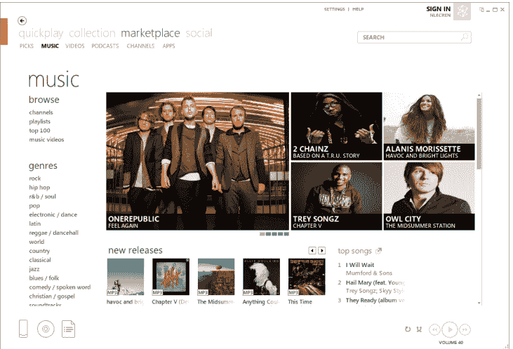

图 1-1

### 理解 Windows 8：Zune 概念

虽然 Zune 硬件并没有在大市场上获得像 Apple iPod 那样的成功，但其软件在微软内部留下了深浅的印记。Zune 软件非常强调应用程序内容而非外壳（chrome）。Zune 软件在整个应用程序中有数百个菜单选项和工具栏。你也不会看到可以在屏幕上拖动的多个窗口。相反，你看到的是专辑封面、歌曲标题、关于音乐的元数据以及针对你正在使用的实际功能的控制。该软件易于使用，许多较复杂的功能通过简单的右键上下文菜单和模态对话框来处理（如图 1-2 所示），这样用户就可以回到开始的地方。

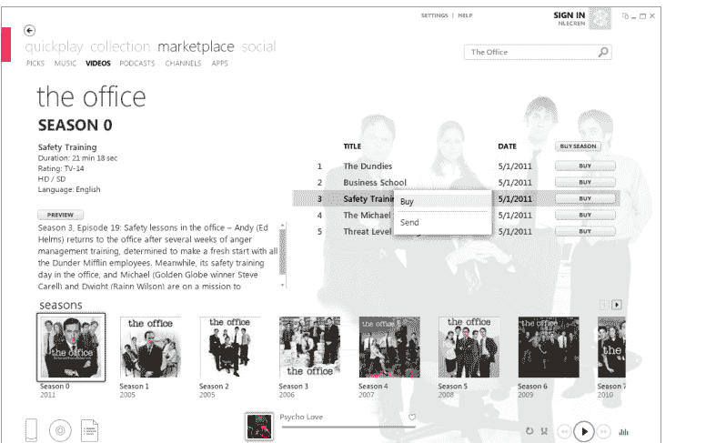

图 1-2

与传统的 Windows 应用程序相比，这绝对是一种不同的处理方式。面对 iPod 人群和正兴起的 iPhone，微软寻找一种进入新兴移动市场的方法，并与 Android 和 iOS 竞争对手区分来。通过对现有的 Windows 移动平台进行小改，微软试图寻找 Zune 软件的设计原则，在其移动领域实现其目标。Zune 软件团队本质上创造了一种看待用户界面及其背后设计的新方法：Windows 8。

为了脱颖而出，微软在即将发布的全新 Windows Phone 7 中使用了 Windows 8 设计概念。然而，这个平台并非 Zune 的直接复制；微软将 Windows 8 设计概念推向了更远，创建了一种全新的、专注于内容而非外壳的应用程序开发方式。

微软在手势上投入了研究的时间和金钱，以在移动设备上提供最佳整体体验，并确定了如何在手机应用的用户界面中使用手势。这导致了突破性的控制和概念。例如，全景控制控制，它显示了一个水平滚动的用户界面，在用户滚动时提供内容的初级预览。

### Windows Phone 7 的继承特性

Windows Phone 7 引入了几个继承到 Windows 8 的新用户界面。活动磁贴（Live tiles）就是其中一个例子，现在是 Windows 8 新增强型开始屏幕不可或缺的一部分。活动磁贴提供了几个可以自定义的磁贴，它们会持续更新其代表的应用程序的最新信息。这可能是一个电子邮件应用程序，始终显示未读邮件的最新计数，或来自常用 Twitter 用户的最新推文。微软为这些磁贴提供了许多可能性，并对应用程序应如何尝试使用磁贴提供了指导，该主题将在第 4 章“Windows 8 用户界面”中介绍。图 1-3 显示了新的 Windows 8 开始屏幕和几个磁贴，这些磁贴会通过各种网络服务在后台持续更新下载的信息。

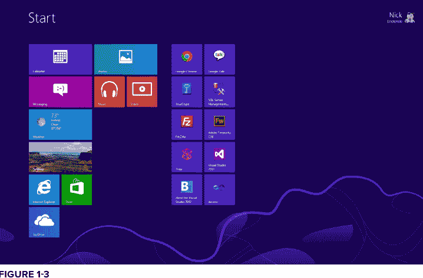

图 1-3

## 在 Windows 8 中导航

通常情况下，熟悉 Windows 的新版本是简单的。大多数熟悉的操作系统工具和交互都没有改变。然而，由于 Windows 8 面向广泛的设备，微软对宽泛的用户界面和导航操作工作方式进行了重大更改。作为一名 Windows 8 开发者，你需要了解如何在 Windows 8 中导航，以及它如何影响你创建和部署的应用程序。本节涵盖了这些导航更改的一部分。

### 登录屏幕

你首先注意到的是，标准的登录屏幕与之前的 Windows 版本不同。新的启动屏幕允许你在登录之前查看信息。图标的数量和信息的类型取决于当前正在运行的哪些应用程序（如果它们支持此功能）。例如，如果你运行着默认的邮件（Mail）应用程序然后锁定了电脑，你可以看到一个邮件图标以及当前未读邮件的数字。这项新功能不仅限于默认的 Windows Store 应用程序；你也可以将你的应用程序与启动屏幕集成，以便一个有意义的图标反映来自你应用程序的数据。

### 开始屏幕

你可以迅速发现手势在 Windows 8 中起着重要作用，无论你在平板电脑还是 PC 上使用它们。要实际进入初始屏幕并移动到登录屏幕，只需点击屏幕任意位置。一旦你使用新的开始屏幕登录，你可以发现：

- 新的开始屏幕基本上是传统 Windows 开始菜单的完全替代。
- 磁贴应用程序包括使用 WinRT 和 Windows 8 编写的应用程序，以及基于传统的 Windows 7 或更版本的桌面应用程序。
- Windows Store 应用程序以动态变化的活动磁贴形式呈现。
- 桌面应用程序是带有应用程序名称和代表图标的小静态磁贴。
- 任何已安装的桌面或基于 Windows 8 的应用程序在开始屏幕上都有一个图标。

这意味着当你为 Windows 8 开发应用程序时，必须仔细考虑你的程序在屏幕上的显示。你必须使用美观的图标和活动磁贴来提供有关应用程序的信息。在传统的 Windows 开发中，你只需要确保应用程序出现在开始菜单——如果你打包正确，通常不是问题。在 Windows 8 中你需要注意这些细节，因为你想让你的应用程序在屏幕上脱颖而出。

用户可以通过拖放磁贴轻松自定义开始菜单。用户还可以通过右键点击磁贴来选择它，然后从底部的新的应用栏中选择“取消固定（Unpin）”。图 1-4 显示了应用栏以及管理所选磁贴的一些选项。

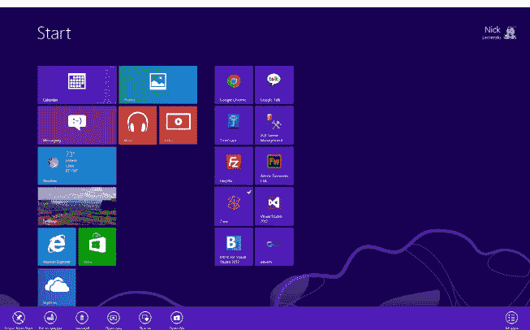

图 1-4

虽然右键点击在 PC 上是有效操作，但在平板电脑上显然不起作用。平板的等效操作是一种新的手势：从屏幕底部向中心滑动。

### 搜索功能

所以如果你想启动一个当前不在开始屏幕上的程序？与其像在传统开始菜单下那样寻找应用程序，你只需调出新的 Windows 8 搜索功能。在 PC 上，你输入应用程序名称，搜索屏幕就会显示最佳匹配项（见图 1-5）。

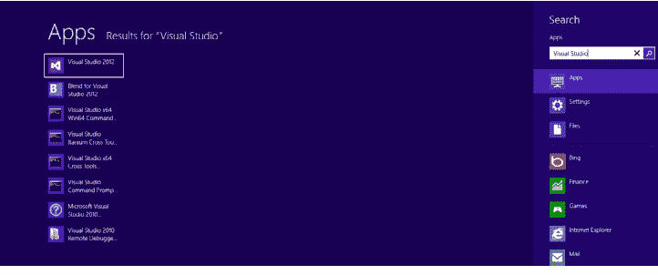

图 1-5

在平板电脑上，你从右侧滑动以启用新的字符栏（Char bar），如图 1-6 所示，然后触摸搜索图标。

### 应用生命周期

Windows 8 的另一个特点是应用程序的生命周期与传统的桌面应用程序有何不同。例如，在传统的桌面应用中，你可以在窗口右上角点击最小化、最大化和关闭图标。对于 Windows Store 应用（Windows Store apps），你将没有这些选项。正如你以后在书中第 5 章“应用生命周期”中将学到的，Windows Store 应用遵循与 Windows Phone 平台应用类似的生命周期。它们通常不会关闭，而是被挂起，直到你再次需要它们。然而，如果你想关闭应用程序，你有几种选择：

- 你可以调出任务管理器并直接杀死应用程序。这与你在任何之前的 Windows 版本中执行的操作相同（见图 1-7）。
- 如果其他所有方法都失效，在 PC 上，你始终可以使用 `Alt+F4` 快捷键。这将强制关闭当前打开的 Windows Store 应用。在 PC 上，键盘快捷键是访问 Windows 8 开发功能最简单的方法。尽管为 Windows 8 触摸界面开发的各种手势都已包含，但它们都有相应的鼠标操作，而键盘是 Windows 8 访问功能的最快方式。

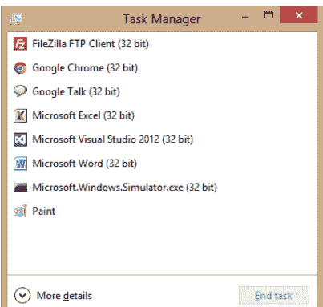

图 1-7

### 进入桌面模式

在开发应用和使用 Visual Studio 时，你主要处于桌面模式。你需要熟悉几种鼠标手势，以便快速高效地在桌面模式导航。在桌面模式下，将鼠标移动到屏幕角落可以带你各种 Windows 8 功能，允许你：

- 查看正在运行的 Windows Store 应用：在桌面模式下，当前运行的传统 Windows 应用程序像之前的 Windows 版本中一样出现在任务栏中。然而，Windows Store 应用不会出现在这里。要查看并切换可用的 Windows Store 应用，你可以将鼠标移动到任何连接显示器的左上角，查看你可以运行的下一个应用。
- 查看运行中的 Windows Store 应用完整列表：只需将鼠标移动到左上角，然后稍微向下移动。这将弹出一个带有所有运行中的 Windows Store 应用图标的栏。图 1-8 显示，执行该手势后，你可以在当前运行的日历和消息应用之间切换。

显示所有运行中的 Windows Store 应用的栏

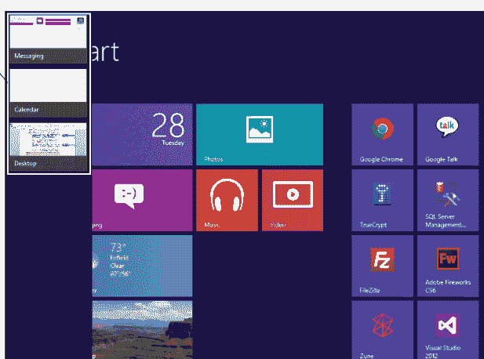

图 1-8

- 查看返回开始界面的快捷方式。通过将鼠标悬停在左下角，你可以返回开始界面。
- 查看常用高级用户任务列表。你可以通过右键点击开始界面来执行，你可以在显示器的左下角找到它（见图 1-9）。这在开发过程中很有帮助。

| 程序和功能 |
| :--- |
| 网络连接 |
| 电源选项 |
| 事件查看器 |
| 系统 |
| 设备管理器 |
| 磁盘管理 |
| 计算机管理 |
| 命令提示符 |
| 命令提示符 (管理员) |
| 任务管理器 |
| 控制面板 |
| Windows 资源管理器 |
| 搜索 |
| 运行 |
| 桌面 |

图 1-9

- 查看 Charm 栏（Charms bar）大纲。如果你将鼠标移动到主显示器的右上角即可查看此内容。这仅在主显示器有效，而不适用于任何辅助显示器。如果你稍微向下拖动鼠标，Charm 栏就会完全显示，你可以轻松访问搜索、共享、开始、设备和设置。

尽管这完全没有深入查看 Windows 8 的所有新用户界面功能，但它应该足够帮助你快速导航到开发过程中最重要的功能。

在所有情况下，如果某种鼠标操作在 PC 上可以触发功能，那么在 Windows 8 中也有对应的手势可以实现。表 1-1 列出了你在开发过程中需要的常用手势列表。

表 1-1：Windows 8 常用手势

| 手势 | 鼠标 |
| :--- | :--- |
| 显示 Charm 栏 | 从屏幕右侧滑动 | 右上 |
| 显示运行的应用列表 | 从屏幕左侧滑动 | 左上 |
| 显示开始界面 | 从屏幕左侧滑动 | 左下 |
| 显示高级用户任务 | 右键点击开始界面 | 左下角 |
| 显示完整 Charm 栏 | 稍微向下移动 | |
| 组合键 | 操作 | 鼠标 |
| :--- | :--- | :--- |
| Win+C | 打开 Charm 栏 | 从屏幕右侧滑动 |
| Win+D | 进入桌面 | 右上 |
| Win+E | 打开资源管理器 | 左上 |
| Win+F | 打开搜索 | 从屏幕左侧滑动 |
| Win+H | 打开设置 | 右下 |
| Win+I | 打开设备 | 左下角 |
| Win+J | 切换应用 | 左下 |
| Win+K | 锁定 PC | 左下 |
| Win+L | 打开搜索 | 右下 |
| Win+R | 运行 | 左下 |
| Win+W | 打开搜索 | 右侧 |
| Win+Z | 打开应用 | 左上 |
| Alt+Tab | 循环切换应用 | 侧侧 |

## Windows Store 开发

Windows Store 的开发从 Visual Studio 2012 开始。你将在程序中花费大量时间。幸运的是，它被认为是行业标准的 IDE。Visual Studio 2010 或更早的用户会注意到一些外观上的变化。即使你开发的是桌面应用程序，你会发现 Visual Studio 2012 的外观和感觉符合 Windows 8 的风格。在 Visual Studio 中，你将看到图 1-1 所示的熟悉界面。

Visual Studio 提供了一些新的项目模板，帮助你启动 Windows Store 应用。它还有许多开发过程中的效率增强。

### Windows 应用开发

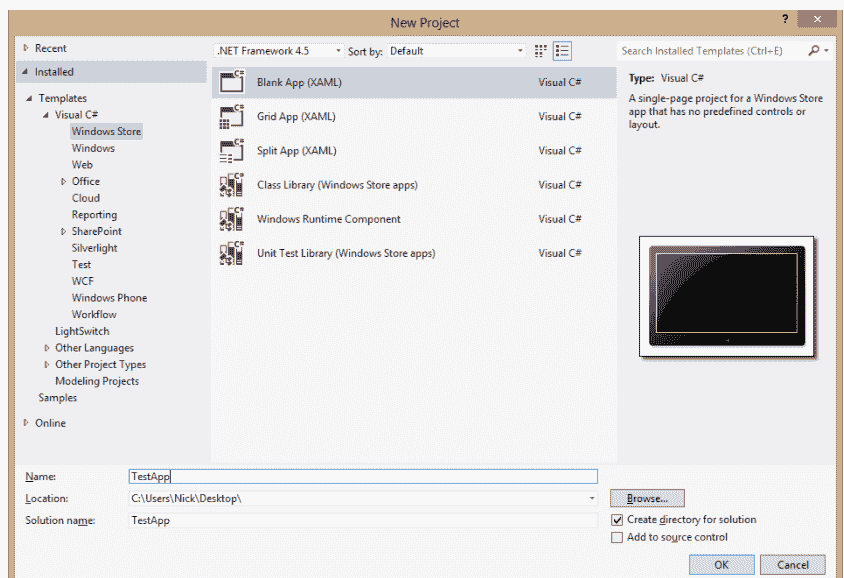

图 1-10

以下是 Visual Studio 版本中最实用的改进：

- **页面检查器 (Page Inspector)**：允许你查看并手动运行 HTML 代码。这项极好的新功能提供了查看 DOM 对象的方法。在调试网站时还可以从这里运行 JavaScript —— 它就像内置在 Visual Studio 中的 Firebase Firebase。


- **智能提示 (IntelliSense)**：你在 JavaScript 中拥有全功能智能提示。例如，在输入变量名后按下按钮将显示字符串的所有可用方法和属性。不再需要为你执行的每个操作进行痛苦的 Google 搜索；最重要的是，减少了拼写错误。

- **图像预览 (Image preview)**：你不再需要在项目中右键点击并使用第三方工具打开它来查看。Visual Studio 现在包含了一项新功能，你只需将鼠标悬停在图像文件名上，即可立即查看该图像的缩略图。

- **浏览器切换器 (Browser Switcher)**：在开发 HTML 时，必须在所有主要浏览器中查看你的页面。在之前的 Visual Studio 版本中调试时，除非使用第三方扩展，否则会相当麻烦。尽管如此，这要求你右键点击并选择“使用浏览器打开”（Browse With）选项，选择一个浏览器，取消操作，最后开始调试。在 Visual Studio 的最新版本中，你现在拥有一个新的工具栏，它会自动加载所有安装浏览器的图标。要在使用不同浏览器进行调试时测试你的更改，只需点击所需浏览器的图标即可开始工作。

- **设备模拟器**：Visual Studio 现在拥有移动开发领域可用的最强大、最高效的设备模拟器之一。新版本包含一个模拟器，可以让你轻松地以平板形式尝试你的应用程序。该模拟器还可以模拟各种硬件功能，如旋转和触摸事件。如果你为 Windows Phone 开发应用，它能够让你在无需部署到实际 Windows Phone 的情况下轻松对应用进行初步测试。

- **应用商店支持**：另一个 Windows 8 新功能（在第 12 章“整合一切：构建 Windows Store 应用程序”中讨论）是新的 App Store（应用商店）。App Store 是你部署想要让其他用户使用的 Windows Store 应用程序的地方。Visual Studio 现在对 App Store 提供完全支持，并使在 IDE 中构建、打包和部署新创建的 Windows Store 应用程序变得简单。

- **现有项目支持**：在之前的 Visual Studio 版本中，如果你想打开较旧版本的项目，将被迫升级项目文件。通常，这个过程会导致很难从之前的版本再次打开该项目。在 Visual Studio 2012 中，你现在可以打开任何由之前的 Visual Studio 版本创建的项目或解决方案，并且它们与你正在使用的版本保持兼容。

- **转到定义**：如果你以前在 Visual Studio 中使用 C# 或其他 .NET 语言进行过开发，你会发现可以直接跳转到方法或属性定义的右键选项——这是一个非常有用的功能。遗憾的是，此功能在 JavaScript 开发中并不可用，这意味着你必须进行漫长、乏味的搜索或滚动滚动以查找可能很长的 JavaScript 文件中的方法声明。现在在 Visual Studio 2012 中，“转到定义”可以完美工作，即使对于 JavaScript 源代码文件也是如此。

- **拖放引用**：另一个强大的新功能是将 JavaScript 源文件拖入 HTML 文件，并让 Visual Studio 自动为该文件添加相应的引用。

- **CSS 改进**：Visual Studio 2012 还对 CSS 的编辑和管理进行了许多改进。这包括一个工具栏，可以更方便地注释和取消注释大段 CSS 代码，以及在拥有极大型 CSS 文件并被迫滚动很久才能找到 CSS 块的情况下，创建 CSS 的可折叠区域。

- **3D 模型预览**：除了现在可用的代码预览缩略图外，Visual Studio 还添加了一个 3D 模型查看器，帮助开发者无需离开 IDE 即可查看模型，或者对他们已添加到项目中的现有模型进行细微更改。

在本书中，你将看到在 Windows Store 应用开发过程中使用了这些许多新功能。

www.it-ebooks.info

无论使用什么语言，传统上在编写开发书籍时，你会通过一个“Hello World”应用程序来引入新主题。由于不想打破现状，你在这里也采取了这样做。此时，你已经拥有关于 Windows 8 和 Visual Studio 2012 的基础知识，所以现在是开始尝试开发 Windows Store 应用程序的绝佳时机。因为你可以使用任选的语言编写 Windows Store 应用程序，请从选择一种你最熟悉的编程语言开始。

> 注意：本书尽可能包含了 C#、C++ 和 JavaScript 示例。一如既往，所有应用程序和示例的完整代码可以通过 http://www.wrox.com 获取这三种语言的版本。

要开始，请遵循以下步骤：

1. 启动 Visual Studio，选择“文件（File）->新建项目（New Project）”。这将启动“项目模板”对话框。

2. 对于你选择的语言，找到 Windows Store 应用程序模板。选择“空白应用”（Blank App）并点击“确定”继续。

3. 在图 10 中，你可以看到所有可用 Windows Store 应用模板的完整列表。为你的项目命名，例如 Hello Windows 8，并点击“确定”。Visual Studio 会创建一个新项目，包含基本 Windows 全屏应用所需的所有文件。在“解决方案管理器”中的 C# 版本中，你可以看到几个目录和文件。表 1-3 从高层面上涵盖了每个文件负责的任务。

### 表 1-3：默认项目文件

| 文件 | 任务 |
| :--- | :--- |
| `MainPage.xaml` | 应用程序中加载的初始页面。你必须使用此文件创建用户界面。 |
| `MainPage.xaml.cs` | 默认页的后台代码（`code-behind`）。在此文件中，你可以添加代码来处理控件事件或页面导航事件。 |
| `App.xaml` | 包含一个全局可用的资源字典（`ResourceDictionary`）。为了设置用户界面，你必须在此文件中声明样式，这些样式将自动适用于应用程序中的任何页面。 |
| `App.xaml.cs` | 此后台代码文件包含重要应用程序事件的处理器，如启动（`launched`）、挂起（`suspended`）等。此文件也是你将 `MainPage.xaml` 设置为应用程序启动时加载的第一个页的地方。要更改首次显示的页面，你可以修改 `OnLaunched` 事件处理程序指向的页面。 |

### 表 1-3（续）

| 文件 | 任务 |
| :--- | :--- |
| `Assets\Logo.png` | 这是出现在应用程序磁贴上并显示在开始屏幕上的默认标志。如果你想在磁贴上使用不同的标志，请将此文件替换为 150 x 150 的 .png 图像。 |
| `Assets\SmallLogo.png` | 如果你在图标之外还包含文本，请确保将此文件替换为 30 x 30 的 .png 图像。 |
| `Assets\SplashScreen.png` | 这是应用程序启动时显示的默认闪屏。要替换它，你必须使用 620 x 300 的 .png 图像。除了图像，你还必须为闪屏选择背景颜色。你可以通过属性编辑器进行设置。 |
| `Assets\StoreLogo.png` | 这是 Windows Store 中代表你应用程序的图标。要更改它，请替换为 50 x 50 的 .png 图像。 |
| `Common\StandardStyles.xaml` | 此文件与 `App.xaml` 类似，包含应用程序的控件样式。此资源字典包含一组经过测试和验证的默认样式，你应该整个应用程序中使用。通常你不需要修改这些样式，但建议使用 XAML 语法继承它们。现在请记住，如果你在应用程序中使用文本或其他控件，应该检查此文件是否有可用的标准。Windows Store 应用程序应该具有共同的外观，尽可能使用标准样式以保持用户界面与其他 Windows Store 应用程序一致。 |
| `Package\appmanifest` | 此文件包含应用程序的所有设置和 App Store 信息。在这里，你可以更改应用程序的名称、设置标志、支持的方向，并定义应用所需的功能。双击此文件将打开应用程序属性配置窗口，这是修改此文件的首选方法。 |

### 构建一个简单的 Windows Store 应用

这个第一个简单的 Windows Store 应用程序只有一个目的，就是在屏幕上显示“Hello Windows 8”字样，最好是居中并使用较大的字体。应用程序启动时加载的主页是 `MainPage.xaml`。默认情况下，Windows Store 应用运行这与 Silverlight 导航应用类似，每个屏幕都继承自 `Page` 类。

列表 1-1 展示了 `MainPage` 的代码，并包含了 `OnNavigatedTo` 事件处理程序，这就像在 Silverlight 中这样做的一样。此事件为您提供了一个在页面显示给用户时立即运行代码的地方。

### 列表 1-1：MainPage.xaml.cs

```cs
using System;
using System.Collections.Generic;
using System.IO;
using System.Linq;
using Windows.Foundation;
using Windows.Foundation.Collections;
using Windows.UI.Xaml;
using Windows.UI.Xaml.Controls;
using Windows.UI.Xaml.Controls.Primitives;
using Windows.UI.Xaml.Data;
using Windows.UI.Xaml.Input;
using Windows.UI.Xaml.Media;
using Windows.UI.Xaml.Navigation;

// 空页模板的文档位于：
// http://go.microsoft.com/fwlink/zLinkId=234238

namespace HelloWindows
{
    /// <summary>
    /// 任何可以独立使用或在 Frame 内进行导航的空页面。
    /// </summary>
    public sealed partial class MainPage : Page
    {
        public MainPage()
        {
            this.InitializeComponent();
        }

        /// <summary>
        /// 当此页面即将在 Frame 中显示时调用。
        /// </summary>
        /// <param name="e">描述如何到达此页面的事件数据。</param>
        /// property 属性通常用于配置页面。
        protected override void OnNavigatedTo(NavigationEventArgs e)
        {
        }
    }
}
```

此时，应用程序的用户界面存在于 `BlankPage.xaml` 文件中，正如你在列表 1-2 中看到的，它只包含一个空的 `Grid` 控件。

### 列表 1-2：MainPage.xaml

现在你对这个简单应用需要做的做的就是添加“Hello Windows 8”文本。这是一个基于 C#/XAML 的应用程序，你可以使用所有基于 XAML 的用户界面控件。要在屏幕上显示文本，你可以使用 `TextBlock` 控件。`TextBlock` 有一个 `Text` 属性，你可以将其设置为“Hello Windows 8”。要完成这一操作，只需在当前的 `Grid` 标签内部添加控件，文本就会出现在应用程序中。以下是 `TextBlock` 控件代码的更新版本。

### 列表 1-3：MainPage.xaml

注意在之前的代码中，为 `TextBlock` 添加了几个属性以确保文本在垂直和水平方向上居中，并以大字体显示。所有 XAML 控件都有类似的属性，你可以调整它们来影响所有控件的元素，例如对齐方式、字体、大小等。你可以在第 2 章“什么是 XAML”中查看更多内容，该章节涵盖了 XAML 和可用控件。

### 设置应用能力

在运行应用程序之前，你必须做的最后一件事是确保设置了应用程序所需的任何设备能力（Capabilities）。在 Windows Store 中，应用程序并不具备你在其他 Windows 开发形式中认为理所当然的能力。例如，你可以直接通过 API 调用从互联网下载信息，而无需先声明你的程序需要此项功能。

这允许运行在平板电脑上的 Windows Store 应用程序告知用户运行程序所需的哪些权限。如果你使用过任何基于 Android 或 iOS 的设备，你现在见过在应用程序执行操作之前弹出的权限请求屏幕。大多数应用商店在应用程序下载页面上也列出了所需的权限和能力，以便用户做出明智的决定是否购买或下载该程序。Windows 8 在这方面也不例外，你的程序需要遵循相同的规则。虽然一个“Hello Windows”应用程序实际上不需要很多设备功能，但请假设它至少需要 Internet 访问，并查看如何为运行中的应用程序进行该配置：

2. 双击打开应用程序配置屏幕。

### 你好 Windows | 21

```cpp
using namespace HelloWindows;
using namespace Platform;
using namespace Windows::Foundation;
using namespace Windows::Foundation::Collections;
using namespace Windows::UI::Xaml;
using namespace Windows::UI::Xaml::Controls;
using namespace Windows::UI::Xaml::Primitives;
using namespace Windows::UI::Xaml::Data;
using namespace Windows::UI::Xaml::Input;
using namespace Windows::UI::Xaml::Media;
using namespace Windows::UI::Xaml::Navigation;
```

// 空页项模板文档见 http://go.microsoft.com/fwlink?LinkId=23428

```cpp
MainPage::MainPage()
{
    InitializeComponent();
}

/// <summary>
/// 当此页面在 Frame 中显示时调用。
/// </summary>
/// <param name="e">描述如何到达此页面的事件数据。
/// 参数通常用于配置页面。
/// </param>
void MainPage::OnNavigatedTo(NavigationEventArgs^ e)
{
    (void) e;
    // 未使用的参数
}
```

这段代码显示，你仍然拥有相同的 `OnNavigatedTo` 事件处理器，以便在向用户展示页面时运行运行某些代码。唯一的变化是你使用了 C++ 而不是 C#。用户界面保持不变。

### 关于 HTML 开发者？

除了 C#/C++/VB.NET 之外，你还可以选择使用 HTML/JS 创建 Windows 应用程序。虽然本书主要侧重于 C#/XAML 开发，但本节将介绍一下如果你来自 Web 开发世界并希望加入不断增长的 Windows 开发者行列，那么“Hello Windows 8”看起来会是什么样子的。

首先，你可以使用第一个 C#/C++ 示例中所示空白应用模板，你会注意到向项目中添加的默认文件略有不同。在 HTML/JS 版本的“Hello Windows 8”应用中，文件要少得多。然而，许多相同的应用程序功能仍然在默认文件中实现，但你不再使用 C# 代码执行操作，而是可以使用 CSS 和 JavaScript 处理其中几项功能。表 1-5 定义了每个默认文件的职责。

it-ebooks.info

www.it-ebooks.info

在 C#/XAML 版本中，文本在屏幕上居中。你仍然可以通过简单的标准 CSS 代码在 HTML 版本中实现这一点。为 DIV 标签添加一个类或 ID 以及适当的边距代码即可。这会将 DIV 更改为：

```html
<div class="centered">hello Windows 8</div>
```

在 `default.css` 文件中，你可以添加 CSS 使文本居中。列表 1-6 显示了更新后的 `default.css` 文件。

### 列表 1-6: css/default.css

```css
body {
}
@media screen and (-ms-view-state: fullscreen-landscape) {
}
@media screen and (-ms-view-state: filled) {
}
@media screen and (-ms-view-state: snapped) {
}
@media screen and (-ms-view-state: fullscreen-portrait) {
}
.centered {
  text-align: center;
}
```

如果你此时运行该应用，你将看到与之前相同的应用程序，文本在屏幕上水平居中，但垂直方向不居中。这与其他类型的 Web 开发没有区别，因为没有仅通过 CSS 就实现垂直居中的可靠方法。但是，你可以使用针对 Windows 8/IE 10 开发的 CSS 扩展，这允许你复制之前代码中 XAML 应用的基于网格的布局，从而实现文本的垂直居中。

### Windows 商店应用的类型

当你开始一个 Windows 8 开发项目时，Visual Studio 有几个不同的项目模板可以选择。根据你计划创建的应用类型，这些模板可以为布局和编码最佳实践提供极好的起点。这些模板包括：

- **空白应用（Blank app）**：只是一个空的 Windows 商店应用模板，仅为你提供运行应用程序所需的各种外壳。


- 网格应用（Grid app）：为你的应用程序创建一个基于网格的用户界面，内容分组在网格中。你可以通过用户与组交互来访问详细信息并执行附加操作。

- 分拆应用（Split app）：对基于网格的应用程序提供了不同的实现。这种应用程序同时具有网格内容和详情的分视图。

在进行任何商店应用开发之前，你需要决定计划构建的应用程序类型，以及使用之前的哪些模板作为你的起点。接下来的章节将深入研究网格和拆分模板，以及它们如何能够更好地服务特定类型的商店应用。

## 网格应用程序

网格应用模板的目标是提供一种简单的方法来展示信息集合，用户可以在组内进行导航。例如，如果你的应用打算展示类似音乐集合的内容，你可能会使用此模板显示特定的流派，然后是属于该流派的艺术家。此模板还允许用户触摸或点击特定流派并查看额外信息，而无需导航回起点。现在在 Visual Studio 中创建一个名为 `Artist` 的新 C#/XAML 商店项目，并选择 Grid App 模板。项目创建后，你将在解决方案资源管理器中添加几个新文件。表 1-6 高级显示了这些文件。

| 文件 | 任务 |
| :--- | :--- |
| `GroupItemsPage.xaml` | 应用程序的首页，显示组及其项的滚动列表。 |
| `GroupDetailPage.xaml` | 如果用户从首页点击组标题，应用程序将跳转到此页面。 |
| `ItemDetailPage.xaml` | 显示用户所选项的详细信息的页面。 |
| `SampleDataSource.cs` | 包含数据的类。 |

在 C#/XAML 版本中，文本在屏幕上居中。你仍然可以通过简单的标准 CSS 代码在 HTML 版本中实现这一点。添加一个类或 ID 到 `DIV` 标签以及适当的边距代码即可。这会将 `DIV` 更改为：

```html
<div class="centered">hello Windows 8</div>
```

在 `default.css` 文件中，你可以添加 CSS 使文本居中。列表 1-6 显示了更新后的 `default.css` 文件。

### Windows Store 应用程序类型

```xml
AutomationProperties.Name=Group
TextPrimaryButtonStyle" > 
Click="Header Click"
Style="StaticResource Margin=3,-7,10,100" 
Style="StaticResource GroupHeaderTextStyle" />
<StackPanel Orientation="Horizontal">
<TextBlock Text="Binding Title" />
<TextBlock Text="{StaticResource GroupHeaderTextStyle}" />
ChevronGlyph="FontFamily="Segoe UI Symbol" Margin=0,-7,0,0"
Style="{StaticResource GroupHeaderTextStyle}" />
</StackPanel>
</Grid>
</DataTemplate>
</GroupStyle.HeaderTemplate>
<GroupStyle.Panel>
<ItemsPanelTemplate>
<VariableSizedWrapGrid Orientation="Vertical" Margin=0,0,8,0">
</ItemsPanelTemplate>
</GroupStyle.Panel>
</GroupStyle>
</GridView.GroupStyle>
```

```xml
<!-- 仅在对齐模式时使用垂直滚动列表 -->
<ListView
Name=itemListView
AutomationProperties.AutomationId=ItemList
AutomationProperties.Name=Grouped Items
Grid.Row="1"
Visibility="Collapsed"
Margin=0,-10,0,0
Padding=10,0,0,60
ItemsSource="{Binding Source={StaticResource groupedItemsSource}}"
ItemTemplate="{StaticResource StandardGroupItemTemplate}"
SelectionMode="None"
IsSwipeEnabled="false"
IsItemClick="True"
ItemClick="ItemView.ItemClick">
<ListView.GroupStyle>
<GroupStyle>
<GroupStyle.HeaderTemplate>
<DataTemplate>
<Grid Margin="7,7,0,0">
<Button
AutomationProperties.Name=Group Title
Click="Header_Click"
Style="{StaticResource TextPrimaryButtonStyle}"
<StackPanel Orientation="Horizontal">
<TextBlock Text="Binding Title" />
```

### 示例 1-8 (续)

```xml
Margin="3,-7,10,10" Style="{StaticResource GroupHeaderTextStyle}" />
<TextBlock Text="{StaticResource ChevronGlyph}" FontFamily="Segoe UI Symbol" Margin=0,-7,0,10
Style="{StaticResource GroupHeaderTextStyle}" />
</StackPanel>
</Button>
</Grid>
</DataTemplate>
</GroupStyle.HeaderTemplate>
</GroupStyle>
</ListView.GroupStyle>
<!--
<!-- 返回按钮和页面标题 -->
<Grid>
<Grid.ColumnDefinitions>
<ColumnDefinition Width="Auto"/>
<ColumnDefinition Width="*"/>
</Grid.ColumnDefinitions>
<Button x="backButton" Click="GoBack"
IsEnabled="Binding Frame.CanGoBack,Element=pageRoot"
Style="{StaticResource BackButtonStyle}" />
<TextBlock x="pageTitle" Text="{StaticResource Grid.Column=1}" Visibility="false" Style="{StaticResource PageHeaderTextStyle}" />
</Grid>
<VisualStateManager.VisualStateGroups>
<!-- 视觉状态反映应用程序视图视图 -->
<VisualStateGroup Name="ApplicationViewStates">
<VisualState Name="FullScreenLandscape" />
<VisualState Name="Filled" />
<!-- 整个页面遵循竖屏下较窄的 100 像素边距规范 -->
<VisualState Name="FullScreenPortrait" />
<Storyboard>
<ObjectAnimationUsingKeyFrames>
Storyboard.TargetName="backButton" Storyboard.TargetProperty="Style"
<DiscreteObjectKeyFrame KeyTime="0"
Value="{StaticResource PortraitBackButton}" />
</ObjectAnimationUsingKeyFrames>
</Storyboard>
<ObjectAnimationUsingKeyFrames>
Storyboard.TargetName="itemIDView" Storyboard.TargetProperty="Padding"
<DiscreteObjectKeyFrame KeyTime="0"
Value="96,137,10,56" />
</ObjectAnimationUsingKeyFrames>
</Storyboard>
</VisualStateGroup>
```

### Windows Store 应用程序类型

```xml
<!-- 在对齐模式下，返回按钮和标题有不同的样式，且列表表示将替换为所有其他视图状态下显示的网格 -->
-->
<VisualState x="Snapped">
  <Storyboard>
    <ObjectAnimationUsingFrames TargetName="BackButton" Storyboard.TargetProperty="Style">
      <DiscreteObjectKeyFrame KeyTime="0" Value="{StaticResource SnappedBackButtonStyle}" />
    </ObjectAnimationUsingFrames>
    <ObjectAnimationUsingFrames TargetName="pageHeader" Storyboard.TargetProperty="Style">
      <DiscreteObjectKeyFrame KeyTime="0" Value="{StaticResource SnappedPageHeaderTextStyle}" />
    </ObjectAnimationUsingFrames>
  </Storyboard>

<ObjectAnimationUsingFrames TargetName="ListView" Storyboard.TargetProperty="Visibility">
    <DiscreteObjectKeyFrame KeyTime="0" Value="Visible/" />
  </ObjectAnimationUsingFrames>
  <ObjectAnimationUsingFrames TargetName="itemGridView" Storyboard.TargetProperty="Visibility">
    <DiscreteObjectKeyFrame KeyTime="0" Value="Collapsed/" />
  </ObjectAnimationUsingFrames>
</ObjectAnimationUsingFrames>
-->
</VisualState>
</VisualStateGroup>
</VisualStateManager.VisualStateGroups>
</Grid>
<!--注释:布局感知页面 -->
```

## 分组项目

由于应用程序启动时默认数据是不及时的，现在来解决这个问题。如果你查看 `SampleDataSource.cs` 文件，你可能会发现那里有些不同之处。

1. 双击文件只会进一步展开文件，这并不寻常。Visual Studio 提供了一项强大的功能，可以在解决方案资源管理器中将其拆分为多个对象。

2. 应用程序启动时数据是不及时的，现在来解决这个问题。如果你查看 `SampleDataSource.cs` 文件，你可能会发现有些不同之处。

由于应用程序启动时数据是不及时的，现在来解决这个问题。如果你查看 `SampleDataSource.cs` 文件，你可能会发现有些不同之处。

```csharp
public SampleDataSource() {
    string Content = "{0}{0}{0}";
    var group1 = new SampleGroup("Rock",
    "Group Title",
    "Group Subtitle",
    "Assets/DarkGray.png",
    "Lorem ipsum dolor");
    group1.Items.Add(new SampleItem("Aerosmith",
    "Title",
    "Subtitle",
    "Assets/DarkGray.png",
    "dolor sit amet,"));
    group1.Items.Add(new SampleItem("Guns N Roses",
    "Title",
    "Subtitle",
    "Assets/DarkGray.png",
    "consectetur elit,"));
    group1.Items.Add(new SampleItem("KISS",
    "Title",
    "Subtitle",
    "Assets/DarkGray.png",
    "dolor sit amet,"));
    this.AllGroups.Add(group1);

    var group2 = new SampleGroup("Metal",
    "Group Title",
    "Group Subtitle",
    "Assets/DarkGray.png",
    "Lorem ipsum dolor");
    group2.Items.Add(new SampleItem("Iron Maiden",
    "Title",
    "Subtitle",
    "Assets/DarkGray.png",
    "dolor sit amet,"));
    group2.Items.Add(new SampleItem("Metallica",
    "Title",
    "Subtitle",
    "Assets/DarkGray.png",
    "consectetur elit."));
    this.AllGroups.Add(group2);

    var group3 = new SampleGroup("Country",
    "Group Title",
    "Group Subtitle",
    "Assets/DarkGray.png",
    "Lorem ipsum dolor");
    group3.Items.Add(new SampleItem("Garth Brooks",
    "Title",
    "Subtitle",
    "Assets/DarkGray.png",
    "dolor sit amet,"));
    group3.Items.Add(new SampleItem("Kenny Chesney",
    "Title",
    "Subtitle",
    "Assets/DarkGray.png",
    "consectetur elit."));
    group3.Items.Add(new SampleItem("Darius Rucker",
    "Title",
    "Subtitle",
    "Assets/DarkGray.png",
    "dolor sit amet,"));
    group3.Items.Add(new SampleItem("Rascal Flats",
    "Title",
    "Subtitle",
    "Assets/DarkGray.png",
    "consectetur elit."));
    this.AllGroups.Add(group3);
}
```

3. 你仍然保留了一些 Lorum Ipsum 文本作为填充内容，在这种情况下你不需要更新图像，因为这只是一个快速的示例。

4. 如果你构建并运行该应用，在启动页（Start page）上你可以看到摇滚、金属和乡村分组以及相关的艺术家，如图 1-16 所示。

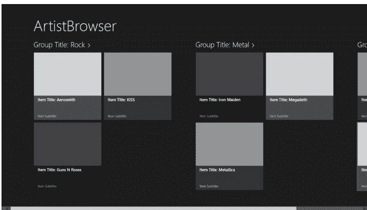

图 1-16

5. 如果你触摸或点击类型标题，将显示组详情页（GroupDetailPage），如图 1-17 所示，它提供了额外的组详细信息，包括小组更大的图像和滚动的艺术家列表。

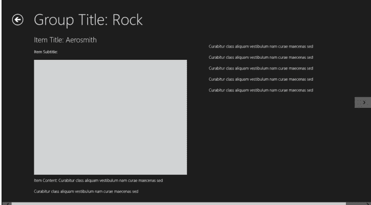

图 1-17

6. 在此页面上使用类似的 Grid、ScrollView 和 GridView 控件以更详细的格式显示类型和艺术家信息。列表 1-9 显示了 XAML 源代码。

列表 1-9：GroupDetailPage.xaml


# CHAPTER 1 GLIMPSE INTO THE FUTURE

## 列表 1-9：GroupDetailPage.xaml

```xml
<common:LayoutAwarePage
    x:Name="pageRoot"
    x:Class="ArtistBrowser.GroupDetailPage"
    DataContext="{Binding DefaultViewModel, Source={RelativeSource Self}}"
    xmlns="http://schemas.microsoft.com/winfx/2006/xaml/presentation"
    xmlns:x="http://schemas.microsoft.com/winfx/2006/xaml"
    xmlns:local="using:ArtistBrowser"
    xmlns:data="using:ArtistBrowser.Data"
    xmlns:common="using:ArtistBrowser.Common"
    xmlns:d="http://schemas.microsoft.com/expression/blend/2008"
    xmlns:mc="http://schemas.openxmlformats.org/markup-compatibility/2006"
    mc:Ignorable="d">

    <Page.Resources>
        <!-- 此页面显示的项集合 -->
        <CollectionViewSource
            x:Name="ItemsViewSource"
            Source="{Binding Items}"
            d:Source="{Binding AllGroups[0].Items, Source={d:DesignInstance Type=data:SampleData, IsDesignTimeCreatable=True}}"/>
    </Page.Resources>

    <!-- 此网格作为页面的根面板，定义了两个行：
         * 行 0 包含组标题栏的后面板
         * 行 1 包含页面的其余布局
    -->
    <Grid
        Style="{StaticResource LayoutRootStyle}"
        DataContext="{Binding Group}"
        d:DataContext="{Binding AllGroups[0], Source={d:DesignInstance Type=data:SampleData, IsDesignTimeCreatable=True}}">

        <Grid.RowDefinitions>
            <RowDefinition Height="140"/>
            <RowDefinition Height="*"/>
        </Grid.RowDefinitions>

        <!-- 在大多数视图状态下的水平滚动网格 -->
        <GridView
            x:Name="ItemGridView"
            AutomationProperties.AutomationId="ItemGridView"
            AutomationProperties.Name="Items In Group"
            TabIndex="1"
            Grid.RowSpan="2"
            Padding="120,126,120,50"
            ItemsSource="{Binding Source={StaticResource ItemsViewSource}}"
            ItemTemplate="{StaticResource Standard500x130ItemTemplate}"
            SelectionMode="None"
            IsSwipeEnabled="false"
            IsItemClickEnabled="True"
            ItemClick="ItemView_ItemClick">

            <GridView.Header>
                <StackPanel Width="480" Margin="0,4,14,0">
                    <TextBlock Text="{Binding Subtitle}" Margin="0,0,18,20"
                        Style="{StaticResource SubheaderStyle}" MaxHeight="60"/>
                    <Image Source="{Binding Image}" Height="400"
                        Margin="0,0,18,20" Stretch="UniformToFill" />
                    <TextBlock Text="{Binding Description}"
                        Margin="0,0,18,0" Style="{StaticResource BodyTextStyle}" />
                </StackPanel>
            </GridView.Header>
            <GridView.ItemContainerStyle>
                <Style TargetType="FrameworkElement">
                    <Setter Property="Margin" Value="52,0,0,10"/>
                </Style>
            </GridView.ItemContainerStyle>
        </GridView>

        <!-- 仅在吸附时显示的垂直滚动列表 -->
        <ListView
            x:Name="ListItem"
            AutomationProperties.AutomationId="ListItem"
            AutomationProperties.Name="Items In Group"
            Grid.Row="1"
            Visibility="Collapsed"
            Padding="10,0,0,60"
            ItemsSource="{Binding Source={StaticResource ItemsViewSource}}"
            ItemTemplate="{StaticResource Standard80ItemTemplate}"
            SelectionMode="None"
            IsSwipeEnabled="false"
            IsItemClickEnabled="True"
            ItemClick="ItemView_ItemClick">

            <ListView.Header>
                <StackPanel>
                    <TextBlock Text="{Binding Subtitle}" Margin="10,0,18,20" Style="{StaticResource TitleTextStyle}" MaxHeight="60"/>
                    <Image Source="{Binding Image}" Margin="10,0,18,0"
                        MaxHeight="160" Stretch="UniformToFill" />
                    <TextBlock Text="{Binding Description}" Margin="10,20,18,30" Style="{StaticResource BodyTextStyle}" />
                </StackPanel>
            </ListView.Header>
        </ListView>

        <!-- 返回按钮和页面标题 -->
        <Grid>
            <Grid.ColumnDefinitions>
                <ColumnDefinition Width="Auto"/>
                <ColumnDefinition Width="*"/>
            </Grid.ColumnDefinitions>
            <Button x:Name="BackButton" Click="GoBack" IsEnabled="{Binding Frame.CanGoBack}" Style="{StaticResource BackButtonStyle}"/>
            <TextBlock x:Name="pageTitle" Text="{Binding Title}" Style="{StaticResource PageHeaderTextStyle}" Grid.Column="1" IsHitTestVisible="false"/>
        </Grid>

        <VisualStateManager.VisualStateGroups>
            <!-- 视觉状态反映应用程序的视图 -->
            <VisualStateGroup x:Name="ApplicationViewStates">
                <VisualState x:Name="FullScreenLandscape"/>
                <VisualState x:Name="Filled"/>

                <!-- 整个页面反映了竖屏模式下窄的 100 像素边距 -->
                <VisualState x:Name="FullScreenPortrait">
                    <Storyboard>
                        <ObjectAnimationUsingKeyFrames Storyboard.TargetName="BackButton" Storyboard.TargetProperty="Style">
                            <DiscreteObjectKeyFrame KeyTime="0" Value="{StaticResource PortraitBackButtonStyle}"/>
                        </ObjectAnimationUsingKeyFrames>

                        <ObjectAnimationUsingKeyFrames Storyboard.TargetName="ItemGridView" Storyboard.TargetProperty="Padding">
                            <DiscreteObjectKeyFrame KeyTime="0" Value="100,126,120,50"/>
                        </ObjectAnimationUsingKeyFrames>
                    </Storyboard>
                </VisualState>

                <!-- 当吸附时，返回按钮和标题具有不同的样式 -->
                <VisualState x:Name="Snapped">
                    <Storyboard>
                        <ObjectAnimationUsingKeyFrames Storyboard.TargetName="BackButton" Storyboard.TargetProperty="Style">
                            <DiscreteObjectKeyFrame KeyTime="0" Value="{StaticResource SnappedBackButtonStyle}"/>
                        </ObjectAnimationUsingKeyFrames>

                        <ObjectAnimationUsingKeyFrames Storyboard.TargetName="ItemGridView" Storyboard.TargetProperty="Visibility">
                            <DiscreteObjectKeyFrame KeyTime="0" Value="Collapsed"/>
                        </ObjectAnimationUsingKeyFrames>
                        <ObjectAnimationUsingKeyFrames Storyboard.TargetName="ListItem" Storyboard.TargetProperty="Visibility">
                            <DiscreteObjectKeyFrame KeyTime="0" Value="Visible"/>
                        </ObjectAnimationUsingKeyFrames>
                        <ObjectAnimationUsingKeyFrames Storyboard.TargetName="pageTitle" Storyboard.TargetProperty="Style">
                            <DiscreteObjectKeyFrame KeyTime="0" Value="{StaticResource SnappedPageHeaderTextStyle}"/>
                        </ObjectAnimationUsingKeyFrames>
                    </Storyboard>
                </VisualState>
            </VisualStateGroup>
        </VisualStateManager.VisualStateGroups>
    </Grid>
</common:LayoutAwarePage>
```

## 注意

所有页面都继承自 `LayoutAware` 类，如前所述。这确保了对方向更改的支持。

## 7. 触摸或点击启动页或详情页中的项以查看详情

如图 1-18 所示，在这种情况下是对组的更详细查看。

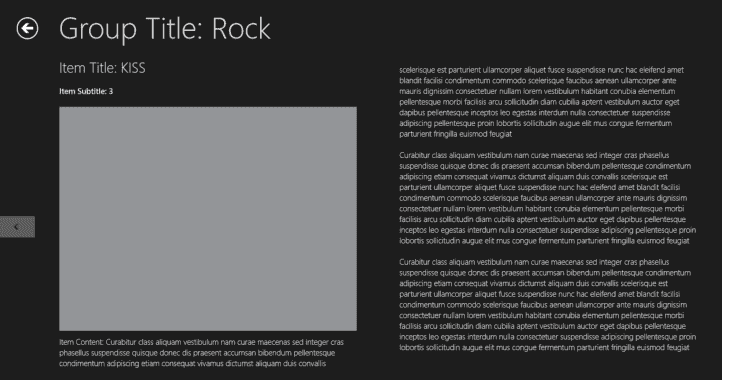

此页面的独特之处在于它使用了 `FlipView`，这允许用户无需返回组视图即可浏览艺术家。用户始终可以使用返回箭头或标题返回，但 `FlipView` 的好处是，无论点击哪个项，组的信息都是可用的。列表 1-10 显示了绑定到艺术家集合的 `FlipView` 代码。

## 列表 1-10：ItemDetailPage.xaml

```xml
<common:LayoutAwarePage
    x:Name="Root"
    x:Class="ArtistBrowser.ItemDetail"
    DataContext="{Binding DefaultViewModel, Source={RelativeSource Self}}"
    xmlns="http://schemas.microsoft.com/winfx/2006/xaml/presentation"
    xmlns:x="http://schemas.microsoft.com/winfx/2006/xaml"
    xmlns:local="using:ArtistBrowser"
    xmlns:data="using:ArtistBrowser.Common"
    xmlns:d="http://schemas.microsoft.com/expression/blend/2008"
    xmlns:mc="http://schemas.openxmlformats.org/markup-compatibility/2006"
    mc:Ignorable="d">

    <Page.Resources>
        <!-- 此页面显示的项集合 -->
        <CollectionViewSource
            x:Name="ItemsViewSource"
            Source="{Binding Items}"
            d:Source="{Binding AllGroups[0].Items, Source={d:DesignInstance Type=data:SampleData, IsDesignTimeCreatable=True}}"/>
    </Page.Resources>

    <!-- 此网格作为页面的根面板，定义了两个行：
         * 行 0 包含返回按钮和页面标题
         * 行 1 包含页面的其余布局
    -->
    <Grid
        Style="{StaticResource LayoutRootStyle}"
        d:DataContext="{Binding AllGroups[0], Source={d:DesignInstance Type=data:SampleData, IsDesignTimeCreatable=True}}">

        <Grid.RowDefinitions>
            <RowDefinition Height="140"/>
            <RowDefinition Height="*"/>
        </Grid.RowDefinitions>

        <!-- 页面的其余部分是一个 FlipView，它每次显示一个项的详细信息，允许 -->
```


xmlns:d="http://schemas.microsoft.com/expression/blend/2008"
xmlns:mc="http://schemas.openxmlformats.org/markup-compatibility/2006"
mc:Ignorable="d">

<Page.Resources>
  <!---- 此页面显示的项集合 -->
  <CollectionViewSource
    x:Name="ItemsSource"
    Source="Binding Items"
    d:Source="Binding AllGroups[0].Items,
    Source={d:DesignInstance Type=data:SampleData,IsDesignTimeCreatable=True}"/>
</Page.Resources>

<!-- 此网格作为页面的根面板，定义了两个行：
    * 行 0 包含组标题栏的后面板
    * 行 1 包含页面的其余布局
  -->
<Grid
    Style="StaticResource LayoutRootStyle"
    DataContext="Binding Group"
    DataContext="Binding AllGroups[0],
    Source={d:DesignInstance Type=data:SampleData,IsDesignTimeCreatable=True}">

  <Grid.RowDefinitions>
    <RowDefinition Height="140"/>
    <RowDefinition Height="*"/>
  </Grid.RowDefinitions>

  <!-- 在大多数视图状态下的水平滚动网格 -->
  <GridView
    x:Name="ItemGridView"
    AutomationProperties.AutomationId="ItemGridView"
    AutomationProperties.Name="Items In Group"
    TabIndex="1"
    Grid.RowSpan="*"
    Padding="120,126,120,50"
    ItemsSource="{Binding Source={StaticResource itemsViewSource}}"
    ItemTemplate="{StaticResource Standard500x130ItemTemplate}"
    SelectionMode="None"
    IsSwipeEnabled="false"
    IsClickIsEnabled="True"
    ItemClick="ItemView.ItemClick">

    <GridView.Header>
      <StackPanel Width="480" Margin="0,4,14,0">
        <TextBlock Text="{Binding Subtitle}" Margin="0,0,18,20"
          Style="{StaticResource SubheaderStyle}" MaxHeight="60"/>
        <Image Source="{Binding Image}" Height="400"
          Margin="0,0,18,20" Stretch="Stretch" />
        <TextBlock Text="{Binding Description}"
          Margin="0,0,18,0" Style="{StaticResource BodyTextStyle}" />
      </StackPanel>
    </GridView.Header>

    <GridView.ItemContainerStyle>
      <Style TargetType="FrameworkElement">
        <Setter Property="Margin" Value="52,0,0,10"/>
      </Style>
    </GridView.ItemContainerStyle>
  </GridView>

  <!-- 仅在吸附时显示的垂直滚动列表 -->
  <ListView
    x:Name="listItem"
    AutomationProperties.AutomationId="ListItem"
    AutomationProperties.Name="Items In Group"
    Grid.Row="*"
    Visibility="Collapsed"
    Padding="10,0,0,6"
    ItemsSource="{Binding Source={StaticResource itemsViewSource}}"
    ItemTemplate="{StaticResource Standard80xItemTemplate}"
    SelectionMode="None"
    IsSwipeEnabled="false"
    IsClickIsEnabled="True"
    ItemClick="ItemView.ItemClick">

    <ListView.Header>
      <StackPanel>
        <TextBlock Text="{Binding Subtitle}" Margin="10,0,18,20" Style="{StaticResource TitleTextStyle}" MaxHeight="60"/>
        <Image Source="{Binding Image}" Margin="10,0,18,0"
          MaxHeight="160" Stretch="Stretch" />
        <TextBlock Text="{Binding Description}" Margin="10,20,18,30" Style="{StaticResource BodyTextStyle}" />
      </StackPanel>
    </ListView.Header>
  </ListView>

  <!-- 返回按钮和页面标题 -->
  <Grid>
    <Grid.ColumnDefinitions>
      <ColumnDefinition Width="Auto"/>
      <ColumnDefinition Width="*"/>
    </Grid.ColumnDefinitions>
    <Button x:Name="BackButton" Click="GoBack" IsEnabled="{Binding StaticResource BackButtonStyle}"/>
    <TextBlock x:Name="pageTitle" Text="{Binding Title}" Style="{StaticResource HeaderTextStyle}" Grid.Column="1" IsHitTest="false"/>
  </Grid>

  <VisualStateManager.VisualStateGroups>
    <!-- 视觉状态反映应用程序的视图 -->
    <VisualStateGroup x:Name="ApplicationViews">
      <VisualState x:Name="FullScreenLandscape"/>
      <VisualState x:Name="Filled"/>

      <!-- 整个页面反映了竖屏模式下窄的 100 像素边距 -->
      <VisualState x:Name="FullScreenPortrait">
        <Storyboard>
          <ObjectAnimationUsingKeyFrames Storyboard.TargetName="BackButton" TargetProperty="Style">
            <DiscreteObjectKeyFrame Value="{StaticResource PortraitButtonStyle}"/>
          </ObjectAnimationUsingKeyFrames>
          <ObjectAnimationUsingKeyFrames Storyboard.TargetName="ItemGridView" TargetProperty="Padding">
            <DiscreteObjectKeyFrame Value="100,126,120,50"/>
          </ObjectAnimationUsingKeyFrames>
        </Storyboard>
      </VisualState>

      <!-- 当吸附时，返回按钮和标题具有不同的样式 -->
      <VisualState x:Name="Snapped">
        <Storyboard>
          <ObjectAnimationUsingKeyFrames Storyboard.TargetName="BackButton" TargetProperty="Style">
            <DiscreteObjectKeyFrame Value="{StaticResource SnappedButtonStyle}"/>
          </ObjectAnimationUsingKeyFrames>
          <ObjectAnimationUsingKeyFrames Storyboard.TargetName="ItemGridView" TargetProperty="Visibility">
            <DiscreteObjectKeyFrame Value="Collapsed"/>
          </ObjectAnimationUsingKeyFrames>
          <ObjectAnimationUsingKeyFrames Storyboard.TargetName="pageTitle" TargetProperty="Style">
            <DiscreteObjectKeyFrame Value="{StaticResource SnappedHeaderText}"/>
          </ObjectAnimationUsingKeyFrames>
          <ObjectAnimationUsingKeyFrames Storyboard.TargetName="itemView" TargetProperty="Visibility">
            <DiscreteObjectKeyFrame Value="Collapsed"/>
          </ObjectAnimationUsingKeyFrames>
          <ObjectAnimationUsingKeyFrames Storyboard.TargetName="ItemGridView" TargetProperty="Visibility">
            <DiscreteObjectKeyFrame Value="Visible"/>
          </ObjectAnimationUsingKeyFrames>
        </Storyboard>
      </VisualState>
    </VisualStateGroup>
  </VisualStateManager.VisualStateGroups>
</Grid>
</common:LayoutAwarePage>

# CHAPTER 1 GLIMPSE INTO THE FUTURE

## 列表 1-9（续）

```xml
<ObjectAnimationUsingKeyFrames Storyboard.TargetName="pageTitle" TargetProperty="Style">
  <DiscreteObjectKeyFrame Value="{StaticResource SnappedHeaderText}"/>
</ObjectAnimationUsingKeyFrames>
<ObjectAnimationUsingKeyFrames Storyboard.TargetName="itemView" TargetProperty="Visibility">
  <DiscreteObjectKeyFrame Value="Collapsed"/>
</ObjectAnimationUsingKeyFrames>
<ObjectAnimationUsingKeyFrames Storyboard.TargetName="ItemGridView" TargetProperty="Visibility">
  <DiscreteObjectKeyFrame Value="Visible"/>
</ObjectAnimationUsingKeyFrames>
</Storyboard>
</VisualState>
</VisualStateGroup>
</VisualStateManager.VisualStateGroups>
</Grid>
</common:LayoutAwarePage>
```

> **注意** 所有页面都继承自 `LayoutAware` 类，如前所述。这确保了对方向更改的支持。

7. 触摸或点击启动页或详情页中的项以查看详情，如图 1-18 所示，在这种情况下是对组的更详细查看。


此页面的独特之处在于它使用了 `FlipView`，这允许用户无需返回组视图即可浏览艺术家。用户始终可以使用返回箭头或标题返回，但 `FlipView` 的好处是，无论点击哪个项，组的信息都是可用的。列表 1-10 显示了绑定到艺术家集合的 `FlipView` 代码。

## 列表 1-10：ItemDetailPage.xml

```xml
<common:LayoutAwarePage
  x:Name="Root"
  x:Class="ArtistBrowser.ItemDetail"
  DataContext="{Binding DefaultViewModel, Source={RelativeSource Self}}"
  xmlns="http://schemas.microsoft.com/winfx/2006/xaml/presentation"
  xmlns:x="http://schemas.microsoft.com/winfx/2006/xaml"
  xmlns:local="using:ArtistBrowser"
  xmlns:data="using:ArtistBrowser.Common"
  xmlns:d="http://schemas.microsoft.com/expression/blend/2008"
  xmlns:mc="http://schemas.openxmlformats.org/markup-compatibility/2006"
  mc:Ignorable="d">

  <Page.Resources>
    <!-- 此页面显示的项集合 -->
    <CollectionViewSource
      x:Name="ItemsViewSource"
      Source="{Binding Items}"
      d:Source="{Binding AllGroups[0].Items, Source={d:DesignInstance Type=data:SampleData,IsDesignTimeCreatable=True}}"/>
  </Page.Resources>

  <!-- 此网格作为页面的根面板，定义了两个行：
    * 行 0 包含返回按钮和页面标题
    * 行 1 包含页面的其余布局
  -->
  <Grid
    Style="{StaticResource LayoutRootStyle}"
    d:DataContext="{Binding AllGroups[0],
    Source={d:DesignInstance Type=data:SampleData,IsDesignTimeCreatable=True}}">

    <Grid.RowDefinitions>
      <RowDefinition Height="140"/>
      <RowDefinition Height="*"/>
    </Grid.RowDefinitions>

    <!-- 页面的其余部分是一个 FlipView，它每次显示一个项的详细信息，允许 -->
```

# 列表 1-10 (续)


# 列表 1-10 (续)

```xml
<!-- 用户用于翻页所选组中的所有项目 -->
<FlipView
  x:Name="flipView"
  AutomationProperties.AutomationId="ItemsFlipView"
  AutomationProperties.Name="Item Details"
  TabIndex="1"
  Grid.RowSpan="2"
  ItemsSource="{Binding Source={StaticResource itemsViewSource}}">
  <FlipView.ItemContainerStyle>
    <Style TargetType="FlipViewItem">
      <Setter Property="Margin" Value="0,137,0,0"/>
    </Style>
  </FlipView.ItemContainerStyle>
  <FlipView.ItemTemplate>
    <DataTemplate>
      <!--
        选择 UserControl 作为模板项是因为它可以
        支持视觉状态管理 Loaded/unloaded 事件，显式订阅写入状态更新
      -->
      <UserControl Loaded="StartLayoutUpdates" Unloaded="StopLayoutUpdates">
        <ScrollViewer x:Name="scrollViewer" Style="{StaticResource HorizontalScrollViewerStyle}" Grid.Row="1">
          <!-- 内容允许根据需要按列流动 -->
          <common:RichTextColumns x:Name="richTextColumns">
            <RichTextBlock x:Name="richTextBlock" Width="560" Style="{StaticResource ItemRichTextStyle}" IsSelectionEnabled="False">
              <Paragraph>
                <Run FontSize="26.67"/>
                <LineBreak/>
                <LineBreak/>
                <Run FontWeight="Normal"/>
              </Paragraph>
              <Run FontWeight="Light" Text="{Binding Title}"/>
              <Run Text="{Binding Subtitle}"/>
            </RichTextBlock>
            <common:RichTextColumns.ColumnTemplate>
              <DataTemplate>
                <RichTextBlockOverflow Width="560" Margin="80,0,0,0">
                  <RichTextBlockOverflow.RenderTransform>
                    <TranslateTransform X="-1" Y="4"/>
                  </RichTextBlockOverflow.RenderTransform>
                </RichTextBlockOverflow>
              </DataTemplate>
            </common:RichTextColumns.ColumnTemplate>
          </common:RichTextColumns>
        </ScrollViewer>
      </UserControl>
      <InlineUIContainer>
        <Image x:Name="image" Source="{Binding Image}" Stretch="Uniform" MaxHeight="480" Margin="0,20,0,10" AutomationProperties.Name="{Binding Title}"/>
      </InlineUIContainer>
      <Paragraph>
        <Run FontWeight="SemiLight"/>
      </Paragraph>
    </DataTemplate>
  </FlipView.ItemTemplate>
</FlipView>
```

```xml
<TextBlock Text="{Binding Content}"/>
</Paragraph>
<!-- 从此模板创建额外的列 -->
<common:RichTextColumns.ColumnTemplate>
  <DataTemplate>
    <RichTextBlockOverflow Width="560" Margin="80,0,0,0">
      <RichTextBlockOverflow.RenderTransform>
        <TranslateTransform X="-1" Y="4"/>
      </RichTextBlockOverflow.RenderTransform>
    </RichTextBlockOverflow>
  </DataTemplate>
</common:RichTextColumns.ColumnTemplate>
</common:RichTextColumns>
<VisualStateManager.VisualStateGroups>
  <!-- 视觉状态反映了 FlipView 内部的应用程序视图状态 -->
  <VisualStateGroup x:Name="ApplicationViewStates">
    <VisualState x:Name="FullScreenLandscape"/>
    <VisualState x:Name="Filled"/>
    <!-- 遵循竖屏更窄的 100 像素边距惯例 -->
    <VisualState x:Name="FullScreenPortrait">
      <Storyboard>
        <ObjectAnimationUsingKeyFrames Storyboard.TargetName="richTextColumns" Storyboard.TargetProperty="Margin">
          <DiscreteObjectKeyFrame KeyTime="0" Value="97,0,57,0"/>
        </ObjectAnimationUsingKeyFrames>
        <ObjectAnimationUsingKeyFrames Storyboard.TargetName="image" Storyboard.TargetProperty="MaxHeight">
          <DiscreteObjectKeyFrame KeyTime="0" Value="400"/>
        </ObjectAnimationUsingKeyFrames>
      </Storyboard>
    </VisualState>
    <!-- 当对齐时，内容将重新格式化并垂直滚动 -->
    <VisualState x:Name="Snapped">
      <Storyboard>
        <ObjectAnimationUsingKeyFrames Storyboard.TargetName="richTextColumns" Storyboard.TargetProperty="Margin">
          <DiscreteObjectKeyFrame KeyTime="0" Value="17,0,17,57"/>
        </ObjectAnimationUsingKeyFrames>
        <ObjectAnimationUsingKeyFrames Storyboard.TargetName="scrollViewer" Storyboard.TargetProperty="Style">
          <DiscreteObjectKeyFrame KeyTime="0" Value="{StaticResource VerticalScrollViewerStyle}"/>
        </ObjectAnimationUsingKeyFrames>
        <ObjectAnimationUsingKeyFrames Storyboard.TargetName="richTextBlock" Storyboard.TargetProperty="Width">
          <DiscreteObjectKeyFrame KeyTime="0" Value="280"/>
        </ObjectAnimationUsingKeyFrames>
        <ObjectAnimationUsingKeyFrames Storyboard.TargetName="image" Storyboard.TargetProperty="MaxHeight">
          <DiscreteObjectKeyFrame KeyTime="0" Value="160"/>
        </ObjectAnimationUsingKeyFrames>
      </Storyboard>
    </VisualState>
  </VisualStateGroup>
</VisualStateManager.VisualStateGroups>
</UserControl>
</DataTemplate>
</FlipView.ItemTemplate>
</FlipView>

<!-- 返回按钮和页标题 -->
<Grid>
  <Grid.ColumnDefinitions>
    <ColumnDefinition Width="Auto"/>
    <ColumnDefinition Width="*"/>
  </Grid.ColumnDefinitions>
  <Button x:Name="backButton" Click="GoBack" IsEnabled="{Binding Frame.CanGoBack, ElementName=pageRoot}" Style="{StaticResource BackButtonStyle}"/>
  <TextBlock x:Name="pageTitle" Text="{Binding Title}" Style="{StaticResource PageHeaderTextStyle}" Grid.Column="1"/>
</Grid>
```

<common:LayoutAwarePage>

如你所见，即使不阻止操作日历应用，显示的信息仍然有用。

## 支持对齐视图

```xml
<ObjectAnimationUsingKeyFrames Storyboard.TargetName="richTextColumns" Storyboard.TargetProperty="Margin">
  <DiscreteObjectKeyFrame KeyTime="0" Value="17,0,17,57"/>
</ObjectAnimationUsingKeyFrames>
<ObjectAnimationUsingKeyFrames Storyboard.TargetName="scrollViewer" Storyboard.TargetProperty="Style">
  <DiscreteObjectKeyFrame KeyTime="0" Value="{StaticResource VerticalScrollViewerStyle}"/>
</ObjectAnimationUsingKeyFrames>
<ObjectAnimationUsingKeyFrames Storyboard.TargetName="richTextBlock" Storyboard.TargetProperty="Width">
  <DiscreteObjectKeyFrame KeyTime="0" Value="280"/>
</ObjectAnimationUsingKeyFrames>
<ObjectAnimationUsingKeyFrames Storyboard.TargetName="image" Storyboard.TargetProperty="MaxHeight">
  <DiscreteObjectKeyFrame KeyTime="0" Value="160"/>
</ObjectAnimationUsingKeyFrames>
</Storyboard>
</VisualState>
</VisualStateGroup>
</VisualStateManager.VisualStateGroups>
</Grid>
```

对齐视图将在下一章进行详细介绍，但现在：

- 生成并运行应用。图 1-19 显示了 Grid 应用的对齐版本与 Windows 8 天气应用对比。


图 1-19

## 创建拆分应用

为了说明拆分应用：

1. 在 Visual Studio 中创建一个名为 `ArtistBrowserSplit` 的新 C#/XAML 拆分应用。
2. 项目创建后，你可以看到和你构建的 Grid 应用相同的文件，但有几个例外。表 1-7 显示了此类类型项目包含的文件以及它们负责的任务。

| 文件 | 任务 |
|---|---|
| `SampleDataSource.cs` | 应用程序示例数据；与 Grid 模板用法相同。 |
| `App.xaml` | 包含应用程序范围内的控件。你应该在这里存储多个页面间可用的自定义样式。 |
| `App.xaml.cs` | 包含主应用程序启动代码的后台代码页面，以及作为起始页的页面。在拆分应用模板中，你将起始页设置为 `ItemsPage.xaml`。 |
| `SplitPage.xaml` | 项目页面，在拆分屏幕上显示组的项目列表，并显示当前选中项目的详细信息。 |
| `SplitPage.xaml.cs` | 添加控件处理器或处理页面导航事件的后台代码。 |
| `ItemsPage.xaml` | 起始页的用户界面，显示组的集合。 |
| `ItemsPage.xaml.cs` | 添加控件处理器或处理页面导航事件的后台代码。 |
| `Package.appxmanifest` | 应用程序设置文件。 |

3. 在运行此应用程序之前，您应该从 `ArtistBrowser` 之前的 Grid 版本中获取 `SampleDataSource.cs` 文件，并用该内容替换当前 Split 应用程序的版本。如果您使用模拟器生成并运行应用程序，显示的第一个页面将是 `ItemsPage`，如图 1-20 所示，其中向用户显示了可选的音乐流。

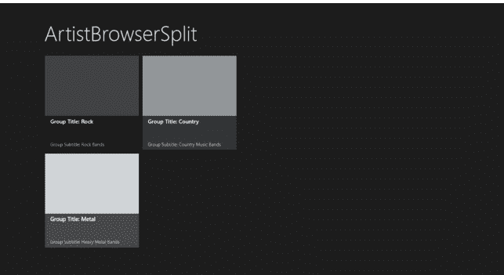

图 1-20

如您所示，此界面更加简单，不需要水平滚动，因为它只显示了组信息——而不是 Grid 示例应用程序模板中的任何单独项目。然而，列表 1-11 所示的 `ItemsPage` 代码依赖于 Grid 应用程序所需的许多相同的用户界面控件。

### 列表 1-11: ItemsPage.xaml

```xml
<common:LayoutAwarePage
  x:Name="pageRoot"
  x:Class="ArtistBrowserSplit.ItemsPage"
  DataContext="{Binding DefaultViewModel, RelativeSource={RelativeSource Self}}"
  xmlns="http://schemas.microsoft.com/winfx/2006/xaml/presentation"
  xmlns:x="http://schemas.microsoft.com/winfx/2006/xaml"
  xmlns:local="using:ArtistBrowserSplit"
  xmlns:data="using:ArtistBrowserSplit.Data"
  xmlns:common="using:ArtistBrowserSplit.Common"
  xmlns:d="http://schemas.microsoft.com/expression/blend/2008"
  xmlns:mc="http://schemas.openxmlformats.org/markup-compatibility/2006"
  mc:Ignorable="d">

  <Page.Resources>
    <!-- 由此页面显示的项目集合 -->
    <CollectionViewSource
```

列表 1-11（续）


```xml
x:Name="itemsViewSource"
Source={Binding Items}
d:Source={Binding AllGroups, Source={d:DesignInstance}
Type=data:SampleDataSource, IsDesignTimeCreatable=True}/>
</Page.Resources>
<!--
* 此网格作为页面的根面板，定义了两个行
* 行 0 包含返回按钮和页面标题
* 行 1 包含页面的其余布局
<Grid Style="{StaticResource LayoutRootStyle}>
<Grid.RowDefinitions>
<RowDefinition Height="140"/>
<RowDefinition Height="*"/>
</Grid.RowDefinitions>
<!-- 在大多数视图状态下使用的水平滚动网格 -->
<GridView
x:Name="itemsGridView"
AutomationProperties.AutomationId="itemsGridView"
AutomationProperties.Name="Items"
TabIndex="2"
Padding="116,136,116,46"
ItemsSource={Binding Source={StaticResource itemsViewSource}}
ItemTemplate={StaticResource Standard250x250ItemTemplate}
SelectionMode="None"
IsSwipableClickEnabled="false"
IsItemClickEnabled="True"
ItemClick="ItemView_ItemClick"/>
<!-- 仅在吸附时使用的垂直滚动列表 -->
<ListBox
x:Name="itemListView"
AutomationProperties.AutomationId="ItemsListView"
AutomationProperties.Name="Items"
TabIndex="1"
Grid.Row="0"
Visibility="Collapsed"
Margin="0,-10,0,0"
Padding="10,0,0,60"
ItemsSource={Binding Source={StaticResource itemsViewSource}}
ItemTemplate={StaticResource Standard80ItemTemplate}
SelectionMode="None"
IsSwipableClickEnabled="false"
IsItemClickEnabled="ItemView_ItemClick"/>
<!-- 返回按钮和页面标题 --
<Grid>
<Grid.ColumnDefinitions
```

### Split 应用程序

```xml
<ColumnDefinition Width="Auto"/>
<ColumnDefinition Width="*"/>
</Grid.ColumnDefinitions>
<Button x="backButton" Click="GoBack"
Style="StaticResource BackButtonStyle"/>
<TextBlock x="pageTitle" Grid.Column="1"
Text="{StaticResource AppName} IsTextVisible="false"
Style="StaticResource PageHeaderTextStyle"/>
</Grid>
<VisualStateManager.VisualStateGroups>
<!-- 视觉状态反映应用程序的视图状态 -->
<VisualStateGroup x="ApplicationViewStates">
<VisualState x="FullScreenLandscape">
<VisualState x="Filled"/>
</VisualState>
</VisualStateGroup>
<StateGroup>
<!-- 整个页面遵循竖屏模式下的 100 像素窄边距惯例 -->
<VisualState x="FullScreenPortrait">
<Storyboard>
<ObjectAnimationUsingKeyFrames>
Storyboard.TargetName="backButton" Storyboard.TargetProperty="Style"
<DiscreteObjectKeyFrame Time="0"
Value="{StaticResource PortraitBackButtonStyle}"/>
</ObjectAnimationUsingKeyFrames>
<ObjectAnimationUsingKeyFrames>
Storyboard.TargetName="itemGridView" Storyboard.TargetProperty="Padding"
<DiscreteObjectKeyFrame Time="0"
Value="96,136,86,56/"
</ObjectAnimationUsingKeyFrames>
</Storyboard>
</VisualState>
</StateGroup>
<!-- 当吸附时，返回按钮和标题具有不同的样式，列表表示用于所有其他视图状态下显示的网格 -->
<VisualState x="Snapped">
<Storyboard>
<ObjectAnimationUsingKeyFrames>
Storyboard.TargetName="backButton" Storyboard.TargetProperty="Style"
<DiscreteObjectKeyFrame Time="0"
Value="{StaticResource SnappedBackButtonStyle}"/>
</ObjectAnimationUsingKeyFrames>
<ObjectAnimationUsingKeyFrames>
Storyboard.TargetName="itemGridView" Storyboard.TargetProperty="Padding"
<DiscreteObjectKeyFrame Time="0"
Value="96,136,86,56/"
</ObjectAnimationUsingKeyFrames>
</Storyboard>
</VisualState>
</VisualStateManager>
```

列表 1-11（续）

```xml
Storyboard.TargetName="itemGridView" Storyboard.TargetProperty="Padding"
<DiscreteObjectKeyFrame Time="0"
Value="96,136,86,56/"
</ObjectAnimationUsingKeyFrames>
</Storyboard>
</VisualState>
</VisualStateManager>
```

# 第1 章 展望未来

## 什么是 XAML？

本章内容：

- XAML 的历史
- 了解 XAML 基础
- XAML 在 Visual Studio 2012 中的工作原理
- 理解各种 Windows 8 控件

WROX.COM 本章代码下载

您可以在 `www.wrox.com/remtile.cgi?isb=118205707` 的下载选项卡中找到 `205709C02.zip` 中的本章代码。

可以通过多种方式开发 Windows Store 应用程序。Windows 8 允许您使用任何喜欢的编程语言进行开发。正如第 1 章“展望未来”所示，WinRT API 设计并构建适用于 HTML/JavaScript、VB.NET、XAML/C++ 以及 XAML/C#。对于没有微软编程语言知识的人来说，仍然可以使用 HTML、CSS 和 JavaScript 为 Windows 编写应用程序。本书侧重于使用 XAML 作为用户界面、C# 作为应用程序逻辑来开发 Windows Store 应用程序。

Silverlight 是微软的一项技术，它在互联网流媒体传输方面提供了巨大的改进，并让开发者能够首次接触到 XAML 以及一种创建 Web 应用程序的新方法，这种方法强调业务功能。如果你已经使用 Silverlight 或 WPF 开发过应用程序，那么本中的某些内容是冗余的，你可以直接跳过；传统的 Silverlight/WPF XAML 开发与在以 WinRT 为骨干的 Windows 8 中的使用方式之间存在一些重要的差异。如果你对这些差异感兴趣，或者只需要对所有运行机制进行一个全面的回顾，那么这一章就是适合你的。

## 快速 XAML 历史课

XAML 的读音为 (ZAMEL)，其核心是一种类似于 XML 的标记语言，用于设计用户界面。它起步于 Windows Presentation Foundation (WPF) 开发。多年来，Windows 应用程序使用基础表单和每个表单的一些代码来处理基本的控件交互。由此产生的用户界面并不顺滑，整体上看起来也很呆板，拥有无数控件，并且对于开发者为 Windows 应用程序设计用户界面的实践造成了许多困惑。

当 Vista 推出新的 Aero 桌面时，它引入了新功能，这些功能可以被用于 Windows 应用程序中更丰富的用户界面。微软回到了设计起点并创建了 XAML，它不仅提供了更强大、设计更好的界面，还简化了开发者可用的整体控件集。只需使用少数控件和概念，你就可以开发出丰富的用户界面并学习像 DirectX 这样的 API（这些 API 通常用于编写 Windows 游戏软件）。当 WPF 发布时，微软来说查看 Web 开发是如何完成的并不算遥远。基于微软的 Web 开发是使用 ASP.NET 和 Web Forms 执行的，它们基本上是 Win Forms 技术的 Web 版本，开发者曾利用该技术开发全功能客户端应用。

微软很快创建了插件版本的 Silverlight，它充分利用了 XAML。开发者可以创建用户界面，并访问 .NET 框架中某些强大的 API，而这些 API 传统上仅客户端软件可用。由于 Silverlight 支持 .NET 框架包含的大部分功能，并在 Web 浏览器的上下文中运行，XAML 迅速成为取代 ASP.NET 业务应用程序的热门选择。毫无疑问，性能、用户界面创建的便利性结合简单的部署策略，将使 Silverlight 迅速跃升首选开发技术的顶端。

基于 XAML 的解决方案解决了一个困扰了微软 Web 开发者多年的问题：让用户界面在多个浏览器和浏览器版本中看起来一致。HTML 和 CSS 有它们自己的优处，但每个浏览器处理事务（如布局和定位）的方式略有不同，这通常导致 Web 开发者根据浏览器编写完全不同版本的网站代码。Silverlight 和 XAML 通过作为插件运行消除了这一问题。用 XAML 编写的用户界面在 IE 6、7、8、Firefox、Chrome、Safari、PC 和 MAC 上看起来都一模一样。“一次编写，随处运行”场景的开端突然戛然而止。

正当 Silverlight 和 XAML 准备征服世界移动设备时，移动应用开发开始爆发式增长。网站再也没有为你的手机拥有一个“App”那么酷了。在 Android 和 iPhone 设备无处不在之前；更复杂的是，iPad 的发布使得又多出了一个需要考虑的因素：尽管 Silverlight 在 PC 和 Mac 上运行良好，但在移动世界的早期，很明显，插件在移动设备上将不会被对待。Apple 甚至不允许流行的 Adobe Flash 在 iPhone 上运行。

所以现在虽然有这样一种开发技术，但由于各种系统的限制，你无法在一个全新类别的设备上使用它。由于缺乏支持移动设备的能力，Silverlight 似乎正在走向其繁荣的终点。当微软在 Windows Phone 7 中发布新平台时，也包含了 Silverlight 插件。然而，投入时间学习 XAML 或使用 XAML 开发应用程序的开发者获得了一些好消息：尽管没有使用所有的技术插件，但 Windows Phone 7 确实让 XAML 成为首要用户界面开发技术，这极大地降低了现有 Silverlight/XAML 开发者进行移动开发的学习曲线。

尽管 Silverlight 插件似乎正走向与其他所有 Web 插件相同的路径，但由它产生的技术和开发实践，如 XAML、数据绑定和模型-视图-模型 (MVVM)，注定将在 Windows 8 中延续。当你将 Windows 8 与其他平台和语言比较时，XAML 与你喜欢的 .NET 语言的结合意味着你拥有快速创建丰富用户体验的工具。当你将其与 Windows 8 的新设计原则相结合时，你可以创建新类型的应用程序，为用户提供对他们真正关注的事物的无比的视角，同时为其他设备（如新的 Surface 平板和即将推出的新版本 Windows Phone 平台）提供所需的性能。

现在随着这段短暂的历史结束，你将进入一些真实的 XAML 代码，并开始准确看到为 Windows Store 应用程序创建用户界面究竟是多么简单。

## XAML 基础

XAML 中的控件在大多数情况下具有几个共同的概念和属性。例如，就像 HTML 元素中的 ID 标签或 ASP.NET 服务器控件一样，XAML 提供了一种使用 `x:Name` 语法引用控件的方法。如果你有一个负责显示电话号码的控件，你可以使用类似于下面的语法：

```
<TextBlock x:Name="PhoneNumber" />
```

`Name` 属性适用于所有 XAML 控件，但不是必须的。如果你不需要从代码访问该控件（这对于仅负责布局的控件很常见），你可以简单地从控件声明中省略 `Name`。

除了 `Name` 属性外，XAML 控件还提供了 `Brush` 对象，你可以通过操作它来更改前景和背景。通过使用颜色，你可以创建一个 `SolidColorBrush`。此外，还有处理渐变和图像的 `Brush` 对象。这些 `Brush` 对象被定义为子属性。例如，简单的渐变可以应用于 Button：

```
<Button Content="Button">
  <LinearGradientBrush Endpoint="0.5,1" StartPoint="0.5,0">
    <GradientStop Color="Black"/>
    <GradientStop Color="White" Offset="1"/>
  </LinearGradientBrush>
</Button>
```

你还可以使用许多不同的属性来修改控件在布局中的整体外观。这些包括 `Visibility`、`Margin`、`Padding`、`HorizontalContentAlignment`、`VerticalAlignment`、`HorizontalAlignment`、`VerticalAlignment`、`Height` 和 `Width`。所有这些属性再次添加到控件声明中。例如，以下代码声明了相同的 Button 控件，但这次添加了内边距，以及特定的 `Height` 和 `Width`：

```
<Button Content="Button" HorizontalAlignment="Left" Margin="5,5,10,10" Height="20" Width="100"
```

`Height` 和 `Width` 属性是不自明的，但 `Margin` 属性的工作方式与 CSS 边距不同（如果你熟悉的话）。XAML 的 `Margin` 从上边开始并顺时针运行，因此你可以使用上、右、下、左。像典型的 CSS 控件一样，你也可以设置 `Margin="5"` 来让所有控件的边距等于 5。或者你可以设置两个设置来影响其对应项。使用 `HorizontalContentAlignment` 来影响 Button 控件内部文本的对齐。默认情况下它是居中的，但此代码将其更改为左对齐。在处理 XAML 控件时，你可以使用 `HorizontalAlignment` 和 `VerticalAlignment` 将控件与其容器对齐，而 `HorizontalContentAlignment` 和 `VerticalAlignment` 属性始终影响控件内部的内容。

XAML 控件的另一个重要属性和概念是 `Content` 属性。你可能注意到之前示例中的 Button 使用 `Content` 属性来显示文本。在 ASP.NET 中，Button 的文本使用的是 `Text` 属性，并且限于字符串。在 XAML 中情况不再如此；你可以使用 `Content` 属性包含任何带有静态文本的有效 XAML 控件。在控件声明中，静态文本自动

## Visual Studio 中的 XAML | 53

被转换为简单的 TextBlock 控件后，文本会显示；然而，像下面的 XAML 仅仅是合法的且不需要任何特殊编码即可运行：

```
<CheckBox>
  <CheckBox Content="Checkbox"/>
</CheckBox>
```

在这种情况下（并没有特别用），一个 CheckBox 控件被添加到 Button 控件的声明内部。由于没有专门声明 Content，CheckBox 变成了 Button 的 Content 并在 Button 控件的上下文中显示。尽管 Button 内部有一个 CheckBox，但当应用程序运行时，Button 仍然保留了你预期的所有功能，例如在触摸或点击时触发。此外，你还会看到 CheckBox 更新以反映触摸或点击。在创建更复杂的用户界面时，将任何 XAML 控件作为另一个控件的 Content 变成了一个重要的概念，它提供了一种程度的灵活性，这种灵活性在 Windows 开发场景中通常需要自定义控件才能实现。

### VISUAL STUDIO 2012 中的 XAML


# 第 2 章 什么是 XAML？

在之前的 Visual Studio 版本中，或者如果你使用 Silverlight/WPF 进行开发，在创建用户界面和页面时，使用 XAML 通常会更快（在许多方面也更简单）。通过 Visual Studio 2012，你现在有了一个非常强大的 WYSIWYG（所见即所得）编辑器来创建更复杂的 Windows Store 应用。你将从理解 XAML 工作的细节中受益。查看原始 XAML 代码来排除故障是一个好主意，因此本节列出了 Visual Studio 2012 用于设计强大的 XAML 用户界面的功能。如果你启动 Visual Studio 2012 并在设计器中打开 XAML，你可以看到几个方便创建界面的功能。

- **工具箱 (Toolbox)：** 默认情况下，它位于屏幕左上角。从那里你可以看到应用程序的所有可用 XAML 控件列表，如图 2-1 所示：

  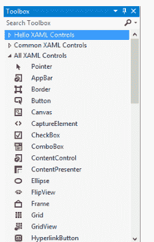

  工具箱顶部有一个搜索栏，方便你找到所需的内容。要使用某个 XAML 控件，只需将其从工具箱拖到你正在处理的页面设计器中即可。

- **文档大纲 (Document Outline)：** 如图 2-2 所示，它允许你快速查看大纲中控件的层次结构，正如它们在给定页面上的布局所示。通过点击大纲中的控件，你可以自动将焦点置于该控件并轻松地修改其属性。你可以从此视图中拖放以重新排列各种控件。

  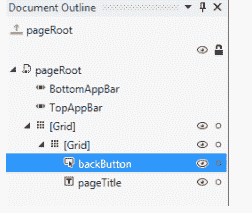

- **属性格 (Properties pane)：** 设计器中最常用的区域是属性格，默认位于屏幕右侧。当你从文档大纲格或页面视图中选择控件后，可以快速方便地更改控件的任何属性。图 2-3 显示了基本控件的属性格。注意你如何可以在不实际编写一行 XAML 的情况下修改前景（Foreground）、背景（Background）、外边距（Margins）、内容（Content）等。

- **XAML 标签页：** 为 Windows 8 开发时，你可以将控件拖入设计器并使用属性格操作它们的属性。当你遇到需要更多控制并需要直接编辑 XAML 的情况时，只需点击 XAML 标签页（如图 2-4 所示），它直接出现在你正在构建的页面的设计视图下方。

  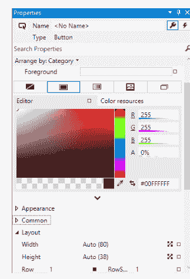

  图 2-3

  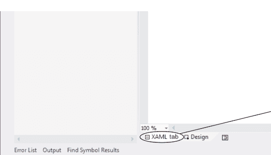

  XAML 标签页

  图 2-4

## Windows 8 控件

在第 1 章中，你接触了 Visual Studio 2012 中提供的某些 Windows 8 项目模板。你还通过查看实际 XAML 代码进行了初步尝试。当你掌握了门道后，你会发现使用 XAML 开发用户界面只需要理解少数几个核心概念。几乎所有内容都从 Windows 8 控件栈开始。几类控件可以帮助你进行布局、处理用户交互以及内容和数据的显示。让我们来看看这些类别中提供了哪些控件来帮助你制作出色的 Windows Store 应用。

### 布局控件

用户界面中最重要的概念之一是布局。如果你使用 HTML 或 CSS 创建应用，可能开始从在页面上添加 `<div>` 标签，然后向这些标签添加内容。当你设置好页面结构后，转到 CSS 样式文件定义属性，以更好地定位页面上的元素并设置外边距、内边距、背景图像等。在编写 Windows Store 应用时，你不需要担心页面在多个浏览器中运行，但即使使用最新的 HTML 5 技术，正确定位元素仍然可能棘手。相比之下，XAML 提供了几种布局控件，使内容定位和控件对齐变得轻而易举。当你创建一个页面时，XAML 提供了几种布局控件，使内容定位和控件对齐变得轻而易举。（注：原文中由于 OCR 错误存在重复，此处已进行去重和清理）。

你可以使用自动大小模式（Auto sizing mode）。将 `Height`（高度）或 `Width`（宽度）设置为 `Auto`，可以为 `Grid` 控件提供恰好的空间，使其内部设置的宽度和高度为放置在其中的内容提供足够的空间。这种方法最易于操作，因为无需猜测为 `Grid` 控件留出足够空间所需的精确像素值。

`Grid` 控件还提供了使用星号大小（Star sizing）的能力。这种尺寸概念让 `Grid` 具备了创建流式布局的能力。星号大小的好处是，行或列的高度或宽度设置为 `*`，它将使用所有剩余的可用空间来放置内容。例如，你希望 `Grid` 有一个固定为 100 像素的标题行，然后让其余内容占据页面的剩余部分。在这种情况下，你可能会得到如下 XAML：

```xml
<Grid>
  <RowDefinitions>
    <RowDefinition Height="100" />
    <RowDefinition Height="*" />
  </RowDefinitions>
</Grid>
```

如果你需要复杂的布局，这种尺寸概念将变得非常强大。现在你想要一个标题行，然后另一个高度正好是第一个内容高度两倍的行。你需要创建如下 XAML：

```xml
<Grid Margin="0" Grid.Row="1">
  <RowDefinitions>
    <RowDefinition Height="100" />
    <RowDefinition Height="*" />
    <RowDefinition Height="*" />
  </RowDefinitions>
  <Rectangle Fill="#FF4F4F4" Margin="0" Grid.Row="1" Stroke="Black" />
  <Rectangle Fill="#FF4F4F4" Margin="0" Grid.Row="2" Stroke="Black" />
  <TextBlock HorizontalAlignment="Center" Margin="0" Grid.Row="1"
    Text="#FF000000" FontSize="20">
    <!-- 此文本位于大小为 1 的行中 -->
  </TextBlock>
  <TextBlock HorizontalAlignment="Center" Margin="0" Grid.Row="2"
    FontSize="20">
    <!-- 此文本位于大小为 2 的行中 -->
    Text="#FF000000" />
  </TextBlock>
</Grid>
```

通过观察 XAML，你可以发现 `Grid` 的高度是中间行大小的两倍，这使得创建流式 `Grid` 布局变得简单。你也可以将相同的概念应用于列。

`Grid` 可能是你应用程序中最常用的布局。基于 Windows 8 的应用程序的首要目标是接触用户；灵活的基于 `Grid` 的布局通常是实现这一目标的首选方式，因此你必须掌握 XAML `Grid` 控件的一些关键点。以下示例可以帮助你熟悉 Visual Studio 2012 设计器、如何使用 `Grid` 以及如何放置控件：

1. 打开 Visual Studio 2012，使用空白应用模板创建一个名为 Grid 的 C# 新的 Windows Store 应用程序。
2. 打开 `MainPage.xml` 文件，使用 Visual Studio 2012 设计器将几个控件拖放到屏幕上。图 2-5 显示了你正尝试创建的用户界面。

   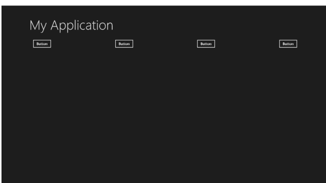

   图 2-5

3. 从工具箱中拖出一个 `Grid` 并将其放置在页面中心。当你放下 `Grid` 时，它默认会带有某些关联的自动大小设置和外边距。
4. 这个父级 `Grid` 必须占据所有剩余空间，因此转到属性面板将任何 `Margin` 值设置为 0。
5. 如图 2-6 所示，使用属性面板确保 `Grid` 的高度和宽度都设置为 `auto`。

   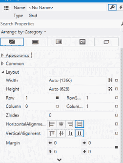

   图 2-6

> **注意：** 对于 `VerticalAlignment`（垂直对齐）和 `HorizontalAlignment`（水平对齐）属性，选中了最后一个图标。这最后一个图标代表 `Stretch`（拉伸）值。任何 XAML 控件都可以将其对齐属性设置为 `Left`、`Center`、`Right` 和 `Stretch`。`Stretch` 模式强制控件调整大小以填充其所在容器中的所有可用空间。在某些情况下，自动大小属性可以处理这个问题，但默认情况下，自动大小的 `Grid` 仅占用其内容所需的空间。在这种情况下，你希望 `Grid` 无论实际 `Grid` 内容如何，都占据其容器中的所有可用空间。

6. 定义列和行。如果你将光标悬停在 `Grid` 上，你可以看到黄色的轮廓。如果你移动到 `Grid` 顶部，黄色线条代表了可以在此处创建新列的引导。如果你点击黄色线条，你会看到 `Grid` 中添加了新列的轮廓。
7. 重复步骤 4 两次，以创建此用户界面所需的列。
8. 完成后，你可能会注意到列的宽度似乎都不相同——除非你拥有完美的视力和完全相等的列。因为你需要等宽列

   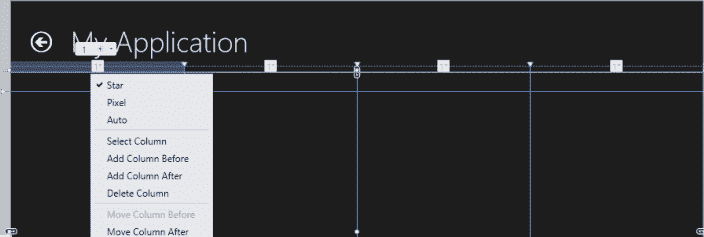

   图 2-7

9. 你必须执行类似的操作来定义所需的两个行。默认情况下，`Grid` 中已经有一行可用了；因此，你只需要将光标悬停在左侧。
10. 第一行的目标是自动的。通过悬停在 `Grid` 上，确保你的行设置为 `Auto`。
11. 在该行中添加内容。从工具箱中拖出一个 `Button` 并将其放置在其中。
12. `Button` 控件落下后，清除任何 `Margin` 并将 `HorizontalAlignment` 设置为 `Center`。
13. 通过简单的抓取可见线条来强制该行变为 `Auto`。
14. 现在你的行和列大小设置正确，你可以简单地添加剩余的 `Button` 控件。
15. 在第二行中添加一些 `HyperButton` 控件，但此时将所有控件的 `VerticalAlignment` 设置为 `Bottom`。

如果你做过任何 HTML 或 CSS 开发，并想要将项目从屏幕底部对齐，似乎取决于你开发的浏览器，这通常涉及复杂的定位。正如你所见，在 XAML 中使用 `Grid` 完成这项任务是轻而易举的。

### StackPanel

除了 `Grid` 控件外，你还可以使用 `StackPanel` 控件来帮助其他控件的放置和布局。`StackPanel` 本质上是一个按垂直或水平方向“堆叠”的容器。此控件不需要处理列或行。当你将 `StackPanel` 添加到页面时，它非常简单：你可以将 `Orientation`（方向）属性设置为 `Vertical`（垂直）或 `Horizontal`（水平），添加到 `StackPanel` 的控件将根据此自动进行布局。

由于 `StackPanel` 只是简单地将控件相邻放置，你通常必须调整 `StackPanel` 控件的 `Margin` 属性以便在控件之间留出空间。

在 XAML 中声明 `StackPanel` 如下所示：

```xml
<StackPanel Orientation="Horizontal">
  <Button Margin="5" Content="Inside StackPanel" />
  <Button Margin="5" Content="Inside StackPanel" />
</StackPanel>
```

默认情况下，`StackPanel` 以垂直方向 `Orientation` 放置对象。因此，只有在你在使用 `Horizontal` 时才需要设置此值。与 `Grid` 控件一样，你可以按照以下步骤创建一个使用 `StackPanel` 的示例项目：

1. 创建一个名为 StackPanel 的新空白 metro 项目。
2. 使用 Visual Studio 2012 设计器重新创建用户界面，如图 2-8 所示。

   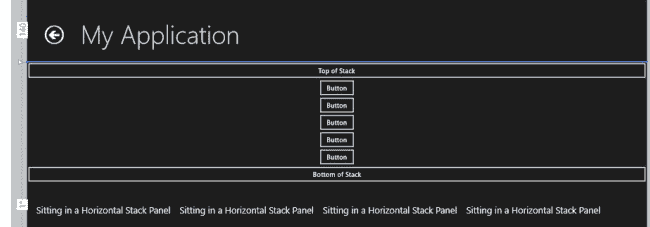

   图 2-8

   A. 从工具箱中拖入 `StackPanel` 控件到主 `Grid` 控件中，将其 `Height`/`Width` 设置为 `Auto` 并清除任何现有的 `Margin` 属性。
   B. 将 `HorizontalAlignment` 和 `VerticalAlignment` 设置为 `Stretch`。
   C. 向 `StackPanel` 添加一些 `Button` 控件，并注意由于 `StackPanel` 的默认 `Orientation` 值，它们是如何一个一个排列的。
   D. 使用属性面板（Properties）来操作所需的对齐方式和边距，使按钮看起来像图 2-10 所示。
3. 在第一个 `StackPanel` 内部拖入另一个 `StackPanel`，并将其设置为 `Auto` 高/宽以及 `Stretch` 对齐。将 `StackPanel` 放到另一个内部可能有些棘手，你可能需要通过查看文档大纲（Document Outline）或检查 XAML 代码来验证是否操作正确，查看新的 `StackPanel` 是否正确嵌套。这次在属性面板中，找到 `Orientation` 属性并将其设置为 `Horizontal`。
4. 你现在可以将 `TextBlock` 控件拖入此 `StackPanel` 中；它们应该会自动水平对齐。
5. 相应地调整每个 `TextBlock` 的 `Margin` 属性以匹配图形。完成后，使用类似下面的 XAML：

```xml
<StackPanel Margin="0" Grid.Row="1" HorizontalAlignment="Stretch" />
<Button Content="Top of Stack" HorizontalAlignment="Center" />
<Button Content="Button" HorizontalAlignment="Center" />
<Button Content="Button" HorizontalAlignment="Center" />
<Button Content="Button" HorizontalAlignment="Center" />
<Button Content="Button" HorizontalAlignment="Center" />
<Button Content="Bottom of Stack" HorizontalAlignment="Stretch" VerticalAlignment="Stretch" />
<StackPanel Orientation="Horizontal">
  <TextBlock Text="Sitting in a Horizontal Stack Panel" Margin="20,50,0,50" FontSize="20" />
  <TextBlock Text="Sitting in a Horizontal Stack Panel" Margin="20,50,0,50" FontSize="20" />
  <TextBlock Text="Sitting in a Horizontal Stack Panel" Margin="20,50,0,50" FontSize="20" />
</StackPanel>
</StackPanel>
```

`StackPanel` 为你提供了另一种工具，用于在可能不需要实际行和列的情况下辅助控件的布局。有时会使用一个内部 `Grid` 作为顶层控件，然后添加 `StackPanel` 控件来处理控件的内部定位。也可以使用 `StackPanel` 控件将一组控件对齐到屏幕区域的右侧或左侧。

### Canvas

你看到的 XAML 中的两个主要布局控件都使用了某种形式的相关定位。这种定位允许类似于表格的布局，可以根据屏幕大小进行调整，而无需你添加任何额外工作。然而，有时你可能会发现需要使用一种接近于控件绝对定位的方法。在这种情况下，你希望拖放一个控件，无论屏幕大小或周围的其他对象发生什么变化，它都保持在那里。例如，你可能正在创建一个绘画程序，并允许在屏幕上进行特定的对象绘制。显然，`Grid` 或 `StackPanel` 无法提供你想要的功能。

对于这些绝对定位类型的场景，请使用 `Canvas` 控件，它是一个像油板画布一样工作的简单控件。`Canvas` 不依赖于拖放到其上的控件的 `Margin` 和各种对齐属性，而是使用 `Top` 和 `Left` 来确定对象在屏幕上的显示位置。在图 2-9 中你将看到 `TextBlock` 控件被拖放到 `Canvas` 控件上。`Top` 和 `Left` 属性将对象精确地放置在屏幕上你想要的位置。

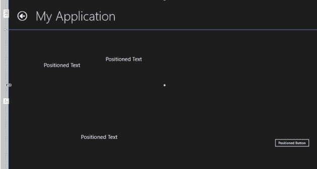

**图 2-9** 以下代码显示了此布局所需的 XAML。你可以使用附加属性 `Canvas.Top` 和 `Canvas.Left` 在 `Canvas` 内部实际定位对象。

```xml
<Canvas Grid.Row="1">
  <Button Content="Positioned Button" Canvas.Left="116" Canvas.Top="478"/>
  <TextBlock Text="Positioned Text" Canvas.Left="154" Canvas.Top="142" FontSize="24"/>
  <TextBlock Text="Positioned Text" Canvas.Left="425" Canvas.Top="116" FontSize="24"/>
  <TextBlock Text="Positioned Text" Canvas.Left="317" Canvas.Top="458" FontSize="24"/>
</Canvas>
```


# Canvas 的另一种可能用途

Canvas 的另一种可能用途是为 Windows 8 创建一个简单的游戏。Canvas 控件为你提供了一个放置形状和图像的区域，由于有了附加的 `Left` 和 `Top` 属性，它提供了移动它们的任何方式。

## Scroll

最后一个要介绍的布局控件是 `ScrollViewer`，它的名称不言自喻；它作为任何可能溢出屏幕部分的容器。如果发生溢出，用户界面上将添加滚动条，用户可以滚动 `ScrollViewer` 中包含的内容。

`ScrollViewer` 可以根据你的偏好处理垂直或水平滚动。当你向应用程序中添加大量内容时，就会使用此控件；取决于设备，你可能在起始标签和结束标签之间添加你的内容。为了了解它如何工作，你可以按照以下步骤创建一个使用 `ScrollViewer` 的示例：

1. 创建一个名为 ScrollViewer 的新空白项目。
2. 使用 Visual Studio 2012 设计器重新创建用户界面。
3. 在 `Grid` 中拖入 `ScrollViewer` 控件。
4. 向 `ScrollViewer` 中拖入多个 `TextBlock` 控件，直到它们溢出边界。
5. 运行程序并观察滚动条的出现。
6. 在属性面板将 `ScrollBarVisibility` 属性设置为 `Visible`，这将始终显示滚动条。
7. 将 `VerticalScrollBarVisibility` 属性设置为 `Hidden`，这将隐藏垂直滚动条。
8. 将 `HorizontalScrollBarVisibility` 属性设置为 `Visible`，这将显示水平滚动条。
9. 将两个属性都设置为 `Auto`，只有在溢出时才会出现。
10. 将两个都设置为 `Disabled`，这将禁用所有滚动功能。

# 第 2 章 什么是 XAML？

如果你构建并运行该应用程序，你应该能看到正确的滚动条出现。鼠标滚支持再次生效，允许你轻松滚动查看 `Button`（按钮）控件。

此外，`ScrollViewer` 具有允许你处理平移和缩放效果的功能，这为向用户显示内容提供了更多选项。`ScrollViewer` 的平移和缩放效果将在下一节介绍，那时你将学习更多关于语义缩放（semantic zoom）以及在 Windows Store 应用中支持它对内容是有用的。

## 操作控件 (Action Controls)

在掌握了如何在 XAML 中整合各种布局之后，你应该转向用户可以交互的某些控件，例如 `Button`、`TextBox`、`CheckBox` 等。因为 Windows Store 应用程序应该具有一致的用户体验，你所需的所有控件在 WinRT 中都可用。如果你来自 WinForms 或 ASP.NET 背景，你已经熟悉了代码页（code page）的概念。代码后置页面（code behind page）是你为交互式控件放置事件处理程序并编写管理这些控件所需的逻辑的地方。

在 XAML 中，你同样有相同的代码后文件概念，用于放置控件事件处理代码。在第 8 章“地理位置”中，你可以看到一种处理控件事件的新方法，这种方法通过 Silverlight 开发成为可能，并成为未来 Windows Store 应用不可或缺的一部分，称为模型-视图-视图模型（MVVM）。此程序仅适用于支持数据绑定（Data Binding）概念的界面语言，你将在下一节中看到它。MVVM 开发变得流行，是因为它将你的界面与实际业务逻辑分离开，甚至为你提供了一种在不编写传统处理程序的情况下，自动更新和刷新用户界面的方法。现在，我们将查看使用代码后置页面与 XAML 控件交互的默认行为，并查看 WinRT 哪些类型的交互式控件。

### TextBlock

`TextBlock` 是 XAML 中提供的最基础控件。它有一个目的，即在屏幕上显示文本。它等同于 ASP.NET 中的普通 `<div>` 标签或 `Label`。虽然大多数 XAML 控件使用 `Content` 属性来确定显示的内容，但 `TextBlock` 使用的是 `Text` 属性，因为控件的唯一输出是文本。以下是声明基础 `TextBlock` 的 XAML 代码：

```xml
<TextBlock Text="This is some text" />
```

### TextBox

`TextBox` 是一种数据输入控件，允许你捕获用户的输入。与上一个类似，该控件使用 `Text` 属性来显示输入的文本。`Text` 属性是可读写的，但你通常在此控件中捕获输入并用于其他地方。以下是创建基础 `TextBox` 控件的 XAML 代码：

```xml
<TextBox Text="" />
```

### Button

`Button` 控件（你已在本节见过它）允许用户点击或触摸以执行操作。在 XAML 中声明 `Button` 控件实例时，你可以使用 `Content` 属性来决定按钮中显示的文本。以下代码定义了一个基础 XAML `Button` 控件：

```xml
<Button x:Name="StandardButton" Content="Create Message" />
```

使用 `Button` 控件的主要目的通常是执行某种用户界面操作。具体来说，你可以处理 `Button` 控件的 `Click` 事件并在代码处理程序中执行某些逻辑。要查看 `Button` 和其他控件的所有可用用户界面事件，请点击 Visual Studio 属性面板中的闪电图标，如图 2-11 所示。

在展开事件列表后，你可以找到 `Click` 事件并双击在代码中生成事件处理程序，或者输入你想要使用的处理程序的方法名称。你可以使用 `Button` 事件来操作用户界面的另一个区域。

现在我们将查看另一个简单示例：

1. 在 Visual Studio 中创建一个新项目 `ActionControls`，并使用 `Basic Page` 模板添加新页面 `Controls.xaml`。执行此操作后，你将看到一个警告，提示几个必要的文件将自动添加到项目中。请继续允许，因为这些文件对于提供你将在示例中使用的基础页面导航等功能是必要的。此页面可以托管你在本章节其余使用的所有控件的基础页面。不要忘记在 `App.xaml.cs` 中通过 `Loaded` 事件处理程序设置此页面在启动时加载。
2. 为了获得布局，在页面上 `Grid` 的主行中添加一个 `StackPanel` 控件。
3. 将 `Orientation` 设置为 `Horizontal`（水平），然后按正确顺序将控件拖入 `StackPanel`：`TextBlock`、`TextBox` 和 `Button`。
4. 控件释放后，查看代码的 XAML 视图，确保它看起来如下代码所示：

```xml
<StackPanel Margin="0,20,0,0" Orientation="Horizontal"
VerticalAlignment="Top" Grid.Row="1">
<TextBlock HorizontalAlignment="Center" TextWrapping="Wrap"
Text="Enter your name:"
VerticalAlignment="Center" FontSize="20"
Margin="20,0,0,0"/>
<TextBox x:Name="PullName" HorizontalAlignment="Center"
TextWrapping="Wrap" VerticalAlignment="Center"
Width="200" Margin="20,0,0,0"/>
<Button x:Name="CreateButton" Content="Create Message"
HorizontalAlignment="Center" VerticalAlignment="Center" Click="CreateButton_Click"/>
<TextBlock x:Name="StatusText" HorizontalAlignment="Center"
VerticalAlignment="Center" Margin="20,0,0"/>
</StackPanel>
```

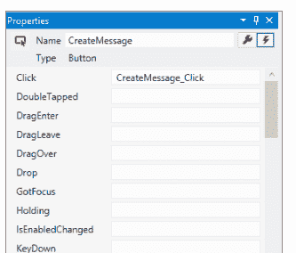

图 2-11

## Windows 8 控件

```xml
<Page.Resources>
<!-- TODO：如果 App.xaml 中声明了键名 AppName，请删除此行 -->
<x:String x:Key="AppName">我的应用程序</x:String>
</Page.Resources>
```

```xml
<!---
此网格（grid）作为页面的根面板，定义了：
第 0 行包含返回按钮和页面标题
第 1 行包含页面的其余布局
-->
```

```xml
<Grid Style="StaticResource LayoutStyle">
  <Grid.RowDefinitions>
    <RowDefinition Height="140"/>
    <RowDefinition Height="*"/>
  </Grid.RowDefinitions>
```

```xml
<!-- 返回按钮和页面标题 -->
<Grid>
  <Grid.ColumnDefinitions>
    <ColumnDefinition Width="Auto"/>
    <ColumnDefinition Width="*"/>
  </Grid.ColumnDefinitions>
  <Button x:Name="BackButton" Click="GoBack" Style="StaticResource BackButtonStyle">
```

```xml
<TextBlock x:Name="Title" Grid.Column="1" Style="StaticResource HeaderTitleStyle"/>
<TextBlock Margin="20,0,0,0" Grid.Row="1" TextWrapping="Wrap" Text="此页面包含链接内容" FontSize="20" HorizontalAlignment="Top"/>
```

```xml
<VisualStateManager.VisualStateGroups>
```

```xml
<!-- 视觉状态反映了应用程序的状态 -->
<VisualStateGroup x:Name="ApplicationViewStates">
  <VisualState x:Name="FullScreenLandscape"/>
  <VisualState x:Name="Filled"/>
```

```xml
<!-- 整个页面遵循竖屏下更窄的 100 像素边距惯例 -->
<VisualState x:Name="FullScreenPortrait">
  <Storyboard>
    <ObjectAnimationUsingKeyFrames Storyboard.TargetName="BackButton" Storyboard.TargetProperty="Style" Value="StaticResource BackButtonStyle" KeyTime="0"/>
  </Storyboard>
</VisualState>
```

<!-- 返回按钮和标题在吸附（Snapped）时具有不同的样式 -->

```xml
<VisualState x:Name="Snapped">
  <Storyboard>
    <ObjectAnimationUsingKeyFrames
      Storyboard.TargetName="backButton" Storyboard.TargetProperty="Style">
      <DiscreteObjectKeyFrame Time="0" Value="StaticResource SnappedButtonStyle"/>
    </ObjectAnimationUsingKeyFrames>
    <ObjectAnimationUsingKeyFrames
      Storyboard.TargetName="pageTitle" Storyboard.TargetProperty="Style">
      <DiscreteObjectKeyFrame Time="0" Value="StaticResource SnappedPageHeaderTextStyle"/>
    </ObjectAnimationUsingKeyFrames>
  </Storyboard>
</VisualState>
</VisualStateGroup>
</VisualStateManager.VisualStateGroups>
<Grid>
</Grid>
```

5. 随着项目中增加了新页面，你必须为 `HyperlinkButton` 的 `Click` 事件添加代码。在以下代码中，你只是利用当前 `Frame` 对象的 `Navigate` 方法来创建 `HyperlinkedPage` 的实例并导航到那里。

```csharp
private void InnerLink_Click(object sender, RoutedEventArgs e)
{
    this.Frame.Navigate(typeof(HyperlinkedPage));
}
```

你可以在第 4 章“Windows 8 用户界面最后的润色”中了解此 `Navigate` 方法的工作原理以及 `Frame` 控件是什么，在该章节中你将学习 WinRT 导航系统。现在，只需知道你可以加载新页面并将用户重定向过去。如果你在模拟器中生成并运行应用，你应该看到你的 `HyperlinkButton` 控件。用鼠标点击 `HyperlinkButton`，你将被重定向到新页面，如图 2-12 所示。

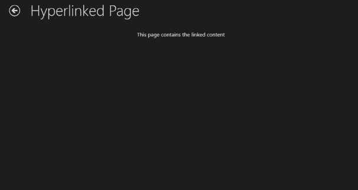

图 2-12

## 外部链接导航

除了链接到应用程序中的内部页面外，你还可以使用 `HyperlinkButton` 从外部资源加载内容。如果你查看 `HyperlinkButton` 的可用属性，会看到一个名为 `NavigateUri` 的属性。在基于 Silverlight 的应用程序中，只需将此属性设置为 URL 即可重定向到外部页面。因为 Silverlight 始终在浏览器上下文中运行，这种方法效果良好。然而在 Windows Store 应用中，你并不是在浏览器中运行，而是在完整的厚客户端应用上下文中运行。在该属性中设置 URL 将无法得到你想要的结果。相反，你应该处理该事件。

此例中你想使用的启动器（Launcher）是默认系统启动器，它提供名为 `LaunchUriAsync` 的方法。你可以使用此方法将用户重定向到任何外部 URL 资源。它是通过启动浏览器实例并加载指定页面来实现的。通过此代码，该方法允许用户通过默认浏览器访问 http://www.wiley.com。

```csharp
private void Outerlink_Click(object sender, RoutedEventArgs e) {
    LaunchBrowser();
}

async void LaunchBrowser() {
    var success = await Windows.System.Launcher.LaunchUriAsync(new Uri("http://www.wiley.com"));
}
```


你可能对示例中使用的语法感到好奇。因为 `LaunchUriAsync` 方法在本质上是异步的，你需要使用 `await` 关键字并将 `Launcher` 的调用封装在一个标记为 `async` 的方法中。`await` 关键字允许你进行异步调用但将其视为同步处理。（由于 OCR 错误重复）

### ComboBox

注意 `ComboBox` 对象如何使用 `Content` 属性来确定显示内容。要确定默认选中项，可以设置 `IsSelected` 属性。如果你想在做出选择时收到通知并执行逻辑，可以挂接 `SelectionChanged` 事件。此程序提供了 `AddedItems` 让你提取 `ComboBox`：

```csharp
private void BasicCombo_SelectionChanged(object sender, SelectionChangedEventArgs e)
{
  ComboBox selectedItem = e.AddedItems[0] as ComboBox;

  if (selected != null && SelectedComboItem != null)
    SelectedItemItem.Text = String.Format("选中项目: {0}",
    selected.Content);
}
```

当用户在 `ComboBox` 中选择时，提取出的类型是 `object`。这与在 ASP.NET 和 WinForms 中实现 `ComboBox` 控件的方式有不同。在这种情况下，你静态声明内容为 `ComboBoxItems`，你可以安全地将选择转换为类型并使用更多 `Content` 属性。

# 第 2 章 什么是 XAML？

```csharp
private void LoadBooks()
{
    List<Book> books = new List<Book>();

    books.Add(new Book { Author = "", Title = "Please Select A Book", ID = -1 });
    books.Add(new Book { Author = "Nick Lecinski", Title = "Silverlight 4.0 Problem Design Solution", ID = 1 });
    books.Add(new Book { Author = "Doug Holland", Title = "Professional Windows 8 Metro Development", ID = 2 });
}
```

此时，你已经拥有了一个 `Book` 对象集合，其中包含一个代表默认选择的虚拟对象，该对象仅告诉用户需要选择一本书。

- 给它一个 ID 为 -1，这样你就可以轻松将其与有效的 `Book` 对象区分来。
- 你需要使用 `ComboBox` 来使用这些对象集合，并确保默认选中该虚拟对象。在下面的代码中，你可以通过将 `ItemsSource` 属性设置为 `Book` 对象集合，并将 `SelectedIndex` 设置为代码中的正确值来实现这一点。

```csharp
AdvancedCombo.ItemsSource = books;
AdvancedCombo.SelectedIndex = 0;
```

- 你需要告诉 `ComboBox` 控件应该使用 `Book` 类的哪个属性来包含显示的内容。直接在 `ComboBox` 的 XAML 声明中使用 `DisplayMemberPath` 属性来完成此操作。下面的代码显示了更新后的 XAML：

```xml
<ComboBox xName="AdvancedCombo" DisplayMemberPath="Title" SelectionChanged="AdvancedCombo_SelectionChanged" />
```

由于你想在做出选择时执行某些操作，因此之前的代码中还使用了事件处理器。`DisplayMemberPath` 是一个强大的机制，让你能够轻松地使用自定义的业务对象来填充 `ComboBox`。正如你在下一章中看到的，可以使用数据绑定进一步利用该控件，以减少设置代码。

- 剩下的工作就是查看如何在做出选择时获取被选中的 `Book` 对象。在下面的事件处理器中，使用了 `AddedItems` 集合来获取被选中的 `ComboBoxItem`；然而，它可以安全地强制转换为 `Book` 类型。现在你已经有了一个 `Book` 对象，可以使用 `ID` 属性来向用户通报所做的选择。

```csharp
private void AdvancedCombo_SelectionChanged(object sender, SelectionChanged e)
{
    Book selected = e.AddedItems[0] as Book;

    if (selected.ID > 0)
        AdvancedComboSelectedValue.Text =
        String.Format("Selection: {0} Author - {1}", selected.Title, selected.Author);
    else
        AdvancedComboSelectedValue.Text = "";
}
```

### RadioButton 单选按钮

`RadioButton` 控件与 `ComboBox` 控件类似，它们为用户提供一组选择/选项。与仅显示选中选项的 `ComboBox` 控件不同，一组 `RadioButton` 控件通常会在屏幕上同时呈现所有选项。下面的代码显示了向用户界面添加 `RadioButton` 所需的基础 XAML。

与大多数控件一样，`Content` 属性决定了与实际 `RadioButton` 控件一起显示的文本。`RadioButton` 还提供了一个 `IsChecked` 属性来设置默认选中状态。虽然使用 `RadioButton` 只选择一个选项是完全有效的，但当你有一组此类控件时，它非常有用。`RadioButton` 组最常见的场景是为用户提供选项列表，但一次只允许选择一个。这意味着如果用户选择了另一个 `RadioButton` 控件，当前选中的项将变为取消选中。XAML 的 `RadioButton` 完全支持这一点，并通过使用 `GroupName` 属性来实现。在下面的示例中，用户界面添加了三个控件，通过将 `GroupName` 属性设置为相同的值，在三个 `RadioButton` 中只能选择一个选项。

```xml
<RadioButton Content="1" GroupName="Options" IsChecked="True"/>
<RadioButton Content="2" GroupName="Options"/>
<RadioButton Content="3" GroupName="Options"/>
```

### Slider 滑块

当你想要增加/减少特定值时，`Slider` 控件是用户界面中非常有用的控件。在声明 `Slider` 控件时，你需要设置 `Minimum` 和 `Maximum` 属性以符合你的场景。默认情况下，它们分别是 0 和 100。下面的 XAML 显示了一个范围从 0 到 500 的基础 `Slider` 控件。

```xml
<Slider x:Name="MainSlider" Minimum="0" Maximum="500" />
```

为了在用户移动滑块时捕获选择的值，你可以为 `ValueChanged` 事件实现一个事件处理器。在下面的代码中，`Value` 属性决定滑块停止的位置；默认情况下，`Value` 属性是 `double` 类型，如果你需要精确测量，可以将其强制转换为 `int`。

```csharp
private void MainSlider_ValueChanged(object sender, RangeBaseValueChangedEventArgs e)
{
    MainSlider.Text = String.Format("Slider Value: {0}", (int)MainSlider.Value);
}
```

`Slider` 控件还包含几个可以更改控件外观的属性。例如，如果你使用 `Slider` 在用户与控件交互时显示标记，将 `TickFrequency` 属性设置为非零值。你还可以通过 `TickPlacement` 属性控制标记的位置。该属性的值包括 `Inline`、`TopLeft`、`BottomRight` 和 `Outside`。

### Image

你可以使用 `Image` 控件来显示图像。下面的 XAML 显示了如何从本地资源包含图像：

```xml
<Image xName="MyImage" Source="Assets/logo.png" />
```

`Image` 控件还有一个 `Stretch` 属性，允许你控制如何在可用空间内调整图像大小。常见值包括 `Fill`、`Uniform`、`UniformToFill` 和 `UniformToFit`。

### 总结

在本章结束，如果你从未见过或听过 XAML，你现在应该已经很了解如何开始使用 XAML 创建强大的 Windows 8 用户界面。如果你过去使用过 XAML，本章将为你快速复习一些基础知识。本章展示了可以在 XAML 中创建的一些基础 WinRT 控件，以及用于操作和控制界面的事件处理机制。

除了理解在界面中使用的各种基础控件外，你还应该对布局控件有良好的理解，例如 `Grid`、`StackPanel` 和 `Canvas`。理解 `Grid` 控件对于本书后续章节创建用户界面至关重要。你应该知道如何向 `Grid` 添加行和列，以及如何根据 `Grid` 包含的控件来调整大小。你已经看到 `Grid` 控件支持基于 Auto（自动）、Pixel（像素）和 Star（星型）的算法，这为你创建流式表格布局提供了足够的灵活性。你还看到，当你需要创建一个使用绝对定位机制的布局时，`Canvas` 控件比 `Grid` 更加合适。


下一章以及本书的其余部分要求你理解 XAML 的基础知识、控件事件处理以及各种布局控件。你将看到 WinRT 和 Windows Store 应用中提供的更强大的控件，并将引入数据绑定（`Data Binding`）的概念，这可以帮助你进一步减少后台代码（`code behind`）所需的代码量。你将看到如何使用几个 Windows 8 数据控件来帮助你从各种数据源向用户展示内容。

如果你现在对自己的 XAML 能力很有信心，请继续前进；如果没有，不要犹豫，参考本章中的一些示例，以实地感受如何利用诸如 `Button`、`TextBlock`、`Grid`、`StackPanel` 和 `TextBox` 等控件。这将为你今后创建的界面奠基础。

# 第 3 章：使用控件样式、数据绑定和语义缩放增强你的应用

**本章包含内容：**

- 理解控件样式
- 通过数据绑定连接你的用户界面控件
- 如何使用各种数据绑定控件
- 使用语义缩放（`Semantic Zoom`）处理大量项目
- 如何创建你自己的自定义控件

**本章的 WROX.COM 代码下载**

你可以在 `www.wrox.com/remtitle.cgi?isbn=118205707` 的下载（`Download`）选项卡中，找到本章的 wrox.com 代码文件 `205709 C03.zip`。

## 自定义你的应用

在上一章中，你学习了 XAML 用户界面语言，并学习了如何使用标准的 Windows 8 XAML 控件创建基础用户界面。你现在应该已经熟悉如何使用各种布局控件，如 `Grid`、`StackPanel` 和 `Canvas`。你还应该理解如何通过后台代码文件中适当的控件事件处理方法来处理各种控件事件。本章将这些基础知识进一步向前迈进，并向你介绍 XAML 的一些额外功能，这些功能可以帮助你减少编写的代码并为你的 Windows Store 应用提供更强大的用户界面。

在本章中，你将看到如何使用样式（`style`）来自定义标准控件。它向你介绍了数据绑定的主题，这使你能够用极少的代码创建动态且以数据为中心的用户界面。在你良好掌握了数据绑定概念后，你将创建自定义控件，这些控件可以在标准的 Windows 8 控件之外使用。知道如何构建自定义控件允许你轻松地复用用户界面元素，并支持适用于控件属性的自定义绑定。

在你良好掌握了控件样式、数据绑定和消费之后，你将看到如何利用 Windows 8 中的新控件。`ListView` 和 `GridView` 设计用于通过强大的数据绑定进行数据展示，方便开发者（即你）向用户展示数据列表和信息。你还将看到如何在使用 `GridView` 时使用语义缩放（`SemanticZoom`）功能，帮助用户轻松导航通过大型数据列表。

## 控件样式化

当你开始为 Windows 8 创建用户界面时，你通常会将布局控件（如 `Grid` 或 `StackPanel`）放置在设计区域上，并在屏幕上添加基础控件。你可能有一个 `TextBlock` 来显示某些文本，或者有一个 `TextBox` 来收集用户输入。你可能已经注意到，将控件拖放到设计区域后，它们默认具有某种外观和感觉。在上一章中，你使用 Visual Studio 2012 中的属性面板来调整各种属性，例如字体（`Font`）、字体大小（`FontSize`）、边距（`Margin`）等。对于简单演示程序中的控件这样做是不理想的且耗时的。尝试对于具有不同页面的复杂用户界面这样做将变成一项繁琐的任务。

如果你有任何 Web 开发背景，你一定熟悉层级样式表（`CSS`）以及它们对特定网页上的控件和元素应用样式的能力。`CSS` 的美之处在于你可以创建一组属性，并使用给定的选择器（如类或 ID）将其应用于页面上所有的 HTML 元素。XAML 通过控件样式提供了类似的概念。控件样式与 `CSS` 相似之处在于，你可以创建一个样式并将其应用于特定的 XAML 控件实例，或者以适用于所有 XAML 控件实例的通用方式来创建它。本节将检查控件样式的基本示例。

## 理解基础样式

图 3-1 显示了一个由几个 `TextBlock` 和 `TextBox` 控件组成的简单用户界面。两个 `TextBox` 控件必须具有相同的宽度，并且 `TextBlock` 和 `TextBox` 控件的 `FontSize` 已调整得更高。

www.it-ebooks.info

### 基础样式


图 3-1

除了控件字体和宽度外，还有其他共同属性——例如 `TextBlock` 和 `TextBox` 控件的文本颜色、对齐方式甚至 `Margin` 属性。在这种情况下，这组控件的完整 XAML 声明如下：

```xml
<Grid Margin="0" Row="1">
  <TextBlock HorizontalAlignment="Left" Margin="65,53,0,0"
    TextWrapping="Wrap" Text="First Name" VerticalAlignment="Top"
    FontSize="20"/>
  <TextBox HorizontalAlignment="Left" Margin="193,53,0,0"
    TextWrapping="Wrap" Text="TextBox" VerticalAlignment="Top"
    Width="200"/>
  <TextBlock HorizontalAlignment="Left" Margin="65,93,0,0"
    TextWrapping="Wrap" Text="Last Name" VerticalAlignment="Top"
    FontSize="20"/>
  <TextBox HorizontalAlignment="Left" Margin="193,93,0,0"
    TextWrapping="Wrap" Text="TextBox" VerticalAlignment="Top"
    Width="200"/>
</Grid>
```

正如你所看到的，这里有很多如 `TextWrapping`、`VerticalAlignment`、`HorizontalAlignment` 等共同属性。如果你想在页面上添加另一个条目，你需要再次调整这些值。然而，使用控件样式会让整个过程变得简单得多。

```xml
<Style x:Key="BasicTextBlockStyle" TargetType="TextBlock">
  <Setter Property="HorizontalAlignment" Value="Left"/>
  <Setter Property="VerticalAlignment" Value="Top"/>
  <Setter Property="TextWrapping" Value="Wrap"/>
  <Setter Property="FontSize" Value="20"/>
</Style>

<Style x:Key="BasicTextBoxStyle" TargetType="TextBox">
  <Setter Property="HorizontalAlignment" Value="Left"/>
  <Setter Property="VerticalAlignment" Value="Top"/>
  <Setter Property="TextWrapping" Value="Wrap"/>
  <Setter Property="Width" Value="200"/>
</Style>
```

```xml
<Page.Resources>
  <!-- 样式资源定义 -->
</Page.Resources>
<!--
此 grid 当页面的根面板，定义了两个行：
* 行 0 包含返回按钮和页面标题
* 行 1 包含页面的其余布局
-->
<Grid Style="{StaticResource LayoutRootStyle}">
  <Grid.RowDefinitions>
    <RowDefinition Height="140"/>
    <RowDefinition Height="*"/>
  </Grid.RowDefinitions>
</Grid>
```

```xml
<!-- 返回按钮和页面标题 -->
<Grid>
  <Grid.ColumnDefinitions>
    <ColumnDefinition Width="Auto"/>
    <ColumnDefinition Width="*"/>
  </Grid.ColumnDefinitions>
  <Button x:Name="BackButton" Click="GoBack"
    IsEnabled="{Binding Frame.CanGoBack, ElementName=pageRoot}"
    Style="{StaticResource BackButtonStyle}"/>
  <TextBlock x:Name="PageTitle" Grid.Column="1"
    Text="{StaticResource PageHeader}"
    Style="{StaticResource HeaderTextStyle}"/>
</Grid>
<Grid Margin="0" Grid.Row="1">
  <TextBlock Margin="65,53,0,0" Text="First Name" Style="{StaticResource BasicTextBlockStyle}"/>
  <TextBox Margin="193,53,0,0" Text="" Style="{StaticResource BasicTextBoxStyle}"/>
  <TextBlock Margin="65,93,0,0" Text="Last Name" Style="{StaticResource BasicTextBlockStyle}"/>
  <TextBox Margin="193,93,0,0" Text="" Style="{StaticResource BasicTextBoxStyle}"/>
</Grid>
```

```xml
<VisualStateManager.VisualStateGroups>
  <!--
  视觉状态反映应用程序的视图状态 -->
  <VisualStateGroup x:Name="ApplicationViews">
    <VisualState x:Name="FullScreenLandscape"/>
    <VisualState x:Name="Filled"/>
    <!-- 整个页面遵循竖屏模式下较窄的 100 像素边距惯例 -->
    <VisualState x:Name="FullScreenPortrait">
      <Storyboard>
        <ObjectAnimationUsingKeyFrames
          Storyboard.TargetName="backButton" Storyboard.TargetProperty="Style">
          <DiscreteObjectKeyFrame KeyTime="0"
            Value="{StaticResource PortraitBackButtonStyle}"/>
        </ObjectAnimationUsingKeyFrames>
      </Storyboard>
    </VisualState>
    <!-- 吸附 -->
    <!-- 当返回按钮和标题具有不同样式时： -->
    <VisualState x:Name="Snapped">
      <Storyboard>
        <ObjectAnimationUsingKeyFrames
          Storyboard.TargetName="backButton" Storyboard.TargetProperty="Style">
          <DiscreteObjectKeyFrame KeyTime="0"
            Value="{StaticResource SnappedBackButtonStyle}"/>
        </ObjectAnimationUsingKeyFrames>
        <ObjectAnimationUsingKeyFrames
          Storyboard.TargetName="pageTitle" Storyboard.TargetProperty="Style">
          <DiscreteObjectKeyFrame KeyTime="0"
            Value="{StaticResource SnappedPageTextStyle}"/>
        </ObjectAnimationUsingKeyFrames>
      </Storyboard>
    </VisualState>
  </VisualStateGroup>
</VisualStateManager.VisualStateGroups>
</Grid>
</common:LayoutAwarePage>
```

在提取并输出样式信息后，通用代码简化为以下代码：

```xml
<Grid Margin="0" Grid.Row="1">
  <TextBlock Margin="65,53,0,0" Text="First Name" Style="{StaticResource BasicTextBlockStyle}"/>
  <TextBox Margin="193,53,0,0" Text="" Style="{StaticResource BasicTextBoxStyle}"/>
  <TextBlock Margin="65,93,0,0" Text="Last Name" Style="{StaticResource BasicTextBlockStyle}"/>
  <TextBox Margin="193,93,0,0" Text="" Style="{StaticResource BasicTextBoxStyle}"/>
</Grid>
```

如你在 `Page.Resources` 部分所示，以下代码详细说明了实现该效果所需的样式：

```xml
<Style x:Key="BasicTextBlockStyle" TargetType="TextBlock">
  <Setter Property="HorizontalAlignment" Value="Left"/>
  <Setter Property="VerticalAlignment" Value="Top"/>
  <Setter Property="TextWrapping" Value="Wrap"/>
  <Setter Property="FontSize" Value="20"/>
</Style>

<Style x:Key="BasicTextBoxStyle" TargetType="TextBox">
  <Setter Property="HorizontalAlignment" Value="Left"/>
  <Setter Property="VerticalAlignment" Value="Top"/>
  <Setter Property="TextWrapping" Value="Wrap"/>
  <Setter Property="Width" Value="200"/>
</Style>
```

XAML 中的 `Style` 标签用于设置一组应用于特定控件或多个控件的新样式的声明。通过添加 `x:Key` 属性，你创建了一个具名的样式。这意味着该样式仅适用于你使用该特定样式的控件。在上一个示例中，通过以下代码设置 `TextBlock` 或 `TextBox` 的 `Style` 属性实现了此点：

```xml
Style="{StaticResource BasicTextBlockStyle}"
```

`StaticResource` 语法告诉系统寻找名为 "BasicTextBlockStyle" 的声明样式并将其应用到此控件上。系统会在当前页面所在的 `Page.Resources`、`App.xaml` 以及任何嵌入的字典（`Dictionary`）文件中搜索。

> **注意**：除了 `x:Key` 属性外，`TargetType` 属性还设置为样式应适用的控件类型。在示例中，这些被设置为 `TextBlock` 和 `TextBox`，但你也可以为任何其他标准 XAML 控件创建样式。

### 跨应用程序引用样式

在应用程序中，你可能需要创建不同的样式。使用 `App.xaml` 来包含它们。

```xml
<Application
  xmlns="http://schemas.microsoft.com/winfx/2006/xaml/presentation"
  xmlns:x="http://schemas.microsoft.com/winfx/2006/xaml">
  <Application.Resources>
    <ResourceDictionary>
      <ResourceDictionary.MergedDictionaries>
        <!-- 定义平台共同外观和感受的样式
        Visual Studio 项目和项目模板需要 -->
        <ResourceDictionary Source="Common/StandardStyles.xaml"/>
        <ResourceDictionary Source="BasicStyleDictionary.xaml"/>
      </ResourceDictionary.MergedDictionaries>
    </ResourceDictionary>
  </Application.Resources>
</Application>
```

## 使用 Microsoft 的默认样式

正如你所想象的，引用样式为控件样式以及在整个应用程序中重用这些样式提供了许多可能性。Windows 8 项目模板通常包含许多推荐的样式定义，你可以通过它们访问各种控件。为了在 Windows Store 应用中保持一致的用户界面，Microsoft 提供了这些默认样式，并鼓励你尽可能使用它们。列表 3-4 显示了你可以使用的某些 Windows 8 默认样式。如果你使用 `BasicPage` 模板为应用程序添加新页面，这些样式将通过 `StandardStyles.xaml` 文件自动添加到你的项目中。

## 列表 3-4：第 3 章\ControlStyling\Common\StandardStyles.xaml

```xml
<ResourceDictionary
  xmlns="http://schemas.microsoft.com/winfx/2006/xaml/presentation"
  xmlns:x="http://schemas.microsoft.com/winfx/2006/xaml">
  <!-- 此文件包含简化应用程序开发的 XAML 样式。 -->
  
  <!-- 跨主题异的非画刷样式 -->
  <ResourceDictionary.ThemeDictionaries>
    <ResourceDictionary x:Key="Default">
      <String x:Key="BackButtonGlyph">&#xE071;</String>
      <String x:Key="ButtonSnappedGlyph">&#xE0BA;</String>
    </ResourceDictionary>
  </ResourceDictionary.ThemeDictionaries>
</ResourceDictionary>
```

这些样式不仅方便，而且是 Visual Studio 项目和项目模板要求的。删除、重命名或其他方式修改这些文件的内容可能会导致项目无法运行，或者在添加额外页面后无法生成。如果需要这些样式的变体，建议将内容复制到新名称下并修改你的私有副本。

### 控件样式


# 数据绑定

在使用 XAML 时，Store 应用中的另一个重要概念是数据绑定。在上一章中，你学习了如何构建数据输入表单。自然，当你开始使用数据时，这个过程变得更加复杂。

## 理解数据输入

图 3-3 显示了一个由名字、姓和电子邮件组成的数据输入表单。现在假设你想从数据库填充它。


## 列表 3-5：第 3 章\DataBinding\Data\Person.cs

```csharp
namespace DataBinding.Data
{
    public class Person
    {
        public string FirstName { get; set; }
        public string LastName { get; set; }
        public string Email { get; set; }
    }
}
```

## 将对象绑定到用户界面

虽然对于这样的简单示例代码并不糟糕，但你需要编写大量的模板代码来从表单收集值并保存或加载它们。然而，这简化了这个过程，允许你创建 `Person` 对象的实例并将其“绑定”到用户界面，这意味着用户界面会自动加载 `Person` 对象的当前值，即使这些值在程序运行时发生了变化。对于双向绑定，如果用户在 `TextBox` 控件中进行任何更改以尝试操作 `Person` 对象的值，它将更新 `Person` 对象。列表 3-6 显示了界面的更新版本，它正确地使用了 XAML 的数据绑定到 `TextBox` 控件，而 `Person` 类负责管理这些数据。

## 代码列表 3-6: 第3章\BasicDataBinding\Home.xaml

```xml
<common:LayoutAwarePage
    x:Name="pageRoot"
    Class="BasicDataBinding.Home"
    IsTabStop="false"
    xmlns="http://schemas.microsoft.com/winfx/2006/xaml/presentation"
    xmlns:x="http://schemas.microsoft.com/winfx/2006/xaml"
    xmlns:local="using:BasicDataBinding"
    xmlns:common="http://schemas.microsoft.com/expression/blend/2008"
    xmlns:d=""
    xmlns:mc="http://schemas.openxmlformats.org/markup-compatibility/2006"
    mc:Ignorable="d">

  <Page.Resources>
  </Page.Resources>

  <!--
    此 grid 作为页面的根面板，定义了两个行：
    Row 0 包含返回按钮和页面标题
    Row 1 包含页面的其余布局
  -->
  <Grid Style="{StaticResource LayoutStyle}">
    <Grid.RowDefinitions>
      <RowDefinition Height="140"/>
      <RowDefinition Height="*" />
    </Grid.RowDefinitions>

    <Grid.ColumnDefinitions>
      <ColumnDefinition Width="Auto"/>
      <ColumnDefinition Width="*" />
    </Grid.ColumnDefinitions>

    <Button x:Name="BackButton"
            Click="GoBack"
            IsEnabled="{Binding Frame.GoBack, ElementName=pageRoot}"
            Content="Data Binding"
            Grid.Column="0"
            Style="{StaticResource BackButtonStyle}" />

    <Border BorderBrush="White"
            BorderThickness="3"
            Margin="0"
            Grid.Row="1"
            VerticalAlignment="Center"
            HorizontalAlignment="Center"
            Width="46">
      <Grid>
        <Grid.RowDefinitions>
          <RowDefinition Height="Auto"/>
          <RowDefinition Height="Auto"/>
          <RowDefinition Height="Auto"/>
          <RowDefinition Height="Auto"/>
          <RowDefinition Height="Auto"/>
        </Grid.RowDefinitions>
        <Grid.ColumnDefinitions>
          <ColumnDefinition Width="125*"/>
          <ColumnDefinition Width="321*"/>
        </Grid.ColumnDefinitions>

        <TextBlock HorizontalAlignment="Right"
                   Margin="0,30,20,9"
                   TextWrapping="Wrap"
                   Text="First Name:"
                   VerticalAlignment="Center"
                   FontSize="14"/>

        <TextBlock Margin="0,22,10,2"
                   Text="{Binding FirstName}"
                   TextWrapping="Wrap"
                   VerticalAlignment="Center"
                   Grid.Column="1"
                   FontSize="14"
                   TextAlignment="Center"/>

        <TextBlock HorizontalAlignment="Right"
                   Margin="0,20,20,19"
                   Grid.Row="1"
                   TextWrapping="Wrap"
                   Text="Last Name:"
                   VerticalAlignment="Center"
                   FontSize="14"/>

        <TextBlock Margin="0,12,10,12"
                   Text="{Binding LastName}"
                   Grid.Row="1"
                   VerticalAlignment="Center"
                   Grid.Column="1"
                   FontSize="14"
                   TextAlignment="Center"
                   Height="32"/>

        <TextBlock HorizontalAlignment="Right"
                   Margin="0,20,20,19"
                   Grid.Row="2"
                   TextWrapping="Wrap"
                   Text="Email"
                   VerticalAlignment="Center"
                   FontSize="17"/>

        <TextBlock Margin="0,12,10,12"
                   Text="{Binding Email}"
                   Grid.Row="2"
                   VerticalAlignment="Center"
                   Grid.Column="1"
                   FontSize="14"
                   TextAlignment="Center"
                   Height="32"/>
      </Grid>
    </Border>
  </Grid>

  <VisualStateManager.VisualStateGroups>
    <!-- 状态反映应用程序的视图状态 -->
    <VisualStateGroup x:Name="ApplicationViewStates">
      <VisualState x:Name="FullScreenLandscape"/>
      <VisualState x:Name="Filled"/>

      <!-- 整个页面反映了竖屏下较窄的 100 像素边距惯例 -->
      <VisualState x:Name="FullScreenPortrait">
        <Storyboard>
          <ObjectAnimationUsingKeyFrames
              Storyboard.TargetName="BackButton"
              Storyboard.TargetProperty="Style">
            <DiscreteObjectKeyFrame KeyTime="0"
                                    Value="{StaticResource PortraitBackButtonStyle}"/>
          </ObjectAnimationUsingKeyFrames>
        </Storyboard>
      </VisualState>

      <!-- 返回按钮和标题在吸附时具有不同的样式 -->
      <VisualState x:Name="Snapped">
        <Storyboard>
          <ObjectAnimationUsingKeyFrames
              Storyboard.TargetName="BackButton"
              Storyboard.TargetProperty="Style">
            <DiscreteObjectKeyFrame KeyTime="0"
                                    Value="{StaticResource SnappedBackButtonStyle}"/>
          </ObjectAnimationUsingKeyFrames>
          <ObjectAnimationUsingKeyFrames
              Storyboard.TargetName="pageTitle"
              Storyboard.TargetProperty="Style">
            <DiscreteObjectKeyFrame KeyTime="0"
                                    Value="{StaticResource SnappedPageHeaderTextStyle}"/>
          </ObjectAnimationUsingKeyFrames>
        </Storyboard>
      </VisualState>
    </VisualStateGroup>
  </VisualStateManager.VisualStateGroups>
</common:LayoutAwarePage>
```

# XAML 样式资源

## 高对比度资源字典

```xml
<ResourceDictionary x:Key="HighContrast">
  <x:String x:Key="BackButtonGlyph">&#xE0A6;</x:String>
  <x:String x:Key="ButtonsSnappedGlyph">&#xE0C4;</x:String>
</ResourceDictionary>
```

## RichTextBlock 样式

### 基础富文本样式

```xml
<Style x:Key="BasicRichTextStyle" TargetType="RichTextBlock">
  <Setter Property="Foreground" Value="{StaticResource ApplicationForegroundBrush}"/>
  <Setter Property="FontSize" Value="{StaticResource ContentThemeSize}"/>
  <Setter Property="FontFamily" Value="{StaticResource ContentThemeFamily}"/>
  <Setter Property="TextTrimming" Value="WordEllipsis"/>
  <Setter Property="TextWrapping" Value="Wrap"/>
  <Setter Property="Typography.StylisticSet20" Value="True"/>
  <Setter Property="Typography.DiscretionaryLigatures" Value="True"/>
  <Setter Property="Typography.CaseSensitiveForms" Value="True"/>
</Style>
```

### 基线文本样式

```xml
<Style x:Key="BaselineTextStyle" TargetType="RichTextBlock"
       BasedOn="{StaticResource BaselineTextStyle}">
  <Setter Property="LineHeight" Value="20"/>
  <Setter Property="LineStackingStrategy" Value="BlockLineHeight"/>
  <Setter Property="RenderTransform">
    <Setter.Value>
      <TranslateTransform X="-1" Y="4"/>
    </Setter.Value>
  </Setter>
</Style>
```

### 项目文本样式

```xml
<Style x:Key="ItemTextStyle" TargetType="RichTextBlock"
       BasedOn="{StaticResource BaselineTextStyle}"/>
```

### 正文富文本样式

```xml
<Style x:Key="BodyRichTextStyle" TargetType="RichTextBlock"
       BasedOn="{StaticResource BaselineTextStyle}">
  <Setter Property="FontWeight" Value="SemiLight"/>
</Style>
```

## TextBlock 样式

### 基础文本样式

```xml
<Style x:Key="BasicTextStyle" TargetType="TextBlock">
  <Setter Property="Foreground" Value="{StaticResource ApplicationForegroundBrush}"/>
  <Setter Property="FontSize" Value="{StaticResource ContentThemeSize}"/>
  <Setter Property="FontFamily" Value="{StaticResource ContentThemeFamily}"/>
  <Setter Property="TextTrimming" Value="WordEllipsis"/>
  <Setter Property="TextWrapping" Value="Wrap"/>
  <Setter Property="Typography.StylisticSet20" Value="True"/>
  <Setter Property="Typography.DiscretionaryLigatures" Value="True"/>
  <Setter Property="Typography.CaseSensitiveForms" Value="True"/>
</Style>
```

### 基线文本样式

```xml
<Style x:Key="BaselineTextStyle" TargetType="TextBlock"
       BasedOn="{StaticResource BaselineTextStyle}">
  <Setter Property="LineHeight" Value="20"/>
  <Setter Property="LineStackingStrategy" Value="BlockLineHeight"/>
  <!-- 沿此基线对齐文本 -->
  <Setter Property="RenderTransform">
    <Setter.Value>
      <TranslateTransform X="-1" Y="4"/>
    </Setter.Value>
  </Setter>
</Style>
```

### 标题文本样式

```xml
<Style x:Key="HeaderTextStyle" TargetType="TextBlock"
       BasedOn="{StaticResource BaselineTextStyle}">
  <Setter Property="FontSize" Value="56"/>
  <Setter Property="FontWeight" Value="Light"/>
  <Setter Property="LineHeight" Value="40"/>
  <Setter Property="RenderTransform">
    <Setter.Value>
      <TranslateTransform X="-2" Y="8"/>
    </Setter.Value>
  </Setter>
</Style>
```

### 副标题文本样式

```xml
<Style x:Key="SubheaderTextStyle" TargetType="TextBlock"
       BasedOn="{StaticResource BaselineTextStyle}">
  <Setter Property="FontSize" Value="26"/>
  <Setter Property="FontWeight" Value="Normal"/>
  <Setter Property="LineHeight" Value="30"/>
  <Setter Property="RenderTransform">
    <Setter.Value>
      <TranslateTransform X="-1" Y="6"/>
    </Setter.Value>
  </Setter>
</Style>
```

### 标题文本样式

```xml
<Style x:Key="TitleTextStyle" TargetType="TextBlock"
       BasedOn="{StaticResource BaselineTextStyle}">
  <Setter Property="FontWeight" Value="Bold"/>
</Style>
```


正如你所看到的，魔法发生在每个 `TextBox` 控件 `Text` 属性的设置上。在后续代码行中，`TextBox` 的 `Text` 属性被绑定到 `Person` 对象的 `LastName` 属性。

```xml
<TextBox Margin="0,22,10,14" Text="{Binding FirstName}"
TextWrapping="Wrap" VerticalAlignment="Center" Grid.Column="1"
FontSize="14"
TextAlignment="Center"/>
```

现在 `TextBox` 被分配了 `Person` 对象的某个属性，你必须为用户界面分配一个 `Person` 实例以进行绑定。在 XAML 中，每个控件都有一个名为 `DataContext` 的属性，它可以接收任何有效对象，并且所有分配了 `DataContext` 的子控件都会自动继承其数据。这意味着你有多种选择来让绑定工作。在示例中，所有的 `TextBox` 控件都位于一个 `Grid` 控件中，因此你可以将 `Grid` 的 `DataContext` 设置为 `Person` 对象的实例，这样所有绑定就能正常工作了。这很简单，尽管你甚至可以为每个单独 `TextBox` 的 `DataContext` 设置为同一对象的属性，尽管这不能为你节省多少代码。从代码列表 3-7 可以看到，当用户导航到页面时，会调用 `Load` 方法，并且当前 `Page` 的 `DataContext` 属性被设置为 `Person` 对象的实例。现在当你运行应用时，你会在 `TextBox` 控件中看到实际数据，如图 3-4 所示。

## 代码列表 3-7: 第3章\DataBinding\Home.xaml

```csharp
using BasicDataBinding.Data;
using Windows.UI.Xaml.Navigation;

namespace BasicDataBinding
{
    /// <summary>
    /// 一个提供大多数应用程序通用特性的基础页面。
    /// </summary>
```

## 第3章：通过控件样式、数据绑定和语义缩放增强你的应用

```csharp
public sealed partial class Home : BasicDataBinding.Common.LayoutAwarePage
{
    public Home()
    {
        this.InitializeComponent();
    }

    protected override void OnNavigatedTo(EventArgs e)
    {
        base.NavigatedTo(e);
        LoadAccount();
    }

    private void LoadAccount()
    {
        this.DataContext = new Person { FirstName = "Nick", LastName = "Lenski", Email = "testuser@testuser.com" };
    }
}
```


数据绑定看起来似乎太简单了。你不需要在后台代码中编写额外的代码来为每个单独的控件设置属性。相反，你只需要一行代码设置 `DataContext`，数据绑定就会处理好一切。

### 使用双绑定更新数据

这个简单的示例处理了向用户界面加载数据，但数据绑定如何帮助我们从用户界面获取新数据呢？收集表单数据的唯一方法是对 `TextBox` 进行简单的更改。XAML 代码中的以下 `TextBox` 声明已修改以支持双向数据绑定。

```xml
<TextBlock HorizontalAlignment="Right"
Margin="0,30,20,9" TextWrapping="Wrap" Text="First Name:"
VerticalAlignment="Center" FontSize="14"/>
<TextBlock Margin="0,22,10,2" Text="{Binding FirstName, Mode=TwoWay}"
TextWrapping="Wrap" VerticalAlignment="Center"/>
<Grid.Column="1"
FontSize="14" TextAlignment="Center">
<TextBlock HorizontalAlignment="Right"
Margin="0,20,20,19" Grid.Row="1" TextWrapping="Wrap" Text="Last Name:"
VerticalAlignment="Center" FontSize="14"/>
<TextBlock Margin="0,12,10,12" Text="{Binding LastName, Mode=TwoWay}"
Grid.Row="1" VerticalAlignment="Center"/>
<Grid.Column="1"
FontSize="14" TextAlignment="Center" Height="32"/>
<TextBlock HorizontalAlignment="Right"
Margin="0,20,20,19" TextWrapping="Wrap" Text="Email"
VerticalAlignment="Center" FontSize="17"/>
<TextBlock Margin="0,12,10,12" Text="{Binding Email, Mode=TwoWay}"
Grid.Row="2" VerticalAlignment="Center"/>
<Grid.Column="1"
FontSize="14" TextAlignment="Center" Height="32"/>
</Grid>
```

通过简单添加 `Mode=TwoWay`，你现在告诉用户界面将任何输入字段设置到后台的 `Person` 实例上。这意味着当你使用应用并进行更改时，你用于加载界面的 `Person` 实例会自动反映这些更改。你不需要替换每个 `TextBox` 来评估值并创建另一个 `Person` 对象，只需使用当前的 `DataContext` 获取反映任何更改的 `Person` 对象版本。代码列表 3-8 显示了更新后的后台文件，包含一个按钮点击处理程序，该处理程序将当前 `DataContext` 转回 `Person` 对象并读取 `FirstName`、`LastName` 和 `Email` 属性的值，这些值已自动更新以反映任何用户的更改。

## 代码列表 3-8: C# TwoWayBinding|Home.xaml.cs

```csharp
using TwoWayBinding.Common;
using TwoWayBinding.Data;
using Windows.UI.Xaml;
using Windows.UI.Navigation;

namespace TwoWayBinding
{
    private void Button_Click(object sender, RoutedEventArgs e)
    {
        Person person = DataContext as Person;
        if (person != null)
        {
            Debug.WriteLine($"{person.FirstName} {person.LastName}: {person.Email}");
        }
    }
}
```

```csharp
LoadAccount();

private void LoadAccount() {
    this.DataContext = new Person();
}

private void Submit_Click(object sender, RoutedEventArgs e) {
    Person person = this.DataContext as Person;

    string first = person.FirstName;
    string last = person.LastName;
    string email = person.Email;
}
```

## 数据绑定总结

从概念上来说，数据绑定是一件容易。它赋予了你通过更新 `DataContext` 来在用户界面上的控件发生更改时自动刷新用户界面的能力。当你使用**双向（Two-Way）**数据绑定时，绑定还为你提供了一种简单的方法来跟踪对象的变化。话虽如此，你可能会想，如果你想要显示或操作各种业务对象的集合，该怎么办呢？数据绑定在这里也大有用场——当你结合 Windows 8 提供的控件来看待这一概念时，整个概念变得更加强大了。Windows 8 API 中的几个控件是从零开始就为了数据绑定而构建的。将这些控件与数据绑定结合时，它们能够让你轻松管理数据集合。

## WINDOWS 8 数据绑定控件

尽管你可以将数据绑定的概念应用于任何 Windows 8 XAML 控件，但某些控件的设计初衷特别为了你想要管理和操作数据集合的情况。这些控件包括 `ComboBox`、`ListBox`、`ListView` 和 `GridView`。现在来看看如何使用数据绑定使用其中每一个控件。

### ComboBox

在上一章中，你已经了如何通过硬编码某些单个 `comboBoxItem` 对象来使用 `ComboBox`。你还学习了如何使用 `SelectionChanged` 事件处理程序来捕获选中的项。特别是，你在 `ComboBox` 控件中显示的数据类型上受到了限制。你只允许使用字符串数据，并且当处理 `SelectionChanged` 事件时，你通过选中的 `comboBoxItem` 的 `Content` 属性提取选中的字符串。但通过数据绑定，你可以自由地使用任何类型对象的集合来填充 `ComboBox` 控件。当选择 `ComboBox` 选项时，你不再只处理字符串数据，实际上可以提取你所选对象的实例，并访问你需要的任何属性。现在来看一些使用数据绑定而不是硬编码 `ComboBox` 控件的 `ComboBox` XAML 代码。图 3-5 显示了一个基础数据输入表单以及一个用于选择账户（Account）对象的 `ComboBox` 控件。

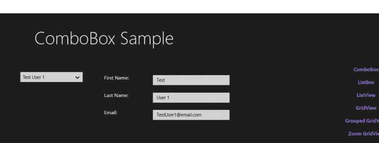

图 3-5

此用户界面的目的是允许用户从 `ComboBox` 选择选择 `Person` 对象并填充右侧的数据输入表单。使用双向数据绑定强制对 `Text` 控件中的字段进行的任何更改传播到选中的实例。以下代码显示了该数据输入表单所需的 XAML：

```xml
<ComboBox xName="AccountList" SelectionChanged="AccountList_SelectionChanged" HorizontalAlignment="Left" Margin="73,49,0,0"
Grid.Row="1"
VerticalAlignment="Top" MinWidth="200" DisplayMemberPath="FullName" />
<Grid xName="SelectionGrid" HorizontalAlignment="Left" Margin="332,49,0,0"
Grid.Row="1" VerticalAlignment="Top">
<TextBlock HorizontalAlignment="Left" Margin="10,10,0,0"
Wrapping="Wrap" Text="First Name:" VerticalAlignment="Top"
FontSize="19"/>
<TextBlock HorizontalAlignment="Left" Margin="10,121,0,0"
Wrapping="Wrap" Text="Email:" VerticalAlignment="Top"
FontSize="16"/>
<TextBlock HorizontalAlignment="Left" Margin="10,66,0,0"
Wrapping="Wrap" Text="Last Name:" VerticalAlignment="Top"
FontSize="16"/>
<TextBlock Text={Binding FirstName, Mode=TwoWay}
HorizontalAlignment="Left" Margin="166,10,0,0" TextWrapping="Wrap"
VerticalAlignment="Top"/>/>
```

### 第 3 章 使用控件样式、数据绑定和语义缩放增强你的应用程序

```xml
Width="246"/>
<TextBox Text="{Binding LastName, Mode=TwoWay}"
HorizontalAlignment="Left" Margin="166,66,0,0" TextWrapping="Wrap"
VerticalAlignment="Top"
Width="246"/>
<TextBox Text="{Binding Email, Mode=TwoWay}"
HorizontalAlignment="Left" Margin="166,121,0,0" TextWrapping="Wrap"
VerticalAlignment="Top"
Width="246"/>
</Grid>
```

如你所示，`TextControl` 使用双向绑定来处理 `Person` 对象的相应属性。注意在 `ComboBox` 声明中有一个名为 `DisplayMemberPath` 的属性，设置为 "FullName"。当将 `Person` 对象集合绑定到 `ComboBox` 控件时，你需要告诉它应该使用 `Person` 对象的哪个属性来显示可选的文本。`Person` 对象的 `FullName` 属性（如列表 3-9 所示）只是拼接了特定 `Person` 实例的 `FirstName` 和 `LastName` 属性。

> 列表 3-9: 第3章DataBindingControlsDataPerson.cs

```csharp
using System;

namespace DataBindingControls.Data
{
    public class Person
    {
        public string FirstName { get; set; }
        public string LastName { get; set; }
        public string Email { get; set; }
        public string FullName => FirstName + " " + LastName;
    }
}
```

在在上一个示例中，你将 `DataContext` 设置为集合。虽然 `DataContext` 设置为了实际集合，但你仍然可以将页面层面的 `DataContext` 设置为集合。如果由于某种原因 `DataContext` 是一个业务对象的实例，而你需要在 `ComboBox` 中显示的集合是该对象的公共属性，只需更改绑定语法以查找代表集合的特定属性。以下代码将 `ComboBox` 的 `Items` 属性绑定到 `DataContext` 中名为 `Accounts` 的属性。

```xml
<ComboBox xName="AccountList" SelectionChanged="AccountList_SelectionChanged"
HorizontalAlignment="Left" Margin="73,49,0,0"
Grid.Row="1"
VerticalAlignment="Top" MinWidth="200" DisplayMemberPath="FullName"
ItemsSource="{Binding Accounts}" />
```

你可能会奇怪为什么有时使用 `DataContext` 而有时使用 `ItemsSource`。在某种情况下，某些控件的 `ItemsSource` 等于 `TextBox` 的 `Text` 属性。以下代码显示了 `ComboBox` 的 `SelectionChanged` 处理程序：

```csharp
private void AccountList_SelectionChanged(object sender, SelectionChangedEventArgs e)
{
    Grid.DataContext = e.AddedItems[0] as Person;
}
```

### ListBox

另一种你可以用于展示内容或数据列表的 Windows 8 控件是 `ListBox` 控件。它在许多方面与 `ComboBox` ，你可以将其想象成所有选项同时可见的 `ComboBox` 控件。图 3-6 显示了与图 3-5 相同的的数据输入表单，但它使用的是 `ListBox` 控件而不是 `ComboBox` 控件。

## 第 3 章通过控件样式、数据绑定和语义缩放增强您的应用程序

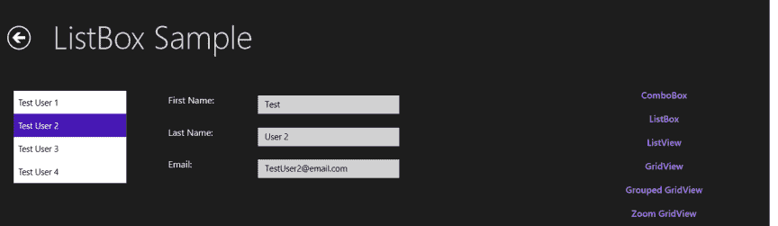

图 3-6

使用 ListBox 需要的 XAML 代码与 ComboBox 示例类似。代码显示了 ListBox 控制的声明，它再次使用 `DisplayMemberPath` 属性来决定 Person 对象的哪个属性显示给用户。`ItemsSource` 也设置为当前 `DataContext` 的 `Accounts` 属性，该属性包含了实际的 Person 对象集合。


```xml
<ListBox Name="AccountList" SelectionChanged="AccountList_SelectionChanged"
ItemsSource="{Binding Accounts}" DisplayMemberPath="FullName"
HorizontalAlignment="Left" Margin="48,31,0,0" VerticalAlignment="Top"
Width="200" Height="200">
```

在选择 `ListBox` 控件后，您可以像处理 `ComboBox` 一样处理它。以下代码显示了 `SelectionChanged` 事件提取了选中的 `Person` 对象，并将数据输入项的 `DataContext` 设置为 `Person` 实例：

```csharp
private void AccountList_SelectionChanged(object sender, SelectionChangedEventArgs e)
{
    SelectionGrid.DataContext = (e.AddedItems[0] as Person);
}
```

## ListView

`ComboBox` 和 `ListBox` 是在用户界面中为用户提供选项列表的基础控件。对于大多数应用程序，您希望在展示内容和业务对象集合时具有更高的灵活性。这正是 `ListView` 和 `GridView` 发挥用处的地方。`ListView` 为您提供了一种传统的垂直方向展示自定义数据视图的方法。图 3-7 显示了 `ListView` 控件中的书籍和缩略图集合，并带有选择处理。

## ListView 示例

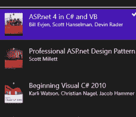

选中的书籍：C# 和 VB 版本的 ASPNet 4

- `ComboBox`
- `ListBox`
- `ListView`
- `GridView`
- `Grouped GridView`
- `Zoom GridView`

图 3-7

如您所见，`ListView` 中项的呈现比 `ComboBox` 或 `ListBox` 要丰富得多。当您进行选择时，会在右上角看到一个勾号，并且整个选择状态会发生变化。这些都是内置在标准 `ListView` 中的，不需要您编写额外的代码。

`ListView` 中显示的每个书籍项的呈现包含多个部分。`ListView` 和 `GridView` 控件都允许您通过使用名为 `DataTemplate`（数据模板）的自定义来完全自定义列表中每个项的外观。例如，您希望为列表中的每本书显示缩略图、标题和作者信息。要使 `DataTemplate` 发挥作用，请先在集合中创建您所需的用户界面，并为对象的各种属性创建绑定信息。然后在在 `ListView` 控件中，您使用 `SetItemTemplate` 属性来使用该 `DataTemplate`。`DataTemplate` 声明被视为资源，应存在于 `App.xaml` 或包含您计划使用的 `ListView` 的文件的页面 `Resources` 部分。对于此，一个显示缩略图、标题和作者信息的 `DataTemplate` 看起来如下：

```xml
<DataTemplate Key="BookTemplate">
  <Grid Margin="10">
    <StackPanel Orientation="Horizontal">
      <Image Source="{Binding Thumbnail}" Height="60" Width="60" Margin="0,0,10,0"/>
      <StackPanel Margin="0,0,0,0" Orientation="Vertical">
        <TextBlock TextWrapping="Wrap" Style="{StaticResource BookTitleStyle}" Text="{Binding Title}" />
        <TextBlock TextWrapping="Wrap" Style="{StaticResource BookAuthorStyle}" Text="{Binding Author}" />
      </StackPanel>
    </StackPanel>
  </Grid>
</DataTemplate>
```

注意使用 `BookTitleStyle` 和 `BookAuthorStyle` 来处理 `TextBlock` 控件的格式。这些样式在与 `DataTemplate` 相同的代码中声明：

```xml
<Style x:Key="BookTitleStyle" TargetType="TextBlock">
  <Setter Property="FontFamily" Value="Segoe UI Light"/>
  <Setter Property="FontSize" Value="18"/>
</Style>
```

```xml
<Style x:Key="BookAuthorStyle" TargetType="TextBlock">
  <Setter Property="FontFamily" Value="Segoe UI Light"/>
  <Setter Property="FontSize" Value="14"/>
</Style>
```

在此示例中，只需将此 XAML 包含在 `Page.Resources` 层级即可。如您所见，`Image` 控件绑定到了书籍对象的 `Thumbnail` 属性。`TextBlock` 也使用数据绑定来相应显示标题和作者。

需要考虑的一点是，在第 2 章（什么是 XAML？）当您介绍 `Image` 控件时，您只需将 `Source` 属性设置为要使用的图像文件的属性。在使用数据绑定场景（如本例）时，您无法将字符串路径绑定到要使用的文件。相反，您需要绑定到一个返回 `ImageSource` 类型的属性以便属性显示。列表 3-10 显示了 `WBook` 类，其 `Thumbnail` 属性返回 `ImageSource` 类型。

**列表 3-10：第 3 章 DataBindingControls!DataListBox.cs**

```csharp
using Windows.UI.Xaml.Media;

namespace DataBindingControls
{
    public class WBook
    {
        public string Title { get; set; }
        public string Author { get; set; }
        public string Subject { get; set; }
        public ImageSource Thumbnail { get; set; }
    }
}
```

```xml
<GridView x:Name="MainGridView" HorizontalAlignment="Left" Margin="45,70,0,0"
Grid.Row="1" VerticalAlignment="Top"
MinWidth="200"
MinHeight="200"
ItemTemplate={StaticResource BookTemplate} ItemsPanel={StaticResource GridViewItemsPanel}
BorderBrush="White" BorderThickness="2"
ScrollViewer.VerticalScrollBarVisibility="Auto"
ScrollViewer.HorizontalScrollBarVisibility="Auto" SelectionMode="Single"
Width="800"
SelectionChanged="MainGridView_SelectionChanged" />
```

再次使用 `ItemTemplate` 以便 `Wx` 对象显示缩略图、标题和作者信息。除了 `ItemTemplate` 之外，`ItemsPanel` 属性也被设置为 `StaticResource`。`ItemsPanel` 属性允许你覆盖托管 `GridView` 项目的实际内容。在这个示例中，你可以以包含不超过两行的表格状布局显示项目。默认情况下，`GridView` 实际上不会创建表格状布局，但通过覆盖 `ItemsPanel` 属性，你可以轻松地获得所需的布局。在以下代码中，一个 `ItemsPanelTemplate` 包含一个 `WrapGrid` 控件

```xml
<ItemsPanelTemplate x:Key="GridViewItemsPanel">
<WrapGrid MaximumRowsColumns="2" />
</ItemsPanelTemplate>
```

与 `DataTemplate` 一样，`ItemsPanelTemplate` 是另一种 XAML 模板，你可以用它管理任何显示对象集合或内容数据控件的容器。在这种情况下，`MaximumRowsColumns` 属性确保 Grid 的任何一列只显示两个书籍项目。`WrapGrid` 的工作方式是通过托管子元素，使其定位在父控件的边缘内。如果项目不适应可用空间，它们将根据你为 `MaximumRowsColumns` 属性使用的值定位到下一列或下一行。

加载 `GridView` 的代码工作方式与 `ListView` 相同，其中 `ItemsSource` 属性被设置为 `WxBook` 项目的集合，如下代码所示：

```csharp
MainGridView.ItemsSource = Books;
```

与 `ListView` 一样，`GridView` 控制可以处理单选或多选。在 `SelectionChanged` 事件中，`GridView` 的 `SelectionMode` 被设置为 `Single`，并更新用户界面以显示选中的书籍信息。

```csharp
private void MainGridView_SelectionChanged(object sender,
SelectionChangedEventArgs e)
{
    SelectedItem.Text = String.Format("Selected Book: {0}",
    ((WxBook)e.AddedItems[0]).Title);
}
```

## 分组 GridLayout (Grouped GridLayout)

除了简单地水平水平显示内容和数据外，`GridLayout` 还支持对集合项目进行分组并以分组显示呈现信息。分组通过使用几个额外的 `GridLayout` 属性以及不同类型的集合对象来处理。

在为 `GridLayout` 准备分组之前，你首先需要更改设置要用的数据集合的方式。就像本章大多数示例一样，你将有一个使用泛型 `List<T>` 或 `ObservableCollection<T>` 的项目集合。当你想要在 `GridLayout` 中对数据进行分组时，你需要以不同的方式设置集合。现在来看看如何让这个示例通过按主题或编程语言分组的 `WBook` 对象集合正常工作。

首先，你可能需要一个 `List<T>` 来像通常一样持有所有的对象。

```csharp
private List<WroxBook> AllBooks = new List<WroxBook>();
```

这段代码可能来自数据库或网络服务，但对于此示例，只需在页面加载时硬编码书籍对象。

```csharp
protected override void OnNavigatedTo(NavigationEventArgs e)
{
    base.OnNavigatedTo(e);

    SetupList();
}

private void SetupList()
{
    AllBooks.Add(new WroxBook
    {
        Subject = "ASP.NET",
        Title = "Professional ASP.NET MVC 4",
        Author = "Jon Galloway",
        Thumbnail = new Bitmap(new Uri("ms-app://Assets/aspnet4.jpg", UriKind.RelativeOrAbsolute))
    });

    AllBooks.Add(new WroxBook
    {
        Subject = "ASP.NET",
        Title = "Beginning ASPNET Web Pages with WebMatrix",
        Author = "Mike Briend, Iman Spaanjaars",
        Thumbnail = new Bitmap(new Uri("ms-app://Assets/beginaspnetmatrix.jpg", UriKind.RelativeOrAbsolute))
    });

    AllBooks.Add(new WroxBook
    {
        Subject = "ASP.NET",
        Title = "Professional Asp.net Design Patterns",
        Author = "Scott Millett",
        Thumbnail = new
BitmapImage(new Uri("ms-app:///Assets/aspnetdesign.jpg",
UriKind.RelativeOrAbsolute))
    });
}
```

```csharp
AllBooks.Add(new WrowBook)
{
    Subject = "C# Development",
    Title = "Beginning Object Oriented Programming with C#",
    Author = "Jack Purdum",
    Thumbnail = new
BitmapImage(new Uri("ms-app:///Assets/beginocosharp.jpg",
UriKind.RelativeOrAbsolute))
});
```

```csharp
AllBooks.Add(new WrowBook)
{
    Subject = "C# Development",
    Title = "Beginning Visual C# 2010",
    Author = "Karli Watson, Christian Nagel,
Reid, Morgan Skinner",
    Thumbnail = new
BitmapImage(new Uri("ms-app:///Assets/begincsharp.jpg",
UriKind.RelativeOrAbsolute))
});
```

```csharp
AllBooks.Add(new WrowBook)
{
    Subject = "C# Development",
    Title = "Professional Development with C#",
    Author = "James Bender, Jeff McWter",
    Thumbnail = new
BitmapImage(new Uri("ms-app:///Assets/testdriven.jpg",
UriKind.RelativeOrAbsolute))
});
```

```csharp
AllBooks.Add(new WrowBook)
{
    Subject = "C++ Development",
    Title = "Beginning C++ 2010",
    Author = "Ivor Horton",
    Thumbnail = new
BitmapImage(new Uri("ms-app:///Assets/visualc2010.jpg",
UriKind.RelativeOrAbsolute))
});
```

```csharp
AllBooks.Add(new WrowBook)
{
    Subject = "C++ Development",
    Title = "Professional C++ 2nd Edition",
    Author = "Marc Gregoire, Nicholas A. Scott J. Kleper",
    Thumbnail = new
BitmapImage(new Uri("ms-app:///Assets/plus.jpg",
UriKind.RelativeOrAbsolute))
});
```

```csharp
AllBooks.Add(new Wroxbook)
{
    Subject = "SQL Server",
    Title = "Professional SQL Server 2012 Internals",
    Author = "Christian Bolton, James Rowland-Jones, Glenn Berry, Justin Langford, Gavin Payne, Amit Banerjee",
    Thumbnail = new BitmapImage(new Uri("ms-app://Assets/hoot.jpg", UriKind.RelativeOrAbsolute))
});
```


```csharp
AllBooks.Add(new Wroxbook)
{
    Subject = "SQL Server",
    Title = "Beginning SQL Server 2012 Programming",
    Author = "Paul Atkinson, Robert Vieira",
    Thumbnail = new BitmapImage("ms-app://Assets/sqprogramming.jpg", UriKind.RelativeOrAbsolute))
});
```

```csharp
AllBooks.Add(new Wroxbook)
{
    Subject = "SQL Server",
    Title = "Professional MicrosoftPivot for Excel and SharePoint",
    Author = "Sivakumar Harinath, Ron Pihlgren, Danny Guang-Yeu Lee",
    Thumbnail = new BitmapImage(new Uri("ms-app://Assets/powerpivot.jpg", UriKind.RelativeOrAbsolute))
});
```

所示，`Wroxbook` 对象有一个额外的 `Subject` 属性，你可以通过它对项目进行分组。通过特定的键，你必须创建另一个持有该键（`Subject`）以及对应的 `Wroxbook` 实例的业务对象。以下代码显示了 `GroupedBookList` 类，它包含一个名为 `Subject` 的字符串（作为 `GridView` 分组的键），以及一个持有书籍的 `List<Wroxbook>` 属性。

```csharp
using System.Collections.Generic;

namespace DataBindingControls
{
    public class GroupedBookList
    {
        public string Subject { get; set; }
        public List<Wroxbook> Books { get; set; }
    }
}
```

现在你已经有一个分组书籍的类，你需要一个可以持有这些分组列表的集合对象。Windows 8 提供了一个名为 `CollectionViewSource` 的新类，它提供了内置的排序、过滤和分组支持，非常适合绑定操作。以下代码将 `CollectionViewSource` 实例添加到负责持有分组书籍列表的页面中：

```csharp
private CollectionViewSource BookCollection {
    IsSourceGrouped = true, ItemPath = new PropertyPath("Books");
}
```

在这段代码中，`IsSourceGrouped` 属性被设置为 `true`。`CollectionViewSource` 类使用 `Source` 来持有集合中的项目列表。由于该类支持排序、过滤和分组，因此并不要求你以分组格式放置项目。如果是，你需要告诉 `CollectionViewSource` 你正在填充的项目。此外，`ItemPath` 属性被设置为查找你书籍对象中的属性。此 `CollectionViewSource` 的声明期望你集合中的所有项目都有一个名为 "Books" 的集合和一个名为 "Subject" 的字符串属性。

由于你告诉 `CollectionViewSource` 类其 `Source` 属性将被设置为一个已分组的项目集合，接下来你需要利用简单的 Linq 语句来填充 `CollectionViewSource` 的 `Source` 属性以处理分组。在以下代码中，名为 `AllBooks` 的当前 `List<Book>` 根据 Linq 中的 `GroupBy` 语句进行了分组：

```csharp
protected override void OnNavigatedTo(EventArgs e)
{
    base.OnNavigatedTo(e);

    SetupListBox();

    var groupedBooks = AllBooks.GroupBy(x => x.Subject).Select(x => new
    GroupedBookList { Subject = x.Key, Books = x.ToList() });

    BookCollection.Source = groupedBooks.ToList();
    MainGridView.ItemsSource = BookCollection.View;
}
```

在这段代码的最后一行，`GridView` 的 `ItemsSource` 属性被设置为 `CollectionViewSource` 的 `View` 属性。`CollectionViewSource` 同样在不需要更改用户界面的情况下提供了当前数据的不同视图。通过将 `ItemsSource` 属性设置为 `View`，你可以确保 `GridView` 始终控制排序、过滤或分组后数据的当前视图。

你需要做的最后一件事是告诉 `GridView` 你想要支持分组，以便每个项目都位于适当的分组中并带有显示书籍 `Subject` 属性的标题。`CollectionViewSource` 对象已经准备就绪并按正确的分组排列，但你现在必须使用 `GridView` 的 XAML 代码来利用它。从以下代码中看到，`GridView` 自己的属性为每组书籍设置了列标题。

### 112 | 第 3 章 使用控件样式、数据绑定和语义缩放增强你的应用程序

```xml
<GridView x:Name="MainGridView" HorizontalAlignment="Left" Margin="45,70,0,0"
Row="1" VerticalAlignment="Top" MinWidth="200" MinHeight="200"
ItemTemplate="{StaticResource BookTemplate}" ItemsPanel="{StaticResource ItemsPanel}"
BorderBrush="White" BorderThickness="2"
ScrollViewer.VerticalScrollBarVisibility="Auto"
ScrollViewer.HorizontalScrollBarVisibility="Auto" SelectionMode="Single"
MaxWidth="100%" SelectionChanged="MainGridViewSelectionChanged">
<GridView.GroupStyle>
  <GroupStyle.HeaderTemplate>
    <DataTemplate>
      <TextBlock Text='{Binding Subject}'
      Foreground="White" FontSize="25" />
    </DataTemplate>
  </GroupStyle.HeaderTemplate>
  </GroupStyle>
</GridView.GroupStyle>
</GridView>
```

在此示例中，`HeaderTemplate` 绑定到了底层 `GroupedBookList` 对象的 `Subject` 属性。由于你使用了 `CollectionViewSource`，`GridView` 会自动在 `ItemsSource` 中查找所有这些 `Subject` 属性，并创建一个显示集合中所有主题的头部。当你运行程序时，你可以看到所有的 `WroxBook` 项目都正确地对应了相应的头部，如图 3-9 所示。

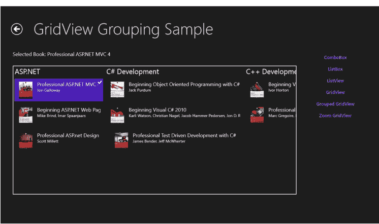

图 3-9

## 使用语义缩放

`GridView` 为你提供了一种强大的方式来显示业务对象和内容的集合。除了按特定类别对项目进行分组外，Windows 8 还让用户在 `GridView` 中呈现大量项目时，更容易找到他们想要的内容。`SemanticZoom` 支持捏指手势和控制键/鼠标滚轮，能够有效地对你的 `GridView` 集合进行放大或缩小，使用户可以轻松地在已分组的内容之间跳转。

在上一个示例中，你展示了 `CollectionViewSource` 允许你轻松地在分组场景下显示 `WroxBook` 对象列表，并为每个编程主题提供头部。如果你只有几个主题，这种设置运行良好。然而，如果你有大量主题（在许多真实世界应用中都是如此），用户可能需要滚动很久才能到达列表末尾。为了帮助用户快速在各种主题之间跳转，你可以编写少量的 XAML 代码来创建一个仅显示主题头部的缩小版本 `GridView`。当用户转动或点击某个主题时，他们将自动带到所选主题下的书籍。

要实现此功能，只需将你的 `GridView` 封装在新的 `SemanticZoom` 控件中。`SemanticZoom` 控件通过提供 `ZoomedOutView` 和 `ZoomedInView` 属性来工作，你可以在其中包含数据集合的适当值。`ZoomedInView` 使用与你支持分组的 `GridView` 相同的 XAML 代码。然而，`ZoomedOutView` 仅显示每个组实际存在的主题头部。在利用 `SemanticZoom` 控件的 `GridView` 视图中，缩小视图和放大视图都是保持状态的。

```xml
<SemanticZoom x:Name="SemanticZoomControl" HorizontalAlignment="Left" Margin="45,70,0,1" VerticalAlignment="Top">
  <SemanticZoom.ZoomedOutView>
    <GridView x:Name="ZoomedOutGridView" MinWidth="200" ItemTemplate="{StaticResource ZoomedOutTemplate}"
    BorderBrush="White" BorderThickness="2">
    <ScrollViewer.VerticalScrollBarVisibility="Auto" SelectionMode="Single" MaxWidth="1000" SelectionChanged="GridView_SelectionChanged">
      <GridView.ItemsPanel>
        <StackPanel Orientation="Horizontal" VerticalAlignment="Center" />
      </GridView.ItemsPanel>
    </GridView>
  </SemanticZoom.ZoomedOutView>
  <SemanticZoom.ZoomedInView>
    <GridView x:Name="ZoomedInGridView" HorizontalAlignment="Left" Margin="45,70,0,1" VerticalAlignment="Top" MinWidth="200" ItemTemplate="{StaticResource BookTemplate}">
    </GridView>
  </SemanticZoom.ZoomedInView>
</SemanticZoom>
```

### 114 | 第 3 章 使用控件样式、数据绑定和语义缩放增强你的应用程序

```xml
<GridView x:Name="ZoomedInGridView" HorizontalAlignment="Left" Margin="45,70,0,1" VerticalAlignment="Top" MinWidth="200"
ItemsPanel="{StaticResource GridItemsPanel}"
BorderBrush="White" BorderThickness="2"
ScrollViewer.VerticalScrollBarVisibility="Auto"
ScrollViewer.HorizontalScrollBarVisibility="Auto" SelectionMode="Single"
MaxWidth="1000"
SelectionChanged="SelectionChanged"
ItemsSource="{Binding Source={StaticResource BookCollection}}">
  <GridView.GroupStyle>
    <GroupStyle>
      <GroupStyle.HeaderTemplate>
        <DataTemplate>
          <TextBlock Text='{Binding Subject}'
Foreground="White" FontSize="25" Margin="5" />
        </DataTemplate>
      </GroupStyle.HeaderTemplate>
      <GroupStyle.Panel>
        <ItemsPanelTemplate>
          <VariableSizedWrapGrid Orientation="Vertical"
          Height="400" />
        </ItemsPanelTemplate>
      </GroupStyle.Panel>
    </GroupStyle>
  </GridView.GroupStyle>
</GridView>
```

你应该已经熟悉利用 `SemanticZoom` 控件进行缩小和放大保持的 `GridView` 控件。以下代码显示了更新后的 `ZoomedOutTemplate`。

```xml
<DataTemplate x:Key="ZoomedOutTemplate">
  <Border BorderBrush="White" BorderThickness="2" Margin="10" Padding="10">
    <TextBlock Text="{Binding Subject}" FontFamily="Segoe UI" FontSize="25" Foreground="White" />
  </Border>
</DataTemplate>
```

*(注：由于原文提供的 XML 片段存在逻辑截断或重复，此处已根据上下文逻辑进行了翻译性修复与格式对齐)*

要使此项正常工作，下一步是绑定可用的列表。

```csharp
ZoomedOutGridView.ItemsSource = BookCollection;
```

如果你运行应用程序，你仍然会看到之前的分组视图（如图 3-10 所示）。此外，图 3-11 显示了网格的缩小视图。

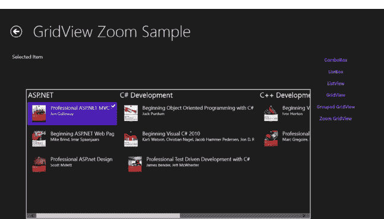

图 3-10

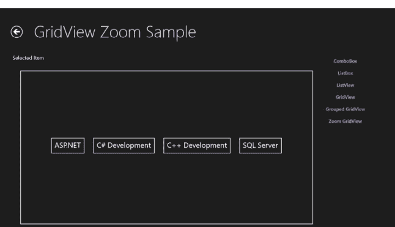

图 3-11

## 使用自定义控件

现在你已经精通数据绑定以及如何使用各种控件显示内容和数据，在本章中创建大型应用程序你还有一个最后一个主题。你可能注意到，在之前所有的示例中，你都拷贝 XAML 代码来显示书籍对象的各种属性。这些部分包括 `Image` 控件以及自定义 `TextBox`。在所有情况下，这些都是使用模板定义的。然而，如果你想在多个应用程序中重用这些 XAML，甚至围绕这种书籍的可视化添加额外的业务逻辑，你需要将该逻辑复制到每个重用的代码文件中。除了 Windows 8 提供的标准 XAML 控件外，你还可以创建完全支持数据绑定和额外业务逻辑的自定义控件。

创建自定义控件的步骤：

1. 右键点击解决方案管理器中的项目节点，选择“新建项”。在列表中选择“模板控件 (Templated Control)”选项。
2. 为新控件命名。在图 3-12 中创建了一个名为 `BookDetails` 的自定义控件。

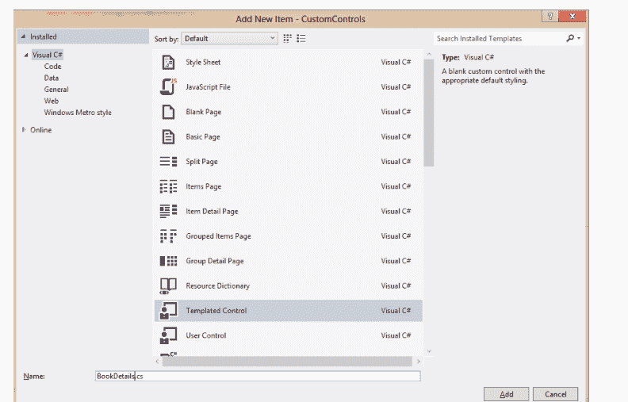

图 3-12

3. 点击“添加”按钮后，项目中会出现一个名为 Themes 的新文件夹。在这个文件夹中，你可以找到一个名为 `Generic.xaml` 的文件。这就是你为你想要创建的控件放置默认 XAML 代码的的地方。由于你想重新创建之前示例中的项目显示，只需将 `DataTemplate` 中的 XAML 代码复制并粘贴到此文件夹中，并进行一些细微调整即可。

列表 3-1 显示了更新后的 `Generic.xaml` 文件，它包含了用于显示缩略图、标题和其他内容的 XAML 代码。

> 注意：这次你并没有使用 `DataTemplate`，而是实际上创建了一个 `Style`（样式），并将 `TargetType`（目标）设置为 `BookDetails`，这是你自定义控件的类型。


```xml
<ResourceDictionary
    xmlns="http://schemas.microsoft.com/winfx/2006/xaml/presentation"
    xmlns:x="http://schemas.microsoft.com/winfx/2006/xaml"
    xmlns:local="local:CustomControls">

    <Style Key="BookTitle" TargetType="TextBlock">
        <Setter Property="FontFamily" Value="Segoe UI"/>
        <Setter Property="FontSize" Value="18"/>
    </Style>

    <Style Key="AuthorStyle" TargetType="TextBlock">
        <Setter Property="FontFamily" Value="Segoe UI"/>
        <Setter Property="FontSize" Value="14"/>
    </Style>

    <Style TargetType="local:BookDetails">
        <Setter Property="Template">
            <Setter Value="
                <ControlTemplate TargetType="local:BookDetails">
                    <Grid Margin="10">
                        <StackPanel Orientation="Horizontal">
                            <Image Source="{TemplateBinding ThumbnailImage}" Height="60" Width="60" Margin="0,0,10,0"/>
                            <StackPanel Margin="0,0,0,0">
                                <TextBlock Style="{StaticResource BookTitle}" Text="{TemplateBinding BookTitle}" />
                                <TextBlock TextWrapping="Wrap" Style="{StaticResource AuthorStyle}" Text="{TemplateBinding BookAuthor}" />
                            </StackPanel>
                        </StackPanel>
                    </Grid>
                </ControlTemplate>
            "/>
        </Setter>
    </Style>
</ResourceDictionary>
```

# 118 | 第 3 章：通过控件样式、数据绑定和语义缩放增强你的应用

在之前处理数据绑定的示例中，你设置了 `Image` 和 `TextBlock` 控件绑定到 `WBook` 对象的属性。对于自定义控件，你希望功能更加灵活，并且不想将任何内容绑定到某个特定的对象类型。相反，你希望属性能够支持从任何有效对象进行数据绑定，而不仅仅是 `WBook` 类型。你可以通过在自定义控件中提供特定的数据属性来实现这一点。在之前的代码中，`Image` 和 `TextBlock` 控件被设置为使用 `TemplateBinding`，并且没有使用之前的 `WBook` 属性，而是创建了实际上可以作为 `BookDetails` 类一部分的新属性。以下语法基本上意味着，当使用此控件时，你获取 `BookDetails` 类的 `BookTitle` 属性的值，并将其用于正在显示的 `TextBlock` 的属性。

```xml
<TextBlock TextWrapping="Wrap" Style="{StaticResource BookTitleStyle}"
Text="{TemplateBinding BookTitle}"/>
```

为了支持你的绑定，你需要在 `BookDetails` 自定义控件中定义一些与绑定序列匹配的属性。然而，由于这些属性需要支持数据绑定，因此在声明它们时必须使用特殊的语法。你不能使用传统的属性，必须为默认样式中使用的 `BookTitle`、`BookAuthor` 和 `ThumbnailImage` 添加 `Dependency Property`（依赖属性）。列表 3-11 显示了 `BookDetails` 类的代码以及支持数据绑定所需的各种 `Dependency Property` 声明。

- 列表 3-11: 第 3 章\CustomControls\BookDetails.cs

```csharp
using Windows.UI.Xaml;
using Windows.UI.Xaml.Controls;
using Windows.UI.Xaml.Media;

// 模板控件模板文档见：
http://go.microsoft.com/f/ink/?LinkId=234235

namespace
    public sealed class BookDetails : Control
    {
        public BookDetails()
        {
            this.DefaultStyleKey = typeof(BookDetails);
        }

        public ImageSource ThumbnailImage
        {
            get { return (ImageSource)GetValue(ThumbnailImageProperty); }
            set { Set(ThumbnailImageProperty, value); }
        }

        public static readonly DependencyProperty ThumbnailImageProperty =
            DependencyProperty.Register("ThumbnailImage",
            typeof(ImageSource), typeof(BookDetails), new PropertyMetadata(null));
```

# 总结 119

```csharp
public string BookTitle
{
    get { return (string)GetValue(BookTitleProperty); }
    set { setValue(BookTitleProperty, value); }
}
```

```csharp
public static readonly DependencyProperty BookTitleProperty = 
dependencyProperty.Register("BookTitle",
typeof(string), typeof(BookDetails), new PropertyMetadata(null));
```

```csharp
public string BookAuthor
{
    get { return (string)GetValue(BookAuthorProperty); }
    set { setValue(BookAuthorProperty, value); }
}
```

```csharp
public static readonly DependencyProperty BookAuthorProperty = 
dependencyProperty.Register("BookAuthor",
typeof(string), typeof(BookDetails), new PropertyMetadata(null));
```

如你所见，对于你想在默认样式中提供数据绑定的每个属性，你必须添加一行 `DependencyProperty` 代码，这本质上是将该属性与 Windows 8 中的数据绑定机制联系起来。

到此时，你已经拥有了一个支持数据绑定的新自定义控件。这让你能够编写如下 XAML：

```xml
<local:BookDetails Name="ThumbnailImage" Image="Assets/silverlight.jpg" Author="Nickresinski" Title="Design Solution"/>
```

或者，你也可以对这些使用数据绑定：

```xml
<local:BookDetails Name="BookDetails" ThumbnailImage="{Binding Thumbnail}" Author="{Binding Title}"/>
```

### 总结

本章扩展了你对 Windows 8 的知识。现在，你应该已经良好掌握了控件样式、数据绑定和自定义控件。此外，你还接触了新的 Windows 8 控件，例如 `ListView` 和 `GridView`，以及如何使用它们来显示丰富的数据集合。尽管这些示例本质上比较简单，但它们对于你充分理解背后的概念非常重要。随着本书的进行，作者将特别扩展控件样式和数据绑定，以包含更复杂的场景，从而进一步减少代码并实现更丰富的用户界面。

在成千上万的应用程序中，你必须确保你的应用以独特的方式使用活动タイル（Live Tiles）；你的应用程序标题应该为用户提供与应用功能相关的快捷摘要。

### 使用应用栏（APP BAR）

在传统的 Windows 程序中，为用户展示菜单选项的最佳方法是使用标准控件。20多年来，用户已经习惯了屏幕顶部的“文件/编辑”等菜单，这允许他们在此应用程序中执行操作。然而，在 Windows 8 中，情况发生了变化。由于 Windows Store 应用程序的主要目标是减少应用程序组件并更多地关注应用的实际内容，因此在为用户创建菜单选项时，你必须改变思考。与其构建一个包含数百个不同选项（其中许多选项永远不会被使用）的菜单，你可以专注于对你的应用至关重要的操作。

你应该考虑用户想要对呈现给他们的数据执行什么类型的操作。由于 Windows 8 不鼓励使用完整的菜单，你仍然需要某种方法让用户获得对数据或内容采取操作的机会。答案就是应用栏（Application Bar）。如果你导航过 Windows 8 中新的“开始”界面，你已经见过应用栏的工作了。每当你右键点击或从平板电脑底部向上滑动时，你就会看到应用栏以及一组几乎有序的你可以对应用数据或内容执行的最重要操作。例如，当默认天气应用为你提供设置位置以更新天气状况的方法时（如图 4-1 所示）。如你所示，该应用程序的应用栏出现在屏幕的顶部底部。

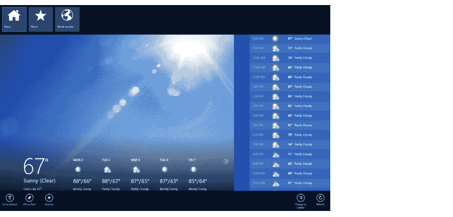

图 4-1

在 Windows Store 应用程序中，经验法是利用顶部的应用栏进行导航样式，例如在应用的不同区域之间切换。你可以将底栏留给命令类型的操作，用于创建、编辑、排序、过滤或刷新数据或内容的当前视图。当然，获得如何使用应用栏理解的最佳方法就是直接投入使用并将其添加到你自己的应用程序中。

你可以创建一个利用这两种应用栏场景的示例项目。

## 创建顶部应用栏导航

在此应用中，允许用户查看三类 Wrox Press 书籍。在用户导航到特定类别后，他们可以执行诸如排序和过滤书籍列表等操作。最后，你应该能够得到类似于图 4-2 的效果。要创建此应用，请遵循以下步骤：

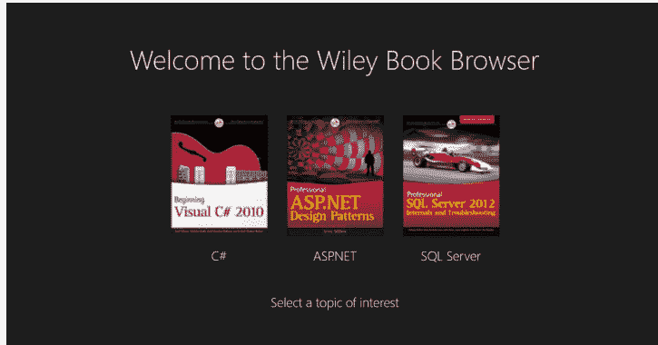

图 4-2

1. 在 Visual Studio 2012 中创建一个名为 `AppBar` 的新空白 Windows Store 项目。
2. 使用 `BlankPage`（空白页）项目模板向项目添加新页面。分别将其命名为 `Home.xaml`、`AspBooks.xml`、`SqlServer.xml` 和 `CSharp.xml`。
3. 添加新页面后，你需要设置主屏幕，其中包含顶部和底部的应用栏。

> 注意：`AppBar` 是一个存在于 Windows 8 中每个 `Page` 对象中的对象。每个页面本质上都可以有自己的 `AppBar` 实现。然而，由于顶栏旨在辅助在应用程序中进行导航，最佳做法是在你应用程序的主页上实现它，并添加一个额外的 `Frame`（框架）来容载应用程序的其他页面。这听起来有点复杂，但并不困难。这种设置工作非常像 ASP.NET 世界中的主页（Master Pages）。

现在打开 `MainPage.xaml` 并更新它使其看起来像代码列表 4-1。

## 代码列表 4-1: MainPage.xml

```xml
<Page
  x:Class="AppBar_MainPage"
  xmlns="http://schemas.microsoft.com/winfx/2006/xaml/presentation"
  xmlns:x="http://schemas.microsoft.com/winfx/2006/xaml"
  xmlns:local="using AppBar"
  xmlns:d="http://schemas.microsoft.com/expression/blend/2008"
  xmlns:mc="http://schemas.openxmlformats.org/markup-compatibility/2006"
  mc:Ignorable="d">
  <Page.TopAppBar>
    <AppBar>
      <Grid>
        <Grid.ColumnDefinitions>
          <ColumnDefinition Width="50*" />
          <ColumnDefinition Width="50*" />
        </Grid.ColumnDefinitions>
        <StackPanel Orientation="Horizontal" Grid.Column="0">
          <Button Style="StaticResource PreviousAppBarButtonStyle" Click="Previous Click" />
          <Button Margin="20,0,0,0" Style="StaticResource NextAppBarButtonStyle" Click="Next Click" />
        </StackPanel>
      </Grid>
    </AppBar>
  </Page.TopAppBar>
  <Frame x:Name="MainFrame" />
</Page>
```

拆解这段代码，你可以看到 `Page` 对象内置了一个 `AppBar`，要使用它，只需要添加一个容器控件以及任何有助于导航的按钮/图像或任何其他内容。在这种情况下，你有几个用于在应用中来后移动的导航按钮。

其中一点是，`Button Style`（按钮样式）属性被设置为 Visual Studio 2012 包含的默认样式。你有许多默认样式可以选择，因此你不需要设计人员来保留它们以保持美观。然而，要访问这些样式，你需要向项目包含一些文件。技巧是在解决方案资源管理器（Solution Explorer）中右键点击项目，并使用 `BasicPage` 模板向项目添加一个新页面。你会看到一条提示消息，说明你需要向项目添加几个文件。

5. 只需点击 OK 并删除添加的页面。现在你应该在项目的 `Common` 目录下拥有一个 `StandardStyles.xaml` 文件。
6. 在该处搜索 `PreviousAppBarButton`。

现在打开 `MainPage.xaml` 并更新它使其像代码列表 4-1。

（注：由于原文文本逻辑在某些处存在断句或重复，此处译文已根据上下文逻辑进行了对齐和修正，以确保技术文档的连贯性。）

### 使用 App Bar


```xml
<TextBlock HorizontalAlignment="Center" Margin="0,100,0,0"
TextWrapping="Wrap" Text="Welcome to the Wiley Book Browser --"
VerticalAlignment="Top" Style="[StaticResource PageHeaderTextStyle]"/>
<StackPanel HorizontalAlignment="Center" Margin="0">
  <StackPanel VerticalAlignment="Center" Orientation="Horizontal">
    <StackPanel Margin="0,0,40,0">
      <Image Source="assets/beginsharp.jpg" Canvas.ZIndex="1"
        Stretch="UniformToFill" Width="200" Height="250" Tapped="Image_Tapped"
        Tag="CSharpBooks" />
      <TextBlock Text="C#" Margin="0,20,0,0"
        HorizontalAlignment="Center" Style="[StaticResource SubheaderTextStyle]" />
    </StackPanel>
    <StackPanel Margin="0,0,40,0">
      <Image Source="assets/design.jpg" Canvas.ZIndex="1"
        Stretch="UniformToFill" Width="200" Height="250" Tapped="Image_Tapped"
        Tag="Apps" />
      <TextBlock Text=".NET" Margin="0,20,0,0"
        HorizontalAlignment="Center" Style="[StaticResource SubheaderTextStyle]" />
    </StackPanel>
    <StackPanel Margin="0">
      <Image Source="proqltroubleshoot.jpg" Canvas.ZIndex="1"
        Stretch="UniformToFill" Width="200" Height="250" Tapped="Image_Tapped"
        Tag="SqlServerBooks" />
      <TextBlock Text="SQL Server" Margin="0,20,0,0"
        HorizontalAlignment="Center" Style="[StaticResource SubheaderTextStyle]" />
    </StackPanel>
  </StackPanel>
<TextBlock HorizontalAlignment="Center" Margin="0,600,0,0"
TextWrapping="Wrap" Text="Select a topic of interest" VerticalAlignment="Top"
Style="[StaticResource PageSubheaderTextStyle]"/>
</Grid>
```

> 注意：此代码负责显示用户供选择的三个类别图像，并添加了 `Tapped` 事件处理程序，以便你可以强制导航到相应的页面。在后续代码中，`Image` 控件使用 `Tag` 属性来持有它应该指向导航的目标页面；在这种情况下，它是 `CSharpBooks`。

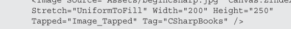

13. 如果你现在使用模拟器构建并运行应用程序，现在应该能看到首页。此外，如果你在屏幕上任何地方点击右键，你应该能看到 `TopAppBar` 出现，以及后退/前进的命令，如图 4-3 所示。

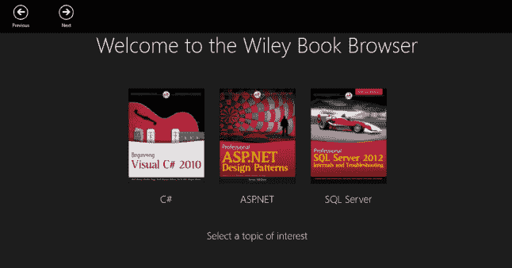

图 4-3

14. 现在你已经有了带有所需类别图像的主页。你仍然需要处理每个图像的 `Tapped` 事件，并告诉 `MainFrame` 对象导航到相应的页面。打开 `Home.xaml.cs` 并更新代码，使其类似于列表 4-4 所示：

列表 4-4: `Home.xaml.cs`

```csharp
using Windows.UI.Xaml.Controls;
using Windows.UI.Xaml.Input;

// Blank Page 项目模板的文档位于
// http://schemas.microsoft.com/fwlk/?LinkId=24238

namespace AppBar
{
    // <summary>
    // 一个可以单独使用或在 Frame 内导航到的空页面。
    // </summary>
    public sealed partial class Home : Page
    {
        public Home()
        {
            this.InitializeComponent();
        }

        private void Image_Tapped(object sender, TappedRoutedEventArgs e)
        {
            string tag = ((Image)sender).Tag.ToString();

            if (tag == "SharpBooks")
                this.Frame.Navigate(typeof(SharpBooks));
            else if (tag == "AspBooks")
                this.Frame.Navigate(typeof(AspBooks));
            else
                this.Frame.Navigate(typeof(SqlServerBooks));
        }
    }
}
```

从这段代码中可以获得酷酷的一点是，通常 `this.Frame` 指的是主应用程序框架；然而，`Home.xaml` 页面实际上运行在一个子 `Frame` 对象中，该对象正确地指向了实际托管页面的 `Frame`。这使得你能够在子页面之间进行导航，而无需尝试获取在 `MainPage.xaml` 中声明的 `MainFrame` 的任何特殊访问。

# 布接应用程序页面

现在你已经设置好了首页并准备好导航到类别页面——是时候接接这些页面了。

1. 打开 `AspBooks.xml` 文件，并将其替换为列表 4-5 中的代码。

列表 4-5: `AspBooks.xml`

```xml
<Page
    x:Class="AppBar.AspBooks"
    xmlns="http://schemas.microsoft.com/winfx/2006/xaml/presentation"
    xmlns:x="http://schemas.microsoft.com/winfx/2006/xaml"
    xmlns:local="using:AppBar"
    xmlns:d="http://schemas.microsoft.com/expression/blend/2008"
    xmlns:mc="http://schemas.openxmlformats.org/markup-compatibility"
    mc:Ignorable="d">

    <Grid>
        <Grid.ColumnDefinitions>
            <ColumnDefinition Width="50*"/>
            <ColumnDefinition Width="50*"/>
        </Grid.ColumnDefinitions>
        <StackPanel Grid.Column="0" Orientation="Horizontal">
            <Button Content="Filter" Click="Filters_Click" />
        </StackPanel>
        <StackPanel Grid.Column="1" Orientation="Horizontal">
            <Button Content="Sort" Click="Sort_Click" />
        </StackPanel>
    </Grid>
</Page>
```

> 注意：从这段代码中有几点收获：
>
> - 你可以在页面添加 `BottomAppBar`。这些控件过滤并排序书籍列表。
> - `GridView` 显示书籍列表，每个本书使用特定的模板。

2. 因为你想在页面间复用此 XAML 代码，你应该将其放在 `App.xaml` 中。打开 `App.xaml` 并将其替换为列表 4-6 所示的内容。

列表 4-6: `App.xaml`

```xml
<Application
    x:Class="AppBar.App"
    xmlns="http://schemas.microsoft.com/winfx/2006/xaml/presentation"
    xmlns:x="http://schemas.microsoft.com/winfx/2006/xaml"
    xmlns:local="using:App">

  <Application.Resources>
    <ResourceDictionary>
      <!--
      定义平台外观和感觉的样式
      Visual Studio 项目和项目模板需要
      -->
      <ResourceDictionary Source="Common/StandardStyles.xaml"/>
    </ResourceDictionary>
  </Application.Resources>
</Application>
```

# 列表 4-5 续

```xml
    </ResourceDictionary>

  <Style x:Key="BookTitleStyle" TargetType="TextBlock">
    <Setter Property="FontFamily" Value="Segoe UI"/>
    <Setter Property="FontSize" Value="18"/>
  </Style>

  <Style x:Key="BookAuthorStyle" TargetType="TextBlock">
    <Setter Property="FontFamily" Value="Segoe UI"/>
    <Setter Property="FontSize" Value="14"/>
  </Style>

  <DataTemplate x:Key="BookTemplate">
    <Border BorderBrush="White" BorderThickness="2" Width="700">
      <Grid Margin="10">
        <StackPanel Orientation="Horizontal">
          <Image Source="{Binding Thumbnail}" Height="60" Width="60" Margin="0,0,10,0"/>
          <StackPanel Margin="0,0,0,0">
            <TextBlock Text="{Binding Title}" Style="{StaticResource BookTitleStyle}"/>
            <TextBlock Text="{Binding Author}" Style="{StaticResource BookAuthorStyle}"/>
          </StackPanel>
        </StackPanel>
      </Grid>
    </Border>
  </DataTemplate>
</ResourceDictionary>
```

3. 现在 `Grid` 已经设置了用于显示的单个书籍项模板。你只需要在项目的 `Data` 文件夹创建一个名为 `WroxBook.cs` 的新文件。将其替换为列表 4-7 中的代码。此类表示要在应用程序中显示的书籍对象。

```csharp
using Windows.UI.Xaml.Media.Imaging;

namespace App.Data
{
    public class WroxBook
    {
        public string Title { get; set; }
        public string Author { get; set; }
        public string Subject { get; set; }
        public ImageSource Thumbnail { get; set; }
    }
}
```

如你所示，每本书都将有一个标题、作者、主题和一个代表书籍封面的缩略图。

4. 你需要一些示例数据，因此为现有的 ASP.NET 书籍添加这些数据。打开 `AspBooks.xaml.cs` 并将其更新为如列表 4-8 所示。

列表 4-8: `AspBooks.xaml.cs`

```csharp
using AppBar.Data;
using System;
using System.Collections.Generic;
using System.Collections.ObjectModel;
using System.Linq;
using Windows.Foundation;
using Windows.UI.Popups;
using Windows.UI.Xaml;
using Windows.UI.Xaml.Controls;
using Windows.UI.Xaml.Media;
using Windows.UI.Xaml.Media.Imaging;
using Windows.UI.Xaml.Navigation;

// Blank Page 模板文档见：
// http://go.microsoft.com/fwlink/?LinkId=234238

namespace AppBar
{
    /// <summary>
    /// 一个可以独立使用或在 Frame 内导航到的空页面。
    /// </summary>
    public sealed partial class AspBooks : Page
    {
        public List<WroxBook> Books { get; set; }

        public AspBooks()
        {
            this.InitializeComponent();
            SetupList();
        }

        private void SetupList()
        {
            Books = new List<WroxBook>();

            Books.Add(new WroxBook
            {
                Subject = "ASP.NET",
                Title = "Professional ASP.NET MVC 4",
                Author = "Jon Galloway",
                Thumbnail = new BitmapImage(new Uri("ms-appx:///assets/aspnet4.jpg", UriKind.Absolute))
            });

            Books.Add(new WroxBook
            {
                Subject = "ASP.NET",
                Title = "Professional ASP.NET Design Patterns",
                Author = "Scott Millett",
                Thumbnail = new BitmapImage(new Uri("ms-appx:///Assets/aspnetdesign.jpg", UriKind.RelativeOrAbsolute))
            });
        }
    }
}
```

# 添加过滤功能

到目前，你已经有了一个将各种书籍添加到主 `Books` 集合的简单方法。现在你可以通过设置 `GridView` 来使用这些数据。由于你还希望支持对书籍进行过滤和排序，因此将 `GridView` 指向一个持有过滤或排序后版本的集合副本是有意义的。要添加此功能，请按照以下步骤操作：

1. 在 `Books` 集合声明的正下方添加以下行代码：

`public ObservableCollection<WroxBook> FilteredBooks { get; set; };`

2. 现在你可以安全地将 `GridView` 指向 `Book` 对象集合。向代码添加以下 `OnNavigatedTo` 方法。这确保了页面加载时 `GridView` 设置为显示 `FilteredBooks` 集合。要开始显示集合中未过滤的所有书籍：

```csharp
protected override void OnNavigatedTo(NavigationEventArgs e)
{
    base.OnNavigatedTo(e);
    FilteredBooks = new ObservableCollection<WroxBook>(Books);
    GridView.ItemsSource = FilteredBooks;
}
```


- 3. 现在剩下的工作是对你在 `BottomAppBar` 中提供的命令进行过滤和排序。通过向文件中添加代码，你可以为过滤和排序按钮创建点击事件处理程序，并使用名为 `PopupMenu` 的新 Windows 8 控件。

```csharp
private async void FilterBooks_Click(object sender, RoutedEventArgs e)
{
    PopupMenu popup = new PopupMenu();
    filterMenu.Items.Add(new UICommand("Begin Filter", (c) =>
    {
        FilteredBooks = new ObservableCollection<WroxBook>(Books.Where(b => b.Title.IndexOf("Begin") >= 0).ToList());
        BookGrid.ItemsSource = FilteredBooks;
    }));

    filterMenu.Commands.Add(new UICommand("All Books", (c) => {
        FilteredBooks = new ObservableCollection<WroxBook>(Books);
        BookGrid.ItemsSource = FilteredBooks;
    }));

    await filterMenu.ShowForSelectionAsync(GetMenuRectangle((FrameworkElement)sender));
}
```

```csharp
private async void SortBooks_Click(object sender, EventArgs e)
{
    PopupMenu sortMenu = new Popup();

    sortMenu.Commands.Add(new UICommand("Sort By Author", (c) => {
        FilteredBooks = new ObservableCollection<WroxBook>(Books.OrderBy(b => b.Author).ToList());
        BookGrid.ItemsSource = FilteredBooks;
    }));

    sortMenu.Commands.Add(new UICommand("Sort By Title", (c) => {
        FilteredBooks = new ObservableCollection<WroxBook>(Books.OrderBy(b => b.Title).ToList());
        BookGrid.ItemsSource = FilteredBooks;
    }));

    await sortMenu.ShowForSelectionAsync(GetMenuRectangle((FrameworkElement)sender));
}
```

```csharp
public static Rect GetMenuRectangle(FrameworkElement element)
{
    Transform transform = element.TransformToVisual(null);
    Point point = transform.TransformPoint(new Point());
    Rect finalRect = new Rect(point, new Size(element.ActualWidth, element.ActualHeight));

    return finalRect;
}
```

从这段代码中有很多你需要掌握的信息，因此我们对其进行了拆解，以便你准确理解发生了什么。

- 你想要提供用于过滤和排序书籍列表的命令。在 Windows 8 中，当你使用 `AppBar` 时，你需要...

### Toast 模板类型

**ToastText01**：显示单行消息文本，例如：

```xml
<toast>
  <visual>
    <binding template="ToastText01">
      <text id="1">message line 1</text>
    </binding>
  </visual>
</toast>
```

**ToastText02**：显示一行标题，其后跟有一行较小的副文本，例如：

```xml
<toast>
  <visual>
    <binding template="ToastText02">
      <text id="1">header message</text>
      <text id="2">message line 1</text>
    </binding>
  </visual>
</toast>
```

**ToastText03**：与 `ToastText02` 相同，但允许标题文本换行到下一行：

```xml
<toast>
  <visual>
    <binding template="ToastText03">
      <text id="1">header message</text>
      <text id="2">message line 1</text>
    </binding>
  </visual>
</toast>
```

**ToastText04**：显示一行标题，其后跟两行的消息文本，例如：

```xml
<toast>
  <visual>
    <binding template="ToastText04">
      <text id="1">header message</text>
      <text id="2">message line 1</text>
      <text id="3">message line 2</text>
    </binding>
  </visual>
</toast>
```

**ToastImageAndText01**：显示缩略图旁边配有一行消息文本，例如：

```xml
<toast>
  <visual>
    <binding template="ToastImageAndText01">
      <image id="1" src="thumbnail" alt="thumbnail"/>
      <text id="1">message line 1</text>
    </binding>
  </visual>
</toast>
```

**ToastImageAndText02**：显示缩略图旁边配有一个标题消息和额外一行文本，例如：

```xml
<toast>
  <visual>
    <binding template="ToastImageAndText02">
      <image id="1" src="thumbnail" alt="thumbnail"/>
      <text id="1">header message</text>
      <text id="2">message line 1</text>
    </binding>
  </visual>
</toast>
```

**ToastImageAndText03**：显示缩略图旁边配有一个标题消息，该消息允许额外换一行。示例所示：

```xml
<toast>
  <visual>
    <binding template="ToastImageAndText03">
      <image id="1" src="thumbnail" alt="thumbnail"/>
      <text id="1">header message</text>
      <text id="2">message line 1</text>
    </binding>
  </visual>
</toast>
```

**ToastImageAndText04**：显示缩略图旁边配有一个标题消息和两行的消息文本，例如：

```xml
<toast>
  <visual>
    <binding template="ToastImageAndText04">
      <image id="1" src="thumbnail" alt="thumbnail"/>
      <text id="1">header message</text>
      <text id="2">message line 1</text>
      <text id="3">message line 2</text>
    </binding>
  </visual>
</toast>
```

你可以选择的最基础模板是 `ToastText01` 模板，它提供了以下可自定义的 XML：

```xml
<toast>
  <visual>
    <binding template="ToastText01">
      <text id="1">message goes here</text>
    </binding>
  </visual>
</toast>
```

如你所见，这是基础的，仅允许显示一行消息文本。以下 XML 显示了支持在缩略图旁边显示消息文本的可用模板：

```xml
<toast>
  <visual>
    <binding template="ToastImageAndText01">
      <image id="myimage" src="myimage" alt="myimage"/>
      <text id="1">message goes here</text>
    </binding>
  </visual>
</toast>
```

## 基础示例

为应用程序创建 Toast 消息基本上涉及替换 `image` 标签的 `src` 值并在 `text` 中插入消息。你可以使用 WinRT 的标准类来实现此。本节展示了如何从零开始基础通知。你在这里要做的是添加几个不同风格的通知。带有缩略图的变为基础版，最后一个允许默认的 Toast 声音。

## 创建基础通知

要创建 Toast，请遵循以下步骤：

1. 在 Studio 中使用空白应用程序模板创建一个新项目，并命名为 `Notifications`。
2. 打开 `MainPage.xaml` 文件，将内容替换为列表 4-9 所示的 XAML。

### 列表 4-9：MainPage.xaml

```xml
<Page
  x:Class="Notifications.MainPage"
  xmlns="http://schemas.microsoft.com/winfx/2006/xaml/presentation"
  xmlns:x="http://schemas.microsoft.com/winfx/2006/xaml"
  xmlns:local="using:Notifications"
  xmlns:d="http://schemas.microsoft.com/expression/2008"
  xmlns:mc="http://schemas.openxmlformats.org/markup-compatibility/2006"
  mc:Ignorable="d">

  <Grid Background="{StaticResource ApplicationPageBackground}">
    <StackPanel Margin="0" Orientation="Horizontal" HorizontalAlignment="Center">
      <Button Content="Show Toast Notification" Margin="0,0,20,0" Click="ShowToast_Click"/>
      <Button Content="Show Toast With Image" Margin="0" Click="ShowToastImage_Click"/>
      <Button Content="Show Toast With Alternate Sound" Margin="20" Click="ShowToastSound_Click" />
    </StackPanel>
  </Grid>
</Page>
```

3. 打开 `MainPage.xaml.cs`，添加以下事件处理程序：

```csharp
private void ShowToast_Click(object sender, RoutedEventArgs e)
{
}

private void ShowToastImage_Click(object sender, RoutedEventArgs e)
{
}

private void ShowToastSound_Click(object sender, RoutedEventArgs e)
{
}
```

4. 从基础文本消息开始，你需要访问正确的模板。模板是一个 `XmlDocument` 对象，因此你可以利用 `ToastNotification` 类的 `GetTemplateContent` 方法来实现：

```csharp
XmlDocument template = ToastNotificationManager.GetTemplateContent(ToastTemplateType.Toast01);
```

5. 现在你有了模板，需要访问 `<text>` 节点以便将默认文本替换为你的自定义消息。添加以下代码提取包含 `<text>` 节点的 `XmlNodeList`，并将自定义文本追加到该节点：

6. 你设置消息，需要做的只是将其发送到 Windows 8 的通知系统。为此，使用 `ToastNotificationManager` 对象并创建一个包含模板 XML 的新 `ToastNotification`，然后调用 `Show` 方法完成操作。

```csharp
ToastNotification toast = new ToastNotification(template);
ToastNotificationManager.CreateToastNotifier().Show(toast);
```

7. 查看运行效果。在发布之前，使用模拟器时 Toast 通知不会显示；你必须在 PC 上作为完整的 Windows Store 应用运行此示例。如果你此时运行应用并点击基础 Toast，你可以看到图 4-5 所示的消息。

### 添加通知 | 141


图 4-5

## 在 Toast 通知中添加缩略图

可以看出运行基础 Toast 通知很简单。现在尝试获取带有缩略图的 Toast。

1. 修改 `ShowToastImage_Click` 方法如下：

```csharp
private void ShowToastImage_Click(object sender, RoutedEventArgs e)
{
    XmlDocument template =
    ToastNotificationManager.GetTemplateContent(ToastNotificationType.ImageAndText01);
    XmlNodeList image = template.GetElementsByTagName("image");
    XmlNodeList text = template.GetElementsByTagName("text");

    ((XmlElement)image[0]).SetAttribute("src", "ms-appx://Assets/beginsharp.jpg");
    ((XmlElement)text[0]).InnerText = "An image based Toast";

    ToastNotification toast = new ToastNotification(template);
    ToastNotificationManager.CreateToastNotification().Show(toast);
}
```

> 此代码与之前的类似，即提取了 `<text>` 和 `<image>` 标签的 `XmlNode` 对象并将内容交换为你自己的。同样，你利用 `ToastNotificationManager` 来实际显示消息。

2. 如果现在在 PC 上生成并运行应用，点击第二个 Toast 按钮，你应该看到缩略图旁边的 Toast 消息，如图 4-6 所示。


## 更改默认音频播放 Toast 通知消息

示例 Toast 消息涉及更改出现时播放的默认音频。在创建 Toast 消息时，有多种不同的声音可供选择，这些都是内置在 WinRT 中的。你可以访问 `http://msdn.microsoft.com/en-us/library/apps/hh761492.aspx` 获取这些声音的完整列表及描述。表 4-1 显示了编写时的可用选项。

### 表 4-1：Toast 消息音频选项

| 音频选项 | 说明 |
| :--- | :--- |
| `Notification.Default` | 在通知上时播放的默认音频 |
| `Notification.IM` | 为即时消息预留的音频声音 |
| `Notification.Mail` | 电子邮件到达通知时播放的音频 |
| `Notification.Reminder` | 日历提醒声的音频 |
| `Notification.Looping.Alarm` | 闹钟声 |

默认情况下，没有任何 toast 模板包含 `<audio>` 标签，因此如果你正在访问并修改之前的 `<text>` 和 `<image>` 标签，你将无事无收。不过，它包含在官方的 toast 消息架构中，为了在本示例中支持它，你只需向 `<toast>` 标签添加新节点即可。请按照以下步骤操作：

1. 修改 `ShowToastSound_Click` 事件处理程序以匹配以下代码，并注意用于指向所需的 Windows 8 音频文件的语法。


```c
private void ShowToastSound_Click(object sender, RoutedEventArgs e)
{
    ToastNotificationManager.GetTemplate(ToastTemplateType.ToastText01);
    IXmlNode mainNode = template.SelectSingleNode("/toast");
    XmlElement sound = template.CreateElement("audio");

    sound.setAttribute("src", "ms-winsoundevent:Notification.Reminder");
    mainNode.AppendChild(sound);

    ToastNotification toast = new ToastNotification(template);
    ToastNotificationManager.CreateToastNotifier().Show(toast);
}
```

2. 在 PC 上生成并运行应用程序。

3. 点击第三个 toast 按钮；你会看到 toast 消息并播放一段略有不同的音频声音。

Windows 8 内置对 toast 通知的支持以及 WinRT 提供的开发方法使得向用户提供重要通知变得简单，即使你的应用程序当前没有处于用户的关注焦点。再次强调，请确保此功能仅用于重要信息，因为你不想骚扰用户或分散他们正在工作的注意力。

# 创建活动磁贴

在 Windows 的之前的版本中，当安装应用程序时，会在开始菜单或桌面上放置一个自定义图标，点击它即可启动你的程序。在大多数情况下，在这个设计上花费的时间很少，因为它除了为用户提供运行程序之外没有其他功能。但在 Windows 8 中，情况不再如此。Windows Store 应用程序的安装不仅使用普通的普通图标，而是使用了一种名为“活动磁贴”（Live Tiles）的概念。虽然你可以制作这些显示公司或应用标志的静态图像，你也可以使用它们为用户提供来自应用程序的实时信息。动态磁贴被称为活动磁贴，一旦实现，它们可以让你的应用程序与其他程序脱颖而出。当然，你现在已经对磁贴熟悉了，因为只要操作系统启动你就会遇到它们。图 4-7 显示了关键的开始屏幕（当填充了正确实现的活动磁贴时）可以作为一个仪表板，允许用户查看已安装各种应用程序的运行情况。

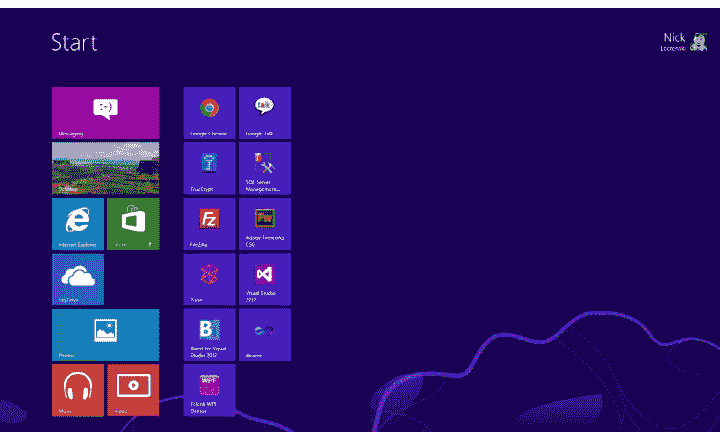

**图 4-7**

在考虑如何使用活动磁贴功能时，考虑用户在不实际进入应用程序的情况下想要看到什么信息。将活动磁贴想象成应用程序状态的快照。如果你有一种在后台监控某些内容的应用程序，它也应该更新磁贴的状态，以便用户可以查看新信息。Windows 8 自带的默认天气应用就是一个很好的例子。随着天气的变化，该应用程序的活动磁贴会更新以反映这些变化，用户无需进入应用程序即可在开始屏幕上快速查看当前/预报的天气。

实现活动磁贴与在应用程序中显示 toast 通知并不相似。活动磁贴的工作原理基本上相同，即你从一组可用磁贴模板中进行选择，然后将自定义的 XML 数据发送到负责更新你的应用程序的 WinRT 对象。

# 可用的活动磁贴模板

正如你可以想象的，有很多不同的模板可供你选择。有些是基于文本的，另一些包含添加图像的功能。需要记住的一个重要点是，无论你选择什么，你的磁贴自定义都是从背景图像和颜色开始，这两者都是你使用 Visual Studio 中的项目属性进行选择的。模板仅提供了一层图像和文本，在需要时覆盖在你的磁贴的背景图像上，花一些时间设计你磁贴的静态显示背景是重要的。

再次，微软围绕这个主题提供了大量的指导。要获取有关你的活动磁贴可用的哪些模板和样式的最新信息，请访问：

`http://msdn.microsoft.com/en-us/library/windows/apps/hh761491.aspx.`

以下章节介绍了所有可用带有示例 XML 的磁贴（截至编写时）。

### 活动磁贴示例

到此时你可能已经急于开始创建活动磁贴了，没有比创建一个示例项目更好的方法了，它可以为你的应用程序创建一个自定义磁贴并向磁贴发送通知，以便它可以在开始屏幕上更新。要开始，请遵循以下步骤：

1. 在 Visual Studio 2012 中使用空白（Blank）模板创建一个新项目。

2. 对于此项目，使用宽版（wide）模板之一以确保你的磁贴不被忽略。首先为宽版本的磁贴提供除默认以外的背景图像。宽版磁贴的大小为 310x150，你应该做的第一件事是向 Assets 文件夹添加一张该大小的图像。

3. 打开 `Package-manifest` 文件，滚动到 Tile 部分。在这里，你可以设置磁贴的标志（Logo）、宽版标志（Wide logo）和小型版（Small versions）。在本示例中，将宽版 logo 设置为在 Assets 文件夹中添加的图像，如图 4-8 所示。

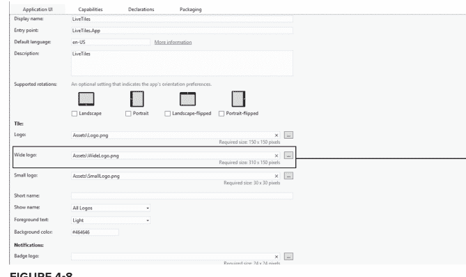

4. 根据所选的图像，如果你在图像中有透明度，你可能还想设置背景颜色以匹配整个磁贴。

5. 现在你准备好编写代码了；你会对代码如此之少感到惊讶。在这个示例中，你允许用户输入文本并点击按钮，文本被发送到你应用程序的活动磁贴。打开 `MainPage.xml` 并将其内容替换为列表 4-10 中的代码。此代码为你提供了一个简单的 TextBox 和 Button 控件，为应用程序提供更新磁贴所需的内容。

**图 4-8**

6. 如果它能完成任务，就不需要太多复杂的操作。现在，打开 `MainPage.xaml` 文件并将其替换为列表 4-11 所示的代码。

### 列表 4-10：MainPage.xml

```xml
<Page x:Class="LiveTiles.MainPage"
xmlns="http://schemas.microsoft.com/winfx/2006/xaml/presentation"
xmlns:x="http://schemas.microsoft.com/winx/2006/xaml"
xmlns:local="LiveTiles">

  <Grid Background="{Resource ApplicationThemeBrush}">
    <StackPanel HorizontalAlignment="Center">
      <TextBox x:Name="LiveTileText" HorizontalAlignment="Left" TextWrapping="Wrap" Width="250" Height="29"/>
      <Button Content="Update Tile" HorizontalAlignment="Left" Click="UpdateTile_Click"/>
    </StackPanel>
  </Grid>
</Page>
```

### 列表 4-11：MainPage.xaml

```csharp
using System;
using Windows.Data.Dom;
using Windows.UI.Notifications;
using Windows.UI.Xaml;
using Windows.UI.Xaml.Controls;

namespace LiveTiles
{
    /// <summary>
    /// 一个空页面，可以导航到。
    /// </summary>
    public sealed partial class MainPage : Page
    {
        public MainPage()
        {
            this.InitializeComponent();
        }

        private void UpdateTile_Click(object sender, RoutedEventArgs e)
        {
            XmlDocument template =
                TileUpdateManager.GetTemplateContent(TemplateType.WideText01);
            XmlNodeList nodes = template.GetElementsByTagName("*");

            nodes[0].InnerText = LiveTileText.Text;

            TileNotification notification = new TileNotification(template);
            notification.ExpirationTime = DateTimeOffset.Now.AddSeconds(10);

            TileUpdater tileUpdater =
                TileUpdateManager.CreateTileUpdaterForApplication();
            tileUpdater.Update(notification);
        }
    }
}
```

9. 使用 `TileUpdater` 类通过新创建的 `TileNotification` 对象实际更新你应用程序的 Tile。如果你想在此操作中查看效果，可以使用 Visual Studio 调试器在你的本地 PC 上生成并运行应用。不过，你需要在 PC 上本地运行，因为模拟器目前不支持实时磁贴（Live Tiles）和通知（Notifications）。

10. 应用程序运行后，输入消息并点击按钮。然后快速按下键盘上的 Windows 键返回开始屏幕。一两秒钟后，你的应用程序 Tile 就会显示新的通知消息。图 4-9 显示了更新前的 Tile 静态版本，而图 4-10 显示了带有输入的自定义消息的实时磁贴更新。

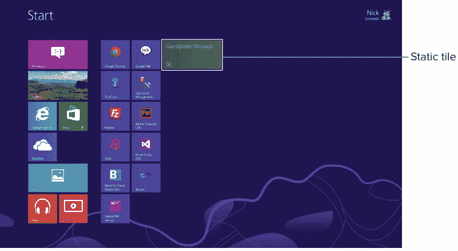

**图 4-9**

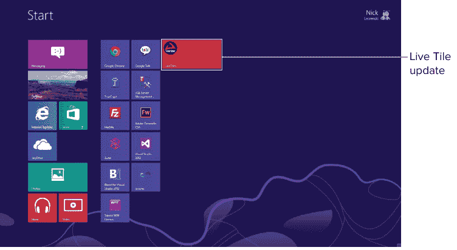

**图 4-10**

希望你已经很好地理解如何为应用设置实时磁贴和 Tile 通知。在第 12 章中你将学习更多相关内容，包括如何使用来自 Web 服务器的推送通知更新 Tile。

## 启动屏幕

本章的最后一个主题是一个简单但重要的课题——如何为应用创建自定义启动屏幕。当应用程序在 Windows 8 中启动时，启动屏幕会一直显示，直到应用完全加载。图 4-11 显示了用户默认看到的界面。


**图 4-11**

是的，它很丑且不令人印象深刻——绝对不是有助于推销你品牌的东西。在告诉潜在用户你完全没有设计技能之前，你应该考虑替换它。幸运的是，对于 Windows Store 应用，显示自定义启动屏幕不需要特殊的代码或魔法术。你只需要简单地替换项目 `Assets` 文件夹中的那个文件即可。在该文件夹中，你可以看到以下文件：

- `Logo.png`
- `SmallLogo.png`
- `SplashScreen.png`
- `StoreLogo.png`

猜猜你需要替换哪一个文件！你唯一需要担心的是它符合 Windows 8 启动屏幕规范。这意味着你替换的图像尺寸必须为 620x330。替换后启动应用时，你应该看到你的自定义启动屏幕。图 4-12 显示了一个自定义的 Wrox 启动屏幕，看起来明显比默认的好好。

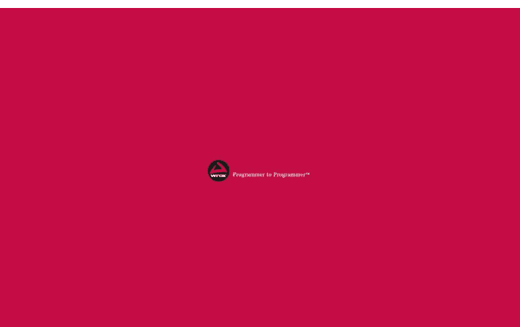

**图 4-12**

### 总结

在本章中，你学习了关于 Windows Store 应用开发的重要概念。你了解了如何充分利用新的 AppBar（应用标题栏），以及它是如何取代你在旧版 Windows 应用中可能常见的传统菜单系统的。在你创建的示例应用中，你在屏幕顶部和底部都添加了 AppBar。根据 Windows 8 指南，你了解到触控栏（tap bar）是放置重要操作命令的最佳位置，而触控栏在必要时留给导航控件。

除了 AppBar 功能外，你还学习了如何创建在应用后台运行时可以显示信息的通知。你应该只使用通知来显示重要信息，例如响应吐司通知（toast）时，此时用户可能会触碰/点击通知消息并返回你的应用。除非有充分理由，否则你不希望他们这样做。

接下来，你学习了如何为你的应用利用实时磁贴（Live Tiles），这为你提供了一个从 Windows 8 开始屏幕与用户交互的绝佳方式。它们还能让你的应用与其他仅提供无动态更新能力的静态 应用区分开来。

最后，你看到了替换 Windows Store 应用启动时的默认启动屏幕是多么简单。虽然它看起来可能是应用中一个微不足道的组件，但你必须仔细设计该屏幕，因为它是应用启动时用户看到的第一个东西——在如今，应用的初印象非常重要。

# 5

## 应用生命周期

本章内容包括：

- 理解和处理 Windows 8 生命周期
- 实现并理解后台操作

本章的 WROX.COM 代码下载

你可以在 www.wrox.com/remtitle.cgi?isbn=1118205707 的“Download Code”选项卡中找到本章的代码，对应压缩文件 205709 C05.zip。

### 应用重生

微软表示 Windows 8 是一个不妥协的操作系统。这一愿景甚至使其重新思考操作系统如何管理应用程序，产生了一种接入 Windows 的新方式，提供了一个标准接口，使得 Windows 能够理解应用的需求，而不仅仅是让它们运行。这种对操作系统与应用交互方式的重构显著提升了应用及其运行设备的用户体验。

### 什么是 Windows 8 生命周期？

在传统的桌面应用程序中，应用程序的生命周期是简单固定的。应用程序通过快捷方式启动并一直运行直到用户关闭它或启动关。在运行期间，应用程序的生命周期是固定的。（注：原文此处有大量重复，已去重）

图 5-1 显示了新的周期。应用可以处于的状态为 `ApplicationExecutionState`。

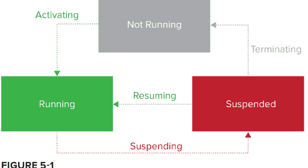

**图 5-1**

### 应用启动

当应用首次启动时，Windows 8 会显示启动屏幕，确保在 Windows 加载应用时提供快速且流畅的过渡。在应用准备好交互后，Windows 会将其关闭。屏幕清晰地显示了应用的标识。要自定义启动屏幕，请创建一个透明的 PNG 并选择一种能清晰识别应用的背景颜色。这些设置在 `package.appmanifest` 的 `SplashScreen` 元素中：


**图 5-2**

```xml
<SplashScreen Image="Assets\SplashScreen.png" BackgroundColor="#000000" />
```

> **警告** 虽然支持 JPEG，但强烈建议使用透明 PNG，这样背景颜色和图像会融合得更平滑。JPEG 可能会引入伪影和色彩差异。

`Image` 属性是文件的相对路径或图像的引用，必须符合要求的尺寸。使用 Visual Studio 项目模板时，`Assets\SplashScreen.png` 中包含一个默认图像。为了支持高 DPI 显示的额外缩放，你必须包含带有缩放标识符的额外。主及各种启动屏幕图像的具体尺寸见表 5-1。

# 表 5-1: 启动屏幕尺寸

| 缩放 | 尺寸 | 文件名 |
| --- | --- | --- |
| 默认 | 620 x 300 | SplashScreen.png |
| 100% | 620 x 300 | SplashScreen.scale-100.png |
| 140% | 868 x 420 | SplashScreen.scale-140.png |
| 180% | 1116 x 540 | SplashScreen.scale-180.png |

你可以通过在文件夹中组织图像来添加辅助功能支持（高对比度）或匹配不同语言的本地化图像，如图 5-3 所示。`BackgroundColor` 属性可以是带有 `#` 开头的十六进制 RGB 值，可以是支持的具名颜色。

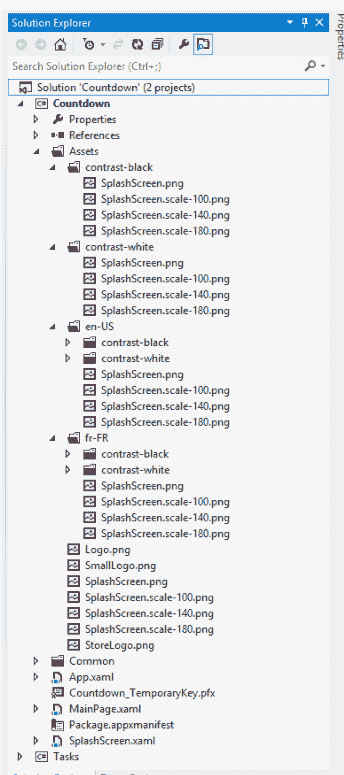

**图 5-3**

## 扩展启动屏幕

当启动屏幕显示时，应用程序应该快速注册任何事件处理器并加载其自定义 UI 元素和资源。这应该尽可能地完成。如果你需要可能运行时间较长的方法（例如从磁盘读取大量数据或从网络检索数据），你应该在激活后执行这些方法。在激活需要此类方法的情况下，你应该使用一个模拟 Windows 启动屏幕的页面来扩展启动屏幕，如图 5-4 所示。这可以在应用程序接管控制权时创建一个无缝衔接。


**图 5-4**

要扩展启动屏幕，请遵循以下步骤：

1. 向项目添加一个新的空白页面。
2. 将页面命名为 `SplashScreen.xaml`。
3. 通过设置其背景颜色并在相同位置添加图像，编辑此新页面以与 Windows 8 提供的启动屏幕外观匹配，如列表 5-1 所示。

启动页的后台代码将图像放置在正确的位置并在应用程序完成加载后导航到主页面，如列表 5-2 所示。

### 列表 5-1：SplashScreen.xaml


```xml
<Page
  x:Class="Countdown.SplashScreen"
  IsTabStop="false"
  xmlns="http://schemas.microsoft.com/winfx/2006/xml/presentation"
  xmlns:x="http://schemas.microsoft.com/winfx/2006/xml"
  xmlns:local="local:using:Countdown"
  xmlns:d="http://schemas.microsoft.com/expression/blend/2008"
  xmlns:mc="http://schemas.xmlformats.org/markup-compatibility/2006"
  mc:Ignorable="d">
  <Grid Background="#000000">
    <Canvas>
      <Image Name="SplashScreen"
        Source="Assets/SplashScreen.png"
        Stretch="None" />
    </Canvas>
  </Grid>
</Page>
```

### 列表 5-2：SplashScreen.xaml.cs

```cs
using System;
using System.Collections.Generic;
using System.IO;
using System.Linq;
using Windows.Foundation;
using Windows.Foundation.Collections;
using Windows.UI.Core;
using Windows.UI.Xaml;
using Windows.UI.Xaml.Controls;
using Windows.UI.Xaml.Controls.Primitives;
using Windows.UI.Xaml.Data;
using Windows.UI.Xaml.Input;
using Windows.UI.Xaml.Media;
using Windows.UI.Xaml.Navigation;

// 空页模板文档位于：
// http://go.microsoft.com/fwlink/?LinkId=234238

namespace Countdown
{
    /// <summary>
    /// 一个可以单独使用或在 Frame 内进行导航的空页面。
    /// </summary>
    public sealed partial class SplashScreen : Page
    {
        private Windows.ApplicationModel.Activation.SplashScreen _splashScreen;

        public SplashScreen()
        {
            this.InitializeComponent();

            Window.Current.SizeChanged += CurrentSizeChanged;
        }

        void CurrentSizeChanged(object sender, SizeChangedEventArgs e)
        {
            PositionImage();
        }

        private void PositionImage()
        {
            // 只有在设置了启动屏幕时才更新位置。
            if (_splashScreen != null)
            {
                // 获取启动屏幕的位置。
                var location = _splashScreen.ImageLocation;
                SplashImage.SetValue(Canvas.TopProperty, location.Top);
                SplashImage.SetValue(Canvas.LeftProperty, location.Left);
                SplashImage.Width = location.Width;
                SplashImage.Height = location.Height;
            }
        }

        /// <summary>
        /// 当此页面即将在 Frame 中显示时被调用。
        /// </summary>
        /// <param name="e">描述如何到达此页面的事件数据。
        /// Parameter 属性通常用于配置页面。</param>
        protected override void OnNavigatedTo(NavigationEventArgs args)
        {
            // 获取启动屏幕参数
            var splash = args.Parameter as Windows.ApplicationModel.Activation.SplashScreen;

            if (splash != null)
            {
                // 注册当 Windows
                // 消除启动屏幕时的事件处理器
                splash.Dismissed += splash_Dismissed;

                // 存储启动屏幕并更新图像位置
                _splashScreen = splash;
                PositionImage();
            }
        }

        async void splash_Dismissed(
            Windows.ApplicationModel.Activation.SplashScreen sender,
            object args)
        {
            // 由于消除不是在主线程上进行的，
            // 分发到主线程以对 frame 进行导航
            await Dispatcher.RunAsync(CoreDispatcherPriority.Normal, () =>
            {
                Frame.Navigate(typeof(MainPage), this);
            });
        }
    }
}
```

启用扩展启动屏幕只需更改加载到启动屏幕页面，如列表 5-3 所示。启动屏幕将传递给页面。

### 列表 5-3：App.cs

```cs
using System;
using System.Collections.Generic;
using System.IO;
using System.Linq;
using Windows.Foundation;
using Windows.Foundation.Collections;
using Windows.UI.Core;
using Windows.UI.Xaml;
using Windows.UI.Xaml.Controls;
using Windows.UI.Xaml.Controls.Primitives;
using Windows.UI.Xaml.Data;
using Windows.UI.Xaml.Input;
using Windows.UI.Xaml.Media;
using Windows.UI.Xaml.Navigation;

// (代码在此处中断，但逻辑如下)
namespace Countdown
{
    /// <summary>
    /// 为默认类提供应用程序特定的行为。
    /// </summary>
    sealed partial class App : Application
    {
        /// <summary>
        /// 初始化单例对象。
        /// </summary>
        public App()
        {
            InitializeComponent();
            this.Suspending += OnSuspending;
        }

        /// <summary>
        /// 当由用户正常启动应用程序时调用。
        /// 打开特定文件、显示搜索结果等。
        /// </summary>
        /// <param name="args">启动请求的细节</param>
        protected override void OnLaunched(LaunchEventArgs args)
        {
            // 如果运行时，不要重复初始化应用程序，只需确保窗口激活
            if (args.PreviousExecutionState == ExecutionState.Running)
            {
                Window.Current.Activate();
                return;
            }

            // 创建 Frame 作为导航上下文并导航到第一个页面
            var rootFrame = new Frame();
            rootFrame.Navigate(typeof(SplashScreen), args.SplashScreen);

            // 将 frame 放入当前窗口并确保其激活状态
            Window.Current.Content = rootFrame;
            Window.Current.Activate();
        }

        /// <summary>
        /// 当应用程序执行挂起时调用。
        /// 保存应用程序状态，无需知道应用程序将被终止还是恢复，
        /// 但保持内存完整。
        /// </summary>
        /// <param name="sender">挂起请求的源。</param>
        /// <param name="e">挂起请求的细节</param>
        private void OnSuspending(object sender, SuspensionEventArgs e)
        {
            var deferral = e.SuspendingOperation.GetDeferral();
            // TODO：保存应用程序状态并停止任何后台活动
            deferral.Complete();
        }
    }
}
```

## 什么是 Windows 8 生命周期？

### 列表 5-4 (续)

```xml
<Image Name="SplashImage"
Source="Assets/SplashScreen.png"
Stretch="None" />

<ProgressRing Name="Progress"
IsActive="True"
Foreground="White" />

</Canvas>

</Page>
```

### 列表 5-5: SplashScreen.xaml.cs


```csharp
using System;
using System.Collections.Generic;
using System.IO;
using System.Linq;
using System.Threading.Tasks;
using Windows.Foundation;
using Windows.Foundation.Collections;
using Windows.UI.Core;
using Windows.UI.Xaml;
using Windows.UI.Xaml.Controls;
using Windows.UI.Xaml.Controls.Primitives;
using Windows.UI.Xaml.Data;
using Windows.UI.Xaml.Input;
using Windows.UI.Xaml.Media;
using Windows.UI.Xaml.Navigation;

// 空页模板文档位于：
// http://go.microsoft.com/fwlink/?LinkId=234238

namespace Countdown
{
    /// <summary>
    /// 一个可以在 Frame 中使用或导航到 Frame内的空页。
    /// </summary>
    public sealed partial class SplashScreen : Page
    {
        private Windows.ApplicationModel.Activation.SplashScreen _splashScreen;

        public SplashScreen()
        {
            this.InitializeComponent();
            Window.Current.SizeChanged += Current_SizeChanged;
        }

        void Current_SizeChanged(object sender, SizeChangedEventArgs e)
        {
            PositionImage();
        }

        private void PositionImage()
        {
            // 只有在设置了启动屏幕时才更新位置。
            if (_splashScreen != null)
            {
                // 获取启动屏幕的位置。
                var location = _splashScreen.ImageLocation;

                SplashImage.SetValue(Canvas.TopProperty, location.Top);
                SplashImage.SetValue(Canvas.LeftProperty, location.Left);
                SplashImage.Width = location.Width;
                SplashImage.Height = location.Height;

                // 根据启动图像设置大小和位置。
                var progressScale = 12;
                Progress.Width = location.Width / progressScale;
                Progress.Height = location.Width / progressScale;

                Progress.SetValue(Canvas.TopProperty, location.Top
+ location.Height);

                Progress.SetValue(Canvas.LeftProperty, location.Left
+ location.Width / 2
+ Progress.Width / 2);
            }
        }

        ///<summary>
        /// 当此页面即将在 Frame 中显示时被调用。
        /// </summary>
        /// <param name="e">描述如何到达此页面的事件数据。
        /// Parameter 属性通常用于配置页面。</param>
        protected override void OnNavigatedTo(NavigationEventArgs e)
        {
            // 获取启动屏幕参数
            var splash = e.Parameter
            as Windows.ApplicationModel.Activation.SplashScreen;

            if (splash != null)
            {
                // 注册当 Windows
                // 消除启动屏幕时的事件处理程序
                splash.Dismissed += splash_Dismissed;

                // 存储启动屏幕并更新图像位置
                _splashScreen = splash;
                PositionImage();
            }
        }

        async void splash_Dismissed(
            Windows.ApplicationModel.Activation.SplashScreen sender,
            object args)
        {
            // 加载额外内容
            await Task.Delay(3000);

            // 由于消除操作不在主线程上进行，
            // 分发到主线程以导航帧
            await Dispatcher.RunAsync(CoreDispatcherPriority.Normal, () => {
                Frame.Navigate(typeof(MainPage), this);
            });
        }
    }
}
```

你可以通过调整 `progressScale` 的值来更改 `ProgressRing` 的大小。你可以在 `ProgressRing` 下方添加一个 `TextBlock`，包含有关应用程序正在操作的额外信息。这可以是简单的“正在加载新闻”，也可以是游戏中的“正在重构外星基因结构”等更复杂的内容。

> 注意：应用程序可以随时间变化以鼓励重复使用。基于当前事件或页面上下文的背景图像，或很少发生的微妙动画，可以保持用户的注意和兴趣。

## 激活

应用程序有许多可以在我们习惯的传统方式之外被激活。Windows 8 引入了一个新概念，即使用合约或扩展通过特定上下文激活应用程序（两者在第 7 章“传感器”中会有更详细的解释）。它们允许应用程序以标准方式提供丰富的功能。合约是两个互不感知的应用程序之间的接口。扩展是与 Windows 8 的接口，是应用程序增强内置 Windows 8 的主要方式。在某种意义上，这是命令行参数的现代版本，但功能强大得多。为了支持一个或多个合约或扩展，应用程序清单需要添加应用程序将支持的适当声明。每个类型的声明都有额外的选项。这里列出了最常用的合约及其附加选项：

- 文件打开选择器和文件保存选择器：描述应用程序何时可用于打开或保存操作。如果应用程序提供云存储或共享，则应该包含这些项。这些需要支持的文件类型，如图 5-5 所示。

部署包的属性包含在清单文件中。你可以使用 Manifest Designer 设置或修改更多属性。

图 5-5

文件类型关联：允许应用程序打开特定类型的文件。可以设置如该文件类型的标签和图标等选项。此外，还可以设置从互联网下载的文件的安全标志位，如图 5-6 所示。

部署包的属性包含在清单文件中。你可以使用 Manifest Designer 设置或修改更多属性。

图 5-6

- 后台任务：允许应用程序接收通知。

图 5-7

- 搜索：允许应用程序搜索。

### 表 5-2：ActivationKind

| MEMBER | DESCRIPTION |
|---|---|
| CachedFileUpdater | 提供内容管理。 |
| CameraSettings | 使用相机拍摄照片或视频。 |
| ContactPicker | 从联系人列表中选择。 |
| Device | 提供自动播放。 |
| File | 打开了应用程序注册处理的文件类型。 |
| FileOpenPicker | 选择由应用程序打开的文件或文件夹。 |
| FileSavePicker | 将文件保存到应用程序。 |
| Launch | 以正常方式启动应用程序。 |
| Protocol | 打开了协议注册给应用程序的 URL。 |
| PrintTaskSettings | 提供打印功能。 |
| Search | 显示搜索结果。 |
| ShareTarget | 共享内容。 |

### 列表 5-6 (续)

```csharp
sealed partial class App : Application
{
    /// <summary>
    /// 初始化单例应用对象。这是执行的编写代码
    /// 第一行，因此在逻辑上等于
    /// main() 或 WinMain()
    /// </summary>
    public App()
    {
        this.InitializeComponent();
        this.Suspending += OnSuspending;
        this.Resuming += OnResuming;
    }

    /// <summary>
    /// 当用户正常启动应用时调用。
    /// 当应用启动以打开特定文件、显示搜索结果等
    /// 时，将使用其他入口点。
    /// </summary>
    /// <param name="args">关于启动请求和过程
    /// 的细节。</param>
    protected override void OnLaunched(LaunchEventArgs args)
    {
        // 如果已经在运行，不要重复初始化应用，
        // 只需确保窗口处于激活状态
        if (args.PreviousExecutionState
            == ApplicationExecutionState.Running)
        {
            Window.Current.Activate();
            return;
        }

        if (args.PreviousExecutionState
            == ApplicationExecutionState.Terminated)
        {
            // TODO: 从之前挂起的应用中加载状态
        }

        // 创建一个帧作为导航上下文
        // 并导航到第一页
        var rootFrame = new Frame();
        rootFrame.Navigate(typeof(SplashScreen), args.SplashScreen);

        // 将帧置于当前窗口中并确保它处于激活状态
        Window.Current.Content = rootFrame;
        Window.Current.Activate();
    }

    /// <summary>
    /// 当应用执行被挂起时调用。
    /// 保存应用状态，而无需知道应用将被
    /// 终止还是在内存内容保持完整的情况下恢复。
    /// </summary>
    /// <param name="sender">挂起请求的源。</param>
    /// <param name="e">关于挂起请求的细节。</param>
    private void OnSuspending(object sender, SuspendingEventArgs e)
    {
        var deferral = e.SuspendingOperation.GetDeferral();
        //TODO: 保存应用状态并停止任何后台活动
        deferral.Complete();
    }

    void OnResuming(object sender, object e)
    {
    }
}
```

## 应用关闭

当应用被关闭时，它会被挂起，然后被终止。应用有机会通过处理 `Suspending` 事件来保存应用和用户数据。然而，应该尽快完成，因为 Windows 8 仅允许大约 10 秒时间来处理此事件。当应用下次启动时，`Activated` 事件允许应用使用 `PreviousExecutionState` 来确定其上次是如何终止的。这是表 5-3 中显示的值之一。

### 持久化状态

建议在应用挂起时在本地保存状态，以便其能够足够快地在分配的时间内完成。以下列表显示了给定先前的执行状态下的应用行为：

- CloseByUser（用户关闭）：打开新会话。当应用被用户关闭时发生。
- NotRunning（未运行）：打开新会话。当应用在当前会话中未运行或意外终止时发生。
- Terminated（已终止）：应用加载先前的状态。当 Windows 8 由于资源限制或关机而关闭应用时发生。

### 应用崩溃

在应用崩溃的罕见情况下，应用应简单返回启动屏幕，而不是在崩溃体验期间提供任何额外的 UI。这为所有应用提供了通用的行为，并防止了用烦人的警告或通知延误用户。由于应用已不再可见，用户知道出现了一些问题。

当发生此类情况或无响应时，Windows 8 会征求用户同意发送问题报告，该报告在 Windows Dev Center 的 Quality（质量）页面下可见，以便对此类问题进行评估和修复。

### 应用卸载

当应用被用户卸载时，应用将与其所有本地数据一起被移除。这不会移除应用在其他位置（如文档、图片或 SkyDrive）中创建的任何文件。

## 后台操作

如前所述，当应用挂起时，它们不再可以执行代码。但是，在某些特殊情况下，应用可以继续在后台运行。这些情况都是直接来自 Windows Phone。以下是四个基本的后台任务：

- 播放音频
- 传输文件
- 通过推送通知更新数据
- 与其他应用共享数据

这些后台任务被赋予有限的系统资源；因此，它们不应该执行密集型或耗时任务。除非应用处于锁定状态，否则每个应用每小时获得一秒的 CPU 时间配额。这些应用每 15 分钟获得最多两秒的 CPU。任何使用时间都不会在间隔期之间累积。如果在后台任务触发时应用处于前台，则不应用配额。除非设备连接到 AC 电源，否则网络资源将根据网络接口消耗的能量量受到限制。

> 注意：CPU 是应用使用 CPU 的实际时间，而不是时钟时间。例如，如果后台任务等待远程服务器的响应，它不使用 CPU，因此等待响应的时间不会计入 CPU 配额。

后台任务不应依赖用户交互，并且不应显示吐司通知（toast notifications）、磁贴（tiles）或徽标（badges）之外的任何 UI。后台任务有一个外部触发器，指示任务应该运行。

### 表 5-4：后台任务触发器

| 触发器类型 | 触发事件 | 触发发生的时机 |
| :--- | :--- | :--- |
| ControlChannelTrigger | ControlChannelTrigger | 控制通道上有入站消息。 |
| MaintenanceTrigger | MaintenanceTrigger | 需要执行维护任务。 |
| PushNotificationTrigger | PushNotificationTrigger | WNS 通道收到通知。 |
| SystemEventTrigger | InternetAvailable | 网络变为可用。 |
| SystemEventTrigger | LockScreenApplicationAdded | 锁屏上添加了应用磁贴。 |
| SystemEventTrigger | LockScreenApplicationRemoved | 锁屏上删除了应用磁贴。 |
| SystemEventTrigger | ControlChannelReset | 网络通道被重置。 |
| SystemEventTrigger | NetworkStateChange | 网络状态变化，例如网络类型。 |
| SystemEventTrigger | OnlineIdConnectedState | 与关联关联 Online ID 发生变化。 |
| SystemEventTrigger | ServicingComplete | 系统完成了应用更新。 |
| SystemEventTrigger | SessionConnected | 会话已连接。 |
| SystemEventTrigger | SessionDisconnected | 会话已断开。 |
| SystemEventTrigger | SmsReceived | 收到新的短信 消息。 |


| SystemEventTrigger | TimeZoneChange | 设备上的时区发生变化（或由于夏令时间发生变化）。 |

## 后台操作

| 触发器类型 | 触发事件 | 触发发生的时机 |
| :--- | :--- | :--- |
| SystemEventTrigger | UserAway | 用户离开。 |
| SystemEventTrigger | UserPresent | 用户在。 |
| TimeTrigger | TimeTrigger | 发生时间事件。 |

后台任务可以包含条件，只有当触发器发生且这些条件为真时，任务才会启动。它们应该用于过滤那些由于缺少所需资源（如网络连接不可用）而不应被处理的触发事件。你可以通过 `BackgroundTaskBuilder` 的 `AddCondition` 方法来添加这些条件。表 5-5 显示了可用条件的列表。系统会评估每个条件以检查是否被满足。如果任何一个条件不满足，Windows 将等待直到所有条件都满足后再触发任务。这意味着如果你在带有任何条件的情况下使用 `TimeTrigger`，任务可能不会在特定时间运行。代码列表 5-8 显示了如何使用 `BackgroundTaskBuilder` 注册后台任务。

## 表 5-5：后台任务条件

| 条件类型 | 必须满足的条件 |
| :--- | :--- |
| InternetAvailable | 网络必须可用。 |
| InternetUnavailable | 网络必须不可用。 |
| SessionConnected | 会话必须已连接。 |
| SessionDisconnected | 会话必须断开。 |
| UserNotPresent | 用户必须离开。 |
| UserPresent | 用户必须在。 |

## 代码列表 5-8：App.xaml.cs

```csharp
using System;
using System.Collections.Generic;
using System.IO;
using System.Linq;
using Windows.ApplicationModel;
using Windows.ApplicationModel.Activation;
using Windows.ApplicationModel.Background;
using Windows.Foundation;
using Windows.Foundation.Collections;
using Windows.UI.Xaml;
using Windows.UI.Xaml.Controls;
using Windows.UI.Xaml.Controls.Primitives;
using Windows.UI.Xaml.Data;
using Windows.UI.Xaml.Input;
using Windows.UI.Xaml.Media;
using Windows.UI.Xaml.Navigation;

// The Blank Application template is documented at
// http://go.microsoft.com/fwlink/?LinkId=234227

namespace Countdown
{
    /// <summary>
    /// 提供应用特定的行为以
    /// 补充默认的 Application 类。
    /// </summary>
    sealed partial class App : Application
    {
        /// <summary>
        /// 初始化单例对象。这是执行的
        /// 作者代码的第一行，逻辑等同于
        /// main() 或 WinMain()。
        /// </summary>
        public App()
        {
            this.InitializeComponent();
            this.Suspending += OnSuspending;
            this.Resuming += OnResuming;

            RegisterBackgroundTasks();
        }

        void RegisterBackgroundTasks()
        {
            if (!BackgroundTaskRegistration.AllTasks.Any())
            {
                var builder = new BackgroundTaskBuilder()
                {
                    Name = "RefreshDataTask",
                    EntryPoint = "Tasks.RefreshDataTask"
                };

                // 如果网络可用，则每小时运行一次任务。
                builder.SetTrigger(new TimeTrigger(60, false));
                builder.AddCondition(
                    new SystemCondition(SystemConditionType.InternetAvailable));

                builder.Register();
            }
        }

        /// <summary>
        /// 当应用由终端用户正常启动时被调用。
        /// 当应用启动以打开特定文件、
        /// 显示搜索结果等时将使用其他入口点。
        /// </summary>
        /// <param name="args">关于启动请求
        /// 和过程的详情。</param>
        protected override void OnLaunched(LaunchActivatedEventArgs args)
        {
            // 如果已经在运行，不再重复初始化，
            // 只需确保窗口处于激活状态
            if (args.PreviousExecutionState == ApplicationExecutionState.Running)
            {
                Window.Current.Activate();
                return;
            }

            if (args.PreviousExecutionState == ApplicationExecutionState.Terminated)
            {
                // TODO: 从之前加载状态
            }

            // 创建一个 Frame 作为导航
            // 导航到
            var rootFrame = new Frame();
            rootFrame.Navigate(typeof(SplashScreen), args);

            // 将 frame 放在当前 Window 中并确保它是激活的
            Window.Current.Content = rootFrame;
            Window.Current.Activate();
        }

        /// <summary>
        /// 当应用被挂起时被调用。
        /// 无论应用是被终止
        /// 还是保持内存状态恢复。
        /// </summary>
        /// <param name="sender">挂起请求的发送者。</param>
        /// <param name="args">关于挂起请求的详情。</param>
        void OnSuspending(object sender, SuspensionEventArgs args)
        {
            var deferral = args.SuspendingOperation.GetDeferral();
            // TODO: 保存应用状态并停止任何后台
            deferral.Complete();
        }

        void OnResuming(object sender, object e)
        {
        }
    }
}
```

### 锁屏

提供社交媒体、通信、调度等的应用应该支持锁屏，并添加后台任务在用户未积极使用设备时提供更新。显然，当你将应用固定到锁屏时，他们认为保持更新是很重要的。为了在应用从锁屏上固定或取消固定时收到通知，请注册由 `SystemTrigger` 提供的 `LockScreenAdded` 或 `LockScreenRemoved` 触发器。应用也可以通过 `BackgroundExecution` 类中的 `RequestAccessAsync` 编程地将自己添加到锁屏。

特定类型的触发器仅限制在锁屏上的应用。如果应用不在锁屏上使用了受限触发器，后台任务将不会触发。表 5-6 显示了需要应用在锁屏上的触发器。

## 表 5-6：触发器类型

| 触发器类型 | 需要锁屏 |
| :--- | :--- |
| TimeTrigger | 是 |
| PushNotificationTrigger | 是 |
| ControlChannelTrigger | 是 |
| SystemTrigger | 否 |
| MaintenanceTrigger | 否 |

### 进度报告

当应用在后台任务触发时在前台运行时，它可以可选地向应用报告进度，这可以在任务运行期间显示 UI 或进度条。

当 `Run` 方法被调用时，它会获得一个 `IBackgroundTaskInstance`，可以通过设置 `Progress` 属性来与前台应用通信，如代码列表 5-9 所示。为了接收进度更新，应用必须注册 `Progress` 事件，如代码列表 5-10 所示。此列表注册了 `Completed` 事件，以便应用在任务完成时刷新 UI。

[第 208 页]

www.it-ebooks.info

[第 209 页]

### 列表 5-10（继续）

```csharp
using Windows.UI.Xaml.Input;
using Windows.UI.Xaml.Media;
using Windows.UI.Xaml.Navigation;
```

```csharp
// The Blank Application template is documented at
// http://go.microsoft.com/flink/?LinkId=234227
```

```csharp
namespace
{
```

```csharp
/// <summary>
/// 提供特定特定的行为以
/// 补充默认的 Application 类。
/// </summary>
```

```csharp
sealed partial class App : Application
{
    /// <summary>
/// 初始化单例应用对象。这是执行的编写代码
/// 中的第一行，因此它在逻辑上等同于
/// main() 或 WinMain()。
/// </summary>
```

```csharp
public App()
{
    this.InitializeComponent();
    this.Suspending += OnSuspending;
    this.Resuming += OnResuming;
```

```csharp
foreach (var task in BackgroundTaskRegistration.AllTasks.Values)
{
    task.Progress += OnTaskProgress;
    task.Completed += OnTaskCompleted;
}
```

```csharp
void OnTaskCompleted(BackgroundTaskRegistration sender,
BackgroundTaskCompletedEventArgs args)
{
    try
    {
        args.CheckResult();
        // 刷新任何依赖于任务内容的 UI 元素
    } catch (Exception)
    {
        // 处理和/报告任务中发生的错误
    }
}
```

```csharp
void OnTaskProgress(BackgroundTaskRegistration sender,
BackgroundTaskProgressEventArgs args)
{
    // 在应用中显示任务的进度
    var progress = args.Progress;
```

[第 210 页]

```csharp
}
```

```csharp
/// <summary>
/// 当终端用户正常启动应用时调用。
/// 当应用启动以打开特定文件、显示搜索结果
/// 等等时，将使用其他入口点。
/// </summary>
/// <param name="args">关于启动请求
/// 和过程的详细信息。</param>
protected override void OnLaunched(LaunchActivatedEventArgs args)
{
    // 当应用已运行时，不要重复应用初始化，
    // 确保窗口处于激活状态
    if (args.PreviousExecutionState
        == ApplicationExecutionState.Running)
    {
        Window.Current.Activate();
        return;
    }

    if (args.PreviousExecutionState
        == ApplicationExecutionState.Terminated)
    {
        // TODO: 从之前挂起的应用中加载状态
    }

    // 创建 Frame 以激活导航上下文
    // 并导航到第一个页面
    var rootFrame = new Frame();
    rootFrame.Navigate(typeof(SplashScreen), args.SplashScreen);

    // 将 frame 放置在当前窗口中并确保它是激活的
    Window.Current.Content = rootFrame;
    Window.Current.Activate();
}

/// <summary>
/// 当应用执行被挂起时调用。
/// 保存应用状态，而无需知道应用
/// 被终止还是在内存内容保持完好的情况下恢复。
/// </summary>
/// <param name="sender">挂起请求的源。</param>
/// <param name="e">关于挂起请求的详细信息。</param>
private void OnSuspending(object sender, SuspendingEventArgs args)
{
    var deferral = e.SuspendingOperation.GetDeferral();
    // TODO: 保存应用状态并停止任何后台活动
    deferral.Complete();
}

void OnResuming(object sender, object e)
{
}

}
```

[第 211 页]

## 调试

Visual Studio 提供了一种触发后台任务的方法。只需在 `Run` 方法中设置一个断点，并使用调试位置工具栏上的挂起下拉菜单触发后台任务，如图 5-9 所示。它显示了 Visual Studio 可以触发的后台任务名称。

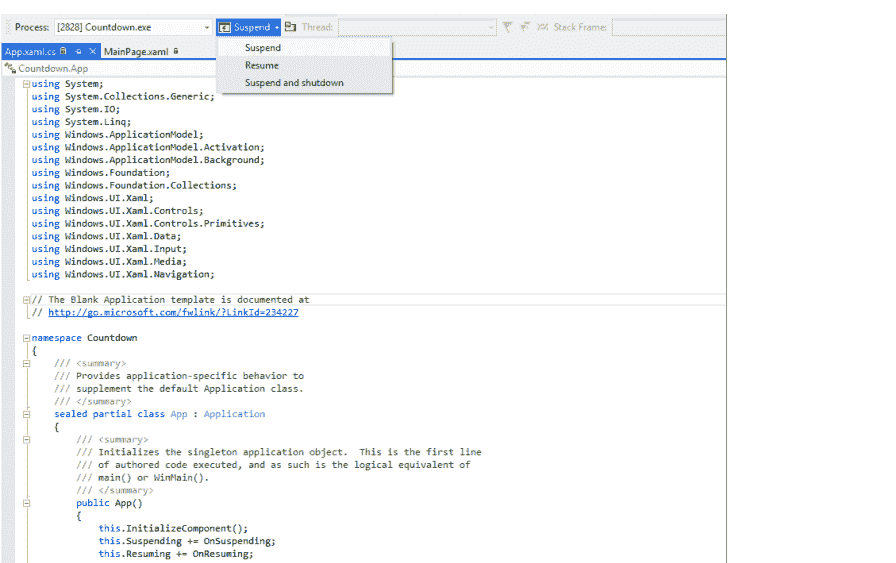

图 5-9

如果后台任务没有通过设置的清单、正确注册的代码并满足锁屏要求来激活，你可以启用调试跟踪以允许进一步调试。要启用调试跟踪，请使用以下步骤：

1. 在事件查看器中，导航到“应用程序和服务日志 > Microsoft BackgroundTaskInfrastructure”。
2. 在操作窗格中，选择“查看 > 分析和调试日志”。
3. 选择“诊断日志”并点击“启用日志”。
4. 尝试再次激活后台任务并查看日志获取详细错误信息，如图 5-10 所示。

[第 212 页]

## 总结

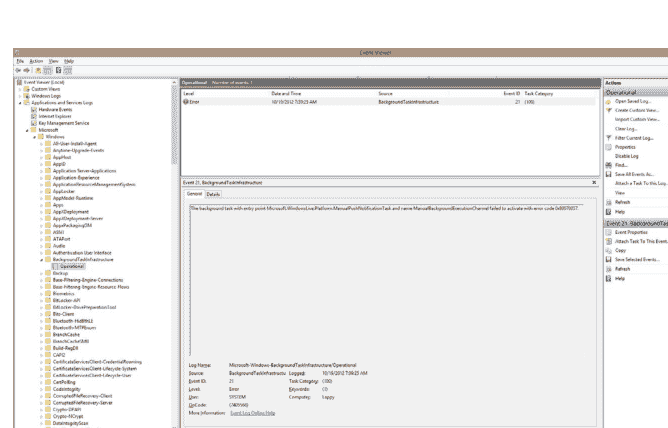

图 5-10

## 死锁

是的，可怕的死锁。它在后台任务中实际上真的会显露它的丑面目。为什么呢？因为如果应用已经在运行，后台任务实际上是与应用同进程加载的，而且因为挂起的应用 UI 线程被阻塞，当在这种情况下触发后台任务时，它无法访问任何由 UI 线程的对象，或者会导致死锁。为了防止这种死锁，后台任务不应在应用和后台任务之间共享数据。一种替代方法是使用持久化存储来共享数据。

### 总结


# 数据、文件与网络

## 应用数据

### 网络

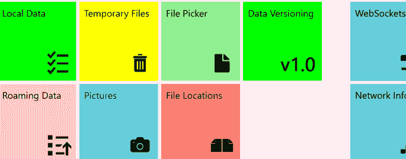

图 6-1

存档中有该应用程序的完整版本，但如果你想从头开始该项目，请打开 Visual Studio 并基于 C# Grid App (XAML) 模板创建一个新解决方案：

1. 从“文件”菜单，选择“添加” -> “新建项目”。
2. 选择“模板” ⇆ “Visual C#” ⇆ “Windows Store Grid App (XAML)”。
3. 将项目命名为 `SamplesAppCS`。
4. 表 6-1 列出了从标准模板中添加或修改的文件。

#### 表 6-1：受影响的项目文件

| 文件 | 任务 |
|---|---|
| GroupedItemsPage.xaml | 本章提供的各种数据示例摘要。你可以点击特定示例查看详情。 |
| ItemDetailPage.xaml | 示例详情；点击“运行”按钮运行该示例。 |
| ItemDetailPage.xaml.cs | 示例的后台代码。 |
| DataModel\ExampleDataModel.cs | 本章示例目录的数据模型。 |
| Examples\AppDataDemo.cs | 本地、漫游和临时文件及设置的应用数据示例。 |

#### 表 6-1 续

| 文件 | 任务 |
|---|---|
| Examples\BackgroundTransferDemo.cs | 后台传输演示。 |
| Examples\FilePickerDemo.cs | 文件选择器示例。 |
| Examples\NetworkDemo.cs | 本章的各种网络示例。 |
| Examples\PictureViewer.xaml | 图片查看器控件。 |
| Examples\PictureViewer.xaml.cs | 图片查看器控件的后台代码。 |
| Examples\SocketExamples.xaml | TCP/UDP 套接字示例的标记。 |
| Examples\SocketExamples.cs | TCP/UDP 套接字示例的后台代码。 |
| Examples\WebSocketsClient.xaml | WebSockets 的标记。 |
| Examples\WebSocketsClient.cs | WebSockets 的后台代码。 |
| Helpers\Helpers.cs | 项目中各种辅助类。 |
| Helpers\PictureConverter.cs | 图片转换器。 |

## 理解 Windows.Storage API

Windows 提供了一个新的 `Windows.Storage` 命名空间，其中包含存储和数据相关操作以及访问数据的类型。当你想要写入或读取应用设置、在文件中存储数据或从用户库访问内容时，都可以使用此 API。例如，使用此 API 处理文档、音乐、图片、视频、缓存数据和下载。

表 6-2 显示了在本章中将使用的 `Windows.Storage` 命名空间的大多数类。

#### 表 6-2：Windows.Storage API

| 类 | 描述 |
|---|---|
| ApplicationData | 本章大多数示例中用于本地、漫游和临时数据访问。 |
| ApplicationDataCompositeValue | 提供对原子处理的相关应用设置的访问。请参考后续示例中的复合容器。 |
| ApplicationDataContainer | 表示应用数据的容器。 |
| ApplicationDataContainerSettings | 提供对容器内设置的访问。 |
| CachedFileManager | 用于文件的实时更新。 |
| DownloadsFolder | 下载文件夹访问。 |
| FileIO | 文件操作的辅助方法。 |
| KnownFolders | 提供对大多数常用位置的访问。 |
| PathIO | 用于路径和 URI 的辅助方法。 |
| SetVersionDeferral | 提供延迟版本操作。 |
| SetVersionRequest | 当应用在其应用数据存储中设置应用数据版本时提供数据。 |
| StorageFile | 表示文件及其内容以及操纵它们的方法。 |
| StorageFolder | 操纵文件夹及其内容，并提供相关信息。 |
| StorageStreamTransaction | 表示随机访问流的写入事务。 |
| StreamedFileDataRequest | 表示顺序访问输出流请求。 |

Windows 为应用数据提供了三种数据存储：本地、漫游和临时。可以通过 `ApplicationData.Current` 对象的 `LocalFolder`、`RoamingFolder` 和 `TemporaryFolder` 属性进行访问。

作为开发者，你决定使用哪种数据存储，主要取决于对数据大小估计、更新频率以及任何使用场景。例如，本地应用数据留在设备上。漫游应用数据在需要将少量数据迁移到具有相同 Microsoft 账户的其它设备时非常方便。本章稍后将详细讨论对漫游数据的限制以及使用建议。最棒的一点是，虽然漫游数据存储在云端，但对开发者来说是完全免费的。Windows 在临时数据未使用时会将其丢弃。

所有应用都通过 `ApplicationModel.Package.Current` 对象的 `InstalledLocation` 属性或 URI 的 `ms-appx:///` 协议访问应用安装目录，这在“文件访问权限”节中有所讨论。

Windows Store 应用可以使用其他文件。表 6-3 显示了 Windows Store 应用中的已知文件夹：

#### 表 6-3：Windows Store 应用的已知文件夹

| 文件夹 | 描述 |
|---|---|
| DocumentsLibrary | 获取文档库 |
| HomeGroup | 获取 HomeGroup 文件夹 |
| MediaServerDevices | 获取媒体服务器 (数字生活网络联盟 (DLNA)) |
| MusicLibrary | 获取音乐库 |
| PicturesLibrary | 获取图片库 |
| RemovableDevices | 获取可移动设备 |
| VideosLibrary | 获取视频库 |

`LocalSettings` 是一个 `ApplicationDataContainer` 类型的对象，代表本地数据存储器。可以通过键访问设置。如果设置不存在，它将由字典动态创建。这种方法简化了代码和错误处理。

### 简单设置

下面的代码片段创建了一个名为 "HelloWorld" 的设置并为其分配了一个字符串。然后你可以从 `Values` 集合中检索该字符串，并使用 `Remove` 方法从集合中移除该设置。此片段展示了设置的基本用法：

```cs
var localSettings = ApplicationData.Current.LocalSettings;

// 保存本地设置
localSettings.Values["HelloWorld"] = "Hello World";
// 获取本地设置
var value = localSettings.Values["HelloWorld"];

// 移除本地设置
localSettings.Values.Remove("HelloWorld");
```

### 复合设置

如果你需要可以原子更新的更复杂的数据，可以创建复合设置。复合设置是 `ApplicationDataCompositeValue` 类的实例。你可以将设置存储在本地或漫游数据存储器中。以下是显示如何使用复合设置的代码片段：

#### 设置

```cs
var localSettings = ApplicationData.Current.LocalSettings;
ApplicationDataCompositeValue composite = new ApplicationDataCompositeValue();
composite["MyIntegerValue"] = 1;
composite["MyStringValue"] = "String";
localSettings.Values["MyCompositeSetting"] = composite;
```

### 使用容器工作

有时你可能需要按层次结构组织设置，类似于文件系统中的文件夹。Windows Storage 提供了 `CreateContainer` 方法在容器中创建设置。将枚举值 `ApplicationDataCreateDisposition.Always` 作为参数传递给该方法，以表示在不存在时创建它。该片段显示了如何使用容器：

```cs
var localSettings = ApplicationData.Current.LocalSettings;

// 创建容器
var container = localSettings.CreateContainer("MyContainer",
    ApplicationDataCreateDisposition.Always);

// 分配值
container.Values["MyContainer"] = "Hello World";
```

### 与本地文件工作

当你需要保存大量数据、二进制数据或具有复杂数据结构的数据时，可以使用本地文件。你可以直接使用 `ApplicationData.Current.LocalFolder` 作为本地文件的位置，并使用 `FileIO` 方法写入和读取文件。

记住，你的文件可能会变得很大，并且许多 API 方法已经重写以支持异步模型，你可能需要在 C# 代码中使用 `async` 和 `await` 关键字，或者在 JavaScript 中使用 `promises` 以保持用户体验的快速流畅。大多数与文件相关的操作都是显式异步的。

你使用特定格式的读写方法来写入文本、字节和缓冲区数据。在片段中 `WriteTextAsync` 显示了如何将当前的数据的时间作为文本写入：

```cs
var localFolder = ApplicationData.Current.LocalFolder;
StorageFile sample = await localFolder.CreateFileAsync("file.txt",
    CreationCollisionOption.OpenExists);
await FileIO.WriteTextAsync(sample, String.Format("{0}", DateTime.Now));
```

要读取本地文件，使用 `FileIO.ReadTextAsync` 读取文本文件或使用可以读取二进制文件的方法。该片段显示了如何从 `LocalFolder` 读取文件：

```cs
var localFolder = ApplicationData.Current.LocalFolder;

string result = null;

try {
    StorageFile file = await localFolder.GetFileAsync("file.txt");
    result = await FileIO.ReadTextAsync(file);
} catch (FileNotFoundException) {
    // 处理错误
}
```

### 漫游设置和应用程序

你可能有几台运行 Windows 的设备。实际上，当你购买新设备并立即用 Microsoft 账户登录新设备时，你会发现应用会自动应用你喜爱的主题、颜色和应用中的偏好设置。这运行起来就像魔法一样！

这是由于 Windows 的漫游存储器：当用户拥有多个设备时，漫游提供了极佳的用户体验。因此，当漫游存储器发生更改时，Windows 会完成设备间数据同步的所有工作。

幸运的是，从开发者的角度来看，使用漫游存储器也很简单，与使用本地设置和数据几乎没有区别！最重要的是，在应用程序中使用漫游存储器时，你需要注意这些简单的考虑：

- 漫游设置、自定义数据和小数据集。这可能包括用户偏好和设置。
- 漫游应用程序状态、导航和属性。这有助于用户在设备上开始任务并在另一台设备上继续。这可能包括用户导航栈、电子阅读器应用中的书签等。
- 不要漫游频繁变化或可能导致冲突的数据。建议只漫游变化缓慢的数据。你可以随时使用云端的专用数据存储器来处理快速变化的数据。

> **注意**：不要使用漫游数据存储器存储大量数据，请使用专用的云服务（如 Windows SkyDrive）来交换大量数据。本章末尾提供了 Azure 在线存储的排行榜示例。漫游存储旨在轻量级设置和小对象。你可以随时通过检查 `ApplicationData.RoamingStorageQuota` 来检查漫游存储配额。

记住，如果用户登录了 Microsoft 账户并且触发了设备，应用可以从漫游中受益。漫游并非优先；在决定漫游数据之前，Windows 会考虑多个因素，包括 `RoamingStorageQuota`。此外，打开的文件不能漫游，关闭不再需要的文件是一个好主意。

当漫游更改时，你可以处理 `DataChanged` 事件：

```cs
ApplicationData.Current.DataChanged += Application_DataChanged;
```

由于数据可能在不同的线程上更改，请使用 `Dispatcher` 通知用户更改。以下是处理 `DataChanged` 事件的片段：

```cs
async void Application_DataChanged(ApplicationData sender, object args)
{
    await this.Dispatcher.RunAsync(CoreDispatcherPriority.Normal, () => {
        Display("Data has changed!");
    });
}
```

### 为漫游数据设置高优先级

如前所述，你使用漫游处理缓慢变化的数据。你可以通过增加高优先级计数器来建议 Windows 加速。虽然无法保证该数据立即可用，但它仍然增加了数据到其他设备的速度。该片段显示如何使用高优先级：

```cs
int counter = Convert.ToInt32(roamingSettings.Values["HighPriority"]);
roamingSettings.Values["HighPriority"] = counter + 1;
```

### 临时应用程序数据

你使用临时应用程序数据存储可能会被删除的文件。Windows 根据磁盘空间和其他因素自动删除临时文件。你通过 `TemporaryFolder` 或使用 `msappdata://` 协议访问临时数据。例如，在 JavaScript 中你可以这样访问临时数据：

```html

```

在代码中，你可以访问 `TemporaryFolder` 并像处理其他一样处理临时文件：

```cs
var temporaryFolder = ApplicationData.Current.TemporaryFolder;
```

> 自然，临时数据存储器不用于设置，因此不提供设置对象，只提供文件对象。

### 应用程序数据版本

当你处理应用程序数据时，通常需要处理数据的更改；例如在更新应用后。当用户更新应用时，你可能需要将旧的应用程序数据转换为新格式。在下面的片段中，你创建一个本地设置值 "Current Version v0"。在随后的代码中，你模拟升级到下一个。列表 6-1 显示了如何使用数据版本控制。

#### 列表 6-1: AppDataDemo.cs

```cs
public async Task<string> DemoVersioning()
{
    ApplicationData appData = ApplicationData.Current;
    var localSettings = appData.LocalSettings;

    // 保存本地设置
    localSettings.Values["VersionExample"] = "Current Version v0";

    // 模拟设置版本 0
    await appData.SetVersionAsync(0,
        new ApplicationDataSetVersionHandler(OnSetVersion));

    // 模拟设置版本 1
    await appData.SetVersionAsync(1,
        new ApplicationDataSetVersionHandler(OnSetVersion));

    return localSettings.Values["VersionExample"] as string;
}

void OnSetVersion(ApplicationDataSetVersionRequest request)
{
    // 处理版本升级
}
```


```csharp
ApplicationData appData = ApplicationData.Current;
var localSettings = appData.LocalSettings;

SetVersionDeferral deferral = request.GetDeferral();

if (request.DesiredVersion > request.CurrentVersion)
{
    // 模拟转换为新版本
    localSettings.Values["VersionExample"] = String.Format("Current Version v{0}", request.DesiredVersion);
}
else
{
    // 什么都不做：我们的示例仅处理
    // 低版本到高版本的转换
}

deferral.Complete();
```

然后，你调用 `SetVersionAsync` 方法，首先将应用数据设置为 0，然后将其设置为 1。在两种情况下，你都为 `OnSetVersion` 了一个了一个回调函数，每当应用数据发生版本更改时，该函数就会被调用。传递给此方法的 `SetVersionRequest` 参数具有 `DesiredVersion` 和 `CurrentVersion` 属性，你可以通过它们了解数据的旧新版本，并根据需要应用数据规则。

在此示例中，检查当前版本是否低于目标版本。应用程序提供数据更新是常见操作（数据降级较少见），但决定权在开发者手中。

## 清除应用数据

你可能需要清除所有应用数据或单个设置、容器或文件。你可以使用 `ClearAsync` 方法来清除数据存储中的数据。当你在调试应用程序或升级到新版本时，这非常有用：

```csharp
// 清除所有数据，包括本地、临时和漫游数据
await ApplicationData.Current.ClearAsync();
```

## 显示图片库

在此示例中，你将学习如何查询库；例如图片库（Pictures library）——并且你可以在网格中显示用户图片库中的图片。点击主页上的“图片”按钮，即可从 DataSamples 应用获取此示例。图 6-3 显示了从图片库显示图片的结果。

### 图片

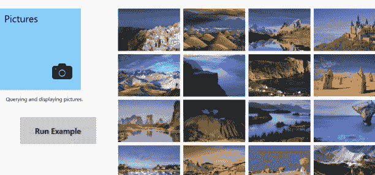

查询并显示图片。

运行示例

图 6-3

1. 通过在 Visual Studio 中打开清单文件声明库功能，选择“Capabilities”选项卡，并勾选“Pictures Library”复选框。

2. 创建一个新的用户控件 `PictureViewer`，并将此控件的 XAML 替换为列表 6-2。

### 列表 6-2：PictureViewer.xaml

```xml
<UserControl
Class="DataFilesNetworkingSampleCS.PictureViewer"
xmlns="http://schemas.microsoft.com/winfx/2006/xml/presentation"
xmlns:x="http://schemas.microsoft.com/winfx/2006/xml"
xmlns:local="using:DataFilesNetworkingSampleCS"
xmlns:d="http://schemas.microsoft.com/expression/blend/2008"
xmlns:mc="http://schemas.openxmlformats.org/markup-compatibility/2006"
mc:ignorable="d">
  <UserControl.Resources>
    <DataTemplate x:Key="PictureItemTemplate">
      <Grid Width="200" Height="150">
        <Image
          Source="{Binding Path=Thumbnail,
                Converter={StaticResource picConverter}}"
          Width="200" Height="150"/>
      </Grid>
    </DataTemplate>
  </UserControl.Resources>
  <!-- 项目集合 -->
  <CollectionSource x:Name="itemsViewSource"/>
</UserControl.Resources>
<Grid>
  <!-- 显示图片的网格 -->
  <GridView Width="1000" Height="600"
    x:Name="ItemGridView"
    AutomationProperties.AutomationId="ItemGridView"
    AutomationProperties.Name="Items"
    ItemsSource="{Binding
      Source={StaticResource itemsViewSource}
      ItemTemplate={StaticResource PictureItemTemplate}
      SelectionMode="None"}"
  </GridView>
</Grid>
</UserControl>
```

> 注意：`PictureViewController` 在 Resources 部分定义了一个名为 `PictureConverter` 的图片转换器实例。在同一部分，你定义了一个用于显示图片的 `DataTemplate`。并且，你使用 `CollectionViewSource` 将所有图片绑定到 `Grid`。

3. 添加一个图片助手类，将图像从流转换为位图以便进行数据绑定。在之前的 XAML 文件中使用此转换器：`Source="{Binding Path=Thumbnail, Converter={StaticResource picConverter}}"`。列表 6-3 显示了图片转换器的代码。

### 列表 6-3：PictureConverter.cs

```csharp
using System;
using Windows.Storage.Streams;
using Windows.UI.Xaml;
using Windows.UI.Xaml.Data;
using Windows.UI.Xaml.Media.Imaging;

namespace DataFilesNetworkingSampleCS
{
    public class PictureConverter : IValueConverter
    {
        public object Convert(object value, Type targetType,
            object parameter, string culture)
        {
            if (value != null)
            {
                var stream = (IRandomAccessStream)value;
                var image = new Bitmap();
                image.SetSource(stream);
                return image;
            }
            return DependencyProperty.UnsetValue;
        }
        public object ConvertBack(object value, Type targetType,
            object parameter, string culture)
        {
            throw new NotImplementedException();
        }
    }
}
```

4. 在 `Picture` 控件的后台代码中，声明一个异步 `Display` 方法用于查询 `PicturesLibrary`，并将结果绑定到你之前在标记中声明的 `itemsSource` 集合的 `Source` 属性。

### 列表 6-4：PictureViewer.xaml.cs

```csharp
public async void Display()
{
    var pics = KnownFolders.PicturesLibrary;
    var sortEntry = new SortEntry
    {
        PropertyName = "System.FileName",
        AscendingOrder = true
    };
    var queryOptions = new QueryOptions
    {
        FolderDepth = FolderDepth.Deep,
        IndexerOption = IndexerOption.UseIndexerWhenAvailable
    };
    queryOptions.SortOrder.Clear();
    queryOptions.SortOrder.Add(sortEntry);
    // 创建查询
    var query = pics.CreateQueryWithOptions(queryOptions);
    var file = new FileInformationFactory(query,
        ThumbnailMode.PicturesView,
        190,
        ThumbnailOptions.UseCurrentScale,
        true);
    // 设置数据源
    itemsSource.Source = file.GetVirtualizedFilesVector();
}
```

你完成了！在 DataSamples 示例中，当点击“运行示例”按钮时会调用 `Display` 方法。该方法创建一个查询并在网格中填充图片。

200 | 第 6 章处理数据、文件和网络

### 列表 6-7（继续）

```csharp
}else
{
    return "Cancelled";
}
```

> 注意：在将文件或文件夹添加到 MRU 列表后，你可以使用 MRU 令牌返回以检索文件。或者，你可以导航 MostRecentlyUsedList 对象的 Entries 集合，并检索你感兴趣的最新项。

列表 6-8 显示如何从 MRU 列表中检索项。

### 列表 6-8：FilesDemo.xaml.cs

```csharp
public async Task<string> GetRecentlyUsedEntryAsync()
{
    var MRU = StorageApplicationPermissions.MostRecentlyUsedList;
    if (MRU.Entries.Count > 0)
    {
        var token = MRU.Entries.First().Token;
        try
        {
            var file = await MRU.GetFileAsync(token);
            if (file != null)
            {
                return file.Name;
            }
            else
            {
                return "Couldn't get mruList file";
            }
        }
        catch (Exception)
        {
            // handle exception here
            return "Error";
        }
    }
    else
    {
        return "mruList List Empty";
    }
}
```

## 使用未来访问列表

未来访问列表（future access list）与 MRU 列表不同，它具有更大的容量（多达 1000 项），并且你必须在代码中管理它；也就是说，当项不再需要时要负责移除它们。

以下示例与之前显示的 GetRecentlyUsedAsync 类似，但在从列表中检索项后，它会自动使用相同的令牌将其移除。列表 6-9 显示了未来访问列表的使用。

### 列表 6-9：FilesDemo.xaml.cs

```csharp
public async Task<string> GetFutureAccessEntry()
{
    var FutureList = StorageApplicationPermissions.FutureAccessList;
    if (FutureList.Entries.Count > 0)
    {
        var token = FutureList.Entries.First().Token;
        var file = await FutureList.GetFileAsync(token);
        if (file != null)
        {
            // remove, remove the file from the list:
            // future access list is managed by you
            FutureList.Remove(token);
            return file.Name;
        }
        else
        {
            return "Couldn't get Future Access List file";
        }
    }
    catch (Exception)
    {
        // handle exception here
        return "Error";
    }
    else
    {
        return "Future Access List Empty";
    }
}
```

## 序列化与反序列化

使用 C# 或 .NET 语言时，Windows Store 应用典型的序列化/反序列化机制选择是 DataContract。JavaScript 通常使用 JSON。由于对 Windows Store 应用的 JavaScript 支持，WinRT 使用 DataContractSerializer 与 .NET 语言进行互操作。

作为 DataContract 序列化的示例，请使用本章最后一个示例中定义的 Leaderboard 类。该类被用作在线游戏服务的排行榜得分项，包含用户名和分值。

```csharp
[DataContract]
public class LeaderboardItem
{
    [DataMember(Name = "id")]
    public int Id { get; set; }
    [DataMember(Name = "username")]
    public string UserName { get; set; }
    [DataMember(Name = "score")]
    public int Score { get; set; }
}
```

此示例创建了一个 LeaderboardItem 类型的对象，并使用 SerializeIntoRoamingFile 方法将该对象序列化到漫游文件夹中的文件中。为了演示起见，我们通过调用 DeserializeFromRoamingFile 将此对象反序列化为 LeaderboardItem。

> 注意：漫游存储（roaming store）的大小限制为 100 KB，节省序列化 XML 数据空间的方法之一是设置 DataMemberName 属性以优化名称——也许将它们缩短。这在处理漫游存储时可能会有所帮助。

列表 6-10 显示了如何序列化和反序列化数据。

### 列表 6-10：AppDataDemo.cs

```csharp
DataContractSerializer ser
= new DataContractSerializer(obj.GetType());
ser.WriteObject(stream, obj);
await stream.FlushAsync();
}
catch (Exception)
{
    // handle exception here
    return;
}
```

```csharp
public async Task<object> DeserializeFromRoamingFile(string key, 
Type type)
{
    var appData = ApplicationData.Current;
    var roamingFolder = appData.RoamingFolder;
    object obj = null;
    try
    {
        using (var stream =
            await roamingFolder.OpenStreamForAsync(key))
        {
            DataContractSerializer ser
                = new DataContractSerializer(type);
            return ser.ReadObject(stream);
        }
    }
    catch (Exception)
    {
        // handle exception here
        return null;
    }
}
```


### 数据加密与解密

要在 Windows Store 应用中加密和解密数据，可以使用 `Windows.Security.Cryptography` 命名空间中的对象。片段中的 `EncryptAsync` 方法遵循明文输入的加密。`DecryptAsync` 将加密缓冲区转换回明文。列表 6-11 显示了数据加密的使用。

**列表 6-11：AppDataDemo.cs（继续）**

```csharp
public async Task<IBuffer> EncryptAsync(string stringToEncrypt)
{
    IBuffer buffer = CryptographicBuffer.StringToBinary(
        stringToEncrypt,
        BinaryEncoding.Utf8);

    // create data protection
    DataProtectionProvider crypto = new DataProtectionProvider();

    // return encrypted buffer
    return await crypto.Protect(buffer);
}

public async Task<string> DecryptAsync(IBuffer buffer)
{
    // create data protection
    DataProtectionProvider crypto = new DataProtectionProvider();

    // decrypt the input
    IBuffer bufferDecrypted = await crypto.Unprotect(buffer);

    // return clear text
    return CryptographicBuffer.ConvertBinaryToString(
        BinaryEncoding.Utf8, bufferDecrypted);
}
```

> **注意**：作者建议在您通过 Windows Store 提交应用之前，应该审查与加密使用相关的策略。

### 网络

对于应用程序而言，连接性和网络不仅仅是一项额外功能，更是基本需求。你有许多方法可以将你的应用程序连接到世界：从 Web 服务、局域网、家庭组到近场通信和邻近。

在本节中，你将学习网络和连接，包括如何添加网络功能、传输数据以及访问网络信息。

## 建立套接字连接

当你需要连接到使用 SMTP、POP、IMAP 或 MAPI 等协议的服务，或连接到其他计算机的协议时，可以依靠 `Windows.Networking.Sockets` 命名空间提供的 TCP 和 UDP 连接。对于实现 HTTP 的服务器，WebSocket 是一个你可以使用的标准。

### 测试 WebSocket

WebSocket 协议（RFC 6455）构建在 TCP 之上，为客户端和服务器之间的双向通信提供了机制。该协议实现了 HTTP 握手，适用于 Web 服务器和浏览器客户端（如 Store 应用）。

Windows 8 提供了两种 WebSocket。主要区别是一种 Socket 支持大型二进制消息（`StreamWebSocket`），而另一种支持较小的 UTF-8 和二进制消息（`MessageWebSocket`），如表 6-4 所示。

**表 6-4：Sockets**

| 类 | 描述 |
| --- | --- |
| `MessageWebSocket` | 这些常规大小的消息允许确认已接收。它们类似于 UDP Socket（UTF8 和二进制）。 |
| `StreamWebSocket` | 仅限二进制。这些适用于大型消息，如媒体，包括部分消息。它们类似于 TCP Socket。 |

图 6-5 显示了 WebSockets 示例应用连接到回声 WebSocket 服务器。


要测试 WebSocket，你可以使用 `ws://echo.websocket.org` 回声服务，或者项目包含的示例 `WebSocketServer`。`WebSocketServer` 项目实现了一个作为 HTTP 程序的小型回声服务。服务器检查传入的请求是否为 WebSocket 请求，并通过回显给客户端的消息进行处理。

要启动此示例，请在 Visual Studio 中打开 Data Samples 解决方案。

1. 在解决方案资源管理器中，右键点击 `WebSocketServer`，选择“设为启动项目”。
2. 选择 `default.html` 文件；右键点击并选择“设置为起始页”。
3. 选中 WebSocket 后，点击 `Ctrl+F5` 在不调试的情况下启动项目。
4. 你应该能看到浏览器打开，地址栏显示 `http://localhost:28383/default.html`。

示例项目被设置为使用端口 28383，如果存在端口冲突，可以通过打开项目属性、选择 Web 选项卡并更新项目 URL 来更改它。列表 6-12 显示了 `EchoSocket.ashx` 处理器，它处理 WebSocket 请求并回复回显（echo）。

**列表 6-12: EchoSocket.ashx**

```csharp
<%@ WebHandler Language="C#" Class="EchoSocket" %>

#define TRACE

using System;
using System.Web;
using System.Net.WebSockets;
using System.Web.WebSockets;
using System.Runtime.InteropServices;
using System.Text;
using System.Threading;
using System.Threading.Tasks;

public class EchoSocket : IHttpHandler {
    public void ProcessRequest(HttpContext context)
    {
        try {
            if (context.IsWebSocketRequest)
            {
                context.AcceptWebSocketRequest(EchoRequest);
            }
            else
            {
                context.Response.StatusCode = 400;
            }
        } catch (Exception ex)
        {
            System.Diagnostics.Trace.WriteLine(ex);
            context.Response.StatusCode = 500;
            context.Response.StatusDescription = ex.Message;
            context.Response.End();
        }
    }

    private const int MaxBufferSize = 65536;

    private async Task EchoRequest(WebSocketContext wsContext)
    {
        const int maxMessageSize = 1024;
        byte[] receiveBuffer = new byte[maxMessageSize];
        WebSocket socket = wsContext.WebSocket;

        while (socket.State == WebSocketState.Open)
        {
            WebSocketReceiveResult receiveResult = await socket.ReceiveAsync(
                new ArraySegment<byte>(receiveBuffer),
                CancellationToken.None);

            if (receiveResult.MessageType == WebSocketMessageType.Text)
            {
                // 关闭 socket
                await socket.CloseAsync(WebSocketCloseStatus.NormalClosure,
                    string.Empty,
                    CancellationToken.None);
                return;
            }
            else if (receiveResult.MessageType == WebSocketMessageType.Binary)
            {
                // 二进制数据，关闭 socket
                await socket.CloseAsync(WebSocketCloseStatus.InvalidMessageType,
                    "Binary not accepted",
                    CancellationToken.None);
                return;
            }

            int count = receiveResult.Count;

            while (receiveResult.EndOfMessage == false)
            {
                if (count >= maxMessageSize)
                {
                    string closeMessage = string.Format("Exceed max size: {0} bytes.",
                        maxMessageSize);
                    await socket.CloseAsync(WebSocketCloseStatus.TooBig,
                        closeMessage, CancellationToken.None);
                    return;
                }

                receiveResult = await socket.ReceiveAsync(
                    new ArraySegment<byte>(receiveBuffer,
                    count,
                    maxMessageSize - count),
                    CancellationToken.None);
                count += receiveResult.Count;
            }

            var receivedString = Encoding.UTF8.GetString(receiveBuffer, 0, count);
            var echoString = "ECHO " + receivedString;
            ArraySegment<byte> outputBuffer = new ArraySegment<byte>(Encoding.UTF8.GetBytes(echoString));
            await socket.SendAsync(outputBuffer,
                WebSocketMessageType.Text, true, CancellationToken.None);
        }
    }

    public bool IsReusable
    {
        get {
            return false;
        }
    }
}
```

客户端 WebSocket 的实现在 `DataSamplesCS` 项目的 `Examples` 文件夹中的 `WebSocketClient` 控件中。你可以通过启动应用并在主页上选择 WebSockets 来启动它。

要发起 `MessageWebSocket` 连接，请创建该对象的实例，将消息类型设置为 UTF-8，并为 `MessageReceived` 和 `Closed` 事件注册事件处理程序。当你调用 `ConnectAsync` 打开 socket 连接并使用 `DataWriter` 向 socket 输出流写入数据时，如以下代码段所示：

```csharp
var socket = new MessageWebSocket();
socket.Control.MessageType = WebSocketMessageType.Utf8;
socket.MessageReceived += MessageReceived;

socket.Closed += async (senderSocket, args) => {
    await Window.Current.Dispatcher.RunAsync(
        CoreDispatcherPriority.Normal,
        () => Connected(senderSocket, args));
};

await socket.ConnectAsync(server);
writer = new DataWriter(socket.OutputStream);
```

### 连接 TCP 和 UDP Socket

对于 TCP 和 UDP 连接，你可以使用 `StreamSocket` 用于 TCP 连接，`DatagramSocket` 用于 UDP 连接，以及 `StreamSocketListener` 用于监听传入的连接。

> **注意**：当你使用 TCP 或 UDP 对象时，你的应用程序需要在清单文件中声明 `PrivateClient/Server` 网络功能。你可能需要在 Visual Studio 中编辑该文件并确保勾选了该功能。

Stream sockets 示例可以在 `SocketExamples` 控件可用。你可以点击示例应用主页上的 TCP 按钮来调用它。本节中的示例创建了：

1. 声明用于存储字节数、主机名和端口的变量以监听。以下代码段显示了初始声明：

```csharp
int totalReceived = 0;
string port = "2455";
string host = "localhost";
StreamSocketListener listener;
StreamSocket client;
```

2. 当用户按下 Start 按钮时，你在 listener 上监听，当接收到数据时增加计数器。列表 6-13 显示了用于处理连接的方法：

**列表 6-13: SocketExamples.xaml.cs**

```csharp
private async void StartListener()
{
    listener = new StreamSocketListener();
    listener.ConnectionReceived += OnListenerReceived;
    // 开始监听...
    try {
        await listener.BindServiceNameAsync(port);
    }
    catch (Exception exception) {
        listener = null;
        // 致命性错误
        if (SocketError.GetStatus(exception.HResult) == SocketErrorStatus.Unknown) {
            throw;
        }
    }
}

private async void OnListenerReceived(
    StreamSocketListener sender,
    StreamSocketConnectionEventArgs args)
{
    DataReader reader = new DataReader(args.Socket.InputStream);
    try {
        while (true) {
            // 读取字符串的长度（第一个字节）
            uint length = await reader.LoadAsync(sizeof(uint));
            if (length != sizeof(uint)) {
                // clientSocket 无法读取数据
                return;
            }
            totalReceived += (int)length;
            await Dispatcher.RunAsync(CoreDispatcherPriority.Normal, () => {
                receivedBytes.Text = string.Format("{0}*", totalReceived);
            });
        }
    }
    catch (Exception exception) {
        // 失败
        if (SocketError.GetStatus(exception.HResult) == SocketErrorStatus.Unknown) {
            throw;
        }
        await Dispatcher.RunAsync(CoreDispatcherPriority.Normal, () => {
            result.Text = exception.Message;
        });
    }
}
```


# 第 6 章 处理数据、文件和网络

## 3. 现在监听 socket 已准备就绪

现在监听 socket 已准备就绪，你可以连接它并发送数据。在 `StartingSocket` 方法中，你创建 `StreamSocket` 对象，使用 `ConnectAsync` 连接它，并传递主机名和端口。建立与监听 socket 连接后，你可以开始以简单的格式发送数据包。数据包以 uint 长度开头，随后是字符串。列表 6-14 显示了使用 socket 发送数据的代码。

### 列表 6-14: SocketExamples.xml

```csharp
private async void StartSending()
{
    clientSocket = new StreamSocket();

    try {
        // 连接...
        await clientSocket.ConnectAsync(host, port);
        resultText.Text = String.Format("Connected {0}:{1}*", host.RawName, port);
    }
    catch (Exception exception)
    {
        // fail...
        resultText.Text = "Unable to connect.";
        if (SocketError.GetStatus(exception.HResult))
        {
            throw;
        }
    }

    // create data writer...
    DataWriter writer = new DataWriter(clientSocket.OutputStream);

    while (!IsStopped)
    {
        // write data to the network
        string data = "Hello World!";
        writer.WriteInt32(writer.MeasureString(data));
        writer.WriteString(data);

        try
        {
            await writer.StoreAsync();
        }
        catch (Exception exception)
        {
            // fatal error
            if (SocketError.GetStatus(exception.HResult))
            {
                throw;
            }
        }

        await Task.Delay(2000);
    }
}
```

## 数据传输

大多数网络应用都需要数据传输以从网络资源获取额外的资产和内容。本章将数据传输示例与后台传输结合起来。

对于长时间的数据传输，Windows 提供了一个定义在 `Windows.Networking.BackgroundTransfer` 中的 API。如果你的应用需要下载文件图片，无法保证用户在下载期间会保持应用活动，你可以利用后台传输的上传或下载功能。图 6-6 显示了 DataSamples 应用中的后台传输示例。

### 后台传输

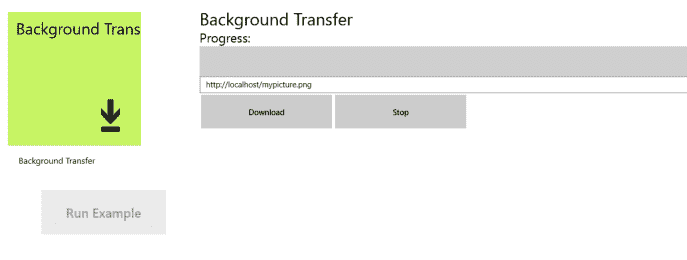

后台传输进度：

图 6-6

后台传输的后台代码示例位于列表 6-15 中。在此示例中，当用户点击下载按钮时，你会检查下载 URI 并开始下载到“图片”（Pictures）库。

### 列表 6-15：BackgroundTransferDemo.xaml.cs

```csharp
using System;
using System.IO;
using System.Threading;
using System.Threading.Tasks;
using Windows.Networking.BackgroundTransfer;
using Windows.Storage;
using Windows.UI.Core;
using Windows.UI.Xaml;
using Windows.UI.Xaml.Controls;
using Windows.Web;

namespace DataFilesNetworkingSampleCS
{
    public sealed partial class BackgroundTransferDemo : UserControl
    {
        private CancellationTokenSource cancellationToken;

        public BackgroundTransferDemo()
        {
            this.InitializeComponent();
            cancellationToken = new CancellationTokenSource();
        }

        private async void download_Click(object sender, RoutedEventArgs e)
        {
            progress.Value = 0;
            Uri source;
            if (!Uri.TryCreate(address.Text.Trim(), UriKind.Absolute, out source))
            {
                resultText.Text = "This location is invalid!";
                return;
            }

            var ext = Path.GetExtension(source.ToString());
            if (ext == null)
            {
                resultText.Text = "Only .jpg, .png and .jpeg!";
                return;
            }

            ext = ext.ToLower();
            if (ext != ".jpg" && ext != ".png" && ext != ".jpeg")
            {
                resultText.Text = "Only .jpg, .png and .jpeg!";
                return;
            }

            StorageFile destination;
            try
            {
                var picturesLibrary = KnownFolders.PicturesLibrary;
                destination = await picturesLibrary.CreateFileAsync(
                    String.Format("SampleImage{0}", Path.GetExtension(source.ToString())),
                    CreationCollisionOption.GenerateUniqueName
                );
            }
            catch (FileNotFoundException ex)
            {
                resultText.Text = String.Format("ERROR: {0}", ex.Message);
                return;
            }

            BackgroundDownloader downloader = new BackgroundDownloader();
            DownloadOperation download = downloader.CreateDownload(source, destination);
            resultText.Text = String.Format("Downloading {0}", source.AbsoluteUri);
            await HandleDownloadAsync(download, true);
        }

        private void stop_Click(object sender, RoutedEventArgs e)
        {
            cancellationToken.Cancel();
            cancellationToken.Dispose();
            cancellationToken = new CancellationTokenSource();
            resultText.Text = "Cancelled Download";
        }

        private async Task HandleDownloadAsync(DownloadOperation download, bool isNew)
        {
            try
            {
                Progress<DownloadOperation> progressCallback = new Progress<DownloadOperation>(ReportDownloadProgress);
                if (isNew)
                {
                    // new download, start it
                    await download.StartAsync().AsTask(cancellationToken.Token, progressCallback);
                }
                else
                {
                    // attach download that's already running
                    await download.AttachAsync().AsTask(cancellationToken.Token, progressCallback);
                }

                ResponseInformation response = download.GetResponseInformation();
                resultText.Text = String.Format("Completed: {0}, Status Code: {1}", download.Guid, response.StatusCode);
            }
            catch (TaskCanceledException)
            {
                resultText.Text = "Canceled: " + download.Guid;
            }
        }

        private async void ReportDownloadProgress(DownloadOperation download)
        {
            double percent = 100;
            if (download.Progress.TotalBytesToReceive > 0)
            {
                percent = (double)download.Progress.BytesReceived / download.Progress.TotalBytesToReceive * 100;
            }

            await Dispatcher.RunAsync(CoreDispatcher.Normal, () =>
            {
                progress.Value = percent;
            });
        }
    }
}
```

## 激活近场与触摸

探索计算的新想法是令人兴奋的。近场通信（NFC）和 Wi-Fi Direct 开启可以通过简单手势连接的新应用类型。要使用这些功能，你的设备需要近场设备。对于 Wi-Fi Direct，你的电脑必须具备无线设备。

### 近场概述

近场类定义在 `Windows.Networking.Proximity` 命名空间中。你可以使用近场类在三到四厘米的范围内进行通信，在触摸期间通过 `ProximityDevice` 对象交换少量数据，或通过 `PeerFinder` 类建立长期连接。

这些操作仅在应用处于前景时启用。当你在设备上使用 `PeerFinder` 且设备被触摸时，设备靠近将在运行的应用中触发 `Activated` 事件，如果应用未运行，则通知用户激活它。

> **注意** 必须在清单文件中启用近场功能才能在应用中使用它。

### 表 6-5：近场类

| 类 | 描述 |
| --- | --- |
| `ProximityDevice` | 使用此类，你可以在近场设备上订阅或发布消息。该类有两个事件：`DeviceArrived` 和 `DeviceDeparted`。你可以使用它们跟踪近场设备。`PublishMessage` 和 `SubscribeMessage` 方法（包括二进制）。 |
| `PeerFinder` | 发现另一个设备上的另一个应用实例，并在设备之间创建套接字连接。 |

### 近场模拟器安装步骤

1. 从 `NfcSimulatorDriver.zip` 的 `\bin` 目录（根据你的架构选择 x86 或 x64）提取并复制二进制文件到硬盘上的新目录中；例如 `c:\nfc`。
2. 双击该目录下的 `package.exe`；安装证书。
3. 选择“本地计算机”（Local Machine），并点击“下一步”（Next）。
4. 选择“将所有证书放入下列存储”（Place All Certificate in the Following），并点击“浏览”（Browse）。
5. 选择“根证书颁发机构”（Root Certificate Authorities）选项。
6. 以管理员模式启动命令提示符。
7. 运行以下命令安装驱动程序（管理员模式）：

```
devcon.exe install NetNfpProvider.inf WUDF\NetNfpProvider
```

8. 通过启动 `wf.exe` 为端口 9299 近距离驱动程序创建入站防火墙规则。

你现在可以在设备管理器的“近距离设备”（Proximity Devices）下看到网络近场提供程序（Network Near-Field Provider）。现在你可以使用示例模拟近距离交互。

### 启动近距离和事件注册

要开始近距离功能，你需要两台安装了近距离设备或 `NetNfpProvider` 设备的 PC。按照以下步骤操作：

1. 如果你使用模拟器，运行以下命令，将 `MyOtherPC` 替换为运行 DataSamples 的设备名称或 IP：

```
NetNfpControl.exe MyOtherPC /k
```

如果你有一台近距离设备，只需轻碰两个设备即可完成连接。（不需要运行前面的命令）。

2. 启动 Data Samples 应用，点击主页上的“Proximity”（近距离）。向右滚动查看所有示例。
3. 点击“Run Example”（运行示例），你应该会看到发现近距离设备的消息，随后是设备 ID。如果示例找不到近距离设备，请检查你的模拟器驱动程序安装，或确认你的 PC 具有 NFC 设备。
4. 如果你运行模拟器，在运行 `NetNfpControl.exe` 的 PC 上按 `Ctrl+F1`，或轻碰设备，你将看到示例代码记录了 `DeviceDeparted`（设备离开）和 `DeviceArrived`（设备到达）近距离设备事件。图 6-7 显示了从另一个 PC 启动近距离后 Data Samples 的截图。注意，你的应用必须在前台运行才能工作。

### 近距离

发现近距离设备 `!?root#proximity#0000b384-cd92-4a63-8bc3-cc60711359f`
近距离设备到达 `!?root#proximity#0000b384-cd92-4a63-8bc3-cc607113599f`
近距离设备离开 `!?root#proximity#0000b384-cd92-4a63-8bc3-cc607113599f`


运行示例

5. `NetNfpControl` 使用的近距离持续时间为一秒，因此设备到达后很快就会离开。列表 6-16 显示了如何检查近距离设备并注册 `DeviceDeparted` 和 `DeviceArrived` 事件。

### 列表 6-16: ProximityDemo.xaml.cs

```csharp
using System;
using Windows.Networking.Proximity;
using Windows.UI.Core;
using Windows.UI.Xaml.Controls;

namespace DataFilesNetworkingSampleCS.Examples
{
    public sealed partial class ProximityDemo
    {
        ProximityDevice _proximityDevice;

        public ProximityDemo()
        {
            this.InitializeComponent();
            _proximityDevice = ProximityDevice.GetDefault();
            if (_proximityDevice != null)
            {
                log.Items.Add(String.Format("Found proximity device {0}", _proximityDevice.DeviceId));
            }
        }
    }
}
```


### 订阅和发布消息 (Subscribing and Publishing Messages)

在本节中，你在一台 PC 上订阅近距离消息，从另一台 PC 发送近距离消息。按照以下步骤操作：

1. 如果你运行 `NetNfpProvider` 模拟驱动程序，你需要运行以下命令（将 `MyOtherPC` 替换为第二台 PC 的名称或 IP；记住之前关于防火墙、端口和驱动配置的讨论）：
   `NetNfpControl.exe MyOtherPC`
   这建立了近距离。

2. 启动 Data Samples 应用，点击主页上的“Proximity”（近距离）。向右滚动查看所有示例。

3. 点击“Run Example”（运行示例），你应该看到发现近距离设备的消息，随后是设备 ID。如果示例找不到近距离设备，请检查你的模拟器驱动程序安装，或确认你的 PC 具有 NFC 设备。

4. 如果你运行模拟器，在运行 `NetNfpControl.exe` 的 PC 上按 `Ctrl+F1`，或轻碰设备，你将看到示例代码记录了 `DeviceDeparted` 和 `DeviceArrived` 近距离设备事件。图 6-7 显示了从另一个 PC 启动近距离后 Data Samples 的截图。注意，你的应用必须在前台运行才能工作。

### 近距离 (Proximity)

发现近距离设备 `/?root#proximity#0000b384-cd92-4a63-8bc3-cc60711359f`
近距离设备到达 `/?root#proximity#0000b384-cd92-4a63-8bc3-cc607113599f`
近距离设备离开 `/?root#proximity#0000b384-cd92-4a63-8bc3-cc607113599f`


运行示例 (Run Example)

5. `NetNfpControl` 使用的近距离持续时间为一秒，因此设备到达后很快就会离开。列表 6-16 显示了如何检查近距离设备并注册 `DeviceDeparted` 和 `DeviceArrived` 事件。

**LISTING 6-16: ProximityDemo.xaml.cs**

```csharp
using System;
using Windows.Networking.Proximity;
using Windows.UI.Core;
using Windows.UI.Xaml.Controls;

namespace DataFilesNetworkingSampleCS.Examples
{
    public sealed partial class ProximityDemo
    {
        ProximityDevice _proximityDevice;

        public ProximityDemo()
        {
            this.InitializeComponent();

            _proximityDevice = ProximityDevice.GetDefault();

            if (_proximityDevice != null)
            {
                log.Items.Add(String.Format(
                    "Found proximity device {0}",
                    _proximityDevice.DeviceId));

                _proximityDevice.DeviceArrived += _proximityDevice_DeviceArrived;
                _proximityDevice.DeviceDeparted += _proximityDevice_DeviceDeparted;
            }
            else
            {
                log.Items.Add("Unable to find proximity devices");
            }
        }

        void _proximityDevice_DeviceDeparted(ProximityDevice sender)
        {
            Dispatcher.RunAsync(CoreDispatcherPriority.Normal, () => {
                log.Items.Add(String.Format(
                    "Proximity Device Departed {0}",
                    sender.DeviceId));
            });
        }

        void _proximityDevice_DeviceArrived(ProximityDevice sender)
        {
            Dispatcher.RunAsync(CoreDispatcherPriority.Normal, () => {
                log.Items.Add(String.Format(
                    "Proximity Device Arrived {0}",
                    sender.DeviceId));
            });
        }
    }
}
```


"Unable to find proximity devices";

}

}

void _proximityDevice_DeviceDeparted(
    ProximityDevice sender)
{
    Dispatcher.RunAsync(CoreDispatcherPriority.Normal,
    () => {
        log.Items.Add(
            String.Format(
                "Proximity Device Departed {0}",
                sender.DeviceId
            );
        );
    });
}

void _proximityDevice_DeviceArrived(
    ProximityDevice sender)
{
    Dispatcher.RunAsync(CoreDispatcherPriority.Normal, () => {
        log.Items.Add(
            String.Format(
                "Proximity Device Arrived {0}",
                sender.DeviceId
            );
        );
    });
}

```

### 聚合

Web 聚合是指网站通过标准格式（如 RSS 或 Atom）提供内容。在 Windows 中访问聚合内容是通过 `SyndicationFeed` 类实现的。首先，你使用 `RetrieveFeedAsync` 获取馈，然后通过 `ListView` 控件进行格式化。列表 6-18 显示了一个获取、格式化并将馈与数据上下文关联的方法。

```csharp
public async Task DisplayFeedAsync()
{
    string feedUriString = "http://www.websample.com/blogging/rss.aspx";
    SyndicationClient client = new SyndicationClient();
    Uri feedUri = new Uri(feedUriString);
    try
    {
        SyndicationFeed feed = await client.RetrieveFeedAsync(feedUri);
        var feedSource = from post in feed.Items
            select new
            {
                Title = post.Title.Text,
                Author = post.Authors[0].Name,
                PubDate = post.PublishedDate.DateTime
            };
        this.DataContext = feedSource.Take(5);
    }
    catch (Exception ex)
    {
        // 处理错误
        resultText.Text = ex.Message;
    }
}
```

LISTING 6-18: SyndicationDemo.xml

```xml
<DataTemplate>
    <StackPanel Orientation="Horizontal">
        <Grid Background="#FF14AF47" Width="200">
            <TextBlock Margin="5"
                x:Name="pubdate"
                Text="{Binding PubDate}"
                FontSize="40"
                Foreground="White"/>
        </Grid>
        <StackPanel Margin="5,0,0,0">
            <TextBlock x:Name="title"
                Text="{Binding Title}"
                FontSize="27"/>
            <TextBlock x:Name="author"
                Text="{Binding Author}"
                FontSize="22"/>
        </StackPanel>
    </StackPanel>
</DataTemplate>
```

```csharp
{
  public class NetworkDemo
{
    public string GetNetworkInfo()
    {
      string connectionProfile = string.Empty;
      try {
        var conn = NetworkInformation.GetInternetConnectionProfile();
        string report = conn.GetNetworkConnectivityLevel().ToString();
        var networks = conn.GetNetworkNames();
        foreach (var network in networks)
          report += "*" + network;
        return report;
      } catch (Exception) {
        return "Unexpected exception occured:";
      }
    }
  }
}
```

你也可以使用 `NetworkInformation` 类型的静态方法 `GetConnectionProfiles` 获取所有连接配置：

```csharp
var profiles = NetworkInformation.GetConnectionProfiles();
```

当连接发生变化时，你可以通过注册 `NetworkStatusChanged` 事件将该更改报告给应用程序。此事件可能表示连接成本或连接性选项已更改，在更高级的场景中，你可以利用此使应用程序适应网络连接的变化。要注册此事件，只需向其添加一个处理程序，如下：

```csharp
NetworkInformation.NetworkStatusChanged += NetworkInformation_NetworkStatusChanged;
```

> 注意：信号网络信息变化的事件可能会在 UI 线程的其他线程上分发，你可能需要使用 `Dispatcher` 对象来正确更新你的用户界面。

## 示例：排行榜应用

本节展示了一个较高层次的网络示例，它连接到在线游戏排行榜服务（你可以为此示例创建该服务）。Azure Mobile Services 是为现有应用添加 Azure 后端的极快方式，或者也可以创建一个具有预配置云端服务的全新应用。你还可以快速为你的应用添加身份验证和推送通知。如果你想要预构建版本，请使用本章代码示例中的 `Leaderboard.zip` 文件。图 6-9 显示了运行中的排行榜应用：

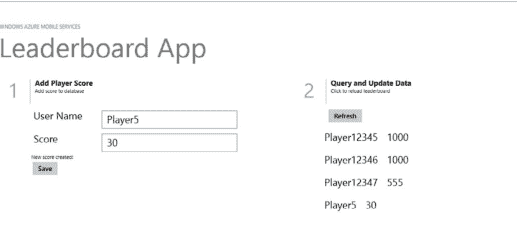

图 6-9

要执行此示例中的步骤，你必须登录你的 Windows Azure 账户，或者在还没有时创建一个。微软经常在 Azure 网站上提供试用版和优惠活动，因此请访问 http://www.windowsazure.com 查看最新信息。

1. 在 Azure 仪表板中点击“新建”；然后选择“移动服务 + 创建”。图 6-10 显示了如何在 Azure 控制台中创建新的移动服务：

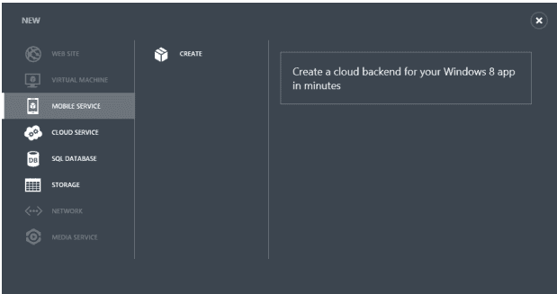

图 6-10

2. 按照提示为你的应用创建或选择一个现有的 SQL 数据库。
3. 选择一种语言来生成应用：JavaScript 或 C#。
4. 从选择应用语言的页面提供的链接下载并安装 Azure Mobile Services SDK。由 Azure 生成的应用引用了此 SDK，因此你需要它来编译应用。

5. 在创建新的 Windows Store 应用或选择现有应用之间做出选择。对于新应用，Azure 会自动生成所有应用代码。对于现有应用，你将以下代码添加到 `App.xml.cs` 中，或者 JavaScript 应用的 `default` 中。Azure 会自动将你的密钥和名称替换 `YOURAPPNAME` 和 `YOUR-SECRET-KEY`。

### JavaScript 中 default 中的 MobileServiceClient

```javascript
var client = new Microsoft.WindowsAzure.MobileServices.MobileServiceClient(
    "https://YOURAPPNAME.azure-mobile.net/",
    "YOUR-SECRET-KEY"
);
```

### C# 中 App.xml.cs 中的 MobileServiceClient

```csharp
public static MobileServiceClient MobileService = new MobileServiceClient(
    "https://YOURAPPNAME.azure-mobile.net/",
    "YOUR-SECRET-KEY"
);
```

6. 如果你决定创建一个新应用，Azure 会为你生成整个应用程序骨架。通过点击“下载”按钮，你需要进行这些更改以使排行榜正常工作。

> 注意：在后台，Azure 为你生成了一个应用骨架。`App.xml.cs` 文件实例化来自 Windows Azure Mobile Service 管理客户端的 `MobileService` 对象，该对象已预配置为与你的 Azure 应用进行通信，并包含了 API 的 URL 和密钥。
在 `Main.page` 文件中，你有两个字段输入用户名和分数。`Save` 按钮将分数保存或更新到 Azure 数据库：

```xml
<StackPanel Margin="72,0,0,0">
  <StackPanel Orientation="Horizontal" Margin="5">
    <TextBlock MinWidth="150" Text="User Name" FontSize="22"/>
    <TextBox Name="UserName" MinWidth="300" FontSize="22"/>
  </StackPanel>
  <StackPanel Orientation="Horizontal" Margin="5">
    <TextBlock MinWidth="150" Text="Score" FontSize="22"/>
    <TextBox Name="Score" MinWidth="1000" FontSize="22"/>
  </StackPanel>
  <TextBlock x:Name="resultText" />
  <Button Name="ButtonSave" Click="Save"/></Button>
</StackPanel>
```

7. 要在应用中显示 UserName 和 Score 字段，你可以按照如下方式更新数据模板：

```xml
<DataTemplate>
  <StackPanel Orientation="Horizontal">
    <TextBlock Text="{Binding UserName}" FontSize="22" />
    <TextBlock Text="{Binding Score}" FontSize="22" Margin="20,0,0,0"/>
  </StackPanel>
</DataTemplate>
```

8. 在 MainPage 的代码中，你为列表定义了数据模板。

## 列表 6-21: MainPage.cs

```csharp
using Microsoft.WindowsAzure.MobileServices;
using System;
using System.Linq;
using System.Runtime.Serialization;
using Windows.UI.Xaml;
using Windows.UI.Xaml.Controls;
using Windows.UI.Xaml.Navigation;

namespace leaderboard
{
    public class LeaderboardItem
    {
        [DataMember(Name="id")]
        public int Id { get; set; }

        [DataMember(Name="username")]
        public string UserName { get; set; }

        [DataMember(Name="score")]
        public int Score { get; set; }
    }

    public partial class MainPage : Page
    {
        // MobileCollectionView（用于绑定列表）并与 Mobile Service
        // 集成以便于绑定数据
        private MobileServiceTable<LeaderboardItem> leaderboardTable
            = App.MobileService.GetTable<LeaderboardItem>();

        public MainPage()
        {
            this.InitializeComponent();
        }

        private async void InsertLeaderboardItem(LeaderboardItem item)
        {
            // 此代码向数据库插入一个新项。
            // 当操作完成且 Mobile Services
            // 分配了 Id 后，该项会被添加到视图
            await leaderboardTable.InsertAsync(item);
            items.Add(item);
        }

        private void RefreshLeaderboardItems()
        {
            // 此代码刷新视图中的项
            items = leaderboardTable.CollectionView();
            ListItems.ItemsSource = items;
        }

        private async void UpdateLeaderboardItem(LeaderboardItem item)
        {
            // 此代码获取新完成的项并更新数据库。
            // 当 MobileService 响应时，该项从列表中移除
            await leaderboardTable.UpdateAsync(item);
            items.Remove(item);
        }

        private void ButtonRefresh_Click(object sender, RoutedEventArgs e)
        {
            RefreshLeaderboardItems();
        }

        private async void ButtonSave_Click(object sender, RoutedEventArgs e)
        {
            // 在 MainPage.xaml 中你定义了数据模板
            // Azure 在你运行时会自动选择你的模型
            var list = await leaderboardTable
            .Where(s => s.Username == UserName.Text).ToListAsync();
            bool userExists = (list != null && list.Count > 0);
            LeaderboardItem currentScore;
            if (userExists)
            {
                currentScore = list.First();


### 列表 6-21（续）

```cs
currentScore.UserName = UserName.Text;
}

int score;
if (!int.TryParse(Score.Text, out score))
{
    resultText.Text = "请输入一个整数分数";
    return;
}

currentScore.Score = score;

if (userExists)
{
    UpdateLeaderboardItem(currentScore);
    resultText.Text = "分数已更新!";
}
else
{
    InsertLeaderboardItem(currentScore);
    resultText.Text = "新建分数!";
}

protected override void OnNavigatedTo(NavigationEventArgs e)
{
    RefreshLeaderboardItems();
}
```

在 `ButtonSave_Click` 事件中，你应该检查页面上 `UserName` 文本框中的用户名是否已存在于数据库中：

```cs
var list = await leaderboardTable
    .Where(s => s.UserName == UserName.Text).ToListAsync();
```

在更高级的场景中，你可能需要通过用户的电子邮件或其他类型的 ID 来识别用户。如果用户存在，只需更新分数；否则，则使用 `UserName` 文本框中定义的用户名创建一个新的 `LeaderboardItem`。

### 总结

在本章中，你学习了管理 Windows Store 应用可用的应用程序数据和数据存储，包括本地、漫游和临时存储。你学习了这些存储之间的差异以及使用每种存储的最佳实践。你学习了 Windows Store 如何与文件协作，包括关于“最近使用”以及其他用于跟踪文件的列表等更高级的话题。在网络部分，你涵盖了 WebSockets、TCP 和 UDP 套接字、数据传输、访问网络信息以及接近性，并提供了一个访问网络服务的排行榜示例。

# 第 7 章 传感器

本章内容包括：

- 介绍 Windows 传感器平台
- 实现 3D 加速度计
- 实现 3D 罗盘
- 实现 3D 陀螺仪
- 实现 3D 倾斜仪
- 实现环境光传感器
- 实现方向传感器

## 本章的 WROX.COM 代码下载

你可以在 `www.wrox.com/remtile.cgi?ibnn=978118205709` 中的代码文件 `205709 C07.zip` 中找到本章的 wrox.com 代码下载。本章的代码方便地包含在一个带有七个示例项目的单个 Visual Studio 2012 解决方案中。

我们的设备每年都在变化，增加新功能，变得更薄、更轻，并且随着传感器的加入变得更加“智能”。数千个实际场景以及现实生活体验展示了传感器每天如何影响计算体验。本章将引导开发者使用 Windows 8 中提供的丰富新 API 和功能，这些功能使你的应用程序通过传感器变得更“智能”。

## Windows 传感器平台

作为人类，我们配备了感知现实世界变化所需的生物传感器。人类开发的设备才刚刚追上生物传感器的步伐。在过去的几年里，传感器技术经历了巨大的增长，使设备能够感知触摸、方向、位置变化和接近性的能力，而且每天都有更多的传感器被开发出来！

通过 Windows 传感器平台，你的应用程序能够变得更智能，对加速度、方向和环境光水平的变化做出反应。鉴于运行应用程序的设备范围广泛，传感器平台为各种传感器提供了抽象层。

### 传感器平台的硬件

在设计 Windows Runtime (WinRT) 时，微软的架构师和开发者根据 Windows 8 操作系统重新构想了一个运行时。与核心操作系统一样，该运行时接纳了多次变革或战略转折点。

- **扩展的硬件生态系统**：Windows 8 专业版运行在 Intel x86 和 x64 处理器上，配备 Intel Core i3、Core i5 和 Core i7 处理器。此外，Windows RT 设备如 Microsoft Surface 以及来自制造商（如 NVIDIA、高通和德州仪器）的 ARM 处理器。
- **基于 Windows 8 Pro 和 Windows RT 的设备还采用了系统级芯片 (SoC)**。SoC 架构为硬件设计人员带来了许多好处，最终为用户提供了更快速的响应和更长的电池寿命。
- **Windows 引入了前所未有的移动性**。移动系统越来越多地提供传感器，为应用程序开发者开启令人兴奋的新场景。

### Windows 传感器平台概述

通过 Windows 8 Pro 和 Windows RT，Windows 传感器平台通过一组统一的 API 为开发者提供了访问多个传感器的能力。在本章中，你将学习如何使用 Windows Sensors API 以及表 7-1 所示 `Windows.Devices.Sensors` 命名空间的传感器类型：

**表 7-1：`Windows.Devices.Sensors` 命名空间中的某些类**

| 类 | 说明 |
|---|---|
| `Accelerometer` | 3D 加速度计传感器 |
| `Compass` | 3D 罗盘传感器 |
| `Gyrometer` | 3D 陀螺仪传感器 |
| `Inclinometer` | 3D 倾斜仪传感器 |
| `LightSensor` | 环境光传感器 |
| `OrientationSensor` | 代表方向传感器 |
| `SimpleOrientationSensor` | 代表简单的方向传感器 |

由于 Windows 认证计划并不要求所有设备上都有所有传感器，你必须确保应用程序能够处理传感器的存在或不存在。正因如此，`Windows.Devices.Sensors` 命名空间中的类型没有提供构造函数。相反，它们提供 `GetDefault` 方法，如果传感器已集成到计算机中则返回默认实例；否则返回 `null`。

```cs
Accelerometer accelerometer = Accelerometer.GetDefault();
if (accelerometer != null)
```

本章的剩余部分将从 `Accelerometer` 类开始探索每个传感器。

## 使用 3D 加速度计

加速度计是一种测量加速度的设备。Windows 会根据加速度计自动调整屏幕方向。

如前所述，Windows 认证计划要求配备加速度计，且该加速度计提供跨三个轴的加速度测量，加速度计的数据速率大于 50 Hz。

如图 7-2 所示，`Accelerometer` 类提供了两个让你的程序响应加速度变化的事件。

每当加速度计有新的读取值（包含沿 x、y、z 轴的重力加速度值），以及 PC 发生抖动时会触发 `Shaken` 事件。要看到其效果，请遵循以下步骤：

1. 打开 Visual Studio 2012，使用 `Blank App (XAML)` 模板创建一个新项目。
2. 打开 `MainPage.xaml` 文件，并按照下面的代码编辑页面 `Grid` 元素中的 `TextBlock`。

```xml
<Grid Background="{StaticResource ApplicationPageBackgroundThemeBrush}">
    <TextBlock x:Name="AccelerometerReadingTextBlock"
               FontSize="48"
               VerticalAlignment="Center"
               HorizontalAlignment="Center"/>
</Grid>
```

3. 在 XAML 中定义页面后，转到 `MainPage.xaml.cs` 文件中的代码。首先为 `Windows.Devices.Sensors` 命名空间添加 `using` 指令，并在类中添加一个类型为 `Accelerometer` 的字段。

```cs
public sealed partial class MainPage : Page
{
    private Accelerometer accelerometer;
}
```

4. 在类构造函数中初始化加速度计，并确保返回 `Accelerometer` 实例。如果测试代码的 PC 没有集成加速度计且未安装相应的设备程序，`GetDefault` 当然会返回 `null`。如果 `GetDefault` 返回 `null`，至少你有一个极好的理由去买一台运行 Windows 8 Pro 或 Windows RT 的新平板电脑或二合一电脑！

```cs
public MainPage()
{
    this.InitializeComponent();
    this.accelerometer = Accelerometer.GetDefault();
    if (this.accelerometer != null)
    {
        this.accelerometer.ReadingChanged += this.accelerometerReadingChanged;
        this.accelerometer.Shaken += this.accelerometerShaken;
    }
    else
    {
        this.accelerometerReadingTextBlock.Text = "Unable to initialize default Accelerometer instance";
    }
}
```

5. 在 `ReadingChanged` 事件的事件处理器中，显示 x、y、z 轴上的 g 重加速度值。参考图 7-2 中的类，你可以看到 `AccelerometerReadingChangedEventArgs` 包含一个类型为 `AccelerometerReading` 的属性。`AccelerometerReading` 提供了各轴加速度的属性，以及一个 `Timestamp` 属性，该属性获取加速度计报告读取值的时间。

```cs
async private void AccelerometerReadingChanged(Accelerometer sender, AccelerometerReadingChangedEventArgs e)
{
    await Dispatcher.RunAsync(CoreDispatcherPriority.Normal, () =>
    {
        this.AccelerometerReadingTextBlock.Text = string.Format(
            "Accelerometer X: {0:0.000} Y: {1:0.000} Z: {2:0.000}",
            e.AccelerationX,
            e.AccelerationY,
            e.AccelerationZ);
    });
}
```

6. 在 `Shaken` 事件的事件处理器中，指示 PC 正在抖动。你可以看到 `AccelerometerShakenEventArgs` 类也提供了 `Timestamp` 属性，该属性获取加速度计报告 PC 被抖动的时间。

```cs
async private void AccelerometerShaken(Accelerometer sender, AccelerometerShakenEventArgs e)
{
    await Dispatcher.RunAsync(CoreDispatcherPriority.Normal, () =>
    {
        this.AccelerometerReadingTextBlock.Text = "Shaken, But Not Stirred";
    });
}
```

图 7-2 显示了加速度计示例的类图：

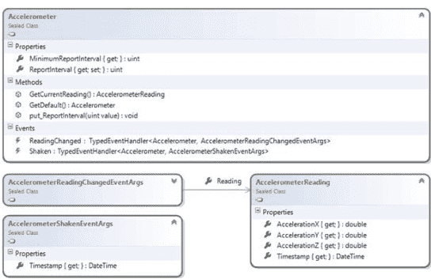

如果你运行加速度计示例应用程序，你会看到 x、y、z 轴上的 g 力加速度读取值。如果你的 PC 上没有集成加速度计，这些是 g 力加速度的一些示例读取值：

> 加速度计读取值：X: -0.066 Y: 0.183 Z: -1.010

当然，抖动 PC 将显示以下消息：

> 抖动了，但未被搅拌！

## 使用 3D 罗盘

指南针是一种用于测量方向航向的导航设备。你可以在应用程序中使用指南针传感器来检测方向航向，这种方法在许多场景中都证明是非常有用的，例如导航应用。在 Windows 传感器平台中，指南针传感器是通过传感器融合合成的。

### 使用 Compass 类

`Compass` 类提供单一的 `ReadingChanged` 事件，每当 3D 罗盘获得基于磁北和真北的航向新读取值时，该事件就会发生。

图 7-3 显示 `CompassReadingChangedEventArgs` 类包含一个类型为 `CompassReading` 的属性。`CompassReading` 类提供了磁北和真北的属性，以及记录指南针报告读取值时间的 `Timestamp` 属性。要使用 `Compass` 类，请遵循以下步骤：

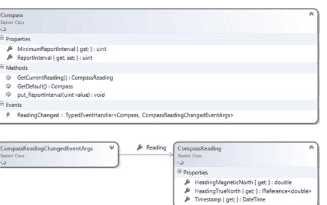

1. 打开 Visual Studio 2012，并使用 `Blank App (XAML)` 项目模板创建一个新项目。
2. 打开 `MainPage.xaml` 文件，并将按照下面的标记定义的 `TextBlock` 添加到页面的 `Grid` 元素中。

```xml
<Grid Background="{StaticResource ApplicationPageBackgroundThemeBrush}">
    <TextBlock x:Name="CompassReadingTextBlock"
               FontSize="22"
               VerticalAlignment="Center"
               HorizontalAlignment="Center"/>
</Grid>
```

3. 定义页面标记后，编辑 `MainPage.xaml.cs` 文件，同样使用指向 `Windows.Devices.Sensors` 命名空间的指令。
4. 在类中添加一个类型为 `Compass` 的字段，命名为 `compass`。

```cs
public sealed partial class MainPage : Page
{
    private Compass compass;
}
```

5. 在类构造函数中初始化指南针，并确保存在所需的 3D 加速度计、陀螺仪和磁计以启用传感器融合。如果 PC 上不存在这些组件，`GetDefault` 方法将返回 `null`。

```cs
public MainPage()
{
    this.InitializeComponent();
    this.compass = Compass.GetDefault();
    if (this.compass != null)
        this.compass.ReadingChanged += this.CompassReadingChanged;
    else
        this.compassReadingTextBlock.Text = "Unable to initialize default Compass instance";
}
```

6. 在 `ReadingChanged` 事件的事件处理器中，显示磁北和真北航向的数值。

```cs
async private void CompassReadingChanged(Compass sender, CompassReadingChangedEventArgs e)
{
```


## 计算真航向

作为使用 `Compass` API 的实际示例，本节考虑了一个飞行员每天都要解决的任务。飞行员使用航图进行导航。这些图显示了每度的等角线。等角线是穿过具有相同偏差点的线。图 7-4 显示了旧金山的等角线。如果你想根据磁航向 241° 计算真航向，你需要减去 15° 的偏差，得到 226° 的真航向。


图 7-4

例如，在美国东部飞行时，等角线为 15°W，需要通过加上磁偏差来计算真航向。如果你飞行航向为 241°，得到的真航向将是 256°。

对于飞行员来说，知道何时加减磁偏差显然是易的；因此，飞行学生飞行员会感谢这个口诀：“东减西加”。

## 使用 3D 陀螺仪

陀螺仪经常配合加速度计作为游戏控制器。陀螺仪测量的是角速度（旋转运动）。与加速度计和磁计一样，Windows 认证程序也要求平板和平二合一设备集成 3D 陀螺仪。

`Gyrometer` 类提供单一的 `Changed` 事件，每当 3D 陀螺仪传感器获得 x、y、z 轴角速度读取值时，该事件就会发生。

图 7-5 显示 `GyrometerReadingChangedEventArgs` 类包含一个类型为 `GyrometerReading` 的属性。`GyrometerReading` 类除了一个记录陀螺仪报告读取值时间的 `Timestamp` 属性外，还提供了三个代表 x、y、z 轴角速度的属性。要查看效果，请遵循以下步骤：

```xml
<Grid Background="StaticResource ApplicationPageBackgroundThemeBrush">
  <TextBlock x:Name="GyometerReadingTextBlock"
    FontSize="48"
    VerticalAlignment="Center"
    HorizontalAlignment="Center"/>
</Grid>
```

3. 定义好页面标记后，编辑 `MainPage.xaml.cs` 文件，为 `Windows.Devices.Sensors` 命名空间添加 `using` 指令。然后在类中添加一个类型为 `Gyrometer` 的字段并命名为 `gyrometer`。

```csharp
public sealed partial class MainPage : Page
{
    private Gyrometer gyrometer;
}
```

4. 在类构造函数中初始化陀螺仪，然后确保集成了 3D 陀螺仪。如果不存在陀螺仪，`GetDefault` 方法返回 `null`。注意的是，当系统处于连接待机（Connected Standby）模式时，调用 `GetDefault` 方法会立即返回 `null`。

```csharp
public MainPage()
{
    this.InitializeComponent();
    this.gyrometer = Gyrometer.GetDefault();
    if (this.gyrometer != null)
    {
        this.gyrometer.ReadingChanged += this.GyrometerReadingChanged;
    }
    else
    {
        this.gyrometerReadingTextBlock.Text = "Unable to initialize default Gyrometer instance";
    }
}
```

5. 在 `ReadingChanged` 事件的事件处理程序中，显示沿 x、y、z 轴的角速度值。

```csharp
async private void GyrometerReadingChanged(Gyrometer sender, GyrometerReadingChangedEventArgs e)
{
    await Dispatcher.RunAsync(CoreDispatcherPriority.Normal, () =>
    {
        this.GyrometerReadingTextBlock.Text = string.Format(
            "Gyrometer Reading: X: {0:0.000} Y: {1:0.000} Z: {2:0.000}",
            e.Reading.AngularVelocityX,
            e.Reading.AngularVelocityY,
            e.Reading.AngularVelocityZ);
    });
}
```

6. 如果你运行陀螺仪示例应用程序，你会看到 x、y、z 轴的角速度读数。

如果你的 PC 上没有集成 3D 陀螺仪，以下是角速度的读数示例：

陀螺仪读取: X: -1.610 Y: 0.980 Z: -3.080

## 使用倾角仪

如果你的应用需要确定俯仰（pitch）、翻滚（roll）和偏航（yaw）的相对角度，你可以使用倾角传感器。倾角仪是一种用于测量相对于人工水平线的坡度（倾斜）角度的设备，在开发飞行模拟器时非常有用。Windows 传感器平台通过传感器融合合成。

`Inclinometer` 类提供单一的 `ReadingChanged` 事件，每当 3D 倾角传感器有俯仰、翻滚和偏航的新读数时，该事件就会触发。

图 7-6 显示 `InclinometerReadingChangedEventArgs` 包含一个类型为 `InclinometerReading` 的属性。`InclinometerReading` 类提供了三个属性，利用记录倾角仪报告时间的 `Timestamp` 属性来获取俯仰、翻滚和偏航的角度。要在你的应用中使用这些功能，请遵循以下步骤：


1. 打开 Visual Studio 2012，并使用“空白应用 (XAML)”项目模板创建一个新项目。

2. 打开 `MainPage.xaml` 文件，按照如下代码定义将 `TextBlock` 添加到页面的 `Grid` 元素中。

```xml
<Grid Background="StaticResource ApplicationPageBackgroundThemeBrush">
  <TextBlock x:Name="InclinometerReadingTextBlock"
      FontSize="48"
      VerticalAlignment="Center"
      HorizontalAlignment="Center"/>
</Grid>
```

3. 使用页面标记，编辑 `MainPage.xaml.cs` 文件，为 `Windows.Devices.Sensors` 命名空间添加 `using` 指令。

4. 在 `MainPage` 类中添加一个类型为 `Inclinometer` 的局部变量 `inclinometer`。

```csharp
public sealed partial class MainPage : Page
{
    private Inclinometer inclinometer;
}
```

5. 在类构造函数中初始化倾角仪，并确保倾角仪是通过传感器融合合成的。如果合成的倾角仪不可用，`GetDefault` 方法返回 `null`。

```csharp
public MainPage()
{
    this.InitializeComponent();
    this.inclinometer = Inclinometer.GetDefault();
    if (this.inclinometer != null)
    {
        this.inclinometer.ReadingChanged += this.InclinometerReadingChanged;
    }
    else
    {
        this.inclinometerReadingTextBlock.Text =
            "Unable to initialize default Inclinometer instance";
    }
}
```

6. 在 `ReadingChanged` 事件的事件处理程序中，显示俯仰、翻滚和偏航的角度。

```csharp
async void InclinometerReadingChanged(Inclinometer sender, InclinometerReadingChangedEventArgs e)
{
    await Dispatcher.RunAsync(CoreDispatcherPriority.Normal, () => {
        this.InclinometerReadingTextBlock.Text = string.Format(
            "InclinometerReading: Pitch: {0} Roll: {1} Yaw: {2}",
            e.Reading.Pitch,
            e.Reading.Roll,
            e.Reading.Yaw);
    });
}
```

## 环境光传感器

想象你正在拍摄一张照片并需要测量光照条件。环境光传感器是一种用于测量给定区域亮度的设备。`LightSensor` 类提供单一的 `ReadingChanged` 事件，每当设备传感器有新的亮度读数时，该事件就会触发。

图 7-7 显示 `LightSensorReadingChangedEventArgs` 包含一个类型为 `LightSensorReading` 的属性。`LightSensorReading` 类提供了 `IlluminanceInLux` 以及记录设备报告时间的 `Timestamp` 属性。通过以下步骤将其整合到应用中：


图 7-7

```xml
<Grid Background="StaticResource ApplicationPageBackgroundThemeBrush">
  <TextBlock x:Name="LightSensorReadingTextBlock"
    FontSize="48"
    VerticalAlignment="Center"
    HorizontalAlignment="Center"/>
</Grid>
```

1. 打开 Visual Studio 2012，并使用“空白应用 (XAML)”项目模板创建一个新项目。

2. 打开 `MainPage.xaml` 文件，将如下定义的 `TextBlock` 添加到页面的 `Grid` 元素中。

3. 使用页面标记，编辑 `MainPage.xaml.cs` 文件，为 `Windows.Devices.Sensors` 命名空间添加 `using` 指令。

4. 在类中添加一个类型为 `LightSensor` 的字段并命名为 `sensor`。

```csharp
public sealed partial class MainPage : Page
{
    private LightSensor sensor;
}
```

5. 在类构造函数中初始化光传感器，确保集成了环境光传感器。如果不存在光传感器，`GetDefault` 方法返回 `null`。

```csharp
public MainPage()
{
    this.InitializeComponent();
    this.sensor = LightSensor.GetDefault();
    if (this.sensor != null)
    {
        this.sensor.ReadingChanged += this.LightSensorReadingChanged;
    }
    else
    {
        this.LightSensorReadingTextBlock.Text = "Unable to initialize default LightSensor instance";
    }
}
```

6. 在 `ReadingChanged` 事件的事件处理程序中，显示亮度值。

```csharp
async private void LightSensorReadingChanged(LightSensor sender, LightSensorReadingChangedEventArgs e)
{
    await Dispatcher.RunAsync(CoreDispatcherPriority.Normal, () =>
    {
        this.LightSensorReadingTextBlock.Text = string.Format("Light Sensor Reading: {0:000} lx", e.Reading.IlluminanceInLux.ToString());
    });
}
```

7. 如果你运行光传感器示例应用程序，你会看到亮度的读数。

如果你的 PC 上没有集成环境光传感器，以下是亮度的读数示例：

光传感器读取: 51.250 lx

## 使用方向传感器

你可以在游戏应用中使用方向数据来调整用户的视角。方向传感器对象的使用方式与 Windows 中的其他传感器类似，但你的代码应首先检查设备是否支持。`OrientationSensor` 返回旋转矩阵或四元数，可用于调整游戏应用的视角。

### 使用 OrientationSensor 类

`OrientationSensor` 类提供单一的 `ReadingChanged` 事件，每当设备传感器有新读数时，该事件就会触发。

图 7-8 显示 `OrientationSensorReadingChangedEventArgs` 包含两个属性，提供了旋转矩阵和四元数以及记录设备方向报告读取时间的 `Timestamp` 属性。尝试 `OrientationSensor` 类的步骤：


图 7-8

1. 打开 Visual Studio 2012，并使用 Blank App (XAML) 项目模板创建一个新项目。

2. 打开 `MainPage.xaml` 文件，并将下方代码定义的 `TextBlock` 添加到页面 `Grid` 元素中。

```xml
<Grid Background="StaticResource ApplicationPageBackgroundThemeBrush">
    <TextBlock x:Name="OrientationSensorReadingTextBlock"
               FontSize="22"
               VerticalAlignment="Center"
               HorizontalAlignment="Center"/>
</Grid>
```

3. 定义好页面标记后，编辑 `MainPage.xaml.cs` 文件，并为代码段添加 `Windows.Devices.Sensors` 命名空间的 `using` 指令。

4. 在以下代码中，为 `MainPage` 添加一个类型为 `OrientationSensor` 的变量，并命名为 `sensor`。

```csharp
public sealed partial class MainPage : Page
{
    private OrientationSensor sensor;
}
```

5. 在构造函数中初始化方向传感器，并确保该传感器是通过传感器融合合成的。如果合成的方向传感器不可用，`GetDefault` 方法将返回 `null`。

```csharp
public MainPage()
{
    this.InitializeComponent();
    this.sensor = OrientationSensor.GetDefault();
    if (this.sensor != null)
    {
        this.sensor.ReadingChanged += this.OrientationSensorReadingChanged;
    }
    else
    {
        this.OrientationSensorReadingTextBlock.Text =
            "Unable to initialize default OrientationSensor instance";
    }
}
```

6. 在 `ReadingChanged` 事件的事件处理程序中，显示四元数（Quaternion）和旋转矩阵的值。

```csharp
async private void OrientationSensorReadingChanged(OrientationSensor sender, OrientationSensorReadingChangedEventArgs e)
{
    await Dispatcher.RunAsync(CoreDispatcherPriority.Normal, () =>
    {
        // 此处应添加显示四元数和旋转矩阵的代码
    });
}
```


```csharp
{
    this.OrientationSensorTextBlock.Text = string.Format(
        "OrientationSensorReading: W: {0} X: {1} Y: {2} Z: {3} RM: {4}",
        e.Quaternion.W,
        e.Quaternion.X,
        e.Quaternion.Y,
        e.Quaternion.Z,
        e.RotationMatrix.ToString());
});
}
```

## 使用 SimpleOrientationClass

与其使用 `SimpleOrientation` 类，你可以使用 `SimpleOrientationSensor`。该传感器可以检测指定设备的当前象限方向以及其朝上或朝下的状态，使用四元数数据可能会更容易。`SimpleOrientationSensor` 类提供单一的 `ReadingChanged` 事件，每当设备方向传感器产生新读数时，就会触发。

图 7-9 显示 `SimpleOrientationReadingChangedEventArgs` 类包含 `Orientation` 属性，该属性以 `SimpleOrientation` 枚举值提供设备方向。与本章讨论的其他传感器一样，`Timestamp` 属性记录了设备方向传感器报告读数的时间。要查看此内容，请遵循以下步骤：


图 7-9

## 1. 打开 Visual Studio 2012，并使用 Blank App (XAML) 项目模板创建一个新项目。

## 2. 打开 `MainPage.xaml` 文件，并将下方代码定义的 `TextBlock` 添加到页面 `Grid` 元素中。

```xml
<Grid Background="StaticResource ApplicationPageBackgroundThemeBrush">
    <TextBlock x:Name="SimpleOrientationSensorReadingTextBlock"
               FontSize="22"
               VerticalAlignment="Center"
               HorizontalAlignment="Center"/>
</Grid>
```

## 3. 定义好页面标记后，为 `Windows.Devices.Sensors` 命名空间添加所需的 `using` 指令。

## 4. 在类中添加一个类型为 `SimpleOrientationSensor` 的字段并进行命名。

```csharp
public sealed partial class MainPage : Page
{
    private SimpleOrientationSensor sensor;
    ...
}
```

## 5. 在类构造函数中初始化简单方向传感器，并确保简单方向传感器是通过传感器融合合成的。如果简单方向传感器未合成，`GetDefault` 方法将返回 `null`。

```csharp
public MainPage()
{
    this.InitializeComponent();
    this.sensor = SimpleOrientationSensor.GetDefault();
    if (this.sensor != null)
    {
        this.sensor.ReadingChanged +=
            this.SimpleOrientationSensorReadingChanged;
    }
    else
    {
        this.OrientationSensorReadingTextBlock.Text =
            "Unable to initialize default SimpleOrientationSensor instance";
    }
}
```

## 6. 在 `ReadingChanged` 事件的处理程序中，显示设备方向。

```csharp
async private void SimpleOrientationSensorReadingChanged(OrientationSensor sender, SimpleOrientationSensorReadingEventArgs e)
{
    await Dispatcher.RunAsync(DispatcherPriority.Normal, () =>
    {
        this.SimpleOrientationSensorReadingTextBlock.Text = string.Format("SimpleOrientationSensor Reading: {0}", e.Orientation.ToString());
    });
}
```

### 总结

在本章中，你学习了如何在应用程序中使用各种传感器；这些传感器可以是硬件直接提供的，也可以通过传感器融合合成。你现在能够设计能够响应加速度、方向和环境光水平等变化的应用程序了。随着 Windows 设备变得越来越“智能”，通过增加更多传感器，感知环境的“更智能”应用程序将开启更多的场景。看到这些“更智能”的应用程序无疑是非常令人兴奋的。

# 第 8 章 定位

```csharp
public sealed partial class mainPage : Page {
    private Geolocator locator;
}
```

4. 在类构造函数中初始化 `Geolocator`，确定 `DesiredAccuracy`（所需精度），并为 `StatusChanged` 和 `PositionChanged` 事件定义事件处理器。

```csharp
public MainPage() {
    this.InitializeComponent();
    this.locator = new Geolocator();
    this.locator.DesiredAccuracy = PositionAccuracy.Default;
    this.locator.StatusChanged += this.GeolocatorStatusChanged;
    this.locator.PositionChanged += this.GeolocatorPositionChanged;
}
```

`PositionAccuracy` 枚举允许你指定应用程序所需数据级别。通过此选项，你可以选择 `Default`（默认）或 `High`（高）精度；在本示例中，请使用 `Default`。

5. 在图 8-3 中你可以看到 `Geolocator` 定义了两个事件：`StatusChanged` 和 `PositionChanged`。在构造函数定义之后，添加以下异步处理器。


图 8-3

```csharp
async private void GeolocationStatusChanged(Geolocation sender, StatusChangedEventArgs e)
{
    await Dispatcher.RunAsync(CoreDispatcherPriority.Normal, () => 
    {
        this.GeolocationStatusTextBlock.Text = e.Status.ToString();
    });
}
```

```csharp
async private void GeolocationPositionChanged(Geolocation sender, PositionChangedEventArgs e)
{
    await Dispatcher.RunAsync(CoreDispatcherPriority.Normal, () => 
    {
        this.GeolocationPositionTextBlock.Text = string.Format("{0}, {1}",
            e.Position.Coordinate.Longitude.ToString(),
            e.Position.Coordinate.Latitude.ToString());
    });
}
```

你可能会疑惑为什么在 `PositionChanged` 和 `StatusChanged` 事件的处理器中使用 `CoreDispatcher`。你使用 `CoreDispatcher` 是因为异步事件并不是在 UI 线程上运行的，而只有 UI 线程才能更新状态控件。

`GeolocationStatusChanged` 事件处理器接收当前的 `Geolocation` 状态，该状态包含在 `StatusChangedEventArgs` 类的 `PositionStatus` 枚举中。`GeolocationStatusTextBlock` 的 `Text` 属性设置为 `StatusChangedEventArgs` 实例接收到的状态。

`GeolocationPositionChanged` 事件处理器是应用程序位置区域所在，它通过 `PositionChangedEventArgs` 类实现，该类为你提供作为 `Geoposition` 类实例的当前位置。如图 8-4 所示，`Geoposition` 类定义了两个属性：一个提供代表地球当前位置的 `GeoCoordinate`，另一个表示带有当前位置的 `CivicAddress`（城市地址）。

# 理解 CivicAddress 类

如果你在 Windows Phone 上编写过位置区域应用程序，你可能认识 `CivicAddress` 类。与 Windows Phone 上的对应相比，Windows Runtime 的这个版本要精简得多。在 Windows 8 中，与 `Geoposition` 关联的 `CivicAddress` 由必须存在用户 PC 上的专用设备驱动程序填充。该专用设备驱动程序根据 Geolocation 定的经纬度从第三方提供程序提供 `CivicAddress` 信息。

> 注意：Windows 建议需要准确城市地址信息的开发者使用适当 Web API 来根据给定的经纬度确定相应的城市地址。

# 定位章节

如果你现在运行该程序，可能会惊讶地发现 `PositionStatus` 是禁用的，因此经纬度未知。你首先需要声明位置能力，这会询问用户是否允许应用程序访问其位置。请按照以下步骤操作：

1. 在上方创建的 Visual Studio 2012 项目中打开 `Package.manifest` 文件，并点击 `Capabilities`（能力）选项卡。
2. 在列表中勾选 `Location`（位置）能力复选框。
3. 运行应用程序。你会看到 Windows 8 询问用户 "Can GoPositionSample Use Your Location?" 用户可以选择允许或阻止应用程序访问位置信息。
4. 在声明了 `Location` 能力后，运行应用程序，你就能看到 `PositionStatus`。

如果你允许访问位置信息，你会看到 `PositionStatus` 瞬间初始化然后变为 `Ready`（就绪）。一旦 `PositionStatus` 设置为 `Ready`，你将看到当前位置经纬度的显示。例如，如果你位于奥兰多国际机场 (KMCO)，你将看到纬度接近 28° 25' 45.81" N，经度为 81° 18' 32.37" W 的值。这酷极吗？

图 8-4 显示了一个 Visual Studio 类图，说明了之前讨论的 `Windows.Devices.Geolocation` 命名空间内类型的静态类结构。


# 图 8-4

回想团队建议需要准确城市地址信息的开发者使用适当 Web API 来根据给定的经纬度确定相应的城市地址。作为一个示例，Virtual Earth Locations Web API 在下面的代码中正是这样做的。

> 注意：以下示例需要 Bing Maps 密钥，你必须注册免费密钥才能在应用程序中使用 Bing Maps 和 Virtual Earth Web API。你可以在 Bing Maps 开发者门户进行此操作。然后将密钥放置在随后的字符串中。你将在本章的几个示例中使用它。

```csharp
private readonly XNamespace BingNamespace = "http://schemas.microsoft.com";

async void GetCivicAddress(Location location)
{
    HttpClient client = new HttpClient();
    StringBuilder builder = new StringBuilder("http://dev.virtualearth.net/REST/v1/");
    builder.Append(location.Latitude.ToString());
    builder.Append(",?o=xml&key=");
    builder.Append(this.BingMapsKey);
    HttpResponseMessage response = await client.GetAsync(builder.ToString());
    response.EnsureSuccessStatusCode();
    Stream stream = await response.Content.ReadAsStreamAsync();
    XDocument document = XDocument.Load(stream);
    string addressLine = (from 1 in document.Descendants(BingNamespace + "AddressLine") select 1).Value;
    string city = (from 1 in document.Descendants(BingNamespace + "Locality") select 1).Value;
    string stateProvince = (from 1 in document.Descendants(BingNamespace + "AdminDistrict") select 1).Value;
    string postalCode = (from 1 in document.Descendants(BingNamespace + "PostalCode") select 1).Value;
    string countryRegion = (from 1 in document.Descendants(BingNamespace + "CountryRegion") select 1).Value;
}
```

# 使用 BING MAPS SDK

当你拥有经纬度，更准确地说是设备的位置后，你现在可以使用 Windows 8 Bing Maps SDK 为用户提供其当前位置的地图。本节探讨可在 Windows 应用程序中使用 Bing Maps SDK 的某些功能。

# 引用 Bing Maps SDK

构建使用 Bing Maps SDK 的 Windows Store 应用程序时，你可能引用以下 Windows 扩展：

- Bing Maps for C#, C++, and Visual Basic
- Microsoft Windows C++ Runtime Package

> 注意：你可以从 Visual Studio 工具菜单中的“扩展和更新”安装适用于 Windows Store 程序的 Bing Maps SDK。你也可以在 Visual Studio Gallery 中搜索 Bing Maps：http://visualstudiogallery.msdn.com/

要引用 Bing Maps SDK，请按照以下步骤操作：

1. 打开另一个 Visual Studio 2012 实例。
2. 使用 Blank App (XAML) 模板创建一个新的 Windows 8 应用程序，并将项目命名为 BingMapsLocation。注意新添加的扩展上有微小的警告符号，因为项目的目标配置是 Any CPU。
3. 在 Visual Studio 2012 中，点击 Configuration Manager 打开配置管理器。
4. 将目标平台从 Any CPU 更改为 x86 或 ARM。选择 x64 或 ARM 可能会在设计打开任何 XAML 文件时出现错误，因此即使你计划针对支持 x64 或 ARM 指令集的平台，最初可能也考虑目标设为 x86。

# 使用 Bing.Maps.Map 类

在项目中引用了用于 Windows 应用的 Bing.Maps SDK 后，你现在可以将地图控件添加到页面中，然后配置在地图上显示的信息。

1. 对解决方案进行必要的更改后，修改 `MainPage.xaml` 文件并通过在 `<Grid/>` 中添加 `<Map>` 控件来更新用户界面，同时确保定义了所需的 XML 命名空间，如下所示。

```xml
<Page
    Class="BingMapsLocation.MainPage"
    TabStop="false"
```


xmlns="http://schemas.microsoft.com/winfx/2006/xaml/presentation"
xmlns:x="http://schemas.microsoft.com/winfx/xaml"
xmlns:local="http://using:BingMapsLocation"
xmlns:d="http://schemas.microsoft.com/expression/blend/2008"
xmlns:mc="http://schemas.openxmlformats.org/markup-compatibility/2006"
xmlns:bing="using:Bing.Maps"
mc:Ignorable="d">

<Grid Background="{StaticResource ApplicationBackgroundThemeBrush}">
    <Map Name="Map"
         ZoomLevel="5"
         Credentials="TODO: insert your Bing Maps License Key here" />
</Grid>

</Page>

- 2. 在 XAML 中定义了用户界面后，打开 `MainPage.xaml.cs` 文件，并在构造函数上方添加另一个 `Geolocator` 实例。你再次对 `Geolocator` 使用默认精度，这次你只使用 `PositionChanged` 事件。

- 3. 在 `GeolocatorPositionChanged` 事件处理器中，根据经纬度创建 `Bing.Maps.Location` 类的实例，然后使用 `Geolocator` 确定的位置，通过 Map 的 `SetView` 方法将地图中心位于用户的位置。

```csharp
public sealed partial class MainPage : Page
{
    private Geolocator locator;

    public MainPage()
    {
        this.InitializeComponent();
        this.locator = new Geolocator();
        this.locator.DesiredAccuracy = PositionAccuracy.Default;
        this.locator.PositionChanged += this.GeolocatorPositionChanged;
    }

    async private void GeolocatorPositionChanged(Geolocator sender, PositionChangedEventArgs e)
    {
        await Dispatcher.RunAsync(CoreDispatcherPriority.Normal, () =>
        {
            Location location = new Location(e.Position.Coordinate.Latitude, e.Position.Coordinate.Longitude);
            this.Map.SetView(location);
        });
    }
}
```

图 8-5 显示 `Geolocator` 已确定作者正位于奥兰多国际机场，他在那里等待航班返回家，此前参加了 Microsoft TechEd North America 2012 会议。你会发现地图以机场为中心，由于地图上缺少大头钉，因此很难确定具体位置。现在你将探索如何使用 `Bing.Maps.Pushpin` 类轻松地在地图上添加大头钉。


图 8-5

# 在地图上使用大头钉

使用 Bing Maps SDK，你可以通过 `Bing.Maps.Pushpin` 类简单地在地图上添加大头钉以突出显示位置。使用大头钉的优势是它可以让你更容易向用户传达信息，例如最近的星巴克咖啡店在哪里。

现在你将探索如何在用户点击（或触摸）地图的任何地方时添加大头钉，假设屏幕是支持触摸的：

- 1. 打开 BingMapsLocation 项目中的 `MainPage.xaml` 文件，并按照下面的代码添加 `Tapped` 事件处理器：

```xml
<Grid Background="{StaticResource ApplicationPageBackgroundBrush}">
    <bing:Map x:Name="Map"
              ZoomLevel="0"
              Credentials="TODO: insert your Bing Maps License key here"
              Tapped="MapTapped" />
</Grid>
```

- 2. 在 `MainPage.cs` 文件中，添加一个字段来存储你想在地图上放置的大头钉计数。稍后将使用此计数来设置在大头钉中显示的文本。

```csharp
public sealed partial class MainPage : Page
{
    private Geolocator locator;
    private uint count;
}
```

- 3. 当用户点击地图时，你希望在该位置添加一个大头钉，你必须将屏幕上的像素位置转换为适当的经纬度。`Bing.Maps.Map` 类提供了 `TryPixelToLocation` 方法，如果它能够成功解析显示器给定像素的经纬度，则返回 `true`。有了经纬度，你可以创建一个 `Bing.Maps.Pushpin` 类的实例，然后使用 `MapLayer.SetPosition` 方法设置其在地图上的位置。

```csharp
private void MapTapped(object sender, TappedRoutedEventArgs e)
{
    var position = e.GetPosition(this.Map);
    Location location;
    if (this.Map.TryPixelToLocation(position, out location))
    {
        Pushpin pin = new Pushpin();
        MapLayer.SetPosition(pin, location);
        pin.Text = (++count).ToString();
        this.Map.Children.Add(pin);
        this.Map.SetView(location);
    }
}
```

图 8-6 显示了用户点击（或触摸）地图后，地图上的几个大头钉。


# 添加交通状况

今天几乎每个开车的人都会使用 Bing Maps 等地图服务来探索交通状况以及这些状况如何影响他们的行程。使用 Bing Maps SDK，你可以通过将 `Map.Traffic` 属性设置为 `true` 在地图上覆盖交通状况，如下代码所示：

```csharp
public MainPage()
{
    this.InitializeComponent();
    this.locator = new Geolocator();
    this.locator.DesiredAccuracy = PositionAccuracy.Default;
    this.locator.PositionChanged += this.GeolocatorPositionChanged;
    this.Map.Traffic = true;
}
```

在图 8-7 中，严重交通显示为红色，中度交通为黄色。绿色覆盖表示没有拥堵。不久以前，卫星图像是情报机构和武装部队才能获取的。而今天，此类图像的访问无处不在。


图 8-7

# 获取路线

位置感知应用的另一个常见场景（特别是在移动平台上）是提供两个位置之间的路线。虽然用于 Windows 应用的 Bing Maps SDK 不提供此功能，但你可以使用另一个 Web API 来确定步行、驾驶甚至公共交通的路线。

你可以在 MSDN 上找到关于 Routes API 的更多信息：`msdn.microsoft.com/en-us/library/ff701705`。

## 5. 定义一个名为 WayPoints 的属性，类型为 `List<string>`，用于包含沿路线的途点列表。

```csharp
public List<string> WayPoints
{
    get;
    set;
}
```

## 6. 为 `PositionChanged` 事件添加事件处理器，将地图中心到当前位置。

```csharp
async private void GeolocatorPositionChanged(Geolocator sender, PositionChangedEventArgs e)
{
    await Dispatcher.RunAsync(CoreDispatcherPriority.Normal, () =>
    {
        Location location = new Location(e.Position.Coordinate.Latitude, e.Position.Coordinate.Longitude);
        this.Map.SetView(location);
    });
}
```

## 7. 为 `MapTapped` 事件添加事件处理器，以确定地图上被点击（或触摸）的位置，然后调用 `GetDirections` 方法更新路线。

```csharp
private void MapTapped(object sender, TappedRoutedEventArgs e)
{
    var position = e.GetPosition(this.Map);
    Location location;
    if (this.Map.TryPixelToLocation(position, out location))
    {
        Pushpin pin = new Pushpin();
        MapLayer.SetPosition(pin, location);
        pin.Text = (++count).ToString();
        this.Map.Children.Add(pin);
        this.Map.SetView(location);
        this.GetDirections(location);
    }
}
```

## 8. 添加异步的 `GetDirections` 方法以调用 Routes Web API 获取路线。然后使用 `MapPolyline` 类在地图上绘制旅行路线。

```csharp
async private void GetDirections(Location location)
{
    this.WayPoints.Add(string.Format("{0}, {1}", location.Latitude, location.Longitude));
    if (this.WayPoints.Count < 2) return;

    HttpClient client = new HttpClient();
    StringBuilder builder = new StringBuilder("http://dev.virtualearth.net/REST/V1/Routes/Driving?o=xml");
    for (int index = 0; index < this.WayPoints.Count; index++)
    {
        builder.Append(string.Format("wp.{0}={1}&", index, this.WayPoints[index]));
    }
    builder.Append("avoid=minimizeTolls&key=");
    builder.Append(this.BingKey);

    HttpResponseMessage response = await client.GetAsync(builder.ToString());
    response.EnsureSuccessStatusCode();
    Stream stream = await response.Content.ReadAsStreamAsync();
    XDocument document = XDocument.Load(stream);

    var query = from p in document.Descendants(this.BingMapsNamespace + "ManeuverPoint")
                select new
                {
                    Latitude = p.Element(this.BingMapsNamespace + "Latitude").Value,
                    Longitude = p.Element(this.BingMapsNamespace + "Longitude").Value
                };

    MapShapeLayer layer = new MapShapeLayer();
    MapPolyline polyline = new MapPolyline();
    foreach (var point in query)
    {
        double latitude, longitude;
        double.TryParse(point.Latitude, out latitude);
        double.TryParse(point.Longitude, out longitude);
        polyline.Locations.Add(new Location(latitude, longitude));
    }

    polyline.Color = Colors.Red;
    polyline.Width = 5;
    layer.Shapes.Add(polyline);
    this.Map.ShapeLayers.Add(layer);

    var distance = (from d in document.Descendants(this.BingMapsNamespace + "TravelDistance")
                    select d.Value).FirstOrDefault();

    this.DistanceTextBlock.Text = string.Format("{0} miles", distance);
}
```

如果你现在运行该程序，可以计算从佛罗里达州杰克逊维尔经过佛罗里达州坦帕市到迈阿密市的路线（见图 8-10）。使用 Routes Web API，你可以看到距离大约为 785 英里。


图 8-10

你还可以看到 `MapPolyline` 已添加到地图上；它们显示了沿路线的每个操作点。注意，这些线条并没有沿着路线准确地遵循高速公路，因为操作点没有提供足够的精度，而是描述了驾驶员必须操作的路线点，例如“左转进入匝道”和“沿标志行驶进入 I-95 南向”。

当你调用 Routes Web API 时，可以指定需要更高的精度。作为响应，API 返回一些点以生成更准确的旅行路线。但你必须指定需要这些额外点，请注意每个点可能会增加服务提供的路线长度。你可以使用 `routePathOutput` 参数来指定这些额外点，可以将其设置为 `None`（默认省略）或 `Points`。如果你指定为 `Points`，你将获得一个路线点值列表。

```csharp
builder.Append("routePathOutput=Points&avoid=minimizeTolls&key=");
```

然后你只需通过将 `ManeuverPoint` 改为 `Point` 来更改 LINQ 查询。

```csharp
var query = from p in document.Descendants(this.BingMapsNamespace + "Point")
            select new
            {
                Latitude = p.Element(this.BingMapsNamespace + "Latitude").Value,
                Longitude = p.Element(this.BingMapsNamespace + "Longitude").Value
            };
```


## 6. 为 `PositionChanged` 事件添加事件处理器，将地图中心到当前位置。

```csharp
async private void GeolatorPositionChanged(Geolator sender, PositionChangedEventArgs e)
{
    await Dispatcher.RunAsync(CoreDispatcherPriority.Normal, () =>
    {
        Location location = new Location(e.Position.Coordinate.Latitude, e.Position.Coordinate.Longitude);
        this.Map.SetView(location);
    });
}
```

## 7. 为 `MapTapped` 事件添加事件处理器，以确定地图上被点击（或点击）的位置，然后调用 `GetDirections` 方法更新路线。

```csharp
private void MapTapped(object sender, TappedRoutedEventArgs e)
{
    var position = e.Position(this.Map);
    Location location;

    if (this.Map.TryPixelToLocation(position, out location))
    {
        Pushpin pin = new Pushpin();
        MapLayer.SetPosition(pin, location);
        pin.Text = (++count).ToString();
        this.Map.Children.Add(pin);
        this.Map.SetView(location);
        this.GetDirections(location);
    }
}
```

## 8. 添加异步的 `GetDirections` 方法以调用 Routes Web API 获取路线。然后使用 `MapPolyline` 类在地图上绘制旅行路线。

```csharp
async private void GetDirections(Location location)
{
    this.WayPoints.Add(string.Format("{0}, {1}", location.Latitude, location.Longitude));

    if (this.WayPoints.Count < 2) return;

    HttpClient client = new HttpClient();
    StringBuilder builder = new StringBuilder("http://dev.virtualearth.net/REST/V1/Routes/Driving?o=xml");

    for (int index = 0; index < this.WayPoints.Count; index++)
    {
        builder.Append(string.Format("wp.{0}={1}&", index, this.WayPoints[index]));
    }

    builder.Append("avoid-mTolls&key=");
    builder.Append(this.BingKey);

    HttpResponseMessage response = await client.GetAsync(builder.ToString());
    response.EnsureSuccessStatusCode();

    Stream stream = await response.Content.ReadAsStreamAsync();
    XDocument document = XDocument.Load(stream);

    var query = from p in document.Descendants(this.BingMapsNamespace + "ManeuverPoint")
                select new
                {
                    Latitude = p.Element(this.BingMapsNamespace + "Latitude").Value,
                    Longitude = p.Element(this.BingMapsNamespace + "Longitude").Value
                };

    MapShapeLayer layer = new MapShapeLayer();
    MapPolyline polyline = new MapPolyline();

    foreach (var point in query)
    {
        double latitude, longitude;
        double.TryParse(point.Latitude, out latitude);
        double.TryParse(point.Longitude, out longitude);
        polyline.Locations.Add(new Location(latitude, longitude));
    }

    polyline.Color = Colors.Red;
    polyline.Width = 5;
    layer.Shapes.Add(polyline);
    this.Map.ShapeLayers.Add(layer);

    var distance = (from d in document.Descendants(this.BingMapsNamespace + "TravelDistance")
                    select d.First().Value).FirstOrDefault();

    this.DistanceTextBlock.Text = string.Format("{0} miles", distance.ToString());
}
```

如果你现在运行该程序，可以计算从佛罗里达州杰克逊逊经过佛罗里达州坦帕市到迈阿密市的路线（见图 8-10）。使用 Routes Web API，你可以看到距离大约为 785 英里。


图 8-10

你还可以看到 `MapPolyLines` 已添加到地图上；它们显示了沿路线的每个操作点。注意，这些线条并没有沿着路线准确地遵循高速公路，因为操作点没有提供足够的精度，而是描述了驾驶员必须操作的路线点，例如“左转进入匝道”和“沿标志行驶进入 I-95 南向”。

当你调用 Routes Web API 时，可以指定需要更高的精度。作为响应，API 返回一些点以生成更准确的旅行路线。但你必须指定需要这些额外点，请注意每个点可能会增加服务提供的路线长度。你可以使用 `routePathOutput` 参数来指定这些额外点，可以将其设置为 `None`（默认省略）或 `Points`。如果你指定为 `Points`，你将获得一个路线点值列表。

该方法被调用并返回一个代表用户选择的文件 `StorageFile` 实例。假设 `StorageFile` 不为空，则使用 `OpenReadAsync` 方法异步读取文件，并将生成的流设置为图像的源：

```csharp
private async void SelectSinglePhotoButtonClick(object sender, EventArgs e)
{
    FileOpenPicker picker = new FileOpenPicker();
    picker.View = PickerMode.Thumbnail;
    picker.SuggestedStartLocation = PickerLocationId.PicturesLibrary;
    picker.FileTypeFilter.Add(".png");
    picker.FileTypeFilter.Add(".jpg");
    picker.FileTypeFilter.Add(".jpeg");

    StorageFile file = await picker.PickSingleFileAsync();
    var photos = new ObservableCollection<PhotoViewModel>();

    if (file != null)
    {
        RandomAccessStream stream = await file.OpenReadAsync();
        BitmapImage image = new BitmapImage();
        image.SetSource(stream);
        photos.Add(new PhotoViewModel { Image = image });
    }

    this.SelectedFlipListView.ItemsSource = photos;
}
```

## 选择多个文件

本质上，下面代码所示 `SelectMultiplePhotosClick` 事件处理程序是类似的；尽管异步的 `PickMultipleFilesAsync` 方法检索的是代表用户选择照片的 `IReadOnlyList<StorageFile>`。

```csharp
private async void SelectMultiplePhotosClick(object sender, EventArgs e)
{
    FileOpenPicker picker = new FileOpenPicker();
    picker.View = PickerMode.Thumbnail;
    picker.SuggestedStartLocation = PickerLocationId.PicturesLibrary;
    picker.FileTypeFilter.Add(".png");
    picker.FileTypeFilter.Add(".jpg");
    picker.FileTypeFilter.Add(".jpeg");

    IReadOnlyList<StorageFile> files = await picker.PickMultipleFilesAsync();

    if (files != null)
    {
        var photos = new ObservableCollection<PhotoViewModel>();

        for (int index = 0; index < files.Count; index++)
        {
            IRandomAccessStream stream = await files[index].OpenReadAsync();
            BitmapImage image = new BitmapImage();
            image.SetSource(stream);
            photos.Add(new PhotoViewModel { Image = image });
        }

        this.SelectedPhotoFlipView.ItemsSource = photos;
    }
}
```

如果你运行 PhotoChooser 示例并点击按钮选择单张或多张照片，你将看到一个与图 9-1 类似的文件选择器。你可能已经注意到之前的代码中，`SuggestedStartLocation` 属性将初始起始位置设置为用户的“图片库”。用户随后可以点击“文件”旁边的箭头，显示包含其他位置的下拉列表，你可以从中进行选择。该下拉列表不仅包括库等常用位置，还包括其他实现了文件选择器合约（File Picker Contract）的 Windows Store 应用。在图 9-2 中，你会看到列出的几个应用。


图 9-1

## 从 Windows Store 应用选择文件

为了说明直接从其他 Windows Store 应用选择照片的能力，在 Visual Studio 2010 解决方案管理器中右键点击 SkyDrive Photos 示例应用并选择“部署”。如果之后使用 PhotoChooser 示例选择一张或多张照片，你会发现点击箭头时，SkyDrive Photos 应用出现在列表中。在图 9-2 中，你可以看到几个支持文件打开选择器合约的应用，例如 Box、Camera、Photos、SkyDrive，当然还有 SkyDrive Photos 应用。

> 注意：SkyDrive Photos 示例在本章中被广泛用于说明各种应用程序合约（Application Contracts）和扩展，因此你将逐渐熟悉该项目中的代码。

以下步骤帮助你探索 SkyDrive Photos 应用以及它如何允许其他应用的用户从 SkyDrive 选择照片：

1. 从 Visual Studio 2012 中的书籍示例代码打开“Application Contracts and Extensions”解决方案。你可以在 `Application Contracts\File Picker Contracts` 文件夹中找到 SkyDrive Photos 项目。
2. 打开 SkyDrive Photos 项目中的 `App.xaml` 文件，找到以下异步方法，该方法负责显示图 9-2 中的文件选择器。


```csharp
protected async void OnFilePickerActivated(FileOpenPickerActivatedEventArgs args)
{
    await this.GetConnectSession();
    var picker = new FileOpenPickerPage();
    picker.Activate(args);
}
```

此代码首先使用 Windows LIVE SDK 建立与 SkyDrive 的连接，并创建 `FileOpenPickerPage` 类的新实例。

> 注意：SkyDrive Photos 应用需要你安装 Windows LIVE SDK，你可以从此处下载：http://go.microsoft.com/fwlink/?LinkID=242807

在图 9-3 中，你可以看到选择了三张照片。当用户点击“打开”按钮时，异步的 `PickMultipleFilesAsync` 方法以 `IReadOnlyList<StorageFile>` 返回所选的文件列表。


图 9-3

在 `SelectMultiplePhotos` 事件处理程序中，异步的 `PickMultipleFilesAsync` 方法以 `IReadOnlyList<StorageFile>` 返回所选的文件列表。


图 9-4

## 使用文件选择器合约

在图 9-2 中，你可以看到几个支持文件打开选择器合约的应用，例如 Box、Camera、Photos、SkyDrive，当然还有 SkyDrive Photos 应用。

> 注意：SkyDrive Photos 示例在本章中被广泛用于说明各种应用程序合约和扩展，因此你将逐渐熟悉该项目中的代码。

以下步骤帮助你探索 SkyDrive Photos 应用以及它如何允许其他应用的用户从 SkyDrive 选择照片：

1. 从 Visual Studio 2012 中的书籍示例代码打开“Application Contracts and Extensions”解决方案。你可以在 `Application Contracts\File Picker Contracts` 文件夹中找到 SkyDrive Photos 项目。
2. 打开 SkyDrive Photos 项目中的 `App.xaml` 文件，找到以下异步方法，该方法负责显示图 9-2 中的文件选择器。

## 调试文件选择器激活

作为开发者，我们经常需要调试应用程序。要这样做，请遵循以下简单步骤：

1. 在属性中选中“不启动，启动时调试代码”选项，你现在就可以调试应用程序的激活了。

# 使用 Play To Contract

```xml
<Grid Margin="10,658,1056,10" Opacity="0.85" Visibility="Collapsed">
    <TextBlock x:Name="DeviceInformationTextBlock" VerticalAlignment="Center" HorizontalAlignment="Center" FontSize="36" Foreground="White" Text="Disconnected"/>
</Grid>
```

当用户选择设备时，`SourceRequested` 事件的事件处理器会分配由 `MediaElement` 类提供的适当源。当你希望使用异步调用来推迟媒体流的检索时，请在继续操作之前等待延迟（deferral）被标记完成。

```csharp
private async void PlayToManager_SourceRequested
```


# 第 9 章 应用程序合约与扩展

`Windows.UI.Xaml.Controls.Image` 类提供了 `PlaySource` 属性，使图像能够在适当的设备上显示。通过使用 `SourceSelected` 事件，应用可以确定用户选择作为目标设备的友好名称以及该设备的能力。`PlaySourceSelectedEventArgs` 类提供了属性，指示设备是否支持音频、视频或图像。

```csharp
private void PlayToManager_SourceSelected(PlayToManager sender, PlaySourceSelectedEventArgs e)
{
    await Dispatcher.RunAsync(CoreDispatcherPriority.Normal, () => {
        this.DeviceInformationTextBlock.Text = e.FriendlyName;
        if (this.DeviceInformationTextBlock.Visibility == Visibility.Collapsed)
        {
            this.DeviceInformationTextBlock.Visibility = Visibility.Visible;
        }
    });
}
```

你还可以访问代表所选设备的图标。下面的事件处理器说明了图像将如何显示。

```csharp
private void PlayToManager_SourceSelected(PlayToManager sender, PlaySourceSelectedEventArgs e)
{
    await Dispatcher.RunAsync(CoreDispatcherPriority.Normal, () =>
    {
        Bitmap image = new BitmapImage();
        image.SetSource(e.Icon);
        this.DeviceIcon.Source = image;
    });
}
```


# 测试 PlayTo 场景

使用视频播放器，你现在准备好使用 Play 合约（Play Contract）和适当的 DL 设备测试视频播放了。在编写此内容时，作者针对三星 UN46D6500 LED 电视机测试了视频播放器应用。你应当支持在“设备和打印机”控制面板中连接到你网络的设备，如图 9-6 所示。如果你没有看到你的设备，必须确保它们已正确连接到网络，并选择“添加设备”选项。要测试 PlayTo 场景，请遵循以下步骤：


图 9-6

1. 在 Visual Studio 2012 中打开“应用程序合约与扩展”解决方案。
2. 确保“视频播放器”项目被设置为启动项目。
3. 构建并运行“视频播放器”项目。
4. 选择“设备”磁贴（charm）。你将看到一个可以从视频播放器应用接收内容的设备列表。在图 9-7 中，三星 UN46D6500 电视机列为此类设备。


图 9-7

> **注意**：如果网络上没有设备可以接收实现 Play To 的应用的内容，Windows 将通过以下消息提示你：“你没有任何设备可以接收来自视频播放器的内容。”请见图 9-8。


图 9-8

然而，如果应用没有在 `SourceRequested` 事件的事件处理器中成功设置源请求，你将看到消息：“此应用目前无法发送到其他设备。”请见图 9-9。如果你意外看到此消息，如果尚未这样做，可能可以考虑使用延迟机制（deferral）。


图 9-9

# 使用搜索合约

通过搜索磁贴（Search charm），搜索的概念已从单个 Windows 商店应用提升到了 Windows 操作系统层面。搜索是几乎所有应用都能从中受益的关键合约之一。

在大多数情况下，实现搜索合约（Search Contract）的应用在整个应用中将保持一致，这意味着无论用户在应用的哪个位置，其搜索体验都是完全相同的。因此，`Windows.UI.Xaml.Application` 类包含一个虚拟方法，每当应用使用搜索磁贴激活时该方法就会被调用。

如果你打开本章配套的 Visual Studio 2012 解决方案，你可以在 `ApplicationContracts\Search Contract` 文件夹找到 Netflix Search 示例应用。Netflix Search 使用 Netflix 提供的 OData 获取数据。


# 第 9 章 应用程序合约与扩展

## 使用 PlayTo 合约

当用户选择设备时，`SourceRequested` 事件的事件处理器会分配由 `MediaElement` 类提供的适当源。当你希望使用异步调用来推迟媒体流的检索时，请在延迟（deferral）被标记完成之前继续操作。

```csharp
private async void PlayToManager_SourceRequested(
    PlayToManager sender, 
    PlaySourceRequestedEventArgs e)
{
    var deferral = e.SourceRequest.GetDeferral();
    await Dispatcher.RunAsync(CoreDispatcherPriority.Normal, () => {
        e.SourceRequest.SetSource(this.VideoPlayerMediaElement.PlayToSource);
        deferral.Complete();
    });
}
```

`Windows.UI.Xaml.Controls.Image` 类提供了 `PlaySource` 属性，使图像能够在适当的设备上显示。通过使用 `SourceSelected` 事件，应用可以确定用户选择作为目标设备的友好名称以及该设备的能力。`PlaySourceSelectedEventArgs` 类提供了属性指示设备是否支持音频、视频或图像。

```csharp
private void PlayToManager_SourceSelected(
    PlayToManager sender, 
    PlaySourceSelectedEventArgs e)
{
    await Dispatcher.RunAsync(CoreDispatcherPriority.Normal, () => {
        this.DeviceInformationTextBlock.Text = e.FriendlyName;
        if (this.DeviceInformationTextBlock.Visibility == Visibility.Collapsed)
        {
            this.DeviceInformationTextBlock.Visibility = Visibility.Visible;
        }
    });
}
```

你还可以访问代表所选设备的图标。下面的事件处理器说明了图像将如何显示。

```csharp
private void PlayToManager_SourceSelected(
    PlayToManager sender, 
    PlaySourceSelectedEventArgs e)
{
    await Dispatcher.RunAsync(CoreDispatcherPriority.Normal, () =>
    {
        Bitmap image = new BitmapImage();
        image.SetSource(e.Icon);
        this.DeviceIcon.Source = image;
    });
}
```

## 测试 PlayTo 场景

使用视频播放器，你现在准备好使用 Play 合约和适当的 DL 设备测试视频播放了。在编写此内容时，作者针对三星 UN46D6500 LED 电视机测试了视频播放器应用。你应当支持在“设备和打印机”控制面板中连接到你网络的设备，如图 9-6 所示。如果你没有看到你的设备，必须确保它们已正确连接到网络，并选择“添加设备”选项。要测试 PlayTo 场景，请遵循以下步骤：


图 9-6

1. 在 Visual Studio 2012 中打开“应用程序合约与扩展”解决方案。
2. 确保“视频播放器”项目被设置为启动项目。
3. 构建并运行“视频播放器”项目。
4. 选择“设备”磁贴。你将看到一个可以从视频播放器应用接收内容的设备列表。在图 9-7 中，三星 UN46D6500 电视机列为此类设备。


图 9-7

> 注意：如果网络上没有设备可以接收实现 Play To 的应用的内容，Windows 将通过以下消息提示你：“你没有任何设备可以接收来自视频播放器的内容。”请见图 9-8。


图 9-8

然而，如果应用没有在 `SourceRequested` 事件的事件处理器中成功设置源请求，你将看到消息：“此应用目前无法发送到其他设备。”请见图 9-9。如果你意外看到此消息，如果尚未这样做，可能可以使用延迟机制。


图 9-9

## 使用搜索合约

通过搜索磁贴，搜索的概念已从单个 Windows 商店应用提升到了 Windows 操作系统层面。搜索是几乎所有应用都能从中受益的关键合约之一。

在大多数情况下，实现搜索合约的应用在整个应用中将保持一致，这意味着无论用户在应用的哪个位置，其搜索体验都是完全相同的。因此，`Windows.UI.Xaml.Application` 类包含一个虚拟方法，每当应用使用搜索磁贴激活时该方法就会被调用。

如果你打开本章配套的 Visual Studio 2012 解决方案，你可以在 `ApplicationContracts\Search Contract` 文件夹找到 Netflix Search 示例应用。Netflix Search 使用 Netflix 提供的 OData 获取。

```csharp
var titles = await ((DataServiceQuery<Title>)
    context.Titles
    .Where(title => title.Name.Contains(queryText) && 
                    title.Synopsis.Contains(queryText) && 
                    (title.Box.HighDefinitionUrl == null || 
                     title.Box.HighDefinitionUrl == string.Empty))
    .OrderByDescending(title => title.AverageRating)
    .Take(12)
    .ExecuteAsync());

return new ObservableCollection<Title>(titles);
```

`Search` 方法在 `SearchResultsPage` 的以下 `LoadState` 方法中被调用。图 9-12 显示了结果。

```csharp
protected async override void LoadState(
    object navigationParameter, 
    Dictionary<string, object> pageState)
{
    var queryText = navigationParameter as string;
    this.DefaultViewModel["QueryText"] = "\"" + queryText + "\"";
    var results = await NetflixViewModel.Search(queryText);
    this.DefaultViewModel["Results"] = results;
    var filterList = new List<Filter>();
    filterList.Add(new Filter("All", 0, true));
    this.DefaultViewModel["Filters"] = filterList;
    this.DefaultViewModel["ShowFilters"] = filterList.Count > 1;
}
```

### “蝙蝠侠”的 Netflix 搜索结果


图 9-12

## 使用设置合约

Windows 8 设置 Charm 为用户提供了一种一致的方法访问 Windows 和 Windows Store 应用设置。

在 SkyDrive 照片示例中，`GroupedItemsPage` 的构造函数为 `SettingsPane.CommandsRequested` 事件建立了一个事件处理程序。

```csharp
SettingsPane.GetCurrentView().CommandsRequested += this.OnCommandsRequested;
```

当用户使用设置 Charm 打开设置时，会发生 `SettingsPane.CommandsRequested` 事件。在事件处理程序中，你创建 `SettingsCommand` 实例来表示你希望在设置页面中显示的每个命令。

SkyDrive 照片使用了 Callisto，这是一个由 Tim Heuer 编写、通过 NuGet 或 Visual Studio Gallery 提供的控件库。你可以在 Visual Studio 程序包管理器控制台中使用以下命令安装 Callisto。

```
PM> Install-Package Callisto
```

Callisto 为使用 C# 和 XAML 的 Windows Store 应用开发者提供了控件，包括 `Flyout` 和 `SettingsFlyout`。如果你也探索过使用 HTML 和 JavaScript 编写 Windows Store 应用，你可能知道 WinJS 通常提供一个 `Flyout` 控件来实现应用设置。遗憾的是，C# 开发者没有这样的控件。

在 Callisto 命名空间中找到 `SettingsFlyout` 类代表一个可自定义的弹出窗口。然后你可以使用用户控件来定义设置，或者使用 `SettingsFlyout` 类的 `Content` 属性。你通过 `SettingsFlyout` 类将其添加到弹出窗口中。

```csharp
private void OnCommandsRequested(SettingsPane sender, SettingsPaneCommandsRequestedEventArgs args)
{
    SettingsCommand about = new SettingsCommand("AboutSettingsCommandId", "About", (handler) =>
    {
        SettingsFlyout settings = new SettingsFlyout();
        settings.HeaderBrush = new SolidColorBrush(Color.FromArgb(255, 50, 50, 50));
        settings.Background = new SolidColorBrush(Colors.White);
        AboutSettingUserControl content = new AboutSettingUserControl();
        settings.Content = content;
        settings.HeaderText = "About";
        settings.IsOpen = true;
    });

    args.Request.ApplicationCommands.Add(about);
}
```

Windows 如图 9-13 所示使用 Permissions 命令配置 Windows Store 应用。任何通过 Windows 或通过 Windows Store 安装的程序都将提供“评分和评论”命令。你不需要为这些命令编写任何代码。在图 9-14 中，你可以看到 SkyDrive 照片应用中的“关于”弹出窗口。


图 9-13


图 9-14

## 使用共享合约

通过 Windows Store 应用，你有潜力创建全球化应用，而通过共享合约，你不再需要为特定的社交网络编写自定义代码。尽管 Facebook 和 Twitter 是目前美国最流行的社交网络，但不同的社交网络在其他国家更为流行。如果没有共享合约，开发者需要编写自定义代码，以便用户能够分享到各种社交网络并获得良好的全球化体验。有了共享合约，共享的概念就从 Windows Store 应用提升到了 Windows 操作系统。通过共享 Charm，用户拥有一种一致的体验，他们可以选择他们想要共享的信息以及想要共享这些信息的应用程序。

### 介绍 DataTransferManager 类

实现共享合约需要你使用 `DataTransferManager` 类并为 `DataRequested` 事件建立一个事件处理程序。`DataTransferManager` 类还提供了通过 `TargetApplicationChosen` 事件发现用户选择的接收共享信息的应用程序名称的机会。

```csharp
DataTransferManager manager = new DataTransferManager();
manager.DataRequested += this.DataTransferManager_DataRequested;
manager.TargetApplicationChosen += this.DataTransferManager_TargetApplicationChosen;
```

### DataTransferManager.DataRequested

`DataRequested` 事件发生在用户选择共享 Charm 或应用程序通过程序启动该操作时。

SkyDrive 照片使用共享合约允许用户将照片发送给朋友家人。`DataRequested` 事件的事件处理程序最初确定当前选中的照片并设置标题和描述。如果用户使用的是 Windows 8，`StringBuilder` 类将会构造 HTML，显示照片以及 SkyDrive 照片中照片的链接。

```csharp
private void DataTransferManager_DataRequested(
    DataTransferManager sender, 
    DataRequestedEventArgs e)
{
    SkyDrivePhoto photo = SkyDrivePhoto.View.SelectedItem as SkyDrivePhoto;
    e.Request.Data.Properties.Title = "SkyDrive Photos";
    e.Request.Data.Properties.Description = "Shares this photo";
    StringBuilder builder = new StringBuilder("<img src=\\");
}
```

### DataTransferManager.TargetApplicationChosen

当用户选择共享操作的目标应用程序时，发生 `TargetApplicationChosen` 事件。`TargetApplicationChosenEventArgs` 提供 `ApplicationName` 属性。

```csharp
private void DataTransferManager_TargetApplicationChosen(
    DataTransferManager sender, 
    TargetApplicationChosenEventArgs args)
{
    string target = args.ApplicationName;
}
```


# 共享合约场景

Windows Store 开发者应该考虑在从一个应用程序到另一个应用程序的场景中使用共享合约。你可以将共享合约视为增强的剪贴功能。

假设你是一个在线零售商的开发人员，被要求设计并开发一个让用户能够进行竞争性购物的应用程序。共享合约允许此类应用程序作为共享目标接收信息，并提供你公司相同产品的定价。

共享合约为用户每天执行的常见任务提供了许多创新解决方案，因此考虑你的应用程序如何使用共享合约提供和接收信息。

# 使用帐户图片扩展

用户可以选择现有照片或来自 Windows Store 的适当应用程序来更改其帐户照片。如果你的应用程序可以拍照，你可以使用帐户图片扩展，Windows 会在帐户设置控制面板中列出你的应用程序，如图 9-15 所示。但只有相机应用实现了此扩展。如果你构建本章的 AccountPictureProvider 示例应用，你将与相机应用以及其他此类应用并列。


图 9-15

在以下代码中，`OnNavigatedTo` 方法使用 `UserInformation` 类访问帐户照片、大帐户照片和账户视频。你可以在 `Windows.System.UserProfile` 命名空间中找到 `UserInformation` 类。

```csharp
protected async void override OnNavigatedTo(NavigationEventArgs e)
{
    StorageFile smallAccountPicture =
        UserInput.GetPicture(AccountPictureKind.SmallImage);

    if (smallAccountPicture != null)
    {
        IRandomAccessStream stream = await smallAccountPicture.OpenReadAsync();
        BitmapImage image = new BitmapImage();
        image.SetSource(stream);

        this.SmallAccountPictureImage.Height = image.PixelHeight;
        this.SmallAccountPictureImage.Width = image.PixelWidth;
        this.SmallAccountPictureImage.Source = image;
    }

    StorageFile largeAccountPicture =
        UserInformation.GetAccountPicture(AccountPictureKind.LargeImage) as StorageFile;

    IRandomAccessStream stream = await largeAccountPicture.OpenReadAsync();
    BitmapImage image = new BitmapImage();
    image.SetSource(stream);

    this.LargeAccountPicture.Height = image.PixelHeight;
    this.LargeAccountPicture.Width = image.PixelWidth;
    this.LargeAccountPictureImage.Source = image;

    StorageFile accountVideo =
        UserInformation.GetAccountPicture(AccountPictureKind.Video) as StorageFile;

    if (accountVideo != null)
    {
        IRandomAccessStream stream = await accountVideo.OpenReadAsync();
        this.Video.SetSource(stream, "video/mp4");
    }
}
```

在接下来的代码中，创建了一个 `CameraCaptureUI` 类的实例并使用 `CameraCaptureUIMode` 为照片或视频进行配置。生成的照片或视频将使用异步的 `SetAccountPictureAsync` 和 `SetAccountVideoAsync` 方法设置账户图片或视频。

```csharp
private async void AccountPictureButton_Click(object sender, RoutedEventArgs e)
{
    CameraCaptureUI cameraUI = new CameraCaptureUI();
    cameraUI.PhotoSettings.CroppedSizePixels = new Size(448, 448);
    StorageFile picture = await cameraUI.CaptureFileAsync(CameraCaptureUIMode.Photo);

    if (picture != null)
    {
        SetAccountPictureResult = await UserInformation.SetAccountPictureAsync(picture);
    }
}
```

如果你的应用使用了 `SetAccountPictureAsync` 方法，则必须在 `Package.appmanifest` 文件中声明网络摄像头能力。意图使用 `SetAccountVideoAsync` 方法的应用必须声明麦克风能力。

```csharp
private async void SetVideoButtonClick(object sender, RoutedEventArgs e)
{
    CameraCaptureUI cameraUI = new CameraCaptureUI();
    cameraUI.VideoSettings.Format = CameraCaptureVideoFormat.Mp4;
    StorageFile video = await cameraUI.CaptureFileAsync(CameraCaptureUIMode.Video);
    SetAccountPictureResult = await UserInformation.SetAccountPictureAsync(null, null, video);
}
```

在图 9-16 中，你可以看到 `package.appmanifest` 文件，该文件声明了 `AccountPictureProvider` 需要麦克风和网络摄像头能力。虽然网络摄像头允许应用捕并设置账户图片，但设置账户视频则需要麦克风。


# 使用自动播放扩展

Windows Store 应用可以使用自动播放扩展，允许它们响应 Windows 触发的自动播放事件。当用户将摄像头、手机或 USB 存储设备等设备连接到 PC 时，Windows 会触发自动播放事件。

在图 9-17 中，之前在“使用 Play To 合约”讨论中介绍的视频播放器应用列在可以响应自动播放事件的应用列表中。Windows 正在请求用户选择如何处理可移动驱动器（例如连接到 PC 的 USB 驱动器）。

你也可以在图 9-17 中看到视频播放器应用的 `appmanifest` 文件。当你声明自动播放合约定义时，你必须指定动词（如播放、打开等）、显示的操作以及最后是内容。


图 9-17

在 `App.xaml.cs` 文件中，有必要如下例所示重写 `OnActivated` 方法，然后导航到应用中的页面。在此示例中，应用通过传递来自 `FileActivatedEventArgs` 类的 `Files` 集合导航到在 `MainPage.xaml` 文件定义的页面。

```csharp
protected override void OnActivated(FileActivatedEventArgs e)
{
    if (e.Verb == "play" || e.Verb == "open")
    {
        var rootFrame = new Frame();
        rootFrame.Navigate(typeof(MainPage), e.Files);
        Window.Current.Content = rootFrame;
        Window.Current.Activate();
    }
    base.OnActivated(e);
}
```

在 `MainPage` 页面中，重写的 `OnNavigatedTo` 方法获取来自 `NavigationEventArgs` 类的 `Parameter` 属性。如果成功，则会在列表中搜索扩展名为 `.mp4` 或 `.wmv` 的文件。视频的 `StorageFile` 将被异步打开，并将流传递给 `MediaElement.SetSource` 方法以设置媒体流，然后通过调用 `MediaElement.Play` 方法进行播放。

```csharp
protected async override void OnNavigatedTo(NavigationEventArgs e)
{
    IList<StorageFile> files = e.Parameter as IList<StorageFile>;
    if (files != null)
    {
        for (int index = 0; index < files.Count; index++)
        {
            if (files[index].Name.EndsWith(".mp4") || files[index].Name.EndsWith(".wmv"))
            {
                StorageFile file = files[index] as StorageFile;
                var stream = await file.OpenAsync(FileMode.Read);
                this.VideoSource.SetSource(stream, file.ContentType);
                break;
            }
        }
    }
    this.VideoSource.Play();
}
```

# 使用后台任务扩展

后台任务被设计用于实时应用，如电子邮件、VOIP 或社交媒体客户端。使用后台任务，应用可以在不需要用户交互的情况下执行系统资源。

Windows Store 应用使用 `Windows.ApplicationModel.Background` 命名空间下的 `BackgroundTaskBuilder` 类注册后台任务。你在实现 `IBackgroundTask` 的类型中定义后台任务，并可以在应用本身、进程内服务器 DLL 或 Windows 提供的托管可执行文件中。

当你创建后台任务时，你必须确定任务何时触发。然后你可以分配系统资源来运行该任务。表 9-1 详细列出了你可以用于触发后台任务的触发器类型。

| 后台任务类型 | 触发事件 | 触发后台任务的时机 |
|---|---|---|
| 控制通道触发 (`ControlChannelTrigger`) | 在控制通道上接收消息 | |
| 维护触发 (`MaintenanceTrigger`) | 当处于维护时间时 | |
| 推送通知触发 (`PushNotificationTrigger`) | 在 WNS 通道上收到原始通知 | |
| 系统事件触发 (`SystemEventTrigger`) | 网络可用 | |
| 系统事件触发 (`SystemEventTrigger`) | 应用被添加到锁屏幕 | |
| 系统事件触发 (`SystemEventTrigger`) | 应用从锁屏幕移除 | |
| 系统事件触发 (`SystemEventTrigger`) | 通道重置 | |
| 系统事件触发 (`SystemEventTrigger`) | 网络状态发生变化（如成本或连接性变化） | |
| 系统事件触发 (`SystemEventTrigger`) | 与帐户相关的在线 ID 状态更改 | |
| 系统事件触发 (`SystemEventTrigger`) | 系统已完成应用更新 | |
| 系统事件触发 (`SystemEventTrigger`) | 会话已连接 | |

表 9-1 是来自 MSDN 的《后台任务简介》的节选。

你必须确定是否存在某些在任务被触发时必须满足的条件。`SystemConditionType` 枚举配合 `BackgroundTaskBuilder` 类为后台任务添加条件，该类提供了 `AddCondition` 方法来实现此目的。

> **注意**：如果你打算在你的应用程序中使用后台任务，强烈建议你阅读《后台任务简介》。你还应该注意每个后台任务对系统资源（如电池寿命）的影响。你可以在 http://www.microsoft.com/en-us/download/details.aspx?id=27411 找到《后台任务简介》，该文档提供了有关使用后台任务扩展的更多信息。

## 使用相机设置扩展

通过使用相机设置扩展，相机制造商可以为其相机开发配套的 Windows Store 应用程序，当用户将设备连接到电脑时，这些程序将自动安装。

> **注意**：如果你想进一步探索相机设置扩展的功能，应该阅读 MSDN 上的文章《为相机开发 Windows Store 应用程序》，地址为 http://msdn.microsoft.com/library/windows/hardware/hh454870。

## 使用联系人选择器扩展

Windows 应用程序使用联系人选择器扩展来选择一个或多个联系人。实现该扩展始于读取和配置 `ContactPicker` 类的实例。

```csharp
using Windows.ApplicationModel.Contacts;

var picker = new ContactPicker();
```

有必要指定要在 Commit 按钮上显示的文本，用户通过点击该按钮表示他们已选择了所需的单个或多个联系人。

```csharp
picker.CommitButtonText = "Select";
```

`ContactPicker` 类允许你选择一个或多个联系人，或者仅选择某个特定字段，例如电子邮件地址。`ContactSelectionMode` 枚举用于指定所需的选择类型。

```csharp
picker.SelectionMode = ContactSelectionMode.Contacts;
```

使用 `PickSingleContactAsync` 方法可以异步选择单个联系人，并返回 `ContactInformation` 类的实例，该实例封装了有关所选联系人的信息。`PickMultipleContactsAsync` 方法允许选择多个联系人并返回 `IList<ContactInformation>`。

`GetThumbnailAsync` 方法返回实现 `IRandomAccessStreamWithContentType` 接口的类实例，允许你检索与给定联系人相关的缩略图。

```csharp
ContactInformation contact = await picker.PickSingleContactAsync();
if (contact != null)
{
    this.NameTextBlock.Text = contact.Name;
    if (contact.Emails.Count > 0)
    {
        this.EmailTextBlock.Text = contact.Emails[0].Value;
    }
    else
    {
        // 处理无邮箱情况
    }
}
```


```csharp
this.EmailTextBlock.Text = string.Empty;
}

var stream = await contact.GetThumbnailAsync();

if (stream != null && stream.Size > 0)
{
    BitmapImage image = new BitmapImage(stream);
    image.SetSource(stream);
    this.ContactImage.Height = image.PixelHeight;
    this.ContactImage.Width = image.PixelWidth;
    this.ContactImage.Source = image;
}
else
{
    this.ContactImage.Source = null;
}
```

## 使用文件激活扩展

Windows Store 应用程序可以使用文件激活扩展，使应用程序在用户尝试打开具有特定文件扩展名的文件时能够激活。Windows Store 应用程序可以通过在 `Package.appmanifest` 文件中声明文件类型关联，并在 `App.xml.cs` 文件中重写 `OnFileActivated` 方法来处理一个或多个文件扩展名。

### 实现文件激活扩展

要演示此功能，请按照以下步骤操作：

1. 打开本章的 Visual Studio 2012 解决方案，并在解决方案文件夹中找到 Notes 项目。Notes 应用程序打开 `.note` 扩展名的文本文件。
2. 在项目中，打开 `App.xml.cs` 文件，可以看到 `OnFileActivated` 方法被重写，以直接导航到 `MainPage.xml`，并将文件列表作为可选参数传递给 `Frame.Navigate` 方法。
3. 打开 `MainPage.xml.cs` 文件，可以看到 `OnNavigatedTo` 方法也被重写了。`Frame.Navigate` 方法的可选参数随后可以通过 `NavigationEvents` 类的 `Parameter` 属性进行访问。
4. 参数被强制转换为 `IReadOnly<StorageItem>`，列表中的第一项被转换为 `StorageFile` 类实例。使用 `StorageFile` 实例，可以使用 `FileIO.ReadTextAsync` 方法异步读取文件内容。

```csharp
protected override void OnFileActivated(FileEventArgs e)
{
    var rootFrame = new Frame();
    rootFrame.Navigate(MainPage, e.Files);
    Window.Content = rootFrame;
    Window.Activate();
}

protected async void OnNavigatedTo(NavigationEventArgs e)
{
    if (e.Parameter != null)
    {
        IReadOnlyList<StorageItem> files = e.Parameter as IReadOnlyList<StorageItem>;
        if (files != null)
        {
            StorageFile file = files[0] as StorageFile;
            if (file != null)
            {
                string contents = await FileIO.ReadTextAsync(file);
                this.NotesTextBlock.Text = contents;
            }
        }
    }
}
```

5. 打开 `Package.appmanifest` 文件的声明，你可以看到可用声明列表。
6. 在图 9-8 所示的 `Package.appmanifest` 文件中，指定了类型关联（Type Association）。
7. 使用文件扩展名，你可以调试应用程序实例。

## 调试文件激活

要成功调试使用文件激活的应用程序，请按照以下步骤操作：

1. 在图 9-1 所示的项目属性中，打开 Debug 选项卡。
2. 在 Start 标题下，勾选“启动时不调试”（Do not debug when application starts）。
3. 在命令行参数中输入以下内容：
```
/debug
```
4. 在项目中创建一个 `.note` 扩展测试文件。
5. 使用记事本打开并保存该文件。

## 使用游戏浏览器扩展

Windows 应用程序使用游戏浏览器扩展来查找有关游戏的元数据，例如评分。

在 Windows 8.0 SDK 的安装目录下，你会找到游戏编辑器。

```
C:\Program Files (x86)\Windows Kit8.0\bin\gdfmaker.exe
```

使用游戏编辑器，你可以提供游戏的元数据。在图 9-2 所示的 `.appmanifest` 文件中，声明了游戏浏览器。

## 使用打印任务扩展

打印任务扩展允许打印机制造商为其打印机开发配套的 Windows Store 应用程序，当用户连接到电脑时，程序会自动安装。

> 注意：如果你想进一步探索打印任务扩展的功能，应该阅读 MSDN 上的文章《为打印机开发 Windows Store 设备》，地址为 http://msdn.microsoft.com/library/windows/hardware/br25912。

## 使用协议激活扩展

你可以注册 Windows Store 应用程序作为 URI 方案名称的默认处理器。当注册为 URI 方案的默认处理器时，每当该类型的 URI 启动，你的应用程序就会激活。作为一个协议激活可能有例子，考虑共享契约的使用。在图 9-21 中，应用程序允许用户使用共享契约共享地图。应用程序让电子邮件的接收者如果使用的是 Windows 8 或 RT，则可以在浏览器中打开地图，或者直接在 Maps 中打开。

### 激活地图应用程序

以下 URI 会激活 Maps 应用程序，URI 提供了必要的经纬度，使用应用程序能够以指定的坐标为中心。它还在地图上提供一个标识位置的图钉。

```
bingmaps://?cp=38.53114--121.79038&lv=11&sty=r&rfc=0&where=University%20Airport
```

## 创建必要的声明

Windows Store 开发者应该认真考虑协议激活扩展（Protocol Activation Extension）的影响，并且仅当应用扩展到处理该类型 URI 方案的所有 URI 启动时，才注册 URI 方案。在做出此决定后，你必须在 `Package.appmanifest` 文件中进行必要的声明。要这样做，在 `Package.appmanifest` 文件的声明（Declarations）选项卡上（如图 9-22 所示），使用可用声明列表。选择“协议”（Protocol）声明并点击添加（Add）按钮。


图 9-22

Windows Store 应用可以声明多个此类声明实例；尽管 SkyDrive 应用仅使用一个来声明 URI 方案。

> skydrivephotos://?id=file.20abc2386c9f742634GHS6725D2B26471932

当激活 URI 时，应用的入口是 `App.xaml` 文件中的 `Activated` 方法。SkyDrive 照片 应用的 `Activated` 方法在此列出。

`Activated` 方法接收一个实现 `IActivatedEventArgs` 接口的对象实例作为事件。`IActivatedEventArgs.Kind` 允许你确定应用是如何被激活的，并可以使用该对象准确地访问提供激活类型的相应类。在使用协议激活时，该类是 `ProtocolActivatedEventArgs` 类。然后，你可以访问激活应用的 URI，以及对于参数——例如 Maps 应用中的经度和纬度——或存储在 SkyDrive 内部的项目的唯一标识符。

从 URI 访问项目标识符后，应使用 `Frame` 类的 `Navigate` 方法导航到 `ItemDetailPage`，并将项目标识符作为参数传递。

```csharp
protected override void OnActivated(IActivatedEventArgs e)
{
    if (e.Kind == ActivationKind.Protocol)
        ProtocolActivatedEventArgs args = e as ProtocolActivatedEventArgs;

    Frame rootFrame = new Frame();

    string id = args.Uri.OriginalString.TrimStart(
        "skydivephotos/?id=".ToCharArray());

    rootFrame.Navigate(typeof(ItemDetailPage), id);

    Window.Current.Content = rootFrame;
    Window.Current.Activate();
}
```

当导航到 `ItemDetailPage` 时，`LoadState` 方法提供导航参数，然后访问访问 SkyDrive 中的照片和专辑。

```csharp
protected async override void LoadState(object navigationParameter,
    Dictionary<string, object> pageState)
{
    if (pageState == null && pageState.Contains("SelectedItem"))
    {
        navigationParameter = pageState("SelectedItem");
    }

    string id = navigationParameter as string;
    SkyDrivePhoto photo = await SkyDrivePhoto.GetSkyDrivePhotoByIdAsync(id);

    SkyDriveAlbum album = 
        await SkyDriveAlbum.GetSkyDriveAlbumByIdAsync(photo.ParentId);

    this.DefaultViewModel("Group") = album;
    this.DefaultViewModel("Items") = album.Photos;

    this.SkyDrivePhotoFlipView.SelectedItem = photo;
}
```


## 调试协议激活

为了成功调试应用中使用的协议激活扩展，你必须指示 Visual Studio 在启动应用后进行调试。要这样做，请按照以下步骤操作：

1. 在项目属性窗口中，打开如图 9-23 所示的调试（Debug）选项卡。
2. 在“启动”（Start）标题下，选择“不启动，但在启动时调试我的代码”（Do not launch, but debug my code when starts）复选框。这配置 Visual Studio 允许调试器在应用因文件类型启动后开始调试。你可以在重写的 `Activated` 方法中放置并随后命中断点。
3. 配置 Visual Studio 调试协议激活后，当你使用 Share Connect 分享单张照片时，点击从 SkyDrive 照片发送的电子邮件提供的链接即可启动 SkyDrive 照片应用。

## 使用 SSL/证书扩展


图 9-23

### 使用 SSL/证书扩展

Windows 应用可以使用数字证书实现对 Web 服务的身份验证以及通过安全套接层（SSL）进行安全通信。使用 SSL/证书扩展，你可以为你的应用安装数字证书。

与在本章中探索的许多应用程序合约和扩展一样，配置该扩展要求在 `Package.appmanifest` 文件中声明。按照以下步骤操作：

1. 在 Visual Studio 2012 中，打开 `Package.appmanifest` 文件并选择证书声明（Certificates Declarations）选项卡。你可以在可用声明（Available Declarations）列表中找到证书声明，如图 9-24 所示。


图 9-24

2. 选择证书声明并点击添加（Add）按钮。

3. 在证书声明的属性面板中，你会看到三个复选框：
   - 勾选“专用信任”（Exclusive Trust）复选框表示应用不继承系统信任。

从 URI 访问项目标识符后，应使用 `Frame` 类的 `Navigate` 方法导航到 `ItemDetailPage`，并将项目标识符作为参数传递。

```csharp
protected override void OnActivated(IActivatedEventArgs e)
{
    if (e.Kind == ActivationKind.Protocol)
        ProtocolActivatedEventArgs args = e as ProtocolActivatedEventArgs;

    Frame rootFrame = new Frame();

    string id = args.Uri.OriginalString.TrimStart(
        "skydivephotos/?id=".ToCharArray());

    rootFrame.Navigate(typeof(ItemDetailPage), id);

    Window.Current.Content = rootFrame;
    Window.Current.Activate();
}
```

当导航到 `ItemDetailPage` 时，`LoadState` 方法提供导航参数，然后访问 SkyDrive 中的照片和专辑。

```csharp
protected async override void LoadState(object navigationParameter,
    Dictionary<string, object> pageState)
{
    if (pageState == null && pageState.Contains("SelectedItem"))
    {
        navigationParameter = pageState("SelectedItem");
    }

    string id = navigationParameter as string;
    SkyDrivePhoto photo = await SkyDrivePhoto.GetSkyDrivePhotoByIdAsync(id);

    SkyDriveAlbum album = 
        await SkyDriveAlbum.GetSkyDriveAlbumByIdAsync(photo.ParentId);

    this.DefaultViewModel("Group") = album;
    this.DefaultViewModel("Items") = album.Photos;

    this.SkyDrivePhotoFlipView.SelectedItem = photo;
}
```

## ViewModel 基类实现

```csharp
/// <summary>
/// 提供 ViewModel 的基础实现
/// </summary>
public abstract class ViewModel : INotifyPropertyChanged
{
    /// <summary>
    /// 属性更改通知的多路事件。
    /// </summary>
    public event PropertyChangedEventHandler PropertyChanged;

    /// <summary>
    /// 检查属性是否已经匹配期望值。
    /// 仅在需要时才设置属性并通知监听者。
    /// </summary>
    /// <typeparam name="T">属性的类型。</typeparam>
    /// <param name="storage">属性读取器和设置器的引用。</param>
    /// <param name="value">属性的期望值。</param>
    /// <param name="propertyName">用于通知监听者的属性名称。
    /// 此是可选的，并且当从支持 CallerMemberName 的编译器调用时，
    /// 可以自动提供。</param>
    /// <returns>如果值发生了变化则返回 true，如果现有值与期望值
    /// 则返回 false。</returns>
    protected bool Set<T>(ref T storage, T value,
        [CallerMemberName] string propertyName = null)
    {
        if (object.Equals(storage, value)) return false;
        storage = value;
        this.OnPropertyChanged(propertyName);
        return true;
    }

    /// <summary>
    /// 通知监听者属性值已更改。
    /// </summary>
    /// <param name="propertyName">用于自动提供给监听者的属性名称。
    /// 此是可选的，并且当从支持
    /// <see cref="CallerMemberNameAttribute"/> 的编译器调用时，
    /// 可以自动提供。</param>
    protected void OnPropertyChanged([CallerMemberName] string propertyName = null)
    {
        var eventHandler = this.PropertyChanged;
        if (eventHandler != null)
        {
            eventHandler(this, new PropertyChangedEventArgs(propertyName));
        }
    }
}
```


```csharp
EventHandler(this, new PropertyChangedEventArgs(propertyName));
        }
    }

    public bool IsInDesignMode
    {
        get
        {
            return Windows.ApplicationModel.DesignMode.DesignModeEnabled;
        }
    }
}
```

# 定位 VIEWMODEL

`ViewModelLocator` 提供给定 `ViewModel` 的具体实例，大致基于服务定位器模式（service locator pattern），该模式提供了一种获取服务的抽象方式。`ViewModelLocator` 可以像列表 10-2 所示，是一个简单的类，它包含了所有需要访问的 `ViewModels` 的属性；也可以是一种更灵活的方法，即使用反转控制（IoC）容器来动态加载 `ViewModels`。

> 注意：IoC 是一种设计模式，在运行时从容器中请求对象。容器返回一个在编译时未知的具体类型。它将实现部分与调用者解耦。

```csharp
using ArtistBrowser.Common;
using System;
using System.Collections.Generic;
using System.Linq;
using System.Text;
using System.Threading.Tasks;

namespace ArtistBrowser.ViewModels
{
    public sealed class ViewModelLocator
    {
        public ViewModelLocator()
        {
        }

        public GroupedItemsViewModel GroupedItems
        {
            return Singleton<GroupedItemsViewModel>.Instance;
        }
    }
}
```

列表 10-3 显示了一个简单的定位器，它使用以下辅助类将单个 `ViewModel` 暴露为单例。

> 注意：单例是一个只允许创建一个实例的类。当发生对该类的后续请求时，将返回此实例。

# 列表 10-3：Singleton.cs

```csharp
using System;
using System.Collections.Generic;
using System.Linq;
using System.Text;
using System.Threading.Tasks;

namespace ArtistBrowser.Common
{
    public sealed class Singleton<T> where T : new()
    {
        private Singleton()
        {
        }

        public static T Instance
        {
            get
            {
                return LazyInitializer.Instance;
            }
        }

        private class LazyInitializer
        {
            static LazyInitializer()
            {
            }

            internal static readonly T Instance = new T();
        }
    }
}
```

# 重构 ARTIST BROWSER

第 1 章“展望未来”使用 Visual Studio 模板构建了一个按流派分组显示音乐家的的小应用程序。尽管该模板具有 MVVM 的某些方面，但本章将使用额外技术对其进行重构。我们将使用一个定位器来绑定主页的 `ViewModel`，更改到 `ViewModels` 的绑定，并清理模型。

# 实例化 ViewModelLocator

为了在应用程序标记的任何地方都能访问 `ViewModelLocator`，我们在 `App.xaml` 中创建了一个实例，如列表 10-4 所示。

- 列表 10-4：App.xaml

```xml
<Application
    x:Class="ArtistBrowser.App"
    xmlns="http://schemas.microsoft.com/winfx/2006/xaml/presentation"
    xmlns:x="http://schemas.microsoft.com/winfx/2006/xaml"
    xmlns:viewModels="using:ArtistBrowser.ViewModels">
    <Application.Resources>
        <ResourceDictionary>
            <ResourceDictionary.MergedDictionaries>
                <!--
                定义平台外观和感受通用特性的样式
                Visual Studio 项目和项目模板需要
                -->
                <ResourceDictionary Source="Common/StandardStyles.xaml"/>
            </ResourceDictionary.MergedDictionaries>
            <!-- 应用程序特定的资源 -->
            <x:String x:Key="AppName">Artist Browser</x:String>
            <viewModels:ViewModelLocator x:Key="locator" />
        </ResourceDictionary>
    </Application.Resources>
</Application>
```

在落地页 `GroupedItems.xaml` 中，你可以更改绑定以使用定位器（如列表 10-5 所示），返回该页面的 `ViewModel`。

- 列表 10-5：GroupedItems.xaml

```xml
<common:LayoutPage
    x:Name="pageRoot"
    x:Class="ArtistBrowser.GroupedItems"
    xmlns="http://schemas.microsoft.com/winfx/2006/xaml/presentation"
    xmlns:x="http://schemas.microsoft.com/winfx/2006/xaml"
    xmlns:common="using:ArtistBrowser.Common"
    xmlns:viewModels="using:ArtistBrowser.ViewModels"
    xmlns:d="http://schemas.microsoft.com/expression/blend/2008"
    xmlns:mc="http://openxmlformats.org/markup-compatibility/2006"
    mc:Ignorable="d">
    <UserControl.Resources>
        <!-- 此网格作为页面的根，定义了两行：
             行 0 包含返回按钮
             行 1 包含页面的其余部分 -->
    </UserControl.Resources>
    <Grid Background="{ThemeResource ApplicationBrush}">
        <Grid.RowDefinitions>
            <RowDefinition Height="140"/>
            <RowDefinition Height="*"/>
        </Grid.RowDefinitions>
        <!-- 返回按钮和页面标题 -->
        <Grid>
            <Grid.ColumnDefinitions>
                <ColumnDefinition Width="Auto"/>
                <ColumnDefinition Width="*"/>
            </Grid.ColumnDefinitions>
            <Button x:Name="backButton"
                    Click="GoBack"
                    Style="{StaticResource BackButtonStyle}"/>
            <TextBlock x:Name="PageTitle"
                    Text="{Binding}"
                    Grid.Column="1"
                    Style="{StaticResource TextStyle}"/>
        </Grid>
        <!-- 大多数状态下的水平滚动网格 -->
        <ScrollView
            x:Name="ItemScrollView"
            Grid.Row="1"
            Margin="0,-3,0,0"
            Style="{StaticResource HorizontalScrollViewStyle}">
            <Grid x:Name="ItemGridView">
                <Grid.ItemsPanel>
                    <ItemsPanel>
                        <ItemsTemplate>
                            <VirtualizingStackPanel Orientation="Horizontal"/>
                        </ItemsTemplate>
                    </ItemsPanel>
                </Grid.ItemsPanel>
                <ListBox.GroupStyle>
                    <Style>
                        <Style.HeaderTemplate>
                            <DataTemplate>
                                <Grid Margin="1,0,0,0">
                                    <Button
                                        AutomationProperties.Name="Grid Title"
                                        Content="{Binding Title}"
                                        Click="Header_Click"
                                        Style="{StaticResource ButtonButtonStyle}"/>
                                </Grid>
                            </DataTemplate>
                        </Style.HeaderTemplate>
                    </Style>
                </ListBox.GroupStyle>
            </Grid>
        </ScrollView>
        <!-- 仅对齐时的垂直滚动列表 -->
        <ScrollView
            x:Name="itemListScrollView"
            Grid.Row="1"
            Visibility="Collapsed"
            Style="{StaticResource VerticalScrollViewStyle}">
            <ListBox
                x:Name="itemList"
                Margins="0,-10,0,60"
                ItemsSource="{Binding Source={StaticResource groupedItemsSource}}"
                ItemTemplate="{StaticResource Standard80ItemTemplate}"
                SelectionMode="None"
                IsClickIsEnabled="True"
                ItemClick="ItemView_ItemClick">
                <ListBox.GroupStyle>
```

```xml
Storyboard.TargetProperty="Style">
<DiscreteObjectKeyFrame KeyTime="0"
Value="(StaticResource SnappedPageHeaderStyle)"/>
</ObjectAnimationUsingKeyFrames>

<ObjectAnimationUsingKeyFrames>
Storyboard.TargetName="ItemListScrollViewer"
Storyboard.TargetProperty="Visibility"
<DiscreteObjectKeyFrame KeyTime="0" Value="Visible"/>
</ObjectAnimationUsingKeyFrames>

<ObjectAnimationUsingKeyFrames>
Storyboard.TargetName="GridScrollView"
Storyboard.TargetProperty="Visibility"
<DiscreteObjectKeyFrame KeyTime="0" Value="Collapsed"/>
</ObjectAnimationUsingKeyFrames>
</Storyboard>
</VisualState>
</VisualStateGroup>
</StateManager.VisualStateGroups>
</Grid>
</common:LayoutAwarePage>
```

Listing 10-6 显示了页面所绑定的 `GroupItemsViewModel`，随后的 Listing 10-7 和 Listing 10-8 分别显示了底层的 `GroupViewModel` 和 `ItemViewModel`。

## LISTING 10-6: GroupedItemsViewModel.cs


```csharp
using ArtistBrowser.Model;
using System;
using System.Collections.Generic;
using System.Collections.ObjectModel;
using System.Linq;
using System.Text;
using System.Threading.Tasks;

namespace ArtistBrowser.ViewModels
{
    public class GroupedItemsViewModel : ViewModelBase
    {
        private readonly ObservableCollection<GroupViewModel> _groups;

        public GroupedItemsViewModel()
        {
            _groups = new ObservableCollection<GroupViewModel>();
            LoadGroups();
        }

        private void LoadGroups()
        {
            var data = new SampleData();
            foreach (var group in data.Groups)
            {
                _groups.Add(new GroupViewModel(group));
            }
        }

        public IList<GroupViewModel> Groups
        {
            get { return this._groups; }
        }
    }
}
```

## LISTING 10-7: GroupViewModel.cs

```csharp
using ArtistBrowser.Model;
using System;
using System.Collections.Generic;
using System.Collections.ObjectCollection;
using System.Linq;
using System.Text;
using System.Threading.Tasks;
using Windows.UI.Xaml.Media;
using Windows.UI.Xaml.Media.Imaging;

namespace ArtistBrowser.ViewModels
{
    public class GroupViewModel
    {
        private readonly Group _group;
        private readonly ObservableCollection<ItemViewModel> _items;

        public GroupViewModel(Group group)
        {
            _items = new ObservableCollection<ItemViewModel>(group.Items
                .Select(i => new ItemViewModel(i, this)));
            _group = group;
        }

        public string Title { get { return _group.Title; } }
        public string Subtitle { get { return _group.Subtitle; } }
        public ImageSource Image
        {
            get {
                return new BitmapImage(new Uri("ms-appx:///" + _group.ImagePath));
            }
        }

        public IEnumerable<ItemViewModel> Items { get { return _items; } }
    }
}
```

## LISTING 10-8: ItemViewModel.cs

```csharp
using ArtistBrowser.Model;
using System;
using System.Collections.Generic;
using System.Linq;
using System.Text;
using System.Threading.Tasks;
using Windows.UI.Xaml.Media;
using Windows.UI.Xaml.Media.Imaging;

namespace ArtistBrowser.ViewModels
{
    public class ItemViewModel
    {
        private readonly Item _item;

        public ItemViewModel(Item item, Group groupViewModel)
        {
            _item = item;
            Group = groupViewModel;
        }

        public string Title { get { return _item.Title; } }
        public string Subtitle { get { return _item.Subtitle; } }
        public ImageSource Image
        {
            get
            {
                return new BitmapImage(new Uri("ms-appx:///" + _item.ImagePath));
            }
        }
        public Group Group { get; private set; }
    }
}
```

## 移除 DefaultViewModel

在第 1 章中，应用中的每个页面都有一个继承自 `LayoutAwarePage` 的 `DefaultViewModel` 属性。你不再需要这个属性，可以将其同其后层字段一起移除。这样做之后，你必须更改 `OnNavigatedTo` 中处理导航到页面时的参数绑定和代码。Listing 10-9 和 10-10 显示了修改后的 `GroupDetailPage`，Listing 10-11 和 10-12 显示了修改后的 `ItemDetailPage`。

## LISTING 10-9: GroupDetail.xml

```xml
<common:LayoutAwarePage
x:Name="pageRoot"
x:Class="ArtistBrowser.GroupDetailPage"
xmlns="http://schemas.microsoft.com/winfx/2006/xaml/presentation"
xmlns:x="http://schemas.microsoft.com/winfx/2006/xaml"
xmlns:common="using:ArtistBrowser.Common"
xmlns:viewModels="using:ArtistBrowser.ViewModels"
xmlns:d="http://schemas.microsoft.com/expression/blend/2008"
xmlns:mc="http://schemas.openxmlformats.org/markup-compatibility/2006"
mc:Ignorable="d"
    xmlns:xa="http://schemas.microsoft.com/winfx/2006/xaml"
    xmlns:common="using:ArtistBrowser.Common"
    xmlns:viewModels="using:ArtistBrowser.ViewModels"
    xmlns:d="http://schemas.microsoft.com/expression/blend/2008"
    xmlns:mc="http://schemas.openxmlformats.org/markup-compatibility/2006"
    mc:Ignorable="d">

    <Grid x:Name="pageRoot">
        <ScrollViewer x:Name="scrollViewer"
            Visibility="{Binding Visibility}">
            <StackPanel x:Name="LayoutPanel"
                Orientation="Horizontal">
                <GridView x:Name="grid"
                    ItemsSource="{Binding Items}"
                    SelectionMode="None"
                    ItemClick="ItemView_Item_click">
                        <GridView.ItemContainerStyle>
                            <Setter Property="Margin" Value="52,0,0,10"/>
                        </Setter>
                    </GridView.ItemContainerStyle>
                </GridView>
            </StackPanel>
        </ScrollViewer>
    </Grid>
</common:LayoutAwarePage>
```

</StackPanel>

<ScrollView>

<VisualStateManager.VisualStateGroups>

  <!-- 视觉状态反映应用程序的视图状态 -->

<VisualStateGroup>

  <VisualState x:Name="FullScreenLandscape"/>

  <VisualState x:Name="Filled"/>

  <!-- 整个页面反映了竖屏模式下

  100像素的外边距约定 --

  <VisualState x:Name="FullScreenPortrait"/>

  <Storyboard>

    <ObjectAnimationUsingKeyFrames>

      Storyboard.TargetName="backButton"

      Storyboard.TargetProperty="Style"

      <DiscreteObjectKeyFrame KeyTime="0"

        Value="{StaticResource PortraitBackButtonStyle}"/>

    </ObjectAnimationUsingKeyFrames>

    <ObjectAnimationUsingKeyFrames>

      Storyboard.TargetName="gridLayoutPanel"

      Storyboard.TargetProperty="Margin"

      <DiscreteObjectKeyFrame KeyTime="0"

        Value="100,0,90,0"/>

    </ObjectAnimationUsingKeyFrames>

  </Storyboard>

</VisualState>

<!---

  按钮和标题在吸附（Snapped）时具有不同的样式，

  并且列表表示将替换在所有其他视图状态下

  显示的网格 -->

<VisualState x:Name="Snapped">

<Storyboard>

    <ObjectAnimationUsingKeyFrames>

      Storyboard.TargetName="backButton"

      Storyboard.TargetProperty="Style"

      <DiscreteObjectKeyFrame KeyTime="0"

        Value="{StaticResource SnappedBackButtonStyle}"/>

    </ObjectAnimationUsingKeyFrames>

    <ObjectAnimationUsingKeyFrames>

      Storyboard.TargetName="pageTitle"

      Storyboard.TargetProperty="Style"

      <DiscreteObjectKeyFrame KeyTime="0"

        Value="{StaticResource SnappedPageHeaderTextStyle}"/>

    </ObjectAnimationUsingKeyFrames>

  </Storyboard>

<ObjectAnimationUsingKeyFrames>

    Storyboard.TargetName="gridScrollView"

    Storyboard.TargetProperty="Visibility"

    <DiscreteObjectKeyFrame KeyTime="0" Value="Collapsed"/>

</ObjectAnimationUsingKeyFrames>

continues

```

# 列表 10-9（续接）

```

<ObjectAnimationUsingKeyFrames

  Storyboard.TargetName="snappedScrollViewer"

  Storyboard.TargetProperty="Visibility">

    <DiscreteObjectKeyFrame Time="0" Value="Visible"/>

</ObjectAnimationUsingKeyFrames>

</Storyboard>

</VisualState>

<VisualStateGroup>

</VisualStateManager.VisualStateGroups

</Grid>

</common:LayoutAware>

```

# 列表 10-10: GroupDetail.xaml.cs

```csharp
using ArtistBrowser.ViewModels;

using System;

using System.Collections.Generic;

using System.IO;

using System.Linq;

using Windows.Foundation;

using Windows.Foundation.Collections;

using Windows.UI.Xaml;

using Windows.UI.Xaml.Controls;

using Windows.UI.Xaml.Primitives;

using Windows.UI.Xaml.Data;

using Windows.UI.Xaml.Input;

using Windows.UI.Xaml.Media;

using Windows.UI.Xaml.Navigation;

// 组详情项模板的文档位于

// http://go.microsoft.com/fwlink/?LinkIdId=234229

namespace ArtistBrowser

{

    /// <summary>

    /// 显示单个组概述的页面，

    /// 包括组内项目的预览。

    /// </summary>

    public sealed partial class GroupDetailPage :

        ArtistBrowser.Common.LayoutAware

    {

        public GroupDetailPage()

        {

            this.InitializeComponent();

        }

        /// <summary>

        /// 当此页面即将在 Frame 中显示时调用。

        /// </summary>

        /// <param name="e">-描述如何到达此页面的事件数据。</param>
```


/// <summary>
/// Parameter 属性提供了要显示的组。
/// </summary>
protected override void OnNavigatedTo(NavigationEventArgs e)
{
    var group = (GroupViewModel)e.Parameter;
    DataContext = group;
}

/// <summary>
/// 当项被点击时调用。
/// </summary>
/// <param name="sender">显示被点击之项的 Grid（或当应用程序吸附时的 ListView）。</param>
/// <param name="e">描述被点击之项的事件。</param>
void Item_Click(object sender, ItemClickEventArgs e)
{
    // 导航到适当的目标页面，
    // 通过将所需信息作为导航参数传递来配置新页面
    this.Frame.Navigate(typeof(ItemDetailPage), e.SelectedItem);
}

# 列表 10: ItemDetail.xaml

```xml
<common:LayoutAwareRoot
    x:Name="pageRoot"
    x:Class="ArtistBrowser.ItemDetailPage"
    xmlns:xml="http://schemas.microsoft.com/winfx/2006/xaml/presentation"
    xmlns:x="http://schemas.microsoft.com/winfx/2006/xaml"
    xmlns:common="using:ArtistBrowser.Common"
    xmlns:models="using:ArtistBrowser.ViewModels"
    xmlns:d="http://schemas.microsoft.com/expression/blend/2008"
    xmlns:mc="http://schemas.openxmlformats.org/markup-compatibility/2006"
    mc:Ignorable="d">
```

```xml
<Control.Resources>
    <!--
    <CollectionView ItemsSource="{}}"
    x:Name="pageRoot"
    <CollectionView ItemsSource="{Binding Items}"
    x:Name="scrollViewer"
    Source="{Binding Group[0]}
    d:Source
    ,:DesignInstance
    -->
</Control.Resources>
```

此 `Grid` 作为根节点，定义了两个行：
* 0 行包含返回按钮和标题
* 1 行包含页面的其余部分

# 列表 10-11（续接）

```xml
<Grid.RowDefinitions>
    <RowDefinition Height="140"/>
    <RowDefinition Height="*"/>
</Grid.RowDefinitions>

<Grid>
    <Grid.ColumnDefinitions>
        <ColumnDefinition Width="Auto"/>
        <ColumnDefinition Width="*"/>
    </Grid.ColumnDefinitions>
    <Button x:Name="BackButton" Click="GoBack" Style="{Resource BackButtonStyle}"/>
    <TextBlock x:Name="pageTitle" Text="{Binding Title}" Style="{Resource PageHeaderTextStyle}"/>
</Grid>

<!-- 页面的剩余部分一次显示一次，允许用户翻阅组中的所有项 -->
<FlipView
    x:Name="flipView"
    ItemsSource="{Binding Items}"
    DesignInstance="True"
    Source="{Binding }">
    <FlipView.ItemTemplate>
        <DataTemplate>
            <!-- UserControl 作为模板化项，因为它显式地管理视觉状态
            订阅页面的视图状态 -->
            <UserControl Loaded="StartLayoutUpdates" Unloaded="StopLayoutUpdates">
                <ScrollView x:Name="scrollViewer" Style="{Resource ScrollViewStyle}" Grid.Row="1"/>
                <!-- 内容根据需要跨多个列进行翻页 -->
                <common:RichTextColumns x:Name="RichTextColumns" Margin="117,0,117,47">
                    <RichTextBlock x:Name="richTextBlock" Width="560" Style="{Resource ItemTextStyle}">
                        <Paragraph>
                            <Run FontSize="26.667" FontWeight="Light" Text="{Binding Title}"/>
                            <LineBreak/>
                            <LineBreak/>
                            <Run FontWeight="SemiBold" Text="{Binding Subtitle}"/>
                        </Paragraph>
                        <Paragraph LineStackingStrategy="MaxHeight">
                            <InlineUIContainer>
                                <Image x:Name="image" MaxHeight="480" Margin="0,20,0,10" Stretch="Uniform" Source="{Binding Image}"/>
                            </InlineUIContainer>
                        </Paragraph>
                        <Paragraph>
                            <Run FontWeight="SemiLight" Text="{Binding Content}"/>
                        </Paragraph>
                    </RichTextBlock>
                    <!-- 额外的列通过此模板创建 -->
                    <common:RichTextColumns.OverflowTemplate>
                        <DataTemplate>
                            <RichTextBlock Width="560" Margin="90,0,0,0">
                                <RichTextBlockOverflow.RenderTransform>
                                    <TranslateTransform x="-1" y="4"/>
                                </RichTextBlockOverflow.RenderTransform>
                            </RichTextBlock>
                        </DataTemplate>
                    </common:RichTextColumns.OverflowTemplate>
                </common:RichTextColumns>
            </UserControl>
        </DataTemplate>
    </FlipView.ItemTemplate>
</FlipView>

<VisualStateManager.VisualStateGroups>
    <VisualStateGroup>
        <VisualState x:Name="FullScreenLandscape"/>
        <VisualState x:Name="Filled">
            <Storyboard>
                <ObjectAnimationUsingKeyFrames Storyboard.TargetName="richTextColumns" Storyboard.TargetProperty="Margin">
                    <DiscreteObjectKeyFrame KeyTime="0" Value="97,0,87,57"/>
                </ObjectAnimationUsingKeyFrames>
                <ObjectAnimationUsingKeyFrames Storyboard.TargetName="image" Storyboard.TargetProperty="MaxHeight">
                    <DiscreteObjectKeyFrame KeyTime="0" Value="400"/>
                </ObjectAnimationUsingKeyFrames>
            </Storyboard>
        </VisualState>
        <!-- 当对齐时，内容将重新格式化并进行垂直滚动 -->
        <VisualState x:Name="Snapped">
            <Storyboard>
                <ObjectAnimationUsingKeyFrames Storyboard.TargetName="richTextColumns" Storyboard.TargetProperty="Margin">
                    <DiscreteObjectKeyFrame KeyTime="0" Value="17,0,17,57"/>
                </ObjectAnimationUsingKeyFrames>
                <ObjectAnimationUsingKeyFrames Storyboard.TargetName="scrollViewer" Storyboard.TargetProperty="Style">
                    <DiscreteObjectKeyFrame KeyTime="0" Value="{StaticResource VerticalScrollViewStyle}"/>
                </ObjectAnimationUsingKeyFrames>
                <ObjectAnimationUsingKeyFrames Storyboard.TargetName="richTextBlock" Storyboard.TargetProperty="Width">
                    <DiscreteObjectKeyFrame KeyTime="0" Value="280"/>
                </ObjectAnimationUsingKeyFrames>
                <ObjectAnimationUsingKeyFrames Storyboard.TargetName="image" Storyboard.TargetProperty="MaxHeight">
                    <DiscreteObjectKeyFrame KeyTime="0" Value="160"/>
                </ObjectAnimationUsingKeyFrames>
            </Storyboard>
        </VisualState>
    </VisualStateGroup>
</VisualStateManager.VisualStateGroups>
```

```xml
<!-- 视觉状态反映应用程序的视图 -->
<VisualStateManager.VisualStateGroups>
    <VisualStateGroup>
        <VisualState x:Name="FullScreenLandscape"/>
        <VisualState x:Name="Filled">
            <!---- 后退按钮遵循竖屏模式下 100 像素的外边距约定 -->
        </VisualState>
        <VisualState x:Name="FullScreenPortrait">
            <Storyboard>
                <ObjectAnimationUsingKeyFrames Storyboard.TargetName="backButton" Storyboard.TargetProperty="Style">
                    <DiscreteObjectKeyFrame KeyTime="0" Value="StaticResource PortraitBackButtonStyle"/>
                </ObjectAnimationUsingKeyFrames>
            </Storyboard>
        </VisualState>
        <!---- 后退按钮和标题在对齐时不同的样式 -->
        <VisualState x:Name="Snapped">
            <Storyboard>
                <ObjectAnimationUsingKeyFrames Storyboard.TargetName="backButton" Storyboard.TargetProperty="Style">
                    <DiscreteObjectKeyFrame KeyTime="0" Value="StaticResource SnappedBackButtonStyle"/>
                </ObjectAnimationUsingKeyFrames>
                <ObjectAnimationUsingKeyFrames Storyboard.TargetName="pageTitle" Storyboard.TargetProperty="Style">
                    <DiscreteObjectKeyFrame KeyTime="0" Value="StaticResource SnappedHeaderTextStyle"/>
                </ObjectAnimationUsingKeyFrames>
            </Storyboard>
        </VisualState>
    </VisualStateGroup>
</VisualStateManager.VisualStateGroups>
</common:LayoutAwarePage>
```

# 列表 10-12: ItemDetail.xaml.cs

```csharp
using ArtistBrowser.ViewModels;
using System;
using System.Collections.Generic;
using System.IO;
using System.Linq;
using Windows.Foundation;
using Windows.Foundation.Collections;
using Windows.UI.Xaml;
using Windows.UI.Xaml.Controls;
```

# 列表 10-12（续）

```csharp
using Windows.UI.Xaml.Controls.Primitives;
using Windows.UI.Xaml.Data;
using Windows.UI.Xaml.Input;
using Windows.UI.Xaml.Media;
using Windows.UI.Xaml.Navigation;

// 详情页模板文档位于
// http://go.microsoft.com/fwlink/?LinkId=234232

namespace ArtistBrowser
{
    /// <summary>
    /// 页面用于显示组内单个项的详情，
    /// 同时允许通过手势翻阅属于同一组的其他项。
    /// </summary>
    public sealed class ItemDetailPage : ArtistBrowser.Common.LayoutAwarePage
    {
        public ItemDetailPage()
        {
            this.InitializeComponent();
        }

        /// <summary>
        /// 当此页面准备在 Frame 中显示时调用。
        /// </summary>
        /// <param name="e">描述此页面如何加载的事件。Parameter 属性提供了要运行的初始项。</param>
        protected override void OnNavigatedTo(NavigationEventArgs e)
        {
            var item = (ItemViewModel)e.Parameter;
            DataContext = item;
            this.flipView.SelectedItem = item;
        }
    }
}
```

# 简化模型

在 UI 直接绑定到模型的场景中，模型的作用范围往往远远超出了表示数据的范围。这种糟糕的关注点分离会导致类变得复杂，并且它们使用了面向 UI 的方面特征，而不仅仅是数据的表示。列表 10-13 和 10-14 展示了更简单的 `Group`（组）和 `Item`（项）。

# 列表 10-13: Group.cs

```csharp
using System;
using System.Collections.Generic;
using System.Linq;
using System.Text;
using System.Threading.Tasks;

namespace ArtistBrowser.Model
{
    public sealed class Group
    {
        private readonly List<Item> _items;

        public Group(string uniqueId, string title, string subtitle, string imagePath)
        {
            _items = new List<Item>();
            Title = title;
            Subtitle = subtitle;
            ImagePath = imagePath;
        }

        public string Title { get; private set; }
    }
}
```


```csharp
public string Subtitle { get; private set; }

public string ImagePath { get; private set; }

public IList<Item> Items { return _items; }

}
}
```

# 列表 10-14: Item.cs

```csharp
using System;
using System.Collections.Generic;
using System.Linq;
using System.Text;
using System.Threading.Tasks;

namespace ArtistBrowser.Model
{
    public sealed class Item
    {
        public Item(string uniqueId, string title, string subtitle, string imagePath)
        {
            Title = title;
            Subtitle = subtitle;
            ImagePath = imagePath;
        }

        public string Title { get; private set; }
        public string Subtitle { get; private set; }
        public string ImagePath { get; private set; }
    }
}
```

# 使用命令处理输入

命令是将输入从 `View` 传递到 `ViewModel` 的手段。`View` 将输入解释为语义动作，并绑定执行相应的命令。这些命令是 `ICommand` 接口的实现，该接口的核心包含一个必须执行的操作，并可选地指定在当前状态下是否可以执行。

命令有助于将解释动作语义的对象与 `Execute` 方法分离来。`Execute` 方法的实现实现了动作的结果。这使得多个对象可以使用同一种命令逻辑。重用命令逻辑的一个很好的例子是编辑操作：剪切、复制和粘贴。通常，多个用户（如菜单项、按钮或快捷键）会执行这些操作。通过命令，每个用户操作都可以绑定到相同的逻辑。

命令还可以指示动作在当前状态下是否可用。你可以通过实现 `CanExecute` 方法来实现。正如上段示例，剪切操作仅在选中时才可用。反之，UI 元素可以使用该方法的结果来确定该元素是否应该处于启用或禁用状态。支持命令的控件已经支持这种行为。

# 列表 10-15: FavoriteCommand.cs

```cs
using System;
using System.Collections.Generic;
using System.Linq;
using System.Text;
using System.Threading.Tasks;
using System.Windows.Input;

namespace ArtistBrowser.ViewModels
{
    public class FavoriteCommand : ICommand
    {
        public bool CanExecute(object parameter)
        {
            var item = (ViewModel)parameter;
            return item == null || !item.IsFavorite;
        }

        public event EventHandler CanExecuteChanged;

        public void Execute(object parameter)
        {
            var item = (ViewModel)parameter;
            item.IsFavorite = true;
            if (CanExecuteChanged != null)
                CanExecuteChanged(this, EventArgs.Empty);
        }
    }
}
```

为了确定哪个项目应该被标记为收藏，`ViewModel` 是作为参数传入的。此外，这是用于绑定到命令的命令参数。此代码使得当用户选择项目时，`GridView` 上的选择被启用，`AppBar` 显示，并且 `Button` 绑定到新命令（如列表 10-16所示）。

# 列表 10-16: GroupedItemsPage.xaml

```xml
<local:LayoutAwarePage
    x:Name="PageRoot"
    x:Class="ArtistBrowser.GroupedItems"
    xmlns="http://schemas.microsoft.com/winfx/2006/xaml/presentation"
    xmlns:x="http://schemas.microsoft.com/winfx/2006/xaml"
    xmlns:common="using:ArtistBrowser.Common"
    xmlns:vModels="using:ArtistBrowser.ViewModels"
    xmlns:mc="http://schemas.microsoft.com/expression/blend/2008"
    xmlns:d="http://schemas.openxmlformats.org/markup-compatibility/2006"
    mc:Ignorable="d"
    DataContext="Binding GroupedItems, Source={StaticResource locator}"
    d:DataContext="Binding Type=vModels:ViewModel, IsDesignTimeCreatatable=true}">
```

# 列表 10-16 (续)

```xml
<UserControl.Resources>
    <!-- 由此页面显示的分组项目集合 -->
    <CollectionViewSource
        x:Name="GroupedItemsSource"
        Source={Binding Groups}
        IsSourceGrouped="true"
        ItemsPath="Items"
        dSource={Binding Groups}/>
</UserControl.Resources>
```

此网格作为页面的根面板，定义了两个行：
* Row 0 包含后按钮和页面标题
* Row 1 包含页面的其余布局

```xml
<Grid Background={StaticResource ApplicationPageBackgroundThemeBrush}>
    <Grid.RowDefinitions>
        <RowDefinition Height="140"/>
        <RowDefinition Height="*"/>
    </Grid.RowDefinitions>
```

```xml
<Grid>
    <Grid.ColumnDefinitions>
        <ColumnDefinition Width="Auto"/>
        <ColumnDefinition Width="*"/>
    </Grid.ColumnDefinitions>
    <Button x:Name="backButton" Click="GoBack"
        IsEnabled={Binding Frame.CanGoBack, ElementName=pageRoot}"
        Style={StaticResource BackButtonStyle}/>
    <TextBlock x:Name="TitleText" Text={StaticResource AppName}
        Grid.Row="1"
        Style={StaticResource PageHeaderTextStyle}"/>
</Grid>
```

```xml
<!-- 在大多数视图状态下的水平滚动网格 -->
<ScrollView>
    <GridView x:Name="ItemGridScrollView"
        AutomationProperties.AutomationId="ItemGridScrollView"
        Grid.Row="1"
        Margin="0,-3.0,0,0"
        Style={StaticResource HorizontalScrollViewStyle}/>
</ScrollView>
```

```xml
<GridView
    x:Name="ItemGridView"
    AutomationProperties.AutomationId="ItemGridView"
    AutomationProperties.Name="Grouped Items"
    ItemsSource={Binding Source=(StaticResource groupedItemsSource)}}
    ItemTemplate={StaticResource Standard250x250ItemTemplate}
    SelectionMode="Single"
    SelectedIndex="-1"
    IsClickEnabled="True"
    SelectionChanged="ItemsGrid_SelectionChanged"
    ItemClick="Item_Click" Margin="120,0,0,0">
    <Grid.ItemsPanel>
      <ItemsPanelTemplate>
        <VirtualizingStackPanel Orientation="Horizontal"/>
      </ItemsPanelTemplate>
    </Grid.ItemsPanel>
    <Grid.GroupStyle>
      <GroupStyle>
        <GroupStyle.HeaderTemplate>
          <DataTemplate>
            <Grid Margin="1,0,0,6">
              <Button AutomationProperties.Name="Group Title" Content="{Binding Title}" Click="Header_Click" Style="{StaticResource TextButton}"/>
            </Grid>
          </DataTemplate>
        </GroupStyle.HeaderTemplate>
        <GroupStyle.Panel>
          <ItemsPanelTemplate>
            <VariableSizedWrapPanel Orientation="Vertical" Margin="0,0,80,0"/>
          </ItemsPanelTemplate>
        </GroupStyle.Panel>
      </GroupStyle>
    </Grid.GroupStyle>
</Grid.ItemsPanel>
</GridView>
</ScrollView>
```

仅在吸附时才使用的垂直滚动列表

```xml
<ScrollView
  x:Name="ItemListView"
  AutomationProperties.ItemId="ItemListView"
  Grid.Row="1"
  Visibility="Collapsed"
  Style="{StaticResource VerticalScrollViewerStyle}">
```

```xml
<ListView
  x:Name="ItemListView"
  AutomationProperties.ItemId="ItemListView"
  AutomationProperties.Name="Grouped Items"
  Margin="10,-10,0,6"
  ItemsSource="{Binding Source={StaticResource groupedItemsSource}}"
  ItemTemplate={StaticResource Standard80ItemTemplate}
  SelectionMode="None"
  IsClickEnabled="True"
  ItemClick="Item_ItemClick">
  <ListView.GroupStyle>
    <GroupStyle>
      <GroupStyle.HeaderTemplate>
        <DataTemplate>
          <Grid Margin="7,7,0,0">
            <Button
              AutomationProperties.Name="Group Title"
              Content="{Binding Title}"
              Click="Header_Click"
              Style="{StaticResource TextButtonStyle}"/>
          </Grid>
        </DataTemplate>
      </GroupStyle.HeaderTemplate>
    </GroupStyle>
  </ListView.GroupStyle>
</ListView>
```

```xml
<AppBar x:Name="appBar" Grid.Row="1"
  VerticalAlignment="Bottom" Height="88">
  <StackPanel Orientation="Horizontal">
    <Button Content="Favorite" Command="{Binding Favorite}"
      CommandParameter="{Binding SelectedItem, ElementName=ItemGridView}" />
  </StackPanel>
</AppBar>
```

```xml
<VisualStateManager.VisualStates>
  <!-- 应用程序视图状态 -->
  <VisualStateGroup>
    <VisualState x:Name="FullScreen"/>
    <VisualState x:Name="Filled"/>
  </VisualStateGroup>

  <!-- 竖屏模式下的 100 像素外边距约定 -->
  <VisualState x:Name="FullScreenPortrait">
    <Storyboard>
      <ObjectAnimationUsingKeyFrames
        TargetName="backButton" TargetProperty="Style">
        <DiscreteObjectFrame KeyTime="0"
          Value="{StaticResource PortraitButtonStyle}"/>
      </ObjectAnimationUsingKeyFrames>
      <ObjectAnimationUsingKeyFrames
        TargetName="itemGridView" TargetProperty="Margin">
        <DiscreteObjectFrame KeyTime="0"
          Value="96,0,10,56"/>
      </ObjectAnimationUsingKeyFrames>
    </Storyboard>
  </VisualState>

  <!-- 吸附时后按钮和标题有不同的样式，
  在所有其他状态下都用列表代替网格 -->
  <VisualState x:Name="Snapped">
    <Storyboard>
      <ObjectAnimationUsingKeyFrames
        TargetName="backButton" TargetProperty="Style">
        <DiscreteObjectFrame KeyTime="0"
          Value="{StaticResource SnappedPageHeader}"/>
      </ObjectAnimationUsingKeyFrames>
      <ObjectAnimationUsingKeyFrames
        TargetName="pageTitle" TargetProperty="Style">
        <DiscreteObjectFrame KeyTime="0"


Value="{StaticResource SnappedPageTextStyle}"/>

</ObjectAnimationUsingKeyFrames>

<ObjectAnimationUsingKeyFrames
  TargetName="itemScrollViewer"
  TargetProperty="Visibility">
  <DiscreteObjectFrame KeyTime="0" Value="Visible"/>
</ObjectAnimationUsingKeyFrames>

<ObjectAnimationUsingKeyFrames
  TargetName="itemScrollViewer"
  TargetProperty="Visibility">
  <DiscreteObjectFrame KeyTime="0" Value="Collapsed"/>
</ObjectAnimationUsingKeyFrames>

</Storyboard>

</VisualStateManager.VisualStates>

```

页面的 `DataContext` 始终绑定到 `GroupedItemsViewModel` 的实例。`AppBar` 上 `Button` 的属性简单地返回 10-15 所示的 `FavoriteCommand` 实例。该属性显示在 10-17 中。

## 列表 10-17（续）

```csharp
using System.Threading.Tasks;
using System.Windows.Input;

namespace ArtistBrowser.ViewModels
{
    public class GroupItemsViewModel : ViewModelBase
    {
        private readonly ObservableCollection<GroupViewModel> _groups;

        public GroupItemsViewModel()
        {
            _groups = new ObservableCollection<GroupViewModel>();
            LoadGroups();
        }

        private void LoadGroups()
        {
            var data = new SampleData();
            foreach (var group in data.Groups)
            {
                _groups.Add(new GroupViewModel(group));
            }
        }

        public IList<GroupViewModel> Groups
        {
            get { return this._groups; }
        }

        public ICommand MarkFavorite
        {
            get { return new FavoriteCommand(); }
        }
    }
}
```

## 使用 MVVM 框架

多个框架提供了不同范围的 MVVM 设计模式实现。其中一个规模较小但功能强大的框架是 MVVM Light。你可以使用 Visual Studio 中的 NuGet 将其添加到项目中，如图 10-1 所示。

## 理解 MVVM Light

MVVM Light 已经存在相当长时间，并在 Windows 8 中得到了完全支持。它提供了几个常用的 MVVM 基础类，例如：

- `ViewModelBase`：用于实现 ViewModel 的一个坚实的基类。
- `RelayCommand`：这是 `ICommand` 的简单实现，可以可选包含一个强类型参数。
- `SimpleIoC`：一个易于使用的 IoC 容器。
- `MessageBase`：使用此项发送带有可选内容的松散耦合消息。你可以使用子类（例如 `NotificationMessage`、`DialogMessage` 和 `PropertyChangedMessage`）来实现常见行为。


由于 MVVM Light 提供了 `ViewModelBase` 的实现，你可以移除项目中的该类，但项目中的 ViewModel 类将需要带有 `GalaSoft.MVVMLight` 命名空间的 `using` 语句。此外，你可以让 `GroupedItemsViewModel` 中的 `MarkFavorite` 属性使用 MVVM Light 的 `RelayCommand` 而不是 `ICommand` 接口。该类实现了 `ICommand` 并在接口调用 `Execute` 方法时，如果构造函数中传递了命令参数，则会调用 `Action`（或 `Action<T>`）。可选地，可以将 `Func<T, bool>` 传递给构造函数，并在接口调用 `CanExecute` 时触发。这导致了更少的类创建，并使类的实现更具可读性。列表 10-18 就是此示例。

## 列表 10-18：GroupedItemsViewModel.cs

```csharp
using ArtistBrowser.Model;
using GalaSoft.MVVMLight;
using GalaSoft.MVVMLight.Command;
using System;
using System.Collections.Generic;
using System.Collections.ObjectModel;
using System.Linq;
using System.Text;
using System.Threading.Tasks;
using System.Windows.Input;

namespace ArtistBrowser
{
    public class GroupedItemsViewModel : ViewModelBase
    {
        private readonly ObservableCollection<GroupViewModel> _groups;

        public GroupedItemsViewModel()
        {
            _groups = new ObservableCollection<GroupViewModel>();
        }

        private void LoadGroups()
        {
            var data = new SampleData();
            foreach (var group in data.Groups)
            {
                _groups.Add(new GroupViewModel(group));
            }
        }

        public IList<GroupViewModel> Groups
        {
            get { return this._groups; }
        }

        //public ICommand MarkFavorite { get { return new FavoriteCommand(); } }

        public ICommand MarkFavorite
        {
            get
            {
                return new RelayCommand<ItemViewModel>(item =>
                {
                    item.IsFavorite = true; // TODO
                    item.RaisePropertyChanged("MarkFavorite");
                },
                item =>
                {
                    return !item.IsFavorite;
                });
            }
        }
    }
}
```

## MVVM Light 中的消息传递

带有模型和 ViewModel 的应用存在的一个问题是用于通知属性更改和调用操作的事件与绑定之间存在紧耦合。为了帮助松散这种耦合，你可以使用轻量级消息服务将消息发送到其他对发送消息的类没有任何感知或引用的对象。在示例中，艺术家在它的 ViewModel 中被标记为收藏。如果你希望在任何时间只允许一个艺术家成为收藏而不使用消息传递，你必须在每个实例上处理 `PropertyChanged` 事件，这需要将你创建的每一个实例连接到事件处理程序，会导致循环引用。然而，使用消息传递，你可以广播一个可以在应用程序任何地方被处理的消息。在列表 10-19 中，广播一个 `PropertyChangedMessage`，`GroupViewModel` 可以据此移除任何现有的收藏。

## 列表 10-19：ItemViewModel.cs

```csharp
using ArtistBrowser;
using GalaSoft.MVVMLight;
using System;
using System.Collections.Generic;
using System.Linq;
using System.Text;
using System.Threading.Tasks;
using Windows.UI.Media;
using Windows.UI.Imaging;

namespace ArtistBrowser
{
    public class ItemViewModel : ViewModelBase
    {
        private readonly Item _item;

        public ItemViewModel(Item item, GroupViewModel group)
        {
            _item = item;
            Group = group;
            _title = _item.Title;
        }

        private bool _isFavorite;

        public bool IsFavorite
        {
            get { return _isFavorite; }
            set
            {
                Set(ref _isFavorite, value, "IsFavorite");
            }
        }

        private string _title;

        public string Title { get { return _title; } }
        public string Subtitle { get { return _item.Subtitle; } }

        public ImageSource Image
        {
            get
            {
                return new BitmapImage(new Uri("ms-app://" + _item.ImagePath));
            }
        }

        public GroupViewModel Group { get; private set; }
    }
}
```

此消息被广播到整个应用程序。如果你想收到此消息或其他任何广播消息，只需注册该消息，如列表 10-20 所示。

## 列表 10-20：GroupViewModel.cs

```csharp
item.IsFavorite = false;
}
}

public string Title { get { return _group.Title; } }
public string Subtitle { get { return _group.Subtitle; } }

public ImageSource Image
{
    get
    {
        return new BitmapImage(new Uri("ms-appx:///" + _group.ImagePath));
    }
}

public IEnumerable<Item> Items { get { return _items; } }
```


`PropertyChangedMessage<T>` 被注册了。这是 MVVM Light 提供的内置消息类型之一。此外，`NotificationMessage<T>` 允许将带有负载的文本消息广播为 `NotificationMessageAction<T>`，这增加了通过调用其 `Execute` 方法通知发送者消息已处理的能力。如果你不需要这些，可以扩展 `MessageBase` 或 `GenericMessage<T>` 并提供消息所需的任何附加属性或方法。你可以使用 `IMessenger` 接口上的 `Send` 方法发送这些其他消息，该接口位于 `ViewModelBase.MessengerInstance` 或静态 `Messenger.Default`。

本章介绍了如何使用更健壮、更可维护的架构来增强应用程序。上看，这种架构似乎在实现上需要更多精力，但实际上只需要更少的精力。正如你所看到的，它是 XAML 的基础部分。绑定和命令在许多可用的控件和库中都是常见的。使用 MVVM 的收益在实施错误修复以及随后的维护和功能时变得尤为明显。

# 11 Windows Store 与变现

本章内容包括：

- 面向开发者的 Windows Store
- 如何在 Windows Store 中销售和推广应用
- 开发试用版、应用内购买和广告支持型应用
- 应用打包与部署
- Windows 应用认证工具包 (WACK)
- 部署企业（LOB）应用
- 理解 Windows Store 策略
- 示例：色彩购物应用 (Color Shopping app)

## 本章代码下载

您可以在 www.wrox.com/remitle.cgi?isbn=1118205707 的“Download Code”选项卡下，通过代码文件 205709 C11.zip 找到本章的代码下载。为了说明 Windows Store 的变现方法（应用内购买、广告投放和试用转化），我包含了一个色彩购物应用示例：

- ColorShoppingAppCs.zip

## WINDOWS STORE 概览

Windows Store 在全球最大的软件平台上开启了一个全新的全球市场。在机会、规模和全球覆盖范围方面，它是无与伦比的。世界上有数十亿 Windows 用户，作为应用发布者，你现在可以展示你的手艺并销售和分发你的产品。

提前计划始终是一个好主意，而理解 Windows Store 如何帮助你构建应用以最大化其覆盖范围和潜力，正是本章如此关键的原因。

如果你计划销售你的应用（这是大多数开发者的意愿），Windows Store 提供了灵活的业务模型和定价分级。通过 Windows Store，你可以选择免费、付费、应用内购买、第三方、广告支持以及多种组合来销售你的应用，本章将对此进行详细讨论。

如果你为企业、公共机构或政府机构开发并计划为你的组织分发应用，本章将向你展示适用于组织的应用部署选项。

Windows Store 支持透明的条款和公平的业务，并让开发者能够控制定价和收入。

### 背景知识

Windows Store 的首批应用之一涉及许多责任。作为《Card Games Chest》的发布者（这是 Windows Store 预览版首批发布的应用之一），作者想要感谢所有评审员、测试人员和贡献者，他们不懈地玩游戏，并提供了建议、想法和动力。你可以从 Store 的“游戏”部分或“Card Games”类别下载此应用。

我从这次经历中学到了很多，在本章中，我很乐意与你分享这些信息。章中的许多技巧来自于在 Windows Store 发布此应用及其他应用的真实经验、通过应用认证的过程以及让应用成功。

我还要感谢微软提供这次机会和难得一遇的经历，让应用能随 Windows Store 预览版发布，并在设计指导方面向我提供帮助。

> 注意 你可以使用色彩购物应用，该应用被引用来说明应用打包、变现和其他商店决策。

## 消费者如何看到你的应用

从客户的角度来看，Windows Store 是另一个与 Windows 8 深度集成的应用，通过启动屏幕上的 Store 磁贴呈现。客户也可以从浏览器访问 Windows Store（见图 11-1）。

### Card Games Chest


图 11-1

### 应用发现

用户有无数方式可以发现你的应用，即使应用尚未安装：从浏览器中的 Bing 搜索、浏览 Store 应用、通过搜索磁贴（Search charm），当然从第三方网站和应用。图 11-2 显示了在右侧边栏调用的搜索磁贴如何返回来自 Card Games Chest 应用的游戏建议，在此例中，这是一个纸牌游戏建议。


图 11-2

www.it-ebooks.info

投入你的应用在 Store 和搜索结果中的外观是非常重要的：应用背景

通过合约（contracts）和磁贴（chars），Windows 8 为你提供了独特的机会，这在其他平台上是不存在的。为你的应用添加合约有助于提高可发现性和用户体验。

## 留下良好印象

在用户安装你的应用之前，他们会查看你的应用列表。这个第一印象通常基于你的应用列表页，其中包含截图、应用描述、Logo 和评论。以下是你可以采取以优化第一印象的方法：

- 为你的应用命名是每个开发者都要做的关键决策。Windows Store 允许在提交过程的第一步预留 256 个字符的应用名称。除了主应用名称外，你还可以预留其他语言的名称。提示：要有创意；让你的应用脱颖而出。

- 考虑在列表页和搜索结果中显示你应用的商店（Store）。这些对于应用的可发现性至关重要。提示：减少图形细节；此图像尺寸很小（在100% 分辨率下为 50x50 像素），查看详细图形和文字可能会困难。

- 至少需要一张截图。你的应用最多可以八张。每张截图必须是横屏或竖屏的 136x768 像素 .png 文件。提示：使用截图突出你应用最重要的功能。第一张截图留下的印象最好，遵循 Windows Store 关于截图的政策非常重要。它们必须是运行中应用的真实截图，不能经过大幅增强。

- 当你的应用在 Windows Store 中被介绍（featured）时，会使用推广图片。这些图片有多种尺寸，如果你必须包含它们，就必须包含。

### 推广你的应用

推广你的应用有助于你的应用在 Windows Store 之外的可见性。Bing 搜索可以帮助用户找到你的应用，只要你有一个网站。通过在你的应用中引用 Store 协议，你可以为 Windows 8 用户提供无缝连接。

当用户在 Windows 8 上使用 Internet Explorer 时，Windows Store 协议会告知他们页面有一个可用应用。你可以使用以下格式为你的网页添加 Windows Store 协议：`ms-windows-store:`。

要从你的网页直接链接到 Windows Store，只需在你的网页的 `<head>` 部分添加 meta 标签：

```html
<meta name="Application-ID" content="MyApp.App/">
<meta name="Application-PackageFamilyName" content="MyApp_h94ms3aemt/">
```

你可以通过 Visual Studio 获取 `Application-ID` 和 `PackageFamilyName`，只需打开 `package.appmanifest` 文件并导航到 Packaging（打包）标签即可。这些标签是 `PackageName` 和 `PackageFamilyName`。

你可以使用 `Application-ID` 和 `Application-PackageFamilyName` meta 标签为你的 Windows 8 用户提供“在此处获取应用”按钮。

### 销售你的应用

Windows Store 为你的应用付费提供了多种方式。你的收入在应用上线时为 70%，在应用赚取 25,000 美元后增加 80%。在其他应用商店中，这种模型在应用开始扩大后会有巨大差异：在大多数其他商店，如果你的应用赚了 100 万，你拿回 70 万；而在 Windows Store 中，你的收入将是 9.75 万 + 70 万——接近 13%。考虑到市场规模为 7 亿多 Windows 用户，这对你的业务增长可以产生显著影响。表 11-1 显示了每个平台使用 Windows Store 的优势。

> 注意 你可以通过查看转化报告来判断你的应用列表表现是否良好。（从你的 Windows Store 开发者帐户，选择 Adoption:Conversion）。

### Windows 商店经济

表 11-1：Windows 商店业务优势

| | WINDOWS | IOS | ANDROID |
| :--- | :--- | :--- | :--- |
| 您的收入 $1,000,000 | $779.5K | $700K | $700K |

与其他平台相比，Windows 市场的规模更大，且收入超过 $25K 的佣金较低，这意味着微软商店（Microsoft Store）能让您更快实现经济目标。Windows 商店专为扩展而设计：如果您的应用收入超过 $25K，您获得的收入分成将显著高于竞争商店——即从 70% 提升到 80% 的比例。

Windows 商店允许您使用以下任何一种变现模型，包括第三方商业：

- 一次性购买：使用一次性购买模型，客户只需支付一次费用，可以是提前全额支付，也可以通过限时或特色试用支付。
- 随时间多次购买：您可以对客户在应用内购买的任何产品设置时间限制，例如租用视频。或者，您也可以设置永不过期的购买。
- 广告支持模型：您可以提供一个由广告支持的应用试用版，在用户购买应用后将禁用广告。广告支持模型可以基于 Microsoft Advertising SDK 或您自己的广告系统。
- 现有商业模式：或者，您可以使用现有的商业模式，利用现有的关系、订阅系统和购买机制。

> 试用大不同。根据我为 Windows Phone 开发应用时总结的经验，试用能显著驱动下载量和收入。我的平均转化率为 10%。通过试用，您的下载量和收入可能会大幅增加。实际结果取决于您的应用。

### Windows 商店 API 概述

您需要与 Windows 商店交互的所有类型都定义在 `ApplicationModel.Store` 命名空间中。该命名空间还包含一个模拟对象 `CurrentAppSimulator`，它允许在不添加真实产品或与实际商店交互的情况下开发应用。

## 销售您的应用

> 注意：在提交应用到商店之前，`CurrentApp` 在您的代码中无法工作。您需要使用 `CurrentAppSimulator` 来开发和测试许可。在完成开发和测试但在提交应用到商店之前，您需要将 `CurrentAppSimulator` 替换为 `CurrentApp`，否则您的应用将无法通过认证。使用 `CurrentAppSimulator` 时，初始许可将在您可以使用 `ReloadSimulatorAsync` 方法加载的 XML 文件中进行描述。

如果您不想手动搜索并将 `CurrentAppSimulator` 替换为 `CurrentApp`，可以始终使用条件指令，类似于 `#if ! #else #endif`。例如：

```csharp
#if !RELEASE
using CurrentAppStore = Windows.ApplicationModel.Store.CurrentAppSimulator;
#else
using CurrentAppStore = Windows.ApplicationModel.Store.CurrentApp;
#endif
```


表 11-2 显示了 Windows 商店 API 中的类。

| FILE | 任务 |
| :--- | :--- |
| `CurrentApp` | 获取当前应用和应用内购买的许可及列表信息。 |
| `CurrentAppSimulator` | 为 Windows 商店提供模拟、开发和测试。这包括从 XML 文件加载许可。 |
| `LicenseInformation` | 提供对应用许可的访问。 |
| `ListingInformation` | 提供对商店中列表信息的访问。 |
| `ProductLicense` | 应用内购买许可。 |
| `ProductListing` | 应用内购买列表信息。 |

# 开始使用色彩购物应用

Color Shopping 应用演示了如何使用 Windows 商店 API 来解锁试用、处理应用内购买并使用 Windows 商店代理测试应用。它还引入了一种可以在您的应用中重用的方便许可数据模型。

要开始 Color Shopping 应用，您需要带有 Visual Studio 2012 的 Windows 8。该应用说明了为 Windows 商店 API 构建应用的一些重要且高级的概念。图 11-3 显示了 Color Shopping 应用的截图。

# Color Shopping

| 夏季色彩 | | | | | | |
| :--- | :--- | :--- | :--- | :--- | :--- |
| 粉色 | 番茄红 | $1.99 | $1.49 | | |
| 绿色 | 石板灰 | $2.99 | $1.49 | | |
| 黄色 | 蓝色 | | | | | |

图 11-3

Color Shopping 应用是该应用的完整版本，但如果您想从零开始：

1. 点击 Windows 商店 -> 新建。
2. 选择 Windows 应用（通用）。
3. 将项目命名为 Color Shopping。
4. 点击确定。

| FILE | 任务 |
| :--- | :--- |
| `App.cs` | 这是应用的入口点。 |
| `App.xaml` | 定义应用的视觉结构。 |
| `MainPage.xaml` | 应用的主页。 |
| `MainPage.xaml.cs` | 主页的后台代码。 |
| `ShoppingModel.cs` | 购物项目的数据模型。 |
| `ShoppingPage.xaml` | 购物页的 UI。 |
| `ShoppingPage.xaml.cs` | 购物页的后台代码。 |
| `CatalogModel.cs` | 目录的数据模型。 |
| `CatalogPage.xaml` | 目录的 UI。 |
| `CatalogPage.xaml.cs` | 目录的后台代码。 |
| `LicenseModel.cs` | 许可的数据模型。 |
| `LicensePage.xaml` | 许可页的 UI。 |
| `LicensePage.xaml.cs` | 许可页的后台代码。 |
| `Helpers.cs` | 应用的辅助函数。 |

## 应用流程

| FILE | 任务 |
| :--- | :--- |
| `App.cs` | 处理应用的生命周期和导航。 |
| `App.xaml` | 定义应用的根元素。 |
| `ShoppingModel.cs` | 管理购物项目的数据。 |
| `ShoppingPage.xaml.cs` | 处理购物页的逻辑。 |
| `CatalogModel.cs` | 管理目录数据。 |
| `CatalogPage.xaml.cs` | 处理目录的逻辑。 |
| `LicenseModel.cs` | 管理许可相关数据。 |
| `LicensePage.xaml.cs` | 处理许可页的逻辑。 |
| `Helpers.cs` | 跨应用的工具方法。 |

## 应用概述

由于您的应用尚未部署到商店，当您在 Visual Studio 中运行时运行时，它将使用代理文件而非实际许可。您可以在后续章节详细检查初始化工作。应用对象还包含了初始化设置页的代码，您可以展示产品。

在应用对象和数据模型初始化后，应用加载 `GroupedItemsPage`，该页面绑定到 `CatalogModel`。此模型加载产品 ID、描述和其他信息。

> 重启应用将重新加载代理许可。您在调试模式下进行的任何购买在应用关闭之前有效。

## 试用转化体验

您需要通过购买应用许可将试用转换为付费版本。从右侧滑动或将鼠标指向右下角打开设置，选择许可项。

点击显示应用价格的按钮。弹出一个调试对话框，要求您模拟 Color Shopping 应用的响应。点击确定。这完成了试用转化。您的应用已购买。

Color Shopping 应用允许用户购买：“绿色”、“粉色”、“番茄红”等。当用户启动应用时，“番茄红”产品是被隐藏的，我们在上方显示广告。

> 在购买后禁用广告是一个良好的做法。在完成试用转化后，广告将从主页消失，您现在可以看到“番茄红”产品。

## 应用内购买体验

将试用转换为付费版本后，可以通过以下步骤购买产品：

1. 点击“粉色”产品，进入产品详情页。
2. 点击显示产品的按钮，弹出一个要求模拟购买的对话框。（请记住，您的应用不在商店中，因此使用 `CurrentAppSimulator` 而非真实的商店交易）。
3. 点击确定。粉色产品已购买。
4. 返回应用主页。
5. 点击“蓝色”产品；你会看到在产品详情中显示为“已购买（PURCHASED）”。你的代理许可证无意中包含了一个已购买的产品，以证明当实际许可证部署到某些产品时，某些产品可能已经提前购买。

```xml
<!-- 模拟已购买的产品 -->
<Product ProductId="Blue">
    <IsActive>true</IsActive>
</Product>
```

## 应用摘要

你已经了解了应用中试用转换和购买体验的工作原理，现在可以深入研究实现了。你可以查看三种场景：支持试用、应用内购买和广告。

## 支持试用

在 Windows Store 中发布应用时，你可以指定你的应用是否支持试用。在应用中，你可能需要检测应用是否处于试用模式，以锁定或解锁功能，或者检测任何针对限时试用的许可证更改。

当用户调用设置（Settings）悬停窗时（例如在应用画布上某处的许可证（License）或关于（About）浮动窗中），你可以向用户显示许可证信息。你也可以根据许可证的状态启用或禁用应用中的某些功能。

在整个章节中，应用的转换和购买是等同的事件。当应用被购买时，其应用许可证的 `IsTrial` 属性将设置为 `false`。

> 注意：典型的试用转换率是 10%，但可能会根据你的应用的性质和质量有所异。

## 初始化你的应用

在你的 `App.xaml.cs` 中，你需要添加一个加载试用许可证信息的调用，以及一个支持设置显示许可证信息的事件处理程序。添加此事件处理程序的良好位置是 `OnLaunched` 事件。

你通过应用级属性 `AppLicenseData` 和 `ProductLicenseData` 保留产品和许可数据。在示例中，当你实现试用转换和应用内购买体验时会引用这些属性，如列表 11-1 所示 `App.xaml.cs` 文件所示。

## 列表 11-1: App.xaml.cs

```csharp
using CatalogShoppingAppCS.Common;
using CatalogShoppingAppCS.Common;
using System;
using System.Linq;
using System.Threading.Tasks;
using Windows.ApplicationModel;
using Windows.ApplicationModel.Activation;
using Windows.ApplicationModel.Store;
using Windows.Storage;
using Windows.UI.ApplicationSettings;
using Windows.UI.Xaml;
using Windows.UI.Xaml.Controls;
using Windows.UI.Xaml.Controls.Primitives;

namespace CatalogShoppingAppCS
{
    /// <summary>
    /// 提供应用特定的行为
    /// </summary>
    sealed partial class App : Application
    {
        private AppLicenseDataModel _appLicense = null;
        public AppLicenseDataModel AppLicenseData
        {
            get { return _appLicense; }
            set { _appLicense = value; }
        }

        private ProductLicenseDataModel _productLicenseData = null;
        public ProductLicenseDataModel ProductLicenseData
        {
            get { return _productLicenseData; }
            set { _productLicenseData = value; }
        }

        /// <summary>
        /// 初始化单例 Application 对象。
        /// </summary>
        public App()
        {
            this.InitializeComponent();
            this.Suspending += OnSuspending;
        }

        /// <summary>
        /// 当应用执行被挂起时调用。
        /// </summary>
        private async void OnSuspending(object sender, SuspendingEventArgs e)
        {
            var deferral = e.SuspendingOperation.GetDeferral();
            await SuspensionManager.SaveAsync();
            deferral.Complete();
        }

        /// <summary>
        /// 当应用由最终用户正常启动时调用。
        /// </summary>
        protected override async void OnLaunched(LaunchActivatedEventArgs args)
        {
            // 如果已经在运行，不要重复初始化应用
            if (args.PreviousExecutionState == ApplicationExecutionState.Running)
            {
                Window.Current.Activate();
                return;
            }

            var rootFrame = new Frame();
            SuspensionManager.RegisterFrame(rootFrame, "AppFrame");

            if (args.PreviousExecutionState == ApplicationExecutionState.Terminated)
            {
                // 仅在合适时恢复保存的会话状态
                await SuspensionManager.RestoreAsync();
            }

            if (rootFrame.Content == null)
            {
                if (!rootFrame.Navigate(typeof(GroupedItemsPage), "AllGroups"))
                {
                    throw new Exception("未能创建初始页面");
                }
            }

            // 将 frame 置于当前窗口并确保它是激活状态
            Window.Current.Content = rootFrame;
            Window.Current.Activate();

            // 1. 加载许可证代理文件（仅用于开发）
#if DEBUG
            await LoadSimulatorProxyFileAsync("InPurchaseLicense.xml");
#endif

            // 2. 加载数据模型
            _appLicense = new LicenseDataModel();
            _productLicenseData = new ProductLicenseDataModel();

            // 3. 使用许可证数据更新目录
            await ProductLicenseData.LoadAsync();

            // 为 CommandsRequested 注册处理器
            SettingsPane.GetForCurrentView().CommandsRequested += OnCommandsRequested;
        }

        void OnCommandsRequested(SettingsPane sender, SettingsPaneCommandsRequestedEventArgs args)
        {
            var appCommands = args.Request.ApplicationCommands;
            var license = appCommands.FirstOrDefault(c => (string)c.Id == "License");
            if (license != null)
            {
                appCommands.Remove(license);
            }
            appCommands.Add(new SettingsCommand("License", (x) => {
                var popup = new Popup();
                popup.IsLightDismissEnabled = true;
                var licenseControl = new LicenseControl();
                popup.Child = licenseControl;
                popup.SetValue(Canvas.LeftProperty, Window.Current.Bounds.Width - licenseControl.Width);
                popup.SetValue(Canvas.TopProperty, 0);
                popup.IsOpen = true;
            }));
        }

        public static async Task LoadSimulatorProxyAsync(string file)
        {
            StorageFolder proxyDataFolder = await Package.Current.InstalledLocation.GetFolderAsync("License");
            StorageFile proxyFile = await proxyDataFolder.GetFileAsync(file);
            await CurrentAppSimulator.ReloadSimulatorAsync(proxyFile);
        }
    }
}
```

# 第 11 章 WINDOWS STORE 变现

### 列表 11-1（续）

在 `OnLaunched` 事件的末尾，你加载应用许可证和数据模型。这些语句清晰：

```csharp
// 1. 加载许可证代理文件（仅用于开发）
#if DEBUG
// 加载许可证代理文件（仅用于开发）
await LoadSimulatorProxyAsync("InPurchaseLicense.xml");
#endif

// 2. 加载数据模型
_appLicense = new LicenseDataModel();
_productLicenseData = new ProductLicenseDataModel();

// 3. 使用许可证数据更新目录
await ProductLicenseData.LoadAsync();
```

### 销售你的应用 | 353

1. 你仅在开发时需要此步骤，它异步调用一个方法加载许可证代理文件用于 `CurrentAppSimulator`。当应用部署到商店时不需要此方法。

```csharp
public static async Task LoadSimulatorFileSync(string file)
{
    StorageFolder proxyDataFolder = await Package.Current.InstalledLocation.GetFolderAsync("License");
    StorageFile proxyFile = await proxyDataFolder.GetFileAsync(file);
    await CurrentAppSimulator.ReloadSimulatorAsync(proxyFile);
}
```


## 此步骤创建了两个数据模型

- `AppLicenseData` 支持应用的试用/付费场景。如果你需要没有应用内购买的简单数据模型，可以使用此模型以及相应的 `TrialLicense.xml` 文件作为代理许可证。
- `ProductLicenseData` 支持试用/付费场景以及应用内购买。对于更复杂的应用内购买场景使用此模型。相应的代理文件为 `InAppPurchaseLicense.xml`。

## 此步骤带有商店价格和其他产品列表信息加载数据模型

此方法的实际实现将目录数据模型与实时产品信息连接，片段如下：

```csharp
/// <summary>
/// 加载产品
/// </summary>
/// <returns></returns>
public async Task CatalogDataModel.GetGroups("AllGroups")
{
    var groups = CatalogDataModel.GetGroups("AllGroups");
    var listing = await CurrentAppSimulator.LoadingInformationAsync();
    if (listing != null)
    {
        foreach (var productListing in listing.ProductListings)
        {
            var product = new ProductLicense(
                ProductId = productListing.Key,
                Listing = productListing.Value
            );
            Items.Add(product);
        }
    }
}
```

```csharp
}
UpdateCatalogWithProductListings(groups, product);
}
}
```

## 在 `CommandRequested` 事件处理器中添加 `LicenseControl`

在 `CommandRequested` 事件处理器中，你需要添加 `LicenseControl` 对象，它简单来说是一个在 `LicenseDataObject`（许可证数据模型类）中带有绑定的 `UserControl`。`TrialModeProxyFileAsync` 方法是一个辅助方法，用于将你的开发许可证和产品数据加载到 `CurrentAppSimulator` 中。请记住，当你部署到商店时，此部分需要替换为 `CurrentApp`，你可能还希望在 `#if... endif` 条件编译中包含所有的 `CurrentAppSimulator` 引用。

```csharp
void OnCommandsRequested(SettingsPane sender,
    SettingsCommandsRequestedEventArgs args)
{
    var app = args.Request.ApplicationCommands;
    var license = app.FirstOrDefault(c =>
        (string)c.id == "Command.License");
    if (license == null)
    {
        app.Remove(license);
        app.Add(new SettingsCommand("Command.License",
            (x) => {
                var settingsPopup = new Popup();
                settingsPopup.IsIsEnabled = true;
                var licenseControl = new LicenseControl();
                settingsPopup.Child = licenseControl;
                settingsPopup.SetValue(Canvas.LeftProperty,
                    Window.Bounds.Width - licenseControl.Width);
                settingsPopup.SetValue(Canvas.TopProperty, 0);
                settingsPopup.IsOpen = true;
            }));
    }
}
```

## 使用试用许可证代理进行测试

试用许可证信息仅仅是一个由 Windows 商店定义架构 XML 文件。你可以更改代理许可证信息以符合你的开发目标。典型的更改包括修改 `<IsActive>`、`<IsTrial>` 和 `<ExpirationDate>`，以测试你的应用程序的各种场景和奖励。列表 11-2 显示了一个试用许可证模拟文件示例。

### 列表 11-2：TrialLicense.xml

```xml
<?xml version="1.0" encoding="utf-16" ?>
<CurrentApp>
    <ListingInformation>
        <App>
            <AppId>CatalogShoppingAppCS</AppId>
            <LinkUri>http://apps.microsoft.com/app/2B14D306-D8F8-4066-A45B-0FB3464C67F2</LinkUri>
            <CurrentMarket>en-US</CurrentMarket>
            <Rating>3</Rating>
            <MarketData lang="en-us">
                <Name>Trial license</Name>
                <Description>Sample app trial license</Description>
                <Price>4.99</Price>
                <CurrencySymbol>$</CurrencySymbol>
            </MarketData>
        </App>
    </ListingInformation>
    <LicenseInformation>
        <App>
            <IsActive>true</IsActive>
            <IsTrial>true</IsTrial>
            <ExpirationDate>2013-01-01T00:00:00.00Z</ExpirationDate>
        </App>
    </LicenseInformation>
</CurrentApp>
```

## 应用程序许可证数据模型

由于我们需要在页面和控件中展示许可证信息类，添加一个数据模型始终是一个好主意。这个示例包含了一个基础数据模型的类：`AppLicenseDataModel`。该类实现了 `INotifyPropertyChanged` 接口，可以用于数据绑定场景。列表 11-3 显示了应用程序数据模型。

### 列表 11-3：AppLicenseDataModel.cs

```csharp
using CatalogShoppingAppCS.Data;
using System;
using System.ComponentModel;
using Windows.ApplicationModel.Core;
using Windows.ApplicationModel.Store;
using Windows.UI.Core;

namespace CatalogShoppingAppCS
{
    public class AppLicenseDataModel : INotifyPropertyChanged
    {
        public event PropertyChangedEventHandler PropertyChanged;

        private bool _licensed = false;
        private string _price;

        public AppLicenseDataModel()
        {
            if (CurrentAppSimulator.LicenseInformation.IsTrial)
            {
                CurrentAppSimulator.LicenseInformation.LicenseChanged
                    += OnLicenseChanged;
                GetListingInformationAsync();
            }
            else
                _licensed = true;
        }

        private async void GetListingInformationAsync()
        {
            var listing =
                await CurrentAppSimulator.LoadListingInformationAsync();
            _price = listing.FormattedPrice;
        }

        private async void OnLicenseChanged()
        {
            if (!CurrentAppSimulator.LicenseInformation.IsTrial)
            {
                _licensed = true;
                CurrentAppSimulator.LicenseInformation.LicenseChanged
                    -= OnLicenseChanged;
            }
            // 如果许可证更改发生在不同的线程
            // 则需要从数据模型更新 UI 绑定的元素
            CoreApplication.MainView.CoreWindow.Dispatcher.RunAsync(
                DispatcherPriority.Normal, () =>
                {
                    if (IsLicensed)
                    {
                        var groups = CatalogDataModel.GetGroups("AllGroups");
                        foreach (var group in groups)
                        {
                            foreach (var item in group.Items)
                            {
                                item.IsAddedDisplayed = false;
                            }
                        }
                    }
                    if (PropertyChanged != null)
                    {
                        PropertyChanged(this,
                            new PropertyChangedEventArgs(String.Empty));
                    }
                });
        }

        public bool IsLicensed
        {
            get { return _licensed; }
        }

        public bool IsTrial
        {
            get { return !_licensed; }
        }

        public string LicenseInfo
        {
            get
            {
                var expiration = CurrentAppSimulator.LicenseInformation.ExpirationDate;
                if (_licensed)
                {
                    return "Trial Version";
                }
                else
                {
                    return "Valid until "
                        + expiration.ToString("dddd, MMMM d, yyyy");
                }
            }
        }

        public string FormattedPrice
        {
            get
            {
                if (!String.IsNullOrEmpty(_price))
                {
                    return "Upgrade to the full version for "
                        + _price;
                }
                else
                {
                    return "";
                }
            }
        }
    }
}
```

最后，为了完成这个示例，你需要一个基于 `UserControl` 的 `LicenseControl`，该控件在用户调用设置项时打开。购买 按钮的内容绑定到数据模型的 `FormattedPrice` 属性。你需要在构造函数中将 `LicenseControl` 绑定到你的数据模型：

```csharp
this.DataContext = App;
```

### 列表 11-4：LicenseControl.xaml

```xml
<UserControl
    x:Class="CatalogShoppingAppCS.LicenseControl"
    xmlns="http://schemas.microsoft.com/winfx/2006/presentation"
    xmlns:x="http://schemas.microsoft.com/winfx/2006/xaml"
    xmlns:local="using:CatalogShoppingAppCS"
    xmlns:common="using:CatalogShoppingAppCS.Common"
    xmlns:d="http://schemas.microsoft.com/expression/blend/2008"
    xmlns:mc="http://schemas.openxmlformats.org/markup-compatibility/2006"
    mc:Ignorable="d"
    Width="346"
    Height="768"
    Background="#FFDE3D"
    d:DesignHeight="346"
    d:DesignWidth="768">

    <UserControl.Resources>
        <BooleanToVisibilityConverter x:Key="BooleanToConverter"/>
    </UserControl.Resources>

    <Grid Background="#FFDE3D">
        <StackPanel Margin="20,20,0,0">
            <TextBlock Text="License Sample" FontFamily="Segoe UI"
                FontWeight="SemiLight" FontSize="26" />
            <TextBlock Text="{Binding Info}" FontFamily="Segoe UI"
                FontWeight="SemiLight" FontSize="18" TextWrapping="Wrap" />
            <Button Text="Purchase" Background="White" Width="225" Height="120"
                Margin="0,24,0,0"
                Visibility="{Binding Info, Converter={StaticResource BooleanToConverter}}"
                Click="purchase_click">
                <Button.Content>
                    <TextBlock Text="{Binding FormattedPrice}"
                        TextWrapping="Wrap"
                        TextAlignment="Center" />
                </Button.Content>
            </Button>
        </StackPanel>
    </Grid>
</UserControl>
```

## 试用转换

现在，当用户从设置装饰调用你的许可证控件时，你可以向他们展示许可证的状态，并提供购买应用程序或解锁试用版的机会。

```csharp
/// <summary>
/// 应用程序购买（试用转换）
/// </summary>
```


```csharp
/// <param name="sender"/>
/// <param name="e"/>
private async void purchase_Click(object sender, RoutedEventArgs args)
{
  try {
    // 购买应用
    await CurrentAppSimulator.RequestPurchaseAsync(false);
  } catch (Exception)
  {
    // 如果购买发生错误，处理此异常
  }
}
```

`purchase_Click` 事件处理程序调用了 `CurrentAppSimulator.RequestPurchaseAsync` 方法，该方法提供了一个选项，让你选择是想要模拟应用还是将任何错误代码返回给应用。当你部署应用时，你需要将其替换为对 `CurrentApp` 的调用。图 11-5 显示了一个模拟购买的对话框。

当许可证发生变化、过期或应用更新时，商店会调用在您的许可证数据模型中定义的 `LicenseChanged` 事件处理程序：

```csharp
public App LicenseChangedDataModel()
{
  if (CurrentAppSimulator.LicenseInformation.IsTrial)
  {
    CurrentAppSimulator.LicenseInformation.LicenseChanged += OnLicenseChanged;
    GetListingInformationAsync();
  }
  else
    _licensed = true;
}
```


许可证数据模型使用此触发 `PropertyChanged` 事件，从而更新您用户界面中的任何数据绑定控件，因此您的用户界面将与许可证状态保持同步。

```csharp
private async void OnLicenseChanged()
{
  if (!CurrentAppSimulator.LicenseInformation.IsTrial)
  {
    _licensed = true;
    CurrentAppSimulator.LicenseInformation.LicenseChanged -= OnLicenseChanged;
  }
  // 需要此操作是因为许可证变化发生在另一个线程
  // 以从数据模型更新 UI 绑定元素
  CoreApplication.MainView.CoreWindow.Dispatcher.RunAsync(
    DispatcherPriority.Normal,
    () => {
      if (IsLicensed)
      {
        var groups = CatalogDataModel.GetGroups("AllGroups");
        foreach (var group in groups)
          item.IsAddDisplayed = false;
      }

      PropertyChanged?.Invoke(this, new PropertyChangedEventArgs(String.Empty));
    }
  );
}
```

## 应用内购买

应用内购买模型为开发者提供了最大的灵活性。通过试用，用户可以选择购买应用，也可以将其作为试用版。通过应用内购买，你可以为您的应用提供产品或功能。在实现应用内购买之前，请考虑您的业务模型：

- **单项功能**：您的应用中是否有任何您想要单独出售的功能？
- **产品过期**：您的产品是一次性购买的，还是您希望它们过期以便用户可以续购？
- **考虑竞争对手**：他们是否也免费提供相同的功能？

从 API 的角度来看，应用内购买模型为与您的应用相关的商店增加了另一个层级：产品。你可以为任何应用添加任意数量的产品；在将它们添加到生产商店之后，你就无法删除它们了，因此尝试一下 `CurrentAppSimulator` 和 XML 许可证是一个个好主意。

### 产品数据模型

就像我们处理许可证数据模型一样，让我们为产品添加一个数据模型。这可以帮助你在应用程序中显示许可证信息并处理特定于许可证的事件。列表 11-5 显示了一个包含应用内购买产品许可证的文件。

> 列表 11-5：ProductLicenseDataModel

```csharp
using CatalogShoppingAppCs.Data;
using System;
using System.Collections.Generic;
using System.ObjectModel;
using System.ComponentModel;
using System.Linq;
using System.Threading.Tasks;
using Windows.ApplicationModel.Core;
using Windows.ApplicationModel.Store;
using Windows.UI.Core;

namespace CatalogShoppingAppCS
{
    public class ProductLicense : INotifyPropertyChanged
    {
        #region Properties

        private string _productId;
        public string ProductId
        {
            get {
                return _productId;
            }
            set {
                _productId = value;
                var licenseInfo = CurrentAppSimulator.LicenseInformation;
                var license = licenseInfo.LicenseLicenses[_productId];
                if (license.IsActive)
                {
                    _licensed = true;
                }
                else {
                    licenseInfo.LicenseChanged += OnLicenseChanged;
                    GetListingInformationAsync();
                }
            }
        }

        private ProductListing _listing;
        public ProductListing Listing
        {
            get { return _listing; }
            set { _listing = value; }
        }

        private bool _licensed = false;
        public bool IsLicensed
        {
            get { return _licensed; }
        }

        public bool IsTrial
        {
            get { return !_licensed; }
        }

        public string OwnerStatus
        {
            get {
                if (_licensed)
                {
                    return "PURCHASED";
                } else
                {
                    return "";
                }
            }
        }

        public string VerbosePrice
        {
            get {
                if (_listing != null &&
                    !String.IsNullOrEmpty(_listing.FormattedPrice))
                    return "Purchase product for " + _listing.FormattedPrice;
                else
                    return "Purchase this product";
            }
        }

        #endregion

        #region Events
        // 用于 PropertyChanged 的事件
        public event PropertyChangedEventHandler PropertyChanged;

        private void OnLicenseChanged()
        {
            var licenseInfo = CurrentAppSimulator.LicenseInformation;
            if (licenseInfo.ProductLicenses[_productId].Active)
            {
                _licensed = true;
                licenseInfo.LicenseChanged -= OnLicenseChanged;

                // 需要此操作是因为许可证变化发生在另一个线程
                // 以从数据模型更新 UI 元素
                CoreApplication.MainWindow.CoreWindow.Dispatcher.RunAsync(
                    DispatcherPriority.Normal, () => {
                        if (PropertyChanged != null)
                        {
                            PropertyChanged(new PropertyChangedEventArgs(String.Empty));
                        }
                    })
                );
            }
        }

        /// <summary>
        /// 异步加载列表信息
        /// </summary>
        private async void GetListingInformationAsync()
        {
            var listing = await CurrentAppSimulator.LoadListingInformationAsync();
            listing = listing.ProductListings[_productId];
            if (PropertyChanged != null)
            {
                PropertyChanged(this, new PropertyChangedEventArgs(String.Empty));
            }
        }

        #endregion
    }

    public class ProductLicenseDataModel : INotifyPropertyChanged
    {
        public ObservableCollection<ProductLicense> Items { get; set; }
        public ProductLicenseDataModel()
        {
            Items = new ObservableCollection<ProductLicense>();
        }

        /// <summary>
        /// 加载产品
        /// </summary>
        /// <returns></returns>
        public async Task LoadAsync()
        {
            var groups = await CatalogDataModel.GetGroups("AllGroups");
            var listing = await CurrentAppSimulator.LoadListingInformationAsync();
            if (listing != null)
            {
                foreach (var productListing in listing.ProductListings)
                {
                    var product = new ProductLicense
                    {
                        ProductId = productListing.Key,
                        Listing = productListing.Value
                    };
                    Items.Add(product);
                    UpdateCatalogListings(groups, product);
                }
            }
        }

        private void UpdateCatalogListings(IEnumerable<CatalogDataGroup> groups, ProductLicense product)
        {
            foreach (var group in groups)
            {
                var item = group.Items.FirstOrDefault(i => i.Title == product.ProductId);
                if (item != null)
                {
                    item.Product = product;
                    break;
                }
            }
        }

        protected void OnPropertyChanged(object sender, PropertyChangedEventArgs e)
        {
            NotifyPropertyChanged(String.Empty);
        }

        public event PropertyChangedEventHandler PropertyChanged;
        private void NotifyPropertyChanged(string propertyName)
        {
            PropertyChangedEventHandler handler = PropertyChanged;
            if (null != handler)
            {
                handler(this, new PropertyChangedEventArgs(propertyName));
            }
        }
    }
}
```

### 列表 11-6: “Pink” 产品的 InAppPurchaseLicense.xml


```xml
<?xml version="1.0" encoding="utf-16" ?>
<CurrentApp>
  <ListingInformation>
    <App>
      <AppId>a8695030-29b8-45c4-8a5b-a16471bb104</AppId>
      <LinkUri>
        http://apps.microsoft.com/a8695030-29b8-45c4-8a5b-a16471bb104
      </LinkUri>
    <CurrentMarket en="en-US"></CurrentMarket>
    <AgeRating>3</AgeRating>
    <MarketData xml:lang="en-us">
      <Name>Color Shopping</Name>
      <Description>Color Shopping Sample App</Description>
      <Price>4.99</Price>
      <CurrencySymbol>$</CurrencySymbol>
    </MarketData>
  </App>
  <Product ProductId="Pink">
    <MarketData xml:lang="en-us">
      <Name>Pink</Name>
      <Price>1.99</Price>
      <CurrencySymbol>$</CurrencySymbol>
    </MarketData>
  </Product>
</ListingInformation>
  <LicenseInformation>
    <App>
      <IsActive>true</IsActive>
      <IsTrial>true</IsTrial>
      <ExpirationDate>2013-01-01T00:00:00.00Z</ExpirationDate>
    </App>
    <Product ProductId="Pink">
      <IsActive>false</IsActive>
    </Product>
  </LicenseInformation>
</CurrentApp>
```

该列表包含 `Pink` 产品，且产品 ID 与你在主 `CatalogData` 模型中的项匹配。基本上，你通过这些模型将两个集合关联起来：商店列表集合和产品列表集合。

## 购买产品

当用户在主 `GroupedItemsPage` 中点击产品时，用户将被重定向到 `ItemDetailPage`，该页面会显示当前产品价格和许可信息。根据产品是否已购买，你可以向购买者显示一个带有产品 `FormattedPrice` 的按钮，或者显示告知用户该产品已购买的消息。图 11-6 显示了产品的详情页。

## 夏季色彩

### 绿色

绿色


sodales est partunent ullamcorper aliquet lacus suspenisse non; hac, eleet amet blandit facilisis scelerisque faucibus tellus aeran ultricies mauris dapibus vehicula non rutrum nibus habitat porttitor metus facilisis ac sollicam dapibus a velit vestibulum auctor eget adipcing lobortis sollicitud augue et mollis congue fermentum fringilla euismodug

Curabitur aliquam vestibulum non nunc massa sed inter massa praisliso, sollicisque dui orci **aliquam bibendum, condimentum dictum elementum diam arcu mollis, hac non velit ultricies mauris dapibus vehicula, nisl eget trisque, non rutrum nibus habitat porttitor, varius libero metus facilisis ac sollicam dapibus a velit vestibulum auctor eget adipcing lobortis sollicitud augue et mollis congue fermentum**

Lorem Ipsum: Curabitur aliquam vestibulum non nunc massa sed inter massa praisliso, sollicisque dui orci non aliquam bibendum, condimentum dictum elementum diam arcu mollis, hac non velit ultricies mauris dapibus vehicula, nisl eget trisque, sodales est partunent ullamcorper aliquet lacus suspenisse non; hac, eleet amet blandit facilisis scelerisque faucibus tellus aeran ultricies mauris porttitor metus facilisis ac sollicam dapibus a velit vestibulum auctor eget adipcing lobortis sollicitud augue et mollis congue fermentum

Curabitur aliquam vestibulum non nunc massa sed inter massa praisliso, sollicisque dui orci non aliquam bibendum, condimentum dictum elementum diam arcu mollis, hac non velit ultricies mauris dapibus vehicula, nisl eget trisque, sodales est partunent ullamcorper aliquet lacus suspenisse non; hac, eleet amet blandit facilisis scelerisque faucibus tellus aeran ultricies mauris dapibus vehicula non rutrum nibus habitat porttitor metus facilisis ac sollicam dapibus a velit vestibulum auctor eget adipcing lobortis sollicitud augue et mollis congue fermentum fringilla euismodisl

**图 16**

`FormattedPrice` 是 `store` 中 `ProductListing` 对象的一个属性，当你的应用程序在国际市场销售时，它非常有用：美国用户使用美元，而在欧洲，信息以欧元呈现。根据市场货币和价格，它将在此字段中使用。

当用户点击购买按钮时，你可以使用 `CurrentAppSimulator` 的 `RequestProductPurchaseAsync` 方法完成交易。当产品被购买后，其 `IsLicensed` 将设置为 `true`。列表 17-7 显示了产品详情页的代码。

## 列表 17-7: ItemDetailPage.xaml

```cs
using CatalogShoppingApps.Data;
using System;
using System.Collections.Generic;
using Windows.ApplicationModel;
using Windows.UI.Xaml;

namespace CatalogShoppingApps
{
    /// <summary>
    /// 显示单个项目详情的页面。
    /// </summary>
    public sealed partial class ItemDetailPage : CatalogShoppingApps.Common.LayoutAwarePage
    {
        public ItemDetailPage()
        {
            this.InitializeViewModel("ProductLicenseData");
            this.DefaultViewModel = (App.Current as App).ProductLicenseData;
        }

        protected override void InitState(Object navigationParameter, Dictionary<String, Object> pageState)
        {
            // 允许保存的页面状态
            if (pageState != null && pageState.ContainsKey("SelectedItem"))
            {
                navigationParameter = pageState["SelectedItem"];
            }
            var item = CatalogData.GetItem((String)navigationParameter);
            item.DefaultViewModel["Group"] = item;
            item.DefaultViewModel["Items"] = item.Group;
            item.flipView.SelectedItem = item;
        }
    }
}
```

```cs
/// <summary>
/// 保留与此页面相关的状态
/// </summary>
protected override void SaveState(Dictionary<String, Object> pageState)
{
}
```

```cs
private async void Purchase_Click(Object sender, RoutedEventArgs e)
{
    var selectedItem = (CatalogDataItem)this.flipView.SelectedItem;
    try
    {
        await CurrentAppSimulator.RequestProductPurchaseAsync(selectedItem.ProductId, false);
    }
    catch (Exception)
    {
        // 处理购买失败
    }
}
```

> **注意** 你应对任何与商店的操作使用异步调用，以防止 UI 阻塞。

## 添加产品过期时间

某些产品可能包含过期日期。Windows Store 允许你决定哪些产品需要。要在你的文件中为产品添加过期日期，只需添加 `ExpirationDate` 元素：

```xml
<Product ProductId="Pink">
  <IsActive>true</IsActive>
  <ExpirationDate>2023-01-01T00:00:00.00Z</ExpirationDate>
</Product>
```

产品过期时间为你的业务模型增加了另一个维度。现在你可以设计这样的应用程序：让用户在一段时间内可以使用某功能，然后该功能过期。

## 添加广告

虽然广告可能需要单独的章节，但它们与变现策略也是不可分割的；本节包含了广告。

在你的 Windows Store 应用中，你可以选择 Microsoft Advertising 和第三方广告。Advertising SDK 随 Windows 8 和 Windows Phone 提供，为你的应用程序添加广告提供了快捷方法。使用 Microsoft 广告的优势是与 Visual Studio 有良好的集成，但如果你与第三方供应商有建立的关系，也可以使用它。

在处于试用模式时，Microsoft Ads 可以帮助你变现应用程序，通过启用试用来接触更广泛的受众——而且你仍然付费。

### 投放广告

你可以在应用程序画布上放置广告。Advertising SDK 中的广告有不同的尺寸，你可以为应用程序的不同页面选择合适的尺寸：

- 728x90（适用于顶部或底部）
- 500x130
- 300x250
- 292x60
- 250x250（适用于 `Grid` 控件）
- 250x125
- 160x600（直式广告）

较大的广告（如 728x90）通常会吸引更多的发布并可能带来更高的收入。

> **警告** 你必须了解 Windows Store 的广告策略。例如，你不能在磁贴、通知或从边缘滑出的表面（如设置或标题栏）上放置广告。你的应用程序除了广告之外必须包含其他内容，并且你的广告不能执行任何代码。

## 引用 Advertising SDK

本节将向您展示如何将 Microsoft Advertising SDK 添加到您的应用程序中。在 Visual Studio 解决方案资源管理器中：

1. 安装 Microsoft Advertising SDK。
2. 在 Visual Studio 中，右键点击解决方案中的“引用” -> “添加引用”。
3. 在随后的引用管理器对话框中，勾选适用于 XAML 的 Microsoft Advertising SDK。
4. 点击确定，你将看到项目中添加了 Microsoft Advertising SDK 的引用。图 11-7 显示了如何向你的项目添加 Microsoft Advertising SDK。


图 11-7

> **注意** 你的应用程序有多个页面，理想情况下，你希望在用户未购买应用时，广告能出现在所有页面上。当应用被购买后，你希望广告消失。你必须对用户公平：在购买版本中禁用广告是每个人对高质量应用程序的预期。

5. 在你的项目中引用了 Microsoft Advertising SDK 后，将其命名空间添加到 `GroupedItemsPage.xaml`。在我们的示例中，我们使用黄色矩形代替 `AdControl`，但你也可以添加以下内容：

```xml
xmlns:UI="using:Microsoft.Advertising.WinRT.UI"
```

6. 更新主 `GridView` 的数据模板。在你的 `DataTemplate` 中，根据 `IsDisplayed` 属性是 `true` 还是 `false`，设置 `AdControl` 可见或不可见。列表 11-8 显示了用于网格项 `AdControl` 的 `DataTemplate`。

### 列表 11-8：网格项的 DataTemplate

```xml
<DataTemplate Key="Custom250x250ItemTemplate">
  <Panel>
    <!--
      在实际应用中，不要使用 AdPlaceholder
      grid，并取消注释 Microsoft Ads SDK 的引用
    -->
    <!--
    <UI:AdControl ApplicationId="test_client"
      AdUnit="Image_250x250"
      HorizontalAlignment="Center" Height="250"
      Width="250" VerticalAlignment="Top"
      Visibility="{Binding IsDisplayed, Converter={StaticResource BooleanVisibilityConverter}}"
    />
    -->
    <!--
      下面的 grid 将在实际应用中被替换为 AdControl
    -->
    <Grid Name="adplaceholder" Background="Yellow"
      HorizontalAlignment="Center"
      Height="250" Width="250"
      VerticalAlignment="Top"
      Visibility="{Binding IsDisplayed, Converter={StaticResource BooleanVisibilityConverter}}">
      <TextBlock Text="Placeholder" Foreground="Black"
        FontSize="28"
        VerticalAlignment="Center"
        HorizontalAlignment="Center" />
    </Grid>
    <Grid HorizontalAlignment="Left" Width="250" Height="250"
      Visibility="{Binding IsDisplayed, Converter={StaticResource BooleanOppositeConverter}}">
      <TextBlock Text="{Binding Title}" Foreground="White"
        FontSize="40"
        VerticalAlignment="Top"
        HorizontalAlignment="Left" Margin="15,15,0,0" />
      <TextBlock Text="{Binding Price}" Foreground="Black"
        FontSize="60"


## 为广告支持试用转换

最后，你需要在用户从试用版转为完整版后立即禁用广告。要完成转换，你必须在应用许可数据模型的 `OnLicenseChanged` 事件中更新目录数据模型的 `IsAddDisplayed` 属性。列表 11-10 显示了 `LicenseChanged` 事件的处理程序。

### 列表 11-10：AppLicenseDataModel.cs

```csharp
private async void OnLicenseChanged()
{
    if (!CurrentAppSimulator.LicenseInformation.IsTrial)
    {
        licensed = true;
        CurrentAppSimulator.LicenseInformation.LicenseChanged = OnLicenseChanged;

        // 需要这个，许可证更改发生在不同的线程，以便从数据模型更新 UI 绑定的元素
        CoreApplication.View.CoreWindow.Dispatcher.RunAsync(
            CoreDispatcherPriority.Normal, () =>
            {
                if (IsChanged)
                {
                    var groups = CatalogDataModel.GetGroups("AllGroups");
                    foreach (var group in groups)
                    {
                        foreach (var item in group.Items)
                        {
                            item.IsAddDisplayed = false;
                        }
                    }
                }

                if (PropertyChanged != null)
                {
                    new PropertyChangedEventArgs(String.Empty);
                }
            });
    }
}
```

### 总结：应用变现的经济学

在没有广告支持的情况下，我们如何为应用定价？为了估算需求，你可以使用 Excel 创建表格来跟踪用户的需求。

| 应用价格 | 需求 |
| :--- | :--- |
| $999.99 | 0 |
| $499.00 | 0 |
| $199.00 | 0 |
| $19.00 | 0 |
| $7.99 | 1 |
| $4.99 | 10 |
| $1.99 | 100 |
| $1.49 | 1,000 |
| 0 | 10,000 |

注意，在这个示例中，当价格高于 $19.00 时需求为零。这表明应用对价格非常敏感。我们可以使用以下公式计算需求弹性：

$E_d = \frac{\Delta Q}{\Delta P}$

### 广告支持的应用收入

在示例的第二个版本中，你可能会决定包含广告以利用第一个版本。表 11-5 显示了随着价格下降，收入和下载量如何增加。

### 表 11-5：带广告的价格敏感性

| 应用价格 | 收入 | 下载量 |
| :--- | :--- | :--- |
| $999.99 | 0 | 0 |
| $499.00 | 0 | 0 |
| $199.00 | 0 | 0 |
| $19.00 | 0 | 0 |
| $7.99 | 1.20 | 1 |
| $4.99 | 12.00 | 10 |
| $1.99 | 120.00 | 100 |
| $1.49 | 360.00 | 1,000 |
| 0 | 1,200.00 | 10,000 |

> 注意：这些是用于说明广告支持的收入模型的示例数据。在广告支持的版本中，长期来看你可能会赚更多钱，因为不是一次性购买，广告每个月都会产生收入。

## 应用打包

本节介绍应用打包。你将学习如何在 Visual Studio 和 Windows 商店中准备你的应用程序，更新清单以及你的 Windows 商店列表。你还将看到如何执行高级打包任务，使用命令行打包应用。对于业务线（LOB）和企业应用，你将学习如何使用提供的工具在企业内部打包并部署应用。

你将学习使用 Windows 应用认证工具包在部署前测试应用。

当 Visual Studio 2012 首次创建你的项目时，它会生成清单文件 `Package.appxmanifest` 并将其添加到项目中。你需要更新此清单文件，使得名称、描述、图像、支持的方向以及封装信息是正确的。包、名称和发布者信息必须与你在 Windows Store 中的条目完全匹配。图 11-9 显示了用于应用清单的 Visual Studio 编辑器。


### 在 Visual Studio 中准备应用

在将应用上传到商店之前，你必须对其进行准备。记住，本示例中所有使用 `CurrentAppSimulator` 的开发代码必须替换为 `CurrentApp`，否则你的应用将无法通过认证。

在商店包中，你也不需要包含测试时使用的任何许可证 XML 文件。在 Windows Store 网站上创建你的应用内购买产品。表 11-6 显示了准备应用涉及的各个步骤。接下来的章节将更详细地讨论这些步骤。

**表 11-6：为 Windows Store 打包你的应用**

| 步骤 | 说明 |
| --- | --- |
| 打开开发者账户。 | 你必须获取一个开发者账户来提交你的应用。 |
| 预留应用名称。 | 在商店中创建应用的步骤之一是为应用预留名称。Windows Store 中的名称必须是唯一的。此外，名称限制为 256 个字符，但显示应用名称的空间可能更小，因此计划一个更短的名称。 |
| 更新包。appmanifest。 | 从 Windows Store 获取应用名称后，你必须更新项目的清单文件以匹配该名称：清单中的显示名称、包名称、发布者 ID 和发布者显示名称必须与你的实际包对应。 |
| 销售详情。 | 指定定价分级包含几个部分：为你的应用指定价格或设置为免费、启用试用模式以及添加任何额外的应用内购买产品。 |
| 创建截图和促销图像。 | 要提交你的应用，你至少需要一张截图。促销图像是可选的，但正如讨论过的，它们有助于更早实现应用变现。 |
| 为商店打包应用。 | 右键点击你的项目并选择“Store Create”；然后按照指示完成商店包的构建。 |
| 将包上传到 Windows Store。 | 你需要将 `.appxupload` 文件上传到商店。 |
| 提交应用进行认证。 | 提交过程中的所有步骤完成后，点击“提交”按钮，你的应用将提交进行认证。商店认证是微软在商店中验证并发布你的应用的过程。 |

### 打开开发者账户

在向 Windows Store 提交应用之前，你需要注册一个开发者账户。当你将应用与在 Windows Store 中创建的应用关联时，此账户和发布者名称将用在你的项目清单中。

### 预留应用名称

尽管 Windows Store 支持长达 256 个字符的长名称，但建议为你的应用使用较短的名称。这样做的有几个原因：长名称较难阅读，特别是当它在空间受限的搜索列表中显示时。

例如，Windows Store 将目录搜索列表限制为显示 15 个宽度字符，应用列表在全屏和全模式下限制为 23 个宽度字符，但当用户在贴靠模式下查看时，它是 17 个宽度字符。

磁贴大小也限制了显示内容，了解这些限制有助于你的应用获得更广泛的覆盖。

你可以用其他语言预留应用名称；当你发布本地化版本时，就可以使用该名称。

### 你的应用定价

记得在“Code Shopping”示例中初始化应用许可证时，你的应用正处于试用模式吗？如果你在“销售详情”中除了“免费”之外给任何应用指定价格，你就可以在应用中启用试用模式。试用有几种选项：在 1、7、15、30 天后过期以及永不过期的试用。

由于你的代理……（此处原文逻辑不完整，按字面翻译：Because your proxy...）

### SignTool

此工具对文件进行数字签名并验证签名：

```
signtool [Command] [Options] [FileName ...]
```

打包应用时，你可以使用 PowerShell 或 Visual Studio 的开发者命令提示符。如果你有一个将文件复制到生成目录的脚本，请确保将所有资源、资产和图形都复制到包目录中。然后执行以下命令：

```
MakeAppx pack /d input_dir /p MyPackage.app
```

你还可以使用映射文件来列出包目录之外的资源和资产。要使用映射文件，你需要包含 `/f` 选项并包含映射文件的路径。

你还需要使用你的证书和 SignTool 对你的包进行签名：

```
SignTool sign /a /v hashAlgorithm /c certTemplateName filepath.app
```

### 打包企业级业务型 (LOB) 应用程序

企业中通常有对业务型（LOB）应用的需求，这些应用通常由 IT 部门使用 PC 进行部署。这些应用可能由本地 IT 部门进行侧载。

侧载是添加绕过 Windows Store 的应用程序的过程。你可以使用 Windows PowerShell 或部署映像服务管理（DISM）平台向 Windows 映像添加应用。通过此方法由本地 IT 部门分发的所有 Windows 应用都必须使用受信任根证书的证书签名。

你只能使用 `Dism.exe` 和 PowerShell 脚本来安装 WinRT 应用；你不能使用它们来安装传统的桌面应用程序。以下是用于打包、部署和 LOB 应用的工具：

- **添加应用 (`Add-AppxPackage`)**：PowerShell 命令行，安装业务型（LOB）应用：
  ```
  Add-AppxPackage C:\Appx.app
  ```

- **列出应用 (`Get-AppxPackage`)**：PowerShell 命令行，列出每个用户账户的 LOB 应用：
  ```
  Get-AppxPackage -AllUsers
  ```

- **移除应用 (`Remove-AppxPackage`)**：PowerShell 命令行，移除 LOB 应用：
  ```
  Remove-AppxPackage Package
  ```

- **Dism.exe**：这是一个部署映像服务管理平台，用于在 Windows 映像中打包 LOB 应用。

### 使用 Windows 应用认证套件进行测试

在将应用提交到商店之前，你应该使用 Windows 应用认证套件进行测试。该工具会自动测试你的应用，并在应用提交到商店之前检测问题。

Windows 应用认证套件通过实际启动应用、测量响应速度以及测试崩溃和挂起情况来彻底测试你的应用。它还会测试应用清单、安全性、API、性能、配置和元数据的合规性，以及其他参数。该套件包含数十项测试。大多数条件的评估结果为“通过（Pass）”或“失败（Fail）”，但也可能包含警告。图 11-11 显示了 Windows 应用认证套件的选择。

这可以节省你大量时间并检测出常见问题和故障。你的应用也会在商店中经过验证和测试。建议使用 Windows 应用认证套件进行商店前测试，以便在提交商店之前识别并修复问题。


测试结束后， Windows 应用认证套件会生成 HTML 和 XML 报告。可以如下方式从提升权限的命令提示符启动 Windows 应用认证套件：

```
PS > appcert.exe test -apptype windowstoreapp -packagefilename [package full name] -reportoutputpath [report file name]
```


### 理解 Windows 商店认证要求

要通过认证，你的应用必须通过自动化测试和内容合规性检查。你可以使用 `Windows 应用认证套件` 测试自动化合规性。内容合规性检查比自动化测试阶段耗时，因为它实际上需要工程师查看你的应用。微软希望为 Windows 商店的客户提供高质量的应用。

我建议在每次应用部署之前都使用 `Windows 应用认证套件`，并查看微软网站上提供的最新要求页面。Windows 商店应用面向数百万甚至数十亿用户，因此你必须遵守商店应用的认证要求和策略。

### 总结

在本章中，你学习了 Windows 商店开发、变现和应用生命周期的许多方面。你可以使用“颜色购物”示例来快速使用付费应用和试用应用、试用转化、内应用购买以及广告支持的应用。你学习了如何从 `Visual Studio` 和命令行打包并测试你的应用，以及如何使用 `Windows 应用认证套件` 在应用进入商店之前运行测试。

## 整合一切：构建 Windows 商店应用程序

本章包含内容？

- 从头到尾设计并创建一个新的 Windows 商店应用：将你目前所学的一切应用到一个运行的示例中
- 为 `AppBar`、`Tiles`、启动屏和 `MVVM` 添加支持
- 配置并编写主页
- 配置并编写分组
- 处理详细的书籍信息
- 与新的 `SkyDrive API` 集成
- 保持标题和启动屏更新
- 为你的应用在 Windows 商店中的部署做好准备

本章的 WROX.COM 代码下载

你可以在 `www.wrox.com/remtitle.cgi7ibns1118205707` 的“下载代码”选项卡中，找到本章的代码 `205709 C12.zip` 的 wrox.com 下载内容。

# 设计 Wrox 书店应用

使用 `Visual Studio 2012` 中提供的某些标准模板，可以很容易地看到书籍的展示方式将如何形成。你可以将该应用想象为书籍的分组视图，其中包含最近添加的书籍，以及如 `C#` 和 `ASP.NET` 等几个分类书籍。图 12-1 显示了此首页应该是什么样子。


图 12-1

如你所见，用户看到的是一个按类别分组的标准网格。此界面允许用户选择一个组以进一步钻取，或者选择单本书。如果用户选择了一个组，你应该显示一个新页面，展示该组中所有书籍的列表，可能还有对该组的描述。图 12-2 显示了该页面可能的样子。


图 12-2

用户界面中所需的页面是所选书籍的详细信息页。此页面应该显示较大的封面图像以及书籍的详细描述。因为应用的需求之一是允许用户购买书籍，因此你还想提供一个链接，点击/触摸时，它会启动默认的网络浏览器并直接导航到 Wrox 商店的页面，以便用户可以购买书籍。图 12-3 显示了书籍详细信息屏幕应该是的样子。


图 12-3

对于用户界面来说，这三个页面涵盖了你必须完成的大部分工作。另一个屏幕是允许用户管理已添加到愿望清单的书籍。你只需要将此屏幕设计为清单样式，以便显示用户添加的书籍缩略图。由于你希望愿望清单在运行该应用的所有设备上都可用，你必须确保它在云端可用。使用新的 `SkyDrive API` 可以为你提供实现所需的工具。

## 跨设备添加愿望清单

该应用的最终需求是为用户在额外设备上下载和运行应用时提供无缝体验。你希望在所有设备上提供的主要功能是用户创建的愿望清单。虽然 `Windows 8` 支持漫游配置，但跨设备共享特定特定的信息很容易，因为这些配置侧重于保存设置而不是数据。通过使用新的 `SkyDrive API`，你可以在云端跨设备保存/恢复实际数据文件，在本例中为愿望清单。你会惊讶于实现这一功能的代码是如此少。酷的地方在于，如果用户在 PC 上运行书籍浏览器并将一些书籍添加到当前愿望清单，他们可以立即从平板电脑甚至应用程序的手机版本访问该愿望清单。这提供了极佳的用户体验，并让用户感觉自己从未离开过应用。

## 深入代码

现在你已经设置好了基本需求，是时候深入研究一些代码了。本章的目标是帮助你将贯穿书中学到的许多概念和技术整合到一个新的 Windows Store 应用中，包括所有步骤。尽管从概念上来说这个示例应用是简单的，但你实现目标的工作流大部分是你在开发成功的 Windows Store 应用时可以复用的。

从遵循以下通用步骤开始：

1. 启动 `Visual Studio 2012` 并选择一个新的 Windows Store 项目。

# 列表 12-1: ViewModelLocator.cs

```csharp
/*

在 App.xaml:

<Application.Resources>

    <vm:ViewModelLocator xmlns:vm="clr-namespace:WroxBookStore"
    x:Key="Locator" />

</Application.Resources>

在 View 中:

    DataContext={Binding Source=StaticResource Locator, Path=ViewModelName}

你也可以使用 Blend 在工具的支持来完成所有操作。

访问 http://www.galasoft.com/mvvm

*/

using GalaSoft.MvvmLight;
using GalaSoft.MvvmLight.Ioc;
using Microsoft.Practices.ServiceLocation;

namespace WroxBookStore.View
{
    /// <summary>
    /// 此类包含应用程序中所有视图模型的静态引用，
    /// 并为绑定提供了入口点。
    /// </summary>
    public class ViewModelLocator
    {
        /// <summary>
        /// 初始化 ViewModelLocator 类的一个新实例。
        /// </summary>
        public ViewModelLocator()
        {
            ServiceLocator.SetLocatorProvider(() => SimpleIoc.Default);
            if (ViewModelBase.IsInDesignModeStatic)
            {
                // 创建设计时的视图服务和模型
                SimpleIoc.Default.Register<IDataService, DesignDataService>();
            }
            else
            {
                // 创建运行时视图服务和模型
                SimpleIoc.Default.Register<IDataService, DataService>();
            }
            SimpleIoc.Default.Register<MainViewModel>();
        }

        public MainViewModel Main
        {
            get
            {
                return ServiceLocator.Current.GetInstance<MainViewModel>();
            }
        }

        public static void Cleanup()
        {
            // TODO 清理 ViewModels
        }
    }
}
```

除了此文件外，`MVVMLight NuGet` 包还会更新 `App.xml` 文件，以添加 `ViewModelLocator` 类的单例，可以在整个应用程序中引用数据绑定。列表 12-2 显示了更新后的 `App.xml` 文件。

# 列表 12-2: App.xml

```xml
<?xml version="1.0" encoding="utf-8"?>
<Application Class="WroxBookStore.App"
xmlns="http://schemas.microsoft.com/winx/2006/xaml/presentation"
xmlns:x="http://schemas.microsoft.com/winx/2006/xaml"
xmlns:local="http://WroxBookStore"
xmlns:d="http://schemas.microsoft.com/expression/blend/2008"
xmlns:vm="using:WroxBookStore.ViewModel"
xmlns:mc="http://schemas.openxmlformats.org/markup-compatibility/2006"
mc:Ignorable="d">
    <Application.Resources>
        <ResourceDictionary>
            <ResourceDictionary.MergedDictionaries>
                <!--
                定义平台外观和感受的通用样式
                Visual Studio 项目和项目模板需要这些样式
                -->
                <ResourceDictionary Source="Common/StandardStyles.xml" />
            </ResourceDictionary.MergedDictionaries>
            <vm:ViewModelLocator x:Key="Locator" />
        </ResourceDictionary>
    </Application.Resources>
</Application>
```

你已经在 `ViewModelLocator` 类的注释中注意到，要实际绑定到特定视图，你只需在 XAML 代码中添加几行来设置特定页面的 `DataContext`：

```
DataContext="{Binding Source={StaticResource Locator}, Path=ViewModelName}"
```


这意味着你先绑定到 `Locator`，然后将绑定的 `Path` 设置为你要引用的实际视图模型。虽然此特定应用程序只有一个实际视图模型类，但 `ViewModelLocator` 使得向应用程序中添加额外的视图模型变得简单，并可以使用简单的数据绑定从应用程序页面中轻松地检索它们。

# 创建示例数据

你已经创建了所有需要的 XAML 页面，并且准备好了一个存储应用程序逻辑和属性的视图模型。现在，你需要开始创建实际的用户界面。当用户启动 WbookStore 应用程序时，他们想要看到的是分组的书籍列表。在现实世界中，你极可能通过 Web 服务连接到外部数据存储并下载所需的数据。在示例应用程序中，你创建了一个包含几本书和类别的本地数据集。对于首页，你显示了来自以下类别的书籍：最近添加、C#、ASP.NET 和 SQL Server。

# 添加相应的类

每本显示的书籍都需要一个对应的类，因此先添加它：

1. 右键点击项目节点。
2. 添加一个名为 `Data` 的新文件夹。
3. 在此文件夹中添加一个名为 `WroxBook` 的新类。
4. 更新 `WbookStore.cs` 文件，使其看起来类似于列表 12-3。

# 列表 12-3: WroxBook.cs

```csharp
using System;
using Windows.UI.Xaml.Media;

namespace WbookStore.Data
{
    public class WroxBook
    {
        public string Title { get; set; }
        public string Author { get; set; }
        public string Subject { get; set; }
        public string Type { get; set; }
        public string Overview { get; set; }
    }
}
```

查看代码可以看到每本书都通过属性表示。请注意关于此代码的以下内容：

- `Title`: 决定书籍名称。
- `Author`: 提供书籍作者。
- `Subject`: 书籍的主题。
- `Type`: 书籍的类型。
- `Overview`: 书籍的简短描述。
- `Thumbnail`: 与书籍相关的图像。
- `PurchaseLink`: 书籍详情页的 URI。

# 添加分组集合

应用程序中的 `GridView` 和 `ListView` 控件大部分绑定到此类型的 `ObservableCollection`，为了确保你理解 `GroupedList` 属性负责的内容。请注意关于此代码的以下内容：

- `Group`: 分组名称。
- `Description`: 分组的简短描述。
- `BookList`: 分组中所有书籍的集合。
- `FilteredList`: `BookList` 的过滤版本。

# 列表 12-4: Grouped

```csharp
using System;
using System.Collections.Generic;
using System.Collections.ObjectModel;
using System.ComponentModel;

namespace WroxStore.Data
{
    public class Grouped : INotifyPropertyChanged
    {
        public string Group { get; set; }
        public string Description { get; set; }

        private ObservableCollection<WroxBook> _bookList = null;

        public ObservableCollection<WroxBook> BookList
        {
            get
            {
                if (_bookList == null)
                    _bookList = new ObservableCollection<WroxBook>();
                return _bookList;
            }
            set
            {
                _bookList = value;
                RaisePropertyChanged("BookList");
            }
        }

        private ObservableCollection<WroxBook> _filteredBookList = null;

        public ObservableCollection<WroxBook> FilteredBookList
        {
            get
            {
                if (_filteredBookList == null)
                    _filteredBookList = new ObservableCollection<WroxBook>(BookList);
                return _filteredBookList;
            }
            set
            {
                _filteredBookList = value;
                RaisePropertyChanged("FilteredList");
            }
        }

        public event PropertyChangedEventHandler PropertyChanged;

        void RaisePropertyChanged(string property)
        {
            if (property != null)
                PropertyChanged?.Invoke(this, new PropertyChangedEventArgs(property));
        }
    }
}
```

# 深入代码

### 398 | 第 12 章 整合：构建 Windows 应用程序

Nam nec lacus id nibh vulputate sagis. Aliquam lobortis ultricies euismod. Integer dictum eros at at magna molestie + `Environment.NewLine` + aliquet ligula cursus. Cras laoreet, nisi, at mollis fermentum, nisi tellus porta mauris, sit amet vestibulum purus + `Environment.NewLine` + dolor vitae massa.. Pellentesque vel nisi nisl, tempor pretium mauris. In felis est, scip quisip pharetra vel, vehicula faucibus nibh.".

```csharp
allBooks.Add(new WroxBook) // Fixed WroxBook
{
    Type = "SQL",
    Subject = "SQL Server",
    Title = "Professional SQL Server 2012 Internals and Troubleshooting",
    PurchaseLink = new Uri("http://www.wiley.com/CDA/WrowTitle/Professional-SQL-Server-2012-and-Troubleshooting-118117657.html", UriKind.Absolute),
    Author = "Christian, Amit Banerjee, Justin Langford, Gavin Payne, James Rowland, Glen Berry",
    Thumbnail = new BitmapImage(new Uri("ms-app://Assets/Artwork/beginningprogram.jpg", UriKind.RelativeOrAbsolute)),
    Overview = "Lorem ipsum dolor sit amet, consectetur adipiscing elit. Etiam lobortis condimentum element tincidunt purus." + Environment.NewLine + "Nam nec lacus id nibh vulputate sagis. Aliquam lobortis ultricies euismod. Integer dictum eros at magna molestie at " + Environment.NewLine + "aliquet ligula cursus. Cras laoreet, nisi, at mollis fermentum, nisi tellus porta mauris, sit amet vestibulum purus " + Environment.NewLine + "dolor vitae massa. Pellentesque vel nisi nisl, tempor pretium mauris. In felis est, scipit pharetra pharetra vel, vehicula faucibus nibh."
};
```

```csharp
_allBooks.Add(new WroxBook)
{
    Type = "SQL",
    Subject = "SQL Server",
    Title = "Beginning Microsoft SQL Server 2012 Programming",
    PurchaseLink = new Uri("http://www.wiley.com/CDA/WrowTitle/Beginning-Microsoft-SQL-Server-2012-Programming.cod-1118102282.html", UriKind.Absolute),
    Thumbnail = new BitmapImage(new Uri("ms-app://Assets/Artwork/beginningprogram.jpg", UriKind.RelativeOrAbsolute)),
    Overview = "Lorem ipsum dolor sit amet, consectetur adipiscing elit." + Environment.NewLine + "Nam nec lacus id nibh vulputate sagis. Aliquam lobortis ultricies euismod. Integer dictum eros at magna molestie at " + Environment.NewLine + "aliquet ligula cursus. Cras laoreet, nisi, at mollis fermentum, nisi tellus porta mauris, sit amet vestibulum purus " + Environment.NewLine + "dolor vitae massa. Pellentesque vel nisi nisl, tempor pretium mauris. In felis est, scipit pharetra pharetra vel, vehicula faucibus nibh."
};
```

```csharp
{
    Type = "SQL",
    Subject = "SQL Server",
    Title = "Professional Microsoft SQL Server 2012 Administration",
    Author = "Adam Grenzen, Steven Wort, Ross LoForte, Brian Knight",
    PurchaseLink = new Uri("http://www.wiley.com/WileyCD/WroteTitle/Professional-Microsoft-SQL-Server-2012-Administration.productCD-118106881.html", UriKind.Absolute),
    Thumbnail = new BitmapImage(new Uri("ms-app:///Assets/Artwork/prowervertip.png", UriKind.RelativeOrAbsolute)),
    Overview = "Lorem dolor sit amet, consectetur elit tempor posuere. " + Environment.NewLine + "Nam nec lacus id eleip vuluptate sagittis. Aliquam ultricies euismod. Inter dictum eu erat at magna molestie at " + Environment.NewLine + "aliquet curabit lobortis condimentum elementum, nisl tellus nulla porta namaris, amet semit vestibulum fermentum. " + Environment.NewLine + "dolor massa, vitae Pellentesque neque nisi, tempor maximus. In felis est scelerisque pharetra venenatis velit, faucibus faucibus hendr."
};
```

```csharp
GroupedCollection.Add(new Grouped { Group = "Latest Arrivals", Description = "All of the latest programming books to arrive at Wrox.com", BookList = new ObservableCollection<WroxBook>(AllBooks.ToList()) });
GroupedCollection.Add(new Grouped { Group = "C#", Description = "Collection of programming books", BookList = new ObservableCollection<WroxBook>(AllBooks.Where(b => b.Type == "CSHARP").ToList()) });
GroupedCollection.Add(new Grouped { Group = "C++", Description = "Collection of programming books", BookList = new ObservableCollection<WroxBook>(AllBooks.Where(b => b.Type == "CPLUS+").ToList()) });
GroupedCollection.Add(new Grouped { Group = "ASP.NET", Description = "Collection of ASP.NET programming books", BookList = new ObservableCollection<WroxBook>(AllBooks.Where(b => b.Type == "ASPNET").ToList()) });
GroupedCollection.Add(new Grouped { Group = "SQL Server", Description = "Collection of SQL Server programming books", BookList = new ObservableCollection<WroxBook>(AllBooks.Where(b => b.Type == "SQL").ToList()) });
```

`RaiseChanged("Grouped")`

首页的设计非常简单。在将 `GroupedCollection` 作为根面板后，我们可以根据 `Type` 属性创建分组。编写这些页面非常简单。首先，打开 `Grouped.xaml`，并将当前代码替换为图 12-1 所示的代码。该网格定义了两个行：
- 行 0 包含后退按钮和页面标题
- 行 1 包含页面的其余部分

### 配置首页

视觉状态反映了应用程序的视图状态。

```xml
<VisualStateGroup x:Name="ApplicationViewStates">
  <VisualState x:Name="FullScreenLandscape"/>
  <VisualState x:Name="Filled"/>
  <VisualState x:Name="FullScreenPortrait">
    <Storyboard>
      <ObjectAnimationUsingKeyFrames
```


### 指向 MainViewModel

由于你已经在 `App.xaml` 中设置了 `ViewLocator` 实例，你必须确保整个页面的 `DataContext` 指向你的 `MainViewModel`。在页面顶部通过以下代码执行操作：

```xml
<local:LayoutPage x:Name="WroxBookStore.GroupedBooks"
  xmlns="http://schemas.microsoft.com/winfx/2006/xaml"
  xmlns:local="http://schemas.microsoft.com/winfx/2006/xaml"
  xmlns:common="using:WroxBookStore"
  xmlns:d="http://schemas.microsoft.com/expression/markup/2006"
  xmlns:i="http://schemas.microsoft.com/expression/2010/interactivity"
  xmlns:mvm="using:GalaSoft.Mvvm"
  mc:Ignorable="d" Binding="{Binding, StaticResource Locator}">
```

注意 `Binding` 被设置为 `Main`（你会在 `ViewLocator.cs` 文件中看到它），而 `Source` 只是视图名称中使用的键。

### 设置 CollectionSource

接下来要做的是设置页面中定义的 `CollectionSource`。你想要确保它使用了你的 `GroupedCollectionView` 属性，并且对于该属性中的每个对象，都会从 `BookList` 属性中提取单独的列表。`Page.Resources` 中的以下代码处理了这一点：

```xml
<CollectionViewSource Source="{Binding GroupedCollectionView}" ItemsPath="BookList" IsSource="true" />
```

### 设置页面属性

设置好 `CollectionSource` 后，你可以将注意力转向简单的修复，它设置了你想要在页面顶部显示的名称。由于标题绑定到名为 `AppName` 的静态资源（`StaticResource`），你可以在以下代码中将该字符串更改为 "Wrox Books"：

```xml
<x:String x:Key="AppName">Wrox Books</x:String>
```

`Grid` 和 `ListView` 需要一些修改。默认情况下，它们被设置为使用 `ItemTemplate`，该模板会寻找 `WroxBook` 类中不存在的属性。为了让其工作，你可以交换这些与应用相关的属性。例如，在 `GridView.Style` 中，`HeaderTemplate` 的代码包含一个带有两个 `TextBlock` 控件的 `StackPanel`。第一个控件设置为显示组名，第二个控件包含该信息。以下代码确保了此自定义的绑定是正确的：

```xml
<StackPanel Orientation="Horizontal">
  <TextBlock Text="{Binding Group}" Margin="0,10,10" Style="StaticResource GroupHeaderTextStyle" />
  <TextBlock Text="{Binding Glyph}" FontFamily="Segoe UI Symbol" Margin="0,-7,10" Style="StaticResource GroupHeaderTextStyle" />
</StackPanel>
```

此外，`Group.HeaderTemplate` 有一个绑定到 `SelectCommand` 的 `Button` 控件声明。但注意，每个 `Binding` 语法都指向了 `MainViewModel` 和 `Locator`。这是必要的，因为 `Grid` 的 `ItemProperty` 绑定到了 `CollectionSource`。当绑定完成后，单个标头将无法访问 `MainViewModel`——只能访问实际对象。理想情况下，MVVM 和数据绑定是灵活的；任何时候你都可以将单个控件的 `DataContext` 设置为其他内容并覆盖当前值。在这个示例中，你仍然希望 `Button` 绑定到 `CollectionSource`，但你希望命令绑定到其他内容。以下代码处理了这一点：

```xml
<Button Command="{Binding Main.SelectCommand, Source={StaticResource Locator}}" CommandParameter="{Binding Group}" Title="{Binding Title}" Style="{StaticResource Button}" />
```

此时，`MainViewModel` 类中没有 `SelectGroup` 命令，这是没问题的，因为该命令是为了让你知道你选择了一个特定的组进行钻取。然后你可以向用户界面发送消息，让它导航到 `GroupDetailPage`。另一个需要注意的重要细节是，`Grid` 绑定到了 `MainViewModel` 上名为 `SelectedBook` 的属性。这对于几个原因非常重要：

- 你需要一个可以持有所选对象的变量。
- 你需要知道用户何时实际选择了某本书，以便你可以重定向到 `BookDetailPage`。

由于 `Grid` 上没有命令，你不能像对 `Button` 那样简单地绑定 `MainViewModel` 中的命令。你必须在 `SelectedBook` 属性的 `setter` 中添加逻辑。另一种方法是将此逻辑添加到后台代码（code behind），但由于你使用了 MVVM，对选择的绑定是完全有效的。

除了设置 `SelectedItem` 属性外，你可能注意到代码中的 `Loaded` 事件被设置了一个事件处理程序。默认情况下，当页面绑定到 `CollectionSource` 时，第一个项会被选中。为了防止这种行为，在用户还没有机会选择之前，`SelectedItem` 属性被设置，就会在 `MainViewModel` 中触发。

### 修改默认 ItemTemplate

你最后需要在 XAML 中做的是修改使用的默认 `ItemTemplate`。由于你使用的是 `WroxBook` 对象，默认模板将无法工作。你可以通过搜索 `DefaultStyles.xaml` 文件找到它。之后，将模板代码替换为以下内容：

```xml
<DataTemplate x:Key="ItemTemplate">
  <Grid HorizontalAlignment="Left" Width="250" Height="250">
    <Border Background="{StaticResource ThemeBrush}">
      <ListViewItemPlaceholder BackgroundThemeBrush>
        <Image Source="{Binding Thumbnail}" Stretch="UniformToFill"/>
      </ListViewItemPlaceholder>
      <StackPanel VerticalAlignment="Bottom" Background="{StaticResource ThemeBrush}">
        <TextBlock Text="{Binding Title}" Foreground="{StaticResource TitleTextStyle}" Style="{StaticResource TitleTextStyle}" Height="60" Margin="15,0,15,10"/>
        <TextBlock Text="{Binding Author}" Foreground="{StaticResource SecondaryThemeBrush}" Style="StaticResource CaptionTextStyle}" Wrapping="NoWrap" Margin="15,0,15,10"/>
      </StackPanel>
    </Border>
  </Grid>
</DataTemplate>
```

这里并不复杂——只需确保 `Image` 控件绑定到 `Thumbnail` 属性，并使用 `Title` 和 `Author` 属性而不是默认值。

### 更新 ViewModel

现在主页的 XAML 已完成，你必须对 `ViewModel` 进行一些添加。查看 XAML，你需要一些属性来处理选中的组和选中的书籍。你还需要一个选择组的命令，以及在用户选择书籍时帮助导航的 setter 逻辑。首先处理书籍。打开 `MainViewModel.cs` 文件并添加以下代码：

```csharp
using GalaSoft.Mvvm.Messaging;

private GroupedBookList _selectedGroup = null;

public GroupedBookList SelectedGroup
{
    get { return _selectedGroup; }
    set
    {
        _selectedGroup = value;
        RaisePropertyChanged("SelectedGroup");
    }
}

private WroxBook _selectedBook = null;

public WroxBook SelectedBook
{
    get { return _selectedBook; }
    set
    {
        _selectedBook = value;
        RaisePropertyChanged("SelectedBook");
    }
}
```

```csharp
{
  get { return _selectedBook; }
  set {
    _selectedBook = value;
    Messenger.Default.SendMessage(new BookSelectedMessage(_selectedBook));
  }
}
```

如你所见，当选择一本书时，你需要使用用户界面逻辑来导航到 `BookDetailPage`。第 10 章展示了 MVMLight 如何利用消息（messages）提供一种从视图模型（view model）到代码的极佳机制。显然，你需要实现 MVMLight，因为从下面的代码来看，你只能使用用于导航的主 `Frame` 对象，除非使用一些可用的“小技巧”来让视图模型感知到 `Frame` 并让视图模型处理导航，但这违背了 MVMLight 的原则之一，即将视图特定的逻辑排除在视图模型之外。在这种情况下，在页面之间跳转是视图特定的逻辑，应该留在后置代码（code behind）中。

在接下来的代码中，你创建了一个 `BookSelectedMessage` 并将其发送到任何注册了该消息的后台代码页面。由于这并不是你应用程序中唯一的消息传递方式，你应该创建一个文件夹来存放消息类：

1. 右键点击项目节点。
2. 添加一个名为 `Messages` 的新文件夹。
3. 添加一个名为 `BookSelectedMessage` 的新类，并将其替换为列表 12-6 中的代码。

#### 列表 12-6：BookSelectedMessage.cs

```csharp
using System;
using System.Collections.Generic;
using System.Linq;
using System.Text;
using System.Threading.Tasks;
using WroxBookStore.Data;

namespace WroxBookStore
{
    public class BookSelectedMessage
    {
        public WroxBookSelected Selected { get; set; }

        public BookSelectedMessage(WroxBookSelected selected)
        {
            Selected = selected;
        }
    }
}
```

### 为分组添加 RelayCommand

你需要做的是向用户界面发送消息，以便进行正确的导航。添加以下代码：

```csharp
private RelayCommand<GroupedBookList> _selectGroupCommand = null;

public RelayCommand<GroupedBookList> SelectGroupCommand
{
    get
    {
        if (_selectGroupCommand == null)
            _selectGroupCommand = new RelayCommand<GroupedBookList>(SelectGroup);
        return _selectGroupCommand;
    }
}
```

```csharp
private void selectGroup(GroupedBookList group)
{
    SelectedGroup = group;
    Messenger.Default.Send(new GroupSelected(group));
}
```


# 5. 你另一个类来处理此操作，因此在 `Messages` 文件夹中添加一个新的 `GroupSelectedMessage` 类。将其内容替换为列表 12-7 中的代码：

## 列表 12-7：GroupSelectedMessage.cs

```csharp
using System;
using System.Collections.Generic;
using System.Linq;
using System.Text;
using System.Threading.Tasks;
using WroxBookStore.Data;

namespace WroxBookStore.Messages
{
    public class GroupSelectedMessage
    {
        public GroupedBookList Selected { get; set; }

        public GroupSelectedMessage(GroupedBookList selected)
        {
            Selected = selected;
        }
    }
}
```

# 完成 XAML 后置代码

XAML 已设置，视图模型已准备就绪。剩下的工作是处理来自视图模型的任何消息，并取消默认的 `CollectionView`。你必须在后台代码中完成此操作。打开 `GroupedBooks.xaml.cs` 文件并将其内容替换为列表 12-8 中的代码：

## 列表 12-8：GroupedBooks.xaml.cs

```csharp
using MVVMLight.Messaging;
using Windows.UI.Xaml;
using Windows.UI.Xaml.Navigation;
using WroxListBoxStore.Common;
using WroxListBoxStore.Messages;

// Grouped Items 模板请参见 http://go.microsoft.com/fwlink/?LinkId=2342
namespace WroxListBoxStore
{
    /// <summary>
    /// 显示分组项目的页面。
    /// </summary>
    public partial class GroupedBooks : LayoutAwarePage
    {
        private bool _initialLoad = true;

        public GroupedBooks()
        {
            this.InitializeComponent();
        }

        protected override void OnNavigatedTo(EventArgs e)
        {
            base.OnNavigatedTo(e);
            Messenger.Default.Register<BookSelectedMessage>(this, HandleBookSelected);
            Messenger.Default.Register<GroupSelectedMessage>(this, HandleGroupSelected);
        }

        protected override void OnNavigatedFrom(EventArgs e)
        {
            base.OnNavigatedFrom(e);
            Messenger.Default.Unregister<BookSelectedMessage>(this);
            Messenger.Default.Unregister<GroupSelectedMessage>(this);
        }

        private void HandleBookSelected(BookSelectedMessage message)
        {
            if (_initialLoad == false && message.Selected != null)
            {
                this.Frame.Navigate(typeof(BookDetailPage));
            }
            else
            {
                _initialLoad = false;
            }
        }

        private void HandleGroupSelected(GroupSelectedMessage message)
        {
            this.Frame.Navigate(typeof(BookDetailPage));
        }

        private void MainGridView_Loaded(object sender, RoutedEventArgs e)
        {
            MainGridView.SelectedIndex = -1;
        }

        private void MainListView_Loaded(object sender, RoutedEventArgs e)
        {
            MainListView.SelectedIndex = -1;
        }
    }
}
```

从这里可以得出几个关键点：

- `MainGridView_Loaded` 和 `MainListView_Loaded` 事件处理程序用于将 `SelectedIndex` 设置为 -1，这取消了 `CollectionViewSource` 创建的初始选择，这会导致问题。设置该索引会触发 `SelectedItem` 的更改，从而导致导航——这是不好的。之前的代码使用一个变量来跟踪是否是第一次设置 `SelectedItem`，如果是则因为它是 -1 而忽略。否则，`HandleBookSelected` 方法执行导航到 `BookDetailPage`。
- 另一个重要的代码是，当用户导航到此页面时，你需要注册任何新消息——在这里是 `BookSelectedMessage` 和 `GroupSelectedMessage`。`GroupSelectedMessage` 由 `HandleGroupSelected` 方法处理并简单导航到 `BookDetailPage`。当用户离开此页面时，你必须注销任何消息；否则下次加载页面时可能会处理重复的消息。

# 深入分组

现在你有了页面和视图模型，可以看到所有的分组。在本节中，你从分组开始。这是一个简单的页面，其实目的是允许用户只查看属于特定分组的图书。此外，在此页面之后，你应该计划使用 AppBar 中提供的命令对结果进行排序和过滤。

# 配置 XAML

第一个要处理的是此页面的 XAML。打开 `GroupDetailPage.xml` 文件并将其内容替换为列表 12-9 中的代码：

## 列表 12-9：GroupDetailPage.xml

```xml
<common:LayoutAwarePage
    x:Name="pageRoot"
    x:Class="WroxBookStore.GroupDetailPage"
    xmlns="http://schemas.microsoft.com/winfx/2006/presentation"
    xmlns:x="http://schemas.microsoft.com/winfx/2006/xaml"
    xmlns:local="using:WroxBookStore"
    xmlns:data="using:WroxBookStore.Data"
    xmlns:common="using:WroxListBoxStore.Common"
    xmlns:d="http://schemas.microsoft.com/expression/blend/2008"
    xmlns:mc="http://schemas.openxmlformats.org/markup-compatibility/2006"
    mc:Ignorable="d"
    DataContext="{StaticResource Locator}">

    <Page.Resources>
        <!-- 由此页面显示的项目集合 -->
        <CollectionViewSource x:Name="itemsSource" Source="{Binding SelectedGroup.FilteredList}" />
    </Page.Resources>

    <Page.BottomAppBar>
        <Grid>
            <Grid.ColumnDefinitions>
                <ColumnDefinition Width="50%" />
                <ColumnDefinition Width="50%" />
            </Grid.ColumnDefinitions>
            <StackPanel Orientation="Horizontal">
                <Button x:Name="FilterBooks" Style="{StaticResource FilterAppBarButtonStyle}" Command="{Binding FilterListCommand}" />
                <Button x:Name="SortBooks" Margin="20,0,0,0" Style="{StaticResource SortAppBarButtonStyle}" Command="{Binding SortListCommand}" />
            </StackPanel>
        </Grid>
    </Page.BottomAppBar>

    <Grid>
        <Grid.RowDefinitions>
            <RowDefinition Height="140" />
            <RowDefinition Height="*" />
        </Grid.RowDefinitions>

        <!-- 在大多数视图状态下使用的水平滚动网格 -->
        <GridView
            x:Name="MainGridView"
            AutomationProperties.AutomationId="ItemGridView"
            AutomationProperties.Name="Items In Group"
            TabIndex="1"
            Grid.RowSpan="2"
            Padding="120,126,120,50"
            ItemsSource="{Binding Source={StaticResource itemsSource}}"
            ItemTemplate="{StaticResource Standard500x130ItemTemplate}"
            SelectionMode="Single"
            IsSwipeEnabled="false"
            SelectedItem="{Binding SelectedBook, Mode=TwoWay}"
            Loaded="MainGridView_Loaded">

            <GridView.Header>
                <StackPanel Width="480" Margin="0,4,14,0">
                    <TextBlock Text="{Binding SelectedGroup.Description}"
                        Margin="0,0,18,0" Style="{StaticResource BodyTextStyle}"/>
                </StackPanel>
            </GridView.Header>

            <GridView.ItemContainerStyle>
                <Style TargetType="FrameworkElement">
                    <Setter Property="Margin" Value="52,0,0,10"/>
                </Style>
            </GridView.ItemContainerStyle>
        </GridView>

        <!-- 垂直滚动列表仅在吸附时使用 -->
        <ListView
            x:Name="MainListView"
            AutomationProperties.AutomationId="ListView"
            AutomationProperties.Name="Items In Group"
            TabIndex="1"
            Visibility="Collapsed"
            Padding="10,0,0,60"
            ItemsSource="{Binding Source={StaticResource itemsSource}}"
            ItemTemplate="{StaticResource Standard80ItemTemplate}"
            SelectionMode="None"
            IsSwipeEnabled="false"
            IsItemClickEnabled="True"
            Loaded="MainListView_Loaded">

            <ListView.Header>
                <StackPanel>
                    <TextBlock Text="{Binding Author}" Margin="10,0,18,20"
                        Style="{StaticResource TitleStyle}" MaxHeight="60"/>
                    <Image Source="{Binding Thumbnail}" Margin="10,0,18,0"
                        MaxWidth="160" Stretch="UniformToFill" AutomationProperties.Name="{Binding Title}"/>
                    <TextBlock Margin="10,20,18,30" Text="{Binding Overview}"
                        Style="{StaticResource BodyTextStyle}"/>
                </StackPanel>
            </ListView.Header>
        </ListView>

        <!-- 返回按钮和页面标题 -->
        <Grid Grid.Row="0">
            <Grid.ColumnDefinitions>
                <ColumnDefinition Width="Auto"/>
                <ColumnDefinition Width="*"/>
            </Grid.ColumnDefinitions>
            <Button x:Name="BackButton" Click="GoBack" IsEnabled="{Binding Frame.CanGoBack, ElementName=pageRoot}" Style="{StaticResource BackButtonStyle}"/>
            <TextBlock x:Name="PageTitle" Text="{Binding SelectedGroup.Group}" Style="{StaticResource HeaderTextStyle}" Grid.Column="1" IsHitTestVisible="false"/>
        </Grid>

        <VisualStateManager.VisualStateGroups>
            <!-- 视觉状态反映应用程序的视图状态 -->
            <VisualStateGroup x:Name="ApplicationViewStates">
                <VisualState x:Name="FullScreenLandscape"/>
                <VisualState x:Name="Filled"/>

                <!-- 整个页面遵循竖屏下较窄的 100 像素边距 -->
                <VisualState x:Name="FullScreenPortrait">
                    <Storyboard>
                        <ObjectAnimationUsingKeyFrames Storyboard.TargetName="BackButton" Storyboard.TargetProperty="Style">
                            <DiscreteObjectKeyFrame KeyTime="0" Value="{StaticResource PortraitBackButtonStyle}"/>
                        </ObjectAnimationUsingKeyFrames>
                        <ObjectAnimationUsingKeyFrames Storyboard.TargetName="MainGridView" Storyboard.TargetProperty="Padding">
                            <DiscreteObjectKeyFrame KeyTime="0" Value="100,126,90,0"/>
                        </ObjectAnimationUsingKeyFrames>
                    </Storyboard>
                </VisualState>

                <VisualState x:Name="Snapped">
                    <!-- Snapped 状态的视觉状态定义 -->
                </VisualState>
            </VisualStateGroup>
        </VisualStateManager.VisualStateGroups>
    </Grid>
</common:LayoutAwarePage>
```


# 深入分组组

```xml
<Storyboard>
    <ObjectAnimationUsingKeyframes Storyboard.TargetName="backButton" Storyboard.TargetProperty="Style">
        <DiscreteObjectKeyframe KeyTime="0" Value={StaticResource SnappedBackButtonStyle} />
    </ObjectAnimationUsingKeyframes>
    <ObjectAnimationUsingKeyframes Storyboard.TargetName="pageTitle" Storyboard.TargetProperty="Style">
        <DiscreteObjectKeyframe KeyTime="0" Value={StaticResource SnappedPageHeaderTextStyle} />
    </ObjectAnimationUsingKeyframes>
    <ObjectAnimationUsingKeyframes Storyboard.TargetName="MainGridView" Storyboard.TargetProperty="Visibility">
        <DiscreteObjectKeyframe KeyTime="0" Value="Collapsed" />
    </ObjectAnimationUsingKeyframes>
</Storyboard>
```

```xml
StoryboardName="MainListView" Storyboard.TargetProperty="Visibility"
Value="Visible" />
<DiscreteObjectKey KeyTime="0">
<AnimationUsingKeyFrames>
</Storyboard>
<VisualState>
</VisualStateGroup>
<VisualStateManager.VisualStateGroups>
<Grid>
<common:LayoutAwarePage>
```

在对 Visual Studio 模板生成的默认代码进行你想要更改的内容后，它并不完全符合你的需求。之前的代码进行了一些重要的修改。首先，就像你在主页上做的那样，你需要更新 `CollectionSource`，以便当用户做出选择时，用户将导航到书籍详情页（`BookDetailPage`）。

现在每个区块在 `Grid` 中显示标题、缩略图、作者和概述。这几乎处理了页面的界面代码。

```xml
<DataTemplate Key="500x130ItemTemplate">
  <Grid Height="110" Width="480" Margin="10">
    <Grid.ColumnDefinitions>
      <ColumnDefinition Width="Auto" />
      <ColumnDefinition Width="*" />
    </Grid.ColumnDefinitions>
    <Border Background="{ThemeBrush}" Width="110" Height="110">
      <Image Source="{Binding Thumbnail}" Stretch="UniformToFill" AutomationProperties.Name="Title" />
    </Border>
    <StackPanel Grid.Column="1" VerticalAlignment="Top" Margin="10,0,0,0">
      <TextBlock Text="{Binding Title}" Style="{StaticResource TitleTextStyle}" TextWrapping="Wrap" />
      <TextBlock Text="{Binding Author}" Style="{StaticResource CaptionTextStyle}" TextWrapping="Wrap" />
      <TextBlock Text="{Binding Overview}" Style="{StaticResource BodyTextStyle}" MaxHeight="60" />
    </StackPanel>
  </Grid>
</DataTemplate>
```

### 更新 ViewModel

为了支持详情页，ViewModel 需要一些更改。首先是创建几个 `RelayCommand` 对象来处理 AppBar 中的过滤和排序。由于过滤和排序菜单的显示包含特定的用户界面逻辑，你需要将其放在下面的代码中。这很大地简化了 ViewModel，因为所有这些命令需要做的只是向后台代码文件发送一个新消息，告知弹出菜单应该出现。打开 `ViewModel.cs` 文件并添加以下命令：

```csharp
private RelayCommand _sortListCommand = null;

public RelayCommand SortListCommand
{
    get
    {
        if (_sortListCommand == null)
            _sortListCommand = new RelayCommand((SortList, _) => {
                return SelectedGroup != null; });
        return _sortListCommand;
    }
}
```

```csharp
private void SortList()
{
    Messenger.Default.Send<SortListMessage>(new SortListMessage(_selectedGroup));
}
```

```csharp
private RelayCommand _filterListCommand = null;

public RelayCommand FilterListCommand
{
    get
    {
        if (_filterListCommand == null)
            _filterListCommand = new RelayCommand(FilterList, () => {
                return SelectedGroup != null;
            });
        return _filterListCommand;
    }
}
```

```csharp
private void FilterList()
{
    Messenger.Default.Send<FilterListMessage>(new FilterListMessage(_selectedGroup));
}
```

显然，这些更改需要使用两个新消息。在 Messages 文件夹中添加两个名为 `SortListMessage` 和 `FilterListMessage` 的新类文件。将它们内容分别替换为列表 12-10 和 12-11 中的代码。

#### 列表 12-10: SortListMessage.cs

```csharp
using System;
using System.Collections.Generic;
using System.Linq;
using System.Text;
using System.Threading.Tasks;
using WroxBookStore.Data;

namespace WroxBookStore
{
    public class SortListMessage
    {
        public GroupedBookList Selected { get; set; }

        public SortListMessage(GroupedBookList selected)
        {
            Selected = selected;
        }
    }
}
```

#### 列表 12-11: FilterListMessage.cs

```csharp
using System;
using System.Collections.Generic;
using System.Linq;
using System.Text;
using System.Threading.Tasks;
using WroxBookStore.Data;

namespace WroxBookStore.Messages
{
    public class FilterListMessage
    {
        public GroupedBookList Selected { get; set; }

        public FilterListMessage(GroupedBookList selected)
        {
            Selected = selected;
        }
    }
}
```

令人惊讶的是，该页面的视图模型只需要这些内容。如你所见，由于数据绑定和 MVVM，你大幅减少了该应用通常需要的代码。现在，你正将过滤和排序消息发送回注册了这些消息的用户界面页面。剩下的工作是在后台代码中编写显示这些菜单的逻辑。

## 完成后台代码

你需要处理过滤和排序消息，还要取消默认的 Grid 选中。打开 `GroupDetailPage.xml` 文件并将其内容替换为列表 12-12 中的代码：

#### 列表 12-12: GroupDetailPage.xml.cs

```csharp
using GalaSoft.Mvvm.Messaging;
using System;
using System.Collections.ObjectCollection;
using System.Linq;
using Windows.Foundation;
using Windows.UI.Popups;
using Windows.UI.Xaml;
using Windows.UI.Xaml.Media;
using Windows.UI.Xaml.Navigation;
using WroxBookStore.Common;
using WroxBookStore.Data;
using WroxBookStore.Messages;
using WroxBookStore.ViewModel;

// 物品详情页项模板已文档记录
```


```csharp
namespace WrookBookStore
{
    public sealed partial class GroupDetailPagePage : LayoutAwarePage
    {
        private bool _initialLoad = true;

        public GroupDetailPage()
        {
            this.InitializeComponent();
        }

        protected override void OnNavigatedTo(NavigationEventArgs e)
        {
            base.OnNavigatedTo(e);
            Messenger.Default.Register<BookSelectedMessage>(this, HandleBookSelected);
            Messenger.Default.Register<FilterListMessage>(this, HandleFilterList);
            Messenger.Default.Register<SortListMessage>(this, HandleSortList);
        }

        protected override void OnNavigatedFrom(NavigationEventArgs e)
        {
            base.OnNavigatedFrom(e);
            Messenger.Default.Unregister<BookSelectedMessage>(this);
            Messenger.Default.Unregister<FilterListMessage>(this);
            Messenger.Default.Unregister<SortListMessage>(this);
        }

        private void MainGridView_Loaded(object sender, RoutedEventArgs e)
        {
            MainGridView.SelectedIndex = -1;
        }

        private void MainListView_Loaded(object sender, RoutedEventArgs e)
        {
            MainListView.SelectedIndex = -1;
        }

        #region Message Handlers

        private void HandleBookSelected(BookSelectedMessage message)
        {
            if (_initialLoad == false && message.Selected != null)
                this.Frame.Navigate(typeof(BookDetailPagePage));
            else
                _initialLoad = false;
        }

        private async void HandleFilterList(FilterListMessage message)
        {
            PopupMenu filterMenu = new PopupMenu();
            MainViewModel vm = this.DataContext as MainViewModel;

            filterMenu.Commands.Add(new UICommand("ALL BOOKS", (command) => {
                _initialLoad = true;
                vm.SelectedGroup.FilteredList = new ObservableCollection<WroBook>(vm.SelectedGroup.BookList.ToList());

                MainGrid.SelectedIndex = -1;
                MainListView.SelectedIndex = -1;
            }));

            filterMenu.Commands.Add(new UICommand("BEGINNER SERIES", (command) => {
                _initialLoad = true;
                vm.SelectedGroup.FilteredList = new ObservableCollection<WroBook>(vm.SelectedGroup.BookList.ToList().Where(b => b.Title.ToUpper().IndexOf("BEGINNER") > 0));

                MainGrid.SelectedIndex = -1;
                MainListView.SelectedIndex = -1;
            }));

            filterMenu.Commands.Add(new UICommand("PROFESSIONAL SERIES", (command) => {
                _initialLoad = true;
                vm.SelectedGroup.FilteredList = new ObservableCollection<WroBook>(vm.SelectedGroup.BookList.ToList().Where(b => b.Title.ToUpper().IndexOf("PROFESSIONAL") >= 0));

                MainGrid.SelectedIndex = -1;
                MainListView.SelectedIndex = -1;
            }));

            await filterMenu.ShowForSelectionAsync(GetMenuRectangle(filterGrid));
        }

        private async void HandleSortList(SortListMessage message)
        {
            PopupMenu sortMenu = new PopupMenu();
            MainViewModel vm = this.DataContext as MainViewModel;

            sortMenu.Commands.Add(new UICommand("SORT BY TITLE", (command) => {
                _initialLoad = true;
                vm.SelectedGroup.FilteredList = new ObservableCollection<WroBook>(vm.SelectedGroup.BookList.OrderBy(b => b.Title).ToList());

                MainGrid.SelectedIndex = -1;
                MainListView.SelectedIndex = -1;
            }));

            sortMenu.Commands.Add(new UICommand("SORT BY AUTHOR", (command) => {
                _initialLoad = true;
                vm.SelectedGroup.FilteredList = new ObservableCollection<WroBook>(vm.SelectedGroup.BookList.OrderBy(b => b.Author).ToList());

                MainGrid.SelectedIndex = -1;
                MainListView.SelectedIndex = -1;
            }));

            await sortMenu.ShowForSelectionAsync(GetMenuRectangle(sortGrid));
        }

        public static Rect GetMenuRectangle(FrameworkElement element)
        {
            GeneralTransform transform = element.TransformToVisual(null);
            Point point = transform.TransformPoint(new Point());
            Rect finalRect = new Rect(point, new Size(element.ActualWidth, element.ActualHeight));

            return finalRect;
        }

        #endregion
    }
}
```

这一行代码基本上是从当前视图中获取未填充/未排序的书籍列表，模拟一个新的 `ObservableCollection<WroxBook>` 实例以替换当前的 `FilteredBookList`。该属性的 setter 中有一个 `RaisePropertyChanged` 调用，`GridView` 会自动刷新，以仅显示列表中新过滤的项，这再次证明了 MVVM 和数据绑定的威力。在第 4 章中，你没有编写任何额外的代码来刷新 `GridView`。只需更新内容就足以让更改生效。排序也是如此。你只需要将 `FilteredBookList` 替换为匹配所选组的排序后的书籍版本即可。数据绑定会处理其余工作。现在，如果你在模拟器中构建并运行应用程序，你可以从主页点击一个编程主题，然后看到更新后的 `GroupDetailPage`，如图 12-5 所示。


## 显示书籍详细信息

现在你已经完成了首页和分组详情页。接下来的任务是处理用户选择单本书时发生的情况。设计要求为所选书籍提供一个详细信息页。该页面应该显示书籍封面的大版本，以及标题、作者和书籍内容的简要概述，并提供直接从 Wrox 网站购买书籍的选项。你已经使用相应的 Visual Studio 模板创建了 `BookDetailsPage.xaml` 文件，因此你需要更新 XAML 来显示所需信息。

## 配置 XAML

你用于创建 `BookDetailPage` 文件的 `DetailDetailPage` 模板很有趣，因为它利用了 Windows 8 中新的 `RichTextColumns` XAML 控件。该控件允许向任何 XAML 页面添加富文本，同时控制文本如何环绕图像排列。

### 显示书籍详细信息 | 423

文本如何溢出到额外的列中。在本例中，用户通过在主页或 `GroupDetailPage` 的 `GridView` 控件上触摸/点击单本书来进入此页面。在这里，你需要展示书籍封面的大版本和一些关于书籍的信息。目标是在屏幕左侧显示标题/作者/缩略图，并将概述文本（即使只是占位符）推到右侧或第二列。为了实现这一点，你需要对模板生成的 XAML 进行调整。打开 `BookDetail.xaml` 并用列表 12-13 中的代码替换它：

### 列表 12-13：BookDetailPage.xml

继续

www.it-ebooks.info

### 列表 12-13（续）

```xml
</Grid.RowDefinitions>

<Grid.Row="*">
    <!-- 内容允许跨越所需的多个列流出 -->
    <common:RichTextColumns x:Name="richTextColumns"
        Margin="117,0,117,37" DataContext={Binding SelectedBook}>
        <RichTextBlock x:Name="richTextBlock" Width="560"
            Style={StaticResource RichTextBlockStyle} IsTextSelectionEnabled="False">
            <Paragraph>
                <Run FontWeight="Normal" Text={Binding Author} />
            </Paragraph>
            <Paragraph LineStackingStrategy="MaxHeight">
                <InlineUIContainer
                    Margin="0,20,0,10" Stretch="Uniform" Source={Binding Thumbnail} />
                </InlineUIContainer>
                <LineBreak />
                <LineBreak />
                <LineBreak />
            </Paragraph>
            <Paragraph>
                <Run FontWeight="SemiLight" Text={Binding Overview} />
                <LineBreak />
                <LineBreak />
                <LineBreak />
                <InlineUIContainer>
                    <HyperlinkButton DataContext={Binding Main, Command={Binding PurchaseBookCommand}} Content="Purchase This Book" />
                </InlineUIContainer>
            </Paragraph>
        </RichTextBlock>
        <!-- 从此模板创建额外的列 -->
        <common:RichTextColumns.ColumnTemplate>
            <DataTemplate>
                <RichTextBlockOverflow Width="560" Margin="80,0,0,0">
                    <RichTextBlockOverflow.RenderTransform>
                        <TranslateTransform X="-1" Y="4" />
                    </RichTextBlockOverflow.RenderTransform>
                </RichTextBlockOverflow>
            </DataTemplate>
        </common:RichTextColumns.ColumnTemplate>
    </common:RichTextColumns>
</Grid>
<!-- 后退按钮和页面标题 -->
<Grid.ColumnDefinitions>
    <ColumnDefinition Width="Auto"/>
    <ColumnDefinition Width="*" />
</Grid.ColumnDefinitions>
```

### 显示书籍详细信息 | 425


# 组装：构建 Windows 商店

完成这些工作后，`MainViewModel` 中的属性和命令即可用于绑定。接下来，在屏幕上添加一个应用栏，如下所示：

```xml
<Page.BottomAppBar>
  <Grid>
    <Grid.ColumnDefinitions>
      <ColumnDefinition Width="50*" />
    </Grid.ColumnDefinitions>
    <Grid.Column="0">
      <StackPanel Orientation="Horizontal" Alignment="Left">
        <Button x:Name="AddToWishList" Style="{StaticResource WishListButtonStyle}" Visibility="{Binding AddListVisible}" Command="{Binding AddListCommand}"/>
        <Button x:Name="RemoveFromWishList" Style="{StaticResource RemoveListButtonStyle}" Visibility="{Binding RemoveListVisible}" Command="{Binding RemoveListCommand}"/>
      </StackPanel>
    </Grid.Column>
  </Grid>
</Page.BottomAppBar>
```

此页面的应用栏只需要一个用于添加/移除当前查看的书籍到愿望列表。每个按钮都使用了新的控件样式。`AddToWishList` 按钮使用 `WishListButtonStyle`。它是 `CutAppBarButtonStyle` 的副本，带有 `RemoveFromWishList` 控件的图标。在这种情况下，`CutAppBarButtonStyle` 被复制并替换了文本。这样做的好处是你可以轻松利用已定义的复制/剪切图标，通过创建新样式避免破坏应用程序中可能需要的现有样式的风险。添加以下 XAML 来实现这两个应用栏按钮样式：

```xml
<Style x:Key="WishListButtonStyle" TargetType="Button" BasedOn="{StaticResource ButtonBase}">
  <Setter Property="AutomationProperties.AutomationId" Value="PasteAppBar"/>
  <Setter Property="AutomationProperties.Name" Value="Add To Wishlist"/>
  <Setter Property="Content" Value="&#6D;"/>
</Style>
<Style x:Key="RemoveListButtonStyle" TargetType="Button" BasedOn="{StaticResource ButtonBase}">
  <Setter Property="AutomationProperties.AutomationId" Value="CutAppBarButton"/>
  <Setter Property="AutomationProperties.Name" Value="Remove From Wishlist"/>
  <Setter Property="Content" Value="&#6D;"/>
</Style>
```

此 XAML 代码中还包含了 `RichTextColumns`，它创建了多个 `Paragraph` 声明。在以下代码中，第一个 `Paragraph` 仅展示了书籍的作者。

## 显示书籍详细信息

```xml
<Paragraph>
  <Run FontWeight="Normal" Text="Binding Author"/>
</Paragraph>
```

接下来是一个包含用于 Image 控制的 `InlineUIContainer` 的段落。当你需要在富文本段落中间嵌入 XAML 控件时，可以使用 `InlineUIContainer`。在这种情况下，Image 控制显示了书籍封面缩图的放大版本。以下代码显示了第二个 `Paragraph` 声明。

```xml
<Paragraph LineStackingStrategy="MaxHeight">
  <InlineUIContainer>
    <Image x:Name="Image" Height="480" Margin="0,20,0,10" Stretch="Uniform" Source="{Binding Thumbnail}" />
  </InlineUIContainer>
  <LineBreak />
  <LineBreak />
  <LineBreak />
</Paragraph>
```

你可能会奇怪为什么在 Image 显示之后你还有三个额外的 `LineBreak` 标签。这些 `LineBreak` 标签强制书籍的所有概述文本显示在右侧列。因为 `RichTextColumn` 的默认行为是简单的在 Image 下方开始下一个段落，并将任何溢出的文本移到下一列。例如，你不希望这些文本中的任何内容出现在与图像相同的列中，因此几个额外的换行符确保了它们不会出现。

最后一个 `Paragraph` 标签包含带有另一个 `InlineUIContainer` 的书籍概述文本。在以下代码中，请注意添加的 `HyperlinkButton` 负责将用户导航到 Wrox 网站，这样如果你选择的话，就可以购买该书：

```xml
<Paragraph>
  <Run FontWeight="SemiLight" Text="Binding Overview"/>
  <LineBreak />
  <LineBreak />
  <LineBreak />
  <InlineUIContainer>
    <Hyperlink DataContext="{Binding, Source={StaticResource Locator}}" Command="{Binding PurchaseBookCommand}" Content="Purchase This Book" />
  </InlineUIContainer>
</Paragraph>
```

现在你已经拥有了页面界面所需的所有内容。你看到声明了新的控件；但是，你需要跳转到 `MainViewModel` 并处理 `PurchaseBookCommand`、`WishListAddCommand` 和 `WishListRemoveCommand`。

## 更新 View Model

在页面的 view model 中，你有几个控件需要实现，并且必须使用属性来确定显示两个 AppBar 控件中的哪一个。现在，通过查看 `PurchaseBookCommand` 来处理第一个命令。该命令的目标是告诉用户导航到 Wrox 页面，该页面为用户提供了实际购买书籍的选项。处理此问题的最佳位置是在代码代码中；你只需要设置一个要发送的消息来触发导航。将以下代码添加到 `MainViewModel` 文件中实现它：

```csharp
private RelayCommand _purchaseBookCommand = null;
public RelayCommand PurchaseBookCommand
{
    get
    {
        if (_purchaseBookCommand == null)
            _purchaseBookCommand = new RelayCommand(PurchaseBook, () =>
        { return SelectedBook != null; });

        return _purchaseBookCommand;
    }
}
private void PurchaseBook()
{
    Messenger.Default.Send<PurchaseBookMessage>(new PurchaseBookMessage(_selectedBook));
}
```

完成后，你需要为 `PurchaseBookMessage` 创建类。在 `Messages` 文件夹中添加新类 `PurchaseBookMessage`，并将内容替换为程序列表 12-14 中的代码：

### 程序列表 12-14: PurchaseBookStore.Data

```csharp
using WroxBookStore.Data;

namespace WroxBookStore.Messages
{
    public class PurchaseBookMessage
    {
        public WroxBook Selected { get; set; }

        public PurchaseBookMessage(WroxBook selected)
        {
            Selected = selected;
        }
    }
}
```

因为实际导航是在后台代码中处理的，所以你在 view model 中只需要这些代码。剩下的两个命令在性质上比较复杂，需要理解新的 SkyDrive API（这需要单独解释），现在不添加那些代码，先在后台代码中获取书籍购买代码，然后再处理愿清单功能。

## 完成后台代码

你已经准备好了购买书籍的命令。你现在需要注册 `PurchaseBookMessage` 并处理实际的导航。打开 `BookDetailPage.xaml.cs` 文件并将其内容替换为程序列表 12-15 中的代码：

### 程序列表 12-15: BookDetailPage.xaml.cs

```csharp
using GalaSoft.MvLight.Messaging;
using System;
using Microsoft.Live;
using Windows.System;
using Windows.UI.Xaml.Navigation;
using WroxBookStore.Common;
using WroxBookStore.Messages;
```

```csharp
// The Item Detail Page template is documented at
// http://go.microsoft.com/fwilink?LinkId=234232
```

```csharp
namespace WroxBookStore
{
    /// <summary>
    /// 页面显示组内单个项目的详细信息，
    /// 同时允许通过手势翻阅
    /// 属于同一组的其他项目。
    /// </summary>
    public sealed partial class BookDetailPage : LayoutAwarePage
    {
        private LiveOperationContext session = null;

        public BookDetailPage()
        {
            this.InitializeComponent();
        }

        protected override void OnNavigatedTo(NavigationEventArgs e)
        {
            base.OnNavigatedTo(e);
            Messenger.Default.Register<PurchaseBookMessage>(this, OnPurchaseBook);
        }

        protected override void OnNavigatedFrom(NavigationEventArgs e)
        {
            base.OnNavigatedFrom(e);
            Messenger.Default.Unregister<PurchaseBookMessage>(this);
        }

        private void OnPurchaseBook(PurchaseBookMessage message)
        {
            // Implementation for navigation
        }
    }
}
```

如你所见，只有当所选标题不在中奖列表集合时，“添加”按钮才会可见。因此，除非所选书籍位于中奖列表集合中，否则“移除”按钮将是隐藏的。到目前为止这都很直观；现在你需要创建/保存中奖列表文件。

> 因为你想让添加/删除命令逻辑尽可能简单，你必须确保在应用程序启动时愿望列表文件已存在，并且任何额外的书籍都加载到 `WishListTitles` 属性中。然而，在使用其中任何一个之前，你需要处理几个简单的前提条件。

3. 为了在 Windows 8 上向库（Library）读/写应用程序特定的文件，你需要配置访问库的请求。你可以通过打开 `Package.manifest` 文件并选择“Capabilities”（功能）选项卡来实现。打开该选项卡后，在列表中勾选“Documents Library”（文档库）复选框，如图 12-7 所示。


4. 为要写入的文件设置默认文件扩展名。这应该是应用程序特定的文件扩展名，对于愿望列表文件，只需使用 `.wslist` 即可。

5. 在读/写 .wslist 文件之前，你需要打开清单的“Declarations”（声明）选项卡并选择一个新的文件类型关联。务必添加该文件类型并将“Edit”（编辑）标志置为“Always”（始终）取消勾选，如图 12-8 所示。

## 使用 SkyDrive 提供愿望列表功能


6. 你现在已经配置好了在 Windows 8 文档库中读/写新愿望列表所需的所有内容。剩下的代码工作仅是配置你的程序，使其能够访问 SkyDrive API。在编写本文时，可以在此处下载最新版本的 API：http://msdn.microsoft.com/en-US/live/ff621310。

7. 安装完成后，你需要右键点击解决方案资源管理器（Solution Explorer）中的项目引用节点，并添加对 Live SDK 的引用，它位于“Windows/Extensions”选项卡下，如图 12-9 所示。


图 12-8

图 12-9

### 注册你的应用程序

现在引用已经更新，你可以在程序中完全访问 .NET SkyDrive API。然而，在编写任何代码之前，你还有最后一步可以让你的程序实际访问 SkyDrive。Windows Live SDK 要求你实际上向 Microsoft Live Services 注册你的程序，并在进行任何 Live SDK 调用之前，将确认信息输入到你的清单（manifest）文件中。如果你在操作之前尝试访问 SkyDrive API，将抛出异常，提示该程序未配置为与 Windows Live Services 工作。你可以通过两种方式注册你的程序：


- 如果你已经有一个 Windows Store 账户，可以将你的程序添加到 Windows Store，并通过“Advanced features”（高级功能）部分进行程序配置来设置 Live Connect。
- 然而，如果你没有设置 Windows Store 账户，也可以通过访问 `https://manage.dev.live.com/build?wa=weisgini.0` 并遵循网站上的详细说明获取 SkyDrive 集成。最终，如果你遵循此 URL，你需要输入包名（Package Name）和发布者（Publisher）信息，然后你将收到一个确认代码添加到你的清单文件中。该网站非常直观，你将获得截图引导你完成剩余的配置。

假设你已准备好一切，你终于可以使用 SkyDrive API 并运行愿望列表代码。第一步是让愿望列表在启动时存在，而 `WishListTitles` 属性需要修改 `MainViewModel` 构造函数使其如下所示：

```csharp
public MainViewModel()
{
    if (IsInMode)
    {
        // 代码在 Blend 中运行 -> 创建设计数据。
    }
    else
    {
        CreateMainDataSource();
        LoadWishList();
    }
}
```

# 加载/创建愿望列表文件

这里的唯一在于你增加了对 `LoadWishList()` 的调用，你接下来需要实现它。通过将其放在 `MainViewModel` 的构造函数中，可以确保愿望列表在应用程序启动时被创建/读取，因为此视图模型的唯一实例是由 ViewModel 类在 `App.xaml` 文件中实例化的。

# 添加 LoadWishList 方法

现在你需要添加 `LoadWishList` 方法，请将以下私有方法插入到 `MainViewModel.cs` 文件中：

```csharp
private async void LoadWishList()
{
    StorageFile wishlist = await GetWishListFromSkyDrive();
    _wishListTitles = new ObservableCollection<string>();

    if (wishlist == null)
    {
        StorageFolder docsFolder = KnownFolders.DocumentsLibrary;
        wishlist = await docsFolder.CreateAsync("WrockBookStore\\WrockBookStoreWishList.wslist",
            CreationOption.ReplaceExisting);
    }
    if (wishlist != null)
    {
        List<string> titles = await FileIO.ReadLinesAsync(wishlist);
        foreach (string title in titles)
            _wishListTitles.Add(title);
    }
}
```

`GetWishListFromSkyDrive` 返回一个 `StorageFile`。愿望列表在应用程序启动时创建/读取，因为此视图模型的唯一实例是由 ViewModel 类在 `App.xaml` 文件中实例化的。

# 确保用户登录成功

登录完成后，你需要确保登录已成功并且用户可以与实时会话（Live Session）连接。由于后续对 SDK 的调用需要该会话，以下行代码将其存储在 `LiveSession` 变量中。

```csharp
session = result.Session;
```

下一行代码创建了一个新的访问 SkyDrive 方法的 `LiveConnect` 。

```csharp
skyDrive = new LiveConnectClient(session);
```

# 访问用户文件数据

现在事情变得有趣了。由于你对多种语言使用此 SDK，.NET 封装器基本上是对你所经历的基于 REST 的通信的封装。因此，你会发现当对 SkyDrive 进行某些调用时，并无法获得使用强类型对象的优势。这意味着没有智能感应（IntelliSense），意味着你必须使用 C# 4 的 `dynamic` 关键字来访问你需要的数据。在代码中，你使用 SkyDrive 处理用户在 SkyDrive 根目录下的所有文件，最终将文件列表放入 `List<object>` 变量中。你需要获取文件列表以访问 SkyDrive 上的任何单个文件，必须使用 SkyDrive 生成的 ID，遗憾的是，当你第一次运行时，你并不知道该 ID。找到 `WroxboxStoreWishList.wslst` 的唯一方法是遍历所有文件，直到找到一个名称匹配的文件。以下是列出并搜索正确文件的代码：

```csharp
LiveOperationResult cloudResult = await skyDrive.GetAsync("me/skydrive/files");
Dictionary<string, object> files = cloudResult.Result;
List<object> fileData = (List<object>)files["data"];
string fileID = "";

foreach (dynamic fileDetails in fileData)
{
    if (fileDetails.name == "WroxboxStoreWishList.wslst")
        fileID = fileDetails.id;
}
```

如果找到了文件（这不会是第一次运行），你只需存储文件的 ID，以便在尝试下载内容时可以引用它。

如果找到了 ID，说明它存在于 SkyDrive 上，你想将最新版本下载到本地并存储在文档库（Documents Library）中。在以下代码中，你使用了一些新的 WinRT 文件 I/O 方法创建文件，然后使用 `SkyDrive.BackgroundDownloadAsync` 将愿望清单的内容拉取到 `StorageFile` 实例中。

```csharp
if (!String.IsNullOrEmpty(fileID))
{
    StorageFolder docFolder = KnownFolders.DocumentsLibrary;
    StorageFile wishList = await docFolder.CreateFileAsync("WroxboxStoreWishList.wslst",
        CreationCollisionOption.ReplaceExisting());

    await skyDrive.BackgroundDownloadAsync(String.Format("{0}/content", fileID), wishList);
    return wishList;
}
```

在 `BackgroundDownloadAsync` 方法路径中需要注意的一点是，你在文件 ID 之后指定了 `/content`。如果不这样做，你获取的是包含所有文件属性和属性但并不包含实际内容的元数据。如果你想创建一个文件管理器，而无需实际花时间下载你想查看的所有文件内容，在你的情况下，你实际上立即需要内容，以便你可以添加“content”语法以确保匹配模式。

# 保存愿望清单文件

现在你已经有了创建默认愿望清单的代码。你还拥有准备好从 SkyDrive 账户加载最新版本愿望清单的代码。剩下的就是编写一些代码将当前愿望清单存储到 SkyDrive，任何运行此应用程序的设备都可以获取这些数据。

```csharp
private async void SaveWishList()
{
    StorageFolder folder = KnownFolders.DocumentsLibrary;
    StorageFile wishFile = await folder.CreateFileAsync("WrookStore\\WrookStoreWishList.wlist",
        CreationCollisionOption.IfExists());

    await FileIO.WriteLinesAsync(wishFile, WishListTitles.ToList());
    SaveToSkyDrive(wishFile);
}
```

```csharp
RaisePropertyChanged("IsRemoveWishListVisible");
RaisePropertyChanged("IsWishListVisible");
```

```csharp
private async void SaveToSkyDrive(StorageFile wishlist)
{
    LiveAuthClient client = new LiveAuthClient();
    LoginResult result = await client.LoginAsync(new List<string> {
        "w1.signin", "w1.basic", "skydrive", "w1.skydrive_update"
    });
    LiveConnectSession session = null;
    LiveConnectClient skyDrive = null;

    if (result.Status == LiveConnectStatus.Connected)
    {
        session = result.Session;
        skyDrive = new LiveConnectClient(session);

        await skyDrive.BackgroundUploadAsync("me/skydrive",
            "WrookStoreWishList.wlist", wishlist, OverwriteOption.Overwrite);
    }
}
```

# 添加命令

现在你既可以在本地文档库中也可以通过 SkyDrive 云端创建/打开/保存愿望清单文件。你需要做的只需实现绑定到 `Button` 控件的 `AppBar` 命令。你已经拥有了所需的所有逻辑，只需添加以下代码即可实现“添加”和“移除”愿望命令：

```csharp
private RelayCommand _wishListAddCommand = null;
public RelayCommand WishListAddCommand
{
    get
    {
        if (_wishListAddCommand == null)
            _wishListAddCommand = new RelayCommand(AddToWishList, () => SelectedBook != null);

        return _wishListAddCommand;
    }
}

private void AddToWishList()
{
    WishListTitles.Add(SelectedBook.Title);
    SaveWishList();
}

private RelayCommand _wishListRemoveCommand = null;
public RelayCommand WishListRemoveCommand
{
    get
    {
        if (_wishListRemoveCommand == null)
            _wishListRemoveCommand = new RelayCommand(RemoveFromWishList, () => SelectedBook != null);

        return _wishListRemoveCommand;
    }
}

private void RemoveFromWishList()
{
    WishListTitles.Remove(SelectedBook.Title);
    SaveWishList();
}
```

这里没有什么复杂的。当你向愿望清单添加时，只需将其添加到集合中并调用之前实现的 `SaveWishList` 方法。当你想要移除一本书时，只需从集合中移除并调用相同的 `SaveWishList` 方法。

此时，你已经拥有了测试的所有内容。当你构建并运行应用程序并导航到特定的书籍详情页时，你应该添加/移除该书籍。

# 更新磁贴和启动页

更新磁贴和图像之后，你现在需要对默认启动页进行处理。本章的示例代码包含一个非常简单的启动页，但类似于图 12-12 到 12-15，你可以直接使用任何图像编辑器打开它以满足你的需求。文件位于 `Assets/SplashScreen.png`。图 12-16 显示了应用程序首次加载时的启动页效果。

# 更新应用程序

功能已就绪，在部署应用程序到 Windows 商店之前，你只需要完成一些清理工作。显然，你不想在没有自己的磁贴或启动页的情况下将应用程序放入商店；否则你将面临被拒绝的风险。以下列表列出了图像及其对应的尺寸：

- `SmallLogo.png` (30 × 30)，如图 12-13 所示。
- `WideLogo.png` (310 × 150)，如图 12-15 所示。

## 442 | 第 12 章 整合一切：构建 Windows 商店应用程序


图 12-16

在拥有了所有图像并准备就绪后，你只需要做一件事：让你的应用准备好以在 Windows 商店中部署。

# 为商店做好准备

第 11 章介绍了 Windows 商店，并对其工作原理进行了坚实的基础介绍，包括可用的各种变现策略。本章不会涉及过多的细节——只是一个快速的遍历，帮助你重温记忆，并让你熟悉每次当你想要将新应用部署到 Windows 商店时应该遵循的流程。

这项工作的大部分不需要离开 Visual Studio。Visual Studio 为你提供了一个清单，可以使用它来确保你满足所有要求的步骤。你可以通过点击“项目 (Project)”菜单并选择“商店 (Store)”子菜单来轻松地访问此菜单。图 12-17 显示了 Visual Studio 商店菜单，以及在应用准备好部署之前需要完成的清单。

```
Microsoft Studio (Administrator)
FILE VIEW PROJECT BUILD TEAM TOOLS VISUAL SIGN ARCHITECTURE ANALYZE
+ Add Class...
+ New Data Source... Shift+Alt+A
+ Add Item... Shift+Alt+C
Exclude From Project
Show All Ref...
+ Add Reference...
 Add Service Reference...
+ Set as Startup Project
Store
- Manage NuGet Packages...
 Enable NuGet Package Restore
 Refresh Project Toolbox Items
- WindowsStore Properties...
Open Developer Account...
Reserve App Names...
Acquire Developer License...
Edit App Manifest
Associate App with the Store...
Capture Screenshots...
Create App Packages...
Upload App Packages...
```

图 12-17


www-it-ebooks.info

### 打开开发者账户

清单中的第一步是打开开发者账户。如果你还没有账户，你需要一个 Windows Live ID。在你决定好要注册哪个 Live ID 后，点击 Visual Studio 商店菜单中的链接。你会被重定向到 Windows 商店开发者中心。图 12-18 显示了开发者中心的当前的首页。


图 12-18

你会被要求回答一系列问题并验证详情以完成注册。你还需要支付 99 美元来加入该计划。即使你目前在 Windows Phone 开发者中心有有效的注册，你仍然需要额外支付 99 美元来注册仪表板，在其中你将进入流程的下一步。

### 预留应用名称

这是 Visual Studio 商店菜单中的第二步，当你为应用输入一个名称并点击“预留应用名称 (Reserve App Name)”按钮时，你会被重定向到 Windows 商店开发者中心页面，在其中你可以开始填写有关应用的一些基本细节。图 12-19 显示了名称留过程。

## 444 | 第 12 章 整合一切：构建 Windows 商店应用程序


图 12-19

即使你还没有完成应用，也应该尽早预留应用名称。在 Windows 商店中预留应用名称后，你最多有一年的时间实际部署代码，否则预留将丢失。

## 获取开发者许可证


菜单中的下一步是获取开发者许可证。当你使用空应用模板创建项目时，很可能被要求检索有效的 Windows 开发者许可证。然而，如果由于某些原因你的许可证已过期，你仍然可以点击此菜单并看到续订许可证的选项，如图 12-20 所示。如果你不需要更新许可证，可以跳过此步。

## 编辑应用清单

接下来的议程是编辑应用清单。如果你尚未指定应用应用所需的各种“能力 (Capabilities)”和“声明 (Declarations)”，现在是创建部署包的时候了。对于 WroxStore 应用，你在开发过程中已经构建了清单，因此在这里不需要额外的步骤。尽管如此，在过程的执行这一步也给了你另一个机会来检查清单，并在继续后续之前进行任何最后的更改。

图 12-20

www.it-ebooks.info

## 将应用与商店关联

流程中的下一步以及“商店”子菜单上的第五项是将你的应用与你注册的 Windows 商店开发者账户关联。如果你直接使用此 Visual Studio 选项，会看到一个要求你登录 Windows 商店账户的屏幕。然后 Visual Studio 将所需信息（如包显示名称、包名、发布者 ID 和发布者名称）同步到你的应用的 Windows 商店条目中。这一步是必须，可以通过访问 Windows 商店开发者中心中的应用仪表板条目在线完成。图 12-21 显示了你选择此菜单选项时的登录屏幕。


图 12-21

## 捕捉截图

在设置应用后，你必须捕捉展示你应用的截图。在应用运行时，你被指示使用模拟器 (Simulator) 来提取高质量图像。在捕捉完所需的图像后，你可以前往 Windows 商店开发者中心。

## 创建应用包

在你的应用准备就绪之前，只剩下两个简单的步骤。首先，你必须构建并创建部署包。如果你在 Visual Studio 中选择“创建应用包 (Create App Packages)”菜单，你会看到图 12-22 中的屏幕。


图 12-12

## 上传应用包

现在你已经构建并配置了应用程序。唯一需要做的就是将其上传到 Windows 商店，然后坐下等钱源源入账。在 Visual Studio 中选择“上传应用包 (Upload App Packages)”菜单，你会被重定向到商店仪表板。从那里，你可以选择你的包并将其上传到商店。只需按照屏幕上的所有提示完成流程即可。一旦包已更新，你只需要等待微软的应用审核流程完成。这允许微软扫描你的应用是否存在潜在的恶意代码或其他。

## 关于商店的结语

尽管这是一个对部署流程的快速介绍，但你始终可以参考第 11 章获取有关任何这些步骤的详细信息。然而，理解应用流程的最佳方法之一是创建一个 Windows Store 应用并完成整个流程。

### 总结

本章涵盖了大量信息，并总结了书中介绍的许多主题。虽然这个示例应用可能无法反映你在现实世界中创建 Windows Store 应用的情况，但它展示了你在开发 Windows Store 应用时应该遵循的流程。如果你读到了这里，你应该对所有关键的 Windows 8 开发技能有坚固的理解，包括：

- 使用 XAML 创建内容驱动的用户界面
- 运用 XAML 和 Windows 8 用户界面控件
- 正确使用数据绑定和 MVVM 模式以减少代码
- 通过合约 (Contracts) 与 Windows 8 生态系统交互
- 通过传感器和地理定位等硬件功能丰富你的应用
- 深入理解应用生命周期及其与传统的 Windows 桌面应用程序开发的区别
- 使用 WinRT 进行文件操作、网络访问以及通过 SkyDrive API 进行云存储
- 理解 Windows Store 应用的所有各种变现选项以及如何正确配置你的应用以部署

希望你提取了所需的信息来开始编写丰富的内容驱动型 Windows Store 应用，这些应用不仅可以丰富 Windows 8 设备用户的体验，还能让你赚到钱。记住，欲获取 Windows 8 开发和 API 更改的最新信息，请访问 `http://msdn.microsoft.com`。

# 索引

# 数字

- 3D 加速度计。*参见加速度计*
- 3D 指南针。*参见指南针*
- 3D 陀螺仪。*参见陀螺仪*
- 3D 倾角仪。*参见倾角仪*
- 3D 磁力计。*参见磁计*
- 3D 模型预览, 12
- 广告支持的应用收入, 373–374
- 广告, Color Shopping 应用, 368–372
- 广告 SDK, Microsoft, 368–381
- 俯视图, 261
- Aero 桌面, 303
- AllBooks ObservableCollection, 399
- Alt+F4, 7, 152
- Alt+Tab, 9, 10
- 环境光传感器, 240–243
- 应用 (Windows 应用)。*另见*
- 应用生命周期；应用打包；变现策略；MVM；*特定应用*
- 外观，在 Windows Store 中, 342
- 最佳实践, 303
- 游戏箱, 340, 341
- 关闭, 7, 152–168
- 内容覆盖, 3, 48, 122, 384
- 转换报告, 343
- 崩溃, 167–168
- 描述, 342
- *“为相机开发 Windows Store 设备应用*, 293
- *“为打印机开发 Windows Store 设备应用*, 298
- 特性, 342
- 第一印象, 342–343
- 文件夹, 186
- 列表页, 342–343
- 位置感知性, 249, 251, 253, 262, 267
- 命名, 342
- 定价, 377
- 主要设计目标, 122

# A

- 关于飞行，SkyDrive 照片应用, 285
- 绝对定位, 60, 63, 78
- 加速度计 (3D 加速度计)
    - 类图, 232, 234
    - 使用, 232–234
    - Windows 认证计划, 231, 232
- `Accelerometer` 类, 230, 232
- `AccelerometerReadingChangedEventArgs`, 233
- 访问网络信息, 222–223
- 账户图片提供程序扩展, 287–289
- 账户设置控制面板, 287
- 账户属性, 102
- 收购开发者许可证, 444
- 动作控件, 66–77
- ActionControls 项目, 67–72
- `Activated` 事件, 167
- 激活应用。*参见应用激活*
- `ActivationKind` 枚举, 164–165
- d 支持模型, 344, 368–372
- 添加应用 (Add-AppPackage), 380
- `AddCondition` 方法, 171

# 应用 (Windows Store 应用) – 应用打包

- 应用 (Windows Store 应用) (续)
    - 推广, 343
    - 推广图像, 342, 376, 377–378
    - 邻近类, 216
    - 可移除的, 168
    - 截图, 342, 346, 377–378, 445
    - 从中选择文件, 272–274
    - 更智能, 229, 230, 247
    - 挂起, 7, 152, 165, 168
    - 终止, 152
    - 传统桌面应用, 7, 151
    - 类型, 23–24
    - 用户控制, 186
    - 查看:
        - 正在运行的应用, 7
        - 运行的应用列表, 8
- WCF 数据服务工具, 281
- 作为 Windows Store, 340
- 应用激活, 162–165
- App Bar
    - 底部, 122, 233
    - `BottomAppBar`, 130, 133, 135
    - 描述, 6
    - 顶部 App Bar
        - `AppBar`, 123–129
        - 用, 122
        - 传统菜单系统, 122, 150
        - 使用, 122–136
- 应用合约。参见契约
- 应用崩溃, 167–168
- 应用开发, 10–12
- 应用发现, 341–342
- 应用启动, 152–162. *参见启动界面*
- 应用许可数据模型, 347, 348, 355–358
- 应用包 (MakeApp.exe), 379
- 应用移除, 168
- 应用恢复, 165
- 无支持的应用收入, 372–373
- App Store。参见 Windows Store
- `AppBar`, 123, 426
- Appproject (Wiley Book Browser)。另见 Wrox Book Store 应用
- `App.xaml`, 130–131
    - `AspBooks.xaml`, 123, 129
    - `AspBooks.xaml.cs`, 132–133
    - 创建, 123
    - `CSharpBooks.xaml`, 123, 127
    - 过滤能力, 133–135
    - 最后的完善, 135–136
    - `Home.xaml`, 123, 126, 129
    - `Home.xaml.cs`, 128–129
    - `MainPage.xaml`, 124–125
    - `SqlServerBooks.xaml`, 123
    - 顶部 App Bar, 123–129
    - Wrox.com, 131–132
    - `AppDataDemo.com \AppData.com`, 183
    - 序列化/反序列化数据, 202–203
    - 版本数据, 192–193
    - 应用配置, 17
    - 应用数据
    - 清除, 193
    - 序列化/反序列化, 201–203
    - 版本, 192–193
    - 应用数据存储
    - 文件访问, 187
    - 本地, 188–190
    - 概览, 185–186
    - 漫游, 186–191
    - 临时, 192
    - 应用安装目录, 187
    - 应用生命周期, 151–179
    - 应用激活, 162–165
    - 应用关闭, 167–168
    - 应用启动, 152–162
    - 应用恢复, 165–167
    - 定义, 151–152
    - 传统桌面应用, 7, 151
    - 应用打包, 374–381
    - 命令行, 379–380
    - 企业级应用, 380
    - 概览, 374–375
    - 为 Visual Studio 准备, 375–379
    - 开发者账户, 375, 376
    - Windows Store 打包, 376–379
    - 定价数据, 377
    - 留名称, 375, 376
    - 截图和推广图像, 376–378
    - 销售, 375–376
    - 使用 `BackgroundTask` 注册, 171–173
    - 为 Windows Store 提交, 376, 379
    - 上传到 Windows Store, 376, 379
    - `Package.appx`, 376

# Application UI tab - Assets

- ARGB 格式, 52
- 基于 ARM 的, 230, 256
- Application UI 标签页, 17
- `ApplicationData`, 184, 188, 189
- `ApplicationDataCompositeValue`, 184, 185
- `ApplicationDataSettings`, 185
- `App.xml`, 308
- `App.xml.cs`, 25–27, 308
- 输入命令, 24
- 默认文件, 24
- `FavoriteCommand.cs`, 327
- Grid App Template, 24–44
- `ApplicationData.CurrentFolder`, 190
- `ApplicationData.RoamingStorage`, 191
- `ApplicationData.Store` 命名空间, 344, 345
- `AppLicenseModel.cs`, 347, 353, 355–357
- 音频选项, 142–143
- `<audio>` 标签, 143
- 自动调整大小模式, 57
- `AutoPlay` 扩展, 163, 164, 289–291
- `await` 关键字, 72, 135, 190, 430, 437
- Azure, 191, 204, 225
- Azure Mobile Services, 223
- 管理客户端, 225
- SDK, 224, 226
- SQL 表, 226
- BingMapsDirections 项目, 263–267
- `BingMapsKey`, 255
- `BingMapslocation`, 256–261
- 大钉针, 258–260
- 交通信息, 260–262
- `Bing.Maps.Map` 类, 257–258
- `Bing.Maps.MapType` 枚举, 261
- `Bing.Maps.Pushpin` 类型, 258–259
- 生物传感器, 229–230
- 俯视图, 261

# Assets - BottomAppBar

- `Assets\StoreLogo.png`, 14
- 将应用关联到 Windows Store, 445
- `async` 关键字, 190
- 异步事件处理程序，Geolocation 类, 252–253
- `BasicDataBinding\Home.xaml`, 95–96
- BasicPage 模板, 88, 124
- `BasicDictionary.xaml`, 87
- `BasicStyles.xaml`, 82–85
- 应用最佳实践, 303。另见 MVVM
- 绑定对象到接口, 92–96
- `BindingMarkupExtension`, 304
- Binding Maps 开发者门户, 255
- Binding Maps key, 255
- Binding Maps SDK, 256–262
- 安装, 256
- 引用, 256
- 附加属性, 55, 56

# breakpoints – 云服务

- breakpoints, 178, 274, 275, 276, 297, 300, 301
- `Chapter3\BasicDataBinding\Data\Person.cs`, 92
- 浏览器切换器, 11–22
- `Chapter3\BasicDataBinding\Home.xml`, 95
- 笔刷对象, 52
- `Chapter3\BasicDataBinding\Home.xml`, 95–96
- 业务优势，Windows Store, 344
- `Chapter3\ControlStyling\App.xml`, 87–88
- 按钮点击事件, 67, 68
- `Chapter3\ControlStyling\BasicDictionary.xml`, 87
- 按钮点击处理程序, 126
- `Chapter3\ControlStyling\BasicStyles.xml`, 82–85
- 按钮控件, 67–68
- `Chapter3\ControlStyling\Common\StandardStyles.xml`, 88–90
- 按钮样式属性, 124
- `Chapter3\CustomControls\BookDetails.cs`, 118–119
- `ButtonSave_Click` 事件, 228

# C

- 缓存文件更新契约, 276
- `CachedFileManager`, 185
- `CachedFileUpdater`, 164


# 索引

## 文件与路径
- `Chapter3\DataBindingControls\Data\Person.cs`, 100–101
- `Chapter3\DataBindingControls\Data\WroBox.cs`, 104–105
- `Chapter3\TwoWayBinding.html`, 97–98
- `CatalogModel.cs`, 347, 348, 365, 371
- `GroupedItems.xml`, 347
- `GroupedItems.xml.cs`, 37
- `ItemDetail.xml.cs`, 366–367
- `Common\StandardStyles.xml`, 14, 88–90
- `ControlStyling\App.xml`, 87–88
- `Chapter3\ControlStyling\BasicStyles.xml`, 82–85
- `Chapter3\ControlStyling\Common\StandardStyles.xml`, 88–90
- `Chapter3\ControlStyling\BasicDictionary\BasicStyles.xml`, 87
- `CustomControls\BookDetails.xml`, 118–119
- `Chapter3\BasicDataBinding\Home.xml`, 93–95, 95–96
- `DataBindingControls\Data\Person.cs`, 100–101
- `DataBindingControls\Data\WroBook.cs`, 104–105
- `DataModel\ExampleDataModel.cs`, `SampleDataSource.cs`, 24
- `Examples\AppDataDemo.cs`, 184
- `Examples\BackgroundTransferDemo.cs`, 184
- `Examples\FilePickerDemo.cs`, 184
- `Examples\NetworkDemo.cs`, 184
- `Examples\PictureViewer.xml`, 184
- `Examples\SocketExample.cs`, 184
- `Examples\SocketExamples.cs`, 184
- `Examples\WebSocketClient.xml`, 184
- `default.css`, 22, 23
- `default.html`, 22, 206
- `default.js`, 22, 225
- `Generic.xml`, 117
- `EchoWebSocket.ashx`, 206–208
- `CSharpBooks.xml`, 123, 127
- `FavoriteCommand.cs`, 327

## 类与枚举
- `CameraCaptureUI` 类, 288
- `CameraCaptureIMode` 枚举, 288
- `Compass` 类, 230–236
- `CompassChangedEventArgs`, 234, 335
- `CoreDispatcher`, 253
- `DataTransferManager`, 286–287
- `DependencyProperty`, 118, 119
- `Dispatcher` 对象, 223
- `Func<T, bool>`, 333
- `Geolator`, 251–253
- `ContactPicker`, 164, 294
- `CollectionViewSource`, 111, 112, 113, 114, 115, 196, 392, 404
- `CurrentApp`, 345, 354, 375, 379
- `CurrentAppSimulator`, 344, 345, 348, 353, 354, 366, 373
- `DataTemplate`, 103, 104, 106, 114, 222
- `DataContract`, `JsonSerializer`
- `DataRequested`, 86
- `DataContext`, 95, 96, 97, 100, 202
- `ControlChannelReset`, 170, 290
- `ControlChannelTrigger`, 170, 174, 292
- `DecryptAsync` 方法, 88–90
- `EncryptAsync` 方法, 203–204
- `CreateContainer` 方法, 189
- `CreateMainDataSource` 方法, 394
- `GetConnectionProfiles` 方法, 223
- `GetDefault()`, 231, 232, 235, 240, 242, 244, 246
- `GetInternetProfile` 方法, 222
- `GetMenuRectangle` 方法, 135
- `GetTemplateContent` 方法, 140
- `GetThumbnailAsync` 方法, 294
- `GetListFromSkyDrive` 方法, 435
- `DeviceArrived` 事件, 218
- `GeolatorStartPosition` 事件处理器, 253
- `GeolatorStatusChanged` 事件处理器, 253
- `CanExecute`, 326
- `CanGoBack`, 126
- `CanGoForward`, 126
- `ColumnDefinitions`, 55
- `Command` 属性, 405, 415
- `Content` 属性, 52–53
- `DisplayMemberPath` 属性, 74, 100, 102
- `Fullname` 属性, 100
- `Genre` 属性, 114
- `ItemsSource` 属性, 100–101
- `SelectionChanged` 事件, 101
- `TargetAttribute`, 85
- `ResourceDictionary`, 86, 87
- `DefaultViewModel`, 314–32
- `FutureAccessList`, 187–188, 199
- `DocumentsLibrary`, 186
- `DownloadsFolder`, 185
- `GalSoft.MvmLight` 命名空间, 333
- `Windows.Devices.Geolocation` 空间, 254
- `DISM` (部署映像管理) 平台, 380
- `ISM.exe`, 380
- `CertMgr`, 379
- `Callisto`, 284
- `ComboBox`, 72–75, 98–103
- `ComboBoxItem` 对象, 72, 73, 74, 98, 99
- `FlipView`, 39, 274
- `Flyout` 控制, 284
- `GridView`, 106–112
- `ListBox`, 101–102
- `ListView`, 102–106
- `Canvas` 控件, 63
- `Grid` 控件, 55–57
- `App.xml`, 13, 44, 82, 86
- `Chapter3\ControlStyling\App.amxl`, 87
- `Chapter3\ControlStyling\BarStyleDictionary.xml`, 87

## 概念与功能
- 相机, “为相机开发 Windows Store 应用”, 293
- 设置入口, 239
- CameraSettings, 164
- 设备磁贴 (charm), 10, 277, 278
- 搜索磁贴, 10, 249, 279, 280, 341
- 设置磁贴, 284, 348, 349, 337, 358
- 共享磁贴, 10, 285
- 功能选项卡, 17–19, 194, 432
- Gard Games Sheet 应用程序, 340, 341
- 复选框列表, 68–69
- 级联样式表。参见 CSS
- 浏览器 (chrome)，超出 3, 48, 122, 384
- 类地址类, 253–256
- CatalogShoppingApps, 346
- 颜色加速器, 232, 234
- 商店认证, 301
- 硬件认证包, 231
- Windows 应用认证包, 381, 382
- Windows 认证计划, 231, 232, 237
- 清除选项数据, 193
- 用户手动关闭, 167
- 关闭应用, 7, 152, 168
- 云服务，另见 Azure Services; SkyDrive
- Windows Store 认证
- 加密策略, 204
- 要求, 381
- 提交应用, 376, 379
- 缓存文件更新契约, 276
- 文件打开选择器契约, 162–163, 273
- 文件保存选择器, 162–163, 188
- 推通知, 136
- 漫游区域, 186, 191
- 颜色商店应用, 345–349
    - 广告, 368–372
    - 受影响的项目文件, 346–347
    - 创建, 346–347
    - 下载, 339
    - 目标, 347
    - 实施策略, 349
    - 内购购买模型, 348–349
    - 许可证代理文件, 354–355, 364–365
    - 概述, 348
    - 产品过期, 368
    - 购买产品, 365–368
    - 用途, 345
    - 截图, 346
    - 支持试用场景, 349–360
    - 试用转换, 348, 349, 358
    - 解锁试用, 347
    - 引导, 347
- 列高宽，`Grid` 控件, 55–57
- 列表功能，Book Store 应用, 440–441
- 命令行，应用打包, 379–380
- 控件 (XAML 控件)。参见 controls
- 通用属性, 51–53
- 自定义, 116–119
- 布局，Artist Browser, 27–31
- 使用, 55–66
- 语义缩放, 113–115
- 控件, 80–90
- 基础, 80–
- 跨应用引用, 86–88
- 转换率, 344, 349
- 转换报告, 343
- CPU 时间, 168
- 应用崩溃, 167–168
- CSharpBooks.xml, 123, 127
- CSS, 80, 82, 85
- 默认, 88–90
- 控件样式对比, 80, 82, 85
- Visual Studio 改进, 12
- 自定义控件, 116–119
- 自定义启动页, 149–150, 152–154
- 数据的, 91
- 总结, 88
- Two-Way, 92, 96–98, 99–100
- 数据控件
    - `ComboBox`, 98–101
    - `GridView`, 106–112
    - `ListBox`, 101–102
    - `ListView`, 102–106
    - 数据输入表
        - `ComboBox`, 99–100
        - `ListBox`, 101–102
    - Person 类, 91–92
    - 数据示例
    - 主屏幕, 183
    - 项目文件, 183–184
    - 数据模板, 103–104, 388
    - 数据传输, 211–215
- 数据绑定, 91–98
- 绑定到用户界面, 92–96
- `Chapter3\BasicDataBinding\Data\Person.cs`, 92
- Grid Template 文件, 25
- HTML/JavaScript 文件, 22
- 扩展启动页, 154–159
- 扩展。另见后台任务；契约
- 账户图片, 287–289
- 应用激活, 162
- AutoPlay, 163, 164, 289–291
- 相机设置, 293
- 联系人选择器 (Contact Picker), 294–295
- 与合同对比 (Contract compared to), 269
- 定义, 162, 269
- 文件激活 (File Activation), 295–297
- 游戏浏览器 (Game Explorer), 164, 270, 297
- 列表, 270
- 打印任务设置 (Print Task Settings), 298
- 协议激活 (Protocol Activation), 298–301
- SSL/证书 (SSL/Certificates), 301–302
- 文件夹 (folders)
    - 跟踪, 199–201
    - Windows Store 应用, 186
- 帧对象 (Frame object)
    - 定义, 27
    - `MainPage.xml`, 125
- 以后访问列表 (future access list), 201
- 特性 (features), 应用, 342
- 开启, 197–198
- 保存, 198–199
- 选择, 197–199
- 跟踪, 199–201
- 游戏规则改变者 (game changers), 1–2
- 游戏定义编辑器 (Game Definition Editor), 297
- 游戏浏览器扩展 (Game Explorer extension), 164, 270, 297
- 地理位置 (geolocation), 246–267
    - 市政地址类 (CivicAddress class), 253–256
    - 定义, 249–250
    - 获取路线, 262–267
    - 位置感知, 249, 251, 253, 262, 267
    - 地图应用 (Maps app), 250–291
- 重力加速度 (g-force acceleration), 232, 233, 234
- 文件, 激活类型成员 (File, ActivationKind member), 164
- 文件权限 (file permissions), 186–188
- 文件扩展名 (File extension), 295–297
- 文件位置 (file locations), 185–186
- 文件打开选择器 (File Open Picker), 162–263
- 复合实体, 189
- 后台任务, 171
- Contact Picker 事件, 294–295
- 内容, 3, 48, 122, 384
- 应用激活, 162–364
- 应用可发现性, 342
- 与 extensions, 269
- 文件选择器, 197–291, 276
- 文件保存选择器, 162–163, 188
- 文件类型关联, 163, 295, 296, 432
- 列表, 270
- Play To, 270–276
- 搜索, 164–279
- 设置, 284–285
- 共享, 285–287
- 共享目标, 164, 287
- 后台任务跟踪, 178–179
- 调试
- File Activation, 296–297
- 文件选择器, 275
- 协议激活, 300–301
- 数据，Wrox 应用, 394–399
- 死锁, 179
- 反序列化/serialized_data, 201–203
- 描述, 7, 151
- 桌面模式，容量 –1
- 详细书籍页面, 386
- 开发者许可证, 444
- “为相机开发 Windows Store 应用”, 293
- “为打印机开发 Windows Store 应用”, 398
- 设备 ActivationKind, 164
- 设备功能，功能选项卡, 18–19
- 设备模拟器。参见 Simulator
- 下载文件夹, 187–188
- 拖放 JavaScript 引用, 12
- 数据的, 368
- 动态关键字, 438
- “东道不如西墙”, 237
- 经济学
- 变现应用, 372–374
- Windows Store, 344
- 编辑应用清单, 444
- 弹性动态, 373
- 增强启动页, 159–162
- 企业应用功能, 18
- 企业级应用，打包, 380
- 估计需求, 373
- 现有商业，非营利模型, 344
- 现有项目支持, 12
- 现有项目支持, 12
- 数字证书, 301
- 数字网络联盟 (DLNA), 182, 186, 188
- 方向，获取, 262–267
- 显示 Wrox Press 书籍, 384–386. 另见查看 Book Store 应用
- `<div>` 标签, 22, 23, 55, 66
- DLNA。参见数字网络联盟
- 文档大纲, 53
- Documents Library
    - 访问, 188
    - 功能选项卡, 18
- Get-AppPackage, 380
- 获取路线, 262–267


- 文件选择器 (file pickers), 197–291–276
- 文件选择器激活 (File Picker Activation), 275
- 文件保存选择器 (File Save Picker), 162–183
- 文件类型关联 (File Type Association), 163, 295, 432
- `FileIO` 类, 185
- `OpenPicker`, 164, 170
- `OpenPickerPage`, 273
- `FilePickerDemo.xml`, 198–199
- `FileSavePicker`, 164, 198–199
- `FilesDemo.xml`, 199–200, 201
- `FilteredListBox`, 393, 395, 422
- 过滤书籍集合 (Filteredbooks collection), 133, 135
- 过滤能力 (filtering capability), `AppBar`, 133–135
- `FilterListMessage.cs`, 418
- 初印象 (first impressions)
  - 应用, 342–343
  - 启动页, 150, 342
- 姓名属性 (`FirstName` property), 100

## 转到定义 - `ICommand` 接口

- 转到定义 (Goto definition), 12
- Grid 应用 模板 (Grid App template). 另参 艺术家浏览器 (Artist Browser)
  - 艺术家浏览器, 24–44
  - 默认文件, 24
  - 定义, 24
- Grid 控制, 55–60
- `GridView` 控制
  - `GroupViewModel.cs`, 313, 336–337
- 陀螺仪 (gyometer) (3-D gyrometer)
  - 使用, 237–239
  - Windows 认证计划 (Windows Certification Program), 231, 237
- `Gyometer` 类, 230, 237
- `gyometerReading` 类, 237
- `gyometerReadingChanged`,
  - 数据绑定, 106–112
  - 与 `ListView` 对比, 106, 107
  - 语义缩放 (Semantic Zoom), 113–115
  - 缩略图属性 (`Thumbnail` property), 392
  - 缩小, 113
- 硬件，用于 Windows 传感器平台 (for Windows Sensor Platform), 230
- 硬件认证工具包 (Hardware Certification Kit), 231
- 行和列高度 (height of row and column), Grid 控制, 56–57
- 分组填充 (group filldown), Windows Store 应用, 411–424
- 分组模型 (Group model), 324
- `Group.cs`, 325
- `GroupDetail.xml`
  - 艺术家浏览器, 35–38
  - 定义, 24
  - Hello Worlds, 8–23
  - HTML/JavaScript 版本, 21–23
  - 设置能力 (setting up capabilities), 16–20
  - `GroupDetail.xml`, 314–318
  - `GroupDetail.xml`, 318–319
  - 分组集合 (grouped collection), Windows Store 应用, 392–394
  - 分组 `GridView`, 108–112
  - `GroupBookList.xml`, 110–111, 114, 392
  - `GroupBooks.xml`, 387, 400–403
  - `GroupBooks.xml`, 409–411
- `GroupItemsPage.xml`
  - `Helpers.cs`, 184
  - `HelpersPictureConverter.cs`, 184
  - `Helpers.cs`, 347
  - 高优先级计数器 (HighPriority counter), 191
  - 首页 (home page), Windows Store 应用, 设计, 385, 387, 概述, 399–400
  - `Home`, 186, 188
  - `Home.xml`, 123, 126–127
  - `Home.xml`, 128–129
  - 水平对齐 (`HorizontalAlignment`), 81
  - 水平滚动模式 (`HorizontalScrollMode`), 65
  - HTML/JavaScript 版本, Hello Windows, 8, 21–23
  - `GroupItemsPage.cs`, 347
  - `GroupItemsViewModel.cs`, 312–313, 331–332, 333–334
  - 分组项 (grouping items), 艺术家浏览器, 31–43
  - `GroupSelectedMessage.cs`, 408, 410
  - `HyperLinkButton`, 60, 69–392, 427, 430
  - `IBBackgroundTask`, 168, 292
  - `IBBackgroundTaskInstance`, 174
  - `ICommand` 接口, 226, 322, 333

## Image属性 (Image attribute) – `LayoutAware` 类

- 属性, 153
- `Image` 控制, 76
- 图像预览 (image preview), 11
- `ImageSource` 类型 (`ImageSource` type), 104
- 实现激活 (implement Activation), 295–296
- `ItemsPage.xml`, 44, 45–48
- `ItemsPanel` 属性 (`ItemsPanel` property), 107
- `ItemsPanelTemplate`, 107
- `ItemsSource` 属性 (`ItemsSource` property), 74, 100–101
- `ItemTemplate`, 103, 104, 107, 114, 130, 406
- `ItemViewModel.cs`, 314, 335–336
- 应用内购买模型 (in-app purchase model), 348–349, 360–368
- 业务模型 (business model), 360
- `ProductLicenseDataModel.cs`, 347, 353, 360–364
- `InAppPurchaseLicense.xml`, 346, 353, 365, 377
- 倾斜仪 (clinometer) (3-D inclinometer), 239–241
- `Inclinometer` 类, 230, 239
- `InclinometerReading` 类, 239
- `InclinometerChangedEvents`, 239
- 初始属性 (initiating property), 217–219
- `InlineUIContainer`, 427
- `INotifyPropertyChanged` 接口, 106, 304, 355, 394
- `IntelliSense`, 114, 438
- Internet，能力 (capabilities), 18, 171, 292
- 后台任务简介 (Introduction to Background Tasks), 239
- IoC (控制调用) (invocation of control), 306, 333
- `IRandomStreamWithContent` 接口, 294
- `IReadOnlyList<StorageFile>`, 271, 274
- `IReadOnlyList<StorageItem>`, 290
- 等角索引 (isogonic index), 236–237
- `ISSourceGrouped` 属性 (`ISSourceGrouped` property), 111
- Item 模型, 324
- `Item.cs`, 325–326
- `ItemDetailPage.xml`
  - 艺术家浏览器, 39–43
  - 数据样本应用 (Data Samples app), 183
  - 定义, 24
- `ItemDetail.xml`, 319–323
- `ItemDetail.xml.cs`
  - 艺术家浏览器, 323–324
  - 颜色购物应用 (Color Shopping app), 366–367

## JavaScript

- `DataContractJsonSerializer`, 202
- `default.js`, 22, 225
- 拖放 JavaScript 引用 (drag and drop JavaScript references), 12
- Hello Windows 8, 21–23
- `IntelliSense`, 11
- 页面检查器 (Page Inspector), 11
- 承诺 (promises), 190
- 临时应用数据 (temporary application data), 192

## K

- 快捷键 (keyboard shortcuts), 10
- 关键字 (keywords)
  - `async`, 190
  - `await`, 72, 135, 190, 430, 437
  - `dynamic`, 438
- Known文件夹 (`KnownFolders`), 185

## L

- lambda 表达式 (lambda expression), 135, 421
- 语言选择 (language selection), 13, 48, 49
- `LastName` 属性 (`LastName` property), 100
- 纬度 (latitude), 251
- Launch，激活类型成员 (`ActivationKind` member), 164
- `LaunchEventArgs`, 164
- `Launcher`, 72
- `LauncherUri`, 72
- 布局控制 (layout controls)
  - 艺术家浏览器, 27–31
  - 使用, 55–66
- `LayoutAware` 类, 38, 384

## 排行应用 (Leaderboard app) – Margin属性 (Margin attribute)

- 排行应用, 223–228
- 运行中 (in action), 224
- `MainPage.xml`, 222–228
- `Leaderboard` 类, 202
- 许可证文件 (license file), 354–355, 364
- `LicenseControl`, 357
- `LicenseControl.xml`, 346, 358
- `LicenseControl.xml`, 346, 351
- 许可证信息 (`LicenseInformation`), 345
- 环境光传感器 (light sensor, ambient), 241–243
- `LightSensor` 类, 230, 241
- `LightSensorReading` 类, 241
- `LightSensorReadingChanged`, 241
- 行标签 (Line tags), 427
- 业务行打包 (line-of-business apps, packaging), 380
- LINQ 查询 (query), 266, 282
- 磁力计 (magnetometer) (3-D magnetometer), 231, 235, 236, 237
- `MainFrame`, 128, 129
- `MainGrid_Loaded`, 410, 421
- `MainList_Loaded`, 420, 421
- `MainPage.xml`
  - `AppBar` 属性 (`AppBar` property), 124–125
  - 定义, 13
- 通知属性 (`Notifications` property), 139–140
- `MainPage.xml.cpp`, 20–21
- `MainPage.xml`
  - 定义, 13
- 维护触发器 (`MaintenanceTrigger`), 170, 174, 292
- `MainViewModel` 类, 388, 393, 394, 404, 405, 406
- `MakeAppx.exe` (应用包), 379
- `MapLayer.SetPosition` 方法, 259
- `MapPolyline`, 264–265
- `MapPolines`, 266
- 地图应用 (Maps app), 250–251, 298
- `Map.ShowTraffic` 属性, 260
- `MapType.Aerial`, 261
- `MapType.BirdEye`, 261
- `Margin` 属性, 32

## 主页 (Master Pages), 123

## 主页 (Master Pages) – `NetflixViewModel`

- 最大行或列 (`MaximumRowsOrColumns`), 属性, 107
- `MediaElement`, 277
- `MediaElementControl`, 76–77
- 媒体服务器设备 (`MediaServerDevices`), 186
- 挂起应用的内存 (memory, suspended apps in), 152
- 传统菜单系统 (menu system, traditional), 122, 150
- `MessageBase`, 333, 337
- `MessageWebSocket`, 205, 208
- MVVM 中的消息 (messaging, in MVVM), 335–337
- 麦克风能力 (Microphone capability), 18, 289
- 微软广告 SDK (`Microsoft Advertising SDK`), 368–371
- `MobileServiceClient`, 225
- 模型 (Model)
  - 定义, 304
  - 分组模型, 324
  - 项目模型, 324
  - 简化模型 (simplifying models), 324–326
- 盈利策略 (monetization strategies), 372–374
- 广告支持收入 (ad supported revenue), 344
- 无支持的应用 (app with no support), 374
- 现有商业模式 (existing commerce model), 344
- 内应用购买模型 (in-app purchase model), 348–349, 360–368
- 一次性购买 (one-time purchase), 344
- 收入分成 (revenue share), 343
- 支持试用的场景 (supporting trials scenario), 349
- Windows Store 优势 (`Windows Store` advantages), 344
- Windows Store 经济学 (`Windows Store` economics), 344
- 最常用 (MRU) 列表, 199–200
- `MostUsedList`, 199
- MP4 视频, 277
- `ms-appdata://` 协议, 187
- `msApplication-ID`, 343
- `msApplication-FamilyName` 标签, 343
- 时间的多次购买 (multiple purchases over time), 344
- 音乐库 (Music Library), 188, 182
- `MusicLibrary`, 186, 188
- MVC (`Model-View-Controller`), 304
- MVP (`Model-View-Presenter`), 304
- MVVM (`Model-View-Model`), 304–307
- 双向 (Two-Way), 397
- Silverlight, 51, 304
- `MVVM Light`, 332
- `RelayCommand`, 332, 233
- `SimpleIOC`, 333
- `ViewModelBase`, 332, 333, 337

# `NetNfpProvider` 驱动 - `Person` 对象

- `NetNfpProvider` 驱动, 216–217, 219
- `NetworkDemo.cs`, 222–223
- 网络, 204–223。另见 排行榜 (Leaderboard)
- app
  - 访问网络信息, 222–223
  - 接近性, 215–221
  - socket 链接性, 204–211
  - 轮发内容, 221–222
  - TCP sockets, 208–211
  - UDP sockets, 208–211
  - `WebSockets`, 208–215
- `NetworkStateChange`, 170, 292
- `NetworkStatusChanged` 事件, 223
- LINQ 的 `new` 运算符, 221
- NFC。另见近场通信 (near-field communications)
- 无妥协, 151
- 备忘录 (`Notes` app), 295, 296, 297
- 通知。另见 司通知 (toast notifications)
- `Notification.Default`, 142
- `Notification.IM`, 142
- `Notification.Alarm`, 142
- `Notification.Mail`, 142
- `NotificationMessage<T>`, 337
- `NotificationMessageActionTCallbackParameter`, 337
- `Notification.Reminder`, 142
- 通知项目, 139–143
- `NotRunning`, 167
- `NuGet`, 232, 338, 390


- `OnSearchActivated` 方法, 280, 281
- 开启开发者账户, 375, 376, 443
- 打开文件, 197–198
- `OpenReadAsync` 方法, 271, 274

- 橙县会会议中心 (Orange County Convention Center), 250
- 方向传感器, 243–247
- `OrientationSensor` 类, 230, 234–245
  - `OrientationReadingChangedEvents`, 243, 258
- 奥兰多国际机场 (Orlando International Airport), 250, 254
- `Overview` 属性, `WroxBook.cs`, 391

## P

## `Package.appmanifest`

- 应用配置屏幕, 17
- 应用打包, 376
- Application UI 标签, 17
- Capabilities 标签, 17–19, 194
- 默认拆分应用文件, 44
- 已定义, 14
- Splash 合约, 281
- `SplashScreen` 事件, 153
- 视频播放器应用, 290
- `Package.Current.InstallationLocation`, 187
- 应用打包。另见 应用打包 (application packaging)
- 为 Windows Store 打包, 376, 378–389
- 页面属性, Wrox Book商店应用, 404–405
- `Page` 类, 15
- 页面检查器 (Page Inspector), 11
- `Page.Resources` 部分, 82, 85, 103
- `PathIO`, 185
- 对等节点浏览, 215
- `PeerFinder` 类, 216
- 权限命令, 284
- `Person` 类, 91–92
- `Person` 对象
  - `Chapter3DataBindingControls\Data\Person.cs`, 100–101
  - `ComboBox`, 99, 100
  - 数据绑定, 92
  - `DataContext`, 95, 97, 101, 102
  - `ObservableCollection`, 106
  - `ObservableCollection<T>`, 108, 394
  - `OnCommandEventHandler` 处理程序, 354
  - 一次性购买, 344
  - `OnFileActivated` 方法, 290
- `OnLaunched` 事件处理程序, 123, 27, 67, 349, 352
- `OnlineIdConnectedStateChange`, 170, 292
- `OnNavigatedFrom` 方法, 421
- `OnNavigatedTo` 事件处理程序, 15, 221
- `OnNavigatedTo` 方法, 133, 290, 421

## PhotoChooser – PurchaseLink

- `DisplayMemberPath` 属性, 102
- `FullName` 属性, 100
- `ItemsSource` 属性, 100–101
- `TextBox` 的 `Text` 属性, 95
- 双向数据绑定, 92, 100
- `PhotoChooser`, 270, 272, 274
- 打印机，“Developing Windows Store Device Apps for Printers”, 298
- `PrintTaskSettings`, 165
- 私有网络, Capabilities 标签, 19
- 产品数据模型, 360–364
- 产品过期, Color Shopping 应用, 368
- `ProductLicense`, 345
- `ProductDataModel.cs`, 347, 353, 360–361
- `ProductListing`, 345
- 编程语言选择, 13, 48, 49
- `progress` 事件, 174
- `progress` 属性, 174
- 进度报告, 174–177
- `ProgressRing`, 159, 160, 162
- `progressScale`, 162
- 项目文件, 默认, 13–14
- 项目支持, 12
- Project Template 布局, 13
- promises, 190
- 推广应用, 343
- 潜在图像, 应用, 372, 376, 377–378
- Properties 窗, 540
- `PropertyChanged`, 333, 337
- `PropertyChangedEventArgs<T>` 类型, 337
- Protocol Activation 成员, 165
- Protocol Activation 事件, 298–301
- Windows Store 链接, 343
- `ProtocolActivatedEvents`, 299
- 优先级, 215–221
- 启动, 217–219
- 概述, 216–217
- 发布消息, 219–221
- 订阅消息, 219–221
- `ProximityDemo.xaml.cs`, 218–219, 220–221
- `Proximity` 类, 216
- 代理文件, 354–355, 364–365
- 发布消息, 219–221
- `PublishMessage`, 220
- `PurchaseBookCommand`, 427
- `PurchaseBookMessage.cs`, 428, 429
- `purchase_click` 事件, 359
- `PurchaseLink` 属性, `WroxBook.cs`, 392
- `PickMultipleContents` 方法, 294
- `PickFilesAsync` 方法, 197, 271, 274
- `CallbackContext` 方法, 294
- `PickSingleFileAsync` 方法, 197, 270–271
- 图片转换器, 195–196
- `PictureConverter.cs`, 195–196
- Picture Library 访问, 188
- `BackgroundTransferDemo.xaml.cs`, 212–215
- Capabilities 标签, 19
- 显示事件, 193
- `PicturesLibrary`, 186, 198, 197
- `PictureViewController`, 194–197
- `PictureViewer.xaml`, 194–195
- `PictureViewer.cs`, 196
- 像素密度, 缩放, 377
- `PlayToContract`, 270, 276–279
- `PlayToManager` 类, 278
- `PlayToSourceEventArgs`, 277
- JPEG 图像, 153
- `logo.png`, 14, 22, 141
- `SplashScreen.png`, 14, 22, 19, 153
- `storelogo.png`, 14, 22, 141
- `Popup`, 134–135
- `PositionAccuracy` 枚举, 255
- `PositionChangedEventArgs` 类, 253
- 高级任务, 查看, 8
- `PreviousButton`, 124
- `PreviousExecutionState`, 167
- 价格优化, 372
- 定价, 377
- `PrintSettings` 扩展, 298

## Purchasing app – 选择文件

- Purchasing app, 349。另见 转换
- 购买产品, Color Shopping 应用, 365–368
- 通知 (Push Notifications), 136, 149, 223, 234
- `PushNotificationTrigger`, 170, 174, 292
- pins, 258–260, 263–267
- `RichTextColumns`, 426
- 漫游应用数据存储, 190–191
- 云端服务, 186, 191
- HighPriority 计数器, 191
- 简单考虑, 191
- 存储配额, 191
- 漫游配置文件, 384, 386
- `RoamingFolder`, 188
- `RoamingStorageQuota`, 191
- 旋转矩阵, 243, 245
- `routePathOutput`, 267
- `RoutesApi`, 261–262
- 行高和宽, `Grid`, 56–57
- `RowDefinitions`

## Q

- 四元数, 243, 245

## R

- `RadioButton`, 75
- `ReadingChanged`, 222, 233, 234, 236, 237, 238, 239, 240, 241, 242, 245, 247
- `ReadFileAsync`, 190
- 重构 Artist Browser, 307–326
- 引用控件样式, 应用, 86–188
- 引用 Microsoft Advertising SDK, 369–371

## S

- 示例数据, Wrox 商店应用, 391–399
- `SampleDataSource.cs`, 24, 31, 32, 44
- SamsungUN46650D LED 电视, 278
- 卫星图像, 261
- 保存文件, 198–199
- 缩放至像素密度, 377
- 截图, 32, 346, 376, 377–388, 445
- `ScrollBar`, 64
- 滚动控件, Artist Browser, 27–31
- `ScrollView`, 64–66
- 搜索, ActivationKind 成员, 165
- 搜索, 10, 279, 280, 341
- 搜索计数, 164, 279
- 搜索功能, 6
- `SearchActivated` 类, 280
- `SearchResults`, 280, 281
- 章节图, 236
- `SelectedItem`, 405, 410
- 选择文件, 197–199
- `PickFilesAsync` 方法, 197, 271, 274
- `PickSingleFileAsync` 方法, 197, 270–271

## SelectionChanged 事件 – 捕捉视图

- `SelectionChanged` 事件, 73, 98, 101
- `SelectionMode` 属性, 105
- `SelectPhotos` 事件, 271, 272
- `SelectPhotoButton` 点击处理程序, 359
- 销售应用, 376
- 语义缩放 (Semantic Zoom), 113
- 传感器融合, 229, 230, 247
- 简单传感器, 230, 246
- 简单设置, 284, 349, 357, 358
- `SimpleOrientationReadingEvents`, 243, 258, 245
- `SimpleOrientationSensor` 类, 230, 234–245
- 智能应用, 229, 230, 247
- Windows Sensor Platform, 229–251
- `Shaken` 事件, 232, 233
- 共享图, 10, 285, 285–287
- 共享用户证书, Capabilities 标签, 19
- `ShareTarget`, 165
  - 添加命令, 440–441
  - 设计, 386
  - 目标, 430
  - 加载/创建, 439–439
  - 保存, 439
- SkyDrive 照片 示例应用, 272–274, 276, 284, 285, 286, 299, 300, 301
- `Slider` 控件, 75
- Small Logo, 145, 342
- `smallogo.png`, 14, 22, 149, 441
- smartcards, 19, 301
- 智能应用, 229, 230, 247
- `smsReceived`, 170, 293
- 捕捉视图, Artist Browser, 43–444
- `ShowForSelectionAsync` 方法, 135
- `ShowToastImage_Click` 方法, 141
- `ShowToastSound_Click` 方法, 143

# SoC (系统级系统), 230

套字连接性, 204–211

- `SocketExamples.xml`, 209–211
- `SolidColorBrush`, 57
- 纸牌牌游戏、卡牌游戏、国际象棋应用, 341
- `SortBooks_Click` 事件处理器, 135
- `SortListMessage.cs`, 417
- `Source` 属性, 76, 104, 196, 392
- `SourceRequested` 事件, 276, 277, 279
- `SourceSelected` 事件, 277
- 启动屏, 152–162
  - `Assets\SplashScreen.png`, 14, 39, 153
  - 自定义, 149–150–154
  - 默认, 149
  - 增强, 159–162
  - 扩展, 154–159
  - 第一印象, 150
  - 尺寸, 153
  - 规格, 149
- Wrox Store 应用, 441–442
  - `SplashScreen`, 153
- `SplashScreen.png`, 14, 22, 39, 149, 153
- `SplashScreen.xml`, 155, 159–160
- `SplashScreen.xml`, 156–157, 160–162
- 分 split应用模板
  - ArtistBrowserSplit, 44–48
  - 已定义, 24
  - `SplitPage.xml`, 44
- `SqlServerBooks.xml`, 123
- SSL/Cert 扩展, 301–302
- `StackPanel`, 61–62
- `StandardStyles.xml`, 88–90, 124, 135, 377–388, 406, 416, 426
- 星形大小调整, 57
- 开始页, 25–27
- 开始屏幕
  - 应用崩溃, 167–168
  - 返回到, 8
- Visual Studio, 10, 11
- Windows 8, 5–6
- 方法, 210
- `StatusResource`, 125
- `StatusChanged` 事件, 252, 253
- `StorageFile`, 185, 271, 435
- `StorageFolder`, 185
- `StorageStreamTransaction`, 185
- 商店, 342, 377
- `storelogo.png`, 14, 22, 149, 441
- `StreamedFileDataRequest`, 185
- `StreamSocket`, 208, 210
- `StreamSocketListener`, 208–209
- `StreamWebSocket`, 205
- 伸缩模式, 58
- 样式定义, 83
- `SubscribeForMessage` 方法, 220
- 订阅消息, 219–221
- 赞助测试场景, 349–360
- 挂起的应用, 72, 165, 167, 168
- 发送事件, 167
- 馈内容, 222
- `syndicationDemo.xml`, 222–255
- `syndicationFeed` 类, 221
- `SystemEventTrigger`, 170, 191, 293–295
- 系统级系统 (SoC), 230
- `SystemTrigger`, 174, 293
- `SystemTriggerType`, 293

# T

- `Tapped` 事件处理器, 127, 259
- `TargetApplicationChosen`, 286–287
- `DebugAttribute` 属性, 85, 117
- 任务管理器, 7, 152
- TCP 连接, 208–211
- 电视, Samsung UN46D6500 LED, 278
- 模板
  - 实时磁贴, 144–145
  - 提示通知, 136–139
- 临时应用数据存储, 192
- `TemporaryFolder`, 185, 192
- 已终止, 167
- 终止应用, 152, 167
- 测试
  - PlayTo 场景, 278–279
  - 使用昂贵的试用版许可证时, 354–365

# Text 属性 – 触发事件

- WebSockets, 205–208
- 使用 Windows 应用认证包, 381, 382
- `Notifications` 属性, 139–143
- 模板, 136–139
- 其中的缩略图图像, 141–142
- 何时使用, 150
- `Text` 属性, 52, 66, 68, 85, 95, 101
  - `TextBlock` 控件
    - 加速度计, 232
    - 环境光传感器, 241–242
    - `Canvas` 控件, 263
    - 罗盘传感器, 235
    - 控件样式, 80–81
    - 已定义, 66
    - 陀螺仪, 237–238
    - Windows 8 应用, 16
    - 方向传感器, 244
    - `ProgressRing`, 162


- 简单方向, 246
- `<toast>` 标签, 143
- `ToastImageAndText01`, 137
- `ToastImageAndText02`, 138
- `ToastImageAndText03`, 138
- `ToastImageAndText04`, 138
- `ToastNotificationManager`, 140, 141
- `ToastText01`, 137
- `ToastText02`, 137
- `ToastText03`, 137
- `ToastText04`, 137
- 容差参数, 267
- 工具箱, 53
- `StackPanel`, 262
- `Text` 属性, 66, 85, 118
- `TopAppBar`
    - 项目, 123–129
    - us, 122
    - `TextBox` 控件
        - `Chapter3DataBinding.xml`, 93–95
        - `Chapter3DataBinding.xml`, 95–96
        - 控件样式, 80–81
        - 已定义, 66
        - `Text` 属性, 66, 68, 95, 101
        - 双向数据绑定, 96–100
- `TopAppBar`, 124, 125
- 手势, 9
- 跟踪文件和文件夹, 199–201
- 传统桌面应用, 71
- 菜单, 122, 150
- 流量信息, 260–262
- 试用, 343, 345, 347, 349–360, 348, 349, 358–360
- 广告试用, 371–372
- `ToolTip`, 81
    - 此应用无法发送到其他设备, 279
    - 缩略图图像, Toast 通知 141–142
- `TrialLicense.cs`, 354–364
- `TrialLicense.xml`, 346, 353, 367
- 后台任务, 169–171, 292–293
- `ToolTip` 属性, 104, 392
- 磁贴图像, Wrox Store 应用, 441
- `TileNotification`, 147–148
- 磁贴: 实时磁贴
- `TileUpdateManager`, 147
- `TileUpdater` 类, 148
- `Timestamp` 属性, 233, 234, 237, 241, 243, 245
- `TimeTrigger`, 171, 174, 293
- `TimeZoneChange`, 170, 293
- Toast 通知, 136–143
- 音频选项, 142–143
- 已定义, 136
- `ControlChannelTrigger`, 170, 174, 292
- 锁屏, 174
- `MaintenanceTrigger`, 170, 174, 292
- `PushNotificationTrigger`, 170, 174, 292
- `SystemEventTrigger`, 170, 171, 292
- `SystemTrigger`, 174, 293
- 后台任务, 163

# 触发事件 – Visual Studio 2012

触发事件（续）

- `ControlChannelReset`, 170, 292
- `InternetAvailable`, 170, 171, 292
- `LockScreenApplicationAdded`, 170, 174, 292
- `LockScreenApplicationRemoved`, 170, 174, 292
- `NetworkStateChange`, 170, 292
- `OnlineIdConnectedStateChange`, 170, 292
- `ServicingComplete`, 170, 292
- `SessionConnected`, 170, 171, 293
- `SessionDisconnected`, 170, 171, 293
- `SmeTrigger`, 170, 171, 294
- `TimeZone`, 170, 293
- `UserAway`, 171, 293
- `UserPresent`, 171, 293

- 标题, 216–237
- `PixelToLocation` 方法, 259
- `Tuple` 类, 280
- 双向数据绑定, 92, 96–98
- `TwoWayBinding\Home.xaml`, 97–298
- `Type` 属性, `Wroxbook.cs`, 391
- `VerticalScrollMode`, 65
- 视频播放器, `MediaElement` 控件, 76–77
- 视频播放器应用, 278–279, 290
- 视频库, 19, 186, 188
- `VideoLibrary`, 186, 188
- 查看 参见 MVVM:
    - 命令, 226
    - 启动界面, 8
    - 正在运行的应用, 7
    - 运行应用列表, 8
    - 回到启动界面, 8
- `ViewModelBase`, 304, 306, 332, 337
- `ViewModelLocator`
    - Artist Browser, 308–314
    - 已定义, 306
- `ViewModelLocator.cs`
    - Artist Browser, 306
    - Wrox Store 应用, 389
- `ViewModels`
    - 命令, 326
    - 已定义, 306
    - 定位, 307
- `VirtualAlignment`, 255
- `Type` 属性, 230
- `Version`, 192

# Way 属性 – Windows.Proximity

# `Windows.Networking.Sockets` 命名空间 – `Wroxby.cs`

- `Windows.Networking.Sockets` 命名空间, 204
- `Windows.Security.Cryptography` 命名空间, 203
- `Windows.Storage` API, 184–185
- `Windows.UI.Xaml.Application` 类, 280
- `Windows.UI.Xaml.Controls.Image` 类, 277
- `Windows.Web.Syndication`, 221
- `Win+E`, 10
- `Win+F`, 10
- `Win+H`, 10
- `Win+I`, 10
- `Win+J`, 10
- `Win+K`, 10
- `Win+L`, 10
- `Win+Q`, 10
- `Win+R`, 10
- `Win+W`, 10
- `Win+Z`, 10
- `WishListTitles` 属性, 435–437
- WPF。参见 Windows Presentation Foundation
- `WriteTextAsync`, 190
- Wrox Book Store 应用, 383–387
    - `App.xaml`, 390
    - `BookDetailPage.xaml`, 423–427
    - `BookDetailPage.xaml.cs`, 429–430
    - `BookList`, 393, 404
    - `BookSelectedMessage.cs`, 407–408
    - `CollectionViewSource`, 392, 393, 404
    - `default_data`, 394–399
    - designing, 384–386
    - 书籍详细信息页, 422–430
    - 设计, 386
    - 概述, 422
    - 显示最近可用书籍, 384–386
    - 功能, 384
    - `FilteredList`, 393, 394, 415, 422
    - `FilterListBox.cs`, 418
    - 通用步骤, 378–386
    - 目标, 387
    - 分组下钻, 411–422
    - `GroupDetailPage.xaml`, 411–416
    - `GroupDetailPage.xaml`, 418–422
    - 分组集合, 392–394
    - `GroupBookList.cs`, 392–393
    - `GroupBooks.xaml`, 387, 400–403
    - `GroupBooks.xaml`, 409–411
    - `GroupSelectedMessage.cs`, 408, 410
    - 首页
        - 创建, 399–411
        - 设计, 385–387
        - 概述, 399–400
    - `ItemTemplateModel`, 406
    - `MainViewModel` 类, 388, 393, 394, 404, 405–407
    - MVVM, 388–390
    - MVVM Light, 407
    - 概述, 383–384
    - 页面属性, 404–405
    - `PurchaseBookMessage.cs`, 428, 429
    - Live Services 注册, 433–434
    - `RelayCommand`, 408, 415, 416
    - 执行角色, 384, 386
    - 示例数据, 391–399
    - 模拟器, 410–411, 422
    - `SortListMessage.cs`, 417
    - 启动页, 441–442
    - `StandardStyles.xaml`, 387–388
    - 磁图像, 441
    - ViewModel 更新, 406, 416–418, 427–428
    - `ViewModelLocator.cs`, 389–390
    - Windows Store 检查 (Visual Studio), 442–447
    - 愿望清单功能, 430–441
        - 添加命令, 440–441
        - 设计, 386
        - 目标, 430
        - 加载/创建, 434–439
        - 保存, 439
        - 工作流, 378–388
- `WroxBook.cs`, 391–392
- `WroxBook`, 104, 105, 107, 108, 110, 112, 113, 114, 115, 116, 118, 119
- `WroxBook.cs` AppBar 项目, 131–132
- `ws://echo.websocket.org` 回显服务, 205
- WYSIWYG 编辑器, 53
- `XmlNodeList`, 140
- `x:Name` 属性, 85

你没有任何设备

可以从视频播放器接收内容, 279

- XAML, 49–78。另见 MVVM 基础, 51–53
    - 历史, 50–51
    - Silverlight, Visual Studio 2012, 53–54
- XAML 控件。参见控件
- XAML 标签页, 54
- `Xml` 对象, 141
    - `ZoomedInView`, 113
    - 缩小后的 `GridView`, 115
- `ZoomedOutView`, 113, 114
- Zune 概念, 2–4

# 免费试用 Safari Books Online 15 天，并在 6 个月内享 8 折*

获取数千种书籍和视频的无限订阅访问。


通过 Safari Books Online，你可以从来自数百领先出版者的数千种技术、数字媒体和专业发展书籍及视频中无限制地学习。通过每月或每年的无限访问订阅，你将：

- 通过适用于 iPad、iPhone 和 Android 的 Safari To Go 应用随时随地进行移动访问
- 关于当今热门话题的数百个专家讲解教学视频
- 帮助加速各种软件项目的示例代码
- 强大的组织功能，包括收藏、高亮、标签、笔记、组合（mash-ups）等
- 预发表的手稿（Rough Cuts）

立即开始你的免费试用！

访问：www.safaribooksonline.com/wrox

*折扣仅适用于 Safari Library 新订阅用户，有效期为前 6 个月。
