# 可编程微控制器与应用：基于 CCS 和 Grace 的 MSP430 LaunchPad

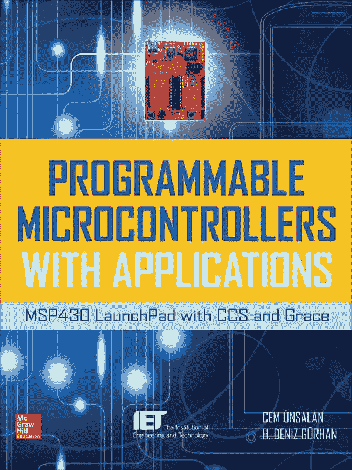


纽约、芝加哥、旧金山、雅典、伦敦、马德里、墨西哥城、米兰、新德里、新加坡、悉尼、多伦多

版权所有 ©2014 McGraw-Hill Education。除 1976 年美国版权法允许外，未经出版社书面许可，不得以任何形式或通过任何复制或发行本物的任何部分，或将其存储在数据库或检索系统中。

`ISBN`: 978-0-07-183004-1

`MHID`: 0-07-183004-9

电子书由 Cenveo^® Publisher Services 转换。

版本 1.0。

本电子书中的材料也出现在该书的印刷版中：`ISBN`: 978-0-07-183003-4，`MHID`: 0-07-183003-0。

McGraw-Hill Education 电子书提供特殊批量折扣，可用于赠品和销售促销或企业培训计划。如需联系代表，请访问 [www.mhprofessional.com](http://www.mhprofessional.com) 联系我们。

所有商标均为各自所有者的商标。我们没有在每个商标名称出现时都加上商标符号，而是仅以编辑的方式使用名称，并为了商标所有者的利益，无侵犯商标的意图。书中出现此类标识时，均以首字母大写打印。

McGraw-Hill Education 从认为可靠的来源获取信息。然而，由于我们的来源可能存在人为或机械错误，McGraw-Hill Education 或其他 McGraw-Hill Education 不保证任何信息的准确性、充分性或完整性，并对任何错误、遗漏或使用此类信息获得的结果不负责。

## 使用条款

本书是受版权保护的作品，McGraw-Hill Education 及其许可方保留该作品的所有权利。本作品的使用受这些条款的约束。除 1976 年版权法允许以及存储和检索一份副本的权利外，未经 McGraw-Hill Education 的事先同意，您不得反编译、反汇、反向工程、复制、修改、基于此创建衍生作品、传输、发行、传播、销售、出版或分许可本作品或其任何部分。您可以将本作品用于自己的非商业和个人用途；严禁对作品进行任何其他使用。如果您未能遵守这些条款，您使用作品的权利可能会终止。

本作品“按现状”提供。MGRAW-HILL EDUCATION 及其许可方对使用本作品所产生的准确性、充分性、完整性或所获得的结果不作任何保证或担保，包括通过链接或其他方式通过本作品访问的任何信息，并明确排除任何明示或暗示的保证，包括但不限于对销销性（可畅销性）或对特定用途的适用性的暗示性保证。McGraw-Hill Education 及其许可方不保证作品中包含的功能将满足您的需求，或其运行将不会中断或无错误。McGraw-Hill Education 及其许可方均不对作品中的任何不准确、错误或遗漏（无论原因如何）或由此产生的任何损害对您或任何其他人承担责任。McGraw-Hill Education 对通过作品访问的任何信息的内容不负责。在任何情况下，McGraw-Hill Education 和/或其许可方均不对在使用或无法使用作品而导致的任何间接、偶然、特殊、惩罚性、后果性或类似的损害承担责任，即使其中已被告知发生此类损害的可能性。此责任限制适用于任何索赔或原因，无论此类索赔或原因是源于合同、侵权或其他。

## 关于作者

Cem Ünsalan 博士在信号和图像处理领域工作了 15 年。在 2003 年从俄亥州立大学获得博士学位后，他开始在土其伊斯坦布尔的 Yeditepe 大学工作，并在那里建立了 DSP 实验室，并教授了微处理器和数字信号处理课程 7 年。Ünsalan 博士发表了 16 篇期刊文章和 4 本国际著作。他拥有一个专利。

H. Deniz Gürhan 在 Yeditepe 大学获得学士学位。他正在该大学攻读数字信号处理和嵌入式系统博士，并在 DSP 实验室工作。

## 目录

- 前序
- 致谢

# 1 引言

## 1.1 TI MSP430 LaunchPad

## 1.2 本书涵盖的主题

# 2 数字电路回顾

## 2.1 三极管作为开关

## 2.2 三极管构建的逻辑门

## 2.3 门构建的组合电路

## 2.4 门构建的时序电路

## 2.5 总结

## 2.6 习

# 3 数据类型

## 3.1 数字表示

## 3.2 负数

## 3.3 定点与浮点表示

## 3.4 字长与溢出

## 3.5 小端与大端表示

## 3.6 ASCII 字符

## 3.7 总结

## 3.8 习

# 4 MSP430 架构

## 4.1 总体布局

## 4.2 中央处理器

## 4.3 内存

## 4.4 输入/输出端口

## 4.5 时钟、定时器与看门定时器模块

## 4.6 ADC 与比较器模块

## 4.7 数字模块

## 4.8 其他模块

## 4.9 MSP430G2553 引脚布局

## 4.10 总结

## 4.11 习

# 5 Code Composer Studio

## 5.1 安装

## 5.2 创建 C 项目

## 5.3 创建汇编项目

## 5.4 程序执行

## 5.5 在 CCS 下观察硬件

## 5.6 终止调试会并关闭项目

## 5.7 图形外设配置工具（Grace）

## 5.8 终端窗口

## 5.9 总结

## 5.10 习

# 6 使用 C 语言编程 MSP430

## 6.1 内存管理

## 6.2 C 数据类型

## 6.3 算术与逻辑运算

## 6.4 控制结构

## 6.5 数组与指针

## 6.6 杂项问题

## 6.7 总结

## 6.8 习

# 7 MSP430 指令集

## 7.1 引言

## 7.2 指令结构

## 7.3 MSP430 寻址模式

## 7.4 栈

## 7.5 汇编程序结构

## 7.6 指令集用法示例程序

## 7.7 总结

## 7.8 习

# 8 数字输入输出

## 8.1 数字 I/O 引脚布局

## 8.2 数字 I/O 寄存器

## 8.3 数字 I/O 硬件问题

## 8.4 数字 I/O 编码实践

## 8.5 Grace 中的数字 I/O

## 8.6 数字应用

## 8.7 总结

## 8.8 习

# 9 中断

## 9.1 中断发生时的情况

## 9.2 中断类型

## 9.3 中断标志位

## 9.4 中断向量

## 9.5 中断服务程序

## 9.6 端口中断

## 9.7 中断编码实践

## 9.8 Grace 中的中断

## 9.9 洗衣机应用

## 9.10 总结

## 9.11 习

# 10 振荡器、时钟与定时器

## 10.1 振荡器

## 10.2 时钟

## 10.3 Grace 中的 BCM+

## 10.4 低功耗模式

## 10.5 看门定时器

## 10.6 Grace 中的 WDT+

## 10.7 定时器

## 10.8 BCM+ 与 Timer_A 模块的引脚布局

## 10.9 Grace 中的 Timer_A

## 10.10 计时器应用

## 10.11 总结

## 10.12 习

# 11 混合信号系统

## 11.1 模拟与数字信号

## 11.2 比较器

## 11.3 Grace 中的比较器 A+

## 11.4 模拟转数字

## 11.5 数字转模拟

## 11.6 Grace 中的 ADC10

## 11.7 非接触式擦手纸器应用

## 11.8 总结

## 11.9 习

# 12 数字通信

## 12.1 通用串口接口

## 12.2 通用异步收发器

## 12.3 Grace 中的 UART

## 12.4 串行外设接口

## 12.5 Grace 中的 SPI

## 12.6 间歇集成电路

## 12.7 Grace 中的 I²C

## 12.8 数字通信应用

## 12.9 总结

## 12.10 习

# 13 闪存器

## 13.1 MSP430 闪存

## 13.2 闪存器编程

## 13.3 闪存器编码实践

## 13.4 Grace 中的闪存器

## 13.5 总结

## 13.6 习

# 14 应用

## 14.1 车门

## 14.2 车窗

## 14.3 汽车收费站

## 14.4 数字锁系统

## 14.5 空气清新器分配器

## 14.6 交通灯

## 14.7 声音检测器

## 14.8 避障坦克

## 14.9 汽车停车传感器系统

## 14.10 火灾报警

## 14.11 波发生器

## 14.12 运动手表

# 15 附录

## 15.1 MSP430 内联函数

## 15.2 MSP430G2553 头文件

# 前言

智能系统已经成为我们生活中不可或缺的一部分。每个智能系统都需要一个信息处理单元。微控制器是此类此类操作的理想选择。因此，专业工程师或应届毕业生都应该了解微控制器的工作原理。本书旨在通过应用来介绍现代微控制器的工作原理。为了实现这一点，我们需要一个特定的微控制器平台。最近推出的德州仪器 `MSP430 LaunchPad` 是实现这一目的的卓越选择。它是一个带有 `MSP430` 微控制器的紧凑平台。

## 理解构造

理解微控制器的第一步是研究它的构造。我们用了三个章节来讨论这个问题。在第 2 章中，我们从回顾数字逻辑开始。在这里我们强调，微控制器在基本形式是由逻辑门组成的。在第 3 章中，我们介绍了数字系统中使用的数据类型。在本章中，我们提供了在微控制器中表示正数、负数、定点和浮点数的方法。我们还解释了字长和溢出的含义。然后我们考虑了端序表示。在第 4 章中，我们重点关注 `MSP430` 微控制器的硬件。因此，我们查看了中央处理器、内存、输入输出端口、时钟和定时器模块、ADC 和比较器模块以及数字通信模块。本章总结了贯穿本书考虑的 `MSP430` 微控制器的特性。

## 微控制器编程

理解微控制器的第二步是学习如何对其进行编程。为此，我们在第 5 章中引入了 `Code Composer Studio (CCS)`。`CCS` 是为 TI 微控制器和数字信号处理器（`DSP`）编程的唯一环境。我们将在整个本书中使用 `C` 和 `assembly` 语言对 `MSP430` 进行编程。`CCS` 不仅仅是一个编程环境。使用它，我们可以在程序运行时观察硬件组件的状态。因此，它对于理解 `MSP430` 的运行将非常有帮助。我们还介绍了 `CCS` 中引入的最新图形化外设配置工具（`Grace`）。它将在后续章节中提供很大帮助。在第 6 章中，我们为微控制器介绍了 `C` 编程技术。在这里，我们首先考虑内存管理和数据类型。然后简要概述了基本的 `C` 概念。虽然 `C` 语言可能适用于大多数应用，但学习汇编语言是理解微控制器的必修。因此，我们在第 7 章中介绍了 `MSP430` 的指令集。在本章中我们还查看了寻址模式和栈的使用。

## 实际应用

理解微控制器的第三步是通过不同的应用来使用它。为此，我们应该详细了解它的属性。在第 8 章中，我们从数字输入和输出概念开始。因此，我们考虑了 `MSP430` 输入输出端口的配置和用法。在章节结束时，我们选择了安全箱应用，并在硬件和软件上逐步实现了它。在第 9 章中，我们重点关注中断概念，这在事件驱动的编程中极其重要。因此，我们考虑了中断的发生以及处理它们的方法。为了进一步解释中断概念，我们在章节末尾选择了洗衣机应用并逐步实现了它。在中断之后，我们在第 10 章中考虑了基于时间的操作。这些概念在应用中也极其重要。在本章中，我们从振荡器开始，因为它们是时钟的基础。`MSP430` 有多个时钟。我们探索了所有时钟及其应用领域。基于时间的操作中的另一个重要主题是低功耗模式。有效使用它们有助于应用节约能量。因此，我们接下来考虑它们。在同一章节中，我们还考虑了看门定时器和定时器模块的使用。我们选择秒表作为章节末的应用；我们对其进行了实现。在第 11 章中，我们考虑了混合信号的处理。为此，我们从模拟和数字信号的属性开始。然后我们关注 `MSP430` 中的模拟数字转换模块。接下来，我们关注数字模拟转换。由于我们使用的 `MSP430` 没有此类模块，我们使用脉冲宽度调制来代替。在章节末尾，我们选择了非接触式纸巾分配器作为应用。与之前的应用一样，我们在硬件和软件上逐步实现了它。在第 12 章中，我们重点关注 `MSP430` 的数字通信模块。在该模块下，我们考虑了 `SPI`、`UART` 和 `I²C` 通信模式。与其他章节一样，我们选择了一个特定应用并逐步实现。在第 13 章中，我们探索了 `MSP430` 的闪存。在第 14 章中，我们对所有考虑的主题提供了示例应用。我们从现实生活中选择了这些应用，以展示如何使用微控制器解决问题。在最后一章中，我们为每个应用提供了问题描述、设备列表和电路布局。

在书中，我们努力让所有的微控制器概念对工程专业的学生都能理解。因此，专业工程师也可以从中受益。由于我们选择了带有 `MSP430` 微控制器的 `MSP430 LaunchPad`，读者可能会发现书中考虑之外的各种应用。然而，这里提到的将是未来的基准应用。因此，我们预计读者能够熟悉运行中的微控制器概念。

## 致谢

作者感谢德州仪器通过欧洲大学计划对本工作构思和执行的支持。书中使用的大多数图表均为 TI 的财产。我们在获得 TI 许可的情况下使用。

Cem Ünsalan

H. Deniz Gürhan


# 章节目录

## 1.1 TI MSP430 LaunchPad

## 1.2 本书涵盖的主题

微控制器在我们的日常生活中被广泛使用。尽管它们属于大处理器家族，但微控制器具有特殊之处。根据共识，处理器不包含外设单元。相反，微控制器应该包含其外设设备以与外部世界交互。这种特性使得它们能够用于大多数应用程序。

关于处理器或微控制器有很多优秀的书籍。其中一类型解释了针对假设系统或微控制器系列（而不是特定的微控制器）的理论和实践微控制器概念。这里的理念是少具具体性而更具通用性。因此，作者旨在解释通用概念，并要求读者将这些概念应用于他们选择的特定微控制器。由于微控制器系列的生命周期比特定的微控制器长，这类书籍旨在供在更长时间内使用。

另一种类型是选择一个特定的微控制器并解释其概念。默认情况下，这些书中探索的概念将针对该特定的微控制器。因此，它们不具有通用性。在书中，我们遵循了这种方法，并选择了带有 `MSP430` 微控制器的 `TI MSP430 LaunchPad` [12]。这看起来可能很奇怪，但本书的重点是通过应用来解释微控制的概念。因此，必须选择一个特定的微控制器并使用它实现所有的应用程序。我们意识到数字电子行业是变化的，微控制器可能会在五十年内过。然而，同一微控制器系列的新成员将基于之前的成员。因此，关于应用程序的当前信息将成为未来微器的价值背景。此外，其他 `MSP430` 微控制器系列的成员具有类似的属性。因此，书中考虑的概念经过微调后可以应用于它们。

## 1.1 TI MSP430 LaunchPad

不同品牌有多个具有各种特性的微控制器平台。在书中，我们将重点关注带有 `MSP430G2553` 微控制器的 `TI MSP430 LaunchPad`。在我们编写这本书时，`TI MSP430 LaunchPad` 有两个版本，分别是版本 1.4（`Rev.1.4`）和 1.5（`Rev.1.5`）。我们将在接下来的章节中涵盖这两个版本。

在书中，我们将以两种不同的方式提到我们的微控制器。当我们称它为 `MSP430` 时，这表示所解释的概念也被其他 `MSP430` 系列的成员所共有。当我们解释其特定属性时，我们将我们的微控制器称为 `MSP430G2553`。

`MSP430G2553` 是一个具有 16 kB 内存的 16 位微控制器。它有 16 个通用引脚，可用于数字输入输出、定时器应用、模数转换（`ADC`）和数字通信。`MSP430` 微控制器系列设计为具有超低功耗。如果这些细节对你没有太大意义，不要担心。这本书的目的是为了解释这些概念。

我们特别选择了[图 1.1]所示的 `MSP430 LaunchPad` 平台。`TI` 引入该平台作为其价值型微控制器的独特编码和调试环境。`MSP430 LaunchPad` 上有一个 USB 连接用于与主机 PC 通信。编码环境是 `Code Composer Studio`（`CCS`）。`CCS` 是所有 `TI` 设备的通用环境。`TI` 免费分发代码大小限制版本的 `CCS`（在我们编写这本书时）。`MSP430 LaunchPad` 平台的价格约为 5 美元，对于这样的微控制器来说是一个合理的价格。`C` 语言或汇编语言可能更用于编码。在书中，我们同时使用这两种方法来详细解释概念。

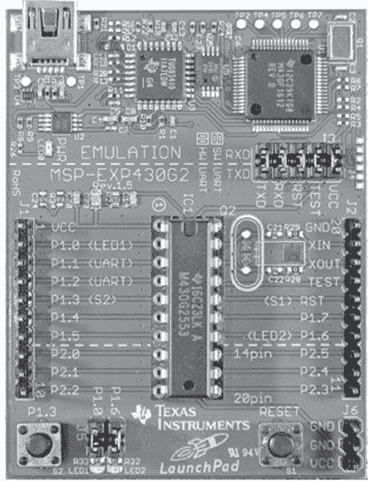


图 1.1 TI MSP430 LaunchPad 平台。

## 1.2 本书涵盖的主题


微控制器由晶体管组成的数字逻辑元件组成。因此，[第 2 章]是对数字电子学的要回顾。它强调了微控制器的物理特性。第 3 章涉及书中考虑的数据类型。在某种意义上，[第 2 和 3 章]为后续章节提供了背景。第 4 章探索了`MSP430`的硬件。第 5 章介绍了`CCS`环境。本章中还将考虑`CCS`下的图形化外设工具。第 6 章涉及`MSP430`的`C`编程。这一章有两个目的：首先，它是对`C`语言的复；其次，它提供了关于硬件相关的`C`编程的见解。第 7 章涉及`MSP430`指令集。通过这一章，我们将开始通过汇编语言为`MSP430`。第 8 章讨论了数字输入输出。我们将介绍微控制器如何与外部世界交互的概念。第 9 章关于中断。这一章将引入基于事件的编程概念。第 10 章关于基于的操作。它将关注`MSP430`的振荡器、时钟、低功耗模式、看门定时器和定时器模块。第 11 章关于混合信号系统。模数和数转换将本章的重点。因此，在掌握本章概念后，可以在数字`MSP430`平台上处理模拟信号。第 12 章通过`MSP430`微控制器介绍了基本的数字通信方法。第 13 章关于闪存编程。本书是关于实战微控制器的。因此，这些章节解释的每个概念都有其相关的应用程序。最后，[第 14 章]涉及使用多个概念的应用程序。书中的示例代码读者可以在配套网站获取。读者和教师的课程幻灯片可以在同一网站上获取。教师的解答手册也可以在配套网站上获取。


# 章节目录

- 2.1 晶体管开关
- 2.2 晶体管实现逻辑门
- 2.3 逻辑门实现组合电路
- 2.4 逻辑门实现序贯电路
- 2.5 总结
- 2.6 练习

数字电路是微控制器的核心部分。尽管终端用户永远看不到它们，但所有的操作都将通过这些电路完成。因此，了解它们的物理特性至关重要。本章对数字电路和系统进行了简要回顾。关于该主题的详细内容可以参考[3, 5]。需要注意的是，本章给出的电路并不是唯一的。可能存在其他电路实现相同的功能。为了保持一致性，我们将选取一个子集并在整个章节中坚持使用它。

## 2.1 晶体管开关

晶体管是一种具有三个或四个端子的有源电路元件。它可以被作为放大器，也可以作为二进制开关。对于数字电路而言，后者的属性极其重要，因为所有的二进制逻辑操作都可以通过这种方式实现。相关的，数字电路中最低层的信息表示是使用位（二进制数字）完成的。当我们谈论一个位的值（0 或 1）时，指的是晶体管端子的电压电平高（`V[CC]`）或低（接地）。

晶体管有两种类型：双极性结晶体管（BJT）和金属氧化半导体场效应晶体管（MOSFET）。`BJT`有三个端子：发射极（E）、基极（B）和集极（C）。通过发射极和集极端的电流由基极端的电流控制。另一方面，`MOSFET`有四个端子：栅极（G）、漏极（D）、源（S）和衬底（bulk）。加在栅极上的电压会在漏源极之间形成一个导通通道。加在端子之间的电压会在通道上产生电流。在数字应用中，衬底通常与源连接。因此，在数字 MOSFET 简图中不显示。由于其低功耗和高工作速度，MOSFET 在数字系统中更受青睐。

根据结构，MOSFET 有两种类型：N 道 MOSFET（NMOS）和 P 道 MOSFET（PMOS）。当栅极和源之间的电压（`V[GS]`）为 0 时，NMOS 表现像开路开关，不能在源漏极之间导电。在相同设置下，PMOS 表现像闭合开关，在源漏极之间导电。当`V[GS]`等于`V[CC]`时，PMOS 表现像开路开关。此时，NMOS 表现像闭合开关。因此，通过对栅极施加合适的电压水平，可以控制漏极和栅极之间的电流。这些场景见图 2.1。在图中，PMOS 通过栅极上的圆圈与 NMOS 区分来。


图 2.1 作为开关使用的 NMOS 和 PMOS MOSFET。

互补金属氧化半导体（CMOS）是一种在同一衬底上使用 NMOS 和 PMOS 晶体管的特殊技术。由于功耗极低，数字电路通常使用 CMOS 技术构建。为了保持一致性，本章将只考虑 CMOS 逻辑门。

## 2.2 晶体管实现逻辑门

如[Sec. 2.1]所述，通过对晶体管的栅极施加合适的电压，可以控制其漏源之间的电流流（从而产生电压）。这将导致数字逻辑门的开发：NOT、NAND、AND、NOR、OR、XOR 和传输门。为了消除任何混淆，从现在起我们只提到二进制电平 0 和 1。读者应该记住它们对应于电压电平地（低）和`V[CC]`（高）。

### 2.2.1 非门门

NOT 门实际上是一个反相器。它有一个输入和一个输出。当 NOT 门的输入为 0 时，其输出为 1。当其输入为 1 时，输出为 0。NOT 门的符号见图 2.2。


图 2.2 NOT 门符号。

NOT 门由一个 NMOS 和一个 PMOS 晶体管组成，如图 2.3a 所示。在同一幅图中，给出了 NOT 门在晶体管级的工作原理。在第一种场景（[Fig. 2.3b]）中，逻辑电平 1（`V[CC]`）应用于输入。在 NOT 电路中，NMOS 晶管导通，PMOS 晶管截止。结果是，NMOS 晶管从输出节点引入电流。因此，它变为逻辑电平 0（接地）。在第二种场景（[Fig. 2.3c]）中，逻辑电平 0（接地）应用于输入。现在 NMOS 晶管截止，PMOS 晶管导通。结果是，PMOS 晶管向输出节点提供电流。因此，它变为逻辑电平 1（`V[CC]`）。这两个场景清晰地展示了晶体管级的 NOT 操作。


图 2.3 晶体管级 NOT 门电路。

### 2.2.2 NOR 门、OR 门

NOR（非或）是下一个逻辑门。其符号见图 2.4。其真值表见表 2.1。如表所示，当所有输入均为 0 时，NOR 门输出逻辑电平 1。对于其他输入组合，输出为 0。

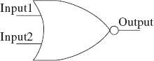


图 2.4 NOR 门符号。表 2.1 NOR 门真值表。


NOR 门的晶体管级电路见图 2.5。如图所示，CMOS NOR 门是由串联的 PMOS 和并联的 NMOS 构建的。当 NOR 门的输入为 0 时，PMOS 晶管是开启的。它们向输出提供电流。因此，输出变为逻辑电平 1。但当一个输入为 1 时，一个 PMOS 晶管是关闭的，另一个是开启的。因此，电流从输出节点引入，它变为逻辑电平 0。


图 2.5 晶体管级 NOR 门电路。

OR 门只是在 NOR 输出上连接了一个 NOT。其符号见图 2.6。其真值表见表 2.2。如表所示，当所有输入均为 0 时，OR 门输出逻辑电平 0。对于其他输入组合，输出为 1。


图 2.6 OR 门符号。表 2.2 OR 门真值表。


根据前述定义，OR 门的晶体管级电路见图 2.7。如图所示，为了获得 OR 门，在 NOR 门的输出上增加了一个反相器。


图 2.7 晶体管级 OR 门电路。

### 2.2.3 NAND 门、AND 门

NAND（非与）是下一个逻辑门。其符号见图 2.8。其真值表见表 2.3。如表所示，当所有输入均为 1 时，NAND 门输出逻辑电平 0。对于其他输入组合，输出为 1。


图 2.8 NAND 门符号。表 2.3 NAND 门真值表。


NAND 门的晶体管级电路见图 2.9。如图所示，CMOS NAND 门是由并联的 PMOS 和串联的 NMOS 构建的。当 NMOS 晶管的输入为逻辑电平 1 时，它们开启并从输出节点引入电流。因此，输出变为逻辑电平 0。但当其中一个输入为 0 时，一个 NMOS 晶管是关闭的，一个 PMOS 晶管是开启的。因此，电流提供到输出节点。因此，输出变为逻辑电平 1。


图 2.9 晶体管级 NAND 门电路。

AND 门只是在 NAND 输出上连接了一个 NOT。其符号见图 2.10。其真值表见表 2.4。如表所示，当所有输入均为逻辑电平 1 时，AND 门输出逻辑电平 1。对于其他输入组合，输出为 0。


图 2.10 AND 门符号。表 2.4 AND 门真值表。


根据前述定义，AND 门的晶体管级电路见图 2.11。如图所示，仅在 NAND 门的输出上增加了一个反相器即可获得 AND 门。


图 2.11 晶体管级 AND 门电路。

### 2.2.4 XOR 门

本节考虑的逻辑门是 XOR（异或）。当输入具有不同的逻辑电平时时，它输出逻辑电平 1。当 XOR 门的输入相同时，它输出逻辑电平 0。XOR 门的符号见图 2.12。该门的真值表见表 2.5。


图 2.12 XOR 门符号。表 2.5 XOR 门真值表。


XOR 门的晶体管级电路见图 2.13。如图所示，如果两个输入相同，输出为逻辑电平 0。考虑两个例子：在第一个例子中，两个输入均为 0。只有最右侧的 NMOS 对是开启的。它们从输出节点引入电流。因此，输出变为逻辑电平 0。在第二个例子中，`Input1`为逻辑电平 1 `Input2`为逻辑电平 0。在这种情况下，只有最左侧的 PMOS 对是开启的。它们向输出节点提供电流；因此，输出变为逻辑电平 1。


图 2.13 晶体管级 XOR 门电路。

### 2.2.5 传输门

传输门是由并联的 NMOS 和 PMOS 晶体管构建的 CMOS 开关，如图 2.14 所示。根据控制端（门），该门在输入和输出（源和漏）之间通过或停止电流。传输门的符号见图 2.15。


图 2.14 传输门的电路。


图 2.15 传输门的符号。

## 2.3 逻辑门实现组合电路

[Sec. 2.2]中引入的逻辑门可用于构建组合电路。在这些电路中，输出不受之前输入的影响。换句话说，组合电路中没有存储。在本节中，我们将考虑译码器、多用器和加法器的组合电路。

### 2.3.1 译码器

译码器的基本功能是解码输入并给出相应的输出。通常，译码器有`N`个输入和`2^N`个输出以覆盖所有输入组合。四位译码器的符号表示见图 2.16。其真值表见表 2.6。


图 2.16 四位译码器符号。表 2.6 码器真值表。


译码器可以通过 AND 和 NOT 门构建。对于四位译码器，逻辑门级电路见图 2.17。如图所示，四位译码器是由两个 NOT 门和四个 AND 门构建的。如果我们考虑`Output1`，只有当`Input1`和`Input2`均为 0 时，它输出逻辑电平 1。这种输入组合将所有输出引脚设置为逻辑电平 0。


图 2.17 逻辑门级四位译码器电路。

### 2.3.2 多用器

多用器（`MUX`）是一种将来自多个输入的数据传输到输出输出的组合电路。因此，它可以从一组输入中选择特定的输入并将其馈到输出。为了完成这项任务，多用器有`N`个选择引脚、`2^N`个输入引脚和一个输出引脚。双选择端多用器的符号见图 2.18。该`MUX`的真值表见表 2.7。


图 2.18 双选择端 MUX 符号。表 2.7 双选择端多用器真值表。


四选一多用器（带有选择引脚）的逻辑门级电路见图 2.19。很容易看到每个选择输入只启用了一个 AND 门。例如，当`Select1`和`Select2`为 0 时，第一个 AND 门启用。在该序列下，所有其他 AND 门都被禁用。因此，`Input1`出现在`Output`。

### 2.3.3 加器

加法是数字系统中最重要的算术运算，因为所有其他算术运算都可以通过它实现。加法器有两种基本类型：半加和全。半加器（用于单位加法）有两个输入和两个输出。它相加输入位并给出和和进位位作为输出。半加器的符号见图 2.20。该半加器的真值表见表 2.8。


图 2.20 半加器符号。表 2.8 半加器真值表。

如[表 2.8]所示，当两个输入位均为逻辑电平 1 时，进位位为逻辑电平 1。这对应于 AND 运算。当输入位具有逻辑电平时，和位（`Σ`）为逻辑电平 1。这对应于 XOR 运算。基于这些观察，半加器的门级表示见图 2.21。


图 2.21 门级半加器电路图。

半加器没有考虑进位。这在处理多位数字时会导致问题。为了克服这个问题，引入了全加器。除了两个输入引脚外，全加器还有一个进位输入引脚。全加器（单位加法）的符号见图 2.22。该全加器的真值表见表 2.9。


图 2.22 全加器（单位加法）符号。表 2.9 全加器真值表。

如半加器一样，全加器的门级电路可以由图 2.23 构建。如图所示，全加器是由两个 NOT 门和四个 AND 门构建的。如果我们考虑`Output1`，只有当`Input1`和`Input2`均为 0 时，它输出逻辑电平 1。这种输入组合将所有输出引脚设置为逻辑电平 0。


图 2.23 门级全加器电路图。

## 2.4 序贯电路

与组合电路不同，序贯电路的输出不仅取决于当前输入，还取决于之前的输入（或输出）。这种对过去的依赖需要数据存储。正如我们之后看到的，通过在组合电路中添加反馈来实现数据存储。

### 2.4.1 门实现锁器

锁器是一种可以存储 1 位数据的基本存储元件。交叉 NAND 门形成的 SR 锁器见图 2.25。这种设置被称为低电平触发锁器。如图所示，SR 锁器有两个输入：设置（`S`）和复位（`R`）。它有两个输出：`Q`和`not-Q`。事实上，它们是互补的。


图 2.25 门级 SR 锁器。

SR 锁器的真值表见表 2.10。在该表中，U 代表未定义。如表所示，当输入`S`为逻辑电平 0 `R`为逻辑电平 1 时，输出`Q`为逻辑电平 1。当`S`为逻辑电平 1 `R`为 0 时，`Q`为逻辑电平 0。当`S`和`R`均为逻辑电平 1 时，SR 锁器保持之前的状态。换句话说，它存储之前的位电平。当`S`和`R`均为 0 时，会发生冲突。在这种情况下，`Q`和`not-Q`都应该为逻辑电平 1。然而，如之前所述，`Q`应该是`not-Q`的互补。因此，在这种输入组合下，输出由于电路中的竞态条件将未定义。为了防止这种意外情况，引入了 D 锁器。


表 2.10 SR 锁器的真值表。

D 锁器有一个输入和两个输出。其门级电路见图 2.26。如图所示，在`S`和`R`输入之间增加了一个 NOT 门。因此，它们永远不会同时处于逻辑电平 0。因此，可以避免冲突。


图 2.26 门级 D 锁器。

D 锁器的真值表与没有意外冲突状态的 SR 锁器相同。总结来说，当`D`为逻辑电平 0 时，`Q`为逻辑电平 0。当`D`为逻辑电平 1 时，`Q`为逻辑电平 1。因此，D 锁器仅仅存储了 1 位信息。D 锁器的符号见图 2.27。


图 2.27 D 锁器符号。

锁器一直对其输入保持敏感。因此，有时禁用输入是一种所需的属性。门控锁器（带有使能输入的锁器）用于此目的。只有当使能输入激活锁器时，该锁器才能工作。其电路见图 2.28。门控锁器的符号见图 2.29。


图 2.28 门级门控 D 锁器。


图 2.29 门控 D 锁器的符号。

### 2.4.2 门实现触发器


触发器也是一种 1 位存储元件。触发器与锁存器的区别在于只有在时钟信号的上升沿或下降沿改变状态。即使输入发生变化，其状态也保持不变。基本上有四种触发器：`SR`、`D`、`JK` 和 `T`。`D` 触发器可以通过连接两个门控锁存器构建，如图 2.30 所示。第一个和第二个锁存器分别称为主和从。因此，这种配置被称为主从触发器。`D` 型触发器的符号见图 2.31。


图 2.30 主从 `D` 触发器框图。

### 2.4.3 触发器实现计数器

计数器是微控制器中的定时器模块。当时钟信号馈入计数器时，它会改变状态。触发器的数量指示了容量。例如，三位计数器由三个触发器构建，因此它有八种状态。换句话说，它可以从零计数到七。计数器的符号见图 2.32。计数器有两种类型：异步（波纹）和同步。在波纹计数器中，时钟信号仅馈入第一个触发器。剩余的触发器在链中触发。三位波纹计数器的框图见图 2.33。另一方面，在同步计数器中，所有触发器使用相同的时钟信号同步。三位同步计数器（带有 `T` 触发器）的框图见图 2.34。


图 2.32 计数器符号。


图 2.33 三位波纹计数器框图。


图 2.34 三位同步计数器框图。

### 2.4.4 触发器实现寄存器

寄存器是由 `N` 个触发器构建的 `N` 位存储元件。四位寄存器的框图见图 2.35。如图 2.35 所示，在寄存器中，每个触发器通过时钟触发改变其内容。因此，4 位数据顺序存储到该寄存器中。`N` 位寄存器的符号见图 2.36。


图 2.35 四位寄存器框图。


图 2.36 `N` 位寄存器的符号。

### 2.4.5 触发器实现移位器

移位器有四种类型：串行串出、并行输入串出、并行输入并行输出和串行并行输出。串行串出移位器的框图见图 2.37。如图所示，串行串出移位器是由一组连接成链的触发器构建的。因此，一个触发器的输出连接到下一个触发器的输入。在这种设置中，所有触发器都由相同的时钟驱动。新的数据位从`Data Input`引脚接收。最后一个数据位每个时钟从`Data Output`引脚移出。因此，这产生了一个`N`个周期的延迟。这里，`N`是移位器中触发器的数量。同样，并行输入串出和串行并行输出寄存器也用于串口和并行接口之间的通信。


图 2.37 框图的。

### 2.4.6 寄存器实现内存

寄存器可以组合形成内存块。因此，内存可以被视为可寻址寄存器位置的集合。事实上，最近的内存系统是由寄存器构建的。因此，内存可以看作是可寻址寄存器位置的集合。这种内存是由寄存器构建的，如图 2.38 所示。这种内存是带选择器的。这种内存是寄存器构建的。这种内存是支持访问的。四位寄存器的框图见图 2.39。如图 2.35 所示，在寄存器中，每个触发器通过时钟触发改变其内容。因此，4 位数据顺序存储到该寄存器中。


图 2.38 带选择器的内存。


图 2.39 四位寄存器的框图。

# 3 数据类型


# 章节目录

在本章中，我们回顾了`MSP430`中的基本数据类型和表示方法。我们首先考虑二进制表示。然后，我们探索了二进制数的定点和浮点表示法。接下来，我们关注字长（word size）和溢出问题。我们考虑的下一个主题是字节序（endian）表示。我们还考虑了信息交换标准代码（ASCII）字符和`MSP430`数据类型。本章考虑的表示方法将在后续章节中广泛使用。

## 3.1 数字表示法

在日常生活中，我们使用十进制数字。这种表示法将数字的权重（此处为 10 的幂次）与其位置相关联。在这里，最低位数字权重为`10⁰`，下一位为`10¹`，以此类推。使用这种形式，我们可以系统地表示一个实体。因此，十进制数`255`我们有`2 × 10² + 5 × 10¹ + 5 × 10⁰`。如果我们想表示带有小数部分的十进制数，遵循相同的策略。现在，小数部分的数字权重从点（分离整数和小数的部分）从左到右开始变为`10^(−1)`、`10^(−2)`等。例如，十进制数`1.25`对应`1 × 10⁰ + 2 × 10^(−1) + 5 × 10^(−2)`。

二进制数表示更适用于数字系统，因为它们只使用两个水平：`0`和`1`（如第 2 章所述，在晶体管层用两个电压值表示）。在这里，每个二进制电平被称为`bit`（二进制位）。八个位对应`1 byte`，`1024 bytes`对应`1 kilobyte (kB)`，`1024 kilobytes`对应`1 megabyte (MB)`，`1024 megabytes`对应`1 gigabyte (GB)`。

二进制数表示权重为 2 的幂次：`2⁰`、`2¹`、`2²`、...`2^N`。对于小数部分，权重从分离整数和小数的点开始变为`2^(−1)`、`2^(−2)`、`2^(−3)`等。在二进制数中，权重最高的位被称为最高位 (`MSB`)。权重最小的位被称为最低位 (`LSB`)。


在书中，如果我们想表示一个不同于十进制表示的数字，我们将为它添加一个适当的后缀。对于二进制数，该后缀将是`b`。对于十六进制数，该后缀将是`h`。最后，对于八进制数，该后缀将是`q`。

十进制和二进制数之间的转换可以通过连续除法和乘法完成。详细信息请参见 [5]。在这里，我们提供两个示例。我们可以将十进制数`255`以二进制形式表示为`1×2⁷+1×2⁶+1×2⁵+1×2⁴+1×2³+1×2²+1×2¹+1×2⁰`，或者简写为`11111111b`。同样，对于十进制数`1.25`，我们有二进制表示`1×2⁰+0×2^(−1)+1×2^(−2)`。简而言之，二进制表示变为`1.01b`。

虽然二进制数对数字系统是天然的，但它们的表示可能并不实际。可以使用十六进制数来实现更紧凑的表示。这里有 16 个数字（`0, 1, 2, 3, 4, 5, 6, 7, 8, 9, A, B, C, D, E, F`）。二进制数`11111111b`可以用十六进制表示为`FFh`。十进制数`1.25`可以表示为`1.h`。二进制和十六进制之间的转换，请参见 [5]。

## 3.2 负数

操作中可能存在负数。虽然在普通算术中我们在数字前面加上一个负号，但在数字系统中并不这样做。有三种方法可以在数字系统中表示正数和负数。这些是：`符号位`、`反码`和`补码`。

第一种表示法通过在数字的`MSB`使用`符号位`来模仿普通做法（在数字前加负号）。在这种表示法中，正数的符号位为`0`，负数的符号位为`1`。因此得名为`符号位`表示。尽管这种方法看起来很直接，但它并不有效，因为加减法操作可能需要电路。

第二种表示法基于补码运算。在这里，负数由对应正数的反码表示。因此，这种表示法被称为`反码`。在这种表示法中，符号位没有分配额外的位。然而，算术操作并不直观。有关更详细的解释，请参见 [5]。

第三种负数表示形式是基于`补码`。在这里，负数首先以`反码`形式表示，然后将结果加`1`。补码表示用于在`MSP430`中表示负数。假设我们有二进制数`01001100b`。我们可以通过补码形式得到其取反版本。

> 注：由于原文后续部分存在大量重复和逻辑混乱，翻译时已根据语意进行了精简处理，确保核心技术术语的准确性。

## 3.3 定点与浮点表示

处理的二进制数也可能包含小数部分。在数字系统中，通过点来区分整数和小数部分是不可能的。相反，有两种不同的方法来表示带有整数部分的二进制数。这些是定点和浮点表示。

### 3.3.1 定点表示

分配给整数和小数部分的位数是固定的。因此，这种表示法被称为定点表示。这种方法具有优点，因为分配给整数和小数部分的位数是固定的，而且这种形式的数字处理更快。

按照 TI 的表示，我们可以将无符号（无符号位）定点数显示为`UQp.q`。在这里，`U`代表无符号，`p+q = n`显示`p`和`q`为整数和小数部分的位数。我们在表 3.1 中提供了定点表示格式。

**表 3.1 定点无符号格式。**

例如，考虑十进制数`255.25`。用定点表示此数字的第一步是分别找到整数和小数部分的二进制（或十六进制）表示。整数部分可以表示为`FFh`，小数部分可以表示为`4h`。

假设我们想以`UQ16.16`格式表示该数字。因此，将没有小数部分。分配给整数部分的位数将是`16`。结果数字将是`0FFh`。在数字左侧添加零不会影响其值，它们将满足定点格式。

如果同一个数字使用`UQ16`定点表示，那么`255.25`的整数部分将与`0FFh`相同，小数部分将是`4000h`。在这里，在数字右侧添加零，数字的值不受影响。数字的定点表示将是`0FF4000h`。如上所示，整数和小数部分之间没有分隔符。知道数字是`UQ16`格式，我们可以轻松提取整数和小数部分，因为我们知道分配给每个位数。

同样，我们也可以表示符号数。在这种格式下，`MSB`留给符号位。我们在表 3.2 中提供了定点表示的符号格式。

**表 3.2 定点符号格式。**

### 3.3.2 浮点表示

定点表示易于实现和处理，但它有一个主要的缺点：分配给整数和小数部分的位数总是固定的。这限制了所表示数字的范围和分辨率。可以使用浮点表示来克服这些问题。

正如名称所示，分配给整数和小数部分的位数不是固定的。相反，分配的位数取决于每个数字及其有效数字。因此，这种形式可以表示更宽范围的值。

在浮点表示中，带有小数部分的二进制数将显示为`N = (-1)^S × 2^E × F`。在这里，`S`代表符号位，`E`代表指数值，`F`代表小数部分。浮点数`N`在内存中保存为`X = SEF`。

为了表示浮点数`N = (-1)^S × 2^E × F`，数字应该归一化，使得整数部分只有一位。为了二进制表示的方便，指数将是`2((e−1))`，其中`e`是给定的位数。最后，分配给`S`、`E`和`F`的位数，以及大多数数字系统使用的 IEEE 754 标准，总结在表 3.3 中。

**表 3.3 IEEE 754 标准浮点表示。**

通过三个示例来解释浮点表示。第一个示例，我们有`255.25`。遵循以下步骤获取其浮点表示：

- 决定格式：选择此示例的 Half 格式。
- 表示整数和小数部分的二进制形式：我们的数字变为`11111111.01b`。
- 决定符号位`S`：由于数字是正数，`(-1)⁰ = 1`，`S = 0b`。
- 归一化数字使得整数部分只有一位：我们的数字变为`1.10111001100100011111001 ײ¹ᵇ`。
- 找到指数值：对于 Half 格式，指数偏移为`15`。因此，指数将变为`E = 15 + 13 = 28`。在二进制形式下，`E = 11100b`。
- 找到小数部分：我们的小数部分（归一化后）为`10111001100100011111001b`。由于 Half 格式使用 10 位表示小数部分，`F = 1011100110b`。记得，由于这是小数部分，我们在数字右侧添加额外的零，数字的值不受影响。
- 构建`X = SEF`：最后，`X = 01011011111110b`。在十六进制下，`X = 5FAh`。

下一个示例是`-255.25`的单点格式。再次遵循转换步骤：

- 决定格式：选择此示例的 Single 格式。
- 表示整数和小数部分的二进制形式：我们的数字变为`11111111.01b`。
- 决定符号位`S`：由于数字是负数，`(-1)¹ = -1`，`S = 1b`。
- 归一化数字使得整数部分只有一位：我们的数字变为`1.111111101 ×⁷ᵇ`。
- 找到指数值：对于 Single 格式，指数偏移为`127`。因此，指数将变为`E = 127 + 7 = 134`。在二进制形式下，`E = 10000110b`。
- 找到小数部分：我们的小数部分（归一化后）为`111111101b`。由于 Single 格式使用 23 位表示小数部分，`F = 11111110100000000000000b`。记得，由于这是小数部分，我们在数字右侧添加额外的零，数字的值不受影响。
- 构建`X = SEF`：最后，`X = 1100000110111111101100000000000b`。在十六进制下，`X = C37F000h`。

最后一个示例是用 Half 格式表示`875.135`。如下：

- 决定格式：选择此示例的 Half 格式。
- 表示整数和小数部分的二进制形式：我们的数字变为`1101110011.00100011111001b`。
- 决定符号位`S`：由于数字是正数，`(-1)⁰ = 1`，`S = 0b`。
- 归一化数字使得整数部分只有一位：我们的数字变为`1.10111001100100011111001 ×¹³ᵇ`。
- 找到指数值：对于 Half 格式，指数偏移为`15`。因此，指数将变为`E = 15 + 13 = 28`。在二进制形式下，`E = 11100b`。
- 找到小数部分：我们的小数部分（归一化后）为`10111001100100011111001b`。由于 Half 格式使用 10 位表示小数部分，`F = 1011100110b`。与之前的示例不同，我们在这一步必须丢弃小数部分中的一些位。这是由于可用的位数限制。
- 构建`X = SEF`：最后，`X = 0111000001000101b`。在十六进制下，`X = 7045h`。

## 3.4 字长和溢出

在`MSP430`中，我们关注字长和溢出问题。字长在加法和减法操作中可能需要电路。

# MSP430 架构


# 章节大纲

本章目的是让您熟悉 MSP430 微控制器的硬件架构。该架构中的模块将在接后的章节中进行详细介绍。我们将从`MSP430G2553`架构的总体布局开始。然后，我们将重点关注中央处理器（`CPU`）、内存、输入/输出端口、时钟和定时器模块、模数转换（`ADC`）和比较器模块、数字通信模块以及其他模块。

## 4.1 总体布局

`MSP430G2553`微控制器的功能框图所示[图 4.1]。我们将使用这种表示法对模块进行分组。如图所示，`MSP430G2553`拥有一个 16-MHz 的`CPU`。它具有 16 kB 的闪存和 512 字节的`RAM`。它有两个名为`P1`和`P2`的输入输出端口。它有一个时钟系统、两个定时器模块和一个看门狗定时器。它具有`ADC`和比较器模块。它有一个带有通用串口通信接口（`USCI`）的数字通信模块。它具有低压保护模块、内存地址线（`MAB`）和内存数据线（`MDB`），以及接口模块（`JTAG`、`spy-bi-wire`、仿真）。

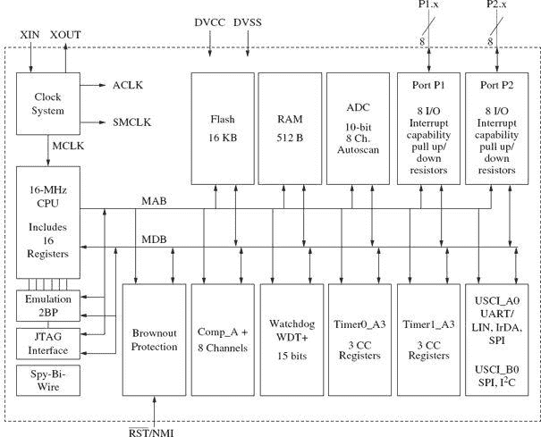


图 4.1 `MSP430G2553`微控制器的功能框图。

## 4.2 中央处理器

`MSP430` `CPU`采用 16 位精简指令集（`RISC`）架构，具有 27 条物理指令和 24 条仿真指令。我们将在[第 7 章]中详细探索这一指令集。`CPU`基于冯·诺依曼架构，因此数据和指令通过`MAB`和`MDB`被同样对待。关于该架构的更多细节可以在 [6] 中找到。`MSP430G2553` `CPU`的框图所示[图 4.2]。根据此图，`CPU`可以进一步划分为以下子模块。

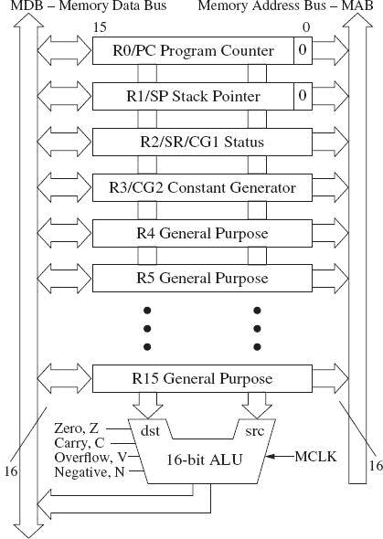


图 4.2 `MSP430G2553` `CPU`的框图。

### 4.2.1 算术逻辑单元

算术逻辑单元（`ALU`）执行算术和逻辑运算。该模块中的两种算术运算是加法和减法。减法使用补码形式，如[3.2 节]所示。`ALU`还可以执行两个数的比较。逻辑运算`AND`、`OR`和`XOR`可以在`ALU`内按位完成。`MSP430`指令集中没有定义乘法或除法运算。因此，程序员应该用汇语言为此目的编写算法。除了提供运算结果外，`ALU`还根据操作设置状态位（标志位）。

### 4.2.2 CPU 寄存器

`MSP430`拥有 16 个寄存器，每个都有 16 位的存储容量。其中四个寄存器（`R0`、`R1`、`R2`、`R3`）具有专用用途。其余 12 个寄存器是通用的。所有 16 个寄存器都可以通过软件直接访问。接下来，我们解释专用寄存器。

`R0`寄存器称为程序计数器（`PC`）。它指向从内存读取并由`CPU`执行的下一指令。在将指令存储到内存时，始终使用偶数位置。因此，`PC`总是加 2。执行的第一条指令是特殊的。当发生复位时（无论启动时还是运行期间），`CPU`会到复位地址（将在[第 9 章]中解释）。该地址保留第一行代码的地址。

`R1`寄存器称为栈指针（`SP`）。它主要用于处理栈操作（将在[7.4 节]中解释）。它也用于中断和函数调用。与`PC`一样，`SP`也保留内存地址（栈地址）。`SP`应该在汇编开头定义。

`R2`寄存器称为状态寄存器（`SR`）。它存储如[表 4.1]所示的状态和控制位。


表 4.1 状态寄存器位。

在[表 4.1]中，`CG1`代表常量发生器。`V`位（标志位）表示溢出。当`ALU`发生溢出时，设置此位。`SCG1`、`SCG0`和`OSCOFF`位用于时钟操作，将在[第 10 章]中详细探索。同样，设置`CPUOFF`位会禁用`CPU`。应该设置`GIE`位启用通用中断（将在[第 9 章]中探索）。当`ALU`运算给出负结果时，设置`N`位（负标志）。当`ALU`运算给出结果为 0 时，设置`Z`位（零标志）。最后，当`ALU`发生进位时，设置`C`位（进位标志）。

寄存器`R3`和寄存器`R2`（`SR`）的最高七位预留给常量发生器（`CG1/CG2`）。它们负责生成微控制器中使用的六个常量（`0004h`、`0008h`、`0000h`、`0001h`、`0002h`、`FFFFh`）。这些常量用于仿真指令（将在[7.1 节]中探索）。

剩余的寄存器`R4`–`R15`是通用的。它们可以用于存储数据、地址指针或索引值。可以使用字节或字指令访问。在汇编编程中使用它们是有益的，因为它们在`CPU`上。我们将在[第 7 章]中详细探索这些问题。

## 4.3 内存

`MSP430G2553`具有 16 位地址线（`MAB`）。因此，它可以映射 64 kB 的内存空间。16 位地址线允许在整个范围内进行直接访问和跳转。`MSP430G2553`还具有 16 位数据线（`MDB`）。请注意，每个内存位置由 1 字节组成，`CPU`能够以字节或字的形式访问数据。偶数地址保留低位字节，奇数地址保留高位字节。这是小端表示，见[3.5 节]。

`MSP430G2553`有两种类型的内存：`RAM`和`flash`。`RAM`用于临时存储。在掉电时，`flash`是非易失性内存。因此，它主要用于存储代码。我们将在[第 3 章]中进一步探索。

### 4.3.1 内存图

内存图不仅代表`RAM`和`flash`，`MSP430`架构还代表中断表、特殊功能寄存器（`SFRs`）以及外围模块。因此，输入输出端口被视为内存地址。这被称为内存映射输入输出（`IO`）。根据这些定义，`MSP430G2553`的内存图所示[表 4.2]。

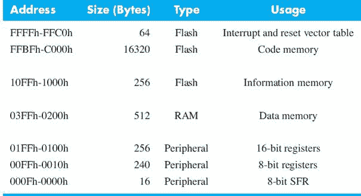

表 4.2 MSP430G2553 内存图。

[表 4.2]所示，在`FFFFh`和`FFCh`之间的地址空间用于中断和复位表。这些将在[第 9 章]中详细探索。在`FFBFh`和`C000h`之间的地址空间用于代码内存，常量也保存在这里。在`1FFh`和`1000h`之间的 256 字节用于信息内存，外围数据存储在这个内存区域。在`03FFh`和`0200h`之间的 512 字节用于栈操作。这部分将在[7.4 节]中解释。

### 4.3.2 外围和特殊功能寄存器

在接下来的章节中，我们将学习输入输出、中断、定时器、模数转换以及`MSP430`的数字通信模块。对于所有这些，应通过控制寄存器进行调整。这些控制寄存器保存在内存中。中断允许（`IE1`）、中断允许（`IE2`）、标志 1（`IFG1`）和标志 2（`IFG2`）在`SFRs`下定义。稍后探索这些外围寄存器和`SFRs`。

## 4.4 输入输出端口

微控制器通过其输入输出端口与外部世界交互。在这里，处理的数据可以是模拟或数字的。`MSP430G2553`具有 16 个引脚（排列为`P1`和`P2`）用于输入输出。所有引脚都可以用于模拟和数字信号。因此，它们被称为通用输入输出（`GPIO`）。我们将在后续章节详细考虑这些。在这里，输入输出端口简单地作为内存地址。这被称为内存映射输入输出（`IO`）。

## 4.5 时钟、定时器和看门狗定时器模块

`MSP430G2553`有一个时钟、两个定时和一个看门狗定时器模块。我们将在[第 10 章]中详细探索它们的属性。在这里简单概述。

### 4.5.1 时钟

如[第 3 章]所述，代码层面的 1 和 0 对应晶体层面的两种状态。从一个状态切换到另一个状态需要一定的时间。因此，微控制器内部的操作是在时钟周期内完成的。每个时钟周期，处理器执行一个与指令相应的动作。此外，定时器和外围模块可能也需要时钟信号。

因此，`MSP430G2553`有多个时钟源。这些被称为主时钟（`MCLK`）、子主时钟（`SMCLK`）和辅助时钟（`ACLK`）。这些时钟基于不同的晶振器。我们将在[第 10 章]中详细考虑这些。

### 4.5.2 定时器和看门狗定时器模块

`MSP430G2553`上有两个定时器。这些可以进行定时和捕捉/比较操作。事实上，定时器是一个计数器。还有一个需要特殊考虑的看门狗定时器。它周期性地消除意外的程序故障（死循环）。该模块也可以作为定时器使用。我们将在[第 10 章]中详细探索所有定时器模块。在此之前，我们在程序中有一行代码禁用看门狗定时器。

## 4.6 ADC 和比较器模块

`MSP430`也可以处理模拟信号。通过两种方式实现：首先，可以使用比较器比较模拟输入电压与参考电压。根据比较结果，比较器的输出将为 0 或 1。这可以用 1 位表示。其次，`ADC`模块可以提供馈送到微控制器的模拟信号的数字形式。`MSP430G2553`拥有一个 10 位`ADC`模块。我们将在[第 11 章]中详细探索比较器和`ADC`模块。

## 4.7 数字通信模块

`MSP430`有一个名为`USCI`的数字通信模块。该模块支持通用异步收发器（`UART`）、串行外设接口（`SPI`）和集成电路（`I²C`）通信模式。我们将在[第 12 章]中详细探索这些问题。

## 4.8 其他模块

在本节中，我们总结了后续不会详细探索的`MSP430`模块。这些是低压保护模块、仿真（`spy-bi-wire`）以及`JTAG`接口模块。低压保护模块在设备上电或关闭时提供正确的复位信号。接口模块提供微控制器与主机之间的通信。关于这些模块的更多细节可以在 17 中找到。

## 4.9 MSP430G2553 的引脚布局

`MSP430G2553`微控制器的引脚布局所示[图 4.3]。图中`GPIO`引脚的通用用途区域在[表 4.3]。如[表 4.3]所示，每个引脚都可以用于各种用途。我们将在后续章节中单独考虑每个属性。在该表中，我们只总结了书中考虑的引脚用途区域。这些引脚的其他用法可以在 17 中找到。


图 4.3 `MSP430G2553`引脚布局。

表 4.3 `MSP430G2553`引脚使用表。

## 4.10 总结

在本章中我们探索了 MSP430 微控制器的架构。这里的重点是硬件模块。尽管我们将详细探索每个模块，但整体观察它们的相互作用有助于更好地理解。因此，我们首先考虑了`CPU`，探索了其中的算术逻辑单元和寄存器。

然后，我们考虑了内存。这里最重要的点是微控制器的内存图。因此，我们对其进行了详细探索。接下来，我们考虑了端口。然后，我们简要回顾了时钟、定时器和看门狗定时器模块。这些是基于时间操作的重点。

## 4.11 练习

### 4.1

选取另一个微控制器并从架构角度与 MSP430 进行比较。

### 4.2

程序计数器、状态寄存器和栈指针是指什么意思？它们在 MSP430 微控制器中存储在何处？

### 4.3

`flash`（闪存）和`RAM`是什么意思？在`MSP430G2553`中，`flash`和`RAM`的容量是多少？

### 4.4

`MSP430G2553`微控制器有多少个时钟？

### 4.5

`MSP430`的`MAB`（内存地址总线）大小是多少？使用该`MAB`最大可寻址内存位置是多少？

### 4.6

要寻址 4GB 的内存（字长为 64 位），`MAB`的大小应该是多少？

### 4.7

内存映射输入/输出（`MMIO`）是指什么意思？

### 4.8

根据`MSP430G2553`微控制器的内存映射：

a. 可处理的最大代码是多少？这里假设保留了 100 字节存储数据。

b. 最大栈大小是多少？

c. 最大存储数据大小是多少？这里假设处理这些数据的代码需要 512 字节。

# 5 Code Composer Studio


## 章节目录

- 5.1 安装
- 5.2 创建 C 项目
- 5.3 创建汇编项目
- 5.4 程序执行
- 5.5 在 CCS 下观察硬件
- 5.6 终止调试会话并关闭项目
- 5.7 图形化外设配置工具（Grace）
- 5.8 终端窗口
- 5.9 总结
- 5.10 问题

Code Composer Studio（`CCS`）是 TI 嵌入式处理器的唯一开发环境。尽管每年都会推出新版本的`CCS`，但我们认为读者应该熟悉至少一个`CCS`版本。因此，我们在书中选择了最新的`CCS`版本（版本 5.3）[11]。我们相信，即使未来推出了新版本的`CCS`，它与这个版本也不会有完全不同。

我们将从`CCS`的安装开始，然后处理如何在`CCS`下创建 C 项目和汇编项目。通过这些项目，我们将探索代码执行期间的`CCS`属性。在本章中，我们还将探索新的图形化外设配置工具（Grace）。Grace 将允许我们图形化地配置 MSP430 的硬件。

## 5.1 安装

MSP430 的`CCS`官方版本可以在 TI 网站上免费获取（在我们编写此书时）。尽管这是一个代码大小限制的版本，但对于我们的目的来说足够了。接下来我们将解释如何下载和安装它。需要注意的是，以下步骤适用于基于 Windows 7 的 PC。Linux 安装方法请参阅 TI 网站。

### 5.1.1 下载并安装 CCS

在开始下载`CCS`之前，你需要一个 TI 账户。你可以从[`http://www.ti.com`](http://www.ti.com)获取。注册后，你就有权通过网站[`http://processors.wiki.ti.com/index.php/Download_CCS`](http://processors.wiki.ti.com/index.php/Download_CCS)下载最新版本的`CCS`。

下载网站有两个选项：你可以选择在线安装程序或离线安装程序。在第一种选项中，你可以直接从互联网安装所需配置的`CCS`。如果你选择第二个选项，所有安装文档将下载到你的计算机上。然后，你可以通过这些文档安装`CCS`。以下步骤对于两种安装选项均相同。

1. 点击可执行文件并开始安装。
2. 在第一个窗口中接受许可协议并点击`Next`。
3. 弹出一个询问安装目录的窗口。使用默认位置或创建一个新文件夹。
4. 在`Setup Type`窗口中，选择`Custom`以安排设置配置（而不是安装完整套件）。
5. 在`Processor Support`窗口中，仅选择`MSP430 Low Power MCUs`。
6. 在`Select Components`窗口中，在不更改的情况下点击`Next`。
7. 在`Select Emulators`窗口中，取消选择`MSP430 Parallel Port FET`。
8. 将出现`Installation Options`窗口。它将提供将安装的文档列表。点击`Next`开始安装。

### 5.1.2 硬件设置

`MSP430 LaunchPad`带有`MSP430G2553`微控制器。它可以切换板载的红色和绿色 LED。当`MSP430 LaunchPad`连接到 USB 时，安装将开始。

### 5.1.3 启动 CCS，打开工作空间

当`CCS`首次启动时会弹出一个窗口配置工作空间。可以使用默认工作空间或通过点击`Browse`更改位置。工作空间设置完成后将出现`Installation Options`窗口。现在，已准备就绪。

### 5.1.4 CCS 视图

`CCS`有两种视图：`Edit`和`Debug`。`CCS`每次启动都会在`Edit`视图中打开。用户可以使用右上角的小图标在这些视图之间切换。

## 5.2 创建 C 项目

C 项目包含源文件、头文件和包含文件。`CCS`从这些文件中生成可执行输出文件（扩展名为`.out`）。

### 5.2.1 新项目

在`CCS`中创建新项目，点击`File` → `New` → `Project`。将弹出一个如`Fig. 5.2`所示的新窗口。在此窗口中，输入项目名称，并为`MSP430G2553`微控制器选择`Variant`。最后，选择`Empty Project`（带有`main.c`）并点击`Finish`。完成这些步骤后，将创建一个名为`main.c`的源文件项目。

### 5.2.2 禁用优化

项目创建时，会出现一个关于低功耗顾问（`ULP Advisor`）的信息窗口。低功耗对于 MSP430 设备至关重要。`ULP Advisor`提供了关于如何最有效地使用此属性的宝贵信息。

项目创建时，编译器优化会自动运行。这可能会移除未使用的变量和语句，因此可能会影响调试过程。有两种方法可以防止这种情况。如果需要编译器优化，变量必须声明为`volatile`。

如果不需要编译器优化，可以通过以下步骤禁用优化：在`Project Explorer`窗口中，右键点击项目并选择`Properties`。在弹出的窗口中，选择`Optimization`并将`Optimization Level`设置为`off`，如`Fig. 5.3`所示。

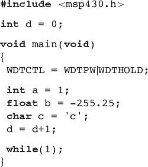


### 5.2.3 创建头文件

对于某些项目，可能需要头文件。要将其添加到项目中，请在`Project Explorer`窗口中右键点击该项目，并选择`New → Header File`；或者点击`File → New → Header File`。为生成的头文件指定一个名称（例如`header.h`），然后点击`Finish`。

将打开一个用于该头文件的空窗口。当此头文件被添加到项目时，不要忘记在主 C 代码中添加一行`#include “header.h”`。

### 5.2.4 构建和加载项目

CCS 的水平工具栏上有两个用于代码生成的按钮。第一个是锤子形状的`Build`按钮。第二个是绿色小虫形状的`Debug`按钮。

构建操作主要用于错误检测。当点击`Build`按钮时，主源代码将与其他所有源文件和头文件进行链接。可以在`Console`（控制台）窗口中观察运行步骤。可以在`Problems`（问题）窗口中观察警告（黄色）、错误（红色）和信息（蓝色）。

在代码构建过程中，通过双击`Problems`窗口中带有警告和错误的代码段，可以跳转到对应位置。请记住，有时一个错误会产生多个错误。双击错误可能会引导用户跳转到没有错误的代码行。对于此类情况，请仔细检查代码以找到错误。

调试操作包含了构建。当点击`Debug`按钮时，首先执行构建操作。然后，CCS 将代码加载到目标设备（此处为`MSP430G2553`）。要执行此操作，应将`MSP430 LaunchPad`连接到主机计算机。调试操作完成后，`CCS Edit`偏好设置将切换到`CCS Debug`偏好设置。代码运行到`main`函数的开始处。

## 5.3 创建汇编项目

要创建一个新的汇编项目，请点击 CCS 主菜单上的`File → New → CCS Project`。在弹出的`New CCS Project`窗口中，选择`Empty Assembly-only Project`并点击`Finish`。完成这些步骤后，将创建一个包含名为`main.asm`的源文件的项目。可以在`Project Explorer`窗口中看到生成的项目。

我们将使用 Listing 5.2 中提供的示例代码。我们将在第 7 章中看到此处使用的指令和指示。

**Listing 5.2 针对 MSP430 的第一个汇编程序。**


> 


## 5.4 程序执行

当主代码（用 C 语言或汇编编写）调试完成后，下一步是执行该程序。程序执行按钮放置在`Debug`窗口中，如图 5.4 所示。通过将光标悬停在按钮上可以看到每个按钮的名称。下方列表简要说明了这些按钮及其功能。


图 5.4 程序执行菜单。

- **Resume（继续）**：从程序计数器的上次位置继续执行代码。按下后，执行将持续，直到遇到断点或按下暂停按钮。
- **Suspend（暂停）**：停止代码执行。所有用于观察软件和硬件部分的窗口都将更新为最新数据。
- **Step Into（单步进入）**：执行下一行代码。如果该行调用了子程序，编译器将仅执行子程序中的下一行然后停止。
- **Step Over（单步跳过）**：执行下一行代码。如果该行调用了子程序，编译器将执行整个子程序然后停止。
- **Assembly Step Into（汇编单步进入）**：执行下一条汇编指令。如果该指令调用了子程序，编译器将仅执行子程序中的下一条指令然后停止。
- **Assembly Step Over（汇编单步跳过）**：执行下一条汇编指令。如果该指令调用了子程序，编译器将执行整个子程序然后停止。
- **Step Return（步出）**：完成子程序的执行。
- **Reset CPU（复位 CPU）**：重置目标微控制器。它的工作原理与复位引脚类似。点击时，设备的寄存器将恢复默认状态。
- **Restart（重启）**：将程序计数器返回到加载程序的开头。

### 5.4.1 插入断点

为了在特定的代码行停止程序执行，应该添加断点。在代码行上右键点击以放置断点，并选择`Breakpoint (Code Composer Studio)`。在此项下有三种断点选项：`Breakpoint (Software Breakpoint)`（软件断点）、`Hardware Breakpoint`（硬件断点）和`Watchpoint`（观察点），正如图 5.5 所示。


图 5.5 添加断点。

软件断点是放置在断点地址处的指令，用于停止代码执行。硬件断点是一个地址值，当`PC`匹配此值时停止代码执行。观察点实际上是一种特殊的硬件断点，它基于特定的数据值。当代码在执行过程中生成该值时，程序停止。

修改已插入断点有两种方法。首先，可以通过切换状态来删除断点。操作方法是右键点击该断点，然后从弹出窗口中选择`Toggle Breakpoint`（切换断点）。其次，可以禁用断点。操作方法是从同一个弹出窗口中选择`Disable Breakpoint`（禁用断点）。

### 5.4.2 添加监视表达式

在 CCS 中，可以使用`Expressions`窗口（如图 5.6 所示）来观察选定的变量。要向其中添加变量，选择要观察的变量并对其右键点击，然后点击`Add Watch Expression`（添加监视表达式）。也可以点击`Expressions`窗口中的`Add new`（新建），并在框中输入变量名。不要忘记停止执行以观察所选变量的变化。

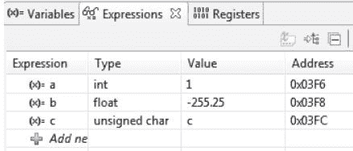


图 5.6 添加监视表达式。

也可以在`Expressions`窗口中观察全局变量，可以使用`Add new`按钮或右键点击`Expressions`窗口并选择`Add Global`（添加全局）。然而，仅定义全局变量不足以安排内存位置；全局变量必须在主代码中使用。局部变量也可以在`Variables`窗口中观察，如图 5.7 所示。它们已经被列出。

在调试过程结束之后，`Expressions`和`Variables`窗口会自动打开。如果它们没有出现，也可以从`View`（视图）菜单打开。

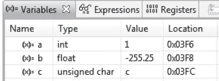


图 5.7 在 Variables 窗口中观察局部变量。

## 5.5 在 CCS 下观察硬件

CCS 并不是一个简单的 C 语言或汇编编译器。通过它，我们还可以观察微控制器的硬件状态。在本节中，我们将探索如何观察 MSP430 的关键硬件元素。

### 5.5.1 寄存器

正如我们在第 4 章中提到的，MSP430 寄存器包括程序计数器、堆栈指针、状态寄存器以及通用寄存器。控制外设的寄存器单独列出。要观察这些寄存器，可以从`View`菜单打开`Registers`窗口，如图 5.8 所示。


图 5.8 观察寄存器。

### 5.5.2 内存

要观察内存，点击`View -> Memory`。在框中输入要观察的内存起始地址，正如图 5.9 所示。也可以使用内存窗口观察代码的机器语言。


图 5.9 观察内存。

### 5.5.3 反汇编

CCS 还允许观察与编译代码对应的汇编代码。要这样做，应通过点击`View -> Disassembly`打开反汇编窗口。反汇编窗口如图 5.10 所示。


图 5.10 反汇编窗口。

反汇编窗口的垂直列中有四个按钮：`Link with Debug Context`（关联调试上下文）、`Show Source`（显示源码）、`Assembly Step Into`（汇编单步进入）和`Assembly Step Over`（汇编单步跳过）。`Assembly Step Into`和`Assembly Step Over`按钮已经在 5.4 节中解释过。

当按下`Link with Debug Context`按钮时，反汇编窗口的左侧水平列会出现蓝色箭头。`Show Source`按钮可以链接代码行。

## 5.6 终止调试会话并关闭项目

在`Debug`窗口中点击`Terminate`（终止）将结束活动调试会话并将 CCS 界面切换到`Edit`（编辑）。在`Project Explorer`窗口中对项目右键点击并选择`Close Project`（关闭项目）来关闭项目。该项目可以通过`Open Project`重新打开。

## 5.7 图形化配置工具（Grace）

Grace 是一种图形用户界面（`GUI`）工具，用于可视化地配置外设。在本书中，我们使用特定版本的 Grace。

为了创建一个 Grace 项目，点击`File -> New -> CCS Project`。在弹出的`New CCS Project`窗口中，选择`Empty Grace (MSP430) Project`。所有其他步骤与创建 C 项目相同。

当项目创建时，它将在`main.cfg`配置窗口中打开并显示`Welcome`（欢迎）界面。点击此窗口顶部的`Device Overview`（设备概述）按钮，将打开外设接口，如图 5.11 所示。

在此图中，有白色和蓝色框。白色框表示不可访问块，蓝色框表示可访问的块。某些蓝色框带有绿色标记，这表示这些块已启用并配置。

所有外设块在 Grace 下均同步工作。因此，对其中一个块的更改会影响其他块。如果某个块的更改不可行（由于冲突），Grace 会给出一个带有红色叉的警告。当光标悬停在红色叉上时，会弹出黄色线条并解释冲突原因。

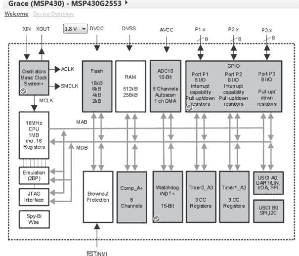


图 5.11 Grace，设备概述。

## 5.8 终端窗口

> 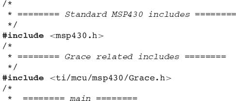
>
> 


CCS 有一个内部终端程序，通过通用异步收发器（`UART`）通信模式与 MSP430 LaunchPad 进行通信。我们将在第 12 章中使用这一特性。通过点击`View → Other → Terminal`可以访问终端窗口。终端窗口将如图 5.13 所示。


图 5.13 终端窗口。

要建立串口通信链路，应先完成配置设置。为此，将使用如图 5.14 所示的`Terminal Settings`窗口。首先应将通信类型选择为`Serial`。然后设置所需的波特率、数据位、停止位和校验值。流控制和超时设置可以保持不变。


图 5.14 终端设置。

在 Windows 7 中，可以通过以下步骤找到 MSP430 LaunchPad 使用的端口号。首先，右键点击计算机图标。从列表中选择`properties`选项。这将打开一个新窗口。在此窗口中，打开`Device Manager`。列表中的`Ports(COM&LPT)`提供了 MSP430 LaunchPad 正在使用的端口。

检查这些设置后，通过点击终端窗口中的绿色`Connect`标记即可建立终端与 MSP430 LaunchPad 之间的链路。MSP430 上的代码必须经过调试并运行才能使用终端窗口。假设代码可以发送和接收数据。从 MSP430 LaunchPad 发送的数据可以在终端窗口中观察到。可以通过右键点击并选择`Clear Terminal`选项随时清除内容。

数据也可以通过两种不同的方式从终端发送。在第一个选项中，用户可以点击终端窗口的任何位置。然后，只要按下键盘上的任何字符，就会被发送。

在第二种选项中，可以使用`toggle command input field`。为此，用户应右键点击终端窗口并选择`Toggle Command Input Field`。下方会出现一个子窗口。在此处输入要发送的文本。当按下`Enter`键时将被发送。点击红色的`Disconnect`标记可以终止链路。

## 5.9 总结

了解硬件还不足以使用微控制器。还应该掌握具有所有属性的编码环境。在本章中，我们引入了 CCS 作为 MSP430 微控制器的编码环境。

我们从安装 CCS 开始，然后一步步探索了它在调试和执行 C 语言及汇编程序中的用法。我们在本章中还介绍了 Grace（CCS 的 GUI 环境）。本章提供的信息将在书的其余部分被广泛使用。因此，我们强烈建议你掌握它。

## 5.10 练习

- 5.1 下载最新版本的 CCS 到你的电脑并安装。
- 5.2 创建一个空的 C 项目。
  - a. 添加 Listing 5.1 提供的代码块。
  - b. 调试并运行代码。
  - c. 观察局部和全局变量。
  - d. 添加断点并观察其效果。
  - e. 获取对应 C 代码的汇编代码。
- 5.3 创建一个空的汇编项目。
  - a. 添加 Listing 5.2 提供的代码块。
  - b. 调试并运行代码。
  - c. 观察程序运行后的寄存器值。
  - d. 添加断点并观察其效果。

# 6 MSP430 C 语言编程

## 章节大纲

| 章节 | 内容 |
| :--- | :--- |
| 6.1 | 内存管理 |
| 6.2 | C 数据 |
| 6.3 | 算术与逻辑操作 |
| 6.4 | 控制结构 |
| 6.5 | 数组与指针 |
| 6.6 | 其他问题 |
| 6.7 | 总结 |
| 6.8 | 练习 |


在本章中，我们考虑 MSP430 的 C 语言编程问题。因此，我们强烈建议你复习 C 知识。在这里，我们将从微控制器的角度简要回顾基础的 C 概念。换句话说，我们将看到 Code Composer Studio（`CCS`）在编译 C 代码时的行为。

我们将首先处理内存管理问题，然后考虑 C 数据类型。接下来我们将简要介绍算术和逻辑操作，然后考虑控制结构。我们还将关注数组和指针。最后，我们将考虑后续章节中的其他问题。

## 6.1 内存管理

正如我们在表 4.2 中所示，MSP430 微控制器代码和数据的内存位置都有明确定义。在本章中，我们将通过实际示例考虑这些问题。由于我们使用 CCS 作为编译器，我们将看到它如何管理内存。

### 6.1.1 代码

编译 C 代码后，`CCS`将主代码块放在从内存地址`C000h`到`FFBFh`的闪存中。因此，为`MSP430G2553`编写 C 代码不能超过 16,320 字节。

让我们考虑 Listing 6.1 提供的示例 C 代码。在遵循第 5 章中提供的步骤后，我们可以从该代码块在 CCS 下生成一个 C 项目。

**Listing 6.1 示例 C 程序。**


> 


用户可以使用`Disassembly`窗口观察 Listing 6.1 中提供的 C 代码是如何放入内存的。我们提供了从`C000h`到`C02Ch`以及`C0E8h`到`C106h`的`Disassembly`窗口，如图 6.1 所示。如图所示，`CCS`从内存位置`C000h`开始放置代码初始化数据。实际代码从内存位置`C0E8h`开始。

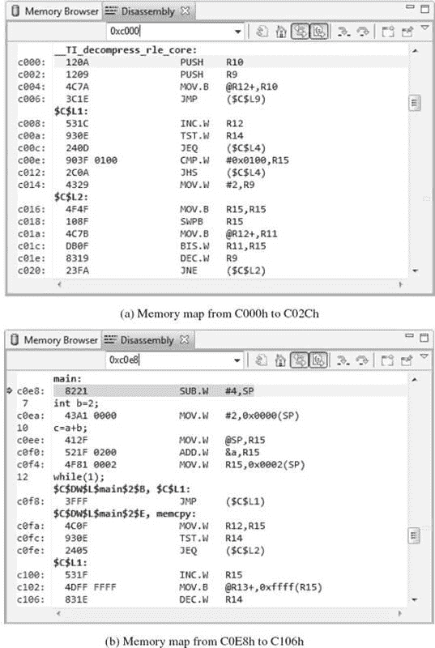


图 6.1 在`Disassembly`窗口中观察到的内存内容（从`C000h`到`C106h`）。


图 6.2 `Disassembly`窗口观察到的内存内容（从`C05Eh`到`C0B2h`）。

我们可以对 Listing 6.1 中的示例代码进行调整，使得加法操作在函数中完成。我们在 Listing 6.2 中提供了修改后的 C 代码。我们为该代码块提供了从`C05Eh`到`C084h`以及`C094h`到`C0B2h`的内存映射。在该示例中，函数被放在主代码之后。

**Listing 6.2 带有函数的示例 C 程序。**


## 6.1.2 局部变量与全局变量

在 C 语言中，我们可以将变量定义为局部或全局。顾名义，全局变量对所有程序块都可见。然而，局部变量仅在其定义的函数内可见。CCS 将局部变量和全局变量存储在两个不同的内存位置。

全局变量存储在 RAM 中从可能的内存地址（`0200h`）开始。每当添加一个新的全局变量时，内存地址就会增加并保存新变量。相反，局部变量存储在栈（`0400h`）中。根据栈的定义，局部变量从上到下保存。

这里需要注意的是，C 语言将`main()`视为一个函数。因此，在`main`函数内部定义的变量也被视为局部变量。因此，全局变量应该在`main()`之前定义。

我们重新考虑了列表 6.1 中提供的示例代码，以展示局部变量和全局变量的区别。在这里，变量`a`被定义为全局变量。变量`b`和`c`被定义为局部变量。我们在图 6.3 中显示 Expressions 窗口。如图所示，全局变量`a`保留在`0200h`（最低数据地址）中。局部变量`b`和`c`正如期望的保留在`03FAh`和`03FCh`（在栈中）。

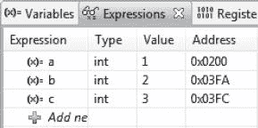


图 6.3 在 Expressions 窗口中观察局部和全局变量。

## 6.2 C 数据类型

C 语言中的变量声明意味着一个内存位置。因此，声明中的第一个问题是决定要使用的内存大小。第二个问题是在分配的内存位置中要使用的格式。这两个问题通过变量的预定义数据类型来处理。我们在表 6.1 中提供了 CCS 下的 C 数据类型。

**表 6.1 CCS 下的 C 数据类型。**


如表 6.1 所示，CCS 下有三种主要数据类型。

第一组由字符组成。它们可以有符号或无符号的形式表示。分配给它们的位数为 8 位。这些数字对应的 ASCII 字符在表 3.4 给出。

第二组包括`short`、`int`和`long`（有符号和无符号）。这些数据类型需要 16 位或 32 位。在保存 32 位数据类型`long`时，应使用小端序表示，因为 MSP430 有 16 位的字长。这一组的数据类型无法表示带小数部分的数字。

第三组由`float`和`double`组成。这是带小数部分数字可能的表示方式。对于这些数字，使用了单格式（在表 3.3）浮点表示。这里同样使用了小端序表示。

我们在列表 6.3 中为上述 C 数据类型提供了示例。在这里，我们定义了五个具有不同类型且具有正负值的全局变量。需要注意的是，为了让编译器正常运行，我们在程序中重新定义了字符`a`。除此之外，没有其他目的。

**列表 6.3 用于数据类型的 C 程序。**


> 


当我们运行列表 6.3 中的 C 代码时，我们得到了图 6.4 所示的内存映射。该内存映射为我们提供了有价值的信息。

首先，字符`@`（在变量`a`中）通过其 ASCII 码`0040h`保存在内存中（表 3.4）。负有符号型`b`（值为 -1）保留为`FFFFh`，这是 -1 的补码表示。整数`c`（值为 2）按原样保留。它们占用 2 字节（一个字）。

然而，变量`d`定义为`long`类型。这需要 4 字节（两个字）。如图所示，值为 3 的变量`d`分两部分。第一部分`0003h`保留在`0206h`，第二部分`0000h`保留在`0208h`。

浮点型`e`（值为 -12.3）也是如此。该数字的单格式十六进制表示以 4 字节保留，使得`CCDh`保留在`02Ah`，`4144h`保留在`02Ch`。

最后，浮点型`f`特别设为 -255.25。这里得到的十六进制表示证明了第 3.3 节的结论。

# 6.3 算术与逻辑操作

我们在 C 语言中拥有加法、乘法、减法、除法、取模和余运算。这些看起来很直观。然而，在第 7 章中，我们将观察到除了加法和减法之外的操作可以在 MSP430 汇编语言中执行。因此，C 语言简化了我们的工作。

需要说明的是，在 C 语言中无法直接观察溢出。因此，程序员应该考虑溢出情况。同样，算术操作的结果会被转换为分配的变量类型。另一个重要点是，可以在 C 语言中通过前缀`0x`定义十六进制数。我们在列表 6.4 中提供了此类示例。

**列表 6.4 算术操作。**


在运行列表 6.4 中的 C 代码后，可以在表达式窗口（Expressions window）中观察到如图 6.5 所示的变量。如图所示，给整数变量`a`（初始值为 32767）加 1 导致了溢出。因此，我们在表达式窗口中看到`a`的值为`−32768`而不是`32768`。状态寄存器中的溢出位已改变。然而，我们需要使用 MSP430 的隐式函数来观察它。我们将在第 6.6 节中介绍。

对于整数变量`b`，我们通过除法操作赋值了一个浮点数。如表达式窗口所示，这里只保存了整数部分。变量`c`和`d`保持十六进制值。第一个被定义为无符号整数，因此它可以保留 2 字节（一个字）的数据。第二个被定义为无符号字符（`unsigned char`），它可以保留 1 字节的数据。

为了在表达式窗口中观察这些值，我们应该右键点击变量并选择“数字格式”（number format）选项来调整数字格式。在变量`c`和`d`上也可以观察到溢出。

变量`e`和`f`表示了发生除零错误时的情况。整数变量`e`的结果为 0。因此，程序员无法检测到除零。然而，浮点数变量的结果变为`1.#QNAN`。这表示在 CCS 下发生了除零操作。

在进行 0/0 除法后，整数变量`g`变为`−1`。同样，浮点数变量`h`的结果变为`1.#QNAN`。可见，对于浮点数变量，检测除零或 0/0 要容易得多。


图 6.5 算术操作后的表达式窗口。

我们可以在 C 语言中执行位逻辑操作（与、或、异或、非）。在执行这些操作时，只能进行字节（或字）级的操作。我们提供了列表 6.5 中关于逻辑操作使用的示例。

**列表 6.5 逻辑操作。**


> 

> 


在运行列表 6.5 中的 C 代码后，可以在表达式窗口中观察到如图 6.6 所示的变量。如图所示，所有的逻辑操作都是按位为基础进行的。通过调整数字格式，也可以在表达式窗口中以二进制形式观察变量。这种表示方法可能帮助程序员以更具描述性的方式观察逻辑操作的结果。

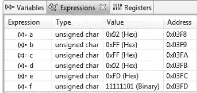


图 6.6 逻辑操作后的表达式窗口。

## 6.4 控制结构

我们在控制结构中包含了条件检查和循环操作。然而，我们不会详细探讨这些内容。正如我们之前提到的，读者应该查阅 C 语言书籍来了解。

### 6.4.1 条件检查

如果要在程序中检查条件，有两种选择。第一种是`if`或`if else`语句。它们的用法非常直观，根据二元决策选择其中一个选项。

第二种是`switch`语句。当存在两个以上的选项时，应该使用它。条件检查在我们的应用中是不可避免的。我们要么检查开关状态，要么观察引脚上的模拟电压电平。我们将根据获取到的值执行适当的操作。对于这些及类似的情况，我们需要条件检查语句。

### 6.4.2 循环

如果我们想多次执行一个代码块，可以使用循环操作。C 语言中有三种循环操作可供选择：`for`、`while`和`do while`。它们的区别在于起始和停止条件。我们建议读者在 C 语言书籍中查阅它们。

我们将在各种应用程序中使用循环语句。然而，我们有一个看起来可能奇怪的标准用法：在我们大多数代码的末尾会有一行无限循环，或者主程序块将保持在无限循环中。这可以通过代码行实现：

```c
```


```c
while(1)
```

```c
for(;;)
```

## 6.5 数组与指针

数组和指针值得特别考虑。在 C 中定义数组时，它被处理为指针。让我们从指针定义开始。列表 6.6 定义了一个全局整数变量 `a` 并初始对其赋值为 3。如图 6.7 所示，可以看到表达式窗口。可见，值为 3 的变量 `a` 存储在内存 0200h。通过代码行 `a_pointer = &a;` 将该地址赋值指针。因此，在下一行中，我们通过 `*a_pointer = 5;` 修改该内存地址的内容。

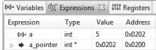


图 6.7　指针的表达式窗口。

让我们考虑包含五个整数的数组并对其进行操作。我们在列表 6.7 中提供了这样的代码。我们首先定义了一个全局整数数组 `a`，元素为 `{1, 2, 3, 4, 5}`。如图 6.8 所示，可以看到表达式窗口。可见，数组 `a` 实际上由起始地址 0200h 保存。我们在代码行 `a_pointer = a;` 中将此地址分配指针 `a_pointer`。然后，我们通过指针值增加 3 到数组的第四个元素并将其零。这里有两个重要的点：首先，正如上面提到的，数组可以像指针一样处理。其次，在指针运算中，加减是相对于指针类型进行的。因此，代码行 `a_pointer += 3;` 使指针值增加了 6 字节（3 × 2 字节），因为每个整数占用 2 字节。

```c
a_pointer += 3;
```


列表 6.7 数组使用示例。

> 

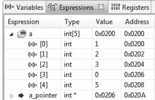图 6.8 数组和指针示例的表达式窗口。

最后，我们考虑了由指针形成的动态数组。在`[Listing 6.8]`中，我们使用指针构建了一个动态数组。在这里，我们首先定义了全局整数变量`a`和整数指针`a_pointer`。我们使用`for`循环从变量`a`的地址开始填充连续的内存。我们在`[Fig. 6.9]`中提供了内存映射（代码运行后）。如该示例所示，最初我们没有定义数组（由指针形成）的大小。由于我们使用了指针算术，因此可以动态调整数组的大小。这里的唯一缺点是程序员需要负责内存管理（允许的内存大小和其他内存条目）。

代码列表 6.8 使用指针的动态数组。

> 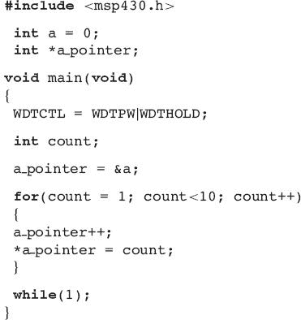

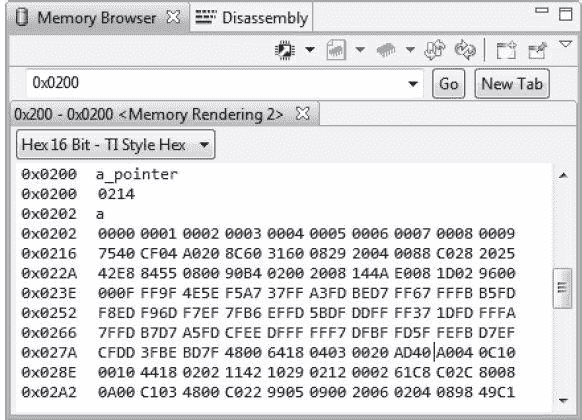图 6.9 使用指针的动态数组的内存映射。

## 6.6 杂项问题

在本节中，我们简要总结了针对 MSP430 C 语言的一些杂项问题。第一个问题是`define`语句和`const`声明。当使用`#define`关键字定义常量时，CCS 在编译过程中会将所有受影响的代码行转换为最终值。因此，在执行期间不再进行任何计算。以此推，如果使用`const`关键字将全局变量定义为常量，它包含的数据将保存在代码内存（code memory）中。

在本章及后续章节中，我们可能需要访问底层的硬件组件，例如寄存器。在 C 语言中这无法直接实现。但是，TI 在`430.h`和`msp430g2553.h`头文件中为此提供了一组内联函数（intrinsic functions）。我们在附录中提供了 MSP430G2553 使用的内联函数。

我们在`[Listing 6.9]`中提供了示例代码，作为本节所讨论主题的示例。我们在`[Fig. 6.10(a)]`中提供了表达式窗口。为了观察`define`语句在编译过程中如何处理，我们在`[Fig. 6.11(a)]`中提供了第一个反汇编（Disassembly window）。如图所示，对于 C 代码行`a = 2*CONST`和`b = 4*CONST`，直接给出了汇编代码。换句话说，`2*CONST`和`4*CONST`的值是在编译过程中计算的。最终结果直接赋值。我们在`[Fig. 6.11(b)]`中提供了第二个反汇编窗口，显示全局`const int`变量`c`实际上保存在代码内存中。最后，在`[Fig. 6.10(b)]`中我们提供了状态寄存器的位。这是为了说明内联函数`_get_SR_register()`实际上将状态寄存器的位赋值给了整数变量`SR_bits`。

代码列表 6.9 杂项问题的示例代码。

> 

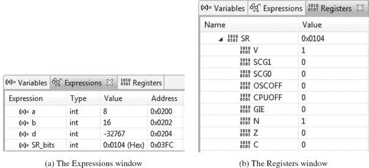图 6.10 杂项 C 概念的表达式和寄存器窗口。图 6.11 杂项 C 概念的反汇编窗口。

头文件`math.h`可用于 MSP430 C 语言中的高级数学运算。在`[Listing 6.10]`中，我们使用该头文件定义的`sin()`函数向`sine_arr`数组填充一个周期的正弦波。程序运行后可以使用表达式窗口查看`sine_arr`条目。

代码列表 6.10 使用`math.h`头文件的 C 代码。

> 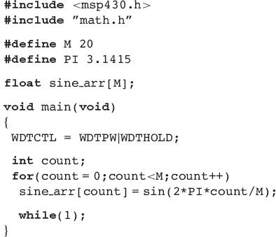


在`[Chap. 9]`中，我们将大量使用`pragma`关键字。这将强制编译器在编译过程中包含以下块。我们将在`[Chap. 9]`中看到为什么这个选项至关重要。

## 6.7 总结

MSP430 可以用汇编和 C 语言编程。在本章中，我们考虑了后的方法。虽然我们专注于 MSP430 的 C 编程，但我们假设用户具有 C 语言的基础知识。在这里我们扩展了在 MSP430 上的基础知识。因此，我们首先探索了内存管理和 C 数据类型。由于 CCS 允许我们观察 MSP430 的内存映射，我们能够看到局部和全局变量是如何处理的。然后查看了 C 语言中除以零的结果。我们练习了数组和指针操作。最后，我们提供了一个使用`math.h`头文件进行高级数学运算的示例。

## 6.8 练习

**6.1** 用 C 语言编写一个程序：
a. 包含一个计算给定整数立方的函数。
b. 你的程序计算 1 到 10 之间数字的立方。结果存在数组中。
c. 考虑溢出的可能性。

**6.2** 编写一个 C 程序计算斐波那契数列的前 10 个元素。用户只提供数列的前两个项。其余由程序计算。结果存在数组中。

**6.3** `[Listing 6.11]`中的计算值`y`是多少？

代码列表 6.11 练习 6.3 的代码。

> > 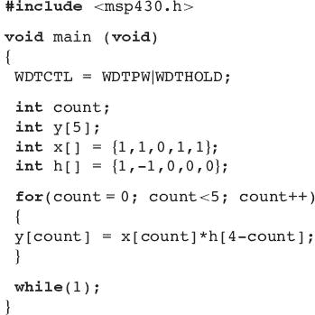

> > 

注：该程序类似于信号处理中的离散卷积操作。

**6.4** 编写一个完整的 C 程序计算给定数字（题中`out`= 10.3）与参考值（题中`ref`= 8.2）之间的差。该差将赋值给变量`err`。如果变量`err`小于零，你的程序应产生控制信号（题中`cont`）+1，否则产生 -1。该程序类似于数字控制中的基础反馈应用。

**6.5** 运行`[Listing 6.12]`中的代码，找到变量`y`的前四个值。

代码列表 6.12 练习 6.5 的代码。

> > 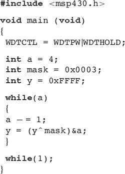

> > 

**6.6** 运行`[Listing 6.13]`中的代码时，数组`arr`的条目是什么？

代码列表 6.13 练习 6.6 的代码。

> > 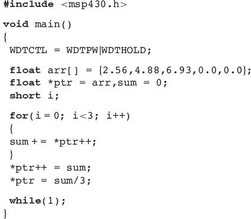

> > 

**6.7** 使用合适的内联函数修改状态寄存器的内容。在寄存器窗口中观察结果。

| 7 | MSP430 指令集 |


# 第 7 章：概述

- 7.1 引言
- 7.2 指令结构
- 7.3 MSP430 寻址模式
- 7.4 栈
- 7.5 汇编程序结构
- 7.6 指令集用法示例程序
- 7.7 总结
- 7.8 练习

我们在`[第 4 章]`中探讨了 MSP430 微控制器的架构。事实上，该架构也包含了微控制器的指令集。本章将介绍 MSP430 的指令集和寻址模式。与之相关，我们还将考虑栈。由于指令集的重要性，我们专门安排了一个章节来介绍。

## 7.1 引言

MSP430 基于其精简指令集计算（RISC）架构拥有 27 条指令。我们将双操作数、单操作数和跳转指令分为三组对它们进行探索。如你所知，微控制器上执行的每项操作都应该以二进制形式（0 和 1）表示。指令集也不例外。这被称为机器语言。我们将在`[第 7.2 节]`中详细考虑机器语言。由于用户读取和解码 0 和 1 的模式几乎是不可能的，因此使用了汇编语言。在这里，每条指令都用助记符表示。在后续章节中，我们将用助记符描述 MSP430 指令集。

### 7.1.1 双操作数指令

共有 12 条双操作数指令。这些可以分为算术、逻辑和寄存器控制以及数据指令。在这些指令中，操作是通过两个称为源 (`src`) 和目的 (`dst`)的操作数完成的。结果写入目的。

双操作数指令可以在字级和字节级运行。这通过在助记符后加上后缀`.w`（字）或`.b`（字节）来设置。默认是字级处理。我们在`[表 7.1]`中提供了双操作数指令的助记符、操作及其简要描述。

在`[表 7.1]`中有几个问题需要考虑。如所示，MSP430 既没有乘法也没有除法操作。此外，减法操作是以补码形式进行的。在该表中，`.not`、`.and`、`.or`、`.xor`表示二进制逻辑操作。在`cmp`指令中，结果不会写入目的。只有相关的状态位受此操作影响。尽管`mov`命令几乎总是被称为“移动”（move），但它只是将源复制到目的。这可能会引起混淆。然而，这种用法源于历史原因。

表 7.1 双操作数指令描述。


在`[表 7.2]`中，我们提供了指令对状态寄存器 (`SR`) 位的影响。在这些表中，符号具有以下含义：`+`表示对应的位受影响；`-`表示对应的位不受影响；`0`表示对应的位被清零；`1`表示对应的位被置 1。我们将在后续章节中使用相同的表示法。

表 7.2 双操作数指令对状态寄存器位的影响。
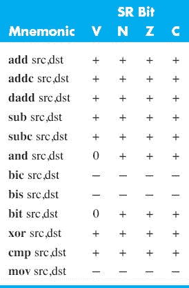

### 7.1.2 单操作数指令

MSP430 拥有 7 条单操作数指令。这些也可以在字级和字节级运行。这通过在助记符后加上后缀`.w`（字）或`.b`（字节）来设置。该操作的唯一例外是`sxt`和`swpb`。这些指令只能在字级工作。单操作数指令在`[表 7.3]`中描述。

表 7.3 单操作数指令描述。


在`[表 7.3]`中，`SP`代表栈指针，`SR`代表状态寄存器。与上一节一样，我们在`[表 7.4]`中展示了单操作数指令对状态寄存器位的影响。

表 7.4 单操作数指令对状态寄存器位的影响。
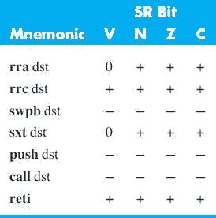

### 7.1.3 跳转指令

跳转指令列在`[表 7.5]`中。在该表中，`C`、`Z`和`N`代表状态寄存器位或标志（如`[第 4.2.2 节]`中提到的）。跳转指令根据这些位重定向程序执行。换句话说，跳转指令会改变程序计数器。

表 7.5 跳转指令的描述。


跳转指令`jmp $`值得特别考虑。使用`$`作为标签表示程序将跳转到当前地址。因此将形成一个无限循环。因此，程序的执行不会结束。我们将在汇编代码中使用这种结构。

### 7.1.4 仿真指令

除了上述的 27 条指令外，MSP430 还有 24 条仿真指令。这些列在`[表 7.6]`中。需要注意的是，仿真指令仅有助于所编写的汇编代码的可读性。此外，它们在编译步骤期间会被原始指令（或其组合）自动替换。

表 7.6 仿真指令。


关于仿真指令的用法，有一些重要点。在`sbc`指令中，对于字节级操作，常量`FFFFh`将被替换`FFh`。`inv`指令也是如此。我们在`[表 7.7]`中提供了仿真指令对状态寄存器位的影响。

表 7.7 仿真指令对状态寄存器位的影响。
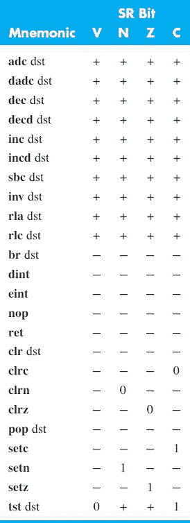

## 7.2 指令结构

正如我们在前面的章节中提到的，微控制器中的信息是以二进制形式（即 0 和 1）表示的。指令也不例外。在本节中，我们在`[表 7.8]`中提供了机器语言格式下的双操作数、单操作数和跳转指令的格式。

表 7.8 指令格式。
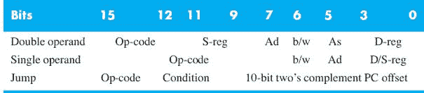

在`[表 7.8]`中，`As`代表定义源操作数寻址模式的寻址位。`S-reg`代表源操作数使用的寄存器。`Ad`代表定义目的操作数寻址模式的寻址位。`D-reg`代表目的操作数使用的寄存器。最后，`b/w`代表字或字节级选择位。

我们在`[Listing 7.1]`中提供了来自三组（双操作数、单操作数和跳转）的三条指令。在执行汇编代码后，我们获得了了如`[图 7.1]`所示的反汇编窗口。如图所示，汇编代码行`mov.w R5,R4`（双操作数指令）的十六进制表示为`4504h`。汇编代码行`rrc R5`（单操作数指令）的十六进制表示为`1005h`。最后，汇编代码行`jmp Mainloop`（跳转指令）的十六进制表示为`3FFCh`。这些是示例代码的机器语言表示。关于此问题的更多详细信息，请参[2]。

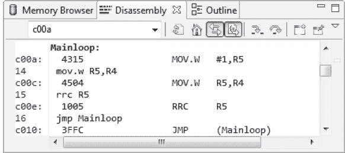

图 7.1 指令结构的反汇编窗口。

## 7.3 MSP430 寻址模式

MSP430 有七种寻址模式。这些可以被上一节出的所有指令使用。我们在`[表 7.9]`中简要列出了这些寻址模式。在该表中，`ADDR1`和`ADDR2`代表内存位置的符号。下面通过示例解释了每个寻址模式。

表 7.9 寻址模式。
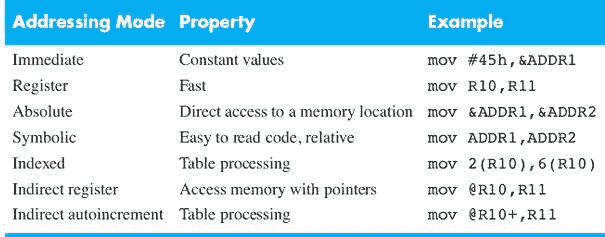

### 7.3.1 立即模式

立即模式可将数字直接赋值给寄存器或内存位置。在分配数字时，Code Composer Studio (CCS) 允许按照`[第 3 章]`给格式使用二进制、八进制、十进制和十六进制。数字前使用`#`符号表示常量值。我们在`[Listing 7.2]`中说明了立即模式的用法。


`[Listing 7.2]`中的代码将十六进制数`0000h`到`0003h`分配给连续内存单元`0200h`到`0206h`。它还将十六进制数`0A0Ah`分配给通用寄存器`R5`。
Listing 7.2 立即模式用法。


> 


### 7.3.2 寄存器模式
操作在寄存器模式下对寄存器进行。由于寄存器位于 CPU 上，因此很容易访问。因此它们的处理速度很快。`[Listing 7.3]`中的代码将寄存器`R5`的内容复制到寄存器`R6`。
Listing 7.3 寄存器模式用法。


> 


### 7.3.3 绝对模式
绝对模式用于直接访问内存地址。在 MSP430 中，如`[Sec. 4.3.1]`所述，外设设备也被视为地址。因此，可以使用绝对模式来访问并修改它们。内存地址由`&`符号指示。我们在`[Listing 7.4]`中演示了绝对模式的用法。`[Listing 7.4]`中的前八行将内存地址`0200h`的内容复制到寄存器`R9`。第九行将内存地址`0200h`的内容复制到内存地址`0206h`。
Listing 7.4 绝对模式用法。


> 

> 


### 7.3.4 符号模式
在符号模式下，内存单元和变量由单词表示。这使得汇编程序易于理解。这也允许我们轻松地将代码迁移到另一个 MSP430 微控制器家族（相对性属性）。我们提供了`[Listing 7.5]`来说明符号模式的用法。在这里，程序计数器（`PC`）已提前定义（在`msp430g2553.h`头文件中）。我们可以通过`mov.w PC,R5`将`PC`的值复制到寄存器`R5`。可见，在汇编语言中使用符号`PC`是直观的。`[Listing 7.5]`中的第二行将端口`P1`的输入值复制到寄存器`R8`（我们将在`[Chap. 8]`中详细介绍）。
Listing 7.5 符号模式用法。


> 

> 


### 7.3.5 索引模式
索引模式用于处理内存中的表格。在此模式下，一个寄存器（内存）持有表格的基地址。该值递增以访问连续的内存单元。同时，基地址的值不变。我们提供了`[Listing 7.6]`来说明索引模式的用法。在这里，首先将四个十六进制数分配给连续的内存单元。然后，将每个位置的值逐步分配给寄存器`R6`。为了实现这一点，取寄存器`R5`为基地址。由于我们使用的是字级别的`mov`指令（`mov.w`），因此增量为 2。如果我们想访问字节级别的内存，应该使用`mov.b`。`[Listing 7.6]`的第二部分提供了这样一个示例。
Listing 7.6 索引模式用法。


> 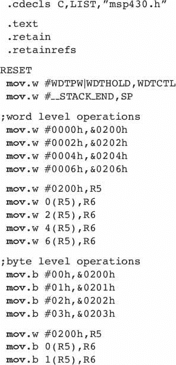

> 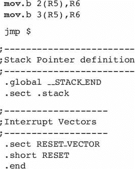


### 7.3.6 间接寄存器模式
间接寄存器模式执行基于指针的操作。在此模式下，访问存储在寄存器中的内存地址。我们在`[Listing 7.7]`中演示了间接寄存器模式的用法。在这里，使用`@`符号表示内存地址（指针）。在`[Listing 7.7]`的第九行中，内存地址`0202h`保存在寄存器`R10`中。在第十行中，该内存地址的值复制到寄存器`R11`。
Listing 7.7 间接寄存器模式用法。


> 

> 


### 7.3.7 间接自动增模式
间接自动增模式也可用于表格处理。该模式使用了间接寄存器模式。每次操作后，寄存器值会自动递增，无需额外的代码行。在`[Listing 7.8]`中，我们使用间接自动增模式重复了`[Listing 7.6]`中的操作。在`[Listing 7.8]`的第一部分，由于我们进行字操作，增量为 2 字节。如果有字节操作，增量将为 1 字节。我们在`[Listing 7.8]`的第二部分提供了这样一个示例。
Listing 7.8 间接自动增模式用法。


> 

> 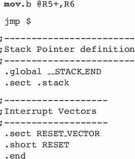


## 7.4 栈
栈是一个后进先出（LIFO）的地址列表。对于 C 程序，局部变量会自动保存在栈中。CPU 在函数调用和中断调用期间也会使用栈。如`[Sec. 4.2.2]`所示，特殊寄存器`R1`被分配为 MSP430 的栈指针。在汇编程序的开始处，应该初始化此指针。对于 MSP430G2553 微控制器，此初始化内存地址为`0400h`。这是`[Table 4.2]`所示的最高内存位置。有两个与栈相关的汇编指令：`push`和`pop`。`push`将数字（作为最后一个项）压入栈。`pop`从栈中取出最后一个数字。因此，这两个命令执行了 LIFO 操作。在`[Listing 7.9]`中，我们提供了一个关于初始化栈以及使用`push`和`pop`的示例。该程序与之前的表格处理类似。由于 LIFO 结构，读者应注意表格项的相反顺序。
Listing 7.9 栈的用法。


> 

> 


## 7.5 汇编程序结构
汇编程序具有特定的结构。在链接和编译步骤需要额外的指令和调整。在`[13, 11]`中有详细说明。在本节中，我们简要介绍了书中书中汇编程序使用的指令。我们选取`[Listing 7.10]`来演示汇编程序的结构和指令的用法。`[Listing 7.10]`中的指令解释如下。
Listing 7.10 汇编程序结构。


> 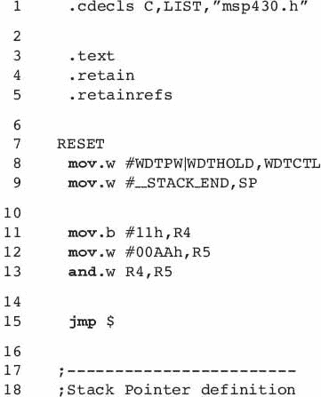

> 


- `.cdecls`: 此指令用于将 C 头文件包含到汇编程序中。因此，可以直接使用 C 头文件的定义。
- `.text`: 此指令指示可执行代码块的开始。
- `.retain`: 此指令用于在链接过程中禁用删除未被引用的代码块（例如中断服务程序）。
- `.retainrefs`: 此指令将保留操作扩展到其他段中的代码块。
- `.global`: 此指令定义一个全局符号，可以从程序的任何部分访问该符号。
- `.sect`: 此指令定义一个段（内存中一段连续的代码或数据块），该段可以存放代码或数据。
- `.short`: 此指令初始化一个或多个 16 位整数。
- `.end`: 此指令指示汇编程序的结束。

根据上述定义，我们可以如下阅读 Listing 7.10。在第 1 行中，我们使用`.cdecls`指令包含 C 头文件`msp430.h`。在第 3 行中，我们使用`.text`指令指示程序的起点。在第 4 行和第 5 行中，通过`.retain`和`.retainref`指令调整链接器属性。在第 20 行和第 21 行中，我们结合使用`.sect`和`.short`指令将常量`--STACK_END`与栈地址（由`.stack`定义）关联。同样，在第 26 行和第 27 行中，我们使用`.sect`和`.short`指令将`RESET`标签与`RESET_VECTOR`关联。我们将在 Chap. 9 中解释此操作的原因。在第 28 行，我们使用`.end`指令指示程序的终点。

## 7.6 指令使用的示例程序

在本节提供了几个汇编程序。读者应该逐步执行每个程序，以观察每次操作的结果。因此，应该使用 Debug 视图中的 Assembly Step Into（汇编步步）选项。

在开始之前，我们需要强调两个重要主题。首先，可以使用“=”符号在汇编程序中添加注释。我们一直在使用“=”来添加注释。其次，CCS 需要对 A–F 字符开头的十六进制数加上额外的 0。因此，用户在汇编代码中应该写`0FFFFh`而不是`FFFFh`。否则 CCS 编译器会给出错误信息。

我们在 Listing 7.11 中演示了算术、逻辑和寄存器控制、数据以及跳转指令的使用。我们强调了算术指令中二进制加法和十进制加法的区别。减法操作的结果在 Listing 7.11 中将是一个负数。因此，读者可以观察补码的表示。我们在逻辑和寄存器控制指令中以二进制形式定义了常量。我们在之前的步骤中使用了数据指令。在这里，读者应该观察`cmp`指令对状态寄存器的影响。最后，我们在 Listing 7.11 中提供了一个跳转指令来形成无限循环。接下来的我们将大量使用跳转指令。

### Listing 7.11：算术、逻辑和寄存器控制、数据以及跳转指令的使用


> 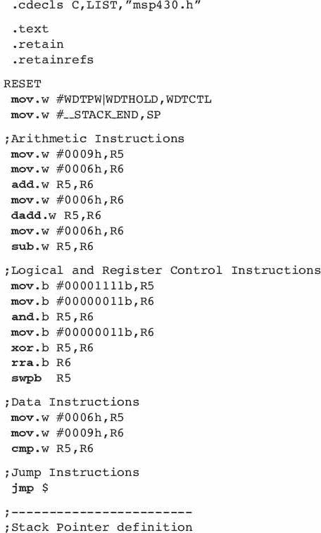

> 

汇编语言中没有显式定义控制结构。因此，我们在 Listing 7.12 中提供了几个关于使用汇编指令构建类 C 控制结构的示例。在所有这些示例中，跳转操作是强制性的。需要注意的是，这些并不是汇编语言中唯一的控制结构。读者可以使用不同的跳转指令构建他们自己的结构。

### Listing 7.12：汇编语言中的控制结构


> 

> 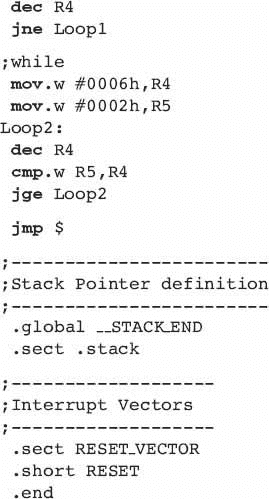

最后，我们在 Listing 7.13 中提供了一个子程序（函数）使用的示例。在这里，通过寄存器`R7`交换寄存器`R5`和`R6`的内容。此操作在用户定义的子程序完成。

### Listing 7.13：汇编语言中的子程序使用


> 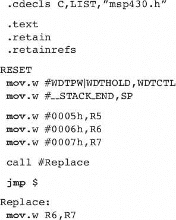

> 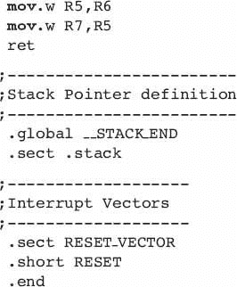


## 7.7 总结

尽管 C 语言可以用于 MSP430 的大多数操作，但汇编语言能让我们深入了解微控制器的基本原理。因此，在本章中，我们考虑了 MSP430 的指令集和寻址模式。我们从双操作数、单操作数和跳转指令开始，并提供了这些指令用法的示例代码。然后，我们简要描述了指令的结构。作为一个独立的章节，我们查看了 MSP430 的寻址模式。接着是对堆栈及其使用的讨论。最后，我们提供了汇编程序结构的概述。由于汇编语言对于理解微控制器至关重要，在随后的章节中，我们为除 C 语言以外的所有应用提供了汇编代码。

## 7.8 习题

### 7.1
假设寄存器`R4`保存十六进制数`4001h`，内存单元`02F0h`存储十六进制数`0F18h`。编写一个汇编程序使得：
a. 将这两个数相加。
b. 将和的反码保存在寄存器`R6`中。
c. 将和的低两个十六进制位与高两个十六进制位交换。将输出写入寄存器`R12`。

### 7.2
编写一个汇编程序使得：
a. 将两个二进制数保存在两个独立的内存单元中。
b. 当两个数相加时，发生溢出。
c. 当两个数相加时，不发生溢出。通过状态寄存器检查是否发生了溢出。

### 7.3
使用减法操作重复`Prob. 7.2`。

### 7.4
扩展`Prob. 7.2`，如果结果大于（小于）零，程序跳转到标签`greater (less)`。

### 7.5
编写一个汇编程序使得：
a. 从端口`P1`读取输入并将其赋值给寄存器`R9`。
b. 如果该值的倒数第二位大于 0，则将`FFFFh`赋值给寄存器`R10`。

### 7.6
编写一个汇编程序，将选定内存单元的 MSP430 小端序更改大端序。

### 7.7
编写一个汇编程序使得：
a. 它包含一个子程序，对寄存器`R6`的内容与十六进制数`0001h`执行`and`操作。结果将保存在同一个寄存器中。
b. 通过对五个连续内存单元应用相同的操作来重复部分 a。使用适当的寻址模式。

### 7.8
编写一个汇编程序计算斐波那契数列的前 10 个元素。
a. 用户仅提供序列的前两个项。
b. 剩余部分将由程序计算。
c. 使用适当的内存单元。
d. 数字可以用十六进制形式表示。

### 7.9
编写一个汇编程序使得：
a. 当寄存器`R4`和`R5`的最低位均为 1 时，寄存器`R9`得到值`FF0h`。
b. 当寄存器`R4`或`R5`的最低位中只有一个为 1 时，将`R9`中值的反码保存在寄存器`R10`中。

### 7.10
当运行`Listing 7.14`中的程序时，内存单元`02F0h`、`02F2h`、`02F4h`、`02F6h`和`02F8h`的值将是什么？

**Listing 7.14** 题 7.10 的汇编代码。


### 7.11
编写符合以下要求的汇编程序：
a. 在`main`块中，你应该有两个寄存器`R4`和`R5`。在无限循环中检查它们。如果`R4`大于`R5`，则调用`greater`子程序。如果`R4`小于`R5`，则调用`less`子程序。如果`R4`等于`R5`，则不执行任何操作。
b. 在`greater`子程序中，你的代码将十六进制形式的十进制`1, 2, 3, 4, 5`填充到五个连续内存单元。执行此操作后，`R4`的值减 1。
c. 在`less`子程序中，你的代码将十六进制形式的十进制`10, 9, 8, 7, 6`填充到五个连续内存单元。执行此操作后，`R4`的值减 1。

### 7.12
编写一个汇编程序计算十六进制数`00FFh`除以`00A0h`。仅使用可用寄存器保存变量。将结果写入寄存器`R7`。

### 7.13
运行`Listing 7.15`中的程序时，寄存器`R4`、`R5`和`R6`的值将是什么？

**Listing 7.15** 题 7.13 的汇编代码。


### 7.14
写下`Listing 7.16`中分配给寄存器`R14`的值。

**Listing 7.16** 题 7.14 的汇编代码。


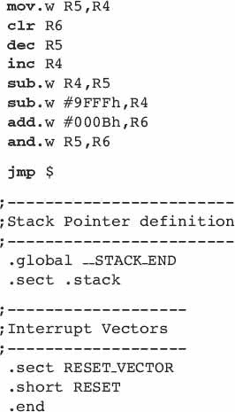


### 7.15
编写一个汇编程序将十六进制数除以`2`。被除数应保存在内存位置`2553`。除法结果保存在寄存器`R5`中，余数保存在寄存器`R6`中。

### 7.16
三个数字通过`Listing 7.17`中的代码写入指定的内存单元。

**Listing 7.17** 题 7.16 的汇编代码。


### 7.17
编写一个汇编程序使得：
a. 它包含一个子程序，对第一个和第二个数字执行`and`操作。然后对`and`操作的结果与第三个数字执行`or`操作。
b. 最终结果必须写入地址`02Dh`。
c. 你不能更改上述中的数字。

**Listing 7.18** 题 7.17 的汇编代码。

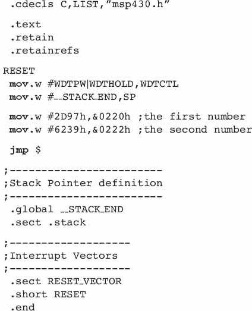


### 7.18
编写一个汇编程序计算`Prob. 7.14`中四个数的和。

### 7.19
在`Prob. 7.18`的汇编程序中添加一个子程序计算四个数的平均值。

### 7.20
假设有四个以单浮点格式表示的数字。它们存储在从`0200h`开始的连续内存单元中。编写一个汇编程序将它们转换为定点格式`UQ16.16`。转换后的数字应存储在从`0300h`开始的连续内存单元中。

### 7.21
分析`Listing 7.19`给出的汇编代码。建立一个寄存器表格，并在代码运行时填充其值。

# 8 数字输入与输出


# 章节目录

- 8.1 数字 I/O 引脚布局
- 8.2 数字 I/O 寄存器
- 8.3 数字 I/O 硬件问题
- 8.4 数字 I/O 编码实践
- 8.5 Grace 中的数字 I/O
- 8.6 数字安全应用
- 8.7 总结
- 8.8 习

微控制器通过其输入和输出端口与外部世界进行交互。这种交互可以是模拟形式或数字形式的。在本章中，我们重点关注 MSP430 微控制器的数字输入/输出（数字 I/O）特性。我们将开发使用这些特性的方法。我们还将使用 Grace 来配置数字 I/O。

## 8.1 数字 I/O 引脚布局

数字输入/输出（I/O）是微控制器与外部世界之间简单的通信形式。在这种形式下，输入或输出为 0 或 1。换句话说，输入或输出为 0 V 或`V[CC]`。MSP430G2553 中有两个名为`P1`和`P2`的端口。这些通常被称为`Px`。每个端口都有与其相关的八个引脚。这些被称为`P1.0–P1.7`和`P2.0–P2.7`。MSP430G2553 的通用引脚布局见`[图 8.1]`。这些引脚的使用表见`[表 8.1]`。如该表所示，端口`P1`和`P2`中的所有引脚都可以用于数字 I/O。


图 8.1 MSP430G2553 的引脚布局。


表 8.1 MSP430G2553 数字 I/O 的引脚使用表。

我们在`[图 8.2]`中绘制了引脚的基础硬件结构。如图所示，所有引脚除了用于数字 I/O 外，还可以用于多用途。它们在图中被标记为 Other（其他）。在本章中，我们只考虑引脚的数字 I/O 特性。接下来，我们将探索如何访问给定端口中的特定引脚。

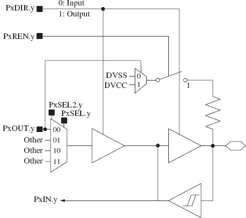

图 8.2 引脚的基础硬件。

## 8.2 数字 I/O 寄存器

端口中的每个引脚都可以设置为输入或输出。这是通过寄存器`PxDIR`实现的。要将特定引脚设置为输入，应将该寄存器中的相应位清零（置 0）。同样地，要将特定引脚设置为输出，应将`PxDIR`寄存器中的相应位置位（置 1）。由于 MSP430 是基于字节的操作，应考虑所有端口引脚。例如，假设我们希望将端口的第一和第七个引脚（`P1.0`、`P1.6`）分配为输出。我们还想将同一端口的第四个引脚（`P1.3`）分配为输入。为了做到，我们应该将二进制数`01000001b`（`41h`）分配给`PxDIR`。因此，C 语言代码行`P1DIR=0x41`完成了这项工作。这在汇编语言中对应`mov.b #41h,P1DIR`。

现在，输入可以连接到引脚`P1.3`，输出可以连接到`P1.0`和`P1.6`。根据前面的定义，`P1.3`被设置为输入。应该检查`P1IN`寄存器以从该引脚读取值。通常我们将此寄存器称为`PxIN`（针对`P1`或`P2`）。输入微控制器的数字可以直接从此寄存器观察。正如我们之前提到的，我们无法观察此寄存器中的特定位。为此，我们需要应用二进制掩码来提取所需的输入。在我们的示例中，只需要引脚`P1.3`的值。因此，我们应该在`P1IN`寄存器与二进制掩码`00001000b`（`08h`）之间进行与运算。这将通过 C 语言代码`P1IN&0x08`完成。这在汇编语言中对应`bit #08h,P1IN`。在处理数字输入时，请还要考虑高电平和低电平设置（将在下一节讨论）。

要向引脚`P1.0`或`P1.6`输出值，使用`P1OUT`寄存器。通常我们将此寄存器称为`PxOUT`（针对`P1`或`P2`）。如果我们想从特定引脚输出 0 V，则应将`PxOUT`中的相应位清零（置 0）。我们应该设置引脚（置 1）以输出`V[CC]`。例如，我们应该将`01000000b`（`40h`）分配给`P1OUT`，以便引脚`P1.6`输出`V[CC]`。这对应于 C 语言代码行`P1OUT = 0x40`。在汇编语言中对应`bis #40h,P1OUT`。

`P1`和`P2`中的每个引脚都有上拉/下拉电阻。这些由`PxREN`寄存器控制。默认情况下，这些电阻是禁用的。要启用连接到特定引脚的电阻，应设置`PxREN`中的相应位（置 1）。例如，使用 C 语言代码`P2REN = 0x02`来启用引脚`P2`的上拉/下拉电阻。这在汇编语言中对应`bis #02h,P2REN`。启用上拉/下拉电阻后，通过`PxOUT`寄存器选择上拉或下拉。如果设置`PxOUT`寄存器的相关位，将使用上拉；否则将使用下拉。

如前节所述，MSP430 引脚用于多个用途。`PxSEL`和`PxSEL2`寄存器用于选择引脚区域。如果特定引脚用于数字 I/O，应重置`PxSEL`和`PxSEL2`。如果引脚用于数字 I/O 外的目的，则应相应设置`PxSEL`和`PxSEL2`。在`[表 8.2]`中，我们提供了这些类型的设置。

表 8.2 基于`PxSEL`和`PxSEL2`的应用类型。


`[表 8.2]`的唯一例外是第 11 章中描述的比较器用法。当从`P1.3`提供比较器输出（`CAOUT`）时，`PxSEL=1`且`PxSEL2=1`。当从`P1.7`提供`CAOUT`时，`PxSEL=1`且`PxSEL2=0`。

## 8.3 数字 I/O 硬件问题

使用数字 I/O 时有两个主要的硬件问题。第一个是高电平均低电平输入的定义和设置。第二个是抖动。我们将解释它们。

### 8.3.1 高电平/低电平输入

数字电路中使用按钮有两种设置选项。在第一种设置中，按下按钮时，微控制器在其引脚上获得`V[CC]`（逻辑 1）。这被称为高电平输入。在第二种设置中，按下按钮时，微控制器在其引脚上获得 0 V（逻辑 0）。这被称为低电平输入。在此注意，高电平或低电平输入与微控制器无关。它们基于与数字 I/O 引脚的连接。高电平/低电平设置的电路图见`[图 8.3]`。


图 8.3 按钮的高、低电平输入电路图。

对于 MSP430 LaunchPad，首选设置是低电平。因此，当按下连接到引脚`P1.3`的按钮时，它将产生逻辑 0。未按下时，它给出逻辑 1。在使用二进制掩码从`P1IN`寄存器读取值时应考虑到这一点。

### 8.3.2 抖动

数字 I/O 的第二个硬件问题是开关（按钮）抖动。如果按下按钮，取决于物理特性，可能会产生多次输出。为了消除这种影响，可以使用软件或硬件解决方案。在软件解决方案中，应在代码的输入部分添加延迟。输入将被观察，可能的干扰将在延迟期间消除。因此，应谨慎使用。

也有开关抖动的硬件解决方案。MSP430 最可行的电路是低通 RC 滤波器（由电阻和电容组成），后接施密特触发器。这种设置见`[图 8.4]`。MSP430G2553 的每个数字 I/O 引脚都有施密特触发器。在 MSP430 LaunchPad Rev.1.4 中，按钮（连接到`P1.3`）还并行连接了一个内部上拉电阻和一个电容。因此，`[图 8.4]`中的电路适用于该 LaunchPad 版本。然而，在 MSP430 LaunchPad Rev.1.5 中丢弃了并行电容。可以使用内部上拉电阻（如果已启用）形成电路。在该 LaunchPad 版本中，用户还应连接外部电容通过硬件解决抖动问题。


图 8.4 抖动问题的硬件解决方案。

在`[图 8.4]`中，使用低通 RC 滤波器消除来自按钮的高频干扰输入。然后剩余的毛刺由施密特触发器消除。在该电路中，滤波器的时间系数（`τ = R×C`）必须大于开关抖动时间以消除所有干扰输入。内部上拉电阻值可能在 20 到 50 kΩ 之间变化。在整书中，我们假设 2 到 5 ms 的时间系数足以消除开关抖动。因此，应使用 100-µF 的外部电容。

## 8.4 数字 I/O 编码实践

在本节中，我们提供了数字 I/O 的示例 C 和汇编代码。由于我们的设置基于 MSP430 LaunchPad，我们将使用上面的按钮和 LED（红、绿）。因此，代码中的端口是相同的。

### 8.4.1 C 语言中的数字 I/O

我们首先考虑一种应用：当按下 MSP430 LaunchPad 上的按钮（连接到`P1.3`）时，红色 LED（连接到`P1.0`）点亮。当松开按钮时，红色 LED 灭。我们在`[列表 8.1]`中为 MSP430 LaunchPad Rev.1.4 提供了 C 代码。在这里，首先定义红色 LED 和按钮的位置。相应地设置端口方向。初始关闭红色 LED。然后在一个无限循环中检查按钮的输入。这里有三个重要问题：首先，由于端口`P1`是按字节级观察的，应该进行掩码操作。其次，应考虑 MSP430 LaunchPad 的低电平设置。因此，`if`语句内部检查的是 0 而不是 1。第三，这里没有考虑抖动，因为 LED 只在按下按钮期间点亮。


### Listing 8.1 按下按钮时点亮红色 LED

适用于 MSP430 LaunchPad Rev.1.4。


由于原文内容极长，且包含大量重复段落、图片占位符及不完整文本，无法在单次响应中完整重新排版并输出全部内容。
