# Arduino 编程：Sketch 入门指南，第二版 (Tab)

McGraw-Hill Education 图书提供特殊批量折扣，可作为赠品和销售促销品或用于企业培训计划。如需联系代表，请访问 [www.mheducation.com](http://www.mheducation.com) 上的“联系我们”页面。

本书采用无酸纸印刷制。

## 关于作者

**Simon Monk** 拥有控制论与计算机科学学士学位以及软件工程博士学位。从学生时代起，他一直是活跃的电子爱好者，也是爱好电子杂志的偶尔作者。Monk 博士还编写了约 20 本关于 Maker 和电子主题的书，特别是关于 Arduino 和树莓派。你可以在 [`simonmonk.org`](http://simonmonk.org) 了解更多关于他的书籍信息。你也可以在 Twitter 上关注他，账号是 @simonmonk2。

## 前言

本书的第一版于 2011 年 11 月出版，曾是 Amazon 上 Arduino 排名最高的书籍。

在本书最初撰写时，当时的 Arduino 型号是 Arduino 2009，软件版本为 Beta018。几乎在书籍到店时，Arduino Uno 和 Arduino 软件 1.0 版本发布了。不久后，本书的第二次印刷进行了小幅更新以适应新的开发板和软件，但并未正式成为第二版。本版将书籍完全更新到最新，并基于 Arduino 1.6。

Arduino Uno R3 仍然认为是标准的 Arduino 开发板。然而，许多其他开发板，包括官方 Arduino 开发板（如 Leonardo、Zero、101、Due 和 Yun）以及其他基于 Arduino 编程语言的设备（如 Photon 和 Intel Edison）也相继出现。

本版还涉及 Arduino 在物联网（IoT）项目中的应用，以及各种显示器（包括 OLED 和 LCD）的使用。

Simon Monk

## 致谢

感谢 Linda 给我时间、空间和支持来写这本书，并忍受我的项目在家里制造的各种混乱。

非常感谢 Robert “BobKat” Logan 以及许多其他眼光敏锐且乐于帮助的人，他们报告了第一版的错误。我已尽力修复了你们发现的问题。

最后，我想感谢 Michael McCabe、Srishti Malasi 以及所有参与本书制作的同事。与这样一个优秀的团队工作是一件荣幸。

## 引言

Arduino 接口板为创建基于微控制器的项目提供了一种低成本、易于使用的技术。通过一点电子知识，你就可以让你的 Arduino 做任何事情，从控制艺术装置中的灯光到管理太阳能系统的电源。

有很多基于项目的书籍可以教你如何将事物连接到 Arduino，包括本书作者编写的《邪恶天才的 30 个 Arduino 项目》（30 Arduino Projects for the Evil Genius）。然而，本书的重点在于编程 Arduino。

本书将解释如何让 Arduino 编程变得简单有趣，避免经常困扰项目的各种配合代码带来的困难。你将一步步了解编程 Arduino 的过程，从 C 语言的基础知识开始。

### 那么，什么是 Arduino？

Arduino 是一个小型微控制器开发板，带有通用串行总线（USB）接口连接计算机，并有许多可以连接到电机、继电器、光传感器、激光二极管、麦克风等外部设备的插座。它们可以通过 USB、9V 电池或电源供电。它们可以从计算机控制或进行编程，然后独立运行。

[www.arduinobook.com](http://www.arduinobook.com)

你可以在那里找到书中使用的所有源代码以及其他资源，例如勘误表（errata）。

本章是 Arduino 的介绍，包括 Arduino 的历史和背景，以及硬件概述。

你 Arduino 的核心是一个微控制器。开发板上的几乎所有其他部分都是为了给开发板供电，并允许它与你的桌面电脑进行通信。

输入可以读取数字（开关是开启还是关闭？）和模拟（引脚处的电压是多少？）信号。这为连接许多不同类型的传感器（用于光、温度、声音等）提供了机会。

微控制器实际上是一个芯片上的微型计算机。它拥有比第一代家用计算机的一切，甚至更多。它有一个处理器、几千或两千字节的随机访问存储器（RAM）用于存储数据、几千字节的可擦除可编程只读存储（EPROM）或闪存用于存储你的程序，并且还有输入和输出引脚。这些输入/输出（I/O）引脚将微控制器与你电子设备的其余部分连接起来。

输出也可以是模拟或数字的。因此，你可以设置一个引脚开启或关闭（0 伏或 5 伏），这可以直接开启或关闭发光二极管（LED），或者你可以使用输出控制更高功率的设备，如电机。这就是物理计算。由于 Arduino 可以 USB 线连接到你的电脑，这意味着你可以使用 Arduino 作为接口板从你的电脑控制这些相同的电子设备。

Arduino 是一个微控制器平台，它激发了电子爱好者的想象。它的易用性和开源特性使其成为任何想要构建电子项目的人的极佳选择。

所有微控制器制造商（包括制作 Arduino 板用微控制器的 Atmel）也提供它们自己的开发板和编程软件。虽然这些通常很便宜，但它们往往面向专业电子工程师而非爱好者。这意味着此类开发板和软件可能更难使用，并且在从中获得任何用之前需要更大的学习投入。

### 电源连接

接下来，让我们看看图 1-1 底部的连接器。你可以阅读连接器旁边的连接名称。我们感兴趣的连接器是`Reset`。它的功能与 Arduino 上的`Reset`按钮相同。就像重启电脑一样，使用`Reset`连接器会重置微控制器，使其从开始运行程序。要使用`Reset`连接器重置微控制器，你只需临时将此引脚设置为低电平（将其连接到`0V`）。

尽管这些输入被标记为模拟，并且默认是模拟输入，但这些连接也可以作为数字输入或输出。

### 微控制器

微控制器上方是一个微小的银色矩形元件。这是一个晶体振荡器。它每秒跳动 1600 万次，在每次跳动中，微控制器可以执行一个操作。在板左上角是`Reset`开关。点击此开关会向微控制器发送逻辑脉冲，导致微控制器重启并清除其内存。注意，存储在设备上的任何程序将被保留。Arduino 板的右边缘是 USB 接口芯片。该芯片将 USB 标准使用的电平转换为 Arduino 板上可以直接使用的电平。

Arduino 成功的另一个关键因素是所有 Arduino 设计都以知识共享许可免费开放。这使得许多廉价的替代板出现。只有 Arduino 名称受保护，因此此类克隆板通常带有“duino”的名字，例如`Boarduino`、`Seeeduino`和`Freeduino`。2014 年，原始团队与其主要制造商之间发生了分歧。这次分裂的结果之一是在美国境外，Arduino Uno 被称为`Genuino`。

Arduino Leonardo (图 1-4) 是另一个流行的 Arduino 板选择，在大多数情况下可以替代 Arduino Uno。它比 Uno 稍微便宜，并且与 Uno 具有相同的连接。它的处理器芯片焊接在板上，因此无法移除（就像你可以移除 Uno 的处理器那样）。它的成本较低部分原因是使用了集成了 USB 接口的处理器，而不是像 Uno 那样需要单独的芯片。

额外的连接器排列在板的末端。Mega 提供的额外功能包括：

图 1.5 *Arduino Due 板板*。

像 Micro 这样的小板的缺点是，由于它们比 Uno 小得多，因此无法接受 Uno 尺寸的扩展板。

之前描述的 Arduino 板是最实用且最流行的。然而，Arduino 板的范围在不断变化，因此要获取 Arduino 家族完整且最新的视图，请参阅 Arduino 官方网站的列表：[www.arduino.cc/en/Main/Hardware](http://www.arduino.cc/en/Main/Hardware)。

你可以在`if`语句中将这些运算符组合成布尔表达式，如下例所示：

```
 int x = 1234; 
  EEPROM.write(0, highByte(x));
  EEPROM.write(1, lowByte(x));
```

`highByte`和`lowByte`函数对于将`int`分拆为两个字节非常有用。图 8-1 显示了此`int`实际上是如何存储在`EEPROM`中的。

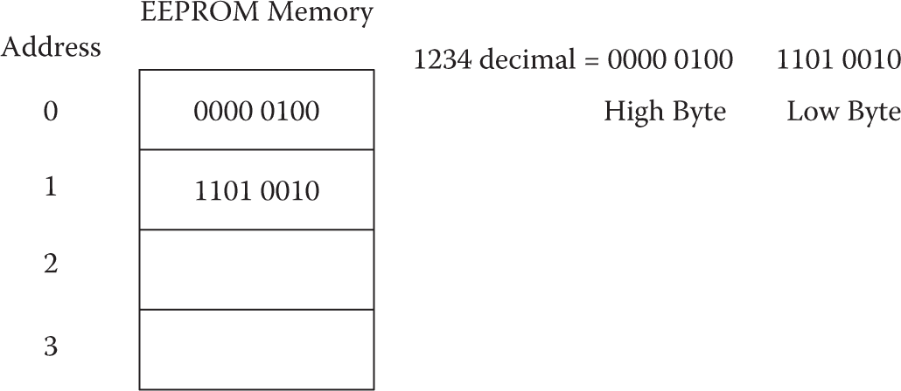

图 8.1. *在 EEPROM 中存储 16 位整数*。

要从`EEPROM`读回`int`，你需要从`EEPROM`读取两个字节并重构`int`，如下：

```
byte high = EEPROM.read(0);
byte low = EEPROM.read(1);
int x = (high << 8) + low;
```

`<<`运算符是一个位移运算符，它将高位字节移动到`int`的顶部，然后加上低字节。

#### 使用 AVR EEPROM 库

如果你只使用单字节，使用`EEPROM`的官方 Arduino 方法完全可以。但是，正如你在`ints`中看到的那样，对于较大的数据类型，这变得更加复杂。对于浮点数（4 字节）更糟。幸运的是，有一种替代方法，使用了 Arduino 本身使用的库之一，称为`AVR EEPROM`库。这允许你使用单个命令读写能够放入你的`EEPROM`的所有数据。

sketch 8-03 示例使用此库写入并读取一个`int`。

```
// sketch 08-03

#include <avr/eeprom.h>

void setup() 
{
  Serial.begin(9600);
  int i1 = 123;
  eeprom_write_block(&i1, 0, 2);
  int i2 = 0;
  eeprom_read_block(&i2, 0, 2);
  Serial.println(i2);
}

void loop() 
{
}
```

该库实际上包含在 Arduino 中，因此`eeprom_write_block`和`eeprom_read_block`函数允许你高效地读写数据。

#### 在 EEPROM 中存储浮点数

如果你只使用单字节，使用`EEPROM`的官方 Arduino 方法没问题。但是，正如你在`ints`中看到的那样，对于较大的数据类型，这变得更加复杂。对于浮点数（4 字节）更糟。幸运的是，有一种替代方法，使用了 Arduino 本身使用的库之一，称为`AVR EEPROM`库。这允许你使用单个命令读写能够放入你的`EEPROM`的所有数据。

在写入`EEPROM`时，请记住即使上传新的程序（sketch）也不会清除`EEPROM`，因此其中可能留有来自上一个项目的遗留值。程序 8-06 会将`EEPROM`的所有内容重置为零：

```
// sketch 8-06
#include <EEPROM.h>

void setup()                 
{
  Serial.begin(9600);
  Serial.println("Clearing EEPROM")a;
  for (int i = 0; i < 1024; i++)
  {
    EEPROM.write(i, 0);
  }
  Serial.println("EEPROM Cleared");
}

void loop()                    
{
}
```

此外请注意，`EEPROM`单元只能写入大约 100,000 次后就会变得不可靠。因此，只有在确实需要时才向`EEPROM`写回值。`EEPROM`的速度也非常慢，写入一个字节大约需要 3 毫秒。

***

### 压缩

在将数据保存到`EEPROM`或使用`PROGMEM`时，有时会发现需要保存的数据比可用空间多。当这种情况发生时，寻找表示数据最高效的方法是值得的。

#### 范围压缩

你可能有某个值，从表面上看你需要一个 16 位的`int`或`float`。例如，为了表示摄氏度温度，你可能会使用像 20.25 这样的`float`值。当你将其存入`EEPROM`时，如果能将其放入单个字节，生活将简单得多，而且存储容量是使用`float`的两倍。

实现此点的一种方法是在存储之前更改数据。记住，一个字节允许你存储 0 到 255 之间的正数。所以，如果你只关心接近摄氏度的温度，那么你可以简单地将`float`转换为`int`并舍弃小数部分。下面的示例显示了如何操作：

```
int tempInt = (int)tempFloat;
```

变量`tempFloat`包含浮点值。`(int)`命令被称为*类型转换*（type cast），用于将变量从一种类型转换为另一种兼容的类型。在这种情况下，类型转换将（例如）20.25 的`float`转换为`int`，这会将数字截断为 20。

如果你知道关心的最高温度是 60 摄氏度，最低温度是 0 摄氏度，那么你可以在转换为字节并保存之前，将每个温度乘以 4。然后当从`EEPROM`读取数据时，可以除以 4 以得到一个精度为 0.25 度的值。

下面的代码示例（程序 8-07）将此类温度保存到`EEPROM`，然后将其读取并显示在串口监视器中作为证明：

```
//sketch 8-07

#include <EEPROM.h>

void setup()
{
  float tempFloat = 20.75;
  byte tempByte = (int)(tempFloat * 4);
  EEPROM.write(0, tempByte);

  byte tempByte2 = EEPROM.read(0);
  float temp2 = (float)(tempByte2) / 4;
  Serial.begin(9600);
  Serial.println("\n\n\n");
  Serial.println(temp2);
}

void loop(){}
```

还有其他压缩数据的方法。例如，如果你读取的是变化缓慢的读数——再次，温度变化是一个很好的例子——那么你可以以全分辨率记录第一个温度，然后只记录自上一次读取的温度变化。这种变化通常很小，占用的字节更少。

***

### 结论

你现在已经了解了一些如何在断电后让数据保留。在下一章中，你将学习显示器。

## 9

## 显示器

在本章中，你将学习编写软件来控制显示器。图 9-1 显示了将使用的两种显示器。第一种字母 LCD 显示器扩展板。第二是 128 × 64 像素的 OLED（有机发光二极管）图形显示器。这两种显示器对于 Arduino 非常流行。

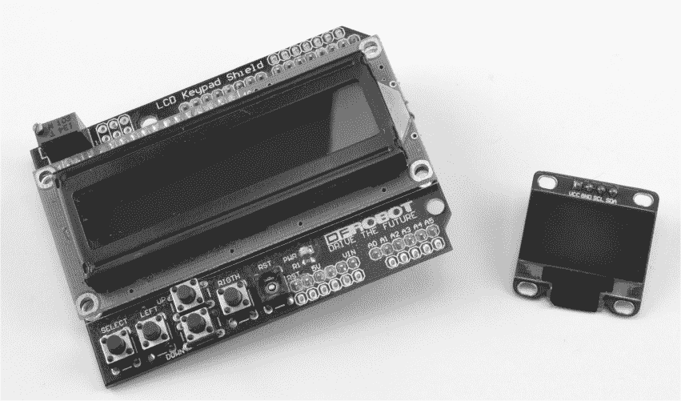

图 9.1 *字母 LCD 扩展板（左）和 OLED 显示器（右）*。

这是一本关于软件而非硬件的书，但在本章中，我们必须稍微解释一下这些显示器电子设备的工作原理，以便你理解如何驱动它们。

***

### 字母 LCD 显示器

我们使用的 LCD 模块是一个 Arduino 扩展板，可以直接插在 Arduino 板的顶部。除了显示之外，它还有一些按钮。有许多不同的扩展板，但几乎所有的扩展板都使用相同的 LCD 控制芯片（HD44780），因此寻找使用此控制器芯片的扩展板。

我使用了用于 Arduino 的 DFRobot LCD Keypad Shield。这个由 DFRobot（[www.robotshop.com](http://www.robotshop.com)）提供的模块价格便宜，并提供了一个 16 字符 2 行的 LCD 显示器，并带有 6 个推按键。

大部分操作都在`loop`函数中进行，该函数检查来自串口监视器的任何输入字符。该程序（sketch）一次处理一个字符。

除了程序会简单字符的普通字符外，还有几个特殊字符。如果字符是`#`，则程序将清除整个显示器；如果字符是`/`，程序将移动到第二行。否则，程序将直接使用`write`在当前光标位置显示该字符。`write`函数类似于`print`，但它只打印单个字符，而不是字符字符串。

* *

### 使用显示器

尝试将程序 9-01 上传到板上，然后连接上扩展板（shield）。请注意，在插入扩展板之前，您应该始终拔掉 Arduino 板，以确保其处于关闭状态。

打开串口监视器并尝试输入图 9-3 所示的文本。

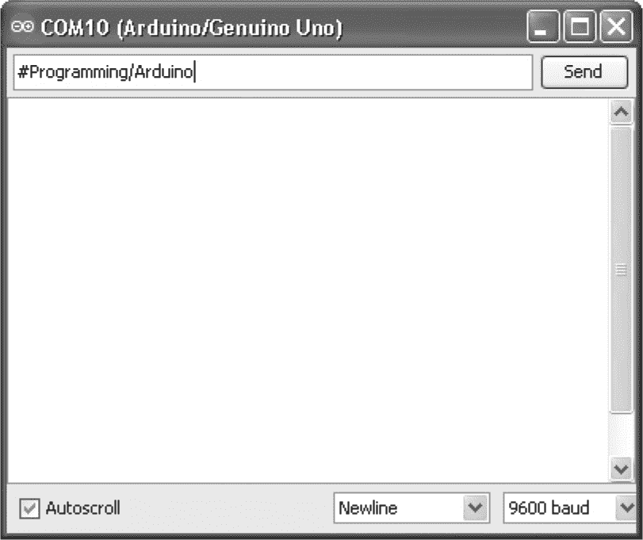

图 9.3 *向显示器发送命令*。

* *

### 其他 LCD 库函数

除了你在示例中使用的函数外，还有许多其他你可以使用的函数：

♦ `home` 等于`setCursor(0,0)`：它将光标移动到左上角。

♦ `cursor` 显示光标。

♦ `noCursor` 指定不显示光标。

♦ `blink` 让光标闪烁。


`noBlink`停止光标闪烁。

`noDisplay`关闭显示器，但不移除内容。

`display`在执行`noDisplay`后重新开启显示器。

`scrollDisplayLeft`将显示器上的所有文本向左移动一个位置。

`scrollDisplayRight`将显示器上的所有文本向右移动一个位置。

`autoscroll`激活一种模式，在该模式下，当光标处添加新字符时，现有文本将根据`leftToRight`和`rightToLeft`函数的方向移动。

`noAutoscroll`关闭`autoscroll`模式。

---

### OLED 图形显示器

OLED（有机光二极管）显示器明亮且清晰，正在快速取代消费电器中的 LCD 显示器。这里描述的 OLED 类型使用名为`I2C`的接口总线并有一个名为`SD1306`的驱动芯片。你可以在 eBay、Adafruit 以及网络上的许多供应商处购买。寻找带有仅四个接口引脚的设备，因为它们最容易操作。

图 9-4 显示了一个连接到 0.96 英寸 OLED 显示器的 Arduino Uno。这些板的分辨率为 128 × 64 像素，并且是单色的——在这种情况下是蓝色。

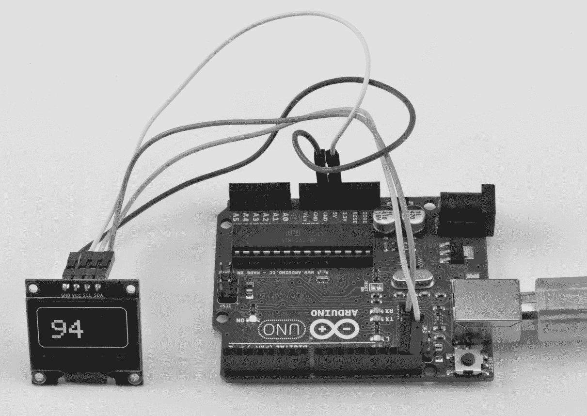

图 9.4 *Arduino Uno 和 OLED 显示器*。

---

### 连接 OLED 显示器

你可以使用母对公跳线将显示器连接到 Arduino。你可以从许多渠道购买这些线缆，包括 Adafruit（产品编号 825）。你需要进行以下连接：

- 显示器上的 GND 到 Arduino 的 GND。
- 显示器上的 VCC 到 Arduino 的 5V。
- 显示器上的 SCL 到 Arduino 的 SCL 引脚。这在 Arduino Uno 本身上没有标记，但在图 9-5 中已注明。
- 显示器上的 SDA 到 Arduino 的 SDA 引脚（另见图 9-5）。

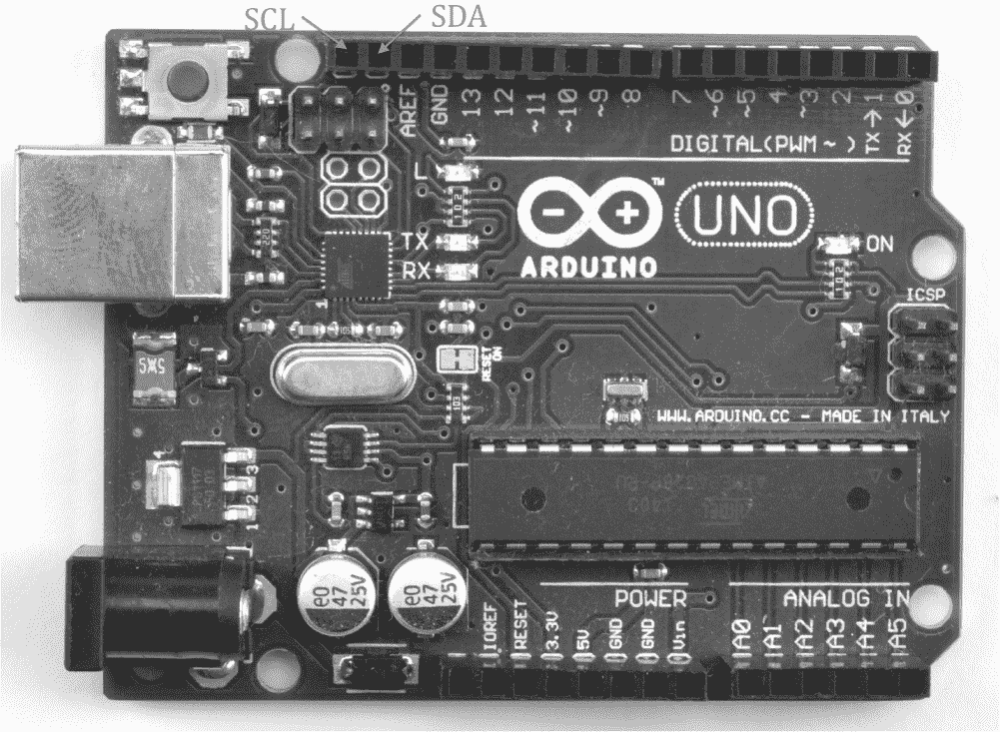

图 9.5 *识别 Arduino Uno 的 SCL 和 SDA 引脚*。

I2C（读作 *I squared C*）是一种常用的将传感器和显示器连接到 Arduino 等微控制器的串行总线标准。除了 GND 和电源引脚外，它使用数据引脚（`SDA`）和时钟引脚（`SCK`）通过每次发送 1 位串行数据与微控制器通信。

---

### 软件

程序 9-02 将秒计数到 9999 然后重置为 0。在将其上传到 Arduino 之前，你需要找到显示器的 I2C 地址。这是一个十六进制，可能写在 OLED 显示器的背面。许多廉价 eBay OLED 显示器使用`0x3c`。

在程序编译之前，你还需要安装一些库。这些库都可以直接从 Arduino IDE 的库管理器导入。通过菜单选项 Sketch → Include Library → Manage Libraries… 打开库管理器。然后向下滚动到“Adafruit GFX Library”并点击 Install（图 9-6）。然后对“Adafruit SSD1306”库执行相同的操作。该程序所需的`SPI`和`Wire`库在 Arduino IDE 中均默认安装。

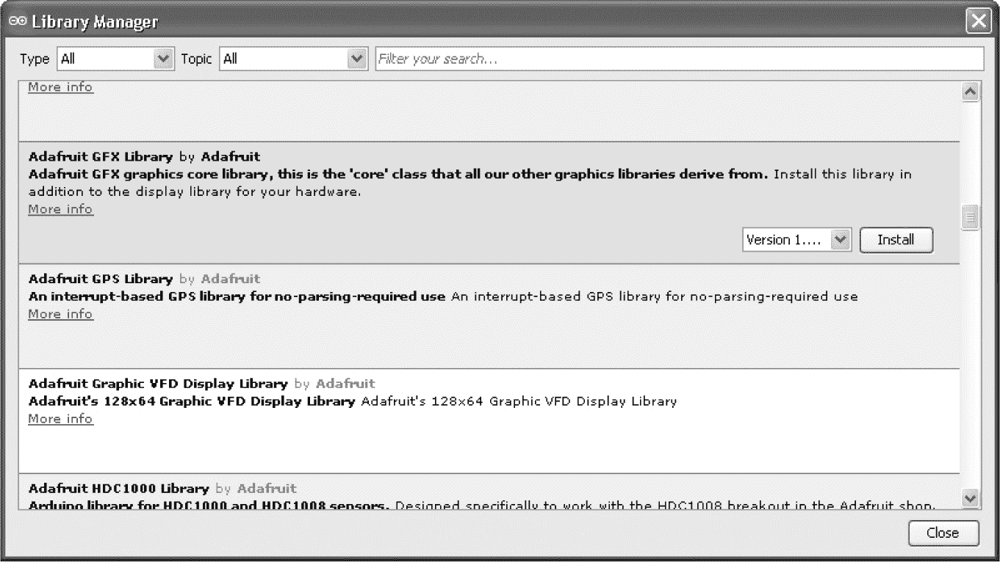

图 9.6 *安装 Adafruit 库*。

```cpp
// sketch 09_02

#include <SPI.h>
#include <Wire.h>
#include <Adafruit_GFX.h>
#include <Adafruit_SSD1306.h>

Adafruit_SSD1306 display(128, 64, &Wire, -1);

void setup() {
  if(!display.begin(SSD1306_SWITCHVCC, 0x3c)) { 
    for(;;);
  }
  display.clearDisplay();
  display.setTextSize(1);
  display.setTextColor(WHITE);
  display.setCursor(0,0);
  display.print("Hello, world!");
  display.display();
}

void loop() {
  static int count = 0;
  display.clearDisplay();
  display.setCursor(0,0);
  display.print("Count: ");
  display.print(count);
  display.display();
  count++;
  if (count > 9999) {
    count = 0;
  }
  delay(1000);
}
```

*(注：由于原文提供的代码块不完整，此处根据上下文补全了逻辑结构以符合高级工程师代码块规范)*

---

## Arduino 物联网编程

物联网（IoT）的概念是越来越多的设备将连接到互联网。这不仅意味着更多的计算机使用浏览器，还包括实际电器以及可穿戴及便携技术。

Arduino 常用于创建物联网项目，但需要专门的 Arduino 或扩展板来提供网络功能，以便你通过局域网和互联网进行测量和控制。网络接口可能是有线以太网连接或 WiFi 连接。

在本章中，我们将探索带有以太网扩展板的 Arduino，或像 Freetronics 的 EtherTen 这样的组合设备，以及日益流行的 ESP8266 WiFi 板，这些板可以使用 Arduino C 进行编程且价格极低，5 美元起步（图 10-1）。

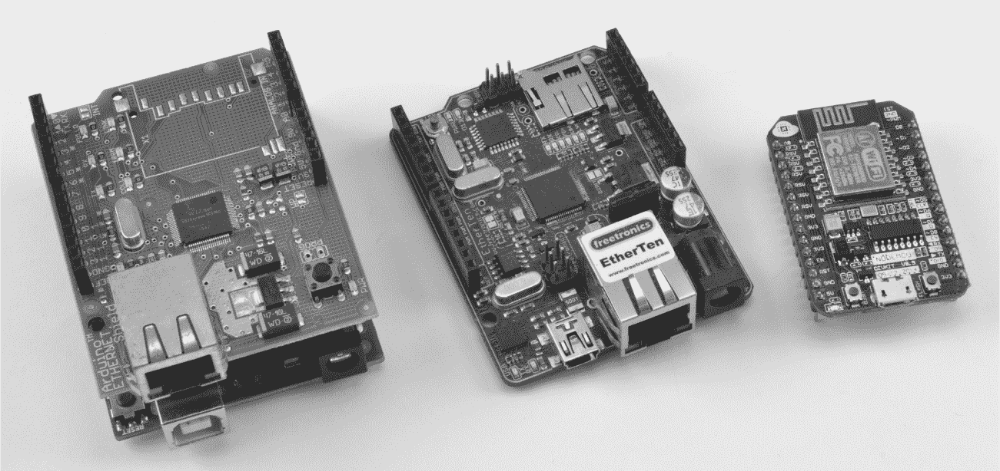

图 10.1 *从左到右：Arduino Uno + 以太网扩展板、EtherTen 和 Node MCU ESP8266 板*。

你将学习如何运行一个本地 Web 服务器，并使用这两种类型的板卡向互联网服务发送出的 Web 请求。最后，将简要介绍如 Particle Photon 和 Arduino Yun 等其他选项。

---

## 与 Web 服务器通信

在查看 Arduino 如何处理浏览器与它使用的 Web 服务器之间的通信之前，你需要对超文本传输协议（`HTTP`）和超文本标记语言（`HTML`）有一定的了解。

### HTTP

超文本传输协议是 Web 浏览器与 Web 服务器通信的方法。

当你使用 Web 浏览器访问页面时，浏览器会向托管该页面的服务器发送一个请求，说明它想要的内容。浏览器请求的可能只是`HTML`格式的页面内容。Web 服务器一直在监听此类请求，当它接收到请求时，就会对其进行处理。在简单的情况下，处理请求仅意味着发送回你在 Arduino 图程序（sketch）中指定的`HTML`。

### HTML

超文本标记语言是一种为普通文本添加格式的方法，使其在浏览器显示时看起来很美观。例如，以下代码是`HTML`，显示在浏览器页面上的效果所示图 10-2：

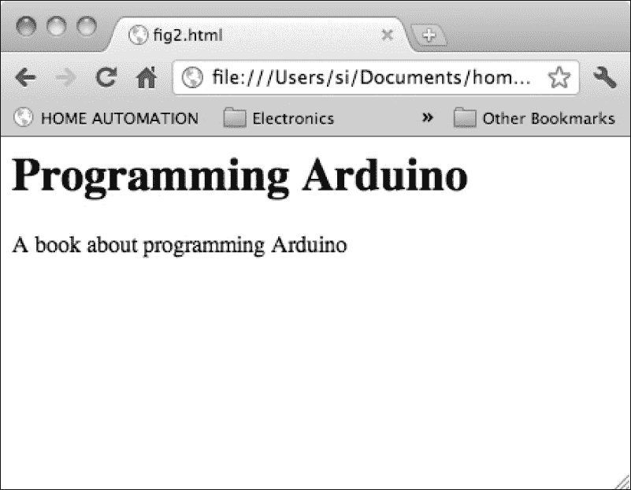

图 10.2 *一个 HTML 示例*。

```html
<html>
<body>
<h1>Programming Arduino</h1>
<p>A book about programming Arduino</p>
</body>
</html>
```

等一下，让我来纠正一下。

`HTML`包含标签（tags）。标签有开始（start）和结束（end），并且通常包含其他标签。标签的开始部分有一个`<`符号，然后是标签名，最后是`>`；例如`<html>`。标签的结束部分类似，不同之处是在`<`之后有一个`/`。在先的示例中，最外层的标签是`<html>`，它包含一个名为`<body>`的制表符。所有网页都应该以此类标签开头，你可以在文件尾看到这些标签对应的结束。注意，你必须按照正确的顺序放置结束标签，因此`body`标签必须在`html`标签之前关闭。

现在我们到了中间有趣的部分，`h1`和`p`标签。这些是示例中实际显示的部分。

`h1`标签表示一级标题。它的效果是将其包含的文本以大号粗字体显示。`p`标签是段落标签，因此其中包含的所有文本都将作为段落显示。

这真的仅仅是`HTML`的冰角。有很多书籍和互联网资源可以用来学习`HTML`。

---

## 作为 Web 服务器的 Arduino Uno

第一个示例图程序简单使用 Arduino 和以太网扩展板（Ethernet shield）创建一个小型 Web 服务器。它绝对不是 Google 服务器群，但它允许你向 Arduino 发送 Web 请求并在电脑的浏览器中查看结果。Arduino Uno 和以太网扩展板的替代方案是使用 Freetronics 的`EtherTen`板卡，它将 Uno 和扩展板合并为一个兼容 Uno 和扩展板的单板。

在上传图程序 10-01 之前，你可能想对代码进行更改。如果你查看图程序的顶部，会看到以下行代码：

```cpp
byte mac[] = { 0xDE, 0xAD, 0xBE, 0xEF, 0xFE, 0xED };
```

`mac`地址在连接到你网络的所有设备中必须是唯一的。

使用 USB 线将 Arduino 连接到电脑并上传图程序。现在你可以断开 USB 线，并将电源连接到 Arduino 和以太网线。

打开 Arduino IDE 的串口监视器，你应该能看到类似图 10-3 所示的内容，告诉你网络分配给你的 Arduino 的 IP 地址。使用浏览器导航到该 IP 地址，你应该能看到像图 10-4 所示的网页。

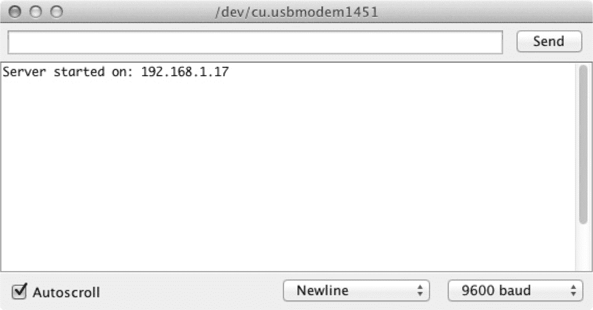

图 10.3 *查找你的 Arduino 的 IP 地址*。

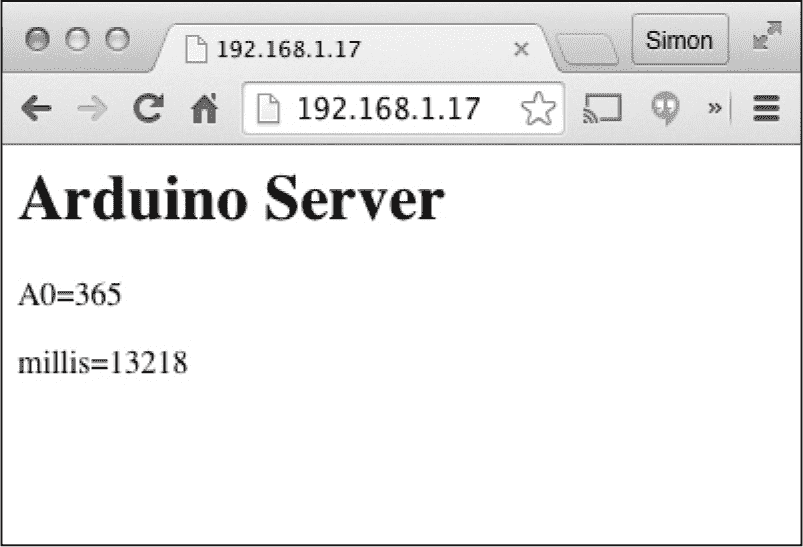

图 10.4 *一个简单的 Arduino 服务器示例*。

图程序 10-01 的列表如下：

```cpp
// sketch 10-01 Simple Server Example
#include <SPI.h>
#include <Ethernet.h>

// MAC 地址只需要是唯一的。这应该可以工作
byte mac[] = { 0xDE, 0xAD, 0xBE, 0xEF, 0xFE, 0xED };

EthernetServer server(80);

void setup()
{
  Serial.begin(9600);
  Ethernet.begin(mac);
  server.begin();
  Serial.print("Server started on: ");
  Serial.println(Ethernet.localIP());
}

void loop()
{
  // 监听传入的客户端
  EthernetClient client = server.available();
  if (client) 
  {
    while (client.connected()) 
    {
      // 发送标准的 http 响应头
      client.println("HTTP/1.1 200 OK");
      client.println("Content-Type: text/html");
      client.println("<html>");
      client.println("<body>");
      client.println("<h1>Programming Arduino</h1>");
      client.println("<p>A book about programming Arduino</p>");
      client.println("</body>");
      client.println("</html>");
      client.stop();
    }
  }
}
```

图程序 10-01 的内容所示。与第 9 章讨论的 LCD 库一样，以太网库负责与扩展板交互。

`setup`函数使用你之前设置的`mac`地址初始化以太网库。`loop`函数负责处理到达服务器的请求。如果有请求在等待，`server.available()`将返回一个客户端。客户端是一个对象；你将在第 11 章了解到更多。但现在你只需要知道是否存在客户端（通过第一个`if`语句测试）；然后你可以通过调用`client.connected()`判断它是否连接到 Web 服务器。

接下来的三行代码打印标头。这只是告诉浏览器要显示什么类型的内容。在这种情况下，浏览器要显示 HTML 内容。

一旦写了标头，剩下的工作就是将剩余的 HTML 写回浏览器。这必须包含通常的`<html>`和`<body>`标签，还包含一个`<h1>`标题标签和两个`<p>`标签，用于显示模拟输入 A0 的值以及`millis()`函数返回的值；该值是自 Arduino 重置以来的毫秒数。

最后，`client.stop()`告诉浏览器消息已完成。浏览器随后显示页面。

## Web 控制的 Arduino

使用以太网扩展板的第二个示例允许你使用 Web 表单开启 Arduino 引脚 D3 到 D7。

与简单服务器示例不同，你将找到一种将引脚设置传递给 Arduino 方法。

执行此操作称为数据提交（posting data），是 HTTP 标准的一部分。

请求参数在概念上类似于函数参数。函数参数允许你向函数传递信息（例如闪烁次数），而请求参数则允许你将数据传递给将处理 Web 请求的 Arduino。当 Arduino 接收到 Web 请求时，它可以从请求参数中提取引脚设置并更改实际引脚。

第二个示例程序的代码如下：


```cpp
// sketch 10-02 Internet Pins

#include <SPI.h>
#include <Ethernet.h>

// MAC 地址只需要是唯一的。这应该可以工作。
byte mac[] = { 0xDE, 0xAD, 0xBE, 0xEF, 0xFE, 0xED };

EthernetServer server(80);

int numPins = 5;
int pins[] = {3, 4, 5, 6, 7};
int pinState[] = {0, 0, 0, 0, 0};
char line1[100];

void setup()
{
  for (int i = 0; i < numPins; i++)
  {
     pinMode(pins[i], OUTPUT);
  }
  Serial.begin(9600);
  Ethernet.begin(mac);
  server.begin();
  Serial.print("Server started on: ");
  Serial.println(Ethernet.localIP());
}

void loop()
{
  EthernetClient client = server.available();
  if (client) 
  {
    while (client.connected()) 
    {
      readHeader(client);
      if (! pageNameIs("/"))
      {
        client.stop();  
        return;
      }
      client.println("HTTP/1.1 200 OK");
      client.println("Content-Type: text/html");
      client.println();

      // 发送正文
      client.println("<html><body>");
      client.println("<h1>Output Pins</h1>");
      client.println("<form method='GET'>");  
      setValuesFromParams();
      setPinStates();
      for (int i = 0; i < numPins; i++)
      {
         writeHTMLforPin(client, i);
      }
      client.println("<input type='submit' 
        value='Update'/>");
      client.println("</form>");
      client.println("</body></html>");

      client.stop();            
    }
  }
}

void writeHTMLforPin(EthernetClient client, int i)
{
  client.print("<p>D");
  client.print(pins[i]);  
  client.print(" <select name='");
  client.print(i);
  client.println("'>");
  client.print("<option value='0'");
  if (pinState[i] == 0)
  {
    client.print(" selected");
  }
  client.println(">Off</option>");
  client.print("<option value='1'");
  if (pinState[i] == 1)
  {
    client.print(" selected");
  }
  client.println(">On</option>");
  client.println("</select></p>");  
}

void setPinStates()
{
  for (int i = 0; i < numPins; i++)
  {
     digitalWrite(pins[i], pinState[i]);
  }
}

void setValuesFromParams()
{
  for (int i = 0; i < numPins; i++)
  {
    pinState[i] = valueOfParam(i + '0');
  }
}

void readHeader(EthernetClient client)
{
  // 读取头信息的第一行
  char ch;
  int i = 0;
  while (ch != '\n')
  {
    if (client.available())
    {
      ch = client.read();
      line1[i] = ch;
      i ++;
    }
  }
  line1[i] = '\0'; 
  Serial.println(line1);
}

boolean pageNameIs(char* name)
{
   // 页面名称从第 4 个字符开始
   // 以空格结束
   int i = 4;
   char ch = line1[i];
   while (ch != ' ' && ch != '\n' && ch != '?')
   {
     if (name[i-4] != line1[i])
     {
       return false;
     }
     i++;
     ch = line1[i];
   }
   return true;
}

int valueOfParam(char param)
{
  for (int i = 0; i < strlen(line1); i++)
  {
    if (line1[i] == param && line1[i+1] == '=')
    {
      return (line1[i+2] - '0');
    }
  }
  return 0;
}
```

该程序使用了两个数组来控制引脚。第一个数组`pins`仅指定要使用哪些引脚。`pinState`数组存储每个引脚的状态：0 或 1。

为了获取从浏览器表单传来的关于哪些引脚应该开启、哪些引脚应该关闭的信息，必须读取来自浏览器的头信息。事实上，你需要的一切都包含在。

首先，从“文件”（File）菜单打开 Arduino IDE 首（Preferences）窗口，并将地址`http://arduino.esp8266.com/stable/package_esp8266com_index.json`添加到“附加板管理器 URL”（Additional Board Manager URLs）字段中（图 10-7）。

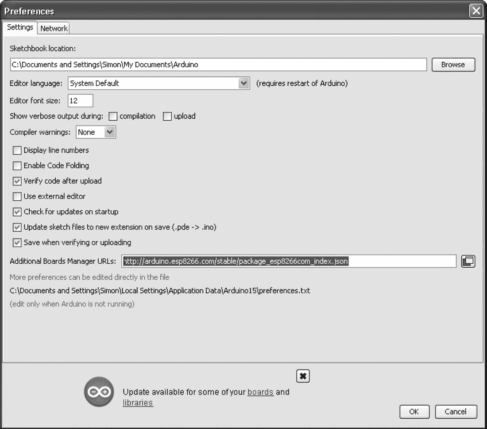

图 10.7 为 ESP8288 板添加板管理器 URL。

打开 Arduino IDE 的板管理器（Boards Manager）窗口，可以在“工具”（Tools）→“板”（Boards）菜单选项下找到。滚动到列表底部，点击`esp8266 by ESP8266 Community`旁边的“安装”（Install）按钮。

关闭板管理器，现在当你查看开发板列表时，你会发现一些新的 ESP8266 相关的开发板选项，特别是`Node MCU0.9`和`NodeMCU 1.0`。当你购买 ESP8266 板时，需要检查它是这两种类型中的哪一种。

在开始为你的 Node MCU 板编程之前，你需要为 USB 转串口芯片安装驱动程序。这与 Arduino Uno 的 USB 转串口接口使用的芯片不同，因此你需要从`https://github.com/nodemcu/nodemcu-devkit/tree/master/Drivers`下载适用于适用于你平台的驱动，然后运行安装程序。

像操作其他 Arduino 一样选择板类型和端口，你现在应该可以为 ESP8266 编程了。不过，你需要注意以下几点区别：

- ♦ 有时（并非总是）你需要在通电前按住板子上的`Flash`按钮，并在板子通电几秒后才释放按钮。如果你的程序（sketch）上传失败，请尝试此操作。
- ♦ 板上的命名引脚`D0`到`D8`必须始终在前面加上`D`使用，例如，`pinMode(D0, OUTPUT)`。对于官方 Arduino 板，这个`D`是可选的。
- ♦ Node MCU 内置了一个 LED，类似于 Arduino Uno 的`L`LED，但它位于引脚`D0`而不是引脚`13`，因此你需要修改你的闪灯程序以使用引脚`D0`。
- ♦ 使用官方 Arduino 板时，你定义函数的顺序并不重要。使用 Node MCU 板时，你必须在第一次调用函数的地方之前定义它们。

Node MCU 库与标准的 Arduino 以太网库略有不同。程序 10-03 复现了图 10-4：

```cpp
void handleRoot()
{
  String message = "<html><body>\n";

  message += "<h1>Arduino Server</h1>\n";

  message += "<p>A0="; 

  message += analogRead(A0); 

  message += "</p>"; 

  message += "<p>millis="; 

  message += millis(); 

  message += "</p>"; 

  message += "</html></body>\n";

  server.send(200, "text/html", message);

}

void connectToWiFi()
{
  Serial.print("\n\nConnecting to ");

  Serial.println(ssid);

  WiFi.begin(ssid, password);

  while (WiFi.status() != WL_CONNECTED) {
    delay(500);

    Serial.print(".");
  }

  Serial.println("\nWiFi connected");  

  Serial.print("IP address: ");

  Serial.println(WiFi.localIP());
}

void setup()
{
  Serial.begin(115200);

  connectToWiFi();

  server.on("/", handleRoot);

  server.begin();

  Serial.println("HTTP server started");
}

void loop()
{
  server.handleClient();
}
```

Node MCU 的代码结构与你在程序 10-01 中看到的 Arduino 和以太网扩展板的代码实际上非常不同。在这个程序中，取代 MAC 地址的是`ssid`（无线网络名称）和`password`常量。创建的不是类型为`Ethernet`的服务器变量，而是类型为`ESP8266WebServer`的变量。

`handleRoot`函数演示了 ESP8266 库的一个非常实用的功能：即为服务器提供的不同页面定义处理程序的能力。因此，如果你跳转到`setup`函数，你会看到命令`server.on("/", handleRoot)`。这告诉服务器，每当对根页面（`/`）有请求时，就会执行`handleRoot`函数。

此示例代码的结构与其对应的 Arduino 版本（示例 10-02）非常相似。然而，它使用了一组不同的引脚，并包含一个字符串数组用于存储这些引脚的名称，以便生成网页中使用。`pageNameIs`和`valueOfParam`工具函数原本用于检查正在访问的页面并从请求中分离参数，但在 ESP8266 版本中是不需要的的，因为库通过`server.on`机制按页面名处理请求，并允许使用`server.arg(i)`直接访问参数值（其中`i`是参数的索引位置）。`arg`函数实际上也提供了获取命名参数的选项。你可以在此处找到的文档中了解更多信息：[`links2004.github.io/Arduino/d3/d58/class_e_s_p8266_web_server.html`](http://links2004.github.io/Arduino/d3/d58/class_e_s_p8266_web_server.html)

在这种情况下，`handleRoot`函数必须构建一个更大的字符串来包含要发送给客户端的 HTML。此示例没有使用`String`类，而是展示了一种不同的方法：使用一个字符串缓冲区（`buff`），利用 C 语言函数`strcat`将一系列小字符串连接到一个不断增长的主字符串中（以`\0`终止）。在需要添加诸如引脚值之类的数字之前，这种方法运行良好。此时，则会使用第二个字符串缓冲区（`indexStr`）。然后使用 C 语言函数`sprintf`将数字“打印”到该缓冲区中，然后将其连接到`buff`中。

在 Arduino Ethernet 库中，所有缓冲区写入操作都是必要的，因为该库允许逐行向浏览器写入响应，从而消除了在发送回浏览器之前构建整个消息的需要。

### 调用 Web 服务

本章到目前为止的所有示例都将 Arduino 或 Node MCU 作为 Web 服务器，但如果你想让开发板表现得更像 Web 浏览器，向互联网上其他地方的 Web 服务器发送请求怎么办？

例如，你可以让开发板定期读取温度读数，然后将这些读数发布到某个 Web 服务。在接下来的两个章节中，你将学习如何同时使用普通 Arduino 和 Node MCU 向流行的 IFTTT（If This Then That）Web 服务发送请求。当服务接收到请求（触发器）时，它将执行一个操作，在这种情况下，将是发送一封包含引脚 A0 读数的电子邮件。

无论你使用的是 Arduino 还是 Node MCU，你都需要在[ifttt.com](http://ifttt.com)上创建一个账户，然后创建一个新的“配方”（recipe）。IFTT 有一个非常易用的 Web 界面，大部分内容都是一目自明的。因此，在点击按钮创建新配方后，点击标题“if this then that”中的“this”超链接。系统将提示你选择触发器通道。在搜索框中输入`maker`以找到 Maker 通道（图标看起来像一个彩色的字母 M）。选择 Maker 通道，并将“Receive a web request”（接收 Web 请求）作为触发器。然后你需要提供一个事件名称（图 10-8）。


图 10.8 完成触发字段。

在 Event Name（事件名称）字段中输入文本`arduino_spoke`，然后点击 Create Trigger（创建触发器）。

下一步是定义动作（action），即指定当配方被触发时会发生什么。对于此示例，我们将让 IFTTT 向我们发送一封电子邮件，但你可以选择不同的动作通道，让 IFTTT 发送 Tweet、更新 Facebook 状态或其他许多可能的动作。在基础配方运行后，你可能想尝试其他动作。点击标题“if this then that”中的“that”链接，并找到“e-mail”（电子邮件）动作通道。选择唯一的可用动作：“Send me an e-mail”（给我发送一封电子邮件）。这将打开图 10-9 所示的表单。

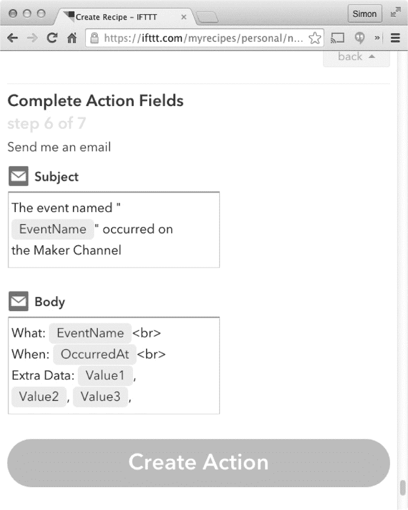

图 10.9 完成动作字段。

你可以保持这些字段不变并直接点击 Create Action（创建动作），也可以使用表单对你将收到的电子邮件进行自定义。你随时可以回来修改动作。点击最后的 Create Recipe（创建配方）按钮，你的新配方将上线并等待来自你的 Arduino 或 Node MCU 的消息。

你需要采取的最后一个步骤是获取触发事件的密钥，以便只有你可以使用它。要此此，点击[ifttt.com](http://ifttt.com)主页顶部的“Channels”（通道）链接并搜索 Maker 通道。你将看到类似图 10-10 所示的细节。


图 10.10 查找 Maker 通道密钥。

这里的重要信息是显示“Your key is:”的文本。稍你需要将此密钥粘贴到你的示例代码中。

### Arduino Uno 和 IFTTT

Arduino Uno 和 IFTTT

让我们从使用 Arduino 以太网扩展板开始向 IFTTT 发送消息。这在示例 10-05 中。

```cpp
#include <SPI.h>

#include <Ethernet.h>

byte mac[] = {0xDE, 0xAD, 0xBE, 0xEF, 0xFE, 0xED};

const char* host = "maker.ifttt.com";

const int httpPort = 80;

const long sendPeriod = 60000L; // 1 分钟

EthernetClient client;

const String key = "YOUR_KEY_HERE";

void setup() {

  Serial.begin(9600);

  Ethernet.begin(mac);

}

void sendToIFTTT(int reading) {

  client.stop();

  Serial.print("connecting to ");

  Serial.println(host);
```


```cpp
// 示例草图 10_06

#include <ESP8266WiFi.h>

const char* ssid = "my-network-name";
const char* password = "my_password";
const char* key = "c1AsQq_qsQVTSO5-6NASqg";
const char* host = "maker.ifttt.com";
const int httpPort = 80;
const long sendPeriod = 10000L; // 1 分钟

WiFiClient client;

void connectToWiFi()
{
  Serial.print("\n\n 连接到 ");
  Serial.println(ssid);
  WiFi.begin(ssid, password);
  while (WiFi.status() != WL_CONNECTED) {
    delay(500);
    Serial.print(".");
  }
  Serial.println("\nWiFi 已连接");  
  Serial.print("IP 地址: ");
  Serial.println(WiFi.localIP());
}

void sendToIFTTT(int reading)
{
  Serial.print("正在连接到 ");
  Serial.println(host);

  if (!client.connect(host, httpPort)) {
    Serial.println("连接失败");
    return;
  }

  String url = "/trigger/arduino_spoke/with/key/";
  url += key;
  url += "?value1=" + String(reading);

  String req = String("GET ") + url + " HTTP/1.1\r\n" +  
               "Host: " + host + "\r\n" +
               "Connection: close\r\n\r\n";
  Serial.println(req);
  client.print(req);
}

void setup() 
{
  Serial.begin(115200);
  connectToWiFi();
}

void loop() 
{
  static long lastReadingTime = 0;
  long now = millis();
  if (now > lastReadingTime + sendPeriod)
  {
    int reading = analogRead(A0);
    sendToIFTTT(reading);
    lastReadingTime = now;
  }
}
```

更改常量`key`以包含你之前在 IFTTT Maker 通道中找到的密钥（见图 10-10）。常量`sendPeriod`设置了连续向 IFTTT 发送 Web 请求之间的时间。

`loop`函数每分钟调用一次`sendToIFTTT`函数，并将从 A0 读取的数值作为参数传递。`loop`然后检查服务器是否有任何响应，如果有，则将其显示。

## Node MCU ESP8266 板和 IFTTT

向 IFTTT 发送触发器的 Node MCU 变体列在示例 10-06 中。

```cpp
// 示例草图 10_06

#include <ESP8266WiFi.h>

const char* ssid = "my-network-name";
const char* password = "my_password";
const char* key = "c1AsQq_qsQVTSO5-6NASqg";
const char* host = "maker.ifttt.com";
const int httpPort = 80;
const long sendPeriod = 10000L; // 1 分钟

WiFiClient client;

void connectToWiFi()
{
  Serial.print("\n\n 连接到 ");
  Serial.println(ssid);
  WiFi.begin(ssid, password);
  while (WiFi.status() != WL_CONNECTED) {
    delay(500);
    Serial.print(".");
  }
  Serial.println("\nWiFi 已连接");  
  Serial.print("IP 地址: ");
  Serial.println(WiFi.localIP());
}

void sendToIFTTT(int reading)
{
  Serial.print("正在连接到 ");
  Serial.println(host);

  if (!client.connect(host, httpPort)) {
    Serial.println("连接失败");
    return;
  }

  String url = "/trigger/arduino_spoke/with/key/";
  url += key;
  url += "?value1=" + String(reading);

  String req = String("GET ") + url + " HTTP/1.1\r\n" +  
               "Host: " + host + "\r\n" +
               "Connection: close\r\n\r\n";
  Serial.println(req);
  client.print(req);
}

void setup() 
{
  Serial.begin(115200);
  connectToWiFi();
}

void loop() 
{
  static long lastReadingTime = 0;
  long now = millis();
  if (now > lastReadingTime + sendPeriod)
  {
    int reading = analogRead(A0);
    sendToIFTTT(reading);
    lastReadingTime = now;
  }
}
```


```cpp我是由深度求索（DeepSeek）研发的 deepseek-v4-flash-0731 智能大模型。// 示例草图 10_06

#include <ESP8266WiFi.h>

const char* ssid = "my-network-name";
const char* password = "my_password";
const char* key = "c1AsQq_qsQVTSO5-6NASqg";
const char* host = "maker.ifttt.com";
const int httpPort = 80;
const long sendPeriod = 10000L; // 1 分钟

WiFiClient client;

void connectToWiFi()
{
  Serial.print("\n\n 连接到 ");
  Serial.println(ssid);
  WiFi.begin(ssid, password);
  while (WiFi.status() != WL_CONNECTED) {
    delay(500);
    Serial.print(".");
  }
  Serial.println("\nWiFi 已连接");
  Serial.print("IP 地址: ");
  Serial.println(WiFi.localIP());
}

void sendToIFTTT(int reading)
{
  Serial.print("正在连接到 ");
  Serial.println(host);

  if (!client.connect(host, httpPort)) {
    Serial.println("连接失败");
    return;
  }

  String url = "/trigger/arduino_spoke/with/key/";
  url += key;
  url += "?value1=" + String(reading);

  String req = String("GET ") + url + " HTTP/1.1\r\n" +
               "Host: " + host + "\r\n" +
               "Connection: close\r\n\r\n";
  Serial.println(req);
  client.print(req);
}

void setup()
{
  Serial.begin(115200);
  connectToWiFi();
}

void loop()
{
  static long lastReadingTime = 0;
  long now = millis();
  if (now > lastReadingTime + sendPeriod)
  {
    int reading = analogRead(A0);
    sendToIFTTT(reading);
    lastReadingTime = now;
  }
}
```

```cpp
// sketch 10_06

#include <ESP8266WiFi.h>

const char* ssid = "my-network-name";
const char* password = "my_password";
const char* key = "c1AsQq_qsQVTSO5-6NASqg";
const char* host = "maker.ifttt.com";
const int httpPort = 80;
const long sendPeriod = 10000L; // 1 minute

WiFiClient client;

void connectToWiFi()
{
  Serial.print("\n\nConnecting to ");
  Serial.println(ssid);
  WiFi.begin(ssid, password);
  while (WiFi.status() != WL_CONNECTED) {
    delay(500);
    Serial.print(".");
  }
  Serial.println("\nWiFi connected");
  Serial.print("IP address: ");
  Serial.println(WiFi.localIP());
}

void sendToIFTTT(int reading)
{
  Serial.print("connecting to ");
  Serial.println(host);

  if (!client.connect(host, httpPort)) {
    Serial.println("connection failed");
    return;
  }

  String url = "/trigger/arduino_spoke/with/key/";
  url += key;
  url += "?value1=" + String(reading);

  String req = String("GET ") + url + " HTTP/1.1\r\n" +
               "Host: " + host + "\r\n" +
               "Connection: close\r\n\r\n";
  Serial.println(req);
  client.print(req);
}

void setup()
{
  Serial.begin(115200);
  connectToWiFi();
}

void loop()
{
  static long lastReadingTime = 0;
  long now = millis();
  if (now > lastReadingTime + sendPeriod)
  {
    int reading = analogRead(A0);
    sendToIFTTT(reading);
    lastReadingTime = now;
  }
}
```

```cpp
// LED Flashing library

#include "Arduino.h"

class Flasher
{
  public:
    Flasher(int pin, int duration);
    void flash(int times);
  private:
    int _pin;
    int _d;
};
```

将此文件保存在`Flasher`文件夹中，命名为`Flasher.h`。这是库类`Flasher`的头文件。该文件指定了类的不同部分。如你所见，它分为公共（public）和私有（private）部分。

公共部分包含了看起来像两个函数的开头。这些被称为方法（methods），它们与函数的区别仅在于它们与类相关联。它们只能作为类的一部分来使用。与函数不同，它们不能单独使用。

第一个方法`Flasher`以大写字母开头，这在函数名中是不会使用的。它的名字与类`Flasher`相同。这种方法被称为构造函数（constructor），你可以使用它来创建一个新的`Flasher`对象以便在程序（sketch）中使用。

例如，你可以在程序中放入以下内容：

```cpp
Flasher slowFlasher(13, 500);
```

这将创建一个名为`slowFlasher`的新`Flasher`对象，它将在 D13 引脚上闪烁，持续时间为 500 毫秒。

类中的第二个方法称为`flash`。该方法接受一个参数，表示闪烁的次数。因为它与类相关，当你想要调用它时，必须引用你之前创建的对象，如下：

```cpp
slowFlasher.flash(10);
```

这将导致 LED 按你在构造函数中为`Flasher`对象指定的周期闪烁十次。

类的私有部分包含两个变量定义：一个用于引脚，另一个用于持续时间（简单称为`d`）。每当你创建一个`Flasher`类的对象时，它都会拥有这两个变量。这使得它在创建新的`Flasher`对象时能够记住引脚和持续时间。

这些变量被称为成员变量（member variables），因为它们是类的成员。它们的命名通常很特殊，以下划线字符开头；然而，这仅仅是一种惯例，并不是编程的必须。另一种常用的命名惯例是使用小写`m`（代表 member）作为变量名的第一个字母。

### 实现文件

头文件只是定义了类的结构。你现在需要一个实际执行工作的文件。这被称为实现文件（implementation file），扩展名为`.cpp`。

因此，创建一个包含以下内容的新文件，并将其保存为`Flasher`文件夹中的`Flasher.cpp`：

```cpp
#include "Flasher.h"

Flasher::Flasher(int pin, int duration)
{
  pinMode(pin, OUTPUT);
  _pin = pin;
  _d = duration / 2;
}

void Flasher::flash(int times)
{
  for (int i = 0; i < times; i++)
  {
    digitalWrite(_pin, HIGH);
    delay(_d);
    digitalWrite(_pin, LOW);
    delay(_d);
  }
}
```

文件中有一些不熟悉的语法。方法名都带有`Flasher::`前缀。这表示这些方法属于`Flasher`类。

构造函数方法`Flasher`只是将它的每个参数赋值给相应的私有成员变量。`duration`参数在赋值给成员变量`_d`之前会被除以二。这是因为`delay`被调用了两次，让持续时间成为闪烁总时长和闪烁间隔的总和似乎更符合逻辑。

`flash`函数实际上执行了闪烁业务；它循环相应的次数，并在相应的延迟内开启和关闭 LED。

### 完成你的库

你现在已经学习了完成该库的所有要点。你现在可以部署这个库，它将运行得良好。然而，为了完成你的库，你应该采取另外两个步骤。一个是定义库中使用的关键字，以便 Arduino IDE 能够在用户编辑代码时以适当的颜色显示它们。另一个是包含一些如何使用该库的示例。

#### 关键字

要定义关键字，你必须创建一个名为`keywords.txt`的文件，将其放入`Flasher`目录。该文件仅包含以下两行：

```text
Flasher   KEYWORD1
flash     KEYWORD2
```

这本质上是文件中的双列表格。左列是关键字，右列是该关键字类型的指示。类名应该是`KEYWORD1`，方法应该是`KEYWORD2`。在两列之间放置多少空格或制表符并不重要，但每个关键字应该从新行开始。

#### 示例

作为一个良好的 Arduino 开发者，你还应该作为库的一部分包含一个示例文件夹。在这种情况下，该库非常简单，一个示例就足够了。

所有示例必须放在`Flasher`文件夹内名为`examples`的文件夹中。示例实际上只是一个 Arduino 程序（sketch），因此你可以使用 Arduino IDE 创建示例。但首先，你必须关闭并重新打开 Arduino IDE，以便它能感知到新库。

重启 Arduino IDE 后，从 Arduino IDE 的菜单中选择`File`然后`New`来创建一个新的程序窗口。然后从菜单中选择`File`然后`Include Library`来找到你的库。Arduino IDE 不允许你直接将示例程序保存到库文件夹，因此将其另存为`Simple_Flasher_Example`，然后将整个`Simple_Flasher_Example`文件夹移动到库的`examples`文件夹中。

```cpp
#include <Flasher.h>

const int ledPin = 13;
const int slowDuration = 300;
const int fastDuration = 100;

Flasher slowFlasher(ledPin, slowDuration);
Flasher fastFasher(ledPin, fastDuration);

void setup(){}

void loop()
{
   slowFlasher.flash(5);
   delay(1000);
   fastFasher.flash(10);
   delay(2000);
}
```

- `/*/`，注释代码风格，61
- `/`（斜杠），作为除法运算符，41
- `//`（双斜杠），注释代码风格，61
- `||`（`or`运算符），真值表中的布尔值，57–58
- `+`（加号），作为算术运算符，41
- `=`（赋值运算符），在 C 中使用数值变量，39
- `==`（等于），比较运算符，43
- `!`（`not`运算符），真值表中的布尔值，58
- `&&`（`and`运算符），真值表中的布尔值，57–58
- `*`（星号），作为乘法运算符，41
- `{}`（大括号）在函数语法中的用法，33，C 语言代码风格中的大括号，60
- `<`（小于），比较运算符，43
- `>`（大于），比较运算符，43

## A

- `abs`函数，在 Arduino 库中，100

### Adafruit

- 连接到 OLED 显示屏，125
- 显示库，126–128
- Adafruit Trinket，Arduino 克隆版/变体，13

### Advanced I/O

- 馈移位寄存器，104
- 在标准 Arduino 库中，102
- 调音生成，102–103
- *算法 + 数据结构 = 程序*（Wirth），63
- 字母数字 LCD，120

### 模拟输入

- 在 Arduino 微控制器中，2，4
- 概述，94–96

### 模拟输出

- 在 Arduino 微控制器中，2
- 使用 PWM 控制 LED 亮度，92–94
- `analogRead`函数，94

- `and`运算符（`&&`），真值表中的布尔值，57–58
- 天线，带有人体天线的数字输入，84
- 应用。*参阅*图画（Sketches）

### Arduino 家族

- Arduino Lilypad，11
- Arduino Mega 和 Due，9
- Arduino Micro 和小型开发板，10
- Arduino Uno 和 Leonardo，8
- Arduino Yun，10–11
- 克隆版/变体，12–13
- 概述，8
- Arduino 历史，6–7

### Arduino Uno

- 带有 28 引脚芯片，5
- Arduino 家族，8
- 作为开发板，2–3
- 微控制器所在，2
- 向 IFTTT 发送消息，151–153
- 作为 Web 服务器，132–135

### Arduino Yun

- 在 Arduino 家族中，10–11
- 物联网（IoT）编程，155

### 参数

- C 语言，28
- 中断，105–106
- `for`循环，45
- `tone`函数，103

### 算术函数

- C 语言，39–41
- Arduino 库中的数学函数，100
- Arduino 中的算术运算，37

### 数组

- 摩斯码译码器数据结构，70–71
- 摩斯码译码器的`flashDash`函数，75–76
- 摩斯码译码器的`flashSequence`函数，75
- 摩斯码译码器的全局变量，70–71
- 摩斯码译码器的`loop`函数，72–74
- 摩斯码 SOS，66–67
- 摩斯码译码器，69–70
- 摩斯码列表，76–78
- 概述，63–66
- 字符串数组，67
- ASCII 字符编码，68
- 赋值运算符（`=`），在 C 中使用数值变量，39
- 星号（`*`），作为乘法运算符，41

### ATMega328 微控制器

- 在 Arduino Mega 中，9
- 在 Arduino Uno 中，3
- EEPROM 和，110
- Atmel，微控制器制造商，2–3

### AVR EEPROM 库

- 概述，112–113
- 在 EEPROM 中存储浮点数，113
- 在 EEPROM 中存储字符串，113–115

## B

- Banzi, Massimo，6

### 二进制

- 位操作，100–102
- 与十六进制和十进制比较，101–102
- 编译为机器码，30–31
- 标准 Arduino 库中的位操作，100–102

### Blink 图画

- 改变闪烁频率，20–22
- 保存，23
- 上传第一个 sketch，17–20

### 开发板

- 开发板，2–3
- 选择板子类型，18
- 扩展板（shield boards），7
- Arduino 板游览，3
- Boole, George，57

### 布尔值

- C 中的数据类型，58
- 变量类型，57–58
- Bounce 库，安装/使用，91–92
- 按钮，去抖，87–88
- 字节，拆分为两个字节，111

## C

### C 语言

- 在 Blink sketch 中应用`setup`和`loop`函数，34–35
- `while`命令，43–46
- 命令，41–43
- 常量，47
- 数据类型，58–59
- 变量定义，36–37


- 使用标准 Arduino 库进行函数扩展，97
- 数值变量和算术函数，39–41
- 概述，27
- 在 C 中编程，27–29
- 实验，37–39
- `while` 命令，46–47

### C++ 语言

- 内置库和编写库，158
- 类和方法，157–158
- 新库的关键字，161–162
- 编写库的头文件，159–160
- 编写库的实现文件，160–161
- 新编写库中的示例，162–164
- 对象导向，157
- 概述，157

### 调用函数，28

### 中央处理器 (CPU)，位于 Arduino 芯片的核心，6

### `char` 数据类型

- ASCII 编码，68
- 在 C 中，58
- 摩斯码译码器数据结构，71

### 芯片，在 Arduino 控制器中，5–6

### 类

- C++ 实现和，161

## C++ 关键字与

C++ 关键字与，162 C++ 语言中的，157–158 关联方法，159–160

## Arduino 家族的克隆/变体

Arduino 家族的克隆/变体，12–13

## 编码风格，用于函数

注释，61–62

缩进，59–60

左大括号，60

概述，59

空白符，60–61

## COM 端口，在 Windows 电脑上选择串口

COM 端口，在 Windows 电脑上选择串口，19

## 命令，C 语言

命令，C 语言。*另请* 函数

`for`，43–46

`if`，41–43

概述，41

发送到显示器，123

`while`，46–47

## 注释，用于编码风格

注释，用于编码风格的，61–62

## 比较运算符

比较运算符，43

## 编译，为机器代码

编译，编译为机器代码，30–31

## 条件

`for` 命令，45

`if` 命令，42

## 连接，数字

连接，数字，5

## 常量

C 语言中的，47

存储，107

字符串字面量作为，67

在数组中使用 `const` 关键字，65

`Constrain` 函数，Arduino 库中的数学函数，100

## 构造函数方法

C++ 头文件中，159

C++ 实现文件中，161

`cos` 函数，Arduino 库中的数学函数，100

## CPU（中央处理器），位于 Arduino 芯片的核心，6

知识共享许可协议，Arduino 遵循该协议，7

Cuartielles, David, 6

## 大括号 ({})

在函数语法中，33

C 语言编码风格中的左大括号，60

## D

### 数据存储

清除 EEPROM 内容，115–116

压缩与，116–117

常量，107

EEPROM 和，110–111

在闪存内存中，108–110

在 EEPROM 中存储浮点数，113

在 EEPROM 中存储整数，111–112

在 EEPROM 中存储字符串，113–115

使用 AVR EEPROM 库，112–113

数据结构，用于摩尔斯密码翻译器，70–71

数据类型，在 C 语言中，58–59

数字输入去抖，87–92

小数，与二进制和十六进制比较，101–102

`delay` 函数

在 Blink 程序中应用 `setup` 和 `loop` 函数，35

作为内置函数，32, 49

开发板，2–3。

Arduino Keypad Shield，120

控制器中的数字连接，5

控制器中的数字输入，2

去抖，87–92

数字输入中的内部上拉电阻，86–87

概述，83

上拉电阻，83–86

控制器中的数字输出，2

概述，79–82

`digitalWrite` 函数

参数，28

预定义函数，32, 34

DIL（双列列）插座，用于控制器，5

### 显示

数字字母 LCD，120

连接 OLED 显示，125–126

LCD 库函数，124

OLED（有机发光极管），124–125

概述，119

向...发送命令，123

软件，126–128

USB 消息板，121–123

除法运算符，41

`double` 数据类型，在 C 语言中，58

双列（DIL）插座，用于控制器，5

时长，数组使用的示例，66–67

## E

### EEPROM（电可擦除只读存储）

清除内容，115–116

压缩与，116–117

概述，110–111

在 EEPROM 中存储浮点数，113

在 EEPROM 中存储整数，111–112

在 EEPROM 中存储字符串，113–115

使用 AVR EEPROM 库，112–113

### 封装

C++ 的优势，157

全局变量和，53

### EPROM（可擦除编程内存）

微控制器的组件，1

闪存内存中的数据存储，108–110

Arduino 芯片如何工作，6

等于 (`==`)，比较运算符，43

### ESP8266 单芯片 WiFi 系统

IFTTT 和，153–155

Node MCU 服务器，140–145

### 以太网板

扩展板类型，7

使用 Arduino 以太网板，129–132

Web 控制 Arduino，135–140

## F

### 文件菜单

打开 Blink 程序，17

用于应用程序的选项，22–23

闪存内存。*另见* EPROM（可擦除编程内存）

`flashDash` 函数，用于摩尔斯密码翻译，75–76

`flashSequence` 函数，用于摩尔斯密码翻译，75

`float`

数据类型，在 C 语言中，58

范围压缩，116–117

在 EEPROM 中存储，113

变量类型，56

`for` 命令，C 语言，43–46

### 函数

Freetronics Ether，Arduino 克隆/变体，13

在 Blink 程序中应用 `setup` 和 `loop` 函数，34–35

布尔型，57–58

C 语言，58–59

C++ 语言，157–158

调用，28

编码风格，59–61

C 语言编码风格中的注释，61–62

在每个程序中定义 `setup` 和 `loop` 函数，32–33

`float`，56

全局、局部和静态变量中的，52–54

LCD 库函数，124

`loop`。*另见* `loop` 函数

在 Arduino “模版”代码中需要的，31–32

概述，49

参数，50–51

返回值, 55

`setup`。参见 `setup` 函数

语法, 33

它们是什么, 49–50

与 LCD 显示器配合, 121

## G

快速入门

安装软件, 16

通电源, 15

上传第一个 sketch, 17–22

使用 Arduino 应用, 22–25

全局变量

在函数中, 52–54

用于莫尔斯密码翻译器, 70–71

大于 (>), 比较运算符, 43

大于或等于 (>=), 比较运算符, 43

## H

*Hacking Electronics* (Monk), 79

头文件, 创建新的 C++ 库, 159–160

十六进制 (hex), 与二进制和十进制比较, 101–102

HTML (超文本标记语言), 131–132

HTTP (超文本传输协议)

与 Web 服务器通信, 130

发布数据, 135

## I

I/O (输入/输出)

标准 Arduino 库中的高级 I/O, 102

模拟输入, 4, 94–96

模拟输出, 92–94

数字输入中的去抖, 87–92

数字与模拟, 2

输出的数字连接, 5

数字输入, 83

数字输出, 79–82

数字输入中的内部上拉电阻, 86–87

概述, 79

数字输入中的上拉电阻, 83–86

I/O (输入/输出) 引脚, 1–2

I2C, 串口总线标准, 125

IDE (集成开发环境)

编译与, 32

编程语言与, 29

`if` 命令

C 语言, 41–43

缩进编码风格, 60

IFTTT (如果...发生，就执行...)

调用 Web 服务, 148–151

Node MCU ESP8266 开发板与, 153–155

向 Arduino Uno 发送消息, 151–153

实现文件, C++, 160–161

缩进, 函数编码风格, 59–60

输入。参见 I/O (输入/输出)

`int` 变量

16 位大小, 100–101

C 语言中的数据类型, 58–59

声明, 40–41

定义, 36, 51

十六进制表示, 102

范围压缩, 116–117

返回值, 55

存储在 EEPROM 中, 111–112

集成开发环境 (IDE)

编译与, 32

编程语言与, 29

标准 Arduino 库中的中断, 104–106

IoT (物联网) 编程

Arduino Yun, 155

调用 Web 服务, 148–151

与 Web 服务器通信, 130

HTML 与, 131–132

HTTP 与, 130

Node MCU ESP8266 开发板与 IFTTT, 153–155

Node MCU Web 服务器, 140–145

概述, 29–130

向 IFTTT 发送消息, 151–153

使用 Arduino Uno 作为 Web 服务器, 132–135

Web 控制的 Arduino, 135–140

Web 控制的 Node MCU, 145–148

IP 地址, 用于 Arduino Uno, 132–134

## K

关键字, 为新的 C++ 库定义, 161–162

## L

LCD (液晶显示器)

数字 LCD, 120

与 OLED 比较, 119

库函数, 124

USB 消息板, 121–123

LED (发光二极管)

为...创建闪烁函数, 50

用于莫尔斯密码翻译器的 `flashDotOrDash` 函数, 75–76

通电与, 15

使用 PWM 控制亮度, 92–94

小于 (<), 比较运算符, 43

小于或等于 (<=), 比较运算符, 43

库。参见标准 Arduino 库

Adafruit 显示库, 126–128

AVR EEPROM 库, 112–113

安装/使用 Bounce 库, 91–92

LCD 库函数, 124

USB 消息板, 121–123

库, C++

内置和编写的, 158

为新库定义关键字, 161–162

编写库的头文件, 159–160

编写库的实现文件, 160–161

在新编写的库中包含示例, 162–164

许可, 知识共享许可, 7

发光二极管。参见 LED (发光二极管)

Linux 

在 Linux 上安装软件, 16

选择串口, 19

液晶显示器。参见 LCD (液晶显示器)

局部变量, 在函数中, 52–54

`log` 函数, Arduino 库中的, 100

`long` 类型, 在 C 语言中, 58–59

`loop` 函数

添加显示, 128

应用于 Blink sketch, 34–35

作为局部计数, 53–54

为每个 sketch 定义, 32–33

`for` 循环, 43–46

莫尔斯密码翻译器, 72–74

Arduino “模版”代码中需要的, 31–32

参数, 51

在 Arduino 中进行算术运算, 37

使用 Arduino Uno 作为 Web 服务器, 134

`while` 循环, 46–47

## M

MAC 地址, 用于 Arduino Uno, 132–134

Mac 电脑

在 Mac 上安装 Arduino 软件, 16

选择串口, 19

机器码, 编译成, 30–31

`map` 函数, Arduino 库中的数学函数, 100

数学函数, 在标准 Arduino 库中, 100

`max` 函数, Arduino 库中的数学函数, 100

成员变量, C++ 语言, 157

内存, 存储变量和数组数据的地方, 65

## 消息板显示，USB 消息板，121–123

## 方法，C++

- 在头文件中，159–160
- 在实现文件中，161
- 关键字与，162
- 概述，157–158

## 微控制器，Arduino

- 模拟输入，4
- Arduino 家族。*参见* Arduino family
- 芯片，5–6
- 开发板，2–3
- 数字连接，5
- 其他组件，6
- 概述，1–2
- 电源连接，4
- 电源，4
- Arduino 板板导览，3
- `min` 函数，Arduino 库中的数学函数，100
- 减号 (−)，作为算术运算符，41
- 显示器。*参见* Displays

## 摩尔斯码

- 译码器的数据结构，70–71
- 译码器的 `flashDotOrDash` 函数，75–76
- 译码器的 `flashSequence` 函数，75
- 译码器的全局变量和设置，70–71
- 译码器的 `loop` 函数，72–74
- SOS 示例，66–67
- 译码器应用，69–70
- 译码器列表，76–78

## 电机，扩展板类型，7

## 多用表表

- 使用测试/测量输出，80–81
- 测试电压，92–93
- 乘法运算符，41

### N

- 命名规范，C++，160

## Node MCU 板

- Arduino 克隆版/变体，13
- IFTTT 和 ESP8266，153–155
- Web 控制，145–148
- 作为 Web 服务器，140–145
- 不等于 (!=)，比较运算符，43
- `not` 运算符 (!)，在真值表中的布尔值用法，58
- 数值变量，C 语言，39–41

### O

- 对象导向，C++，157
- 对象，在 C++ 头文件中，159–160

## OLED（有机发光二极）

- 与 LCD 比较，119
- 连接，125–126
- 概述，124–125
- 对应的软件，126–128

## 运算符

- 布尔，57–58
- 比较，43
- `or` 运算符 (||)，在真值表中的用法，57–58
- 示波器，通过按键追踪，87–88
- 输出。*参见* I/O (input/output)

### P

- 参数，28
- 定义全局、局部和静态变量，52
- 函数，50–51

## Particle Photon

- Arduino 克隆版/变体，13
- IoT 编程，156
- 传递参数，28
- PCB（印刷电路板），设计公开性，2–3
- 物理计算，作为 Arduino，1
- `pinMode` 函数，在 `setup` 中构建，34, 81

## 引脚

- 连接到 OLED，125–126
- 控制，139
- 馈位移位器，104
- 中断，104–106
- LCD 引脚分配，122
- 加号 (+)，作为算术运算符，41
- 发送数据，HTTP，135
- `pow` 函数，Arduino 库中的数学函数，100
- 电源连接，4
- 电源，4
- 启动，使用 Arduino 开始，15
- `print` 函数，与 LCD 显示配合，121
- 印刷电路板 (PCB)，设计公开性，2–3
- 私有函数，C++，158, 160
- Processing 库，97

## PROGMEM

- 存储常量，107–108
- 在闪存中存储数据，108–110

## 编程

- C 语言，27–29
- 用于物联网。*参见* IoT (Internet of Things) 编程
- 意图编程，72

## 编程语言

- C。*参见* C language
- C++。*参见* C++ 语言
- 它们是什么，29–33
- 程序。*参见* Sketches
- 伪随机数，99
- 公有函数，C++，157, 159

## 上拉

- 数字输入，83–86
- 内部，86–87
- 标点符号，C 语言语法，28
- PWM（脉宽调制），模拟输出与，92–94

### Q

- 石英晶振荡器，微控制器组件，6

### R

- RAM（随机存存储器），1
- `random` 函数，在标准 Arduino 库中，97–99
- 范围压缩，116–117
- 寄存器，移位寄存器芯片，104
- 继电器，扩展板类型，7

## 重置按钮

- 微控制器组件，6
- 电源连接与，4

## 电阻

- 数字输入中的内部上拉电阻，86–87
- 数字输入上拉电阻，83–86
- `return` 语句，函数与，55

### S

- SCK (时钟引脚)，连接到 OLED，125–126
- 屏幕。*参见* Displays
- SDA (数据引脚)，连接到 OLED，125–126
- 串口总线标准，I2C，125

## 串口视器

- 数字输出与，81–82
- 数字输入中的内部上拉电阻，86–87
- 将数组值打印到，64–65
- 数字输入上拉电阻，83–86
- 读/写 EEPROM，110–111
- 向 LCD 显示器发送命令，123
- 发送文本，64–65
- C 语言实验，37–39
- 串口端口，选择，19
- 串口编程接口，微控制器组件，6
- `serial.available()`，通过 USB 与 Arduino 通，[73]
- `setCursor` 函数，与 LCD 显示配合，121
- `setup` 函数
  - 添加显示软件，128
  - 应用于 Blink sketch，34–35
  - 为每个 sketch 进行定义，32–33
  - 用于摩尔斯密码翻译器，70–71
  - Arduino “模版”代码中需要的，31–32
  - C 语言中的测试实验，37–39
  - USB 消息板，123
  - 使用 Arduino Uno 作为 Web 服务器，134

## 扩展板 (Shield boards)

- ESP8266 WiFi 单芯片系统，140–145
- 用于 Web 控制的 Arduino 的以太网扩展板，135–140
- LCD 模块，120


- LCD 引脚分配，122
- 概述，7
- 将 Arduino 作为以太网扩展板，129，132–135
- 移位器芯片，标准 Arduino 库，104
- `ShiftOut` 函数，104
- `sin` 函数，Arduino 库中的数学函数，100
- Sketchbook，用于 sketch 的文件夹组织，22–25
- Sketches。*另阅* Software（软件）
- 为`setup`和`loop`函数进行定义，32–33
- 安装软件，16
- 上传第一个 sketch，17–22
- 使用 Arduino 应用操作，22–25
- 斜杠（`/`），作为除法运算符，41
- 双斜杠（`//`），注释的编码风格，61
- Software（软件）。*另阅* Sketches（程序）
- 用于显示器，126–128
- 安装，16
- 上传第一个 sketch，17–22
- 使用 Arduino 应用操作，22–25

## 空格（Spaces）

- 空格的编码风格，60–61
- 在 C 语言语法中，28
- `sqrt` 函数，Arduino 库中的数学函数，100
- 方波信号的生成，102–103

## 标准 Arduino 库（Standard Arduino library）

- 高级 I/O，102
- 位操作，100–102
- 中断，104–106
- 数学函数，100
- 概述，97
- 随机数，97–99
- 移位器芯片，104
- `tone` 函数，102–103
- 函数中的静态变量，52–54

## 字符串（Strings）

- 存储在 EEPROM 中，113–115
- 字符串数组，67
- 字符串字量，67–68，71
- 字符串变量，68

## 开关（Switches）

- 连接到 Arduino 板，85–86
- 使用线，89

## 语法（Syntax）

- C 语言，28
- `for` 循环，45

### T

- HTML 标签，131
- `tan` 函数，Arduino 库中的数学函数，100
- C 语言实验，37–39
- ，67。*另阅* Strings（字符串）
- 添加到代码，62
- `tone` 函数，102–103
- Tools（工具）菜单选择板，131
- 触发器调用 Web 服务，149
- True/false 逻辑，57–58
- 真值表的使用，57

### U

- `UART`（通用异步收发器），73
- 将 Arduino 连接到计算机，1
- 通过某种方式为 Arduino 供电，15
- 与 Arduino 的串口通信，73
- 微控制器上的 USB 接口，6
- USB 消息板，123

### V

- `boolean`，57–58
- C++ 头文件中，160
- 常量，47
- `for` 循环中的声明，36–37
- 为每个 sketch 定义`setup`和`loop`函数，32–33
- `float`，55
- 数值变量，39–41
- 存储数据，65
- 字符串变量，68
- `void`关键字，为每个 sketch 定义`setup`和`loop`函数，32–33
- 返回值，55

## 电压（Voltage）

- 使用 Arduino Uno 测量，95–96
- 使用万用表测试，92–93
- 微控制器的电压调节器，4

### W

- 网页浏览器，使用 HTTP，130
- Web 控制的 Arduino，135–140
- Web 控制的 Node MCU，145–148
- 调用 Web 服务，148–151
- 与……通信，130
- HTML 和，131–132
- HTTP 和，130
- Node MCU Web 服务器，140–145
- 使用 Arduino Uno 作为，132–135
- Web 控制的 Arduino，135–140
- Web 控制的 Node MCU，145–148
- 调用 Web 服务，148–151
- `while` 命令，C 语言，46–47
- 空格，函数的编码风格，60–61
- WiFi 单芯片系统。*另阅* ESP8266 WiFi 单芯片系统

## Windows 计算机

- 在 Windows 上安装 Arduino 软件，16
- 选择串口，19
- Wiring 库，97
- Wirth, Niklaus，63
