# C 与 C++ 编程指南

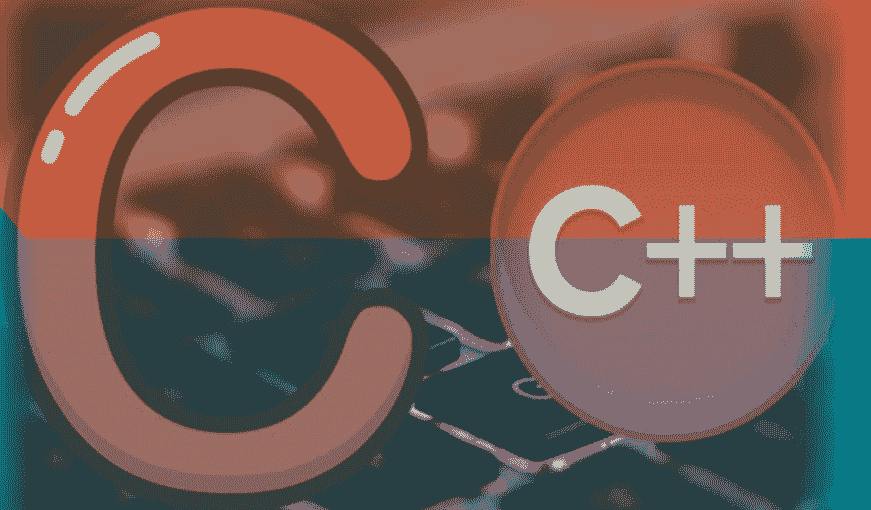

**Indrakanti Sekhar 博士**，M.Com., M.B.A., PGDCA., Ph.D.

高级助理教授，

商学院 (UCC&BM)，

奥斯曼尼亚大学，

海德拉巴-500007。

**V.V.R. Raman 博士**，MCA, M.Phil., MCSA, Ph.D.

助理教授，

计算机科学系，

Aurora 学士与研究生学院，

海德拉巴-500020。

**V.N. Battu**，MCA, M.Tech., M.A (社会学), MARD.

教师，商学院 (M.Com IS)，

商业与业务管理大学学院

奥斯曼尼亚大学，

海德拉巴-500007。


# 前言

我们非常荣幸推出名为《使用 C 和 C++ 编程》的第一版。相关内容以简单易懂的风格编写，以便读者能够充分理解。我们认为这本书对初学者非常有帮助。

本书涵盖了变量、数据类型和运算符、控制语句、循环、函数、数组和字符串、指针、结构体和联合，以及使用 C++ 的面向对象概念等。我们衷心感谢 Appa Rao 教授（商学院院长）、Prashanta Athma 教授（商学院主任）、T. Krishna Kumar 教授（商学院委员会主席）鼓励我们编写这本书。我们还感谢所有同事和家属提供的及时建议。Devandar 教授（Nizam 学院助理教授）、Viswanath 教授（Aurora 学士学院院长）、Shri Niraj Pandey 先生和 Anil Kumar 先生（喜马拉拉雅出版社销售经理），他们为提供了机会。

尽管在准备手稿时已经尽了努力，但仍出现了一些错误。我们诚恳接受教师和读者的批评，如果他们提供任何额外信息。最后，我们要感谢 Rajashekar 先生在海德拉巴完成的优秀排版工作。

2020年1月

海德拉巴

作者

|---|---|---|

```c
#include <stdio.h>

int main() {
    printf("Hello World\n");
    return 0;
}
```

# 第1 单元

## C 语言简介、变量、数据类型和运算符

**简介**：语言类型-C 语言历史-基础结构-编程规则-流程图-算法-常用库函数-执行 C 程序-“C”中的预处理器-关键字与标识符-常量-变量：变量的定义规则-变量的作用域和寿命-**数据类型**-类型转换-格式化输入输出操作。**运算符**：简介-算术-关系-逻辑-赋值-条件-特殊-位运算-递增-描述符。

### 计算机编程语言

人类使用语言进行交流，不同地区有不同的语言，计算机也有自己特定的语言。

开发不同类型的语言是为了在计算机上执行不同类型的工作。**计算机编程语言**是一种为数字计算机表达一组详细指令的语言。当这些指令以计算机制造商特定的数值形式（即机器语言）存在时，可以直接执行；当它们以相应的汇编语言表示并经过简单的替换过程后；或者从某些“高级”语言翻译后执行。基本上，语言可以根据计算机理解的方式分为两类。

### 计算机语言类型

计算机语言的基本类型有：

- 低级语言：直接对应特定机器的语言。
- 高级语言：任何独立于机器的语言。
- 系统语言：这些被设计用于内存和进程管理等低级任务。
- 脚本语言：这些语言倾向于高级且非常强大。
- 领域特定语言：仅在特定语境下使用。
- 可视化语言：非文本的语言。
- 晦涩语言：带有玩笑性质或非用于严肃用途的语言。

这些语言并不是互斥的，某些语言可以属于多个类别。“低级”和“高级”术语也有不同的解释，随着语言的发展，某些曾经被认为是高级的语言现在被认为是低级的。

### C语言简介、变量、数据类型和运算符

事实上，制造商设计的计算机只服从一种语言，即其机器语言，这种语言在计算机内部由一串二进制数字（位）来表示；0 代表电脉冲的缺失，1 代表电脉冲的存在。由于计算机能够识别电信号信号，因此它能理解机器语言。

| 优点 | 缺点 |
|---|---|
| 机器语言能够快速且高效地利用计算机。 | 所有的操作码都必须记住。 |
| 它不需要翻译器来翻译代码。计算机可以直接理解它。 | 所有的内存地址都必须记住。 |
| | 用机器语言编写的程序很难进行修改或发现错误。 |

### 汇编语言

开发汇编语言是为了克服机器语言的许多不便。这是另一种低级但非常重要的语言，其中操作码和操作数以字母数字的形式给出，而不是 0 和 1。这些字母数字符号被称为助记码，最多可以由五个字母组合组合，例如：用于加法的 `ADD`，用于减法的 `SUB`，`START`，`LABEL` 等。由于这一特性，汇编语言也被称为符号编程语言。大多数情况下，汇编语言用于辅助编译器的方向工作。汇编语言的指令由翻译器转换为机器码，然后由计算机执行。

| 优点 | 缺点 |
|---|---|
| 与机器语言相比，汇编语言更容易理解。 | 与机器语言一样，它也是特定于机器的。 |
| 易于定位和纠正错误。 | 由于它依赖于机器，程序员也需要理解硬件。 |
| 它很容易修改。 | |

### 高级语言

开发高级语言的目的是让人们能够用自己的母语言（英语）轻松地编写程序。高级语言基本上是符号语言，它们使用英语单词而不是助记码。高级语言中的每条指令都会翻译成计算机可以理解的机器语言指令。

#### 优点

- 高级语言对用户友好。
- 高级语言必须通过翻译器翻译成机器语言，这会消耗时间。
- 它们与英语相似，并使用常见的符号。
- 翻译器生成的目标代码与等效的汇编语言相比可能效率较低。
- 它们更容易学习。
- 它们更容易维护。
- 它们是面向问题的而不是基于机器的。
- 用高级语言编写的程序可以翻译成许多机器语言，并可以在任何存在相应翻译器的计算机上运行。

#### 高级语言的类型

为了实现各种任务，已经开发了许多语言。有些非常专业，另一些则非常通用。这些语言根据用途分类如下：

##### 1. 代数型语言

这些语言面向用于解决数学和统计问题的计算过程。示例包括：

- `BASIC`（初学者全用途符号代码）
- `FORTRAN`（数学公式翻译）
- `PL/I`（编程语言，第1版）
- `ALGOL`（通用面向型语言）
- `APL`（一种编程语言）

##### 2. 业务数据处理语言

这些语言最适合维护数据处理过程和处理文件涉及的问题。示例包括：

- `COBOL`（通用业务面向语言）
- `RPG`（报告程序生成器）

##### 3. 字符串和列表处理

这些语言用于字符串操作，包括模式搜索以及字符的插入和删除。示例为：

- `LISP`（列表处理）
- `Prolog`（逻辑编程）

### 4. 面对象编程语言

在 OOP 中，计算机程序被分为对象。示例为：

- `C++`
- `Java`

##### 5. 可视化编程语言

这些编程语言旨在构建基于 Windows 的应用程序。示例为：

- `Visual Basic`
- `Visual Java`
- `Visual C`

了解 C 语言的历史非常有趣。在这里我们将讨论 C 语言的简史。C 编程语言是由 Dennis Ritchie 和 Brian Kernighan 于 1972 年在位于美国的 AT&T（美国电话和电报公司）贝尔实验室开发的。Dennis Ritchie 是 C 语言的创始人。它的开发是为了克服如 B、BCPL 等之前语言的问题。最初，C 的开发是为了用于 UNIX 操作系统，该系统继承了之前语言（如 B 和 BCPL）的许多特性。让我们看看C语言之前开发的编程语言。

| 语言 | 年份 | 开发者 |
| --- | --- | --- |
| Algol | 1960 | 国际小组 |
| BCPL | 1967 | Martin Richard |
| B | 1970 | Ken Thompson |
| 传统 C | 1972 | Dennis Ritchie |
| K&RC | 1978 | Kernighan & Dennis Ritchie |
| ANSI C | 1989 | ANSI 委员会 |
| ANSI/ISO C | 1990 | ISO 委员会 |
| C99 | 1999 | 标准委员会 |

## C 语言的特性

C 是一种被广泛使用的语言。它提供了下面的许多特性：

1. 简单
2. 机器无关或可移植
3. 中级编程语言
4. 结构化编程语言
5. 丰富的库
6. 内存管理
7. 运行速度快
8. 指针
9. 递归
10. 可扩展

1. **简单**：C 是一种简单的语言，简单体现在它提供了一种结构化的方法（将问题分解为若干部分）、丰富的库函数集、数据类型等。
2. **机器无关或可移植**：与汇编语言不同，C 程序可以在不同的机器上运行。
3. **中级编程语言**：C 旨在开发内核、驱动程序等系统应用程序。
4. **结构化编程语言**：它被称为中级语言，是因为我们可以使用函数将程序拆分成部分。它是特定于机器。
5. **丰富的库**：C 提供了许多内置函数，可以加快开发速度。
6. **内存管理**：它支持动态内存分配。在 C 语言中，我们可以随时调用 `free()` 函数释放分配的内存。
7. **速度快**：C 语言的编译和执行时间很快，因为开销较小。
8. **指针**：C 提供了指针特性。通过指针直接与内存交互。可以将指针用于结构体、函数、数组等。
9. **递归**：在 C 中，我们可以在函数内部调用函数。它为每个函数提供了代码复用。递归使我们能够使用回溯方法。
10. **可扩展**：C 语言是可扩展的，因为它可以轻松采纳新功能。

## C 程序的基本结构

img/967bcdbdba6f2e1f56642982e8b39e66_12_0.png

1. **文档节**：可以在这一部分编写注释以增强程序的交互性。编译器不会编译此部分，因此该部分不会显示在输出屏幕上。
2. **定义节**：该部分涉及 C 中的变量定义和声明。
3. **主函数**：它是程序执行开始的主要部分。主部分涉及声明部分和执行部分。
4. **预处理器指令节**：该部分涉及要包含在程序中的头文件。
5. **全局声明节**：该节用于定义程序范围内使用的全局变量，这意味着可以在程序中使用这些变量。
6. **用户定义函数节/子程序节**：当你想定义一个满足特定要求的函数时，可以在此部分进行定义。
7. **函数原型声明节**：该节提供了有关函数的信息，包括数据类型或返回类型、传递的参数或参数。

#### C语言简介、变量、数据类型和操作符

```c
//Name of Program ---> 文档部分
#include<stdio.h> ---> 预处理器指令
#include<conio.h>
```

```c
#define max 100 ---> 定义部分
void add(){
int x=100;
} // 全局声明部分
```

```c
int main() ---> main() 函数部分/入口点
{
    x=100; // 变量声明
```

```c
{
    printf("Hello Main");
    return 0;
} // Main 函数体体
```

```c
void add(){
    printf("Hello add");
} // 函数定义
```

等等，我的意思是：

#### 编程规则

- 1. 所有 C 语句行必须以分号结束。
- 2. C 是区分大小写的。也就是说，大写字母和小写字母是不同的。通常，语句使用小写字母输入。
- 3. 一个 C 程序语句可以分成多行，也可以写在一行。
- 4. 大括号必须成对出现，即：每一个左括号 `{`必须有一个匹配的右括号`}`。
- 5. 所有 C 程序都以 `void main()` 函数开始。
- 6. 注释不能嵌套。例如：`/* Welcome to C World, /* programming* */`
- 7. 根据用户的喜好，注释可以分成多行。

#### 算法 (ALGORITHM)

##### 算法的定义

算法是用于系统方法解决问题的一系列定义的有限步骤。它用英语等自然语言编写。

#### 优点

- 易于编写。
- 易于理解逻辑的人类可读技术。
- 大问题的算法可以通过中等努力编写。

#### 缺点

- 难以调试。
- 难以显示分支和循环。
- 跳转（goto）使得某些问题难以追踪。

示例：：打印 1 到 20

##### 算法：

```
步骤 1: 初始化 X 为 0。
步骤 2: 将 X 加 1。
步骤 3: 打印 X。
步骤 4: 如果 X 小于 20，则跳转到步骤 2。
```

#### 流程图 (FLOWCHARTS)

##### 流程图的定义

流程图是过程的视觉或图形表示。过程中的每个步骤都由不同的符号表示，并包含对过程步骤的简短描述。流程图符号通过箭头连接在一起，显示过程流的方向。这种视觉表示可以为给定的问题提供逐步的解决方案。

#### 优点

- 易于绘制。
- 易于理解逻辑。
- 非计算机人员容易识别错误。
- 易于显示分支和循环。

#### 缺点

- 耗时。
- 难以修改。
- 为大型或复杂问题绘制流程图非常困难。

#### 示例：打印 1 到 20

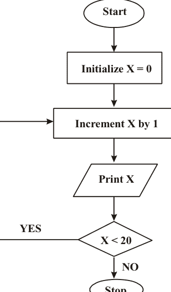

#### 流程图与算法的区别

流程图和算法的区别就像电影与其故事的区别，或者虚构小说与故事的区别，又漫画与故事的区别。

算法和流程图是用于创建新程序的两种不同工具，特别是在计算机编程时。算法是对过程的逐步步进的分析，而流程图则以图形化的方式解释程序的步骤。

| 流程图 | 算法 |
| :--- | :--- |
| 代表数据流的分块信息图。 | 代表任何解决方案过程的逐步指令。 |
| 它是过程的视觉化表示。 | 它是对要完成工作的逐步分析。 |
| 与算法相比，更容易理解。 | 有些难以理解。 |
| 易于显示分支和循环。 | 难以显示分支和循环。 |
| 大问题的流程图是不切实际的。 | 任何问题都可以编写算法。 |
| 难以调试错误。 | 易于调试错误。 |
| 制作流程图很容易。 | 与流程图相比，编写算法较困难。 |

#### C语言中的头文件和标准库函数

为了访问 C 语言的标准库函数，在编写程序体之前需要包含某些头文件。

| 头文件 | 含义 | 解释 |
| :--- | :--- | :--- |
| <stdio.h> | 标准输入输出头文件 | 用于执行输入输出操作，如 `scanf()` 和 `printf()`。 |
| <string.h> | 字符串头文件 | 用于执行字符串操作，如 `strlen()` 和 `strcpy()`。 |
| <conio.h> | 控制台输入输出头文件 | 用于执行控制台输入输出操作，如 `clscr()` 和 `getch()` 从键盘获取字符。 |
| <stdlib.h> | 标准库头文件 | 用于执行标准实用函数，如使用 `malloc()` 和 `calloc()` 进行动态内存分配。 |
| <math.h> | 数学头文件 | 用于执行数学运算，如 `sqrt()` 和 `pow()` 分别获取数的平方根和幂。 |
| <ctype.h> | 字符类型头文件 | 用于执行字符类型函数，如 `isalpha()` 和 `isdigit()` 分别查找给定字符是否为字母或数字。 |
| <time.h> | 时间头文件 | 用于执行相关函数如 `setdate()` 和 `gettime()` 分别修改系统日期和获取 CPU 时间。 |
| <assert.h> | 断言头文件 | 在程序中使用断言函数，如 `assert()`，获取整数数据类型作为参数。 |
| <locale.h> | 本地化头文件 | 用于执行本地化函数，如 `locale()` 和 `setlocale()` 修改本地化。 |
| <signal.h> | 信号头文件 | 用于执行信号处理函数，如 `signal()` 和 `raise()` 安装信号处理并产生信号。 |
| <setjmp.h> | 跳转头文件 | 用于执行跳转函数。 |
| <stdarg.h> | 标准参数头文件 | 用于执行标准参数函数，如 `va_start()` 和 `va_arg()` 指示变长参数列表并获取参数。 |
| <errno.h> | 错误处理头文件 | 用于执行错误处理操作，通过初始化该函数的值来指示错误。 |

#### C语言中常用的库函数

标准库函数基本上内置在 C 编译器中。每个 C 程序至少有一个函数，即 `main()` 函数。

`<stdio.h>` 这是几乎每个程序使用的的基础头文件。它代表标准输入输出，其中：

- `printf()` 在屏幕上显示输出。
- `scanf()` 从用户处获取输入。
- `getchar()` 在屏幕上返回字符。
- `putchar()` 显示单个字符。
- `fgets()` 获取行作为输入。
- `puts()` 显示行作为输出。
- `fopen()` 打开文件。
- `fclose()` 关闭文件。

`<conio.h>` 它用于执行控制台输入输出操作，如 `clscr()` 清除屏幕（适用于 Turbo C）和 `getch()` 从键盘获取字符。

## 使用 C 和 C++ 编程

| 速度 | 较快。 | 较慢。 |
|---|---|---|
| 内存需求 | 由于创建对象代码，内存需求较大。 | 不需要创建中间对象代码，因此所需内存较少。 |
| 错误 | 编译后一次性显示所有错误。 | 逐行显示每行的错误。 |
| 相关编程语言 | C、C++、C#、Scala 和 typescript 使用编译器。 | PHP、Per、Python 和 Ruby 使用解释器。 |

## C 程序执行流程

以下是 C 程序执行的各个步骤。

执行的步骤如下：

- 1. 编写源代码
- 2. 预处理器
- 3. 编译
- 4. 链接编辑
- 5. 加载
- 6. 执行

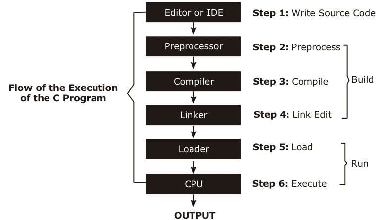

## C 语言介绍、变量、数据类型和运算符

#### 编辑器或 IDE:


这是编写程序源代码的第一步，需要任何编辑器或 IDE（如 `notepad++`, `Turbo C`, `Borland C`, `Dev-C++`, `Visual Studio` 等），我们可以在这里编写自己的源代码并使用源代码（`.c`）和头文件（`.h`）进行保存。

## 预处理器

在此部分，编译器包含文件并替换符号，然后将其发送给下一阶段编译器。

## 编译器

在此部分，编译器编译程序的源代码并创建对象代码（`.obj`）和（`.o`），然后发送给链接器。

## 链接器

在此部分，链接器将对象代码链接到静态库（`.dll` 和 `.so`）并创建可执行代码（`.exe`）。

## 加载器

在此部分，加载器使用共享库（`.dll` 和 `.so`）文件加载可执行代码，并根据用户输入发送到 CPU 执行并返回输出。

让我们通过使用 `Dev-C++` 逐步执行示例程序。

### 示例

- 1. 安装并打开 `Dev-C++`

- 2. 点击文件 -> 新 -> 源文件（参考图 1.1）

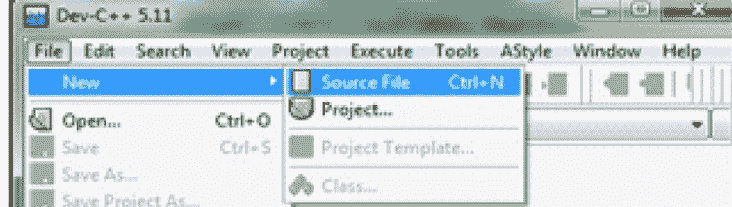

- 3. 编写代码如下：

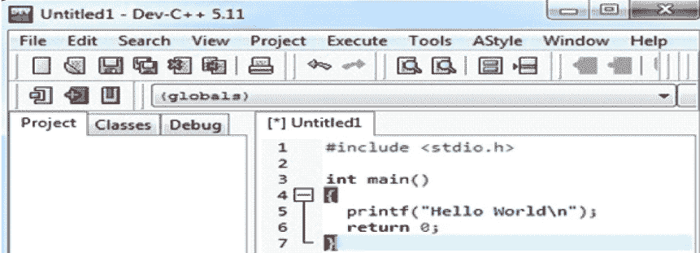

- 4. 在菜单中，点击执行按钮，从下拉菜单中选择编译或按 `F9` 键检查语法错误。

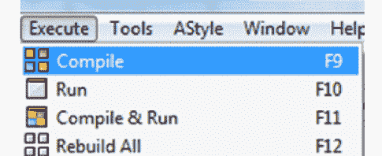

- 5. 重复上述步骤，现在从下拉菜单中选择运行或按 `F10` 键查看输出。

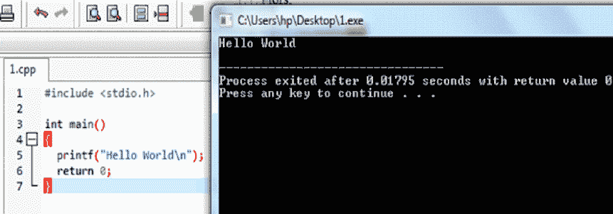

# C 语言介绍、变量、数据类型和运算符

## C语言中的预处理器

C 处理器是一个宏处理器，由 C 编译器自动使用，在实际编译之前转换您的程序（预处理器指令在编译之前执行）。它之所以称为宏处理器，是因为允许你定义宏，宏是较长结构的简短缩写。宏是由宏值替换的代码段。宏通过 `#define` 指令定义。

预处理器指令是程序中以 `#` 开头的行。`#` 后面跟着一个标识符，即指令名称。例如，`#define` 是定义宏的指令。在 `#` 前后都允许存在空白符。

`#` 指令名称不能来自宏展开。例如，如果 `foo` 被定义为展开为 `define` 的宏，这不会使 `#foo` 成为一个有效的预处理器指令。

所有预处理器指令都以 `#` 符号开头。

让我们查看预处理器指令列表。

- 1. `#include`
- 2. `#define`
- 3. `#undef`
- 4. `#ifdef`
- 5. `#ifndef`
- 6. `#if`
- 7. `#else`
- 8. `#elif`
- 9. `#endif`
- 10. `#error`
- 11. `#pragma`

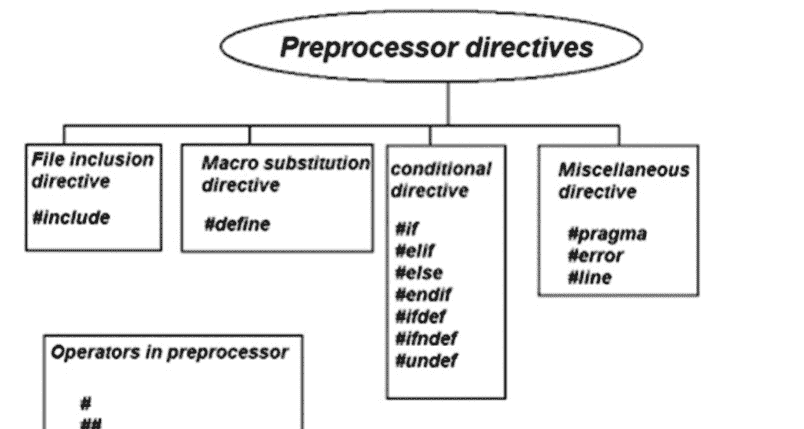

| 文件包含指令 | 宏替换指令 | 条件指令 | 杂项指令 |
| --- | --- | --- | --- |
| `#include` | `#define` | `#if` | `#pragma` |
| | | `#elif` | `#error` |
| | | `#else` | `#line` |
| | | `#endif` | |
| | | `#ifdef` | |
| | | `#ifndef` | |
| | | `#undef` | |

### 预处理器中的运算符

### `#include`

`#include` 预处理器用于将给定文件的代码粘贴到当前文件中。它用于包含系统定义和自定义头文件。如果未找到包含的文件，编译器将产生错误。

通过使用 `#include` 指令，我们为预处理器提供查找头文件的信息。使用 `#include` 指令有两种变体。

- 1. `#include <filename>`
- 2. `#include "filename"`

`#include <filename>` 告诉编译器在头文件中查找。`#include "filename"` 告诉编译器在头文件中查找。

## C 标记分为六类。它们是：

- 1. 关键字（例如 `int`, `while`）
- 2. 标识符（例如 `main`, `total`）
- 3. 常数（例如 `10`, `20`）
- 4. 字符串（例如 `"total"`, `"hello"`）
- 5. 特殊符号（例如 `()`, `{}`），
- 6. 运算符（例如 `+`, `/`, `-`, `*`）

### C 关键字与标识符

### 字符集

字符集是 C 语言中有效的字母、数字和某些特殊字符的集合。

### 字母表

大写：A B C ................................................................... X Y Z

小写：a b c ................................................................ x y z

C 同时接受小写和大写字母作为变量和函数名。

### 数字

`0 1 2 3 4 5 6 7 8 9`

### 特殊字符

| `<` | `>` | `|` | `|` |
|---|---|---|---|
| `( )` | `$` | `:` | `|` |
| `%` | `[ ]` | `#` | `?` |
| `&` | `{ }` | `"` | `|` |
| `^` | `!` | `*` | `/` | |
| `-` | `\` | `~` | `+` |
| C 编程中的特殊字符 |

### 空格字符

空格、换行符、水平制表符、回车符和换页符。

## 关键字

关键字是编程中预定义的保留字，它们对编译器具有特殊含义。关键字是语法的一部分，不能用作标识符。

例如：

```
int money;
```

在这里，`int` 是一个关键字，表示 `money` 是一个 `int` 类型（整数）的变量。由于 C 是一种区分大小大小的语言，所有关键字都必须写成小写。以下是 ANSI C 中允许的所有 32 个关键字列表。

| `auto` | `double` | `int` | `struct` |
|---|---|---|---|
| `break` | `else` | `long` | `switch` |
| `case` | `enum` | `register` | `typedef` |
| `char` | `extern` | `return` | `union` |
| `continue` | `for` | `signed` | `void` |
| `do` | `if` | `static` | `while` |
| `default` | `goto` | `sizeof` | `volatile` |
| `const` | `float` | `short` | `unsigned` |

### C 关键字

#### C 中所有关键字说明

`auto`

`auto` 关键字用于声明自动变量。

示例：

```
auto int var1;
```

该语句表明 `var1` 是一个 ANSI 存储类为 `auto` 类型为 `int` 的变量。

C 语言简介、变量、数据类型和运算符

在函数体内声明的变量默认是自动的。它们在每次执行函数时都会重新创建。

由于自动变量是函数局部的，它们也被称为局部变量。

#### `break` 和 `continue`

`break` 语句使程序显式地跳出最内层的嵌套循环（`while`, `do` 或 `for switch` 语句）。

`continue` 语句跳过循环内部的某些语句。

```c
for (i=1;i<=10;++i)
{
    if (i=3)
        continue;
    if (i=7)
        break;
    printf("%d ",i);
}
```

输出

`1 2 4 5 6`

当 `i` 等于 `3` 时，`continue` 语句生效并跳过 `3`。当 `i` 等于 `7` 时，`break` 语句生效并终止 `for` 循环。

#### `switch`, `case` 和 `default`

当在许多语句块中执行某一个语句块时，使用 `switch` 和 `case` 语句。

#### 示例：

```c
switch(expression)
{
    case '1':
        // 当为 1 时执行的某些语句
        break;
    case '5':
        // 当为 5 时执行的某些语句
        break;
    default:
        // 默认执行的某些语句
}
```

#### `char`

`char` 关键字声明字符变量。

示例：

```
char alphabet;
```

在这里，`alphabet` 是一个字符类型变量。

#### `const`

可以使用 `const` 关键字将标识符声明为常量。

```
const int a = 5;
```

#### `do...while`

```c
int i;
do
{
  printf("%d ",i);
  i++;
}
while (i<10)
```

你将在单元 II 中详细学习 `do-while`。

#### `double` 和 `float`

关键字 `double` 和 `float` 用于声明浮点类型变量。

例如：

```
float number;
double longNumber;
```

在这里，`number` 是单精度浮点类型变量，而 `longNumber` 是双精度浮点类型变量。

#### `if` 和 `else`

在 C 编程中，`if` 和 `else` 用于做决策。

```c
if (i == 1)
    printf("i is 1.")
else
    printf("i is not 1.")
```

如果 `i` 的值不是 `1`，

输出：

    i is not 1

#### `enum`

C 编程中使用 `enum` 关键字声明枚举类型。

示例：

```c
enum suit
{
    hearts;
    spades;
    clubs;
    diamonds;
};
```

在这里，创建了一个枚举变量 `suit`，具有心形、黑桃、梅花、方片等值。

#### `extern`

`extern` 关键字声明具有外部链接的变量。

#### `for`

C 编程中有三种 `for` 类型的循环。`for` 语句用于执行循环。

例如：

`for` 语句用于执行循环。

```
for (for=i;1;i<=1)
i)
)
)
    i
```

输出

`1 2 4 5 6`

#### `goto`

`goto` 语句用于跳转到有标签的代码。

例如：

`goto` 语句用于跳转到有标签的代码。

```c
if (i)
    continue;
```

```
    if (i=7)
        break;
```

#### `int`

`int` 关键字声明整数。

例如：

`int` 关键字声明整数。

#### `long`

`long` 关键字声明长整型。

例如：

`long` 关键字声明长整型。

#### `short`

`short` 关键字声明短整型。

例如：

`short` 关键字声明短整型。

#### `unsigned`

`unsigned` 关键字声明无符号整数。

例如：

`unsigned` 关键字声明无符号整数。

#### `return`

`return` 关键字用于从函数返回值。

例如：

`return` 关键字用于从函数返回。

#### `sizeof`

`sizeof` 运算符用于获取类型的大小。

例如：

`sizeof` 运算符用于获取类型的大小。

#### `while`

`while` 循环在条件为真时执行。

例如：

`while` 循环在条件为真时执行。

#### `if`

`if` 语句用于做决策。

#### `else`

`else` 语句用于决策。

#### `types`

类型定义了变量可以存储的数据类型。

- `int`: 整数
- `float`: 浮点数
- `double`: 双精度浮点数
- `char`: 单个字符
- `void`: 无返回值

#### `functions`

函数是执行特定任务的代码块。

```c
int add(int a, int b) {
    return a + b;
}
```

#### `arrays`

数组是存储在连续内存中的相同类型元素的集合。

```c
int arr[5] = {1, 2, 3, 4, 5};
```

#### `pointers`

指针是存储变量地址的变量。

```c
int x = 5;
int *ptr = &x;
```

#### `structures`

结构体是自定义类型，将不同类型的变量组合在一起。

```c
struct Student {
    int id;
    char name[50];
};
```

#### `unions`

联合 与结构体相似，但成员共享内存位置。

```c
union Data {
    int i;
    float f;
};
```

#### `preprocessor`

预处理器指令是在编译之前处理的命令，以 `#` 开头。

```c
#include <stdio.h>
```

#### `comments`

注释用于文档说明，并被编译器忽略。

```c
// 单行注释
/* 多行
注释 */
```

#### `headers`

头文件包含函数声明和宏定义。

```c
#include <stdio.h>
#include <stdlib.h>
```

#### `compilation`

编译是将源代码转换为机器码的过程。

1. 预处理
2. 编译
3. 汇编
4. 链接

#### `debugging`

调试是发现并修复代码中错误的过程。

#### `execution`

执行是运行程序。

#### `output`

输出是程序产生的结果，通常显示在屏幕上。

常量可以是任何基本数据类型，例如整数常量、浮点常量、字符常量或字符串字面量。此外还有枚举常量。

常量的处理方式与普通变量相同，不同之处它们的值在定义后就不能被修改。

## 整数字面量

整数字面量可以是十进制、八进制或十六进制常量。前缀用于指定基数：十六进制使用 `0x` 或 `0X`，八进制使用 `0`，十进制则不为空。

整数字面量还可以有一个后缀，它是 `U` 和 `L` 的组合，分别表示无符号（unsigned）和长型（long）。后缀可以是大写或小写，且顺序任意。

以下是一些整数字面量的示例。

```
212 /* 合法 */
215u /* 合法 */
0FeeL /* 合法 */
078 /* 非法：8 不是八进制数字 */
032UU /* 非：不能重复后缀 */
```

以下是各种类型整数字面量的其他示例。

```
85 /* 十进制 */
0213 /* 八进制 */
0x4b /* 十六进制 */
30 /* int */
30u /* 无符号 int */
30l /* long */
30ul /* 无符号 long */
```

#### 浮点字面量

浮点字面量包含整数部分、小数部分、分数部分和指数部分。你可以以十进制形式或指数形式表示浮点字面量。

在表示十进制形式时，必须包含小数点、指数或两者；在表示指数形式时，必须包含整数部分、分数部分或两者。带符号的指数由 `e` 或 `E` 引入。

以下是一些浮点字面量的示例。

| 3.14159 | /* 合法 */
| 314159-SL | /* 合法 */
| 510E | /* 非法：指数不完整 */
| 210f | /* 非法：缺少小数或指数 */
| .55 | /* 非法：缺少整数或分数 */

#### 字符常量

字符字面量用单引号括，例如 `'x'` 可以存储在 `char` 类型的简单变量中。

字符字面量可以是普通字符（例如 `'x'`）、转义序列（例如 `'\t'`）或通用字符（例如 `'\u02C0'`）。

C 语言中某些字符在反斜杠 `\` 之前时具有特殊含义，例如换行 `\n` 或制表符 `\t`。

以下是几个转义序列字符的示例。

```
#include <stdio.h>

int main() {
    printf("Hello\tWorld\n\n");
    return 0;
}
```

当代码被编译并执行时，会产生以下结果：

Hello World

#### 字符串字面量

字符串字面量或常量用双引号 `"` 括。字符串包含与字符字面量类似的字符：普通字符、转义序列和通用字符。

你可以使用字符串字面量并分隔空格将长行拆分为多行。

以下是一些字符串字面量的示例。三种形式都是相同的字符串。

```
"hello, dear"
"hello, \
dear"
"hello, "d" "ear"
```

## 定义常量

在 C 语言中有两种定义常量的简单方法：

- 使用 `define` 预处理器。
- 使用 `const` 关键字。

#### `#define` 预处理器

下面是使用 `#define` 预处理器定义常量的形式。

`#define 标识 值`

下面的示例详细解释了它。

```
#include<stdio.h>

#define LENGTH 10
#define WIDTH 5
#define NEWLINE '\n'

int main(){
int area;

area= LENGTH * WIDTH;
printf("value of area : %d", area);
printf("%c", NEWLINE);

return 0;
}
```

当上述代码被编译并执行时，会产生以下结果：

value of area : 50

#### `const` 关键字

你可以使用 `const` 前缀来声明特定类型的常量，如下：

`const 类型 变量 = 值;`

下面的示例详细解释了它。

```
#include<stdio.h>
int main(){
const int LENGTH =10;
const int WIDTH =5;
const char NEWLINE = "\n";
int area;
area=LENGTH * WIDTH;
printf("value of area : %d", area);
printf("%c", NEWLINE);

return 0;
}
```

当上述代码被编译并执行时，会产生以下结果：

value of area : 50

#### 变量

在编程中，变量是一个存储数据的容器（存储区域）。


为了指示存储区域，每个变量应该有一个唯一的名称（标识符）。变量名只是内存位置的符号表示。

例如：

- 1. `int marks=95;`

在这里，`marks` 是一个 `int` 类型的变量。在这里，变量被赋值整数值 95。

### 变量命名规则

- 1. 变量名不能数字数字开头。
- 2. 变量名由字母、数字和特殊符号下划线 `_` 组成。
- 3. 变量名中不允许空白或空格。
- 4. 不允许使用关键字作为变量名。
- 5. 大小写名称被视为不同的。

### 声明、定义和初始化变量

声明变量意味着告知编译器变量存在。声明执行以下操作：

1. 它告诉编译器变量名。
2. 它指定变量将持有什么类型的数据。
3. 在变量定义之前，编译器不需要担心内存空间。
4. 变量在函数外部使用关键字声明。

```
int a;
float b;
double c;
```

定义变量意味着为变量分配存储。你可以在函数内部定义并使用它。我们可以通过逗号在同一行内定义多个相同类型的变量。

```
int a;
float b,c;
```

初始化变量意味着为它提供一个值。变量可以在单个语句中初始化，例如：

```
int a=5;
```

### 变量与标识符的区别

标识符是任何变量、函数、结构体、指针或编程语言中其他实体的名称。变量是存储数据的命名内存位置。

| 标识符 | 变量 |
| --- | --- |
| 标识符是变量、函数等的名称。 | 而变量是用于存储数据的内存位置。 |
| 标识符可以是变量，但并非所有标识符都是变量。 | 所有变量名都是标识符。 |

示例：

```
// 一个变量
int a;
或，一个函数
int a() {
}
```

示例：

// int 变量

`int a;`

// float 变量

`float a` 和 `b`，即 `float b,c;`

理解标识符与变量区别的另一个很好的类比是：

你可以将标识符 `x` 视为变量名，但它也可以是函数名 `int() { }` 且仍然标识符。

就像 vasavi 既是一个人的名字，也可以是一个基金会的名字。

### C 中变量的作用域和寿命

寿命：任何变量的寿命是在程序运行期间该变量在内存中存在的时间。

作用域：任何变量的作用域实际上是寿命的一个子集。变量可能在内存中但无法访问，我们程序中可以访问变量的区域就是该变量的作用域。

变量的作用域可以大致分为三类：

- 全局作用域：当变量定义在所有函数外部时。它对程序的所有函数和所有块都是的。
- 局部作用域：当变量在函数或块内部定义时，它在块内局部可见，因此它是一个局部变量。
- 函数作用域：当变量作为形式参数传递时，我们称它具有函数作用域。

让我们通过示例来理解这一点：

考虑这段程序片段：

```
int global = 100; // 声明了全局变量
void main() {
    int local = 10; // 声明了局部变量
    printf("Global variable is %d",global);
    printf("Local variable is %d",local);
    func1();
}
void func1() {
    printf("Global inside func1 is %d",global); // 将可以成功打印全局变量。
}
```

在这里，我们有一个名为为 `global` 的变量，它定义在所有函数之外（通常在程序的顶部），它甚至定义在 `main` 之外，因此程序中定义的每一个函数都可以使用它，这里我们只考虑一个 `func1()`。

上述程序的输出将是：

Global variable is 100

Local variable is 10

Global inside func1 is 100

现在，让我们再次考虑同一个程序，这次我们把函数 `func1()` 的定义修改为：

```
void func1() {
}
```

## C语言导论、变量、数据类型和运算符

`printf("Global inside func1 is %d",global);` // 将可以成功打印全局变量。

`printf("Local inside func1 is %d", local);` /* 将产生一个错误，

因为 local 是局部变量，它只能在 main 函数内部访问。 */

显然，如注释中提到的，全局变量的打印将执行，但局部变量的打印将产生错误，因为名为 `local` 的变量实际上是 `main()` 函数的局部的，因此只能通过该函数访问，而不能从任何其他函数访问，但对于全局变量，程序使用的所有函数/块都可以访问它。

在这里，我们名为 `global` 的变量具有作用域和生命周期，因此它的作用范围一直持续到程序执行完成，并且可以被任何函数/块访问。但在我们的局部变量情况下，它在内存中可能存在到程序执行完成，但它可以在定义它的函数或块内部被访问。

这里的基本问题可能是，我们可以定义同名的变量既是全局变量又是局部变量，因此对于我们实际上想要引用哪个变量将产生歧义。在 C++（C语言的进阶）中，我们可以通过使用一种称为作用域解析运算符的特殊运算符来解决这个问题。

## C语言中的数据类型

数据类型规定了我们如何向程序输入数据以及输入什么类型的数据。C语言具有一组预定义的数据类型，用于处理我们可以在程序中使用的各种类型数据。这些数据类型具有不同的存储容量。

C语言支持两种类型的数据类型：

- 1. 基本数据类型

这些是C语言中的基础数据类型，即整数(`int`)、浮点数(`float`)、字符(`char`) 和 `void`。

- 2. 派生数据类型

派生数据类型无非基本数据类型，但经过稍微扭曲或组合在一起，如数组、结构体、联合体和指针。这些将在后详细讨论。

数据类型决定了变量将持有的数据类型。如果一个变量 `x` 被声明为 `int`，意味着 `x` 只能持有整数值。程序中使用的每个变量都必须声明它是什么数据类型。

### 基本数据类型

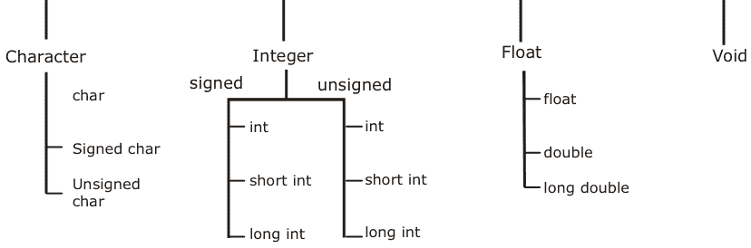

#### 整数型

整数用于存储整数整数。

##### 16位机器上整数型的大小和范围

| int or signed int | 2 | -32,768 to 32767 |
| unsigned int | 2 | 0 to 65535 |
| short int or signed short int | 1 | -128 to 127 |
| long int or signed long int | 4 | -2147483648 to 2147483647 |
| unsigned long | 4 | 0 to 4294967295 |

#### 浮点型

浮点数用于存储小数。

##### 16位机器上浮点型的大小和范围

| float | 4 | -3.4E-38 to 3.4E+38 |
| double | 8 | -1.7E-308 to 1.7E+308 |
| long double | 12 | -1.1E-4932 to 1.1E+4932 |

#### 字符型

字符用于存储字符。

##### 16位机器上字符型的大小和范围

| char or signed char | 1 | -128 to 127 |
| unsigned char | 1 | 0 to 255 |

### 2. 显式类型转换

显式类型转换排除了编译器进行数据类型转换的使用，转而由用户在程序中显式定义表达式中操作数的数据类型。

下面的示例说明了用户如何进行显式转换。

示例：

```c
double da = 4.5;
double db = 4.6;
double dc = 4.9;
//由用户显式定义
int result = (int)da + (int)db + (int)dc;
printf("result = %d", result);
Output:
result=12
```

因此，在上面的示例中，我们发现输出结果为 12，因为用户显式定义了操作数（变量）为整数数据类型。因此，编译器没有进行数据类型的隐式转换。

如果情况下使用了隐式转换，结果将是 13。

## C 语言中的输入和输出函数

输入意味着为程序提供一些供程序使用的数据，而输出意味着在屏幕上显示数据或将数据写入打印机或文件。

C 编程语言提供了许多内置函数来读取任何给输入，并在需要输出结果时在屏幕上显示数据。

所有这些内置函数都存在于 C 头文件中，我们在讨论特定函数时，还会指定定义该函数的头文件名称。

## scanf() 和 printf() 函数

标准输入输出头文件名为 `stdio.h`，包含了 `printf()` 和 `scanf()` 函数的定义，它们分别用于在屏幕上显示输出和从用户处获取输入。

```c
#include<stdio.h>
void main()
{
    // 定义变量
    int i;
    /*
    在屏幕上显示消息
    要求用户输入值
    */
    printf("Please enter a value..");
    /*
    读取用户输入的值
    */
    scanf("%d", &i);
    /*
    将数字作为输出显示
    */
}
```

当你编译上述代码时，它会要求你输入一个值。当你输入该值时，它会在屏幕上显示你输入的值。

你一定在想 `scanf()` 和 `printf()` 函数内部的 `%d` 是什么。它被称为格式字符串，这告知 `scanf()` 函数期望什么类型的输入，而在 `printf()` 中，它用于提示编译器期望什么类型的输出。

| 格式字符串 | 含义 |
|---|---|
| %d | 扫描或打印分配的十进制整数。 |
| %f | 扫描或打印浮点数。 |
| %c | 扫描或打印一个字符。 |
| %s | 扫描或打印一个字符字符串。扫描在空白处结束。 |

我们还可以通过添加数字字符串指定符来限制输入或输出的数字或字符，例如 `"%1d"` 或 `"%3s"`，第一个意味着单个数字，第二个意味着 3 个字符，因此如果你尝试输入 42，而 `scanf` 使用 `"%1d"`，它将取 4 作为输入。输出的情况也是如此。

在 C 语言中，计算机显示器、打印机等输出设备被视为文件，其写入输出到这些设备的过程与输出到文件的过程相同。

注意：`printf()` 函数返回它打印的字符数，而 `scanf()` 返回它读取的字符数。

```c
int i =printf("b.com");
```

在这个程序中，`printf("b.com");` 将返回结果 12，并存储在变量 `i` 中，因为 `studentonight` 有 12 个字符。

| 符号 | 含义 |
|---|---|
| \n | 用于换行（换行符） |
| \t | 用于制表符（等同于 8 个空格） |

## C 语言中的运算符

运算符是告诉编译器执行特定数学或逻辑功能的符号。C 语言拥有丰富的内置运算符，并提供了以下类型的运算符：

- 算术运算符
- 关系运算符
- 逻辑运算符
- 位运算符
- 赋值运算符
- 特殊和条件运算符
- 增量和递运算符

在本章中，我们将研究每个运算符的工作方式。

## C 语言介绍、变量、数据类型和运算符

### 算术运算符

下表显示了 C 语言支持的所有算术运算符。假设变量 A 持有 10，变量 B 持有 20，然后显示示例。

| 运算符 | 描述 | 示例 |
| --- | --- | --- |
| + | 两个操作数相加 | A + B = 30 |
| - | 从第一个操作数减去第二个操作数 | A - B = -10 |
| * | 两个操作数相乘 | A * B = 200 |
| / | 分子除以分母 | B / A = 2 |
| % | 模运算符和整数除后的余数 | B % A = 0 |
| ++ | 增量运算符使整数值加一 | A++ = 11 |
| -- | 递减运算符使整数值减一 | A-- = 9 |

### 关系运算符

C 有六种关系运算符，可以用于构建布尔表达式以做出决策和测试条件，并返回真或假。下表显示了 C 支持的所有关系运算符。假设变量 A 持有 10，变量 B 持有 20。

| 运算符 | 描述 | 示例 |
| --- | --- | --- |
| == | 检查两个操作数是否相等 | A == B |
| != | 检查两个操作数是否不等 | A != B |
| > | 检查左操作数是否大于右 | A > B |
| < | 检查左操作数是否小于右 | A < B |
| >= | 检查左操作数是否大于或等于右 | A >= B |
| <= | 检查左操作数是否小于或等于右 | A <= B |

### 逻辑运算符

下表显示了 C 支持的所有逻辑运算符。假设变量 A 持有 1，变量 B 持有 0。

| 运算符 | 描述 |
| --- | --- |
| && | 称为逻辑与。如果两个操作数都非零，结果为真。 |
| || | 称为逻辑或。如果两个操作数中的任一个非零，结果为真。 |
| ! | 称为逻辑非。它用于反转其操作数的逻辑状态。 |

### 位运算符

位运算符对位进行工作并执行逐位操作。`&`、`|` `^` 的真值表如下：

| p | q | p & q | p | q | p ^ q |
|---|---|---|---|---|---|
| 0 | 0 | 0 | 0 | 0 | 0 |
| 0 | 1 | 0 | 0 | 1 | 1 |
| 1 | 0 | 0 | 1 | 0 | 1 |
| 1 | 1 | 1 | 1 | 1 | 0 |

## C 语言介绍、变量、数据类型和运算符

假设 A = 60 和 B = 13（二进制格式），它们将所示：

```
A = 0011 1100
B = 0000 1101
------------
A&B = 0000 1100
A|B = 0011 1101
A^B = 0011 0001
~A = 1100 0011
```

下表列出了 C 支持的位运算符。假设变量 'A' 持有 60，变量 'B' 持有 13，然后显示示例。

| 运算符 | 描述 | 示例 |
| --- | --- | --- |
| & | 位与运算符，如果在两个操作数都存在该位，则将其复制到结果中。 | (A & B) = 12，即 0000 1100 |
| | | 位或运算符，如果在任一操作数中存在该位，则将其复制。 | (A | B) = 61，即 0011 1101 |
| ^ | 位异异运算符，如果位仅在一个操作数中设置而不在另一个中设置，则复制。 | (A ^ B) = 49，即 0011 0001 |
| ~ | 位按位反运算符是一个一元运算符，具有“翻转”位的效果。 | (~A) = ~(60)，--0111101 |
| << | 位左移运算符。左操作数的值向左移动右操作数指定的位数。 | A << 2 = 240，即 1111 0000 |
| >> | 位右移运算符。左操作数的值向右移动右操作数指定的位数。 | A >> 2 = 15，即 0000 1111 |

## 赋值运算符

下表列出了 C 语言支持的赋值运算符。

| 运算符 | 说明 | 示例 |
| :--- | :--- | :--- |
| = | 简单赋值运算符。将右侧操作数的值赋给左侧操作数。 | C = A + B 将 A + B 的值赋给 C |
| += | 加法赋值运算符。将右侧操作数加到左侧操作数，并将结果赋给左侧操作数。 | C += A 等于 C = C + A |
| -= | 减法赋值运算符。从左侧操作数减去右侧操作数，并将结果赋给左侧操作数。 | C -= A 等于 C = C - A |
| *= | 乘法赋值运算符。将左右操作数相乘并将结果赋给左侧操作数。 | C *= A 等于 C = C * A |
| /= | 除法赋值运算符。将左侧操作数除以右侧操作数，并将结果赋给左侧操作数。 | C /= A 等于 C = C / A |
| %= | 取模赋值运算符。使用两个操作数求取模并将结果赋给左侧操作数。 | C %= A 等于 C = C % A |
| << | 左移赋值运算符。 | C << 2 等于 C = C << 2 |
| >> | 右移赋值运算符。 | C >> 2 等于 C = C >> 2 |
| &= | 位位与赋值运算符。 | C &= 2 等于 C = C & 2 |

#### C 语言简介、变量、数据类型和运算符

| 运算符 | 说明 | 示例 |
| :--- | :--- | :--- |
| ^= | 位位异或赋值运算符。 | C ^= 2 等于 C = C ^ 2 |
| |= | 位位或赋值运算符。 | C |= 2 等于 C = 2 |

#### 特殊条件运算符

除了上面讨论运算符外，C 语言还支持其他一些运算符，包括 `sizeof` 和 `? :`。

| 运算符 | 说明 | 示例 |
| :--- | :--- | :--- |
| sizeof() | 返回变量的大小。 | sizeof(a)，其中 a 是整数，将返回 4。 |
| & | 返回变量的地址。 | &；返回变量的实际地址。 |
| * | 指向变量的指针。 | *a; |
| : | 条件表达式。 | 如果条件为真 ? 则返回值 X ：否则返回值 Y |

#### C 语言中的条件或三元运算符

条件运算符在条件为真时返回一个值，条件为假时返回另一个值。

该运算符也称为三元运算符。

语法：(条件?) ? 真_值 : 假_值;

示例：(A > 100 ? 0 : 1);

在上面的示例中，如果 A 大于 100，则返回 0，否则返回 1。这等于 if-else 条件语句。

#### C 语言中的自增和自减运算符

在 C 程序中，自增运算符用于将变量的值加1，自减运算符用于将变量的值减1。

自增和自减运算符都用于单个操作数和变量。因此，它们被称为一元运算符。一元运算符的优先级高于其他运算符，这意味着一元运算符会在其他运算符之前执行。

#### 语法：

```
++ // 自增运算符
-- 自减运算符
```


注意：自增和自减运算符不能应用于常量。

示例：

`x= 4++;  // 产生错误，因为 4 是常量`

#### 自增运算符的类型

- 1. 前置自增
- 2. 后置自增

##### 1. 前置自增 (`++ 变量`)

在前置自增中，先增加变量的值，然后在表达式中使用（初始化到另一个变量）。

#### 语法：

```c
++ 变量;
```

示例：

```c
#include<stdio.h>
#include<conio.h>
void main()
{
    int x, i;
    i = 10;
    x = ++i;
    printf("x: %d", x);
    printf("i: %d", i);
    getch();
}
```

输出：

`x: 11`

`i: 11`

在上面的程序中，首先增加 `i` 的值，然后在表达式中使用 `i` 的值。

##### 2. 后置自增 (`变量 ++`)

在后置自增中，先在表达式中使用变量的值（初始化另一个变量），然后增加变量的值。

语法：`变量++;`

示例：

```c
#include <stdio.h>
#include <conio.h>
void main() {
  int x, i;
  i = 10;
  x = i++;
  printf("x: %d", x);
  printf("i: %d", i);
  getch();
}
```

输出：

`x: 10`

`i: 11`

在上面的程序中，首先在表达式中使用 `i` 的值，然后将 `i` 的值加1。

#### 自减运算符的类型

- 1. 前置自减 (`-- 变量`)
- 2. 后置自减 (`变量 --`)

##### 1. 前置自减 (`-- 变量`)

在前置自减中，先减少变量的值，然后在表达式中使用（初始化到另一个变量）。

#### 语法：

```c
-- 变量;
```

#### 示例：

```c
#include<stdio.h>
#include<conio.h>
void main() {
  int x, i;
  i = 10; x = -i;
  x = --i;
  printf("x: %d", x);
  printf("i: %d", i);
  getch();
}
```

#### 输出

`x: 9`
`i: 9`

在上面的程序中，首先减少 `i` 的值，然后在表达式中使用 `i` 的值。

##### 2. 后置自减 (`变量 --`)

在后置自减中，先在表达式中使用变量的值（初始化到另一个变量），然后减少变量的值。

#### 语法：

```c
变量 --;
```

#### 示例：

```c
#include<stdio.h>
#include<conio.h>
void main() {
}
```

#### C 语言简介、变量、数据类型和运算符

```c
int x, i;
i = 10; x = i--;
x = i--;
printf("x: %d", x);
printf("i: %d", i);
getch();
}
输出：
x: 10
i: 9
```

在上面的程序中，首先在表达式中使用 `i` 的值，然后将 `i` 的值减1。

#### 复习

### 简答：

- 1. 哪个是关键字？
  (a) `Volatile` (b) `True` (c) `friend` (d) `export`
- 2. 以下是字母
  (a) `Lower Case` (b) `Upper Case`
- 3. 哪个是自定义类型？
  (a) `struct` (b) `typedef` (c) `float` (d) `int`
- 4. 关于大小正确的是
  (a) `char` (b) `double` (c) `float`
- 5. 哪个操作不是算术运算？
  (a) `*= 20;` (b) `/= 30;` (c) `%= 40;` (d) `!= 50;`
- 6. `"%s"` 也用于数据类型
  (a) `char` (b) `double` (c) `float` (d) `int`
- 7. C 中有多少个关键字？
  (a) 31 (b) 32 (c) 64 (d) 63
- 8. C 中逻辑或关系表达式的结果是
  (a) True or False (b) 0 or 1
- 9. 哪个不是逻辑运算符
  (a) `!` (b) `&&` (c) `||`
- 10. 算术运算符的优先级（从高到低）
  (a) `%, *, /, + -` (b) `% *, /, + -` (c) `% *, /, + -` (d) `+, -, /`

- 1. 解释算法
- 2. 遵循以下步骤。
- 3. 以下哪个是编译器？
- 4. 以下哪些特征？
- 5. 定义变量。
- 6. 什么是解释器？
- 7. C 语言中的类型有哪些？
- 8. C 语言中的运算符有哪些？
- 9. C 语言中的预处理器是什么？
- 10. 所有结构。

### 论答：

- 1. C 语言由... 开发。
- 2. 编程遵循。
- 3. 是解决问题的步骤过程。
- 4. C 程序存储为。
- 5. 用于整数数据类型的格式指定符是。
- 6. 符号用于逻辑与运算符。
- 7. 直接被硬件解释的语言。
- 8. RPG 的缩写是。
- 9. 所有 C 语句行都以... 结尾。
- 10. 头文件用于标准输入输出操作。

# 无标题1 - Dev-C++ 5.11

```cpp
[*] Untitled1
#include <stdio.h>
int main() {
    printf("Hello World");
    return 0;
}
```

# 第二单元

## 控制语句与循环的操作

条件语句：简介 - `if` 语句 - `if-else` 语句

嵌套 `if-else` - `break` 语句 - `continue` 语句 - `goto`语句

`Switch`语句。循环语句：简介 - `while` 语句

`do-while` 语句 - `for` 语句 - 嵌套循环语句。

### 控制语句

在 `'C'` 程序中，语句是按顺序执行的。当语句周围没有条件时，就会发生这种情况。如果你为一个语句块设置某些条件，执行流可能会根据条件评估的结果而改变。这个过程在 `'C'`语言中被称为决策。决策语句也称为控制语句。

在 `'C'` 编程中，可以通过以下结构实现条件语句：

- 1. `if` 语句
- 2. `if-else` 语句
- 3. `if-else` 阶梯
- 4. 嵌套 `if-else` 语句

它也被称为分支，因为程序根据评估的条件的结果来决定执行哪条语句。

#### if 语句

它是强大的条件语句之一。`if` 语句负责修改程序的执行流。`if` 语句始终与条件一起使用。在执行 `If` 体内的任何语句之前，会先评估条件。

`if` 语句的语法如下：

| `if (condition)` |
| :--- |
| `instruction;` |

条件评估结果为真或假。真始终是一个非零值，而假是一个包含零的值。指令可以是单条指令，也可以是受花大括号 `()` 包围的代码块。

下面的程序说明了 `'C'` 编程中 `if` 结构的使用：

```c
#include<stdio.h>
int main()
{
    int num1=1;
    int num2=2;
    if(num1<num2) //test-condition
        printf("num1 is smaller than num2");
    }
    return 0;
}
```

输出：

`num1 is smaller than num2`

上面的程序说明了使用 `if` 结构来检查数字的相等性。

- 1. 在上面的程序中，我们初始化两个变量 `num1` 和 `num2`，值分别为 1 和 2。
- 2. 然后，我们使用 `if` 配合测试表达式来检查哪个数字最小，哪个数字最大。我们在 `if` 结构中使用了一个关系表达式。由于 `num1` 的值小于 `num2`，该条件将评估为真。
- 3. 因此，它将打印 `If` 块内部的语句。之后，控制将移动到块外部，程序将以成功的结果终止。

#### 嵌套 if

有时，我们编写不带任何 `else` 部分的嵌套 `if-else` 结构。有时，这些结构通常被称为嵌套-`if` 结构。

语法：

```c
if(cond1) {
    if(cond2) {
        if(cond3) {
        }
    }
}
```

#### if-else 语句

`if-else` 语句是 `if` 的扩展版本。`if-else` 的流程图如下：

在这种类型的结构中，如果测试表达式的值为真，则执行真语句块。如果测试表达式的值为假，则执行假语句块。在任何情况下，执行后，控制都将自动转移到出现在 `If` 块之外的语句。

#### if-else 语句的语法：

```c
if (test-expression)
{
    True block of statements
}
else
{
    False block of statements
}
Statements;
```

下面的程序说明了 `if-else` 结构的使用：

我们将一个变量初始化为一个值，并编写一个程序来确定该值是小于十还是大于十。

```c
#include<stdio.h>
int main()
{
    int num=19;
    if(num<10)
    {
        printf("The value is less than 10");
    }
else
    {
        printf("The value is greater than 10");
    }
}
```

64 C 和 C++ 编程

```cpp
return 0;
}
```

输出：

`The value is greater than 10`

```c
#include<stdio.h>
int main() {
    int num=19;
    if(num<10) {
        printf("The value is less than 10");
    } else {
        printf("The value is greater than 10");
    }
    return 0;
}
```


- 4. 因此，它将打印 `If` 块内部的语句。之后，控制将移动到块外部，程序将以成功的结果终止。

- 1. 我们初始化了一个值为 19 的变量。我们需要使用 `'C'` 程序找出这个数字是大于10还是小于10。

- 2. 在上面的程序中，我们初始化了两个变量 `num1` 和 `num2`，值分别为 1 和 2。

- 3. 然后，我们使用 `if` 配合测试表达式来检查哪个数字最小，哪个数字最大。我们在 `if` 结构中使用关系表达式。由于 `num1` 的值小于 `num2`，该条件将评估为真。

- 4. 因此，它将打印 `If` 块内部的语句。之后，控制将移动到块外部，程序将以成功的结果终止。

- 1. 我们初始化了一个值为 19 的变量。我们需要使用 `'C'` 程序找出这个数字是大于10还是小于10。

- 2. 在上面的程序中，我们初始化了两个变量 `num1` 和 `num2`，值分别为 1 和 2。

- 3. 然后，我们使用 `if` 配合测试表达式来检查哪个数字最小，哪个数字最大。我们在 `if` 结构中使用关系表达式。由于 `num1` 的值小于 `num2`，该条件将评估为真。

- 4. 因此，它将打印 `If` 块内部的语句。之后，控制将移动到块外部，程序将以成功的结果终止。

- 1. 我们初始化了一个值为 19 的变量。我们需要使用 `'C'` 程序找出这个数字是大于10还是小于10。

- 2. 在上面的程序中，我们初始化了两个变量 `num1` 和 `num2`，值分别为 1 和 2。

- 3. 然后，我们使用 `if` 配合测试表达式来检查哪个数字最小，哪个数字最大。我们在 `if` 结构中使用关系表达式。由于 `num1` 的值小于 `num2`，该条件将评估为真。

- 4. 因此，它将打印 `If` 块内部的语句。之后，控制将移动到块外部，程序将以成功的结果终止。

#### 多重条件

`if-else` 阶梯用于在有多个条件需要检查时。每个条件按顺序评估。如果某个条件为真，则执行相应的块，并跳过阶梯剩余。

#### 条件表达式

三元运算符是 `if-else` 语句的简写。

语法：

```c
condition ? expression_if_true : expression_if_false;
```

示例：

```c
int max = (a > b) ? a : b;
```

#### 多重条件

上面的程序使用三元运算符找到两个数字的最大值。

```cpp
#include <stdio.h>
int main() {
    int a = 10, b = 20;
    int max = (a > b) ? a : b;
    printf("The maximum is %d", max);
    return 0;
}
```

输出：

The maximum is 20

`if-else` 阶梯用于在有多个条件需要检查时。每个条件按顺序评估。如果某个条件为真，则执行相应的块，并跳过阶梯剩余。

#### Else-if 阶梯

`if-else` 阶梯是检查多个条件的方法。

语法：

```c
if (condition1) {
    // block 1
} else if (condition2) {
    // block 2
} else if (condition3) {
    // block 3
} else {
    // default block
}
```

根据分数确定等级的示例程序：

```c
#include <stdio.h>
int main() {
    int marks;
    printf("Enter marks: ");
    scanf("%d", &marks);
    if (marks >= 90) {
        printf("Grade: A");
    } else if (marks >= 80) {
        printf("Grade: B");
    } else if (marks >= 70) {
        printf("Grade: C");
    } else {
        printf("Grade: D");
    }
    return 0;
}
```

### 循环

循环用于多次执行一个代码块。C 语言中有三种循环：`while`、`do-while` 和 `for`。

#### while 循环

`while` 循环在执行块之前检查条件。如果条件为真，则执行该块。

语法：

```c
while (condition) {
    // block
}
```

#### do-while 循环

`do-while` 循环执行一次块，然后检查条件。这意味着该块至少执行一次。

语法：

```c
do {
    // block
} while (condition);
```

#### for 循环

`for` 循环用于预先知道迭代次数。

语法：

```c
for (initialization; condition; increment) {
    // block
}
```

#### 嵌套循环

嵌套循环是指将一个循环放在另一个循环中。

```c
for (int i = 0; i < 5; i++) {
    for (int j = 0; j < 5; j++) {
        printf("%d %d\n", i, j);
    }
}
```

```c
if(num<10)
{
    if(num==1)
    {
        printf("The value is:%d\n",num);
    }
    else
    {
        printf("The value is greater than 1");
    }
}
else
{
    printf("The value is greater than 10");
    return 0;
}
```

上述程序通过嵌套的 `if-else` 结构来检查数字是否小于或大于 10，并打印结果。

```c
#include<stdio.h>
int main() {
    int num=1;
    if(num<10){
        if(num==1){
            printf("The value is:%d\n",num);
        }
        else{
            printf("The value is greater than 1");
        }
    }else{
        printf("The value is greater than 10");
    }
    return 0;
}
```

- 1. 首先，我们声明了一个值为 1 的变量 `num`。然后我们使用了 `if-else` 结构。

- 2. 在外层 `if-else` 中，提供的条件检查数字是否小于 10。如果条件为真，则只有这样它才会执行内部循环。在这种情况下，条件为真。因此，处理了内部块。

- 3. 在内部块中，我们再次设置了一个条件，检查我们的变量是否包含值 1。当条件为真时，它将处理 `if` 块；否则，它将处理 `else` 块。在这种情况下，条件为真。因此，执行了 `if` 块并在输出屏幕上打印值。

- 4. 上述程序将打印变量的值并成功退出。

## C语言中的跳转语句 (JUMPING STATEMENTS)

在 C 语言中，跳转语句用于在程序执行过程中根据特定的代码将控制从程序的一个点转移到另一个点。跳转语句中有三个关键字：

- `break` 语句 (`Break Statement`)

- `continue` 语句 (`Continue Statement`)

- `goto` 语句 (`Go to Statement`)

### C 中的 break 语句

C 编程中的 `break` 语句有两种用法。

- 当循环内部遇到 `break` 语句时，循环立即终止，程序控制从循环后的下一语句开始恢复。

- 它可以用于终止 `switch` 语句中的某个 `case`（在下一章介绍）。

- `break` 语句几乎总是与循环内部的 `if...else` 语句配合使用。

如果是嵌套循环，`break` 语句将停止最内层循环的执行，并开始执行块之后的下一行代码。

#### break 语句的语法：

```c
break;
```

C 语言 `break` 语句的语法如下：

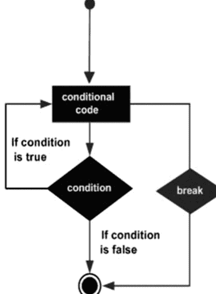

在使用 `break` 语句时必须遵循一些规则。

- 你必须在循环或 `switch` 内部编写 `break` 语句。在 `switch` 或循环外部使用 `break` 关键字会导致编译错误。

- `break` 语句通常与循环内部的条件（`if`语句）配合使用。

- 在嵌套循环或 `switch` 中，`break` 只终止最内循环或 `switch`。

- 在 `switch...case` 内部使用 `break` 将程序控制转移到 `switch` 外部。

- `break` 语句仅从最近的匹配的循环或 `switch` 终止程序控制。

#### break 语句的工作原理

```c
while (testExpression) {
    // codes
    if (condition to break) {
        break;
    }
    // codes
}
do {
    // codes
    if (condition to break) {
        break;
    }
    // codes
} while (testExpression);
```

```c
for (init; testExpression; update) {
    // codes
    if (condition to break) {
        break;
    }
    // codes
}
```

我们将结合循环和 `switch` 看到 `break` 语句的示例程序。

#### C 中的 continue 语句

我们使用 `break` 关键字立即终止循环或 `switch`。然而，在编程中，存在某些情况是你不需要终止循环，而是需要跳过循环的某些并继续下一次迭代。

例如，考虑向每个员工发送电子邮件的情况，你将执行两个操作：首先，获取员工的电子邮件地址；然后尝试向其地址发送邮件。假设某个员工没有邮箱。在这种，与其终止整个过程，不如跳过向该员工发送邮件并继续处理下一个员工。对于编程中的这种情况，我们使用 `continue` 关键字。

`continue` 是在循环内部使用的跳转语句。它跳过循环体并继续下一次迭代。`continue` 语句执行时立即将程序控制从循环体转移到循环的下部分。它的作用与 `break` 语句相反。在嵌套循环中，它继续最近的循环。

#### continue 语句的语法：

```c
continue;
```

#### continue 语句的流程图

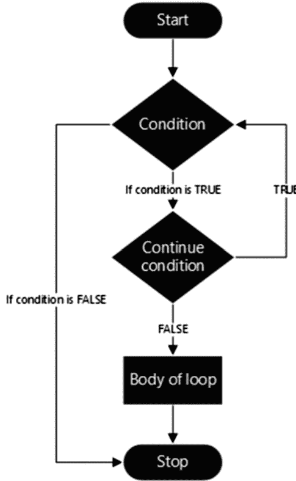

#### 如何使用 continue 语句？

在 C 编程中使用 `continue` 语句的规则。

- 你必须在循环内部使用 `continue` 关键字。在循环外部使用 `continue`会导致编译错误。

- `continue` 不用于 `switch...case` 语句。

在嵌套循环的情况下，`continue` 将继续最近循环的下一次迭代。

不要误认为 `continue` 将程序控制转移到循环。没有条件的情况下使用 `continue` 语句是没有意义的。因此，它通常与 `if` 语句配合使用。

#### continue 语句的工作原理

```c
while (testExpression) {
    // codes
    if (condition to break) {
        continue;
    }
    // codes
}
do {
    // codes
    if (condition to break) {
        continue;
    }
    // codes
} while (testExpression);
```

```c
for (init; testExpression; update) {
    // codes
    if (condition to break) {
        continue;
    }
    // codes
}
```

我们将结合循环和 `switch` 看到 `continue` 语句的示例程序。

#### break 和 continue 的区别

| `break` | `continue` |

| --- | --- |

| `break` 可以出现在 `switch` 和循环 (`for`, `while`, `do`) 语句中。 | `continue` 只出现在循环 (`for`, `while`, `do`) 语句中。 |

| `break` 导致 `switch` 或循环立即终止。遇到 `break` 时循环结束。 | `continue` 不终止循环，它导致循环进入下一次迭代。所有的迭代都会遇到。`continue`语句用于跳过它之后的循环语句。 |

## 控制语句与循环配合

`break` 语句可以用于 `switch` 和循环 (`for`, `while`, `do`) 语句。

`continue` 语句只能出现在循环中。如果出现在 `switch` 语句中将报错。

当遇到 `break` 语句时，它终止块并将控制移出 `switch` 或循环。

当遇到 `continue` 语句时，它将控制引导到循环的下一次迭代。

`break` 导致立即退出最内层循环或 `switch`。

`continue` 在嵌套循环中继续循环。

## C语言中的 goto 语句

`goto` 是一种跳转语句，用于在程序执行过程中将控制无条件地从函数的一个部分转移到另一个部分。我使用了“无条件”一词，是因为控制转移没有限制。你可以将程序控制从函数内的任何位置转移到任何位置。许多程序员使用 `goto` 来获得对程序的控制。

#### goto 语句的语法：

```
label:
goto label;
```

#### goto 语句组成

`goto` 分两部分：标签定义和 `goto` 关键字。

- 标签是跟随冒号的有效标识符。每个标签都是特定位置的书签。你可以在函数的任何地方定义任意数量标签。

- `goto` 是配合标签使用的关键字，将控制转移到指定的标签。你只能将控制转移到同一函数内的标签。跨函数的控制转移使用 `goto` 是可能的，并会导致编译错误。

`goto` 和 `label` 的顺序没有限制。你可以在函数的任何地方定义标签。例如，以下两个示例都是有效的。

#### 在 goto 语句上方定义标签

```
goto label1;
```

#### goto 语句下的标签定义

`goto label2;`

`label2:`

#### goto 语句的流程图

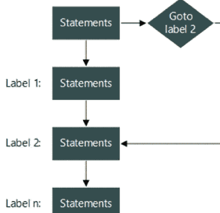

#### goto 在编程中的用法

**`goto`** 会使程序的可读性降低、容易出错且难以查找错误。由于从函数的一个部分到另一个部分的无条件控制转移，在某一点，程序员无法判断程序是如何到达你代码中的某个特定位置的。因此，大多数程序员都避免使用 **`goto`**。

**重要提示：** 你应该尽可能避免使用 **`goto`**。尝试用 **`if...else, switch...case`** 和**循环语句**的组合来替换 `goto` 语句。

考虑下方的 **`goto`** 示例，以演示在何时以及为什么你应该避免使用 **`goto`**。

```c
#include <stdio.h>

int main()
{
    int i=1;
    start:
    goto print;
    print:
    printf("%sd ", i);
    goto next;
    increment:
    i++;
    goto print;
    next:
    if(i < 10)
        goto increment;
    else
        goto exit;
    printf("I cannot execute.");
    exit:
    return 0;
}
```

上面的程序很难阅读且难以发现错误（如果有的话）。因此，在这种情况下，你必须避免使用 `goto`。

好的，包括我在内的许多程序员都讨论过 `goto` 的不可靠性。然而，`goto` 在很多情况下是有用的，例如：

- 跳出深层嵌套循环。

- 从其他地方将控制权转移到任何嵌套循环层。

**注意：** 你可以使用 `goto` 和 `if...else` 的组合来构建任何循环。

#### C 语言中的 switch 语句

C 语言中的 `switch` 语句是 `if-else-if` 阶梯语句的替代方案，它允许我们对名为 `switch` 变量的单个变量的不同可能值执行多个操作。在这里，我们可以为单个变量的不同值在多个 `case` 中定义各种语句。

`switch` 语句测试变量的值并将其与多个 `case` 进行比较。当找到匹配的 `case` 时，将执行与该特定 `case` 相关的语句块。

`switch` 块中的每个 `case` 都有不同的名称/数字，称为标识符。用户提供的值将与 `switch` 块中的所有 `case` 进行比较，直到找到匹配。

如果找到匹配的 `case`，则执行默认（`default`）语句，控制将离开 `switch` 块。

#### C 语言 switch 语句的规则

1. `switch` 表达式必须是整数或字符类型。

2. `case` 值必须是整数或字符常量。

3. `case` 值只能在 `switch` 语句内部使用。

4. `switch case` 中的 `break` 语句不是必须的。它是可选的。如果在 `case` 中没有找到 `break` 语句，则匹配 `case` 之后的所有 `case` 都将执行。这在 C `switch` 语句中被称为“穿透”（`fall through`）状态。

5. `Case` 值必须是常量且唯一的。

6. `Case` 标签必须以冒号（:）结尾。

7. 只能有一个 `default` 标签。

8. 每个 `case` 中必须存在一个 `break` 关键字。

9. 我们可以嵌套多个 `switch` 语句。

让我们通过示例来尝试理解它。假设有以下变量：


```c
int x,y,z;
char a,b;
float f;
```

#### 使用控制语句和循环

| 有效 switch | 无效 switch | 有效 Case | 无效 Case |

| :--- | :--- | :--- | :--- |

| switch(x) | switch(f) | case 3; | case 2.5; |

| switch(x>y) | switch(x+2.5) | case 'a'; | case x; |

| switch(a+b-2) | | case 1+2; | case x+2; |

| switch(func(x,y)) | | case 'x'>'y'; | case 1,2,3; |

#### C 语言 switch 语句的流程图

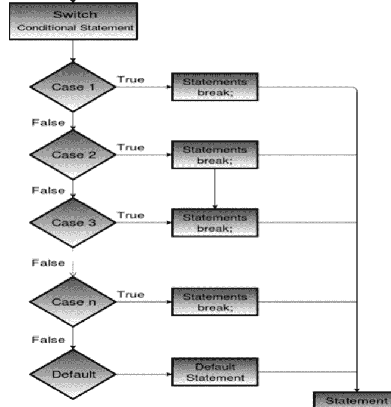

C 语言 `switch` 语句的语法如下：

```c
switch(expression){
    case value1:
        // 要执行的代码;
        break; // 可选
    case value2:
        // 要执行的代码;
        break; // 可选
        ....
    default:
        // 如果所有 cases 都不匹配时执行的代码;
}
```

#### switch case 语句的功能

首先，求值 `switch` 语句指定的整数表达式。然后将该值与不同 `case` 给出的常量值逐一匹配。如果找到匹配项，则执行该 `case` 中指定的所有语句，以及该 `case` 之后的所有 `case`，包括 `default` 语句。任何两个 `case` 不可以有相似的值。如果匹配的 `case` 包含 `break` 语句，则之后的所有 `case` 都将被跳过，控制将离开 `switch`。否则，匹配 `case` 之后的所有 `case` 都将执行。

让我们来看一个 C 语言 `switch` 语句的简单示例。

#### Switch case 示例 1:

```c
#include<stdio.h>
int main(){
    int number=0;
    printf("enter a number:");
    scanf("%d",&number);
    switch(number){
        case 10:
            printf("number is equal to 10");
            break;
        case 50:
            printf("number is equal to 50");
            break;
        case 100:
            printf("number is equal to 100");
            break;
        default:
            printf("number is not equal to 10, 50 or 100");
    }
    return 0;
}
```

输出：

enter a number:10

number is equal to 10

#### Switch case 示例 2:

```c
#include<stdio.h>
int main(){
    int x=10;
    int y=5;
    switch(x>y){
        case 1:
            printf("hi");
            break;
        case 0:
            printf("bye");
            break;
    }
    return 0;
}
```

输出：

hi

#### C switch 语句穿透

C `switch` 语句穿透意味着如果不使用 `break` 语句，匹配 之后的所有 `case` 都将执行。让我们尝试下面的示例。

```c
#include<stdio.h>
int main(){
    int number=0;
    printf("enter a number:");
    scanf("%d",&number);
    switch(number){
        case 10:
            printf("number is equal to 10");
        case 50:
            printf("number is equal to 50");
        case 100:
            printf("number is equal to 100");
        default:
            printf("number is not equal to 10, 50 or 100");
    }
    return 0;
}
```

输出：

enter a number:10

number is equal to 10

number is equal to 50

number is equal to 100

#### 嵌套 switch case

我们可以在 `switch` 内部使用任意数量的 `switch` 语句。考虑以下示例：

```c
#include <stdio.h>
int main () {
  int i = 10;
  int j = 20;

  switch(i) {
    case 10:
      printf("the value of i evaluated in outer switch: %d\n",i);
    case 20:
      switch(j) {
        case 20:
          printf("The value of j evaluated in nested switch: %d\n",j);
      }
  }

  printf("Exact value of i is : %d\n", i);
  printf("Exact value of j is : %d\n", j);

  return 0;
}
```

输出：

the value of i evaluated in outer switch: 10

The value of j evaluated in nested switch: 20

Exact value of i is : 10

Exact value of j is : 20

## 循环语句

### 简介

计算机是执行重复任务的最合适机器，可以不知疲倦地执行成千上万次。每种编程语言都通过某些形式的语句来完成此类重复任务。重复执行一组语句的过程被称为循环。语句根据条件执行多次。但如果给定的逻辑使得重复可以任意次数进行，而没有固定条件来停止这些语句，那么这种类型的循环被称为无限循环。

循环语句允许我们多次执行一个语句或一组语句。在 C 编程语言中，有三种循环：`while`、`do-while` 和 `for`。

#### 为什么要使用循环？

当你需要多次执行一段代码块时，你需要在 C 语言中使用循环概念。

#### 循环语句的优点

- 减少代码长度。
- 占用较少的内存空间。
- 减轻开发者的负担。
- 缩短了执行程序的耗时过程。

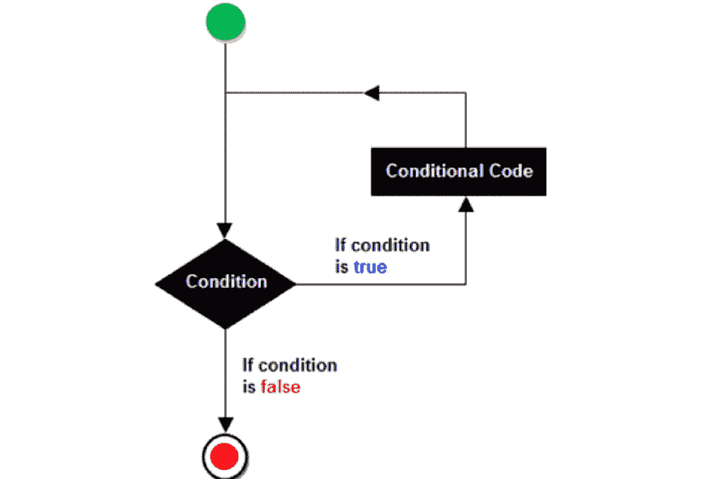

#### 循环的类型

根据控制语句在程序中的位置，循环分为两类：

- 1. 入口控制循环
- 2. 出口控制循环

在入口控制循环中，在执行循环体之前会检查条件。它也被称为预检查循环。

在出口控制循环中，在执行循环体之后会检查条件。它也被称为后检查循环。

控制条件必须定义良好且明确。否则，循环将执行无限次。不停止执行语句次数的循环被称为无限循环。无限循环也称为“无尽循环（Endless loop）”。

#### 以下是无限循环的一些特征：

- 1. 没有指定终止条件。
- 2. 指定的条件永远不会满足。

指定的条件决定了是否执行循环体。“C”编程语言为我们提供了三种类型的循环语句（结构）：

- 1. `while` 循环
- 2. `do-while` 循环
- 3. `for` 循环

#### while 循环

循环是一种入口控制循环。在 `while` 循环中，在处理循环体之前会评估条件。如果条件为真，那么且只有那时才会执行循环体。在执行循环体之后，控制回到开头，检查条件是否为真；如果是，则执行相同的过程，直到条件变为假。一旦条件变为假，控制就会离开循环。

退出循环后，控制将跳转到紧随循环之后的语句。循环体可以包含多个语句。如果它只包含一个语句，则大括号不是强制的。尽管即使循环体中只有一个语句，使用大括号也是一种良好的习惯。

在 `while` 循环中，如果条件不为真，则循环体将不会执行，即使一次也不。这与稍后介绍的 `while` 循环不同。

#### while 循环是如何工作的？

- `while` 循环评估括号 `()` 内部的测试表达式。
- 如果测试表达式为真，则执行 `while` 循环体内的语句。然后，再次评估测试表达式。
- 该过程一直持续直到测试表达式被评估为假。
- 如果测试表达式为假，循环终止（结束）。

#### while 循环的流程图

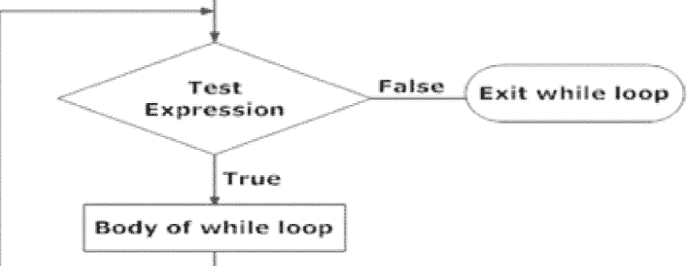

`while` 循环通过三个步骤完成：

- 变量初始化（例如 `int x = 0;`）
- 条件（例如 `while(x <= 10)`）
- 变量增或减（`x++` 或 `x--` 或 `x = x + 2`）

`while` 循环的语法如下：

```
变量初始化;
while(条件)
{
    语句;
    变量增或减;
}
```

`while` 循环的示例程序：

```c
#include<stdio.h>
#include<conio.h>
int main()
{
    int num=1; //初始化变量
    while(num<=10) //while循环条件
    {
        printf("%d\n",num);
        num++; //增加操作
    }
    return 0;
}
```

#### 输出：

上面的程序说明了 `while` 循环的使用。在上面的程序中，我们使用 `while` 循环打印了从 1 到 10 的系列数字。

```c
#include<stdio.h>
#include<conio.h>
int main() {
    int num=1; //初始化变量
    while(num<=10) //while循环条件
    {
        printf("%d\n",num);
        num++; //增加操作
    }
    return 0;
}
```

- 1. 我们初始化了一个名为 `num` 的变量，值为 1。我们将打印 1 到 10。因此，变量初始化值为 1。如果你想从 0 开始打印，请在初始化时赋值 0。
- 2. 在 `while` 循环中，我们提供了一个条件 `(num<=10)`，这意味着循环将执行体直到 `num` 的值变为 10。之后，循环将终止，控制将循环外部。
- 3. 在循环体中，我们有一个打印函数来打印数字，以及一个增加操作来在每次循环执行时增加值。`num` 的初始值为 1，执行后它将变为 2，在下一次执行期间，它将变为 3。这个过程将一直持续直到值变为 10，然后在控制台上打印该系列数字并终止循环。

`\n` 用于格式化，意味着值将在新行打印。

#### while 循环中的 break 语句

`break` 语句主要用于 `switch` 语句。它对于立即停止循环也非常有用。

我们考虑以下程序，它引入了 `break` 来退出 `while` 循环

```c
#include <stdio.h>
int main()
{
    int num = 5;
    while (num > 0)
    {
        if (num == 3)
            break;
        printf("%d\n", num);
        num--;
    }
}
```

**输出：5 4**

#### while 循环中的 continue 语句

当你想要跳到下一次迭代但留在循环中时，你应该使用 `continue` 语句。

**示例：**

```c
#include <stdio.h>
int main() {
    int nb = 7;
    while (nb > 0)
    {
        nb--;
        if (nb == 5)
            continue;
        printf("%d\n", nb);
    }
}
```

输出：6 4 3 2 1 0（跳过了 5）

#### do-while 循环

正如我们在 `while` 循环看到的，只有当条件为真时才执行体。在某些情况下，即使条件为假，我们也必须至少执行一次循环体。这种操作可以通过使用 `do-while` 循环来实现。

`do-while` 循环与 `while` 循环相似，不同之处是在体之后总是检查条件。

#### do-while 的语法：

```
do
{
    循环体内的语句
}
while (条件);
```

#### do-while 循环的流程图

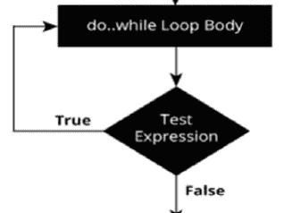

#### do-while 循环的示例程序：

```c
#include<stdio.h>
#include<conio.h>
int main()
{
    int num=1;
    do
    {
        printf("%d\n",num*2);
        num++;
    } while(num<=10);
    return 0;
}
```

输出：2 4 6 8 10 12 14 16 18 20

#### 使用控制语句与循环

```c
i++;
{
    printf("do you want to continue with the table of %d \n enter any non-zero value to continue.",n+1);
    scanf("%d",&choice);
}
if(choice == 0)
{
    break;
}
n++;
}while(1);
```

输出：

2 X 1 = 2    2 X 2 = 4    2 X 3 = 6    2 X 4 = 8    2 X 5 = 10

2 X 6 = 12   2 X 7 = 14   2 X 8 = 16

2 X 9 = 18   2 X 10 = 20

你想继续查看 3 的乘法表吗，请输入任意非 0 

的值以继续。11

3 X 1 = 3    3 X 2 = 6    3 X 3 = 9    3 X 4 = 12

3 X 5 = 15   3 X 6 = 18   3 X 7 = 21

3 X 8 = 24   3 X 9 = 27   3 X 10 = 30

你想继续查看 4 的乘法表吗，请输入任意非 0 

的值以继续。0

#### while 循环与 do 循环的区别

| WHILE | DO-WHILE |

| --- | --- |

| 先检查条件，后执行语句(s)。 | 先执行语句(s)，后检查条件。 |

| 可能会执行 0 次，如果条件为假。 | 至少执行一次语句(s)。 |

| while 末尾没有分号。 | do-while 末尾有分号。 |

| 如果是单条语句，不需要括号。 | 总是需要括号。 |

#### for 循环

| 变量在循环执行前初始化。 | 变量可以在循环外或初始化。 |

| while 循环是进入控制的。 | do-while 循环是退出控制的。 |

| while(condition){ 语句(s); } | do { 语句(s); }while(condition); |

| for 循环是 'C' 语言中更高效的结构。 | |

for 循环流程图


`for` 循环的通用语法结构如下：

for ( 初始值; 条件; 递增或递减 ) {

  语句;

}

#### for 循环是如何工作的？

- 初始化语句只执行一次。
- 然后评估测试表达式。如果测试表达式为假，循环终止。
- 然而，如果测试表达式为真，执行循环体内的语句(s)，并更新表达式。
- 再次评估测试表达式。

这个过程一直持续直到测试表达式为假。此时，循环终止。

以下程序演示了简单 `for` 循环的使用：

```c
#include<stdio.h>
int main()
{
    int number;
    for(number=1;number<=10;number++){for 循环打印 1-10
    {
        printf("%d\n",number);
    }
    return 0;
}
```

输出：

1 2 3 4 5 6 7 8 9 10

上面的程序使用 `for` 循环打印 1-10 的序列。

```c
#include<stdio.h>
int main()
{
    int number;
    for(number=1;number<=10;number++)
    {
        printf("%d\n",number)
    }
    return 0;
}
```

1. 我们声明了一个 `int` 类型的变量。
2. 在 `for` 循环的初始化部分，我们给 `number` 赋值为 1。
3. 在条件部分，我们指定了条件，然后是递增部分。


4. 在循环体中，我们有函数在控制台打印新行。第一次迭代后，该值会增加，变为 2。现在变量 `number` 的值为 2。将会重新检查条件，由于条件为真，循环将执行，并在屏幕上打印两个。这个循环将一直执行直到变量的值变为 10。之后，循环将终止。

### C 语言中 for 循环的各种形式

在以下示例中，我使用 `num` 作为计数器：

- 1. 这里，我没有使用 `num++`，而是使用 `num=num+1`，这与 `num++` 相同。

```c
for(num=10;num<20;num=num+1)
```

- 2. 如所示，可以跳过初始化部分，计数器在循环之前声明。

```c
int num=10;
for(num<20;num++)
```

注意：尽管我们可以跳过初始化部分，但条件前面的分号 `;` 是必须的，否则会导致编译错误。

- 3. 像初始化一样，我们也可以跳过递增部分。在这种情况下，分号 `;` 在条件之后。递增或递减部分在循环内部完成。

```c
for(num=10;num<20);
{
  //语句
  num++;
}
```

- 4. 这也是可能的。计数器在循环前初始化并在循环内递增。

```c
int num=10;
for(;num<20;)
{
num++;
}
```

- 5. 如上所述，计数器也可以递减。在下面的示例中，变量每次运行都会递减，直到条件 `num>10` 返回假。

```c
for(num=20;num>10;num--)
```

### C 语言中 for 循环的多个初始化

我们可以在 `for` 循环中有多个初始化，以及简单的 `for`。

### 上述循环的区别

- 1. 它初始化了两个变量。**注意：**由逗号连接。

- 2. 它有两个变量。**注意：**由逗号连接。

- 3. 它有两个变量。**注意：**由逗号连接。

- 4. 它有两个变量。**注意：**由逗号连接。

- 5. 它有两个变量。**注意：**由逗号连接。

```c
{
  printf("\n");
  /* 第一个循环内部第二个循环 */
  for(j = i; j >0; j--) {
    printf("%d", j);
  }
}
```

**输出：**

1

21

321

4321

54321

### 复习题

- 简答题：

1. C语言中的控制语句有哪些？

2. 画出 `if-else` 语句的流程图。

3. C语言中 `break` 语句的作用是什么？

4. C语言中 `continue` 语句的作用是什么？

5. C语言中 `goto` 语句的作用是什么？

6. 什么是循环和无限循环？

7. C语言中 `while` 循环和 `do-while` 循环的主要区别是什么？

8. 什么是C语言中的嵌套循环？

9. 写出C语言中 `for` 循环的基本语法。

10. 写出C语言中 `while` 和 `do-while` 循环的基本语法。

- 答题：

1. C语言什么是 `switch` 语句？解释C语言中 `switch` 语句的规则。

2. C语言中的跳转语句有哪些？详细解释。

3. 结合合适的示例解释C语言的 `if-else` 控制语句。

4. 结合合适的示例详细区分 `while` 循环和 `do-while` 循环。

5. 写出 `for` 循环的工作步骤以及循环的不同初始化形式。

6. 解释C语言中各种类型的循环语句。

### 单选题

- 1. 关键字 `'break'` 不能直接在 ______ 内部简单使用。

(a) `do-while` (b) `if-else` (c) `for` (d) `while`

- 2. 使用哪个关键字仅退出当前迭代的循环？

(a) `break` (b) `continue` (c) `return` (d) 以上皆非

- 3. 下述C代码的输出是什么？

```c
#include <stdio.h>
void main() {
    int x = 5;
    if(x < 5)
        printf("hello");
    if(x ==5)
        printf("hi");
    else
        printf("no");
}
```

(a) `hi` (b) `hello` (c) `no` (d) 错误

- 4. 下述C代码的输出是什么？

```c
#include <stdio.h>
void main() {
    int x = 5;
    if(x < 1)
        printf("Hello");
}
```

(a) 无 (b) 运行时错误 (c) `Hello` (d) 变化

- 5. 下述C代码的输出是什么？

```c
#include <stdio.h>
int main() {
    int a = 0, i = 0, b;
    for(i=0; i<5; i++) {
        a++;
        continue;
    }
}
```

(a) 2 (b) 3 (c) 4 (d) 5

- 6. 条件运算符有时也被称为 ________ 运算符。

(a) 一元 (b) 二元 (c) 三元 (d) 以上皆非

- 7. `%` 运算符被称为 ________ 运算符。

(a) 条件 (b) 逻辑 (c) 取模 (d) 位运算

- 8. 默认标签可以放置在 `switch` 语句的哪个位置 ________。

(a) 开头 (b) 结尾 (c) 中间 (d) 任意位置

### 使用控制语句和循环 103

- 9. Case 标签必须以标记 [ ] 结尾

(a) `(` (b) `;` (c) `)` /

- 10. 哪种语句有助于根据特定条件是否满足从程序的一个部分跳转到另一个部分？ [ ]

(a) 条件分支 (b) 循环 (c) 迭代 (d) 以上皆非

答案：1. (b), 2. (b), 3. (a), 4. (c), 5. (d), 6. (c), 7. (c), 8. (b), 9. (c), 10. (b)。

### 空选题

- 1. 在 `do-while` 循环中，如果循环体执行了 n 次，测试条件会被评估 ____ 次。

2. `switch` 是一种 ________ 。

3. ________ 语句用于跳过循环中的语句。

4. `while` 是一种 ________ 语句。

5. ________ 用于终止循环。

6. 语句验证了结构化编程的规则。

7. ________ 将控制权转移到标记语句。

8. 在 `switch case` 语句中不能检查 ________。

9. ________ 语句用于重复执行语句列表。

10. `for` 循环中的初始化只在 ____ 完成。

答案：1. n 次, 2. 多路分支, 3. Continue, 4. 入口控制循环, 5. break statement, 6. goto, 7. goto statement, 8. float, 9. 迭代, 10. 一次。

## 函数的返回语句

```c
#include <stdio.h>
int addNumbers(int a, int b);
int main() {
    sum = addNumbers(n1, n2);
}
int addNumbers(int a, int b) {
    return result;
}
```

一个函数可以有多个返回语句。

示例：

```c
maximum(a,b)
float a,b;
{
    if ( a > b )
        return (a);
    else
        return (b);
}
```

一个函数也可以完全没有返回语句。当到达函数末尾时，控制权会自动转移到调用点，且函数不返回任何。

## 调用函数

当函数名后面跟着分号时，函数就会被调用。当函数被调用时，形式参数会自动初始化为函数中使用的实际参数。实际参数和形式参数的数量必须相等。接下来，执行函数体。如果在执行函数体期间遇到返回语句，函数将终止执行，并返回返回语句中指定的值（如果有）作为函数的返回值。

## 函数、数组与字符串

函数必须始终定义在全局环境中，函数不能定义在另一个函数内部。

示例：

`F = factorial (n)`

参数 `n` 被称为实际参数。实际参数在类型、数量和顺序上应与函数定义中出现的形式参数匹配。在没有任何参数的情况下，应提供一对空括号。

C 程序的执行从 `main()` 函数开始。

当编译器遇到 `functionName();` 时，程序的控制权跳转到：

```c
void functionName()
```

然后，编译器开始执行 `functionName()` 内部的代码。

一旦执行完函数定义内部的代码，程序的控制权就会返回 `main()` 函数。

### C语言编程中函数是如何工作的？

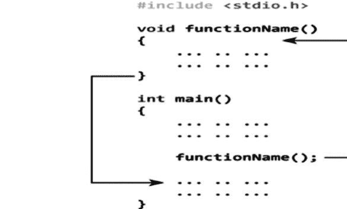

注意：函数名是标识符，应该是唯一的。

C 语言中有两种函数：

- 内置（库）函数：系统提供这些函数并存储在库中。因此，它们也被称为库函数，例如 `printf()`、`scanf()`、`strcpy()`、`strlwr`、`strcmp()`、`strlen()`、`strcat()` 等。

- 用户定义函数：这些函数是由用户在编写程序时定义的。

你也可以根据需要创建函数。此类用户创建的函数被称为用户定义函数。

### 格式化函数与非格式化函数：

#### 格式化函数

- 它们需要格式化字符串来产生格式化结果。

- 它们可用于所有数据值的读写。

- 格式化函数在执行后返回结果。

##### C 格式化 IO 函数

根据要求格式化输入数据或输出结果。格式化函数提高了输入输出的可读性。格式化函数可以读写所有类型（char, int, float, double）。格式化输入输出函数需要格式说明符（`%c`, `%d`, `%f`, `%lf`）来识别数据类型。

##### `scanf()` 函数

`scanf()` 从输入设备（或）文件读取所有类型的数据值。地址运算符 `&` 用于指示变量的内存位置。该内存位置用于存储通过键盘读取的数据。

##### `scanf()` 函数程序：

```c
#include <stdio.h> //头文件部分
int main()
{
int a
```

## 函数、数组与字符串

- 输入 a = 6 的值

- 输入 b = 4 的值

- a + b = 10

#### 宽度说明符程序：

```c
#include <stdio.h> //头文件部分
int main() {
    printf("\n%2s", "abcdef");
    printf("\n%3s", "abcdef");
    printf("\n%4s", "abcdef");
    printf("\n%5s", "abcdef");
    printf("\n%6s", "abcdef");
    return 0;
}
```

- ab

- abc

- abcd

- abcde

- abcdef

注意：输出本身显示了该过程。

```c
#include <stdio.h> //头文件部分
int main() {
    int a, b, sum;
    printf("Enter value of a: ");
    scanf("%d", &a);
    printf("Enter value of b: ");
    scanf("%d", &b);
    sum = a + b;
    printf("a + b = %d", sum);
    return 0;
}
```

`"math.h"` 和 `"stdlib.h"` 头文件支持 C 语言中的所有算术函数。以下是 C 语言中使用的所有算术函数。

| 函数 | 说明 |
| --- | --- |
| `abs()` | 此函数返回整数的绝对值。数的绝对值始终为正数。C 语言仅支持整数值。 |
| `floor()` | 此函数返回小于或等于传递给函数的参数的最近整数。 |
| `round()` | 此函数返回与传递给函数的 float/double/long 参数的的整数。如果小数部分在 .1 到 .5 之间，它返回小于参数的整数值；如果小数部分在 .6 到 .9 之间，它返回大于参数的整数值。 |
| `ceil()` | 此函数返回大于或等于传递给函数的参数的最近整数。 |
| `sin()` | 此函数用于计算正弦。 |
| `cos()` | 此函数用于计算余弦。 |
| `cosh()` | 此函数用于计算双曲余弦。 |
| `exp()` | 此函数用于计算指数 "e" 的 x 次方。 |
| `tan()` | 此函数用于计算正切。 |
| `tanh()` | 此函数用于计算双曲正切。 |
| `sinh()` | 此函数用于计算双曲正弦。 |
| `log()` | 此函数用于计算自然对数。 |
| `log10()` | 此函数用于计算以 10 为底的对数。 |
| `sqrt()` | 此函数用于找到传递给函数的参数的平方根。 |
| `pow()` | 用于计算给定幂。 |
| `trunc()` | 此函数截断浮点值的小数部分并返回整数值。 |

#### 函数、数组和字符串

- C 语言中的 `abs()` 函数返回 float/ 的最近整数值。数的绝对值始终为正数。C 语言仅支持整数值。`"stdlib.h"` 头文件支持 C 语言中的 `abs()` 函数。C 语言中 `abs()` 函数的语法所示：

`int abs ( int n )`

- C 语言中的 `floor()` 函数返回小于或等于传递给函数的浮点数参数的最近整数值。`"math.h"` 头文件支持 C 语言中的 `floor()` 函数。C 语言中 `floor()` 函数的语法所示：

`double floor ( double x )`

- C 语言中的 `round()` 函数返回传递给函数的 double/long 参数的最近整数值。如果小数部分在 .1 到 .5 之间，它返回大于参数的整数；如果小数部分在 .6 到 .9 之间，它返回大于参数的整数值。`"math.h"` 头文件支持 C 语言中的 `round()` 函数。C 语言中 `round()` 函数的语法所示：

`double round (double a );`
`float roundf (float a );`
`long roundl (long a );`

- C 语言中的 `ceil()` 函数返回大于或等于传递给函数的参数的最近整数。`"math.h"` 头文件支持 C 语言中的 `ceil()` 函数。C 语言中 `ceil()` 函数的语法所示：

`double ceil (double x );`

- C 语言中的 `sin()`, `cos()` 和 `tan()` 函数用于计算正弦、余弦和正切值。

- `sinh()`, `cosh()` 和 `tanh()` 函数用于计算双曲正弦、双曲余弦和双曲正切值。

- `exp()` 函数用于计算指数 "e" 的 x 次方。`log()` 函数用于计算自然对数，`log10()` 函数用于计算以 10 为底的对数。

- `"math.h"` 头文件支持 C 语言中的所有这些函数。

- C 语言中的 `sqrt()` 函数用于找到给定数的平方根。

- `"math.h"` 头文件支持 C 语言中的 `sqrt()` 函数。C 语言中 `sqrt()` 函数的语法所示：

`double sqrt (double x);`

- C 语言中的 `pow()` 函数用于找到给定数的幂。

- `"math.h"` 头文件支持 C 语言中的 `pow()` 函数。C 语言中 `pow()` 函数的语法所示：

`double pow (double base, double exponent);`

- C 语言中的 `trunc()` 函数截断浮点值的小数部分并返回整数值。

- `"math.h"` 头文件支持 C 语言中的 `trunc()` 函数。C 语言中 `trunc()` 函数的语法所示：

`double trunc (double a);`
`float truncf (float a);`
`long double trunc (long double a);`

#### C 编程语言中内置 INT、CHAR 验证函数列表：

- `"ctype.h"` 头文件支持 C 语言中的所有以下函数。点击下面的函数名查看详细说明和示例程序。

| 函数 | 说明 |
| --- | --- |
| `isalpha()` | 检查字符是否为字母 |
| `isdigit()` | 检查字符是否为数字 |
| `isalnum()` | 检查字符是否为字母数字 |
| `isspace()` | 检查字符是否为空格 |
| `islower()` | 检查是否为小写 |


| `isupper()` | 检查是否为大写 |
| `isxdigit()` | 检查字符是否为十六进制 |
| `isncntrl()` | 检查字符是否为控制字符 |
| `isprint()` | 检查字符是否为可打印字符 |
| `ispunct()` | 检查字符是否为标点符号 |
| `isgraph()` | 检查字符是否为图形字符 |
| `tolower()` | 检查是否为字母并转换为小写 |
| `toupper()` | 检查是否为字母并转换为大写 |

### 函数、数组和字符串

- C 语言中的 `isalpha()` 函数检查给定字符是否为字母。`isalpha()` 函数的语法所示：

`int isalpha(int x);`

- C 语言中的 `isdigit()` 函数检查给定字符是否为数字。`isdigit()` 函数的语法所示：

`int isdigit(int x);`

- C 语言中的 `isalnum()` 函数检查给定字符是否为字母数字。`isalnum()` 函数的语法所示：

`int isalnum(int x);`

- C 语言中的 `isspace()` 函数检查给定字符是否为空格。`isspace()` 函数的语法所示：

`int isspace(int x);`

- C 语言中的 `islower()` 函数检查给定字符是否为小写。`islower()` 函数的语法所示：

`int islower(int x);`

- C 语言中的 `isupper()` 函数检查给定字符是否为大写。`isupper()` 函数的语法所示：

`int isupper(int x);`

- C 语言中的 `isxdigit()` 函数检查给定字符是否为十六进制。`isxdigit()` 函数的语法所示：

`int isxdigit(int x);`

- C 语言中的 `isncntrl()` 函数检查给定字符是否为控制字符。`isncntrl()` 函数的语法所示：

`int isncntrl(int x);`

- C 语言中的 `isprint()` 函数检查给定字符是否为可打印。`isprint()` 函数的语法所示：

`int isprint(int x);`

- C 语言中的 `ispunct()` 函数检查给定字符是否为标点符号。`ispunct()` 函数的语法所示：

`int ispunct(int x);`

- C 语言中的 `isgraph()` 函数检查给定字符是否为图形字符。`isgraph()` 函数的语法所示：

`int isgraph(int x);`

- C 语言中的 `tolower()` 函数检查给定字符是否为字母并转换为小写。`tolower()` 函数的语法所示：

`int tolower(int x);`

- C 语言中的 `toupper()` 函数检查给定字符是否为字母并转换为大写。`toupper()` 函数的语法所示：

`int toupper(int x);`

### 自定义函数的需要：

- 有时，某些类型的操作或计算会在整个程序中的多处重复。
- 在这种情况下，我们可能在每次需要的地方重复程序语句。
- 另一种方法是设计一个可以在需要时被调用和使用的函数。
- 既节省时间又节省空间。

### 自定义函数是如何工作的？

```c
#include <stdio.h>
void functionName()
{
    ... ... ...
    ... ... ...
}

int main()
{
    ... ... ...
    ... ... ...

    functionName();

    ... ... ...
    ... ... ...
}
```

### 自定义函数的优点

- 1. 程序将更易理解、维护和调试。
- 2. 可以在其他程序使用的可复用代码。
- 3. 大程序可以被分成较小的模块。因此，一个大型项目可以分配给许多程序员完成。

### 示例：自定义函数

这是一个将两个整数相加的示例。为了完成这项任务，我们创建了一个自定义函数 `addNumbers()`。

```c
#include<stdio.h>

addNumbers(int a,int b);// 函数原型

int main()
{
    int n1,n2,sum;

    printf("Enters two numbers: ");
    scanf("%d %d",&n1,&n2);

    sum =addNumbers(n1, n2);// 函数调用
    printf("sum = %d",sum);

    return 0;
}

int addNumbers(int a,int b)// 函数定义
{
    int result;
    result =a+b;
    return result;// 返回语句
}
```

### 函数的组成元素

每个函数都包含以下元素：

- 1. 函数声明（函数原型）
- 2. 函数定义
- 3. 函数调用

#### 函数声明（函数原型）

- 类似于变量，在 C 语言中，每个函数在在使用之前都需要进行声明。
- 函数可以是全局声明，也可以是局部声明（在 `main()` 内部），取决于程序需求。**C 程序的结构** 语法：

```c
return_type function_name(argument list );
```

- 函数原型具有三个部分：

##### 返回类型：

- 它指定了函数的返回类型，如 `int`、`float`、`char` 等。函数如果不返回任何值，返回类型为 `void`。

##### 函数名：

- 它是函数的名称，应该是有意义的名字。它应该遵循命名规则。一些函数示例有 `display`、`show`、`calculate` 等。

##### 参数列表：

- 参数列表指定了执行任务所需的所有参数。参数之间用逗号分隔。通常提供数据类型。以下是两个 float 值的函数原型示例：

**函数声明示例**

`float sum (float, float);` 或 `float sum (float x, float y);`

其中，`float` 是返回类型，`sum` 是函数名，`float, float` 是参数列表。

#### 函数定义

- 函数定义包含执行块。它可以写在 `main()` 之前或之后，通常写在 `main()` 之后。

```c
return_type function_name( argument list )
{
    // 局部变量声明;

    // 执行语句;

    // 返回语句;
}
```

- 函数定义包含以下两个部分：
  1. 函数头
  2. 函数体

1. 函数头：
   - 函数定义的第一行被称为函数头。它由三部分组成：返回类型、函数名和参数列表。

2. 函数体：
   - 它由三部分组成：局部变量声明、执行部分和返回语句。所有需要的变量都在局部变量声明部分声明。执行部分包含执行任务的执行语句。返回语句应该是函数体的最后语句。它是可选的。如果函数的返回类型是 `void` 则可以省略，但返回类型非 `void` 的函数必须包含返回语句。下面是上述函数定义的定义示例。

**函数定义示例：**

```c
float sum ( float x, float y)
{
float result;              // 局部变量
result = x + y;            // 执行语句

return result; // 返回语句
}
```

- 无返回类型的示例如下：

```c
void sum ( float x, float y)
{
float result;              // 局部变量
result = x + y;            // 执行语句

printf("\n Sum is %.2f", result);
{
return;                      // 返回语句。可选的
}
}
```

- 注意：如果函数返回类型为 `void`，我们可以省略返回语句。

#### 函数调用

- 函数只需通过使用函数名后跟实际参数（参数）（如果有的话）来调用。下面的示例调用了我们定义的 `sum()` 函数。

```c
void main ()
{
float result;              // 接收局部变量
result = sum (10.0, 2.0);   // 函数调用
printf("\n Sum is %.2f", result);
}
```

当编译器遇到函数调用时，控制转移到函数定义并逐行执行函数，并通过返回语句返回一个计算值。

返回值被赋值给接收变量。如下所示：

```c
void sum ( )
{
    float result ; // 接收局部变量
    result = sum (10.0, 2.0) ); // 函数调用
    printf("\n sum is %.2f", result);
}
float sum ( float x, float y )
{
    float result ; // 局部变量
    result = x + y ; // 执行语句
    return result ; // 返回语句
}
```

在函数调用中传递的参数与函数定义中接收的参数应具有相同的数据类型。

例如，在上面的函数调用 `sum (10.0, 2.0)` 中，我们传递了 `float` 类型参数，在函数定义内部，这些 `float` 类型参数分别被 `float` 变量 `x` 和 `y` 接收。简而言之，函数调用和函数定义中的参数类型应该是相同的。

函数定义中使用的参数被称为形式参数。

### 函数参数

如果函数要使用参数，它必须声明接收参数值的变量。这些变量被称为函数的形式参数。

形式参数类似于函数内部其他局部变量，在进入函数时创建，在退出时销毁。

调用函数时，有两种方式可以将参数传递：

#### 函数、数组和字符串

| 序号 | 调用类型与描述 |
| :--- | :--- |
| 1 | **按值传递 (Call by value)** <br>这种方法将参数的实际值拷贝到函数的形式参数中。在这种情况下，函数内部对参数的修改对参数没有影响。 |
| 2 | **按引用传递 (Call by reference)** <br>这种方法将参数的地址拷贝到函数的形式参数中。在函数内部，使用该地址访问函数中使用的实际参数。这意味着对参数的修改会影响调用。 |

默认情况下，C 语言使用**按值传递**来传递参数。通常，这意味着函数内部的代码无法修改调用时使用的参数。

**按值传递**

**按值传递** 传递参数的方法是将参数的实际值拷贝到函数的形式参数中。在这种情况下，函数内部对参数的修改对参数没有影响。

考虑下面的 `swap()` 函数定义：

```c
/*交换两个值的定义 */
void swap(int x,int y)
{
    int temp;
    temp=x;/*保存x的值*/
    x=y;
    /*赋值给x*/
    y=temp;/*赋值给y*/
    return;
}
```

```c
#include <stdio.h>

/*function declaration */
void swap(int, int y);

int main()
{
    /*local definition */
    int a = 10;
    int b = 20;

    printf("Before value of a: %d\n", a);
    printf("Before value of b: %d\n", b);

    /*calling */
    swap(a, b);

    printf("After value of a: %d\n", a);
    printf("After value of b: %d\n", b);

    return 0;
}
```

让我们将上述代码放在单个文件中，编译并执行，它将产生以下结果：

Before value of a: 10

Before value of b: 20

After value of a: 10

After value of b: 20

这显示尽管值在函数内部被修改过，但它们并没有发生变化。

### 引用传递 (Call by reference):

向函数传递参数的**引用**方法是将参数的地址复制到形式参数中。在函数内部，使用该地址来访问实际使用的参数。

```c
/*function definition*/
void swap(int *x, int *y)
{
    int temp;
    temp = *x;
    *x = *y;
    *y = temp;
}
```

要通过引用传递值，像传递其他值一样将参数传递给函数。因此，你需要将函数参数声明为指针类型。如下示例：

```c
#include <stdio.h>

/*function declaration*/
void swap(int *x, int *y);

int main()
{
    /*local definition*/
    int a = 10;
    int b = 20;

    printf("Before value of a: %d\n", a);
    printf("Before value of b: %d\n", b);

    /*calling*/
    swap(&a, &b);

    printf("After value of a: %d\n", a);
    printf("After value of b: %d\n", b);

    return 0;
}
```

让我们将上述代码放在单个文件中，编译并执行以产生以下结果：

Before value of a: 10

Before value of b: 20

After value of a: 20

After value of b: 10

这显示更改也反映在了函数外部，这与值传递不同。

### 值传递与引用传递的区别

函数可以通过两种方式调用：**值传递 (Call by Value)** 或**引用传递 (Call Reference)**。这两种方式通常通过传递给它们的参数的值的类型来区分，作为函数参数传递的参数被称为*实际参数*，而函数接收到的参数称为*形式参数*。

**值传递：** 在这种参数传递方法中，实际参数的值被复制到函数的形式参数中，两者存储在不同的内存位置。因此，在函数内部内部的任何更改都不会反映在调用者的实际参数中。

**引用传递：** 实际参数和形式参数都指向同一个位置。因此，在函数内部进行的任何更改实际上都会反映在调用者的实际参数中。

### 函数、数组与字符串

| 值传递 (CALL BY VALUE) | 引用传递 (CALL BY REFERENCE) |
| :--- | :--- |
| 在调用函数时，我们把变量的值传递给它。此类函数被称为“值传递”。 | 在调用函数时，我们不是传递变量的值，而是将变量的地址（变量的位置）传递给函数，被称为“引用传递”。 |
| 在这种方法中，调用函数中每个变量的值被复制到被调用函数的形变量中。 | 在这种方法中，调用函数中实际变量的地址被复制到被调用函数的形变量中。 |
| 通过这种方法，对被调用函数中的形变量所做的更改对调用函数中的实际变量没有影响。 | 通过这种方法，使用地址访问实际变量，因此能够对它们进行操作。 |

### 变量的作用域 (SCOPE OF A VARIABLE)

任何编程语言中的作用域都是程序中的一个区域，定义的变量在该区域内存在，而在区域之外无法被访问。在编程语言中，可以在三个地方声明变量：

- 在函数或块内部，称为局部变量。
- 在所有函数外部，称为全局变量。
- 在函数参数的定义中，称为形式参数。

让我们理解一下什么是局部变量、全局变量以及形式参数。

#### 局部变量

在函数或块内部声明的变量称为局部变量。它们只能由该函数或代码块内部的语句使用。局部变量对于外部的函数是不可见的。下面的示例显示了局部变量的使用。在这里，所有变量 `a`、`b` 和 `c` 都是 `main()` 的局部变量。

```c
#include <stdio.h>
int main() {
    /* local variable declaration */
    int a, b;
    int c;
    /* actual initialization */
    a = 10;
    b = 20;
    c = a + b;
    printf("value of a = %d, b = %d and c = %d\n", a, b, c);

    return 0;
}
```

#### 全局变量

全局变量定义在函数外部，通常位于程序的顶部。全局变量在程序的生命周期内保持其值，并可以在程序定义的任何函数内部访问。

全局变量可以被任何函数访问，即全局变量在声明后在整个程序范围内可用。下面的程序显示了全局变量在程序中使用。

```c
#include <stdio.h>

/* global variable declaration */
int g;

int main() {
    /* local variable declaration */
    int a = 10;
    int b = 20;
    g = a + b;
    printf("value of a = %d, b = %d and g = %d\n", a, b, g);

    return 0;
}
```

使用 C 和 C++ 编程


```
checkPrimeNumber();    // 没有传递参数
return 0;
}
// 返回类型为 void，意味着不返回任何值
void checkPrimeNumber()
{
    int n, i, flag = 0;
    printf("Enter a positive integer: ");
    scanf("%d",&n);
    for(i=2; i<= n/2; ++i) {
        if(n%i == 0) {
            flag = 1;
        }
    }
    if (flag == 1)
        printf("%d is not a prime number.", n);
    else
        printf("%d is a prime number.", n);
}
```

`checkPrimeNumber()` 函数从用户获取输入，检查其是否为质数并显示在屏幕上。

`main()` 函数内部 `checkPrimeNumber();` 语句中的空括号表示没有向函数传递参数。

函数的返回类型为 `void`。因此，函数没有返回任何值。

### 示例 2：未传递参数但有返回值：

```c
#include<stdio.h>
int getInteger();

int main()
{
    int n, i, flag = 0;

    // 没有传递参数
    n = getInteger();

    for(i=2; i<=n/2; ++i)
    {
        if(n%i==0){
            flag = 1;
            break;
        }
    }

    if (flag == 1)
        printf("%d is not a prime number.", n);
    else
        printf("%d is a prime number.", n);

    return 0;
}

// 返回用户输入的整数
getInteger()
{
    int n;

    printf("Enter a positive integer: ");
    scanf("%d",&n);

    return n;
}
```

`n = getInteger();` 语句中的空括号表示没有向函数传递参数。并且，函数返回的值被赋值给 `n`。

在这里，`getInteger()` 函数从用户处获取输入并返回。检查数字是否为质数的代码位于 `main()` 函数中。

#### 示例 3：传递了参数但没有返回值：

```c
#include <stdio.h>
void checkPrimeAndDisplay(int n);
int main()
{
    int n;

    printf("Enter a positive integer: ");
    scanf("%d",&n);

    // n 被传递给函数
    checkPrimeAndDisplay(n);

    return 0;
}

// 返回类型为 void，意味着不返回任何值
void checkPrimeAndDisplay(int n)
{
    int i, flag = 0;
    for(i=2; i<= n/2; ++i)
    {
        if(n%i == 0){
            flag = 1;
            break;
        }
    }
    if(flag == 1)
        printf("%d is not a prime number.",n);
    else
        printf("%d is a prime number.", n);
}
```

用户输入的整数值被传递给 `checkPrimeAndDisplay()` 函数。

在这里，`checkPrimeAndDisplay()` 函数检查传递的参数是否为质数并显示相应的消息。

#### 示例 4：传递了参数且返回值：

```c
#include <stdio.h>
int checkPrimeNumber(int n);

int main()
{
    int n, flag;

    printf("Enter a positive integer: ");
    scanf("%d",&n);

    // n 被传递给 checkPrimeNumber() 函数
    // 返回值被赋值给 flag 变量
    flag = checkPrimeNumber(n);

    if(flag == 1)
        printf("%d is not a prime number",n);
    else
        printf("%d is a prime number",n);

    return 0;
}

// 从函数返回 int 类型
int checkPrimeNumber(int n)
{
    int i;
    for(i=2; i<= n/2; ++i)
    {
      if(n%i == 0)
        return 1;
    }

    return 0;
}
```

来自用户的输入被传递给 `checkPrimeNumber()` 函数。`checkPrimeNumber()` 函数检查传递的参数是否为质数。

如果传递的参数是质数，函数返回 0。如果传递的参数不是质数，函数返回 1。返回值被赋值给 `flag` 变量。

取决于 `flag` 是 0 还是 1，`main()` 函数会打印相应的消息。

## C 语言中的递归函数

调用它自身的函数被称为递归函数。这种技术被称为递归。

## 递归是如何工作的？

```c
void recurse()
{
  ...
  ...
  recurse();
  ...
  ...
}

int main()
{
  ...
  ...
  recurse();
  ...
  ...
}
```

## 递归是如何工作的？

```c
void recurse() {
    ... ... ...
    recurse(); // 递归调用
    ... ... ...
}

int main() {
    ... ... ...
    recurse();
    ... ... ...
}
```

递归会持续进行，直到满足某个防止它的条件。

为了防止无限递归，可以使用 `if...else` 语句（或类似的方法），其中一个分支将停止递归。

## 递归示例

使用递归计算自然数的和：

```c
#include <stdio.h>

int main() {
    int n, result;

    printf("Enter a positive integer: ");
    scanf("%d",&n);

    result = sum(n);
    printf("sum = %d\n", result);

    return 0;
}

int sum(int n) {
    if (n != 0)
        // sum() 调用自身
        return n + sum(n-1);
    else
        return n;
}
```

**输出：**

Enter a positive integer: 3

sum = 6

初始情况下，`sum()` 被 `main()` 函数调用。在下一次调用中，传递了 `2`。这个过程持续到 `n` 等于 0。

## 递归的优点和缺点

- 递归使代码优雅。
- 递归通常用于阶乘、斐波那契、塔霍塔和树遍历等问题。
- 然而，递归比迭代慢。
- 每次递归调用都会消耗栈内存。

## 数组

数组是相同类型固定大小的数据结构。

### C 数组的特性

1. 数组元素具有相同的数据类型。
2. 数组元素存储在连续的位置。
3. 数组名代表起始元素的地址。
4. 声明时应注明数组大小。

### 一维数组

#### 数组声明

在 C 中中声明数组时，程序员指定元素的类型和数组所需的元素数量如下：

```c
type arrayName[arraySize];
```

这被称为一维数组。`arraySize` 必须是大于零的整数。例如，要声明一个名为 `balance` 的双精度类型数组，使用此语句：

```c
double balance[10];
```

#### 数组初始化

可以通过以下方式初始化数组：

```c
double balance[5]={1000.0,2.0,3.4,7.0,50.0};
```

大括号 `{}` 之间的数值不能大于方括号 `[]` 中声明的元素数量。

如果你省略数组的大小，将创建一个足够容纳初始化的数组。如果写：

```c
double balance[]={1000.0,2.0,3.4,7.0,50.0};
```

你创建一个与上一个示例完全相同的数组。以下是赋值单个元素的示例：

```c
balance[4]=50.0;
```

上述语句将数组的第 5 个元素赋值为 50.0。所有数组都以 0 作为第一个元素的索引（也称为基索引），数组的最后一个索引将是总大小减 1。下面是我们讨论的数组的图示表示：

| 0 | 1 | 2 | 3 | 4 |

|---|---|---|---|---||

| balance | 1000.0 | 2.0 | 3.4 | 7.0 | 50.0 |

## 函数、数组与字符串

```c
double salary=balance[9];
```

上述语句将取数组的第 10 个元素并将值赋值给变量 `salary`。接下来的示例展示了如何使用上述提到的三个概念，即声明、赋值和访问数组：

```c
#include<stdio.h>
int main() {
    int n[10];/*这是一个包含 10 个整数的数组*/
    int i;
    /*初始化数组元素为 0*/
    for(i=0;i<10;i++) {
        n[i]=i+100;
    }
}
```

当上述代码编译并执行时，它会产生以下结果：

| Element[0] = 100 |

| Element[1] = 101 |

| Element[2] = 102 |

| Element[3] = 103 |

| Element[4] = 104 |

| Element[5] = 105 |

| Element[6] = 106 |

| Element[7] = 107 |

| Element[8] = 108 |

| Element[9] = 109 |

## 数组详解

数组对 C 语言非常重要，应该给予更多的关注。C 程序员应该熟悉与数组相关的以下概念：

### 多维数组

| 概念 | 描述 |

|---|---|

| | C 支持多维数组。多维数组简单的形式是二维数组。 |

| 将数组传递给函数 | 你可以通过指定不带索引的数组名来向函数传递数组的指针。 |

| 从函数返回数组 | C 允许函数返回数组。你可以通过简单指定数组名（不带任何索引）来生成数组第一个元素的指针。 |

#### 二维数组

多维数组最简单的形式是二维数组。二维数组本质上是一维数组的列表。要声明一个大小为 [x][y] 的二维数组，你可以编写如下所示的代码：

```c
arrayName[x][y];
```

其中 `type` 可以是任何有效的 C 类型，`arrayName` 将是一个有效的 C 标识符。二维数组可以被看作一个表格，其有 x 行 y 列。一个包含三行四列的二维数组 `a` 可以显示所示：

| Row 0 | Column 1 | Column 2 | Column 3 |

|---|---|---|---|---|

| Row 0 | a[0][0] | a[0][1] | a[0][2] | a[0][3] |

| Row 1 | a[1][0] | a[1][1] | a[1][2] | a[1][3] |

| Row 2 | a[2][0] | a[2][1] | a[2][2] | a[2][3] |

因此，数组 `a` 中的每个元素都通过形式为 `a[i][j]` 的元素名来标识，其中 'a' 是数组名，'i' 和 'j' 是唯一标识 'a' 中每个元素的下标。

#### 初始化二维数组

多维数组可以通过指定每行的括号值来初始化。以下是一个具有 3 行、每行 4 列的数组。

```c
int a[3][4]=
{0,1,2,3},
{4,5,6,7},
{8,9,10,11}
};
```

```c
/*
/* 索引为 0 的行的初始化器*
索引为 1 的行的初始化器*/
索引为 2 的行的初始化器*/ */
```

嵌套的大括号表示预期的行是可选的。以下初始化等同于之前的示例：

```c
int a[3][4]={0,1,2,3,4,5,6,7,8,9,10,11};
```

#### 访问二维数组元素

通过下标（即数组的行索引和列索引）访问二维数组中的元素。例如：

```c
int val=a[2][3];
```

上述语句将取数组第 3 行的第 4 个元素。你可以在上面的图中验证这一点。让我们检查下面的程序，其中我们使用了嵌套循环来处理二维数组：

```c
#include<stdio.h>

int main() {
    /* 有 5 行 2 列的数组 */
    int a[5][2]={{0,0},{1,2},{2,4},{3,6},{4,8}};
    int i, j;

    /* 输出每个数组元素的值 */
    for(i=0;i<5;i++)
    {
      for(j=0;j<2;j++)
      {
        printf("a[%d][%d]=%d\n",i,j,a[i][j]);
      }
    }
  return 0;
}
```

当上述代码编译并执行时，它会产生以下结果：

| a[0][0]: | 0 |

| a[0][1]: | 0 |

| a[1][0]: | 1 |

| a[1][1]: | 2 |

| a[2][0]: | 2 |

| a[2][1]: | 4 |

| a[3][0]: | 3 |

| a[3][1]: | 6 |

| a[4][0]: | 4 |

| a[4][1]: | 8 |

### 多维数组

C 语言允许多维数组。多维数组的通用形式如下：

```c
type[size1][size2]...sizeN];
```

例如，下面的声明创建了一个三维数组：

```c
int array[5][10][4];
```

## 字符串

字符串实际上是以空字符 '\0' 终止的一维字符数组。因此，空终止字符串包含了构成该字符串的字符。

## 函数、数组与字符串

以下声明和初始化创建了一个单词 "Hello" 的字符串。为了在数组末尾保留空字符，数组的大小比单词 "Hello" 的字符数多一个。

```c
char greeting[6]={'H','e','l','l','o'};
```

如果你遵循数组初始化规则，可以编写上述语句：

```c
char greeting[6]="Hello";
```

以下是 C 中上述字符串的内存表示：

| | 0 | 1 | 2 | 3 | 4 | 5 |

|---|---|---|---|---|---|

| Variable | H | e | l | l | o | \0 |

| Address | 0x51 | 0x252 | 0x253 | 0x254 | 0x255 | 0x256 |

实际上，你不需要在字符串末尾放置空字符。C 编译器在初始化数组时会自动在字符串末尾放置 "\0"。让我们尝试打印上述字符串：

```c
#include <stdio.h>

int main()
{
    char greeting[6]={'H','e','l','l','o','\0'};

    printf("greeting:%s\n",greeting);
    return 0;
}
```

当上述代码编译并执行时，它产生以下结果：

```
greeting:Hello
```

### 如何声明字符串？

你可以这样声明字符串：

1. `char s[5];`

这里我们声明了一个 5 个字符的字符串。你可以通过以下方式初始化字符串：

1. `char c[] = "abcd";`

2. `char c[5] = "abcd";`

3. `char c[] = {'a','b','c','d','\0'};`

4. `char c[5] = {'a','b','c','d','\0'};`

再举一个例子：

1. `char c[5] = "abcde";`

这里，我们尝试将 6 个字符（最后一个字符是 '\0'）赋值给 5 个字符的字符数组。这是错误的，你不应该这样做。

## 从用户处读取字符串

你可以使用 `scanf()` 函数读取字符串。`scanf()` 函数读取字符序列直到遇到空白（空格、换行、制表符等）。

#### 示例 1：使用 scanf() 读取字符串：

```c
#include <stdio.h>
int main() {
    char name[20];
    printf("Enter name: ");
    scanf("%s", name);
    printf("Your name is %s.", name);
    return 0;
}
```

输出：

Enter name: Dennis Ritchie

Your name is Dennis.

尽管在上面的程序中输入了 Dennis Ritchie，但 name 字符串中只存储了 "Dennis"。这是因为 Dennis 后面有一个空格。

## 如何读取一行文本？

你可以使用 `fgets` 函数读取行字符串。你可以使用 `puts()` 显示字符串。


## 示例 2：`fgets()` 和 `puts()`：

```c
#include <stdio.h>
int main()
{
    char name[30];
    printf("Enter name: ");
    fgets(name, sizeof(name), stdin); // 读取字符串
    printf("Name: ");
    puts(name); // 显示字符串
    return 0;
}
```

输出：

Enter name: Tom Hanks

Name: Tom Hanks

这里，我们使用了 `sizeof()` 函数从用户处读取字符串。

`fgets(name, sizeof(name), stdin); // 读取字符串`

`sizeof(name)` 的结果为 30。因此，我们可以接受最多 30 个字符输入，这是 `name` 字符串的大小。

为了打印字符串，我们使用了 `puts(name)`。

注意：`gets()` 函数也可以从用户获取输入。然而，它已从 C 标准中移除。这是因为 `gets()` 允许你输入任何长度的字符，因此可能会导致缓冲区溢出。

## 将字符串传递给函数

字符串传递给函数的方式类似于数组。以下是将字符串传递给函数的示例。

### 示例 3：将字符串传递给函数：

```c
#include<stdio.h>
void displayString(char str[]);

int main()
{
    char str[50];
    printf("Enter string: ");
    fgets(str, sizeof(str), stdin);
    displayString(str);      // 将字符串传递给函数
    return 0;
}
void displayString(char str[])
{
    printf("String Output: ");
    puts(str);
}
```

## 字符串与指针

与数组类似，字符串名会“退化”为指针。因此，你可以使用指针来操作字符串的元素。

### 示例 4：字符串与指针：

```c
#include<stdio.h>

int main(void) {
    char name[] = "Harry Potter";

    printf("%c",
```

C 语言支持广泛处理空终止字符串的函数：

```c
void main() {
    char str1[12]="Hello";
    char str2[12]="World";
    char str3[12];
    int len;

    /*拷贝 str1*/ strcpy(str3,str1);
    printf("strcpy(str3,str1): %s\n",str3,str3);

    /*拼接 str1 和 str2*/ strcat(str1,str2);
    printf("strcat(str1,str2): %s\n",str1,str1);
}
```

当上述代码被编译并执行时，会产生以下结果：

```
strcpy(str3,str1): Hello
strcat(str1,str2);
HelloWorld
strlen(str1)
```

## 字符串库函数

有几个用于处理字符串的库函数，这些函数的原型位于头文件 `"string.h"` 中。一些字符串函数包括：

- `string.h` 头文件支持 C 语言中所有的字符串函数。所有的字符串函数列如下。

- 点击下方每个字符串函数的名称查看详细说明和示例程序。

### C 语言标准字符串函数

| | 描述 |
|---|---|
| `strcat()` | 将 `str2` 拼接到 `str1` 的末尾 |
| `strcat()` | 将字符串的一部分附加到另一个字符串 |
| `strcpy()` | 将 `str2` 复制到 `str1` |
| `strncpy()` | 将一个字符串的指定数量字符复制到另一个字符串 |
| `strlen()` | 得 `str1` 的长度 |
| `strcmp()` | 如果 `str1` 与 `str2` 相同则返回 0。如果 `str1`< `str2` 则返回 <0。如果 `str1` > `str2` 则返回 >0 |
| `strcmp()` | 与 `strcmp()` 相同。但此函数会忽略大小写。"A" 和 "a" 被视为相同。 |
| `strchr()` | 返回字符在 `str1` 中第一次出现位置的指针 |
| `strr()` | 找到字符串中指定字符最后出现的位置 |

### 字符串函数

#### 函数、数组与字符串

| | |
|---|---|
| `strchr( )` | 返回 `str2` 在 `str1` 中第一次出现位置的指针 |
| `strr( )` | 返回 `str2` 在 `str1` 中最后出现位置的指针 |
| `strdup( )` | 复制字符串 |
| `strlw(` | 将字符串转换为小写 |
| `strupr( )` | 将字符串转换为大写 |
| `strrev( )` | 反转给定的字符串 |
| `strset( )` | 将字符串中的所有字符设置为给定字符 |
| `strtok( )` | 使用分隔符对给定字符串进行分词 |

部分函数定义如下：

`strlen()`

此函数返回字符串的长度，即字符串中不包括终止 NULL字符的字符数。

它接受一个参数，即指向字符串第一个字符的指针。

例如：`strlen("uresh")`

它返回值 6。

数组版本的长度计算方法：

```c
int strlen(char str[])
{
    int i=0;
    while(str[i]='\0')
    {
        i++;
    }
    return i;
}
```

示例：

```c
#include<stdio.h>
#include<string.h>
void main()
{
    char str[50];
    printf("Enter a string:");
    gets(str);
    printf("Length of the string is %d\n",strlen(str));
}
```

**输出：**
nEnter a string: C in Depth
Length of the string is 8

`strcmp()` 此函数用于比较两个字符串。如果两个字符串匹配，`strcmp()` 返回值 0，否则它返回一个非零值。它逐字符地比较字符串，当到达字符串末尾或两个字符串中的对应字符不同时，比较停止。

`strcmp(s1,s2)`
返回值：
<0 当 `s1`<`s2`
=0 当 `s1`=`s2`
>0 当 `s1`>`s2`

在字符串不同时返回的确切值未定义。我们只知道如果 `s1`<`s2`，将返回一个负值；如果 `s1`>`s2`，则将返回一个正值。

**示例：**

```c
/*字符串比较................*/
#include <stdio.h>
#include <string.h>
void main()
{
char str1[10],str2[10];
printf("Enter two strings: ");
gets(str1);
gets(str2);
if(strcmp(str1,str2)==0)
{
    printf("String are same\n");
}
else
{
    printf("String are not same\n");
}
}
```

### `strcpy()`

此函数用于将一个字符串复制到另一个字符串。`strcpy(str1,str2)` 将 `str2` 复制到 `str1`，包括 NULL字符。这里，`str2` 是源字符串，`str1` 是目标字符串。

目标字符串 `str1` 的旧内容将丢失。该函数返回指向目标字符串 `str1` 的指针。

示例：

```c
#include <stdio.h>
#include <string.h>
void main()
{
    char str1[50], str2[50];
    printf("Enter a string:");
    gets(str2);
    strcpy(str1,str2);
    printf("strcpy(str1,str2): %s\n",str1);
}
```

### `strcat()`

此函数用于将一个字符串附加到另一个字符串的末尾。`strcat(str1,str2)` 将 `str2` 附加到 `str1` 的末尾，包括 NULL字符。这里，`str1` 是目标字符串，`str2` 是源字符串。

**示例：**

```c
#include <stdio.h>
#include <string.h>
void main()
{
    char str1[50], str2[50];
    printf("Enter first string:");
    gets(str1);
    printf("Enter second string:");
    gets(str2);
    strcat(str1,str2);
    printf("strcat(str1,str2): %s\n",str1);
}
```

# 无标题1 - Dev-C++ 5.11

文件 编辑 查找 项目 工具 AStyle 窗口 帮助

```c
#include <stdio.h>
int main() {
    printf("Hello World");
    return 0;
}
```

## 第四单元

## 指针、结构体和联合体

**指针：** 指针的特性 - 指针的声明 - 指针的运算。**结构体：** 结构体的特性 - 结构体的声明与初始化 - 嵌套结构 - 结构体数组 - 枚举类型。**联合体：** 联合体的定义与优点 - 结构体与联合体的比较。

### 指针

指针是 C 和 C++ 编程中强大的特性。在学习指针之前，让我们学习 C 语言中的地址。

如果在程序中有一个变量 `var`，`**&var**` 将给你它在内存中的地址。

在使用 `scanf()` 函数时，我们多次使用了地址。

每当我们使用 `scanf` 语句时，我们都会使用取地址符号 (`&`)，它称为引用。这个引用运算符表示内存地址正分配给该变量。

```c
scanf("%d", &var);
```

在这里，用户输入的值存储在 `var` 变量的地址中。让我们来看一个工作示例。

```c
#include <stdio.h>
int main() {
    int var = 5;
    printf("var: %d\n", var);
    // 注意在 var 之前使用了 &
    printf("address of var: %p", &var);
    return 0;
}
```

**输出：**
var: 5
address of var: 2686778

**注意：** 运行上述代码时，你可能会得到不同的地址。

### C 中的指针

指针是特殊的变量，用于存储另一个变量的地址，而不是相同数据类型的值。在 C 中，许多复杂任务只能通过指针完成。

## 指针、结构体和联合体

| 变量 | 内存 | 地址 |
|---|---|---|
| a | 5 | 4214000 |
| b | 6 | 4214004 |
| ptr | 4214000 | 4214008 |

每当在程序中声明一个变量时，系统都会分配一个位置，即内存中一个该变量的地址，用来存放分配的值。这个位置有它自己的地址编号，我们上面已经看到。

假设系统为变量 `a` 分配了内存位置 80F。

```c
int a = 10;
```

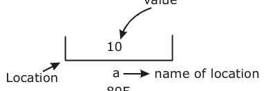

我们可以通过使用变量 `a` 或使用它的地址 80F 来访问值 10。

问题是，我们如何使用地址访问变量呢？由于内存地址仅仅是数字，它们也可以被赋值给其他变量。用于存储内存地址的变量被称为指针变量。

因此，指针无非只是一个存储另一个变量地址的变量。指针变量的值被存储在另一个内存位置中。

## 指针在 C 和 C++ 中的意义

现在问题随之而来：当我们可以通过避免使用指针来保持简单时，为什么还需要指针呢？

嗯，指针是 C 语言语言最强大的特性之一，这是一个公认的事实。但指针可能证明是有相当风险的。使用野指针（未初始化的指针）可能会导致你的程序行为异常，更糟糕的是会导致崩溃。像 Python 和 Java 这样的一些编程语言并不涉及指针的使用。

## 以下是我们在 C 和 C++ 中使用指针的一些原因：

- 1. 我们可以轻松地直接访问任何变量的内存位置，并根据我们的需要对其进行操作。
- 2. 它便于动态内存分配的使用，与 Python 和 Java 这样不支持使用指针的编程语言相比，访问速度快得多。
- 3. 在某些情况下，我们倾向于使用指针来提高某些过程的效率。

## 指针的特性

- 1. 指针节省内存空间。
- 2. 使用指针的执行时间更快，因为数据是通过地址进行操作的，即直接访问内存位置。
- 3. 使用指针高效地访问内存。指针还负责分配和释放内存。因此，可以说指针的内存是动态分配的。
- 4. 指针用于创建复杂的数据结构。它们对于表示二维数组和多维数组非常有用。
- 5. 任何类型的数组都可以借助指针进行帮助访问，而无需考虑其下标范围。
- 6. 指针用于文件处理。
- 7. 指针用于动态分配内存。没有指针，动态内存分配是不可能的。
- 8. 在 C++ 中，声明为基类的指针可以访问派生类的对象。然而，指向派生类的指针无法访问基类的对象。

## 指针的缺点

- 1. 指针是不安全的，因为指针很容易让你出错。
- 2. 未初始化的指针会导致段错误（segmentation fault）。

### 指针、结构体和联合体（续）

- 3. 在动态内存分配中不当处理指针会导致内存泄漏。
- 4. 调试指针问题非常困难。因此，有效使用指针将减少头疼。
- 5. 虽然指针语法看起来很酷，例如 `*ptr*`，但当你开始在指针上不断添加星号时，变量会让你疯掉。
- 6. 指针比普通变量慢 2 倍。

## 如何使用指针？

有几个重要的操作，我们将经常地借助指针来完成。

- (a) 我们定义一个指针变量。
- (b) 将变量的地址赋值给指针。
- (c) 最后访问指针变量中可用地址的值。

这是通过使用一元运算符 `*` 实现的，它返回位于操作数指定的地址的变量的值。下面的示例说明了这些操作。

```c
#include <stdio.h>
int main() {
    int var = 30; /* 声明变量 */
    int* bat; /* 声明指针 */
    bat = &var; /* 将 var 的地址存储在 bat 中 */
    printf("Address of var: %p\n", bat); /* 打印地址
    /* 使用指针访问值 */
    printf("Value of var: %d\n", *bat); /* 打印值
    return 0;
}
```

当上述代码编译并执行时，产生以下结果：

Address of var: [地址]
Value of var: 30

（注：地址会根据运行环境而变化）

| 语法 - 指针： |
| 数据类型 *变量名; |

## 指针变量的声明

与称为取地址符号 (`&`) 的引用运算符相反，星号 (`*`) 被称为解引用运算符，用于定义指针。

我们使用引用运算符访问变量的内存地址。

- 指针变量总是通过附加星号 (*) 声明的。
- 数据类型可以是 int、char、float 和 double。

## 指针变量示例：

| int *iptr;//整数指针变量 |
| long int *iptr;//长整指针变量 |
| char *iptr;//字符指针变量 |

你也可以通过这些方式声明指针：

| int *p1 |
| int * p2; |

在这里，我们声明了一个指针 `p1` 和普通变量 `p2`。

## 给指针赋值地址

让我们来看一个示例。

| int* ptr;//声明指针变量 |
| int c = 5; // 初始化变量 i 到指针 ptr |
| ptr = &c; // 初始化 c 变量的地址。并将 c 的地址赋值给指针地址。 |

在这里，5 被赋值给 `c` 变量的地址。并将 `c` 的地址赋值给指针地址。

## 解引用指针变量

解引用是指访问指针指向的特定地址的值的操作。运算符 `*` 用于返回存储在特定地址的值。运算符 `*` 称为值运算符、解引用运算符或间接运算符。

# 程序 - 指针变量中的星号与操作符地址

```c
#include <stdio.h>
#include <string.h>
int main() {
{
    int i = 5;
    int *ptr;
    ptr = &i;
    printf("Address of i = %u\n", i);
    printf("Address of ptr = %u\n", &ptr);
    printf("Address of i = %u\n", *ptr);
    return 0;
}
```

Output:
Address of i = 65522
Address of ptr = 65526
Address of i = 65522

> 注意：在上述程序中，第三个 `printf` 有意义。简单来说，星号 (*) 和地址 (&) 运算符相互抵消了。

# 空指针 (NULL POINTER)

在没有确切地址可以赋值时，为指针变量赋值 NULL 值始终是一个良好的习惯。这在变量声明时完成。赋值为 NULL 的指针称为空指针。

NULL 指针是在几个标准库中定义的值为零的常量。考虑以下程序。

# 指针、结构体与联合体

```c
#include<stdio.h>
int main(){
int*ptr = NULL;
```


`printf("The value of the ptr is : %x\n", ptr );`

`return 0;`

}

```

当上述代码被编译并执行时，会产生以下结果：

The value of ptr is 0

# C语言中使用指针时的常见错误

以下是程序员在处理指针时通常容易犯的一些错误：

## 1. 指针的类型类型错误

需要说明的是，为了避免数据丢失，为指针分配正确的数据类型非常重要。

例如，如果指针的数据类型是整数类型，C 编译器会认为指针将指向的变量地址将存储整数值，因此在谈论 64 位编译器时，编译器会为其预留 4 字节的空间。

让我们考虑这段代码片段：

```c
/* 这里，变量 number1 和 number2 都是 long 类型，
   占用 8 字节 */ / long number1, number2; int *p;

scanf("%d",&number1); // 以 long 数据类型输入 number1 的值

p = &number1; // 将 number1 的地址存储到指针 p 中

number2 = // 将 p 指向的值存储到 number2
```

## 2. 错误的初始化

我们倾向于混淆变量的值及其内存地址。假设我们有一个 `int` 类型的变量 `a` 和另一个 `int` 类型的指针 `*p`，那么以下初始化是错误的：

```c
a = p;
*p = &a;
```

必须理解的是这是错误的，因为 `a` 是一个变量，而 `p` 是它的内存地址。

# 指针的算术运算（C 中的指针算术）

C 允许像你这样的程序员使用指针进行算术运算。因此，程序员可以使用指针变量执行任何算术运算。使用指针变量进行算术运算被称为指针算术操作。

我们可以对指针进行加、减等算术运算，但正如所知，指针包含地址，如果另一个操作数是整数类型，那么对指针执行的算术运算的结果也将是一个指针。在指针减指针减法中，结果将是一个整数值。

在 C 语言中，指针可以执行以下算术运算：

* *递增 (Increment)*
- *递减 (Decrement)*
- *加法 (Addition)*
- *减法 (Subtraction)*
- *比较 (Comparison)*

## 递增指针变量

如果将指针加 1，指针将开始指向下一个位置。这与通用算术有所不同，因为指针的增加量取决于它所指向的数据类型的大小。

我们可以使用对指针的递增操作来遍历数组，指针将一直指向数组的每个元素，对其执行某些操作并在循环中更新它。

递增指针的规则如下：

```c
new_address = current_address + i * size_of(data_type)
```

其中 `i` 是指针增加的倍数。

### 32 位

对于 32 位 `int` 变量，它将增加 2 字节。

### 64 位

对于 64 位 `int` 变量，它将增加 4 字节。

让我们看看在 64 位架构上递增指针变量的示例。

```c
#include<stdio.h>
int main(){
 int number=50;
 int *p;//指向 int 的指针
p=&number;//存储 number 变量的地址
printf("Address of p variable is %u \n",p);
p=p+1;
printf("After increment: Address of p variable is %u \n",p); // 在我们的情况下，
 p 将增加 4 字节。
 return 0;
}
```

Output:
Address of p variable is 3214864300
After increment: Address of p variable is 3214864304

## 使用指针遍历数组

```c
#include<stdio.h>
void main ()
{
 int arr[5] = {1, 2, 3, 4, 5};
 int *p = arr;
 int i;
printf("printing array elements...\n");
for(i = 0; i < 5; i++)
{
 printf("%d ",*(p+i));
}
}
```

Output:
printing array elements...
1 2 3 4 5

# C 中的指针递减

与加法类似，我们可以对指针进行递减操作。如果我们递减一个指针，它将指向前一个位置。递减指针的规则如下：

```c
new_address = current_address - i * size_of(data_type)
```

### 32 位
对于 32 位 `int` 变量，它将减少 2 字节。

### 64 位
对于 64 位 `int` 变量，它将减少 4 字节。

让我们看看在 64 位架构上递减指针变量的示例。

```c
#include<stdio.h>
int main(){
 int number=50;
 int *p;//指向 int 的指针
p=&number;//存储 number 变量的地址
printf("Address of p variable is %u \n",p);
p=p-1;
printf("After decrement: Address of p variable is %u \n",p); // 在我们的情况下，
 p 将减少 4 字节。
 return 0;
}
```

Output:
Address of p variable is 3214864300
After decrement: Address of p variable is 3214864296

# C 中的指针加法

我们可以对指针变量执行加法运算。对指针加法任何数字将得到一个地址。对指针加法的公式如下：

```c
new_address = current_address + i * size_of(data_type)
```

### 32 位
对于 32 位 `int` 变量，它将增加 2 * 字节。

### 64 位
对于 64 位 `int` 变量，它将增加 4 * 字节。

让我们看看在 64 位架构上对指针变量加法的示例。

```c
#include<stdio.h>
int main(){
 int number=50;
 int *p;//指向 int 的指针
p=&number;//存储 number 变量的地址
printf("Address of p variable is %u \n",p);
p=p+1;
printf("After increment: Address of p variable is %u \n",p); // p 将增加 4 字节
 return 0;
}
```

Output:
Address of p variable is 3214864300
After increment: Address of p variable is 3214864304

# C 中的指针减法

与指针加法类似，我们可以对指针变量执行减法运算。从指针中减去任何数字将得到一个地址。对指针减法的公式如下：

```c
new_address = current_address - i * size_of(data_type)
```

### 32 位
对于 32 位 `int` 变量，它将减少 2 * 字节。

### 64 位
对于 64 位 `int`，它将减少 4 * 字节。

让我们看看在 64 位架构上对指针变量减法的示例。

```c
#include<stdio.h>
int main(){
 int number=50;
 int *p;//指向 int 的指针
p=&number;//存储 number 变量的地址
printf("Address of p variable is %u \n",p);
p=p-3; // 从指针中减去 3
printf("After subtracting 3: Address of p variable is %u \n",p);
 return 0;
}
```

Output:
Address of p variable is 3214864300
After subtracting 3: Address of p variable is 3214864288

## 指针、结构体与联合体

如果两个指针的类型相同，
Address2 - Address1 = (两个地址之间的差)/数据类型的大小
该指针所指向的位置

考虑以下示例，从一个指针中减去另一个指针。

```c
#include <stdio.h>
void main () {
    int i = 100;
    int *p = &i;
    int *temp;
    temp = p;
    p = p + 3;
    printf("Pointer Subtraction: %d - %d = %d",p, temp, p-temp);
}
```

输出:
Pointer Subtraction: 1030585080 - 1030585087 = 3

## 指针的非法算术

某些操作无法在指针上执行。由于指针存储的是地址，因此我们必须忽略可能导致非法地址的操作，例如加法和乘法。下面给出了此类操作的列表。

- 地址 + 地址 = 非法
- 地址 * 地址 = 非法
- 地址 % 地址 = 非法
- 地址 / 地址 = 非法
- 地址 & 地址 = 非法
- 地址 ^ 地址 = 非法
- 地址 | 地址 = 非法
- ~地址 = 非法

## 指针比较

指针变量可以与其他指针变量比较，也可以与普通变量比较。关系运算符可以帮助你完成比较操作。让我们使用大于运算符来比较两个指针变量。

你可以对指针使用关系运算符（<, <=, >=, !=）。== 和 != 运算符用于比较两个指针是否包含同一个变量。当两个指针都为空（null）或包含相同变量的地址时，这两个指针是相等的。这些运算符（即 == 和 !=）的使用仅在指针类型相同时，或在空指针与任何其他指针之间，或 `void` 指针（稍后将讨论）与任何其他指针之间才有效。使用其他关系运算符（<, <=, >=, =）来比较两个指针时，当它们都指向同一个数组的元素时是有意义的。

```c
#include <stdio.h>
int main() {
    int a = 10, b = 6;
    int *ptr, *ptr1;
    ptr = &a;
    ptr1 = &b;
    if(ptr > *ptr1)
        printf("value stored in a is greater than b");
    else
        printf("value stored in b is greater than a");
    return 0;
}
```

输出:
value stored in a is greater than b

## 解释

在这里 `*ptr` 和 `*ptr1` 将从它们存储的地址中获取值，大于 ( > ) 运算符帮助我们找到两个指针变量中的最大值。

### 结构体

结构体是 C 语言中用户定义的数据类型，允许我们将不同的数据类型组合在一起。结构体中的每个元素被称为成员（member）。结构体有助于构建更有意义的复杂数据类型。它与数组相似，但数组只持有相似类型的数据。而结构体另一方面可以存储任何类型的数据，这在实践中更加有用。

## 为什么在 C 中使用结构体？

假设你想存储一个人的信息：他的/她的姓名、国籍编号和薪水。你可以创建不同的变量 `name`、`citNo` 和 `salary` 来存储这些信息。

如果你需要存储多个人的信息怎么办？现在，你需要为每个人的每项信息创建不同的变量：`name1`, `citNo1`, `salary1`, `citNo2` 等。

一种更好的方法是在单个 `Person` 结构体下收集所有相关信息，并将其用于每一个人。

#### 示例：

如果我想写一个程序来存储学生信息，其中包含学生的姓名、年龄、专业、永久地址、父亲姓名等，这些信息包含了字符串值、整数值等，我该如何使用数组来解决这个问题？我需要某种可以将不同类型的数据存储在一起的东西。

在结构体中，数据存储在记录（records）中。

#### 结构体的特性

- 1. 要将一个数组的元素复制到另一个相同数据类型的数组，必须逐个复制。无法一次性复制所有元素。而在结构体中，可以使用赋值运算符 (=) 将所有不同类型结构体元素的内容拷贝到同类型的结构体变量中。这是可能的因为结构体元素存储在连续的内存位置。
- 2. 结构体的嵌套是可能的，即可以在结构内部创建另一个结构。利用这一功能可以处理复杂的数据类型。
- 3. 还可以将结构体元素传递给函数。这与将普通变量传递给函数相似。可以通过值或地址传递单个结构体元素或整个结构体。
- 4. 还可以创建结构体指针。在指针中，我们学习过指向整数、指向浮点数和指向字符的指针。同样，我们可以创建一个指向结构体元素的指针。这需要 `->` 运算符。

## 结构体声明

## 关于结构体的重要点

- 1. 使用 `struct` 关键字来声明结构体。
- 2. 结构体的成员包含在左括号和右括号之间。
- 3. 结构体的声明不占用任何空间。
- 4. 它仅仅是结构体的“模板/映射/形状”。
- 5. 它在变量创建/实例创建时才首次被创建。

在创建结构体变量之前，你需要定义它的数据类型。要定义结构体，使用 `struct` 关键字。

## 结构体的语法：

```c
struct structureName
{
    dataType1;
    dataType2;
};
```

## 声明结构体变量

```c
struct structure
{
    dataType1;
    dataType2;
};
```

## 声明结构体变量

```c
struct structure
{
    dataType1;
    dataType2;
}e1,e2;
```

## 多次声明结构体

```c
struct structure
{
    dataType1;
    dataType2;
}e1,e2;
```

## 带固定值的结构体声明

```c
struct structure
{
    dataType1;
    dataType2;
}e1,e2;
```

#### 结构体的初始化

```c
struct structure {
    dataType1 = 0; // 编译错误：此处初始化
    dataType2 = 0; // 编译错误：此处初始化
};
```

上述错误的原因很简单，当声明数据类型时，不会为其分配内存。只有在创建变量时才会分配内存。

成员可以使用大括号 '{}' 进行初始化。

例如，这是一个有效的初始化：

```c
struct Point {
    int x, y;
}
int main() {
    // 有效初始化。成员 x 获得值 0，y
    // 获得值 1。遵循声明顺序。
    struct Point p1 = {0, 1};
}
```

## 另一个示例

就像其他数据类型的变量一样，结构体变量也可以在编译时初始化。

```c
struct Patient {
    float height;
    int weight;
    int age;
}
struct Patient p1 = {180.75,73,23}; // 初始化
```

或者

```c
struct Patient p1;
p1.height = 180.75;// 分别初始化成员
p1.weight =73;
p1.age =23;
```

## 访问结构体的成员

有两种运算符用于访问结构体的成员。

- 1. (.) 成员运算符
- 2. -> 结构体指针运算符

```c
#include<stdio.h>
struct Point
{
    int x, y;
}
int main()
{
    struct Point p1 = {0, 1};
    // 访问点 p1 的成员
    p1.x = 20;
    printf("%x = %d, y = %d\n", p1.x, p1.y);
    return 0;
}
输出:
x = 20; y = 1.
```

## 结构体中的结构体（嵌套结构体）

嵌套结构体意味着一个结构体将另一个结构体作为成员变量。

我们可以在结构体内部使用结构体，这是完全可能的。一旦你声明了结构体，`struct struct_name` 就会作为一个新的数据类型使用，你可以

它可以包含另一个结构体中，就像其他数据成员的数据类型一样。
听起来很困惑？别担心。下面的示例将消除你的疑惑。

在 C 语言编程中，你可以在结构体内创建结构体。

#### 示例：

```c
struct Student
{
    char name[30];
    int age;
    /* 这里 Address 是结构体 */
    struct Address
    {
        char locality[50];
        char city[50];
        int pincode;
    } addr;
};
```

### 结构体数组

# 为什么我们需要结构体数组？

考虑我们需要存储 3 个学生数据的情况。我们可以使用下面的结构体来存储它们。

```c
#include<stdio.h>
struct student
{
    char name[20];
    int id;
    float marks;
};
void main()
{
```

## 指针、结构体和联合体

```c
struct student s1,s2,s3;
int dummy;
printf("Enter the name, id, and marks of student 1 \n");
```


`scanf("%s %d %d",s1.name,&s1.id,&s1.marks);`

`scanf("%c",&dummy);`

`printf("Enter the name, id, and marks of student 2 \n");`

`scanf("%s %d %d",s2.name,&s2.id,&s2.marks);`

`scanf("%c",&dummy);`

`printf("Enter the name, id, and marks of student 3 \n");`

`scanf("%s %d %d",s3.name,&s3.id,&s3.marks);`

`scanf("%c",&dummy);`

`printf("Printing the details...\n\n");`

`printf("%s %d %f\n",s1.name,s1.id,s1.marks);`

`printf("%s %d %f\n",s2.name,s2.id,s2.marks);`

`printf("%s %d %f\n",s3.name,s3.id,s3.marks);`

```
输出：
Enter the name, id, and marks of student 1 James 90 90
Enter the name, id, and marks of student 2 Adoms 90 90
Enter the name, id, and marks of student 3 Nick 90 90
Printing the details....
James 90 90.000000
Adoms 90 90.000000
Nick 90 90.000000
```

在上面的程序中，我们在结构体中存储了3个学生的数据。然而，如果有 20 个学生，程序的复杂度将会增加。在这种情况下，我们必须声明 20 个不同的结构体变量并逐个存储它们。这将非常困难，因为我们每添加一个学生就必须声明一个变量。记住所有变量的名字也是一项非常棘手的任务。然而，C 语言允许我们通过声明一个结构体数组，通过这种方式，我们可以避免声明不同的结构体变量；相反，我们可以创建一个包含所有结构体的集合，存储不同实体的信息。

# C语言中结构体数组的声明

C 语言中的结构体数组可以定义为多个结构的集合，其中每个变量包含不同实体的信息。C 语言中的结构体数组用于存储不同数据类型的多个实体的信息。结构体数组也被称为结构体集合。

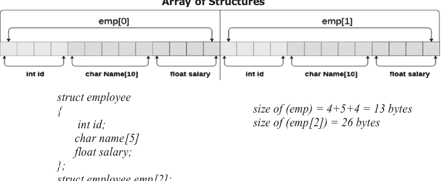

让我们来看一个存储 5 个学生信息并打印它的结构体数组示例。

```c
#include <stdio.h>
#include <string.h>
struct student{
    int rollno;
    char name[10];
}
int main(){
    int i;
    struct student st[5];
    printf("Enter Records of 5 students\n");
    for(i=0;i<5;i++){
        printf("Enter Rollno:\n");
        scanf("%d", &st[i].rollno);
        printf("Enter Name:\n");
        scanf("%s", &st[i].name);
    }
    printf("\nStudent List:\n");
    for(i=0;i<5;i++){
        printf("%d %s\n", st[i].rollno, st[i].name);
    }
    return 0;
}
```

输出：
Enter Records of 5 students
Enter Rollno:1
Enter Name:James
Enter Rollno:2
Enter Name:Adom
Enter Rollno:3
Enter Name:Nick
Enter Rollno:4
Enter Name:John
Enter Rollno:5
Enter Name:Doe

Student List:
1 James
2 Adoms
3 Nick
4 John
5 Doe

# 枚举类型

枚举（或 enum）是 C 语言中的用户定义类型。主要用于为整数常量分配名称，使程序易于阅读和维护。

```c
enum State {Working = 1, Failed = 0};
```

关键字 `enum` 用于在 C 中声明枚举类型。以下是枚举的示例。枚举 "flag" 的常量如下：constant1 = 0, constant2 = 1, constant3 = 2。

```c
enum flag{constant1, constant2, constant3};
```

也可以定义枚举类型的变量。它们可以通过两种方式定义：

```c
// 在下面的两种情况下，"day" 都被定义为 week 类型的变量。
enum week[Mon, Tue, Wed];
enum week day;
```

或者

```c
##include<stdio.h>
enum week{Mon, Tue, Wed, Thur, Fri, Sun};
int main() {
    enum week day;
    day = Wed;
    printf("%d",day);
    return 0;
}
```

输出：
2

在上面的示例中，我们声明了变量 "day"，"Wed" 的值分配给 day，值为 2。因此打印了 2。另一个枚举工作的示例：

```c
#include <stdio.h>
enum year{Jan, Feb, Mar, Apr, May, Jun, Jul, Aug, Sep, Oct, Nov, Dec};
int main() {
    int i;
    for (i=Jan; i<=Dec; i++)
        printf("%d ", i);
    return 0;
}
```

输出：
0 1 2 3 4 5 6 7 8 9 10 11

在这个示例中，循环从 i = 0 运行到 i = 11，因为 i 的初始值 Jan 是 0，Dec 的值 11。

# 关于枚举初始化的事实：

- 1. 两个枚举名称可以相同相同。例如，在下面的程序中，"Failed" 和 "Freezed" 具有相同的值 0。

```c
#include <stdio.h>
enum State {Working = 1, Failed = 0, Freezed = 0};
int main() {
    printf("%d, %d, %d", Working, Failed, Freezed);
    return 0;
}
```

输出：
1, 0, 0

- 2. 如果我们不显式为枚举名称赋值，编译器默认从 0 开始赋值。例如，在下面的程序中，sunday 获取值 0，monday 获取值 1，以此此类推。

```c
#include <stdio.h>
enum day {sunday, monday, tuesday, wednesday, thursday, friday, saturday};
int main() {
    enum day d = thursday;
    printf("The day number stored in d is %d", d);
    return 0;
}
```

输出：
The day number stored in d is 4

- 3. 我们可以按照任何顺序为某些名称赋值。所有未赋值的名称获得的值为前一个名称的值加一。

```c
#include <stdio.h>
enum {sunday = 1, monday, tuesday = 5, wednesday, thursday = 10, friday, saturday};
int main() {
    printf("%d %d %d %d %d %d %d", sunday, monday, tuesday, wednesday, thursday, friday, saturday);
    return 0;
}
```

输出：
1 2 5 6 10 11 12

- 4. 分配给枚举名称的值必须是某个整数常量，即该值必须在从最小整数值到最大整数值的范围内。

- 5. 所有枚举常量在它们的作用域内必须唯一的。例如，下面的程序编译失败。

```c
enum state {working, failed};
enum result {failed, passed};
int main() { return 0; }
```

输出：
Compile Error: 'failed' has a previous declaration as 'state failed'

## 联合体 (UNIONS)

联合体是 C 语言可用的一种特殊数据类型，允许在同一个内存位置存储不同的数据类型。你可以定义一个具有许多成员的联合体，但在任何时刻只有一个成员可以包含值。联合体提供了一种在相同内存位置用于多种用途的高效方法。

这意味着尽管联合体（union）可以包含许多类型的成员，但它无法同时处理所有成员。联合体使用 `union` 关键字声明。

### 定义联合体

要定义一个联合体，你必须像定义结构体一样，使用 `union` 语句。`union` 语句为你的程序定义了一个具有多个成员的新数据类型。

`union` 语句的格式如下：

```
union[union tag]{
    member definition;
    member definition;
    ...
    member definition;
}[one or more union variables];
```

`union tag` 是可选的，每个成员定义都是一个普通的变量定义，例如 `int i;` 或 `float f;` 或其他有效定义。在联合体定义的最后，最后一个分号之前，你可以指定一个或多个联合体变量，但这是可选的。以下是定义名为 `Data` 具有三个成员 `i`、`f` 和 `str` 的联合体的方法：

```
union Data{
int i;
float f;
char str[20];
};
```

现在，`Data` 类型的变量可以存储整数、浮点数或字符字符串。这意味着一个变量（即相同的内存位置）可以用于存储多种类型的数据。你可以根据需求在联合体内部使用任何内置或用户定义的数据类型。

联合体占据的内存将足够容纳联合体中最大的成员。例如，在上面的示例中，`data` 类型将占用 20 字节的内存空间，因为这是字符字符串占据的最大空间。下面的示例显示了上述联合体占据的总内存大小。

```c
#include<stdio.h>
#include<string.h>
unionData{
    int i;
    float f;
    char str[20];
};
int main(){
    unionData data;
    printf("Memory size occupied by data : %d\n",sizeof(data));
    return 0;
}
```

当上述代码编译并执行时，它产生以下结果：
Memory size occupied by data : 20

### 创建联合体变量

当定义联合体时，它创建了一个用户定义类型。然而，并没有分配内存。为了给定的联合体类型分配内存并对其操作，我们需要创建变量。

以下是创建联合体变量的方法：

```c
union bus
{
    char name[50];
    int price;
};
int main(){
    union bus bus1, bus2, *bus3;
    return 0;
}
```

另一种创建联合体变量的方法：

```c
union bus
{
char name[50];
int price;
} bus1, bus2, *bus3;
```

在两种情况下，都创建了联合体变量 `bus1`、`bus2` 和 `union bus` 的指针 `bus3`。

## 联合体示例

让我们来看 C 语言中联合体的简单示例。

```c
#include <stdio.h>
#include <string.h>
union employee
{
  int id;
  char name[50];
} e1;//为联合体声明变量 e1
int main ()
{
  //存储第一个员工信息
  e1.id=101;
  strcpy(e1.name, "Indrakanti Sekhar");//将字符串拷贝到字符数组中
  //打印第一个员工信息
  printf("employee 1 id : %d\n", e1.id);
  printf("employee 1 name : %s\n", e1.name);
  return 0;
}
```

输出：
employee 1 id : 1869508435
employee 1 name : Indrakanti Sekhar

你可以看到，`id` 获取了垃圾值，因为 `name` 拥有较大的内存。因此，只有 `name` 有实际值。

### 访问联合体成员

要访问联合体的任何成员，我们使用成员访问运算符 `.`。成员访问运算符编码在联合体变量名和想要访问的联合体成员之间。你会使用 `union` 关键字来定义联合体类型。下面的示例显示了如何在程序中使用联合体。

```c
#include<stdio.h>
#include<string.h>
unionData{
int i;
float f;
char str[20];
};
```

(注：提供的原始文本包含大量重复和 OCR 错误，以上内容已根据逻辑进行了清理和翻译。)

### 单选题

- 1. 下列哪个本身是不同数据类型的集合？[ ]
(a) 字符串 (b) 结构体 (c)  (d) 以上都是

- 2. 用户定义数据类型可以通过 [ ] 派生
(a) struct (b) enum (c) typedef (d) 以上都是

- 3. 哪个运算符将结构体名与其成员名连接起来？[ ]
(a) . <-> and (d) 都是 -

- 4. 下列哪个不能作为结构体的成员？[ ]
(a) 另一个结构体 (b) 函数 (c) 数组 (d) 以上都不是

- 5. 联合体（union）的大小 [ ] 的大小决定
(a) 联合体中的第一个成员 (b) 联合体中的最后一个成员 (c) 所有成员的大小之和

- 6. 联合体的成员通过 [ ] 访问
(a) 联合体名 (b) 联合体指针-> (c) 联合体指针->成员 (d) 以上都不是

- 7. 常量可以声明为 [ ]
(a) const *ptr (b) *constptr (c) const int ptr (d) 否

- 8. 声明 float 指针的正确方法是 [ ]
(a) floatptr (b) float *ptr (c) *float ptr (d) 无

- 9. 用户定义数据类型可以通过 [ ] 派生
(a) struct (b) enum (c) typedef (d) 以上都是

- 10. struct 用于定义新的数据类型。[ ]
(a) struct (b) union (c) typedef (d) 位域字段

**答案：** 1. (b), 2. (d), 3. (c), 4. (b), 5. (c), 6. (7), 7. (b), 8. (b), 9. (d), 10. (c).

# 空空题

- 1. 使用变量访问结构体的成员，我们使用 ________ 运算符。

- 2. 结构体占用 ________ 内存空间。

- 3. 联合体占用的内存空间比结构体 ________。

- 4. C语言中可用的指针运算符是 ________。

- 5. 一个 ________ 变量持有任何变量的内存地址。

- 6. ________ 是一种特殊的指针。它可以指向任何数据类型，从整数值或浮点数到字符字符串。

- 7. 指针所指向的内存位置存储的值可以通过使用 ________ 运算符访问。

- 8. void 指针的大小是 ________。

- 9. ________ 运算符通过指针访问联合体。

- 10. 结构体中的结构体被称为 ________。

**答案：** 1. dot (.), 2. higher, 3. lower, 4. *, 5. pointer, 6. void pointer, 7. *, 8. 2 bytes, 9. -> (arrow), 10. Nested structures（嵌套结构体）。

# 无标题1 - Dev-C++ 5.11

文件 编辑 查找 查看 项目 工具 AStyle 窗口 帮助

项目 类 调试

```
Untitled1
#include <stdio.h>
int main() {
    printf("Hello World");
    return 0;
}
```


# 第5单元

## 面向对象概念

使用 `C++`

面向对象编程简介 - `C++` 结构 - `C++` 简单程序 - 存储类 - `C` 与 `C++` 比较 - 面向对象概念 - 类 - 对象 - 继承 - 多态 封装 - 抽象。

## 面向对象编程简介

面向对象编程顾如名，通过对象将复杂问题分解为更小的问题来解决问题。在面向对象编程（通常称为 `OOP`）之前，程序是用过程化语言编写的，它们无非是一长指令列表。另一方面，`OOP` 的核心在于创建可以相互交互的对象，这使得在 `OOP` 中开发程序更容易，因为我们可以理解它们之间的关系。

`OOP` 的主要目标是将数据和操作这些数据的函数结合在一起，使得代码的其他部分无法该函数访问这些数据。

在对象编程中，我们使用类和对象编写程序，设计 `OOP` 的特性，如抽象、封装、继承和多态。

## OOP 相对于过程化编程的优势

- 1. 重用性

`OOP` 允许通过继承重用现有代码。我们可以轻松获取现有功能并对其改进，而无需重新编写代码。这导致代码更不臃肿。

- 2. 模块化

当我们在 `OOP` 中对程序进行模块化时，如果出现问题或要添加新功能或增强，很容易修改或排错程序。模块化也有助于代码清晰，并使其更具可读性。

- 3. 灵活性

`OOP` 帮助我们利用多态特性进行灵活的编程。由于多态有许多形式，我们可以拥有处理许多对象的对算符或函数，从而避免了为每个对象编写不同的函数。

- 4. 可维护性

维护代码变得更容易，因为可以很容易添加新类、对象等，而不需要进行太大的重构或更改。

- 5. 数据和信息隐藏

`OOP` 帮助我们实现数据隐藏，从而保护信息不泄露。通过隐藏内部细节，只有程序顺利运行所需的数据才会暴露给用户。

## C++ 程序结构

程序是指令的序列。`C++` 结构分为若干部分，即头文件、类定义和主函数。

### 面向对象概念 C++

| 头文件 | 类定义 | 成员定义 | 主函数 |
| :--- | :--- | :--- | :--- |
| 1. 头文件 | 2. 类声明 | 3. 成员函数定义 | 4. 主函数 |

### 1. 头文件

- 该部分包含各种头文件。
- 可以在程序中包含头文件。

示例：
```cpp
#include <iostream>
```

为了理解头文件的概念，考虑此语句。为了使用预定义元素，我们需要包含头文件。

### 2. 类声明

- 该部分用于声明类。
- 可以在类内部声明成员和函数。

示例：
```cpp
class Demo {
    int a, b;
public:
    void input();
    void output();
};
```

我们使用类和对象编写程序，设计 `OOP` 的特性如抽象、封装、继承和多态。

### 3. 成员函数定义

- 该部分用于定义成员函数。
- 可以在类外定义函数。

示例：
```cpp
void Demo::input() {
    cout << "Enter Value of A:";
    cin >> a;
    cout << "Enter Value of B:";
    cin >> b;
}
```

### 4. 主函数

- 该部分是程序的入口。
- 我们创建对象并调用函数。

示例：
```cpp
int main() {
    Demo d1;
    d1.input();
    d1.output();
}
```

## C++ 简单程序

注意，`C++` 提供了带有类及其成员函数或编写程序的灵活性。`注释`是程序中的重要元素，用于增加程序的可读性并描述其功能。注释不是可执行语句，因此不会增加文件大小。

`C++` 支持两种注释样式：单行注释和多行注释。单行注释用于定义逐行的描述。双斜杠（`//`）用于表示单行注释。为了理解单行注释的概念，考虑此语句。

> * 一个演示多行
注释 */

因为在 `main()` 部分，我们创建了一个对象，然后使用该对象调用类中声明的函数。

- `cout`（读音为 "see out"）：它是与标准输出设备（显示器）关联的标准输出流，用于向用户显示输出内容。
- `cerr`（读音为 "see err"）：它是与标准错误设备（显示器）关联的标准错误流，用于向用户报告错误。`cerr` 对象没有缓冲区（临时存储区域），因此它会立即向用户报告错误。
- `clog`（读音为 "see log"）：它是与标准错误设备（计算机屏幕）关联的带缓冲错误流，用于向用户报告错误。与 `cerr` 不同，`clog` 只在缓冲区满时才向用户报告错误。

多年来，`C++` 使用 `C` 语言风格的头文件，即头文件带有 `.h` 扩展。然而，标准 `C++` 库引入了新风格的头文件，仅包含头文件名。因此，最现代的编译器不需要任何扩展名，尽管它们支持旧的 `.h` 扩展。某些 `C` 风格的头文件及其对应的 `C++` 风格头文件如表所示。

| 表 C 风格与 C++ 风格头文件 |
| C 风格头文件 | C++ 风格头文件 |
| --- | --- |
| <assert.h> | <cassert> |
| <ctype.h> | <cctype> |
| <float.h> | <float> |
| <limits.h> | <climits> |
| <math.h> | <cmath> |
| <stdio.h> | <cstdlib> |
| <string.h> | <cstring> |
| <iostream.h> | <iostream> |
| <iomanip.h> | <iomanip> |
| <fstream.h> | <fstream> |

### 命名空间 (Namespace)

自创建以来，`C++` 经历了 `C++` 标准委员会的许多更改。这是添加到此命名空间的新功能之一。A

### C++ 面对象概念

`namespace` 允许将各种实体（如类、对象、函数以及各种 `C++` 标记等）组合在一个名称下。不同的用户可以创建独立的命名空间，从而使用相似的实体名称。这避免了由于同名冲突可能存在的编译时错误。

`C++` 标准委员会将标准库的实体重新排列到命名为 `std` 的命名空间下。在图中，使用 `namespace std` 的语句通知编译器包含 `std` 命名空间中存在的所有实体。命名空间的实体可以通过不同的方式访问，列在此处：

- 通过指定使用指令（using directive）：

```cpp
using namespace std;
cout<<"Hello World";
```

- 通过指定完整的成员名：

```cpp
std::cout<<"Hello World";
```

- 通过指定使用声明（using declaration）：

```cpp
using std::cout;
cout<<"Hello World";
```

当包含新风格头文件时，其内容会被包含在 `std` 命名空间中。因此，所有现代 `C++` 编译器都支持这些语句。

```cpp
#include<iostream>
using namespace std;
```

然而，某些旧编译器可能不支持这些语句。在这种情况下，这些语句被此条单一语句替换。

```cpp
#include<iostream.h>;
```

## main() 函数

`main()` 是一个启动 `C++` 程序执行的启动函数。所有需要在 `main()` 内执行的 `C++` 语句。编译器会执行在包裹 `main()` 主体的大括号 `{ }` 内部的所有指令。一旦 `main()` 中的所有指令执行完毕，控制将离开 `main()`，终止整个程序并向操作系统返回一个值。

默认情况下，`C++` 中的 `main()` 向操作系统返回一个 `int` 值。因此，`main()` 应该以 `return 0` 结束。返回零表示成功，非零值表示失败或错误。

下面是 `C++` 的示例程序：

```cpp
// A Simple Program      -> 这是一个注释，编译器会忽略它
#include<iostream>    -> 头文件
#include<conio.h>      -> 头文件
Using namespace std      -> 这告诉编译器使用 std 命名空间
void main() {
    clrscr();
    int a,b;
    cout <<"Welcome To C++ Language";
    getch();
}
```


1. `#include`：在这里，`#include` 是 C++ 语言提供的预处理器指令。它表示包含头文件 `iostream.h` 意味着包含输入输出流头文件中的所有函数，该文件包含了如 `cout` 和 `cin` 等所有输入输出函数。所有这些都包含其中。
2. **第二个头文件**：它用于使用 `get` 和 `clrscr()` 函数。
3. `void main():` 在这里，`void` 意味着不返回任何值，即 `void` 不返回任何值，它只是逐个执行程序的指令。
4. `Main():` 括号 `()` 是函数的符号。每个函数都有大括号。在这里，`Main()` 起了主导作用，因为所有程序的执行都是从 `Main()` 函数开始的。这也被称为程序的起点。它按照 `Main()` 函数中的原样执行语句。

`#include`: In this, `#include` is the preprocessor directive that is given by the C++ language. It denotes to include the header file `iostream.h` means to include all the functions of the input-output stream header file which contains all the input and output functions like `cout` and `cin`. All these are contained in it.
2. **The Second Header file**: It is used for using the `get` and `clrscr()` functions.
3. `void main():` In this `void` means no Return of any value means a `void` doesn't return any value it just performs the executions of the program one by one.
4. `Main():` The `()` braces are the symbol of a function. Every function has braces. In this, `Main()` has a main role because the execution of all the programs are started from the `Main()` function This is also known as the starting point of the program. It executes the statements as they are in the `Main()` function and in the `Main()` function.

## C++ 面对象概念 (Object Oriented Concepts)

`namespace` 允许将各种实体（如类、对象、函数以及各种 C++ 标记等）组合在一个名称下。不同的用户可以创建独立的命名空间，从而使用相似的实体名称。这避免了由于同名冲突可能存在的编译时错误。

C++ 标准委员会将标准库的实体重新排列到命名为 `std` 的命名空间下。在图中，使用 `namespace std` 的语句通知编译器包含 `std` 命名空间中存在的所有实体。命名空间的实体可以通过不同的方式访问，列在此处：

- 通过指定使用指令（using directive）：

```cpp
```


`using namespace std;`

`cout<<"Hello World";`

```
- 通过指定完整的成员名：
```

```cpp
std::cout<<"Hello World";
```

```
- 通过指定使用声明（using declaration）：
```

```cpp
using std::cout;
cout<<"Hello World";
```

当包含新风格头文件时，其内容会被包含在 `std` 命名空间中。因此，所有现代 C++ 编译器都支持这些语句。

```cpp
#include<iostream>
using namespace std;
```

然而，某些旧编译器可能不支持这些语句。在这种情况下，这些语句被此条单一语句替换。

```cpp
#include<iostream.h>;
```

# main() 函数

`main()` 是一个启动 C++ 程序执行的启动函数。所有需要在 `main()` 内执行的 C++ 语句。编译器会执行在包裹 `main()` 主体的大括号 `{ }` 内部的所有指令。一旦 `main()` 中的所有指令执行完毕，控制将离开 `main()`，终止整个程序并向操作系统返回一个值。

默认情况下，C++ 中的 `main()` 向操作系统返回一个 `int` 值。因此，`main()` 应该以 `return 0` 结束。返回零表示成功，非零值表示失败或错误。

下面是 C++ 的示例程序：

```cpp
// A Simple Program      -> 这是一个注释，编译器会忽略它
#include<iostream>    -> 头文件
#include<conio.h>      -> 头文件
Using namespace std      -> 这告诉编译器使用 std 命名空间
void main() {
    clrscr();
    int a,b;
    cout <<"Welcome To C++ Language";
    getch();
}
```

- 1. `#include`：在这里，`#include` 是 C++ 语言提供的预处理器指令。它表示包含头文件 `iostream.h` 意味着包含输入输出流头文件中的所有函数，该文件包含了如 `cout` 和 `cin` 等所有输入输出函数。所有这些都包含其中。
- 2. **第二个头文件**：它用于使用 `get` 和 `clrscr()` 函数。
- 3. `void main():` 在这里，`void` 意味着不返回任何值，即 `void` 不返回任何值，它只是逐个执行程序的指令。
- 4. `Main():` 括号 `()` 是函数的符号。每个函数都有大括号。在这里，`Main()` 起了主导作用，因为所有程序的执行都是从 `Main()` 函数开始的。这也被称为程序的起点。它按照 `Main()` 函数中的原样执行语句。

## 静态存储类声明语法：

```
static datatype var_name1 [= value];
```

示例：

```
static int x = 101;
static float sum;
```

### 4. 寄存器存储类（Register）

寄存器存储将变量分配在 CPU 寄存器而非主内存中。它的生命周期和可见性与自动变量相同。创建寄存器变量目的是提高访问速度并使程序运行更快。如果寄存器中没有空间，这些变量将存储在主内存中，作用类似于自动存储类变量。因此，只有需要快速访问的变量才应该设为寄存器。

## 寄存器存储类声明语法：

```
register datatype var_name [= value];
```

示例：

```cpp
register int id;
register char a;
```

### 存储类示例

示例 2：创建自动、全局、静态和寄存器变量的 C++ 程序。

```cpp
#include<iostream>
using namespace std;
int g; //全局变量，初始值为 0
void test_function()
{
    static int s; //静态变量，初始值为 0
    register int r; //寄存器变量
    r=5;
    s=s+r*2;
cout<<"Inside test_function"<<endl;
cout<<"g = <<g<<endl;
cout<<"s = <<s<<endl;
cout<<"r = <<r<<endl;
}
int main() {
	int a; //自动变量
g=25;
a=17;
test_function();
	cout<<"Inside main"<<endl;
	cout<<"a = <<a<<endl;
	cout<<"g = <<g<<endl;
test_function();
	return 0;
}
```

在上述程序中，`g` 是全局变量，`s` 是静态变量，`r` 是寄存器变量，`a` 是自动变量。我们定义了两个函数，第一个是 `main()` 另一个是 `test_function()`。由于 `g` 是全局变量，因此可以在两个函数中使用它。变量 `r` 和 `s` 定义在 `test_function()` 内部，因此只能在该函数内部使用。然而，`s` 是静态的，在程序结束之前不会被销毁。第一次调用 `test_function()` 时，`r` 初始化为 5，`s` 的值为 10，这是通过语句计算出来的：

```
s=s+2;
```

第一次执行 `test_function()` 之后，`r` 被销毁，但 `s` 仍然保持 10。第二次调用时，`r` 被创建并初始化为 5。由于 `s` 初始值为 10，现在 `s` 的值变为 20。变量 `a` 定义在 `main()` 内部，只能在 `main()` 内部使用。

#### 输出：

```
Inside test_function
g = 25
s = 10
r = 5
Inside main
a = 17
g = 25
Inside test_function
g = 25
s = 20
r = 5
```

## 5. 可变（Mutable）存储类

在 C++ 中，可以使用关键字 `const` 将类对象保持为常量。这不允许在程序执行期间修改类对象的数据成员。但在某些情况下，该常量对象的某些数据成员必须更改。例如，在银行转账期间，必须锁定交易以确保没有信息被更改，但即使如此，它的状态已从“开始”变为了“处理中”再到“已完成”。在这些情况下，我们可以使用 `mutable` 存储类使这些成员可变。

## mutable 存储类声明语法：

```
mutable datatype var_name1;
```

示例：

```
mutable int x;
mutable char y;
```

### mutable 存储类示例

示例 3：创建可变变量的 C++ 程序。

```cpp
#include<iostream>
using namespace std;
class test
{
    mutable int a;
    int b;
public:
    test(int x,int y)
    {
        a=x;
        b=y;
    }
    void square_a() const
    {
        a=a*a;
    }
    void display() const
    {
        cout<<"a = "<<a<<endl;
        cout<<"b = <<b<<endl;
    }
};
int main()
{
    const test x(2,3);
    cout<<"Initial value"<<endl;
    x.display();
    x.square_a();
    cout<<"Final value"<<endl;
    x.display();
    return 0;
}
```

程序定义了一个类 `test`。它包含一个可变数据成员 `a`。创建了类 `test` 的常量对象 `x`，并使用自定义构造函数初始化数据成员的值。由于 `b` 是普通数据成员，其值在初始化后无法更改。然而由于 `a` 是可变的，其值可以被更改，这通过调用 `square_a()` 方法实现。`display()` 方法用于显示数据成员的值。

```
Initial value
a = 2
b = 3
Final value
a = 4
b = 3
```


## C 和 C++ 之间的相似之处

- 两种语言都具有相似的语法。
- 两种语言的代码结构相似。
- 两种语言的编译方式相似。
- 它们共享相同的基本语法。几乎所有 `C` 的运算符和关键字在 `C++` 中都存在，且功能相同。
- `C++` 的语法比 `C` 略有扩展，但基础语法是相同的。
- 两者的基本内存模型都非常接近硬件。
- 两种语言都存在栈、堆、文件作用域和静态变量的概念。

## C 和 C++ 之间的差异

| C | C++ |
| :--- | :--- |
|  |  |

### 示例 3：创建可变变量的 C++ 程序

```cpp
#include<iostream>
using namespace std;
class test
{
    mutable int a;
    int b;
public:
    test(int x,int y)
    {
        a=x;
        b=y;
    }
    void square_a() const
    {
        a=a*a;
    }
    void display() const
    {
        cout<<"a = "<<a<<endl;
        cout<<"b = <<b<<endl;
    }
};
int main()
{
    const test x(2,3);
    cout<<"Initial value"<<endl;
    x.display();
    x.square_a();
    cout<<"Final value"<<endl;
    x.display();
    return 0;
}
```

程序中定义了一个类 `test`。它包含一个可变数据成员 `a`。创建了类 `test` 的常量对象 `x`，并使用用户定义的构造函数初始化数据成员的值。由于 `b` 是普通数据成员，其值在初始化后无法更改。然而由于 `a` 是可变的，其值可以被更改，这通过调用 `square_a()` 方法实现。`display()` 方法用于显示数据成员的值。

```
Initial value
a = 2
b = 3
Final value
a = 4
b = 3
```

## 静态存储类声明语法

```
static datatype var_name1 [= value];
```

示例：

```
static int x = 101;
static float sum;
```

### 寄存器存储类 Register
寄存器存储将变量分配在 CPU 寄存器而非主内存中。它的生命周期和可见性与自动变量相同。创建寄存器变量目的是提高访问速度并使程序运行更快。如果寄存器中没有空间，这些变量将存储在主内存中，作用类似于自动存储类变量。因此，只有需要快速访问的变量才应该设为寄存器。

## 寄存器存储类声明语法

```
register datatype var_name [= value];
```

示例：

```cpp
register int id;
register char a;
```

### 存储类示例

示例 2：创建自动、全局、静态和寄存器变量的 C++ 程序。

```cpp
#include<iostream>
using namespace std;
int g; //全局变量，初始值为 0
void test_function()
{
    static int s; //静态变量，初始值为 0
    register int r; //寄存器变量
    r=5;
    s=s+r*2;
    cout<<"Inside test_function"<<endl;
    cout<<"g = "<<g<<endl;
    cout<<"s = "<<s<<endl;
    cout<<"r = "<<r<<endl;
}
int main() {
    int a; //自动变量
    g=25;
    a=17;
    test_function();
    cout<<"Inside main"<<endl;
    cout<<"a = "<<a<<endl;
    cout<<"g = "<<g<<endl;
    test_function();
    return 0;
}
```


在上述程序中，`g` 是全局变量，`s` 是静态变量，`r` 是寄存器变量，`a` 是自动变量。我们定义了两个函数，第一个是 `main()` 另一个是 `test_function()`。由于 `g` 是全局变量，因此可以在两个函数中使用它。变量 `r` 和 `s` 定义在 `test_function()` 内部，因此只能在该函数内部使用。然而，`s` 是静态的，在程序结束之前不会被销毁。第一次调用 `test_function()` 时，`r` 初始化为 5，`s` 的值为 10，这是通过语句计算出来的：

```
s=s+2;
```

第一次执行 `test_function()` 之后，`r` 被销毁，但 `s` 仍然保持 10。第二次调用时，`r` 被创建并初始化为 5。由于 `s` 初始值为 10，现在 `s` 的值变为 20。变量 `a` 定义在 `main()` 内部，只能在 `main()` 内部使用。

### 输出：

```
Inside test_function

g = 25

s = 10

r = 5

Inside main

a = 17

g = 25

Inside test_function

g = 25

s = 20

r = 5
```

## 5. 可变（Mutable）存储类

在 C++ 中，可以使用关键字 `const` 将类对象保持为常量。这不允许在程序执行期间修改类对象的数据成员。但在某些情况下，该常量对象的某些数据成员必须更改。例如，在银行转账期间，必须锁定交易以确保没有信息被更改，但即使如此，它的状态已从“开始”变为了“处理中”再到“已完成”。在这些情况下，我们可以使用 `mutable` 存储类使这些成员可变。

### mutable 存储类声明语法：

```
mutable datatype var_name1;
```

示例：

```
mutable int x;

mutable char y;
```

### mutable 存储类示例

示例 3：创建可变变量的 C++ 程序。

```cpp
#include<iostream>

using namespace std;

class test
{
    mutable int a;
    int b;
public:
    test(int x,int y)
    {
        a=x;
        b=y;
    }
    void square_a() const
    {
        a=a*a;
    }
    void display() const
    {
        cout<<"a = "<<a<<endl;
        cout<<"b = <<b<<endl;
    }
};

int main()
{
    const test x(2,3);
    cout<<"Initial value"<<endl;
    x.display();
    x.square_a();
    cout<<"Final value"<<endl;
    x.display();
    return 0;
}
```

程序中定义了一个类 `test`。它包含一个可变数据成员 `a`。创建了类 `test` 的常量对象 `x`，并使用用户定义的构造函数初始化数据成员的值。由于 `b` 是普通数据成员，其值在初始化后无法更改。然而由于 `a` 是可变的，其值可以被更改，这通过调用 `square_a()` 方法实现。`display()` 方法用于显示数据成员的值。

```
Initial value
a = 2
b = 3
Final value
a = 4
b = 3
```

## C 和 C++ 之间的相似之处

- 两种语言都具有相似的语法。
- 两种语言的代码结构相似。
- 两种语言的编译方式相似。
- 它们共享相同的基本语法。几乎所有 C 的运算符和关键字在 C++ 中都存在，且功能相同。
- C++ 的语法比 C 略有扩展，但基础语法是相同的。
- 两者的基本内存模型都非常接近硬件。
- 两种语言都存在栈、堆、文件作用域和静态变量的概念。

## C 和 C++ 之间的差异

| C | C++ |
| :--- | :--- |
| 两种语言都具有相似的语法。 | |
| 两种语言的代码结构相似。 | |
| 两种语言的编译方式相似。 | |
| 它们共享相同的基本语法。几乎所有 C 的运算符和关键字在 C++ 中都存在，且功能相同。 | |
| C++ 的语法比 C 略有扩展，但基础语法是相同的。 | |
| 两者的基本内存模型都非常接近硬件。 | |
| 两种语言都存在栈、堆、文件作用域和静态变量的概念。 | |

# 使用 C++ 的面向对象概念

`Car` 将四个轮子、速度限制、里程范围等。因此，`Car` 是类（class），而轮子、速度限制、里程数等是它们的属性。

- 类（Class）是一种用户定义的数据类型，它包含数据成员和成员函数。
- 数据成员是数据变量，而成员函数是用于操作这些变量的函数。这些数据成员和成员函数共同定义了类中对象的属性和行为。
- 在上述 `Car` 类的示例中，数据成员将是速度限制、里程数等，而成员函数可以执行刹车、加速等操作。

我们可以说，C++ 中的类是一个蓝图，代表一组共享某些共同属性和行为的对象。

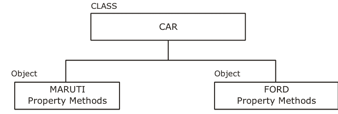

## 定义类和声明对象

在 C++ 中使用关键字 `class` 后面跟类名来定义类。类的体定义在大括号内，并以分号结束。

`keyword user-definedName`

```cpp
class ClassName {
    // 访问修饰符：//可以是 private, public 或 protected
    Data members; // 要使用的变量
    MemberFunctions() {} // 用于访问数据成员的方法
    // 类名后以分号结束
};
```

## 对象

对象（Object）是一个具有某些特征和行为的可识别实体。对象是类的实例。当定义一个类时，不会分配内存，但当实例化它时（即创建一个对象）时，会分配内存。要使用类中定义的数据和访问函数，你需要创建对象。

语法：

```cpp
ClassName ObjectName;

class sekhar
{
    char name[20];
    int id;
public:
    void getdetails(){}
};

int main()
{
    sekhar a1; // a1 是一个对象
}
```

对象占用内存空间，并有一个关联的地址，类似于 Pascal 中的记录或 C 语言中的结构体或 union。

当程序执行时，对象通过相互发送消息来相互交互。

每个对象都包含数据和操作数据代码。对象之间可以在不知道对方数据或代码细节的情况下进行交互，只需知道对象接受的消息类型和返回的响应类型即可。

## C++ 中的数据成员和成员函数

“数据成员”和“成员函数”是 C++ 编程语言中引入的类成员的新名称/术语。

在任何类中使用任何基本数据类型（如 `int`, `char`, `float` 等）或派生数据类型（如 `class`, `structure`, `pointer` 等）声明的变量被称为数据成员。在私有区域或公共区域声明的函数被称为成员函数。

C++ 中有三种类型的数据成员：

1. 私有数据成员（Private data members）
2. 公有数据成员（Public data members）
3. 保护数据成员（Protected data members）

### 1. 私有数据成员

在类的私有区域（使用 `private` 访问修饰符）声明的成员被称为私有成员。私有成员在定义的同一个类中也可以被访问。

### 2. 公有数据成员

在类的公共区域（使用 `public` 访问修饰符）声明的成员被称为公共成员。公共成员可以在类内部访问，也可以通过使用该类的对象名称在类外部访问。

### 3. 保护数据成员

保护数据成员与私有数据成员相似，区别在于声明为 `protected` 的类成员在类外部不可访问，但可以通过该类的任何子类（派生类）访问。

示例：

```cpp
class Test
{
private:
    int a;
    float b;
    char *name;
    void getA() { a=10; }
...
public:
    int count;
    void getB() { b=20; }
...
protected:
    int id;
    void getC() {c=30;}
};
```

在这里，`a`, `b` 和 `name` 是私有数据成员，`count` 是公有数据成员，`id` 是保护数据成员。同时，`getA` 是私有成员函数，`getB()` 是私有成员函数，`getC()` 是保护成员函数。

## 私有和保护的区别

| PRIVATE (私有) | PROTECTED (保护) |
| --- | --- |
| 声明为私有的类成员只能由类内部的函数访问。 | 保护访问修饰符与私有访问修饰符相似。 |
| | 声明为保护的类成员在类外部不可访问，但可以通过该类的任何子类（派生类）访问。 |

## 在 C++ 中访问类的数据成员

访问数据成员完全取决于该数据成员的访问修饰符（`public`, `private` 和 `protected`）。如果是公有的，则可以使用类对象的直接成员访问运算符（`.`）轻松地访问数据成员。

如果数据成员被定义为私有或保护，则我们无法直接访问数据变量。我们必须创建特殊的公有成员函数来访问、使用或初始化私有保护数据成员。这些成员函数也称为访问器（Accessors）和变异方法（Mutator methods），或 getter 和 setter 函数。

### 访问公有数据成员

下面的示例展示了如何使用点运算符（`.`）初始化和使用公有数据成员。

```cpp
class Student
{
public:
    int rollno;
    string name;
};

int main()
{
    Student A;
    A.rollno=1;
    A.name="Sekhar";
    Student B;
    B.rollno=2;
    B.name="Raman";
    cout << "A 的姓名和学号是: " << A.name << "-" << A.rollno;
    cout << "B 的姓名和学号是: " << B.name << "-" << B.rollno;
}
```

### 访问私有数据成员

要访问、使用和初始化私有数据成员，你需要创建 getter 和 setter 函数。getter 和 setter 函数必须定义在公共区域。

示例：

```cpp
class Student {
    private: // 私有数据成员
    int rollno;
    public:
    // 获取 rollno 的公共函数 - getter
    int getNo() {
        return rollno;
    }
    // 设置 rollno 值的公共函数 - setter
    void setRollNo(int i) {
        rollno=i;
    }
}

int main() {
    Student A;
    // A.rollno=1; // 编译错误
    // cout<< A.rollno; // 编译错误
    A.setRollNo(1); // rollno 初始化为1
    cout<< A.getNo(); // 输出为1
}
```

所以，这就是我们通过 getter 和 setter 方法使用任何类的私有数据成员的方法。

### 访问保护数据成员

保护数据成员可以在当前类的子类内部使用点运算符（`.`）直接访问；对于非子类，我们将按照访问私有数据成员的步骤进行。

## C++ 类的成员函数

成员函数是在类定义内部声明并作用于类成员的函数。成员函数的定义可以在类定义内部，也可以在类外部。

如果成员函数定义在类定义内部，可以直接定义；但如果它定义在类外部，则必须使用作用域解析运算符 `::` 配合类名。

示例：

```cpp
class Cube
{
    public:
    int side;
    /*
    声明函数 getVolume
    无参数且返回类型为 int。
    */
    int getVolume();
};
```

如果在类内部定义函数，则不需要先声明它，可以直接定义函数。

```cpp
class Cube
{
    public:
    int side;
    int getVolume()
    {
        return side*side*side; // 返回立方体的体积
    }
};
```

但如果我们计划在类定义之外定义成员函数，那么我们必须在类定义内部声明该函数，然后在外部定义它。

```cpp
class Cube {
public:
    int side;
    int getVolume();
}

// 在类定义外定义成员函数
int Cube :: getVolume() {
    return side*side*side;
}
```

这两个函数定义的主函数将是相同的。在 `main()` 内部，我们将创建类的对象，并使用 `.` 运算符调用成员函数。

### 在 C++ 中调用类成员函数

与访问类中的数据成员类似，我们也可以通过类对象使用点运算符（`.`）来访问公有成员函数。

下面是一个简单的代码示例，其中我们创建了 `Cube` 类的对象并调用成员函数 `getVolume()`：

```cpp
int main() {
    Cube C1;
    C1.side = 4; // 设置边长值
    cout<< "Volume of cube C1 = " << C1.getVolume();
}
```

输出：
Volume of cube C1 = 16

同样，我们可以在类定义内部或外部定义 getter 和 setter 函数来访问私有数据成员。

## C++ 中类成员函数的类型

我们已经知道成员函数是什么、它们的作用、如何定义成员函数以及如何使用类对象调用它们。现在，让我们学习一些可以在 C++ 类中定义的特殊成员函数。以下是成员函数的不同类型：

- 简单函数
- 静态函数
- 常量函数
- 内联函数
- 友元函数
- 虚成员函数

### 1. C++ 中的简单成员函数
简单函数是在声明时没有使用任何特定关键字的函数。它们没有特殊行为，并操作类的数据成员。所有以下所示形式的普通成员函数都被称为简单和基础成员函数。

```cpp
return_type functionName(parameter_list)
{
    function body;
}
```

我们在 `Raman` 类中声明了一些简单函数：

```cpp
void printRaman()
{
    cout << "First name " << firstName << endl;
    cout << "Last name " << lastName << endl;
    cout << "Year of Birth " << dateOfBirth.tm_year << endl;
}

string getAddress()
{
    return address;
}
```

```cpp
long int getInsuranceNumber()
{
    return insuranceNumber;
}
```

### 2. C++ 中的静态成员函数

静态函数具有类作用域。它们不能修改任何非静态数据成员或调用非静态成员函数。静态成员函数没有隐式的 `this` 参数。这就是为什么它们只能与类的静态成员一起工作。静态函数可以使用以下格式进行声明：

```cpp
static ReturnType FunctionName(ParameterList);
```

`static` 是一个保持其位置不变的。`static` 是一个可以用于数据成员也可以用于成员函数的关键字。我们将在稍后详细讨论这一点。目前，我们只讨论它在成员函数中的用法。

函数是通过在函数名使用 `static` 关键字创建的。这些函数针对整个类工作，而不是类的某个特定对象。
可以使用对象和直接成员访问运算符 `.` 来调用。但更典型的方法是使用类名和作用域解析运算符 `::` 直接调用静态成员函数。

示例：

```cpp
class Raman
{
    public:
        static void f()
        {
            // 语句
        }
};

int main()
{
    Raman::f(); // 使用类名直接调用成员函数
}
```

## C++ 面向对象概念

这些函数无法访问普通数据成员和成员函数，只有静态数据成员和静态成员函数可以在它们内部调用。

它没有任何 `this` 关键字，这就是它无法访问普通成员的原因。

### 3. C++ 中的常量成员函数

`const` 关键字使变量变为常量，一旦定义，其值就无法被更改。

`const` 函数用于指定“只读”函数。这种类型的函数不能修改任何非静态数据成员，也不能调用其他非常量成员函数。如果你想修改常量函数，必须在参数列表的括号后面添加 `const` 关键字：

```cpp
ReturnType FunctionName(ParamList) const;
// 常量成员函数的基本语法

void func() const
{
    // 语句
}
```


当与成员函数一起使用时，此类成员函数永远不会修改对象及其相关的数据成员。

`const`关键字必须在成员函数的声明和实现中均。例如，我们可以将`vvrRaman`成员函数修改为常量函数：

```cpp
string vvrRaman() const;
```

此函数是常量的，它不能修改任何数据成员：

```cpp
string Raman::vvrRaman() const
{
    if (!address.empty())
    {
        return address;
    }
    else
    {
        return "Attention!!! Address is empty";
    }
}
```

### 4. C++ 中的内联函数

所有在类定义内部定义的成员函数默认都被声明为内联`Inline`。

内联函数是实际的函数，在编译期间会被复制到到处，就像预处理器宏一样，减少了函数调用的开销。类定义内部的所有函数默认都是内联的，但你也可以通过使用关键字`inline`将任何非类函数变为内联。

对于内联函数，声明和定义必须一起完成。

```cpp
inline void fun(int a)
{
    return a++;
}
```

#### 关于内联的一些重要点

- 1. 我们必须保持内联函数的短小，内联函数效率更高。
- 2. 内联函数提高了效率，但我们不应该让大型函数内联。
- 3. 因此，建议使用作用域运算符`::`在类外定义大型函数，因为如果我们在类内部定义它们，它们会自动变为内联。
- 4. 内联函数由编译器在符号表中。

#### 内联函数的局限性

- 1. 大型内联函数会导致缓存缺失并影响性能。
- 2. 对于小型程序，到处复制函数的编译开销可以忽略不计，但在代码库中会有差异。
- 3. 此外，我们需要函数的地址，编译器无法对此类函数执行内联。因为为了提供函数地址，编译器必须为其分配存储。

## C++ 中的友元函数

友元函数不是类的成员函数，但它可以访问类的私有和保护成员。友元函数在类外作为简单函数声明和实现。但类必须通过在类内部使用`friend`关键字声明该函数来授予“朋友”权限。这里有一个类创建友元函数的示例：

示例：

```cpp
bool checkSalary(Raman v)
{
    if (v.salary > 40000) // salary 是保护数据成员
        return true;
    else
        return false;
}
```

这是一个具有全局作用域的函数。在类内部，我们必须添加`friend`关键字进行声明：

```cpp
friend bool checkSalary(Raman v);
```

现在，你可以在`main`中作为简单函数调用`checkSalary`：

```cpp
bool result = checkSalary(raman);
```

因此，友元函数可以通过创建类对象访问私有数据成员。同样，我们也可以将另一个类的函数作为朋友，或者将整个类作为友类。

当我们将一个类作为友元类时，它的所有成员函数自动成为友元函数。

友元函数是一个原因，因为 C++ 不是纯的面向对象语言。因为它违反了封装的概念。

## 虚成员函数

虚成员函数是在派生类中预期被重载的成员函数。虚函数用于继承 - 当使用基类指针调用基类中声明为虚的派生类函数时，它们提供了正确的行为。

# 封装

在普通术语中，封装`Encapsulation`被定义将数据和信息封装在一个单元中。在面向对象编程中，封装被定义将数据与操作数据函数绑定在一起。

考虑一个封装的现实例子。在公司里，有不同的部门，如会计部、财务部、销售部等。财务部处理所有的财务交易并记录所有与财务相关的数据。同样，销售部处理所有与销售相关的活动并记录所有的销售情况。现在，可能会出现一种情况：由于某种原因，财务部需要某个月的所有销售数据。他不被允许直接访问销售部的数据。他必须首先联系销售部的其他人员，然后请求他们提供特定的数据。这就是封装。在这里，销售部的数据和可以操作这些数据的员工被封装在“销售部”这一名称下。


封装还导致了数据抽象，同时通过封装也隐藏了数据。在上面的例子中，销售部的任何数据（如销售、财务或会计）对任何其他部门都是隐藏的。

在 C++ 中，可以使用类`Class`和访问修饰符`Access modifiers`来实现封装。看下面的程序：

# 说明封装的 C++ 程序

```cpp
#include <iostream>
using namespace std;
class Encapsulation
{
private:
    // 对外部世界隐藏的数据
    int x;
```
```cpp
public:
// 用于设置变量
// x 值的函数
void set(int a)
{
    x =a;
}
// 用于返回变量
// x 值的函数
int get()
{
    return x;
}
};
// main 函数
int main()
{
    Encapsulation obj;
    obj.set(5);
    cout<<obj.get();
    return 0;
}
```

在上面的程序中，变量`x`被设为私有`private`。该变量只能通过类内部的`get()`和`set()`函数进行访问和操作。那么我们可以说，变量`x`与函数`get()`、`set()`是绑定在一起的，这正是封装。

# 访问修饰符在封装中的作用

正如我们在上面的示例所示，访问修饰符在实现 C++ 封装时起着重要作用。实现封装的过程可以分为两个步骤：

- 1. 数据成员应该使用`private`访问修饰符标记为私有。
- 2. 操作数据成员的成员函数应该使用`public`访问修饰符标记为公有。

# 抽象

数据抽象`Data abstraction`是 C++ 面向对象编程中最基本、最重要的特征之一。抽象意味着只显示本质信息而隐藏细节。数据抽象是指向外部世界提供关于数据的本质信息，隐藏背景细节或实现细节。

考虑一个男人开车的现实例子。男人只知道按下加速板会增加汽车的速度，但他并不知道按下加速板后速度实际上是如何增加的，他不知道汽车的内部机制或汽车内加速板、刹车等的实现方式。这就是抽象。

- **使用类的抽象：** 我们可以在 C++ 类中实现抽象。类帮助我们使用可用的访问修饰符将数据成员和成员函数组合在一起。类可以决定哪些数据成员对外部世界可见，哪些不可见。
- **头文件中的抽象：** C++ 中另一种类型的抽象是头文件。例如，考虑`math.h`头文件中的`pow()`方法。每当我们需要计算数字的幂时，只需调用`math.h`头文件中的`pow()`函数，并将数字作为参数传递，而无需知道函数实际上是如何计算数字幂的底层算法。

# 使用访问修饰符的抽象

访问修饰符是 C++ 实现抽象的主要支柱。我们可以使用访问修饰符对类成员实施限制。例如：

- 在类中声明为**public**`公有`的成员可以从程序的任何地方访问。
- 在类中声明为**private**`私有`的成员只能从类内部访问。不允许从类外部的任何代码部分访问。

我们可以利用访问修饰符提供的上述两个功能轻松地实现抽象。假设定义内部实现的成员可以在类中标记为`private`。而需要提供给外部世界的重要信息可以标记为`public`。由于这些公共成员位于类内部，因此可以访问私有成员。

```cpp
#include <iostream>
using namespace std;
class implementAbstraction {
    private:
        int a, b;
    public:
        // 设置私有
        // 成员值的方法
        void set(int x, int y)
        {
            a = x;
            b = y;
        }
        void display()
        {
            cout<<"a = " << a << endl;
            cout<<"b = " << b << endl;
        }
};
int main() {
    implementAbstraction obj;
    obj.set(10, 20);
    obj.display();
    return 0;
}
```

输出： a = 10, b = 20

你可以看到在上面的程序中我们不允许直接访问变量`a`和`b`，但人们可以调用`sum()`函数来设置`a`和`b`的值，并调用`display()`函数来显示它们。`注：原文此处为 sum()，但代码中为 set()，此处按上下文逻辑翻译`

# 数据抽象的优点：

- 帮助避免编写低级代码。
- 避免代码重复并增加重用性。
- 在不影响多一个用户的情况下更改内部实现。
- 提高应用程序的安全性，向用户提供重要信息。

# 多态

多态`Polymorphism`意味着具有多种形式。简单来说，多态可以定义为以多种形式显示消息的能力。

同一个人同时具有不同的特征。就像一个人同时是父亲、丈夫、员工。所以同人在不同情况下具有不同的行为。这就是多态。

示例：假设我们需要写一个相加整数的函数，有时是 2 个整数，有时是 3 个整数。我们可以编写具有不同参数的同名加法，根据参数调用相应的方法。

```cpp
int main () {
    sum1 = sum(20,30);
    sum2 = sum(20,30,40);
}
```
```cpp
int sum(int a, int b, int c) {
    return (a+b+c);
}
```

操作可以在不同实例中表现出不同的行为。取决于操作的数据类型。

- 多态广泛应用于继承。

# C++ 面向对象概念

在 C++ 中，我们有两种多态：

- 1. 编译时多态 - 也称为静态绑定。
- 2. 运行时多态 - 也称为动态绑定。

# 1. 编译时多态

函数重载和运算符重载是编译时多态的完美示例。

- **运算符重载：** 使运算符在不同实例表现出不同行为的过程被称为运算符重载。

C++ 还提供了重载运算符的选项。例如，我们可以为字符串类重载运算符`'+'`来连接两个字符串。我们知道这是加法运算符，其任务是相两个操作数。因此，同一个运算符`'+'`放在整数操作数之间时会将它们相加，当放在字符串操作数之间时，会将它们拼接。

# 运算符重载的 CPP 程序

```cpp
#include<iostream>
using namespace std;
class Complex {
private:
    int real, imag;
public:
    Complex(int r = 0, int i =0);//在两个 Complex 对象之间使用 '+' 时，会自动调用
    Complex operator + (Complex const &obj) {
        Complex res;
        res.real = real + obj.real;
        res.imag = imag + obj.imag;
        return res;
    }
    void print() { cout << real << " " << i << " " << imag << endl; }
};
```

# int main()

```cpp
{
    Complex c1(10, 5), c2(2, 4);
    Complex c3 = c1 + c2; // 对 "operator+" 的示例调用
    c3.print();
}
```

Output: 12 + 9

在上面的示例中，运算符`'+'`被重载了。`'+'`是一个加法运算符，可以相两个数字（整数或浮点数），但在这里该运算符被用于执行两个虚数或复数的加。

- *函数重载*：函数重载是指使用同一个函数名来执行不同类型的任务。
- 当存在多个同名但参数不同的函数时，这些函数被称为重载函数。可以通过改变参数的数量和/或改变参数的类型来实现函数重载。

// 函数重载的 C++ 程序

```cpp
#include <bits/stdc++.h>
using namespace std;
class Commerce {
    public:
    // 带有 1 个 int 参数的函数
    void hello(int x) {
        cout << "value of x is " << x << endl;
    }
    // 相同名但带有 1 个 double 参数的函数
    void hello(double x) {
        cout << "value of x is " << x << endl;
    }
};
```
```cpp
// 相同名且带有 2 个 int 参数的函数
void hello(int x, int y)
{
    cout << "value of x and y is " << x << ", " << y << endl;
}
```
```cpp
int main() {
    Commerce obj1;
// 调用哪个函数取决于传递的参数
// 调用了第一个 'hello'
    obj1.hello(7);
    // 调用了第二个 'hello'
    obj1.hello(9,132);
    // 调用了第三个 'hello'
    obj1.hello(85,64);
    return 0;
}
```

# 输出:

value of x is 7
value of x is 9.132
value of x and y is 85, 64

在上面的示例中，一个名为`hello`的单一函数在三种不同的情况下表现不同，这就是多态的特性。

## 编译时多态示例:

在这个示例中，我们有两个同名但参数数量不同的函数。根据函数调用期间传递的参数数量来决定要调用哪个函数，这被认为是多态的一个示例，因为在不同条件下，输出是不同的。由于调用是在编译期间确定的，因此它被称为编译时多态。

```cpp
#include <iostream>
using namespace std;
class Add {
public:
    int sum(int num1, int num2){
        return num1+num2;
    }
    int sum(int num1, int num2, int num3){
        return num1+num2+num3;
    }
};
int main() {
    Add obj;
    // 这将调用第一个函数
    cout<<"Output: "<<obj.sum(10, 20)<<endl;
    // 这将调用第二个函数
    cout<<"Output: "<<obj.sum(11, 22, 33); << endl;
    return 0;
}
```

## 2. 运行时多态
函数重写是运行时多态的一个示例。

*函数重写*：当子类声明一个已经在父类中存在的方法时，这被称为函数重写。在这里，子类重写了父类。

在函数重写的情况下，我们有两个同名函数的定义，一个在父类中，一个在子类中。函数的调用是在运行时确定的，以决定调用哪个函数的定义。这就是为什么它被称为运行时多态。

# 运行时多态的示例

// 函数重写的 C++ 程序

```cpp
#include <bits/stdc++.h>
using namespace std;
class base {
public:
    virtual void print ()
    { cout<< "print base class" <<endl; }
    void show ()
    { cout<< "show base class" << endl; }
};
class derived:public base {
public:
    void print ()             // print () 在派生类中已经是虚函数了，
    // 我们也可以显式地声明为 virtual print ()
    { cout<< "print derived class" << endl; }
    void show ()
    { cout<< "show derived class" << endl; }
};
// main 函数
int main() {
    base *bptr;
    derived d;
    bptr = &d;
    // 虚函数，在运行时绑定（运行时多态）
    bptr->print();
    // 非虚函数，在编译时绑定
    bptr->show();
    return 0;
}
```


```
Output:
print derived class
show base class
```

# 继承

类从另一个类派生属性和特征的能力是继承。继承是面向对象编程中的一个重要特性，用于代码重用。继承允许我们将一个类的所有代码（声明为私有的外）继承到另一个类。

- **派生类**：从另一个类继承属性的类被称为派生类（Derived Class）或子类（Sub Class）。
- **基类**：属性被派生类继承的类被称为基类（Base Class）或超类（Super Class）。

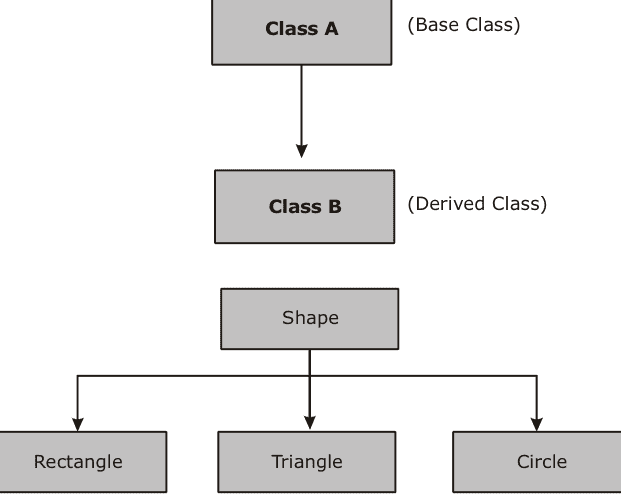

带有 Shape 类的层次继承

- *重用*：继承支持“重用”的概念，即当我们想要创建一个新类，并且已经有一个类包含了我们想要的部分代码时，我们可以从现有类派生我们的新类。通过这样做，我们重用了现有类的字段和方法。

# 继承模式

1. **公共模式 (Public)**：如果我们从公共基类派生子类，那么基类的公共成员在派生类中将变为公共，基类的保护成员在派生类中将变为保护。
2. **保护模式 (Protected)**：如果我们从保护基类派生子类，那么基类的公共成员和保护成员在派生类中都将变为保护的。
3. **私有模式 (Private)**：如果我们从私有基类派生子类，那么基类的公共成员和保护成员在派生类中都将变为私有。

# 继承类型

不同的语言提供不同类型的继承。然而，基本思想仍然是派生类访问基类的（非私有的）成员。C++ 在继承方面非常灵活，提供了以下类型。

## 单继承

这是最基础的继承类型，父类恰好有一个子类，子类恰好有一个父类，那么这种继承被称为单继承。

语法：

```cpp
class subclass_name : access_mode base_class
{
    // 子类体
};
```

示例：

### 解释单继承的 C++ 程序

```cpp
#include <iostream>
using namespace std;
// 基类
class Vehicle {
public:
    Vehicle()
    {
        cout << "This is a Vehicle" << endl;
    }
};
// 从两个类派生的子类
class Car: public Vehicle{
};
// main 函数
int main()
{
    // 创建子类对象将
    // 触发基类的构造函数
    Car obj;
    return 0;
}
```
Output: This is a vehicle.

## 多重继承

在这种类型的继承中，一个子类拥有多个父类，因此继承了多个基类。这种继承的优势是一个类可以访问多个类的成员，从而充分利用了继承特性。这是一种复杂的继承类型，某些计算机语言（如 Java、C#、C#、VB.Net 等）不支持这种继承，但由于 C++ 在继承方面非常灵活，因此也支持多重继承。图显示了它是如何发生的。

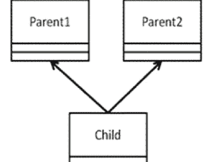

语法：

```cpp
class subclass_name : access_mode base_class1, access_mode base_class2,
...
{
    // 子类体
};
```

在这里，基类的数量用逗号（','）隔开，并且必须为每个基类指定访问模式。

示例：

### 解释多重继承的 C++ 程序

```cpp
#include <iostream>
using namespace std;
// 第一个基类
class Vehicle {
public:
    Vehicle()
```
```cpp
{
    cout << "This is a Vehicle" << endl;
}
// second base class
class FourWheeler {
public:
    FourWheeler()
    {
        cout << "This is a 4 wheeler Vehicle" << endl;
    }
};
// sub class derived from two base classes
class Car: public Vehicle, public FourWheeler {
};
// main function
int main()
{
    // creating object of sub class will
    // invoke the constructor of base classes
    Car obj;
    return 0;
}
```

Output:
This is a Vehicle
This is a 4-wheeler Vehicle

# 层次级继承

在这一类型的继承中，一个父类可以有多个子类。它允许在多个派生类中访问同一个类的代码。几乎所有支持面向对象编程的计算机语言都支持层级继承。下图描述了这种继承方式。

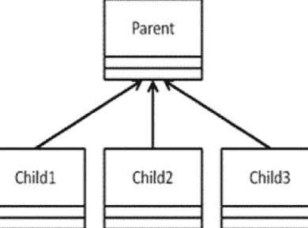

## 实现层次级继承的 C++ 程序

```cpp
#include <iostream>
using namespace std;
// base class
class Vehicle
{
public:
    Vehicle()
    {
        cout << "This is a Vehicle" << endl;
    }
}
// first sub class
class Car: public Vehicle
{
}
// second sub class
class Bus: public Vehicle
{
};
```
```cpp
// main function
int main() {
    // creating object of sub class will
    // invoke the constructor of base class
    Car obj1;
    Bus obj2;
    return 0;
}
```

Output:

This is a Vehicle
This is a Vehicle

# 多级继承

正如名称所示，继承可以扩展到两个以上的级别。在这种类的继承中，同一个类可能既是父类的子类，又是其子类的父类。在图中，Class2 是 Class1 的子类，同时也是 Class3 的父类。

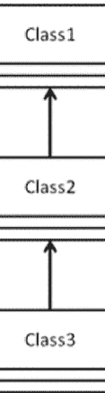

## 实现多级继承的 C++ 程序

```cpp
#include <iostream>
using namespace std;
// base class
class Vehicle
{
public:
    Vehicle()
    {
        cout << "This is a Vehicle" << endl;
    }
}
class fourWheeler: public Vehicle
{
public:
    fourWheeler()
    {
        cout<<"Objects with 4 wheels are vehicles"<<endl;
    }
}
// sub class derived from two base classes
class Car: public fourWheeler{
public:
    car()
    {
        cout<<"Car has 4 Wheels"<<endl;
    }
}
// main function
int main()
{
    //creating object of sub class will
    //invoke the constructor of base classes
    Car obj;
    return 0;
}
```

Output:
This is a Vehicle
Objects with 4 wheels are vehicles
Car has 4 Wheels

# 混合（虚）继承

这种继承是上述讨论的不同类型继承的集合。例如，在下图所示的，一个子类可能有多个父类，且在多级继承中，一个类可能有多个子类。

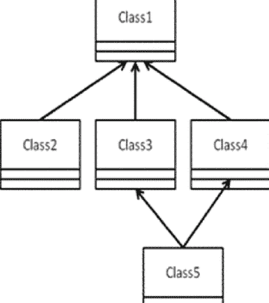

如上图所示，Class1 有多个子类，Class5 有多个父类。这里也存在多级继承。你可以组合之前讨论的任何类型的继承来形成混合继承。

## 混合继承的 C++ 程序

```cpp
#include <iostream>
using namespace std;
// base class
class Vehicle
{
public:
    Vehicle()
    {
        cout << "This is a Vehicle" << endl;
    }
};
```
```cpp
// base class
class Fare
{
public:
    Fare()
    {
        cout<<"Fare of Vehicle\n";
    }
};
```
```cpp
// first sub class
class Car: public Vehicle
{
};
```
```cpp
// second sub class
class Bus: public Vehicle, public Fare
{
};
```
```cpp
// main function
int main()
{
    // creating object of sub class will
    // invoke the constructor of base class
    Bus obj2;
    return 0;
}
```

Output:
This is a Vehicle
Fare of Vehicle

# 动态绑定

在动态绑定中，响应函数调用而执行的代码是在运行时决定的。C++ 使用了虚函数来支持这一点。

# 消息传递

对象通过相互发送和接收信息进行通信。一个对象的消息是执行某个过程的请求，并将调用接收对象中的函数以生成所需的结果。消息传递涉及指定对象的名称、函数的名称以及要发送的信息。

### 复习题

# 简答题：

1. C++ 程序的结构是什么？
2. 简述 C++ 中的输入、输出语句和注释。
3. C++ 中的存储类是哪些？列出存储类的类型。
4. C 和 C++ 之间有什么区别？
5. C++ 中的类和对象是什么？
6. C++ 中的数据成员和成员函数是什么？
7. 什么是继承？列出它的类型。
8. C++ 中的多态是什么？列出它的类型。
9. 什么是封装？写出它的优点。
10. 什么是数据抽象？写出它的优点。

# 问答题：

1. C 和 C++ 有什么区别？
2. 什么是成员函数？解释它的类型。
3. C++ 中的存储类是哪些？解释各种类型的存储类。

# 使用 C++ 的面向对象概念

4. 什么是数据成员？解释各种类型的数据成员。
5. 什么是继承？列出它的类型。
6. 什么是多态？列出它的类型。
7. 什么是封装？写出它的优点。
8. 什么是数据抽象？写出它的优点。

# 单选题：

1. C++ 程序的结构是什么？ 
2. 简述 C++ 中的输入、输出语句和注释。
3. C++ 中的存储类是哪些？列出存储类的类型。
4. C 和 C++ 之间有什么区别？
5. C++ 中的类和对象是什么？
6. C++ 中的数据成员和成员函数是什么？
7. 什么是继承？列出它的类型。
8. C++ 中的多态是什么？列出它的类型。
9. 什么是封装？写出它的优点。
10. 什么是数据抽象？写出它的优点。

# 空选择题：

1. C++ 程序的结构是什么？ 
2. 简述 C++ 中的输入、输出语句和注释。
3. C++ 中的存储类是哪些？列出存储类的类型。
4. C 和 C++ 之间有什么区别？
5. C++ 中的类和对象是什么？
6. C++ 中的数据成员和成员函数是什么？
7. 什么是继承？列出它的类型。
8. C++ 中的多态是什么？列出它的类型。
9. 什么是封装？写出它的优点。
10. 什么是数据抽象？写出它的优点。

# 判断题：

1. C++ 程序的结构是什么？ 
2. 简述 C++ 中的输入、输出语句和注释。
3. C++ 中的存储类是哪些？列出存储类的类型。
4. C 和 C++ 之间有什么区别？
5. C++ 中的类和对象是什么？
6. C++ 中的数据成员和成员函数是什么？
7. 什么是继承？列出它的类型。
8. C++ 中的多态是什么？列出它的类型。
9. 什么是封装？写出它的优点。
10. 什么是数据抽象？写出它的优点。

# 填空题：

1. C++ 程序的结构是什么？ 
2. 简述 C++ 中的输入、输出语句和注释。
3. C++ 中的存储类是哪些？列出存储类的类型。
4. C 和 C++ 之间有什么区别？
5. C++ 中的类和对象是什么？
6. C++ 中的数据成员和成员函数是什么？
7. 什么是继承？列出它的类型。
8. C++ 中的多态是什么？列出它的类型。
9. 什么是封装？写出它的优点。
10. 什么是数据抽象？写出它的优点。

# 匹配题：

1. C++ 程序的结构是什么？ 
2. 简述 C++ 中的输入、输出语句和注释。
3. C++ 中的存储类是哪些？列出存储类的类型。
4. C 和 C++ 之间有什么区别？
5. C++ 中的类和对象是什么？
6. C++ 中的数据成员和成员函数是什么？
7. 什么是继承？列出它的类型。
8. C++ 中的多态是什么？列出它的类型。
9. 什么是封装？写出它的优点。
10. 什么是数据抽象？写出它的优点。

# 实验题：

1. C++ 程序的结构是什么？ 
2. 简述 C++ 中的输入、输出语句和注释。
3. C++ 中的存储类是哪些？列出存储类的类型。
4. C 和 C++ 之间有什么区别？
5. C++ 中的类和对象是什么？
6. C++ 中的数据成员和成员函数是什么？
7. 什么是继承？列出它的类型。
8. C++ 中的多态是什么？列出它的类型。
9. 什么是封装？写出它的优点。
10. 什么是数据抽象？写出它的优点。

# C 与 C++ 建议实验题：

1. 编写一个两个整数相加的程序。
2. 编写一个输入整数的程序。
3. 编写一个乘两个浮点数的程序。
4. 编写一个查找字符 ASCII 值的程序。
5. 编写一个计算商和余数的程序。
6. 编写一个查找 int、double 和 char 大小的程序。
7. 编写一个使用临时变量交换数字的程序。
8. 编写一个检查数字是偶数还是奇数的程序。
9. 编写一个使用三元运算符检查奇偶。
10. 编写一个检查字符是否为元音或辅音的程序。
11. 编写一个找出三个数最大的程序。
12. 编写一个检查闰年的程序。
13. 编写一个检查字符是否为字母的程序。
14. 编写一个计算前 N 个自然数和的程序。
15. 编写一个计算数字阶的程序。
16. 编写一个生成给定数字乘法表的程序。
17. 编写一个显示到 n 个数的斐波那契数列的程序。
18. 编写一个计算整数数字数的程序。
19. 编写一个反转数字的程序。
20. 编写一个检查数字是否为回文的程序。
21. 编写一个检查数字是否为质数的程序。
22. 编写一个检查给定数字是否为阿姆斯特数的程序。
23. 编写一个使用 switch...case 制作简单计算器的程序。
24. 编写一个创建金字塔和模式的 C 代码。
25. 编写一个使用递归反转序列的程序。
26. 编写一个使用函数显示区间内质数的程序。
27. 编写一个将二进制数转换为十进制反之的程序。
28. 编写一个使用自定义函数检查质数或阿姆斯特数的程序。
29. 编写一个使用递归计算幂的程序。

30. 编写一个 C 程序使用递归求最大公约数 (G.C.D)。

31. 编写一个 C 程序使用数组计算平均值。

32. 编写一个 C 程序查找数组中的最大元素。

33. 编写一个 C 程序相两个多维数组（矩阵）。

34. 编写一个 C 程序获取字符串的长度。

35. 编写一个 C 程序拼接两个字符串。

36. 编写一个 C 程序在不使用 `strcpy()` 的情况下复制字符串。

37. 编写一个 C 程序统计元音、辅音等的数量。

38. 编写一个 C 程序查找字符串中字符出现的频率。

39. 编写一个 C 程序使用指针访问数组元素。

40. 编写一个 C 程序来创建、初始化、赋值和访问指针变量。

41. 编写一个 C 程序使用指针交换两个数字。

42. 编写一个 C 程序使用指针统计字符串中的元音和辅音。

43. 编写一个 C 程序使用结构体存储学生信息。

44. 编写一个 C 程序使用结构体相两个距离（英寸-英制）。

45. 编写一个 C 程序声明并初始化一个联合体 (union)。

46. 编写一个 C++ 程序实现函数重载。

47. 编写一个 C++ 程序使用封装计算矩形面积。

48. 编写一个 C++ 程序使用数据抽象相两个数字。

49. 编写一个 C++ 程序重载二元运算符。

## 建议的实验编程题及答案

- 1. 编写一个 C 程序两个整数相加。

```
#include<stdio.h>
int main() {
int number1, number2, sum;
printf("Enter two integers: ");
scanf("%d %d", &number1, &number2);
// 计算总和
sum = number1 + number2;
printf("%d + %d = %d", number1, number2, sum);
return 0;
}
```


Output
Enter two integers: 12 11
12 + 11 = 23

## 2. 编写一个 C 程序打印一个整数（用户输入的）。

```c
#include<stdio.h>

int main(){

int number;

printf("Enter an integer: ");

// 读取并存储输入

scanf("%d",&number);

// 显示输出

printf("You entered: %d", number);

return 0;

}
```

# Output

Enter an integer: 25
You entered: 25

## 3. 编写一个 C 程序计算两个浮点数的乘积。

```c
#include<stdio.h>

int main() {

double a, b, product;

printf("Enter two numbers: ");

scanf("%lf %lf", &a, &b);

// 计算乘积

product = a * b;

// 使用 %2lf 显示保留两位小数的结果

printf("Product = %.2lf", product);

return 0;

}
```

Output
Enter two numbers: 2.4 and 1.12
Product = 2.69

## 4. 编写一个 C 程序获取字符的 ASCII 值。

```c
#include<stdio.h>

int main() {

char c;

printf("Enter a character: ");

scanf("%c",&c);

// %d 显示实际字符的整数值

// %c 显示 %c = %d 的 ASCII 值

printf("ASCII value of %c = %d", c, c);

return 0;

}
```

# 实验编程

# Output

Enter a character: G
ASCII value of G = 71

## 5. 编写一个 C 程序计算商和余数。

```c
#include<stdio.h>

int main(){

    int dividend, divisor, quotient, remainder;

    printf("Enter dividend: ");

    scanf("%d", &dividend);

    printf("Enter divisor: ");

    scanf("%d", &divisor);

    // 计算商

    quotient = dividend / divisor;

    // 计算余数

    remainder = dividend % divisor;

    printf("Quotient = %d\n", quotient);

    printf("Remainder = %d\n", remainder);

    return 0;

}
```

# Output

Enter dividend: 25
Enter divisor: 4
Quotient = 6
Remainder = 1

## 6. 编写一个 C 程序查找 int, float, double 和 char 的大小。

```c
#include<stdio.h>

int main(){

    int intType;

    float floatType;

    double doubleType;

    char charType;

    // sizeof 评估变量的大小

    printf("Size of int: %d bytes\n", sizeof(intType));

    printf("Size of float: %d bytes\n", sizeof(floatType));

    printf("Size of double: %d bytes\n", sizeof(doubleType));

    printf("Size of char: %d bytes\n", sizeof(charType));

    return 0;

}
```

# Output

Size of int: 4 bytes
Size of float: 4 bytes
Size of double: 8 bytes
Size of char: 1 byte

## 7. 编写一个 C 程序使用临时变量交换两个数字。

```c
#include<stdio.h>

int main(){

    int first, second, temp;

    printf("Enter first number: ");

    scanf("%d",&first);

    printf("Enter second number: ");

    scanf("%d",&second);

    // 将 first 赋值给 temp

    temp=first;

    // 将 second 赋值给 first

    first=second;

    // 将 temp（first 的值）赋值给 second

    second=temp;

    printf("After swapping, first = %d\n", first);

    printf("After swapping, second = %d\n", second);

    return 0;

}
```

# Output

Enter first number: 5
Enter second number: 8

After swapping, first = 8
After swapping, second = 5

## 实验编程

## 8. 编写一个 C 程序检查数字是偶数还是奇数。

```c
#include<stdio.h>

int main(){

int num;

printf("Enter integer: ");

scanf("%d",&num);

// 如果 num 能被 2 整除则为真

if(num%2==0)

printf("%d is even.",num);

else

printf("%d is odd.",num);

return 0;

}
```

Output
Enter integer: -7
-7 is odd.

## 9. 编写一个 C 程序使用三元运算符检查奇数或偶数。

```c
#include<stdio.h>

int main(){

int num;

printf("Enter integer: ");

scanf("%d",&num);

(num%2==0)?printf("%d is even.",num):printf("%d is odd.",num);

return 0;

}
```

Output
Enter integer: 33
33 is odd.

## 10. 编写一个 C 程序检查字符是否是元音或辅音。

```c
#include<stdio.h>

int main(){

char c;

int lowercase, uppercase;

printf("Enter alphabet: ");

scanf("%c",&c);

// 如果 c 是小写则为真

lowercase=(c=='a'||c=='e'||c=='i'||c=='o');

// 如果 c 是大写则为真

uppercase=(c=='A'||c=='E'||c=='I'||c=='O');

if(lowercase || uppercase)

    printf("%c is a vowel.", c);

else

    printf("%c is a consonant.", c);

return 0;

}
```

Output
Enter alphabet: G
G is a consonant.

## 11. 编写一个 C 程序找到三个数字中的最大值。

```c
#include <stdio.h>

int main() {

    int n1, n2, n3;

    printf("Enter three numbers: ");

    scanf("%d %d %d", &n1,&n2,&n3);

    if (n1 >= n2 && n1 >= n3)

        printf("%d is the largest.", n1);

    else if (n2 >= n1 && n2 >= n3)

        printf("%d is the largest.", n2);

    else

        printf("%d is the largest.", n3);

    return 0;

}
```

Output
Enter three numbers: 4 7 3
7 is the largest.

## 12. 编写一个 C 程序检查闰年。

```c
#include <stdio.h>

int main(){

int year;

scanf("%d", &year);

if((year%4==0 && year%100!=0) || (year%400==0))

    printf("%d is a leap year.", year);

else

    printf("%d is not a leap year.", year);

return 0;

}
```

## 13. 编写一个 C 程序检查字符是否为字母。

```c
#include <stdio.h>

int main(){

char c;

printf("Enter a character: ");

scanf("%c",&c);

 if((c>='a' && c<='z')||(c>='A' && c<='Z'))

    printf("%c is an alphabet.", c);

else

    printf("%c is not an alphabet.", c);

 return 0;

}
```

Output
Enter a character: *
* is not an alphabet

## 14. 编写一个 C 程序计算前 'n' 个自然数的和。

```c
#include <stdio.h>

int main(){

int n, i, sum=0;

printf("Enter a positive integer: ");

scanf("%d",&n);

i=1;

while(i <= n){

sum+= i;

i++;

}

printf("Sum = %d", sum);

return 0;

}
```

Output
Enter a positive integer: 100
Sum = 5050

## 15. 编写一个 C 程序找到数字的阶阶。

```c
#include <stdio.h>

int main(){

int n, i;

unsigned long long fact =1;

printf("Enter an integer: ");

scanf("%d",&n);

// 如果用户输入负整数则显示错误

if(n<0)

printf("Error! Factorial of a negative number doesn't exist.");

else

for(i=1; i <= n;++i){

fact*= i;

}

printf("Factorial of %d = %lu", n, fact);

return 0;

}
```

Output
Enter an integer: 10
Factorial of 10 = 3628800

## 16. 编写一个 C 程序生成给定数字的相法表。

```c
#include <stdio.h>

int main(){

int n, i;

printf("Enter an integer: ");

scanf("%d",&n);

for(i=1; i<=10; i++){

    printf("%d * %d = %d\n", n, i, n*i);

}

return 0;

}
```

Output
Enter an integer: 9
9 * 1 = 9
9 * 2 = 18
9 * 3 = 27
9 * 4 = 36
9 * 5 = 45
9 * 6 = 54
9 * 7 = 63
9 * 8 = 72
9 * 9 = 81
9 * 10 = 90

## 17. 编写一个 C 程序显示前 ‘n’ 个数字的斐波那契序列。

```c
#include<stdio.h>

int main(){

int i, n, t1 =0, t2 =1,nextnum;

printf("Enter the number of terms: ");

scanf("%d",&n);

printf("Fibonacci Series: %d", t1);

for(i=1; i<n; i++){

    nextnum = t1 + t2;

    t1 = t2;

    t2 = nextnum;

    printf(", %d", t1);

}

return 0;

}
```

```c
for(i=1; i<= n;++i){

    printf("%d, %d", t1);

    nextnum = t1 + t2;

    t1 = t2;

    t2 = nextnum;

}
```

```c
return 0;

}
```

#### 输出

输入项数： 10
斐波那契数列: 0, 1, 1, 2, 3, 5, 8, 13, 21, 34

## 18. 编写一个 C 程序来统计整数的位数。

```c
#include<stdio.h>

int main(){

    int n;

    int count=0;

    printf("输入一个整数: ");

    scanf("%d",&n);

    while(n!=0){

        n/=10;// n = n/10

        ++count;

    }

    printf("位数: %d", count);

}
```

#### 输出

输入一个整数: 3452
位数: 4

# 19. 编写一个 C 程序来反转数字。

```c
#include<stdio.h>

int main(){

    int n, rev=0, remainder;

    printf("输入一个整数: ");

    scanf("%d",&n);

    while(n!=0){

        remainder= n %10;
```

## 实验编程

```c
#include<stdio.h>

int main() {

    rev = rev *10+ remainder;

    n/=10;

    printf("反转后的数字 = %d", rev);

    return 0;

}
```

输出
输入一个整数: 2345
反转后的数字 = 5432

## 20. 编写一个 C 程序来检查一个数字是否为回文。

```c
#include<stdio.h>

int main() {

    int n, temp =0, remainder, num;

    printf("输入一个整数: ");

    scanf("%d",&n);

    num= n;

    // 反转后的整数存储在 temp 中

    while(n!=0){

        remainder= n%10;

        temp= temp *10+ remainder;

        n/=10;

    }

    // 如果原始数字和反转后的数字相等则是回文

    if(num==temp)

        printf("%d 是回文数。",num);

    else

        printf("%d 不是回文数。",num);

    return 0;

}
```

输出
输入一个整数: 343
343 是回文数。

## 21. 编写一个 C 程序来检查一个数字是否为质数。

```c
#include<stdio.h>

int main() {

    int n, i, flag =0;

    printf("输入一个正整数: ");

    scanf("%d",&n);

    for(i =2; i <= n /2;++i){

        // 非质数的条件

        if(n % i ==0){

            flag=1;

            break;

        }

    }

    if(n ==1){

        printf("1 既不是质数不是合数.");

    }

    else{

        if(flag==0)

            printf("%d 是质数。", n);

        else

            printf("%d 不是质数。", n);

    }

    return 0;

}
```

#### 输出

输入一个正整数: 29
29 是质数。

## 22. 编写一个 C 程序来检查给定的数字是否为阿姆斯特数（Armstrong number）。

```c
#include<stdio.h>

int main() {

    int originalNum, remainder, result =0;

    printf("输入一个三位整数: ");

    scanf("%d",&num);

    originalNum=num;
```


### 阿姆斯特数示例

```
while(originalNum!=0){

    remainder=originalNum%10;

    result+= remainder * remainder * remainder;

    originalNum/=10;

}

if(result ==num)

    printf("%d 是阿姆斯特数。",num);

else

    printf("%d 不是阿姆斯特数。",num);

return 0;

}
```

输出
输入一个三位整数: 371
371 是阿姆斯特数。

## 23. 编写一个使用 switch case 的简单计算器 C 程序。

```c
#include <stdio.h>

int main() {
    int num1,num2;
    float result;
    char ch;//用于存储操作符选择
    printf("输入第一个数字: ");
    scanf("%d",&num1);
    printf("输入第二个数字: ");
    scanf("%d",&num2);
    printf("选择要执行的操作 (+,-,*,/%,@): ");
    scanf("%c",&ch);
    result=0;
    switch(ch) {
        case '+':
            result=num1+num2;
            break;
        case '-':
            result=num1-num2;
            break;
        case '*':
            result=num1*num2;
            break;
        case '/':
            result=(float)num1/(float)num2;
            break;
        case '%':
            result=num1%num2;
            break;
        default:
            printf("无效的操作。\n");
    }
    printf("结果: %d%%d = %f\n",num1,ch,num2,result);
    return(0);
}
```

输出
输入第一个数字: 10
输入第二个数字: 20
选择要执行的操作 (+-,*,/,%): +
结果: 10 + 20 = 30.000000

## 24. 编写一个创建金字塔模式的 C 语言代码。

```c
#include <stdio.h>

int main() {
    int i, j, rows;
    printf("输入行数: ");
    scanf("%d", &rows);
    for (i=1; i<=rows; i++) {
        for (j=1; j<=i; j++) {
            printf("* ");
        }
        printf("\n");
    }
    return(0);
}
```

输出
1
1 2
1 2 3
1 2 3 4
1 2 3 4 5

## 25. 编写一个使用递归反转句子的 C 程序。

```c
#include<stdio.h>

void reverseSentence();

int main(){
    printf("输入一个句子: ");
```

输出
输入一个句子: IndrakantiSekhar
SekharIndrakanti

## 26. 编写一个使用函数显示区间内质数的 C 程序。

```c
#include<stdio.h>

int checkPrimeNumber(int n);

int main(){
    int n1, n2, i, flag;
    printf("输入两个整数: ");
    scanf("%d %d",&n1,&n2);
    printf("%d 和 %d 之间的质数有: ", n1, n2);
    for(i=n1+1; i < n2;i++){
        // 如果 i 是质数，flag 将等于 1
        flag=checkPrimeNumber(i);
        if(flag==1)
            printf("%d ", i);
    }
    return 0;
}

// 用户定义的检查质数的函数

int checkPrimeNumber(int n){
    int j, flag=1;
    for(j =2; j <= n /2;++j){
        // 非质数的条件
        if(n % j ==0){
            flag=0;
            break;
        }
    }
    if(n ==1){
        printf("1 既不是质数不是合数.");
    }
    else{
        if(flag==1)
            printf("%d 是质数。", n);
        else
            printf("%d 不是质数。", n);
    }
    return flag;
}
```

#### 输出
输入两个整数: 12 30
12 和 30 之间的质数有: 13 17 19 23

## 27. 编写一个 C 程序将二进制数转换为十进制，反之亦然。

```c
#include<stdio.h>
#include<math.h>

int convert(int n);

int main(){
    int n;
    printf("输入二进制数: ");
    scanf("%d",&n);
    printf("十进制数: %d", convert(n));
    return 0;
}

int convert(int n){
    int rem=0, dec=0;
    while(n!=0){
        rem=n%10;
        dec+= rem*pow(2,0); // 注意：此处逻辑似乎有误，应为2的次方，但按原样不翻译
        n/=10;
    }
    return dec;
}
```

## 28. 编写一个 C 程序来检查一个数字是否为回文。

```c
#include<stdio.h>
int main() {
    int n, temp =0, remainder, num;
    printf("输入一个整数: ");
    scanf("%d",&n);
    num= n;

    // 反转后的整数存储在 temp 中
    while(n!=0){
        remainder= n%10;
        temp= temp *10+ remainder;
        n/=10;
    }

    // 如果原始数字和反转后的数字相等则是回文
    if(num==temp)
        printf("%d 是回文数。",num);
    else
        printf("%d 不是回文数。",num);

    return 0;
}
```

## 29. 编写一个使用递归计算幂的 C 程序。

```c
#include<stdio.h>
int power(int base, int exp);
int main(){
    int base, exp;
    printf("输入底和指数: ");
    scanf("%d %d", &base, &exp);
    printf("幂: %d", power(base, exp));
    return 0;
}

int power(int base, int exp){
    if(exp == 0)
        return 1;
    else
        return base * power(base, exp-1);
}
```

## 30. 编写一个 C 程序求最大公约数（GCD）。

```c
#include<stdio.h>
int gcd(int a, int b);
int main(){
    int n1, n2;
    printf("输入两个整数: ");
    scanf("%d %d",n1,&n2);
    printf("GCD: %d", gcd(n1, n2));
    return 0;
}

int gcd(int a, int b){
    if(b == 0)
        return a;
    else
        return gcd(b, a % b);
}
```

## 31. 编写一个使用数组计算平均值的 C 程序。

```c
#include<stdio.h>
int main(){
    int n, i;
    float amount[100], sum =0.0,avg;

    printf("输入元素个数: ");
    scanf("%d",&n);

    while(n >100|| n <1){
        printf("错误！数字应该在 1 到 100 之间\n");
        printf("重新输入: ");
        scanf("%d",&n);
    }

    for(i=0; i < n;++i){
        printf("%d. 输入数字: %d", i, +1);
        scanf("%f",&amount[i]);
        sum+=amount[i];
    }

    avg=sum / n;
    printf("平均值 = %f\n", avg);
    return(0);
}
```

## 32. 编写一个 C 程序找到数组中的最大元素。

```c
#include<stdio.h>
int main(){
    int i, n;
    int arr[100];
    printf("输入元素个数 (1 到 100): ");
    scanf("%d",&n);

    for(i=0; i < n;++i){
        printf("输入数字%%d: %d", i, +1);
        scanf("%d",&arr[i]);
    }

    // 将最大数字存储在 arr[0] 中
    for(i=1; i < n;++i){
        if(arr[0]<arr[i])
            arr[0]=arr[i];
    }
    printf("最大元素: %d", arr[0]);
    return 0;
}
```

```c
arr[0]=arr[i];
}

printf("Largest element = %d",arr[0]);

return 0;
}
```

Output
输入元素个数 (1 到 100): 5
输入数字1: 5
输入数字2: 56
输入数字3: 43
输入数字4: 27
输入数字5: 78
最大元素 = 78

## 33. 编写一个使用多维数组相两个矩阵的 C 程序。

```c
#include <stdio.h>

int main(){
    int r, c, a[100][100], b[100][100], sum[100][100], i, j;
    printf("输入行数（1 到 100 之间）:");
    scanf("%d",&r);
    printf("输入列数（1 到 100 之间）:");
    scanf("%d",&c);
    printf("\输入第一个矩阵的元素:\n");
printf("\n输入第二个矩阵的元素:\n");
// 相加两个矩阵
for(i=0; i<r;i++)
for(j=0; j<c;j++){
sum[i][j] = a[i][j] + b[i][j];
}
return 0;
}
```

Output
输入行数（1 到 100 之间）: 2
输入列数（1 到 100 之间）: 3
输入第一个矩阵的元素:
输入元素 a11: 2
输入元素 a12: 3
输入元素 a13: 4
输入元素 a21: 5
输入元素 a22: 2
输入元素 a23: 3
输入第二个矩阵的元素:
输入元素 b11: -4
输入元素 b12: 5
输入元素 b13: 3
输入元素 b21: 5
输入元素 b22: 6
输入元素 b23: 3
两个矩阵之和:
-2 8 7
10 8 6

## 34. 编写一个查找字符串长度的 C 程序。

```c
#include<stdio.h>

int main(){
    char s[]="Programming is fun";
int i;
for(i=0; s[i]!='\0';++i);
printf("字符串长度: %d", i);
return 0;
}
```

#### 输出
字符串长度: 18

## 35. 编写一个拼接两个字符串的 C 程序。

```c
#include<stdio.h>

int main(){
  char s1[100]="programming ", s2[]="awesome";
  int i, j;
// s1 的长度存储在 i 中
for(i=0; s1[i]!='\0';++i)
  printf("%i = %d\n", i);
// 将 s2 的每个字符拼接到 s1 中
for(j=0; s2[j]!='\0';++j,i){
  s1[i]=s2[j];
}
// 结束 s1 字符串标记
s1[i]='\0';
printf("拼接后: ");
puts(s1);
return 0;
}
```

#### 输出
拼接后: programming is awesome

## 36. 编写一个不使用 strcpy() 复制字符串的 C 程序。

```c
#include<stdio.h>

int main(){
  char s1[100], s2[100], i;
  printf("输入字符串 s1: ");
fgets(s1,sizeof(s1),stdin);
for(i=0; s1[i]!='\0'; ++i) {
  s2[i] = s1[i];
}
s2[i]='\0';
printf("字符串 %s",s2);
return(0);
}
```
Output
输入字符串 s1: 
字符串 s2:

## 37. 编写一个统计字符串中元音、辅音和数字的 C 程序。

```c
#include<stdio.h>

int main(){
  char line[100];
  int vowels, consonant, digit, space, i;
  vowels = 0; consonant = 0; digit = 0; space = 0;
  printf("输入字符串: ");
  fgets(line,sizeof(line),stdin);
  for(i=0; line[i]!='\n'; i) {
    if(line[i]=='a' || line[i]=='e' || line[i]=='i' || line[i]=='o' || line[i]=='u') {
      vowels++;
    } else if(line[i]>='a' && line[i]<=='z') {
      consonant++;
    } else if(line[i]>='0' && line[i]<=='9') {
      digit++;
    } else if(line[i]==' ') {
      space++;
    }
  }
  printf("元音: %d", vowels);
  printf("辅音: %d", consonant);
  printf("数字: %d", digit);
  printf("空格: %d", space);
  return 0;
}
```
Output
输入字符串: 
元音: 5
辅音: 9
数字: 0
空格: 0

## 38. 编写一个查找字符串中字符频率的 C 程序。

```c
#include<stdio.h>

int main(){
  char str[100],ch;
  int count = 0, i;
  printf("输入字符串: ");
  gets(str,sizeof(str),stdin);
  printf("查找频率的字符: ");
  scanf("%c", &ch);
  for(i=0;str[i]!='\0';++i){
    if(str[i]==ch)
      count++;
  }
  printf("%c 的频率 = %d",ch,count);
  return0;
}
```

Output
输入字符串: This is awesome.
查找频率的字符: o
o 的频率 = 2

## 39. 编写一个使用指针访问数组元素的 C 程序。

```c
#include<stdio.h>

int main(){
    int commerce[5], i;
    printf("输入元素: \n");
    for(i=0; i <5;++i)
        scanf("%d", &commerce+ i);
    printf("你输入的: \n");
    for(i=0; i <5;++i)


`printf("%d\n",*(commerce+ i));`

    return 0;

}

```
Output
1
2
3
5
4
你输入的: 
1
2
3
5
4
```

# 40. 编写一个创建、初始化、赋值访问指针变量的 C 程序。

```c
#include <stdio.h>

int main(){

    int num;/*声明整数变量*/

    int *pNum;/*声明整数指针*/

    pNum=&num;/*赋值 num 的地址*/

    num=100;/*给变量 num 赋值 100*/

    // 使用变量 num 访问值和地址

    printf("使用变量 num: %d\n", num);

    printf("num的值: %d 地址: %p\n", *pNum,pNum);

    // 使用指针 num 访问值和地址

    printf("使用指针变量: %d\n", *pNum);

    return 0;

}
```

Output
使用变量 num: 100
num的值: 100 地址: 0x276456484
使用指针变量: 100

# 41. 编写一个使用指针交换两个数字的 C 程序。

```c
#include <stdio.h>

// 函数：使用指针交换两个数字

void swap(int *a, int *b)

{

    int t;

    t = *a;

    *a = *b;

    *b = t;

}

int main()

{

    int num1,num2;

    printf("输入 num1: ");

    scanf("%d", &num1);

    printf("输入 num2: ");

    scanf("%d", &num2);

    // 打印交换前的值

    printf("交换前: num1=%d,num2=%d\n", num1, num2);

    // 通过传递 num1 和 num2 的地址来调用函数

    swap(&num1,&num2);

    // 打印交换后的值

    printf("交换后: num1=%d,num2=%d\n", num1,num2);

    return0;

}
```

Output
输入 num1: 10
输入 num2: 20
交换前: num1=10,num2=20
交换后: num1=20,num2=10

# 44. 编写一个使用结构体相加两个距离（英尺制）的 C 程序。

```c
#include<stdio.h>

structDistance{

    int feet;

    float inch;

};

structDistance d1, d2,sumOfDistances;

int main(){

    printf("输入第一个距离的信息\n");

    printf("英尺: %d\n");

    scanf("%d",&d1.feet);

    printf("英寸: %f\n");

    scanf("%f",&d1.inch);

    printf("输入第二个距离的信息\n");

    printf("英尺: %d\n");

    scanf("%d",&d2.feet);

    printf("英寸: %f\n");

    scanf("%f",&d2.inch);

    sumOfDistances.feet=d1.feet+d2.feet;

    sumOfDistances.inch=d1.inch+d2.inch;

    // 如果英寸大于12，将其转换为英尺

    if(sumOfDistances.inch>12.0){

        sumOfDistances.inch=sumOfDistances.inch-12.0;

        +sumOfDistances.feet;

    }

    printf("\n距离总和 = %d-%.1f'\n",sumOfDistances.feet,sumOfDistances.inch);

    return 0;

}
```

Output
输入第一个距离的信息
英尺: 23
英寸: 8.6
输入第二个距离的信息
英尺: 34
英寸: 2.4
距离总和 = 57-11.0

## 46. 写一个C程序来声明并初始化一个联合体（union）。

```c
#include <stdio.h>

// union declaration

union pack{

    char a;

    int b;

    double c;

};

int main() {

    union pack p; // 对象/变量声明

    printf("\nOccupied size by union: %d\n", sizeof(p));

    // 逐个给成员赋值，它会覆盖上一个值

    p.a='A';

    printf("\nValue of a:%c\n", p.a);

    p.b=10;

    printf("\nValue of b:%d\n", p.b);

    p.c=12345.6790;

    printf("\nValue of c:%f\n", p.c);

    // 看看，如果同时赋值赋值会发生什么？

    p.a='A';

    p.b=10;

    p.c=12345.6790;

    // 在这里，所有成员都将访问 p c 的最后一个值

    printf("\nValue of a:%c, b:%d, c:%f\n", p.a,p.b,p.c);

    return 0;

}
```

输出
Occupied size by union pack: 8
Value of a:A
Value of b:10
Value of c:12345.67900
Value of a:,-377957122, c:12345.67900

## 47. 写一个C++程序来实现实现函数重载。

```cpp++
#include<iostream>

using namespace std;

int absolute(int);

float absolute(float);

int main() {

    int a = -5;

    float b = 5.5;

    cout << "Absolute value of " << a << " = " << absolute(a) << endl;

    cout << "Absolute value of " << b << " = " << absolute(b) << endl;

    return 0;

}

int absolute(int var) {

    if (var<0) {

        var = -var;

        return var;

    }

    return var;

}

float absolute(float var){

    if (var<0.0) {

        var = -var;

        return var;

    }

    return var;

}
```

输出
Absolute value of -5 = 5
Absolute value of 5.5 = 5.5

## 48. 写一个C++程序使用封装计算矩形的面积。

```cpp
#include<iostream>

using namespace std;

class Rectangle

{

    int length;

    int breadth;

public:

    void setDimension(int l, int b)

    {

        length = l;

        breadth = b;

    }

    int getArea()

    {

        return length * breadth;

    }

};

int main()

{

    int x,y;

    Rectangle rt;

    cout<<"Enter the length of the rectangle:";

    cin>>x;

    cout<<"Enter the breadth of the rectangle:";

    cin>>y;

    rt.setDimension(7, 4);

    cout<<rt.getArea() <<endl;

    return 0;

}
```

输出
Enter the length of the rectangle:30
Enter the breadth of the rectangle:20
600

## 49. 写一个C++程序使用数据抽象相两个数。

```cpp
#include <iostream>

using namespace std;

class Sum

{

    private: int x, y, z; // 私有变量

public:

    void add()

    {

        cout<<"Enter two numbers: ";

        cin>>x>>y;

        z= x+y;

        cout<<"Sum of two number is: "<<<<z<<endl;

    }

};

int main()

{

    Sum sm;

    sm.add();

    return 0;

}
```

输出:
Enter two numbers:
6
Sum of two number is: 9

## 50. 写一个C++程序重载二元运算符。

```cpp
#include <iostream>

using namespace std;

class A {

    int x;

    public:

    A(){}

    A(int i){

        x=i;

    }

    void operator+(A);

    void display();

};

void A ::operator+(A a){

    int m = x+a.x;

    cout<<"The result of the addition of two objects is : "<<m;

}

int main(){

    int x,y;

    cout<<"Enter the First number : ";

    cin>>x;

    cout<<"Enter the Second number : ";

    cin>>y;

    A a1(5);

    A a2(4);

    a1+a2;

    return 0;

}
```

输出:
Enter First Number: 3
Enter Second Number: 6
The result of the addition of two numbers is: 9


www.himpub.com

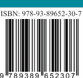

ISBN: 978-93-89652-30-7 ESM 0823
