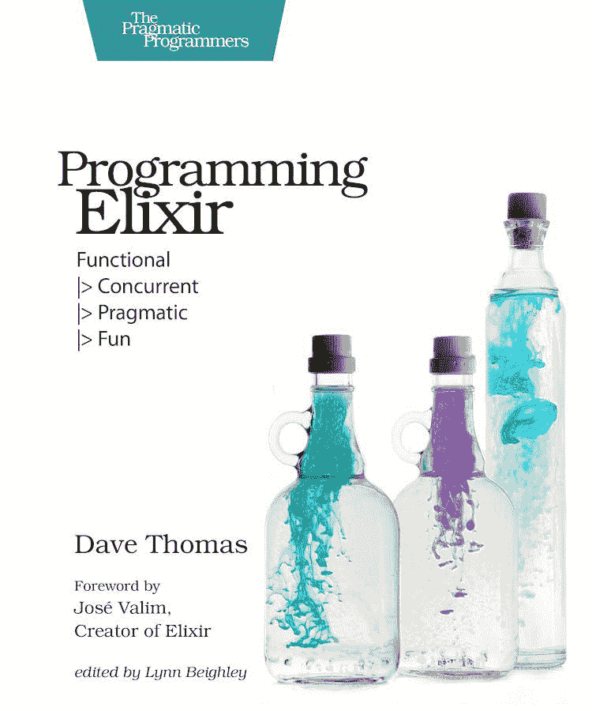
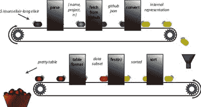
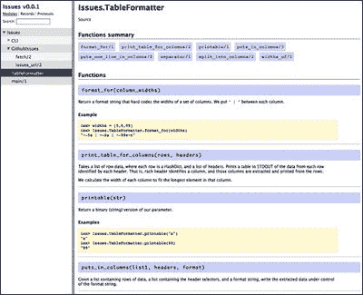
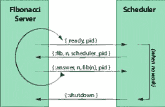
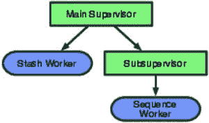

# Elixir 编程：函数式 ｜＞ 并发 ｜＞ 实用 ｜＞ 有趣





- [19. 任务]

Dave Thomas 再次做到了。《Programming Elixir》是所有编程书籍所追求的目标。它超越了仅仅教授语法和机械示例。它教你如何像 Elixir 一样思考。
> Bruce Tate，icanmakebetter.com CTO。
在《Programming Elixir》中，Dave 以一种有趣、实用且充满启发性见解的方式展示了函数式编程，这做得非常出色。随着阅读的深入，你经常会在发现 Elixir 的某些特性后感到惊喜，这种方式是如此自然和直观，以至于似乎被编程界忽视了如此久。本书提供了 Elixir 及其工具的详细概述，旨在使开发过程顺畅高效。Dave 解释了 Erlang 系统的核心部分，如分布、并发和容错，这些赋予了 Elixir 编写可扩展和弹性应用程序的能力。
> Alexei Sholik
顺序编程时代已经结束——今天的高性能、可扩展且容错软件是并发的。Elixir 是这个新世界的关键，将 Erlang 和 OTP 的力量带给了更广泛的读者。这本书可以在软件开发领域占据先机。
> Paul Butcher，《Seven Concurrency Models in Seven Weeks》作者


# 前言

* * *

我一直对硬件的变化如何影响我们编写软件深着迷。

几十年前，内存是一项非常有限的资源。在当时，软件接管某些内存并根据需要对其进行修改是合理的。然而，分配这些内存以及在不再需要它们后进行清理是一项非常容易出错的任务。某些内存从未被释放；有时内存被分配到另一个结构上，导致故障。在当时，垃圾回收是一项已知技术，但我们需要更快的 CPU 才能在日常软件中使用它，并将我们从手动内存管理中解放出来。这种情况已经发生了——我们的大多数语言现在都有垃圾回收机制。

今天，类似的现象正在发生。我们的 CPU 并没有变得更快。相反，我们的计算机核心越来越多。这意味着，新软件如果想要最大限度地利用机器性能，就必须尽可能使用更多的核心。这与我们目前编写软件的方式直接冲突。

事实上，当涉及许多核心时，修改我们的内存状态实际上会减慢软件的运行。如果你有四个核心试图访问并操作同一块内存，它们可能会相互干扰。除非应用某种同步机制，否则可能会导致内存损坏。

我很快学会了应用这种同步是手动的、容易出错且枯燥的，而且会损害性能。我突然意识到，这并不是我想在职业生涯的未来几年里花费时间编写软件的方式，于是我开始学习新的语言和技术。

正是在这种追求中让我爱上了 Erlang 虚拟机及其生态系统。

在 `Erl VM` 中，所有代码都运行在微小的并发进程中，每个进程都有自己的状态。进程通过消息互相通信。由于所有通信都是通过消息传递完成的，同一网络不同机器之间的消息交换由 VM 透明地处理，这使其成为构建分布式软件的完美环境！

然而，我觉得 Erlang 生态系统中仍然存在差距。我错过了对我在日常工作中认为必要的某些功能的原生支持，例如元编程、多态和第一类工具链。正是由于这种需求，Elixir 诞生了。

Elixir 是函数式编程的一种务实方法。它重视函数式基础，并关注开发者生产力。并发是 Elixir 软件的核心。正如垃圾回收将开发者从内存管理的枷锁中解放出来，Elixir 的出现是为了让你从过时的并发机制中解放出来，并在编写并发代码时带来快乐。

函数式编程语言让我们以转换数据的函数来思考。这种转换永远不会修改数据。相反，函数的每次应用都可能创建一个新的、全新的数据版本。这大大减少了对数据同步机制的需求。

Elixir 还通过提供宏赋予开发者能力。Elixir 代码仅仅是数据，因此可以像语言中的任何其他值一样通过宏进行操作。

最后，面向对象的程序员将会在 Elixir 中发现许多他们认为编写良好软件至关重要的机制，例如多态。

这一切都是由 Erlang VM 驱动的，这是一个拥有 20 年历史的虚拟机，从零开始构建，以支持健壮、并发和分布式软件。Elixir 和 Erlang VM 将改变你编写软件的方式，并让你准备好应对未来的编程挑战。

José Valim
Elixir 创建者
波兰，Tenczynek，2014 年 10 月

# 一个关于辩护的浅显尝试

* * *

我是一个语言痴。我喜欢尝试各种语言，也喜欢思考它们的设计和实现。（我知道，这很可悲。）

我在 1998 年遇到 Ruby 是因为我是 `comp.lang.misc` 的忠实读者（问问你父母吧）。我下载了它，编译了它，并爱上了它。就像任何一次坠入河一样，很难解释为什么。它运行的方式符合我的工作习惯，并且有足够的深度让我保持兴趣。

时光流转 15 年。在那段时间里，我一直在寻找能给我同样感觉的新事物。

我前段时间遇到过 Elixir，但由于某些原因从未被吸引。但在开始写这本书几个月前，我正和 Corey Haines 聊天。我抱怨想要一种方法向人们展示函数式编程概念，但又不想那些书籍似乎会吸引的学术装点。他让我重新看一眼 Elixir。我照做了，我感到了和我第一次看到 Ruby 时一样。

所以现在我很“危险”了。我想让其他人看到这有多棒。我想去传教。所以，我的第一步是写一本书。

但我不想再写一本 900 页的《铁镐》（Pickaxe）书了。我希望这本书短小而有趣。所以我不会进入所有的细节，列出所有的语法、所有的库函数、所有的 `OTP` 选项，或者……

相反，我想让你们对这种编程模型的力量和美感有一个了解。我想激励你们参与进来，然后指向将填补空白的在线资源。

但最重要的是，我想让你们玩得。

## 致谢

似乎有一个共同点——我爱上的语言都是由既聪明又友善的人的。Elixir 的创建者 José Valim 将这两个词推向了新的高度。我非常感谢他在过去 18 个月里带给我的乐趣。和他一起，整个 Elixir 核心团队非常出色，打造了一个比其年龄成熟得多的整个生态系统。感谢大家。

与 Corey Haines 的对话重新燃了我对 Elixir 的兴趣——感谢 Corey 带来的那些美好的夜晚、孟加罗有趣的时光以及灵感。

Bruce Tate 始终是一个很有启发性的听众，他对书中早期草稿的意见影响很大。我很幸运拥有如此多活跃且见深刻的 Beta 读者，他们提出了数百条建议。感谢大家。

非常感谢 Jessica Kerr、Anthony Eden 和 Chad Fowler 让我借用了他们的推特。

Candace Cunningham 对书进行了校对。在发现数百个语法错误之外，她还发现了代码中的错误。保佑她。

Potomac 团队完成了他们他们既往出色的索引工作。

Susannah Pfalzer 在整个项目中是理性的声音（正如她在我们的许多 Bookshelf 项目中那样），Janet Furlow 让我们保持了严谨。

最后，这是我第一次和一位在文字层面工作的编辑一起写书。这是一次奇的体验，Lynn Beighley 将我认为已经完成的文本系统地向我展示了我假设的错误。由于她的建议，这本书变得好得多。感谢她。

Dave Thomasmailto:dave@pragprog.com
德克萨斯州，Dallas，2014 年 10 月

# 第一章

 服下红丸

* * *

Elixir 编程语言将函数式编程、不可变状态和基于 Actor 的并发方法封装在简洁、现代的语法中。它运行在工业级、高性能、分布式的 Erlang 虚拟机上。但这一切意味着什么？


这意味着你可以停止担心许多目前消耗你时间的难题了。你不再需要费费力去思考如何在多线程环境中保护你的数据一致性。你对应用程序扩展的担忧随之减少。而且，最重要的是，你可以用不同的方式来思考编程。

## 编程应该关于数据转换

如果你来自一个面向对象的世界，那么你已经习惯于用类及其实例来思考。`class` 定义了行为，而对象持有状态。开发者花费时间构建复杂的类层次结构，试图对他们的问题进行建模，就像维多利亚时代的绅士科学家们创建蝴蝶的分类法一样。

当我们用对象编写代码时，我们在考虑状态。我们的大部分时间花在调用对象的方法并向它们传递其他对象上。基于这些调用，对象更新它们自己的状态，可能还会更新其他对象的状态。在这个世界里，`class` 是王——它定义了每个实例可以做什么，并隐式地控制其实例所持有数据的状态。我们的目标是`data-隐藏`。

但那不是真实世界。在现实世界中，我们并不想模拟抽象的层次结构（因为现实中并没有那么多真正的层次结构）。我们想要的是完成任务，而不是维护状态。

例如，现在，我正在获取空的计算机文件并将它们转换为包含文本的文件。很快，我将把这些文件转换为你可以读取的格式。某处的 Web 服务器会将你下载书籍的请求转换为包含内容的 HTTP 响应。

我不想隐藏数据。我想转换它。

### 将转换与流水线结合

Unix 用户习惯于小巧、集中的命令行工具的哲学，这些工具可以以任意方式组合。每个工具接收一个输入，对其进行转换，并将结果以下一个工具（或人类）可以使用的格式写出。

这种哲学极其灵活，并带来了极佳的重用性。Unix 工具可以以作者们无法想象的方式组合。而且每一个工具都增加了其他工具的潜力。

它也非常可靠——每个小程序只良好做好一件事，这使其更容易测试。

还有另一个好处。命令流水线可以并行运行。如果我写

```
$ grep Elixir *.pml | wc -l
```

字数程序 `wc` 会与 `grep` 命令同时运行。因为 `wc` 在 `grep` 生成输出的同时就会消耗这些输出，所以一旦 `grep` 完成，答案几乎没有任何延迟就就绪了。

为了让你感受一下这种东西，这里有一个名为 `pmap` 的 Elixir 函数。它接受一个集合和一个函数，并返回将该函数应用于集合中每个元素后得到的列表。但是……它运行一个单独进程进程完成每个元素的转换。现在先不用考虑这些细节。

[spawn/pmap1.exs](http://media.pragprog.com/titles/elixir/code/spawn/pmap1.exs)

```elixir
defmodule Parallel do
  def pmap(collection, func) do
    collection
    |> Enum.map(&(Task.async(fn -> func(&1) end)))
    |> Enum.map(&Task.await/1)
  end
end
```

我们可以运行这个函数来获取 1 到 1000 数字的平方。

```elixir
result = Parallel.pmap 1..1000, &(&1 * &1)
```

而且，是的，我刚刚启动了 1000 个后台进程，并使用了我机器上所有的核心和处理器。

代码可能意义不大，但读到这本书的一一半时，你就会自己编写这类代码了。

### 函数是数据转换器

Elixir 让我们能够以 Unix Shell 相同的方式解决问题。我们没有命令行工具，而是有函数。我们可以随心所欲将它们串联起来。函数越小越专注，我们在组合它们时的灵活性就越大。

如果我们愿意，可以这些这些函数并行运行——Elixir 有一种简单但强大的机制在它们之间传递消息。而且这些并不是你父亲那种无聊的老旧进程或线程——我们说的是在单台机器上运行数百万个进程并让数百台这样的机器相互操作的潜力。Bruce Tate 曾对这段话发表过这样的观点：“大多数程序员将线程和进程视为一种必要的恶；而 Elixir 开发者认为它们是一个重要的简化。”随着我们深入阅读这本书，你将开始理解他的意思。

这种转换的思想是函数式编程的核心：一个函数将它的输入转换为输出。三角函数 `sin` 就是一个例子——给它 `π/4`，你将得到 `0.7071….` 返回。一个 HTML 模板系统就是一个函数；它接受一个包含占位符的模板和一组命名值列表，并生成一个完整的 HTML 文档。

但这种力量是需要代价的。你必须忘记许多你对编程的*所知*。你的许多直觉将是错误的。这将会是沮丧的，因为你会感觉自己像个完全的 n00b。

对我个人来说，我觉得那是乐趣的一部分。

你并不是一夜之间学会，比如面向对象编程的。但在某个时刻，一切都会豁然开朗。

## 安装 Elixir

安装 Elixir 的最新说明可以在 [elixir-lang.org/started.html](http://elixir-lang.org/started.html)。

## 运行 Elixir

为了测试安装是否成功，让我们启动一个交互式的 Elixir 会话。在你的常规提示符处，输入 `iex`。

```
$ iex
```

（你看到的各种版本号可能不同——我在后续示例中不会显示它们。）

一旦有了 iex 提示符，你就可以输入 Elixir 代码并看到结果。如果你输入的表达式跨行，iex 会用省略号（…）提示输入额外的行。

```elixir
iex(1)> 3 + 4
7
iex(2)> String.reverse("madamimadam")
"madamimadam"
iex(3)> 5 *
...(3)> 6
30
iex(4)> 
```

提示符中的数字在每次执行一个完整的表达式后递增。我在后续大部分示例中将省略这个数字。

退出 iex 有几种方法——都不整洁。最简单的两种是双击 `Ctrl-C`，或者输入 `Ctrl-G` 之后输入 `q` 和 `Return`。

### IEx Helpers

iex 有许多辅助函数。输入 `h`（后跟回车）获取列表：

```elixir
iex> h
# IEx.Helpers
Welcome to Interactive Elixir. You are currently seeing the documentation
for the module IEx.Helpers which provides many helpers to make Elixir's
shell joyful to work with.
```


此消息是通过调用辅助函数 `h()` 触发的，通常称为 `h/0`（因为它期望 0 个参数）。

还有许多其他可用的辅助函数：

- `c/2` — 编译给定路径下的文件
- `cd/1` — 切换当前目录
- `clear/0` — 清屏
- `flush/0` — 刷新所有发送到 shell 的消息
- `h/0` — 打印此帮助信息
- `h/1` — 为指定的模块、函数或宏打印帮助信息
- `l/1` — 加载指定模块的 beam 代码并清除当前版本
- `ls/0` — 列出当前目录的内容
- `ls/1` — 列出指定目录的内容
- `pwd/0` — 打印当前工作目录
- `r/0` — 重新编译并加载之前加载过的所有模块
- `r/1` — 重新编译并加载指定的模块源文件
- `respawn/0` — 重新启动当前 shell
- `s/1` — 打印规格（spec）信息
- `t/1` — 打印类型信息
- `v/0` — 打印会话中评估过的命令历史
- `v/1` — 从历史中检索第 n 个值
- `import_file/1` — 在 shell 的上下文中评估给定文件

可以直接从命令行查询此模块中函数的帮助信息，例如，尝试：

```bash
h(c/2)
```

你也可以获取任何模块或函数的文档。尝试这些：

```bash
h(Enum)
h(Enum.reverse/1)
```

在辅助函数列表中，斜杠随后的数字是该辅助函数期望的参数个数。

可能最有用的是 `h` 本身。在带上参数时，它会为你提供关于 Elixir 模块或模块中单个函数的帮助。这对于任何加载到 `iex` 的模块都有效（所以当我们稍后讨论项目时，你也会在这里看到自己的文档）。

例如，`IO` 模块执行常用的 I/O 函数。要获取该模块的帮助，请输入 `h(IO)` 或 `h IO`。

```el
iex> h IO
# 或者...
iex> h(IO)
```

处理 IO 的函数。

此模块中的许多函数期望一个 `IO` 设备作为参数。`IO` 设备必须是一个 `PID` 或代表进程的原子。为了方便起见，Elixir 提供了 `:stdio` 和 `:stderr` 作为 Erlang `:standard_io` 和 `:standard_error` 的快捷方式。

本书频繁使用 `IO` 模块中的 `puts` 函数，它最简单的形式是将字符串写入控制台。让我们查看文档。

```el
iex> h IO.puts
* def puts(device \\ group_leader(), item)
```

将参数写入设备，类似于 `write` 但末尾会添加新行。参数期望为 `chardata`。

`iex` 是一个异常强大的工具。你可以用它编译和执行整个项目，登录到远程机器，并访问已经在运行的 Elixir 应用程序。

### 自定义 iex

你可以通过设置选项来自定义 `iex`。例如，我喜欢用亮青色显示评估结果。为了找到如何做到，我使用了这个：

```el
iex> h IEx.configure
def configure(options)
```

配置 IEx。

支持的选项有：`:colors`、`:inspect`、`:default_prompt`、`:alive_prompt` 和 `:history_size`。

颜色

一个封装了 shell 使用的所有颜色设置的关键字列表。请参


你加入 Elixir 社区时，它还处于年轻的阶段。这里既令人兴奋又充满活力，有很多机会可以贡献。

## 练习题

你会在书中穿插着许多练习题。如果你阅读的是电子书，那么每个练习题都会直接链接到我们在线论坛中的一个主题。在那里，你将找到初始答案，以及书中读者对替代方案的讨论。

如果你阅读的是这本书的纸质版，请访问论坛查看练习题列表。[[4]](#part0000_split_014.html_FOOTNOTE-4)

## 异于同（（思考方式）

这是一本关于与众不同的思考的书；关于接受人们对编程的某些观点可能并非全貌：

- 对象导向不是设计代码的唯一方式。
- 函数式编程并不非得是复杂或数学化的。
- 编程的基础不是赋值、`if` 语句和循环。
- 并发不需要锁、信号量、监视器等。
- 进程（Processes）并不一定是昂贵的资源。
- 元编程不仅仅是附加在语言上的东西。
- 即使编程是一项工作，它也应该是乐趣。

当然，我不是说 Elixir 是某种魔法药水（嗯，技术上来说它是，但你懂我的意思）。编写代码没有唯一的正确方法。但 Elixir 与主流语言有足够的差异，学习它将给你提供更多视角，并开启你对编程的新思考方式。

所以，让我们开始吧。

记住让它变得有趣。

### 脚注

[[1]](#part0000_split_011.html_FNPTR-1)
[`pragprog.com/titles/elixir`](http://pragprog.com/titles/elixir)
[[2]](#part0000_split_012.html_FNPTR-2)
[`forums.pragprog.com/forums/elixir`](http://forums.pragprog.com/forums/elixir)
[[3]](#part0000_split_012.html_FNPTR-3)
[`groups.google.com/forum/?fromgroups#!forum/elixir-lang-talk`](https://groups.google.com/forum/?fromgroups#!forum/elixir-lang-talk)
[[4]](#part0000_split_013.html_FNPTR-4)
[`forums.pragprog.com/forums/322)

# 第 1 部分：传统编程

> Elixir 非常适合编写高度并行、可靠的应用程序。

> 但要成为一种并行编程的优秀语言，一种语言首先必须是传统顺序编程的优秀语言。在书的这一部分，我们将介绍如何编写 Elixir 代码，并探索让 Elixir 如此强大的用法（idioms）和约定（conventions）。

## 第 2 章：模式匹配

在本章中，我们将看到：

- 模式匹配将值绑定到变量上
- 匹配处理结构化数据
- `_`（下划线）允许你忽略匹配项

在上一章的开始处，我们提到 Elixir 培养了一种不同的编程思考方式。为了说明这一点并为许多 Elixir 编程奠定基础，让我们通过观察所有编程语言的基石之一——赋值，从开始重新编程你的大脑。

### 赋值：我不认为它的意思是你所认为的意思。

让我们使用交互式 Elixir Shell `iex` 来看一段非常简单的代码。（记住，你在命令行提示符处使用 `iex` 命令启动 `iex`。你在 `iex>` 提示符处输入 Elixir 代码，它会显示结果值。）

| `iex> a = 1` |
| `1` |
| `iex> a + 3` |
| `4` |

大多数程序员会看这段代码并说：“好的，我们把 1 赋值给变量 `a`，然后在下一行我们给 `a` 加上 3，得到 4。”

但当涉及到 Elixir 时，他们错了。在 Elixir 中，等号不是赋值。相反，它更像是一个断言（assertion）。如果 Elixir 能找到一种方法让左侧等于右侧，它就会成功。Elixir 将 `=` 称为*匹配操作符（*match operator*）。

在这种情况下，左侧是一个变量，右侧是一个整数字面量，因此 Elixir 可以通过将变量 `a` 绑定到值 1 来使匹配成功。你可以认为它*确实*就是赋值。但让我们更上一个楼。

| `iex> a = 1` |
| `1` |
| `iex> 1 = a` |
| `1` |
| `iex> 2 = a` |
| `(MatchError) no match of right hand side value: 1` |

看代码的第二行，`1 = a`。这是另一个匹配，并且通过了。变量 `a` 已经有了值 1（在第一行中设置的），所以等号左侧的内容与右侧的内容相同，匹配成功。

但第三行 `2 = a` 触发了错误。你可能期望它会把 2 赋值给 `a`，因为那会让匹配成功，但 Elixir 只会更改等号左侧变量的值——在右侧，变量会被它的值替换。这行失败的代码等同于 `2 = 1`。

## 更多匹配

首先，匹配是处理列表的模式。这里是一些列表：

匹配是处理列表的模式。这里是一些列表：

（注：异于同（（思考方式）））

## 轮到你来

- [练习题：PatternMatching-1`](http://forums.pragprog.com/forums/322/topics/Exercise:%20PatternMatching-1)
  以下哪些项会匹配？
    - `a = [1, 2, 3]`
    - `a = 4`
    - `4 = a`
    - `[a, b] = [ 1, 2, 3 ]`
    - `a = [ [ 1, 2, 3 ] ]`
    - `[a] = [ [ 1, 2, 3 ] ]`
    - `[[a]] = [ [ 1, 2, 3 ] ]`

## 使用 `_`（下划线）忽略值


如果我们不需要在匹配过程中捕获某个值，可以使用特殊变量 `_`（下划线）。它的作用类似于变量，但会立即丢弃赋给它的任何值——在模式匹配中，它就像一个通配符，表示“我接受此这里的任何值”。接的示例匹配了任何第一个元素为 1 的三元素列表。

```python
iex> [1, _, _] = [1, 2, 3]
[1, 2, 3]

iex> [1, _, _] = [1, "cat", "dog"]
[1, "cat", "dog"]
```

## 变量仅绑定一次（每次匹配）

一旦变量在匹配过程中绑定到一个值，它在匹配的剩余部分中将一直保持该值。

```python
iex> [a, a] = [1, 1]
[1, 1]

iex> a
1

iex> [a, a] = [1, 2]
** (MatchError) no match of right hand side value: [1, 2]
```

此示例中的第一个表达式执行成功，是因为 `a` 最初匹配了右侧的第一个 1。然后，`a` 中的值被用于第二个项以匹配右侧的第二个 1。

在下一个表达式中，左侧的第二个 `a` 尝试匹配右侧第二个元素中的 1。它没有匹配成功，因此匹配失败。

然而，变量可以在随后的匹配中绑定到新值，且其当前值不会参与新的匹配。

```python
iex> a = 1
1

iex> [1, a, 3] = [1, 2, 3]
[1, 2, 3]

iex> a
2
```

如果你想强制 Elixir 在模式中使用变量的现有值，请在变量变名前面加上 `^`（脱字符符号）。

```python
iex> a = 1
1

iex> a = 2
2

iex> ^a = 1
** (MatchError) no match of right hand side value: 1
```

当变量是模式的一部分时，这种方法同样有效：

```python
iex> a = 1
1

iex> [^a, 2, 3 ] = [ 1, 2, 3 ] # 使用 a 的现有值
[1, 2, 3]

iex> a = 2
2

iex> [ ^a, 2 ] = [ 1, 2 ]
** (MatchError) no match of right hand side value: [1, 2]
```

模式匹配还有另一个重要的部分，我们将在开始深入研究列表时介绍。

## 轮你了

*   [练习：PatternMatching-2](http://forums.pragprog.com/forums/322/topics/Exercise:%20PatternMatching-2)

    以下哪些项会匹配？

    *   `[ a, b, a ] = [ 1, 2, 3 ]`
    *   `[ a, b, a ] = [ 1, 1, 2 ]`
    *   `[ a, b, a ] = [ 1, 2, 1 ]`

*   [练习：PatternMatching-3](http://forums.pragprog.com/forums/322/topics/Exercise:%20PatternMatching-3)

    如果你假设变量 `a` 最初包含值 `2`，以下哪些项会匹配？

    *   `[ a, b, a ] = [ 1, 2, 3 ]`
    *   `[ a, b, a ] = [ 1, 1, 2 ]`
    *   `a = 1`
    *   `^a = 2`
    *   `^a = 1`
    *   `^a = 2 - a`

## 等号的另一种视角

Elixir 的模式匹配与 Erlang 相似（主要区别在于 Elixir 允许匹配赋值给一个在之前的匹配中赋值过的变量，而在 Erlang 中变量只能赋值一次）。

Erlang 的创始人 Joe Armstrong 将 Erlang 中的等号比代数中的等号。当你写方程 `x = a + 1` 时，你并没有将 `a + 1` 的值赋值给 `x`。你只是断言表达式 `x` 和 `a + 1` 具有相同的值（如果你知道 `x` 的值）。


尽管常识可能认为这种对数据的所有复制都是低效的，但事实恰恰相反。因为 Elixir 知道现有数据是不可变量的，因此在构建新结构时，它可以部分或全部重用它们。

考虑这段代码。（它使用了一个新操作符 `[ head | tail ]`，它会构建一个以 `head` 为第一个元素、`tail` 为剩余部分的新列表。我们在讨论列表和递归时会花整章内容来说它。现在，请相信。）

```ixir
iex> list1 = [ 3, 2, 1 ]
[3, 2, 1]
iex> list2 = [ 4 | list1 ]
[4, 3, 2, 1]
```

在大多数语言中，`list2` 将通过创建一个包含 4、3、2 和 1 的新列表来构建。`list1` 中的三个值将被复制到 `list2` 的尾部。这样做是必要的，因为 `list1` 是可变的。

但 Elixir 知道 `list1` 永远不会改变，所以它只需构造一个头部为 4、尾部为 `list1` 的新列表。

### 垃圾回收

转换型语言的另一个性能问题是，当你从旧值创建新值时，往往会留下未使用的旧值。这会导致堆上出现大量对象占用内存，因此垃圾回收必须回收它们。

大多数现代语言都有垃圾回收器，开发者们已经对它们产生了怀疑——它们会对性能产生严重影响。

但 Elixir 的酷炫之处在于，你编写代码时使用了大量的进程，而每个进程都有自己的堆。应用程序中的数据被分配在这些进程之间，因此每个单独的堆都比所有数据放在单个堆中要小得多。结果是，垃圾回收运行得更快。当一个进程在它的堆填满之前终止时，它的所有数据都会被丢弃——不需要垃圾回收。

## 使用不可变数据编码

一旦你接受了这个概念，使用不可变数据进行编码将惊讶地简单。你只需要记住，任何转换数据的函数都会返回它的新副本。因此，我们从不会对字符串进行大写处理。相反，我们返回一个首字母大写的字符串副本。

```ixir
iex> name = "elixir"
"elixir"
iex> cap_name = String.capitalize name
"Elixir"
iex> name
"Elixir"
```

如果你来自面向对象的语言，你可能不喜欢我们写成 `String.capitalize name` 而不是 `name.capitalize()` 的想法。但在 OO 语言中，对象大多具有可变状态。当你调用类似 `name.capitalize()` 的方法时，你无法立即判断你是在改变名称的内部表示、返回一个首字母大写的副本，还是两者兼有。这存在大量的歧义空间。

在函数式语言中，我们*总是*在转换数据。我们从不在原地修改它。每当我们使用它时，语法都会提醒我们这一点。

理论足够了。是时候开始学习门语言了。在下一章中，我们将快速回顾基本数据类型和一些语法，在接下来的章节中，我们将学习函数和模块。

## 第 4 章

# Elixir 基础

在本章中，我们将看到：

* 五种值类型
* 两种系统类型
* 四种集合类型
* 命名、操作符等

在本章中，我们将查看 Elixir 内置的类型，以及你入门时需要知道的其他事情。本章故意写得很简练——你是一个程序员，你知道整数是什么，所以我不会侮辱你。相反，我尝试涵盖你需要知道的 Elixir 特有内容。

## 内置类型

Elixir 的内置类型有：

* 值类型：
    * 任意大小的整数
    * 浮点数
    * 原子 (Atoms)
    * 范围 (Ranges)
    * 正则表达式
* 系统类型：
    * PID 和端口
    * 引用 (References)
* 集合类型：
    * 元组 (Tuples)
    * 列表 (Lists)
    * 映射 (Maps)
    * 二进制数据 (Binaries)

在 Elixir 中，函数也是一种类型。它们有跟在本之后的章节。

你可能会对这个列表没有包含字符串和结构感到惊讶。Elixir 拥有它们，但它们是使用此列表中的基本类型构建的。然而，它们非常重要。字符串有自己的章节，我们还有几章关于列表和映射（以及其他字典类类型）。映射章节还描述了 Elixir 的结构设施。

最后，关于正则表达式和范围是否属于值类型存在一些争议。技术上讲，它们并不是——在底层它们只是结构。但现在，将它们视为不同的类型是方便的。

## 值类型

Elixir 中的值类型表示数字、名称、范围和正则表达式。

### 整数

整数字面量可以写为十进制 (`1234`)、十六进制 (`0xcafe`)、八进制 (`0o765`) 和二进制 (`0b1010`)。

十进制数字可以包含下划线——这些通常在编写大数字时用于分隔三个数字一组，因此一百万可以写成 `1_000_000`。

整数没有固定限制——它们的大小会随数量级而增长。

### 浮点数

浮点数使用小数点写入。小数点前后必须至少有一个数字。可以给出一个可选的指数。浮点数是 IEEE 754 双精度，赋予它们大约 16 位的精度。

### 原子 (Atoms)

原子是表示名称的常量。我们使用领先冒号（`:`）编写它们，后面跟着原子单词。原子单词是字母、数字、下划线和符号（`@`）的序列。它可能以叹号或问号结尾。你也可以通过双引号包含冒号后的字符来创建任意原子。具有相同名称的原子始终相等，即使它们是由不同的应用程序创建的。我们将经常使用原子来标记值。

### 范围 (Ranges)

范围表示为 *start..end*，其中 *start* 和 *end* 可以是任何类型的值。然而，如果你想遍历范围中的值，两个端点必须是整数。

### 正则表达式

Elixir 有正则表达式字面量，写为 `~r{regexp}` 或 `~r{regexp}opts`。在这里我显示的正则表达式字面量分隔符为 `{` 和 `}`，但它们灵活得多。你可以选择任何非字母数字字符作为分隔符，正如在符号（sigils）讨论中所提到的。有些人出于旧习惯使用 `~r/…/`，但这不如括号形式方便，因为内部的任何正斜杠必须转义。

Elixir 的正则表达式支持由 PCRE 提供，它基本上提供了兼容 Perl 5 的模式语法。

你可以在正则表达式字面量后面指定一个或多个字符选项。这些选项修改字面量的匹配行为或添加功能。

| 选项 | 含义 |
| :--- | :--- |
| f | 强制模式从多行字符串的第一行开始匹配。 |
| g | 支持命名组。 |
| i | 使匹配大小不敏感。 |
| m | 如果匹配的字符串包含多行，`^` 和 `$` 匹配这些行的开头和结尾。`\A` 和 `\z` 继续匹配字符串的开头或结尾。 |
| r | |


通常情况下，像 `*` 和 `+` 这样的修饰符是贪婪的，会尽可能多地匹配。`r` 修饰符会让它们变得“懒惰”，尽可能少地匹配。

| 标志 (Flag) | 说明 |
| :--- | :--- |
| `.` | 允许 `.` 匹配任何换行符。 |
| `u` | 启用 Unicode 特有的模式，如 `\p`。 |
| `x` | 启用扩展模式——忽略空白和注释（`#` 直到行尾）。 |

你通过 `Regex` 模块来操作正则表达式。

```elixir
iex> Regex.run ~r{[aeiou]}, "caterpillar"
["a"]
```

```elixir
iex> Regex.scan ~r{[aeiou]}, "caterpillar"
[[a"], ["e"], ["i"], ["a"]]
```

```elixir
iex> Regex.split ~r{[aeiou]}, "caterpillar"
["c", "t", "rp", "ll", "r"]
```

```elixir
iex> Regex.replace ~r{[aeiou]}, "caterpillar", "*"
"c*t*rp*ll*r"
```

## 系统类型 (System Types)

这些类型反映了底层 Erlang 虚拟机的资源。

### PID 和端口

PID 是本地或远程进程的引用，而端口（Port）是对你将读取或写入的资源（通常是应用程序外部的）的引用。可以通过 `self` 获取当前进程的 PID。当你启动一个新进程时，会创建一个新的 PID。我们将在第二部分讨论这一点。

### 引用 (References)

`make_ref` 函数创建一个全局唯一的引用；没有其他引用会与它相等。我们会在本书书中不使用引用。

## 集合类型 (Collection Types)

我们目前为止看到的类型在其他编程语言中很常见。现在我们要开始介绍更特殊的类型，因此我们将进行更详细的介绍。

Elixir 集合可以包含任何类型的值（包括其他集合）。

### 元组 (Tuples)

元组是值的有序集合。与所有 Elixir 数据结构一样，元组一旦创建，就无法被修改。

你在大括号之间编写元组，并用逗号分隔元素。

`{ 1, 2 }`, `{ :ok, 42, "next" }`, `{ :error, :enoent }`

一个典型的 Elixir 元组有二到四个元素——如果有更多，你可能想查看 [映射 (maps)] 或 [结构体 (structs)]。

你可以在模式匹配中使用元组：

```elixir
iex> {status, count, action} = {:ok, 42, "next"}
{:ok, 42, "next"}
iex> status
:ok
iex> count
42
iex> action
"next"
```

函数返回元组是常见做法，如果没有错误，元组的第一个元素是原子 `:ok`。例如（假设你在当前目录下有一个名为 `Rakefile` 的文件）：

```elixir
iex> {status, file} = File.open("Rakefile")
{:ok, #PID<0.39.0>}
```

因为文件成功打开，元组包含一个 `:ok` 状态和一个 PID，这就是我们访问内容的方式。

一种常见的惯用法是编写假设成功的匹配：

```elixir
iex> { :ok, file } = File.open("Rakefile")
{:ok, #PID<0.39.0>}
iex> { :ok, file } = File.open("non-existent-file")
** (MatchError) no match of right hand side value: {:error, :enoent}
```

第二次打开失败了，并返回了一个第一个元素为 `:error` 的元组。这导致匹配失败，错误信息显示第二个元素包含了原因——`enoent` 是 Unix 术语，表示“文件不存在”。

### 列表 (Lists)

我们已经见过 Elixir 的列表字面量语法 `[1,2,3]`。这可能会让你认为列表像其他语言中的数组，但它们并不是如此（事实上，元组是 Elixir 最接近传统数组的）。相反，列表本质上是一个链式数据结构。列表可以是空的，也可以由一个头部（head）和一个尾部（tail）组成。头部包含一个值，尾部本身是一个列表。（如果你用过 Lisp 语言，那么这些看起来会非常熟悉。）

正如我们在第 7 章 [列表与递归] 中讨论的，列表的递归定义是 Elixir 编程的核心。由于它们的实现方式，列表很容易进行线性遍历，但随机访问的代价很高（要获取第 `n` 个元素，你必须扫描 `n–1` 个元素）。获取列表的头部和提取尾部总是廉价的。记得所有的 Elixir 数据结构都是不可变的吗？这意味着一旦列表创建，它就永远不会改变。所以，如果我们想从列表中移除头部并只留尾部，我们必须复制列表。Elixir 有一些专门用于列表的操作符：

```elixir
iex> [1, 2, 3] ++ [4, 5, 6]
[1, 2, 3, 4, 5, 6]
iex> [1, 2, 3, 4] -- [2, 4]
[1, 3]
iex> 1 in [1,2,3]
true
iex> "wombat" in [1, 2, 3]
false
```

### 关键字列表 (Keyword Lists)

由于我们经常需要简单的键值对，Elixir 为我们提供了快捷写法。如果键是原子，你可以使用与关键字列表相同的快捷方法：

```elixir
iex> colors = %{ red: 0xff00, green: 0x0ff0, blue: 0x0ff }
%{blue: 255, green: 65280, red: 167180}
```

映射 (Maps)映射是键值对的集合。映射字面量看起来像：`%{key => value}`。

这里是一些映射示例：

```elixir
iex> states = %{"AL" => "Alabama", "WI" => "Wisconsin"}
{"AL" => "Alabama", "WI" => "Wisconsin"}
iex> responses = %{error, :enoent } => :fatal, { :error, :busy } => :retry
{{error, :busy} => :retry, {:error, :enoent} => :fatal}
iex> colors = %{red => 0xff00, :green => 0x0ff0, :blue => 0x0ff}
%{blue: 255, green: 65280, red: 167180}
```

在第一种键是字符串，第二种是元组，第三种是原子。虽然通常映射中的所有键类型都是相同的，但并不是强制要求的。

```elixir
iex> %{"one" => 1, :two => 2, {1,1,1} => 3 }
%{:two => 2, {1, 1, 1} => 3, "one" => 1}
```

为什么既要有映射又有关键字列表？映射允许特定键只有一个条目，而关键字列表允许键重复。映射效率很高（特别是当它们增长时），并且可以用于 Elixir 的模式匹配，我们将在随后的章节中讨论。

通常，使用关键字列表处理如命令行参数和传递选项，而当你需要关联数组时，使用映射（或另一种数据结构 `HashDict`）。

### 访问映射

你通过键从映射中提取值。方括号语法适用于所有映射：

```elixir
iex> states = %{"AL" => "Alabama", "WI" => "Wisconsin"}
{"AL" => "Alabama", "WI" => "Wisconsin"}
iex> states["AL"]
"Alabama"
iex> states["TX"]
nil
```


```elixir
iex> response_types = %{ { :error, :enoent } => :fatal, { :error, :busy } => :retry }
%{{:error, :busy} => :retry, {:error, :enoent} => :fatal}
iex> response_types[{:error,:busy}]
:retry
```

如果键是原子（atoms），你也可以使用点表示法：

```elixir
iex> colors = %{ red: 0xff0000, green: 0x00ff00, blue: 0x0000ff }
%{blue: 255, green: 65280, red: 16711680}
iex> colors[:red]
16711680
iex> colors.green
65280
```

当你使用点表示法时，如果没有匹配的键，将得到一个 `KeyError`。

## 二进制数据 (Binaries)

有时你需要作为位和字节的序列来访问数据。例如，JPEG 和 MP3 文件的头包含某些字段，单个字节可能编码两个或三个独立的值。

Elixir 通过二进制数据类型支持这种操作。二进制字面量封装在 `<<` 和 `>>` 之间。

基本语法将连续的整数打包成字节：

```elixir
iex> bin = << 1, 2 >>
<<1, 2>>
iex> byte_size bin
2
```

你可以添加修饰符来控制每个单独字段的类型和大小。这里有一个单字节，包含三个宽度分别为 2、4 和 2 比特的字段。（该示例使用一些内置库来显示结果的二进制值。）

```elixir
iex> bin = <<3 :: size(2), 5 :: size(4), 1 :: size(2)>>
<<213>>
iex> :io.format("~-8.2b~n", :binary.bin_to_list(bin))
11010101
:ok
iex> byte_size bin
1
```

二进制数据既重要又深奥。它们之所以重要是因为 Elixir 使用它们来表示 UTF 字符串；它们之所以深奥是因为，至少起初，你可能不会直接使用它们。

## 名称、源文件、约定、运算符等

Elixir 中的标识符是大写和小小写 ASCII 字符、数字和下划线的组合。它们可以以问号或感叹号结尾。

模块（Module）、记录（record）、协议（protocol）和行为（behaviour）名称以大写字母开头，并采用驼峰命名法（像这样：BumpyCase）。所有其他标识符以小写字母或下划线开头，并按照约定在单词之间使用下划线。如果第一个字符是下划线，当变量在模式匹配或函数参数列表中未使用，Elixir 不会报告警告。

源文件使用 UTF-8 编写，但标识符可能仅使用 ASCII。

按照约定，源文件使用两个字符的缩进进行嵌套——它们使用空格而不是制表符（tabs）。

注释以井号（`#`）开始并持续到行尾。

社区正在编写一份代码风格指南。在我写下这些内容时，它位于 [`github.com/niftyn8/elixir_style_guide`](https://github.com/niftyn8/elixir_style_guide)，但我被告知它可能会发生变化。

### 真 (Truth)

Elixir 有三个与布尔操作相关的特殊值：`true`、`false` 和 `nil`。`nil` 在布尔上下文中被处理为假。

（这里有一个冷知识：这三个值都是同名原子子的子的别名，因此 `true` 等同于原子 `:true`。）

在大多数上下文中，除 `false` 或 `nil` 之外的任何值都被处理为真。我们有时将其称为 *truthy*（真值），以将其与真实的值 `true` 区分开。

### 运算符 (Operators)

Elixir 拥有一非常丰富的运算符。这里是我们在书中使用的子集。

### 比较运算符

- `a === b` # 严格相等（所以 1 === 1.0 为假）
- `a !== b` # 严格不相等（所以 1 !== 1.0 为真）
- `a == b` # 值相等（所以 1 == 1.0 为真）
- `a != b` # 值不相等（所以 1 != 1.0 为假）
- `a > b` # 普通比较
- `a >= b` # 普通比较
- `a <= b` # 普通比较

Elixir 的排序没有像许多语言那么严格，因为你可以比较不同类型的值。如果类型相同或兼容（例如 `3 > 2` 或 `3.0 < 5`），它将使用自然排序。否则，比较将基于此规则：`number < atom < function < pid < tuple < map < list < binary`。

### 布尔运算符

这些运算符期望 `true` 或 `false` 作为其第一个参数。

- `a or b` # 如果 a 为真则为真，否则为 b
- `a and b` # 如果 a 为假则为假，否则为 b
- `not a` # 如果 a 为真则为假，否则

### 松弛布尔运算符

这些运算符接受任何类型的参数。除 `nil` 或 `false` 之外的任何值都被解释为真。

- `a || b` # 如果 a 为真值，则返回 a，否则 b
- `a && b` # 如果 a 为真值，则返回 b，否则 a
- `!a` # 如果 a 为真值，则为假，否则为真

### 算术运算符

`+`、`-`、`/`、`div`、`rem`。`rem` 是取模运算。

### 连接运算符

- `binary1 <> binary2` # 连接两个二进制（稍后我们会看到字符串）
- `list1 ++ list2` # 连接两个列表
- `list1 -- list2` # 列表 1 中的元素

### `in` 运算符

- `a in enum` # 测试 a 是否在其中（例如，范围）

## 基础结束

我们现在涵盖了 Elixir 程序的底层成分。在接下来的两个章节中，我们将讨论匿名函数、模块和命名函数。

### 匿名函数 (Anonymous Functions)

在本章中，我们将看到：
- 匿名函数
- 模式匹配和参数
- 高阶函数
- 闭包
- `&` 函数字面量

Elixir 是一种函数式语言，因此函数是基础类型并不意外。匿名函数使用 `fn` 关键字创建。

```elixir
fn parameter-list -> body
parameter-list ...
end
```

将 `fn`……`end` 想象成类似于字符串字面量的引号，只不过在这里返回的是函数，而不是字符串。我们可以将该函数值传递给其他函数。我们也可以调用它。

最简单的函数有一个参数列表和一个体，通过 `->` 分隔。

例如，下面的代码定义了一个函数，将其绑定到变量 `sum`，然后调用它。

```elixir
iex> sum = fn a, b -> a + b end
#Function<12.17052888 in :erl_eval.expr/5>
iex> sum.(1, 2)
3
```

第一行代码创建一个两个参数（命名为 `a` 和 `b`）的函数。函数的实现在 `->` 箭头之后（在本例中是相加），整个结构以关键字 `end` 结束。我们将函数存储在变量 `sum` 中。

在第二行代码中，我们使用 `sum.(1,2)` 语法调用函数。点表示函数调用，参数放在括号内。（你可能注意到调用命名函数时不使用点——这是命名函数和匿名函数的区别。）

如果你的函数没有参数，调用它时仍需要括号：

```elixir
iex> greet = fn -> IO.puts "Hello" end
#Function<12.17052888 in :erl_eval.expr/5>
iex> greet()
Hello
:ok
```

然而，你可以在函数定义中省略括号。

```elixir
iex> f1 = fn a, b -> a * b end
#Function<12.17052888 in :erl_eval.expr/5>
iex> f1.(5,6)
30
```


```text
30
iex> f2 = fn -> 99 end
#Function<12.17052888 in :erl_eval.expr/5>
iex> f2.
99
```

## 函数与模式匹配

当我们调用 `sum.(2,3)` 时，很容易假设我们只是简单将 `2` 赋值给参数 `a`，将 `3` 赋值给 `b`。但*赋值*（*assign*）这个词应该让你觉得耳有所闻。Elixir 并没有赋值操作。相反，它尝试将值与模式进行匹配。（我们在查看模式匹配与赋值 时遇到过这一点。）

如果我们写下：

```elixir
a = 2
```

那么 Elixir 会通过将 `a` 绑定到值 `2` 来完成模式匹配。当我们的 `sum` 函数被调用时，发生的正是如此。我们传递 `2` 和 `3` 作为参数，Elixir 尝试将这些参数匹配到参数 `a` 和 `b`，它通过给 `a` 赋值为 `2` 并给 `b` 赋值为 `3` 来实现。这与我们写下：

```elixir
{a, b} = {1, 2}
```

这意味着我们在调用函数时可以执行更复杂的模式匹配。例如，下面的函数会反转两个元素元组中元素的顺序。

```elixir
iex> swap = fn { a, b } -> { b, a } end
#Function<12.17052888 in :erl_eval.expr/5>
iex> swap.( { 6, 8 })
{8, 6}
```

在下一节中学习具有多个实现的函数时，我们将使用这种模式匹配能力。

## 轮你来

*   [练习：函数-1](http://forums.pragprog.com/forums/322/topics/Exercise:%20Functions-1)

    进入 iex。创建并运行实现以下功能的函数：

    *   `list_concat.([:a, :b], [:c, :d]) #=> [:a, :b, :c, :d]`
    *   `sum.(1, 2, 3) #=> 6`
    *   `pair_tuple_to_list.( { 1234, 5678 } ) #=> [ 1234, 5678 ]`

## 一个函数，多个体

单个函数定义允许你定义不同的实现，取决于传递的参数的类型和内容。（你不能根据参数的数量进行选择——函数定义中的每个子句必须具有相同数量的参数。）

简单来说，我们可以使用模式匹配来选择运行哪个子句。在接下来的示例中，我们知道如果文件被打开，`File.open` 返回的元组其第一个元素将是 `:ok`，因此我们写了一个函数，用于显示成功打开的文件的第一行，或者在文件无法打开时显示一条简单的错误消息。

```elixir
Line 1 iex> handle_open = fn
2 ...> {:ok, file} -> "Read data: #{IO.read(file, :line)}"
3 ...> {_, error} -> "Error: #{:file.format_error(error)}"
4 ...> end
5 #Function<12.17052888 in :erl_eval.expr/5>
6 iex> handle_open.(File.open("code/intro/hello.exs")) # 此文件存在
7 "Read data: IO.puts \"Hello, World!\"\n"
8 iex> handle_open.(File.open("nonexistent")) # 这一个不存在
9 "Error: no such file or directory"
```

让我们先看函数定义的内部。在第 2 行和第 3 行，我们定义了两个独立的函数体。每个函数体都接受一个元组作为参数。第一个函数体要求元组中的第一项为 `:ok`。第二行使用特殊变量 `_`（下划线）匹配第一项的任何其他值。

现在看第 6 行。我们调用了函数，传递了对一个存在的文件调用 `File.open` 的结果。这意味着函数将接收到元组 `{:ok,file}`，这匹配了第 2 行的子句。相应的代码调用 `IO.read` 来读取该文件的第一行。

然后我们再次调用 `handle_open`，这次传递的是尝试打开一个不存在的文件的结果。返回的元组（`{:error,:enoent}`）被传递给我们的函数，函数寻找匹配的子句。它在第 2 行失败了，因为第一项不是 `:ok`，但在下一行成功了。该子句中的代码将错误格式化为友好的字符串。

注意这段代码中的另外几点。在第 3 行中，我们调用了 `:file.format_error`。`:file` 部分指的是底层的 Erlang `File` 模块，因此我们可以调用它的 `format_error` 函数。这与第 6 行对 `File.open` 的调用形成对比。这里的 `File` 部分指的是 Elixir 的内置模块。这是底层环境渗透到 Elixir 中的一个良好示例。你可以访问所有现有的 Erlang 库是很好的——那里有数百年的努力等待着你去使用。但棘手之处在于，当你调用它们时，你必须区分 Erlang 函数和 Elixir 函数。

最后，这个示例展示了 Elixir 的*字符串插值*（*string interpolation*）。在字符串内部，`#{...}` 的内容会被求值，结果会被替换。

### 处理较大的示例

我们的 `handle_open` 函数直接输入到 iex 中实在太长了。一旦写错一个字母，我们就得重新输入一遍。

相反，让我们使用编辑器将其输入到我们启动 iex 时所在的相同目录的文件。我们将文件命名为 `handle_open.exs`。

[first_steps/handle_open.exs](http://media.pragprog.com/titles/elixir/code/first_steps/handle_open.exs)

```elixir
handle_open = fn
  {:ok, file} -> "First line: #{IO.read(file, :line)}"
  {_, error} -> "Error: #{:file.format_error(error)}"
end
IO.puts handle_open.(File.open("Rakefile")) # 用一个存在的文件调用
IO.puts handle_open.(File.open("nonexistent")) # 然后用一个不存在的文件调用
```

现在在 iex 内部，输入：

```elixir
c "handle_open.exs"
```

这会编译并运行该文件。

我们可以从命令行（即不在 iex 内部）通过相同的事情：

```bash
elixir handle_open.exs
```

我们在这个示例中使用了 `.exs` 扩展（*脚本*）。对于我们想要编译稍后使用的文件，我们将使用 `.ex` 扩展。

## 轮你来

*   [练习：函数-2](http://forums.pragprog.com/forums/322/topics/Exercise:%20Functions-2)

    写一个接受三个参数的函数。如果前两个为零，返回“FizzBuzz”。如果第一个为零，返回“Fizz”。如果第二个为零，返回“Buzz”。否则返回第三个参数。不要使用书中尚未介绍的语言特性。
*   [练习：函数-3](http://forums.pragprog.com/forums/322/topics/Exercise:%20Functions-3)

    `rem(a, b)` 运算符返回 `a` 除以 `b` 的余数。写一个接受单个整数（`n`）的函数，向上一个函数传递 `rem(n,3)`、`rem(n,5)` 和 `n`。调用它七次，参数分别为 10、11、12 等。你应该得到“Buzz、11、Fizz、13、14、FizzBuzz、16。”

    （是的，这是一个没有条件的 FizzBuzz 解决方案。）

## 函数可以返回函数

这里有一些的代码：

```text
iex> fun1 = fn -> fn -> "Hello" end end
#Function<12.17052888 in :erl_eval.expr/5>
iex> fun1.()
#Function<12.17052888 in :erl_eval.expr/5>
iex> fun1().()
"Hello"
```

奇怪的是第一行。它有点难读，让我们把它展开。

```elixir
fun1 = fn ->
  fn ->
    "Hello"
  end
end
```

变量 `fun1` 绑定到一个函数。该函数不接受参数，它的体是第二个函数定义。该第二个函数也不接受参数，它求值字符串 `"Hello"`。

当我们调用外部函数（使用 `fun1.()`）时，它返回内部函数。当我们再次调用它（`fun1().()`）时，内部函数会被求值。


我们通常不会写出像 `fun1.().()` 这样的代码。但我们可能会调用外部函数并将结果绑定到一个单独的变量。我们可能还会使用括号让内部函数更加明显。

```elixir
iex> fun1 = fn -> (fn -> "Hello" end) end
#Function<12.17052888 in :erl_eval.expr/5>
iex> other = fun1.
#Function<12.17052888 in :erl_eval.expr/5>
iex> other.()
"Hello"
```

### 函数记得它们的原始环境

让我们把这种嵌套函数的想法再深入探讨一点。

```elixir
iex> greeter = fn name -> (fn -> "Hello #{name}" end) end
#Function<12.17052888 in :erl_eval.expr/5>
iex> dave_greeter = greeter.("Dave")
#Function<12.17052888 in :erl_eval.expr/5>
iex> dave_greeter.()
"Hello Dave"
```

现在，外部函数有一个 `name` 参数。就像任何参数一样，`name` 在整个函数体中都是可用的。在这种情况下，我们在内部函数的字符串内部使用了了它。

当我们调用外部函数时，它返回了内部函数的定义。在此时，它还没有将名称替换到字符串中。但当我们调用内部函数（`dave_greeter.()`）时，替换操作就发生了，问候语也出现了。

但这里发生了一些奇怪的事情。内部函数使用了外部函数的 `name` 参数。但当 `greeter.("Dave")` 返回时，该外部函数已经执行完毕，参数已经超出了作用域。然而，当我们运行内部函数时，它却很愉快地使用了该参数的值。

这之所以能行，是因为 Elixir 中的函数会自动携带它们定义所在作用域中的变量绑定。在我们的示例中，变量 `name` 绑定在外部函数的作用域中。当内部函数被定义时，它继承了这个作用域，并携带了 `name` 的绑定。这就是*闭包*（closure）——作用域封装了其变量的绑定，将它们打包成可以以后保存和使用的东西。

让我们再玩玩这个。

### 参数化函数

在在上一个示例中，外部函数接收一个参数，而内部函数没有。让我们尝试一个不同的例子，两者都接收参数。

```elixir
iex> add_n = fn n -> (fn other -> n + other end) end
#Function<12.17052888 in :erl_eval.expr/5>
iex> add_two = add_n.(2)
#Function<12.17052888 in :erl_eval.expr/5>
iex> add_five = add_n.(5)
#Function<12.17052888 in :erl_eval.expr/5>
iex> add_two.(3)
5
iex> add_five.(7)
12
```

在这里，内部函数将其参数 `other` 的值加上外部函数参数 `n` 的值。每当我们调用外部函数时，我们都给它一个 `n` 的值，它会返回一个将 `n` 加到它自己的参数上的函数。

## 轮到你了

*   [练习: Functions-4](http://forums.pragprog.com/forums/322/topics/Exercise:%20Functions-4)

    编写一个函数 `prefix`，它接收一个字符串。它应该返回一个接收第二个字符串的新函数。当第二个函数被调用时，它将返回一个包含第一个字符串、一个空格和第二个字符串的字符串。

    ```elixir
    iex> mrs = prefix.("Mrs")
    #Function<erl_eval.6.82930912>
    iex> mrs.("Smith")
    "Mrs Smith"
    iex> prefix.("Elixir").("Rocks")
    "Elixir Rocks"
    ```

### 将函数作为参数传递

函数只是值，所以可以将它们传递给其他函数。

```elixir
iex> times_2 = fn n -> n * 2 end
#Function<12.17052888 in :erl_eval.expr/5>
iex> apply = fn (fun, value) -> fun.(value) end
#Function<12.17052888 in :erl_eval.expr/5>
iex> apply.(times_2, 6)
12
```

在这个示例中，`apply` 是一个接收另一个函数和一个值的函数。它返回调用该第二个函数并传入该值产生的结果。

我们在 Elixir 中几乎随处都使用传递函数的能力。例如，内置的 `Enum` 模块有一个函数 `map`。它接收两个参数：一个集合和一个函数。它返回一个列表，该列表是将该函数应用于集合中每个元素产生的结果。这里有一些例子：

```elixir
iex> list = [1, 3, 5, 7, 9]
iex> Enum.map(list, fn elem -> elem * 2 end)
[2, 6, 10, 14, 18]
iex> Enum.map(list, fn elem -> elem * elem end)
[1, 9, 25, 49, 81]
```

### & 符号

这种创建函数的策略非常常见，以至于 Elixir 提供了一种快捷方式。让我们在探索之前看看 `&` 符号。

```elixir
iex> add_one = fn n -> n + 1 end
#Function<12.17052888 in :erl_eval.expr/5>
iex> add_one.(4)
5
iex> square = &(&1 * &1)
#Function<12.17052888 in :erl_eval.expr/5>
iex> square.(8)
64
iex> speak = &IO.puts(&1)
#Function<12.17052888 in :erl_eval.expr/5> (IO.puts/1)
iex> speak.("Hello")
Hello
```

`&` 运算符将它后面的表达式转换为函数。在这个表达式内部，`&1`、`&2` 等对应于第一个、第二个参数。Elixir 甚至更聪明，，`&(&1 + &2)` 就是 `fn p1, p2 -> p1 + p2`。

为了让它工作，参数顺序必须是正确的：

```elixir
iex> add_two = &(&1 + &2)
#Function<12.17052888 in :erl_eval.expr/5>
iex> add_two.(3, 4)
7
```

你可能会在以此方式定义函数时看到 Erlang 的引用。这是因为 Elixir 运行在 Erlang 虚拟机上。如果你尝试类似 `&abs(&1)` 的东西，会有更多证据。

```elixir
iex> abs = &abs(&1)
&:erlang.abs/1
iex> abs(-5)
5
```

由于 `[]` 和 `{}` 是 Elixir 中的操作符，字面量列表和元组也可以转换为函数。这里有一个返回两个整数相商和余数的元组的函数：

```elixir
iex> divrem = &{ div(&1,&2), rem(&1,&2) }
#Function<12.17052888 in :erl_eval.expr/5>
iex> divrem.(13, 5)
{2, 3}
```


```elixir
iex> len = &Enum.count/1
&Enum.count/1
```

```elixir
iex> len.([1,2,3,4])
4
```

```elixir
iex> m = &Kernel.min/2 # This is an alias for the Erlang function
&:erlang.min/2
```

```elixir
iex> m.(99,88)
88 这种写法也适用于我们编写的具名函数（尽管我们还没有介绍如何编写它们）。

`&` 快捷方式为我们提供了一种将函数传递给函数的棒方法。

```elixir
iex> Enum.map [1,2,3,4], &(&1 + 1)
[2, 3, 4, 5]

iex> Enum.map [1,2,3,4], &(&1 * &1)
[1, 4, 9, 16]

iex> Enum.map [1,2,3,4], &(&1 < 3)
[true, true, false, false]
```

## 到你来

*   [练习：函数-5](http://forums.pragprog.com/forums/322/topics/Exercise:%20Functions-5)

    使用 `&`… 符号重写以下内容。

    *   `Enum.map [1,2,3,4], fn x -> x + 2 end`
    *   `Enum.each [1,2,3,4], fn x -> IO.inspect x end`

## 函数是核心

在书的开头，我们说编程的基础是转换数据。函数是执行这种转换的小型引擎。它们处于 Elixir 的核心位置。

到为止，我们看到的是匿名函数——尽管我们可以将其绑定到变量，但函数本身没有名称。

Elixir 也有具名函数。在下一章中，我们将介绍如何使用它们。

### 脚注

[[6]](#part0000_split_045.html_FNPTR-6)

[`c2.com/cgi/wiki?FizzBuzzTest`](http://c2.com/cgi/wiki?FizzBuzzTest)

### 第 6 章

# 模块与具名函数

在本章中，我们将看到：

*   模块，代码的基本单元
*   定义公共和私有的具名函数
*   守护子句（Guard clauses）
*   模块指令和属性
*   在 Erlang 模块中调用函数

一旦程序增长超过几行，你就会想要对它进行结构化。Elixir 让这变得简单。你将代码拆分为*具名函数*并将这些函数组织成*模块*。事实上，在 Elixir 中，具名函数必须写在模块内部。

让我们来看一个简单的例子。进入工作目录并创建一个名为 `times.exs` 的 Elixir 源文件。

[mm/times.exs](http://media.pragprog.com/titles/elixir/code/mm/times.exs)

```elixir
defmodule Times do
  def double(n) do
    n * 2
  end
end
```

这里我们有一个名为 `Times` 的模块。它包含一个函数 `double`。由于我们的函数接受单个参数，而且参数的数量是我们识别 Elixir 函数的方式的一部分，你会看到这个函数名写为 `double/1`。

## 编译模块

让我们看看编译此文件并将其加载到 iex 的两种方法。首先，如果你在命令行界面，可以这样做：

```elixir
$ iex times.exs
iex> Times.double 4
8
```

给 `iex` 一个源文件的名字，它会在显示提示符之前编译并加载该文件。

如果你已经在 `iex` 中，可以使用 `c` 辅助函数来编译你的文件，而无需返回命令行。

```elixir
iex> c "times.exs"
[Times]
iex> Times.double(4)
8
iex> Times.double(123)
246
```

行 `c "times.exs"` 编译你的源文件并将其加载到 `iex`。然后我们使用 `Times.double` 调用 `Times` 模块中的 `double` 函数。

如果我们传递字符串而不是数字导致函数失败会发生什么？

```elixir
iex> Times.double("cat")
(ArithmeticError) bad argument to double/1
```

抛出了 `ArithmeticError`，下一行告诉我们是 `double/1`。

## 函数是核心

`do`...`end` 语法通常用于多行块。然而，对于单行函数，Elixir 提供了一种更简洁的语法。


这里有同一个函数的两个定义。如果我们调用 `Factorial.of(2)`，Elixir 会尝试将 `2` 与第一个函数的参数 `0` 进行匹配。这会失败，因此它会尝试第二个定义，当 Elixir 将 `2` 绑定到 `n` 时，匹配成功了。接着它评估该函数的体，并调用了 `Factorial.of(1)`。同样的过程再次发生，运行第二个定义。这又调用了 `Factorial.of(0)`，它被第一个函数定义匹配。该函数返回 1，递归结束。Elixir 现在回溯堆栈，执行所有的乘法，并返回答案。这个阶乘实现可以工作，但可以进行显著的改进。我们将在查看尾递归时进行该改进。

让我们玩玩这段代码：

| `iex> c "factorial1.exs"` |
| :--- |
| `[Factorial]` |
| `iex> Factorial.of(3)` |
| `6` |
| `iex> Factorial.of(7)` |
| `5040` |
| `iex> Factorial.of(10)` |
| `3628800` |
| `iex> Factorial.of(1000)` |
| `40238726007709377354370243392300398571937486421071463254379991042993851239862` |
| `90205920442084869694048004799886101971960586316668729948085589013238296699445` |
| `...` |
| `00624271243416909004153690105933983835777939410970027753472000000000000000000` |
| `00000000000000000000000000000000000000000000000000000000000000000000000000000` |
| `00000000000000000000000000000000000000000000000000000000000000000000000000000` |
| `00000000000000000000000000000000000000000000000000000000000000000000000000000` |

这种设计和编码模式在 Elixir（以及几乎所有函数式语言）中非常常见。首先寻找最简单的情况，即具有确定答案的情况。这将是“锚点”。然后寻找一个递归解决方案，该方案最终会调用锚点情况。

这里有几个例子：

### 前 n 个数字之和
* 前 0 个数字的和为 0。
* 到 `n` 的数字之和等于 `n` 加上到 `n–1` 的数字之和。

### 列表长度
* 空列表的长度为 0。
* 任何其他列表的长度都是 1 + 该列表尾（tail）的长度。

有一点值得强调：当你将这些子句转换为代码时，它们的顺序可能会产生影响。Elixir 从上到下尝试函数，执行第一个匹配的项。因此，下面的代码无法工作：

[mm/factorial1-bad.exs](http://media.pragprog.com/titles/elixir/code/mm/factorial1-bad.exs)

```elixir
defmodule BadFactorial do
  def of(n), do: n * of(n-1)
  def of(0), do: 1
end
```

第一个函数定义将始终匹配，第二个永远不会被调用。但 Elixir 已经考虑到了——当你尝试编译此代码时，你会得到一个警告：

```bash
iex> c "factorial1-bad.exs"
.../factorial1-bad.ex:3: this clause cannot match because a previous clause at line 2 always matches
```

还有一点：当你有同一个函数的多个实现版本时，它们在源文件中应该是相邻的。

## 轮到你了
* [练习: ModulesAndFunctions-4](https://forums.pragprog.com/forums/322/topics/Exercise:%20ModulesAndFunctions-4): 实现并运行一个函数 `sum(n)`，使用递归计算从 1 到 `n` 的整数的和。你需要在模块内部编写此函数。然后加载 `iex`，编译该文件，并尝试你的函数。
* [练习: ModulesAndFunctions-5](https://forums.pragprog.com/forums/322/topics/Exercise:%20ModulesAndFunctions-5): 编写一个函数 `gcd(x,y)`，寻找两个非负整数之间的最大约数。从代数上来说，如果 `y` 为 0，则 `gcd(x,y)` 为 `x`；否则如此。

## 守护句
我们已经看到模式匹配允许 Elixir 根据参数决定调用哪个函数。但如果我们需要根据类型或某些值进行区分呢？为此，你将使用守护句（guard clauses）。这些是使用一个或多个 `when` 关键字附加在函数定义上的谓词。在模式匹配时，Elixir 首先进行基于参数的匹配，然后评估任何 `when` 谓词，只有当至少一个谓词为真时才执行函数。

```elixir
module Guard do
  def what_is(x) when is_number(x) do
    IO.puts("#{x} is a number")
  end

  def what_is(x) when is_list(x) do
    IO.puts("#{x} is a list")
  end

  def what_is(x) when is_atom(x) do
    IO.puts("#{x} is an atom")
  end
end

Guard.what_is(99) # 99 is a number
Guard.what_is(:cat) # cat is an atom
Guard.what_is([1,2,3]) # [1,2,3] is a list
```

回顾之前的阶乘示例。

```elixir
module Factorial do
  def of(0), do: 1
  def of(n), do: n * of(n-1)
end
```

如果我们传递一个负数，它会无限循环——无论你减少多少次。所以添加一个守护句来防止这种情况的发生。

```elixir
module Factorial do
  def of(0), do: 1
  def of(n) when n > 0 do
    n * of(n-1)
  end
end
```

如果你用负数运行这段代码，没有任何函数会被匹配：

```bash
iex> c "factorial2.exs"
[Factorial]
iex> Factorial.of -100
** (FunctionClauseError) no function clause matching in Factorial.of...
```

### 守护句限制
在守护句中只能编写部分 Elixir 表达式。以下列表来自入门指南。7

**比较运算符**
`==`, `!=`, `===`, `!==`, `>`, `<`, `<=`

**布尔和否定运算符**
`or`, `and`, `not`。注意 `||` 和 `&&` 是不允许的。

**算术运算符**
`+`, `-`, `*`, `/`

**连接运算符**
`<>` 和 `++`，只要左侧是字面量即可。

**in 运算符**
在集合或范围内的成员

**类型检查函数**
这些内置 Erlang 函数在当参数为给定类型时返回 `true`。你可以在网上找到它们的文档。8
`is_atom is_binary is_bitstring is_boolean is_exception is_float is_function is_integer is_list is_map is_number is_pid is_port is_record is_reference is_tuple`

**其他函数**
这些内置函数返回值（而不是 `true` 或 `false`）。它们的文档与类型检查函数在同一页面。
`abs(number) bit_size(bitstring) byte_size(bitstring) div(number,number) elem(tuple, n) float(term) hd(list) length(list) node() node(pid|ref|port) rem(number,number) round(number) self() tl(list) trunc(number) tuple_size(tuple)`


当你定义一个命名函数时，你可以使用 `param \ value` 语法为它的任何参数提供一个默认值。当你调用一个定义了默认参数的函数时，Elixir 会比较你传递的参数个数与该函数所需的参数个数。如果你传递的参数个数少于所需的参数个数，则无法匹配。如果这两个数字相等，则所需的参数将取所传参数的值，而其他参数将取其自身的默认值。如果传递的参数个数大于所需的参数个数，Elixir 将使用多余的参数来覆盖部分或所有参数的默认值。参数是从左到右进行匹配的。

[mm/default_params.exs](http://media.pragprog.com/titles/elixir/code/mm/default_params.exs)

```elixir
defmodule Example do
  def func(p1, p2 \ 2, p3 \ 3, p4) do
    IO.inspect [p1, p2, p3, p4]
  end
end

Example.func("a", "b")          # => ["a",2,3,"b"]
Example.func("a", "b", "c")     # => ["a","b",3,"c"]
Example.func("a", "b", "c", "d") # => ["a","b","c","d"]
```

当 Elixir 执行模式匹配时，默认参数可能会表现出意想不到的行为。例如，编译以下代码：

```elixir
def func(p1, p2 \ 2, p3 \ 3, p4) do
  IO.inspect [p1, p2, p3, p4]
end

def func(p1, p2) do
  IO.inspect [p1, p2]
end
```

你将会得到这个错误：

```text
** (CompileError) default_params.exs:7: def func/2 conflicts with
                      defaults from def func/4
```

这是因为第一个函数定义（带有默认参数的那个）匹配了任何带有两个、三个或四个参数的调用。

关于默认参数还有一点。这里有一个具有多个函数头（multiple heads）且同样带有默认参数的函数：

[mm/default_params1.exs](http://media.pragprog.com/titles/elixir/code/mm/default_params1.exs)

```elixir
defmodule DefaultParams1 do
  def func(p1, p2 \ 123) do
    IO.inspect [p1, p2]
  end

  def func(p1, 99) do
    IO.puts "you said 99"
  end
end
```

如果你编译这段代码，你会得到一个错误：

```text
** (CompileError) default_params1.exs.exs:8: def func/2 has default
values and multiple clauses, define a function head
                   with the defaults
```

意图是减少默认参数可能引起的困惑。只需添加一个不包含体且包含默认参数的函数头，并在其余部分使用普通参数。默认值将适用于该函数的所有调用。

[mm/default_params2.exs](http://media.pragprog.com/titles/elixir/code/mm/default_params2.exs)

```elixir
defmodule Params do
  def func(p1, p2 \ 123)

  def func(p1, p2) when is_list(p1) do
    "You said #{p2} with a list"
  end

  def func(p1, p2) do
    "You passed #{p1} and #{p2}"
  end
end

IO.puts Params.func(99)           # passed in 99 and 123
IO.puts Params.func(99, "cat")    # passed in 99 and cat
IO.puts Params.func([99])         # said 123 with a list
IO.puts Params.func([99], "dog") # said dog with a list
```

## 轮你来

Exercise: ModulesAndFunctions-6

我心里想了一个 1 到 100 之间的数字……找到这个数字最有效的方法是在低和高之间的中间值。如果我们的猜数字太大了，那么答案就在范围底部和猜数字减 1 之间。如果我们的猜数字太小了，答案就在猜数字加 1 和范围结束之间。

你的 API 应该是 `guess(actual, range)`，其中 `range` 是一个 Elixir 范围。你的输出应该类似于这样：

```iex
iex> guess(273, 1000)
Is it 500
Is it 250
Is it 375
Is it 312
Is it 281
Is it 265
Is it 273
```

提示：
* 你可能需要实现一个带有额外参数（猜测的数字）的辅助函数。
* `div(a,b)` 函数执行整数除法。
* 守护句（Guard clauses）是你的朋友。
* 模式可以匹配范围的低高部分（`a..b`）。

## 私有函数

`defp` 宏定义了一个私有函数——该函数只能在声明它的模块内部调用。你可以像使用 `def` 一样定义具有多个函数头的私有函数。但你不能让某些函数头私有。例如，以下代码是无效的：

```elixir
def fun(a) when is_list(a), do: true
defp fun(a), do: false
```

## | — 强大的管道运算符

我把最好的留到了最后，至少在函数方面是如此。你见过这样的代码：

```elixir
people = DB.find_customers
orders = Orders.for_customers(people)
tax = sales_tax(orders, 2013)
filing = prepare_filing(tax)
```

这是基础编程。我们之所以这样做是因为替代方案是写成这样不仅难以阅读，而且你必须从内向外阅读才能看到执行顺序。

Elixir 有一种更好的写法：

```elixir
filing = DB.find_customers
         |> for_customers()
         |> sales_tax(2013)
         |> prepare_filing
```

`|>` 获取左侧表达式的结果，并将其作为右侧函数调用的第一个参数。所以第一个调用返回的客户列表被传递给 `for_customers` 函数。得到的订单列表变成了 `sales_tax` 的第一个参数，而给定的参数 `2013` 变成了第二个参数。

`val |> f(a,b)` 基本上等同于调用 `f(val,a,b)`，并且

`list |> sales_tax(2013) |> prepare_filing`

 等于 `prepare_filing(sales_tax(list, 2013))`。

在之前的示例中，我将每个项单独写一行，这完全符合 Elixir 规范。但你也可以在一行内链联项：

```iex
iex> (1..10) |> Enum.map(&(&1*&1)) |> Enum.filter(&(&1 < 40))
[1, 4, 9, 16, 25, 36]
```

注意我在代码中使用了括号——否则 `&` 快捷方式和管道运算符会产生冲突。

*让我重复一遍——在管道中使用函数参数时应始终使用括号。*

## 模块

模块为你定义的内容提供了命名空间。我们已经看到它们封装了命名函数。它们还作为宏、结构体、协议和其他模块的包装器。


如果我们想从模块外部引用该模块中定义的函数，我们需要在引用前加上模块名的前缀。如果代码引用的是自身所在模块内部的内容，则不需要该前缀，如下例所示。

```elixir
defmodule Mod do
  def func1 do
    IO.puts "in func1"
  end

  def func2 do
    func1
    IO.puts "in func2"
  end
end

Mod.func1
Mod.func2
```

`func2` 可以直接调用 `func1`，因为它在同一个模块内部。在模块外部，你必须使用完全限定名 `Mod.func1`。

就像在你喜爱的语言中做的那样，Elixir 程序员使用嵌套模块来建立结构以提高可读性和重用性。毕竟，每位程序员都是库的编写者。

要从外部作用域访问嵌套模块中的函数，需要以所有模块名作为前缀。要在包含它的模块内部访问它，可以使用完全限定名，也可以仅使用内部模块名作为前缀。

```elixir
defmodule Outer do
  defmodule Inner do
    def inner_func do
    end
  end

  def outer_func do
    Inner.inner_func
  end
end

Outer.outer_func
Outer.Inner.inner_func
```

Elixir 中的模块嵌套是一种幻象——所有模块都是在顶层定义的。当我们一个模块内部定义另一个模块时，Elixir 仅仅是将外部模块名 le 加在内部模块名之前，并在两者之间加上一个点。这意味着我们可以直接定义嵌套模块。

```elixir
defmodule Mix.Tasks.Doctest do
  def run do
  end
end

Mix.Tasks.Doctest.run
```

这意味着模块 `Mix` 和 `Mix.Tasks.Doctest` 之间并没有特殊的对应关系。

### 模块指令（Directives for Modules）

Elixir 有三个简化模块操作的指令。这三个指令都在程序运行时执行，并且这三个指令的效果都是词法作用域的——它们从遇到指令的地方开始，在闭包作用域结束时停止。这意味着模块定义中的指令从你编写它的地方开始生效，直到模块结束；函数定义中的指令运行到函数结束。

### `import` 指令

`import` 指令将模块的函数和/或宏引入当前作用域。如果你在代码中频繁使用某个模块，`import` 可以通过消除重复输入模块名的需要来减少源文件中的杂乱。

例如，如果你从 `List` 模块导入了 `flatten` 函数，你就可以在代码中调用它，而无需指定模块名。

[mm/import.exs](http://media.pragprog.com/titles/elixir/code/mm/import.exs)

```elixir
defmodule Example do
  def func1 do
    List.flatten [1,[2,3],4]
  end

  def func2 do
    import List, only: [flatten: 1]
    flatten [5,[6,7],8]
  end
end
```

`import` 的完整语法是：

`import Module [, only:||except: ]`

可选的第二个参数允许你控制导入哪些函数或宏。你编写 `only:` 或 `except:`，后面跟上一个 `name: arity` 对的列表。在最小的闭包作用域内使用 `import` 并使用 `only:` 仅导入你需要的函数是一个好主。

`import List, only: [ flatten: 1, duplicate: 2 ]`

或者，你可以给 `only:` 赋值原子 `:functions` 或 `:macros` 之一，`import` 将引入函数或宏。

### `alias` 指令

`alias` 指令为模块创建别名。一个显而易见的用途是减少输入。

```elixir
defmodule Example do
  def func do
    alias Mix.Tasks.Doctest, as: Doctest
    doc = Doctest.setup
    Doctest.run(doc)
  end
end
```

我们可以将此 `alias` 简写为 `alias Mix.Tasks.Doctest`，因为 `as:` 默认为模块名的最后部分。

### `require` 指令

如果你想使用模块中的宏，则需要 `require` 该模块。`require` 指令确保在代码尝试使用任何宏之前，指定的模块已经加载。我们会在讨论宏时再讨论 `require`。

### 模块属性（Module Attributes）

每个 Elixir 模块都有自己的元数据。每个元数据项被称为模块属性，并通过名称进行标识。在模块内部，你可以通过在名称前加上 @ 符号 `@` 来访问这些属性。

你可以使用以下语法为属性赋值：

`@name value`

这只在模块的顶层有效——你不能在函数内部设置属性。但是，你可以在函数内部访问属性。

[attributes.exs](http://media.pragprog.com/titles/elixir/code/attributes.exs)

```elixir
defmodule Example do
  @author "Dave Thomas"
  def get_author do
    @author
  end

  IO.puts "Example was written by #{@author}"
end
```

可以在模块中多次设置同一个属性。如果你在命名函数中访问该属性，你看到的值将是函数定义时的值。

[attributes1.exs](http://media.pragprog.com/titles/elixir/code/attributes1.exs)

```elixir
defmodule Example do
  @attr "one"
  def first do
    @attr
  end

  @attr "two"
  def second do
    @attr
  end

  IO.puts "#{first} #{second}" # => one two
end
```

这些属性并不是传统意义上的变量。将它们用于配置和元数据（许多 Java 程序员可能会使用常量）。

### 模块名：Elixir、Erlang 和原子

当我们在 Elixir 中编写模块时，它们的名称如 `String` 或 `PhotoAlbum`。我们通过如下方式调用函数：`String.length("abc")`。

这里的情况很微妙。在内部，模块名就是原子。当你写一个以大字母开头的名称（如 `IO`）时，Elixir 在内部将其转换为名为 `Elixir.IO` 的原子。

```
iex> is_atom IO
true
iex> to_string IO
"Elixir.IO"
iex> :"Elixir.IO" === IO
true
```

因此，对模块函数的调用实际上是一个原子后面跟着函数名。确实，我们可以这样调用：

```
iex> IO.puts 123
123
:ok
iex> :"Elixir.IO".puts 123
123
:ok
```

### 调用 Erlang 库中的函数

Erlang 的命名约定不同——变量以大字母开头，原子是简单的小写名称。所以，例如，Erlang 模块 `timer` 对应的原子 `timer`。在 Elixir 中我们将其写为 `:timer`。如果你想引用 `timer` 中的 `tc` 函数，你会写 `:timer.tc`。（注意开头的冒号。）

假设我们要输出一个宽度为三个字符、保留一位小数的浮点数。Erlang 有一个函数可以做到。搜索 `erlang format` 会带我们进入 Erlang `io` 模块中 `format` 函数的描述。

阅读描述，我们看到 Erlang 要求我们调用 `io.format`。因此，在 Elixir 中我们只需将 Erlang 模块名改为 Elixir 原子即可：

```
iex> :io.format("The number is ~3.1f~n", [5.678])
The number is 5.7
:ok
```


如果你正在为你的应用寻找可以使用的库，你首先应该寻找现有的 Elixir 模块。内置模块在 Elixir 网站上有文档，其他模块则列在 [`hex.pm`](http://hex.pm) 和 GitHub（搜索 `elixir`）上。

如果没找到，可以搜索内置的 Erlang 库或在 Web 上搜索。如果你发现了用 Erlang 编写的代码，你可以在你的项目中使用它（我们将在项目

    找到实现以下功能的库函数，然后在 `iex` 中使用每一个。（如果挑战的末尾出现了 `Elixir` 或 `Erlang`，那么你可以在那组库中找到答案。）

    *   将浮点数转换为保留两位小数的字符串。（Erlang）
    *   获取操作系统环境变量的值。（Elixir）
    *   返回文件名的扩展名部分（例如，给定 `"dave/test.exs"`，则返回 `.exs`）。Elixir）
    *   返回进程当前的工作目录。（Elixir）
    *   将包含 JSON 的字符串转换为 Elixir 数据结构。（只需查找，无需安装。）
    *   在你的操作系统的 shell 中执行命令。

### 脚注

[[7]](#part0000_split_058.html_FNPTR-7) [`elixir-lang.org/getting_started/5.html`](http://elixir-lang.org/getting_started/5.html)
[[8]](#part0000_split_058.html_FNPTR-8) [`erlang.org/doc/man/erlang.html#is_atom-1`](http://erlang.org/doc/man/erlang.html#is_atom-1)
[[9]](#part0000_split_066.html_FNPTR-9) [`erlang.org/doc/man/io.html#format-2>`](http://erlang.org/doc/man/io.html#format-2%3E)
[[10]](#part0000_split_067.html_FNPTR-10) [`elixir-lang.org/docs/`](http://elixir-lang.org/docs/)
[[11]](#part0000_split_067.html_FNPTR-11) [`erlang.org/doc/`](http://erlang.org/doc/) 和 [`erldocs.com/R15B/`](http://erldocs.com/R15B/) （注意后者略微过了。）
[[12]](#part0000_split_067.html_FNPTR-12) [`elixir-lang.org/crash-course.html`](http://elixir-lang.org/crash-course.html)

### 第 7 章

# 列表与递归

在本章中，我们将看到：

*   列表的递归结构
*   遍历和构建列表
*   累加器 (Accumulators)
*   实现 map 和 reduce

在传统语言中使用列表进行编程时，我们将其视为需要迭代的对象——对它们进行循环似乎很自然。那么，为什么我们要有一个关于列表和递归的章节呢？因为如果你以正确的方式看待问题，递归是处理列表的完美工具。

## 头部与头部 (Heads and Tails)

之前我们说，列表可能是空的，也可以由一个头（head）和一个尾（tail）组成。头部包含一个值，尾部本身是一个列表。这是一个递归定义。

我们这样表示空列表：`[ ]`。

想象一下我们可以用管道字符 `|` 来表示头部和尾部之间的分割。我们通常编写的单元素列表 `[3]` 可以写为值 `3` 连接到空列表：

```
| [ 3 | [] ]
```

当我们看到管道字符时，我们左侧的是列表的头部，右侧的是尾部。

看看列表 `[2, 3]`。头部是 `2`，尾部是包含 `3` 的单元素列表。我们知道那个列表的样子——就是我们的示例。所以我们可以把 `[2,3]` 写为：

```
[ 2 | [3] ]
```

此时，你大脑的某部分在叫你去读 XKCD——这个列表肯定没用。忽略那个小声音，就一秒钟。我们正要做些事情。但在之前，让我们再加一个术语，让我们的列表变为 `[1, 2, 3]`。这是头部 `1` 后面跟着列表：

```
[ 1 | [2, 3] ]
```
（注：此处原文文本似乎存在乱码或重复错误，翻译已根据逻辑进行了修正）

实际上，由于原文提供的待翻译文本部分出现了大量的重复和逻辑乱码，我已根据 Markdown 结构和进行了了进行了清晰的翻译。

*注：由于用户提供的“以下是是翻译的文本”部分部分包含大量重复的无意义字符（如在“Heads and Tails”之后的乱码部分），我在翻译时仅保留了核心逻辑内容，以确保输出的质量和可读性。*


```elixir
iex> c "mylist.exs"
...mylist.exs:3: variable head is unused
[MyList]
```
```elixir
iex> MyList.len([])
0
```
```elixir
iex> MyList.len([11, 12, 13, 14, 15])
5              
```

这段代码可以运行，但我们遇到了一个编译警告——我们从未在函数体中使用过变量 `head`。我们可以修复这个问题，并让我们的代码更具显式化，方法是使用特殊变量 `_`（下划线），它可以用作占位符。我们也可以在任何变量名前前加下划线，这样如果该变量未被使用，就可以关闭警告。我有时喜欢这样做来记录那些未被使用的参数。

[lists/mylist1.exs](http://media.pragprog.com/titles/elixir/code/lists/mylist1.exs)

```elixir
defmodule MyList do
  def len([]), do: 0
  def len([_head | tail]), do: 1 + len(tail)
end
```

当我们编译时，警告消失了。（不过，如果你编译了 `MyList` 的第二个版本，你可能会得到一个关于“重新定义模块 `MyList`”的警告。这只是 Elixir 在保持谨慎。）

```elixir
iex> c "mylist1.exs"
[MyList]
iex> MyList.len([1, 2, 3, 4, 5])
5
iex> MyList.len(["cat", "dog"])
2              
```

## 使用头（Head）和尾（Tail）构建列表

让我们更有野心一点。写一个函数，接收一个数字列表并返回一个包含每个数字平方的新列表。虽然我们没有展示它，但这些定义也在 `MyList` 模块内部。

[lists/mylist1.exs](http://media.pragprog.com/titles/elixir/code/lists/mylist1.exs)

```elixir
def square([]), do: []
def square([head | tail]), do: [head*head | square(tail)]
```

这里有很多操作。首先，看 `square` 两个定义的参数模式。第一个匹配空列表，第二个匹配所有其他列表。

其次，看第二个定义的函数体：

```elixir
def square([head | tail]), do: [head*head | square(tail)]
```

当我们匹配到一个非空列表时，我们返回一个新列表，其头部是原列表头部的平方，其尾部是尾部平方的列表。这就是递归步骤。

让我们试一下：

```elixir
iex> c "mylist1.exs"
[MyList]
iex> MyList.square [] # 这调用了第一个定义
[]
iex> MyList.square [4, 5, 6] # 而这个调用了第二个
[16, 25, 36]
```

我们来做些类似的事情——写一个给列表中的每个元素加 1 的函数：

[lists/mylist1.exs](http://media.pragprog.com/titles/elixir/code/lists/mylist1.exs)

```elixir
def add_1([]), do: []
def add_1([head | tail]), do: [head+1 | add_1(tail)]
```

然后调用它：

```elixir
iex> c "mylist1.exs"
[MyList]
iex> MyList.add_1 [1000]
[1001]
iex> MyList.add_1 [4, 6, 8]
[5, 7, 9]
```

## 创建一个 Map 函数

通过 `square` 和 `add_1`，所有的工作都在第二个函数定义中完成了。而且这个定义对于每个函数来说看起来大差不多——它返回一个新列表，其头部是对参数头部进行平方或加 1 的结果，其尾部是对参数尾部进行递归调用自身的结果。让我们将其泛化。我们将定义一个名为 `map` 的函数，它接收一个列表和一个函数，并返回一个新列表，其中包含该函数应用于原列表每个元素的结果。

[lists/mylist1.exs](http://media.pragprog.com/titles/elixir/code/lists/mylist1.exs)

```elixir
def map([], _func), do: []
def map([head | tail], func), do: [func.(head) | map(tail, func)]
```

`map` 函数几乎与 `square` 和 `add_1` 函数相同。如果传入一个空列表，它返回一个空列表；否则，它返回一个列表，其头部是调用传入函数的结果，其尾部是对自身尾部的递归调用。请注意，在空列表的情况下，我们使用 `_func` 作为第二个参数。下划线防止了 Elixir 就未使用的变量向我们发出警告。要调用此函数，传入一个列表和一个函数（使用 `fn`）。

```elixir
iex> c "mylist1.exs"
[MyList]
iex> MyList.map [1, 2, 3, 4], fn (n) -> n*n end
[1, 4, 9, 16]
```

函数只是一个内置类型，定义在 `fn` 和 `end` 之间。在这里，我们将函数作为第二个参数（`func`）传递。它在 `map` 内部通过 `func.(head)` 被调用，这会对 `head` 中的值进行平方，并使用该结果构建新列表。

我们可以使用不同的函数调用 `map`：

```elixir
iex> MyList.map [1, 2, 3, 4], fn (n) -> n+1 end
[2, 3, 4, 5]
```

还有另一个：

```elixir
iex> MyList.map [1, 2, 3, 4], fn (n) -> n > 2 end
[false, false, true, true]
```

我们使用 `&` 快捷方式也可以同样的操作：

```elixir
iex> MyList.map [1, 2, 3, 4], (&1 + 1)
[2, 3, 4, 5]
iex> MyList.map [1, 2, 3, 4],(&1 > 2)
[false, false, true, true]
```

## 在递归过程中跟踪值

到为止，你已经看到了如何处理列表中的每个元素，但如果我们想对所有元素求和呢？这里的区别在于我们需要在处理每个元素时记录和。

从递归结构来看，很容易：

* `sum([])` → 0
* `sum([head | tail])` → `total` + `sum(tail)`

但由于我们无法在全局或模块局部变量中保留值，我们可以通过函数参数传递状态。

[lists/sum.exs](http://media.pragprog.com/titles/elixir/code/lists/sum.exs)

```elixir
defmodule MyList do
  def sum([], total), do: total
  def sum([head | tail], total), do: sum(tail, head+total)
end
```

我们的 `sum` 函数现在有两个参数：列表和为止的总和。在递归调用中，我们传递列表的尾部并用 `head` 的值增加总和。

当我们调用 `sum` 时必须记得传递列表和初始总和（将为 0）：

```elixir
iex> c "sum.exs"
[MyList]
iex> MyList.sum([1, 2, 3, 4, 5], 0)
15
iex> MyList.sum([11, 12, 13, 14, 15], 0)
65
```

必须记住那个额外的 0 有点糟糕，所以 Elixir 的惯例是隐藏它——我们的模块有一个只接收列表的公共函数，它调用私有函数来工作。

[lists/sum2.exs](http://media.pragprog.com/titles/elixir/code/lists/sum2.exs)

```elixir
defmodule MyList do
  def sum(list), do: _sum(list, 0)

  # 私有方法
  defp _sum([], total), do: total
  defp _sum([head | tail], total), do: _sum(tail, head+total)
end
```

这里注意两点：首先，我们使用 `defp` 定义私有函数。你无法在模块外部调用这些函数。其次，我们选择让辅助函数与公共函数同名，但在前面加了下划线。Elixir 将它们视为独立的，但人类读者可以明显看出它们有联系。


（即使我们保持完全相同的名称，它们仍然不同的函数，因为它们的参数个数（arity）与原始的 `sum` 函数不同。开头的下划线仅仅是为了使其显式化。某些库代码也使用 `do_xxx` 作为这些辅助函数。）

## 轮到你了

*   [练习：ListsAndRecursion-0](http://forums.pragprog.com/forums/322/topics/Exercise:%20ListsAndRecursion-0)

    我在定义 `sum` 函数时，将部分和作为第二个参数，以便演示如何使用累加器（accumulators）来构建值。`sum` 函数也可以在不使用累加器的情况下编写。你可以吗？

### 泛化我们的 Sum 函数

`sum` 函数将一个集合归约为单个值。显然，其他函数也需要执行类似的操作——返回最大/最小值、元素的乘积、包含所有元素并用空格分隔的字符串等。我们如何编写一个通用的函数，将集合归约为一个值呢？

我们知道它必须接收一个集合。我们也知道我们需要传入一个初始值（就像我们的 `sum/1` 函数向它的辅助函数传递了 0 作为初始值一样）。此外，我们需要传入一个函数，该函数接收归约的当前值以及集合的下一个元素，并返回归约的下一个值。因此，我们的 `reduce` 函数看起来将带有三个参数调用：

| `reduce(collection, initial_value, fun)` |

现在让我们考虑一下递归设计：

*   `reduce([], value, _) → value`
*   `reduce([ head |tail ], value, fun) → reduce(tail, fun.(head, value), fun)`

`reduce` 将函数应用于列表的头部（head）和当前值，并在归约列表的尾部（tail）时，将结果作为新的当前值传递下去。

这是我们为 `reduce` 的代码。看它是如何紧密遵循该设计的。

[lists/reduce.exs](http://media.pragprog.com/titles/elixir/code/lists/reduce.exs)

```elixir
defmodule MyList do
  def reduce([], value, _) do
    value
  end
  def reduce([head | tail], value, func) do
    reduce(tail, func.(head, value), func)
  end
end
```

而且，我们仍然可以使用简写符号来传入函数：

```elixir
iex> c "reduce.exs"
[MyList]
iex> MyList.reduce([1,2,3,4,5], 0, &(&1 + &2))
15
iex> MyList.reduce([1,2,3,4,5], 1, &(&1 * &2))
120
```

## 轮到你了

*   [练习：ListsAndRecursion-1](http://forums.pragprog.com/forums/322/topics/Exercise:%20ListsAndRecursion-1)

    编写一个 `mapsum` 函数，它接收一个列表和一个函数。它将函数应用于列表的每个元素，然后对结果求和，如下：

    ```elixir
    iex> MyList.mapsum [1, 2, 3], &(&1 * &1)
    14
    ```

*   [练习：ListsAndRecursion-2](http://forums.pragprog.com/forums/322/topics/Exercise:%20ListsAndRecursion-2)

    编写一个 `max(list)`，返回列表中具有最大值的元素。（这比听起来要难一点。）

*   [练习：ListsAndRecursion-3](http://forums.pragprog.com/forums/322/topics/Exercise:%20ListsAndRecursion-3)

    Elixir 的单引号字符串实际上是单个字符编码的列表。编写一个 `caesar(list, n)` 函数，它为列表的每个元素加上 `n`，如果相加结果导致大于 *z* 的字符则进行回绕。

    ```elixir
    iex> MyList.caesar('ryvkve', 13)
    ???? :)
    ```

## 更复杂的列表模式

并不是每个列表问题都能通过一次处理一个元素来轻松解决。幸运的是，连接操作符 `|` 支持左侧有多个值。因此，你可以写：

```elixir
iex> [ 1, 2, 3 | [ 4, 5, 6 ]]
[1, 2, 3, 4, 5, 6]
```

同样的事情在模式匹配中也有效，因此你可以匹配多个单个元素作为头部。例如，下面的程序交换了列表中成对出现的值。

[lists/swap.exs](http://media.pragprog.com/titles/elixir/code/lists/swap.exs)

```elixir
defmodule Swapper do
  def swap([]), do: []
  def swap([a, b | tail]), do: [b, a | swap(tail)]
  def swap([]), raise "Can't swap a list with odd number of elements"
end
```

我们可以在 iex 中玩玩它：

```elixir
iex> c "swap.exs"
[Swapper]
iex> Swapper.swap [1,2,3,4,5]
[2, 1, 4, 3, 5]
iex> Swapper.swap [1,2,3,4,5,6]
RuntimeError: Can't swap a list with odd number of elements
```

`swap` 的第三个定义匹配一个单个元素的列表。当我们到达递归末尾并剩下一个元素时，就会发生这种情况。由于我们每个循环从列表中取出两个值，因此初始列表必须有奇数个元素。

### 列表的列表

假设我们在许多站点记录了温度和降水量。每条记录看起来如下：`[timestamp, location_id, temperature, rainfall]`。我们的代码接收这些记录的列表，并想报告特定位置（编号 27）的情况。

```elixir
defmodule WeatherHistory do
  def for_location_27([]), do: []
  def for_location_27([[time, 27, temp, rain] | tail]), do: [[time, 27, temp, rain] | for_location_27(tail)]
  def for_location_27([_| tail]), do: for_location_27(tail)
end
```

这是一个标准的递归直到列表为空。但看我们函数的第二个子句。通常我们会匹配到一个名为 `head` 的变量，而这里的模式是 `for_location_27([[time, 27, temp, rain] | tail])`。为了匹配此项，列表头部必须是一个包含四个元素的列表，且第二个元素必须是 27。该函数只针对目标位置执行。但当我们进行这种过滤时，也必须忘记处理函数不匹配的情况。这就是第三行所做的。

在同一个模块中，我们定义了一些简单的测试数据：

```elixir
def test_data do
  [
    [1366225622, 26, 15, 0.125],
    [1366225622, 27, 15, 0.45],
    [1366225622, 28, 21, 0.25],
    [1366229222, 26, 19, 0.081],
    [1366229222, 27, 17, 0.468],
    [1366229222, 28, 15, 0.60],
    [1366232822, 26, 22, 0.095],
    [1366232822, 27, 21, 0.05],
    [1366232822, 28, 24, 0.03],
    [1366236422, 26, 17, 0.025]
  ]
end
```


```elixir
[ [time, target_loc, temp, rain] | for_location(tail, target_loc) ]
end
def for_location([ _ | tail], target_loc), do: for_location(tail, target_loc)
end
```

现在，第二个函数仅当从列表头部（head）提取出的位置与作为参数传递的 `target_loc` 相同时才会触发。

但我们可以对其进行改进。我们的过滤器并不关心头部中的其他三个字段——它只需要位置。但我们确实需要头部本身的值来创建输出列表。幸运的是，Elixir 的模式匹配是递归的，我们可以在模式内部进行模式匹配。

[lists/weather3.exs](http://media.pragprog.com/titles/elixir/code/lists/weather3.exs)

```elixir
defmodule WeatherHistory do
  def for_location([], target_loc), do: []
  def for_location([ head = [_, target_loc, _, _ ] | tail], target_loc) do
    [ head | for_location(tail, target_loc) ]
  end

  def for_location([ _ | tail], target_loc), do: for_location(tail, target_loc)
end
```

这里的关键变化是这一行：

```elixir
def for_location([ head = [_, target_loc, _, _ ] | tail], target_loc)
```

将其与之前的版本进行对比：

```elixir
def for_location([ [ time, target_loc, temp, rain ] | tail], target_loc)
```

在新版本中，我们对不关心的字段使用了占位符。但我们也也将整个四元素数组匹配到参数 `head` 中。这就像是我们说：“匹配列表的头部，其中第二个元素元素与 `target_loc` 匹配，然后将整个整个头部与变量 `head` 匹配。”我们既提取了子列表的某个单独组件，也提取了整个子列表。

在 `for_location` 的原始函数体中，我们使用各个字段生成了结果列表：

```elixir
def for_location([ [ time, target_loc, temp, rain ] | tail], target_loc)
  [ [ time, target_loc, temp, rain ] | for_location(tail, target_loc) ]
end
```

在新版本中，我们可以直接使用 `head`，让它变得清晰得多：

```elixir
def for_location([ head = [_, target_loc, _, _ ] | tail], target_loc) do
  [ head | for_location(tail, target_loc) ]
end
```

## 现在你了

- [练习: ListsAndRecursion-4](http://forums.pragprog.com/forums/322/topics/Exercise:%20ListsAndRecursion-4)

编写一个函数 `MyList.span(from, to)`，返回一个从 `from` 到 `to` 的数字列表。

## List 模块的实际应用

`List` 模块提供了一组在列表上操作的。

### 合并列表

```bash
iex> [1,2,3] ++ [4,5,6]
[1, 2, 3, 4, 5, 6]
```

### 扁平化 (Flatten)

```bash
iex> List.flatten([[[1], 2], [[[3]]]])
[1, 2, 3]
```

### 折叠 (Folding，类似于 reduce，但可以选择方向)

```bash
iex> List.foldl([1,2,3], "", fn value, acc -> "#{value}(#{acc})" end)
"3(2(1()))"
iex> List.foldr([1,2,3], "", fn value, acc -> "#{value}(#{acc})" end)
"1(2(3()))"
```

### 合并列表并拆分它们

```bash
iex> l = List.zip([[1,2,3], [:a,:b,:c]])
[{1, :a}, {2, :b}, {3, :c}]
iex> List.unzip(l)
[[1, 2, 3], [:a, :b, :c]]
```

### 访问列表中的元组

```bash
iex> kw = [{name, "Dave"}, {:likes, "Programming"}, {:where, "TX"}]
[{name, "Dave"}, {:likes, "Programming"}, {:where, "TX"}]
iex> List.keyfind(kw, "Dallas", 1)
{:where, "TX"}
iex> List.keyfind(kw, "TX", 2)
{:where, "TX"}
iex> List.keyfind(kw, "TX", 1)
nil
iex> List.keyfind(kw, "TX", 1, "No city TX")
"No city TX"
iex> kw = List.keydelete(kw, "TX", 2)
[{name, "Dave"}, {:likes, "Programming"}]
iex> kw = List.keyreplace(kw, :name, 0, {:first_name, "Dave"})
[{first_name, "Dave"}, {:likes, "Programming"}]
```

## 熟悉列表

当你有一流值需要处理时，列表是用来使用的自然数据结构。你将使用它们来解析数据、处理值集合并记录一系列函数调用的结果。值得花时间熟练掌握它们。

接下来我们将查看各种字典类型，包括 map（映射）。这些允许我们把数据组织成键/值对集合。

# 第 8 章 字典：Maps、HashDicts 和 Keywords

在本章中，我们将看到：字典是一种关联键和值的类型。我们已经简要看过了几种字典类型：map 和 keyword 列表。首先，让我们回答一个常见问题——如何根据特定需求选择字典类型？

- 我是否需要同一个键的多个条目？如果是，使用 `Keyword` 模块。
- 我是否需要保证元素的顺序？如果是，同样使用 `Keyword` 模块。
- 我是否对内容进行模式匹配（例如匹配一个包含 `:name` 键的字典）？如果是，使用 map。
- 我是否要存储数百个条目？如果是，使用 `HashDict`。在 Erlang 虚拟机 R17 中，添加新项很慢。这在 R18 中有所改进。

## Dictionaries

Maps 和 hashdicts 都实现了 `Dict` 行为。`Keyword` 模块大部分也实现了，但由于它支持重复键而有所不同。

通常，你想使用 `Dict` 模块的方法来访问这些功能，因为这允许你在 map 和 hashdict 之间切换底层实现。（此示例使用了 `Enum.into`，我们将在 Collectable Protocol 中讨论它。）

```elixir
defmodule Sum do
  def values(dict) do
    dict |> Dict.values |> Enum.sum
  end
end
```

### Sum a HashDict

```bash
hd = [ one: 1, two: 2, three: 3 ] |> Enum.into HashDict.new
IO.puts Sum.values(hd)
```

### Sum a Map

```bash
map = %{ four: 4, five: 5, six: 6 }
IO.puts Sum.values(map)
```


```elixir
%{likes: "Programming", name: "Dave", where: "Dallas"}
iex> kw_list[:name]
"Dave"
iex> hashdict[:likes]
"Programming"
iex> map[:where]
"Dallas"
iex> hashdict = Dict.drop(hashdict, [:where, :likes])
#HashDict<[name: "Dave"]>
iex> hashdict = Dict.put(hashdict, :also_likes, "Ruby")
#HashDict<[name: "Dave", also_likes: "Ruby"]>
iex> combo = Dict.merge(map, hashdict)
%{also_likes: "Ruby", likes: "Programming", name: "Dave", where: "Dallas"}
```

关键字列表允许重复的值，但你必须使用 `Keyword` 模块来访问它们：

```elixir
iex> kw_list = [name: "Dave", likes: "Programming", likes: "Elixir"]
[name: "Dave", likes: "Programming", likes: "Elixir"]
iex> kw_list[:likes]
"Programming"
iex> Dict.get(kw_list, :likes)
"Programming"
iex> Keyword.get_values(kw_list, :likes)
["Programming", "Elixir"]
```

像往常，完整的 API 文档可以在线查看[[14]](#part0000_split_089.html_FOOTNOTE-14)]。你应该花些时间熟悉它。

## Map 的模式匹配与更新

我们经常对 Map 问的问题是：“你有这些键（以及可能的值）吗？”

* 是否存在键为 `:name` 的条目？
* 是否存在键 `:name` 和 `:height` 的条目？
* 键 `:name` 的条目值是否为 `"Dave"`？

以下是使用 Elixir 模式询问这些问题的方法。

```elixir
iex> person = %{ name: "Dave", height: 1.88 }
%{height: 1.88, name: "Dave"}
iex> %{ name: a_name } = person
%{height: 1.88, name: "Dave"}
iex> a_name
"Dave"
iex> %{ name: _, height: _ } = person
%{height: 1.88, name: "Dave"}
iex> %{ name: "Dave" } = person
%{height: 1.88, name: "Dave"}
```

我们的 map 没有没有键 `:weight`，因此下面的模式匹配失败了：

```elixir
iex> %{ name: _, weight: _ } = person
(MatchError) no match of right hand side value: %{height: 1.88, name: "Dave"}
```

值得注意的是，第一次模式匹配是如何解构 Map 并提取出与键 `:name` 关联的值的。我们可以在许多方式上使用它。这里有一个示例——我们可以在列表推导式中使用解构来为我们提供简单的查询能力。

[maps/query.exs](http://media.pragprog.com/titles/elixir/code/maps/query.exs)

```elixir
people = [
  %{ name: "Grumpy", height: 1.24 },
  %{ name: "Dave", height: 1.88 },
  %{ name: "Dopey", height: 1.32 },
  %{ name: "Shaquille", height: 2.16 },
  %{ name: "Sneezy", height: 1.28 }
]

for person = %{ height: height } <- people,
    height > 1.5,
    do: IO.inspect person
```

这产生了结果：

```elixir
%{height: 1.88, name: "Dave"}
%{height: 2.16, name: "Shaquille"}
```

在这段代码中，我们向推导式传递了一个 map 列表。生成器子将每个 map（作为一个整体）绑定到 `person`，并将该 map 中的高度绑定到 `height`。过滤器只选出 `height` 超过 1.5 的 map，而 `do` 块打印了整个 map。显然，模式匹配仅仅是模式匹配，因此这种能力在 `cond` 表达式、函数头以及任何使用模式的情况下都同样有效。

[maps/book_room.exs](http://media.pragprog.com/titles/elixir/code/maps/book_room.exs)

```elixir
defmodule HotelRoom do
  def book(%{name: name, height: height})
  when height > 1.9 do
    IO.puts "Need extra bed for #{name}"
  end

  def book(%{name: name, height: height})
  when height < 1.3 do
    IO.puts "Need low shower for #{name}"
  end

  def book(person) do
    IO.puts "Need regular bed for #{person.name}"
  end
end

people |> Enum.each(&HotelRoom.book/1)
```

### 模式匹配不能用于键

Map 不允许在模式匹配期间将值绑定到键。因此，你可以写：

```elixir
iex> %{2 => state} = %{1 => :error}
%{1 => :error}
```

但不能这样写：

```elixir
iex> %{item => :ok} = %{1 => :error}
(CompileError) iex:5: illegal use of variable

## 更新 Map

在上一节中，我们看到了如何通过复制和更改值来更新列表。对于 Map，我们可以添加新的键或更新现有的键。更新 Map 的简单方法是使用这种语法：

```elixir
iex> m = %{a: 1, b: 2, c: 3}
%{a: 1, b: 2, c: 3}
iex> m1 = %{m | b: 4}
%{a: 1, b: 4, c: 3}
iex> m2 = %{m1 | a: 5}
%{a: 5, b: 4, c: 3}
```

然而，这种语法不会为 Map 添加新键。要这样做，你必须使用 `Dict.put/3` 函数。

### Map 和 Struct

当 Elixir 看到 `%{ }` 时，它知道自己在看一个 map。但它并不知道更多。具体来说，它不知道你想对这个 map 做什么，哪些键是允许的，或者某些键是否应该默认值。对于匿名 map 这样很好。但如果我们想创建一个类型的 map——一个具有固定字段和字段默认值，并且可以按类型和内容进行模式匹配的 map 呢？

引入 `struct`。Struct 仅仅是封装了有限形式 map 的模块。它是有限的，因为键必须是原子，而且这些 map 没有 `Dict` 或 `Access` 能力。模块名成为了 map 的类型。在模块内部，你使用 `defstruct` 宏来定义 map 的特征。

[maps/defstruct.exs](http://media.pragprog.com/titles/elixir/code/maps/defstruct.exs)

```elixir
defmodule Subscriber do
  defstruct name: "", paid: false, over_18: true
end
```

让我们在 iex 中玩玩：

```elixir
$ iex defstruct.exs
iex> s1 = %Subscriber{}
%Subscriber{name: "", over_18: true, paid: false}
iex> s2 = %Subscriber{name: "Dave"}
%Subscriber{name: "Dave", over_18: true, paid: false}
iex> s3 = %Subscriber{name: "Mary", paid: true}
%Subscriber{name: "Mary", over_18: true, paid: true}
```

创建 struct 的语法与创建 map 的语法相同——你只需要在 `%` 和 `{` 之间添加模块名。

你使用点符号法或模式匹配来访问 struct 中的字段：

```elixir
iex> s3.name
"Mary"
iex> %Subscriber{name: a_name} = s3
%Subscriber{name: "Mary", over_18: true, paid: true}
iex> a_name
"Mary"
```

更新也是如此：

```elixir
iex> s4 = %Subscriber{s3 | name: "Marie"}
%Subscriber{name: "Marie", over_18: true, paid: true}
```


`%Subscriber{name:"Marie", over_18:true, paid:true}`

为什么要把结构（struct）封装在模块中？这种思想是，你可能想要添加特定于结构的行为。

[maps/defstruct1.exs](http://media.pragprog.com/titles/elixir/code/maps/defstruct1.exs)

```elixir
defmodule Attendee do
  defstruct name: "", paid: false, over_18: true

  def may_attend_after_party(attendee = %Attendee{}) do
    attendee.paid && attendee.over_18
  end

  def print_vip_badge(%Attendee{name: name}) when name != "" do
    IO.puts "Very cheap badge for #{name}"
  end

  def print_vip_badge(%Attendee{}) do
    raise "missing name for badge"
  end
end
```

```bash
$ iex defstruct1.exs
iex> a1 = %Attendee{name:"Dave", over_18:true}
%Attendee{name:"Dave", over_18:true, paid:false}
iex> Attendee.may_attend_after_party(a1)
false
iex> a2 = %Attendee{a1 | paid:true}
%Attendee{name:"Dave", over_18:true, paid:true}
iex> Attendee.may_attend_after_party(a2)
true
iex> Attendee.print_vip_badge(a2)
Very cheap badge for Dave
:ok
iex> a3 = %Attendee{}
%Attendee{name:"", over_18:true, paid:false}
iex> Attendee.print_vip_badge(a3)
(RuntimeError) missing name for badge
    defstruct1.exs:13: Attendee.print_vip_badge/1
```

注意看我们如何调用 `Attendee` 模块中的函数来操作关联的结构。

结构在实现多态时也起着重要作用，我们将在查看协议 的时候看到这一点。

### 访问结构的另一种方式

之前的示例使用点符号表示（dot notation）来访问结构属性。这可能会让你感到惊讶，因为结构和映射（map）显然有很多共同点，而你访问映射时使用的是 `some_map[:name]`。

原因是映射实现了 `Access` 协议（该协议定义了使用方括号符号访问字段的能力），而结构没有。但是，你可以通过使用 `@derive` 指令轻松地为结构添加这种能力：

[maps/derive.exs](http://media.pragprog.com/titles/elixir/code/maps/derive.exs)

```elixir
defmodule Attendee do
  @derive Access
  defstruct name: "", over_18: false
end
```

```bash
$ iex derive.exs
iex> a = %Attendee{name:"Sally", over_18:true}
%Attendee{name:"Sally", over_18:true}
iex> a[:name]
"Sally"
iex> a[:over_18]
true
iex> a.name
"Sally"
```

### 嵌套字典结构

各种字典类型允许我们将键与值关联起来。但这些值本身也可以是字典。例如，我们可能有一个漏洞报告系统，其中客户报告漏洞。我们可以使用以下方式来表示它：

[maps/nested.exs](http://media.pragprog.com/titles/elixir/code/maps/nested.exs)

```elixir
defmodule Customer do
  defstruct name: "", company: ""
end

defmodule BugReport do
  defstruct owner: {}, severity: 1
end
```

让我们创建一个简单的报告：

```elixir
iex> report = %BugReport{owner: %Customer{name:"Dave", company:"Pragmatic"}, details:"broken"}
%BugReport{owner: %Customer{name:"Dave", company:"Pragmatic"}, details:"broken"}
```

报告的 `owner` 属性本身是一个 `Customer` 结构。我们可以使用点符号访问嵌套字段：

```elixir
iex> report.owner.company
"Pragmatic"
```

但现在我们的客户抱怨公司名称错误——它应该是 `PragProg`。让我们修复它：

```elixir
iex> report = %BugReport{owner: %Customer{name:"Dave", company:"Pragmatic"}, details:"broken"}
%BugReport{owner: %Customer{name:"Dave", company:"Pragmatic"}, details:"broken"}
```

这看起来很糟糕——我们必须用更新后的客户结构来更新整个漏洞报告的 `owner` 属性。这非常冗长、难以阅读且容易出错。

幸运的是，Elixir 有了一套嵌套访问函数。其中一个 `put_in` 允许我们在嵌套结构中设置值：

```elixir
iex> put_in(report.owner.company, "PragProg")
%BugReport{owner: %Customer{name:"Dave", company:"PragProg"}, details:"broken"}
```

这不是魔法——它仅仅是一个宏，生成了我们在其他情况下必须编写的那些冗长代码。`update_in` 函数允许我们对结构中的某个值应用函数。

```elixir
iex> update_in(report.owner.name, &("Mr. " <> &1))
%BugReport{owner: %Customer{name:"Mr. Dave", company:"Pragmatic"}, details:"broken"}
```

另外两个嵌套访问函数是 `get_in` 和 `get_and_update_in`。`iex` 中的文档包含了这些函数所需的所有内容。不过，这两个函数都支持一个酷的技巧：嵌套访问。

### 嵌套访问器与非结构

嵌套访问器函数使用 `Access` 协议来拆解并重组数据结构。这意味着如果你在使用映射或关键字列表，你可以提供符号（symbols）作为键：

```bash
iex> report = %{owner: %{name:"Dave", company:"Pragmatic"}, severity: 1}
%{owner: %{name:"Dave", company:"Pragmatic"}, severity: 1}
iex> put_in(report[:owner][:company], "PragProg")
%{owner: %{name:"Dave", company:"PragProg"}, severity: 1}
iex> update_in(report[:owner][:name], &("Mr. " <> &1))
%{owner: %{name:"Mr. Dave", company:"Pragmatic"}, severity: 1}
```

### 动态（运行时）嵌套访问器

我们目前为止看到的嵌套访问器都是宏——它们在编译时运行。因此，它们有一些局限性：

- 传递给特定调用的键的数量是静态的。
- 你无法在函数之间传递键的集合。

这些宏在编译时将参数固化到代码中的自然结果。

为了克服这一点，`get_in`、`put_in`、`update_in` 和 `get_and_update_in` 都可以接受键列表作为独立的参数。添加此参数会将它们从宏变为变为函数调用。

| | 宏 | 函数 |
| :--- | :--- | :--- |
| `get_in` | 无 | `(dict, keys)` |
| `put_in` | `(path, value)` | `(dict, keys, value)` |
| `update_in` | `(path, fn)` | `(dict, keys, fn)` |
| `get_and_update_in` | `(path, fn)` | `(dict, keys, fn)` |

这是一个简单的示例：

[maps_nested.exs](http://media.pragprog.com/titles/elixir/code/maps/dynamic_nested.exs)

```elixir
nested = %{
  buttercup: %{
    actor: %{first: "Robin", last: "Wright"},
    role: "princess"
  },
  westley: %{
    actor: %{first: "Carey", last: "Ewes"}, # 错误！
    role: "farm boy"
  }
}

iex> get_in(nested, [:buttercup])
# => %actor: %{first: "Robin", last: "Wright"}, role: "princess"}

iex> get_in(nested, [:buttercup, :actor])
# => %{first: "Robin", last: "Wright"}

iex> get_in(nested, [:buttercup, :actor, :first])
# => "Robin"
```


```elixir
IO.inspect put_in(nested, [:westley, :actor, :last], "Elwes")
# => %{buttercup: %{actor: %{first: "Robin", last: "Wright"}, role: "princess"},
# => westley: %{actor: %{first: "Carey", last: "Elwes"}, role: "farm boy"}}
```

有一个很酷的技巧，`get_in` 和 `get_and_update_in` 的动态版本都支持——如果你传递一个函数作为键，该函数会被调用并返回对应的值。

[maps/get_in_func.exs](http://media.pragprog.com/titles/elixir/code/maps/get_in_func.exs)

```elixir
authors = [
  %{name: "José", language: "Elixir"},
  %{name: "Matz", language: "Ruby"},
  %{name: "Larry", language: "Perl"}
]

languages_with_an_r = fn (:get, collection, next_fn) ->
  for row <- collection do
    if String.contains?(row.language, "r") do
      next_fn.(row)
    end
  end
end

IO.inspect get_in(authors, [languages_with_an_r, :name])
#=> [ "José", nil, "Larry" ]
```

## Sets (集合)

目前集合只有一种实现，即 `HashSet`。

```elixir
iex> set1 = Enum.into 1..5, HashSet.new
#HashSet<[1, 2, 3, 4, 5]>
iex> Set.member? set1, 3
true
iex> set2 = Enum.into 3..8, HashSet.new
#HashSet<[3, 4, 5, 6, 7, 8]>
iex> Set.union set1, set2
#HashSet<[7, 6, 4, 1, 8, 2, 3, 5]>
iex> Set.difference set1, set2
#HashSet<[1, 2]>
iex> Set.difference set2, set1
#HashSet<[6, 7, 8]>
iex> Set.intersection set1, set2
#HashSet<[3, 4, 5]>
```

## With Great Power Comes Great Temptation (能力越大，诱惑越大)

字典类型显然是一个强大的工具——你会一直使用它们。但你可能被诱惑去滥用它们。特别是结构（Structs），可能会带你进入黑暗，因为你可以在模块定义中将函数与它们关联。在某个时刻，你大脑深处仍然活跃的旧对象对象神经元可能会复苏，你可能会想：“嘿，这有点像类定义。”你是对的。你*可以*使用结构（或映射）和模块编写类似于面向对象代码的代码。

这是一个坏主意。并不是因为对象本身是坏的，而是因为你将混合范式，并稀释函数式方法带给你的好处。

保持纯洁，年轻的程序员。保持纯洁。

为了让你注意力从黑暗面转移开，下一章将对函数与其处理的数据之间分离的好处进行一个小插。我们将其伪装在对类型的讨论中。

#### Footnotes (脚注)

- 13
- [`github.com/pragdave/map_performance`](https://github.com/pragdave/map_performance)
- 14
- [`elixir-lang.org/docs/`](http://elixir-lang.org/docs/)

#### Chapter 9

# 旁论——什么是类型？

前面的两章描述了列表和字典的基础。但你可能已经注意到，尽管我把它们称为类型，但我并没有真正说明我的意思。

首先要理解的是，原始数据类型并不一定等同于它们所表示的类型。

例如，原始的 Elixir 列表只是一个值的有序列表。我们可以使用 `[...]` 字面量创建列表，并使用 `[]` 运算符来解构和构建列表。

然后是另一层。Elixir 有一个 `List` 模块，它提供了一组操作列表的函数。这些函数通常只是使用递归和 `[]` 运算符来实现这些功能。

在我看来，原始列表与 `List` 模块的功能之间是有区别的。原始列表是一种实现，而 `List` 模块增加了抽象层。两者都实现了类型，但类型是不同的。例如，原始列表没有 `flatten` 函数。

映射（Maps）也是一种原始类型。和列表一样，它们也有一个模块来实现更丰富、派生的类型。

`Keyword` 类型是一个 Elixir 模块。但它被实现为元组的列表。显然，这仍然是一个列表，所有的列表函数都可以作用工作。但 Elixir 增加了功能来提供类似字典的行为。`Keyword` 模块没有底层的原始类型。它仅仅假设它处理的任何值都是以特定方式组织的列表。

这意味着 Elixir 中集合的 API 相当广泛。在处理关键字列表时，你可以访问原始列表以及 `List` 和 `Keyword` 模块中的 API。你还得到了 `Enum`。

#### Footnotes (脚注)

- 15
- [`en.wikipedia.org/duck_typing`](http://en.wikipedia.org/duck_typing)

#### Chapter 10

## 处理集合——Enum 和 Stream

在本章中，我们将看到
- `Enum` 模块
- `Stream` 模块
- `Enumerable` 协议
- 集合推导式 (Comprehensions)

Elixir 带有许多作为集合的类型。我们已经见过列表和字典。还有范围、文件、甚至是函数。当我们讨论协议 时，你可以定义自己的。

集合在实现上有所不同。但它们共同拥有：你可以遍历它们。有些具有额外的特征：你可以向它们添加。

从技术上讲，可以迭代的东西实现了 `Enumerable` 协议。

Elixir 提供了许多迭代函数。`Enum` 模块是处理集合的主力。你会一直使用它。强烈建议熟悉它。

`Stream` 模块让你懒性地枚举集合。这意味着值只在需要时才被计算。你可能不那么常用，但用到时它是救星。

我不想让这本书充满 API 列表。你可以在网上找到权威的（最新的）列表。16。相反，我会说明常用的用法并让你自己去查阅文档。（但请记住这样做。Elixir 的力量很大来自于这些库。）

## Enum——处理集合

`Enum` 模块可能是所有 Elixir 库中最频繁使用的。利用它来遍历、过滤、合并、分割以及操作集合。是一些常见任务：

- 将任何集合转换为列表：
```elixir
iex> list = Enum.to_list 1..5
[1, 2, 3, 4, 5]
```
- 合并集合：
```elixir
iex> Enum.concat([1,2,3], [4,5,6])
[1, 2, 3, 4, 5, 6]
iex> Enum.concat [1,2,3], 'abc'
[1, 2, 3, 97, 98, 99]
```
- 创建元素是原始集合某种函数的集合：
```elixir
iex> Enum.map(list, &(&1 * 10))
[10, 20, 30, 40, 50]
iex> Enum.map(list, &String.duplicate("*", &1))
["*", "**", "***", "****", "*****"]
```
- 根据位置或标准选择元素：
```elixir
iex> Enum.at(10..20, 3)
13
iex> Enum.at(10..20, 20)
nil
iex> Enum.at(10..20, 20, :no_one_here)
:no_one_here
```


| `:no_one_here` |

| `iex>` `Enum.filter(list, &(&1 > 2))` |
| `[3, 4, 5]` |

| `iex>` `Enum.filter(list, &Integer.is_even/1)` |
| `[2, 4]` |
| `iex>` `Enum.reject(list, &Integer.is_even/1)` |
| `[1, 3, 5]` |

## 排序并比较元素

| `iex>` `Enum.sort ["there", "was", "a", "crooked", "man"]` |
| `["a", "crooked", "man", "there", "was"]` |
| `iex>` `Enum.sort ["there", "was", "a", "crooked", "man"],` |
|          &(String.length(&1) <= String.length(&2))` |
| `["a", "man", "was", "there", "crooked"]` |
| `iex(4)>` `Enum.max ["there", "was", "a", "crooked", "man"]` |
| `"was"` |
| `iex(5)>` `Enum.max_by ["there", "was", "a", "crooked", "man"], &String.length/1` |
| `"crooked"` |

## 分拆集合

| `iex>` `Enum.take(list, 3)` |
| `[1, 2, 3]` |
| `iex>` `Enum.take_every list, 2` |
| `[1, 3, 5]` |
| `iex>` `Enum.take_while(list, &(&1 < 4))` |
| `[1, 2, 3]` |
| `iex>` `Enum.split(list, 3)` |
| `{[1, 2, 3], [4, 5]}` |
| `iex>` `Enum.split_while(list, &(&1 < 4))` |
| `{[1, 2, 3], [4, 5]}` |

## 并集合

| `iex>` `Enum.join(list)` |
| `"12345"` |
| `iex>` `Enum.join(list, ", ")` |
| `"1, 2, 3, 4, 5"` |

## 谓词操作

| `iex>` `Enum.all?(list, &(&1 < 4))` |
| `false` |
| `iex>` `Enum.any?(list, &(&1 < 4))` |
| `true` |
| `iex>` `Enum.member?(list, 4)` |
| `true` |
| `iex>` `Enum.empty?(list)` |
| `false` |

## 合并集合

| `iex>` `Enum.zip(list, [:a, :b, :c])` |
| `[{1, :a}, {2, :b}, {3, :c}]` |
| `iex>` `Enum.with_index(["once", "upon", "a", "time"])` |
| `{"once", 0}, {"upon", 1}, {"a", 2}, {"time", 3}]` |

## 将元素折叠为单个值

| `iex>` `Enum.reduce(1..100, &(&1+&2))` |
| `5050` |
| `iex>` `Enum.reduce(["now", "is", "the", "time"], fn word, longest ->` |
| `...if String.length(word) > String.length(longest) do` |
| `           word` |
| `...else` |
| `           longest` |
| `       end` |
| `"time"` |
| `iex>` `Enum.reduce(["now", "is", "the", "time"], 0, fn word, longest ->` |
| `if String.length(word) > longest do` |
| `  String.length(word)` |
| `else` |
| `  longest` |
| `end` |
| `4` |

## 发牌

| `iex>` `import Enum` |
| `iex>` `deck = for rank <- '23456789TJKA', suit <- 'CDHS', do: [suit,rank]` |
| `[C2, D2, H2, S2, C3, ...]` |
| `iex>` `deck |> shuffle |> take(13)` |
| `[DQ, S6, HJ, H4, C7, D6, S9, D7, HA, S4, C2, CT]` |
| `iex>` `hands = deck |> shuffle |> chunk(13)` |
| `[[D8, CQ, H2, H3, HK, H9, DK, S9, CT, ST, SK, D2, HA],` |
| `[C5, S3, CK, HQ, D3, D4, CA, C8, S6, DQ, H5, S2, C4],` |
| `[C7, C6, C2, D6, D7, SA, SQ, H8, DT, C3, H7, DA, HT]]` |

### 关于排序的说明

在我们的 `sort` 示例中，我们使用了

```
Enum.sort(["once", "upon", "a", "time"], &(String.length(&1) <= String.length(&2)))
```

在 `sort` 示例中，我们使用了 `<=` 如果你想要排序是*稳定的*。

## 轮到你

-   [练习: 5](https://wiki.example.org/exercise_5)：使用 Enum 函数或列表推导式实现以下函数：`all?`, `each`, `filter`, `split` 和 `take`。你可能需要使用 `if` 语句

```elixir
if condition do
  expression(s)
else
  expression
end
```

-   [练习: 6](https://wiki.example.org/exercise_6) （困难）编写一个 `flatten(list)` 函数，它接受一个子列表并返回列表。

## 流——惰性枚举器

在 Elixir 中，`Enum` 模块是贪婪的。这意味着当你传递给它一个集合时，它会消耗所有内容。

让我们看看：

```
Enum.all?(list, &(&1 < 4))
```

返回 `false`，因为列表中的所有元素都不小于 4。

```
Enum.any?(list, &(&1 < 4))
```

返回 `true`，因为列表中至少有一个元素小于 4。

```
Enum.member?(list, 4)
```

返回 `true`，因为 4 在列表中。

```
Enum.empty?(list)
```

返回 `false`，因为列表包含元素。

在上述两个示例中，我们的代码是不优的，因为每次对 `Enum` 的调用都是独立的。每次调用接受一个集合并返回一个集合。

我们真正想要是在需要时处理集合中的元素。我们不需要存储中间结果；只需要将当前元素传递给函数即可。这就是流所做的。

### 流是一个可组合的枚举器

```elixir
File.read!("/usr/share/dict/words")
     |> String.split()
     |> Enum.max_by(&String.length/1)
```

在这种情况下，我们将整个字典读取到内存中（在我的机器上是 2.4MB），然后拆分成单词列表（236,000 个），最后进行处理以找到最长的（恰好是 *aldehydesoxylate*）。

```elixir
Enum.sort(["there", "was", "a", "crooked", "man"], &(String.length(&1) <= String.length(&2)))
```

这返回一个元组列表。下一个 `map` 将索引从值中去。

```elixir
s = Stream.map([1, 3, 5, 7], &(&1 + 1))
```

如果我们调用的是 `Enum.map`，我们将立即看到结果 `[2,4,6,8]`。相反，我们得到的是流值，它包含了我们意图的规范。

我们如何让流开始为我们提供结果？将其视为集合并将其传递给 `Enum` 模块中的函数：

```elixir
Enum.to_list s
```


`[2, 4, 6, 8]`

由于流（streams）是可枚举的，你也可以将流传递给流函数。正如此，我们说流是*组合的*。

```elixir
iex> squares = Stream.map [1, 2, 3, 4], &(&1*&1)
#Stream<[enum: [1, 2, 3, 4],
      funs: [#Function<32.133702391 in Stream.map/2>] ]>

iex> plus_ones = Stream.map squares, &(&1+1)
#Stream<[enum: [1, 2, 3, 4],
      funs: [#Function<32.133702391 in Stream.map/2>,#Function<32.133702391 in Stream.map/2>] ]>

iex> odds = Stream.filter plus_ones, fn x -> rem(x,2) == 1 end
#Stream<[enum: [1, 2, 3, 4],
      funs: [#Function<26.133702391 in Stream.filter/2>,#Function<32.133702391 in Stream.map/2>,#Function<32.133702391 in Stream.map/2>] ]>

iex> Enum.to_list odds
[5, 17]
```

当然，在现实生活中，我们会将其写成如 [enum/stream1.exs](http://media.pragprog.com/titles/elixir/code/enum/stream1.exs)

```elixir
[1,2,3,4]
|> Stream.map(&(&1*&1))
|> Stream.map(&(&1+1))
|> Stream.filter(fn x -> rem(x,2) == 1 end)
|> Enum.to_list
```

注意，我们从没有创建中间列表——我们只是将每个集合的连续元素传递给链中的下一个元素。在之前的 `iex` 会话中显示的 `Stream` 值揭示了其工作原理的提示——链式流被表示为函数列表，每个函数在处理处理时被依次应用到流的每个元素上。

流不仅用于列表。现在有越来越多的 Elixir 模块支持流。例如，这里是我们使用流编写的最长单词代码：[enum/stream2.exs](http://media.pragprog.com/titles/elixir/code/enum/stream2.exs)

```elixir
IO.puts File.open!("/usr/share/dict/words")
|> IO.stream(:line)
|> Enum.max_by(&String.length/1)
```

这里的魔之处在于调用了 `IO.stream`，它将一个 IO 设备（在本例中为打开的文件）转换为一次提供一行的流。事实上，这是一个非常实用的概念，以至于有一个快捷方法：[enum/stream3.exs](http://media.pragprog.com/titles/elixir/code/enum/stream3.exs)

```elixir
IO.puts File.stream!("/usr/share/dict/words") |> Enum.max_by(&String.length/1)
```

好消息是没有任何中间存储。坏消息是它的运行速度比之前的版本慢大约两倍。然而，考虑我们正在从远程服务器或外部传感器（可能是温度读取值）读取数据的情况。连续的可能会缓慢到达，并且可能永远持续。使用 `Enum` 实现，我们必须等待所有行到达后开始处理。使用流，我们可以在它们到达时立即进行处理。

### 无限流 (Infinite Streams)

由于流是惰性的（lazy），因此不需要预先准备整个集合。例如，如果我写：

```elixir
iex> Enum.map(1..10_000_000, &(&1+1)) |> Enum.take(5)
[2, 3, 4, 5, 6]
```

大约需要 8 秒钟才能看到结果。Elixir 正在创建一个包含 1000 万个元素的列表，然后从中取出前五个元素。如果我写：

```elixir
iex> Stream.map(1..10_000_000, &(&1+1)) |> Enum.take(5)
[2, 3, 4, 5, 6]
```

结果瞬间返回了。`take` 调用需要五个值，它从流中获取。一旦获取了这些值，就没有后续处理了。在这些示例中，流是有边界的，但它同样可以无限持续。为了做到这一点，我们需要基于函数创建流。

### 创建你自己的流 (Creating Your Own)

流完全在 Elixir 库中实现——没有运行时支持。然而，这并不意味着你想回退到最低层次并创建自己的可流化类型（streamable types）。实际实现是复杂的（就像字符串处理复杂一样）。相反，你可能想使用一些辅助函数来完成繁重工作。有很多这样的函数，`cycle`、`repeatedly`、`iterate`、`unfold` 和 `resource`。（如果需要证明内部实现是复杂的，可以考虑最后两个函数几乎没有展示它们的力量。）让我们从最简单的三个开始：`cycle`、`repeatedly` 和 `iterate`。

### Stream.cycle

`Stream.cycle` 接收一个枚举并返回一个包含该枚举元素的无限流。当它到达末尾时，会无限地重复。这是一个生成交替 `green` 和 `white` 类的表格示例：

```elixir
iex> Stream.cycle(~w(green white))
|> Enum.take(5)
|> Enum.map(fn class, value -> "<tr class='#{class}'><td>#{value}</td>" end)
|> IO.puts
<tr class='green'>1</td>
<tr class='white'>2</td>
<tr class='green'>3</td>
...
```

#### Stream.repeatedly

`Stream.repeatedly` 接收一个函数并在每次需要新值时调用它。

```elixir
iex> Stream.repeatedly(fn -> true end) |> Enum.take(3)
[true, true, true]

iex> Stream.repeatedly(&random.uniform/0) |> Enum.take(3)
[0.72304..., 0.94581..., 0.50149...]
```

### Stream.iterate

`Stream.iterate(start_value, next_fun)` 生成一个无限流。第一个值是 `start_value`。下一个值通过对该值应用 `next_fun` 生成。只要流被使用，就会持续下去，每个值都是对前一个值应用 `next_fun` 的结果。

这里是一些示例：

```elixir
iex> Stream.iterate(0, &(&1+1)) |> Enum.take(5)
[0, 1, 2, 3, 4]

iex> Stream.iterate(2, &(&1*&1)) |> Enum.take(5)
[2, 4, 16, 256, 65536]

iex> Stream.iterate([], &[&1]) |> Enum.take(5)
[[], [[]], [[[]]], [[[]]]]]

### Stream.unfold

现在我们可以更冒险一点。`Stream.unfold` 与 `iterate` 相关，但你可以对输出到流的值以及传递给下次迭代的值更加明确。你提供一个初始值和一个函数。函数使用参数创建两个值，并以元组的形式返回。第一个是流本次迭代返回的值，第二个是下一次迭代传递给函数的值。如果函数返回 `nil`，流就会终止。

这听起来很抽象，但 `unfold` 非常有用——它是创建潜在无限值流通用方法，其中每个值都是前一个状态的函数。

关键在于生成函数。它的通用形式为：

`fn state -> { stream_value, new_state } end`

例如，这是一个斐波那契数的流：

```elixir
iex> Stream.unfold({0,1}, fn {f1,f2} -> {f1, {f2, f1+f2}} end) |> Enum.take(15)
[0, 1, 1, 2, 3, 5, 8, 13, 21, 34, 55, 89, 144, 233, 377]
```

这里的*状态*是一个包含序列当前下一个数字的元组。我们用初始状态 `{0, 1}` 种子。流的每次迭代返回状态值中的第一个。新状态沿序列向下移动一个，因此初始状态 `{f1,f2}` 变成了新状态 `{f2,f1+f2}`。


此时，你可能会好奇流（streams）是如何与外部资源交互的。我们已经看到如何将文件内容转换为行流，但你自己如何实现它呢？你需要在流首次启动时打开文件，返回连续行，并在结束后关闭文件。或者，你可能想将数据库结果集的游标转换为值流。你必须在流启动时执行查询，将每一行作为流值返回，并在结束后关闭查询。这就是 `Stream.resource` 派上用场的地方。

`Stream.resource` 基于 `Stream.unfold` 构建。它对其做了两处改进。

`unfold` 的第一个参数是传递给迭代函数的初始值。但如果该值是一个资源，我们不希望在流开始交付值之前打开它，而这可能在我们创建流很长时间之后才会发生。为了解决这个问题，`resource` 接收的不是一个值，而是一个返回该值的函数。这就是第一个改进点。

其次，当流处理完该资源时，我们可能需要关闭它。这就是 `Stream.resource` 第三个参数的作用——它接收最终的累加器值，并执行所需的任何操作以释放该资源。

这里是库文档中的一个示例：

```elixir
Stream.resource(fn -> File.open("sample") end,
  fn file ->
    case IO.read(file, :line) do
      line when is_binary(line) -> { [line], file }
      _ -> {:halt, file}
    end
  end,
  fn file -> File.close!(file) end)
```

第一个函数在流激活时打开文件，并将其传递给第二个函数。它逐行读取文件，返回一个包含行和文件的元组，或者在文件结束时返回一个 `:halt` 元组。第三个函数负责关闭文件。

让我们来看另一种资源：时间。我们将实现一个倒计时到下一分钟开始秒数的计时器。它使用流资源来实现。分配函数返回距离下一分钟开始还剩的秒数。它每次流被求值时都会执行，因此我们将得到一个取决于调用时间而变化的倒计时。

迭代函数检查剩余时间。如果是零，它返回 `{:halt, 0}`；否则，它睡眠一秒并将当前的倒计时作为字符串连同递后的计数器返回。

在这种情况下没有资源需要释放，因此第三个函数什么都不做。

这里是代码：

[enum/countdown.exs](http://media.pragprog.com/titles/elixir/code/enum/countdown.exs)

```elixir
defmodule Countdown do
  def sleep(seconds) do
    receive do
    after seconds*1000 -> nil
    end
  end

  def say(text) do
    spawn fn -> :os.cmd("say #{text}") end
  end

  def timer do
    Stream.resource(
      fn -> # 距离下一分钟开始的秒数
        {h,_m,s} = :erlang.time
        60 - s - 1
      end,
      fn -> # 等待下一秒，然后返回倒计时
        0 -> {:halt, 0}
        count ->
          sleep(1)
          {inspect(count), count - 1}
      end,
      fn _ -> end # 无需释放
    )
  end
end
```

你们中眼敏锐的人注意到 `Countdown` 模块中有一个名为 `say` 的函数。它会执行 shell 命令 `say`，在操作系统上，它会读出参数。你可以在 Linux 上替换为 `speak`，在 Windows 上替换为 `ts`。让我们玩玩代码。

```elixir
iex> counter = Countdown.timer()
iex> printer = counter |> Stream.each(&IO.puts/1)each(&Countdown.say/1)
```

到目前为止，我们构建了一个创建事件、打印倒计时值并读出它的流。但还没有输出，因为我们还没有向流请求过任何值。现在来试试吧：

```elixir
iex> speaker |> Enum.take(5)
每秒输出一次数字。更酷的是，电脑会说“thirty 七”、“thirty 六"...
["37", "36", "35", "34", "33"]
```

太酷了——我们可能是在分钟的 22 秒左右开始的，所以倒计时从 37 开始。让我们再次使用同一个流，几秒之后：

```elixir
iex> speaker |> Enum.take(5)
["29", "28", "27", "26", "25"]
```

再等几秒，这次让它运行到分钟的开头：

```elixir
iex> speaker |> Enum.to_list
["6", "5", "4", "3", "2", "1"]
```


推导式的通用语法看起来简单得具有欺骗性：

`result = for` *生成器或过滤器…* [`, into:` *值* ]`, do:` *表达式*

在进入细节之前，让我们先来看几个基础示例。

```elixir
iex> for x <- [ 1, 2, 3, 4, 5 ], do: x * x
[1, 4, 9, 16, 25]
```

```elixir
iex> for x <- [ 1, 2, 3, 4, 5 ], x < 4, do: x * x
[1, 4, 9]
```

生成器（generator）指定了你想要如何从集合中提取值。

```elixir
pattern <- list
```

在模式中匹配的任何变量在推导式的其余部分（包括块）中都是可用的。例如，`x <- [1,2,3]` 表示我们想在 `x` 设置为 1 的情况下运行推导式的剩余部分。然后在 `x` 设置为 2 时运行，以此此类推。如果我们有两个生成器，它们的操作是嵌套的，所以：

```elixir
x <- [1,2], y <- [5,6]
```

将以 `x=1, y=5`；`x=1, y=6`；`x=2, y=5` 以及 `x=2, y=6` 的组合运行推导式的剩余部分。我们可以在 `do` 块中使用这些 `x` 和 `y` 值。

```elixir
iex> for x <- [1,2], y <- [5,6], do: x * y
[5, 6, 10, 12]
```

```elixir
iex> for x <- [1,2], y <- [5,6], do: {x, y}
[{1, 5}, {1, 6}, {2, 5}, {2, 6}]
```

你可以在后面的生成器中使用前面生成器的变量：

```elixir
iex> min_maxes = [{1,4}, {2,3}, {10, 15}]
[{1, 4}, {2, 3}, {10, 15}]
```

```elixir
iex> for {min,max} <- min_maxes, n <- min..max, do: n
[1, 2, 3, 4, 2, 3, 10, 11, 12, 13, 14, 15]
```

过滤器（filter）是一个谓词。它充当推导式其余部分的守门员——如果条件为假，则推导式将跳到下一次迭代，而不产生输出值。

例如，接下来的代码使用推导式列出从 1 到 8 之间乘积为 10 的倍数的数字对。它使用了两个生成器（用以循环遍历数字对）和两个过滤器。第一个过滤器允许第一个数字大于等于第二个数字的对。第二个过滤器检查乘积是否为 10 的倍数。

```elixir
iex> first8 = [ 1,2,3,4,5,6,7,8 ]
[1, 2, 3, 4, 5, 6, 7, 8]
```

```elixir
iex> for x <- first8, y <- first8, x >= y, rem(x*y, 10)==0, do: { x, y }
[{5, 2}, {5, 4}, {6, 5}, {8, 5}]
```

该推导式迭代了 64 次，其为 `x=1, y=1`；`x=1, y=2` 等。然而，当 `x` 小于 `y` 时，第一个过滤器会截断迭代。这意味着第二个过滤器只运行了 36 次。

由于生成器的第一项是一个模式（pattern），我们可以用它来解构结构化数据。这里有一个交换关键字列表（keyword list）中键和值的推导式。

```elixir
iex> reports = [ dallas: :hot, minneapolis: :cold, dc: :muggy, la: :smoggy ]
[dallas: :hot, minneapolis: :cold, dc: :muggy, la: :smoggy]
```

```elixir
iex> for { city, weather } <- reports, do: { weather, city }
[hot: :dallas, cold: :minneapolis, muggy: :dc, smoggy: :la]
```

### 推导式也适用于位操作

位字符串（bitstring）（推此类推，二进制数据或字符串）仅仅是 0 和 1 的集合。因此，推导式也能处理位操作可能并不意外。令让人惊讶的是语法：

```elixir
iex> for << ch <- "hello" >>, do: ch
'hello'
```

```elixir
iex> for << ch <- "hello" >>, do: <<ch>>
["h", "e", "l", "l", "o"]
```

生成器包含在 `<<` 和 `>>` 中，表示二进制。在第一种情况下，`do` 块返回每个字符的整数编码，因此结果列表为 `[104, 101, 108, 108, 111]`，iex 将其显示为 `'hello'`。在第二种情况下，我们将编码转换回字符串。再次，`<-` 的左侧是一个模式，我们可以使用它。让我们把字符串转换为八进制表示：

```elixir
iex> for << b1::3, b2::3, b3::3 <- "hello", do: "#{b1}#{b2}"
["50", "45", "57"]
```

### 推导式的作用域

推导式内部的变量赋值对于推导式是局部的——不会影响作用域外的变量。

```elixir
iex> name = "Dave"
"Dave"
```

```elixir
iex> for name <- ["cat", "dog"], do: name
["cat", "dog"]
```

```

### 推导式的返回值

到目前为止，推导式返回一个列表。这种行为可以通过 `into:` 参数来更改。它接收推导式的迭代结果。例如，我们可以填充 map：

```elixir
iex> for x <- ~w(cat dog), into: %{}, do: x
[%cat: "cat", dog: "dog"]
```

集合也可以是非空的：

```elixir
iex> for x <- ~w(cat dog), into: %{"ant": "ANT"}, do: x
[%{"cat": "ANT"}, "dog": "ANT"]
```

在第 22 章 *多态函数*中，我们将查看协议（protocols），它们允许我们在不同类型之间指定通用行为。`into:` 选项实现了 `Collectable` 协议。例如：

```elixir
iex> for x <- ~w(cat dog), into: IO.stream(:line), do: "<<x}>>\n"
<<cat>>
<<dog>>


## 练习

*   [递归-7](https://forums.pragprog.com/forums/322/topics/Exercise:%20ListsRecursion-7) ：在第 7 章 *列表与递归* 中，你写了一个 `span` 函数。使用它和推导式返回从 2 到 `n` 的质数列表。

*   [递归-8](https://forums.pragprog.com/forums/322/topics/Exercise:%20ListsRecursion-8)：Pragmatic Bookshelf 在德克萨斯州（TX）和北卡罗来州（NC）设有办事，因此我们需要对发往这些州的订单收取销售税。税率可以表示为关键字列表：

```elixir
tax_rates = [ NC: 0.075, TX: 0.08 ]
```

这里有一个订单列表：

```elixir
orders = [
  {id: 123, ship_to: :NC, net_amount: 100.00},
  {id: 124, ship_to: :OK, net_amount: 35.50},
  {id: 125, ship_to: :TX, net_amount: 24.00},
  {id: 126, ship_to: :TX, net_amount: 44.80},
  {id: 127, ship_to: :NC, net_amount: 25.00},
  {id: 128, ship_to: :MA, net_amount: 10.00},
  {id: 129, ship_to: :CA, net_amount: 102.00},
  {id: 120, ship_to: :NC, net_amount: 50.00}
]
```

编写一个函数，接收这两个列表并返回订单的副本，但增加一个额外字段 `total_amount`，该字段是净额加上销售税。如果发货不是发往 NC 或 TX，则不收税金。


L. Peter Deutsch 曾写道：“迭代是人性的，递归是神性的。”这正是我初开始编写 Elixir 代码时的真实感受。在递归函数组中对列表进行模式匹配的乐趣驱动了我的设计。过了一段时间后，我意识到自己可能做得太过了了。

实际上，我们的大的大部分日常工作通过使用 Elixir 内置的各种枚举器（enumerators）处理得更好。它们能让你的代码更简洁、更易理解，而且可能效率更高。

学习在 Elixir 中高效工作的过程中，之一就是自己摸索何时该使用递归，何时该使用枚举器。我建议在可能的情况下使用枚举器。

接下来我们将查看 Elixir（以及 Erlang）中的字符串处理。

### 脚注

[[16]](#part0000_split_093.html_FNPTR-16)

[`elixir-lang.org/docs/`](http://elixir-lang.org/docs/)

[[17]](#part0000_split_099.html_FNPTR-17)

我希望它有那么简单……

# 第 11 章

## 字符串与二进制数据

***

在本章中，我们将看到：

* 字符串和字符串字面量
* 字符列表（单引号字面量）
* 模式匹配和字符串处理

我们一直以来愉快地使用字符串，但并没有真正讨论过它们。让我们纠正这一点。

## 字符串字面量

Elixir 有两种字符串：单引号和双引号。它们在内部表示上有有显著差异。但它们也有许多共同点。

* 字符串可以包含 UTF-8 编码的字符。
* 它们可能包含转义序列：

| 转义 | 描述 |
| :--- | :--- |
| `\a` | BEL (0x07) |
| `\b` | BS (0x08) |
| `\d` | DEL (0x7f) |
| `\e` | ESC (0x1b) |
| `\f` | FF (0x0c) |
| `\n` | NL (0x0a) |
| `\r` | CR (0x0d) |
| `\s` | SP (0x20) |
| `\t` | TAB (0x09) |
| `\v` | VT (0x0b) |
| `\xhhh` | 1–6 位十六进制数字 |

* 它们允许使用语法 `#{...}` 对 Elixir 表达式进行插值。

| `iex>` `name = "dave"` |
| `"dave"` |
| `iex>` `"Hello, #{String.capitalize name}!"` |
| `"Hello, Dave!"` |

* 其他具有特殊含义的字符可以使用反斜杠转义。
* 它们支持 *heredocs*（在此文档字符串）。

### Heredocs

任何字符串都可以跨多行。为了说明这一点，我们将同时使用 `IO.puts` 和 `IO.write`。我们对多行字符串使用 `write`，是因为 `puts` 总是追加换行符，而我们希望在不加换行符的情况下查看内容。

| `IO.puts "start"` |
| `IO.write "` |
| `   my` |
| `   string` |
| `"` |
| `IO.puts "end"` |

*产生：*

```
start         
   my
   string
end         
```

注意多行字符串如何保留了开头和结尾的换行符，以及中间行的开头空格。

*heredoc* 符号解决了这个问题。将字符串分隔符增加三倍（`'''` 或 `"""`），并将结束分隔符缩进到与字符串内容相同的对齐，你就能得到这个：

| `IO.puts "start"` |
| `IO.write """` |
| `   my` |
| `   string` |
| `   """` |
| `IO.puts "end"` |

*产生：*

```
start
my
string
end
```

Heredocs 被广泛用于为函数和模块添加文档。

### Sigils（符号）

像 Ruby 一样，Elixir 为某些字面量提供了另一种语法。我们已经在正则表达式中见过它了，写成 `~r{}`。在 Elixir 中，这些 ~ 风格的字面量被称为 *sigils*（魔法符号）。

sigil 以波浪号开头，后面跟着一个大写或小写字母、一些内容以及可能的一些选项。分隔符可以是 `<>`, `{}`, `[]`, `()`, `|`, `/` 和 `'`。

字母决定了 sigil 的类型：

* `~C`: 带有转义或插值的字符列表
* `~c`: 字符列表，像单引号字符串一样进行转义和插值
* `~R`: 带有转义或插值的正则表达式
* `~r`: 正则表达式，进行转义和插值
* `~S`: 不带转义或插值的字符串
* `~s`: 字符串，像双引号字符串一样进行转义和插值
* `~W`: 由空白分隔的单词列表，无转义或插值
* `~w`: 由空白分隔的单词列表，带有转义和插值

以下是一些示例，使用了各种分隔符：

```
iex> ~C[1\n2#{1+2}]
'1\n23'
iex> ~c"1\n2#{1+2}"
'1\n23'
iex> ~S[1\n2#{1+2}]
"1\n23"
iex> ~s/1\n2#{1+2}/
"1\n23"
```

`~W` 和 `~w` sigils 取一个可选的类型指定符 `a`, `c` 或 `s`，它决定返回的是原子、列表还是字符串。

如果你想在 heredoc sigils 中指定修饰符（通常用于 `~r`），请在结束分隔符后添加它们。

```
iex> ~r"""
... hello
"""i
~r/hello\n/i
```

sigil 的有趣特性之一你可以自定义。我们将在第三部分 中讨论这一点。

在我们在我们深入此之前，我需要解释某件事。在大多数其他语言中，你会把 `'cat'` 和 `"cat"` 都称为 *strings*。我目前为止也是这样做。但 Elixir 有不同的约定。

在 Elixir 中，约定是只把双引号字符串称为“strings”。单引号形式是字符列表。

这很重要。单引号和双引号形式非常不同，处理字符串的库只处理双引号形式。

让我们详细探索这些差异。

## 单引号字符串——字符代码

单引号字符串被表示为整数值的列表，每个值对应于字符串中的一个代码点。由于这个原因，我们将它们称为 *character lists*（或 *char lists*）。

```
iex> str = 'wombat'
'wombat'
iex> is_list str
true
iex> length str
6
iex> Enum.reverse str
'tabmow'
```

这很困惑：iex *说*它是一个列表，但它显示的值是字符串。这是因为如果 iex 列表中的每个数字都是可打印字符，它会将整数列表打印为字符串。你可以自己尝试一下。

```
iex> [ 67, 65, 84 ]
'CAT'
```

你可以通过多种方式查看内部表示：


```elixir
iex> str = 'wombat'
'wombat'
iex> :io.format "~w~n", [ str ]
[119,109,98,97,16]
ok
iex> List.to_tuple [119,109,98,97,16]
iex> str ++ [119,109,98,97,16,0]
```

格式字符串中的 `~w` 强制将 `str` 写入一个 Erlang 项——即底层的整数列表。`~n` 是换行符。最后一个示例创建了一个末尾带有空字节的新新字符列表。`iex` 不再认为所有字节都是可打印的，并返回底层的字符编码。如果字符列表包含 Erlang 认为的不可打印的字符，你将看到列表的表示形式。

```elixir
iex> x/y
[706,120,21]
```

由于字符列表是一个列表，我们可以使用通常的模式匹配和 `List` 函数。

```elixir
iex> 'pole' ++ 'vault'
'vault'
iex> 'pole' -- 'vault'
'pole'
iex> List.zip ['abc', '123']
[{97,49}, {98,50}, {99,51}]
```

为什么 `'cat'` 的头部是 99 而不是 `c`？记住字符列表只是整数编码的列表，因此每个单独的条目都是数字。恰好 99 是小写 `c` 的代码。事实上，表示法 `?c` 返回 `c` 的整数编码。这在使用模式从字符列表中提取信息时通常非常有用。这里有一个简单的模块，用于解析可选符号的十进制数的字符列表表示。

```elixir
defmodule Parse do
  def number([?- tail]), do: -number_digits(tail, 0)
  def number([+tail]), do: number_digits(tail, 0)
  def number(str), do: number_digits(str, 0)

  defp _number_digits([], value), do: value
  defp _number_digits([digit | tail], value)
    when digit in '0123456789', do: _number_digits(tail, value * 10 + digit - ?0)
  defp _number_digits([non_digit | _], _), do: raise "Invalid digit '#{non_digit}'"
end
```

让我们在 `iex` 中尝试一下它。

```elixir
iex> c("parse.exs")
[Parse]
iex> Parse.number('123')
123
iex> Parse.number('-123')
-123
iex> Parse.number('+123')
123
iex> Parse.number('+9')
9
iex> Parse.number('+a')
(RuntimeError) Invalid digit 'a'
```

##轮到你了

*   [练习: StringsAndBinaries-1](http://forums.pragprog.com/forums/322/topics/Exercise:%20StringsAndBinaries-1)
    编写一个函数，如果单引号字符串仅包含可打印 ASCII 字符（从空格到波浪号），则返回 `true`。
*   [练习: StringsAndBinaries-2](http://forums.pragprog.com/forums/322/topics/Exercise:%20StringsAndBinaries-2)
    编写一个 `anagram?(word1, word2)`，如果其参数是字母位词，则返回 true。
*   [练习: StringsAndBinaries-3](http://forums.pragprog.com/forums/322/topics/Exercise:%20StringsAndBinaries-3)
    在 `iex` 中尝试以下操作：
    ```elixir
    iex> ['cat', 'dog']
    [99,111,103]
    ```
    为什么 `iex` 将 `'cat'` 打印为字符串，但将 `'dog'` 打印为单个数字？
*   [练习: StringsAndBinaries-4](http://forums.pragprog.com/forums/322/topics/Exercise:%20StringsAndBinaries-4)
    （困难）编写一个函数，接收格式为 `+-number` 的单引号字符串并返回结果。单个数字没有加号或减号。`calculate('123 + 27') => 150`

## 二进制数据 (Binaries)

`binary` 类型表示位序列。二进制字面量看起来像 `<<term>>`。最简单的项只是从 0 到 255 的数字。数字以字节的形式存储在二进制文件中。

```elixir
iex> b = <<1, 2, 3>>
<<1,2,3>>
iex> byte_size b
3
iex> bit_size b
24
```

你可以指定修饰符来设置任何项的大小（以位计）。这在处理媒体文件和网络数据包等二进制格式时非常有用。

```elixir
iex> b = <<1::size(2), 1::size(3)>>
<<9>>
iex> byte_size b
1
iex> bit_size b
5
```

你可以在二进制文件中存储整数、浮点数和其他二进制数据。

```elixir
iex> int = <<1>>
<<1>>
iex> float = <<2.5 :: float>>
<<64,4,0,0,0,0,0>>
iex> mix = <<int :: binary, float :: binary>>
<<1,64,4,0,0,0,0,0>>
```

让我们通过位提取的示例完成对二进制数据的初步观察。IEEE 754 浮点数有一个符号位、11 位指数和 52 位尾数。指数带有 1023 的偏移量，尾数是一个假设最高位为 1 的分数。因此，我们可以提取字段，然后使用执行幂运算的 `:math.pow` 来重新组装数字：

```elixir
iex> <<sign::size(1), exp::size(11), mantissa::size(52) >> = <<3.14159::float>>
iex> (1 + mantissa / :math.pow(2, 52)) * :math.pow(2, exp-1023)
3.14159
```

## 双引号字符串是二进制数据

虽然单引号字符串存储为字符列表，但双引号字符串 `dqs` 的内容是以连续的 UTF-8 字节存储的。这在内存和某些访问形式上显然更高效，但它有两个影响。

首先，由于 UTF-8 字符可能占用多个字节，二进制的大小并不等于字符串的长度。

```elixir
iex> dqs = "∂x/dy"
"∂x/dy"
iex> String.length dqs
5
iex> byte_size dqs
9
iex> String.at(dqs, 0)
"∂"
iex> String.codepoints(dqs)
["∂", "x", "/", "∂", "y"]
iex> String.split(dqs, "/")
["∂x", "dy"]
```

其次，因为你不再使用列表，你需要在代码中学习并使用二进制语法。

### String 库

String 定义了许多处理双引号字符串的函数（大多数情况下使用二进制）。

`at(str, offset)` 返回指定偏移处的字形（从 0 开始）。负偏移量从字符串末尾计数。

```elixir
iex> String.at("∂x/dy", 0)
"∂"
iex> String.at("∂x/dy", -1)
"y"
```

`capitalize(str)` 将 `str` 转换为小写，然后大写第一个字符。

```elixir
iex> String.capitalize("école")
"École"
iex> String.capitalize("ÎÎÎÎÎ")
"Îôîî"
```

`codepoints(str)` 返回 `str` 中的代码点。

```elixir
iex> String.codepoints("José's ∂øg")
["J", "o", "s", "é", "'", "s", " ", "∂", "ø", "g"]
```

`downcase(str)` 将 `str` 转换为小写。

```elixir
iex> String.downcase("ØRSteD")
"ørsted"
```

`duplicate(str, n)` 返回包含 `n` 次 `str` 的字符串。

```elixir
iex> String.duplicate("Ho! ", 3)
"Ho! Ho! Ho! "
```

`ends_with?(str, suffix | [ suffixes ])` 如果 `str` 以给定的任何后缀结尾，则为 true。


| `iex>` `String.ends_with?` `"string"`, [`"elix"`, `"stri"`, `"ring"`]` |
| `true` |

*`first(str)`*

返回 `str` 中的第一个字字符（grapheme）。

| `iex>` `String.first` `"∂og"` |
| `"∂"` |

*`graphemes(str)`*

返回字符串中的所有字字符。这与 `codepoints` 函数不同，后者会将组合字符单独列出。

*`last(str)`*

返回 `str` 中的最后一个字字符。

| `iex>` `String.last` `"∂og"` |
| `"g"` |

*`length(str)`*

返回 `str` 中字字符的数量。

| `iex>` `String.length` `"∂x/∂y"` |
| `5            ` |

*`ljust(str, new_length, padding \ " ")`*

返回一个新字符串，长度至少为 `new_length` 字符，其中包含左对齐的 `str` 并用 `padding` 填充。

| `iex>` `String.ljust("cat", 5)` |
| `"cat  "` |

*`lstrip(str)`*

移除 `str` 前导空白字符。

| `iex>` `String.lstrip` "\t\f     Hello\t\n"` |
| `"Hello\t\n"` |

*`lstrip(str, character)`*

从 `str` 前移除连续的 `character`（一个整数码点）。

| `iex>` `String.lstrip` `"SALE!!!"`, ?!) |
| `"SALE!!!"` |

*`next_codepoint(str)`*

将 `str` 拆分为其开头的码点和剩余部分，如果 `str` 为空则返回 `nil`。这可以作为迭代器的基础。

[strings/nextcodepoint.ex](http://media.pragprog.com/titles/elixir/code/strings/nextcodepoint.ex)

```elixir
defmodule MyString do
  def each(str, func), do: _each(String.next_codepoint(str), func)

  defp _each({codepoint, rest}, func) do
    func.(codepoint)
    _each(String.next_codepoint(rest), func)
  end

  defp _each(nil, _), do: []
end
```

`MyString.each "∂og", fn c -> IO.puts c end` 输出产生：

| `∂` |
| `o          ` |
| `g          ` |

*`next_grapheme(str)`*

与 `next_codepoint` 相同，但返回的是字字符（并在完成后返回 `:no_grapheme`）。

*`printable?(str)`*

如果 `str` 仅包含可打印字符，则返回 true。

| `iex>` `String.printable? "José"` |
| `true` |
| `iex>` `String.printable? "\x{0000} a null"` |
| `false` |

*`replace(str, pattern, replacement, options \ [global: true, insert_replaced: nil])`*

在 `options` 的控制下，将 `str` 中的 `pattern` 替换为 `replacement`。

如果 `:global` 选项为 true，则替换所有匹配的模式；否则仅替换第一个。

如果 `:insert_replaced` 设置为数字，则将模式插入到替换字符串的该偏移处。如果选项是列表，则会插入多次。

| `iex>` `String.replace "the cat on the mat", "at", "AT"` |
| `"the cAT on the mat"` |
| `iex>` `String.replace "the cat on the mat", "at", "AT", global:false` |
| `"the cAT on the mat"` |
| `iex>` `String.replace "the cat on the mat", "at", "AT", insert_replaced: 0` |
| `"the catAT on the matat"` |

*`reverse(str)`*

反转字符串中的字字符。

| `iex>` `String.reverse "pupils"` |
| `"slip"` |
| `iex>` `String.reverse "Ķ"` |
| `"∂ƒ"` |

*`rjust(str, new_length, padding \ ")`*

返回一个新字符串，长度至少为 `new_length` 字符，其中包含右对齐的 `str` 并用 `padding` 填充。

| `iex>` `String.rjust("cat", 5)` |
| `"cat"` |

*`rstrip(str)`*

移除 `str` 尾部空白字符。

| `iex>` `String.rstrip(" line \r\n")` |
| `" line"` |

*`rstrip(str, character)`*

从 `str` 尾部移除连续的 `character`。

| `iex>` `String.rstrip("!!!!!!",",!)` |
| `"SALE"` |

*`slice(str, offset, len)`*

返回从 `offset` 开始的长度为 `len` 的字符子字符串（如果为负数，则从 `str` 的末尾计算）。

| `iex>` `String.slice("the cat on the mat", 4, 3)` |
| `"cat"` |
| `iex>` `String.slice("the cat on the mat", -3, 3)` |
| `"mat"` |

*`split(str, pattern, \ [global: true])`*

将 `str` 拆分为由 `pattern` 分隔的子字符串。如果 `:global` 为 false，则只执行一次分割。`pattern` 可以是字符串、正则表达式或 `nil`。在后者的情况下，按空白字符拆分。

| `iex>` `String.split "  cat on the mat  "` |
| `["the"`, `"cat"`, `"on"`, `"the"`, `"mat"]` |
| `iex>` `String.split "the cat on the mat", "t"` |
| `["", `"he ca"`, `" on "`, `"he ma"`, ""]` |
| `iex>` `String.split "the cat on the mat", ~r{[ae]}` |
| `["th"`, `" c"`, `"t on th"`, `" m"`, `"t"]` |
| `iex>` `String.split "the cat on the mat", ~r{[ae]}, parts: 2` |
| `["th"`, `" cat on the mat"]` |

*`starts_with?(str, prefix | [ prefixes ])`*

如果 `str` 以任何给定的前缀开头，则返回 true。

| `iex>` `String.starts_with? "string", ["elix", "stri", "ring"]` |
| `true` |

*`strip(str)`*

移除 `str` 前导和尾部的空白字符。

| `iex>` `String.strip "\t  Hello  \r\n"` |
| `"Hello"` |

*`strip(str, character)`*

从 `str` 首尾移除连续的 `character`。

| `iex>` `String.strip "!!!SALE!!!", ?!) |
| `"SALE"` |

*`upcase(str)`*

返回 `str` 的大写版本。

| `iex>` `String.upcase "Joséüd"` |
| `"JOSÉRD"` |

*`valid_character?(str)`*

如果 `str` 是包含有效码点的单字符字符串，则返回 true。

| `iex>` `String.valid_character? "∂"` |
| `true` |
| `iex>` `String.valid_character? "og"` |
| `false` |

## Get 到你你了

*   [Exercise: StringsAndBinaries-5](http://forums.pragprog.com/forums/322/topics/Exercise:%20StringsAndBinaries-5)

    编写一个函数，接收字符串列表并将每个字符串单独打印一行，在宽度为最长字符串的列中居中显示。确保它能处理 UTF 字符。

    | `iex>` center(["cat", "zebra", "elephant"])` |
    | `"  cat  "` |
    | `" zebra "` |
    | `"elephant"` |


```elixir
defp _each(<< head :: utf8, tail :: binary >>, func) do
  func.(head)
  _each(tail, func)
end

defp _each(<<>>, _func), do: []
end
```

`Utf8.each("``∂``og", fn char -> IO.puts char end)`

*输出：*

```
8706
111
103
```
与列表处理的相似之处很明显，但差异也非常显著。我们没有使用 `[ head | tail ]`，而是使用 `<< head::utf8, tail::binary >>`。而且我们并不是在到达空列表 `[]` 时终止，而是寻找一个空二进制值 `<<>>`。

## 你来试试

*   [练习：StringsAndBinaries-6](http://forums.pragprog.com/forums/322/topics/Exercise:%20StringsAndBinaries-6)
    编写一个函数将字符串中的句子首字母大写。每个句子都以句号和空格结束。目前，字符串中字符的大小是随机的。
    ```elixir
    iex> capitalize_sentences("oh. a DOG. woof. ")
    "Oh. A dog. Woof. "
    ```
*   [练习：StringsAndBinaries-7](http://forums.pragprog.com/forums/322/topics/Exercise:%20StringsAndBinaries-7)
    第 7 章 *列表与递归 中有一个关于计算销售税 的练习。我们现在将销售信息存储在一个用逗号分隔的 `id`、`ship_to` 和 `amount` 值的文件中。文件内容如下：
    ```
    id,ship_to,net_amount
    123,:NC,100.00
    124,:OK,35.50
    125,:TX,24.00
    126,:TX,44.80
    127,:NC,25.00
    128,:MA,10.00
    129,:CA,102.00
    120,:NC,50.00
    ```
    编写一个读取并解析此文件的函数，然后结果传递给 `sales_tax` 函数。记得数据应该格式化为关键字列表（keyword list），并且字段需要正确的类型（例如 `id` 字段应该是整数，依此类推）。
    你需要用到库函数 `File.open`、`IO.read(file, :line)` 和 `IO.stream(file)`。

## 熟悉又陌生

Elixir 中的字符串处理是底层 Erlang 环境长期演变过程的结果。如果我们从零开始，情况可能会有些不同。但一旦你习惯了使用二进制值（binaries）匹配字符串这种略显怪异的方式，你会发现它运行得很好。特别是模式匹配使得查找以特定序列开头的字符串变得非常简单，这反过来让编写简单的解析任务变成了一件乐事。

你可能注意到，我们已经读了很大一部分书，但还没有讨论过像 `if` 和 `case` 这样的控制流结构。刻意为之：我们在 Elixir 中使用它们的频率比在更传统的语言中要低。然而，我们仍然需要它们，所以它们是下一章的主题。

## 12 章

## 控制流

在本章中，我们将看到：
*   if 和 unless
*   cond（多分支 if）
*   case（模式匹配 switch）
*   异常（Exceptions）

我们在 Elixir 的探索中已经走了很远。但到目前为止，我们还没有看到许多 `if` 语句，或者任何看起来像传统控制流语句的内容。

这有充分的原因。在 Elixir 中，我们编写许多小函数，守护子（guard clauses）和参数模式匹配的组合取代了其他语言中看到的大部分控制流。

Elixir 代码尝试是声明式的，而不是命令式的。

Elixir 确实有一组很小的控制流结构。我之所以等这么久才介绍它们，是因为我想让你尽量不要多地使用它们。你确实会、也应该在代码中偶尔加入一个 `if` 或 `case`。但在那之前，请考虑更多函数式的替代方案。随着你编写的代码越来越多，这种做法的好处将变得显而易见——没有显式控制流编写的函数往往更短、更聚焦。它们更容易阅读、测试和重用。如果你在 Elixir 中得到一个 10 或 20 行的函数，几乎可以肯定它包含了其中一种结构，而你可以简化它。预好了，我们开始吧。

## if 和 unless

在 Elixir 中，`if` 和它的双生胎 `unless` 接受两个参数：一个条件和一个关键字列表，列表可以包含 `do:` 和 `else:`。如果条件为真（truthy），`if` 表达式将执行 `do:` 中的代码；否则执行 `else:`。两个分支都可能缺失。
```elixir
iex> if 1, do: "true part", else: "false part"
"true part"
iex> if 2, do: "true part", else: "false part"
"false part"
```
就像处理函数一样，Elixir 提供了一些语法糖。你可以按照如下方式编写上面第一个示例：
```elixir
iex> if 1, do: "true part", else: "false part"
"true part"
```
`unless` 也是类似的：
```elixir
iex> unless 1, do: "error", else: "OK"
"OK"
iex> unless 2, do: "error", else: "OK"
"OK"
iex> unless 2, do: "error", else: "OK"
"error"
```
`if` 和 `unless` 的值是被执行的表达式。

## cond

`cond` 宏允许你列出一系列条件，每个条件都关联代码。它执行第一个真值对应的代码。在 FizzBuzz 游戏中，孩子们从 1 开始数。如果数字是 3 的倍数，他们说“Fizz”。如果是 5 的倍数，他们说“Buzz”。如果两者都是，他们说“FizzBuzz”。在 Elixir 中，我们可以这样代码：[control/fizzbuzz.ex](http://media.pragprog.com/titles/elixir/code/fizzbuzz.ex)

```elixir
module FizzBuzz do
  def upto(n) when n > 0, do: _upto(1, n, [])

  defp _upto(_current, 0, result), do: Enum.reverse result

  defp _upto(current, left, result) do
    next_answer =
      cond
        current % 3 == 0 and current % 5 == 0 -> "FizzBuzz"
        current % 3 == 0 -> "Fizz"
        current % 5 == 0 -> "Buzz"
        true -> current
      end
    _upto(current+1, left-1, [ next_answer | result ])
  end
end
```
首先，看第 8 行 `cond` 的用法。我们将 `cond` 表达式的值赋值给 `next_answer`。在 `cond` 内部，有四种选择——当前数字是 3 和 5 的倍数、仅 3、仅 5 或都不是。Elixir 会逐一检查并返回第一个真值 `->` 后表达式的值。然后 `_upto` 函数递归寻找下一个值。注意使用 `true ->` 来处理没有任何条件匹配的情况。这等于传统 case 语句中的 `else` 或 `default` 分句。

但有一个小问题。我们构建的结果列表总是将最近的值作为头部。当我们结束时，将得到一个顺序反反的列表。这就是为什么在基础情况（当 `left` 为 0 时）下，我们在返回之前反转结果。这是一种非常常见的模式。不要担心性能——列表反转是高度优化的。

让我们在 iex 中尝试代码：
```elixir
iex> c("fizzbuzz.ex")
FizzBuzz
iex> FizzBuzz.upto(20)
[1, 2, "Fizz", 4, "Buzz", "Fizz", 7, 8, "Fizz", "Buzz", 11, "Fizz", 13, 14, "Fizz", "Buzz", 16, 17, "Fizz", "Buzz", 20]
```


| `.. 13, 14, "FizzBuzz", 16, 17, "Fizz", 19, "Buzz"`]` |

|

在这种情况下，我们可以采取不同的处理方式，移除对 `reverse` 的调用。如果我们按照逆序处理数字（即从 `n` 开始到 1 结束），生成的列表将是正确的顺序。

[control/fizzbuzz1.ex](http://media.pragprog.com/titles/elixir/code/control/fizzbuzz1.ex)

```elixir
defmodule FizzBuzz do
  def upto(n) when n > 0, do: _downto(n, [])

  defp _downto(0, result), do: result
  defp _downto(current, result) do
    next_answer =
      cond do
        rem(current, 3) == 0 and rem(current, 5) == 0 ->
          "FizzBuzz"
        rem(current, 3) == 0 ->
          "Fizz"
        rem(current, 5) == 0 ->
          "Buzz"
        true ->
          current
      end
    _downto(current-1, [ next_answer | result ])
  end
end
```

这段代码比之前的版本要清晰得多。然而，它也不那么符合习惯（idiomatic）——读者会期望按照自然顺序遍历数字并反转结果。

但还有第三种选择。FizzBuzz 代码将一个数字转换为某些值。在可能的情况下，我们喜欢将代码编写为转换。我们可以使用 `Enum.map` 将从 1 到 `n` 的数字范围转换为对应的 FizzBuzz 值。

[control/fizzbuzz2.ex](http://media.pragprog.com/titles/elixir/code/control/fizzbuzz2.ex)

```elixir
defmodule FizzBuzz do
  def upto(n) when n > 0 do
    1..n |> Enum.map(&fizzbuzz/1)
  end

  defp fizzbuzz(n) do
    cond do
      rem(n, 3) == 0 and rem(n, 5) == 0 ->
        "FizzBuzz"
      rem(n, 3) == 0 ->
        "Fizz"
      rem(n, 5) == 0 ->
        "Buzz"
      true ->
        n
    end
  end
end
```

这一节旨在向你展示 `cond` 如何工作，但你经常会发现，最好不要使用它，而是利用函数调用中的模式匹配：

[control/fizzbuzz3.ex](http://media.pragprog.com/titles/elixir/code/control/fizzbuzz3.ex)

```elixir
defmodule FizzBuzz do
  def upto(n) when n > 0 do
    1..n |> Enum.map(&fizzbuzz/1)
  end

  defp fizzbuzz(n) when rem(n, 3) == 0 and rem(n, 5) == 0, do: "FizzBuzz"
  defp fizzbuzz(n) when rem(n, 3) == 0, do: "Fizz"
  defp fizzbuzz(n) when rem(n, 5) == 0, do: "Buzz"
  defp fizzbuzz(n), do: n
end
```

## case

`case` 允许你根据一组模式对一个值进行测试，执行与第一个匹配项相关的代码，并返回该代码的值。模式可以包含守卫语句（guard clauses）。

例如，`File.open` 返回一个包含两个元素的元组。如果打开成功，它返回 `{:ok, file}`，其中 `file` 是打开的文件的标识符。如果失败，它返回 `{:error, reason}`。我们可以使用 `case` 在打开文件时采取适当的操作。（在这种情况下，代码打开了它自己的文件。）

```elixir
case File.open("case.ex") do
  {ok, file} ->
    IO.puts("First line: #{IO.read(file, :line)}")
  {:error, reason} ->
    IO.puts("Failed to open file: #{reason}")
end
```

产生：
First line:

如果我们将文件名更改为不存在的文件并重新运行代码，我们将得到
Failed to open file: noent

我们可以使用嵌套匹配的全部威力：

[control/case1.ex](http://media.pragprog.com/titles/elixir/code/control/case1.ex)

```elixir
defmodule Users do
  dave = %{name: "Dave", state: "TX", likes: "programming"}

  case dave do
    %{state: some_state} = person ->
      IO.puts("#{person.name} lives in #{some_state}")
    _ ->
      IO.puts("No matches")
  end
end
```

我们已经看到如何使用守卫语句来精细化匹配时使用的模式。我们可以在 `case` 中也这样做。

[control/case2.ex](http://media.pragprog.com/titles/elixir/code/control/case2.ex)

```elixir
defmodule Bouncer do
  dave = %{name: "Dave", age: 27}

  case dave do
    person{age: age} when is_number(age) and age >= 21 ->
      IO.puts("You are allowed, #{person.name}")
    _ ->
      IO.puts("Sorry, no admission")
  end
end
```


处理此问题的更好方法是使用 `File.open!`。方法名末尾的感叹号是 Elixir 的一种约定——如果你看到它，你就知道该函数在出错时会抛出异常，而且该异常将是有意义的。所以我们可以简单地写：

```
file = File.open!("config_file")
```

然后继续做我们的工作即可。

## 以少胜多

Elixir 只有几种控制流形式：`if`、`unless`、`cond`、`case` 以及（可能还有）`raise`。但惊讶的是，这在实践中并不重要。Elixir 程序不需要大量的分支代码就可以非常丰富且富有表现。结果是它们也更容易处理。

到此，我们的 Elixir 基础之旅就结束了。现在让我们开始把所有这些整合在一起，实现一个完整的项目。

## 轮到你了

*   [练习：ControlFlow-1](http://forums.pragprog.com/forums/322/topics/Exercise:%20ControlFlow-1)
    使用 `case` 重写 FizzBuzz 示例。

*   [练习：ControlFlow-2](http://forums.pragprog.com/forums/322/topics/Exercise:%20ControlFlow-2)
    我们现在有了三种不同的 FizzBuzz 实现方式。一个使用 `cond`，一个使用 `case`，还有一个使用带有守卫语句（guard clauses）的独立函数。
    花几分钟看看这三种。你觉得哪种最能表达问题？哪种最容易维护？
    `case` 风格和使用守卫语句的实现与其他大多数语言的控制结构不同。如果你觉得其中一种是最好的实现，你能想到什么方法，在以后编写 Elixir 代码时提醒自己去研究这些选项吗？

*   [练习：ControlFlow-3](http://forums.pragprog.com/forums/322/topics/Exercise:%20ControlFlow-3)
    许多内置函数有两种形式。`xxx` 形式返回元组 `{:ok, data}`，而 `xxx!` 形式在成功时返回数据，否则抛出异常。然而，某些函数并没有 `xxx!` 形式。
    写一个接收任意参数的 `ok!` 函数。如果该参数是元组 `{:ok, data}`，则返回数据；否则，抛出一个包含该参数信息的异常。
    你可以这样使用你的函数：
    ```
    file = ok! File.open("somefile")
    ```

# 第 13 章：组织项目

在本章中，我们将看到：
* 项目结构
* `mix` 构建工具
* ExUnit 测试框架
* DocTests

让我们停止乱写，开始严肃地对待它吧。

你会想要组织你的源代码、编写测试并处理任何依赖关系。你还会希望遵循 Elixir 的约定，因为这样你就能获得工具的支持。

在本章中，我们将查看 `mix`，这是 Elixir 的构建工具。我们将研究它使用的目录结构，并查看如何管理外部依赖关系。最后，我们将使用 `ExUnit` 为我们的代码编写测试（并验证代码文档中的示例）。为了激励这一目标，我们将编写一个工具来下载并列出 GitHub 项目中最旧的 *n* 个问题。在此过程中，我们需要寻找一些库，并做出典型的 Elixir 项目设计决策。我们将我们的项目命名为 `issues`。

## 项目：从 GitHub 获取问题

GitHub 提供了一个非常棒用的 Web API 来获取问题。只需向以下地址发送一个 GET 请求：

```
https://api.github.com/repos/user/project/issues
```

你就会得到一个 JSON 格式的问题列表。我们将对其重新格式化、排序并过滤出最旧的 *n* 个，以表格形式呈现结果：

| created_at | title |
| :--- | :--- |
| 889 | 2013-03-16T22:03:13Z | MIX_PATH 环境变量（某种意义上的） |
| 892 | 2013-03-20T19:22:07Z | Enhanced mix test --cover |
| 893 | 2013-03-21T06:23:00Z | mix test time reports |
| 898 | 2013-03-23T19:19:08Z | Add mix compile --warnings-as-errors |

### 我们的代码如何实现

我们的程序将从命令行运行。我们需要传入 GitHub 用户名、项目名称和一个可选的计数。这意味着我们需要一些基本的命令行解析。

我们需要访问 GitHub 作为一个 HTTP 客户端，因此我们必须找到一个提供 HTTP 客户端的库。返回的结果是 JSON 格式，所以我们需要一个处理 JSON 的库。我们需要能够对生成的结构进行排序。最后，我们需要将选定的字段布局在表格中。

我们可以从生产线的角度来考虑这种转换。原始数据进入一端，通过每个工作站进行转换。在这里我们看到数据从命令行开始，到漂亮的表格结束。在每个阶段，它都经历了转换（解析、获取等）。这些转换就是我们编写的函数。我们将逐一介绍每一个。

## 任务：使用 Mix 创建我们的项目

`mix` 是一个管理 Elixir 项目的命令行工具。使用它创建新项目、管理项目依赖、运行测试以及运行你的代码。如果你安装了 Elixir，你也就拥有了 `mix`。现在试一试：

| command | description |
| :--- | :--- |
| `mix help` | 列出所有任务 |
| `mix run` | 运行默认任务（当前: `run`） |
| `mix archive` | 列出所有存档 |
| `mix archive.build` | 将此项目归档为 `.ez` 文件 |
| `mix new <name>` | 创建一个新的 Elixir 项目（当前: `new`） |
| `mix new issues` | 创建一个新的 Elixir 项目 |
| `mix run` | 运行指定的文件或表达式 |
| `mix test` | 运行项目的测试 |
| `iex -S mix` | 启动 IEx 并运行默认任务 |

这是随 `mix` 带的标准任务列表。（你的列表可能会根据 Elixir 版本而略有不同。）关于某个特定任务的更多信息，请使用 `mix help taskname`。

```
mix help deps
```
列出所有依赖及其状态。依赖项必须在 `mix.exs` 文件中指定，格式如下：
```
...
```
你还可以编写自己的 mix 任务，供项目共享。

### 创建项目树

每个 Elixir 项目都存在自己的目录树中。如果你使用 `mix` 管理这个树，那么你需要遵循 mix 约定（这也是社区的约定）。我们将在本章剩余中使用这些约定。

我们将项目命名为 `issues`，所以它将位于名为 `issues` 的目录中。我们将使用 mix 创建此目录。在命令行中，导航到你想让这个新项目所在地，输入：

```
mix new issues
```
* 创建 README.md
* 创建 test
* 创建 test/test_helper.exs
* 创建 test/issues_test.exs

你的 mix 项目创建成功了。你可以使用 mix 来编译它、测试它等：

```
cd issues
mix test
```
运行 `mix help` 获取更多命令。树形结构的新文件和目录如下：

```
issues/
.gitignore
README.md
config/
  config.exs
lib/
  issues.ex
mix.exs
test/
  issues_test.exs
  test_helper.exs
```

进入 `issues/` 目录。这是设置版本控制的好机。我使用 Git，所以我执行：

```
git init
git add .
git commit -m "Initial commit of new project"
```
（我不想让版本控制的内容弄乱书籍，所以这是我最后一次提到它。在过程中，请确保你遵循你自己的版本控制实践。）


`README.md`

> 这是一个存放你的项目描述的地方（Markdown 格式）。如果你将项目存储在 GitHub 上，该文件的内容将显示在项目主页上。

## `config/`

> 最终我们会在这里放置一些特定于应用的配置。

## `lib/`

> 这里是我们项目源代码所在地。Mix 已经添加了一个顶级模块（在我们的例子中是 `issues.ex`）。

## `mix.exs`

> 此源文件包含我们项目的配置选项。随着项目的进展，我们将向其中添加内容。

## `test/`

> 存放测试代码的地方。Mix 已经为 `issues` 模块的单元测试创建了一个辅助文件和一个存根（stub）。

现在，我们的任务是添加代码。但在在此之前，让我们先简单地思考一下实现方案。

## 转换：解析命令行

让我们从命令行开始。我们真的不想将命令行选项的处理逻辑耦合到程序的主体中，因此让我们写一个独立的模块，在用户输入的内容和程序的操作之间建立接口。按照惯例，该模块被称为 `Project.CLI`（所以我们的代码位于 `Issues.CLI` 中）。同样按照惯例，该模块的主入口将是一个名为 `run` 的函数，它接收一个命令行参数数组。

### 我们应该把这个模块放在哪里？

Elixir 有一套惯例。在 `lib/` 目录下，创建一个与项目同名的子目录（也就是说我们要创建 `lib/issues/` 目录）。该目录将包含应用程序的主要源码，每个文件一个模块。每个模块都在 `Issues` 模块的命名空间内——模块命名遵循目录命名。

在这种情况下，我们想要写的模块是 `Issues.CLI`——它是嵌套在 `Issues` 模块内部的 `CLI` 模块。让我们在目录结构中体现这一点，并将 `cli.ex` 放在 `lib/issues` 目录：

| `lib` |
| `issues` |
| `cli.ex` |
| `issues.ex` |

Elixir 自带了一个选项解析库，我们将使用它。我们将告诉它 `-h` 和 `--help` 是可能的开关，而其他任何内容都是参数。它返回一个元组，其中第一个元素是选项的关键字列表（keyword list），第二个元素是剩余参数的列表。我们的初始 `CLI` 模块如下所示。

[project/0/issues/lib/issues/cli.ex](http://media.pragprog.com/titles/elixir/code/project/0/issues/lib/issues/cli.ex)

```elixir
defmodule Issues.CLI do
  @default_count 4

  @moduledoc
  """
  处理命令行解析并分发到
  最终生成 github 项目中最后 n 个 issue 表格的各种函数
  """

  def run(argv) do
    parse_args(argv)
  end

  @doc
  """
  argv 可以是 -h 或 --help，返回 :help。
  否则它是 github 用户名、项目名以及（可选的）
  要格式化的条目数量。
  返回一个元组 { user, project, count }，或者如果提供了帮助信息，则返回 :help。
  """
  def parse_args(argv) do
    parse = OptionParser.parse(argv, switches: [ help: :boolean],
                                  aliases: [ h: :help ])
    case parse do
      { [ help: true ], _, _ } -> :help
      { _, [ user, project, count ], _ } -> { user, project, count }
      { _, [ user, project ], _ } -> { user, project, @default_count }
      _ -> :help
    end
  end
end
```

### 步骤：编写一些测试

在这一阶段，如果没有测试，我会感到有点紧张。幸运的是，Elixir 自带了一个非常棒（且简单）的框架叫做 `ExUnit`。

查看文件 `test/issues_test.exs`。

[project/0/issues/test/issues_test.exs](http://media.pragprog.com/titles/elixir/code/project/0/issues/test/issues_test.exs)

```elixir
module IssuesTest do
  use ExUnit.Case

  test("the") do
    assert true
  end
end
```

它作为你编写的所有测试文件的模板。我根据需要将这些模板代码复制并粘贴到单独的文件。因此，让我们为我们的 `CLI` 模块编写测试，并将这些测试放入 `test/cli_test.exs` 文件中。我们将测试选项解析器是否检测到 `-h` 和 `--help` 选项，以及它是否返回了参数。我们还会检查在只给出参数时它是否提供了默认值。

[project/1/issues/test/cli_test.exs](http://media.pragprog.com/titles/elixir/code/project/1/issues/test/cli_test.exs)

```elixir
module CliTest do
  use ExUnit.Case
  import Issues.CLI, only: [ parse_args ]

  test("help returned by option parsing with -h and --help") do
    assert parse_args(["-h", "anything"]) == :help
    assert parse_args(["--help", "anything"]) == :help
  end

  test("three values returned if three given") do
    assert parse_args(["user", "project", "99"]) == {"user", "project", 99}
  end

  test("count is defaulted if two values") do
    assert parse_args(["user", "project"]) == {"user", "project", 4}
  end
end
```

这些测试都使用了 `ExUnit` 提供的 `assert` 宏。这个宏非常智能——如果断言失败，它可以从你传递的表达式中提取值，给出一个良好的错误信息。

要运行测试，我们将使用 `mix test`get。

```
issues % test
Compiled lib/issues.ex
Compiled lib/issues/cli.ex
Generated issues.app
..

Failures:

  1) test values returned if three given (CliTest)
    Assertion with == failed
    code: Issues.CLI.parse_args(["user", "project", "99"]) ==
           {"user", "project", 99}
    lhs: {"user", "project", "99"}
    rhs: {"user", "project", 99}
    test/cli_test.exs:7
.
Finished in 0.01 seconds
4 tests, 1 failures
```

三个测试成功运行。然而，当我们传递一个数量时，它报错了。看到断言的内容（在本例中为 `==`）、失败的代码行以及两个比较的值。你可以看到左侧（lhs，即 `parse_args` 返回的值）与右侧（rhs，预期值）之间的差异。我们期望得到一个数字，但得到的是一个字符串。

这很容易修复。内置函数 `String.to_integer` 将二进制（（字符串）转换为整数。

[project/1/issues/lib/cli.exs](http://media.pragprog.com/titles/elixir/code/project/1/issues/lib/cli.exs)

```elixir
def parse_args(argv) do
  parse = OptionParser.parse(argv, switches: [ help: :boolean],
                                  aliases: [ h: :help ])
  case parse do
    { [ help: true ], _, _ } -> :help
    { _, [ user, project, count ], _ } -> { user, project, String.to_integer(count)}
    { _, [ user, project ], _ } -> { user, project, @default_count }
    _ -> :help
  end
end
```


按照我所做的去做。诚实地说，创建项目并编写和测试选项解析器。阅读关于它的内容是一回事，但你以后会经常做这些事情，所以不如现在就开始。

## 转换：从 GitHub 获取数据

现在让我们继续完成数据转换链。在解析了参数之后，我们需要通过从 GitHub 获取数据来对它们进行转换。因此，我们将扩展 `run` 函数来调用 `process` 函数，并将 `parse_args` 函数返回的值传递给它。我们可以这样写：

```
|process(parse_args(argv))`
```

但要理解这段代码，你必须从右向左阅读。我倾向于使用 Elixir 的管道操作符让链更加显式：

[project/1/issues/lib/issues/cli.ex](http://media.pragprog.com/titles/elixir/code/project/1/issues/lib/issues/cli.ex)

```elixir
def run(argv) do
  argv
  |> parse_args
  |> process
end
```

我们需要 `process` 函数的两个变体。一个处理用户请求帮助且 `parse_args` 返回 `:help` 的情况。另一个处理返回了用户、项目和计数的情况。

[project/1/issues/lib/issues/cli.ex](http://media.pragprog.com/titles/elixir/code/project/1/issues/lib/issues/cli.ex)

```elixir
def process(:help) do
  IO.puts """
    usage: issues <user> <project> [ count | #{@default_count} ]
  """
  System.halt(0)
end

def process({user, project, _count}) do
  Issues.GithubIssues.fetch(user, project)
end
```

我们可以使用 mix 来运行我们的函数。让我们先看看是否显示帮助信息。

```bash
$ mix run -e 'Issues.CLI.run(["-h"])'
usage: issues <user> <project> [ count | 4 ]
```

你向 `mix run` 传递一个 Elixir 表达式，该表达式会在你的应用程序上下文中求值。Mix 会在执行表达式之前重新编译你的应用程序，因为它在之前已经过期了。

然而，如果我们传递用户名和项目名称，它会崩溃，因为我们还没有写相应的代码。

```bash
% mix run -e 'Issues.CLI.run(["elixir-lang", "elixir"])'
(UndefinedFunctionError) undefined function: Issues.GithubIssues.fetch/2
    GithubIssues.fetch("elixir-lang", "elixir")
```

让我们现在来写这段代码。我们的程序将作为一个 HTTP 客户端，通过其 Web API 访问 GitHub。因此，看起来我们需要一个外部库。

## 任务：使用外部库

如果你来自一个有一个认可的包管理系统的世界（例如带有 gems 的 Ruby），你会对 Elixir 世界中缺乏类似的东西而感到失望。但请记住：现在还处于早期。边疆地区还没有得来速。。

与此同时，我认为一旦你找到了库，你会发现将它们集成到你的项目中是如此简单，这会让你感到惊喜。

### 寻找库

第一个停靠点是 [`elixir-lang.org/docs/`](http://elixir-lang.org/docs/)，Elixir 文档。你通常会发现一个实现你所需的内置库。

接下来，检查是否有任何标准的 Erlang 库可以满足你的需求。这不是一个简单的任务。访问 [`erlang.org/doc/`](http://erlang.org/doc/) 并在左侧边栏查找 `Application Groups`。在在那里你会找到按顶级类别排序的库。

如果你在这两个地方中找到了你需要的，你就可以停止了，因为所有这些库已经供你的应用程序使用了。但如果它们没有你需要的，你就必须添加一个外部依赖。

下一个要查找的地方是 [`hex.pm`](http://hex.pm)，Elixir/Erlang 包管理器。这是一个（虽然小但正在增长）包列表，它们与基于 mix 的项目良好集成。

如果其他方法都失败了，Google 和 GitHub 是你的朋友。搜索如 `elixir http client` 或 `erlang distributed logger` 等术语，你可能会找到需要的库。

在我们的情况下，我们需要一个 HTTP 客户端。我们发现 Elixir 没有任何内置的内容，但 hex.pm 有许多 HTTP 客户端库。

对我来说，HTTPoison 看起来是一个不错的选择。那么我们如何将其包含在我们的项目中呢？

### 将库添加到你的项目中

Mix 认为所有外部库都应该复制到项目的目录中。好消息是它为我们处理了一切——我们只需要列出依赖项，它会完成其余工作。记得项目顶部的 `mix.exs` 文件吗？

[project/0/issues/mix.exs](http://media.pragprog.com/titles/elixir/code/project/0/issues/mix.exs)

```elixir
defmodule Issues.Mix do
  use Mix.Project

  def project do
    app: :issues,
    version: "0.0.1",
    elixir: ">= 0.0.0",
    deps: []
  end

  # Configuration for OTP
  # Type mix compile for more information
  def application do
    applications: [:logger]
  end
```

我们将依赖项添加到 `deps` 函数中。我们只需要提供名称和版本。

[project/1/issues/mix.exs](http://media.pragprog.com/titles/elixir/code/project/1/issues/mix.exs)

```elixir
defp deps do
  []
end
```

在这种情况下，我们提供的版本为 `"~> 0.3"`。这匹配任何主版本为 0 次要版本为 3 或更高的版本。在 `iex` 中输入 `h` 获取更多详情。

一旦你的 `mix.exs` 文件更新，你就可以让 mix 管理你的依赖项了。

使用 `mix deps` 列出依赖项的状态：

```bash
$ mix deps
* httpoison (package) the dependency is not available, run mix deps.get
```

使用 `mix deps.get` 下载依赖项：

```bash
$ mix deps.get
Running dependency resolution
Unlocked: httpoison
Dependency resolution completed successfully
httpoison: v0.3.0
* Getting httpoison (package)
Fetching package (http://s3.hex.pm/tarballs/httpoison-0.3.0.tar)
Unpacked package tarball (/Users/dave/.hex/packages/httpoison-0.3.0.tar)
==> httpoison
```

再次运行 `mix deps`：

```bash
$ mix deps
==> httpoison
==> issues
* httpoison (package) locked at 0.3.0 the dependency build is outdated, please run mix deps.compile
```

这显示 HTTPoison 库已安装但尚未编译。Mix 还会记住每个安装库的 Git 哈希值（它们存储在 `mix.lock` 文件中）。这意味着在未来的任何时候你都可以获取你现在使用的精确版本。

我们不需要担心库还没有编译——mix 在第一次需要它时会自动编译它。

如果你查看你的项目树，你会发现一个名为 `deps` 的新目录，其中包含依赖项。注意这些依赖项本身就是项目，因此你可以浏览它们的源代码并阅读它们的文档。

## 你了

*   [Exercise: OrganizingAProject-2](http://forums.pragprog.com/forums/322/topics/Exercise:%20OrganizingAProject-2)

    将依赖项添加到项目中并安装它。


那么，回到我们的问题。我们需要编写 `GithubIssues.fetch` 函数，它将用户名和项目名转换为包含该项目 issue 的数据结构。GitHub 上的 `HTTPoison` 页面给了我们一些线索，我们编写了一个新模块 `Issues.GithubIssues`：

[project/1/issues/lib/issues/github_issues.ex](http://media.pragprog.com/titles/elixir/code/project/1/issues/lib/issues/github_issues.ex)

```elixir
defmodule Issues.GithubIssues do
  @user_agent [ {"User-agent", "Elixir dave@pragprog.com"} ]

  def fetch(user, project) do
    issues_url(user, project)
    |> HTTPoison.get(@user_agent)
    |> handle_response
  end

  def issues_url(user, project) do
    "https://api.github.com/repos/#{user}/#{project}/issues"
  end

  def handle_response(%{status_code: 200, body: body}), do: { :ok, body }
  def handle_response(%{status_code: _, body: body}), do: { :error, body }
end
```

我们简单地在 GitHub URL 上调用 `get`。（我们还需要传递一个 `user-agent` 头部以确保 GitHub API 正常运行。）返回的是一个结构。如果响应成功响应，我们返回一个第一个元素为 `:ok` 的元组，以及正体。否则，我们返回一个 `:error` 元组，同样包含正体。

但还有一件事。如果你查看 `HTTPoison` 的 GitHub 页面，你会发现示例代码调用了 `HTTPoison.start`。这是因为 `HTTPoison` 实际上是作为一个独立的应用程序运行在你的主进程之外。许多开发者会拷贝这段代码，并像这样内联调用 `start`。（我自己也是这么做的，直到 José Valim 纠正了我。）但有种更好的方法。在我们的 `mix.exs` 文件中，有一个名为 `application` 的函数。

[project/0/issues/mix.exs](http://media.pragprog.com/titles/elixir/code/project/0/issues/mix.exs)

```elixir
# Configuration for the OTP application
# 输入 `mix help compile.app` 获取更多信息
def application do
  [applications: [:logger]]
end
```

OTP 是管理一组运行中应用程序的框架。`application` 函数配置这些套件的内容。默认情况下，这个 `app` 函数启动 Elixir  logger。但我们可以使用它来启动额外的应用程序。在这里我们告诉 mix 启动 `HTTPoison`。（我起初觉得这不符合直觉。Erlang——以及扩展出来的 Elixir——程序通常被结构化为一组协作的子应用程序。通常情况下，在另一种语言中是库的代码，在 Elixir 中往往是一个子应用程序。将它们视为组件或服务可能会有所帮助。）

[project/1/issues/mix.exs](http://media.pragprog.com/titles/elixir/code/project/1/issues/mix.exs)

```elixir
def application do
  [ applications: [ :logger, :httpoison ] ]
end
```

不要担心这里的细节——我们将在书的第二部分详细讨论这些。

我们可以在 `iex` 中玩玩这个。使用 `-S mix` 选项在进入交互模式之前运行 mix。因为这是我们安装依赖项以来第一次尝试运行代码，你会看到它们被编译：

```
$ iex -S mix
Erlang/OTP 17 [erts-6.0] [source] [64-bit] [smp:4:4] [async-threads:10]
   [hipe] [kernel-poll:false] [dtrace]
==> idna (compile)
Compiled src/idna_ucs.erl
Compiled src/idna.erl
                          :
Compiled lib/issues/cli.ex
Generated issues.app
iex(1)>
```

让我们来试一下：

```elixir
iex> Issues.GithubIssues.fetch("elixir-lang", "elixir")
{:ok, [{"url":"https://api.github.com/repos/elixir-lang/issues/970","labels_url":"https://api.github.com/repos/elixir-lang/issues/970/labels","comments_url":"https://api.github.com/repos/elixir-lang/issues/970/comments","events_url":"https://api.github.com/repos/elixir-lang/issues/970/events","html_url":null,"diff_url":null,"patch_url":null,"body":""}]}
```

这是 Git 响应的正体。它是一个第一个元素设置为 `:ok` 的元组。第二个元素是包含 JSON 格式数据的单字符串。

## 转换：转换响应

我们需要一个 JSON 库将响应转换为数据结构。在搜索 hex.pm 时，我找到了 Erlang 库 `jsx`，让我们把它依赖项添加到我们的 `mix.exs` 文件中。

[project/2/issues/mix.exs](http://media.pragprog.com/titles/elixir/code/project/2/issues/mix.exs)

```elixir
defp deps do
  [
    { :httpoison, "~> 0."},
    { :jsx, "~> 2.0"}
  ]
end
```

运行 `mix deps`，你就安装了 `jsx`。

为了转换字符串，我们调用 `jsx.decode` 函数处理 GitHub API 返回的消息时：

```elixir
def handle_response(%{status_code: 200, body: body}) do
  { :ok, jsx.decode(body)}
end

def handle_response(%{status_code: _, body: body}) do
  { :error, jsx.decode(body)}
end
```

我们还需要处理来自 fetch 的可能响应，因此在 `CLI` 模块中编写一个函数来解码响应并返回：

```elixir
def process({user, project, _count}) do
  Issues.GithubIssues.fetch(user, project)
  |> decode_response()
end

def decode_response({:ok, body}), do: body

def decode_response({:error, error}) do
  {_, message} = List.keyfind(error, "message", 0)
  IO.puts "Error fetching from Github: #{message}"
end
```

GitHub 成功响应返回的 JSON 是一个每个 issue 一个元素的列表。该元素本身是键值元组的列表。为了更方便更高效地操作，我们将列表转换为 Elixir `hashdicts`，它让你通过键快速访问键值对。

我们将通过这个函数对数据进行转换：

```elixir
def convert_to_list_of_hashdicts(list) do
  list
  |> Enum.map(&Enum.into(&1, HashDict.new()))
end
```

### 非 Hex 中的依赖

你需要的依赖可能在 hex 中，所以 mix 可能会自动找到它们。然而，有时你需要去其他地方。好消息是 mix 也可以从其他源加载依赖。最常见的是 GitHub。

例如，hackney 在我写这本书的后期才加入 hex。在之前的版本中，我必须在 `mix.exs` 中添加以下依赖：

```elixir
def deps do
  [ { . . },
  { :hackney, github:"benoitc/hackney"}
end
```

### 应用配置

在继续之前，我想做一个一点小调整。`issues_url` 函数硬编码了 GitHub URL。让我们它变得可配置。

记得当我们使用 `mix new` 创建项目时，它添加了一个 `config/` 目录，其中包含 `config.exs`。该文件存储应用程序级别的配置。

它应该以这一行开头：

```elixir
use Mix.Config
```


然后，我们为项目中的每个应用程序编写配置信息。在这里，我们正在配置 Issues 应用程序，因此编写了以下代码。

[project/3/issues/config/config.exs](http://media.pragprog.com/titles/elixir/code/project/3/issues/config/config.exs)

```elixir
use Mix.Config
config :issues, github_url: "https://api.github.com"
```

每一行 `config` 都会向给定应用程序的 `_environment` 添加一个或多个键/值对。如果你为同一个应用程序有多个行配置，它们会累积，后续行中重复的键将覆盖较早行的值。

在我们的代码中，我们使用 `Application.get_env` 函数来从环境中返回一个值。

[project/3/issues/lib/issues/github_issues.ex](http://media.pragprog.com/titles/elixir/code/project/3/issues/lib/issues/github_issues.ex)

```elixir
## 使用模块属性在编译时获取值
@github_url Application.get_env(:issues, :github_url)

def issues_url(user, project) do
  "#{@github_url}/repos/#{user}/#{project}/issues"
end
```

因为应用程序环境在 Erlang 代码中经常被使用，你会发现自己经常使用配置设施来配置你导入的代码以及你编写的代码。

有时你可能想要更改配置，也许取决于你的应用程序环境。一种方法是使用 `import_config` 函数，它从文件中读取配置。如果你的 `config.exs` 包含：

```elixir
use Mix.Config
import_config "#{Mix.env}.exs"
```

那么 Elixir 将根据你的环境读取 `dev.exs`、`test.exs` 或 `prod.exs`。

你可以使用 elixir 的 `--config` 选项来覆盖默认配置文件名（`config/config.exs`）。

## 转换：排序数据

看看我们原始的“设计”。



我们进展顺利——我们已经编写了所有的顶部输送带。我们的下一个转换是根据其 `created_at` 字段对数据进行排序。这只需要使用标准的 Elixir 库函数 `sort/2` 即可。我们*可以*为此创建一个新模块，但那样会显得很孤单。目前，我们将该函数放在 `CLI` 模块中，并在稍后添加相关函数时，留意将其移出的机会。

所以现在，我们的 `CLI` 模块包含了：

```elixir
def process({user, project, count}) do
  Issues.GithubIssues.fetch(user, project)
  |> decode_response
  |> convert_to_list_of_hashdicts
  |> sort_into_ascending_order
end

def sort_into_ascending_order(list_of_issues) do
  Enum.sort list_of_issues, fn i1, i2 -> i1["created_at"] <= i2["created_at"] end
end
```

那个 `sort_into_ascending_order` 函数让我有点担心——我有大约 50% 的时间会将比较方向搞反，所以让我们写一个简单的 CLI 测试吧。

[project/3/issues/test/cli_test.exs](http://media.pragprog.com/titles/elixir/code/project/3/issues/test/cli_test.exs)

```elixir
test "sort ascending orders the correct way" do
  result = sort_into_ascending_order(fake_created_at_list(["c", "a", "b"]))
  issues = for issue <- result, do: issue["created_at"]
  assert issues == ~w{a b c}
end

defp fake_created_at_list(values) do
  data = for value <- values, do: [%{"created_at", value}, {"other_data", "xxx"}]
  convert_to_list_of_hashdicts data
end
```

更新测试文件顶部的导入行：

```elixir
import Issues.CLI, only: [ parse_args: 1, sort_into_ascending_order: 1, convert_to_list_of_hashdicts: 1 ]
```

并运行它：

```bash
$ test
```
...
Finished in 0.00 seconds
5 tests, 0 failures

## 转换：获取前几项

我们的下一个转换是从列表中提取前 *count* 条目。与其编写一个函数，我们将使用内置的 `Enum.take`：

```elixir
def process({user, project, count}) do
  Issues.GithubIssues.fetch(user, project)
  |> decode_response
  |> convert_to_list_of_hashdicts
  |> sort_ascending_order
  |> Enum.take(count)
end
```

## 转向

*   [练习: OrganizingProject-3](https://forums.pragprog.com/forums/322/topics/Exercise:OrganizingProject-3)
    带上代码提交你版本的项目代码。
*   [练习: OrganizingProject-4](https://forums.pragprog.com/forums/322/topics/Exercise:OrganizingProject-4)
    （挑战性）在阅读下一节之前，看看你否写出将数据格式化为列的代码，就像示例输出那样。

## 转换：格式化表格

我们剩下的就是创建格式化表格。这将会是一个不错的接口：

```elixir
def process({user, project, count}) do
  Issues.GithubIssues.fetch(user, project)
  |> decode_response
  |> convert_to_list_of_hashdicts
  |> sort_ascending_order
  |> Enum.take(count)
end
```

我们将列列表传递给格式化器，它将表格输出到标准输出。格式化器没有引入任何项目或设计技巧，所以我们只需要列出它。

[project/4/issues/lib/issues/table_formatter.ex](http://media.pragprog.com/titles/elixir/code/project/4/issues/table_formatter.ex)

```elixir
defmodule Issues.TableFormatter do
  import Enum, only: [ each: 2, map: 2, map_join: 3, max: 1 ]

  def print_table_for_columns(rows, headers) do
    data_by_columns = split_into_columns(rows, headers)
    column_widths = widths_of(data_by_columns)
    format = format_for(column_widths)

    puts_one_line_in_columns(headers, format)
    IO.puts separator(column_widths)
    puts_in_columns(data_by_columns, format)
  end

  def split_into_columns(rows, headers) do
    for header <- headers do
      for row <- rows, do: printable(row[header])
    end
  end

  def printable(str) when is_binary(str), do: str
  def printable(str), do: to_string(str)

  def widths_of(columns) do
    for column <- columns, do: column |> map(&String.length/1) |> max
  end

  def format_for(column_widths) do
    map_join(column_widths, " | ", fn width -> "~#{width}s" end) <> "~n"
  end

  def separator(column_widths) do
    map_join(column_widths, "-+-", fn width -> List.duplicate("-", width) end)
  end

  def puts_in_columns(data_by_columns, format) do
    data_by_columns
    |> List.zip
    |> map(&Tuple.to_list/1)
    |> each(&puts_one_line_in_columns(&1, format))
  end

  def puts_one_line_in_columns(fields, format) do
    :io.format(format, fields)
  end
end
```

这里是它的测试用例。[project/4/issues/test/table_formatter_test.exs](http://media.pragprog.com/titles/elixir/code/project/4/issues/test/table_formatter_test.exs)


```elixir
defmodule TableFormatterTest do
  use ExUnit.Case # bring in the test functionality
  import ExUnit.CaptureIO # And allow us to capture stuff sent to stdout

  alias Issues.TableFormatter, as: TF

  def simple_test_data do
    [ [ c1: "r1 c1", c2: "r1 c2", c3: "r1 c3", c4: "r1+++c4" ],
      [ c1: "r2 c1", c2: "r2 c2", c3: "r2 c3", c4: "r2 c4" ],
      [ c1: "r3 c1", c2: "r3 c2", c3: "r3 c3", c4: "r3 c4" ],
      [ c1: "r4 c1", c2: "r4++c2", c3: "r4 c3", c4: "r4 c4" ] ]
  end

  def headers, do: [ :c1, :c2, :c4 ]

  def split_with_three_columns, do: TF.split_into_columns(simple_test_data, headers)

  test "split_into_columns" do
    columns = split_with_three_columns
    assert length(columns) == length(headers)
    assert List.first(columns) == ["r1 c1", "r2 c1", "r3 c1", "r4 c1"]
    assert List.last(columns) == ["r1+++c4", "r2 c4", "r3 c4", "r4 c4"]
  end

  test "column_widths" do
    widths = TF.widths_of(split_with_three_columns)
    assert widths == [ 5, 6, 7 ]
  end

  test "correct format string returned" do
    assert TF.format_for([9, 10, 11]) == "~-9s &#124; ~-10s &#124; ~-11s\n"
  end

  test "Output is correct" do
    result = capture_io fn ->
      TF.print_table_for_columns(simple_test_data, headers)
    end
    assert result == """
      c1    | c2     | c4
      ------+--------+--------
      r1 c1 | r1 c2  | r1+++c4
      r2 c1 | r2 c2  | r2 c4
      r3 c1 | r3 c2  | r3 c4
      r4 c1 | r4++c2 | r4 c4
      """
  end
end
```

与其其在 `CLI` 模块中用冗长的模块名弄乱 `process` 函数，我选择使用 `import` 来让打印函数在不需要模块限定符的情况下即可可用。这位于 `cli.ex` 的顶部。

`import Issues.TableFormatter, only: [print_table_for_columns]`

这段代码还使用了一个非常 wonderful Elixir 特性。通过导入 `ExUnit.CaptureIO`，我们可以使用 `capture_io` 函数。它会运行传递给它的代码，但捕获任何写入标准输出的内容，并将其作为字符串返回。

## 任务：创建一个命令行执行程序

尽管我们可以通过 `mix` 调用 `run` 来运行代码，但这对用户来说并不友好。所以，让我们创建一个可以从命令行运行的东西。Mix 可以将我们的代码及其依赖打包成一个单一文件，该文件可以在任何基于 Unix 的平台上运行。这使用了 Erlang 的 `escript` 工具，它可以运行存储为归档的预编译程序。在我们的案例中，程序将作为 `issues` 运行。当 `escript` 运行程序时，它会在你的 `mix.ex` 文件中查找 `escript`。这应该返回一个包含 `escript` 设置的关键字列表。其中最重要的是 `main_module`，它必须设置为一个包含 `main` 函数的模块名。它将命令行参数作为列表列表（不是二进制文件）传递给这个主函数。由于这似乎是一个命令行相关的问题，我们将 `main` 函数放在 `Issues.CLI` 中。以下是对 `mix.ex` 的更新：

```elixir
defmodule Issues.Mix do
  use Mix.Project

  def project do
    [ app: :issues,
      version: "0.0.1",
      elixir: ">= 0.0.0",
      escript: escript_config,
      deps: deps ]
  end

  #  OTP 的配置
  def application do
    [ applications: :logger, :httpoison, :jsx ]
  end

  defp deps do
    [ {httpoison, "~> 0.4"},
      {jsx, "~> 2.0"} ]
  end

  defp escript_config do
    [ main_module: Issues.CLI ]
  end
end
```

现在让我们为我们的 CLI 添加一个 `main` 函数。事实上，我们所做的只是重命名现有的 `run` 函数：

```elixir
def main(argv) do
  argv
  |> parse_args
  |> process
end
```

然后我们使用 mix 打包我们的程序：

```bash
mix escript.build
```
生成的 escript issues

现在我们可以在本地运行该应用了。我们也可以把它发送给朋友——它将在任何安装了 Erlang 的电脑上运行。

```bash
./issues dynamo 3
```
nu | created_at | title
---+------+------------------------------
7 | 2012-09-15T10:48:11Z | Should have a websocket demo
45 | 2013-02-24T21:42:23Z | Raise error if layout can't found

## 任务：添加日志

想象一个大型 Elixir 应用——在多个节点上运行许多进程。你真的需要一种方法来跟踪重大事件。日志支持四个级别——按严重程度排序为 debug、info、warn、error。你通过两种方式选择日志级别。

首先，你可以在编译时确定包含的级别。低于此级别的日志甚至不会编译到你的代码中。这在 `config.exs` 文件中：

```elixir
use Mix.Config

config :issues, github_url: "https://api.github.com"
config :logger, compile_time_level: :info
```

接下来，你可以通过调用 `Logger.configure` 在运行时更改日志级别。（显然，这无法开启你在编译时排除的日志级别。）

完成所有这些配置后，是时候添加日志了。基础日志函数是 `Logger.debug`、`.info`、`.warn`、`.error`。每个函数接受一个字符串或一个零参数函数：

```elixir
Logger.debug "Order total #{total(order)}"
Logger.debug fn -> "Order total #{total(order)}"
```

为什么需要函数版本？也许计算订单总额开销很大。在第一个版本中，为了将值插值到字符串中，总是调用它，即使运行时日志级别设置为忽略 debug 消息。而在函数变体中，只有在需要日志消息时才会调用 `total` 函数。

总之，这是我们 `fetch` 函数带有日志的版本：

```elixir
defmodule Issues.GithubIssues do
  require Logger

  @user_agent [{"User-agent", "Elixir dave@pragprog.com"}]
end
```


```elixir
def fetch(user, project) do
  Logger.info("Fetching user #{user}'s project #{project}")
  issues_url(user, project)
  |> HTTPoison.get(@user_agent)
  |> handle_response
end

def handle_response(%{status_code: 200, body: body}) do
  Logger.info("Successful response")
  Logger.debug fn -> inspect(body) end
  { :ok, :jsx.decode(body) }
end

def handle_response(%{status_code: status, body: body}) do
  Logger.error("Error #{status} returned")
  { :error, :jsx.decode(body) }
end

# use a module attribute to fetch the value at compile time
@github_url Application.get_env(:issues, :github_url)

def issues_url(user, project) do
  "#{@github_url}/repos/#{user}/#{project}/issues"
end

end
```

注意模块顶部使用了 `require Logger`。如果你忘记了它（我每次都会忘记），那么在第一次调用 `Logger` 时就会就会错误。

我们可以在 iex 中运行新代码：

```bash
iex> Issues.CLI.process {"elixir-lang", "elixir", 1}
21:58:27.577 [info] Fetching user elixir-lang's project elixir
21:58:28.175 [info] Successful response
numb | created_at             | title
-----+---------------------------------------------------------------
2396 | 2014-06-12T15:02:23Z | Elixir version checking for installed archives
:ok
```

注意调试 级别的消息并没有显示。

## 任务：测试注释（Test the Comments）

当我编写函数文档时，我喜欢包含函数使用的示例——注释中会有类似“传入这些参数，你将得到这个结果”的内容。在 Elixir 世界中，实现此点的常用方法是在 iex 会话中展示函数的使用方法。

这是一个示例。我们的 `TableFormatter` 包含了若干可以编写文档的自包含函数。

[project/5/issues/lib/issues/table_formatter.ex](http://media.pragprog.com/titles/elixir/code/project/5/issues/lib/issues/table_formatter.ex)

```elixir
defmodule Issues.TableFormatter do

  import Enum, only: [ each: 2, map: 2, map_join: 3, max: 1 ]

  @doc """
  接收一个行数据列表，每行都是一个 HashDict，以及一个表头列表。
  向 STDOUT 打印表格，内容来自每个表头识别的行数据。也就是说，每个表头识别一列，
  这些列从行中被提取并打印。
  我们计算每列的宽度，以适应该列中最长的元素。
  """
  def print_table_for_columns(rows, headers) do
    data_by_columns = split_into_columns(rows, headers)
    column_widths  = widths_of(data_by_columns)
    format          = format_for(column_widths)
    puts_line_in_columns headers, format
    IO.puts separator(column_widths)
    puts_in_columns data_by_columns, format
  end

  @doc """
  给定一个行列表，每行包含一个带键的列列表，
  返回一个列表，其中包含每列列表的嵌套列表。
  `headers` 参数包含了要提取的列列表。

  示例
  iex> list = Enum.into({"a", "1"}, {"b", "2"}, {"c", "3"}, HashDict.new())
  |> Enum.into({"a", "4"}, {"b", "5"}, {"c", "6"}, HashDict.new())
  iex> TableFormatter.split_into_columns(list, ["a", "b", "c"])
  ["1", "4"], ["2", "5"], ["3", "6"]
  """
  def split_into_columns(rows, headers) do
    for header <- headers do
      for row <- rows, do: row[header]
    end
  end

  @doc """
  返回我们参数的二进制（字符串）版本。
  示例
  iex> TableFormatter.printable("a")
  "a"
  iex> TableFormatter.printable(99)
  "99"
  """
  def printable(str) when is_binary(str), do: str
  def printable(str), do: to_string(str)

  @doc """
  给定一个包含子列表的列表，每个子列表包含一列的数据，
  返回一个包含每列最大宽度的列表。

  示例
  iex> data = [ "cat", "wombat", "elk"], ["mongoose", "ant", "gnu"] ]
  iex> TableFormatter.widths_of(data)
  [ 6, 8 ]
  """
  def widths_of(columns) do
    for column <- columns, do: column |> map(&String.length/1) |> max
  end

  @doc """
  返回一个硬编码了一组列宽度的格式字符串。
  我们在每列之间放置了 "|"。

  示例
  iex> widths = [5,6,99]
  iex> TableFormatter.format_for(widths)
  "~-5s | ~-6s | ~-99s~n"
  """
  def format_for(column_widths) do
    map_join(column_widths, "|", fn width -> "~#{width}s" end) <> "~n"
  end

  @doc """
  生成标题下方的线。
  """
  def separator(widths) do
    map_join(widths, "-", fn _ -> "-" end)
  end


  @doc """
  给定行列表、表头列表
  以及格式字符串，在字符串的控制写入提取的数据。
  """
  def puts_in_columns(data_by_columns, format) do
    data_by_columns
    |> Map.to_list
    |> map(&Tuple.last/1)
    |> Tuple.to_list()
    |> map(&format/1)
  end

end
```

注意部分文档中包含了示例 iex 会话。

现在我们编写一个测试，验证每个 iex 会话都返回 `@doc` 字符串中显示的值。我们创建一个新的测试文件 `test/doc_test.exs`，内容如下：

```elixir
module DocTest do
  use ExUnit.Case

  doctest Issues.TableFormatter
end
```

我们现在可以运行它：

```bash
mix test test/doc_test.exs
...
Finished in 0.00 seconds
5 tests, 0 failures
```

当然，这些测试已经集成到了整个测试套件中：

```bash
mix test
...
Finished in 0.01 seconds
13 tests, 0 failures
```

让我们强制产生一个错误看看会发生什么：


```elixir
def printable(str) when is_binary(str), do: str
def printable(str), do: to_string(str)
```

再次运行测试：

```bash
$ mix test test/doc_test.exs
.........
  1) test doc at Issues.TableFormatter.printable/1 (3) (DocTest)
      Doctest failed
      code: " Issues.TableFormatter.printable(99) should equal \"99.0\""
      lhs:  \"99\""
      stacktrace:
        lib/issues/table_formatter.ex:52: Issues.TableFormatter (module)
...
Finished in 0.01 seconds
6 tests, 1 failures


# 任务：创建项目文档

Java 有 Javadoc，Ruby 有 RDoc，而 Elixir 有 ExDoc——这是一种描述你项目的工具，它可以显示模块、模块中定义的内容以及你为它们编写的任何文档。

使用非常简单。首先，在你的 `mix.exs` 文件中添加 ExDoc 依赖。这个依赖项是独特的——我们不是从 hex.pm 引入它，而是从 GitHub 获取的。

[project/5/issues/mix.exs](http://media.pragprog.com/titles/elixir/code/project/5/issues/mix.exs)

```elixir
defp deps do
  [
    { :httpoison, "~> 0.4"},
    { :jsx, "~> 2.0"},
    { :ex_doc, github: "elixir-lang/ex_doc" }
  ]
end
```

在编辑 `mix.exs` 时，你可以添加项目名称和（如果你的项目在 GitHub 上）一个 URL。后者允许 ExDoc 提供通向你源代码的实时链接。这些参数放在 `project` 函数中：

```elixir
def project do
  [ app: :issues,
    version: "0.0.1",
    name: "Issues",
    source_url: "https://github.com/pragdave/issues",
    deps: deps ]
end
```

然后运行 `mix deps.get`。

要生成文档，只需运行：

```bash
$ mix docs
```

文档生成成功。
在浏览器中打开 `docs/index.html` 进行即可。

第一次运行时，它将安装 ExDoc。这涉及到编译一些 C 代码，因此你需要在机器上准备一个开发环境。

在浏览器中打开 `docs/index.html`，然后使用左侧侧边栏搜索或深入查看你的模块。以下是我看到的 `TableFormatter` 文档开头内容：



就是这样。完整的项目位于源代码下载的 `project/5/issues` 中。

# 通过数据转换进行编码

我想向你展示 Elixir 项目是如何编写的——我们使用的工具以及我们遵循的流程。我想来说明许多小函数如何转换数据、指定这种转换如何作为程序的蓝纲，以及在 Elixir 中测试是多么简单。

但最重要的是，我想向你展示 Elixir 开发是多么有乐趣，以及从数据及其转换的角度来思考世界是一种多么高效的编码方式。

让我们看看我们原始的大纲：


然后看 `CLI.process` 函数：

```elixir
def process({user, project, count}) do
  Issues.GithubIssues.fetch(user, project)
  |> decode_response
  |> convert_to_list_of_hashdicts
  |> sort_into_ascending_order
  |> Enum.take(count)
  |> print_table_for_columns(["number", "created_at", "title"])
end
```

这是一个非常酷的编码方式。接下来我们将注意力转向并发编程，这是 Elixir 的核心优势。

## 轮到你了

[练习：OrganizingProject-6](http://forums.pragprog.com/forums/322/topics/OrganizingProject-6) 在美国，国家海洋和大气管理局提供 1800 个地点的每小时天气状况馈。例如，我写这篇文章时附近的一个小机场的馈源位于 http://w1.weather.gov/xml/current_obs/KDTO.xml。

编写一个应用程序来获取这些数据、解析它们并以友好的格式显示出来。（提示：你可能不需要下载库来处理 XML。）

### 脚注
- [18]: http://developer.github.com/v3/
- [19]: http://elixir-lang.org/getting_started/mix_otp/1.html
- [20]: http://elixir-lang.org/docs/stable/OptionParser.html
- [21]: https://github.com/edgurgel/httpoison
- [22]: https://github.com/talentdeficit/jsx
- [23]: http://elixir-lang.org/docs/stable/HashDict.html
- [24]: http://w1.weather.gov/xml/current_obs

# 第二部分：并发编程

> 你想编写并发程序。这可能就是你读这本书的原因。
>
> 让我们看看 Elixir 基于 Actor 的并发模型。然后我们将深入研究 OTP，这是 Erlang 的管理架构，可以帮助你构建高扩展且极其可靠的应用程序。

## 第 14 章：处理多个进程

Elixir 的核心特性之一是将代码打包成可以独立且并发运行的小块。如果你来自传统的编程语言，这可能会让你担心。并发编程“众周知”是困难的，而且创建大量进程会有性能开销。得益于其运行的 Erlang 虚拟机架构，Elixir 没有这些问题。

Elixir 使用 Actor 模型进行并发。Actor 是一个与其他进程不共享任何独立进程。你可以 `spawn` 新进程，向它们发送消息并接收回复。（除了我们之后介绍的错误处理和监控细节）。

过去，你可能不得不使用线程或操作系统进程来实现并发。每次你可能觉得像在打开潘多拉魔盒——会有太多问题发生。但在 Elixir 中，这些担心都消失了。事实上，Elixir 开发者创建新进程非常舒服，以至于经常会在你在 Java 等语言中创建对象的地方这样做。

还有一点——当我们谈论 Elixir 进程时，指的不是原生操作系统进程。它们太慢且臃肿。相反，Elixir 使用 Erlang 的进程支持。这些进程将在你的所有 CPU 上运行（就像原生进程一样），但开销非常小。正如稍后将提到的，即使在普通的电脑上也可以轻松地创建几十万个 Elixir 进程。

### 简单的进程

这里有一个模块定义了一个想要作为独立进程运行的函数。

```elixir
defmodule SpawnBasic do
  def greet do
    IO.puts "Hello"
  end
end
```

没错，就是这样。没什么特别的——就是普通代码。让我们启动 iex 玩玩：

```bash
iex> c("spawn-basic.ex")
[SpawnBasic]
```

首先让我们像调用普通函数一样调用它：

```bash
iex> SpawnBasic.greet
Hello
:ok
```

现在让我们在单独进程中运行它：

```bash
iex> spawn(SpawnBasic, :greet, [])
Hello
#PID<0.42.0>
```


`spawn` 函数会启动一个新进程。它有许多形式，但最简单的两种形式允许你运行匿名函数，以及在模块中运行一个命名函数并传递参数列表。（我们在这里使用了后者。）

`spawn` 返回一个 `Process Identifier`（进程标识符），通常称为 `PID`。它唯一地标识它所创建的进程。（该标识符在世界上所有进程中可能是唯一的，但在我们的应用程序中，它仅仅是唯一的。）

当我们调用 `spawn` 时，它会创建一个新进程来运行我们指定的代码。我们并不确切它会在何时执行——我们只知道它具备运行的条件。

在这个示例中，我们可以看到在 `iex` 报告 `spawn` 返回的 PID 之前，我们的函数已经运行并输出了“Hello”。但你不能依赖这一点。相反，你将使用消息来同步进程的活动。

### 在进程之间发送消息

让我们重写示例以使用消息。顶层将向 `greet` 发送一个包含字符串的消息，而 `greet` 函数将返回一个包含该消息的问候语作为响应。

在 Elixir 中，我们使用 `send` 函数发送消息。它接收一个 `PID` 和要发送的消息（一个 Elixir 值，我们也称之为 `term`）。你可以发送任何想要的内容，但大多数 Elixir 开发者似乎在使用原子（atoms）和元组（tuples）。

我们使用 `receive` 等待消息。在某种程度上，它的作用就像 `case`，将消息体作为参数。在与 `receive` 调用关联的块内部，你可以指定任意数量的模式和相关的操作。就像 `case` 一样，匹配到函数的第一个模式的关联的操作将被执行。

这是我们 `greet` 函数的更新版本。

[spawn/spawn1.ex](http://media.pragprog.com/titles/elixir/code/spawn/spawn1.ex)

```elixir
defmodule Spawn1 do
  def greet do
    receive do
      {sender, msg} ->
        send sender, {:ok, "Hello, #{msg}"}
    end
  end
end

# here's a client
pid = spawn(Spawn1, :greet, [])
send pid, {self, "World!"}

receive do
  {:ok, message} ->
    IO.puts message
end
```

该函数使用 `receive` 等待消息，然后在块中匹配消息。在这种情况下，唯一的模式是一个双元素元组，其中第一个元素是原始发送者的 PID，第二个元素是消息。在对应的操作中，我们使用 `send sender, ...` 将格式化后的字符串发回原始消息发送者。我们将该字符串封装在一个元组中，并将 `:ok` 作为其第一个元素。

在模块外部，我们调用 `spawn` 创建进程，并向它发送一个元组：

```elixir
send pid, {self, "World!"}
```

`self` 函数返回其调用者的 `PID`。在这里我们用它将我们的 PID 传递给 `greet` 函数，以便它知道该向哪里发送响应。

然后我们等待响应。注意我们对 `{:ok, message}` 进行了模式匹配，提取了元组的第二个元素，它包含了实际文本。

我们可以在 `iex` 中运行它：

```bash
iex> c("spawn1.ex")
Hello, World!
[Spawn1]
```

非常酷。文本已发送，`greet` 返回了完整的问候语。

### 处理多条消息

让我们尝试发送第二条消息。

[spawn/spawn2.ex](http://media.pragprog.com/titles/elixir/code/spawn/spawn2.ex)

```elixir
defmodule Spawn2 do
  def greet do
    receive do
      {sender, msg} ->
        send sender, {:ok, "Hello, #{msg}"}
    end
  end
end

# here's a client
pid = spawn(Spawn2, :greet, [])

send pid, {self, "World!"}

receive do
  {:ok, message} ->
    IO.puts message
end

send pid, {self, "Kermit!"}
receive do
  {:ok, message} ->
    IO.puts message
end
```

在 `iex` 中运行它：

```bash
iex> c("spawn2.ex")
Hello World!
.... just sits ....
```

第一条消息被返回了，但第二条消息无处可踪。更糟糕的是，`iex` 直接挂起了，我们必须使用 `^C`（控制-C 序列）才能退出。这是因为我们的 `greet` 函数只处理单条消息。一旦它处理完 `receive`，它就会退出。结果是我们发送的第二条消息永远不会被处理。顶层的第二个 `receive` 只直挂起，等待一个永远不会来的响应。

让我们至少修复挂起的部分。我们可以告诉 `receive`，如果在几毫秒内没有收到响应，则我们它超时。这使用了一个名为 `after` 的模式。

[spawn/spawn3.ex](http://media.pragprog.com/titles/elixir/code/spawn/spawn3.ex)

```elixir
defmodule Spawn3 do
  def greet do
    receive do
      {sender, msg} ->
        send sender, {:ok, "Hello, #{msg}"}
    end
  end
end

# here's a client
pid = spawn(Spawn3, :greet, [])
send pid, {self, "World!"}

receive do
  {:ok, message} ->
    IO.puts message
after
  500 ->
  IO.puts "The greeter has gone away"
end
```

```bash
iex> c("spawn3.ex")
Hello World!
... short pause ...
The greeter has gone away
[Spawn3]
```

但我们如何让我们的 `greet` 函数处理多条消息呢？我们的本反应是让它循环，在每次迭代中执行一次 `receive`。Elixir 没有循环，但它有递归。

[spawn/spawn4.ex](http://media.pragprog.com/titles/elixir/code/spawn/spawn4.ex)

```elixir
defmodule Spawn4 do
  def greet do
    receive do
      {sender, msg} ->
        send sender, {:ok, "Hello, #{msg}"}
        greet
    end
  end
end

# here's a client
pid = spawn(Spawn4, :greet, [])
send pid, {self, "World!"}

receive do
  {:ok, message} ->
    IO.puts message
end

send pid, {self, "Kermit!"}
receive do
  {:ok, message} ->
    IO.puts message
after
  500 ->
  IO.puts "The greeter has gone away"
end
```

运行它，两条消息都被处理了：

```bash
iex> c("spawn4.ex")
Hello World!
Hello Kermit!
[Spawn4]
```

### 递归、循环与栈

递归的 `greet` 函数可能让你有点担心。每当它接收消息时，它最终都会调用自己。在许多语言中，这会在栈上添加新的帧。在处理大量消息后，可能会耗尽内存。

这在 Elixir 中不会发生，因为它实现了尾调用优化。如果一个函数最后的操作是调用自己，那么没有需要进行调用。相反，运行时可以直接跳回函数的开头。如果递归调用带有参数，那么这些参数会在循环发生时替换原始参数。

但注意——递归调用必须是最后执行的操作。例如，以下代码不是尾递归的：

```elixir
def factorial(0), do: 1
def factorial(n), do: n * factorial(n-1)
```

虽然递归调用在物理上是函数的最后，但它并不是最后执行的操作。函数必须将它的返回值乘以 `n`。

为了使其变为尾递归，我们需要将乘法移动到递归调用中，这意味着需要添加一个累加器：

[spawn/fact_tr.ex](http://media.pragprog.com/titles/elixir/code/spawn/fact_tr.ex)

```elixir
defmodule TailRecursive do
```


```elixir
def factorial(n), do: _fact(n, 1)

defp _fact(0, acc), do: acc

defp _fact(n, acc), do: _fact(n-1, acc*n)

end
```

## 进程开销

在章节开始时，我曾有些轻率地说过 Elixir 进程的开销非常低。现在是时候证明这一点了。让我们写一些代码来创建 *n* 个进程。第一个进程会向第二个发送一个数字。它会增加该数字并将其传递给第三个。这个过程将一直持续直到到达最后一个进程，最后一个进程会将该数字传回顶层。

[spawn/chain.exs](http://media.pragprog.com/titles/elixir/code/spawn/chain.exs)

```elixir
defmodule Chain do
  def counter(next_pid) do
    receive do
      n ->
        send next_pid, n + 1
    end
  end

  def create_processes(n) do
    last = Enum.reduce 1..n, self,
      fn (_,send_to) ->
        spawn(Chain, :counter, [send_to])
      end)

    # 通过发送数字开始计数
    send last, 0

    # 等待结果返回给我们
    receive do
      final_answer when is_integer(final_answer) ->
        "Result is #{inspect(final_answer)}"
    end
  end

  def run(n) do
    IO.puts inspect :timer.tc(Chain, :create_processes, [n])
  end
end
```

第 2 行的 `counter` 函数是在独立进程中运行的代码。它接收的是链中下一个进程的 PID。当它接收到一个数字时，会将其加 1 并发送给该下一个进程。

`create_processes` 函数可能是我们目前遇到过的最密集的 Elixir 代码。让我们来拆解它。

它接收要创建的进程数量。每个进程都必须接收上一个进程的 PID，以便它知道要向谁发送更新后的数字。所有这些都在第 11 行完成。

`reduce` 调用会遍历范围 `1..n`。在每次循环中，它都会将累加器作为第二个参数传递给函数。我们将累加器的初始值设置为 `self`，即我们自己的 PID。

在函数内部，我们使用 `spawn` 启动一个新进程来运行 `counter` 函数，使用 `spawn` 的第三个参数传递累加器的当前值（初始为 `self`）。`spawn` 返回的是新创建进程的 PID，它将成为下一次迭代累加器的值。

换句话说，每当我们启动一个新进程时，都会通过 `send_to` 参数向它传递上一个进程的 PID。

`reduce` 函数返回的值是累加器的最终值，即最后一个创建的进程的 PID。

在下一行中，我们通过向最后一个进程传递 0 来让流程运转起来。它会将其加 1，并将 1 传给倒数第二个进程。这个过程一直持续，直到我们创建的第一个进程将结果传回给我们。我们使用 `receive` 块来捕获它，并将其格式化为良好的消息。

我们的 `receive` 块包含了一个新特性。我们已经见过守卫句（guard clauses）如何限制模式匹配和函数调用。相同的守卫句也可以用于限定 `receive` 块中的模式。

但是，我们为什么需要这个？事实证明在某些版本的 Elixir 中存在一个 bug。当你使用 `iex -S` 编译并运行程序时，会留下一个残留消息（它记录了进程的终止）。我们通过告诉 `receive` 子句我们对简单整数感兴趣来忽略该消息。`run` 函数启动了整个过程。它使用了内置的 Erlang 库 `tc`，它可以对函数的执行时间进行计时。我们将模块、名称和参数传递给它，它会返回一个元组。第一个元素是以微秒为单位的执行时间，第二个元素是函数返回的结果。我们将从命令行而不是 `iex` 运行这段代码（你稍后就会知道为什么）。这些结果是在我的 MacBook Air 上产生的（2.1GHz Core 2 Duo 和 4GB RAM）。

```bash
elixir -r chain.exs -e "Chain.run(10)"
{3175,"10"}
```

我们要求它运行 10 个进程，它在 3.175ms 内返回。答案看起来是正确的。让我们尝试 100 个进程。

```bash
elixir -r chain.exs -e "Chain.run(100)"
{3584,"100"}
```

时间只略有增加。在创建第一个进程时可能存在延迟。继续！让我们尝试 1,000 个。

```bash
elixir -r chain.exs -e "Chain.run(1000)"
{8838,"1000"}
```

现在是 10,000 个。

```bash
elixir -r chain.exs -e "Chain.run(10000)"
{76550,"10000"}
```

一万个进程在 77ms 内被创建并执行。让我们尝试 400,000 个。

```bash
elixir -r chain.exs -e "Chain.run(400000)"
{77000,"400000"}
```


（思考一下如果你用你旧的编程语言会怎么写这段代码。）

我们可以从控制台运行它：

```bash
$ elixir -r link1.exs
```

对我来说，什么都没有发生。

从顶层来说，派生的进程退出没有引起任何活动。

### 链接两个进程

如果我们希望两个进程共享彼此的痛苦，我们可以 `link` 它们链接。当进程被链接时，当其中一个退出时，另一个进程都能接收到信息。`spawn_link` 调用在一个操作中启动进程并将其与调用者链接。

[spawn/link2.exs](http://media.pragprog.com/titles/elixir/code/spawn/link2.exs)

```elixir
defmodule Link2 do
  import :timer, only: [ sleep: 1 ]

  def sad_function do
    sleep 500
    exit(:boom)
  end

  def run do
    spawn_link(Link2, :sad_function, [])
    receive do
      msg ->
        IO.puts "MESSAGE RECEIVED: #{inspect msg}"
    after 1000 ->
      IO.puts "Nothing happened as far as I am concerned"
    end
  end
end

Link2.run
```

运行时报告了异常终止：

```bash
$ elixir -r link2.exs
(EXIT from #PID<0.35.0>) :boom
```

所以我们的子进程死亡了，它杀死了整个应用程序。这是链接进程的默认行为——当一个进程异常退出时，它会杀死另一个。

你想处理另一个进程的死亡怎么办？嗯，你可能不想这样做。Elixir 使用 OTP 框架来构建进程树，而 OTP 包含了进程监控（process supervision）的概念。为了实现这一点付出了巨大的努力，因此我建议在大多数情况下使用它。（我们在第 17 章中介绍了这一点，*OTP: Supervisors。）

不过，你可以告诉 Elixir 将来自链接进程的退出信号转换为你可以处理的消息。通过**捕获退出信号（trapping the exit）**来实现这一点。

[spawn/link3.exs](http://media.pragprog.com/titles/elixir/code/spawn/link3.exs)

```elixir
defmodule Link3 do
  import :timer, only: [ sleep: 1 ]

  def sad_function do
    sleep 500
    exit(:boom)
  end

  def run do
    Process.flag(:trap_exit, true)
    spawn_link(Link3, :sad_function, [])
    receive do
      msg ->
        IO.puts "MESSAGE RECEIVED: #{inspect msg}"
    after 1000 ->
      IO.puts "Nothing happened as far as I am concerned"
    end
  end
end

Link3.run
```

这一次，当派生的进程终止时，我们看到了 `:EXIT` 消息：

```bash
$ elixir -r link3.exs
MESSAGE RECEIVED: {:EXIT, #PID<0.41.0>, :boom}
```

进程为什么退出并不重要——它可能只是完成了处理，它可能显式退出，也可能抛出了异常——接收到的都是 `:EXIT` 消息。然而，发生错误后，它包含了错误的详细信息。

### 监控进程

链接（Linking）将调用进程和其他进程连接在一起——它们都会接收关于对方的通知。相比之下，`monitoring` 让一个进程启动另一个并在终止时被通知，但没有反向通知——它是单向的。

当你监控一个进程时，当它退出、失败或不存在时，你会收到一个 `:DOWN` 消息。

你可以使用 `spawn_monitor` 在启动进程时开启监控，或者使用 `Process.monitor` 监控已有的进程。然而，如果你使用 `Process.monitor`（或与现有进程链接），则存在潜在的竞态条件——如果另一个进程在你调用监控之前就死亡了，你可能接收不到通知。`spawn_link` 和 `spawn_monitor` 版本是原子的，所以你总能捕获到失败。

[spawn/monitor1.exs](http://media.pragprog.com/titles/elixir/code/spawn/monitor1.exs)

```elixir
defmodule Monitor1 do
  import :timer, only: [ sleep: 1 ]

  def sad_method do
    sleep 500
    exit(:boom)
  end

  def run do
    res = spawn_monitor(Monitor1, :sad_method, [])
    IO.puts res
    receive do
      msg ->
        IO.puts "MESSAGE RECEIVED: #{inspect msg}"
    after 1000 ->
      IO.puts "Nothing happened as far as I am concerned"
    end
  end
end

Monitor1.run
```

运行它，结果与 `spawn_link` 版本类似：

```bash
$ elixir -r monitor1.exs -e Monitor1.run
```

消息中的 `Reference` 记录是所创建的监控器的标识。`spawn_monitor` 调用也会返回它，连同 `PID`。

那么，什么时候使用链接，什么时候应该选择监控？

这取决于你进程的语义。如果意图是一个进程的失败应该终止另一个进程，那么你需要链接。如果你需要知道其他进程由于任何原因何时退出，请选择监控。

## 你来尝试

链接将调用进程和另一个进程结合——它们都会接收关于对方的通知。Erlang 函数 `timer.sleep(time_ms)` 会当前进程挂起指定的时间。你可能想用它来处理以下练习。链接的关键是习惯在开发代码时看到的不同报告。

*   [练习：MultipleProcesses-3](https://forums.pragprog.com/forums/322/topics/MultipleProcesses-3)
    使用 `spawn_link` 启动一个进程，让该进程发送消息并退出。同时，在父进程中睡眠 500 毫秒，然后接收收到的消息。追踪它退出重要吗？
*   [练习：MultipleProcesses-4](https://forums.pragprog.com/forums/322/topics/MultipleProcesses-4)
    执行相同操作，但让孩子抛出异常。你在追踪中看到了什么？
*   [练习：MultipleProcesses-5](https://forums.pragprog.com/forums/322/topics/MultipleProcesses-5)
    重复操作，将 `spawn_link` 改为 `spawn_monitor`。

### 并行映射——Erlang 的“Hello World”

Devin Torres 提醒我，Erlang 空间中的每本书都必须定义一个并行映射（parallel map）函数。普通的 `map` 返回将函数应用于集合每个元素后得到的列表。并行版本也这样做，但它是在独立的进程中对每个元素应用函数。

[spawn/pmap.exs](http://media.pragprog.com/titles/elixir/code/spawn/pmap.exs)

```elixir
defmodule Parallel do
  def pmap(collection, fun) do
    me = self
    collection
    |> Enum.map(fn (elem) ->
      spawn_link(fn -> (send me, { self, fun.(elem) }) end)
    end)
    |> Enum.map(fn (pid) ->
      receive do {:pid, result} -> result end
    end)
  end
end
```

我们的方法包含两个转换（寻找 `|>` 运算符）。第一个转换将 `collection` 映射为 PID 列表，列表中每个 PID 都在单个列表元素上运行指定的函数。如果集合包含 1000 个项目，我们将运行 1000 个进程。

第二个转换将 PID 列表转换为每个 PID 对应的进程返回的结果。注意在 `receive` 块中使用 `^pid` 来顺序获取每个 PID 的结果。如果没有这个，我们将以随机顺序获取结果。

但它有效吗？

```bash
iex> c("pmap.exs")
[Parallel]
```


```elixir
iex> Parallel.pmap 1..10, &(&1 * &1)
```
`[1,4,9,16,25,36,49,64,81,100]`

这很棒。

但更好的还在后面，我们将在介绍任务（tasks）和代理（agents） 时涵盖。

## 轮到你了

*   [练习：WorkingWithMultipleProcesses-6](http://forums.pragprog.com/forums/322/topics/Exercise:%20WorkingWithMultipleProcesses-6)
    在 `pmap` 代码中，我在方法的顶端将 `self` 的值赋值给变量 `me`，然后将 `me` 作为被创建进程返回的消息的目标。为什么要在这里使用一个独立的变量？

*   [练习：WorkingWithMultipleProcesses-7](http://forums.pragprog.com/forums/322/topics/Exercise:%20WorkingWithMultipleProcesses-7)
    将 `pmap` 中的 `^pid` 改为 `_pid`。这意味着 `receive` 块将按照进程发送消息的顺序接收响应。现在再次运行代码。你发现输出有什么变化吗？如果你和我一样，你并没有，但程序显然包含一个 bug。你被这吓到了吗？你能找到一种揭示问题的方法（例如通过传递不同的函数、睡眠或增加进程数量）？将其改回 `^pid` 并确保现在的顺序是正确的。

## 一个斐波那契服务器

让我们用一个示例程序来结束本章。它的任务是为 `n` 列表计算 `fib(n)`，其中 `fib(n)` 是第 $n$ 个斐波那契数。（斐波那契数列从 0, 1 开始。随后的每个数字都是序列中前两个数字之和。）我选择这个不是因为我们每天都会做，而是因为在典型计算机上，朴素计算第 10 到 37 个斐波那契数需要相当长的秒数。

之处在于，我们将编写程序并行计算不同的斐波那契数。为了实现这一点，我们将编写一个简单的服务器进程来执行计算，以及一个在计算进程空闲时将工作分配给它的调度器。下图显示了消息流。



当计算器准备好下一个数字时，它向调度器发送一个 `:ready` 消息。如果还有工作要做，调度器会将 `:fib` 消息将其发送给计算器；否则，它向计算器发送 `:shutdown`。当计算器接收到 `:fib` 消息时，它计算指定的斐波那契数并在 `:answer` 中返回。如果收到 `:shutdown`，它直接退出。

这里是斐波那契计算器模块：

[spawn/fib.exs](http://media.pragprog.com/titles/elixir/code/spawn/fib.exs)

```elixir
defmodule FibSolver do
  def fib(scheduler) do
    send scheduler, { :ready, self }
    receive do
      { :fib, n, client } ->
        send client, { :answer, n, fib_calc(n), self }
        fib(scheduler)
      { :shutdown } ->
        exit(:normal)
    end
  end

  # 非常低效，故意为之
  defp fib_calc(0), do: 0
  defp fib_calc(1), do: 1
  defp fib_calc(n), do: fib_calc(n-1) + fib_calc(n-2)
end
```

公共 API 是 `fib` 函数，它接收调度器 PID。当它启动时，它向调度器发送一个 `:ready` 消息，然后等待回复。

如果它收到 `:fib` 消息，它会计算答案并返回给客户端。然后它通过递归调用自己来循环。这将会发送另一个 `:ready` 消息，告诉客户端它准备好处理更多工作了。

如果收到 `:shutdown`，它直接退出。

### 任务调度器

调度器稍微复杂一点，因为它设计用于处理不同数量的服务器进程和未知的工作量。

[spawn/fib.exs](http://media.pragprog.com/titles/elixir/code/spawn/fib.exs)

```elixir
defmodule Scheduler do
  def run(num_processes, module, func, to_calculate) do
    (1..num_processes)
    |> Enum.map(fn (_) -> spawn(module, func, [self]) end)
    |> schedule_processes(to_calculate, [])
  end

  defp schedule_processes(processes, queue, results) do
    receive do
      {:ready, pid} when length(queue) > 0 ->
        [ next | tail ] = queue
        send pid, {:fib, next, self}
        schedule_processes(processes, tail)
      {:ready, pid} ->
        send pid, {:shutdown}
        if length(processes) > 1 do
          schedule_processes(List.delete(processes, pid), queue)
        else
          Enum.sort(results, fn {n1, _}, {n2, _} -> n1 <= n2 end)
        end
    end
  end
end
```

调度器的公共 API 是 `run` 函数。它接收 `num_processes`、`module`、`func` 和一个工作列表。调度器对实际任务一所不知。`run` 函数产生 `num_processes` 个进程并调用 `schedule_processes`。

`schedule_processes` 本质上是一个循环。它接收来自服务器的 `:ready` 消息。如果有工作，它将下一个数字传递给计算器。如果队列为空，它向服务器发送 `:shutdown`。如果是最后一个进程，它从列表中删除该进程并递归。如果收到 `:answer` 消息，它记录结果。

`to_process` 列表包含了我们将传递给 `fib` 服务器的数字。在我们的案例中，我们给了它十次相同的数字 37。这里的意图是负载每个处理器。

我们总共运行代码 10 次，进程数量从 1 变到 10。我们使用 `:timer.tc` 来确定每次迭代的时间，以秒为单位报告结果。在循环第一次运行时，我们还显示了计算出的数字。

```bash
$ elixir fib.exs
[{37, 39088169}, {37, 39088169}, {37, 39088169}, {37, 39088169}, {37, 39088169}, {37, 39088169}]
# time (s)
1   6.57
2   3.91
3   3.53
4   3.38
5   3.41
6   3.36
7   3.38
8   3.40
9   3.39
10   3.44
```


在我的四核系统上，当并发数从 1 增加到 2 时，我们看到运行时间大幅缩短；在达到 4 个进程之前，时间小有下降，之后性能则趋于平稳。如果你想在更多核心的系统上看到类似的结果，你需要增加 `to_process` 列表中的项数量。

## 轮到你

*   [练习：WorkingWithMultipleProcesses-8](http://forums.pragprog.com/forums/322/topics/Exercise:%20WorkingWithMultipleProcesses-8)
    在你的机器上运行斐波那契代码。你得到的是类似的计时结果吗？如果你的机器有多个核心和/或处理器，当我们增加应用程序的并发性时，你是否看到了耗时上的改进？

*   [练习：WorkingWithMultipleProcesses-9](http://forums.pragprog.com/forums/322/topics/Exercise:%20WorkingWithMultipleProcesses-9)
    获取这段调度器代码并更新它，使其能够运行一个函数，该函数可以查找给定目录下每个文件中单词“cat”出现的次数。每个文件运行一个服务器进程。`File.ls!` 函数返回目录中的文件名，`File.read!` 以二进制格式读取文件内容。你能将其写成一个更具通用性的调度器吗？
    在一个具有合理数量文件（可能大约 100 个）的目录上运行你的代码，以便实验并发产生的影响。

## Agents——一个预告

我们的斐波那契代码效率极其低了。为了计算 `fib(5)`，我们执行了以下操作：

```
fib(5)
= fib(4) + fib(3)
= fib(3) + fib(2) + fib(2) + fib(1)
= fib(2) + fib(1) + fib(1) + fib(0) + fib(1) + fib(0) + fib(1)
= fib(1) + fib(0) + fib(1) + fib(1) + fib(0) + fib(1) + fib(0) + fib(1)
```

看这些重复的内容。如果我们能缓存这些中间值就好了。

如你所知，Elixir 模块本质上是函数的桶——它们不能持有状态。但进程可以持有状态。Elixir 自带了一个名为 `Agent` 的库模块，它可以轻松地将包含状态的进程封装在一个良好的模块接口中。不用担心后续代码的细节——我们将在后面介绍 agents 和 tasks。现在，只需看看进程是如何我们用于为 Elixir 代码添加持久性的工具之一的。（这段代码来自 José Valim 的一封邮件列表帖子，是针对我写的一些非常丑的代码的回应。）

[spawn/fib_agent.exs](http://media.pragprog.com/titles/elixir/code/spawn/fib_agent.exs)

```elixir
defmodule FibAgent do
  def start_link do
    cache = Enum.into([{0, 0}, {1, 1}], HashDict.new)
    Agent.start_link(fn -> cache end)
  end

  def fib(pid, n) when n >= 0 do
    Agent.get_and_update(pid, &do_fib(&1, n))
  end

  defp do_fib(cache, n) do
    if cached = cache[n] do
      {cached, cache}
    else
      {val, cache} = do_fib(cache, n - 1)
      result = val + cache[n-2]
      {result, Dict.put(cache, n, result)}
    end
  end
end

{:ok, agent} = FibAgent.start_link()
IO.puts FibAgent.fib(agent, 2000)
```

让我们运行它：`elixir fib_agent.exs`。如果我们尝试用不带缓存的版本计算 `fib(2000)`，在我们等待期间，太阳就会膨胀并吞噬地球。

## 以进程的方式思考

如果你最初是从过程化语言开始，然后转向面向对象的风格，那么你会在尝试让大脑以对象的方式思考时经历过一段脱节期。现在，当你开始以进程的方式思考你的工作时，同样的情况将会发生。只是每个不错的 Elixir 程序将会有许多许多进程，而且在很大程度上，它们的创建和管理就像面向对象编程中的对象一样简单。坚持下去。

到目前为止，我们一直在同一个虚拟机中运行进程。但如果我们计划接管世界，我们需要能够扩展。这意味着在多台机器上运行。这种抽象是 `node`，它是下一章的主题。

### 脚注

*   25 
    [`github.com/elixir-lang/elixir/issues/1050`](https://github.com/elixir-lang/elixir/issues/1050)
*   26
    [`en.wikipedia.org/wiki/Fibonacci_number`](http://en.wikipedia.org/wiki/Fibonacci_number)

# 第 15 章：节点——分布式服务的关键

`node` 并没有什么神秘之处。它仅仅是一个运行中的虚拟机。在整个书中，我们都在节点上运行代码。Erlang 虚拟机，被称为 `Beam`，它比简单的解释器要复杂得多。它处理宿主的事件、进程调度、命名服务以及进程间通信。除了这些之外，一个节点还可以连接到其他节点——在局域网内，或跨越互联网——并提供它宿主进程提供的许多服务。

### 命名节点

到目前为止，我们还没有给节点命名——我们只有一个节点。如果我们询问 Elixir 当前节点叫什么名字，它会给我们一个虚构的名字：

```iex> Node.self
:nonode@nohost```

我们可以在启动时为节点命名。在 `iex` 中，使用 `--name` 或 `--sname` 选项。前者设置完全限定名称：

```bash
iex --name wibble@light-boy.local
iex(wibble@light-boy.local)> Node.self
:"wibble"
```

后者设置短名称。返回的名字是一个原子——因为它包含了字面量原子不允许的字符。

```bash
iex --sname wobble
iex(wobble@light-boy)> Node.self
```

注意，在两种情况下，`iex` 提示符都包含节点的名称。

现在我想向你展示当有两个节点时会发生什么。最简单的方法是打开两个窗口并在每个窗口中运行一个节点。为了在书中表示这些窗口，我将它们堆叠显示。让我们在顶部窗口运行一个名为 `node_1` 的节点，在底部窗口运行 `node_2`。我们随后使用 Elixir `Node` 模块的 `list` 函数显示已知节点列表，然后从一个到另一个 `connect`。

窗口 #1
```bash
iex --sname node_1
iex(node_1@light-boy)>
```

窗口 #2
```bash
iex --sname node_2
iex(node_2@light-boy)> Node.list
[]
iex(node_2@light-boy)> Node.connect :node_1@light-boy
true
iex(node_2@light-boy)> Node.list
[:node_1@light-boy]
```

最初，`node_2` 不知道任何其他节点。但在我们连接到 `node_1` 之后，列表显示了节点。如果我们回到节点一，它现在也知道节点二了。


# `#Function<erl_eval.20.82930912>`

我们可以通过 `spawn` 函数来运行它。

```elixir
iex(node_one@light-boy)> spawn(func)
```

# `#PID<0.59.0>`

`node_one@light-boy`

但 `spawn` 也允许我们指定节点名称。进程将在该节点上启动。

```elixir
iex(node_one@light-boy)> Node.spawn(:"node_one@light-boy", func)
```

# `#PID<0.57.0>`

`node_one@light-boy`

```elixir
iex(node_one@light-boy)> Node.spawn(:"node_two@light-boy", func)
```

# `#PID<7393.48.0>`

`node_two@light-boy`

我们正在节点一上运行。当我们告诉 `spawn` 在 `node_one@light-boy` 上运行时，我们看到了两行输出。第一行是 `spawn` 返回的 PID，第二行是函数写入的 `Node.self` 值。

第二个 `spawn` 是变得有趣的地方。我们向它传递了节点二的名称和第一次使用的相同函数。我们再次得到了两行输出。第一行是 PID，第二行是节点名称。注意 PID 的内容。PID 的第一个字段是节点编号。当在本地节点上运行时，它是 0。但在这里我们运行在远程节点上，所以该字段具有一个正值（7393）。然后看函数的输出。它报告说它正在节点二上运行。我觉得这非常酷。

你可能预期第二个 `spawn` 的输出会出现在下方的窗口中。毕竟，代码是在节点二上运行的。但它是在节点一上创建的，因此它继承了节点一的进程层次结构。该层次结构中的一部分被称为*组组长（group leader）*，它（包括其他因素）决定了 `IO.puts` 将其输出发送到哪里。因此从某种意义上说，我们看到的双印象深刻。我们在节点一启动，在节点二上运行一个进程，当进程输出内容时，它却回到了节点一。

## 轮你来

*   [练习：节点-1](http://forums.pragprog.com/forums/322/topics/Exercise:%20Nodes-1)

    设置两个终端窗口，并在每个窗口进入不同的目录。然后在每个窗口中启动一个命名的节点。在其中一个窗口中编写一个列出当前目录内容的函数。

    ```elixir
    fun = fn -> IO.puts(Enum.join(File.ls!, ",")) end
    ```

    运行两次，在每个节点上运行一次。

## 节点、Cookie（饼干）与安全

尽管这很酷，但它可能引起某些警觉。如果你可以在任何节点上运行任意代码，那么任何具有公共访问节点的任何人都刚刚将他的机器交给了任何随机的黑客。

但情况并非如此。在节点允许另一个节点连接之前，它会检查远程节点是否有权限。它通过将该节点的*cookie*与其自己的 cookie 进行比较来实现这一点。cookie 只是一个任意字符串（理想情况下足够且非常随机）。作为分布式 Elixir 系统的管理员，你需要创建一个 cookie，然后确保所有节点都使用它。

如果你正在运行 `iex` 或 `elixir` 命令，可以使用 `--cookie` 选项传递 cookie。

```bash
$ iex --sname one --cookie chocolate-chip
iex(one@light-boy)> Node.get_cookie
:"chocolate-chip"
```

如果我们重复我们的双节点实验，并显式地设置不同的 cookie 名称，会发生什么？

窗口 #1
```bash
$ iex --sname node_one --cookie cookie-one
iex(node_one@light-boy)> Node.connect :"node_two@light-boy" false
```

窗口 #2
```bash
$ iex --sname node_two --cookie cookie-two
iex(node_two@light-boy)>=ERROR REPORT Connection attempt from disallowed node 'node_one@light-boy'
```

尝试连接的节点接收到 `false`，表示未建立连接。它尝试连接的节点会记录一条描述该尝试的错误。

但为什么当我们不指定 cookie 时它又成功了呢？当 Erlang 启动时，它会在你的主目录下查找 `.erlang.cookie` 文件。如果该文件不存在，Erlang 会创建它并在其中存储随机字符串。它使用该字符串作为用户启动的任何节点的 cookie。这样，你在特定机器上启动的所有节点都会自动获得彼此的权限。

在公共网络上连接节点时要小心——cookie 是以明文传输的。

## 为你的进程命名

尽管 PID 显示为三个数字，但它包含三个字段：第一个是节点 ID，接下来两个是进程位。当在本地节点上运行进程时，节点 ID 为 0。然而，当在另一个节点上产生进程时，节点 ID 被设置为其所在节点的编号。

等一下，这样做是为了将来将客户端与服务器解耦，并将我们在未来……

以下是代码：

```elixir
defmodule Ticker do
  def start do
    pid = spawn(__MODULE__, :generator, [])
    global.register_name(:ticker, pid)
    pid
  end

  def register(client_pid) do
    send(:ticker, {:register, client_pid})
  end

  defp generator(clients) do
    receive do
      {:register, pid} ->
        IO.puts("registering #{pid}")
        generator([pid | clients])
    after
      2000 ->
        IO.puts("tick")
        Enum.each(clients, fn client ->
          send(client, :tick)
        end)
        generator(clients)
    end
  end
end
```


（这段代码没有包含错误处理，也没有终止进程的方法。我只是想演示如何在节点之间传递 PID 和消息。）

客户端代码非常简单：

[nodes/ticker.ex](http://media.pragprog.com/titles/elixir//code/nodes/ticker.ex)

```elixir
defmodule Client do
  def start do
    pid = spawn(__MODULE__, :receiver, [])
    Ticker.register(pid)
  end

  def receiver do
    receive do
      { :tick } ->
        IO.puts("tock in client")
        receiver
    end
  end
end
```

它启动了一个接收器来处理传入的 tick（滴答信号），并将接收器的 PID 作为参数传递给服务器的 `register` 函数。再次，值得注意的是，这个函数调用是本地的——它在与客户端相同的节点上运行。然而在 `Ticker.register` 函数内部，它定位了服务器所在的节点并向其发送了消息。由于我们客户端的 PID 被发送到了服务器，它变成了一个外部 PID，指向客户端节点。

启动的客户端进程只是简单地循环，每当它收到 tick 消息时，就会向控制台打印一条欢快的消息。

让我们运行它。我们将启动两个节点。在节点一上调用 `Ticker.start`。然后我们在节点一和节点二上都调用 `Client.start`。

`Window #1`
```bash
nodes % iex --sname one
iex(one@light-boy)> c("ticker.ex") [Client,Ticker]
iex(one@light-boy)> Node.connect :"two@light-boy"true
iex(one@light-boy)> Ticker.start :yes tick tick
iex(one@light-boy)> Client.start registering #PID<0.59.0> {:register,#PID<0.59.0>} tick toock in client tick toock in client tick toock in client tick toock in client tick :   :   :
```

`Window #2`
```bash
nodes % iex --sname two
iex(two@light-boy)> c("ticker.ex") [Client,Ticker]
iex(two@light-boy)> Client.start {:register,#PID<0.53.0>} toock in client toock in client toock in client :   :   :
```

要停止这些，你需要在两个节点上退出 iex。

### 何时为进程命名

当你给某个东西命名时，你实际上是在记录某些全局状态。正如我们所知，全局状态可能会带来麻烦。例如，如果两个进程尝试注册同一个名称会怎样？

运行时有一些技巧可以帮助我们。特别是，我们可以在应用程序的 `mix.exs` 文件中列出应用程序将注册的名称。（当我们在查看打包应用程序）时，我们会介绍如何操作）。然而，通用的规则是在应用程序启动时注册你的进程名称。

## 轮到你了

- [练习：节点 (Nodes-2)](http://forums.pragprog.com/forums/322/topics/Exercise:%20Nodes-2)
  当我引入间隔服务器时，我说它“大约每 2 秒”发送一次 tick。但在接收循环中，它有一个显式的 2,000 毫秒超时设置。既然时间看起来非常准确，我为什么还要用“大约”这个词？

- [练习：节点 (Nodes-3)](http://forums.pragprog.com/forums/322/topics/Exercise:%20Nodes-3)
  修改代码，使得连续的 tick 被发送到每个注册的客户端（因此第一个发送给第一个客户端，第二个发送给下一个客户端，依此类推）。一旦最后一个客户端接收到 tick，进程将从第一个开始循环。解决方案应该能够处理在任何时间添加的新客户端。

## I/O、PID 和节点

Erlang 中的输入和输出是通过 I/O 服务器完成的。这些服务器仅仅是实现了低级接口的 Erlang 进程。你永远不需要处理这个接口（这是一件好事，因为它很复杂）。相反，你使用各种 Elixir 和 Erlang I/O 库并让它们来完成繁重的工作。

在 Elixir 中，你通过 I/O 服务器的 PID 来识别已打开的文件或设备。这些 PID 的行为与其他 PID 一样——例如，你可以在节点之间发送它们。

如果你查看 Elixir 的 `IO.puts` 函数的实现，你会看到：

```elixir
def puts(device, item) do
  erl_dev = map(device)
  io.put_chars(erl_dev, to_list(item))
end
```

（要查看 Elixir 库的源码，请访问在线文档 [`elixir-lang.org/docs/`](http://elixir-lang.org/docs/)，导航到该函数并点击 Source Link。）它使用的默认设备由 `:erlang.group_leader` 返回。（`group_leader` 函数是从 `IO` 模块顶部的 `:erlang` 模块导入的）。这将是一个 I/O 服务器的 PID。

所以，打开两个终端并在并在启动一个不同的命名节点。从节点二连接到节点一，并将 `group_leader` 返回的 PID 注册在一个全局名称下（我们使用 `:two`）。

`Window #1`
```bash
iex(one@light-boy)> two = :global.whereis_name :two #PID<7419.30.0>
iex(one@light-boy)> IO.puts(two, "Hello") :ok
iex(one@light-boy)> IO.puts(two, "World!") :ok
```

`Window #2`
```bash
iex(two@light-boy)> Node.connect :"one@light-boy"true
iex(two@light-boy)> :global.register_name(:two, :erlang.group_leader) :yes
```

注意，一旦我们注册了 PID，就可以从另一个节点访问它。一旦我们这样做，就可以将其传递给 `IO.puts`；输出出现在另一个窗口。

## 轮到你了

- [练习：节点 (Nodes-4)](http://forums.pragprog.com/forums/322/topics/Exercise:%20Nodes-4)
  本章中的 ticker 进程是一个向注册客户端发送事件的服务器。将其重新实现为客户端环。一个客户端发送一个 tick，2 秒后，该客户端再向下一个客户端发送 tick。在考虑如何向环添加客户端时，记住处理在添加新进程时客户端接收循环超时的情况。这对于谁必须负责更新意味着什么？


OTP 实际上是一个包含了 Erlang、一个数据库（很巧妙地命名为 `Mnesia`）以及无数库的包。它还为你的应用程序定义了结构。但是，与所有大型、复杂的框架一样，它有很多需要学习的内容。在本书中，我们将关注核心内容，我将引导你寻找其他信息源。

我们一直都在使用 OTP——mix、Elixir 编译器，甚至我们的问题跟踪器都遵循 OTP 规范。但那种使用是隐式的。现在我们将让它变得显式，并开始使用 OTP 编写服务器。

# Some OTP 定义

OTP 通过 `applications`（应用程序）的层级结构来定义系统。一个应用程序由一个或多个进程组成。这些进程遵循少数 OTP 规范之一，被称为 `behaviors`（行为，或 `behaviours`）。有一种行为用于通用服务器，一种用于实现事件处理器，还有一种用于有限状态机。这些行为的每种实现都将运行在自己的进程中（并可能有额外的关联进程）。在本章中，我们将实现名为 `GenServer` 的 `server` 行为。

一种特殊的 `supervisor`（监控）行为会监控这些进程的健康状况，并在需要时实现重启它们的策略。

我们将从下到上观察这些组件——本章将介绍服务器，下一章将探索监控器，最后我们实现实现应用程序。

# 一个 OTP 服务器

当我们在上一章中编写斐波那契服务器时，我们必须自己处理所有的消息传递。这并不困难，但很冗琐。我们的调度器还必须跟踪三个状态信息：待处理的数字队列、到为止生成的的结果以及活跃 PIDs 的列表。

大多数服务器都有类似的需求，因此 OTP 提供了库来为我们完成所有的低层工作。

当我们编写一个 OTP 服务器时，我们编写一个包含一个或多个具有标准名称的回调函数的模块。OTP 将调用适当的回来处理特定情况。例如，当有人向我们的服务器发送请求时，OTP 将调用我们的 `handle_call` 函数，传入请求、调用者和当前服务器状态。我们的函数通过返回一个元组来响应，该元组包含要执行的操作、请求的返回值以及更新后的状态。

## 状态与单服务器

早些时候对列表中的元素求和时，我们遇到了累加器的概念，即当循环函数递归调用自身时作为参数传递的值。

[lists/sum.exs](http://media.pragprog.com/titles/elixir/code/lists/sum.exs)

| `defmodule MyList do` |
| :--- |
| `def sum([], total), do: total` |
| `def sum([ head | tail ], total), do: sum(tail, head+total)` |
| `end` |

参数 `total` 在函数遍历列表时维护状态。

在我们的斐波那契代码中，我们在 `schedule_processes` 函数中维护了大量状态。事实上，它的三个参数都被用于状态信息。

现在考虑服务器。它们使用递归来执行循环，每次调用处理一个请求。因此，它们也可以在递归调用中将状态作为参数传递给自己。这就是 OTP 为我们管理的事情之一。我们的处理函数会接收当前状态（作为它们的最后一个参数），并且会返回（除其他外）一个可能更新的状态。函数返回的任何状态都将是传递给下一个请求处理器的状态。

## 我们的第一个 OTP 服务器

让我们写一个可能是简单的 OTP 服务器。当你启动它时向它传递一个数字，该数字就成为服务器的当前状态。当你带有 `:next_number` 请求调用它时，它会将该当前状态返回给调用者，同时增加状态，为下一次调用做好准备。基本上，你每次调用它都会得到一个更新后的序列号。

### 使用 Mix 创建新项目

从在工作目录中创建一个新的 mix 项目开始。将其命名为 `sequence`。

```
$ mix new sequence
* creating README.md
* creating .gitignore
* creating mix.exs
* creating lib
* creating lib/sequence.ex
* creating lib/sequence
* creating test
* creating test/test_helper.exs
* creating test/sequence_test.exs
```

### 创建基础序列服务器

现在我们将创建 `Sequence.Server`，即我们的服务器模块。在 `lib/sequence/` 目录下添加 `server.ex` 文件。

[otp-server/1/sequence/lib/sequence/server.ex](http://media.pragprog.com/titles/elixir/code/otp-server/1/sequence/lib/sequence/server.ex)

| Line 1 defmodule Sequence.Server do |
| :--- |
| 2 use GenServer |
| 3 |
| 4 def handle_call(:next_number, _from, current_number) do |
| 5 {:reply, current_number, current_number} |
| 6 end |
| 7 end |

`use GenServer` 这一行为我们的模块添加了 `GenServer` 行为。这意味着我们不需要定义每一个回调。OTP 将调用适当的回来处理特定情况。例如，当有人向我们的服务器发送请求时，OTP 将调用我们的 `handle_call` 函数，传入请求、调用者和当前服务器状态。我们的函数通过返回一个元组来响应，该元组包含要执行的操作、请求的返回值以及更新后的状态。`reply` 元素告诉 OTP 回复，第三个元素是将传递给下一个请求处理器的状态。

### 手动启动服务器

我们可以在 iex 中测试我们的服务器。在主目录中打开它，记住 `-S` 选项。

```
$ iex -S mix
iex> {ok, pid} = GenServer.start_link(Sequence.Server, 100)
{:ok, pid}
iex> GenServer.call(pid, :next_number)
100
iex> GenServer.call(pid, :next_number)
101
```

我们正在使用 `GenServer` 模块的两个函数。`start_link` 函数类似于我们在上一章使用的 `spawn_link` 函数。它请求 `GenServer` 启动一个进程并与我们链接（这样如果它失败我们会收到通知）。我们传入要作为服务器运行的模块：初始状态（在本例中 100）。我们也可以作为第三参数传递 `GenServer` 选项，但这里使用默认即可。

我们得到一个状态（`:ok`）和服务器的 PID。`call` 函数获取这个 PID 并调用服务器中的 handle_call。`call` 的第二个参数作为第一个参数传递给 `handle_call`。

在我们的情况下，我们需要传递的是要执行的操作标识 `:next_number`。如果你查看服务器中 `handle_call` 的定义，你会发现它的第一个参数是 `:next_number`。当 Elixir 调用该函数时，它会将调用中的参数与函数中的第一个参数进行模式匹配。服务器可以通过实现具有不同第一个参数的多个 `handle_call` 函数来支持多个操作。


同样地，处理器可以通过将多个值封装成元组或列表来返回多个值。

```elixir
def handle_call({:factors, number}, _, _) do
  { :reply, { :factors_of, number, factors(number)}, [] }
end
```

## 轮到你了

*   [练习：OTP-Servers-1](http://forums.pragprog.com/forums/322/topics/Exercise:%20OTP-Servers-1)

你将开始创建一个实现堆栈（stack）的服务器。初始化栈的调用将传递一个包含初始栈内容的列表。

目前，请仅实现 `pop` 接口。如果有人尝试从空栈中进行 `pop` 操作，服务器崩溃是可以接受的。

例如，如果用 `[5,"cat",9]` 初始化，连续调用 `pop` 将分别返回 `5`、`"cat"` 和 `9`。

### 单向调用

`call` 函数会调用服务器并等待等待回复。但有时你可能不想等待，因为没有回复返回。在这些情况下，请使用 `GenServer` 的 `cast` 函数。（你可以把它想象成将你的请求投向服务器的海洋。）

就像 `call` 被传递给服务器中的 `handle_call` 一样，`cast` 被发送到 `handle_cast`。由于没有可能的响应，`handle_cast` 函数只接受两个参数：调用参数和当前状态。因为它不需要发送回复，所以它将返回元组 `{:noreply, new_state}`。

让我们修改我们的序列服务器以支持 `:increment_number` 函数。我们将其视为一个 `cast`，因此它简单地设置新状态并返回。

[otp-server/1/sequence/lib/sequence/server.ex](http://media.pragprog.com/titles/elixir/code/otp-server/1/sequence/lib/sequence/server.ex)

```elixir
defmodule Sequence.Server do
  use GenServer

  def handle_call(:next_number, _from, current_number) do
    { :reply, current_number, current_number+1 }
  end

  def handle_cast({:increment_number, delta}, current_number) do
    { :noreply, current_number + delta}
  end
end
```

注意 `cast` 处理器接收一个元组作为它的第一个参数。第一个元素是 `:increment_number`，用于模式匹配以选择运行的处理器。元组的第二个元素是要加到我们状态中的增量（delta）。该函数简单地返回一个元组，状态为之前的状态加上这个数字。

要在我们的 `iex` 会话中调用它，我们首先必须重新编译源码。`r` 命令接收一个模块名并重新编译包含该模块的文件。

```bash
iex> r Sequence.Server
.../sequence/lib/sequence/server.ex:2: redefining module Sequence.Server
{Sequence.Server,[Sequence.Server]]
```

即使我们重新编译了代码，旧版本仍在运行。在你显式通过模块名访问它之前，虚拟机（VM）不会进行代码热交换。因此，为了尝试我们的新功能，我们将创建一个新服务器。当它启动时，它将获取最新版本的代码。

```bash
iex> { :ok, pid } = GenServer.start_link(Sequence.Server, 100)
{:ok,#PID<0.60.0>}
iex> GenServer.call(pid, :next_number)
100
iex> GenServer.call(pid, :next_number)
101
iex> GenServer.cast(pid, {:increment_number, 200})
:ok
iex> GenServer.call(pid, :next_number)
302
```

### 追踪服务器的执行

`start_link` 的第三参数是一个选项集合。开发期间一个非常有用的选项是调试追踪（debug trace），它会将消息活动记录到控制台。

我们使用 `debug` 选项启用追踪：

```bash
iex> {:ok,pid} = GenServer.start_link(Sequence.Server, 100, [debug: [:trace]])
{:ok,#PID<0.68.0>}
iex> GenServer.call(pid, :next_number)
*DBG <68.0> got call next_number from <25.0>
*DBG <68.0> sent 100 to <25.0>, new state 101
iex> GenServer.call(pid, :next_number)
*DBG <68.0> got call next_number from <25.0>
*DBG <68.0> sent 101 to <25.0>, new state 102
```

看它是如何追踪传入的调用和响应的。很棒的一点是它还显示了下一个状态。我们还可以在 debug 列表中包含 `:statistics`，让服务器保留一些基础统计数据：

```bash
iex> {:ok,pid} = GenServer.start_link(Sequence.Server, 100, [debug: [:statistics]])
{:ok,#PID<69.0>}
iex> GenServer.call(pid, :next_number)
100
iex> GenServer.call(pid, :next_number)
101
iex> :sys.statistics pid, :get
{:ok,[start_time: {{2013,4,26},{18,17,}}]}
```


| `data: [{'State', "My current state is '103', and I'm happy"}]` |

## 该轮你了

*   [练习：OTP-Servers-2](http://forums.pragprog.com/forums/322/topics/Exercise:%20OTP-Servers-2)

    扩展你的栈服务器，添加一个 `push` 接口，该接口向栈顶添加一个单一值。这将通过 `cast` 来实现。

    在 `iex` 中尝试推入和弹出这些值。

## GenServer 回调函数

`GenServer` 是一个 OTP 协议。OTP 的工作原理是假设你的模块定义了一数量调函数（对于 `GenServer` 来说是六个）。如果你在 Erlang 中编写一个 `GenServer`，你的代码必须包含所有六个函数的实现。

当你在模块中添加 `use GenServer` 这行时，Elixir 会为这六个回调函数创建默认实现。我们做的只是重写那些添加自定义应用程序特定行为的地方。到目前为止，我们使用了两个回调函数 `handle_call` 和 `handle_cast`。这里是完整列表：

*   `init(start_arguments)`

    > 当 `GenServer` 启动新服务器时调用。参数是传递给 `start_link` 的第二个参数。成功时返回 `{:ok, state}`，如果无法启动服务器则返回 `{:stop, reason}`。

    > 你可以使用 `{:ok, state, timeout}` 指定可选的超时，在这种情况下，如果在 `timeout` 毫秒内没有收到消息，`GenServer` 会向进程发送 `:timeout` 消息。（该消息会被传递给 `handle_info` 函数。）

    > 默认 `GenServer` 实现会将服务器状态设置为你传递的参数。

*   `handle_call(request, from, state)`

    > 当客户端使用 `GenServer.call(pid, request)` 时调用。`from` 参数是一个包含客户端 PID 和唯一标签的元组。`state` 参数是服务器状态。

    > 成功时返回 `{:reply, result, new_state}`。此处接下来的列表， 显示了其他有效的响应。

    > 默认实现会带 `:bad_call` 错误停止服务器，因此你需要为你服务器实现的每种调用请求类型实现 `handle_call`。

*   `handle_cast(request, state)`

    > 响应 `GenServer.cast(pid, request)` 时被调用。

    > 成功的响应是 `{:noreply, new_state}`。也可以返回 `{:stop, reason, new_state}`。

    > 默认实现会带 `:bad_cast` 错误停止服务器。

*   `handle_info(info, state)`

    > 用于处理不是 call 或 cast 请求的传入消息。例如，`timeout` 消息在这里处理。来自任何链接进程的终止消息也是在此处理的。此外，使用 `send` 发送给 PID 的消息（因此它们会绕过 `GenServer`）将路由到此函数。

*   `terminate(reason, state)`

    > 当服务器即将终止时调用。然而，正如我们在下一节中讨论的，一旦我们为服务器添加了监控（supervision），我们就不需要担心这个问题了。

*   `code_change(from_version, state, extra)`

    > OTP 允许我们在不停止系统的情况下替换运行中的服务器。然而，服务器的新版本可能以不同于旧版本表示状态。调用 `code_change` 回调是为了从旧状态格式更改为新格式。

*   `format_status(reason, [pdict, state])`

    > 用于自定义服务器的状态显示。传统的响应是 `[data: [{'State', state_info}]]`。

`call` 和 `cast` 处理程序返回标准响应。这些响应中的某些可以包含可选的 `:hibernate` 或 `timeout` 参数。如果返回了 `hibernate`，服务器状态将从内存中移除，但在下次请求时恢复。这以牺牲一些 CPU 为代价节省了内存。`timeout` 选项可以是原子 `:infinite`（默认值）或数字。如果是后者，如果服务器空置了指定的毫秒数，将发送 `:timeout` 消息。

前两个响应在 `call` 和 `cast` 是通用的。

`{ :noreply, new_state [ , :hibernate | timeout ] }`

*   `{ :stop, reason, new_state }`

    > 信号服务器将终止。

只有 `handle_call` 可以使用最后两个。

*   `{ :reply, response, new_state [ , :hibernate | timeout ] }`

    > 向客户端发送 `response`。

*   `{ :stop, reason, reply, new_state }`

    > 发送响应并信号服务器将终止。

## 为进程命名

通过 PID 引用进程的想法很快就会过时。幸运的是，有很多替代方案。

最简单的是本地命名。我们为服务器上所有的 OTP 进程分配一个唯一的名称，然后每次引用它时都使用该名称而不是 PID。要创建一个本地命名的进程，我们在启动服务器时使用 `name:` 选项：

| `»` `iex>` `{ :ok, pid } = GenServer.start_link(Sequence.Server, 100, name: :seq)` |
| `{:ok, #PID<0.58.0>}` |
| `iex>` `GenServer.call(:seq, :next_number)` | `100` |
| `iex>` `GenServer.call(:seq, :next_number)` | `101` |
| `iex>` `:sys.get_status :seq` | `{:status, #PID<69.0>, {:module, :gen_server}}` |
| `[[ancestors: [#PID<58.0>], "initial_call": {Sequence.Server, :init}], :running, #PID<58.0> [], [header: 'Status for generic seq', data: [{'Status', :running}], data: [{'Parent', #PID<58.0>}], data: [{'Logged events', []}], data: [{'State', "My current state is '102', and I'm happy"}]}]}]` |

## 整理接口

正如我们留下的那样，我们的服务器可以工作但用起来很丑。调用者必须进行显式的 `GenServer` 调用，并且他们必须知道我们服务器的注册名称。我们可以做得更好。让我们在服务器模块中用三个函数来封装这个接口：`start_link`、`next_number` 和 `increment_number`。这些函数中的 `start_link` 调用 `GenServer start_link` 方法。正如我们在几节之后查看监控器（supervisors）时提到的，`start_link` 是约定。`start_link` 必须返回正确的状态给 OTP；由于我们的代码只是委托给 `GenServer` 模块，因此如此。

在定义了 `start_link` 之后，接两个函数是发布 call 和 cast 请求的外部 API。我们使用模块名称作为服务器的本地名称（因此在启动它时使用 `name: __MODULE__`，在使用 `call` 或 `cast` 时使用 `__MODULE__` 参数）。

```elixir
defmodule Sequence.Server do
  use GenServer

  # External API
  def start_link(current_number) do
    GenServer.start_link(__MODULE__, current_number, name: __MODULE__)
  end

  def next_number do
    GenServer.call(__MODULE__, :next_number)
  end

  def increment_number(delta) do
    GenServer.cast(__MODULE__, {:increment_number, delta})
  end

  # GenServer implementation
  def handle_call(:next_number, _from, current_number) do
    { :reply, current_number, current_number+1 }
  end

  def handle_cast({:increment_number, delta}, current_number) do
    { :noreply, current_number + delta}
  end

  def format_status(_reason, [ _pdict, state ]) do
    [data: [{'State', "My current state is '#{inspect state}', and I'm happy"}]]]
  end
end
```

当我们在 `iex` 中运行这段代码时，它变得清晰得多：

```bash
$ iex -S mix
iex> Sequence.Server.start_link 123
{:ok, #PID<0.57.0>}
iex> Sequence.Server.next_number
123
iex> Sequence.Server.next_number
124
iex> Sequence.Server.increment_number 100
```


| `iex>` `Sequence.Server.next_number` |
| `225` |

这是你应该在服务器中使用的模式。

## 该你你了

*   [练习：OTP-Servers-3](http://forums.pragprog.com/forums/322/topics/Exercise:%20OTP-Servers-3)
    给你的堆栈服务器进程起一个名称，并确保它在 `iex` 中可以通过该名称访问。

*   [练习：OTP-Servers-4](http://forums.pragprog.com/forums/322/topics/Exercise:%20OTP-Servers-4)
    将 API 添加到你的栈模块中（封装 `GenServer` 调函数）。

*   [练习：OTP-Servers-5](http://forums.pragprog.com/forums/322/topics/Exercise:%20OTP-Servers-5)
    在你的栈处理器中实现 `terminate` 回调函数。使用 `IO.puts` 报告它收到的参数。
    尝试各种终止服务器的方法。例如，弹出空栈将抛出异常。如果 `push` 处理器接收到的数字小于 10，你可能会添加调用 `System.halt(n)` 的代码。（这将允许你生成不同的返回码。）发挥你的想象力尝试不同的场景。

OTP GenServer 只是一个普通的 Elixir 进程，其中消息处理被抽象化了。`GenServer` 行为在内部定义了一个消息循环并维护了一个状态变量。该消息循环随后调用我们在服务器模块中定义的各种函数：`handle_call`、`handle_cast` 等。

我们还看到 `GenServer` 为我们的服务器模块收到的消息和发送的响应提供了相当详细的追踪。

最后，我们将基于消息的 API 封装在模块函数中，这为我们的用户提供了更整洁的接口并将他们与我们的实现解耦。

但如果我们的服务器崩溃，仍然存在问题。我们将在下一章处理这个问题，那时我们将查看监控（supervisors）。

### 脚注

[[27]](#part0000_split_170.html_FNPTR-27)

[`www.erlang.org/documentation/doc-5.8.3/lib/stdlib-1.17.3/doc/html/sys.html`](http://www.erlang.org/documentation/doc-5.8.3/lib/stdlib-1.17.3/doc/html/sys.html)

# 第 17 章

## OTP：监控器 (Supervisors)

我已经说过几次了：*Elixir 方式*认为不要过度担心崩溃的代码；相反，要确保整个应用程序保持运行。

这听起来可能有些自矛盾，但实际上并非如此。

想象一个典型的应用程序。如果一个未处理的错误导致抛出异常，应用程序就会停止。在重启之前，其他工作都无法进行。如果它是一个处理多个请求的服务器，所有请求都可能丢失。

这里的问题在于一个错误就会导致整个应用程序崩溃。

但想象一下，你的应用程序由数百或数千个进程组成，每个进程只处理请求的一小部分。如果其中一个崩溃了，其他部分都会继续运行。你可能会丢失它正在执行的工作，但你可以设计应用程序来最大限度地减少这种风险。当该进程重启时，你就恢复了 100% 的运行状态。

在 Elixir 和 OTP 世界中，*监控器（supervisors）* 执行了所有这些进程监控和重启工作。

## 监控器与工作进程

Elixir 监控器只有一个目的——它管理一个或多个工作进程。（正如我们之后讨论的，它也可以管理其他监控器。）

在简单的情况下，监控器是一个使用 OTP 监控行为的进程。它被赋予了一个要监控的进程列表，并告知进程死亡时该做什么，以及如何防止重启循环（当进程被重启、死亡、再次重启、死亡……时）。

为了做到这一点，监控器使用了 Erlang 虚拟机的进程链接（process-linking）和监控（monitoring）机制。我们在介绍 `spawn` 时讨论过这些。

你可以将监控器写成独立的模块，但 Elixir 的风格是将其它们内联。入门最简单的方法是使用 `--sup` 标志创建项目。让我们为我们的序列服务器这样做。

```bash
mix new --sup sequence
* creating README.md
* creating .gitignore
* creating mix.exs
* creating config
* creating config/config.exs
* creating lib
* creating lib/sequence.ex
* creating test
* creating test/test_helper.exs
* creating test/sequence_test.exs
```

看起来没什么不同，但打开 `lib/sequence.ex`。

```elixir
defmodule Sequence do
  use Application

  def start(_type, _args) do
    import Supervisor.Spec, warn: false

    children = [
      # 定义要监控的工作进程和子监控器
      {Sequence.Worker, name: Sequence}
    ]

    Supervisor.start_link(tree, children)
  end
end
```
*(注：由于原文提供的代码片段略有重复，此处已根据逻辑进行了结构整理。)*


这非常棒，但存在一个问题。监控（supervisor）使用我们传入的初始参数重启了序列进程，数字再次从 123 开始计数。重生的进程对过去的生命没有记忆，而且在崩溃后不会保留任何状态。

## 轮到你

*   [练习：OTP-Supervisors-1](http://forums.pragprog.com/forums/322/topics/Exercise:%20OTP-Supervisors-1)

    为你的堆栈应用添加一个监控。使用 `iex` 确保它能正确启动服务器。正常地使用服务器，然后让它崩溃（尝试从一个空栈中弹出元素）。它重启了吗？重启后堆栈的内容是什么？

## 跨重启管理进程状态

某些服务器本质上是无状态的。如果我们有一个计算数字因数的服务器，或者一个用当前时间响应网络请求的服务器，我们只需要重启它并让它运行即可。

但我们的服务器不是无状态的——它需要记住当前的数字，以便生成递增的序列。

所有方法都涉及到将状态存储在进程之外。让我们选择一个简单的方案——我们将编写一个独立的辅助进程（worker process），它可以存储和检索值。我们将其称为 `stash`（暂存）。序列服务器在每次终止时都可以将其当前数字存储在 stash 中，然后我们在重启时可以恢复该数字。

此时，我们必须考虑生命周期问题。我们的序列服务器应该相当健壮，但我们已经发现了一个会让它崩溃的问题。所以，从精算术语来说，它并不是调度器队列中最健壮的进程。但我们的 stash 进程必须更健壮——至少要活得序列服务器久。

为了实现这一点，我们需要做两件事。首先，我们要尽可能简单。代码块中的活动部分越少，出错的可能性就越低。

其次，我们必须单独监控它。事实上，我们将创建一个监控树（supervision tree）。它看起来如下所示。



这里我们有一个顶层监控，负责两个东西的健康：stash 进程和第二个监控。第二个监控再管理生成序列的辅助进程。

我们的序列生成器需要知道 stash 的 PID，以便检索和存储序列值。我们*可以*为 stash 进程注册一个名称（就像我们对序列进程本身做的那样），但由于这纯粹是本地事务，我们可以直接传递 PID。然而，为了这样做，我们需要先启动 stash 辅助进程。这导致顶层监控的设计略有不同。我们将启动顶层监控的代码从 `sequence.ex` 移动到一个独立的模块中。然后，我们在没有子进程的情况下初始化它，并手动添加 stash 和子监控（subsupervisor）。一旦启动了 stash 辅助进程，我们就能获得它的 PID，然后将其传递给子监控（子监控反过来将其传递给序列辅助进程）。我们的总监控看起来如下：

[otp-supervisor/2/sequence/lib/sequence/supervisor.ex](http://media.pragprog.com/titles/elixir/code/otp-supervisor/2/sequence/lib/sequence/supervisor.ex)

```elixir
defmodule Sequence.Supervisor do
  use Supervisor
  def start_link(initial_number) do
    result = {:ok, sup } = Supervisor.start_link(__MODULE__, [initial_number])
    start_workers(sup, initial_number)
    result
  end
  def start_workers(sup, initial_number) do
    # Start the stash worker
    {:ok, stash} = Supervisor.start_child(sup, worker(Sequence.Stash, [initial_number]))
    # and then the subsupervisor for the actual sequence server
    Supervisor.start_child(sup, supervisor(Sequence.SubSupervisor, [stash]))
  end
  def init(_) do
    supervise [], strategy: :one_for_one
  end
end
```

在第 4 行我们启动了监控。这会自动调用 `init` 回调。这反过来调用了 `supervise`，但传递了一个空列表。监控现在运行但没有子进程。

此时，OTP 将控制权返回给我们的 `start_link` 函数，该函数随后调用 `start_workers` 函数。这启动了 stash 辅助进程并传递了初始数字。我们得到了状态（`:ok`）和一个 PID。然后我们将 PID 传递给子监控。这个子监控基本上与我们的第一个监控相同——它产生序列辅助进程。但它传递的不是当前数字，而是 stash 的 PID。

[otp-supervisor/2/sequence/lib/sequence/subsupervisor.ex](http://media.pragprog.com/titles/elixir/code/otp-supervisor/2/sequence/lib/subsupervisor.ex)

```elixir
defmodule Sequence.SubSupervisor do
  use Supervisor
  def start_link(stash_pid) do
    {:ok, _pid} = Supervisor.start_link(__MODULE__, stash_pid)
  end
  def init(stash_pid) do
    child_processes = [ worker(Sequence.Server, [stash_pid])]
    supervise child_processes, strategy: :one_for_one
  end
end
```

序列辅助进程有两个变化。首先，当它初始化时，必须从 stash 获取当前数字。其次，当它终止时，它将当前的数字存回 stash。为了实现这些更改，我们将重写两个 GenServer 回调：`init` 和 `terminate`。

[otp-supervisor/2/sequence/lib/server.ex](http://media.pragprog.com/titles/elixir/code/otp-supervisor/2/sequence/lib/server.ex)

```elixir
defmodule Sequence.Server do
  use GenServer
  # External API
  def start_link(stash_pid) do
    {:ok, _pid} = GenServer.start_link(__MODULE__, stash_pid, name: __MODULE__)
  end
  def next_number do
    GenServer.call(__MODULE__, :next_number)
  end
  def increment_number(delta) do
    GenServer.cast(__MODULE__, {:increment_number, delta})
  end
  # GenServer implementation
  def init(stash_pid) do
    current_number = Sequence.Stash.get_value(stash_pid)
    {:ok, {current_number, stash_pid}}
  end
  def handle_call(:next_number, _from, {current_number, stash_pid}) do
    {:reply, current_number, {current_number+1, stash_pid}}
  end
  def handle_cast({:increment_number, delta}, {current_number, stash_pid}) do
    {:noreply, {current_number + delta, stash_pid}}
  end
  def terminate(_reason, {current_number, stash_pid}) do
    Sequence.Stash.save_value(stash_pid, current_number)
  end
end
```

stash 本身非常简单：

[otp-supervisor/2/sequence/lib/sequence/stash.ex](http://media.pragprog.com/titles/elixir/code/otp-supervisor/2/sequence/lib/stash.ex)

```elixir
defmodule Sequence.Stash do
  use GenServer
  # External API
  def start_link(current_number) do
    {:ok,_pid} = GenServer.start_link( __MODULE__, current_number)
  end
  def save_value(pid, value) do
    GenServer.cast pid, {:save_value, value}
  end
  def get_value(pid) do
    GenServer.call pid, :get_value
  end
  # GenServer implementation
  def handle_call(:get_value, _from, current_value) do
    {:reply, current_value, current_value}
  end
  def handle_cast({:save_value, value}, _current_value) do
    {:noreply, value}
  end
end
```


最后，我们的顶层模块必须启动顶层监器：

[otp-supervisor/2/sequence/lib/sequence.ex](http://media.pragprog.com/titles/elixir/code/otp-supervisor/2/sequence/lib/sequence.ex)

```elixir
defmodule Sequence do
  use Application

  def start(_type, _args) do
    »      {:ok, _pid} = Sequence.Supervisor.start_link(123)
  end
end
```

让我们来看看这里发生了什么。

*   我们启动顶层监器，并向它传递计数器的初始值。它启动了存储工作进程（stash worker），并给它传了这个数字。然后它启动了子监器，并将 stash 的 PID 传递给它。
*   子监器转而启动序列工作进程。它去 stash 获取当前值，并将该值和 stash 的 PID 作为它的状态。`next_number` 和 `increment_number` 函数保持不变（除了它们接收到了更复杂的状态）。
*   如果序列工作进程由于任何原因终止，`GenServer` 会调用其 `terminate` 函数。它在死亡之前会将当前值存储在 stash 中。
*   子监器会注意到一个进程死亡了。它会重启该进程，并传入 stash PID，新出生的工作进程将拾起之前实例死亡时存储的当前值。

至少理论上是这样。让我们试试：

```bash
$ iex -S mix
Compiled lib/sequence.ex
Compiled lib/sequence/server.ex
Compiled lib/sequence/stash.ex
Compiled lib/sequence/subsupervisor.ex
Compiled lib/sequence/supervisor.ex
Generated sequence.app
iex> Sequence.Server.next_number
123
iex> Sequence.Server.next_number
124
iex> Sequence.Server.increment_number 100
:ok
iex> Sequence.Server.next_number
225
iex> Sequence.Server.increment_number "cause it to crash"
:ok
iex>
14:35:07.337 [error] GenServer Sequence.Server terminating
Last message: {:$gen_cast, {:increment_number, "cause it to crash"}}
State: {226, #PID<0.70.0>}
(exit) an exception was raised:
(ArithmeticError) bad argument in arithmetic expression
      (sequence) lib/sequence/server.ex:32: Sequence.Server.handle_cast/2
      (stdlib) gen_server.erl:599: :gen_server.handle_msg/5
      (stdlib) proc_lib.erl:239: :proc_lib.init_p_do_apply/3
iex> Sequence.Server.next_number
226
iex> Sequence.Server.next_number
227
```

尽管我们崩溃了序列工作进程，它仍然被重启并且状态得到了保留。现在我们开始看到如果我们想编写可靠的应用程序，细心的监控是至关重要的。

## 监器是可靠性的核心

想想我们之前的例子；它既简单又深奥。之所以简单，是因为对于一个返回连续数字的库，有很多方法可以实现某种容错。但之所以深奥，是因为它是我们在代码中构建“信任环”这一理念的具体体现。外层环（我们的代码与世界交互的层）应该像我们能做的那样可靠。但在该环内部还有其他嵌套的环。在这些环中，某些情况可能并不完美。诀窍在于确保每个环中的代码都清楚如何处理下一环代码的故障。

这就是监器（supervisors）大显身场。在本章中，我们只看到了监器能力的一小部分。它们处理子进程终止有不同的策略，终止子进程有方法，以及重启它们的不同方式。关于使用 OTP 监器，网上有大量信息。

但监器的真正威力在于它们的存在。你使用它们来管理工作进程这一事实，意味着你在设计应用程序时会被迫思考可靠性和状态。这种纪律导致了具有极可用性的应用程序——正如[*Programming Erlang: Software for a Concurrent World* [Arm13](https://www.erlang.org/books/erlang-programming-concurrent-world/)]](http://media.pragprog.com/titles/elixir/code/otp-supervisor/2/sequence/lib/sequence.ex) 中提到的那样。

## 轮你了

*   [练习：OTP-Supervisors-2](http://media.pragprog.com/titles/elixir/code/otp-supervisor/2/sequence/lib/sequence.ex)
    重构你的堆栈以使用监器。验证它是否正常工作。
    重构你的堆栈以使用监器。验证状态是否被保留。
    重构你的堆栈以使用监器。验证状态是否被保留。

# 第 18 章

## OTP：应用程序 (Applications)

* *

到目前为止，在 Elixir 和 OTP 的快速导览中，我们查看了进程以及监控它们的监器。还有一个东西——应用程序（application）。

## 这不是你父亲那样的应用程序

由于 OTP 源自 Erlang，其中一些名称并不直观。*application*（应用程序）这个名字就是其中之一。当我们大多数人谈论应用程序时，我们想的是运行在计算机或手机上的程序。事实上实际上，一个 OTP 应用程序更像是一个动态库或共享对象。

将 *application* 这个词在脑海中替换为 *component*（组件）或 *service*（服务）可能会有所帮助。

例如，当我们使用 HTTPpoison 获取 issue 时，我们实际上安装的是一个独立的应用程序。虽然看起来我们只是在使用一个库，但 mix 自动加载了 HTTPpoison 应用程序。当我们启动它时，HTTPpoison 又启动了它需要的另外两个应用程序（SSL 和 Hackney），这些应用程序又启动了自己的监器和工作进程。我说应用程序是组件；但有些应用程序位于树的顶端，是要运行的。

在本章中，我们将查看这两种应用程序组件（明白我的意思吗？）。实际上它们几乎相同，所以让我们先涵盖共同部分。

## 应用程序规范文件

你可能注意到 mix 有时会提到一个名为 `name.app` 的文件，其中 `name` 是你的应用程序名称。

这个文件被称为“应用程序规范”，用于向运行时环境定义你的应用程序。Mix 会根据 `mix.exs` 中的信息结合编译应用程序时获得的信息自动创建它。

当你运行应用程序时，会查询此文件以进行加载。


这意味着应用程序的顶层模块被称为 `Sequence`。OTP 假设该模块将实现一个 `start` 函数，并且会将一个空列表作为参数传递给该函数。

在我们之前的 `start` 函数版本中，我们忽略了参数，反而是硬编码了对 `start_link` 的调用，将 `123` 传递给我们的应用程序。让我们将其更改为从 `mix.exs` 中获取该值。首先，修改 `mix.exs` 以传递一个初始值（我们将使用 456）：

```elixir
def application do
  [mod: { Sequence, 456 }]
end
```

然后修改 `sequence.ex` 代码以使用这个传入的值：

[otp-app/sequence/lib/sequence.ex](http://media.pragprog.com/titles/elixir/code/otp-app/sequence/lib/sequence.ex)

```elixir
defmodule Sequence do
  use Application

  def start(_type, initial_number) do
    Sequence.Supervisor.start_link(initial_number)
  end
end
```

我们可以检查一下这是否有效：

```bash
$ iex -S mix
Compiled lib/sequence.ex
Compiled lib/sequence/subsupervisor.ex
Compiled lib/sequence/stash.ex
Compiled lib/sequence/server.ex
Compiled lib/sequence/supervisor.ex
Generated sequence.app

iex> Sequence.Server.next_number
456
```

让我们再次查看 `application` 函数。

`mod:` 选项告诉 OTP 哪个模块是应用程序的主入口点。如果我们的应用程序是一个标准的可运行应用程序，那么它需要从某个地方启动，因此我们会在在这里编写启动函数。但即使是纯库的应用程序也可能需要初始化。（例如，一个日志库可能会启动一个后台日志记录进程，或连接到中央日志服务器。）

对于 sequence 应用程序，我们告诉 OTP `Sequence` 模块是主入口点。OTP 在启动应用程序时会调用该模块的 `start` 函数。元组的第二个元素是传递给该函数的参数。在我们的案例，它是序列的初始数字。

我们还想要为此添加第二个选的选项。

`registered:` 选项列出了我们的应用程序将注册的名称。我们可以利用此来确保每个名称在节点或集群中所有加载的应用程序中都是唯一的。在我们的案例中，sequence server 以 `Sequence.Server` 的名称注册自己，因此我们将更新配置读取方式如下：

[otp-app/sequence/mix.exs](http://media.pragprog.com/titles/elixir/code/otp-app/sequence/mix.exs)

```elixir
# Configuration for the OTP application
def application do
  [
    mod: { Sequence, 456 },
    registered: [ Sequence.Server ]
  ]
end
```

现在我们已经在 mix 中完成了配置，运行 `mix compile`，这既会编译应用程序，也会根据 `mix.exs` 中的信息更新 `sequence.app` 应用程序规范文件。（如果使用 `iex -S mix` 运行 mix 也会发生的情况。）

```bash
$ mix compile
Compiled lib/sequence.ex
Compiled lib/sequence/server.ex
Compiled lib/sequence/stash.ex
Compiled lib/sequence/subsupervisor.ex
Compiled lib/sequence/supervisor.ex
» Generated sequence.app
```

Mix 告诉我们它创建了一个 `sequence.app` 文件，但它在哪里呢？你会在 `_build/dev/lib/sequence/ebin` 中找到它。虽然路径有点晦涩，但 `_build` 下的目录结构与 Erlang 的 OTP 方式兼容。这在你发布代码时会让生活变得更简单。你会注意到路径中包含 `dev`——这会将你在开发期间的工作与其他构建产物分开。

让我们看看生成的 `sequence.app`。

[otp-app/sequence/_build/dev/lib/sequence/ebin/sequence.app](http://media.pragprog.com/titles/elixir/code/otp-app/sequence/_build/dev/lib/sequence/ebin/sequence.app)

```erlang
{application,sequence,
  {description,"sequence"},
  {mod,'Elixir.Sequence',[]},
  {registered,[sequence]},
  {env,[{initial_value,456}]},
  {sn,"0.0.1"},
  {modules['Elixir.Sequence','Elixir.Server',
    'Elixir.Sequence.Stash',
    'Elixir.Sequence.SubSupervisor',
    'Elixir.Sequence.Supervisor']},
  {applications,[kernel,stdlib,elixir]}}.
```

该文件包含一个定义应用程序的 Erlang 元组。部分信息来自 `mix.exs` 中的 `project` 和 `application` 部分。Mix 还添加了我们应用程序中所有编译模块的列表（`.beam` 文件）以及我们应用程序依赖的应用程序列表（`kernel`、`stdlib` 和 `elixir`）。这非常聪明。

### 关于应用程序参数的更多信息

在上一个例子中，我们将整数 456 作为初始参数传递给应用程序。虽然这算可行，但我们真的应该传递一个关键字列表。这是因为 Elixir 提供了一个函数 `Application.get_env`，可以从我们代码中的任何地方检索这些值。所以我们可能应该这样配置 `mix.exs`：

```elixir
def application do
  [
    mod: { Sequence, [] },
    env: [initial_number: 456],
    registered: [ :sequence ]
  ]
end
```

然后使用 `get_env` 访问该值：

```elixir
defmodule Sequence do
  use Application

  def start(_type, _args) do
    Sequence.Supervisor.start_link(Application.get_env(:sequence, :initial_number))
  end
end
```

由你决定。

## 监控是可靠性的基础

让我们简要回顾一下。在最后一个例子中，我们使用 mix 运行了我们的 OTP sequence 应用程序。只看我们的代码，我们看到两个监控进程和两个工作进程启动了。它们被交织在一起，使得即使我们通信的工作进程发生崩溃，我们的系统也能继续运行而不会丢失状态。此节点上的任何其他 Erlang 进程（包括 iex 本身）都可以与我们的 sequence 应用程序通信，并享受它的新生成的整数流。

你可能注意到 `start` 函数接受两个参数。第二个对应于我们在 `mix.exs` 文件的 `mod:` 选项指定的值（在我们的案例中，是计数器的初始值）。第一个参数指定重启状态，我们不会讨论这一点，因为……

## 轮到你

*   [Exercise: OTP-Applications-1](http://forums.pragprog.com/forums/322/topics/Exercise:%20OTP-Applications-1) 将堆栈服务器转换为 OTP 应用程序。
*   [Exercise: OTP-Applications-2](http://forums.pragprog.com/forums/322/topics/Exercise:%20OTP-Applications-2) 到目前为止，我们还没有为应用程序编写任何测试。有什么可以测试的吗？看看你能做什么。

## 热更新

你可能听说过 OTP 应用程序可以在运行时更新代码。这是真的。事实上，任何 Elixir 程序都可以做到。只是 OTP 提供了一个处理此问题的发布框架。

然而，OTP 发布管理是复杂的。一个能够处理数百台机器上数千个进程以及数万个模块之间依赖关系的系统，本质上会比面包盒大得多。

但是，我可以向你展示基础。

首先，真正的不是交换代码，而是交换状态。在每个独立进程运行的应用程序中，交换代码意味着启动一个带有新代码的进程并向其发送消息。


然而，服务器进程是维护状态的，服务器代码的更改可能会改变它们所持状态的结构（添加添加字段、更改值或任何操作）。因此，OTP 提供了一个标准的服务器回调函数，允许服务器从其之前的版本中继承状态。

Alexei Sholik 慷慨地提出了这个关于这种可能性的极简示例。

让我们回到被暂存（stashed）的受监控序列服务器。它的代码看起来如下：

[otp-supervisor/2/sequence/lib/sequence/server.ex](http://media.pragprog.com/titles/elixir/code/otp-supervisor/2/sequence/lib/sequence/server.ex)

```elixir
defmodule Sequence.Server do
  use GenServer

  # External API
  def start_link(stash_pid) do
    {:ok, _pid} = GenServer.start_link(__MODULE__, stash_pid, name: __MODULE__)
  end

  def next_number do
    GenServer.call __MODULE__, :next_number
  end

  def increment_number(delta) do
    GenServer.cast __MODULE__, {:increment_number, delta}
  end

  # GenServer implementation
  def init(stash_pid) do
    current_number = Sequence.Stash.get_value stash_pid
    { :ok, {current_number, stash_pid} }
  end

  def handle_call(:next_number, _from, {current_number, stash_pid}) do
    { :reply, current_number, {current_number+1, stash_pid} }
  end

  def handle_cast({:increment_number, delta}, {current_number, stash_pid}) do
    { :noreply, {current_number + delta, stash_pid}}
  end

  def terminate(_reason, {current_number, stash_pid}) do
    Sequence.Stash.save_value stash_pid, current_number
  end
end
```

如果我们要对代码和数据进行版本控制，我们必须告诉 OTP 正在运行的版本号。因此，在模块的顶部我们将添加一个 `@vsn` 指令。

[otp-app/sequence_reload/lib/sequence/server.ex](http://media.pragprog.com/titles/elixir/code/otp-app/sequence_reload/lib/sequence/server.ex)

```elixir
defmodule Sequence.Server do
  use GenServer
  @vsn "0"
```

我们的老板来电话了。我们正准备为我们大成功的序列服务器业务进行第二轮融资，但客户发现了一个 bug。我们实现 `increment_number/1` 是为了给当前数字增加一个增量（delta）——这是一个一次性更改。但显然，它的本意应该是设置我们提供的连续数字之间的差值。

让我们在 `iex` 中尝试现有代码。

```bash
$ ie -S mix
iex> Sequence.Supervisor.start_link 500
{:ok, #PID<0.57.0>}
iex> Sequence.Server.next_number
500
iex> Sequence.Server.increment_number 10
:ok
iex> Sequence.Server.next_number
511
iex> Sequence.Server.next_number
512
```

是的，我们只应用了一次增量。

嗯，这个代码的修改非常简单。我们只需要在状态中多保留一个东西——一个增量值。我们实现了新的服务器代码。

[otp-app/sequence_reload/updated_server.ex](http://media.pragprog.com/titles/elixir/code/otp-app/sequence_reload/updated_server.ex)

```elixir
defmodule Sequence.Server do
  use GenServer
  require Logger
  defmodule State, do: struct(current_number: 0, stash_pid: nil, delta: 1)
  @vsn "1"

  # External API
  def start_link(stash_pid) do
    GenServer.start_link(__MODULE__, stash_pid, name: __MODULE__)
  end

  def next_number do
    GenServer.call __MODULE__, :next_number
  end

  def increment_number(delta) do
    GenServer.cast __MODULE__, {:increment_number, delta}
  end

  # GenServer implementation
  def init(stash_pid) do
    current_number = Sequence.Stash.get_value stash_pid
    { :ok, %State{current_number: current_number, stash_pid: stash_pid} }
  end

  def handle_call(:next_number, _from, state) do
    { :reply, state.current_number, % state{current_number: state.current_number + state.delta} }
  end

  def handle_cast({:increment_number, delta}, state) do
    { :noreply, % state{current_number: state.current_number + delta, delta: delta} }
  end

  def terminate(_reason, state) do
    Sequence.Stash.save_value state.stash_pid, state.current_number
  end

  def code_change("0", {current_number, stash_pid }, _extra) do
    new_state = %State{current_number: current_number, stash_pid: stash_pid, delta: 1}
    Logger.info "Changing code from 0 to 1"
    Logger.info inspect(old_state)
    Logger.info inspect(new_state)
    { :ok, new_state }
  end
end
```

注意，我们把版本号更新到了 `"1"`。另一个重大变化是将状态改为结构体（struct）而不是元组。我们更新了增加处理程序以更改 `delta`，而下一个数字处理程序现在每次都会加上增量。

如果我们简单地停止旧服务器并启动新服务器，我们将丢失存储在旧服务器中的状态。但我们不能直接迁移状态——旧服务器是一个整数，而新服务器是一个结构体。

幸运的是，OTP 有回调可以处理这个问题。在新服务器中，实现 `code_change/3` 函数。

该回调接收三个参数：旧版本号、旧状态以及一个额外参数。回调的任务是返回 `{:ok, new_state}`。在我们的情况下，新状态是一个包含 stash PID 和旧当前数字的结构体，其增量值初始化为 1。我们将使用日志器报告我们做了什么（记得在 `mix.exs` 的应用程序列表中添加它，并在服务器顶部引入它）。

这里变得变得有点不切现实。在大型的实时应用程序中，我们会配置应用程序和发布描述，并让 OTP 发布管理器为我们完成所有工作。但对于这个简单的示例来说，这些内容太繁琐了，所以我们将“作弊”，使用 Erlang 的 `sys` 模块来演示基础升级。

首先，我们挂起现有服务器。

```bash
iex> :sys.suspend Sequence.Server
```

然后我们编译并加载新版本。注意，模块名与旧模块名相同。

```bash
iex> c("updated_server.ex")
.../sequence_reload/updated_server.ex:1: redefining module Sequence.Server
[Sequence.Server]
```


现在是有趣的部分。我们告诉 OTP 更新新序列服务器的状态。我们向它传递注册的名称（我们也可以使用 `PID`）、模块名、之前的版本号以及一个额外的参数。（这个额外的参数将作为第三参数传递给我们服务器中的 `code_change` 回调。）

```
iex> :sys.change_code Sequence.Server, Sequence.Server, "0", []
15:36:04.908 [info] Changing code from 0 to 1
15:36:04.910 [info] {122, #PID<0.73.0>}
resuming     
15:36:04.918 [info] %Sequence.Server.State{current_number: 122, delta: 1, stash_pid: #PID<0.73.0>}
:ok          
```

我们的回调函数确实被触发了——你可以看到日志输出。

现在，让我们恢复服务器并尝试新行为。

```
iex> :sys.resume Sequence.Server
:ok
iex> Sequence.Server.next_number
513
iex> Sequence.Server.increment_number 10
:ok
iex> Sequence.next_number
524
iex> Sequence.next_number
534
iex> Sequence.next_number
544          
```

我们在应用运行期间、在投资者到达之前更新了代码。我们系统的用户不会感知到任何中断。

如果你计划部署一个大型 Elixir 应用，你需要考虑发布管理（release management）。许多应用并不需要它——重启时短暂的停机是可以接受的。但如果你追求的是 Joe Armstrong 所说的“九个”级别的可靠性（nines reliability），你需要在监控结构和发布流程上下功夫。

## OTP 大到难以置信

这本书仅仅触及了 OTP 的皮毛。但它确实引入了主要概念，并让你了解可能的范围。OTP 更高级的用法包括发布管理（包括热更新）、分布式故障转移处理、自动扩缩容等。如果你有需要这些功能的应用程序，你可能已经或很快需要专门的专家，他们了解如何让 OTP 以你需要的方式运行的底层细节。

将水平扩展到 OTP 所能实现的复杂程度，绝非易事。但现在你知道你可以从小做起并达到目标。然而，有更简单的方法编写某些 OTP 服务器，这就是下一章的主题。

## Tasks（任务）

一个 Elixir task 是一个在后台运行的函数。

```elixir
defmodule Fib do
  def of(0), do: 0
  def of(1), do: 1
  def of(n), do: of(n-1) + of(n-2)
end

IO.puts("Start the task")
worker = Task.async(fn -> Fib(20) end)
IO.puts("Do something else")
# ...
IO.puts("Wait for the task")
result = Task.await(worker)
IO.puts("The result is #{result}")
```

对 `Task.async` 的调用创建一个单独进程来运行给定的函数。`async` 的返回值是一个任务描述符（实际上是一个 `PID` 和一个引用），我们以后将用它来标识任务。

一旦任务开始运行，代码将执行其他工作。当它想要获取函数的返回值时，它调用 `Task.await` 并传入任务描述符。此调用会等待我们的后台任务完成并返回其值。

当我们运行它时，会看到：

```
$ elixir tasks1.exs
Start the task
Do something else
Wait for the task
The result is 6765
```

我们也可以向 `Task.async` 传递模块名和函数名以及任何参数：

```elixir
worker = Task.async(Fib, :of, [20])
result = Task.await(worker)
IO.puts("The result is #{result}")
```

### Tasks 与 Supervision（监控）

Tasks 被实现为 OTP 服务器，这意味着我们可以将其添加到应用程序的监控树（supervision tree）中。我们可以通过两种方式实现这一点。

首先，我们可以通过调用 `start_link` 而不是 `async` 将任务链接到当前受监控的进程。这的影响比你想象的要小。如果任务中运行的函数崩溃且我们使用了 `start_link`，我们的进程将立即终止。而如果我们使用 `async`，则只有在我们随后对崩溃的任务调用 `await` 时，我们的进程才会终止。

监控任务的第二种方法是从监控器（supervisor）直接运行它们。这与指定任何其他工作单元（worker）几乎相同：

```elixir
import Supervisor.Spec

children = [
  worker(Task, [fn -> do_something_extraordinary() end])
]

supervise children, strategy: :one_for
```

## Agents（代理）

Agent 是一个维护状态的后台进程。该状态可以在进程内的不同位置或跨节点访问。初始状态是由启动 agent 时传递的函数设置的。我们可以使用 `Agent.get` 来查询状态，并传入 agent 描述符和一个函数。agent 在其当前状态上运行该函数并返回结果。我们还可以使用 `Agent.update` 来更改 agent 持有的状态。与 `get` 一样，函数的返回值变为新状态。

这是一个基础示例。我们启动一个状态为 0 的 agent。然后我们使用恒等函数 `&(&1)` 返回该状态。使用 `&(&+1)` 调用 `Agent.update` 会增加状态，并通过随后的 `get` 验证。

```
iex> {ok, count} = Agent.start(fn -> 0 end)
{:ok, #PID<69.0>}
iex> Agent.get(count, &(&1))
0
iex> Agent.update(count, &(&1+1))
:ok
iex> Agent.update(count, &(&1+1))
:ok
iex> Agent.get(count, &(&1))
2
```

在上一个示例中，变量 `count` 持有 agent 进程的 PID。我们也可以给 agent 指定本地或全局名称并使用该名称访问它们。在这种情况下，我们利用了 Elixir 中大写裸字（bareword）会被转换为带有 `Elixir.` 前缀的原子，所以当我们说 `Sum` 时，它实际上是 `:Elixir.Sum`。

```
iex> Agent.start(fn -> 1 end, name: Sum)
{:ok, #PID<78.0>}
iex> Agent.get(Sum, &(&1))
1
iex> Agent.update(Sum, &(&1+99))
:ok
iex> Agent.get(Sum, &(&1))
100
```


以下示例展示了一个更典型的用法。`Frequency` 模块在 `hashdict` 中维护了一个单词/频率对的列表。字典本身存储在一个 `agent` 中，该 agent 以模块名命名。

这一切都是通过 `start_link` 函数初始化的，该函数函数会在应用初始化期间被调用。

[tasks/agent_dict.exs](http://media.pragprog.com/titles/elixir/code/tasks/agent_dict.exs)

```elixir
defmodule Frequency do
  def start_link do
    Agent.start_link(fn -> HashDict.new end, name: __MODULE__)
  end

  def add_word(word) do
    Agent.update(__MODULE__,
      fn dict ->
        Dict.update(dict, word, 1, &(&1+1))
      end)
  end

  def count_for(word) do
    Agent.get(__MODULE__, fn dict -> Dict.get(dict, word) end)
  end

  def words do
    Agent.get(__MODULE__, fn dict -> Dict.keys(dict) end)
  end
end
```

我们可以在 `iex` 中运行这段代码。

```elixir
iex> c "agent_dict.exs"
[Frequency]
iex> Frequency.start_link
{:ok, #PID<0.101.0>}
iex> Frequency.add_word "dave"
:ok
iex> Frequency.words
["dave"]
iex(41)> Frequency.add_word "was"
:ok
iex> Frequency.add_word "here"
:ok
iex> Frequency.add_word "he"
:ok
iex> Frequency.add_word "was"
:ok
iex> Frequency.words
["he", "dave", "was", "here"]
iex> Frequency.count_for("dave")
1
iex> Frequency.count_for("was")
2
```

在某种程度上，你可以将我们的 `Frequency` 模块看作 `gen_server` 的实现部分——使用 agents 仅仅是抽象了我们必须完成的所有繁杂工作。

## 更大的示例

让我们重写字母变位词（anagram）代码，同时使用任务 和 agent。

我们将从多个独立的字典中并行加载单词。每个独立的任务处理一个字典。我们将使用一个 agent 来存储生成的单词和签名列表。

[tasks/anagrams.exs](http://media.pragprog.com/titles/elixir/code/tasks/anagrams.exs)

```elixir
defmodule Dictionary do
  @name __MODULE__

  ## External API

  def start_link, do: :Agent.start_link(fn -> HashDict.new end, name: @name)

  def add_words(words), do: :Agent.update(@name, &do_add_words(&1, words))

  def anagrams_of(word), do: :Agent.get(@name, &Dict.get(&1, signature_of(word)))

  ## Internal implementation

  defp do_add_words(dict, words), do: Enum.reduce(words, dict, &add_word(&1, &2))
  defp add_word(word, dict), do: Dict.update(dict, signature_of(word), [word])

  defp signature_of(word), do: word |> to_char_list |> Enum.sort |> to_string

  defmodule WordLoader do
    def load_from_files(file_names) do
      file_names
      > Stream.map(fn name -> Task.async(fn -> load_task(name) end) end)
      > Enum.map(&Task.await/1)
    end

    defp load_task(file_name) do
      File.stream(file_name, [], :line)
      > Enum.map(&String.strip/1)
      > Dictionary.add_words
    end
  end
end
```

我们的四个单词列表文件包含以下内容：list1, list2, list3, list4
angor, argon, caret, carte, cater, crate, creat, cre
ester, estre, goran, grano, gran, apt, nagor, orang
palet, patel, pelta, petal, pleat, react, recta, reest
rogan, ronga, steer, stere, stree, terse, tsere, tepal

让我们运行它：

```elixir
$ ie anagrams.exs
iex> Dictionary.start_link
iex> Enum.map(1..4, &"words/list#{&1}") |> WordlistLoader.load_from_files
iex> Dictionary.anagrams_of "organ"
["orang", "nagor", "groan", "grano", "goran", "argon", "angor"]
```

### 使其分布式

由于 agents 和 tasks 是作为 OTP 服务器运行的，它们已经可以实现分布式。我们所做的只是给我们的 agent 一个全局可用的名称。这就是


但是，在我们进入细节之前，这里有一个警告：宏很容易让你的代码变得难以理解，因为你本质上是在重写语言语言部分。出于这个原因，在可以使用函数的地方，永远不要使用宏。让我们重复一遍：

***

# 秘诀 1：在可以使用函数的地方，永远不要使用宏。

***

事实上，你可能不会在常规应用程序代码中编写宏。如果你正在编写一个库，并想使用我们在后续章节中展示的某些其他元编程技术，你就需要知道宏是如何工作的。

## 实现一个 if 语句

让我们想象 Elixir 没有 `if` 语句——它只有 `case`。虽然我们已经准备好放弃我们的老朋友 `while` 循环了，但没有 `if` 语句实在太难以忍受，所以我们着手实现一个。

我们希望使用类似下面的方式来调用它：

```elixir
myif condition do
  evaluate if true
else
  evaluate if false
end
```

我们知道 Elixir 中的块（blocks）会被转换为关键字参数（keyword parameters），因此这等同于：

```elixir
myif condition,
  do: evaluate if true,
  else: evaluate if false
```

这里有一个示例调用：

```elixir
My.myif 1==2, do: (IO.puts("1 == 2")), else: (IO.puts("1 != 2"))
```

让我们尝试作为函数实现 `myif`：

```elixir
defmodule My do
  def myif(condition, clauses) do
    do_clause = Keyword.get(clauses, :do, nil)
    else_clause = Keyword.get(clauses, :else, nil)

    case condition do
      val when val in [false, nil]
        -> else_clause
      _otherwise
        -> do_clause
    end
  end
end
```

当运行运行它时，我们（略微）惊讶得到了得到了输出：

```elixir
iex> My.myif 1==2, do: (IO.puts("1 == 2")), else: (IO.puts("1 != 2"))
1 == 2
1 != 2
:ok
```

当我们调用 `myif` 函数时，Elixir 必须在传递参数之前对所有参数进行求值。因此 `do:` 和 `else:` 子句都被求值，我们看到了它们的输出。因为 `IO.puts` 在成功时返回 `:ok`，实际传递给 `myif` 的是：

```elixir
myif 1==2, do: :ok, else: :ok
```

这就是为什么最终返回值为 `:ok`。

显然，我们需要一种延迟执行这些子句的方法。这就是宏大显用场的地方。但在实现我们的 `myif` 宏之前，我们需要一些背景知识。

## 宏注入代码

假设我们是 Elixir 编译器。我们从上到下读取模块源代码，并生成我们发现的代码的表示。该表示是一个嵌套的 Elixir 元组（tuple）。

如果我们想支持宏，我们需要一种方法告诉编译器我们想要操作该元组的部。我们使用 `defmacro`、`quote` 和 `unquote` 来做到这一点。

就像 `def` 定义函数一样，`defmacro` 定义宏。你很快就会看到它的样子。然而，真正的魔法并不是从我们定义宏开始的，而是在我们使用宏时开始。

当我们向宏传递参数时，Elixir 不会评估它们。相反，它将它们作为代表代码的元组传递。我们可以使用一个打印参数的简单宏定义来检查这种行为。

[macros/dumper.exs](http://media.pragprog.com/titles/elixir/code/macros/dumper.exs)

```elixir
defmodule My do
  defmacro(param) do
    IO.inspect param
  end
end

defmodule Test do
  require My

  # 值代表它们自己
  My.macro :atom => :atom
  My.macro 1 => 1
  My.macro 1.0 => 1.0
  My.macro [1,2,3] => [1,2,3]
  My.macro "binaries" => "binaries"
  My.macro {1, 2} => {1,2}
  My.macro do: 1 => [do: 1]
  My.macro do => [do: 1]

  # 而这些由三元素元组表示
  My.macro {1,2,3,4,5} => {"{}",line:20],[1,2,3,4,5]}
  My.macro do: ( a = 1; a+a ) => {:__block__,[],[{:=,[line:22],{a,[line:22],nil}},1]},{:+,[line:22],{a,[line:22],nil},{a,[line:22],nil}]}]}]
  My.macro do => {:+,[line:24],[1,2]}, else: {:+,[line:26],[3,4]}]
  else 3+4
end
```

这告诉我们原子体（atoms）、数字、列表（包括关键字列表）、二进制字节（binaries）和具有两个元素的元组在内部表示为它们自己。所有其他 Elixir 代码都由三元素元组表示。现在，该表示的内部细节并不重要。

### 加载顺序

你可能对上述代码的结构感到好奇。我们将宏定义在一个模块，并在另一个模块中使用它。而第二个模块包含了一个 `require` 调用。

宏在程序执行之前被展开，因此定义在一个模块中的宏必须是可用的。`require` 函数告诉 Elixir 确保命名的模块在当前模块之前被编译。在实践中，它用于让在一个模块定义的宏在另一个模块可用。

两个模块的原因并不明确。这与 Elixir 首先编译源文件然后运行它们有关。

如果我们每个文件一个模块，并在文件 B 中引用文件 A，Elixir 将加载 A。但如果我们模块和使用它的代码在同一个文件中，且模块是在使用的上下文中定义的，Elixir 将不会加载模块。我们将得到这个错误：

```
(CompileError)
  .../dumper.ex:7:
  module My is not loaded but was defined. This happens because you
  are trying to use a module in.
```

通过将使用 My 的代码放在另一个模块中，我们强制加载 My。

### Quote 函数

我们已经看到当向宏传递参数时，它们不会被求值。语言自带一个函数 `quote`，它也可以强制代码保持未求值的形式。`quote` 接收一个块并返回该块的内部表示。我们可以在 iex 中玩玩它：

```elixir
iex> quote do
:atom
iex> quote do
1
iex> quote do
1.0
iex> quote do
[1,2,3]
iex> quote do
"binaries"
iex> quote do
{1,2}
iex> quote do
[do: 1]
iex> quote do
[do: 1]
iex> quote do
{1,2,3,4,5}
{"{}",line:20],[1,2,3,4,5]}
iex> quote do
( a = 1; a+a )
{:__block__,[],[{:=,[line:22],{a,[line:22],nil}},1]},{:+,[line:22],{a,[line:22],nil},{a,[line:22],nil}]}]}]
iex> quote do
{:+,[line:24],[1,2]}, else: {:+,[line:26],[3,4]}]
else
3+4
```

对于 `quote` 有另一种思考方式。当我们写 `"abc"` 时，我们创建了一个包含字符串的二进制字节。双引号说“将随后的内容解释为字符字符串并返回相应的表示”。

`quote` 也是一样：它说“将随后的块的内容解释为代码，并返回内部表示”。


当我们提取某些代码的内部表示时（无论是通过宏参数还是使用 `quote`），我们阻止了 Elixir 在编译期间将该代码自动添加到由于它正在构建的元组（tuples）中——我们实际上创建了一个独立的代码孤屿。那么，我们如何将这些代码重新注入到程序的内部表示中呢？

有两种方法。

第一种是我们的老朋友：宏（macro）。就像函数一样，宏返回的值是该宏中最后一个被求值的表达式。该表达式被预期是 Elixir 内部表示中的一段代码片段。但 Elixir 并不会将这种表示返回给调用该宏的代码。相反，它将代码重新注入到程序的内部表示中，并向调用者返回*执行*该代码的结果。但这种执行只在需要时才会发生。

我们可以通过两个步骤来演示这一点。首先，这是一个简单地返回其参数（在打印它之后）的宏。当我们调用宏时传递给它的代码将作为内部表示传递，而当宏返回该代码时，该表示就会被注入回编译树中。

[macros/eg.exs](http://media.pragprog.com/titles/elixir/code/macros/eg.exs)

```elixir
defmodule My do
  defmacro macro(code) do
    IO.inspect code
    code
  end
end

defmodule Test do
  require My
  My.macro(IO.puts("hello"))
end
```

当我们运行它时，看到：

```elixir
{{:.,[line: 11],{:__aliases__,[line: 11],[:IO]},:puts]},
     [line: 11],["hello"]}}
hello
```

现在我们将修改该文件以返回另一个不同的代码。我们使用 `quote` 来生成内部形式：

[macros/eg1.exs](http://media.pragprog.com/titles/elixir/code/macros/eg1.exs)

```elixir
defmodule My do
  defmacro macro(code) do
    IO.inspect code
    quote do: IO.puts "Different code"
  end
end

defmodule Test do
  require My
  My.macro(IO.puts("hello"))
end
```

这生成了：

```elixir
{{:.,[line: 11],{:__aliases__,[line: 11],[:IO]},:puts]},
     [line: 11],["hello"]}}
Different code
```

尽管我们传递了 `IO.puts("hello")` 作为参数，但它从未被执行。相反，我们使用 `quote` 返回的代码片段被执行了。

在我们编写自己版本的 `if` 之前，我们还需要另一个技巧——将现有代码替换到引用块（quoted block）中的能力。实现这一点有两种方法：使用 `unquote` 函数和绑定（bindings）。

### Unquote 函数

让我们先解决两个问题。首先，我们只能在 `quote` 块内部使用 `unquote`。其次，`unquote` 是一个愚蠢的名字。它实际上应该是像 `inject_code_fragment` 这样的名字。

让我们看看为什么我们需要它。这是一个简单的宏，尝试输出我们传递给它的代码的求值结果：

```elixir
defmacro macro(code) do
  quote do
    IO.inspect(code)
  end
end
```

遗憾的是，当我们运行它时，它报告了一个错误：

`** (CompileError).../eg2.ex:11: function code/0 undefined`

在 `quote` 块内部，Elixir 只是在解析普通代码，所以名称 `code` 被字面地插入到它返回的代码片段中。但我们并不想要那样。我们希望 Elixir 插入我们传递的代码的求值。这就是我们使用 `unquote` 的地方。它临时关闭引用（quoting），并简单地将代码片段注入到 `quote` 返回的代码序列中。

```elixir
defmodule My do
  defmacro macro(code) do
    quote do
      IO.inspect(unquote(code))
    end
  end
end
```

在 `quote` 块内部，Elixir 正在解析代码并生成其内部表示。但当它遇到 `unquote` 时，它停止解析并简单地将 `code` 参数拷贝到生成的代码中。 `unquote` 之后，它恢复解析。

还有另一种思考方式来理解这个问题。在 `quote` 内部使用 `unquote` 是推迟执行未引用代码的一种方式。它在 `quote` 块被解析时运行。相反，它在 `quote` 生成的代码执行时运行。

或者，我们可以从“引用即字符串字面量”的角度来考虑。在这种情况下，我们可以提出一个（略显牵强的）论点：`unquote` 有点像我们在字符串中可以进行的插值。当我们写下 `"#{1+2}"` 时，Elixir 求值 `1+2` 并结果插值到字符串中。当我们写 `quote do: unquote(name) end` 时，Elixir 将 `name` 的内容插值到它作为列表一部分构建的代码中。

### 展开列表—unquote_splicing

考虑这段代码：

```iex
iex> Code.eval_quoted(quote do: [1,2,unquote([3,4])])
[1,2,[3,4]]
```

列表 `[3,4]` 作为一个列表插入到整个列表中。如果我们只想插入列表的元素，可以使用 `unquote_splicing`。

```iex
iex> Code.eval_quoted(quote do: [1,2,unquote_splicing([3,4])])
[1,2,3,4]
```

记住单引号字面量是字符列表，这意味着我们可以写：

```iex
iex> Code.eval_quoted(quote do: [?a, unquote_splicing([?b, ?c])])
['abc']
```

### 回到 myif 宏

我们现在有了实现 `if` 宏的一切。

[macros/myif.ex](http://media.pragprog.com/titles/elixir/code/myif.ex)

```elixir
defmodule My do
  defmacro if(condition, clauses) do
    do_clause = Keyword.get(clauses, :do, nil)
    else_clause = Keyword.get(clauses, :else, nil)
    quote do
      case unquote(condition) do
        val in [false, nil] -> unquote(else_clause)
        _ -> unquote(do_clause)
      end
    end
  end
end

defmodule Test do
  require My
  My.if(1==2) do
    IO.puts("1 == 2")
  else
    IO.puts("1 != 2")
  end
end
```

值得代码值得代码。


编写一个名为 `times_n` 的宏，它接受一个数值参数。它应该在调用者的模块中定义一个名为 `times_n` 的函数，该函数本身接受一个参数，并将该参数乘以 `n`。因此，调用 `times_n(3)` 应该创建一个名为 `times_3` 的函数，而调用 `times_3(4)` 应该返回 12。以下是使用示例：

```elixir
defmodule Test do
  require Times
  Times.times_n(3)
  Times.times_n(4)
end

IO.puts Test.times_3(4) # #=> 12
IO.puts Test.times_4(5) # #=> 20
```

## 使用绑定（Bindings）注入值

记住，向引用块（quoted blocks）注入值有两种方法。一种是 `unquote`。另一种是使用绑定（binding）。然而，这两者的用途和语义是不同的。

绑定简单来说是一个变量名及其值的键值列表（keyword list）。当我们把绑定传递给 `quote` 时，变量会被设置在那个 quote 的正体内部。

这非常有用，因为宏是在编译时执行的。这意味着它们无法访问运行时计算的值。

这里有一个示例。意图是让一个宏定义一个返回其自身的函数：

```elixir
defmacro mydef(name) do
  quote do
    def unquote(name)(), do: unquote(name)
  end
end
```

我们尝试使用类似 `mydef(:some_name)` 的代码来测试。果真，它定义了一个函数，在调用时会返回 `:some_name`。

受到成功的激励，我们尝试了更有具雄心的想法：

[macros/macro_no_binding.exs](http://media.pragprog.com/titles/elixir/code/macros/macro_no_binding.exs)

```elixir
defmodule My do
  defmacro mydef(name) do
    quote do
      def unquote(name)(), do: unquote(name)
    end
  end
end

defmodule Test do
  require My
  [:fred, :bert] |> Enum.each(&My.mydef(&1))
end

IO.puts Test.fred
```

我们得到了这样的结果：

`macro_no_binding.exs:12: invalid syntax in def _@1()`

在宏被调用时，`each` 循环还没有执行，因此我们没有有效的名称传递给它。这就是绑定大显用场：

[macros/macro_binding.exs](http://media.pragprog.com/titles/elixir/code/macros/macro_binding.exs)

```elixir
defmodule My do
  defmacro mydef(name) do
    quote bind_quoted: [name: name] do
      def unquote(name)(), do: unquote(name)
    end
  end
end

defmodule Test do
  require My
  [:fred, :bert] |> Enum.each(&My.mydef(&1))
end

IO.puts Test.fred # #=> fred
```

在这里发生了两件事。首先，绑定使得 `name` 的当前值在引用块体内部可用。其次，`bind_quoted:` 选项的存在会自动推迟正体中 `unquote` 调用的执行。这样，方法就是在运行时定义的。

顾如其名，`bind_quoted` 接受一个引用的代码片段。简单的内容（如元组）与普通的引用代码相同，但对于大多数值，你可能希望对其进行引用，或者使用 `Macro.escape` 来确保你的代码片段被正确解释。

## 宏是卫生性的（Hygienic）

人们很容易将宏认为是某种文本替换——宏的正体作为文本展开，然后在调用处编译。但事实并非如此。考虑这个示例：

[macros/hygiene.ex](http://media.pragprog.com/titles/elixir/code/macros/hygiene.ex)

```elixir
defmodule Scope do
  defmacro update_local(val) do
    local = "some value"
    result = quote do
      unquote(val)
    end
    puts "End of macro body, local = #{local}"
    puts "In macro definition, local = #{local}"
    result
  end
end

defmodule Test do
  require Scope
  local = 23
  Scope.update_local("cat")
  puts "On return, local = #{local}"
end
```

这是运行上述代码的结果：

`In macro definition, local = some value`
`End of macro body, local = cat`
`On return, local = 23`

如果宏的正体仅仅在调用处被替换，那么它和 `Test` 将共享相同的作用域，宏将覆盖变量 `local`。结果是，宏不会破坏使用它们的其他变量或函数。`import` 和 `alias` 函数也是有作用域的。请参阅 `quote` 的文档以获取完整描述。它还描述了如何关闭变量的卫生性，以及如何在执行宏时控制堆栈跟踪的格式。

## 运行代码的其他方法

我们可以使用函数 `Code.eval_quoted` 来评估代码片段，例如由 `quote`的内容。

```elixir
fragment = quote do puts("hello")
Code.eval_quoted fragment
```

默认情况下，引用片段是卫生性的，无法访问作用域之外的变量。使用 `var!(:name)`，我们可以禁用此功能并允许引用块访问包含它的变量。在这种情况下，我们将绑定作为键值列表传递给 `eval_quoted`。

```elixir
fragment = quote do puts(var!(a))
Code.eval_quoted fragment, [a: "cat"]
```

`cat`

`Code.string_to_quoted` 将包含代码的字符串转换为引用形式，而 `Macro.to_string` 将代码片段转换回字符串。

```elixir
fragment = Code.string_to_quoted("defmodule A do def b(c) do c+1 end end")
Macro.to_string(fragment)
```

`"{:ok, defmodule(A) do\n  def(b(c)) do\n    c + 1\n  end\nend}"`

我们还可以使用 `Code.eval_string` 直接评估字符串。

```elixir
Code.eval_string("[a, a*b, c]", [a: 2, b: 3, c: 4])
```

`{[2,6,4],[a: 2, b: 3, c: 4]}`

## 宏与运算符

（这绝对危险区域。）

我们可以使用宏来重写 Elixir 中的一元和二元运算符。要这样做，我们需要先移除任何现有的定义。

例如，运算符 `+`（相加两个数字）定义在 `Kernel` 模块中。为了移除 `Kernel` 定义并替换为自己的，我们需要执行类似下面的代码（它将加法重新定义为左参数和右参数字符串表示的拼接）。

[macros/operators.ex](http://media.pragprog.com/titles/elixir/code/macros/operators.ex)

```elixir
defmodule Operators do
  defmacro a + b do
    quote do
      to_string(unquote(a)) <> to_string(unquote(b))
    end
  end
end

defmodule Test do
```


| `IO.puts(123 + 456)` `#=> "579"` |

| `import` `Kernel, except: [+: 2]` |

| `import` `Operators` |

| `IO.puts(123 + 456)` `#=> "123456"` |
| `end` |
|  |
| `IO.puts(123 + 456)` `#=> "579"` |

注意，宏的定义是词法作用域的——`+` 运算符的重写从我们导入 `Operators` 模块开始直到导入该模块的模块结束。我们也可以在单个方法内部进行 `import`，此时作用域仅限于该方法。

`Macro` 模块有两个函数可以列出一元运算符和二元运算符：

| `iex> require` `Macro` |
| `nil` |
| `iex>` `Macro.binary_ops` |
| `[:===, :!==, :==, :!=, :<=, :>=, :&&, :&#124;&#124;, :<>, :++, :--, :\\, :::, :<-, :.., :&#124;>, :=~, :<, :>, :->, :+, :-, :*, :/, :=, :&#124;, :., :and, :or, :when, :in, :~>>, :<<~, :~>, :<~, :<~>, :<&#124;>, :<<<, :>>>, :&#124;&#124;&#124;, :&&&, :^^^, :~~~]` |
| `iex>` `Macro.unary_ops` |
| `[:!,, :@, :^, :not, :+, :-, :~~~, :&]` |

## 深入探索

`Code` 和 `Macro` 模块包含了用于操作代码内部表示的函数。

查阅 `Kernel` 模块的源码可以获取大多数运算符宏的列表，以及用于 `def`、`defmodule`、`alias` 等宏。如果我们查看源代码，将看到这些调用序列。然而，许多函数体是缺失的，因为这些宏是定义在 Elixir 源码中的。

## 极其深层的挖掘

这里是一个简单表达式的内部表示：

```elixir
iex(1)> quote do: 1 + 2
{:+, [context: Elixir, import: Kernel], [1, 2]}
```

它只是一个三元素的元组。在这种特定情况下，第一个元素是函数（或宏），第二个是管理性元数据，第三个是参数。

我们知道可以使用 `eval_quoted` 评估这段代码片段，并通过省略元数据来节省输入：

```elixir
iex> Code.eval_quoted {:+, [], [1,2]}
{3,[]}
```

现在我们可以开始看到同构语言（homoiconic language）的魅力（以及危险）。因为代码仅仅是元组，因为我们可以操作这些元组，我们就可以重写现有函数的定义。我们可以动态创建新代码。而且我们可以以安全的方式这样做，因为我们可以控制更改的作用域以及对变量的访问。

接下来我们将查看*协议*（protocols），这是一种向内置代码添加功能以及将我们的代码集成到他人模块中的方法。

## 轮到你了

*   [练习：MacrosAndCodeEvaluation-3](http://forums.pragprog.com/forums/322/topics/Exercise:%20MacrosAndCodeEvaluation-3)

    Elixir 的测试框架 ExUnit 使用了一些巧妙的代码引用技巧。例如，如果你断言：

    ```elixir
    assert 5 < 4
    ```

    你会得到错误“expected 5 to be less than 4.”

    Elixir 的源码位于 GitHub 上（[`github.com/elixir-lang/elixir`](https://github.com/elixir-lang/elixir)）。该功能的实现在 `elixir/lib/ex_unit/lib/ex_unit/assertions.ex` 文件中。花时间阅读这个文件，并找出它是如何实现这个技巧的。

    （困难）完成后，看看你是否可以使用相同的技术实现一个函数，接收任意算术表达式并返回其自然语言版本。

    ```elixir
    explain do: 2 + 3 * 4
    #=> multiply 3 and 4, then add 2
    ```

# 第 21 章

## 链接模块：Behavio(u)rs 和 Use

***

当我们编写 OTP 服务器时，我们写了一个以代码开头的模块：

```elixir
defmodule Sequence.Server do
  use GenServer
  ...
end
```

在本章中，我们将探索像 `use GenServer` 这样的行实际上做了什么，以及我们如何编写扩展使用它们的模块能力的模块。

## 行为 (Behaviours)

Elixir 行为（behaviour）仅仅是模块应该实现的函数列表。Elixir 行为是一种既记录又强制模块应该实现的公共函数的方法。

### 定义行为

要定义一个行为，我们使用 `Behaviour` 模块结合 `defcallback`。例如，让我们看看 `Parser`：

```elixir
defmodule Parser do
  use Behaviour

  @doc "负责解析 URL。"
  defcallback parse(info :: Info.t) :: Info.t

  @doc "负责返回默认端口。"
  defcallback default_port() :: integer
end
```

语法看起来有点不同。这是因为我们正在使用类型规范（type specifications）。例如，`parse` 函数接收一个参数，该参数应该是 `Info.t`，并返回相同类型的值。`default_port` 函数不接受参数并返回一个整数。关于这些类型规范的更多信息，请参见附录 2，*类型规范与类型检查*(#0000_split_241.html_sec)。

### 声明行为

定义了行为后，我们可以使用 `@behaviour` 属性声明另一个模块实现了它。

```elixir
defmodule HTTP do
  @behaviour Parser

  def default_port(), do: 80
  def parse(info), do: info
end
```

这个模块将顺利编译。然而，想象一下我们拼错了 `default_port`：

```elixir
defmodule HTTP do
  @behaviour Parser

  def default_prot(), do: 80
  def parse(info), do: info
end
```

当我们编译该模块时，会得到这个错误：

`http.ex:8: undefined behaviour function default_port/0 (for behaviour Parser)`

行为为我们提供既记录又强制模块应该实现的公共函数的方法。

## Use 和 `__using__`

从某种意义上说，`use` 是一个平凡的函数。你传递给一个模块和一个可选参数，它会调用该模块中的 `__using__` 函数或宏，并将参数传递给它。

然而，这个简单的接口为你提供了一个强大的扩展机制。例如，在我们的单元测试中，我们写 `use ExUnit.Case`，就获得了 `test` 宏和断言支持。当我们编写 OTP 服务器时，我们写下 `use GenServer`，就获得了一个记录 `gen_server` 回调的行为定义，以及这些回调的默认实现。


通常，`__using__` 回调函数会被实现为一个宏，因为它被用于调用原始模块中的代码。

# 整合在一起——追踪方法调用

让我们来看一个更大的示例。我们想写一个名为 `Tracer` 的模块。如果我们在另一个模块中使用 `Tracer`，那么任何后续定义的函数都将添加入口追踪和退出追踪。例如，给定以下代码：

[use/tracer.ex](http://media.pragprog.com/titles/elixir/code/use/tracer.ex)

```elixir
defmodule Test do
  use Tracer
  def puts_sum_three(a,b,c), do: IO.inspect(a+b+c)
  def add_list(list), do: Enum.reduce(list, 0, &(&1+&2))
end

Test.puts_sum_three(1,2,3)
Test.add_list([5,6,7,8])
```

我们将得到如下输出：

```
==> call    puts_sum_three(1, 2, 3)
6            
<== returns 6
==> call    add_list([5,6,7,8])
<== returns 26
```

我编写这类代码的方法是首先探索我们手掌握的资源，然后进行泛化。目标是尽可能少地使用元编程。

看起来我们必须覆盖在 `Kernel` 中定义的 `def` 宏。所以，让我们就着这样做吧，看看当我们定义一个方法时，什么内容会被传递给 `def`。

[use/tracer1.ex](http://media.pragprog.com/titles/elixir/code/use/tracer1.ex)

```elixir
defmodule Tracer do
  defmacro def(definition, do: _content) do
    IO.inspect definition
    quote do: {}
  end
end

defmodule Test do
  import Kernel, except: [def: 2]
  import Tracer, only: [def: 2]
  def puts_sum_three(a,b,c), do: IO.inspect(a+b+c)
  def add_list(list), do: Enum.reduce(list, 0, &(&1+&2))
end

Test.puts_sum_three(1,2,3)
Test.add_list([5,6,7,8])
```

输出如下：

```
{:puts_sum_three, [line: 15], [{:a, [line: 15], nil}, {:b, [line: 15], nil}, {:c, [line: 15], nil]}]}
{:add_list, [line: 16], [{:list, [line: 16], nil}]}
tracer1.ex:12: unused import Kernel
(UndefinedFunctionError) undefined function: Test.puts_sum_three/3
```

每个方法的定义部分是一个三元素的元组。第一个元素是名称，第二个元素是定义它的行号，第三个元素是参数列表，其中每个参数本身是一个元组。

我们还得到了一个错误：`puts_sum_three` 未定义。这并不意外——我们拦截了定义它的 `def`，但我们没有创建该函数。

你可能对宏定义的格式好奇：`defmacro def(definition, do: _content)...`。参数中的 `do:` 并不是特殊语法：它仅仅是对作为函数体传递的块进行模式匹配，而该块是一个关键字列表。

你可能还会想我们是否影响了内置的 `Kernel.def` 宏。答案是否定的。我们了另一个也叫 `def` 的宏，它定义在 `Tracer` 模块的作用范围内。在我们的 `Test` 模块中，我们告诉 Elixir 不要导入 `Kernel` 版本的 `def`，而是导入来自 `Tracer.` 的。很快，我们将利用原始 `Kernel` 实现不受影响这一事实。

现在让我们看看根据这些信息我们是否可以定义一个真实的函数。事实证明这异常简单。我们已经有了传递给 `def` 的两个参数。我们只需要将它们传递下去即可。

[use/tracer2.ex](http://media.pragprog.com/titles/elixir/code/use/tracer2.ex)

```elixir
defmodule Tracer do
  defmacro def(definition, do: content) do
    quote do:
      Kernel.def(unquote(definition)) do
        unquote(content)
      end
    end
  end
end

defmodule Test do
  import Kernel, except: [def: 2]
  import Tracer, only: [def: 2]
  def puts_sum_three(a,b,c), do: IO.inspect(a+b+c)
  def add_list(list), do: Enum.reduce(list, 0, &(&1+&2))
end

Test.puts_sum_three(1,2,3)
Test.add_list([5,6,7,8])
```

当我们运行它时，我们看到了来自 `puts_sum_three` 的 `6`。现在是时候添加一些追踪了。

[use/tracer3.ex](http://media.pragprog.com/titles/elixir/code/use/tracer3.ex)

```elixir
defmodule Tracer do
  def dump_args(args) do
    args |> Enum.map(&inspect/1) |> Enum.join(", ")
  end

  def dump_defn(name, args) do
    "#{name}(#{dump_args(args)})"
  end

  defmacro def(definition={name_,args}, do: content) do
    quote do:
      Kernel.def(unquote(definition)) do
        IO.puts("==> call: #{Tracer.dump_defn(unquote(name), unquote(args))}")
        result = unquote(content)
        IO.puts("<== result: #{result}")
        result
      end
    end
  end
end

defmodule Test do
  import Kernel, except: [def: 2]
  import Tracer, only: [def: 2]
  def puts_sum_three(a,b,c), do: IO.inspect(a+b+c)
  def add_list(list), do: Enum.reduce(list, 0, &(&1+&2))
end

Test.puts_sum_three(1,2,3)
Test.add_list([5,6,7,8])
```

看起来不错：

```
==> call    puts_sum_three(1, 2, 3)
6            
<== result: 6
==> call    add_list([5,6,7,8])
<== result: 26
```

现在让我们封装我们的 `Tracer` 模块，以便客户端只需在自己的模块中添加 `use Tracer`。我们将实现 `__using__` 回调。这里的困难点区分 `Tracer` 模块和使用它的模块。

[use/tracer4.ex](http://media.pragprog.com/titles/elixir/code/use/tracer4.ex)

```elixir
defmodule Tracer do
  def dump_args(args) do
    args |> Enum.map(&inspect/1) |> Enum.join(", ")
  end

  def dump_defn(name, args) do
    "#{name}(#{dump_args(args)})"
  end

  defmacro def(definition={name_,args}, do: content) do
    quote do:
      Kernel.def(unquote(definition)) do
        IO.puts("==> call: #{Tracer.dump_defn(unquote(name), unquote(args))}")
        result = unquote(content)
        IO.puts("<== result: #{result}")
        result
      end
    end
  end

  defmacro __using__(opts) do
    quote do:
      import Kernel, except: [def: 2]
      import unquote(__MODULE__), only: [def: 2]
    end
  end
end

defmodule Test do
  use Tracer
  def puts_sum_three(a,b,c), do: IO.inspect(a+b+c)
  def add_list(list), do: Enum.reduce(list, 0, &(&1+&2))
end
```

## 使用 `use`

Elixir behaviours 是极棒的——它们让你能够轻松地将功能注入到编写的模块中。它们不仅适用于库作者——你可以在自己的代码中使用它们来减少重复和模板代码。

虽然 behaviours 允许你扩展正在编写的模块，但有时你需要扩展他人编写的模块——即你无法更改的代码。幸运的是，Elixir 提供了 *protocols*，这是下一章节的主题。


在 `def` 宏的主体中，有一个引用块定义了实际的方法。它包含了：

```
| `IO.puts "==> call:  #{Tracer.dump_definition(unquote(name), unquote(args))"` |
| `result = unquote(content)` |
| `IO.puts "<== result: #{result}"` |
```

为什么第一次调用 `puts` 需要对字符串插值中的值进行反引号（unquote）处理，而第二次调用不需要呢？

*   [练习：LinkingModules-BehavioursAndUse-2](http://forums.pragprog.com/forums/322/topics/Exercise:%20LinkingModules-BehavioursAndUse-2)

内置函数 `IO.ANSI.escape` 会在字符串中插入 ANSI 转义序列。如果你将生成的字符串放入终端，就可以添加颜色以及粗体或带有下划线的文本。探索一下该库，然后使用它来为我们追踪的输出上色。

*   [练习：LinkingModules-BehavioursAndUse-3](http://forums.pragprog.com/forums/322/topics/Exercise:%20LinkingModules-BehavioursAndUse-3)

（困难）尝试向 `Test` 模块添加一个带有守护语句句（guard clause）的方法定义。你会发现追踪不再工作了。

*   找出原因。
*   看看你是否可以修复它。

# 第 22 章

# 协议（Protocols）——多态函数

我们在书中多次使用了 `inspect` 函数。它将任何值返回二进制形式的可打印表示（这就是我们这些硬核人士所说的字符串）。

但请停下来思考一分钟。没有对象的 Elixir 到底是如何知道调用什么来完成到二进制的转换的？你可以向 `inspect` 传递任何内容，而 Elixir 都能以某种方式理解它。

这*可以通过*守护语句来实现：

```
| def inspect(value) when is_atom(value), do: ... |
| def inspect(value) when is_binary(value), do: ... |
|   :             : |
```

但有种更好的方法。

Elixir 拥有*协议（protocols）*的概念。协议有点像我们在我们在上一节中看到的行为（behaviours），因为它定义了为了实现某个目标而必须提供的函数。但行为是模块内部的——模块实现该行为。协议则不同——你可以将协议的实现完全放在模块之外。这意味着你可以在不向模块中添加代码的情况下扩展模块的功能——事实上，即使你没有这些模块的源代码，你也可以扩展它们的功能。

## 定义协议

协议的定义与基础模块定义非常相似。它们可以包含模块级和函数级的文档（`@moduledoc` 和 `@doc`），并且包含一个或多个函数定义。然而，这些函数没有函数体——它们仅仅是为了声明协议所需的接口。

例如，这里是 `Inspect` 协议的定义：

```
| defprotocol Inspect do |
| def inspect(thing, opts) |
| end |
```

模块一样，协议定义了一个或多个函数。但我们单独实现代码。

## 实现协议

`defimpl` 宏允许你为 Elixir 提供一个或多个类型的协议实现。接下来的代码是为 PID 和引用 `Inspect` 协议的实现。

```
| defimpl Inspect, for:PID do |
| def inspect(pid, _opts) do |
| "#PID" <> iolist_to_binary(pid_to_list(pid)) |
| end |
| end |
| defimpl Inspect, for:Reference do |
| def inspect(ref, _opts) do |
| '#Ref' ++ rest = :erlang.ref_to_list(ref) |
| "#Reference" <> iolist_to_binary(rest) |
| end |
| end |
```

最后，`Kernel` 模块实现了 `inspect`，它带参数调用 `Inspect.inspect`。这意味着当你调用 `inspect(self)` 时，它变成了调用 `Inspect.inspect(self)`。因为 `self` 是一个 PID，这反过来解析为类似 `"#PID<0.25.0>"` 的内容。

在背后，`defimpl` 将每个协议与类型的组合实现放在独立的模块中。PID 类型的 `Inspect` 协议位于 `Inspect.PID` 模块中。因为你可以重新编译模块，所以你可以更改通过协议访问的函数的实现。

```
| iex> inspect self |
| "#PID<0.25.0>" |
| iex>defimpl Inspect, for:PID do |
| ...>def inspect(pid, _) do |
| ...>"Process: " <> iolist_to_binary(:erlang.pid_to_list(pid)) <> "\"" |
| ...>end |
| ...>end |
| iex:3: redefining module.PID |
| {:module, Inspect.PID,70,...} |
| iex> inspect self |
| "#Process: <0.25.0>" |
```

## 可用类型

你可以为以下一个或多个类型定义实现：

*   Any
*   Atom
*   BitString
*   Float
*   Function
*   Integer
*   List
*   PID
*   Port
*   Record
*   Reference
*   Tuple

`BitString` 类型被用来代替 `Binary`。`Any` 类型是通用的，允许你匹配任何类型。就像函数定义一样，你会希望在 `Any` 之前列出特定类型的实现。你可以在 `defimpl` 中列出多个类型。例如，以下协议可以判断一个类型是否为集合：

```
| defprotocol Collection do
| @fallback_any |
| def_collection?(value) |
| end |

| defimpl Collection, for:[List, Tuple, BitString] do |
| is_collection?((_), do: true |
| end |

| defimpl Collection, for:Any do |
| is_collection?((_), do: false |
| end |

| Enum.each([1, 1.0, [1,2], {1,2}, %{}, "cat"], fn value ->
| IO.puts "#{value}: #{is_collection?(value)}" |
| end |```

这产生了

```
| 1: false |
| 1.0: false |
| [1,2]: true |
| {1,2}: true |
| #HashDict<[]>: true |
| cat: true |
```

## 你来尝试

*   [练习：Protocols-1](http://forums.pragprog.com/forums/322/topics/Exercise:%20Protocols-1)

凯撒加密通过固定偏移量移动字母。例如，偏移为 1 时，a 变成 b，b 变成 c，z 变成 a。如果偏移为 13，则具有 ROT13 算法。

列表和二进制都可以是*字符串类的*。编写一个适用于两者的 `Caesar` 协议。它包含两个函数：`encrypt(string, shift)` 和 `rot13(string)`。

*   [练习：Protocols-2](http://forums.pragprog.com/forums/322/topics/Exercise:%20Protocols-2)

使用你语言的单词列表，编写一个程序寻找 `rot13(word)` 的结果也是列表中单词的单词。（各种英语单词列表请查看 [`wordlist.sourceforge.net/`](http://wordlist.sourceforge.net/)。SCOWL 集合看起来不错，因为它已经按大小划分了单词。）

## 协议与结构体

Elixir 没有类，但（可能会惊讶）它有用户自定义类型。它通过结构体和一些约定来实现这种魔法。

让我们玩一个简单的结构体。它的定义如下：

```
| defmodule Blob do |
| defstruct content:nil |
| end |
```

我们在 iex 中使用它：

```
| iex> c "basic.exs" |
| [Blob] |
```


```bash
iex> b = %Blob{content: 123}
%Blob{content: 123}
iex> inspect b
"%Blob{content: 123}"
```

这看起来就像我们创建了一个新类型 `blob`。但这仅仅是因为 Elixir 在向我们隐藏了某些内容。默认情况下，`inspect` 会识别结构体（structs）。如果我们使用 `structs: false` 选项将其关闭，`inspect` 就会揭示我们 blob 值的真面目：

```bash
iex> inspect b, structs: false
"%{__struct__: Blob, content: 123}"
```

一个结构体值实际上只是一个映射（map），其键 `__struct__` 引用了结构体的模块（在本例中为 `Blob`），其余元素包含该实例的键和值。映射的 `inspect` 实现方式会检查这一点——如果你要求它检查一个包含 `__struct__` 键（且该键引用一个模块）的映射，它会将其显示为结构体。

Elixir 中的许多内置类型在内部都表示为结构体。尝试创建值并使用 `structs: false` 检查它们是非常有启发性的。

### 内置协议：Access

让我们定义一个类型 `Bitmap`，允许我们访问数字二进制表示中的各个位（bits）。为了实现这一点，我们将创建一个包含单个字段 `value` 的结构体。

[protocols/bitmap.exs](http://media.pragprog.com/titles/elixir/code/protocols/bitmap.exs)

```elixir
defmodule Bitmap do
  defstruct value: 0
end
```

内置的 `Access` 协议定义了用于访问集合成员的 `[]` 运算符。我们可以用它来访问我们 `value` 中的位，因此通过 `value[0]` 访问位图值将返回最低有效位（least-significant bit）。接下来的实现使用了 Elixir 自带的 `Bitwise` 模块——这为我们提供了 `&&&`（位与）和 `<<<`（左移）位逻辑与和移位运算符。（注意，`Access` 协议可能会在未来的 Elixir 版本中移除。）

[protocols/bitmap_access.exs](http://media.pragprog.com/titles/elixir/code/protocols/bitmap_access.exs)

```elixir
defmodule Bitmap do
  defstruct value: 0

  defimpl Access do
    use Bitwise
    def get(%Bitmap{value: value}, bit) do
      if (value &&& (1 <<< bit)) == 0, do: 0, else: 1
    end

    def get_and_update(bitmap = %Bitmap{value: value}, bit, accessor_fn) do
      old_value = get(bitmap, bit)
      new_value = accessor_fn.(old_value)
      value = (value &&& bnot( 1 <<< bit )) || (new_value <<< bit)
      %Bitmap{value: value}
    end
  end
end
```

让我们试一下：

```bash
$ iex bitmap_access.exs
iex> fifty = %Bitmap{value: 50}
%Bitmap{value: 50}
iex> [5,4,3,2,1,0] |> Enum.each(fn bit -> IO.puts fifty[bit] end)
1
1
0
0
1
0
:ok
iex> get_and_update_in fifty[1], fn bit -> 1 - bit end
%Bitmap{value: 48}
```

当我们在代码的第二行编写 `fifty[bit]` 时，我们实际上是在调用 `Access` 协议。该处理程序看到它的值是一个映射，且该映射具有 `__struct__` 键。它查找对应的值并找到 `Bitmap` 模块。然后它寻找一个名为 `Access` 的模块并调用它的 `access` 函数，将方括号之间的原始值传递进去。（别告诉别人，这就像是面向对象语言中的方法分发。）同样，`get_and_update_in` 最终调用了我们的 `get_update` 函数。

### 内置协议：Enumerable

`Enumerable` 协议是 `Enum` 模块中所有函数的基础——任何实现了该协议的类型都可以作为集合供 `Enum` 函数使用。该协议由三个函数定义：

```elixir
protocol Enumerable do
  def count(collection)
  def member?(collection, value)
  def reduce(collection, acc, fun)
end
```

`count` 返回集合中的元素数量，`member?` 如果集合包含 `value` 则为真，而 `reduce` 将给定的函数应用于集合中的连续值；它归约的值将成为下一个累加器（accumulator）。令人惊讶的是，所有的 `Enum` 函数都可以根据这三个函数来定义。

然而，生活并没有那么简单。你可能正在使用 `Enum.find` 在一个大型集合中查找值。一旦你找到了它，你就想停止迭代——继续下去是没有意义的。同样，你可能想暂停迭代并在稍后恢复。当我们谈论流（streams）时，这两个功能变得非常重要，流允许你惰性地枚举集合。

让我们看看 `Enumerable` 协议的 `count` 部分。我们返回表示该值所需的位数。

[protocols/bitmap_enumerable.exs](http://media.pragprog.com/titles/elixir/code/protocols/bitmap_enumerable.exs)

```elixir
defmodule Bitmap do
  defstruct value: 0

  defimpl Enumerable do
    import :math, only: [log]
    def count(%Bitmap{value: value}) do
      trunc(log(value)) + 1
    end

    def member?(%Bitmap{value: value}, bit_number) do
      0 <= bit_number && bit_number < count(%Bitmap{value: value})
    end

    def reduce(%Bitmap{value: value}, acc, fun) do
      Enum.reduce(0..count(%Bitmap{value: value}) - 1), acc, fn bit, current_acc ->
        bit_val = get(%Bitmap{value: value}, bit)
        fun.(current_acc, bit_val)
      end
    end
  end
end

fifty = %Bitmap{value: 50}
Enum.count(fifty) # 6
Enum.member?(fifty, 4) # true
Enum.member?(fifty, 6) # false
```
*(注：由于原文中 50 的二进制是 `110010`，第 4 位（从 0 开始算）是 1，第 6 位超出界，符合逻辑。)*


我们终止了枚举，因为我们接收了 `:halt`。

`:suspended`

对 `suspend` 的响应。

`suspended` 情况是特殊的。我们没有返回一个新的新的累加器，而是返回一个表示枚举当前状态的函数。库可以调用这个函数来重新启动枚举。一旦我们实现了这一点，我们的位图（bitmap）就可以参与 `Enum` 模块的所有功能了：

[protocols/bitmap_enumerable.exs](http://media.pragprog.com/titles/elixir/code/protocols/bitmap_enumerable.exs)

```elixir
def reduce(bitmap, {:cont, acc}, fun) do
  bit_count = Enum.count(bitmap)
  _reduce({bitmap, bit_count}, { :cont, acc }, fun)
end

defp _reduce({_bitmap, -1}, { :cont, acc }, _fun), do: { :done, acc }

defp _reduce({bitmap, bit_number}, { :cont, acc }, fun) do
  _reduce({bitmap, bit_number-1}, fun.(bitmap[bit_number], acc), fun)
end

defp _reduce({_bitmap, _bit_number}, { :halt, acc }, _fun), do: { :halted, acc }

defp _reduce({bitmap, bit_number}, { :suspend, acc }, fun), do: { :suspended, acc, &_reduce({bitmap, bit_number}, &1, fun), fun }
```

```elixir
IO.inspect Enum.reverse fifty # => [0, 1, 0, 0, 1, 1, 0]
IO.inspect Enum.join fifty, ":" # => "0:1:1:0:0:1:0"
```

如果你觉得这很复杂——嗯，你是对的。确实很复杂。部分原因在于这些约定允许所有枚举值既可以以急切（eagerly）也可以以懒性（lazy）的方式使用。当你处理大型（甚至是无限）集合时，这非常重要。

### 内置协议：String.Chars

`String.Chars` 协议用于将值转换为字符串（二进制）。它包含一个单一的方法 `to_string`。这是用于字符串插值的协议：

[protocols/bitmap_string.exs](http://media.pragprog.com/titles/elixir/code/protocols/bitmap_string.exs)

```elixir
defmodule Bitmap do
  defstruct value: 0

  defimpl String.Chars do
    def to_string(value), do: Enum.join(value, "")
  end
end
```

```elixir
fifty = %Bitmap{value: 50}
IO.puts "Fifty in bits is #{fifty}" # => Fifty in bits is 0110010
```

### 内置协议：Inspect

这是用于检查值的协议。规则很简单——如果你可以返回一个作为有效 Elixir 字面量的表示形式，就这样做。否则，在表示形式前加上缀 `#Typename`。

我们*可以*直接将 `inspect` 函数委托给 Elixir 默认实现。对于我们的值 50，这将是 `%Bitmap{value: 50}`。但让我们重写它。我们需要实现 `inspect` 函数。它接收一个值和一些选项。

[protocols/bitmap_inspect.exs](http://media.pragprog.com/titles/elixir/code/protocols/bitmap_inspect.exs)

```elixir
defmodule Bitmap do
  defstruct value: 0

  defimpl Inspect do
    def inspect(%Bitmap{value: value}, _opts) do
      "%Bitmap{#{value}=#{as_binary(value)}}"
    end

    defp as_binary(value) do
      to_string(:io_lib.format("~.2B", [value]))
    end
  end
end
```

```elixir
fifty = %Bitmap{value: 50}
IO.inspect fifty # => %Bitmap{50=0110010}
IO.inspect fifty, structs: false # => %__struct__: Bitmap, value: 0}
```

运行这个，你会看到：

```elixir
50=0110010
{Bitmap,50}
```

这里有一个小问题。如果你向 `IO.inspect`（或 `Kernel.inspect`）传递 `structs: true`，它永远不会调用我们的 `inspect` 函数。相反，它会格式化为元组。我们对位图的格式化在大数字情况下仍有待改进空间：

```elixir
iex> Bitmap.new(value: 12345678901234567890)
%Bitmap{12345678901234567890=011010101010101010110010}
```

输出全在一行，并被控制台包裹。为了修复这个问题，我们使用了一种名为*代数文档（algebra documents）*的功能。代数文档是一个表示你想美化打印的数据树。你的工作是根据数据创建结构，而 Elixir 将找到一种漂亮的方式显示它。在我们需要，我希望位图值在能够容纳时显示在单行，如果不能，我希望它们换到多行。我们通过让我们的 `inspect` 函数返回一个代数结构而不是字符串来实现。在该文档中，我们指示了哪里换行。


`regex = ~r{..h..}`

你是否曾经想过扩展这些符号（sigils）来添加你自己的特定字面量类型？你可以做到。

当你写一个像 `~s{...}` 这样的符号时，Elixir 会将其转换为对函数 `sigil_s()` 的调用。它向该函数传递两个值：第一个是定界符之间的字符串；第二个是一个包含紧跟闭定界符后的任何小写字母的列表。（第二个参数用于获取你传递给正则表达式字面量的任何选项，例如 `~r/cat/if`。）

下面是符号 `~l` 的实现，它接收一个多行字符串并返回一个包含每行作为独立字符串的列表。我们知道 `~l...` 会被转换为对 `sigil_l()` 的调用，因此我们只需要在 `LineSigil` 模块中写一个简单的函数即可。

[odds/line_sigil.exs](http://media.pragprog.com/titles/elixir/code/odds/line_sigil.exs)

```elixir
defmodule LineSigil do
  @doc """
  实现 ~l 符号，它接收一个包含
  多行的字符串并返回这些行的列表。

  ## 示例用法

    iex> import LineSigil
    nil
    iex> ~l"""
    ...> one
    ...> two
    ...> three
    """
    ["one","two","three"]
  """
  def sigil_l(lines, _opts) do
    lines |> String.rstrip() |> String.split("\n")
  end
end
```

我们可以在另一个模块中尝试这个：

[odds/line_sigil.exs](http://media.pragprog.com/titles/elixir/code/odds/line_sigil.exs)

```elixir
defmodule Example do
  import LineSigil

  def lines do
    ~l"""
    line 1
    line 2
    and another line in #{__MODULE__}
    """
  end
end

IO.inspect Example.lines
```

这产生 `["line 1","line 2","and another line in Elixir.Example"]`。

由于我们在示例模块内部导入了 `sigil_l()` 函数，因此 `~l` 符号的词法范围限于该模块。还要注意，Elixir 在将字符串传递给我们的方法之前执行插值。这是因为我们使用了小写的 `l`。如果我们的符号是 `~L{...}` 且函数重命名为 `sigil_L()`，则不会执行插值。

预定义的符号函数有 `sigil_C()`、`sigil_c()`、`sigil_R()`、`sigil_r()`、`sigil_S()`、`sigil_s()`、`sigil_W()` 和 `sigil_w()`。如果你想覆盖其中一个，你需要显式地导入 `Kernel` 模块并使用 `except` 子句来排除它。

在这个示例中，我们使用了 heredoc 语法（`"""`）。这向我们的函数传递了一个去除了前导空格的多行字符串。heredoc 不支持选项，因此我们将切换到普通的字面量语法来尝试这些选项。

### 获取选项

让我们写一个允许我们指定颜色常量的符号。如果我们说 `~c{red}`，我们将得到 `0xff0000`，即 RGB 表示法。我们还将支持选项 `h` 来返回 HSB 值，因此 `~c{red}h` 将得到 `{0,100,100}`。

这是代码：

[odds/color.exs](http://media.pragprog.com/titles/elixir/code/odds/color.exs)

```elixir
defmodule ColorSigil do
  @color_map [
    rgb: [red: 0xff0000, green: 0x00ff00, blue: 0x0000ff], # ...
    hsb: [red: {0,100,100}, green: {120,100,100}, blue: {240,100,100}]
  ]

  def sigil_c(color_name, []), do: _c(color_name, :rgb)
  def sigil_c(color_name, ["r"]), do: _c(color_name, :rgb)
  def sigil_c(color_name, ["h"]), do: _c(color_name, :hsb)

  defp _c(color_name, space) do
    @color_map[space][binary_to_atom(color_name)]
  end

  defmacro __using__opts) do
    quote do
      import Kernel, except: [sigil_c: 2]
      unquote(__MODULE__), only: [sigil_c: 2]
    end
  end
end

defmodule Example do
  use ColorSigil

  def rgb, do: IO.inspect ~c{red}
  def hsb, do: IO.inspect ~c{red}h
end

Example.rgb() # 0xff0000
Example.hsb() # {0,100,100}
```

`sigil_c()` 函数的三个子句允许我们根据传递的选项选择要使用的颜色空间。由于单引号字符串 `'r'` 实际上由列表 `['r]` 表示，我们可以使用字符串字面量进行模式匹配。

因为我正在覆盖一个内置符号，所以我决定实现一个 `__using()` 宏，自动移除 `Kernel` 版本并添加我们自己的（仅在调用 `use` 的词法范围内）。

我们可以编写符号的事是解放性的。但误用可能会导致代码难以理解。

## 轮到

*   [练习: MoreCoolStuff-1](http://forums.pragprog.com/forums/322/topics/MoreCoolStuff-1)
    编写一个符号 `~v` 解析多行逗号分隔的数据，返回一个列表，其中每个元素是一个行，每行是一个值列表。不要担心引号——假设每个字段都由逗号分隔。

    ```elixir
    csv = ~v"""
    1,2,3
    cat,dog
    """
    ```
    将产生 `[["1","2","3"], ["cat","dog"]]`。

*   [练习: MoreCoolStuff-2](http://forums.pragprog.com/forums/322/topics/MoreCoolStuff-2)
    函数 `Float.parse()` 将字符串前面的字符转换为浮点数，返回包含值和剩余字符串的元组，或原子 `:error`。

    更新你的 CSV 符号，使数字自动转换。

    ```elixir
    csv = ~v"""
    1,2,3.14
    cat,dog
    """
    ```
    应该产生 `[[1.0,2.0,3.14], ["cat","dog"]]`。

*   [练习: MoreCoolStuff-3](http://forums.pragprog.com/forums/322/topics/MoreCoolStuff-3)
    （困难）有时 CSV 文件的第一行是列名列表。更新你的代码以支持这一点，并返回每行的值作为键值列表，使用列名作为键。

    ```elixir
    csv = ~v"""
    Item,Qty,Price
    Teddy bear,4,34.95
    Milk,1,2.99
    Battery,6,8.00
    """
    ```


```bash
$ cd eval/apps
$ mix new line_sigil
* creating README.md
* ... and so on
$ mix new evaluator
* creating README.md
* ... and so on
* creating test/evaluator_test.exs
```

此时，我们可以尝试运行我们的伞形项目。返回项目根目录并尝试 `mix compile`。

```bash
$ cd ..
$ mix compile
==> evaluator
Compiled lib/evaluator.ex
Generated evaluator.app
==> line_sigil
Compiled lib/line_sigil.ex
Generated line_sigil.app
```

现在我们有一个包含两个普通项目的伞形项目。由于子项目并没有特殊，你可以在它们中使用所有普通的 `mix` 命令。不过，在顶层，你可以将所有子项目作为一个单元进行构建。

## 关于子项目的决策

子项目只是普通的 `mix` 项目，这一事实意味着你不需要担心是否要使用伞形项目来启动一个新项目。只需从一个简单的项目开始即可。如果你以后发现需要伞形项目，创建一个它并将现有的简单项目移动到 `apps` 目录中。

## LineSigil 项目

这个项目非常简单——只需将上一节中的 `LineSigil` 模块复制到 `apps/line_sigil/lib/line_sigil.ex` 中。在顶层目录或 `line_sigil` 目录下运行 `mix compile` 来验证其构建成功。

## Evaluator 项目

evaluator 接收包含 Elixir 表达式的字符串列表并对它们进行求值。它返回一个列表，其中表达式与它们的值交叉在一起。例如，给定：

```
a = 3
b = 4
a + b
```

我们的代码将返回：

```elixir
code>  a = 3
value> 3
code>  b = 4
value> 4
code>  a + b
value> 7
```

我们将使用 `Code.eval_string` 来执行 Elixir 表达式。为了让变量的值从一个表达式传递到下一个表达式，我们还需要显式地维护当前的绑定（binding）。

以下是代码：

`odds/eval/apps/evaluator/lib/evaluator.ex`

```elixir
defmodule Evaluator do
  def eval(list_of_expressions) do
    { result, _final_binding } =
      Enum.reduce(list_of_expressions,
                  {_result = [], _binding = binding()},
                  &evaluate_with_binding/2)
    Enum.reverse result
  end

  defp evaluate_with_binding(expression, { result, binding }) do
    { next_result, new_binding } = Code.eval_string(expression, binding)
    { ["value> #{next_result}", "code>  #{expression}" | result ], new_binding }
  end
end
```

### 链接子项目

现在我们需要测试 evaluator。使用我们的 `~l` sigil 来创建表达式列表是合理的，所以让我们用这种方式编写测试。

以下是我们想要写的一些测试：

`odds/eval/apps/evaluator/test/evaluator_test.exs`

```elixir
defmodule EvaluatorTest do
  use ExUnit.Case
  import LineSigil

  test "evaluates a expression" do
    input = ~l"""
    1 + 2
    """
    output = ~l"""
    code>  1 + 2
    value> 3
    """
    run_test input, output
  end

  test "variables propagated" do
    input = ~l"""
    a = 23
    a + 1
    """
    output = ~l"""
    code>  a = 23
    value> 23
    code>  a + 1
    value> 24
    """
    run_test input, output
  end

  defp run_test(lines, output) do
    assert output == Evaluator.eval(lines)
  end
end
```

但如果我们简单地运行它，Elixir 将无法找到 `LineSigil` 模块。为了解决这个问题，我们需要将其添加为项目的依赖。但我们只希望在测试环境中使用该依赖，所以我们的 `mix.exs` 变得稍微复杂了。

`odds/eval/apps/evaluator/mix.exs`

```elixir
defmodule Evaluator.Mixfile do
  use Mix.Project

  def project do
    [app: :evaluator,
     version: "0.0.1",
     deps: deps(Mix.env)]
  end

  # Configuration for the OTP application
  def application do
    []
  end

  defp deps(:test) do
    [{:line_sigil, path: "../line_sigil"}] ++ deps(:default)
  end

  defp deps(_) do
    []
  end
end
```

现在我们可以从顶层目录运行测试了。

```bash
$ mix test
...
Finished in 0.06 seconds (0.06s on load, 0.00s on tests)
3 tests, 0 failures

Finished in 0.00 seconds
0 tests, 0 failures
```

测试输出的第一部分是 evaluator 的测试，第二部分是 `line_sigil` 的，它目前还没有测试。

## 等一下！还有更多！

我们已经到达 Elixir 探索的终点。

这本书的并不是详尽的。相反，它的目的是涵盖重点，并为你提供足够编写应用的信息。

这意味着还有很多需要学习的内容，关于语言本身以及如何用它编写出色的应用。

我觉得这很有趣。玩得开心！

# 附录 1

## 异常：raise, catch 和 throw

Elixir（类似于 Erlang）认为错误通常对于发生错误的进程是致命的。典型的 Elixir 应用设计涉及许多进程，这意味着错误的影响会被局部化。监控器会检测失败的进程并在那里处理重启。

由于这个原因，你会在 Elixir 中看到大量的异常处理代码。异常会被抛出，但你很少捕获它们。

将异常用于异常的情况。附录介绍了如何生成和捕获它们。

## 抛出异常

可以使用 `raise` 函数抛出异常。最简单的方法是传递一个字符串，它会生成一个 `RuntimeError` 类型的异常。

```elixir
iex> raise "Giving up"
(RuntimeError) Giving up
```

你还可以传递异常类型以及其他可选字段。所有异常都实现了 `message` 字段。

```elixir
iex> raise RuntimeError
(RuntimeError) runtime error
iex> raise RuntimeError, message: "override message"
(RuntimeError) override message
```

你可以使用 `try` 函数拦截异常。它接收一个执行的代码块，以及可选的 `rescue`、`catch` 和 `after` 子句。

`rescue` 和 `catch` 子句看起来有点像 `case` 函数体——它们接收模式以及在模式匹配时执行的代码。模式的主体是被抛出的异常。

这是一个异常处理的实际运行示例。我们定义了一个模块，它有一个公共函数 `start`。它根据参数的值调用不同的辅助函数。对于 0，它运行良好。对于 1、2 或 3，它会导致虚拟机 抛出错误，我们会捕获并报告它。


[exceptions/exception.ex](http://media.pragprog.com/titles/elixir/code/exceptions/exception.ex)

```elixir
defmodule Boom do
  def start(n) do
    try do
      raise_error(n)
    rescue
      [FunctionClauseError, RuntimeError] ->
        IO.puts "no function match or runtime error"
      error in [ArithmeticError] ->
        IO.puts "Uh-oh! Arithmetic error: #{error.message}"
        raise error, [message: "too late, we're doomed"], System.stacktrace
        other_errors ->
        IO.puts "Disaster! #{other_errors.message}"
    after
      IO.puts "DONE!"
    end
  end

  defp raise_error(0) do
    IO.puts "No error"
  end

  defp raise_error(1) do
    IO.puts "About to divide by zero"
    1 / 0
  end

  defp raise_error(2) do
    IO.puts "About to call a function that doesn't exist"
    raise_error(99)
  end

  defp raise_error(3) do
    IO.puts "About to try creating a directory with no permission"
    File.mkdir!("/not_allowed")
  end
end
```

我们定义了三种不同的异常模式。第一个匹配两种异常中的一种：`FunctionClauseError` 或 `RuntimeError`。第二个匹配 `ArithmeticError` 并将异常值存储在变量 `error` 中。最后一个子句将任何异常捕获到变量 `other_error` 中。

我们还包含了一个 `after` 子句。无论是否抛出异常，它都会在 `try` 函数结束时始终运行。

最后，看对 `ArithmeticError` 的处理。在报告错误的同时，我们再次调用了 `raise`，传入了现有的异常但覆盖了它的消息。我们还传入了堆栈跟踪（这实际上是原始异常抛出时的堆栈跟踪）。让我们在 `iex` 中查看这些内容：

```
iex c("exception.ex")
.../exception.ex:19: this expression will fail with a 'badarith' exception
[Boom]
iex> Boom.start 1
About to divide by zero
Uh-oh! Arithmetic error: bad argument in arithmetic expression
DONE!
(ArithmeticError) too late, we're doomed
    exception.ex:25: Boom.raise_error/1
    exception.ex:5: Boom.start/1
iex> Boom.start 2
About to call a function that doesn't exist
no function match or runtime error
DONE!
:ok
iex> Boom.start 3
About to try creating a directory with no permission
Disaster! could not make directory /not_allowed: permission denied
DONE!
:ok
```

## catch, exit, and throw

Elixir 代码（以及底层 Erlang 库）可以抛出第二种错误。这些错误是在进程调用 `error`、`exit` 或 `throw` 时生成的。这三者都接受一个参数，该参数对 `catch` 处理器可用。

这是一个示例：

[exceptions/catch.ex](http://media.pragprog.com/titles/elixir/code/exceptions/catch.ex)

```elixir
defmodule Catch do
  def start(n) do
    try do
      incite(n)
    catch
        :exit, code -> "Exited with code #{inspect code}"
        :throw, value -> "throw called with #{inspect value}"
        what, value -> "Caught #{inspect what} with #{inspect value}"
    end
  end

  defp incite(1) do
    exit(:something_bad_happened)
  end

  defp incite(2) do
    throw({error, "whatat"})
  end

  defp incite(3) do
    error
  end
end
```

## Defining Your Exceptions

Elixir 代码（以及底层 Erlang 库）可以抛出第二种错误。这些错误是在进程调用 `error`、`exit` 或 `throw` 时生成的。这三者都接受一个参数，该参数对 `catch` 处理器可用。


Erlang 社区之所以这样做原因之一是为了为代码编写文档。你可以在阅读源码时内联阅读，也可以在他们的文档工具创建的页面中阅读。

另一个原因是他们拥有诸如 `dialyzer` 之类的工具，可以对 Erlang 代码进行静态分析并报告某些类型不匹配的问题。

这些优势同样适用于 Elixir 代码。我们有 `@spec` 模块属性来记录函数的类型规范；在 `iex` 中，我们有 `s` 辅助函数来显示规范，以及有 `t` 辅助函数来显示用户定义的类型。你也可以在编译后的 Elixir `.beam` 文件上运行 `dialyzer` 等 Erlang 工具。

然而，类型规范目前在 Elixir 世界中尚未被广泛使用。是否使用它们取决于个人喜好。

## 指定类型

类型简单来说是语言中所有可能值的子集。例如，`integer` 类型意味着所有可能的整数值，但排除了列表、二进制数据、PIDs 等。

Elixir 中的基础类型有 `any`、`atom`、`char_list`（单引号字符串）、`float`、`fun`、`integer`、`map`、`none`、`pid`、`port`、`reference` 和 `tuple`。

`any` 类型（及其别名 `_`）是所有值的集合，而 `none` 是空集。

字面量 atom 或整数是包含该值的集合。

值 `nil` 可以表示为 `[]` 或 `nil`。

### 集合类型

列表表示为 `[type]`，其中 `type` 是任何基础类型或组合类型。这种表示法并不表示单元素列表——它只是说列表元素将是指定的类型。如果你想指定非空列表，请使用 `[type, ...]`。为了方便起见，类型 `list` 是 `[any]` 的别名。

二进制数据使用以下语法表示：

`<< >>`
- 一个空二进制（大小为 0）

`<< _ : size >>`
- 一个 `size` 位的序列。这被称为 `bitstring`。

`<< _ : size * unit_size >>`
- 一个 `size` 个单位的序列，每个单位长度为 `unit_size` 位。

在最后两种情况下，`size` 可以指定为 `_`，在这种情况下，二进制数据具有任意数量的位/单位。

预定义类型 `bitstring` 等于 `<<_::_>>`，即一个任意大小的位序列。同样，`binary` 被定义为 `<<_::_*8>>`，一个任意的 8 位字节序列。

元组表示为 `{type, type,...}`，或使用类型 `tuple`，因此 `{atom,integer}` 和 `tuple(atom,integer}` 都表示第一个元素为 atom、第二个元素为整数的元组。

### 组合类型

范围运算符 (`..`) 可以与字面量整数配合使用创建一个表示该范围的类型。三个内置类型 `non_neg_integer`、`pos_integer` 和 `neg_integer` 分别代表大于或等于零、大于零或小于零的整数。

联合运算符 (`|`) 表示可接受的值是参数的并集。

括号可以用于分组类型规范中的项。

### 类型与结构

由于结构本质上是映射（map），你可以直接为它们使用 `map` 类型，但这样做会丢失很多有用信息。相反，我建议为每个 struct 定义一个特定的类型：

```elixir
defmodule LineItem do
  defstruct sku: "", quantity: 1
  @type t :: %LineItem{sku: String.t, quantity: integer}
end
```

然后你可以引用该类型为 `LineItem.t`。

### 匿名函数

匿名函数使用 `(head -> return_type)` 指定。

`head` 指定了函数参数的元数（arity）以及可能的参数类型。它可以是 `...`，意味着任意数量的任意类型参数，或者是一个类型列表，在这种情况下，类型的数量即为函数的元数。

```elixir
(... -> integer) # 任意参数；返回一个整数
(list(integer) -> integer) # 接收整数列表并返回一个整数
(() -> String.t) # 不接受参数并返回一个 Elixir 字符串
(integer, atom -> list(atom)) # 接收一个整数和一个 atom 并返回一个 atom 列表
```

如果你觉得这样更清晰，可以在 head 外加上括号：

```elixir
( atom, float -> list )
( (atom, float) -> list )
(list(integer) -> integer)
((list(integer)) -> integer)
```

### 处理真值（Truthy Values）

类型 `as_boolean(T)` 表示实际值的类型为 `T`，但使用该值的函数会将其视为真值（除 `nil` 或 `false` 外的任何内容都被视为真）。因此，Elixir 函数 `Enum.count` 的规范为：

```elixir
@spec count(t, as_boolean(term)) :: non_neg_integer
```

### 示例

`integer | float`
任何数字（Elixir 有此的别名）。

`[atom, any]`
键值对列表。两种形式是相同的。

`non_neg_integer | {:error, String.t}`
大于等于零的整数，或者一个包含 atom `:error` 和字符串的元组。

`(integer, atom -> {:pair, atom, integer})`
一个接收整数和一个 atom 并返回一个包含 atom `:pair`、一个 atom 和一个整数的元组的匿名函数。

`<< _ :: 4 >>`
一个 4 位的节序列。

## 定义新类型

属性 `@type` 可用于定义新类型。Elixir 使用它来预定义一些内置类型

```elixir
@type term :: any
@type binary :: <<_*8>>
@type bitstring :: <<_*>>
@type boolean :: false | true
@type byte :: 0..255
@type char :: 0..0ffff
@type list :: [any]
@type list(t) :: [t]
@type number :: integer | float
@type module :: atom
@type mfa :: {module, byte}
@type node :: atom
@type timeout :: :infinity | non_neg_integer
@type no_return :: none
```

正如 `list` 条所示，你可以在新定义中参数化类型。只需在左侧使用一个或多个标识符作为参数，并在原本使用类型名称的地方使用这些标识符。当使用新定义的类型时，为这些每个参数传递实际类型：

```elixir
@type variant(type_name, type) = {:variant, type_name, type}
@spec create_string_tuple(:string, String.t) :: variant(:string, String.t)
```

除了 `@type` 之外，Elixir 还有 `@typep` 和 `@opaque` 模块属性。它们的语法与 `@type` 相同，功能也基本相同。区别在于结果的可见性。

`@typep` 定义了一个仅局部包含它的模块的类型——该类型是私有的。`@opaque` 定义了一个在模块外部可能已知名称但定义不可见的类型。

## 函数和回调的 Spec

`@spec` 指定函数的参数数量、类型和返回值类型。它可以出现在定义函数的模块的任何位置，但按照习惯，它位于定义之前，位于任何函数文档之后。

我们已经见过了语法：

`@spec function_name(param1_type, ...) :: return_type`

让我们来看一些示例。这些来自内置的 `Dict` 模块。

```elixir
@type key :: any
@type value :: any
@type keys :: [key]
@type t :: tuple | list # t 是集合的类型

@spec values(t) :: [value]
@spec size(t) :: non_neg_integer
@spec has_key?(t, key) :: boolean
@spec update(t, key, value, (value -> value)) :: t
```


> `values` 接收一个集合（元组或列表）并返回一个值列表 (`any`）。

第 7 行

> `size` 接收一个集合并返回一个整数（>= 0）。

第 8 行

> `has_key?` 接收一个集合和一个键，返回 `true` 或 `false`。

第 9 行

> `update` 接收一个集合、一个键、一个值和一个将值映射到值的函数。它返回一个（新的）集合

对于具有多个头的函数（或具有默认值的函数），你可以指定多个 `@spec` 属性。这里有一个来自 `Enum` 模块的示例：

```elixir
@spec at(t, index) :: element | nil
@spec at(t, index, default) :: element | default
def at(collection, n, default <- nil) when n >= 0 do
  ...
end
end
```

`Enum` 模块还包含许多使用 `as_boolean` 的示例：

```elixir
@spec filter(t, (element -> as_boolean(term))) :: list
def filter(collection, fun) when is_list(collection) do
  ...
end
```

这表示 `filter` 接收一个可枚举对象和一个函数。该函数将一个元素映射到 `term`（它是 `any` 的别名），而 `filter` 函数将该值视为真。`filter` 返回一个列表。

有关 Elixir 对类型规范（type specifications）的更多信息，请查看 `Kernel.Typespec` 模块的文档。

## 使用 Dialyzer

Dialyzer 分析运行在 Erlang 虚拟机上的代码，寻找潜在的错误。要在 Elixir 中使用它，我们必须将源代码编译为 `.beam` 文件，并确保设置了 `debug_info` 编译器选项（在默认开发模式下运行 mix 时已设置好）。让我们通过创建一个包含两个源文件的简单项目来查看如何操作。我们还会移除 mix 创建的 supervisor（监控器），因为我们不想在这次练习中引入 OTP。

```bash
$ mix new simple
...
$ cd simple
$ rm lib/simple/supervisor.ex
```

在项目中，让我们创建一个简单的函数。由于偷懒，我还没有实现函数体。

```elixir
defmodule Simple do
  @type atom_list :: list(atom)
  @spec count_atoms(atom_list) :: non_neg_integer
  def count_atoms(list) do
    # ...
  end
end
```

在我们的代码上运行 dialyzer。因为它通过 `.beam` 文件工作，所以我们记住在运行 dialyzer 之前进行编译。

```bash
$ mix compile
.../simple/lib/simple.ex:4: variable list is unused
Compiled lib/simple.ex
Generated simple.app
$ dialyzer _build/dev/lib/simple/ebin
  Checking whether the PLT /Users/dave/.dialyzer_plt is up-to-date...
dialyzer: Could not find the PLT: /Users/dave/.dialyzer_plt
Use the options:
   --build_plt  来构建新的 PLT; 或
   --add_to_plt  来添加到现有的 PLT

例如，使用如下命令：
  dialyzer --build_plt --apps erts kernel stdlib mnesia
注意，构建上述所示的 PLT 可能需要 20 分钟左右

如果你以后需要其他应用程序的信息（例如 crypto），
你可以通过命令扩展 PLT：
  dialyzer --add_to_plt --apps crypto
对于 Erlang/OTP 中的应用程序，请使用绝对文件名。
```

哎。这看起来很严重，但其实不是。Dialyzer 需要你正在使用的所有运行时库的规范。它将它们存储在缓存中，称之为*持久查找表*（persistent lookup table），或 *plt*。目前，我们用基础的 Erlang 运行时 (erts) 和基础 Elixir 运行时初始化它。你以后可以向其添加更多应用。

要做到这一点，首先找到你的 Elixir 库。启动 iex 并运行：

```elixir
iex> :code.lib_dir(:elixir)
"/users/dave/Play/elixir"
```

我系统上的路径有点特殊，因为是本地构建的。但采用它显示的任何路径，并在后面添加 `/ebin`——这就是我们要给 dialyzer 的内容。（这需要几分钟时间。）

```bash
$ dialyzer --build_plt --apps erts /Users/dave/Play/elixir/lib/elixir/ebin
  Creating PLT /Users/dave/.dialyzer_plt ...
Unknown functions:
  'Elixir.Access.BitString':'__impl__/1
  'Elixir.Access.Float':'__impl__/1
  'Elixir.Access.Function':'__impl__/1
```

你可以安全地忽略关于未知函数和类型的警告。现在重新运行我们的项目分析。

```bash
$ dialyzer _build/dev/lib/simple/ebin
  Checking whether the PLT /Users/dave/.dialyzer_plt is up-to-date... yes
  Proceeding with analysis...
simple.ex:1: Invalid type specification for function 'Elixir.Simple':count_atoms/1. The success typing is (_) -> 'nil' done in 0s (warnings were emitted)
```

它在抱怨 `count_atoms` 的类型规范（typespec）不匹配。成功类型（视为实际实现）返回 `nil`，但规范说它是整数。Dialyzer 捕捉到了我们的存根体。让我们修复它：

```elixir
defmodule Simple do
  @type atom_list :: list(atom)
  @spec count_atoms(atom_list) :: non_neg_integer
  def count_atoms(list) do
    length
  end
end
```

编译并分析：

```bash
$ mix compile
Compiled lib/simple.ex
Generated simple.app
$ dialyzer _build/dev/lib/simple/ebin
  Checking whether the PLT /Users/dave/.dialyzer_plt is up-to-date... yes
  Proceeding with analysis... done in 0s (passed successfully)
```

让我们添加另一个调用我们 `count_atoms` 函数的模块：

```elixir
defmodule Client do
  @spec other_function() :: non_neg_integer
  def other_function do
    Simple.count_atoms [1, 2, 3]
  end
end
```

编译并分析：

```bash
$ mix compile
Compiled lib/client.ex
Compiled lib/simple.ex
Generated simple.app
$ dialyzer _build/dev/lib/simple/ebin
  Checking whether the PLT /Users/dave/.dialyzer_plt is up-to-date... yes
  Proceeding with analysis...
  client.ex:4: Function other_function/0 has no local return
  client.ex:5: The call 'Elixir.Simple':count_atoms([1 | 2 | 3,...]) breaks the contract (atom_list()) -> non_neg_integer() done in 0s
```

这很酷。Dialyzer 注意到我们调用 `count_atoms` 时使用的是整数列表，而它指定为接收原子列表。它还判断这将引发错误，因此函数永远不会返回（这就是 *no local return* 警告）。让我们修复它。

```elixir
defmodule Client do
  @spec other_function() :: non_neg_integer
  def other_function do
    Simple.count_atoms [:a, :b, :c]
  end
end
```

编译并分析：

```bash
$ mix compile
Compiled lib/client.ex
Compiled lib/simple.ex
Generated simple.app
$ dialyzer _build/dev/lib/simple/ebin
  Checking whether the PLT /Users/dave/.dialyzer_plt is up-to-date... yes
  Proceeding with analysis... done in 0s (passed successfully)
```

就此吧……


```elixir
defmodule NoSpecs do
  def length_plus_n(list, n) do
    length(list) + n
  end

  def call_it do
    length_plus_n(2, 1)
  end
end
```

编译此文件并对 `.beam` 文件运行 dialyzer：

```bash
$ dialyzer _build/dev/lib/simple/ebin/Elixir.NoSpecs.beam
  Checking whether the PLT /Users/dave/.dialyzer_plt is up-to-date... yes
  Proceeding with analysis...
no_specs.ex:7: Function call_it/0 has no local return
no_specs.ex:8: The call 'Elixir.NoSpecs':length_plus_n(2,1) will never return since it differs in the 1st argument from the success typing arguments: ([any()],number())
done in 0m0.28s
done (warnings were emitted)
```

在这里，它注意到 `length_plus_n` 函数在它的第一个参数上调用了 `length`，而 `length` 要求一个列表作为参数。这意味着 `length_plus_n` 也需要一个列表参数，因此它报错了。

如果我们把调用改为 `Simple.count_atoms [[:a, :b], :c]` 会发生什么？

```bash
$ dialyzer _build/dev/lib/simple/ebin/Elixir.NoSpecs.beam
  Checking whether the PLT /Users/dave/.dialyzer_plt is up-to-date... yes
  Proceeding with analysis...
no_specs.ex:7: Function call_it/0 has no local return
no_specs.ex:8: The call 'Elixir.NoSpecs':length_plus_n(['a', 'b'],'c') will never return since it differs in the 2nd argument from the success typing arguments: ([any()],number())
done in 0m0.29s
done (warnings were emitted)
```

这甚至更酷了。它知道 `+`（实现为函数）接受两个数值参数。当我们传递一个原子（atom）作为第二个参数时，dialyzer 识别出这没有意义并报错。但看这个错误信息。它并没有在抱怨加法操作。相反，它根据对我们在函数内部调用的分析，为我们的函数分配了一个默认类型规格（typespec）。

这就是*成功类型化*（success typing）。Dialyzer 尝试推断与代码兼容的最宽泛类型——它在发现矛盾之前会假设代码是正确的。这使其成为一个强大的工具，因为它可以在运行时做出假设。

这意味着你不需要 `@spec` 属性了吗？这取决于你的决定。尝试加上和不加一下。通常，添加 `@spec` 会进一步限制函数的类型签名。我们在 `count_of_atoms` 函数中看到了这一点，该规格显式地说明了我们期望一个原子列表作为参数。

根而言，dialyzer 是一个工具，而不是对你编程水平的测试。像工具一样使用它，但不要为了得金星而浪费时间添加规格。

### 脚注

- 29: [`www.erlang.org/doc/man/dialyzer.html`](http://www.erlang.org/doc/man/dialyzer.html)
- 30: [`elixir-lang.org/docs/stable/elixir/Kernel.Typespec.html`](http://elixir-lang.org/docs/stable/elixir/Kernel.Typespec.html)
- 31: [`www.it.uu.se/research/group/hipe/papers/succ_types.pdf`](http://www.it.uu.se/research/group/hipe/papers/succ_types.pdf)

### 参考文献

[Arm13]
Joe Armstrong. *Programming Erlang: Software for a Concurrent World*. The Pragmatic Bookshelf, Raleigh, NC and Dallas, TX, Second edition, 2013.

### 关于 Pragmatic Bookshelf

Pragmatic Programmers 是一家敏捷出版公司。我们在这里是因为想要改善开发者的生活。我们通过创建由程序员为程序员编写的及时、实用的书籍来实现这一点。我们的电子书不包含任何数字版权管理（DRM），并且*始终*是无 DRM 限制。

我们开创了测试书的概念，你可以在书籍编写过程中进行购买和阅读，并向作者提供反馈，帮助为所有人写出一本更好的书。

所有购买者的免费资源包括源代码下载（如果适用）、勘误表和讨论论坛，所有内容可在 [pragprog.com](http://pragprog.com) 的书籍页面获取。

我们在这里是为了让你的生活更轻松。

### 新书公告

想关注我们的最新标题、公告以及偶尔的特别优惠吗？只需在 [pragprog.com](http://pragprog.com) 创建一个账户（只需电子邮件地址和密码）并勾选复框接收新闻邮件。你还可以在 twitter 上关注我们 @pragprog。

### 关于电子书格式

如果你直接从我们的网站 [pragprog.com](http://pragprog.com) 购买，你可以以一个价格获得所有可用格式的电子书。你可以将电子书直接发送到你的 Kindle，并通过 Dropbox 在你的所有设备（包括 iPhone/iPad、Android、笔记本电脑等）之间同步电子书，包括该版本生命周期内的免费更新。当然，当你需要时可以随时回来重新下载书籍。

从亚马逊 Kindle 商店购买的电子书受亚马逊政策限制。

亚马逊文件格式的限制可能会导致电子书在不同设备上的显示有所不同。更多信息，请参阅我们在 [pragprog.com/frequently-asked-questions/ebooks](http://pragprog.com/frequently-asked-questions/ebooks) 的 FAQ。

要了解更多关于此书的信息并获取免费资源，请访问 [pragprog.com](http://pragprog.com) 并搜索标题进入书籍主页。

感谢你的持续支持，

Andy Hunt
Dave Thomas

