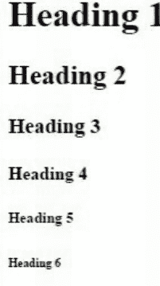
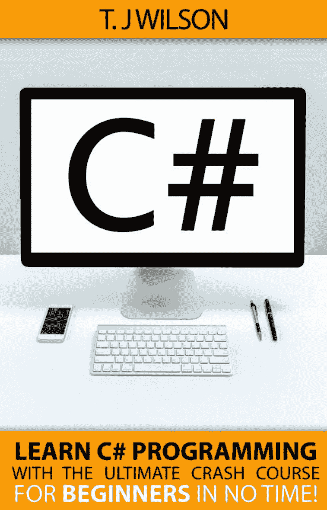

# 初学者编程合集 - 学习 HTML, HTML5 & CSS3, Java, PHP & MySQL, C# 初学者终极指南（8 小时内掌握编程入门！）


# 引言

首先，感谢你下载本书并对网页开发特别是网页设计的世界感兴趣。《HTML：逐步入门指南》一书将在书中提供所有必要的信息和培训，这些将帮助你以后通过其他语言甚至更复杂的 HTML 来提升自己的技能。

我们之所以从“学习网页设计”系列的第一本从 HTML 开始，是因为它是每个网站的核心。无论一个网站是多么基础或复杂，HTML 始终存在，并且对于它的存在至关重要。

为了完美地理解这些材料，我们将从最基础开始。我们将进行一些练习，因为精通编程的唯一途径就是不断的练习和学习。

书中的所有材料可以在一天内学会，但随后的练习和技能升级对于成为一名优秀的程序员来说至关重要。

再次感谢你下载本书，如果你喜欢它，请搜索该系列即将出版的其他书籍。

感谢并祝你好运！


## 第1章

## 什么是 HTML？

HTML 是 Hyper Text Markup Language（超文本标记语言）的缩写。它最初设计用于方便共享科学研究论文，这就是为什么专业人士通常使用“网页”来描述他们的作品。

“超文本”（Hyper Text）一词是指可以在计算机屏幕上显示的任何文本，但通常定义包含了链接文档的概念。这就是网页的工作原理。通过超链接（Hyper Links）连接的信息网络。

现在让我们谈谈 HTML 的另一个部分——“标记语言”（Markup language）术语源于描述内容的计算机代码概念。想象你正在创建一份报纸并需要对其进行组织。首先，你需要给报纸起一个标题，然后你需要为不同的主题添加几个章节。每个章节都需要一个大标题，后面跟着几个较小的小标题，然后我们需要添加几个段落和照片。

你会发现，构建网页的结构与此非常相似。当你创建内容时，你将需要使用 HTML 将其分为章节、段落等。

所有的网络浏览器都使用 HTML 来解释和组合文本、图像和其他材料。

现在让我们来看看编写 HTML 代码所需要的工具。

## 第2章
文本编辑器以及如何使用它们？

对于为 HTML 以及几乎任何其他编程语言进行编码，我们需要某种文本编辑器。为了本书的目的，我们将使用 Windows 记事本（Note Pad）或可以免费下载的“Note Pad ++”，你可以从这里获取它：[http://bit.ly/1Bm4IZm

我将在书中的所有示例中使用 Note Pad ++ 软件。

安装过程非常基础，所以我不会解释如何操作。假设你已经下载并安装了文本编辑器，在我们开始编码之前，这里有你需要做的几件事。

当你打开文本编辑器时，按下 CTRL+ N 打开一个新的工作窗口。在我们写下第一行代码时，我们将检查它的看起来如何。为了做到这一点，你必须去左上角点击“文件”（File）。点击“另存为...”（Save As...），选择你想保存文件的位置。在保存之前

| 文件名 | 另存为 |
| :--- | :--- |
| .html | Hyper Text |

现在是开始基础知识了。

## 第3章
HTML 基础

## 第4章
HTML 元素

正如你在上一章中看到的，HTML 元素是用起始标签、结束标签以及中间的内容编写的。HTML 元素是指从起始标签到结束标签的所有内容。

使用与上一章相同的示例：

```
<!DOCTYPE html>
<html>
<body>

<h1>我的第一个标题</h1>
<p>我的第一个段落。</p>

</body>
</html>
```

## 我的第一个标题

我的第一个段落。

这是我们第一个且基础的 HTML 网页。在下一章中，我们将讨论 HTML 元素。


元素的内容是：“我的第一个标题。”

`<p>` 元素定义了一个段落。它有一个起始标签 `<p>` 和结束标签 `</p>`。元素的内容是：“我的第一个段落”。

-   注意，所有的 HTML 标签都是小写的。HTML 本身是不区分大小写的，`<P>` 和 `<p>` 相同，但建议使用小写标签。

现在让我们学习 HTML 属性。

## 第 5 章
### HTML 属性

我们 HTML 课程的下一步是属性。所有的 HTML 元素都可以拥有属性。

-   属性为元素提供了额外的信息。
-   它们始终指定在元素的起始标签中。
-   它们成对的形式出现，例如：`name="value"`。

我们将在本章中介绍一些通用属性。

-   HTML 的 lang 属性。

```
1 <!DOCTYPE html>
2 <html lang="en-US">
3 <body>
4 
5 <h1>My First Heading</h1>
6 
7 <p>My first paragraph</p>
8 
9 </body>
10 </html>
```

文档语言可以在 `html` 标签中声明，并通过使用 `lang` 属性进行声明。声明语言对于无障碍应用和搜索引擎非常重要。

-   HTML 的 title 属性。

```
<p title="Our title attribute">关于标题属性的段落。</p>
```

HTML 段落是用 `<p>` 标签定义的。在这个示例中，`<p>` 元素有一个 `title` 属性，其值为 "Our title attribute."。

-   HTML 的 href 属性。

HTML 链接是用 `<a>` 标签定义的，链接地址在 `href` 属性中指定。

```
<a href="http://www.facebook.com"> 这是一个链接</a>
```

我们将在 HTML 链接部分更多地关注 `<a>` 属性。现在只需了解语法即可。

-   HTML 尺寸属性。

HTML 中的图像由 `` 标签定义。`src` 对应于图片的文件名，图片大小由 `width` 和 `height` 属性提供。

```

```

我们将在关于图像的章节中详细讨论图像和 `` 标签。

-   后续提示：

HTML 5 标准不需要在属性值周围加引号。

-   待办：

回顾这四个属性并将它们写在你的文件中。
为了显示图像，请确保该文件与你的 HTML 文件在同一个目录下。（如果它们都在桌面上会更简单。）
尝试对目前为止显示的内容进行一些实验。

## 第 6 章
### HTML 标题

由于搜索引擎使用你的标题来索引页面的结构和内容，因此按照预期目的使用它们非常重要。换句话说……不要用它们来让文字变大或加粗。

HTML 标题用 `<h1>` 到 `<h6>` 标签定义。`<h1>` 是最大的，到 `<h6>` 最小。



```
<h1>Heading 1</h1>
<h2>Heading 2</h2>
<h3>Heading 3</h3>
<h4>Heading 4</h4>
<h5>Heading 5</h5>
<h6>Heading 6</h6>
```

标题看起来如下。你还可以使用 `<hr>` 标签画一条水平线，让你的标题更加突出。

## 标题 1

```
<h1>Heading 1</h1>
<hr>
```

注意 `<hr>` 标签没有结束标签。水平线标签不仅用于标题，还可以用于段落。
另外注意 `<head>` 元素与 `<h1>` 元素不同。`<head>` 元素与 HTML 标题无关。`<head>` 元素用于显示元数据。

## 第 7 章
### HTML 段落

正如你之前看到的，`<p>` 元素定义了一个段落。

现在让我们深入了解段落。我们已经知道它们被用于在网页上显示文本。然而，在屏幕上的显示方式完全不同。有些人的屏幕很小，浏览器会忽略代码中的额外空格。

```
<p>这个段落
包含很多行
但当显示时会忽略它们</p>
```

上面的段落在屏幕上显示如下：


如果你想在同一个段落中开始新行，必须使用 `<br>` 标签（与 `<hr>` 标签一样，它没有结束标签）。另一种开始新行的方法是结束段落并开始一个新的。

-   待办：

写几个段落。在第一个示例中尝试创建一个新段落并使用 `<br>`。你也可以使用多个。在下一章我们将熟悉样式。

## 第 8 章
### HTML 样式

默认情况下，所有 HTML 元素都有默认样式（背景为白色，文本为黑色）。然而，我们可以使用 `style` 属性来更改这些值。这是一个示例：

```
<body style="background-color:lightblue">
  <p>显示属性</p>
```

有一个 `style` 属性后面跟着值。在我们的情况下是背景颜色为lightblue。在浏览器中显示的输出如下：


HTML style 属性的语法如下：style="property : value"。`<h1>` 和 `<p>` 属性是相同的：

```
<h1 style="color:red">这是标题</h1>
<p style="color:green">这是段落 </p>
```

在起始标签内的 style 属性具有正确的语法。通过 style 属性你也可以更改字体、字体大小和对齐方式。

```
<h1 style="font-family:georgian">这是标题</h1>
<p style="font-family:courier">这是段落 </p>
```

或者：

## 这是标题

这是段落

字体大小属性将字体大小改为300%。段落的文本居中。

-   待办：

尝试将文件的段落改为不同的颜色。现在你可以使用所有基础颜色。将字体改为“Courier”。居中页面上的内容。

## 第 9 章
### HTML 格式

HTML 还使用特殊元素来定义具有特殊含义文本。HTML 格式如下：

-   **粗体**：用 `<b>` 元素定义粗体。没有结束标签。
-   **强**：用 `<strong>` 元素定义具有语义重要性的强文本。没有结束标签。
-   *斜体*：用 `<i>` 元素定义没有重要性的斜体文本。没有结束标签。
-   强调：用 `<em>` 元素定义具有额外语义的强调文本。没有结束标签。
-   **标记**：用 `<mark>` 元素定义标记或高亮文本。没有结束标签。
-   **小字**：用 `<small>` 元素定义小文本。没有结束标签。
-   **删除文本**：用 `<del>` 元素定义被删除的文本。没有结束标签。
-   **插入文本**：用 `<ins>` 元素定义插入的文本。没有结束标签。
-   **下标**：用 `<sub>` 元素定义下标文本。没有结束标签。
-   **上标**

我们都知道链接是什么，并且我们几乎在每一个网页上都见过它们。

HTML 链接的语法为：

```html
<a href="url">链接文本</a>
```

其中 `<a>` 标签是链接标签，`href` 是属性。你在之前的某个章节中见过它。`href` 属性指定了你想要链接的网页地址。链接文本对查看者可见。当用户点击链接文本或图像时，他将被重定向到另一个页面。

当你把鼠标指针悬停在链接上时会发生两件事：

-   鼠标箭头变成手形。
-   链接元素改变它的颜色。

默认情况下，链接在你的浏览器中显示如下：

-   未访问的链接是带下划线的蓝色。
-   已访问的链接是带下划线的紫色。
-   激活链接是带下划线的红色。

```css
<style>
a:link {color:#000000; background-color:transparent; text-decoration:none}
a:visited {color:#000000; background-color:transparent; text-decoration:none}
a:hover {color:#ff0000; background-color:transparent; text-decoration:underline}
a:active {color:#ff0000; background-color:transparent; text-decoration:underline};
</style>
```

从示例可以看出，可以使用 style 属性更改默认值。

另一个酷且重要的事情是将图像作为链接显示。我们这样做：

```html
<a href="www.facebook.com">

</a>
```

所以我们那里做了：


通常我们会有 <a href="url">链接文本</a>，但在这种情况下，我们放置的是一张图片而不是链接文本。因此，在链接标签的开始和结束标签（`<a>`）之间，我们放入图片标签。

我们还使用了已知的 `style` 标签来设置图片的宽度、高度和边框。

我们将在下一章讨论更多关于图片的内容。

- 待办事项

在你的网页某处放置一个指向你 Facebook 页面的链接。

## 第 11 章
### HTML 图片

正如你在上一章中已经看到的，HTML 图片是用 `` 标签定义的。该标签本身是空的，它只包含属性。`` 没有闭合标签。`src` 属性包含图片的特定网络地址（URL）。

我们可以从本地计算机或互联网链接图片。如果你使用的是存储在计算机上的图片，则该图片必须放置在与 HTML 文件相同的同一个文件夹中。

对于这两种方式，如果发生了某些情况导致你的图片无法加载，准备一个备份方案是好的。在这种情况下，我们使用 `alt` 属性。如果我们的图片加载失败，它会指定一个替代文本。

语法如下：

```

```

对于我们“缺失”的图片，浏览器将显示某些内容，因为它会获取我们 `alt` 属性的值。

注意，我们始终为图片的宽度和高度设置 `style`。这可以防止其他样式表更改图片的原始尺寸（除非你想加入的话）。样式表用于 CSS 样式设置，我们将在该系列的第二本书中详细讨论它们。

通常，浏览器期望图片与网页位于同一个文件夹中。然而，如果你想使用来自另一个文件夹的图片，你必须在 `src` 属性中包含文件夹名称，如下所示：

```

```

我已经在上一章向你展示了如何将图片作为链接。你只需要将图片标签嵌套在链接标签内部。

```
<a href="www.facebook.com">

</a>
```

## 第 12 章
### HTML 表格

表格在 HTML 中非常常用。它们用 `<table>` 标签定义，并通过 `<tr>` 标签分为表格行。表格行通过 `<td>` 标签分为表格单元格，也可以通过 `<th>` 标签分为表格表头。

这里有一个示例：

```
<table style="width:100%">
  <tr>
    <td> John</td>
    <td> Peter </td>
  </tr>
  <tr>
    <td> Fema </td>
    <td> Nikol </td>
  </tr>
</table>
```

我们有一个表格，包含两行，每行都包含两个表格数据（`<td>`）。

通过将宽度设置为 100%，我们确保它将始终占据浏览器窗口的 100%。但目前，它看起来并不像我们熟悉的表格。

我们需要添加一些边框。我们通过在 `<table>` 标签内定义 `border` 值来实现。

```
<table border="1" style="width:100%">
```

如果你不指定边框，表格将不带边框显示。使用 CSS 边框属性会更好且更受推荐，因为 HTML 的边框属性正在过时。你可以在我即将出版的关于 CSS 样书中学习关于它们的所有知识。

HTML 表格表头默认显示为粗体并居中。它们的语法如下：

```
<table border="1" style="width:100%;">
<tr>
  <th> First Name </th>
  <th> Sallary </th>
</tr>
<tr>
  <td> John </td>
  <td> 120 000$ </td>
</tr>
<tr>
  <td> Peter </td>
  <td> 95 000$ </td>
</tr>
</table>
```


- 待办事项

制作一个你自己的、具有不同数据和边框大小的 HTML 表格。尝试通过添加更多表格数据来让它变得更大。

## 第 13 章
### HTML 列表

HTML 语言可以拥有无序列表、有序列表或描述列表：

| 无序列表 | 有序列表 | 描述列表 |
| --- | --- | --- |
| - 第一个项目 | 1. 第一个项目 | 第一个项目 |
| - 第二个项目 | 2. 第二个项目 | 项目的描述 |
| - 第三个项目 | 3. 第三个项目 | 第二个项目 |
| - 第四个项目 | 4. 第四个项目 | 项目的描述 |

**无序** 列表以 `<ul>` 标签开始，每个列表项目以 `<li>` 标签开始。

```
<ul>
  <li>HTML</li>
  <li>CSS</li>
  <li>Java Script</li>
</ul>
```

你可以通过在 `<ul>` 标签内部嵌套 `style` 属性来更改列表样式。

无序列表有四种样式类型：

- list-style-type:disc：列表项目将用圆点标记（默认）。

语法如下：

```
<ul style="list-style-type:disc">
```

你只需要在结尾更改类型。

**有序** HTML 列表以 `<ol>` 标签开始。列表项目与之前一样，以 `<li>` 标签开始。

```
<ol>
  <li>HTML</li>
  <li>CSS</li>
  <li>Java Script</li>
</ol>
```

这里有五种有序列表。

- Type="1"：列表项目将用数字编号（默认）。
- Type="A"：列表项目将用大写字母编号。
- Type="a"：列表项目将用小写字母编号。
- Type="I"：列表项目将用大写罗马数字编号。
- Type="i"：列表项目将用小写罗马数字编号。

语法如下：

```
<ol type="1">
```

描述列表以 `<dl>` 标签开始。术用 `<dt>` 标签开始，描述用 `<dd>` 标签开始。

语法如下：

```
<dl>
  <dt>Term1</dt>
  <dd>Description of term1</dd>
</dl>
```


# 引言


第 1 章 什么是 HTML5？

第 2 章 -- HTML5 中的语言变化


第 3 章 什么是 CSS3？


与互联网上的其他核心技术一样，HTML 也在不断演进。HTML5 的主要目的是改进运行 Web 的基础语言，在增加对最新多媒体支持的同时，保持语言对人类易于阅读。它还旨在让读取它的机器（即解析器、网络浏览器等）对它有更一致的理解。HTML5 的创建是为了能够包含（涵盖）DOM Level 2 HTML、XHTML 1 及其其直接前身 HTML 4。

该语言的新版本也是为了响应一个事实：XHTML 和 HTML 在 Web 上都在广泛使用，并且两者都包含了由各种规范共同发起的以及由专有软件（如浏览器本身）甚至常见实践引入的特性的混合。HTML5 也被视为尝试定义一种标记语言，程序员可以将其作为 HTML 或其表兄弟 XHTML 来编写。它可以包含能够鼓励更具互操作性的实现的处理模型，还引入了用于更复杂的 Web 应用的标记和 API（应用程序编程接口）。

HTML5 还被认为是跨平台移动应用的良好候选者。许多 HTML5 特性的构建都考虑到了，它们应该能够在功率相对较低的设备上运行，如智能手机和平板电脑。

# 谁创建了 HTML5？

回到 2004 年，一个被称为 WHATWG（Web 超文本应用技术工作组）的团体开始了这项新标准的工作。此时，HTML4.01 仍在在使用，并且自千禧年交之际以来未曾更新。同时，W3C（世界维网联盟）正专注于 XHTML 2.0 的开发。

许多人将 HTML5 的开发比作 Adobe Flash 技术，尽管两者非常不同。这两种技术可以使用缩放矢量图形，并在网页上查看音频和视频，但 Flash 拥许多功能在 HTML5 中没有直接的对应物。例如，HTML5 本身无法支持动画或交互性——它应该始终用 JavaScript 或 CSS3 进行补充。

# 新 HTML 有什么新内容？

新的 HTML5 添加了不同的语法特征。其中最显著的是以下几个：

- <video> -- 该元素的创建目的是视频流媒体传输，部分替代了另一个元素 <object>。创建者的意图是通过在不使用插件的情况下在网站上显示视频来成为新标准。这被许多人视为此前使用 Adobe Flash（一种专有插件）作为标准的替代方案。然而，由于权威机构对于网络浏览器应该支持哪些视频格式尚未达成完全共识，该元素的使用受到了阻碍。

- <audio> -- 该元素表示音频流（基本上是任何声音）。它最常见的用途是在页面上播放单个音频文件，并带有一个显示播放、暂停和音量控制的小部件。音频元素本身包含了不同的属性，如 `global`、`autoplay`、`preload`、`controls`、`loop`、`mediagroup`、`muted` 和 `src`。与视频元素一样，HTML5 的支持者在免费格式和更广泛使用的专利格式之间纠结。

- <canvas> -- 系统的这部分允许对位图以及 2D 形状和图像进行脚本化的渲染。这种过程化模型将更新位图，并且不会具有内置的场景图。

HTML5 还具有 MathML，这是一种用于数学公式的语言。这是一种应用 XML 的数学标记语言，用于描述符号并捕获其内容和结构。该功能的总目标是将数学公式集成到世界维网中。API 和 DOM（文档对象模型）也是该语言不可或缺的一部分。

HTML5 还具有新的页面结构元素：`<section>`、`<main>`、`<article>`、`<header>`、`<aside>`、`<footer>`、`<figure>` 和 `<nav>`。该语言的规范还定义了针对无效文档的处理，，以便浏览器可以统一处理错误。

HTML5 中的某些元素被删除了，例如 `<cite>`、`<menu>`：

- <acronym>
- <applet>
- <base>
- <big>
- <center>
- <dir>
- <font>
- <strike>
- <tt>
- <frame>
- <frameset>
- <noframes>

# 浏览器支持

所有现代浏览器都支持 HTML5。除此之外，旧浏览器可以自动处理。由于这一点，用户代理可以识别以前版本的元素。

HTML5 规范将 Web 开发者（作者）和浏览器隔离开来。例如，作者不应该使用 `<plaintext>` 和 `<isindex>` 元素，但用户代理将支持它们。

# HTML 语法

在 HTML 中，程序员必须定义一种“语法”，称为“HTML 语法”。选择与现有 HTML4 和 XHTML1 最兼容的语法，尽管它无法与 SGML 特性（如简写标记和处理指令）兼容，因为这些通常不受浏览器支持。“text/html”媒体类型用于提供 HTML 语法的文档。

在 HTML 中，人们还定义了详细的解析规则（带有错误处理），这些规则同样与 HTML4 兼容。用户代理作为浏览器必须依赖这些规则。同样，XML 也可以作为 HTML 语法。XML 媒体类型（如“application/xml”或“application/xhtml+xml”）用于提供此类语法的文档。

# 字符编码

在 HTML 中，Web 开发者还声明了字符编码。有三种方法可以实现：

可以在传输层通过使用 HTTP `content-type` 头来实现。

可以在文件开头使用 Unicode BOM（字节顺序标记）。该字符将提供编码的签名。

使用 `<meta>` 元素配合 `charset` 属性，在文档的前 1024 字节期间指定编码。例如，可以通过输入 `<meta charset="UTF-8">` 来指定 UTF-8 编码。这将取代更长的 `<meta http-equiv="Content-Type" content=:text/html; charset="UTF-8">`，尽管后期语法仍然被允许。

# Doctype

必须指定“Doctype”以确保浏览器在标准模式下渲染页面。doctype 没有其他用途。


HTML 语法的声明始终为“<!DOCTYPE html>”。请记住，这是不区分大小的。来自旧版本的 doctypes 不再使用，因为它们是基于 SGML 的。

对于尚无法支持缩短 doctype 的旧版标记生成器仍然可以使用 "<!DOCTYPE html SYSTEM "about:legacy-compat">”。此外，允许使用针对 HTML4.01、HTML4、XHTML1.1 和 XHTML1 的 doctypes，但不建议这样做。

对于那些使用 XML 媒体类型的文档，它们始终以标准模式处理，因此可以使用任何 doctype 声明。

## SVG 和 MathML

HTML 语法还支持在文档内使用 SVG 和 MathML 元素。“svg”或“math”起始标签将导致解析器切换到一种特殊的插入模式，将元素和属性放入相应的命名空间中。这还能在元素和属性采用混合大小写的情况下进行修复。它还支持像 XML 一样使用空元素语法。与之前一样，该语法是不区分大小的。人们也可以省略命名空间声明。

某些元素会导致解析器切换回 HTML 模式，例如“mtext”和“foreignObject”。当使用这些元素时，程序员可以使用不同的 HTML 元素，或新的“svg”或“math”元素。

## 语法中的其他变化

- 命名为 &lang; 和 &rang; 的字符现在扩展为数学左或右角括号，而不是普通的左或右指向角括号。
- 空元素现在可以有一个尾随斜杠（这在 HTML4 中被称为“EMPTY”）。
- 与之前的 HTML4 相比，& 符号（和符号）在更多情况下可以保持不转义。
- 不同的属性之间需要至少用一个空白字符分隔。
- 值的空属性必须重写为仅保留名称，不带等号和值。这甚至适用于非布尔属性。
- 值的省略省略引号的属性允许使用的字符集比之前的 HTML 版本更大。
- 解析器不会对属性值内的空白字符进行归一化。例如，“id”属性中的前导和尾空格不会被忽略（因此现在被视为无效），而换行符可以在“input”元素的“value”属性中使用，而无需使用字符实体引用。
- 结束标签“optgroup”现在是可选的。
- 起始标签“colgroup”也是可选的，可以由 HTML 解析器推断。

## 第 2 章：HTML5 中的语言变化

为了提供更好的结构，HTML5 引入了以下元素：

- Section - 代表一个通用的应用程序部分或文档。为了指示文档结构，应将其与标题元素（“h1”、“h2”、“h3”等）配合使用。
- Article - 代表文档内容的独立部分。这可能是一个博客或一篇报纸文章。
- Main - 代表文档或应用程序主体的主要内容。
- Aside - 代表与页面其余内容仅部分相关的内容。
- Header - 代表导航辅助或引言部分。
- Footer - 代表页面底部的部分，可以包含关于作者的信息、版权许可信息等。
- Nav - 代表文档中用于导航的区域。
- Figure - 代表一个自包含的区域，通常包含流式内容。这通常被视为单一单元引用，与主文档不同。
- Figcaption - 可以作为图片的说明，尽管它是完全可选的。
- **Template（模板）** - 可声明不同的 HTML 片段，这些片段可以通过脚本克隆并插入主文档中。
- **Video and Audio（视频和音频）** - 如前所述，用于多媒体内容。它们还允许开发者通过 API 编写自己的界面。如果存在多个类型的不同流，则与“source”元素一起使用。
- **Track（轨道）** - 提供视频元素中的轨道。
- **Embed（嵌入）** - 用于插件内容。
- **Mark（标记）** - 代表被高亮或标记的文本，由于其相关性。
- **Progress（进度）** - 代表任务的完成情况，在不同的上下文。
- **Meter（测量值）** - 代表一种测量，例如。
- **Time（时间）** - 代表时间。
- **Ruby / Rt / Rp** - 允许 Ruby 注释。
- **Bdi（双向隔离）** - 代表与周围环境隔离的文本组。
- **Wbr** - 代表强制换行。
- **Canvas（画布）** - 用于动态图形的即时渲染，例如。
- **Datalist（数据列表）** - 与输入结合使用，组合框。
- **Keygen（密钥生成）** - 代表密钥生成。
- **Output（输出）** - 代表输出类型，例如计算完成时。

Input 元素的 Type 属性还有以下新值：
- Search
- Tel
- URL
- Email
- Date
- Range
- Number
- Color

这些新类型的工作原理是，用户代理（即浏览器）可以提供所需的界面。这种界面可能是日历选择器或地址簿。用户代理还应该与服务器通信。这将为用户提供更好的体验。


## 第 3 章：什么是 CSS3？

之前我们提到过，无论 HTML 多么先进，如果不使用其他元素，无法创建一个全面的网站或应用程序。其中之一就是 CSS，即级联样式表。

“级联样式表”本质上是一种用于描述以前用标记语言（如 HTML 或 XHTML）编写的文档格式的语言。CSS 通常用于修改上述语言的网页和其他界面，它实际上可以应用于任何类型的 XML 文档——甚至是 SVG、XUL 和纯 XML。JavaScript 和 HTML 被认为是许多网站用于制作视觉吸引人的网页、Web 应用用户界面甚至许多移动应用程序的技术基石。

CSS 的设计初衷是实现文档内容与其样式的分离。这意味着元素（例如颜色、布局和字体）可以放在完全不同的文件中，提高了可访问性并为它们的特性提供了更多的控制和灵活性。这还允许多个 HTML 页面通过指定相关的 .css 文件来具有相同的格式。

内容与格式的分离还允许程序员为不同的渲染方法显示相同的标记页面——在打印、屏幕显示、盲文触觉设备上以及通过语音浏览器读取时。程序员还可以根据屏幕大小或设备（无论是手机、平板电脑、笔记本电脑还是台式电脑）显示不同的页面样式。


除了上述功能外，包含 CSS 的页面用户还可以选择覆盖页面内的 CSS 文件，并使用存储在他们设备的文件。如果阅读者和作者都没有指定任何 CSS 文件，则将使用浏览器的默认样式。就像 CSS 能够立即影响这些文件一样，CSS 也可以通过简单的修改几块或几行代码，轻松地更改数百个文档的设计。

CSS 名称中的“级联”（cascading）一词源于其行为。该规范意味着一种识别优先级的方案，用于在对某个元素匹配到多条规则时，决定将应用哪种样式规则。这种规则的“级联”或权重（weight）是经过计算并分配的，从而使其执行结果变得可预测。

CSS 的规范同样由 W3C 制定，就像 HTML 一样。该联盟（Consortium）甚至为文档提供 CSS 验证服务，并免费提供服务。

## CSS 选择器

在 CSS 术语中，选择器（Selectors）用于指定标记语言中特定的样式将应用于部分。这是通过匹配标记语言中的文件和标签来实现的。选择器可以应用于：

- 每一种特定类型的所有元素，例如一级标题或 h1。
- 由特定属性标识的元素，例如“id”（文档中唯一的标识符）和“class”（用于在文档中区分不同元素的标识符）。
- 通用元素，这仍然取决于它们在文档树中与其他元素的相对位置。

在上述应用选择器的区域，必须记住 ID 和类是区分大小写的。它们以字母开头，并可以包含任何字母、数字以及下划线。特别是 ID，它仅应用于单个元素的单个实例。

CSS 选择器还使用了“伪类”（pseudo-classes），以便根据文档树之外的信息进行格式化设置。伪类的一个例子是“hover”，它的作用是仅当用户用鼠标光标“悬停”（points to）在可见的文档上时才识别该内容。它连接到一个选择器上，例如“a:hover”或 "#element:hover”。

选择器可以通过不同的方式合并，以实现高水平的灵活性和准确性。有多个选择器可以组合在一起，通过元素类型、位置、类、ID 或这些这些者的组合来指定元素。选择器的顺序也非常重要。考虑以下内容：

```
div.thisClass{color:green}
```

在这种情况下，该表达式应用于 div 元素内部类名为“thisClass”的每个元素。相反，

```
.myClass div{color:red};
```

可以应用于所有类名为“myClass”的 div 元素。

## CSS 声明块

“声明块”（declaration block）是一个由大括号内的一组“声明”（declarations）组成的项。声明本身由属性（property）、冒号以及值（value）组成。如果一个块内有多个声明，则必须使用分号将每个声明隔开。

属性始终在语言的标准中指定。所有属性都包含一组可能的值，并且某些属性会影响任何元素（而另一些属性仅限于少数一组元素）。

值可以是关键字，包括“inherit”（继承）或“center”（居中）。它们也可以是数值，如“80%”或“200px”。颜色值可以使用关键字（如“green”）或其等效的十六进制值指定。其他可能用于颜色的值包括 RGB 值（在 0 到 255 比例内）、RGBA 值（同时指定颜色和透明度的值），以及 HSLA 或 HSL 值。

## 优先级方案（从高到低）

此前，我们提到 CSS 遵循一种类似于层级的“级联”优先级方案。以下是 CSS 优先级方案，从高到低排列。

- 权重 (Importance) - 任何标记为 !important 的内容。
- 内联 (Inline) - 直接在 HTML 标签中的样式。
- 媒体 (Media) - 根据媒体条件定义的样式。
- 用户定义 (User-defined) - 用户设置的样式。
- 选择器 (Selector) - 根据选择器的复杂性计算。
- 规则顺序 (Rule order) - 在样式表中后定义的规则覆盖先定义的规则。
- 继承 (Inheritance) - 从父级元素继承的属性。
- 浏览器默认 (Browser default) - 浏览器的默认样式。

## CSS 权重（Specificity）

此前，我们提到 CSS 遵循一种类似于层级的“级联”优先级方案。以下是 CSS 优先级方案，从高到低排列。

- 权重 (Importance) - 任何标记为 !important 的内容。
- 内联 (Inline) - 直接在 HTML 标签中的样式。
- 媒体 (Media) - 根据媒体条件定义的样式。
- 用户定义 (User-defined) - 用户设置的样式。
- 选择器 (Selector) - 根据选择器的复杂性计算。
- 规则顺序 (Rule order) - 在样式表中后定义的规则覆盖先定义的规则。
- 继承 (Inheritance) - 从父级元素继承的属性。
- 浏览器默认 (Browser default) - 浏览器的默认样式。

## CSS 权重（Specificity）

此前，我们提到 CSS 遵循一种类似于层级的“级联”优先级方案。以下是 CSS 优先级方案，从高到低排列。

- 权重 (Importance) - 任何标记为 !important 的内容。
- 内联 (Inline) - 直接在 HTML 标签中的样式。
- 媒体 (Media) - 根据媒体条件定义的样式。
- 用户定义 (User-defined) - 用户设置的样式。
- 选择器 (Selector) - 根据选择器的复杂性计算。
- 规则顺序 (Rule order) - 在样式表中后定义的规则覆盖先定义的规则。
- 继承 (Inheritance) - 从父级元素继承的属性。
- 浏览器默认 (Browser default) - 浏览器的默认样式。

## CSS 权重（Specificity）

此前，我们提到 CSS 遵循一种类似于层级的“级联”优先级方案。以下是 CSS 优先级方案，从高到低排列。

- 权重 (Importance) - 任何标记为 !important 的内容。
- 内联 (Inline) - 直接在 HTML 标签中的样式。
- 媒体 (Media) - 根据媒体条件定义的样式。
- 用户定义 (User-defined) - 用户设置的样式。
- 选择器 (Selector) - 根据选择器的复杂性计算。
- 规则顺序 (Rule order) - 在样式表中后定义的规则覆盖先定义的规则。
- 继承 (Inheritance) - 从父级元素继承的属性。
- 浏览器默认 (Browser default) - 浏览器的默认样式。

## CSS 权重（Specificity）

此前，我们提到 CSS 遵循一种类似于层级的“级联”优先级方案。以下是 CSS 优先级方案，从高到低排列。

- 权重 (Importance) - 任何标记为 !important 的内容。
- 内联 (Inline) - 直接在 HTML 标签中的样式。
- 媒体 (Media) - 根据媒体条件定义的样式。
- 用户定义 (User-defined) - 用户设置的样式。
- 选择器 (Selector) - 根据选择器的复杂性计算。
- 规则顺序 (Rule order) - 在样式表中后定义的规则覆盖先定义的规则。
- 继承 (Inheritance) - 从父级元素继承的属性。
- 浏览器默认 (Browser default) - 浏览器的默认样式。

## CSS 权重（Specificity）

权重（Specificity）是指在对某个元素匹配到多个规则时，决定哪种样式规则将应用的算法。它是通过匹配标记语言中的文件和标签来实现的。

在 CSS 术语中，选择器用于命名标记标记中中部分部分样式将样式部分。

## CSS 权重（Specificity）

在 CSS 中，属性选择器之间的空白符会被忽略的。

 CSS 空格符

在 CSS 中，属性选择器之间的空白符会被忽略的。

## CSS 空格符

在 CSS 中，属性选择器之间的空白符会被忽略的。

让我们考虑以下代码片段来演示权重：

```
<!DOCTYPE html>
<html>
<head>
<meta charset="utf-8">
<style>
#abc { color: green; }
</style>
</head>
<body>
<p id="abc" style="color: red">演示权重</p>
</body>
</html>
```

在这种例中，应用到类名为“abc”的 `div` 元素的表达式是 `color:green`。相反，

```css
.myClass div{color:red};
```

可以应用于所有类名为“myClass”的 `div` 元素。

## CSS 权重（Specificity）

权重（Specificity）是指在对某个元素匹配到多个规则时，决定哪种样式规则将应用的算法。它是通过匹配标记语言中的文件和标签来实现的。

## CSS 权重（Specificity）

权重（Specificity）是指在对某个元素匹配到多个规则时，决定哪种样式规则将应用的算法。它是通过匹配标记语言中的文件和标签来实现的。

## CSS 权重（Specificity）

权重（Specificity）是指在对某个元素匹配到多个规则时，决定哪种样式规则将应用的算法。它是通过匹配标记语言中的文件和标签来实现的。

## CSS 权重（Specificity）

权重（Specificity）是指在对某个元素匹配到多个规则时，决定哪种样式规则将应用的算法。它是通过匹配标记语言中的文件和标签来实现的。

## CSS 权重（Specificity）

权重（Specificity）是指在对某个元素匹配到多个规则时，决定哪种样式规则将应用的算法。它是通过匹配标记语言中的文件和标签来实现的。

## CSS 权重（Specificity）

权重（Specificity）是指在对某个元素匹配到多个规则时，决定哪种样式规则将应用的算法。它是通过匹配标记语言中的文件和标签来实现的。

## CSS 继承

这是 CSS 的一项关键功能，依赖于祖先后代关系。通常情况下，后代元素从其包含它们的祖先元素继承属性值。

继承可以防止某些属性在样式表中重复声明，从而允许程序员编写更少的代码。它还可以提高页面的加载速度，允许客户端节省带宽和开发成本。

下面是一个样式表的示例：

```css
H2 {
Color: green;
}
```

假设这个二级标题元素内部有一个强调（em）元素：

这是为了 <em>show</em>

如上所示，没有为 `em` 元素分配颜色。在这种情况下，被强调的单词（show）将继承其父元素（h2）的颜色。

## CSS 空格符

在 CSS 中，属性选择器之间的空白符会被忽略的。考虑以下代码片段：

```css
Body{overflow:hidden;background:#00000;}
```

这在功能上与带有空格的类似代码片段等效。许多程序员以这种方式格式化 CSS，以便每个属性单独占一行，但这仅有助于代码的人类可读性（同时也允许代码出现错误时允许更快速的故障排除）。当输入到计算机时，所有这些空格都会被忽略。

## “CSS3”的含义

在先前的 CSS 规范中，结构是一个巨大的单一规范，定义了各种功能定义。CSS3 偏离了这种规范，它被分为几个文档，称为“模块”。这些模块中的每一个增加了新功能，或者扩展了 CSS2 中定义的现有功能。CSS3 还保持了向后兼容性。

由于模块化方法，不同的 CSS3 模块具有不同的稳定性


级别和状态。具有“正式推荐状态”的具有最高的稳定性，而被认为是“候选推荐”（CR）状态的则被认为具有中等稳定性。

由于这种方法，某些模块已经“升级”到了 4 级（CSS4）标准。这些模块非常有限，包括选择器（Selectors）、背景（Backgrounds）和边框（Borders）以及图像值（Image Values）。还有一些新功能，例如“flexbox”，它仍被视为“1 级”。

## CSS 浏览器支持

并不是所有浏览器都能正确解析所有的 CSS 代码。由于这种情况，被称为“CSS 骇客”（CSS hacks）的编码技术可以过滤或针对（或两者兼有）特定的浏览器。这些通常被称为 CSS 过滤器，用于向某些浏览器显示或隐藏 CSS 的某些部分——通过利用每个浏览器的 CSS 处理漏洞（或利用对许多 CSS 规范中某些部分支持的）来实现。

通过这些过滤器，一些程序员甚至能够为某些浏览器交付不同的样式表。这种技术将确保设计按照程序员预期的方式进行渲染。

一些程序员还使用 CSS 过滤器来防止旧浏览器看到完整的 CSS。这是因为这些旧浏览器本身就无法正确渲染 CSS。

尽管有许多符合 CSS 的浏览器，但仍有许多程序员在与不符合标准的浏览器作斗争。这使得原本可行的技术变得比最初预期的更昂贵、更复杂。


## 第 4 章：博客页面

在本节中，我们将使用 HTML 和 CSS 概念创建一个实操项目，并使用高级技术。该项目将创建一个博客页面。这些指令旨在展示程序员如何使用 HTML5 和 CSS3 规范构建网站（当然，假设查看项目的 Web 浏览器已经实现了这些规范）。

在使用 HTML 进行标记之前，理清博客页面的整体结构是非常重要的。你希望标题是居中还是左对齐？侧边栏应该在左边还是右边？这些决策是非常重要的。

让我们来看一个标记示例：

```html
<!DOCTYPE html>
<html>
<head>
<title>在此处插入博客标题</title>
</head>
<body>
<header>
<h1>在此处插入页面标题</h1>
</header>
<nav>
<!-- 这包含你的导航栏 -->
</nav>
<section id="Introduction">
<!-- 这包含你的介绍 -->
```

```html
</section>
<section>
<!-- 这包含博客的主要内容 -->
</section>
<aside>
<!-- 这包含你的侧边栏 -->
</aside>
<footer>
<!-- 这包含你博客的页脚 -->
</footer>
</body>
</html>
```

注意标记中的 HTML5 元素：

- 只有一个 `doct-type`（文档类型声明）。
- “header”标签包裹了所有介绍性元素，包括 Logo 和页面标题。在其他应用程序中，它也可以包含目录，甚至是搜索表单。
- `nav` 标签用于包含不同的导航元素（包括但不限于专门的导航，如上一页/下一页链接）。
- `section` 标签用于表示文档中的不同章节。它可以包含不同的标记类型，并且不同的章节也可以相互嵌套。
- `aside` 标签用于包裹与主体内容相关但也可以独立存在的内容。这就是为什么我们用它来做博客的侧边栏。
- `footer` 标签可以包含有关博客主要内容的更多信息（包括但不限于网站作者、相关文档链接、版权信息等）。

与之前的 HTML 版本不同，我们不再使用 `div` 标签来包含不同的部分。现在正在使用语义化标签，这使得页面对搜索引擎更加可见，并使主题在屏幕阅读器上更具可访问性。

## 标记导航栏

现在，是为页面的导航部分标记了。这与 HTML4 或 XHTML 中的方法完全相同，通过无序列表来实现。唯一记住的是代码块需要放在适当的 `nav` 标签内：

```html
<nav>
<ul>
  <li><a href="#">这个博客</a></li>
  <li><a href="#">关于网站</a></li>
  <li><a href="#">存档</a></li>
  <li><a href="#">联系我们</a></li>
  <li><a href="#">订阅</a></li>
</ul>
</nav>
```

## 标记介绍部分

现在，是为页面的介绍部分标记了。这与 HTML4 或 XHTML 中的方法完全相同，通过无序列表来实现。唯一需要记住的是代码块需要放在适当的 `nav` 标签内（注：此处原文可能误为 nav，实际代码中应为 section）：

```html
<section id="Introduction">
  <header>
    <h2>你了解 HTML5 和 CSS3 吗？</h2>
  </header>
  <p>这是博客的介绍。</p>
</section>
```

## 标记主内容

现在，是为页面的主内容部分标记了。这与 HTML4 或 XHTML 中的方法完全相同，通过无序列表来实现。唯一需要记住的是代码块需要放在适当的 `nav` 标签内（注：此处原文可能误为 nav，实际代码中应为 section）：

```html
<section>
  <header>
    <h3>插入文章标题</h3>
  </header>
  <p>这篇文章发布于 <time datetime="2015-06-28T15:40:00">2015年6月28日</time></p>
</section>
```

## 标记正文

现在，是为页面的正文部分标记了。这与 HTML4 或 XHTML 中的方法完全相同，通过无序列表来实现。唯一需要记住的是代码块需要放在适当的 `nav` 标签内（注：此处原文可能误为 nav，实际代码中应为 article）：

```html
<article>
  <header>
    <h3>插入文章标题</h3>
  </header>
  <p>这篇文章发布于 <time datetime="2015-06-28T15:40:00">2015年6月28日</time></p>
</article>
```

## 标记评论

现在，是为页面的评论部分标记了。这与 HTML4 或 XHTML 中的方法完全相同，通过无序列表来实现。唯一需要记住的是代码块需要放在适当的 `nav` 标签内（注：此处原文可能误为 nav，实际代码中应为 section）：

```html
<section id="comment">
  <header>
    <h4>评论区域</h4>
  </header>
  <article>
    <header>
      <a href="#">评论者1</a>/<time datetime="2015-06-28T15:40:00">2015年6月28日</time>
    </header>
    <p>Lorem ipsum 之后，在此处插入评论。</p>
  </article>
</section>
```

## 标记评论表单

HTML5 引入了表单的许多增强。不再需要手动进行所需字段的客户端验证，因为现在浏览器会为你完成。

然而，还有两个新的输入类型——URL 和 email。这些用于收集发布者的网站和电子邮件地址。如果这些标记了 `required` 属性，用户将无法提交空表单。“required” 也是 HTML5 的新布尔属性。

让我们看一下代码示例（它指定了一个需要填充的字段）：

```html
<form action="#" method="post">
  <h5>输入评论</h5>
  <p>
    <label for="name">输入你的名字</label>
    <input name="name" id="name" type="text" required />
  </p>
</form>
```

## 标记页脚和侧边栏

你可以使用目前指定的各种标记来标记页脚和侧边栏。只需在 `footer` 和 `aside` 标签内添加几行即可。

## 使用 CSS 样式

# 基础设置
`date-time` 属性也是可见的，可以分为：

1. 文章的年份，后跟一个连字符。
2. 文章的月份，后跟另一个连字符。
3. 日期，后跟一个大写的“T”（显示本地时间）。
4. 本地时间，格式为 hh:mm:ss。
5. 相对于格林尼治标准时间（GMT）的时区区。

`date-time` 属性也是可见的，可以分为：


首先，必须定义一些关于排版、背景颜色等基础规则。让我们来看下面的 CSS 代码——你可能在 CSS 2.1 中见过这些内容。

```css
/* Example CSS Reset */
{
  Margin: 0;
  Padding: 0;
}
```

```css
/* 这段代码告诉浏览器将 HTML5 替换元素渲染为块级 */
Header, footer, aside, nav, article {
  Display: block;
}
```

```css
Body {
  Margin: 0 auto;
  Width: 250px;
  Font: 12px/24px verdana, Arial;
  Background: #000000
}
```

```css
H2 {
  Font-size: 16px;
  Line-height: 40px;
  Padding: 20px 0;
}
```

```css
P {
  Padding-bottom: 22px;
}
```

在开始，内边距（padding）和外边距（margin）样式将通过基础规则进行重置。在生产环境中，程序员可以使用更详细的 CSS 重置，但这里只是为了说明目的而提供的简化版本。

下部分告诉用户代理（user agent）将新的 HTML5 元素渲染为块级。虽然浏览器可以处理它们不的元素（这使得 HTML5 具有后兼容性），但它们不知道这些元素将如何以默认方式渲染。这就是为什么在 CSS3 标准普及之前，我们需要指导它们如何进行操作。

# 样式介绍

我们为介绍部分做的标记非常简单，但通过使用一些 CSS3，我们可以让它更具吸引力。请查看以下代码：

```css
#intro {
  Margin-top: 64px;
  Padding: 40px;
  Background: #467612 url("background_for_intro.png") repeat-x;
  Background-size: 100%;
  Border-radius: 22px;
}
```

正如你可能注意到的，使用了两个新属性：`background-size`（允许程序员缩放背景图像）和 `border-radius`（它为我们的元素应用圆角）。对于后者，每个角可以有不同的值。此外，程序员也可以选择只圆化特定的角。

# 样式化内容区域

使用 CSS3 样式化内容区域非常简单。不再需要浮动（floating）、用于背景的伪列图像，也不再需要清除或折叠外边距。元素现在的行为像表格一样，使布局变得更容易。查看下方的简单代码：

```css
#content {
  Display: table;
}
#mainContent {
  Display: table-cell;
  Width: 600px;
  Padding-right: 20px;
}
Aside {
  Display: table-cell;
  Width: 320px;
}
```

我们目前使用的 CSS3 技术可以用于样式化博客页的其他部分。这意味着我们可以在比使用过时技术所需短得的时间内完成整个项目！

## 结论

再次感谢下载这本书！
我希望这本书能够帮助你学习基础的 HTML5 和 CSS3 技能。
下一步是使用这些系统创建你自己的网站！在这个瞬息万变的世界里，站在技术前沿是必要的。但更深入地了解这项技术的原理，可以带你超越前沿，进入一个新世界！


最后，如果你喜欢这本书，我想请你一个忙，你愿意在亚马逊上为这本书留评价吗？这将不胜感激！

感谢并祝你好运！



# 使用初学者终极速成课程快速学习 C#编程！

C#

# 使用初学者终极速成课程快速学习 C# 编程！

# 引言

我想感谢你并祝贺你下载了《C#: Learn C# Programming with the Ultimate Crash Course for Beginners in No Time!》这本书。

书中包含了经过证明的步骤和策略，教你如何尽可能地开始编写 C# 程序！

如果你对 C++ 编程世界有先验知识，那么你可能会在 C#（读作 See Sharp）中发现熟悉的术语和代码结构。它与 Microsoft .NET 框架一起工作，最初被设计为 Java 的答案。今天，两者都被公司广泛使用，而且对初学者来说都是友好的语言。

以下你将在书中找到的一些核心课程：

- 理解 C# 程序结构
- C# 编码规范
- 掌握变量和数据类型
- 获取使用输入和使用类型转换
- 算术、条件、关系和逻辑运算符
- 使用控制语句
- 生成随机数
- 以及更多！

再次感谢下载这本书。我希望你喜欢它！

版权所有 2015 T. 保留所有。

内边距（padding）和外边距（margin）样式将通过基础规则进行重置。在生产环境中，程序员可以使用更详细的 CSS 重置，但这里只是为了说明目的而提供的简化版本。

下部分告诉用户代理将新的 HTML5 元素渲染为块级。虽然浏览器可以处理它们不的元素（这使得 HTML5 具有后兼容性），但它们不知道这些元素将如何以默认方式渲染。这就是为什么在 CSS3 标准普及之前，我们需要指导它们如何进行操作。

内边距（padding）和外边距（margin）样式将通过基础规则进行重置。在生产环境中，程序员可以使用更详细的 CSS 重置，但这里只是为了说明目的而提供的简化版本。

内边距（padding）和外边距（margin）样式将通过基础规则进行重置。在生产环境中，程序员可以使用更详细的 CSS 重置，但这里只是为了说明目的而提供的简化版本。

内边距（padding）和外边距（margin）样式将通过基础规则进行重置。在生产环境中，程序员可以使用更详细的 CSS 重置，但这里只是为了说明目的而提供的简化版本。

内边距（padding）和外边距（margin）样式将通过基础规则进行重置。在生产环境中，程序员可以使用更详细的 CSS 重置，但这里只是为了说明目的而提供的简化版本。

内边距（padding）和外边距（margin）样式将通过基础规则进行重置。在生产环境中，程序员可以使用更详细的 CSS 重置，但这里只是为了说明目的而提供的简化版本。

内边距（padding）和外边距（margin）样式将通过基础规则进行重置。在生产环境中，程序员可以使用更详细的 CSS 重置，但这里只是为了说明目的而提供的简化版本。

内边距（padding）和外边距（margin）样式将通过基础规则进行重置。在生产环境中，程序员可以使用更详细的 CSS 重置，但这里只是为了说明目的而提供的简化版本。

内边距（padding）和外边距（margin）样式将通过基础规则进行重置。在生产环境中，程序员可以使用更详细的 CSS 重置，但这里只是为了说明目的而提供的简化版本。

内边距（padding）和外边距（margin）样式将通过基础规则进行重置。在生产环境中，程序员可以使用更详细的 CSS 重置，但这里只是为了说明目的而提供的简化版本。

内边距（padding）和外边距（margin）样式将通过基础规则进行重置。在生产环境中，程序员可以使用更详细的 CSS 重置，但这里只是为了说明目的而提供的简化版本。

内边距（padding）和外边距（margin）样式将通过基础规则进行重置。在生产环境中，程序员可以使用更详细的 CSS 重置，但这里只是为了说明目的而提供的简化版本。

内边距（padding）和外边距（margin）样式将通过基础规则进行重置。在生产环境中，程序员可以使用更详细的 CSS 重置，但这里只是为了说明目的而提供的简化版本。

内边距（padding）和外边距（margin）样式将通过基础规则进行重置。在生产环境中，程序员可以使用更详细的 CSS 重置，但这里只是为了说明目的而提供的简化版本。

内边距（padding）和外边距（margin）样式将通过基础规则进行重置。在生产环境中，程序员可以使用更详细的 CSS 重置，但这里只是为了说明目的而提供的简化版本。

内边距（padding）和外边距（margin）样式将通过基础规则进行重置。在生产环境中，程序员可以使用更详细的 CSS 重置，但这里只是为了说明目的而提供的简化版本。

下部分告诉用户代理将新的 HTML5 元素渲染为块级。虽然浏览器可以处理它们不的元素（这使得 HTML5 具有后兼容性），但它们不知道这些元素将如何以默认方式渲染。这就是为什么在 CSS3 标准普及之前，我们需要指导它们如何进行操作。

内边距（padding）和外边距（margin）样式将通过基础规则进行重置。在生产环境中，程序员可以使用更详细的 CSS 重置，但这里只是为了说明目的而提供的简化版本。

下部分告诉用户代理将新的 HTML5 元素渲染为块级。虽然浏览器可以处理它们不的元素（这使得 HTML5 具有后兼容性），但它们不知道这些元素将如何以默认方式渲染。这就是为什么在 CSS3 标准普及之前，我们需要指导它们如何进行操作。

内边距（padding）和外边距（margin）样式将通过基础规则进行重置。在生产环境中，程序员可以使用更详细的 CSS 重置，但这里只是为了说明目的而提供的简化版本。

下部分告诉用户代理将新的 HTML5 元素渲染为块级。虽然浏览器可以处理它们不的元素（这使得 HTML5 具有后兼容性），但它们不知道这些元素将如何以默认方式渲染。这就是为什么在 CSS3 标准普及之前，我们需要指导它们如何进行操作。

内边距（padding）和外边距（margin）样式将通过基础规则进行重置。在生产环境中，程序员可以使用更详细的 CSS 重置，但这里只是为了说明目的而提供的简化版本。

下部分告诉用户代理将新的 HTML5 元素渲染为块级。虽然浏览器可以处理它们不的元素（这使得 HTML5 具有后兼容性），但它们不知道这些元素将如何以默认方式渲染。这就是为什么在 CSS3 标准普及之前，我们需要指导它们如何进行操作。

内边距（padding）和外边距（margin）样式将通过基础规则进行重置。在生产环境中，程序员可以使用更详细的 CSS 重置，但这里只是为了说明目的而提供的简化版本。

下部分告诉用户代理将新的 HTML5 元素渲染为块级。虽然浏览器可以处理它们不的元素（这使得 HTML5 具有后兼容性），但它们不知道这些元素将如何以默认方式渲染。这就是为什么在 CSS3 标准普及之前，我们需要指导它们如何进行操作。

内边距（padding）和外边距（margin）样式将通过基础规则进行重置。在生产环境中，程序员可以使用更详细的 CSS 重置，但这里只是为了说明目的而提供的简化版本。

下部分告诉用户代理将新的 HTML5 元素渲染为块级。虽然浏览器可以处理它们不的元素（这使得 HTML5 具有后兼容性），但它们不知道这些元素将如何以默认方式渲染。这就是为什么在 CSS3 标准普及之前，我们需要指导它们如何进行操作。

内边距（padding）和外边距（margin）样式将通过基础规则进行重置。在生产环境中，程序员可以使用更详细的 CSS 重置，但这里只是为了说明目的而提供的简化版本。

[Note：重复文本检测在 OCR]

书中包含了经过证明的步骤和策略，教你如何尽可能地开始编写 C# 程序！

[Note：重复文本检测在 OCR]

# 引言

我想感谢你并祝贺你下载了《C#: Learn C# Programming with the Ultimate Crash Course for Beginners in No Time!》这本书。

书中包含了经过证明的步骤和策略，教你如何尽可能地开始编写 C# 程序！

如果你对 C++ 编程世界有先验知识，那么你可能会在 C#（读作 See Sharp）中发现熟悉的术语和代码结构。它与 Microsoft .NET 框架一起工作，最初被设计为 Java 的答案。今天，两者都被公司广泛使用，而且对初学者来说都是友好的语言。

以下你将在书中找到的一些核心课程：

- 理解 C# 程序结构
- C# 编码规范
- 掌握变量和数据类型
- 获取使用输入和使用类型转换
- 算术、条件、关系和逻辑运算符
- 使用控制语句
- 生成随机数
- 以及更多！

再次感谢下载这本书。我希望你喜欢它！

## 第 1 章 – 入

## C# 简要介绍

## 下载免费 IDE

## C# 的基础术语

如果你正在阅读这个，你可能是：

- 学生
- 爱好者
- 专业人士

通常，这两种会一起。如果你是学生并且目前学习 C#，你应该向你的老师要一份拷贝。否则，你需要从网上下载 IDE。

为了让你，你可以从以下任何 IDE 中选择：

- Microsoft Visual Studio Express – www.visualstudio.com
- MonoDevelop – www.monodevelop.com
- SharpDevelop – www.icsharpcode.org/opensource/sdk

注意每个 IDE 的界面和快捷命令会有不同。这就是为什么书中关于访问的指令是通用的，但代码本身应该是完全相同的。

在下载了软件后，你就可以开始编程了。


其他几个用于逻辑和条件表达式。

- **变量（Variables）** – 变量本质上是特定数据的容器，它们可以有不同的类型，例如*整数、浮点数、小数、布尔、可空和文本*。记住，特定的数据类型只允许特定的值。

- **表达式（Expressions）** – 表达式可以包括运算符、变量、方法调用和值。根据表达式的组成部分，它可以被分类为*调用表达式、查询表达式、字面量表达式*和*简单名称表达式*。还有一种被称为 *Lambda 表达式*的表达式，它们专门用于语言集成查询（LINQ）。

##

# 第 2 章 – 程序结构

在本章中：

- **Hello World 程序**
- **理解 C# 程序结构**
- **语法基础指南（编码规范）**

有时候，学习你完全一无所知的事物的最好方法就是直接投入实践。如果你之前学习过其他编程语言，那么你可能遇到过每个初学者都知道的 Hello World 程序。它是所有程序中最简单的，其唯一功能就是打印“Hello World”这两个单词，不做其他事情。

为了帮助你理解 C# 的程序结构，让我们从 Hello World 程序开始示例。以下是 C# 中 Hello World 程序的样子：

```csharp
using System;

namespace Test
```

```csharp
/* 以上两行是命名空间声明 */
{
    /* 就像在 C++ 中一样，括号用于隔离类和方法 */
```

```csharp
class MainClass
{
    public static void Main (string[] args)
    {
        Console.WriteLine("Hello World!");
    }
```

```csharp
/* 可以编辑括号和引号之间的文本 */
}
```

在进行任何操作之前，请记住，在 '/*/*' 和 '*/' 之间的任何内容都会被编译器视为注释。它们不会对程序产生任何影响，仅供开发者为了组织结构而包含，因此你可以编写任何你喜欢的内容。请注意书中所有代码示例中的注释，因为它们会标记一些有用的信息。

记住，Hello World 程序是一个控制台应用程序，

## # 命名空间声明 (Namespace Declaration)

在程序的开头，注意命名空间系统是如何声明的（使用 System）。System 本质上是一组被 Hello World 程序调用的代码。使用命名空间通常被认为是开发者的良好习惯，因为它可以防止程序内部出现命名冲突等问题。

注意，如果在此程序未使用 System 命名空间，那么 `Console.WriteLine` 一行必须写成 `System.Console.WriteLine`。但如果你使用了 System 的命名空间声明，那么每次编写 `Console.WriteLine` 函数时就不需要包含 System。

声明 System 命名空间后，程序声明了一个名为 Test 的新命名空间（namespace Test）。记住 Test 可以描述你程序的任何单词。你可以使用像 MyProgram 或 HelloWorld 等单词来进行个性化，但它对程序没有影响。

## # 类声明 (Class Declaration)

接下来是类声明（class MainClass）。就像声明 Test 命名空间一样，你可以使用任何喜欢的单词来标记此类。在 C# 编程中，命名空间包含多个类，而类又包含不同的方法。这些术语将在你阅读本书的过程中进行解释。虽然在 Hello World 程序中为命名空间和类使用相同的标签是可以行的，但在编写其他程序时，永远不要使用相似的。

## # Main 方法 (The Main Method)

下一条语句 `public static void Main(string[] args)` 启动了 Hello World 程序中的一个方法。在这一行中，初始化了 Main 方法。始终记住，Main 方法被称为 C# 程序的入口，因为每当程序启动时，它是第一个被调用的。`public` 和 `static` 修饰符以及 `void` 表示此方法没有返回值。`public` 修饰符基本上允许从类的外部位置调用该方法。而 `static` 则使方法成为类本身的成员，而不是类的特定对象。

最后，`(string[] args)` 定义了包含在主方法中的参数。这允许参数和值传递给此方法。对于像 Hello World 这样不使用命令行参数的程序，你可以保持括号之间的空格为空，仅用 `public static void Main()` 定义主方法。

下一条包含在主方法中的语句使用了 `Console.WriteLine` 函数。这是 C# 的基本输出函数。每当它被调用时，它就会在控制台应用程序中打印括号和引号之间的文本。

## # C# 编码规范 (The C# Coding Conventions)

在运行功能性 C# 程序所需的语法之外，程序员还遵循其他标准和规范。更具体地说，由微软制定了 C# 编码规范，作为相关文档的指南。根据编程社区的说法，这些是你从开始就应该开始适应的良好实践。

虽然它们有时对程序本身没有直接影响，但可以使调试、修改和优化其他事情变得更容易。例如，以杂乱的方式编写程序是完全可能的，但这被认为是一种坏习惯，因为它大大降低了你代码的可读性。程序员被鼓励尽可能每行写一条语句。

专业程序员还遵循几条其他指南，这些指南与 C# 的几乎每一个方面都相关。对于初学者来说，以下是在你学习 C# 编程艺术时应该始终记住的至上实践：

- 不要在与花括号相同的行内编写任何内容
- 不要在与注释相同的行内编写任何内容
- 关注 1:1 规则；单行内只写一个声明
- 始终使用缩进
- 如果 IDE 没有自动对行进行缩进，请使用 tab 键缩进
- 确保成对的大括号对齐（开启和关闭）

## # 第 3 章 – 关于数据 (All About Data)

在本章中：

- **C# 的基本输入**
- **变量和数据类型介绍**
- **声明变量和输出的不同方法**

上一章描述的 Hello World 程序在某种意义上是一个完整的程序，因为它完成了它被设计的任务。遗憾的是，它不仅仅是为了输出信息。记住，编程语言的发明是为了人类与机器通信。但你目前为止通过 Hello World 程序所做的只是编写一个反复执行相同操作的东西；不需要用户的参与。

## # 基本输入 (The Basic Input)

Hello World 程序还会遇到一个问题，至少上一章中的 Hello World 程序是如此。在某些编译器中，运行程序会导致控制台应用程序短暂闪烁后立即关闭。这是因为在 `Console.WriteLine` 函数之后没有其他内容了。一旦它完成工作，程序就会自然终止。

防止这种情况的一种快速简单的方法是让程序在结束生命周期之前等待用户输入，这可以通过添加函数来实现：

```csharp
Console.ReadKey();
```

你可以将此行添加到主方法中 `Console.WriteLine` 函数之后，这意味着你不应该把它放在紧随该函数的下一个大括号之后。目前，你可以保持括号内参数的留为空。

去尝试运行新程序。你现在应该注意到程序

在退出之前按下任何键之前进行等待。注意对于像 MonoDevelop 等 IDE，用户会看到诸如“按任意键继续”的消息提示。当按下按键时，该字符将自动打印在控制台应用程序窗口中。

在 C# 开发中，告诉程序等待用户输入仅仅是冰山一角。下一步是学习如何将用户输入存储到变量中，并以某种方式利用这些信息。但在之前，你应该先学习如何声明变量。

## 声明变量

正如第一章提到的，变量基本上是任何包含特定数据类型的名称。变量被用于存储用户输入。但在使用变量之前，必须先进行声明。同样的规则适用于存在的每种编程语言。

要声明一个变量，你需要使用以下语法：

```csharp
<Data type> MyVar;
```

请记住 `MyVar` 可以替换为任何你想为变量命名的名称。只需记住 C# 是区分大小写的，因此在命名变量时最好注意大写字母。命名类和方法也是如此。

接下来是基础赋值运算符 (`=`)，它允许你为变量设置值。请注意，如果你使用 `var` 函数声明变量，则不需要指定数据类型。相反，数据类型将根据你在声明变量时关联的数据类型自动确定。这就是为什么你不能使用这种方法声明一个未定义的变量。

然而，你不需要在程序启动时立即为变量赋值。尽管如此，你可以只需通过省略赋值运算符并缩短声明来声明变量：

```csharp
<类型> MyVar;
```

但在之前，数据类型究竟是什么？它们之间有何区别？首先，有三类涵盖了不同的数据类型：值类型、引用类型和指针类型。在本书的剩余部分中，大部分重点将放在值数据类型上。这些是通常作为值嵌入变量中的数据类型。

## 数据类型列表

有 13 种数据类型。但我们在本书中只会阐述和使用其中几种。请记住，这些数据类型有默认值，当你在声明变量时没有自己设置值，就会使用这些值：

- 布尔型 (bool) – 布尔数据类型只有两个可能的值：`true` 或 `false`。它对于创建条件非常方便。该数据类型的默认值是 `false`。注意，与 C++ 不同，C# 中的布尔值没有数值。这意味着 `true` 不等于 1，而 `false` 不等于 0。

- 字符 (char) – 字符 `char` 数据类型由单个 Unicode 字符或简单的文本表示。记住这种特定数据类型只使用单个字符，与 `string` 数据类型不同。该数据类型的默认值是 `'\0'`。

- 整数 (int) – 出基础编程目的，在处理数字时你将主要依赖整数或 `int` 数据类型。`int` 数据类型被认为是有符号整数，计算机使用补码对其进行识别。`int` 数据类型的默认值是 `0`。

- 字符串 (string) – 字符串数据类型基本上是字符序列。字符串也可以包含数字。在存储诸如名称、密码、单词以及基本任何其他使用字母数字的序列时，这是理想的。

- 小数 (decimal) – 记住其他数据类型（即 `float` 和 `double`）可以与具有精确小数值的整数一起使用。然而，对于人类语言中的大多数数值概念（货币、测量等），使用 `decimal` 数据类型总是更简单。对于伪影或仅用于程序内计算目的的制品，有时 `float` 或 `double` 更合适。`decimal` 类型的默认值是 `0.0`。

本书中不会详细阐述的数据类型如下：

- 浮点型 (float) – `float` 数据类型包含 32 位浮点值。它基本上是 "floating point" 的缩写，指的是数字中某处的小数点。`float` 数据类型最多可以有 7 位数字。

- 双精度型 (double) – `double` 类型与 `float` 类型相同，主要区别在于可以存储多达 16 位数字。与 `float` 类型不同，`double` 表示 64 位双精度浮点数。

- 长整型 (long) – `long` 是一种整数数据类型（没有小数点），可以包含从 -9,223,372,036,854,775,808 到 9,223,372,036,854,775,807 的数字。这是 64 位有符号整数的范围。注意，对于表示 32 位有符号整数的 `int`，范围是 -2,147,483,648 到 2,147,483,647。

- 短整型 (short) – 与 `int` 和 `long` 数据类型相比，`short` 数据类型表示 16 位有符号整数类型，范围从 -32,768 到 32,767。

- sbyte – `sbyte` 代表这组中最小的；表示 8 位有符号整数，包含从 -128 到 127 的数字。

- Byte, Uint, Ulong, Ushort – 这些是 `sbyte`、`int`、`long` 和 `short` 值类型的无符号对应项。它们不包含小于 0 的数字，因此它们的整个范围都扩展到了正数。对于 `byte`，范围从 0 到 255。对于 `int`，范围从 0 到 4,294,967,295（注：原文此处为 4,294,967,296 对应 uint 范围）。


```c
/* 最后，程序被打印 x 的值，该值是使用 Console.ReadKey 函数赋值的 */
```

然而，你将需要学习一种更好的方法来获取用户输入并将其保存到你可以操作的实际变量中。这次，你将需要使用 Console.ReadLine 函数。

## 使用 Console.ReadLine 函数

此函数的作用是告诉程序从用户输入流中读取下一行内容。你可以直接在已经声明的变量上使用此函数。但是，你需要先对数据进行转换，使其与变量匹配。

例如，如果你声明了字符串：

string MyString;

那么你需要结合使用 `Convert.ToString` 函数和 `Console.ReadLine` 方法，以便将后续的用户输入存储到 `MyString` 中。

以下是使用这些方法的正确语法：

string MyString;

```csharp
MyString = Convert.ToString(Console.ReadLine());
```

这是一个接受用户输入并将其作为最喜颜色打印出来的程序示例。

```csharp
using System;

namespace FavoriteColor
{

class MainClass
{
    public static void Main(string[] args)
{
```

```csharp
string MyString;
/* 字符串已声明 */
Console.WriteLine("Greetings! What is your favorite color?");
/* 请求用户输入 */
MyString = Convert.ToString(Console.ReadLine());
/* 输入被转换为字符串类型并存储在变量 MyString 中 */
Console.WriteLine("Your favorite color is " + MyString);
/* 程序除了输出 MyString 中存储的值外，还要输出一行 */
}
}
```

## 转换为其他数据类型

如上所述，你必须将通过 `Console.ReadLine` 方法获取的输入转换为适当的数据类型，才能将其存储到变量中。转换为数据类型需要特定的语法。为了作为你的指南，以下是针对特定数据类型需要使用的函数列表，这些函数将主要用于书中后续的课程：

- 转换为 Int – Convert.ToInt32
- 转换为 Decimal – Convert.ToDecimal
- 转换为 Char – Convert.ToChar
- 转换为 Bool – Convert.ToBoolean

# 第 5 章 – 执行操作

在本章中：
**基础运算符简介**
**在变量上执行运算符**
**使用逻辑运算符**

到此为止，你现在应该已经了如何编写一个允许简单形式用户交互的程序。用户现在可以参与并影响程序的运行。但仍然缺少了一些东西。你需要给你的程序一个目的。

## C# 的基础运算符

C# 使用的运算符类似于 C++ 中使用的运算符。这种编程语言中使用了一组非常大的运算符，分为 15 类：

- 原始运算符
- 一元运算符
- 乘法运算符
- 加运算符
- 关系和类型测试
- 相等运算符
- 移位运算符
- 逻辑异或
- 逻辑或
- 逻辑与
- 条件与
- 条件或
- 条件运算符
- 空值合并运算符
- 赋值和 Lambda

对于初学者来说，你需要学习如何使用用于算术和逻辑过程的基础运算符。这些是帮助你的程序焕活力并赋予其实际目的的核心过程。

## 执行数学运算

编写执行操作的方法和表达式是非常显而易懂的。例如，如果你想将变量 x 和 y 的值相加，在变量声明并赋值值后，你将使用以下语法。你可以使用 `Console.Write` 函数通过以下语法直接打印结果数字：

```csharp
Console.Write("The sum is " + (x + y));
```

记住，你需要将想要执行的算术运算括括号内。否则，`Console.Write` 函数将把 x 的值仅视为要写入行的扩展。例如，如果 x = 1 且 y = 2，结果将是：

```csharp
Console.Write("The sum is " + x + y)); /* **随后的输出将是 The sum is 12** */
```

```csharp
Console.Write("The sum is " + (x + y)); /* **随后的输出将是 The sum is 3** */
```

或者，你可以将结果存储在另一个变量中。这样，你就不需要每次想打印两个变量之和时都添加 `+ (x + y)`。将其存储在单独的变量中还允许你使用它的值执行进一步的操作。

## 简单计算器

体验如何在 C# 中创建一个完全运行程序的简单方法是编写一个执行简单数学计算的小程序。利用你学到的关于用户输入和变量的知识，你应该能够获取你将执行操作的值。

这是一个允许你对两个数字进行简单数学运算的示例程序：

```csharp
using System;
namespace Calculator

class MainClass
{
    public static void Main (string[] args)
    {
        int x, y, a, b, c, d;
        Console.WriteLine("Please insert the 1st number.");
        x = Convert.ToInt32(Console.ReadLine());
        Console.WriteLine("Please insert the 2nd number.");
        y = Convert.ToInt32(Console.ReadLine());
        a = x + y; /* x 和 y 的和存储在 a 中 */
        b = x - y; /* 差存储在 b 中 */
        c = x * y; /* 积存储在 c 中 */
        d = x / y; /* 商存储在 d 中 */
        Console.WriteLine("The sum is: " + a);
        Console.WriteLine("The difference is: " + b);
        Console.WriteLine("The product is: " + c);
        Console.WriteLine("The quotient is: " + d);
        Console.ReadKey();
    }
}
```

## 其他运算符

在本书剩余的章节中，你将学习 C# 中的其他运算符。这包括条件、关系和一元运算符。首先，让我们来看一些运算符：

注意：变量 x 仅作为示例使用，未包含在。

- ++x – 此运算符将操作数加 1。
- --x – 此运算符将操作数减 1。
- +x – 此运算符仅表示操作数的值。
- -x – 此运算符将取操作数的负值。

一元运算符之所以这样命名，是因为它们只影响所附的单个操作数。这些运算符对于编写条件语句非常有用。

另一类有用的运算符是关系运算符，其主要目的是比较两个操作数：

- == – 此运算符检查操作数是否相等。
- != – 与 == 运算符相反，此运算符检查操作数是否不等。
- > – 此运算符检查左侧操作数的值是否大于右侧。
- < – 此运算符检查左侧操作数的值是否小于右侧。
- >= – 此运算符检查左侧是否大于等于右侧。
- <= – 此运算符检查左侧是否小于等于右侧。

关系运算符返回布尔值并用于创建条件语句。它们在创建循环时设置参数也有用。

最后，条件运算符是用于检查两个更多参数的基础运算符。它们根据操作数的值返回布尔值。这两个条件运算符是：

- && (与) – 此运算符检查两侧是否为真。如果是，它将产生真的布尔值。
- || (或) – 此运算符检查至少有一侧是否为真。例如，表达式 `1 < 2 || 1 > 2` 将返回布尔值，因为即使右侧不成立，左侧是真实的。

## 数字检查程序

你可以查看下面的示例程序，它演示了如何使用这三类中的某些运算符。它是专门为了满足以下要求而写的：

- 请求输入第一个数字
- 请求输入第二个数字
- 检查两个数字是否相同
- 检查第一个数字是大小
- 检查其中一个数字是否为负
- 检查其中一个负数是否等于 -2
- 获取第一个数字的增量
- 获取第二个数字的递减


注意：同样请注意将使用多个流程控制语句（if）。这些将在下一章讨论。

using System;

namespace Operations
{
    class MainClass
    {
        public static void Main(string[] args)
        {
            int x, y;
            Console.WriteLine("请输入第一个数字.");
            x = Convert.ToInt32(Console.ReadLine());
            Console.WriteLine("请输入第二个数字.");
            y = Convert.ToInt32(Console.ReadLine());
        }

        /* 关系运算符 */
        if (x == y)
        {
            Console.WriteLine("两个数字相等。");
        }
        else if (x < y)
        {
            Console.WriteLine("第一个数字较小.");
        }
        else
```

```csharp
{
  Console.WriteLine("第一个数字较大.");
}
/* 条件运算符 */
if (x < 0 || y < 0) {
    Console.WriteLine("其中一个是负数。");
    if (x != -2 && y != -2) {
      Console.WriteLine("它们都不是 -2。");
    }
}
/* 一元运算符 */
Console.WriteLine("第一个数字的增量是 " + +x);
Console.WriteLine("第二个数字的减量是 " + --y);
Console.ReadKey();
}
```

记住，你可以使用这些运算符在程序中创建逻辑。这些对于创建流程控制语句至关重要，我们将在下一章进行讨论。

# 第 6 章 – C# 中的流程控制

在本章中：

- **If-Else 语句的基础知识**
- **使用 Switch 语句**
- **生成随机数**
- **编写循环**

到目前，你应该已经注意到你目前在 C# 中编写的程序是单向运行的。它们从第一行一直运行到大括号。在上一章中你也接触了 *if-else* 语句，它们会在运行方法之前检查特定条件。在理解 C# 程序中的流程控制方面，这是向正确方向迈出的简单的一步。

## 什么是流程控制？

简单来说，你可以使用流程控制语句来控制程序的方向或*轨迹*。你不需要简单地从上到下运行每一行，而是可以告诉程序在任何时刻访问哪些特定的行。

你在上一章中使用的 if-else 语句是使用布尔逻辑流程控制的一个示例。如果满足一个条件，则将应用后续的方法。为了清晰起见，这里是 C# 中编写 if-else 语句的正确语法：

```csharp
if ("在此处插入条件")
{
    /* 如果满足条件，插入你想要运行的方法 */
}
else if ("在此处插入次要条件")
```

```csharp
/* 如果第一个条件不满足，你可以使用 else if 来检查
另一个条件并运行其他方法 */
}
else
{

```

```csharp
/* 如果之前的所有 if 条件都不满足，你可以运行 else 语句；
记住 else 语句是可选的 */
}
```

除了 if-else 语句外，在运行适当结果之前检查特定条件的另一种更简单的方法是使用三元运算符（?）。通过此运算符，你可以根据条件返回的布尔值来初始化另一个变量的值。使用此运算符的正确语法如下：

<条件> ? <如果为真时的结果> : <如果为假时的结果>

例如，if-else：

```csharp
if (x != y)
    z = 1;
else
    z = 2;
```

等于：

```csharp
z = (x != y) ? 1 : 2;
```

在 C# 语言中，使用条件语句来控制运行的代码行也称为分支。除了使用三元运算符和 if-else 语句外，你还可以使用 switch 语句和循环来控制程序的轨迹。

## Switch

通过 switch 语句，你可以编写带有不同 case 的程序，这些 case 根据 switch 表达式中变量的值触发。以下是 switch 语句的样子：

```csharp
switch ("switch 语句")
{
    case 1:
        /* 如果 switch 语句变量
        等于 1，插入的内容 */
        break;
    case 2:
        /* 如果 switch 语句变量
        等于 2，插入的内容 */
        break;
    default:
        /* 如果 switch 语句变量
        不等于上述任何 case 标签，插入的内容 */
        break;
}
```

此外请记住，你需要在每个 case 结束操作的地方插入 break;。否则，程序将继续运行剩余的 cases，这将违背使用 switch 流程控制语句的目的。

还要注意，default case 等同于 if-else 语句中的 else 语句。

这是一个简单的示例，要求用户从给定范围内输入一个数字并给出相应的响应：

```csharp
char x;
Console.WriteLine("请输入一个 A-C 之间的字母.");
```

```csharp
x = Convert.ToChar(Console.ReadLine());
x = Char.ToUpper(x);

switch (x)
{
    case 'A':
    {
        Console.WriteLine("你输入了 A.");
        break;
    }
    case 'B':
    {
        Console.WriteLine("你输入了 B.");
        break;
    }
    case 'C':
    {
        Console.WriteLine("你输入了 C.");
        break;
    }
    default:
    {
        Console.WriteLine("无效输入.");
        break;
    }
}
```
（注：原文代码示例中 switch 块闭合位置有误，翻译时保持了逻辑一致性并修正了视觉对齐）

*纠正：原文示例代码中 switch 块的右括号在 default 之后，此处根据标准 Markdown 格式进行了对齐。*

（注：根据提供的原始文本最后一段，原文中 switch 块的括号闭合逻辑混乱，翻译时保留了原意并确保结构可读）

*重新对齐原文结尾的 switch 块：*
```csharp
switch (x)
{
    case 'A':
    {
        Console.WriteLine("你输入了 A.");
        break;
    }
    case 'B':
    {
        Console.WriteLine("你输入了 B.");
        break;
    }
    case 'C':
    {
        Console.WriteLine("你输入了 C.");
        break;
    }
    default:
    {
        Console.WriteLine("无效输入.");
        break;
    }
}
```
*注：由于提供的原始文本最后一段 switch 块的括号闭合存在格式错误（在 default 之后才跟合），翻译时遵循了意意并确保了代码逻辑性。*

在这个示例中，switch 运算符会生成一个从 1 到 100 的数字，这在 RandomInstance 中声明的。记住，如果你想，可以留空这些参数。

## 编写循环

在程序中创建变化的另一种方法是使用循环。循环基本上会重复方法，直到条件不再满足。

有三种主要的循环：

## While Loop

while 循环在运行语句之前测试条件。使用 while 循环的最简单方法是创建一个从 10 开始倒数的程序如下：

```csharp
int x = 10;

while (x > 0)
{
    Console.WriteLine(x);
    x--; /* 在此示例中，使用了减运算符以防止死循环 */
}
```

## For Loop

for 与 while 循环的区别在于初始化、检查和更新变量的参数包含在循环声明中。对于上面的示例，for 循环如下：

```csharp
for (int x = 10; x > 0; x--)
{
    Console.WriteLine(x);
}
```

## Do-While Loop

do-while 循环在检查条件之前运行方法。在控制应用程序中使用此循环的一种方便是将整个程序封装在循环中，从而给用户重启。为了演示 do-while 循环，这里有一个模拟掷骰子的示例程序。该程序将完成以下任务：

- 随机生成两个 1-6 之间的数字
- 获取两个数字的和
- 询问用户是否想再次掷

## 生成随机数

在 C# 中生成随机数，你需要调用随机类，该类用于生成随机数的实例。这可以通过构造函数语法完成，它需要一个实例名称以及可选参数。

要创建随机类的实例，可以使用以下语法：

```csharp
Random <"实例名称"> = new Random();
```

此外，你还需要实际使用随机实例的变量。例如，如果你想为变量 *random* 生成随机值，这里是你需要使用的语法：

```csharp
Random RandomInstance = new Random();
```

```csharp
int random = RandomInstance.Next(1, 101);
```

在这个特定的示例中，随机实例将生成一个 *1 到 100* 之间的数字，这在 RandomInstance 中声明的。如果你想，可以留空这些参数。

话说此，，这里的骰子模拟器程序如下：


```csharp
using System;

namespace DieRoller
{
    class MainClass
    {
        public static void Main(string[] args)
        {
            char Roll = 'R';

            /* First, we initialize the condition for the do-while loop */
            do {
                Random x = new Random();

                /* We created an instance/object of the random class called 'x' */
                int die01 = x.Next(1, 7);
                Console.WriteLine("The first die rolls " + die01);

                /* The value of the first die or variable die01 is generated from 1-6 and printed */
                int die02 = x.Next(1, 7);
                Console.WriteLine("The second die rolls " + die02);

                /* The value of the second die or variable die02 is generated from 1-6 and printed */
                Console.WriteLine("You rolled " + (die01 + die02));

                /* The total value of both dice is printed */
                Console.WriteLine("Press R to Reroll");
                Roll = Convert.ToChar(Console.ReadLine());
                Roll = Char.ToUpper(Roll);
            } while (Roll != 'R');

            /* Here, the user may press R to allow the value of variable Roll to fulfill
            the loop's condition */

            /* Finally, the program checks if the value of variable roll is still Y and
            will restart if it is */
        }
    }
}
```

## 结论

再次感谢你下载这本书！
希望这本书能够帮助你学习 C# 编程基础！！
下一步是继续学习！请记住，关于 C# 的奇妙世界，你还有很多东西需要学习。


最后，如果你喜欢这本书，我想请你帮个忙，你是否愿意在 Amazon 上为这本书留个评价？我将不胜感激！

点击此处在 Amazon 上为这本书留评价！

感谢你，并祝你好运！

# T. J WILSON


# 零基础速成：快速学习 Java 编程！

# Java

通过这本零基础速成课程快速学习 Java 编程！

# 目录

- 引言
- 第 1 章：初探 Java
- 第 2 章：为 Java配置 Java 环境
- 第 3 章：你的第一个 Hello World 程序
- 第 4 章：编程基础
- 第 5 章：总结
- 结论

# 引言

今天的应用程序变得越来越强大，尤其是电脑、智能手机和平板电脑每年的处理能力和内存都在增加。然而，如果没有操作系统和它们包含的程序，所有这些设备都将毫无用处。

你可能已经熟悉 Java 了，无论是通过编程入门课程，还是为了让某些程序在你的电脑上运行而必须安装的平台，这并不意外，因为 Java 仍然是世界上最受欢迎且需求量最大的编程语言之一！

尽管 Java 作为一种语言和平台非常流行，但要培养合格的程序员来创建有意义且实用的 Java 应用程序仍然存在短缺。无论你是 Java 的完全新手，还是对编程完全陌生，亦你觉得自己的 Java 编程技能还有很大的提高空间，这本书都将为你编程和 Java 方面奠定坚实的基础。

如果你仍在犹豫这本书是否适合你，这里有一些陈述可以帮助你决定：

- 你是一个完全的新手，需要一本能温带你进入编程世界的书
- 你已经是一个 Java 开发者，但你想精进技能，并创建更高效、无错误的代码
- 你想找一本不过于技术化、但同时又不会太浅化的书
- 你喜欢解决谜题和挑战
- 你对某个程序有一个非常棒的想法，而且还没有人想过它
- 你想通过创建人们需要但似乎找不到的程序来帮助他们

如果你对上述任何一个陈述产生共鸣，那么你就找对地方了。这本书提供了一个自学型的 Java 全方位速成课程，从编程的最基础定义到 Java 最高级的话题。这本书将为你提供大量的源代码供你学习和实验，以帮助你更好地理解 Java。完成这本书后，你应该能够自信地创建 Java 程序了。

这本书既可以作为 Java 的参考书，也可以作为指南，因此你可以随意跳过或快速浏览你已经熟悉的章节，如果对你更有帮助的话，可以在章节之间反复跳转。

再次感谢下载这本书，希望你喜欢它！

© 版权所有2015 T. J Wilson - 版权所有。

本文档旨在就其涵盖的主题和问题提供准确可靠的信息。该出版物...

# 第 1 章：初探 Java

Java 是一种面向对象的编程语言，具有广泛的应用。然而，如果这是你第一次接触 Java 甚至是接触编程，你可能无法理解这个定义。考虑到这一点，在本章中，我们将处理编程术语和定义，以免你被随后的章节搞得措措。

## 什么是编程语言？

语言的核心是人类的一种交流的方式。由于计算机的能力有限，我们无法轻易学会解释人类语言，特别是当语气、面部表情和口语能够赋予同一个陈述不同的含义时。考虑到这一点，编程诞生了，它剥离了人类语言的复杂性，留下了结构化、严密的语句，不留任何误解的空间。

基本上，编程语言是人类与计算机通信的方式。

## 什么是面向对象编程？

继承。学习编程概念的最佳方法之一将其与现实世界的例子联系起来，让我们用三个简单的问题开始讨论继承：

你如何描述一部移动手机？

典型的答案包括：“它可以拨打电话”、“它可以发送短信”、“它有电池”。

你如何描述一部智能手机？

典型的答案包括：“它可以拨打电话”、“它可以发送短信”、“它可以拍照”、“它可以运行 Facebook、Instagram、Twitter 和其他应用程序”、“它的电池续航时间短”。

你如何描述一部功能手机（老人机）？

典型的答案包括：“它可以拨打电话”、“它可以发送短信”、“它的电池续航长”、“它有一个数字键盘”、“它有一个小屏幕”。

在回答这些问题后，你现在对以下内容有一个大致的了解：


- 1. 手机的通用功能是什么
- 2. 智能手机的通用功能是什么
- 3. 功能手机的通用功能是什么

这引出了“继承”的概念，这是面向对象编程中的一个重要概念。注意智能手机和功能手机都具有手机的功能，并且具有一些额外的功能，这值得创建一个新的子类，该子类继承手机的所有功能，同时仍然能够包含它们特有的额外功能。

**多态。** 关于智能手机和功能手机继承的手机通用功能，请注意，在可用的表情符号、多媒体能力等方面，智能手机发送短信的方式与功能手机有所不同。这是因为智能手机和功能手机上短信应用程序的实现发生了，覆盖了原始手机的默认实现。然而，如果有人向你借用手机发短信，你可以给他一部智能手机或功能手机，尽管它们在短信功能的实现上有所不同，但这两者都是可以接受的。这种现象在 Java 世界中被称为多态；如果你的代码中某个部分请求某个特定类的对象，它将接受来自该类子类的对象。

哇！这要吸收的内容真多！现在我们已经讨论了面向对象编程中最两个困难但又重要的概念，我们可以在进入“类”和“对象”的概念时稍微放松一下了：

**类。** 你列出的手机、功能手机和智能手机的功能基本上告诉你，任何以被视为手机、功能手机或智能手机为目标而制造的对象都必须包含所有列出的功能。类充当蓝图的角色，基本上告诉你当你从它们中创建对象时应该期待什么。

**对象。** 对象是 Java 的构建块。当制造手机、功能手机或智能手机时，它们有自己的内存，并随着人们使用频率的增加，最终会产生划痕和凹痕。这意味着尽管制造了成百上万部手机、功能手机或智能手机，每一部都会随着持续的使用而变得更加独特。简而言之，对象是从蓝图（类）制造出来的。

**什么是 Java？**

就像人类语言一样，编程语言也有许多不同的种类，其中一种就是 Java。作为一种面向对象的的编程语言，对象、类、继承和多态的概念也适用于 Java。

Java 是迄为止最流行的编程语言之一。大多数入门编程书籍和课程都使用 Java 来说明编程中的不同概念，因为它易于使用、灵活且应用广泛。

在初次学习编程时也会想到的另外两种编程语言：C 和 Python。然而，C 处于光谱中较困难的一侧，而 Python 处于较容易的一侧。Java 从根本上是不同的——C 是一种过程化的、面向函数的语言，这意味着它适合需要易于添加新函数或操作的程序；而 Python 可以是过程化的，也可以是面向对象的，但可能会给初学者一个过高难以学习编程基础的脚手架。

## 结论

你已经对编程概念、面向对象编程概念以及 Java 有了一个快速的概述。虽然这一章并不是对这三个重要主题进行彻底论述，但它应该足够帮助你理解我们本书中将讨论的大部分内容。下一章将讨论如何准备你的计算机以编写、编译和运行 Java 代码，所以请休息一下，在你准备好深入探索 Java 世界时再回来。

# 第 2 章：为 Java 配置你的计算机

欢迎回来。记得在第 1 章中你已经从零开始了 Java 的介绍。在本章中，我们将为你的计算机配置 Java，这样你就可以编写、编译和运行 Java 代码，而不会遇到与代码创建无关的问题。在本章结束时，你应该拥有创建第一个 Hello World 程序所需的所有工具，坚持住，除非你确定已经拥有所需的所有工具，否则不要跳过这一章！

## 设置

在任何编程语言中，你都需要三样东西：

- 1. 能够让你编写代码的东西
- 2. 能够将你编写的内容转换为计算机能理解的东西
- 3. 能够运行你的程序的东西

让我们一个一个地过一遍它们：

**能够让你编写代码的东西。** 基本上我们说的是某种文本编辑器。计算机上默认安装的编辑器绝对可以编写 Java 代码，但到目前为止，只有 Linux 操作系统拥有语法高亮功能且易于使用的文本编辑器。语法高亮基本上意味着变量、类名等以不同的颜色显示，使代码看起来更顺目。尽管如此，以下是编写 Java 代码的一些最佳文本编辑器：

- a. Notepad++ - Notepad++ 是 Windows 上最广为人知的文本编辑器之一，因为它是免费的，并且可以从闪存盘甚至 Dropbox 运行。它支持多种编程语言，正如其名所示，它可以完全取代预装的记事本应用程序。简而言之，它是免费的、使用快速且灵活的，如果你有 Windows 系统，没有理由不安装这个程序。
- b. Atom - Atom 是由程序员为程序员创建的最强大的文本编辑器之一。许多程序员喜欢这个文本编辑器，因为它不仅在外观上高度可定制，在行为上也是如此。Atom 的加载时间确实比 Notepad++ 长，但一旦运行起来，你绝对不会感到任何卡顿。Atom 运行在 Windows、Mac 和 Linux 上。
- c. Vim - Vim 被称为 Vi 的简化版。许多程序员喜欢这个文本编辑器，因为它的界面是高度自定义的。
- d. Eclipse - 技术上不是文本编辑器，而是一个集成开发环境 (IDE)。在本书中建议你坚持使用文本编辑器，以免过度依赖 Eclipse。只需点击一下，Eclipse 就能编译并运行你的代码。

## 将你编写的内容转换为计算机理解的东西

我们需要一个编译器，它将你的 Java 源代码转换为虚拟机理解的内容（字节码），以便其运行。你需要从 oracle.com 获取最新的 Java 开发包 (JDK)。该工具包是免费的，并包含简单的安装方案（对于 Windows 用户，你需要更新 PATH 变量。别担心，这样做的方法也很简单），但请下载与你的操作系统对应的 Java 标准版。

## 运行程序

在编程中，平台是一组帮助运行 Java 语言程序的程序。Java 包含一个通常称为虚拟机的执行引擎和一个编译器，它们确保你编写的程序在不同的操作系统和硬件上以相同的方式运行。简而言之，Java 程序并不直接从操作系统运行，尽管看起来是那样；它们运行在一个平台上，确保程序不会因为用户更改了处理器或升级操作系统而崩溃。

## Java 的三个平台

根据设备类型，有不同的 Java 平台可以选择：

- Java Card - 这个平台是新的，它适用于运行程序（微型 Java 程序）在内存有限的智能卡等设备上。
- Java 标准版 (Java SE) - 该平台用于创建可以在桌面计算机和网络浏览器上运行的标准 Java 应用程序。
- Java 企业版 (Java EE) - 该平台构建在 Java SE 之上。从名称来看，如果你运行服务器，它是非常有用的，因为它允许你创建服务器应用程序。
- Java 微型 (Java ME) - 该平台同样构建在 Java SE 之上。从名称来看，如果你需要为嵌入式设备 (Xlets)、移动信息设备 (MIDlets) 以及任何其他显示、存储和功率有限的设备创建 Java 应用程序，它是非常有用的。


在本书中，我们将一直使用 Java SE，这是因为你反正要在自己的计算机上编程，所以不需要为了运行程序而使用额外的设备。此外，由于 Java SE 是最广泛使用的 Java 平台，在这一平台上运行你的程序是有合逻辑的。

## Java 骨架

在编写第一个 Java 程序之前，让我们来看一个 Java 程序的最小实现：

```
class Classname
{
    public static void main(String[] args)
    {
}
}
```

类本质上是方法和变量的容器。如果你还记得第 1 章中与手机、功能手机和智能手机的类比，那么类基本上就是一个蓝图，包含了特定对象是什么以及它能做什么。在这一段代码中，`Classname` 只是一个占位符，只要文件名随之更改，就可以更改为任何其他名称。

`Classname` 内部的代码块被称为方法。方法基本上是接收某些输入、处理它们并返回输出（可选）的代码块。在代码段中，`main` 是方法的名称；`void` 是返回值（意味着它不会返回任何内容）。`main()` 接收一组描述其输入的字符串，并将其存储在名为 `args` 的数组中。

现在你已经有了所需的所有工具，并对 Java 程序模板有了快速了解，你准备好创建你的第一个 Java 程序了！下一章相当短，所以请尽管直接开始，看看你的第一个 Java 代码迎接世界吧！

## 第 3 章：你的第一个世界程序

按照传统，当你第一次学习一种编程语言时，你的第一个程序会在屏幕上输出“Hello World”。尽管如此，这里是你的第一个 hello world 程序的 Java 代码：

```
class MyFirstProgram {
    public static void main(String[] args) {
        System.out.println("Hello, World!");
    }
}
```

记得将此文件保存为“MyFirstProgram.java”，因为 Java 认为源代码的名称就是程序主类的名称。

在运行程序之前，让我们简单谈一下源代码。`MyFirstProgram` 是程序的类，而 `main()` 是它包含的一个方法。`(main)` 方法内部是 `System.out.println()` 函数，它基本上会获取你放在内部的任何文本，并将其交给命令行或终端显示。

现在你已经对源代码有一了一定的了解，请使用以下命令编译 Java 源代码（不过，如果你使用的是 IDE，可能只需要点击程序的“运行”按钮即可让程序编译并运行）：

```
javac MyFirstProgram.java
```

这段代码不应该产生任何错误，但如果产生了错误，请返回源代码检查是否有任何拼写错误的名称、缺失的分号或其他输入错误的命令。

```
java MyFirstProgram
```

这应该会在屏幕上显示“Hello, World!”。

恭喜你！你创建了你的第一个 Java 程序！这个微章节在让你创建第一个程序的同时，也起到了在我们在之前的章节中学习完所有概念后让你休息一下的作用。此时，最好先休息一下，在继续学习下一章之前快速浏览一下之前的章节，因为下一章将是本书中最长的一章。

## 第 4 章：编程基础

我们已经讨论过 Java 是一种面向对象的编程语言，但在使用对象、类以及其他与 Java 紧密相关的特性之前，我们必须首先掌握 Java 与其他语言共有的特征，这样你才不会感到困惑和不知所措。

在本章中，我们将讨论：

-   注释 (Comments)
-   字面量 (Literals)
-   标识符 (Identifiers)
-   数据类型 (Data Types)
-   变量 (Variables)
-   数组 (Arrays)
-   运算符 (Operators)
-   If-Else 语句
-   Switch 语句
-   While 和 For 循环 (Loops)

这些特性在几乎每种编程语言中都被认为是必不可少的，但即使你已经上过编程课程并看到了相似之处，请记住，每种编程语言在最基础的数据类型和命名规范上会有差异。如果你确定自己熟悉大多数概念，请确保至少浏览一下本章，以避免在后续章节中产生困惑。

## 注释

注释功能可能是 Java 编程语言中最重要但被严重低估的特征之一。基本上，注释功能允许你输入编译器不会运行的内容。注释的两个最常用用途是：

-   通过取消注释或注释你想要编译器运行的部分以及想要编译器忽略的部分，来“关闭”和“开启”代码段。
-   向他人（甚至是你未来的自己）对你的代码如何工作提供详细的解释。

用途 1 对于调试和调整程序流程非常有用。通过观察关闭和开启程序的特定部分产生的结果，你可以轻松地定位错误和其他方便的功能。

用途 2 如果你处理超过一千行的 Java 代码（是的，即使是简单的 Java 也可以有很多行代码）并且有许多人贡献这些代码，则特别有用。想象一下，如果错误隐藏在那些没有注释的代码行中，而你被要求嗅出并消除这个 bug，将会有多困难。如果没有注释来告诉你大多数晦涩代码段本打算实现什么，可能需要几个月甚至几年时间。现在你已经知道了注释的常见用途以及它们为什么重要，请看看你是如何使用它们的：

### 单行注释，称为 single line

单行注释顾如其名，是指跨越一行的注释。它以 `//` 开始，直到行结束。这里有一个使用稍稍修改过的 `MyFirstProgram.java` 的示例：

```
class MyFirstProgram {
    public static void main(String[] args) {
        System.out.println("Hello, World!");
        //Outputs the "Hello, World!"
    }
}
```

### 多行注释，称为 multiline

如果你需要为代码创建详细的描述，在每行都添加双斜杠会很麻烦。幸运的是，有多行注释可以使多行注释变得简单得多。它以 `/*` 开始，以 `*/` 结束，中间的所有内容都被编译器忽略。这里有一个进一步修改 `MyFirstProgram.java` 的示例：

```
/*
这个程序做了五件事：
1. 它在屏幕上输出 "Hello, World"。
2. 它创建了一个名为 A 的变量并赋值为 1。
3. 它创建了一个名为 B 的变量并赋值为 2。
4. 它创建了一个名为 C 的变量并赋值为 3。
5. 它将 A、B 和 C 相加并将结果输出到屏幕。
*/
class MyFirstProgram {
    public static void main(String[] args) {
        System.out.println("Hello, World!");
        int A = 1;
        int B = 2;
        int C = 3;
        A + B + C;
    }
}
```

运行此程序后，检查代码是否真的如多行注释说的那样执行。作为一个练习，找出五件事中哪一件没有执行，看看你可以如何修复程序。

注释是确保你的程序保持可读且无错误的好方法，这就是为什么它被如此详细地讨论的原因。接下来的几个章节将会很快，所以请系好带，这将是一段颠簸且快速的旅程！

## 字面量

现在说“当我看到那个非常搞笑的猫视频时，我简直死了”是完全可以的，但在那时，“literally”这个词完全是指某事应该被如实对待。在 Java 的世界里，这种含义保留了它的纯洁，因为字面量基本上是按原样处理的，而不是不同值的表示形式。例如：

```
int a = 1; // 1 是字面量，但 a 不是。
int b = a + 2; // 2 是字面量，但 a 和 b 不是。
int c = 1 + 2; // 1 和 2 是字面量，但 c 或 1+2 都不是。
```

记住，某些字面量需要特殊的语法，因此在尝试它们之前请先进行研究。

## 标识符 (Identifiers)

我们讨论过字面量是按原保留的值，但很多时候，像 `MyFavoriteNumber` 这样的描述性名称比像 `8.162923532` 更好。幸运的是，Java 允许我们为类、变量、方法、对象等命名。基本上，标识符提供了一种表示值的自定义方式。如果我们想表示数字 3.14，以下是 Java 允许的一些标识符名称：

- Bacon
- asdagarsf
- pi
- PI
- P_1
- PPPPPPPPPPPPPPPPPPPPPIIIIIIIIIIIIIIIIIIIIII
- _Pi

注意这个非常长的标识符名称是被允许的。你甚至可以把它变得更长，看看 Java 到底能处理多少！另外请注意，PI 和 pi 被认为是完全不同的，因为 Java 是区分大小写的。以下是命名的标准 Java 规则：

- 1. 变量名可以像宇宙允许样长。
- 2. 只能使用 Unicode 字母和数字。
- 3. 变量名应该始终以字母、美元 或 "_" 字符开头。
- 4. 让你的变量名清晰且完整。
- 5. 仅一个单词组成的变量名应该用小写，而第一个字母之后的字母大写。
- 6. 如果你声明一个存储不会改变的值的变量（通常使用 `final` 关键字），请将所有字母大写，并使用 "_" 字符分隔单词。

## 数据类型 (Data Types)

虽然标识符提供了一种描述值的方法，但数据类型提供了一种描述变量大小以及它可能存储什么类型分类信息的方法。Java 提供了许多你可以选择的数据类型，因此了解最常用的类型是非常重要的：

### 原生数据类型 (Primitive data types)

也被称为内置数据类型，这些是 Java 已经创建的类型，因为大多数程序员经常使用它们。以下是 Java 拥有的原生数据类型：

- int – 此数据类型代表“整数”（integer），是最常用的数据类型之一。只能存储数字，最小值约为 -2^31，最大值约为 2^31。如果没有给出初始值，它默认为 0。
- byte – 此数据类型比 int 小——取值范围仅为 -128 到 127。这种数据类型不常用，除非处理可能消耗大量内存的大型数组。
- short – 此数据类型比 int 小但比 byte 大。允许的取值范围为 -32768 到 32767。通常用于处理可能消耗大量内存的大型数组，但需要更宽范围范围确定你在做什么。
- long – 此数据类型比 int 大，取值范围从 -9,223,372,036,854,775,808 到 9,223,372,036,854,775,807！与之前的数据类型不同，默认值是 0L。如你所示，在普通的 Java 应用中很少需要这种范围的值，除非你确定自己在做什么，否则请坚持使用 int 数据类型。
- float – 此数据类型允许你存储带有小数点的数字。默认值为 0.0f。
- double – 此数据类型类似于 float，但精度是其两倍。默认值为 0.0d。在大多数情况下，处理小数值时首选 double，因此请使用它而不是 float。
- boolean – 这是最小的数据类型，只有两个可能的值：0 或 1，但也可以写成 true 或 false。
- char – 此数据类型允许你存储一个 Unicode 字符，范围从 ‘u0000’ 到 ‘uffff’。基本上这意味着你可以放入一个数字，或任何被认为是 16 位 Unicode 字符的符号。

### 非原生数据类型 (Non-primitive data types)

由于原生数据类型是 Java 已经创建的数据类型，非原生数据类型是 Java 没有创建的类型；而是程序员为特定的 Java 创建了它们。这包括类、数组和接口。

## 变量 (Variables)

变量允许程序存储值并对其进行操作。基本上，当我们声明变量时，你会获得一块内存，给它一个名称，并在其中存储特定类型的值。由于所有变量在使用之前都必须分配数据类型，因此你必须通过给出一个数据类型来声明它们，后面跟着一对括号（用于数组），然后是标识符，并以分号结束。以下是变量声明的示例：

```
char[] sentence;

int num;
String alsoASentence;
float[][] twoDimensionalArray;
```

虽然某些数据类型有默认值，但请记住，给变量一个初始值总是好的。例如：

```
char[] sentence = {'r', 'a', 'w', 'r', 'r'};

int num = 7;

String alsoASentence = "Raaawawr.";

float[][] twoDimensionalArray = {{10.5, 11.5}, {13.5, 14.5}};
```

对于对象的创建，语法稍有不同。例如，这段代码段：

```
Phone awesomePhone;
```

将 `awesomePhone` 声明为 `Phone` 类的对象。相反，这段代码段：

```
awesomePhone = new Phone();
```

将 `awesomePhone` 初始化为 `Phone` 类的对象。

## 数组 (Arrays)

数组是存储相同类型项目的特殊类型。在之前的部分你可能注意到方括号——这意味着数组。数量告诉你数组有多少维度。

## 运算符 (Operators)

运算符允许你对数据执行有趣的操作。在某种意义上，运算符是语言的动词。然而，与动词不同，运算符有优先级。以下是常用运算符及其从高到低的优先级指南：

| 运算符 | 作用 |
| :--- | :--- |
| a++ 或 a--, 其中 a 是变量名 | 返回内部值然后加或减一 |
| ++b 或 --b, 其中 b 是变量名 | 先增加或减少内部值 |
| *, /, 或 % | 分别执行乘、除或取两个数字的模 |
| + 或 - | 加或减两个数字 |
| >, >=, <, <= | 实例外，这里的运算符允许你比较两个数字 |
| == 或 != | 检查两个数字是否相等 |

运算符非常直观，但仍要用不同的值尝试一下看看结果。

## If-Else 语句 (If-Else Statements)

仅仅对大量数据执行操作是不够的；程序应该根据这些数据和对其的操作做出判断。当这种情况发生，程序被认为能够“思考”。if-else 让你的程序在满足特定时执行特定任务。这里有一段完整的代码供你实验和学习：

```java
class Test {
    public static void main(String[] args) {
        /*
        此程序检查数字的符号并将其输出到控制台
        */
    }
}
```

```java
/*
int num = 5; //稍微改变一下值看看发生什么！

if(num > 0)
{
    System.out.println("数字是正数!");
} else if(num < 0)
{
    System.out.println("数字是负数!");
} else
{
    System.out.println("数字既不是正数也不是负数!");
}
*/
```

记住编译器从上到下读取你的代码，所以如果第一个条件已经满足，它就不会再检查后续条件。基本上，if-else 语句的工作原理是告诉计算机当 if() 内部的条件为真时执行 if() 块中的特定任务。

## Switch 语句 (Switch Statements)

switch 语句与 if-else 语句非常相似，但 switch 语句


只能根据基本类型、String 或枚举数据类型的单个变量的可能值来做出决策。这里有一段完整的代码供你实验和尝试：

```java
class Test
{
    public static void main(String[] args)
    {
        /*
        此程序检查变量是否包含字母 a、b 或 c，
        并在屏幕上输出该值。
        */
        char letter = 'a'; // 更改字母并看看发生了什么！
        switch(letter)
        {
            case 'a':
                System.out.println("Found the letter a!");
                break;
            case 'b':
                System.out.println("Found the letter b!");
                break;
            case 'c':
                System.out.println("Found the letter c!");
                break;
            default:
                System.out.println("I didn’t seem to find any letter I know.");
                break;
        }
    }
}
```

注意其执行流与 if-else 语句非常相似。然而，在大多数情况下，if-else 语句更加灵活，因此优于 switch 语句。

## While 和 For 循环

程序员力求避免重复代码行。幸运的是，for 和 while 循环允许你在设置的条件成立时让程序重复执行某些操作。这里有一个包含 for 循环和两种 while 循环的完整程序：

```java
class Test {
    public static void main(String[] args) {
        /*
        此程序模拟了一个在异常长途旅行中的烦人孩子，
        通过输出 15 次“我们到了吗？”：5 次使用 for 循环，
        5 次使用 while 循环，5 次使用 do-while 循环。
        */
        // 定义并初始化变量 ‘counter’。
        int counter = 0;
        // 对于 for 循环，将 counter 设置为 0，检查 counter 是否小于
        // 5，然后递增 counter。循环体语句将执行 5 次，
        // 直到 counter 不再小于 5。
        for(counter = 0; counter < 5; counter++) {
            System.out.println("Are we there yet?");
        }
        // 为了起见，重置正在使用的变量始终是一个好习惯。

        counter = 0;
        while(counter < 5)
        {
            System.out.println("Are we there yet?");
            counter++; // 如果删除此行，程序将永远询问
            // "Are we there yet?"。这被称为死循环，可以通过
            // 使用 ctrl+c 或 ctrl+z 命令停止。
        }
}
```

// 注意这种 while 循环变体将条件放在
// 代码块的末尾。这意味着代码块中的语句将至少执行一次，
// 与 for 循环或普通的 while 循环不同。

```java
do
{
    System.out.println("Are we there yet?");
    counter++;
}while(counter < 5);
```

恭喜！你现在已经准备就绪，可以创建实现任何你想要功能的 Java 程序（当然，是在科学技术的范围内）。下一章将作为总结，向你快速介绍如何使用子类和接口。

## 第 5 章：总结

到为止，你已经学习了如何存储值、如何处理这些值，以及如何让程序根据这些值执行任务。现在，我们将从实际的 Java 代码角度，快速介绍一下子类和接口。

## 快速上手子类和接口

我们早在第 1 章讨论过类，并在整个第 4 章中使用了它们，所以让我们直接通过这段海量代码进入子类和接口的概念：

```java
class test
{
    public static void main(String[] args)
    {
        // 创建每个类的新实例
        Phone generic = new Phone();
        SmartPhone special = new SmartPhone();
        DumbPhone regular = new DumbPhone();

        // 让它们做点什么！
        generic.call(0000000);
        special.setTextMessage(0000000, "Hi there! J ");
        regular.setTextMessage(0000000, "Hello! :)");
    }
}
// 记得在其他类中添加 "public" 关键字以便访问该类！否则你可以省略关键字，甚至将其替换为 "private"。

public class Phone
{
    public void call(int phoneNumber)
    {
        // 拨号的代码段
    }

    public void textMessage(int phoneNumber, String sms)
    {
        // 发送短信的代码段
    }
}
```

// 因为 SmartPhone 类实现了 ExpensiveUselessFeatures 接口，
// 它现在必须为 crackScreenForNoReason() 方法提供方法体。

```java
public class SmartPhone extends Phone implements ExpensiveUselessFeatures {

    public void crackScreenForNoReason()
    {
        // 插入足以破碎手机玻璃频率的代码段
    }

    public void call(int phoneNumber)
    {
        // 在拨号时扫描背景环境噪音以进行主动降噪的代码段
    }

    public void textMessage(int phoneNumber, String sms)
    {
        // 发送短信的代码段
    }
}

public class DumbPhone extends Phone {
    public void textMessage(int phoneNumber, String sms)
    {
        // 发送短信的代码段
    }
}
}

interface ExpensiveUselessFeatures
{
    void crackScreenForNoReason();
}
```


# T. J WILSON


# 学习 PHP & MYSQL
通过初学者的终速成课程
让你快速上手！

# PHP

# 通过初学者的终速成课程，快速学习 PHP 和 MySQL！

# 目录

- 序言
- 第一章：PHP 简介介绍
- 为什么你应该学习 PHP
- 在你的电脑上安装 PHP
- 第二章：MySQL
- MySQL 到底是什么？
- MySQL 对比 PostgreSQL
- 你需要学习 MySQL 吗？
- 第三章：语法、注释、大小写敏感、换行和表单
- 语法
- 注释
- 大小写敏感性
- 换行
- 处理表单
- 第四章：数组
- 如何创建数组
- 方括号语法
- 一些最常用的数组函数
- 第五章：条件语句
- If... Else 语句
- If... Else 语句
- If... Else if... Else 语句
- Switch 语句
- Break 语句
- Continue 语句

# 第六章：数字与数学运算

- 数学运算符
- 运算顺序
- 递增与递减
- 内置高级数学函数
- 数字格式化

# 第七章：打开、读取、写入和关闭文件

- 打开和关闭文件
- 读取文件
- 写入文件
- 结

# 序言

感谢你下载《通过初学者的终速成课程，快速学习 PHP 和 MySQL！》。

这本书包含了如何使用正确的语法、关键字和标点符号创建代码的验证步骤和策略。它还提供了如何正确使用数组和条件语句的提示。

为了充分利用它的应用，你还将学习如何进行数学运算。你也将学习如何在 PHP 中打开、读取、写入和关闭文件。

书中包含了示例程序，可以为你编写代码提供指南。这本书还包含了关于 MySQL 和 PHP 的有用信息，包括它们的特性。它甚至讨论了 MySQL 和 PostgreSQL 之间的区别。

再次感谢下载本书。希望你读得愉快！

© Copyright 2015 by T. J Wilson 版权所有。

本文旨在就其涵盖的主题和问题提供准确且可靠的信息。本书的出版基于以下理念：出版者不需要提供会计、官方许可或其他经过认证的服务。如果需要法律或专业建议，应聘请该领域内有经验的专业人士。

- 摘自一份由美国律师协会委员会和出版商及协会委员会共同接受并批准的《原则宣言》。

在在任何情况下，法律都不允许以电子手段或打印格式复制、复制或传输本文的任何部分。严禁录制出版物，除非获得出版者的书面许可，否则不允许对本文进行存储。版权所有。

此处提供的信息被声明是真实且一致的，任何由于疏忽或其他原因在使用或滥用书中包含的策略、流程或指令而导致的责任均由接收读者自行承担。在任何情况下，不对由于此处提供的信息导致的任何赔偿、损害或资金损失承担法律责任或指责。

相应作者拥有出版者未持有的所有版权。

此处的信息仅供参考，且具有通用性。信息的呈现不带有任何合同或任何类型的保证说明。
所使用的商标均未经任何许可，书中出版的商标和品牌仅用于说明目的，并归所有者所有，与本文无关联。

# 第一章：PHP 简介

PHP 代表 PHP: Hypertext Preprocessor（超文本预处理器），是一种开源脚本语言，其脚本在服务器上执行。PHP 简单易用，适合初学者。你可以在 HTML 中嵌入 PHP。

为了让它充分发挥作用，你还将学习如何进行数学运算。你也将学习 PHP。

PHP 能够处理各种任务，它非常强大。在运行 PHP 脚本之后，它可以生成 HTML。

PHP 能够处理各种任务，它非常强大。它非常强大。你也可以在 HTML 中嵌入 PHP。

PHP 也受到大多数流行的 Web 服务器的支持，如 Apache 和 IIS。任何可以使用 FastGI 二进制文件的 Web 服务器（如 nginx 和 lighttpd）都可以使用 PHP。PHP 可以作为 CGI 处理器或模块。

你可以在任何 Web 和操作系统上使用 PHP。此外，你可以选择面向对象编程、过程化编程或两者的结合。你可以使用 PHP-GTK 来创建此类应用程序。此外，你还可以编写跨平台应用程序。PHP-GTK 实际上是一个 PHP 扩展，尚未在主发行版中提供。

你可以在任何主流操作系统上运行 PHP，包括 Unix、Linux、Microsoft Windows、RISC OS 和 Mac OS。PHP 也受到大多数流行的 Web 服务器的支持，如 Apache 和 IIS。任何可以使用 FastCGI 二进制文件的 Web 服务器（如 nginx 和 lighttpd）都可以使用 PHP。PHP 可以作为 CGI 处理器或模块。

你可以在任何 Web 和操作系统上使用 PHP。此外，你可以选择面向对象编程、过程化编程或两者的结合。PHP 可以自动生成你的文件并将其保存在系统中，而不是打印出来。

PHP 的主要优势之一是它支持多种数据库。使用数据库特定的扩展或抽象层（如 PDO）编写启用数据库的网页非常简单。你还可以通过 ODBC 扩展连接到支持数据库标准的数据库。

此外，PHP 还支持通过 IMAP、LDAP、SNMP、POP3、FTP、COM 和 HTTP 等协议与其他服务通信。你甚至可以使用你选择的协议交互并打开原始网络套字。PHP 还具有文本处理功能，包括 Perl 兼容正则表达式以及解析和访问 XML 文件的其他工具。PHP 标准了 XML 扩展，并增加了 XML Reader、XML Writer 和 Simple XML 支持。

PHP 还添加了 PECL 扩展，例如 Xdebug。


## 在你的计算机上设置 PHP

为了开始使用 PHP，你必须寻找支持 MySQL 和 PHP 的 Web主机。你也可以安装 Web 服务器，然后安装 MySQL 和 PHP。然而，如果你的服务器已经支持 PHP，那么你就不再需要执行上述指令了。你只需要创建 .php 文件并将它们放在你的目录中。服务器将会自动解析这些文件。你不再需要编译或安装任何东西。如今大多数 Web主机实际上都支持 PHP，因为它是免费的。

# 第 2 章：MySQL

MySQL 是一个免费的开源关系型数据库管理系统 (RDBMS)。它利用结构化查询语言 (SQL)，这是访问、管理和向数据库添加内容最常用的语言。它还以其经过证明的可靠性、快速处理速度、灵性和易用性而闻名。MySQL 是几乎每个开源 PHP 应用中至关重要的部分。一些最流行的基于 PHP/MySQL 的脚本包括 Joomla、phpBB 和 osCommerce。

## MySQL 到底是什么？

要理解 MySQL 是什么，你必须先知道什么是计算机数据库。本质上，计算机数据库是数据的集合。MySQL 和其他专门的数据库软件只是允许用户高效存储和检索数据的程序。

使用专门的数据库软件是为了避免在存储和检索数据时遇到问题。例如，如果你使用不直观的文件名来保存文件（如 a.doc、b.doc 和 c.doc），当你需要这些文件时，你将很难找到它们。你需要一种更高效的数据存储方法。

数据库是一种用于存储大量数据的计算机软件程序。它基本上是一个结构化的数据集合，可以包含从图片画廊到购物列表再到公司网络信息等任何内容。通过数据库软件，你可以维护包含重要信息的列表。

例如，如果你在经营一家商店，使用数据库将帮助你保持一切井井有条。你可以创建一个客户及其地址的列表。如果你需要从特定客户那里获取信息，就不再需要逐个检查你的数据了。

为了访问、处理和添加存储在数据库中的数据，你需要一个像 MySQL Server 这样的数据库管理系统。由于计算机在处理大量数据方面非常高效，你将从数据库管理系统中大获益浅。它们作为应用程序的一部分或独立单元都是理想的的。

MySQL 数据库也是关系性的。它们将数据存储在单独表中，而不是将所有数据存储在一个单一存储器中。具有表、行、列、视图和数据库等对象的逻辑模型提供了灵活的编程环境。作为用户，你可以根据数据字段之间的关系创建自己的规则，包括一对多、一对一、唯一、可选、必填以及表与之间的指针。你的数据库会执行这些规则，因此你的应用程序不会产生重复、不一致、缺失、孤立或过时的数据。

SQL 实际上代表结构化查询语言 (Structured Query Language)。它由 ANSI/ISO SQL 标准定义，该标准自 1986 年以来一直存在。它是访问数据库著名的标准化语言。你可以直接输入 SQL 来执行某些操作，例如生成报告；将嵌入式 SQL 语句嵌入到使用其他语言创建的代码中；或者使用隐藏了 SQL 的特定语言编程接口 (APIs)。

MySQL 数据库服务器是快速、可扩展且可靠的。它们也非常易用，这就是为什么初学者可以使用它们。它们可以在桌面电脑或笔记本电脑上运行，并与其他 Web 服务器和应用程序共同工作。它们不需要太多关注，因此易于维护。如果你专门用一台机器运行 MySQL，你还可以调整设置以充分利用可用内存、I/O 能力和 CPU 功率。

## MySQL vs PostgreSQL

在开源关系型数据库管理系统方面，许多人在选择 MySQL 和 PostgreSQL 之间会遇到困难。MySQL 是最知名名和最常用的 RDBMS，而 PostgreSQL 是最先进的开源目标 RDBMS。两者都是可以与专有数据库软件比拟的优秀解决方案。

PostgreSQL 也称为 Postgres，是一种对象关系数据库管理系统 (ORDBMS)，它侧重于标准合规性和可扩展性。它存储数据、支持最佳实践并允许检索。它还可以处理工作负载，包括单机应用程序和面向互联网的应用程序。

许多用户认为 MySQL 比 PostgreSQL 功能更少但速度更快。相反，他们认为 PostgreSQL 功能丰富且与 Oracle 相似。开发者由于其易用性和速度而偏好在软件项目中使用 PostgreSQL，许多具有 SQL Server 和 Oracle 背景的开发者也使用 PostgreSQL。

MySQL 有几层结构：一个用于多种存储引擎的层和一个上层。另一方面，PostgreSQL 只有一个存储引擎。记住，存储引擎之间的区别主要在于性能和功能。取决于你的数据库系统运行在什么，你是否可以对其进行优化。

PostgreSQL 的一些最重要的特性包括 TOAST 数据压缩、参数化和静态 SQL 执行器、大规模可扩展性、异步提交和先进的基于成本的优化器。PostgreSQL 能够使用快速压缩方案对数据进行解压缩和压缩，使其能够适应特定的磁盘空间。压缩数据是非常棒的，因为它节省了磁盘空间且读取数据更快。

MySQL 的一些核心特性包括 ANSI SQL 99 子集及扩展、通过 LIST、SET、HASH 和 RANGE 分区、网络压缩、内置复制事件或语句、触发器、SQL 支持、游标、存储过程、可更新视图以及 Unicode 支持。

如果你是一个不为网站编写程序的管理员，你可能不会发现 MySQL 和 PostgreSQL 之间的差异很大。你关注的主要是主机是否拥有你需要的数据库。通常情况下，如果你使用 CMS 或任何流行的博客软件，你可以预期它是基于 MySQL 的。几乎商业主机在其托管包中都包含了 MySQL。

## 你需要学习 MySQL 吗？

普通的管理员不需要学习 SQL 或 MySQL，因为他们使用的软件很可能完成了数据的存储和检索。他们只需要学习如何使用这些软件。将 MySQL 和类似的数据库想象成汽车引擎。为了开车，你真的不需要学习如何设计汽车引擎。同样，为了使用博客软件，你不需要学习直接读写 MySQL 数据库。

另一方面，如果你是一个程序员，你需要学习 SQL 才能编写访问 MySQL 和其他 SQL 数据库的程序。当然，你还需要学习一种合适的编程语言。如果你在想成为管理员是否必须成为程序员，答案是否定的。你完全可以在不会编程的情况下成为管理员。你可以通过手动编写 HTML 代码创建一个网站。

# 第 3 章：语法、注释、大小写敏感、换行和表单

## 语法

你可以将 PHP 脚本放在文档的任何位置。它们通常以 <?php 开始并以 ?> 结束。它们的文件扩展名为 .php，通常包含 PHP 脚本代码和 HTML 标签。不要忘记使用分号 (;) 结束一个 PHP 语句。

考虑以下 PHP 代码示例：

```php
<?php
echo "Testing code";
?>
```

如果你运行此代码，你将得到输出：

Testing code


## 注释

注释是指不会被执行或作为程序的一部分被读取的行。它们的唯一目的是供可能需要额外信息的用户阅读。如果你想让其他人更好地理解你的程序，或者你想提醒自己曾经做过什么，你可以在你的程序中包含注释。如果你决定在几年后回来看你的程序，你的注释将会非常有帮助。它们可以提醒你编写代码期间时的想法。

请考虑以下示例：

```php
<?php
### 这是一个单行注释
//This is a single line comment
/*
这是一个多
行行
注释
*/
// 这是一个省略了部分代码行的注释
$w = 2 /* * + 10 */ + 3;
echo $w;
?>
```

如果你运行这段代码，你将得到如下输出：

5

## 大小写敏感

在 PHP 中，函数、关键字和类是不区分大小写的。

请考虑这个示例：

```php
<?php
echo "Testing code";
ECHO "Testing code";
EcHo "Testing code";
?>
```

如果你运行这段代码，你将得到输出：

Testing code Testing code Testing code

然而，PHP 中的变量名是区分大小写的。
请看这个示例：

```php
<?php
$color = "blue";
echo "The sky is " . $color . "\n";
echo "The sky is " . $coLoR . "\n";
echo "The sky is " . $COLOR . "\n";
?>
```

如果你运行这段代码，你将得到输出：

The sky is blue

The sky is 

The sky is

你会发现，第一条语句是唯一一个显示变量 $color 值的语句。这是因为 `$color`、`$coLoR` 和 `$COLOR` 被视为不同的变量。

## 换行

要创建一个新行，你只需要在语句后放置 `\n` 即可。

请看这个示例：

```php
<?php
echo "The sky is blue. \n";
echo "The rose is red. \n";
?>
```

如果你运行这段代码，你将得到输出：

```
The sky is blue.
The rose is red.
```

## 处理表单

PHP 的最大优点之一是它可以处理 HTML 表单。请注意，表单元素在 PHP 脚本中是自动可用的。

## 第 4 章：数组

数组是一种特殊的变量，可以一次存储多个值。它本质上是一个项目列表。例如，如果你想存储一个名称列表，你可以将它们存储在单独变量中例如：

```php
$name1 = "Wendy";
$name2 = "Dawn";
$name3 = "David";
```

然而，如果你想对这些名称进行循环，你需要一个数组。数组可以在一个名称中存储许多值，并允许你在引用索引数字时访问这些值。

从更简单的角度来看，数组就像一张购物清单。它允许你在一个变量中存储多个项目。当你创建购物清单时，可以为每种必须购买的物品使用单独的纸张。这些物品就像是你存储的变量。

不过，为你的购物物品使用单独的纸张是不必要的。这样太麻烦了，完全是浪费纸张。所以，与其这样做，你只需要在一张纸上写下你需要买的所有东西。这张纸就就像一个数组。

## 如何创建数组

PHP 中的 `array()` 函数用于创建数组。可以使用任意数量用逗号分隔的 `key => value` 键作为参数。例如，

```php
array (
    key1 => value1,
    key2 => value2,
...
)
```

最后一个数组可能有也可能没有逗号。单行数组实际上带有逗号更好。所以，与其写 `array (1, 2, )`，你应该写 `array (1, 2)`。然而，多行数组倾向于带有末尾逗号，因为这使得添加新元素变得更容易。

实际上有三种类型的数组：关联数组、索引数组和多维数组。关联数组是具有命名键的数组。索引数组是具有数字索引的数组。多维数组是包含一个或多个数组的数组。

关联数组的语法为：

```php
array (key => value, key => value, etc.);
```

例如：

```php
<?php
$price = array("cantaloupes" => "2", "grapes" => "3", "strawberries" => "4");
echo "Cantaloupes cost " . $price['oranges'] . ".dollars each.";
?>
```

索引数组的语法为：

```php
array(value1, value2, etc.);
```

编写索引数组有两种方法。你可以允许索引自动分配，也可以手动分配。

请看这个自动分配索引的示例：

```php
$fruits = array("apples", "bananas", "kiwis");
```

这是一个手动分配索引的示例：

```php
$fruits[0] = "apples";
$fruits[1] = "bananas";
$fruits[2] = "kiwis";
```

至于多维数组，这里有一个示例：

```php
$arr = array (
  array("John", "Doe", "22"),
  array("Jane", "Doe", "23"),
  array("Billy", "Gates", "45")
);
```

多维数组的语法为：

```php
array(array(...), array(...), etc.);
```

这是一个带有关联键的多维数组示例：

```php
$users = array(
  "john" => array("name" => "John", "age" => 22),
  "jane" => array("name" => "Jane", "age" => 23)
);
```


## 一些常用的数组函数

- array_change_key_case – 更改键的大小写
- array_column – 从输入数组的列中返回值
- array_chunk – 将数组分成多个块
- array_combine – 使用一个数组作为值，另一个数组作为键来创建一个数组
- array_count_values – 统计数组中值的出现次数
- array_diff_assoc – 计算带有额外索引检查的数组差异
- array_diff_uassoc – 使用回调函数计算带有额外索引检查的数组差异
- array_diff_key – 计算具有相同键的数组差异
- array_diff_ukey – 使用回调函数计算具有相同键的数组差异
- array_diff – 计算数组之间的差异
- array_fill – 用值填充数组
- array_fill_keys – 用值填充数组并指定键
- array_filter – 使用回调函数过滤数组的元素
- array_intersect – 计算数组的交集
- array_keys – 返回数组的键或键的子集
- array_exists – 验证数组中是否存在某个索引或键
- array_merge – 合并至少一个数组
- array_merge_recursive – 递归合并至少两个数组
- array_multisort – 对多维或多个数组进行排序
- array_pop – 从数组末尾弹出元素
- array_pad – 用值将数组填充到特定长度
- array_product – 计算值的积
- array_rand – 从数组中随机选择至少一个条目
- array_push – 将至少一个元素推向数组末尾
- array_reduce – 使用回调函数迭代将数组还原为单个值
- array_replace – 将传入数组中的元素替换第一个数组
- array_search – 在数组中搜索某个值并返回其键
- array_reverse – 以反序返回数组
- array_shift – 从数组开始移出元素
- array_slice – 提取数组的切片
- array_splice – 移除数组的一部分并替换它
- array_sum – 计算值的总和
- array_unique – 消除重复值
- array_values – 返回数组的值
- array_unshift – 在数组开头插入至少一个元素
- array_walk – 将用户提供的函数应用到数组的每个成员
- asort – 对数组进行排序并保持索引关联
- arsort – 以反序对数组排序并保持索引关联
- array – 创建数组
- count – 统计数组中的每个元素
- compact – 创建包含值和变量的数组
- current – 返回数组中的当前元素
- each – 返回数组的当前键值对并移动数组指针
- end – 将数组的内部指针设置为其最后一个元素
- extract – 将变量导入到其当前的符号表中
- in_array – 验证值是否存在于数组中
- key_exists – array_key_exists 的另一个别名
- ksort – 按键对数组进行排序
- krsort – 按键反序对数组进行排序
- key – 从数组中获取键
- list – 像数组一样分配变量
- natsort – 通过自然排序算法对数组排序
- natcasesort – 通过不区分大小的自然排序算法对数组排序
- next – 进内部数组指针
- prev – 回退内部数组指针
- pos – current 的另一个术语
- range – 创建包含各种元素的数组
- rsort – 以反序对数组排序
- reset – 将内部指针设置为其第一个元素
- shuffle – 打乱数组
- sort – 对数组进行排序
- sizeof – count 的另一个术语
- usort – 使用用户定义的比较函数对数组排序并保持索引关联
- usort – 使用用户定义的比较函数按键对数组排序
- usort – 使用用户定义的比较函数按值对数组排序

# 第 5 章：使用的条件语句

条件语句用于根据各种条件执行各种操作。通常，在编写代码时，你的目标是为了特定目的执行操作。在 PHP 中，你可以使用这些条件语句：

- Switch 语句 – 允许你选择要执行的代码块
- If 语句 – 允许在条件为真时执行代码
- If... Else If... Else 语句 – 允许在上一个条件为假时，指定一个新条件进行测试
- If... Else 语句 – 允许在条件为真时执行代码，在条件为假时执行另一段代码

## If 语句

如上所述，if 语句允许在条件被发现为真时执行代码。其语法如下：

```
if (condition)
{
    block of code;
}
```

查看以下示例：

```php
<?php
$time = date("Hour");
if ($time < "10")
{
    echo "Good morning!";
}
?>
```

如果你运行这段代码，你将得到输出：

Good morning!

仅当小时或时间小于 10 时。

## If... Else 语句

你可以使用 if... else 语句在条件被发现为真时执行代码，在条件被发现为假时执行另一段代码。其语法如下：

```php
if (condition)
{
    block of code to execute if the condition is true;
}
else
{
    block of code to execute if the condition is false;
}
```

考虑以下示例：

```php
<?php
$time = date("Hour");
if ($time < "10")
{
    echo "Good morning!";
} else
{
    echo "Good afternoon!";
}
?>
```

## If... Else If 语句

该语句用于在上一个条件为假时，指定一个新条件进行测试。其语法如下：

```php
if (condition)
{
    block of code to execute if the condition is true;
}
else if (condition)
{
    block of code to execute if the condition is false;
}
```

查看以下示例：

```php
<?php
$time = date("Hour");
if ($time < "10")
{
    echo "Good morning!";
} else if ($time < "20")
{
    echo "Good afternoon!";
} else
{
    echo "Good night!";
}
?>
```

如果你运行这段代码，你将得到输出：

Good morning!

仅当小时或时间小于 10 时。

## If... Else 语句

该语句用于在条件被发现为真时执行代码，在条件被发现为假时执行另一段代码。其语法如下：

```php
if (condition)
{
    block of code to execute if the condition is true;
}
else
{
    block of code to execute if the condition is false;
}
```

考虑以下示例：

```php
<?php
$time = date("Hour");
if ($time < "10")
{
    echo "Good morning!";
} else
{
    echo "Good afternoon!";
}
?>
```

## If... Else If 语句

该语句用于在上一个条件为假时，指定一个新条件进行测试。其语法如下：

```php
if (condition)
{
    block of code to execute if the condition is true;
}
else if (condition)
{
    block of code to execute if the condition is false;
}
else
{
    block of code to execute if all conditions are false;
}
```

查看以下示例：

```php
<?php
$time = date("Hour");
if ($time < "10")
{
    echo "Good morning!";
} else if ($time < "20")
{
    echo "Good afternoon!";
} else
{
    echo "Good night!";
}
?>
```

## Switch 语句

它根据给定的条件执行操作。在 PHP 中，有很多代码块，但你可以使用 switch 选择一个特定的块。其语法如下：

```
switch (name) {
    case label 1:
        block of code if name = label1;
        break;
    case label 2:
        block of code if name = label2;
        break;
    default:
        block of code if name is different from the labels;
}
```

## Break 语句

Break 用于防止代码块自动运行到下一个 case。如果没有找到匹配项，则使用 Default。考虑以下示例：

```php
<?php
$color = "pink";
switch ($color) {
    case "pink":
        echo "The color of the shirt is pink!";
        break;
    case "yellow":
        echo "The color of the shirt is yellow!";
        break;
    case "purple":
        echo "The color of the shirt is purple!";
        break;
    default:
        echo "The color of the shirt is neither pink, yellow, nor purple!";
}
?>
```

## Continue 语句

**Continue** 用于停止循环的当前迭代。它会停止但不会终止循环。它也放置在包含循环执行代码语句块内部，就像 break 一样。它位于条件测试之前。遇到 continue 语句时，下一次迭代将跳过循环的剩余代码。例如：

```php
<?php
$array = array (2, 4, 6, 8, 10);
foreach ($array as $value) {
  if ($value ==4) continue;
  echo "The value is $value <br/>";
}
?>
```


# 第 6 章：数字与数学运算

整数（integer）和浮点数（float）类型是数字，可以存储在变量中。

例如：

```
$int = 5;
$float = 11.4;
```

在 PHP 中，值会自动存储为相应的数据类型。你也可以执行数学运算。你只需要通过使用数学运算符和两个数字来指示数学运算即可。

例如，你可以使用加号 (+) 运算符。

```
2 + 3
```

你也可以使用变量。

```
$var2 + $var3;
```

然而，如果你想在数学运算中使用数字，在将它们赋值给变量时不，应该将它们括在引号中。如果你使用引号，你会将数字设为字符字符串，并且将无法对这些字符字符串执行数学运算。与其他语言不同，PHP 会自动将字符串转换为数字。

考虑以下示例：

```
$var1 = "2";
$var2 = 4;
$total = $var1 + $var2;
```

显然是不可能的将这两个数字相加，因为 $var1 是字符字符串。尽管如此，因为 PHP 会自动将字符串转换为数字，数字在执行第三条语句时会被相加。如果你使用这些语句，字符串将通过转换，数字将相加。

```
$var1 = "y";
$var2 = 4;
$total = $var1 + $var2;
```

由于 y 不是 PHP 中可以转换的数字，因此在加法过程中使用了 0。因此，$total 的结果变为 4。在大多数情况下，这种转换并不是程序员所预期的。当你依赖 PHP 的自动转换功能时，你仍然应该小心，因为有时你不会得到预期的结果，例如上面的示例所示。

此外，你可能会得到意想不到的结果，因为 PHP 不理解人类的计数法。如果你使用以下示例，可能会得到一个错误的结果：

```
$var1 = "3,000";
$var2 = 3;
$total = $var1 + $var2;
```

你可能理解逗号及其功能，但 PHP 不理解。如果你在代码中使用逗号，PHP 会自动在逗号处停止读取。因此，如果你执行上面的代码，你的 $Total 将读取为 3 而不是 3,000。

## 数学运算符

- + 代表加法过程。它用于数字相加。
- - 代表减法过程。它用于从第一个数字减去第二个数字。
- * 代表乘法过程。它用于数字相乘。
- / 代表除法过程。它用于将第一个数字除以第二个数字。
- % 称为模。它识别执行除法过程时的余数。

## 运算顺序

可以一次性执行多个数学运算。看以下示例：

```
$total = 2 + 3 * 4 + 2;
```

记住，你的数学语句的顺序至关重要。你可能会得到不同的输出。因此，当你在代码中使用数学运算符时必须小心。在 PHP 中，先执行除法和乘法。然后执行减法和加法。此外，如果所有其他考虑因素都相等，PHP 可以从左到右开始。

如果你运行上面的代码，你将得到输出：
16

你得到是因为 PHP 先执行了乘法过程。在 $total = 2 + 3 * 4 + 2 中，先处理 3。所以通过将 3 乘以 4，你得到了 12。由于其他加法运算符，PHP 从左侧读取代码。它将 2 加上 12，这是 3 * 4 的结果。最后，它执行最后的加法过程。2 + 12 等于 14。

如果你想改变运算顺序，可以使用括号。使用括号时，里面的内容先执行。看以下示例：

```
$total = (2 + 3) * 4;
```

运行此代码，你将得到输出：
22

你得到 22 是因为 2 + 3 先执行，因为它们在括号内。将 2 和 3 相加得到5，然后乘以 4。如之前所述，默认先执行乘法和除法。然而，也可以在另一组括号内。如果你的数学语句有多个答案，你应该在必要的地方使用括号。

## 自增与自减

在 PHP 中，你可以使用快捷方法给变量加 1。考虑以下示例：

```
$counter = $counter + 1;
```

同样，你可以编写执行相同操作更短的代码：

```
$counter++;
```

看这个示例：

```
$counter = 0;
$counter++;
echo $counter;
```

运行上述代码，你将得到输出：
1

这是因为 ++ 给值加了 1。同样，你可以使用 -- 从变量减去 1。

```
$counter = $counter - 1;
```

同样，你可以编写执行相同操作更短的代码：

```
$counter--;
```

看这个示例：

```
$counter = 10;
$counter--;
echo $counter;
```

运行上述代码，你将得到输出：
9

这是因为 -- 从值减去了 1。同样，你可以使用 += 给变量加一个数字。

```
$counter = $counter + 5;
```

同样，你可以编写执行相同操作更短的代码：

```
$counter += 5;
```

看这个示例：

```
$counter = 10;
$counter += 5;
echo $counter;
```

运行上述代码，你将得到输出：
15

这是因为 += 给变量加了指定值。同样，你可以使用 *= 将变量乘以一个数字。

```
$counter = $counter * 2;
```

同样，你可以编写执行相同操作更短的代码：

```
$counter *= 2;
```

看这个示例：

```
$counter = 10;
$counter *= 2;
echo $counter;
```

运行上述代码，你将得到输出：
20

这是因为 *= 将变量乘以了指定值。同样，你可以使用 /= 将变量除以一个数字。

```
$counter = $counter / 2;
```

同样，你可以编写执行相同操作更短的代码：

```
$counter /= 2;
```

看这个示例：

```
$counter = 10;
$counter /= 2;
echo $counter;
```

运行上述代码，你将得到输出：
5

这是因为 /= 将变量除以指定值。

## 内置数学函数

在 PHP 中，有很多内置函数可以执行各种数学运算。以下是一些常用的：

- abs() : 返回数字的绝对值。
- ceil() : 将数字向上取整到最接近的整数。
- floor() : 将数字向下取整到最接近的整数。
- round() : 将数字四舍五入到最接近的整数。
- pow() : 返回数字的幂值。
- sqrt() : 返回数字的平方根。
- rand() : 返回指定范围内的随机整数。
- max() : 返回数字数组中的最大值。
- min() : 返回数字数组中的最小值。
- array_sum() : 返回数组的值之和。
- pi() : 返回常量 PI 的值。
- log() : 返回数字的自然对数。
- log10() : 返回数字以 10 为底的对数。
- exp() : 返回 e 的数字幂。

例如：

```php
echo abs(-5); // 输出: 5
echo ceil(3.1); // 输出: 4
echo floor(3.9); // 输出: 3
echo round(3.5); // 输出: 4
echo pow(2, 3); // 输出: 8
echo sqrt(16); // 输出: 4
echo rand(1, 10); // 输出: 1 到 10 之间的随机数
echo max(1, 5, 2, 9); // 输出: 9
echo min(1, 5, 2, 9); // 输出: 1
echo array_sum([1, 2, 3, 4]); // 输出: 10
echo pi(); // 输出: 3.141592653589793
echo log(10); // 输出: 2.302585092994046
echo log10(100); // 输出: 2
echo exp(2); // 输出: 7.38905609893065
```


决定对其格式化。

如果你需要执行复杂的格式化操作，必须使用 `sprintf` 和 `printf`。

_sprintf 将格式化后的数字存储在变量中。

_printf 直接输出格式化后的数字。

你可以同时使用这两个格式化语句来格式化数字和字符字符串，也可以在同一个输出语句中输出数字和字符串。

# 第 7 章：打开、读取、写入和关闭文件

## 打开和关闭文件

在 PHP 中，使用 `fopen()` 函数打开文件。它需要两个参数，分别指定文件名和操作模式。

| 模式 | 目的 |
| :--- | :--- |
| r | 以只读模式打开文件。它将指针指向文件的开头。 |
| r+ | 以读写均均的模式打开文件。它将指针指向文件的开头。 |
| w | 以只写模式打开文件。它将指针指向文件的开头，并将文件长度截断为零。如果文件不存在，则尝试创建一个。 |
| w+ | 以读写均均的模式打开文件。它将指针指向文件的开头，并将文件长度截断为零。如果文件不存在，则尝试创建一个。 |
| a | 以只写模式打开文件。它将指针指向文件的结尾。如果文件不存在，则尝试创建一个。 |
| a+ | 以读写均均的模式打开文件。它将指针指向文件的结尾。如果文件不存在，则尝试创建一个。 |

如果打开文件失败，`fopen()` 函数将返回 `false`。否则，它将返回一个文件指针，用于写入或读取该特定文件。

一旦你对文件进行了修改，就必须使用 `fclose()` 函数将其关闭。它需要一个文件指针作为参数。如果关闭成功则返回 `true`，失败则返回 `false`。

## 读取文件

使用 `fopen()` 函数打开文件后，你可以使用 `read()` 函数进行读取。它需要两个参数。它从句柄引用的指针处读取指定长度的字节。一旦读取到指定的字节、到达文件末尾、发生套字超时或数据包可用，就会停止读取。

你可以使用 `filesize()` 函数查找文件的长度。它以文件名作为参数并返回以字节为单位的大小。如果失败或读取字符串则返回 `false`。请注意，`read()` 函数是从文件指针的当前位置读取的。如果你想找到文件指针的当前位置，必须使用 `ftell()` 函数。如果你想重置文件指针的位置，必须使用 `rewind()`。

看以下示例：

```php
<?php
$filename = "testfile.txt";
$file = fopen($filename, "c");
if ($file == false) {
    echo ("Opening File Error");
    exit ( );
}
$filesize = filesize($filename);
$filetext = read($file, $filesize);
fclose($file);
echo ("The size of the file is $filesize bytes");
echo("<pre>$text </pre>");
?>
```

在上面的示例中，文本文件 testfile.txt 的内容被赋值给变量，然后作为输出显示。

## 写入文件

如果你想写入新文件或向现有文件添加文本，可以使用 `fwrite()` 函数。它需要两个参数来指定文件指针和要写入的数据字符串。如果你想指定写入数据的长度，可以包含第三个整数参数。不过，第三个整数参数是可选的。如果不包含第三个参数，写入将在达到指定长度后停止。

`fwrite()` 函数将字符串的内容写入句柄指向的文件流中。出错时返回 `false`，否则返回写入的字节数。如果你使用的是区分文本文件和二进制文件的系统（如 Windows），你应该在 `fopen` 的模式参数中包含 ‘b’。此外，如果句是以追加模式打开的，`fwrite()` 是原子的，除非字符串的大小超过了文件系统的块大小。在调用 `fwrite()` 之前不再需要 `flock()` 资源。你可以无中断地写入所有数据。

看以下示例：

```php
<?php
$file = fopen("testfile.txt", "w");
echo fwrite($file, "Testing sample!");
fclose($file);
?>
```

如果你运行上面的代码，将得到输出：

15

为什么？你得到 15 是因为 *Testing sample!* 包含空格在内有 15 个字符。

