# C++ 编程基础：模块化结构化方法


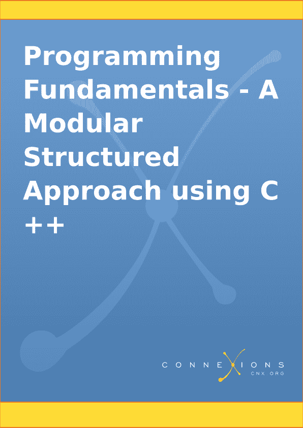


# 序言

# 1. 关于本教材/集合

## 编程基础 - 使用 C++ 的模块化结构方法

《编程基础 - 使用 C++ 的模块化结构方法》由 Kenneth Leroy Busbee 编写，他是德克萨斯州休斯顿社区学院的一名教职人员。本教材/集合中使用的材料由作者及其他人员开发，作为独立的模块，在 Connexions 环境中发布。编程基础通常被分为三门大学课程：模块化/结构化、面向对象和数据结构。本教材/集合涵盖了这三课程中的第一门。

## Connexions 学习模块

本教材/集合的学习模块是作为 `standalone`（独立）模块编写的。使用模块集合作为教材的学生通常会按照集合作者提供的顺序，通过阅读模块来查看其内容。

然而，这些模块的大多数读者是通过互联网搜索找到它们的。Connexions 项目允许模块作者创建指向其他 Connexions 模块和互联网位置的链接。这些链接在在线查看材料时显示，并分为三类：示例（Example）、先备知识（Prerequisite）和补充（Supplemental）。作者对每个链接的重要性从 1 到 3 进行了编号。在查看模块时，每个链接都会显示一个带有黄色或白色矩形的三部分框。三个黄色意味着它是一个 `strongly related link`（强相关链接）。随着黄色减少，重要性随之降低。

在课程中使用此集合的学生应该，模块中所有的 `Prerequisite links`（先备知识链接）都是学生已经读过的模块，而大多数 `Supplemental links`（补充链接）是根据需要提供的模块。

## 概念方法

本教材/集合的学习模块在很大程度上编写时并没有考虑特定的语言。在许多情况下，C++ 语言是作为概念的一部分被讨论的。通常用于 C++ 的示例与 Java 语言完全相同。然而，某些模块是专门为 C++ 语言编写的。这是无法避免的，因为作者在教学课程时会将 C++ 语言结合本教材/集合使用。

## Bloodshed Dev-C++ 5 编译器/IDE

这个开源编译器/IDE（集成开发环境）被用于开发本教材/集合模块中提供的演示源代码文件。编译器/IDE 在第一章的第二个模块中介绍给学生，并提供了下载、安装和使用的说明。关于 IDE 的更完整解释，以及带有错误的演示源代码列表将在第五章的第一个模块中给出。本教材/集合提供的所有源代码文件均包含 ANSI 标准 C++ 代码，应适用于任何标准 C++ 编译器，如 Visual Studio C++ Express 或 Borland C++ Builder。

## 教师材料

加密的教师材料位于一个不在本集合的模块中。标题为《编程基础 - 使用 C++ 的模块化结构方法教师材料》，地址为：[`cnx.org/content/m34529/latest/`](http://cnx.org/content/m34529/latest/)，加密代码仅供考虑采用本集合作为教材的教育机构教职人员使用。


本[知识共享 (CC) 署名许可](http://creativecommons.org/licenses/by/2.0/) 适用于所有 Connexions 模块。根据该许可，只要保持对原作者的适当署名，任何 `Connexions module` 均可用于任何目的或进行修改。Connexions 的编写工具使得重用（或更改用途）变得简单。因此，世界各地的讲师都允许通过编辑模块、删除不需要的模块以及添加自己的补充模块，来创建本教材的定制版本。Connexions 的编写工具会跟踪这些更改，并维护 CC 许可要求的对原作者的署名。这一过程创建了一个新的集合，可以在线查看、下载为单个 PDF 文件，或者由供讲师和学生按任何数量订购低成本纸质教材。

## 在线阅读书籍、打印 PDF 或购买书籍。

如需在线浏览本教材，请访问集合主页。您将会有三个选项：

1. 您可以通过点击 `Start >>` 链接在线查看集合模块，这将带您进入集合中的第一个模块。然后您可以使用 `NEXT >>` 导航到下一个模块，并使用右上角的 `<< PREVIOUS | NEXT >>` 按钮在集合中前后移动。您可以通过点击窗口左侧 `TABLE OF CONTENTS`（目录）框中的模块标题，跳转到集合中的任何模块。如果这些内容被隐藏了，请点击 `TABLE OF CONTENTS` 右侧的小三角形将其显示。章节也有一个小三角形来显示或隐藏内容。

2. 您可以通过点击 `Content Actions` 框中的 `Download PDF` 链接获取整本教材的 PDF，以便打印或离线查看。

3. 您可以通过点击 `Order printed copy` 按钮订购集合的装订副本（需支付合理的打印和运费用）。

## Connexions PDF 转换问题

购买教材/集合副本基本上是将 PDF 文件发送给与 Connexions 项目签合同的打印服务。目前有几个已知的打印问题，Connexions 项目已意识到这些问题并正在寻求解决方案。在此期间，请注意打印 PDF 材料存在异常。已知问题的描述如下：

1. 当转换“Example（示例）”时，PDF 能正确显示示例的第一行，但会对示例的其余行进行缩进。此问题出现在书籍打印（因为打印的是 PDF）以及下载单个模块或教材/集合的 PDF 时。

2. 章节编号已添加到在线目录中。这将使学生更快地找到章节阅读材料。然而，这在教材/集合的 PDF 和自定义打印格式中产生了“双重”章节编号。

3. 在 `C++` 中有三个运算符无法正确转换为 PDF 格式。

**表 1。**

| 递减 | `--` | 即两个减号 |
| :--- | :--- | :--- |
| 插入 | `<<` | 即两个小于号 |
| 提取 | `>>` | 即两个大于号 |

## 对 Connexions 模块进行评分

Connexions 模块在 2009 年期间添加了评分功能。在有更多人对 Connexions 存储库中的模块进行评分之前，该功能将无法发挥作用。如果一个模块被几个人评分，它可以作为`质量衡量标准`。因此，欢迎您参与模块评分，这有助于他人判断所看教育材料的质量。

要对模块评分，您必须拥有 Connexions 账户。本集合的序言模块系列已增加了三个 (3) 个模块。它们解释了为什么要以及如何创建 Connexions 账户，以及如何对 Connexions 模块进行评分。

# 作者致谢

我要感谢许多在这个项目中帮助我并鼓励我的人。

1. Abass Alamnehe 先生，他是休斯顿社区学院的一位同仁教师。他鼓励将 Connexions 作为一种“开源”出版理念。他对其中几个模块的评论直接导致了本教材/集合中材料的改进。

2. 自 1984 年以来，我教过的编程课程涵盖了数百（可能超过一千）名学生。这些语言包括：`COBOL`、大型机 IBM 汇编、Intel 汇编、`Pascal`、`C` 和 `C++`。他们经常建议我写自己的书，因为他们认为我对主题的讲解比我们使用的教材作者更好。我的学生们并没有意识到，他们直接或间接地帮助了我所教学材料的改进，也提高了我的教学水平。

3. 我未来的学生以及所有将使用本教材/集合的人。他们将提供改进建议，并作为“千眼”识别出难以发现的拼写错误等。

4. 我的妻子 Carol，她支持我所做的一切。她忍受了我花费大量精力开发构成这项工作的模块的漫长时间。没有她的支持，这项工作就不会完成。

# 导论与大纲

# 1. 导论

## 教材/集合布局

本课程的方法是将学生引导一系列材料，使学生能够开发编程技能。学习的基本单位是 Connexions 模块。多个模块汇成一个章节。章节分为五组。

**表 1。**

| **组别标题** | **章节** | **模块** |
| :--- | :--- | :--- |
| 章节前项目 | N/A | 6 |
| 基础主题 | 1-5 | 27 |
| 模块化编程 | 6-9 | 17 |
| 结构化编程 | 10-16 | 30 |
| 中级主题 | 17-21 | 17 |
| 高级主题 | 22-24 | 11 |
| 复习材料 | N/A | 5 |
| 附录 | N/A | 7 |
| **模块总计** | **N/A** | **120** |

一些使用本教材/集合的教授可能会决定删除某些模块或章节。有些可能会删除整个高级主题组。其他教授可能会选择添加学习材料。本教材/集合的优势在于教授可以根据学生需要对其进行调整。

## 章节布局

每个章节通常由：

1. 一个或多个为独立交付构建的 Connexions 模块组成。

2. 一个专门为本教材/集合构建的 Connexions 练习模块。

在学习构成一个章节的模块时，你应该：

* 完成任何需要下载项目的任务/演示。
* 完成练习题。
* 为所有定义制作 3x5 学习卡。当此材料作为课程教材使用时，需要记忆定义。请向您的教授确认。

开始练习模块时，您通常会遇到：

* 学习目标
* 记忆构建活动（MBAs）链接——这些可能由以下任何类型的交互式活动组成：闪卡、填字游戏、找单词、拖放、贴标签、排序或分类。当材料作为课程教材使用时，学生进行多样的重复活动以记忆基础课程内容至关重要。此外，要让学习变得有趣。
* 练习题——除了在练习模块之前完成的学习模块中的任何练习外，至少会有一个供学生完成的练习。
* 杂项——这些将出现在某些章节中。
* 实验作业——通常由个人完成。如果将此用于高中或大学学分课程，请查看教授/老师的说明或限制。


*   问题 – 本项活动的意图是让学生制定自己的答案。因此，将不提供问题的解决方案。当这些材料作为课程的教材使用时，教授/老师可能会安排学生加入“学习小组”，或让学生自发组成学习小组来讨论彼此的解决方案。如果您将此内容用于高中或大学学分课程，请核实您是否可以以团队的形式解决问题。这种经过批准的活动被称为“授权许可的合谋（authorized collusion）”，并不违反“学术或学业不诚实”规则。

使用本教材/合集/课程的教授可能会有额外的实验作业、测验和考试，这些将用于用于计算您的成绩。

## Connexions 模块阅读列表

本教材/合集中的模块内容经过了审查，并被认为是足够的，因此`不需要额外的教材`。然而，有些学生希望有额外的参考或阅读材料。多年来，作者使用了多种教材在休斯顿社区学院（Houston Community College）教授“COSC1436 – 编程基础 I”课程。已准备了一份阅读参考列表，包含了以下教材的参考：

1.  《Starting Out with C++ Early Objects》，作者：Tony Gaddis 等人，第 6 版，ISBN: 0-321-51238-3
2.  《Starting Out with C++ Early Objects》，作者：Tony Gaddis 等人，第 5 版，ISBN: 0-321-38348-6
3.  《Computer Science – A structured Approach using C++》，作者：Behrouz A. Forouzan 等人，第 2 版，ISBN: 0-534-37480-8

这些教材通常可以在二手教材市场上以合理的价格。。可以使用可以使用三本书中的任何一本。如果您获得了上述任何`可选`的传统教材，您可能想下载并将以下文件存储到您的存储设备（磁盘驱动器或优盘）的适当文件夹中。

从 Connexions 下载：[Connexions_Module_Reading_List_col10621.pdf](http://cnx.org/content/m19684/1.10/Connexions_Module_Reading_List_col10621.pdf)

# 2. 教学大纲

学分课程的教学大纲将由您的课程教授提供。如果您将本教材/合集作为非学分的自学材料，我们有一些建议：

1.  计划常规的学习时间
2.  复习三个（3）Pre-Chapter Items（章前项目）模块
3.  复习附录中的最后（4）个模块
4.  从第 1 章开始，完成所有 24 章
5.  在遇到所有演示程序时完成它们
6.  记忆所有的术语和定义
7.  完成所有的实验作业
8.  准备练习模块中所有问题的答案
9.  在每个章节结束时，完成 Review（复习）模块

学习计算机编程没有魔法方法，就是沉浸在常规的学习中，而且`学习包含不仅仅是随意的阅读`。为了帮助您跟踪学习进度，我们为教材/合集包含了一个检查清单。

**表 2。**

| 检查 | 描述 | 模块数 |
| :--- | :--- | :--- |
| | 章前项目 | 6 |
| | 附录最后四项 | 4 |
| | 第 1 至 5 章 | 27 |
| | 第 1 至 5 章复习材料 | 1 |
| | 第 6 至 9 章 | 17 |
| | 第 6 至 9 章复习材料 | 1 |
| | 第 10 至 16 章 | 30 |
| | 第 10 至 16 章复习材料 | 1 |
| | 第 17 至 21 章 | 17 |
| | 第 17 至 21 章复习材料 | 1 |
| | 第 22 至 24 章 | 17 |
| | 第 22 至 24 章复习材料 | 1 |
| | 附录项目 | 3 |
| 无/A | 总计 | 120 |

## 为什么要创建 Connexions 账户

1. 几个理由

拥有 Connexions 账户，你可以：

*   通过`评分`来向作者提供反馈
*   使用你的`我的收藏`功能来跟踪
*   在存储库中`贡献`内容
*   在存储库中`修改`内容
*   在存储库中`创建`内容
*   在存储库中`使用`
*   在存储库中`浏览`
*   在存储库中`搜索`
*   在存储库中`编辑`
*   在存储库中`查看`
*   在存储库中`下载`
*   在存储库中`评价`
*   在存储库中`收藏`（我的收藏）
*   在存储库中`登录`
*   在存储库中`注册`
*   在存储库中`加入`
*   在存储库中`关注`（关注）
*   在存储库中`评论`
*   在存储库中`分享`
*   在存储库中`打印`
*   在存储库中`导出`
*   在存储库中`导入`
*   在存储库中`创建`
*   在存储库中`发布`
*   在存储库中`更新`
*   在存储库中`删除`
*   在存储库中`引用`
*   在存储库中`链接`
*   在存储库中`翻译`
*   在存储库中`同步`
*   在存储库中`协作`
*   在存储库中`通知`
*   在存储库中`提醒`
*   在存储库中`警告`
*   在存储库中`错误`
*   在存储库中`验证`
*   在存储库中`授权`
*   在存储库中`权限`
*   在存储库中`加密`
*   在存储库中`解密`
*   在存储库中`备份`
*   在存储库中`恢复`
*   在存储库中`压缩`
*   在存储库中`解压`
*   在存储库中`同步`
*   在存储库中`同步`
*   在存储库中`上传`
*   在存储库中`下载`
*   在存储库中`分享`
*   在存储库中`查看`
*   在存储库中`编辑`
*   在存储库中`创建`
*   在存储库中`删除`
*   在存储库中`存储`
*   在存储库中`检索`
*   在存储库中`过滤`
*   在存储库中`排序`
*   在存储库中`分类`
*   在存储库中`分析`
*   在存储库中`计算`
*   在存储库中`预测`
*   在存储库中`优化`
*   在存储库中`扩展`
*   在存储库中`集成`
*   在存储库中`开发`
*   在存储库中`部署`
*   在存储库中`维护`
*   在存储库中`调试`
*   在存储库中`测试`
*   在存储库中`监控`
*   在存储库中`审计`
*   在存储库中`日志`
*   在存储库中`安全`
*   在存储库中`隐私`
*   在存储库中`许可`
*   在存储库中`合规`
*   在存储库中`质量性`
*   在存储库中`性能`
*   在存储库中`可用性`
*   在存储库中`可靠性`
*   在存储库中`可维护性`
*   在存储库中`可扩展性`
*   在存储库中`兼容性`
*   在存储库中`易用性`
*   在存储库中`可访问性`
*   在存储库中`通用性`
*   在存储库中`国际化`
*   在存储库中`本地化`
*   在存储库中`个性化`
*   在存储库中`模块化`
*   在存储库中`服务化`
*   在存储库中`云原生`
*   在存储库中`虚拟化`
*   在存储库中`容器化`
*   在存储库中`微服务`
*   在存储库中`无服务器架构`
*   在存储库中`响应式`
*   在存储库中`鲁棒性`
*   在存储库中`弹性`
*   在存储库中`安全性`
*   在存储库中`完整性`
*   在存储库中`可用性`
*   在存储库中`真实性`
*   在存储库中`一致性`
*   在存储库中`持久性`
*   在存储库中`原子性`
*   在存储库中`隔离性`
*   在存储库中`持久性`
*   在存储库中`并发性`
*   在存储库中`事务性`
*   在存储库中`异步性`
*   在存储库中`实时性`
*   在存储库中`吞吐量`
*   在存储库中`延迟`
*   在存储库中`带宽`
*   在存储库中`资源`
*   在存储库中`计算`
*   在存储库中`内存`
*   在存储库中`存储`
*   在存储库中`I/O`
*   在存储库中`I/O 吞吐量`
*   在存储库中`内聚性`
*   在存储库中`耦合性`
*   在存储库中`复杂性`
*   在存储库中`透明性`
*   在存储库中`抽象性`
*   在存储库中`封装性`
*   在存储库中`继承性`
*   在存储库中`多态性`
*   在存储库中`接口性`
*   在存储库中`设计模式`
*   在存储库中`架构模式`
*   在存储库中`开发方法`
*   在存储库中`领域驱动`
*   在存储库中`敏捷开发`
*   在存储库中`持续集成`
*   在存储库中`持续交付`
*   在存储库中`自动化测试`
*   在存储库中`DevOps`
*   在存储库中`SRE`
*   在存储库中`云计算`
*   在存储库中`人工智能`
*   在存储库中`深度学习`
*   在存储库中`自然语言处理`
*   在存储库中`计算机视觉`
*   在存储库中`数据科学`
*   在存储库中`区块链`
*   在存储库中`大数据`
*   在存储库中`物联网`
*   在存储库中`量子计算`
*   在存储库中`边缘计算`
*   在存储库中`虚拟现实`
*   在存储库中`增强现实`
*   在存储库中`元宇宙`
*   在存储库中`机器人学`
*   在存储库中`自动驾驶`
*   在存储库中`网络安全`
*   在存储库中`密码学`
*   在存储库中`渗透测试`
*   在存储库中`身份认证`
*   在存储库中`访问控制`
*   在存储库中`关系型数据库`
*   在存储库中`NoSQL`
*   在存储库中`图数据库`
*   在存储库中`缓存`
*   在存储库中`消息队列`
*   在存储库中`数据流处理`
*   在存储库中`API 设计`
*   在存储库中`RESTful`
*   在存储库中`GraphQL`
*   在存储库中`gRPC`
*   在存储库中`WebSocket`
*   在存储库中`JSON`
*   在存储库中`XML`
*   在存储库中`YAML`
*   在存储库中`Markdown`
*   在存储库中`Git`
*   在存储库中`Docker`
*   在存储库中`Kubernetes`
*   在存储库中`Terraform`
*   在存储库中`Ansible`
*   在存储库中`Chef`
*   在存储库中`Puppet`
*   在存储库中`Linux`
*   在存储库中`Windows`
*   在存储库中`macOS`
*   在存储库中`Python`
*   在存储库中`Java`
*   在存储库中`C++`
*   在存储库中`C`
*   在存储库中`C#`
*   在存储库中`Go`
*   在存储库中`Rust`
*   在存储存储库中`Swift`
*   在存储库中`PHP`
*   在存储库中`Ruby`
*   在存储库中`SQL`
*   在存储库中`NoSQL`
*   在存储库中`PostgreSQL`
*   在存储库中`MySQL`
*   在存储库中`Oracle`
*   在存储库中`MongoDB`
*   在存储库中`Redis`
*   在存储库中`Elasticsearch`
*   在存储库中`Kafka`
*   在存储库中`RabbitMQ`
*   在存储库中`Spark`
*   在存储库中`Hadoop`
*   在存储库中`Tensorflow`
*   在存储库中`PyTorch`
*   在存储库中`Keras`
*   在存储库中`Scikit-learn`
*   在存储库中`NumPy`
*   在存储库中`Pandas`
*   在存储库中`Matplotlib`
*   在存储库中`Seaborn`
*   在存储库中`Jupyter`
*   在存储库中`IDE`
*   在存储库中`VS Code`
*   在存储库中`IntelliJ IDEA`
*   在存储库中`Eclipse`
*   在存储库中`PyCharm`
*   在存储库中`Visual Studio`
*   在存储库中`Vim`
*   在存储库中`Emacs`
*   在存储库中`Terminal`
*   在存储库中`Shell`
*   在存储库中`Bash`
*   在存储库中`Zsh`
*   在存储库中`PowerShell`
*   在存储库中`Cloud`
*   在存储库中`AWS`
*   在存储库中`Azure`
*   在存储库中`Google Cloud`
*   在存储库中`DigitalOcean`
*   在存储库中`OpenStack`


你可能是第一作者，并可能需要决定你的机构使用什么名称。

## 简介 – 个人简介绍

准备一份关于自己的简短介绍。信息应包括你的当前工作、过往工作经历、教育和职业成就等。

## 头像 – 图片

利用你的图片处理技能；将你自己的照片裁剪成正方形。每边尺寸不应超过 150 x 150 像素。通常此文件以 `.jpg` 格式存储。

### 注意
Connexions 网站将缩小你的图片以适应其分配的空间；因此，为了避免变形，你应该确保将图片裁剪为正方形。

### 示例
此处提供了一个链接（在本模块页面右上角的框内），指向了我在 Connexions 上的“成员资料”（针对 Kenneth Leroy Busbee）。

# 2. 编辑你的成员资料

你可以随时更改你的“成员资料”。此幻灯片显示了如何进入更改该资料的页面。

**图 5。**

编辑成员资料

# 评价 Connexions 模块

## 1. 如何提供模块评价

当你登录 Connexions 账号后，可以使用 Connexions 内部提供的五（5）星级评分系统对任何作者的模块进行评分。

**图 6。**

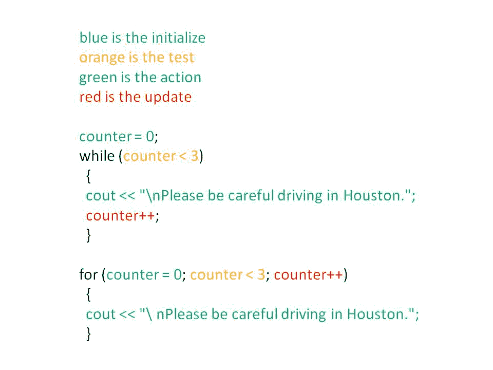评价模块

你只需将鼠标悬停在星星上，随着移动，方框会显示评分，范围从：

1. 差
2. 中等
3. 一般
4. 好
5. 优秀

当你达到理想的评分时——点击鼠标，系统将记录你的评分。

如果你未登录，当你移动时，星级右侧会出现（需要登录）。只需登录，然后你就可以对模块进行评价了。

只评价模块评价，而不评价集合。

## 2. 为什么你应该提供模块评价

此评价功能于 2009 年新增，在更多人评价 Connexions 仓库中的模块之前，它可能并不会发挥作用。如果一个模块被几个人评价，就可以作为一个`质量衡量标准`。因此，我们欢迎你参与模块评价，这有助于他人判断所看教育材料的质量。

# 第 1 章 1. 编程导论

## 1.1. 系统开发生命周期

## 讨论
`系统开发生命周期`是处理主要任务（称为应用程序）的信息系统的创建大图。`应用程序`通常由许多程序组成。例如，国防部的供应系统、你当地银行使用的客户系统、汽车经销商使用的备件库存系统。有成千上万的应用程序使用专门为帮助解决业务问题而创建的信息系统。

信息系统的另一个例子可能是你可以在任何一家零售商店购买的“101 游戏”软件。这是一个娱乐应用程序，也就是说我们应用计算机来完成某项任务（娱乐你）。该软件实际上由许多不同的程序（跳棋、象棋、井字棋等）组成，这些程序很可能是由几个不同的程序员编写的。

负责应用程序的计算机专业人士通常担任`系统分析师`职位。创建应用程序的主要步骤包括以下内容，并从`规划`步骤开始。

**图 1.1。**

系统开发生命周期

在`设计`阶段，系统分析师将记录应用程序内每个程序的输入、处理和输出。在`实施`阶段，程序员将被分配使用系统分析师决定的编程语言编写特定程序。一旦程序系统通过测试，新的应用程序就会安装供人们使用。随着时间的推移，情况发生了变化，特定部分或程序可能需要修复。在`维护`阶段，它将经历微型的规划、分析、设计和实施。确定需要修改的程序，程序员将更改或修复这些程序。在使用几年后，系统通常会过时。此时，会对应用程序进行重大修订。因此，周期循环往复。

## 定义
定义：`系统分析师`
负责创建应用程序的计算机专业人士。

定义：`应用程序`
处理主要任务的信息系统或程序集。

定义：`生命周期`
系统开发生命周期：`规划 - 分析 - 设计 - 实施 - 维护`

定义：`实施`
系统开发生命周期中的阶段，在该阶段程序员被分配编写特定程序。

## 1.2. Bloodshed Dev-C++ 5 编译器/IDE

### 介绍
Microsoft 和 Borland 是编程世界中两个享有声誉的编译器名称。他们销售许多编程语言的编译器软件。对于 C++ 编程语言，包含 `C++` 的 `Microsoft Visual Studio` 和 `Borland C++ Builder` 都是优秀的编译器。通常随教科书或通过互联网免费；你可以获得 Microsoft 的 `Visual C++ Express` 或 Borland 的 `Personal Edition` 版本编译器。然而，安装这些编译器中的任何一个都是复杂的。Microsoft 的 `Visual Studio` 编译器经常产生各种安装问题（例如，确保操作系统和 `.net` 组件是最新的），因此使得学生很难在家里安装。这些编译器要求你构建一个包含每个程序的项目。使用专业程序员可能会考虑用于项目开发的商业销售编译器，对于专业人士来说是可以的，但对初学者来说往往会令人困惑。最终，如果你打算成为一名专业程序员，你将需要熟悉这些销售编译器。

我们建议初学者考虑一种更容易安装的软件软件包，用于编程基础课程。我们发现的最佳选择是一个名为 `Bloodshed Dev-C++ 5 编译器/IDE` 的开源编译器/IDE（集成开发环境）。

定义：`开源`
公开免费提供的软件源代码的集体开发。

## Bloodshed Dev-C++ 5 编译器/IDE
优点：可以安装在 Windows 95/98/NT/2000/XP 操作系统上。我将其安装在 Windows 操作系统上，因此它可以兼容较慢的处理器和几乎任何 Windows 操作系统。它只需要大约 80 MB 的存储空间（通常足够存储编译器及其文件以及存储你的几个程序的空间）。它非常易于安装和使用。不需要使用“项目”；因此可以轻松编译单个源代码文件。

缺点：专业程序员通常不会使用它，但对于入门计算机课程已经足够，并且是一个全功能的编译器/IDE。

**独特优点：**可以安装并运行在优盘上，因此使学生能够在任何带有 USB 接口的计算机上完成实验作业。这可以给学生带来`便携性`，能够在家里、工作、图书馆、开放实验室、教室、朋友家里完成实验作业。

定义：`便携性`
将软件传输到优盘并在各种机器上运行的能力。

## 安装前的准备
### 创建所需的文件夹和子文件夹


你需要获取 `software` 和一个经过测试且无错误的 C++ `source code` 程序。你需要大约 80MB 的存储空间。我们建议你根据选择的安装方式，在硬盘或闪存盘上创建 `two folders`（两个文件夹）。如果是在闪存盘上，请在驱动器的根层级创建它们。如果是在你的个人电脑上，你可以使用操作系统为你用户设置的文件夹区域。将它们命名为：

*   `Cpp_Software_Download`
*   `Cpp_Source_Code_Files`

在 `Cpp_Source_Code_Files` 文件夹中，创建一个名为子文件夹：

*   `Compiler_Test`

为了帮助你保持文件整洁，你可能想要创建其他子文件夹来存储源代码文件。我们建议你至少创建另外两个子文件夹，与 Connexions 相关模块配合。在 `Cpp_Source_Code_Files` 中，创建名为的子文件夹：

*   `Demo_Programs`
*   `Monitor_Header`

**定义：文件夹 (folder)**
磁盘驱动器或闪存盘上用于存储文档或其他文件的命名区域。

**定义：源代码 (source code)**
用某种人类可读的计算机语言编写的任何语句或声明集合。

### 获取软件
软件的完整版本名为：`Dev-C++ 5.0 beta 9.2 (4.9.9.2) (9.0 MB)`，带有 `Mingw/GCC 3.4.2`。你可以从 Bloodshed 下载，或者下载存储在 Connexions 网站上的 2008/12/8 版本。将其存储在你创建的 `Cpp_Software_Download` 文件夹中。该软件约为 9.1 MB，如果你使用拨号调制变器连接，下载需要几分钟。

### 注意事项
软件自 2007 年以来没有显著变化，Connexions 版本对于大多数用户来说足够了。Bloodshed 需要额外的导航才能到达下载。因此，因为后者简单得多，我们建议你从 Connections 网站下载软件。

指向 Bloodshed 的链接：[`www.bloodshed.net/dev/devcpp.html`](http://www.bloodshed.net/dev/devcpp.html)

从 Connexions 下载：[devcpp-4.9.9.2_setup.exe](http://cnx.org/content/m18785/1.15/devcpp-4.9.9.2_setup.exe)

### 获取 C++ 源代码文件
下面列出了标题为 `Compiler_Test.cpp` 的 C++ 源代码文件。它是为 Connexions 网络传输而准备的。下载并将其存储在你创建的 `Compiler_Test` 子文件夹中。你可能需要右键点击链接并选择“目标另存为”来下载文件。

从 Connexions 下载：[Compiler_Test.cpp](http://cnx.org/content/m18785/1.15/Compiler_Test.cpp)

## Bloodshed Dev-C++ 5 编译器/IDE 安装说明
版本 5 经过了充分测试（不要被测试版吓到），它应该可以在各种机器和各种 Microsoft 上运行，包括 Windows 98、Windows 2000、Windows XP 和 Windows Vista。以下是将其安装在机器上或安装闪存盘上的安装说明。我们不建议尝试在机器硬盘和闪存盘之间切换。如果安装在机器硬盘上而你尝试安装在闪存盘上，就会产生问题且无法正常工作。要么安装在闪存盘上以获得移动性，要么安装在你的机器上。

### 计算机安装说明
1. 导航到 `Cpp_Software_Download` 文件夹，双击文件名运行 `devcpp-4.9.9.2_setup.exe` 软件。
2. 根据常识并回答安装提示。注意以下两项：
3. 当运行到“选择安装位置”（Choose Install Location）时，使用软件的默认位置：`C:\Dev-Cpp\`（或选择你想存储已安装程序的位置，除非你熟悉安装软件，否则请使用默认值）。
4. 当它询问：“是否想为这台电脑上的所有用户安装 Dev C++？”时，回答“Yes”。
5. 安装完成后后，它会询问一些“首次配置”问题。再次，根据常识回答问题。注意以下项：
6. 对于“从头文件中检索信息”（retrieve information from header files），回答“No”。
7. 它将带有“每日提示”（Tip of the day）启动你的编译器/IDE。我们建议勾选左下角的框并选择“Close”。
8. 使用普通的红色“X”框关闭你的编译器/IDE。我们想向你展示如何正常启动编译器。
9. 你启动编译器软件的方法与启动机器上加载的任何软件类似（“开始”然后“所有程序”然后“Bloodshed Dev-C++”然后“Dev-C++”）。
10. 在顶部的菜单上——选择“文件”（File），然后“打开项目或文件”（Open project or file），导航到你的硬盘上存储源代码文件（`Compiler_Test.cpp`）的地方。参见上述的文件夹名称。选择源代码文件并打开它。
11. 你应该看到源代码列表。按 F9 键或从顶部菜单中选择“执行”（Execute）然后“编译并运行”（Compile & Run）。将出现一个黑色窗口，你相应回答问题以运行程序。当你运行程序后，黑屏将消失。

### 闪存盘说明
1. 导航到 `Cpp_Software_Download` 文件夹，双击文件名运行 `devcpp-4.9.9.2_setup.exe`。
2. 根据常识并回答安装提示。注意以下两项：
3. 当运行到“选择安装位置”（Choose Install Location）时，使用软件的默认位置：`C:\Dev-Cpp\`（或选择你想存储已安装程序的位置，除非你熟悉安装软件，否则请使用默认值）。将“目标目录”（Destination Directory）从 `C:\Dev-Cpp\` 改为 `DriveLetter:\Dev-Cpp\`。
4. 当它询问：“是否想为这台电脑上的所有用户安装 Dev C++？”时，回答“No”。
5. 安装完成后，它会询问一些“首次配置”问题。再次，根据常识回答问题。注意以下项：
6. 对于“从头文件中检索信息”（retrieve information from header files），回答“No”。
7. 它将带有“每日提示”（Tip of the day）启动你的编译器/IDE。我们建议勾选左下角的框并选择“Close”。
8. 使用普通的红色“X”框关闭你的编译器/IDE。我们想向你展示如何正常启动编译器。
9. 启动编译器软件时，导航到闪存盘上的 `Dev-Cpp` 文件夹并选择应用程序。注意：使用闪存盘时，你不应通过双击 C++ 源代码文件来启动编译器。这种方法在机器安装上有效但在闪存盘上无效。
10. 在顶部的菜单上——选择“文件”（File），然后“打开项目或文件”（Open project or file），导航到你的闪存盘上存储源代码文件（`Compiler_Test.cpp`）的地方。参见上述的文件夹名称。选择源代码文件并打开它。
11. 你应该看到源代码列表。按 F9 键或从顶部菜单中选择“执行”（Execute）然后“编译并运行”（Compile & Run）。将出现一个黑色窗口，你相应回答问题以运行程序。当你运行程序后，黑屏将消失。

#模块化与 C++ 程序布局

## 模块化概念 (Modularization)
编程中最重要的概念之一是将某些代码分组到一个可以包含在程序中的单元中。这种构造的原始术语是子程序。其他名称包括宏（macro）、子程序（sub-routine）、过程（procedure）、模块（module）和函数（function）。我们将使用**函数**这个术语，因为这是在今天两种主流编程语言（C++ 和 Java）中的称呼。函数很重要，因为它们允许我们将大型复杂的程序分成更小、易于管理的部分。因为函数是整个程序的一个较小部分，我们可以专注于我们想要它做什么并对其进行测试以确保其正常工作。通常函数分为两类：


## 1. 程序控制 
用于简单地划分和控制程序的函数。这些函数对于正在编写的程序来说是特有的。其他程序可能会使用类似的函数，甚至可能使用名称相同的函数，但函数的内容几乎总是完全不同的。

## 2. 特定任务 
设计用于多个程序的函数。这些函数执行特定的任务，因此可以在许多不同的程序中使用，因为其他程序也需要执行该特定任务。特定任务函数有时被称为“构建块”。由于它们已经经过了编码和测试，我们可以放心地使用它们，以更高效的方式编写编写大型程序。

主程序必须确立该程序中所用函数的存在性。根据编程语言的不同，有正式的方法来：

1. 定义函数（即其 `definition` 或它将执行的代码）
2. `call`（调用）函数
3. 声明一个函数（`prototype` 是对编译器的声明）

程序控制函数之间通常不相互通信信息，而是使用一个通用的区域进行变量存储。特定任务函数的结构使得数据可以在调用方的程序部分（通常是另一个函数）与被调用的函数之间进行通信。这种数据通信的能力使我们能够构建出可以在许多程序中使用的特定任务函数。数据在函数进出通信的规则随编程语言的不同而异，但概念是相同的。传递（或通信）的数据项被称为参数。因此，表述为：`parameter passing`（参数传递）。四种数据通信选项包括：

1. 无输入，无输出
2. 有部分输入，无输出
3. 有部分输入，部分输出
4. 无输入，有部分输出

## C++ 中的函数介绍

我们将考虑一个简单的程序，该程序可能用于测试编译器，以确保其安装正确。

### 示例 1.1. Compiler_Test.cpp 源代码

```cpp
//******************************************************
// Filename: Compiler_Test.cpp
// Purpose:  Average the ages of two people
// Author:   Ken Busbee; © Kenneth Leroy Busbee
// Date:     Jan 5, 2009
// Comment:  Main idea is to be able to 
//           debug and run a program on your compiler.
//******************************************************
// Headers and Other Technical Items
#include <iostream>
using namespace std;
// Function Prototypes
void pause(void);
// Variables
int     age1;
int     age2;
double  answer;
//******************************************************
// main
//******************************************************
int main(void)
  {
  // Input
  cout << "\nEnter the age of the first person --->: ";
  cin >> age1;
  cout << "\nEnter the age of the second person -->: ";
  cin >> age2;
  // Process
  answer = (age1 + age2) / 2.0;
  // Output
  cout << "\nThe average of their ages is -------->: ";
  cout << answer;
  pause();
  return 0;
  }
//******************************************************
// pause
//******************************************************
void pause(void)
  {
  cout << "\n\n";
  system("PAUSE");
  cout << "\n\n";
  return;
  }
//******************************************************
// End of Program
//******************************************************
```

该程序有两个函数，分别属于我们的两个类别。函数的结构布局是相同的，是我们的根据函数实现方式的区分创建了这两个类别。

## 程序控制函数

C++ 程序中的主程序部分是一个 `identifier name` 为 `main` 的特殊函数。函数的结构布局是相同的，是我们的根据函数实现方式的区分创建了这两个类别。

## 特定任务函数

C++ 程序中的主程序部分是一个`identifier name` 为 `main` 的特殊函数。函数的结构布局是相同的，是我们的根据函数实现方式的区分创建了这两个类别。


这行代码看起来与我们函数定义中的第一行完全一样，只是增加了一个重要的分号。原型（或向编译器声明尚未定义的函数的通信）被放置在程序的顶部，位于函数 `main` 之前。总结概念：如果你在定义一个函数之前调用它，你必须在调用它之前对其进行原型声明。查看我们在程序中通常出现的顺序与函数配合执行的三项操作列表，有正式的方法可以：

1. 声明一个函数（原型是向编译器的通信声明）
2. 调用一个函数
3.  定义一个函数

## C++ 程序布局

从上面的示例中，你可以看到程序的 2/3 部分是这两个函数。大多数 C++ 程序在 `main` 函数之前都有若干项内容。正如示例所示，它们通常是：

1.  **文档说明** – 大多数程序在程序开头有一个注释区域，其中包含各种与程序相关的注释。任何以双斜杠 `//` 开头的行都是注释，编译器软件会忽略从 `//` 到行尾的所有内容。
2.  `#include<iostream>` – 这行代码将一个文件插入源代码中。该文件包含了能够执行输入输出的必要代码。
3.  `using namespace std` – C++ 编译器有一个区域用于组织程序中使用的标识符名称，该区域被称为命名空间。与 iostream 文件配合创建一个命名空间，命名为 `std`。这行代码通知编译器在 iostream 中建立标识符名称的地方使用 `std` 命名空间。
4.  函数原型已经解释过了。
5.  我们需要一些变量（存储区域）来让此程序运行。它们在接下来被定义。

## 定义

**定义：模块化**：将某些行代码分组到一个可以包含在我们的程序中的单元的能力。

**定义：函数**：在当今的两种主流编程语言（C++ 和 Java）中被调用的模块。

**定义：程序控制**：用于简单划分和控制程序的函数。

**定义：特定任务**：设计用于多个程序的程序的函数。

**定义：参数传递**：数据如何进入和离开函数进行通信的方式。

**定义：标识符名称**：程序员赋予用于标识函数或其他程序项（如变量）的名称。

**定义：函数原型**：函数对编译器的通信声明。

**定义：函数调用**：函数对另一个函数的使用或调用。

**定义：函数定义**：定义函数具体作用的代码。

**定义：大括号**：在 C++ 中用于标识代码块。

## 1.4. 练习 1：编程导论

## 学习目标

在：记忆构建活动、练习、实验作业、问题或限时测验/考试中达到 100% 的准确率；学生预期：

1. 定义本章节相关模块中列出的定义中的术语。
2. 安装 Bloodshed Dev-C++ 5 编译器
3. 对现有程序进行微调

## 记忆构建活动

链接至：[MBA 01](http://cnx.org/content/m22450/1.4/index.html)

## 练习

**练习 1.4.1. (跳转解答)**

**判断下列陈述的对（错：**

1. 初级程序员参与系统开发生命周期的所有阶段。
2. Bloodshed Dev-C++ 5 编译器/IDE 是本教材/合集的首选编译器，但任何 C++ 编译器都可以工作。
3. 大多数编译器可以安装在闪盘中。
4. 除了函数作为子程序的名称外，计算机行业还使用宏、过程（procedure）和模块（module）。
5. 通常，函数分为两类：程序控制和特定任务。

## 杂项

目前没有。

## 实验作业

### 为 01 章的文件创建文件夹或子文件夹

在第 1 章的 Connexions 模块中，你收到了关于如何安装 `Bloodshed Dev-C++ 5 编译器/IDE` 以及使用 `Compiler_Test.cpp` 源代码文件测试安装的说明。如果你还没有这样做，请返回 Connexions 材料并完成此任务。

在编译器安装说明中，你被要求创建一个名为 `Cpp_Source_Code_Files` 的文件夹。本课程中的所有实验作业都假设你在与编译器相同的驱动器上拥有该文件夹（在 C 盘硬盘驱动器上，或者在闪盘上）。如果你还没有该文件夹，请现在创建它。

根据你的编译器/IDE，你应该决定在何处下载和存储处理所需的源代码文件。谨慎的做法是在下载源代码文件之前根据需要创建这些文件夹。对于 `Bloodshed Dev-C++ 5 编译器/IDE` 的建议子文件夹可能命名为：

* 在名为 `Cpp_Source_Code_Files` 的文件夹下的 `Chapter_01`

如果你还没有这样做，请根据情况创建相应的文件夹和/或子文件夹。

### 下载实验文件

将以下文件下载并存储到你存储设备中适当的文件夹内。你可能需要右键点击链接并选择“另存为目标”以下载文件。

从 Connexions 下载：[Compiler_Test.cpp](http://cnx.org/content/m22450/1.4/Compiler_Test.cpp)

### 详细实验说明

阅读并遵循下面的说明，按列出的顺序执行步骤。

* 导航到子文件夹 `Chapter_01`并将 `Compiler_Test.cpp` 源代码文件重命名为 `Lab_01.cpp`
* 如果你在查看文件扩展名方面有问题，请访问附录中的“显示扩展名”。
* 启动编译器并打开源代码。仔细进行以下修改：更改顶部的注释，具体为：文件名应为 `Lab_01.cpp`，目的应为：三个人的平均体重
* 删除关于主旨的后续 2 行注释
* 作者：写上你的名字并删除我的名字
* 日期：填写今天的日期
* 删除关于许可的后续 3 行注释

### 注意

在课程的剩余部分，你将经常使用教师提供的源代码文件作为新实验作业的起点。有时你会使用自己创建的源代码文件作为新实验作业的起点。无论如何，你都应该相应修改注释区域，至少包含本实验作业中规定的四行信息（文件名、目的、作者和日期）。

**我们现在将对此程序进行简单修改，使其能够计算三个人的平均体重。执行以下操作：**

* 在变量区域，将变量 `age1` 和 `age2` 更改为 `weight1` 和 `weight2`。添加另一个标识符名称为 `weight3` 的整数类型变量。
* 输入区域有两个提示并请求用户数据。它们是成对的——提示和从键盘获取数据。我们需要修改提示以询问体重而不是年龄。我们需要将变量名从 `age1` 改为 `weight1`。对第二个提示并获取第二个数据的对也执行此操作。创建第三个提示并获取第三个数据的对。
* 处理区域仅有一行代码，我们需要进行修改，以加上 `weight3` 并除以 3.0 而不是 2.0。代码看起来如下：

```cpp
answer = (weight1 + weight2 + weight3) / 3.0;
```
* 输出区域需要将文本从年龄修改为体重。
* 构建（编译并运行）你的程序。如果当程序运行并输入三个体重时，它给出了正确的平均值，则说明你成功编写了该程序。


在你成功编写此程序后，如果你是为了大学学分修读此课程，请遵循教授/教师的指示提交程序进行评分。

## 问题

### 问题 01a – 指南
列出系统开发生命周期的步骤，并指出作为一名新手计算机专业人士，你可能在哪个步骤工作。

## 练习答案

### 练习 1.4.1 的答案。（[返回练习](#ch01.html_m22450.fs-id1170660082346））

**答案：**
1. false
2. true
3. false
4. true
5. true

# 第 2 章 程序的规划与设计

## 2.1. 程序设计

### 主题介绍
程序设计由程序员在开始使用特定语言编写程序之前应该执行的步骤组成。这些步骤如果记录适当，将使完成后的程序在未来更容易供其他程序员维护。主要有三个活动领域：

* 理解程序
* 使用设计工具创建模型
* 开发测试数据

### 理解程序
如果你作为众多程序员之一参与一个项目，系统分析师可能已经创建了各种文档项，帮助你理解程序要做什么。这些可能包括屏幕布局、叙述性描述、显示处理步骤的文档等。如果你不在项目中且正在创建一个简单的程序，你可能只得到一个关于程序目的的简单描述。理解程序的目的通常涉及理解它的：

* 输入
* 处理
* 输出

这种 `IPO` 方法对于初级程序员非常有效。有时，视觉化程序在计算机上的运行可能会有所帮助。你可以想象显示器看起来什么样，用户必须在键盘上输入什么，以及将进行哪些处理或操作。

### 使用设计工具创建模型
起初你不需要层级图，因为你的第一个程序不会复杂。但随着程序的增长并变得越来越复杂，你会将程序划分为几个模块（或函数）。

你通常会学习的第一种建模工具是`pseudocode`（伪代码）。你将记录程序中每个函数的逻辑或算法。起初，你将只有一个函数，因此你的伪代码将紧密遵循上述的 `IPO` 方法。

规划程序逻辑有多种方法或工具。它们包括：流程图、层级图或结构图、伪代码、HIPO、Nassi-Schneiderman 图、Warnier-Orr 图等。程序员被要求能够理解并绘制流程图和伪代码。这些开发程序模型的方法通常在大多数计算机课程中教授。流程图和伪代码有几种标准，且大多数标准彼此非常相似。然而，大多数公司都有自己的文档标准和风格。程序员被要求能够快速适应其工作所在公司的任何流程图或伪代码标准。其他不那么通用的方法需要一些培训，这些培训通常由选择使用这些方法的雇主提供。

在你编程生涯的后期，你将学习使用帮助创建信息系统和/或程序的应用程序软件。这类软件被称为计算机辅助软件工程（Computer-aided Software Engineering）。

在开始编写代码之前，在纸上理解逻辑并规划算法，这是一个非常非常重要的概念。许多学生养成了糟糕的习惯，跳过这一步就是其中之一。

### 开发测试数据
`test data`（测试数据）由用户提供一些输入值并预测输出值组成。对于一个简单的程序，这可能非常容易，测试数据可以用于检查模型以查看其是否产生了正确的结果。

## 定义
**定义：IPO**
输入 - 处理 - 输出

**定义：pseudocode**
使用类英语的语句，用于传达算法或函数的步骤。

**定义：test data**
提供输入值并预测输出值。

## 2.2. 伪代码

## 概述
伪代码是设计或规划程序的一种方法。`Pseudo` 的意思是“虚假的”，因此伪代码意味着“假代码”。更好的翻译应该是“伪造的”或“模仿”。伪代码是虚假的（不是真实的东西）。它看起来像（模仿）真实的代码，但它不是 真实的代码。它使用英语语句来描述程序要完成的任务。它是虚假的，因为不存在任何编译器可以将伪代码翻译成任何机器语言。伪代码用于记录程序或模块设计（也称为算法）。

以下简单的简单程序大纲说明了伪代码。我们希望能够输入两个人的年龄，并让计算机计算他们的平均年龄并显示答案。

**示例 2.1. 使用伪代码的提纲**
```
Input
  显示一条消息要求用户输入第一个年龄
  从键盘获取第一个年龄
  显示一条消息要求用户输入第二个年龄
  从键盘获取第二个年龄
Processing
  通过将两个年龄相加并除以二来计算答案
Output
  在屏幕上显示答案
  暂停以便用户看到答案
```
在开发程序后，我们使用伪代码在 `Pascal`、`FORTRAN`、`C++` 等语言中编写代码，在这些语言中你必须遵循语言规则（语法）来编写伪代码中提出的逻辑。伪代码不包括设计期间产生的其他项目，例如测试数据的标识符列表。

还有其他规划和记录程序逻辑的方法。一种方法是 `HIPO`。它代表 Hierarchy（层级）加 Input Output（输入输出），由 IBM 在 20 世纪 60 代开发。它使用层级图（或结构图）显示程序中子程序（或函数）的关系。每个子程序都有 `IPO` 部分。由于上面的任务很简单，我们不需要使用子程序，我们没有生成层级图。我们结合了伪代码的 `IPO` 部分。

**定义：pseudo**
意思是“虚假的”，并包含了伪造或模仿的概念。

## 2.3. 测试数据

## 概述
测试数据由用户提供一些输入值并预测输出组成。对于一个简单的程序，这可能非常容易，测试数据可以用于：
1. 检查模型以查看其是否产生了正确的结果（`model checking` 模型检查）
2. 检查编码后的程序以查看其是否产生了正确的结果（`code checking` 代码检查）

测试数据是通过使用程序的算法开发的。这种算法通常在程序设计期间用流程图或伪代码记录。这里是提纲形式的伪代码，描述了用于绘制矩形建筑程序的输入、处理和输出。

**示例 2.2. 使用 IPO 提纲绘制矩形建筑的伪代码**
```
Input
  显示一条消息要求建筑的长度
  从键盘获取长度
  显示一条消息要求建筑的宽度
  从键盘获取宽度
  显示一条消息要求建筑的高度
  从键盘获取高度
  显示一条消息要求输入每桶油漆的价格
  从键盘获取每桶油漆的价格
  显示一条消息要求输入每桶油漆的覆盖面积
  从键盘获取每桶油漆的覆盖面积
Processing
  通过以下方式计算建筑总面积：
    长度乘以高度乘以 2
```


```
然后将宽度乘以高度乘以 2
然后将两个结果相加
计算所需的油漆加仑：
    将总面积除以每加仑的覆盖范围
然后向上舍入到下一个整数加仑
计算油漆的总费用：
    将所需的总加仑乘以每加仑油漆的价格
输出
在显示器上显示所需的加仑
在显示器上显示油漆的总费用
暂停以便用户查看答案
```

## 创建测试数据和模型检查

测试数据用于验证输入、处理和输出是否正常工作。在最初开发测试数据时，它可以验证文档记录的算法（我们正在做的示例中的伪代码）是正确的。它帮助我们理解、甚至视觉化程序的输入、处理和输出。

**输入：** 我的建筑长 100 英尺，宽 40 英尺，高 10 英尺，我选择了每加仑 28.49 美元的油漆，每加仑可覆盖 250 平英尺。我们应该验证伪代码是否在提示用户输入这些数据。

**处理：** 使用我的太阳能手持计算器，我可以计算（或预测）总面积为：(100 x 10 x 2 加 40 x 10 x 2) 或 2,800 平英尺。油漆的总加仑为：(2800 / 250) 或 11.2 加仑。但向上舍入后，我需要十二 (12) 加仑油漆。总费用为：(28.49 乘以 12) 或 341.88 美元。我们应该验证伪代码执行了正确的计算。

**输出：** 仅向用户显示重要信息（购买的加仑数和总费用）。我们应该验证是否显示了适当的信息。

## 测试编码后的程序 – 代码检查

在程序设计阶段，可以开发并使用测试数据来测试记录的算法（在我们的案例中是我们的伪代码）。一旦程序完成编码并解决了编译器和链接器错误，程序员就可以扮演用户角色，并使用开发的测试数据对程序进行测试。当你运行程序时，你如何知道它运行正常呢？你是否正确地规划了逻辑以实现你的目标？即使你的计划是正确的，它是否被正确地转换（编码）到了所选的编程语言（在我们的案例中是 C++）中？这些问题的答案（或解决方案）就是我们的测试数据。

通过开发测试数据，我们预测结果应该是怎样的，因此我们就可以验证程序运行正常。当我们运行程序时，我们将输入测试数据中使用的输入值。希望程序会输出预测的值。如果没有，那么问题可能是以下任何一种：

1. 计划（IPO 大纲或其他项目）可能是错误的
2. 计划的代码转换可能是错误的
3. 测试结果计算错误

解决这类问题可能是程序员遇到的困难的问题。你必须检查上述每一项以确定错误在哪里。修复错误并重新测试你的程序。

## 定义

**定义：模型检查**
使用测试数据检查设计模型（通常在伪代码中完成）。

**定义：代码检查**
使用测试数据检查特定语言（如 C++）中的编码程序。

## 2.4. 练习 2：程序规划与设计

## 学习目标

在以下活动中通过记忆构建活动、练习、实验作业、问题或计时测验/考试，达到 100% 的准确率；学生预期：

1. 定义本章节相关模块列出的定义中的术语。
2. 为编程问题创建伪代码文档。
3. 为编程问题创建测试数据文档。

## 记忆构建活动

链接至：[MBA 02](http://cnx.org/content/m22453/1.3/index.html)

## 练习

**练习 2.4.1. (前往解答)**

判断以下陈述对错：

1. 使用像 C++ 语言编写程序是规划的第一任务。你边编码边规划。
2. 伪代码是唯一常用的规划工具。
3. 测试数据是在程序编码后为测试开发的。
4. “伪”一词的意思是假的。
5. 许多程序员养成了不完成规划的习惯。

## 其他事项

目前没有。

## 实验作业

### 创建文件夹或子文件夹

根据你的编译器/IDE，你应该创建以下内容。出于谨慎起见，你应该为 `Source_Files` 创建一个 `Chapter_02` 文件夹。

### 下载实验文件

将以下文件下载并存储到你的存储设备中。你可能需要右键点击链接并选择“另存为”以下载文件。

[Solution_01_Pseudocode.txt](http://cnx.org/content/m22453/1.3/Solution_01_Pseudocode.txt)
[Solution_01_Test_Data.txt](http://cnx.org/content/m22453/1.3/Solution_01_Test_Data.txt)

### 详细实验说明

阅读并遵循下面的方向，按列出的顺序执行步骤：

* 导航到你的子文件夹：`Chapter_02` 并打印 `Solution_01_Pseudocode.txt` 和 `Solution_01_Test_Data.txt`。结合你的 `Lab01.cpp` 源文件查看打印内容。注意：在实验 01 中我们提供了将 `Compiler_Test.cpp` 源文件修改为 `Lab01.cpp` 的逐步说明。我本可以给你伪代码和测试数据文件，但你当时还没有收到关于它们的指令。现在，在学习了第二章后，这些文件应该是合理的。

* 复制 `Solution_01_Pseudocode.txt` 和 `Solution_01_Test_Data.txt`，并将重命名为 `Lab_02_Pseudocode.txt` 和 `Lab_02_Test_Data.txt`。

* 这里是问题。你的当地银行有很多收集硬币并定期来存款的客户。客户已经对硬币进行了分类（分、镍、角和角币 – 忽略半美元和圆币），并知道每种价值的数量（一种整数数据类型），但由于进化（或环境让他们变得懒惰），他们失去了简单算术的能力。编写一个程序与客户交互，确定并报告所有硬币的总价值。

* 不！不！不！我们**不是**使用 C++ 编程语言编写程序（创建源代码）。我们将使用伪代码作为模型为程序设计计划。此外，我们需要开发一些测试数据用于测试我们的模型。

* 启动文本编辑器（微软记事本）。将记事本的字体设置为：`Courier 12`，因为 `Courier` 每个字母在水平方向上使用的空间相同。这将使文件中的信息显示方式符合预期。打开你的 `Lab_02_pseudocode` 文本文件。根据需要更改所有项目，以便解决上述问题。


*   打开你的 Lab 02 测试数据文本文件。根据需要对文本文件进行修改。使用你的测试数据并逐步执行你的伪代码。一切看起来运行正常吗？你遗漏了什么吗？
*   当你对你的程序计划和测试数据的完成感到满意时，关闭你的文本文件。没错，我刚才说的是“保存并关闭你的文本文件”。文件在被其他软件使用之前应该被妥善关闭，这包括用于移动、复制和重命名文件的操作系统软件。
*   在你成功编写此程序后，如果你是为了大学学分修读这门课程，请遵循教授/讲师的说明提交进行评分。

## 问题 (Problems)

### 问题 02a – 指南

创建一个简单的 IPO 伪代码来解决以下问题：

问题：我有一个从欧洲来访朋友，他不完全清楚自己给车买了多少汽油。我们需要编写一个程序，允许他输入加仑（gallons）并将其转换为升（liters，公制）。注意：1 美加仑等于 3.7854 升。

### 问题 02b – 指南

为以下内容创建测试数据：

问题：一家大型餐厅每天派一名厨师去购买水果蔬菜。回到商店后，厨师必须为购买的每件物品输入两项数据：数量（例如：2 箱）和所支付的价格（例如：$4.67）。程序有一个 20 件物品的列表，在厨师输入信息后，程序将提供当天的购买总额。你需要为五（5）种物品准备测试数据：苹果、橘、香蕉、生菜和番茄。

## 练习解答 (Solutions to Exercises)

**练习 2.4.1 的答案。（返回练习)**

**答案：**

1. false
2. false
3. false
4. true
5. true

# 第 3 章 3. 数据与运算符 (Data & Operators)

## 3.1. C++ 中的数据类型 (Data Types in C++)

## 一般讨论 (General Discussion)

在许多语言中，我们程序的交互（输入和输出）被视为字节流。这些字节代表数据，可以被解释为我们所理解的值。此外，在程序内部，我们以各种方式处理这些数据，例如求加或排序。这些数据以不同的形式出现。例如：`yourname` 是一个字符字符串；`your age` 通常是一个整数；或者你口袋里的钱通常是以美元和分为单位衡的值（带有小数部分）。理解如何设计和编写程序的核心，在于理解我们想要操作的数据类型以及如何操作这些数据。

“一个 `type`（类型）定义了一组值集合和一组可以应用于这些值的操作集合。每种类型的数值集合被称为该类型的定义域（domain）。”数据四大类类族包括：

*   无 (Nothing)
*   整数 (Integer)
*   浮点数 (Floating-point)
*   复合 (Complex)

C++ 编程语言识别了五种数据类型作为标准类型：

*   空 (Void)
*   布尔 (Boolean)
*   字符 (Character)
*   整数 (Integer)
*   浮点数 (Floating-point)

标准数据类型和 C++ 中的复合数据类型有一系列属性，包括：

*   C++ 留 word 或关键字 (C++ Reserved or Key Word)
*   定义域 (Domain) – 允许的值
*   正负性 (Signage) – 是否允许负数或仅允许正数
*   含义 (Meaning) – 即：它们代表什么
*   定义规则 (Rules of Definition) – 哪些特殊字符表示该数据类型
*   大小 (Size) – 以内存中使用的存储字节数计算
*   允许的操作 (Operations Allowed) – 即：我可以在该数据类型上使用哪些运算符

将上述部分内容放入汇总表中，我们得到：

**表 3.1。**

| 类别族 (Family) | 数据类型 (Data Type) | 留 word (Reserved Word) | 代表 (Represents) | 标准类型 (Standard Type) |
| :--- | :--- | :--- | :--- | :--- |
| 无 | 空或无 | `void` | 无数据 | 是 |
| 整数 | 布尔 | `bool` | 逻辑真与假 | 是 |
| 整数 | 字符 | `char` | 单个字符 | 是 |
| 整数 | 整数 | `int` | 整数 | 是 |
| 浮点数 | 浮点数 | `float` | 小数 | 是 |
| 复合 | 字符串 | `string` | 字符的序列（串联起来） | 否 |
| 复合 | 数组 | N/A | 相同数据类型元素的集合 | 否 |
| 复合 | 指针 | N/A | 指向数据区域内位置（地址）的值 | 否 |

五种标准数据类型通常存在于大多数编程语言中，并且在不同语言之间的作用或行为相似。大多数编程课程或语言课程将首先解释标准数据类型。在学习它们之后，会介绍复合数据类型。

布尔、字符和整数数据类型被识别为属于整数族。这些数据类型都由整数表示，因此作用或行为相似。

## 定义 (Definitions)

定义：`data type`（数据类型）
定义了一组值集合和一组可以应用于这些值的操作集合。

定义：`data type families`（数据类型族）
1) 无 2) 整数 3) 浮点数 4) 复合

定义：`domain`（定义域）
数据类型允许的值集合。

定义：`integer`（整数）
表示整数的数据类型。

定义：`floating point`（浮点数）
表示带有小数部分的数据类型。

## 3.2. 标识符名称 (Identifier Names)

## 概述 (Overview)

在编程中，各种项目被命名以使代码对人类有意义。这些名称被称为 `Identifier Names`（标识符名称）。常量、变量、类型定义、函数等在声明或定义时通过名称进行标识。这些名称遵循由以下因素施加的一组规则：

1. 语言的技术限制
2. 良好的编程实践
3. 通用的行业标准

## 技术到语言 (Technical to Language)

*   仅使用允许的字符（对于 C++ 首字符为字母或下划线，后续可以是字母或下划线）
*   不能使用留 word
*   长度限制

这些属性随编程语言而异。允许的字符和留 word 会有不同。长度限制指的是标识符名称中允许的字符数，通常取决于编译器并随编译器而变化。然而，所有编程语言都有这三个技术规则。

## 良好的编程技术 (Good Programming Techniques)

*   有意义的
*   大小写一致

有意义的标识符名称使你的代码对他人更容易理解。毕竟 `p` 代表什么？是 `pi`、`price` 还是 `pennies`？因此不要使用晦涩的（查字典的）标识符名称。

某些编程语言将标识符名称的大小写字母视为相同。因此：`pig` 和 `Pig` 被视为同一个标识符名称。你作为程序员所知，编译器通常会将所有标识符强制转换为大写。因此：`pig` 和 `Pig` 都会变成 `PIG`。然而，并非所有编程语言都这样做。有些语言会将大小写字母视为不同的事物。因此：`pig` 和 `Pig` 是两个不同的标识符。如果你声明为 `pig` 但之后在代码中引用 `Pig` —— 你会得到错误。

## 行业规则 (Industry Rules)

*   不要以下划线开头（用于技术编程）
*   变量全小写
*   常量全大写

这些这些规则是由行业（使用该编程语言的人）决定的。上述规则在“C”编程语言中非常常见，并在很大程度上被带到了 C++。

## 定义 (Definitions)

定义：`reserved word`（留 word/关键字）
程序员不能作为标识符名称使用的单词，因为它们在编程语言中已有特定含义。


## 3.3. 常量与变量

## 理解常量

不同的教科使用不同的术语来描述常量。增加复杂性的是，不同行业专业人士的解释差异很大。让我们看看是否能弄清这些概念。

`constant`（常量）是一个在程序执行期间值不能改变的数据项。因此，正如其名所示——它的值是恒定的。

`variable`（变量）是一个在程序执行期间值可以改变的数据项。因此，正如其名所示——它的值可以变化。

常量在 C++ 中有三种用法，它们是：

1. 字面常量 (literal constant)
2. 定义常量 (defined constant)
3. 内存常量 (memory constant)

`literal constant` 是你在程序需要的地方输入的 `value`。示例包括用于初始化变量的常量以及代码行中的常量：

**示例 3.1. 字面常量**

```
int   age   = 21;
char  grade = 'A';
float money = 12.34;
bool  rich  = false;
cout << "\nStudents love computers";
age = 57;
```

此外，我们已经学习了如何识别字面常量的数据类型。`char` 使用单引号，`string` 使用双引号，不带小数点的数字是整数，带小数点的数字属于浮点家族，布尔值（Boolean）可以使用关键字 `true` 或 `false`。

除了字面常量，大多数教科书还会提到符号常量 (symbolic constants) 或命名常量 (named constants)，但这两者指的是同一个概念。符号常量由一个名称表示，就像我们为变量命名一样。让我们反过来说；标识符名称是代表数据项的符号。在 C++ 中，标识符名称有一些规则。其中一条规则规定这些名称应该是有意义的。另一个关于使用全大写表示常量 (ALL CAPS FOR CONSTANTS) 的规则是行业规定。创建符号常量或命名常量有两种方法：

`#define PI 3.14159` 是定义常量，因为它使用了编译器预处理器命令字 `define` 控制的文本替换方法。

```
const double PI = 3.14159;
```

第二种有时被称为 `常量变量` (constant variable)，但这个名称本身是自矛盾的。它如何能既常量又是变化的呢？第二种更好的名称是 `内存常量` (memory constant)，因为它们“在内存中有一个特定的存储位置”。

## 定义常量与变量

在上面的示例中，我们看到了如何定义变量和常量，并给它们一个初始值。内存常量在定义时必须赋值。但变量不需要分配初始值。

```
int height;
float value_coins;
```

变量一旦定义，可以在程序的指令中被赋值。

```
height = 72;
value_coins = 2 * 0.25 + 3 * 0.05;
```

## 定义

定义：常量
一个在程序执行期间值不能改变的数据项。

定义：变量
一个在程序执行期间值可以改变的数据项。

## 3.4. 数据处理

## 引言

单个值本身是重要的；然而，我们需要一种处理值（处理数据）的方法。科学家们想要一台精确的机器来处理值。他们想要一台机器来处理数字或计算答案（即计算结果）。在 1950 年之前，字典对计算机的定义是“进行计算的人”。因此，所有描述数据处理的术语都是面向数学的。此外，两个基础数据类型族（整数族和浮点族）完全由数值组成。

## 定义

定义：表达式 (expression)
一个操作数和运算符的有效序列，可以还原（或评估）为一个单个值。

定义：运算符 (operator)
一种特定语言的语法标记（通常是符号），它会对一个或多个操作数执行操作。

定义：操作数 (operand)
接收运算符操作的值。

定义：优先级 (precedence)
决定了运算符允许操作数的顺序。

定义：结合性 (associativity)
决定了具有相同优先级的运算符允许操作数的顺序。

定义：求值 (evaluation)
将运算符应用于操作数并产生单个值的过程。

定义：括号 (parentheses)
改变表达式中的求值顺序。先执行括号内的内容。

## 表达式求值示例

让我们来看例子：`2 + 3 * 4 + 5` 是我们的表达式，但它等于什么？

1. `+` 代表加法、`*` 代表乘法的符号是我们的运算符
2. 数值 `2`、`3`、`4` 和 `5` 是我们的操作数
3. 优先级规定乘法的优先级高于加法
4. 因此，我们求值 `3 * 4` 得到 `12`
5. 现在我们有：`2 + 12 + 5`
6. 结合性规定加法从左到右进行，因此我们求值 `2 + 12` 得到 `14`
7. 现在我们有：`14 + 5`
8. 最后，我们求值 `14 + 5` 得到 `19`；这就是表达式的值
括号会改变结果。`(2 + 3) * 4 + 5` 的求值为 `25`。

## 运算符优先级

每种语言都有一些定义优先级和结合性的规则。乘法和除法在加减法之前。这些规则在不同语言之间不同。

一个有效的表达式由组合的操作数和运算符组成。某些运算符包括：

1. 一元运算符 (Unary)——即只有一个操作数
2. 二元运算符 (Binary)——即有两个操作数
3. 三元运算符 (Trinary)——具有三个操作数

大多数运算符都是二元的，即需要两个操作数。在 C++ 中只有一个三元运算符，即条件运算符 (conditional)。所有的一元运算符都在左侧，自增和自减除外。

## 3.5. 赋值运算符

##or

赋值运算符允许我们更改修改数据对象的值（对于初学者来说这意味着变量）。它与将值移动到位置（再次是变量）的概念相关。在 C++ 编程语言中使用的符号是 `=`。当你看到 `=` 符号时，你需要开始考虑赋值。赋值运算符有两个操作数。运算符左侧通常是变量的标识符名称。运算符右侧是一个值。

**示例 3.2. 简单赋值**

```
int age; // 变量定义
// 程序后续代码
age = 21;
```

数值 `21` 被移动到名为 `age` 的变量的内存位置。另一种说法是：`age` 被赋值为 `21`。

**示例 3.3. 带表达式的赋值**

```
int total_cousins; // 变量定义
// 程序后续代码
total_cousins = 4 + 3 + 5 + 2;
```

赋值运算符右侧的项目是一个表达式。该表达式将被求值，结果为 `14`。数值 `14` 将赋值给名为 `total_cousins` 的变量。

**示例 3.4. 表达式中使用标识符名称的赋值**

```
int students_period_1 = 25; // 带初始化的变量
int students_period_2 = 19;
int total_students;
// 程序后续代码
```


```cpp
total_students = students_period_1 + students_period_2;
```

赋值运算符右侧的表达式包含一些标识符。程序将获取存储在变量中的值；将它们相加得到值 44；然后将 44 赋值给变量 `total_students`。

## 定义

定义：`assignment`（赋值）

改变修改数据对象值的运算符。

## 3.6 算术运算符

## 一般讨论

运算符对一个或多个操作数执行操作。常见的算术运算符有：

**表 3.2.**

| 操作 | C++ 运算符符号 |
| :--- | :--- |
| 加法 | + |
| 减法 | - |
| 乘法 | * |
| 除法 | / |
| 取模（关联整数） | % |

这些算术运算符是二元的，即它们有两个操作数。操作数可以是常量也可以是变量。

`age + 1`

该表达式包含一个运算符（`addition`），它有两个操作数。第一个由名为 `age` 的变量表示，第二个是字面量常量。如果 `age` 的值为 14，则该表达式求值结果（或等于）15。

这些运算符的工作方式与你一生所学的一样，除法和取模除外。我们通常认为除法的结果可能带有小数部分（浮点数据类型）。然而，当两个操作数都是整数数据类型时，除法的行为会有所不同。请请参考关于“整数除法和取模”的补充材料。

## 3.7 数据类型转换

## 概述

改变值的数据类型被称为“类型转换”。有两种方法可以实现：

1. `Implicit`（隐式）——转换是隐含的

2. `Explicit`（显式）——使用强制转换运算符显式完成转换

被改变的值可能是：

1. `Promotion`（提升）——从较小的域到较大的域

2. `Demotion`（降级）——从较大的域到较小的域

## 隐式类型转换

由编程语言自动将值从一种数据类型转换为另一种数据类型，而不需要程序员专门去做，这被称为隐式类型转换。当二元运算符拥有两个不同数据类型的操作数时，就会发生这种情况。根据运算符的不同，其中一个操作数将被转换为另一个操作数的数据类型。根据运算符的不同，可能会被提升或降级。

**示例 3.5. 隐式提升**

`55 + 1.75`

在此示例中，整数值 55 被转换为浮点值（最可能是 `double`） 55.0。它被提升了。

**示例 3.6. 隐式降级**

```cpp
int money;     // 设置变量
    // 后在程序中
money = 23.16;
```

在此示例中，变量 `money` 是一个整数。我们正尝试将浮点值 23.16 移动到整数存储位置。这是降级，浮点值通常会被截断为 23。

## 提升

提升永远不是问题，因为低级数据类型（允许值的范围较小）是高级数据类型（允许值范围较大）的子集。提升通常发生在三个标准数据类型中：字符、整数和浮点数。允许的值（或域）从一种类型进展到另一种类型。也就是说，字符数据类型的值是整数值的子集，整数值是浮点值的子集；而在浮点值内部：`float` 值是 `double` 值的子集。尽管字符代表字母、数字（0 到 9）和其他符号（句号、美元、逗号等），它们的位模式也表示从 0 到 255 的整数值。这种进展允许我们沿着从字符到整数到浮点再到双数的链链向上提升。

## 降级

降级代表了潜在的截断问题或不可预测的结果。如何将整数值 456 放入字符值中？如何将浮点值 45656.453 放入整数值中？大多数编译器在检测到降级发生时会警告。编译器警告不会停止编译过程。它会警告程序员检查降级是否合理。

如果我根据服务的人数（假设 8 人）和每罐份量（假设 2.3 份）计算需要购买的汤罐数，我需要 18.4 罐。我可能想将 18.4 降级为整数。它会将 18.4 截断为 18，因为值 18 在整数数据类型的域内，它应该带有 `truncation`（截断）副作用进行降级。

如果我尝试将包含银河系星星数量的 `double` 降级为整数，我可能会得到一个`不可预测的结果`（假设星星的数量大于整数域内允许的值）。

## 显式类型转换

大多数语言都有一种方法让程序员更改或强制转换值从一种数据类型到另一种；称为 `explicit conversion`（显式转换）。在 C++ 中，强制转换运算符是一个元运算符；它只有一个操作数。

**示例 3.7. 带截断的显式降级**

`(int) 234`

该表达式的求值为：4。

## C++ 演示程序

### 为源文件创建文件夹或子文件夹

根据你的编译器/IDE，决定存储源文件的位置。谨慎的做法建议是根据需要创建这些文件夹。

*   `Demo_Programs`

如果你还没有这样做，请根据需要创建文件夹。

### 下载程序

将以下文件下载并存储到你的存储设备中。按照你的编译器/IDE 方法编译并运行程序。结合其他学习材料学习源文件。

`Data_Type_Conversions.cpp`

## 定义

定义：`implicit`（隐式）

数据类型自动改变的值。

定义：`explicit`（显式）

使用强制转换运算符改变值类型。

定义：`promotion`（提升）

从较小的域到较大的域。

定义：`demotion`（降级）

从较大的域到较小的域。

定义：`truncation`（截断）

浮点数据类型转换为整数时，其小数部分被丢弃。

## 3.8 练习：数据与运算符

## 学习目标

在记忆构建活动、练习、实验作业、问题或定时测试/考试中达到 100% 的准确率；学生预期：

1. 定义本章节相关模块中的术语。

2. 理解基本数据类型以及运算符如何处理数据。

3. 给定的伪代码和测试数据文档编写程序的 C++ 代码

## 记忆构建活动

链接到：`MBA 03`

## 练习

**练习 3.8.1**

判断以下陈述的对或错：

1. 数据类型定义了一组值以及可以应用于这些值的操作集。

2. 留用字或关键字可以作为标识符名称。

3. 优先级概念说某些运算符（如乘法和除法）在其他运算符（如加法和减法）之前执行。

4. 需要两个操作数的运算符将根据需要提升一个操作数，以使两个操作数具有相同的数据类型。

5. 括号改变运算符的优先级。

## 杂项


链接至：[数据操作部分 1](http://cnx.org/content/m22455/1.4/Manipulation_Data_Part_1.pdf)

## 实验作业

### 为第 03 章文件创建文件夹或子文件夹

根据你使用的编译器/IDE，你应该决定下载和存储用于处理的源代码文件的位置。出于稳见的做法，你应该在下载源代码文件之前根据需要创建这些文件夹。对于`Bloodshed Dev-C++ 5 编译器/IDE`，建议的子文件夹命名为：

*   在名为 `Cpp_Source_Code_Files` 的文件夹内创建 `Chapter_03`

如果你尚未创建，请根据情况创建相应的文件夹和/或子文件夹。

### 下载实验文件

将以下文件下载并存储到你存储设备的相应文件夹中。你可能需要右键点击链接并选择“另存目标”来下载文件。

从 Connexions 下载：[Solution_Lab_03_Pseudocode.txt](http://cnx.org/content/m22455/1.4/Solution_Lab_03_Pseudocode.txt)

从 Connexions 下载：[Solution_Lab_03_Test_Data.txt](http://cnx.org/content/m22455/1.4/Solution_Lab_03_Test_Data.txt)

### 详细实验说明

仔细阅读并遵循下面的指示，并按列出的顺序执行步骤。

*   导航到你的子文件夹：`Chapter_03` 并打开并学习这两个文件。
*   我们已经学到与计算机交互的基本概念是将问题/任务分为三部分——输入、处理和输出。这个问题非常简单，我们将再次使用 IPO（输入 – 处理 – 输出）方法。但这次我们将反过来思考。
*   **我想要显示什么输出结果？**
    *   油漆的加仑桶数
    *   油漆的总成本
*   **因此，我需要进行哪些计算？**
    *   油漆的总成本 = 所需的桶数 乘以每桶的价格
    *   所需的桶数 = 需要覆盖的总面积（让我们使用平方英尺）除以每桶油漆的覆盖范围（注意：你必须向上取整到下一个完整的油漆桶。）
    *   需要覆盖的总面积 = 长度 × 高 × 2 + 宽度 × 高 × 2
*   **这引导我们思考，我需要什么数据作为输入？**
    *   每桶油漆的价格
    *   一桶油漆覆盖的平方英尺
    *   房屋的长度
    *   房屋的宽度
    *   房屋的高度
*   你可以看到，通过反推逻辑，我们可以开始完全看到程序必须做什么。我们需要输入一些数据（输入），进行一些计算（处理）并显示结果（输出）。
*   在你的子文件夹 `Chapter_03` 中复制一份我们使用过的源代码列表之一（我们建议使用 Lab 01 的源代码），并将该副本重命名为：`Lab_03.cpp`
*   修改代码以遵循 `Solution_Lab_03_Pseudocode.txt` 文件。
*   我将给你提供用于向上取整到下一个完整油漆桶的代码行（参见 Connexions 材料第 3 章中的“数据类型转换”模块。你理解它为什么有效吗？）。
*   `total_gal_paint = total_area / coverage_gal_paint + 0.9999;`
*   构建（编译并运行）你的程序。当程序使用你的测试数据运行并给出预测结果时，你已经成功编写了该程序。
*   在你成功编写此程序后，如果你是为了大学学分修读这门课程，请遵循教授/老师的说明提交进行评分。

## 问题

### 问题 03a – 说明

编写 C++ 代码来实现以下伪代码示例。

**示例 3.8. 伪代码**

```
`提示用户输入月收入。`
`获取用户的月收入。`
`将月收入乘以 12。`
`显示年收入。`
`暂停程序以便使用户看到答案。（提示：你可以调用一个函数。）`
```

## 练习解答

**练习 3.8.1. 答案。(返回练习)**

**答案：**

1. true
2. false
3. true
4. true
5. false – 括号改变了表达式中的求值顺序。

***

^([1]) Behrouz A. Forouzan and Richard F. Gilberg, Computer Science A Structured Approach using C++ Second Edition (United States of America: Thompson – Brooks/Cole, 2004) 33.

# 第 4 章 4. 常用数据类型

### 4.1. 整数类型 (#ch03.html_m22455.idklb3001)

## 通用讨论

整数类型有两种含义：

*   带有带有各种修饰符的整数类型
*   包括布尔型和字符类型的整数族

整数类型基本上代表整数（没有小数部分）。整数类型从一个值跳到另一个值。人们可能会问为什么不让所有数字都变成浮点（允许小数部分）。原因有两个：第一，现实世界中的某些事物不是小数。其次，整数类型常用于计数控制程序流。

整数类型在所有编程语言中具有相同的属性且行为相似。C++ 中最常用的整数类型是简单整数。

**表 4.1.**

| C++ 关键字 | int |
| :--- | :--- |
| 代表 | 整数（没有小数部分） |
| 大小 | 通常为 4 字节 |
| 正常符号 | 有符号（正数和负数） |
| 范围（允许的值） | -2,147,483,648 到 2,147,483,647 |
| C++ 语法 | 不以 0（零）开头 |
| C++ 语法 | 无小数点 |

在 C++ 中，有各种关键字可以修饰整数的大小或符号。它们包括：long、short、signed 和 unsigned。signed 很少使用，因为整数默认是有符号的——如果你想要只有正数的整数，则必须指定 unsigned。可能的组合有：

**表 4.2.**

| C++ 关键字组合 | 符号 |
| :--- | :--- |
| short int | 有符号 |
| unsigned short int | 无符号 |
| int | 有符号 |
| unsigned int | 无符号 |
| long int | 有符号 |
| unsigned long int | 无符号 |

上述所有数据类型选项的范围取决于所使用的编译器和计算机。范围之所以变化是因为分配给数据的字节大小随编译器和计算机而变化。这种效应被称为`机器相关`。此外，随着语言的升级，发生了一些变化。对于初学者来说，整数类型的变化是一种困扰。对于初学者来说，理解适用于大多数编程语言的整数通用属性更为。

## 定义

定义：`machine dependent`

取决于计算机 CPU 的语言属性。

## 4.2. 浮点数据类型


浮点数据类型是一类具有相似作用的数据类型，它们仅在定义域（允许的值）的大小上不同。浮点族数据类型表示带有小数部分的数值。在技术上，它们被存储为两个整数值：一个`mantissa`（尾数）和一个`exponent`（指数）。浮点族在所有编程语言中具有相同的属性且行为相似。它们始终可以存储负值或正值，因此它们始终是有符号的；而整数数据类型可以是无符号的。浮点数据类型的`domain`（定义域）不同，因为它们可以表示非常大或非常小的数。与其讨论实际数值，不如提到`precision`（精度）。存储字节数越多，尾数和指数就越大，精度也就越高。

C++ 中最常用的浮点族数据类型是 `double`。默认情况下，大多数编译器会将浮点常量转换为 `double` 数据类型以用于计算。`double` 数据类型可以存储大多数初学者可能会遇到的任何数字。

**表 4.3.**

| C++ 预留字 | double |
| :--- | :--- |
| 表示 | 带有小数部分的数字 |
| 大小 | 通常为 8 字节 |
| 存储 | 两部分（始终共同视为）一个尾数和一个指数 |
| 正常符号 | 有符号（负值和正值） |
| 定义域（允许的值） | ±1.7E-308 到 ±1.7E308 |
| C++ 语法规则 | 存在小数点意味着它是浮点数据类型 |

在 C++ 中，有各种预留字可以用于建立浮点数据项的字节大小。字节越多，精度越高：

**表 4.4.**

| C++ 预留字 | 大小 |
| :--- | :--- |
| float | 4 字节 |
| double | 8 字节 |
| long double | 10 到 12 字节（因机器而异） |

上述每个数据类型选项的定义域取决于所使用的编译器和计算机。定义域之所以不同，是因为分配给数据的字节大小随编译器和计算机而变化。这种现象被称为 `machine dependent`（依赖机器）。

对于初学者来说，浮点族数据类型的这些变化在 C++ 中是一种困扰。对于初学者来说，理解适用于大多数编程语言的浮点族的通用属性更为重要。

## 定义

- **定义：double**
  C++ 中最常用的浮点族数据类型。
- **定义：precision**
  给定较大或较小字节存储区域时，对浮点值定义域的影响。
- **定义：mantissa exponent**
  浮点值的两个整数部分。

---

# 4.3. 字符串数据类型

## 一般讨论

从技术上讲，C++ 编程语言中并没有字符串数据类型。然而，字符串数据类型使得处理字符数据字符串变得简单。单个字符具有某些局限性。许多数据项不是整数或浮点值。消息 `Hi Mom!` 就是一个字符串的良好例子。因此，需要将一系列字符处理为单条数据（在英语中正确地称为 datum）。

在 "C" 编程语言中，所有字符串都被处理为字符数组，并以一个 ASCII 空字符字符结尾（值为 0 或 ASCII 字符编码集中的第一个字符）。与面向对象的编程相关，字符串类已作为编程语言的标准部分添加到 C++ 中。这随着字符串的实现发生了变化，字符串被存储为长度控制的项目，最大长度为 255 个字符。C++ 字符串类包含了预留字 `string`，就像它是一个数据类型一样。关于字符串的基本知识包括：

**表 4.5.**

| C++ 预留字 | string |
| :--- | :--- |
| 表示 | 字符序列（技术上是数组） |
| 大小 | 长度变化 |
| 正常符号 | 不适用 |
| 定义域（允许的值） | 扩展 ASCII 字符编码集 |
| C++ 语法规则 | 常量使用双引号 |

目前，我们仅讨论作为常量使用的字符串。大多数集成开发环境 (IDE) 部分的现代编译器会对源代码进行着色，以帮助程序员更容易看到不同的特性。初学者将使用字符串常量向显示器发送消息。典型的典型的 C++ 代码行：

```cpp
cout << "Hi Mom!";
```

会将 "Hi Mom" 涂上颜色（通常为红色），以强调该项目是一个字符串。

## 定义

- **定义：string**
  作为单条数据的字符序列或数组。

---

# 4.4. 算术赋值运算符

## 算术赋值概览

五个 `arithmetic assignment`（算术赋值）运算符是简写形式。各种教科书将其称为“复合赋值运算符”或“组合赋值运算符”。它们的用法可以用赋值运算符和算术运算符来解释。在表中，我们将使用变量 `age`，你可以假设它是整数数据类型。

**表 4.6.**

| 算术赋值示例： | 等效代码： |
| :--- | :--- |
| `age += 14;` | `age = age + 14;` |
| `age -= 14;` | `age = age - 14;` |
| `age *= 14;` | `age = age * 14;` |
| `age /= 14;` | `age = age / 14;` |
| `age %= 14;` | `age = age % 14;` |

### C++ 中的演示

### 创建文件夹或子文件夹
取决于你的编译器/IDE，你应该决定存储代码的位置。谨慎的做法是在你在下载之前创建这些文件夹。

### 下载程序
如果你尚未这样做，请根据需要创建文件夹。遵循你的编译器/IDE 方法，学习以下内容：http://cnx.org/content/m1743/1/Demo_Assignment.cpp

---

## 4.5. 左值右值

## 讨论

它们指的是赋值运算符的左侧和右侧。`Lvalue`（读作 L value）是指赋值运算符左侧的操作数是可修改的，即变量。`Rvalue` 概念是提取或获取赋值运算符右侧表达式的值。示例示例：

**示例 4.1.**

```cpp
int age; // 定义
age = 39;
```
值 39 被提取（右值）并存储到名为 `age` 的变量中（左值）中从而破坏了该变量之前存储的值。

**示例 4.2.**

```cpp
int age; // 定义
int voting_age = 18; // 初始化
age = voting_age;
```
如果表达式在赋值运算符右侧有变量或命名常量，它将提取或获取存储在变量或常量中的值。值 18 从变量 `voting_age` 获取并存储到名为 `age` 的变量中。

**示例 4.3.**

```cpp
age < 17;
```
如果表达式是一个测试表达式，该概念仍然是右值。名为 `age` 的标识符中的值被提取出来。

**示例 4.4.**

```cpp
const int JACK_BENNYS_AGE = 39; 
JACK_BENNYS_AGE = 65;
```
这是非法的，因为标识符 `JACK_BENNYS_AGE` 不具有左值属性。它不是可修改的数据对象，因为它是一个常量。

左值和右值的某些用法可能会令人困惑。


## 示例 4.5.

```cpp
int oldest = 55;  // variable set up with initialization
then later in the program
age = oldest++;
```

后置自增是指在你完成其他操作之前先使用我现有的值；然后将我加 1。因此，`oldest` 变量的第一次使用是一个右值（Rvalue）上下文，在此提取或获取现有值 55，然后赋值给变量 `age`；这是一个左值（Lvalue）上下文。`oldest` 变量的第二次使用是一个左值上下文，在此 `oldest` 的值从 55 增加到 56。

## 定义

### 定义：左值 (Lvalue)
赋值运算符左侧的操作数是可修改的，通常是一个变量。

### 定义：右值 (Rvalue)
提取或获取存储在变量或常量中的值。

## 4.6 整除与取模

## 整除与取模概述

当我们成年时，通常认为除法得到的结果可能包含一个小数部分（浮点数据类型）。这种除法被称为*浮点数除法*。然而，当两个操作数都是整数数据类型时，除法在大多数计算机上的作用方式不同，被称为：**整除**。在 C++ 编程语言中，以下表达式不会给出 2.75 或 2 ¾ 的答案。

### 示例 4.6.

```cpp
11 / 4
```

由于两个操作数都是整数数据类型，该表达式的求值结果（或答案）为 2，且没有小数部分（小数部分会被丢弃）。再次，这种除法被称为**整除**，这也是你在小学时期第一次学习除法时学到的内容。

### 定义：整除
没有小数部分的除法。

### 图 4.1.


小学时期学到的整除法。

在数据处理的现实世界中，有些事情总是以整单位或数字（整数数据类型）来处理。**分数并不存在。** 为了说明我们的例子：我有 11 枚美元硬币要平均分配给我的 4 个孩子。他们各得到多少？答案是每人 2 枚，我剩下 3 枚（或者我手里还剩 3 枚）。答案不是每个孩子 2 ¾ 或每个孩子 2.75。美元硬币不能被分成碎片的小块。不要尝试跳出思维并假装你是一个海盗，用斧头把剩下的 3 枚硬币劈成八两银碎片。然后，给每个孩子 2 枚硬币和 6 块八两银，或者 2 6/8 或 2 ¾ 或 2.75。如果你真的这样想，我会把例子换成西番茄汤罐。我敢你试着切开三罐汤并给每个孩子 ¾ 罐。更好的是，换成生物，比如小狗。在你用斧头把它们切开后，大多数孩子都不会想要 ¾ 只狗。

什么是**取模**（modulus）？它是整除答案的另一部分。它是余数。记得在小学时你会说，“11 除以 4 等于 2，余 3。”在 C++ 编程语言中，取模运算符的符号是百分号（`%`）。

### 示例 4.7.

```cpp
11 % 4
```

因此，这个表达式的答案或值是 3，即整除的余数部分。

### 定义：取模
整除的余数部分。

许多编译器要求取模运算符的两侧都是整数操作数，否则你将得到编译器错误。换句话说，对浮点操作数使用取模运算符是没有意义。

不要让以下项目困扰你。

### 示例 4.8.

```cpp
6 / 24 which is different from 6 % 24
```

你可以用 24 除 6 几次？6 除以 24 等于 0。这不同于：6 除以 24 的余数是多少？6，取模提供的余数部分。

### 练习 4.6.1.

**求出以下除法表达式的值：**

1. `14 / 4`
2. `5 / 13`
3. `7 / 2.0`

### 练习 4.6.2.

**求出以下取模表达式的值：**

1. `14 % 4`
2. `5 % 13`
3. `7 % 2.0`

## C++ 演示程序

### 为源代码文件创建文件夹或子文件夹

根据你使用的编译器/IDE，你应该决定在何处下载和存储用于处理的源代码文件。谨慎的做法是在下载源代码文件之前，根据需要创建这些文件夹。对于 *Bloodshed Dev-C++ 5 编译器/IDE*，建议的子文件夹可以命名为：

*   `Demo_Programs`

如果你还没有，请根据需要创建相应的文件夹和/或子文件夹。

### 详细实验说明

请仔细阅读并遵循下面的说明，并按照列出的顺序执行步骤。


*   问题/任务 – 我有一个从欧洲来访的朋友，他不理解华氏度温度制。我们需要编写一个程序，让他能够输入华氏度温度（如电视或广播中播出的温度），并将其转换为摄氏度。提示 1：华氏度水在 32 度结冰，在 212 度沸腾。摄氏度水在 0 度结冰，在 100 度沸腾。如果需要更多帮助，可以在互联网上搜索（如何将华氏度转换为摄氏度）。提示 2：你也可以使用网站进行转换，从而创建你的测试数据。

*   此程序中只需要两个变量：`Fahrenheit` 和 `Celsius`，它们都应该是整数型数据类型。当你将 `Fahrenheit` 转换为 `Celsius` 时，你需要使用浮点数表达式进行浮点计算以确保精度。此外，我们还想通过在计算表达式中加上 `0.5` 来对 `Celsius` 结果进行向上舍入或向下舍入。

*   在你的子文件夹 `Chapter_04` 中，你需要创建三个文件：`Lab_04_Pseudocode.txt`、`Lab_04_Test_Data.txt` 和 `Lab_04.cpp`。注意：从其他作业中复制一些以前的文件并通过重命名和适当修改来使用它们会更方便。教授希望你创建的项目格式与我们在课程中一直使用的格式相似。

*   创建你的伪代码、测试数据和源代码文件。

*   构建（编译并运行）你的程序。当程序使用你的测试数据运行并给出预测结果时，说明你已成功编写了该程序。

*   在你成功编写该程序后，如果你正在修读此课程以获得学分，请遵循教授/教师的指令提交进行评分。

## 问题

### 问题 04a – 指南

为以下内容确定数据类型和标识符名称：

问题：一家服务于极富阶层的男装店想为其客户创建一个数据库，记录服装尺寸。他们需要记录鞋子、袜子、裤子、正装衬和休闲衫的信息。提示：你可能需要多于 5 个数据项。

## 练习解答

### 练习 4.7.1 的解答（返回练习）

**答案：**

1. false
2. false
3. true
4. true
5. false

# 第 5 章 5. 集成开发环境

## 5.1. 集成开发环境

## IDE 概述

高阶语言程序通常以 ASCII 文本的形式编写在源代码文件中。使用唯一的扩展扩展名（例如：`.asm` `.cob` `.for` `.pas` `.c` `.cpp`）来识别其为源代码文件。正如你所猜的，对于我们的示例——汇编、COBOL、FORTRAN、Pascal、“C”和“C++”，它们只是 ASCII 文本文件（其他文本文件通常使用 `.txt` 扩展名）。程序员产生的源代码必须转换为专门针对计算机 CPU 的可执行机器码文件（在当今微型计算机世界中，通常是英特尔或兼容的 CPU）。将程序从源代码阶段到在你的计算机上运行有几个步骤。在历史上，我们必须使用使用多个软件程序（文本编辑器、编译器、链接器和操作系统命令）来完成转换并运行程序。然而，今天所有这些软件程序及其相关任务已**集成**到一个通常称为编译器的程序中。然而，这个编译器程序实际上是许多软件项目，创建了程序员用于**开发**软件的**环境**。因此得名为：*集成开发环境*或 IDE。

下图显示了程序员在 IDE 中的活动过程，即输入源代码，然后指导 IDE 编译并运行程序。

**图 5.1。**

集成开发环境或 IDE

启动 IDE 软件后，程序员通常指示他想打开一个文件作为源代码进行编辑。在进行更改时，他们可能会“另存为”或“保存”。当他们完成源代码输入后，他们通常会指示 IDE “编译并运行”程序。IDE 执行以下步骤：

1.  如果源代码文件有任何未保存的更改，它将让**测试编辑器**保存更改。

2.  **编译器**打开源代码文件并执行其**第一步**，即执行**预处理器**编译器指令以及为该文件准备好第二步所需的其他步骤。`#include` 会在此时将头文件插入代码中。如果遇到错误，它将停止过程并带有错误消息将用户带回文本编辑器中的源代码文件。如果没有遇到任何问题，它会将源代码保存到名为“翻译单元”的临时文件中。

3.  **编译器**打开翻译单元文件并执行其**第二步**，即将编程语言代码转换为 CPU 的机器指令、数据区域以及一个等待由链接器解析的项列表。遇到的任何问题（通常是语法错误或违反编程语言规则）都会停止过程并带有错误消息将用户带回文本编辑器中的源代码文件。如果没有遇到任何问题，它会将机器指令、数据区域和链接器解析列表保存为对象文件。

4.  **链接器**打开程序对象文件并根据需要将其与库对象文件链接。除非所有链接器项已解析，否则过程将停止并带有错误消息将用户带回文本编辑器中的源代码文件。如果没有遇到任何问题，它会将链接后的对象保存为可执行文件。

5.  IDE 指导操作系统的程序（称为**加载器**）将可执行文件加载到计算机内存中，并让中央处理器（CPU）开始处理指令。当用户与程序交互并输入测试数据时，可能会发现输出不正确。这些错误被称为逻辑错误，需要他返回源代码更改算法。

## 解决错误

尽管我们尽力成为完美的程序员，但仍然会创建错误。解决这些错误被称为**调试**程序。三种错误的出现顺序为：

1. 编译器
2. 链接器
3. 逻辑

有两种类型的编译器错误：预处理器（第一步）和转换（第二步）。图 1 显示了四个箭头返回源代码，以便程序员修正错误。

在转换（第二步）期间，编译器可能会给出**警告**消息，在某些情况下这并不是需要担心的问题。例如：数据类型降级可能是你的程序想要的操作，但大多数编译器都会给出警告消息。警告不会停止编译过程，但正如其名称所示，应该进行检查。

接下来的三幅图显示了 **Bloodshed Dev-C++ 5 编译器** 的显示器交互。

**图 5.2。**

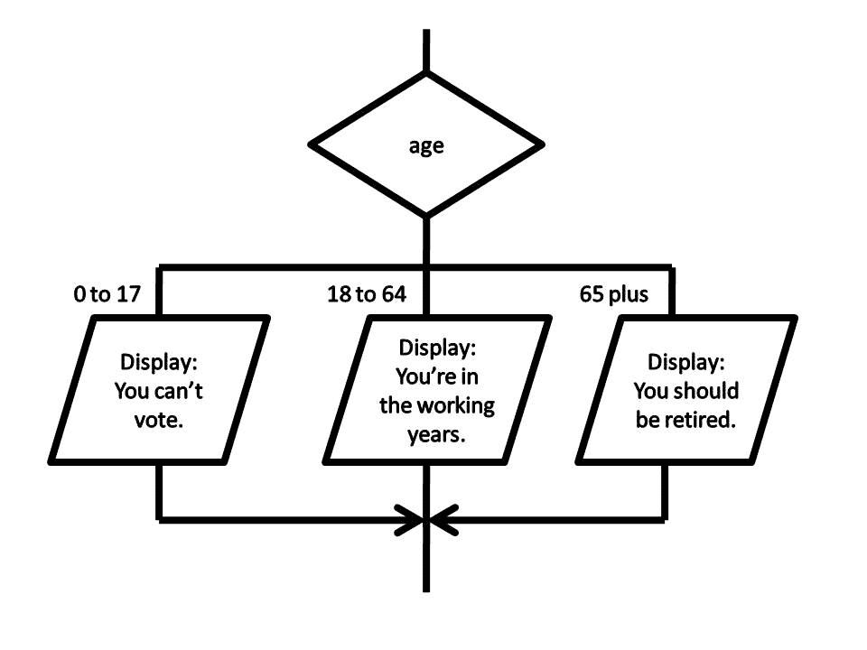编译器错误（红线是编译器停止的地方）

**图 5.3。**

链接器错误（没有红线，只有描述链接问题的消息）

**图 5.4。**

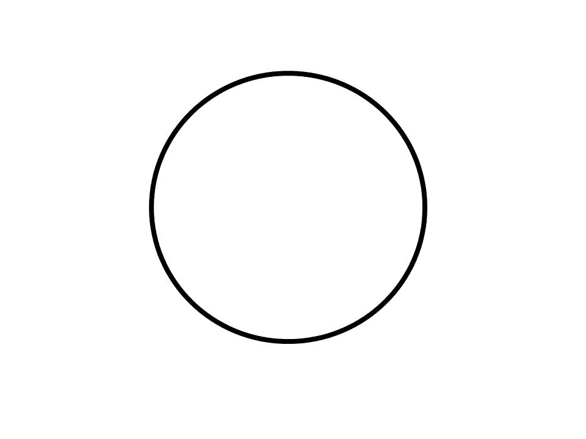逻辑错误（来自“黑盒”区域的输出）

## C++ 演示程序

### 为源代码文件创建文件夹或子文件夹

根据你的编译器/IDE，你应该决定在何处下载和存储用于处理的源代码文件。明智的做法是在下载源代码文件之前，根据需要创建这些文件夹。对于 *Bloodshed Dev-C++ 5 编译器/IDE*，建议的子文件夹命名为：

*   Demo_Programs


如果您尚未操作，请根据需要创建相应的文件夹和/或子文件夹。

### 下载演示程序

将以下文件下载并存储到存储设备的相应文件夹中。按照您的编译器/IDE 的方法，编译并运行程序。结合其他学习材料研究源代码文件。

从 Connexions 下载：[Demo_Pre_Processor_Compiler_Errors.cpp](http://cnx.org/content/m18920/1.9/Demo_Pre_Processor_Compiler_Errors.cpp)

从 Connexions 下载：[Demo Compiler_Conversion_Errors.cpp](http://cnx.org/content/m18920/1.9/Demo_Compiler_Conversion_Errors.cpp)

从 Connexions 下载：[Demo_Linker_Errors.cpp](http://cnx.org/content/m18920/1.9/Demo_Linker_Errors.cpp)

从 Connexions 下载：[Demo_Logic_Errors.cpp](http://cnx.org/content/m18920/1.9/Demo_Logic_Errors.cpp)

## 定义

**定义：文本编辑器**
一种用于创建和编辑 ASCII 文本文件的程序。

**定义：编译器**
将源代码转换为目标代码。

**定义：预处理器**
编译器在将源代码转换为目标代码时执行的第一步操作。

**定义：链接器**
将目标文件连接或链接成一个可执行文件。

**定义：加载器**
操作系统的一部分，负责将可执行文件加载到内存中，并引导 CPU 开始运行程序。

**定义：调试**
从程序中消除错误的过程。1) 编译器 2) 链接器 3) 逻辑

**定义：警告**
编译器提示，指示可能存在问题。

## 5.2. 标准输入与输出

## 一般讨论

我们让计算机执行的所有任务都发生在中央处理器（CPU）和相关的内存中。一旦我们的程序加载到内存中，并且操作系统引导 CPU 开始执行我们的编程语句，计算机的结构如下：

**图 5.5。**

CPU – 内存 – 输入/输出设备

我们的程序现在位于内存中，基本上有两个区域：

*   机器指令 – 我们关于想要执行操作的指令
*   数据存储 – 我们在程序使用的变量

通常，我们的程序包含与输入/输出设备交互的指令。我们需要将数据移入（读取）和/或移出（写入）内存数据区域。**设备**是指电子连接到内存的设备，以便数据可以在内存和设备之间传输。在历史上，这是通过打孔卡和打印件实现的。磁带驱动用于电子存储。随着时间的推移，我们转向使用磁盘驱动器进行存储，键盘和显示器（显示器输出称为软拷贝）取代了打孔卡和打印件（称为硬拷贝）。

大多数计算机操作系统以及相应的编程语言已将键盘识别为**标准输入设备**，将显示器识别为**标准输出设备**。在没有指定其他特定设备的情况下，键盘和显示器通常被视为默认设备。

## C++ 中的标准 I/O

C++ 编程语言的开发者决定提供一些与操作系统和 I/O 设备交互所需的较为技术的代码。在下面的示例中，`include` 指令插入了一个包含*输入/输出流*（Input-Output Stream）库的文件。该文件包含了使用 `cout` 和 `cin` 将数据发送到显示器或从键盘获取数据的必要代码。

```cpp
#include <iostream>
```

您应该将 `cout` 和 `cin` 视为您可以从中发送数据或接收数据的位置；概念上与程序数据区域内的任何其他变量存储位置类似。C++ 编程语言有两个与 I/O 设备配合使用的运算符。

**表 5.1。**

| 操作 | C++ 运算符符号 | 配合使用 |
| :--- | :--- | :--- |
| 插入运算符（写入） | `<<`（一对小于符号） | `cout` |
| 提取运算符（读取） | `>>`（一对大于符号） | `cin` |

考虑以下代码：

**示例 5.1. 插入与提取**

```cpp
int age1;     // 设置变量
稍后在我们的程序中
cout << "\nEnter 输入第一个人的年龄 --->: ";
cin >> age1;
```

程序员使用 `cout` 在显示器上显示（或插入）一条提示消息供用户查看。使用 `cin`，用户输入一个整数值并按回车键，计算机从键盘提取该值并将其存储在名为 `age1` 的变量中。在计算机内部，所有数据都以数字形式存储，因此是开发者提供的技术代码的一部分。


在下面的示例中，`include` 指令正在插入一个包含 `Input-Output Stream` 库代码的文件。该文件包含了使用 `cout` 和 `cin` 向显示器发送数据或从键盘获取数据所需的必要代码。

```
#include <iostream>
```

在下一个示例中，`define` 指令被用于处理常量（称为定义常量）。

**示例 5.2. 替换 PI**

```
#define PI 3.14159
```

`....稍后在程序中，当遇到 `PI` 时`

`....它将把 `PI` 替换为值 `3.14159`

`....例如：`

`area_circle = radius * radius * PI;`
`    将将变为：`
`area_circle = radius * radius * 3.14159;`

需要注意的是，C++ 中的编译器指令后面没有分号。C++ 编程指令或语句以分号结束，但编译器指令除外。

## 定义

**定义：编译器指令 (compiler directive)**

给编译器的指令，用于在正式开始编译程序之前完成某项任务。

**定义：包含 (include)**

将文件内容插入程序中的编译器指令。

## 5.4. 练习 5：集成开发环境

## 学习目标

在以下活动中通过记忆构建活动、练习、实验作业、问题或限时测验/考试达到 100% 的准确率；学生预期：

1. 定义本章节相关模块中列出的定义中的术语。
2. 能够列出在使用集成开发环境 (IDE) 时遇到的错误类别，并给出示例。
3. 使用你或他人设计的适当规划文档编写程序的 C++ 代码。

## 记忆构建构建活动

链接至：[MBA 05](http://cnx.org/content/m22457/1.3/index.html)

## 练习

**练习 5.4.1. (访问解答)**

**判断下列陈述的真或假：**

1. `IDE` 的意思是 Integer Division Expression（整数除法表达式）。
2. 大多数现代编译器实际上是 IDE 类型的软件，而不仅仅是编译器。
3. `cin` 和 `cout` 用于 C++ 中的标准输入和输出。
4. 编程错误极其容易理解和修复。
5. 所有 C++ 程序都至少包含一个 `include` 类型的编译器指令。

## 杂项

目前没有。

## 实验作业

### 为第 05 章文件创建文件夹或子文件夹

根据你使用的编译器/IDE，你应该决定在哪里下载和存储用于处理的源代码文件。出于谨慎考虑，建议你应在下载源代码文件之前根据需要创建这些文件夹。对于 `Bloodshed Dev-C++ 5 编译器/IDE`，建议的子文件夹可以命名为：

* 在名为 `Cpp_Source_Code_Files` 的文件夹内创建 `Chapter_05`

如果你尚未这样做，请根据情况创建相应的文件夹和/或子文件夹。

### 下载实验文件

将以下文件（s）下载并存储到你存储设备的相应文件夹（s）中。你可能需要右键点击链接并选择“另存目标为”来下载文件。

从 Connexions 下载：[Solution_Lab_02_Pseudocode.txt](http://cnx.org/content/m22457/1.3/Solution_Lab_02_Pseudocode.txt)
从 Connexions 下载：[Solution_Lab_02_Test_Data.txt](http://cnx.org/content/m22457/1.3/Solution_Lab_02_Test_Data.txt)

### 详细实验说明

仔细阅读并遵循下面的说明，并按照列出的顺序执行步骤。

* 在你的子文件夹 `Chapter_05` 中复制一个我们使用过的源代码列表。我们建议使用 Lab 01 源代码并将复制件重命名为：`Lab_05.cpp`
* 修改代码以遵循 `Solution_Lab_02_Pseudocode.txt` 文件。
* 建立（编译并运行）你的程序。如果程序运行时，当你使用测试数据（[使用提供的测试数据作为 Lab 02 的解答]）给出了预测结果，则说明你成功编写了该程序。
* 在成功编写该程序后，如果你正在修读此课程以获得学分，请遵循教授/教师的指示进行提交评分。

## 问题

### 问题 05a – 指令

列出并描述可能导致在使用集成开发环境软件产品程序时遇到四 (4) 种错误的原因。

### 问题 05b – 指令

识别此代码列表中的四 (4) 个问题（提示：在使用集成开发环境软件产品程序时遇到的四 (4) 种错误）。

**示例 5.3. C++ 源代码列表**

```cpp
//******************************************************
// FileName: Compiler_Test.cpp
// Purpose: 计算两个人的平均年龄
// Author: Ken Busbee; Kenneth Leroy Busbee
// Date: 2009 年 1 月 5 日
// Comment: 核心思想是能够在你的编译器上调试并运行程序。
//******************************************************
// 头文件和其他技术项目
#include <iostream>
using namespace std;
// 函数原型
void pause(void);
// 变量
int age1;
int age2;
double answer;
//******************************************************
// 主函数
//******************************************************
int main(void) {
    // 输入
    cout << "Enter the age of the first person: ";
    cin >> age1;
    cout << "Enter the age of the second person: ";
    cin >> age2;
    // 处理
    answer = (age1 + age2) / 2.0;
    // 输出
    cout << "The average of their ages is: ";
    cout << answer;
    pause();
    return 0;
}
//******************************************************
// 程序结束
//******************************************************
```

## 练习解答

**练习 5.4.1 的解答 (返回练习)**

**答案：**

1. 假
2. 真
3. 真
4. 假
5. 真

# 第 6 章 程序控制函数

## 6.1. 函数伪代码示例

## 概念

伪代码语法没有标准。但是有一些通常遵循的惯例可以帮助一个程序员编写的伪代码被另一个程序员理解。以下描述了用于易于理解的函数伪代码方法。五个概念是：

* 使用`起始词` (beginning phrase word) 来开始函数
* 使用`通信词` (communication phrase word) 来识别传入函数的项
* 使用缩进显示函数的动作部分
* 使用`通信词` (communication phrase word) 来识别输出函数的项
* 使用`结束词` (ending phrase word) 来结束函数
* 使用`调用词` (calling phrase word) 指导程序使用函数

以下是建议的函数词大纲：

**表 6.1.**

| 项目/目的 | 起始词 | 结束词 |
| :--- | :--- | :--- |
| 开始 | Function | N/A |
| 输入通信 | Pass In: | none |
| 动作 | N/A | N/A |
| 输出通信 | Pass Out: | none |
| 结束 | N/A | Endfunction |
| 调用函数 | Call: | none |

### 示例

以下是上述惯例定义的伪代码示例。

**示例 6.1. 伪代码：无参数传递的函数**

```text
Function monitor
    Pass In: nothing
    直接让操作系统清空显示器
    Pass Out: nothing
Endfunction
```

**示例 6.2. 伪代码：带参数传递的函数**

```text
Function delay program so you can see the monitor
    Pass In: 代表十分之一秒的整数
    使用操作系统延迟程序
    Pass Out: nothing
Endfunction
```

**示例 6.3. 伪代码：调用清空显示器函数的主函数**

```text
Function main
    Pass In: nothing
    执行一些代码
    Call: clear monitor
    执行一些代码
```


`Pass Out: value zero to the operating system`

`Endfunction`

## 定义

定义：短语词

用于让任何读者都能理解伪代码逻辑的词。

# 6.2. 层级图或结构图

## 概述

`层级图`（称为`结构图`）显示了各个单元之间的关系。它的名称源于其在展示业务组织（或结构）方面的通用用途。顶层是总裁，下一层是副总裁，等等。在计算机程序的语境下，它显示了模块（或函数）之间的关系。它不展示程序的详细逻辑。它确实代表了程序内部使用的函数的组织结构，显示了哪些函数正在调用子函数。上面的函数正在调用下一层的函数。

层级图由程序员创建，以帮助记录程序。它们传达了程序中所用模块（或函数）的整体视图。

**图 6.1. **

具有五个函数的程序层级图或结构图。

## 定义

定义：层级图

传达程序中各种函数之间的关系或整体视图。

定义：结构图

层级图的另一个名称。

## 6.3. 程序控制函数

## 准备材料

本模块至关重要的部分是回顾几个 Connexions 模块：

1. `m_18861` – 标题：模块化与 C++ 程序布局
2. `m_19136` – 标题：函数的伪代码示例
3. `m_18682` – 标题：层级图或结构图

你应该在继续之前回顾这些材料。如果你是在线查看此模块，这些项目的链接位于右侧的“链接”框中。

## 模块化概念

这个概念在我们周围的现实世界中无处不在。简单来说，它就是`将一个大型复杂的问题分解成更小、易于管理的部分`。任何大型组织（政府部门、公司、大学、医院等）的层级图都会显示不同级别的人员，其职位名称标明了不同的责任领域。每个人都是组织整体运作中的一个微小部分。每个人都可以专注于自己独特的才华或任务，确保其正常运行。他们共同实现了组织的目标。

此外，这个概念已经存在很长时间了。300 年前的村庄有农民、裁缝、屠夫、铁匠等。制造业是一个典型的例子，不仅工作被模块化，产品本身也被从模块或系统的角度来看（汽车示例：发动机、转向系统、刹车等）。

计算机世界，硬件（设备）和软件（计算机程序）也使用了这种模块化概念。因此，该概念迁移到了单个计算机程序中；允许我们将程序模块化为称为函数的易于管理的任务。

## 程序控制函数

程序控制函数通常不相互之间通信信息，而是使用`公共区域`来存储变量。数据在函数进出如何通信的规则根据编程语言而异很大，但概念是相同的。传递（或通信）的数据项被称为参数。因此，有了这种术语：`参数传递`。然而，对于程序控制函数，我们使用的数据通信选项是`无输入通信 – 无输出通信`。我们的数据变量和常量放置在所有函数都可用的公共区域中（称为`全局作用域`）。

程序控制函数的标识符名称通常意味着要完成的任务，例如 `get-data`（获取数据）、`process-data`（处理数据）或 `show-results`（显示结果）。随着你学习编写更复杂的程序，代码行数将会增加。审慎的做法是，将程序划分为执行唯一任务的函数将是有益的。程序越大，对模块化或创建程序控制函数的需求就越高。

取决于编程语言，有正式的方法来：

1. `定义函数` (`define a function`，它是它的`definition` 或它将执行的代码）
2. `调用函数` (`call a function`)
3. `声明函数` (`declare a function`，`prototype`是对编译器的声明）

理解程序控制函数的一种简单方法是查看示例。即使你不知道 C++ 编程语言，你也可以学习这些材料来帮助理解模块化过程。

## C++ 演示程序

### 为源代码文件创建文件夹或子文件夹

取决于你的编译器/IDE，你应该决定在何处下载和存储用于处理的源代码文件。审慎的做法要求你在下载源代码文件之前，根据需要创建这些文件夹。对于 `Bloodshed Dev-C++ 5 编译器/IDE`，建议的子文件夹可能命名为：

* `Demo_Programs`

如果你还没有这样做，请根据需要创建文件夹和/或子文件夹。

### 下载演示程序

将以下文件下载并存储到存储设备上适当的文件夹中。你可能需要右键点击某些链接并选择“另存目标为”以下载某些文件。按照你的编译器/IDE 的方法，编译并运行程序。结合其他学习材料学习源代码文件。

从 Connexions 下载：[`Demo_Program_Control_Functions_before_Compiler_Test.cpp`](http://cnx.org/content/m19145/Demo_Program_Control_Functions_before_Compiler_Test.cpp)

从 Connexions 下载：[`Demo_Program_Control_Functions_Pseudocode.txt`](http://cnx.org/content/m19145/Demo_Program_Control_Functions_Pseudocode.txt)

从 Connexions 下载：[`Demo_Program_Control_Functions_Hierarchy_Chart.jpg`](http://cnx.org/content/m19145/Demo_Program_Control_Functions_Hierarchy_Chart.jpg)

从 Connexions 下载：[`Demo_Program_Control_Functions.cpp`](http://cnx.org/content/m19145/Demo_Program_Control_Functions.cpp)

### 学习材料以理解模块化

这几项代表了从无模块化到模块化的演进：

1. 模块化之前的代码
2. 程序的模块化伪代码和层级图
3. 已模块化的代码

在回顾时不应考虑程序的简单性。显而易见，该程序不需要模块化。示例是为了展示或演示如何模块化程序。

## 定义

定义：公共区域

程序中定义变量和常量的区域，供所有函数可用。

## 6.4. void 类型

## 概述

`void 类型`没有值或操作。它是一种表示缺乏类型的数据类型。

**表 6.2.**

| C++ 保留字 | void |
| :--- | :--- |
| 表示 | 无 |
| 大小 | N/A 或 无 |
| 正常符号 | N/A |
| 域（允许的值） | 无 |

这种数据类型是从“C”向“C++”过渡时引入的。在“C”中，函数默认返回整数类型。某些函数返回任何类型的值。因此，需要一种表示**无**返回的数据类型。void 类型主要用于函数的定义和原型，以表示没有输入和/或没有输出。

## 定义

定义：void 类型

没有值或运算符的数据类型，用于表示无。

# 6.5. 文档编写与源代码的可读性

## 概述

我们将考虑一个用于测试编译器以确保其安装正确的简单程序。

**示例 6.4. Compiler_Test.cpp 源代码**


```cpp
//******************************************************
// Filename: Compiler_Test.cpp
// Purpose:  计算两个人的平均年龄
// Author:   Ken Busbee; © Kenneth Leroy Busbee
// Date:     2009 年 1 月 5 日
// Comment:  核心思想是能够在你的编译器上 
//           调试并运行程序。
//******************************************************
// 头文件及其他技术性项目
#include <iostream>
using namespace std;
// 函数原型
void pause(void);
// 变量
int age1;
int age2;
double answer;
//******************************************************
// main 主函数
//******************************************************
int main(void)
{
  // 输入
  cout << "\nEnter 输入第一个人的年龄 --->: ";
  cin >> age1;
  cout << "\nEnter 输入第二个人的年龄 -->: ";
  cin >> age2;
  // 处理
  answer = (age1 + age2) / 2.0;
  // 输出
  cout << "\n 他们的平均年龄为 -------->: ";
  cout << answer;
  pause();
  return 0;
}
//******************************************************
// pause 暂停
//******************************************************
void pause(void)
{
  cout << "\n\n";
  system("PAUSE");
  cout << "\n\n";
  return;
}
//******************************************************
// 程序结束
//******************************************************
```

在编程行业中，人们希望让软件程序易于维护。这种愿望的核心在于金钱。简单来说，维护一个编写良好的程序花费的资金更少。程序维护的一个重要方面是让源代码列表尽可能清晰且易读。为了这一目标，我们将考虑以下内容：

1. 文档
2. 垂直对齐
3. 注释的恰当使用
4. 函数横幅
5. 独占行的块标记
6. 缩进块标记
7. 具有实际意义的标识符名称且类型一致
8. Typedef 的恰当使用

上述项目对于源代码编译并不是必需的。从技术上讲，编译器读取源代码的方式与人类阅读源代码的方式不同。但这正是关键所在；这种愿望是让源代码更易人类阅读。你不应该混淆“可能的”（技术上可以编译的）与“好的”（能够产生可读代码的可接受良好编程实践）。让我们详细介绍每一项。

### 文档

文档通常使用几行注释放置在程序的顶部。信息的多少取决于支付员工或独立承包商编写代码的公司的要求或标准。注意修订日的指示。

### 垂直对齐

你可以在文档区域中看到这种对齐。所有项目都对齐在同一列中。这种垂直对齐。这种垂直对齐在定义变量时再次出现。在声明变量或常量时，许多教科书会将多个项目放在同一行；如下所示：

**示例 6.5. 常见的教科书变量定义**

```cpp
float length, width, height, price_gal_paint, total_area, total_cost;
int coverage_gal_paint, total_gal_paint;
```

然而，尽管这在教科书中很常见，但在大多数公司的标准中通常是不被接受的。你应该单独行声明每个项目；如下所示：

**示例 6.6. 垂直对齐的正确变量定义**

```cpp
float length;
float width;
float height;
float price_gal_paint;
int coverage_gal_paint;
int total_gal_paint;
```

每个：

### 函数横幅

**示例 6.7. 作为横幅的注释**

```cpp
//******************************************************
// main
//******************************************************
```

### 独占行的块标记

在编程行业中，人们希望让软件程序易于维护。这种愿望的核心在于金钱。简单来说，维护一个编写良好的程序花费的资金更少。程序维护的一个重要方面是让源代码列表尽可能清晰且易读。


# 6.6. 练习 6：程序控制函数^(*)

## 学习目标

在：记忆构建活动、练习、实验作业、问题或限时测试/考试中达到 100% 的准确率；学生预期：

1. 定义本章相关模块中列出的定义术。
2. 给定伪代码、测试数据和现有程序的源代码，修改伪代码和源代码以创建“程序控制”函数。

## 记忆构建活动

链接至：[MBA 06](http://cnx.org/content/m22458/1.4/index.html)

## 练习

### 练习 6.6.1. (访问解决方案)

判断下列陈述的对或错：

1. 伪代码有一套严格的规则，并且在计算机编程行业各处都是相同的。
2. 层级图（Hierarchy Charts）和结构图（Structure Charts）基本上是同一回事。
3. 程序控制函数用于简单地划分和控制程序。
4. `void` 数据类型在 C++ 中很少使用。
5. 提高源代码的可读性仅供初级程序员使用。

## 杂项

目前没有。

## 实验作业

### 为第 06 章文件创建文件夹或子文件夹

根据你的编译器/IDE，你应该决定在哪里下载和存储用于处理的源代码文件。根据谨慎原则，你应该在下载源代码文件之前按创建这些文件夹。对于 `Bloodshed Dev-C++ 5 编译器/IDE`，建议的子文件夹命名为：

* 在 `Cpp_Source_Code_Files` 文件夹下的 `Chapter_06`

如果你尚未创建，请根据情况创建相应的文件夹和或子文件夹。

### 下载实验文件

将以下文件下载并存储到存储设备的相应文件夹中。你可能需要右键点击链接并选择“另存目标...”来下载文件。

从 Connexions 下载：[Solution_Lab_01.cpp](http://cnx.org/content/m22458/1.4/Solution_Lab_01.cpp)
从 Connexions 下载：[Solution_Lab_01_Pseudocode.txt](http://cnx.org/content/m22458/1.4/Solution_Lab_01_Pseudocode.txt)
从 Connexions 下载：[Solution_Lab_01_Test_Data.txt](http://cnx.org/content/m22458/1.4/Solution_Lab_01_Test_Data.txt)
从 Connexions 下载：[Solution_Lab_01m_with_Program_Control.cpp](http://cnx.org/content/m22458/1.4/Solution_Lab_01m_with_Program_Control.cpp)
从 Connexions 下载：[Solution_Lab_01m_Pseudocode_with_Program_Control.txt](http://cnx.org/content/m22458/1.4/Solution_Lab_01m_Pseudocode_with_Program_Control.txt)
从 Connexions 下载：[Solution_Lab_01m_Hierarchy_Chart.jpg](http://cnx.org/content/m22458/1.4/Solution_Lab_01m_Hierarchy_Chart.jpg)
从 Connexions 下载：[Solution_Lab_03.cpp](http://cnx.org/content/m22458/1.4/Solution_Lab_03.cpp)
从 Connexions 下载：[Solution_Lab_03_Pseudocode.txt](http://cnx.org/content/m22458/1.4/Solution_Lab_03_Pseudocode.txt)
从 Connexions 下载：[Solution_Lab_03_Test_Data.txt](http://cnx.org/content/m22458/1.4/Solution_Lab_03_Test_Data.txt)

### 详细实验说明

仔细阅读并遵循下面的指示，并按列出的顺序执行步骤。

* 导航你的子文件夹：`Chapter_06`。查看原始 Lab 01 材料。编译并运行 Lab 01 源代码。然后查看并对比原始 Lab 01 材料与模块化的 Lab 01 材料，注意转换为“程序控制”函数。编译并运行 `Lab 01m` 源代码。根据需要查看课程材料。如果有任何问题，请给教授发送电子邮件。
* 我们已提供 Lab 03 作业的解决方案。通过编译和运行 Lab 03 源代码来检查 Lab 03 作业。
* 你需要复制 Lab 03 源代码文件和伪代码文件以创建以下新文件：`Lab_06.cpp` 和 `Lab_06_Pseudocode.txt`。
* 修改 Lab 06 伪代码文件，按照演示材料所示实现“程序控制”函数。
* 修改 Lab 06 源代码文件，按照演示材料所示实现“程序控制”函数。
* 构建（编译并运行）你的程序。如果程序运行时使用测试数据[使用与 Lab 03 相同的测试数据]得到与 Lab 03 相同的结果，则说明你成功编写了该程序。
* 在成功编写此程序后，如果你是为了学分修此课程，请遵循教授/教师的指示提交进行评分。

## 问题

### 问题 06a – 指示

为以下伪代码创建一个层级图。

示例 6.8. 伪代码
```text
**************************************
文件名: Average_IQ.txt
目的: 计算两个人的平均 IQ
作者: Ken Busbee; © Leroy Busbee
日期: 2009 年 1 月 17 日
**************************************
函数 main
  输入: 无
  调用: get_iqs
  调用: process_iqs
  调用: show_average
  输出: 将零传递给操作系统
结束函数
****
函数 get_iqs
  输入: 无
  显示一条消息请求用户输入第一个人的 IQ
  从键盘获取第一个人的 IQ
  显示一条消息请求用户输入第二个人的 IQ
  从键盘获取第二个人的 IQ
  输出: 无
结束函数
****
函数 process_iqs
  输入: 无
  通过相加两个 IQ 并除以 2.0 来计算答案
  输出: 无
结束函数
****
函数 show_average
  输入: 无
  用适当的消息显示答案
  调用: pause
  输出: 无
结束函数
****
函数 pause
  输入: 无
  让操作系统暂停程序
  输出: 无
结束函数
**************************************
潜在变量
类型 标识符
*********
integer iq1
integer iq2
double answer
**************************************
文件结束
```

### 问题 06b – 指示

识别导致此代码“无文档”、“不可读”或在某些方面错误的问题。

示例 6.9. C++ 源代码
```cpp
//**************************************
// 作者: Ken Busbee; © 2009 Leroy Busbee
// 日期: 2009 年 1 月 17 日
//**************************************
#include <iostream>
using namespace std;
void pause(void);
int age1, age2;
double xx;
//**************************************
// main
//**************************************
int main(void)
{
  // 输入
  cout << "\nEnter 第一个人的年龄 --->: ";
  cin >> age1;
  cout << "\nEnter 第二个人的年龄 -->: ";
  cin >> age2;
  // 处理
  xx = (age1 + age2) / 2.0;
  // 输出
  cout << "\n 他们的平均年龄为-------->: ";
  cout << xx;
  pause();
  return 0;
}
void pause(void)
{
  cout << "\n\n";
  system("PAUSE");
  cout << "\n\n";
  return;
}
```


在继续之前，您应该检查这些材料。如果您是在线查看此模块，这些项目的链接位于右侧的“链接”框中。

## 通用概念

具有相似标识符名称程序控制（Program Control）函数在不同程序中通常执行略有不同的任务。查看两家公司的组织图或层级图，它们都可能有一位生产副总裁，但生产汽车与生产冰激淋是不同的。相似但不同。当你深入到组织内部时，你可能会发现“保安”这一职位名称。请注意，汽车工厂的保安和冰激淋工厂的保安工作内容是完全相同的。事实上，他们很可能是可以互换的。在编程中，当一个任务变得非常具体时，它可能可以在多个程序中使用。闰年的计算就是一个很好的例子。它用于验证日期，即今年是否存在 `29` 2 月。这在成千上万个程序中都是需要它的。

## 特定任务函数

要创建良好的特定任务（Specific Task）函数，您需要通过参数传递完成所有必要的通信。因此，所有使用该函数的程序将以完全相同的方式进行通信。在我们的闰年示例中，您将向函数传递年份，函数将返回真或否的通信结果；意味着它是闰年且存在 `29` 2 月（`true`），或者不是闰年（`false`）。

将我们的程序模块化为特定任务函数的能力意味着，我们可以编写一次特定任务函数并确保其正常工作，然后在许多程序中反复重用。正如你所推测的样，这其中存在一种平衡。大多数程序都将包含一些程序控制函数和一些特定任务函数。决定一个函数是否应该是特定任务函数的关键通常源于任务的唯一性，以便其在许多程序中使用。特定任务函数一旦创建，通常会被放在`用户定义库`（user-defined library）中，然后共享给他人以便在许多程序中使用。

## 定义

定义：用户定义库 (user defined library)

一个包含个人创建的特定任务函数的文件，用于许多程序。

# 7.2. 全局数据存储与局部数据存储

## 通用讨论

全局和局部数据存储的概念通常与作用域（scope）的概念相关。作用域是程序中带有标识符名称的项目（变量、常量、函数等）被识别的区域。在我们的讨论中，我们将使用一个变量，变量在程序中的定义位置决定了它的作用域。

`全局作用域`（Global scope，以及延伸出的全局数据存储）发生在变量定义在“函数外部”时。在编译程序时，它会在程序的`作为对象代码一部分的数据区域（data area）`中为该变量创建一个存储区域。对象代码包含一段机器代码、一个数据区域和链接器解析指令。由于变量具有全局作用域，因此对您源代码中的所有函数都是可用的。它甚至可以提供给链接到您的代码的其他对象模块中的函数使用；然而，我们现在跳过这一解释。此时应该学习一个关键的术语变化。尽管变量具有全局作用域，但技术上，它仅从`定义点到程序源代码的结束`可用。这就是为什么大多数具有全局作用域的变量被放在源代码的顶部，任何函数之前。这样它们对所有函数可用。

`局部作用域`（Local scope，以及延伸出的局部数据存储）发生在变量定义在“函数内部”时。在编译时，编译器会创建机器指令，指导在被称为`栈（stack，是计算机内存的一部分）`的区域上创建存储位置。这些内存位置一直存在到函数完成任务并返回其调用函数为止。在汇编语言中，我们说项目在函数终止时被推入栈和从栈中弹出。因此，`栈`是一个被所有函数使用的可重用内存区域，并在函数终止时释放。尽管变量具有局部作用域，但技术上，它仅从`定义点到函数的结束`可用。数据项向函数的`参数传递`（parameter passing）将其建立为局部变量。此外，函数所需的任何其他变量或常量通常出现在函数定义的顶部，以便它们在函数代码的执行期间可用。

作用域是模块化的一个重要概念。`程序控制`函数通常对变量和常量使用全局作用域，将它们放在程序顶部、任何函数之前。`特定任务`函数通过参数传递将需要的数据传入函数，并根据需要创建局部变量和常量，仅使用局部作用域。任何需要传回调用函数的信息再次通过参数传递完成。这种将所有数据传入和输出函数的`闭环通信模型`（closed communications model）为面向对象编程中使用的`封装`（encapsulation）创建了一个重要的前提概念。

## 定义

定义：全局作用域 (global scope)

定义在函数外部的数据存储。

定义：局部作用域 (local scope)

定义在函数内部的数据存储。

定义：数据区域 (data area)

对象代码文件中用于存储数据的部分。

定义：栈 (stack)

计算机内存中用于存储数据的部分。

定义：作用域 (scope)

源文件中标识符名称被识别的区域。

# 7.3. 使用头文件实现用户定义的特定任务函数

## 概念：用户定义的特定任务函数

大多数公司都有某些其公司特有的任务。编程人员可能共同决定构建几个函数，并将它们组织成一个或多个用户库。特定任务函数通常使用一个测试外壳程序（testing shell program）构建。测试外壳程序的唯一目的是创建特定任务函数并对它们进行测试，以确保它们正常工作。想象一个蛤蛤，它的壳包裹着重要部分——珍珠。测试外壳程序包裹着特定任务函数（重要部分）。通常，测试外壳程序将用于创建几个将被放入用户定义库的函数。流程如下：

1. 构建带有特定任务函数的`测试外壳`程序并经过彻底测试。

2. 将`测试外壳`源代码的副本保存为`头文件`（header file），修改后将被放入用户库。您删除程序的主体，留下注释区域、任何需要的包含文件引用和特定任务函数。

**图 7.1 头文件的创建**

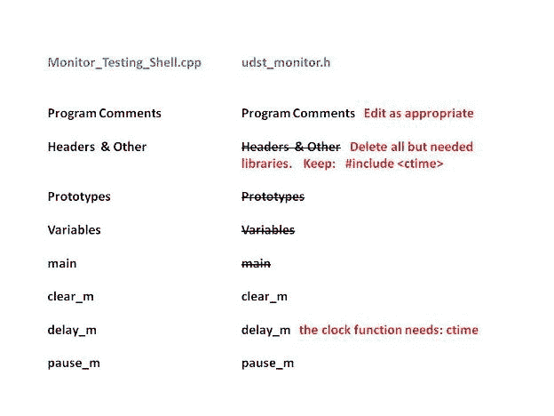从测试外壳副本创建头文件。

3. 将`测试外壳`源代码的另一个副本保存为`原型文件`（prototypes file）。这是一个文本文件，仅保留放入`头文件`中的函数原型。函数应该使用有意义的标识符名称，因此原型应为他人提供如何通过适当参数传递调用函数的足够信息。

**图 7.2 原型文件的创建**

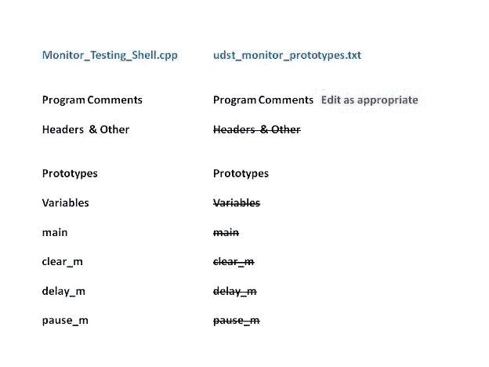从测试外壳副本创建原型文件。


# 4. 另一份 `testing shell` 源代码被保存为 `verify header program`。你删除函数的原型声明和定义，然后提供一个指向头文件的包含（include）。该程序将经过编译并运行，以确保 `header file` 正常工作。

**图 7.3 验证头文件的创建**

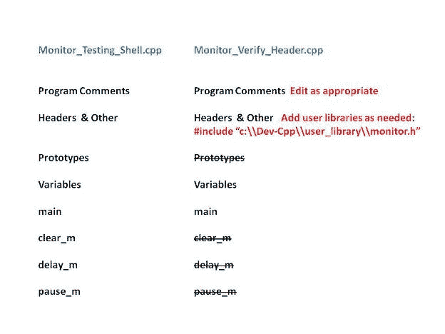 从测试 shell 的副本中创建一个验证头文件。

要理解这一概念的一个良好方法是回顾上述由程序员创建的四个文件。我们将使用 C++ 编程语言，但这些代码易于理解，并且很好地满足我们解释概念的需求；即使你并不熟悉 C++。

## 使用 C++ 进行演示

### 为四个文件创建文件夹或子文件夹

根据你使用的编译器/IDE，你应该决定在何处下载并存储用于处理的源代码文件。为了谨慎起见，你应该在下载源代码文件之前根据需要创建这些文件夹。对于 `Bloodshed Dev-C++ 5 编译器/IDE`，建议的子文件夹可以命名为：

* Monitor_Header

如果你尚未执行，请根据情况创建相应的文件夹和/或子文件夹。

### 下载四个文件

将以下文件下载并存储到你存储设备上的相应文件夹中。你可能需要右键点击某些链接并选择“目标另存为”来下载某些文件。

从 Connexions 下载：[Monitor_Testing_Shell.cpp](http://cnx.org/content/m19346/1.7/Monitor_Testing_Shell.cpp)

从 Connexions 下载：[udst_monitor.h](http://cnx.org/content/m19346/1.7/udst_monitor.h)

从 Connexions 下载：[udst_monitor_prototypes.txt](http://cnx.org/content/m19346/1.7/udst_monitor_prototypes.txt)

从 Connexions 下载：[Monitor_Verify_Header.cpp](http://cnx.org/content/m19346/1.7/Monitor_Verify_Header.cpp)

### 结合学习文件以理解概念

花一点时间结合上述概念讨论来回顾这些文件。你应该编译并运行 `Monitor_Testing_Shell.cpp` 程序。

### 为你的用户库创建文件夹或子文件夹

根据你使用的编译器/IDE，你应该决定在何处创建一个存放你创建的头文件的文件夹。我们建议与编译器/IDE 软件一起创建文件夹。如果你使用的是 `Bloodshed Dev-C++ 5 编译器/IDE`，你很可能将编译器/IDE 软件安装在：`C:\Dev-Cpp\`（如果你安装在本地机器上），或者在：`DriveLetter:\Dev-Cpp\`（`DriveLetter` 是代表你闪存盘的驱动器）（如果你将其安装在闪存盘上）。我们建议在该位置创建一个名为如下子文件夹：

* user_library

如果使用本地安装，`C:\Dev-Cpp\user_library` 的路径将被创建为你的用户库的位置。你可以字面上将其放在任何地方并为库命名任何名称，但一旦决定了位置和名称，你就不想移动或重命名这些文件夹。

### 将头文件放入用户库

你需要复制 `udst_monitor.h` 文件并将其放入创建的 `user_library` 文件夹中。正如你猜的，`udst` 代表 user defined specific task（用户定义的特定任务）。该头文件中的函数将用于控制用户与监控器之间的交互。`.h` 是 C++ 编程语言的约定，表示头文件。因此，头文件的标识符名称非常有意义且具有描述性。

### 验证头文件工作正常

查看 `Monitor_Verify_Header.cpp` 源代码文件，并注意两个包含（include）命令是不同的。

1. 标准库使用小于号和大于号来括起标准库名称：`iostream`

2. 用户库使用引号括头文件的位置。这告诉编译器我们正在指定我们想要的精确文件。我们提供了一个完整的文件规范（驱动器、路径信息、文件名和扩展名）。

3. 因为此项在 C++ 中技术上是一个字符串，我们必须在驱动器、路径和文件名之间使用两个反斜杠。这是因为第一个反斜杠假设下一个字符是转义代码，如果我们真的不想要转义代码而想要一个反斜杠，第二个反斜杠就会说“不，我要一个反斜杠”。这个字符串：`"C:\\Dev-Cpp\\user_library\\udst_monitor.h"` 将解释为：`C:\Dev-Cpp\user_library\udst_monitor.h`

根据你使用的驱动器、你使用的路径文件夹结构以及你给文件夹命名的名称，你可能需要修正源代码中的包含引用，以便其能正确引用头文件。

编译并运行 `Monitor_Verify_Header.cpp` 程序。注意：它的运行应该与 `Monitor_Testing_Shell.cpp` 程序完全一样。

## 定义

定义：`ud`
User Defined Specific Task（用户定义的特定任务）

定义：`testing shell`
一个用于创建特定任务函数的程序。

定义：`header file`
一个包含我们希望放在源代码顶部的项目的文件（头文件）。

## 7.4. 练习 7: 特定任务

## 学习目标

在活动、练习、实验作业或定时测验中达到 100% 的准确率；学生预期：

1. 定义模块中列出的术语。
2. 给已编写的测试 shell 程序，创建一个用户定义的任务头文件、用户定义的任务原型文档和一个验证头文件的程序。

## 练习

**判断以下陈述的对错：**

1. Scope（作用域）是一种品牌。
2. 用户定义的任务函数通常放在用户库中。
3. 局部和全局数据存储与 scope 有关。
4. 创建用户定义的任务头文件是一项困难的任务。
5. Stack（栈）是用于存储的计算机的一部分。

## 实验作业

为章节 07 创建文件夹或子文件夹

根据你使用的编译器/IDE，你应该决定在何处下载并存储用于处理的源代码文件。为了谨慎起见，你应该在下载源代码文件之前根据需要创建这些文件夹。对于 `Bloodshed Dev-C++ 5 编译器/IDE`，建议的子文件夹可以命名为：

Cpp_Source_Files 下的 Chapter_07

如果你尚未执行，请根据情况创建相应的文件夹和/或子文件夹。

### 下载实验文件

将以下文件下载并存储到你存储设备上的相应文件夹中。你可能需要右键点击链接并选择“目标另存为”来下载文件。

从 Connexions 下载：[Lab_07_Testing_Shell.cpp](http://cnx.org/content/m2459/1.2/Lab_07_Testing_Shell.cpp)

### 详细实验说明

仔细阅读并遵循下面的说明，并按列出的顺序执行步骤。

* 导航到子文件夹：`Chapter_07`。编译并运行 Lab 07 Testing Shell 源代码。注意：该程序使用一个包含文件，指向 Connexions 第 7 章材料中解释的 `udst_monitor.h` 文件。

* 按照 Connexions 第 7 章材料“为用户定义的任务使用头文件”模块所示的相同过程；制作以下文件：`udst_us_to_metric.h`、`udst_us_to_metric_prototypes.txt` 和 `Lab_07_Verify_Header.cpp`


*   将头文件拷贝到你的用户库中，然后构建（编译并运行）你的验证头文件程序。
*   在你成功编写此程序后，如果你是为了大学学分修读这门课程，请遵循教授/讲师的指示提交评分。

## 问题

### 问题 07a – 指令

创建伪代码来解决以下特定任务函数：

问题：室内设计师总是需要计算房间面积，以确定所需的地板覆盖物（通常是地毯）。房间是矩形的，尺寸以英尺测量（带小数）。然而，函数需要返回平方英码。提示：1 码等于 3 线性英尺。

### 问题 07b – 指令

为以下特定任务函数创建测试数据：

问题：室内设计师总是需要计算房间面积，以确定所需的地板覆盖物（通常是地毯）。房间是矩形的，尺寸以英尺测量（带小数）。然而，函数需要返回平方英码。提示：1 码等于 3 线性英尺。

## 练习答案

**练习 7.4.1 的解答。（返回练习)**

**答案：**

1.  `false` – 虽然 `Scope` 是一个漱口水品牌；但我们寻找的是计算机相关的定义。
2.  `true`
3.  `true`
4.  `false` – 起初看起来可能很难，但只要练习一下就会非常简单。
5.  `true`

# 第 8 章 标准库

## 8.1 标准库

## 标准库概述

许多常见的或`标准函数`（standard functions）已经编写了定义，可以在任何程序中使用。它们被组织成一组函数（可以将它们想象成几本书），并统称为`标准库`（Standard Library）。有许多函数被组织在多个库中。例如，在 C++ 中，存在许多数学函数并经过了编码（放入库中）。这些函数是由程序员编写并测试的，以确保它们正常工作。在大多数情况下，这些函数经过了多个人的审查，进行了双重和三重检查，以确保它们符合预期。我们的优势在于使用这些函数时有`信心`它们会在我们的程序中正常运行，从而为我们节省了时间和金钱。

主程序必须建立该程序中所用函数的存在性。根据编程语言的不同，有正式的方法来：

1.  定义函数
2.  声明函数（原型是对编译器的一种声明）
3.  调用函数

当我们在程序中创建函数时，我们通常在源代码列表中按以下顺序看到它们：

1.  声明函数（原型）
2.  调用函数
3.  定义函数

当我们使用他人创建并组织在库中的函数时，我们在程序中包含一个头文件，该头文件包含函数的原型。就像我们创建的函数一样，我们在源代码列表中按以下顺序看到它们：

1.  声明函数（在包含文件中提供的原型）
2.  调用函数（通过值传递参数）
3.  定义函数（它要么在头文件中定义，要么由链接器程序从标准库对象区域提供实际的对象代码）

在大多数情况下，用户可以查看原型，并准确地理解当函数被调用时，进入和离开内部的通信（参数传递）将如何发生。让我们来看绝对值的数学示例。其原型是：

```cpp
int abs(int number);
```

由于设计者不想使用过长的函数名，他们将其命名为：`abs` 而不是 "absolute"。这似乎可能违反了使用有意义名称的标识符命名规则，然而当为标准库建立标识符名称时，它们通常会被缩短为所有使用它们的人都能轻松理解的名字。该函数的数据类型为 `int`，这意味着函数将返回一个整数值。显而易见，返回的整数值是问题“传入整数绝对值是多少”的答案。此函数只传递了一个值；一个 `int number`。如果我有两个名为 `apple` 和 `banana` 的整数变量；我想将 `banana` 的绝对值存储到 `apple` 中；那么调用此函数的代码行将是：

```cpp
apple = abs(banana);
```

用英语表述：向函数 `absolute` 传递存储在变量 `banana` 中的值，并将函数的返回值赋值给变量 `apple`。因此，如果你知道原型，通常可以妥妥地调用函数并使用它的返回值（如果有的话），而无需看到代码的定义（即告诉函数如何获取答案的源代码；该代码是由他人编写的；要么被包含在头文件中，要么被编译并放在对象库中；并在集成开发环境（IDE）的链接步骤期间链接）。

## C++ 演示程序

### 为源代码文件创建文件夹或子文件夹

根据你的编译器/IDE，你应该决定在哪里下载和存储用于处理的源代码文件。严谨的做法是，在下载源代码文件之前根据需要创建这些文件夹。对于 `Bloodshed Dev-C++ 5 编译器/IDE`，建议的子文件夹可以命名为：

*   `Demo_Programs`

如果你尚未执行，请根据情况创建相应的文件夹和或子文件夹。

### 下载演示程序

将以下文件下载并存储到你存储设备上的相应文件夹中。按照你使用的编译器/IDE 的方法，编译并运行程序。结合其他学习材料学习源代码或其它文件。

从 Connexions 下载：`Demo_Standard_Libraries.cpp`

从 Connexions 下载：`Demo_Standard_Libraries.txt`

## 定义

定义：`标准库` —— 添加到编程语言中供通用使用的特定任务函数集。

定义：`信心` —— 对标准库函数正常工作的信赖。

定义：`abs` —— C++ 中 `cmath` 标准库中的函数，意为绝对值。


根据你使用的编译器/IDE，你应该决定在何处下载和存储用于处理的源代码文件。为了稳妥起见，建议在下载源代码文件之前，根据需要提前创建这些文件夹。对于 `Bloodshed Dev-C++ 5 编译器/IDE`，建议的子文件夹命名为：

*   在名为 `Cpp_Source_Code_Files` 的文件夹内创建：`Chapter_08`

如果你尚未创建，请根据情况创建相应的文件夹和/或子文件夹。

### 下载实验文件

将以下文件（s）下载并存储到你存储设备中相应的文件夹内中。你可能需要右键点击链接并选择“另存目标为”来下载文件。

从 Connexions 下载：[Lab_08_Testing_Shell.cpp](http://cnx.org/content/m22460/1.3/Lab_08_Testing_Shell.cpp)

### 详细实验说明

请仔细阅读并遵循下面的说明，并按照列出的顺序执行步骤。

*   进入你的子文件夹：`Chapter_08/`。编译并运行 Lab 08 Testing Shell 源代码。注意：此程序使用一个包含文件，指向 `udst_monitor.h` 文件，如 Connexions 第 7 章材料解释的那样。

*   你需要向此测试 shell 中添加另一个名为 `area_triangle` 的函数，用于计算三角形面积。定义该函数，声明其原型，并在 `main` 函数中添加一个调用该函数的区域（类似于现有的带有测试数据的函数）。确保它运行正常。

*   按照 Connexions 模块“使用头文件进行用户定义特定任务函数”（位于第 7 章材料中）所示的过程创建以下文件：`udst_geo_area.h`、`udst_geo_area_prototypes.txt` 和 `Lab_08_Verify_Header.cpp`。

*   将头文件复制到你的用户库，然后构建（编译并运行）你的验证头文件程序。

*   成功编写此程序后，如果你是为了大学学分修读这门课程，请遵循教授/教师的说明提交作业进行评分。

## 问题

### 问题 08a – 指令

编写 C++ 代码来实现以下特定任务函数。

**示例 8.1. 伪代码**

```cpp
Function area_regular_hexagon
  输入：side
  计算：side * side * 3 * 0.75 的平方根
  输出：计算结果
Endfunction
```

## 练习答案

**练习 8.2.1. 答案。（返回练习)**

**答案：**

1. true
2. false
3. false

# 第 9 章. 9. 字符数据，Sizeof，Typedef，序列

## 9.1. 字符数据类型

## 字符数据类型概述

`character` 数据类型基本表示单个字符。字符由各种符号组成，如字母表（包括大写和小写字母数字数字（0 到 9）、标点符号等。所有计算机都以整数值的形式在一个字节字段中存储字符数据。由于一个字节由 8 位组成，因此这个单字节字段使用 0 到 255 的正值有 2⁸ 或 256 种可能性。

大多数微型计算机使用 `ASCII`（全称信息交换美国标准代码，读作 "ask-key"）字符集，该集合具有 0 到 127 的固定值。对于 128 到 255 的值，它们通常使用扩展 ASCII 字符集。当我们按下键盘上的大写字母 A 时，键盘发送一个位模式等于整数 65 的字节。当字节从内存发送到显示器时，显示器将整数值 65 转换为大写字母 A 的符号显示在屏幕上。

字符数据类型的属性包括：

**表 9.1.**

| C++ 留用字 | char |
| :--- | :--- |
| 表示 | 单个字符 |
| 大小 | 1 字节 |
| 正常符号 | 无符号（仅限正值） |
| 范围（允许的值） | 如标准 ASCII 字符集所示 0 到 127 的值，加上扩展 ASCII 字符集中 128 到 255 的值 |
| C++ 语法规则 | 单引号 – 示例：'A' |

## C++ 演示程序

### 为源代码文件创建文件夹或子文件夹

根据你使用的编译器/IDE，你应该决定在何处下载和存储用于处理的源代码文件。为了稳妥起见，建议在下载源代码文件之前，根据需要提前创建这些文件夹。对于 `Bloodshed Dev-C++ 5 编译器/IDE`，建议的子文件夹命名为：

*   `Demo_Programs`

如果你尚未创建，请根据情况创建相应的文件夹和/或子文件夹。

### 下载演示程序

将以下文件（s）下载并存储到你存储设备中相应的文件夹内中。按照你的编译器/IDE 方法编译并运行程序。学习源代码。

从 Connexions 下载：[Demo_Data_Type.cpp](http://cnx.org/content/m22460/1.3/Demo_Data_Type.cpp)

## 定义

*   `character`: 表示单个字符的数据类型，如字母表、数字等。
*   `ASCII`: 信息交换美国标准代码
*   `single quote marks`: 用于在 C++ 中创建字符类型

## 9.2. Sizeof 运算符

## 概述

每个数据项不仅有一个数据类型，其大小还决定了它将使用多少字节。这种影响被称为取决于机器。此外，随着语言的升级，大小发生了变化。在 "C" 中，`int` 数据类型在 Intel 兼容处理单元（cpu）上分配了 2 字节。在 "C++" 中分配了 4 字节。

有一个名为 `sizeof()` 的运算符，它是一个一元运算符，只有一个操作数。操作数位于运算符右侧的数据类型（包括通过 `typedef` 创建的）。它适用于全局和局部项。示例：

```cpp
cout << "The size of an integer is: " << sizeof(int);
```

编译器将确定特定机器整数的大小。整数通常为 4 字节，因此代码行将变为：

```cpp
cout << "The size of an integer is: " << 4;
```

如果你放置代表数据存储区的标识符（变量或内存常量），它会查看标识符的定义。注意：标识符通常不需要括号。

**示例 9.1. 使用变量的 sizeof**

```cpp
double money; // 设置初始变量
// 然后在程序的后面
cout << "The size of money is: " << sizeof(money);
```

编译器将通过查看定义来确定 `money` 的字节大小，定义指示数据类型为 `double`。double 数据类型在特定机器上（通常为 8 字节）将替换代码，并变为：

```cpp
cout << "The size of money is: " << 8;
```

## 定义

`sizeof`: 一个告诉你数据类型在存储中占用多少字节的运算符。

## 9.3. typedef - 别名

## 一般讨论

`typedef` 语句允许程序员为现有数据类型创建别名或同义词。这对于程序的文档很有用。C++ 语言语法为：

```cpp
typedef <实际数据类型> <别名标识符名称>;
```


假设有一位程序员正在使用 `double` 数据类型来存储程序中用于各种用途的金额。他可能会如下定义变量：

**示例 9.2. 变量的常规定义**

```cpp
double income;
double rent;
double vacation;
```

然而，他也可能使用 `typedef` 语句并如下所示定义变量：

**示例 9.3. 在定义变量时使用 typedef**

```cpp
typedef double cash;
    // 必须在使用之前定义 typedef
cash income;
cash rent;
cash vacation;
```

初级程序员并不经常使用 `typedef` 语句。它通常会产生不必要的困惑，因此起初请坚持使用普通数据类型。

## 定义

定义：`typedef`

允许程序员为现有数据类型创建别名或同义词。

## 9.4. 序列运算符

## 通用讨论

`sequence`（或逗号）运算符用于分隔项目。它有几种用途，其中四种已在列出并进行了演示：

1. 在声明变量或常量时分隔标识符名称
2. 分隔传递给函数的多个参数
3. 在 `for` 循环中分隔多个初始化项或更新项
4. 在初始化数组时分隔值

第一个示例通常在教科书中常见，但这种声明变量的方法并不受推荐。因为它很难快速阅读标识符名称。

```cpp
int pig, dog, cat, rat;
```

推荐使用以下垂直方法来声明变量或常量。

**示例 9.4. 推荐的垂直定义变量方法**

```cpp
int pig;
int dog;
int cat;
int rat;
```

数据类型和标识符名称（称为参数）彼此分离。这个示例是一个函数原型。

```cpp
double area_trapezoid(double base, double height, double top);
```

在 `for` 循环的语法中，你有三个部分，每个部分由分号分隔。第一个是初始化区域，可以有多个初始化。最后一个是更新区域，可以有多个更新。多个初始化或更新使用逗号来分隔它们。这个示例仅是 `for` 循环的第一行。

```cpp
for(x = 1, y = 5; x < 15; x++, y++)
```

变量 `ages` 是一个整数数组。初始值使用块标记赋值，值之间用逗号分隔。

```cpp
int ages[] = {2,4,6,29,32};
```

## 定义

定义：`sequence`

一种用于分隔项目多次出现的项的运算符。

## 9.5. 练习 9：字符数据、Sizeof、Typedef、序列

## 学习目标

在以下过程中通过记忆构建活动、练习、实验作业、问题或限时测验/考试达到 100% 的准确率；学生预期：

1. 定义本章相关模块中列出的定义术语。
2. 根据系统分析师提供的适当文档，创建计划文档（伪代码和测试数据），然后创建一个实现程序目标的源代码程序。

## 记忆构建活动

链接至：[MBA 09](http://cnx.org/content/m22461/1.4/index.html)

## 练习

**练习 9.5.1. ([跳转解答])**

**判断下列陈述的对错错：**

1. C++ 中的字符数据类型使用双引号，例如：`char grade = "A";`
2. `Sizeof` 是一个运算符，告诉你一个数据类型在存储中占用多少字节。
3. `Typedef` 帮助听力障碍人士，是针对学习障碍者的编程语言的标准便利功能之一。
4. 在定义变量时应使用 `sequence` 运算符来节省空间。
5. 编程既可以是令人享受的，也可以令人沮丧的。

##杂杂

目前没有。

## 实验作业

### 为第 09 章文件创建文件夹或子文件夹

取决于你使用的编译器/IDE，你应该决定在何处下载和存储用于处理的源代码。根据审慎原则，你应该在下载源代码文件之前根据需要创建这些文件夹。对于 *Bloodshed Dev-C++ 5 编译器/IDE*，建议的子文件夹名称可能为：

*   在名为 `Cpp_Source_Code_Files` 的文件夹内创建 `Chapter_09`

如果你尚未操作，请根据情况创建适当的文件夹和/或子文件夹。

### 下载实验文件

将以下文件下载并存储到你存储设备的相应文件夹中。你可能需要右键点击链接并选择“另存为目标”来下载文件。

从 Connexions 下载：[Lab_09_Narrative_Description.txt](http://cnx.org/content/m22461/1.4/Lab_09_Narrative_Description.txt)
从 Connexions 下载：[Lab_09_Aerial_View_Center_Pivot_Irrigation.jpg](http://cnx.org/content/m22461/1.4/Lab_09_Aerial_View_Center_Pivot_Irrigation.jpg)
从 Connexions 下载：[Lab_09_Hierarchy_Chart.jpg](http://cnx.org/content/m22461/1.4/Lab_09_Hierarchy_Chart.jpg)

### 详细实验说明

仔细阅读并按照下列指示执行步骤：

*   回顾第 1 章材料中的 Connexions 模块“系统开发生命周期”。想象自己是实现阶段的程序员，你的教授是系统分析师。
*   导航到你的子文件夹：`Chapter_09`。回顾系统分析师在设计阶段提供的两个项目。在历史上，这两个文档会被打印并放入程序文档文件夹。你创建源代码时产生的项目会被添加到其中。然而，转向我们的无纸化视图，今天这些项目是以电子方式创建并存储的（基本上我们正在 `Chapter_09` 中做的）。第三项——层次图通常由程序员制作。由于你缺乏经验，系统分析师已为你创建了。确保你理解程序要做什么。任何问题请咨询分析师（即你的教授）。
*   设计程序并通过构建 `Lab_09_Pseudocode.txt` 文件和 `Lab_09_Test_Data.txt` 文件创建测试数据。警告：不要碰编译器/IDE。不要从创建源代码开始。先创建代码再制作计划文档是程序员经常获得的坏习惯。注意：在你的伪代码中，不需要为标准库或用户库函数创建任何伪代码。只需说明你调用了它们。如果需要，回顾第 6 章材料中的 Connexions 模块“函数伪代码示例”。提示：从第 06 章文件夹复制伪代码和测试数据文件可能是构建这些项目的好方法。
*   在你成功规划文档并创建了测试数据后；创建代码文件并命名为：`Lab_09.cpp`。提示：使用之前的源代码文件作为起始文件是有意义的。第 06 章文件夹中的文件可能是很好的开始。你可能想从第 08 章验证头部代码中复制一些包含信息到你的 Lab 09 源代码文件中。
*   构建（编译并运行）你的程序。
*   在你成功编写此程序后，如果你正在参加获得学分的此类课程，请遵循教授/教师的说明提交进行评分。

## 问题

### 问题 09a – 指示

在声明相同数据类型的多个标识符名称时，可以使用 `sequence` 运算符。这是一个好还是坏的编程习惯？为什么？

## 练习解答


## 练习 9.5.1 答案 (返回练习)

## 答案：

1. false
2. true
3. false
4. false
5. true

# 第 10 章. 结构化编程导论

## 10.1. 结构化编程

## 引言
编程最重要的概念之一是控制程序的能力，以便执行不同的代码行或让某些代码行执行多次。允许我们控制执行流的机制被称为`控制结构`。流程图是记录程序执行执行流（或路径）的方法。控制结构主要分为四类：

*   **顺序（Sequence）** – 非常无聊。简单地执行一条指令，然后是下一条。只需按照给定的顺序或列表顺序执行即可。大多数代码行都是这种。
*   **选择（Selection）** – 这是你在两个或多个流之间进行选择。选择通过提出某种问题来决定。答案决定了将执行哪条路径（或哪些代码行）。
*   **迭代（Iteration）** – 也称为重复，它允许某些代码（多出来的行）执行（或重复）多次。代码可能完全不执行（重复零次）、执行固定次数，或无限执行直到满足某些条件为止。也被称为循环（looping），因为流程图显示了流回溯以重复任务。
*   **分支（Branching）** – 一种允许执行流跳转到程序不同部分的控制结构。这类结构在模块化结构化编程中很少使用。

所有高层编程语言都具有控制结构。所有语言都有前三类控制结构（顺序、选择和迭代）。大多数语言都有 `if then else` 结构（属于选择类）和 `while` 结构（属于迭代类）。在这两个基本结构之后，通常会有不同语言的变体。

`结构化编程`的概念始于 20 世纪 60 年代后期，由 Edsger Dijkstra 的一篇文章提出的。他提出了一种“少用 goto（go to less）”的方法来规划编程逻辑，这消除了对分支类控制结构的需求。这个话题被争论了大约 20 年。但最终——“到 20 世纪结束时，几乎所有的计算机科学家都相信，学习和应用结构化编程的概念是有用的。”

### 选择控制结构引言
选择控制结构的基本属性是能够在两个或多个备选路径之间进行选择。这被描述为`二路选择`或`多路选择`。使用布尔逻辑概念的问题通常控制选择哪条路径。选择控制结构的所有路径都会在控制结构的结束处汇合，然后移动到程序中的下一行代码。

我们已经提到过 `if then else` 控制结构属于选择类，并且是二路选择。

**示例 10.1. if then else 控制结构**

```
if (age > 17)
  {
  out << "You can vote.";
  }
else
  {
  cout << "You can't vote.";
  }
```

### 迭代控制结构引言
迭代控制结构的基本属性能够重复某些代码行。迭代的视觉化显示在流程图中图中创建一个圆形循环模式，因此“循环（loop）”一词与迭代控制结构相关。迭代可以通过`循环前测试（test before loops）`、`计数循环（counting loops）`和`循环后测试（test after loops）`来实现。使用布尔逻辑概念的问题通常控制循环执行多长时间。

我们已经提到 `while` 控制结构属于迭代类，并且是循环前测试。

**示例 10.2. while 控制结构**

```
counter = 0;
while (counter < 5)
  {
  cout << "\nI love computers!";
  counter++;
  }
```

## 定义
**定义：控制结构**
允许我们控制程序内部执行流的机制。

**定义：顺序**
一种按照列出的顺序执行项目的控制结构。

**定义：选择**
一种在两个或多个选项之间进行选择的控制结构。

**定义：迭代**
一种允许某些代码行执行多次的控制结构。

**定义：分支**
一种允许执行流跳转到程序不同部分的控制结构。

**定义：结构化编程**
一种避免使用分支类控制结构的程序规划方法。

## 10.2. 控制结构的伪代码示例

## 概述
不存在伪代码语法的标准。然而，有一些常见的通用的惯例，可以帮助一个程序员编写的伪代码被另一个程序员轻松理解。这些惯例中的大多数遵循两个概念：

*   使用缩进来显示结构的动作部分
*   使用结束短语来结束一个结构

顺序结构只需列出伪代码行。关注点不在顺序，而在于选择和迭代结构。以下是结束短语：

表 10.1.

| 控制结构 | 结束短语 |
| :--- | :--- |
| If then else | Endif |
| Case | Endcase |
| While | Endwhile |
| For | Endfor |

`Do While` 和 `Repeat Until` 迭代结构不需要短语。我们只需使用第一个单词（动作部分），后面跟着第二个单词。这里是一些示例：

## 选择结构
**示例 10.3. 伪代码: If then else**

```
If age > 17
  out << "You can vote."
Else
  cout << "You can't vote."
Endif
```

**示例 10.4. 伪代码: Case**

```
Case of age
  0 to 17 "You can't vote."
  18 to 64 "Your your working years."
  65+ "You should be retired."
Endcase
```

### 迭代（重复）控制结构
**示例 10.5. 伪代码: While**

```
counter = 0
While counter < 5
  cout << "I love computers!"
  counter++
Endwhile
```

**示例 10.6. 伪代码: For**

```
For x starts at 0, x < 5, increment x
  cout "Are we having fun?"
Endfor
```

**示例 10.7. 伪代码: Do While**

```
count = five
Do
  cout "Blast off is soon!"
  decrement count
While count > 0
```

**示例 10.8. 伪代码: Repeat Until**

```
count = five
Repeat
  cout "Blast off is soon!"
  decrement count
Until count < 1
```

## 10.3. 流程图

## 流程图符号

## 终端
圆角矩形或终端点指示流程图的起点和结束点。

### 过程
矩形表示过程，例如数学计算或变量赋值。
注意：C++ 语言的等价物是语句。

## 输入/输出
平行四边形指定输入或输出操作。
注意：C++ 语言的等价物是 `cin` 或 `cout`。

## 连接
有时流程图会被拆分成两个或多个较小的流程图。这通常是因为流程图无法放在单页上，或者必须分成若干部分。连接器符号（内部带有字母或数字的小圆圈）允许你连接同一页上的两个流程图。像衬衫口袋一样的连接器符号允许你连接到另一页上的流程图。

页内连接器


## 图 10.4.


### 离连接器

## 图 10.5.

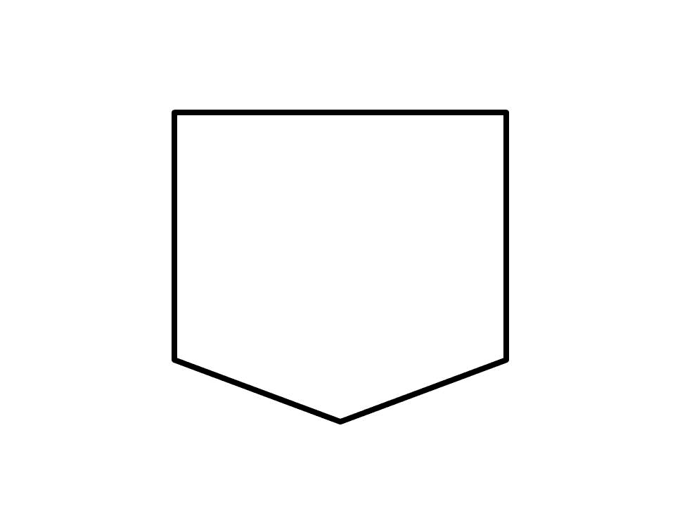

### 决策

菱形用于表示决策符号中正在测试的真/假陈述。

## 图 10.6.


### 模块调用

程序模块在流程图中用矩形表示，并带有一些线条以与过程符号区分开来。程序员通常会对程序控制和特定任务模块进行区分，如下所示。

注意：`C++` 的等价物是 `function`。

本地模块：通常是程序控制函数。

## 图 10.7.


库模块：通常是特定的任务函数。

## 图 10.8.


### 流线

注意：默认流向是从左到右、从上到下（与阅读英语的方式）。为了节省时间，通常只在流线与正常方向相反时才绘制箭头。

## 图 10.9.

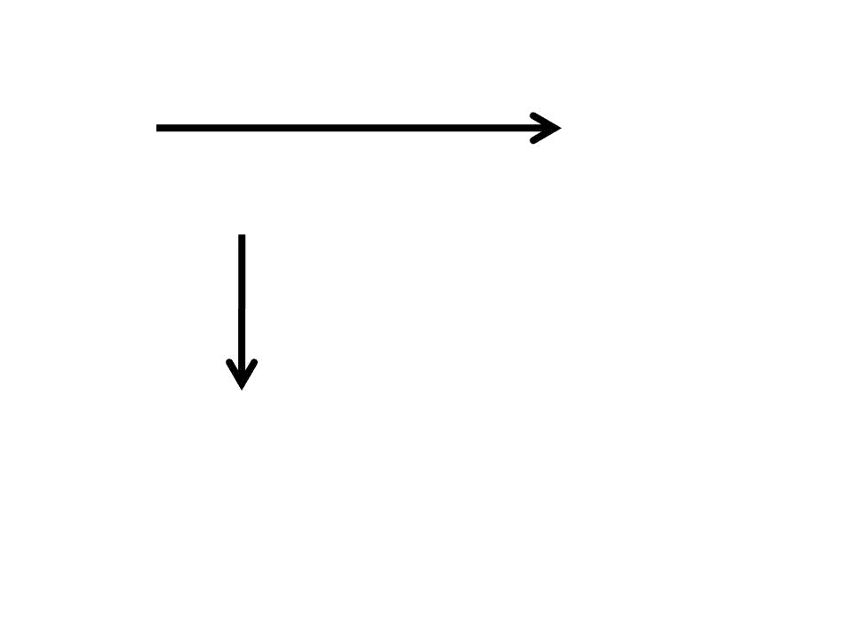

### 示例

我们将通过展示某些伪代码的流程图来演示各种流程图项目。

### 函数

**示例 10.9. 伪代码：无参数传递的函数**

```
Function clear monitor
  Pass In: nothing
  Direct the operating system to clear the monitor
  Pass Out: nothing
Endfunction
```

## 图 10.10.

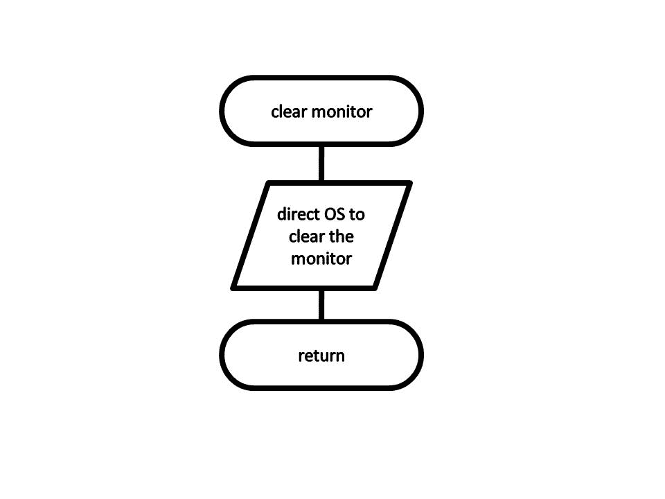 Function clear monitor

**示例 10.10. 伪代码：调用 clear monitor 函数的 main 函数**

```
Function main
  Pass In: nothing
  Doing some lines of code
  Call: clear monitor
  Doing some lines of code
  Pass Out: value zero to the operating system
Endfunction
```

## 图 10.11.

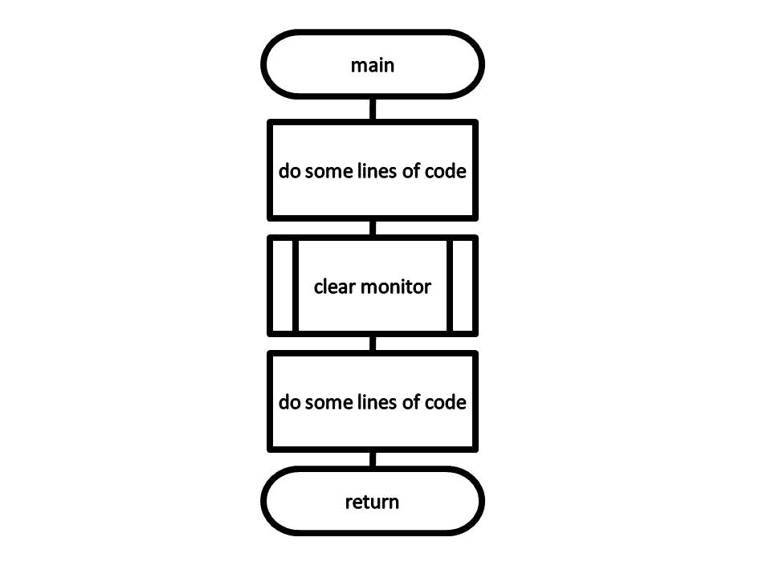 Function main

### 顺序控制结构

下一个项目是一个简单温度转换程序的伪代码。它演示了页内连接器和页外连接器的使用。它还说明了没有异常情况发生的顺序控制结构。只需按照列出的顺序一个接一个地执行指令。

**示例 10.11. 伪代码：顺序控制结构**

```
Filename: Solution_Lab_04_Pseudocode.txt
Purpose:  将温度从华氏度转换为摄度
Author:   Ken Busbee; © 2008 Kenneth Leroy Busbee
Date:      Dec 24, 2008
Pseudocode = IPO Outline
input
  显示一条消息询问用户输入华氏度温度
  从键盘获取温度
processing
  通过从华氏度中减去 32 计算摄氏度
  然后将结果乘以 5，然后
  将结果除以 9。四舍五入到整数。
  提示：在减法时使用 32.0 以确保浮点数精度。
output
  带有适当的消息显示摄氏度
  暂停以便用户查看答案
```

## 图 10.12.

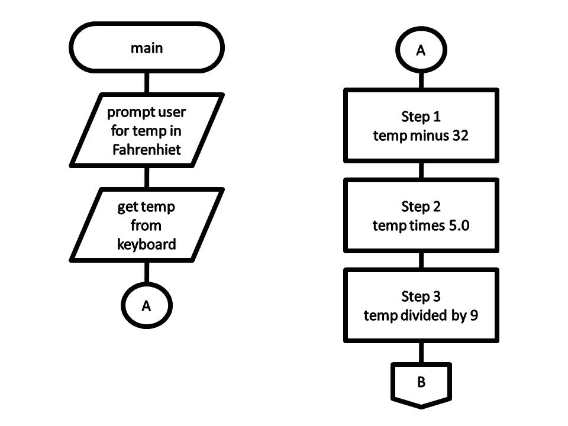 顺序控制结构

## 图 10.13.

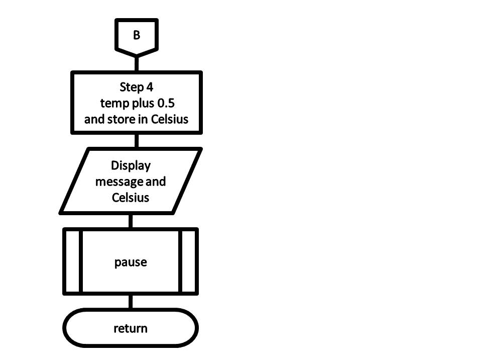 顺序控制结构续续

### 选择控制结构

**示例 10.12. 伪代码：If then Else**

```
If age > 17
  显示一条表示你可以投票的消息。
Else
  显示一条表示你不能投票的消息。
Endif
```

## 图 10.14.

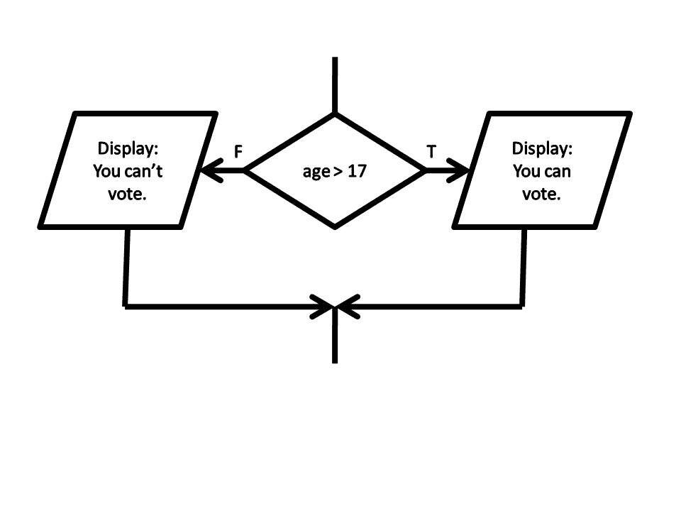 If then Else 结构

**示例 10.13. 伪代码：Case**

```
Case of age
  0 到 17  显示“你不能投票。”
  18 到 64  显示“你处于工作年龄。”
  65 +  显示“你应该退休了。”
Endcase
```

## 图 10.15.

 Case 控制结构

### 迭代（重复）控制结构

**示例 10.14. 伪代码：While**

```
count assigned zero
While count < 5
  显示“我爱计算机！”
  增加 count 
Endwhile
```

## 图 10.16.

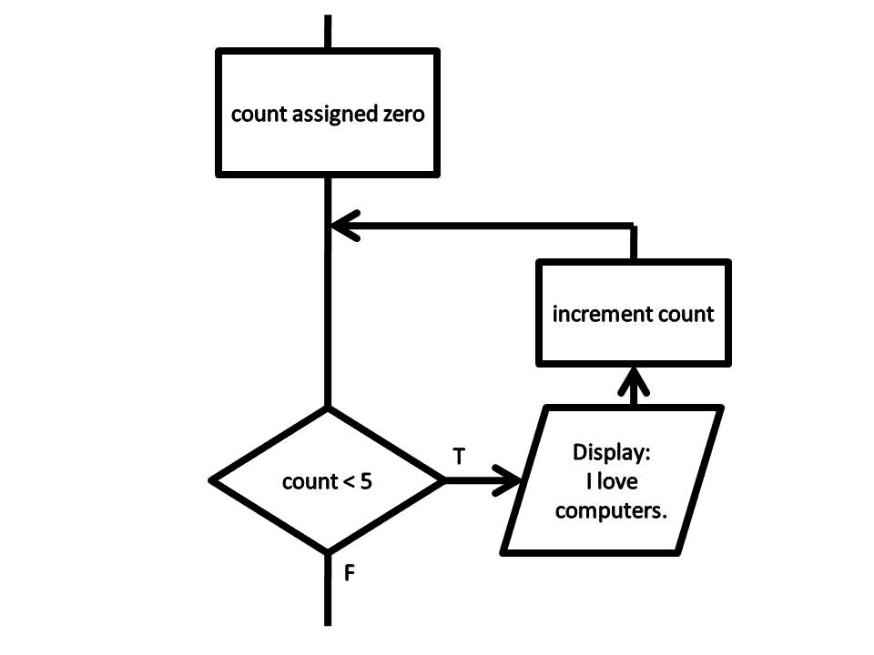 While 控制结构

**示例 10.15. 伪代码：For**

```
For x starts at 0, x < 5, increment x
  显示“我们玩得开心吗？”
Endfor
```

`for` 循环没有标准的流程图绘制方法，你会发现它有不同的实现方式。作为计数循环的 `for` 循环可以绘制成作为计数循环的 `while` 循环。

## 图 10.17.

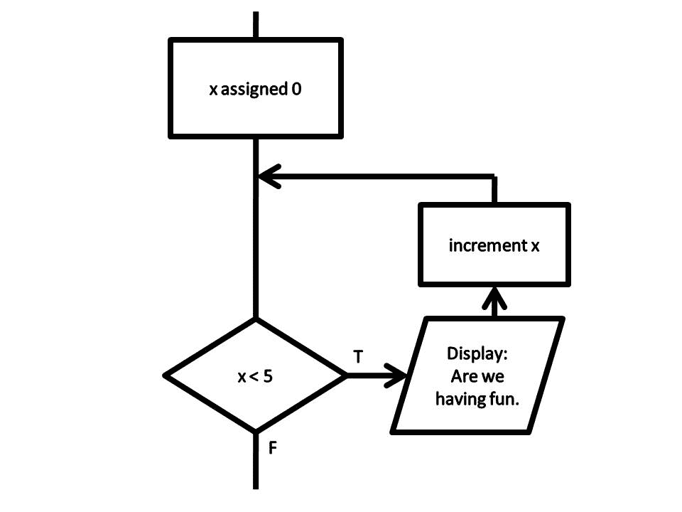 For 控制结构

**示例 10.16. 伪代码：Do**

```
count assigned zero
Do
  显示“我爱计算机！”
  增加 count
While count < 5
```

## 图 10.18.

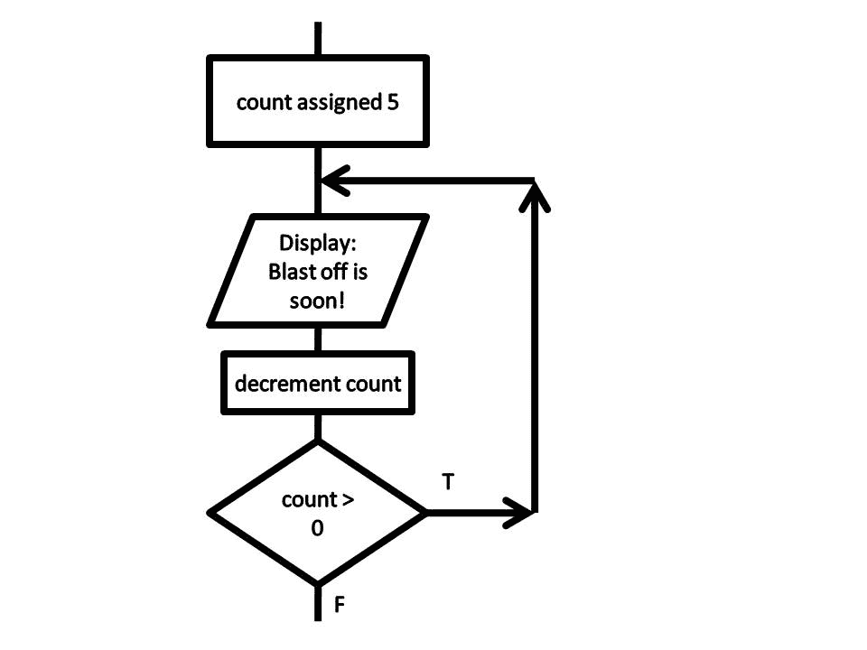 Do 控制结构

**示例 10.17. 伪代码：Repeat**

```
count assigned zero
Repeat
  显示“我爱计算机！”
  增加 count
Until count >= 5
```

## 图 10.19.


### 示例

我们将通过展示某些伪代码的流程图来演示各种流程图项目。

### 函数

**示例 10.9. 伪代码：无参数传递的函数**

```
Function clear monitor
  Pass In: nothing
  引导操作系统清空显示器
  Pass Out: nothing
Endfunction
```

## 图 10.10.

 Function clear monitor

**示例 10.10. 伪代码：调用 clear monitor 函数的 main 函数**

```
Function main
  Pass In: nothing
  执行几行代码
  Call: clear monitor
  执行几行代码
  Pass Out: 将值零传递给操作系统
Endfunction
```

## 图 10.11.

 Function main

### 顺序控制结构

下一个项目是一个简单温度转换程序的伪代码。它演示了页内连接器和页外连接器的使用。它还说明了在没有异常情况时的顺序控制结构。只需按照列出的顺序一个接一个地执行指令。

**示例 10.11. 伪代码：顺序控制结构**

```
Filename: Solution_Lab_04_Pseudocode.txt
Purpose:  将温度从华氏度转换为摄氏度
Author:   Ken Busbee; © 2008 Kenneth Leroy Busbee
Date:      Dec 24, 2008
Pseudocode = IPO Outline
input
  显示一条消息询问用户华氏度温度
  从键盘获取温度
processing
  通过从华氏度中减去 32 计算摄氏度
  然后将结果乘以 5，然后
  将结果除以 9。四舍五入到整数。
  提示：在减法时使用 32.0 以确保浮点数精度。
output
  带有适当的消息显示摄氏度
  暂停以便用户查看答案
```

## 图 10.12.

 顺序控制结构

## 图 10.13.

 顺序控制结构续续

### 选择控制结构

**示例 10.12. 伪代码：If then Else**

```
If age > 17
  显示一条表示你可以投票的消息。
Else
  显示一条表示你不能投票的消息。
Endif
```

## 图 10.14.

 If then Else 结构

**示例 10.13. 伪代码：Case**

```
Case of age
  0 到 17  显示“你不能投票。”
  18 到 64  显示“你处于工作年龄。”
  65 +  显示“你应该退休了。”
Endcase
```

## 图 10.15.

 Case 控制结构

### 迭代（重复）控制结构

**示例 10.14. 伪代码：While**

```
count assigned zero
While count < 5
  显示“我爱计算机！”
  增加 count
Endwhile
```

## 图 10.16.

 While 控制结构

**示例 10.15. 伪代码：For**

```
For x starts at 0, x < 5, increment x
  显示“我们玩得开心吗？”
Endfor
```

`for` 循环没有标准的流程图绘制方法，你会发现它有不同的实现方式。作为计数循环的 `for` 循环可以绘制成作为计数循环的 `while` 循环。

## 图 10.17.

 For 控制结构

**示例 10.16. 伪代码：Do**

```
count assigned zero
Do
  显示“我爱计算机！”
  增加 count
While count < 5
```

## 图 10.18.

 Do 控制结构

**示例 10.17. 伪代码：Repeat**

```
count assigned zero
Repeat
  显示“我爱计算机！”
  增加 count
Until count >= 5
```

## 图 10.19.


## 


我们将通过展示某些伪代码的流程图来演示各种流程图项目。

### 函数

**示例 10.9. 伪代码：无参数传递的函数**

```
Function clear monitor
  Pass In: nothing
  引导操作系统清空显示器
  Pass Out: nothing
Endfunction
```

## 图 10.10.

 Function clear monitor

**示例 10.10. 伪代码：调用 clear monitor 函数的 main 函数**

```
Function main
  Pass In: nothing
  执行几行代码
  Call: clear monitor
  执行几行代码
  Pass Out: 将值零传递给操作系统
Endfunction
```

## 图 10.11.

 Function main

### 顺序控制结构

下一个项目是一个简单温度转换程序的伪代码。它演示了页内连接器和页外连接器的使用。它还说明了在没有异常情况发生的顺序控制结构。只需按照列出的顺序一个接一个地执行指令。

**示例 10.11. 伪代码：顺序控制结构**

```
Filename: Solution_Lab_04_Pseudocode.txt
Purpose:  将温度从华氏度转换为摄氏度
Author:   Ken Busbee; © 2008 Kenneth Leroy Busbee
Date:      Dec 24, 2008
Pseudocode = IPO Outline
input
  显示一条消息询问用户输入华氏度温度
  从键盘获取温度
processing
  通过从华氏度中减去 32 计算摄氏度
  然后将结果乘以 5，然后
  将结果除以 9。四舍五入到整数。
  提示：在减法时使用 32.0 以确保浮点数精度。
output
  带有适当的消息显示摄氏度
  暂停以便用户查看答案
```

## 图 10.12.

 顺序控制结构

## 图 10.13.

 顺序控制结构续续

### 选择控制结构

**示例 10.12. 伪代码：If then Else**

```
If age > 17
  显示一条表示你可以投票的消息。
Else
  显示一条表示你不能投票的消息。
Endif
```

## 图 10.14.

 If then Else 结构 

**示例 10.13. 伪代码：Case**

```
Case of age
  0 到 17  显示“你不能投票。”
  18 到 64  显示“你处于工作年龄。”
  65 +  显示“你应该退休了。”
Endcase
```

## 图 10.15.

 Case 控制结构

### 迭代（重复）控制结构

**示例 10.14. 伪代码：While**

```
count assigned zero
While count < 5
  显示“我爱计算机！”
  增加 count
Endwhile
```

## 图 10.16.

 While 控制结构

**示例 10.15. 伪代码：For**

```
For x starts at 0, x < 5, increment x
  显示“我们玩得开心吗？”
Endfor
```

`for` 循环没有标准的流程图绘制方法，你会发现它有不同的实现方式。作为计数循环的 `for` 循环可以绘制成作为计数循环的 `while` 循环。

## 图 10.17.

 For 控制结构

**示例 10.16. 伪代码：Do**

```
count assigned zero
Do
  显示“我爱计算机！”
  增加 count
While count < 5
```

## 图 10.18.

 Do 控制结构

**示例 10.17. 伪代码：Repeat**

```
count assigned zero
Repeat
  显示“我爱计算机！”
  增加 count
Until count >= 5
```

## 图 10.19.


### 示例

我们将通过展示某些伪代码的流程图来演示各种流程图项目。

### 函数

**示例 10.9. 伪代码：无参数传递的函数**

```
Function clear monitor
  Pass In: nothing
  引导操作系统清空显示器
  Pass Out: nothing
Endfunction
```

## 图 10.10.

 Function clear monitor

**示例 10.10. 伪代码：调用 clear monitor 函数的 main 函数**

```
Function main
  Pass In: nothing
  执行几行代码
  Call: clear monitor
  执行几行代码
  Pass Out: 将值零传递给操作系统
Endfunction
```

## 图 10.11.

 Function main

### 顺序控制结构

下一个项目是一个简单温度转换程序的伪代码。它演示了页内连接器和页外连接器的使用。它还说明了在没有异常情况发生的顺序控制结构。只需按照列出的顺序一个接一个地执行指令。

**示例 10.11. 伪代码：顺序控制结构**

```
Filename: Solution_Lab_04_Pseudocode.txt
Purpose:  将温度从华氏度转换为 摄氏度
Author:   Ken Busbee; © 2008 Kenneth Leroy Busbee
Date:      Dec 24, 2008
Pseudocode = IPO Outline
input
  显示一条消息询问用户输入华氏度温度
  从键盘获取温度
processing
  通过从华氏度中减去 32 计算摄氏度
  然后将结果乘以 5，然后
  将结果除以 9。四舍五入到整数。
  提示：在减法时使用 32.0 以确保浮点数精度。
output
  带有适当的消息显示摄氏度
  暂停以便用户查看答案
```

## 图 10.12.

 顺序控制结构

## 图 10.13.

 顺序控制结构续续

### 选择控制结构

**示例 10.12. 伪代码：If then Else**

```
If age > 17
  显示一条表示你可以投票的消息。
Else
  显示一条表示你不能投票的消息。
Endif
```

## 图 10.14.

 If then Else 结构 

**示例 10.13. 伪代码：Case**

```
Case of age
  0 到 17  显示“你不能投票。”
  18 到 64  显示“你处于工作年龄。”
  65 +  显示“你应该退休了。”
Endcase
```

## 图 10.15.

 Case 控制结构

### 迭代（重复）控制结构

**示例 10.14. 伪代码：While**

```
count assigned zero
While count < 5
  显示“我爱计算机！”
  增加 count
Endwhile
```

## 图 10.16.

 While 控制结构

**示例 10.15. 伪代码：For**

```
For x starts at 0, x < 5, increment x
  显示“我们玩得开心吗？”
Endfor
```

`for` 循环没有标准的流程图绘制方法，你会发现它有不同的实现方式。作为计数循环的 `for` 循环可以绘制成作为计数循环的 `while` 循环。

## 图 10.17.

 For 控制结构

**示例 10.16. 伪代码：Do**

```
count assigned zero
Do
  显示“我爱计算机！”
  增加 count
While count < 5
```

## 图 10.18.

 Do 控制结构

**示例 10.17. 伪代码：Repeat**

```
count assigned zero
Repeat
  显示“我爱计算机！”
  增加 count
Until count >= 5
```

## 图 10.19.


### 示例

我们将通过展示某些伪代码的流程图来演示各种流程图项目。

### 函数

**示例 10.9. 伪代码：无参数传递的函数**

```
Function clear monitor
  Pass In: nothing
  引导操作系统清空显示器
  Pass Out: nothing
Endfunction
```

## 图 10.10.

 Function clear monitor

**示例 10.10. 伪代码：调用 clear monitor 函数的 main 函数**

```
Function main
  Pass In: nothing
  执行几行代码
  Call: clear monitor
  执行几行代码
  Pass Out: 将值零传递给操作系统
Endfunction
```

## 图 10.11.

 Function main

### 顺序控制结构

下一个项目是一个简单温度转换程序的伪代码。它演示了页内连接器和页外连接器的使用。它还说明了在没有异常情况发生的顺序控制结构。只需按照列出的顺序一个接一个地执行指令。

**示例 10.11. 伪代码：顺序控制结构**

```
Filename: Solution_Lab_04_Pseudocode.txt
Purpose:  将温度从华氏度转换为摄氏度
Author:   Ken Busbee; © 2008 Kenneth Leroy Busbee
Date:      Dec 24, 2008
Pseudocode = IPO Outline
input
  显示一条消息询问用户输入华氏度温度
  从键盘获取温度
processing
  通过从华氏度中减去 32 计算摄氏度
  然后将结果乘以 5，然后
  将结果除以 9。四舍五入到整数。
  提示：在减法时使用 32.0 以确保浮点数精度。
output
  带有适当的消息显示摄氏度
  暂停以便用户查看答案
```

## 图 10.12.

 顺序控制结构

## 图 10.13.

 顺序控制结构续续

### 选择控制结构

**示例 10.12. 伪代码：If then Else**

```
If age > 17
  显示一条表示你可以投票的消息。
Else
  显示一条表示你不能投票的消息。
Endif
```

## 图 10.14.

 If then Else 结构 

**示例 10.13. 伪代码：Case**

```
Case of age
  0 到 17  显示“你不能投票。”
  18 到 64  显示“你处于工作年龄。”
  65 +  显示“你应该退休了。”
Endcase
```

## 图 10.15.

 Case 控制结构

### 迭代（重复）控制结构

**示例 10.14. 伪代码：While**

```
count assigned zero
While count < 5
  显示“我爱计算机！”
  增加 count
Endwhile
```

## 图 10.16.

 While 控制结构

**示例 10.15. 伪代码：For**

```
For x starts at 0, x < 5, increment x
  显示“我们玩得开心吗？”
Endfor
```

`for` 循环没有标准的流程图绘制方法，你会发现它有不同的实现方式。作为计数循环的 `for` 循环可以绘制成作为计数循环的 `while` 循环。

## 图 10.17.

 For 控制结构

**示例 10.16. 伪代码：Do**

```
count assigned zero
Do
  显示“我爱计算机！”
  增加 count
While count < 5
```

## 图 10.18.

 Do 控制结构

**示例 10.17. 伪代码：Repeat**

```
count assigned zero
Repeat
  显示“我爱计算机！”
  增加 count
Until count >= 5
```

## 图 10.19.


### 示例

我们将通过展示某些伪代码的流程图来演示各种流程图项目。

### 函数

**示例 10.9. 伪代码：无参数传递的函数**

```
Function clear monitor
  Pass In: nothing
  引导操作系统清空显示器
  Pass Out: nothing
Endfunction
```

## 图 10.10.

 Function clear monitor

**示例 10.10. 伪代码：调用 clear monitor 函数的 main 函数**

```
Function main
  Pass In: nothing
  执行几行代码
  Call: clear monitor
  执行几行代码
  Pass Out: 将值零传递给操作系统
Endfunction
```

## 图 10.11.

 Function main

### 顺序控制结构

下一个项目是一个简单温度转换程序的伪代码。它演示了页内连接器和页外连接器的使用。它还说明了在没有异常情况发生的顺序控制结构。只需按照列出的顺序一个接一个地执行指令。

**示例 10.11. 伪代码：顺序控制结构**

```
Filename: Solution_Lab_04_Pseudocode.txt
Purpose:  将温度从华氏度转换为摄氏度
Author:   Ken Busbee; © 2008 Kenneth Leroy Busbee
Date:      Dec 24, 2008
Pseudocode = IPO Outline
input
  显示一条消息询问用户输入华氏度温度
  从键盘获取温度
processing
  通过从华氏度中减去 32 计算摄氏度
  然后将结果乘以 5，然后
  将结果除以 9。四舍五入到整数。
  提示：在减法时使用 32.0 以确保浮点数精度。
output
  带有适当的消息显示摄氏度
  暂停以便用户查看答案
```

## 图 10.12.

 顺序控制结构

## 图 10.13.

 顺序控制结构续续

### 选择控制结构

**示例 10.12. 伪代码：If then Else**

```
If age > 17
  显示一条表示你可以投票的消息。
Else
  显示一条表示你不能投票的消息。
Endif
```

## 图 10.14.

 If then Else 结构 

**示例 10.13. 伪代码：Case**

```
Case of age
  0 到 17  显示“你不能投票。”
  18 到 64  显示“你处于工作年龄。”
  65 +  显示“你应该退休了。”
Endcase
```

## 图 10.15.

 Case 控制结构

### 迭代（重复）控制结构

**示例 10.14. 伪代码：While**

```
count assigned zero
While count < 5
  显示“我爱计算机！”
  增加 count
Endwhile
```

## 图 10.16.

 While 控制结构

**示例 10.15. 伪代码：For**

```
For x starts at 0, x < 5, increment x
  显示“我们玩得开心吗？”
Endfor
```

`for` 循环没有标准的流程图绘制方法，你会发现它有不同的实现方式。作为计数循环的 `for` 循环可以绘制成作为计数循环的 `while` 循环。

## 图 10.17.

 For 控制结构

**示例 10.16. 伪代码：Do**

```
count assigned zero
Do
  显示“我爱计算机！”
  增加 count
While count < 5
```

## 图 10.18.

 Do 控制结构

**示例 10.17. 伪代码：Repeat**

```
count assigned zero
Repeat
  显示“我爱计算机！”
  增加 count
Until count >= 5
```

## 图 10.19.


### 示例

我们将通过展示某些伪代码的流程图来演示各种流程图项目。

### 函数

**示例 10.9. 伪代码：无参数传递的函数**

```
Function clear monitor
  Pass In: nothing
  引导操作系统清空显示器
  Pass Out: nothing
Endfunction
```

## 图 10.10.

 Function clear monitor

**示例 10.10. 伪代码：调用 clear monitor 函数的 main 函数**

```
Function main
  Pass In: nothing
  执行几行代码
  Call: clear monitor
  执行几行代码
  Pass Out: 将值零传递给操作系统
Endfunction
```

## 图 10.11.

 Function main

### 顺序控制结构

下一个项目是一个简单温度转换程序的伪代码。它演示了页内连接器和页外连接器的使用。它还说明了在没有异常情况发生的顺序控制结构。只需按照列出的顺序一个接一个地执行指令。

**示例 10.11. 伪代码：顺序控制结构**

```
Filename: Solution_Lab_04_Pseudocode.txt
Purpose:  将温度从华氏度转换为摄氏度
Author:   Ken Busbee; © 2008 Kenneth Leroy Busbee
Date:      Dec 24, 2008
Pseudocode = IPO Outline
input
  显示一条消息询问用户输入华氏度温度
  从键盘获取温度
processing
  通过从华氏度中减去 32 计算摄氏度
  然后将结果乘以 5，然后
  将结果除以 9。四舍五入到整数。
  提示：在减法时使用 32.0 以确保浮点数精度。
output
  带有适当的消息显示摄氏度
  暂停以便用户查看答案
```

## 图 10.12.

 顺序控制结构

## 图 10.13.

 顺序控制结构续续

### 选择控制结构

**示例 10.12. 伪代码：If then Else**

```
If age > 17
  显示一条表示你可以投票的消息。
Else
  显示一条表示你不能投票的消息。
Endif
```

## 图 10.14.

 If then Else 结构 

**示例 10.13. 伪代码：Case**

```
Case of age
  0 到 17  显示“你不能投票。”
  18 到 64  显示“你处于工作年龄。”
  65 +  显示“你应该退休了。”
Endcase
```

## 图 10.15.

 Case 控制结构

### 迭代（重复）控制结构

**示例 10.14. 伪代码：While**

```
count assigned zero
While count < 5
  显示“我爱计算机！”
  增加 count
Endwhile
```

## 图 10.16.

 Wait 控制结构

**示例 10.15. 伪代码：For**

```
For x starts at 0, x < 5, increment x
  显示“我们玩得开心吗？”
Endfor
```

`for` 循环没有标准的流程图绘制方法，你会发现它有不同的实现方式。作为计数循环的 `for` 循环可以绘制成作为计数循环的 `while` 循环。

## 图 10.17.

 For 控制结构

**示例 10.16. 伪代码：Do**

```
count assigned zero
Do
  显示“我爱计算机！”
  增加 count
While count < 5
```

## 图 10.18.

 Do 控制结构

**示例 10.17. 伪代码：Repeat**

```
count assigned zero
Repeat
  显示“我爱计算机！”
  增加 count
Until count >= 5
```

## 图 10.19.


### 示例

我们将通过展示某些伪代码的流程图来演示各种流程图项目。

### 函数

**示例 10.9. 伪代码：无参数传递的函数**

```

Function clear monitor
  Pass In: nothing
  引导操作系统清空显示器
  Pass Out: nothing
Endfunction
```

## 图 10.10.

11 (graphics10.1)](m19623/graphics10.jpg) Function clear monitor

**** 11..1.  代码：： clear clear monitor 函数的 main 函数**

```
Function main
  Pass In: nothing
  执行几行代码
  Call: clear monitor
  执行几行代码
  Pass Out: 将值零传递给操作系统
Endfunction
```

## 图 10.11.

 Function main

### 顺序控制结构

下一个项目是一个简单温度转换程序的伪代码。它演示了页内连接器和页外连接器的使用。它还说明了在没有异常情况发生的顺序控制结构。只需按照列出的顺序一个接一个地执行指令。

**示例 10.11. 伪代码：顺序控制结构**

```
Filename: Solution_Lab_04_Pseudocode.txt
Purpose:  将温度从华氏度转换为摄氏度
Author:   Ken Busbee; © 2008 Kenneth Leroy Busbee
Date:      Dec 24, 2008
Pseudocode = IPO Outline
input
  显示一条消息询问用户输入华氏度温度
  从键盘获取温度
processing
  通过从华氏度中减去 32 计算摄氏度
  然后将结果乘以 5，然后
  将结果除以 9。四舍五入到整数。
  提示：在减法时使用 32.0 以确保浮点数精度。
output
  带有适当的消息显示摄氏度
  暂停以便用户查看答案
```

## 图 10.12.

 顺序控制结构

## 图 10.13.

 顺序控制结构续续

### 选择控制结构

**示例 10.12. 伪代码：If then Else**

```
If age > 17
  显示一条表示你可以投票的消息。
Else
  显示一条表示你不能投票的消息。
Endif
```

## 图 10.14.

 If then Else 结构 

**示例 10.13. 伪代码：Case**

```
Case of age
  0 到 17  显示“你不能投票。”
  18 到 64  显示“你处于工作年龄。”
  65 +  显示“你应该退休了。”
Endcase
```

## 图 10.15.

 Case 控制结构

### 迭代（重复）控制结构

**示例 10.14. 伪代码：While**

```
count assigned zero
While count < 5
  显示“我爱计算机！”
  增加 count
Endwhile
```

## 图 10.16.

 Wait 控制结构

**示例 10.15. 伪代码：For**

```
For x starts at 0, x < 5, increment x
  显示“我们玩得开心吗？”
Endfor
```

`for` 循环没有标准的流程图绘制方法，你会发现它有不同的实现方式。作为计数循环的 `for` 循环可以绘制成作为计数循环的 `while` 循环。

## 图 10.17.

 For 控制结构

**示例 10.16. 伪代码：Do**

```
count assigned zero
Do
  显示“我爱计算机！”
  增加 count
While count < 5
```

## 图 10.18.

 Do 控制结构

**示例 10.17. 伪代码：Repeat**

```
count assigned zero
Repeat
  显示“我爱计算机！”
  增加 count
Until count >= 5
```

## 图 10.19.


### 示例

我们将通过展示某些伪代码的流程图来演示各种流程图项目。

### 函数

**示例 10.9. 伪代码：无参数传递的函数**

```
Function clear monitor
  Pass In: nothing
  引导操作系统清空显示器
  Pass Out: nothing
Endfunction
```

## 图 10.10.

 Function clear monitor

**示例 10.10. 伪代码：调用 clear monitor 函数的 main 函数**

```
Function main
  Pass In: nothing
  执行几行代码
  Call: clear monitor
  执行几行代码
  Pass Out: 将值零传递给操作系统
Endfunction
```

## 图 10.11.

 Function main

### 顺序控制结构

下一个项目是一个一个温度温度转换度度 伪代码。它演示了页内连接器和页外连接器的使用。它还说明了在没有异常情况发生的顺序控制结构。只需按照列出的顺序一个接一个地执行指令。

**示例 10.11. 伪代码：顺序控制结构**

```
Filename: Solution_Lab_04 Pseudocode.txt
Purpose:  将温度从华氏度转换为摄氏度
Author:   Ken Busbee; © 2008 Kenneth Leroy Busbee
Date:      Dec 24, 2008
Pseudocode = IPO Outline
input
  显示一条消息询问用户输入华氏度温度
  从键盘获取温度
processing
  通过从华氏度中减去 32 计算摄氏度
  然后将结果乘以 5，然后
  将结果除以 9。四舍五入到整数。
  提示：在减法时使用 32.0 以确保浮点数精度。
output
  带有适当的消息显示摄氏度
  暂停以便用户查看答案
```

## 图 10.12.

 顺序控制结构

## 图 10.13.

 顺序控制结构续续

### 选择控制结构

**示例 10.12. 伪代码：If then Else**

```
If age > 17
  显示一条表示你可以投票的消息。
Else
  显示一条表示你不能投票的消息。
Endif
```

## 图 10.14.

 If then Else 结构 

**示例 10.13. 伪代码：Case**

```
Case of age
  0 到 17  显示“你不能投票。”
  18 到 64  显示“你处于工作年龄。”
  65 +  显示“你应该退休了。”
Endcase
```

## 图 10.15.

 Case 控制结构

### 迭代（重复）控制结构

**示例 10.14. 伪代码：While**

```
count assigned zero
While count < 5
  显示“我爱计算机！”
  增加 count
Endwhile
```

## 图 10.16.

 Wait 控制结构

**示例 10.15. 伪代码：For**

```
For x starts at 0, x < 5, increment x
  显示“我们玩得开心吗？”
Endfor
```

`for` 循环没有标准的流程图绘制方法，你会发现它有不同的实现方式。作为计数循环的 `for` 循环可以绘制成作为计数循环的 `while` 循环。

## 图 10.17.

 For 控制结构

**示例 10.16. 伪代码：Do**

```
count assigned zero
Do
  显示“我爱计算机！”
  增加 count
While count < 5
```

## 图 10.18.

 Do 控制结构

**示例 10.17. 伪代码：Repeat**

```
count assigned zero
Repeat
  显示“我爱计算机！”
  增加 count
Until count >= 5
```

## 图 10.19.


### 示例

我们将通过展示某些伪代码的流程图来演示各种流程图项目。

### 函数

**示例 10.9. 伪代码：无参数传递的函数**

```
Function clear monitor
  Pass In: nothing
  引导操作系统清空显示器
  Pass Out: nothing
Endfunction
```

## 图 10.10.

 Function clear monitor

**示例 10.10. 伪代码：调用 clear monitor 函数的 main 函数**

```
Function main
  Pass In: nothing
  执行几行代码
  Call: clear monitor
  执行几行代码
  Pass Out: 将值零传递给操作系统
Endfunction
```

## 图 10.11.

 Function main

### 顺序控制结构

下一个项目是一个简单温度转换程序的伪代码。它演示了页内连接器和页外连接器的使用。它还说明了在没有异常情况发生的顺序控制结构。只需按照列出的顺序一个接一个地执行指令。

**示例 10.11. 伪代码：顺序控制结构**

```
Filename: Solution_Lab_04_Pseudocode.txt
Purpose:  将温度从华氏度转换为摄氏度
Author:   Ken Busbee; © 2008 Kenneth Leroy Busbee
Date:      Dec 24, 2008
Pseudocode = IPO Outline
input
  显示一条消息询问用户输入华氏度温度
  从键盘获取温度
processing
  通过从华氏度中减去 32 计算摄氏度
  然后将结果乘以 5，然后
  将结果除以 9。四舍五入到整数。
  提示：在减法时使用 32.0 以确保浮点数精度。
output
  带有适当的消息显示摄氏度
  暂停以便用户查看答案
```

## 图 10.12.

 顺序控制结构

## 图 10.13.

 顺序控制结构续续

### 选择控制结构

**示例 10.12. 伪代码：If then Else**

```
If age > 17
  显示一条表示你可以投票的消息。
Else
  显示一条表示你不能投票的消息。
Endif
```

## 图 10.14.

 If then Else 结构 

**示例 10.13. 伪代码：Case**

```
Case of age
  0 到 17  显示“你不能投票。”
  18 到 64  显示“你处于工作年龄。”
  65 +  显示“你应该退休了。”
Endcase
```

## 图 10.15.

 Case 控制结构

### 迭代（重复）控制结构

**示例 10.14. 伪代码：While**

```
count assigned zero
While count < 5
  显示“我爱计算机！”
  增加 count
Endwhile
```

## 图 10.16.

 Wait 控制结构

**示例 10.15. 伪代码：For**

```
For x starts at 0, x < 5, increment x
  显示“我们玩得开心吗？”
Endfor
```


列出控制结构的四种类型，并对每种类型进行简要描述。

## 练习解答

### 练习 10.4.1 答案. (返回练习)

**答案：**

1.  `false`
2.  `true`
3.  `false`
4.  `false`
5.  `false`

* * * 

^([2]) 来自维基百科的结构化编程

# 第 11 章 双路选择

## 11.1. If Then Else

## 双路选择简介

#### 传统的双路选择（重新检查结构）

## 传统的双路选择

我们将介绍每种高级语言中都存在的选择类控制结构。它被称为 `if then else` 结构。通过提出一个有真假答案的问题来控制 `if then else` 结构。它的形式如下：

```
if the answer to the question is true
   then do this
   else because it's false
   do this 
```

在大多数语言中，该问题（称为 `test expression`）是一个 `Boolean expression`。`Boolean` 数据类型有两个值——`true` 和 `false`。让我们重写该结构以考虑这一点：

```
if expression is true
   then do this
   else because it's fales
   do this
```

有些语言使用保留字：`"if"`、`"then"` 和 `"else"`。许多语言省略了 `"then"`。此外，`"do this"` 可以与真假值绑定。你可能会看到如：

```
if expression is true
   action true
else
   action false
```

而且大多数语言会推断“is true”，你可能会看到如：

```
if expression
   action true
else
   action false
```

上述四种形式的控制结构的意思是相同的。在现代英语中，通常不使用 `else` 这个词。然而，请考虑以下母亲和孩子之间的对话。

孩子问：“妈妈，我可以出去玩吗？”

母亲回答：“如果你的房间是干净的，你就可以出去玩，否则你必须坐在椅子上五分钟，以此惩罚你明知房间很脏还问我这个问题。”

请注意，所有的元素都包含了决定孩子将执行的动作（或流程）。因为问题（`your room is clean`）只有两个可能的答案（`true` 或 `false`），所以这些动作是*互斥的*（mutually exclusive）。孩子要么 1) 出去玩，要么 2) 坐在椅子上五分钟。其中一个动作会被执行；绝不是两个都执行。

#### 单选择 —— 隐式双路选择

程序员通常只想在表达式为真时才执行某些操作，即没有假对应的动作。缺少假对应的动作也被称为 `"null else"`，其写法如下：

```
if expression
   action true 
else 
   do nothing
```

由于 `"else do nothing"` 是隐含的，它通常以简写形式出现：

```
if expression
   action true
```

#### C++ 中的双路选择

C++ 编程语言中 `if then else` 控制结构的语法为：

```cpp
if (expression)
   statement;
else
   statement;
```

注意：测试表达式在括号内，但这不是一个函数调用。括号是控制结构的一部分。此外，在表达式后的括号后没有分号。

## 定义

**定义：** `if then else`

一种双路选择控制结构。

**定义：** `mutually exclusive`

不重叠的项。例如：`true` 和 `false`。

## 11.2. Boolean 数据类型

## 讨论

`Boolean` 数据类型也称为逻辑数据类型，代表 `true` 和 `false` 的概念。`"Boolean"` 这个名字来源于数学家乔治·布尔（George Boole）；他在 1854 年发表了：*思维规律研究》（*An Investigation of the Laws of Thought*）。`Boolean` 代数是使用数字 `0` 和 `1` 对 `true` 和 `false` 进行逻辑表示的数学领域。`Boolean` 数据类型在编程中的重要性在于它被用于控制编程结构（`if then else`、`while` 循环等），允许我们能够在算法中实现“选择”。

`Boolean` 数据类型在所有编程语言中具有相同的属性，且行为相似。C++ 编程语言中的规则如下：

**表 11.1。**

| C++ 保留字 | `bool` |
| :--- | :--- |
| 表示 | true 和 false 的逻辑概念 |
| 大小 | 通常为 1 字节 |
| 正常符号 | 无符号 |
| 范围（允许的值） | `0` 表示假，`1` 表示真 |
| C++ 语法 | `0` 表示假，`1` 表示真 |
| 重要性 | 用于控制编程结构（`if then else`、`while` 循环等） |
| 选择 | 允许我们能够在算法中实现“选择” |

## 定义

**定义：** `Boolean`

一种代表 `true` 和 `false` 概念的数据类型。

**定义：** `test expression`

用于控制构造的表达式。

## 11.3. 关系运算符

### 关系运算符概述

关系运算符通常用于创建 `test expression`。这种表达式也称为 `Boolean expression`，因为它们在求值时会产生布尔值。有六种常见的关系运算符通过比较两个操作数之间的（关系）来产生布尔值。如果操作数的类型不同，会发生隐式提升将操作数转换为相同类型。

**定义：** 关系运算符

通过评估操作数产生布尔值的运算符。

**表 11.2。**

| C++ 运算符 | 含义 |
| :--- | :--- |
| `<` | 小于 |
| `>` | 大于 |
| `<=` | 小于等于 |
| `>=` | 大于等于 |
| `==` | 等于（相等） |
| `!=` | 不等于（不等） |

#### 练习 11.3.1. (跳转到解答)

**计算以下布尔表达式：**

1.  `9 < 25`
2.  `9 < 3`
3.  `9 > 14`
4.  `9 <= 17`
5.  `9 >= 25`
6.  `9 == 13`
7.  `9 != 13`
8.  `9 != 25`

## C++ 演示程序

### 为源文件创建文件夹或子文件夹

根据你的编译器/IDE，你应该决定在哪里下载和存储用于处理的源文件。明智的做法是在下载源文件之前，根据需要创建这些文件夹。对于 *Bloodshed Dev-C++ 5* 编译器/IDE，建议的子文件夹命名为：

*   `Demo_Programs`

### 下载演示程序


将以下文件下载并存储到你存储设备上相应的文件夹中。你可能需要右键点击链接并选择“目标另存为”来下载文件。根据你的编译器/IDE 的方法编译并运行程序。结合其他学习材料学习源代码文件。

从 Connexions 下载：[Demo_Relational_Operators.cpp](http://cnx.org/content/m19549/1.11/Demo_Relational_Operators.cpp)

## 练习解答

**练习 11.3.1 答案。（返回练习)**

**答案：**

1. 1
2. 0
3. 0
4. 1
5. 0
6. 0
7. 1
8. 错误，“不小于”不是一个有效的运算符。

## 11.4. 复合语句

## 复合语句的必要

为了说明，我们将使用 C++ 编程语言中 *if then else* 控制结构的语法。然而，这个问题通常存在于任何需要使用复合语句的语言的所有控制结构中。其语法如下：

```cpp
if (expression)
  statement;
else
  statement;
```

在 C++ 编程语言中，只能列出一条语句作为控制结构的动作部分。通常，我们想要执行多于一条语句。这个问题通过创建一个复合语句来解决。大括号符号——左大括号 `{` 和右大括号 `}`——被用于创建复合语句。例如：

```cpp
if(expression)
  {
    statement;
    statement;
  }
else
  {
    statement;
    statement;
  }
```

由于程序员经常忘记他们只能列出一条语句作为控制结构的动作部分，因此 C++ 编程行业鼓励使用缩进（以便清晰地查看动作部分）以及使用复合语句（大括号），即使只有一个动作。因此：

```cpp
if(expression)
  {
    statement;
  }
else
  {
    statement;
  }
```

通过这种方式编写代码，如果程序员通过在真动作部分或假动作部分中添加更多语句来修改代码，他们将不会引入编译器错误或逻辑错误。使用缩进和大括号应该成为 C++ 程序员以及任何其他在控制结构中使用复合语句的语言的程序员的标准做法。

## 复合语句的其他用途

“复合语句是由零或多条语句组成的代码单元。它也被称为块（block）。复合语句允许一组语句成为一个单一的入口。在你第一个程序中，当你形成 `main` 函数体时就使用了复合语句。所有的 C++ 函数都包含一个被称为函数体的复合语句。

复合语句由一个左大括号、可选的声明、定义和语句组成，随后是一个右大括号。虽然这三者都是可选的，但至少应存在一个。”

## 定义

定义：复合语句
由零或多条语句组成的代码单元。

定义：块
复合语句的另一个名称。

# 11.5. 练习 11：双向选择

## 学习目标

在以下过程中在记忆构建活动、练习、实验作业、问题或限时测验/考试中达到 100% 的准确率；学生预期：

1. 定义本章节相关模块中列出的定义中的术语。
2. 给定伪代码的情况下，编写一个使用 if then else 控制结构的程序的 C++ 代码。

## 记忆构建活动

链接至：[MBA 11](http://cnx.org/content/m19764/1.15/index.html)

## 练习

**练习 11.5.1。（前往解答)**

**求值以下布尔表达式：**

1. 25 < 7
2. 3 < 7
3. 14 > 7
4. 17 <= 7
5. 25 >= 7
6. 13 == 7
7. 9 != 7
8. 5 !> 7

## 其他项目

链接至：[显示 if then else 的动画 gif](http://cnx.org/content/m19764/1.15/if_then_else_flow.gif)
链接至：[数据处理部分 2](http://cnx.org/content/m19764/1.15/Manipulation_Data_Part_2.pdf)

## 实验作业

### 为第 11 章文件创建文件夹或子文件夹

取决于你的编译器/IDE，你应该决定在何处下载和存储用于处理的源代码。审慎的做法是在下载源代码之前创建这些文件夹。对于 Dev-C++ 5 编译器，建议的子文件夹可以命名为 `Cpp_Source_Files` 文件夹下的 `Chapter_1`。如果你尚未这样做，请根据需要创建相应的文件夹和/或子文件夹。

### 下载文件

将以下文件下载并存储到你存储设备上相应的文件夹中。你可能需要右键点击链接并选择“目标另存为”来下载文件。从 Connexions 下载：[Lab_11_Pseudocode.txt](http://cnx.org/content/m19764/1.15/Lab_11_Pseudocode.txt)

### 详细实验说明

仔细阅读并遵循指示，并按顺序执行步骤：

* 从 `Lab_11_Pseudocode.txt` 创建一个源代码文件。将其命名为 `Lab_1.cpp`。
* 编译（编译并运行）你的程序。
* 在成功编写此程序后，如果你是为了学分而修读此课程，请遵循教授/教师的说明进行提交。

## 问题

### 问题 1a – 指示
创建一个包含六个关系运算符及其含义的表格。

### 问题 1b – 指示
解释为什么我们在下例示例中使用 "if then else" 来处理输入。

**示例 1.1. C++ 源代码**

```cpp
cout << "\nEnter side of the rectangle: ";
cin >> side1;
cout << "\nEnter the other side of the rectangle: ";
cin >> side2;
if (side1 > side2)
  {
    length = side1;
    width = side2;
  }
else
  {
    length = side2;
    width = side1;
  }
```

## 练习解答

**练习 11.5.1 答案。（返回练习](#ch11.html_m19764.idBooleanExpCh11s))**

**答案：**

1. 0
2. 1
3. 1
4. 0
5. 1
6. 0
7. 1
8. 错误，“不大于”不是一个有效的运算符。

# 第 12 章 多路选择

# 12.1. 嵌套 if then else

## 多路选择简介

## 嵌套控制结构

嵌套是将一个项目放在另一个项目内部的概念。考虑

```cpp
if expression
  true_action
else
  false_action
```

这是 if then else 控制结构的基本形式。现在考虑：

```cpp
if age is less than 18
  you can't vote
  if age is less than 16
     you can't drive
  else
    you can drive
else
  you can vote
  if age is less than 21
    you can't drink
  else
    you can drink
```

如你所示，我们在真动作部分仅仅包含了一个语句和一个 if then else 控制结构。我们在假动作部分也做了同样的操作（嵌套了另一个 if then else）。在我们的示例中，我们嵌套了 if then else 控制结构。嵌套可以在 while 循环中使用 if then else。因此，嵌套的概念允许不同类型的控制结构进行混合。

### 多路选择

双向选择的缺点之一是我们只能考虑两个选择。但如果你有超过两个选择，该怎么办？考虑以下具有四个选择的内容：

```cpp
if age equal to 18
  you can now vote
else
  if age equal to 39
    you are middle aged
  else
    if age equal to 65
```


```
you can consider retirement
else
  your age is unimportant
```

你将根据 `age` 的值获得适当的消息。最后一项被称为“默认项”。如果 `age` 不等于 18、39 或 65，你将获得默认消息。在某些情况下，没有默认操作。考虑以下：

```
if age equal to 18
  you can now vote
else
  if age equal to 39
    you are middle aged
  else
    if age equal to 65
      you can consider retirement
```

最后一个 `if then else` 控制结构没有“else”。它隐含了“否则 else 则什么都不做”。如果没有默认项，多路选择可以写为一系列“不带 else 的 `if then`”结构。考虑以下：

```
if age equal to 18
  you can now vote
if age equal to 39
  you are middle aged
if age equal to 65
  you can consider retirement
```

我们展示了完成多路选择两种方法。使用嵌套的 `if then else` 控制结构还是一系列 `if then` 控制结构的选择，取决于是否存在默认操作（如果有默认操作，必须使用嵌套的 `if then else`），或者在没有默认操作时程序员的偏好（可以使用嵌套的 `if then else` 或一系列 `if then` 控制结构）。

## C++ 中的 if then else 语法

C++ 编程语言中 `if then else` 控制结构的语法如下：

**示例 12.1. C++ 源代码：if then else 的布局**

```
if (expression)
  {
  statement;
  }
else
  {
  statement;
}
```

### 注意事项

测试表达式位于括号内，但这并不是一个函数调用。括号是控制结构的一部分。此外，在紧跟表达式括号后面没有分号。

## C++ 示例

多路选择通常需要覆盖所有可能性。假设用户已被提示两个人的年龄，并将答案存储在名为 `age1` 和 `age2` 的变量中。考虑以下：

**示例 12.2. C++ 源代码**

```
if(age1 > age2)
  {
  cout << "\n\nThe first person is older.";
  }
else
  {
  cout << "\n\nThe second person is older.";
  }
```

如果这两个人的年龄相同怎么办？程序错误地说第二个人年龄大。为了解决这个问题，我们必须处理所有可能性。考虑这个多路选择示例：

**示例 12.3. C++ 源代码**

```
if(age1 == age2)
  {
  cout << "\n\nThey are the same age.";
  }
else
  {
  if(age1 > age2)
    {
    cout << "\n\nThe first person is older.";
    }
  else
    {
    cout << "\n\nThe second person is older.";
    }
  }
```

## 定义

定义：嵌套控制结构
将一个控制结构放在另一个结构内部。

定义：多路选择
使用控制结构能够从两个以上的选项中进行选择。

## 12.2. 逻辑运算符概述

在大多数语言中，产生布尔类型值的表达式被分为两组。一组在表达式中使用关系运算符，另一组则在表达式中使用逻辑运算符。逻辑运算符通常用于帮助创建测试表达式，这种类型的表达式也称为布尔表达式，因为它们会产生布尔答案或值，即为真（1）或假（0）。有三种常见的逻辑运算符通过操作其他操作数产生布尔值。运算符符号和名称随不同的编程语言而异：

`&&` - 逻辑与（两个操作数）
`||` - 逻辑或（两个竖线或管道符）
`!` - 逻辑非（一元）

### 注意事项

竖线或管道符符号与 `\` 位于同一个键上。你使用 `SHIFT` 键来输入它。它在大多数键盘上位于 `Enter` 键的上方。在某些字体中它可能显示为实线竖线。在大多数语言中，形成逻辑表达式有严格规则。例如：

`6 > 4 && 2 <= 14`

该表达式包含两个关系运算符和一个逻辑运算符。根据运算符优先级，两个关系比较将在逻辑操作之前完成。因此：

`1 && 1` 或 `true && true`

表达式的最终评估结果是：1，表示真。我们可以用英语表述为：六大于四且二小于或等于十四，这是真的。在形成逻辑表达式时，程序员经常使用括号（即使不需要）来使逻辑清晰。考虑上述重写的复杂表达式：

`(6 > 4) && (2 <= 14)`

## 真值表

显示逻辑关系的常用方法是真值表。

**表 12.2. 逻辑与 (&&)**

| x | y | x && y |
| :--- | :--- | :--- |
| false | false | false |
| false | true | false |
| true | false | false |
| true | true | true |

**表 12.3. 逻辑或 (||)** |

| x | y | x || y |
| :--- | :--- | :--- |
| false | false | false |
| false | true | true |
| true | false | true |
| true | true | true |

**表 12.4. 逻辑非 (!)** |

| x | !x |
| :--- | :--- |
| false | true |
| true | false |

### 示例

我把这个示例解释了为什么我讨厌“与”而喜欢“或”。

周一到周四，每天我从学校回到家里时；我都会问我妈妈：“我可以出去玩吗？”她会回答：“如果你的房间是整洁的并且你的作业完成了，你就可以出去玩了。”我学会了讨厌“与”这个词。我可以设法完成其中一项任务并在晚餐前玩一会儿，但如果两项都……算吧，我讨厌“与”。

周五，我妈妈采取了更随意的观点，当我问我是否可以出去玩时，她回答说：“如果你的房间是整洁的或者你的作业完成了，你就可以出去玩了。”我学会了在周五下午快速打扫房间。不用说，我爱“或”。

对于下一个示例，想象一个青少年正在和妈妈聊天。在对话中，妈妈说：“毕竟，你爸爸是个理智的人！”青少年说：“理智。（短暂停）并不。”也许大学教授会认为他们所有的学生都为考试复习了。哈哈！并不。好吧，我希望你明白了。

**练习 12.2.1.**

**判断以下逻辑布尔表达式：**

1. `25 < 7 || 15 > 36`
2. `15 > 36 || 3 < 7`
3. `14 > 7 && 5 <= 5`
4. `4 > 3 && 17 <= 7`
5. `! false`
6. `! (13 != 7)`
7. `9 != 7 && ! 0`
8. `5 > && 7`

## C++ 演示程序

### 创建源代码文件的文件夹或子文件夹

根据你的编译器/IDE，你应该决定在何处下载和存储源代码文件。明智的做法是在下载源代码文件之前创建这些文件夹。*Bloodshed Dev-C++ 5* 编译器/IDE 的建议子文件夹可以命名为：

* ``Demo_Programs`

### 下载演示程序

下载并将以下文件存储到你的存储设备中的相应文件夹中。你可能需要右键点击链接并选择“另存为”来下载文件。按照你的编译器/IDE 方法，编译并运行程序。结合其他学习材料学习源代码文件。


一种用于创建复杂布尔表达式的运算符。

定义：真值表

显示逻辑关系的常用方法。

## 练习解答

### 练习 12.2.1 的解答。(返回练习)

**答案：**

1. 0
2. 1
3. 1
4. 0
5. 1
6. 0
7. 1
8. 错误，运算符 `>` 和 `&&` 之间需要一个操作数。

# 12.3. 分支结构^(*)

## 传统的分支结构

### 使用 Case 结构多多选择

双分支结构的缺点之一是我们只能考虑两个选择。但如果你有两个以上的选择，该怎么办？考虑以下具有四个选择的情况：

`if age equal to 18`
`  you can vote`
`else`
`  if age equal to 39`
`    you're middle aged`
`  else`
`    if age equal to 65`
`      consider retirement`
`  else`
`      age is un-important`

你会根据 `age` 的值获得相应的消息。最后一项被称为默认（default）。如果 `age` 不等于 18、39 或 65，你将获得默认消息。在某些情况下，没有默认操作。考虑这个流程图示例：

**图 12.1.**


该流程图是分支结构，用于多路选择。决策框持有变量 `age`。case 的逻辑是相等判断，其中变量 `age` 中的值与从左到右列出的值按顺序比较。因此，存储在 `age` 中的值将与 18 进行比较，即“age 等于 18”。如果为真，逻辑将向下执行操作，并在分支结构的底部退出。如果测试表达式的值为假，它将移动到右侧列出的下一个值进行另一次比较。它的工作方式与我们的嵌套 if then else 结构完全相同。

## 实现多路选择的 C++ 代码

使用与上述相同的示例，这里是实现分支结构的 C++ 代码。

**示例 12.4. C++ 源代码 - 使用整数的 case 结构**

```cpp
switch (age)
  {
  case 18: cout << "\nYou can vote.";
          break;
  case 39: cout << "\nYou're middle aged.";
          break;
  case 65: cout << "\nConsider retirement.";
          break;
  default: cout << "\nAge is un-important.";
  }
```

你应该首先注意到，C++ 编程语言并没有正式的分支结构。它确实有一个 `switch` 控制结构，但它的行为与传统的分支结构不同。我们在 `switch` 中配合 `break`（这是一种分支控制结构）使其行为得像传统的 case 结构。这是 C++ 编程语言中使用 `switch` 配合 `break` 模拟传统分支结构的极少数允许方法之一。如果你想留在良好的结构化编程技术范围内，应避免 `switch` 或 `break` 的所有其他用法。

变量 `age` 中的值将与第一个 "case"注意：`case` 是 C++ 的保留字之一）进行比较，该值为 18（也称为列出的值），使用相等比较，即“age 等于 18”。如果为真，则执行 `cout` 显示“You can vote.”，并执行下一行代码（`break`）（这会带我们跳转到控制结构的末尾）。如果为假，它将移动到下一个 case 进行比较。

大多数编程语言（包括 C++）要求分支结构列出的值必须属于整数类数据类型。这基本上意味着整数或字符数据类型。考虑这个使用字符类型的示例（choice 是一个字符变量）：

**示例 12.5. C++ 源代码 - 使用字符的 case 结构**

```cpp
switch (choice)
  {
  case 'A': cout << "\nYou are an A student.";
          break;
  case 'B': cout << "\nYou are a B student.";
          break;
  case 'C': cout << "\nYou are a C student.";
          break;
  default: cout << "\nAge is un-important.";
  }
```


```cpp
{
  case 18: cout << "\nYou can vote.";
             break;
  case 39: cout << "\nYou are middle aged.";
             break;
  case 65: cout << "\nYou are at retirement age.";
             break;
  default: cout << "\nYour current age is not important.";
}
```

以下是在循环中违授权使用 `break` 的示例，看起来循环将执行 8 次，但 `break` 语句导致它在第五次迭代时停止。

## 示例 12.7. C++ 源代码

```cpp
counter = 0;
while(counter < 8)
  {
  cout << counter << endl;
  if (counter == 4)
    {
      break;
    }
  counter++;
  }
```

## continue

在良好的结构化编程中是不使用 `continue` 结构的。以下示例看起来循环会在显示器上打印 8 次，但 `continue` 语句导致它不打印数字 4。

## 示例 12.8. C++ 源代码

```cpp
for(counter = 0; counter < 8; counter++)
  {
  if (counter == 4)
    {
      continue;
    }
  cout << counter << endl;
  }
```

## goto

在良好的结构化编程中是不允许 `goto` 结构的。我们甚至是带着某种犹豫才展示它。许多教材并没有涵盖 `goto`。在 C++ 编程语言中，你通过在标识符名称后跟冒号来创建一个标签。你使用命令词 `goto` 后面跟标签。标签可以在声明之前被使用。

## 示例 12.9. C++ 源代码

```cpp
some lines of code; 
goto mynewspot;             //跳转到标签
some lines of code; 
some lines of code; 
some lines of code; 
mynewspot: some statement;     //声明的标签
some lines of code; 
```

## return

良好的结构化编程中允许使用 `return`，但仅限于函数的末尾。函数不应该过早结束，即不要让函数的逻辑通过跳回调用它的函数来提前终止。

## 示例 12.10. C++ 源代码

```cpp
//******************************************************
// 获取数据
//******************************************************
void get_data(void)
  {
  // 输入 - 测试数据 - 5678.9, 5432.1
  cout << "\nEnter the length of the property in feet --->: ";
  cin >> property_length;
  cout << "\nEnter the width of the property in feet ---->: ";
  cin >> property_width;
  return;
  }
```

## exit

虽然 `exit` 在技术上是一个预定义函数，但由于其在编程中的常用，在这里进行了介绍。很好的例子是打开文件并测试该文件是否实际打开。如果没有，我们就遇到了一个错误，这通常表示我们想要过早停止程序的执行。在 C++ 编程语言中，`exit` 函数终止程序的运行，并在过程中向操作系统返回一个整数值。它符合分支的定义，即跳转到某个地方。在我们的示例中，返回给操作系统的值是常量 `EXIT_FAILURE` 的值。

### 示例 12.11. C++ 源代码

```cpp
inData.open(filename); //打开输入文件
if (!inData)     //测试文件是否已打开
{
  cout << "\nError opening file: " << filename << "\n";
  pause();     //暂停-用户阅读消息
  exit(EXIT_FAILURE); //允许跳转到操作系统
}
```

## 12.5. 练习 12：多路选择

## 学习目标

在记忆构建活动、练习、实验作业、问题或计时/考试中，学生预期要达到 100% 的准确率：

1. 定义本章列出的术语。
2. 识别哪些选择结构是双路选择，哪些是多路选择。
3. 理解/或解释 `case`、`switch` 和嵌套 `if-else`。
4. 能够为 `case` 控制结构编写伪代码或流程图。
5. 能够使用相等值编写 `case` 结构的 C++ 源代码（使用带有 `break` 的 `switch` 来相当于 `case`）。
6. 能够使用范围或浮点值编写 `case` 结构的 C++ 源代码（使用嵌套的 `if-else` 来相当于 `case`）。
7. 在可行的情况下，能够将相当于 `case` 的 `switch` C++ 源代码转换为 `if-else`，反之亦然。

## 记忆构建活动

链接到 MBA 12

## 练习

### 练习 12.5.1

评估以下布尔表达式：

1. `25 > 39 || 15 > 36`
2. `19 > 26 || 13 < 17`
3. `14 < 7 && 6 <= 6`
4. `4 > 3 && 17 >= 7`
5. `! true`
6. `! (13 == 7)`
7. `9 != 7 && ! 1`
8. `6 < 8`

## 杂项

链接到数据操作第 3 部分

## 实验作业

为第 12 章的文件创建文件夹或子文件夹

根据你的编译器/IDE，你应该决定在何处下载和存储用于处理的源代码文件。谨慎的做法要求你在下载源代码文件之前根据需要创建这些文件夹。对于 `Bloodshed Dev-C++ 5` 编译器/IDE，建议的子文件夹命名为：

* 在名为 `Cpp_Source_Code_Files` 的文件夹内创建 `Chapter_12`

如果你尚未这样做，请根据情况创建文件夹（s）和/或子文件夹（s）。

### 下载实验文件

将以下文件（s）下载并存储到存储设备的文件夹（s）中。你可能需要右键点击链接并选择“另存目标”以下载文件。

从 Connexions 下载：`Lab_12a.cpp`

### 详细实验说明

请仔细阅读并遵循下方的说明，并按照列出的顺序执行步骤。

* 编译并运行 `Lab_12a.cpp` 源代码文件。理解它的工作原理。
* 复制源代码文件 `Lab_12a.cpp` 并命名为 `Lab_12b.cpp`。
* 将嵌套的 `if-else` 转换为带有 `break` 的 `switch`。
* 构建（编译并运行）你的程序。
* 成功编写此程序后，如果你是为了学分修读此课程，请遵循教授/教师的说明进行提交。

## 问题

### 问题 12a – 说明

为以下伪代码绘制流程图：

```text
Case of shoe_size
  4 to 6 Display "Small."
  7 to 9 Display "Medium."
  10 + Display "Large."
Endcase
```

### 问题 12b – 说明

“Flip-Flops”是一家专门卖拖鞋的独特商店。小于 4 的成人码由儿童部门处理，因此我们不需要考虑。变量 `shoe_size` 将是 4 到 1,000,000（十亿）之间的整数值。为以下伪代码编写 C++ 源代码：

```text
Case of shoe_size
  4 to 6 Display "Small."
  7 to 9 Display "Medium."
  10 + Display "Large."
Endcase
```

### 问题 12c – 说明

为以下伪代码编写 C++ 源代码：

```text
If age equal to 24
  Display a message "你和 Melinda 同大。"
Else
  If age equal to 27
    Display a message "你和 Ruth 同大。"
  Else
    If age equal to 34
      Display a message "你和 Ben 同大。"
    Else
      Display a message "你的年龄并不重要。"
    Endif
  Endif
```


8. 错误，在运算符 `<` 和 `&&` 之间需要一个操作数。

# 第 13 章 循环后测试

## 13.1. Do While 循环

## 循环后测试简介
在控制结构的迭代（或重复）类别中，有两种常用的循环后测试方法。它们是：`do while` 和 `repeat until`。本模块涵盖了：`do while`。

## 理解通用迭代 – do while
迭代的概念与可能想要重复某个动作有关。与所有控制结构一样，我们通过提问一个问题来控制循环的执行。“循环（loop）”一词来自于使用流程图时发生的圆形循环运动。`do while` 循环的基本形式如下：

```
do
  某些语句或动作
  某些语句或动作
  某些语句或动作
  更新标志
while 问题的答案为真 
```

在我所知的每种语言中，该问题（称为 `test 表达式`）都是一个 `Boolean 表达式`。`Boolean` 数据类型有两个值——`true` 和 `false`。让我们重写该结构来考虑这一点：

```
do
  某些语句或动作
  某些语句或动作
  某些语句或动作
  更新标志
while 表达式为真 
```

在 `do while` 控制结构中，一个正常运行的循环有三个属性。它们是：
* 动作或多个动作
* 标志更新
* 测试表达式

英文表述是：“当表达式为真时，你执行该动作”。这是在“真”上进行循环。当 `test expression` 为 `false` 时，你停止循环并继续执行程序的下一个项目。注意，由于这是循环后测试，动作将**至少发生一次**。它之所以被称为“循环后测试”，是因为测试发生在动作之后。它有时也被后测试循环（post-test loop），意味着测试是在动作和更新之后（post 在拉丁语中意为“在之后”）。

## C++ 中的 do while 结构
### 语法
`C++` 编程语言中 `do while` 控制结构的语法为：

```cpp
do
  {
    statement;
    statement;
    statement;
    statement;    // 这条语句更新标志；
  }
while (expression); 
```

### 注意事项
`test expression` 在括号内，但这不是一个函数调用。括号是控制结构的一部分。此外，在表达式后的括号后面有一个分号。

### 示例
**示例 13.1. C++ 源代码：do while 循环**

```cpp
do
  {
    cout << "\nWhat is your age? ";
    cin >> age_user;
    cout << "\nWhat is your friend's age? ";
    cin >> age_friend;
    cout << "\nTogether your ages add up to: ";
    cout << (age_user + age_friend);
    cout << "\nDo you want to do it again? y or n ";
    cin >> loop_response;
  }
while (loop_response == 'y'); 
```
（注：原文中使用 `cout >>` 输出已根据逻辑一致性修正为 `cout <<`）。

循环后测试的三个属性都存在。动作部分由 6 行提示输入数据并显示两个年龄总和的语句组成。标志的更新是显示问题并获取变量 `loop_response` 的答案。测试是标志变量中的值与小写字母 `y` 之间的等值关系比较。

这种循环控制被称为事件控制循环（event controlled loop）。标志更新是一个事件，由某人决定是否让循环再次执行。

在 `C++` 社区中，对循环动作和标志更新进行对齐缩进是标准的行业惯例。

## 无限循环
在此值得提到的是，良好的编程总是会提供一种方法来确保循环问题最终变为 `false`，以便循环停止执行，程序继续执行下一行代码。然而，如果没有发生，程序就会陷入无限循环。无限循环是一件坏事。考虑以下代码：

**示例 13.2. C++ 源代码：无限循环**

```cpp
loop_response = 'y';
do
  {
    cout << "\nWhat is your age?";
    cin >> age_user;
    cout << "\nWhat is your friend's age?";
    cin >> age_friend;
    cout << "\nTogether your ages add up to:";
    cout << (age_user + age_friend);
    cout << "\nDo you want to do it again? y or n ";
    cin >> loop_response;
  }
while (loop_response == 'y');
```
（注：原文中无限循环示例的逻辑是破碎的；已根据上下文重构为标准的 `do-while` 块）。

## 定义
* **do while**: C++ 中可用的迭代后测试。
* **action item**: 迭代结构的属性之一。
* **update item**: 迭代结构的属性之一。
* **test item**: 迭代结构的属性之一。
* **at least once**: 表示测试循环至少执行一次。
* **infinite loop**: 没有退出方法，因此是一件坏事。

## 13.2. 标志概念

## 讨论
几个世纪以来旗帜一直被用作信号，让其他人知道正在展示、悬挂或挥舞旗帜的团体或个人。有国旗和州旗。海上的船只挂着本国的国旗。海盗悬挂骷髅骨。黄旗用于隔离，通常表示保持距离。今天，有些人可能认识出潜水员使用的旗帜。大多数国家的总统都有旗帜。在赛车活动中，他们使用方格旗表示比赛结束。

**图 13.1.**


## 计算机实现
计算机编程使用标志的概念与物理旗帜的使用相同。旗帜是任何向注视它的人传递某些信息的物体。任何持有数据的变量或常量都可以作为标志。你可以将存储位置想象成旗杆。存储在变量中的值传递了某种含义，你可以将其看作旗帜。一个例子可能是名为 `gender`（性别）的变量，其数据类型为字符。通常存储在变量中的两个值是：'F' 和 'M'分别代表女性和男性。然后，在程序的某处我们可能会查看该变量以做出决策：

**示例 13.4. 标志控制的 if-then 结构结构**

```cpp
if gender equals 'F' {
  display "Are you pregnant?";
  get answer from user store in pregnant variable
}
```
“查看”标志隐含意味着使用关系运算符将变量中的值与另一个值（常量或另一个变量的值）进行比较。控制结构通过使用 `test 表达式`（通常是 `Boolean 表达式`）来被“控制”。因此，标志的这种“查看”变量中的值并与另一个值比较的概念，是理解所有控制结构如何工作的基础。

两个具有相同含义的标志


有时我们会使用 `do while` 迭代控制结构，允许我们决定是否要再次执行循环操作。变量可能会被命名为 `loop_response`，并提示用户输入 'y'（是）或 'n'（否）。一旦从键盘获取答案并将其存储在标志变量 `loop_response` 中，用于控制循环的测试表达式可能是：

## 示例 13.5. 简单的标志比较

```
loop_response equals 'y'
```

这种写法是可以的，但如果用户不小心开启了大写锁定键呢？那么他的响应 'Y' 将无法触发控制结构循环并再次执行操作。解决方案是检查两次标志。考虑一下：

## 示例 13.6. 复杂的标志比较

```
loop_response equals 'y' or loop_response equals 'Y'
```

我们通过使用一个包含关系运算符和逻辑运算符的更复杂的布尔表达式，来检查标志是否是小写的 y 或大写的 Y。

## 一个字节中的多个标志

在汇编语言编程中以及在许多控制特殊设备的各种程序中，使用单个字节来表示多个标志是常见的。这是通过让组成字节的 8 位中的每一位代表一个标志来实现的。每个位的值为 1 或 0，可以代表真或假、开启或关闭、是或否等。

## 定义

定义：标志 (flag)

用于存储通常用于控制程序的信息的变量或常量。

## 13.3. C++ 中的赋值与等价

## 通用讨论

大多数控制结构都使用测试表达式，根据表达式的真假值来执行选择（如 `if-then-else`）或迭代（如 `while`；`do while` 或 `for` 循环）。因此，我们经常讨论控制该结构的布尔表达式。在许多编程语言中，该表达式必须是布尔表达式，并受一套严格规则的限制。然而，在 C++ 中，每个数据类型都可以作为布尔表达式，因为每个数据类型都可以通过“零表示假，所有非零值表示真”的规则/概念降为布尔值。

在 C++ 中，我们还面临着一个潜在的困惑：等号作为一个运算符，它并不代表我们生活中大部分时间所使用的数学等价含义。在 C++ 中，等号意味着：赋值。为了在 C++ 中获得数学上的等价概念，我们使用两个等号来表示等价的关系运算符。让我们考虑：

```cpp
if (pig = 'y')
  {
  cout << "\nPigs are good";
  }
  else
  {
  cout << "\nPigs are bad.";
  } 
```

控制结构的测试表达式将始终为真，因为该表达式是一个赋值（而不是关系运算符 `==`）。它将 'y' 赋值给变量 `pig`，然后查看 `pig` 中的值并判断它不为零；因此，表达式为真。它将始终为真，且 `else` 部分永远不会被执行。这并不是程序员的意图。让我们考虑另一个情况：

```cpp
do
  {
  cout << "\nPigs are good";
  cout << "\nDo it again, answer y or n: ";
  cin >> do_it_again
  }
while (do_it_again = 'y'); 
```

循环的测试表达式将始终为真，因为该表达式是一个赋值（而不是关系运算符 `==`）。它将 'y' 赋值给变量 `do_it_again`，然后查看 `do_it_again` 中的值并判断它不为零；因此，表达式为真。它将始终为真，你刚刚创建了一个死循环。提醒一下，死循环不是好事。

这些示例是为了提醒你，在创建测试表达式时必须小心，确保它们确实是一个问题（通常涉及关系运算符）。

不要掉入用赋值代替等值的陷阱。

## 13.4. Repeat Until 循环

## 循环后测试介绍

在控制结构的迭代（或重复）类中，有两种常用的**循环后测试**。它们是：`do while` 和 `repeat until`。本模块涵盖：`repeat until`。

## 理解通用迭代 – repeat until

迭代的概念与可能想要重复某个操作有关。像所有的控制结构一样，我们通过提一个问题来控制循环的执行。“loop”（循环）一词源于使用流程图时发生的圆形运动。`repeat until` 循环的基本形式如下：

```
repeat
  some statements or action
  some statements or action
  some statements or action
```


将以下文件（s）下载并存储到存储设备中的相应文件夹中。你可能需要右键点击链接并选择“另存目标”以下载文件。

从 Connexions 下载：[Lab_13_Pseudocode.txt](http://cnx.org/content/m20642/1.8/Lab_13_Pseudocode.txt)

### 详细实验说明

仔细阅读并遵循下面的指示，并按照列出的顺序执行步骤。

*   从 `Lab_13_Pseudocode.txt` 文件创建一个源代码文件。命名为：`Lab_13.cpp`
*   构建（编译并运行）你的程序。
*   成功编写此程序后，如果你是为了大学学分修此课程，请遵循教授/教师的指示提交程序进行评分。

## 问题

### 问题 13a – 指示

为以下伪代码绘制流程图：

**示例 13.7. 伪代码**

```
Do
  Display "I like cheese cake!"
  Display "Do it again? y or n ---> "
  Get answer from keyboard
While answer is 'y'
```

## 练习解答

**练习 13.5.1 解答. (返回练习)**

**答案：**

1. false
2. true
3. false
4. false
5. false

# 第 14 章 14. 循环前的测试

## 14.1. 增、减运算符

## 通用讨论

增或减的思想是对一个通常作为标志的变量加或减 1。使用名为 `counter` 的变量；泛指例如：

`increment the counter`

该概念是：

`counter assigned counter + 1`

即你获取 `counter` 的现有值并加 1，然后将结果存回变量 `counter`。许多编程语言允许其增、减运算符仅用于整数数据类型。程序员有时会使用 `inc` 和 `dec` 分别作为增、减的缩写。

运算符符号和/或名称随编程语言而异。C++ 编程语言的运算符及其含义如下：

**表 14.1.**

| C++ 运算符 | 含义 |
| :--- | :--- |
| ++ | 增，两个加号 |
| -- | 减，两个减号 |

## C++ 代码示例

### 基础概念

在 C++ 编程语言中，增、减通常以这种简单的通用的方式使用。增运算符由两个连续的加号表示。例如：

```cpp
counter = counter + 1;
counter += 1;
counter++;
++counter;
```

作为 C++ 语句，这四个示例都执行相同的操作。它们对 `counter` 中存储的任何值都加 1。减运算符由两个连续的减号表示。它们将从被减变量的值中减去 1。增、减的优先级取决于运算符是附加在操作数的右侧（后置）还是左侧（前置）。在 C++ 中，后置和前置增、减的优先级并不相同。

### 后置增

后置增的意思是：使用我现有的值，等在你完成其他操作后；再增加我。一个示例：

```cpp
int oldest = 44; // 使用初始化设置变量
然后稍后在代码中
age = oldest++;
```

第一次使用 `oldest` 变量是一个 R 值上下文，其中现有值 44 被提取或获取并赋值给变量 `age`；然后变量 `oldest` 增加，其值从 44 变为 45。这似乎违反了优先级，因为递增的优先级高于赋值。但这就是 C++ 编程语言中后置增的工作方式。

### 前置增

前置增的意思是：现在增加我，并在任何计算中使用我的新值。一个示例：

```cpp
int oldest = 44; // 使用初始化设置变量
然后稍后在代码中
age = ++oldest;
```

变量 `oldest` 增加，新值将其从 44 变为 45；然后将新值赋值给 `age`。

在后置情况下，`age` 被赋值为 44；在前置情况下，`age` 被赋值为 45。帮助记住这种区别的一种方法是将后置视为有礼貌的（使用我现有的值，并在其他操作完成后返回来增加我），而前置则有自我意识（我很重要，所以先增加我，并在剩余的评估中使用我的新值）。

### 允许的数据类型

在某些编程语言中，增、减只能用于整数数据类型。然而，C++ 将其不仅扩展到所有整数族，还扩展到了浮点族（`float` 和 `double`）。

## 练习

**练习 14.1.**

1. 增加计数
2. 递减计数
3. 后置增
4. 前置增
5. 允许的数据类型

**定义**

*   **增 (Increment)**：给变量加 1。
*   **减 (Decrement)**：从变量中减去 1。
*   **后置 (Postfix)**：将增或减放在操作数的右侧。
*   **前置 (Prefix)**：将增或减放在操作数的左侧。

## 练习解答


**练习 14.1 解答. (返回练习)**

**答案：**

1. true
2. true
3. false
4. false

## 14.2. while 循环

## 测试前循环简介

在控制结构的迭代（或重复）分类中有两种常用的测试前循环。它们是：`while` 和 `for`。本模块涵盖 `while`。

## 理解迭代

迭代的概念与可能重复执行的操作有关。与所有控制结构一样，我们通过提问来控制执行。循环一词源于流程中的圆运动。`while` 循环的基本形式如下：

```
initialization of the flag
while the answer is true then do
  some statements
update the flag
```

在几乎所有语言中，问题（称为*测试表达式*）是一个布尔表达式。布尔数据类型有两个值——true 和 false。让我们重写结构来考虑这一点：

```
initialization of the flag
while the expression is true then do
  some statements
update the flag
```

在 while 控制结构中正常运行需要四个属性。它们是：

*   初始化标志
*   测试表达式
*   动作或操作
*   更新标志

初始化标志在技术上不是控制结构的一部分，但在启动循环之前是。英语表述为“当表达式为真时，执行以下操作”。这是在真的情况下循环。当测试表达式为假时，你停止循环并继续程序的下一个项目。注意，因为这是测试前循环，动作**可能不会发生**。它之所以被称为*测试前循环*，是因为测试发生在动作之前。它有时也被称为预测试循环（pre-test loop），意味着测试在动作和更新之前（pre）。

## while 循环的人类示例


考虑以下一段母亲对孩子说的单向对话。

孩子：孩子什么都没说，但母亲知道孩子早餐吃了麦圈圈（Cheerios），而历史告诉我们，孩子很可能把一些圈圈洒在了地板上。

母亲说：“如果确实（只要你能看到）地板上有一个圈圈，就把它捡起来放进垃圾桶里。”

注意：所有元素都足以决定孩子将执行的动作（或流程）（在本例中是重复）。因为问题（你能看到圈圈吗）只有两个可能的答案（真或假），只要地板上还有圈圈，动作就会持续。孩子要么 1) 永远不捡圈圈，因为他们没有洒过；要么 2) 捡起一个圈圈，只要能在地板上看到圈圈就一个一个地捡下去（直到它们都被捡完为止）。

## C++ 中的 while 结构

### 语法

C++ 编程语言中 `while` 控制结构的语法如下：

```cpp
statement;      // 此语句初始化标志位；
while (expression)
  {
  statement;
  statement;
  statement;
  statement;    // 此语句更新标志位；
  }
```

### 注意事项

测试表达式位于括号内，但这不是函数调用。括号是控制结构的一部分。此外，表达式后面的括号后没有分号。

### 示例

**示例 14.1. C++ 源代码：while**

```cpp
loop_response = 'y';
while (loop_response == 'y')
  {
  cout << "\nWhat is your age? ";
  cin >> age_user;
  cout << "\nWhat is your friend's age? ";
  cin >> age_friend;
  cout >> "\nTogether your ages add up to: ";
  cout >> (age_user + age_friend);
  cout << "\nDo you want to do it again? y or n ";
  cin >> loop_response;
  }
```

循环前测试的四个属性都已具备。标志位的初始化。测试是标志位变量值与小写字符 `y` 的等关系比较。动作部分由 6 行提示输入数据并显示两个年龄总和的代码组成。标志位的更新是显示问题并获取获取变量 `loop_response` 的答案。

这种循环控制被称为事件驱动循环。标志位的更新是一个事件，即某人决定是否想要循环再次执行。

在 C++ 社区中，在循环动作和标志位更新的对齐时使用缩进是标准的行业做法。

### 死循环

此时值得提一下的是，良好的编程总会提供一种方法来确保循环问题最终为“假”，这样循环就会停止执行，程序继续执行下一行代码。然而，如果没有发生这种情况，程序就会陷入死循环。死循环是一件坏事。考虑以下代码：

**示例 14.2. C++ 源代码：死循环**

```cpp
loop_response = 'y';
while (loop_response == 'y')
  {
  cout << "\nWhat is your age? ";
  cin >> age_user;
  cout << "\nWhat is your friend's age? ";
  cin >> age_friend;
  cout >> "\nTogether your ages add up to: ";
  cout >> (age_user + age_friend);
  }
```

程序员在循环之前为标志位分配了一个值，这是正确的。但他忘记了更新标志位。每当询问测试表达式时，它将始终为“真”。因此，这是一个死循环，因为程序员没有提供退出循环的方法（他忘记更新标志位了）。考虑以下代码：

**示例 14.3. C++ 源代码：死循环**

```cpp
loop_response = 'y';
while (loop_response = 'y')
  {
  cout << "\nWhat is your age? ";
  cin >> age_user;
  cout << "\nWhat is your friend's age? ";
  cin >> age_friend;
  cout >> "\nTogether your ages add up to: ";
  cout >> (age_user + age_friend);
  }
```

无论用户在标志位更新期间回复什么，测试表达式都没有进行关系比较，而是执行了赋值。它将 'y' 赋值给变量并询问 'y' 是否为真？由于在 C++ 编程语言中，所有非零值都被视为真，因此测试表达式的答案为真。漂亮了，你得到了一个死循环。

**示例 14.4. C++ 源代码：死循环**

```cpp
loop_response = 'y';
while (loop_response == 'y');
  {
  cout << "\nWhat is your age? ";
  cin >> age_user;
  cout << "\nWhat is your friend's age? ";
  cin >> age_friend;
  cout >> "\nTogether your ages add up to: ";
  cout >> (age_user + age_friend);
  cout << "\nDo you want to do it again? y or n ";
  cin >> loop_response;
  }
```

`while` 行末尾不必要的分号导致 `while` 循环的动作变成了闭右括号和分号之间的“无物”。程序将无限循环，因为没有动作（即没有动作也没有更新）。

## 计数循环

上述示例是事件驱动循环。标志位的更新是一个某人决定是否想要循环再次执行的事件。计数循环被设计为执行给定的次数（一组语句）。通常在进入循环前设置标志位以确保循环至少执行一次。

`while` 循环的另一种用法是计数循环。考虑以下：

**示例 14.5. C++ 源代码：计数 while 循环**

```cpp
counter = 0;
while (counter < 5)
  {
  cout << "\nI love ice cream!";
  counter++;
  }
```

变量 `counter` 被控制循环（这就是标志位）。循环动作使用自增运算符将 `counter` 的值增加一。在执行五次（`counter` 值为 0, 1, 2, 3 和 4）后，表达式将为假，程序执行下一行。在我们的示例中，消息显示了五次。通过确保 `while` 控制结构的四个属性都存在并正常工作来实现。这些属性是：

* 初始化标志位
* 测试表达式
* 动作或动作组
* 更新标志位

缺少属性可能会导致死循环或产生不想要的结果（无法正常工作）。

### 死循环

考虑：

**示例 14.6. C++ 源代码：死循环**

```cpp
counter = 0;
while (counter < 5)
  {
  cout << "\nI love ice cream!";
  }
```

缺少标志位更新会导致死循环。

## 计数变

在下面的示例中，整数变量 `age` 被控制循环（这就是标志位）。我们可以假设 `age` 在程序早些时候已经有一个值。由于 `while` 结构是循环前的测试；可能人的年龄为 0，那么当我们第一次测试表达式时它将为假，循环的动作部分将不会被执行。

**示例 14.7. C++ 源代码：计数的 while 循环**

```cpp
while (0 < age)
  {
  cout << "\nI love candy!";
  age--;
  }
```

考虑下面的变体，假设 `age` 和 `counter` 都是整数类型且 `age` 有一个值：

**示例 14.8. C++ 源代码：计数的 while 循环**

```cpp
counter = 0;
while (counter < age)
  {
  cout << "\nI love corn chips!";
  counter++;
  }
```


这个循环是一个计数循环，类似于我们的第一个计数循环示例。唯一的区别在于，我们没有在表达式中使用字面量常量（换句话说就是 5），而是使用变量 `age`（以及存储在 `age` 中的值）来确定执行循环的次数。然而，与总是恰好执行 5 次的第一个计数循环示例不同；人的年龄可能是 0（零），当我们第一次测试该表达式时，结果将为假，循环的动作部分将永远不会执行。

## Definitions

*   **定义：`while`**
    C++ 中可用的一种在迭代前的测试控制结构。
*   **定义：循环属性**
    与迭代或循环控制结构相关的项。
*   **定义：初始化项**
    迭代控制结构的一个属性。
*   **定义：可能不会发生**
    表示循环前的测试可能不会执行动作部分。
*   **定义：事件控制**
    使用用户输入来控制循环。
*   **定义：计数控制**
    使用变量向上或向向下计数来控制循环。

## 14.3. 练习 14：循环前的测试

## 学习目标

在进行：记忆构建活动、练习、实验作业、问题或计时测试/考试期间，达到 100% 的准确率；学生预期：

1. 定义本章节相关模块中列出的术语。
2. 识别哪些选择控制结构是迭代前的测试。
3. 能够为 `while` 控制结构编写伪代码或流程图。
4. 能够为 `while` 控制结构编写 C++ 源代码。

## 记忆构建活动

链接至：[MBA 14](http://cnx.org/content/m20643/1.10/index.html)

## 练习

### 练习 14.3.1

**使用递增或递减评估以下项：**

1. 正确或错误：`x = x - 1;`、`x -= 1;`、`x--;` 和 `--x;` 都完成了递减操作。
2. 已知：`int y = 26;` 和 `int z;`，在执行 `z = y++;` 之后，`y` 和 `z` 的值是多少？
3. 已知：`double x = 4.44;` 和 `int y;`，在执行 `y = --x;` 之后，`x` 和 `y` 的值是多少？
4. 作为一个表达式：`10 / ++(money * 4)` 这可以吗？为什么可以或不可以？

## 杂项

链接至：[显示 while 循环的动态 gif](http://cnx.org/content/m20643/1.10/while_flow.gif)

## 实验作业

### 为第 14 章文件创建文件夹或子文件夹

根据你的编译器/IDE，你应该决定在哪里下载和存储用于处理的源代码文件。根据谨慎原则，你应该在下载源代码文件之前根据需要创建这些文件夹。为 `Bloodshed Dev-C++ 5` 编译器/IDE 建议的子文件夹命名为：

*   在名为 `Cpp_Source_Code_Files` 的文件夹内创建 `Chapter_14`

如果你还没有，请根据情况创建文件夹/或子文件夹。

### 下载实验文件

将以下文件下载并存储到存储设备的相应文件夹中。你可能需要右键点击链接并选择“另存目标”以下载文件。

从 Connexions 下载：[Lab_14_Pseudocode.txt](http://cnx.org/content/m20643/1.10/Lab_14_Pseudocode.txt)

### 详细实验说明

仔细阅读并遵循下面的指示，并按照列出的顺序执行步骤。

*   从 `Lab_14_Pseudocode.txt` 文件创建一个源文件。命名为：`Lab_14.cpp`
*   构建（编译并运行）你的程序。
*   成功编写此程序后，如果你是为了获得大学学分，请遵循教授/教师的说明提交进行评分。

## 问题

### 问题 14a – 指南

为以下伪代码绘制流程图：

**示例 14.9 伪代码**

```
给计数器赋值为零
当计数器小于 5
  显示 "I love cookies!"
  计数器加 1
结束当
```

## 练习答案

### 练习 14.3.1 答案

**答案：**

1. 正确
2. `y` 是：27，`z` 是：26
3. `x` 是：3.44，`y` 是：3。注意：转换为整数数据类型时，3.44 被截断为 3。
4. 不可以。错误，递增的项必须具有左值（Lvalue）属性，通常是一个变量。由于括号的存在，它是一个表达式而不是变量。

# 第 15 章 15. 计数循环

## 15.1. For 循环

## 循环前的测试介绍

有两种常用的循环之前。它们是：`while` 和 `for`。

## 理解通用迭代

在大多数语言中，`for` 用于计数。`for` 结构是一种*循环前的测试*，因为测试发生在动作之前。它有时被称为预测试循环（pre-test loop），意味着测试在动作之前（pre 在拉丁语中为提前）。

循环前的测试的四个属性齐全：

*   初始化标志
*   测试表达式
*   动作
*   更新标志

标志初始化在技术上不是 `while` 控制结构的一部分，但它通常是 `for` 结构的一部分。英语表述为：“对于 `x` 为 1；`x` 小于 3；执行以下操作；增加 `x`”。

## C++ 中的 for 结构

### 语法

C++ 语言中 `for` 控制结构的语法为：

```cppfor (initializations; expression; updates)
{
  statement;
}
```

### 示例

```cpp
for (counter = 0; counter < 5; counter++)
{
  cout << "\nI love ice cream!";
}
```

循环前的测试的四个属性齐全。标志初始化。测试是标志变量值与常量 5 之间的小于关系比较。动作部分由 1 行输出组成。标志的更新使用递增运算符完成。

对齐循环动作时使用缩进是 C++ 社区内的正常行业惯例。

### 死循环


此时值得提到，良好的编程总是会提供一种方法来确保循环条件最终会变为假，这样循环就会停止执行，程序继续执行下一行代码。然而，如果没有发生这种情况，程序就会进入无限循环。无限循环是一件坏事。考虑以下代码：

**示例 15.2. C++ 源代码：无限循环**

```cpp
for (counter = 0; counter < 5;)
  {
  cout << "\nI love ice cream!";
}
```

程序员在初始化步骤中为标志赋值了一个值，这是正确的。然而，他忘记更新标志（缺少了更新步骤）。每当进行测试表达式时，它始终为真。因此，由于程序员没有提供退出循环的方法（他忘记更新标志），导致了无限循环。

### 初始化和更新中的多个条目

以下展示了如何使用序列运算符（逗号运算符）来分隔多次初始化和多次更新。这在大多数语言中是不存在的，因此是 C++ 编程语言的特性。

**示例 15.3. C++ 源代码：带有多个初始化和更新的 for 循环**

```cpp
for (x = 0, y = 10; x < 10; x++, y--)
  {
  cout << x * y << endl;
}
```

## 计数循环转换——将 while 转换为 for

下面用彩色标记了如何将一个精确显示三次消息的 while 循环（这是一个计数循环）转换为使用 C++ 编程语言语法的 for 循环。四个循环属性的颜色高亮如下：

**图 15.1. **


### 关于 for 结构的各种杂信息

许多语言（Pascal、FORTRAN 以及其他语言）都有一种专用于计数的 for 循环结构。C++ 编程语言中的 for 循环要灵活得多，可以被用于（且通常被用于）替代 while 循环结构。实际上，计数循环只是 while 循环的一种特殊用法。

`for` 的名称源于数学中迭代（或重复）的写法方法。在数学中，我们会说：“对于变量 `i` 从给定值开始，并重复某个动作，增加 `i` 的值，直到 `i` 执行到停止值”。在数学中通常写为：

`for i = 1 to 5 do some action`

注意：这里的 `=` 表示等号而不是赋值。另一种表达方式是 `i` 从 1 变化到 5。

## 定义

定义：for

迭代控制结构之前的一种测试，通常用于计数。

# 15.2. 整数数据类型族的循环性（Circular Nature）

## 通用讨论

有时字符和整数数据类型被归为类，因为它们的作用相同（通常称为整数族）。也许我们应该说它们的作用与浮点数据类型有所不同。整数族的值从一个值跳到另一个值。在 6 和 7 之间没有数字，在 'A' 和 'B' 之间也没有。可能会问，为什么不把所有的数字都设为浮点数据类型呢？原因有二：第一，现实世界中的某些事物不是分数的。一只狗即使只有三条腿，仍然是一只狗，而不是四之三只狗。其次，整数数据类型经常通过计数（计数循环）来控制程序流。整数族具有循环环绕特性。使用双字节整数，比 32767 大的下一个数是负 32768（字符从 255 到 0 的作用也是类似的）。我们也可以反过来，即比负 32768 小的下一个数是正 32767。这可以通过使用一条普通的直线，限制定义域然后连接两端形成一个圆来展示。

**图 15.2. **


整数族的这种循环特性适用于整数和字符数据类型。在理论上，它也适用于布尔数据类型；但在大多数编程语言中，由于各种技术原因，它并不适用。

“在数学中，模运算（有时称为时钟算术）是一种针对整数的算术系统，数字在达到某个值——模数——后会‘环绕’…………

模运算一个熟悉的用法是它在 12 小时钟中的应用，即时间计时的算术，一天被分为两个 12 小时的时段。如果现在是 7:00，那么 8 小时后将是 3:00。通常加法会认为较晚的时间应该是 7 + 8 = 15，但这不是答案，因为时钟每 12 小时‘环绕’一次；没有‘15 点’。同样，如果时钟从 12:00（中午）开始并经过 21 小时，那么时间将是第二天 9:00，而不是 33:00。由于小时在达到 12 时重新开始，这就是模 12 算术。”

## 执行循环时的影响

如果程序员设置循环不当，会发生三种情况之一：

*   无限循环——通常由缺少更新引起。
*   循环从不执行——测试表达式错误。
*   循环执行次数超过预期——未处理更新。

让我们给列表中的第三项举例。

**示例 15.4. C++ 源代码**

```cpp
for (int x = 0; x < 10; x--)
  {
  cout << x << endl;
}
```

上面的代码意外地递减，x 的值向负方向变为 -2147483648（四字节符号整数的最大负值）。可能需要一段时间（因此看起来像是无限循环）才能达到 20 亿左右的值，最后递减到正 2147483647。

## C++ 演示程序

谨慎的做法是在你下载源文件之前创建这些文件夹。Bloshed Dev-C++ 5 编译器/IDE 的建议文件夹可以命名为：

*   Demo_Programs

如果你还没有，请根据需要创建文件夹和/或子文件夹。

### 下载程序

将以下文件下载并存储到设备的相应文件夹中。按照你的编译器/IDE 方法编译并运行程序。结合其他学习材料学习文件。

从 Connexions 下载：[Demo_Circular_Nature_Integer.cpp](http://cnx.org/content/m20743/1.4/Demo_Circular_Nature_Integer.cpp)

## 定义

定义：循环性

将整数族数据类型域的正负端连接起来。

定义：循环控制确保循环的属性被正确处理。

定义：模运算一种数字在达到某个值后会“环绕”的整数算术系统。

## 15.3. 输出格式化

## 通用讨论

今天使用的语言中，输出格式化以不同的方式处理。许多编程语言对标准输出设备（通常是显示器，进入 DOS 黑色屏输出框）与使用显示器作为图形用户界面（GUI）有不同的格式化指令。文件存储输出的处理通常与标准输出设备类似。这一切使得输出格式化非常依赖于机器、输出设备和语言。


在教授编程基础知识时，许多教授倾向于使用标准输出设备。对于 C++ 编程语言，这意味着通过 DOS 黑色屏幕输出框到显示器。

## 使用标准输出 (cout) 的 C++ 注意事项

### 文本换行与垂直间距

有两个项用于防止输出内容填满一行并`换行`到下一行。它们是：

*   在字符串中（一组双引号之间的文本）中使用转义字符序列 `\n`。
*   使用来自 `iostream` 的名为 `endl;` 的项，它是 end line（行结束）的缩写。

因此，程序员需要负责让文本在屏幕上合理地显示。上述两项还可以在需要时为你的输出提供足够的`垂直间距`。

### 处理浮点数据类型

让输出结果以人类可读的方式显示是很好的（大多数人并不习惯科学计数法）。在代码的开头（`main` 函数中的前项）通常会插入三行代码，可以用于控制浮点数据的格式化。它们是：

```
cout.setf(ios::fixed);
cout.setf(ios::showpoint);
cout.precision(n);
```

它们在程序的其余部分中执行以下操作：

*   `fixed` – 不使用科学计数法，而是像整数值一样显示浮点值（0 到 9 的数字位数——不使用指数表示法）。
*   `showpoint` – 即使浮点值没有小数部分，也始终显示小数点。
*   `precision` – 始终显示小数点右侧的数字位数（将 `n` 改为如 `2` 的数字）。

### 设置数字宽度

对于整数类和浮点类数据类型，必须在对每个值输出时设置宽度。在下面的示例中，假设 `age` 是整数数据类型，`money` 是浮点数据类型。

```
cout << setw(4) << age << endl;
cout << setw(8) << money << endl;
```

注意，每个值必须有自己的 `setw(n)`，其中 `n` 是一个整数，告诉它输出时使用多少位置。程序中需要包含下方显示的 `iomanip` 头文件。

```
#include<iomanip> // 使用 setw 所需
```

## C++ 演示程序

###为源代码文件创建文件夹或子文件夹

根据你的编译器/IDE，你应该决定在哪里下载和存储用于处理的源代码文件。出于稳妥考虑，你应该在下载源代码文件之前根据需要创建这些文件夹。对于 *Bloodshed Dev-C++ 5 编译器/IDE*，建议的子文件夹命名为：

*   Demo_Programs

如果你尚未执行，请根据需要创建相应的文件夹和/或子文件夹。

### 下载演示程序

将以下文件文件）下载并存储到你存储设备的相应文件夹中。按照你的编译器/IDE 的方法，编译并运行程序。结合其他学习材料学习源代码文件。

从 Connexions 下载：[Demo_Formatting_Output.cpp](http://cnx.org/content/m20660/1.4/Demo_Formatting_Output.cpp)

## 定义

定义：**格式化**

修改输出的方式。

定义：**换行**

当输出没有适当的垂直间距时。

# 15.4. 嵌套 for 循环

## 一般讨论

## 嵌套控制结构

我们将首先引入嵌套控制结构的概念。嵌套是将一个项目放在另一个项目之中的概念。考虑：

```
if expression
  true action
else
  false action
```

这是 if then else 控制结构的基本形式。现在考虑：

```
if age is less than 18
  you can't vote
  if age is less than 16
    you can't drive
  else
    you can drive
else 
  you can vote
  if age is less than 21
    you can't drink 
  else
    you can drink
```

你可以看到，我们在“true action”中包含了一个语句和另一个 if then else 控制结构。我们在“false action”中执行了同样的操作（嵌套了另一个 if then else）。在我们的示例中，我们嵌套了 if then else 控制结构。嵌套可以在 while 循环中嵌套 if then else。因此，嵌套的概念允许不同类别的控制结构混合。

许多复杂的逻辑问题需要使用嵌套控制结构。通过嵌套控制结构（或将一个放在另一个内部），我们可以完成几乎任何`复杂逻辑`问题。

## 示例 – 嵌套 for 循环

这是一个 12  12 的乘法表示例：

```
         1 |   2 |   3 |   4 |   5 |   6 |   7 |   8 |   9 |  10 |  11 |  12
-------------------------------------------------------------
         1 | 2 | 3 | 4 | 5 | 6 | 7 | 8 | 9 | 10 | 11 | 12
         2 | 4 | 6 | 8 | 10 | 12 | 14 | 16 | 18 | 20 | 22 | 24
         3 | 6 | 9 | 12 | 15 | 18 | 21 | 24 | 27 | 30 | 33 | 36
         4 | 8 | 12 | 16 | 20 | 24 | 28 | 32 | 36 | 40 | 44 | 48
         5 | 10 | 15 | 20 | 25 | 30 | 35 | 40 | 45 | 50 | 55 | 60
         6 | 12 | 18 | 24 | 30 | 36 | 42 | 48 | 54 | 60 | 66 | 72
         7 | 14 | 21 | 28 | 35 | 42 | 49 | 56 | 63 | 70 | 77 | 84
         8 | 16 | 24 | 32 | 40 | 48 | 56 | 64 | 72 | 80 | 88 | 96
         9 | 18 | 27 | 36 | 45 | 54 | 63 | 72 | 81 | 90 | 99 | 108
        10 | 20 | 30 | 40 | 50 | 60 | 70 | 80 | 90 | 100 | 110 | 120
        11 | 22 | 33 | 44 | 55 | 66 | 77 | 88 | 99 | 110 | 121 | 132
        12 | 24 | 36 | 48 | 60 | 72 | 84 | 96 | 108 | 120 | 132 | 144
```

我们可能还会看到 C++ 源代码可以设计为：

```
for (int i = 1; i <= 12; i++) {
    for (int j = 1; j <= 12; j++) {
        cout << i * j << "\t";
    }
    cout << endl;
}
```


2. 识别哪些选择控制结构常用于计数循环。
3. 能够为 `for` 控制结构编写伪代码或流程图。
4. 能够为 `for` 控制结构编写 C++ 源代码。
5. 在可行的情况下，能够将作为计数循环运行的 `while` 循环的 C++ 源代码转换为 `for` 循环，反之亦然。

## 记忆活动

链接至：[MBA 15](http://cnx.org/content/m20809/1.6/index.html)

## 练习

**练习 15.5.1. (前往解答)**

**判断下列陈述的真对错：**

1. 只有 `for` 循环可以是计数循环。
2. 整数型数据类型具有模运算属性。
3. 逃义代码 `\n` 是格式化输出的一部分。
4. C++ 编程语言不允许嵌套 `for` 循环。
5. 计数循环使用了所有的四个循环属性。

## 杂项

目前无。

## 实验作业

### 为第 15 章文件创建文件夹或子文件夹

根据你的编译器/IDE，你应该决定在何处下载和存储用于处理的源代码文件。谨慎的做法是在下载源代码文件之前，根据需要创建这些文件夹。对于 `Bloodshed Dev-C++ 5 编译器/IDE`，建议的子文件夹命名为：

*   在名为 Cpp_Source_Code_Files 的文件夹中创建 Chapter_15

如果你尚未操作，请根据需要创建相应的文件夹和/或子文件夹。

### 下载实验文件

将以下文件下载并存储到你存储设备相应文件夹（文件夹）中。你可能需要右键点击链接并选择“另存为”以下载文件。

从 Connexions 下载：[Lab_15a.cpp](http://cnx.org/content/m20809/1.6/Lab_15a.cpp)

### 详细实验说明

仔细阅读并遵循下面的说明，并按照列出的顺序执行步骤。

*   编译并运行 `Lab_15a.cpp` 源代码文件。理解它的工作原理。
*   复制源代码文件 `Lab_15a.cpp` 并命名为：`Lab_15b.cpp`。
*   将计数代码（所有四个属性）转换为 `for` 循环。
*   构建（编译并运行）你的程序。
*   在你成功编写此程序后，如果你是为了获得大学学分，请遵循教授/老师的指令提交进行评分。

## 题目

### 题目 15a – 指令

使用正确的 C++ 语法，将以下 `for` 循环转换为 `while` 循环。

**示例 15.6. C++ 源代码**

```cpp
for (x = 0; x < 10; x++)
{
  cout << "Having fun!";
}
```

## 练习解答

**练习 15.5.1 的解答。 (返回练习)**

**答案：**

1. false
2. true
3. true
4. false
5. true

# 第 16 章. 16. 字符串类，一元正负号

## 16.1. C++ 中的字符串类

## 通用讨论

在大多数编程语言中，字符串通常是一系列字符（将它们串联成序列）。处理字符串的规则随语言而异。从技术上讲，C++ 编程语言中没有字符串数据类型。然而，字符串数据类型的概念使得处理字符数据串变得简单。与面向对象的编程相关，`string` 类作为编程语言的标准部分添加到 C++ 中。

大多数数据都比单个字符、整数等要复杂得多。编程语言开发了其他方法来表示和存储更复杂的数据。数组这种复杂数据类型是学生们首先遇到的。数组是具有相同数据类型元素且具有单一标识符名称的有序集合。这个定义完美地描述了我们的字符串数据类型概念。最简单的数组被称为一维数组；也称为列表，因为我们通常垂直列出成员或元素。然而，字符串被视为水平列出的的一维数组。字符串是字符数据的数组。

在“C” 编程语言中，所有字符串都被处理为以 ASCII 空空字符（值为 0 或 `ASCII` 字符集中的第一个字符）结尾的字符数组。随着 C++ 中 `string` 类的实现，这种情况发生了变化，字符串被存储为长度控制的数组，最大长度为 255 个字符。这种字符串类的实现还允许程序员像使用数据类型一样使用保留字 `string`。常用运算符和 `string` 类的某些备选方案总结在下表所示：

**表 16.1.**

| C++ 运算符 | 运算符名称 | 字符串类实现 |
| :--- | :--- | :--- |
| `=` | 赋值 | 与标准数据类型相同 |
| `<`, `<=`, `>=`, `==`, `!=` | 关系 | 与数据类型相同 |
| `+` | 加法 | 拼接或追加 |
| `sizeof` | 多少字节 | 使用类成员实现 |
| `.length()` | 长度 | 用于类成员 |

标识符名和函数名之间的点是类成员。上述项目在下面的程序中演示。

## C++ 程序演示

### 为第 15 章文件创建文件夹或子文件夹

根据你的编译器/IDE，你应该决定在何处下载和存储用于处理的源代码文件。谨慎的做法是在下载源代码文件之前，根据需要创建这些文件夹。对于 `Bloodshed Dev-C++ 5 编译器/IDE`，建议的子文件夹命名为：

*   在名为 Cpp_Source_Code_Files 的文件夹中创建 Chapter_15

如果你尚未操作，请根据需要创建相应的文件夹和/或子文件夹。

### 下载演示程序

将以下文件下载并存储到你存储设备相应文件夹（文件夹）中。你可能需要右键点击链接并选择“另存为”以下载文件。

从 Connexions 下载：[Lab_15a.cpp](http://cnx.org/content/m20809/1.6/Lab_15a.cpp)

## 定义

定义：`array` - 相同数据类型元素且具有单一标识符名称的有序集合。
定义：`concatenation` - 将两个字符串合并。
定义：`string class` - 使用面向对象编程的复杂数据项。
定义：`class member` - 用于调用函数的运算符。

## 16.2 一元正负运算符

## 通用讨论

一元正（也称为加号）和一元负（也称为减号）是独特的运算符。加号和减号与常量值一起使用时表示值正或负的概念。让我们考虑：

`+5 + -2`

我们按顺序有三个运算符：一元正、加法和一元负。此表达式的答案是正 3。正如你所看到的，必须区分加号是指一元正还是表示加法。一元负和减法有相同的问题。让我们考虑：

`-2 - +5`

表达式的结果为负 7。前面没有一元减号的常量被假设（默认）为正。当你减去一个负数时，就像相加，因此表达式的结果为正 9。

## C++ 代码示例

上述示例在 C++ 编程语言中均有效。如果在变量或命名常量前面加上一个一元正或一元负会发生什么？

## 否定 – 一元负


取反的概念是取一个值并改变它的符号，即：翻转它。如果是正数，将其变为负数；如果是负数，将其变为正数。在数学上，它如下 C++ 代码示例所示，假设 `money` 是一个值为 6 的整数变量：

```cpp
-money
```

```cpp
money * -1
```

上述两个表达式求出的值相同。在第一行中，获取变量 `money` 中的值，然后将其取反为负 6。在第二行中，获取变量 `money` 中的值，然后将其乘以负 1，使结果为负 6。

### 一元正运算符 – 毫无用处

仅仅为了满足对称性，一元正运算符作为运算符被添加到 C++ 编程语言中。然而，它是一个完全毫无用处或无用的运算符，很少被使用。不过，不要困淆，以下表达式是完全有效的：

```
6 + +5
```

第二个 `+` 号被解释为一元正运算符。第一个 `+` 号被解释为加法。

```cpp
money
```

```cpp
+money
```

```cpp
money * +1
```

对于这三行，如果 `money` 中存储的值是 6，则表达式的值就是 6。即使 `money` 中的值是负 77，表达式的值也会是负 77。该运算符没有任何作用，因为任何数乘以 1 都不会改变它的值。

### 可能的混淆

不要将一元负运算符与递减运算符混淆。递减会改变变量中的值，因此是一个左值（Lvalue）概念。一元负运算符不改变变量的值，但在右值（Rvalue）上下文中使用它。它获取值，然后对该值取反。变量中的原始值不会改变。

由于没有更改与标识符名称关联的值，标识符名称可以代表变量或命名常量。

## 练习

**练习 16.2.1. (前往答案)**

**求以下涉及一元正运算符和一元负运算符的项的值：**

1. `+10 - -2`
2. `-18 + 24`
3. `4 - +3`
4. `+8 + - +5`
5. `+8 + / +5` 

## 定义

定义：一元正
一个几乎从不使用的无用运算符。

定义：一元负
导致取反的运算符。

定义：加号
又名一元正。

定义：减号
又名一元负。

## 练习答案

**练习 16.2.1 答案 (返回练习)**

**答案：**

1. 12
2. 6
3. 1
4. 它是 3。令人惊讶，但它有效。中间的 `plus` 号是加法，其余的是一元正或一元负运算符。
5. 错误，加法和除法之间没有操作数。

# 16.3. 练习 16：字符串类、一元正和负运算符^(*)

## 学习目标

在：记忆构建活动、练习、实验作业、问题或限时测试/考试中达到 100% 的准确率期间；学生预期：

1. 定义本章相关模块中列出的定义术语。
2. 识别哪些运算符允许用于字符串类。
3. 理解一元正运算符和一元负运算符。

## 记忆构建活动

链接至：[MBA 16](http://cnx.org/content/m20810/1.8/index.html)

## 练习

**练习 16.3.1. (前往答案)**

**求以下涉及一元正运算符和一元负运算符的项的值：**

1. `+13 - -2`
2. `-10 + 14`
3. `4 + - 3`
4. `+8 - * +5`

## 杂项

目前没有。

## 实验作业

### 为第 16 章文件创建文件夹或子文件夹

根据你的编译器/IDE，你应该决定在哪里下载和存储用于处理的源代码文件。谨慎的做法是在下载源代码文件之前根据需要创建这些文件夹。对于 *Bloodshed Dev-C++ 5 编译器/IDE*，建议的子文件夹名为：

* 在名为 `Cpp_Source_Code_Files` 的文件夹内创建 `Chapter_16`

如果你还没有这样做，请适当创建文件夹和/或子文件夹。

### 下载实验文件

将以下文件下载到你存储设备的相应文件夹中。你可能需要右键点击链接并选择“另存目标”来下载文件。

从 Connexions 下载：[Lab_16_Pseudocode.txt](http://cnx.org/content/m20810/1.8/Lab_16_Pseudocode.txt)

### 详细实验说明

仔细阅读并遵循下面的说明，按列出的顺序执行步骤。

* 从 `Lab_16_Pseudocode.txt` 文件创建一个源代码文件。命名为：`Lab_16.cpp`
* 编译（运行）你的程序。
* 在你成功编写此程序后。

## 问题

### 问题 16a – 描述允许用于字符串类的运算符。

### 问题 16b – 描述一元正是无用的。

### 问题 16c – 描述一元负运算符是如何工作的。

## 练习答案

**练习 16.3.1 答案 (返回练习)**

**答案：**

1. 15
2. 4
3. 1
4. 错误，减法和乘法之间没有操作数。

# 第 17 章：条件运算符和递归

## 17.1. 条件运算符

## 概述

条件运算符的独特之处在于它有三个操作数。所有其他 `C++` 运算符是一元的（一个运算符一个操作数）或二元的（一个运算符两个操作数）。在“C++ 运算符简写优先级表”中，条件运算符被称为“三元”（trinary）。前缀“tri”意味着三，因此三个操作数。

表 17.1.

| C++ 运算符 | 含义 | 注释 |
| :--- | :--- | :--- |
| ? : | 条件 | 三元 –三个操作数 |

作为运算符，它可以产生一个值。解释条件运算符的一种简单方法是用条件运算符将“if else”控制结构转换为表达式。

示例 17.1. if else 

```cpp
if (age > 17) {
    cout << "You can vote.";
} else {
    cout << "You can’t vote.";
}
```

示例 17.2. 条件 = 选项 1

```cpp
age > 17 ? cout << "You can vote." : cout << "You can’t vote.";
```

示例 17.3. 条件 = 选项 2

```cpp
cout << (age > 17 ? "You can vote." : "You can’t vote.");
```

### 注意

由于运算符优先级，需要括号。条件表达式的优先级低于插入运算符。

第一个操作数是**测试表达式**，类似于控制结构中控制流程的表达式。这种表达式也称为**布尔表达式**，因为它们会产生真或假的布尔答案。如果测试为真，第二个操作数成为表达式的值。如果为假，第三个操作数成为表达式的值。

示例 17.4. 通用格式

```
测试表达式 ? 真表达式 : 假表达式
```

## 定义

定义：条件
一种类似于 if else 控制结构的三元 C++ 运算符。


“通常情况下，编写重复算法有两种方法。一种是使用循环；另一种是递归。`Recursion` 是一种函数调用自身的重复过程。这两种方法都提供了重复性，并且任何一种都可以转换为另一种方法。” 迭代（Iteration）是控制结构的类别之一。它允许对某些操作执行零次到多次的处理。迭代也被称为循环和重复。数学术语“迭代（to iterate）”意味着执行循环的语句部分。许多问题/任务需要使用重复算法。在大多数编程语言中，可以通过以下任一方式实现：

1. 循环控制结构，特别是 `for` 循环
2. 递归调用函数

使用重复算法作为解决方案出现在许多数学问题中。这些问题包括阶乘、斐波那契数列和汉诺塔问题。这些解决方案通常以递归形式给出。然而……你应该理解递归的两个主要局限性：首先，递归可能涉及大量的函数调用开销。其次，每次调用都会占用一些内存。如果递归很深——即递归调用次数很多——可能会耗尽内存。阶乘和斐波那契数列的最好通过迭代方法开发。”

理解递归或迭代方法的工作原理将留给其他人。它们通常在数据结构学习中详细介绍。我们的目标是：

1. 提供递归的定义
2. 引入迭代的替代方案

下面的演示程序展示了 `8!`（阶乘）的解决方案。

## C++ 演示程序

### 为源代码文件创建文件夹或子文件夹

根据你的 `compiler/IDE`，你应该决定下载和存储用于处理的源代码的位置。为了起见见，在下载源代码之前根据需要创建这些文件夹。`Bloodshed Dev-C++ 5 compiler/IDE` 的建议子文件夹命名为：

* `Chapter_17` 位于 `Cpp_Source_Code_Files` 文件夹内

如果你还没有这样做，请根据需要创建文件夹或子文件夹。

### 下载实验文件

将以下文件下载并存储到存储设备的相应文件夹中。你可能需要右键点击链接并选择“另存为”来下载文件。

从 Connexions 下载：[Lab_17a.cpp](http://cnx.org/content/m2015/1.6/Lab_17a.cpp)

### 详细实验说明

仔细阅读并遵循下面的说明，并在步骤中执行操作：

* 阅读并遵循 `Lab_17a.cpp`。理解它是如何工作的。
* 拷贝 `Lab_17a.cpp` 并命名为：`Lab_17b.cpp`。
* 将 `if then else` 转换为条件表达式。
* 将条件表达式转换为 `if then else`。
* 构建（编译并运行）你的 `program.`。

## 问题

### 题目 17a – 指令

使用正确的 C++ 语法，将 `if then else` 转换为条件表达式。

```cpp
if (x == y
{
    z = 14;
}
else
{
    z++;
}
```

### 题目 17b – 指令

使用正确的 C++ 语法，将条件表达式转换为 `if then else`。

```cpp
answer = y < z ? 47 : 92;
```

## 练习答案

### 练习 17.3.1 答案 (返回练习)

**答案：**

1. false（错误）
2. true（正确）
3. true（正确）
4. false（错误）
5. false（错误）

# 第 18 章 18. 数组简介

## 18.1. 数组数据类型

## 概述

*数组（array）* 是具有相同数据类型的单一标识符名称的有序元素集合。因此，数组数据类型属于“复杂”类别或族。数组可以有多个轴（多个轴）。每个轴被称为一个**维度（dimension）**。因此一维数组也被称为**列表（list）**。二维数组被称为**表格（table）**（像 Excel 这样的电子表格就是二维数组）。


大多数程序员都熟悉一种名为 `string`（字符串）的特殊数组。字符串本质上是字符的一维数组。与其他一维数组不同，我们通常将字符串想象成水平方向的字符流，而不是垂直的列表。在 C++ 中，`string` 数据类型是一种长度可的数组，并且是一个预定义的数据类。

我们将单独的值称为数组的成员（或元素）。不同的编程语言实现数组的细节各不相同。由于数组只分配了一个标识符名称，因此我们拥有运算符允许我们引用或访问数组的各个成员。通常与引用数组成员相关的运算符是 `index`（索引）操作符。学习如何定义数组并初始化其成员是非常重要的。此外，`sizeof` 运算符经常用于计算数组中成员的数量。

## 在 C++ 中定义数组

示例：

```cpp
int ages[5] = {49,48,26,19,16};
```

这是`存储空间的定义`。方括号（左括号 `[` 和右括号 `]`）在这里被用于创建一个五个整数成员且标识符名称为 `ages` 的数组。使用大括号（即一个块）进行赋值建立了分配给数组成员的初始值。注意序列或逗号操作符的使用。我们可以这样写：

```cpp
int ages[] = {49,48,26,19,16};
```

通过省略数字 5 并分配初始值，编译器将知道创建一个具有五个存储空间的数组，因为列出了五个值。这种方法更受青睐，因为我们可以通过更改大括号内部的项目来简单地向数组添加或删除成员。我们也可以这样做：

```cpp
int ages[5];
```

这将声明一个标识符名称为 `ages` 的包含五个整数的存储空间，但它们的初始值将是未知值（实际上那里会有值，但我们不知道它们是什么，因此将这些值视为垃圾值）。我们可以在程序的稍后部分通过这种方式分配值：

```cpp
ages[0] = 49;
ages[1] = 48;
ages[2] = 26;
ages[3] = 19;
ages[4] = 16;
```

### 注意

数组的成员从 0 到 4；**不是** 1 到 5。这在另一个涵盖访问数组成员的 Connexions 模块中有更详细的解释，并列在提供的补充链接中。参见：数组运算符。

## 定义

定义：`dimension`

数组的一个轴。

定义：`list`

一维数组。

定义：`table`

二维数组。

## 18.2. 索引操作符

## C++ 中的数组索引操作符

示例：

```cpp
int ages[5] = {49,48,26,19,16};
int my_age;
my_age = ages[2]
```

方括号的这种第二次用法是`解引用的数组表示法`，或通常被称为 `索引操作符`。作为一种运算符，它要么提供数组成员所持的值（右值），要么更改成员的值（左值）。在上面的示例中，距离数组开头有两个偏移量的成员（其值为 26）被赋值给名为 `my_age` 的变量。`[2]` 的解引用运算符意味着前往 `ages` 数组开头的第 2 个 `offset`（偏移量）并获取存储在那里的值。在这种情况下，值将是 26。数组成员（或元素）从 0 开始引用。人们引用列表的常用方法是从 1 开始。然而，许多编程语言从 1 开始引用数组成员，对于某些语言（C++ 就是其中之一），你需要 `改变你的思维`。请考虑：

**表 18.1.**

| 位置 | C++ | 美国选美小姐比赛 | 其他比赛 |
| :--- | :--- | :--- | :--- |
| 距离开头零个偏移量 | ages [0] | 冠军 | 第 1 名 |
| 距离开头一个偏移量 | ages [1] | 亚军 | 第 2 名 |
| 距离开头两个偏移量 | ages [2] | 亚亚军 | 第 3 名 |
| 距离开头三个偏移量 | ages [3] | 季亚军 | 第 4 名 |
| 距离开头四个偏移量 | ages [4] | 季亚军 | 第 5 名 |

说我的表姐在选美小姐比赛中获得亚亚军听起来比说她获得第 3 名要好得多。我们讨论的是这五个决赛者数组中的同一个位置。

```cpp
ages[3] = 20;
```

这是一个通过给数组的第 4 个成员赋值 20 并将值 19 替换为 20 来更改数组值的示例。这是一个左值上下文，因为数组位于赋值运算符的左侧。

C++ 的运算符名称称为数组索引或简单的索引操作符，它使用方括号作为运算符符号。

## 定义

定义：`array member`

数组中的元素或值。

定义：`index`

一种允许我们引用数组成员的运算符。

定义：`offset`

从 0 开始引用数组成员的方法。

## 18.3. 显示成员

## 在 C++ 中访问成员

示例 18.1. 访问数组

```cpp
int ages[] = {49,48,26,19,16};
int counter;
for (counter = 0; counter < 5; counter++) {
    cout << ages[counter] << endl;
}
```

方括号的这种第二次用法是`解引用的数组表示法`或通常被称为 `索引操作符`。作为一种运算符，它提供了数组成员所持的值。例如，在 `for` 循环的迭代中，`counter`（整数类型）的值为 3。`ages[counter]` 本质上是 `ages[3]`。数组成员（或元素）从 0 开始引用。人们引用列表的常用方法是从 1 开始。许多编程语言从 1 开始引用数组成员，然而对于某些语言（C++ 就是其中之一），你需要 `改变你的思维`。请考虑：

**表 18.2.**

| 位置 | C++ | 美国选美小姐比赛 | 其他比赛 |
| :--- | :--- | :--- | :--- |
| 距离开头零个偏移量 | ages [0] | 冠军 | 第 1 名 |
| 距离开头一个偏移量 | ages [1] | 亚军 | 第 2 名 |
| 距离开头两个偏移量 | ages [2] | 亚亚军 | 第 3 名 |
| 距离开头三个偏移量 | ages [3] | 季亚军 | 第 4 名 |
| 距离开头四个偏移量 | ages [4] | 季亚军 | 第 5 名 |

说我的表姐在选美小姐比赛中获得亚亚军听起来比说她获得第 3 名要好得多。我们讨论的是这五个决赛者数组中的同一个位置。

与其使用 `for` 循环来显示数组的成员，我们可以编写以下五行代码：

```cpp
cout << ages[0] << endl;
cout << ages[1] << endl;
cout << ages[2] << endl;
cout << ages[3] << endl;
cout << ages[4] << endl;
```

## 在 C++ 中配合数组使用 sizeof 运算符

示例 18.2 使用 sizeof 运算符

```cpp
int ages[] = {49,48,26,19,16};
int counter;
for (counter = 0; counter < sizeof ages / sizeof ages[0]; counter++) {
    cout << ages[counter] << endl;
}
```

在用于显示成绩的 `for` 循环控制中，注意我们通过使用 `sizeof` 运算符计算了数组成员的数量。该表达式是：

`sizeof ages / sizeof ages[0]`


当你查询一个数组标识符的 `sizeof` 时，答案是该数组总的字节长度（换句话说——该数组存储其值需要多少字节的存储）。这取决于数组的数据类型和元素的数量。当你查询其中某一个成员的 `sizeof` 时，它会告诉你一个成员需要多少字节。通过将总字节数除以单个成员的大小，我们就可以得到想要的答案：数组中的成员数量。这种方法允许实现“`flexible coding`（灵活编码）”。通过以这种方式编写 `for` 循环，我们可以通过增加或减少成员来更改数组的声明，而不需要更改我们的 `for` 循环代码。

## C++ 演示程序

###为源代码文件创建文件夹或子文件夹

根据你使用的编译器/IDE，你应该决定在何处下载和存储用于处理的源代码文件。为了稳妥起见，你应该在下载源代码文件之前根据需要创建这些文件夹。对于 Bloodshed Dev-C++ 5 编译器/IDE，建议的子文件夹命名为：

* `Demo_Programs`

如果你尚未创建，请根据实际情况创建相应的文件夹和/或子文件夹。

### 下载演示程序

将以下文件下载并存储到你存储设备上的相应文件夹中。按照你的编译器/IDE 的方法，编译并运行程序。结合其他学习材料学习源代码文件。

从 Connexions 下载：[Demo_Arrays.cpp](http://cnx.org/content/m21317/1.5/Demo_Arrays.cpp)

## 定义

定义：`flexible coding`

使用 `sizeof` 运算符计算数组中的成员数量。

## 18.4. 练习 18：数组简介

## 学习目标

在以下活动期间（记忆构建活动、练习、实验作业、问题或限时测验/考试）达到 100% 的准确率；学生预期：

1. 定义本章节相关模块中列出的定义术语。
2. 在 C++ 源代码中能够定义一维数组。
3. 在 C++ 源代码中可以使用索引运算符访问数组成员。
4. 在 C++ 源代码中可以使用 `sizeof` 运算符计算数组的成员数量。

## 记忆构建活动

链接至：[MBA 18](http://cnx.org/content/m21321/1.5/index.html)

## 练习

### 练习 18.4.1

判断下列陈述的对错：

1. 数组数据类型是 C++ 中的标准数据类型之一。
2. 数组可以有多个维度。
3. `for` 循环经常用于显示数组的成员。
4. 在定义数组时，最好指定数组中有多少个成员。
5. 数组很少用于表示数据。

## 杂项

目前没有。

## 实验作业

###为第 18 章文件创建文件夹或子文件夹

根据你使用的编译器/IDE，你应该决定在何处下载和存储用于处理的源代码文件。为了稳妥起见，你应该在下载源代码文件之前根据需要创建这些文件夹。对于 Bloodshed Dev-C++ 5 编译器/IDE，建议的子文件夹命名为：

* 在名为 `Cpp_Source_Code_Files` 的文件夹下的 `Chapter_18`

如果你尚未创建，请根据实际情况创建相应的文件夹和/或子文件夹。

### 下载实验文件

将以下文件下载并存储到你存储设备上的相应文件夹中。你可能需要右键点击链接并选择“另存为”以下载文件。

从 Connexions 下载：[Lab_18_Narrative_Description.txt](http://cnx.org/content/m21321/1.5/Lab_18_Narrative_Description.txt)

### 详细实验说明

仔细阅读并遵循下面的说明，并按照列出的顺序执行步骤。

* 根据 `Lab_18_Narrative_Description.txt` 文件中的说明创建一个源代码文件。将其命名为：`Lab_18.cpp`
* 构建（编译并运行）你的程序。
* 在成功编写此程序后，如果你是为了大学学分修读此课程，请遵循教授/教师的指示提交评分。

## 问题

### 问题 18a – 指示

简要解释什么是数组，并列出两种常用的数组的运算符。

## 练习答案

### 练习 18.4.1 答案

答案：

1. 错误 (false)
2. 正 (true)
3. 正 (true)
4. 错误 (false)
5. 错误 (false)

# 第 19 章. 19. 文件 I/O 与数组函数

## 19.1. 文件输入与输出

### 文件输入输出概述

在 C++ 文件 I/O 中，我们需要理解如何打开、读取和写入文件。以下是对术语的解释：

**文本文件 (Text File)** 由字符组成的文件。大多数操作系统使用 ASCII 字符。当我们创建一个文件时，通常将输出 (.txt) 指定为文字处理程序（如记事本）。具有唯一文件扩展名的文本文件；例如 C++ 使用 .cpp，Pascal 使用 .pas。Shed Dev-C++ 5 编译器/IDE。

**文件名 (Filename)** – 名称及其扩展名。大多数操作系统对文件名中可以使用哪些字符有制。。MS-DOS 和 Windows 的示例：`Demo_Arrays.cpp`

**文件路径 (Filespec)** – 文件的位置及其文件名。它是文件规范的缩写。大多数操作系统有一套规则规定如何指定驱动器和目录（或通过目录路径）以及文件名。MS-DOS 和 Windows 的示例：`C:\myfiles\cosc_1436\Lab_05.txt`


确定文件是否正确打开是一项良好的编程实践。设备令牌（device token）应该是一个非零值。如果操作系统返回值为零，则说明它无法打开该文件。通常无法打开文件是因为 `filespec` 错误（拼写错误或在某些操作系统中大小写不一致）或文件未存储在指定位置。我们通常使用 `if-then` 控制结构来测试设备令牌，如果获取到的值为零（即条件为真），则执行停止程序的操作操作。`if-then` 控制结构的第一行看起来如下：

```
if (!inData)
```

不要被非运算符（not operator）误导。它的含义是“如果存储在 `inData` 中的令牌为零，则为真”。如果 `inData` 为零，那么非零即为 `1` 或真。

`Read`（读取）——将数据从已打开的设备移动到程序中定义的内存位置。在读取包含整数或浮点数常数的文本文件时，操作系统会将文本符号转换为二进制数。使用的运算符是提取运算符或读取运算符。读取的一个示例是：

```
inData >> next_number
```

此表达式与从标准输入设备（即键盘）读取相似：

```cpp
cin >> next_number
```

`cin` 是一个与标准输入输出设备相关的预定义设备令牌。对于我们的文件读取示例，你可能会说：“前往存储在 `inData` 变量中的令牌标识的设备，读取下一个值并将其存储程序中的 `next_number` 变量中”。

`Write`（写入）——将数据从程序定义的内存位置移动到已打开的设备。在写入整数或浮点数据类型时，操作系统会将二进制数转换为正确的文本符号。使用的运算符是插入运算符或写入运算符。写入的一个示例是：

```cpp
outData << "Total is: " << total << endl;
```

此表达式与向标准输出设备（即显示器）写入相似：

```cpp
cout << "Total is: " << total << endl;
```

`cout` 是一个与标准输入输出设备相关的预定义设备令牌。对于我们的文件写入示例，你可能会说：“前往存储在 `outData` 变量中的令牌标识的设备，写入列出的项目（字符串常量，然后是程序变量 `total` 中的值，然后是 `endl` 或换行符或返回字符）”。

`Close`（关闭）——程序请求操作系统释放之前打开的文件。关闭文件有两个原因。第一，它释放文件并释放相关的操作系统资源。第二，如果关闭一个为输出打开的文件，它将清空操作系统的缓冲区，并确保所有数据物理存储在输出文件中。关闭文件的一些示例：

```cpp
inData.close();
outData.close();
```

你需要结合提供的演示文件来学习此模块。

## C++ 演示程序

### 为源代码文件创建文件夹或子文件夹

根据你的编译器/IDE，你应该决定在哪里下载和存储用于处理的源代码文件。谨慎的做法是在下载源代码文件之前根据需要创建这些文件夹。对于 *Bloodshed Dev-C++ 5 编译器/IDE*，建议的子文件夹命名为：

*   Demo_Programs

如果你尚未这样做，请根据情况创建相应的文件夹和/或子文件夹。

### 下载演示程序

将以下文件下载并存储到存储设备的相应文件夹中。按照你的编译器/IDE 的方法编译并运行程序。结合其他学习材料学习源代码文件。你可能需要右键点击链接并选择“目标另存为”来下载文件。

从 Connexions 下载：[Demo_File_IO.cpp](http://cnx.org/content/m21623/1.3/Demo_File_IO.cpp)

从 Connexions 下载：[Demo_File_IO_Input.txt](http://cnx.org/content/m21623/1.3/Demo_File_IO_Input.txt)

运行程序后，使用文本编辑器检查程序创建的 `Demo_File_IO_Output.txt` 文件。你应该能看到输出为：`Total is: 33.3`

## 定义

定义：文本文件

由 ASCII 字符集中的字符组成的文件。

定义：文件名

名称及其扩展名。

定义：文件规范 (filespec)

文件的位置及其文件名。

定义：打开 (open)

你的程序请求操作系统访问现有文件或打开一个新文件。

定义：设备令牌 (device token)

操作系统提供的一个键值，用于将设备与你的程序关联。

定义：读取 (read)

将数据从已打开的设备移动到程序中定义的内存位置。

定义：写入 (write)

将数据从程序定义的内存位置移动到已打开的设备。

定义：关闭 (close)

你的程序请求操作系统释放之前打开的文件。

# 19.2. 数组与函数(*)

## 数组函数概述

数组是几乎在所有编程中使用的重要复杂数据类型。我们继续关注简单的一维数组，也称为列表。大多数程序员都会开发一系列*用户定义的特定任务*函数，这些函数可以与数组配合进行处理。这些函数通常会传递数组以及数组中的元素数量。某些函数还会传递该特定任务所需的其他数据。

本模块涵盖了如何通过调用专用任务的数组函数在显示器上显示数组。你需要结合演示文件来学习此模块。

## C++ 演示程序

### 为源代码文件创建文件夹或子文件夹

根据你的编译器/IDE，你应该决定在哪里下载和存储用于处理的源代码文件。谨慎的做法是在下载源代码文件之前根据需要创建这些文件夹。对于 *Bloodshed Dev-C++ 5 编译器/IDE*，建议的子文件夹命名为：

*   Demo_Programs

如果你尚未这样做，请根据情况创建相应的文件夹和/或子文件夹。

### 下载演示程序

将以下文件下载并存储到存储设备的相应文件夹中。按照你的编译器/IDE 的方法编译并运行程序。结合其他学习材料学习源代码文件。

## 定义

定义：数组函数

用于处理数组的用户定义的特定任务函数。

# 19.3. 从文件加载数组(*)

## 概念概述

从文件加载数组产生了一个有趣的困境。问题围绕你应该为数组预留多少元素展开。假设是 100 个，但如果文件少于或多于 100 个值怎么办？程序如何正确处理这种情况？

解决方案涉及几个简单的步骤：

1.  我们可以读取一次文件以获取元素计数。这样，我们就确切知道需要多少个成员（元素）。


2. 然后我们可以通过在函数内部定义数组来使用`dynamic memory allocation`动态内存分配来创建一个数组，使其具有`local scope`局部作用域。局部作用域变量在程序执行期间创建，并使用栈（stack）作为存储位置而不是数据区域。如果你在函数外部定义数组（`global scope`全局作用域，也称为`static memory allocation`静态内存分配），它会被存储在数据区域，并且在你编写源代码时，必须要为数组分配多少存储空间。由于我们在编写源代码时不知道输入文件中会有多少个元素，因此使用全局作用域定义数组是不可行的。但我们可以通过让程序对其进行计数（步骤 1）来精确确定数组需要多少个成员，这样我们就可以按照精确的大小定义局部作用域的数组。

3. 然后，我们可以通过第二次读取文件来加载数组，并将读取的值存储到刚刚创建的数组中。

该方法在提供的演示文件中已有演示，因此你需要结合演示程序来学习这些材料。

## C++ 演示程序

### 为源代码文件创建文件夹或子文件夹

根据你使用的编译器/IDE，你应该决定在何下载并存储用于处理的源代码文件。谨慎的做法是在下载源代码文件之前根据需要创建这些文件夹。对于`Bloodshed Dev-C++ 5 编译器/IDE`，建议的子文件夹命名为：

*   `Demo_Programs`

如果你尚未创建，请根据情况创建文件夹和/或子文件夹。

### 下载演示程序

将以下文件下载并存储到你存储设备的相应文件夹中。按照你的编译器/IDE 的方法，编译并运行程序。结合其他学习材料学习源代码文件。你可能需要右键点击链接并选择“另另为目标目标”以下载文件。

从 Connexions 下载：[Demo_Loading_Array_from_File.cpp](http://cnx.org/content/m21625/1.2/Demo_Loading_Array_from_File.cpp)

从 Connexions 下载：[Demo_Farm_Acres_Input.txt](http://cnx.org/content/m21625/1.2/Demo_Farm_Acres_Input.txt)

## 定义

定义：`dynamic memory`

又名与局部作用域相关的栈创建内存。

定义：`static memory`

又名与全局作用域相关的数据区域内存。

## 19.4. 数组数学统计

## 概述

数组是几乎在所有编程中使用的重要复杂数据类型。我们继续关注简单的一维数组，也称为列表（list）。大多数程序员会开发一系列`user defined specific task`（用户定义的特定任务）函数，这些函数可以与数组配合进行处理。这些函数通常会将数组以及数组中的元素个数传递进去。某些函数还会传递该特定函数任务所需的另一部分数据。

本模块涵盖了整数数组成员的总和计算。总和的拉丁语名称是 `summa`，有时缩写为单词 `sum`。`array function`（数组函数）通常被称为“sum”，它会执行一些参数传递。它将数组的两个常用项传入函数：它的名称以及元素个数；但它还会返回一个代表数组内值之和或总量的值。你需要结合提供的演示文件学习本模块。

其他与统计经常相关的数学函数，如：平均值、计数、最小值、最大值、标准差等，通常是为了处理数组而开发的。

## C++ 演示程序

### 为源代码文件创建文件夹或子文件夹

根据你使用的编译器/IDE，你应该决定在何下载并存储用于处理的源代码文件。谨慎的做法是在下载源代码文件之前根据需要创建这些文件夹。对于`Bloodshed Dev-C++ 5 编译器/IDE`，建议的子文件夹命名为：

*   `Demo_Programs`

如果你尚未创建，请根据情况创建文件夹和/或子文件夹。

### 下载演示程序

将以下文件下载并存储到你存储设备的相应文件夹中。按照你的编译器/IDE 的方法，编译并运行程序。结合其他学习材料学习源代码文件。你可能需要右键点击链接并选择“另另为目标目标”以下载文件。

从 Connexions 下载：[Demo_Sum_ Array_Function.cpp](http://cnx.org/content/m21626/1.2/Demo_Sum_Array_Function.cpp)

从 Connexions 下载：[Demo_Farm_Acres_Input.txt](http://cnx.org/content/m21626/1.2/Demo_Farm_Acres_Input.txt)

## 定义

定义：`sum`

`summa` 或总量的拉丁语。

## 19.5. 练习 19：文件 I/O 和数组函数

## 学习目标

在内存构建活动、练习、实验作业、问题或限时测验/考试中达到 100% 的准确率；学生预期能够：

1. 定义本章节相关模块中列出的定义术语。
2. 在 C++ 源代码中能够理解基本的文件输入和文件输出。
3. 理解为什么我们需要测试文件是否正确打开。
4. 理解为什么我们在完成操作后要关闭文件。
5. 在 C++ 源代码中能够理解数组函数，特别是计算元素个数，以便我们可以定义数组、加载数组、显示数组并求和。
6. 在 C++ 源代码中能够创建数组函数，特别是求平均值的函数。

## 内存构建

链接至：[MBA 19](http://cnx.org/content/m21630/1.4/index.html)

## 练习

**练习 19.5.1（解答）**

判断下列陈述的对错：

1. 文本文件很难创建。
2. `filespec` 指一个非常小的（像规范一样的）文件。
3. 设备标记（token）是操作系统赋予程序的特殊非零值，与你请求的文件相关。
4. 程序员不应该担心关闭文件。
5. 定义项目的位置（全局或局部作用域）并不重要。

## 杂项

目前无。

## 实验作业

### 为第 19 章创建文件夹或子文件夹

根据你使用的编译器/IDE，你应该决定在何下载并存储用于处理的源代码文件。谨慎的做法是在下载源代码文件之前根据需要创建这些文件夹。对于`Bloodshed Dev-C++ 5 编译器/IDE`，建议的子文件夹命名为：

*   `Cpp_Source_Files` 下下的 `Chapter_19`

如果你尚未创建，请根据情况创建文件夹和/或子文件夹。

### 下载实验文件

将以下文件下载并存储到你存储设备的相应文件夹中。你可能需要右键点击链接并选择“另另为目标目标”以下载文件。

从 Connexions 下载：[Lab_19_Narrative_Description.txt](http://cnx.org/content/m21630/1.4/Lab_19_Narrative_Description.txt)

### 详细实验说明

仔细阅读并遵循下方的说明，按列出的顺序执行步骤。

*   根据 `Lab_19_Narrative_Description.txt` 文件中的说明创建一个源代码文件。命名为：`Lab_19.cpp`
*   构建（编译并运行）你的程序。
*   成功编写此程序后，如果你正在修读大学分课程，请遵循教授/讲师的说明提交以进行评分。

## 问题

### 问题 19a - 指南

我们在数组上使用 `sizeof` 运算符的目的是什么。

### 问题 19b - 指南

我们为什么要打开文件并计算元素个数，然后关闭文件。

## 练习解答


# 练习 19.5.1 的解答 (返回练习)

**答案：**

1. `false`
2. `false`
3. `true`
4. `false`
5. `false`

# 第 20 章 20. 更多数组函数

## 20.1. 查找数组中的特定成员^(*)

## 概述

查找数组中的特定成员意味着搜索数组，直到找到该成员为止。该成员可能不存在，程序员必须在算法的逻辑中处理这种可能性。可以对数组中的最大值（最大的值）或最小值（最小的值）进行两种特定的搜索。最大值和最小值也称为 `max` 和 `min`。

查找特定值的基本方法有两种：

1. 线性查找
2. 二分查找

“线性查找是一种非常简单的算法。它有时被称为顺序查找，它使用循环从第一个元素开始顺序遍历数组。它将每个元素与正在查找的值进行比较，并在找到该值或遇到数组末尾时停止。如果查找的值不在数组中，算法将搜索到数组的末尾。”^([6])

本模块未涵盖二分查找。线性查找和对最大值的查找已在提供的演示文件中进行了演示，因此你需要结合演示程序学习这些材料。

## C++ 演示程序

####为源代码文件创建文件夹或子文件夹

根据你使用的编译器/IDE，你应该决定在何下载并存储用于处理的源代码文件。根据谨慎考虑的原则，你应该在下载源代码文件之前根据需要创建这些文件夹。对于 *Bloodshed Dev-C++ 5 编译器/IDE*，建议的子文件夹命名为：

*   `Demo_Programs`

如果您尚未执行，请根据需要创建相应的文件夹和/或子文件夹。

### 下载演示程序

将以下文件下载并存储到您存储设备的相应文件夹中。按照您的编译器/IDE 的方法编译并运行程序。结合其他学习材料学习源代码文件。您可能需要右键点击链接并选择“将目标另存为”来下载文件。

从 Connexions 下载：[Demo_Finding Array Member.cpp](http://cnx.org/content/m21627/1.2/Demo_Finding_Array_Member.cpp)

从 Connexions 下载：[Demo_Farm_Acres_Input.txt](http://cnx.org/content/m21627/1.2/Demo_Farm_Acres_Input.txt)

## 定义

**定义：线性查找**
使用循环顺序遍历数组。

**定义：最大值**
即 `max` 或数组中最大的成员。

**定义：最小值**
即 `min` 或数组中最小的成员。

# 20.2. 数组排序^(*)

## 概述

排序根据值对数据进行排列的过程。有几种排序算法或方法可以对数据进行排序。包括：

1. 冒泡排序
2. 选择排序
3. 插入排序

我们本模块不会涵盖选择排序或插入排序方法。

“冒泡排序按升序或降序排列数据的简单方法。如果数组按升序排序，意味着数组中的值是从低到高存储的。如果值按降序排序，它们是从高到低存储的。冒泡排序的工作原理是比较每个元素并与其邻居的比较，如果它们不在所需的顺序上，则进行交换。”^([7])

冒泡排序有几种不同的方法，某些方法比其他方法更有效。大多数方法使用一对嵌套循环或迭代控制结构。一种方法设置一个标记指示数组已排序，然后进行一次遍历，如果任何元素被交换（切换），它会设置标记指示数组未排序。它会一直执行，直到执行一次且没有元素被交换为止。

**图 20.1.**


冒泡排序的名称源于汽水中移动或“浮”到玻璃杯顶部的较轻气泡。我们将数组中较小的元素移动到顶部，而较大的元素移动到数组底部。这可以从不同的角度来看。使用含有油、水和草本植物的意大利沙拉酱；一旦摇晃，你可以：

1. 想象较轻的油浮到顶部；**或者**
2. 想象较重的水和草本植物沉到 Implementation

任何一种方式都是正确的，这个版本的代码仅演示了数组中较重或较大的元素沉到底。

冒泡排序在提供的演示文件中进行了演示，因此你需要结合演示程序学习这些材料。

## C++ 演示程序

####为源代码文件创建文件夹或子文件夹

根据你使用的编译器/IDE，你应该决定在何下载并存储用于处理的源代码文件。根据谨慎考虑的原则，你应该在下载源代码文件之前根据需要创建这些文件夹。对于 *Bloodshed Dev-C++ 5 编译器/IDE*，建议的子文件夹命名为：

*   `Demo_Programs`

如果您尚未执行，请根据需要创建相应的文件夹和/或子文件夹。

### 下载演示程序

将以下文件下载并存储到您存储设备的相应文件夹中。按照您的编译器/IDE 的方法编译并运行程序。结合其他学习材料学习源代码文件。您可能需要右键点击链接并选择“将目标另存为”来下载文件。

从 Connexions 下载：[Demo_Sort_Function.cpp](http://cnx.org/content/m21627/1.2/Demo_Sort_Function.cpp)

从 Connexions 下载：[Demo_Farm_Acres_Input.txt](http://cnx.org/content/m21628/1.2/Acres_Input.txt)

## 定义

**定义：排序**
根据值排列数据。

**定义：冒泡排序**
交换数组成员直到它们处于所需的顺序。

# 20.3. 练习 20：更多数组函数^(*)

## 学习目标

在记忆构建活动、练习、实验作业、问题或计时考试中达到 100% 的准确率，学生预期：

1. 定义本模块相关的术语。
2. 在 C++ 源代码中理解数组函数，特别是搜索数组以查看给定值是否存在、查找数组最大值以及排序。
3. 在 C++ 源代码中创建数组函数，特别是查找数组最小值的函数。
4. 在 C++ 源代码中修改现有代码以处理不同类型的数组。

## 记忆构建活动

链接至：[MBA 20](http://cnx.org/content/m21631/1.4/index.html)

## 练习

**练习 20.3.1. (跳转到解答**

**判断以下陈述的真假：**

1. 线性查找需要复杂的算法。
2. 经常创建函数来查找数组中的最大值最小值。
3. 冒泡排序是排列数据的简单方法。
4. 冒泡排序只有一种方法。
5. 经常进行排序。

## 杂项

目前没有。

## 实验作业

###为第 20 章文件创建文件夹或子文件夹

根据你使用的编译器/IDE，你应该决定在何下载并存储用于处理的源代码文件。根据谨慎考虑的原则，你应该在下载源代码文件之前根据需要创建这些文件夹。对于 *Bloodshed Dev-C++ 5 编译器/IDE*，建议的子文件夹命名为：

*   `Chapter_20` 位于名为：`Cpp_Source_Code_Files` 的文件夹内


如果你还没有这样做，请根据需要创建相应的文件夹和/或子文件夹。

### 下载实验文件

将以下文件下载并存储到你存储设备上的相应文件夹中。你可能需要右键点击链接并选择“另存目标为”来下载文件。

从 Connexions 下载：[Lab_20_Narrative_Description.txt](http://cnx.org/content/m21631/1.4/Lab_20_Narrative_Description.txt)

### 详细实验说明

请仔细阅读并遵循下方的说明，并按照列出的顺序执行步骤。

*   按照 `Lab_20_Narrative_Description.txt` 文件中的说明创建一个源代码。将其命名为：`Lab_20.cpp`
*   构建（编译并运行）你的程序。
*   在你成功编写此程序后，如果你是为了获得学分而修读这门课程，请遵循教授/教师的指示提交进行评分。

## 问题

### 问题 20a – 指示

对泡泡排序进行简短解释。

## 练习答案

**练习 20.3.1 的解答。(返回练习)**

**答案：**

1.  false
2.  true
3.  true
4.  false
5.  true

***

^([6]) Tony Gaddis, Judy Walters and Godfrey Muganda, Starting Out with C++ Early Objects Sixth Edition (United States of America: Pearson – Addison Wesley, 2008) 559.

^([7]) Tony Gaddis, Judy Walters and Godfrey Muganda, Starting Out with C++ Early Objects Sixth Edition (United States of America: Pearson – Addison Wesley, 2008) 569.

# 第 21 章 21. 关于 Typedef 的更多

## 21.1. 使用 Typedef 实现多功能代码

## 概述

每个人都在寻找提高自己工作效率的方法。农民使用拖拉机而不是马。建筑工人使用气动钉钉枪而不是锤子。程序员和其他人无异，他们不断提高产出正确工作程序的能力。这其中的某些方面包括使用模块化/结构化编程、适当的文档以及遵循特定编程语言的行业规则。高效编码的一个例子是让计算机计算数组中元素的数量。如果我们定义一个数组：

```
int ages[] = {33,32,10,3};
```

我们可以使用以下表达式来计算数组中的成员数量：

```
sizeof ages / sizeof ages[0]
```

这种灵活的编码允许我们通过增加或减少一个值来更改数组的成员，如下：

```
int ages[] = {57,33,32,3,1};
```

因此，我们不需要修改使用该计算数组成员数量表达式的代码。`typedef` 的一个用途是允许我们编写可以快速更改以处理不同类型的代码。有多种整数和浮点数据类型可以存储具有不同范围的值。如果我们使用 `typedef` 语句编写代码，那么我们的代码就会变得多功能化。通过仅更改 `typedef`，我们的代码就可以处理不同类型的数据。这在演示文件中得到了证明，因此你需要结合演示程序学习这些材料。

## C++ 演示程序

### 为源代码创建文件夹或子文件夹

根据你的编译器/IDE，你应该决定在何处下载和存储用于处理的源代码文件。谨慎的做法是在下载源代码文件之前根据需要创建这些文件夹。对于 Dev-C++ 5 编译器/IDE，建议的子文件夹可以命名为：

*   `Demo_Programs`

如果你还没有这样做，请根据需要创建相应的文件夹和/或子文件夹。

### 下载演示程序

将以下文件下载并存储到你存储设备上的相应文件夹中。按照你的编译器/IDE 方法编译并运行程序。结合其他材料学习源代码文件。你可能需要右键点击链接并选择“另存目标为”来下载文件。

从 Connexions 下载：[Demo_Versatile_Array_Functions.cpp](http://cnx.org/content/m21629/1.2/Demo_Versatile_Array_Functions.cpp)
从 Connexions 下载：[Demo_Farm_Acres_Input.txt](http://cnx.org/content/m21629/1.2/Demo_Farm_Acres_Input.txt)
从 Connexions 下载：[Demo_Deposit_Checks_Input.txt](http://cnx.org/content/m21629/1.2/)

## 定义

*   定义：多功能（versatile）：轻松修改代码以处理另一种数据类型。
*   定义：灵活编码（flexible coding）：使用 `sizeof` 运算符计算数组中的成员数量。
*   定义：typedef：允许程序员为现有数据类型创建别名或同义词。

## 21.2 练习 21：关于 Typedef 的更多

## 学习目标

通过记忆构建、练习、实验作业、问题或限时考试，学生预期：

1.  定义相关的术语。
2.  理解 `typedef` 如何在 C++ 源代码中使用，以便使代码多功能化并处理不同类型。

## 记忆构建

链接到 [21](http://cnx.org/content/m21632/1.6/index.html)

## 练习

**练习 21.2.1 的解答。（返回练习](#ch21.html_m21632.fs-id1168555786545))**

判断以下陈述的真假性：

1.  大多数程序员很少关心效率。
2.  模块化/结构化编程有助于提高。
3.  灵活编码有助于提高。
4.  谁关心代码的缩进和对齐。
5.  多功能代码是一个容易理解的概念。

## 杂项

目前没有。

## 实验作业

### 为 18 创建文件夹或子文件夹

根据你的编译器/IDE，你应该决定在何处下载和存储用于处理的源代码文件。谨慎的做法是在下载源代码文件之前根据需要创建这些文件夹。建议的子文件夹可以命名为：

*   `Chapter_21` 在名为 `Cpp_Source_Files` 的文件夹内

如果你还没有这样做，请根据需要创建相应的文件夹和/或子文件夹。

### 下载实验文件

将以下文件下载并存储到你存储设备上的相应文件夹中。你可能需要右键点击链接并选择“另存目标为”来下载文件。

从 Connexions 下载：[Lab_21_Narrative_Description.txt](http://cnx.org/content/m21632/1.6/Lab_21_Narrative_Description.txt)
从 Connexions 下载：[Lab_21_Input.txt](http://cnx.org/content/m21632/1.6/Lab_21_Input.txt)

### 详细实验说明

请仔细阅读并遵循下方的说明，并按照列出的顺序执行步骤。

*   按照 `Lab_21_Narrative_Description.txt` 文件中的说明创建一个源代码。将其命名为：`Lab_21.cpp`
*   构建（编译并运行）你的程序。
*   在你成功编写此程序后，如果你是为了获得学分而修读这门课程，请遵循教授/教师的指示提交进行评分。

## 问题

### 问题 21a – 指示

解释灵活编码和多功能编码之间的区别。

## 练习答案

**练习 21.2.1 的解答。（(返回练习)**

**答案：**

1.  false 代码执行效率，否；代码生产和维护的效率，是。
2.  true
3.  true
4.  false
5.  可能真也可能假 – 这需要一些努力才能理解它的工作原理。


“每个变量都分配了一个内存位置，其地址可以使用地址操作符 `&` 获取。内存位置的地址被称为指针。在执行的程序中，每个变量都会分配一段足够大的内存区域，以容纳该变量类型的值。”因此，无论变量是*全局作用域*并使用数据区进行存储，还是*局部作用域*并使用栈进行存储；你都可以询问该变量存在于内存的哪个地址处。给定一个名为 `age` 的整数变量：

```cpp
int age = 47;
```

我们可以使用`address 操作符`（即*取地址符* `&`）通过以下方式确定它在内存中的存在位置（或其地址）：

```cpp
&age
```

这个表达式是一个`pointer`数据类型。地址和指针的概念是合一的。指针指向内存中的某个位置，因为指针的值是数据项在内存中所所在的地址。

`地址操作符` 通常有两种用法：

1. 用于引用传递参数
2. 用于建立指针的值

这两个项目在本文模块的补充链接中都有介绍。

你可以使用以下代码打印地址的值：

```cpp
cout << &age;
```

这默认将以十六进制打印值。有些人更倾向于整数值，若要将其作为整数打印，你需要将地址强制转换为 `long`数据类型：

```cpp
cout << long(&age);
```

另一个额外的小知识：根据定义，数组名是指向数组第一个元素的指针。因此：

```cpp
int iqs[] = {122, 105, 131, 97};
```

这会将 `iqs` 建立指向数组的指针。

## Definitions

**定义：地址操作符**
取地址符或 `&`。

**定义：指针**
一个以地址作为其值的变量。

## 22.2. 参数引用传递

## 概述

当我们向函数传递参数时，通常是按值传递；也就是说，调用函数根据需要向被调用函数提供几个值。被调用函数接收这些具有*局部作用域*的值，并将它们存储在栈上，供函数完成任何处理时按需使用。这是调用用户定义的特定任务函数时的首选方法。如果需要，被调用函数会返回一个值作为返回项。这种方法的优点是具有*封闭式通信模型*，所有内容都作为值整齐地传递，任何所需的项都作为参数返回。

由于需要，这种封闭式通信模型有两个例外：

1. 当我们需要函数返回多个信息项时
2. 当无法合理或正确地创建参数副本时（例如：文件流对象）。

这些异常通过参数引用传递而不是按值传递来处理。传递的项被称为`引用变量`，它代表了变量的别名概念。对引用变量进行的任何更改实际上都是在其所代表的变量上进行的。使用 `&` 符号来指定引用变量（它与地址操作符相关）。

## 示例 22.1. 参数引用传递

```cpp
// 声明
void process_values(int qty_dimes, int qty_quarters, double &value_dimes, double &value_quarters);

// 变量定义
int dimes = 45;
int quarters = 33;
double value_dimes;
double value_quarters;

// main 函数中的某处
process_values(dimes, quarters, value_dimes, value_quarters);

// 函数定义
void process_values(int qty_dimes, int qty_quarters, double &value_dimes, double &value_quarters) {
  value_dimes = dimes * 0.10;
  value_quarters = quarters * 0.25;
}
```

### 注意事项

`&` 必须同时出现在声明和函数定义中，但在函数调用中不出现。

上面的示例展示了参数引用传递的基本机制。你应该结合本模块学习该演示程序。

## C++ 演示程序

### 为源代码文件创建文件夹或子文件夹

根据你的编译器/IDE，你应该决定在何处下载和存储用于处理的源代码文件。谨慎的做法是，你应该在下载源代码文件之前根据需要创建这些文件夹。对于*Bloodshed Dev-C++ 5 编译器/IDE*，建议的子文件夹命名为：

* Demo_Programs

如果你尚未这样做，请根据情况创建相应的文件夹和或子文件夹。

### 下载演示程序

下载演示程序。

下载并存储以下文件到你的存储器中。按照你的编译器/IDE 方法，编译并运行这些文件。

## Definitions

**定义：引用变量**
用于参数引用传递。


这些异常可以通过按引用传递而不是按值传递来。虽然使用`reference variable`（引用变量）时的语法与引用传递不同，但使用`pointer`（指针）变量和`indirection operator`（间接运算符）可以实现相同的效果。间接运算符是`asterisk`（星号），也就是我们也用于乘法的字符。间接的概念也称为`dereferencing`（解引用），意味着我们关心的不是指针本身，而是该地址指向或引用的项。

## 示例 22.2. 使用指针传递参数

```cpp
// 原型声明
void process_values(int qty_dimes, int qty_quarters, double *ptr_value_dimes, double *ptr_value_quarters);

// 变量定义
int      dimes = 45;
int      quarters = 33;
double   value_dimes;
double   value_quarters;
double *ptr_value_dimes = &value_dimes;
double *ptr_value_quarters = &value_quarters;

// 在 main 函数某处
process_values(dimes, quarters, ptr_value_dimes, ptr_value_quarters);

// 函数定义
void process_values(int qty_dimes, int qty_quarters, double *ptr_value_dimes, double *ptr_quarters)
  {
  *ptr_value_dimes = dimes * 0.10;
  *ptr_value_quarters = quarters * 0.25;
  }
```

### 注意
在定义指针变量时，星号必须在原型声明和函数定义中出现，但在将指针传入函数时，函数调用中不需要出现。

上面的示例展示了间接运算符的基本机制。

在处理数组时，通常优先使用带间接作用的指针。`array index operator`数组索引运算符）也被称为`array method of dereferencing`数组解引用方法）。以下输出是等价的：

```cpp
int ages[] = {47, 45, 18, 11, 9};
cout << ages[3];
cout << *(ages + 3);
```

这两者的含义都是：“数组名是一个指针；获取该指针并通过在指针上加上正确的字节数来计算出一个指向第 3 个偏移量的新地址（整数数据类型通常为 4 字节——3 次偏移量乘以 4 字节等于 12 字节）；然后解引用该指针（因为这是一个右值语境——获取你所指向的值）并将其发送到标准输出设备。”

你应该结合本模块学习这些演示程序。

## C++ 演示程序

### 为源代码文件创建文件夹或子文件夹
根据你使用的编译器/IDE，你应该决定在何处下载和存储处理所需的源代码文件。从审慎角度考虑，你应该在下载源代码文件之前根据需要创建这些文件夹。对于`Bloodshed Dev-C++ 5 编译器/IDE`，建议的子文件夹可以命名为：

* Demo_Programs

如果你尚未创建，请根据需要创建相应的文件夹和或子文件夹。

### 下载演示程序
将以下文件下载并存储到存储设备的相应文件夹中。按照你的编译器/IDE 方法，编译并运行程序。结合其他学习材料一起学习源代码文件。你可能需要右键点击链接并选择“目标另存为”来下载文件。

从 Connexions 下载：[Demo_Pointer_Passing.cpp](http://cnx.org/content/m22152/1.2/Demo_Pointer_Passing.cpp)

从 Connexions 下载：[Demo_Array_ Pointer_Processing.cpp](http://cnx.org/content/m22152/1.2/Demo_Array_Pointer_Processing.cpp)

## 定义

**定义：间接运算符 (indirection operator)**
用于解引用指针的星号。

**定义：解引用 (dereferencing)**
使用指针或地址所指向的项的概念。

## 22.5. 练习 22: 指针

## 学习目标
在：记忆构建活动、练习、实验作业、问题或限时测验/考试中达到 100% 的准确率；学生预期：

1. 定义本章节相关模块中列出的定义中的术语。
2. 对指针数据类型、地址运算符、间接运算符以及解引用概念有通理解。
3. 在给定伪代码的情况下编写伪代码。

（注：由于原文中重复了多次相同的“学习目标”章节，此处保持翻译逻辑，实际应用中应根据原文完整对应）

（此处省略重复的学习目标内容，内容与上述一致）

## 记忆构建
目前无可用活动。

## 其他
目前无。

## 实验作业
### 为源代码文件创建文件夹或子文件夹
根据你使用的编译器/IDE，你应该决定在何处下载和存储处理所需的源代码文件。从审慎角度考虑，你应该在下载源代码文件之前根据需要创建这些文件夹。对于`Bloodshed Dev-C++ 5 编译器/IDE`，建议的子文件夹可以命名为：

* Demo_Programs

如果你尚未创建，请根据需要创建相应的文件夹和或子文件夹。

### 下载演示程序
将以下文件下载并存储到存储设备的相应文件夹中。按照你的编译器/IDE 方法，编译并运行程序。结合其他学习材料一起学习源代码文件。你可能需要右键点击链接并选择“目标另存为”来下载文件。

从 Connexions 下载：[Demo_Pointer_Passing.cpp](http://cnx.org/content/m22152/1.2/Demo_Pointer_Passing.cpp)

从 Connexions 下载：[Demo_Array_ Pointer_Processing.cpp](http://cnx.org/content/m22152/1.2/Demo_Array_Pointer_Processing.cpp)

### 详细实验指令
阅读并遵循以下说明：

*   从 Lab_22.txt 创建源代码文件。命名为：`Lab22.cpp`
*   构建（编译并运行）你的程序。
*   成功编写此程序后，如果你是为了学分修读，请遵循教授/教师的指令提交。

## 问题
### 问题 22a – 说明
对指针数据类型、地址的使用以及解引用给出通用的解释。在讨论中包含间接运算符和索引运算符。

## 练习答案
**练习 22.5.1 答案 (返回练习-m2153.fs-116479322617)**

**答案：**

1. false
2. false
3. true
4. true
5. true


我们将单个值称为数组的成员（或元素）。不同的编程语言对数组的实现细节各不相同。由于数组只分配了一个标识符名称，因此我们拥有允许引用或访问数组中单个成员的运算符。

通常与引用`数组成员`关联的运算符是`index`（索引）运算符。学习如何定义数组并初始化其成员至关重要。`index`运算符是一组方括号，括号内有一个整数值，表示从数组开头的`offset`（偏移量）。

多维数组对数组的每个维度或轴使用一组方括号。例如，一个两个维度的表格将使用两组方括号来定义数组变量，并使用两组方括号作为索引运算符来访问数组的成员。

由于多维数组的复杂性，演示程序展示了一个二维数组，你应该结合本模块进行学习。

## C++ 演示程序

### 为源代码文件创建文件夹或子文件夹

根据你使用的编译器/IDE，你应该决定在何下载和存储用于处理的源代码文件。从稳妥起见，你应该在下载源代码文件之前根据需要创建这些文件夹。对于`Bloodshed Dev-C++ 5 编译器/IDE`，建议的子文件夹名称可能为：

*   `Demo_Programs`

如果你尚未创建，请根据情况创建相应的文件夹和/或子文件夹。

### 下载演示程序

将以下文件（s）下载并存储到存储设备中相应的文件夹中。按照你的编译器/IDE 的方法编译并运行程序（s）。结合其他学习材料学习源代码文件（s）。你可能需要右键点击链接并选择“目标另存为”以下载文件。

从 Connexions 下载：[Demo_Multidimension_Arrays.cpp](http://cnx.org/content/m22203/1.3/Demo_Multidimension_Arrays.cpp)

## 定义

**定义：维度（dimension）**
数组的一个轴。

**定义：列表（list）**
单维数组。

**定义：表格（table）**
二维数组。

**定义：数组成员（array member）**
数组中的元素或值。

**定义：索引（index）**
允许我们引用数组成员的运算符。

**定义：偏移量（offset）**
从零开始引用数组成员的方法。

## 23.2. 条件编译

## 概述

随着你职业生涯的不断，需要解决的问题/任务将变得越来越复杂。用伪代码（或其他方法）编写的算法文档仍然需要转换为编程解决方案。不可避免的是，在编写该源代码时会引入错误。在学习新编程语言的语法时，程序员有时会自动用他们旧语言的语法进行思考，并产生有时难以检测的错误。

使用标志位（flag）来激活或让某些代码保持休眠状态的概念专门用于帮助程序调试，这几乎从现代计算机编程的初期（20 世纪 50 年代）就已经存在。C++ 可用的调试工具之一是`条件编译`。对于我们的标志位，我们将使用如下定义的常量：

```cpp
#define DEBUG 1
```

然后使用另一对编译器指令`#if`和#endif`，我们可以让编译器在预处理期间包含或不包含一行或多行代码。

```cpp
#if DEBUG
  cout << "\n***** DEBUG Code Hi mom!";
#endif
```

当然，说“Hi mom!”对于调试你的代码并没有十分有用。然而，你可以配合条件编译使用测试数据。一系列输入数据值和一系列输出预测值可以放在程序中。然后你可以通过你的调试标志位开启或关闭调试功能。

你应该结合本模块学习演示程序。

## C++ 演示程序

### 为源代码文件创建文件夹或子文件夹

根据你使用的编译器/IDE，你应该决定在何下载和存储用于处理的源代码文件。从稳妥起见，你应该在下载源代码文件之前根据需要创建这些文件夹。对于`Bloodshed Dev-C++ 5 编译器/IDE`，建议的子文件夹名称可能为：

*   `Demo_Programs`

如果你尚未创建，请根据情况创建相应的文件夹和/或子文件夹。

### 下载演示程序

将以下文件（s）下载并存储到存储设备中相应的文件夹中。按照你的编译器/IDE 的方法编译并运行程序（s）。结合其他学习材料学习源代码文件（s）。你可能需要右键点击链接并选择“目标另存为”以下载文件。

从 Connexions 下载：[Demo_Conditional_Compilation.cpp](http://cnx.org/content/m22204/1.5/Demo_Conditional_Compilation.cpp)

## 定义

**定义：条件编译（conditional compilation）**
根据布尔表达式包含或排除代码行的编译器指令。

# 23.3. 练习 23：更多数组与编译器指令

## 学习目标

在以下过程中：记忆构建活动、练习、实验作业、问题或限时测试/考试中，达到 100%的准确率；学生预期：

1. 定义模块中列出的定义中的术语。
2. 接触多维数组。
3. 理解作为技术的条件编译。
4. 在提供测试数据的情况下，在现有的 C++ 源代码中添加条件编译行。

## 记忆构建活动

链接至：[MBA 23](http://cnx.org/content/m2205/1.3)

## 练习

**判断下列陈述对错：**

1. 很少有数组需要多个轴。
2. 多维数组使用多个方括号，每个轴一组。
3. 使用标志位激活调试代码自 20 世纪 50 年代起一直存在。
4. 在 C++中我们可以使用条件编译来实现调试。

## 杂项

暂无。

## 实验作业

### 为第 23 章创建文件夹或子文件夹

根据你使用的编译器/IDE，你应该决定在何下载和存储用于处理的源代码文件。从稳妥起见，你应该在下载源代码文件之前根据需要创建这些文件夹。对于`Bloodshed Dev-C++ 5 编译器/IDE`，建议的子文件夹名称可能为：

*   `Cpp_Source_Code_Files`文件夹下的 `Chapter_23`

如果你尚未创建，请根据情况创建相应的文件夹和/或子文件夹。

### 下载实验文件

将以下文件（s）下载并存储到存储设备中相应的文件夹中。你可能需要右键点击链接并选择“目标另存为”以下载文件。

从 Connexions 下载：[Lab_23a.cpp](http://cnx.org/content/m22205/1.3/Lab_23a.cpp)

### 详细实验说明

仔细阅读并遵循下方的说明，并按照列出的顺序执行步骤：

* 编译并运行 `Lab_23a.cpp` 源代码文件。理解其工作原理。
* 复制源代码文件 `Lab_23a.cpp` 并命名为 `Lab_23b.cpp`。
* 添加类似于条件编译 Connexions 模块中演示程序的条件编译语句。具体使用 157 个美分、92 个镍币、23 个角币和 31 个季度币作为你的测试数据。
* 构建（编译并运行）你的程序。
* 在成功编写此程序后，如果你是为了大学学分修读此课程，请遵循教授/教师的指示进行提交评分。

## 问题

### 问题 23a – 说明


请给出三个真实世界中的例子，说明数据如何被结构化多维数组。一个例子（你可以数出来）是剧院票，上面可能会有区域、行和座位号。

## 练习解答

### 练习 23.3.1 答案. (返回练习)

**答案：**

1. false
2. true
3. true
4. true

# 第 24 章 24. OOP 与 HPC

## 24.1. 对象面向编程

## 讨论

“在过程化编程中，程序员构建过程（或在 C++ 中称为函数）。过程是执行特定任务的程序语句集合。每个过程包含自己的变量，并通常与其他过程共享变量。过程化编程以过程或函数为中心。”几十年来（20 世纪 50 年代到 80 年代），大多数编程都是作为过程化编程教授的。结合 20 世纪 60 年代强制使用标准的控制结构，我们得到了通常说的模块化结构化编程。

另一种同样有效的编程方法是对象面向编程或 OOP。它引入于 20 世纪 80 年代中期，并在 90 年代初被广泛接受为一种编程方法。首次向大众引入 OOP 的语言是 C++ 和 Java。在这些语言引入后，美国国家标准协会（ANSI）为它们制定了标准。今天，C++ 和 Java 被广泛使用。

“这两种方法之间的主要区别在于它们对数据的使用。在过程化程序中，设计围绕处理数据的规则或过程展开。在 C++ 中实现为函数的过程是设计的重点。数据对象作为参数传递给函数。关键问题是函数如何转换它们接收到的数据以进行存储或进一步处理。过程化编程自计算机科学诞生以来一直是其支柱，直到今天仍被大量使用。”

“在面向面向程序（缩写为 OOP）中，设计围绕对象展开，对象包含（封装）数据以及处理这些数据的必要函数。在 OOP 中，对象拥有处理数据的函数。”

“面向面向编程……以对象为中心。对象是一个包含数据和对数据进行操作过程的编程元素。对象内部既包含了信息，也包含了操纵信息的能力。”

为了让情况变得复杂，可以使用 C++ 编程语言（并且确实在使用）来编写过程化程序（模块化结构化程序）或面向面向程序。C++ 编写过程化程序的人使用的一些项目实际上是对象。示例包括：

1. 标准输入和输出项：`cout` 和 `cin`；示例：`cout.setf(ios::fixed)`
2. 字符串；使用 `identifier_name.length()` 计算长度
3. 文件输入/输出；示例：`inData.open(filespec, ios::in)`

对象是用“类”（class）数据类型实现的；这是一种复杂或派生数据类型。本模块将不会介绍实现细节。

### 过渡

许多学生在学习对象面向编程之前会学习模块化结构化编程。教授编程基础的常用方法是涵盖它们或将其分为三门课程，通常按以下顺序涵盖：

1. 模块化结构化
2. 对象面向
3. 数据结构

在模块化结构化编程中学习的以下项目将有助于对象面向编程的学习：

1. 标准类型和复杂数据类型是相同的
2. 运算符是相同的，因此数据处理也是相同的
3. 控制结构是相同的
4. 文档说明和提高代码可读性的概念是相同的
5. 使用测试数据验证逻辑思维和程序结果的方法是类似的

## 定义

定义：过程化编程
又名模块化结构化编程。

定义：对象面向
一种用函数封装数据的数据编程方法。

## 24.2. 理解高性能计算

### 前言 – 2009 年 11 月 13 日

本模块是作为 2008-'09 年“开放教育杯：高性能计算”竞赛的参赛作品创建的。该竞赛由莱斯大学肯·肯内迪信息技术研究所执行主任 Jan Erik Odegard 博士监督。它被提交至“并行算法与应用”类别，专门设计为针对对高性能计算（HPC）了解较少的中级学校学生到大学本科生的介绍性课程。

该模块获得了“并行算法与应用”类别的“最佳模块”奖，其中包括 500 美元的奖金。

评审竞赛作品的人员提出了一些改进建议，大多数建议已整合到本模块的修订版中。一如既往，感谢他们以及所有其他为改进教学材料提供建议的人。

Kenneth Leroy Busbee

### 高性能计算简介

将多台计算机或多个处理器组合以更快地完成任务被称为高性能计算（HPC）。我们想解释如何使用并行算法或概念来实现这一目标。

#### 从单处理器到并行的转变

我们将通过给出两个简单的例子开始解释。

**示例 24.1.**

在吃完你能吃的所有后，你把骨头扔出车外（在高速公路上乱扔真丢脸），但很快一只蚂蚁就发现了你扔掉的骨头。一只蚂蚁可以一次咬掉残骨并将其运回蚁穴，但它可能需要工作一整天（24 小时）。但是，如果它得到了帮助呢？它向一些伙伴发出信号，作为一个小小的蚁群，它们分配了总共 10 只蚂蚁来完成任务。十倍的工人只需要十分之一的时间。十只蚂蚁在 2 小时 24 分内完成了任务。

我向窗外扔了另一块骨头。蚂蚁发现了它，蚁群分配了 50 只蚂蚁来清理骨头的任务。在少于 30 分钟内（精确为 28.8 分钟），50 只蚂蚁并行工作完成了任务。

**示例 24.2.**

一个油漆工可能需要 8 小时来粉刷一个等大小房屋的外部。但如果他安排一个 10 人油漆工团队同时工作（换句话说并行工作），只需要 48 分钟。如果是 50 人油漆工的团队呢，假设他们可以工作且不互相干扰；那么只要少于 10 分钟（精确为 9.6 分钟）？

现在让我们确保理解在所给出的示例中工作量是相同的。工作之所以在更短的时间内完成，是因为向任务投入了更多的工人。并不是所有任务都能这样分配，但当任务可以分配给多个工人时，我们就可以利用工人并行完成各自子任务的优势。让我们来看另一个例子。

**示例 24.3.**

我想从德克萨斯州的休斯顿开车到德克萨斯州的达拉斯；距离大约 250 英里。为了方便计算，假设我每小时可以行驶 50 英里。我将花费 5 小时。嗯，我可以将任务分配给 5 辆车，让每辆车行驶 50 英里并在 1 小时内到达达拉斯。对吧？


不，不对。从休斯顿到达拉斯的驾驶任务不能被分为可以并行完成的任务。这项任务只能由一个人从休斯顿到达拉斯直线行驶，耗时 5 小时。我使用“line”（直线）这个词是因为它可以帮助我们联系到：“linear”（线性的）这个词。一个线性任务不能拆分成更小的任务并由多个工人并行完成。在计算机世界中，与线性概念相关的词是 `sequential processing`（顺序处理）。我必须按顺序一次行驶一英里才能到达达拉斯。

我们的自然倾向是尽可能在可能的情况下共享并行工作的工作。作为一个群体，我们可以在更短的时间内完成许多可以并行的任务。

## 计算机的诞生——一个关于中央处理器（CPU）的“并行”故事

“ENIAC，全称电子数值积分器与计算机，是第一台通用电子计算机（1946 年 7 月）。它是第一台图灵完备的数字计算机，能够重新编程以解决全范围的计算问题。ENIAC 拥有二十个十位符号累加器，使用十补码表示法，每秒可以在任意两个累加器与源（例如，另一个累加器或常量传输器）之间执行 5,000 次简单的加减运算。可以连接几个累加器同时运行，因此由于并行操作，其峰值速度可能高得多。”（来自维基百科 ENIAC）

今天很多人并不理解，第一台计算机在电子设备中使用十进制算术，并且是通过使用多个累加器来提高速度的 `parallel processing`（并行处理）机器。然而，这种情况并没有持续多久。在其构建期间：

“关于 EDVAC——电子离散变量自动计算机的报告草案（通常简称 First Draft）是一份不完整的 101 页文档，由 John von Neumann 编写，机密 ENIAC 项目的安全官员 Herman Goldstine 于 1945 年 6 月 30 日发布。它包含了对使用存储程序概念的计算机逻辑设计的首次描述，这种架构被称为冯·诺依曼架构。”（来自维基百科 关于 EDVAC 的报告）

“冯·诺依曼架构是一种存储程序数字计算机的设计模型，它使用一个[中央]处理[单元]和一个单一独立的存储结构来同时存放指令和数据。它以数学家和早期计算机科学家约翰·冯·诺依曼命名。此类计算机实现了通用图灵机并具有顺序架构。”（来自维基百科 冯·诺依曼架构）

冯·诺依曼还建议电子设备使用二进制（二进制）计数系统。冯·诺依曼架构的特征之一是用使用十进制电子设备的多个处理器转向使用二进制（或数字）电子设备的单个中央处理器。对比我们的蚂蚁例子，这个想法是使用一只真正的快蚂蚁对比 10 只慢蚂蚁。如果一只真正的快蚂蚁每小时可以完成 1000 次任务；它会比 10 只蚂蚁每小时完成 10 次任务（相当于每小时 100 次任务）要强大得多（能完成更多任务）。

剩下的就是历史了——在过去的四十年里（1951 年至 1991 年），大多数商业用途的计算机都遵循冯·诺依曼架构。电子工程师不断构建更可靠、更快的电子设备。从真空管到晶体管，再到集成电路，到我们今天所谓的“芯片”技术。这种转变使得计算机故障频率更低（它们更可靠）、物理尺寸更小、耗电更少且速度更快。个人计算机于 20 世纪 70 年代后期引入，并在十年内变得更加普及和广泛使用。

一个缺点是，大多数编程工作都是为了改进线性（或顺序）的思维或解决问题的方法。毕竟，计算机电子工程师明年会制造出更快的计算机。大家都理解计算机只有一个 `central processing unit`（CPU）。对吧？

## 算力的需求

不，不对。计算机科学家和电子工程师从 1946 年起就开始实验具有并行编程的多处理器计算机。但直到 20 世纪 80 年代，我们才看到第一批并行处理计算机（由 Cray 和其他其他计算机公司制造）作为商业化计算机出售。是时候举另一个例子了。

**示例 24.4。**

一团马戏团乘坐火车从一个城市移动到另一个城市，途中有一头大象死了。他们决定把大象从火车上扔掉（他们破坏乡村景观的行为真无耻可言），但很快，一只“超级”蚂蚁（比大多数普通蚂蚁快）发现了这头大象。这个项目比你扔掉的鸡骨大得多。单只“超级”蚂蚁就可以完成这项任务（一次咬下一块大象肉并运回蚁穴）；但可能需要整整一年。毕竟，这比鸡骨需要的工作多得多。但是，如果他得到了帮助呢？他向一些伙伴信号，作为一个巨大的“超级”蚂蚁群落，他们分配了总共 2190 只蚂蚁来完成这项任务。哇，他们在六小时内吞噬了那头大象。

这个大象的例子正是计算机科学家们所在的位置。电子工程师将继续改进单个中央处理器计算机的速度，但还不够快，无法满足解决需要巨大计算能力才能完成的“算力需求”。一些需要巨大计算机算力的新任务包括人类基因组计划、通过创建地质构造的三维图像寻找石油和天然气，以及对宇宙引力场的研究；仅列举几个。解决方案：并行处理来救援。基本上，获得这种巨大计算机算力的唯一方法就是实施并行处理。在 20 世纪 70 年代末 80 年代初，科学家们认为需要充分探索这种处理范式，从而催生了高性能计算。20 世纪 80 年代开始举办了各种国家和国际会议，以推进高性能计算的事业。例如，在 2008 年 11 月，“SC08”超级计算会议庆祝了他们的 20 周年。

天气预报是高性能计算需求的一个良好例子。使用最快的中央处理器计算机，预测明天的天气可能需要一年。信息将是正确的，但晚了 365 天。使用并行处理技术和“高性能计算机”，我们可能在 6 小时内预测明天的天气。不仅准确，而且及时，能够发挥作用。

## 衡量计算机算力

大多数人熟悉用千赫（每秒数十亿次指令）单位来描述单个 CPU 处理器的运行速度。今天的大多数微型计算机运行在 3 GHz 或每秒 30 亿次指令左右。虽然 30 亿听起来很快，但这些指令中的许多都是简单操作。

超级计算使用涉及浮点运算的测量作为比较计算机算力的标准。“在计算中，`FLOPS`（或`flops`或`flop/s`）是一个缩写，意思是每秒浮点运算（`FL`oating point `O`perations `P`er `S`econd）。2008 年 5 月 25 日，由 IBM 制造的名为‘Roadrunner’的美国军事超级计算机通过每秒处理超过 1.026 千万亿次计算，达到了每秒千万浮点运算（one petaflop）的计算里程碑。”（来自维基百科 FLOPS）对于我们不熟悉的人来说：

**示例 24.5. 感受算力**

```
30 亿或 3 GHz 等：3,000,000,000
```

```
1 京或 1 千万浮点运算等于：1,000,000,000,000,000
```


你还应该意识到，你的个人电脑并没有进行每秒 3 万亿次的浮点运算，在使用 `FLOPS` 测量时，它的速度要慢得多。

## 高性能计算走向个人

计算机花费了数几年（约 30 年）才达到个人化水平（1951 年到 1981 年）。多处理器计算机花费了约二十年才达到个人化水平（20 世纪 80 年代末到 2009 年）。目前向普通公众提供的是带有“双核”和“四核”处理器的计算机。在不久的将来，微型计算机将拥有 8 到 16 核处理器。人们问：“我为什么需要那么大的计算能力？”有几十种应用，但我至少能想到几乎每个人都想要的项目：高质量语音识别。没错！我想和我的电脑说话。扔掉鼠标，扔掉键盘，不再需要触控板——直接对它说话。

同样，另一个缺点是，大多数编程努力一直致力于教授和学习顺序处理的思维或解决问题的方法。教育工作者现在需要教学，程序员现在也需要开发使用并行概念和算法的编程技能。

## 总结

我们在顺序概念和并行概念之间让你来回切换。我们涵盖了人类并行工作的本能。但随着计算机的诞生，并行概念被搁置一旁，计算机行业实施了更快的单处理器方法（顺序处理）。我们解释了顺序处理的局限性以及对计算能力的需求。因此，高性能计算运而生。并行处理计算机正在向我们的家庭迁移。随着这种迁移，迫切需要教育现这一代，并培养下一代科学家和程序员，使他们能够利用高性能计算。

## 适合学习者的活动

高性能计算正影响着我们做的一切。学习、工作，甚至我们的休息和娱乐都受到 HPC 的影响。为了帮助更多人理解 HPC，我根据学习者与其编程技能的对应程度列出了相应的活动。

### 具备计算机基础知识但无编程技能

我们提供了两个计算机程序，帮助学生看到并行处理的影响。第一个是“线性到并行计算器”，学生输入一个人完成某项任务需要多久，询问将有多少人小组完成该任务，然后计算该小组完成任务需要多长时间。第二个是“并行速度演示程序”，它模拟了并行处理。它在 60 秒内向显示器上显示前 60 个阶乘数，然后显示仿佛 10 个处理器在 6 秒内完成，然后显示仿佛 100 个处理器在不到 1 秒内完成。两者都已编译，并可以在 Intel CPU 机器上使用（为 `Windows` 操作系统编译）。

从 Connexions 下载可执行文件：[线性到并行计算器](http://cnx.org/content/m19804/1.8/Demo_Linear_to_Parallel.exe)

从 Connexions 下载可执行文件：[并行速度演示程序](http://cnx.org/content/m19804/1.8/Demo_Parallel_Speed.exe)

一个有趣的活动是加入一个通过互联网连接使用数千台个人微型计算机进行并行处理的小组。Widipedia 上的“FLOPS”文章列出了几个分布式处理项目。其中一个小组是“大互联网梅梅森质数搜索 - GIMPS”。

GIMPS 网站的链接是：[`www.mersenne.org/`](http://www.mersenne.org/)

另一个活动是“谷歌搜索”一些关键词。小心——“搜索”可能会让人困惑，而且往往很难集中在你想要的精确主题上。

*   高性能计算
*   计算科学
*   超级计算
*   分布式处理

### 学习编程基础

正在学习编程且目前在模块化/结构化编程和/或对象对象编程课程的学生可能想要查看上述列出的演示程序的源代码。这些程序没有进行并行编程，但学生可以修改或改进它们以更好地解释并行编程概念。

你可能需要右键点击链接并选择“另存目标”以下载这些源代码文件。

从 Connexions 下载源代码文件：[线性到并行计算器](http://cnx.org/content/m19804/1.8/Demo_Linear_to_Parallel.cpp)

从 Connexions 下载源代码文件：[并行速度演示程序](http://cnx.org/content/m19804/1.8/Demo_Parallel_Speed.cpp)

另一个合适的活动是“谷歌搜索”上面列出的一些关键词。凭借你对编程的基础理解，你将比没有编程经验的人理解更多内容。你应该感觉到，并行编程正成为计算机专业人士工作和职业中越来越重要的部分。

在 [`www.top500.org/`](http://www.top500.org/) 查看“全球前 500 强超级计算机”。

查看下一节提供的源代码列表，但记住，你不能在你的普通计算机上编译或运行这些代码。

### 大学高年级学生

挑战在于尝试并行计算，而不仅仅是讨论它。

在 2006 年 5 月 21 日至 5 月 26 日那周，作者参加了一个关于并行和分布式计算的研讨会。研讨会由国家计算科学学院举办，介绍了使用多台计算机（将一组微型计算机分组或聚类成一台超级微型计算机）的 `并行编程`。会议强调了与计算机行业相关的几个重要点：

1. 在过去的几年里，超微计算机变得越来越强大且更易获得。
2. 台式电脑开始配备多个处理器（或核心），在未来几年内，我们将拥有 10 到 30 核的处理器。
3. 超微计算能力的使用非常广泛，并在所有领域增长：科学研究、工程应用、电脑游戏的 3D 动画等。
4. 缺乏能够管理和利用这种新兴资源的教育者、科学研究人员和计算机专业人士。需要的计算机专业人士包括：懂得创建和维护超微计算机的技术人员；以及`使用并行编程概念创建计算机程序的程序员`。

最后一项是向那些开始计算机编程职业的你们强调的，随着你们教育的发展，你们应该意识到计算机编程作为一种职业的性质正在发生。几年内，所有专业程序员都将熟悉并行编程。

在会议期间，作者编写了一个程序，使用两种不同的方法对包含 15 万个整数的数组进行排序。第一种方法没有使用并行处理。在单台机器上编译并执行时，运行了 120.324 秒（2 分钟）。第二种方法是重新设计程序，使其部分可以在多个处理器上同时运行。在微型计算机集群的 11 台机器上编译并执行时，运行了 20.974 秒。这大约快了 6 倍。因此，`并行编程将成为利用未来多处理器硬件的必要条件。`

使用存储在光盘上的 Linux 操作系统，在普通的计算机实验室中建立了一个分布式计算环境。用光盘启动几台计算机后，这些计算机可以在“消息传递接口”或 `MPI` 命令的支持下相互通信。这种被称为可启动集群光盘（BCCD）的模型可以从以下获取：


# 可启动集群光盘 – 北爱荷华大学，网址：[`www.bccd.net/`](http://www.bccd.net/)

在上述研讨期间使用的源代码文件已修改为版本 8，因此文件名中包含 8。非并行处理的“超级”代码命名为：`nonps8.cpp`，并行处理的“超级”代码命名为：`ps8.cpp`（注意：并行处理代码包含一些注释，描述了部分代码由标识为 `SERVER_NODE` 的机器运行，另一部分代码由其他 10 台机器（客户端）运行。客户端机器使用“消息传递接口”（`Message Passing Interface`）或 `MPI` 命令向服务器节点通信关键信息。）

你可能需要右键点击链接并选择“将目标另存为”以下载这些源代码文件。

从 Connexions 下载源代码文件：[nonps8.cpp](http://cnx.org/content/m19804/1.8/nonps8.cpp)

从 Connexions 下载源代码文件：[ps8.cpp](http://cnx.org/content/m19804/1.8/ps8.cpp)

演讲师在研讨会期间提供了两个关于超级计算机的重要资源：

俄克拉荷马大学 – 教育与研究超级计算中心，网址：[`www.oscer.ou.edu/education.php`](http://www.oscer.ou.edu/education.php)

康拉科斯塔学院 – 高性能计算，网址：[`contracosta.edu/hpc/resources/presentations/`](http://contracosta.edu/hpc/resources/presentations/)

你也可以“谷歌”该主题的关键词，并花费几天时间阅读和实验高性能计算。

考虑查看下一节提供的“教育者资源”链接。

## 教育者资源

有许多网站为教授高性能计算各个方面的人士提供材料和帮助。其中几个是：

Shodor – 计算科学教育国家级资源，网址：[`www.shodor.org/home/`](http://www.shodor.org/home/)

CSERD – 计算科学教育参考台，网址：[`www.shodor.org/refdesk/`](http://www.shodor.org/refdesk/)

国家计算科学研究所，网址：[`www.computationalscience.org/`](http://www.computationalscience.org/)

计算机学术协会，网址：[`www.acm.org/`](http://www.acm.org/)

超级计算 – 教育，网址：[`sc09.sc-education.org/about/index.php`](http://sc09.sc-education.org/about/index.php)

## 简单定义

定义：高性能计算

将多个计算机或多个计算机处理器组合以便在更短的时间内完成任务。

定义：顺序处理

仅使用一个处理器并按顺序完成任务。

定义：并行处理

将任务划分为可以利用一个以上处理器的部分。

定义：中央处理器

实际执行计算机指令的电子电路。

定义：并行编程

涉及开发利用并行处理算法的程序，这些算法利用多个处理器。

## 24.3. 练习 24：OOP 与 HPC

## 学习目标

在记忆构建活动、练习、实验作业、问题或限时测验/考试中达到 100% 的准确率期间；学生预期：

1. 定义与本章相关模块列出的定义术语。
2. 接触面向对象编程。
3. 接触高性能计算。
4. 给定通用指令，编写一个包含对教材/集合/课程进行回顾的程序的 C++ 代码。

## 记忆构建活动

链接至：[MBA 24](http://cnx.org/content/m22194/1.6/index.html)

## 练习

### 练习 24.3.1. (前往解答)

**判断下列陈述的对或错：**

1. 过程编程和面向对象编程不能在同一个编译器/IDE 中完成。
2. 面向对象编程封装了数据和函数。
3. 高性能计算计算机领域的新话题。
4. 高性能计算机的概念和例子很难解释。
5. 在不久的将来，所有程序员都将需要了解并行编程。

## Miscellaneous

目前没有。

## 实验作业

### 为第 24 章的文件创建文件夹或子文件夹

取决于你的编译器/IDE，你应该决定在哪里下载和存储用于处理的源代码文件。谨慎的做法是，在下载源代码文件之前根据需要创建这些文件夹。对于 `Bloodshed Dev-C++ 5 编译器/IDE`，建议的子文件夹命名为：

* 在名为 `Cpp_Source_Code_Files` 的文件夹内创建 `Chapter_24`

如果你还没有这样做，请根据需要创建文件夹和/或子文件夹。

### 下载实验文件

将以下文件下载并存储到你存储设备的相应文件夹中。你可能需要右键点击链接并选择“将目标另存为”以下载文件。

从 Connexions 下载：[Lab_24_Narrative_Description.txt](http://cnx.org/content/m22194/1.6/Lab_24_Narrative_Description.txt)

### 详细实验说明

仔细阅读并遵循下面的说明，按列出的顺序执行。

*   根据 `Lab_24_Narrative_Description.txt` 文件中的方向创建一个源代码文件。命名为：`Lab_24.cpp`
*   构建（编译并运行）你的程序。
*   在你成功编写程序后，如果你正在获得课程学分，请遵循教授/教师的说明进行提交。

## 问题

### 问题 24a – 说明

描述过程（模块结构化）编程与面向对象编程之间的根本区别。

### 问题 24b – 说明

解释为什么需要高性能计算来预测天气。

## 练习解答

### 练习 24.3.1 的解答 (返回练习)

**答案：**

1. false
2. true
3. false
4. false
5. true

# 第 25 章 回习材料

# 25.1. 回习：基础主题组：1-5

## 策略讨论

考试因教师而异。许多老师会使用：

1. 定义
2. 自评分题，包括对错题、多选题、简答题等
3. 问题

教材/集合中的材料在每个章节的 **练习** 模块末尾涵盖了这些内容。我们建议以下测试准备策略：

1. 如果你的教授正在测试定义并要求你背诵，你应该回顾附录材料中“构建大脑的学习习惯”模块中的“使用闪卡片活动”。利用 **练习** 模块中提供的记忆构建活动（MBA）或本 **回习** 模块中的记忆构建活动，使用闪卡片练习编写你的定义。

2. 快速回顾 Connexions 模块或 **练习** 模块中的任何练习。还要回顾你参加过的测验或考试，并特别注意确保你理解为什么错过了某个问题。


3. 如果你的教授已经表示他们可能会包含 `Practice` 模块中展示的几个题目，请确保你已经为每个问题制定了良好的答案。在授权的情况下，与其他学生合作以改进你对这些题目的答案。在考试前，花适量的时间复每个题目及其答案。

## 记忆构建活动
链接至：[MBA 复习：基础主题组：1-5](http://cnx.org/content/m22418/1.5/index.html)

## 杂项
链接至：[数据操作部分 1](http://cnx.org/content/m22418/1.5/Manipulation_Data_Part_1.pdf)

# 25.2. 复习：模块化编程组：6-9

## 策略讨论
考试形式因教师而异。许多老师会使用以下内容：

1. 定义
2. 自评评分题，包括真假判断、多选择、简答题等
3. 题目

本教材/合集中的材料已在每个章节 `Practice` 模块的末尾涵盖了这些项目。我们建议采取以下备考策略：

1. 如果你的教授将测试定义并要求你背诵它们，你应该复习附录材料中“构建大脑的学习习惯”模块内的“使用闪卡片活动”。结合 `Practice` 模块中可用的记忆构建活动（MBAs）或本 `Review` 模块中的记忆构建活动，使用闪卡片活动练习编写你的定义。

2. 快速复习 Connexions 模块或 `Practice` 模块中的任何练习题。还要复习你参加过的测验或考试，特别注意确保你理解为什么错过了某道题。

3. 如果你的教授已经表示他们可能会包含 `Practice` 模块中展示的几个题目，请确保你已经为每个问题制定了良好的答案。在授权的情况下，与其他学生合作以改进你对这些题目的答案。在考试前，花适量的时间复每个题目及其答案。

## 记忆构建活动
链接至：[MBA 复习：模块化编程组：6-9](http://cnx.org/content/m22421/1.3/index.html)

## 杂项
目前没有。

# 25.3. 复习：结构化编程组：10-16

## 策略讨论
考试形式因教师而异。许多老师会使用以下内容：

1. 定义
2. 自评评分题，包括真假判断、多选择、简答题等
3. 题目

本教材/合集中的材料已在每个章节 `Practice` 模块的末尾涵盖了这些项目。我们建议采取以下备考策略：

1. 如果你的教授将测试定义并要求你背诵它们，你应该复习附录材料中“构建大脑的学习习惯”模块内的“使用闪卡片活动”。结合 `Practice` 模块中可用的记忆构建活动（MBAs）或本 `Review` 模块中的记忆构建活动，使用闪卡片活动练习编写你的定义。

2. 快速复习 Connexions 模块或 `Practice` moudles 中的任何练习题。还要复习你参加过的测验或考试，特别注意确保你理解为什么某道题。

3. 如果你的教授已经表示他们可能会包含 `Practice` 模块中展示的几个题目，请确保你已经为每个问题制定了良好的答案。在授权的情况下，与其他学生合作以改进你对这些题目的答案。在考试前，花适量的时间复每个题目及其答案。

## 记忆构建活动
链接至：[MBA 复习：结构化编程组：10-16](http://cnx.org/content/21653/1.6/index.html)

## 杂项
链接至：[显示 if then else 的动画 gif](http://cnx.org/content/21653/1.6/if_then_else.gif)
链接至：[显示 do while 的动画 gif](http://cnx.org/content/21653/1.6/do_while.gif)
链接至：[显示 while loop 的动画 gif](http://cnx.org/content/21653/1.6/while_flow.gif)
链接至：[数据操作部分 2](http://cnx.org/content/21653/1.6/Manipulation_Data_Part_2.pdf)
链接至：[数据操作部分 3](http://cnx.org/content/21653/1.6/Manipulation_Data_Part_3.pdf)

# 25.4. 复习：中间主题组：17-21

## 策略讨论
考试形式因教师而异。许多老师会使用以下内容：

1. 定义
2. 自评评分题，包括真假判断、多选择、简答题等
3. 题目

本教材/合集中的材料已在每个章节 `Practice` 模块的末尾涵盖了这些项目。我们建议采取以下备考策略：

1. 如果你的教授将测试定义并要求你背诵它们，你应该复习附录材料中“构建大脑的学习习惯”模块内的“使用闪卡片活动”。结合 `Practice` 模块中可用的记忆构建活动（MBAs）或本 `Review` 模块中的记忆构建活动，使用闪卡片活动练习编写你的定义。

2. 快速复习 Connexions 模块或 `Practice` 模块中的任何练习题。还要复习你参加过的测验或考试，特别注意确保你理解为什么错过了某道题。

3. 如果你的教授已经表示他们他们可能会包含 `Practice` 模块中展示的几个题目，请确保你已经为每个问题制定了良好的答案。在授权的情况下，与其他学生合作以改进你对这些题目的答案。在考试前，花适量的时间复每个题目及其答案。

## 记忆构建活动
链接至：[MBA 复习：中间主题组：17-21](http://cnx.org/content/21642/1.5/index.html)

## 杂项
目前没有。

# 25.5. 复习：高级主题组：22-24

## 策略讨论
考试形式因教师而异。许多老师会使用以下内容：

1. 定义
2. 自评评分题，包括真假判断、多选择、简答题等
3. 题目

本教材/合集中的材料已在每个章节 `Practice` 模块的末尾涵盖了这些项目。我们建议采取以下备考策略：

1. 如果你的教授将测试定义并要求你背诵它们，你应该复习附录材料中“构建大脑的学习习惯”模块内的“使用闪卡片活动”。结合 `Practice` 模块中可用的记忆构建活动（MBAs）或本 `Review` 模块中的记忆构建活动，使用闪卡片活动练习编写你的定义。

2. 快速复习 Connexions 模块或 `Practice` 模块中的任何练习题。还要复习你参加过的测验或考试，特别注意确保你理解为什么错过了某道题。

3. 如果你的教授已经表示他们可能会包含 `Practice` 模块中展示的几个题目，请确保你已经为每个问题制定了良好的答案。在授权的情况下，与其他学生合作以改进你对这些题目的答案。在考试前，花适量的时间复每个题目及其答案。


链接至：[MBA 回顾：高级主题组：22-24](http://cnx.org/content/m22215/1.5/index.html)

## 杂项

目前无。

# 第 26 章 附录

## 26.1. C++ 运算符优先级简表

`operator`（运算符）是特定于语言的语法标记（一个或多个符号），用于对一个或多个操作数执行操作。以下项目提供了 C++ 运算符的简要列表，这些运算符通常在教授模块化结构化编程概念的编程基础课程中介绍。

第一列显示优先级（优先级越高越为 1 或先执行），具有相同优先级的运算符具有相同的结合性（结合性仅针对运算符组列出一次）。减法是两个负号 `--`，但某些文字处理软件程序在打印两个负号时可能会出现问题，并将其转换为双折号。插入（两个 `<` 符号）和提取（两个 `>` 符号）也可能存在打印问题。这些打印问题在注释中用加粗文本标出。

**表 26.1.**

| 优先级 | 运算符名称 | 符号 | 注释 | 结合性 | 连接模块 |
| :--- | :--- | :--- | :--- | :--- | :--- |
| 1 | 函数调用 | `()` | | 从左到右 | m19145 |
| 1 | 索引 | `[]` | 又称数组索引 | | m21316 |
| 2 | 类成员 | `.` | 点 | 从右到左 | m20796 |
| 2 | 后置递增 | `++` | 一元 | | m20499 |
| 2 | 后置递减 | `--` | 一元，两个负号 | | m20499 |
| 3 | 间接 | `*` | 一元，又称解引用 | 从右到左 | m22152 |
| 3 | 取址 | `&` | 一元 | | m22148 |
| 3 | 一元正 | `+` | 一元，又称加 | | m20501 |
| 3 | 一元负 | `-` | 一元，又称减 | | m20501 |
| 3 | 前置递增 | `++` | 一元 | | m20499 |
| 3 | 前置递减 | `--` | 一元，两个负号 | | m20499 |
| 3 | 强制转换 | `(type)` | 一元 | | m18744 |
| 3 | sizeof | `sizeof (type)` | 一元 | | m18736 |
| 3 | 逻辑非 | `!` | 一元 | | m19847 |
| 4 | 乘法 | `*` | | 从左到右 | m18706 |
| 4 | 除法 | `/` | | | m18706 |
| 4 | 取模 | `%` | 余数 | | m18706 |
| 5 | 加法 | `+` | | 从左到右 | m18706 |
| 5 | 减法 | `-` | | | m18706 |
| 6 | 插入 | `<<` | 写入，两个小于号 | 从左到右 | m18835 |
| 6 | 提取 | `>>` | 读取，两个大于号 | | m18835 |
| 7 | 小于 | `<` | | 从左到右 | m19549 |
| 7 | 大于 | `>` | | | m19549 |
| 7 | 小于等于 | `<=` | | | m19549 |
| 7 | 大于等于 | `>=` | | | m19549 |
| 8 | 等于 | `==` | 等于 | 从左到右 | m19549 |
| 8 | 不等于 | `!=` | 不等于 | | m19549 |
| 9 | 逻辑与 | `&&` | | 从左到右 | m19847 |
| 10 | 逻辑或 | `||` | | 从左到右 | m19847 |
| 11 | 条件 | `?` | 三元 | 从右到左 | m20811 |
| 12 | 赋值 | `=` | | 从右到左 | m20796 |
| 12 | 加法赋值 | `+=` | | 从右到左 | m20499 |
| 12 | 减法赋值 | `-=` | | 从右到左 | m20499 |
| 12 | 乘法赋值 | `*=` | | 从右到左 | m20499 |
| 12 | 除法赋值 | `/=` | | 从右到左 | m20499 |
| 12 | 取模赋值 | `%=` | | 从右到左 | m20499 |
| 13 | 序列或逗号 | `,` | | 从左到右 | m18690 |

## 26.2. C++ 关键字

所有编程语言都有“保留字”。在任何给定的编程语言中，保留字通常少于 50 个。它们在语言中分配了特定的含义，因此编译器识别这些词。程序员使用标识符名称来表示各种项目，包括：函数、变量、命名常量、别名等。但他们不能将保留字作为标识符名称。在 C++语言中，保留字被称为“关键字”，均为小写。以下列表包含了美国国家标准（ANSI）和国际标准组织（ISO）的 C++ 保留字列表。ISO 保留字在您使用的编译器中可能实现，但可能会在未来的编译器版本中被采纳。建议现在避免使用它们，以防在未来的编译器版本中出现编译问题。ANSI 或 ISO 保留字列表中没有区分。在互联网上搜索 C++ 保留字会发现许多不同的列表。某些是特定编译器的，某些则由于列表已扩大而不完整。下表适用于任何使用 C++ 的初级编程课程。关键字如下：

**表 26.2.**

| and | double | not_eq | throw |
| and_eq | dynamic_cast | operator | true |
| asm | else | or | try |
| auto | enum | or_eq | typedef |
| bitand | explicit | private | typename |
| bitor | extern | protected | union |
| bool | false | public | union |
| break | float | register | unsigned |
| case | fro | reinterpret-cast | using |
| catch | friend | return | virtual |
| char | goto | short | void |
| class | if | signed | volatile |
| compl | inline | sizeof | wchar_t |
| const | int | static | while |
| const-cast | long | static_cast | xor |
| continue | mutable | struct | xor_eq |
| default | namespace | switch | | |
| delete | new | template | | |
| do | not | this | |

## 26.3. ASCII 字符集


# ASCII 代表美国信息交换标准代码（读作 "ask-key"）。计算机只能理解数字，因此 ASCII 码是字符（如 'a' 或 '@'）或某种操作的数值表示。ASCII 开发于很久以前，现在非打印字符已很少用于其原始目的。前 32 个值（0 到 31）和最后一个值（127）是非打印字符。

可以使用几种软件产品来创建 ASCII 文本文件。

- Windows 操作系统中的记事本，默认使用 `.txt` 扩展名。
- Microsoft Word 通过将文件保存为“纯文本”，默认使用 `.txt` 扩展名。
- 大多数编程语言的集成开发环境（IDE）编译器通常将源代码保存为 ASCII 文本文件，但会使用描述文本文件内容的扩展名。例如：C++ 通常使用 `.cpp` 作为扩展名。

以下网页链接提供了更多信息以及列出 ASCII 字符集的表格：

- [`asciiset.com/`](http://asciiset.com/)
- [`www.asciitable.com/`](http://www.asciitable.com/)
- [`en.wikipedia.org/wiki/ASCII`](http://en.wikipedia.org/wiki/ASCII)

# 26.4. 显示或隐藏文件扩展名

默认情况下，Windows 操作系统中已知文件类型的扩展名是隐藏的。然而，你可以更改此设置，显示所有文件类型的扩展名。对于修读计算机课程的学生来说，看到文件扩展名非常有帮助，因为课程说明经常会引用文件扩展名。

所有的 Windows 系统都会引导你进入“文件夹选项”菜单，然后让你选择“查看”选项卡。事实上，Windows XP、Windows Vista 和 Windows 7 中的该框框是相同的。

**图 26.1.**

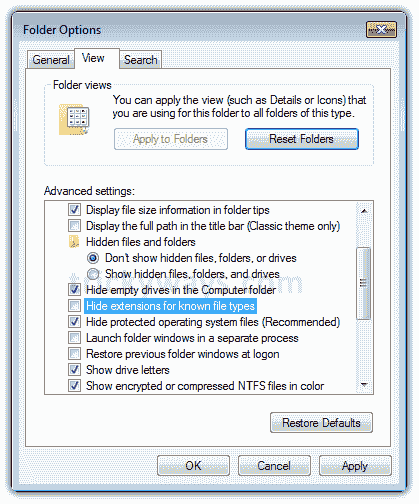

方框中的勾选就像切换开关。勾选时，将隐藏已知文件类型；取消勾选，将显示所有文件类型。点击方框使勾选出现[隐藏文件扩展名]或消失[显示文件扩展名]，然后选择“确定”。

以下提供了各种 Windows 操作系统导航至“文件夹选项”的说明，以及额外帮助的互联网链接。

## Windows XP

打开 Windows 资源管理器，选择“工具”选项卡，然后选择“文件夹选项”。

额外帮助链接：[`www.fileinfo.net/help/windows-show-extensions.html`](http://www.fileinfo.net/help/windows-show-extensions.html) 或 [`dotwhat.net/page/displayextensions/`](http://dotwhat.net/page/displayextensions/)

## Windows Vista

选择“开始”按钮，然后是“控制面板”，然后是“外观和个性化”，最后是“文件夹选项”。

额外帮助链接：[`windows.microsoft.com/en-us/windows-vista/Show-or-hide-file-name-extensions`](http://windows.microsoft.com/en-us/windows-vista/Show-or-hide-file-name-extensions)

## Windows 7

选择“开始”按钮，然后是“控制面板”，以及“文件夹选项”。

额外帮助链接：[`maximumpcguides.com/windows-7/hide-file-extensions/`](http://maximumpcguides.com/windows-7/hide-file-extensions/)

# 26.5. 学术不端行为

## 引言

师生关系一直是开放且诚实沟通的关系。教师承担着通过阅读作业、讲座、实验等方式演示课程材料的责任。学生需要学习并理解这些材料。此外，教师会采用各种方法来评估学生对课程材料的掌握情况。这通常通过测验、考试、写作作业、完成实验材料等来进行。学术不端行为（有时被称为“学术不守”）是对这种信任的违背。

在进入大学教育水平之前，学生通常对测验和考试作弊以及抄袭有了充分的认识。大多数大学在学生手册中包含了充分的解释，说明什么构成考试作弊和抄袭。学术不端行为通常伴随着严厉的处罚。通常，学生将在修读的课程中获得教授的“F”成绩。学生可能会从目前修读的所有课程中退学（所有课程均为“F”），并被该机构开除（未来可能无法注册课程）。这听起来很残酷，但这是违反了学生与教育机构之间的`信任纽带`。

## 同谋

学术不端行为的另一类是同谋，即在准备用于学分的（计入成绩计算的）书面作业（包括实验作业）时与他人进行未经授权的协作。为了更好地理解同谋，学生需要意识到，作为学习和对学习评估的一部分，许多教授会使用小组项目；这是一种引导或授权的协作。通常会鼓励学生组成学习小组来帮助讨论课程材料，从而改进学习过程。这些授权且有时受引导的活动不属于同谋。

以下讨论旨在帮助学生理解针对使用计算机的课程中的同谋（未经授权的协作）。这并不是一个详尽的列表，但将涵盖教师多年来遇到的常见情况。除非你的教授另有告知，否则你应该假设下所讨论的这些项目都是同谋。

## 由自己完成

实验作业应该是你个人的打字努力。这意味着你应该亲自打字，或者由你亲自对文件（文档、电子表格、数据库、程序源代码等）进行修改。如果你的课程是编程类学科，你应该在你的`compiler`上运行源代码文件，并根据需要进行修正以完成实验作业。如果作业说明中要求创建一个新文件，请不要使用现有文件并对其修改来完成作业。**除非获得教授专门授权，否则学生不要以团队或小组的形式完成计算机课程并共享最终成果。**

学生曾说他们是团队或小组工作，所有人都参与了并且都学习了材料。不要尝试用这个借口，因为教授不买账。问题在于：学习过程的一部分是你亲自动手做。例如：我要求两个学生为我做早餐煎饼；我期望早餐时有两份单独准备的煎饼（每人一份）。教授并不想吃两盘煎饼（或者根据学生人数吃 50 到 100 盘），但该课程的引导性学习活动之一是证明你可以做煎饼（而不是看别人做或以小组形式参与做煎饼）。

## 控制你的文件访问权限

控制你创建（或被要求修改）的文件意味着其他人无法访问并复制你的作品。换句话说，不要分享你的文件。


学生们说他们分享文件是为了让其他学生看到完成后的作业应该什么样。不要尝试用这个借口，因为教授们不会买账的。问题在于：当你分享文件时，你也就分享了你的打字成果（或你的原创作品以及创作这些原创作品所付出的努力）。回到我们的煎饼例子：“我只是给了另一个学生一盘做好的煎饼，让他看到最终产品应该是什么样。”另一个学生所做的只是加了一些蓝莓和鲜奶油。如果学生对你的作品进行了细微修改（更改了他名字所在的位置）并将其作为自己的作业提交——你将被纳入学术不端行为的指控。**除非教授明确授权，否则不要与其他学生共享你创建或修改的任何文件——任何时候都不行，现在还是将来。**

以下是控制文件访问的两个建议：

在使用课程交付软件产品或学习系统（如 `BlackBoard Vista）时，**不要把你的密码给别人**。有了密码，他们就可以访问你提交的作业，包括你创建的文件。

不要将你的文件放在他人可能访问的机器上。如果有多个学生使用或可以访问同一台机器（通常发生在住在同一家庭的同学身上——丈夫/妻子、兄弟姐妹或室友），或者在校内许多学生都可以访问的课程中——**将你的文件存储在闪存盘上**。从物理上控制谁可以访问你的闪存盘。

## 就协作寻求澄清

如果你对某可能被解释为未经授权的协作活动有任何疑问，请询问你的教授。他们将就该活动为你提供澄清和指导。

学生们说他们并不理解，或者认为这不是未经授权的协作。不要尝试用这个借口，因为教授们不会买账。问题在于：我们无法、也不会列出学生可能串通的每种微小方式。**向教授寻求特定课程的任何澄清是你的责任。** 不要假设另一位老师在另一门课程中允许的行为，这位教授在这一门课程中也会允许。

## 检测学术不端行为

教授们并非一天。大多数机构的教职员工在理解学术不端行为方面个人拥有多年经验，集体加起来有数千年的经验。考试作弊、抄袭和串通对我们来说并不新鲜。我们互相交流检测学术不端行为的专业知识。此外，在实验室环境中使用计算机教学的教授，其计算机技术经验往往令人惊叹。

学生们说他们认为自己不会被检测出来，或者学术不端行为无法被证明。不要尝试这种方法，因为教授们认为他们稍微聪明一点。实际上，我们知道我们聪明得多。令我们惊讶的是，学生没有意识到教授是一股不可小敌的力量。**不要赌你可以在“学术不端游戏”中赢过我们。** 请不要将此视为一种挑战，并将其作为借口去测试你是否可以进行学术不端行为而不被发现。我们是在警告你，而不是在挑战你。

## 严重后果

后果将因教授和机构而异。其范围从简单的敲头警告（不要再这样做）到完全从机构中开除（从所有课程中退学）。因为**信任纽带**破裂了，许多教授将直接将你从所修的课程中开除。例如：在休斯顿社区学院的 `BCIS1405` 中，我们在 2008 年春季学期内因学术不端行为，从远程教育部门开除了 8 名学生（并同时给他们给了“F”等级）。

如果你不诚实，请准备好教授将带给你的任何后果。

## 总结

*   学术诚实的伦理；存在一种信任纽带，无论学生在评估过程中做了什么，都是他们自己的工作和努力。
*   串通是指学生在提交评估的作业上进行未经授权的协作。
*   第一指令：自己打字。
*   第二指令：不要分享你的文件。
*   如果你怀疑某项协作活动可能被视为串通，请向你的教授寻求澄清。
*   教授在检测学术不端方面非常有能力。
*   你的不诚实行为通常会有后果。

## 26.6. 成功的学习技巧

## 意识到时间投入

大学计算机课程通常在课程目录中同时列出讲座和实验学时。但与自然和生物科学（化学、物理和生物）必须在为这些课程设计的特定实验室会面不同，学生通常可以在各种地点完成实验部分（大学计算机实验室、家里、工作地、公共图书馆、朋友家等）。

通常的法则是每上课 1 小时，课外要学习 1 到 1.5 小时，对于计算机课程来说，这通常意味着讲座和实验学时。学习有障碍的学生或母语不是英语的学生将计划更多的学习时间，并应该使用更大的比例。因此，你应该根据自己的情况计算一门课程所需的每周投入时间。例如：

如果一个学生修一门 4 学分的计算机课程，学院目录显示该课程在常规的 16 周学期内包含 6 小时（相加你的讲座和实验学时）的组合；那么该课程的每周课堂和学习时间将为每周 12 到 15 小时。

但许多学生以更快的节奏修课，要么在学期之间以非常集中的模式修课，要么在学期正式开始后开始课程，或者在夏季期间开始。要计算所需的每周学习时间，你需要计算总的常规学期教学时间，并除以快速交付的周数。例如：

我们的这门 4 学分课程将在为期 9 周的夏季学期修读。总学期时间将是常规投入的 15 倍（180 到 225 小时）。除以 9 意味着每周 20 到 25 小时。

## 了解你的专注能力

你不能指望长时间处理计算机课程材料。在处理 3 到 4 小时的课程材料后，你的学习能力会显著下降（对大多数人来说几乎降为零）。材料的累积性质使得这个问题变得更加严重。这意味着你在尝试学习项目 b 之前必须理解项目 a。所有的数学和科学课程都是这种性质。

## 计划常规学习时间

时间投入和专注能力的结合得出的结论：你不能将学习时间挤在周末的突击式学习中。你必须将学习时间拆分为 3 到 4 小时的学习段，每天只进行一次学习。你必须为每学周建立常规计划。在校修读常规学期课程的学生将计算上课（讲座和实验）时间，并额外计划 2 到 3 个学习段。

如果通过远程教育修课，学生需要规划所有的课程时间，因此在常规学期内，我们这门 4 学分课程的示例每周需要 3 到 4 个学习段，每个学习段 3 到 4 小时。如果以**快速**（9 周夏季学期）修读课程，你需要安排更多的学习时间。这可能意味着每周 6 天每天进行 **3 到 4 小时的学习段**（仅留一天作为休息日）。


你需要跟上课程进度才能顺利完成课程。通过安排多次学习时间来掌握节奏，可以实现有效学习。那些拖延到临考才试图通过突击学习来完成课程材料的学生，很少能成为“A”学生。

## 学习需要多样化和重复

多样化有许多形式，包括讲座、实验作业、学习教材、多媒体材料、测验、撰写研究论文，以及如小组讨论、字谜游戏、闪闪卡等学习活动。这种多样性实际上有助于我们的大脑理解并构建记忆。除了多样化之外，重复（在多个学习阶段反复接触）对于我们大脑学习和回忆课程材料至关重要。再次，这种理解和回忆对于需要累积学习的课程是本质的（你必须在学习 `item b` 之前理解 `item a`）。

教材和教授将课程材料拆分为章节或学习模块，通常在开头设有学习目标，并在每个单元的结尾设有复习项目。每个章节或模块可能包含上述任何项目。但“做”和“学”是两回事。你不能只是坐在教室里听，不能只是读东西，你需要去学习。学习需要各种活动。问问自己：

* 你理解每个学习目标吗？
* 你能为每个学习目标给出解释或制定答案吗？
* 如果你没有读懂阅读材料，你重读了它们吗？
* 完成复习项目（尤其是问题）。
* 讲义笔记。
* 讲义笔记或讲义是否比教材让你有更好的理解？
* 通常，问题或实验作业需要结合学习材料一起学习并进行强化。你尝试过去做并理解这些问题或实验作业吗？
* 是否有可用的学习活动？如果有，你做了吗？
* 你是否考虑过使用 3x5 卡片来学习定义和词汇？
* 你在参加任何测验之前复习过学习目标吗？
* 如果测验是计算机化的，你研究过测验结果吗？
* 在复习测验结果并重新学习后，如果可以，你是否再次参加了测验？

这一切都需要你作为任何课程的学生（无论是远程教育还是校内教育）投入时间和精力。任何课程你每周都需要需要几个学习阶段来学习材料。测验的目的是让你对材料的理解情况进行自测。如果你的学习尚未完成，请`改变或修改你的学习习惯`。

##与其他学生互动

在普通教室里，学生之间相互互动。他们经常与其他学生组成学习小组，并定期见面帮助彼此学习材料。在大多数情况下，这些互动对学习过程至关重要。如果你唯一的互动是与导师私下对话或私邮件，那么你并没有完全参与课程。对于远程教育的学生，大多数学习系统（如 `Blackboard Vista`）提供了创建这种互动的工具。它们通常包括公告、讨论列表、电子邮件和聊天工具。

## 不要拖延，不要落后

如果你落后了怎么办？计划`定期学习阶段`。缺乏定期学习阶段很可能是你落后的原因。计划你何时进行`额外学习阶段`以追上进度。

## 上课并做笔记

记录课堂笔记并在以后学习时回顾这些笔记，提供了学习材料所需的多样性。仅仅是下笔记就能更积极地参与大脑，因为你正在听并正在写。但你需要与至少两个同学约好，你们大家都做笔记，并在缺席时互相分享笔记。除了课程材料外，课堂上还会讨论其他行政事项（如考试日期的变更公告）。

如果你正在修读远程课程，你需要定期进入学习管理系统（如 `Blackboard Vista`），查看公告、讨论列表帖子，并阅读（在适当的情况下回复）电子邮件。大多数远程课程教授假设，他通过这些工具传递的任何内容都会 3 天内被学生阅读。简而言之，这意味着你有责任阅读这些项目并完成任何要求的行动。

## 26.7. 构建大脑的学习习惯

## 引言

2008 年春季，作者 Kenneth Leroy Busbee 对参加计算机编程基础课程的学生进行过了一项研究，以确定使用 3x5 卡片是否会提高学生的考试成绩。简而言之，确实如此！这并不意外，但显而易见的是，我们大多数（各教育阶段的教职工以及学生）对于大脑如何构建理解和长期记忆了解很少。

随附是几个以 Adobe PDF 格式保存的 PowerPoint 演示文。请花几分钟查看所提供的信息。希望它能帮助学生更好地学习正在学习的科目。

## 主演示

链接到：[构建大脑的学习习惯](http://cnx.org/content/m19977/1.5/Study_Habits_that_Build_the_Brain.pdf)

## 具体主题

链接到：[阅读教材](http://cnx.org/content/m19977/1.5/Reading_the_Textbook.pdf)

链接到：[记录课堂笔记](http://cnx.org/content/m19977/1.5/Taking_Lecture_Notes.pdf)

链接到：[使用 3x5 卡片](http://cnx.org/content/m19997/1.5/Using_3x5_Cards.pdf)

链接到：[使用闪闪卡活动](http://cnx.org/content/m19977/1.5/Using_the_Flash_Card_Activity.pdf)

# 附录 A. 属性

| 集合：编程基础 - 使用 C++ 的模块化结构方法 |
| :--- |
| 编辑：Kenneth Busbee |
| 链接：[`cnx.org/content/col10621/20/`](http://cnx.org/content/col10621/20) |
| 版权：Kenneth Busbee |
| 许可证：[`creativecommons.org/licenses/by/2.0/`](http://creativecommons.org/licenses/by/2.0/) |
| 章节：使用 C++ 的基础 - 引言 (pr01.html) |
| 使用：引言 |
| 作者：Kenneth Busbee |
| 链接：[`cnx.org/content/m19049/16/`](http://cnx.org/content/m19049/16/) |
| 版权：Kenneth Busbee |
| 许可证：[`creativecommons.org/licenses/by/2.0/`](http://creativecommons.org/licenses/by/2.0/) |
| 章节：使用 C++ 的基础 - 致谢 (pr02.html) |
| 使用：致谢 |
| 作者：Kenneth Busbee |
| 链接：[`cnx.org/content/m19055/5/`](http://cnx.org/content/m19055/5/) |
| 版权：Kenneth Busbee |
| 许可证：[`creativecommons.org/licenses/by/2.0/`](http://creativecommons.org/licenses/by/2.0/) |
| 章节：使用 C++ 的基础 - 课程大纲 (pr03.html) |
| 使用：课程大纲 |
| 作者：Kenneth Busbee |
| 链接：[`cnx.org/content/m19684/10/`](http://cnx.org/content/m19684/10/) |
| 版权：Kenneth Busbee |
| 许可证：[`creativecommons.org/licenses/by/3.0/`](http://creativecommons.org/licenses/by/3.0/) |
| 章节：使用 C++ 的基础 - 为什么你需要创建一个个人 Connexions 账号 (pr04.html) |
| 使用：为什么你需要创建一个个人 Connexions 账号 |
| 作者：Kenneth Busbee |
| 链接：[`cnx.org/content/m33937/1/`](http://cnx.org/content/m33937/1/) |
| 版权：Kenneth Busbee |
| 许可证：[`creativecommons.org/licenses/by/3.0/`](http://creativecommons.org/licenses/by/3.0/) |
| 章节：使用 C++ 的基础 - 创建 Connexions 账号 (pr05.html) |
| 使用：创建 Connexions 账号 |
| 作者：Kenneth Busbee |
| 链接：[`cnx.org/content/m33888/1/`](http://cnx.org/content/m33888/1/) |
| 版权：Kenneth Busbee |


# 许可证信息

- 许可证: [`creativecommons.org/licenses/by/3.0/`](http://creativecommons.org/licenses/by/3.0/)

## Rating Connexions 模块
- 模块: Rating Connexions Modules
- 作者: Kenneth Busbee
- 链接: [`cnx.org/content/m33960/1.1/`](http://cnx.org/content/m33960/1.1/)
- 版权所有: Kenneth Busbee
- 许可证: [`creativecommons.org/licenses/by/3.0/`](http://creativecommons.org/licenses/by/3.0/)

## 系统开发生命周期
- 模块: Systems Development Life Cycle
- 作者: Kenneth Busbee
- 链接: [`cnx.org/content/m18684/1.6/`](http://cnx.org/content/m18684/1.6/)
- 版权所有: Kenneth Busbee
- 许可证: [`creativecommons.org/licenses/by/2.0/`](http://creativecommons.org/licenses/by/2.0/)

## Bloodshed Dev-C++ 5 编译器/IDE
- 模块: Bloodshed Dev-C++ 5 Compiler/IDE
- 作者: Kenneth Busbee
- 链接: [`cnx.org/content/m18785/1.15/`](http://cnx.org/content/m18785/1.15/)
- 版权所有: Kenneth Busbee
- 许可证: [`creativecommons.org/licenses/by/2.0/`](http://creativecommons.org/licenses/by/2.0/)

## 模块化与 C++ 程序布局
- 模块: Modularization and C++ Program Layout
- 作者: Kenneth Busbee
- 链接: [`cnx.org/content/m18861/1.13/`](http://cnx.org/content/m18861/1.13/)
- 版权所有: Kenneth Busbee
- 许可证: [`creativecommons.org/licenses/by/2.0/`](http://creativecommons.org/licenses/by/2.0/)

## 练习 1：编程简介
- 模块: Practice 1: Introduction to Programming
- 作者: Kenneth Busbee
- 链接: [`cnx.org/content/m22450/1.4/`](http://cnx.org/content/m22450/1.4/)
- 版权所有: Kenneth Busbee
- 许可证: [`creativecommons.org/licenses/by/3.0/`](http://creativecommons.org/licenses/by/3.0/)

## 程序设计
- 模块: Program Design
- 作者: Kenneth Busbee
- 链接: [`cnx.org/content/m18686/1.5/`](http://cnx.org/content/m18686/1.5/)
- 版权所有: Kenneth Busbee
- 许可证: [`creativecommons.org/licenses/by/2.0/`](http://creativecommons.org/licenses/by/2.0/)

## 伪代码
- 模块: Pseudocode
- 作者: Kenneth Busbee
- 链接: [`cnx.org/content/m18648/1.10/`](http://cnx.org/content/m18648/1.10/)
- 版权所有: Kenneth Busbee
- 许可证: [`creativecommons.org/licenses/by/2.0/`](http://creativecommons.org/licenses/by/2.0/)

## 测试数据
- 模块: Test Data
- 作者: Kenneth Busbee
- 链接: [`cnx.org/content/m18781/1.4/`](http://cnx.org/content/m18781/1.4/)
- 版权所有: Kenneth Busbee
- 许可证: [`creativecommons.org/licenses/by/2.0/`](http://creativecommons.org/licenses/by/2.0/)

## 练习 2：程序规划与设计
- 模块: Practice 2: Program Planning & Design
- 作者: Kenneth Busbee
- 链接: [`cnx.org/content/m22453/1.3/`](http://cnx.org/content/m22453/1.3/)
- 版权所有: Kenneth Busbee
- 许可证: [`creativecommons.org/licenses/by/3.0/`](http://creativecommons.org/licenses/by/3.0/)

## C++ 中的数据类型
- 模块: Data Types in C++
- 作者: Kenneth Busbee
- 链接: [`cnx.org/content/m18653/1.13/`](http://cnx.org/content/m18653/1.13/)
- 版权所有: Kenneth Busbee
- 许可证: [`creativecommons.org/licenses/by/2.0/`](http://creativecommons.org/licenses/by/2.0/)

## 标识符名称
- 模块: Identifier Names
- 作者: Kenneth Busbee
- 链接: [`cnx.org/content/m18692/1.5/`](http://cnx.org/content/m18692/1.5/)
- 版权所有: Kenneth Busbee
- 许可证: [`creativecommons.org/licenses/by/2.0/`](http://creativecommons.org/licenses/by/2.0/)

## 常量与变量
- 模块: Constants and Variables
- 作者: Kenneth Busbee
- 链接: [`cnx.org/content/m18719/1.8/`](http://cnx.org/content/m18719/1.8/)
- 版权所有: Kenneth Busbee
- 许可证: [`creativecommons.org/licenses/by/2.0/`](http://creativecommons.org/licenses/by/2.0/)

## 数据操作
- 模块: Data Manipulation
- 作者: Kenneth Busbee
- 链接: [`cnx.org/content/m18705/1.6/`](http://cnx.org/content/m18705/1.6/)
- 版权所有: Kenneth Busbee
- 许可证: [`creativecommons.org/licenses/by/2.0/`](http://creativecommons.org/licenses/by/2.0/)

## 赋值运算符
- 模块: Assignment Operator
- 作者: Kenneth Busbee
- 链接: [`cnx.org/content/m18725/1.4/`](http://cnx.org/content/m18725/1.4/)
- 版权所有: Kenneth Busbee
- 许可证: [`creativecommons.org/licenses/by/2.0/`](http://creativecommons.org/licenses/by/2.0/)

## 算术运算符
- 模块: Arithmetic Operators
- 作者: Kenneth Busbee
- 链接: [`cnx.org/content/m18706/1.4/`](http://cnx.org/content/m18706/1.4/)
- 版权所有: Kenneth Busbee
- 许可证: [`creativecommons.org/licenses/by/2.0/`](http://creativecommons.org/licenses/by/2.0/)

## 数据类型转换
- 模块: Data Type Conversions
- 作者: Kenneth Busbee
- 链接: [`cnx.org/content/m18744/1.7/`](http://cnx.org/content/m18744/1.7/)
- 版权所有: Kenneth Busbee
- 许可证: [`creativecommons.org/licenses/by/2.0/`](http://creativecommons.org/licenses/by/2.0/)

## 练习 3：数据与运算符
- 模块: Practice 3: Data & Operators
- 作者: Kenneth Busbee
- 链接: [`cnx.org/content/m22455/1.4/`](http://cnx.org/content/m22455/1.4/)
- 版权所有: Kenneth Busbee
- 许可证: [`creativecommons.org/licenses/by/3.0/`](http://creativecommons.org/licenses/by/3.0/)

## 整数类型
- 模块: Integer Data Type
- 作者: Kenneth Busbee
- 链接: [`cnx.org/content/m18654/1.6/`](http://cnx.org/content/m18654/1.6/)
- 版权所有: Kenneth Busbee
- 许可证: [`creativecommons.org/licenses/by/2.0/`](http://creativecommons.org/licenses/by/2.0/)

## 浮点数类型
- 模块: Floating-Point Data Type
- 作者: Kenneth Busbee
- 链接: [`cnx.org/content/m18657/1.6/`](http://cnx.org/content/m18657/1.6/)
- 版权所有: Kenneth Busbee
- 许可证: [`creativecommons.org/licenses/by/2.0/`](http://creativecommons.org/licenses/by/2.0/)

## 字符串类型
- 模块: String Data
- 作者: Kenneth Busbee
- 链接: [`cnx.org/content/m18653/1.7/`](http://cnx.org/content/m18653/1.7/)
- 版权所有: Kenneth Busbee
- 许可证: [`creativecommons.org/licenses/by/2.0/`](http://creativecommons.org/licenses/by/2.0/)

## 算术赋值运算符
- 模块: Arithmetic Assignment Operators
- 作者: Kenneth Busbee
- 链接: [`cnx.org/content/m18743/1.7/`](http://cnx.org/content/m18743/1.7/)
- 版权所有: Kenneth Busbee
- 许可证: [`creativecommons.org/licenses/by/2.0/`](http://creativecommons.org/licenses/by/2.0/)

## 左值与右值
- 模块: Lvalue and Rvalue
- 作者: Kenneth Busbee
- 链接: [`cnx.org/content/m18058/1.12/`](http://cnx.org/content/m18058/1.12/)
- 版权所有: Kenneth Busbee
- 许可证: [`creativecommons.org/licenses/by/2.0/`](http://creativecommons.org/licenses/by/2.0/)

## 整数除法与取模
- 模块: Integer Division and Modulus
- 作者: Kenneth Busbee
- 链接: [`cnx.org/content/m18717/1.13/`](http://cnx.org/content/m18717/1.13/)
- 版权所有: Kenneth Busbee
- 许可证: [`creativecommons.org/licenses/by/2.0/`](http://creativecommons.org/licenses/by/2.0/)

## 练习 4：常用数据类型
- 模块: Practice 4: Often Used Data Types
- 作者: Kenneth Busbee
- 链接: [`cnx.org/content/m22456/1.2/`](http://cnx.org/content/m22456/1.2/)
- 版权所有: Kenneth Busbee


# 5.1 集成开发环境
- **许可证**: [`creativecommons.org/licenses/by/3.0/`](http://creativecommons.org/licenses/by/3.0/)
- **作者**: Kenneth Busbee
- **URL**: [`cnx.org/content/m18920/1.9/`](http://cnx.org/content/m18920/1.9/)
- **版权**: Kenneth Busbee

# 5.2 标准输入与输出
- **许可证**: [`creativecommons.org/licenses/by/2.0/`](http://creativecommons.org/licenses/by/2.0/)
- **作者**: Kenneth Busbee
- **URL**: [`cnx.org/content/m18835/1.5/`](http://cnx.org/content/m18835/1.5/)
- **版权**: Kenneth Busbee

# 5.3 编译器指令
- **许可证**: [`creativecommons.org/licenses/by/2.0/`](http://creativecommons.org/licenses/by/2.0/)
- **作者**: Kenneth Busbee
- **URL**: [`cnx.org/content/m18787/1.7/`](http://cnx.org/content/m18787/1.7/)
- **版权**: Kenneth Busbee

# 5.4 练习 5：集成成开发环境
- **许可证**: [`creativecommons.org/licenses/by/2.0/`](http://creativecommons.org/licenses/by/2.0/)
- **作者**: Kenneth Busbee
- **URL**: [`cnx.org/content/m22457/1.3/`](http://cnx.org/content/m22457/1.3/)
- **版权**: Kenneth Busbee

# 6.1 函数伪代码示例
- **许可证**: [`creativecommons.org/licenses/by/3.0/`](http://creativecommons.org/licenses/by/3.0/)
- **作者**: Kenneth Busbee
- **URL**: [`cnx.org/content/m19136/1.7/`](http://cnx.org/content/m19136/1.7/)
- **版权**: Kenneth Busbee

# 6.2 层次结构或结构图
- **许可证**: [`creativecommons.org/licenses/by/2.0/`](http://creativecommons.org/licenses/by/2.0/)
- **作者**: Kenneth Busbee
- **URL**: [`cnx.org/content/m18682/1.4/`](http://cnx.org/content/m18682/1.4/)
- **版权**: Kenneth Busbee

# 6.3 程序控制函数
- **许可证**: [`creativecommons.org/licenses/by/2.0/`](http://creativecommons.org/licenses/by/2.0/)
- **作者**: Kenneth Busbee
- **URL**: [`cnx.org/content/m19145/1.9/`](http://cnx.org/content/m19145/1.9/)
- **版权**: Kenneth Busbee

# 6.4 空数据类型
- **许可证**: [`creativecommons.org/licenses/by/2.0/`](http://creativecommons.org/licenses/by/2.0/)
- **作者**: Kenneth Busbee
- **URL**: [`cnx.org/content/m18655/1.4/`](http://cnx.org/content/m18655/1.4/)
- **版权**: Kenneth Busbee

# 6.5 文档与与源代码可读性
- **许可证**: [`creativecommons.org/licenses/by/2.0/`](http://creativecommons.org/licenses/by/2.0/)
- **作者**: Kenneth Busbee
- **URL**: [`cnx.org/content/m18912/1.5/`](http://cnx.org/content/m18912/1.5/)
- **版权**: Kenneth Busbee

# 6.6 练习 6：程序控制函数
- **许可证**: [`creativecommons.org/licenses/by/2.0/`](http://creativecommons.org/licenses/by/2.0/)
- **作者**: Kenneth Busbee
- **URL**: [`cnx.org/content/m22458/1.4/`](http://cnx.org/content/m22458/1.4/)
- **版权**: Kenneth Busbee

# 7.1 特定任务函数
- **许可证**: [`creativecommons.org/licenses/by/3.0/`](http://creativecommons.org/licenses/by/3.0/)
- **作者**: Kenneth Busbee
- **URL**: [`cnx.org/content/m19146/1.4/`](http://cnx.org/content/m19146/1.4/)
- **版权**: Kenneth Busbee

# 7.2 全局存储与局部存储
- **许可证**: [`creativecommons.org/licenses/by/2.0/`](http://creativecommons.org/licenses/by/2.0/)
- **作者**: Kenneth Busbee
- **URL**: [`cnx.org/content/m19147/1.5/`](http://cnx.org/content/m19147/1.5/)
- **版权**: Kenneth Busbee

# 7.3 使用头文件
- **许可证**: [`creativecommons.org/licenses/by/2.0/`](http://creativecommons.org/licenses/by/2.0/)
- **作者**: Kenneth Busbee
- **URL**: [`cnx.org/content/m19346/1.7/`](http://cnx.org/content/m19346/1.7/)
- **版权**: Kenneth Busbee

# 7.4 练习 7：任务函数
- **许可证**: [`creativecommons.org/licenses/by/2.0/`](http://creativecommons.org/licenses/by/2.0/)
- **作者**: Kenneth Busbee
- **URL**: [`cnx.org/content/m22459/1.2/`](http://cnx.org/content/m22459/1.2/)
- **版权**: Kenneth Busbee

# 8.1 标准库
- **许可证**: [`creativecommons.org/licenses/by/3.0/`](http://creativecommons.org/licenses/by/3.0/)
- **作者**: Kenneth Busbee
- **URL**: [`cnx.org/content/m19202/1.6/`](http://cnx.org/content/m19202/1.6/)
- **版权**: Kenneth Busbee

# 8.2 练习 8：标准库
- **许可证**: [`creativecommons.org/licenses/by/2.0/`](http://creativecommons.org/licenses/by/2.0/)
- **作者**: Kenneth Busbee
- **URL**: [`cnx.org/content/m22460/1.3/`](http://cnx.org/content/m22460/1.3/)
- **版权**: Kenneth Busbee

# 9.1 字符类型
- **许可证**: [`creativecommons.org/licenses/by/3.0/`](http://creativecommons.org/licenses/by/3.0/)
- **作者**: Kenneth Busbee
- **URL**: [`cnx.org/content/m18669/1.4/`](http://cnx.org/content/m18669/1.4/)
- **版权**: Kenneth Busbee

# 9.2 size 运算符
- **许可证**: [`creativecommons.org/licenses/by/2.0/`](http://creativecommons.org/licenses/by/2.0/)
- **作者**: Kenneth Busbee
- **URL**: [`cnx.org/content/m18736/1.8/`](http://cnx.org/content/m18736/1.8/)
- **版权**: Kenneth Busbee

# 9.3 typedef 别名
- **许可证**: [`creativecommons.org/licenses/by/2.0/`](http://creativecommons.org/licenses/by/2.0/)
- **作者**: Kenneth Busbee
- **URL**: [`cnx.org/content/m18741/1.5/`](http://cnx.org/content/m18741/1.5/)
- **版权**: Kenneth Busbee

# 9.4 序列运算符
- **许可证**: [`creativecommons.org/licenses/by/2.0/`](http://creativecommons.org/licenses/by/2.0/)
- **作者**: Kenneth Busbee
- **URL**: [`cnx.org/content/m18690/1.8/`](http://cnx.org/content/m18690/1.8/)
- **版权**: Kenneth Busbee

# 9.5 练习 9：字符类型、size、typedef、序列
- **许可证**: [`creativecommons.org/licenses/by/2.0/`](http://creativecommons.org/licenses/by/2.0/)
- **作者**: Kenneth Busbee
- **URL**: [`cnx.org/content/m22461/1.4/`](http://cnx.org/content/m22461/1.4/)
- **版权**: Kenneth Busbee

# 10.1 结构化编程
- **许可证**: [`creativecommons.org/licenses/by/3.0/`](http://creativecommons.org/licenses/by/3.0/)
- **作者**: Kenneth Busbee
- **URL**: [`cnx.org/content/m19628/1.7/`](http://cnx.org/content/m19628/1.7/)
- **版权**: Kenneth Busbee

# 10.2 控制结构的伪代码示例
- **许可证**: [`creativecommons.org/licenses/by/3.0/`](http://creativecommons.org/licenses/by/3.0/)
- **作者**: Kenneth Busbee
- **URL**: [`cnx.org/content/m18649/1.13/`](http://cnx.org/content/m18649/1.13/)
- **版权**: Kenneth Busbee


## 课程模块列表

| 模块 (Module) | 作者 (By) | 链接 (URL) | 许可 (License) |
| :--- | :--- | :--- | :--- |
| 流程图 | Kenneth Busbee | [`cnx.org/content/m19623/1.6`](http://cnx.org/content/m19623/1.6) | [`creativecommons.org/licenses/by/2.0`](http://creativecommons.org/licenses/by/2.0) |
| 练习 10：结构化编程简介 | Kenneth Busbee | [`cnx.org/content/m19692/1.4`](http://cnx.org/content/m19692/1.4) | [`creativecommons.org/licenses/by/3.0`](http://creativecommons.org/licenses/by/3.0) |
| If-Then-Else 语句 | Kenneth Busbee | [`cnx.org/content/m19679/1.4`](http://cnx.org/content/m19679/1.4) | [`creativecommons.org/licenses/by/3.0`](http://creativecommons.org/licenses/by/3.0) |
| 布尔数据类型 | Kenneth Busbee | [`cnx.org/content/m19544/1.5`](http://cnx.org/content/m19544/1.5) | [`creativecommons.org/licenses/by/3.0`](http://creativecommons.org/licenses/by/3.0) |
| 关系运算符 | Kenneth Busbee | [`cnx.org/content/m19549/1.11`](http://cnx.org/content/m19549/1.11) | [`creativecommons.org/licenses/by/2.0`](http://creativecommons.org/licenses/by/2.0) |
| 复合语句 | Kenneth Busbee | [`cnx.org/content/m19683/1.3`](http://cnx.org/content/m19683/1.3) | [`creativecommons.org/licenses/by/3.0`](http://creativecommons.org/licenses/by/3.0) |
| 练习 11：二路选择 | Kenneth Busbee | [`cnx.org/content/m19764/1.15`](http://cnx.org/content/m19764/1.15) | [`creativecommons.org/licenses/by/3.0`](http://creativecommons.org/licenses/by/3.0) |
| 嵌套 If-Then-Else | Kenneth Busbee | [`cnx.org/content/m19951/1.6`](http://cnx.org/content/m19951/1.6) | [`creativecommons.org/licenses/by/3.0`](http://creativecommons.org/licenses/by/3.0) |
| 逻辑运算符 | Kenneth Busbee | [`cnx.org/content/m19847/1.8`](http://cnx.org/content/m19847/1.8) | [`creativecommons.org/licenses/by/3.0`](http://creativecommons.org/licenses/by/3.0) |
| 分支控制结构 | Kenneth Busbee | [`cnx.org/content/m19963/1.4`](http://cnx.org/content/m19963/1.4) | [`creativecommons.org/licenses/by/3.0`](http://creativecommons.org/licenses/by/3.0) |
| 分支结构 | Kenneth Busbee | [`cnx.org/content/m19947/1.3`](http://cnx.org/content/m19947/1.3) | [`creativecommons.org/licenses/by/3.0`](http://creativecommons.org/licenses/by/3.0) |
| 练习 12：多路选择 | Kenneth Busbee | [`cnx.org/content/m19968/1.12`](http://cnx.org/content/m19968/1.12) | [`creativecommons.org/licenses/by/3.0`](http://creativecommons.org/licenses/by/3.0) |
| While 循环 | Kenneth Busbee | [`cnx.org/content/m20596/1.5`](http://cnx.org/content/m20596/1.5) | [`creativecommons.org/licenses/by/3.0`](http://creativecommons.org/licenses/by/3.0) |
| 标志概念 | Kenneth Busbee | [`cnx.org/content/m20404/1.6`](http://cnx.org/content/m20404/1.6) | [`creativecommons.org/licenses/by/3.0`](http://creativecommons.org/licenses/by/3.0) |
| C++ 中的赋值与等等的区别 | Kenneth Busbee | [`cnx.org/content/m19542/1.7`](http://cnx.org/content/m19542/1.7) | [`creativecommons.org/licenses/by/2.0`](http://creativecommons.org/licenses/by/2.0) |
| 重复循环 | Kenneth Busbee | [`cnx.org/content/m20597/1.3`](http://cnx.org/content/m20597/1.3) | [`creativecommons.org/licenses/by/3.0`](http://creativecommons.org/licenses/by/3.0) |
| 练习 13：循环后测试 | Kenneth Busbee | [`cnx.org/content/m20642/1.8`](http://cnx.org/content/m20642/1.8) | [`creativecommons.org/licenses/by/3.0`](http://creativecommons.org/licenses/by/3.0) |
| 自增与自减运算符 | Kenneth Busbee | [`cnx.org/content/m20499/1.4`](http://cnx.org/content/m20499/1.4) | [`creativecommons.org/licenses/by/3.0`](http://creativecommons.org/licenses/by/3.0) |
| While 循环 (2) | Kenneth Busbee | [`cnx.org/content/m20598/1.8`](http://cnx.org/content/m20598/1.8) | [`creativecommons.org/licenses/by/3.0`](http://creativecommons.org/licenses/by/3.0) |
| 练习 14：循环前测试 | Kenneth Busbee | [`cnx.org/content/m20643/1.10`](http://cnx.org/content/m20643/1.10) | [`creativecommons.org/licenses/by/3.0`](http://creativecommons.org/licenses/by/3.0) |
| For 循环 | Kenneth Busbee | [`cnx.org/content/m20600/1.3`](http://cnx.org/content/m20600/1.3) | [`creativecommons.org/licenses/by/3.0`](http://creativecommons.org/licenses/by/3.0) |
| 整数类型的循环性质 | Kenneth Busbee | [`cnx.org/content/m20743/1.4`](http://cnx.org/content/m20743/1.4) | [`creativecommons.org/licenses/by/3.0`](http://creativecommons.org/licenses/by/3.0) |
| 输出格式化 | Kenneth Busbee | [`cnx.org/content/m20660/1.4`](http://cnx.org/content/m20660/1.4) | [`creativecommons.org/licenses/by/3.0`](http://creativecommons.org/licenses/by/3.0) |


| 许可证：[`creativecommons.org/licenses/by/3.0/`](http://creativecommons.org/licenses/by/3.0/) |

## 模块：练习 15：计数循环 |
| 作者：Kenneth Busbee |
| URL：[`cnx.org/content/m20809/1.6/`](http://cnx.org/content/m20809/1.6/) |
| 版权所有：Kenneth Busbee |
| 许可证：[`creativecommons.org/licenses/by/3.0/`](http://creativecommons.org/licenses/by/3.0/) |

## 模块：C++ 中的字符串类 |
| 作者：Kenneth Busbee |
| URL：[`cnx.org/content/m20796/1.6/`](http://cnx.org/content/m20796/1.6/) |
| 版权所有：Kenneth Busbee |
| 许可证：[`creativecommons.org/licenses/by/3.0/`](http://creativecommons.org/licenses/by/3.0/) |

## 模块：一元正运算符与负运算符 |
| 作者：Kenneth Busbee |
| URL：[`cnx.org/content/m20501/1.2/`](http://cnx.org/content/m20501/1.2/) |
| 版权所有：Kenneth Busbee |
| 许可证：[`creativecommons.org/licenses/by/3.0/`](http://creativecommons.org/licenses/by/3.0/) |

## 模块：练习 16：字符串类、一元正运算符与负运算符 |
| 作者：Kenneth Busbee |
| URL：[`cnx.org/content/m20810/1.8/`](http://cnx.org/content/m20810/1.8/) |
| 版权所有：Kenneth Busbee |
| 许可证：[`creativecommons.org/licenses/by/3.0/`](http://creativecommons.org/licenses/by/3.0/) |

## 模块：条件运算符 |
| 作者：Kenneth Busbee |
| URL：[`cnx.org/content/m20811/1.7/`](http://cnx.org/content/m20811/1.7/) |
| 版权所有：Kenneth Busbee |
| 许可证：[`creativecommons.org/licenses/by/3.0/`](http://creativecommons.org/licenses/by/3.0/) |

## 模块：递归与迭代 |
| 作者：Kenneth Busbee |
| URL：[`cnx.org/content/m20814/1.4/`](http://cnx.org/content/m20814/1.4/) |
| 版权所有：Kenneth Busbee |
| 许可证：[`creativecommons.org/licenses/by/3.0/`](http://creativecommons.org/licenses/by/3.0/) |

## 模块：练习 17：条件运算符与递归 |
| 作者：Kenneth Busbee |
| URL：[`cnx.org/content/m20815/1.6/`](http://cnx.org/content/m20815/1.6/) |
| 版权所有：Kenneth Busbee |
| 许可证：[`creativecommons.org/licenses/by/3.0/`](http://creativecommons.org/licenses/by/3.0/) |

## 模块：数组数据类型 |
| 作者：Kenneth Busbee |
| URL：[`cnx.org/content/m21315/1.3/`](http://cnx.org/content/m21315/1.3/) |
| 版权所有：Kenneth Busbee |
| 许可证：[`creativecommons.org/licenses/by/3.0/`](http://creativecommons.org/licenses/by/3.0/) |

## 模块：数组索引运算符 |
| 作者：Kenneth Busbee |
| URL：[`cnx.org/content/m21316/1.3/`](http://cnx.org/content/m21316/1.3/) |
| 版权所有：Kenneth Busbee |
| 许可证：[`creativecommons.org/licenses/by/3.0/`](http://creativecommons.org/licenses/by/3.0/) |

## 模块：显示数组成员 |
| 作者：Kenneth Busbee |
| URL：[`cnx.org/content/m21317/1.5/`](http://cnx.org/content/m21317/1.5/) |
| 版权所有：Kenneth Busbee |
| 许可证：[`creativecommons.org/licenses/by/3.0/`](http://creativecommons.org/licenses/by/3.0/) |

## 模块：练习 18：数组简介 |
| 作者：Kenneth Busbee |
| URL：[`cnx.org/content/m21321/1.5/`](http://cnx.org/content/m21321/1.5/) |
| 版权所有：Kenneth Busbee |
| 许可证：[`creativecommons.org/licenses/by/3.0/`](http://creativecommons.org/licenses/by/3.0/) |

## 模块：文件输入与输出 |
| 作者：Kenneth Busbee |
| URL：[`cnx.org/content/m21623/1.3/`](http://cnx.org/content/m21623/1.3/) |
| 版权所有：Kenneth Busbee |
| 许可证：[`creativecommons.org/licenses/by/3.0/`](http://creativecommons.org/licenses/by/3.0/) |

## 模块：数组与函数 |
| 作者：Kenneth Busbee |
| URL：[`cnx.org/content/m21624/1.2/`](http://cnx.org/content/m21624/1.2/) |
| 版权所有：Kenneth Busbee |
| 许可证：[`creativecommons.org/licenses/by/3.0/`](http://creativecommons.org/licenses/by/3.0/) |

## 模块：从文件加载数组 |
| 作者：Kenneth Busbee |
| URL：[`cnx.org/content/m21625/1.2/`](http://cnx.org/content/m21625/1.2/) |
| 版权所有：Kenneth Busbee |
| 许可证：[`creativecommons.org/licenses/by/3.0/`](http://creativecommons.org/licenses/by/3.0/) |

## 模块：数组数学统计 |
| 作者：Kenneth Busbee |
| URL：[`cnx.org/content/m21626/1.2/`](http://cnx.org/content/m21626/1.2/) |
| 版权所有：Kenneth Busbee |
| 许可证：[`creativecommons.org/licenses/by/3.0/`](http://creativecommons.org/licenses/by/3.0/) |

## 模块：练习 19：文件输入输出与数组函数 |
| 作者：Kenneth Busbee |
| URL：[`cnx.org/content/m21630/1.4/`](http://cnx.org/content/m21630/1.4/) |
| 版权所有：Kenneth Busbee |
| 许可证：[`creativecommons.org/licenses/by/3.0/`](http://creativecommons.org/licenses/by/3.0/) |

## 模块：查找数组特定成员 |
| 作者：Kenneth Busbee |
| URL：[`cnx.org/content/m21627/1.2/`](http://cnx.org/content/m21627/1.2/) |
| 版权所有：Kenneth Busbee |
| 许可证：[`creativecommons.org/licenses/by/3.0/`](http://creativecommons.org/licenses/by/3.0/) |

## 模块：数组排序 |
| 作者：Kenneth Busbee |
| URL：[`cnx.org/content/m21628/1.2/`](http://cnx.org/content/m21628/1.2/) |
| 版权所有：Kenneth Busbee |
| 许可证：[`creativecommons.org/licenses/by/3.0/`](http://creativecommons.org/licenses/by/3.0/) |

## 模块：练习 20：更多数组函数 |
| 作者：Kenneth Busbee |
| URL：[`cnx.org/content/m21631/1.4/`](http://cnx.org/content/m21631/1.4/) |
| 版权所有：Kenneth Busbee |
| 许可证：[`creativecommons.org/licenses/by/3.0/`](http://creativecommons.org/licenses/by/3.0/) |

## 模块：使用 Typedef 的灵活代码 |
| 作者：Kenneth Busbee |
| URL：[`cnx.org/content/m21629/1.2/`](http://cnx.org/content/m21629/1.2/) |
| 版权所有：Kenneth Busbee |
| 许可证：[`creativecommons.org/licenses/by/3.0/`](http://creativecommons.org/licenses/by/3.0/) |

## 模块：练习 21：关于 Typedef 的深入学习 |
| 作者：Kenneth Busbee |
| URL：[`cnx.org/content/m21632/1.6/`](http://cnx.org/content/m21632/1.6/) |
| 版权所有：Kenneth Busbee |
| 许可证：[`creativecommons.org/licenses/by/3.0/`](http://creativecommons.org/licenses/by/3.0/) |

## 模块：地址运算符 |
| 作者：Kenneth Busbee |
| URL：[`cnx.org/content/m22148/1.3/`](http://cnx.org/content/m22148/1.3/) |
| 版权所有：Kenneth Busbee |
| 许可证：[`creativecommons.org/licenses/by/3.0/`](http://creativecommons.org/licenses/by/3.0/) |

## 模块：引用传递传递 |
| 作者：Kenneth Busbee |
| URL：[`cnx.org/content/m22150/1.4/`](http://cnx.org/content/m22150/1.4/) |
| 版权所有：Kenneth Busbee |
| 许可证：[`creativecommons.org/licenses/by/3.0/`](http://creativecommons.org/licenses/by/3.0/) |


| 模块：指针数据类型 |
| 作者：Kenneth Busbee |
| URL：[`cnx.org/content/m22151/1.3/`](http://cnx.org/content/m22151/1.3/) |
| 版权：Kenneth Busbee |
| 许可协议：[`creativecommons.org/licenses/by/3.0/`](http://creativecommons.org/licenses/by/3.0/) |

| 模块：间接引用运算符 |
| 作者：Kenneth Busbee |
| URL：[`cnx.org/content/m22152/1.2/`](http://cnx.org/content/m22152/1.2/) |
| 版权：Kenneth Busbee |
| 许可协议：[`creativecommons.org/licenses/by/3.0/`](http://creativecommons.org/licenses/by/3.0/) |

| 模块：练习 22：指针 |
| 作者：Kenneth Busbee |
| URL：[`cnx.org/content/m22153/1.4/`](http://cnx.org/content/m22153/1.4/) |
| 版权：Kenneth Busbee |
| 许可协议：[`creativecommons.org/licenses/by/3.0/`](http://creativecommons.org/licenses/by/3.0/) |

| 模块：多维数组 |
| 作者：Kenneth Busbee |
| URL：[`cnx.org/content/m22203/1.3/`](http://cnx.org/content/m22203/1.3/) |
| 版权：Kenneth Busbee |
| 许可协议：[`creativecommons.org/licenses/by/3.0/`](http://creativecommons.org/licenses/by/3.0/) |

| 模块：条件编译 |
| 作者：Kenneth Busbee |
| URL：[`cnx.org/content/m22204/1.5/`](http://cnx.org/content/m22204/1.5/) |
| 版权：Kenneth Busbee |
| 许可协议：[`creativecommons.org/licenses/by/3.0/`](http://creativecommons.org/licenses/by/3.0/) |

| 模块：练习 23：更多数组与指令 |
| 作者：Kenneth Busbee |
| URL：[`cnx.org/content/m22205/1.3/`](http://cnx.org/content/m22205/1.3/) |
| 版权：Kenneth Busbee |
| 许可协议：[`creativecommons.org/licenses/by/3.0/`](http://creativecommons.org/licenses/by/3.0/) |

| 模块：面向对象编程 |
| 作者：Kenneth Busbee |
| URL：[`cnx.org/content/m22208/1.3/`](http://cnx.org/content/m22208/1.3/) |
| 版权：Kenneth Busbee |
| 许可协议：[`creativecommons.org/licenses/by/3.0/`](http://creativecommons.org/licenses/by/3.0/) |

| 模块：高性能计算 |
| 作者：Kenneth Busbee |
| URL：[`cnx.org/content/m22209/1.8/`](http://cnx.org/content/m22209/1.8/) |
| 版权：Kenneth Busbee |
| 许可协议：[`creativecommons.org/licenses/by/3.0/`](http://creativecommons.org/licenses/by/3.0/) |

| 模块：练习 24：OOP |
| 作者：Kenneth Busbee |
| URL：[`cnx.org/content/m22210/1.6/`](http://cnx.org/content/m22210/1.6/) |
| 版权：Kenneth Busbee |
| 许可协议：[`creativecommons.org/licenses/by/3.0/`](http://creativecommons.org/licenses/by/3.0/) |

| 模块：复：基础 |
| 作者：Kenneth Busbee |
| URL：[`cnx.org/content/m22211/1.5/`](http://cnx.org/content/m22211/1.5/) |
| 版权：Kenneth Busbee |
| 许可协议：[`creativecommons.org/licenses/by/3.0/`](http://creativecommons.org/licenses/by/3.0/) |

| 模块：复：模块化 |
| 作者：Kenneth Busbee |
| URL：[`cnx.org/content/m22212/1.3/`](http://cnx.org/content/m22212/1.3/) |
| 版权：Kenneth Busbee |
| 许可协议：[`creativecommons.org/licenses/by/3.0/`](http://creativecommons.org/licenses/by/3.0/) |

| 模块：复：结构化编程 |
| 作者：Kenneth Busbee |
| URL：[`cnx.org/content/m22213/1.5/`](http://cnx.org/content/m22213/1.5/) |
| 版权：Kenneth Busbee |
| 许可协议：[`creativecommons.org/licenses/by/3.0/`](http://creativecommons.org/licenses/by/3.0/) |

| 模块：复：中间主题 |
| 作者：Kenneth Busbee |
| URL：[`cnx.org/content/m22214/1.3/`](http://cnx.org/content/m22214/1.3/) |
| 版权：Kenneth Busbee |
| 许可协议：[`creativecommons.org/licenses/by/3.0/`](http://creativecommons.org/licenses/by/3.0/) |

| 模块：复：高级主题 |
| 作者：Kenneth Busbee |
| URL：[`cnx.org/content/m22215/1.5/`](http://cnx.org/content/m22215/1.5/) |
| 版权：Kenneth Busbee |
| 许可协议：[`creativecommons.org/licenses/by/3.0/`](http://creativecommons.org/licenses/by/3.0/) |


自 1999 年以来，Connexions 一直致力于先一个全球性的系统，任何人都可以创建课程材料并使这些材料完全开放且免费地重复使用。

我们是一个基于 Web 的创作、教学和学习环境，向对教育感兴趣的人开放，包括学生、教师、教授和终身学习者。我们连接思想并促进教育社区的发展。

Connexions 的模块化、交互式课程正被全球大学、社区学院、K-12 学校、远程学习者和终身学习者使用。Connexions 材料包含多种语言，包括英语、西班牙语、中文、日语、意大利语、越南语、法语、葡萄牙语和泰语。

